# Linux 的 VMware 2：在 Linux 上运行多个操作系统的更好方法


由互联网档案馆于 2022 年数字化，资金来自 Kahle/Austin 基金会

## 到期日期

| | | | |
|---|---|---|---|
| | | | |
| | | | |
| | | | |
| | | | |
| | | | |
| | | | |
| | | | |
| | | | |
| | | | |
| | | | |
| | | | |
| | | | |
| | | | |


## 出版人

斯泰西·L·希奎特

## 市场经理

朱迪·泰勒

## 副市场经理

乔迪·肯嫩

## 执行编辑

桑迪·多尔

## 策划编辑

金·斯皮尔克

## 项目编辑

希瑟·塔尔博特

## 技术审校

查尔斯·科芬

凯农·欧文斯，VMware, Inc.

## 文字编辑

克里斯·西蒙斯

## 内文版式设计

比尔·哈特曼

## 封面设计

Prima 设计团队

## 索引编制

克里斯汀·瑞安

谨以此书献给我的妻子，她包容了我对技术的痴迷；也献给我的父母，他们明智地为我开启了这条路。

## 致谢

我写过许多计算机文章，但这是我的第一本书，它让我深刻体会到一部厚重的著作需要付出多少心血。幸运的是，我无需独自完成这一切。

在 Prima，我感谢金·斯皮尔克给了我这个长期痴迷于模拟技术的人一个机会，撰写一本关于我最心爱主题的书；也感谢希瑟·塔尔博特、克里斯·西蒙斯和查尔斯·科芬，他们确保了这本书真正值得一读。

VMware, Inc. 对这个项目的支持值得高度赞扬。我尤其要感谢 VMware 的凯农·欧文斯，他热情地钻研了无数关于 VMware 中 DOS 和 FreeBSD 细微之处的问题，让我确信自己做到了准确无误。

## 关于作者

贾森·康普顿十年来一直是虚拟机和模拟器的直言不讳的爱好者。作为一名专注于科技与商业报道的全职自由撰稿人，贾森定期在众多出版物上发表文章，包括《Linux 杂志》《芝加哥论坛报》《智慧商业》《CRM 杂志》和《移动计算》。他的写作生涯始于 1993 年，那时万维网尚未出现，他为一家在线杂志撰写了一篇文章。他发表的第一篇作品是什么？一个关于模拟器的专栏。

贾森毕业于西北大学。

# 第5章：首次运行 VMware

## 启动 VMware

## VMware 的配置菜单

- 文件菜单
- 电源菜单
- 设置菜单
- 设备菜单
- 视图菜单
- 帮助菜单

## 使用配置向导

## 使用配置编辑器

- IDE 驱动器
- SCSI 驱动器
- 软盘驱动器
- 以太网适配器
- 串行端口
- 并行端口
- 鼠标
- 声音
- 内存
- 客户机操作系统
- 杂项

## 结论

# 第二部分：VMware 中的客户机操作系统

# 第6章：在 VMware 中安装 Windows 98

- 在 Windows 95 和 Windows 98 之间选择
- 准备虚拟机
- 从向导开始
- 使用配置编辑器进行调整
- 安装 Windows 98
- 测试安装
- 安装 VMware Tools
- 安装 Windows 98 应用程序
- 结论

# 第7章：在 VMware 中安装 Windows 95

- 在 Windows 95 和 Windows 98 之间选择
- 准备虚拟机
- 从向导开始
- 使用配置编辑器进行调整
- 安装 Windows 95
- 执行初步任务
- 进行主要安装
- 测试安装
- 安装 VMware Tools
- 安装 Windows 95 应用程序
- 结论

# 第8章：了解 Windows 的 VMware Tools

- 访问 VMware 工具箱
- 使用工具箱选项
- 释放输入焦点
- 捕获输入焦点
- 鼠标靠近边缘时滚动
- 隐藏光标
- 将虚拟机置于顶层
- 允许复制和粘贴
- 时间同步
- 管理虚拟设备
- 管理虚拟磁盘
- 准备缩小
- 缩小虚拟磁盘
- 结论

# 第 9 章：使用 Windows 95/98 虚拟机 ........ 147

- 文件共享 .................................... 148
- 通过 FTP 交换文件 ....................... 148
- 在 Linux 中挂载虚拟磁盘 .............. 153
- 文档共享 ............................. 155
- 图像共享 ................................ 156
- 网络共享 ........................... 158
- 结论 ..................................... 158

# 第 10 章：在 VMware 上安装 Linux ............... 161

- 为什么在 Linux 上运行 Linux？ ....................... 162
- 复制你的桌面 ...................... 163
- 拓展视野 .......................... 164
- 安装准备 ..................... 165
- 运行配置向导 ............... 165
- 使用配置编辑器进行调整 ..... 168
- 在虚拟机中安装 Linux .......... 170
- 安装 VMware Tools ....................... 174
- 管理虚拟设备 ...................... 176
- 使用工具箱选项 ..................... 180
- 在 Linux 主机和 Linux 客户机之间共享 ... 187
- 结论 ..................................... 184

# 第 11 章：在 VMware 中安装 Windows NT 4 ................. 197

- 准备虚拟机 ............................... 198
- 从向导开始 .................................... 198
- 使用配置编辑器进行调整 ................... 201
- 安装 Windows NT 工作站 ........................... 202
- 安装 Windows NT 4 服务器 .............................. 209
- 升级 Windows NT 并安装 VMware Tools ............ 211
- 安装服务包升级 ........................... 211
- 安装 VMware Tools ..................................... 213
- 安装声音支持 ................................... 215
- 使用 Windows NT 虚拟机 .......................... 217
- 使用 Windows NT 服务 ................................... 218
- 配置 IIS FTP 服务器 .............................. 218
- 配置 IIS Web 服务器 .............................. 219
- 结论 .................................................. 221

# 第 12 章：在 VMware 中安装 Windows 2000................. 223

- 准备虚拟机 ............................... 224
- 从向导开始 .................................... 224
- 使用配置编辑器进行调整 ................... 227
- 安装 Windows 2000 服务器 .............................. 229
- 安装 Windows 2000 Professional ........................ 235


- 安装 VMware Tools ..................................... 236

- 使用 Windows 2000 虚拟机 ........................ 238

- 使用 Windows 2000 服务 ................................. 241

- 配置 IIS FTP 服务器 .............................. 241

- 配置 IIS Web 服务器 .............................. 243

- 结论 .................................................. 244

## 第 13 章：在 VMware 上安装 FreeBSD ..................... 245

- 探索“其他”UNIX 替代方案 ...................... 246

- 准备安装 .................................. 247

- 运行配置向导 ............................ 247

- 使用配置编辑器进行调整 ................... 250

- 在虚拟机中安装 FreeBSD .................................... 251

- 安装 VMware Tools ............................................... 260

- 在 Linux 主机和 FreeBSD 客户机之间共享 ....................... 263

- 结论 ........................................................... 264

## 第 14 章：在 VMware 中安装 DOS 和 Windows 3.1 ........... 265

- DOS 在所有这些年后仍然存活 ............................... 266

- 准备虚拟机 ....................................... 266

- 从向导开始 ........................................... 266

- 使用配置编辑器进行调整 ....................... 269

- 在 VMware 中安装 DOS ........................................... 269

- 安装 DOS 核心 ............................................ 270

- 安装外设支持 ...................................... 274

- 安装 CD-ROM 驱动程序 ....................................... 275

- 安装网络支持 ..................................... 277

- 安装其他设备 .................................. 278

- DOS 中的应用程序和限制 ............................... 279

- 安装实用程序 ........................................ 279

- 解决与 VMware 相关的限制问题 ........................ 280

- DOS 中的网络：棘手，但可行 ........................ 281

- 在 VMware 中安装 Windows 3.1 .................................. 285

- 转换 DOS 虚拟机 .................................. 286

- 安装和配置 Windows 3.1 ........................... 287

- 在 Windows 3.1 中安装声音支持 .......................... 292

- 结论 ........................................................... 294

## 第 15 章：使用 VMware 玩游戏. ................... 295

- 不好的消息：兼容性障碍 .............................. 296

## Part III

其他虚拟机和模拟器.................. 307

### Chapter 16: Using Wine with VMware..................... 309

Wine Is Not an Emulator................................... 311

Installing Wine.......................................... 313

Using Wine to Run Windows Programs...................... 316

Conclusion............................................... 318

### Chapter 17: Emulating the Macintosh..................... 319

Understanding Macintosh Compatibility................... 321

The Evolving Apple....................................... 321

Making a Decision........................................ 321

Making Sense of Legalities............................... 323

Using ARDI Executor...................................... 325

Installing ARDI Executor............................... 325

Running Macintosh Programs in Executor.................. 326

Configuring Executor.................................... 328

Understanding Executor's Limits......................... 330

Using Basilisk II........................................ 330

Installing Basilisk II.................................. 330

Installing Basilisk II for Linux........................ 330

### Chapter 18: Exploring More Emulators.................... 343

Using UAE Amiga Emulator for Linux....................... 344

Installing UAE........................................... 344

### Using MAME Arcade Game Emulator for Linux ................. 350

Installing MAME for Linux ................. 350

Playing Arcade Games with MAME ................. 352

### Using VICE Commodore 64 Emulator for Linux ................. 354

Installing VICE for Linux ................. 355

Running Programs in VICE ................. 356

### Running Other Emulators ................. 359

### Conclusion ................. 361

## Part IV

## Appendixes ................. 363

### Appendix A: Using Advanced VMware Configurations ................. 365


# Understanding Advanced Disk Types ................. 366

## Creating Raw Disks ................. 366

## Creating Plain Disks ................. 370

## Understanding the Virtual Machine BIOS ................. 373

## Using the BIOS Configuration Screens ................. 374

### Adjusting the Main BIOS Screen ................. 374

### Adjusting the Advanced BIOS Screen ................. 375

### Adjusting the Security BIOS Screen ................. 376

### Adjusting the Power BIOS Screen ................. 378

### Adjusting the Boot BIOS Screen ................. 378

### Saving Changes in the Exit BIOS Screen ................. 379

## Conclusion ................. 380

### Appendix B: File Sharing with Samba and NFS in VMware ................. 381

## File Sharing with Samba ................. 382

## Configuring the VMware Samba Server ................. 383

# Welcome to VMware for Linux!

# Nothing's Impossible!

# Introduction

我长期以来一直是模拟技术的爱好者。它们是计算机可以运行的最耗费资源的程序之一。管理一个操作系统的资源需求并运行程序对大多数计算机来说已经足够具有挑战性，但要同时处理多个操作系统，层层叠叠的软件都在争夺 CPU、内存和磁盘资源，这才是真正区分 PC 中优劣的关键。而能够创造出管理如此复杂任务的系统，本身就是编程魔法的壮举。

这里也有一点“禁果”情结：“我不应该能运行 Microsoft Word！这是 Linux！但我现在却能！”

当然，称赞 VMware 也有各种专业原因。软件开发和系统测试中最大的挫折之一就是计算机崩溃。但如果“计算机”只是一个可以随意关闭并重新加载的窗口，且不会对 PC 的任何其他部分造成风险呢？跨平台开发和技术支持的应用前景巨大，事实上，这些行业的公司正是 VMware 的最佳客户之一。

### The Inevitability of VMware

我确信总会有人认识到虚拟机对 Linux 的巨大潜力，而 VMware, Inc. 果然做到了。Linux 日益增长的流行正与看似不可动摇的 Windows 力量正面碰撞，有些人根本负担不起在两者之间做出明确选择。在 Linux 作为顶级操作系统不断取得进展的世界里，我相信会有更多人转向 VMware，以提供通往其他强大操作系统和软件市场的桥梁。

本书旨在指导你配置和使用 VMware 作为各种流行操作系统的虚拟机。虽然 VMware 具有逻辑清晰的图形用户界面 `GUI`，并且依赖于简洁的配置工具，但 VMware 环境的优势和局限性并不总是清晰明了。

### Novices, Beware!

你是否听过这句话：“在真正了解他人之前，你必须先了解自己？”这同样适用于有意使用 VMware 的用户。

VMware 并不是一个简单的软件。要舒适地安装和配置 VMware，你首先应熟悉 Linux 安装软件的基本惯例、操作文件 复制和编辑 以及分配可用磁盘空间。如果你在这些主题上需要额外的指导，你可能想参考 Red Hat Linux 6 Fast & Easy。

大多数初级 Linux 用户可能有兴趣运行 VMware，以获得与他们最熟悉的 Windows 版本的兼容性：可能是 Windows 98、Windows NT 4 Workstation 或 Windows 2000 Professional。虽然“学到足够”去安装并运行 VMware 并将 Windows 作为 VMware 客户机操作系统安装当然是可行的，但你还有另一个选择。VMware 近期开始销售 VMware Ready To Run，使其能够为 Linux 电脑打包预配置的 Windows 虚拟机以便轻松加载。我将在本书后面讨论 Ready To Run。

随书附带的 CD-ROM 包含 Linux 版 VMware 2.0.1 的试用版。你会找到 VMware 的支持文件，其中包括两个可从 VMware 内部加载的 Ready-To-Run 版 Linux。还有其他仿真器，例如 Basilisk II，一个用于 Linux 的 Macintosh 仿真器，以及你将在本书后面读到的 VMware 和 VMware 操作系统的支持文件。

如果我做到了我的工作，只要你稍作规划并有耐心，你就能让 VMware 与你选择的任何操作系统配合顺畅运行。尽管我刚才说过操作系统是自私的，但我向你保证，你的核心 Linux 安装不会因此吃醋，因为 VMware 会教会它如何分享。

## 本书使用的约定

当你需要按住第一个键的同时按下第二个键时，会使用加号 `+` 来表示这种组合（如 `Alt+F` 或 `Ctrl+Z`）。

等宽文本表示你应该输入的文本。

## 本书中的特殊元素

在阅读每一章时，你会发现几个特殊元素，使使用本书变得更容易。

提示会告诉你实现目标的新颖、更快捷的方法。

注释会深入探讨有关某个主题的背景信息。

警告会提醒应用程序或程序中的陷阱和故障。

`BUZZWORD`

术语是极客们到处抛出的词汇和短语。理解本书很有用，但在聚会和其他社交场合使用就不太好了。

# PART I

## 安装和配置 VMware

- 1 了解 VMware
- 2 了解 VMware 的工作原理
- 3 为 VMware 配备你的 PC
- 4 为 Linux 安装 VMware
- 5 首次运行 VMware

# 第 1 章：了解 VMware

虚拟机和仿真器的入门介绍

VMware 与“双启动”对比

VMware 与 DOS 和 Windows 仿真器对比

你可以购买你喜欢的任何计算机硬件——最快的 CPU、最大的硬盘、最多的内存和最清晰的显示器——但如果没有在你的电脑上运行的软件，一切都毫无用处。大多数情况下，运行在电脑上的软件受限于该软件与电脑内部硬件的兼容性，以及你恰好使用的操作系统。

为 Linux 编写的软件只要 PC 运行 Linux 且速度、内存和存储空间足够支持该程序，就可以在任何 PC 上运行。同样，为 Windows 98 PC 编写的软件只要 PC 物理上能够胜任，就可以在任何安装了 Windows 98 的 PC 上运行。通过在电脑上运行 Windows、Linux 或任何其他操作系统，你选择将自己限制为只能使用该特定操作系统可用的软件。

评估电脑性能的最好方法之一就是它能运行多少软件。因此，自然地，许多人希望拓宽视野。

直到最近，面临需要运行其他操作系统软件的 Linux 用户可选择的范围有限。他们可以购买另一台电脑，与 Linux PC 并排运行。当然，这很有效，但可能非常昂贵，而且对你的桌面空间来说是致命的。

Linux 用户还转向双启动——通常在他们的 PC 或笔记本上安装他们最喜欢的 Linux 发行版，以及他们最需要的 Windows 版本。毕竟，现代硬盘足够大，可以支持多个完整的 OS 安装，还有剩余空间。

最后，还有 `Wine`、`Bochs` 和 `DOSEMU` 等仿真器。这些程序使用户能够在其 Linux 环境中运行相对较小的 DOS 和 Windows 兼容程序子集。但它们都至少有一个致命缺陷——太受限、太不稳定、配置太困难。

`BUZZWORD`

双启动：在一台电脑上安装两个或多个操作系统。一次只能运行一个操作系统。用户在电脑启动时选择要运行的操作系统。

`BUZZWORD`

仿真器：一种程序，使用软件或软件与硬件的组合，使电脑能够运行为不同操作系统和/或计算机架构设计的程序。

## 虚拟机和仿真器的入门介绍

在你能够理解 VMware 的范围和威力之前，了解仿真和虚拟机的技术、它们的区别以及它们如何帮助你扩展 Linux PC 的潜力是很重要的。

## 模拟器

一般来说，模拟器是一种程序，能够让你运行原本并非针对你的计算机硬件和操作系统组合所设计的软件。这可以是一个相对较小的跨越（比如在基于 Pentium 的 Linux PC 上运行 Windows 程序——这台 PC 在没有运行 Linux 时通常也能做到），也可以是一种与常规截然不同的跨越（比如在你的 PC 上运行 Macintosh、Apple II 或 Commodore Amiga 的软件）。


模拟器通常（但并非总是）与宿主操作系统同时运行，也就是说，你的桌面会同时表现得像两台（或更多）不同的计算机。

为了实现这种魔法，模拟器作者会用软件来描述计算机硬件的功能。例如，在基于 Pentium 的 Linux 计算机上模拟 Amiga，需要完整描述 Amiga 的 68000 系列 CPU 的操作，还需要特殊代码来复刻 Amiga 定制的视频显示和声音能力。在模拟窗口内部是一台虚拟计算机，它认为自己是一台刚下组装线的全新 Amiga 电脑，但实际上它只是 Linux 操作系统的一个构造物。

当程序在模拟器内运行时，它分辨不出差异。它并不知道自己被骗了，正在一台 Linux PC 上运行。因此，它会尽力按照在自己所针对的真实计算机上那样运行，调用它所期望存在的 CPU 和硬件。当然，这些硬件并不在你的计算机上。相反，模拟器会截获这些请求，解释应有的结果，并将信息发回给模拟器内的程序。与此同时，当被模拟的程序发出视频或声音信息时，模拟器也会拦截这些信息，并将其转换成 Linux 能够处理的视频和音频。关于模拟器内部工作原理的（非常基础的）图示，请参见图 1.1。

首先，可接受的模拟器性能需要大量系统 RAM，最好是具备目标模拟系统通常所需的那般多的可用 RAM。好的模拟器允许你选择要为被模拟计算机分配多少内存。许多模拟器还会占用更多内存——根据模拟器的不同，可能有数 MB——以便为模拟运行所需的密集计算提供高速缓冲区。

### 术语

宿主操作系统：你的计算机启动后所进入的主操作系统。就你而言，这就是 Linux。

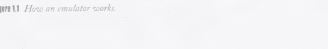

图 1.1 模拟器的工作原理。

被模拟的计算机也需要访问磁盘。模拟一台精密的现代计算机意味着它需要有自己的虚拟硬盘，因此你必须提供一个。大多数模拟器要么使用你某个系统驱动器上的专用分区，要么使用文件磁盘。文件磁盘速度较慢，但更易于配置和维护。

模拟运行是计算机所能承担的最繁重任务之一。仅仅是模拟一种非本机 CPU 就已经是一项重大工程，通常要求你的计算机配备比你要模拟的 CPU 强大数倍的处理器。如果被模拟的计算机高度依赖额外的定制硬件，例如专用视频芯片，那么对处理能力的要求会进一步提高。正是由于其定制芯片，需要多年的开发，并借助运行在数百 MHz 的 Pentium 处理器，才设计出一个能够稳定复现 1987 年那款 7MHz Amiga 机型使用体验的模拟器？

模拟运行对 PC 来说是非常繁重的工作。你的基础系统越强大，就越有可能获得快速的模拟体验。

如果你在计算机上运行大量其他消耗内存和 CPU 资源的程序，模拟速度就会变慢。尽量不要在关键任务服务器上运行模拟器！

因此，一些针对其他计算机的老式模拟器采用软硬件结合的形式，在一块定制扩展板上包含一颗 CPU。最常见的例子是 Macintosh 和 Amiga 用户多年前购买的 PC 模拟扩展卡，这些扩展卡通常带有 Intel 486 或 Pentium CPU。

## 虚拟机

虚拟机是一种特殊类型的模拟器。如果你请一群计算机科学家和模拟专家就模拟器与虚拟机之间的确切差异发表看法，你很可能会得到几种不同的答案。不过，在现实讨论中，这里有一条区分虚拟机与模拟器的经验法则：如果某个模拟器没有 CPU 模拟组件，而是直接使用宿主计算机的 CPU，那么它便是一台虚拟机。

虚拟机相对于模拟器的优势应当不言自明。直接访问 CPU，而不必模拟一颗 CPU，会带来巨大的速度优势，因为省去了转换过程：被模拟的程序在其原生 CPU 上运行，其速度与不在模拟器内运行时大体相同。

文件磁盘：宿主操作系统某个目录中的一个非常大的文件，模拟器将其用作模拟硬盘。

虚拟机：一种模拟器，试图在另一台同类型计算机系统内部复现完整计算机系统的运行，并与宿主操作系统共享同一个 CPU。不要与“Java 虚拟机”混淆，后者是一个不同的概念，不在本书的讨论范围内。

There is some overhead, however. The virtual machine still has to provide an emulation layer so that keyboard and mouse input and video and sound output function properly. The virtual machine might be fooled into believing it controls its own I/O devices, but in reality they are still the property of your Linux host operating system, so that translation work introduces a modest speed penalty. Figure 1.2 outlines the basic operation of a model virtual machine.

VMware is considered a virtual machine (hence the "VM" in VMware). Other popular examples of virtual machines include DOSEMU for Linux, Shapesifter (a Mac virtual machine for Amigas), and SheepShaver (a PowerMac virtual machine for PowerPC BeOS computers).

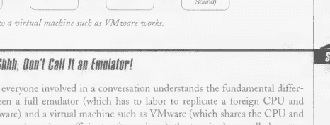

### VMware: Shhh, Don't Call It an Emulator!

As long as everyone involved in a conversation understands the fundamental difference between a full emulator (which has to labor to replicate a foreign CPU and video hardware) and a virtual machine such as VMware (which shares the CPU and other resources through an efficient software layer), the terminology really becomes a matter of personal preference. VMware, Inc. gets terminology touchy when you refer to VMware as an “emulator,” partly because it’s very proud of its virtual machine technology and partly because it had wanted its product to be called an emulator, it would have called it Eware. Still, in casual conversation (and, incidentally, through the course of this book), don’t be too surprised if you occasionally see VMware referred to as an emulator.

## Simulators

A special class of emulators is known as simulators. Again, definitions vary, but generally, a simulator does not replicate the performance and working condition of a complete computer architecture as an emulator or virtual machine does. Instead, simulators focus on precisely duplicating the internal workings of a particular electronic component or discrete machine.


# Consider Intel’s new Itanium processor

Processor chips are designed over a long period of time using a variety of computer design tools and precision manufacturing techniques. But before the Itanium chip was ready for production, developers who wanted to support the new CPU used a simulator that ran on Intel’s existing Pentium III CPU.

The Itanium simulator did not run as quickly as the physical Itanium chips. But the simulator precisely duplicated the internal function of the Itanium so developers could see exactly how their programs would function before they actually got their hands on the real thing!

> Clever programmers over the years have also created simulators of various early computers, such as EDSAC, and sophisticated electronic devices such as Germany’s infamous World War II ENIGMA encryption machine.

## VMware Versus “Dual Booting”

Dual booting has become a hot topic over the past few years. As Linux has grown into a very popular and very commercially and industrially viable operating system, countless thousands of people, ranging from home hobbyists to IT managers, have been curious enough to try it. But many are unable or unwilling to simply throw away years of investment in Windows applications or another operating system or find it impossible to conduct their daily business in Linux alone.

Dual booting solves this problem by dividing a computer’s hard drive into two partitions, each containing a complete, separate operating system. A boot menu, such as `LILO`, is installed, and every time the computer is powered up, the user chooses which operating system to load. So if you’re merrily playing around in Linux but remember that you have to send a Microsoft Word document to a client, you quickly reboot, tell the PC that you want to load Windows, and off you go. (In some cases, you can mount the partitions you didn’t boot from inside the other operating system.)

Mind the minor inconvenience of a two- or three-minute reboot when you occasionally need to switch from Linux to Windows or vice versa.

On the other hand, if either by choice or by necessity you have to switch between the two operating systems more than once or twice a day, that "minor" delay will quickly turn into a significant investment of your valuable time, and you'll start to wonder how many hours of your life are being wasted. For occasional use, the effort of backing up and re-partitioning your drive just to make room for a secondary operating system you rarely need seems wasteful.

Although dual booting is well understood, it is not the easiest project. Repartitioning a hard drive to prepare for a dual-boot installation can be tricky because you often have to back up and reinstall large amounts of data to satisfy the requirements of the other operating system.

For example, Microsoft Windows insists on booting from the first partition on a hard drive. Linux is far less picky, but for a computer that has only ever had Linux installed, the first partition must be given up to Windows, and that can mean hours of careful backups and tinkering in a disk partitioning tool such as `fdisk` or `diskdruid`. See Figure 1.3 for an example of a hard drive configured as a dual-boot system.

VMware cuts through this problem in a number of ways. For starters, for most uses of VMware you might never have to touch your hard drive's partition table at all. Virtual machines in VMware can share disk space with Linux by using file disks: large files that behave as a standalone hard drive when shown to a VMware guest operating system.

Booting a new operating system inside a VMware virtual machine can be substantially faster than shutting down Linux and re-loading into the dual-boot OS. You also have the option of keeping the guest OS running full time even while you're not using it, if your system has enough free resources. VMware also saves you the trouble of having to fool around configuring `LILO` or another boot loader.


Typical 10GB hard drive configured for dual booting


Figure 1.3 A typical dual-boot configuration.

### BUZZWORD

Guest operating system

The OS you run inside an emulator or a VMware virtual machine.

双启动确实具有一定的优势。虽然你的计算机单独运行 Linux 时性能从未受到阻碍，除非你运行 VMware，VMware 中的访客操作系统总是运行得比完全控制计算机资源时慢一些。

此外，由于访客操作系统无法完全访问你的 PC 硬件，在 VMware 会话中可能存在某些设备无法正常使用或完全无法使用，而如果直接启动到该操作系统则可以正常工作。（硬件兼容性在第 2 章“理解 VMware 的工作原理”中有进一步讨论。）表 1.1 提供了 VMware 与双启动环境功能和缺点的快速比较。

表 1.1 VMware 与双启动的比较

| 方法 | 优点 | 缺点 |
|---|---|---|
| VMware | 同时运行多个操作系统<br>易于安装/配置 | 额外费用<br>访客操作系统部分变慢 |
| 双启动 | 无额外成本<br>完全、原生的硬件支持 | 配置困难<br>切换不便 |

> 有关双启动的更多信息，以及其他各种主题，请访问 Linux 文档项目 `http://www.linuxdoc.org`。

## VMware 与 DOS 和 Windows 模拟器

VMware 绝不是第一个尝试将 Windows 兼容性带到 Linux 的产品，尽管它在虚拟机方法上是独一无二的。

## 模拟，就像美酒一样...

最古老、也是最著名的 Windows 模拟器之一是 Wine。实际上，“模拟器”并不是 Wine 的准确术语（Wine 是一个缩写，有多种含义，其中之一是“Wine Is Not an Emulator”，即 Wine 不是模拟器）。

## Bochs：完整 PC 模拟

Bochs 被设计为高度可移植，已成功在各种不同的计算机架构和操作系统上编译运行。这是因为 Bochs 是一个真正的模拟器，而不是虚拟机。

还记得区别吗？Bochs 基于 Intel 386/486/Pentium CPU 模拟，即使在基于 Pentium 的 Linux PC 上使用 Bochs 也会运行。这使得 Bochs 在所有受支持平台上都是一个一致的产品，但也意味着它比 VMware 等真正的虚拟机慢得多。它的配置文件也 ridiculously 杂乱无章，让 DOSEMU 看起来都很容易管理。图 1.6 显示了一个 Bochs 会话示例。

Bochs 最近被 MandrakeSoft 收购并作为开源发布，MandrakeSoft 是 Linux-Mandrake 发行版的出版商。Bochs 的原始作者 Kevin Lawton 现在正忙于 Plex86，这是一个开源虚拟机项目。

> 要了解更多关于 Bochs 的信息，请访问 `http://www.bochs.com`。

仅 VMware 易于使用的配置界面就足以让它在这些替代方案中胜出。VMware 也是获得与 Windows 95/98、Windows NT 和 Windows 2000 完全兼容的唯一方法。虽然每种都有其用途——甚至可能随着时间的推移在你的模拟策略中找到一席之地——但 VMware 提供了在 Linux 下运行 MS-DOS 和 Microsoft Windows 应用程序的最快和最灵活的方式。

同样重要的是要记住，VMware 不仅仅是为 Windows 应用程序提供模拟环境。使用 VMware，你可以运行另一个完整的 Linux 或 FreeBSD 会话，并且 VMware 的程序员继续努力扩展可在虚拟机中运行的操作系统范围。虽然 Bochs 对其他操作系统的支持正在缓慢增长，但 VMware 提供了最广泛的保证兼容性范围。

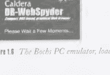

图 1.6 Bochs PC 模拟器，正在加载 WebSpyder Web 浏览器。

## 结论

你现在应该对模拟器和虚拟机背后的技术有了基本的了解，并且已经看到了 VMware 让你的 Linux PC 扩展其覆盖范围和软件兼容性的潜力。

第 2 章更详细地描述了 VMware 的内部工作原理，并解释了 VMware 与各种 PC 硬件和软件配置的兼容程度。

## 第2章：理解 VMware 的工作原理

- 共享 CPU
- 创建隔离环境
- VMware 可以共享什么硬件？
- VMware 可以运行什么软件？

VMware 独特的虚拟机设计使其功能极其强大，可能与你以前见过的任何东西都不一样，即使你过去曾尝试过模拟器和虚拟机。

本章打开了 VMware 的引擎盖，详细解释了 VMware 能做什么以及如何实现。

## 共享 CPU

关于 VMware 虚拟机设计最重要需要记住的一点是，你的 CPU 的注意力在你的主机操作系统（Linux）和你在 VMware 中运行的任何客户操作系统之间分配。这是因为 VMware 对 Linux 任务调度程序来说看起来就像一个 Linux 应用程序。

VMware 软件层和 Linux 自身的多任务内核管理 CPU 需求，以确保任何一方都无法完全剥夺另一方的注意力，尽管任何一方的重度需求都可能极大地拖慢你的计算机。想象一条流动的溪流，新增了一条灌溉支流。只要一切保持可控，没有人过于贪婪，每个人仍然有充足的水。图 2.1 是 VMware 虚拟机架构的示意图。

VMware 运行在两个部分：虚拟机本身，其中运行你的客户操作系统和程序，以及一个“交通警察” VMware Virtual Platform 软件层

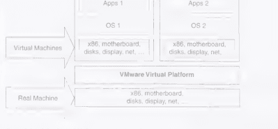

图 2.1 VMware 设计概览（使用版权图形的许可由 VMware, Inc. 授予）

该层管理客户操作系统、你和你的计算机之间所有 I/O 的交互。这种仿真层的需求比 VMware 还需要仿真自己的 CPU 时要低得多。VMware 声称在某些情况下 Virtual Platform 层消耗的可用 CPU 时间不到 5%；你可能会发现它需要 20% 或更多。请参阅图 2.2，了解在 Linux 和 VMware 客户会话同时运行的计算机上典型的 CPU 使用率示例。

> VMware 不支持从虚拟机内部进行多处理器访问，但如果你的主机机器有多于一个 CPU，你可以减轻负载。VMware 会在你的第二个 CPU 上运行第二个虚拟机，在第三个 CPU 上运行第三个虚拟机（如果有），以此类推。这使得同时运行多个 VMware 实例成为可能；否则，你的系统会变得有点拥挤。不幸的是，VMware 没有提供内置工具来选择哪个 CPU 运行每个虚拟机。

请记住，主机 CPU 的特性和怪癖会在 VMware 客户虚拟机中得到复制。例如，使用 350MHz 或更高频率的 AMD K6-2 CPU 的计算机在 Windows 95 启动时容易崩溃，而在独立 Windows PC 上解决该问题的相同补丁在 VMware 中也是必需的。

同样，如果你希望你的客户操作系统能够访问英特尔奔腾 III 的流式单指令多数据（SIMD）扩展或 AMD Athlon 的增强 3DNow! 功能，那么你的计算机中就需要该 CPU。VMware 不能让四缸发动机看起来像 V8。

> AMD K6-2/Windows 95 问题描述在 `http://www.amd.com/products/cpg/k623d/win95_update_k6.html`。

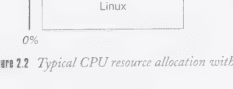

图 2.2 使用 VMware 时典型的 CPU 资源分配。

## 创建隔离环境

VMware 费尽心思构建了一个坚不可摧的、“我不敢相信它不是一台 PC”的虚拟机。先说最好的消息：即使 VMware 虚拟机中出现最严重的崩溃，也极不可能损坏或甚至影响你的主机 Linux 操作系统。

除了与 VMware Virtual Platform 层的通信外，VMware 会话没有任何特殊权限，也无法访问你的计算机的文件或内存空间。你预先定义了一个 VMware 客户操作系统无法超过的硬性内存限制，并且你同样规定 VMware 可以触及哪些系统设备和磁盘存储单元。其他一切都是禁区；它完全不可见且无法访问。

尽管 Linux 可以通过分页和交换暂时收回分配给 VMware 虚拟机的内存，但由此产生的性能损失极其令人不快。你最好将分配给虚拟机的任何内存视为对 Linux 应用程序而言的禁区。

由于 VMware 可以在仿真和你的主机操作系统之间形成虚拟网络，因此网络木马有可能在两者之间传播。你应该将虚拟机视为与任何其他计算机一样真实的安全风险。执行你可能拥有的任何防病毒和网络安全策略，如果你没有，现在是制定一些的好时机。


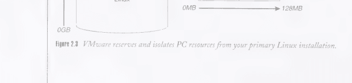

不仅 VMware 能保护主机系统免受访客虚拟机的侵害，而且它还能在某种程度上保护虚拟机免受其自身的影响。

无论是意外删除重要文件、更改错误的配置设置，还是感染破坏数据的病毒，你很可能在电脑上遇到过某种可怕的问题。而你很可能在虚拟机上也遇到过同样的问题。幸运的是，VMware 提供了几种方法来帮助保护你的数据，如果你觉得自己特别容易发生事故或破坏。

大多数情况下，VMware 使用“持久”磁盘映像来存储数据。这些存储设备（实际上只是 Linux 目录中的大型文件）表现得就像一个普通的硬盘。但任何 VMware 硬盘映像都可以被标记为“非持久”或“可撤销”，如果你需要一个安全阀，或者有其他原因需要让你的文件更安全。你可以在每次启动 VMware 时做出此选择，因此你不需要三个不同的磁盘映像来利用三种不同类型的磁盘。图 2.4 显示了 VMware 磁盘配置屏幕，它控制着 VMware 虚拟磁盘的大小和持久性。

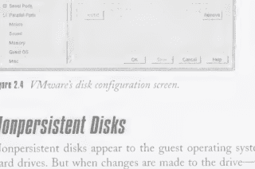

图 2.4 VMware 的磁盘配置屏幕。

## 非持久磁盘

非持久磁盘对访客操作系统来说看起来完全是正常的硬盘。但当对驱动器进行更改时——无论是编辑现有文件、安装新软件，甚至以极端偏执的方式格式化整个分区——更改都不会写入磁盘映像，而是写入一个临时的重做日志文件。只要 VMware 正在运行，该日志文件就位于访客操作系统和非持久磁盘映像之间，使其看起来好像所有请求的更改都已完成。但一旦 VMware 关闭，更改就会消失，你将保留在你大肆破坏之前完全相同的磁盘映像。

BUZZWORD

Redo log: A file that records all the disk writes made in a VMware guest OS session. The modifications in the redo log can be made permanent, or they can be discarded

当然，如果你刚刚花了数小时安装喜爱的应用程序、编写程序或创作你的不朽之作，这绝对是一场噩梦。但对于测试新软件、对虚拟系统的更改，或商业应用如技术支持来说，这是一个绝妙的运气。

> 用于创建重做日志并跟踪非持久磁盘与日志之间差异的缓冲过程，会在磁盘访问中引入额外的开销，从而可能减慢速度。另一方面，由于 VMware 缓冲磁盘访问的方式，一些读写操作实际上在非持久磁盘上运行得更快。

非持久磁盘每次重启 VMware 时都会为你提供一个“无菌室”虚拟环境，因此你也获得了随意破坏配置的许可。不确定你刚读到的那个 Windows 注册表 hack 会做什么？试试看。刚读到一个巧妙的内核修改，但你不敢在主 Linux 驱动器上尝试，而且你讨厌备份当前内核并创建新启动项的繁琐？在受保护的非持久 Linux 虚拟机世界中进行实验吧！

## 可撤销磁盘

我听见你喊了：“那我真的想保留的更改怎么办？为什么我不能鱼与熊掌兼得：既有重做日志的安全性，又有在一切顺利时保留更改的选项？”

是的，你确实可以同时拥有并享用你的甜点。可撤销磁盘提供了非持久磁盘的保护，但同时在 VMware 会话结束时让你有机会将所有更改永久化。如果你选择提交更改，VMware 会更新磁盘映像。如果你丢弃它们，磁盘映像将保持不变，并且与你上次运行 VMware 时完全相同。图 2.5 显示了使用可撤销磁盘的虚拟机会话结束时的情况。

真正美妙的是，你实际上有两次机会来决定对重做日志做什么。当 VMware 关机时，会询问你是否要提交、丢弃或保留虚拟机会话期间所做的更改。

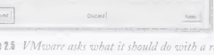

图 2.5 VMware 询问应如何处理重做日志。

通过提交，您可以使更改永久生效。放弃将永久丢失更改，使磁盘镜像保持在您上次启动 VMware 之前的状态。

但通过仅保留更改，您可以反复考虑您的选择，直到下次运行 VMware。在那时，您将再次被要求提交或放弃更改。您还将看到一个新的选项：将新更改追加到当前的重做日志。这意味着虚拟机以您上次会话中做出的更改完整启动（换句话说，就像您已提交更改一样），但保留了重做日志打开状态，这仍然让您有权撤消当前和上次会话中做出的所有更改。图 2.6 显示了 VMware 使用“保留”重做日志启动新会话。

如果您决定将新更改追加到现有的重做日志中，您所做的所有更改都是同一日志的一部分：您无法仅选择性地撤消当前或上一个会话中做出的更改。

如果您完全忘记了对更改做出决定，您可以取消 VMware 加载序列，以便您可以重新考虑重做日志。

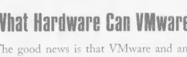

图 2.6 VMware 询问如何处理旧的重做日志。

## VMware 可以共享哪些硬件？

好消息是，VMware 和任何受支持的客户机操作系统都与您当前在 Linux 下享受的大部分硬件完美兼容。坏消息是，VMware 只与您当前在 Linux 下享受的硬件兼容。VMware 虚拟平台层只能处理可以在 Linux 宇宙中配置和使用的硬件。

VMware 硬件兼容性规则 #1：如果硬件在 Linux 下无法工作，它在任何 VMware 客户机操作系统中都无法工作，即使该客户机操作系统原生支持该硬件。例外情况：一些在 Linux 下无用的 dongles 在 VMware 客户机操作系统中被正确识别。

但是，仅因为设备在 Linux 下工作并不意味着它将在 VMware 虚拟窗口中工作。在 Linux 下工作的某些硬件在 VMware 中仅被间接支持，其他则根本无法工作。

> VMware 硬件兼容性规则 #2：硬件在 Linux 下工作并不一定意味着它将在 VMware 中工作，如果它确实工作，也可能不是直接支持的。

以下是 VMware 友好硬件的更完整概述。

### 鼠标

一般来说，几乎任何您可以轻松连接和在 Linux 下使用的常见 PS/2 或串行鼠标在 VMware 中都能正常工作。具体来说，支持遵循 PS/2、Microsoft 串行、Mouse Systems、Logitech MouseMan 串行或 Microsoft IntelliMouse PS/2 标准的鼠标。VMware 限制您在虚拟机内使用标准二或三按钮鼠标；但是，即使您在 Linux 中设法启用了滚轮，VMware 也不支持带滚轮或滚动的鼠标。但是，当点击时，滚轮可以作为第三个按钮。

### 键盘

键盘的情况与鼠标类似：如果它是标准键盘（大多数都是），并且受 Linux 支持，您将不会有任何困难。VMware 模拟 101/102 键键盘，尽管如果您有客户机操作系统的正确驱动程序，“多媒体”键盘上的某些额外功能可以得到支持。

> 在一些更深奥的环境中，VMware 可能难以识别您的键盘。如果您正在使用推荐的 XFree86 视频软件，但 VMware 看不到键盘，您需要编辑文件 `~/.vmware/config`（本地机器上的 VMware 配置文件，在您的用户目录中），并添加以下行：

```
xkeymap.uskey codeMap = true
```

如果您的 PC 正在访问远程 XFree86 视频服务器，请添加以下内容：

```
xkeymap.uskeycodeMapIfXFree86 = true
```

> 一些日语键盘在 VMware 下可能无法正常工作。有关修复问题的完整详细信息可在 VMware 技术支持站点 http://www.vmware.com 找到。

### 视频卡

如果您是喜欢简单的人，还有更多好消息：如果您的显卡在 XFree86 中得到正确支持，您就不用担心了。如果您有非常老的显卡（视频内存 2MB 或更少），在安装客户机操作系统后，您会发现屏幕分辨率的选择相当有限，但限制与 Linux 中的完全相同。

真正的关键是您正在运行的 XFree86 版本。VMware 强烈推荐 3.3.4 或更高版本（4 版本尚未正式支持，但可能正常工作）。如果您正在运行 VMware 认可的 Linux 发行版，您不必担心，因为您的发行版包含了正确的 XFree86 版本。

> 如果您不确定系统正在运行的 XFree86 版本，或者只是好奇，请在任何终端提示符下键入 `xdpyinfo`。版本号显示在页面顶部的供应商发布号字段中。该数字不带句点返回，因此 335 表示您有 XFree86 版本 3.3.5。

在大多数受支持的操作系统中，VMware 客户机操作系统可以使用计算机自身显卡的完整 SVGA 分辨率和颜色容量。然而，在 DOS、Windows 3.1 和不受支持的操作系统中，VMware 仅模拟标准 VGA 视频卡，其分辨率上限为非常温和的 640×480 屏幕，仅有 16 种颜色！这对于一些基本应用程序和一些游戏来说绰绰有余，但外观上几乎不引人注目。


要充分利用 VMware 中的显卡，您需要确保在每个客户机操作系统中安装 `VMware Tools`。有关 `VMware Tools` 的更多信息将在第 8 章“理解 Windows 的 VMware Tools”中介绍。

### 固定存储（硬盘驱动器）

任何 Linux 识别的常见 IDE 或 SCSI 硬盘驱动器都可用于在 VMware 中创建虚拟磁盘镜像。理论上，您还可以将网络存储设备用作虚拟硬盘，只要它位于您的标准文件路径中，但这每次 VMware 磁盘访问都会引入网络开销，并可能严重损害你的性能。

VMware 模拟了一个双通道 IDE 控制器，如同大多数现代 PC 上的控制器。该 IDE 控制器最多可识别四个设备，因此你可以挂载最多四个虚拟磁盘，或三个虚拟磁盘加一个 CD-ROM。

作为基于文件的磁盘镜像的替代方案，VMware 可以支持原始磁盘，即虚拟机直接访问的整个驱动器或物理磁盘分区。在当前版本的 VMware 中，原始磁盘访问在 IDE 磁盘上更为稳定，尽管也支持 SCSI。

原始磁盘在附录 A“高级 VMware 配置”中讨论。

## 可移动介质（CD-ROM、Zip 驱动器）

VMware 支持任何标准的 IDE 或 SCSI CD-ROM 驱动器，包括从 CD-ROM 启动虚拟机的功能。DVD、CD-R 和 CD-RW 驱动器也受支持，但作为只读 CD-ROM 驱动器使用。这意味着你无法在虚拟机中读取 DVD，也无法向 CD 写入数据。由于 Linux 在处理 CD-ROM 方面的限制，VMware 在处理多区段光盘时也存在困难。

> 由于 VMware 设计中的一个怪癖，如果你想从 SCSI CD-ROM 驱动器启动，VMware 必须将 SCSI CD-ROM 驱动器伪装成 IDE 设备。我将在第 5 章“首次运行 VMware”中介绍具体做法。

任何可在 Linux 下运行的移动介质设备（如 Iomega Zip 或 Imation SuperDisk 驱动器）都可用于存储 VMware 虚拟磁盘。然而，VMware 对这些设备的直接支持有些有限。ATAPI Zip 驱动器不能用作移动介质设备（尽管并口 Zip 驱动器可以），而 Imation SuperDisk 既不能用作移动介质设备，也不能用作标准软驱。如果你的 PC 依赖 SuperDisk 来实现软盘兼容性，则需要在 VMware 中添加一个真正的软驱才能使用常规软盘。

## 扩展端口（串口、并口、USB）

VMware 客户操作系统在大多数情况下可以直接访问标准并行端口（`COM1`、`COM2` 等），这意味着连接到该端口的任何设备都应该在客户操作系统内被识别并正确运行。

并行端口支持稍微复杂一些。旧式单向并行端口设备应该始终可以工作。较新的双向并行端口可实现更快的打印，并允许你使用功能更强大的设备，如图像扫描仪和 Zip 驱动器。

原始磁盘：虚拟机像普通 PC 一样直接访问的物理硬盘或硬盘分区。原始磁盘比文件磁盘镜像更灵活，但配置起来更困难，并且有其自身的局限性。

ECP（扩展控制协议）并行访问是双向协议的扩展，部分受支持，但前提是在 PC 的 BIOS 中正确启用。ECP 将使某些设备（例如便携式 MP3 播放器底座）能够在 VMware 中工作。

只有当宿主 Linux 操作系统加载了 `parport_pc` 模块（在配置内核时通过 `CONFIG_PARPORT_PC` 选项启用）时，VMware 才能使用双向并行端口。如果该模块未加载，或被直接编译到内核中，双向访问将无法工作。VMware 认可的 Linux 发行版应该已经加载了此模块。

默认情况下，VMware 虚拟机将自身配置为支持四个串行端口和两个并行端口，即使你的系统中远没有那么多端口。你可以保留它们，也可以自行将其从硬件配置中移除；这不会影响虚拟机的性能，因此除非你确定自己知道在做什么，否则最好保留它们。

你可能已经知道，Linux 对 USB 的支持充其量是不稳定的。因此，任何 VMware 虚拟机都不支持 USB 端口。

## 打印机和扫描仪

在点阵打印机时代，你可以将打印机插入几乎任何计算机，并确保至少能得到某种可理解的输出。但随着打印机日趋成熟，功能、亮度和清晰度都有了数量级的提升，访问打印机也变得更加复杂。

VMware 可以支持许多常见的廉价打印机，而无需 Linux 操作系统提供任何软件支持。但是，VMware 无法访问打印机，除非该打印机能在 Linux 下工作。一些打印机已经消除了所有向后兼容的痕迹，完全依赖特殊的 Windows 程序才能运行。VMware 不支持这些“Winprinters”，即使在 Windows 虚拟机中也是如此。

好消息是，大量打印机不是“Winprinters”，因此与 VMware 兼容；但坏消息是，市场上一些最具吸引力的打印机（例如售价低于 100 美元的彩色喷墨机型）并不兼容，至少目前还不兼容。

Linux 对 PostScript 打印机有非常好的支持。选择 PostScript 打印机不会错，尽管它们可能很贵。


> 有关打印机和 Linux 的更多信息，请阅读位于 `http://www.linuxdoc.org/HOWTO/Printing-HOWTO.html` 的 Linux Printing HOWTO。

Linux 对平板式和手持式图像扫描仪的支持尚可。然而，VMware 仅支持通过并口连接的扫描仪。更强大的扫描仪更倾向于使用 SCSI 接口，因为它速度快得多，而且更灵活、更可靠。但在 VMware, Inc. 改进其 SCSI 支持之前，请将图像扫描视为虚拟机中时灵时不灵的功能，而且前提是你能找到一台并口扫描仪。（由于 Linux 对 USB 的支持不佳且 VMware 不支持 USB，USB 扫描仪也不在考虑之列。）

> 如果你有一台在 Linux 中受支持但在 VMware 中不受支持的扫描仪，没有理由不能用 Linux 进行扫描，而用 VMware 客户机操作系统进行图像编辑。有关建议，请参阅第 9 章“使用你的 Windows 95/98 虚拟机”。

## 调制解调器和网卡

调制解调器在近年来的设计上与打印机一样令人失望。外部调制解调器在 Linux 上的工作效果与在任何其他操作系统中一样好，这一点几乎总是成立，因此 VMware 具有同等程度的完全支持。

内部调制解调器则另当别论。找到不依赖专有 Windows 驱动程序的内部调制解调器变得有些困难。尽管许多 Linux 爱好者已联名请愿要求制造商提供支持，但进展极其缓慢。与 Winprinters 一样，VMware 即使在受支持的 Windows 虚拟机中也无法突破这种“Winmodem”障碍。

> `http://www.o2.net/~gromitkc/rg` 主机列出了在主要电脑商店常见内部 PC 调制解调器的列表，并为每个型号提供 Linux 兼容性信息。

幸运的是，以太网卡并未走上这条不幸的道路。Linux 对大多数 ISA 和 PCI 以太网卡的支持非常出色（你可以买到不到 20 美元且性能出色的以太网卡），而且网络厂商对该操作系统的支持也在不断增长。

VMware 应该能与任何 Linux 网络卡配合使用。然而，与其让客户机操作系统直接访问你的网络适配器，VMware 内部会模拟一块 AMD PCnet Family 以太网卡，因此每个客户机操作系统必须能够支持该设备。所有 VMware 认证的客户机操作系统都支持 PCnet Family 仿真，包括 DOS 和 Windows 3.1。

> PCnet Family 卡的完整文档和设备驱动程序可在 `http://www.amd.com/products/npd/software/pcnet_family/intro.html` 获取。

## SCSI

VMware 唯一可以访问的 SCSI 硬件是硬盘和 CD-ROM。扫描仪、磁带驱动器和其他外设都不可用。

VMware 的 SCSI 支持与其实其以太网卡支持类似。与其让虚拟机直接看到你的 SCSI 卡，VMware 会模拟自己的 SCSI 卡，即 BusLogic BT-958 设备。该卡在 VMware 的所有受支持客户机操作系统中均受支持。

模拟的 SCSI 卡最多可看到七个设备（虚拟磁盘和 CD-ROM 设备合计），除此之外模拟的 IDE 控制器还能支持的设备。

> 有关 BusLogic BT-958 的更多信息，请参阅制造商的支持页面 `http://www.mylex.com/support/download/manuals/scsihstad.html`。

## 声卡

Linux 下的声音支持肯定比过去几年好得多，但它仍然不是一门精确的科学，很大程度上是因为声卡制造商不断更改芯片和规格却不告知任何人。

一些卡系列，例如 Creative Labs 和 ESS 的产品，已得到 Linux 开发者的合理支持。一些厂商，例如 Aureal，已开始直接支持 Linux——尽管 Aureal 现在已破产。


如果你已成功克服 Linux 中声音配置的挑战，VMware 将在虚拟机中为你提供 SoundBlaster 16 仿真作为丰厚回报。VMware 目前不支持 MIDI 合成或大多数音频卡上找到的游戏杆端口。

SoundBlaster 16 仿真在几乎所有 VMware 支持的客户操作系统中都得到了良好支持，并且几乎不会带来配置难题（即使在 Linux 虚拟机中也是如此）。

> 如果你在 Linux 中为杂牌声卡而受够与自定义驱动程序的纠缠，那就帮自己一个大忙，从批发商或 eBay 之类的私人卖家那里买一块二手的或剩余的 SoundBlaster 32 或 64AWE。它们相当不错，并且可以与商业 Linux 发行版中的默认声音驱动配合使用。

## PCMCIA/PC 卡

尽管 Linux 对笔记本电脑上的 PCMCIA 端口（现在称为 PC 卡）提供了强大的支持，但 VMware 并不直接支持 PCMCIA 卡。不过，只要这些卡已在 Linux 中正确配置，VMware 确实支持 PCMCIA 卡上最常见的设备类型（以太网适配器和调制解调器，前提是调制解调器未使用 Winmodem 技术）。

> 有关从笔记本电脑硬件中获得最大 Linux 兼容性（进而 VMware 兼容性）的更多建议，请阅读 Linux PCMCIA HOWTO（`http://www.linuxdoc.org/HOWTO/PCMCIA-HOWTO.html`）和 Linux on Laptops 主页（`http://www.cs.utexas.edu/users/kharker/linux-laptop`）。

## VMware 可以运行什么软件？

本节实际上回答了三个问题，或者说两个问题：“VMware 虚拟机中可以安装哪些操作系统？”以及“在虚拟机中受支持的操作系统上，我可以运行哪些软件？”首先，让我们看看 VMware 支持的客户操作系统。

### 客户操作系统

VMware 完全支持面向 Intel x86 架构 PC 的最流行的操作系统。具体来说，以下版本和发行版与 VMware 虚拟机完全兼容：

- Microsoft Windows 2000（专业版、服务器版和高级服务器版）
- Microsoft Windows NT 4（Service Pack 3-6a）（工作站版和服务器版）
- Microsoft Windows 98 和 98 第二版
- Microsoft Windows 95
- Red Hat Linux 5.x-6.x
- Caldera OpenLinux 1.3-2.x
- SuSE Linux 5.3-6.x
- TurboLinux 6.0
- Corel Linux OS
- FreeBSD 2.2.x-3.x
- Microsoft Windows 3.1 和 3.11（无 VMware Tools）
- Microsoft MS-DOS（无 VMware Tools）

VMware 针对这些操作系统中的每一个都对其产品进行认证并提供支持。本书介绍如何安装和使用各类主要客户操作系统，但 Windows 2000 高级服务器版除外。高级服务器版中的额外功能，例如支持多达八个 CPU 和网络负载平衡，在 VMware 虚拟机中并不重要。

由于 VMware 强大的虚拟机技术，其他操作系统也可以运行，尽管结果往往参差不齐。

VMware 为以下客户操作系统提供实验性或仅部分兼容的支持：

- Novell NetWare 5.x
- Novell NetWare 4.x
- Novell ZENworks 客户端
- IBM OS/2
- IBM OS/2 Warp
- Sun Solaris for Intel 7
- Windows Millennium
- NetBSD 1.x
- OpenBSD 2.x

VMware 不为此类不受支持的操作系统中的任何一个提供 VMware Tools，并且仅提供针对 Novell 某些版本和 OS/2（标准版）的部分安装文档。VMware 仅明确承诺支持 Windows Millennium。

VMware 并未断然表示不会支持其他操作系统，并且似乎至少愿意接受有关兼容性问题的记录详尽的故障报告。

### 不支持的客户操作系统

基本上，未出现在前面两个列表中的任何系统都不是 VMware 的优先事项，而且可能根本无法运行。BeOS、QNX、Minix 以及诸如 SCO UnixWare 之类的商业 UNIX 版本都属于此类。尽管你可以自由尝试，但要做好失望的准备。

### 软件兼容性

只要在 VMware 中使用完全受支持的操作系统，就应该获得较高的软件兼容性。VMware 已努力确保为 Windows、Linux 和 FreeBSD 设计的程序能够在虚拟机中顺畅运行。

确实存在一些值得注意的例外：

- VMware 不支持 Windows 中的大多数 DirectX 功能。大多数时候，这只会影响游戏，但一些其他程序依赖 DirectDraw、Direct3D 和 DirectSound 功能，可能会受损或无法运行。
- 依赖专有或自定义硬件的软件在 VMware 中无法工作。这排除了 EPROM 编程板、诊断设备或特殊网卡，例如 DirectPC 卫星互联网系统使用的网卡。
- 对 PC 硬件进行未记录的或极其非正统的直接调用的软件可能无法工作。尽管 VMware 尽力提供对所有可想象的 PC 系统设备场景的百分百准确仿真，但一些技巧和花招超出了它的预测或支持能力。

不要因为这些个别限制而退缩。当你适应虚拟机环境并加载了几个程序后，你可能会忘记后台还运行着一个 Linux。

## 结论

现在，你应该渴望启动 VMware，并用你最喜欢的软件对它进行各种压力测试。但在那之前，你需要仔细评估你的 Linux PC：有些系统需要额外的一点“动力”，才能承担起运行虚拟机这项艰巨的任务。

第 3 章“为 VMware 装备您的 PC”会告诉您如何为 VMware 准备系统，以及如何扩展计算机以便为虚拟机腾出空间。

# 第3章：为 VMware 配置您的 PC

- 识别您的仿真需求
- 如有必要，更新 Linux
- 速度为王
- 内存需要多少才够？
- 驱动器空间：您要为两个（或更多）提供


图 3.1 您一次可以运行多个 VMware 会话。

## 如有必要，更新 Linux

VMware 可在各种 Linux 安装上运行，因此如果您一直保持系统更新，很可能您已准备好运行 VMware。

- Red Hat Linux 5.x 和 6.x
- Caldera OpenLinux 2.2 和 2.3
- SuSE Linux 6.0、6.1、6.2 和 6.3
- TurboLinux 6.0

> 在安装 VMware 之前，您还应确保 Linux 内核头文件源代码已安装在您的系统上，因为 VMware 需要某些 Linux 源文件来构建自身。

我强烈建议保持简单，使用上述其中一个发行版作为 VMware 的主机操作系统。但如果您是一位真正的 Linux 爱好者，并自行构建发行版或对现有发行版进行大量修改，您至少应能满足 VMware 的核心要求。VMware 要求主机 Linux 操作系统至少具备以下条件：

- Linux 内核版本 `2.0.32`（单 CPU 机器），版本 `2.2.0`（多 CPU 机器）
- XFree86 Server 版本 `3.3.3.1`（出于性能原因，强烈推荐 `3.3.4` 版本）

如果您不满足这些标准，可能值得您大胆尝试并选择其中一个 VMware 认可的发行版。

## 速度为王

原始性能对于愉快的虚拟机体验至关重要。在大多数情况下，您的机器只有一个 CPU。当两个或多个操作系统开始对其提出需求时，如果 CPU 动力不足，情况可能会变得棘手。

VMware 建议以 Pentium II 处理器 `266MHz` 作为良好的功能最低配置。VMware 能在更低配置上运行吗？可以。您会想在它运行时待在那里吗？可能不会。

作为一个非常粗略的经验法则，请自问：“如果我的主 Linux 系统和来宾操作系统都以当前 CPU 速度的一半运行，我会满意吗？” 因为 VMware 和主机操作系统不太可能同时对 CPU 提出同等需求，这种情况不太可能发生，但它应该能给您一个大致的概念。

如果答案是否定的，甚至是“也许”，请考虑系统升级。在撰写本文时，信誉良好的经销商正以不到 200 美元的价格出售配备 500+ MHz AMD K6-2 和 Intel Celeron 处理器的新主板和 CPU 组合。具有这些规格的完整预装系统价格远低于 1,000 美元。

这种速度应该足以舒适地运行 Linux 以及大多数 VMware 来宾操作系统。如果您知道计划在虚拟机中运行一些 CPU 密集型任务，请提高要求。毕竟，千兆赫处理器现在已成为现实。

## 内存需要多少才够？


可用内存与 CPU 性能同样重要，甚至更重要。与 CPU 时间不同，VMware 为每个虚拟机请求特定且固定的内存量。如果您开始内存不足，Linux 主机可能会“疯狂”地向交换分区进行交换，这会拖慢整个系统。这可能会无休止地持续下去，直到您可以关闭主要的内存消耗程序（如 VMware），但由于交换访问会减慢系统速度，因此很难关闭程序……您看到了问题所在。

VMware 建议 96 兆字节（MB）作为功能最低配置。我认为应该是 128MB。这为您提供了舒适运行 Linux 和 XWindows 而无需任何妥协的空间，并为 VMware 留出 48MB 到 64MB 的空闲内存。这足以舒适地运行大多数受支持的操作系统；足以运行至少一个适度的 Windows NT 4 安装，尽管 NT 4 当然更喜欢更多内存。然而，这可能不足以让运行 Windows 2000 变得值得。

它也可能只够运行一台虚拟机，除非您计划运行 DOS 或 Windows 3.1，或者您不介意将 Windows 95/98 或 Linux VM 置于非常严格的资源限制之下。

> 您永远不应将所有 VMware 会话分配的内存总和超过总系统内存减去 64MB，除非您是虐待狂，想看到交换噩梦怪兽摧毁您计算机的性能。

以下是关于在计算机中应比 96MB 多出多少内存以运行每种操作系统的虚拟机的一般指导。较低界限足以使用，但较高界限（或更高）将确保更好的性能。请记住，如果您计划同时运行多个 VM，您应将这些数字相加以得出总计：

- Windows 95/98：32-64+ MB
- Linux 和 FreeBSD：32-96+ MB
- Windows NT 4 Workstation：32-128+ MB
- Windows NT 4 Server：48-128+ MB
- Windows 2000 Professional：64-128+ MB
- Windows 2000 Server：128-256+ MB

假设您只对运行 Windows 98 虚拟机感兴趣。32 兆字节足以运行 Windows 98，但给它 64MB 会更舒适；这样，Windows 就不必经常访问其自己的交换文件。您需要 96MB 才能开始游戏，再加上您需要额外 64MB 来分配给虚拟机，96+64=160MB。


假设你想要同时拥有 Windows 98 和 SuSE Linux 6.1 的虚拟机，但你知道你永远不会同时运行它们。你也相当确定你不会经常需要使用它们，并且你可能会花大部分时间在 SuSE Linux 的命令行中，而不是在 XWindows 中。你只需为 Windows 或 SuSE Linux 分配 32MB 就能应付，所以你只需要 96+32=128MB 的系统内存。

另一方面，如果你正在借助 VMware 开发和原型设计一个由 Windows 2000 Server 主持的电子商务网站呢？你想比较运行 Internet Explorer 的 Windows 98 计算机在该网站上的表现与使用 Netscape 的 Linux 计算机看到的网站有何不同。你可以使用你的主机操作系统作为 Linux 测试平台，但你需要同时运行 Windows 98 和 Windows 2000 Server 的虚拟机。估算一下，至少你需要 128MB 用于 Windows 2000 和 32MB 用于 Windows 98，所以 96+128+32=256MB！

## 磁盘空间：你为两个（或更多）提供

你的 CPU 足够强大，可以处理最苛刻的操作系统，并且你有足够的内存可以运行两倍的 Windows 2000 Server。但如果你没有空间安装客户操作系统和一些应用程序，你就无处可去。

VMware 默认的、也是最易于使用的存储选项使用虚拟磁盘，或如人们常称的“磁盘映像”。

虚拟磁盘可以位于你有权访问的任何 Linux 目录中，尽管最好将它们放在本地磁盘上，而不是网络上的某个位置。在图 3.2 中，你可以看到标准的 VMware 磁盘配置界面。VMware 可以创建最大 2GB 的虚拟磁盘，这足以安装任何客户操作系统以及至少适量的数据和程序。

虚拟磁盘：虚拟磁盘是 Linux 目录中一个非常大的文件，在虚拟机中充当硬盘。它可以大到 2GB。虚拟磁盘在模拟器术语中也称为磁盘映像或文件磁盘。

> 由于 VMware 虚拟机同时具有一个可看到多达四个硬盘的双通道 IDE 控制器和一个可看到多达七个硬盘的 SCSI 控制器，因此可以向 VMware 会话附加十一个 2GB 的虚拟磁盘——当然，前提是你计算机上有 22GB 的空间！

实际上，你不需要 22GB 的磁盘空间才能开始。虚拟磁盘是由一些聪明的人设计的。尽管其最大尺寸为 2GB（你可以将其定义得更小），虚拟磁盘文件不会立即占用所有这些空间；它们会随着向虚拟驱动器添加数据而增长，直到你在创建驱动器时选择的最高值。

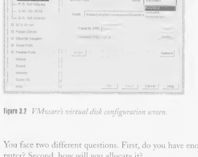

图 3.2 VMware 的虚拟磁盘配置屏幕。

你面临两个不同的问题。首先，你的计算机上是否有足够的可用空间？其次，你将如何分配它？

## 腾出空间

两千兆字节是一个相当方便的数字。它被认为是 Windows 2000 的最低要求；它为其他 Windows 版本、Linux 和 FreeBSD 提供了充足的余地；当然对于 Windows 3.1 和 DOS 来说更是极其奢侈。除非你天生对磁盘空间吝啬，否则为每个非 DOS 虚拟机预留至少一个完整的 2GB 虚拟磁盘是个好主意。

> 基本安装所需的磁盘空间从 DOS 安装的几兆字节，到完整的 Windows 98 安装的约 160MB，再到 Windows 2000 Server 的近一千兆字节不等。根据你选择的软件，Linux 虚拟机可以在两者之间任意范围。

如果你没有那么多空间可分配，是时候在你的系统上添加另一个硬盘了。大多数 PC 都有两个 IDE 控制器，每个控制器可支持两个驱动器。你已经至少安装了一个硬盘，很可能还连接了一个 CD-ROM 驱动器，所以还剩下两个空位。

如果你的 IDE 链已满，但你有一个非常大的 PC 机箱，你可以为你的 PC 添加一块低成本的备用 IDE 控制器板（它们几乎白送）并放入另一个驱动器。

这些天，硬盘的价格低得离谱，所以不要吝啬。宁可空间太多也不要不够用。你总能把它填满，但再买一块硬盘就很麻烦了。

你也可以投资一块 SCSI 卡。（你可以用 40 美元或更少的钱买到不错的，而且大多数 SCSI 卡在 Linux 下工作得很好。）通常 SCSI 硬盘比 IDE 硬盘贵，但它们也可以很容易地安装在外置机箱中，而你永远不想对 IDE 硬盘这样做。

## 分配驱动器空间

现在你有了数 GB 甚至数十 GB 的空闲空间，你必须决定如何使用它。

你可以继续使用 2GB 虚拟磁盘。它们很容易制作，因为当它们扩展时可能并不会总是消耗全部 2GB，而且它们是 VMware 中最受支持的存储形式。由于虚拟机的 IDE 和 SCSI 控制器可以组合提供 22GB 的存储空间，这可能就足够了。

## 原始磁盘

如果你需要在虚拟机中使用超过 2GB 的空间，并且不想通过附加大量 2GB 虚拟驱动器来实现，你还有其他几个选择。我在前一章提到过原始磁盘。当你使用原始磁盘时，你将对真实硬盘和真实硬盘分区的直接控制权交给 VMware。这更难配置（在附录 A“高级 VMware 配置”中讨论），但提供了速度提升以及突破每分区 2GB 限制的能力。

原始磁盘支持不仅比磁盘映像更复杂，而且在 SCSI 驱动器上被认为处于实验阶段。你应该先熟悉 VMware 使用虚拟磁盘，然后再尝试设置原始磁盘，尤其是在 SCSI 驱动器上。

如果你决定设置原始磁盘，最好从新安装的硬盘开始，或者至少是可以完全擦除并专门用于 VMware 的硬盘。这样不仅操作更容易、出错也不那么令人心痛，而且还允许你将第一个主分区设置为 Windows 虚拟机的 Windows 启动驱动器。Windows 坚持从驱动器的第一个分区启动。

## 普通磁盘

另一个选择是在虚拟磁盘和原始磁盘之间的一种有趣折中。VMware 将其称为“普通磁盘”，这个名字极不恰当，因为它们实际上相当复杂。

普通磁盘是通过链接几个类似于虚拟磁盘的大文件形成的。你也可以分配一个普通磁盘来合并来自真实硬盘分区的数据（类似于原始磁盘的工作方式）。

普通磁盘的优点是它们可以大于 2GB，而且构成它们的较大虚拟磁盘文件可以分散在 Linux PC 上的不同本地硬盘上。（常规 2GB 虚拟磁盘文件必须完全位于单个分区上。）

如果你想使用普通磁盘，你需要在 VMware 配置编辑器中做一些挖掘，因为目前没有向导驱动的方式来创建它们。

普通磁盘的主要缺点，除了设置棘手之外，是它们会立即占用你分配给它们的全部空间，而不像标准虚拟磁盘那样随着添加数据而增长。

> 普通磁盘支持被认为处于实验阶段。你应该先熟悉 VMware 使用虚拟磁盘，然后再尝试设置普通磁盘。

## 结论


你知道 VMware 是什么、它如何工作以及为什么你想使用它。读完本章后，你现在了解它对你的计算机的要求以及如何最好地为即将到来的重要任务准备你的 PC。如果需要复习，请参阅表 3.1，了解 VMware 模型 PC 的摘要。

是时候安装 VMware 了！拿出随书附带的 CD，如果你还没有的话，启动你的 PC。在下一章，你将逐步了解如何将你的计算机引入虚拟机世界。

在第 4 章中，你将学习如何从随附的 CD-ROM 在系统上安装 VMware。如果你需要在 PC 准备好之前跑去电脑商店，现在是好时机。

Plain disk: A storage device for a VMware virtual machine. Plain disks can be larger than 2GB and can be built out of a regular disk partition (such as a raw disk), several large files similar to virtual disks, or both

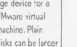


**表 3.1 VMware 系统建议快速参考**

| 资源 | 建议 |
|---|---|
| Linux 主机操作系统 | Red Hat 5.x 及以上，SuSE Linux 6.0 及以上，OpenLinux 2.2 及以上，TurboLinux 6.0 及以上 |
| 系统 CPU | 最低 266MHz CPU（建议 500+ MHz） |
| 系统 RAM | 96MB + 每台同时运行的虚拟机 32-128MB |
| 磁盘空间 | 每台虚拟机最低 2GB |

## 第 4 章：在 Linux 上安装 VMware

- 从随附的 CD 安装
- 决定网络配置方式
- 获取并安装许可证密钥
- 安装故障排除
- 在线检查更新

好了，学习够多了。你现在已经充分了解了 VMware 理论——足够让你大胆尝试，真正把它安装到你的 PC 上。所以拿出随书附带的 CD（如果还没拿的话），让我们开始吧！

### 从随附的 CD 安装

本书随附一张 CD-ROM，其中包含 VMware 核心二进制文件等内容。从 CD-ROM 安装 VMware 只需几分钟，访问 VMware 网站申请免费 30 天试用许可证后，你就可以在 Linux PC 上运行客户操作系统了。

早期版本的 VMware 有时要求用户下载 XFree86 服务器的特殊版本，你可能会在 VMware 文档中找到对此要求的说明。但最近版本的 XFree86（如果你系统满足第 3 章“为 VMware 配置你的 PC”中概述的要求，应该已安装）消除了这个问题，你无需担心。

1. 如果尚未登录，请使用你将用于运行 VMware 的用户账户登录 Linux 并启动 X Windows。
2. 打开一个终端窗口。
3. 插入 VMware CD-ROM，如果你的系统不会自动挂载新插入的 CD，则像平常一样挂载它（通常输入 `mount /dev/cdrom`）。
4. CD 包含一个名为 `VMware Binaries` 的目录，其中包含 VMware 安装程序。`cd` 到 CD-ROM 驱动器使用的挂载点下的该目录。（通常是 `cd "/mnt/cdrom/VMware Binaries"`。由于目录名包含空格，因此需要引号。）
5. 将文件 `VMware-2.0.1-570.i386.rpm` 复制到硬盘上的工作目录。

> 如果你的系统不支持 RPM 包安装，请改复制文件 `VMware-2.0.1-570.tar.gz`，并留意后续的修改说明。

6. 如果你通常不以 root 身份运行（是的，所有书籍都告诉你不要这样做，但有些人仍然这么做！），你需要 root 密码并能够使用 `su`（超级用户）命令。

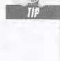

7. 使用 `cd` 切换到存放 `.rpm` 或 `.tar.gz` 文件的工作目录。如果使用 `.tar.gz` 文件，请跳到第 9 步。
8. 使用命令 `rpm -Uhv VMware-2.0.1-570.i386.rpm` 开始安装过程。你的屏幕应类似于图 4.1。跳到第 12 步。

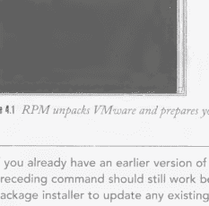

图 4.1 RPM 解包 VMware 并为安装准备系统。

> 如果你的 PC 上已安装了较早版本的 VMware，上述命令仍然有效，因为 `rpm -Uhv` 中的 `"U"` 告诉包安装程序更新 VMware 的任何现有实例。
> 如果你习惯使用其他 RPM 包安装程序，如 GnoRPM，应该可以毫无问题地使用它们。

9. `.tar.gz` 文件需要解压缩。输入 `tar -xzf VMware-2.0.1-570.tar.gz`。
10. 解压缩归档文件会创建一个新目录 `vmware-distrib`。使用 `cd` 命令切换到 `vmware-distrib`。
11. 输入 `./vmware-install.pl`。这会将重要的 VMware 文件安装到硬盘上的关键位置。接受提示的默认值。如果提供运行 `vmware-config.pl` 的机会，请接受并继续下一节“决定如何配置网络”。如果你不想立即开始配置 VMware，请在准备好时阅读第 12 步。
12. 在当前终端提示符下，输入 `vmware-config.pl`。安装正式开始，如图 4.2 所示。
13. 按 Enter 阅读 VMware 最终用户许可协议。用空格键翻页，输入 `yes` 并按 Enter 接受。VMware 然后分析你的系统兼容性，如果一切正常，它将继续下一步。

如果你的 Linux 主机操作系统上已经运行了 Samba（SMB）服务器，你就不应安装 VMware 定制的 Samba 服务器，否则可能会破坏其中一个或两个的运行。许多默认的 Linux 配置都包含一个 Samba 服务器。让两者协同工作是可能的，但属于实验性质。如果你不确定，就不要安装定制的 Samba 服务器。

2. 如果你在第 1 步中回答“是”以启用仅主机网络，你可能希望对下一个问题也回答“是”：你是否希望此脚本探测一个未使用的子网？VMware 会寻找一组可在虚拟机中安全使用的 IP 地址，而不会与你的局域网产生冲突。如果你回答“是”，VMware 会启动一个特殊的 DHCP 服务器，为你的虚拟机提供 IP 地址。

请记下 VMware 决定使用的子网。你稍后需要它来通过仅主机网络配置主机与虚拟机之间的网络。子网的确切编号方案因计算机而异；在我的系统上，VMware 为仅主机网络分配 `192.168.71` 作为前三位数字。一般来说，主机会被分配为机器 #1，因此在这种情况下，我的主机是 `192.168.71.1`。虚拟机从 128 开始，所以我电脑上的第一台虚拟机位于 `192.168.71.128`。

3. 如果你选择不启用仅主机网络，你可能希望启用桥接网络。桥接网络让 VMware 直接共享你的以太网卡，因此虚拟机在你的局域网中（以及对外部世界）看起来就像一台普通的联网 PC。这一决定如图 4.4 所示。

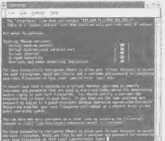

图 4.4 VMware 可以同时配置仅主机（PC 到虚拟机）和桥接（虚拟机到局域网/互联网）网络。

> 仅主机网络：一种定制的 Samba 实现，允许虚拟机与你的 Linux 主机操作系统通信，即使没有任何形式的网卡。

你实际上可以使用除 Samba 之外的其他网络协议通过仅主机网络：在本书后面，我实际上建议你这样做。一般来说，只有当你没有真正的以太网卡，或者有充分理由不想让你的虚拟机暴露给外部局域网和互联网时，才使用仅主机网络。

4. 如果你已启用仅主机网络，请对下一个问题回答“是”，并为 Samba 文件共享指定一个用户名和密码。如果你选择跳过此步骤，或将来需要添加更多 Samba 用户，请输入命令 `/usr/bin/vmware-smbpasswd vmnet1 -a <username>`，其中 `<username>` 是你希望为 VMware 文件共享配置的 Linux 用户。

如果你根本没有在 VMware 中配置网络支持，我有坏消息：如果以后你改变主意，你必须卸载并重新安装该程序！如果不确定，至少配置主机或桥接网络。

5. VMware 的安装已完成。是时候安装你的许可证密钥，以便 VMware 实际启动。

### 获取和安装许可证密钥

VMware 在没有一个名为许可证密钥的特殊文本文件的情况下无法运行。VMware 在其网站上提供免费的许可证密钥，有效期为 30 天。你也可以使用 VMware 网站购买永久许可证密钥，如果你决定继续使用该软件。

#### 请求许可证密钥

要获取你的 30 天试用密钥，请按以下步骤操作：

- 1. 打开一个 Web 浏览器并连接到 `http://www.vmware.com/forms/Download.cfm`。


- 2. 填写图 4.5 所示的表单。你需要提供基本用户注册信息。请确保在产品线中选择 `VMware 2.0 for Linux`。

- 3. 单击 `Register me and send my Key`。几分钟后，视 VMware Web 服务器当时的繁忙程度而定，你应该会在步骤 2 中提供的邮箱中看到来自 VMware 客户服务的邮件。

### TIP

### CAUTION

### BUZZWORD

桥接网络：VMware 共享你的以太网卡，允许你的虚拟机拥有唯一的硬件和 IP 地址。从本质上讲，桥接网络将你的主以太网卡透明地拆分为两个（或更多）。

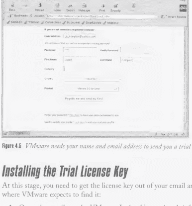

图 4.5 VMware 需要您的姓名和电子邮件地址来向您发送试用许可证密钥。

## 安装试用许可证密钥

在此阶段，您需要从电子邮件中获取许可证密钥并将其放入 VMware 预期找到它的位置：

- 1. 打开 VMware 发送的电子邮件。它应包含简短的欢迎信息，随后是许可证信息本身。

- 2. 根据您的邮件程序，许可证可能看起来像一个小的附件文本文件。如果您可以选择保存附件，请将其保存为文件名 `license`，然后继续执行步骤 4。

- 3. 如果未提示您保存附件，您必须从电子邮件中剪切并粘贴许可证信息。您应该会看到两行分别在许可证数据上方和下方写着“Cut Here”。请确保剪切这两行之间的所有内容（但不包括这两行）。剪切内容的首行应为“# VMware software license,”，末行应为“Hash”后跟一个长字母数字字符串。将此剪切内容保存为文件名 `license`。许可证文件应与图 4.6 中所示的非常相似。

- 4. VMware 希望在此许可证文件位于名为 `.vmware` 的目录中，该目录应位于您的主目录上。使用命令 `mkdir ~/.vmware` 创建此目录。

- 5. 将许可证文件复制到新的 `.vmware` 目录。

- 6. 启动 VMware 时，它将能够读取许可证密钥并适当启动。

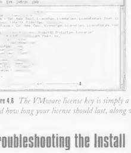

图 4.6 VMware 许可证密钥只是一个小的文本文件，告诉 VMware 您是谁以及许可证应持续多长时间，同时附带一个唯一的宿主机 ID 代码。

## 安装故障排除

在符合第 3 章中概述的 VMware 要求的 Linux PC 上，此安装过程不应出现任何问题。然而，世界并不完美。以下是处理常见 VMware 安装问题的一些提示：

- 请记住，除非您以 root 身份登录或在用于安装 VMware 的同一终端中运行 `su`（超级用户）命令，否则 VMware 不会安装。

- 如果您正在运行 VMware 虚拟机，VMware 将不会安装或更新。

- VMware 不会在 Caldera OpenLinux 1.3 下运行：OpenLinux 1.3 不在 VMware 批准的列表中。但如果您仍决定尝试，您需要安装 VMware 所需的 `glibc` 版本。您可以在 OpenLinux 1.3 CD-ROM 上的 `col/contrib/RPMS` 目录中找到 `glibc-2.06-1.i386.rpm`。输入命令 `rpm -i glibc-2.06-1.i386.rpm` 将安装 `glibc` 并可能修复您的问题。然而，没有任何 VMware 批准的主机操作系统有此问题。

- VMware 不会在 Slackware 下运行：为什么不直接运行 VMware 支持的发行版之一呢？但如果您是 Slackware 原教旨主义者，这应该会有帮助：编辑您的 `rc.local` 文件并添加以下内容：

```
if [ -x /etc/rc.d/init.d/vmware ]
then
    /etc/rc.d/init.d/vmware start
fi
```

每次升级主机 PC 的 Linux 内核时，都需要重新安装 VMware。如果您计划升级内核，请遵循以下流程：

- 1. 使用命令 `./vmware-uninstall.pl` 调用 VMware 卸载脚本。

- 2. 执行内核升级。

- 3. 使用命令 `vmware-config.pl` 重新安装 VMware。

请理解，这不会影响您的客户操作系统，只会影响 VMware 启动程序。

## 在线检查更新

VMware, Inc. 不断改进 VMware，有时会出现新版本。VMware 发布增量升级、测试版和完整版本更新。通过阅读 VMware 网站上的 News & Events 页面（`http://www.vmware.com/news`），您可以随时了解最新的 VMware 功能变更、改进和升级。

然而，除非您是经验丰富的 VMware 用户，否则最好等待安装任何 VMware 的升级，而不要使用随本书附带的版本，尤其是如果它是测试版。测试版不仅稳定性较差，而且通常比正式发布版本慢，因为它们启用了额外的调试功能。此外，运行随本书附带的 VMware 版本可确保您能够跟上进度；未来版本可能会对安装和配置过程进行细微更改。

## 结论

如果一切顺利，VMware 现在已安装在您的 PC 上。您只需输入一个小命令，VMware 就会为您服务。

下一章将介绍您第一次运行 VMware 时会看到什么，以及需要做什么。虽然您可以盲目地继续前进并让虚拟机启动，但请先给我一点时间。您将看到 VMware 配置界面为您做了什么，并最终能够应用您所掌握的关于虚拟机和资源分配的复杂知识。

## 第 5 章：首次运行 VMware

启动 VMware

VMware 的配置菜单

使用配置向导

使用配置编辑器

如果我看起来像是在试图让你对 VMware 感到兴奋，那是因为我确实如此。如果我做得正确，到现在你应该在喊：“少说点！多点 VMware！” 我相信你已经把要安装在虚拟机中的第一个操作系统的光盘放在桌上了。

但急躁会带来浪费——更重要的是，会让运行 VMware 变得麻烦。本章描述了 VMware 配置拼图的最后一块。在这里，你将学习 VMware 配置和启动程序的方方面面，然后就可以进入 Windows 和其他客户操作系统了！

## 启动 VMware

就是它了。这就是你一直在等待的：

- 1. 以你安装 VMware 时使用的同一用户账户登录 Linux。

- 2. 启动 XWindows 并打开一个终端窗口。

- 3. 在终端提示符下，输入 `/usr/bin/vmware`。

- 4. VMware 打开并测试你的显示。此过程可确保你的 X 服务器能够支持 VMware，并探测系统以获取可在虚拟机客户操作系统中使用的有效屏幕模式。它只需要一会儿。很快之后，你将看到 VMware 屏幕，如图 5.1 所示。

- 5. VMware 检测到你尚未配置任何虚拟机，并提示你运行配置向导或配置编辑器，使用图 5.2 所示的窗口。虽然你最终想要使用 VMware 邀请你运行的配置向导，但现在请点击取消以关闭此窗口。

## VMware 的配置菜单

VMware 的启动屏幕极其简陋；一旦你走到这一步，除了在 VMware 的配置向导中配置虚拟机之外，就没什么好担心的了。但启动屏幕中仍有一些重要的工具和操作，你应该了解。

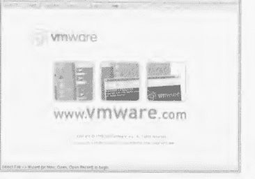

图 5.1 VMware 欢迎屏幕。

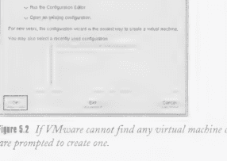

图 5.2 如果 VMware 找不到任何虚拟机配置，你将被提示创建一个。

### 文件菜单

与大多数应用程序一样，VMware 的文件菜单管理 VMware 加载和保存的文件，特别是虚拟机配置：

- 新建 使用标准的 VMware 配置编辑器开始新的 VMware 配置。某些 VMware 功能只能在配置编辑器中选择。

- 向导 打开 VMware 配置向导，其通常比配置编辑器更友好。

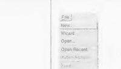

尽管配置编辑器肯定比向导更强大，但你应该使用向导来完成创建的任何虚拟机的初始设置，然后在编辑器中进行更改。

- 打开 会弹出一个对话框，提示你选择一个虚拟机配置文件。每个虚拟机配置都应位于其自己的目录中。

- 打开最近 会列出最近使用的虚拟机配置的简短列表。

- 即时恢复 与 VMware 内置的挂起功能结合使用。即时恢复会唤醒你最近挂起到内存或磁盘的虚拟机。

- 另存为 允许你在将其保存到磁盘之前选择新的配置文件名。

- 退出 关闭 VMware 配置屏幕（如果虚拟机仍在运行，则会关闭虚拟机）。


电源菜单不仅提供了虚拟机的虚拟电源开关，还提供了其他方便的虚拟电源管理功能：

- 开机 仅在未运行虚拟机时可用，启动当前加载的 VMware 配置。

- 关机 在虚拟机运行时取代开机。

- 重启 重启虚拟机。


> 只要可能，请在使用 VMware 中选择关机或重启之前，先使用客户操作系统内置的关机序列。就像物理 PC 一样，如果你不这样做，可能会损坏客户操作系统的数据。

- 挂起虚拟机 仅在虚拟机运行时可用。它会将当前虚拟机挂起到磁盘（默认）或内存。它甚至在不支持自身挂起功能的系统上也能工作，尽管它可以利用在大多数 Linux 和 Windows 版本中都能找到的 APM（高级电源管理）挂起/恢复功能。

- 恢复虚拟机 在虚拟机已被挂起时变为活动状态。它尝试在你离开的确切点恢复已挂起的虚拟机。

> 你可以在任何时候恢复已保存到磁盘的虚拟机——即使在退出 VMware 甚至重新启动 Linux 之后。然而，已保存到内存的虚拟机在你退出 VMware 后就会丢失。

- 发送 Ctrl-Alt-Del 向客户操作系统发出臭名昭著的“三指敬礼”。在大多数操作系统中，这要么启动重置，要么（在 Windows 中）打开任务管理器。

> 为什么发送 Ctrl-Alt-Del 是一个单独的菜单项？该功能实际上是从 Windows NT 版本继承而来的，因为 NT 的安全系统无法从键盘读取 Ctrl+Alt+Del。Linux 也可能有好处。虽然 VMware 试图拦截你所有的按键并将其发送到虚拟机而不是 Linux，但你可能不想拼命敲击它，以免将主机 PC 送入重置状态！

- 捕获 让虚拟机控制你的鼠标和键盘。换句话说，当你想与虚拟机交互而不是 Linux 主机操作系统时，使用此功能。

除了 Send Ctrl-Alt-Del 之外，电源菜单中的所有功能都在 VMware 屏幕顶部附近的命令工具栏中重复出现。

## Settings Menu

设置菜单，如图 5.5 所示，可让你调整当前虚拟机以及 VMware 本身的配置：

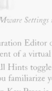

图 5.5 VMware 设置菜单允许你调整 VMware 的配置。

- Configuration Editor 打开 VMware 配置编辑器，用于在配置向导中创建的虚拟机配置文件的高级调整。

- Show All Hints 可切换 VMware 的弹出提示的开关。在熟悉软件时请保持开启。

- Grab On Key Press 是一项复选框样式的项目。勾选时，表示当鼠标指针位于虚拟机视频显示窗口内时按下键，你希望虚拟机接管你的鼠标和键盘。

- Grab On Mouse Click 是另一项复选框条目。勾选时，表示当你在虚拟机视频显示窗口内单击时，你希望虚拟机接管你的鼠标和键盘。

如果 Grab On Key Press 和 Grab On Mouse Click 都关闭，则电源菜单中的 Grab 按钮和 Grab 项目是获得对虚拟机控制权的唯一方式。

- Host Reserved Memory，如图 5.6 所示，可让你分配分配给所有虚拟机的总内存量。单个虚拟机 RAM 分配在配置编辑器中处理，但此窗口决定任意数量的虚拟机可使用的最大总 RAM。你通常可以保持默认设置不变。 （VMware 建议一个安全值，虽然你可以减少它；增加它是不推荐的。）

Grab：当 VMware 接管你的鼠标和键盘时。在你通过特殊按键组合释放控制之前（默认为 `Ctrl+Alt+Esc`），任何输入或鼠标移动都会报告给虚拟机而不是 Linux。

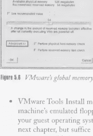

图 5.6 VMware 的全局内存配置窗口。

- VMware Tools Install 在虚拟机的仿真软盘驱动器中挂载一个特殊的虚拟软盘，以便你可以在客户操作系统上安装 VMware Tools。有关 VMware Tools 的更多细节将在下一章介绍，但可以说你绝对希望尽快在任何虚拟机中安装它们。

## Devices Menu

设备菜单的内容（见图 5.7）会根据你连接到 VMware 的虚拟磁盘数量而变化。应该始终有虚拟机的 RTC（实时时钟）的条目，以及你已连接到虚拟机的每个存储设备（真实或虚拟）的列表。

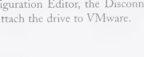

图 5.7 你可以在运行时断开或更改已连接到虚拟机的存储设备。

存储设备有两个选项：Disconnect 和 Disconnect and Edit。Disconnect 使设备对 VMware 暂时不可见，而 Disconnect and Edit 还会立即调出配置编辑器，以便你可以更改要连接到 VMware 的设备。在配置编辑器中进行更改后，Disconnect 命令会变为 Connect，你可以重新将驱动器连接到 VMware。


在 Linux 主机操作系统的某些配置中，更换 CD-ROM 可能无法正常工作。如果发生这种情况，请使用此菜单断开然后重新连接 CD-ROM 设备。

RTC 条目只有 Disconnect。在正常操作中，你没有理由需要断开 RTC；此选项主要是一个调试工具。


如果 RTC 被断开或以其他方式无法供 Windows 98 客户机使用，它可能无法在该虚拟机中正确保持时间。VMware Tools 中的 Sync Time 选项可以修复此问题。

## View Menu

图 5.8 的视图菜单控制 VMware 如何使用屏幕：

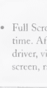

图 5.8

- Full Screen 是你可能最常使用虚拟机的方式。在 VMware 完全配置了特殊的客户机操作系统视频驱动程序后，当 VMware 可以控制整个屏幕而不是在桌面上使用窗口时，视频性能会快得多。


本书中大部分虚拟机屏幕截图都显示 VMware 以窗口模式在桌面上运行，而不是全屏。然而我在这里告诉你尽可能使用全屏模式。为什么呢？如果它们是全屏的图片，你就无法分辨出区别，你可能会认为我作弊了，只是直接在 PC 上运行操作系统的屏幕截图。听我的话去做，而不是看我怎么做。

## 第 5 章：首次运行 VMware

- Fit 用于 VMware 在 Linux 桌面上以窗口形式显示时。它会将虚拟机窗口调整到足够大，以一次性显示整个虚拟机屏幕。如果将窗口调整得太小，则会出现滚动条，以便您在客户机操作系统屏幕上平移。

- Autofit 告诉 VMware 始终保持虚拟机窗口足够大以显示整个客户机操作系统屏幕，即使客户机操作系统更改了其大小。除非您桌面分辨率较低或有充分理由将其关闭，否则在使用桌面上的 VMware 时应始终保持开启。

- Toolbar 可打开和关闭按钮列表（Power On、Reset 等）。

- Status Bar 可打开和关闭 VMware 屏幕底部的信息。状态栏如图 5.9 所示，包括虚拟 LED，用于显示虚拟机何时访问磁盘或其仿真的以太网卡。

- Icons 将文本工具栏按钮替换为小图标。

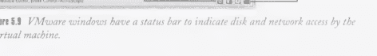

*Figure 5.9 VMware windows have a status bar to indicate disk and network access by the virtual machine.*

### Help Menu

最后但并非最不重要，以下是当本书无法回答您的问题时可以求助的地方：

- Help 调用您的默认 HTML 浏览器并加载包含的 VMware 帮助文件，该文件主要涉及配置和交互问题，而非故障排除和技巧。

- Product Information 本质上是 VMware 主要产品描述网站的书签。这需要实时的互联网连接。

- Technical Support 是 VMware 技术支持网站的书签。这同样要求您在线。

- About VMware 显示您 VMware 软件的当前版本和构建号，以及您的许可证密钥详细信息。

## Using the Configuration Wizard

在标准配置编辑器中创建新的虚拟机配置文件，对于完全不熟悉虚拟机和仿真器，尤其是 VMware 的人来说可能有点令人不知所措。对于许多虚拟机来说，配置向导足以获得可用的配置，而且稍后调整几个设置比从头构建所有设置要容易得多。

在此示例中，我演示如何设置 Windows 98 客户操作系统会话。该过程对于任何客户操作系统几乎完全相同。

> 如果您在本书中跳着阅读，并且尚未阅读第 3 章“为 VMware 配置您的 PC”中关于 VMware 资源需求的内容，现在是阅读的好时机。

1. 通过单击 File 菜单然后选择 Wizard 启动 VMware 配置向导。欢迎屏幕出现，如图 5.10 所示。

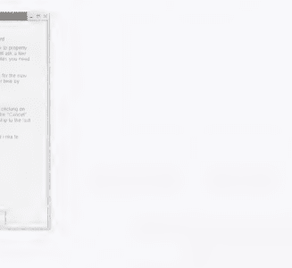


*Figure 5.10*

2. 单击 `Next` 进入客户操作系统选择屏幕。

3. VMware 的所有完全受支持的操作系统都列出，其中包括 `Other` 选项，如果您想进行实验。 在此演示中，从图 5.11 所示的 `Guest Operating System` 屏幕中选择 `Windows 98`，然后单击 `Next` 继续。

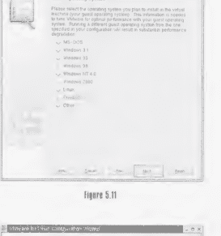

*Figure 5.11*

4. 在图 5.12 所示的屏幕上，VMware 会询问您希望将与此虚拟机相关的配置文件存储在何处。 默认情况下，VMware 会在您的主目录中以 `vmware` 分支下以客户操作系统命名的目录创建目录，在本例中为 `/home/[yourname]/vmware/win98/`。 如果您决定将其重新定位，请不要忘记您的选择。 准备好继续时单击 `Next`。

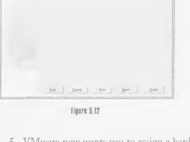

*Figure 5.12*

5. VMware 现在希望您为虚拟机分配一个硬盘。 在向导中，您只能创建新的虚拟磁盘或分配现有的物理硬盘作为原始磁盘使用。 由于虚拟磁盘更容易配置和使用，请坚持使用图 5.13 中的默认选择，然后单击 `Next`。

6. VMware 积极地假设您希望创建一个 2GB 的虚拟磁盘，这是允许的最大值。 如果您知道磁盘空间不足或暂时不想做出巨大承诺，您可以通过在图 5.14 所示的窗口中输入新值来创建更小的驱动器。 完成后单击 `Next`。

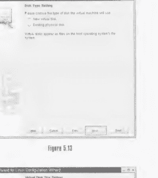

Figure 5.13

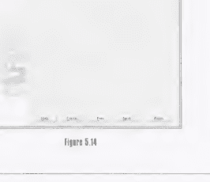

Figure 5.14

> 仅当计划进行一些高级磁盘配置时，例如使用模拟 SCSI 虚拟磁盘，导向程序只会创建模拟的 IDE 硬盘，因此你可以创建一个非常小的虚拟驱动器，然后稍后将其删除。

7. 在此阶段，导向程序应能自动检测到你的 CD-ROM 驱动器。如果你使用笔记本电脑并且有一个热插拔 CD-ROM 驱动器，该驱动器在启动 VMware 时可能并不总是连接，请更改默认设置 `启动时连接 CD-ROM`。否则，你应该可以保持此屏幕上的所有设置不变，如图 5.15 所示。准备好后单击 `Next`。

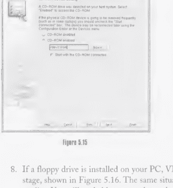

Figure 5.15

8. 如果你的 PC 上安装了软盘驱动器，VMware 在此阶段应能检测到它，如图 5.16 所示。适用于 CD-ROM 的情况同样适用：你可能希望保持默认设置不变，但软盘在启动 VMware 时可能并不总是安装，请禁用设置 `启动时连接软盘`。

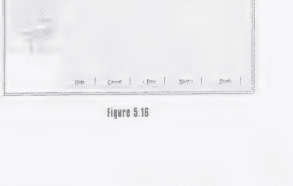

Figure 5.16

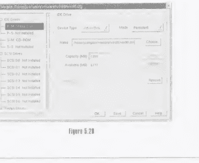

# Figure 5.20

> 除非从设备槽位中也有主设备，否则不要在从设备槽位中配置驱动器，否则虚拟机磁盘访问可能会不稳定或完全无法使用。在真正的机器上也无法很好地工作。

在此配置阶段，你可以指定一个虚拟磁盘以在一种特殊的受保护模式下运行，即非持久或可撤销。单击 `Mode` 工具并选择新的保护级别。VMware 配置向导始终将新的虚拟磁盘配置为持久，因为这对大多数情况来说是最有用的类型。

> `Shrink` 按钮现在没什么用，但在你使用官方支持的客户机操作系统时以后会很有用。虽然虚拟磁盘在使用时会增长，但在删除数据时它们不能自动缩小。使用 `Shrink` 工具结合 VMware Tools 可以将虚拟磁盘中未使用的空间削减回原大小。

IDE 配置窗口还允许你创建原始或普通磁盘，这些内容在附录 A“高级 VMware 配置”中有所介绍。

## SCSI Drives

本节几乎与 IDE 驱动器配置完全相同，只是驱动器槽位有七个而不是四个，并且配置它们的顺序无关紧要。

必须再次强调，VMware 不关心你的系统上的物理驱动器是 SCSI 还是 IDE。VMware 的虚拟 SCSI 控制器可以格式化 SCSI 类型的驱动器，并在你的 CD-ROM 驱动器上使用 SCSI 风格的访问，即使你的硬盘和 CD-ROM 驱动器位于 PC 的 IDE 控制器上。图 5.21 显示了一个示例图。

反之亦然：你也可以将真实的 SCSI 设备配置为对虚拟机表现为 IDE 设备。图 5.22 显示了 SCSI 配置窗口。

通过使用虚拟 SCSI 而不是虚拟 IDE，无论实际磁盘是什么，你都可能在虚拟机中获得一些明显的速度提升。

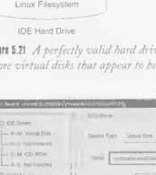

Figure 5.21 A perfectly valid hard drive allocation. A physical IDE hard drive can contain one or more virtual disks that appear to be SCSI hard drives to a VMware virtual machine.

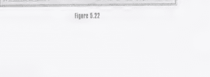

Figure 5.22

通过放弃向导创建的 IDE 虚拟磁盘并创建一个新的 SCSI 虚拟磁盘，你可以在虚拟机中实现更快的读写速度。然而，如果没有 IDE 驱动器，安装客户机操作系统可能会更困难；即使在现实世界中，PC 也无法很好地处理只有 SCSI 磁盘的计算机。这最有可能在 DOS 或 Windows 消费版中造成麻烦。

虽然你可以将 CD-ROM 驱动器从虚拟机 IDE 控制器移动到其 SCSI 控制器，即使你的真实 CD-ROM 驱动器是 IDE，但虚拟机无法从模拟的 SCSI CD-ROM 驱动器启动。虚拟机可以从真实的 SCSI CD-ROM 驱动器启动，只要该 CD-ROM 在 VMware 中配置为 IDE 设备即可。

## Floppy Drives

VMware 配置向导应该已正确定位并在 VMware 中安装了你 PC 上的软盘驱动器以供共享。你可以通过单击如图 5.23 所示的 `Floppy Drives` 树来验证软盘设置。VMware 支持多达两个软盘驱动器，其中一个或两个可以是虚拟软盘文件。一些软件分发在虚拟软盘上，其中包括 VMware Tools。

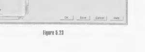

Figure 5.23

如果您需要挂载一个虚拟软盘文件以在虚拟机中使用，请按照以下步骤操作：

- 1. 单击其中一个虚拟机软盘驱动器槽。
- 2. 单击 `Type` 工具并将其更改为 `File`。
- 3. 输入虚拟软盘文件的完整路径。
- 4. 单击 `Install` 按钮以提交您的更改。
- 5. 通过单击窗口底部的 `Save` 来保存新的配置。这也会退出 Configuration Editor。

## Ethernet Adapters

每个虚拟机最多可以有三个虚拟网络连接，尽管您可能只需要一个或两个。

向导会根据您在向导流程结束时所做的网络选择自动配置以太网适配器（`Bridged`、`Host`、两者或都不选）。

如果您跳过了 `Bridged` 或 `Host` 网络，您可以轻松地在此处添加它，只需从 `Connection Type` 工具中选择您想要的选项并单击 `Install`，如图 5.24 所示的窗口中那样。无需进行配置。

> 如果可能，请允许向导处理您的网络配置。

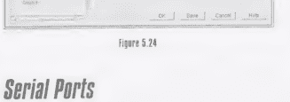

## Serial Ports

Configuration Wizard 不会设置任何串行端口，但如果您需要使用它们，调整起来相当容易。尽管 VMware 支持三种不同类型的

## Parallel Ports

虚拟并行端口的处理方式与串行端口类似。VMware 最多可寻址两个并行端口，这些端口可以是主机 PC 上的设备或一个文件。一些高级用户可能有理由调整图 5.26 所示的配置屏幕，以将并行访问定向到文件（例如，要捕获您想要带到具有更好打印机计算机上的 PostScript 打印会话），但对于大多数用途，请坚持使用真实设备。

如果您需要在虚拟机中使用并行端口访问，请按照以下步骤操作：

- 1. 选择您希望虚拟机访问的 `LPT` 设备。最好按顺序添加它们，但不是必需的。
- 2. 输入设备驱动程序的完整路径。在大多数 Linux PC 上，第一个并行端口（`LPT1`）位于 `/dev/lp0`，第二个（`LPT2`）位于 `/dev/lp1`。
- 3. 除非您知道您的并行端口不支持双向访问，或者在安装 VMware 时收到有关并行端口性能的警告，否则请保持 `Bidirectional` 框被选中。
- 4. 单击 `Install` 以提交您的更改。


- 5. 通过单击窗口底部的 `Save` 来保存新的配置。这也会退出 Configuration Editor。

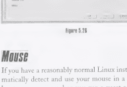

## Mouse

如果您拥有一个相当正常的 Linux 安装，VMware 应该能够自动检测并在虚拟机中使用您的鼠标。如果 VMware 在运行客户操作系统时难以找到您的鼠标，您可能需要在图 5.27 所示的 Mouse Type 工具中输入类型（PS/2 或串行，以及品牌），并在文本窗口中添加鼠标设备的完整路径。

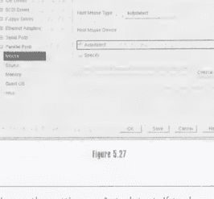

图 5.27

将设置保留在 Autodetect 上。如果 Xconfigurator 等工具可以找到您的鼠标，VMware 也应该能够找到。

## Sound

我一直有点困惑，为什么 Configuration Wizard 开始但没有完成为您配置声音。VMware 会自动为 Open Sound System（OSS）或类似支持的 Linux 系统声音设备设置正确的设备路径，您只需单击 Install 按钮（见图 5.28）即可使其工作。

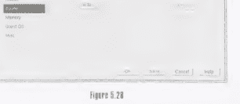

图 5.28

如果您担心 PC 的速度，请不要在安装操作系统并评估速度之前激活 VMware 中的声音。对 VMware 来说，声音是 CPU 密集型的，而某些操作系统，例如 Windows 98，在首次启动后会播放大量声音。您始终可以在以后感到舒适时返回并单击 Install。

## Memory

在图 5.29 所示的 Memory 配置窗口中，您可以调整 VMware 为此特定虚拟机分配的 RAM 数量。请记住，VMware 并不会总是为某些客户操作系统分配最大可用 RAM，因此如果您想扩展到在全局 Host Reserved Memory 中确定的总 VMware RAM 限制，您可以自由这样做。

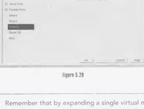

请记住，通过将单个虚拟机扩展到保留内存的总限制，您会使同时运行多个虚拟机变得棘手且可能难以忍受地缓慢。此外，请确保不要超过推荐的 VMware 内存限制。

## Guest OS

客户操作系统屏幕，如图 5.30 所示，应该看起来与您在 Configuration Wizard 结束时看到的完全相同。VMware 使用它对您的系统做出一些假设并预配置虚拟机 resources and guest OS-specific optimizations. You should never have occasion to adjust this setting unless you upgrade a guest OS (from Windows 3.1 to Windows 95, for example).

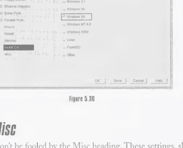

## Misc

Don't be fooled by the Misc heading. These settings, shown in Figure 5.31, are actually among the most important in VMware. It's a pity that they are buried at the bottom of the list; it makes them look unimportant, which they are certainly not.

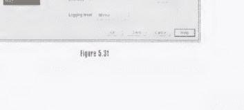

- Hide partition type of read-only partitions is only important if you have a complicated virtual machine configuration. If, for example, you have a virtual machine that dual boots between Windows 98 and Windows NT, Windows 98 might get confused by the Windows NT virtual drive and try to “repair” it. This undesirable behavior can be avoided with an advanced boot manager such as PowerQuest BootMagic. It’s even easier to avoid if you don’t create dual-booting virtual machines.
- Find best resolution in full screen mode should be turned on. This allows VMware to change your display resolution when in full-screen mode, so that, for instance, an 800x600 Windows 98 screen is shown on an 800x600 screen. Otherwise, VMware inherits and keeps the display size of your X desktop, which can lead to postage stamp-sized guest OS windows.
- Redo Log Directory tells VMware where to store the log files for nonpersistent and undoable virtual disks. Place them on a local drive so you don’t introduce network overhead on all your disk accesses.
- Logging level should be set to Normal at all times, unless VMware technical support directs you to change it to Debug to diagnose a particular problem. The Debug log mode can slow down the virtual machine considerably.

## Conclusion

In this chapter, you (finally!) created a VMware virtual machine and learned about some of the more intricate configuration settings as well.

You’ve now done everything you need to do to boot a virtual machine and install a guest operating system. It’s finally time to do so.

Consumer editions of Windows are among the easier installations in VMware, so Chapters 6 and 7 cover Windows 98 and 95. There are different benefits to choosing one over the other for your first virtual machine, so you might want to read both chapters before starting any installations.

## PART II

## Guest Operating Systems in VMware

- 6 Installing Windows 98 in VMware
- 7 Installing Windows 95 in VMware
- 8 Understanding the VMware Tools for Windows
- 9 Using Your Windows 95/98 Virtual Machine
- 10 Installing Linux on VMware
- 11 Installing Windows NT 4 in VMware
- 12 Installing Windows 2000 in VMware
- 13 Installing FreeBSD in VMware
- 14 Installing DOS and Windows 3.1 in VMware
- 15 Playing Games with VMware


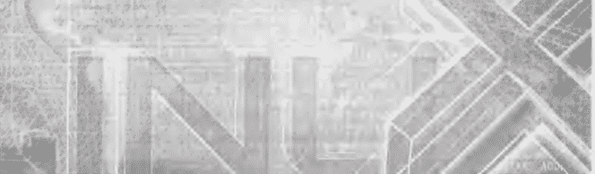

## Chapter 6: Installing Windows 98 in VMware

- Choosing between Windows 95 and Windows 98
- Preparing the virtual machine
- Installing Windows 98
- Testing the installation
- Installing VMware tools
- Installing Windows 98 applications

Until Windows Millennium is released and gains mainstream acceptance, or unless Linux makes some more major inroads, Windows 98 will continue to be the top personal and business desktop operating system. It should come as little surprise, then, that VMware does a thorough job of supporting Windows 98.

### Choosing Between Windows 95 and Windows 98

Unlike a new computer buyer, who rarely has the opportunity to decide which operating system comes with the system, you are the ultimate master over the virtual machine. And if you have both Windows 95 and Windows 98 available to you, you can make a careful decision.

Of course, you can always create virtual machines for both if you have enough disk space, but if you need or want to make a choice, here's why a Windows 98 virtual machine might make the most sense:

- Smoother installation. Although Windows 98 is usually a longer and more disk-intensive installation than Win 95, Win 98 comes with a better set of drivers and does a more complete job of detecting VMware's virtual hardware, avoiding most of the glitches you might experience with a Win 95 installation.
- More software drivers. Windows 98 shipped with a more thorough list of drivers and DLLs for Windows software, including DirectX. This should save you trips to Microsoft's Web site or extra software installations as you add software to your Windows virtual machine.
- Internet Explorer and Active Desktop. Largely a "love it or hate it" issue, but if you like the Internet Explorer integration and Active Desktop features of Win 98, you can make them a part of your virtual machine.
- Better file system support. Win 98 has generally better networking capabilities and is more flexible than Windows 95 in the types of disk partitions it can access. Microsoft's FAT32 drive structure is faster and more efficient than FAT16, whether you're on a real PC's hard disk or a VMware virtual disk. Not all versions of Windows 95 support FAT32 properly.
- Not as close to end-of-life. Although Win 98-only software is still uncommon, it might not be long before it is a reality. If you have to be selective about how many virtual machines you can install, you're better off with the most up-to-date software possible.

如果你决定使用 Windows 98，还没完。应该使用 Windows 98 还是 Windows 98 SE（第二版）？如果你有选择，我建议坚持使用原版 Win 98。除了一些错误修复和千年虫修正之外，Win 98 SE 中大部分额外功能在虚拟机中要么价值存疑，要么很容易添加到 Windows 98 上。

将虚拟机 Win 98 SE 的 Internet 连接共享用作局域网的 Internet 网关是愚蠢且不切实际的：此类任务更适合你的 PC 上的主机 Linux 操作系统，甚至更好的是独立服务器或网络设备。增强的 USB 支持在不支持直接访问 USB 且近期也不太可能支持的虚拟机中毫无意义。而 Win 98 SE 的标准软件，如 Internet Explorer 5 和 Y2K 错误修复，都可以免费从微软网站获取，如果你觉得有必要更新原版 Windows 98 的话。

## 准备虚拟机

如果你的想法已确定，是时候准备一个为 Windows 98 量身定制的虚拟机了。

> 本安装顺序假定你使用的是标有“仅随新 PC 分发”或类似字样的 Windows 安装光盘。升级版会有一些细微差别。

## 从向导开始

任何新的 VMware 虚拟机都应从配置向导开始。

- 1. 如果你尚未进入 VMware，请在命令行提示符下使用 `/usr/bin/vmware` 启动主程序。
- 2. 通过在 `File` 菜单中点击 `Wizard` 启动 VMware 配置向导。
- 3. 点击 `Next` 清除第一个问候屏幕。
- 4. 从来宾操作系统选项列表中选择 Windows 98，如图 6.1 所示，然后点击 `Next` 继续。

> 如果你拥有 Windows 98 的升级版，你应该选择将首先安装的操作系统，并在每个升级阶段，在继续之前在配置编辑器中编辑“Guest OS”设置。如果你必须从 DOS 升级到 Windows 3.1 再到 Windows 95 再到 Windows 98，这可能会令人头晕目眩，以至于值得你花钱买一份全新的 Windows 98 并直接安装。

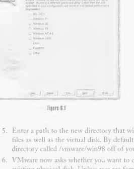

图 6.1

5. 输入一个路径，用于存放 VMware 配置文件以及虚拟磁盘的新目录。默认情况下，VMware 会要求在你的主目录下创建一个名为 `/vmware/win98` 的新目录。
6. VMware 现在询问你是否要创建新的虚拟磁盘或使用现有的物理磁盘。除非你熟悉附录 A“高级 VMware 配置”中描述的高级磁盘和配置模式，否则最好接受 VMware 创建新虚拟磁盘的提议。点击 `Next` 调出虚拟磁盘创建屏幕，如图 6.2 所示。

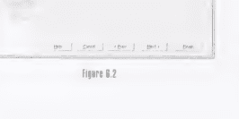

图 6.2

- 7. 输入新虚拟磁盘的大小。尽管 2000MB 是默认值，但你实际上可以高达 2047MB。请记住，磁盘会随着数据的添加而增长，但其最大大小以后无法更改。点击 `Next` 继续。
- 8. VMware 应该能检测到你的 CD-ROM。你需要 CD-ROM 来安装 Windows 98，所以保持默认设置不变（以启用 CD-ROM 访问并在虚拟机启动时使其可用），然后点击 `Next`。


- 9. 向导现在询问关于软盘访问的相同问题。除非你有充分理由禁用软盘，否则也应保持此设置不变。点击 `Next`。

- 10. 向导询问虚拟机应如何通过图 6.3 所示的屏幕访问网络。如果你计划让 Windows VM 完全隔离，可以点击 `No networking`。如果你安装了以太网卡并且在局域网上，使用 `Bridged networking`，这允许虚拟机共享你的以太网卡并作为网络上的独立计算机出现。`Host-only networking` 允许 VM 与你的 Linux PC 之间通过 Samba 文件共享（前提是你安装时安装了 VMware Samba 服务器或自行运行了一个），而 `Bridged and Host-only networking` 则结合了两者。如果你有局域网，现在就坚持使用 `Bridged`。如果没有，使用 `Host` 或 `none`。点击 `Next` 进入最后一步。

> 即使你不安装任何网络，仍然有一种简单的方法在你的 Linux PC 和虚拟磁盘之间交换文件。它涉及将虚拟磁盘挂载为 Linux 可读的文件系统，并在第 9 章“使用你的 Windows 95/98 虚拟机”中进行了深入介绍。我个人认为对于大多数文件共享需求来说，它比仅主机 Samba 网络更简单方便。

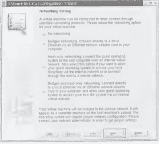

图 6.3

- 11. 助手将总结它将创建的虚拟机，其外观应与图 6.4 相似，尽管具体数值可能因你的选择而有所不同。如果一切看起来合适，请单击 `Done`。

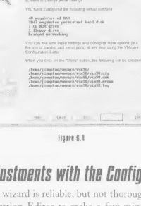

## 使用配置编辑器进行调整

助手是可靠的，但不够全面。在启动虚拟机并开始 Windows 安装之前，你应该在配置编辑器中稍作停留，进行一些小的调整：

- 1. 在设置菜单中打开配置编辑器。

- 2. 验证助手是否在 Win 98 配置目录中创建了一个主主盘 P-M IDE 虚拟磁盘，其大小是你创建的大小（它可能看起来比你指定的少一兆字节），以及一个次主盘 S-M CD-ROM，很可能指向 `/dev/cdrom`。

> 你可能想稍后再回来，将 `/dev/cdrom` 重新分配为虚拟 SCSI CD-ROM 驱动器，但由于 VMware 不支持从虚拟 SCSI CD-ROM 启动，且 Windows 98 启动软盘不支持 VMware SCSI 控制器，因此你需要 CD-ROM 以虚拟 IDE 模式进行 Windows 98 安装。

- 3. 如果你希望虚拟机能够直接访问你的串行或并行端口，请按照第 5 章“首次运行 VMware”中所述立即配置它们。请记住，在大多数 Linux 机器上，串行端口从 `/dev/ttyS0` 开始，并行端口从 `/dev/lp0` 开始。

- 4. 如果你的 Linux PC 已配置并运行声音，并且你希望虚拟机能够访问声音，请单击声音选项，然后在图 6.5 所示的声音配置窗口中单击安装。

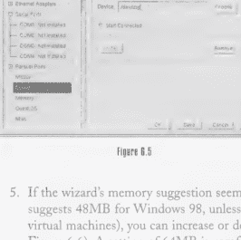

- 5. 如果助手的内存建议似乎不合适（VMware 通常为 Windows 98 建议 48MB，除非你可用于虚拟机的内存少于此值），你可以在内存设置中增加或减少它（参见图 6.6）。64MB 的设置对 Windows 来说很舒适，但越多越好。尽量不要低于 32；如果你没有 32MB 的内存可舒适地用于 Windows 98，你可能需要考虑改用 Windows 95。

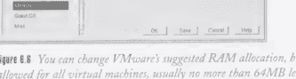

你可以更改 VMware 建议的 RAM 分配，但不要超过所有虚拟机的总允许量，通常不超过计算机总内存的 64MB。

- 6. 你可能想在 Misc 设置列表中进行更改。立即启用 APM 挂起可能是有意义的，尽管在操作系统安装并正常工作之前，最好将其他选项保持原样。如果你计划在不久的将来使用可撤销或非持久磁盘，你可以指定重做日志目录（例如，指定到系统驱动器上的安全位置）。

- 7. 在配置编辑器中完成操作后单击保存。

## 安装 Windows 98

你的虚拟机应该已准备好运行 Windows 98 安装程序。Windows 98 CD-ROM 是自动启动的，并且 VMware 虚拟机可以从虚拟 IDE CD-ROM 启动，因此你不需要随某些 Win 98 副本提供的启动软盘。

> 再次提醒，即使你的真实 CD-ROM 是 SCSI，它也可以被虚拟机视为 IDE CD-ROM。

- 1. 如果你尚未运行 VMware，请使用 `/usr/bin/vmware` 启动它，并在提示时从图 6.7 所示的窗口中选择你的 Win 98 配置。

- 2. 插入 Windows 98 安装 CD。如果虚拟机未在连接 CD 的情况下启动，请现在连接它。

- 3. 单击 `Power On` 启动虚拟机。图 6.8 所示的虚拟机启动屏幕应出现。

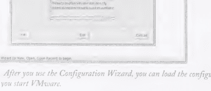


图 6.8 VMware 应启动到熟悉的 BIOS 屏幕，并正确识别虚拟硬盘和虚拟 CD-ROM 驱动器。

在启动虚拟机的电源后，你可以随时单击全屏，将显示切换到更快的全屏设置。

- 4. 出现两个文本菜单。在第一个菜单中，选择从 CD-ROM 而非硬盘启动，然后从第二个菜单中选择从 CD-ROM 启动 Windows 98 安装程序，如图 6.9 所示。

- 5. 第一个安装屏幕出现，如图 6.10 所示。按 Enter 开始安装。


图 6.9


图 6.10

- 6. 看到你有一块未格式化的硬盘（其实它只是一个虚拟磁盘，这并不重要），Windows 安装程序会询问你是否要配置未分配的空间。让它去配置就好。

> 如果你知道自己有特殊的分区需求，不要启动到 Windows 安装程序，而是用支持 CD-ROM 的方式启动 PC，然后在 DOS 提示符下运行 `fdisk`，在虚拟磁盘上自行创建分区。

- 7. 如果你定义的硬盘大小超过 512MB，Windows 会询问是否启用大磁盘支持。你应该启用该选项，除非你打算做些复杂的事情，比如创建一个能访问所有 Windows 文件的双启动 DOS 分区。

- 8. Windows 安装程序会重新启动虚拟机。如果提示你插入 Windows 98 启动盘到 `A:` 驱动器，请忽略它。同样的两个文本菜单会出现，再次告诉它从 CD-ROM 启动，并从 CD-ROM 启动 Windows 安装程序。然后安装程序会格式化虚拟的 `C:` 驱动器。见图 6.11。

- 9. 安装程序现在执行臭名昭著的 Windows“例行系统检查”，如图 6.12 所示。不必担心；微软不会知道你在使用 VMware。

- 10. 检查之后，Windows 终于启动了安装程序的图形部分，如图 6.13 所示。点击“继续”。


图 6.11 Windows 安装程序像格式化任何其他硬盘一样格式化 VMware 虚拟磁盘。


图 6.12 Windows 安装程序在继续之前检查虚拟磁盘的完整性。

> 如果此时在安装程序中无法使用鼠标，你可能需要退出虚拟机，并在配置编辑器中检查鼠标设置。这些设置应设为自动检测，但如果不起作用，请切换为描述你使用的具体鼠标类型。

- 11. Windows 安装程序会加载并询问基本问题，例如将 Windows 安装到哪个目录。`C:\WINDOWS` 是默认值。由于这与 VMware 无关，你只需根据个人偏好和最佳判断来决定即可。


图 6.13 抓住鼠标来完成 VMware 中 Windows 的安装会很有帮助。

- 12. 当 Windows 安装程序确认你的系统合适且有足够的可用磁盘空间后，系统会提示你选择安装类型，如图 6.14 所示。如果不确定，请选择“典型”安装；虽然它占用的磁盘空间最大，但之后你能最大限度地减少驱动程序麻烦。如果你知道自己不需要某些组件，请使用“自定义”，但注意不要删除太多。


图 6.14 安装类型很大程度上取决于你，但“典型”安装将确保所有重要系统组件都就位。


## 安装步骤

13. 然后安装程序会询问是否应为常见硬件组件安装驱动程序，还是显示列表供你选择。为了最大限度地正确识别 VMware 硬件，并尽量减少以后重新使用 Windows 98 CD-ROM 的需求，请选择常见组件。

14. 在 Windows 标识屏幕（见图 6.15）上，为你的 Windows 虚拟机随意命名，并将其放入 VMware 工作组。

15. Windows 会询问一系列区域问题中的第一个。输入最适合你的答案。

16. 告诉 Windows 你所在的国家/地区后，安装程序便全面展开。你可能希望最小化 VMware 窗口，并在 Linux 中处理其他程序，因为安装会持续一段时间。

> 虽然你可以随时在虚拟机运行时自由地在 Linux 中运行其他程序，但要注意不要做任何可能导致系统崩溃的事情，尤其是在安装新的客户操作系统时。现在不是安装实验性软件或调试麻烦程序的好时机。

17. 在将大部分软件安装到虚拟驱动器后，Windows 会重新启动。然后 Windows 安装程序准备真正启动 Windows。

18. 系统会询问你的用户信息（如实回答），然后提供 Microsoft 许可协议供你阅读，并要求你输入 Windows 98 产品密钥。填写完毕后点击“下一步”。


图 6.15 如果你计划使用仅主机网络，请将虚拟机设置为 VMware 工作组。

19. Windows 安装程序会扫描计算机以查找可配置的硬件，然后再次重新启动虚拟机。

20. 随后会出现更多可自由决定的设置，例如时间和时区。请根据实际情况回答，以进入 Windows 安装的收尾阶段，如图 6.16 所示。

21. 又要重新启动一次，但这次你应该会启动到标准的 Windows 登录屏幕，如图 6.17 所示。


图 6.16 Windows 98 在 VMware 中即将完成安装。


图 6.17 Windows 登录界面意味着安装成功。


图 6.18 VMware 正在运行全新安装的 Windows 98。

22. Windows 会查找并为某些虚拟机设备安装驱动程序，包括如果你启用了虚拟网络，则还会安装网卡驱动。

23. 此时，如果声卡已安装且工作正常，你应该会听到 Windows 启动音。如果还没有听到，也不要惊慌；可能是混音器或其他容易修复的问题。

24. 令人厌烦的 Windows 98“多媒体介绍”应该会开始播放，如图 6.18 所示。如果显示极其缓慢，不要惊慌：你仍然需要安装 VMware Tools 才能获得流畅的视频显示。虽然你尚未完全完成，但 Windows 98 光盘已经用不到了。

> 为了方便起见，你可能需要取消勾选“每次 Windows 98 启动时显示此屏幕”，并关闭屏幕右侧的频道栏，且保持关闭。

## 测试安装

未安装 VMware Tools 时，视频性能会非常慢。不过，你可以对新操作系统运行一些诊断，以确保一切运行顺利：

- 检查系统控制面板。具体来说，确保你看到了预期出现的设备，例如虚拟网卡和声卡（如果适用）。同时注意是否有黄色感叹号。如图 6.19 所示，你可能会在打印机端口上遇到 IRQ 冲突，因为 VMware 会尝试配置所有四个串行端口和两个并行端口，即使你没有为虚拟机分配任何端口。你可以安全地删除部分或全部未使用的端口，这应该能解决问题。

- 加载一个基本的内置应用，例如写字板（`WordPad`），并使用几分钟，以确保操作系统稳定。输入一篇简短文档，保存，然后重新加载。

- 如果已启用桥接网络，请使用 Windows 内置的 `Telnet` 或 `FTP` 客户端连接一个已知地址，如图 6.20 所示。如果使用仅主机网络，请打开“网上邻居”并确认你可以看到你的 Linux PC。


图 6.19 黄色感叹号并不总是代表严重问题。


图 6.20 能够从 Windows 虚拟机中执行 Telnet 表明桥接网络功能正在工作。

## 安装 VMware Tools

当你确认 Windows 98 运行正常后，请花时间安装 VMware Tools。你将获得更好的图形性能，并且能够在 Linux 和 Windows 虚拟机之间共享剪贴板。

> 因为你需要访问 VMware 窗口工具栏，所以需要在窗口模式（而非全屏模式）下执行此操作。请记住，使用 `Ctrl+Alt+Esc` 返回窗口模式。

1. 首先干净地重新启动 Windows 98 虚拟机。

2. 在 VMware 应用程序窗口中，选择“设置”菜单中的“安装 VMware Tools”。（参见图 6.21。）

3. 如果这是你第一次安装 VMware Tools，你可能想在提示时借此机会阅读联机帮助。

4. VMware 已在 Windows 98 虚拟机中临时挂载了一个特殊的虚拟软盘映像。进入“我的电脑”，双击软盘图标以打开该映像。

5. 双击 VMware Tools 图标，如图 6.22 所示。

6. VMware Tools 通过标准向导安装，如图 6.23 所示。接受默认设置并继续安装。


Figure 6.22 The VMware Tools install icon is stored on a special virtual floppy disk.


Figure 6.23

7. When installation is complete, Windows brings up the Display Properties control panel. Click on the Advanced button to reach the Advanced Settings screen, and then click on the Adapter tab, pictured in Figure 6.24.

8. You need to change the Standard Display Adapter to the custom VMware driver. Click the Change button, and let Windows search for new graphics drivers. When Windows asks where it should search for the new driver (see Figure 6.25), specify Display a list of all the drivers in a specific location.


Figure 6.24


Figure 6.25

9. Click Have Disk, and specify the path as `A:\win9x`. This reads the driver from the VMware Tools virtual disk image.

10. Windows finds VMware SVGA(FIFO). Accept this choice.

11. Windows then protests with a warning message, illustrated in Figure 6.26. Ignore this warning; you know what you're doing. Click Yes.

12. Finish the installation wizard. Commit to the change by clicking Close on the Windows control panels.


### 13.
Windows suggests a reboot. First, you need to disconnect the VMware Tools disk image, so click on `Settings` on the VMware window and select `Cancel VMware Tools Install`.

### 14.
Tell Windows to go ahead with the reboot it requests (see Figure 6.27).


Figure 6.26 Windows is trying to be helpful, but it's wrong. Be sure you click Yes!


Figure 6.27

### 15.
After the reboot, you should notice that Windows is somewhat more colorful, and an icon (a small set of tools) appears in the Windows system tray.

### 16.
You can now enter Display Properties and increase the size and color depth of your Windows desktop (limited by the range of your XWindows display) and change the settings in VMware Tools by right-clicking the Tools icon and selecting `Main Window` (see Figure 6.28).


Figure 6.28 The VMware Tools window provides a number of convenient shortcuts.

### 17.
You can safely start using full-screen mode whenever you are in your Windows virtual machine. Click `Full Screen` at the top of the VMware window, and use `Ctrl+Alt+Esc` to exit full-screen mode.

## Installing Windows 98 Applications

Although Microsoft includes some useful and fun tools in the core Windows 98 installation, chances are you'll want to use software that is more productive and exciting than Notepad and Paint. You are probably familiar, at least in passing, with the standard Windows installation wizards. But for the sake of completeness, a model software installation, along with VMware-specific notes, follows.

In this illustration, I install Jasc Paint Shop Pro 6, a good representation of the sort of mainstream application you might want to run in a Windows virtual machine, the GIMP for Linux notwithstanding:

### 1.
Start VMware and boot your Windows 98 virtual machine.

### 2.
If you have another CD-ROM in the drive, disconnect VMware from the CD-ROM drive and eject the CD.

> Depending on how CD-ROM access is configured on your Linux system, this can be something of a chore. You first have to ensure that no open Linux windows, programs, or shells are accessing the CD-ROM. Then, you need to use the `Disconnect` command under `Devices` on the toolbar (or use the VMware Tools) to release VMware's hold on the CD-ROM. You might need to type `umount /dev/cdrom` at a terminal prompt to completely release Linux's hold on the CD.

### 3.
Insert the Paint Shop Pro 6 CD-ROM.

### 4.
Re-connect VMware to the CD-ROM drive. You can do this either by clicking on `Devices` in the VMware toolbar or by using the VMware Tools icon in the Windows tray, shown in Figure 6.29.

### 5.
VMware should spin up the CD-ROM, and Windows should automatically launch the Paint Shop Pro installation program, pictured in Figure 6.30.

### 6.
Click `Install` to start the setup program.

### 7.
Paint Shop Pro opens a standard Windows installer wizard, shown in Figure 6.31. If you have any other applications open in this virtual machine, you should close them. Click `Next` to start the installation.


图 6.29 VMware Tools 在 Windows 系统托盘中显示，可更轻松地断开和重新连接 CD-ROM 驱动器，以便更换光盘。


图 6.30 许多 Windows 应用程序光盘包含安装程序，一旦 Windows 识别到光盘就会立即启动。


> 记住：在虚拟机的受保护环境中，你可以在 Linux PC 或其他虚拟机上随意操作。你应该在 Windows 虚拟机中退出打开的应用程序，但你可以在 Linux 和其他虚拟机中毫无顾忌地运行任何东西。

### 8.
Paint Shop Pro 会询问应安装到何处（见图 6.31）。接受默认值或使用浏览按钮更改，然后单击下一步。

> 请注意，虚拟机会计算虚拟磁盘上可用的适当空闲空间，即使虚拟磁盘文件本身在你的 Linux 硬盘上看起来还远没有那么大。记住虚拟磁盘会随着更多数据的写入而增长，直到达到你在最初创建虚拟机时定义的最大大小。

### 9.
与大多数程序一样，Paint Shop Pro 允许你安装全部或部分可用模块（见图 6.33）。选择最适合你需求的模块，然后单击下一步。


图 6.32 安装程序可准确读取虚拟磁盘的最大大小。


图 6.33


- 10. 再单击一次下一步开始安装。应会出现类似图 6.34 的屏幕。如果愿意，你可以最小化虚拟机，在 Linux 中使用其他应用程序，而 Windows VM 在后台运行安装。
- 11. 出现强制性的软件注册步骤。你可以暂时单击跳过。
- 12. 安装完成后，Windows 会更新系统设置。Paint Shop Pro 6 恰好是一个无需重启即可运行的程序，但许多程序需要重启，因此在安装其他程序时请做好让虚拟机循环其虚拟电源的准备。
- 13. 大多数 Windows 应用程序会在开始菜单中为自己自动创建程序组。找到图 6.35 所示的相应 Paint Shop Pro 组，并使用主应用程序列表启动该程序。
- 14. 尽情享受 Paint Shop Pro（或你喜欢的任何 Windows 应用程序），VMware 提供的便利！


图 6.34


图 6.35


图 6.36

## 第 7 章：在 VMware 中安装 Windows 95

在 Windows 95 和 Windows 98 之间选择

准备虚拟机

安装 Windows 95

测试安装

安装 VMware Tools

安装 Windows 95 应用程序

人们曾在电脑商店外露营等待 Windows 95 发布，实在有些傻气。但它是将全职基于 GUI 的操作系统带给消费级 PC 的第一次真正成功的尝试，其影响不可磨灭。即使是狂热的 Linux 用户，也难免需要在 Windows 95 中花费一些时间。

Windows 95 是 VMware 提供完整支持的最早的操作系统。Windows 3.1 支持稳定但仅提供有限的图形显示，而对 MS-DOS 及克隆系统的支持稳定但并非百分之百，且受限于视频模式。

### 在 Windows 95 和 Windows 98 之间选择

你的直觉可能是尽可能保持现代化，并将 Windows 98 作为主要虚拟机操作系统。然而，选择 Win 95 也有一些正当理由：

- 价格更低。虽然在商店货架上更难找到，但如果你需要从头开始购买 Microsoft 操作系统， chances are 当你找到 Windows 95 时，其价格会低于 Windows 98。
- 几乎等同。虽然有些程序只能在 Windows 98 上运行，但绝大多数流行的 Windows 软件在 Windows 95 和 98 之间可以透明运行。事实上，Windows 98 的一些主要改进，例如更好的 USB 支持，在 VMware 中完全无关紧要。
- 资源需求更低。Windows 95 可以在 16MB 内存中合理运行。当然内存越多更好，但确实可以做到。它对基本安装所需的硬盘空间也要求更少；甚至可以从软盘安装！
- 捆绑组件更少。有些人真的不喜欢 Internet Explorer 如何与 Windows 98 绑定。Windows 95 对所有浏览器一视同仁。
- 安装更快。因为它比 Windows 98 小得多，所以启动速度更快。

Windows 95 在其三年的生命周期中经历了几次不同的修订。一般来说，任何修订版在 VMware 中都应该没问题，尽管一些 Windows 应用程序更喜欢 Windows 95 修订版 B（也称为 OSR2）或更高版本。

Windows 95 与 AMD K6-2 芯片在 350MHz 及以上速度下存在已知的不兼容性。该问题具有间歇性，即每次启动 Windows 95 时可能都不会出现，但问题严重到我不得不使用第二台 PC 来撰写本章。微软和 AMD 虽然提供了补丁，但它实际上仅适用于 Windows 95 OSR2，而且即使在 VMware 中也不太好用。如果你有一颗 K6-2 CPU，我强烈建议你使用 Windows 98。此问题不影响 K6、K6-III 或 AMD Athlon 处理器。

如果你不确定安装了哪个版本的 Windows 95，可以在安装后检查系统属性窗口。右键单击“我的电脑”图标并选择“属性”[见图 7.1 为示例]。你应该会看到以 4.00.950 开头的字符串。如果没有附带字母，则你拥有的是原版 Windows 95。A 或 B 表示你使用的是中间修订版，它们修正了一些重要错误。C [也称为 OSR2.5] 表示你使用的是 Windows 95 最新的主要发行版，它将 Internet Explorer 集成到操作系统中，就像 Windows 98 一样。

你可以在虚拟机中从微软安装增量的错误修复和补丁，就像在普通计算机上一样。


图 7.1 检查此对话框以获取 Windows 修订号。

## 准备虚拟机

如果 Windows 95 方便又好用，你需要创建一个新的虚拟机。

> 此安装序列假定你将使用一张标有“仅随新 PC 分发”或类似字样的 Windows 安装光盘。升级版在某些方面存在细微差异。

### 从向导开始

通过创建新的 VM 配置，从配置向导开始 Windows 95 虚拟机的安装。

- 1. 如果你尚未进入 VMware，请在命令行中输入 `/user/bin/vmware` 来启动主程序。
- 2. 通过在“文件”菜单中单击“向导”来启动 VMware 配置向导。
- 3. 单击“下一步”以清除第一个问候屏幕。VMware 会显示来宾操作系统选择屏幕，如图 7.2 所示
- 4. 从来宾操作系统选项列表中选择 Windows 95，然后单击“下一步”继续。


如果你拥有 Windows 95 的升级版，你应该先选择要安装的操作系统。然后，在每个升级阶段，在继续之前在配置编辑器中编辑来宾操作系统设置。

- 5. 输入新目录的路径，该目录将容纳 VMware 配置文件以及虚拟磁盘。默认情况下，VMware 会要求你在主目录中创建一个名为 `/vmware/win95` 的新目录。
- 6. VMware 会询问你是否要创建新的虚拟磁盘或使用现有的物理磁盘。除非你熟悉附录 A“高级 VMware 配置”中描述的高级磁盘和配置模式，否则最好接受 VMware 创建新虚拟磁盘的提议，如图 7.3 所示。单击“下一步”。
- 7. 输入新虚拟磁盘的大小。尽管默认值为 2,000MB，但你可以最高设置为 2,047MB。请记住，磁盘会随着数据的添加而增长，但之后无法更改其最大大小。单击“下一步”继续。
- 8. VMware 应该能检测到你的 CD-ROM。你需要 CD-ROM 来安装 Windows 95，因此保持默认设置不变[以启用 CD-ROM 访问并使其在虚拟机启动时可用]，然后单击“下一步”。
- 9. VMware 会询问关于软盘访问的相同问题。除非你有充分理由禁用软盘，否则也应保持此设置不变。单击“下一步”。


*图 7.3* 大多数用户希望创建尽可能大的虚拟磁盘，即 2 GB。

- 10. 向导会询问虚拟机应如何访问网络[见图 7.4]。如果你计划让 Windows VM 完全隔离，可以单击“无网络”。如果你安装了以太网卡并且你的 PC 在局域网上，使用“桥接网络”，它允许虚拟机共享你的以太网卡并作为网络上的独立计算机出现。仅主机网络允许 VM 与你的 Linux PC 之间通过 Samba 文件共享[前提是你在安装时安装了 VMware Samba 服务器或你自己运行了一个]，而桥接和仅主机网络则结合了两者。如果你有局域网，现在就坚持使用桥接。如果没有，使用“主机”或“无”。单击“下一步”到达最后一步。


图 7.4 网络配置屏幕可帮助你准备 VMware 与你的 Linux 主机操作系统和外部世界通信。

即使你不安装任何网络，仍然有一种简单的方法可以在你的 Linux PC 和虚拟磁盘之间交换文件。它涉及将虚拟磁盘挂载为 Linux 可读的文件系统，这在第 9 章“使用你的 Windows 95/98 虚拟机”中有深入介绍。我个人认为，对于大多数文件共享需求来说，这比仅主机 Samba 网络更容易也更方便。

- 11. 向导总结了它将创建的虚拟机。图 7.5 为示例。如果一切看起来合适，请单击“完成”。


Figure 7.5 Your configuration may vary slightly, depending on the choices you make in the Configuration Wizard.


## Adjustments with the Configuration Editor

The wizard is reliable, but not thorough. You should make a quick stop in the Configuration Editor to make a few minor adjustments before you launch the virtual machine and start the Windows installation:
- 1. Open the Configuration Editor in the Settings menu.
- 2. Verify that the wizard created a Primary Master (P-M) IDE virtual disk in the Win 95 configuration directory of the size you created (it might appear to be one megabyte less than you specified), and a Secondary Master (S-M) CD-ROM, most likely pointing to `/dev/cdrom`.
> You might want to come back later and reassign `/dev/cdrom` to be a virtual SCSI CD-ROM drive, but because VMware does not support booting from a virtual SCSI CD-ROM and the Windows 95 boot floppy does not support the VMware SCSI controller, you need the CD-ROM in virtual IDE mode to install Windows 95.
- 3. If you want the virtual machine to have direct access to your serial or parallel ports, configure them now as described in Chapter 5, "Running VMware for the First Time." Remember that serial ports start at `/dev/ttyS0`, and parallel ports start at `/dev/lp0` on most Linux machines.
- 4. If your Linux PC has sound configured and running and you want the virtual machine to have sound access, click the Sound option and then click Install in the sound configuration window shown in Figure 7.6.


### Figure 7.6 You must click Install to enable sound support in VMware, because sound is always left off by the Configuration Wizard.

Some versions of Windows might struggle to detect and properly install software for the virtual machine’s sound card. If sound is not important to you in your Win 95 virtual machine, it might be best to leave the sound device uninstalled. If you want to install sound at the same time you do your initial Windows 95 installation, and you experience any trouble during your installation, take the following steps:
- 1. Temporarily remove the sound card from the virtual machine configuration by clicking Remove in the Sound portion of the Configuration Editor.
- 2. Re-install Windows, and then power down the virtual machine.
- 3. Re-install the sound driver by clicking Install in the Sound portion of the Configuration Editor.
- 4. Power up the virtual machine. It should detect the virtual SoundBlaster 16 and proceed normally.


- 5. If the wizard’s memory suggestion seems inappropriate (VMware usually suggests 48MB for Windows 95, unless you have less than that available for virtual machines), you can increase or decrease it in the Memory setting, shown in Figure 7.7. 64MB is comfortable for Windows, but more is better. Try not to dip below 16; if you don’t have 16MB comfortably available for Windows 95, you should upgrade your PC’s RAM.
- 6. You might want to make changes in the Misc settings list, but they are best left alone until the operating system is installed and working properly. You could assign the redo log directory (say, to a safe place on your system drive) if you plan to use undoable or nonpersistent disks in the near future.
- 7. Click Save when finished in the Configuration Editor.


### Figure 7.7 You can change VMware's suggested RAM allocation, but don't exceed your total allowed for all virtual machines.

## Installing Windows 95

Your virtual machine is ready for a Windows 95 installation.

If you have a recent copy of Windows 95, it should be on an autobooting CD-ROM, eliminating the need for a boot disk. Older versions of Windows 95, however, need a floppy disk to start the installation process.

Most versions of Windows 95 come with a boot floppy, and chances are you will need to manually configure and format the virtual disk before installing the operating system.


Unless you have a floppy-only distribution of Windows 95, you need to make sure the CD-ROM drive is properly configured before you start the installation. Although Windows 95 can use virtual SCSI CD-ROM drives, the installation needs the CD-ROM to appear as an IDE device.

> Again, remember that even if your real CD-ROM is SCSI, it can be made to look like an IDE CD-ROM to the virtual machine.

## Performing Preliminary Tasks

In the first phase of the Windows 95 installation, you load the virtual machine for the first time and prepare the virtual disk.

1. If you're not running VMware already, start it by typing `/usr/bin/vmware`, and select your Win 95 configuration when prompted by the window shown in Figure 7.8.


图 7.8 完成配置向导后，你可以在启动 VMware 时立即加载虚拟机配置。

2. 将 Windows 95 安装软盘插入软盘驱动器。

> 如果由于某种原因，你无法使用 Windows 95 安装软盘，但能拿到 Windows 98 安装/恢复盘，那也同样适用。

3. 如果这不是仅软盘安装，请插入 Windows 95 安装 CD-ROM。

4. 单击 `Power On` 启动虚拟机。

> 启动虚拟机电源后，你可以随时单击 `Full Screen` 将显示切换到更快的全屏设置。

5. 虚拟机从软盘启动后，可能会询问你想使用哪个 CD-ROM。选择提供的第一个 IDE 选项。

6. 你应该处于 DOS 提示符下。在开始安装之前，你需要对虚拟磁盘进行分区和格式化。

7. 在 `A:\>` 提示符下，输入 `fdisk` 并按 Enter。这将启动硬盘分区程序，如图 7.9 所示。

> DOS/Windows 的 `fdisk` 与 Linux 的 `fdisk` 不完全相同。原理相似，但命令不同。


图 7.9 就像新的物理硬盘一样，新的虚拟驱动器在安装操作系统之前需要用 `fdisk` 进行分区。

8. 如果你的虚拟磁盘大于 512MB（而且应该是！），你会看到关于启用大磁盘支持的提问。你应该回答 `Y` 以启用大磁盘支持，这样你就可以将虚拟磁盘格式化为单个大分区。唯一回答 `N` 的理由是如果你计划让虚拟机与旧版 DOS 或 Windows 3.1 或早期版本的 Windows NT 双启动。省去很多麻烦，不要这么做。

9. 当 `fdisk` 主菜单出现时，选择选项 1，创建 DOS 分区。

10. 当创建 DOS 分区菜单出现时，选择选项 1，创建主 DOS 分区。

11. `fdisk` 会 briefly 扫描虚拟磁盘，然后询问你是否要使用最大可用大小（见图 7.10）。回答 `Yes`。

12. `fdisk` 访问驱动器以创建分区，然后提示你按 Esc 退出 `fdisk`，如图 7.11 所示。照做。

13. 退出 `fdisk` 后，你需要重新启动虚拟机以使新分区被识别。最简单的方法是单击 VMware 窗口上的 `Reset` 按钮。你也可以尝试通过键盘或 VMware Power 工具栏菜单发送 `Ctrl+Alt+Del`。

14. 让虚拟机重新启动。（不要取出驱动器中的 Windows 95 安装软盘！）

15. 如果启动盘之前曾询问过你关于 CD-ROM 选项，现在会再次询问。用第一次使用的相同选项启动虚拟机。

16. 你仍需格式化新建的分区。在 `A:\>` 提示符下，输入 `format C: /s`。


图 7.10 `fdisk` 提供快速为 Windows 95 安装分区驱动器的选项。


图 7.11

## 执行主安装

现在虚拟磁盘已正确准备好，你可以开始 Windows 95 的主安装：

1. 在 DOS 提示符下，切换到你的虚拟 CD-ROM 驱动器。这通常是 `D:` 或 `E:`，取决于虚拟机的设置。通过输入 `d:` 或 `e:` 并按 Enter 切换到正确的驱动器。

2. 通过输入 `setup` 并按 Enter 开始安装。

3. 在安装开始时，以及之后的过程中，你会看到关于“执行例行检查”的提示。只需在每次出现时按安装程序的要求操作即可。

4. `Setup` 应该运行 `ScanDisk`（这是你第一次也是最后一次看到这个迷人的程序），报告一切正常，然后进入图形化的 Windows 95 安装屏幕，如图 7.12 所示。单击 `Continue` 继续。


图 7.12 终于，Windows GUI 开始运行，尽管操作系统尚未安装。

5. Windows 软件许可协议出现。单击 `Yes` 继续。

6. Windows 安装向导启动。单击 `Next`。

7. 向导会询问应将 Windows 安装在何处。除非你有充分理由更改，否则保留默认值并单击 `Next`。

8. 安装向导扫描硬盘，然后询问安装应有多彻底（见图 7.13）。因为 `Typical` 安装无法正确安装 VMware 所需的网络组件，请选择 `Custom` 并单击 `Next`。

9. Windows 会要求输入你的正版证明代码，该代码可在随操作系统附带的册子中找到。输入它并单击 `Next`。

10. Windows 会要求输入你的姓名和公司名称用于登录目的。输入你喜欢的内容并单击 `Next`。

11. 除非你想安装额外的 Windows 捆绑软件，否则无需在安装组件屏幕上更改任何内容。完成后单击 `Next`。

12. 下一个屏幕，网络配置，如果你计划使用虚拟以太网卡则很重要。单击 `Add`，选择 `Adapter`，找到 Advanced Micro Devices (AMD) 的列表，并添加名为 `AMD PCNET Family Ethernet Adapter (PCI&ISA)` 的网络适配器。


Figure 7.13 If you need networking support, you must select `Custom` instead of `Typical`.

13. To use `TCP/IP` (Internet-style) networking, you need to add it manually from this screen. Click `Add`, select `Protocol`, click `Microsoft`, and find the `TCP/IP` entry.

If you know you only plan to use `TCP/IP` (Internet-style) networking in your virtual machine, you can remove the entries for `Microsoft Networks`, `NetWare Networks`, `IPX/SPX`, and `NetBEUI` protocols at this time. Removing `Microsoft Networks` will preclude you from using Samba filesharing over host-only networking, however.

14. Before clicking `Next`, scroll through the "network components will be installed" window to verify that the `AMD` adapter and the `TCP/IP` protocol are in the list shown in Figure 7.14.


## Windows 95 Installation Steps

15. Windows asks you to assign a computer name, workgroup name, and computer description for networking purposes. Enter whatever you like, and click Next.

16. The installation program shows a brief summary of the hardware attached to the virtual machine. When you're done browsing the list, click Next.

17. If you like, you can create a startup disk to help recover from Windows-related virtual machine crashes.

18. After the startup disk step, Windows begins the long process of copying files to the hard drive.


Figure 7.14 This is what the Network Configuration screen should look like after you add the AMD Ethernet adapter and the TCP/IP protocol.

19. After the installation, Windows asks to reboot the virtual machine. If you still have the startup disk (or your new emergency disk) in the floppy drive, remove it before clicking Finished or you will be prompted to take the disk out. Don't remove the Windows 95 CD yet.

20. Setup should have no trouble rebooting the virtual machine, which boots from the Windows 95 virtual disk and shows a welcome screen like Figure 7.15.

21. Windows asks for a username and password. Answer as you see fit.


Figure 7.15 The Windows 95 welcome screen means you're close to completion.

22. Windows scans the virtual machine for new hardware (it shouldn't find anything) and then proceeds with the setup, stopping to ask you about the time and date and your time zone. VMware should correctly read the time from your real system clock, but it's a good idea to double-check the settings. Click Close when you are finished making changes.

23. Windows lets you install a printer at this point, but it's best just to jump ahead to the operating system. You can always add a printer later. Click Cancel.

24. To finish the installation, the virtual machine needs another reboot. Click OK.

25. If everything has gone according to plan, you should be looking at a Windows login screen like the one shown in Figure 7.16. Enter your name and password and click OK.

26. Welcome to Windows, courtesy of VMware!


Figure 7.16 After you type in a username and password, Windows 95 will load in your virtual machine.

## Testing the Installation

You've loaded what appears to be a working copy of Windows 95, but it's always a good idea to make sure the core is working properly before you get carried away on major tasks.

Until you install VMware Tools, video performance will be very slow. Still, you can run a couple of diagnostics on the new operating system to make sure everything is running smoothly:

- Check the Device Manager in the System Control Panel. Specifically, make sure you see the devices you expect to see, such as a virtual network card and sound card, if applicable. Also look for yellow exclamation points. As you can see in Figure 7.17, you might get phantom IRQ conflicts on serial or printer ports because the virtual machine looks like it has all manner of I/O ports, even if you don’t assign any to the virtual machine. You can safely remove some or all of the unused ports, which should clear up the problem. See Figure 7.17 for an example of a benign alarm.

- Load a basic included app, such as WordPad, and use it for a few minutes, just to ensure that the operating system is stable. Type a short document, save it, and re-load it.

- If you have bridged networking enabled, use the built-in Telnet or FTP client in Windows to connect with a known address. If you’re using host-only networking, open Network Neighborhood and verify that you can see your Linux PC.


Figure 7.17 Look for the yellow exclamation points, which don’t always represent a major problem.

## Installing VMware Tools


当你确认 Windows 95 运行正常时，花时间安装 VMware Tools。你将获得更好的图形性能，以及在 Linux 与 Windows VM 之间共享剪贴板的能力：

> 因为你需要访问 VMware 窗口工具栏，你需要在窗口模式下执行此操作，而不是全屏模式。记住，使用 `Ctrl+Alt+Esc` 返回窗口模式。

### 安装 VMware Tools

1. 从干净的重启开始 Windows 95 虚拟机。
2. 在 VMware 应用程序窗口中，选择 `Settings`，`VMware Tools Install`。你的屏幕应类似于图 7.18。
3. 如果这是你第一次安装 VMware Tools，在提示时你可以利用机会阅读在线帮助。
4. VMware 已在 Windows 95 虚拟机中临时挂载了一个特殊的虚拟软盘映像。打开我的电脑并双击软盘图标以打开该映像。
5. 双击图 7.19 所示的 VMware Tools 图标。
6. VMware Tools 使用标准向导进行安装。接受图 7.20 中显示的默认设置并继续安装。
7. 安装完成后，Windows 会弹出显示属性控制面板。点击高级按钮以进入高级设置屏幕。选择适配器选项卡。 你应该会看到如图 7.21 所示的窗口。


Figure 7.18


Figure 7.19 The VMware Tools installer is stored on a special virtual floppy disk.


Figure 7.20


Figure 7.21 The Windows Display Adapter must be changed to the special VMware SVGA driver.

8. 你需要将标准显示适配器更改为自定义 VMware 驱动程序。点击更改按钮。你应该只看到列出标准显示适配器（VGA），如图 7.22 所示。
9. 点击有磁盘，并将路径指定为 `A:\win9x`。这会从 VMware Tools 虚拟磁盘映像中读取驱动程序。
10. Windows 找到 VMware SVGA(FIFO)。接受此选择。
11. 完成安装向导。通过在 Windows 控制面板上点击关闭来确认更改。
12. Windows 建议重启。首先，你需要断开 VMware Tools 磁盘映像的连接，因此点击 VMware 窗口上的设置并选择取消 VMware Tools 安装。


Figure 7.22


Figure 7.23 Select Cancel VMware Tools Install to detach the virtual floppy disk with the VMware Tools install program.

13. 告诉 Windows 继续重启。
14. 重启后，你应该会注意到 Windows 变得色彩更丰富，并在 Windows 系统托盘中看到一个图标。
15. 你可以进入显示属性并增加 Windows 桌面的大小和颜色深度，并通过右键点击工具图标并选择主窗口来更改 VMware Tools 中的设置。参见图 7.24 的结果。


Figure 7.24 The VMware Tools window provides convenient configuration shortcuts.

16. 你可以在 Windows 虚拟机中时安全地使用全屏模式。点击 VMware 窗口顶部的全屏，并使用 `Ctrl+Alt+Esc` 退出全屏模式。

## Installing Windows 95 Applications

尽管 Microsoft 在核心 Windows 95 安装中包含了一些应用程序，但你很可能想要使用比记事本和画图更强大、更令人兴奋的软件。到现在为止，我希望你不需要我的帮助来理解 Windows 安装向导。但为了完整性，下面提供了一个模型软件安装示例以及 VMware 特定说明。

在此示例中，我安装了 Microsoft Office 97 的 Word 组件，这很好地代表了你可能想在 Windows 虚拟机中运行的主流应用程序：

1. 启动 VMware 并启动你的 Windows 95 虚拟机。
2. 如果驱动器中还有其他 CD-ROM，请断开 VMware 与 CD-ROM 驱动器的连接并弹出 CD。

> 根据 Linux 系统上 CD-ROM 访问的配置方式，此步骤可能有点麻烦！你首先必须确保没有打开的 Linux 窗口、程序或 shell 在访问 CD-ROM。然后，你需要在工具栏上的设备下使用断开命令来释放 VMware 对 CD-ROM 驱动器的占用。你可能需要在终端提示符下输入 `umount /dev/cdrom` 以完全释放 Linux 对 CD-ROM 的占用。

3. 插入 Microsoft Office 97 CD-ROM。
4. 重新连接 VMware 到 CD-ROM 驱动器。你可以通过点击 VMware 工具栏中的设备或通过 Windows 托盘中的 VMware Tools 图标来完成此操作。


图7.25 Windows系统托盘中的VMware Tools使得断开和重新连接CD-ROM驱动器更加容易，因此您可以更换CD。


图7.26 许多Windows应用程序CD包含安装程序，一旦Windows识别出光盘，这些安装程序就会启动。


图7.27

5. VMware 应该启动 CD-ROM，Windows 应该自动启动 Microsoft Office 安装程序。
6. 点击安装 Microsoft Office 以启动设置程序。
9. 根据您拥有的Office版本和许可证类型，此时它可能会要求输入许可证代码。
10. 安装向导询问应该安装到哪个目录。接受默认目录，然后点击“确定”。
11. 如图7.29所示，Office会检查以前安装的组件。由于本次演示您只想安装Word，因此当询问要执行哪种安装类型时，请点击“自定义”。
12. 出现详细的应用程序安装程序窗口。取消选中除Word以外的所有主要应用程序。点击“继续”开始安装。

> 请注意，虚拟机计算的是虚拟磁盘中可用的适当空间，尽管虚拟磁盘文件本身在您的Linux硬盘上看起来还远没有那么大。请记住，虚拟磁盘会随着更多数据的存储而增长，直到达到您最初创建虚拟机时定义的最大大小。

13. 安装完成后，点击“确定”。许多应用程序在运行前需要重新启动，但Word 97可以在安装后立即加载。开始菜单的“程序”组中会出现一个新的Microsoft Word图标。
14. Word 97现在可供您使用。参见图7.31以资证明。


图7.28


图7.29


图7.30


图7.31 Word以及其他数千个应用程序在Windows 95虚拟机中运行良好，毫无问题。

## 结论

要在VMware中安装Windows 95，您需要一些特殊的技巧，但这些障碍很容易克服，而且您很快就会忘记自己正在欺骗操作系统，让它以为自己完全拥有PC的资源。

接下来在第8章“了解适用于Windows的VMware Tools”中，将深入介绍适用于Windows 95和98客户操作系统的VMware Tools。

# 第8章：了解适用于Windows的VMware Tools

访问VMware工具箱

使用工具箱选项

管理虚拟设备

管理虚拟磁盘

`VMware Tools`是一个小应用程序，它在虚拟机内的客户操作系统（此处为Windows 95及更高版本）中运行。从技术上讲，运行`VMware Tools`是可选的，但强烈推荐运行，实际上没有任何理由不运行它。

本质上，这些工具是一个“粘合层”，将虚拟机与您的Linux PC更紧密地联系在一起，带来更好的性能，并让您更轻松地在虚拟机窗口和计算机的Linux端之间切换。毫不夸张地说，这些工具决定了VMware体验是尚可忍受还是卓越非凡。VMware只为其明确支持的操作系统提供`VMware Tools`；没有它，您对虚拟机工作方式的外部控制将会减少，图形性能也会受到影响。

您应该在确认Windows虚拟机运行正常后安装这些工具。安装后，每次启动Windows虚拟机时，`VMware Tools`和伴随的高分辨率视频驱动程序都会自动加载。

> 在本章中，我演示了`VMware Tools`在Windows 98中的使用。在Windows 95、NT 4和2000中的差异可以忽略不计。

## 访问VMware工具箱

`VMware Tools`会在Windows系统托盘中创建一个看起来像锤子和螺丝刀的小图标。参见图8.1。

图8.1 锤子和螺丝刀图标是`VMware Tools`的快捷方式。

有两种方法可以打开`VMware Tools`主窗口（如图8.2所示）：

- 双击系统托盘中的`VMware Tools`图标。
- 右键单击系统托盘中的`VMware Tools`图标，然后选择“主窗口”。


Figure 8.2

`VMware Tools`窗口将会出现。即使在低分辨率（640x480）下，它也足够小，可以一次性完全显示在屏幕上，因此如果你的桌面空间紧张，也不用担心。

`VMware Tools`有三个主要标题：`Options`、`Devices`和`Shrink`。`Options`主要关注鼠标和键盘设置，`Devices`提供了一种便捷的方式来从虚拟机中分离和重新连接Linux系统设备，而`Shrink`则帮助你管理虚拟磁盘。

## Using the Toolbox Options

你可以在内存和磁盘空间允许的情况下运行任意多个虚拟机，但你可能只有一个键盘和鼠标。管理虚拟机何时以及如何接管你的输入设备（称为输入焦点）会迅速带来回报，有助于避免各种挫败感。

图 8.3 屏幕上的并非所有选项都在VMware的其他地方有重复。（看，我就告诉过你运行 Tools 很重要！）


Figure 8.3 The `VMware Tools` window.

BUZZWORD

Input focus:

Determines whether a virtual machine or the host Linux OS captures mouse and keyboard input. When you type into a VMware-hosted OS and application, VMware is said to have input focus.

默认设置其实相当不错，并且适合大多数用户，但你可能想要自定义设置，因此了解你的选择是什么是个好主意。

更改设置非常简单，只需点击复选框即可。你不需要重启、应用或甚至关闭`VMware Tools`窗口，设置就会立即生效。

### Release Input Focus

第一个选项是我个人认为`VMware Tools`中最酷的功能之一的一半。当选项`Release input focus`启用时，并且你将虚拟机的鼠标指针移动到虚拟桌面的边缘之外，指针就会被“交还”给Linux。换句话说，只要看起来你想在Linux中使用鼠标，输入焦点就会立即返回到Linux。你甚至不需要先点击Linux桌面。

当你将VMware置于窗口中并需要在Linux和VMware之间快速或频繁切换时，此功能非常有用，而且你不想因使用`Ctrl+Alt+Esc`键组合来释放VMware的输入焦点而感到拖累。如果你正在屏幕边缘附近进行艺术程序中的精细工作或使用鼠标玩游戏，这可能会令人沮丧。

此功能在虚拟机处于全屏模式时不起作用；虚拟机在你按下`Ctrl+Alt+Esc`之前始终保持输入焦点。

### Capture Input Focus

`Capture input focus`是`Release input focus`的对应功能。当此选项打开时，只要你将指针滚动到VMware窗口内部，VMware就会自动获取输入焦点。

> 只有在该功能激活时才有意义打开`Release input focus`，因为如果你的指针意外进入VMware桌面，使用`Ctrl+Alt+Esc`键组合将输入焦点重新获取回Linux会相当不方便。

此功能在虚拟机处于全屏模式时不起作用，因为在你通过按下`Ctrl+Alt+Esc`退出全屏模式之前，鼠标始终在虚拟机内部。


### Scroll When Mouse Nears Edge

你只有在虚拟机桌面大于Linux桌面上的VMware窗口时才需要担心`Scroll when mouse nears edge`功能。这可能发生在你临时缩小VMware窗口时，或者你使用的是比计算机能显示的更大的虚拟机桌面（例如，在桌面仅为800x600的Linux PC上使用1,280x1,024的Windows桌面）。

> 如果你想能够实时更改VMware窗口的大小，你需要在VMware窗口设置中在`View`下禁用`Autofit`。请注意，这不会影响Windows桌面本身的大小，只会影响你一次能看到多少内容！

在Figure 8.4中，你看到一个Windows桌面无法完全显示，因为VMware窗口太小了。当启用滚动选项时，VMware会在鼠标接近屏幕边缘时自动平移桌面。否则，你需要将输入焦点恢复到Linux并拖动窗口滚动条来更改桌面的可见区域。


Figure 8.4 Using the `Scroll when mouse nears edge` feature of `VMware Tools`, you can pan through a large Windows desktop in a smaller VMware window.

### Hide Cursor

`Hide cursor`选项不过是一个更高级的“鼠标隐藏器”，但它可以帮助避免在同一屏幕上看到两个鼠标指针造成的混淆。启用后，当输入焦点在Linux而非VMware上时，Windows虚拟机中的鼠标指针就会消失。

> 如果关闭此选项，Windows指针将在你将输入焦点切回Linux时保持在当时所在的位置。如果你离开屏幕然后再回来，在你实际开始移动鼠标之前，你可能会搞不清楚哪个是活动的鼠标指针。

### 将虚拟机置于顶层

选项“将虚拟机置于顶层”默认处于关闭状态。开启后，只要VMware获得输入焦点，就会立即将VMware窗口带到前台。如果你桌面很杂乱，自己很难将VMware窗口移到最前面，可能就会想开启此选项。

然而，如果此选项与“捕获输入焦点”同时开启，则只要鼠标指针进入VMware窗口，它就会跃到前台，这在你在Linux上处理其他项目时，至少会很烦人。

> 不断尝试这些光标选项的各种组合，直到找到最适合你使用VMware和主机PC方式的设置。

### 允许复制和粘贴

默认情况下，`VMware Tools`允许你在Linux和虚拟机之间共享剪贴板，理论上这可以让你在不同操作系统间无缝地在应用程序之间剪切和粘贴。某些应用程序不会按预期读取剪贴板，文本剪切粘贴通常比图形剪切粘贴效果更好。在开始对文档进行大幅修改之前，先测试共享剪贴板的性能。


如果你对主机计算机的安全性有顾虑，不希望鼓励信息在主机操作系统和虚拟机之间的边界流动，可能就会想关闭“允许复制和粘贴”选项。或者你可能只是想让两个剪贴板保持分离，因为你在 Linux 和 Windows 虚拟机中进行的工作项目不同，需要各自独立、私密的剪贴板。

## 时间同步

时间同步选项真的值得一个“专家模式”标志。除非你注意到虚拟机的时钟持续丢失时间，否则你永远不需要此功能。通常，虚拟机应该能很好地完成计时工作。

当选项被激活时，虚拟机会每秒将其自己的时钟与主机操作系统时钟进行比较，并在需要时“追赶”。如果运行多个 Windows 虚拟机，最有可能出现此问题。

> 由于此功能会开启频繁的系统检查，它可能会影响虚拟机的性能。如果你的虚拟机存在计时问题，尽量不要使用此选项，除非绝对必要。

## 管理虚拟设备

为了让虚拟机操作系统安装成功，你可能已经学到了一点关于断开和连接虚拟设备以挂载和更换 CD-ROM 的知识。你始终可以通过 VMware 窗口上的 Devices 菜单来完成此操作，但 VMware Tools 提供了更便捷的访问方式。

通过使用 VMware Tools 中的设备设置，你就无需切换输入焦点到 Linux 或退出全屏模式。

有两种同样有效的方法可以从 Windows 虚拟机内部使用图 8.5 所示的窗口控制虚拟设备：

- 双击系统托盘中的 VMware Tools 图标，然后选择 Devices 选项卡。
- 右键单击系统托盘中的 VMware Tools 图标，然后在弹出菜单中突出显示 Devices 选项，如图 8.6 所示。


图 8.5 Devices 选项卡使从虚拟机中分离和重新连接外设变得容易。


图 8.6 设备也可以通过右键单击弹出菜单进行切换。

- 软盘驱动器，通常从 `floppy0` 开始。在大多数情况下，你可以让软盘始终连接到 VMware，但如果出于某种原因你想确保虚拟机无法看到软盘驱动器（例如防止意外写入或删除），可以通过单击方框或项目名称来关闭软盘。
- IDE 或 SCSI 连接的 CD-ROM。如我之前提到的，你可能需要暂时从虚拟机中断开 CD-ROM 驱动器以弹出并更换光盘。如果发生这种情况，只需单击该条目断开驱动器，做出光盘更改，然后再次单击重新连接驱动器。


> 这是一个 VMware 窗口上的 Devices 菜单可能比使用 VMware Tools 更有帮助的情况。如果你连接了多个 CD-ROM 却不知道它们各自是哪个，仅凭 IDE 或 SCSI 地址无法区分，请使用 Devices 菜单。它会列出它们的 Linux 路径（如 `/dev/cdrom`）以及它们的 IDE/SCSI 地址。如果你计划让 VMware 配置保持相对一致，可能需要记下哪个 CD-ROM 驱动器连接到设备链上的哪个地址。

- 声音。VMware 将你的系统主音量与虚拟机的主音量关联起来，因此除非你想静音虚拟机但让 Linux PC 仍可播放音频。由于虚拟机音频可能极其消耗资源，切断 VMware 对声音的访问可以帮助你更快地摆脱因音频播放而导致的系统卡顿。或者，某个挑剔的 Linux 程序可能会抱怨另一个程序占用了音频资源。无论如何，点击“Sound”项即可让 VMware 静音。

> 如果你看到一条错误信息，提示“PCM 声音设备不可用（`/dev/dsp`：设备或资源忙）”，那么你的系统可能正在使用 Enlightenment 声音守护进程。你可以尝试使用命令 `esdsp vmware` 启动虚拟机，而不是标准的 `vmware` 命令，来解决问题。

## 管理虚拟磁盘

请记住：虚拟磁盘非常棒，因为即使它们最多可以存储 2GB 数据，但在你的 Linux PC 硬盘上占用的空间也仅等同于你实际存入的数据量。

然而，这只是故事的一部分。虽然虚拟磁盘会随着数据的增加而增大，但当你删除数据时，它们并不会变小。如果你把虚拟磁盘填满到极限，然后删除了其中 90% 的内容，最终你会得到一个占满 2GB 空间的虚拟磁盘，尽管里面实际上只存了几个文件。

VMware Tools 可以帮助你回收硬盘上的空间。这个过程与磁盘碎片整理类似，后者会对磁盘上的数据进行排序和重新排列，消除存放已删除内容的浪费区域。

VMware 的收缩过程不仅会对数据进行排序，还会通过裁掉未使用的空间来减小虚拟磁盘文件的大小。

> 虚拟磁盘也可以在虚拟机内部进行碎片整理。如果磁盘变得杂乱，这可以带来一定的性能提升，但它不会缩小虚拟磁盘在宿主机硬盘上的物理大小。

## 为收缩做准备

要让收缩正常运作并发挥实际作用，你的宿主机和虚拟机需要满足以下要求：

- 宿主机 Linux 操作系统需要拥有与你要收缩的虚拟磁盘当前大小相等的空闲磁盘空间。这很讽刺，不是吗？毕竟，你很可能是在 Linux PC 空间开始不足时才会考虑收缩虚拟磁盘。但不幸的是，收缩过程需要一个与它将优化的虚拟磁盘同样大的缓冲区。毕竟，预防才是最好的良药。
- 开始收缩过程时，虚拟机不能连接任何原始磁盘或普通磁盘。尝试收缩原始磁盘或普通磁盘会产生不良后果（因为它们的工作方式不像虚拟磁盘），所以 VMware 认为谨慎为上，如果你的虚拟机上连接了原始磁盘或普通磁盘，它就不会让你访问“Shrink”命令。你总是可以先将它们从 VMware 配置中临时移除，仅启动来收缩磁盘，然后在收缩过程完成后重新连接它们。
- 虚拟磁盘需要处于持久模式。收缩非持久或可撤销磁盘没有意义，因此 VMware 不允许你这样做。
- 收缩一个非常满，或者从未很满的虚拟磁盘是没有益处的。如果虚拟磁盘确实已经满了，VMware 也无能为力：收缩不是磁盘压缩例程。而如果虚拟磁盘从未存过多少数据，也就几乎没有可消除的死空间。理想情况下，你应该在删除大量文件之后再进行磁盘收缩。

## 收缩虚拟磁盘

收缩虚拟磁盘是一个两阶段的过程。第一阶段在 Windows 虚拟机内部进行，当你选择要收缩的驱动器时，VMware Tools 会做一些准备工作。然后，VMware 自己接管，在收缩操作进行期间暂时冻结虚拟机。

假设你的设置符合前面列出的指导原则，你就可以开始了：

1. 双击系统托盘中的 VMware Tools 图标。
2. 点击图 8.7 中显示的“Shrink”选项卡。
3. VMware 会自动列出它可以收缩的磁盘。在典型的 VMware 设置中（一个虚拟磁盘、一个软驱和一个 CD-ROM 驱动器），虚拟磁盘 `C:` 会出现在受支持列表中，而软驱 `A:` 和 CD-ROM 驱动器 `D:` 会显示在“Unsupported Partitions”选项卡中（见图 8.8）。
4. 在你想要收缩的受支持驱动器旁边打上勾选标记。（如果只有一个，则默认被选中。）
5. 点击“Prepare to shrink”。VMware Tools 会在这个驱动器上工作一段时间——如果你的机器特别慢或负载过高，或者虚拟磁盘特别杂乱，收缩过程可能需要将近一个小时。进度条会告知你进度，如图 8.9 所示。


图 0.7 缩减功能只能从虚拟机内部的 VMware Tools 窗口启动。


图 0.8 您无法缩小软盘、CD-ROM 驱动器、普通磁盘或原始磁盘。


图 8.9

6. VMware Tools 会询问您是否现在要提交磁盘缩减操作。记住，这可能需要一些时间。当图 8.10 中的窗口出现时，回答“是”。


图 8.10 缩减可能需要相当长的时间，因此只有在您确定时才提交。

7. 虚拟机会在 VMware 主应用程序接管该过程时冻结。状态栏会更新缩减状态（见图 8.11——请注意，此状态窗口来自 Linux，而不是 Windows）。

> 虽然在 VMware 缩减虚拟磁盘时您可以运行其他应用程序，但最好不要做任何可能使系统不稳定的事情。另外，避免进行繁重的磁盘访问；VMware 需要缓冲区空间，而频繁访问硬盘只会使 VMware 缩减花费更长时间。


图 8.11

8. 分析磁盘后，VMware 会估算完成该过程后可以节省多少空间。图 8.12 显示了一个示例。单击“是”以继续。
9. VMware 将旧的虚拟磁盘数据交换到临时文件，然后开始优化磁盘。完成后，虚拟机将恢复并正常运行。您甚至不需要重新启动 Windows。


图 8.12 有时磁盘缩减带来的节省是适中的。

## 结论

表面上看，VMware Tools 像是蛋糕上的点缀。但实际上它相当强大。只需花几分钟根据自己的喜好配置输入焦点选项，就能让使用 VMware 变得轻松许多，而且一些重要功能只能通过该工具包获得。

现在您已掌握所需的一切，可以自行使用 Windows 和 VMware 了。如果您想要一些建议，下章将演示 Windows 虚拟机与 Linux 主机操作系统之间一些高级应用和共享技术。

## 第 9 章：使用您的 Windows 95/98 虚拟机

- 共享文件
- 共享文档
- 共享图像
- 共享网络

现在您已在 Linux 系统中拥有了一台 Windows PC，是时候让它发挥作用了。将 Windows 软件和功能添加到您的工具箱中，只需启动一个 VMware 会话即可。我不能保证这会让您的工作效率翻倍或任何营销噱头，但您应该会愉快地沉迷于 Windows 应用程序提供的灵活性和自由度，同时仍舒适地停留在 Linux 环境中。

> 大多数这些提示同样适用于 Windows NT 或 2000 虚拟机。

## 共享文件

尽管 VMware 在设计虚拟机时有意避免使用任何专有的文件共享快捷方式，但内置的网络功能为您提供了多种选择。最基本的文件交换方式是通过 FTP，尽管还有更强大、更复杂的网络选择。您也可以在 VMware 未使用时直接从 Linux 读取虚拟磁盘。

> 如果您有兴趣通过 Samba 共享文件（使用 SMB，即默认的 Microsoft Networking 文件共享协议），请参阅附录 B，“在 VMware 中使用 Samba 和 NFS 进行文件共享。”

### 通过 FTP 交换文件

FTP 既可以发送也可以接收文件，您可以限制对某些目录的访问并执行重命名和删除等文件维护操作；尽管年代久远，它仍然是一个非常灵活的文件共享系统。

大多数 Linux 发行版默认情况下都会运行 FTP 服务器，即使在工作站级系统上也是如此。如果您已禁用它或从未安装过，您应该查阅您发行版的主页或您喜爱的 Linux 下载站点以获取替代方案。

在所有现代版本的 Windows 中，微软都贴心地包含了一个命令行 FTP 程序，几乎与 Linux 中的 `ftp` 命令完全相同。你可以通过打开 MS-DOS 窗口（或根据你的 Windows 版本打开命令提示符）并输入 `ftp IP_address_of_host` 来访问主机计算机的 FTP 服务器。如果你的 Windows 虚拟机仅运行主机专用或桥接网络，而不两者兼有，请务必使用合适的宿主机 IP。

如果你希望 FTP 成为在 Linux 与 Windows 客户机之间共享文件的主要方法，可能需要更强大的工具。来自 Ipswitch, Inc. 的 `WS_FTP`（http://www.ipswitch.com）是领先的图形化、易于使用的 FTP 程序之一。你也可以考虑 `LeechFTP`，这是一款免费的、面向“高级用户”的 FTP 客户端。图 9.1 显示了在 Windows 98 虚拟机上运行的 `LeechFTP`。

> `LeechFTP` 可从 http://linux.fh-heilbronn.de/~debis/leechftp 获取。

如果你担心在桌面上开放 FTP 服务器的安全问题，可以改为在虚拟机上运行 FTP 服务器。虽然在客户机 VM 上运行服务器软件效率不高，但更安全（因为很少有人知道 VM 的存在，而且它可能并非全天候运行）。为了增加保护，你可以让服务器运行在仅主机网络的 VM 上，这使其对世界其他地方实际上不可访问。


图 9.1 FTP 客户端是向虚拟机传输和接收文件的有效方式。

> 许多 Windows 服务器程序会在桥接和主机专用网络上同时响应请求，因此如果 Windows 虚拟机上同时安装了这两种网络类型，外网 LAN 将能够访问服务器软件。

Windows NT 和 2000 Server 具有专门的服务器级 FTP 服务器，如果你需要测试生产环境，可以进行调查。但对于一般的、文件交换、轻量级使用，诸如 Dragon Server 之类的共享软件服务器对于任何 32 位版本的 Windows 都完全适用。

以下是让 Dragon Server 运行起来的方法：

> 你需要一个处理 zip 文件归档的程序，例如 `WinZip` 或适用于 Windows 的 `PKZip` 来安装 Dragon Server。你可以从 http://www.hotfiles.com 或 http://www.download.com 等共享软件站点下载一个。

1. 如果尚未启动，请启动你的 Windows VMware 会话。
2. 将附带的 CD 插入驱动器。
3. 使用我的电脑或 Windows 资源管理器打开 CD 并浏览到 `Extras/Windows` 目录。
4. 双击 `drgnsrvr.zip` 归档文件以打开文件（见图 9.2）。
5. 将内容复制到临时安装文件夹。
6. 双击 `Setup` 图标开始安装。会显示 Dragon Server 许可协议。阅读后关闭即可继续。
7. 如需更改安装目录，请更改，然后在图 9.3 所示的提供的框中输入你的姓名和电子邮件地址，然后单击继续。


图 9.2 Dragon Server 包含在一个小型的 ZIP 归档中。


图 9.3 安装 Dragon Server 需要一个简短的注册步骤。

8. 下一个窗口是服务器配置（见图 9.4）。你可以保留服务器主目录不变，但务必单击 FTP 旁边的框以启用 FTP 服务，并将 Max Users 设置为大于 0 的值。如果不做这两个更改，你将无法连接到 FTP 服务器！


图 9.4 务必启用 FTP 访问并允许超过零个用户登录。

9. 找到 Dragon Server 程序组（它应位于 Windows 开始菜单的程序下自己的组中）并启动服务器。
10. 在你能够通过 FTP 进入 Windows 虚拟机之前，需要设置至少一个登录名。单击工具栏中的 `Users`，并选择 `Options` 以打开图 9.5 所示的用户设置窗口。


图 9.5

11. 要设置新用户，请在左侧的“用户”窗口输入名称，输入密码和“最大登录数”的值（必须设置为大于1的值，否则系统会认为该值为0，并且不允许用户登录），然后勾选 `FTP IN` 复选框。您可能希望将第一个测试账户设为超级用户（勾选该复选框），以便能够访问任何文件。您的屏幕应类似于图9.6。点击“添加/保存”以提交更改，然后关闭窗口。


图9.6 在 Dragon Server 中至少输入一个用户。

12. 您的 FTP 服务器已就绪。在 Linux 上打开您选择的 FTP 客户端，将其指向 Windows 虚拟机的 IP 地址，然后登录。您就可以像图9.7所示那样进行文件交换了。


图9.7 在虚拟机中运行 Dragon Server，并在 Linux 中运行诸如 `gFTP` 之类的 FTP 客户端，以交换文件。

请记住，FTP 允许您上传和下载文件，因此确实没有必要同时在主机和客户机上运行 FTP 服务器。我的建议是尝试几款适用于 Linux 和 Windows 的不同 FTP 客户端，挑选您最喜欢的一款，然后在另一操作系统上运行 FTP 服务器。

## 在 Linux 中挂载虚拟磁盘

FTP 和其他文件共享方法确实很方便，但如果只是为了偶尔获取几个文件而不得不启动 VMware，那就太可惜了。所有数据都锁在那个庞大的虚拟磁盘文件中，但令人抓狂的是无法访问。

其实也不尽然。一个名为 `vmware-mount.pl` 的便捷小程序可以让您像操作任何标准 Linux 驱动器一样访问虚拟磁盘。

当虚拟磁盘正被 Windows 虚拟机使用时，切勿尝试挂载它。挂载程序会设法避免这种情况，但还是小心为上。在 Linux 中直接挂载虚拟磁盘之前，您应该关闭（而非挂起）虚拟机。

在挂载磁盘之前，您需要在 `/mnt` 目录中创建一个挂载点。这是 Linux 文件系统中虚拟驱动器显示为已附加的位置。输入 `mkdir /mnt/vhd`。如果您预计可能需要同时挂载多个虚拟驱动器，则可以创建多个挂载点（例如 `vhd1`、`vhd2` 等）。

`vmware-mount.pl` 已准备好运行。要挂载虚拟驱动器，请按以下步骤操作：


# 第9章：使用您的 Windows 95/98 虚拟机


1. 退出所有 VMware 会话。
2. 您需要 root 权限。输入 `su` 并输入 root 密码。
3. 先使用 `vmware-mount.pl` 程序显示要挂载的驱动器的分区表。您需要首先知道虚拟硬盘的位置和名称。Windows 虚拟硬盘常见的名称是 `~/vmware/win98/win98.dsk`，但请查看您的 VMware 目录以获取确切的文件名。
4. 输入 `vmware-mount.pl -p ~/vmware/win98/win98.dsk`，将最后一个参数替换为您的 Windows 虚拟磁盘的实际路径。输出将类似于图9.8。
5. 您会看到一个分区表。对于常见的 Windows 虚拟机，您可能只看到一个分区，即 C: 驱动器。记下您要挂载的分区编号（在第一列中）。
6. 要实际挂载驱动器，请输入 `vmware-mount.pl -p /vmware/win98/win98.vhd 1 /mnt/vhd`，将第一个路径替换为虚拟磁盘的实际路径，并将数字 `1` 替换为根据虚拟磁盘配置想要挂载的实际分区编号。如果 `vmware-mount.pl` 提示缺少“Network Block Device”（网络块设备），您可能需要手动加载 `nbd.o` 模块，或重新编译内核以支持该功能。
7. 如果输入 `cd /mnt/vhd`，您会发现自己位于 Windows 虚拟机的 C: 驱动器中。您可以访问虚拟磁盘中的任何文件，并在虚拟磁盘与 Linux 文件系统的其余部分之间复制内容。请记住，您的更改是永久性的，因此务必小心！
8. 完成后不要忘记断开虚拟驱动器，尤其是在尝试从 VMware 中的虚拟磁盘加载之前。不幸的是，您必须使用强制方式：单击您用来启动 `vmware-mount.pl` 程序的终端，然后按 `Ctrl+C` 退出。

> 以这种方式访问虚拟磁盘，如果您对虚拟磁盘执行大量持续的写入操作，在某些情况下可能会使系统不稳定。如果需要向虚拟磁盘写入大量数据，请考虑使用 VMware 的网络功能，而不是直接挂载虚拟磁盘。请关注 VMware 网站，以获取 `vmware-mount.pl` 程序的未来更新，这些更新将解决此问题。

## 共享文档

Linux并非桌面出版领域的主流选择，这已不是什么秘密。有时它确实得不到公平的对待。

借助Windows虚拟机，你可以与世界上一些最流行的桌面出版（DTP）和网页设计程序实现几乎百分之百的兼容。如果你喜欢用Apache进行Web服务，但对Linux上可用的网页设计程序不甚满意，那么使用Macromedia Dreamweaver或Microsoft FrontPage来构建托管在Linux上的页面也无可厚非。

你可能想说服你的办公室改用Linux进行文字处理，并用Windows和Linux来展示可移植性。你可能更喜欢在Linux的文字处理器或编辑器中准备文档，但需要将最终产品保存为100%的Windows格式。或者你可能只是喜欢一个非常庞大的桌面出版工具包所带来的灵活性。参见图9.9的建议。


图9.9 同时使用VMware和Linux DTP程序，以验证你的新文档或模板在多种不同环境中都能得到同样良好的显示效果。

有关文档可移植性和共享的提示如下：

- 尽可能将格式化文档保存为相对软件中立的格式，例如富文本格式（RTF）。尽管RTF在所有平台和文字处理器上并非完美，但它比依赖有时存在问题的导入过滤器更为安全。
- 如果确实需要保存为专有格式，例如Microsoft Word，请尽量保存为保留所有格式的最早版本。通常，版本越早，过滤器越准确。
- 保持你的Linux办公套件更新！商业和开源的Linux生产力程序通常更新频繁。这有助于你与Windows DTP程序的功能和性能保持同步。
- 除非你专门设计网页，否则不要将HTML用作文字处理器之间或文字处理器与网页设计程序之间的中间格式。不同的程序对如何导入和重新解释HTML格式代码有不同的理解。
- 必要时，灵活变通。VMware下的Windows可以访问你的Linux打印机，就像直接连接到Windows PC一样。如果文档在Linux文字处理器中看起来不太对劲，坚持使用Windows虚拟机也没什么好丢脸的。

## 共享图像

幸运的是，与文字处理器文件格式相比，图形格式就像一本公开的书。你应该可以毫无困难地在Linux图像编辑器和Windows图形软件之间自由交换高分辨率、24位彩色图像。

为什么要这样做呢？好吧，计算机图形领域已有几十年的历史，但仍然不存在所谓的“完美”程序。Linux最著名的图像编辑器The GIMP功能丰富，Windows上的Adobe Photoshop也是如此。而其他Windows程序，如Paint Shop Pro，提供了大量功能，价格仅为Photoshop的一小部分，并且（可以说）界面比The GIMP和专注于特效与动画的Newtek Aura要简洁得多。

除了拥有前所未有的自由来选择合适的工作成像工具（以及你认为合适的任意数量工具）之外，你可能需要通过VMware同时运行Linux和Windows来处理成像项目，还有一个更实际的原因。

由于VMware无法通过SCSI接口识别扫描仪，如果你的平板扫描仪使用SCSI而非并口，你需要使用诸如SANE（Scanner Access Now Easy）之类的扫描软件。VMware可以识别一些并口扫描仪，因此你或许可以为这些扫描仪使用标准的Windows驱动程序。如果不行，可以使用GIMP插件或其他扫描前端来扫描图像，然后通过Samba或FTP将其导出到Windows虚拟机上运行的图像编辑器中，如图9.10所示。


图9.10 扫描图像，并在The GIMP、Paint Shop Pro或两者中打开它！

> SANE主页位于 http://www.mostang.com/sane。

有关文档可移植性和共享的提示如下：

- 交换图像文件时，务必使用无损格式，如TIFF或BMP。只有在确定不再需要进一步处理时，才将文件保存为JPEG格式，即便如此，也要先保存同一图片的无损版本，以防万一。
- LZW压缩的TIFF在大多数情况下是最佳的中间格式，但在The GIMP中，请确保将文件保存为MSB到LSB（从最高有效位到最低有效位），而不是相反，因为一些Windows程序无法正确处理默认格式。
- 如果你使用Windows版Photoshop，请从The GIMP主页（http://www.gimp.org）下载`psd2`插件。`psd2`允许你加载Photoshop分层项目文件。另一个插件`psd save`可以将GIMP项目保存为相同格式。
- 与文字处理一样，如果Windows虚拟机中的工具能更快、更轻松地完成工作，不必强迫自己使用Linux工具。最终成果可以被所有人共享。

## 共享网络

如果你一直是个细心的学习者，你已经了解了所有这些网络细微差别，但值得重申：当 VMware 虚拟机处于桥接网络模式时，它看起来并表现得就像局域网上的任何其他联网计算机一样。

这意味着，如果你为 Windows 虚拟机提供与 Linux 工作站相同的网络配置设置（当然，除了为虚拟机分配其自己的、唯一的 IP 地址），虚拟机就能享受到网络成员资格的所有相同好处。如果你拥有通往互联网的管道，任何你能想象到的 Windows 网络客户端——包括 Web 浏览器、流媒体播放器和文件交换软件——都能轻松运行。你可以像从主机 Linux PC 那样访问内部局域网或互联网上的资源。

服务器软件也可以在 VMware Windows 客户机上运行，尽管某些任务最好仍留给专用计算机。VMware 环境并未设置为在虚拟机中运行网络负载均衡软件或局域网范围的防火墙，而且这样做配置起来非常困难，不值得花费时间。

由于你可以在主机继续运行的同时运行多个虚拟机会话，你可以使用 VMware 创建一个完整的“虚拟内联网”，并在将内联网技术部署到办公室其他计算机之前测试文件和网络资源共享。

你可以使用 Windows VM 来做一些卑微的事情，例如验证你的网页在 Internet Explorer 中的显示效果是否与在 Linux 的 Netscape 和 Opera 中一样好。如果你愿意，甚至可以为内联网目的设置一个 Web 服务器，例如 Apache（见图 9.11）。

根据 Apache 文档，Windows 版本存在各种安全漏洞，而在其他地方则不会出现。如果你有兴趣帮助 Apache 软件基金会，还有什么比利用你的虚拟机环境来猛烈攻击（也许修复！）这些安全漏洞更好的方式呢？

## 结论

将先进的开源 Linux 工具与 Windows 可用的庞大软件库结合起来，在 VMware 中是现实的——我还要补充一点，这是虚拟机环境相对于双启动系统的主要优势。


在你充分利用 Windows 95 或 98 虚拟机之后，不要害怕拓宽视野，尝试其他操作系统，与你的 Linux 主机并行运行，以帮助你提高生产力。


图 9.11 Linux 上的 Netscape 从 Windows VM 的 Apache 服务器读取 Apache 手册。

# 第 10 章：在 VMware 上安装 Linux

- 为什么要在 Linux 上运行 Linux？
- 准备安装
- 在虚拟机中安装 Linux
- 安装 VMware Tools
- 在 Linux 主机和 Linux 客户机之间共享

如果 VMware 只能运行少数几个 Microsoft 操作系统，那将是极其有限的。鉴于有些 Linux 用户乐于吹嘘该操作系统能在从旧的 386 计算机到 Palm 设备等各种设备上运行，如果它不能在 VMware 上运行，那将是一件真正的遗憾。

当然，它可以，而且运行得相当不错。Linux 的模块化特性使其非常适合在虚拟机中托管，VMware 对大多数流行的主流 Linux 发行版作为客户操作系统提供了完整支持，如图 10.1 所示。

## 为什么要在 Linux 上运行 Linux？

乍一看，这似乎很愚蠢。你已经在 PC 上运行了 Linux。如果你把它放在 VMware 中运行，你会产生仿真开销，而且你必须再次安装 Linux 和你所有喜欢的应用程序。Linux 是一个功能强大的多任务操作系统。为什么还要麻烦？


图 10.1 后台窗口中的 VMware 在运行 Red Hat Linux 6.1 的主机 PC 上运行 Red Hat Linux 6.1 安装程序。

这不是适合所有人的方法。但如果你是 Linux 高级用户，或你渴望成为但又不想担心造成巨大破坏，那么在你的计算机上拥有第二个、同时存在的 Linux 环境会很有用。

## 复制你的桌面

虽然这可能看起来不是最冒险的选择，但你可以将 Linux 虚拟机变成主机计算机的完全复制品。如果你正在尝试新软件或是一名开发者，在一个与你的正常 Linux 系统非常相似的受控环境中工作可能会很有用。

> 一个几乎完全相同的 Linux 虚拟机，配有非持久或可撤销的虚拟磁盘，是测试新的 Linux 内核补丁、修订版或黑客攻击的绝佳场所。你可以看到结果，而不会威胁到核心系统的完整性，也无需费力创建备份内核、在 LILO 中添加新条目等等。

根据你想要复制的精确程度，你可以简单地在虚拟机中安装相同的 Linux 发行版和软件，也可以创建主机系统的备份（或一个非常大的 `.tar` 归档），并将其提取到 VMware 兼容的虚拟、原始或普通磁盘上。

由于 VMware 模拟硬件而不是让 Linux（或任何其他客户操作系统）直接访问，因此你无法使 VMware 会话与主机操作系统的确切行为相匹配。显然，VMware 是一个测试硬件设备驱动程序的糟糕环境，但它是一个极好的软件测试平台。

> 你不能，也永远不应该，从主机 Linux 分区启动你的虚拟机。事实上，如果任何虚拟机试图直接（即不通过主机或桥接网络协议）访问主机正在使用的物理硬盘，就会发生非常糟糕的事情。

## 拓展你的视野

如果你不是一个技术型人士，运行 Linux 在 VMware 中的最好理由可能是尝试与你当前在计算机上使用的不同的新发行版。在 Linux 社区中，关于哪个发行版最好的宣传甚至比关于哪个操作系统更优越的争论更激烈、更难以解读。有什么比并排运行它们更好的判断发行版的方法呢？

VMware 正式支持以下 Linux 版本作为客户机操作系统：

- Red Hat Linux 5.x 到 6.x
- Caldera OpenLinux 1.3 到 2.x
- SuSE Linux 5.3 到 6.x
- TurboLinux 6.0
- Corel Linux OS 1.0

（一般来说，可以放心地认为比所列版本更新的版本也能正常工作。）

如果你极其聪明、博学且耐心，或许能让其他发行版也能工作，但这需要你自己承担风险，因为 VMware 并不正式支持这些配置。你可能会在安装 VMware Tools 或让某些虚拟设备驱动程序正常工作时遇到困难。

> 尽管 VMware 不支持 Slackware Linux 和 Linux-Mandrake 作为主机操作系统，但还是可以设法让 VMware 在这些主机上运行。但让 VMware 在这些主机上运行所需的技巧，并不能沿用到将它们作为客户机运行。除非你清楚自己在做什么，而且有大量时间可以挥霍，否则还是坚持使用官方支持的列表吧。


在本章中，我将通过安装 Corel Linux OS 来演示 Linux 上的 Linux。因为它是最新的大型 Linux 发行版，许多人还没有机会尝试。此外，它也是一个特例：它是目前唯一被支持作为客户机操作系统，但不被支持作为主机操作系统的 Linux 发行版。

如果 Corel Linux 不合你的口味，请继续往下读。虽然每个 Linux 发行版都有自己特定的安装引擎，但对于任何受支持的 Linux 版本，安装技巧都是相似的，我也会指出其他发行版的一些特殊例外情况。

> 请务必仔细阅读本章后续的所有内容。因为你的主机和客户机操作系统都是 Linux，所以可能会让人混淆。凡是有可能混淆的地方，我一定都会区分主机（即你的 PC，以及你每次打开电脑时启动进入的 Linux 操作系统）和客户机（即我的示例中将运行 Corel Linux OS 的 VMware 虚拟机）。在按照任何步骤操作之前，请确保你明白我所指的是哪个 Linux。


如果你想跳过安装自己喜欢的 Linux 发行版，直接开始使用 Linux 虚拟机，可以查看随附 CD-ROM 上的 `/ReadyToRun` 目录。你会找到两个压缩文件：`SuSE6.3.tar.gz` 和 `TurboLinuxWS6.0.tar.gz`。它们分别包含一个预装了 SuSE Linux 和 TurboLinux Workstation 的虚拟磁盘。每个压缩包内都有一个可以立即挂载到 VMware 的虚拟磁盘映像。`SuSE-readme.txt` 和 `Turbo-readme.txt` 文件将指导你完成简短的安装。请使用用户名：vmware，密码：vmware，或用户名：root，密码：root 登录 Ready To Run 虚拟机。

## 准备安装

如果你正在从头到尾阅读本书，现在应该已经非常熟悉 VMware 配置向导了，但为了清晰起见，我仍然会一步一步地详细说明。

### 运行配置向导

即使是 VMware 专家也能从 VMware 配置向导的便利性中获益。

1. 如果你尚未进入 VMware，请在命令提示符下输入 `/usr/bin/vmware` 启动主程序。
2. 在“文件”菜单中单击“向导”来启动 VMware 配置向导。
3. 单击“下一步”跳过第一个欢迎屏幕。
4. 从客户机操作系统选择列表中选择 Linux（如图 10.2 所示），然后单击“下一步”继续。
5. 输入一个新目录的路径，该目录将存放 VMware 配置文件以及虚拟磁盘。默认情况下，VMware 会要求在你的主目录下创建一个名为 `/vmware/linux` 的新目录。如果你计划安装多个 Linux 虚拟机，可能需要使用更具描述性的名称。
6. 现在 VMware 会询问你是要创建新的虚拟磁盘，还是使用现有的物理磁盘。除非你熟悉附录 A“高级 VMware 配置”中介绍的高级磁盘和配置模式，否则最好接受 VMware 创建新虚拟磁盘的提议。单击“下一步”。
7. 在图 10.3 所示的屏幕上输入新虚拟磁盘的大小。虽然默认值是 2000MB，但最大可以达到 2047MB。请记住，磁盘会随着数据的添加而增长，但之后无法更改其最大容量。单击“下一步”继续。


VMware 应该能检测到你的 CD-ROM。虽然许多 Linux 发行版可以通过网络等其他方式安装，但从 CD 安装远比尝试让 Linux 启动盘正确配置虚拟机的仿真以太网卡要容易得多。保持默认设置不变，点击 Next 继续。

VMware 现在询问关于软盘访问的相同问题。除非你有充分的理由禁用软盘，否则也应保持此设置不变。点击 Next。

大多数现代 Linux 安装 CD-ROM 都是自启动的，并且虚拟机可以从 CD-ROM 启动，因此你可能不需要使用 Linux 启动软盘。尽管如此，如果你有可用的软盘驱动器，让 VMware 使用它是最安全的。


### 10. 网络选项配置

如下图 10.4 所示，安装向导询问虚拟机应如何访问网络。如果你计划让 Linux VM 完全隔离，可以点击 `No networking`。如果你已安装以太网卡且你的 PC 连接在局域网上，使用 `Bridged networking`，这样虚拟机可以共享你的以太网卡并作为网络上的独立计算机出现。`Host-only networking` 允许 VM 与你的 Linux PC 之间进行文件共享和通信，但不能与外部世界通信。如果你计划使用 `Host-only networking`，最好让 VMware 安装自己的 Samba 和 DHCP 服务器（见第 4 章“为 Linux 安装 VMware”中的建议）。`Bridged` 和 `Host-only networking` 将两者结合。如果你有局域网，现在就坚持使用 `Bridged`。如果没有，使用 `Host-only` 或无。点击 `Next` 进入最后一步。

即使你不安装任何网络，仍然有一种简单的方法在你的 Linux PC 和虚拟磁盘之间交换文件。这涉及将虚拟磁盘挂载为 Linux 可读的文件系统，该内容将在本章后面深入介绍。它可以避免很多麻烦。


Figure 10.4 选择一个网络选项，以便 Linux 虚拟机可以与主机操作系统和/或外部世界通信。

> 让两台 Linux 计算机通过 Samba 通信是可以实现的，但还有其他更好的替代方案。如果你只需要主机和客户机之间的虚拟链接，你仍然可以使用除 Samba 之外的 host-only 网络通信。

### 11. 虚拟机创建确认

安装向导总结了它将创建的虚拟机（见图 10.5）。如果一切看起来合适，点击 `Done`。


## Adjustments with the Configuration Editor

向导是可靠的，但不够全面。在启动虚拟机并开始 Windows 安装之前，你应该在 Configuration Editor 中快速停留，对配置进行一些小的调整：

- 1. 在 `Settings` 菜单中打开 Configuration Editor。
- 2. 验证向导是否在 Linux 配置目录中创建了一个 Primary Master `P-M` IDE 虚拟磁盘，其大小是你创建的大小（它可能看起来比你指定的少一兆字节）以及一个 Secondary Master `S-M` CD-ROM，很可能指向 `/dev/cdrom`。

> 你可能想稍后回来重新分配 `/dev/cdrom` 使其成为虚拟 SCSI CD-ROM 驱动器，但由于 VMware 不支持从虚拟 SCSI CD-ROM 驱动器启动，你最好的选择是从虚拟 IDE CD-ROM 安装。

如果你不勾选 `Require shift` 选项，并且你 ever 需要使用 `Ctrl+Alt+Bksp` 关闭虚拟机的 X 服务器，你实际上会关闭主机的 X 服务器！

- 7. 在 Configuration Editor 中完成设置后点击 `Save`。

## Installing Linux in a Virtual Machine

你已经准备好构建一个 Linux 冗余机器，姑且这么说。这个示例使用的是 Corel Linux OS 的 Open Circulation 版本：该版本可通过互联网下载，随 Corel 的 WordPerfect for Linux 产品捆绑提供，并在各种其他套餐中提供：

Corel Linux OS 主要面向单用户工作站计算机，并不附带大量服务器软件。它确实附带了基础组件（FTP、Web 等），但对于深奥的程序，你需要另寻他处。

- 1. 如果你尚未进入 VMware，启动该程序并加载上一节中定义的 Linux 配置。
- 2. 将 Corel Linux OS CD 插入 CD-ROM 驱动器。
- 3. 启动虚拟机。
- 4. CD 会自动启动并以图 10.7 所示的启动屏幕开始安装过程。


Figure 10.7 Corel Linux 使用图形化欢迎屏幕和安装程序。

5. 请注意，无需您进行任何干预，也无需在 VMware 中进行特殊配置，Corel Linux 的图形安装程序即可顺利加载。如果鼠标无法工作，请检查您的配置。

> 图形安装程序不错，但因为还不能运行 VMware Tools，视频性能会非常非常慢。对于提供选择的 Linux 发行版，您可能更倾向于基于文本的安装。

> Corel Linux 和其他较新的 Linux 发行版应能自动检测您已配置的任何虚拟以太网适配器，但对于较旧的发行版，如 OpenLinux 1.3 和 Red Hat 5.x，您可能需要手动选择 AMD PC/Net 32 或 PCI NE2100 驱动程序。

6. 加载一段时间后，会出现许可协议（参见图 10.8）。阅读并点击“接受”。

7. Corel Linux 提示您输入用户名。选择一个（您可能希望使用与主机操作系统上常用的相同名称），然后点击“下一步”。

8. 您需要决定安装的复杂程度。选择“显示高级安装选项”并点击“下一步”。Corel 提供标准的 Desktop Plus 安装模式、精简 Desktop、服务器模式，或可让您选择单独软件包的自定义模式。如果不确定，请选择 Desktop Plus 模式。此屏幕如图 10.9 所示。做出决定后点击“下一步”。


图 10.9 如果选择太多令人困惑，请选择 Desktop Plus。

通常，将服务器应用程序运行在主机上更明智，但如果您无法或不想在主机上安装可能敏感的程序（如 FTP 和 Web 服务器），将其安装在客户机中也是不错的第二选择。

9. Corel Linux 询问磁盘分配。因为您使用的是全新的虚拟磁盘，可以放心使用“接管磁盘”选项。选择它并点击“下一步”。出现警告对话框，告知您所有信息将被擦除，但由于这是一个干净的虚拟磁盘，您不必在意。点击“是”确认您的决定。

10. 安装向导会汇总您截至目前所做的（相当少的）决定，如图 10.10 所示。如果您改变主意，可以点击“上一步”直到能进行更正。否则，点击“安装”开始行动。（您可以放心地在全新的虚拟磁盘上关闭“扫描坏块”选项。）

11. Corel Linux 格式化虚拟磁盘并将 Linux 复制到您的硬盘。安装过程可能看起来“卡”在 98% 处，但请观察 VMware 窗口底部的硬盘和 CD-ROM 活动指示灯；它们应该会闪烁很长时间。Corel 向导不太擅长估算剩余时间。

12. 安装完成后，弹出驱动器中可能有的任何软盘，并点击图 10.11 所示对话框中的“确定”以重置虚拟机。


图 10.10 Corel Linux 在继续安装之前汇总您的决定。


图 10.11 点击“确定”从已安装的 Corel Linux 虚拟机启动。

点击“确定”后，Corel Linux 尝试弹出 CD-ROM，但如果您的 Linux 主机已挂载 CD-ROM 且不愿释放，则可能失败。您可能需要在主机操作系统的终端提示符下手动输入 `umount /mnt/cdrom`。其他 Linux 发行版可能不会自动弹出 CD-ROM，这种情况下您应该在重启前自行弹出。否则，您只会从 CD-ROM 启动，然后重新开始整个安装过程！

13. 重启后，Corel Linux 显示五个启动选项。您需要快速输入 3 进入控制台模式，否则系统将以图形模式启动，您将被迫重启虚拟机。

14. 从此刻起，Corel Linux 在控制台模式下工作，但继续操作之前，最好先安装 VMware Tools。在安装 VMware Tools 之前，不要以标准模式启动 Corel Linux，也不要启动 KDE 桌面环境。

> 大多数其他 Linux 发行版在首次安装时默认进入控制台模式。在您有机会安装 VMware Tools 之前，请确保不要让虚拟机的 Linux 启动到 X 窗口系统！最好的情况是图形性能非常糟糕，最坏的情况是客户机会话崩溃，您不得不在经历一次重启后安装 VMware Tools。

# 安装 VMware Tools

即使在 Linux 中大部分工作都在纯文本控制台进行，您也应该在其他操作之前先在虚拟机中安装 VMware Tools：

> 此过程的第一步仅适用于 Corel Linux，因为其设计独特。对于其他 Linux 发行版，请使用您在安装过程中定义的 root 密码以 root 身份登录，并确保停留在控制台提示符下：不要启动 XWindows！


## 安装 VMware Tools for Linux

1. （仅适用于 Corel Linux。）首次启动到控制台模式后，系统会要求您输入 root 密码。在 Corel Linux 中，首次安装系统时并未定义 root 密码，因此只需按 Enter 即可进入。参见图 10.12 中的登录界面。

2. 通过在 VMware 窗口的“设置”菜单下点击“VMware Tools Install”来准备安装 VMware Tools for Linux，如图 10.13 所示。（请记住，您可能需要使用 `Ctrl+Alt+Esc` 将键盘和鼠标从 VMware 的控制中释放。）

3. 如果您想要这些说明的额外强化，可以在被询问是否查看 VMware Tools 文档时回答“是”。完成后关闭窗口。

4. 点击“VMware Tools Install”会将虚拟软盘映像附加到虚拟机。该软盘包含 VMware Tools 软件。您可以从命令提示符安装该软件。


Figure 10.12 *你需要在首次启动已安装的虚拟机时将 Corel Linux 加载到命令提示符。*


Figure 10.13 *点击 VMware Tools Install 以挂载包含 VMware Tools 的虚拟软盘。*

5. Type `mount -t vfat /dev/fd0 /mnt`. This attaches the virtual disk image to the virtual Linux file system at the mountpoint `/mnt`.

6. Type `cp /mnt/vmware-linux-tools.tar.gz /tmp`. This copies the VMware Tools install program to the Linux file system in the `/tmp` directory.

7. Type `umount /dev/fd0`. The disk image is no longer needed.

8. Type `cd /tmp`. This moves you to the `/tmp` directory, and the prompt should change accordingly.

9. Type `tar zxf vmware-linux-tools.tar.gz`. This unpacks the VMware Tools programs to a new directory called (cleverly enough) `vmware-linux-tools`.

10. Type `cd vmware-linux-tools`. Apparently, they couldn’t think of anything shorter.

11. Type `./install.pl other`. This installs VMware Tools.

> For most other distributions of Linux, do not include the word other: Simply type `./install.pl`. If you install Linux-Mandrake in a virtual machine, use `./install.pl redhat`.

12. The VMware Tools installer displays a summary of the work it is about to perform. Sample output is shown in Figure 10.14. Press Enter to proceed.

13. After the installation is complete, VMware should automatically detach the VMware Tools disk image and inform you that the virtual machine has returned to its normal state.

> Especially if you use your Linux VM in text mode, you might get complaints from VMware about how you haven’t installed VMware Tools yet. Ignore the later warnings. VMware Tools can’t just “uninstall” itself; it’s still there. It’s just that VMware does some primitive checking, and if it sees a text screen mode, it can get confused. You might want to turn off the notification if you use Linux virtual machines a lot.

14. In standard Linux distributions, you can proceed to configure and start X normally. In Corel Linux, you should reboot the machine. Type `exit` to quit the root account and reset the computer.


15. Corel Linux should boot to the standard KDE login screen, pictured in Figure 10.15. Log in using your normal username.

16. You see Corel Linux in beautiful, vibrant color! Any Linux distribution worth its salt should have come with a good variety of sample programs; load a few and enjoy your Linux virtual machine. Corel Linux automatically configures your virtual Ethernet card (bridged, host-only, or both) as well as the virtual sound card, if available (see Figure 10.16). In other Linux distributions, you might need to run the usual Linux configuration software to get these working.


Figure 10.15 After installing VMware Tools, Corel Linux can boot to a full-color display.


Figure 10.16 A basic Corel Linux OS desktop, with an extremely busy KDE theme.

17. Test the VMware Tools. Open a shell or terminal window and type `vmware-toolbox &` at the prompt. (The `&` detaches the process from the shell so you can enter other commands later.) If you do not run VMware Tools as root, you will not be able to access all its features. Use the `su` command if you feel the need to run VMware Tools as root.

# The Adventures of Screen Resolution in Linux Virtual Machines


Some of the concepts in this book are, I must admit, more than a little tricky. If you’ve made it this far, you’ve had to learn a lot. Get ready for something really confusing.

The VMware Tools XFree86 server inside a Linux virtual machine reads the settings of your host’s XFree86 server to come up with an optimum display size. This is all well and good. The problem comes when you want your Linux VM to have different display properties than your host PC.

In short, it’s tough. The guest XFree86 server starts out by exactly conforming to the specifications of your host’s XFree86 server. To make any changes, you will need to edit the file `/etc/X11/XF86config.vm` in your virtual machine.

Note that you cannot alter the color depth that the virtual machine runs in, only the resolution.

Open `/etc/X11/XF86config.vm` in a text editor, and scroll to the very last section, which should be introduced with

```
Section "Screen"
    Driver "accel"
```

You should see several lines starting with `Modes`, but only one will not have a `#` in front of it (indicating that it is uncommented, and the only line read by the guest’s X server at startup). Modify that line to include any screen resolutions you want to make available to the virtual machine. Be sure each entry is enclosed in quotes and separated by a space. They should be valid screen resolutions for your monitor and display card, preferably standard modes also in use by the host X server.

A line like

```
Modes "1024x768" "800x600" "640x480"
```

is functional and practical.

根据虚拟机的配置，程序可能不在你的默认路径中。如果需要使用完整路径，输入

`/usr/X11R6/bin/vmware-toolbox &`。

你应该在每次运行 Linux 虚拟机时启动 VMware Tools，并在整个会话期间保持其打开状态。当你熟练后，你可能想考虑将该命令添加到你的 Linux 或 XWindows 启动脚本中。

Linux 中的 VMware Tools 窗口在功能上几乎与 Windows 版本相同，并且与 Windows 版本一样，它提供了在其他任何设置菜单中都不可用的某些功能。

## 管理虚拟设备

VMware Tools（见图 10.17）提供了对 VMware 窗口工具栏中也能找到的 Devices 设置的更便捷访问。在全屏模式下，工具栏无法访问，这使得 VMware Tools 成为在不通过 `Ctrl+Alt+Esc` 返回窗口模式的情况下附加和释放设备唯一的方法。

此屏幕控制四种类型的虚拟设备：

- RTC，即实时时钟。所有 PC 都有 RTC 设备，但 VMware 必须共享良好的计时带来的好处。通常，你应该保持此设置不变。（换句话说，保持虚拟机连接到 RTC。）


图 10.17 在 Corel Linux 上运行的 Linux 版 VMware Tools。

## 第 10 章：在 VMware 上安装 Linux

- 软盘驱动器，通常从 `floppy0` 开始。除非你有一个顽固的已挂载软盘无法移除，否则你不需要使用此设置。

- IDE 或 SCSI 连接的光驱。由于 Linux（主机和客户机！）处理光驱的方式，在某些情况下你可能无法弹出或卸载光驱。如果发生这种情况，只需点击正确的条目以断开驱动器，在 Linux 主机中如有必要卸载光驱，更换光盘，然后再次点击重新连接驱动器。

> 这是一个 VMware 窗口上的 Devices 菜单比使用 VMware Tools 更有帮助的情况。如果你连接了多个光驱，但根据它们的 IDE 或 SCSI 地址不知道哪个是哪个，请使用 Devices 菜单。它会列出它们的 Linux 路径（如 `/dev/cdrom`）以及它们的 SCSI 地址。如果你计划保持 VMware 配置相对一致，你可能想记录哪个光驱连接到设备链上的哪个地址。

- 声音。VMware 将你的系统主音量与虚拟机的主音量绑定在一起，因此你可以使用虚拟机的混音器作为静音按钮。但如果你需要阻止 VM 访问音频设备（例如它会减慢你的计算机速度），点击此设置会切断音频访问。

> 输入焦点：确定虚拟机还是主机 Linux 操作系统捕获鼠标和键盘输入。当你向 VMware 主持的操作系统和应用程序中输入内容时，称 VMware 拥有输入焦点。

### 使用工具箱选项

选项选项卡，如图 10.18 所示，可帮助你微调 VMware 的输入焦点设置。

1. 选择一个选项以启用它。
2. 当鼠标离开虚拟机时释放输入焦点。
3. 当鼠标进入虚拟机时捕获输入焦点。
4. 当虚拟机失去输入焦点时保持居中。
5. 当获得输入焦点时将虚拟机置于顶层。
6. 当获得输入焦点时允许复制和粘贴置于顶层。


此功能在虚拟机处于全屏模式时不起作用，因为在你通过按 `Ctrl+Alt+Esc` 退出全屏模式之前，鼠标始终位于虚拟机内部。

### 当鼠标接近边缘时滚动

你只有在虚拟机桌面大于 Linux 桌面上的 VMware 窗口时才需要担心“当鼠标接近边缘时滚动”这一功能。这种情况可能发生在你临时缩小 VMware 窗口时，或者当你使用比计算机能显示的更大的虚拟机桌面时（例如，在桌面仅为 `800×600` 的 Linux PC 上使用 `1,280×1,024` 的 Linux 桌面）。

> 如果你想能够即时更改 VMware 窗口的大小，你需要在 VMware 窗口设置中在 View 下禁用 Autofit。请注意，这不会影响客户操作系统桌面本身的大小，只会影响你一次能看到多少内容。

### 隐藏光标

“隐藏光标”选项不过是一个花哨的“鼠标空白器”，但它可以帮助避免在同一屏幕上看到两个鼠标指针造成的混淆。当启用时，如果输入焦点在主机而不是 VMware 上，虚拟机中的鼠标指针就会消失。

> 如果你关闭此选项，客户机的指针将在你将输入焦点切回主机时保持在它所在的位置。如果你离开屏幕然后返回，在你实际开始移动鼠标之前，你可能会对哪个是活动鼠标指针感到困惑。

### 将虚拟机置于顶层

“将虚拟机置于顶层”选项默认关闭。开启时，只要 VMware 获得输入焦点，就会立即将 VMware 窗口带到前台。如果你桌面杂乱，手动将 VMware 窗口置顶可能很困难，你可能想打开此选项。

> 继续尝试这些光标选项的混搭组合，直到找到最适合你使用 VMware 和主机 PC 方式的设置。

### 允许复制和粘贴

默认情况下，VMware Tools 允许你在主机和虚拟机之间共享剪贴板，理论上这让你可以在不同操作系统间无缝地在应用程序之间剪切和粘贴。某些应用程序不会按预期读取剪贴板，文本剪切粘贴通常比图形剪切粘贴效果更好。在对文档进行大幅修改之前，先测试共享剪贴板的性能。

如果你对主机计算机的安全性有顾虑，不希望鼓励信息在主机操作系统和虚拟机之间的边界流动，你可能想要关闭“允许复制和粘贴”选项。或者你可能只是想让两个剪贴板保持分离，因为你在主机和虚拟机中进行的工作项目不同，需要各自独立、私有的剪贴板。

## 时间同步


时间同步是一个专家选项，只有在你以超级用户身份运行 VMware Tools 时才可用。除非你注意到虚拟机的时钟持续丢失时间，否则不必担心它。通常，虚拟机应该能够很好地报时。

启用后，虚拟机会每秒将其自己的时钟与主机操作系统时钟进行比较，并在需要时“追赶”。这个问题最有可能出现在运行多个 Windows 虚拟机时，但理论上 Linux 客户机也可能出现。

> 因为此功能会开启频繁的系统检查，它可能会影响虚拟机的性能。VMware 建议除非客户机存在严重的时间保持问题，否则将其关闭。

## 管理虚拟磁盘

虚拟磁盘在你添加数据时会增长，但在你删除文件时不会缩小。过一段时间后，你可能会有一个非常大的虚拟磁盘文件，其中只包含相对少量的信息。这既浪费又低效。

VMware Tools 可以帮助你收回硬盘上的空间。该过程与磁盘碎片整理并不相似，磁盘碎片整理会整理和重新排列磁盘上的数据，消除已删除材料所在的“死区”。

VMware 缩小过程不仅会整理数据，还会通过剪除未使用的空间来减小虚拟磁盘文件的大小。

> 虚拟磁盘也可以在虚拟机内部进行碎片整理。这如果磁盘变得杂乱，可能会带来适度的性能提升，但它并不会缩小磁盘在主机硬盘上的物理大小。

## 缩小前的准备

要使缩小操作有效并带来实际益处，你的主机和虚拟机必须满足某些要求：

- 主机 Linux 操作系统需要有等于你想要缩小虚拟磁盘当前大小的可用磁盘空间。讽刺吧？毕竟，你可能会在 Linux PC 开始用完空间时才考虑缩小虚拟磁盘。但不幸的是，缩小过程需要一个与将要优化的虚拟磁盘一样大的缓冲区。毕竟，预防是最好的良药。
- 在你开始缩小过程时，虚拟机不能连接任何原始磁盘或普通磁盘。尝试缩小原始磁盘或普通磁盘会产生不良结果（因为它们不像虚拟磁盘那样工作），因此 VMware 决定谨慎为上，如果你有原始磁盘或普通磁盘连接到虚拟机，则不允许你访问“缩小”命令。你始终可以暂时从 VMware 配置中移除它们，启动系统仅用于缩小磁盘，然后在缩小过程完成后重新附加它们。

## 缩小虚拟磁盘

缩小虚拟磁盘是一个两阶段过程。第一阶段在虚拟机内部进行，当你选择要缩小的驱动器并 VMware Tools 执行一些准备工作时。然后，VMware 本身接管，在缩小操作进行时暂时冻结虚拟机。

假设你的设置符合前面列出的指南，你就可以开始了：

- 1. 以 `root` 身份运行 VMware Tools。如果你的虚拟机登录账户对虚拟磁盘具有广泛的写入权限，这可能并非严格必要，但以 `root` 运行可以直截了当。
- 2. 单击“缩小”选项卡，如图 10.19 所示。
- 3. VMware 会自动列出可以缩小的磁盘。在典型的 VMware 设置中（一个虚拟磁盘、一个软盘和一个 CD-ROM 驱动器），根挂载点 `/` 会出现在支持列表中，而软盘、CD-ROM 以及可能的其他各种设备会出现在“不支持的分区”选项卡中。
- 4. 在你想要缩小的受支持驱动器旁放置一个复选标记。（如果只有一个，则默认已选中。）
- 5. 单击“准备缩小”。VMware Tools 会在驱动器上工作一段时间——很可能是一段很长的时间。整个过程可能需要一个小时或更长时间，具体取决于虚拟驱动器的大小和各种系统性能因素。屏幕应类似于图 10.20。
- 6. VMware Tools 会询问你是否要现在提交缩小磁盘的操作。（记住，这可能需要一些时间。）回答“是”。
- 7. 虚拟机会冻结，而 VMware 主应用程序接管该过程（见图 10.21）。


图 10.19 “缩小”选项卡包含所有已连接设备的列表，分为“已支持”和“未支持”类别。


图 10.20 在准备缩小磁盘时，VMware 执行初始扫描。


图 10.21 VMware 在准备缩小磁盘时扫描虚拟磁盘。


> 虽然在 VMware 缩小虚拟磁盘时你可以运行其他应用程序，但最好不要做任何可能使系统不稳定的操作。此外，避免进行繁重的磁盘访问；VMware 需要缓冲区空间，而频繁访问硬盘只会使 VMware 缩小过程耗时更长。

- 8. 分析磁盘后，VMware 会给出一个关于完成该过程后可以节省多少空间的估算，如图 10.22 所示。点击 Yes 继续。
- 9. VMware 将旧的虚拟磁盘数据交换到一个临时文件，然后开始优化磁盘的工作。完成后，虚拟机恢复并正常运行。你甚至不需要重启 Linux VM。


图 10.22 VMware 在执行缩小操作前估算磁盘节省空间。

## 在 Linux 主机和 Linux 客户机之间共享

如果能让你的虚拟机访问主机 PC 上存储的所有资源，并且能够轻松快速地从虚拟机中获取信息，那当然是很好的。

把主机专用网络想象成一条仅连接虚拟机和主机的虚拟网络管道，除此之外什么都不连接。桥接网络为你的虚拟机提供了一张虚拟以太网卡，其行为就像连接到一个集线器上，与主机 PC 的物理以太网卡相连，从而允许主机和客户机通信，同时也可能让你的客户机与主机通过其物理以太网连接所能到达的任何计算机相连。

你的第一步是记下主机 PC 的 IP 地址。如果你使用桥接网络，只需记下 Linux PC 主 Internet 或 LAN 适配器的 IP 地址即可。 （如果你使用调制解调器或 DSL 连接，它可能是动态的，在这种情况下，每次重启或重新连接到 Internet 时你都必须重新检查它。）

对于所有这些，有一个快捷方式，即 `ifconfig` 命令。你可能需要以 `root` 身份运行它（或使用 `su` 命令），并且它可能不在你的默认路径中：通常它位于 `/sbin/ifconfig`。 在终端提示符下不带任何参数运行该命令，你就会了解到有关你的 IP 配置的一切信息。示例输出如图所示 10.23。先从你的主机 PC 开始。

任何计算机都有一个 `lo` 条目，即本地回环。忽略此条目。你感兴趣的是 `eth0` 和 `vmnet1`；如果你计划与虚拟机联网，你至少需要其中一个。


`eth0` 是主机 PC 中第一块以太网卡的标准名称。 （如果你有多块以太网卡，请查看负责你的主 LAN 或 Internet 连接的那一块。）那里有一堆信息，但你只关心一个条目：`inet addr`。就在那里；那就是你的 Linux PC 的 IP 地址。 （在这种情况下，我的计算机位于 192.168.20.2。）使用桥接网络的虚拟机需要指向该地址。

`vmnet1` 是一块虚拟以太网卡，用于连接到运行主机专用网络的虚拟机。 只有当你在安装 VMware 时选择安装主机专用网络组件时，才会有 `vmnet` 条目。同样，有很多无关信息；你关心的只是 `inet addr`。我的地址是 192.168.71.1。

请注意，主机专用 `vmnet`“虚拟卡”的 IP 地址明显不同于你的真实以太网卡使用的 IP 地址。这是设计使然：VMware 会查找一个未使用的地址范围，专门用于虚拟机主机专用网络。其他 LAN 或 Internet 上的计算机将无法通过 `vmnet` 接口访问你的计算机；只有配置为主机专用网络的虚拟机才能看到它。

请记住，本书中的 IP 地址只是示例。你的地址可能看起来相似或大不相同，这取决于你的网络配置。重要的是要记住哪个条目指的是哪种类型的网络，这样当你在自己的计算机上执行这些命令时，你就能识别出模式并将这里的信息应用到你的独特情况中。

接下来，在你的虚拟机上运行 `/sbin/ifconfig`。

虚拟机方面稍微复杂一些，因为如果你同时运行主机专用和桥接网络，它们都会显示为 `eth` 风格的设备。但由于你知道主机 PC 的真实以太网卡和虚拟 `vmnet` 适配器分配的 IP 地址，因此理清这些问题非常简单。

如果你同时使用主机专用和桥接网络，虚拟机似乎有两个以太网卡。

如果你使用主机专用网络，并且正确安装了主机专用 Samba 和 DHCP 组件，虚拟机应该能够从主机 PC 上运行的 DHCP 服务器自动获取 IP 地址。该地址以 `vmnet1` 适配器的地址族开头（在示例中为 192.168.71），然后从 `.128` 开始为第一台虚拟机递增。在图 10.24 中，注意主机专用 IP 地址，192.168.71.129。


图 10.25 桥接的 IP 地址 192.168.20.4 与主机上 `eth0` 适配器的前三个数字块相同。

## 通过 FTP 共享文件


是的，它缺乏一定的优雅性。是的，它是 80 年代初期的技术。但我的朋友们，我直言不讳地告诉你，这是你在主机 PC 与虚拟机之间交换文件最简单、最方便的方式。NFS 工作良好但需要额外配置，而在 Linux 到 Linux 的环境中，Samba 对于大多数用户来说并没有比 FTP 提供显著更大的优势。请参阅图 10.26，了解 Linux 到 VMware 的 FTP 会话。

> Samba 和基于 NFS 的文件共享在附录 B《在 VMware 中使用 Samba 和 NFS 进行文件共享》中进行了详细说明。

大多数 Linux 发行版默认运行 FTP 服务器。如果你出于安全原因关闭了它，请重新打开它，或者在安装其 Linux 副本时就让虚拟机中的服务器保持启用状态。出于演示目的，我假设 FTP 服务器运行在主机上。

可供选择的 FTP 客户端 literally 有几十种，从纯文本终端类型如 `ftp` 和 `ncftp`（两者都是 Linux 发行版的标准配置）到精致的 GUI 实现。关于 FTP 的大量文档可以在任何你想找的地方找到，包括 Linux 中内置的 `man` 帮助页面。


图 10.28 主机（在顶部终端窗口中）已登录到虚拟机，而虚拟机已登录到主机！

要通过 FTP 共享文件，只需从虚拟机向主机打开一个会话。如果你使用桥接网络，请连接到主机 `eth0` 以太网设备的 IP 地址（在我示例中为 `192.168.20.2`）。如果你使用主机专用网络，请连接到主机 `vmnet1` 设备的 IP 地址（在我示例中为 `192.168.71.1`）。

使用在主机机器上有效的用户名和密码登录，然后开始交换文件。请注意，某些 FTP 服务器默认不允许你以 `root` 身份登录，以保护系统免受可能的严重篡改。你可以查阅有关 FTP 服务器的高级文本，如果需要更改此类功能。

> 实际上，本节开头的示例纯粹是概念验证的过度设计。因为你可以上传也可以下载文件（在 FTP 用语中是 `put` 也是 `get`），因此没有必要在两边都运行 FTP 客户端。但知道可以这样做是件好事！

如果你在计算机上可以使用 NFS，你也可以通过这种方式共享驱动器。详情请参阅附录 B。还有一些非常聪明的 FTP 客户端可以帮助使访问网络驱动器几乎完全透明。

如果你通过桥接网络连接，你的计算机通信的域名服务器可能会缓存你主机 PC 的网络名称，从而让你可以去掉繁琐的 IP 地址。

## 共享 Internet 连接

如果你利用 VMware 的桥接网络功能，你可能能够直接从虚拟机访问局域网或 Internet。

桥接网络连接在外部世界看来表现得像一台独立的计算机。它只是恰好共享你主机计算机的带宽。

通过 LAN 的 Internet 连接（通常在企业环境中，但在家中也日益常见）在 VMware 中工作得非常好。许多 LAN 包含 DHCP 服务器，可自动为网络上的客户端分配 IP 地址——包括你的 VMware 会话。如果没有 DHCP 服务器，你必须研究可以安全分配给虚拟机的 IP 地址，以便在不与网络上其他人冲突的情况下获得访问权限。你可以在图 10.27 中看到一个连接到外部 Internet 的 Linux 客户机。

如果你的 Internet 连接不适合使用桥接网络连接进行共享（某些调制解调器拨号账户就属于此类），你有两个选择。

你可以在主机 Linux 机器上设置一个 Internet 代理服务器，并将虚拟机指向主机上的代理服务器，无论是通过桥接还是主机专用网络连接。代理服务器对于 Linux 来说很容易获得，尽管它们的配置和维护完全属于“高级”范畴，并且需要你进行一些额外阅读。


图 10.27 Linux 虚拟机可以使用 VMware 的桥接网络功能访问 Internet。

或者你可以直接从虚拟机建立 Internet 拨号连接。只要你的 Linux 系统上能正常工作的内部或外部调制解调器，VMware 应该能够毫无问题地访问它。因为你将使用 Linux 来建立连接，所以你很可能只需将配置文件导出到虚拟机（例如通过前面描述的 FTP 链接），然后根据需要通过调制解调器从虚拟机拨号即可。

> 严格来说这不算共享，因为每次你想从虚拟机拨号时都必须先断开主机的 Internet 连接，但这是在你放弃之前值得考虑的一个选项。

## 在主机上挂载虚拟磁盘

可能会有时候你想在 VMware 未运行时、系统资源不足以加载它时，或只是不想麻烦使用网络协议时，将数据传输到或从虚拟机的虚拟磁盘。能够直接从 Linux 主机访问虚拟磁盘当然会很方便。

幸运的是，对于 VMware 的粉丝来说，程序员们已经考虑到了这一点。一个方便的小程序 `vmware-mount.pl` 让你可以像访问任何标准的 Linux 驱动器一样访问虚拟磁盘。

> 不要在虚拟磁盘正被运行中的虚拟机使用时尝试挂载它。虽然有保护措施防止这种情况，但不要冒险尝试。另外，最好不要对处于挂起模式的虚拟磁盘进行太多改动。

`vmware-mount.pl` 目前是标准 VMware 发行版的一部分。要挂载虚拟驱动器，请按照以下步骤操作：

- 1. 退出所有 VMware 会话。
- 2. 你需要 `root` 权限。输入 `su` 并输入 `root` 密码。
- 3. 使用 `vmware-mount.pl` 程序首先显示你想要挂载的驱动器的分区表。你首先需要知道虚拟硬盘的位置和名称。一个常见的 Linux 虚拟硬盘名称是 `~/vmware/linux/linux.dsk`。
- 4. 输入 `vmware-mount.pl -p ~/vmware/linux/linux.dsk`，将最后一个参数替换为你的 Linux 虚拟磁盘的实际路径。结果请参见图 10.28。


图 10.28 `vmware-mount.pl` 显示了 Linux 虚拟磁盘的分区表。

- 5. 你会看到一个分区表。对于常见的 Linux 虚拟机，你会看到一个交换分区和一个或多个标准的 Linux 分区。记下你想要挂载的分区在第一列中的编号。
- 6. 要实际挂载驱动器，输入 `vmware-mount.pl ~/vmware/linux/linux.dsk 1 /mnt/vhd`，将第一个路径替换为虚拟磁盘的实际路径，将数字 `1` 替换为根据虚拟磁盘配置你想要挂载的实际分区号。如果 `vmware-mount.pl` 抱怨你缺少“网络块设备”，你可能需要手动加载 `nbd.o` 模块，或重新编译内核以包含此支持。
- 7. 如果你输入 `cd /mnt/vhd`，你就会进入 Linux 虚拟机硬盘的根目录。你可以访问虚拟磁盘中的任何文件并在虚拟磁盘与 Linux 文件系统的其余部分之间复制项目。请记住你的更改是永久性的，所以要小心！
- 8. 完成后不要忘记断开虚拟驱动器，特别是在尝试在 VMware 中从虚拟磁盘加载之前。不幸的是，你必须使用强制方法：点击用于启动 `vmware-mount.pl` 程序的终端，然后按 `Ctrl+C` 退出。

> 在某些情况下，以这种方式访问虚拟磁盘，如果你对虚拟磁盘进行大量持续写入操作，可能会使系统不稳定。如果你需要向虚拟磁盘写入大量数据，请考虑改用 VMware 的网络功能，而不是直接挂载虚拟磁盘。请关注 VMware 的网站，获取 `vmware-mount.pl` 程序的未来更新，这些更新将修复此问题。


## 结论

VMware 可以为市场上任何数量的主流 Linux 发行版创建虚拟计算机。无论你需要一个受保护的地方来处理核心系统的配置更改，还是想尝试对操作系统进行真正大胆的修改，VMware 都能为你提供一个透明的虚拟机来执行你的计划。

我敦促你尽情安装尽可能多的 Linux 虚拟机，只要你的硬盘空间允许即可。如果你已经在 Linux 社区待了一段时间，很可能你手边有一堆从未尝试过的试用版发行版，因为你不想危及你的主系统。VMware 为你提供了 Linux 发行版、Linux 程序和各种网络技术的无限受控测试实验室。你甚至可以用它来构建你对 UNIX 到 UNIX 网络和文件共享技术的知识！

## 第11章：在 VMware 中安装 Windows NT 4

- 准备虚拟机
- 安装 Windows NT 4 工作站
- 安装 Windows NT 4 服务器
- 升级 Windows NT 并安装 VMware Tools
- 使用 Windows NT 虚拟机
- 使用 Windows NT 服务

如果 Windows 95 和 98 对你的 Windows 应用需求来说太“轻”了，你可以考虑 NT 4。现在已被 Windows 2000 取代，它仍然是那些需要一个健壮、受保护的操作系统但没有足够资金为 Windows 2000 properly 配置系统的人的有效选择。


围绕 Windows NT 4 的炒作让人们感到畏惧，但实际上安装和运行并不困难。当然，如果你计划在 Windows NT 客户机上运行关键任务服务器，我强烈建议至少购买一本 Windows NT 管理指南。但对于基本的工作站甚至服务器配置，你的直觉和本章内容足以让你走上正确的轨道。

即使你是一位 NT 高手，你也可能会惊讶于 NT 在 VMware 中运行得有多好。由于虚拟硬件环境经过精简，这可能是你做过的最快、最无痛的 Windows NT 安装。

## 准备虚拟机

任何良好的 VMware 客户操作系统安装都始于配置向导。

### 从向导开始

尽管 Windows NT 的存储需求可能会促使你在配置编辑器中进行一些繁重的工作以添加更多虚拟磁盘，或许是原始磁盘或普通磁盘，但基本配置仍可在向导内完成。

- 1. 如果你尚未进入 VMware，请在命令提示符下键入 `/usr/bin/vmware` 来启动主程序。
- 2. 通过在 File 菜单中点击 Wizard 启动 VMware 配置向导。
- 3. 点击 Next 以清除第一个问候屏幕。
- 4. 从客户操作系统选项列表中选择 Windows NT 4.0，然后点击 Next 继续。

> VMware 不关心你计划安装 NT 4 的服务器版还是工作站版，尽管你可能需要根据计划运行的重型应用程序来调整后续决策。


5. 在图 11.1 所示的窗口中输入新目录的路径，该目录将容纳 VMware 配置文件以及虚拟磁盘。默认情况下，VMware 请求在你的主目录下创建一个名为 `/vmware/nt4` 的新目录，尽管更具体地说明你将运行哪个版本（服务器或工作站）可能更有意义，例如 `/vmware/nt4work` 或 `/vmware/nt4server`。

6. VMware 询问你是否要创建新的虚拟磁盘或使用现有的物理磁盘。除非你熟悉附录 A“高级 VMware 配置”中描述的高级磁盘和配置模式，否则最好接受 VMware 创建新虚拟磁盘的提议。点击 Next。

7. 输入新虚拟磁盘的大小（见图 11.2）。尽管 2,000MB 是默认值，但你可以最高设置为 2,047MB。请记住磁盘会随着数据的添加而增长，但之后无法更改其最大大小。点击 Next 继续。


图 11.1 为 Windows NT 虚拟机配置创建一个新目录。


图 11.2

8. VMware 应该能检测到你的 CD-ROM。保持默认设置不变（以启用 CD-ROM 访问并在虚拟机启动时使其可用），然后点击 Next。

9. VMware 询问关于软盘访问。 除非你有充分理由禁用软盘，否则也应保持此设置不变。点击 Next。

> 根据 Windows NT CD 的年代不同，你可能需要一张启动软盘来安装操作系统。

10. 向导询问虚拟机应如何访问网络，如图 11.3 所示。如果计划将 Windows VM 完全隔离，可以点击 No networking。如果已安装以太网卡且你的 PC 在局域网上，使用 Bridged networking，这允许虚拟机共享你的以太网卡并作为网络上的独立计算机出现。Host-only networking 允许 VM 与你的 Linux PC 之间进行 Samba 文件共享（前提是在安装时安装了 VMware Samba 服务器或你自己运行了一个），而 Bridged and Host-only networking 则结合了两者。如果有局域网，暂时使用 Bridged。如果没有，使用 Host-only 或无。点击 Next 进入最后一步。

> 有关 Windows 的扩展文件共享和网络技巧，请参阅第 9 章“使用你的 Windows 95/98 虚拟机”以及附录 B“在 VMware 中使用 Samba 和 NFS 进行文件共享”。


图 11.3 选择某种形式的网络，以便你的虚拟机能够与你的 Linux 主机和/或外部世界通信。

11. 助手将总结它将创建的虚拟机。示例显示在图 11.4 中。如果一切看起来合适，请单击完成。


图 11.4 验证您的配置摘要，它应与此类似。

## 使用配置编辑器进行调整

花几分钟时间浏览配置编辑器，以验证向导生成的设置，并在必要时进行调整：

- 1. 在设置菜单中打开配置编辑器。
- 2. 验证向导是否在 Windows NT 配置目录中创建了一个主主盘（P-M）IDE 虚拟磁盘，其大小是你创建的大小（它可能看起来比你指定的少一兆字节），以及一个次主盘（S-M）CD-ROM，很可能指向 `/dev/cdrom`。
- 3. 如果你希望虚拟机能够直接访问你的串行或并行端口，现在按第 5 章“首次运行 VMware”中所述进行配置。请记住，串行端口在大多数 Linux 机器上从 `/dev/ttyS0` 开始，并行端口从 `/dev/lp0` 开始。
- 4. 如果你的 Linux PC 已配置并运行声音，并且你希望虚拟机能够访问声音，请单击声音选项，然后在声音配置窗口中单击安装。

> 你可能希望稍后回来将 `/dev/cdrom` 重新分配为虚拟 SCSI CD-ROM 驱动器，但由于 VMware 不支持从虚拟 SCSI CD-ROM 启动，因此你现在应使用 IDE 模式下的 CD-ROM 来安装操作系统。

Windows NT 不会自动安装你的声音驱动程序，因此如果你愿意，现在可以将其关闭。

- 5. 向导通常会为 Windows NT 建议一个较高的内存值，但你可能需要根据你的具体情况进行上下调整。更改图 11.5 所示屏幕中的设置。请确保你没有超过 VMware 的最大保留内存分配。考虑 48MB 是从 Windows NT 获得任何性能的绝对最低值。
- 6. 如有必要，在杂项设置列表中进行更改。Windows NT 的 APM 支持并不算最好，因此你可能希望坚持使用 VMware 内置的挂起/恢复功能。
- 7. 在配置编辑器中完成操作后单击保存。


图 11.5 你可以更改 VMware 建议的 RAM 分配，但不要超过所有虚拟机的总允许量。

## 安装 Windows NT 4 工作站

安装 Windows NT 并没有比 Windows 95 或 98 复杂得多；事实上，在 VMware 中，它可以说是比安装 Windows 95 更容易：

你的 Windows NT 安装可能与此处详细说明的略有不同。你最初可能需要从软盘启动，或者你可能会看到略有不同的提示，这取决于 NT 安装 CD 创建时使用的服务包版本。如果事情与此处概述的差异很大，请咨询 Windows NT 专家寻求帮助。

- 1. 如果你尚未运行 VMware，请通过键入 `/usr/bin/vmware` 启动它，并在图 11.6 所示屏幕提示时选择你的 Windows NT 配置。
- 2. 插入 Windows NT CD-ROM，并打开虚拟机的电源。

> 在你启动虚拟机的电源后，你可以随意单击全屏。屏幕更新速度更快，因此整个安装过程也会更快。

- 3. 过了一会儿，你应该会看到商标性的微软蓝色文本屏幕设置程序，如图 11.7 所示。按 Enter 继续。


图 11.6 双击你刚刚创建的 Windows NT 配置以加载正确的设置文件。


图 11.7 Windows NT 从基于文本的安装屏幕启动。

- 4. 设置程序应检测到你的虚拟 IDE CD-ROM 驱动器。忽略附加设备驱动程序的提示，并按 Enter 继续。
- 5. 因为你使用的是新的虚拟磁盘，设置声称你的磁盘“全新或已被擦除”并警告安装 Windows NT 将破坏任何数据。你不在乎，所以通过按 C 继续进行虚拟驱动器的格式化和分区。
- 6. 系统会提示你阅读并接受微软最终用户许可协议。阅读它然后按 F8 接受。
- 7. 设置对你的硬件做出一些猜测；诸如键盘和鼠标等项目很容易检测，因此它是正确的，你不需要做任何更改。在“以上列表与我的计算机匹配”上按 Enter 继续。
- 8. Windows NT 不使用 fdisk，而是使用自定义文本界面来分区磁盘驱动器。它在你的虚拟磁盘上创建一个大分区，除非你有特殊需求，否则这是一个良好的配置。当你看到类似于图 11.8 的屏幕时，在你想要用于 NT 的分区上按 Enter。


## 9. Windows NT 要求你选择 FAT 和 NTFS 文件系统
`NTFS` 更快并且在 VMware 中运行完美，因此除非你有令人信服的理由使用 `FAT`（例如你想在虚拟驱动器上创建与 `DOS`、`Windows 3.1` 或早期版本的 `Windows 95` 的双启动配置），否则请使用它。

## 10. 设置快速格式化虚拟磁盘
然后要求提供安装系统的目录（默认为 `\WINNT`）。按 `Enter` 继续。


图 11.8 Windows NT 必须在操作系统安装前格式化和分区虚拟磁盘。

## 11. Windows NT 要求执行硬盘的详细损坏扫描
但对于新的虚拟磁盘来说这样做毫无意义。按 `Esc` 跳过检查。

> 如果你使用的是普通磁盘或原始磁盘，检查可能是有用的。

## 12. Setup 将基础安装文件复制到驱动器
完成后，`setup` 会要求重新启动计算机。如果你使用的是启动软盘，请将其取出。（不过要保留 `CD-ROM`。）按 `Enter` 重新启动。

> Windows NT 在重新启动时可能需要很长时间。虽然它有时会在重新启动过程中挂起，但你应该在放弃并在 VMware 中执行硬重置或电源循环之前，至少等待 4 到 5 分钟且没有磁盘活动。（不要重置你的 Linux 计算机；只需在 VMware 中使用重置和电源工具。）

## 13. 重新启动后，图形化安装程序开始运行
点击 `Next` 开始该过程。

## 14. 当屏幕显示如图 11.9 所示时
选择 `Typical` 安装可能是最好的选择。你的所有虚拟硬件都应该被正确识别，并且你在 VMware 中将拥有所需的所有设备驱动程序。


Figure 11.9 Choosing a Typical installation is the best way to ensure that all important Windows NT components are provided.

### Windows NT Setup
- Windows NT needs to install the complete network adapter
- Enter complete adapter for a network
- Select the network
- Your computer is connected to a network by an Ethernet adapter
- Your computer is connected to a network by a dial-up adapter
- Your computer uses a modem to connect to a network


Figure 11.11 Add an AMD PCNET adapter manually if Windows NT does not detect all of the virtual Ethernet cards you specified in the Configuration Wizard or Configuration Editor.

## 21. Windows NT 会自动配置 TCP/IP 网络
这对于常见的网络任务，包括你可能进行的所有文件共享来说已经足够了。如果你计划集成到 `IPX` 网络或需要 `NetBEUI`，请启用这些选项并点击 `Next`。

## 22. 如果你配置了任何网络适配器
在 NT 网络设置完成之前会看到一个特殊的配置窗口。图 11.12 显示了此窗口。点击 `10Base-T Port` 并点击 `Continue` 返回到安装程序。


Figure 11.12 The virtual Ethernet card has its own small configuration tool.

## 23. 如果你配置了第二个网络适配器
另一个配置窗口会出现（见图 11.13）。将所有设置保持原样（`10Base-T` 端口选项除外，应勾选），然后点击 `Continue`。


Figure 11.13 If you use a second virtual Ethernet card, a larger configuration window appears.

## 24. 当提示关于 DHCP 时
如果你使用的是仅主机网络或你的局域网使用 `DHCP`（用于桥接网络），请选择 `Yes`。你可以随时稍后更改设置。

## 25. Setup 安装各种驱动程序，然后要求启动网络
如果你计划使用 `Samba` 文件共享（无论是通过仅主机网络与你的 Linux PC 还是与“真实”的 Windows PC），请确保 `Workgroup` 字段匹配。（对于仅主机，`WORKGROUP` 是默认设置。有关更多信息，请参阅附录 B。）除非你将此虚拟机用于真实的 Windows NT Server 网络，并且你非常确定自己知道自己在做什么，否则不要使用 `Domain` 设置。完成后点击 `Next`。

## 26. 点击 Finish 完成安装
你将被要求设置日期、时间和时区。

## 27. 显示属性窗口出现
保留默认值（`640×480`，`16` 色）；你可以通过稍后安装 VMware Tools 来改善这种情况。

## 28. 在大量磁盘活动之后
`setup` 会要求你取出 `CD-ROM` 并点击重新启动计算机。请记住，在你能够弹出光盘之前，可能需要从 VMware 中断开 `CD-ROM` 并在 Linux 中手动卸载 `CD`。确保在取出 `CD` 后重新连接 `CD-ROM`，以便你可以读取其他光盘，然后点击 `Restart`。

## 29. 当 NT 启动菜单出现时
按 `Enter` 选择顶部（默认）设置。在 NT 闪屏出现后，按 `Ctrl+Alt+Del` 登录，然后输入你在安装过程中分配的管理员密码。


Figure 11.14 Match the Workgroup setting with VMware's Samba server if you plan to use Samba over host-only networking.

## 30. 设置已完成
成功的安装示例请参见图 11.15。不要太过兴奋，因为在 Windows NT 真正准备好运行之前你还有工作要做。继续阅读以了解 NT Server 安装的不同之处，或跳到下一节“升级 Windows NT 并安装 VMware Tools。”


图 11.15 Windows NT 的基本安装已完成。

## 安装 Windows NT 4 Server

Windows NT 4 Server 的逐步安装过程几乎完全相同。

在服务器安装中会出现一些在工作站版本中没有的问题。第一个是是否使用每服务器或每座位 Windows NT 网络许可的选择，如图 11.16 所示。这一决定必须由你、你的网络需求以及如果你计划从虚拟机进行任何严肃的服务，你可用的许可证来决定。

服务器类型提示也适用 [见图 11.17]。除非你需要并且知道如何设置 Windows NT 域，否则请坚持使用独立服务器模式。


图 11.16 Windows NT Server 运行于两种许可模式——选择最适合你的网络和使用环境的模式。


图 11.17 独立服务器是最容易管理的 Windows NT 服务器类型。

> 启用 Windows NT FTP 服务器可以让你不必在 Linux 机器上保持 FTP 服务器处于活动状态，或安装 Dragon Server 等免费软件服务器，如果你想通过 FTP 在主机和客户机之间共享文件。

你还会被图 11.18 所示的窗口询问网络服务。在此阶段，你可以向服务器的武器库中添加 `DHCP`、`DNS`、`SNMP` 或各种其他网络服务。然而，默认设置对于基本操作来说已经足够了。


图 11.18 添加你认为对 Windows NT Server 重要的任何网络服务。

可能会出现网络绑定屏幕，但除非你有特殊需求，否则可以忽略它。

最后，`IIS` 会询问你想要运行哪些服务 [见图 11.19]。你以后总可以在 Windows NT 内部禁用任何你不喜欢的服务。安装程序会提示你为 `FTP`、`WWW` 和 `Gopher` 服务定义主目录，如适用。


图 11.19 从 IIS 设置窗口选择 Internet 服务。

## 升级 Windows NT 并安装 VMware Tools

如果你已经使用本书完成了 VMware 客户操作系统安装，你会等着我立即训斥你安装 VMware Tools。准备换个节奏吗？不要立刻安装 VMware Tools。

### 安装 Service Pack 升级

虽然 Windows NT `Service Pack 1` 可以在 VMware 中启动，但它真的不是你想要长期使用的东西。事实上，你的首要任务应该是安装 `Service Pack 3` 或更高版本 [见图 11.20]。

### 安装 VMware Tools

在 Windows NT 更新后，你可以安全地安装 VMware Tools 和 SVGA 驱动程序。从 Windows NT 的全新重启开始，并通过按 `Ctrl+Alt+Esc` 切换到窗口模式：

- 1. 在 VMware 应用程序窗口中，选择 `Settings`，`VMware Tools Install`。
- 2. 如果这是你第一次安装 VMware Tools，你可能想在提示时利用机会阅读在线帮助。
- 3. 双击我的电脑和软盘图标。这将打开你在启动工具安装过程时 VMware 挂载的虚拟软盘。
- 4. 双击图 11.21 所示的 VMware Tools 图标。
- 5. 在 VMware Tools 安装向导中接受默认设置并继续安装。
- 6. 当提示启用明文密码时，回答 Yes。虽然它们并不总是严格必要来连接到 Linux 主持的 Samba 服务器，但它们使事情变得容易得多。
- 7. 当 Tools 安装完成后，Windows 会打开图 11.22 所示的显示属性控制面板。单击显示类型按钮开始安装 SVGA 驱动程序。
- 8. 你需要将 VGA 兼容显示适配器更改为自定义 VMware 驱动程序。单击更改按钮，然后在更改显示窗口中选择有磁盘。当 Windows 询问它应该在哪里搜索新驱动程序时，指定 `A:\winnt`。


Figure 11.22 Use the Display Properties control panel to enable the VMware SVGA driver.

图 11.22 使用显示属性控制面板启用 VMware SVGA 驱动程序。

9. Select the VMware, Inc. SVGA adapter from the Change Display window shown in Figure 11.23, and click OK.
10. Windows warns you that this is a third-party driver. Click Yes to commit to the installation.


Figure 11.23 The VMware SVGA driver is stored on the VMware Tools virtual floppy disk in `A:\winnt`.

图 11.23 VMware SVGA 驱动程序存储在 `A:\winnt` 中的 VMware Tools 虚拟软盘上。

11. After the driver is installed, close all windows and select `Settings`, `Cancel VMware Tools Install` on the VMware window.
12. Allow Windows NT to reboot.
13. After the reboot, you should see a tools icon in the system tray and signs of increased color depth on the Windows desktop.
14. Enter `Display Properties` (either through `Control Panel` or by right-clicking on the desktop and selecting `Properties`) and set your Windows desktop to the resolution you want to use. See Figure 11.24 for illustration.

> See Chapter 8, "Understanding the VMware Tools for Windows," for a complete discussion of VMware Tools for Windows. The toolbox is functionally identical in Windows 95/98 and Windows NT.

> 请参阅第 8 章“了解 Windows 版 VMware Tools”，以完整了解 Windows 版 VMware Tools。工具箱在 Windows 95/98 和 Windows NT 中功能上是相同的。


Figure 11.24 After the VMware SVGA driver is installed, adjust the virtual machine screen resolution in Display Properties.

图 11.24 安装 VMware SVGA 驱动程序后，在显示属性中调整虚拟机屏幕分辨率。

## Installing Sound Support

## 安装声音支持

If you turned on sound support in the VMware Configuration Editor, you might be surprised when you notice that no sound is coming from your virtual machine yet. Windows NT does not automatically configure new sound cards; you have to add the driver yourself. Fortunately, the sound card driver you need is already sitting on your hard drive if you did a typical system installation.

如果您在 VMware 配置编辑器中打开了声音支持，您可能会惊讶地发现虚拟机中仍然没有声音。Windows NT 不会自动配置新的声卡；您必须自行添加驱动程序。幸运的是，如果您进行了典型的系统安装，您所需的声卡驱动程序已在您的硬盘上。

To enable sound support, follow these steps:

要启用声音支持，请按照以下步骤操作：

1. In the Windows NT virtual machine, open the `Multimedia control panel`, shown in Figure 11.25.


Figure 11.25

1. 在 Windows NT 虚拟机中，打开如图 11.25 所示的多媒体控制面板。


图 11.25

2. Click the `Devices tab`.
3. Click the `Add button`, and select the `Creative Labs Sound Blaster 1.X, Pro, 16` driver from the window shown in Figure 11.26.
4. Accept the default I/O address setting (`220`) and click Continue.
5. On the next configuration screen (shown in Figure 11.27), leave the first three settings alone. Because VMware does not offer MIDI synthesis, you need to set the `MPU401 I/O Address` to Disable.


6. You need to reboot Windows NT for the sound driver to be activated. After that, enjoy all the sampled audio you can handle in Windows NT.

2. 单击“设备”选项卡。

3. 单击“添加”按钮，并从图 11.26 所示的窗口中选择 Creative Labs Sound Blaster 1.X、Pro、16 驱动程序。

4. 接受默认的 I/O 地址设置（220）并单击“继续”。

5. 在下一个配置屏幕（如图 11.27 所示）中，保持前三个设置不变。由于 VMware 不提供 MIDI 合成，您需要将 MPU401 I/O 地址设置为“禁用”。

6. 您需要重新启动 Windows NT 才能激活声音驱动程序。之后，您可以在 Windows NT 中尽情享受所有采样音频。


Figure 11.26 Add the Creative Labs Sound Blaster 1.X, Pro, 16 driver to gain sound support in your Windows NT virtual machine.

图 11.26 添加 Creative Labs Sound Blaster 1.X、Pro、16 驱动程序以在 Windows NT 虚拟机中获得声音支持。


Figure 11.27 The Interrupt and DMA settings are fine, but be sure to disable MPU401 MIDI synthesis.

图 11.27 中断和 DMA 设置没问题，但请务必禁用 MPU401 MIDI 合成。

## Using a Windows NT Virtual Machine

## 使用 Windows NT 虚拟机

In a way, Windows NT 4 Workstation is the ideal operating system for Windows compatibility in VMware because in general, the Windows extensions that VMware cannot support (such as DirectX) are not supported in Windows NT 4, either. It is also relatively more stable than its consumer-grade counterparts, Windows 95 and 98. And Windows 2000 adds an even higher level of resource requirements, along with some of the dreaded Windows extensions not available in VMware.

从某种程度上说，Windows NT 4 Workstation 是 VMware 中 Windows 兼容性的理想操作系统，因为一般来说，VMware 无法支持的 Windows 扩展（例如 DirectX）在 Windows NT 4 中也不受支持。它也比其消费级对应产品 Windows 95 和 98 更稳定。而 Windows 2000 则增加了更高的资源需求，以及 VMware 中不可用的一些令人讨厌的 Windows 扩展。

On the other hand, of course, Windows NT has a deserved reputation for being a little more difficult to maintain for the novice to intermediate user, so finding the right balance is ultimately up to you.

另一方面，当然，Windows NT 也有应得的名声，即对初级到中级用户来说维护起来稍微困难一些，因此找到合适的平衡最终取决于您。

Your first order of business, after sorting out service pack and VMware Tools issues, should be to verify your network configuration.

在解决服务包和 VMware Tools 问题之后，您首先要做的事情应该是验证您的网络配置。

Open a Windows command window and type `ipconfig`. Sample output is shown in Figure 11.28.

打开 Windows 命令窗口并输入 `ipconfig`。示例输出如图 11.28 所示。

If you selected host-only or bridged networking, you should see just one entry for `AMDPCN1`; if you are using both, you will also see `AMDPCN2`. The host-only networking adapter should be able to acquire an address from the special VMware DHCP server, which is on the special host-only subnet identified by VMware when you installed the host software.

如果您选择了仅主机或桥接网络，您应该只看到 `AMDPCN1` 的一个条目；如果您同时使用两者，您还将看到 `AMDPCN2`。仅主机网络适配器应该能够从特殊的 VMware DHCP 服务器获取地址，该服务器位于您安装主机软件时 VMware 标识的特殊仅主机子网上。

You might need to configure the bridged networking adapter if you do not have a DHCP server on your network or you did not enter IP address information during the Windows NT installation. Call up the Windows Network control panel for help.

如果您的网络上没有 DHCP 服务器或在 Windows NT 安装期间未输入 IP 地址信息，您可能需要配置桥接网络适配器。调用 Windows 网络控制面板寻求帮助。

The Network control panel in Windows NT is more powerful, and therefore more confusing, than those in consumer-oriented Windows versions. To get at the familiar basics of IP addressing and DNS servers, open the Network control panel, click the Protocols tab, highlight the TCP/IP protocol, and click Properties. A window similar to Figure 11.29 will appear.

Windows NT 中的网络控制面板比面向消费者的 Windows 版本中的控制面板更强大，因此也更令人困惑。要访问 IP 地址和 DNS 服务器的熟悉基础知识，请打开网络控制面板，单击“协议”选项卡，突出显示 TCP/IP 协议，然后单击“属性”。将出现一个类似于图 11.29 的窗口。


Figure 11.28 `ipconfig` returns the networking settings of your Windows NT virtual machine.

图 11.28 `ipconfig` 返回 Windows NT 虚拟机的网络设置。


图 11.29 Windows NT 网络控制面板功能极其强大。

从这里开始，如果你对 Windows 95/98 多少有些熟悉，界面应该看起来非常相似。Adapter 下拉框包含所有连接到 VMware 的网络设备。如果你在区分主机专用和桥接适配器时遇到困难，让通过 `ipconfig` 可用的配置信息来指导你。那里的数字（`AMDPCN1` 和 2）与控制面板小工具中的相同。


如果你对新安装的 Windows NT 虚拟机不知道做什么，可以回头浏览第 9 章以及第 6 章《在 VMware 中安装 Windows 98》和第 7 章《在 VMware 中安装 Windows 95》的最后几节，获取建议。那里提到的 Windows 应用程序在 Windows NT 中使用起来与在 Windows 95 和 98 中一样好。你还可以探索需要或强烈推荐 Windows NT 稳健性的高端图形和 CAD 系统，例如 AutoCAD。

## 使用 Windows NT 服务

如果你安装了 Windows NT Server，通过使用网络服务，例如 Internet Information Server，将其额外功能投入使用，该服务应该已经安装在你的虚拟机上。

## 配置 IIS FTP 服务器

要使 IIS 的 FTP 服务器对主机和客户机之间的开放式文件共享更有用，请按照以下步骤操作：

- 1. 在 Windows NT 系统中添加至少一个除管理员之外的用户，使用程序开始菜单中管理工具（通用）下的域用户管理器。
- 2. 运行程序开始菜单中 Microsoft Internet Server（通用）下的 Internet 服务管理器。
- 3. 双击 FTP 服务图标。FTP 管理窗口将会出现，如图 11.30 所示。
- 4. 在主配置选项卡上关闭仅允许匿名连接。
- 5. 单击目录选项卡，并将默认路径更改为 `C:\`（或更有用的目录路径）。如果你有其他驱动器或不想开放如此广泛的访问权限，可以添加其他路径。默认情况下写访问权限是关闭的；如果你想通过 NT FTP 服务器将文件复制到 Windows NT，请确保启用它。最终结果应类似于图 11.31。
- 6. 在关闭任何窗口之前，请确保应用所有更改。

## 配置 IIS Web 服务器

IIS Web 服务器几乎没有什么可配置的。你可能可以用默认设置开始使用它，只要你记得在安装系统时告诉 IIS 在哪里查找 HTML 文档即可。（如果不记得，只需在 Microsoft Internet 服务管理器中双击 WWW 服务图标即可。）


## 结论

根据间接证据（例如你买了这本书这一事实！），我可能会得出结论，你更喜欢 Linux 的高性能工作站和服务器功能，而不是 Windows NT 的功能。但 VMware 让做出这种选择变得几乎无关紧要，让你能够在 PC 上同时灵活使用 Linux 和 Windows NT。

你可以在 VMware 中愉快地运行 Windows NT，而无需深入探索 NT 配置的某些晦涩区域，同时也保留 Linux 熟悉的可靠性作为后备。

# 第 12 章：在 VMware 中安装 Windows 2000

- - 准备虚拟机
- - 安装 Windows 2000 Server
- - 安装 Windows 2000 Professional
- - 安装 VMware Tools
- - 使用 Windows 2000 虚拟机
- - 使用 Windows 2000 服务

Windows 2000 是目前微软操作系统的当之无愧的领军者。无论你是否认同其营销信息，它都是 Intel PC 的重要操作系统，VMware 投入支持是值得的。它是否值得你运行则由你决定，但我在这里帮助你。

Windows 2000 融合了 NT 4 的强大功能和 Windows 95/98 的舒适性。这段结合尚未完美无缺，对于严肃的 Windows 2000 任务，你应强烈考虑投资一本好的参考书。到现在为止，Windows 2000 已经存在足够长的时间，文献权威且详尽。

> 你真的需要意识到 Windows 2000 是多么资源密集。虽然 2000 Professional 可以在 64MB 的虚拟机内存中安装，但它更喜欢更多的内存。Windows 2000 Server 在 128MB 以下甚至不受支持。这意味着你希望在 Linux 机器上安装超过 128MB 的 RAM，因为通常必须为 Linux、Linux 应用程序和 VMware 环境的开销预留 64MB。将总内存 192MB 视为在 VMware 中运行 Windows 2000 Server 的最低要求。224MB 更好。因此，你可能会发现 Windows NT 4 Server 更适合 VMware。

## 准备虚拟机

在你对支持 VMware 中的 Windows 2000 做出必要的系统升级后，前往配置向导。

### 从向导开始

一如既往，使用 VMware 的配置向导创建 Windows 2000 虚拟机是最简单的方法。

- 1. 如果你尚未在 VMware 中，通过在命令提示符下输入 `/usr/bin/vmware` 启动主程序。
- 2. 通过单击文件菜单中的向导启动 VMware 配置向导。
- 3. 单击下一步以清除第一个问候屏幕。
- 4. 从来宾操作系统选项列表中选择 Windows 2000，然后单击 Next 继续。

> VMware 不关心你计划安装的是 Windows 2000 的 Server 版本还是 Professional 版本，因此你可能需要稍后更改内存设置。

- 5. 输入新目录的路径，该目录将存放 VMware 配置文件以及虚拟磁盘。默认情况下，VMware 会要求在你的主目录下创建一个名为 `/vmware/win2000` 的新目录，尽管更具体地说明你将运行哪个版本（Server 或 Professional）可能更有意义，例如 `/vmware/win2000pro` 或 `/vmware/win2000serv`。参见图 12.1 的示例。
- 6. VMware 会询问你是否要创建新的虚拟磁盘或使用现有的物理磁盘。除非你熟悉附录 A“高级 VMware 配置”中描述的高级磁盘和配置模式，否则最好接受 VMware 创建新虚拟磁盘的提议。单击 Next。

> 如果你计划认真使用 Windows 2000，最好学习附录 A 中的概念，因为 Windows 2000 会迅速占用空间，特别是 Server 版本。


- 7. 输入新虚拟磁盘的大小。尽管 2,000 是默认值，但你可以最高设置为 2,047MB，如图 12.2 所示。请记住，磁盘会随着数据的添加而增长，但之后无法更改其最大大小。单击 Next 继续。
- 8. VMware 应该能检测到你的 CD-ROM。保持默认设置不变（以启用 CD-ROM 访问并使其在虚拟机启动时可用），然后单击 Next。
- 9. VMware 会询问关于软盘访问的问题。除非你有充分理由禁用软盘，否则也应保持此设置不变。单击 Next。
- 10. 助手会询问虚拟机应如何访问网络（参见图 12.3）。如果你计划让 Windows VM 完全隔离，可以单击 No networking。如果你安装了以太网卡并且你的 PC 连接在局域网上，请使用 Bridged networking，这允许虚拟机共享你的以太网卡并作为网络上的独立计算机出现。Host-only networking 允许 VM 与你的 Linux PC 之间进行 Samba 文件共享（前提是你已在安装时安装了 VMware Samba 服务器或自行运行了一个），而 Bridged and Host-only networking 则结合了两者。如果你有局域网，现在就坚持使用 Bridged。如果没有，请使用 Host-only 或无。单击 Next 进入最后一步。

参见第 9 章“使用你的 Windows 95/98 虚拟机”以及附录 B“在 VMware 中使用 Samba 和 NFS 进行文件共享”，以获取有关 Windows 的扩展文件共享和网络技巧。

- 11. 助手会汇总它将创建的虚拟机。图 12.4 显示了一个示例配置。如果一切看起来合适，请单击 Done。


Figure 12.2 Try to maximize your virtual disk space, because Windows 2000 is hungry for storage.


**Figure 12.3** You will want some form of external networking to take advantage of all of Windows 2000's features.


**Figure 12.4**


> > See how VMware allocates only 64MB to this Windows 2000 virtual machine? That's barely adequate for 2000 Professional and unacceptable for 2000 Server. You have to fix that in the next section.

## Adjustments with the Configuration Editor

使用配置编辑器对 Windows 2000 会话进行调整尤为重要，因为内存设置可能不理想，但与其急于修改内存设置而忽视其他部分，不如花时间仔细检查所有部分：
- 1. 在 Settings 菜单中打开 Configuration Editor。
- 2. 验证助手是否在 Windows 2000 配置目录中创建了一个 Primary Master（P-M）IDE 虚拟磁盘，其大小是你创建的大小（它可能看起来比你指定的小一兆字节）以及一个 Secondary Master（S-M）CD-ROM，很可能指向 `/dev/cdrom`。
> 你可能想稍后回来将 `/dev/cdrom` 重新分配为虚拟 SCSI CD-ROM 驱动器，但由于 VMware 不支持从虚拟 SCSI CD-ROM 启动，因此在安装操作系统时应暂时将 CD-ROM 保持在 IDE 模式下。
- 3. 如果你希望虚拟机能够直接访问你的串行或并行端口，请按第 5 章“首次运行 VMware”中所述进行配置。请记住，串行端口在大多数 Linux 机器上从 `/dev/ttyS0` 开始，并行端口从 `/dev/lp0` 开始。
- 4. 如果你的 Linux PC 已配置并运行声音，并且你希望虚拟机能够访问声音，请单击 Sound 选项，然后在声音配置窗口中单击 Install。
- 5. 除非你的计算机中有大量空闲 RAM，否则我强烈建议将 VMware 预留内存的每一滴都分配给你的 Windows 2000 会话。使用图 12.5 所示的 Memory Configuration 屏幕。
- 6. Misc 设置区域大多是个人喜好问题。按需进行更改。
- 7. 在 Configuration Editor 中完成设置后单击 Save。


## 安装 Windows 2000 Server

让我们换个思路，先介绍更复杂的系统安装。在下一节中，我将详细介绍 Windows 2000 Professional 安装的简化部分：
> Windows 2000 是一个“年轻”的操作系统，微软正在积极对其进行修补。如果实际情况与此处所述差异很大，请咨询 Windows 2000 专家寻求帮助。
- 1. 如果你尚未运行 VMware，请通过输入 `/usr/bin/vmware` 启动它，并在提示时选择你的 Windows 2000 配置，如图 12.6 所示。


图 12.6 启动 VMware 后加载你的 Windows 2000 配置。
- 2. 插入 Windows 2000 Server，并打开虚拟机的电源。
> 启动虚拟机电源后，激活全屏模式。Windows 2000 安装过程相当图形化，全屏模式下图形渲染速度更快。
- 3. 初始基于文本的安装程序（见图 12.7）会扫描其自身文件以查找设备驱动程序和操作系统模块，并预加载最有用的部分。完成后，按 Enter 开始安装。


图 12.7 Windows 2000 安装的早期阶段使用文本屏幕。
- 4. Setup 无法在你的虚拟磁盘上找到任何数据，因此它假设磁盘是新的或空白的（第一次安装时确实如此！），所以你不必担心关于数据被销毁的警告。按 C 继续。
- 5. 系统会提示你阅读并接受微软最终用户许可协议。阅读后，按 F8 接受。
- 6. 使用基于文本的界面，你可以分区和配置虚拟驱动器。默认情况下，setup 会在你的虚拟磁盘上创建一个大分区，如图 12.8 所示，除非你有特殊需求，否则这是一个不错的配置。按 Enter 选择你要用于 Windows 2000 的分区。
- 7. 你可以在 NTFS 和 FAT 文件系统之间进行选择。很难想象 FAT 会有用的场景（通常，只有当 NT/2000 分区需要直接由 DOS、Windows 3.1 或早期 Windows 95 操作系统挂载且不使用网络时，才会将其格式化为 FAT）。坚持使用 NTFS。
- 8. Setup 格式化虚拟磁盘，然后开始将预安装文件复制到驱动器。（此步骤需要相当长的时间。）复制完成后，虚拟机会重新启动并开始安装的图形部分，如图 12.9 所示。（不要从驱动器中取出 CD-ROM。）
- 9. 随后又是一段等待时间，setup 在解压缩和整理各种系统文件。最终，系统会要求你点击下一步。（如果你走开了，短暂等待后它会自动继续。）Windows 2000 尝试检测所有系统硬件……这也需要等待。


图 12.8 Windows 2000 自动建议在你的虚拟磁盘上使用一个大分区。


图 12.9

在安装拖延期间，抵制在 Linux 主机上进行大量多任务处理的冲动。你只会让它花费更长时间。
- 10. 硬件识别阶段结束后，系统会要求你本地化 Windows 2000，这应默认为你购买软件的国家或地区设置。如果你需要更改这些设置，请点击相应的自定义按钮并按照提示操作。如果不需要，请点击下一步继续主安装。
- 11. 输入你的姓名和组织名称，然后点击下一步。Setup 会提示输入许可证代码。输入后，点击下一步继续。
- 12. Setup 会询问你想要实施哪种许可模式。此决定由你和你的 IT 支持人员共同决定。该决定不会影响 VMware 的功能，只会影响 Windows 2000 Server 支持基于 Windows 的客户端的方式。
- 13. Setup 要求你定义计算机名称（选择任何名称，只要它没有被另一台虚拟机使用即可），然后定义管理员密码。输入密码并点击下一步。
- 14. 你可以选择应安装和激活哪些 Windows 2000 Server 组件。不要匆忙完成此步骤；默认情况下未选中的功能非常多，而你可能希望开箱即用。特别是，请注意图 12.10 所示的 Internet Information Services（IIS）部分，默认情况下未选中 FTP 服务器。如果你想激活 FTP 服务器，请点击 IIS 条目，点击详细信息按钮，然后选中 FTP 服务器选项。你可能还想对网络服务、Windows Media Services 或其他区域中的选择执行相同的操作。
- 15. Windows 2000 会要求你设置日期和时间以及时区。日期和时间应准确读取自你的 Linux 系统时钟。


图 12.10 如果你想使用 Linux FTP 客户端通过 FTP 在主机和虚拟机之间共享文件，请启用 IIS FTP 服务器。
16. 对于常见的网络环境，当询问网络配置时，可以安全地接受典型设置选项。如果需要自定义设置，很可能你已经知道，并且应该知道如何进行调整。
17. 要通过仅主机网络在 Linux 主机上启用 Samba 文件共享，请在图 12.11 所示的屏幕上选择“否，此计算机不在网络上，或在没有域的网络上”。（请记住，这指的是 Windows NT/2000 风格的域，而不是传统的 Internet 域。）输入分配给 Linux 上 Samba 服务器的工作组名称（默认为 `WORKGROUP`）。
18. 设置会安装并配置您选择的 OS 和网络组件。这需要较长时间的等待。安装完成后，会提示您取出 CD 并重新启动虚拟机。
> 请记住，在取出 CD 之前，您可能需要先从 VMware 中断开 CD-ROM 并在 Linux 中手动卸载 CD。取出 CD 后，请确保重新连接 CD-ROM 驱动器。
19. 在 2000 启动屏幕出现后（见图 12.12），按 `Ctrl+Alt+Del` 进行登录，然后输入您在设置过程中分配的管理员密码。


图 12.11 如果您想在主机和虚拟机之间使用 Samba 文件共享，选择“否”是正确的答案。


图 12.12 Windows 2000 登录屏幕表示虚拟机已准备就绪。


## 20. Windows 2000 Server 安装已完成

配置向导会出现（见图 12.13）以帮助您配置各种服务，但您可以使用开始菜单上的程序/管理工具中的“配置您的服务器”工具稍后返回。继续阅读下一节，了解 Windows 2000 Professional 安装的差异提示，或提前阅读“安装 VMware Tools”部分。


图 12.13 您可以在此屏幕上对 Windows 2000 虚拟机进行额外调整。


图 12.15 如果您指定一个 VMware Samba 服务器已知的用户名和密码，将有助于 Samba 文件共享。

## 安装 VMware Tools

在开始安装之前，最好先进行一次干净的操作系统启动。如果 VMware 处于全屏模式，请通过按 `Ctrl+Alt+Esc` 切换回窗口模式：

1. 在 VMware 应用程序窗口中，选择 `设置`，`安装 VMware Tools`。
2. 如果这是您第一次安装 VMware Tools，您可能想在提示时阅读在线帮助。
3. 双击“我的电脑”和软盘图标。这将打开您在启动 Tools 安装过程时 VMware 挂载的虚拟软盘。
4. 双击图 12.16 所示的 VMware Tools 图标。


图 12.16 VMware Tools 存储在特殊的虚拟软盘上。

5. 在 VMware Tools 安装向导中接受默认设置并继续安装。
6. 当提示启用明文密码时，回答“是”。虽然它们并不总是严格必要以连接到 Linux 主持的 Samba 服务器，但它们使事情变得容易得多。
7. 在提示时让 Windows 2000 重新启动虚拟机。

> 重启后，情况会变得有点奇怪。请密切注意接下来的步骤。

8. 在 Windows 2000 启动时，您应该会看到一个带有说明的文本窗口。暂时不要管它。然后，检测到 VMware SVGA 控制器，并出现数字签名警告，如图 12.17 所示。单击“是”继续安装。
9. Windows 会提示您插入 CD。忽略它。相反，从 VMware 窗口的 `设置` 菜单重新启用 VMware Tools 安装。
10. 单击“确定”。Windows 会抱怨找不到 CD-ROM。在“从以下位置复制文件”框中，输入 `A:\WIN32` 并单击“确定”。Windows 2000 找到正确的驱动程序。
11. 单击“完成”关闭安装窗口。
12. 在 VMware 窗口上选择 `设置`，取消 VMware Tools 安装，然后在 Windows 2000 中的对话框中回答“是”以重新启动虚拟机。
13. 重启后，您应该会在系统托盘中看到一个工具图标，并且 Windows 桌面上会出现颜色深度增加的迹象。
14. 进入显示属性（通过控制面板或右键单击桌面并选择属性），并将 Windows 桌面设置为您想要使用的分辨率。图 12.18 是一个示例。


图 12.17 Windows 2000 无法验证 VMware SVGA 驱动程序是否真实且兼容，但我们知道它是。


图 12.18 使用“显示属性”调整虚拟机桌面的尺寸。

> 关于 Windows 版 VMware Tools 的完整讨论，请参见第 8 章“了解 Windows 版 VMware Tools”。该工具箱在 Windows 95/98 和 Windows 2000 中的功能完全相同。

## 使用 Windows 2000 虚拟机

尽管 Windows 2000 相对较新，但如果你对 Windows 95/98 不只是略知一二，你应该能轻松掌握其基本的点击操作。同时，一点 Windows NT 的使用经验就能为你理解系统管理工具提供必要的背景知识，其中许多工具在 Windows 2000 中处理起来要稍微容易一些。当然，市面上已有几本参考指南可以提供更详细的信息。

尽管你可以期待获得 VMware 为其他操作系统提供的同样稳健、透明的仿真体验，但在 Windows 2000 中，你可能会遇到声卡问题。VMware, Inc. 声称其 Windows 2000 驱动程序的运行效果与其他驱动程序一样好，但根据我的经验，该声音驱动程序有时会冻结虚拟机（但不会影响 Linux 的其余部分）。我建议你在“声音和多媒体”控制面板中禁用 Windows 2000 启动声音，因为它似乎是最常见的罪魁祸首。

如果仍遇到问题，请按以下步骤操作：

1. 关闭 Windows 2000 会话。
2. 在“配置编辑器”中临时从 VMware 移除声音驱动程序。
3. 启动 Windows 2000，然后在“系统”控制面板中移除声音驱动程序。
4. 关闭虚拟机。
5. 在 VMware 配置编辑器中重新添加 VMware 声音驱动程序。
6. 重新安装声音驱动程序。（Windows 2000 应能自动检测到它；如果没有，请使用“添加新硬件向导”，选择 SoundBlaster 16 驱动程序。）

解决了这个问题之后，一个重要的后续步骤是确认你的网络配置。如果你在安装 Windows 2000 时接受了默认网络设置，你的虚拟以太网适配器会查找 DHCP 服务器来配置其 IP 地址和访问详细信息。

打开 Windows 命令提示符窗口，输入 `ipconfig`。你会看到类似图 12.19 的屏幕。

如果你只选择了仅主机或桥接网络，应该只能看到一个“本地连接”条目；如果两种都使用了，则会看到另一个。仅主机网络适配器应能从特殊的 VMware DHCP 服务器获取地址，该服务器位于安装主机软件时 VMware 所识别的仅主机专用子网上。

如果桥接局域网中没有 DHCP 服务器，你需要打开“网络和拨号连接”控制面板，如图 12.20 所示。每个局域网或拨号连接在控制面板中都有自己的图标。

不幸的是，随着 Windows 的每次重大修订，微软都会改变网络界面的外观。不用担心；只需右键单击要编辑的网络连接并选择“属性”。将出现一个类似图 12.21 所示的窗口。


图 12.20 “网络和拨号连接”控制面板包含网络适配器的配置图标。


图 12.21 VMware 网络适配器的“属性”屏幕。

选择“Internet 协议 (TCP/IP)”，然后单击“属性”。将出现一个如图 12.22 所示的新屏幕。

这个界面应该更加熟悉了。输入局域网的 IP 地址、网关和 DNS 信息（如有必要，请咨询网络管理员），然后提交更改。再简单不过了。

之后，就一切顺利了。请记住，虽然你无法使用 Windows 2000 的 DirectX 功能，但目前兼容 Windows 2000 的大多数软件并未利用 DirectX API。

> 你可以将 VMware 和 Windows 2000 用作受控环境，测试 Windows 95/98 和 NT 应用程序在新操作系统中的兼容性，而不会让常规桌面系统面临停机或损坏的风险。


图 12.22 在 TCP/IP 属性窗口中输入网络配置。

## 使用 Windows 2000 服务

尽管 Linux 拥有令人印象深刻的局域网/互联网服务功能，但你可能会发现有必要利用某些 Microsoft 实现，例如 COM，或一些新的 Windows 2000 网络安全功能。你可能还想研究如何将网络上目前由 Linux 服务器处理的某些现有服务，例如 NNTP 新闻协议，转换为基于 Windows 2000 的服务器。

VMware 还提供了一个绝佳的机会来测试 Linux 服务器 与来宾 Windows 2000 服务器之间的互连性，Linux 服务器可以是主机机器或网络上的另一台计算机。你可以在推出混合服务器环境之前隔离错误、不一致、潜在的安全漏洞或“分歧”。

花一些时间在 Windows 2000 的“配置您的服务器”界面中，如图 12.23 所示。可能会出现一些有趣的网络可能性。

### 配置 IIS FTP 服务器

如果你安装了 IIS（Internet Information Services），你可能想要激活 Windows 2000 的 FTP 服务器。 （Windows 2000 甚至无需请求就会激活 Samba 网络。）


1. 使用“程序”开始菜单中“管理工具”下的“计算机管理”程序，为 Windows 2000 系统添加至少一个除管理员之外的用户名和密码。
2. 运行“Internet 服务管理器”，它也位于“程序”开始菜单的“管理工具”下。
3. 单击以展开虚拟机网络名称的树。你会看到所有可用 Internet 服务的列表，与图 12.24 所示非常相似。

   

   图 12.23 “配置您的服务器”有助于消除在各个服务器维护工具中摸索的大量工作。

   

   图 12.24 IIS 列出所有可用的网络服务。

4. 右键单击“默认 FTP 站点”并单击“属性”。
5. 单击“主目录”选项卡，并将本地路径更改为指向你希望通过 FTP 共享的目录结构的根目录（可能是 `C:\`）。
6. 如果你希望能够使用 Linux 主机或其他虚拟机上的 FTP 客户端向 Windows 2000 服务器上传文件，则应启用“写入”。你可能还想将目录列表切换为 UNIX 风格，以与你的其他操作系统保持一致。默认 FTP 站点属性窗口如图 12.25 所示。

   

   图 12.25 使用此 IIS 窗口控制哪些目录将通过 FTP 可用，以及它们将如何显示。

7. 默认情况下，匿名登录可以访问 FTP 站点。如果要拒绝匿名连接，请单击“安全账户”选项卡。
8. 单击“确定”以提交更改。

## 配置 IIS Web 服务器

IIS 的早期版本的 Web 服务器缺乏一定的灵活性。按照微软的惯例，此后它增加了各种各样的功能和可定制选项。你可以在 Windows 2000 文献中阅读有关 IIS 的更多信息，但以下是一些有用的提示：

- 事实上，大多数默认设置对于原型、局域网或轻负载环境来说已经足够好了。
- 要意识到在 VMware 来宾操作系统中运行的任何网络服务的`<|message|>` 安全更新。如果虚拟机处于桥接网络中，它与任何其他 PC 一样容易受到攻击。
- 如果你希望能够使用主机、另一台虚拟机或 LAN 上的其他位置的 Web 浏览器轻松从 Win 2000 服务器下载文件，请在“主目录”选项卡中激活目录浏览。
- 如果你的 IIS Web 服务器流量很大，性能选项卡中的进程节流可能会非常有用，因为你的 CPU 必须与 Linux 共享。

如果你的资源有限，尤其是当你只在服务器上使用单个虚拟磁盘时，你可能希望使用精简的 Web 活动日志或完全不记录日志。详细的访问日志会迅速变得相当庞大，而且将所有信息记录到磁盘也会消耗系统资源。Web Server Configuration 属性中的 Web Site 选项卡包含日志设置。

当 IIS 功能已按你的喜好配置好后，你可以使用 Windows 2000 Server 虚拟机的 IP 地址，通过你选择的 Web 浏览器或 FTP 客户端进行连接。图 12.26 显示了一个共享的 Linux/Windows 2000 网络系统的示例。


图 12.26 只需进行少量配置，Windows 2000 就准备好向你的主机、其他虚拟机或整个互联网提供文件和文档。

## 结论

Windows 2000 是一个功能丰富的操作系统，可以说对 VMware 和你的主机计算机的压力比你能安装的任何其他操作系统都要大。它无疑需要最强大的计算机才能开始使用。

通过将 Windows 2000 置于 VMware 的羽翼之下，你可以跟上 Microsoft 驱动的企业软件的最新发展，同时保留 Linux 的核心开放标准灵活性。很难想象有比运行你的计算机更有效率的方式了。

你已经看到 VMware 如何托管两种最受欢迎的桌面和服务器操作系统家族：Windows 和 Linux。

Windows 只因其近乎普遍的接受度和在日常个人和专业计算中的重要性，成为一个合乎逻辑的客户操作系统选择。而 Linux 又有什么可争论的呢？它是增长最快的服务器操作系统，它在桌面上的势头正在增强，而且毕竟，如果一个虚拟机环境甚至无法复制其自己的主机，那看起来至少会很不寻常！

VMware 并没有就此止步，即使那样也会满足大多数用户的需求。VMware 还完全支持 FreeBSD 操作系统——记住，“完全支持”意味着 VMware Tools 包使虚拟机体验变得更加愉快。

## 探索“其他”UNIX 替代方案

Linux 因其多方面的优点而备受好评，包括作为昂贵 UNIX 系统的零成本即插即用替代品。但事实是，直到相当近的时期，UNIX 类似的操作系统 FreeBSD（更早的 NetBSD）在功能、功能性和稳定性方面都领先于 Linux。

FreeBSD 源自不同的源代码树，但与 Linux 相似，它是一个基于经典 UNIX 原则的开源操作系统，旨在在计算市场的各个领域确立自己的地位。

关于 Linux 与 FreeBSD 的讨论可能和任何其他操作系统传教一样充满激情。例如，人们经常认为 FreeBSD 的 TCP/IP 网络比 Linux 的更稳健。许多开发人员更喜欢管理 FreeBSD 的伯克利开源许可证的宽松条款。适用于 Linux 内核及其许多重要组件的通用公共许可证（GPL）要求公司和开发人员披露许多人认为至关重要的专有信息。

不可否认的是，近年来 Linux 比 FreeBSD 享有更多的聚光灯，但 FreeBSD 用户受益于他们自己的持续开发，包括一个 Linux 兼容层，可以使操作系统之间的选择在很大程度上成为品味问题。总的来说，在过去几年里，对 UNIX、Linux 或 FreeBSD 单独有益的事情，对这三者作为一个整体都有益。

## 准备安装

如果你不熟悉 FreeBSD，最好先使用你更熟悉的操作系统进行一次 VMware 安装。甚至只是使用你当前的 Linux CD 进行一次试运行，也是熟悉环境的好方法。

安装过程与典型的 Linux 安装并没有太大不同。

## 运行配置向导

1. 如果你尚未进入 VMware，请在命令提示符下键入 `/usr/bin/vmware` 来启动主程序。
2. 通过在 File 菜单中单击 Wizard 启动 VMware 配置向导。
3. 单击 Next 以清除第一个问候屏幕。
4. 从图 13.1 所示的客户操作系统选择列表中选择 FreeBSD，然后单击 Next 继续。
5. VMware 提示你输入将容纳 VMware 配置文件以及虚拟磁盘的目录。默认情况下，VMware 请求在你的主目录下创建一个名为 `/vmware/freebsd` 的新目录。

   

6. VMware 现在会询问你是否要创建新的虚拟磁盘或使用现有的物理磁盘。默认选项是使用新的虚拟磁盘，除非你已熟悉附录 A “高级 VMware 配置” 中关于原始磁盘和普通磁盘的概念，否则应接受此选项。单击 Next。
7. 在图 13.2 所示的窗口提示时，输入虚拟磁盘的大小（以兆字节为单位）。（2,000 为默认值。）请记住，虚拟磁盘会在你添加数据时增长，但一旦创建，其最大大小就固定了。单击 Next 继续。
8. VMware 在此阶段应能检测到你的 CD-ROM。保持默认设置不变，单击 Next 继续。
9. VMware 现在会询问关于软盘访问的相同问题。除非你有充分理由禁用软盘，否则也应保持此设置不变。单击 Next。

   > 当代 FreeBSD 的 CD-ROM 发行版是可启动的，因此你不需要启动软盘。尽管如此，如果你有可用的软盘驱动器，让 VMware 使用它是最安全的。

10. 你可以在此步骤配置虚拟机的网络，如图 13.3 所示。无网络会使 FreeBSD VM 保持隔离。桥接网络会配置一个虚拟以太网卡，可与你的局域网和外部世界通信，而仅主机网络则可在你的虚拟机、主机 PC 以及启用了仅主机网络的任何其他虚拟机之间实现文件共享和通信。如果你计划使用仅主机网络，最好让 VMware 安装自己的 Samba 和 DHCP 服务器（如第 4 章“为 Linux 安装 VMware”中建议的那样）。如果你有局域网，现在使用 Bridged。如果没有，使用 Host-only 或 None。单击 Next 进入最后一步。

    

    Figure 13.2

    

    Figure 13.3 Toggle at least one form of networking on so that the virtual machine can communicate with your host PC and/or the outside world.


> 说服 Linux 和 FreeBSD 计算机通过 Samba 通信是可以做到的，但还有其他更好的替代方案。如果你只需要主机和客户机之间的虚拟链接，你仍然可以使用仅主机进行除 Samba 之外的网络通信。

### 11. 向导会汇总你刚刚指定的虚拟机
示例显示在图 13.4 中。如果一切看起来合适，单击 `Done`。


Figure 13.4 Your summary should resemble this listing.


Figure 13.5 You can change VMware's suggested RAM allocation, but don't exceed your total allowed for all virtual machines.

### 6. 最后一个窗口是 Misc 设置列表
对于 FreeBSD VM，最合理的做法是简单接受默认值，除了第一项 `Require shift in hot key sequences`。确保该项已选中。你可以在此时指定重做日志目录（例如，指定到系统驱动器上的安全位置），如果你计划在不久的将来使用可撤销或非持久磁盘。

> 如果你不勾选 `Require shift` 选项，并且你 ever 需要使用 `Ctrl+Alt+Bksp` 关闭虚拟机的 X 服务器，你可能会实际关闭主机的 X 服务器。

### 7. 在 Configuration Editor 中完成设置后单击 `Save`。

## Installing FreeBSD in a Virtual Machine

你的 FreeBSD 虚拟机已准备就绪。它只缺少操作系统。

出于演示目的，我将演示 FreeBSD 4.0 的安装过程。VMware 支持 FreeBSD 3.x 和一些 2.x 版本，但通常最好让任何客户操作系统保持最新。

1. 如果你尚未在 VMware 中，启动程序并加载上一节中定义的 FreeBSD 配置。
2. 将 FreeBSD 4.0 CD-ROM #1 插入 CD-ROM 驱动器。
3. 启动虚拟机。
4. CD 会自动启动并开始安装过程。
5. 提示时，跳过内核配置，如图 13.6 所示。对于 VMware，默认选项是可以的。（后面还有很多配置要做！）


Figure 13.6 You do not need to adjust the FreeBSD kernel before installation.

6. The FreeBSD installer Main menu appears (see Figure 13.7). You might want to take a moment to read the Usage portion to familiarize yourself with the keystrokes used by the installer.
7. If you are using host-only networking, or bridged networking with a DHCP server on your LAN, head for the Options screen, shown in Figure 13.8. Scroll down until you reach the DHCP entry, and press the spacebar to change DHCP configuration to YES. Press `Q` to exit back to the main menu.


Figure 13.7 FreeBSD uses a text-only installation program.


Figure 13.9 Enable DHCP for host-only networking, or a bridged networking setup that includes a DHCP server on your outside LAN.

8. Start a Standard installation from the main menu. The install program opens a disk-partitioning program, displayed in Figure 13.9. If you are using a fresh virtual disk, simply use the `A` command to automatically partition the entire virtual disk, and then press `Q` to continue.
9. Unless you plan to install additional operating systems on this virtual disk, you can safely choose any option when asked about a boot manager. If unsure, accept the default choice of installing a true boot manager.


Figure 13.9 Use the automatic settings to quickly partition your virtual disk.

If you use a raw disk that has other partitions, you need to be very careful here. Don't install a boot manager unless you are sure it won't cause problems with your other partitions.

10. FreeBSD asks for further disk partitioning information, as shown in Figure 13.10. Again, unless you are using a raw disk or have special requirements, use the `A` command to automatically partition the drive, and then press `Q` to quit.
11. You have to choose how thorough of an installation you want to perform in the screen shown in Figure 13.11. A good intermediate choice is `X-Kern-Developer`: You get XWindows, development software, and kernel sources, which are often required to compile and install complex programs. Make the choice most appropriate to your needs by highlighting the option and pressing the spacebar.
12. You are asked about installing cryptographic software. Read the instructions and answer as best suits you. If you choose to install crypto software, you are asked to select from specific crypto packages.
13. FreeBSD can install a few thousand compatible software packages. The initial disk space hit is fairly minimal, so answer Yes when asked.
14. When the XFree86 configuration screen appears (see Figure 13.12), simply accept the defaults by selecting Exit.


## Figure 13.10 Take advantage of the express configuration settings unless you are using a raw disk with more than one operating system.


## Figure 13.11 Select the canned distribution that best meets your FreeBSD needs.


## Figure 13.12

15. You have another chance to select new packages and then are asked what media you want to install the system from. Select CD-ROM.

16. FreeBSD gives you one last chance to back out of the installation. Answer Yes to commit.

17. The setup program copies programs from the CD-ROM to the virtual disk for some time. When it's finished, you are asked to configure specific devices.


Make a note of the FreeBSD configuration tool that you can run after the installation is complete in case you need to change options: `/stand/sysinstall`.

18. When asked to configure Ethernet or SLIP/PPP by the screen shown in Figure 13.13, answer Yes.

19. Configure each of the network devices (one or two virtual Ethernet cards, depending on the choice you made in the VMware Configuration Wizard, and SLIP or PPP, as appropriate). If you enabled DHCP in the early stages of the FreeBSD installation, FreeBSD tries to acquire IP information automatically. A sample IP configuration screen is shown in Figure 13.14.

20. Answer Yes when asked whether your computer is a "leaf node."

21. When asked about anonymous FTP connections, answer as you see fit. (If you are worried about security, answer Yes to deny anonymous FTP access.)

22. You are asked first whether you want to enable the NFS server, then the NFS client. If you want to enable NFS file sharing between the Linux host (or other virtual machines or other computers on your LAN) and the FreeBSD machine, enable either or both.


Figure 13.13 Be sure to choose at least one networking option if you plan to communicate with the outside world from the virtual machine.


Figure 13.14 Before you load FreeBSD for the first time, use the network configuration tools to assign IP information to your bridged networking or PPP device.

图 13.14 在首次加载 FreeBSD 之前，使用网络配置工具为你的桥接网络或 PPP 设备分配 IP 信息。

> If you elect to enable NFS service, you are given the opportunity to edit `/etc/exports`. You might need to consult FreeBSD documentation to configure this file because FreeBSD's `/etc/exports` file uses a different format than Linux. If you are an NFS novice, consult Appendix B, "File Sharing with Samba and NFS in VMware," for information on configuring your Linux host as an NFS server.

> 如果你选择启用 NFS 服务，你将有机会编辑 `/etc/exports`。你可能需要查阅 FreeBSD 文档来配置此文件，因为 FreeBSD 的 `/etc/exports` 文件使用与 Linux 不同的格式。如果你是 NFS 新手，请参阅附录 B，“在 VMware 中使用 Samba 和 NFS 进行文件共享”，以获取有关将你的 Linux 主机配置为 NFS 服务器的信息。

- 23. Leave your console options set to the default, for now, when asked. Configure your time zone as appropriate.

- 23. 被询问时，暂时将控制台选项保持为默认值。按需配置你的时区。

- 24. When you are asked about Linux binary compatibility, I suggest enabling it. (You'll have a much easier time finding programs to run in FreeBSD if you enable this.) This requires additional loading from the FreeBSD CD-ROM.

- 24. 当被询问关于 Linux 二进制兼容性时，我建议启用它。 （如果你启用此功能，在 FreeBSD 上找到可运行的程序会容易得多。）这需要从 FreeBSD CD-ROM 额外加载。

- 25. Answer Yes when prompted about the mouse, and follow the simple instructions to test and configure the mouse driver.

- 25. 被提示关于鼠标时回答 Yes，并按照简单的说明测试和配置鼠标驱动。

- 26. Answer Yes to X Server configuration, and use the shell-based `xf86config` tool. Follow the on-screen instructions. Because you have not yet installed VMware Tools, configure a generic 16-color VGA display adapter and low-spec VGA monitor.

- 26. 对 X Server 配置回答 Yes，并使用基于 shell 的 `xf86config` 工具。按照屏幕上的说明操作。由于你尚未安装 VMware Tools，请配置通用的 16 色 VGA 显示适配器和低规格 VGA 显示器。


Other versions of FreeBSD might have slightly different X configuration sequences. In general, remember to always choose the most low-end, basic VGA options possible until you can install VMware Tools and the advanced X server support.

FreeBSD 的其他版本可能具有略有不同的 X 配置序列。总的来说，请记住在能够安装 VMware Tools 和高级 X 服务器支持之前，始终选择尽可能低端、基础的 VGA 选项。

## 27.
If you want to install more software, answer Yes when asked to browse the collection of programs. Install anything that looks useful to you from the screen shown in Figure 13.15, or wait. You can always install more applications later.

27. 如果你想安装更多软件，被询问是否浏览程序集合时回答 Yes。从图 13.15 所示的屏幕中安装任何对你有用的程序，或稍后再说。你随时可以稍后安装更多应用程序。


If you are inclined to work with Samba networking, be sure to install the Samba package from the net hierarchy of software.

如果你倾向于使用 Samba 网络，请务必从软件的 net 层级中安装 Samba 包。

## 28.
When the software packages are finished, enter at least one user's login account information in the standard user editor, shown in Figure 13.16, when prompted.

28. 软件包完成后，被提示时在图 13.16 所示的标准用户编辑器中输入至少一个用户的登录账户信息。

## 29.
All that remains is some cleanup work. Set the root password when asked, and then ask to return to the installation menu. If you plan to use FreeBSD for any serious graphical work, you might want to use the Configure option on the installation menu to call up Desktop Settings and install either GNOME or KDE.

29. 剩下的只是一些清理工作。被询问时设置 root 密码，然后请求返回安装菜单。如果你计划将 FreeBSD 用于任何严肃的图形工作，你可能想使用安装菜单上的 Configure 选项调出桌面设置并安装 GNOME 或 KDE。


Figure 13.15 FreeBSD, like Linux, offers a wide range of freely distributed software that can be installed during the OS setup.

图 13.15 FreeBSD 与 Linux 一样，提供大量可自由分发的软件，可在操作系统设置期间安装。


Figure 13.16 Add at least one non-root user.

图 13.16 添加至少一个非 root 用户。

## 30.
When you are satisfied with your installation, select Exit Install on the main menu. Remove the FreeBSD CD-ROM and let the computer restart. FreeBSD starts to boot, as pictured in Figure 13.17.

30. 当你对安装满意时，在主菜单上选择 Exit Install。取出 FreeBSD CD-ROM 并让计算机重新启动。FreeBSD 开始启动，如图 13.17 所示。

## 31.
You can log in to FreeBSD. Figure 13.18 proves it.

31. 你可以登录到 FreeBSD。图 13.18 证明了这一点。


Figure 13.17 FreeBSD bootstraps itself on the virtual machine.

图 13.17 FreeBSD 在虚拟机上自行引导。

However you choose to get the archive onto the FreeBSD virtual disk, here's what you do next:

无论你选择如何将归档文件放到 FreeBSD 虚拟磁盘上，下一步操作如下：

- 1. From a shell-only login (don't start XWindows yet), `cd` to the directory containing the FreeBSD toolkit (I suggest you put it somewhere like `/usr/vmware`), and type `tar xzf tools-for-freebsd-xxx.tar.gz`, replacing the `xxx` with the appropriate number in the filename.

- 1. 从仅 shell 登录（暂时不要启动 XWindows），`cd` 到包含 FreeBSD 工具包的目录（我建议你将其放在像 `/usr/vmware` 这样的位置），并输入 `tar xzf tools-for-freebsd-xxx.tar.gz`，将 `xxx` 替换为文件名中的适当数字。

- 2. Step 1 creates a new subdirectory, `vmware-freebsd-tools`. Type `cd vmware-freebsd-tools`.

- 2. 第 1 步会创建一个新的子目录 `vmware-freebsd-tools`。输入 `cd vmware-freebsd-tools`。

- 3. Become root using the `su` command. (You might simply want to log in as root before performing this procedure; normally people recommend against it, but it's a fresh new installation of the OS. If something does go terribly wrong, there's no big loss.)

- 3. 使用 `su` 命令成为 root。 （你可能只想在执行此过程之前以 root 身份登录；通常人们不建议这样做，但这是一个全新的操作系统安装。如果出现严重错误，也没有太大损失。）

- 4. Type `./install.pl` to start the installation.

- 4. 输入 `./install.pl` 开始安装。

- 5. You should be able to simply answer with the defaults when the tools installer asks for the paths to various pieces of software.

- 5. 当工具安装程序询问各种软件的路径时，你应该只需使用默认值回答即可。

- 6. When the installation is complete (see Figure 13.19), reboot the FreeBSD virtual machine. (Just type `reboot`.)

- 6. 当安装完成后（参见图 13.19），重新启动 FreeBSD 虚拟机。 （只需输入 `reboot`。）


- 7. Before you can run `X`, you need to adjust the `XF86Config` file, usually found in `/etc` on FreeBSD systems. Edit the file `/etc/XF86Config`.

- 7. 在你能够运行 `X` 之前，需要调整 `XF86Config` 文件，通常在 FreeBSD 系统的 `/etc` 中找到。编辑文件 `/etc/XF86Config`。

- 8. Scroll down to the heading labeled `Section "Monitor"` and ensure that there is a listing for the screen resolution you want to use. (The format is `ModeLine "resolution,"` where resolution should ideally match the screen size you use in Linux.) Make a note of the name in quotes after `Identifier` because you need it in Step 10.

- 8. 向下滚动到标题为 `Section "Monitor"` 的位置，并确保列出了你想要使用的屏幕分辨率。 （格式为 `ModeLine "resolution"`，其中 resolution 理想情况下应与你在 Linux 中使用的屏幕尺寸相匹配。）记下 `Identifier` 之后引号中的名称，因为你在第 10 步需要它。


Figure 13.19 When the VMware Tools installation is complete, as shown here, type `reboot`.

图 13.19 当 VMware Tools 安装完成后，如图所示，输入 `reboot`。

9. 其下方应有一个标题为 `Section "Device"`。它应由三行组成：

    ```
    Identifier "SVGA"
    Chipset "generic"
    EndSection
    ```

    如果出现其他内容，请将其替换为这三行。

10. 下一个部分应为 `Section "Screen"`。调整它，使其仅包含以下信息：

    ```
    Driver "accel"
    Device "SVGA"
    Monitor "<type the name from Identifier in Step 8>"
    Subsection "Display"
    Modes "<type the screen modes, as listed in Step 8, that you want to use in X>" "<enclose each screen mode in its own set of quotes>"
    ViewPort 0 0
    EndSubsection
    EndSection
    ```

11. `X` 应可通过命令 `startx` 运行。根据你在安装 FreeBSD 时选择的窗口管理器，你可能会看到 GNOME、KDE 或其他桌面系统。图 13.20 显示了运行 KDE 的 FreeBSD 桌面示例。

12. 进入 `X` 后，你可以通过在任意终端提示符下输入 `vmware-tools` 来运行 VMware 工具箱，以管理鼠标指针和 GUI 行为并启动磁盘收缩操作。

> 如果你想使用 VMware 工具箱，你需要在 FreeBSD 客户机上安装 Tcl。它可能未包含在你的安装序列中。如果 `vmware-toolbox` 因 Tcl 错误而无法运行，你可以从 FreeBSD CD 安装它，方法是运行实用程序 `/stand/sysinstall`，选择 Configure、Packages，并搜索 tcl。

FreeBSD 中的 VMware Tools 窗口是 Linux 版本的克隆。有关指导，请参阅第 10 章。


图 13.20 在 FreeBSD 中安装加速 `X` 服务器并不容易，但 resulting 显示效果令人满意。

## 在 Linux 主机和 FreeBSD 客户机之间共享

由于 Linux 和 FreeBSD 之间存在很强的相似性，第 10 章几乎告诉了你有关在 Linux PC 和新的 FreeBSD 虚拟机之间共享数据所需知道的一切。只需注意几个小的技术细节。

在检查网络配置时的主要区别在于 FreeBSD 的 `ifconfig` 命令语法略有不同。要获得正确的详细程度，请输入 `ifconfig -a`。与在 Linux 客户机中查找 `eth0` 不同，请查找 `ln0`。

FreeBSD 的默认 FTP 服务器是那些自动拒绝声称自己为 `root` 的用户服务请求的服务器之一，因此你需要使用 `/stand/sysinstall` 或其他管理工具创建新的用户帐户，或查阅 FreeBSD 文档以移除安全限制。


> 即使你不安装任何网络，仍然有一种简单的方法在 Linux PC 和 FreeBSD 的虚拟磁盘之间交换文件。它涉及将虚拟磁盘挂载为 Linux 可读的文件系统。对于 FreeBSD 客户机，其过程几乎与 Linux 客户机相同，因此请参阅第 10 章中标题为“Mounting a Virtual Disk on the Host”的部分以获取详细信息。

## 结论

FreeBSD 为 Linux 提供了桌面上的一个有趣替代方案。尽管当前针对终端用户的软件势头有利于 Linux，但各种有趣的服务器和基础设施应用程序都是专门为 FreeBSD 定制的。随着 FreeBSD 的成熟，你可能会有兴趣将其纳入当前的计算环境中，而 VMware 虚拟机提供了一种安全、高效的方式来测试这种结合。

## 第 14 章：在 VMware 中安装 DOS 和 Windows 3.1

- DOS 幸存下来，历经这些年

- 准备虚拟机

- 在 VMware 中安装 DOS

- DOS 中的应用程序和限制

- DOS 中的网络：棘手，但可行

- 在 VMware 中安装 Windows 3.1

运行不同发行版的 Linux 和最新版本的 Windows 而无需重新启动的挑战已经变得陈旧乏味？来点真正有挑战的……DOS？

确实，有其他方法可以在 Linux 上运行 DOS 程序，包括备受推崇的 DOSEMU。但使配置 Linux 和 Windows 虚拟机变得轻松的许多相同的商业、省时元素也同样适用于 MS-DOS（或克隆）环境。

### DOS 幸存下来，历经这些年

自从计算世界屏息以待 MS-DOS 的最新增量版本发布，或为微软、Digital Research 和 IBM 在基于文本的操作系统市场的主导权竞争而激动以来，已经过去了相当长的时间。

当然，微软最不受重视的秘密之一是 MS-DOS 从未真正消失；它是 Windows 95 和 98 的核心，也将是 Windows Millennium Edition 的核心。虽然大多数程序如今都设计为利用 Windows“图形 shell”，但世界并没有看起来那么远离 DOS。我想说，DOS 黄金时代的软件 sheer 数量就足以让你在 Linux PC 上建立一个小虚拟博物馆。如果这还不够，我会指出，其中一些软件实际上相当不错。

由于 VMware 对 DOS 的支持存在一些令人失望的地方（并非全部都是 VMware 的错），我建议你先通过安装和使用 Windows 或 Linux 虚拟机来熟悉 VMware。

### 准备虚拟机

MS-DOS 虚拟机的要求相当直接，但使用配置向导仍然是个好主意。

### 从向导开始

由于 DOS 软件世界里向导并不多，请在你能使用时尽情享受。

1. 如果你尚未在 VMware 中运行，请在命令提示符下输入 `/usr/bin/vmware` 来启动主程序。

2. 通过在 File 菜单中点击 Wizard 启动 VMware 配置向导。

3. 点击 Next 以清除第一个问候屏幕。

4. 从来宾操作系统选项列表中高亮 MS-DOS，然后点击 Next 继续。

5. 输入新目录的路径，该目录将存放 VMware 配置文件以及虚拟磁盘。默认情况下，VMware 会要求在当前用户的主目录中创建一个名为 `/vmware/dos` 的新目录。

6. VMware 现在询问你是否要创建新的虚拟磁盘或使用现有的物理磁盘。点击 Next。

> 你几乎不可能用超过 2GB 的空间来装满 DOS 程序，因此最好坚持使用虚拟磁盘。

7. 输入新虚拟磁盘的大小。尽管 2,000MB 是默认值，但你可以最高设置为 2,047MB。请记住磁盘会随着数据的添加而增长，但之后无法更改其最大大小。点击 Next 继续。

> 请记住 DOS 本身非常小，大多数 DOS 实用程序和游戏也是如此。你可能只需要几百兆字节即可，如图 14.1 所示。


图 14.1 DOS 虚拟机并不总是需要巨大的虚拟磁盘。

8. VMware 应该能检测到你的 CD-ROM。保持默认设置不变（以启用 CD-ROM 访问并使其在虚拟机启动时可用），然后点击 Next。

9. VMware 现在询问关于软盘访问。 除非你有充分理由禁用软盘，否则也应保持此设置不变。点击 Next。

10. 向导询问虚拟机应如何访问网络。由于 DOS 网络的某些限制，并非所有常规指南都适用。如果你想尝试主机与来宾之间进行文件共享，请使用仅主机网络。如果你有局域网，DOS 机器可以以某种方式参与其中，因此请启用桥接网络。尝试同时使用两者可能会很困难，且本文未涵盖。

> 从 DOS 进行网络连接比从任何其他操作系统都要困难得多，因为与 Windows 95 及以后版本、Linux 和 FreeBSD 不同，它并不是真正为网络环境设计的。本章涵盖了一些基础知识，并将你引向其他更权威的 DOS 网络资料来源。

11. 向导总结了将要创建的虚拟机。示例显示在图 14.2 中。如果一切看起来合适，请点击 Done。


图 14.2 你的配置应与此类似。

## 使用配置编辑器进行调整

在开始安装之前，你应在配置编辑器中验证向导是否已完全按照你的满意创建了所有内容：

1. 在 `Settings` 菜单中打开配置编辑器。

2. 验证向导是否在 DOS 配置目录中创建了一个主主盘（P-M）IDE 虚拟磁盘，其大小是你创建的大小（它可能看起来比你指定的少一兆字节）以及一个次主盘（S-M）CD-ROM，很可能指向 `/dev/cdrom`。

> 在 DOS 中使用虚拟 SCSI 控制器上的 CD-ROM 驱动器应被视为高级项目，仅适合极度好奇的人。你需要在 `http://www.mylex.com/support/download/manuals/scsistd.html` 研究 SCSI 驱动程序。然而，虚拟硬盘可以在 DOS 中用于 SCSI 控制器。

3. 如果你希望虚拟机能够直接访问你的串行或并行端口，请按照第 5 章“首次运行 VMware”中所述现在进行配置。请记住串行端口从 `/dev/ttyS0` 开始，并行端口在大多数 Linux 机器上从 `/dev/lp0` 开始。

4. 如果你的 Linux PC 已配置并运行声音，并且你希望虚拟机能够访问声音，请点击 `Sound` 选项，然后在声音配置窗口中点击 `Install`。

5. VMware 建议为 DOS 分配 16MB 的 RAM，这对于大多数 DOS 应用程序来说已经非常充足，通常无需更改。

6. 打开 APM 支持。即使 DOS 本身对电源管理利用不多，以后也会派上用场。你可以根据个人喜好更改其余设置。

7. 在配置编辑器中完成设置后点击 `Save`。

## 在 VMware 中安装 DOS

你的选择之一是 MS-DOS 6.22，即将微软推向市场的操作系统的最后一个版本。虽然不容易买到，但如果你还没有副本，应该能很容易地找到一个。

另一个选项是 Lines 的 DR DOS 7，目前可在 `http://www.drdos.com` 购买。你也可以下载一个用于评估的磁盘映像，该映像可在 DOSEMU 模拟器中运行。


DR DOS 7 或许比 MS-DOS 更好：它的内存需求更轻，支持多任务，并且有一个不错的配置程序。如果你认真使用 DOS，我建议你去研究一下。

> 一些 VMware 用户报告称使用 IBM 的 PC DOS 2000 成功了，可直接从 `http://www.ibm.com` 在线购买。

## 安装 DOS 核心

如果你有一套原版（非“升级版”）MS-DOS 磁盘，开始操作就和插入磁盘 1 然后开始安装一样简单。升级版要求在磁盘上先安装操作系统才能工作；你需要在开始升级前找到某种方法（可能使用 Windows 虚拟机并将虚拟磁盘挂载为次要驱动器）先在虚拟磁盘上安装一个初步版本。

一些较旧的 DOS CD-ROM 发行版（例如随零售 PC 提供的）可能无法从 CD-ROM 启动以开始安装过程。你可能需要使用提供 CD-ROM 支持的启动盘，例如随 Windows 95 和 98 提供的启动盘。

由于 DOS 版本差异很大，没有单一的“权威”安装方法。由于 MS-DOS 通常很熟悉且易于理解，我将逐步介绍并演示从 CD-ROM 安装 DR DOS 7。你可能必须根据最终使用的 DOS 版本和发行版自行寻找方法：

- 1. 在插入 DR DOS 7 CD-ROM 的情况下启动虚拟机。

- 2. 在到达 DOS 提示符之前你应该会看到错误消息，因为目前还没有可用的硬盘。你需要对虚拟磁盘进行分区和格式化。运行 `fdisk`。

- 3. 你应该会看到提示初始化磁盘。回答 Yes。

- 4. 在图 14.3 所示的屏幕中选择选项 4，Select alternate fixed disk。

- 5. 选择选项 1，Create Partition。创建 DOS 主分区，并让 `fdisk` 使用所有可用空间。

> DR DOS 的 `fdisk` 坚持验证所有磁盘块，这很耗时。它会在过程中自动格式化磁盘，这很方便。


图 14.3 DR DOS 使用了不寻常版本的 `fdisk`。

- 6. 完成后退出 `fdisk` 并重置虚拟机。保持 CD-ROM 在驱动器中。

- 7. 安装过程开始，如图 14.4 所示。

- 8. 选择 Continue with installation。

- 9. 阅读然后接受 DR DOS 许可协议。

- 10. 输入你的姓名、组织和序列号（如适用）。

- 11. DR DOS 7 的某些版本附带 Novell NetWare 就绪的网络系统。它占用空间很小。你应该接受图 14.5 所示屏幕上的默认值并继续。


图 14.4 DR DOS 使用伪图形安装界面。


图 14.5 DOS 可以小到令人惊讶。

- 12. 在下一个屏幕（见图 14.6）中，选择 DOS System & Memory Management，Memory Manager。关闭 i386/486/586 Memory Manager 并打开 80286 Memory Manager。


> 在任何情况下都不要让 DOS 内存管理器配置 EMS 内存。在 MS-DOS 中，性能不可预测，而 DR DOS 在 VMware 中运行 `EMM386` 时可能会直接崩溃。


图 14.6 只有 80286 内存管理器与 VMware 兼容。

- 13. 从 DOS System & Memory Management 菜单中，选择 Optional DOS Drivers and Utilities（见图 14.7），并打开 `ANSI.SYS`。


图 14.7 启用 `ANSI.SYS` 以获得 DOS 中的颜色支持。

- 14. 从图 14.8 所示的主配置菜单中，选择 Disk Performance，并关闭 `NWCACHE` Disk Cache。由于 Linux 已经进行磁盘缓存，安装此项只会浪费内存。


图 14.8

- 15. 从主配置菜单中选择 Next 以继续。Setup 会汇总它将执行的工作。选择 Next 开始安装。进度条和日志将会出现，如图 14.9 所示。

- 16. 安装完成后，选择 Restart Operating System，并取出 DR DOS 安装 CD-ROM。DR DOS 将启动。


Figure 14.9 Installing DR DOS can take 10-20 minutes; watch the progress bar for updates.

## Installing Peripheral Support

与 Windows、Linux 和 FreeBSD 不同，DOS 并不会对连接到虚拟机的设备进行任何显著的检测和配置。因此，在拥有 100% 可用的安装之前，你需要花几分钟时间调整 DOS 配置文件。


> 在本章的其余部分，我建议使用 DOS 格式的软盘将小文件传输到虚拟机。如果你想在 VMware 运行期间将文件复制到软盘，你需要使用 VMware 窗口上的 Devices 菜单，在计划从 Linux 写入软盘时断开软盘连接。当你希望 DOS 从磁盘读取时，再将软盘重新连接到 VMware。

## Installing a CD-ROM Driver

如果你被 Linux 和 Windows 提供的便捷 CD-ROM 访问以及让虚拟机看到你的 CD-ROM 驱动器变得如此简单而宠坏了，可以原谅你。但在 DOS 时代，并不是即装即用。你必须安装并配置 CD-ROM 驱动程序，但好消息是操作很简单。

> 如果你运行的是 DR DOS，此安装程序无法正常工作。你可以手动提取并安装驱动程序（VMware 文档会提供帮助），或将文件 `c:\drdos\nwcdex.exe` 重命名为 `c:\drdos\mscdex.exe`。

- 1. 在你的 Linux 主机上，浏览至 http://www.mitsumi.com/enduser/1_drivers.html 并下载文件 `ide158.exe`。
- 2. 将文件传输到 DOS 虚拟机。由于文件很小，我建议使用 DOS 格式的软盘并使用常见的 Linux MS-DOS 磁盘访问工具进行复制。在大多数系统上，在 Linux shell 提示符下输入 `mcopy ide158.exe a:` 就能解决问题。

> 你也可以使用 `vmware-mount.pl` 程序挂载虚拟 DOS 磁盘并复制文件，该程序在第 9 章“使用你的 Windows 95/98 虚拟机”和第 10 章“在 VMware 上安装 Linux”中有描述。

- 3. 启动虚拟机。如果文件仍在软盘上，将其复制到工作目录，例如 `c:\vmware`。
- 4. 从 DOS 虚拟磁盘运行程序 `ide158.exe`。会自动运行文件解压缩程序。
- 5. 运行程序 `setupd.exe`。应出现文本菜单提示你选择语言。
- 6. 主 CD-ROM 安装程序窗口应出现（见图 14.10）。选择 Begin Installation。
- 7. 被提示安装目录时，可以安全地接受默认值。
- 8. 安装完成后，重置虚拟机。CD-ROM 驱动程序现在已在 D: 驱动器上激活。

重新启动完成后，你应该在 DOS 启动信息中看到新的与 CD-ROM 相关的信息。要测试驱动程序，只需将 CD-ROM 插入驱动器并在 DOS 提示符下输入 `dir d:`。示例输出如图所示 14.11。


Figure 14.10 The CD-ROM driver uses a simple text-based installer.


Figure 14.11 If you can see the D: drive, the CD-ROM driver is working.

> VMware 推荐使用 Mitsumi 驱动程序，但如果你出于某种原因对 Mitsumi 驱动程序不满意，你可以使用多种适用于 DOS 的 ATAPI 兼容 CD-ROM 驱动程序，包括随 Windows 95/98 提供的 `OAKCDROM.SYS` 驱动程序。但请注意，其中一些驱动程序在 VMware 下的工作效果更差，因此如果你放弃了推荐的 Mitsumi 驱动程序，请做好尝试的准备。

## Installing Networking Support

在可能的情况下，坚持使用软盘交换和在 Linux 中挂载 DOS 虚拟磁盘来传输文件。但如果你想冒险，确实可以在 DOS 虚拟机上进行真正的网络连接。

DOS 下的 LAN 和 Internet 访问并不是一门精确的科学，各种技巧、窍门、陷阱和变通方法足以填满一本书。如果你计划认真使用 DOS 下的网络应用程序，你应该访问 http://www.tdisk.com 和 http://www.oldskool.org/~tvdog/internet.html。它们都提供了关于 DOS Internet 工具和配置技巧的全面信息。

你可以使用调制解调器在 DOS 下进行 SLIP 或 PPP 访问，但操作相当棘手。你需要确保虚拟机的 COM1 处于活动状态。Tvdog 网站会帮助你指导，但我建议你让 Linux PC 来承担拨号调制解调器工作的重担。

虚拟以太网卡在 DOS 中运行前需要驱动程序。你可以从 http://www.amd.com/products/npd/software/pcnet_family/drivers/pktdrv.html 下载 PCNet Family packet driver，或查看随书光盘上的 `/AMD NIC Drivers` 目录。

出于某种古怪的原因，AMD 倾向于使用需要 Windows 才能解压缩的程序来归档 DOS 程序。因此，你可能只是在获取所需安装网络的软件时就感到相当沮丧。你需要一台真正的 Windows PC 或一台可以轻松启动并从中传输程序的 Windows 虚拟机的帮助。

以下是操作步骤：

- 1. 从 AMD 或本书光盘获取 `pktdrv.exe` 程序，并在 Windows 虚拟机或 Windows PC 上对其进行解压缩。
- 2. 将生成的程序复制到软盘。
- 3. 加载你的 DOS 虚拟机并创建一个新目录，`C:\AMD`。
- 4. 将解压缩后的文件复制到虚拟磁盘上的新目录。
- 5. 当你想激活以太网驱动程序时，从 `C:\AMD` 目录输入 `pcntpk.com int=0x60`。

> 如果你决定在启动 DOS 时自动获得以太网访问权限，请将行 `c:\amd\pcntpk.com int=0x60` 添加到 `autoexec.bat` 文件中。

## 安装各种设备

与任何其他虚拟机一样，如果 Linux 主机上已配置声音，你可以为 DOS 程序提供一个虚拟 SoundBlaster 16（不含 MIDI 功能）。

为了确保 DOS 应用程序能正确找到声音设备，你应该编辑 `autoexec.bat` 并添加以下行，如图 14.12 所示：

```
set blaster=A220 I5 D1
```

这应该能使旧的 DOS 程序正确看到声音硬件，并帮助更新的“自动配置”程序更快地找到接口。

> 虚拟声卡的完整规格：它位于 IRQ 5，DMA 通道 1，16 位 DMA 通道 7。

大多数 DOS 应用程序不包含自己的鼠标支持：它们期望在 DOS 内存中的某个位置看到鼠标驱动程序。

较新的 DOS 版本通常自带鼠标驱动程序（通常称为 `MOUSE.COM` 或 `MOUSE.EXE`）。你不会有任何损失：尝试在 DOS 提示符下输入 `MOUSE`，看看驱动程序是否启动。如果没有，快速在鼠标制造商如 Logitech 的技术支持下载区进行网络搜索应该能迅速得到结果。任何相对现代的鼠标驱动程序都应能检测到通用的虚拟鼠标。

你可以在需要使用鼠标时运行鼠标驱动程序，或在 `autoexec.bat` 文件中添加对 `MOUSE` 程序的调用，如果你更喜欢这样的话。


## DOS 中的应用程序和限制

在 Windows 和 Linux 之间，你可能已经忘记了，但在十多年里 DOS 是最流行的商业和家庭操作系统。想必你能想到一些感兴趣的运行程序。

### 安装有用的程序

在完成所有安装步骤后，你的首要任务应该是弄到一个 DOS 兼容的 UNZIP 工具。你可以从 http://www.pkware.com 下载一个自解压的 MS-DOS 版 PKZIP。

DOS 版 PKZIP 归档文件只有几百千字节长。使用软盘或虚拟驱动器挂载将其传输到虚拟机，并运行自解压程序。然后将 `PKUNZIP.EXE` 复制到 `C:\DOS` 或 DOS 命令路径中的其他目录。

之后，你就可以安装几乎任何免费软件/共享软件包了，而在 DOS 推出后的 20 年里，确实创建了大量此类软件。大多数可在 DOS 虚拟机限制范围内运行的商业应用程序（见下一节）将完全乐意在你的 VMware 窗口中运行。图 14.13 给出了一个示例。

尽管近年来为 DOS 开发和维护新生产力应用程序的热情已大大减弱，但熟悉度和执行速度对许多人来说仍然很重要。这可能是你重返经典 Lotus 1-2-3 的大好机会！


图 14.13  venerable WordPerfect for DOS，以及数以万计的其他程序和游戏，都在等待你。

另一方面，鉴于 Linux 的应用程序状况，更不用说通过 VMware 可用的 Windows，你可能希望主要将 DOS 用于游戏。关于 VMware 的游戏将在第 15 章“使用 VMware 玩游戏”中介绍。

### 解决与 VMware 相关的限制


我已经提到 VMware 在 DOS 中不支持扩展内存（EMS），这很遗憾，因为有些程序坚持要求访问 EMS。除非 VMware 决定这个问题足够严重，且对其客户足够重要而去修复，否则真的无能为力。你可以拥有任意多的扩展内存（XMS），这多少有些安慰。

快速浏览本章会暴露 VMware 与 DOS 之间的另一个主要问题：没有 VMware Tools 步骤。没有加速、高色彩图形驱动程序，也没有自定义鼠标接口或磁盘收缩工具。

当你使用 DOS 虚拟机时，你仅限于纯 VGA 功能：图形屏幕分辨率为 640×480 且 16 色，或 320×200 且 256 色。这对于大量 DOS 应用程序甚至游戏来说已经足够，因为纯 VGA 并不是直到 90 年代初才成为常见标准，开发人员并不总是能假设他们的客户拥有支持 SVGA 及以上的显卡。

在 VMware 中运行 DOS 还有另一个有趣的问题。还记得 VMware CPU 共享模型吗？它只有在客户操作系统表现出一点合作，并且在应用程序未运行时不试图独占 CPU 时才会按预期工作。不幸的是，大多数 DOS 版本在不忙碌时并不能正确“空闲”CPU，这可能导致当你在主机而非客户机中工作时，VMware 占用异常大的 CPU 时间份额。

一个名为 DOSIdle 的小型程序通过在 DOS 未使用时正确“节流”CPU 至低消耗水平来解决此问题。这为 Linux 主机释放了资源。

要使用 DOSIdle，请按以下步骤操作：

1. 从 `http://www.vmware.com/software/dosidle210.zip` 下载 DOSIdle 归档文件。（你可能想将其重命名为符合 DOS 8.3 文件名限制的名称，例如简单地命名为 `dosidle.zip`。）
2. 使用你选择的方法，将 `dosidle` 归档文件复制到虚拟磁盘上的新目录 `c:\dosidle`。
3. 解压归档文件，可能通过输入 `pkunzip dosidle.zip`。
4. 在提示符下输入 `dosidle`。你应该会看到一份简短的打印输出，总结你的虚拟机配置，如图 14.14 所示。


图 14.14 DOSIdle 有助于防止 DOS 虚拟机垄断你的 CPU 的注意力。

5. 就这样！你应该在每次使用虚拟机并且怀疑你可能想在 Linux 或其他虚拟机中多任务处理时运行 DOSIdle。因此，你可能想将行 `c:\dosidle\dosidle` 添加到你的 `autoexec.bat` 文件的底部。

由于 DOS 没有 VMware Tools，你无法直接缩小 DOS 虚拟磁盘。你可以通过在 Windows 或 Linux 虚拟机中挂载 DOS 虚拟驱动器，然后从那里启动缩小操作。

## DOS 中的网络：棘手，但可行

如果你有耐心安装 AMD PCNet Family 封包驱动程序，你就已经在利用 VMware 中的虚拟以太网卡的道路上走了一半。现在你需要一个网络程序来运行。你可能已经注意到我对 FTP 情有独钟，所以我怎么会现在停止呢？

这是从 DOS 下载、安装和测试 FTP 程序的方法：

1. 从 `ftp://ftp.oldskool.org/pub/tvdog/internet/ftp07.zip` 下载 Wattcp FTP 程序
2. 通过软盘或虚拟磁盘挂载将 `ftp07.zip` 归档传输到 DOS 虚拟机。
3. 将归档解压到新目录 `c:\ftp`。
4. 在你能运行任何 Internet 程序之前，你需要配置你的 IP 地址。不幸的是，使用动态地址方案如 DHCP 对大多数 DOS Internet 客户端来说手动操作很困难。不管怎样你都必须自己做。该 FTP 程序的 IP 配置文件是称为 `wattcp.cfg`。你必须在 `c:\vfp` 目录中创建它，通过在 DOS 文本编辑器中打开一个新文件。输入 `edit wattcp.cfg`。空白编辑器屏幕应该出现。
5. 按照原样准确输入以下四行到新文件中。你将在接下来的步骤中返回并填补空白：

```
my_ip=
netmask=
nameserver=
gateway=
```

6. 在 `my_ip=` 之后，输入适合虚拟以太网连接类型（桥接或仅主机）的 IP 地址。不幸的是，如果你使用桥接网络并且你的局域网使用 DHCP，你需要选择一个对你的网络有效但不太可能分配给其他计算机的地址。如果你使用仅主机网络，问题就没有那么严重。事实上，如果你确定一次永远不会同时运行超过一台虚拟机，你可以简单地从 Windows 或 Linux 虚拟机中窃取仅主机 IP 地址，通过查找信息、写下来并将其传输到此配置文件。
7. 在 `netmask=` 之后，输入虚拟以太网卡将寻址的网络的网络掩码。对于许多桥接局域网，以及几乎所有仅主机配置，这都是 `255.255.255.0`。
8. 如果你在一个桥接网络上，在 `nameserver=` 空白后输入你的主要名称服务器的地址。如果你有多个可用的 DNS，创建额外的 `nameserver=` 行。除非你在主机 PC 上运行 DNS 服务，否则在仅主机环境中此设置毫无意义。
9. 如果你在一个桥接网络上，在 `gateway=` 行中输入你的 Internet 网关的地址。对于仅主机网络，输入你的 Linux PC 的 `vmnet1` 适配器的 IP 地址。 [在整本书的进程中，我使用了 `192.168.71.1` 作为示例。]
10. 保存文件并退出文本编辑器。你辛苦的成果应该类似于图 14.15，一个示例完成的 `wattcp.cfg` 文件。

> 许多 DOS Internet 客户端都依赖 `wattcp.cfg` 文件，所以一旦你创建了它，你可以简单地将其复制到其他网络客户端的程序目录中，而不必担心配置它们。

11. 如果你尚未运行封包驱动程序，现在运行它。
12. 通过在 DOS 提示符下输入 `ftp` 运行 FTP 程序。


图 14.15 以 `#` 开头的行是注释，会被 FTP 客户端忽略。

13. 此 FTP 程序的语法几乎与 Linux 中的 FTP 完全相同。通过输入 `open <host IP address>` 连接到你的 Linux 主机 PC。
14. 使用你在 Linux PC 上的有效用户名和密码登录。
15. 你可以自由地在你的 Linux 主机 PC [或外部世界，如果你使用桥接网络] 和你的 DOS 虚拟机之间传输文件。DOS 客户机到 Linux 主机的连接如图 14.16 所示。比软盘快得多。

尽管封包驱动程序和配置文件很麻烦，但网络客户端的种类繁多，包括邮件和新闻阅读器、Telnet 和终端程序，甚至还有一些基于文本和图形的 Web 浏览器。


图 14.16 DOS 虚拟机可以通过 FTP 从主机窃取文件。

DOS 互联网应用中的佼佼者是 Arachne，一款免费的纯 DOS 网页浏览器，功能丰富且令人愉悦。你可以从项目主页下载它，`http://home.arachne.cz`。

> DR DOS 的豪华版附带 DR-Webspyder，这是一款基于 Arachne 核心代码的商业产品，但增加了一些有趣的增强功能。

在安装和运行 Arachne 之前，你应该运行你的数据包驱动程序，运行鼠标驱动程序也强烈推荐。除非你的网络具有 DHCP 或 BOOTP 功能，否则你需要手头有网络配置信息。

Arachne 的安装程序极其易于使用：运行自解压归档文件，接受默认设置，然后开始！当第一个图形屏幕出现时（见图 14.17），请确保你选择 640×480、16 色图形模式；其他任何模式都无法正常工作。

Arachne 如果你想使用调制解调器，可以配置 PPP 拨号脚本，它也可以检测虚拟以太网卡正在运行的数据包驱动程序。提示以“向导式”完成，如果你曾经配置过 Windows 或 Linux 网络，应该很容易跟随。设置选项后，你将获得 DOS 所能提供的最佳网络体验，如图 14.18 所示。

DOS 浏览器运行相当缓慢，因为默认 VGA 驱动程序效率低下。由于 DOS 没有 VMware Tools，视频性能受到了很大影响。


图 14.17 640×480 和 16 色是 Arachne 的最佳选择。


图 14.18 Arachne 可以浏览互联网，为我的出版商做一次免费宣传

Arachne 的主页还包含许多用于 FTP、Telnet 甚至 MPEG 电影的插件模块，你可以一键安装。它确实是一个聪明的程序，可能是促使 VMware 在未来改进 DOS 图形支持的最佳理由之一。

## 在 VMware 中安装 Windows 3.1


Windows 3.1 委婉地说，是一个设计奇特的操作系统，尤其是与它的继任者 Windows 95 相比。它在同时更透明地作为 DOS 上的一个 shell，却在 GUI 和命令行之间 arguably 整合性更差。

Windows 3.1 除了作为一次回到 90 年代初的学术之旅之外，还有什么用处吗？也许有。从那个时代起的相当数量的应用程序在 Windows 95 和 3.1 中都能同样良好地运行，而且它的资源需求更低。（Windows 3.1 可以在 8MB RAM 中舒适运行。）尽管如此，如果你真的很认真，或者你珍惜你的时间，我建议你升级到更新版本的 Windows，因为 Windows 3.1 需要大量的安装后增强。

> 就需要外部软件支持而言，Windows 3.1 显然是最苛刻的，因此也是最令人沮丧和耗时的 VMware 支持的所有操作系统中。我强烈建议改用 Windows 95，除非你绝对要求 3.1 的外观和感觉。


## 转换 DOS 虚拟机

与你使用 VMware 安装的其他操作系统不同，大多数 Windows 3.1 安装在开始之前需要一个可用的 DOS 系统。这只是 Windows 3.1 的本质。

> 出于明显的原因，微软设计 Windows 3.1 时以 MS-DOS 为目标。一些克隆 DOS 版本与 3.1 不能正常工作，尽管 DR DOS 7 包含用于增强与 Windows 配合操作的特殊工具。

要为 Windows 3.1 准备 DOS 虚拟机，请执行以下操作：

- 1. 在 VMware 配置编辑器中，将来宾操作系统设置从 `MS-DOS` 改为 `Windows 3.1`。如果 VM 的内存设置小于 8MB，你应该将其增加以确保舒适的环境。
- 2. 如果你想在 Windows 3.1 中获得声音支持，你需要从 SoundBlaster 16、Windows 3.1 驱动程序区的 `http://support.soundblaster.com` 下载文件 `sbbasic.exe`。将文件传输到新目录，例如 DOS 虚拟磁盘上的 `C:\sb16`，并运行 `sbbasic.exe` 文件以提取驱动程序。你将在 Windows 3.1 运行后稍后激活它们。
- 3. 如果你想在 Windows 3.1（Windows for Workgroups）中使用仅主机 LAN 网络支持，你需要从 AMD 的技术支持站点或随附 CD-ROM 的 `/AMD NIC Drivers` 目录下载 AMD PCNet 系列卡的 Windows 3.1 NDIS2 或 NDIS3 驱动程序。不幸的是，与 DOS 数据包驱动程序一样，AMD 归档文件需要 Windows 95 或更高版本才能解压文件，因此你需要使用 Windows 95 虚拟机或另一台计算机来解压驱动程序，然后通过软盘或网络将其传输到 DOS 虚拟磁盘。将它放在新目录中，例如 `C:\amd31`。

> 尽管具有挑战性，但使用 AMD 数据包驱动程序和 AMD 以太网驱动程序包中的额外程序 `winpkt.com`，在 Windows 3.1 或 3.11 中运行桥接 TCP/IP 网络也是可能的。你还需要从 `http://www.trumpet.com.au` 获取 Trumpet WinSock。然而，配置 Windows 数据包驱动程序和 Trumpet WinSock 是一项相当艰巨的任务。

## 安装和配置 Windows 3.1

Windows 3.1 与 Windows for Workgroups（3.11）的安装区别非常小，因此我不对差异做特别说明，除了 Windows for Workgroups 中明显额外的网络配置步骤：

- 1. 从刚刚为 Windows 3.1 准备好的 DOS 虚拟机进行一次全新重启开始。
- 2. 如果你是从软盘安装 Windows，请将任何 CD-ROM 从驱动器中取出。Windows 会扫描所有连接的驱动器以查找 Windows 兼容程序，并为 CD 上的程序创建程序组和图标，而在大多数情况下这是一个坏主意。
- 3. 在适当的驱动器提示符下输入 `setup` 开始 Windows 3.1 安装。Microsoft 的“蓝色屏幕”安装程序会出现，如图 14.19 所示。


图 14.19 Windows 3.1 安装始于一个文本屏幕。

- 4. 按 Enter 开始安装。系统提示时，除非你特别知道想要避免安装某些 Windows 组件，否则可以安全地选择 `Express Setup`。
- 5. Windows 3.1 会扫描虚拟机中的硬件（扫描得并不特别好），然后将文件复制到虚拟磁盘（见图 14.20）。
- 6. 不久之后，Windows 图形环境将加载，你的鼠标指针应该可以工作。如果你在安装 Windows for Workgroups，Windows 会尝试（并失败）识别你的网卡。当被要求输入你的姓名、组织和序列号，如图 14.21 所示时，按照提示操作并点击 Continue。


图 14.20


图 14.21

- 7. Windows 安装各种系统组件（或如果你要求自定义安装，则会询问你选择要安装哪些组件）。
- 8. 在一波复制之后，Windows 会要求你安装打印机。如果你在 Linux 中配置了打印机并且并行端口处于活动状态，请从列表中选择打印机。

> 由于 3.1 的打印机驱动程序可追溯到 1992 年或 1993 年，如果找不到你的打印机在列表中，不要太惊讶。你将不得不从制造商处找到 Windows 3.1 驱动程序，并在这种情况下稍后安装它。

- 9. 如果你使用的是 Windows for Workgroups，系统会要求你配置网络。当网络设置窗口出现时（见图 14.22），点击 `Networks` 以调出详细配置屏幕。

> 请记住，本节配置的是仅主机样式的虚拟网络适配器。如果你想要桥接网络，你需要 Trumpet WinSock。Windows 3.11 不自带 TCP/IP 网络。


图 14.22 Windows 3.11 允许你配置网络适配器。

- 10. 点击 `Install Microsoft Windows Network`。如果你想启用旧式的 Novell、Banyan 或 Sun 网络，可以使用额外的网络提示添加协议。完成后点击 `OK`。
- 11. 点击主网络设置窗口上的 `Advanced` 按钮。
- 12. 如图 14.23 所示，网络驱动程序窗口是空白的，因为 Windows 3.11 没有你需要的 AMD 驱动程序。点击 `Drivers` 按钮。
- 13. 点击 `Add Adapter`。图 14.24 所示的窗口会出现。选择 `Unlisted or Updated Network Adapter`，然后点击 `OK`。
- 14. Windows 会提示你输入包含驱动程序的目录。将它指向 `C:\amd31`（或你放置 AMD NDIS2/NDIS3 驱动程序的位置）然后点击 `OK`。
- 15. 一个新的 Advanced Micro Devices PCNET Family 卡条目会出现。点击 `OK`。


图 14.23 Windows 3.11 缺少支持虚拟以太网卡所需的驱动程序。


图 14.24

- 16. Windows 默认配置 NetBEUI 和 IPX/SPX 网络（见图 14.25）。你可以根据你的局域网更改这些设置，或点击 `Close` 接受设置。
- 17. 为完成网络设置，系统会要求你输入用户名和工作组。确保这些条目与有权访问主机 VMware Samba 服务器的用户名相匹配，并且工作组与 Samba 服务器设置相匹配（默认为 `WORKGROUP`）。


图 14.25 启用你计划在 Windows 3.1 中使用的网络协议。

- 18. 安装程序扫描硬盘寻找与 Windows 兼容的程序后，系统会提示你重新启动虚拟机。单击“重新启动计算机”。
- 19. 虚拟机重新启动完成后，在 DOS 提示符下输入 `win` 以启动 Windows。
- 20. 如果你运行的是 Windows for Workgroups，系统会提示你输入用于 Microsoft Networking 的用户名和密码。
- 21. Windows 3.1 的图形界面应该会出现，如图 14.26 所示。


图 14.26 Windows 3.1 图形界面，准备就绪。

22. 你可以自由运行 Windows 3.1 内置应用程序或安装新软件。请记住，由于 VMware Tools 不适用于 Windows 3.1，你的 Windows 桌面仅限于 `640×480`、`16` 色显示模式。

> 如果你使用的是 DR DOS，你应当注意，安装 Windows 会改变 DOS 命令路径。通常情况下，DR DOS 的 `setup.exe` 程序可以从任何提示符下运行，但安装 Windows 后，输入 `setup` 会调用 Windows 安装程序而不是原来的程序。你可以编辑 `autoexec.bat` 文件来调整路径顺序，或者当你想更改 DOS 设置时，直接从 `C:\DRDOS` 目录下运行 `setup.exe`。

## 在 Windows 3.1 中安装声音支持

如果你希望原生 Windows 程序能够访问虚拟声音设备，你需要安装一个与 Windows 3.1 兼容的驱动程序。你应该已经从 Creative Labs 技术支持处下载了 `sbbasic.exe` 软件包，并将其解压缩到一个新目录：

1. 退出 Windows 3.1。

2. 切换到包含 `sbbasic.exe` 压缩包内容的目录。（我建议 `c:\sb16`。）

3. 运行 `install.exe`。当安装主菜单出现时，按 `Enter` 继续。

4. 安装程序会要求你确认系统目录，如图 14.27 所示。除非你对虚拟机进行了大量自定义，否则默认设置应该是正确的。

5. 安装程序可能会错误地认为 16 位 DMA 位于通道 5。如果出现这种情况，请将该设置改为 7。你的屏幕应与图 14.28 一致。

6. 设置完成后，选择“继续”。

7. 安装程序会提示你接受对系统配置文件的更改。按 `Enter` 接受更改。

8. 在提示时，你可以放心地替换任何 Windows 配置文件。它很可能是 MIDI 文件，而这无关紧要，因为 VMware 的声音仿真不支持 MIDI。

9. 安装完成后，按 `F10` 重新启动虚拟机。


图 14.27 SoundBlaster 驱动程序的安装基本上是自动化的。


图 14.28

10. 重启时，你会看到一条消息声称 SoundBlaster 设置无效。忽略它；诊断程序在读取虚拟设备时遇到问题，但 SoundBlaster 正在工作。

11. 你可能想要通过直接擦除来移除 `autoexec.bat` 文件中涉及地址 `330` 和 `T6` 的条目。这些设置会影响 MIDI 设备，而 VMware 中并不提供该设备。

12. 当你重新启动 Windows 时，你应该会听到一段简短的提示音。Windows 3.1 中即可使用声音。

## 结论

它可能看起来不起眼，或者是一个最好留在过去的过时操作系统，但如果你多少算是一位计算机爱好者，我想你会非常高兴看到 DOS 再次启动并运行。

不，我不认为你应该把所有时间都花在它上面，也不认为这是你投资 VMware 的最佳用途，但一台 DOS 虚拟机拥有令人惊讶的强大功能和灵活性。它也让你有充分理由去重新启用那些你闲置的旧软件。

## 第 15 章：使用 VMware 玩游戏

坏消息：兼容性障碍

好消息：可以运行的游戏

游戏配置技巧

一直以来，让游戏开发者引以为傲的是将计算机硬件推向极限甚至超越极限，并使用连原生硬件都难以处理的技巧和编程技术，更不用说模拟器或虚拟机了。但尽管存在风险，只要做好功课并选择合适的游戏，VMware 仍能提供一个足够好的游戏平台。

我不指望你为了玩游戏而在 VMware 上做重大投资。说实话，尽管我之前批评过双系统启动和在桌上放一台第二台电脑，但两者带来的游戏体验都比 VMware 更可靠。

不过，你已经有了 VMware，你知道它的能力，你想做的不仅仅是使用文字处理器和数据库程序。以下是你需要了解的内容。

> 当我谈论使用 VMware 进行游戏时，我特指 DOS 和 Windows 95/98/NT 虚拟机。FreeBSD 的游戏选择相当有限，而且你能找到的几乎所有游戏在 Linux 上都有对应版本。Windows 3.1 的游戏相对较少，而且大多数在 95/98/NT 上运行得一样好，甚至更好。使用 Linux VM 作为游戏平台并不理想，因为它会产生模拟开销，除非你极度担心游戏可能导致灾难性系统崩溃而想将其与主机 Linux 操作系统隔离。

## The Bad News: Compatibility Hurdles

不必粉饰太平：大量游戏根本无法在 VMware 中运行。

对于 DOS 游戏，你可以忘掉那些需要 EMS（扩展）内存的游戏，以及任何需要屏幕分辨率高于 `320×200 256` 色或 `640×480 16` 色的游戏。包括在此之下的还有那些在 1995 年后发布、可以在 Windows 中安装但需要完全退出 Windows 才能运行的游戏。


图 15.1 Interplay 出品的 Descent，一款在 VMware 中运行良好的快节奏 3D 游戏。

另一方面，90 年代中期到后期发布的游戏通常不需要 EMS，因为程序员已经学会更有效地使用常规和 XMS DOS 内存。其中一些游戏在更高分辨率下运行，例如 `640x480 256` 色，或以 VMware 不支持的方式访问视频芯片。一般来说，如果一款游戏声称在 DOS 模式下需要 SVGA 分辨率，它在 VMware 中将无法工作。

一些较旧的 DOS 游戏在正确识别和使用虚拟 SoundBlaster 16 时也可能遇到困难。提供“自动检测”的更新游戏往往表现更好。这在很大程度上是碰运气，但你可能被迫只能听见 PC 扬声器的嘟嘟声和吱吱声，而不是更悦耳的旋律。

对于 Windows 游戏，主要问题是需要 DirectX 的游戏，而在过去几年中这变得极其常见。VMware SVGA 驱动程序不支持 DirectX 调用，因此需要 DirectX 的游戏几乎肯定无法运行。你可以自担风险尝试，但简单避免标有“需要 DirectX”的游戏可能更便宜，也更不令人沮丧。

这些不兼容性可以被称为“过时”问题：VMware 的虚拟硬件并不像它本可以的那样新颖和兼容。还有一个潜在问题可能会出现，如果你尝试玩老游戏：太快了。一些较旧的 DOS 游戏是为 386/25、286/12 甚至更慢的处理器编写的。由于你的计算机能够运行 VMware，其原始 CPU 性能比 80 年代的那些主力机 literally 快几十倍，甚至上百倍。


图 15.2 Sierra 出品的 King's Quest I，一款真正的经典之作，即使在 VMware 中在快速计算机上也能良好运行。

在真正的计算机上，你可以选择关闭 CPU 缓存来减慢速度，但由于你需要在 VMware 和主机 Linux 操作系统之间共享 CPU，这是不可能的。VMware 的 BIOS 不包含缓存禁用选项，也不建议尝试在 DOS 或 Windows 中使用缓存关闭程序。你可以使用其他技巧来减慢虚拟机以应对老游戏，但你的选择更有限，因为你不想在过程中削弱主机。

> 使用虚拟机或模拟器支持 DOS 中的 SVGA 和 Windows 中的 DirectX 是可能的。有为 PowerMac 设计的 PC 模拟器可以同时实现两者。迄今为止，VMware 专注于专业导向的功能和稳定性，但一封措辞良好的信件可能会说服它市场正在扩大。

## The Good News: Games That Work

那么，剩下了什么？只有成千上万的游戏！不，也许不是你所有的最爱，但可能足够让你在相当多的周日下午保持娱乐。

如果你已有大量游戏库，只需尝试即可。安装它们，然后尝试启动。最坏的情况下，不兼容问题可能会导致客户操作系统锁定，需要你手动关闭虚拟机。更可能的是，游戏将简单地拒绝运行或崩溃回 DOS 提示符或 Windows 桌面。


如果你需要去购物，记得注意系统要求。虽然有些标称支持 DirectX 的游戏实际上能在 VMware 中运行（比如暴雪的《星际争霸》），但这更多是例外而非普遍情况。如果你在特价区寻找后期的 DOS 游戏，注意 EMS（扩展内存）要求以及 SVGA 模式或屏幕分辨率的引用，例如“`640 × 480` 像素和 `256` 色”。


聪明的购物者可能会从经典游戏合集或廉价再版开始——一些几年前的游戏重新包装成 CD 珠宝盒或小盒子，售价 15 美元或更低。几乎每个主要游戏发行商都有自己的廉价产品线或套装合集。你的品味可能不同，但根据经验，我可以推荐 Sierra 的 Roberta Williams Collection、`Police Quest` 和 `Quest for Glory`，以及 Interplay 的第 10 和第 15 周年合集。你不能指望每个合集里的每个游戏都能完美运行，但应该足够让购买物有所值。

## 游戏配置提示

首先要记住的是，许多游戏附带系统配置和内存管理提示，其中大多数完全适用于 VMware 和真实 PC。例外是任何告诉你使用 `EMM386.EXE` 或创建扩展内存的内容，你已经知道这是禁区。许多游戏附带建议的启动顺序，甚至创建自定义启动软盘的工具，这些软盘应该能给你留下足够的内存和系统资源来运行游戏。在你开始怀疑 VMware 是否有额外兼容性问题之前，先试试那些“官方”建议。

## DOS 游戏配置

本节涵盖为纯 DOS 模式设计的游戏，包括 Windows 95 之前的游戏，以及那些你可能可以从 Windows 安装或启动，但必须在纯 DOS 环境中运行的游戏，要么先退出到 DOS，要么在双击图标后尽快关闭 Windows。

> 一些经典游戏大全允许或要求你从 Windows 95 或更高版本安装游戏，但它们实际上只在纯 DOS 环境中运行。

内存配置是 DOS 游戏的主要头疼问题。好消息是，对于任何能在 VMware 中运行的游戏，大多数 MS-DOS 和 DR-DOS 安装的默认内存配置都完美运行。一般来说，这种理想的内存配置由 DOS 的 `CONFIG.SYS` 文件中的这两行组成：

```
DEVICE=C:\DOS\HIMEM.SYS (or C:\DRDOS\HIMEM.SYS)
DOS=HIGH, UMB
```

只要你为 DOS 虚拟机分配至少 8 到 16MB 内存，你应该很少（如果有的话）遇到整体内存不足的问题。你可能常规内存太少，常规内存定义为可供 DOS 使用的前 640KB 内存，以及程序直接执行的空间。在 DOS 提示符下输入 `mem`，如图 15.4 所示，你可以了解有多少可用的常规内存。


图 15.4 `mem` 命令告诉你有多少常规内存可用于运行 DOS 游戏。

在 MS-DOS 中，读数略有不同，但重要的细节是“常规”内存设置，DR-DOS 也将其总结为“最大可执行程序”。591KB 足以运行几乎任何程序。你怎么获得那么多可用内存？

- 在 DOS 中使用命令 `mem /c` 查看占用你可用内存的各个组件，并针对它们进行移除。
- 通过在 `AUTOEXEC.BAT` 和 `CONFIG.SYS` 文件中不需要或不重要的条目前面插入 `rem` 一词来注释掉它们。在 `AUTOEXEC.BAT` 中，你可以考虑移除诸如 `SMARTDRV` 或 `NWCACHE`（磁盘缓存软件，可以加快磁盘访问但以内存为代价）、你可能正在运行的任何 DOS 病毒检查器以及你的鼠标驱动程序。在 `CONFIG.SYS` 中，你可以移除 `ANSI.SYS`（除非你运行使用颜色和文本效果的基于文本的游戏），并移除或减少 `BUFFERS` 条目中的数字。（它控制 RAM 硬盘缓冲区，也通过使用 RAM 来加快磁盘访问。）
- 如果你不在 `AUTOEXEC.BAT` 中运行鼠标驱动程序，你可能不需要启动它；有些游戏自带鼠标驱动程序，或者根本不支持鼠标。鼠标驱动程序可能占用 20KB 或更多的常规内存。
- 如果你在 DOS 中使用 `OAKCDROM.SYS` CD-ROM 驱动程序，请切换到第 14 章“在 VMware 中安装 DOS 和 Windows 3.1”中列出的 Mitsumi 驱动程序。它需要的内存少得多，而且同样兼容。如果你确实内存紧张且游戏不需要 CD-ROM 支持，你可以注释掉 `CONFIG.SYS` 中的 CD-ROM 驱动程序，以及 `AUTOEXEC.BAT` 中对 `MSCDEX` 或 `NWCDEX` 的调用。
- DOS 命令行需要内存来运行，但并非所有 DOS 都占用相同数量的内存。一般来说，DR-DOS 最节省，其次是 MS-DOS 6，Windows 95/98 的 MS-DOS 模式垫底。如果你在 Windows 虚拟机中使用 DOS 时遇到内存问题，请切换到专用的 DOS 虚拟机，使用 MS-DOS 6.22 或 DR-DOS。
- 如果你使用 DR-DOS，不要使用安装程序中的“将 DR-DOS 设置为最佳游戏性能”设置，因为它涉及使用 `EMM386`。
- `DOSIDLE` 程序也占用一些内存。如果你需要额外的几 KB，请不要运行它。

在你解决了内存问题之后，你的另一个主要头疼问题可能是声音支持。虽然 VMware 提供了虚拟 SoundBlaster 16 声卡，但 DOS 游戏可能并不总能利用它。一些较老的游戏可能不列出 SoundBlaster 16；在这种情况下，选择“经典”SoundBlaster 支持，而不是 SoundBlaster Pro。SoundBlaster 16 与 SoundBlaster Pro 不直接兼容。

当游戏提到“音乐卡”时，通常意味着它在寻找 MIDI 设备，而 VMware 的声音仿真并不提供 MIDI。如果你在玩一款要求配置单独“声音”和“音乐”卡的 DOS 游戏，你需要将音乐卡设置为 PC 扬声器或静音。

如果你遇到速度过快的问题，可以尝试使用程序 `MOSLO.COM`，一些经典游戏合集在 CD-ROM 上包含此程序。你也可以从 http://www.hpaa.com/moslo 下载它。

最后，尝试以全屏模式玩游戏。视频性能会快得多。

## Windows 游戏配置

除了最明显的建议（在你甚至想在 Windows 中玩游戏之前，确保已安装 VMware Tools 和自定义视频驱动程序！）之外，如果你想通过 VMware 玩兼容的 Windows 游戏，你会面临一些配置问题。

在 Windows 中，只要你加载了 Windows SoundBlaster 16 驱动程序，音频应该或多或少都能正常工作，除非游戏需要 DirectSound 功能。但虚拟机与真实 Linux 声音卡之间的仿真层相当复杂且耗时，你可能会发现频繁出现音效或数字化语音的游戏会出现声音卡顿、视频运动卡顿或两者兼有。你可能需要选择性地开启声音，并比你希望的更频繁地依赖文字提示或字幕。


图 15.5 StarCraft，近年来最上瘾的多人游戏之一，运行在 Windows 虚拟机中。

到目前为止，我已经非常清楚地说明了，喜欢 DirectX 的游戏在 Windows 虚拟机中无法运行。不幸的是，这并不一定意味着所有非 DirectX 游戏都能“即装即用”。一些非 DirectX 游戏需要非常特定的屏幕模式：通常是 640x480 且 256 色。这对于 VMware 视频驱动程序来说绝不是挑战（几乎肯定也不是你视频卡的挑战），但如果你以 16 位或 24 位颜色运行 Linux 系统，这就是一个问题，而许多，如果不是大多数，Linux 用户都是这样做的。

Windows 虚拟机无法更改你的 XWindows 桌面的颜色深度，因此如果你计划玩需要 640x480x256 的游戏，你需要在尝试玩游戏之前以 8 位颜色深度启动 XWindows。

根据你安装 Linux 时使用的设置，你可能可以使用 8 位颜色模式。退出 XWindows 到 Linux 控制台，并尝试使用以下命令重新启动 X

```
startx -- -bpp 8
```

如果你可以使用 8 位屏幕模式，你应该会启动到一个 256 色的 XWindows 桌面，并且 Windows 虚拟机应该能够毫无问题地切换到正确的屏幕模式。你在启动 VMware 时可能会看到一个轻微的错误消息，并且通常的 VMware 配置窗口背景不会出现，但 VMware 在 256 色下工作得非常完美。

如果 X 不能以 256 色启动，你可能没有配置任何 8 位屏幕模式。如果你愿意，可以使用你选择的 X 配置工具，例如 `XF86Config` 或 `Xconfigurator`，并添加一些 8 位模式。（最好也包含 640x480，以及你正常的高分辨率模式。）


或者，如果你有一个相当标准的 XFree86 设置，你应该能够手动进行更改。要编辑你的 X 配置以包含 8 位（256 色）模式，请按照以下步骤操作：

- 1. 找到你的 `XF86Config` 文件。99% 的情况下，你会在 `/etc` 或 `/etc/X11` 中找到它。
- 2. 编辑该文件。（你可能需要使用 `su` 命令成为 root 才能有编辑或保存更改的权限。）
- 3. 在配置文件最底部，你应该会看到“加速服务器”的列表，以及你 Linux PC 视频卡的条目。查看标记为 Subsection “Display” 的区域。


### 4. 如果你没有 8 位屏幕模式，很可能你有 16 位或 24 位深度模式。要添加 8 位模式，首先将 `Subsection "Display"` 和 `EndSubsection` 之间的行复制并粘贴到 `EndSubsection` 行下方。

### 5. 在新粘贴的子部分中，将 `Depth` 行更改为 `8`。

### 6. 在新粘贴的子部分中，将 `Modes` 条目更改为适合你视频卡的条目。确保每个条目都用引号括起来，每个条目之间用空格分隔。常见的条目可能是 `"640x480"` `"800x600"` `"1024x768"`。

### 7. 使用 `startx -- -bpp 8` 重新启动 X。与 DOS 游戏一样，以全屏模式玩游戏可以优化视频性能。


*图 15.7* 一个示例 `XF86Config` 文件，包含某些 Windows 游戏所需的 8 位屏幕模式。

> 图 15.8 老旧且外观平平，但 Interplay 的《Wasteland》被广泛认为是史上最伟大的 RPG（角色扮演游戏）之一。

当然，仍然有一个问题。VMware 在游戏随意重新分配颜色时，有时难以在 Linux 主机和 Windows 客户机之间共享 256 色调色板，你可能会看到屏幕充满垃圾或颜色完全不准确。如果出现这种情况，请退出全屏模式，单击 Linux 桌面，再单击 VMware 窗口，然后切回全屏模式。这应该能纠正问题，尽管你可能需要在游戏每次更改调色板时都重复此操作。这很不方便，但尚可管理。

> 图 15.9 原版《Quake》可在 VMware 中运行……尽管你也可以为 Linux 获取它，而且运行更快。

## 结论

很明显 VMware 并非为游戏爱好者而设计，但也不至于完全不能在 VMware 上玩游戏。尽管游戏相关硬件兼容性存在明显缺陷，但当你厌倦了 Samba 网络和跨平台应用程序测试的挑战时，仍然有大量经典作品以及一些相当新的游戏可供享受。

至于局限性，有两种看法。如果对你来说更好的 DOS 和 Windows 游戏兼容性非常重要，请告诉 VMware, Inc.。同时，也存在一个虽小但不断增长的商业 Linux 游戏市场，主流 Windows 游戏正被迅速移植到原生 Linux 版本。随着时间的推移，这应该会大大减轻痛感。

## 第三部分

## 其他虚拟机和模拟器

- 16 使用 VMware 的 Wine
- 17 模拟 Macintosh
- 18 探索更多模拟器

## 第 16 章：使用 VMware 的 Wine

Wine 不是模拟器

安装 Wine

使用 Wine 运行 Windows 程序

VMware 提供了安装您选择的 Windows 操作系统并运行各种 Windows 兼容软件的绝佳平台。

但如果您只需要偶尔加载单个 Windows 应用程序，等待 VMware 启动可能会变得乏味。或者您可能在 Linux 中运行一个极其耗资源的程序，没有 VMware 运行其虚拟机层所需的大量空闲 RAM。在这些情况下，使用 Wine 而不是 VMware 可以提供您需要的解决方案，而无需重新启动到 Windows 或使用单独的计算机。参见图 16.1 中 Wine 的实际运行情况。

Wine 甚至提供了部分 DirectX 模拟，这是 VMware 尚未掌握的功能。这并不一定使其在运行 Windows 游戏方面“优于”VMware，但当 VMware 无法胜任任务时，它提供了一种可尝试的替代方案。

Corel 使用 Wine 的修改版本（一个开源项目）作为其 WordPerfect Office 套件的基础；在很大程度上，Linux 版本中每个 Office 程序的代码与 Windows 版本完全相同，但 Wine 会介入以使程序能够在 Linux PC 上原生运行。（参见图 16.2。）


图 16.1 WinZip，一款常见的 Windows 文件归档器，可以在您的 Linux 桌面上工作，而无需使用完整的虚拟机。


图 10.3 可靠、精简的 WordPad 对于某些任务来说可能比 Emacs 更有吸引力。

然而，Wine 不启动真正的 Windows 环境这一事实也使得安装 Windows 应用程序成为一个大麻烦，因为新程序不总是能对 Windows 系统文件和目录进行必要的调整。这就是拥有 VMware 作为工具箱的一部分派上用场的地方，因为您可以使用 VMware 提供完整的 Windows 环境进行安装，然后按需使用 Wine 运行该程序。

当 Wine 运行良好时，它允许您在 Linux 桌面上的一个窗口中加载 Windows 3.1、95、98 或 NT 应用程序。该应用程序在全世界看来都在 Windows PC 上运行，但可以访问 Linux 的文件系统、字体和资源。

当 Wine 未按预期工作时，故障可能以多种形式出现。应用程序可能看起来不太对劲（文字、位图或图标位置错误或不可见），可能在操作过程中崩溃或退出，或者可能根本无法正确加载。

发生这种情况时，您的选择相当有限。尽管 Wine 有各种配置选项，但大多数选项并非旨在更改，除非您确信自己知道自己在做什么。最好的办法是在尝试在 Wine 中重新启动程序之前重新启动 Linux 系统。如果这不成功，请检查 `http://www.winehq.com` 上的 Windows 应用程序兼容性数据库。如果列出了您的特定程序，您可能会找到调整 Wine 配置的提示。


Figure 16.4 You can run Windows Registry Editor under Wine, if you want to make changes to your virtual machine's Registry settings without loading Windows.

图 16.4 如果你想在不加载 Windows 的情况下更改虚拟机的注册表设置，可以在 Wine 下运行 Windows 注册表编辑器。

## Installing Wine

## 安装 Wine

Life will be considerably easier for you if your Linux system supports the RPM software installation system. An RPM, as well as a source distribution, of Wine can be found in the `/Wine` directory of the CD that came with this book. If your system does not support RPM installation, you need to follow the instructions on the Wine download sites carefully to identify the right version of Wine to download, as well as learn how to configure and install it on your system.

如果你的 Linux 系统支持 RPM 软件安装系统，你的生活会变得容易得多。Wine 的 RPM 包以及源代码发行版都可以在随书光盘的 `/Wine` 目录中找到。如果你的系统不支持 RPM 安装，你需要仔细遵循 Wine 下载网站上的说明，以确定要下载的 Wine 的正确版本，以及学习如何在你的系统上配置和安装它。

> The Wine source code changes quite literally on a daily basis, although every so often, the developers release a "snapshot"—a new milestone version. In general, RPMs are only made of snapshot versions. Still, because Wine changes so quickly, the exact installation process might be slightly different from what's described here, so be sure to check the online documentation.

> Wine 源代码几乎每天都在变化，尽管不时地，开发人员会发布一个“快照”——一个新里程碑版本。一般来说，RPM 仅由快照版本制作。尽管如此，由于 Wine 变化如此之快，确切的安装过程可能与此处所述略有不同，因此请务必查看在线文档。


## Using Wine to Run Windows Programs（使用 Wine 运行 Windows 程序）

1. Browse to `http://www.winehq.com/download.html` and choose the Wine download site that matches your system configuration.

   到 `http://www.winehq.com/download.html` 浏览并选择与你的系统配置匹配的 Wine 下载站点。

2. Download the most recent Wine binary RPM file. The filename should be of the form `wine-<date>.i386.rpm`. (The June 14, 2000 edition can be found on the included CD, as `/Wine/wine-20000614-1.i386.rpm`.)

   下载最新的 Wine 二进制 RPM 文件。文件名应为 `wine-<date>.i386.rpm` 的形式。（2000 年 6 月 14 日版可在随附的光盘上找到，路径为 `/Wine/wine-20000614-1.i386.rpm`。）

   

3. Install the Wine package by typing `rpm -i wine-<date>.i386.rpm` at a shell prompt. If you receive system warnings, consult the Wine installation instructions for suggested remedies.

   在 shell 提示符下输入 `rpm -i wine-<date>.i386.rpm` 安装 Wine 包。如果收到系统警告，请查阅 Wine 安装说明以获取建议的解决方法。

   > If you already have a standalone version of Wine installed on your computer, type `rpm -U` instead of `rpm -i`.
   >
   > 如果你的计算机上已安装了独立版本的 Wine，请输入 `rpm -U` 而不是 `rpm -i`。

4. If all goes well, you will not need to intervene in the installation. You do need to edit the Wine configuration file, which might have been created as `/etc/wine/wine.conf` or `/etc/wine.conf` (or perhaps even `/usr/local/etc/wine.conf` if you didn’t install from an RPM). If you have Wine installed already, the current `wine.conf` is backed up to `wine.conf.rpmsave`.

   如果一切顺利，你无需干预安装。你需要编辑 Wine 配置文件，该文件可能已创建为 `/etc/wine/wine.conf` 或 `/etc/wine.conf`（如果你不是从 RPM 安装，甚至可能是 `/usr/local/etc/wine.conf`）。如果你已安装 Wine，当前的 `wine.conf` 会备份为 `wine.conf.rpmsave`。

5. Edit the `wine.conf` file. A sample `wine.conf` file is shown in Figure 16.5. You might need to use the `su` command to become root so that you can save your changes.

   编辑 `wine.conf` 文件。图 16.5 显示了 `wine.conf` 文件的示例。你可能需要使用 `su` 命令切换为 root，以便保存你的更改。

   

   Figure 16.5 You do not need to make many changes in the default `wine.conf` settings file before Wine is ready to run.

   图 16.5 在 Wine 准备运行之前，你无需在默认的 `wine.conf` 设置文件中做太多更改。

6. Examine the first entry not preceded by semicolons, which should be `[Drive A:]`, the floppy drive. You might not need to use the floppy in Wine-hosted Windows programs, but it won’t hurt to set it correctly. By default, the `Path=` is set to `/mnt/fd0`, and the `Device=` is set to `/dev/fd0`, which is the proper assignment for the floppy drive on many Linux computers. If you know yours is different (the path might be `/mnt/floppy`), make the appropriate changes. If you are unsure, leave it alone, because it is probably correct.

   检查第一个前面没有分号的条目，应为 `[Drive A:]`，即软盘驱动器。你可能不需要在 Wine 主持的 Windows 程序中使用软盘，但正确设置也不会有坏处。默认情况下，`Path=` 设置为 `/mnt/fd0`，`Device=` 设置为 `/dev/fd0`，这是在许多 Linux 计算机上软盘驱动器的正确分配。如果你知道你的不同（路径可能是 `/mnt/floppy`），请做出相应的更改。如果你不确定，就保持原样，因为它很可能正确。

7. The next entry should be `[Drive C:]`, which needs to point at the directory that houses your Windows software. To run the Windows software housed on your VMware virtual disk, you want this to point at the contents of that virtual disk. Think back to Chapter 9, “Using Your Windows 95/98 Virtual Machine,” which describes how you can mount the virtual disk on a Linux system.

   下一个条目应为 `[Drive C:]`，它需要指向存放你的 Windows 软件的目录。要运行存储在你的 VMware 虚拟磁盘上的 Windows 软件，你希望它指向该虚拟磁盘的内容。回想一下第 9 章“使用你的 Windows 95/98 虚拟机”，其中描述了如何在 Linux 系统上挂载虚拟磁盘。

A number of things can go wrong during the installation, or more likely when you try to run an actual Windows program in Wine. The Wine FAQ at `http://www.winehq.com/faq.html` tries to account for most of the major problems, which usually revolve around Linux system components being either too old or too new for Wine. Generally, a workaround is provided.

安装过程中可能会出现一些问题，或者更可能在你尝试在 Wine 中运行实际的 Windows 程序时出现问题。Wine 的常见问题解答 `http://www.winehq.com/faq.html` 试图涵盖大多数主要问题，这些问题通常围绕 Linux 系统组件对 Wine 来说过旧或过新。一般会提供变通方法。


当 `wine.conf` 设置完成后，你的 PC 就准备好运行 Wine 了。为了测试你的安装，你应该尝试运行一个在 Wine 中运行良好的已知程序，例如随 Windows 捆绑的标准 Microsoft Paint 程序：

When the `wine.conf` settings are complete, your PC is ready to run Wine. To test your installation, you should try to run a program known to work well in Wine, such as the standard Microsoft Paint program bundled with Windows:

1. Open a new command terminal in Linux.

2. 在 Linux 中打开一个新的命令终端。

3. Using the instructions in Chapter 9, use `vmware-mount.pl` to mount your Windows virtual disk on `/mnt/vhd` in your Linux file system.

4. 按照第 9 章中的说明，使用 `vmware-mount.pl` 将你的 Windows 虚拟磁盘挂载到 Linux 文件系统中的 `/mnt/vhd`。

5. Open another command terminal because the first one will be busy running `vmware-mount.pl`.

6. 再打开另一个命令终端，因为第一个终端会忙于运行 `vmware-mount.pl`。

7. If you have a standard Windows installation, Paint is likely located at `/mnt/vhd/Program Files/Accessories/mspaint.exe`, but you might want to browse through the virtual disk to verify the path.

8. 如果你有标准的 Windows 安装，Paint 很可能位于 `/mnt/vhd/Program Files/Accessories/mspaint.exe`，但你可能想浏览虚拟磁盘以验证路径。

9. At the command terminal, type `wine "/mnt/vhd/Program Files/Accessories/mspaint.exe"`. Substitute the correct path if you discover `mspaint.exe` is located elsewhere on your Windows virtual disk.

在命令终端中，输入 `wine "/mnt/vhd/Program Files/Accessories/mspaint.exe"`。如果发现 `mspaint.exe` 位于 Windows 虚拟磁盘上的其他位置，请替换为正确的路径。

> Capitalization and the use of quotation marks are very important. Any time you run a program inside a Windows directory that uses spaces, you need to encompass the entire pathname in quotes.

> 大小写和引号的使用非常重要。只要你在包含空格的 Windows 目录中运行程序，就需要用引号将整个路径名括起来。

10. Don't get discouraged if you see error messages: they're not uncommon, and not all error messages prevent the program from running properly. Because Wine is so developer-focused, it includes a lot of debugging messages.

11. 如果看到错误消息，不要气馁：这种情况并不少见，而且并非所有错误消息都会阻止程序正常运行。由于 Wine 非常注重开发人员，它包含大量调试消息。

12. After a short wait (it can be a minute or more, depending on the speed of your system), you should see the very familiar Microsoft Paint program appear, as it does in Figure 16.7. You can draw, rotate, color, and load and save files.

13. 等待片刻后（可能需要一分钟或更长时间，具体取决于你的系统速度），你应该会看到非常熟悉的 Microsoft Paint 程序出现，如图 16.7 所示。你可以绘制、旋转、上色以及加载和保存文件。

14. When you're finished, simply quit the program. Wine will exit, leaving you free to test another Windows program or move on to another project.

完成后，只需退出程序即可。Wine 将退出，让你自由测试另一个 Windows 程序或进行其他项目。


虽然 Wine 相比加载 VMware 确实能节省一些 RAM，但它仍然需要占用你系统内存中相当可观的一部分。运行 Paint 需要 35MB 内存！（其中大部分是 Wine 仿真层。）随着 Wine 的成熟和调试代码被移除，这种沉重的内存占用可能会略有下降。

Wine 的工作方式确实存在一些怪异之处。正如你已经了解到的那样，它并不是生产质量的软件，错误、调试信息以及通常不可预测的行为在现阶段必须被视为理所当然。

Wine 可以在多种方式下让你的 Windows 程序卡住，而无论发生什么情况，你都需要知道如何重新获得控制权。在最简单的情况中，程序只是没有按你预期的方式运行，但它并没有崩溃。你可以通过尝试以不同方式完成任务来取得成功——使用按钮而不是菜单项，改变步骤的顺序，或尝试更新版本的 Wine。对 Wine 进行调整以使其正确运行复杂程序，有一种特定的黑魔法。

不过，当 Wine 或 Windows 程序崩溃时，事情才真正变得有趣起来。在最简单的情况中，Wine 会将机器状态打印到你的终端中，并让你进入 Wine 调试器，该调试器会作为新的提示符出现在你用于启动 Wine 的终端内。这不是问题——只需输入 `quit` 即可退出。

其他崩溃则更难处理。如果 Windows 程序最大化自身占据整个屏幕然后冻结，你该怎么办？你的窗口管理器

## Chapter 16: Using Wine with VMware

可能无法拯救你，因为 Wine 可以充当自己的窗口管理器。也就是说，关闭、最小化或切换窗口可能无法实现。在这种情况下，返回到控制台（`Ctrl+Alt+F1` 或 `Ctrl+Alt+F2` 应该可以），登录，然后输入 `killall wine`。Wine 应该会退出并带走它那病态的程序，留下你的 X 会话完好无损。在大多数系统上，按 `Alt+F7` 将带你返回 XWindows。

Wine 可追溯至 1993 年，当时 Windows 3.1 是主流。虽然其功能集已扩展到包含 Windows 95/98 的新功能和功能以及其外观和感觉，但 3.1 的一些遗留问题仍然存在。例如，最小化一个 Wine 应用程序会在你的桌面上创建一个小图标，即使你使用的是对最小化程序处理方式不同的窗口管理器（例如屏幕底部 Windows 95 风格的任务栏）。

鉴于我对 Wine 给予了大量健康剂量的警告和不确定性，它可能听起来并不那么诱人。我只是想让你为此做好准备，尽管它提供了很大的希望，但目前它应仅保留用于特殊、非必要的任务。

Wine 的开发前景实际上看起来相当光明。Corel 为移植 WordPerfect Office 而必须做出的许多改进尚未被纳入 Wine 源代码中，但一旦被纳入，它应该为 Wine 开发者和最终用户打开新的可能性。

目前，请将 Wine 视为你的 Windows 兼容性拍苍蝇拍：如果你的问题只是像图 16.8 所示搜索外星生命这样的小麻烦，你可能并不总是需要动用 VMware 这把大锤。


## Chapter 17: Emulating the Macintosh


- Understanding Macintosh compatibility
- Making sense of legalities
- Using ARDI Executor
- Using Basilisk II

VMware 是你通往与为 x86 CPU 系列设计的各种操作系统进行跨兼容世界的门户。尽管过去二十年中英特尔的设计为个人计算设定了标准，但 PC 硬件平台并不是唯一的游戏。在几乎同样长的时间里，苹果 Macintosh 在桌面出版和教育领域占据了一个舒适的利基市场。

如果你在转向 PC 和 Linux 之前是 Macintosh 社区的一员，或者你只是对 Mac 好奇但不想投入任何桌面空间来调查，那么有模拟器可以让你在当前计算机上重现 Macintosh 环境。听起来可能很奇怪，但你可能会在 VMware 会话内部运行 Macintosh 模拟器，如图 17.1 所示！


## 苹果的演变

最初的摩托罗拉 68000 系列处理器（称为 68K）被速度快得多的 PowerPC 芯片取代。为了不让数百万忠实客户无法使用其软件投资，苹果加入了一个不可见的仿真层，允许 PowerMac 用户在新系统上运行大多数 68K 软件，并且将 68K 和 PowerPC 版本的操作系统一起刻录在同一张 CD 上。

当前用于基于 x86 的计算机的 Macintosh 仿真器可以仿真基于 68K 的 Macintosh，即 PowerMac 之前的版本，因此，你只能运行支持 68K 处理器系列的那些版本的 MacOS 和那些程序。

这就是坏消息。好消息是，68K Mac 的软件库极其庞大，因为开发者在第一批 PowerMac 问世很久之后仍继续支持经典机型。苹果甚至在 MacOS 8 的早期版本中包含了 68K 支持。虽然你无法运行一些最新和最强大的 Macintosh 软件，但你绝对不会缺少素材。

请记住，因为你的 PC 内部没有 68K 芯片，所以你的 CPU 必须身兼两职，在运行 Linux 和其他程序的同时仿真摩托罗拉芯片的精确特性。虽然运行仿真器的现代高端 PC 系统可以达到比任何真正的基于 68K 的 Macintosh 更快的 Macintosh 速度，但你可能不必担心程序变慢，就像在 DOS 虚拟机中那样。在你尝试 Macintosh 仿真后，你会欣赏到一种可以共享通用 CPU 而无需仿真层的虚拟机的优势。

## 做出决定

想要为系统增加 Mac 兼容性的 Linux 用户在两种截然不同的程序之间做出选择。

第一个选项是 ARDI 出品的 Executor。Executor 有点像 Wine 的表亲。虽然 Executor 出于必要运行了一个 68K 仿真核心，但它并没有创建一个运行 MacOS 的虚拟机。相反，ARDI 从零开始构建了一个仿真


图 17.3 教育软件，例如《更不可思议的机器》（此处显示在 Basilisk II 上运行），是 Macintosh 的主打产品。

截至本文撰写时，尚未有人发布适用于基于 x86 的计算机的 PowerMac 仿真器，尽管 Emulators Inc. 和 Microcode Solutions 都声称正在开发 PowerMac 仿真器。这些仿真器是否能在 VMware 会话中高效运行，或是否会有直接的 Linux 版本，仍有待观察。

> 如果你拥有一台运行 Linux 的基于 PowerPC 的计算机，并且对 Macintosh 虚拟机感兴趣，请关注 `http://www.sheepshaver.com` 上的 SheepShaver 项目。SheepShaver 是面向基于 PowerPC 的 BeOS 计算机的商业 PowerMac 虚拟机。移植到基于 PowerPC 的 Linux 系统的工作正在进行中。

## 理解法律问题

如果你计划仿真 Macintosh，你首先需要处理一个棘手的法律问题。当你在 VMware 中运行 Windows 时，你需要一份合法授权的操作系统副本；通常，许可证是一段印在 CD 封套或随附小册子上的代码。

Apple Macintosh 操作系统实际上分为两部分发布。有一张常规的 OS CD，你可以将其安装并在 Mac 或仿真器上运行，但还有另一部分不可见的部分：Macintosh ROM，一块或一对芯片内置于计算机中，包含引导其余 MacOS 的底层代码。虽然你不需要将芯片插入计算机就能使 Macintosh 仿真工作，但根据你选择运行的仿真器，你可能需要这些 ROM 上的代码。

MacOS ROM 大致相当于 PC 的 BIOS，但它更复杂，包含更多代码。

> VMware 通过为其虚拟机授权 Phoenix BIOS 代码，免去了用户寻找 ROM 的麻烦。

Executor 的 MacOS 仿真层避免了最终用户的任何法律复杂性，因为运行 Executor 你不需要 MacOS CD 也不需要 ROM 代码。因为 ARDI 在浏览器和仿真引擎中没有使用苹果的任何专有代码，Executor 提供了一种无麻烦的方式来快速开始运行 Macintosh 软件。便利的代价是 Executor 是一款商业产品。

虽然 Basilisk II 是一款开源且无需许可费的程序，但这并不意味着其仿真系统是“免费的”。你需要一份 Mac 的 ROM 和 MacOS 的副本。

你可以从商店购买 MacOS CD，甚至可以从苹果网站免费下载旧版本。但 ROM 则更难获得。没有它们，Basilisk II 就毫无用处。

ROM 代码由苹果版权所有，不能自由分发。然而，遵守法律并仿真 Mac 仍然是可能的。以下是获取 ROM 代码合法副本的最流行方法：

- 从你已拥有的 68K Mac 中提取 ROM 代码。Basilisk II 的 Windows 版本包含此工具（`GetRom`），SoftMac 2000 的演示版（可在 `http://www.emulators.com` 获取）也有此工具。当你在 68K Macintosh 上运行 Basilisk 的 `GetRom` 或 SoftMac 的 `CopyROM` 时（应为 Mac II 或更新机型），它会创建一个包含 ROM 代码的二进制文件。然后该文件可以传输到你的 PC 并用于 Mac 仿真。通常，你可以使用标准 MS-DOS 格式的高密度软盘将 ROM（长度为 512KB 或 1MB）从 Mac 传输到你的 Linux PC。

- 从 Macintosh 零件/维修供应商处获得一套 ROM，然后使用真正的 Macintosh 和 `CopyROM` 程序，或专用 ROM 读取设备，获取必要的二进制文件。

- 从 Emulators Inc. 购买一张 Mac ROM 卡，并从 Emulators Inc. 或 Macintosh 零件/维修供应商处获取 ROM。随后你可以使用 Emulators Inc. 提供的一个程序来读取 ROM 代码。不幸的是，该程序只能在原生 Windows 环境下运行，因此你需要一台第二台电脑或一台带有 Windows 分区的双系统机器来读取代码。

在任何情况下，你都不得在运行模拟器时使用物理 ROM。这意味着如果你拥有一台真正的 Macintosh，在模拟器运行时它应保持关闭状态。如果你拥有一套单独的 ROM 或装在 Emulators Inc. ROM 卡上的 ROM，你不能在任何其他电脑或模拟器上使用这些 ROM 或由此派生的 ROM 镜像。

如果这听起来工作量很大，那是因为它可能确实如此。然而，如今老旧的 Mac II 和 Mac LC 机器价格极其便宜，最简单也最便宜的方法可能是直接买一台旧 Mac，运行 `CopyROM` 程序，然后就完成了。不过，在你投入时间和金钱为 Basilisk II 获取 Mac ROM 之前，你可能想先评估一下 Executor（ARDI 提供 30 天免费试用版）。

> 新的 PowerMac，例如 iMac，实际上将其“ROM”代码存储在随 MacOS CD 提供的软件中，每次开机时该软件会被加载到内存的特殊区域。因此，当 Power Macintosh 模拟最终可用时，在另一台电脑上合法运行 MacOS 实际上会更容易！

## 使用 ARDI Executor

ARDI 在其网站上提供 Executor 的 30 天免费试用版，仅禁用一些次要、琐碎的功能，例如使用某些键盘快捷键的能力。Executor 的试用版也包含在本书随附的光盘中。花时间试用一下绝对值得。

## 安装 ARDI Executor

如果你的电脑足以运行 VMware，安装和运行 Executor 应该非常轻松：

> 安装 Executor 要求你的系统支持 RPM 或 DEB 包，且强烈推荐使用 RPM。

1. 前往 `http://www.ardi.com/download.html`。或者，你也可以查看随附 CD-ROM 上的 `/Executor` 目录。
2. 选择最适合你系统的 Executor Linux 版本。很可能这将是 Linux glibc RPM。同样选择一个下载站点。


### 3. 下载
下载应得到一个名为类似 `executor-xxxx-glibc-demo-i386.rpm.tar.gz` 的文件，其中 `xxxx` 由版本号替换。将它放在一个方便的目录中。

### 4. 解压
使用命令 `tar -zxvf executor-xxxx-glibc-demo-i386.rpm.tar.gz` 解压你刚下载的归档文件，将 `xxxx` 替换为文件名中的实际版本号。你应该会看到四个或五个新的 RPM 文件。

### 5. 版本选择
`Executor` 有三个版本：标准版、`SDL`（Simple DirectMedia Layer）和 `SVGA`。请勿使用已过时的 `SVGA` 版本。如果可能，你应安装 `SDL` 版本。

> 即将进行的安装步骤可能需要你使用 `su` 命令以获得 root 级别访问权限。

### 6. 安装 SDL
通过输入 `rpm --install SDL-1.0.6-1.i386.rpm` 安装 `SDL` 系统。（版本号可能略有不同。）

### 7. 安装支持文件
使用 `rpm --install executor-aux-2.1pr11-1.noarch.rpm` 安装 `Executor` 支持文件。（同样，版本号可能不同。）

### 8. 安装 Executor
使用命令 `rpm --install executor-glibc-demo-ds1-2.1pr11-1.i386.rpm` 安装 `Executor` 本身。（如有必要请替换为正确的版本号。）

### 9. 调用 Executor
`Executor` 已安装，可在任何命令行提示符下使用命令 `executor-demo-sdl` 调用它。（如果你发现有必要安装普通版 `Executor`，命令为 `executor-demo`。）

## 在 Executor 中运行 Macintosh 程序

运行 `Executor` 时，你应会短暂看到一个图形启动画面，随后会出现一个关于对话框，其中包含有关试用版的信息和订购信息，如图 17.4 所示。

`Executor` 无需任何网络技巧或用户干预即可访问你的 Linux 文件系统。事实上，作为安装过程的一部分，`ARDI` 会在 `/home/executor` 创建一个新目录并填充一些在模拟器中运行良好的示例 Mac 程序。图 17.5 给出了一个示例。

你可以使用浏览器在 Linux 硬盘上安装或复制新的 Macintosh 程序（如果想保持整洁，可以复制到特殊的 `/home/executor` 目录中）。


Figure 17.6


Figure 17.7 Oh, no! More Lemmings comes in the Executor demo distribution.

## Configuring Executor

`Executor` has a surprisingly small number of important configuration options and does a good job of guessing effective default values. However, you might want to make certain adjustments both when you launch the emulator and while `Executor` is running.

`Browser` does not have `MacOS`'s intricate series of control panels. Instead, it has a single configuration screen you can open with `Alt+Shift+5`. Figure 17.8 shows a sample configuration screen.

You should never have to touch these settings until you discover that a program is not running properly.


Figure 17.8. The Executor preferences screen incorporates most of the emulator's configurable options in a single location.

`Executor` doesn't run `MacOS`, but some programs expect to be told which version of `MacOS` they are running on. `Executor` can "spoof" this information and by default tells programs it is plain old System 7. You might need to update the System heading to a higher number (such as `7.5.3` or `7.6.1`) to get some programs to run because they might refuse to load if they think they are running on an older version.

You can disable sound if it is malfunctioning or taking up too much CPU time. If you are experimenting with really old Macintosh programs, you might want to click `No 32-bit Warnings`, which keeps `Executor` from telling you the program might be too old to run. (However, a program that is not "32-bit clean" can cause `Executor` to crash or hang.)

Some advanced settings must be made at the command line. `Executor` defaults to a `640×480` Macintosh display, but you might want to make it larger by appending `-size 800×600` or `-size 1024×768` to the `executor-demo-sdl` command.

You can expand or shrink the memory reserved for `Executor` with the option `-memory`. `-memory 16.5M` reserves `16.5MB` for Macintosh programs and the `Executor` emulator overhead. `Executor` can access up to `64MB` of memory and may default to `32MB` or more on your PC. The `Executor` startup screen tells you how much memory is in use.

`-grayscale` can come in handy if you are running software that expects a black-and-white Macintosh.

> When in doubt, read the documentation. `Executor` installs a man page (type `man executor` at a command prompt) and provides extensive online documentation at `http://www.ardi.com`.

## Understanding Executor's Limits

`Executor` is clever, but not perfect. `ARDI` cannot emulate undocumented `MacOS` system calls, and `Executor` has incomplete or buggy emulation of some of the more obscure and esoteric documented operations. This problem makes some software completely incompatible, probably forever.


Executor also does not give you a multitasking Mac environment: You can only run one application (or the Browser) at a time. You can, of course, save your work, quit, and load another application, but you cannot switch between applications as a real Macintosh running MacOS 7 can.

Despite Executor's MacOS version number spoofing, some programs use an unusual method to determine the OS version and quit because they don't believe they are running on a proper MacOS 7 machine. I have seen programs quit claiming that they require System 6.0.7 or better, a test Executor should—but can't always—pass.

Although serial and parallel ports can be shared with Mac programs, networking (such as Ethernet sharing) is not permitted, nor can Executor drive a modem for dial-up networking. Because you can easily access Executor files in Linux and vice versa, this is not a crippling limitation, but it will prevent you from running any Macintosh programs that rely on networking or outside communication.

## Using Basilisk II

If you want to replicate the entire Macintosh experience, Basilisk II is the way to go. Although more complicated to install and configure, once it is complete you might swear that there's an Apple badge on your computer.

Basilisk II, like Executor, is not perfect. But the full Macintosh emulation should help you avoid some of the frustrating compatibility problems that can arise with Executor.

## Installing Basilisk II

Believe it or not, it is possible to run Basilisk II in a Windows virtual machine. In fact, I recommend you give it serious thought if the Linux version gives you trouble. Although you will suffer some reduction in speed because of the VMware layer, the Windows version is a little easier to troubleshoot.

### Installing Basilisk II for Linux

Although the source code for Basilisk II is available and you are welcome to modify and compile it yourself, you will probably have an easier time simply using the prepared RPM installer:

1. 从 Basilisk II 主页 `http://www.uni-mainz.de/~bauec002/B2Main.html` 下载最新的 Basilisk II for Linux RPM 安装文件。文件名应为 `BasiliskII-0.8-1.1386.rpm` 格式，尽管版本号可能不同。

   > 下一步可能需要你先使用 `su` 命令获取 root 级别访问权限。

2. 使用命令 `rpm -install BasiliskII-0.8-1.1386.rpm` 安装 Basilisk II，如有需要请替换为正确的版本号。

   > RPM 将主可执行文件放置在 `/usr/bin`，文档文件放置在 `/usr/doc/BasiliskII-0.8`，共享设备文件放置在 `/usr/share/BasiliskII`。

3. 创建一个新目录用于存放 Basilisk II 相关文件。你可以选择将其放在共享位置，或放在你的主目录的子目录下，例如 `/home/jcompton/mac`。

4. 将你的 Macintosh ROM 映像（请参阅本章前面“Making Sense of Legalities”一节了解详情）放置在你的新 Basilisk II 存储目录中。取一个易于记住的名称，例如 `ROM` 或 `basilisk.rom`。

### Installing Basilisk II for Windows

Basilisk II 应该与运行 Windows 95 OSR2 或更高版本的任何 VMware 虚拟机兼容，尽管它更偏好（并且在 NT 4 和 2000 下更稳定）：

1. 启动你的 VMware 虚拟机。

2. 从 Basilisk II for Windows 主页 `http://www.nic.fi/~jpesonen/BasiliskII` 下载最新的 Windows 版本 Basilisk II。（注意，你也可以从主 Basilisk II 页面链接到此页面。）文件名应为 `BasiliskII_win32_18062000.zip` 形式，可能带有不同的日期代码。

the NT4/2000 version.) Users of Win 95 or Win 98 do not have to do anything special.

5. 如果你希望 Mac 仿真能够访问你的 CD-ROM 驱动器（并且你应该这样做），你需要将驱动程序复制到你的 CD-ROM 驱动器（并且你应该这样做），你需要将驱动程序复制到 Windows 系统目录。95/98 用户将在 CD-ROM `drivers/9x` 目录中找到其驱动程序 `cdenable.vxd`，并应将该文件复制到 `C:\Windows\System`。 对于 NT 4/2000 VM，请将 CD-ROM `drivers/NT4` 和 `Win2k` 中的文件 `cdenable.sys` 复制到 `C:\WinNT\System32\drivers`。

6. 将 Macintosh ROM 文件（请参阅本章前面“Making Sense of Legalities”一节了解详情）复制到与主 `BasiliskII.exe` 文件相同的目录中。取一个合理的名称，例如 `ROM` 或 `basilisk.rom`。

## Configuring Basilisk II

尽管 Basilisk II 的 Linux 和 Windows 版本在功能上几乎等效，但它们的配置界面却大不相同。Windows 版本有一个全面的（但有点令人望而生畏的）GUI 配置程序，而 Linux 版本有一个使用起来更容易但功能更少的 GUI 配置窗口。

> Basilisk II 在技术上能够与你的 PC 共享以太网连接。但共享驱动程序在 VMware 中似乎无法正常工作，并且 Linux 版本需要使用 Basilisk II 源代码或 Linux etherapt 系统，两者都是高级配置选项，除非你绝对确定需要它们，否则最好不要碰。有关详情请参阅 Basilisk II 文档。


### Configuring Basilisk II for Linux

值得庆幸的是，最近的 Basilisk II 版本已添加了一个 GUI 配置界面作为其基于文本的配置文件的前端。

1. 在命令提示符下输入 `BasiliskII` 启动仿真器。GUI 配置窗口应出现，如图 17.9 所示。


## 2. 你应该从第一个标签页 `Volumes` 开始。你需要创建一个硬盘文件（类似于 VMware 虚拟磁盘，只是它立即占用所有请求的空间）。点击 `Create` 按钮，并在你的 Basilisk II 文件目录中创建一个硬盘文件。使用简单的名称，例如 `macdisk.HFV`。（`HFV` 是 Mac 硬盘文件的常见扩展名。）磁盘的大小由你决定，但我建议至少 `100MB`。


Figure 17.9

## 3. 设置程序应自动将你的硬盘文件添加到 `Volumes` 列表中。列表下方有一个 `Unix Root` 条目。`Basilisk II` 将把你的 Linux 文件系统挂载为 Mac 仿真中的驱动器，但你可以指定初始挂载点的位置。你可能会选择 `/`（使整个文件系统对仿真器可见）或你的主目录，如 `/home/jcompton`。

## 4. 在正常情况下，保持 `Boot From` 选项不变。但如果你需要重新安装 MacOS，或希望强制仿真从某个 CD 启动，你可能需要将其更改为 `CD-ROM`。

## 5. 你永远不需要禁用 `CD-ROM`，除非某个程序对 `CD-ROM` 可见性特别挑剔，或者你计划频繁更换非 Macintosh 用途的 CD，并且不希望仿真 MacOS 发出抱怨。

## 6. `SCSI` 标签页只有在你想将真正的 Macintosh `SCSI` 驱动器连接到你的 Linux `SCSI` 控制器时才重要，如果你有的话。如果你有，可以将 Macintosh 仿真的 `SCSI` 控制器指向已连接的 Macintosh 驱动器，它们应位于 `/dev/sg0`（或不同的单元号）。

> 尽管 Windows 版本也可以直接访问 `SCSI` 控制器，但在 VMware 内部使用此功能没有好处，因此就本书而言，此功能仅与 Linux 版本相关。

## 7. `Graphics/Sound` 标签页，如图 17.10 所示，可让你选择 MacOS 窗口的大小。（如果你的显示器足够大，`800x600` 或 `1024x768` 是不错的选择。）默认情况下，`Basilisk II` 以窗口模式加载，但某些 X 安装可能允许你使用全屏模式。如有疑问，请使用 `Window` 模式。


Figure 17.10 The `Graphics/Sound` tab controls the size of the Mac emulation window, as well as the frequency of screen update and the presence of emulated sound.

图 17.10 `Graphics/Sound` 选项卡控制 Mac 仿真窗口的大小，以及屏幕更新频率和仿真声音的存在与否。

### 8. The `Window Refresh Rate` controls how often the Mac OS screen is updated. Lower values indicate less frequent updates, which can make the screen look jerky but can result in faster overall emulation performance. Unless you have a slow machine, start with `60Hz` or `30Hz`, and lower the value only if `Basilisk II` seems to be running too slowly.

### 8. 窗口刷新率控制 Mac OS 屏幕更新的频率。数值越低表示更新越不频繁，这会使屏幕看起来卡顿，但可以提高整体仿真性能。除非你的机器很慢，否则先从 `60Hz` 或 `30Hz` 开始，只有在 `Basilisk II` 似乎运行过慢时才降低该值。

### 9. If sound is installed on your system, you should be able to leave `Disable Sound Output` unchecked, but it might be wise to turn off audio on a slow PC.

### 9. 如果你的系统已安装声音，应该可以保持不勾选 `禁用声音输出`，但对于慢速 PC，关闭音频可能是明智之举。

### 10. The `Serial/Network` tab should automatically configure `Basilisk II` to point at your available serial ports. `Ethernet` configuration is an advanced topic that requires a considerable amount of extra work.

### 10. `Serial/Network` 选项卡应自动将 `Basilisk II` 配置为指向你可用的串行端口。`Ethernet` 配置是一个高级主题，需要相当多的额外工作。

### 11. The `Memory/Misc` tab (see Figure 17.11) controls the gritty details of the emulator. Your first order of business is to type the path and name of the Macintosh ROM you acquired into the `ROM File` field.

### 11. `Memory/Misc` 选项卡（见图 17.11）控制仿真器的细节设置。你的首要任务是在 `ROM 文件` 字段中输入你获取的 Macintosh ROM 的路径和名称。

### 12. Set the Mac OS RAM using the included slider. As a rule of thumb, use at least `8MB` for System `7.0` or `7.1`, at least `16MB` for System `7.5` or `7.6`, and at least `32MB` for System `8` or `8.1`. Because your PC can run VMware, you should have this much to spare.

### 12. 使用内置的滑块设置 Mac OS RAM。经验法则是：System `7.0` 或 `7.1` 至少使用 `8MB`，System `7.5` 或 `7.6` 至少使用 `16MB`，System `8` 或 `8.1` 至少使用 `32MB`。由于你的 PC 可以运行 VMware，你应该有足够的内存剩余。


Figure 17.11 Use the `Memory/Misc` tab to set the path to your Mac ROM image file.

图 17.11 使用 `Memory/Misc` 选项卡设置你的 Mac ROM 映像文件的路径。

### 13. The Mac model ID gadget is important. It should be set to the Mac OS version you intend to run. Note that some early versions of the Macintosh ROM are not compatible with Mac OS `8`.

### 13. Mac 型号 ID 小工具很重要。它应设置为你打算运行的 Mac OS 版本。请注意，一些早期的 Macintosh ROM 版本与 Mac OS `8` 不兼容。

### 14. Start with the CPU option set to `68040`; that was the most modern 68K CPU. If you encounter crashing problems inside the emulator, particularly with older software, you might need to go down to `68030` or even `68020`. Most software should not be bothered by the presence of FPU emulation. (There is no "68040 with FPU emulation" because most `68040` chips, including the one emulated by `Basilisk II`, had the FPU built in.)

### 14. 先将 CPU 选项设置为 `68040`；那是当时最现代的 68K CPU。如果在仿真器内部遇到崩溃问题，特别是使用旧软件时，你可能需要降到 `68030` 甚至 `68020`。大多数软件不会受 FPU 仿真影响。（没有“带 FPU 仿真的 68040”选项，因为大多数 `68040` 芯片，包括 `Basilisk II` 仿真的芯片，都内置了 FPU。）


- 15. You can leave Use Raw Keycodes turned off unless you have input problems inside the emulator.
- 15. 除非在仿真器内部出现输入问题，否则可以保持关闭使用原始键码。

- 16. You should now be ready to click Start and launch the emulator.
- 16. 现在你应该准备好点击开始并启动仿真器了。

> If you want to edit the Basilisk II configuration at a lower level, investigate the file `.basilisk_ii_prefs`, which should be located in your home directory. Basilisk II creates one the first time you run the emulator.
> 如果你想在更低的层级编辑 Basilisk II 配置，请查看 `.basilisk_ii_prefs` 文件，它应位于你的主目录中。Basilisk II 在你第一次运行仿真器时会自动创建该文件。

## Configuring Basilisk II for Windows (为 Windows 配置 Basilisk II)

Like its Linux counterpart, the Windows version of Basilisk II offers a GUI configuration screen.
与 Linux 版本类似，Windows 版 Basilisk II 也提供了一个 GUI 配置屏幕。

- 1. Start the configuration program by double-clicking the `BasiliskIIGUI` icon.
- 1. 通过双击 `BasiliskIIGUI` 图标启动配置程序。

> The Basilisk II for Windows configuration program has a lot of option tabs. Don't get intimidated. Many are irrelevant or at least easy to deal with.
> Basilisk II for Windows 配置程序有很多选项标签。不要被吓到。许多选项无关紧要或至少很容易处理。

- 2. Click the Disk tab first, shown in Figure 17.12. You need to create a hardfile (similar to a VMware virtual disk, except it immediately takes up all the requested space). Click the Create button, and create a hardfile in your Basilisk II files directory. Use a simple name, such as `macdisk.HFV`. (HFV is a common extension for Mac hardfiles.) The size of the disk is up to you, but I recommend at least 100MB.
- 2. 首先点击 Disk 选项卡，如图 17.12 所示。你需要创建一个硬盘文件（类似于 VMware 虚拟磁盘，只是它会立即占用所有请求的空间）。点击创建按钮，并在你的 Basilisk II 文件目录中创建硬盘文件。使用一个简单的名称，例如 `macdisk.HFV`。（HFV 是 Mac 硬盘文件的常见扩展名。）磁盘大小由你决定，但我建议至少 100MB。

- 3. After it is created, click on the hardfile and use the arrow buttons so that it appears on the Installed disks list.
- 3. 创建后，点击该硬盘文件并使用箭头按钮，使其出现在已安装磁盘列表中。

Figure 17.12 The Disk tab is a good first stop, to create a hardfile to store the Mac OS and applications.
图 17.12 Disk 选项卡是一个不错的起点，用于创建硬盘文件来存储 Mac OS 和应用程序。

- 4. To add the Windows VM file system to the Mac emulation, click the My Computer tab, shown in Figure 17.13. Click on Enable external file system, and then select the drives you want to mount in the emulator: generally `C:\` and any other disks you might have attached to the virtual machine. Don't use this method to attach a floppy (`A:`) or CD-ROM drive.
- 4. 要将 Windows VM 文件系统添加到 Mac 仿真中，请点击如图 17.13 所示的 My Computer 选项卡。点击启用外部文件系统，然后选择你想要在仿真器中挂载的驱动器：通常是 `C:\` 以及你可能已附加到虚拟机的其他磁盘。不要使用此方法来附加软盘（`A:`）或 CD-ROM 驱动器。

Figure 17.13 The My Computer tab allows you to share the drives attached to the Windows virtual machine within the Macintosh emulation.
图 17.13 My Computer 选项卡允许你在 Macintosh 仿真中共享附加到 Windows 虚拟机的驱动器。


5. 您应启用模拟器对 CD-ROM 的访问。点击如图 17.14 所示的 CD-ROM 选项卡。确保勾选“启用 CD-ROM”，并将 CD-ROM 驱动器（通常是 `D:`）移动到“已安装的 CD”列表中。


图 17.14

6. 如果您希望 Mac 模拟具备软盘访问能力，请点击“软盘”选项卡，并将 `A:\` 移动到“已安装的软盘”列表中。

7. 点击“屏幕”选项卡设置 MacOS 桌面大小。奇怪的是，DirectX 全屏和窗口模式在 VMware 中运行良好，尽管 VMware 不支持 DirectX。尽可能使用全屏模式以获得更好的视频性能。示例屏幕见图 17.15。

> 除非您将 Basilisk II 配置为与 XWindows 显示相同的颜色深度（8、16 或 24 位），否则您将得到不可预测的结果，尤其是在您请求 DirectX 显示时。

8. 要考虑的最后一个主要选项卡是“内存”选项卡，如图 17.16 所示。按照经验法则，System 7.0 或 7.1 至少使用 8MB，System 7.5 或 7.6 至少使用 16MB，System 8 或 8.1 至少使用 32MB。由于您的 PC 已为 VMware 做好准备，您手头应至少有这么多内存。

9. 同样在“内存”选项卡中，请务必填入您获得的 Macintosh ROM 的路径。


图 17.15 将模拟设置为使用 DirectX 视频以获得最佳性能。


图 17.16

10. 在您使用“运行”按钮启动模拟器之前，您不妨简要浏览其余选项卡，尽管除非遇到问题，否则它们影响不大。“常规”选项卡允许您选择型号 ID（这可能对 MacOS 8 兼容性很重要），并且如果某个旧程序在模拟器中持续崩溃，可将 CPU 模拟从 68040 降级到更早的型号。“SCSI”选项卡可能会导致偏好设置程序崩溃，并且在 VMware 环境中毫无用处，因此请避免使用它。

## 在 Basilisk II 中安装 Macintosh 程序

安装模拟器并创建硬盘文件后，您必须安装 MacOS。基本上有两种方法：

- 使用 Apple 的官方软盘或 CD-ROM 安装盘。这是在 Basilisk II 中安装 MacOS 7 或 8 的最简单、最可靠的方法。


- CD-ROM 安装（自 MacOS 7 中期版本以来很流行）允许您直接从 CD 启动，不过任何高密度软盘版本的操作系统也应该可以正常工作。

- 下载 MacOS 7.5.3，可从 Apple 免费获取。这要棘手得多，需要使用名为 HFV Explorer 的程序将 Apple 提供的 MacOS 7.5.3 磁盘镜像组装成硬盘文件。您还需要一个可启动的 MacOS 软盘或磁盘镜像，这需要从其他地方获取。如果您必须使用此方法，请参阅`http://www.kearney.net/~mhoffman/BasiliskII/system753_tutorial/index.html`了解详细信息。

> 您或许还可以从 Basilisk II 第三方支持站点下载预先准备好的 MacOS 7.5.3 或更早版本的硬盘文件镜像。这充其量在法律上是灰色地带，因为尽管 Apple 允许用户从其网站下载磁盘格式的 MacOS 7.5.3 及更早版本，但并未授权个人创建自己的即用型 MacOS 硬盘文件。

无论您选择哪种方式，安装 MacOS 都非常简单，安装程序应会全程引导您。如果可以选择，我推荐使用 MacOS 7.6，除非您有令人信服的理由升级到 MacOS 8；7.6 资源占用较少，并且能运行大多数 Macintosh 软件。一些非常新的软件使用需要 MacOS 8 的 GUI 例程，而且您可能会发现找到 8 或 8.1 比 7.6 容易得多，因此这是一个不错的第二选择。

如果您使用 CD-ROM 或真实软盘安装，系统应会提示您初始化并命名硬盘文件，然后才能继续。这是正常现象。

安装 CD 或软盘启动后，您应看到标准的 Macintosh 桌面，以及安装磁盘/CD、硬盘文件的图标；如果启用了主机文件系统访问，还会看到 UNIX 或“我的电脑”图标。

> 低于 7.6 的 MacOS 版本最初无法识别主机文件系统。如果您使用 MacOS 7.0 到 7.5.3 并希望获得根文件系统访问权限，则需要安装 Apple File System Manager 1.2。您可以从`ftp://ftp.apple.com/developer/Development_Kits/File_System_Manager.sit.hqx`下载 FSM 1.2。您需要使用软盘在 PC 和 Mac 模拟环境之间传输该文件。

参见图 17.17 了解 Basilisk II 会话中安装 MacOS 的示例。安装 MacOS 时，请牢记以下几点：

- 不要试图将系统文件与你正在安装的特定 Mac 机型相匹配，而是使用“Install for Any Macintosh”设置。

- 如果安装程序要求你升级磁盘控制器驱动程序，请忽略它。

- 并非所有 QuickDraw 函数都能在仿真中正常工作，但安装驱动程序应该是安全的。不过，某些依赖高级图形功能的软件可能无法达到预期规格。


MacOS 安装完成并重新启动仿真后，Macintosh 软件世界就任你探索了。你可以在 Finder 中导航，通过“我的电脑”或“UNIX”图标从 PC 复制程序，并调整 Mac 的控制面板，随心所欲地定制体验。图 17.18 显示了一个 Macintosh 仿真桌面的示例。

要安装新程序，只需插入包含 Macintosh 软件的软盘（请记住，仅限高密度软盘）或 CD-ROM，然后按照标准安装说明进行操作。与 Executor 不同，你可以同时运行多个程序，就像在真正的 Mac 上一样。演示请参见图 17.19。

Basilisk II 拥有广泛的软件兼容性，让你能够运行自 MacOS 7 成为标准以来为 Macintosh 设计的绝大多数娱乐、教育和生产力应用程序。即使存在仿真带来的速度影响，


图 17.18  Basilisk II 正在运行，准备就绪。


图 17.19  Shosun 正在运行一个地图集程序（左上）、一个文本冒险游戏（左下）和一个个人日志程序（右下）。

一台支持 VMware 的现代 PC 也能为 Mac 应用程序提供比旧时装备最精良的 68K Macintosh 更多的存储空间和内存（有时甚至速度也更快）。

> 尽可能像操作普通 Macintosh 一样，使用“Special”菜单中的“Shut Down”命令退出 Basilisk II。如果无法做到，你可以在 Windows 中使用 Alt+F4，或在启动 Basilisk II 的命令窗口中发送 Ctrl+C，以强制退出模拟器。请注意，下次启动模拟器时，你可能会看到与真实 Macintosh 上相同的警告（见图 17.20），并为此困扰。


图 17.20  与真实 Mac 一样，如果你没有使用正确的关机命令结束会话，仿真 Mac 也会发出抱怨。

## 结论

选择运行 Linux 还是 Windows，在很大程度上取决于软件。在模拟器出现之前，PC 用户无论是从软件还是硬件上，都无法运行 Macintosh 应用程序。通过 ARDI Executor 或 Basilisk II，你可以绕开硬件障碍，为你的软件库增添一整套全新类别的软件，而无需在桌上再添置一台 Macintosh。

下一章将探讨其他非 x86 计算机，你或许希望在 Linux 中或通过 Windows 虚拟机来模拟它们。

## 第 18 章：探索更多模拟器

- 在 Linux 中使用 UAE Amiga 模拟器

- 在 Linux 中使用 MAME 街机游戏模拟器

- 在 Linux 中使用 VICE Commodore 64 模拟器

- 运行其他模拟器

模拟并不仅限于 Windows 和 Linux，甚至不限于 Macintosh。可以毫不夸张地说，几乎所有曾经广泛生产和销售的计算机都有对应的模拟器；甚至还有经典掌上电子游戏的模拟器！

Linux 和 Windows 上的模拟器太多，无法在本书中一一介绍。在本章中，我将重点介绍几个我最喜欢的模拟器，它们无论是在 Linux 中还是在 VMware Windows 虚拟机中，都相对容易安装和运行。

> 本章中的大多数模拟器需要你自行编译源代码。虽然这一过程相对自动化，但偶尔也会出现问题。在尝试安装程序之前，请务必阅读每个模拟器附带的安装文档；其中的具体说明比本书所能提供的更为详尽，并包含有价值的故障排除信息。

### 在 Linux 中使用 UAE Amiga 模拟器

Commodore Amiga 是世界上第一台真正的多媒体计算机。Amiga 于 1985 年推出，将彩色、声音和强大的多任务处理带到了市场上，可以说在当时世界尚未准备好的时候。在仅售出约 500 万台电脑后，Commodore 于 1994 年停业，Amiga 也随之退出大规模生产。经典 Amiga 图片见图 18.1。

多年来，Amiga 强大的图形和声音硬件使得模拟似乎不可行，但 PC 处理器速度的快速进步以及国际开源社区的努力相结合，最终催生了 UAE Amiga 模拟器。

### 安装 UAE

好消息是，你的系统上可能已经安装了 UAE，或者可以从你的 Linux 发行版光盘中获取，因为它随附于多种不同的软件包中，包括 SuSE、Debian 和 TurboLinux。


**图 18.1 在 UAE 上运行的旧式 Amiga 桌面。**

另外，你可以从 UAE 主页`http://www.freiburg.linux.de/~uae`下载最新版本的 UAE。尽管开发者发出合理警告，称偶数版本的分发包可能不稳定，但根据我的经验，使用最新的“开发者”版本通常更好，因为他们往往不经常更新“稳定”版本。

在撰写本文时，最新的开发者版本是 0.8.12。UAE 主页同时包含稳定版和开发者版的源代码库。文件名形式为`uae-0.8.12.tar.gz`，不过当你下载时版本号可能会更新。根据你的系统配置，你或许还可以下载并使用一些较旧的预编译二进制文件。

在运行 UAE 之前，你至少需要获得一份 Amiga ROM 代码映像。UAE 源代码包附带一个名为`transrom`的程序，你可以在任何 Amiga 上运行它来获取 ROM 映像。安装合适的 Amiga ROM 后，你可以引导至 Amiga“Kickstart”屏幕，如图 18.2 所示。

你还需要 Amiga 软件。由于 PC 软驱无法读取 Amiga 软盘，你需要在 Amiga 上使用同样提供的`transdisk`程序来创建 ADF 格式的磁盘映像。UAE 支持站点也提供了一些 ADF 文件供在线下载。


> 你可以从 `http://www.cloanto.com` 购买 Amiga Forever 跨平台软件包，其中包含完全合法、获得许可的 AmigaOS 软件和 ROM。在撰写本文时，该软件包价格为 29.95 美元。


图 18.2 通过 UAE 显示的经典 Amiga“kickstart”引导屏幕。

以下是从源代码安装 UAE 的步骤：

- 1. 从 `http://www.freiburg.linux.de/~uae` 下载源代码归档文件（例如 `uae-0.8.12.tar.gz`），并将其放在一个新目录中。
- 2. 使用命令 `tar -zxvf uae-0.8.12.tar.gz` 打开源代码归档文件。这会创建一个以该归档文件命名的新目录。
- 3. 使用 `cd` 命令切换到刚刚创建的目录（例如 `cd uae-0.8.12`）。
- 4. 在 UAE 正确编译之前，它必须收集一些关于你系统的信息。要开始此过程，请在提示符下输入 `./configure`。屏幕上会滚动大量文本。
- 5. 配置程序完成后，输入 `make`。UAE 正在编译。屏幕上会滚动满屏的文本，编译过程可能需要几分钟。正在编译的程序名为 `uae`，将存储在当前目录中。
- 6. 完成后，将你的 Amiga ROM 映像复制到与 `uae` 相同的目录中。将你最常使用的 ROM（很可能是 1.3 或 3.1 版本）命名为 `kick.rom`。这将是首次运行 UAE 时默认加载的 ROM。为了方便起见，你可能还想将任何 ADF 文件复制到此目录，或将它们存储在合理的位置。

我没有足够的篇幅来完整论述 Amiga 操作系统的历史。只需说明一点：较老的游戏更喜欢 Kickstart 1.3 版本，但较新的游戏和大多数现代 Amiga 生产力软件更喜欢 Kickstart 3.1 版本。

- 7. 你可以运行 UAE 了。输入 `./uae` 启动模拟器。UAE 应该会加载基本的 kickstart 屏幕，同时显示一个 GUI 配置界面。
- 8. UAE 的显示画面很可能会呈矩形并被压缩。这是正常的。出于某种奇怪的原因，某些版本的 UAE 默认使用 800x300 的 Amiga 显示。只需在 UAE 控制 GUI 上单击“Save Config”，然后退出。你需要编辑 UAE 配置文件来更改屏幕尺寸。
- 9. 退出 UAE 后，编辑新创建的配置文件 `~/.uaerc`。（当你单击“Save Config”时，UAE 控制会创建此文件。）
- 10. 在 `.uaerc` 中，查找名为 `gfx_height` 的条目。它应该设置为 300。如果你认为自己的计算机速度足够快，请继续执行第 11 步。如果你的计算机不是很快（低于 400MHz），请继续执行第 12 步。
- 11. 对于快速的 PC，将 `gfx_height` 的条目更改为 600。然后，将 `gfx_linemode` 的条目从 `none`（默认值）改为 `double` 或 `scanlines`。（`double` 比 `scanlines` 需要更快的计算机。）继续执行第 13 步。
- 12. 对于速度不够快的 PC，将 `gfx_height` 的条目更改为 480。将附近的 `gfx_width` 条目更改为 640。最后，将条目 `gfx_correct_aspect` 更改为 `true`。

如果你的计算机明显很慢，你可能会发现需要降到 320x200，但效果不会很好。你还可以通过降低 Amiga 声音模拟的精度，或者完全禁用它来帮助慢速计算机，这在 UAE 手册中有描述。

- 13. 现在你可以运行外观良好的 Amiga 模拟了。

如果情况变得真的很糟，而且你不喜欢处理 `.uaerc` 配置文件，你总是可以放弃，下载 Windows 版本的 UAE，并在 VMware 虚拟机中运行它。WinUAE 具有更友好的配置 GUI。然而，对于 Amiga 模拟来说，VMware 层带来的速度损失可能比 Basilisk II Macintosh 模拟器更明显。

## 通过 UAE 运行 Amiga 程序

UAE 就绪后，你应该熟悉 UAE 控制 GUI。虽然它不幸不能控制 UAE 配置的方方面面，但它可以帮助你进行一些重要的更改，尤其是在你尝试最大化模拟器性能时可实时进行更改。

### 调整 UAE 控制

第一个标签页，软盘（见图 18.3），控制可读取 ADF 文件的最多四个虚拟软盘驱动器。使用 `Insert` 命令向 Amiga 添加软盘，并使用弹出按钮虚拟移除磁盘。Amiga 与 Macintosh 类似，但不像 PC 和 Linux 电脑那样，会知道何时插入新磁盘。然而，与 Macintosh 不同的是，Amiga 磁盘可以在不征得操作系统许可的情况下弹出。

第二个标签页，CPU 仿真，控制 UAE 中虚拟处理器的类型和速度。对于较旧的游戏，使用 `68000`。对于较新的游戏或生产力应用程序，使用 `68020` 或 `68020+68881`。你永远不应该有使用 `68010` 的机会。

> 请注意，更改 CPU 类型会无警告地重置模拟器。

CPU 速度设置会影响 Amiga 的运行速度。如果你运行需要 `68000` 的旧游戏，你可能希望使用 Approximate `68000/7MHz` 速度选项以获得最大准确性。一些特别顽固的游戏可能还需要切换 `Slow but compatible` 选项。

与特定芯片无关的游戏或应用程序，使用 `Optimize` 或 `Adjustable` 设置性能更好。在 `Adjustable` 模式下，使用滑块调整 CPU 仿真的优先级。CPU 仿真标签页显示在图 18.4 中。


图 18.3 UAE 控制窗口让你可以实时插入和弹出虚拟软盘。


图 10.5 Robin Hood 在《王冠卫士》中帮助你夺取英格兰王位。

Amiga 不仅仅是游戏；还有各种个人和专业生产力工具，包括一些强大的图形程序。

如果你在 Linux 文件系统中存储了 Amiga 文件系统（例如，Amiga Forever 包含 Workbench 操作系统，存储在可复制到 Linux 硬盘的大目录中），请告诉 UAE 加载它，通过编辑 `.uaerc` 并创建格式为 `filesystem=rw,hd0:/home/jcompton/amiga/system` 的新选项。将 Linux 路径替换为 PC 上 Amiga Workbench 目录的路径。

## 使用 MAME 街机游戏模拟器 for Linux

模拟器不仅仅用于在另一台米色盒子电脑上重现一台米色盒子电脑。你甚至可以在 Linux 中模拟街机游戏。其中最受欢迎（也是最全面的）街机模拟器之一是 MAME，即 Multi Arcade Machine Emulator。

使用 MAME，你可以模拟超过 2,000 款投币经典游戏。安装和配置 MAME 具有挑战性，但新手仍有可能完成。

### 为 Linux 安装 MAME

MAME 需要在你的电脑上运行前进行编译。如果你拥有标准的 Linux 发行版，这应该不是问题，但如果过程失败，你可能需要查阅 MAME 文档以获得帮助：

- 1. 从 `http://x.mame.net` 下载最新版本的 XMAME。文件名将具有 `xmame-0.37b4.1.tgz` 的形式。
- 2. 使用命令 `tar -zxvf xmame-0.37b4.1.tgz` 解压归档文件，根据需要替换版本号。会创建一个以文件命名的新目录。
- 3. 切换到新目录（`cd xmame-0.37b4.1`）。
- 4. 不幸的是，MAME 不包含方便的 `configure` 程序。然而，你需要更改的选项数量有限，如果你愿意接受 `xmame` 可执行文件将被放置在 `/usr/games` 中，`xmame` 支持文件在 `/usr/games/lib/xmame` 中，也可以完全跳过此步骤。如果你希望将这些文件放置在其他位置，你需要编辑文件 `makefile.unix`，并将 `DESTDIR` 值更改为 MAME 程序的新位置，将 `XMAMEROOT` 值更改为 MAME 支持文件的新位置。
- 5. 要准备安装，输入 `make -f makefile.unix`。屏幕会填满文字。如果看到警告甚至错误消息，不要立即惊慌。
- 6. 要编译 MAME，输入 `make -f makefile.unix install`。可执行文件（称为 `xmame.x11`）被复制到 `DESTDIR` 目录，或默认的 `/usr/games`。
- 7. 你现在需要创建一个存放 MAME 配置文件的位置。在你的主目录下创建一个名为 `.xmame` 的新目录。（命令 `mkdir ~/.xmame` 应该可以完成此操作。）


- 8. MAME 附带一个示例配置文件，位于源代码归档中 Step 2 解压的 `doc/xmamerc.dist`。复制 `xmamerc.dist` 到你创建的新 `.xmame` 目录，并将其重命名为 `xmamerc`。（命令 `cp doc/xmamerc.dist ~/.xmame/xmamerc` 应该可以完成此操作，从你用于步骤 5 和 6 的同一目录执行。）

- 9. 你现在需要获取街机 ROM 镜像。将 `.zip` 归档文件放置在 `/usr/games/lib/xmame`，或你定义 `XMAMEROOT` 的位置。你无需解压归档文件。参见 http://www.vintagegaming.com/frames/mame/freeroms.html 获取免费街机 ROM 的（简短）列表。

> 你可能需要使用 `su` 命令在步骤 5 和 6 成为 root。

> 你从哪里获取 ROM 归档？好问题。截至本文撰写时，唯一免费的街机游戏是 Robby Roto，该游戏首次制造于 1981 年，最近由原作者发布为免费软件。图 18.6 显示了 Robby Roto 在 XAMAME 上的运行情况。还有一些其他街机经典游戏，如 Sinistar 和 Defender，已在 CD-ROM 上发布，因此有可能拥有它们的合法许可证。但除非你购买旧街机游戏或街机游戏主板，否则很难获得大多数街机游戏软件的合法版本。


## 使用 MAME 玩街机游戏

要启动 MAME，请使用命令

```
/usr/bin/xmame -x11/games/xmame.x11 <ROM name>
```

其中 `<ROM name>` 是你放置在 `XMAMEROOT` 目录中的 ROM 归档的 zip 文件归档的名称，`.zip` 后缀，例如 `/usr/games/lib/xmame`。

当 MAME 启动并运行并且你看到视频游戏演示屏幕时，你需要给模拟器投一些虚拟硬币。默认情况下，`5` 键投币（如果街机游戏有多个投币口，则 `6` 到 `8` 键也有效），按钮 `1` 到 `4` 代表玩家 `1` 到玩家 `4`。开始。

进入游戏后，方向键控制移动，左 `Ctrl` 键和左 `Alt` 键是你的前两个射击按钮。

如果你想调整游戏设置，请按 `Tab` 键调出游戏内菜单。（如果你在玩游戏，你可能还想按 `P` 暂停游戏。）图 18.7 显示了 MAME 配置屏幕的示例。


图 18.9 受艾萨克·阿西莫夫小说《我，机器人》松散启发，I, Robot 是一款有趣的 MAME 消遣。

大多数街机游戏使用的屏幕不会大于 `640×480`，但如果你遇到更大的游戏，你需要将该值增加到 `800×600` 或更高。同时，一些较旧的游戏为 `320×200`，在现代桌面上极小，可能难以看清。如果你玩的游戏在显示器上太小而无法辨认，请将缩放变量设置为 `1.5` 或 `2`，以便拥有更大的游戏区域。（这会稍微减慢模拟速度。然而，许多老游戏即使在屏幕尺寸加倍的情况下，仍可在现代 PC 上全速运行。）

## 使用 VICE Commodore 64 模拟器 for Linux

在 Amiga 之前，有 Commodore 64。Commodore 64 主要被人们记住为游戏电脑，它可以说是所有 8 位电脑中最强大的，并且是有史以来最畅销的单一电脑架构。（尽管世界上有很多很多台 PC，但 C64 的 CPU、图形和声音以及 RAM 在其整个生命周期中基本保持不变。）

要在你的 Linux PC 上重现 8 位辉煌，你只需要 VICE，即 Versatile Commodore Emulator。它之所以“多功能”，是因为除了 64 之外，VICE 还包含 Commodore 在 70 年代和 80 年代制造的几乎所有 8 位电脑的模拟器，包括 Commodore VIC 20 和 128。但 64 才是真正的吸引力。图 18.10 中有四个 VICE 模拟器的客串出场。


图 18.10 VICE 可以模拟大量机器：顺时针从左上开始，Commodore 64、Commodore 128、Commodore PET 和 Commodore VIC 20

> Commodore 64 模拟需要 OS ROM，就像任何其他模拟一样。由于 Commodore 于 1994 年破产，其知识产权在全球范围内流转，并且由于 8 位技术权利总体上仅得到轻微执行，模拟器作者已自行决定在其模拟器中包含 Commodore ROM 代码。如果你对此感到不安，最好不要继续。

## 为 Linux 安装 VICE

让 VICE 在你的 Linux PC 上运行需要一点规划和对源代码 makefile 世界的短暂探索，但 VICE 开发人员使其相当轻松无痛。

- 1. 为 VICE 模拟器和各种 C64 文件创建一个新目录。我建议在你的主目录下创建一个名为 `c64` 的目录，例如 `/home/jcompton/c64`。你可以使用命令 `mkdir ~/c64`。

- 2. 从 http://www.cs.cmu.edu/~dsladic/vice/vice.html 下载 VICE 源码压缩包。它应命名为 `vice-1.4.tar.gz`，可能带有更新的版本号。将其放置在方便的目录中。（可以是，但不必是你在步骤 1 中创建的目录。）

- 3. 使用 `tar -xzvf vice-1.4.tar.gz` 打开压缩包。会创建一个新的目录 `vice-1.4`。

- 4. 使用 `cd vice-1.4` 切换到该目录。

- 5. VICE 附带一个 `configure` 程序。如果不带选项运行 `configure`，VICE 会将 VICE 模拟器安装到 `/usr/local/bin`。我建议将文件放在你在步骤 1 中创建的 `c64` 目录中。如果你想将模拟器放在步骤 1 的新目录中，运行 `./configure --prefix=~/c64`；如果你愿意将模拟器放在 `/usr/local/bin` 中，就只运行 `./configure`。配置过程运行时屏幕会充满文字。

> 你可能需要使用 `su` 命令在步骤 6 和 7 中切换为 root。

- 6. 输入 `make` 开始编译过程。

- 7. 输入 `make install` 安装 VICE 模拟器和支持文件。

## 在 VICE 中运行程序

要启动模拟器，输入 `/usr/local/bin/x64`（或 `~/c64/x64`）。你应该会看到经典的蓝底蓝字 Commodore 64 启动画面，如图 18.11 所示。


VICE 有多种选项和设置，通过两个菜单控制——一个通过在 VICE 窗口上左键单击调用，另一个通过右键单击调用。一般来说，左键菜单控制软盘和盒式磁带映像（包含 C64 程序的文件），右键菜单控制操作事项，例如模拟器的速度。

Commodore 64 模拟器使用 `D64` 磁盘映像格式，你可以在各种模拟站点找到它。要加载磁盘映像，左键单击，选择 Attach Disk Image，Unit 8，然后从图 18.12 所示的文件请求器中选择 `D64` 映像。


许多磁盘可以通过 Attach Disk Image 窗口上的 Autostart 按钮启动。要加载其他磁盘，你可能需要了解 C64 加载和运行程序的方式。以下是一个极简教程：

要读取 C64 磁盘映像目录，输入

```
LOAD"*",8
```

然后 `LIST` 结果。或者你也可以使用 Attach Disk Image 窗口上的 Contents 按钮查看磁盘映像的目录。

要加载特定文件，使用 `LOAD"FILENAME",8` 然后 `RUN`。某些程序可能需要 `LOAD"FILENAME",8,1`。很快，你就能运行经典游戏，例如图 18.13 所示的 Karateka。

VICE 中的摇杆支持通过右键菜单 Joystick Settings 控制。如果你没有在 Linux 中启用摇杆支持，你需要使用数字键盘方向键和数字键盘 `0` 作为射击按钮。

Commodore 64 的屏幕分辨率很低——刚超过 `320×200`。为了在大型显示器上创建更易于查看的窗口，使用右键菜单 Video Settings，Double Size。你可能还想启用 Double Scan，以消除 Double Size 产生的黑线。然而，每一步都需要额外的计算能力，因此在较慢的计算机上你可能不得不使用较小的显示。


图 18.13 Karateka，经典游戏《波斯王子》的前身，运行在 VICE 上。


记得 Commodore 64 独特键盘布局的用户可以通过右键菜单 `Keyboard Settings`，`Keyboard Mapping Type`，`Positional Mapping` 来重现经典的按键位置。模拟器默认使用 `Symbolic Mapping`，意味着你在键盘上看到的键对应于 C64 所识别的键。

当然，C64 已经过时了；这就是为什么它最经典的游戏围绕着过时的主题，例如滑板。图 18.14 就是证明。VICE 可以在高科技虚拟机世界已经司空见惯时提供一些低负担的乐趣。


图 18.14 VICE 正在运行 Electronic Arts 的 Skate Or Die，来自 80 年代滑板热潮的高峰期。

## 运行其他模拟器

等等，还有更多。如果你开始对模拟产生浓厚兴趣，市面上有各种各样的模拟器和模拟支持网站。一个不错的起点是 `http://www.vintagegaming.com`，它足以让你开始模拟几乎任何计算机或常见计算设备。

正如我在第17章“模拟Macintosh”中解释的那样，可以在VMware虚拟机中运行Windows模拟器（尽管你不应该尝试在Windows虚拟机中运行VMware for Windows！）。

在Windows虚拟机中运行模拟器相比Linux有一些优势。一般来说，Windows模拟器以二进制文件形式分发，而不是像许多Linux模拟器那样以必须编译的源代码形式分发。而且，在同时支持Windows和Linux的模拟器中，有些（但不是全部）拥有更好的配置和自定义界面。

当然也有一些缺点。VMware层带来的速度损失可能很麻烦。此外，VMware中无法使用操纵杆，所以如果你打算使用它们，你需要坚持使用Linux模拟器。

在我撰写本章时，一个基于VMware的模拟器优势的完美例子出现了。我想在书中包含一个Apple II模拟器。Apple II是第一台真正面向大众市场的个人电脑，也是家用和教育市场中最成功的产品之一。它还是风靡一时的《创世纪》RPG游戏宇宙的发射台。（图18.15展示了这一切的起点。）

不幸的是，我找不到一个只需极少调整就能可靠编译的Linux Apple II模拟器，我也无法接受用大量篇幅来解释源代码修改。


因此我选择了ApplePC，一个在VMware中运行出色的DOS/Windows Apple II模拟器。无需修改源代码，而且该模拟器兼容性相当好。ApplePC在DOS窗口中运行，不过你也可以寻找纯Windows版本的Apple模拟器，比如AppleWin。两者都可以通过 `http://www.vintagegaming.com` 获取。

通过模拟，你可以重温Apple在Macintosh之前的辉煌岁月，并重新认识那些数以百计的风靡一时的烧脑冒险游戏（例如图18.16中所示的那一款），它们在Apple II+、IIe和IIc上非常出名。

甚至还有针对Palm PDA等设备的模拟器！Palm向Linux用户提供了源代码，但它需要FLTK图形工具包，这使得安装过程分两步，颇为不便。如果你想看看是否值得费这个功夫，可以从 `http://www.palmos.com/dev/tech/tools/emulator` 下载Windows版本的模拟器。

> 和大多数模拟器一样，Palm模拟器需要Palm ROM代码。模拟器可以从你拥有的Palm设备中下载ROM，或者你可以免费注册Palm开发者计划，从Palm Inc.获取ROM镜像。

当你下载ROM后，你就相当于在桌面环境中运行一台真实的Palm设备。图18.17就是证明。纯粹主义者可能会说桌面模拟器破坏了便携设备的意义，但模拟爱好者们明白其中的妙处。


图18.16 通过VMware运行的ApplePC，正在运行Cranston Manor——这是Apple平台众多经典图形/文字冒险游戏之一。


图18.17 官方Palm OS模拟器的Windows版本在VMware中运行良好。

### 结论

还有数十种计算机、游戏机和电子设备可以通过Linux和VMware虚拟机进行模拟，这些我都没有一一涉及。我希望本章的“模拟器尝鲜”能够鼓励你超越VMware的能力界限，扩展你计算机的操作系统范围，并进一步去模拟过去30年计算领域中的各种软件和硬件平台。

## PART IV

## 附录

- A 使用高级 VMware 配置
- B 在 VMware 中使用 Samba 和 NFS 进行文件共享

## 附录 A：使用高级 VMware 配置

### 了解高级磁盘类型

### 了解虚拟机 BIOS

虽然可以通过配置向导将原始磁盘添加到系统中，但我建议您要么编辑现有的虚拟机配置，要么完成向导然后返回并使用配置编辑器创建原始磁盘。

1. 在配置编辑器中打开虚拟机配置。

2. 在 IDE 或 SCSI 驱动器部分找到一个空闲插槽。

   如果您计划从原始磁盘启动，使用主 IDE (P-M) 插槽是个好主意。

3. 将设备类型设置为原始磁盘。

4. 在名称框中为您的原始磁盘输入一个名称。这将是“安全原始磁盘”的名称，一个存储在您的 VMware 配置目录中的小文件，用于向 VMware 描述硬盘的布局。此时，您的屏幕应与图 A.1 非常相似。

5. 单击创建原始磁盘。应弹出一个新窗口，提示您输入要用于原始磁盘的硬盘的设备名称。

6. 输入您要使用的硬盘的名称。通常，对于 IDE 驱动器，这将采用 `/dev/hda` 的形式（其中 a 可以是 b、c、d 或更高），对于 SCSI 设备则为 `/dev/sda`（或 `sdb`、`sdc` 等）。


图 A.1 配置编辑器让您可以将原始磁盘添加到虚拟 IDE 或 SCSI 链中。

> 驱动器的设备名称取决于您使用的物理硬盘类型，而不取决于您是否选择将其配置为虚拟 IDE 或 SCSI 控制器上的原始磁盘。

7. 原始磁盘编辑器出现，如图 A.2 所示。编辑器显示驱动器上存在的所有分区，以及三个选项：无访问、只读和读写。


图 A.2 使用原始磁盘编辑器控制虚拟机可以访问哪些分区。

8. 通常，您应为虚拟机提供对 MBR 或主引导记录的读写访问（尤其是如果您计划从原始磁盘启动或在 VMware 客户机内部进一步分区驱动器），以及您计划在 VMware 中使用的任何分区。将其余部分设置为只读（如果您想尝试让虚拟机访问该分区但担心数据损坏）或无访问。

9. 完成后单击保存。

10. 您将返回到配置编辑器屏幕。单击安装以最终确定原始磁盘设置并确保 VMware 在您打开虚拟机电源时可以看到该驱动器。完成此步骤后，编辑器应类似于图 A.3。

11. 如果您对安全原始磁盘文件的布局感到好奇，VMware 文档详细说明了它们的创建方式以及如何手工编辑。安全原始磁盘文件是纯文本，您可以使用任何编辑器或文本查看器（如 `more`）读取。示例出现在图 A.4 中。

12. 打开您的虚拟机电源以开始使用原始磁盘。

图 A.3 单击安装后，VMware 将您定义的原始磁盘添加到虚拟机设置中。


图 A.4 您可以随意查看安全原始磁盘文件，但除非您非常确定自己在做什么，否则不要进行更改。


接下来发生的事情取决于您其余的虚拟机配置。例如，如果您在 PC 中安装一个装满 Windows 数据的驱动器并将其作为原始磁盘添加到现有的 Windows 虚拟机中，新的分区应自动被 Windows 识别和配置，如图 A.5 所示。

许多 Linux 环境也会自动识别和配置新的硬盘分区。

如果您的原始磁盘是空白的，您需要使用操作系统安装光盘或软盘来格式化和分区驱动器。本书中操作系统特定章节中概述的用于格式化和安装到虚拟磁盘的策略对于原始磁盘本质上是相同的。


图 6.5 驱动器 D 和 E 实际上是真实 Windows 硬盘上的分区，已在 VMware 中配置为原始磁盘。

### 创建普通磁盘

原始磁盘有其优势，但其使用显然以拥有一个想要直接在 VMware 虚拟机内部使用的备用硬盘为前提。如果你只是想在不使用单独硬盘的情况下突破 2GB 虚拟磁盘限制，普通磁盘可能是正确的选择。


最简单，也是可以说最有用的普通磁盘类型是由 Linux 文件系统中的文件构成的。这些文件本质上是一系列大型文件串联起来形成单个虚拟磁盘。虽然文件本身仍受 2GB 限制，但 VMware 会创建尽可能多的文件以满足你请求的普通磁盘文件大小，并将负载平均分配到各文件之间。也就是说，如果你使用 3GB 的普通磁盘，则两个文件将各为 1.5GB 长度，而不是一个 2GB 文件和一个 1GB 文件。

普通磁盘相对于虚拟磁盘的主要缺点是，它们会立即占用 Linux 硬盘上所请求全部的空间。而虚拟磁盘则会根据需要增长至预设限制。因此，使用小于 2GB 的基于文件的普通磁盘几乎没有优势或没有优势。

要创建基于文件的普通磁盘，请按以下步骤操作：

1. 在配置编辑器中打开虚拟机配置。

2. 在 IDE 或 SCSI 驱动器部分找到一个空闲插槽。

> 如果你计划从普通磁盘启动，使用主 IDE（P-M）插槽是个好主意。

3. 将设备类型设为普通磁盘。

4. 在名称框中为你的普通磁盘输入一个名称。这将是普通磁盘描述文件的名称，一个存储在你的 VMware 配置目录中的小文件，用于向 VMware 描述普通磁盘的组成。此时，你的屏幕应与图 A.6 非常相似。

5. 单击创建普通磁盘。会出现一个新窗口（见图 A.7），询问普通磁盘应由文件还是硬盘分区构建。

6. 选择主机文件系统中的文件。

7. 输入普通磁盘的大小并单击确定。


图 A.6 使用配置编辑器开始创建新的普通磁盘。


图 A.7 基于文件的普通磁盘更容易创建，并且可能是大多数系统配置的最佳选择。

请记住，在创建普通磁盘时，你需要在 Linux 文件系统上拥有所需的所有可用空间。不要创建小于 2GB 的普通磁盘；改用虚拟磁盘。

8. 普通磁盘编辑器出现（见图 A.8）。除非你出于某种原因希望普通磁盘为只读，否则应能接受默认值。


图 A.8 普通磁盘编辑器控制虚拟机对新普通磁盘的控制级别。

将 RO（只读）选项关闭会更简单也同样安全，然后如果想对普通磁盘进行写保护，可以使用非持久模式。

9. 创建普通磁盘可能需要几分钟时间，在此期间你的鼠标和键盘响应可能会严重受损。

10. 请记住单击安装以提交普通磁盘的设置，以便在启动虚拟机时被识别。

11. 启动你的虚拟机，并在客户操作系统内部像对待其他磁盘分区一样格式化普通磁盘。图 A.9 显示了一个示例，使用 `fdisk` 在新创建的 Windows 普通磁盘上操作。

如果你选择基于分区的普通磁盘而不是基于文件的，主要区别在于普通磁盘编辑器。你首先指示要用来构建普通磁盘的硬盘设备（如 `/dev/hda` 等），然后编辑器会询问应包含哪些分区，如图 A.10 所示。

在此示例中，分区标记为 `/dev/hdc1` 和 `/dev/hdc5`。如果普通磁盘应仅包含 `/dev/hdc1`，你可以选择将 `/dev/hdc5` 设为只读，或者更好的是单击删除。注意这不会删除分区；它只会从普通磁盘描述文件中删除该分区的条目！你可以将所有数据文件（本示例中显示的 `plaindisk21.dat` 和 `plaindisk23.dat`）保持原样；它们占用的空间非常小。


图 A.9 普通磁盘在创建之后，必须像任何其他虚拟磁盘一样在客户机操作系统内进行格式化。


图 A.10 基于分区的普通磁盘使用的编辑器略有不同。

如果你对普通磁盘描述符文件的格式感到好奇，可以使用任何文本查看器或编辑器来阅读它。只需读取你在第 4 步中指定的名称的文件，该文件默认存储在虚拟机配置目录中。

## 了解虚拟机 BIOS

VMware 在设计其虚拟机技术时并未偷工减料。它甚至获得授权并定制了 Phoenix BIOS 代码——这是任何 PC 的基础 ROM 软件层。Phoenix BIOS 使 VMware 虚拟机在启动时对用户以及对于某些操作系统（如 DOS）来说，都更像一台真正的 PC。

尽管许多有经验的 PC 用户已经对调整 BIOS 设置感到得心应手，但无论是新手还是老手，都应该了解 VMware BIOS 在自定义虚拟机方面能做什么、不能做什么。

要进入 VMware BIOS，请在你的虚拟机启动后，在 VMware 启动画面按 `F2`。这个操作的时间窗口相当短，你可能需要多按几次 `F2` 键，以确保系统收到你的请求。

成功后，你应该会看到主 BIOS 屏幕，如图 A.11 所示。


图 A.11

## 使用 BIOS 配置屏幕

六个屏幕中有各种配置设置——既包括那些你需要了解以便在需要时进行更改的设置，也包括那些在几乎任何情况下都应保持不变的设置。

## 调整主 BIOS 屏幕

在主 BIOS 屏幕上，你会看到：

- 时间和日期——这些设置应直接读取自你的 Linux 系统时钟，因此应始终准确。只有在有非常具体的原因时才进行调整。

- 传统软盘 A: 和 B:——VMware 应根据你的虚拟机配置，将正确的设置传递给虚拟机。

- Primary Master 到 Secondary Slave——BIOS 应自动检测虚拟 IDE 控制器的任何添加或更改，并插入正确的引用。如果你打算调整这些设置，请保持 SMART 监控关闭。SMART 是一种磁盘故障检测系统，但它检测的是物理故障；即使使用原始磁盘，VMware 也无法在此级别测试你的磁盘。

- 键盘功能——如果你主要在命令行环境中工作（没有 XWindows 或 DOS 的 Linux 虚拟机），并且对键盘性能不满意，你可能会想尝试这些设置。但请记住，宿主机的 Linux 操作系统和 BIOS 也会影响键盘操作。该屏幕的示例如图 A.12 所示。


图 A.12 键盘功能屏幕控制按键音和按键重复速率。

## 调整高级 BIOS 屏幕

高级 BIOS 屏幕在最基础的层面控制一些虚拟硬件。更多细节见图 A.13 中的屏幕。

> 在真实计算机上，高级 BIOS 屏幕会充满诸如 CPU 缓存控制之类的选项。VMware 无法直接启用或禁用你的系统缓存，因此这些选项已被省略。


图 A.13 使用高级功能屏幕控制系统级虚拟设备的行为。

- 重置配置数据——你永远不需要此设置。

- PS/2 鼠标——如果 VMware 在配置虚拟机中的鼠标时遇到异常困难，你可以尝试将此选项设置为 Enabled。

- 安全设置配置——如果你正在虚拟机中试验设备配置，并且虚拟机的客户机操作系统是即插即用操作系统（如 Windows 98 SE 和 Windows Millennium），你可能希望使用此选项来防止操作系统对 BIOS 配置进行大规模更改。仅在需要时使用。

- 大磁盘访问模式——在 DOS 模式下保持默认即可，而 Linux 虚拟机可以设置为 Other。

- 本地总线 IDE 适配器——保持设置为 Both。

- SMART 设备监控——这没有用。只要你不为虚拟磁盘启用设备监控（你不应该这样做），该设置就无关紧要。

## 调整安全 BIOS 屏幕

在安全 BIOS 屏幕中，你可以调整虚拟机以添加一些非常基本的安全功能。图 A.14 显示了一个示例屏幕。

## 理解虚拟机 BIOS


图 A.14 在 Security 安全屏幕中，你可以设置密码或限制磁盘访问。

> 任何 BIOS 安全设置都可以通过简单删除存储 BIOS 首选项的 `.nvram` 文件来轻易绕过，该文件位于任何 VMware 配置目录中。不要指望这些功能能提供不可破解的安全性。

- Set User Password—默认情况下为灰色，直到启用 Password On Boot。允许你为虚拟机设置密码保护；除非输入密码，否则它不会启动。

- Set Supervisor Password—允许你为 BIOS 设置屏幕设置密码保护。

- Password on boot—启用后，再使用 Set User Password，以防止未经授权的用户使用虚拟机。

- Fixed disk boot sector—如果你极度担心病毒影响你的虚拟机，可以打开此设置，引导扇区（常见目标）将被写保护。此设置可能保护虚拟机免受某些类型的病毒侵害。

- Diskette access—可以安全地保留为 Supervisor。


- Virus check reminder and System backup reminder—系统将打印一条消息，鼓励用户按每日、每周（周一）或每月初的方式运行病毒扫描、备份系统或两者兼顾。

## 调整 Power BIOS 屏幕

Power BIOS 屏幕最好保持原样。如果你想将 APM 与虚拟机挂起选项结合使用，你可能想要打开 Power Savings。由于你实际上并不会因此节省任何电力（你的 Linux PC 仍会像以前一样运行得很热），因此通常不值得费这个劲。

Advanced Options 允许你调整系统 IRQ 设置，但对于大多数可设想的虚拟机配置来说，IRQ 冲突并不是问题。

## 调整 Boot BIOS 屏幕

乍看之下可能没那么有用，但 Boot BIOS 屏幕（如图 A.15 所示）让你可以控制虚拟机轮询连接设备以查找可启动驱动器的顺序。

使用 `Enter` 键展开设备树（以 `+` 表示），并使用 `+` 和 `–` 键将设备上下移动；你也可以在树内将设备在其子层级中上下移动。

我推荐图 A.15 中的顺序：软盘（Removable Devices）、CD-ROM、Hard Drive、Network Boot。在 Hard Drive 中，PM 表示虚拟 IDE 链上的主主驱动器，SM 表示虚拟 IDE 链上的次主驱动器。如果你想从次主磁盘启动，你应该将 SM 条目移至 PM 之上。


图 A.15 使用 Boot 屏幕选择 BIOS 轮询虚拟设备以查找可启动驱动器的顺序。

## 在 Exit BIOS 屏幕中保存更改

当你完成调整后，需要决定是否要提交更改。屏幕如图 A.16 所示：

- Exit Saving Changes—当你对 BIOS 调整感到满意并希望继续启动虚拟机时使用的选项。
- Exit Discarding Changes—在不保存自进入设置以来所做的任何调整的情况下重新启动虚拟机。当你不想做任何更改时使用此选项——即使你认为自己没有做任何更改。它更安全，以防万一你意外更改了重要设置。
- Load Setup Defaults—如果你的配置完全失控，你可以尝试此操作。如果你遵循本附录中的指导，你的 BIOS 不太可能需要这种激进的措施。
- Discard Changes—将 BIOS 恢复到首次进入设置时的状态。如果你确实想做更改但犯了错误并想要重新开始时使用此选项。
- Save Changes—保存当前 BIOS 设置并允许你继续编辑。基本上是一个“保存你的工作”选项。


## 结论

通过谨慎使用原始磁盘和普通磁盘，你可以确保永远不会为虚拟机用完空间——只要你带一个足够大的硬盘来就行。通过对 VMware BIOS 的审慎调整，你可以合理确信没有任何配置设置会逃脱你的注意。

VMware 的 Configuration Wizard 和 Configuration Editor，以及虚拟磁盘等快捷技术，消除了配置和操作虚拟机的许多麻烦。但如果有一天你需要亲自动手进行存储或 BIOS 维护，你会庆幸自己理解了这些细微差别。

## 附录 B：在 VMware 中通过 Samba 和 NFS 共享文件

- 使用 Samba 共享文件
- 使用 NFS 共享文件

在每个主要的客户机操作系统章节中，我重点介绍了如何通过 FTP 或虚拟磁盘挂载在主机与客户机之间共享文件。这种方法有效且易于操作，但也有局限性。有时，最好能以交互方式将主机的驱动器挂载到客户机上，反之亦然，从而省去复制文件（FTP 本质上就是复制）或关闭 VMware（在主机上挂载虚拟磁盘时需要这样做）的麻烦。

你可以在 Linux 主机或大多数客户机操作系统上运行 Samba 和 NFS 服务器。大多数版本的 Windows 都可以使用内置的 Samba 服务器技术共享驱动器，但 NFS 更适用于 Linux 和 FreeBSD 的主机和客户机系统。

Samba 和 NFS 都可以称为“多任务”驱动器共享机制。也就是说，你可以继续在 Linux 中直接使用主机的驱动器，同时让虚拟机通过 NFS 或 Samba 访问同一个驱动器。

无论使用哪种网络方法，你首先都应确保机器的主机名不是 `localhost`，因为 `localhost` 会混淆网络软件。有关更改主机名的更多详细信息，请参阅 Linux 手册中关于 `/etc/hosts` 或 `/etc/HOSTNAME` 文件的部分。

## 使用 Samba 共享文件

我假设你将使用 VMware Samba 服务器在主机上运行 Samba 服务。如果你碰巧使用 Windows NT 4 Server 或 2000 Server 作为客户机操作系统，你还可以选择从该虚拟机运行文件共享。

在这种情况下，你可以通过主机使用本附录后面介绍的 Linux 的 `smbclient` 程序来访问共享驱动器。只需将主机名和 IP 地址替换为 Windows 服务器客户机的主机名和 IP 地址。

请记住，对于 Samba 网络，相关的 IP 地址是那些与 VMware 仅主机（host-only）网络相关的地址：主机端分配给 `vmnet1` 的 IP 地址，以及客户机上分配给仅主机以太网适配器的 IP 地址。

这些 Samba 网络提示还假定你使用的是 VMware 自带的 Samba 服务器，它只能通过仅主机虚拟网络适配器运行。要使 Samba 在桥接网络上工作，你需要进行额外研究。

> Samba Linux HOWTO 位于 http://www.linuxdoc.org/HOWTO/SMB-HOWTO.html。如果你需要通过桥接网络设置 Samba，它会对你有所帮助。

## 配置 VMware Samba 服务器

配置 VMware 时，你应该在提示时安装仅主机的 Samba 服务器。（如果没有，请使用 `vmware-config.pl` 命令重新配置 VMware。）

文件 `/etc/vmware/vmnet1/smb/smb.conf` 包含 VMware Samba 服务器的配置数据。它不同于 `/etc/smb.conf`；即使你的系统上没有运行其他 Samba 服务器，`/etc/smb.conf` 也可能已经存在。

具体来说，你需要特别注意 `/etc/vmware/vmnet1/smb/smb.conf` 文件的以下几个方面：

- 注意文件靠前部分的工作组 ID。默认情况下，它设置为 `WORKGROUP`。
- 设置要共享的驱动器。（它出现在文件底部 `[HostFS]` 标题下。）默认情况下，整个文件系统都会被共享。
- 确保服务器设置为 `local master = yes`。

你还需要运行 `vmware-smbpasswd` 命令，为主机上的一个现有用户账户至少设置一个 Samba 密码。

`vmware-smbpasswd` 命令的格式如下：

```
vmware-smbpasswd vmnet1 <username> <password>
```

`<username>` 是主机上的一个现有用户，`<password>` 可能是也可能不是你当前的登录密码。根据你的系统配置，你可能需要将 `vmnet1` 改为 `vmnet2` 或 `vmnet3`；快速查看 `/sbin/ifconfig` 就能知道你的系统正在使用哪个。

在运行 `vmware-smbpasswd` 之前，你将无法通过 Samba 访问主机驱动器。

## 在 Windows 客户机中使用 Samba

如果你厌倦了 FTP，也不喜欢为了在 Linux 中挂载虚拟磁盘而关闭 VMware 的麻烦，通过 Samba 访问你的 Linux 文件系统


## 附录 B：VMware 中使用 Samba 和 NFS 进行文件共享

是为你准备的。实际上它非常简单，只要主机和虚拟机之间的几个关键细节匹配即可。

在按照前面所述设置好主机 Samba 服务器后，启动你的 Windows 虚拟机操作系统。从 Windows 3.11 for Workgroups 到现在的任何版本都支持 Samba 网络。本示例使用 Windows 98 进行说明，但该方法在所有 Windows 变体中几乎完全相同。

如果你在安装系统时未加载 Microsoft Networking 功能，可能需要添加它。最简单的方法是加载网络控制面板并添加 Microsoft Network 客户端。 （这可能需要从你的原始 Windows 安装光盘读取。）

> 除非你有重大的安全问题，你的 Microsoft Networking 登录名（每次 Windows 启动时看到的提示）应该是你之前使用 `vmware-smbpasswd` 分配的用户名/密码组合之一。但是，不要使用你的 root 账户。在 Windows 上以 root 登录是违反直觉的，并且会造成许多麻烦。

安装 Microsoft Network 后，你几乎就准备好了。在网络控制面板中，单击“标识”选项卡并检查设置，如图 B.1 所示。


虽然你可以随意编辑计算机名，但你真正需要关心的是工作组字段，它必须与主机上 `/etc/vmware/vmnet1/smb/smb.conf` 文件中建立的工作组 ID 完全匹配。


**图 B.1** 在 Windows 中使用网络标识选项卡将工作组设置为与 VMware Samba 服务器使用的相同值，默认为 WORKGROUP。

> 如果你更改计算机名或工作组名，可能需要重新启动 Windows 虚拟机。

接下来，单击“网络邻居”图标。 （这可能称为“我的网络位置”，具体取决于你的 Windows 版本。）

只要 Samba 服务器正在运行，Microsoft Network 已正确安装在虚拟机上，并且工作组名称匹配，你的主机计算机应与图 B.2 类似。

双击主机图标（就我的系统而言是 Jhost）应会弹出一个新窗口，其中包含两个文件夹。`HostFS` 指的是你在 `/etc/vmware/vmnet1/smb/smb.conf` 文件的 `[HostFS]` 部分下选择共享的内容，并且你还应该看到一个用于你的 Samba 登录名主目录的文件夹，如图 B.3 所示。


图 B.2 网络邻居应将你的 Linux 主机视为网络上的另一台计算机。


图 B.3 Windows 看到一个特殊的 HostFS 目录，你可以将其指向 Linux 文件系统中的任意位置，以及你在登录 Windows 时提供的用户名的主目录。

恭喜！你已成功在 Windows 中挂载了 Linux 文件系统。你可以直接在 Windows 中打开 Linux 文件，而无需中间的复制步骤，或将数据保存到 Linux 驱动器。你也可以使用 Windows 文件管理工具，如 Windows 资源管理器，来浏览其内容，如图 B.4 所示。


图 B.4 一旦 Samba 网络运行顺畅，你就可以使用 Windows 资源管理器或其他 Windows 应用程序浏览你的 Linux 驱动器。

### 使用 Linux 虚拟机使用 Samba

你已阅读过 VMware 的主机专用网络以及如何使用 Samba 在 Linux 主机和 Linux 虚拟机之间共享文件和目录。事实上，Samba 并不是在虚拟机和主机之间共享文件的理想方式。标准的 Linux Samba 客户端或多或少是一个功能强大的 FTP 接口。你可以使用 Samba 直接挂载驱动器，但这可能弊大于利，具体取决于你对命令行调试的容忍度以及将主机和虚拟机文件系统在 Linux 虚拟机中链接起来的需求。

尽管许多聪明的人非常努力地在 Linux 上实现了 Microsoft 的 SMB 网络标准，但事实是，在 Linux 上配置 Samba 只是纯粹困难。有些人是 Samba 配置方面的专家，我向他们致敬。但也有原因存在完全专门讨论此主题的技术书籍。

VMware 努力尝试通过 Samba 自动共享驱动器，如果你对 SMB 协议感兴趣或有自己的原因来打扰或不喜欢 FTP，你可能想在 Linux 到 Linux（或 FreeBSD）网络中使用 Samba。如果你安装 VMware 时安装了默认的 Samba 服务器，并且没有运行其他 Samba 服务器，那么 Samba 很可能第一次尝试就能工作。

这些原则同样适用于 FreeBSD 虚拟机。FreeBSD 有多个 Samba 软件包可用。客户端名称或语法可能不同；请查阅系统文档。

从虚拟机上的命令提示符开始，你首先需要获取主机上可共享驱动器的列表。其格式为：

```
smbclient -L <IP of host's vmnet1, or name of host computer>
-U <username previously configured with vmware-smbpasswd>
```

如果你想要 IP 地址，可以在主机上运行 `/sbin/ifconfig` 来获取。

在我系统上，输入 `smbclient -L 192.168.71.1 -U jcompton` 生成了如图 B.5 所示的输出。

在命令执行前会提示你输入密码。输入你在 `vmware-smbpasswd` 中分配的密码。

你应该会看到共享驱动器 `HostFS` 以及与你在命令行中指定的 Samba 用户名关联的主目录。Samba 服务器的名称应与你的 Linux 主机 PC 的名称相同。

你可能需要在 `smbclient` 命令行上使用 `-W` 标志来指示 Linux 虚拟机所在的 workgroup。只需在命令中添加 `-W WORKGROUP`（或主机配置文件中分配的 workgroup 名称）即可。


图 B.5

你需要创建一个挂载点，例如示例中使用的 `/mnt/smb`（只需使用 `mkdir` 命令，如 `mkdir /mnt/smb`）。挂载驱动器后，该挂载点将包含主机文件系统。

要在 VMware Linux 虚拟机中挂载 Samba 共享，命令语法为

```
smbmount // <server hostname or IP address>/<shared drive name on server> <mount path> -u <valid SMB username on server>
```

在我系统上，这意味着命令为

```
smbmount //192.168.71.1/HostFS /mnt/smb -U jcompton
```

这将在提示输入密码后，在虚拟机上的 `smbclient` 软件中挂载根 Linux 主机文件系统。使用与用户名匹配的密码，如 `vmware-smbpasswd` 中配置的那样。

> 如果你使用 VMware Samba 服务器认可的有效用户名登录到虚拟机，你可以跳过 `-U <username>` 步骤。

输入密码后，切换工作目录到你创建的 Samba 文件系统挂载点（`cd /mnt/smb`，或你选择的其他路径）。你可以像驱动器直接连接到虚拟机一样执行任何标准文件操作，如图 B.6 所示。


Samba 比使用 FTP 更好吗？也许。两者都试试再决定。然后使用 NFS，你可能就再也不会回头了。

### 使用 NFS 进行文件共享

NFS，即网络文件系统，是 UNIX 世界中最古老、最成熟的文件共享系统之一。它提供了比 FTP、Samba 和虚拟磁盘挂载更强大的替代方案。尽管配置稍显困难，但它 arguably 是在 Linux 主机和 Linux（或其他 UNIX 系列）虚拟机之间共享文件最好的方式。

> 这些示例假定你使用的是桥接网络，但对于仅主机网络而言原则相同。与 VMware 特定的 Samba 服务器不同，你将使用的通用 NFS 实现并不关心网络请求是如何接收的。

### 使用 Linux 虚拟机进行 NFS

许多 Linux 发行版已预装并运行了 NFS 服务器操作所需的大部分组件。如有疑问，你可能希望使用安装程序的软件包管理器在继续之前将 NFS 组件添加到主机系统。或者，你也可以通过 http://www.rpmfind.net 等服务搜索 Linux NFS 软件包。

> 本节中的原则同样适用于 FreeBSD 虚拟机，以及你未来可能在 VMware 中运行的任何其他 UNIX 风格的操作系统。

> 阅读 NFS HOWTO，网址为 http://www.linuxdoc.org/HOWTO/NFS-HOWTO.html。

对 NFS 有基本了解将有助于你理解在主机和虚拟机之间启用 NFS 所需的步骤。

## 附录 B：使用 Samba 和 NFS 在 VMware 中进行文件共享

1. 确保你的主机计算机在启动时运行 Linux portmapper。你可以检查系统启动消息或运行命令 `/usr/sbin/rpcinfo -p`。你应该至少看到一个名为 portmapper 的设备列表。如果没有，请查阅 NFS 服务器文档以正确安装 portmapper。

2. 现在你需要在主机上建立要共享的驱动器列表。以 root 身份编辑文本文件 `/etc/exports`。（你可能需要创建该文件，或者开始时它是空的。）

3. 你要共享的每个目录都需要以下形式的条目：`<要共享的目录> <要共享到的 IP 地址范围>（权限）`。

```
/home/<jcpname> 192.168.20.0/24 (rw,no_root_squash),
```

你需要用适用于你配置的 IP 范围替换。你选择的 IP 范围。例如，如果你选择通过仅主机网络进行 NFS 共享，请将 IP 字符串替换为仅主机 IP 范围的前三个数字块，并在末尾加上 `.0/24` 以表示该范围内以该范围开头的所有地址）。


权限（`rw,no_root_squash`）是你通常想要使用的。`rw` 表示共享可读/写（如果想写保护驱动器，可替换为 `ro`），而 `no_root_squash` 使虚拟机上的超级用户在挂载的驱动器上以 root 身份运行。如果你的 NFS 服务器位于较大网络中且你注重安全，你可能想要省略 `no_root_squash` 选项。

### 4
仍在主机上，且仍以 root 身份运行命令 `/usr/sbin/exportfs -a`。这会刷新系统共享驱动器列表。每次对 `/etc/exports` 进行更改时都需要运行此命令。

### 5
仍在主机上，且仍以 root 身份运行 NFS 服务器。具体操作取决于你的安装：在 Red Hat 下，运行命令 `/etc/rc.d/init.d/nfs start`。在其他安装中，你可能需要分别并按顺序启动命令 `mountd`（或 `rpc.mountd`）和 `nfsd`（或 `rpc.nfsd`）。

### 6
仍在主机上，且仍以 root 身份再次运行 `/usr/sbin/rpcinfo -p`，以验证 `nfs` 和 `mountd` 是否已添加到正在运行的服务列表中。如果没有，请停止并重新启动 NFS 服务器，然后查阅一些 NFS 文档以获得更多帮助。

### 7
加载你的 Linux 虚拟机（如果尚未加载），并为即将挂载的 NFS 驱动器创建一个新的挂载点。逻辑位置是 `/mnt` 目录中的新条目，例如 `mkdir /mnt/nfsm`（“NFS mount”的缩写）。

### 8
现在，将主机驱动器挂载到你在刚才创建的位置。命令的形式为

```
mount <server IP>:<exported directory> /mnt/nfsm
```

服务器 IP 是主机的地址。如果你在同时运行桥接和仅主机网络，请使用与你在主机上 `/etc/exports` 中指定的地址范围相对应的那个。

导出的目录必须与 `/etc/exports` 中的条目完全匹配（在本例中为 `/home/jcompton`）。

要挂载我之前配置的驱动器，命令为

```
mount 192.168.20.2:/home/jcompton /mnt/nfsm
```

该命令的输出显示在图 B.7 中。

> 尤其是当你使用仅主机网络时，你可以用机器名代替 IP 地址，但使用 IP 地址更快。如果忘了，运行主机上的 `/sbin/ifconfig`。

### 9
驱动器现在已挂载！你可以 `cd` 到挂载点并按需打开、复制、编辑和删除文件。完成后，执行 `umount /mnt/nfsm`（或你在第 7 步中创建的挂载点）以释放主机文件系统对客户机的占用。


图 B.7 它看起来可能很朴素，但此 VMware 会话已通过 NFS 直接连接到我的主目录。

## 使用 Windows 客户机时的 NFS

简短的回答是，你不能在 Windows 客户机上使用 NFS——至少不容易，而且由于 Samba 是 Windows 文件共享的更好替代方案，所以不值得费力。

很难找到 Windows 的免费 NFS 客户端实现，而且能找到的那些通常依赖于超出在 Linux 到 Linux 环境中使 NFS 工作所需的额外网络组件。即使是商业产品也有这些额外要求。（你需要在主机上运行 NIS 或 PCN-FSD 服务器。）

请善待自己，在处理 Windows 客户机时坚持使用 Samba。

## 结论

你可能会超出 FTP 文件共享的范围，而虚拟驱动器挂载可能也没有你希望的那样稳定。使用 Samba 用于 Windows 客户操作系统，使用 NFS 用于 Linux/FreeBSD 客户机，你就可以在主机和客户操作系统文件系统之间获得稳定、无限制的访问。

两者都需要一些配置工作——尤其是 NFS——但一旦完成最初的繁重工作，只要你使用 VMware，回报就会持续。

`compatibility`

`CD-ROMs`, 24

`Windows 98 installation`, 84–86

`Windows NT 4 installation`, 201–202

`expansion ports`, 24–25

`Configuration Editor` command (`Settings menu`), 56

`games`

`compatible games`, 298–299

`Configuration Wizard`, 59–60

`incompatible games`, 296–298

`DOS installation`, 266–268

`guest operating systems`, 28–29

`FreeBSD installation`, 247–249

`hard drives`, 23–24

`Linux installation`, 165–168

`keyboards`, 22–23

`Windows 2000 installation`, 224–227

`mice`, 22

`Windows 95 installation`, 110–112

`modems`, 26

`Windows 98 installation`, 81–84

`network cards`, 26–27

`Windows 98 setup`, 60–64

`PCMCIA cards`, 28

`Windows NT 4 installation`, 198–201

`printers`, 25–26

`configuring`

`scanners`, 26

`Basilisk II emulator`

`SCSI`, 27

`Linux version`, 332–335

`software`, 30

`Windows version`, 335–338

`sound cards`, 27–28

`BIOS`

`video cards`, 23

`advanced configuration screen`, 375–376

`boot configuration screen`, 378

`Configuration Editor`

`main configuration screen`, 374–375

`DOS installation`, 269

`power configuration screen`, 378

`Ethernet adapter configuration`, 69

`saving changes`, 379

`floppy drive configuration`, 68–69

`security configuration screen`, 376–377

`FreeBSD installation`, 250–251

`display`

`guest OS configuration`, 73–74

`Basilisk II`, 333

`IDE drive configuration`, 65–66

`FreeBSD`, 257, 261–262

`invoking`, 64

`UAE Amiga emulator`, 347

`Linux installation`, 168–170

`VICE emulator`, 357

`memory configuration`, 73

`Windows 2000`, 237–238

`Misc settings`, 74–76

`Windows 95`, 125–126

`mouse configuration`, 71–72

`Windows 98`, 98

`parallel port configuration`, 71

`Windows NT 4`, 213–214

`plain disks`, creating, 370–371

`Ethernet adapters`, 69

`raw disks`, creating, 367–368

`Executor emulator`, 328–329

`SCSI drive configuration`, 66–68

`floppy drives`, 68–69

`serial port configuration`, 69–70

`games`, 299

`sound configuration`, 72–73

`DOS games`, 300–302

`Windows 2000 installation`, 227–228

`Windows games`, 302–305

`Windows 3.1 installation`, 286

`guest OS`, 73–74

`Windows 95 installation`, 113–114

`IDE 驱动`, 65–66

`MAME`（多街机模拟器），353

`内存`, 73, 85, 114, 169

`DOS 游戏`, 300–301

`鼠标`, 71–72

`并行端口`, 71

`Samba 服务器`, 383

`SCSI 驱动`, 66–68

`串行端口`, 69–70

`声音`, 72–73

`Corel Linux 操作系统`, 169, 180

`FreeBSD`, 250

`Windows 95`, 113–114

`Windows 98`, 85

`Windows NT 4`, 201

`UAE Amiga 模拟器`, 348–349

`Windows 98 会话`, 配置向导, 60–64

`Wine`, 314–315

`X 服务器`, 257–258

`XFree86`, 254, 261–262


- 复制，允许复制和粘贴选项（工具栏），138，182
- Corel Linux 操作系统。另见 Linux
  - 启动选项，174
  - 图形化安装程序，171
  - 输入焦点，180–181
    - 捕获，181–182
    - 释放，181
  - 安装，170–174
  - 为机器做准备
    - 配置编辑器，168–170
    - 配置向导，165–168
  - 屏幕分辨率，178
  - VMware Tools 安装，174–178
- CPU
  - 模拟器要求，6
  - 资源分配，17
  - 共享，16–17
  - 速度要求，34
  - 虚拟机要求，6
- 崩溃，18
- 光标，隐藏，137–138

## D
- 日期，设置，374
- 桌面，复制，163
- 桌面出版，共享文档，155–156
- 设备
  - CD-ROM，断开连接，140
  - DOS，安装，278
  - 软盘驱动器，关闭，140
  - 管理，VMware Tools，139–141
  - RTC（实时时钟），139
  - 声音，关闭，140–141
  - 虚拟，管理，179–180
- 设备菜单命令，57–58，140
- DirectX，240，297
- 断开 CD-ROM 连接，99
- 磁盘访问，6
- 磁盘空间
  - 分配，38–39
  - 要求，36–38
  - 指定，61
- 磁盘
  - 软盘驱动器，关闭，140
  - 硬盘，配置，88
  - 非持久，19–20
  - 持久，19
  - 普通，39，366
    - 创建，370–373
    - 缺点，370
    - 基于分区的，372
  - 原始，24，38，366–370
  - 启动盘，创建，120
  - 可撤销，20–21
  - 虚拟，36
    - 创建，82–83
    - 共享文件，153–154，193–194
    - 缩小，141–145
    - 大小，61，129，226
- 显示
  - 配置
    - Basilisk II，333，337
    - FreeBSD，257，261–262
    - UAE Amiga 模拟器，347
    - VICE 模拟器，357
    - Windows 2000，237–238
    - Windows 95，125–126
    - Windows 98，98
    - Windows NT 4，213–214
  - DOS，280
  - 分辨率要求（游戏），296–297，303–305
  - Windows 3.1，292
- 文档，共享，155–156
- DOS，266
  - 应用程序，安装，279–280
  - 运行 Arachne 浏览器，284–285
  - CD-ROM 驱动程序
    - 安装，275–276
    - 选择，276
  - 设备，安装，278
  - 显示，280
  - 运行 FTP 程序，281–283
  - 游戏，配置，300–302
  - 安装，269–274
  - 内存配置，272–273
  - 网络配置，271
  - 分区虚拟磁盘，270–271
  - 限制，280–281
  - 网络选项，268，277
  - 为机器做准备
    - 配置编辑器，269
    - 配置向导，266–268
  - 缩小虚拟磁盘，281
  - 声音，278
  - 空间要求，267
- DOSEMU，12
- DOSIdle 程序，280–281
- Dragon Server，安装，150–151
- 驱动空间，分配，38
- 双启动，4，8
  - 优点，10
  - 缺点，9
  - 重新分区，9
  - 与 VMware 比较，9–10

## E
- 弹出 CD-ROM，173
- EMS 内存，296
- 仿真板，6
- 仿真层。另见虚拟平台
- 模拟器，4–6。另见虚拟机；Wine
  - Basilisk II，322，330
    - 应用程序，安装，340–342
    - 配置，332–338
    - 崩溃，335
    - 安装，330–332
    - 启动，332
  - MacOS，安装，338–340
  - 内存要求，334
  - 网络选项，332
  - 退出，342
- Bochs，13
  - CPU 要求，6
  - 确定需求，32
  - 磁盘访问要求，6
- Executor，321–322
  - 配置，328–329
  - 文档，329
  - 游戏，327–328
  - 安装，325–326
  - 调用，326
  - 限制，330
  - 在其中运行程序，326–328
  - 版本，325–326
- FUSION，322
- MAME（多街机模拟器），350
  - 配置选项，353
  - 安装，350–352
  - 启动，352
  - 游戏中游玩，352–354
- Palm，360–361
- RAM 要求，5
- 在 VMware 中运行，320，359–360
- 模拟器，7–8
- SoftMac，322
- UAE Amiga，344
  - 配置，348–349
  - 显示，347
  - 下载，345
  - 安装，344–347
  - 启动，347
  - 在其中运行程序，349–350
  - UAE Control GUI，348–349
  - 版本，345
- VICE，354–355
  - 安装，355–356
  - 在其中运行程序，356–358
- 以太网适配器，配置，69
- 以太网卡。另见网卡
- Executor 模拟器，321–322
  - 配置，328–329
  - 文档，329
  - 游戏，327–328
  - 安装，325–326
  - 调用，326
  - 限制，330
  - 在其中运行程序，326–328
  - 试用版，325
  - 版本，326
- `退出`命令（文件菜单），54
- 扩展端口，兼容性，24–25

## F
- `fdisk`
  - DOS，270–271
  - Windows，116–117
- 文件磁盘。另见虚拟磁盘
- 文件菜单命令，53–54
- 文件系统
  - Windows 2000 Server，选择，230
  - Windows NT Workstation，选择，204
- 文件传输协议。另见 FTP
- 文件
  - 图像文件格式，157
  - 共享，148
  - FreeBSD，264
  - FTP，148–153，190–191
  - NFS，389–392
  - 与 Samba 共享，382–389
  - 虚拟磁盘，153–154
  - 存储，选择位置，60
- `Fit`命令（视图菜单），59
- 软盘驱动器
  - 配置，68–69
  - 检测，63
  - 关闭，140
- 焦点，捕获/释放，136
- FreeBSD，246–247
  - FTP 服务器，263
  - 游戏，296
  - 安装，251–260
    - 二进制兼容性选项，257
    - 启动管理器选项，253
    - 安装程序菜单，252
    - 内核配置，251
    - 网络配置，256–257
    - 分区虚拟磁盘，253–254
    - 软件选项，254，258
    - 标准安装，253
    - X 服务器配置，257–258
    - XFree86 配置，254
- FreeBSD（续）
  - 与 Linux 对比，246
  - 登录，259–260
  - 内存需求，250
  - 网络选项，248–249，252–253
  - 准备机器
    - 配置编辑器，250–251
    - 配置向导，247–249
  - 需要 Shift 选项，选择，251
  - Samba 网络，387
  - 与主机共享，263–264
  - 声音，250
  - 安装 VMware Tools，260–263
- FTP（文件传输协议）
  - 访问服务器，149
  - 客户端，149
  - FreeBSD 服务器，263
  - 登录，191
  - 在 DOS 上运行，281–283
  - 安全，149
  - 服务器，150
    - 安装 Dragon Server，150–151
    - 配置 IIS，218–219，241–243
  - 共享文件，148–153，190–191
    - 登录，152
    - 用户设置，152
- `全屏`命令（视图菜单），58
- 进入/退出全屏模式，99，127
- FUSION 模拟器，322

## G
- **游戏**
  - 街机游戏模拟。参见 MAME
  - 兼容，298–299
  - 配置，299
    - DOS 游戏，300–302
    - Windows 游戏，302–305
  - 过快速度问题，302
  - FreeBSD，296
  - 不兼容，296–298
  - Macintosh，327–328
  - 分辨率要求，296–297，303–305
  - 选购，299
  - Windows 3.1，296
- `Grab`命令（电源菜单），55
- `Grab On Key Press`命令（设置菜单），56
- `Grab On Mouse Click`命令（设置菜单），56
- 抓取，54，70
- 图形。参见 图像
- 图形程序，156

- 客户机操作系统
  - 配置，73–74
  - 支持，28–29

## H
- 配置硬盘（Windows 98），88
- **硬盘**
  - 添加，37–38
  - 分配，61
  - 兼容性，23–24
  - 空间需求，36–38
- **硬件**
  - 检测 CD-ROM，62
  - 兼容性，21–22
    - CD-ROM，24
  - 扩展端口，24–25
  - 硬盘，23–24
  - 键盘，22–23
  - 鼠标，22
  - 调制解调器，26
  - 网卡，26–27


- PCMCIA 卡，28
- 打印机，25–26
- 扫描仪，26
- SCSI，27
- 声音卡，27–28
- 显卡，23
- 软盘驱动器，24
- 检测软盘驱动器，63
帮助菜单命令，59
隐藏光标选项（工具箱），137-138，182
更改主机名，382
主机专用网络，45，64，187
主机操作系统，5
主机保留内存命令（设置菜单），56
添加 SHIFT 到热键序列，75
图标命令（视图菜单），59
图标，查看选项，59
IDE 驱动器
配置，65-66
与 SCSI 驱动器比较，67
`ifconfig` 命令，187-188
IIS（Internet Information Server）
FTP 服务器配置，218-219，241-243
Web 服务器配置，219-220，243-244
图像
图形程序，156
扫描仪，156
共享，156-157
输入焦点，180
捕获，136，181-182
释放，136，181
安装
应用程序
DOS，279-280
Macintosh，340-342
Windows 95，127-131
Windows 98，99-104
Basilisk II 模拟器
Linux 版本，330-331
Windows 版本，331-332
CD-ROM 驱动程序（用于 DOS），275-276
Corel Linux 操作系统，170-174
DOS，269-274
内存配置，272-273
网络配置，271
分区虚拟磁盘，270-271
Dragon Server，150-151
Executor，325-326
FreeBSD，251-260
二进制兼容选项，257
启动管理器选项，253
安装程序菜单，252
内核配置，251
网络配置，256-257
分区虚拟磁盘，253-254
软件选项，254，258
标准安装，253
X Server 配置，257-258
XFree86 配置，254
许可证密钥，47
MacOS，338-340
MAME（多街机模拟器），350-352
Microsoft Network，384
网络支持（DOS），277
补丁，109
Samba，44-45
服务包升级（NT 4），211-212
声音支持
Windows 3.1，292-293
Windows NT 4，215-216
Tcl，262
UAE Amiga 模拟器，344-347
VICE 模拟器，355-356
VMware，42-43
网络选项，44-46
故障排除，48
VMware Tools
Corel Linux 操作系统，174-178
FreeBSD，260-263
Windows 2000，236-238
Windows 95，123-127
Windows 98，95-99
Windows NT 4，213-214

## 安装（续）
- Windows 2000 Professional，235–236
- Windows 2000 Server，229–234
- 网络配置，233
- 选择文件系统，230
- 虚拟驱动器配置，230
- Windows 3.1，287–292
- Windows 95，115–122
- 大磁盘支持，117
- 网络选项，119–120
- 分区虚拟磁盘，116–117
- 准备虚拟磁盘，115–116
- 重启，121
- 开始设置，118
- 测试安装，122–123

## Windows 98，86–93
- 硬盘配置，88
- 安装类型，90
- 多媒体介绍，93
- 测试安装，93–94
- 虚拟机启动屏幕，86
- Windows 识别屏幕，91

## Windows NT Server，209–211

## Windows NT Workstation，202–209
- 创建修复磁盘，206
- 格式化虚拟磁盘，204
- 安装类型，205
- 网络配置，206–208
- 选择文件系统，204

## Wine，313–316

## Word，127–131

## 即时恢复命令（文件菜单），54

## 共享 Internet 连接，192–193

## Internet Information Server。参见 IIS

## IP 地址
- 配置，281–282
- 定位，188
- Samba，382

## 隔离资源，18–19

## K-L

## 键盘
- 兼容性，22–23
- 设置，375

## 启动
- Basilisk II 模拟器，332
- UAE Amiga 模拟器，347
- VMware，52
- Windows 98 应用程序，103

## LeechFTP，149

## 许可证密钥，46–47

## Linux。另见 Corel Linux OS
- 支持的发行版，164
- 与 FreeBSD 对比，246
- 客户机和主机之间共享，187–189
- Internet 连接，192–193
- 挂载虚拟磁盘，193–194
- 主机 PC 版本要求，33
- NFS 文件共享，389–391
- 在 VMware 上运行，162–164
- Samba 网络，386–389
- 屏幕分辨率，178

## Linux 文档项目网站，10

## 设置日志级别，76

## M

## Macintosh 模拟
- 基于 68K 的机器，321
- Basilisk II，322，330
- 安装应用程序，340–342
- 配置，332–338
- 崩溃，335
- 安装，330–332
- 启动，332
- 安装 MacOS，338–340
- 内存需求，334
- 退出，342
- 选择模拟器，321–324
Executor，321–322
配置，328–329
文档，329
游戏，327–328
安装，325–326
调用，326
限制，330
在其中运行程序，326–328
版本，326
FUSION，322
获取 ROM 代码，323–325
SheepShaver 虚拟机，323
SoftMac，322
声音，329
基于 x86 的机器，323
MacOS
选择版本，339
安装，338–340
MacOS ROM 代码
获取，324–325
指定路径，337
MAME（多街机模拟器），350
配置选项，353
安装，350–352
启动，352
在其中玩游戏，352–354
内存
调整，85，114，169，228，250
分配，56
Basilisk II 要求，334，337
配置，73
EMS，296
Executor 模拟器，329
限制，18
要求，35–36
DOS，272–273
游戏，300–301
Windows 2000，228
Wine，317
挂起到，75
XMS，296
内存管理器（DOS），272
安装 Microsoft Network，384
在 Wine 中运行 Microsoft Paint，316–318
调制解调器，兼容性，26
挂载虚拟磁盘，153–154，193–194
鼠标
兼容性，22
配置，71–72
安装驱动程序（适用于 DOS），278
滚动选项（工具箱），137，182
UAE Amiga 模拟器，349
MS-DOS。参见 DOS

## N

NetBSD。参见 FreeBSD
网络卡，兼容性，26–27
网络控制面板，Windows NT 4，217–218
网络选项，44–46，83
Basilisk II 模拟器，332
桥接，46，158，187
DOS，268，277
Arachne 浏览器，284–285
FTP（文件传输协议），281–283
FreeBSD，248–249，252–253
仅主机，45，187
Linux，167
Windows 2000，226，233
Windows 3.1，286
Windows 95，112，119–120
Windows NT 4，200，206
网络，共享，158
`New` 命令（文件菜单），53
NFS，257，389–392
Linux 客户机，389–391
Windows 客户机，392
非持久磁盘，19–20

## O

`Open` 命令（文件菜单），54
`Open Recent` 命令（文件菜单），54
操作系统
客户系统支持，28–29
主机 PC，32–33

## P

安装 Paint Shop Pro，99–104
Palm 仿真，360–361
并行端口，配置，71
分区，隐藏类型，76
设置密码，377
粘贴，允许复制和粘贴选项（工具箱），138，182
安装补丁，109
PCMCIA 卡，兼容性，28
持久磁盘，19
Phoenix BIOS。参见 BIOS
普通磁盘，39，366
创建，370–373
缺点，370
基于分区的，372
电源菜单命令，55


- 关机命令（电源菜单），55
- 开机命令（电源菜单），55
- 重启命令（电源菜单），55
- 打印机安装（Windows 3.1），288
- 打印机，兼容性，25–26
- 处理器。参见 CPU
- 产品信息命令（帮助菜单），59

## R

- 原始磁盘，24，38，366
  - 创建，366–370
- 只读分区，隐藏类型，76
- 实时时钟（RTC），139，179
- 重启 Windows NT 4，205
- 重做日志，19
  - 追加更改，21
  - 存储文件，76
- 释放输入焦点，136，181
- 创建修复磁盘（Windows NT），206
- 选择 require shift 选项，251
- 要求（运行 VMware）
  - 确定需求，32
  - 驱动器空间，36–38
  - 主机操作系统，32–33
  - 内存，35–36
  - 速度，34
- 分辨率
  - 全屏模式，76
  - 游戏要求，296–297，303–305
- 资源，隔离，18–19
- 恢复 VM 命令（电源菜单），55
- 富文本格式（RTF），155
- ROM 档案（街机游戏），351–352
- ROM 代码
  - Commodore 64，355
  - MacOS
    - 获取，324–325
    - 指定路径，334
  - Palm，360
- ROMlib（Mac），322
- RTC（实时时钟），58，139，179
- RTF（富文本格式），155

## S

- Samba
  - 文件共享，382–389
  - 配置，383
  - FreeBSD，387
  - Linux 客户机，386–389
  - Windows 客户机，383–386
  - 安装，44–45
  - IP地址，382
- 另存为命令（文件菜单），54
- 保存命令（文件菜单），54
- 扫描仪，26，156
- 滚动鼠标靠近边缘时选项（工具箱），137，182
- SCSI 驱动器
  - 兼容性，27
  - 配置，66–68
  - 与 IDE 驱动器比较，67
  - 虚拟磁盘，67–68
- 安全
  - FTP（文件传输协议），149
  - 设置密码，377
- 发送 Ctrl-Alt-Del 命令（电源菜单），55
- 串行端口，配置，69–70
- 服务器
  - 在客户操作系统上安装应用程序，172
  - FTP（文件传输协议），150–151
  - 配置 IIS，218–220，243–244
- 设置菜单命令，56–57
- 共享
  - 文档，155–156
  - 文件，148
  - FreeBSD，264
  - FTP，148–153，190–191
  - NFS，389–392
  - samba，382–389
  - 虚拟磁盘，153–154
  - 映像，156–157
  - Internet 连接，192–193
  - Linux 主机 / FreeBSD 客户机，263–264
  - Linux 主机 / Linux 客户机，187–189
  - 网络，158
  - SheepShaver 虚拟机，323
- 向热键序列添加 SHIFT，75
- 模拟器，7–8
- SMART 监控，375
- SMB 协议，386
- SoftMac 模拟器，322
- 软件，兼容性，30
- 声音
  - 配置，72–73
  - Corel Linux OS，180
  - FreeBSD，250
  - Linux，169
  - Windows 95，113–114
  - Windows 98，85
  - Windows NT 4，201
  - DOS，278
  - 游戏
    - DOS，301–302
    - Windows，302
    - 安装支持（Windows NT 4），215–216
    - Macintosh 仿真，329
    - 故障排除，Windows 2000，238–239
    - 关闭，140–141
    - Windows 3.1 支持，292–293
- 声卡，兼容性，27–28
- 速度要求，34
- 启动。参见 启动
- 创建启动磁盘（Windows 95），120
- 状态栏命令（视图菜单），59
- 状态栏，查看选项，59
- 存储文件，选择位置，60
- 子网，编号，45
- 挂起 VM 命令（电源菜单），55
- 挂起
  - 到内存，75
  - 使用客户机 APM 功能，75

## T

- 安装 Tcl，262
- 技术支持命令（帮助菜单），59
- 设置时间，374
- 时间同步选项（工具箱），139，182
- 工具栏命令（视图菜单），59
- 工具栏，查看选项，59

### toolbox

- 访问，134–135
- 设备设置，139–141
- 选项，135–136
  - 允许复制和粘贴，138，182
  - 将虚拟机置于顶层，138，182
- 捕获输入焦点，136
- 隐藏光标，137–138，182
- 输入焦点设置，180–182
- 释放输入焦点，136
- 鼠标靠近边缘时滚动，137，182
- 时间同步，139，182

### troubleshooting

- 安装，48
- 声音，Windows 2000，238–239
- Wine，316

## U

### UAE Amiga 模拟器，344

- 配置，348–349
- 显示，347
- 下载，345
- 安装，344–347
- 启动，347
- 在其中运行程序，349–350
- UAE Control GUI，348–349
- 版本，345
- 不可撤销磁盘，20–21

## V

### VICE 模拟器，354–355

- 安装，355–356
- 在其中运行程序，356–358

- 视频卡，兼容性，23
- View 菜单命令，59

### viewing options

- 自动适应，59
- 适应窗口，59
- 全屏，58，76
- 图标，59
- 状态栏，59
- 工具栏，59

- virtual devices, managing (Corel Linux OS)，179–180

### virtual disks，6–36

- 创建，82–83
- SCSI，67–68
- 共享文件，153–154，193–194
- 缩小，141–145，184–186
  - DOS，281
  - 准备，141–142，184
  - 选择磁盘，142，185
  - 所需时间，144，185
  - 大小，61，101，129，226

- 虚拟机启动屏幕，86

### virtual machines，6–7. See also emulators

- 启动
  - 自动，75
  - 从 CD-ROM 启动，68
- CPU 要求，6
- DOSEMU，12
- SheepShaver，323

- Virtual Platform，16–17

### VMware

- 优点，13
- 置于顶层，138
- 设计，16
- 与双启动比较，9–10
- 安装，42–43
  - 网络选项，44–46
  - 故障排除，48
- 在其中运行模拟器，320，359–360
- 在其中运行 Linux，162–164
- 运行多个实例，17
- 更新，49
- 与 Wine 对比，310–311
- `vmware-mount.pl` 程序，153–154，193–194
- VMware Tools，134
  - 访问，134–135
  - 设备设置，139–141
  - Corel Linux OS，179–180
  - 与 Devices 菜单对比，140，180
  - 下载，260
  - 安装
    - Corel Linux OS，174–178
    - FreeBSD，260–263
    - Windows 2000，236–238
    - Windows 95，123–127
    - Windows 98，95–99
    - Windows NT 4，213–214
  - 选项，135–136
    - 允许复制和粘贴，138，182
    - 将虚拟机置于顶层，138，182
    - 捕获输入焦点，136
    - 隐藏光标，137–138，182
    - 输入焦点设置，180–182
    - 释放输入焦点，136
    - 鼠标靠近边缘时滚动，137，182
    - 时间同步，139，182
- 缩小虚拟磁盘，141–145
  - 准备，141–142
  - 选择磁盘，142
  - 所需时间，144
- 测试安装，178
- VMware Tools Install 命令 (Settings 菜单)，57

## W

- `wattcp.cfg` 文件，282
- Web 服务器. 见 IIS
- Windows 2000. 另见 Windows 2000 Professional; Windows 2000 Server
  - 确认网络配置，239
  - DirectX 功能，240
  - IIS (Internet Information Server)
    - FTP 服务器配置，241–243
    - Web 服务器配置，243–244
  - 内存要求，228
  - 网络接口，239–240
  - 网络选项，226，233
  - 准备机器
    - Configuration Editor，227–228
    - Configuration Wizard，224–227
  - Samba 网络，384–386
  - 服务，241
  - 声卡故障排除，238–239
  - 空间要求，225
  - VMware Tools 安装，236–238
  - Windows 2000 Advanced Server，235


Windows 2000 Professional 安装, 235–236

Windows 2000 Server 安装, 229–234

网络配置, 233

选择组件, 232

选择文件系统, 230

虚拟驱动器配置, 230

Windows 3.1, 285

显示, 292

游戏, 296

安装, 287–292

网络配置, 289–290

网络选项, 286

准备机器, 286

Samba 网络, 384–386

声音支持, 292–293

Windows 95

AMD K6-2 芯片兼容性, 109

应用程序安装, 127–131

安装, 115–122

大磁盘支持, 117

网络选项, 112, 119–120

分区虚拟磁盘, 116–117

准备虚拟磁盘, 115–116

重启, 121

开始设置, 118

测试安装, 122–123

准备机器, 110

Configuration Editor, 113–114

Configuration Wizard, 110–112

Samba 网络, 384–386

升级版, 111

版本检查, 109

VMware Tools 安装, 123–127

与 Windows 98 对比, 80–81, 108

Windows 98

应用程序

安装, 99–104

启动, 103

安装, 86–93

硬盘配置, 88

安装类型, 90

多媒体介绍, 93

测试安装, 93–94

虚拟机启动屏幕, 86

Windows Identification 屏幕, 91

准备机器, 81

Configuration Editor, 84–86

Configuration Wizard, 81–84

Samba 网络, 384–386

会话设置, 60–64

升级版, 81

VMware Tools 安装, 95–99

与 Windows 95 对比, 80–81, 108

Windows 游戏配置, 302–305

Windows NT 4. 另见 Windows NT Server; Windows NT Workstation

IIS (Internet Information Server)

FTP 服务器配置, 218–219

Web 服务器配置, 219–220

Network 控制面板, 217–218

网络选项, 200, 206

准备机器

Configuration Editor, 201–202

Configuration Wizard, 198–201

重启, 205

Samba 网络, 384–386

升级服务包, 211–212

验证网络配置, 217

VMware Tools 安装, 213–214

Windows NT Server 安装, 209–211

Windows NT Workstation 安装, 202–209

创建修复磁盘, 206

格式化虚拟磁盘, 204

安装类型, 205

网络配置, 206–208

选择文件系统, 204

Wine, 10–11, 311–312

配置, 314–315

崩溃, 317–318

下载, 313

退出, 317

安装, 313–316

内存要求, 317

在其中运行 Windows 程序, 316–318

故障排除, 316

版本, 313

与 VMware 对比, 310–311

Wizard 命令 (`File` 菜单), 53

wizards. 见 Configuration Wizard

Word 安装, 127–131

WS_FTP, 149

## X-Z

X Server 配置, 257–258

XFree86

配置, 254, 261–262

确定版本, 23

XMS 内存, 296

zip 驱动器, 兼容性, 24

## 你准备好使用 Linux 了吗？

## 我们准备好了。

PRIMA TECH'S Linux 系列提供了你所需的一切。由于每种 Linux 发行版都有其独特的功能，该系列针对最受欢迎的 Linux 版本——Red Hat、Caldera、SuSE 和 Slackware，分为四个类别的书籍——编程与开发、网络与管理、安装与配置以及应用。PRIMA TECH'S Linux 系列为当今操作系统技术领导者的用户提供了创新资源。

## PHP Essentials

学习 PHP 的更好方式 包含版本 4

PHP Essentials

0-7615-2729-X • $39.99 U.S. • $59.95 Can.

- CorelDRAW for Linux

  0-7615-2925-X

  $39.99 U.S. • $59.95 Can.

- Guerrilla Guide to Great Graphics with The GIMP

  0-7615-2407-X

  $39.99 U.S. • $59.95 Can.

- Install, Configure, and Customize

  Corel Linux

  0-7615-2786-9

  $39.99 U.S. • $59.95 Can.

- Install, Configure, and Customize

  Red Hat Linux

  0-7615-2306-5

  $39.99 U.S. • $59.95 Can.

- Install, Configure, and Customize

  Slackware Linux 7

  0-7615-2616-1

  $39.99 U.S. • $59.95 Can.

- Install, Configure, and Customize

  SuSE Linux

  0-7615-2308-1

  $39.99 U.S. • $59.95 Can.

- Integrate Linux Solutions

  Into Your Windows Network

  0-7615-2791-5

  $39.99 U.S. • $59.95 Can.

- Integrating Your Network

  with Caldera OpenLinux

  0-7615-2301-4

  $49.99 U.S. • $74.95 Can.

- Linux for Your Laptop

  0-7615-2816-4

  $39.99 U.S. • $59.95 Can.

- Programming with Python

  0-7615-2334-0

  $39.99 U.S. • $59.95 Can.

- Red Hat Linux Administrator's Guide

  0-7615-2157-7

  $49.99 U.S. • $74.95 Can.

- Sun StarOffice 5.1 for Linux

  0-7615-2454-1

  $29.99 U.S. • $44.95 Can.

- VMware 2 for Linux

  0-7615-2764-8

  $39.99 U.S. • $59.95 Can.

## License Agreement/Notice of Limited Warranty

打开本书中的密封光盘包装，即表示你同意以下条款和条件。如果在阅读以下许可协议和有限保证通知后，你无法同意所列条款和条件，请将未使用的书籍和未开封的光盘退回购买地点以获得退款。

### License:

本书包含 VMware 2.0.1 软件及相关电子和软件组件的副本（统称为“软件产品”）。软件产品的安装和使用须遵守最终用户许可协议（“许可协议”），其中规定了使用条款。许可协议可在软件产品上获得。许可协议的副本也可在 VMware 网站（www.vmware.com）上获得。通过安装、访问、操作或以其他方式使用软件产品，用户承认并同意受许可协议条款的约束。根据许可协议，VMware 明确声明不承担因使用或无法使用软件产品而产生的任何保证和责任。为了激活软件产品，用户还必须向 VMware 注册并获得有效的许可证密钥。

### Notice of Limited Warranty:

随附的光盘由 Prima Publishing 保证在用户购买书籍/光盘组合之日起六十（60）天内无材料和工艺上的物理缺陷。在有限保证的六十天期限内，Prima 将在收到有缺陷的光盘后提供替换光盘。

### Limited Liability:

违反本有限保证的唯一补救措施完全是更换有缺陷的光盘。在任何情况下，PRIMA 或作者均不对任何其他损害承担责任，包括数据丢失或损坏、硬件或操作系统的功能特征变更、与其他软件的不良交互，或可能出现的任何其他特殊、偶发或间接损害，即使 PRIMA 和/或作者之前已被告知此类损害的可能性存在。

### Disclaimer of Warranties:


PRIMA 和作者特别声明放弃任何其他明示或暗示的保证，包括适销性、适用于特定任务或目的的保证，或无错误保证。某些州不允许排除暗示保证或限制偶发或间接损害，因此这些限制可能不适用于你。

### Other:

本协议受加利福尼亚州法律管辖，不考虑法律选择原则。联合国国际货物销售合同公约被明确排除。本协议构成你与 Prima Publishing 关于软件使用之间完整的协议。

# VMware 2

适用于 Linux

PRIMA TECH

Prima Publishing 分部

www.prima-tech.com

ISBN 0-7615-2764-8 Portions © 2000 VMware, Inc.

www.C-LineProducts.com

Style #70568 1-888-360-9120

ACC - LUB

警告：RCCD 对任何计算机病毒概不负责。

通知：本材料可能受版权法保护（美国法典第 17 篇）

# 在一台计算机上运行多个操作系统！

在 Linux® 计算机上安装 VMware® 后，运行 Windows® 程序变得轻而易举。作为 Linux 爱好者，您可以让 Windows 应用程序与 Linux 程序并排运行，避免“双启动”带来的不便和低效。VMware 打破了“一台计算机，一个操作系统”的壁垒，让您的 Linux PC 能够在窗口中同时运行两个或多个操作系统。本书指导您完成安装过程，并以直接的方式演示如何配置软件以最好地满足您的需求。提供宝贵的技巧，帮助您最大化这款革命性软件的强大功能，这本书必将成为任何 VMware 用户手边的必备之物。

Jason Compton 是 Linux Magazine 的特约编辑。他也是《芝加哥论坛报》、Smart Business 和 CRM Magazine 的常驻撰稿人。

## 学习更快

- 包含为 VMware 配置 PC 的信息

- 提供在计算机上安装 VMware 的逐步说明

- 包含有关如何在 VMware 中设置 Windows 95/98/2000、Windows NT 4 和 FreeBSD 等客户操作系统的详细说明

## 了解更多

- 提供有关如何在 VMware 中最高效操作的技巧

- 弄清楚如何使用 VMware 运行和游玩您喜爱的游戏

- 探索高级配置选项，帮助您最大化计算机在 VMware 中的功能

## CD 上的内容

- VMware 2.0 for Linux 的试用版

- 可即刻运行的 Turbolinux 和 SuSE Linux 版本

- 虚拟网络驱动程序

- Basilisk II，一款 Mac 模拟器

- UAE，一款 Amiga 模拟器

- Dragon FTP Server 软件

- Wine，一个开源 Windows API 模拟器


