# VoiceXML：让网站支持语音的 10 个项目

## 来自 Gearhead Press 的说明

Gearhead Press 致力于为经验丰富的信息技术专业人士出版技术书籍——包括网络工程师、开发者、系统管理员等——他们需要更新技能、学习如何更有效地使用技术，或仅仅想要获得最新技术的优质参考。Gearhead Press 的出现源于我与工程师和开发人员专业培训师的交流：这些人真正从第一手理解职场人士的需求。Gearhead Press 的作者是行业培训师中的佼佼者，他们在定义技术革命的公司工作。正因如此，Gearhead Press 的作者经常与通过创新产品改变世界的开发者和工程师并肩作战。从这些 IT 培训的经验中，我们的书籍以基于真实经验的独特视角提供了卓越的技术内容。

现在，作为 John Wiley & Sons 的一个分支，Gearhead Press 将继续为读者你提供 Wiley 近 200 年来一如既往的高标准。

感谢。

Donis Marshall

Gearhead Press 创始人

Wiley Computer Publishing 咨询编辑

ISBN: `0-471-20187-1`

ISBN: `0-471-22285-2`

语法作用域

登录模板

认证程序

最后思考

## 项目 6 电话拨号器

项目描述

应用程序调用流程

构建联系人列表

将名称映射到号码

填充槽位

确认用户输入

字段级影子变量

检查用户输入

在语法中分组项目

将多个 Token 创建为单个变量

语法运算符

精炼联系人列表

可选 Token

创建昵称

首选选择

## 内容 xi

- 为一个联系人分配多个电话号码 186
- 创建一个易记的 Token 187
- 在短语中添加可选单词 187
- 控制数据类型语音输出 188
- 将通话转移到联系人号码 189
- 在不断开的情况下拨打另一个电话 190
- 应用程序模块化 191
- 本地化帮助和错误消息 193
- 插入元数据 195
- 将其整合 196
- 最后思考 199

## 项目 7 201

- 报告描述 202

应用程序调用流程 203

- 开发一个简单的语法 203
- `reporterName` 和 `reporterId` 204
- 用于认证的槽位比较 207
- 限制登录尝试 207
- 设置变量 210
- 字段输入错误检查 211
- 开发外部语法文件 211
- 创建海滩列表 211
- 语法规则 212
- 外部语法文件 214
- 调用外部语法 215
- 动态生成 URI 216
- 定义全局变量 216
- 生成 URI 220
- 将报告者映射到海滩名称 220
- 记录报告 221
- 保存录音 225
- 将字段名和变量传递给子对话 225
- 处理录音 225
- 测试脚本 227
- 访问录音 227
- `reportRecorder.vxml` 228
- 最后思考 233

## 项目 8 235

- 测验生成器 235

项目描述 236

应用程序调用流程 237

- 创建简单的测验 238
- 模板 238
- 向测验添加问题 241
- 处理第一个字段 241
- 使用块进行转换和多个输出 244
- 添加问题 244

## 内容 xii

- 插入录制的提示 245
- 下载《星际迷航》音频文件 245
- 插入 `<audio>` 元素 246
- 录制提示 247
- 完成 VoiceXML 模板 248
- 使用 XML 和 XSLT 生成 VoiceXML 脚本 255
- 设置 XML/XSLT 工作环境 255
- 创建数据文件 `XML` 256
- 分析数据 256
- 创建 XML 骨架 258
- 定义链接 258
- 定义帮助消息 259
- 问候块 260
- 定义问题 `<form>` 261
- 定义告别 `<form>` 265
- 最终 XML 数据文件 265
- 构建样式表 `XSLT` 269
- 测试基础应用程序 270
- 将 XSLT 模板插入样式表 271
- 文档根模板 271
- 测验模板 272
- 链接模板 273
- 输出 274
- 帮助模板 276
- 模板处理的力量 277
- 问候模板 278
- `ErrorNoInput` 模板 280
- `NoInput` 模板 280
- 指令和确认开始模板 281
- 系列问题模板 281
- 设置模板 282
- 问题模板 282
- 答案模板 283
- 回答模板 283
- 检查答案 284
- 告别模板 285
- 测试完成的 XSLT 样式 285
- 最后思考 289
- 项目 9 旧金山艺术日历 291
- 项目描述 292
- 应用程序调用流程 293
- 构建骨架 294
- 创建问候子对话 296
- 创建告别子对话 296

## 内容 xiii

- 创建 `CalendarMenu` 子对话 297
- 请求学科 298
- 请求日期 299
- 使用对象的返回值 301
- 隐式错误检查 301
- 使用 `<subdialog>` 调用数据库 303
- 测试脚本 303
- 获取另一个事件 304
- 完成的脚本 305
- 访问 SFAr 日历数据库 307
- 创建所需输出的模板 308
- Cold Fusion 模板 309
- 最后思考 313

## 项目 10 FAQ 引擎 315

项目描述 316

应用程序调用流程 317

- 设置 Brainhat 服务器 318
- 关于 Brainhat 318
- Brainhat 318
- 安装 Brainhat 318
- 测试安装 319
- 在 Brainhat 中构建 Vocabies 321
- 词汇表概述 321
- 添加到词汇表 323
- 创建新定义 324
- 完成 VoiceXML 325
- 场景 326
- 词汇表 326
- 场景- 词汇表 335
- 构建场景 337
- 激活 Brainhat 328
- 查看日志 329
- 开发 FAQ 应用程序 329
- 创建列表 330
- 定义词汇表 330
- 同义词 331
- 扩展场景 333
- 定义事实 335
- 构建测验 335
- 场景 337
- 场景 338
- 场景 339
- 文件 339
- 直观对话 341
- 处理常见问题 342
- 响应 343
- 准备 344
- 场景 344
- 进入 VoiceXML 347
- 设置 VoiceXML 347
- 创建简单脚本 349
- 文档和语法 350
- 创建语法 351
- 输入 352
- 处理 352
- VoiceXML 354
- 最后思考 354

## 索引

355

359

## 致谢

当 Donis Marshall 邀请我写这本书时，我曾想：“没问题，我几个月就能搞定。”在过去的十个月里，我需要朋友和家人的支持，他们经常检查我是否“活着”。是的，我是，感谢你们的关心。我们可以去迪士尼吗？

Bryan Michael 立即看到了项目的价值，并毫不犹豫提供让我的工作变得更容易的任何资源。BeVocal 的开发团队在我需要快速周转时是不可或缺的。感谢 Mukund Bhagavan、Kesava Neeli 和 Vavnmet Raja 在任何时间回复。

Kevin Dowd 和 Larry Larson 为 Brainhat 和旧金山艺术日历提供了价值的技术支持。感谢 Richard Weiss 向我介绍 VoiceXML，并感谢 Tony Caviglia 为拨号器项目提供的想法。

最后，如果没有我的妻子 Rosemary 的坚定支持，这本书永远无法完成。感谢你的信任并付诸行动。

## 引言

玩新技术是有趣的。我以各种形式从事教学工作 20 年，但当我看到某些显而易见且简单到令人震惊尚未实现的东西时，我仍然感到兴奋。这就是我对 VoiceXML 的感受。

VoiceXML 让任何能够构建基础 Web 页面的人都能创建语音 Web 页面。第一次听到 VoiceXML 时，花不到一小时我就让第一个应用程序运行了。就是如此简单。然而，简单并不不能做大事。如果你最近拨打过 1-800-555-1212，你就听过 TellMe.com 编写的 VoiceXML 应用程序。

## 谁应该读这本书

《VoiceXML：让你的网站语音化的项目》是我在玩 VoiceXML 时的实验产物。我看到的许多技术书籍的问题之一是，它们提供了所有的工具，但没有告诉你如何使用它们。上下文是学习最重要的部分之一。我认为开始学习某项技术的人通过创建和实施项目，比学习功能集和菜单栏位置要收获得多。

这本书是面向初学者的。它假设读者没有 VoiceXML 知识，也没有该技术的先前经验。如果你是 Web 开发人员，或者开发过任何 Web 页面，这本书就适合你。

## 引言

如果数据库管理员想了解如何将数据库查询结果作为语音响应输出，他们会对此产生兴趣。Web 上的大部分数据存储在数据库中，而世界上大多数人仍然可以使用电话。VoiceXML 充当了连接这两种技术的“胶水”。

系统管理员如果知道，当他们的系统需要帮助时，可以使用 VoiceXML 通过电话拨打他们，将会感到非常兴奋。该应用程序可以设置为拨打电话而不是简单的蜂响，并通过语音输出简单的系统消息。通过进一步的简单操作，就可以通过电话处理一些简单的系统管理，而无需使用计算机进行更新。

C 语言程序员会发现 VoiceXML 上大有可为。任何目前通过 Perl、ASP、JS、PHP 或其他动态内容生成器在网站上生成的任何类型的输出，都可以作为响应输出，并通过电话进行访问。

然而，这本书并不是为所有人准备的。它不是一本参考手册，也没有涵盖 VoiceXML 的高级技术。如果你已经开发了广泛的语音应用，或者是 BeVocal、TellMe 或 HeyAnita 等语音门户网站的开发者，那么这本书可能不适合你。你可能会去阅读 W3C 关于 VoiceXML 2.0 规范的详细说明，拆解 Nuance 网站上关于开发复杂语法的文档，或者使用 Bruce Balentine 的*How to Build a Speech Recognition Application*指南。Sharma 和 Kunins 编写的 *VoiceXML: Professional Developer's Guide* 也作为一份可靠的参考材料而获得了好评。

但如果你刚刚开始接触 VoiceXML，请继续读下去。

## 本书的结构

本书通过一系列 10 个循序渐进的项目，展示了如何从现有的网站构建基础 VoiceXML 应用。每个项目都从一个问题陈述和一个可能的解决方案开始。随后是项目描述，包括概述以及完成该项目所需的组件和步骤列表。项目的实施是分步完成的，每个阶段都结束于一个实操练习，以在进入下一阶段之前确认应用程序运行正常。

本书分为两个部分：介绍性章节和项目章节。第 1 章是 VoiceXML 的总体概述，以及它是如何融入 XML 技术中的。这可以作为这些技术的介绍，也可以作为对有 XML/VoiceXML 经验的开发者的简要概述。第 2 章介绍了用于开发这些项目的 BeVocal 语音门户环境。分析了项目的工具以及基础设置程序。

接下来是 10 个 VoiceXML 项目。前五个项目基于你现有的网站并将其扩展为完整的 VoiceXML 应用。项目 1 从一个基础 Hello World 应用开始，项目 2 和 3 添加了语音链接和联系信息。项目 4 涵盖了验证和登录过程。项目 5 完善了前四个项目，并将它们拆分为简单、可重用的模板。

在构建完前五个项目后，你将对如何创建 VoiceXML 应用有良好的理解。后五个项目建立在前五个项目的基础上。项目 6 到 10 可以按任何顺序进行；然而，从用户反馈来看，我建议先进行项目 6（电话拨号器），因为当你试图向老板或姻亲解释这项技术如何使用时，它非常令人印象深刻。

项目 6 是一个实用的项目，可以作为电话簿拨号器，通过语音请求拨号。项目 7 中的“报告记录器”`Report Recorder`允许冲浪者拨打世界各地海滩的报告，生成的波形文件可以在网站或通过电话听到。项目 8 使用 XML/XSLT 技术创建电话问答，可用于游戏或客户调查。项目 9 使用旧金山艺术组织的数据库日历，动态回答关于日期和活动类型娱乐信息的电话请求。最后一个项目是 FAQ 引擎，这是一个在推理引擎上放置语音接口的实验性项目，该引擎可以通过自然语言处理问题。

## 你需要的工具

对于那些通过 BeVocal、TellMe 或 HeyAnita 等语音门户使用 HTML 的开发者，VoiceXML 将是很有用的。VoiceXML 允许通过电话访问你的网站。

XML 网站可以使用 HTML 这种方式来处理数据。

## 网站上有什么

VoiceXML 允许你通过电话访问你的网站。VoiceXML 是由门户使用的技术。语言。

如果你想参与，请加入我们。

## 结语

我希望这些内容让你对开始 VoiceXML 你的第一个项目感到兴奋。通过这项技术，你可以在一小时内运行你的第一个项目。

我期待在网站上看到你，并欢迎加入 VoiceXML 开发者社区。

## 引言

# 第 1 章：VoiceXML 简介

如果你曾经设计过 HTML 页面，就已经具备了开发 VoiceXML 应用的基础技能。VoiceXML 是一种标记语言，结构与 HTML 相似。事实上，它包含不到 50 个元素，比 HTML 的元素集少得多。

HTML 让访问你网站的用户能够查看内容、点击链接并浏览页面。VoiceXML 则允许用户通过电话来实现这一点。将 VoiceXML 视为电话版的 HTML 即可。

网站上的数据是用户与 Web 服务器之间的对话内容。与其使用 HTML 访问你的内容，VoiceXML 通过语音网关创建一个虚拟接口，网关通常位于语音门户中。

名为语音门户的完整行业在过去两年内应运而生。语音门户为语音应用提供空间，就像互联网服务提供商 `ISP` 提供一样。语音门户为 VoiceXML 提供网关，而 VoiceXML 是用于定义交互的语言。

## XML 概述

XML `扩展标记语言`是一种非所有的、厂商中立的数据存储和传输方式。XML 标准由世界 Web 联盟 `W3C` 维护，该组织确保了互操作性。与 HTML 不同，XML 语言允许通过标记内容来定义数据是什么，而不是它的外观应该是如何。将数据与格式分离使其适用于任何应用程序。

为了理解 VoiceXML 是如何工作的，我们将首先简要查看 XML 以及它是如何融入其中的。

## VoiceXML 简介

一组用于定义行业数据的 XML 元素，任何用这些元素标记的数据都能够在应用程序之间进行交换。这甚至在跨平台传输时同样适用。数据可以在 Unix 环境中创建，在 Windows 机器上处理，并存储在 Mac 上。

XML 是一种极其灵活的内容存储和交换格式。在实践中，如果你的网站不与其他应用程序交换或存储信息，那么你直接使用网站上已有的基础 HTML 会更好。但如果你打算与行业内的公司交换数据，XML 正在迅速成为事实标准。

### XML 架构

在最简单的层次，XML 应用程序是三层架构。第一层是数据层。数据可以存储在平文件中或数据库中。应用层导入数据并将其转换为正确的输出格式。这可以通过处理来自客户端的请求并为格式化提供动态内容，或直接从应用程序生成输出来实现。显示层可以是任何理解应用程序输出的机制。图 1 显示了简单 XML 应用程序的结构。

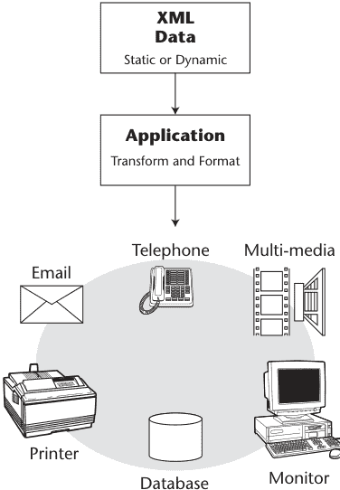

图 1 XML 系统架构。

XML 是数据层。它可以存储为各种格式，如平文件、关系型数据库，甚至作为来自另一个 XML 应用程序的流。

系统的可选组件是 DTD，或文档类型定义。DTD 存储了在标记 XML 数据时可以使用的元素和属性的定义。将数据与 DTD 进行比较，以验证所有元素都已定义，且数据内部元素的层次结构是正确的。大多数应用程序在开始时使用 DTD 来验证输入并在生产期间测试应用程序，并在应用程序上线后将其移除以优化。

应用程序的第二层是数据的格式化和转换。因为 XML 是一种存储机制而非格式化语言，因此转换层使用样式表将数据映射到各种类型的输出。

针对同一份数据可以使用多个样式表，以便输出到不同的设备。在过去，如果需要将同一份数据包含在书中、通过 PDF 文件打印并整合到网页中，则必须创建三份数据副本，每种输出一份，这几乎不可能保持这三份副本的同步。当对原始数据进行更改时，数据副本将不会更新。使用 XML，所有类型的输出都只有一个数据源。没有数据副本，只有不同输出类型的样式表在访问原始数据。

第三层是输出机制。这可以是计算机显示器、PDA、Adobe Acrobat PDF 文件，或指向另一个 XML 应用程序的流。需要记住的重要概念是，XML 不会被不同类型的输出而改变。数据存储为 XML，使用样式表进行格式化和转换，并输出到所选设备。

### XML 对比 HTML：内容与格式化

作为 Web 开发者，你知道数据与格式化数据的标签一起整合到 HTML 页面。这对于其他项目来说是一个大问题。任何需要访问你网页内容的应用程序都必须想办法剥离 HTML 并留下底层数据。即使所有标签都被剥离且数据裸露出来，应用程序也没有方法知道这些数据的含义。数据和数据的格式化结合在了一起，以至于你网站的内容对其他应用程序几乎毫无用处。

HTML 没有告诉我们任何关于数据内容的信息，只了输出在浏览器中显示时应该什么样。在列表 1 中，页面的标题和每列火车的信息都被 HTML 标签包围，这些标签决定了颜色、换行和其他类型的格式化。任何想要访问数据的应用程序都必须想办法剥离格式化并留下内容。

HTML 示例导致了两个问题。如果曼哈顿交通局 `MTA` 决定更改页面内容，尝试访问数据的应用程序就会

# VoiceXML 简介 7


```html
<html
<head>
<title>
曼哈顿交通局:
  地铁更新
</title>
</head>
<body text=000000
  bgcolor=ffffff
  link=0000ff
  vlink=000099
  alink=aa0000
  <div style=text-align:center;
  font-weight:bold;
  font-size:medium;
  margin-bottom:1em
  曼哈顿交通局: 地铁更新
</div>
<div>2 号列车: 准点</div>
<div>3 号列车: 准点</div>
<div style=color:ff0000>
4 号列车：大西洋大道处正在施工。
列车误点 20 分钟
</div>
</body>
</html>
```

**列表 1** 存储为 HTML 的数据

访问数据的应用程序必须知道这些更改并返回新的数据集。此外，如果 MTA 页面的格式发生变化，调用应用程序将必须重写以剥离新格式。

通过将数据与任何格式化隔离，XML 消除了这些问题。列表 2 显示了存储在 XML 中的相同数据。数据被描述数据是什么的标签包围，而不是它应该什么样。任何理解 MTA XML 标签集的现在都可以访问数据并以任何所需的格式输出。MTA 可以更改内容、添加或删除项目，并更新事实。

```xml
<?xml version="1.0" encoding="UTF-8"?>
<mta_update>
  <title>Manhattan Transportation Authority: Subway Update</title>
  <train id="2">On Time</train>
  <train id="3">On Time</train>
  <train id="4" status="delayed">Construction at Atlantic Avenue. Trains delayed 20 minutes</train>
</mta_update>
```

**列表 2** 存储为 XML 的数据

### XML 元素

XML 元素被标签包围。每个元素都有起始和结束标签，并包含文本或其他元素。元素的名称在两个标签中是相同的。例如：

<p>这是一个段落。</p>

元素还可以具有属性，提供关于元素的附加信息。属性放置在起始标签内。

<p color="red">这是一个带有属性的段落。</p>

第三层是输出机制。这可以是计算机显示器、PDA、Adobe Acrobat PDF 文件，或指向另一个 XML 应用程序的流。需要记住的重要概念是，XML 不会被不同类型的输出而改变。数据存储为 XML，使用样式表进行格式化和转换，并输出到所选设备。

### XML 对比 HTML：内容与格式化

作为 Web 开发者，你知道数据与格式化数据的标签一起整合到 HTML 页面。这对于其他项目来说是一个大问题。任何需要访问你网页内容的应用程序都必须想办法剥离 HTML 并留下底层数据。即使所有标签都被剥离且数据裸露出来，应用程序也没有方法知道这些数据的含义。数据和数据的格式化结合在了一起，以至于你网站的内容对其他应用程序几乎毫无用处。

HTML 没有告诉我们任何关于数据内容的信息，只了输出在浏览器中显示时应该什么样。在列表 1 中，页面的标题和每列火车的信息都被 HTML 标签包围，这些标签决定了颜色、换行和其他类型的格式化。任何想要访问数据的应用程序都必须想办法剥离格式化并留下内容。

HTML 示例导致了两个问题。如果曼哈顿交通局 `MTA` 决定更改页面内容，尝试访问数据的应用程序就会必须知道这些更改并返回新的数据集。此外，如果 MTA 页面的格式发生变化，调用应用程序将必须重写以剥离新格式。

通过将数据与任何格式化隔离，XML 消除了这些问题。列表 2 显示了存储在 XML 中的相同数据。数据被描述数据是什么的标签包围，而不是它应该什么样。任何理解 MTA XML 标签集的现在都可以访问数据并以任何所需的格式输出。MTA 可以更改内容、添加或删除项目，并更新事实。

### XML 元素

XML 元素被标签包围。每个元素都有起始和结束标签，并包含文本或其他元素。元素的名称在两个标签中是相同的。例如：

<p>这是一个段落。</p>

元素还可以具有属性，提供关于元素的附加信息。属性放置在起始标签内。

<p color="red">这是一个带有属性的段落。</p>

第三层是输出机制。这可以是计算机显示器、PDA、Adobe Acrobat PDF 文件，或指向另一个 XML 应用程序的流。需要记住的重要概念是，XML 不会被不同类型的输出而改变。数据存储为 XML，使用样式表进行格式化和转换，并输出到所选设备。

移植性，在操作系统之间移动数据的能力，是使用时最重要的考虑因素之一。它可以在 Unix 上创建，仍然可以在 Windows、Mac 以及任何平台访问。XML 标签本身没有意义。例如，在输出到 HTML 时，应用程序可以给出不同的格式。命令，“当你看到管理标签时，将其输出为蓝色。”如果元素内部的内容被更改，访问数据的应用程序仍可以工作，无需更改。

### XML 语法

XML 有一套简单的规则：

- 标签区分大小写。`<Area>` 和 `<a>` 是不同的元素。按照习惯，元素名称应小写。
- XML 文档必须以 XML 声明开始，说明 XML 版本号。声明必须是文档的第一个字符、第一个位置。
- XML 中只能有一个根元素。该元素是文件中所有其他元素和数据的容器。
- 每个元素必须有开启标签和结束标签。与 HTML 不同（HTML 中 ``、`<br>` 和 `<li>` 没有结束标签），如果标签没有关闭，XML 解析器将抛出错误。对于简写，使用斜杠来关闭没有内容或结束标签的元素：`<br/>`。
- 元素可以相互嵌套，最后一个元素必须是第一个关闭的。重叠元素会导致解析器抛出错误。
- 强制使用属性值。可以使用单引号或双引号。

大多数 Web 浏览器供应商都创建了他们认为的“智能”浏览器。如果 HTML 代码缺少结束标签或属性值未加引号，浏览器仍会尝试显示页面。这在 XML 中不会发生。即使是元素嵌套不当也会停止应用程序并提供错误消息，据希望，它会指向出错的行。

查看列表 3 中的每个示例。它们在 HTML 中是完全接受的，但在 XML 应用程序中会抛出错误。

## 第一章

```
1. 这将在 <b>在 XML 中处理</b>
2. 
3. <li>XML 与 HTML</li>
4. <i><b>XML</b></i> 比 <b><i>HTML</i></i> 更加严格
```

**列表 3** HTML 与 XML 语法对比。

列表 3 的第 1 行显示了一个非常明显的错误：标签是区分大小写的。如果起始标签是小写，则结束标签也必须是小写。

第 2 行包含两个错误，其中一个大多数从 HTML 切换到 XML 的开发者可能会忽略。所有属性值必须加引号。此外，每个元素都必须有结束标签。HTML 中的几个元素不需要标签：``、`<li>`、`<br>` 和 `<p>`。在示例的第 2 行和第 3 行中，<i> 和 <li> 元素必须有结束标签。XML 允许在标签之间之间没有内容时将起始标签和结束标签合并：在标签 `` 中将正斜线作为最后一个字符将被认为是 XML 中的正确用法。

第 4 行的错误是标签的嵌套。XML 强制要求“先开后闭”。如果 XML 数据符合 XML 语法构造的基本规则，则称其为*良好格式的 (well formed)*。这些规则可能很简单，但 XML 解析器会严格执行。为了被认为符合 XML 标准，如果解析器在文档语法中发现错误，必须停止处理数据。一个良好的解析器实际上会给你提供一条警告消息，显示可能的错误位置。

> 在创建 XML 应用时，开发者必须严格遵守语言的语法规则以及 DTD 中的元素层级定义，否则应用程序将无法运行。

### DTD：定义 XML 元素

XML 应用程序可以带有一个可选的规则集，称为 DTD。DTD 定义了应用程序可用的元素、元素的层级结构，以及每个元素可以携带哪些属性。

> **符合 XML 语法规则的文档被称为良好格式的。如果文档遵循 DTD 中建立的规则，则认为它是有效的 (valid)。**

DTD 可以由 XML 应用程序的开发者定义，通常是分析将处理的数据子集。以列表 2 作为数据示例，我们可以看到使用了哪些元素以及它们是如何相互嵌套的。列表 4 显示了一个描述 MTA 数据的 DTD。

### VoiceXML 11 简介

```
1. <!ELEMENT trains(region) *>
2.
3. <!ELEMENT region(area, management, train+)
4. <!ELEMENT area (#PCDATA)>
5. <!ELEMENT management (#PCDATA)>
6.
7. <!ELEMENT train (number, status)>
8. <!ELEMENT number (#PCDATA)>
9. <!ELEMENT status (#PCDATA)>
```

**列表 4** 简单 DTD。

DTD 包含了将作为标签集一部分的元素描述。每个元素被定义为一个内容模型，指定了与该元素相关的其他元素和属性。`<ELEMENT>` 标签用于定义每个元素的内容模型。ELEMENT 关键字后面跟着要定义的元素名称。括号包含该元素的内容模型，并以一个可选的量符结束。让我们看看这是如何付诸实践。

列表 4 的第 1 行将顶层元素或根元素定义为 `<trains>`。根据 XML 的语法规则，只能有一个根级元素。该元素将是数据中所有其他元素的容器。通过查看列表 2 中的数据源，我们可以确定 `<train>` 元素的直接子元素是 `<region>`，因此 region 是 `<trains>` 内容模型中的唯一元素。

注意内容模型后的 `*`。这是一个取自正则语言的量符。共有三个量符：`*` 表示零或多个，`+` 表示一个或多个，而 `?` 定义为可选。在这种情况下，`?` 意味着 `<train>` 元素可以包含零或多个 `<region>` 元素。

由于 `<train>` 元素可以包含 `<region>` 元素，因此必须定义 region。第 3 行显示的内容模型规定 `<region>` 可以包含一个 `<area>` 元素、一个 `<management>` 元素和一个多个 `<train>` 元素。逗号格式用于元素按照它们在内容模型中出现的特定顺序排列。这三个元素中的每一个都必须被定义，如第 4 行到第 7 行所示。

`<train>`的内容模型必须包含一个 `<number>` 元素和一个 `<status>` 元素，且有序。第 8 行和第 9 行定义了这两个元素。

XML 实体中有特殊字符引用。实体类似于大型数据的别名或快捷方式。当元素被定义为 `#PCDATA` 时，实体会在数据处展开。DTD 中的大部分元素将通定义为 `#PCDATA`。

DTDs 在内部存储为数据文件的一部分，或在外部作为独立的定义集存储。大多数 DTD 在外部约定了 VoiceXML 元素集的定义，VoiceXML 行业已约定了 VoiceXML 2.0 *工作草案 (Working Draft)* 的定义，并在 www.w3.org/TR/voicexml20 提供了它。在开发 10 个项目的期间，我们将检查该文档的不同部分。


### 使用 XSLT 显示 XML

XML 是一种存储和传输机制，需要处理后才能显示。通过名为 XSLT（扩展样式表语言）的语言进行格式化，可以从 XML 数据转换为如文本、HTML、PDF 甚至其他输出。XSLT 语法具有基本元素，用于转换数据。列表 5 显示了一个将列表 2 中的数据转换为 VoiceXML 的简单样式表。

```
1. <xsl:stylesheet
2 version="1.0"
3 xmlns:xsl="http://www.w3.org/1999/XSL/Transform">
5. <xsl:template match="trains">
7 <!-- BEGIN VOICEML OUTPUT ---
8. <voicem version="2.0">
9 <form id="greeting">
10 <block>
11 You have reached
12 <xsl:value-of select="region/management" />
13 <xsl:value-of select="region/area" />
14 Here are the most recent updates to our train time
15 <break size="medium" />
16 <xsl:apply-templates select="region/train" />
17 </block>
18 </form>
19 </voicem>
20 </xsl:template>
21 <!-- END VOICEML OUTPUT ---
24 <!-- INDIVIDUAL TRAIN INFO ---
25 <xsl:template match="train">
26 The number <xsl:value-of select="number" /> train
27 <xsl:value-of select="status/delay" />
28 <xsl:if test="status/delay != 'on time'">
29 minutes late due to construction
30 <xsl:value-of select="status/constructionUpdate" />
31 </xsl:if><xsl:text>.</xsl:text>
32 <break size="small" />
33 </xsl:template>
35. </xsl:stylesheet>
```

**列表 5** 使用 XSLT 显示 XML。

### 使用 XSLT 显示 XML

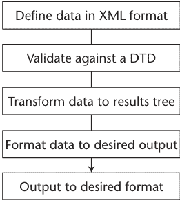

**图 2** 转换为 VoiceXML 的流程

列表 5 中的 XSLT 代码通过模板格式化并转换数据创建 VoiceXML 输出。尽管你可能熟悉 XSLT，但你可以看到它的风格和语法与 XML 相似，都有起始结束标签、引号属性和层级结构。我们将在其中一个项目中使用样式表和 XSLT 将调查数据转换为 VoiceXML。

### VoiceXML

上述关于 XML 的概述可以直接转移到 VoiceXML 应用的创建。VoiceXML 使用 XML 的语法和结构来创建一种可以通过语音或电话访问网站内容的语言。

### VoiceXML 工作草案规范

VoiceXML 论坛（VoiceXML.org）正与 W3C 一起创建标准的 VoiceXML 术语。创始人包括 IBM、AT&T、Lucent、Motor 以及许多与动态语音生成相关的公司。W3C 同意参与 VoiceXML 2.0 规范的制定。规范必须经过多个阶段才能被 W3C 委员会正式采用（见图 3）。工作草案是第一阶段上

第 1 ：工作草案

第 2 ：最后工作草案

第 3 ：候选推荐

第 4 ：建议推荐

第 5 ：推荐

完整描述：

http://www.w3.org/Consortium/Process-20010719/tr.html#Recs

**图 3** W3C 规范建议阶段。

通往正式建议的方法。根据 W3C 的规定，草案不应用于开发生产级应用程序。更多详情请参见警告框。

> > 工作草案文档不是完成的提案，不应用于创建生产级应用程序。以下是 W3C 的说法：“这是一份供 W3C 成员和相关方审阅的 W3C 工作草案。它是一份草案文件，可能随时被其他文档更新、替换或失效。将 W3C 工作草案作为参考材料或将其引用为其他‘进行中的工作’是不恰的。”


尽管 W3C 网站上有警告，但公司正在使用工作草案开发应用程序。当你拨打 1-800-555-1212 请求电话号码时，你会听到由 TellMe.com 开发的语音应用程序。犹他州实施了一条信息热线，其前端是一个 VoiceXML 应用程序。所有主要的语音门户网站（如 Vocal、TellMe 和 Hey Anita）都基于工作草案提供服务。这些公司中的每一家都声称很大程度上符合 VoiceXML 2.0 标准。规范将如何仍有待观察。

## VoiceXML 语法

VoiceXML 文档是一组使用 XML 语法的预定义元素集。VoiceXML 的 DTD 可从 www.w3.org/TR/voicexml20 获取。标签集相对较小，由约 50 个元素组成，对于标签之间如何相互出现以及每个元素可以携带哪些属性有特定规定。我们将使用这些规范开发应用程序，从而使应用程序能够在不同平台间迁移，并与任何理解且符合 VoiceXML 工作草案的软件协同工作。

## VoiceXML 简介

```
1. <?xml version="1.0"?>
2.
3. <xml version="2.0">
4. <form id="greeting">
5. <block>
6. 你已接入曼哈顿交通局
7. 位于纽约市。
8. 以下是我们的火车时间表
9. 以及施工导致的误误最新更新：
10. <break size="medium" />
11.
12. 2 号线
13. 准时到达。
14. <break size="small"/>
15.
16. 3 号线
17. 准时到达。
18. <break size="small"/>
19.
20. 4 号线
21. 晚点 20 分钟
22. 由于大西洋大道的施工。
23. <break size="small"/>
24.
25.
26. </block>
27. </form>
28. </xml>
```


**列表 6** 从 XML 数据生成的 VoiceXML 输出。

VoiceXML 是一种标记语言，使用起始标签和结束标签来表示语音服务器实现应处理的事件和响应。在编写 VoiceXML 应用程序时，适用于 XML 的语法规则。具有 HTML 基础的 Web 开发人员会发现该语言的外观样式非常熟悉。列表 6 显示了列表 2 通过 XSLT 样式表转换为有效的 VoiceXML 后的输出。

第 1 行指定这是一个 XML 文档。文档的根元素是 `<xml>`、`<form>` 和 `<break>`。`<form>` 元素是接收用户信息的 Basic 代码块。`<block>` 元素处理动态内容的处理，`<break>` 元素在语音输出中插入短停顿。当我们在第一个项目中开始开发应用程序时，我们将更详细地查看这些元素。

# 第一1 章

## 处理 VoiceXML

VoiceXML 实现可以通过电话接收语音命令，并将这些口头命令翻译成文本。语音转文本（STT）引擎处理语音语言到文本的转换。一旦语音转换为文本，它会被发送到处理机制，该机制可以是你的网站上可用的任何机制。Perl、JSP、ASP 或服务器端任何其他类型的处理可用于处理请求。这可以访问接收端计算机上的所有资源，包括数据库、平纹文件和处理请求所需的任何其他类型的内容。

处理结果将传回给 VoiceXML 应用程序。该应用程序通过文本转语音（TTS）翻译器翻译结果，向呼叫者口头输出响应。此外，VoiceXML 应用程序可以使用带有人声的预录音频文件作为对请求的响应。应用程序可能会向用户询问更多信息，并继续会话或终止通话。

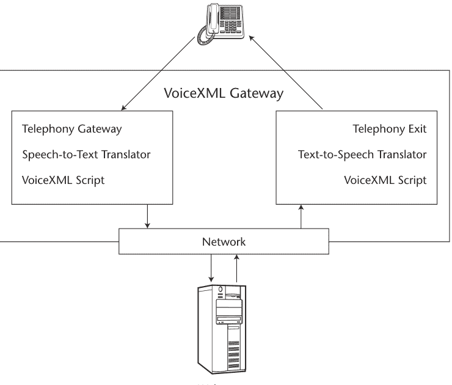

**图 4** VoiceXML 处理流程。

# VoiceXML 简介 17

VoiceXML 语言最重要的概念之一是将用户交互与请求处理隔离开来。如图 4 所示，VoiceXML 解释器处理电话与处理层之间的接口。它不处理请求的处理。VoiceXML 前端作为通往服务层的过滤器，实际处理请求。通过创建一个独立于任何特定处理机制的接口层，VoiceXML 应用程序是跨平台的的。

用户界面由一系列引导呼叫者的对话组成，用于收集处理信息。界面可能是单个文档，或一组通过不同的统一资源标识符（URL）链接的文档。

## 结语

XML 使为特定行业创建标签集成为可能。VoiceXML 论坛已定义了用于开发电话应用程序的标签集。由于 HTML 和 VoiceXML 语法之间的相似性，Web 开发人员会发现使用现有站点创建语音应用程序非常容易。在下一章节中，我们将设置工作环境，以便你可以创建自己的 VoiceXML 应用程序。

# 第 2 章

## 设置工作环境

VoiceXML 是作为终端用户与 Web 服务器处理平台之间解释器的接口层。

# 设置工作环境 21

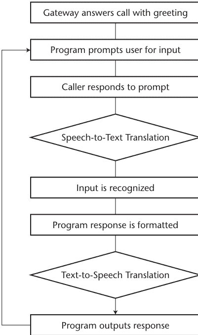

**图 1** VoiceXML 应用流程图。

图 1 显示了典型语音应用程序的流程。VoiceXML 网关接听电话，输出问候，然后等待呼叫者的输入。呼叫者说出命令，该命令由 VoiceXML 语音转文本（STT）翻译器转换为文本。输入被发送到 VoiceXML 脚本进行处理，返回的响应由文本转语音（TTS）翻译器重新格式化为语音。对话持续直到呼叫挂断或脚本终止。

### VoiceXML 应用服务提供商

有几个应用程序服务提供商提供免费的环境访问，可用于开发、测试和部署你的 VoiceXML 应用。主要的提供商有 HeyAnita.com、BeVocal.com、TellMe.com 和 VoiceGenie.com。一旦你跳过那些宣传和营销炒作，这四家公司都为你的 VoiceXML 项目提供在线工具和免费空间分配。

# 第 2 章

成为任何一个门户的开发者都是免费的。填写基本联系信息，几分钟内你就可以开始你的第一个应用程序了。所有界面都是基于 Web 的，通过浏览器访问。尝试每一个，并选择一个让你觉得最直观、最舒适的。十个项目中的示例和代码将使用其他供应商之一，即 BeVocal 开发平台。如果你选择使用其中一个，可能会有细微的差异，尽管它们都声称符合 VoiceXML 2.0 标准。

> 这 10 个项目是使用 BeVocal 平台开发和测试的。在其他语音门户上运行项目时可能会有细微差异。请参阅你所在门户的文档获取详情。

### 在 BeVocal Cafe 设置开发者账户

BeVocal Cafe 将用于开发书中的项目。我发现 BeVocal 与 VoiceXML 2.0 规范具有良好的性，为项目开发提供了高级工具，并在出现问题时拥有良好的支持系统。美国的免付费号码允许你拨打你的应用程序而不会产生任何电话费用。还有适用于欧洲和其他国际位置的号码。请检查 `cafe.BeVocal.com` 开发者页面的顶部以获取最新号码。

### 创建账户

访问 `cafe.bevocal.com` 并点击页面左上角的 `Signup` 按钮来创建开发者账户。点击 `I Agree` 同意开发者协议，填写注册屏幕（红色星号表示必填字段），并点击 `Submit` 完成注册过程。

> 在注册 BeVocal 账户时，请提供你在测试应用程序时将要拨打的电话号码。平台将识别你拨出电话的号码，而无需询问开发者 ID 即可访问你的账户。

注册完成后，你将注册为 BeVocal Cafe 的开发者。检查你的电子邮件，你将收到一封来自 BeVocal 的确认信，其中包含你的用户名、密码和 PIN 码。保存或打印该电子邮件作为登录信息的提醒。当你拨打电话测试应用程序时，你需要这些信息来确认身份。

- 使用 BeVocal 创建开发者账户。

# 设置工作环境 23

# Bevocal 开发环境中的工具

BeVocal 提供了一套工具来帮助开发者创建 VoiceXML 应用。本节将检查第二部分将使用的工具，通过访问 `cafe.bevocal.com` 并输入你的用户信息查看进入你 BeVocal 账户的日志。在随后的访问中，你的用户名和 ID 将被记住。

> 注意 BeVocal 平台在你的机器上放置了一个 cookie，记录了你的用户名和密码。如果你收藏了开发者登录页面，将跳过登录过程，并在未来的访问中你将直接进入开发区域。

### 文件管理

工作环境中的第一个屏幕是图 2 所示的文件管理工具。这是你工作区的中心区域。文件管理中有四个基本区域：工具菜单、本地文件、远程文件和账户信息。

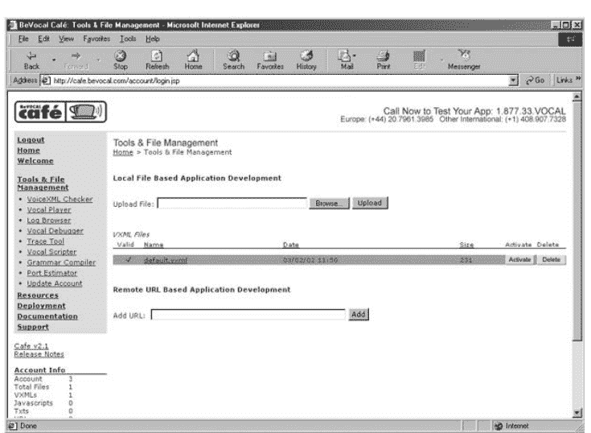

图 2 Bevocal 文件管理。

# 第 2 章

页面左上角的 Tools 菜单可以访问环境中的工具。我们将检查在 10 个项目内使用的工具。点击名称将弹出一个 Java applet，实时访问你的应用程序数据，或者弹出一个新窗口来编辑你的应用程序。

关于你账户的基本信息列在显示器的左下角。开发者账户默认分配 2 MB 空间。因为 VoiceXML 是基于文本的脚本，这为创建你的应用程序提供了非常充裕的空间。如果你正在开发包含音频文件的大型应用程序（例如项目 8 中的《星迷大战》游戏），请联系技术支持以确保增加你的账户配额。

Account Info 列显示已创建或上传到你账户的文件信息。可以将其视为一个带有额外细节的微型文件管理器。当文件列为 Active（已激活）时，它当前可供 Be 平台处理。一次只能有一个文件处于激活。我们将在项目 5 中学习如何突破这一限制。Account Info 列还显示你的文件占用了多少空间以及你的账户中有可用空间。


> 一次只能有一个文件处于激活。我们将在项目 5 中学习如何突破这一限制。Account Info 列还显示你的文件占用了多少空间以及你的账户中有可用空间。


向账户添加文件有两种方法。可以在 VoiceXML Editor 中创建。我们将检查这种技术。另一种方法是在本地计算机创建文件并上传到你的账户。Upload 表单有一个 Browse 按钮，用于访问本地驱动器上的文件。一旦选择了文件，点击 Upload 按钮，文件的副本将移动到你的 BeVocal 账户。在任何情况下，你都有约 2 MB 的存储空间。VoiceXML 应用不必存储在 BeVocal。你可以像存储任何 Web 页面一样将应用程序存储在自己的个人 Web 服务器上。远程 URL 开发接口允许上传可以作为应用程序界面的 URL。

登录你的 BeVocal 账户。点击 Tools 菜单上的 File Management 并检查屏幕。确认 `default.vxml` 是否在文件列表中。这是我们将验证你的开发环境设置恰当的文件。


### VoiceXML Checker

图 3 所示的 VoiceXML Checker 是一个判断你的应用程序是否符合 XML 语法规则的工具。它还可以验证你的应用程序是否符合 VoiceXML 2.0 的规则。

屏幕左侧是 File Management 窗口，显示 Tools 菜单和 Account Info。主屏幕显示了一个大型文本区域以及用于激活 VoiceXML 语法检查、保存文件到你的账户、完全清空显示内容或将文本框重置为默认值的按钮。文本区域可用于打开脚本或从头开始编写新脚本。

## 第26章 第2节

点击文件管理窗口中的 `default.xml` 文件名。这将带你进入 VoiceXML Checker 页面，并将 `default.xml` 脚本插入到文本区域中。在页面顶部，有一个确认通知显示显示的是 `default.xml` 文件。点击持有的 VoiceXML 代码下方的 Check（检查）按钮。查看状态行，如果输出为绿色，则说明脚本是格式良好的 VoiceXML。

VoiceXML Checker 有两种类型的语法检查：格式良好（well-formed）和有效（valid）。良好的文档遵循 XML 的一种语法规则：属性值用双引号括、标签闭合、元素嵌套恰当等。如果 VoiceXML 脚本中包含了对类型定义（DTD）的调用，Checker 还会根据 DTD 验证该文件。

列表 1 显示了第 2 到第 6 行对 DTD 的调用。我们将查看项目 1 中的其余代码。VoiceXML Checker 将检查第 8 到第 16 行的代码，并确保它根据 DTD 中建立的规则是有效的。

```
1. <?xml version="1.0"?>
2. <!DOCTYPE
3. vxml
4. PUBLIC
5. "//BeVocal/VoiceXML 2.0//EN"
6. "http://cafe.bevocal.com/libraries/dtd/vxml2-0-bevocal.dtd">
7.
8. <vxml version="2.0">
9. <form id="form">
10. <block>
11. <prompt>
12. Hello World!
13. </prompt>
14. </block>
15. </form>
16. </vxml>
```

列表 1 `default.xml` 脚本。

删除 `default.xml` 脚本中的调用。点击 Check 按钮。红色消息表示应用程序中的错误，可能是可能问题的警告消息。注意错误消息并滚动到页面底部查看检测到的特定错误。

## 设置工作环境

有一个警告消息显示缺少 `<DOCTYPE>`。在处理 VoiceXML 文件时，DTD 是可选的。没有 DTD 应用程序仍然可以运行，但在开发过程中包含它是一个好主意。

在左列菜单中点击 File Management（文件管理），不要保存对 `default.vxml` 脚本的更改。

VoiceXML 脚本可以在 Vocal Checker 窗口中从头创建。在检查窗口中输入代码，在 Save As（另存为）字段中命名并保存文件。当你在 File Management 窗口查看文件列表时，新文件将被添加。这对于创建批文件、外部文法和独立脚本非常有用，我们将在后面的会话中检查它们。

> 你可以使用 VoiceXML Checker 的 Save As 按钮重命名文件。在 Save As 旁边的文本框中输入名称并按按钮。原始文件不会重命名。旧文件的副本将获得新名称。我使用这种技术为单个脚本构建系列文件，保留脚本开发每个阶段的副本。

在 BeVocal 环境中，保存文件时文件名强制转换为全小写。

> 当使用 Save As 时，如果服务器上已存在指定名称的文件，它将在不警告的情况下被覆盖。

### 日志浏览器

Log Browser（见图 4）用于检查向你的应用程序放置的调用，从程序的角度对调用流进行分析。你可以按日期范围搜索调用，还可以在搜索中包含特定的呼叫者号码。

Log Browser 有两个屏幕。打开的屏幕显示了一个用于选择日期范围、特定呼叫者电话号码或基本文本搜索的表单。表单下的四个按钮用于控制对日志文件的访问。Submit（提交）按钮将带来符合表单要求的的文件列表，Most Recent Log（最新日志）按钮将打开新窗口显示最近一次调用应用程序日志。Reset（重置）将所有表单字段恢复为默认值。

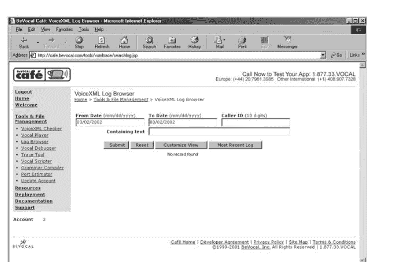

图 4 BeVocal Browser。

在表单中输入日期范围然后点击 Submit 按钮，将列出在选择日期范围内向你的应用程序放置的调用列表，如图 5 所示。默认表格显示每次通话的信息，包括通话时间、拨打的电话号码、通话时长、错误计数以及查看通话日志的链接。Submit 按钮的输出可以通过点击 Customize View（自定义视图）进行配置。出现的对话框将包含可以包含在日志表中的项目列表。

通过点击 Submit 输出中 Details（详情）列下的 View Log（查看日志）或选择 Most Recent Log 来激活 Log Browser 的第二个屏幕。将打开一个新窗口，显示已跟踪的事件清单和完整的通话日志。事件列表经过颜色编码，便于扫描日志并仅查看感兴趣的事件。Apply Default（应用默认）按钮将重置表单以显示所有事件。

Log Browser 在确定哪些错误破坏了你的应用程序以及 VoiceXML 平台如何处理你的脚本时非常有用。例如，如果你的基础语音应用程序尝试访问不可用的通用网关接口（CGI）脚本或返回无效的 VoiceXML，错误日志将帮助定位问题。

（注：提供的 OCR 文本包含部分重复和噪音，将关注提供的清晰部分。）

## 第 2 章

从零开始，并以 `.txt` 扩展名保存。对于大型批文件，您可以在本地机器上创建文件，并通过文件管理接口将其到语音服务器。

要激活批文件进行处理，在用拨号（Dial）按钮调用 VoiceXML 脚本后点击批模式（Batch Mode）按钮。显示窗口将出现确认通知，脚本会自动处理存储在所选文件中的输入。

点击拨号（Dial）按钮激活语音脚本。插件窗口将显示“正在拨号（Dialing in Progress）”。当与语音服务器建立连接后，脚本的语音输出将以 OUTPUT—符号前缀。脚本将暂停，在适当的时间等待输入。在插件窗口底部的用户输入（User Input）字段中输入响应，完成后按 Enter 键。激活处理将一直进行，直到脚本终止或用户选择挂机（Hang Up）按钮。所有应用程序将在 1 小时后自动超时。

> 当用户不响应语音服务器的请求时，会创建一个无输入（no-input）事件。语音脚本没有处理此问题的缓冲区。它将一直等待直到应用程序超时。当输入字段中没有文本时，按下键盘上的 Enter 键将触发无输入事件。

### 激活应用程序

BeVocal 为公众提供了两种访问您的应用程序的方式。您可以为选定的客户演示供私用的应用程序，也可以展示您的作品，通过 BeV 网站的营销区域将其发布。

要演示应用程序，请在开发者区域内任何 BeV Cafe 页的菜单中选择部署（Deployment）选项。您将看到部署应用程序的可能方式列表。从左侧菜单中选择演示（Demo）。如图 8 所示，部署场景将显示您账户中所有可用的 VoiceXML 文件列表。点击文件进行选择部署。

部署的第 2 步将允许输入演示 ID 编号。这将在用户拨打您的应用程序时识别他们。在部署应用程序时，我通常会勾选“生成 ID（generate an id）”框。这可以确保 ID 是唯一的，我不需要不断猜测来寻找一个。在描述框中输入描述您应用程序的简短说明。当其他开发者查看您正在开发什么类型的应用程序时，该描述将出现在 BeV 演示页面。

如果您想在 BeV 营销区域展示您的应用程序，请选择页面底部的“我想展示我的应用程序（I want to showcase my application）”框，如图 9 所示。点击部署（Deploy）按钮将弹出来自 BeV 律师的法律页面。通过选择我同意（I Agree）按钮确认您已阅读法律协议。

> 演示应用程序必须输入一个简短描述。如果您只是在测试环境，请在描述框中输入一个短语或“test（测试）”词。

## 设置工作环境

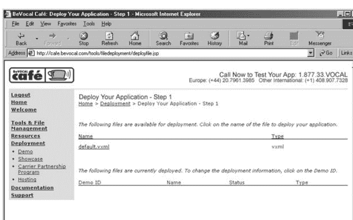

图 8 部署屏幕，第 1 步。

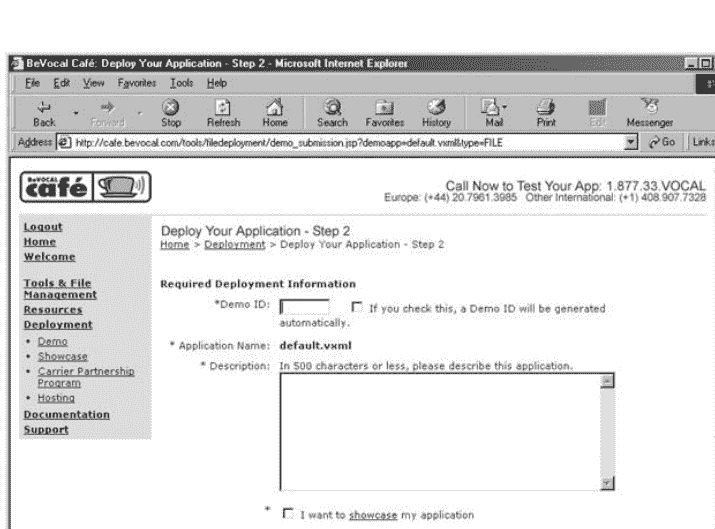

图 9 部署屏幕，第 2 步。

## 第 2 章

部署程序的第 3 步会显示确认通知，说明您的应用程序已激活为演示。要检查演示，请拨打 1-800-BeVocal 并说“BeVocal Speaking”。您的演示 ID 将激活您的 VoiceXML 应用程序。

要在演示区域禁用您的应用程序，请点击左侧菜单中的演示（Demo）按钮。滚动到页面底部查看您账户中当前部署的应用程序。点击您想要禁用的应用程序 ID，将弹出一个在页面底部显示禁用（Disable）单选按钮的屏幕。选择禁用并点击提交（Submit）将您的应用程序从活动演示区域移除。

使用演示区域使您能够向客户提供原型应用程序，而无需让他们使用您的开发者 ID 和 PIN 码访问您的私有账户。

### 文档与支持


与所有主要的语音门户供应商一样，BeVocal 拥有针对 VoiceXML 的大量文档和示例。大多数文档以可下载 PDF 格式提供，也可以在网页上查看。在尝试提取解决方案时，`VoiceXML Reference` 和 `Grammar Reference` 非常有用。随着您的项目变得复杂，您可能还会想要使用 `Speech Objects Reference` 来获取预构建的语音日期、位置和数字格式的示例。我们将在项目中使用一些语音对象，并学习如何使用它们。

BeVocal 还有六份面向所有开发者的简报。我发现版主的反应非常迅速，而且知识渊博，因为他们是构建和维护 BeVocal 环境的开发者。大多数活动位于 `cafe.bevocal.grammars` 和 `cafe.bevocal.vxml` 组。支持人员的直接回复可以通过 `cafesupport@bevocal.com` 获取。

> 点击任何 BeVocal cafe 顶部的 `Documentation` 按钮。从左侧菜单中选择 `Speech Objects Reference` 以获取语音对象的概述及其使用方法。

### 杂工具

BeVocal 工具库中的其他工具还有 `Vocal Player`、`Vocal Debugger`、`Trace Tool` 和 `Grammar Compiler`。随着您的应用程序变得越来越复杂，您将希望利用这些工具的强大功能。

`Vocal Debugger` 和 `Trace Tool` 允许您在脚本运行时对其跟踪。`Vocal Player` 可以重放到您应用程序的通话，这对于跟踪对话或检查语法使用的假设非常有用。

随着您的项目变得复杂，您可能还会想要使用 `Speech Objects Reference` 来获取预构建的语音日期、位置和数字格式的示例。我们将在项目中使用一些语音对象，并学习如何使用它们。

## 设置工作环境

### 测试环境

部署程序的第 3 步会显示确认通知，说明您的应用程序已激活为演示。要检查演示，请拨打 `1-800-BeVocal` 并说“BeVocal Speaking”。您的演示 ID 将激活您的 VoiceXML 应用程序。

要在演示区域禁用您的应用程序，请点击左侧菜单中的 `Demo` 按钮。滚动到页面底部查看您账户中当前部署的应用程序。点击您想要禁用的应用程序 ID，将弹出一个在页面底部显示 `Disable` 单选按钮的屏幕。选择 `Disable` 并点击 `Submit` 将您的应用程序从活动演示区域移除。

使用演示区域使您能够向客户提供原型应用程序，而无需让他们使用您的开发者 ID 和 PIN 码。

### 文档与支持

与所有主要的语音门户供应商一样，BeVocal 拥有针对 VoiceXML 的大量文档和示例。大多数文档以可下载 PDF 格式提供，也可以在网页上查看。`VoiceXML Reference` 和 `Grammar Reference` 在尝试提取解决方案时非常有用。随着您的项目变得复杂，您可能还会想要使用 `Speech Objects Reference` 来获取预构建的语音日期、位置和数字格式。我们会在项目中使用一些语音对象。

BeVocal 还有六份面向所有开发者的简报。我发现版主的反应非常迅速，而且知识渊博，因为他们是构建和维护 BeVocal 环境的开发者。大多数活动位于 `cafe.bevocal.grammars` 和 `cafe.bevocal.vxml` 组。支持人员的直接回复可以通过 `cafesupport@bevocal.com` 获取。

> 点击任何 BeVocal cafe 顶部的 `Documentation` 按钮。从左侧菜单中选择 `Speech Objects Reference` 以获取语音对象的概述及其使用方法。

### 杂工具

BeVocal 工具库中的其他工具还有 `Vocal Player`、`Vocal Debugger`、`Trace Tool` 和 `Grammar Compiler`。随着您的应用程序变得越来越复杂，您将希望利用这些工具的强大功能。

`Vocal Debugger` 和 `Trace Tool` 允许您在脚本运行时对其跟踪。`Vocal Player` 可以重放到您应用程序的通话，这对于跟踪对话或检查语法使用的假设非常有用。

## 设置工作环境

### 测试环境

部署程序的第 3 步会显示确认通知，说明您的应用程序已激活为演示。从零开始，并以 `.txt` 扩展名保存。对于大型批文件，您可以在本地机器上创建文件，并通过文件管理接口将其到语音服务器。

要激活批文件进行处理，在用 `Dial` 按钮调用 VoiceXML 脚本后点击 `Batch Mode` 按钮。显示窗口将出现确认通知，脚本会自动处理存储在所选文件中的输入。

点击 `Dial` 按钮激活语音脚本。插件窗口将显示“正在拨号 `Dialing in Progress`”。当与语音服务器建立连接后，脚本的语音输出将以 `OUTPUT—` 符号前缀。脚本将暂停，在适当的时间等待输入。在插件窗口底部的 `User Input` 字段中输入响应，完成后按 Enter 键。激活处理将一直进行，直到脚本终止或用户选择 `Hang Up` 按钮。所有应用程序将在 1 小时后自动超时。

> 当用户不响应语音服务器的请求时，会创建一个无输入 `no-input` 事件。语音脚本没有处理此问题的缓冲区。它将一直等待直到应用程序超时。当输入字段中没有文本时，按下键盘上的 Enter 键将触发无输入事件。

### 激活应用程序

BeVocal 为公众提供了两种访问您的应用程序的方式。您可以为选定的客户演示供私用的应用程序，也可以展示您的作品，通过 BeV 网站的营销区域将其发布。

要演示应用程序，请在开发者区域内任何 BeV Cafe 页的菜单中选择 `Deployment` 选项。您将看到部署应用程序的可能方式列表。从左侧菜单中选择 `Demo`。如图 8 所示，部署场景将显示您账户中所有可用的 VoiceXML 文件列表。点击文件进行选择部署。

部署的第 2 步将允许输入演示 ID 编号。这将在用户拨打您的应用程序时识别他们。在部署应用程序时，我通常会勾选“生成 ID `generate an id`”框。这可以确保 ID 是唯一的，我不需要不断猜测来寻找一个。在描述框中输入描述您应用程序的简短说明。当其他开发者查看您正在开发什么类型的应用程序时，该描述将出现在 BeV 演示页面。

如果您想在 BeV 营销区域展示您的应用程序，请选择页面底部的“我想要展示我的应用程序 `I want to showcase my application`”框，如图 9 所示。点击 `Deploy` 按钮将弹出来自 BeV 律师的法律页面。通过选择 `I Agree` 按钮确认您已阅读法律协议。

> 演示应用程序必须输入一个简短描述。如果您只是在测试环境，请在描述框中输入一个短语或“test 测试”词。

## 设置工作环境


图 8 部署屏幕，第 1 步。


图 9 部署屏幕，第 2 步。

## 第 2 章

部署程序的第 3 步会显示确认通知，说明您的应用程序已激活为演示。要检查演示，请拨打 `1-800-BeVocal` 并说“BeVocal Speaking”。您的演示 ID 将激活您的 VoiceXML 应用程序。

要在演示区域禁用您的应用程序，请点击左侧菜单中的 `Demo` 按钮。滚动到页面底部查看您账户中当前部署的应用程序。点击您想要禁用的应用程序 ID，将弹出一个在页面底部显示 `Disable` 单选按钮的屏幕。选择 `Disable` 并点击 `Submit` 将您的应用程序从活动演示区域移除。

使用演示区域使您能够向客户提供原型应用程序，而无需让他们使用您的开发者 ID 和 PIN 码。

### 文档与支持

与所有主要的语音门户供应商一样，BeVocal 拥有针对 VoiceXML 的大量文档和示例。大多数文档以可下载 PDF 格式提供，也可以在网页上查看。`VoiceXML Reference` 和 `Grammar Reference` 在尝试提取解决方案时非常有用。随着您的项目变得复杂，您可能还会想要使用 `Speech Objects Reference` 来获取预构建的语音日期、位置和数字格式的示例。BeVocal。我们将在项目中使用一些语音对象，并学习如何使用它们。

BeVocal 还有六份面向所有开发者的简报。我发现版主的反应非常迅速，而且知识渊博，因为他们是构建和维护 BeVocal 环境的开发者。大多数活动位于 `cafe.bevocal.grammars` 和 `cafe.bevocal.vxml` 组。支持人员的直接回复可以通过 `cafesupport@bevocal.com` 获取。

> 点击任何 BeVocal cafe 顶部的 `Documentation` 按钮。从左侧菜单中选择 `Speech Objects Reference` 以获取语音对象的概述及其使用方法。

### 杂工具

BeVocal 工具库中的其他工具还有 `Vocal Player`、`Vocal Debugger`、`Trace Tool` 和 `Grammar Compiler`。随着您的应用程序变得越来越复杂，您将希望利用这些工具的强大功能。

`Vocal Debugger` 和 `Trace Tool` 允许您在脚本运行时对其跟踪。`Vocal Player` 可以重放到您应用程序的通话，这对于跟踪对话或检查语法使用的假设非常有用。

## 设置工作环境

### 测试环境

部署程序的第 3 步会显示确认通知，说明您的应用程序已激活为演示。要检查演示，请拨打 `1-800-BeVocal` 并说“BeVocal Speaking”。您的演示 ID 将激活您的 VoiceXML 应用程序。

要在演示区域禁用您的应用程序，请点击左侧菜单中的 `Demo` 按钮。滚动到页面底部查看您账户中当前部署的应用程序。点击您想要禁用的应用程序 ID，将弹出一个在页面底部显示 `Disable` 单选按钮的屏幕。选择 `Disable` 并点击 `Submit` 将您的应用程序从活动演示区域移除。

使用演示区域使您能够向客户提供原型应用程序，而无需让他们使用您的开发者 ID 和 PIN 码。

## 结语

获取 VoiceXML 开发的最简单方法是使用免费的在线服务。我们将使用 BeV Cafe 作为项目的开发环境。其他的语音门户服务通过 HeyAnita、TellMe、VoiceGenie 以及其他其他公司提供。它们提供了各种 VoiceXML 平台的开发工具和扩展，可以与 BeVocal 环境相媲。选择最适合您的环境并设置账户。

在测试完环境后，您就准备好开始编写第一个 VoiceXML 应用程序了。前五个项目为大多数网站的组件创建了模板：内容、链接、联系信息和安全登录。我们将从创建一个基础的 VoiceXML 页面开始。

# 项目 1

模板被分为四个部分，构建一个基础应用程序，该程序将接受用户输入，根据输入做出选择并输出相应的响应。在此过程中，表单解释算法 `FIA` 将作为 VoiceXML 之前的流程控制器进行讨论。该项目是自自的，除了用于验证应用程序的 DTD 外，没有引用外部数据源。

要完成此项目，你将：

- 1. 创建一个 *Hello, World* 应用程序。
- 2. 验证应用程序运行正常。
- 3. 在模板中添加多个对话。
- 4. 使用是/否 语法接受用户输入。
- 5. 设置错误检查。
- 6. 为项目描述插入元数据。

## 你将需要

- 互联网连接
- 一个拥有如 BeVocal、TellMe、HeyAnita 或 VoiceGenie 等语音门户的开发者账户
- 来自 `cafe.beocal.com/wiley/10projects` 的示例脚本
- 来自 `www.w3.org/TR/voice20` 的 VoiceXML 2.0 工作草案
- 来自 `www.w3.org/TR/speech-synthesis` 的语音合成标记语言规范

本项目中使用的 VoiceXML 元素

| 元素名称 | 说明 |
|---|---|
| `<block>` | (非交互式)执行代码的容器 |
| `<else>` | 用在 `<if>` 元素中 |
| `<field>` | 在表单中声明输入字段 |
| `<filled>` | 当字段被填满时执行的操作 |
| `<form>` | 用于展示信息和收集数据的对话 |
| `<goto>` | 转到同一文档或不同文档中的另一个对话 |

# 使用 VoiceXML 构建基础页面 41

本项目中使用的 VoiceXML 元素（续）

| 元素名称 | 说明 |
|---|---|
| `<grammar>` | 指定语音识别或 DTMF 语法 |
| `<help>` | 捕获帮助事件 |
| `<if>` | 简单条件逻辑 |
| `<noinput>` | 捕获无输入事件 |
| `<nomatch>` | 捕获不匹配事件 |
| `<prompt>` | 将语音合成和音频输出排队给用户 |
| `<vxml>` | 每个 VoiceXML 文档的顶层元素 |

来源：VoiceXML 2.0 工作草案，第 1.4 

### 调用流程

图 1.1 显示了最终应用程序将使用的调用流程。用户拨打应用程序，听到问候，并获得一些基本信息。引导用户给出是或否的回答；VoiceXML 输出基于用户的响应。错误检查在应用程序继续运行并结束处理之前，验证用户是否输入了可识别的响应。

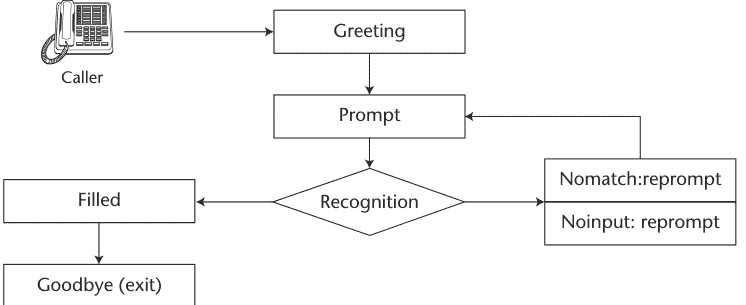

**图 1.1** 基础 VoiceXML 应用程序的调用流程。

# 项目 1

### 创建 Hello, World 应用程序

简单的 Hello, World 应用程序可以验证你的环境已正确设置并运行。通过让系统输出“Hello, World”单词，你将确认应用程序的语法是正确的，开发环境运行正常，并且你已准备好开发更复杂的应用程序。

> 阅读应用程序是有启发性的，但远远够。如果你还没有设置好工作环境，请现在停止并在其中一个语音门户注册开发者账户。书中的项目是在 BeVocal 平台上开发的。


遵循开发过程的每一步并按照演示的内容编写代码。犯错是过程的一部分。让你的应用程序在简单阶段正常运行，其余部分将顺理到位。

列表 1.1 中的 VoiceXML 模板应用程序从第 1 行的 XML 声明开始。第 3 行建立了文档的根元素 `<xml>`。根元素用于包含应用程序中的所有元素。任何元素都不能位于根元素之外。

`<xml>` 元素内部需要一个版本属性。它指定了用于处理文档的 VoiceXML 版本。VoiceXML 的最新版本是 2.0，它是从 VoiceXML 1.0 的重大更新。规范中最重大的变化是 VoiceXML 与语音合成标记语言 `SSML` 同步了。世界维网联盟 `W3C` 规定，任何处理符合 VoiceXML 标准的平台都必须遵守 SSML 规范。如果 VoiceXML 2.0 和 SSML 的定义之间存在冲突，应以 SSML 定义为准。

```
1. <?xml version="1.0"?>
2.
3. <xml version="2.0">
4.  <form>
5.   <block>
6.     <prompt>Hello, World!</prompt>
7.   </block>
8.  </form>
9. </xml>
```

**列表 1.1** Hello World 应用程序

### 使用 VoiceXML 构建基础页面

超过 20 个元素已被 VoiceXML 1.0 规范修改以与 SSML 同步。此外，在新规范中还有许多杂项说明。请查看 VoiceXML 2.0 工作草案的附录 J 以获取完整的更改列表。

（注：由于提供的文本包含大量重复和 OCR 错误，已根据要求提取并翻译了核心有效内容。）

## 使用 VoiceXML 构建基础页面 45

很多情况下，错误的发生是因为 W3C 规范中的元素定义限制了元素可以嵌套在其他元素中的方式。在开始 VoiceXML 开发时，错误地将元素嵌套在其他元素中是最常见的错误。

在你的语音门户账户中创建“Hello World”模板。

### 验证应用程序是否正常运行

通过调用你的应用程序来验证基础模板的输出。如果输出了 Hello, World 单词，你就可以进入下一节了。如果没有听到该短语，请检查开发环境输出的错误消息并进行相应的修改。

图 1.2 显示了应用程序在 Vocal Scripter 中显示时的输出（使用 Vocal Scripter 的说明请参见第 2 章）。Vocal Scripter 可作为应用程序流程的快速检查工具，而无需每次向模板添加新章节时都使用电话。

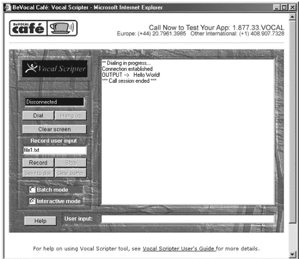

图 1.2 Vocal Scripter 截图。

## 项目 1

确保你的应用程序在每一步都正常运行。有时，一个漏掉的引号或嵌套不当的标签会让你苦恼几个小时。这是学习过程的一部分。现在找出这些简单错误所在的位置，将来当应用程序遇到问题时，你就知道去哪里寻找它们。


### 向模板中添加多个对话

VoiceXML 应用程序中的 `<form>` 是一个独立的对话，可以通过其唯一名称或 id 进行访问。应用程序可以拥有无限数量的表，这使得与用户进行自然对话并创建可以往复移动的对话成为可能。列表 1.2 是一个简单的应用程序，包含了用于欢迎用户、输出内容和退出应用程序的表。


```
1. <?xml version="1.0"?>
2.

<!DOCTYPE vxml
PUBLIC
"//BeVocal Inc//VoiceXML 2.0//EN"
"http://cafe.bevocal.com/libraries/dtd/vxml2-0-bevocal.dtd">

<xml version="2.0">

<form id="greeting">
<block>
Welcome to Mars Colony 7,
<goto next="#main-content">
</block>
</form>

<form id="maincontent">
<block>
Your first day on our colony will be full of surprises.
Please don't hesitate to contact us if you get lost.
<goto next="#goodbye">
</block>
</form>

<form id="goodbye">
<block>
<prompt>
```

列表 1.2 多多个对话。

```
28. Enjoy your stay. Goodbye.
</prompt>
</block>
</form>

</vxml>
```

**列表 1.2** 多个对话。（续）

## 使用 VoiceXML 构建基础页面 47

VoiceXML 是一种标记语言，它拥有一组预定义的元素、属性以及关于每个元素在应用程序中如何使用的规则。在应用程序顶部放置对 DTD 的调用将强制根据 DTD 建立的规则对文档结构进行验证。

### DOCTYPE

`DOCTYPE` 指令指定了根元素将是什么，并提供了有关 DTD 创建、其所维护的内容以及其所在位置的信息。一旦 VoiceXML 应用程序调试完成，就不再需要调用 DTD；它只会减慢应用程序的处理速度。

列表 1.2 的第 3 到第 6 行强制根据 VoiceXML DTD 对应用程序进行验证。

> **始终**在构建 VoiceXML 应用程序时使用对 DTD 的调用。它可以捕获语法错误并在调试过程中提供帮助。当应用程序完成后，删除对 DTD 的调用以优化你的脚本。

`<form>` 元素用于识别第 10 到 15 行以创建打开对话。该表被赋予了属性 `id`，可以从应用程序的任何其他地方访问此对话。`<block>` 元素包含 TTS 解释器的字面输出，以 `<goto>` 元素结尾以控制应用程序的流程。

## **goto** 元素

`<goto>` 元素用于跳转到其他对话。它可以通过三种方式应用：移动到同一对话中的另一个表项、跳转到当前文档内完全全新的对话，或者将处理完全转移到另一个文档。

`nextitem` 属性用于将处理发送到同一对话内的另一个项目。这会覆盖自动访问对话中下一个项目的 FIA 机制。`next` 属性使用使用同份文档内另一个对话的名称作为值，并在前面带有数字符号 (`#`)。该符号被称为片段标识符，用于直接移动到文档中的特定位置。

如果一个表在没有从 `<goto>` 元素跳转的情况下结束，则表示该表已完成。

用于构建各种可选或强制话语的正则表达式量化符类型。这些将在未来的项目中进行研究。

将语法放置在 CDATA 区域中允许开发者在语法中使用诸如 `<` 和 `>` 等特殊字符。CDATA 区域将其作为字面文本输出，不会被 VoiceXML 解释器解析。随着语法变得越来越复杂，将它们包含在 CDATA 区域内就变得强制了。在 yes/no 语法的简单情况下，没有必要使用 CDATA 区域，但养成这种习惯是好的。

第 20 到第 27 行的 `<filled>` 元素用于处理任何被识别为可语法的输入。在开发的应用程序中，如果用户说 "yes" 或 "no"，字段 `accesscode` 将被分配该值。随后，`<filled>` 元素可以根据用户的输入执行某些操作或处理。

### if 元素

第 21 到第 26 行的 `if` 条件检查存储在 `accesscode` 字段中的值并进行相应处理。`cond` 属性包含一个测试，用于检查陈述为真还是为假。如果 `accesscode` 字段包含 `yes`（这将被视为真条件），则直接跳转到告别对话框。`</else>` 标签处理任何未通过初始测试的其他条件。由于语法中只有 `yes` 或 `no` 两种可能，因此该条件是通过给用户访问代码来处理的，然后将他们发送到告别对话框。

在测试条件时，使用双等号 (`==`) 进行比较。单等号 (`=`) 用作赋值运算符，而不是比较。检查时另一个潜在的陷阱是双引号内部的单引号。字段名没有加引号，但被检查的字面值必须用单引号括起来，否则它会被视为变量或字段名。一个简单的规则是：如果是字段名或变量，则不要在双引号内使用单引号。

通过在 `maincontent` 表单中插入一个字段来接受用户输入，以继续开发你的模板。在继续下一节之前，请验证你的应用程序运行正常。

### 设置错误处理

基本的错误处理（例如，当用户发出的语音无法被语法识别，或者用户在收到提示时没有提供任何输入时）是 VoiceXML 平台的责任。VoiceXML 开发者可以通过在应用程序中包含特定上下文的消息来覆盖平台错误消息。列表 1.4 使用 `<noinput>` 和 `<nomatch>` 元素为之前的脚本添加了显式错误处理。此外，插入了一系列使用 `count` 属性控制元素访问的消息。

```
1. <?xml version="1.0"?>
2.

<!DOCTYPE vxml
PUBLIC
"//BeVocal Inc//VoiceXML 2.0//EN"
"http://cafe.bevocal.com/libraries/dtd/vxml2-0-bevocal.dtd"

<vxml version="2.0">

<form id="greeting">
<block>
欢迎来到火星 7 号殖地。
<goto next="maincontent"/>
</block>
</form>

<form id="maincontent">

<block>
你在殖地的第一天将充满
惊喜。如果你迷路了，请随时联系
我们。
</block>

<field name="accesscode">

<nomatch count="1">
抱歉，我不会说克林贡语。
请只说 "yes" 或 "no"。
</nomatch>
<nomatch count="2">
我的翻译器似乎出了问题。
请试一次。
<reprompt/>
</nomatch>
<nomatch count="3">
请前往最近的传送器，
获取有关使用传送器的指示。
<goto next="#goodbye"/>
</nomatch>
```

**列表 1.4** 错误处理。

### 使用 VoiceXML 构建基础页面

```
41. <noinput count="1">
42. 我什么都没有听听到。
43. <reprompt/>
44. </noinput>
45. <noinput count="2">
46. 要访问社区传送器，你必须拥有
47. 一个传送代码。
48. <reprompt/>
49. </noinput>
50. <noinput count="3">
51. 抱歉，我不会读心术。请前往
52. 最近的传送器寻求帮助。
53. <goto next="#goodbye"/>
54. </noinput>
55. <help count="1">
56. 在殖地内移动，你需要一个代码
57. 来访问传送束。
58. <reprompt/>
59. </help>
60. <help count="2">
61. 当你预订到达殖地时，
62. 你被颁发了一个传送代码。如果你
63. 丢失了代码，在任何传送器上说 "guest"
64. 词，就会颁发一个新的。
65. <goto next="#goodbye"/>
66. </noinput>
67. <help count="3">
68. 抱歉，请前往那里寻求帮助。
69. <goto next="#goodbye"/>
70. </help>
71. <help count="1">
72. 在殖地内移动，你需要一个代码
73. 来访问传送束。
74. <reprompt/>
75. </help>
76. <help count="2">
77. 当你预订到达殖地时，
78. 你被颁发了一个传送代码。如果你
79. 丢失了代码，在任何传送器上说 "guest"
80. 词，就会颁发一个新的。
81. <goto next="#goodbye"/>
82. </noinput>
```

*(注：由于原文中存在大量的 OCR 识别错误、重复内容和乱码，上述译文已基于可读内容进行了整理。)*

# 项目 1

## 表单解释算法 (FIA)

任何 VoiceXML 应用程序中的底层处理序列都由 FIA 控制，它通过检查字段级项的守卫条件（guard condition）来决定何时访问每个表单项。在本节中，我们将研究如何选择表单项进行处理、如何设置守卫条件，以及处理发生的顺序。

> **注意：** 本节节仅是 FIA 概念的简要概述。详细的解释和示例请参见 VoiceXML 2.0 工作草案的第 2.1.6 节和附录 C。

## FIA 基本概念

正如我们在开发 Basic Pages 项目时所看到的，表单用于创建 VoiceXML 应用程序与用户之间的对话和交互。FIA 定义了访问表单后处理事件的序列。解释分为三个阶段：选择（select）、收集（collect）和处理（process）。首先选择一个字段级项进行处理，然后收集该项的用户信息，最后对输入进行处理。FIA 会持续运行，直到表单内的所有项都处理完毕，或者跳转到另一个对话。

### 选择阶段

在选择阶段，FIA 按照“先看到、先处理”的顺序访问表单内的字段级项。字段级项列表见表 1.1。每个表单项都关联有一个守卫条件，该条件决定了在处理期间是否应该访问该项。默认情况下，字段级项的守卫条件设置为 `false`，强制访问该项。FIA 检查项的守卫条件，如果守卫为 `false`，则进入该项的收集阶段。当守卫为 `true` 时，将跳过该项。

| 表 1.1 字段级项 |

| 字段级项 | 定义 |

| :--- | :--- |

| `<field>` | 在表单中声明一个输入字段 |

| `<object>` | 与自定义扩展进行交互 |

| `<record>` | 记录音频样本 |

| `<subdialog>` | 调用另一个对话作为当前对话的子对话 |

| `<transfer>` | 将呼叫者转移到另一个目标 |

### 收集阶段

收集阶段用于接受用户输入，并根据该项的语法（grammars）检查输入。进入字段项后，FIA 将排队并播放所有提示语（prompts）并等待用户输入。当识别出话语时，该项的守卫条件设置为 `true`。用户输入存储在字段变量中，并可以在处理阶段访问。

### 处理阶段

处理阶段获取收集阶段的输入，并根据其文本进行处理。当用户话语在收集阶段被识别时，FIA 将将该项的守卫条件设置为 `true`，使其无法被再次选择。`<filled>` 元素内的操作将被执行，并通过选择下一个可用项继续处理。

如果用户输入出现问题，将激活错误处理程序（error handlers）。FIA 将根据处理程序中定义的条件做出响应，可能是退出应用程序、重播提示语或跳转到开发者定义的另一个项。

### 结束 FIA

选择-收集-处理序列将一直持续，直到表单内的所有守卫条件都被设置为 `true`，或者遇到 `<goto>` 或 `<submit>` 元素。如果没有找到跳转到另一个对话的转换，处理将结束，终止终止。

> 处理不会从一个 `<form>` 流向另一个 `<form>`。一旦表单内的所有守卫条件都设置为 `true`，必须使用显式的 `<goto>` 或 `<submit>` 来跳转到另一个表单或文档。如果没有从表单跳转，应用程序将终止。

### 分析 FIA 序列

为了更清楚地了解 FIA 如何在 Vocal Log Browser 中移动，我们将运行列表 1.4 中的脚本，并利用 Vocal Script 和 Log Browser 的输出来查看背后的处理过程。列表 1.5 显示了脚本运行时 Vocal Script 的输出。

列表 1.5 的第一行来自欢迎表单（greeting form）。第 2 行到第 5 行由第一个项生成。

（此处由于原文未提供 Listing 1.5 的具体内容，仅保留描述性文字的翻译）

## 使用 VoiceXML 61 构建基础页面

用户可能会根据其打断条件（barge condition）中断提示。如果该条件设置为 `true`（默认即如此），经验丰富的用户将无需等待提示完成即可直接输入内容。如果开发者希望强制用户听完整个提示（例如，当涉及广告商时），则可以将打断条件设置为 `false`。

第 47 行至 58 行检查用户输入是否被识别。系统会抛出一个 `nomatch` 错误，因为“what?”的输入不匹配有效的语法（grammar valable）。FIA（表单解析器）使用概率和置信度级别来确定该话语属于语法一部分的可能性。

处理阶段会检查开发者是否为计数为 1 的 `nomatch` 项提供了错误处理程序。在这种情况下，它在脚本的第 27 行找到了一个处理程序。如果没有找到显式处理程序，平台将输出通用的 `nomatch` 错误消息。第 71 行和 72 行播放 `nomatch` 提示，让用户有另一次响应的机会。

FIA 将继续处理表单，直到所有字段项都被设置为 `true` 且其相应的守卫条件（guard conditions）也为 `true`。如果表单没有跳转到另一个表单或文档，应用程序将终止，如列表 1.4 中的良好表单所示。

> 调用你的应用程序或通过 Vocal Scripter 运行它。在 Log Browser 中查看输出，跟踪 FIA 如何移动 W3C 定义的每个表单和字段项。


### 为项目描述插入元数据

元数据（Meta data）是关于 VoiceXML 应用的信息，用于向其他程序识别该应用。应用程序用户听不到也看不到这些信息，但它们对于存储作者信息、搜索引擎关键词以及其他特定项目非常有用。列表 1.7 显示了 W3C 推荐的基础元数据元素。

```xml
<xml version="2.0">
<meta name="author" content="Eliza, Counsel to the Universe/"
<meta name="copyright" content="Mars Colony 7: 2041/"
<meta name="description" content="Welcome to Mars Colony 7, the solar system's premier
jumping off point for the rest of the universe."/
<meta name="keywords" content="Mars, colony, space vacancies/"
<meta name="maintainer" content="DynamicData@colony7.mars.solarsystem/"
<meta name="robots" content="robot-rules.txt/"
```

**列表 1.7** 元数据。（续）

## 62 项目 1

```xml
12. <form id="greeting">
13.   <block>
14.     Welcome to Mars Colony 7.
15.     <goto next="#maincontent"/>
16.   </block>
17. </form>
18. ...
19. </vxml>
```

### 列表 1.7 元数据。（续）

每个 `<meta>` 元素带有一个 `name` 属性，后跟一个 `content` 属性。第 3 行至 10 行显示了 VoiceXML 规范至少推荐的每个 `<meta>` 元素。`author`、`copyright` 和 `maintainer` `<meta>` 元素包含有关应用程序创建的信息。`description` 和 `keyword` `<meta>` 元素被搜索引擎用于了解如何索引你的网站，并将其提供给可能搜索你网站上包含的内容类型的用户。`robot` `<meta>` 指向系统上的一个位置，描述了在为你的网站创建搜索索引时，搜索机器人应该或不应该访问哪些文档。

> 在应用程序中包含 `<meta>` 元素并不是强制的，但对于提供应用间的信息非常有用。W3C 规范建议 `author`、`copyright`、`keywords`、`maintainer` 和 `robots` 元数据元素作为每个应用程序的最少信息集。

> 在你的应用程序中包含基础 `<meta>` 元素，并验证程序运行情况与之前完全一致。

## 结语

自从开始这个项目以来，我们已经走了很远。你现在有了一个可以用于开发复杂应用的模板。通过使用此模板，未来的应用程序可以处理用户输入错误，通过 `<meta>` 元素包含应用间信息，在单个 VoiceXML 文档中处理多个对话，并为接受用户输入构建字段和语法。

该项目的列表可以从 Bevocal 网站 `cafe.bevocal.com/wiley/10projects` 下载。它们以文本文件的形式保存，可以用创建你自己的 VoiceXML 脚本的模板。

在下一个项目中，我们将通过开发指向其他页面的链接来扩展基础的 VoiceXML 。


## 项目 2

### 创建链接

万维网持续增长的原因之一是它赋予了程序员创建指向广泛资源链接的能力。一家“夫妻店”式的在线书店可以通过链接 Amazon、Barnes and Noble 或 Books-A-Million 来销售任何在售的书籍。VoiceXML 有几种创建链接的方法。在本项目中，我们将通过为火星 7 号殖民地游客局创建一个信息资源，研究与语音链接相关的技巧和陷阱。

| 问题 |
| :--- |
| 任何具有某种复杂性的 VoiceXML 应用程序都会使用多个数据源和内容资源作为输出。应用程序如何通过一个中央文档访问这些数据源？ |
| 解决方案 |
| 使用 VoiceXML 中提供的各种链接机制创建复杂的应用程序流，以访问各种内部和外部数据源。 |

## 项目描述

此项目演示了 VoiceXML 中提供的链接机制。自动化助手在火星 7 号问候用户。从单独文档收集信息。用户从菜单中选择。

为了完成此项目，你将：

1. 创建一个欢迎模板。
2. 使用 `<goto>` 控制流程。
3. 在字段中构建处理。
4. 创建全局链接。
5. 开发 `<menu>` 项。
6. 将菜单层级化。
7. 使用 `<subdialog>` 整合响应。
8. 使用 `<submit>` 处理请求。

### 你将

- 与互联网的连接
- 语音门户开发者帐户
- 来自 `bevocal.com/wiley/10projects` 的示例脚本
- 能处理 CGI 的 Web 服务器
- 用于处理动态的 Perl 脚本

### 项目使用的 VoiceXML 元素

| 元素名称 | 描述 |
| :--- | :--- |
| `<block>` | 可执行代码容器 |
| `<choice>` | 定义菜单项 |
| `<else>` | 用于 `<if>` 元素 |
| `<elseif>` | 用于 `<if>` 元素 |
| `<enumerate>` | 枚举菜单的简写 |

## 项目使用的 VoiceXML 元素（续）

| 元素名称 | 描述 |
| :--- | :--- |
| `<field>` | 表单中的输入字段 |
| `<filled>` | 字段填充后执行的动作 |
| `<form>` | 用于展示信息和收集数据的对话 |
| `<goto>` | 转到同一或不同文档的对话 |
| `<grammar>` | 指定语音识别或 DTMF 语法 |
| `<if>` | 简单条件逻辑 |
| `<link>` | 指定跳转到链接范围内的所有对话 |
| `<menu>` | 用于选择目的地的对话 |
| `<noinput>` | 捕获无输入事件 |
| `<nomatch>` | 捕获不匹配事件 |
| `<prompt>` | 为用户排队语音合成和音频输出 |
| `<return>` | 从子对话返回 |
| `<subdialog>` | 调用另一个对话作为当前对话的子对话 |
| `<submit>` | 将值提交给文档服务器 |
| `<xml>` | 每个 VoiceXML 文档的顶层元素 |

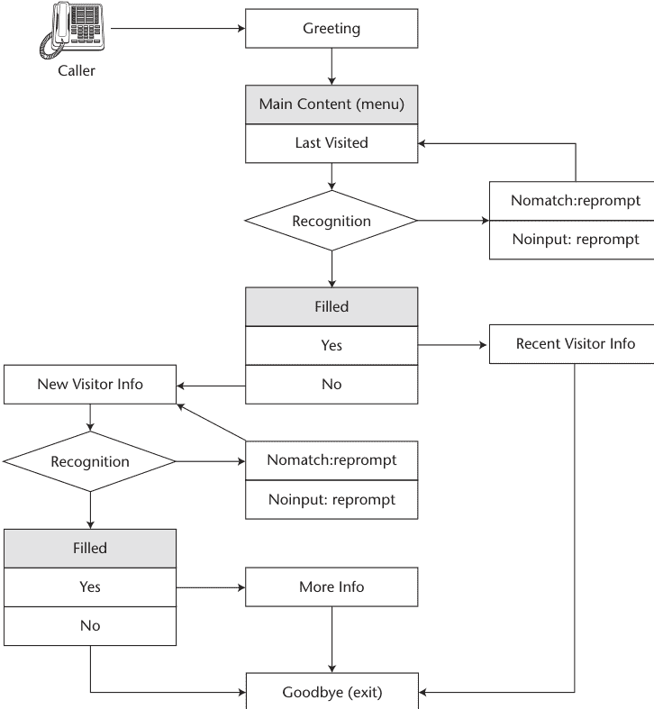

**图 2.1** 扩展 VoiceXML 应用的调用流。

### 回顾 `<goto>`

项目 2 通过从项目 1 中提取部分来创建一个占符模板。该模板定义了脚本中的主要对话区域。列表 2.1 显示了三个 `<form>` 元素，分别用于创建问候、等待内容和退出脚本。

```xml
<?xml version="1.0"?>
<!DOCTYPE vxml>
  PUBLIC "//BeVocal Inc//VoiceXML 2.0//EN"
  "http://cafe.bevocal.com/libraries/dtd/vxml2-0-bevocal.dtd">
<vxml version="2.0">
  <form id="greeting">
    <block>
      Welcome to Mars Colony 7.
      <goto next="#maincontent"/>
    </block>
  </form>
  <form id="maincontent">
    <block>
      I am your personal vocal attendant.
      <goto next="#goodbye"/>
    </block>
  </form>
  <form id="goodbye">
    <block>
      <prompt>
        Enjoy your stay. Goodbye.
      </prompt>
    </block>
  </form>
</vxml>
```

**列表 2.1** 占位符模板。

问候和 `maincontent` 表单通过 `<goto>` 元素转换到新的对话。`<goto>` 的用法在项目 1 中介绍过。为了快速回顾，`<goto>` 用于从一个对话转换到另一个对话，无论是在同一文档内还是到外部文档。如果表单不包含到另一个一个对话的显式转换，应用程序将终止。

> 使用你在 BeVocal 的开发者账户来创建列表 2.1 所示的 VoiceXML 脚本。在继续之前，请验证脚本运行正常。

### 条件处理

除了将处理转移到应用程序其他对话之外，`<goto>` 元素还可以控制单个表单内的处理流。列表 2.2 显示了表单内的简单条件处理，该表单使用 `<goto>` 转换各种字段级项目。

```xml
1. <form id="maincontent">
2. <block>
3. I am your personal vocal attendant.
4. </block>
5.
6. <field name="lastVisit">
7. <grammar>
8. <![CDATA[
9. yes no ]
10. ]>
11. </grammar>
12.
13. <prompt>
14. Have you visited the colony within
15. the past 6 months?
16. </prompt>
17.
18. <filled>
19. <if cond="yes">
20. <goto nextitem="visitedYes"/>
21. <else>
22. <goto nextitem="visitedNo"/>
23. </if>
24. </filled>
25. </field>
26.
27. <block name="visitedYes">
28. Welcome back.
29. <goto next="#goodbye"/>
30. </block>
31.
32. <block name="visitedNo">
33. Please contact visitor services if you need anything.
34. <goto next="#goodbye"/>
35. </block>
36.
37. </form>
```

列表 2.2 字段级转换。

### 创建链接

列表 2.2 扩展了 `maincontent`，包含一个介绍块、一个字段级语法、用户输入的提示、一个检查处理应该转换到何处的检查，以及两个接受 `<goto>` 转换的块。

`lastvisit` <> 在第 7 到第 11 行包含简单的语法定义。第 13 到第 16 行的 `<prompt>` 获取用户关于他们之前访问殖民地的回答。如果用户的用法被识别为接受的语法，将访问 `<filled>` 元素并处理从第 19 行开始的 `<if>` 语句。

> 在此情况下包裹接受言语的 CDATA 部分不是强制的，但对于未来构建复杂语法来说，这是一个良好的习惯。

`lastvisit` 中的输入将与第 19 行的字符串 `yes` 进行检查，如果找到，处理将转换到字段项目 `visitedYes`。

这与我们在项目 1 中看到的不同。在这里，`<goto>` 元素使用 `nextitem` 属性转换到另一个字段，而不是用于移动到另一个表单或文档的 `next` 属性。处理表单项目的默认顺序是文档顺序，每个项目由 FIA 按顺序选择，直到访问最后一个项目或处理被转移到另一个对话。`nextitem` 强制 FIA 访问当前表单内的特定字段项目，覆盖了默认的访问顺序。

第 21 行 `<if>` 条件中的 `<else>` 子句处理来自用户的 "no"（否定）应答，并将处理发送到同一表单内的 `visitedNo` 块。

在项目开发的此阶段，`visitedYes` `<block>` 和 `visitedNo` `<block>` 包含简单的 TTS 输出并将处理转移到 `goodbye` 表单，退出脚本。这两个块主要是占位符，在应用程序开发过程中将用于插入更复杂的处理。

- 当刚开始时，很容易混淆 `next` 和 `nextitem` 语法。将 `nextitem` 视为保留在指定区域内的局部标识符。`next` 属性的范围更广。

## 项目 2

### 更多条件处理

文档内的条件处理可以远不止检查。标准的数学运算符 `+`, `!=` 和 `==` 可用。2.3 显示了运算符的示例。

- 1. `if cond="visitedYes"` - `visitedYes` 包含值
- 2. `if cond="3"` - `planet` 包含 3
- 3. `if cond="total > 1000"` - `total` 大于 1000
- 4. `if cond="total <= 1000"` - `total` 小于 1000
- 5. `if cond="number-of-visits != 0"` - `number-of-visits` 不等于 0
- 6. `if cond="home=='terra' || home=='earth'"` - `home` 为 `terra` 或 `earth`
- 7. `if cond="planet=='mars' && month=='june'"` - `planet` 为 `mars` 且 `month` 为 `june`

> XML 中的某些特殊字符在文本中使用必须转义：`<`, `<=` &

### 扩展 XML 脚本

`<field>` 元素比 `<block>` 元素更灵活，因为它们可以用于提取客户端信息的语法和提示。列表 2.2 中的结尾 `<block>` 元素可以通过将 `<block>` 元素替换为 `<field>` 元素来包含更多提示和条件处理，如列表 2.4 所示。

```xml
1. <field name="visitedYes">
2. <grammar>
3. <![CDATA[
4.  yes no
5. ]>
6. </grammar>
7.
8. <prompt>
9. Welcome back. There have been some additions
10. to the colony in the past weeks. Would you like
11. to hear about them?
12. </prompt>
13.
14. <filled>
15. <if cond="visitedYes=='yes'">
16. There is free, hot pizza available on level seven.
17. Space gliding is no longer available on the golf
18. course in parsec 391.
19. The Black Sun tavern is confined to those
20. 110 years old and above.
21. <goto next="#goodbye"/>
22. <else>
23. <goto next="#goodbye"/>
24. </if>
25. </filled>
26. </field>
27.
28. <field name="visitedNo" type="boolean">
29. <prompt>
30. The colony has Visitor booths for
31. newcomers. Would you like to hear about them?
32. </prompt>
33.
34. <filled>
35. <if cond="visitedNo=='yes'">
36. Visitor booths are located every 10 parsecs
37. within each quadrant. Stand in front of a
38. visitor booth and say "Hello, Hal" to access
39. the latest events and activities within that
40. quadrant.
41. <goto next="#goodbye"/>
42. <else>
43. <goto next="#goodbye"/>
44. </if>
45. </filled>
46. </field>
```

**列表 2.4** 扩展 VoiceXML 脚本。

列表 2.4 将 `<block>` 元素更改为 `<field>` 元素，并保持名称不变。这允许字段项被用作扩展提示和额外处理。系统会提出一个问题，获取一个响应，并根据响应继续处理。在过程中，`<goto>` 用于将处理传递到相应的部分。

`visitedYes` 从第 2 行到 `<prompt>` 行开始，有一个简单的 `yes no` 语法定义，欢迎用户并确认其之前的响应已被理解，对话可以继续。`<prompt>` 请求用户提供额外输入，询问他们是否想听听有关殖地的近期变化。如果用户说是，则会读出殖地的近期变化列表，然后处理跳转到 `goodbye` 表单以优雅地退出应用程序。

在 `<filled>` 元素内嵌套 `<if>` 元素是处理 `yes/no` 输入的好方法。


从第 28 行开始的 `visitedNo` 字段具有 `boolean` 类型属性，激活了 VoiceXML 平台的内置语法。`boolean` 类型检查积极或消极响应。如果用户提供积极响应，`<if>` 条件将输出关于游客展间的信息，然后处理传递到 `goodbye` 表单；而消极响应则直接跳转到 `goodbye` 表单。项目 1 对 `type` 属性及其适用值有广泛介绍。在字段中使用 `type` 属性就像拥有一组处理基础语法创建的定义模块。


将应用程序中适当的 `<block>` 元素更改为 `<field>` 元素，添加提示和条件处理。`<field>` 元素中使用 `type` 属性来利用预定义的布尔语法。在继续之前上传您的应用程序并验证其运行正常。


### 访问外部资源

`<goto>` 元素不仅可以用于在文档内传输处理，还可以传输到外部资源。所有的 `<goto>` 元素都指向当前脚本文档中的项。为了使应用程序更健壮，它们可以指向一个 URI，从而允许内容作为外部资源存储。将内容隔离到外部资源使得构建一个无需每次内容变化都重新编程的应用程序成为可能。

### 应用程序根文档

VoiceXML 应用程序可以包含许多由应用程序根文档链接的文档和资源。应用程序中的一个文档由开发者指定为应用程序根文档。它包含了应用程序所有的全局变量、链接、语法、属性和捕获事件（catch events）。

构成应用程序的其他文档被视为应用程序根的叶节点。要使一个文档被视为应用程序的一部分，`<vxml>` 元素中的 `application` 属性必须设置为应用程序根文档属性。然而，应用程序根文档本身不会携带 `application` 属性。应用程序中的叶节点数量没有限制。

应用程序运行时，始终会加载根文档。这创建了两种可能的情况：根文档正在处理，或者在根文档仍加载时其中一个叶节点正在处理。

在此项目中，`links.vxml` 被指定为应用程序根文档。列表 2.5 显示 `links.vxml` 应用程序的第一个外部文档。

```
1. <?xml version="1.0"?>
2.
3. <!DOCTYPE vxml
4. PUBLIC "-//BeVXML Inc//VoiceXML 2.0//EN"
5. "http://cafe.beocal.com/libraries/dtd/vxml2-0-beocal.dtd">
6.
7.
8. <vxml version="2.0" application="links">
9.
10. <form id="greeting">
11.   <block>
12.     You are now in the Previous Visitor Info Center.
13. </block>
14.
15. <field name="timeframe">
16.
17. <grammar>
18.   <![CDATA[
19.     week month continue 
20.   ]]
21. </grammar>
22.
23. <prompt>
24.   If you were here within the last week, say "Week".
25.   If you were here within the last month, say "Month".
26.   Otherwise, say "Continue".
```

**Listing 2.5** 第一个外部资源。（持续）


```
27. </prompt>
28.
29. <filled>
30. <if cond="timeframe=='continue">
31.     It has been over a month since your last visit.
32.     <goto next="links-changes.vxml"/>
33. <else if cond="timeframe=='month">
34.     Several things have changed since your last month.
35.     <goto next="links-changes.vxml#month"/>
36. </else>
37.     Welcome back. It is good to see you again so soon.
38.     Nothing has changed in the past week.
39.     <goto next="links.vxml#goodbye"/>
40. </if>
41. </filled>
42. </field>
43. </form>
44. </vxml>
```

**Listing 2.5** 第一个外部资源。（持续）

# 项目 2

`<goto>`元素可以用于在文档内传输处理，也可以传输到外部资源。所有的`<goto>`元素指向当前脚本文档中的项。为了使应用程序更健壮，它们可以指向一个 URI，从而允许内容作为外部资源存储。将内容隔离到外部资源使得构建一个无需每次内容变化都重新编程的应用程序成为可能。

应用程序运行时，始终会加载根文档。这创建了两种可能的情况：根文档正在处理，或者在根文档仍加载时其中一个叶节点正在处理。

在此项目中，`links.vxml`被指定为应用程序根文档。列表 2.5 显示`links.vxml`应用程序的第一个外部文档。VoiceXML 应用程序可以包含许多由应用程序根文档链接的文档和资源。应用程序中的一个文档由开发者指定为应用程序根文档。它包含了应用程序所有的全局变量、链接、语法、属性和捕获事件。构成应用程序的其他文档被视为应用程序根的叶节点。要使一个文档被视为应用程序的一部分，`<vxml>`元素中的`application`属性必须设置为应用程序根文档属性。然而，应用程序根文档本身不会携带`application`属性。应用程序中的叶节点数量没有限制。

## 项目 2

```
1. <?xml version="1.0"?>
2. <!DOCTYPE vxml
3. PUBLIC
4. "-//BeVocal Inc//VoiceXML 2.0//EN"
5. "http://cafe.bevocal.com/libraries/dtd/vxm12-0-bevocal.dtd">
6.
7. <vxml version="2.0" application="links.vxml">
8.
9. <form id="continue">
10. <block>
11. Within the past six months the following changes
12. have taken place in the colony.
13. The holodeck is now open 36 hours per day, closed
14. from 36 hours to 40 hours, solar time.
15. The golf course can be used for solar gliding,
16. provided you have a reservation.
17. Shuttle crafts to the lunar hotsprings may be paged
18. by saying the words "lunar springs" at any visitor
19. vid-phone.
20. <goto next="links.vxml#goodbye"/>
21. </block>
22. </form>
23.
24. <form id="month">
25. <block>
26. Within the last month the following change
27. has taken place in the colony.
28. The golf course can be used for solar gliding,
29. provided you have a reservation.
30. <goto next="links.vxml#goodbye"/>
31. </block>
32. </form>
33.
34. </vxml>
```

列表 2.6 另一个外部资源。

列表 2.6 包含两个表单：`continue`和`month`。第 7 行将应用程序根文档设置为`links.vxml`。表单`id`用于调用程序程序访问文档内的特定位置。第 20 行和第 30 行的`<goto>`元素链接回`links.vxml`文档，使用片段标识符将处理转移到`goodbye`表单，而不是访问第一个表单对话框。

> 创建`links-changes.vxml`文档并将其与应用程序中的其他页面一起存储。

### 创建链接 77

### 设置 maincontent 表单

为了完成此阶段的开发，必须更改根文档的`maincontent`表单，以便访问外部文档。

`lastVisited`字段应是一个提示符，并在第 20 行调用外部文件`links-previousvisitor-info.vxml`，该文件保存上一个访客的信息。`visitedYes`字段已被删除，因为它已被外部文件所取代：

```
1. <form id="maincontent">
2.   <block>
3.     I am your personal vocal attendant.
4.   </block>
5.
6.   <grammar name="lastVisit">
7.     <![CDATA[
8.       yes no ]
9.     ]]>
10.  </grammar>
11.
12.
13.  <prompt>
14.    Have you visited the colony within
15.    the past 6 months?
16.  </prompt>
17.
18.  <filled>
19.    <if cond="lastVisit=='yes'>
20.      <goto next="visited-visitor-info.vxml"/>
21.    <else>
22.      <goto nextitem="visitedNo"/>
23.  </if>
24.  </filled>
25.
26.
27.  <field name="visitedNo">
28.    <grammar>
29.      <![CDATA[
30.        yes no ]
31.      ]]>
32.  </grammar>
33.
34.
35.  <prompt>
36.    The colony has Visitor Booths for
37.    newcomers. Would you like to hear about them?
38.  </prompt>
```

列表 2.7 `maincontent`表单。（续）

## 项目 2

| 行号 | 内容 |
| :--- | :--- |
| 38. | <filled> |
| 39. | <if cond="visitedNo=='yes'> |
| 40. | Visitor booths are located every 10 parsecs |
| 41. | within each quadrant. Stand in front of a |
| 42. | visitor booth and say "Hello" to access |
| 43. | the latest events and activities within that |
| 44. | quadrant. |
| 45. | <goto next="#goodbye"/> |
| 46. | </else> |
| 47. | <goto next="#goodbye"/> |
| 48. | </if> |
| 49. | </filled> |
| 50. | </field> |
| 51. | </form> |

列表 2.7 `maincontent`表单。（续）

现在应用程序中有三个文件：`links.xml`（应用程序根文档）；`links-previousvisitor-info.xml`（保存上一个访客的条件处理）以及`links-xml`（用于输出用户的实际信息）。

> 修改`links.xml`中的`maincontent`表单，当用户确认他们之前访问过殖民地时，包含对`links-previousvisitor-info.xml`的调用。从原始应用程序中删除`visitedYes`字段。

> 测试应用程序以验证所有叶子文档均有效。

- 访客亭台分布在每个象限内每隔 10 秒距离处。站在访客亭台前并说“你好（Hello）”，即可访问该象限内的最新事件和活动。

- 现在应用程序中有三个文件：`links.xml`（应用程序根文档）；`links-previousvisitor-info.xml`（保存上一个访客的条件处理）以及`links-xml`（用于输出用户的实际信息）。

-> 修改`links.xml`中的`maincontent`表单，当用户确认他们之前访问过殖民地时，包含对`links-previousvisitor-info.xml`的调用。从原始应用程序中删除`visitedYes`字段。

-> 测试应用程序以验证所有叶子文档均有效。

### 链接元素

- VoiceXML 中的`<link>`元素是 HTML `<a>`标签的对应物。`<link>`包含`next`属性来指向 URI，而`<a>`标签使用`href`属性。`<link>`元素可以包含`next`或`expr`属性，这在 HTML 中是不可行的。

-> 这在测试对话场景时非常有用。

### 重置文档

- 应用程序根文档在`<link>`元素处始终激活。在列表 2.8 中，`<link>`元素通过`next`属性来重置变量。

> 使用带有`next`属性的将应用程序中的所有变量重置为默认值。

```
1. <xml version="2.0">
2. <link next="links.xml">
3.   <grammar>
4.   <![CDATA[
5.     start over]
6.   ]]>
7.   </grammar>
8. </link>
9. .
10. </xml>
```

列表 2.8 重开始链接。

## 项目 2

- 列表 2.8 第 5 行定义的语法使用括号强制在激活链接时以序列形式播放完整短语，而不是单个单词。

> 在语法定义中使用括号来强制播放完整短语。

> 在`links.xml`文件顶部插入一个`<link>`，当用户说“重新开始（start over）”时将重加载文档。通过在应用程序中的不同对话中激活该链接来验证其是否可用。

### 测试场景

- 通常希望对应用程序进行一次完整运行并立即启动，以尝试不同的场景。可以在`goodbye`表单中添加一个隐藏链接，供开发者测试使用。

- 列表 2.1 中的原始`goodbye`表单包含一个`<block>`，其中有一个`<prompt>`用于输出退出消息。列表 2.9 为表单增加了两个事件处理器：`match`和`noinput`。它们的作用相同。目前在表单中激活的语法是应用程序的默认事件处理器以及文档顶部的开始链接。如果用户说除了“重新开始”以外的任何内容，都将触发`match`或`noinput`事件，应用程序将退出。

> 在`goodbye`表单中插入`match`和`noinput`事件处理器。通过调用应用程序并运行多个场景，使用运行`goodbye`表单的隐藏提示来测试你的更改。

```
<form id="goodbye">
  <field>
    <prompt>
      Enjoy your stay. Goodbye.
    </prompt>
    <nomatch></exit></nomatch>
    <noinput></exit></noinput>
  </field>
</form>
```

列表 2.9 创建隐藏链接激活。

## 捕获事件

元素可用于捕获通常由 VoiceXML 平台处理的事件，例如用户使用“help”或抛出槽（notch）错误时。平台有义务捕获 help、noinput、notch、exit 和 error 事件。在 `<link>` 中使用 event 会抛出一个事件，而不是转换到新的对话或文档。当事件被抛出时，它将在调用处进行处理，而不会自动继续执行转换。这对于在不中断应用程序流的情况下创建全局消息非常有用。

> 当事件被抛出时，它将在调用处进行处理，而不会跳转到新文档

列表 2.10 第 4 行的 link 将 help 定义为要捕获的事件类型。第 5 行到 14 行定义了一个激活 help 事件的语法。

```xml
<xml version="2.0">

  <!-- 全局帮助链接 -->
  <link event="help">
    <grammar root="helpVocab">
    <rule id="helpVocab">
      <one-of>
        <item>help</item>
        <item>help me</item>
        <item>i'm lost</item>
        <item>where am i</item>
      </one-of>
    </rule>
    </grammar>
  </link>

  <!-- 全局帮助输出 -->
  <help>
    <prompt>
      您到达了火星7殖民地游客信息中心。我可以帮助您在火星7号殖民地找路。
    </prompt>
    <reprompt/>
  </help>
  ...
</xml>
```

**列表 2.10** 使用 link 处理事件。

## 项目2


第 5 行的 `<grammar>` 元素带有 `root` 属性，指向将作为此对话根级语法的规则。`help helpVocab` 规则定义从第 6 行开始。规则内的每个项目都是可以触发事件的独立短语。这是创建语法项列表的简单方法。当帮助语法被识别为有效的用户输入时，将输出位于第 20 行到 22 行的全局帮助消息。第 24 行的 `<prompt/>` 元素强制重复抛出它的对话中的 `<prompt>`。

由 `link` 处理的事件将在调用它的位置内进行处理。在列表 2.10 中，如果用户在 `links-previous-visitor.xml` 文档中请求帮助 `link`，将在将在文档内暂停。帮助 `link` 将输出从第 18 行开始的 `<prompt>` 中的文本，并在调用事件的位置从之前的访客信息文档中继续处理。


- 注意：列表 2.10 `<grammar>` 元素内的 `<rule>`、`<one-of>` 和 `<item>` 元素未在 VoiceXML 规范中定义。`www.w3.org/TR/speech-grammar/` 上的 W3C 语音识别语法格式第 2 和第 3 节定义了这些元素。VoiceXML 工作组的意图与这些定义保持同步。


- 动手实践：在应用程序顶部插入一个 start link。测试您的应用程序，验证 help 和 start linkget正常工作。通过使用 start link，您可以使用单次调用多次测试您的应用程序。

### 创建菜单

有时，提供一个选择列表然后根据选择转换到特定的对话非常方便。`<menu>` 元素可以用于在 `<prompt>` 中输出选择列表，其词汇比通常 `<grammar>` 元素包含的更灵活。

列表 2.1 中的 `<menu>` 元素在 VoiceXML 文档结构中与 `<form>` 元素处于同一级。

字段级项目之外，`<menu>` 包含一个持有 `<prompt>` 的匿名字段。通过 `<enumerate/>` 元素动态生成语法，以访问存储在 `<choice>` 元素中的词汇。我们稍后会进一步查看 `<enumerate>` 和 `<choice>`。

`<menu>` 元素的 `accept` 属性指定了动态生成的语法必须被准确朗读，还是短语的部分将被识别为有效输入。如果 `accept` 属性设置为 `exact`（精确），则用户必须说出完整的短语顺序才能识别输入。当值设置为 `approximate`（近似）时，解释器将接受 `<choice>` 短语的子集。例如，用户可以说第 10 行 `<choice>` 元素中的可识别语法说“group activities”、“group”或“activities”。正如我们看到的，`accept` 属性可以在 `<choice>` 级覆盖。

```
1. <menu id="guidechoices"
2. accept="approximate"
3. dtmf="true">
4. <prompt>
5. 我是您的私人语音助手。
6. 您对什么主题感兴趣？
7. </enumerate>.
8. </prompt>
9. <choice name="#activities">
10. group activities
11. </choice>
12. <choice name="#restaurants">
13. popular restaurants
14. </choice>
15. <choice name="#changes">
16. changes to the colony
17. </choice>
18. <nomatch>
19. 您必须从这里选择：
20. </nomatch>
21. </menu>
```

列表 21 创建菜单。

通过设置 `<menu>` 的 `dtmf` 属性为 `true` 可以接受电话拨号输入。`dtmf` 将从 1 开始分配给 `<choice>` 元素，并根据文档顺序自动生成。在您的应用程序中，`activities` 将接收 1，`restaurants` 接收 2，`changes` 接收 3。

`scope` 可以设置为限制语法识别到当前文档，或使其在整个文档执行期间可用。`menu` 内 `scope` 属性的默认值为 `dialog`。在构建多文档应用程序时，将 `scope` 限制到文档级是有用的。

### enumerate 元素

`<enumerate>` 元素根据文档顺序选择 `<choice>` 的内容。第 4 行开始的 `<prompt>` 后面是 `<enumerate>` 元素。`<enumerate>` 不携带任何属性。

## 项目2

`<choice>` 元素包含由 `<enumerate>` 元素输出的内容以及用于控制输入的属性。`menu` 中的 `<choice>` 元素数量没有限制，如果没有强化，用户很难跟踪多个选择。良好的用户界面会将选择限制在五个以内。


将菜单列表限制在五个以内。`<choice>` 元素可以携带多个属性，包括 `dtmf`、`accept`、`next` 和 `expr`。使用 `dtmf` 属性是分配单个数字表示选择的方法。用户可以输入数字而不是背诵语法中的短语。当 `dtmf` 在 `<choice>` 元素内时，它将覆盖在 `menu` 级设置的值。我们在其他上下文中见过 `next`、`event` 和 `expr`，它们在这里的工作原理相同。`next` 是一个将处理转移到新对话的特定 URI，`expr` 可以动态生成转换 URI，而 `event` 将触发事件处理器而不是强制转换。


创建一个 `id` 为 `guidechoices` 的菜单，并在进入 `links.xml` 应用程序时作为默认表单。将 `maincontent` 表重命名为 `changes`，并将从菜单中的一个 `<choice>` 元素访问。

由于不再有 `maincontent` 表单，欢迎表中的 `<goto>` 元素需要指向 `guidechoices` `<menu>` 元素。您还需要包含处理 `activities` 和 `restaurants` 的占位表单。

```xml
<?xml version="2.0">
<!-- START OVER -->
<link next="links.vxml">
<grammar>
<![CDATA[
  {start over)
]]>
</grammar>
</link>
<!-- GLOBAL HELP LINK -->
<link event="help">
<grammar root="helpVocab">
  <rule id="helpVocab">
    <one-of>
      <item>help</item>
      <item>help me</item>
      <item>i'm lost</item>
      <item>where am i</item>
    </one-of>
  </rule>
</grammar>
</link>
<!-- GLOBAL HELP OUTPUT -->
<help>
 <prompt>
  您已到达火星7 号殖民地游客信息中心。
  我可以帮助您在火星7 号殖民地指路。
 </prompt>
 <reprompt/>
</help>
<!-- GREETING -->
<form id="greeting">
 <block>
  欢迎来到火星7 号殖民地。
  <goto next="#guidechoices"/>
 </block>
</form>
<!-- MENU -->
<menu id="guidechoices">
  accept="approximate"
  dtmf="true"
 <prompt>
```

**Listing 2.12** 更新后的 `links.vxml`。（续上）

```xml
55. 我是您的个人语音接待员。
56. 您对什么主题感兴趣？
57. <enumerate/>
58. </prompt>
59. <choice next="#activities">
60.   小组活动
61. </choice>
62. <choice next="#restaurants">
63.   热门餐厅
64. </choice>
65. <choice next="#changes">
66.   殖民地的变更
67. </choice>
68. <nomatch>
69.   您必须从以下选择：<enumerate/>
70. </nomatch>
71. </menu>
72. </prompt>
73. <!-- 活动表单：占位符 -->
74. <form id="activities">
75.   <block>
76.     关于活动的信息。
77.     <goto next="#goodbye"/>
78.   </block>
79. </form>
80.
81. <!-- 餐厅表单：占位符 -->
82. <form id="restaurants">
83.   <block>
84.     关于餐厅的信息。
85.     <goto next="#goodbye"/>
86.   </block>
87. </form>
88.
89. <!--变更表单 -->
90. <form id="changes">
91.   <grammar>
92.     <![CDATA[
93.       [ yes no ]
94.     ]]>
95.   </grammar>
96.
97.   <prompt>
98.     您在过去6 个月内
99.     访问过这个殖民地吗？
100.  </prompt>
```

Listing 2.12 更新后的 `links.vxml`。

### 创建链接

```xml
103. <filled>
104. <if cond="lastVisit=='yes'>
105.   goto next="links-previousvisitor-info.xml"/>
106. <else>
107.   goto nextitem="visitedNo"/>
108. </if>
109. </filled>
110. </field>
111.
112. <field name="visitedNo">
113. <grammar>
114.   <![CDATA[
115.     [ yes no ]
116.   ]]>
117. </grammar>
118.
119. <prompt>
120.  殖民地设有为新来者
121.提供的游客接待处。你想听听关于它们的信息吗？
122.  </prompt>
123.
124. <filled>
125. <if cond="visitedNo=='yes'>
126.   游客接待处位于每个象限内
127.   每 10 秒差距一处。站在游客
128.   接待处前并说“Hello, Hal”即可访问
129.   该象限内的最新活动和
130.   活动。
131.   <goto next="#goodbye"/>
132. <else>
133. <goto next="#goodbye"/>
134. </if>
135. </filled>
136. </field>
137. </form>
138.
139. <!-- 告别表单 -->
140. <form id="goodbye">
141. <field>
142. <prompt>
143.   祝您停留愉快。再见。
144.  </prompt>
145. <nomatch><exit></nomatch>
146. <noinput><exit></noinput>
147. </field>
148. </form>
149.
150. </vxml>
```

**Listing 2.12** 更新后的 `links.vxml`。（继续）

# 将菜单构建层级结构

菜单通过与其他菜单链接来创建层级结构。当前应用程序中的主菜单提供了直接跳转到每个选项内容的选择。另一种方法是创建一组子菜单，为用户提供更多信息，将他们发送到所选资源。Listing 13 第 7 到 11 行的菜单是已经存在的。它不是指向名为 `*activities*` 的表单，而是指向从第 13 行开始的另一个菜单。

```xml
1. <menu id="guidechoices" accept="approximate">
2. <prompt>
3. 我是您的个人语音接待员。
4. 您想听听什么？
5. <enumerate>
6. </prompt>
7. <choice name="#activities">小组活动</choice>
8. <choice name="#restaurants">热门餐厅</choice>
9. <choice name="#changes">殖民地的变更</choice>
10. <nomatch>请从以下选择：<enumerate></nomatch>
11. </menu>
12.
13. <menu id="activities" accept="approximate" dtmf="true">
14. <prompt>
15. <enumerate>
16. 关于 <value expr="_prompt"/> 信息，
17. 按 <value expr="_dtmf"/>。
18. </enumerate>
19.
20. </prompt>
21. <choice name="#gliding">太阳滑</choice>
22. <choice name="#golunar">月球滑</choice>
23. <choice name="#weightless">无重力滑</choice>
24. accept="weightless golf"
25. <choice name="#hotub">热水池梯</choice>
26. <nomatch>不可用。
27. 选择：<enumerate/>
28. </nomatch>
29. </menu>
30. <!-- 太阳滑的占位符 -->
31. <form id="gliding">
32. <block>
33. 关于太阳滑的信息。
34. goto next="#goodbye"/>
35. </block>
```

**Listing 13** 子菜单。

### 创建链接

```xml
37. </form>
38.
39. <!-- 月球滑的占位符 -->
40. <form id="golunar">
41. <block>
42. 关于月球滑的信息。
43. <goto next="#goodbye"/>
44. </block>
45. </form>
46.
47. <!-- 无重力滑的占位符 -->
48. <form id="weightless">
49. <block>
50. 关于无重力滑的信息。
51. <goto next="#goodbye"/>
52. </block>
53. </form>
54.
55. <!-- 热水池的占位符 -->
56. <form id='hot tub'>
57. <block>
58. 关于热水池梯的信息。
59. <goto next="#goodbye"/>
60. </block>
61. </form>
```

**List 13** 子菜单。（继续）

第 13 行的 `<menu>` 为用户提供了指向适当资源的活动子集。第 16 和 17 行引入了一种新技术，使用 `_prompt` 和 `_dtmf` 作为表达式。`_prompt` 变量与 `<enumerate/>` 元素配合工作充当循环，输出在 `<choice>` 元素中定义的每个短句。`_dtmf` 变量也是如此。这允许创建让用户提供语音响应或电话键盘输入选择的句子。假设 `<choice>` 元素的每个 `next` 值都指向在文档内定义并通过片段标识符 (#) 访问的表单。

第 26 到 29 行的 `<nomatch>` 元素在输入无法被识别时给出警告信息并重复选项列表。

与其给用户提供长选项列表，不如将列表拆分为小组并构建菜单层级来访问选项。

# 项目 2

> 通过将活动表单改为名为 `activities` 的菜单来更新您的应用程序。为每个活动创建一个占位符表单，简要描述活动并将发送到告别表单。

### 创建暂停

当您听您的应用程序时，会听到选项列表作为一个长句被读出。可以使用 `<break>` 元素在输出中加入暂停，使其更易理解且友好，如 Listing 2.14 所示。

`<break>` 元素可以通过 `size` 属性使用 `small`、`medium` 或 `large` 设置平台指定的持续时间。如果您需要更具体的控制，可以使用 `time` 属性设置特定的毫秒数来设置暂停。

> 检查平台文档以确定 `small`、`medium` 和 `large` 设置的值。

> 在您的菜单选项中创建暂停，测试不同的尺寸和持续时间，找到最适合您应用程序的。

```xml
1. <choice next="#activities">
2.   小组活动
3.   <break size="small">
4.   </choice>
5.
6.   <choice next="#restaurants">
7.   热门餐厅
8.   <break time="500msec">
9.   </choice>
10.
11. <choice next="#changes">
12.  殖民地的变更
13. </choice>
```

**Listing 2.14** 在 TTS 中创建暂停。

### 处理


处理同一过程多个实例的代码在大多数编程语言中被称为子程序或函数。VoiceXML 中的术语是子对话（subdialog）。当多个表单或项目需要相同的处理时，可以使用子对话。在我们的应用程序中，当用户选择听活动或餐厅时，我们需要收集相同类型的信息。将使用子对话来收集这些信息。2.15 假设用户选择了听更多关于滑梯和热水池的内容。第 2 到 4 行是确认用户已理解请求。第 5 行是调用子对话，第 6 到 12 行是处理子对话返回值的 `<block>`。在查看子对话后，我们将返回此部分。

```xml
1. <form id="hotub">
2.   <block>
3.     热水池梯是最热门的活动。
4.   </block>
5.   <subdialog name="result" src="#personalinfo">
6.     <filled>
7.       您来自 <value expr="result.planet/>
8.       您的性别是 <value expr="result.gender/>
9.       您的小组中有 <value expr="result.quantity/>
10.    位个人。
11.     <goto next="#goodbye"/>
12.   </filled>
13.  </subdialog>
14. </form>
15.
16. <form id="restaurants">
17.   <block>
18.     在您所在的区域内有 7438 家餐厅。
19.   </block>
20.   <subdialog name="result" src="#personalinfo">
21.     <filled>
22.       您来自 <value expr="result.planet/>
23.       您的性别是 <value expr="result.gender/>
24.       您的小组中有 <value expr="result.quantity/>
25.    位个人。
26.     <goto next="#goodbye"/>
27.   </filled>
28.  </subdialog>
```

```xml
27.    </filled>
28.    </subdialog>
29.    </form>
30. 
31.    <form id="personalinfo">
32.    <block>
      我需要你提供一些信息，以便我能
      提供最合适的建议。
33.    </block>
34.    <field name="planet">
      你来自哪个星球？
      <grammar>
        <![CDATA[
          [ mercury venus earth mars jupiter
          saturn uranus neptune planet]
        ]]>
      </grammar>
    35.    </field>
    36.    <field name="gender">
      你的性别是什么？
      <grammar>
        <![CDATA[
          [ male female android]
        ]]>
      </grammar>
    37.    </field>
    38.    <field name="quantity" type="number">
      你的队伍中有几个人？
      <filled>
        <return namelist="planet gender quantity"/>
      </filled>
    39.    </field>
40.  </form>
```

**列表 2.15** 子对话。（继续）

### <subdialog>

子对话（Subdialogs）允许 VoiceXML 开发者构建可重用的代码块，这些代码块可以保存为预定义的函数库，或者作为应用程序中的简单子程序。`<subdialog>` 元素用于访问子对话，发送变量并等待例程的返回值。

### 创建链接

> 注意：`<subdialog>` 元素并不是子对话本身；它是对子对话的调用。子对话本身由 `<subdialog>` 元素的 `src` 属性指向。

子对话通过 `<subdialog>` 元素的 `src` 属性进行调用。该属性的值是一个 URI，它使用分段标识符来访问子对话。`<subdialog>` 元素内部的 `name` 属性用于引用从子对话返回的返回值。列表 2.15 第 5 行显示了一个命名为 `result` 的 `<subdialog>` 元素，它调用了 `personalinfo`。该子对话看起来像一个普通的 `<form>` 块，但第 56 行的 `<return>` 元素外，我们稍后会讨论一下。

此应用程序中的子对话调用非常简单，将处理发送到子对话并接受返回值。调用子对话还可以通过 `<param>` 元素向子对话传递参数。这将在未来的项目中进行探讨。

列表 2.15 第 31 至 59 行的表单是子对话，它将从用户处收集信息，并让调用例程可以访问。表单以一个 `<block>` 提示开始，向用户解释请求信息的原因。字段（Fields）用于提示用户输入星球、性别和队伍人数。这些字段的名称将在处理返回到调用例程时用于访问用户输入。

第 53 行的第三 `<field>` 元素包含一个 `type` 属性，用于强制用户输入数字类型的数据。错误检查由平台处理，除非开发者显式处理错误。

### <return> 元素

从 55 行开始的 `<filled>` 元素包含一个 `<return>` 元素，用于将用户输入返回给调用例程。`<return>` 用于结束子对话，或者如果在子对话完成之前使用，则短路子对话的剩余部分。这对于处理测试条件并将结果返回给调用例程非常有用。

`<return>` 元素内的 `namelist` 是已处理字段名称的空格分隔的列表。默认情况下，如果没有 `namelist` 属性，则不返回任何变量。

### 使用返回值

列表 2.15 第 7 至 9 行演示了如何访问从子对话返回的命名变量。`<subdialog>` 元素的名称为 `result`，用于存储来自子对话的返回值。单个字段的结果通过在字段名之前加上子对话名称并跟一个点号来访问。在代码示例中，要访问星球的输入，将使用 `result.planet`。第 7、8 和 9 行的 `<value>` 元素使用 `expr` 属性输出结果。第 11 行通过调用 `goodbye` 表单完成处理。

第 16 至 29 行处理餐厅表单的逻辑。第 20 行调用了与热浴缸（hot tub）相同的对话框。这展示了使用子对话的力量。无论应用程序需要收集多少用户信息，都可以使用同一个例程进行处理。

## 项目 2

在你的脚本中添加一个子标题，用于向用户请求信息。添加子对话 `personalinfo`。通过调用 `personalinfo` 子对话更新热浴缸和餐厅表单。运行多组输入以验证子对话是否正常工作。

如果你正在使用 Bevocal 开发环境，请创建一个包含多组输入的批处理文件。该批处理文件将被处理，你无需从键盘输入任何内容。

### 使用 <submit> 以程序化处理请求

项目中的最后一种链接类型是用 `<submit>` 元素生成的。`<submit>` 类似于 `<goto>` 元素，但在跳转到新部分进行处理时，它可以将变量传递给脚本。这在进行 CGI 类型的处理以根据之前的用户输入生成动态内容时非常有用。在列表 2.16 中，第 3 行对子对话的调用从用户处获取信息并将其存储在 `result` 变量中以便后续访问。

```xml
1. <form id="restaurants">
2.   <block>
3.     <subdialog name="result" src="#personalinfo"/>
4.     <prompt>
5.       当前会话中有餐厅。
6.     </prompt>
7.     <submit
8.       next="http://www.your-server.com/links-submit.cgi"
9.       namelist="result.planet result.quantity"
10.      method="post"
11.      fetchtimeout="10s"
12.  </block>
13 </form>
```

**列表 2.16** `<submit>` 元素。

从 7 行开始的 `<submit>` 元素带有四个属性，指定了应该发送什么数据以及如何提交。我们已经讨论过 `next`（应发送数据的 URI）、`expr`（一个生成的 URI）、`namelist`（要发送的变量名称）和 `fetchtimeout`（解释器在发布脚本前应等待的时间）。还有一个 `audio` 属性可用，指向在获取资源时播放声音文件的 URI。`method` 属性可以是 `post` 或 `get` 的值。这些是任何 CGI 脚本使用的相同值。

## 使用脚本处理用户输入

从 7 行开始的 `<submit>` 元素 载了四个属性，指定了应该发送哪些数据以及应该如何提交它们。我们已经讨论过 `next`（应发送数据的 URI）、`expr`（一个生成的 URI）、`namelist`（要发送的变量名称）和 `fetchtimeout`（解释器在发布脚本前应等待的时间）。还有一个 `audio` 属性可用，指向在获取资源时播放声音文件的 URI。`method` 属性可以是 `post` 或 `get` 的值。这些是任何 CGI 脚本使用的相同值。

为了完成这一步，你需要一个可以处理输入的脚本。脚本将接收标准输出并将其输出到标准输出。列表 17 是一个 Perl 脚本，它处理来自 `<submit>` 元素的输入。

```perl
1. #! /usr/bin/perl -w
2. 
3. use CGI;
4. use CGI::Carp(fatals);
5. use strict;
6. $|;
7. 
8. print header;
9. 
10. my $planet = param('result.planet');
11. my $gender = param('result.gender');
12. my $quantity = param('result.quantity');
13. 
14. print <<VXML;
15. <?xml version="1.0"?>
16. 
17. <vxml version="2.0">
18. <form>
19.   <block>
20.     你来自 $planet。
21.     你的性别是 $gender。
22.     你的队伍中有 $quantity 个人。
23.     我们建议你在家里用餐。
24.     <goto next="links.vxml#goodbye"/>
25.   </block>
26. </form>
27. </vxml>
28. 
29. VXML;
```

**列表 17** 处理请求的 Perl 脚本。（继续）

### 创建链接

> 大多数语音门户开发者账户并未提供完整的 URL 地址以返回到调用的应用程序。作为一种变通方案，请将你的 `links.xml` 项目脚本拷贝到 Web 服务器上与 Perl 脚本相同的目录中。使用它来验证所有操作是否运行正常。当调用该脚本时，它将使用 VoiceXML 脚本的副本来继续处理处理。

在你的 Web 服务器上安装 Perl 脚本。将你的 `links.xml`、`links-changes.xml` 和 `previous-visitor-info.xml` 脚本拷贝到同一个文件夹中。通过多个场景运行该项目，最好使用批处理。

## 结语

VoiceXML 链接比 HTML 强大得多，因为链接有多种方式可以控制应用程序的流程。本项目研究了在 VoiceXML 应用程序中创建链接的五种方式：`<goto>`、`<menu>`、`<link>`、`<dialog>` 和 `<submit>`。

使用分级菜单是使你的语音应用程序用户友好的最佳方法之一。项目中开发的模板可以轻松转换为帮助服务台、办公室 FAQ 或信息查询终端。它还可以作为包含多个语音应用程序网站的入口：构建一个指向每个应用程序的菜单，让用户选择想听哪一个。

该项目的列表可以从 BeVocal 网站 cafe.beocal.com/wiley/10projects 下载。它们以文本文件的格式保存，可以用作创建你自己的 VoiceXML 脚本的模板。

下一个项目将继续使用链接，我们将开发一个通用的联系应用程序，该程序将为你的客户提供联系公司的各种方式。

# 项目 3

# 联系我们

大多数网站都有“联系我们”部分，显示了用户联系公司或 Web 工作人员的各种方式。我一直好奇于使用像电影《2001太空漫游》中的 Hal 那样的机器人来处理这种琐事。它不仅能够对你的联系请求提供基本响应，还可以帮助完成简单任务，如记录留言或将电话转接给人工。这个项目可以为开发半智能回答系统奠定基础，该系统可以处理你前台员工耗费时间的琐碎杂务。

| 问题 | 解决方案 |
| :--- | :--- |
| 使用人工接线员回答关于公司的基础问题或记录电话留言是对人力资源和公司资源的浪费。 | 通过语音输出地址获取公司的基本联系信息可以通过自动化系统处理。用户可以选择请求公司信息、留言语音留言或与人工接线员通话。 |

## 项目描述

“联系我们”创建了一个回答关于公司基础电话查询的自动系统。用户拨打公司电话，进入后将收到 VoiceXML 应用程序的欢迎。一个简短的菜单描述了提供的信息服务类型：公司地址、请求留言或联系人工接线员。如果请求的是邮寄地址或业务地点，将输出预录的位置信息。用户还可以选择录制语音消息，该消息将存储在公司 Web 服务器上供以后检索。作为最后的选择，用户可以请求与人工接线员通话。

要完成此项目，你将：

- 1. 创建骨架模板。
- 2. 使用变量处理全局值。
- 3. 重复内容并控制应用程序流。
- 4. 录制并保存消息。
- 5. 转接电话。

### 你需要

- ✓ Vocal 开发者账户
- ✓ 具有 CGI 能力的 Web 服务器
- ✓ Web 服务器上安装了 Perl 5
- ✓ 用于处理录音的 Perl 脚本
- ✓ 下载文件：cafe.beocal.com/wiley/10project

本项目中使用的 VoiceXML 元素

| 元素名称 | 描述 |
| :--- | :--- |
| `<block>` | （非交互式）执行代码的容器 |
| `<break>` | 在 TTS 输出中插入暂停 |
| `<choice>` | 定义菜单项 |
| `<else>` | 用于条件分支 |
| `<elseif>` | 用于条件分支 |
| `<field>` | 声明字段 |
| `<filled>` | 当字段被填充时执行 |

本项目中使用的 VoiceXML 元素（注：此处部分表格内容重复，已对应翻译）

# 联系我们 101

本项目中使用的 VoiceXML 元素（继续）

| 元素名称 | 描述 |
| :--- | :--- |
| `<form>` | 展示信息和收集数据的对话框 |
| `<goto>` | 跳转到另一个对话框 |
| `<grammar>` | 语音识别或 DTMF |
| `<if>` | 简单逻辑判断 |
| `<link>` | 适用于所有链接的跳转 |
| `<menu>` | 用于选择不同目的对话 |
| `<nomatch>` | 捕获不匹配事件 |
| `<prompt>` | 语音合成和音频输出给用户 |
| `<record>` | 录制音频样本 |
| `<transfer>` | 将拨号者转移到另一个目的地 |
| `<var>` | 声明变量 |
| `<vxml>` | 每个 VoiceXML 文档的根元素 |

来源：VoiceXML 2.0 草案，1.4节

### 调用流程

图 3.1 显示了“联系我们”应用程序的调用流程。接收电话时，会向用户显示三个选项的主菜单。用户可以选择听公司地址、留言或与人工接线员通话。公司地址是

### 重复内容和应用程序流

我们将分段构建“联系我们”，直到完成一个完整的应用程序。第一个组件是字段，如 3.1 所示。

```xml
1. <?xml version="1.0"?>
2. <xml version="2.0">
3. <var name="CompanyName" expr='Colony'/>
4. <form id="address">
5. <field name="snailMail" type="boolean">
6. <prompt>
7. <value expr="companyName"/>
8. 需要我重复地址吗？
9. </prompt>
10. <filled>
11. <if cond="snailMail">
12. <clear/>
13. </if>
14. </filled>
15. </field>
16. </form>
17. </xml>
```

列表 3.1 重复的信息块。

### <var> 元素

当字符串值在同一个应用程序中使用多次时，`<var>` 元素非常有用。在这种情况下，公司名称将在多个表单中重复。通过更改存储在变量中的值，可以轻松更改名称在应用程序中出现的输出。

`<var>` 元素带有两个属性：`name` 和 `expr`。`name` 属性的值用于访问变量的内容，存储在 `expr` 属性中。字面内容和动态生成的内容都可以存储在变量中。字面内容（例如公司名称）在双引号内使用单引号。这指示 VoiceXML 解释器不要对变量进行插值，而应作为字面文本输出。

## 104 项目 3

在为字符串变量创建值时，值必须在双引号内使用单引号，这样它将不会被 VoiceXML 解释器插值。双引号内的值将被解释为唯一的格式、变量或字段名，而不是一个简单的字符串。


### 预定义语法

VoiceXML 为几种数据类型提供了内置的预定义语法。通过`<field>` 的 `type` 属性访问内置语法，用于将用户输入限制为特定的数据类型。`type` 属性可以多种值，例如布尔、货币、数字、电话以及 VoiceXML 解释器提供的其他类型。这些类型由 VoiceXML 2.0 工作草案第 2.3.1.1 节定义，并在所有平台上保持实现的一致。

处理单个 `<field>` 的 `<form>`，`snailMail` 开始于列表 3.1 的第 5 行。布尔内置类型将把用户输入处理为真或否的响应，这使得无需为该字段创建语法。

> 当对提示的回答是简单的“是”或“否”时，使用布尔类型。VoiceXML 解释器能够处理布尔类型的响应作为输入，因此无需为字段创建语法。


如果内置类型没有所需的行为，开发者必须为该项目创建一个显式语法。例如，开发者可能希望将“sure”一词被视为用户的正面响应。布尔类型未将“sure”包含在它的词汇中，因此必须由开发者创建一个特定的字段级语法。

> 在 `<field>` 元素中使用 `type` 属性来访问基本数据类型的预定义语法。有关可用类型的详细说明，请参见 VoiceXML 2.0 工作草案的第 2.3.1.1 节。列表包括布尔、日期、数字、货币、数值、电话和时间类型。


### 输出中的暂停

列表 3.1 中的第 8 到 17 行创建了一个 `<prompt>`，输出公司名称以及后的公司地址信息。第 9 行的 `<value>` 元素带有 `expr` 属性，用于访问 `companyName` 变量。注意值位于双引号内，以便变量 `companyName` 可以被插值。

`<break>` 元素用于控制语音行之间的时间跨度或暂停。这在输出长系列行时（例如第 9 到 16 行）非常有用，可以给用户机会去处理所说的内容。

## 联系我们 105

`<break/>` 元素带有两个属性之一：`time` 或 `size`。`size` 属性使用相对时间描述，如 `none`、`small`、`medium` 或 `large`，其持续时间取决于平台。`time` 属性指定输出暂停的精确持续时间。它可以以秒（1.5 s、3 s 等）或毫秒（为了更细粒度的控制，225 ms、150 ms 等）的形式表示。`<break/>` 的默认值设置为平台定义的 `medium`。

> 提示：使用 `<break/>` 元素在用户可能正在记录笔记时创建输出暂停。

使用内置布尔语法检查用户语句，以查看语句是否被识别为正面或负面响应。如果响应被识别，将其存储在 `snailMail` 变量中，以便在 `<filled>` 元素内访问。如果无法理解用户输入，布尔类型将抛出错误，并提示第二次输入。

> 注意：内置语法类型包含默认错误检查，可以处理无法识别的语句，提示用户提供更多输入。

从第 19 行开始的 `<filled>` 块控制用户输入的处理。这里的逻辑有点微妙。第 20 行检查 `snailMail` 字段条件，即用户输入。如果条件为真，则用户说出了正面响应。通常，当从用户处收到正面响应时，处理将继续到下一个项目。然而在这种情况下，一个“是”的将被认为是正面的，表示用户希望再次听到提示。第 21 行的`<clear/>` 元素将当前表单内的所有字段值重置为空并将处理发送回表单顶部，以输出提示并接收用户的新输入。我们将在项目结束时检查 FIA，以更好地了解`<clear/>` 元素的功能。

来自用户的负面响应将通过处理移出表单，终止应用程序。

> 动手实践：创建一个新的 VoiceXML 应用程序。为你的应用程序创建一个输出公司地址的提示。使用`<var>` 元素将公司名称作为全局变量包含在脚本顶部。如果你有几行输出，使用`<break/>` 元素在行之间包含短时间暂停。

### 录制消息

自动接线员可以为拨打者提供录制语音消息或听公司地址的机会。扩展列表 3.1 中的脚本以包含一组菜单选择，然后构建语音消息的脚本。

### 菜单选择

列表 3.2 中的菜单显示了项目 2 中开发的菜单种的替代方案。输出的不是选择列表，而是 `<prompt>`。

```xml
<?xml version="1.0"?>
<vxml version="2.0">
<var name="companyName" expr="Mars 7"/>
<!-- 主菜单 -->
<menu id="mainmenu">
  <prompt>
    要听 Mars 7 的地址，请说“Address”。
    要留言语音消息，请说“Voice”。
  </prompt>
  <choice next="#address">
    <grammar>(please)</grammar>
  </choice>
  <choice next="#voice">
    <grammar>(message)</grammar>
  </choice>
  <nomatch>
    再次尝试。
  </nomatch>
</menu>
<!-- 邮件地址 -->
<form id="address">
  <field name="snailMail" type="boolean">
    <filled>
      <if cond="snailMail">
        <clear/>
      </if>
    </filled>
  </field>
</form>
<!-- 语音消息 -->
<form id="voice">
  <block>
    处理语音消息。
  </block>
</form>
</vxml>
```

**列表 3.2** 菜单选择。

这种新技术的优势在于，能够在控制初始 `<prompt>` 语音输出的同时，拥有扩展的语法。如果用户没有按照菜单输出指示给出精确的回答，第 14 行和第 18 行的 `<grammar>` 仍然识别输入。第 14 行的 `<grammar>` 允许用户在请求公司地址后说一个可选的 *please*，而第 18 行提供了多种留言语音消息的方式。

```xml
1. <form id="voice">
2. <record name="voiceMessage">
3. beep="true"
4. maxtime="10s"
5. finalsilence="1.5s"
6. type="audio/wav">
7. <prompt>
8. 您有10秒钟时间录制消息。
9. 请在提示音后说话。
10. </prompt>
11. </record>
12.
13. <!-- 再次录音 -->
14. <field name="processMessage" type="boolean">
15. <prompt>
16. 这是您的消息：<value expr="voiceMessage"/>
17. 这是您想要发送给
18. <value expr="companyName"/>
19. </prompt>
20.
21. <filled>
22. <if cond="processMessage">
23. 请稍候，您的消息正在保存。
24. <else>
25. <clear/>
26. </if>
27. </filled>
28. </field>
29.
30. <subdialog name="saveMessage">
31. src="recording.cgi"
32. methods="post"
33. enctype="multipart/form-data"
34. namelist="voiceMessage">
35. <filled>
36. <audio>您的消息已发送</audio>
37. </filled>
38. </subdialog>
39. </form>
```

### 列表 3.3 录制消息。

列表 3.3 从一个表单开始，第 1 行有一个唯一的 id 为 voice。第 2 到 11 行使用 `<record>` 元素。`<record>` 是字段级元素，用于记录用户的输入，通过访问 `name` 属性获取录制内容。录制存储在内存中，可以直接作为 `name` 属性的值访问，或发送到 Web 服务器进行处理和存储。

### <record> 元素属性

第 3 到 6 行的属性指定了 `<record>` 元素的属性。`beep` 指定了在用户需要说话时是否应该播放声音。哔哔声取决于具体实现。

- 在某些提供脚本检查的 VoiceXML 开发环境中，将 `beep` 属性设置为 `true` 会导致错误并终止脚本。将 `beep` 值设置为 `false` 则允许使用平台的动态检查器。

`maxtime` 属性限制用户消息的特定长度（秒）。为了演示目的并允许开发者在不过载系统的情况下测试应用程序，该值被设置为10秒。当应用程序进入生产环境时，应将此值更改为合适的长度，例如 30 秒。`finalsilence` 是确定用户何时完成说话的值。1.5秒是行业默认值。`type` 指定要发送到服务器的二进制数据类型。

- 关于 `<record>` 元素属性及其默认值的完整列表，请参见 VoiceXML 2.0 工作草案第 2.3.6 节。

第 8 和 9 行的 `<prompt>` 让用户知道预期的输入是什么。

- 良好的用户界面会让用户确切知道需要做什么。让呼叫者知道他们录制消息有多少时间，以及何时开始说话，并给他们录制过程已开始的指示。

### 确认录制

让用户确认或录制消息是一种礼貌，但在大多数语音信箱系统中并不提供。我们在这里使用它是为了让应用程序对用户友好，特别是在没有人工接线员的情况下。用户可以在确认保存之前根据需要多次录制他们的消息。列表 3.3 中第 14 到 28 行的 `<field>` 项目用于播放用户的消息，以确认这是他们想要录制的内容。第 14 行的字段类型为 `boolean`，让平台处理对第 15 行开始的 `<prompt>` 的“是/否”响应。在 `<prompt>` 中插入了一个 `<value>` 元素，其表达式是持有录制消息的字段名。`<value>` 元素的输出是存储在内存中的说话者输入的实际录音。在录音被 Web 服务器处理之前，不会被提交到存储。

第 18 行包含对 `companyName` 变量的调用，输出存储在脚本顶部全局变量中的公司名称。

第 21 到 27 行的 `<filled>` 条件包含一个 `<if>` 语句，用于检查用户的响应。第 22 行的 `condition` 属性检查存储在 `processMessage` 字段中的值。如果条件为真，则输出确认消息并将处理转移到 `showMessage` 子对话。当响应为假或否定时，第 25 行顶部的 `<clear/>` 元素将清除当前表单中的所有值，并从当前表单顶部重新开始处理。布尔变量内部的错误检查将处理任何其他输入，提示用户提供有效响应。

### 使用 <subdialog> 处理

我们目前为止使用的字段项目是以线性方式传输的。当活动对话中的上一个字段填充后，默认处理将转移到下一个字段级项目`<subdialog>` 元素通过允许访问当前表单、对话或文档外部的例程来实现对处理的控制。`<sub>` 类似于对子程序的调用。

子对话允许你对可以在多个应用程序使用的通用块进行模块化。子对话位于文档内部。

VoiceXML 解释器不处理录制输入的处理。它将数据传递给 Web 服务器上的脚本进行动态处理。列表 3.4 中的代码显示了带有 Perl 的 CGI 服务器如何处理将数据保存为 wave 文件并将处理返回给调用应用程序。

## 112 项目 3

```
1. #!/usr/bin/perl
2.
3. use CGI qw(:standard);
4. $$++;
5.
6. my $pathToRecordings='http://www.yourserver.com/recordings';
7. my $newRecording = 'test.wav';
8.
9. print header;
10.
11. open (SAVE, "> $pathToRecordings/$newRecording);
12. binmode(SAVE)
13. while (read(param('voiceMessage'),$data,1024))
14. ( print SAVE $data )
15. close(SAVE);
16.
17.
18. # 确认录音已保存
19.
20. print <<INSERT_VXML;
21. <?xml version="1.0"?>
22.
23. <xml version="1.0">
24. <form id="acceptInput">
25. <block>
26. 输入长度为 $ENV('CONTENT_LENGTH') 字节。
27. 录音已处理并保存。
28. <return/>
29. </block>
30. </form>
31. </xml>
32.
33. INSERT_VXML
```

**Listing 3.4** 用于处理录音的 Perl 脚本。

Listing 3.4 中的 Perl 脚本以 Perl 解释器的路径开头。Perl 的路径取决于平台，因此可能与示例脚本中的路径不同。


> Perl 并不存储在所有服务器的相同位置。此外，许多平台运行着两个版本的 Perl：用于服务器管理的 Perl 4 和用于处理 CGI 脚本的 Perl 5。请咨询服务器管理员以获取正确的 Perl 路径以及 Perl 5 的正确命名规范。

## 113 联系我们

第 3 行导入了用于处理表单数据的 Perl CGI 模块。CGI 模块是 Perl 5 实现的标准配置部分。它处理了所有将用户输入转换为脚本可处理有用格式的后台脏工作。

第 4 行禁用了输出缓冲。当 Web 服务器处理数据并响应请求时，它会将输出保存在缓冲区中，直到数据达到指定数量后再发送给浏览器。禁用输出缓冲后，数据将立即发送，不再经过缓冲区。

第 6 行和第 7 行声明了 Web 服务器上存储录音的路径变量。`$pathToRecording` 应更改为服务器上某个目录的绝对路径。`$newRecording` 变量初始化为 `test.wav`。该 `test.wav` 文件将用于测试应用程序。每次运行脚本时，它都会服务器上被覆盖。一旦确认应用程序运行正常，此值将被替换为动态生成的名称，从而允许录音目录中存储多个录音。

XML 使用 HTTP 协议在浏览器和服务器之间交换信息。第 9 行使用 CGI.pm 模块中的 `header` 方法输出 HTTP 头部。`header` 方法设置了标准的 HTTP `content-type`。

第 11 行打开文件句柄 `SAVE`，其设置为写入或覆盖存储在 `$pathToRecording` 目录下 `$newRecording` 变量之后的文件名。

第 12 行使用 `binmode()` 作为在 Win32 和 Unix 系统之间传递数据的一种种安全机制。Win32 文件系统区分二进制文件和 ASCII 文本文件。`binmode()` 函数指定正在保存的文件为二进制格式。它不影响 Unix 到 Unix 或 Win32 到 Win32 的传输。它在该程序中的主要作用是为了移植性。

调用程序传递的 `voiceMessage` 字段在第 13 行读取到 `$data` 变量中，并在第 14 行写入 `$newRecording` 文件。第 15 行关闭 `SAVE` 文件句柄。

> 虽然不是强制性的，但由于 Perl 具有自动垃圾回收机制，关闭任何已打开的文件柄是一个良好习惯。

第 20 行到第 33 行使用 Perl 的 `print` 方法向用户输出确认通知，告知一切顺利。第 23 行是开发者的快速检查，用于测试消息内容的长度。一旦脚本调试完成并运行正常，该行将被注释。

将 Perl 脚本安装到你的 Web 服务器上。在电话上拨打你的程序并留言。打开 Web 浏览器并听录音，确认消息已处理并存储在你的服务器上。拨打几次以确认消息正在被新录音替换。

## 项目 3

如果你在 Unix 服务器上安装了脚本，请验证保存录音的目录具有写权限，且 CGI 脚本具有执行权限。

### 动态创建文件名

在 Listing 3.4 中，`test.wav` 文件名被硬编码在 `$newRecording` 变量中，这会覆盖服务器上之前的录音。使用动态生成的名称更有用，因为这样可以在服务器上存储多个文件。我们将创建一个短例程，在每次调用应用程序时都生成一个新的文件名。

Listing 3.5 的第 1 行通过从子程序 `createFileName` 获取返回值来初始化 `$newRecording` 的值。`createFileName` 子程序返回第 3 行到第 8 行最后评估的结果，并用标量变量替换了当前的 `localtime()` 函数。`localtime()` 被声明为标量值，格式为 `星期 月份 时:分:秒 年份`。字符串中的空格和冒号在写入文件名时会产生问题，因此第 5 行和第 6 行使用了正则表达式替换，将空格替换为下划线，将冒号替换为连字符：`Jan 24 07:44:17 2002` 变为 `Jan_24_07:44-17_2002`。第 7 行为新创建的文件添加 `.wav` 扩展。子程序不需要显式返回，因为它会自动最后评估的结果。

> 重写文件名声明，以接收子程序的返回值，以便每次调用应用程序时生成唯一文件名。多次调用你的程序，验证每次调用都会在服务器上创建一个文件。

音频文件会迅速占用磁盘空间。使用 `maxtime` 属性限制用户输入，并定期清理录音目录。


```perl
1. my $newRecording = createFileName();
2.
3. sub createFileName {
4. my $filename = localtime();
5. $filename =~ s/\s/_g;
6. $filename =~ s/:/-/g;
7. $filename . '.wav';
8. }
```

**Listing 3.5** 生成新文件名。

### 转接电话

XML 使用 HTTP 协议在浏览器和服务器之间交换信息。第 9 行使用 CGI.pm 模块中的 `header` 方法输出 HTTP 头部。`header` 方法设置了标准的 HTTP `content-type`。

第 11 行打开文件句柄 `SAVE`，设置为写入或覆盖存储在 `$pathToRecording` 目录下 `$newRecording` 变量之后的文件。

第 12 行使用 `binmode()` 作为在 Win32 和 Unix 系统之间传递数据的安全机制。Win32 文件系统区分二进制文件和 ASCII 文本文件。`binmode()` 函数指定保存的文件为二进制。它不影响 Unix 到 Unix 或 Win32 到 Win32 的传输。它在该程序中的主要作用是为了移植性。

调用程序传递的 `voiceMessage` 字段在第 13 行读取到 `$data` 变量中，并在第 14 行写入 `$newRecording` 文件。第 15 行关闭 `SAVE` 文件句柄。

> 虽然不是强制性的，但由于 Perl 具有自动垃圾回收机制，关闭任何已打开的文件柄是一个良好习惯。

第 20 行到第 33 行使用 Perl 的 `print` 方法向用户输出确认通知，告知一切顺利。第 23 行是开发者的快速检查，用于测试消息内容的长度。一旦脚本调试完成并运行正常，该行将被注释。

将 Perl 脚本安装到你的 Web 服务器上。在电话上拨打你的程序并留言。打开 Web 浏览器并听录音，确认消息已处理并存储在你的服务器上。拨打几次以确认消息正在被新录音替换。

### `<transfer>` 元素

设置好识别转接请求的菜单后，必须构建一个表单来处理该请求。`<transfer>` 元素是该例程的基础，能够在不退出 VoiceXML 应用的情况下连接另一个电话。

转接有两种类型：桥接（bridge）和盲转（blind）。盲转会断开用户与 VoiceXML 应用的连接，同时让拨号者连接到新号码。桥接中，应用程序会暂停，等待新连接终止，然后返回 VoiceXML 应用。

Listing 3.7 第 2 行的 `<block>` 向用户确认已理解转接请求。第 6 行开始的 `<transfer>` 元素携带了一系列属性，用于设置通话配置。它在字段级别使用 `<filled>` 元素处理来自被叫电话的各种返回。

```xml
1. <form id="transfer">
2. <block>
3. 请等待，我们正在启动安卓。
4. </block>
5.
6. <transfer>
7. name="reception"
8. connecttimeout="20s"
9. maxptime="60s"
10. bridge="true"
11. dest="800-555-1212"
12.
13. <filled>
14. <if cond="reception == 'busy'>
15.   <prompt>
16.     Hal 正在和 Dave 聊天。
17.     请稍试。
18.   </prompt>
19. <elseif cond="reception == 'far_end_disconnect'/>
20. Hal 挂了电话。
21. <elseif cond="reception == 'noanswer'>
22.   <prompt>
23.     Hal 没有接听。
24.     Dave 可能拔了电话。
25.   </prompt>
26. </if>
27. </filled>
28. </transfer>
29.
30. <field name="returnToMenu" type="boolean">
```

**Listing 3.7** 转接电话。

## 联系我们 117

| 行号 | 内容 |

| :--- | :--- |

| 31. | <prompt> |

| 32. | 你想返回主菜单吗？ |

| 33. | </prompt> |

| 34. | |

| 35. | <filled> |

| 36. | <if cond="returnToMenu"> |

| 37. | <goto name="#mainmenu"/> |

| 38. | <else> |

| 39. | 感谢致电。再见。 |

| 40. | <disconnect> |

| 41. | |

| 42. | </filled> |

| 43. | <field> |

| 44. | </form> |

**列表 3.7** 转移通话。（继续）

### `<transfer>` 元素的属性

`<transfer>` 元素的属性控制通话转移通话过程中的处理。`<transfer>` 元素的 *name* 属性是一个唯一标识符，用于存储转移的返回结果。*name* 可用于检查来自桥接转移的返回值并据此处理结果。列表 3.7 第 14 至 26 行的条件检查根据转移返回值是忙音、*far_end_disconnect* 还是 *noanswer* 有相应的响应。

> 有用返回值的完整列表，请参见 VoiceXML 2.0 工作草案的 2.3.7 节。

`timeout` 属性指定了转移尝试连接拨号号码的秒数。默认值由平台决定。如果在分配时间内未建立连接，则在属性中设置 `noanswer` 值。我们的应用程序在第 21 行处理 *noanswer* 值，通知用户已拨通该号码但未接通。*maxtime* 限制了转移后的通话长度。该属性有助于对每路通话执行最大时间限制。由于可能被滥用的风险，大多数语音门户都会对通话转移执行时间限制。BeVocal 对每次转移都有 60 秒的限制。

由于开发者可能滥用 `<transfer>` 函数，大多数语音门户将免费开发者账户的转移通话限制在最多 60 秒。该时间限制不属于 VoiceXML 规范的一部分。

# 项目 3

`bridge` 属性指定在通话终止后是否应将处理传回调用应用程序。BeVocal 平台上的 `bridge` 默认设置为 true。

默认情况下，所有 BeVocal 转移都是将控制权返回给调用脚本的桥接转移（bridge transfers）。

`dest` 属性的值是要拨打的电话号码。长途号码前可以有一个可选的 1。BeVocal 平台允许 5 种格式：

```
phone://8005551212
800-555-1212
phone://800-555-1212
tel:800-555-1212:postd=123
```

最后一个示例在接主号码后拨打分机号。请查看您的平台文档以获取特定的格式要求。

### 检查返回结果

一旦完成转移，错误检查将在 `<filled>` 元素中处理，从第 13 行开始。`goto` 属性使用 `<transfer>` 元素的名称作为检查的条件。忙音、被叫方断开以及接收端的接听都通过描述性消息向用户处理，然后按顺序返回主菜单。

`<transfer>` 元素是字段级元素，允许处理流到 `<form>` 内的下一个项目。一旦 `<filled>` 元素在第 27 行完成处理，将自动访问 `returnToMenu<field>`。它被设置为 `boolean` 类型，使用平台提供的 true/false 语法。在第 32 行，输出一个 `<prompt>`，提议用户返回主菜单。肯定的响应将处理过程转移到菜单顶部。否则，输出一条礼貌消息并终止连接。

在您的应用程序中设置通话转移。通过更改电话号码以访问您的私有语音信箱系统或长途电话来测试该应用程序。

### 完成脚本

“联系我们”脚本的主要部分现在已完成。为了完成脚本，我们需要添加问候和告别表单、全局帮助以及一个重启应用程序的链接，并且我们需要对现有表单进行更改以访问新章节。列表 3.8 显示了完成的脚本。

# 联系我们 119

```
1. <?xml version="1.0"?>
2.
3. <vxml version="2.0">
4. <var name="companyName" expr='Mars Colony 7'/>
5.
6. <!-- 重置链接 --
7. <link next="contact-us.vxml">
8. <grammar>
9. <!--[CDATA[
10. [start over)]
11. ]]]
12. </grammar>
13. </link>
14.
15. <!-- 全局帮助 --
16. <link root="help">
17. <grammar>
18. <rule id="help">
19. <one-of>
20. <item>help me</item>
21. <item>help</item>
22. <item>i'm lost</item>
23. <item>where am lost</item>
24. </one-of>
25. </rule>
26. </grammar>
27. </link>
28.
29. <!-- 全局帮助输出 --
30. <help>
31. <prompt>
32. 你正在与
33. <value expr="companyName"/> 的语音系统。
34. 请选择。
35. </prompt>
36. <reprompt/>
37. </help>
38.
39. <!-- 问候 --
40. <form id="greeting">
41. <block>
42. 你已到达
43. <value expr="companyName"/> 的信息中心。
44. <goto next="#mainmenu"/>
45. </block>
46. </form>
47.
48. <!-- 主菜单 --
```

**列表 3.8** 完成的联系我们脚本。（继续）

```
49. <menu id="mainmenu">
50. <prompt>
51. 要听 <value expr="companyName"/> 的地址，
52. 请说“地址”。
53. 要留言，请说“语音”。
54. 如果你想找接待员，
55. 请说“转移”。
56. </prompt>
57.
58. <choice next="#address">
59. <grammar>address please</grammar>
60. 地址
61. </choice>
62. <choice next="#voice">
63. <grammar>voice message</grammar>
64. 语音
65. </choice>
66. <choice next="#transfer">
67. <grammar>receptionist</grammar>
68. 转移
69. </choice>
70. <nomatch>
71. 您的选项是
72. 请重试。
73. </nomatch>
74. </menu>
75.
76. <!-- 邮件 --
77. <form id="address">
78. <field name="snailMail" type="boolean">
79.
80. <prompt>
81. <value expr="companyName"/>
82. 位于第四行星
83. 本地系统 <break="small"/>第三象限 <break="small"/>
84. 北区 <break="small"/>
85. 第7 秒区 <break="small"/>
86.
87. 主交汇口是 12 街和 Vine 路。
88. 你想重听地址吗？
89. </prompt>
90.
91. <filled>
92. <if cond="snailMail">
93. <clear/>
94. <else>
95. <goto next="#goodbye"/>
96. </if>
97. </filled>
98. </field>
99. </form>
100.
101. <!-- 语音消息 --
102. <form id="voice">
103. <record name="voiceMessage">
104. beep="false"
105. maxtime="10s"
106. finalsilence="1.5s"
107. type="audio/wav">
108. <prompt>
109. 你有 10 秒时间录音。
110. 请在提示音后说话。
111. </prompt>
112. </record>
113.
114. <!-- 提再次录音 --
115. <field name="processMessage" type="boolean">
116. <prompt>
117. 这是你的消息 <value expr="voiceMessage"/>
118. 你想把这条消息发送给
119. <value expr="companyName"/>
120. </prompt>
121.
122. <filled>
123. <if cond="processMessage">
124. 请稍候，正在保存您的消息。
125. <else>
126. 让我们重试。
127. <clear>
128. </if>
129. </filled>
130. </field>
131.
132. <!-- 保存消息 --
133. <subdialog name="saveMessage">
134. src="recording.cgi"
135. method="post"
136. enctype="multipart/form-data"
137. namelist="voiceMessage">
138. <filled>
139. <audio>你的消息已发送。</audio>
140. <goto next="#goodbye"/>
141. </filled>
142. </subdialog>
```

列表 3.8 完成的联系我们脚本。（继续）

```
145. </form>

<!-- 转移通话 -->
<form id="transfer">
<block>
请稍候，我们正在唤醒机器人。
</block>

<transfer>
name="reception"
connecttimeout="20s"
maxtime="60s"
bridge="true"
dest="800-555-1212">

<filled>
<if cond="reception == 'busy'">
<prompt>
Hal 正在和 Dave 聊天。
请稍后重试。
</prompt>
<elseif cond="reception == 'far_end_disconnect'">
Hal 已挂断通话。
<elseif cond="reception == 'noanswer'">
<prompt>
Hal 没有响应。
Dave 可能拔掉了插头。
</prompt>
</if>
<goto next="#goodbye"/>
</filled>
</transfer>
```

# 联系我们 123

```
192.
193. <!-- GOODBYE -->
194. <form id="goodbye">
195.   <field>
196.     <prompt>
197.     祝您愉快。再见。
198.     </prompt>
199.     <grammar>quit</grammar>
200.   </field>
201. </form>
202.
203. </vxml>
```

列表 3.8 完成的“联系我们”脚本（续）

在列表 3.8 中，第 7 行创建了一个全局重新开始链接。正如在项目 2 中讨论的那样，该链接允许开发人员轻松地使用一组新变量重启应用程序，而无需断开并重新拨打。从第 16 行开始的全局帮助模板可以在用户说出帮助语法中被识别的术语时，从应用程序内的任何位置激活。

第 40 行至 46 行的问候语包含在它自己的表单中，以将其与主菜单隔离。这对于允许用户返回主菜单而无需每次都听问候非常有用。第 44 行的 `<goto>` 元素将处理过程转移到 `mainmenu`。

应用程序中的最后一个表单（第 194 行至 201 行的再见表单）有两个用途。它被用作离开应用程序时的优雅退出，并为开发人员提供了通过激活全局重新开始链接来重启应用程序的机会。请注意，这对于用户提示是不可见的，只有开发人员知道。

需要进行一些更改使基础脚本接受再见表单。第 96 行和 97 行向 `<if>` 语句中添加了 `<else>` 条件，如果用户不想重复公司地址，则将用户转移到再见表单。子对话中从第 140 行开始的 `<filled>` 条件现在以 `<goto>` 元素结束再次再次用户发送到再见表单。

通过这些添加和更改，基础的“联系我们”脚本就完成了。

## 结语

就是这样，一个简单的自动问答服务。当你开发更复杂的项目时，请参考我们的自动接线员 Hal，并赋予它更多责任。我们仅用它来处理最基础的服务，但通过菜单层次结构，扩展主菜单以涵盖常见问题（FAQs）、活动日历和一般公司信息将相对简单。项目 6 展示了如何构建一个可以轻松集成到“联系我们”项目的电话目录系统。

项目的另一个添加项是扩展 `<record>` 例行程序，将语音消息保存到每个收件者的私有网页中。收件者可以在在途中登录公司网站并通过 VoiceXML 接口检索消息。`<record>` 元素将在项目 5 中再次使用，届时我们将研究如何将代码片段模块化，使其足够通用，以便在多个应用程序中使用。

该项目的列表可以从 BeVocal 网站 cafe.bevocal.com/wiley/10projects 下载。它们以文本文件的格式保存，可以作为创建你自己的 VoiceXML 脚本的模板。

下一章项目 4 将通过开发一个登录系统来验证用户，完成我们对网页 基础组件的观察。

# 项目 4

用户身份验证


在万维网早期，网络像一个紧密的邻社区。每个人都认识彼此，免费信息随处可见，任何人都可以参与。随着电子商务和在线业务的出现，游戏规则改变了。私有网络正在使用互联网资源，允许访问特权信息，如客户记录、公司专有数据和个性化账户信息。本项目研究了通过语音身份验证程序验证用户的几种解决方案。

| 问题 |
| --- |
| 网站需要方法来阻止用户获取私有信息，并让用户登录以完善用户配置文件。 |
| 解决方案 |
| 创建一个用户身份验证系统，使用多种方式确认用户身份。 |

## 项目描述

Web 开发人员已经为他们的网站创建了登录系统，这些系统在允许用户访问安全或付费材料之前请求用户名和密码。VoiceXML 能够利用这些现有资源加上语音身份验证作为验证用户身份的另一种方法。本项目使用呼叫者的电话号码、用户名/密码组合以及声纹识别系统开发了三个层级的安全性。

为了完成此项目，你将：

- 1. 测试呼叫者的电话号码。
- 2. 激活密码保护。
- 3. 制作声纹。
- 4. 通过语音识别验证用户。
- 5. 使用三种安全方法创建一个应用程序。

### 你需要

- Bevocal 开发者帐户
- `voicePrintRegistration.vxml`
- `login.xml`
- 下载示例文件：`cafe.bevocal.com/wiley/10projects`

本项目中使用的 VoiceXML 元素

| 元素名称 | 说明 |
| --- | --- |
| `<assign>` | 为变量赋值 |
| `<block>` | （非交互式）可执行代码的容器 |
| `<catch>` | 捕获事件 |
| `<else>` | 用在 `<if>` 元素中 |
| `<field>` | 在表单中声明输入字段 |
| `<filled>` | 当字段被填充时执行的动作 |
| `<form>` | 用于展示信息和收集数据的对话框 |
| `<goto>` | 转到同一或不同文档中的另一个对话框 |
| `<grammar>` | 指定语音语法 |
| `<if>` | 简单的条件逻辑 |
| `<link>` | 指定跳转到所有对话 |

### 项目中使用的 VoiceXML 元素（续）

| 元素名称 | 说明 |
| --- | --- |
| `<prompt>` | 队列语音和音频输出 |
| `<register>` | 接收语音输入以构建 |
| `<value>` | 插入表达式的值 |
| `<var>` | 声明变量 |
| `<verify>` | 检查用户输入 |
| `<xml>` | 文档顶层元素 |

### 应用程序流程

身份验证应用程序分两部分开发。第一部分如图 4.1 所示是登录序列，第二部分如图 4.2 所示是构建声纹。

### 测试电话号码

开始安全登录的简单方法是通过会话变量测试呼叫者号码。会话变量提供了如呼叫者号码、拨号号码和呼叫类型的信息（公共电话、手机等）。如果不支持，会话变量的值未定义。

会话变量可以在你的 VoiceXML 应用程序中访问，并用于决定如何处理通话。表 4.1 列出了变量及其包含的信息。见 VoiceXML 2.0 草案第 5.1 节关于每个变量可以包含值的扩展讨论。

| 会话变量 | 定义 |
| --- | --- |
| `session.telephone.ani` | 自动号码识别 |
| `session.telephone.dnis` | 拨号号码识别 |
| `session.telephone.idigits` | 信息指示位 |
| `session.telephone.uui` | 用户间信息 |
| `session.telephone.rdnis` | 重定向拨号号码 |
| `session.telephone.redirect_reason` | 重定向原因 |

> 处理你的 VoiceXML 脚本的环境可以访问标准会话变量，用于决定如何处理通话。

```
1. <xml version="2.0">
2.
3. <var name="callersPhone" expr="session.telephone.ani"/>
4.
5. <form id="greeting">
6. <block>
7. <if cond callersPhone == '0' ||
8.      callersPhone == '718399000' ||
9.      callersPhone == '2124020000'>
10. <goto next="#mainmenu"/>
11. <else>
12.  <prompt>
13.  您来自
14.  <say-as type="telephone">
15.    <value expr="callersPhone"/>
16.  </say-as>
17.  您正尝试从一个没有访问权限的电话
18.  访问安全区域。
19.  请断开并从安全电话拨打。
20.  </prompt>
21. <goto next="#goodbye"/>
22. </if>
23. </block>
24. </form>
25.
26. <form id="mainmenu">
27. block>
```

## 130 项目 4

```xml
28. <block> 你已访问火星 7 号殖民地
29. 安全信息中心。
30. <goto next="#goodbye'/>
31. </block>
32. </form>
33.
34. <form id="goodbye">
35. <block>
36. 感谢致电。
37. 再见。
38. </block>
39. </form>
40.
41. </xml>
```

+ 列表 4.1 通过标准会话变量进行验证。（继续）

列表 4.1 是一个简单的身份验证会话，通过将呼叫者的电话号码与存储在应用程序数据中的安全电话号码列表进行比较来验证呼叫者。如果呼叫者的号码不在列表中，通话将不会被处理。

第 3 行的 `callersPhone` 变量存储了一个会话变量，通过 `session.telephone.ani` 会话变量动态访问呼叫者的电话号码。提醒一下，`<var>` 元素的 `expr` 属性根据表达式的返回值动态分配值。如果支持该服务，`session.telephone.ani` 变量提供呼叫方的电话号码。设置后，`callersPhone` 将与已批准访问其安全区域的电话号码列表进行比较。

第 7-9 行的 `<if>` 将呼叫者的电话号码与一组批准的号码进行测试。`cond` 属性将存储在 `callersPhone` 变量中的值与列表进行比较。安全号码为 10 位数字（区号加七位电话号码），但工作环境中的平台号码除外，该号码为零。

> 当使用 VoiceXML 门户的脚本环境测试应用程序时，`session.telephone.ani` 变量会输出呼叫者的电话号码。这将向你显示平台被用作电话号码；当前应用程序中使用零来由 BeVocal 语音环境接收电话号码。

第 7 行和第 8 行的双竖线 `||` 用作短路操作符按顺序测试数字。从列表中的第一个数字开始，将数字与 `callersPhone` 变量进行比较。如果数字不匹配，处理将移动到下一个数字。

当识别出数字时，比较检查停止，用户通过第 10 行的 `<goto>` 元素传递到主菜单。如果处理到列表末尾没有任何数字被识别，则呼叫者没有权限访问安全区域，并将被传递到从第 11 行开始的 `<else/>` 部分。

## 用户身份验证 131

第 12 行至 19 行在电话号码未获得授权访问时处理通话。呼叫者被告知他们拨号的号码是不安全的，然后挂断并从另一个电话拨打。处理将传递到 goodbye 表单以退出脚本。

### `<say-as>` 元素

在 `<else/>` 子句的 TTS 输出中有一个我们以前没见过的新元素：`<say-as>`。第 15 行的 `<value>` 元素包含 `<say-as>` 块中，该块控制 TTS 引擎如何渲染输出。对于电话号码，BeVocal 平台将 `<say-as type="telephone">` 输出为一系列录制的 wav 文件，如此 VoiceXML 脚本的日志输出所示。

```text
** 拨号中...
连接已建立
OUTPUT --> 你正在从 0.wav 拨号。你正尝试从一个没有访问权限的电话访问安全区域。请挂断并从安全电话拨打。
OUTPUT --> 感谢致电。再见。
*** 通话会话结束 ***
```

类型只能通过插入冒号后跟格式描述来包含格式。例如，`<say-as type="time:hm">1:30:45</say-as>` 输出小时、分钟和秒。表 4.2 显示了 `<say-as>` 元素的可用值。

### 表 4.2 Say-as 类型

| TYPE | 输出 |
|---|---|
| acronym | 逐个字母读读 |
| number | 格式化数值为序数词和数字 |
| date | 日期的格式化值为 dmy, mdy, ymd, ym, my, md, y。 |
| time | 时间的格式化值为 hm 和 hms。 |
| duration | 持续时间的格式化值为 hm, ms 等。 |
| currency | 忽略前导和后缀货币符号。 |
| measure | 测量值。 |
| telephone | 电话号码。 |
| name | 人、组织等的专有名词。 |
| net | 互联网句柄。net 的格式化值为 email 和 url。 |
| address | 邮政地址。 |

来源：VoiceXML 2.0 工作草案，第 4.1.2.6。

## 项目 4

创建一个简单的登录程序，该程序将呼叫者的电话号码与一组批准的号码进行检查。请确保在列表中包含自己的电话号码。调用应用程序以验证你是否可以从家里电话访问该程序。

从列表中删除你的电话号码并验证访问被拒绝。

### 激活密码保护

测试电话是否已批准访问安全区域，取决于实际使用该电话的人是否应该有权限。本节演示了如何要求用户提供 ID 数字，该数字将与电话号码进行比较以验证呼叫者。

列表 4.2 在列表 4.1 的欢迎语中增加了另一层身份验证。如果呼叫者的电话号码被识别，第 17 行的 `<goto>` 元素直接跳转到第 32 行的密码字段并进入主菜单。注意在 `<goto>` 元素中使用 `nextitem` 属性，指定要跳转的项目的位置位于当前对话中。

密码字段有四个逻辑区域：欢迎语、语法、输入错误检查和输入处理。

```xml
1. <?xml version="1.0"?>
2. <!DOCTYPE vxml PUBLIC
3. "-//BeVocal Inc//VOXML 2.0//EN"
4. "http://bevocal.com/libraries/dtd/vxml-2.0.dtd">
5. <vxml version="2.0">
6.
7. <var name="callersPhone" expr="session.telephone.ani"/>
8. <form id="greeting" ||>
9. <block>
10. <if cond="callersPhone == '0' ||
11. callersPhone == '718399000' ||
12. callersPhone == '21240200'">
13. <goto next="password"/>
14. <else>
15. <prompt>
16. You are calling from
17. <say-as type="telephone">
18. <value expr="callersPhone"/>
19. </say-as>
20. You are trying to access a secure area
21. from a phone that does not have access privileges.
22. Please disconnect and call from a secure phone.
23. </prompt>
24. <goto next="goodbye"/>
25. </if>
26. </block>
27. <field name="password">
28. <audio src="authenticationWelcome.wav"
29. timeout="2s">
30. Welcome. Please speak your.
31. </audio>
32. <grammar>
33. <![CDATA[
34. 0
35. 718399000
36. 212402000
37. ]]>
38. </grammar>
39. <nomatch count="1">
40. Please repeat your
41. </nomatch>
42. <nomatch count="2">
43. Your password was not recognized
44. <log label="UNSUCCESSFUL">
45. Unsuccessful attempt to login from:
46. <value expr="callersPhone"/>
47. </log>
48. <goto next="goodbye"/>
49. </nomatch>
50. <filled>
51. <if cond="password == callersPhone">
52. <goto next="mainmenu"/>
53. <else>
54. Your password was not recognized for the phone
55. you are calling from.
56. <goto next="goodbye"/>
57. </if>
58. </filled>
59. </field>
60. </form>
61. <form id="mainmenu">
62. <block>
63. 你已访问火星 7 号殖民地
64. 安全信息中心。
65. <goto next="#goodbye"/>
66. </block>
67. </form>
68. <form id="goodbye">
69. <block>
70. 感谢致电。
71. 再见。
72. </block>
73. </form>
74. </vxml>
```

列表 4.2 验证呼叫者的密码。（继续）

### `<audio>` 元素

有时使用预录的音频代替 TTS 提示是合适的。这是通过 `<audio>` 元素实现的。`<audio>` 元素包含一个 `src` 属性，指向声音文件。如果文件不可，则 audio 标签的内容将被忽略。`fetchtime` 属性指定了解释器在播放元素内容之前获取声音所需的秒数。

预录音频文件可以来自许多来源。对于简单的应用程序，录制自己的提示是趣味且具有启发性的。`goldwave.com` 的 GoldWave Player 是制作自定义提示的良好工具。为付费客户使用专业语音录音。

列表 4.2 第 35 行的欢迎语包含在一个 `<audio>` 元素。源文件 `authenticationWelcome.wav` 有 2 秒的时间供 TTS 机制覆盖并更新文本内容。

### 映射语法槽位

正如我们在之前的项目中看到的，创建语法是为了比较用户输入。语法术语或短语也可以映射到特定值。当多个术语对应同一个术语时，这非常有用，该术语将作为比较条件。在我们的情况下，需要将用户的密码映射到指定的电话号码，并与呼叫者的电话号码进行检查。

## 用户身份验证 135

例如，第二个短语“open sez me”被映射到电话号码 7183990000。当扬话者输入短语“open sez me”时，值 7183990000 将被存储在 `password` 字段变量中。现在可以通过调用该变量来访问此值，并与呼叫者的实际电话号码进行比较。

### 错误检查

用户在输入密码时存在三种错误情况。最简单的情况是 `<input>` 事件，即用户没有说话。在我们的应用程序中，这由平台的默认 `noinput` 处理器处理。

如果呼叫者说的密码未被识别为默认语法法的一部分，将抛出一个 `<nomatch>` 事件。属性计数 `count` 在第 47 行和第 50 行的 `<nomatch>` 元素中设置。当密码第一次未被接受时，会提示用户重复输入，以防出现简单的失误。如果发生第二次，则假设呼叫者不应访问系统，并将其从第 56 行的 `<goto>` 元素踢出，将处理过程发送到告别表单。

第三种可能性是呼叫者说了一个被识别为有效密码的短语。这将处理发送到从第 59 行开始的 `<filled>` 元素，我们将在“处理”部分查看。

### `<log>` 元素

VoiceXML 2.0 规范中实现的新元素是 `<log>` 元素。通过它，你可以将消息插入日志浏览器中，以跟踪调用应用程序期间的特定事件。在我们的项目中，它用于跟踪在尝试登录时两次触发 `<nomatch>` 事件的用户。在第 51 行输出确认登录失败的用户警告后，将向日志文件发送一条消息，指定用户的自动识别号（ANI）。

`<log>` 元素的标签位于输出到日志浏览器的消息之前。这在应用程序跟踪多个 `<log>` 输出时非常有用。`<log>` 元素还可以携带 `expr` 属性，用于输出 ECMAScript 表达式的内容。标签和 `expr` 属性都是可选的。

在 BeVocal 的日志浏览器中查看消息。以下是列表 4.2 输出的片段：

```
FIA: Process Phase
Searching for handler for nomatch; count = 2
Execute Content for <nomatch> at line 50
UNSUCCESSFUL LOGIN:
  Unsuccessful attempt to login from:
  0
nGOTO : next attribute is: #goodbye
```

## 项目 4

检查你平台上 `<log>` 元素的实现情况。

访问你安全数据的不当尝试都应存储在日志中，供系统管理员访问。

### 处理输出


第 59 行到 67 行的 `<filled>` 块在用户通过语法检查后处理其输入。`<if>` 元素的 `cond` 属性将密码字段与 `callersPhone` 变量进行比较。如果两者匹配，则用户通过了身份验证，并将处理过程传递给 `mainmenu` 表单。如果两者不匹配，则会输出警告消息并调用告别表单以优雅退出。

- 重写列表 4.1 中的问候表单以包含密码。将 Vocal Scripter 编号作为批准的语法之一，以及你将用于测试应用程序的电话。将每个电话号码映射到一个单词或短语，然后测试你的应用程序。
- 在脚本中适当的位置添加 `<log>` 元素，以跟踪用户错误。

### 声纹

大多数语音平台都可以存储用户的声纹并使其在期间供使用。实现方式取决于特定平台，但如果你的系统需要三倍安全性，那么它是值得学习的。BeVocal 平台有一种声纹采样实现，可以在身份验证脚本中使用。除了请求用户密码外，当用户说话时，可以将声音与存储的声纹模式进行比对，以实现更安全的身份验证。

> 语音识别在 VoiceXML 2.0 规范中并没有定义。然而，它是一项重要的技术，大多数供应商都实现了它。请查看你供应商的文档以获取详情。

### 创建声纹

在将声纹认证作为登录程序之前，系统必须经过训练以将用户的声音识别为唯一项。列表 4.3 中的脚本从用户处获取多个语音样本，并将它们合并为一个单一声纹。

```xml
<?xml version="1.0"?>

<!DOCTYPE vxml 
  -PUBLIC "-//BeVocal KEY//VoiceXML 2.0//EN"
  "http://cafe.bevocal.com/libraries/dtd/vxml2-0-bevocal.dtd">

<vxml version="2.0">
  <var name="verificationKey"/>
  
  <form id="checkID">
    <block>
      你已接入火星 7 号殖民地 Tyrell 公司的
      声纹注册系统。
    </block>
    <!---- 为用户分配一个唯一键 -->
    <field name="userID">
      <prompt>
        说出你的姓。
      </prompt>
      <grammar>
        <![CDATA[
          (rick deckard) {userID 1234}>
          (roy bley) {userID 2234}>
          (rachael tyrell) {userID 3234}>
          (eldon tyrell) {userID 4234}>
        ]]>
      </grammar>
      <field name="userID">
      <block>
        你已接入火星 7 号殖民地 Tyrell 公司的
        声纹注册系统。
      </block>
      <!---- 为用户分配一个唯一键 -->
      <field name="userID">
      <prompt>
        说出你的名。
      </prompt>
      <grammar>
        <![CDATA[
          (rick deckard) {userID 1234}>
          (roy bley) {userID 2234}>
          (rachael tyrell) {userID 3234}>
          (eldon tyrell) {userID 4234}>
        ]]>
      </grammar>
      <nomatch count="1">
        请重复你的名。
      </nomatch>
      <nomatch count="2">
        抱歉，你没有权限创建声纹。如果你认为这是错误，请联系系统。
        <goto name="goodbye"/>
      </nomatch>
      <filled>
        assign name="verificationKey" expr="userID"/>
      </filled>
    </field>
  </form>
</vxml>
```

列表 4.3 创建打印。（续）

## 用户身份验证 139

```xml
<field name="whereTo" type="boolean">
  <prompt>
    你正在离开 Tyrell 公司
    注册系统。请记住你的新 ID 编号：
    <break size="medium"/>
    <value expr="verificationKey" />
    <break size="large"/>
    你想转到安全
    信息中心吗？
  </prompt>
  <filled>
    <if cond="whereTo">
      <goto next="authenticate.xml">
    </else>
      再见。
    </if>
  </filled>
</form>
<form id="goodbye">
```

列表 4.3 创建声纹。

### 唯一键

每个声纹必须关联一个唯一的名称，即**键**（key），以便在 VoiceXML 脚本中访问声纹。在列表 4.3 中，此*键*还将用于访问和精炼用户的打印值。一旦完成打印，用户将通过说出唯一的*键值来访问他们的打印。

列表 4.3 的第 10 行声明了一个命名的 `verificationKey`，它在赋值后存储用户的唯一键。

> 注意：每个声纹必须关联一个唯一的名称，即**键**。这用于向呼叫应用程序标识声纹。在 BeVocal 平台上，开发者帐户内的所有键对该帐户下的所有应用程序都可用。

当处理进入列表 4.3 中的 `checkID` 表单时，用户被要求输入名和姓，一旦接受，这些信息将在第 26 行到第 29 行映射到 `userID`。该映射为用户分配了一个唯一标识符。`<nomatch>` 事件与列表 4.2 中看到的类似。第一个 `<nomatch>` 要求用户重复其输入，第二个 `<nomatch>` 输出警告消息并通过通过 `goodbye` 表单终止调用。

> 用户的姓名和 ID 可以存储在数据库中，并在需要时动态创建。通过对这些信息使用外部数据源，VoiceXML 应用程序将无必在每每次向列表中添加新用户时都进行更改。

### `<assign>` 元素

从第 43 行开始的 `<filled>` 块包含一个 `<assign>` 元素，它为脚本顶部声明的 `verificationKey` 变量分配了一个值。

`<assign>` 元素将一个值插入到变量中。`name` 属性是接收赋值的变量名称，在本例中为 `verificationKey`。`expr` 属性是一个 ECMAScript 表达式，可以动态生成值或从之前定义的字段中插入值。

通过将用户的唯一键分配给 `verificationKey` 变量，现在可以使用它来构建和访问用户的语音点。

### 采集语音样本

为了创建一个准确的语音指纹，必须从用户处采集多个语音样本。在 BeVocal 平台上，`<register>` 元素用于接受以下内容的输入：

> 语音样本的录制和使用是 VoiceXML 中的一项新技术，在所有平台上的实现方式可能不相同。请检查您的平台文档以获取特定细节。此项目是使用 BeVocal 的专用元素构建的。

### `<register>` 元素

为了创建语音指纹，用户需要提供语音样本。`<register>` 元素是一个字段级元素，接受用于采样的用户输入。`<register>` 元素会输出一个提示（prompt），请求用户输入。如果用户的响应被 `<register>` 元素内部的字段级语法规则识别，则该输入将发送给验证器（verifier）。验证器根据第一个样本创建基础指纹，并使用随后的样本来精炼基础指纹。

列表 4.3 中从第 49 行开始有三个 `<register>` 块。第一个 `<register>` 元素提示用户重复他们的名和姓。因为这是序列中的第一个 `<register>` 元素，它将用于定义基础语音指纹。第 61 行到第 64 行的语法使用姓名列表。

第二个和第三个 `<register>` 元素出现在第 70 行和 77 行，它们的输入将用于精炼语音指纹。向前向后计数的扩展请求是为了尽可能快速获取尽可能多的用户输入。开发者也可以请求其他类型的输入。

在创建语音指纹时，预判何时使用用户输入并在 `<register>` 元素中使用该输入是一个好主意。例如，在此应用程序中，用户的姓名将在进入系统时用于识别用户；因此，第一个 `<register>` 元素被用作语音指纹的基础。

- 创建一个 `<register>` 元素，提示用户提供他们在登录语音认证系统时将使用的精确短语的语音样本。

`<register>` 可以携带四个属性：

- name: 项目名称
- type: 平台支持的内置数据类型
- keyExpr: 用于标识语音指纹的唯一值
- mode: 决定如何处理样本

`<register>` 元素的属性是一个唯一字段，在采集样本时持有来自用户的识别输入。与其为该字段创建特定语法，不如使用可选属性来为布尔、日期、数字和其他内置类型动态构建语法，正如项目 1 中讨论的那样。请参见“通过语音识别认证用户”章节中的 `*`。

`<register>` 元素携带一个 `mode` 属性，指定验证器应如何处理样本。`mode` 可以有三个值：delete、skip 或 adapt。

`deleteExpr` 移除应用程序平台中任何与 `keyExpr` 匹配的现有语音指纹。这用于为用户创建新的语音指纹，应只在序列中的第一个 `<register>` 元素中使用。

表单中的后续 `<register>` 元素使用 `adapt` 请求更多的语音模式以精炼语音指纹。`mode` 属性中的 `skip` 值指示处理器跳过该 `<register>` 元素。当用户需要精炼声音而不生成新键时，这有用。

> `<register>` 中模式属性的 delete 值应用于 `<register>` 元素的第一次出现。如果与其他 `<register>` 元素一起使用，它将删除现有的语音指纹，而不是精炼它。精炼语音指纹时使用 `adapt` 模式。

## 项目 4

在我们应用程序开发的此阶段，错误检查由平台处理，允许用户在姓名未被识别时多次尝试。因为 `<register>` 是表单内的字段级元素，`<nomatch>`、`<input>`、`<filled>` 以及 `<field>` 的所有子元素对 `<register>` 元素都是可用。

> 在使用语音指纹识别安全的商业应用程序中，应用程序将显式处理 `<nomatch>` 和 `<input>` 响应，在两次错误输入后将用户转移到脚本的另一个部分。

### 完成语音指纹采样

一旦采集了用户的语音样本，应用程序需要一种优雅退出的方法。第 84 行到第 90 行的 `<filled>` 块向用户确认语音指纹已注册，并将处理发送到 `goodbye` 表单。`goodbye` 表单提醒用户他们新生成的指纹。第 106 行到 110 行的 `<if>` 条件处理在正面响应时的跳转以及在负面响应时的终止。

注意第 99 行和 101 行的 `<break>` 元素的使用。

通过语音识别认证用户

一旦用户的语音指纹被保存，就可以在进入系统时用于识别用户。列表 4.4 修改了登录脚本以接受语音验证。

# 144 项目 4

```xml
55. <catch event="error.verify.keynotfound">
56. 此 ID 号没有声纹。
57. 我将把您转接到泰瑞尔公司的
58. 声纹注册系统。
59. <goto next="voicePrintRegistration.vxml"/>
60. </catch>
61.
62.
63. <filled>
64. <if cond="userName.decision == 'accepted'">
65. <goto next="#mainmenu"/>
66. <else>
67. 您的声纹未被识别。
68. <goto next="#goodbye">
69. </if>
70. </filled>
71. </verify>
72. </form>
73.
74. <form id="mainmenu">
75. <block>
76. 你已访问**火星 7 号殖民地**
77. 安全信息中心。
78. <goto next="#goodbye">
79. </block>
80. </form>
81.
82. <form id="goodbye">
83. <field>
84. <prompt>
85. 正在退出火星 7 号殖民地安全信息中心。
86. </prompt>
87. </field>
88. </form>
89.
90. </vxml>
```

**Listing 4.4** 验证用户。（续）

当用户最初拨入系统时，系统会按照原始脚本所示，将其电话号码与批准号码列表进行比对。已批准的呼叫者将通过声纹验证过程，而不是被要求输入密码。

当用户创建声纹时，他们会被分配一个唯一密钥来识别其声纹。Listing 4.4 的第 11 行创建了一个变量 `assignedKey`，用于存储分配给用户的密钥。第 30 行至 37 行的 `<field>` 块请求呼叫者的密钥，并将输入赋值给 `assignedKey` 变量。随后处理将进入下一个字段项 `<verify>` 元素，开始声纹验证过程。

## 用户验证 145

### `<verify>` 元素

`<verify>` 元素是一个字段级元素，用于接受用户输入并与存储的声纹进行比对。`<verify>` 的内容是一个提示（prompt），用于请求用户提供语音输入，以及用于测试输入的语法规则（grammar）。

`<verify>` 是 BeVocal 平台的专有元素。请检查您的平台文档，以查找适用于使用声纹验证的元素。

`<verify>` 元素可能带有 `name`、`type` 和 `keyExpr` 属性。`name` 属性存储识别处理的结果，我们将在下一节中进行检查。`type` 属性我们在之前使用内置语法的示例中已经见过。`keyExpr` 属性包含分配的密钥，该密钥将用于查找声纹副本。在这种情况下，它是用户所拥有的分配密钥的值。

在 Listing 4.4 中，从第 39 行开始的 `<verify>` 元素请求用户名，并将其与存储在 `<grammar>` 元素内的列表进行比对。`<catch>` 或 `<filled>` 块负责处理，取决于是否根据 `keyExpr` 属性的值找到了声纹。

> 在声纹注册过程中，并非强制使用短语作为一部分，但如果你这样做，将获得更准确的读取。

### `<catch>` 元素

在 VoiceXML 中，可以使用 `<catch>` 元素捕获事件并根据发现的结果进行处理。我们有使用 catch 简写方法的示例，通过通过 `<help>` 元素激活事件，以及通过 `<nomatch>` 和 `<input>` 元素激活未匹配/输入事件。`<catch>` 允许显式捕获其他类型的事件。

`<catch>` 可以设置在文档级或表单级。它带有三个属性：`event`、`count` 和 `cond`。我们在 `<help>`、`<nomatch>` 和 `<input>` 元素中见过 `count` 属性，它用于跟踪事件发生的次数。`count` 是可选的，它在进入 `catch` 元素之前强制要求特定的 ECMAScript 表达式为真。

`<catch>` 元素的 `event` 属性指定要捕获的事件。在语音识别的验证阶段，唯一密钥提供了对验证引擎内声纹的访问权限。如果没有与密钥关联的声纹，则会在 `<verify>` 元素内抛出 `error.verify.keynotfound` 错误。Listing 4.4 的第 56 行检查了 `error.verify.keynotfound`。如果找到，将执行 `<catch>` 元素的内容，输出错误消息并将处理转移到 `voicePrintRegistration.xml` 脚本。

如果 id 指向存储的声纹，则在第 63 行至 70 行的 `<filled>` 元素中将语音处理与用户的语音输入进行比对以进行验证。

### 影子变量 (Shadow Variables)

字段级项可能附带值，这些值可以通过影子变量可用。当验证器向 `<verify>` 元素返回有关声纹验证返回值的信息时，可以通过影子变量的 `decision` 属性进行访问。

- 影子变量持有关于 `<field>` 项或 `<verify>` 元素的额外信息，这些信息可以通过字段项名称和影子变量的属性进行访问。

要访问影子变量的值，以字段项名称开始，后跟美元符号 `$`。用点 `.` 分隔元素名和属性。影子变量根据变量附加到字段项的值上。

# 用户认证 149


```
104.   </if>
105.   </filled>
106.   </verify>
107.   </form>
108.

109.   <!-- 主菜单占位符 -->
110.   <form id="mainmenu">
111.   <block>
112.     您已访问火星殖民 7 号
113.     安全信息中心。
114.     <goto next="#goodbye"/>
115.   </block>
116.   </form>
117.

118.   <!-- 退出表单 -->
119.   <form id="goodbye">
120.   <field>
121.     <prompt>
122.     正在退出火星殖民 7 号安全信息中心。
123.     </prompt>
124.     <nomatch><exit></nomatch>
125.     <input><exit></input>
126.   </field>
127.   </form>
128.

129.   </vxmlml>
```

**列表 4.5** 完成的认证应用程序。（*续*）

## 结语

语音认证程序结合电话号码验证列表，是目前使用 VoiceXML 验证用户最安全的方法之一。语音识别解决了用户的问题，也解决了系统管理员的问题。呼叫者无需记住用户名和组合密码，系统也不再需要每月维护和分发新密码列表。

该项目的一个改进方向是从数据库中动态生成生成安全电话号码，而不是将其硬编码到应用程序中。

该项目的列表可以从 BeVocal 网站（`cafe.bevocal.com/wiley/10projects`）下载。它们以文本文件的格式保存，用作创建您的 VoiceXML 脚本的模板。

在前面的几个项目中，我们开发了许多在开发自己的应用程序时将需要的组件。下一个项目将重新回顾每个项目，并提取可以模块化并存储为独立例程的代码段，作为模块供您所有的 VoiceXML 应用程序调用。

## 项目 5

### 模板与多文档

之前的项目每个开发了 Web 页面的特定部分，并被添加到单个文档中。然而，在构建大型网站时，将应用程序拆分为单独的组件并从单个基础文档访问它们要高效得多。此项目将取前四个项目中构建的表单，并将它们存储在单独文档中，使得开发团队的多个成员能够处理单个组件。我们将研究构建可在多个应用程序中使用的通用对话框的技术。

| 问题 |

| :--- |

| 随着单文档应用程序发展为更大的应用程序，维护它们变得困难，且代码重复的概率更大。 |

| 解决方案 |

| 为大多数 VoiceXML 应用程序通用的通用表单和函数开发一套通用组件。 |

## 项目描述

此项目使用来自之前语音项目中的组件来处理大部分主要处理。用户拨入站点，并从包含三个选项的菜单中进行选择：收听公司地址、留下录录制的语音消息或与接线员通话。脚本中的每个响应都存储在单独的文档中。主菜单中有一个隐藏链接，如果用户知道正确的语法，就可以访问安全区域。

为了完成此项目，你将：

- 1. 创建应用程序根文档。
- 2. 构建外部占位符模板。
- 3. 将之前项目的内容和处理逻辑放入占位符模板中。
- 4. 使用 `<subdialog>` 元素访问外部模板。

### 你需要

- Bevocal 开发者账户
- 之前的项目文件
- 下载示例文件：`cafe.bevocal.com/wiley/10projects`

本项目中使用的 VoiceXML 元素

| 元素名称 | 描述 |

| :--- | :--- |

| `<audio>` | 在提示中播放音频片段 |

| `<block>` | （非交互式）执行代码的容器 |

| `<break>` | 强制输出停顿 |

| `<choice>` | 定义菜单项 |

| `<clear>` | 清空一个或多个表单变量 |

| `<disconnect>` | 断开会话 |

| `<else>` | 用于 `<if>` 元素 |

| `<elseif>` | 用于 `<if>` 元素 |

| `<exit>` | 退出会话 |

| `<field>` | 在表单中声明输入字段 |

## 模板与多文档 153

本项目中使用的 VoiceXML 元素（续）

| 元素名称 | 描述 |

| :--- | :--- |

| `<filled>` | 字段被填充时执行的动作 |

| `<Form>` | 用于展示信息和收集数据的对话框 |

| `<goto>` | 转到相同或不同文档中的另一个对话框 |

| `<grammar>` | 指定语音识别或 DTMF 语法 |

| `<if>` | 简单的条件逻辑 |

| `<link>` | 指定到链接范围范围内所有对话框的转换 |

| `<meta>` | 将元数据项定义为名称/值值对 |

| `<nomatch>` | 捕获不匹配事件 |

| `<object>` | 与自定义扩展交互 |

| `<param>` | 参数 |

| `<prompt>` | 语音输出 |

| `<record>` | 录制音频样本 |

| `<return>` | 从子对话框返回 |

| `<subdialog>` | 调用另一个对话框 |

| `<transfer>` | 将呼叫者转移到目的地 |

| `<value>` | 插入值 |

| `<xml>` | 顶层元素 |

| `<var>` | 声明变量 |

### 流程

本项目的应用程序流程如图 5.1 所示。通话由欢迎语响应，然后将呼叫者转移到菜单。对于熟悉的呼叫者，安全访问隐藏在主菜单中。通话完成后，通过礼貌的退出结束。

### 创建根文档

此项目将分阶段创建。首先，我们将创建基础应用程序框架，它包含全局变量和链接。项目的第二个阶段是创建主要组件模板。

```
1. <?xml version="1.0"?>
2.

3. <!DOCTYPE vxml
4. PUBLIC "-//Bevocal//VoiceXML 2.0//EN"
5. "http://cafe.bevocal.com/dtd/v2-bevocal.dtd">
6.

7. <vxml version="2.0">
8.

10. <!-- 全局变量和链接 -->
11. <var name="companyName" expr='Mars Colony 7'/>
12.

13. <link src="templates.xml">
14. <grammar>
15. <![CDATA[[start over]]>
16. </grammar>
17. </link>
18.

19. <!-- 公共访问 -->
20. <form id="baseApplication">
21. <subdialog name="getGreeting"
22. src="templates.greeting.xml"/>
23. <subdialog name="getMenu"
24. src="templatesmenu.xml"/>
25. <subdialog name="getGoodbye"
26. src="templatesgoodbye.xml"/>
27. </form>
28.

29. </vxml>
```

# 156 项目 5

子对话框（`subdialog`）包含两个属性：作为唯一标识符的 `name` 属性，以及持有要调用模板 URL 位置的 `src` 属性。

> 提示：调用子对话框时，平台会设置默认属性，除非您特意需要覆盖某个值。请查看您供应商的文档以获取适用属性。

> 实践：创建一个应用程序根文档，将用于访问应用程序中的多个模板。至少包含对 greeting（欢迎）、menu（菜单）和 goodbye（再见）模板的子对话框调用。在应用程序顶部包含一个开发者链接，以便重启应用程序。

> 注意：在创建模板之前，子对话调用将无法工作。

### 创建模板

在列表 5.1 中创建的基础应用程序是访问应用程序中各种模板的起点。为了创建这些模板，我们将首先放置占位模板，然后为每个模板添加一个处理脚本。

### 模板与对象

XML 具有可以创建重用组件的元素：`<subdialog>` 和 `<object>`。`<subdialog>`是在项目 2 讨论行时引入的。它允许开发者在应用程序内创建类似于子程序或函数的例程，接收参数并根据这些参数返回值。

`<object>` 是平台提供的内置函数，用于处理复杂的输入处理，例如请求信用卡号或回答地址。这些对象是完全自包含的，不允许开发者根据应用程序的特定需求进行调整。它们是特定于平台的，在更换供应商时会限制移植性。

在我们开发项目 5 时，提到模板是指对子对话框的调用。当平台提供的对象对当前任务限制过于严格时，模板就非常有用。通过创建开发者定义的模板，可以针对各种应用程序对组件进行调整和微调，而无需从零开始设计整个模板。

> 重用组件是对平台提供的复杂例程的重新封装，通过 `<object>` 元素访问。模板由开发者创建，用于隔离代码中易于自定义的章节，以便在多个应用程序中使用。

W3C VoiceXML 2.0 工作草草案的附录 K 是关于重用对话组件与模板及示例的讨论。这并不是该语言规范的一部分；它是对构建健壮 VoiceXML 应用程序概念的讨论。

### 创建占位模板

在此项目中，我们将构建三个叶节点文档作为模板：`templates-greeting.xml`、`templates-mainmenu.xml` 和 `templates-goodbye.xml`，如列表 5.2 至 5.4 所示。占位符用于设置应用程序的主结构并确认处理流程。`templates-goodbye.xml` 占位符在其他模板的不同位置被调用，其脚本被展开并用于优雅地退出应用程序。

```xml
<?xml version="1.0"?>
<xml version="2.0" application="templates.xml">
  <form id="greeting">
    <block
      在 greeting 模板内部。
      <return/>
    </block>
  </form>
</xml>
```

**列表 5.2** 欢迎占位符。

```xml
<?xml version="1.0"?>
<xml version="2.0" application="templates.xml">
  <form id="mainmenu">
    <block
      在主菜单模板内部
      <return/>
    </block>
  </form>
</xml>
```

**列表 5.3** 主菜单占位符。

## 项目 5

```xml
1. <?xml version="1.0"?>
2.

3. <xml version="2.0" application="templates.vxml">
4.

5. <!-- GOODBYE -->
6. <form id="goodbye">
7.   <block>
8.     在 goodbye 占位符内部。
9.   </block>
10.  </form>
11.

12. </xml>
```

### 列表 5.4

每个占位符都是一个完整的文档，包含 XML 声明、`<xml>` 根元素和一个用于处理的简单表单。第 3 行的 `<xml>` 元素带有名为 `application` 的属性，指向应用程序。第 6 到第 9 行的 `<block>`（除了 goodbye 模板外）有两个功能。它在第 8 行使用 `<return>` 元素返回应用程序控制权。`templates-goodbye.xml` 占位符在其他模板的不同位置被调用，其脚本被展开并用于优雅地退出应用程序。

### 欢迎模板

欢迎模板用于通知用户他们已进入应用程序。

```xml
1. <form id="greeting">
2.   <block>
3.     欢迎 <value expr="companyName"/>。
4.     您到达中心。
5.     <return/>
6.   </block>
7. </form>
```

**列表 5.5** 欢迎。

### 变量的作用域

列表 5.5 扩展了欢迎表单，包含了在应用程序根定义的 `companyName` 变量。正如我们在之前的项目中看到的，变量可以在会话级定义并在会话中可用。应用程序级变量通过根位置的 `<var>` 元素设置，对所有叶节点可见。应用程序内的叶节点在文档存在期间具有文档作用域。表单和方法限制了其内容的作用域。

> `companyName` 变量已经在应用程序级定义。变量也可以在单个文档级或单个对话级定义。VoiceXML 2.0 工作草案第 5.1.2 节讨论了变量内部文法的作用域。

> 扩展 `templates.xml` 文件中的欢迎部分以包含 `companyName` 变量。拨打您的应用程序以验证 `companyName` 是否正确展开。

### 再见模板

应用程序的优雅终止通过 goodbye 模板处理。在应用程序的各个位置，处理被发送到 goodbye 对话以退出脚本。这还给了开发者一个重新开始的机会，而无需断开重拨。

```xml
12. <grammar>quit</grammar>
13. <nomatch>exit></nomatch>
14. <noinput>exit></noinput>
15. </field>
16. </form>
17.

18. </vxml>
```

**列表 5.6** 再见。（继续）

列表 5.6 填充了 goodbye 表单的占位模板。公司名称在感谢语句结束时输出，同时 `<prompt>` 元素等待开发者的输入。正如之前的项目解释的，应用程序顶部的重新开始 `<link>`可以在此表单内激活，以清除所有变量并重新加载应用程序，而无需断开重拨。

### 菜单模板

将应用程序的菜单隔离在独立的文档中有助于维护菜单并保持清晰的结构层次。为了创建列表 5.7 所示的菜单，请将 `templates-mainmenu.xml` 文件中的 prompt 替换为在项目 3 中创建的菜单。

**列表 5.7** 主菜单。

# 模板与多文档 161

```xml
21. Voice
22. </choice>
23. <choice next="*#transfer*>
24.   <grammar>
25.     [ transfer ?me ?please receptionist ]
26.   </grammar>
27.   Transfer
28.   </choice>
29.   <nomatch>
30.   Your choices are enumerated/>
31.   Try again.
32.   </nomatch>
33. </menu>
34.

</xml>
```

列表 5.7 主菜单。（续）

在列表 5.7 中，第 15 到 23 行的 `<choice>` 元素仍然指向现有文档内的相对链接。这些链接需要更改为指向为每个链接创建的外部模板。列表 5.8 显示了调用模板的正确路径。

将从主菜单访问的外部模板是独立的文件。我们将像之前一样构建占位符，然后在应用程序测试后，向每个文档中添加相关的处理逻辑。

```xml
1. <choice next="templatesaddress.xml*>
2.   <grammar>[ (address ?please ]</grammar>
3.   Address
4.   </choice>
5. <choice next="voicetamples.xml*>
6.   <grammar>[ (voice ?message) voicemail ]</grammar>
7.   Voice
8.   </choice>
9. <choice next="templatransfer.xml*>
10.  <grammar>
11.    [ transfer ?me ?please receptionist ]
12.  </grammar>
13.  Transfer
14.  </choice>
```

列表 5.8 对外部模板的调用。

```xml
1. <?xml version="1.0"?>
2.

3. <xml version="2.0" application="templates.vxml">
4.

5. <!-- ADDRESS -->
6. <form id="address">
7.   <block>
8.     Inside Address at third level of application
9.     <return/>
10. </block>
11. </form>
12.

</xml>
```

### 列表 5.9 电话占位符。

列表 5.9 显示了地址选择的基本模板。它遵循与其他占位符相同的格式。第 3 行指回基准应用程序 `templates.vxml`，从而访问在当前模板上两层定义的全局变量和链接。地址为当前表单分配了 `id="address"`，第 8 行向当前处理上下文的开发者确认了这一点。

第 9 行的 `<return>` 元素将执行权返回到 `<subdialog>`。这在当前上下文中返回具有影响。地址模板是从主菜单调用的，而主菜单又是从应用程序根文档作为子对话调用的。因为 `<return>` 与调用子对话的语境（上下文）相关，所以当在地址模板中完成处理时，处理将返回到应用程序根文档的上下文，而不是主菜单。

> 列表 5.9 第 9 行的 `<return>` 元素返回到调用原始子对话的例程，而不是调用此模板的菜单项。

> 将项目 3 中的菜单插入当前项目中的占位符模板中。更改 `<choice>` 元素的链接以指向适当的外部文件。为地址、语音和传输创建占位符模板。以列表 5.9 为模型创建 `templatesaddress.vxml` 和 `templatesransfer.vxml`。在继续下一节之前，测试应用程序以验证处理可以访问应用程序的所有层级。

> 此时应用程序有三层：第一层是调用子对话的基应用程序，第二层是主菜单，它指向外部模板文件以处理每个菜单项，第三层持有将响应每个菜单项的模板。

## 模板与多文档 163

### 完成模板

现在每个占位符模板都可以用于处理信息。我们将使用项目 3 中创建的表单将处理逻辑插入到每个模板中，从地址模板开始。

### 地址模板


列表 5.10 是完成后的地址模板，填充了取自项目 3 的代码。原始代码的唯一更改在第 20 到 26 行。原始表单在 `<filled>` 元素中有一个 `if/else` 语句，用于控制流程，将处理转移到告别表单。这现在已更改为处理 `<return/>` 元素。

```xml
1. <?xml version="1.0"?>
2.
3. <vxml version="2.0" application="templates.vxml">
4.
5. <!-- ADDRESS -->
6. <form id="address">
7. <field name="SnailMail" type="boolean">
8.
9. <prompt>
10. <value expr="companyName" of
11. is located on the fourth planet of
12. the local solar system <break size="small"/>
13. third quadrant <break size="small"/>
14. northern section <break size="small"/>
15.
16. parsec 7891<break size="small"/>
17. The main intersection is 12th Street and Vine.
18. Would you like me to repeat the address.
19.
20. </prompt>
21.
22. <filled>
23. <if cond="SnailMail">
24. <clear/>
25. <else>
26. <return/>
27. </if>
28.
29. </field>
30. </form>
```

列表 5.10 地址模板。

# 项目 5

将项目 3 的内容添加到 `templates.vxml` 文档中。在进入下一节之前，验证其处理正常。

### 语音模板

列表 5.11 中的代码直接取自项目 3。

```xml
1. <?xml version="1.0"?>
2.
3. <xml version="2.0" application="templates.vxml">
4.
5. <!-- LEAVE -->
6. <form id="voice">
7.
8. <record name="voice"
9. beep="false"
10. maxtime="10s"
11. finalence="1.5s"
12. type="audio/wav"
13. <prompt>
14. You will have 10 seconds to record a message.
15. Please speak after the tone.
16. </prompt>
17.
18. <record/>
19.
20. <!-- OFFER TO RECORD -->
21. <field name="voiceMessage" type="boolean">
22. <prompt>
23. Here is your message.
24. </prompt>
25.
26. <filled>
27. <if cond="voiceMessage">
28. <clear/>
29. <else>
30. <return/>
31. </if>
32. </filled>
33. </field>
34. </form>
```

列表 5.11 消息。

## 模板与多文档 165

| 行 | 内容 |
| :--- | :--- |
| 39 | name="voiceMessage" |
| 40 | fetchtimeout="10s" |
| 41 | <filled> |
| 42 | <audio>Your message has been sent.</audio> |
| 43 | <return/> |
| 44 | </filled> |
| 45 | <subdialog> |
| 46 | </xml> |
| 47 | </form> |
| 48 |  |
| 49 | </xml> |

列表 5.11 消息。（续）

使用项目 3 中的语音模板来填充占位符模板。

### 传输模板

列表 5.12 在第 35 行使用 `<block>` 元素，因为 `<return>` 不能是 `<form>` 的子元素。

```xml
1. <?xml version="1.0"?>
2.
3. <xml version="2.0" application="templates.vxml">
4.
5. <!-- TRANSFER CALL -->
6. <form id="transfer">
7. <block>
8. Please wait while we wake up the android.
9. </block>
10.
11. <transfer>
12. name="reception"
13. connecttimeout="20s"
14. maxtime="60s"
15. bridge="true"
16. dest="800-555-1212">
17.
18. <filled>
19. <if cond="busy'">
20. <prompt>
21. Hal is busy chatting with Dave.
22. Please try later.
23. </prompt>
24. <else cond="far_end_disconnect'">
25. Hal has terminated the call.
26. <else cond="noanswer'">
27. <prompt>
28. Hal is not responding.
29. Dave might have unplugged him.
30. </prompt>
31. </if>
32. </filled>
33. </transfer>
34. <block><return/></block>
35. </form>
36. </xml>
```

传输模板。

### 安全登录

在项目 4 中，使用用户名/密码组合或语音程序创建了安全登录脚本。我们将把安全登录程序添加到当前项目中，并提供一个隐藏链接，该链接只有专业用户可以通过主菜单访问。

在列表 5.13 的第 5 到 9 行添加了一个链接。当用户说“security”时，处理将转移到 `templatesauthenticate.xml` 脚本。注意，该链接仅在菜单处于激活状态时有效。通过隐藏实现安全并不被认为是访问安全材料的安全方法，因为在激活链接时会有身份验证程序，这对于我们的目的来说足够了。

## 模板与多文档 167

```xml
1. <?xml version="1.0"?>
2.
3. <xml version="2.0" application="templates.vxml">
4.
5. <link next="templatesauthenticate.vxml">
6. <grammar>
7. <![CDATA[(security access)]]>
8. </grammar>
9. </link>
10.
11. <!-- 主菜单 -->
12. <menu id="mainmenu" dtmf="true">
13. <prompt>
14. 如需听取公司地址，请说“Address”。
15. <break size="medium"/>
16. 如需语音留言，请说“Voice”。
17. <break size="medium"/>
18. 如需与 AI 接线员通话，请说“Hal”。
19. </prompt>
20.
21. <choice next="templatesaddress.vxml">
22. <grammar>[ address ]</grammar>
23. </choice>
24. <choice next="templatesvoice.vxml">
25. <grammar>[ voice ]</grammar>
26. </choice>
27. <choice next="templatesoperator.vxml">
28. <grammar>[ hal ]</grammar>
29. </choice>
30. <nomatch>
31. 我没听清。请重试。
32. <reprompt/>
33. </nomatch>
34. </menu>
35.
36. </vxml>
```

**列表 5.13** 在菜单中添加一个隐藏链接。

在为经验用户创建应用程序时，隐藏链接非常有用。如果呼叫者知道这些链接可用并知道激活它们需要什么语法，它们可以为用户开启一个短暂的机会窗口。因为没有提示指示该链接的存在，用户必须预先知道提示的位置。当将其明智地插入 VoiceXML 应用程序中时，它可以允许经验用户通过直接跳转到相关部分来跳过说明性消息和分级菜单。

### 语法的范围

语法有范围，就像变量范围一样。语法的范围可以通过上下文设置（如列表 5.13 所示），或者在某些情况下显式使用 `scope` 属性设置为 `document` 或 `dialog`。列表 5.13 第 5 到第 9 行的隐藏链接仅在 `templatesmain.xml` 文档激活时可用。

在链接内设置的语法范围与包含链接的元素处于同一级别。我们之前在构建应用程序根节点顶部的“重新开始”链接时已经见过，创建了一个可以在整个应用程序中访问的语法。链接语法也可以被限制在文档中任何叶子节点的文档级别，使用将 `grammar` 作用于当前文档的设置，正如列表 5.12 所示。链接内的语法无法使用 `scope` 属性。

表单级（Form-level）语法在处理处于 `<form>` 内部时激活。这被认为是对话范围（dialog scope），`<menu>` 元素的默认范围与 `<form>` 元素处于同一级别，遵循语法范围的规则。

`<form>` 可以携带一个 `scope` 属性到 `document`，从而覆盖语法的默认范围，强制将其设置为文档级别。如果包含 `<form>` 的文档是应用程序根文档，则该语法在整个多文档应用程序中可用。当识别并激活当前 `<form>` 或 `<menu>` 的语法时，当前 `<form>` 或 `<menu>` 的处理将终止，控制转移到识别该语法的 `<form>` 或 `<menu>`。

表单不仅限于包含单个 `<grammar>`。在 `<form>` 内部，每个 `<grammar>` 元素都可以携带 `scope` 属性，指定对话级别或文档级别内的元素。如果 `<form>` 和 `<grammar>` 元素都带有 `scope` 属性，则以 `<grammar>` 元素为优先。

在字段级（field level）设置的语法仅在该字段内激活，且不能携带 `scope` 属性。

> 安全访问链接被视为文档级范围。它被限制为从菜单文档内部访问。请参阅 W3C VoiceXML2.0 工作草案第 3.1.3 节，获取语法范围的详细概述。


通过插入一个访问验证程序的隐藏链接来修改 `templatesmain.xml` 文件。


### 登录模板

菜单模板中的隐藏安全链接指向 `templatesauthenticate.xml` 文件。该文件是一个占位符（如列表 5.14 所示），用于验证程序。第 8 行指向包含安全数据的文件或过程（在本例中，这是一个占位符模板），如列表 5.15 所示。

```xml
1. <?xml version="1.0"?>
2.
3. <xml version="2.0" application="templates.vxml">
4.
5. <form id="authenticate">
6. <block>
7. 在验证模板内部。
8. <goto next="templatessecureddata.vxml"/>
9. </block>
10. </form>
11.
12. </xml>
```

**列表 5.14** 登录模板。

由于这些模板不是作为子对话调用的，因此 `<return>` 元素不将处理传回对话。每个模板都使用 `<goto>` 元素显式访问下一个文档。


由于这些模板不是作为子对话调用的，因此 `<return>` 元素不将处理传回对话。每个模板都使用 `<goto>` 元素显式访问下一个文档。在列表 5.14 中，`<goto>` 元素显式访问下一个文档。由于 5.14第 8 行指向包含安全数据的文件或过程（在本例中，这是一个占位符模板），如列表 5.15 所示。

```xml
1. <?xml version="1.0"?>
2.
3. <xml version="2.0" application="templates.vxml">
4.
5. <form id="authenticate">
6. <block>
7. 在验证模板内部。
8. <goto next="templatessecureddata.vxml"/>
9. </block>
10. </form>
11.
12. </xml>
```

**列表 5.14** 登录模板。

## 模板与多文档 167

```xml
1. <?xml version="1.0"?>
2.
3. <xml version="2.0" application="templates.vxml">
4.
5. <link next="templatesauthenticate.vxml">
6. <grammar>
7. <![CDATA[(security access)]]>
8. </grammar>
9. </link>
10.
11. <!-- 主菜单 -->
12. <menu id="mainmenu" dtmf="true">
13. <prompt>
14. 如需听取公司地址，请说“Address”。
15. <break size="medium"/>
16. 如需语音留言，请说“Voice”。
17. <break size="medium"/>
18. 如需与 AI 接线员通话，请说“Hal”。
19. </prompt>
20.
21. <choice next="templatesaddress.vxml">
22. <grammar>[ address ]</grammar>
23. </choice>
24. <choice next="templatesvoice.vxml">
25. <grammar>[ voice ]</grammar>
26. </choice>
27. <choice next="templatesoperator.vxml">
28. <grammar>[ hal ]</grammar>
29. </choice>
30. <nomatch>
31. 我没听清。请重试。
32. <reprompt/>
33. </nomatch>
34. </menu>
35.
36. </vxml>
```

**列表 5.13** 在菜单中添加一个隐藏链接。

隐藏链接在为经验用户创建应用程序时非常有用。如果呼叫者知道这些链接可用并知道激活它们需要什么语法，它们可以为用户开启一个短暂的机会窗口。因为没有提示指示该链接的存在，用户必须预先知道提示的位置。当将其明智地插入 VoiceXML 应用程序中，它可以允许经验用户通过直接跳转到相关部分来跳过说明性消息和分级菜单。

### 语法的范围

语法有范围，就像变量范围一样。语法的范围可以通过上下文设置（如列表 5.13 所示），或者在某些情况下显式使用 `scope` 属性设置为 `document` 或 `dialog`。列表 5.13 第 5 到第 9 行的隐藏链接仅在 `templatesmain.xml` 文档激活时可用。

在链接内设置的语法范围与包含链接的元素处于同一级别。我们之前在构建应用程序根节点顶部的“重新开始”链接时已经见过，创建了一个可以在整个应用程序中访问的语法。链接语法也可以被限制在文档中任何叶子节点的文档级别，使用将 `grammar` 作用于当前文档的设置，正如列表 5.12 所示。链接内的语法无法使用 `scope` 属性。

表单级（Form-level）语法在处理处于 `<form>` 内部时激活。这被认为是对话范围（dialog scope），`<menu>` 元素的默认范围与 `<form>` 元素处于同一级别，遵循语法范围的规则。

`<form>` 可以携带一个 `scope` 属性到 `document`，从而覆盖语法的默认范围，强制将其设置为文档级别。如果包含 `<form>` 的文档是应用程序根文档，则该语法在整个多文档应用程序中可用。当识别并激活当前 `<form>` 或 `<menu>` 的语法时，当前 `<form>` 或 `<menu>` 的处理将终止，控制转移到识别该语法的 `<form>` 或 `<menu>`。

表单不仅限于包含单个 `<grammar>`。在 `<form>` 内部，每个 `<grammar>` 元素都可以携带 `scope` 属性，指定对话级别或文档级别内的元素。如果 `<form>` 和 `<grammar>` 元素都带有 `scope` 属性，则以 `<grammar>` 元素为优先。

在字段级（field level）设置的语法仅在该字段内激活，且不能携带 `scope` 属性。

> 安全访问链接被视为文档级范围。它被限制为从菜单文档内部访问。请参阅 W3C VoiceXML2.0 工作草案第 3.1.3 节，获取语法范围的详细概述。


通过插入一个访问验证程序的隐藏链接来修改 `templatesmain.xml` 文件。


### 登录模板

菜单模板中的隐藏安全链接指向 `templatesauthenticate.xml` 文件。该文件是一个占位符（如列表 5.14 所示），用于验证程序。第 8 行指向包含安全数据的文件或过程（在本例中，这是一个占位符模板），如列表 5.15 所示。

```xml
1. <?xml version="1.0"?>
2.
3. <xml version="2.0" application="templates.vxml">
4.
5. <form id="authenticate">
6. <block>
7. 在验证模板内部。
8. <goto next="templatessecureddata.vxml"/>
9. </block>
10. </form>
11.
12. </xml>
```

**列表 5.14** 登录模板。

由于这些模板不是作为子对话调用的，因此 `<return>` 元素不将处理传回对话。每个模板都使用 `<goto>` 元素显式访问下一个文档。

用于在您的应用程序中使用高级 VoiceXML 概念。我们将使用模板来创建一个个人电话助手，通过一个号码访问您的电话簿、一个使用 Perl 的报告记录器、一个使用 XML 和 XSLT 的问答/调查生成器、一个使用 Cold Fusion 的事件日历，以及一个常见问题（FAQ）引擎的语音接口。

## 项目 6

电话拨号器

你有多少地方存储了电话号码？如果你像大多数忙碌的人一样，你至少有三个：一个小黑笔记本、一个在线地址簿和一个 PDA。这些方法缺乏的是一种无需随身携带即可访问号码的方法。

此项目构建了一个简单的语音电话拨号器，它可以存储名称和电话号码，并允许你通过一个号码访问它们。你通过说想要拨打的人的名字访问列表中的电话号码。应用程序将检索该号码并为你拨打。你只需要记住访问联系人列表的号码即可。

| 问题 | 解决方案 |
|------|---|
| 每你需要检索电话号码时（无论是在家里、办公室还是在途中），都必须找到地址录、查找电话号码并拨号。要通过一个中心源跟踪所有的电话资源几乎是不可能的。 | 创建一个全面的电话簿，你可以通过一个免费电话号码进行访问。 |

## 项目描述

用户将电话电话号码插入 VoiceXML 脚本中。每个电话号码都通过定义的语法与唯一的用户相关。呼叫者拨打电话簿号码并说出要拨打的人或业务名称。程序将通话转移到与业务或人相关的电话号码。为了完成此项目，你将：

- 1. 构建联系人列表。
- 2. 将名称映射到电话号码。
- 3. 使用隐含提示确认用户输入。
- 4. 在语法中对项目进行分组。
- 5. 将多个标记创建为语法中的单个项目。
- 6. 完善联系人列表。
- 7. 为一个联系人分配多个电话号码。
- 8. 控制数据类型输出。
- 9. 将通话转移到联系人号码。
- 10. 在不断开的情况下拨打另一个电话。
- 11. 本地化帮助和错误信息。
- 12. 将它们整合在一起。

### 你需要

- ✔ 一个 BeVocal 账户
- ✔ 要拨打的电话号码和位置列表
- ✔ 下载示例文件：cafe.bevocal.com/wiley/10projects

本项目中使用的 VoiceXML 元素

| 元素名称 | 说明 |
|---|---|
| `<assign>` | 分配变量值 |
| `<block>` | (非交互式) 可执行代码的容器 |
| `<disconnect>` | 断开会话 |

## 电话拨号器 175

本项目中使用的 VoiceXML 元素（继续）

| 元素名称 | 说明 |
|---|---|
| `<else>` | 用于 `<if>` 元素 |
| `<elseif>` | 用于 `<if>` 元素 |
| `<field>` | 在表单中声明一个输入字段 |
| `<filled>` | 字段被填充时执行的操作（动作） |
| `<form>` | 用于展示信息和收集数据的对话框 |
| `<goto>` | 转到相同或不同文档中的另一个对话框 |
| `<grammar>` | 指定语音识别或 DTMF 语法 |
| `<help>` | 捕获帮助事件 |
| `<if>` | 简单的条件逻辑 |
| `<link>` | 指定链接范围内所有对话框通用的转换 |
| `<noinput>` | 捕获无输入事件 |
| `<nomatch>` | 捕获不匹配事件 |
| `<prompt>` | 将语音合成和音频输出排队给用户 |
| `<reprompt>` | 当字段在事件后被再次访问时，播放字段提示 |
| `<transfer>` | 将呼叫者转移到另一个目标 |
| `<vml>` | 每个 VoiceXML 文档的顶层元素 |

来源：VoiceXML 2.0 工作草案，第 1.4 节

### 应用调用流程

6.1 显示了此应用程序的流程。呼叫者收到标准的欢迎消息，然后被提示要拨打的人的名字。从地址录中检索电话号码并将通话转移到新号码。通话完成后，将输出对另一个号码的请求。在拨打所有电话后，应用程序将通过告别消息终止。

## 176 项目 6

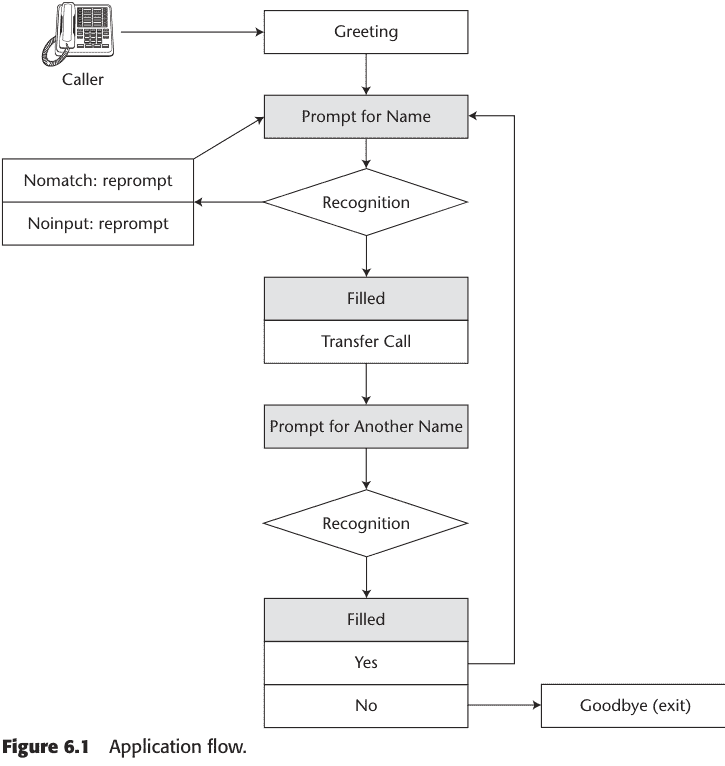

### 构建联系人列表

电话簿应用程序是一个与名称列表相关的电话号码列表。我们将从一个简单的联系人列表开始，并扩展到你想要访问的联系人或业务列表。

简单语法的第一次尝试是一个虚构家庭成员的列表。这将让我们有机会处理具有相同电话号码的人群以及拥有多个电话号码的人。初始联系人列表仅包含名字，如代码清单 6.1 所示。在项目的后期，我们将开发一个更复杂的语法，来处理名字重复和通往你最常用联系人的快捷方式。


```
1. <?xml version="1.0"?>
2.

3. <!DOCTYPE vxml
4. PUBLIC
5. "-//BeVocal Inc//VoiceXML 2.0//EN"
6. "http://cafe.bevocal.com/libraries/dtd/vxml-0-bevocal.dtd"

8. <vxml version="2.0">
9. <form id="getContactName">
10. <field name="contactList">
11. <prompt>
12. 你想联系谁？
13. </prompt>
14. <grammar>
15. <![CDATA[
16. rosemary
17. john
18. anthony
19. kristi
20. cubby
21. kim
22. mary
23. aaron
24. justin
25. ]]>
26. </grammar>
27. <filled>
28. <prompt>
29. 你请求了 <value expr="contactList">
30. </prompt>
31. </filled>
32. </field>
33. </form>
34. </vxml>
```

清单 6.1 初始联系人列表。

# 项目 6

清单 6.1 包含一个持有名称列表并确认的的表单。它以一个可选的 DTD 开始验证 VoiceXML 语法。`<form>` 输出一个 `<prompt>` 请求呼叫者提供名字。如果识别成功，则传递到 `<filled>`。`<nomatch>` 或 `<noinput>` 的任何错误消息由平台处理。通过电话通话测试你的应用程序。


### 将名称映射到电话号码

联系人列表中的名称必须映射（或关联）特定的电话号码。通过槽（slots）将输入映射到特定值如清单 6.2 所示，扩展语法部分以包含每个人的电话号码。

```
<grammar>
2. <![CDATA[
3. [
4. [rosemary] <contactList 718391234>
5. [john] <contactList 20123422>
6. [anthony] <contactList 203453>
7. [kristi] <contactList 134553>
8. [cubby] <contactList 33461578>
9. [kim] <contactList 33461578>
10. [mary] <contactList 2079674564>
11. [richard] <contactList 2094564>
12. [aaron] <contactList 274564>
13. [justin] <contactList 274564>
14. ]]>
15. </grammar>
```

**清单 6.2** 使用槽映射值。

### 填充槽（Slots）

在简单语法中，用户说话时识别出的话语存储在字段变量中。有时，通过用户的输入为变量分配开发者定义的值，而不是插入用户的输入，这在构建需要返回单个值的复杂短语或解析将填充多个字段变量的短语时非常有用。

`slot` 是 `<field>` 元素的可选属性。当 `slot` 属性缺失时，使用默认字段名来填充 `<field>` 元素的隐含槽。如果识别了用户，则将其输入到字段变量中。这是我们在之前的项目中构造语法的方法。槽允许开发者显式地向字段强制特定值。在当前项目中，我们希望根据要拨打的人强制特定的号码作为值。

将联系人名称转换为电话号码的语法从将每个名称括在括号中开始。括号表示逻辑，即“或”。`[ rosemary]` 意味着“或”。

这种语法第一次看起来可能很奇怪。在清单 6.2 中，第 3 行和第 14 行有一个括号包裹着第 4 行到 13 行的另一组括号，持有不同的名字。所有内容都包含在 CDATA 区域内。

当语法内容包含小于（<）字符时，CDATA 区域非常方便。这是一个保留字符，必须通过 CDATA 区域进行转义，或扩展为其 XML 等效值：`&lt;`。由于语法的每行构造都包含一个小于字符，将整个语法编码在 CDATA 区域中比替换每个特殊字符简单得多。表 6.1 是保留字符及其实体等效值的列表。

每个名称周围的逻辑括号现在不是强制性的，但为我们想要将名称扩展为一组人做了良好准备，正如我们在下一节中所的那样。大括号设置了槽，在识别出话语之前持有字段变量。在我们的情况下，`<contactList>` 将被填充电话号码。在每个逻辑括号包含的电话列表联系人姓名之后，槽名后面是将被分配给字段变量的值。

### 表 6.1 特殊字符及其实体等效值

| 字符 | 实体等效值 |

|---|---|

| < | &lt; |

| > | &gt; |

| ' | &apos; |

| " | &quot; |

| & | &amp; |

将列表 6.1 中的现有语法替换为列表 6.2 中新定义的槽位填充语法。测试您的应用程序以验证输出的是要拨打人员的电话号码，而不是其姓名。

### 确认用户输入

如果用户每次说话时都隐含对其输入的确认，而不是每次都显式陈述，语音应用程序听起来会更自然。例如，如果用户说“Mary”来请求一个名字，应用程序不是用提问确认（“你说的是 Mary。正确吗？”），而是用陈述回答：“正在拨打 Mary 201456464。”这确认了系统正确理解了用户并获取了电话号码。

作为一个一般规则，系统会向用户重复你刚刚说的陈述，用户的任何响应都应被视为否定响应并作为错误捕获。列表 6.3 开启了一个 1.5 秒的小窗口，用于接收用户的响应。

```
1. <?xml version="1.0"?>
2.

3. <!DOCTYPE vxml
4. PUBLIC
5. "//BeVocal In//VoiceXML 2.0//EN//dtd/vxml2-0-bevocal.dtd">
6. "http://cafe.bevocal.com/libraries/dtd/vxml2-0-bevocal.dtd"

8. <xml version="2.0">
9.   <form id="gettxtName">

11.    <prompt>
12.      Whom would you like to contact?
13.    </prompt>

16.    <grammar>
17.     <![CDATA[
18.     [
19.      [rosmary] (<contactList 7183991234 >)
20.      [john] (<contactList 2012342432 >)
21.      [anthony] (<contactList 2013453453 >)
22.      [kristi] (<contactList 2013453453 >)
23.      [cubby] (<contactList 3343615678 >)
24.      [kim] (<contactList 3343615678 >)
```

**列表 6.3** 确认用户输入。

```
25. [mary] { <contactList 2079674564> }
26. [richard] { <contactList 2079674564> }
27. [aaron] { <contactList 2079674564> }
28. [justin] { <contactList 2079674564> }
29. ]
30. ]>
31. </grammar>
32. </field>

34. <field name="confirmContactName">
35. <prompt timeout="1.5s">
36. Calling <value expr="contactList$.utterance"/>
37. at <value expr="contactList"/>
38. </prompt>
39. <noinput>
40. <assign name="confirmContactName" expr='true*'>
41. </noinput>
42. <nomatch>I'm sorry, clear./</nomatch>
43. </field>

45. <block>
46. Glad to be of service. Good bye.
47. </block>

49. </form>

51. </vxml>
```

**列表 6.3** 确认用户输入。（续）

从第 34 行开始的 `<field>` 元素 confirmContactName 会向呼叫者重复识别出的姓名和映射到该姓名的电话号码。要访问用户识别的输入，请引用 `getContactName$.utterance` 影子变量。字段级影子变量返回的是用户说的内容，而不是设置为槽位值的内容。

### 字段级影子变量

在项目 4 验证呼叫者的语音点时，我们简要提到了影子变量。字段级影子变量是作为 VoiceXML 平台语法识别系统的一部分设置的。它们是只读变量，提供了访问平台对语音输入分析的权限，可以根据其值用于条件处理。

`utterance` 影子变量返回平台理解为该字段定义语法一部分的原始输入。在当前应用程序中，用户说出一个名字，平台根据语法中可用的姓名列表检查输入，如果识别出名字，则将输入存储在 `getContactName$.utter` 影子变量中。平台识别语音语法的置信度可以通过 `getContactName$.confidence` 变量访问，输入模式（无论是 DTMF 还是语音）可以通过 `getContactName$.input` 变量访问。

### 检查用户输入

列表 6.3 第 35 行的 `<prompt>` 中设置了一个 1.5 秒的机遇窗口，为呼叫者提供了响应提示的机会，尽管他们并不知道该窗口的存在。存在一个隐藏的提示，其任何响应都被视为错误，并由第 42 行的 `<nomatch>` 元素处理。如果用户有任何响应，表单中的所有字段将通过第 42 行 `<nomatch>` 块内的 `<clear>` 元素清除。应用程序将通过输出 "I'm sorry" 对错误承担口责任，FIA 回到第一个字段。

在 1.5 秒窗口关闭后，假设呼叫者没有反应，意味着电话是要取消的。`<noinput>` 元素为 `confirmName` 字段赋值，允许 FIA 继续进入对话的下一部分。从第 48 行开始的 `getBlock` 是占位符，将在后续章节中开发。

> 使用隐含和隐藏对话是确认用户输入且不拖累用户的好方法，无需重复。## 拨号器 183

```
1. <?xml version="1.0"?>
2.

3. <!DOCTYPE vxml
4. PUBLIC
5. "//BeVocal In//VoiceXML 2.0//EN//dtd/vxml2-0-bevocal.dtd">
6. "http://cafe.bevocal.com/libraries/dtd/vxml2-0-bevocal.dtd"

8. <xml version="2.0">
9.   <form id="gettxtName">

11.    <prompt>
12.      Whom would you like to contact?
13.    </prompt>

16.    <grammar>
17.     <![CDATA[
18.     [
19.      [rosmary] (<contactList 7183991234 >)
20.      [john] (<contactList 2012342432 >)
21.      [anthony] (<contactList 2013453453 >)
22.      [kristi] (<contactList 2013453453 >)
23.      [cubby] (<contactList 3343615678 >)
24.      [kim] (<contactList 3343615678 >)
```

**列表 6.3** 确认用户输入。

```
25. [mary] { <contactList 2079674564> }
26. [richard] { <contactList 2079674564> }
27. [aaron] { <contactList 2079674564> }
28. [justin] { <contactList 2079674564> }
29. ]
30. ]>
31. </grammar>
32. </field>

34. <field name="confirmContactName">
35. <prompt timeout="1.5s">
36. Calling <value expr="contactList$.utterance"/>
37. at <value expr="contactList"/>
38. </prompt>
39. <noinput>
40. <assign name="confirmContactName" expr='true*'>
41. </noinput>
42. <nomatch>I'm sorry, clear./</nomatch>
43. </field>

45. <block>
46. Glad to be of service. Good bye.
47. </block>

49. </form>

51. </vxml>
```

**列表 6.3** 确认用户输入。（续）

从第 34 行开始的 `<field>` 元素 confirmContactName 会向呼叫者重复识别出的姓名和映射到该姓名的电话号码。要访问用户识别的输入，请引用 `getContactName$.utterance` 影子变量。字段级影子变量返回的是用户说的内容，而不是设置为槽位值的内容。

### 字段级影子变量

在项目 4 验证呼叫者的语音点时，我们简要提到了影子变量。字段级影子变量是作为 VoiceXML 平台语法识别系统的一部分设置的。它们是只读变量，提供了访问平台对语音输入分析的权限，可以根据其值用于条件处理。

utterance 影子变量返回平台理解为属于该字段定义语法一部分的原始输入。在当前应用程序中，用户说出一个名字，平台根据语法中可用的姓名列表检查输入，如果识别出名字，则将输入存储在 `getContactName$.utter` 影子变量中。平台识别语音语法的置信度可以通过 `getContactName$.confidence` 变量访问，输入模式（无论是 DTMF 还是语音）可以通过 `getContactName$.input` 变量访问。

### 检查用户输入

列表 6.3 第 35 行的 `<prompt>` 中设置了一个 1.5 秒的机遇窗口，为呼叫者提供了响应提示的机会，尽管他们并不知道该窗口的存在。存在一个隐藏的提示，其任何响应都被视为错误，并由第 42 行的 `<nomatch>` 元素处理。如果用户有任何响应，表单中的所有字段将通过第 42 行 `<nomatch>` 块内的 `<clear>` 元素清除。应用程序将通过输出 "I'm sorry" 对错误承担口责任，FIA 回到第一个字段。

在 1.5 秒窗口关闭后，假设呼叫者没有反应，意味着电话是要取消的。`<noinput>` 元素为 `confirmName` 字段赋值，允许 FIA 继续进入对话的下一部分。从第 48 行开始的 `getBlock` 是占位符，将在后续章节中开发。

> 使用隐含和隐藏对话是确认用户输入且不拖累用户的好方法，无需重复。## 拨号器 183

```
1. <?xml version="1.0"?>
2.

3. <!DOCTYPE vxml
4. PUBLIC
5. "//BeVocal In//VoiceXML 2.0//EN//dtd/vxml2-0-bevocal.dtd">
6. "http://cafe.bevocal.com/libraries/dtd/vxml2-0-bevocal.dtd"

8. <xml version="2.0">
9.   <form id="gettxtName">

11.    <prompt>
12.      Whom would you like to contact?
13.    </prompt>

16.    <grammar>
17.     <![CDATA[
18.     [
19.      [rosmary] (<contactList 7183991234 >)
20.      [john] (<contactList 2012342432 >)
21.      [anthony] (<contactList 2013453453 >)
22.      [kristi] (<contactList 2013453453 >)
23.      [cubby] (<contactList 3343615678 >)
24.      [kim] (<contactList 3343615678 >)
```

**列表 6.3** 确认用户输入。


将列表 6.1 中的现有语法替换为列表 6.2 中新定义的槽位填充语法。测试您的应用程序以验证输出的是要拨打人员的电话号码，而不是其姓名。

### 确认用户输入

如果用户每次说话时都隐含对其输入的确认，而不是每次都显式陈述，语音应用程序听起来会更自然。例如，如果用户说“Mary”来请求一个名字，应用程序不是用提问确认（“你说的是 Mary。正确吗？”），而是用陈述回答：“正在拨打 Mary 201456464。”这确认了系统正确理解了用户并获取了电话号码。

作为一个一般规则，系统会向用户重复你刚刚说的陈述，用户的任何响应都应被视为否定响应并作为错误捕获。列表 6.3 开启了一个 1.5 秒的小窗口，用于接收用户的响应。

```
1. <?xml version="1.0"?>
2.
3. <!DOCTYPE vxml
4. PUBLIC
5. "//BeVocal In//VoiceXML 2.0//EN//dtd/vxml2-0-bevocal.dtd">
6. "http://cafe.bevocal.com/libraries/dtd/vxml2-0-bevocal.dtd"
7.
8. <xml version="2.0">
9.   <form id="gettxtName">
10.
11.    <prompt>
12.      Whom would you like to contact?
13.    </prompt>
14.
15.
16.    <grammar>
17.     <![CDATA[
18.     [
19.      [rosmary] (<contactList 7183991234 >)
20.      [john] (<contactList 2012342432 >)
21.      [anthony] (<contactList 2013453453 >)
22.      [kristi] (<contactList 2013453453 >)
23.      [cubby] (<contactList 3343615678 >)
24.      [kim] (<contactList 3343615678 >)
```

**列表 6.3** 确认用户输入。

```
25. [mary] { <contactList 2079674564> }
26. [richard] { <contactList 2079674564> }
27. [aaron] { <contactList 2079674564> }
28. [justin] { <contactList 2079674564> }
29. ]
30. ]>
31. </grammar>
32. </field>
33.
34. <field name="confirmContactName">
35. <prompt timeout="1.5s">
36. Calling <value expr="contactList$.utterance"/>
37. at <value expr="contactList"/>
38. </prompt>
39. <noinput>
40. <assign name="confirmContactName" expr='true*'>
41. </noinput>
42. <nomatch>I'm sorry, clear./</nomatch>
43. </field>
44.
45. <block>
46. Glad to be of service. Good bye.
47. </block>
48.
49. </form>
50.
51. </vxml>
```

**列表 6.3** 确认用户输入。（续）

从第 34 行开始的 `<field>` 元素 `confirmContactName` 会向呼叫者重复识别出的姓名和映射到该姓名的电话号码。要访问用户识别的输入，请引用 `getContactName$.utterance` 影子变量。字段级影子变量返回的是用户说的内容，而不是设置为槽位值的内容。

### 字段级影子变量

在项目 4 验证呼叫者的语音点时，我们简要提到了影子变量。字段级影子变量是作为 VoiceXML 平台语法识别系统的一部分设置的。它们是只读变量，提供了访问平台对语音输入分析的权限，可以根据其值用于条件处理。

`utterance` 影子变量返回平台理解为属于该字段定义语法一部分的原始输入。在当前应用程序中，用户说出一个名字，平台根据语法中可用的姓名列表检查输入，如果识别出名字，则将输入存储在 `getContactName$.utter` 影子变量中。平台识别语音语法的置信度可以通过 `getContactName$.confidence` 变量访问，输入模式（无论是 DTMF 还是语音）可以通过 `getContactName$.input` 变量访问。

### 检查用户输入

列表 6.3 第 35 行的 `<prompt>` 中设置了一个 1.5 秒的机遇窗口，为呼叫者提供了响应提示的机会，尽管他们并不知道该窗口的存在。存在一个隐藏的提示，其任何响应都被视为错误，并由第 42 行的 `<nomatch>` 元素处理。如果用户有任何响应，表单中的所有字段将通过第 42 行 `<nomatch>` 块内的 `<clear>` 元素清除。应用程序将通过输出 "I'm sorry" 对错误承担口责任，FIA 回到第一个字段。

在 1.5 秒窗口关闭后，假设呼叫者没有反应，意味着电话是要取消的。`<noinput>` 元素为 `confirmName` 字段赋值，允许 FIA 继续进入对话的下一部分。从第 48 行开始的 `getBlock` 是占位符，将在后续章节中开发。

> 使用隐含和隐藏对话是确认用户输入且不拖累用户的好方法，无需重复。


将列表 6.1 中的现有语法替换为列表 6.2 中新定义的槽位填充语法。测试您的应用程序以验证输出的是要拨打人员的电话号码，而不是其姓名。

### 确认用户输入

如果用户每次说话时都隐含对其输入的确认，而不是每次都显式陈述，语音应用程序听起来会更自然。例如，如果用户说“Mary”来请求一个名字，应用程序不是用提问确认（“你说的是 Mary。正确吗？”），而是用陈述回答：“正在拨打 Mary 201456464。”这确认了系统正确理解了用户并获取了电话号码。

作为一个一般规则，系统会向用户重复你刚刚说的陈述，用户的任何响应都应被视为否定响应并作为错误捕获。列表 6.3 开启了一个 1.5 秒的小窗口，用于接收用户的响应。

```
1. <?xml version="1.0"?>
2.
3. <!DOCTYPE vxml
4. PUBLIC
5. "//BeVocal In//VoiceXML 2.0//EN//dtd/vxml2-0-bevocal.dtd">
6. "http://cafe.bevocal.com/libraries/dtd/vxml2-0-bevocal.dtd"
7.
8. <xml version="2.0">
9.   <form id="gettxtName">
10.
11.    <prompt>
12.      Whom would you like to contact?
13.    </prompt>
14.
15.
16.    <grammar>
17.     <![CDATA[
18.     [
19.      [rosmary] (<contactList 7183991234 >)
20.      [john] (<contactList 2012342432 >)
21.      [anthony] (<contactList 2013453453 >)
22.      [kristi] (<contactList 2013453453 >)
23.      [cubby] (<contactList 3343615678 >)
24.      [kim] (<contactList 3343615678 >)
```

**列表 6.3** 确认用户输入。


将列表 6.1 中的现有语法替换为列表 6.2 中新定义的槽位填充语法。测试您的应用程序以验证输出的是要拨打人员的电话号码，而不是其姓名。

### 确认用户输入

如果用户每次说话时都隐含对其输入的确认，而不是每次都显式陈述，语音应用程序听起来会更自然。例如，如果用户说“Mary”来请求一个名字，应用程序不是用提问确认（“你说的是 Mary。正确吗？”），而是用陈述回答：“正在拨打 Mary 201456464。”这确认了系统正确理解了用户并获取了电话号码。

作为一个一般规则，系统会向用户重复你刚刚说的陈述，用户的任何响应都应被视为否定响应并作为错误捕获。列表 6.3 开启了一个 1.5 秒的小窗口，用于接收用户的响应。

```
1. <?xml version="1.0"?>
2.
3. <!DOCTYPE vxml
4. PUBLIC
5. "//BeVocal In//VoiceXML 2.0//EN//dtd/vxml2-0-bevocal.dtd">
6. "http://cafe.bevocal.com/libraries/dtd/vxml2-0-bevocal.dtd"
7.
8. <xml version="2.0">
9.   <form id="gettxtName">
10.
11.    <prompt>
12.      Whom would you like to contact?
13.    </prompt>
14.
15.
16.    <grammar>
17.     <![CDATA[
18.     [
19.      [rosmary] (<contactList 7183991234 >)
20.      [john] (<contactList 2012342432 >)
21.      [anthony] (<contactList 2013453453 >)
22.      [kristi] (<contactList 2013453453 >)
23.      [cubby] (<contactList 3343615678 >)
24.      [kim] (<contactList 3343615678 >)
```

**列表 6.3** 确认用户输入。

```
25. [mary] { <contactList 2079674564> }
26. [richard] { <contactList 2079674564> }
27. [aaron] { <contactList 2079674564> }
28. [justin] { <contactList 2079674564> }
29. ]
30. ]>
31. </grammar>
32. </field>
33.
34. <field name="confirmContactName">
35. <prompt timeout="1.5s">
36. Calling <value expr="contactList$.utterance"/>
37. at <value expr="contactList"/>
38. </prompt>
39. <noinput>
40. <assign name="confirmContactName" expr='true*'>
41. </noinput>
42. <nomatch>I'm sorry, clear./</nomatch>
43. </field>
44.
45. <block>
46. Glad to be of service. Good bye.
47. </block>
48.
49. </form>
50.
51. </vxml>
```

**列表 6.3** 确认用户输入。（续）

从第 34 行开始的 `<field>` 元素 `confirmContactName` 会向呼叫者重复识别出的姓名和映射到该姓名的电话号码。要访问用户识别的输入，请引用 `getContactName$.utterance` 影子变量。字段级影子变量返回的是用户说的内容，而不是设置为槽位值的内容。

### 字段级影子变量

在项目 4 验证呼叫者的语音点时，我们简要提到了影子变量。字段级影子变量是作为 VoiceXML 平台语法识别系统的一部分设置的。它们是只读变量，提供了访问平台对语音输入分析的权限，可以根据其值用于条件处理。

`utterance` 影子变量返回平台理解为属于该字段定义语法一部分的原始输入。在当前应用程序中，用户说出一个名字，平台根据语法中可用的姓名列表检查输入，如果识别出名字，则将输入存储在 `getContactName$.utter` 影子变量中。平台识别语音语法的置信度可以通过 `getContactName$.confidence` 变量访问，输入模式（无论是 DTMF 还是语音）可以通过 `getContactName$.input` 变量访问。

### 检查用户输入

列表 6.3 第 35 行的 `<prompt>` 中设置了一个 1.5 秒的机遇窗口，为呼叫者提供了响应提示的机会，尽管他们并不知道该窗口的存在。存在一个隐藏的提示，其任何响应都被视为错误，并由第 42 行的 `<nomatch>` 元素处理。如果用户有任何响应，表单中的所有字段将通过第 42 行 `<nomatch>` 块内的 `<clear>` 元素清除。应用程序将通过输出 "I'm sorry" 对错误承担口责任，FIA 回到第一个字段。

在 1.5 秒窗口关闭后，假设呼叫者没有反应，意味着电话是要取消的。`<noinput>` 元素为 `confirmName` 字段赋值，允许 FIA 继续进入对话的下一部分。从第 48 行开始的 `getBlock` 是占位符，将在后续章节中开发。

> 使用隐含和隐藏对话是确认用户输入且不拖累用户的好方法，无需重复。


`utterance` 影子变量返回平台理解为属于该字段定义语法一部分的原始输入。在当前应用程序中，用户说出一个名字，平台根据语法中可用的姓名列表检查输入，如果识别出名字，则将输入存储在 `getContactName$.utter` 影子变量中。平台识别语音语法的置信度可以通过 `getContactName$.confidence` 变量访问，输入模式（无论是 DTMF 还是语音）可以通过 `getContactName$.input` 变量访问。

### 检查用户输入

列表 6.3 第 35 行的 `<prompt>` 中设置了一个 1.5 秒的机遇窗口，为呼叫者提供了响应提示的机会，尽管他们并不知道该窗口的存在。存在一个隐藏的提示，其任何响应都被视为错误，并由第 42 行的 `<nomatch>` 元素处理。如果用户有任何响应，表单中的所有字段将通过第 42 行 `<nomatch>` 块内的 `<clear>` 元素清除。应用程序将通过输出 "I'm sorry" 对错误承担口责任，FIA 回到第一个字段。

在 1.5 秒窗口关闭后，假设呼叫者没有反应，意味着电话是要取消的。`<noinput>` 元素为 `confirmName` 字段赋值，允许 FIA 继续进入对话的下一部分。从第 48 行开始的 `getBlock` 是占位符，将在后续章节中开发。

> 使用隐含和隐藏对话是确认用户输入且不拖累用户的好方法，无需重复。

将列表 6.1 中的现有语法替换为列表 6.2 中新定义的槽位填充语法。测试您的应用程序以验证输出的是要拨打人员的电话号码，而不是其姓名。

### 确认用户输入

如果用户每次说话时都隐含对其输入的确认，而不是每次都显式陈述，语音应用程序听起来会更自然。例如，如果用户说“Mary”来请求一个名字，应用程序不是用提问确认（“你说的是 Mary。正确吗？”），而是用陈述回答：“正在拨打 Mary 201456464。”这确认了系统正确理解了用户并获取了电话号码。

作为一个一般规则，系统会向用户重复你刚刚说的陈述，用户的任何响应都应被视为否定响应并作为错误捕获。列表 6.3 开启了一个 1.5 秒的小窗口，用于接收用户的响应。

```
1. <?xml version="1.0"?>
2.
3. <!DOCTYPE vxml
4. PUBLIC
5. "//BeVocal In//VoiceXML 2.0//EN//dtd/vxml2-0-bevocal.dtd"
6. "http://cafe.bevocal.com/libraries/dtd/vxml2-0-bevocal.dtd"
7.
8. <xml version="2.0">
9.   <form id="gettxtName">
10.
11.    <prompt>
12.      Whom would you like to contact?
13.    </prompt>
14.
15.
16.    <grammar>
17.     <![CDATA[
18.     [
19.      [rosmary] (<contactList 7183991234 >)
20.      [john] (<contactList 2012342432 >)
21.      [anthony] (<contactList 2013453453 >)
22.      [kristi] (<contactList 2013453453 >)
23.      [cubby] (<contactList 3343615678 >)
24.      [kim] (<contactList 3343615678 >)
```

**列表 6.3** 确认用户输入。

```
25. [mary] { <contactList 2079674564> }
26. [richard] { <contactList 2079674564> }
27. [aaron] { <contactList 2079674564> }
28. [justin] { <contactList 2079674564> }
29. ]
30. ]>
31. </grammar>
32. </field>
33.
34. <field name="confirmContactName">
35. <prompt timeout="1.5s">
36. Calling <value expr="contactList$.utterance"/>
37. at <value expr="contactList"/>
38. </prompt>
39. <noinput>
40. <assign name="confirmContactName" expr='true*' >
41. </noinput>
42. <nomatch>I'm sorry, clear./</nomatch>
43. </field>
44.
45. <block>
46. Glad to be of service. Good bye.
47. </block>
48.
49. </form>
50.
51. </vxml>
```

**列表 6.3** 确认用户输入。（续）

从第 34 行开始的 `<field>` 元素 `confirmContactName` 会向呼叫者重复识别出的姓名和映射到该姓名的电话号码。要访问用户识别的输入，请引用 `getContactName$.utterance` 影子变量。字段级影子变量返回的是用户说的内容，而不是设置为槽位值的内容。

### 字段级影子变量

在项目 4 验证呼叫者的语音点时，我们简要提到了影子变量。字段级影子变量是作为 VoiceXML 平台语法识别系统的一部分设置的。它们是只读变量，提供了访问平台对语音输入分析的权限，可以根据其值用于条件处理。

`utterance` 影子变量返回平台理解为属于该字段定义语法一部分的原始输入。在当前应用程序中，用户说出一个名字，平台根据语法中可用的姓名列表检查输入，如果识别出名字，则将输入存储在 `getContactName$.utter` 影子变量中。平台识别语音语法的置信度可以通过 `getContactName$.confidence` 变量访问，输入模式（无论是 DTMF 还是语音）可以通过 `getContactName$.input` 变量访问。

### 检查用户输入

列表 6.3 第 35 行的 `<prompt>` 中设置了一个 1.5 秒的机遇窗口，为呼叫者提供了响应提示的机会，尽管他们并不知道该窗口的存在。存在一个隐藏的提示，其任何响应都被视为错误，并由第 42 行的 `<nomatch>` 元素处理。如果用户一个任何响应，表单中的所有字段将通过第 42 行 `<nomatch>` 块内的 `<clear>` 元素清除。应用程序将通过输出 "I'm sorry" 对错误承担口责任，FIA 回到第一个字段。

在 1.5 秒窗口关闭后，假设呼叫者没有反应，意味着电话是要取消的。`<noinput>` 元素为 `confirmName` 字段赋值，允许 FIA 继续进入对话的下一部分。从第 48 行开始的 `getBlock` 是占位符，将在后续章节中开发。

> 使用隐含和隐藏对话是确认用户输入且不拖累用户的好方法，无需重复。

### 可选标记

问号在 VoiceXML 语法中表示可选。要使某些内容变为可选，请在标记之前直接放置一个问号，如列表 6.6 所示。现在，当用户只说出名字或同时说出名和姓时，处理器都能理解用户的请求。为了处理重复项，请省略问号并强制要求姓。

```xml
<grammar>
<![CDATA[
  ( rosemary miller ) { < contactList 718391234 > )
  ( john ?caviglia ) { < contactList 2072342342 > )
  ( anthony kristi ?caviglia ) { < contactList 2074354435 > )
  (( cubby miller ) { < contactList 3343615678 > )
  (( mary jo) richard anton justin) ?weiss)<contactList 2014564564>)>
]]>
</grammar>
```

**列表 6.6** 可选的姓。

## 创建昵称

处理重复项的另一种方法就像我们在现实生活中一样：给其中一个重复项起一个昵称。Anthony 的父亲的名字是 Anthony。在成长过程中，他获得了 Ants 这个昵称。当他母亲大叫他在吃饭前洗手时，不会混淆到底是哪个 Anthony 真的遇到了麻烦。使用相同的技术（当然，不需要大叫）来开发一个没有歧义的列表。

```xml
<grammar>
<![CDATA[
  ( rosemary miller ) { < contactList 718391234 > )
  ( john ?caviglia ) { < contactList 2072342342 > )
  ( anthony louise ) ?caviglia { < contactList 5105812384 > }
  ({ants kristi} ?caviglia { < contactList 2074354533 > }
  (( cubby miller ) { < contactList 3343615678 > )
  (( mary jo) richard anton justin) ?weiss)<contactList 2014564564>
]]>
</grammar>
```

**列表 6.7** 插入昵称。

列表 6.7 为 Anthony 和 Louise Cavaglia 增加了一条联系行。由于此冲突涉及 Anthony 和 Kristi Cavaglia，Anthony Junior 的昵称被插入在第 7 行。

## 主要选择

我们的大多数人都有一个经常联系的简短名单。我们可以通过不将姓指定为标记的一部分，让他们在其他具有相同名字的人中中获得名字的优先级：在主要联系人中省略其姓，并对重复项强制要求姓。用户可以通过一次话语访问集合中最重要的成员，而无需说出全名。

列表 6.8 的第 4 到第 6 行作为主要联系人，并为每个 Rosemary 省略了姓并强制要求了姓。

```xml
<grammar>
<![CDATA[
  {
    romary < contactList 7183991234 >
    (romary oconnor) < contactList 3012932394 >
    (romary clooney) < contactList 2124354455 >
    (john Cavaglia) < contactList 2072342342 >
    (anthony louise) ?cavaglia (< contactList 510581234 >
    ((ants kisti) ?cavaglia) < contactList 2073453435 >
    ((cubby kim) ?miller) < contactList 334615678 >
    ((mary jo) richard aaron justin) ?weiss)<contactList 2014564564>
  }
]]>
```

**列表 6.8** 主要选择。

## 一个联系人的多个号码

许多人有多个联系电话号码。我们可以通过将电话号码标记为可选，来处理一个联系人的多个号码。用户可以通过一次话语访问这些号码，而不需要说出完整的名字。

```xml
1. <grammar>
2. <![CDATA[
3. { ( rosemary ) < contactList 7183991234 >
4. (romary oconnor) < contactList 3012932394 >
5. (romary clooney) < contactList 2124354455 >
6. (john Cavaglia) < contactList 2072342342 >
7. (anthony louise) ?caviglia (< contactList 510581234 >
8. ((ants kisti) ?caviglia) < contactList 2073453435 >
9. ((cubby kim) ?miller) < contactList 334615678 >
10. ((mary jo) richard aaron justin) ?weiss)<contactList 2014564564>
11. }
12. ]
13. </grammar>
```

## 在短句中添加可选词

你可以插入可选的关键词来使短句完整。“rosemary work” 听起来没有“rosemary at work”那么直观。我们将通过这些技术来处理这些号码。

```xml
1. <grammar>
2. <![CDATA[
3. { ( rosemary ) < contactList 7183991234 >
4. (romary oconnor) < contactList 3012932394 >
5. (romary clooney) < contactList 2124354455 >
6. (john Cavaglia) < contactList 2072342342 >
7. (anthony louise) ?caviglia < contactList 510581234 >
8. ((ants kisti) ?caviglia) < contactList 2073453435 >
9. ((cubby kim) ?miller) < contactList 334615678 >
10. ((mary jo) richard aaron justin) ?weiss)<contactList 2014564564>
11. }
12. ]
13. </grammar>
```

**列表 6.9** 短句中的可选词。

## 控制类型语音


在项目 4 中，我们查看了 VoiceXML 的内置数据类型。`<say-as>` 元素在方面很有帮助。

### **列表 6.11** 使用 `<say-as>` 语音。

## 电话拨号器 (Telephone Dialer)

在插入 `<say-as>` 数据类型之前，拨打你的账户并听输出。通过 Vocal Scripter 运行你的应用程序查看输出。

## 将电话转移到联系号码 (Transfer the Call to the Contact Number)

项目 3 介绍了电话转移的概念。我们将使用在那个项目中创建的模型，将当前项目中的电话转移到列表中的选定联系人。列表 6.12 为该模型包含了必要的更改。

## 190 项目 6

```
35. You were disconnected because the maximum time allowed
36. for your call was exceeded.
37. </if>
38. </filled>
39. </transfer>
40.
41. <block>
42. Glad to be of service. Good bye.
43. </block>
```

**Listing 6.12** 转移通话。（继续）

`<transfer>`从第 12 行开始的 `<block>` 接收 `contactList` 变量（该变量持有选定的电话号码），并作为第 17 行 `dexexpr` 属性的值。`dexexpr` 是一个 BeVocal 属性扩展，它接受 ECMAScript 值，此处该值是存储在 `contactList` 变量中的电话号码。

通话被设置为最长持续 60 秒，到时处理将返回 `<filled>` 元素以检查通话是如何终止的。

> 考虑到潜在的滥用，大多数门户在在使用 `<transfer>` 元素时对通话时长都有限制。BeVocal 平台的默认最大值为 60 秒。

第 19 行开始的 `<filled>` 块用于查看传输是如何终止的。忙音信号、对方未接听、用户挂断以及超过最大通话输出的语音反馈。向用户提供系统正在发生情况的反馈可以给他们安全感，确保一切运行正常。

> 在您的应用程序中插入 `<transfer>` 块。VoiceXML 2.0 工作草案第 2.3.7 节介绍了在传输过程中捕捉事件时可能适用于传输属性。

## 在不断开的情况下拨打另一个电话

如果呼叫者无需终止应用程序并重新拨号即可请求另一个通话，应用程序将更加友好。Listing 6.13 通过第 5 行的 `type` 属性进行简单的布尔检查，询问用户是否想拨打另一个电话。如果回答为肯定，则使用第 12 行的 `<clear>` 元素清除表单中的所有值。随后 FIA 将从表单顶部重新处理，从联系列表中请求一个名称。

## 电话拨号器 191

```
1. <transfer>
2. ...
3. </transfer>
4. 
5. <field name="anotherCall" type="boolean">
6. <prompt>
7. Would you like to call someone else.
8. </prompt>
9. 
10. <filled>
11. <if cond="anotherCall">
12. <clear/>
13. </if>
14. </filled>
15. </field>
```

**Listing 6.13** 请求另一个电话。

## 模块化应用程序

为了使代码更容易维护，我们需要将问候和告别程序隔离到它们自己的表单中。Listing 6.14 创建了每个表单，同时在告别表单内添加了一个供开发者使用的 *start* 全局链接。

```
1. <?xml version="1.0"?>
2. 
3. <!DOCTYPE vxml
4.   PUBLIC
5.   "//BeVocal Inc//VoiceXML 2.0//EN"
6.   "http://call.bevocal.com/libraries/dtd/vxml12-0-bevocal.dtd">
7. 
8. <vxml version="2.0">
9. 
10. <link next="phonebook.vxml getContactName">
11.   <grammar>
12.     <![CDATA[
13.       {(start over)}
14.     ]]>
15.   </grammar>
16. </link>
17. 
18. <form id="greeting">
19. (*continues*)
```

**Listing 6.14** 模块化代码和重新开始链接。（继续）

```
19.  <block>
20.    <prompt>
21.      Welcome back, Master.
22.    </prompt>
23.    goto next="#getContactName"/>
24.  </block>
25.  </form>
26.
27.  <form id="getContactName">
28.
29.    [ get the name and transfer the call ]
30.
31.    <field name="anotherCall" type="boolean">
32.      <prompt>
33.        Would you like to call someone else.
34.      </prompt>
35.
36.    <filled>
37.      <if cond="anotherCall">
38.        <clear/>
39.      <else>
40.        goto next="#goodbye"/>
41.      </if>
42.    </filled>
43.  </field>
44.  </form>
45.
46.  <form id="goodbye">
47.    <field>
48.      <prompt>
49.        Good bye, Master. I will talk with you again, soon.
50.      </prompt>
51.      <grammar>quit</grammar>
52.      <noinput>exit()</noinput>
53.      <nomatch>exit()</nomatch>
54.    </field>
55.  </form>
56.  </vxml>
```

第 10 行到 16 行的重新开始链接与我们在之前的项目中所看到的相同。它可以在应用程序的任何地方激活，包括告别表单，在处使用 `<noinput>` 或 `<nomatch>` 事件来退出应用程序。除 `start` 以外的任何输入将触发退出事件。

`getContactName` 表单中的应用程序主要部分不再默认退出脚本。第 41 行显式 `<else>` 语句跳转到告别表单。

## 本地化帮助和错误消息

在之前的项目中，帮助和错误消息设置在应用程序级别（全局范围）。这些也可以在表单和字段级别设置（局部）。本地化帮助和错误消息有助于创建上下文相关的消息，为每个 `<field>` 或 `<form>` 块提供自己的事件处理器。Listing 6.15 详细介绍了用于替换默认值的上下文相关帮助和错误消息。由于此应用程序的所有输入都包含在 `getElementName` 中，错误可以在字段内本地化，而不是全局。

```
<field name="contactList">
<count="1">
  I do not recognize that.
  Please again
</count>
<count="2">
  This is the second time not recognized.
  Try one more.
</count>
<count="3">
  Sorry! You have not entered name yet.
  goto next="#anotherCall"
</count>
<ininput="1">
  I did not hear you say a name.
</ininput>
<ininput="2">
  Please speak a name to your contact list.
</ininput>
<ininput="3">
  There must be something wrong with the connection.
  Please call back.
</ininput>
```

**Listing 6.15** 帮助和错误消息。

## 194 项目 6

```
34. <help>
  You are trying to access names within your phonebook.
</help>
35. <help>
  Speak the name you would like to call.
</help>
36. <help>
  If the name is not in your phonebook, it might be stored as a nickname.
</help>
37. <help>
  Whom would you like to?
</help>
38. <help>
  Wait, the name is not in your phonebook.
</help>
39. <help>
  The name is not in your phonebook, it might be stored as a nickname.
</help>
40. <help>
  Wait, the name is not in your phonebook, it might be stored as a nickname.
</help>
41. <help>
  Wait, the name is not in your phonebook, it might be stored as a nickname.
</help>
42. <help>
  Wait, the name is not in your phonebook, it might be stored as a nickname.
</help>
43. <help>
  Wait, the name is not in your phonebook, it might be stored as a nickname.
</help>
44. <help>
  Wait, the name is not in your phonebook, it might be stored as a nickname.
</help>
45. <prompt>
  (continues)
</prompt>
46. <grammar>
47. <![CDATA[
48. (start)
49. ]]>
50. </grammar>
51. </field>
52. <grammar>
53. <![CDATA[
54. (start)
55. ]]>
56. </grammar>
57. </field>
58. <grammar>
59. <![CDATA[
60. (start)
61. ]]>
62. </grammar>
63. </field>
```

**Listing 6.15** 帮助和错误消息。（继续）

## 195 电话拨号器

第 10 行到 16 行的重新开始链接与我们在之前的项目中所看到的相同。它可以在应用程序的任何地方激活，包括告别表单，在处使用 `<noinput>` 或 `<nomatch>` 事件来退出应用程序。除 `start` 以外的任何输入将触发退出事件。

`getContactName` 表单中的应用程序主要部分不再默认退出脚本。第 41 行显式 `<else>` 语句跳转到告别表单。有两个 `<help>` 元素响应用户。第一个从第 34 行开始，是一个提醒用户预期的简单消息。第二个 `<help>` 是所需的澄清。如果到达第三个 `<input>` 事件，则假设系统存在问题。

第 44 行的 `<prompt>` 元素重复了字段中的原始提示。

## 插入元数据

当其他应用程序作为搜索爬虫访问语音站点时，它们将使用项目中的元数据获取有关应用程序内容的信息。项目1 包含了对 `<meta>` 元素的讨论以及 W3C 将其包含在项目的建议。当前项目的基本属性和占位符值在 Listing 6.16 中。

- `<meta name="author" content="Peter Altamuro/"`

- `<meta name="copyright" content="Copyright 2002, Peter Altamuro/"`

- `<meta name="description" content="Telephone Voice Dialer/"`

- `<meta name="keywords" content="voicexml, dialer/"`

- `<meta name="maintainer" content="pete.altamuro@yourdomain.com/"`

- `<meta name="robots" content="all/">`

**Listing 6.16** 此项目的元数据。

# 整合汇总

如列表 6.17 所示，完整的脚本是一个功能齐全的电话录，内置了上下文敏感错误检查和帮助消息。


```xml
1. <?xml version="1.0"?>
2. -
3. <!DOCTYPE vxmxl
4. PUBLIC
5. "-//BeVocal Inc//VoiceXML 2.0//DTD/vxmxl2-0-bevocal.dtd">
7. -
8. <vxmxl version="2.0">
9. -
10. <meta name="author" content="Peter Altamira"/>
11. <meta name="copyright" content="Copyright 2002, Peter Altamira"/>
12. <meta name="description" content="Telephone Dialer"/>
13. <meta name="keywords" content="voxel, dialer"/>
14. <meta name="maintainer" content="pete.altamuro@yourdomain.com"/>
15. <meta name="robots" content="all"/>
16. -
17. <!-- GLOBAL START OVER -->
18. <link next="phonebook.vxmgetContactName">
19. -
20. <grammar>
21. <![CDATA[
22. [start over)
23. ]]]
24. </grammar>
25. </link>
26. -
27. <!-- GREETING --
28. <form id="greeting">
29. <block>
30. <prompt>
31. 欢迎回来，主人。
32. </prompt>
33. <goto next="#getContactName"/>
34. </block>
35. </form>
36. -
37. <!-- MAIN PROCESSING --
38. <form id="getContactName">
39. -
40. <field name="contactList">
41. -
42. <!-- LOCALIZED NOMATCH EVENTS --
43. <nomatch count="1">
43. 我不认识那个名字。请重试
44. <prompt/>
45. </nomatch>
46. <nomatch count="2*">
47. 这个名字已经第二次没有被识别了。
48. 请再试一次。
49. <prompt/>
50. </nomatch>
51.
52. <nomatch count="3*">
53. 抱歉！您还没有在通讯录中输入过那个名字。
54. <goto nextextime="#anotherCall"/>
55. </nomatch>
56.
57. <!-- LOCALIZED NOINPUT EVENTS --
58. <input count="1*">
59. 我没有听见你说名字。
60. <prompt/>
61. </input>
62.
63. <input count="2*">
64. 请说名字以访问您的联系人列表。
65. </input>
66.
67. <input count="3*">
68. 连接可能出了问题。
69. 请使用更好的电话线路拨回。
70. <disconnect/>
71. </input>
72.
73. <!-- LOCALIZED HELP EVENTS --
74. <help count="1*">
75. 您正在尝试访问通讯录中的姓名。
76. 请说您想要拨打的人。
77. </help>
78.
79. <help count="2*">
80. 如果您遇到了问题，您请求的名字可能不在您的通讯录中，或者它可能是以昵称存储的。
81. 请尝试不同的名字。
82. <prompt/>
83. </help>
84.
85. <prompt>
86. 您想联系联系谁？
87. </prompt>
88.
91. <grammar>
92. <![CDATA[
93. [
94.   ( rosemary ?at work ) < contactList 7183991234 >
95.   ( rosemary ?at home ) < contactList 2124560987 >
96.   ( rosemary cellphone ) < contactList 9173998765 >
97.   ( rosemary occorner ) < contactList 3012932394 >
98.   ( rosemary cooney ) < contactList 21242135455 >
99.   ( john ?louisa ?cavigla ) < contactList 5105812344 >
100.  ( antis krist ?cavigla ) < contactList 20723745342 >
101.  ( cubby ?miller ) < contactList 334631568 >
102.  ((mary jo) richard axaron just)?weiss)<contactList 201456564>)
103. )]]
104. </grammar>
105. 
106. </field>
107. <!-- CONFIRMATION OF INPUT --
108. <field name="confirmContactName">
109. <prompt timeout="1.5s">
110. 正在拨打 <value expr="contactList utterance"/>
111. at expr="contactList"
112. </prompt>
113. <noinput>
114. <assign name="confirmContactName" expr='true'/>
115. </noinput>
116. <nomatch>很抱歉。<clear></nomatch>
117. </field>
118. <!-- TRANSFER THE CALL --
119. <transfer>
120. name="transferCall"
121. timeout="20s"
122. maxptime="60s"
123. bridge="true"
124. dest="contactList">
125. <!-- CONFIRM CALL TERMINATION --
126. <filled>
127. <if cond="transferCall == 'busy'">
128. <prompt>
129. 线路忙忙，请重试。
130. </prompt>
131. <elseif cond="transferCall == 'far_end'">
132. <prompt>
133. 对方挂了电话。
134. </prompt>
140. <prompt>
141. <elseif cond="transferCall == 'noanswer'/>
142. <prompt>
143. 无人接听。
144. 请稍后再试。
145. </prompt>
146. <elseif cond="maxtime_disconnect > 60'">
147. 因为超过了允许的时间，通话已断开。
149. <filled>
151. </transfer>
153. <!-- REQUEST ANOTHER CONTACT -->
154. <field name="anotherCall" type='boolean'>
155. <prompt>
156. 想拨打其他人吗？
157. </prompt>
159. </filled>
160. <if cond='anotherCall'>
161. <clear/>
162. <else>
163. <goto next='#goodbye'/>
164. </if>
165. </filled>
166. <field>
167. </form>
169. <form id='goodbye'>
170. <field>
171. <prompt>
172. 再见，主人。很快会再次与您联系的。
173. </prompt>
174. <grammar>quit</grammar>
175. <noinput></exit></noinput>
176. <nomatch></exit></nomatch>
177. </field>
178. </form>
180. </xml>
```

**列表 6.17** 完整的拨号器。

## 结语

你现在有了一个简单的拨号器，包含可以通过任何电话访问的姓名和号码。随着书中项目复杂性的增加，考虑回来进行一些修改。

还有很多工作可以使这个应用程序变得更有用。硬编码在应用程序中的姓名和号码可以存储在外部文件中，或从数据库动态生成。另一个很好的改进是通过语音界面更新电话号码。

项目的列表可以从 BeVocal 网站 `cafe.bevocal.com/wiley/10projects` 下载。它们以文本文件的形式保存，可以创建自己的 VoiceXML 脚本的模板。加入我们的项目在线讨论板，告诉我们我们将如何使用这个项目。如果你创建一个让这个项目运行得更好的表单可能会整合到项目代码中供他人使用。

# 项目 7

# 报告记录器

我在夏威夷住过两年。怀旧之潮偶尔会袭来，我只想知道北岸的情况如何。`www.surfline.com` 在世界各地的海滩设置了摄像头和记者。记者每天登录并为网站输入冲浪报告，但当你只有一个电话时，这没什么什么用。这个项目的想法就源于此。特别感谢 Tim Chandler 和 Surfline.com 的团队为该项目提供冲浪数据。

| 问题 | 需要每天记录并存储多个来源的信息。制作报告的人应该可以通过任何电话拨打他们的报告。 |
| 解决方案 | 一个以 `.wav` 文件格式存储报告的语音记录器将允许远程记者登录、制作报告，并让用户通过电话或网站上的链接访问报告。 |

## 项目描述

每天通过直接电话访问进行录音。记者拨进来，通过用户名和 ID 号进行验证，选择一个海滩进行报告，然后记录报告。报告将播放给记者进行核实。一旦记者核实录音，它将被保存为 `.wav` 文件供公共站点访问。

要创建这个项目，你将会将：

- 1. 开发一个简单的语法。
- 2. 限制登录尝试。
- 3. 开发一个外部语法文件。
- 4. 将记者映射到海滩名称。
- 5. 记录一份报告。
- 6. 保存录音。
- 7. 访问录音。

### 你需要

- 一个 BeVocal 开发者账户
- 用于提示的音频录音
- 用于处理和存储记录报告的 Web 服务器
- 下载示例文件：`cafe.bevocal.com/wiley/10projects`

本项目中使用的 VoiceXML 元素

| 元素名称 | 描述 |
| - | - |
| `<assign>` | 为变量赋值 |
| `<audio>` | 播放录制音效 |
| `<block>` | 包含可执行的内容 |
| `<clear>` | 将当前范围内的字段名称设置为未定义 |
| `<else>` | `<if>` 元素中的最终可能性 |
| `<elseif>` | `<if>` 元素中的条件可能性 |

## 报告记录器 203

本项目中使用的 VoiceXML 元素（续）

| 元素名称 | 描述 |
| --- | --- |
| `<field>` | 接收用户输入 |
| `<filled>` | 如果字段输入已被接受，则进行处理 |
| `<form>` | 包含用于收集用户输入的提示和字段 |
| `<goto>` | 控制应用程序的进程流 |
| `<grammar>` | 可接受的语句/言语 |
| `<if>` | 检查条件为真还是假 |
| `<noinput>` | 如果用户未输入内容，则处理流程 |
| `<nomatch>` | 如果用户未输入有效数据，则处理流程 |
| `<prompt>` | 输出给用户，以请求或提供信息 |
| `<record>` | 接收并记录语音作为输入 |
| `<var>` | 变量声明 |
| `<vxml>` | 根元素 |

来源：VoiceXML 2.0 工作草案，第 1.4 节

## 应用程序调用流程

图 7.1 显示了该应用程序的调用流程。报告员拨入后，会被提示输入姓名。一旦识别出姓名，将发出 ID 提示。在请求海滩名称之前，将使用报告员姓名和 ID 验证身份。随后对海滩的报告进行记录并保存到 Web 服务器上。

## 开发简单语法

报告记录器项目有两个主要部分。首先，必须根据已批准的用户列表对用户进行验证。然后，必须进行录音并保存，以便通过网站访问。我们将从开发能够识别 `reporterName` 和 `reporterId` 的语法开始。

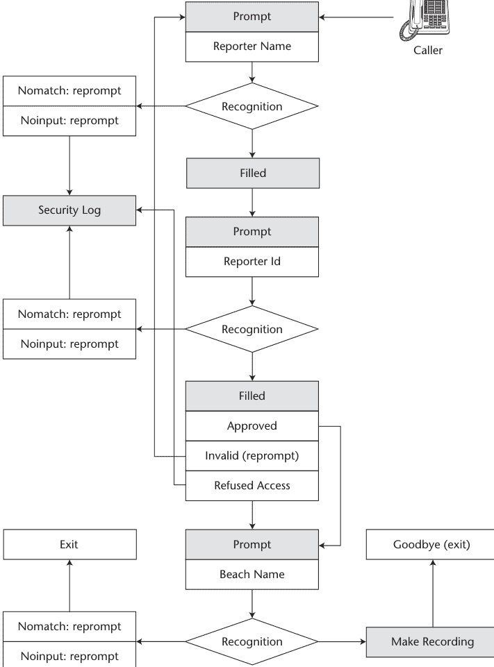

图 7.1 应用程序流程。

## reporterName 和 reporterId 语法

列表 7.1 是一个简单的 `reporterName`/`reporterId` 验证，类似于在项目 4 中开发的验证逻辑。

```
1. <?xml version="1.0"?>
2.
3. <!DOCTYPE vxml
4. PUBLIC
5. "-//BeVocal Inc//VoiceXML 2.0//EN"
6. "http://cafe.bevocal.com/libraries/dtd/vxml2-0-bevocal.dtd" >
7.
8.
9. <vxml version="2.0">
10.
11. <form id="validation">
12.
13. <!-- 报告员姓名 -->
14. <field name="reporterName">
15. <grammar>
16. <CDATA[
17.     [
18.       [(mark ?miller)] (<reporterName A1234)>
19.       [(tim ?chandler)] (<reporterName B4321>)
20.     ]
21. ]>
22. </grammar>
23. <audio src="speak-your-name.wav">
24. 请说您的姓名。
25. </audio>
26. <filled/>
27. </field>
28.
29. <!-- 报告员 ID -->
30. <field name="reporterId">
31. <grammar>
32. <CDATA[
33.     [
34.       [hawaii] (<reporterId A1234>); Mark Miller
35.       [california] (<reporterId B4321>); Tim Chandler
36.     ]
37. ]>
38. </grammar>
39. <audio src="reporter-id.wav">
40. 报告员 ID？
41. </audio>
42.
43. <!-- 验证 -->
44. <filled/>
45.
46. <!-- 有效组合 -->
47. <if cond="reporterName == reporterId">
48. <audio src="welcome-back.wav">
```

**列表 7.1** 验证用户。（续）

```
49.   欢迎回来。
50.   <audio>
51.   <goto next="#recordReport"/>
52.
53.   <!-- 无效组合 --
54.   <else/>
55.   <clear namelist=reporterName reporterId/>
56.   <audio src="invalid-login.wav">
57.   该报告员姓名和 ID 组合无效。
58.   请重试。
59.   </audio>
60.   </if>
61.
62.   </filled>
63.   </field>
64.
65.   </form>
66.
67.   <form id="recordReport">
68.   <block>
69.   进入报告记录器内部。
70.   </block>
71.   </form>
72.
73.   </vxml>
```

列表 7.1 验证用户。（续）

从第 14 行开始的 `reporterName` 包含一个语法，当识别出姓名时，它通过填充 `reporterName` 的槽位值将用户姓名映射到特定的 ID。槽位（Slots）是在项目 4 中创建的。

`reporterName` 以大写字母开头，是因为我们在项目的后期将使用 ID 数字作为语法规则的名称，而语法规则必须以大写字母开头。第 18 行和第 19 行使用问号使得用户的用户的姓氏是可选的。这在没有重名的情况下非常有用，但随着数据库的增长，姓氏可能会变成强制性的。

第 23 行包含一个 `<audio>` 元素，其 `src` 指向声音文件。如果该文件可用，它将作为提示播放给用户；否则`<audio>` 元素内的内容将由 TTS 引擎输出。为了创建一个专业的界面，应该通过 `<audio>` 元素输出提示。

第 34 行和第 35 行的语法将用户映射到相同的集合。

第 44 行到第 62 行的 `<filled>` 块对 `reporterName` 和 ID 进行匹配。

第 47 行的 `<else>` 元素处理两者不匹配的情况。

第 55 行的 `<clear>` 元素重置 `reporterName` 和 `reporterId`。

## 登录限制

为了安全，用户被限制尝试两次。

**列表 7.2** 限制尝试。

```
有该报告员姓名和 ID 组合无效。
请联系管理员。
```联系管理员。

```

```xml

93.

<!-- INVALID COMBINATION -->

94.  <elseif cond="accessAttempts > 1">

95.    Please contact the system admin

96.    to confirm you should


```xml
97.    have access to this system.

98.

99.    <disconnect/>

100.  <submit next="securityLog.cgi"
101.    namelist="phoneNumber"
102.    phoneType
103.    reporterName
104.    reporterId/>
105.  <|else|>
106.  <audio src="invalid-login.wav">
107.    That Reporter Name and ID combination
108.    was not valid. Try it again.
109.  </audio>
110.  <assign name="accessAttempts"
111.    expr="accessAttempts+1"/>
112.  <clear namelist="reporterName reporterId"/>
113.  </if>
114.
115.  </filled>
116.  </field>
117.
118.  </form>
119.
120.  <form id="recordReport">
121.    <block>
122.      Inside the report recorder.
123.    </block>
124.  </form>
125.
126.  </vxml>
```

列表 7.2 限制登录尝试次数。（续）

## 设置变量

在第 13 至 17 行设置的变量将用于记录失败的访问尝试。来自标准会话变量的自动号码识别（`session.telephone.ani`）设置了 `phoneNumber`，信息指示位数字（`session.telephone.idigits`）设置了 `phoneType` 变量。

`accessAttempts` 跟踪身份验证程序被访问的次数。其初始值被设置为 1。如果在第一次尝试比较 `reporterName` 和 `reporterId` 槽位时失败，则该值将加 1。我们将在创建身份验证程序时检查此递增情况。

## 错误检查字段输入

每个 `<field>` 的输入必须在登录的每个阶段在字段级别进行检查。列表 7.2 中的第 37 至 49 行和第 69 行使用 `<catch>` 元素来检查匹配（match）和无输入（noinput）情况。

在之前的项目中，catch 事件有自己独立的计数器，允许用户对每种情况进行多次尝试。现在这些已合并到 catch 字段的一个事件事件属性中，使得可以使用 catch 事件的计数值同时处理匹配和无输入情况。新方法通过只允许第一次通过字段来强制执行更严的安全性——如果是第一次通过字段，简单的 `<prompt>` 会请求重复输入。

如果输入错误是第一次通过该字段，则简单的 `<prompt>` 会请求重复输入。当第二次通过该字段时，将向用户输出错误消息，断开连接，并将用户的电话号码和电话类型发送到安全日志脚本进行处理。

## 开发一个持久化语法文件

在之前的项目中创建的语法都是相对简单的标记语法（token grammars）。语法也可以构建为一组规则，可以通过规则名称进行访问。可以将语法隔离在外部文件中，并使用 `<grammar>` 元素的 `src` 或 `expr` 属性引用它们。这为存储大量预编译语法并动态访问它们提供了可能。在此项目中，语法将存储在外部文件中，并通过规则名称访问。

## 创建海滩列表

在报告记录应用程序中有三个地方需要语法：`reporterName`、`reporterId` 和 `beachName`。`reporterName` 和 `reporterId` 的语法已经设置，，需要与 `beachName` 关联，以便应用程序能够访问特定的海滩集。我们将开发一组语法规则将 `reporterId` 映射到特定的 `beachName`。

`beachName` 的语法在接受输入时需要一定的活性，因为某些海滩包含可选单词。列表 7.3 显示了设置 `beachReport` 的第一次尝试：

```
1. <form id="recordType">
2.
3. <field name="beachName">
4. <audio src="which-beach.wav">
5. 你要哪个海滩做报告？
6. </audio>
7.
8. <grammar>
```

列表 7.3 海滩列表。（续）

## 项目 7

```
9. <![CDATA[
10. [
11. (ventura ?point beach) <beachName venturaPoint>
12. (county line) <beachName countyLine>
13. (huntington ?beach) <beachName huntingtonBeach>
14. (manhattan ?beach) <beachName manhattanBeach>
15. (pipeline) <beachName pipeline>
16. (south shore) <beachName southShore>
17. (blackpoint) (cromwells) <beachName blackPoint>
18. (richardsons) <beachName richardsons>
19. )] 
20. ]
21. </grammar>
22. 
23. </filled>
24. </field>
25. 
26. </form>
```

列表 7.3 海滩列表。（续）

`recordReport` 中的 `beachName` 槽位持有语法的海滩列表。

## 语法规则

（注：此处原文存在大量重复内容和 OCR 错误，已根据逻辑进行清理处理。）

## 报告记录器 215

将 `beachName` 字段语法移动到外部文件并保存为 `beachnames.grammar`。以纯文本文件格式保存。

## 调用外部语法

一旦将语法存储在外部文件中，就可以通过 `<grammar>` 元素的 `src` 或 `expr` 属性进行访问。该属性接受 URI 作为其值；该 URI 指向外部文件。

语法的位置可以在 `src` 属性中硬编码，也可以通过 `expr` 属性动态生成。在代码列表 7.6 中，URI 直接指向 `beachnames.grammar` 文件。一个片段标识符指向 `AllBeaches` 规则，让所有报告员都能访问所有海滩。下一节将展示如何动态将报告员的 ID 映射到特定的语法规则。

作为错误纠正，报告员有两种选择来输入海滩名称。第一个 `<nomatch>` 在出现简单错误时要求重复输入，第二个 `<nomatch>` 输出错误信息，随后紧跟一个 `<exit>` 元素以终止脚本。

```
1. <form id="recordReport">
2.
3. <field name="beachName">
4. <audio src="which-beach.wav">
5. Which beach are you making a report for?
6. </audio>
7.
8. <grammar src="beachnames.grammar#AllBeaches"/>
9.
10. <nomatch count="1">
11. Please repeat the beach name.
12. </nomatch>
13.
14. <nomatch count="2">
15. Please count surf com to confirm
16. your reporter status
17. <exit>
18. </nomatch>
19.
20. <filled>
21. You said <value expr="beachName$.utterance">
22. </filled>
23. </filled>
24.
25. </form>
```

列表 7.6 调用外部语法。

## 216 项目 7

修改应用程序中的 `<grammar>` 元素，使其包含一个 `src` 属性，指向 `beachnames.grammar` 文件。测试你的应用程序，以**动手实践**验证外部文件是否可访问并输出预期的结果。

## 动态生成 URI

现在外部 `beachnames.grammar` 文件已经定义并可以访问，必须将 `reporterId` 与一组特定的海滩关联。在奥胡（Oahu），你可以访问夏威夷所有的海滩，而在圣胡安卡普斯蒂诺（San Juan Capistrano）的 Tim 则应该访问加州南部所有的海滩。这是一个步骤过程：首先在 `<grammar>` 元素的 `expr` 属性中动态创建 URI，然后将 `reporterId` 映射到外部语法上的规则名称。

外部 `beachnames.grammar` 通过 `<grammar>` 元素的 `expr` 属性可用，但我们需要能够选择性地选择适用于来电报告员的语法规则。这通过三个步骤完成：(1) 为 `reporterId` 定义全局变量，可以在脚本中的任何 `<form>` 中访问；(2) 将报告员的 `reporterId` 赋值给该变量；(3) 将变量名连接到语法的调用上。

## 定义全局变量

在之前的项目中，我们已经看到变量是信息的载体。存储在变量中的信息可以通过变量所在的位置来访问。全局变量被声明为 `<vxml>` 元素的子元素，使其适用于应用程序内的任何 `<form>` 或 `<field>`。

按照习惯，全局变量存储在脚本顶部，这样如果需要任何更改，将很容易找到。列表 7.7 在脚本顶部声明了变量 `confirmedReporterId`，并让其值留为未定义。当在身份验证过程中确认了 `reporterId` 时，`expr` 属性将填充新值。

> 在你的应用程序顶部声明一个名为 `confirmedReporterId` 的全局变量。不要给它赋值。
动手实践**

```
1. <?xml version="1.0"?>
2.
3. <!DOCTYPE vxml
4. PUBLIC
5. "-//BeVocal Inc//2.0//EN"
6. "http://cafe.bevocal.com/libraries/dtd/vxml-2-bevocal.dtd">
7.
8. <vxml version="2.0">
9.
10. <var name="confirmedReporterId"/>
```

**列表 7.7** 完成的身份验证和海滩选择脚本。

```
11.
12. <form id="validation">
13.
14. <!-- VARIABLES --
15. <var name="session.telephone.ani"/>
16.      expr="phoneType"
17. <var name="session.telephone.idigits"
18.      expr="*1"/>
19. <var name="accessAttempts" expr="*1"/>
20.
21. <!-- REPORTER NAME --
22. <field name="reporterName">
23.   <grammar>
24.   <![CDATA[
25.     [
26.       [mark ?miller]] <reporterName A1234>)
27.       [tim ?chandler]> <reporterName B4321>)
28.     ]
29.   ]]>
30.  </grammar>
31.
32.  <!-- PROMPT --
33.   <audio src="speak-your-name.wav">
34.     Please speak your name.
35.   </audio>
36.  </filled>
37.
38.   <!-- ERROR CHECKING --
39.   <catch event="nomatch noinput" count="1">
40.     <prompt>I missed that.</prompt>
41.
42.   </catch>
43.
44.   <catch event="nomatch noinput" count="2">
45.     <prompt>
46.       There seems to a problem with your log in.
47.       Please contact the administrator.
48.     </prompt>
49.     <disconnect/>
50.     <submit next="securityLog.cgi"
51.       namelist="phoneNumber phoneType"/>
52.   </catch>
53. </field>
54.
55. <!-- REPORTER ID --
56. <field name="reporterId">
57.   <grammar>
58.   <![CDATA[
59.
60. [(hawaii)] <reporterId A1234>; Mark
61. [california] <reporterId B4321>; Tim
62. ]
63. ]
64.  </grammar>
65. 
66. <audio src="reporter-id.wav">
67. Reporter ID?
68. </audio>
69. 
70. <!-- CATCH ERRORS -->
71. <catch event="nomatch noinp" count="1*">
72.   <prompt>I missed that.</prompt>
73. 
74.   </catch>
75. 
76.   <catch event="nomatch noinp" count="2*">
77.     <prompt>
78.       There seems be a problem with your log in.
79.       Please contact the systems administrator.
80.     </prompt>
81.     <disconnect>
82.     <submit next="securityLog.cgi"
83.       namelist="phoneNumber phoneType"
84. 
85.   </catch>
86. 
87. <!-- AUTHENTICATION -->
88. <filled>
89. 
90. <!-- VALID COMBINATION -->
91. <if cond="reporterName == reporterId">
92. <assign name="confirmedReporterId"
93.       expr="reporterId"/>
94. <audio src="welcome-back.wav">
95. Welcome back.
96. </audio>
97. <goto next="#recordReport"/>
98. 
99. <!-- INVALID COMBINATION -->
100. <else cond="accessAttempts > 1">
101. Please contact the system admin
102. to have access to this system.
103. <disconnect>
104. <submit next="securityLog.cgi"
105.   namelist="phoneNumber"
106.   phoneType
107.   reporterName
108.   </else>
109.     <audio src="invalid-login.wav">
110.       That Name and ID combination
111.       were not valid. Try it again.
112.     </audio>
113.     <assign name="accessAttempts"
114.       expr="accessAttempts+1"/>
115.     namelist="reporterName"/>
116.   </if>
117. 
118.   </filled>
119.   </field>
120.   </form>
121.   <form id="recordReport">
122.   <field name="beachName">
123.     <audio src="which-beach.wav">
124.       Which beach are you making a report for
125.     </audio>
126. 
127.     <grammar expr="beachnames.grammar#confirmedReporterId"/>
128. 
129.     <nomatch count="1">
130.       Please repeat the beach name.
131.     </nomatch>
132. 
133.     <nomatch count="2">
134.       Please contact surfline.com to confirm
135.       your reporter status
```


136.     </exit>

137.   </nomatch>

138. 

139.   <filled>

140.     You said <value expr="beachName$.utterance"/>

141.   </filled>

142.   </field>

143.   </form>

144. </xml>

```

**列表 7.7** 完成的身份验证和海滩选择脚本。（续）

## 生成 URI

列表 7.7 顶部的 `confirmedReporterId` 变量被赋值为等待，文本提到：列表 7.7 顶部声明的 `confirmedReporterId` 变量在第 91 行和 92 行被赋值。90 行的 `<if>` 条件比较了 `reporterName` 槽和 `reporterId` 槽，如果比较为真则赋值。有了 `confirmedReporterId` 变量，现在可以使用它来生成一个访问语法文件中特定海滩集合的 URI。

第 124 行到 148 行的 `<form>` 是读取和处理报告的占位符。它从请求海滩名称开始，并用于比较 `beachnames.grammar` 文件中可用的海滩列表。第 130 行和 131 行使用了 ECMAScript 连接操作符来调用带有片段标识符的外部语法文件。对语法的调用使用了单引号，表示它是与 `confirmedReporterId` 变量连接的字字符串。当变量名没有加引号时，它指示处理器这不是字面文本，而是需要扩展其值的变量。当访问语法文件时，它将寻找以 `confirmedReporterId` 命名的规则，我们将在下一节中设置。

第 144 行是一个占位符，向开发者确认识别到的输入。这将在下一节中替换为记录程序。

> 动手实践 调用外部语法文件中的特定语法规则。片段标识符指向一个与报告员 ID 名称相同的规则。下一节将实际为语法文件中创建这些规则名称。

## 将报告员映射到海滩名称

列表 7.8 显示的外部语法将 `AllBeaches` 语法规则更改为映射到 `reporterId` 的多个语法集。每个 `reporterId` 都映射到一个指定哪些海滩可供报告的语法。

语法内部的注释是用分号做的；而不是常用的注释标签。第 1 行和第 2 行以注释结束，提醒脚本维护者报告员姓名与每个区域相关联。

> 提示 语法不能包含常用的注释标签（`<!-- comment -->`）。要在语法中包含注释，请使用分号。分号后的行上的任何内容都将被视为注释。

报告员可以通过在对应的方括号内插入另一个规则来覆盖多个区域。例如，如果 Tim Chandler 可以覆盖墨西哥下哈边界（Baja）的海滩，同时覆盖加州南部的海滩，则语法规则应作为 B4321 规则的语法进行插入：

```
B4321 [SouthernCalifornia BajaMexico]
```

## 报告记录 221

- 1. AL234 [ Hawaii ] ; Mark Miller
- 2. B4321 [SouthernCalifornia] ; Tim Chandler
- 3.
- 4. 南加州 [
- 5. (ventura beach) (<beachName venturaPoint>)
- 6. (county line) (<beachName countyLine>)
- 7. (huntington beach) (<beachName huntingbeach>)
- 8. (manhattan beach) (<beachName manhattanBeach>)
- 9.
- 10.
- 11. 夏夷 [
- (pipeline) (<beachName pipeline>)
- (south shore) (<beachName southShore>)
- (checkpoint) (cromwells) (<beachName blackPoint>)
- (richardsons) (<beachName richardsons>)
- ]

**Listing 8** 在外部文件中为 `beachName` 语法规则创建一个 `reporterid`。

> 语法标签中的 `expr` 属性是 BeVocal 的专有扩展。如果您没有使用 BeVocal 环境，请查阅您平台的文档以查看该功能是否可用。

> 从 `beachnames.grammar` 文件中删除 `AllBeaches` 语法规则，并将其替换为映射到特定区域的 `reporter id`。在继续之前，请测试您的应用程序。

## 记录报告

在项目 3 中，当调用者想要留下语音消息时会进行录音。我们将以此为起点，创建冲浪报告的录音，如列表 7.9 所示。

```xml
<form id="recordReport">
<field name="beachName">
<audio src="which-beach.wav">
您正在为哪个海滩制作报告？
```
**Listing 7.9** 进行录音。（续上）

```xml
</audio>
<grammar expr="beachnames.grammar#" +
confirmedReporterId"/>
<nomatch count="1">
请重复海滩名称。
</nomatch>
<nomatch count="2">
请拨打 surfline.com 以确认
您的报告员身份
<exit/>
</nomatch>
</field>
<!-- 开始制作录音 --
<record name="theReport"
beep="true"
tmaxime="30s"
finsilence="1.5s"
type="audio/wav">
<audio src="thirty-seconds.wav">
您有 30 秒时间来录制针对 <value expr="beachName$.utterance"/> 的报告
请在提示音后开始说话。
</audio>
</record>
<!-- 回放 --
<field name="confirm" type="boolean">
<audio src="playback.wav">
让我播放一下您录制的内容：
</audio>
<prompt>
<value expr="theReport"/>
</prompt>
<!-- 用户确认 --
<audio src="keep-it.wav">
您想保留它吗？
</audio>
</filled>
<if cond="confirm">
<assign name="nameOfRecording"
expr="beachName + '.wav'"/>
<audio src="saved.wav">
请等待，正在保存报告。
录音名称将为
```
**Listing 7.9** 进行录音。

```xml
54.   <value expr="nameOfRecording"/>
55.   </audio>
56.   <else>
57.     <audio src="re-record.wav">
58.       让我们重新开始。
59.     </audio>
60.     <clear/>
61.   </if>
62.   </filled>
63.   </field>
64. 
65.   <subdialog name="saveMessage"
66.     src="http://localhost/cgi-bin/recording.cgi"
67.     method="post"
68.     enctype="multipart/form-data"
69.     name="thereport nameOfRecording">
70.     </filled>
71.     <audio>
72.       您的报告已保存为文件
73.       <value expr="nameOfRecording"/>
74.     </audio>
75.   </filled>
76.   </subdialog>
77. 
78. <-- 另一个报告吗？ -->
79. <field name="anotherReport" type="boolean">
80.   <audio src="another-report.wav">
81.     您想为不同的
海滩提交报告吗？
83.   </audio>
84.   </filled>
85.   <if cond="anotherReport">
86.     <clear/>
87.     <goto next="#recordReport/>
88.   </if>
89.   </filled>
90.   </field>
91. 
92. <-- 退出/断开 -->
93. <field name="goodbye">
94.   <audio src="thank-you.wav">
95.     感谢帮助。
96.     下次见。
97.   </audio>
98.   <catch event="ninput nomatch">
99.     <exit/>
100.  <catch>
101.  </field>
102. </form>
```
**Listing 7.9** 进行录音。（续上）

## 项目 7

录音 `<form>` 开始通过 `beachName` 字段请求海滩名称，并根据 `beachnames.grammar` 文件中的内容进行比对。`reporterid` 是[此处省略]。

## 报告记录 225

使用列表 7.9 作为设置录音的模板。通过 Vocite 验证脚本有效。

## 保存录音

剩下的工作是保存录音，以便在有人请求海滩时可以访问。

## 将字段名和变量传递子对话

在 7.9 的第 65 行 `<subdialog>` 中，`src` 属性指向处理报告并将其存储在 Web 服务器上的脚本。正如我们看到的，`namelist` 是子对话接收并处理的变量名列表，`theReport` 存储用户的实际输入，`nameOfRecording` 是来自 `<assign>` 元素 49 的生成的文件名。

## 处理录音

VoiceXML 不提供保存录音的方法。它必须动态处理，就像调用 Web 服务器上的任何其他 CGI 脚本一样。列表 7.10 提供了一个简单的 Perl 脚本在 Web 服务器上保存录音，但您可以使用任何选择的编程语言来实现相同的结果。

```perl
1. #! /usr/bin/perl -w
2.
3. use CGI qw(:standard);
4.
5. $pathToRecordings = "./recordings";
6. $nameOfRecording = param("nameOfRecording");
7. $theReport = param("theReport");
8.
9. $++;
10.
11.
12. open (SAVE, ">\$pathToRecordings/\$nameOfRecording)
13. or die("Could not open file for saving: \$!");
14.
15. binmode(SAVE);
16. while (read(param('theReport'),\$data,1024))
17.
    print SAVE \$data; 
18.
19. close(SAVE);
```
**Listing 7.10** 处理录音。（续上

## 226 项目 7

```
20.
21. print "Content-Type: text/xml\n\n"
22.
23.
24. # 确认录音已保存
25.
26. print <<XML;
27. <?xml version="1.0"?>
28.
29. <xml version="2.0">
30. <form id="acceptInput">
31.
32. <body>
33. 输入内容长度为 $ENV{'CONTENT_LENGTH'} 字节。
34. Name $NameOfRecording 已处理
35. 并保存。
36. <return/>
37. </body>
38. </form>
39. </xml>
40.
41. 列表 7.10 正在录音（继续）
```
Perl 脚本开始于对 Perl 解释器的调用。Perl 可能安装在 Web 服务器上的不同位置，因此请咨询您的管理员。第 1 行末尾的 `-w` 选项会开启警告消息，如果脚本运行异常，这些消息可能帮助调试。

`CGI` 模块将通过几个简单的方法处理所有繁重的工作，并刷新缓冲区，将输出立即发送到标准输出。变量将进行拼接以形成录音的路径和文件名，位于第 5 到第 7 行。`PathToRecords` 存储脚本运行当前目录下的目录。`$NameOfRecording` 接收来自调用对话框列表的输入。脚本的其余部分是项目 3 中录音部分的哈希表，使用 `$report` 参数作为文件句柄的输入。

脚本输出的最终 VoiceXML 输出包含在第 26 到第 41 行的 `print` 语句中。第 33 行用于开发者信息，并提供了传递给脚本的录音内容大小的信息。一旦脚本经过测试并运行正常，就可以将其删除。

## 测试脚本

我们需要通过进行录音并保存它来验证脚本是否运行正常。你必须拥有一个允许运行 CGI 处理的 Web 服务器。如果你目前有一个允许 CGI 处理的账户，请将脚本加载到服务器并测试您的应用程序。

对于没有托管账户的用户，运行测试的简单方法是在本地机器上安装 Apache 服务器，并让对话框调用指向 `cgi-bin` 内的脚本。运行 VoiceXML 将允许你在不使用电话的情况下测试您的应用程序。如果你指向的是本地服务器，这对于 CGI 处理是有效的。

首先，将 `<record>` 元素上的 `beep` 属性更改为 `false`，否则 VoiceXML 将报错错误。其次，对话框调用必须指向 IP 地址，目前在列表 7.9 的第 6 行设置为 `localhost`。要查找您的 IP 地址，请使用 DOS 窗口并在提示符处输入 `ipconfig`。输出将包含分配给当前会话的 IP 地址。

你可以通过在本地机器上安装 Apache Web 服务器并将服务器上的脚本作为对话框，来测试你的 Perl 脚本结果。这使得在运行 VoiceXML 脚本运行时方便地更改 CGI 脚本。

在您的 Web 服务器上安装录音脚本。更改 VoiceXML 应用程序对话框调用中的路径以指向脚本。测试应用程序以确认它正将录音保存到您的 Web 服务器上。

## 访问录音

现在录音已存储在 Web 服务器上，需要一种方法来生成冲浪报告列表，并通过网页或电话提供这些服务。列表 7.11 是一个简短的 Perl 脚本，它将动态创建 `recordings` 目录下所有录制文件的列表。

第 1 行指定了 Web 服务器上 Perl 的路径。第 3 行的 `strict` 原始指令强制声明所有变量；这在 Perl 中不是强制性的。第 4 行导入了 `File::Basename` 用于从长字符串中提取文件名。第 8 行使用 Perl 中的 `glob` 函数获取指定目录中所有以 `.wav` 结尾的文件，并将名称作为数组返回。

列出报告文件。从第 10 行开始的循环访问数组中的每个名称，并将其输出为指向 HTML 网页的链接。第 11 行使用 `File::Basename` 模块中的 `basename` 方法提取文件名并将其存储在标量变量 `$filename` 中。使用正则表达式替换移除文件的 `.wav` 扩展名，这样网页上只会显示海滩名称。第 13 行构建了链接，点击该链接将将激活并在浏览器内播放声音文件。

在您的 Web 服务器上安装列表 7.11，并验证您是否有权访问为每个冲浪报告创建的录音。

## reportRecorder.vxml

列表 7.12 是报告记录器项目的最终脚本。为了优化性能，已删除了 `DOCTYPE` ，脚本顶部有一个全局重新开始链接，并删除了所有开发者的测试 `print` 语句。第 93 行在身份验证后按名称问候报告者。通过这些更改，该脚本可以从任何可以访问电话的地方创建冲浪报告。

```
1. <?xml version="1.0"?>
2.
3. <vxml version="1.0">
4.
5. <link next="listing9-11.vxml">
6.   <grammar>(start over)</grammar>
7. </link>
```
列表 7.12 完成的录音器脚本。


```
8. <var name="confirmedReporterId"/>
9. <var name="nameOfRecording"/>
10. <form id="validation">
11. <var name="phoneNumber"/> expr="session"/>
12. <var name="phoneType"/> expr="session"/>
13. <var name="accessAttempts" expr="1"/>
14. <field name="reporterName">
15. <grammar>
16. <![CDATA[
17. <hawaii> <reporterId>1234
18. <california> <reporterId>4321
19. ]]>
20. </grammar>
21. <audio src="speak-name.wav">
22. Speak your name.
23. </audio>
24. </field>
25. <!-- CATCH -->
26. <catch event="nominput" count="1">
27. I missed that.
28. </catch>
29. <catch event="nominput" count="2">
30. There seems to be a problem with login. Please contact the administrator.
31. <disconnect>
32. <submit next="security.cgi" namelist="phoneType"/>
33. </catch>
34. </field>
35. <!-- AUTHENTICATION -->
36. <filled>
37. <if cond="reporterName == reporterId">
38. <assign name="confirmedReporterId" expr="reporterId"/>
39. <audio src="welcome-back.wav">
40. Welcome back, <value expr="reporterName$.utterance"/>
41. </audio>
42. <goto next="#recordReport"/>
43. </if>
44. <!-- INVALID COMBINATION -->
45. <elseif cond="accessAttempts > 1">
46. Please contact the admin to confirm you have access to this system.
47. <disconnect>
48. <submit next="security.cgi" namelist="phoneType"/>
49. </disconnect>
50. </elseif>
```

列表 7.12 完成的录音脚本（*继续*）

## 报告记录器 231

```
106. reporterName
107. reporterId/>
108. <else/>
109. <audio src="invalid-login.wav">
110. That Reporter Name and ID was not valid. Try it again.
111. </audio>
112. <assign name="accessAttempts" expr="accessAttempts+1"/>
113. <clear namelist="reporterNameId">
114. </if>
115. </filled>
116. </field>
117. </form>
118.
119. <form id="recordReport">
120. <field name="beachName">
121. <audio src="which-beach.wav">
122. Which beach are you making a report for
123. </audio>
124. <grammar expr="beachnames.grammar#" + 
125. confirmedReporterId/>
126. <nomatch count="1">
127. Please repeat the beach name.
128. </nomatch>
129. <nomatch count="2">
130. Please contact surfline to confirm your reporter status
131. <|exit|>
132. </nomatch>
133. </field>
134. <!-- MAKE THE RECORDING -->
135. <record name="theReport">
136. beep="false"
137. maxtime="30s"
138. finalsilence="1.5s"
139. type="thirty-seconds.wav">
140. <audio src="thirty-seconds.wav">
141. You will have 30 seconds to record your report
142. for <value expr="beachName$.utterance"/>
143. Start speaking the tone.
144. </audio>
145. </record>
```

```
155.
156. <!-- PLAYBACK --
157. <field name="confirm" type="boolean">
158.   <audio src="playback.wav">
159.     让我回放你录制的内容：
160.   </audio>
161.   <prompt>
162.     <value expr="theReport"/>
163.   </prompt>
164. 
165. <!-- CONFIRMATION FROM USER --
166.   <audio src="keep.it.wav">
167.     你想保留它吗？
168.   </audio>
169.   <filled>
170.   <if cond="confirm">
171.     <assign name="nameRecording" expr="beachName + .wav"/>
172.     <audio src="saved.wav">
173.       请稍候，正在保存您的报告。
174.       录音名称将为 <value nameOfRecording/>
175.     </audio>
176.   <else>
177.     <audio src="re-record.wav">
178.       让我们重新开始。
179.     </audio>
180.   </clear>
181. </if>
182. </filled>
183. </filled>
184. 
185. <subdialog name="saveMessage"
186.   src="http://your-server/cgi-bin/recording.cgi"
187.   method="post"
188.   enctype="multipart/form-data"
189.   namelist="theReport nameRecording"
190.   <filled>
191.     <audio>您的报告已保存。</audio>
192.   </filled>
193. </subdialog>
194. 
195. <!-- ANOTHER REPORT? --
196. <field name="anotherReport" type="boolean">
197.   <audio src="another-report.wav">
198.     你还想为另一段演讲提交报告吗？
199.   </audio>
200.   <filled>
201.     <if cond="anotherReport" (continues)
```

**Listing 7.12** 完成的报告记录器脚本。（续）

```
202. <clear/>
203. <goto next="#recordReport"/>
204. </if>
205. </filled>
206. </field>
207.
208. <-- EXIT/DISCONNECT -->
209. <field name="goodbye">
210. <audio src="thank-you.wav">
211. 感谢您的帮助。
212. 下次见。
213. </audio>
214. <catch event="nomatch">
215. <|exit|>
216. </catch>
217. </field>
218. </form>
219. <|xml|>
```

**Listing 7.12** 完成的报告记录器脚本。（续）

## 结语

报告记录器正朝着成为一个多功能录音服务迈进。不再仅仅是报告员，调用者可以请求特定的部门或留言。Listing 7.12 可以作为创建动态报告列表的模板。用户调用该服务，请求名称并收听报告。查看之前项目中的枚举列表，以了解如何使用项目列表创建菜单。不要输出到 Web 页面，而是输出到 VoiceXML 并即时创建。该项目的列表可以从 Beocal 网站 cafe.beocal.com/wiley/10projects 下载。它们被保存为文本文件，作为创建您自己的 VoiceXML 脚本的模板。加入我们的在线论坛并告诉我们您将如何使用。如果你创建一个能让它更好的表单，它可能会被整合到他人可以使用的代码中。下一个项目将使用 XML 和 XSLT 来生成问卷和测验。请记住报告记录器作为每个问卷录制指令的可能工具。

# 项目 8 测验生成器

电话测验和冒险提示是在线游戏的自然扩展。当我发现互联网上有一个包含超过 18,000 个《星际迷战》系列音频文件的网站时，测验生成器诞生了。我想在游戏中插入一些声音并让人们猜是哪个角色在说话会很有趣。特别感谢《星际迷战》的 Dave 为此项目提供音频文件。

| 问题 | 解决方案 |
|---|---|
| 大多数公司有多组存储在结构化格式中的数据，需要输出到不同的格式。数据被硬编码到预设模板中，导致输入错误并浪费时间。一旦数据输入模板中，它就再无法供其他应用程序使用。 | 将数据与格式分离。将数据存储在非专有格式中（如 XML）。使用 XSLT 作为通用机制，即时输出 VoiceXML，同时保持数据源不变。 |

## 项目描述

此项目创建了一个名为“星际迷战引言”的游戏。用户拨打电话，听听来自原始《星际迷战》剧集的引言，并猜是谁在说话。此项目中的技术展示了如何将录音集成到 VoiceXML 输出中、创建错误消息、通过复制将多个语法集成到单一格式中，以及从 XML 数据源动态生成内容。数据与格式完全分离，因此任何数量的测验、问卷或游戏都可以从同一个 XML/XSL 处理脚本运行。虽然运行项目的先进部分需要 Java 环境，但不需要 Java 经验。XML/XSLT 编程也是如此。

创建此项目将涉及：

1. 创建一个简单的测验。
2. 为测验添加问题。
3. 插入录制的提示。
4. 录制提示内容。
5. 完成 VoiceXML 模板。
6. 设置 XML/XSLT 环境。
7. 创建数据文件 (XML)。
8. 构建样式表 (XSL)。
9. 测试基础应用。
10. 将 XSL 模板插入样式表。
11. 测试完成的 XSLT 样式表。

## 你将需要

- 一个 Beocal (cafe.beocal.com) 开发者账户
- VoiceXML 1.0 规范 (www.w3.org/voice)
- TextPad 或任何简单的文本编辑器 (www.textpad.com)
- Java 开发工具包 (Java Development Kit)
- Xerces XML 解析器 (xml.apache.org)
- Alan XSL 处理器 (xml.apache.org)
- GoldWave 音频录音机 (www.goldwave.com)
- 《星际迷战》录音文件 (www.stinv.com)
- 本项目的源码 (cafe.beocal.com/wiley/10projects)

# 测验生成器 237

项目中使用的 VoiceXML 元素

| 元素名称 | 描述 |
|---|---|
| `<assign>` | 为变量分配值 |
| `<audio>` | 在提示中播放音频片段 |
| `<block>` | 可执行代码的容器 |
| `<catch>` | 捕获事件 |
| `<exit>` | 退出会话 |
| `<field>` | 在表单中声明输入字段 |
| `<filled>` | 字段填充后执行的操作 |
| `<form>` | 用于展示信息和收集数据的对话 |
| `<goto>` | 跳转到同一文档或不同文档中的对话 |
| `<grammar>` | 指定语音识别或 DTMF 语法 |
| `<help>` | 捕获帮助事件 |
| `<link>` | 为链接范围内的所有对话指定通用转换 |
| `<noinput>` | 捕获无输入事件 |
| `<nomatch>` | 捕获不匹配事件 |
| `<reprompt>` | 当字段在事件后被再次访问时播放字段提示 |
| `<xml>` | 每个 VoiceXML 文档的顶级元素 |

来源：VoiceXML 2.0 草稿，第 1.4

### 应用调用流程

图 8.1 显示了此应用的调用流程。欢迎消息问候调用者，然后输出一组使用测验的说明。将提出一系列问题，每个问题在给出正确答案并移动到下一个问题之前都有两次回答的机会。测验结束时，应用程序以告别消息结束。

# 项目 8

图 8.1 应用流程。

# 创建简单的测验

测验生成器项目分为三个阶段。首先，我们将创建一个简单的测验，作为添加问题的模板。一旦生成了问题，将录制语音提示以替换 TTS 提示。最后一个阶段是创建一个 XML/XSLT 应用，该应用能够动态访问数据以创建任何数量的测验。

## 测验生成器 239

```xml
1. <?xml version="1.0"?>
2. <!DOCTYPE vxml
3. PUBLIC
4. "-//BeVocal Inc/VoiceXML 2.0//EN"
5. "http://cafe.bevocal.com/libraries/dtd/vxml2-0-bevocal.dtd">
6. 
7. <xml version="2.0">
8. 
9. <!-- 问候 -->
10. <form id="greeting">
11. <block>
12. <prompt>
13. 欢迎来到星际迷航引用游戏。
14. </prompt>
15. <goto next="#questions"/>
16. </block>
17. </form>
18. 
19. <!-- 问题 -->
20. <form id="questions">
21. 
22. <ininput count="1">
23. 我没有听听到任何声音。请重试。
24. </ininput>
25. <ininput count="2">
26. 你必须说 Spock（史波克）、Kirk（柯克）或 McCoy（麦科伊）才能参与。
27. </ininput>
28. 
29. <ininput count="3">
30. 这是你的最后机会了，伙计。
31. 你最好说点什么。
32. </ininput>
33. <ininput count="4">
34. 噢，好吧，那是你的损失。
35. <goto next="#goodbye"/>
36. </ininput>
37. 
38. <block>
39. 你将听到一段来自星际迷航
40. 角色的引用。你必须回答 Spock、Kirk、
41. 或 McCoy。这里是第一个引用。
42. </block>
43. 
44. <field>
45. <prompt>
46. 我是一个医生，不是一个瓦工。
47. </prompt>
48. <grammar>
```

**列表 8.1** 一个简单的测验。（续）

```xml
48. | <![CDATA[ |
49. | mccoy bones doc doctor |
50. | ] |
51. | </grammar count="1"> |
52. | 错误。这里有一个提示。 |
53. | 据说他和 Spock 相处得不好。 |
54. | </not> |
55. | <not count="2">重试</not> |
56. | <not count="3"> |
57. | 错误。答案是 'McCoy'。 |
58. | <goto next="#goodbye" /> |
59. | </not> |
60. | <filled> |
61. | 正确！ |
62. | <goto next="#goodbye" /> |
63. | </filled> |
64. | </form> |
65. | <form id="goodbye" |
66. | <block> |
67. | <prompt> |
68. | 感谢参与星际迷航引用游戏。 |
69. | 生生不昌（Live Long and Prosper）。 |
70. | </prompt> |
71. | <disconnect /> |
72. | </block> |
73. | </form> |
74. | </xml> |
```

## 列表 8.1 一个简单的测验。（续）

从第 20 行开始的问题组可以包含任意数量的字段（field），每个 `<field>` 包含一个单独的问题及其答案。`<prompt>` 元素输出问题，而 `<grammar>` 包含正确答案。语法部分应包含用户可能说的、且被认为该问题是正确的的所有可能答案。


测验中的所有问题都有两级错误检查。从第 20 行开始的 `<form>` 以 `<input>` 错误检查开始，该检查的作用范围在表单级（form level），允许问题表单内的所有字段访问该检查。`<input>` 的 `count` 属性在每次被访问时都会递增。系统会输出有用的提示，试图告知调用者需要某种类型的输入。

从第 22 行开始的第一个 `<input>` 包含一条基础礼貌消息，第二个是指令的简要总结，以防用户不确定该做什么。第三条消息是警告，如果在第四次尝试后仍无响应，将退出程序。在第四次尝试从用户获取输入时，第 34 行的 `<goto>` 元素将处理转移到 `goodbye` 表单以结束通话。

第二级错误检查位于包含问题的每个 `<field>` 内部。一组 `<nomatch>` 元素会将用户输入与定义的语法进行比较。语法是由问题的正确答案构建的。第一个 `<nomatch>` 会输出一个指向正确答案的提示，以及一个简单的“重试”鼓励。在每个问题的第三次 `<nomatch>` 尝试中，将给出正确答案并将处理过程传递给 `goodbye` 表单。

当用户正确回答问题时，从第 61 行开始的 `<filled>` 块将确认答案并将处理过程转转移到 `goodbye` 表单。随着项目的开发，将添加更多问题，每当没有答案时，处理过程将落到一个新问题。

## 向测验中添加问题

现在测验中的第一个问题可以用作模板。问题表单可以包含任意数量的作为 `<field>` 单元的问题。在我们的应用程序中，将会有三个。

## 处理第一个字段

在列表 8.2 中，单个表单内字段的处理按照 `<form>` 中的第一个 `<field>` 线性进行。当 `<field>` 被 `<filled>` 一个可识别的言语时，处理将自动进入下一个 `<field>`。

```xml
<form id="questions">
1. <input count="1">
2. 我没有听听到任何声音。请重试。
3. </input>
4. <input count="2">
5. 你必须说 Spock、Kirk 或 McCoy 才能参与。
6. </input>
7. <input count="3">
8. 这是你的最后机会了，伙计。
9. 你最好说点什么。
10. </input>
11. <input count="4">
12. 噢，好吧，那是你的损失。
13. <goto next="#goodbye"/>
14. </input>
15. <block>
16. 你将听到一段来自星际迷航
17. 角色的引用。你必须回答 Spock、Kirk、
18 或 McCoy。这里是第一个引用。
19. </block>
20. <field name="question1">
21. <prompt>
22. 我是一个医生，不是一个瓦工。
23. </prompt>
24. <grammar>
25. <![CDATA[
26. mccoy bones doc doctor
27. ]]>28. </grammar>
29. <nomatch count="1">
30. 错误。这里有一个提示。
31. 据说他和 Spock 相处得不好。
32. </nomatch>
33. <nomatch count="2">重试</nomatch>
34. <nomatch count="3">
35. 错误。答案是 'McCoy'。
36. <goto next="#goodbye" />
37. </nomatch>
38. <filled>
39. 正确！
40. <goto next="#goodbye" />
41. </filled>
42. </field>
43. <field name="question2">
44. <prompt>
45. 谁是那个著名的医生麦科伊？
46. </prompt>
47. <grammar>
48. <![CDATA[
49. mccoy bones doc doctor
50. ]]>51. </grammar>
52. <nomatch count="1">
53. 错误。这里有一个提示。
54. 他的绰号是“骨”。
55. </nomatch>
56. <nomatch count="2">重试</nomatch>
57. <nomatch count="3">
58. 错误。答案是 'McCoy'。
59. <goto next="#goodbye" />
60. </nomatch>
61. <filled>
62. 正确！
63. <goto next="#goodbye" />
64. </filled>
65. </field>
66. <field name="question3">
67. <prompt>
68. 星际迷航中哪位是指挥官？
69. </prompt>
70. <grammar>
71. <![CDATA[
72. kirk captain kirk captain
73. ]]>74. </grammar>
75. <nomatch count="1">
76. 错误。这里有一个提示。
77. 他的姓氏是柯克。
78. </nomatch>
79. <nomatch count="2">重试</nomatch>
80. <nomatch count="3">
81. 错误。答案是 'Kirk'。
82. <goto next="#goodbye" />
83. </nomatch>
84. <filled>
85. 正确！
86. <goto next="#goodbye" />
87. </filled>
88. </field>
89. </form>
90. <form id="goodbye">
91. <block>
92. <prompt>
93. 感谢参与星际迷航引用游戏。
94. 生生不昌。
95. </prompt>
96. <disconnect />
97. </block>
98. </form>
99. </xml>
```

## 列表 8.2 一个表单中的多个问题。（续）

第一个关于 McCoy 的问题包含了有助于控制流程的更改。`<goto>` 元素已从 match 和 filled 事件中移除。在 8.2 中，使用 `<assign>` 元素为字段赋值值，以便测验继续。

这引出了关于用户响应的有趣话题。测验的原始指令给出了三个可能的答案：“Kirk”、“Spock”或“McCoy”。每个问题的语法并没有假设用户会局限于所提供的特定选择。在可能的情况下，扩展语法以包含用户可能说的每种被视为正确响应的可能选择。这将使您的应用程序更加用户友好，并使其理解语音输入时给人一种相当智能的印象。

## 插入提示词

使用 TTS（语音合成）生成的提示词是测试应用程序的一种良好方法，但录制的提示词会让语音界面更加用户友好。`<audio>` 标签用于指向可以作为提示词的音频文件。`src` 属性是音频文件的名称。对于 `<audio>` 标签的内容，应该是当音频文件不可用时将使用的文本。

VoiceXML 规范推荐了两种类型的音频文件：原始（无头）和 WAV（RIFF 头）。接受的文件类型取决于平台。最广泛接受的格式是 `*.wav`。请检查您的平台文档查看可以处理何种类型的音频文件。

## 下载《星际迷航》音频文件

此项目的《星际迷航》资源文件可以在 stinsv.com（Star Trek in Sound and Vision）找到；图 8.2 显示了其首页。网站所有 Dave Wythe 要求您下载项目所需的文件，而不是在他的网站上引用它们。由于有超过 18,000 个文件，您可以理解他为什么这么要求。在使用其中任何文件之前，请阅读“使用条款”。

- 访问 www.stinsv.com 并下载您喜欢的音频文件作为您项目中的引用。您可以重命名文件以便更容易记忆，但必须保持相同的文件扩展名 `.wav`。在将文件上传到 BeV 环境时，所有名称都会被强制转换为小写字母，您也可以从开始就用小写命名。

## 项目 8

### 插入 `<audio>` 元素

`<audio>` 元素用于用录制的输入替换 `<prompt>` 标签。`<audio>` 元素比 `<prompt>` 更具通用性，允许 `src` 属性指向由提示词生成的音频，同时在源文件不可用时允许 TTS 解释器朗读元素的内容。

`<audio>` 元素可以在 `src` 属性中携带一个可选的 `exp` 属性。`exp` 值由 JavaScript 表达式生成，该表达式评估为将播放的 URI 或 URI 数组。还可以使用 `fetchtimeout` 属性来强制获取音频资源超时。默认情况下，超时为 60 秒，对于我们的应用程序来说是足够的。列表 8.3 第 3、11 和 19 行的 `fetchtimeout` 属性被设置为 1500 毫秒，如果无法快速检索音频文件，将强制 TTS 进行朗读。如果在规定时间内无法访问音频提示，TTS 引擎将输出 `<audio>` 元素的内容。

- 将您应用程序中的引用提示改为指向从 Star Trek in Sound and Vision 网站下载的文件 `<audio>` 元素。测试您的应用程序以验证输出。

最后更新于 2001 年 7 月 11 日。最新更新如既往是一大批新文件集合，但只有一个页面专门用于《星际迷航》系列——《企业号》（Enterprise）。新增详情请参阅新闻页。

如果您的浏览器可以正常显示图形，如果您的连接较慢或者您正在下载大量相似的文件，我们建议您充分利用我们的材料。获取网站的最新版本。

本网站使用了大量的图形和表格（但没有框架），在 800x600 及以上的分辨率下查看效果最佳。我们还使用了级样式表（CSS）以获得更好的效果。

关于如何导航本网站和技术方面的说明：

图 8.2 《星际迷航：声音与视觉》。

```xml
<field name="question1">
  <audio src="mccoy-bricklayer.wav" timeout="1500">
    我是一个医生，不是一个泥瓦工。
  </audio>
  ...
</field>

<field name="question2">
  <audio src="spock-mindprobe.wav" timeout="1500">
    船长，我建议使用瓦肯精神脑探测。
  </audio>
</field>

<field name="question3">
  <audio src="kirk-beameup.wav" timeout="1500">
    柯提。把我送上去。
  </audio>
  ...
</field>
```

列表 8.3 用于引用的音频提示。

## 录制提示词

使用 Program Files 中提供的附件录音机，您可以在本地 Windows 桌面上录制 `.wav` 文件。这些录制对于构建您的初始原型很有用，但生产级应用程序应该具有专业录制的提示词。

音频文件包含在当前项目的下载包中。它们将帮助您快速上手，但如果您录制自己的，您的项目将具有个性化。

表 8.1 语音提示词和内容

| 姓名 | 内容 |

| :--- | :--- |

| Correct | 正确！ |

| Incorrect | 错误。 |

| Try | 再试。 |

| Thank you | 感谢参与。 |

## 完成 VoiceXML 模板

```xml
<?xml version="1.0"?>
<!DOCTYPE vxml PUBLIC "-//W3C//DTD VoiceXML 2.0//EN" "http://www.w3.org/TR/voicexml1/dtd">
<vxml version="2.0">
  <!-- 问候 -->
  <form id="greeting">
    <block>
      <audio src="startrek-theme.wav" fetch="stream"/>
      <audio src="startrek-welcome.wav" timeout="2000">
        欢迎来到《星际迷航》引用游戏。
      </audio>
      <goto next="#questions"/>
    </block>
  </form>

  <!-- 问题 -->
  <form id="questions">
    <!-- 表单作用域无输入处理 -->
    <input count="1">
      <audio src="startrek-noinput1.wav" timeout="1000">
        我什么都没听见。请重试。
      </audio>
    </input>
    <input count="2">
      <audio src="startrek-noinput2.wav" timeout="1000">
        你必须说 Spock、Kirk 或 McCoy 才能参与。
      </audio>
    </input>
    <input count="3">
      <audio src="startrek-noinput3.wav" timeout="1000">
        这是你的最后机会，伙计。你最好说点什么。
      </audio>
    </input>
  </form>
</vxml>
```

列表 8.4 完成的测验生成器脚本。

# 项目 8

```xml
60.   <input count="4">
61.   <audio src="startrek-noinput4.wav"
62.     fetchtimeout="1000">
63.     噢，好吧，那是你的损失。
64.   </audio>
65.   <goto next="#goodbye" />
66.   </input>
67.
68.   <!-- 指令 -->
69.   <block>
70.     <audio src="startrek-instructions.wav">
71.       fetchtimeout="1000">
72.     你将听到一段《星际迷航》角色的
73.     引言。你必须回答斯波克（Spock）、柯克（Kirk）
74.     或麦伊（McCoy）。
75.   </audio>
76.   </block>
77.
78.   <!-- 开始确认 -->
79.   <block>
80.     <audio src="startrek-confirmbegining.wav">
81.     这是第一段引言。
82.   </audio>
83.   </block>
84.
85.   <!-- 问题 1 -->
86.   <field name="startrek-mccoy-bricklayer.wav">
87.     <audio src="startrek-mccoy-bricklayer.wav">
88.       fetchtimeout="2000">
89.     我是一个医生，不是砖瓦工。
90.   </audio>
91.   <grammar>
92.     <![CDATA[
93.       [ mccoy bones doc doctor ]
94.     ]]>
95.   </grammar>
96.
97.   <!-- 匹配处理处理器 -->
98.   <nomatch count="1">
99.     <audio src="startrek-incorrect.wav">
100.      fetchtimeout="1000">
101.     错误。
102.   </audio>
103.   <audio src="startrek-hint.wav">
104.     fetchtimeout="1000">
105.     这里有一个提示。
106.   </audio>
```

**列表 8.4** 完成的测验生成器脚本。（续）


```xml
107. <prompt>
108.     据称他与斯波克相处得并不愉快。
109.   </prompt>
110. </nomatch>
111. <nomatch count="2">
112.   <audio src="startrek-tryagain.wav">
113.     fetchtimeout="1000">
114.     再试一次
115.   </audio>
116. </nomatch>
117. <nomatch count="3">
118.   <audio src="startrek-incorrect.wav">
119.     fetchtimeout="1000">
120.     错误。
121.   </audio>
122.   <prompt>
123.     答案是“麦伊”。
124.   </prompt>
125.   <assign name="question1" expr="'incorrect'/>
126. </nomatch>
127.   <filled>
128.     <audio src="startrek-correct.wav">
129.       fetchtimeout="1000">
130.       正确！
131.     </audio>
132.   </filled>
133.   <!-- 确认下一段引言 -->
134.   <block>
135.     <audio src="startrek-nextquotation.wav">
136.       fetchtimeout="1000">
137.     这是你的下一段引言。
138.     </audio>
139.   </block>
140.   <!-- 问题 2 -->
141.   <field name="question2">
142.     <audio src="startrek-spock-mindprobe.wav">
143.       fetchtimeout="1500">
144.     船长，我建议使用瓦肯脑波探测。
145.     </audio>
146.   <grammar>
147.     <![CDATA[
148.       [ (?mister spock) ]
149.     ]]
150.   </grammar>
```

**列表 8.4** 完成的测验生成器脚本。（续）

```xml
154.  <!-- 无匹配处理处理器 -->
155.  <nomatch count="1">
156.    <audio src="startrek-incorrect.wav">
157.      fetchtimeout="1000">
158.      错误。
159.    </audio>
160.    <audio src="startrek-hint.wav">
161.      fetchtimeout="1000">
162.      这里有一个提示。
163.    </audio>
164.    <prompt>
165.      他是一个极其逻辑严密的生物。
166.    </prompt>
167.  </nomatch>
168.  <nomatch count="2">
169.    <audio src="startrek-tryagain.wav">
170.      fetchtimeout="1000">
171.      再试一次
172.    </audio>
173.  </nomatch>
174.  <nomatch count="3">
175.    <audio src="startrek-incorrect.wav">
176.      fetchtimeout="1000">
177.      错误。
178.    </audio>
179.    <prompt>
180.     答案是“斯波克”。
181.    </prompt>
182.    <assign name="question2" expr="'incorrect'/>
183.  </nomatch>
184.   <filled>
185.     <audio src="startrek-correct.wav">
186.       fetchtimeout="1000">
187.       正确！
188.     </audio>
189.     <audio src="startrek-encouragement.wav">
190.       fetchtimeout="1000">
191.       做得好。
192.     </audio>
193.   </filled>
194.   <!-- 确认下一个引言 -->
195.   <block>
196.     <audio src="startrek-nextquotation.wav">
197.       fetchtimeout="1000">
198.     这是你的下一段引言。
199.     </audio>
200. 
```

**列表 8.4** 完成的测验生成器脚本。（续）

```xml
203. </block>
204. <!-- 问题 3 -->
205. <field name="question3">
206.   <audio src="startrek-beamup.wav">
207.     fetchtimeout="1000">
208.     柯克，传输。
209.   </audio>
210.   <grammar>
211.     <![CDATA[
212.       [ (captain kirk) ]
213.     ]]
214.   </grammar>
215. <!-- 无匹配处理器 -->
216. <nomatch count="1">
217.   <audio src="startrek-incorrect.wav">
218.     fetchtimeout="1000">
219.     错误。
220.   </audio>
221.   <audio src="startrek-hint.wav">
222.     fetchtimeout="1000">
223.     这里有一个提示。
224.   </audio>
225.   <prompt>
226.     大家伙。独一无二的。
227.   </prompt>
228. </nomatch>
229. <nomatch count="2">
230.   <audio src="startrek-tryagain.wav">
231.     fetchtimeout="1000">
232.     再试一次
233.   </audio>
234. </nomatch>
235. <nomatch count="3">
236.   <audio src="startrek-incorrect.wav">
237.     fetchtimeout="1000">
238.     错误。
239.   </audio>
240.   <prompt>
241.     答案是“柯克”。
242.   </prompt>
243.   <assign name="question3" expr="'incorrect'/>
244. </nomatch>
245.   <filled>
246.     <audio src="startrek-correct.wav">
247.       fetchtimeout="1000">
248.       正确！
249.     </audio>
```

**列表 8.4** 完成的测验生成器脚本。（续）

```xml
252.      </filled>
253.   </field>
254. 
255.   <block>
256.     <audio src="startrek-finalquotation">
257.       那是你的最后一段引言
258.     </audio>
259.     <goto next="#goodbye"/>
260.   </block>
261.   </form>
262. 
263.   <form id="goodbye">
264.     <block>
265.       <audio src="startrek-thankyou.wav">
266.         fetchtimeout="1000">
267.         感谢参加《星际迷航》引言游戏。
268.     </audio>
269.     </block>
270. 
271.     <field name="exit">
272.       <audio src="startrek-spock-lifelong.wav">
273.         fetchtimeout="1000">
274.         长寿且荣昌。
275.       </audio>
276.     <catch event="noinput nomatch">
277.       <exit/>
278.     </catch>
279.     </field>
280. </form>
281. 282. </xml
```

## 创建数据文件 (XML)

创建一个壮的 XML 应用需要将数据与数据的格式分离。在测验生成器（Quiz Generator）应用程序中，每个测验的数据存储在一个 XML 文件中。它使用一组预定义的标签进行标记，这些标签定义了数据的内容。查看列表 8.4 中的测验应用时，可以发现一个特定的结构。每个问题（在我们的案例中是引言）都包含以下元素：一个引言、一组答案和一个提示。答案项将用作我们寻找用户的正确响应，换句话说，就是语法（grammar）。

让我们遍历从现有数据源构建 XML 文件的过程。我们正尝试构建一个通用应用程序，通过将数据与其格式分离，来处理任何测验或调查数据源。XML 文件将持有数据，而 XML 文件将持有格式。

> 为了简单起见，本项目中的数据存储在文本文件中。它也可以从数据库或多个数据源的组合中动态生成。

## 分析数据

“星际迷航”引言游戏（Star Trek Quotation Game）的数据嵌入在项目第一部分创建的 VoiceXML 文件中。列表 8.5 是文件中各种元素和属性的大纲，以及它们如何在层级结构中相互关联。查看层级结构的价值在于，它可以帮助定义 XML 文档的结构，而无需担心数据。

`<xml>` 元素包含子级元素：`<link>`、`<help>` 和 `<form>`。文件中的所有内容都是这三个元素之一的子级或后代。`<link>` 和 `<help>` 是相对简单的元素。`<link>`有一个属性和一个语法，用于定义哪些语音会激活链接。`<help>` 元素基本上是音频输出，当源文件无法及时获取时则显示文本。

文档结构的大部分位于 `<form>` 元素中。`<form>` 有三个子元素，这些元素包含了多个层级的其他元素。我们将在下一节开发 XSLT 样式表时，详细拆解每个主元素。

```
1. <xml>
2.
3. <link>
4.    src (attribute)
5.    <grammar>
6.
7. <help>
8.    <audio>
9.    src (attribute)
10.  fetchtimeout (attribute)
11. text (content)
12. <reprompt>
13.
14. <form>
15.
16. id (attribute)
17.
18. 块 
19. <audio>
20. src (attribute)
21. fetchtimeout (attribute)
22. text (optional content)
23. <goto> (optional)
24. next (attribute)
25.
26. <noinput>
27. count (attribute)
28. <audio>
29. src (attribute)
30. text (content)
31. <goto> (optional)
32. next (attribute)
33.
34. <field>
35. name (attribute)
36.
37. <audio>
38. src (attribute)
39. text (content)
40.
41. <grammar>
42.
43. <nomatch>
44. count (attribute)
45. <audio>
46. fetchtimeout (attribute)
47. src (attribute)
48. text (content)
49. <prompt> (optional)
50. text (content)
51. <assign> (optional)
52. name (attribute)
53. expr (attribute)
54. <goto> (optional)
55. next (attribute)
56. <catch> (optional)
57.
58. event (attribute)
59. <exit>
60. <filled>
61. <audio>
62. src (attribute)
63. fetchtimeout (attribute)
64. text (content)
```

**列表 8.5** 测验游戏数据的层级结构。（续）

## 创建 XML 骨架

创建 XML 文件的第一步是创建一个用于存储数据的基本骨架。列表 8.6 显示了一个包含 XML 声明作为第一行的骨架。根元素通过一个 `quizFileName` 属性进行声明。`quizFileName` 将被 XSLT 样式表用于创建起始链接。第 5 行关闭 XML 文档。XML 文件中的所有内容都将包含在测验根元素中。

```
1. <?xml version="1.0">
2.
3. <quiz quizFileName="quiz-startrek.vxml">
4.
5. </quiz>
```

**列表 8.6** XML 骨架。

> 在你的本地硬盘上创建一个新的 Projects 文件夹。构建列表 8.6 所示的 XML 骨架，并将其保存为 `quiz-startrek.xml` 放在 Projects 目录中。

## 定义链接

分析列表 8.4 中的 VoiceXML 文件可知`<link>` 元素是 `<xml>` 根元素的第一个子元素。XML 数据文件可以像列表 8.7 从第 5 行开始定义 `<link>` 元素的结构。`<link>` 必须包含一个 `<next>` 元素，用于持有激活后链接跳转位置的 URI。`<grammar>` 元素持有激活链接的简单语法。

```
1. <?xml version="1.0"?>
2.
3. <quiz quizFileName="quiz-startrek.vxml">
4.
5. <link>
6. <next>quiz-startrek.vxml</next>
7. <grammar>start over</grammar>
8. </link>
9. 10. </quiz>
```

**列表 8.7** 定义 `<link>`。

## 定义帮助信息

VoiceXML 文件包含一个帮助信息，必须在列表 8.8 中定义。查看列表 8.5，我们可以看到`<help>` 元素包含了 `<audio>` 元素。`<help>` 元素位于 `<form>` 元素中。`<help>` 元素基本上是音频输出，当源文件无法及时获取时则显示文本。


## 创建数据文件 (XML)

创建一个壮的 XML 应用需要将数据与数据的格式分离。在测验生成器（Quiz Generator）应用程序中，每个测验的数据存储在一个 XML 文件中。它使用一组预定义的标签进行标记，这些标签定义了数据的内容。查看列表 8.4 中的测验应用时，可以发现一个特定的结构。每个问题（在我们的案例中是引言）都包含以下元素：一个引言、一组答案和一个提示。答案项将用作我们寻找用户的正确响应，换句话说，就是语法。

让我们遍历从现有数据源构建 XML 文件的过程。我们正尝试构建一个通用应用程序，通过将数据与其格式分离，来处理任何测验或调查数据源。XML 文件将持有数据，而 XML 文件将持有格式。

> 为了简单起见，本项目中的数据存储在文本文件中。它也可以从数据库或多个数据源的组合中动态生成。

## 分析数据

“星际迷航”引言游戏（Star Trek Quotation Game）的数据嵌入在项目第一部分创建的 VoiceXML 文件中。列表 8.5 是文件中各种元素和属性的大纲，以及它们如何在层级结构中相互关联。查看层级结构的价值在于，它可以帮助定义 XML 文档的结构，而无需担心数据。

`<xml>` 元素包含子级元素：`<link>`、`<help>` 和 `<form>`。文件中的所有内容都是这三个元素之一的子级或后代。`<link>` 和 `<help>` 是相对简单的元素。`<link>`有一个属性和一个语法，用于定义哪些语音会激活链接。`<help>` 元素基本上是音频输出，当源文件无法及时获取时则显示文本。

文档结构的大部分位于 `<form>` 元素中。`<form>` 有三个子元素，这些元素包含了多个层级的其他元素。我们将在下一节开发 XSLT 样式表时，详细拆解每个主元素。

```
1. <xml>

2.

3. <link>

4.    src (attribute)

5.    <grammar>

6.

7. <help>

8.    <audio>

9.    src (attribute)

10.  fetchtimeout (attribute)

11. text (content)

12. <reprompt>

13.

14. <form>

15.

16. id (attribute)

17.

18. 块 

19. <audio>

20. src (attribute)

21. fetchtimeout (attribute)

22. text (optional content)

23. <goto> (optional)

24. next (attribute)

25.

26. <noinput>

27. count (attribute)

28. <audio>

29. src (attribute)

30. text (content)

31. <goto> (optional)

32. next (attribute)

33.

34. <field>

35. name (attribute)

36.

37. <audio>

38. src (attribute)

39. text (content)

40.

41. <grammar>

42.

43. <nomatch>

44. count (attribute)

45. <audio>

46. fetchtimeout (attribute)

47. src (attribute)

48. text (content)

49. <prompt> (optional)

50. text (content)

51. <assign> (optional)

52. name (attribute)

53. expr (attribute)

54. <goto> (optional)

55. next (attribute)

56. <catch> (optional)

57.

58. event (attribute)

59. <exit>

60. <filled>

61. <audio>

62. src (attribute)

63. fetchtimeout (attribute)

64. text (content)
```

**列表 8.5** 测验游戏数据的层级结构。（续）

## 创建 XML 骨架

创建 XML 文件的第一步是创建一个用于存储数据的基本骨架。列表 8.6 显示了一个包含 XML 声明作为第一行的骨架。根元素通过一个 `quizFileName` 属性进行声明。`quizFileName` 将被 XSLT 样式表用于创建起始链接。第 5 行关闭 XML 文档。XML 文件中的所有内容都将包含在测验根元素中。

```
1. <?xml version="1.0">

2.

3. <quiz quizFileName="quiz-startrek.vxml">

4.

5. </quiz>
```

**列表 8.6** XML 骨架。

> 在你的本地硬盘上创建一个新的 Projects 文件夹。构建列表 8.6 所示的 XML 骨架，并将其保存为 `quiz-startrek.xml` 放在 Projects 目录中。

## 定义链接

分析列表 8.4 中的 VoiceXML 文件可知`<link>` 元素是 `<xml>` 根元素的第一个子元素。XML 数据文件可以像列表 8.7 从第 5 行开始定义 `<link>` 元素的结构。`<link>` 必须包含一个 `<next>` 元素，用于持有激活后链接跳转位置的 URI。`<grammar>` 元素持有激活链接的简单语法。

```
1. <?xml version="1.0"?>

2.

3. <quiz quizFileName="quiz-startrek.vxml">

4.

5. <link>

6. <next>quiz-startrek.vxml</next>

7. <grammar>start over</grammar>

8. </link>

9.

10. </quiz>
```

**列表 8.7** 定义 `<link>`。

## 定义帮助信息

VoiceXML 文件包含一个帮助信息，必须在列表 8.8 中定义。查看列表 8.5，我们可以看到`<help>` 元素包含了 `<audio>` 元素。`<help>` 元素位于 `<form>` 元素中。`<help>` 元素基本上是音频输出，当源文件无法及时获取时则显示文本。

> 包含一个帮助信息，必须在列表 8.8 中定义。查看列表 8.5，我们可以看到`<help>` 元素包含了 `<audio>` 元素。`<help>` 元素位于 `<form>` 元素中。`<help>` 元素基本上是音频输出，当源文件无法及时获取时则显示文本。

## 262 项目 8

```xml
<noinout>
  <audio>
    <soundSource>startrek-noinp3.wav</soundSource>
    <timeout>1000</timeout>
    <textPrompt>
      This is your last chance, Buddy.
      You better say something.
    </textPrompt>
  </audio>
</noinout>

<noinput>
  <audio>
    <soundSource>startrek-noinp3.wav</soundSource>
    <timeout>1000</timeout>
    <textPrompt>
      Oh, well, it's yours.
    </textPrompt>
  </audio>
</noinput>

</noInput>
```

**列表 8.10 定义 <noinput>。（续）**

### 插入指令

应用程序的通用指令插入列表 8.11 中的 `<instructions>` 元素中。这是一个典型的 `<audio>` 元素，包含指向声音文件的 URL 和等待时长，并以文本提示结束。`<instructions>` 块被插入到 `<noInput>` 块中。

```xml
<instructions>
  <audio>
    <soundSource>startrek-instructions.wav</soundSource>
    <timeout>1000</timeout>
    <textPrompt>
      你将听到来自《星际迷航》角色的引用。你必须回答 Spock 或 McCoy。
    </textPrompt>
  </audio>
</instructions>
```

**列表 8.11 插入指令。**

### 开始确认

在将问题插入 XML 文件之前，必须注册对用户的确认，确认测试即将开始。列表 8.12 生成了一个 `<confirmBeginning>` 元素，它包含另一个 `<audio>` 输出。

```xml
<confirmBeginning>
  <audio>
    <soundSource>startrek-beginning.wav</soundSource>
    <timeout>1000</timeout>
    <textPrompt>
      这是第一段引用。
    </textPrompt>
  </audio>
</confirmBeginning>
```


**列表 8.12 确认测验即将开始。**

# 插入问题

XML 文件中的下一部分数据是测验中将问的问题集。列表 8.13 的第 1 行开始了一个 `<seriesOfQuestions>` 块，它包含了测验的所有问题和答案。每个问题都存储在一个 `<set>` 元素中，该元素包含了关于问题的所有信息、语法的可能答案以及正确答案的提示。`<question>` 标签带有 `recording` 属性，其中持有 `.wav` 文件的名称，该文件将作为引用输出。`<answer>` 标签持有用户可能说的每种话语，这些话语将被视为问题的正确答案。当 XSLT 将数据转换为 VoiceXML 时，这些内容将用于为每个字段动态生成语法。

```xml

<seriesOfQuestions>

  <!-- QUESTIONS -->

  <set>

    <question recording="mccoy-bricklayer.wav">

      我是一个医生，不是一个瓦工。

    </question>

    <answer>

      <answer>mccoy</answer>

      <answer>doc</answer>

      <answer>bones</answer>

      <answer>doctor mccoy</answer>

    </answer>

    <hint>

      据称，他和 Spock 合不来。

    </hint>

  </set>

  <!-- QUESTION 2 -->

  <set>

    <question recording="spock-mindprobe.wav">

      船长，我建议使用瓦肯人心灵探测。

    </question>

    <answer>

      <answer>spock</answer>

      <answer>thevulcan</answer>

    </answer>

    <hint>

      James T. Kirk 的最好的朋友。

      他极其逻辑化。

    </hint>

  </set>

  <!-- QUESTION 3 -->

  <set>

    <question recording="kirk-beammeup.wav">

      斯科特，把我传送过去。

    </question>

    <answer>

      <answer>captain kirk</answer>

      <answer>james kirk</answer>

      <answer>james t kirk</answer>

      <answer>jim</answer>

    </answer>

    <hint>

      那个大家伙。独一份。

    </hint>

  </set>

</seriesOfQuestions>

```

**列表 8.13 插入问题。（续）**

## 测验生成器 265

# 定义退出 <form>

存放在 XML 文件中的最终数据是退出 `<form>` 的音频提示。列表 8.14 显示了两个 `<audio>` 元素的数据。

```xml

<goodbye>

  <audio>

    <soundSource>startrek-thankyou.wav</soundSource>

    <timeout>1000</timeout>

    <textPrompt>

      感谢参与《星际迷航》引用游戏。

    </textPrompt>

  </audio>

  <audio>

    <soundSource>startrek-spock-livinglong.wav</soundSource>

    <timeout>1000</timeout>

    <textPrompt>

      长寿久荣。

    </textPrompt>

  </audio>

</goodbye>

```

**列表 8.14 退出 <form>。**

# 最终的 XML 文件

列表 8.15 显示了完整的 XML 数据文件。检查该文件。

```xml

<?xml version="1.0" encoding="UTF-8"?>

<quiz>

  <!-- START -->

  <instructions>

    <audio>

      <soundSource>startrek-instructions.wav</soundSource>

      <timeout>1000</timeout>

      <textPrompt>

        你将听到来自《星际迷航》角色的引用。你必须回答 Spock 或 McCoy。

      </textPrompt>

    </audio>

  </instructions>

  <confirmBeginning>

    <audio>

      <soundSource>startrek-beginning.wav</soundSource>

      <timeout>1000</timeout>

      <textPrompt>

        这是第一段引用。

      </textPrompt>

    </audio>

  </confirmBeginning>

  <!-- QUESTIONS -->

  <seriesOfQuestions>

    <set>

      <question recording="mccoy-bricklayer.wav">

        我是一个医生，不是一个瓦工。

      </question>

      <answer>

        <answer>mccoy</answer>

        <answer>doc</answer>

        <answer>bones</answer>

        <answer>doctor mccoy</answer>

      </answer>

      <hint>

        据称，他和 Spock 合不来。

      </hint>

    </set>

    <set>

      <question recording="spock-mindprobe.wav">

        船长，我建议使用瓦肯人心灵探测。

      </question>

      <answer>

        <answer>spock</answer>

        <answer>thevulcan</answer>

      </answer>

      <hint>

        James T. Kirk 的最好的朋友。

        他极其逻辑化。

      </hint>

    </set>

    <set>

      <question recording="kirk-beameup.wav">

        斯科特，把我传送过去。

      </question>

      <answer>

        <answer>captain kirk</answer>

        <answer>james kirk</answer>

        <answer>james t kirk</answer>

        <answer>jim</answer>

      </answer>

      <hint>

        那个大家伙。独一份。

      </hint>

    </set>

  </seriesOfQuestions>

  <noinput>

    <audio>

      <soundSource>startrek-noinp3.wav</soundSource>

      <timeout>1000</timeout>

      <textPrompt>

        这是你最后的机会，伙计。

        你最好说点什么。

      </textPrompt>

    </audio>

  </noinput>

  <audio>

    <soundSource>startrek-noinp3.wav</soundSource>

    <timeout>1000</timeout>

    <textPrompt>

        噢，好吧，归你了。

      </textPrompt>

    </audio>

  </noinput>

  <goodbye>

    <audio>

      <soundSource>startrek-thankyou.wav</soundSource>

      <timeout>1000</timeout>

      <textPrompt>

        感谢参与《星际迷航》引用游戏。

      </textPrompt>

    </audio>

    <audio>

      <soundSource>startrek-spock-livinglong.wav</soundSource>

      <timeout>1000</timeout>

      <textPrompt>

        长寿久荣。

      </textPrompt>

    </audio>

  </goodbye>

</quiz>

```

## 测验生成器 269

通过分析列表 8.4 中的 VoiceXML 文件创建一个 XML 数据文件。使用列表 8.15 作为模板。

## 构建样式表 (XSLT)

XSLT 可用于选择和转换 XML 数据。对于测验生成器应用程序，将使用 XSLT 脚本将 `quiz-startrek.xml` 文件格式化为 VoiceXML，以便你的语音浏览器输出。

列表 8.16 显示了一个可以处理任何 XML 文件的通用样式表。在当前状态下，它用于转换文件时的作用主要是确认处理环境已就绪且文件可处理。默认情况下，XSLT 样式表将输出 XML 文件中的所有文本节点。

```
1. <?xml version="1.0"?>

2.

3. <xsl:stylesheet

4.   xmlns:xsl="http://www.w3.org/1999/XSL/Transform"

5.   version="1.0"

6.

7. <xsl:output method="xml" indent="yes" />

8. <xsl:strip-space elements="*" />

9.

10. </xsl:stylesheet>
```

**列表 8.16** 基础样式表。

样式必须遵守 XML 语法规则，以 XML 声明和根元素开头。XSLT 样式表使用 `<stylesheet>` 标签作为根元素，如第 3 行所示。`xsl` 命名空间在第 4 行的标签内声明。命名空间值指定的 URI 是 XML 规范强制要求的。它必须是精确字符串 `"http://www.w3.org/1999/XSL/Transform"`，否则程序将无法编译。

通过声明命名空间，样式表中任何带有 `xsl` 前缀的标签都将由 XSLT 处理器作为指令处理。不带命名空间前缀的标签将作为字面文本输出。这就是 VoiceXML 标签的输出方式。

> 在 XSLT 样式表中显示的 VoiceXML 元素将作为字面元素输出，因为它们没有以 xsl 命名空间在前。

第 7 行的 `<xsl:output>` 元素带有 `method` 属性，用于向 XSLT 处理器指示将输出的数据类型。`indent` 属性设置为 `yes`，这样缩进会自动包含在输出中，这使得输出对人类可读。项目已准备好投入，将 `indent` 改为 `no`，以优化输出以便机器更高效地读取。

## 项目 8

第 8 行从所有元素中删除仅空白的节点。XSLT 文件由模板组成。XML 文件中的每个标签都可以有自己的模板，定义该标签的格式。处理过程将在模板之间来回跳转，取决于当前访问的是哪个元素。

> 将列表 8.8 中的 XSLT 样式表保存到包含 `quiz-startrek.xml` 文件的 Project 文件夹中。将其保存为 `quizFormatter.xsl`。


## 测试基础应用程序

XSLT 文件现在已准备好应用于 XML 数据。从创建一个批处理文件开始。该文件将包含单行代码，启动 Java 解释器并输出 VoiceXML 文件。可以使用任何简单的文本编辑器创建批处理文件。我建议使用 TextPad（可以在 `www.textpad.com` 下载），但你也可以使用记事本、VI、Simple Text 或机器上的任何其他类型的文本编辑器。

列表 8.17 显示了批文件的内容。代码中 `java` 单词之后的所有内容应该在同一行。文本之所以换行是因为页面宽度的限制。

列表 8.17 的内容从第 2 行开始应全在同一行。


第一行 `cls` 清空 DOS 窗口中的任何输入。第 2 行调用 Java 编译器，指示需要使用 Xalan 处理器进行 XSLT 处理。其后是三个开关：`-in`、`-xsl` 和 `-out`，指示正在使用的文件名。通过提取 `quiz-startrek.xml` 并使用 `quizFormatter.xsl` 对进行格式化，生成 `quiz-startrek.vxml`。

将列表 8.17 保存为项目文件夹中的 `buildQuiz`。通过打开窗口来启动批处理文件。切换目录到你的项目文件夹。输入回车键。DOS 窗口将清空，你将收到有关文件处理的信息。如果有错误，请仔细阅读消息。它们通常非常准确，并会提供文件名和行号以跟踪任何问题。大多数错误发生是因为 XML 或 XSL 文件中的标签或引号未正确关闭。

```
1. cls

2. java org.apache.xalan.xsl.Process

3.   -in quiz-startrek.xml

4.   -xsl quizFormatter.xsl

5.   -out quiz-startrek.vxml
```

**列表 8.17** 用于 XML 数据的批文件。

## 测验生成器 271

应用程序的输出将是 `quiz-strek.xml` 文件。打开文件，你将发现 `quiz-startrek.xml` 文件中的所有纯文本都已格式化。下一节显示如何将样式表应用于数据。

## 将 XSLT 模板插入样式表

XSLT 文件由模板组成。在 XSLT 样式表中显示的 VoiceXML 元素将作为字面元素输出，因为它们没有以 xsl 命名空间在前。第 7 行的 `<xsl:output>` 元素带有 `method` 属性，用于向 XSLT 处理器指示将输出的数据类型。`indent` 属性设置为 `yes`，这样缩进会自动包含在输出中，这使得输出对人类可读。

应用程序的输出将是 `quiz-strek.xml` 文件。打开文件，你将发现 `quiz-startrek.xml` 文件中的所有纯文本都已格式化。下一节显示如何将样式表应用于数据。

在 XSLT 样式表中显示的 VoiceXML 元素将作为字面元素输出，因为它们没有以 xsl 命名空间在前。

## 文档根模板

第 8 行从所有元素中删除仅空白的节点。XSLT 文件由模板组成。XML 文件中的每个标签都可以有自己的模板，定义该标签的格式。处理过程将在模板之间来回跳转，取决于当前访问的是哪个元素。

> 将列表 8.8 中的 XSLT 样式表保存到包含 `quiz-startrek.xml` 文件的 Project 文件夹中。将其保存为 `quizFormatter.xsl`。下一节显示如何将样式表应用于数据。

## 测验模板

检查列表 8.15 中的 XML 数据，发现根元素是 `<quiz>`。列表 8.19 从第 16 行开始插入一个模板，当在 XML 文档中找到 `<quiz>` 节点时处理该节点。

## 测评生成器 273

```xml

1. <?xml version="1.0"?>

2.

3. <xsl:stylesheet

4. xmlns:xsl="http://www.w3.org/1999/XSL/Transform"

5. version="1.0">

6.

7. <xsl:output method="xml" indent="yes" />

8. <xsl:strip-space elements="*" />

9.

10. <xsl:template match="*">

11. <vml version="2.0">

12.   <xsl:apply-templates />

13. </vml>

14. </xsl:template>

15.

16. <xsl:template match="quiz">

17.   <xsl:apply-templates/>

18. </xsl:template>

19.

20. </xsl:stylesheet>
```

**Listing 8.19** 测评模板。

## 链接模板

在 XML 文件的 `<quiz>` 块中遇到的第一个元素是 `<link>` 元素。从第 20 行开始，Listing 8.20 显示了一个向 VoiceXML 文件输出 `<link>` 元素的模板。`<link>` 元素将作为字面量文本输出。

```xml

1. <?xml version="1.0"?>

2.

3. <xsl:stylesheet

4.   xmlns:xsl="http://www.w3.org/1999/XSL/Transform"

5.   version="1.0">

6.
```


进入`/path/to/xxx`目录，找到`xxx.json`。

在表达式`cvar = avar + bvar`中，加法运算符（`+`）将`avar`与`bvar`相加，得到它们的和`cvar`

在`List.of(arg0, arg1, arg2)`中，`List`接口的工厂方法`of()`接受一系列的元素，返回包含它们的只读列表。

之后我们这样调用`cmd`命令：`cmd arg0 arg1 arg2`。

```
if (condVar > someVal) {console.log("xxx")}
```

7. `<xsl:output method="xml" indent="yes" />`

8. `<xsl:strip-space elements="*" />`

9.

10. `<xsl:template match="*">`

11. `<vml version="2.0">`

**Listing 8.20** 创建链接模板。（续上）

```xml
12. <xsl:apply-templates />
13. </vml>
14. </xsl:template>
15.
16. <xsl:template match="quiz">
17. <xsl:apply-templates/>
18. </xsl:template>
19.
20. <xsl:template match="link">
21. <link next="next">
22. <xsl:apply-templates select="grammar"/>
23. </link>
24. </xsl:template>
25.
26. <xsl:template match="grammar">
27. <grammar><xsl:value-of select="."/></grammar>
28. </xsl:template>
29.
30. </xsl:stylesheet>
```

Listing 8.20 创建链接模板。（继续）

XSLT 语法不允许将模板匹配插入到属性的值。为了在值中插入输入，可以使用大括号 `{}` 创建属性值模板（attribute value templates），并包含要作为值插入的元素或属性的名称。第 21 行使用属性值模板插入了 XML 文件中 `<next>` 元素的值。

Listing 8.20 的第 22 行使用 `<xsl:apply-templates>` 指令的 `select` 属性，将 `<next>` XML 文件的值作为属性值模板放置。语法处理器会将处理过程转移到该模板。语法模板输出字面量的 `<grammar>` 元素，并使用点语法（dot syntax）插入语法 XML 文件的文本。作为 `select` 属性值的点 `.` 指定处理器应输出当前节点内的文本。在这种情况下，它输出起始短语作为 `<link>` 的语法。

## 输出

Listing 8.21 显示了对更新后的 XSLT 样式表运行 `quiz-starttrek.xml` 数据文件后的输出。第 3 行到第 5 行包含作为字面量输出的 `<link>` 元素，带有一个 `next` 属性，其值为当前文件名。

第 4 行包含将激活链接并强制重新加载 VoiceXML 文档的语法。输出其余部分是 XML 文档的文本，随着我们向样式表中添加更多模板，这些文本将会被格式化。

```xml
1. <?xml version="1.0" encoding="UTF-8"?>
2. <xml version="2.0">
3. <link next="quiz-startrek.vxml">
4. <grammar>(start over)</grammar>
5. </link>
6. startrek-help.wav2000
7. 听听星际迷角色的引言。
8. 说出角色的名字。
9. 你的三个选择是 Spock、Kirk 或 McCoy。
10. startrek-theme.wavstartrek-welcome.wav2000
11. 欢迎来到星际迷航引言游戏。
12. startrek-noinpoint1.wav1000
13. 我什么都没听到。请重试。
14. startrek-noinpoint2.wav1000
15. 你必须说 Spock、Kirk 或 McCoy 才能参与。
16. startrek-noinpoint3.wav1000
17. 这是你最后的机会了，伙计。
18. 你最好说点什么。
19. startrek-noinpoint3.wav1000
20. 噢，那是你的损失。
21. startrek-instructions.wav1000
22. 你将听到一段星际迷航角色的引言。
23. 你必须回答 Spock、Kirk
24. 或 McCoy。
25. startrek-confirm.wav1000
26. 这是第一个。
27. 这里是医生。
28. 逻辑如此。
29. 船长。
30. 坚持引擎。
31. 伙计。
32. 朋友。
33. 这样。
34. startrek-thankyou.wav1000
35. 感谢参与星际迷航引言。
36. startrek-long.wav1000
37. 万岁。
38. </link>
```

**Listing 8.21** 运行 XSLT 样式表后的输出。

## 链接模板

在 XML 文件 `<quiz>` 块中遇到的第一个元素是 `<link>` 元素。从第 20 行开始，Listing 8.20 显示了一个向 VoiceXML 文件输出 `<link>` 元素的模板。`<link>` 元素将作为字面量文本输出。

（注：此处翻译根据要求，由于原文文本中存在部分乱码或重复，译文已根据逻辑进行了处理，并保留了 Markdown 结构。）

## 278 项目 8

30. `<audio fetchtimeout="1000" src="startrek-instructions.wav">`
31. 你将听到一段来自《星际迷航》角色的引用。你必须回答 Spock（史波）、Kirk（柯克）或 McCoy（麦考）。
32. `</audio>`
33. `<audio fetchtimeout="1000" src="startrek-confirmbeginning.wav">`
34. 这是第一句引用。
35. `</audio>`
36. 我是个医生，不是瓦工。
mccoydcbonesdoctormccoy
据说，他和 Spock 处得不好。

37. 船长，我建议使用瓦肯脑波探测。
spockthe vulcan
詹姆斯·T·柯克的最好的朋友。他极度逻辑化。

38. 斯科特，把我送上去。
kirkpatrickain kirkjames kirkjames t kirkjim
那个大汉。独一无二。
39. `<audio fetchtimeout="1000" src="startrek-thankyou.wav">`
40. 感谢参与《星际迷航》引用游戏。
41. `</audio>`
42. `<audio fetchtimeout="1000" src="startrek-spock-livelong.wav">`
43. 长寿且繁荣。
44. `</audio>`
</xml>

**Listing 8.23** 模板处理。（继续）

## 问候模板

遍历 Listing 8.15 的 XML 文件，下一个要处理的元素是第 26 行的 `greeting`。这就是导致 Listing 8.22 中输出问题的那个元素。数据中有两个 `audio` 字段，其中一个包含的是 `fetchhint` 而不是 `fetchtimeout`。我们将更新音频模板以处理这些变化。

Listing 8.24 包含一个从第 18 行开始的 `greeting` 模板。XSLT 样式表中的模板不需要处于特定顺序。该模板将输出格式化为字面上的 `<form>` 元素，其中包含一个 `<block>` 元素。对 `<xsl:apply-templates>` 的调用激活了音频模板。

```xml
1. <xsl:template match="audio">
2. <xsl:choose>
3. <xsl:when test="fetchhint">
4. <audio src="soundSource">
5.     fetchhint="(fetchhint)"
6.     <xsl:value-of select="textPrompt"/>
7. </audio>
8. </xsl:when>
9. <xsl:otherwise>
10. <audio src="soundSource">
11.     fetchtimeout="(timeout)"
12.     <xsl:value-of select="textPrompt"/>
13. </audio>
14. </xsl:otherwise>
15. </xsl:choose>
16. </xsl:template>
17.
18. <xsl:template match="greeting">
19. <form id="greeting">
20. <div>
21.     <xsl:apply-templates/>
22.     <goto next="#questions"/>
23. </div>
24. </form>
25. </xsl:template>
```

**Listing 8.24** 问候模板和更新后的音频模板。

用于 `<audio>` 元素的更新模板使用 `<xsl:choose>` 语句来处理条件处理。通过 `<xsl:choose>`，使用 `<xsl:when>` 的 `test` 属性测试多个条件。第 3 行测试是否从 XML 文件的当前上下文中访问 `<fetchhint>` 元素。如果当前处理的节点中可用 `<fetchtimeout>`，则输出一个带有 `src` 和 `fetchhint` 属性的 `<audio>` 元素，其值通过属性值模板插入。第 9 行的 `<xsl:otherwise>` 元素处理任何其他 `<audio>` 元素，将 `fetchhint` 属性替换为 `fetchtimeout` 属性。

当音频模板完成后，处理返回到 Listing 8.24 的第 21 行。`greeting` 元素中没有更多需要处理的模板，跳转到样式表的下一行，输出 `<goto>` 元素。

## 280 项目 8

将问候模板插入样式表并更新音频模板。重新构建应用并验证每个 `<audio>` 元素的正确输出。

## ErrorNoInput 模板

`<errorNoInput>` 元素位于 XML 文件的后续。它仅用作消息列表的容器。将消息封装在容器标签中，XML 提供的内容不受限于特定数量的消息。

Listing 8.25 显示了 `<errorNoInput>` 元素的模板。第 2 行的 `<xsl:comment>` 元素构建了一个注释。注释从 `<xsl:comment>` 元素的内容创建，输出了 `ERROR MESSAGES`。第 3 行的 `<apply-templates>` 调用访问了 `<errorNoInput>` 元素的所有子节点。后续部分创建一个模板来格式化该输出。

```xml
1. <xsl:template match="errorNoInput">
2. <xsl:comment>ERROR MESSAGES</xsl:comment>
3. <xsl:apply-templates />
4. </xsl:template>
```

**Listing 8.25** errorNoInput 模板。创建一个模板来处理 `<errorNoInput>` 元素并将其插入你的 quizFormatter。

## NoInput 模板

在 `<errorNoInput>` 元素中，第 3 行的 `<xsl:apply-templates>` 调用访问了 `<errorNoInput>` 元素的所有子节点。后续部分创建一个模板来格式化该输出。

（注：原文 OCR 文本末尾存在重复/乱码，已根据提供的内容提供清晰的逻辑流）。

```xml
1. <xsl:template match="noInput">
2. <form id="greeting">
3. <div>
4.     <xsl:apply-templates/>
5.     <goto next="#questions"/>
6. </div>
7. </form>
8. </xsl:template>
```

```
1. <xsl:template match="question">
2.   <audio src="${recording}" fetchhint="prefetch">
3.   <xsl:apply-templates />
4.   </audio>
5. </xsl:template>
```

**Listing 8.30** 问题模板。

第 3 行的 `<xsl:apply-templates/>` 输出 XML 文件 `<question>` 元素存储的字面文本，如果没有可用的模板进行处理，这就是默认输出内容。

## 答案模板 (Answers Template)

`<answer>` 元素包含一组子 `<answer>` 标签，这些标签将用于构建问题正确答案的语法结构。Listing 8.31 使用方括号包裹由 XSLT `<xsl:apply-templates/>` 指令插入的答案。

```
1. <xsl:template match="answer">
2.   <grammar>
3.     [xsl:apply-templates />]
4.   </grammar>
5. </xsl:template>
```

**Listing 8.31** 答案模板。

## 答案模板 (Answer Template)

XML 文件中 `<answer>` 元素存储的每个值都需要在括号内输出，强制让成对的值视为单个话语（utterance）。Listing 8.32 用字面元素包裹了 `<xsl:apply-templates>`。XSLT 的 `<xsl:text>` 元素强制在括号之间产生一个空格。

```
1. <xsl:template match="answer">
2.   (<xsl:apply-templates />)</xsl:text> </xsl:text>
3. </xsl:template>
```

**Listing 8.32** 答案模板。

查看 Listing 8.15 的 XML 数据可以发现`<incorrect>` 标签包含一个使用正确答案的提示。该提示在通过 `<xsl:apply-templates />` 元素的第一次匹配输出。第二个 `<match>` 包含“再次尝试”（Try again），第三个 `<match>` 则确认答案错误并给用户正确答案。正确答案是通过从该字段的答案列表中提取第一个答案生成的，如第 12 行所示。

## 测验生成器 (Quiz Generator) 285

Listing 8.33 的第 14 和 15 行使用 `generate-id()` 函数将 *incorrect* 的值赋值给 *name* 属性，就像 Listing 8.29 中一样。在第 14 行，访问当前节点的父节点，生成与其所在的 `<field>` 相同的 id。

第 14 行的 `<call:template>` 指令调用样式表中的命名模板。命名模板用于创建不与 XML 文件中任何元素名称关联的模板。当我们需要一个在 VoiceXML 对话框中创建 `<field>` 元素的 `<template>` 时。

从第 20 行开始的正确模板全是字面文本。它是对输入了正确答案的用户的简单确认。当模板完成后，处理将返回到第 18 行，那里 `<if>` 条件会检查这是否是系列中的最后一个问题。如果是，`<block>` 元素将把控制权移交给 `<goodbye>`。

## 退出模板 (Goodbye Template)

退出模板为 VoiceXML 脚本创建退出 `<form>`。Listing 8.33 的第 2 行以 `<form>` 开始，该表包含一个用于接收来自 `<xsl:apply-templates>` 指令音频内容的字段。第 5 到 7 行通过隐藏提示（prompt）让熟悉操作的用户访问重新开始的链接。如果链接未被激活，应用程序将终止。

```
1. <xsl:template match="goodbye">
2. <form id="goodbye">
3. <field>
4. <xsl:apply-templates/>
5. <catch event="noinput notch">
6. <exit/>
7. </catch>
8. </field>
9. </form>
10. </xsl:template>
```

Listing 8.34 退出模板。

## 测试完成的 XSLT 样式表

上述内容了处理 XML 数据文件所需的所有模板。8.35 显示了完整的样式表。每当你想要创建一个新的测验或调查时，构建一个 XML 数据文件并使用 `quizFormatter.xsl` 样式表对其进行处理。

要创建一个构建其他 XML 数据文件的模板，请从 Listing 8.15 开始，删除所有模板和对声音文件的引用。这个基础的、空的骨架可以多次使用以构建各种测验、调查和游戏。要测试它，向 XML 骨架中放入一些数据，并针对样式表运行。确保更改了 `quizFormatter.bat` 中的输出文件名。

```xml
<?xml version="1.0"?>
<xsl:stylesheet
    xmlns:xsl="http://www.w3.org/1999/XSL/Transform
    version="1.0">
  <xsl:output method="xml" indent="yes" />
  <xsl:strip-space elements="*" />
  <xsl:template match="">
    <xml version="2.0">
      <xsl:apply-templates />
    </xml>
  </xsl:template>
  <xsl:template match="quiz">
    <xsl:apply-templates/>
  </xsl:template>
  <xsl:template match="link">
```


<link next="next">

  <xsl:apply-templates select="grammar"/>

</link>

</xsl:template>

<xsl:template match="grammar">

  <grammar><xsl:value-of select=".*"></grammar>

</xsl:template>

<xsl:template match="help">

  <help>

    <xsl:apply-templates/>

  </help>

  <reprompt/>

</xsl:template>

<xsl:template match="audio">

  <audio>

    <xsl:choose>

      <xsl:when test="fetchhint">

        <audio src="(soundSource)"

          fetchtimeout="(fetchhint)"

          <xsl:value-of select="textPrompt"/>

        </audio>

      </xsl:when>

      <xsl:otherwise>

        <audio src="(soundSource)"

          fetchtimeout="(timeout)"

          <xsl:value-of select="textPrompt"/>

        </audio>

      </xsl:otherwise>

    </xsl:choose>

  </audio>

</xsl:template>

```
Listing 8.35 完成的 quizFormatter.xsl 样式表。
```

```xml
50. </xsl:otherwise>
51. </xsl:choose>
52. </xsl:template>
53.
54. <xsl:template match="greeting">
55.   <form>
56.     <block>
57.     <xsl:apply-templates/>
58.     <goto next="goodbye"/>
59.     </block>
60.   </form>
61. </xsl:template>
62.
63. <xsl:template match="error">
64.   <xsl:comment>GLOBAL MESSAGES</xsl:comment>
65.   <xsl:apply-templates/>
66. </xsl:template>
67.
68. <xsl:template match="noinput">
69.   <xsl:if test="position()=last()">
70.     <block>
71.     <goto next="goodbye"/>
72.     </block>
73.   </xsl:if>
74. </xsl:template>
75.
76. <xsl:template match="series">
77.   <form>
78.     <block>
79.     <xsl:apply-templates/>
80.     </block>
81.   </form>
82. </xsl:template>
83.
84. <xsl:template match="answer">
85.   <field>
86.     <xsl:apply-templates />
87.   </field>
88. </xsl:template>
89.
90. <xsl:template match="question">
91.   <audio src="${recording}" fetchhint="prefetch">
92.   <xsl:apply-templates />
93.   </audio>
94. </xsl:template>
```

# 项目 9

# 旧金山艺术日历

旧金山湾地区在任何时候都有成千上万的活动，多少也有数百个。如果没有一个易于访问的中心库，跟上动态将是一项极其艰巨的任务。旧金山艺术组织（www.SFArts.org）拥有一个网站，可以将所有活动列表按学科（如舞蹈、音乐和戏剧）进行分类。

本项目将使用来自 SFArts 项目的数据库，并创建一个语音接口来访问活动日历。特别感谢网站经理 Larry Larson，他提供了访问旧金山艺术日历数据的权限，并负责创建和调试了 Cold Fusion 模板。

## 问题所在
普通公众希望能够访问旧金山湾地区所有类型表演的活动日历。

## 解决方案
为存储在旧金山艺术组织网站上的现有活动数据库创建一个语音接口。

## 项目描述

日历项目从创建一个模板开始，用于用于存储全局变量、链接和子对话（subdialogs），这些内容存储在外部文档中。用户调用艺术日历服务，指定他们想要获取信息的日期和活动类型。程序从数据库中检索活动列表并输出给用户。用户随后可以请求检索更多活动列表或退出程序。

要完成此项目，你将：

- 1. 构建一个骨架脚本。
- 2. 创建三个子对话组件：
   - `calendargreeting.fxml`
   - `calendarmenu.fxml`
   - `calendargoodbye.fxml`
- 3. 设置一个用于 Cold Fusion 处理的模板。

## 你将需要

- BeVocal 开发者账户
- `calendar.fxml`
- 外部 vxml 子对话
- 下载项目文件：`cafe.bevocal.com/wiley/10projects`

## 本项目使用的 VoiceXML 元素

| 元素名称 | 描述 |
| --- | --- |
| `<assign>` | 给变量赋一个值 |
| `<block>` | （非交互式）可执行代码的容器 |
| `<clear>` | 清除一个或多个表单项变量 |
| `<else>` | 用于 `<iframe>` 元素中 |
| `<exit>` | 退出会话 |
| `<field>` | 在表单中声明输入字段 |
| `<filled>` | 当字段被填充时执行的动作 |

# 本项目使用的 VoiceXML 元素（续）

| 元素名称 | 描述 |
| --- | --- |
| `<form>` | 用于展示信息和收集数据的对话框 |
| `<goto>` | 跳转到同一文档或不同文档中的另一个对话 |
| `<grammar>` | 指定语音识别或 DTMF 语法 |
| `<if>` | 简单的条件逻辑 |
| `<link>` | 指定链接作用范围内所有对话通用的转换逻辑 |
| `<meta>` | 将元数据项定义为键/值对 |
| `<noinput>` | 捕获无匹配（nomatch）事件 |
| `<nomatch>` | 捕获无匹配事件 |
| `<object>` | 与自定义扩展进行交互 |
| `<prompt>` | 向用户将语音合成和音频输出推入队列 |
| `<reprompt>` | 在事件发生后再次访问字段时，播放字段提示 |
| `<return>` | 从子对话返回 |
| `<subdialog>` | 将另一个对话作为当前对话的子对话调用 |
| `<value>` | 在提示中插入表达式的值 |
| `<var>` | 声明变量 |
| `<xml>` | 每个 VoiceXML 文档的顶层元素 |

来源：VoiceXML 2.0 工作草案，第 1.4 

### 应用调用流程

图 9.1 显示了此应用的调用流程。接听时会有问候语，将用户引导到主菜单。用户选择舞蹈、音乐或戏剧学科，并被提示日期。所选类型的活动将被读给用户听。一旦该日期的输出完成，用户可以选择另一个活动并结束通话。应用程序以礼貌的告别信息结束。

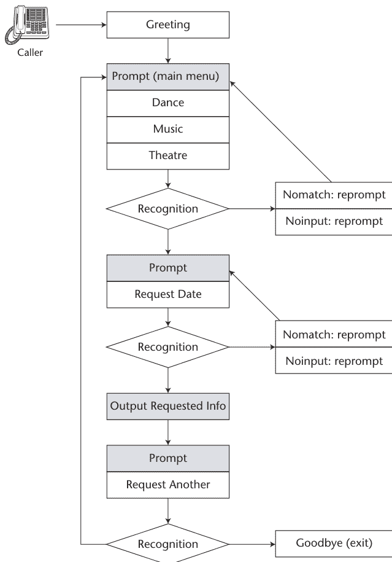

图 9.1 应用流程图。

# 构建骨架

列表 9.1 所示的该项目骨架与我们之前创建的其他项目类似。脚本开始于典型的 `<xml>` 声明、DOCTYPE 定义以及 `<meta>` 根元素的开启。第 11 到 19 行的 `<meta>` 信息向索引机器人等其他调用函数描述了该程序。

```
<?xml version="1.0"?>

2.

3. <!DOCTYPE vxml

4. PUBLIC

5. "-//BeVocal Inc/VoiceXML 2.0//EN"

6. "http://cafe.bevocal.com/libraries/dtd/vxml2-0-bevocal.dto">

7.

8. <xml version="2.0">

9.

10. <!-- INFORMATION ABOUT THIS APPLICATION -->

11. <meta name="author" content="Your Name"/>

12. <meta name="copyright" content="Your Company Name"/>

13. <meta name="description"

14. content="Template for creating a calendar,

15. accessible through a VoiceXML

16. interface"/>

17. <meta name="keywords" content="VoiceXML, arts calendar"/>

18. <meta name="maintainer" content="you@address.com"/>

19. <meta name="robots" content="robot.txt"/>

20. <!-- GLOBAL VARIABLES AND LINKS -->

21. <var name="companyName"

22. expr="San Francisco Arts Calendar"/>

23. <var name="sponsor"

24. expr="The San Francisco Opera"/>

25. <link next="calendar.vxml">

26. <grammar>

27. <![CDATA[start over]]

28. </grammar>

29. </link>

30. <!-- ACCESS -->

31. <form id="baseApplication">

32. <subdialog name="greeting"

33. src="calendargreeting.vxml"/>

34. <subdialog name="menu"

35. src="calendarmenu.vxml"/>

36. <subdialog name="goodbye"

37. src="calendargoodbye.vxml"/>

38. </form>

39. </xml>
```
列表 9.1 日历项目骨架。在第 25 行设置了两个变量。Name 在整个应用中使用；因此，在脚本顶部设置此变量使得在公司名称更改时容易修改。在子对话内部访问 sponsor 变量。第 27 到 31 行的 `<link>` 模块化了程序。第 34 到 41 行的 `<subdialog>` 描述了程序。通过第 21 到 24 行的 `<var>` 声明了日历项目。第 25 到 29 行的 `<link>` 用于测试应用。通过第 27 到 28 行的 `<grammar>` 创建了日历。第 31 到 38 行的 `<form>` 和 `<subdialog>` 包含了问候。

# 问候子对话

列表 9.2 所示的问候对话是存储在旧金山艺术组织网站上的现有活动数据库。第 7 和 8 行读取了公司和赞助商。第 9 行使用 `<return/>` 回到应用。

```
<?xml version="1.0"?>

2.

3. <vxml version="2.0" application="calendar">

4.

5. <form id="greeting">

6. <block>

7. You have reached the <value="companyName=""/>

8. brought to you by <value="sponsor=""/>

9. <return/>

10. </block>

11. </form>

12. </vxml>
```
列表 9.2 问候子对话。将其保存为开发者账户中的 `calendarGreeting.vxml`。

# 告别子对话

该项目的下一个模板是退出程序的脚本，如列表 9.3 所示。第 6 行开始的 `<block>` 元素包含了感谢信息和第 8 行的赞助商。第 9 行的 `<break>` 元素设置为 small，这使得输出更加自然。

```
<?xml version="1.0"?>

2.

3. <xml version="2.0" application="calendar">

4.

5. <form id="goodbye">

6. <block>

7. Thank you for using the <value="companyName=""/>

8. This call was brought to you by <value="sponsor=""/>

9. <break size="small"/>

10. Please call again. Good bye.

11. <return/>

12. </block>

13. </form>

14. </xml>
```
列表 9.3 告别子对话。第 6 行将告别拆分为两个单词。在测试应用时，它会尝试一个单词和两个单词。你会发现由于音节之间的简短停顿，句子的流动更加真实。通过第 11 行的 `<return/>` 元素处理传回调用应用程序。

# 日历菜单子对话

请求旧金山艺术日历应用程序信息的菜单包含在 `calendarmenu.vxml` 脚本中。用户请求一种活动类型或学科，请求将根据定义活动类型的语法进行检查。如果该活动类型可用，则会提示用户日期。数据被格式化为一组变量，并带有活动类型传递给 Cold Fusion 服务器进行处理。收到服务器的响应后，用户将获得请求其他日历活动的机会。

## 请求学科

列表 9.4 是 `swarts-calendarmenu.xml` 脚本的开头，它定义了将要识别并设置为数据库服务器特定事件类型的语法。第 6 行开始了主菜单 `mainmenu <form>`，其中包含一个名为 `Discipline`（学科）的 `<field>`。该字段名称的拼写和大小写非常重要，因为它将作为变量名在从调用者处收集所有信息后传递给数据库服务器。

```
1. <?xml version="1.0"?>

2.

3. <xml version="2.0" application="swarts-calendar.vxml">

4.

5. <!-- REQUEST EVENT TYPE -->

6. <form id="mainmenu">

7. <field name="Discipline">

8. <prompt>

9. 你对什么类型的活动感兴趣：

10. 舞蹈、音乐或戏剧。

11. </prompt>

12.

13. <grammar>

14. <![CDATA[

15.

16. [dance dancing ballet ] { < Discipline dance > }

17. [music opera symphony ] { < Discipline music > }

18. [theater plays (off broadway)] { < Discipline theater > }

19.

20. ]]

21. </grammar>

22.

23. <notmatch count="1">

24. 我没听清。请重试：舞蹈、音乐或戏剧

25. </match>

26.

27. <notmatch count="2">

28. <prompt barge="true">

29. 我不认识那种类型的活动。

30. 请说 dance-break size="small"/>,

31. music-break size="small" 或 theater。

32. </prompt>

33. </notmatch>

34.

35. <notmatch count="3">

36. 对不起，我无法无法提供该类型活动的帮助。

37. 也许我们将来会将其添加到列表中。

38. <goto next="calendargoodbye.vxml"/>
```

**列表 9.4** 请求学科。

```
39. </notatch>
40. <filled/><|return|></filled>
41. </field>

42.

43. </form>

44. </vxsml>
```


## 列表 9.4 请求学科。（续）

从第 8 行开始的 `<prompt>` 定义了用户预期的输入内容：舞蹈、音乐或戏剧。第 13 行到 21 行定义了可以作为学科名称的接受语法。通过扩展词汇以接受活动类型的同义词，该应用程序对于尝试请求特定类型活动的调用者来说变得更加用户友好。

`nomatch` 事件从第 23 行开始处理。当第一次捕获 `nomatch` 事件时，程序假设识别出现问题，并承担该问题，重复选择列表。从第 27 行开始的第二个 `nomatch` 事件包含一个 `<prompt>`，它再次重复了指令，但通过插入 `<break>` 元素将语法中的每个单词隔离开来。这应该能给调用者提供更清晰的预期指示。

第 28 行的 `<prompt>` 元素还带有 `barge` 属性，其设置为 `true`。这允许调用者中断 `<prompt>`，而无需等待第 35 行开始的 `<nomatch>` 事件输出（该事件将输出道歉，解释日历中没有请求的活动）；然后它将处理发送到 `calendar-goodbye.xml` 脚本。

> 将列表 9.4 保存为 `swarts-calendarmenu.xml`。测试脚本，尝试输入错误内容以确认 `<nomatch>` 事件正在被正确处理。

## 请求日期

一旦 `Discipline` `<field>` 设置了事件类型，用户必须为该活动指定日期。BeV 平台暴露了日期语音对象（Speech Object）。日期对象接受日期作为输入，并将其解析为月、日、年组件，用于填充字段。列表 9.5 显示了使用日期对象请求日期。

```
1. <object class="speechobject://nuance.so.SODate"
2.
3. <filled>
4. <return/>
5. </filled>
6. </object>
```

列表 9.5 使用对象请求日期。

## 项目 9

语音对象（Speech Object）是处理平台的一部分的预定义模块。行为环境（Behavioral environment）包含了处理许多类型数据的对象。表 9.1 列出了行为平台中一些最有用的对象以及它们从用户处收集的内容。当对象被调用时，对话的执行由该对象控制。对象处理所有的提示、错误消息和来自用户的返回值，并将它们存储在 `eventDate` 中。对象的返回是一个结果，ECMAScript 变量可以使用它来访问返回值。

对象位于表单的字段级。在列表 9.5 中，通过一个经典属性对 `date <object>` 进行调用，该属性指向对象实现的位置。

`<object>` 元素提示用户提供数据。输入存储在 `event-Date` 中，使得可以通过点符号表示（dot notation）访问特定组件。

- 大多数供应对象可以处理信用卡号、日期、社会安全号和地址输入。请检查平台文档以获取可用的语音对象。
- 在 VoiceXML 脚本中添加一个日期 `<object>`，将其插入为 `Discipline` 字段下方的字段级项。

| 对象 (OBJECT) | 收集 (COLLECTS) |
|---|---|
| SO_Airline | 航空公司名称 |
| SO_Stock | 公司代码或指数代码 |
| SO_State | 城市和州名 |
| SO_Street | 街道名称 |
| SO_StreetNumber | 门号 |
| SO_CreditInfo | 信用卡号 |
| SO_Date | 日期 |
| SO_phoneNumber | 电话号码，美国格式 |
| SO_Quantity | 作为数量的数量 |
| SOSocialSecurityNumber | 社会安全号 |
| SO_Currency | 美元和分数的金额 |
| SO_ZipCode | 邮政编码，美国格式 |

## 使用对象的返回值

语音对象在完成输入处理后会将控制权交回调用位置。对象的返回值需要分配给变量，以便 VoiceXML 应用程序使用。

列表 9.6 使用 `<assign>` 元素访问并分配日期对象的返回值。变量名（月、日、年）将从 `<subdialog>` 调用传递到 VoiceXML 脚本。每个变量的表达式都使用了 `Math.round` 函数，以强制将输入归零为 0。在设置月份时，`<object>` 元素从 0 开始，而 VoiceXML 的索引从 1 开始。在 `eventDate.Month` 上加了 1，以便将语音对象中的月份正确映射到数据库查询中。

> 配合 `Math.round` 函数使用 `eventDate.Month + 1` 会导致 VoiceXML 脚本中的输入错误。在执行 `eventDate.Month + 1` 时使用浮点表示法，如果没有 `Math` 函数强制进行整数取整，将返回 12.0。

```
1. <block>
2. <assign name="month"
3. expr="Math.round(eventDate.Month + 1)"/>
4. <assign name="day"
5. expr="Math.round(eventDate.Day)"/>
6. <assign name="year"
7. expr="Math.round(eventDate.Year)"/>
8. </block>
```

**列表 9.6** 从对象赋值返回值。

> 在 `<object>` 元素之后插入一个 `<block>` 来分配日期的返回值。变量名必须为月、日、年，以便由 VoiceXML 处理。

## 隐式错误检查

在将输入发送到数据库之前，良好的做法是向用户确认其输入。使用 `<value>` 元素重复已识别的输入。列表 9.7 是一个 `<field>`在不请求响应的情况下暗示用户的输入。`<prompt>` 在第 2 到第 7 行输出，要求用户等待数据检索。第 6 行在实际处理开始前产生 1 秒的间隔。

1 秒后，第 8 行到第 10 行的 `<noinput>` 块在用户未注册反应时将 `checkInput` 字段填充为 `yes`。在这种情况下，如果用户没有回复，我们认为已确认日期和事件类型，处理可以继续。

如果用户有任何任何输入，将被视为负面，并由第 11 行到第 15 行的 `<notmatch>` 元素处理。当抛出 `nomatch` 事件时，输出 `<prompt>` 以确认用户的负面输入已被收到，他们将获得选择日期和事件类型的机会。第 13 行清除了所有的 `<field>` 变量，第 14 行使用 `<prompt/>` 将处理发送回表单顶部。

在确认了事件类型和日期后，我们准备好调用 `<subdialog>` 来访问旧金山档案数据库。

### 使用 <subdialog> 调用数据库

我们在之前的项目中使用过 `<subdialog>` 调用来向处理脚本发送信息并接收返回结果。列表 9.8 设置了对 SFArts 日历数据库的调用，将月、日、年和学科（Discipline）变量作为参数传递。

```
1. <subdialog name="getResult"
2. src="http://www.sfarts.org/voicexml/voicexmltest.cfm"
3. namelist="month day year Discipline"
4. method="post"
5. fetchtimeout="10s"
6. </subdialog>
```

**列表 9.8** 调用数据库。

`<subdialog>` 元素调用运行在旧金山艺术日历服务器上的 Cold Fusion 处理脚本。第 2 行的 `src` 属性持有处理脚本的 URI，其后是第 3 行的名称列表，其中包含了月、日、年和学科变量。变量的名称极其重要，因为 Cold Fusion 脚本仅接受这些名称作为输入。

第 4 行的 `post` 方法与 HTML post 方法类型相同。`fetchtimeout` 属性指定了格式在抛出超时错误之前等待数据库响应的时长。占位脚本 `voicexmlt.cfm` 用于验证是否可以与 CF 服务器建立连接，以及脚本内的 `<return/>` 元素是否可以被处理。我们将在下一节中查看 Cold Fusion 测试脚本。

> 在当前应用程序的错误检查之后，设置对 Cold Fusion 脚本的 `<subdialog>` 调用。使用 `www.sfarts.org/voicexml/voicexmltest.cfm` URI 来确认与服务器的连接可用。

## 测试脚本

SFArts 日历网站的经理 Larry Larson 在服务器上放置了一个测试脚本。列表 9.9 是服务器上的简短脚本，它返回一个关于服务器可访问的简单确认。输出是一个简单的文本块，用于验证已进入 SFArts 服务器，`<return/>` 元素会立即将处理结果传回调用脚本。

> 当与不受你网域或控制的数据源工作时，请从使用占位脚本开始开发过程，在开发真实应用程序之前验证对服务器的访问。

```
1. <xml version="2.0">
2. <form id="testOutput">
3. <block>
4.     Inside the Cold Fusion script
5.     <return/>
6. </block>
7. </form>
8. </xml>
```

**列表 9.9** 确认脚本。

## 获取另一个事件

Cold Fusion 测试脚本没有返回值，因为处理会在 `<subdialog>` 用的结束处继续。列表 9.10 在脚本中创建了一个最终的 `<field>`，允许调用者请求另一个事件。`menuAgain` `<field>` 以 `<prompt>` 开头，询问用户是否想检查其他事件。`menuAgain` 的属性设置为布尔型（boolean），用于寻找肯定或否定的响应。当有肯定的响应时，`<if>` 条件将使用 `<clear/>` 元素重置所有变量，并将控制交回 `mainMenu` 顶部。任何其他返回将激活第 10 行的 `<return/>` 元素，将控制传回基础应用程序。

```
1. <field name="menuAgain" type="boolean">
2. <prompt>
3. Would you like to check on another event.
4. </prompt>
5. <filled>
6. <if cond="menuAgain">
7. <clear/>
8. goto next="#mainmenu"
9. <else>
10. <return/>
11. </if>
12. </filled>
13. </field>
```

**列表 9.10** 请求另一个事件。

# 旧金山艺术日历

在当前应用程序的 `<subdialog>` 调用下方添加一个 `menuAgain` `<field>`。该字段应允许用户请求另一个事件或将处理传回基础应用程序后端。

## 完成的脚本

列表 9.11 是访问 SFArts 日历数据库的完成脚本。请特别注意第 83 行，对数据库的调用已从测试脚本更改为处理脚本的实际位置。在下一节中，我们将检查接收 VoiceXML 脚本用户输入并检索事件日历的 Cold Fusion 脚本。

```
1. <?xml version="1.0"?>
2. <xml version="2.0" application="calendar.vxml">
3. -- REQUEST TYPE --
4. <form id="menu">
5. <field name="Discipline">
6. <prompt>
7. What type of event are you interested in:
8. dance, music or theater.
9. </prompt>
10. <grammar>
11. <![CDATA[
12. [
13. (dancing ballet) (<Discipline>)
14. (music opera symphony) (<Discipline>)
15. (theater players offway)] (<Discipline>)
16. ]
17. </grammar>
18. <nomatch count="1">
19. I missed that. Try again: dance, music or theater
20. </nomatch>
21. <nomatch count="2">
22. <prompt bargein="true">
```

**列表 9.11** sfarts-calendenu.vxml 脚本。（续上）

## 项目 9

```
29. I don't recognize that type of event.
30. Please dance<break size="small"/>,
31. music<break size="small"/> or theater.
32. </prompt>
33. </match>
34. 
35. <match count="3">
36. I'm sorry. I can't help you with that type of event.
37. Maybe we will add that to the future.
38. <goto next="goodbye.xml">
39. </match>
40. <filled>
41. </field>
42.
43. <!-- REQUEST DATE --
44. <object class="speech://nuance.
45. name="eventDate">
46. <prompt>
47. What date.
48. </prompt>
49. </object>
50. 
51. <!-- ERROR CHECKING --
52. <field name="checkInput">
53. <prompt>
54. Please wait while I retrieve
55. <value expr="Discipline"/>
56. events for <value expr="eventDate"/>
57. <break size="medium"/>
58. </prompt>
59. <noinput>
60. <assign name="checkInput" expr="yes"/>
61. </noinput>
62. </match>
63. 
64. Sorry. Let's try again.
65. <clear/>
66. <reprompt>
67. <grammar>yes</grammar>
68. <filled>
69. </field>
70. 
71. <!-- SET VARIABLE VALUES --
72. <block>
73. <assign name="month"
74. expr="Math.round(eventDate.Month + 1)"/>
75. <assign name="day"
76. expr="eventDate.Day"/>
77. </block>
78. 
79. <!-- SEND TO THE DATABASE --
80. <subdialog name="getResult">
81. src="http://www.sfarts.org/calendar.cfm"
82. namelist="month day year Discipline"
83. method="post"
84. fetchtimeout="10s"
85. </subdialog>
86.
87. <!-- OFFER TO DO AGAIN --
88. <field name="menuAgain" type="boolean">
89. <prompt>
90. Would you like to check on another event.
91. </prompt>
92. <filled>
93. <if cond="menuAgain">
94. <clear/>
95. goto next="#mainmenu"
96. <else>
97. <return/>
98. </if>
99. </filled>
100. </field>
101.
102. </form>
103.
104. </xml>
```

**列表 9.11** 完成的 sfarts-calendenu.vxml 脚本。

```xml
15. 更多信息请拨打
16. <say-as type="telephone">234 2343</say-as>
17. <break size="medium"/>
18.
19. <!-- 返回到调用脚本 -->
20. 事件结束
21. <return/>
22. </block>
23. </form>
24. </xml>
```


列表 9.12 期望输出格式的模板。（续上）

输出被包含在单个 `<form>` 标签内，即 `acceptInput`。第 10 行和 17 行的 `<break>` 元素创建了自然的语言流，让听话者有机会理解所说的内容。`CF` 服务器将提供动态内容，以填充找到的记录数（输出在第 8 行）以及完成的应用程序中的事件列表（如第 13 行至 17 行所示）。`Cold Fusion` 脚本将循环遍历事件，并为每个事件输出一个动态生成的顺序事件编号、事件名称、活动演示者、活动地点和联系电话。

在读完最后一个事件后，第 21 行的 `<return>` 元素将输出一条事件结束的消息，将处理返回到调用的 `<subdialog>`。

- 创建一个可以用于数据库输出格式化为 VoiceXML 应用程序的模板。


# Cold Fusion 模板

列表 9.13 展示了如何使用 Cold Fusion 脚本动态生成 VoiceXML 输出。

- 列表 9.13 是一个用于创建你自己的 Cold Fusion 应用程序的模板，而不是 SFArts 网站上的实际脚本。


列表 9.13 用于生成 VoiceXML 输出的 Cold Fusion 模板。（续）

```xml
1. <!-- 从表单接收用户输入 -->
2. <CFPARAM NAME="form.month" DEFAULT="1">
3. <CFPARAM NAME="form.year" DEFAULT="2003">
4. <CFPARAM NAME="form.day" DEFAULT="1">
5. <CFPARAM NAME="form.Discipline" DEFAULT="None">
```

```xml
6.
7. <!-- 创建日期格式字符串 -->
8. <CFSET target_date =
   CreateDate(form.year, form.month, form.day)
10.
11. <!-- 将学科映射到数字 -->
12. <CFSET disp = #form.Discipline#>
13. <CFIF #disp EQ='Theater'>
14. <CFSET #num="1">
15. <CFELSE #disp EQ='Dance'>
16. <CFSET #num="2">
17. <CFELSE #disp EQ='Music'>
18. <CFSET #num="3">
19. </CFIF>
20.
21. <!-- SQL 查询 -->
22. <CFQUERY name="Recordset">
23. SELECT put-your-query-string;
24. </CFQUERY>
25.
26. <!-- 返回记录数 -->
27. <CFSET Recordset.NumRows = Recordset.RecordCount>
28.
29. <!-- 开始 VOICEXML 输出 -->
30. <xml version="1.0">
31. <vxml version="2.0">
32.
33. <form id="acceptInput">
34. <block>
35.
36. <!-- 未返回事件 -->
37. <CFIF Recordset.RecordCount IS "0">
38.
39. <CFOUTPUT>
40. #dateformat(target_date, "dddd, mmmm yyyy")# 没有相关事件
41. </CFOUTPUT>
42. <return/>
43. </block>
44. </form>
45. </vxml>
46. <CFELSE>
47. <!-- 事件数量 -->
48. <CFOUTPUT>
49. #Recordset.NumRows# 找到了在 #dateformat(target_date, "dddd, mmmm yyyy")# 的事件
50. </CFOUTPUT>
```

列表 9.13 用于生成 VoiceXML 输出的 Cold Fusion 模板。（续）

```xml
54. <break size="small"/>
55. </CFOUTPUT>
56.
57. <!-- 事件列表 -->
58. <CFOUTPUT query=<Recordset>
59. #Recordset.CurrentRow#
60. #XMLFormat(Recordset.Org_Name)# 演示
61. #XMLFormat(Recordset.Venue_Name)# 地点
62. #XMLFormat(Recordset.Event_Name)#
63. 更多信息，请拨打
64. <say-as type="telephone">#Recordset.Event_Phone#</say-as>
65. <break size="medium"/>
66. </CFOUTPUT>
67.
68. <!-- 返回到调用脚本 -->
69. #dateformat(target_date, "dddd, mmmm yyyy")# 事件结束
70. <return/>
71. </block>
72. </form>
```

列表 9.13 用于生成 VoiceXML 输出的 Cold Fusion 模板。（续上）

输出包含在单个 `<form>` 标签内，即 `acceptInput`。第 10 行和 17 行的 `<break>` 元素创建了自然的语言流，让听话者有机会理解所说的内容。`CF` 服务器将提供动态内容，以填充找到的记录数（输出在第 8 行）以及完成的应用程序中的事件列表（如第 13 行至 17 行所示）。`Cold Fusion` 脚本将循环遍历事件，并为每个事件输出一个动态生成的顺序事件编号、事件名称、活动演示者、活动地点和联系电话。

在读完最后一个事件后，第 21 行的 `<return>` 元素将输出一条事件结束的消息，将处理返回到调用的 `<subdialog>`。

- 创建一个可以可以将数据库输出格式化为 VoiceXML 应用程序的模板。


进入`/path/to/xxx`目录，找到`xxx.json`。

在表达式`cvar = avar + bvar`中，加法运算符（`+`）将`avar`与`bvar`相加，得到它们的和`cvar`

在`List.of(arg0, arg1, arg2)`中，`List`接口的工厂方法`of()`接受一系列的元素，返回包含它们的只读列表。

之后我们这样调用`cmd`命令：`cmd arg0 arg1 arg2`。

```
if (condVar > someVal) {console.log("xxx")}
```

# 列表 9.13 用于生成 VoiceXML 输出的 Cold Fusion 模板。（续）

```
1. <!-- 从表单接收用户输入 -->
2. <CFPARAM NAME="form.month" DEFAULT="1">
3. <CFPARAM NAME="form.year" DEFAULT="2003">
4. <CFPARAM NAME="form.day" DEFAULT="1">
5. <CFPARAM NAME="form.Discipline" DEFAULT="None">
```

```
xml
6.
7. <!-- 创建日期格式字符串 -->
8. <CFSET target_date =
   CreateDate(form.year, form.month, form.day)
10.
11. <!-- 将学科映射到数字 -->
12. <CFSET disp = #form.Discipline#>
13. <CFIF #disp EQ='Theater 좋아요
14. <CFSET #num="1">
15. <CFELSE #disp EQ='Dance'>
16. <CFSET #num="2">
17. <CFELSE #disp EQ='Music'>
18. <CFSET #num="3">
19. </CFIF>
20.
21. <!-- SQL 查询 -->
22. <CFQUERY name="Recordset">
23. SELECT put-your-query-string;
24. </CFQUERY>
25.
26. <!-- 返回记录数 -->
27. <CFSET Recordset.NumRows = Recordset.RecordCount>
28.
29. <!-- 开始 VOICEXML 输出 -->
30. <xml version="1.0">
31. <vxml version="2.0">
32.
33. <form id="acceptInput">
34. <block>
35.
36. <!-- 未返回事件 -->
37. <CFIF Recordset.RecordCount IS "0">
38.
39. <CFOUTPUT>
40. #dateformat(target_date, "dddd, mmmm yyyy")# 没有相关事件
41. </CFOUTPUT>
42. <return/>
43. </block>
44. </form>
45. </vxml>
46. <CFELSE>
47. <!-- 事件数量 -->
48. <CFOUTPUT>
49. #Recordset.NumRows# 找到了在 #dateformat(target_date, "dddd, mmmm yyyy")# 的事件
50. </CFOUTPUT>
```

# 列表 9.13 用于生成 VoiceXML 输出的 Cold Fusion 模板。（续）

```xml
54. <break size="small"/>
55. </CFOUTPUT>
56.
57. <!-- 事件列表 -->
58. <CFOUTPUT query=<Recordset>
59. #Recordset.CurrentRow#
60. #XMLFormat(Recordset.Org_Name)# 演示
61. #XMLFormat(Recordset.Venue_Name)# 地点
62. #XMLFormat(Recordset.Event_Name)#
63. 更多信息，请拨打
64. <say-as type="telephone">#Recordset.Event_Phone#</say-as>
65. <break size="medium"/>
66. </CFOUTPUT>
67.
68. <!-- 返回到调用脚本 -->
69. #dateformat(target_date, "dddd, mmmm yyyy")# 事件结束
70. <return/>
71. </block>
72. </form>
```

# 结论

从数据库动态生成语音内容允许使用遗留数据作为你的 VoiceXML 应用程序的输入。一个经常变化的活动日历正要求开启语音功能。

从你的网站进入一直是个好主意。这种方法的改进是动态生成赞助商，而不是在脚本中硬编码单个赞助商。

## 项目 10

## FAQ 引擎

当我第一次看到 Joseph Weizenbaum 的 Eliza 引擎时，我大笑出了声。它表现得像一个罗杰斯派分析师，根据你的回答反抛出问题和陈述。它使用简单的模式匹配从用户的输入中提取相关词汇，然后引擎将这些词汇重新格式化句子或问题以继续对话。然而，Eliza 的问题在于，对话过程中并没有发生任何信息交换。该程序无法从对话中推断出任何内容，也无法扩展对话的注释进行交互。

我在 2001 年在纽约的一个 Speech-Tek 项目中遇到了 Kevin Dowd。他的产品 Brainhat 的显示屏显示，他有一个基于 VoiceXML 的语音引擎，可以根据上下文进行对话，而不是基于单词识别。在测试了演示后，我成了一个信徒。FAQ 引擎项目是由我、Kevin 和他在 Brainhat 的团队共同创建的。它展示了如何通过 VoiceXML 接口访问自然语言处理引擎。

### 问题

大多数 FAQ 引擎对最常见的 10 个问题有预设的定义。用户与信息之间没有对话，只有问题和硬编码的答案。

### 解决方案

构建一个支持语音的 FAQ 引擎，能够通过上下文推断关系并处理基本的自然语言处理。

## 项目描述

FAQ 引擎分三个阶段构建：安装、测试和检查 Brainhat 引擎；为引擎创建场景和词汇表；构建一个 VoiceXML 接口来访问引擎。开发了一个针对虚构的火星 7 号殖民地游客办事处的 FAQ，用于处理有关殖民地的通用电话查询。

用户拨打后将收到 VoiceXML 接员的问候。用户可能会询问有关住宿的问题，例如价格、可用性和设施。FAQ 引擎处理对话并在适当的时间询问用户是否想要订房。

为了完成此项目，你将：

- 1. 下载并安装 Brainhat 服务器。
- 2. 在 Brainhat 中构建词汇表。
- 3. 建模以构建对话上下文。
- 4. 开发 FAQ 应用。
- 5. 设置 VoiceXML 入口。

## 你将需要

- ✔ `Brainhat` 引擎
- ✔ `Brainhat` 的 FAQ 场景
- ✔ `Brainhat` 的自定义词汇定义文件
- ✔ `Beocal` 账户
- ✔ 用于访问 `Brainhat` 的 VoiceXML 脚本
- ✔ 从 `cafe.beocal.com/wiley/10projects` 下载的项目文件

### 此项目使用的 VoiceXML 元素

| 元素名称 | 描述 |
| :--- | :--- |
| `<assign>` | 为变量赋值 |
| `<else>` | 用在 `<if>` 元素中 |
| `<field>` | 在表单中声明输入字段 |
| `<filled>` | 字段被填充时执行的操作 |
| `<form>` | 用于展示信息和收集数据的对话框 |
| `<if>` | 简单的条件逻辑 |

### 此项目使用的 VoiceXML 元素（续）

| 元素名称 | 描述 |
| :--- | :--- |
| `<prompt>` | 将语音合成和音频输出加入队列给用户 |
| `<property>` | 控制实现平台设置 |
| `<script>` | 指定一段 ECMAScript 客户端脚本语言块 |
| `<submit>` | 将值提交到文档服务器 |
| `<var>` | 声明变量 |
| `<vxml>` | 每个 VoiceXML 文档的顶层元素 |

来源：VoiceXML 2.0 工作草案，第 1.4

### 应用调用流

图 10.1 显示了此应用的调用流。`Brainhat` 服务器发出标准问候并等待用户输入。只要用户有输入，服务器与用户之间的对话就会继续。当用户说“再见”时，服务器将输出结束消息。

**图 10.1** 应用流程。

## 设置 Brainhat 服务器

该项目的核心围绕自然语言处理 `NLP` `Brainhat` 服务器构建。它可以在 `www.brainhat.com` 免费下载开发。

## 关于 Brainhat

`Brainhat` 是一个 NLP 服务器，可以分发任务、处理自然语言事件、评估想法并提问。由于 `Brainhat` 基于知识表示，它可以在对话中离题、回答脚本之外的问题并保持丰富的上下文。内置的网络功能使 `Brainhat` 成为自然语言事件和委托任务的清理整合点。

`Brainhat` 项目是由 Kevin Dowd 在 1996 年于 Atlantic Computing 工作期间开发的。这个名字源于早期尝试将意大利面调与差分放大器相结合进行解释。

### Brainhat 服务器

`data.in` 文件仅仅是 `Brainhat` 服务器启动时编译阶段包含的文件列表。列表 10.2 列出了初始安装期间默认包含的文件。

## FAQ 引擎 319

安装 Brainhat

导航到 `Brainhat` 站点并从页面菜单选择下载。在你的硬盘上创建一个 `Brainhat` 目录并解压文件，允许安装程序创建 `data` 和 `scenarios` 子目录。解压后，`Brainhat` 目录将在根目录下包含一个可执行文件，以及两个包含场景数据的子目录。

### 测试安装

通过打开 DOS 窗口、更改目录到 `Brainhat` 安装位置，并在提示符处输入 `run` 来测试安装。`run` 命令访问 `run.bat` 文件，该文件为服务器提供配置指令。`Brainhat` 编译的确认信息将滚动过并以闪烁的提示符结束。

# 320 项目 10

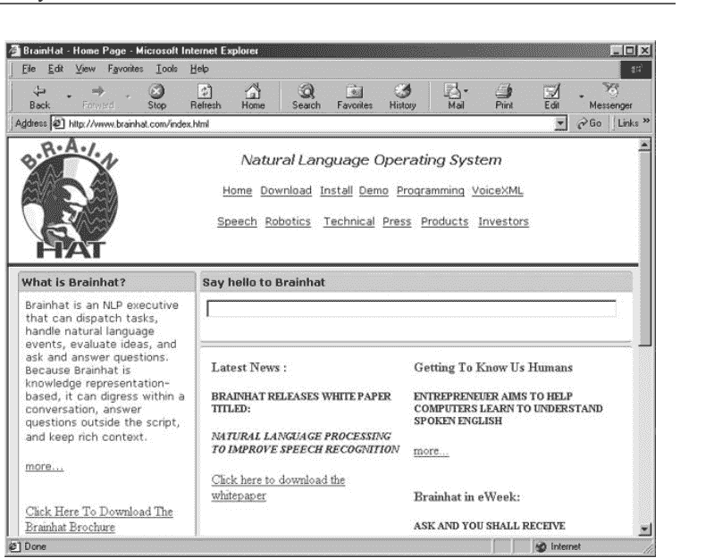

# 什么是 Brainhat？

`Brainhat` 是一个 NLP 执行器，可以调度任务、处理自然语言、评估想法并提问。由于 `Brainhat` 基于知识表示，它能够识别对话中的内容，回答脚本之外的问题，并保持正确的上下文。

更多...

点击此处下载 Brainhat 简本书

# 10.2 Brainhat 网站截图。

在键盘上输入 `hello` 并按 Enter 键与 `Brainhat` 建立对话。程序将用一个简单的 `hello` 回复。问程序“what are you?” 等待回复然后问“Who am I?”。如果你收到了这三个问题的回答，说明你的 `Brainhat` 服务器已正确安装，并已准备好向其知识库添加场景和词汇表。

要查看 `Brainhat` 如何从对话上下文中学习，请在命令行提示符输入“you are a computer”。`Brainhat` 将回显它是一台计算机。现在告诉 `Brainhat`“you are green”。在整个会话期间，当 `Brainhat` 被问及它是什么时，它将自称为计算机。此时它会回答“I am green.”。你可以通过插入关于程序自身的陈述并通过问题进行测试，继续为程序赋予属性。列表 10.3 是测试会话的输出。

输入 `goodbye` 退出程序。

- 1. hello
- 2. hello.
- 3. >> what are you
- 4. I am person.
- 5. >> who am i

# 列表 10.3 测试会话输出。

- 6. You are person.
- 7. >> you are a computer
- 8. I am a computer.
- 9. >> you are green
- 10. I am green.
- 11. >> who are you
- 12. I am a computer.
- 13. >> what color are you
- 14. I am green.
- 15. >> goodbye
- 16. goodbye!

列表 10.3 测试会话输出（续）

# 在 Brainhat 中构建词汇表

`Brainhat` 服务器由文本文件控制，可以通过更改这些文件来创建扩展的词汇表和特定上下文的场景。我们首先查看一个词汇表文件，并进行一些更改，使服务器对问候的识别不那么正式。然后我们将检查一个场景并向知识库添加更多内容。

# 词汇表概述

`Brainhat` 词汇表描述了单词之间的层次关系，以及帮助 `Brainhat` 消除输入短语和句子歧义的提示。默认词汇存储在数据目录下的 `words` 文件中。当使用 `run.bat` 文件从命令行启动 `Brainhat` 时，它会获取 `words` 文件并编译词汇表中每个单词之间的关系和推理。来自 `required-patterns`、`cc-patterns` 和输入模式（`input patterns`）的每条规则都已预编译并吸收到 `Brainhat` 引擎中。

列表 10.4 显示了 `Brainhat` 词汇表中定义的两个术语。通用概念通过 `define` 单词感知。到下一个 `define` 语句为止的所有内容都被视为概念定义的一部分。概念可以按任何顺序定义，这使得对意义等概念分组并按字母顺序排序以便于访问。随着你的项目词汇表开始增长，这将非常有帮助。

一个概念必须有一个唯一的标识符。名称可以是任何字符字符串，空格或换行符在外，但如果它能被识别为一个单词，则最为有用。某些概念可能具有多种含义，例如单词 `class`（某种社会地位、分类学中的类别、Java 中的编程语言）。按照惯例，具有多个含义的定义后面会跟着一组学习某学科的人，或者一个具有多个含义的单词后面会跟一个连字符和一个数字，以与其他定义区分来。在列表 10.4 中，`goodbye-1` 是动词 `goodbye` 的一个定义，意思是结束程序。在另一个语境下，`goodbye` 可能是一个名词，意思是离开，如“a tearful goodbye（含泪的告别）”。第二个定义将使用 `goodbye-2` 字符串。

# 322 项目 10

```
1. /**************************************/
2. Greetings and salutations
3. /**************************************/
4. define greeting
5. label hi
6. label good morning
7. label good afternoon
8. label hello
9. child-of things
10.
11. define goodbye-1
12. label bye
13. label exit
14. label quit
15. label goodbye
```

# 列表 10.4 Brainhat 词汇表片段。

列表 10.4 中的词汇定义包含 `label` 和 `child-of` 属性。`label` 属性包含一个单词或短语，将被视为该概念的词汇。`child-of` 属性将定义置于概念的层次结构中。表 10.1 是可用属性列表。

列表 10.4 的第 9 行规定 `greeting` 是 `things` 的子级。在编译期间，所有 `things` 都被绑定为一个集合，易于以类似的方式处理相同类型的定义。其他顶层概念包括 `noun`、`action`、`preposition`、`article`（冠词）和 `adverb`（副词）。除了 `goodbye-1` 之外，所有定义最终都必须归类到顶层概念之一；`goodbye-1` 是一个特殊情况，它被 `Brainhat` 引擎识别为退出命令。

> 使用任何文本编辑器打开数据目录下的 `words` 文件并检查其内容。找到颜色、纹理和 

| ATTRIBUTE | DEFINITION |
|---|---|
| label | 包含一个单词或短语，将被视为该概念的词汇。 |
| child-of | 将定义置于概念的层次结构中。 |

# 表 10.1（续）

| ATTRIBUTE | DEFINITION |
|---|---|
| person | 区分个体 |
| time | 指定过去、现在或未来 |
| tense | 表示动作的状态 |

# 添加到词汇表

当我们开始扩展问候的标签时，某些问候可能被认为是非正式的。将问候分组可以使定义更容易管理，并为每种类型的问候提供单独的回复。

列表 10.6 显示了与顶层 `greeting` 相关的两个定义。`greeting-formal` 定义是 `greeting` 默认定义的大部分标签，`greeting-formal` 被定义为 `greeting` 的 `child`，将其与 `greeting` 的原始概念相关。`greeting-informal` 定义被定义以扩展词汇表。

```
1. /***********************************
2.   Greetings and salutations
3.   ************************************/
4.     define greeting
5.       child-of things
6.
7.     define greeting-formal
8.       label      good morning
9.       label      good afternoon
10.    label      good evening
11.    label      greetings
12.    label      greeting
13.    label      hello
14.    label      greetings human
15.      child-of greeting
16.
17.    define greeting-informal
18.      label      hi
19.      label      whats up
20.      label      sup
21.      label      outta here
22.      label      later
23.      label      goodbye
24.     define exit
25.       label q
```


列表 10.6 的第 26 行是单字母 `q`。这在在命令行测试应用程序时作为退出程序的快捷键。

**列表 10.5** 扩展定义的识别。

# FAQ 引擎 325

| 19. | label | whats up |
| 20. | label | sup |
| 21. | label | yo |
| 22. | label | whats up heyday |
| 23. | child-of | greeting |
| 24. | Q | | |
| 25. | define | goodbye-1 |
| 26. | label | q |
| 27. | label | bye |
| 28. | label | exit |
| 29. | label | quit |
| 30. | label | outta here |
| 31. | label | later |
| 32. | label | goodbye |

**Listing 10.6** 创建新定义。（续）

将问候定义分为正式和非正式组。使用 `child-of` 属性将这些组与原始问候定义关联。


## 创建独立词汇

开发者可以在编译时创建作为 Brainhat 一部分的自定义词汇。通过在 `data.in` 中为每个词汇添加 `#include` 语句，你的应用程序可以拥有任意数量的词汇。Listing 10.7 显示了添加到 `data.in` 的一个包含扩展词汇的新文件。当多个开发者共同开发一个大型词汇时，这种技术非常有用。任务可以分为不同的概念，并在每次启动 Brainhat 引擎时将其包含。

Listing 10.8 显示了 `extended-vocabulary.mpm` 的内容，该文件被包含在默认词汇数据中。在编译期间，`child-of` 指针将与原始单词文件中定义的概念关联。

**Listing 10.7** 添加一个在编译时包含的文件。

```
1. define greeting-informal

2. label hi

3. label whats up

4. label sup

5. label yo

6. label whats homeboy

7. child-of-greeting

8. 

9. define goodbye-2

10. label q

11. label outta here

12. label later

13. child-of-vocabulary.mpm.
```

**Listing 10.8** extended-vocabulary.mpm.

在构建 FAQ 引擎项目时，我们将使用独立词汇文件，使得一个 Brainhat 引擎能够处理多个 FAQ。

> 移除默认文件中创建的标签和定义，并将它们保存在 data 目录下的独立文件中。将文件命名为 `extended-vocabulary`，并使用你的首字母作为扩展名。将文件名作为 `#include` 添加到 `data.in` 文件中，以便在编译时访问。运行应用程序并验证可以通过命令行访问词汇。

## 构建对话上下文的场景

Brainhat 使用场景（Scenarios）来构建特定情况的模型。它们包含了程序维持对话所需的所有常识知识。场景用纯英语编写，表现为与情况相关的事实陈述，或作为帮助对话内推理引擎的条件语句。

## 创建简单场景

在会话期间留在内存中的简单场景可以直接在命令行构建。Brainhat 将接受事实和条件语句作为输入，并在创建对话响应时使用推理结果。Listing 10.9 显示了一个会话日志，该会话直接在命令行中输入了关于 Brainhat 本身的信息。以 `>>` 开头的行是在提示符处输入的内容；其他行是程序的响应。

```
+ 1. >> what are you

2. I am person.

3. >> where color are you

4. I.

5. >> What color are you?

6. I.

7. >> where do you live

8. I do not know.

9. >> you are a computer

10. I am a computer.

11. >> you are green

12. I am green.

13. >> you live on mars

14. I do live on mars.

15. >> where do you live

16. I do live on mars.

17. >> what color are you

18. I am green.

19. >> what are you

20. I am a computer.

21. >> are you a computer

22. yes. I am green.
```

**Listing 10.9** _简单场景的日志文件输出._

第 1 到第 8 行检查我们感兴趣的 Brainhat 特质是否已由默认定义。Brainhat 在第 2 行的响应暗示 Brainhat 是一个人类。我们将在接下来的几行中开始定义个性。默认情况下，Brainhat 并不知道自己是什么颜色或住在哪里。

第 9、11 和 13 行编写了事实陈述，告诉 Brainhat 关于它自身的信息。每个陈述都会在下一行被回显，确认程序接受了该输入。

第 15 到第 22 行验证了 Brainhat 现在可以使用这些事实作为对话的一部分。

在命令行下测试简单场景对于尝试新想法非常有用。

很多场景开发都是反复尝试，以确认你是否获得了预期的响应。一旦你有了一组按预期工作的事实或陈述，就可以将它们存储在文件中，并在编译或运行时访问。

## 给 Brainhat 赋予个性

当大多数人第一次访问你的应用程序时，他们会探测看看是否能找到关于计算机的任何信息。

Listing 10.10 是一组关于 Brainhat 是什么的事实。场景 10.1 显示了 Brainhat 是什么。场景 10.1 显示了 Brainhat 不是什么。场景 10.1 显示了 Brainhat 如何反应。场景 10.1 显示了 Brainhat 的想法。

## 构建对话上下文的场景

Brainhat 使用场景来构建特定情况的模型。它们包含了程序维持对话所需的所有常识知识。场景用纯英语编写，表现为与情况相关的事实陈述，或作为帮助对话内推理引擎的条件语句。

## 创建简单场景

在会话期间留在内存中的简单场景可以直接在命令行构建。Brainhat 将接受事实和条件语句作为输入，并在创建对话响应时使用推理结果。

- Brainhat 是人类。
- Brainhat 是计算机。
- Brainhat 是绿色的。
- Brainhat 住在火星上。

## 给 Brainhat 赋予个性

当大多数人第一次访问你的应用程序时，他们会探测看看是否能找到关于计算机的任何信息。

- 场景 10.1 显示了 Brainhat 是什么。
- 场景 10.1 显示了 Brainhat 不是什么。
- 场景 10.1 显示了 Brainhat 如何反应。
- 场景 10.1 显示了 Brainhat 的想法。

## 构建对话上下文的场景

Brainhat 使用场景来构建特定情况的模型。它们包含了程序维持对话所需的所有常识知识。场景用纯英语编写，表现为与情况相关的事实陈述，或作为帮助对话内推理引擎的条件语句。

## 创建简单场景

在会话期间留在内存中的简单场景可以直接在命令行构建。Brainhat 将接受事实和条件语句作为输入，并在创建对话响应时使用推理结果。Listing 10.9 显示了一个会话日志，该会话直接在命令行中输入了关于 Brainhat 本身的信息。以 `>>` 开头的行是在提示符处输入的内容；其他行是程序的响应。

## FAQ 引擎 325

```
19. >> what are you?

20. yes. I am green.

21. 

22. >> goodbye.
```

**Listing 10.11** Brainhat 说话。（续）


## 创建独立词汇

开发者可以在编译时创建作为 Brainhat 一部分的自定义词汇。通过在 `data.in` 中为每个词汇添加 `#include` 语句，你的应用程序可以拥有任意数量的词汇。Listing 10.7 显示了添加到 `data.in` 的一个包含扩展词汇的新文件。当多个开发者共同开发一个大型词汇时，这种技术非常有用。任务可以分为不同的概念，并在每次启动 Brainhat 引擎时将其包含。

Listing 10.8 显示了 `extended-vocabulary.mpm` 的内容，该文件被包含在默认词汇数据中。在编译期间，`child-of` 指针将与原始单词文件中定义的概念关联。

**Listing 10.7** 添加一个在编译时包含的文件。

```
1. define greeting-informal

2. label hi

3. label whats up

4. label sup

5. label yo

6. label whats homeboy

7. child-of-greeting

8. 

9. define goodbye-2

10. label q

11. label outta here

12. label later

13. child-of-vocabulary.mpm.
```

**Listing 10.8** extended-vocabulary.mpm.

在构建 FAQ 引擎项目时，我们将使用独立词汇文件，使得一个 Brainhat 引擎能够处理多个 FAQ。

> 移除默认文件中创建的标签和定义，并将它们保存在 data 目录下的独立文件中。将文件命名为 `extended-vocabulary`，并使用你的首字母作为扩展名。将文件名作为 `#include` 添加到 `data.in` 文件中，以便在编译时访问。运行应用程序并验证可以通过命令行访问词汇。

## 构建对话上下文的场景

Brainhat 使用场景来构建特定情况的模型。它们包含了程序维持对话所需的所有常识知识。场景用纯英语编写，表现为与情况相关的事实陈述，或作为帮助对话内推理引擎的条件语句。

## 创建简单场景

在会话期间留在内存中的简单场景可以直接在命令行构建。Brainhat 将接受事实和条件语句作为输入，并在创建对话响应时使用推理结果。Listing 10.9 显示了一个会话日志，该会话直接在命令行中输入了关于 Brainhat 本身的信息。以 `>>` 开头的行是在提示符处输入的内容；其他行是程序的响应。

## 激活场景

要激活场景，请启动 Brainhat 服务器。Brainhat 将场景加载到内存中。随后，该场景将用于处理用户输入。

## 查看日志文件

记录和跟踪对话对于研究和测试用户输入到应用程序的内容非常有用。根目录下的 `brainhat.log` 文件包含了所有活动的完整日志。每次启动服务器时都会打开日志文件，并将活动追加到文件末尾。

## 开发 FAQ 应用程序

我们已经了使用 Brainhat 服务器构建 FAQ 引擎所需的基础。首先，我们将概述项目预期的输入和输出；我们将开发一个词汇和场景，通过自然语言处理接口处理用户输入。

# 项目 10

构建 FAQ 引擎分为三个阶段：创建 FAQ 问题列表、定义用户在与 FAQ 交流时可能使用的词汇，以及构建一个场景来帮助引擎引导对话。

## 创建问题列表

我们将构建一个 FAQ 引擎，用于处理来电者关于火星 7 号殖民地休闲穹（Mars Colony 7 Recreation Dome）住宿方面的疑问。大多数人提出的第一个问题是“有住宿吗？”从这里开始，关于大小和设施的问题接踵而至。一旦用户耗尽了好奇心，程序还会询问用户是否想要预订。一条 Gmail 推送还会询问用户是否有信用卡。

从创建一个用户可能提出的问题列表开始。尽可能详细具体。火星 7 号殖民地的 FAQ 将尝试处理任何关于房间的问题。列表 10.12 列出了适用于酒店预订 FAQ 的问题列表。我们将检查每个问题，寻找未列在定义中的新词，并将它们添加到词汇列表中。

- 1. 你们有住宿吗？
- 2. 费用是多少？
- 3. 房间有多大？
- 4. 房间里有什么？
- 5. 房间自带什么设施？
- 6. 我可以预订吗

**列表 10.12** FAQ 的问题。

## 构建场景并定义词汇

构建词汇及随后的场景需要检查 FAQ 中的每个句子，并验证 Brainhat 定义列表中每个词都有相应的定义，无论该定义是在单词文件中，还是在用于扩展词汇的独立文件中。

列表 10.12 中的第一个问题“你们有住宿吗？”在列表 10.13 的第 8 行中被作为事实陈述的形式用在场景中：即：Brainhat 有住宿。第 1 行到第 6 行定义了我们在列表 10.10 中创建的程序性格。

- 1. Brainhat 是一个火星人。
- 2. Brainhat 的名字是 Alisha。
- 3. Brainhat 是绿色的。
- 4. Brainhat 住在火星上。
- 5. Brainhat 在殖民地吗？
- 6. 七号殖民地在火星上。
- 7.
- 8. Brainhat 有住宿。

**列表 10.13** about-marsony7 场景。

# FAQ 引擎 331

从命令行运行场景会生成输出：

>> do you have accommodations
yes. I have something.

这是当做出事实陈述时 Brainhat 的正确响应，但肢体（limbs）尚未被定义为活动词汇的一部分。程序意识到它应该有“某些东西”，但它不知道那是什么。我们将在下一节定义 `accommodations` 这个词。

- 打开 `brainhat.init` 文件并添加新行，告诉 Brainhat 有住宿。运行测试并确认 Brainhat 识别出它有“某些东西”，但不知道是什么。


## 定义新词

Brainhat 的默认安装中包含了基础动词和代词的定义。要定义一个新词，需要确定它的词性。表格 10.2 列出了 Brainhat 中可用的所有顶层概念，每个概念都与其词性相关。定义文件中的每个单词最终都必须汇入顶层概念之一。将其看作树形结构：单词是树上的叶子，根节点是顶层概念。

继续树的类比，分支上可能存在叶子，连接到通树根的树干。以 `accommodations` 为例，`accommodations` 可以是一个 `room`，一个 `building`，而是一个 `thing`。遵循从叶子到树干再到根的逻辑，验证每个通过根节点连接叶子的单词是否在定义列表中，并属于结束性结构的一部分。

对单词文件的检查确认没有 `accommodations` 词的定义。列表 10.14 将定义添加到 `extended-vocabulary.mp` 文件中。在 dictionary.com 快速搜索显示 `accommodations` 是名词，因此它将在顶层定义为 `things`。Brainhat 已经定义了 `rooms`，它与 `building` 连接，因此我们将 `accommodations` 设 `rooms` 分支的叶子。第 15 行到第 27 行定义了 `accommodations-1` 术，将其创建为 `rooms-1` 的子项。

### 表格 10.2 Brainhat 词汇中的顶层概念
| 顶层概念 | 词性 |
| :--- | :--- |
| action | 动词 |
| adjective | 形容词 |
| adverb | 副词 |
| article | 冠词 |
| preposition | 介词 |
| things | 名词 |

# 332 项目 10

```
1. define greeting-informal

2. label hi

3. label waits up

4. label sup

5. label yo

6. label waits up homeboy

7. child-of greeting

8.

9. define goodbye-2

10. label q

11. label outta here

12. label later

13. child-of goodbye-1

14.

15. define accommodations-1

16. label accommodations

17. child-of rooms-1
```

**列表 10.14** 向 `extended-vocabulary.mpm` 文件添加定义。

10.15 显示了修改 `extended-vocabulary.mpm` 文件后的交换日志。对话由一位丰富的用户启动，他已经知道机器人接待员 Alisha 的名字。用户询问 Alisha 是否有住宿，并在第 5 行收到了确认有住宿的回复。
第 7 行以另一种方式提问，询问是否有房间。这演示了 Brainhat 如何使用层级树来分析概念。因为 `accommodations` 被定义为 `rooms-1` 的子项，程序使用该链接给出肯定回答：是的，有住宿。第 13 行显示了通过引用的“睡觉的地方”进行的扩展引用。由于 `accommodations` 被定义为 `child-of rooms-1`，程序使用链接来积极响应是的，有住宿。第 13 行显示了通过引用的睡觉地方进行的扩展引用。在编译阶段，由于 `accommodations` 被定义为 `child-of rooms-1`，程序使用链接来积极响应是的，有住宿。第 13 行显示了通过引用的睡觉地方进行的扩展引用。

```
1. hello

2. hello

3.

4. >> do you have accommodations

5. yes. I have something.

6.

7. >> do you have rooms
```


**列表 10.13** about-marsony7 场景。

- 8. Brainhat 有住宿。

**列表 10.13** about-marsony7 场景。

- 331

这是当做出事实陈述时 Brainhat 的正确响应，但肢体尚未被定义为活动词汇的一部分。程序意识到它应该有“某些东西”，但它不知道那是什么。我们将在下一节定义 `accommodations` 这个词。

- 打开 `brainhat.init` 文件并添加新行，告诉 Brainhat 有住宿。运行测试并确认 Brainhat 识别出它有“某些东西”，但不知道是什么。


## 定义新词

- 10.15 显示了修改 `extended-vocabulary.mpm` 文件后的交换日志。对话由一位丰富的用户启动，他已经知道机器人接待员 Alisha 的名字。用户询问 Alisha 是否有住宿，并在第 5 行收到了确认有住宿的回复。
第 7 行以另一种方式提问，询问是否有房间。这演示了 Brainhat 如何使用层级树来分析概念。因为 `accommodations` 被定义为 `child-of rooms-1`，程序使用该链接给出肯定回答：是的，有住宿。第 13 行显示了通过引用的“睡觉的地方”进行的扩展引用。

```
1. hello

2. hello

3.

4. >> do you have accommodations

5. yes. I have something.

6.

7. >> do you have rooms
```

**列表 10.13** about-marsony7 场景。

# 同义词

住宿在现实生活中可以用多种方式指代。人们可能会询问房间、住的地方或睡觉的地方。*单词*被用于构建同义词列表。列表 10.16 为住宿添加系列同义词。

- 1. define greeting-informal
- 2. label hi
- 3. label waits up
- 4. label sup
- 5. label yo
- 6. label waits up homeboy
- 7. child-of greeting
- 8.
- 9. define goodbye-2
- 10. label q
- 11. label outta here
- 12. label later
- 13. child-of goodbye-1
- 14.
- 15. define accommodations-1
- 16. label accommodations

**列表 10.16** 住宿的标签列表。

| 17 | room |
| 18 | place to stay |
| 19 | place to sleep |
| 20 | sleeping accommodations |
| 21 | sleeping pod |
| 22 | child-of rooms-1 |

**列表 10.16** 住宿的标签列表。（续）

在添加 `accommodations` 的定义后，我们需要检查服务器的输出是否符合预期。列表 10.17 是以多种方式询问住宿的日志输出。从第 4 行开始，我们看到 Alisha 不仅告诉访客有住宿，还可以定义住宿。第 13 行和第 16 行测试程序是否能识别略有不同表述的同义词。

Brainhat 的响应通过非常少的编程以相对智能的方式输出。在下一节中，我们将扩展场景以开始处理客户想要订房间的情况。

```
1. >> do you have a room

2. yes. I have sleeping pod.

3.

4. >> what is a sleeping pod

5. a sleeping pod is rooms.

6.

7. >> i want a room

8. You want a sleeping pod.

9.

10. >> i want accommodations

11. You want a sleeping pod.

12.

13. >> do you have places to stay

14. yes. I have a sleeping pod.

15.

16. >> do you have places to sleep

17. yes. I have a sleeping pod.
```

**列表 10.17** 扩展住宿定义的输出。

# FAQ 引擎 335

在构建同义列表时，列表中的最后一项将是 Brainhat 在引用该概念时使用的项。这在 Brainhat 的后续版本中可能会被更改，通过随机化输出使其更具生命力。

为住宿（accommodation）创建一个同义列表。检查服务器的输出以确认它返回了可接受的响应。

# 扩展场景

从 FAQ 列表构建场景是趣味所在。你可以尝试用不同的方式提问同一个问题，并测试 FAQ 引擎的响应。

场景文件中了两层级的定义：事实（facts）和命题（propositions）。事实是已知事实的显式陈，例如“Brainhat 是火星人”、“Brainhat 有住宿”或“七号殖民地在火星”。命题通常是 if/then 条件语句，可以根据上下文推断关系。在 AI 术语中，它们被称为推理模板（inference templates）。在处理命题之前先定义事实是最容易的，因此我们将从这里开始。

# 定义事实

事实是 FAQ 引擎认为绝对正确的陈述。这些陈述为特定对象赋予属性，这些属性可用于在命题中构建推理。FAQ 引擎拥有关于自身和火星七号殖民地的基本事实。FAQ 引擎知道自己正在被编程，并理解任何涉及“你”的事实都是关于你的，而任何对“说话者”的引用都是指与引擎对话的人。

场景中的事实声明必须包含 Brainhat 词汇文件中定义的单词、默认单词文件或 `data.ini` 文件中包含的独立文件。如果某个单词无法被识别，Brainhat 会尝试响应，但使用该单词代替请求的项。如果未定义火星，像“火星在哪里？”的问题将返回“某个东西在哪里？”如果对问题的回答是无意义的陈述，意味着 FAQ 引擎不理解在问什么。当“火星在哪里？”返回“程序不确定你在问什么”时，请检查你的词汇文件以验证该单词已定义，并确保你的事实列表包含对火星位置的引用。

关于 Brainhat 的某些事实已经被程序到从列表 10.0 开始的基础场景中。Brainhat 知道自己的名字、它是绿色的，并且它是一个火星人。我们看到 FAQ 引擎有两个存储场景的地方：服务器目录根目录下的 `Brainhat.init` 文件包含了 FAQ 引擎启动时默认加载的事实和命题文件。还有一个场景包含了其他类型对话的各种场景。

列表 10.8 为之前开始的场景添加了一些事实。第 8 行和第 9 行是关于说话者的简单事实，第 11 行到 14 行是 Brainhat 预期被调用者询问的属性列表。在这个项目中，我们将处理住宿信息，并为其他三个事实设置简单的占位符响应。

# 336 项目 10

```
1. Brainhat is green.

2. Brainhat is a Martian.

3. Brainhat's name is Alisha.

4. Brainhat lives on Mars.

5. Brainhat is in Colony7.

6. Colony7 is on Mars.

7.

8. The speaker lives on earth.

9. The speaker is in New York.

10.

11. Brainhat has accommodations.

12. Brainhat has activities.

13. Brainhat has restaurants.

14. Brainhat has information.
```

# 列表 10.18 向场景添加事实。

在向初始场景添加事实后，列表 10.19 显示了程序引导出的响应。更新后场景的添加确认可以在第 11 行到 14 行看到，其中 Alisha 被问及有关活动。调用者探听程序关于他/她知道什么。在这种情况下，信息是为了测试目的而硬编码的，但在现实情况下，可以分析调用者的电话号码以对调用者的位置提供实时响应。

```
1. >> greetings

2. hello.

3.

4. >> do you have rooms

5. yes. I have sleeping rooms.

6.

7. >> where are you

8. I am in colony seven.

9.

10. >> are there activities

11. yes. I have activities.

12.

13. >> do you have information about activities

14. maybe. I have information.

15.

16. >> where am i

17. You are in new york.

18.

19. >> where do i live

20. You do live on earth.
```

# 列表 10.19 通过程序输出确认更改。

# FAQ 引擎 337

```
21.
22. >> where is mars colony 7
23. mars. colony seven are on mars.
```

列表 10.19 通过程序输出确认更改。（续）


向场景中添加关于你自己的信息。探测程序并检查输出以确定响应的准确性。

# 构建命题

命题是以条件语句形式编码在程序中的：如果某些条件为真，则后续条件也为真。一系列命题构建了一个复杂的场景，命题之间交织形成复杂的关系和推理。我们将从一个简单的命题开始，测试 FAQ 引擎的响应。列表 10.20 显示了第一个命题。

# FAQ 引擎 339

```
6.

7. >> 你叫什么名字

8. 我的名字是 alisha。

9.

10. >> 是否可用

11. 也许吧。我的名字。

12.

13. >> 你有住宿吗

14. 有的。我有一个可用的睡眠舱。

15.

16. >> 是否可用

17. 有的。有一个可用的睡眠舱。
```

**列表 10.22** 检查对话推理。（续）

# 批处理文件测试

测试推理的一种快速方法是设置一个批文件，并将一系列问题作为一个单一对话进行处理。列表 10.23 显示了一个批文件，它针对一个场景运行了一系列问题。不要直接使用命令，请在命令行中输入 `brainhat -r filename`，其中 `filename` 是包含场景和问题列表的文件名。

批处理是在将更改应用到环境代码之前测试场景更改的高效方法。当批处理文件运行时，文件顶部的场景将集成到 Brainhat 的工作环境中。批文件底部的对话将逐行进行处理，就像用户在键盘上输入一样。`Brainhat.log` 将包含事务的完整输出。

列表 10.23 是运行列表 10.23 中批文件的输出。第 1 到第 41 行将场景吸收到环境中。第 43 到 59 行输出了问题列表以及 Brainhat 的响应。

- 1. Brainhat 是绿色的。
- 2. 2 Brainhat 是一个火星人。
- 3. Brainhat 的名字是 Alisha。
- 4. Brainhat 就是 Alisha。
- 5. Brainhat 住在火星上。
- 6. Brainhat 在 7 号殖民地。
- 7. 7 号殖民地在火星上。
- 8.
- 9. 说话者住在地球上。
- 10. 说话者在纽约。
- 11.
- 12. Brainhat 有住宿。
- 13. Brainhat 有活动。
- 14. Brainhat 有餐厅。

**列表 10.23** 带有测试问题的批文件。（续）

```
15. Brainhat 有信息。

16.

17. 如果你有房间

18. 那么房间是可用的。

19.

20. /* 对话的测试输入：

21. */

22. 你叫什么名字？

23. 你住在哪里？

24. 你有房间吗？

25. 房间可用吗？

26. 你有一个房间吗？

27. 可用吗？
```

**列表 10.23** 带有测试问题的批文件。（续）

```
1. >> brainhat 是绿色的。

2. 我是绿色的。

3.

4. >> brainhat 是一个火星人。

5. 我是一个火星人。

6.

7. >> brainhat 的名字是 alisha。

8. 我的名字是 alisha。

9.

10. >> brainhat 是 alisha。

11. 我是 alisha。

12.

13. >> brainhat 住在火星上。

14. 我确实住在火星上。

15.

16. >> brainhat 在 7 号殖民地。

17. 我在 7 号殖民地。

18.

19. >> 7 号殖民地在火星上。

20. 7 号殖民地在火星上。

21.

22. >> 说话者住在地球上。

23. 你确实住在地球上。

24.

25. >> 说话者在纽约。

26. 你在纽约。

27.

28. >> brainhat 有住宿。
```


**列表 10.24** 批文件的输出。

29. 我有一个睡眠舱。
30.
31. >> `brainhat` 有活动。
32. 我有活动。
33.
34. >> `brainhat` 有餐厅。
35. 我有餐厅。
36.
37. >> `brainhat` 有信息。
38. 我有信息。
39.
40. >> 如果你有房间那么房间是可用的。
41. 如果我有房间它们是可用的。
42.
43. >> 你叫什么名字？
44. 我的名字是 `alisha`。
45.
46. >> 你住在哪里？
47. 我确实住在火星上。
48.
49. >> 你有房间吗？
50. 有的。我有一个睡眠舱，房间是可用的。
51.
52. >> 房间可用吗？
53. 有的。房间是可用的。
54.
55. >> 你有一个房间吗？
56. 有的。我有一个睡眠舱，有一个睡眠舱是可用的。
57.
58. >> 房间可用吗？
59. 有的。有一个睡眠舱是可用的。

**列表 10.24** 批文件的输出（续）

创建一个批文件，包含当前的火星 7 号殖民地，随后跟一个用于测试场景的问题列表。将文件保存为 `batch-test` 并位于 `Brainhat` 目录的根级别。在命令行中使用 `brainhat -r batch-test` 运行该文件以激活。

# 直觉对话

FAQ 引擎可以通过提问用户、发表陈述或等待更多响应来继续。通常情况下，如果系统是由经验丰富的使用的，他们将不需要很多提示。

# 准备就绪回答

FAQ 引擎可以通过提问用户、发表陈述或等待更多响应来继续。通常情况下，如果系统是由经验丰富的使用的，他们将不需要很多提示。

# 最终场景

列表 10.31 显示了一个完整的火星 7 号殖民地场景。它包含了程序关于自己的信息、一组程序可以回答特定问题的事实，以及一组从这些事实得出推理的逻辑。列表 10.32 是 `extended-vocabulary.txt` 文件，定义了场景中的新术语，列表 10.33 显示了 `whereas7.txt` 和 `whatisc7.txt` 文件的内容，它们对应列表 10.31 的第 18 和第 19 行。

# FAQ 引擎 345

16. `Brainhat` 拥有信息。
17.
18. 如果说话者询问 7 号殖民地在哪里，则提供 `7.txt`。
19. 如果说话者询问 7 号殖民地是什么，则提供 `whatisc7.txt`。
20.
21. 火星是干燥的。
22. `Brainhat` 喜欢火星，因为那里天气很冷。
23.
24. 如果你有房间，那么房间是可用的。
26.
27. 如果说话者询问房间多少钱，告诉说话者一个房间需要一个火星库（`mars-kugen`），并询问说话者是否想要预订。
30.
31. 如果我需要房间，那么我想要房间。
33. 如果我想要房间，我想要预订。
35. 如果说话者想要预订，询问说话者是否有信用卡。
37.
38. 如果说话者有信用卡，则提供 `reservation-info.txt`。
40.
41. 如果说话者没有信用卡，告诉说话者你没有房间，并询问说话者是否有悬气艇。
44.
45. 如果说话者有悬气艇，告诉说话者你很高兴。

**列表 10.31** 完整场景。（继续）

1. define greeting-informal
2. label hi
3. label whats up
4. label sup
5. label yo
6. label whats up homeboy
7. child-of-greeting
8.
9. define goodbye-2
10. label q
11. label outta here
12. label later

**列表 10.32** 最终扩展词表.txt。（持续）

| | | |
| :--- | :--- | :--- |
| 13. | child-of-goodbye-1 | |
| 14. | | |
| 15. | define | accommodations-1 |
| 16. | label | accommodations |
| 17. | label | room |
| 18. | label | place to stay |
| 19. | label | place to sleep |
| 20. | label | sleeping accommodations |
| 21. | label | sleeping pod |
| 22. | | child-of-rooms-1 |
| 23. | | | |
| 24. | define | credit-card-1 |
| 25. | label | credit card |
| 26. | label | creditcard |
| 27. | | child-of-things |
| 28. | | | |
| 29. | define | krugen-1 |
| 30. | label | mars-krugen |
| 31. | related | valuable-1 |
| 32. | child-of | krugens-1 |
| 33. | | | |
| 34. | define | krugens-1 |
| 35. | label | mars-krugens |
| 36. | related | valuable-1 |
| 37. | child-of | things |
| 38. | | | |
| 39. | define | vehicle-1 |
| 40. | label | hovercraft |
| 41. | | child-of-things |
| 42. | | | |
| 43. | define | earthling-1 |
| 44. | label | earthling |
| 45. | | child-of-human-1 |

`whereisc7.txt`:
7 号殖民地位于本地太阳系的第四颗行星<break size="small"/>第三象限<break size="small"/>其他区域<break size="small"/>sec 7891<break size="small"/>主路口是第 12 街和 Vine 街。

**列表 10.33** 准备文本文件的内容。

```
whatisc7.txt:

火星 7 号殖民地是为其他 6 个殖民地的休闲圆，这些殖民地正在行星表面进行探索和基础设施扩张！这现在解释了殖民地的编号系统，解释了火星 7 号殖民地存在的理由，并确保了殖民地拥有来自火星本身不断变化的人口，而不仅仅是来自地球的匆忙游客。
```

**列表 10.33** 准备文本文件的内容。（继续）

完成火星 7 号殖民地场景。更新 `extended-vocabulary.mpm` 文件以定义场景中的新术语。为复杂项目的详细说明添加准备文本文件。

## 设置 VoiceXML 入口

一旦设置并测试了场景，设置到 `Brainhat` 服务器的 VoiceXML 网关就相对简单。我们将首先设置一个测试脚本以确认对 `Brainhat` 服务器的访问，然后创建一个在用户调用服务器时播读的简短介绍。最后，必须为 VoiceXML 网关创建一个词表，该词表将被语音转文本翻译器识别并传递给 `Brainhat` 环境。

## 在 VoiceXML 模式下设置服务器

VoiceXML 守护进程模式的执行从单个目录进行。在 Linux 机器上，这将是 `/usr/local/etc/brainhat/vxml`。在 Windows 平台上，运行目录将是你启动守护进程的地方。出于安全考虑，守护进程无法访问运行目录以上目录的文件。有一些适用于运行 `Brainhat` 模式的开关。它们允许选择运行什么场景、运行什么语法文件。

表 10 `Brainhat` 服务器命令行选项

| 开关 | 效果 |
| :--- | :--- |
| `-d` | 设置守护进程模式 |
| `-h` | 设置 html 守护模式 |
| `-x` | 设置 vxml 守护模式 |
| `-N` | 开启 vxml 模式 |
| `-g` | 选择语法文件（默认为 `brainhat.gram`） |
| `-i` | 选择初始化文件（默认为 `brainhat.init`） |
| `-l` | 选择介绍（默认为 `brainhat.intro`） |
| `-R` | 选择重置文件 |
| `-p` | 如果在防火墙后运行时可能需要使用此项 |
| `-t` | 输出跟踪 |
| `-e` | 开启输出 |
| `-r` | 运行文件 |
| `-j` | 开启动态输出 |
| `-S` | 以 html 守护进程运行 |

通过 `-x` 选项让 `Brainhat` 运行 VoiceXML 模式。`-N` 选项指示 `Brainhat` 询问语音门户的选择。`-i` 选项是初始问候：“这是 7 号殖民地。有什么可以帮您的吗？”。`-o` 选项选择场景。`-p` 选项如果你在防火墙后运行时可能需要使用此项。`-help` 选项可以查看选项列表。

VoiceXML 模式下的 `Brainhat` 命令行。

命令行的最后一项 `data` 是我们之前讨论的预编译单词和模式的路径。之前的命令行假设已经编译。这意味着如果你对词表进行了更改，在启动 VoiceXML 模式之前必须运行该命令。

**列表 10.34** 在 VoiceXML 模式下启动 `Brainhat`

```
1. brainhat -x -N 3
2. -I brainhat.intro
3. -i brainhat.init
4. -g brainhat.gram
5. ./data/data
```

> VoiceXML 模式下的 `Brainhat` 不预编译数据文件，因为它使用交互模式。你必须在启动 VoiceXML 服务器之前从命令行运行程序。

## 创建简单访问脚本

我们处理过的其他项目指向 Web 服务器来获取动态数据。在这个项目中，`Brainhat` 将充当 Web 服务器，处理调用请求并实时输出 VoiceXML 文档。然而，它对某些特定的 URL 有不同的响应。这是作为 FAQ 程序的关键。

一旦守护进程运行，你可以通过 `http://server:8080/index.xml` 这种 从 BeVocal 访问 `Brainhat`。测试你的服务器应没有错误。如果你想进行原始测试，可以 `telnet-server 80 get/index.html HTTP/1.0`

> 下一组脚本中指向的 `Brainhat` 测试环境可供开发人员进行概念证明。要下载 7 号殖民地服务器上的最新场景和词表文件，请访问 `colony7.brainhat.com/faq-files`。

`Brainhat` 的第一个引用 `/index.xml` 返回动态生成的 VoiceXML 页面，带有初始条目。它还包含对 `VoiceXML.grammar` 的引用，语音门户需要它来解释调用者的响应。后续访问将访问 `/dialogXXX.xml` 页面，这些页面由服务器动态生成，其中 XXX 代表任何随机数字，以防止语音门户缓存。

# 350 项目 10

# 文档与语法的缓存

语音门户将缓存动态生成的页面。如果你对语法做了更改，你可能希望更改语法名称，并稍微修改提供给语音门户的初始页面名称。这将强制语音门户拉取页面或语法的最新副本。你可以使用修改后的名称引用第一个页面；`Brainhat` 并不在意你请求的是 `index.xmlmz` 还是任何后缀字符的组合。

> 语音门户将尝试缓存动态页面并冻结语法。如果在更新应用程序时对语法进行了更改，请重命名语法文件，调整你的应用程序指向新文件，并重命名入口文件的扩展名。

# FAQ 引擎 351

```
1. <?xml version="1.0"?>
2.
3. <xml version="2.0">
4. <form>
5. <block>
6. <submit next=http://maddie.brainhat.com:8080/index.xml
7. method="get"/>
8. </block>
9. </form>
10. </xml>
```


**列表 10.35** 访问 Brainhat 服务器。

# 创建 VoiceXML 语法

除了以不同的模式启动 Brainhat 之外，我们需要做的另一件事就是为语音门户编写语法。通过之前章节的工作，你已经知道语法是如何制作的了。这个语法略有不同，因为它将尝试捕获动态对话。

列表 10.36 是一个支持程序可能需要处理的问题和陈述的语法，外还包含了单独的形容词、名词、动词等，以支持对话。该语法保存在 `brainhat.gram` 文件中。随着你继续开发应用程序，向语法文件中添加更多术语以扩展对短语的识别。

随着语法变得越来越复杂，误识别的机会随之增加。最佳结果是将语法限制在预期的对话中。大型语法也可以预编译为二进制文件以进行更高效的访问。请查看你平台上的文档以获取预编译语法的技术。

> 根据列表 10.36 创建语法文件并将其存储在 Brainhat 服务器的根级别。将其保存为 `brainhat.gram`。

## 项目 10

| 1. 对话 | [[YES NO] ?CSENT CSENT] |
| 2. | |
| 3. YES | [yes correct right okay] { <Stmt $string> |
| 4. | |
| 5. NO | [no nope] |
| 6. | |
| 7. CSENT | [SENT QUESTION GREETING] |
| 8. | |
| 9. QUESTION | (how ?much TOBE SUBOBJ) |
| 10. | (TOBE SUBOBJ ATTRIBUTE) |
| 11. | (do you ACTIONS SUBOBJ) |
| 12. | (what TOBE SUBOBJ) |
| 13. | (can i you) ACTIONS SUBOBJ) |
| 14. | (what SUBOBJ do SUBOBJ ACTIONS) |
| 15. | (where TOBE SUBOBJ) |
| 16. | why |
| 17. | |
| 18. SENT | [[i ?(do not) don't) ACTIONS SUBOBJ |
| 19. | SUBOBJ TOBE ATTRIBUTE) |
| 20. | ATTRIBUTE] |
| 21. | | |
| 22. SUBOBJ | [i you (?ARTICLE ?ATTRIBUTE THINGS)] |
| 23. | | |
| 24. GREETING | [hello hi goodbye bye] |
| 25. | | |
| 26. TOBE | [am are aren't] |
| 27. | | |
| 28. THINGS | [name martian mars (colony seven) |
| 29. | (brain haht) restaurant accommodations |
| 30. | information room mars-krugen reservation |
| 31. | (credit card) hovercraft weather |
| 32. | | |
| 33. ARTICLE | [a an any] |
| 34. | | |
| 35. ATTRIBUTE | [green red blue yellow hot cold dry happy sad color] |
| 36. | | |
| 37. ACTIONS | [want say have get like need live cost] |

**列表 10.36** VoiceXML 语法文件。

# 处理输入

服务器上的最终设置是处理输入输入的 VoiceXML 脚本。列表 10.37 是接收输入的完整文件；它检查语法识别并输出来自 Brainhat 服务器的响应。

10.37 的第 33 行获取了在第 11 到第 21 行定义的函数 `catrels` 的返回值，并将拼接后的结果作为输入字符串发送到 Brainhat 服务器。服务器返回输出，就像交互式命令行一样，将返回结果形成 VoiceXML 文件。

```
1. <?xml version="1.0"?>

2.

3. <xml version="2.0">

4. <form>

5. <block>

6. <submit next=http://maddie.brainhat.com:8080/index.xml

7. method="get"/>

8. </block>

9. </form>

10. </xml>
```

```
1. <?xml version="1.0"?>

2. <!DOCTYPE vxml

3. PUBLIC "//Bevocal//VoiceXML 2.0//EN"

4. "http://cafe.bevocal.com/dtd/vocal.dtd">

5. <xml version="2.0">

6. <form id="Dialog">

7.

8. <var name="results"/>

9.

10. <script>

11. <![CDATA[

12.     function catrels(allResults) {

13.         var cat = "";

14.         for (i = 0; i < allResults.length; i++) {

15.             cat = cat + allResults[i].utterance;

16.         }

17.         return cat;

18.     }

19. ]]>

20. </script>

21. <field name="Stmt">

22.

23. <property name="maximum" value=".2"/>

24. <property name="interpretations" value=".2"/>

25. <property name="confidence" value=".2"/>

26. <if condition="application.lastresult">

27. <assign name="best" expr="application.lastresult"/>

28. <else>

29. <assign name="best" expr="application.utterance"/>

30. <submit next="http://2088/index.xml"

31. method="get"/>

32. </if>

33. <field name="input">

34.

</field>

35. </form>

36. </xml>
```


# 总结

服务器上的最终设置是处理输入的 VoiceXML 脚本。列表 10.37 是接收输入的完整文件；它检查语法识别并输出来自 Brainhat 服务器的响应。

这个项目非常有趣，因为它不需要硬编码。通过再一点努力，Brainhat 可以扩展为个人助理。我希望看到有一群开发者接入这项技术。如果你创建一个让这个项目更好的表单，它可能会整合到项目代码中。加入我们的项目在线讨论板并告诉我们你如何使用它。

术语表 357

PDF 便携式文档格式

用于从网站创建动态内容的 Perl 语言。

**根元素 (root element)** XML 文档的顶层元素。

**架构 (schema)** 元素和属性内容模型的规则定义。

**服务器 (server)** 允许访问向其他计算机提供服务或信息的软件。

**语音识别 (speech recognition)**平台通过语音理解用户输入的能力。

**STT** 语音转文本（Speech-to-Text）；用户的语音输入转换为文本。

**样式表 (stylesheet)** 数据输出的格式指令。

**标签 (tag)** 与元素的同义词。

**TTS** 文本转语音（Text-to-Speech）；将文本输出转换为语音。

**URI** 统一资源标识符（Uniform Resource Identifier）；识别特定资源的唯一字符字符串。

**URL** 统一资源定位符（Uniform Resource Locator）；识别特定在线资源的唯一字符字符串。

**话语 (utterance)** 用户通过电话的输入。

**语音网关 (voice gateway)** 处理 VoiceXML 应用中电话交换的硬件和软件组合。

**语音门户 (voice portal)** 提供语音网关服务的托管公司。

**语音识别 (voice recognition)** 将不同声音区分为唯一项目的能力。

**VoiceXML** 语音可扩展标记语言 (VoiceXtensible Markup Language)

**VoiceXML 论坛** 促进 VoiceXML 规范作为标准，以便通过电话使用互联网内容的行业组织。

**W3C** 世界维网联盟 (World Wide Web Consortium)

Web 服务器 (Web server) 提供访问网络信息所需的软件。

网站 (Web site) 存储在 Web 服务器上并可通过网络访问的文件。

XML 可扩展标记语言 (eXtensible Markup Language)

XSLT 可扩展样式语言：转换 (eXtensible Stylesheet Language: Transformation)

# 符号

"（双引号）字符字面量内容，102–103

XML 标签属性值，9 #（井号）字符，片段标识符，48

*（星号）字符，零或多个重复量符，11 /（斜杠）字符，XML 结束，9；（分号）字符，包括语法中的注释，220

?（问号）可选元素定义，11 可选标记，185

[ ]（方括号）字符，或逻辑或，17 '（单引号）字符字面量内容，102–103

XML 标签属性值，9 ||（双竖线）字符，短路操作符，130–131

+（加号）字符，一个或多个重复量符，11

=（等号）字符，赋值语句，51 ==（双等号）字符，比较，51

# A

about-marcolony7 场景，330–331 绝对引用，外部 VoiceXML 文档，48

accept 属性，83 <Attempts> 变量，210 accesscode 值，name 属性，50 账户，BeVocal Cafe 设置，22–34 地址模板，Common Components 项目，163–164

<answer> 元素，263, 283 <answer> 元素，283 answers 模板，XSLT，283 answer 模板，XSLT，74, 158 application 属性，XML 架构，5-6 application 根，73-77 links 项目

在 BeVocal Cafe 中激活的应用程序，32–33 Hello World，42–46 在 BeVocal Cafe 中展示，32 应用服务提供商 (ASP) 账户设置，22–34

Bevocal，21 免费和付费服务，20 HeyAnita.com，21

# 360 索引

应用服务提供商（续）
size，105

ISP 相似性，20
slot，179

远程机器，19–20
src，134, 206, 214

TellMe.com，21
time，105

VoiceGenie.com，21
time，44

architecture，XML，5–6
type，50, 104

ASCII 文本，XML 可移植性，8–9
version，42

<assign> 元素，140, 301
<audio> 元素，134, 206, 245–276

关联（associations），将名称映射到电话号码
audio 文件，预录制的，134

numbers，178–180
身份验证（authentication）

星号 (*) 字符，零或多个
Report Recorder 用户，204–207

重复量符（quantifier），11
session 变量，129–130

属性（attributes）

slot compar，207
voice recognition，142–144

application，73, 74, 158
authentication 凭证，Common

bargain，24
Components 项目，170–171

beep，109
authenticationKey 变量，139–140

<block> 元素，43
B

bridge，118
bargain 属性，44

child-of，322
批文件（batch files）

classid，300
在 Vocal Script 中创建，31–32

cond，43, 44, 51, 130
testing，339–341

connecttimeout，117
XML 数据处理，270

count，54
batch mode，Vocal Script，31

definitions，322–323
beach names，极端文法文件，
211–214

dest，118
destextpr，190

beep 属性，109
dtmf（拨号音），83
Beocal

encode，111
account 创建，22
account 信息显示，24

expr，43, 78, 102–103, 214

fetchint，254
active 账户，24
fetchme，246
active 文件限制，24

final，109
deleting/deleting 文件，25
<form> 元素，43
application 激活，32–34
href，78
application 展示，32
label，135, 322, 333
bridge 传输（bridge transfers），118
time，109, 114, 117
cookies，23

method，111
demo 应用程序，32, 34

modal，50
document，34

name，43, 50, 102, 117, 141
name list，111
file storage，24

next，47–48, 69
noanswer，117
<prompt> 元素，44
recording，282–283
groups，34

scope，43, 83, 168
Remote URL 基于
Speech Objects，300
Trace Tool，
Debugger，34
Player，34
Scriptter，30
voice sampling，136
VoiceXML，25–27
mode() 函数，113
blind transfer，电话传输，116
<block> 元素，43, 70–72, 244
type，50, 104
command line options，325–326
default include files，319
installation，318–321
Maddie tester，349
natural language processing (NLP)，personality，227–328
standalone vocabulary，225–326
storage personal description，328
test session，320–321
top level concepts，331
vocabulary building，321–326
vocabulary support，322
VoiceXML mode，347–349
bridge attribute，118
bridge transfer，电话，116
browsers，smart browsers，9
buffers, disabling output，113
call flow，293–294
completed Fusion，309–312
confirmation script，303–304
database calls，303
date object request，299–300
field request，298–299
elements，292–293
good-bye subdialog，296–297
greeting subdial，296
implicit error code，301–302
value returns，301
ments，292–293
trieving elements，304–305
skeleton script，294–296
start over link，295
callersPhone variable，130
contact number，189–190
Contact Us project，115–118
<catch> 元素，43, 145
CDATA section，special characters，51
child-of attribute，322
<choice> 元素，65, 84, 162
classrid attribute，300
<clear> 元素，105
Cold Fusion，VoiceXML output template，308–312
command line, options，
server，348
comments, including in grammars，220
Common Components project
address template，163–164
authentication document，170–171
call flow，153–154
dalog scope，168
elements，152–153
goodbye template，159–160
greeting template，158–160
hidden links，166–167
login template，168–169
menu template，160–162
placeholder templates，157–158
requirements，152

C
caching documents，350
caching grammar，350

Common Components 项目（续）
root-level document，154–156
scope of grammars，168
secure login，166–171
templates vs. objects，155–157
transfer template，165–166
variable scope，
voice message template，164–165
companyName variable，159, 295
concepts
Brainwhat vocabulary，331
words，321
cond attribute，43, 44, 51, 130
conditional operators，70
conditional processing，70
<confirm> 元素，263, 281
ID variable，216, 220
timeout attribute，117
conts-inferences,
vocabulary，338–339
continue form，links project，75
cooks，BeVocal Cafe，23
count attribute，54
currency type，50, 104

D
databases, calling，303
data file，319
data.in，319
data layer，XML architecture，5–6
data sets, well formed，10
data types
built-in grammars，50, 104
described, 50
predefined grammars，104
say-as,131
s，188–189
date objects, requesting，299–300
date ranges，Log Browser，28
day variable，301
declarations,XML document
requirement，9
definitions
creating new，324
extending recognition，323
definitions attribute，322–323
demo, applications, BeVocal Cafe,32, 34
desired output template,Calendar
project，308–309
dest attribute，118
dstextpr attribute，190
dialog inferences, checking，338–735
dialog
adding to template project，46–48Beginning with Brainhat，320–321
Brainhat about itself，328–329
building context models，326–329
<goto> transitions，47–48
intitive，341–342
prepared responses，343–344

# 索引 363

对话作用域 (dialog scope)

- <audio>, 134, 206, 245, 277
- <block>, 43, 70–72, 244
- <break>, 90, 104, 105
- 日历项目, 292–293
- <catch>, 43, 145
- <choice>, 65, 84, 162
- <else>, 105
- 通用组件项目, 152–153
- <confirmBeginning>, 263, 281
- 联系我们项目, 100–101
- <else>, 207
- <else>, 207
- <enumerate>, 83
- <errorNoInput>, 280
- FAQ 引擎项目, 316–317
- <field>, 43, 49–51, 70–72, 104, 179
- <filled>, 43, 105
- <form>, 48
- <goto>, 47–48, 65–67, 72, 168–169
- <grammar>, 50, 107, 214
- <help>, 55, 195, 276, 259–260
- <if>, 51
- <incorrect>, 284
- <instructions>, 262, 281
- <item>, 82
- <link>, 65–78, 82–258, 273–259
- 链接项目, 64–65
- <log>, 135–136
- <menu>, 82–87
- <meta>, 195
- <input>, 54–55, 195, 261, 280–281
- <nomatik>, 54–55, 194
- <object>, 156
- <one-of>, 82
- <prompt>, 44, 104, 106–103
- <question>, 263, 282–283
- <quote>, 272
- 验生成器项目, 237
- <record>, 108–109
- <register>, 140–142
- 报告记录器项目, 202–203
- <reprompt>, 55, 195
- <return>, 93, 162
- <rule>, 82
- <say-as>, 131, 188–189

## E
ECMAScript, Math.round 函数, 301
- ELEMENT 关键字, 内容模型定义, 11
- 
- <answer>, 263, 283
- <answers>, 283
- <assign>, 140, 301

## 364 索引

### elements (继续)
- <seriesOfQuestions>, 281–282
- <set>, 263
- <subdialog>, 65, 92–93, 110–111, 303
- <submit>, 65, 94–96, 349
- 电话拨号器, 174–175
- 模板项目, 40–41
- <transfer>, 115–118, 189–190
- 用户身份验证, 126–127
- <value>, 104, 131, 302
- <var>, 43, 102–103
- <verify>, 145
- <xml>, 42, 256
- <output>, 269
- Eliza 引擎, 描述, 315
- <element>, 207
- <elseif>, 207
- encode 属性, 111
- entity equals, 特殊字符, 179
- <enumerate> 元素, 环境
- ASP (应用服务提供商), 19–20
- BeVocal 馆设置, 22–34
- 测试, 35
- 语音应用流程流, 20–21
- 语音端口, 20–21
- 等号 (=) 字符, 赋值语句, 51
- 错误检查
- 内置语法类型, 105
- 调用传输, 118
- 隐式的, 301–302
- 报告记录器, 211
- 用户身份验证, 135
- 错误处理
- <noinput>, 54–55
- <match>, 54–55
- 模板项目, 51–55
- 项目, 193–195
- <errorNoInput> 元素, 280
- errorNoInput 模板, XSLT, 280
- 事件变量, 300
- 捕获, 81–82
- 获取, 304–305
- 捕获, 145
- 事件
- expr 属性, 43, 78–102, 103
- 扩展变量文件, 325–326, 332
- 可扩展标记语言 (XML)
- 应用程序数据, 256
- ASCII 文本, 8–9
- 内容模型量词, 11
- 数据处理文件, 270
- 声明, 9
- 开发历史, 4–5
- DTD (文档类型定义), 6, 10–11
- 元素 (标签), 8–9
- 实体 (特殊字符), 11
- 文件骨架, 258
- 告别界面, 265
- 欢迎表单, 260
- 帮助消息, 259–260
- 链接定义, 258–259
- 可移植性, 8
- 问答表单, 261–264
- 问答生成器文件, 256–269
- 问答生成器设置, 255
- 根元素, 9
- 星际之旅数据文件, 265–268
- 语法规则, 9–10
- 三层架构, 5–6
- 版本号, 7
- 好数据集, 10
- 可扩展样式表转换 (XSLT)
- 答案模板, 283
- 答案模板, 283
- 应用程序测试, 270–271
- confirmBeginning, 281
- 数据处理文件, 270
- 文档根模板, 271–272
- errorNoInput 模板, 280
- 告别模板, 285
- 欢迎模板, 278–280
- 帮助模板, 276–277

## 365 索引
- 指令模板, 281
- 链接模板, 273–274
- noinput 模板, 280–281
- 问题模板, 282–283
- 问答生成器设置, 255
- 问答模板, 272–273
- seriesOfQuestions 模板, 281–282
- 样式表输出, 274–276
- 样式表, 269–270
- 样式表测试, 285
- 模板, 271–285
- 外部语法文件
- 滩名称, 211–214
- 拨, 215–216
- 语法规则, 212–214
- 映射到滩
- 名字, 220–221
- 外部资源
- 访问方法, 72–76
- 应用程序根节点, 73–75
- 词汇, 321–326, 330–335
- VoiceXML, 347–352
- fetchhint 属性, 254
- fetchtimeout 属性, 246
- FIA (表单解释算法)
- 收集阶段, 57
- 描述, 56
- 结束, 57
- 字段级项目, 56
- 处理阶段, 57
- 选择阶段, 56
- 序列分析, 57–61
- 示例项目, 56–61
- <field> 元素, 43, 49–51, 70–72, 105, 179
- 字段级项目, FIA, 56
- 字段级影子变量, 电话拨号器，项目, 181–192
- 字段级转换, 链接项目, 68–69
- 字段
- 纪律, 298–299
- 密码, 134–135
- reporterName, 206
- 时间范围, 74, 75

## F
- 事实
- 添加到场景, 330
- 定义, 333–337
- FAQ 引擎项目批文件测试, 399–341
- Brainhat, 318–321
- Brainhat 性格, 327–328
- 话流, 317
- 费用问题, 342–343
- 描述, 316–317
- 开发应用程序, 329
- 对话接口, 338–339
- 使用的元素, 316–317
- 扩展场景, 335–347
- 最终场景, 340–347
- 直观式对话, 341–342
- Kevin Dowd, 315, 318
- 模型场景, 326–329
- 准备响应, 343–344
- 命题, 337
- 问题列表, 330
- 场景, 330–335
- 独立词汇, 325–326
- 文件扩展名, .wav, 114
- 文件管理工具, Voice Case, 23–25
- 文件名, 联系创建, 114
- 批处理包含, 31–32, 270
- 添加到 Voice Case, 24–25
- Voice Case 局限性, 24
- brainhat.gram, 351
- brainhat.log, 329
- 数据, 319
- 从 Voice Case 删除, 24
- 扩展词汇, 325–326, 332
- 外部语法, 211–220
- quizFormatter.xsl, 286–289
- 在 VoiceXML 中重命名, 26
- run.bat, 319
- 查看日志, 329
- 单词, 319, 325–326
- <filled> 元素, 43, 105

## 366 索引
- 属性, 109
- 浮点表示, ECMAScript, 301
- foreach 循环, Record Recorder, 228
- <form> 元素, 43
- 表单解释算法 (FIA)
- 收集阶段, 57
- 描述, 56
- 结束, 57
- 字段级项目, 56
- 处理阶段, 57
- 选择阶段, 56
- 序列分析, 57–61
- <goto> 元素, 47–48, 67, 72, 168–169
- 语法编译器, Voice Cafe, 34
- <grammar> 元素, 50, 107, 214
- 语法运算符, 184
- 语法规则, 外部语法, 212–214
- beachName, 211–214
- 内置类型, 50, 104
- 缓存, 350
- 注释, 220
- 联系项目, 104
- 制作 VoiceXML, 350–353
- 外部文件, 212–220
- 初始列表, 176–178
- 元素分组, 182–183
- <link> 元素, 79
- 多重令牌, 183–184
- 可选令牌, 185
- reporterID, 204–207
- reporterName, 204–207
- 作用域, 168
- 语法槽, 映射, 133–135
- 语法类型, 错误检查, 105
- 欢迎定义, 错误, 325
- 欢迎表单项目, 48
- XML, 260
- 欢迎子对话, 日历项目, 296
- 欢迎模板, 通用组件项目, 158–160
- 模板项目, 56–61
- 表单
- 电话传输请求, 116–117
- 条件处理, 68–70
- 继续, 75
- 告别, 48, 265
- 欢迎, 48, 74, 260
- 主内容部分, 48–50, 69, 77–78
- 月, 75
- 问题, 240–245, 261–264
- 模板项目添加, 46–48
- 片段标识符, #) 字符, 48
- 函数
- binode(), 113
- generate-id(), 282
- localtime(), 114
- Math.root, 301

## G
- 网关, VoiceXML, 16
- generate-id() 函数, 282
- 全局链接, 重新加载文档, 79–80
- 全局值, 变量存储, 102–103
- 全局变量, 定义, 216
- Gold Wave Player, homemade
- 提示, 134
- 告别表单模板项目, 48
- XML, 265
- 告别子对话, 日历项目, 296–297
- 告别模板, 通用组件项目, 159–160
- XSLT, 285

## H
- Hello World 
- 描述, 42–43
- 告别表单, 48
- 欢迎表单, 48
- 主内容表单, 48–50
- 测试, 45–46
- VoiceXML 元素, 42–44
- <help> 元素, 55, 195, 259–270, 276
- 帮助消息
- 电话拨号器项目, 193–195
- XML 定义, 259–260
- 帮助模板, XSLT, 276–277
- HeyAnita.com, ASP, 21

## 367 索引
- 隐藏链接, 安全登录, 166–167
- 隐藏提示, 用户输入检查, 182
- 层级结构, 链接, 88–90
- HTML, 4, 6–8
- <if> 元素, 51
- 隐式错误检查, 日历
- 项目, 301–302
- <incorrect> 元素, 284
- 推理模板, 335
- 初始列表, 电话拨号器
- 项目, 176–178
- 输入, 处理脚本, 351–352
- 安装, Brainbyt, 318–322
- 指令, DOctype, 47
- <instructions> 元素, 262, 281
- 指令模板, XSLT, 281
- 交互模式, Voice Spicer, 30–31
- 互联网服务提供商 (ISP), ASP
- 相似性, 20
- 直观式对话
- 添加位置, 342
- 费用问题, 342–343
- <item> 元素, 82

# 368 索引

登录模板，Common Components 项目， 168–169 循环，foreach, 228

自然语言处理 (NLP)
- Brainhat 服务器, 318
自然语言处理 (NLP) 引擎, 315

# M

maincontent links 项目, 69, 77–78
模板项目, 48
用户输入, 49–50
将名称映射到电话号码, 178–180
待命名的报告生成者, 220–221
数学运算符，条件测试, 70
Math.round 函数, 301
maxtime 属性, 109, 114
记忆记忆令牌，单个联系人/多个电话号码, 187
<menu> 元素, 82–87

嵌套元素，XML 标签, 9
新闻组，BeVocal Cafe 支持, 34
next, 47–48, 69
nextitem 属性, 47, 69
昵号，Telephone Dialer 项目, 185–186
ananswer 属性, 117
<nopoint> 元素, 54–55, 195, 261–262, 280–281
noipout 模板, XSLT, 280–281
<nomatch> 元素, 54–55, 194–195
数字 (# 符号字符，片段标识符, 48) 类型数字, 50

电话转移选项, 115–118
Contact Us 项目选择, 106–107
links 项目, 82–87
菜单模板，Common Components 项目, 160–162
限制用户输入的消息, 114
录音, 105–111
录音确认, 109–110
Telephone Dialer 项目帮助/错误, 193–195
.wav 文件名, 114
Telephone Dialer 项目元数据, 195
模板项目设计, 61–62
<meta> 元素, 195
method 属性, 111
methods post, 303
在此打印, 113
modal 属性, 50
月份表单，links 项目, 35
月份变量, 301

# O

<object> 元素, 156
对象日期, 299–300
value 元素, 301
与模板对比, 156–157
<one-of> 元素, 82
运算符，条件测试, 70
语法, 184
短路, 130–131
可选令牌，问号? 字符, 185
or dis，方括号 [ 和 ] 字符, 179
输出 Cold Fusion 模板, 309–312
speech 数据类型, 188–189
用户身份验证项目过程-, 136
XSLT 样式表, 274–276
输出缓冲，禁用, 113
Contact Us 项目输出暂停, 104–105
links 项目, 90

# N

name 属性, 43, 50, 102, 117, 141
namelist 属性, 111

# P

密码，用户身份验证项目, 132–136

# Q

限定符，DTD 内容模型, 11
<question> 元素, 263, 282–283
问号 (?) 字符
- 可选元素定义, 11
- 可选令牌, 185
问题
- 添加到问题表单, 241–245
- FAQ 列表, 330
问题表单
- 向其添加问题, 241–245
Quiz Generator 项目, 240
XML, 261–264
question 模板，XSL, 282–283
<quiz> 元素, 27
quizFormatter.xml 文件, 286–289
Quiz Generator 项目
- 向测验模板中添加问题, 241–245
- 电话流程, 237–238
- 完成的脚本, 248–254
- 元素, 237
- 问题表单, 240
- quizFormatter.xsl 样式表, 286–289
- 测验模板, 238–241
- 录音提示, 245–247
- 录音提示, 247–248
- 需求, 236
- 用于转换的块, 244
- 语音提示, 247–248
XML 数据创建, 256–269
XML/XSL 环境, 255
XSLT 样式表, 269–270
测验模板
- 添加问题, 241–245
Quiz Generator 项目, 238–241
XSLT, 272–273
Perl 语言
录音消息处理, 111–113
用户输入处理, 95–96
电话号码
- Vocal Cafe 帐户, 22
电话传输, 115–18
联系列表, 176–178
多个电话/断开, 190–191
名称映射, 178–180
单个联系人/多个号码, 186–188
告诉呼号者, 128–132
电话号码, 210
电话类型, 50, 104
占位符模板
Common Components 项目, 157–158
links 项目, 65–67
录音消息, 109–110
限定符，或多个, 1
优先级，联系列表选择, 186
能力事件, 291
应用创建, 39
通用组件开发, 151
数据存储, 235
FAQ 定义, 315
links, 63
报告存储, 201
电话拨号, 173
用户身份验证, 125
VoiceXML 流程, 16–17
<prompt> 元素, 44, 106–107
提示
- 音频文件, 134
- 隐藏, 182
插入录音, 245–247
录音, 247–248
添加到场景, 342
构建, 337–338
描述的, 335
原始文件，VoiceXML 支持, 245
<record> 元素, 108–109
录音属性, 282–283
引用
绝对, 48
相对, 48
<register> 元素, 140–142
值, 9
* 字符，XML 标签属性
相对的，XML 文档, 48
远程机器，应用提供商 (ASP), 19–20
远程 URL 开发，Vocal Cafe, 25
Report recorder 访问录音, 227–228
beachName 语法, 211–214
电话, 203–204
调用外部语法文件, 215–216
完成的脚本, 228–233
元素, 202–203
错误检查输入, 211
外部语法文件, 211–220
foreach 循环, 216
全局变量, 216
语法规则, 212–214
登录限制, 207–211
名称映射到名称, 220–221
录音处理, 225–226
录音报告, 221–225
reportler 语法, 204–207
reporterName 语法, 204–207
需求, 202
保存录音, 225–227
槽位比较, 207
统一资源标识符 (URI), 216–220
用户身份验证, 204–207
访问录音, 227–228
录音, 221–225
保存录音, 225–227
添加提议, 338
批量文件测试, 339–341
构建, 330–335
确认更改, 236–337
成本问题, 342–343
示例, 329
扩展, 335–347
定义的事实, 335–337
最终, 344–347
links 项目测试, 80
准备好的响应, 343–344
提议, 342
查看日志文件, 329
范围
XML 标签（元素）存储, 8
对话, 168
语法, 168
变量, 159
scope 属性, 43, 168
scope 变量, 159
脚本
beep 属性值, 109
Calendar 项目配置, 303–304
Calendar 项目骨架, 294–296
Contact Us 项目, 118–123
在 XML 中创建, 26
Quiz Generator 项目, 248–254
录音消息处理, 111–113
Report Recorder 项目, 228–233
安全登录, 166–171
sfarts-calendaradmin.vxml, 305–307
Telephone Dialer 项目, 195
用户身份验证, 146
用户输入处理, 95–96
VoiceXML, 349
安全性, 166
隐藏, 182
登录限制, 207
密码保护, 132
语音识别, 144

# S

限定符，或多个, 1
优先级，联系列表选择, 186
能力事件, 291
应用创建, 39
通用组件开发, 151
数据存储, 235
FAQ 定义, 315
links, 63
报告存储, 201
电话拨号, 173
用户身份验证, 125
VoiceXML 流程, 16–17
<prompt> 元素, 44, 106–107
提示
- 音频文件, 134
- 隐藏, 182
插入录音, 245–247
录音, 247–248
添加到场景, 342
构建, 337–338
描述的, 335
原始文件，VoiceXML 支持, 245
<record> 元素, 108–109
录音属性, 282–283
引用
绝对, 48
相对, 48
<register> 元素, 140–142
值, 9
* 字符，XML 标签属性
相对的，XML 文档, 48
远程机器，应用提供商 (ASP), 19–20
远程 URL 开发，Vocal Cafe, 25
Report recorder 访问录音, 227–228
beachName 语法, 211–214
电话, 203–204
调用外部语法文件, 215–216
完成的脚本, 228–233
元素, 202–203
错误检查输入, 211
外部语法文件, 211–220
foreach 循环, 216
全局变量, 216
语法规则, 212–214
登录限制, 207–211
名称映射到名称, 220–221
录音处理, 225–226
录音报告, 221–225
reportler 语法, 204–207
reporterName 语法, 204–207
需求, 202
保存录音, 225–227
槽位比较, 207
统一资源标识符 (URI), 216–220
用户身份验证, 204–207
访问录音, 227–228
录音, 221–225
保存录音, 225–227
添加提议, 338
批量文件测试, 339–341
构建, 330–335
确认更改, 236–337
成本问题, 342–343
示例, 329
扩展, 335–347
定义的事实, 335–337
最终, 344–347
links 项目测试, 80
准备好的响应, 343–344
提议, 342
查看日志文件, 329
范围
XML 标签（元素）存储, 8
对话, 168
语法, 168
变量, 159
scope 属性, 43, 168
scope 变量, 159
脚本
beep 属性值, 109
Calendar 项目配置, 303–304
Calendar 项目骨架, 294–296
Contact Us 项目, 118–123
在 XML 中创建, 26
Quiz Generator 项目, 248–254
录音消息处理, 111–113
Report Recorder 项目, 228–233
安全登录, 166–171
sfarts-calendaradmin.vxml, 305–307
Telephone Dialer 项目, 195
用户身份验证, 146
用户输入处理, 95–96
VoiceXML, 349
安全性, 166
隐藏, 182
登录限制, 207
密码保护, 132
语音识别, 144

## 372 索引

- 模板项目（续）
- DOctype 指令, 47
- 错误处理, 51–55
- 表单解析算法 (FIA), 56–61
- 表单, 46–48
- 告别表单, 48
- 问候表单, 48
- Hello World 应用创建, 42–46
- 主内容表单, 48–49–50
- 元数据, 61–62
- 要求, 39–40
- 用户输入, 49–50
- VoiceXML 元素, 40–44

- 模板
- 地址, 163–164
- 回答, 283
- Answers, 283
- Cold Fusion, 309–312
- confirmBeginning, 281
- 期望输出, 308–308
- 文档根, 271–272
- errorNopoint, 280
- 告别, 159–160, 285
- 问候, 158–160, 278–280
- 帮助, 276–277
- 指令, 281
- 链接, 273–274
- 登录, 168–169
- 菜单, 160–162
- nopoint, 280–281
- 占位符, 65–67, 157–158
- 处理能力, 277–278
- 问题, 282–283
- 测验, 238–241, 272–273
- seriesOfQuestions, 281–282
- 传输, 165–166
- 语音消息, 164–165
- 对比对象, 156–157
- XSLT, 271–285

- 文本到文本 (TTS) 引擎, VoiceXML
- 流程, 16
- 时间属性, 105
- 时间范围字段, 74, 75
- 超时属性, 44

- 时间
- 电话传输限制, 190
- 外部暂停时长, 105
- 时间类型, 50

- 标记
- 可记忆的, 187
- 多个, 183–184
- 可选, 185
- Trace Tool, BeVocal Cafe, 34
- <transfer> 元素, 115–118, 189–190
- 电话传输, 115–118
- 传输模板, Common Components
- 项目, 165–166
- 变换, XSLT, 12–13

- 转换
- 条件处理, 68–69
- 字段级, 68–70
- <goto> 元素, 47–48
- 使用块用于, 244
- 语音到文本 (STT) 引擎, 16
- type 属性, 50, 104

## U

- 统一资源标识符 (URI)
- 描述, 48
- 动态生成, 216–220
- 统一资源定位符 (URI), 语音
- 应用服务器相似性, 20
- 用户身份认证, Report Recorder
- 项目, 204–207

- 用户身份认证项目
- 话流, 127–128
- 完成的脚本, 146–149
- 元素, 126–127
- 错误检查, 135
- 事件捕获, 145
- 语法槽映射, 134–135
- Log Browser 事件跟踪, 135–136
- 登录序列, 127
- 输出处理, 136
- 密码激活, 132–136
- 要求, 126
- 会话变量, 128–129
- 影子变量, 146
- 测试拨号号码, 128–132
- 语音声纹注册, 128
- 语音声纹, 136–140
- 语音采样, 140–142

- 用户输入
- 接受, 49–51
- 确认, 180–182
- 使用脚本处理, 95–96

- 用户
- 事件跟踪, 135–136
- 限制语音消息输入, 114
- 登录尝试限制, 207–211
- 消息录音, 105–111
- 消息录音确认, 109–110
- 密码激活, 132–136
- 手机消息, 111–114
- 保存录音消息, 140–142
- 采集语音样本, 140–142
- 语音识别认证, 142–144
- 话语变量, 181–182

- 会话, 128–129
- session.telephone.ani, 130
- 影子, 146, 181–182
- 赞助, 295
- 话语, 181–182
- 年, 301
- <verify> 元素, 145
- version 属性, 42
- 版本号, XML 要求, 9

- 词汇
- 添加到, 323–324
- Brainhit, 318
- 构建提议, 337–338
- 概念, 321
- 上下文推断, 338–339
- 定义, 321
- 定义, 330–335
- 定义新词, 331–333
- 新定义, 324–325
- 独立的, 325–326

## V
- 有效文档, VoiceXML Checker, 26
- <value> 元素, 104, 131, 302
- <var> 元素, 43, 102
- 变量
- 访问, 210
- authenticationKey, 139–140
- companyName, 159, 295
- confirmedReporterID, 216, 220
- 联系访问, 102
- 天, 301
- 动态存储, 102–103
- 全局, 216
- 全局值, 102–103
- 字面存储, 102–103
- 月, 301
- 电话号码, 210
- phoneType, 210
- 范围, 159
- 属性, 322
- 语音调试器, BeVocal Cafe, 34
- 语音播放器, BeVocal Cafe, 34
- 语音提示, Quiz Generator, 247–248
- 语音脚本, BeVocal Cafe, 30
- 语音环境, 35
- Hello World 应用测试, 45–46
- 语音应用, 流程, 20–21
- 语音浏览器, 电话访问, 20
- VoiceGen.com, ASP, 21
- 语音消息
- 限制用户输入, 114
- 录音, 105–111
- 录音确认, 109–110
- 保存, 111–114
- 电话拨号器/错误, 193–195
- .wav 文件扩展, 114
- 语音消息模板, Common Components, 164–165
- 语音服务提供商 (ASP), 20–21
- BeVocal 设置, 22–34
- 语音（续）
- 传输限制, 117
- 传输时间限制, 190
- 流程, 20–21
- 脚本访问, 20
- VoiceXML 工作草稿, 13–14
- 语音
- 制作, 136–139
- 唯一键, 139–140
- 语音样本, 140–142

- VoiceXML
- Brainsoft, 347–349
- 内置语法, 50, 104
- 制作语法, 350–353
- 创建访问脚本, 349–350
- 文档缓存, 350
- 网关, 16
- 语法缓存, 350
- 流程, 16–17
- 原始文件支持, 245
- 保留字符/等价物, 179
- 脚本处理输入, 351–352
- 设置网关, 347
- 语音合成语言 (SSML), 42–43
- 语音到文本 (STT) 引擎, 16
- 电话到网站解释器, 3–4
- 文本到语音 (TTS) 引擎, 16
- WAV 文件支持, 245
- 工作草稿规范, 13–14
- VoiceXML Checker, BeVocal, 25–27
- VoiceXML 语法文件, 351

- VoiceXML 参考与语法
- 参考, BeVocal Cafe, 34
- <xml> 元素, 2, 256
- WAV 文件, VoiceXML 导出, 245
- Web 浏览器, 脚本存储, 20
- Web 网站
- BeVocal, 22, 353
- Brainhat, 318, 320
- David Wythe 的 资源文件, 245–246
- ECMA, 70
- Gold Wave 播放器, 134
- GoldWave 录音器, 247
- Maddie 测试服务器, 349
- 旧金山艺术组织, 307–308
- 语音识别语法格式, 82
- VoiceXML, 13
- VoiceXML 2.0 工作草稿, 11
- XML 技术建议, 4
- 格式良好的数据集, XML, 10
- 格式良好的文档, VoiceXML
- 词汇, 定义, 331–333
- 单词文件, 319–326
- 工作草稿规范, VoiceXML, 13–14

## X

- XML (扩展标记语言)
- 分析数据, 256
- 应用数据交换, 4–5
- ASCII 文本移植性, 8–9
- 内容模型量化, 11
- 数据处理批处理, 270
- 声明, 9
- 开发历史, 4–5
- DTD (文档类型定义), 6, 10–11
- 元素（标签）, 8–9
- 实体（特殊字符）, 11
- 文件骨架创建, 258
- 告别表单, 265
- 问候表单, 260
- 帮助消息, 259–260
- 链接定义, 258–259
- 移植性, 8
- 问题表单, 261–264
- Quiz 生成器文件创建, 256–269

## W

- W3C, VoiceXML 工作草稿, 13–14
- wav 文件扩展文件名, 114
- Quiz Generator 项目设置, 255
- 根元素, 9
- 星际迷航测验数据文件, 265–268
- 语法规则, 9–10
- 三层架构, 5–6
- 版本号, 9
- 对比 HTML, 4–6
- 格式良好的数据集, XML, 10
- XSLT, 12–13
- <xsl:output>(扩展样式表语言变换)
- 答案模板, 283
- 回答模板, 283
- 应用测试, 270–271
- confirmBeginning 模板, 281
- 数据处理批处理, 270
- 描述, 12–13
- 文档根模板, 271–272
- errorNoinp 模板, 280
- 告别模板, 285
- 问候模板, 278–280
- 帮助模板, 276–277
- 指令模板, 281
- 链接模板, 273–274
- noinput 模板, 280–281
- 问题模板, 282–283
- Quiz Generator 项目设置, 255
- 测验模板, 272–273
- seriesOfQuestions 模板, 281–282
- sheetsheet 输出, 274–276
- sheetsheets, 269–270
- sheetsheet 测试, 285
- 模板, 271–285

## Y

- 年变量, 301

## Z

- 零或多次量化, * (星号)
- 字符, 11
