# Windows 8 技巧

本书献给 Julia、Oliver 和我的妻子 Stephanie。

# 致谢

- **执行编辑**
  Carol Long
- **项目编辑**
  Sydney Jones Argenta
- **技术编辑**
  Todd Meister
- **制作编辑**
  Christine Mugnolo
- **文字编辑**
  Kimberly A. Cofar
- **编辑经理**
  Mary Beth Wakefield
- **自由编辑经理**
  Rosemarie Graham
- **市场营销副总监**
  David Mayhew
- **市场经理**
  Ashley Zurcher
- **业务经理**
  Amy Knies
- **制作经理**
  Tim Tate

- **副总裁兼执行集团出版人**
  Richard Swadley
- **副总裁兼执行出版人**
  Neil Edde
- **副出版人**
  Jim Minatel
- **封面项目协调员**
  Katie Crocker
- **排版**
  Jeff Wilson,
  Happenstance Type-O-Rama
- **校对**
  Sarah Kaikini, Word One New York
  Louise Watson, Word One New York
- **索引编制**
  Robert Swanson
- **封面图片**
  (骆驼) © iStockphoto.com /
  uguhman; (女性) © iStockphoto /
  Nicolas Hansen
- **封面设计师**
  Ryan Sneed

# 作者简介

**Steve Sinchak** 是一位创业者，曾创立多家与科技相关的企业。Steve 目前经营 Advanced PC Media LLC，该公司运营包括 Tweaks.com 在内的多个网站。除了为他的网站撰写文章和经营 Advanced PC Media LLC 之外，他还担任一家金融服务公司的系统工程师。

Steve 从小就开始接触计算机。从搭载 Intel 80286 处理器、1 MB 内存和 Windows 3.1 的 IBM AT 开始，他自学如何让 Windows 在他的缓慢硬件上运行得更快。出于对理解其工作原理的强烈好奇心，他花费无数时间研究和试验 Windows 的内部工作机制和功能。多年来，他密切跟进 Windows 的所有版本。Steve 因其对 Windows 社区的贡献，已获得九项微软最有价值专家 (MVP) 奖项。


# 技术编辑简介

**Todd Meister** 在 IT 行业工作已有超过十五年。他担任过 75 多本著作的技术编辑，内容涵盖 SQL Server 到 .NET Framework。除了技术编辑工作外，他还是印第安纳州芒西市巴氏州立大学的高级 IT 架构师。他居住在印第安纳州中部，与妻子 Kimberly 和他们五个出色的孩子住在一起。

# 致谢

我要感谢我的家人和朋友，他们不断激励和鼓舞我。
我也要感谢所有参与本书工作的人，感谢他们的帮助和建议。


## 简介

在 Windows 7 取得成功的基础上，微软启动了自 Windows 95 引入“开始”菜单以来最大胆的 Windows 重新设计。其目标是将操作系统现代化。结果便是 Windows 最具争议性的发布版本，这主要归因于新的用户界面。在开发期间，该界面被称为“Metro”（现代化）界面，新的开始屏幕取代了经典的开始菜单和开始按钮。有些人喜爱它，有些人则对它深恶痛绝。但有一点是确定的：微软必须进行重大变革，否则 Windows 将会变得无关紧要。

在 Windows 7 发布大约六个月后，苹果发布了第一代 iPad。从那一刻起，平板电脑的使用量急剧爆发，苹果和谷歌占据了市场主导地位。iOS 和 Android 是专门为新的移动触控计算世界构建的，而 Windows 7 主要是为使用鼠标和键盘操作设计的。由于缺乏有竞争力的产品，微软无法进入新的平板电脑市场。更糟糕的是，台式机和个人笔记本电脑市场正在萎缩，预计平板电脑最终将超越整个个人电脑市场。微软不能负担让 Windows 8 仅仅成为又一次小版本升级的代价，因此，它开始从根本上重新构想 Windows。

终于认识到触控不仅是一种输入功能，也是设计要素之一后，微软创造了新的“Metro”风格界面。这种新界面在触控方面表现出色，同时也兼容键盘和鼠标。认识到应用程序也需要重新设计以有效支持触控，微软创建了 Windows 应用商店，提供为新的触控友好型应用程序框架（称为 WinRT）编写的应用程序。微软并不想疏远传统 Windows 用户，因此 Windows 8 的传统桌面得以保留，并经过刷新和优化。

在整个开发过程中，微软利用其监控平台来监测向公众发布的预览构建版本中的各项指标。这使得代码质量可以被监控，同时操作系统的性能也能得到严格控制。故障点会自动报告，因此微软确切知道哪些组件需要优化。驱动 Windows 8 的底层系统，如内核以及在之上运行的核心系统服务，甚至已经过优化，超越了 Windows 7 中看到的重大改进。运行新版 Windows 所需的内存（RAM）再次减少，CPU 的使用也变得更加高效，尤其是在笔记本电脑和平板电脑等移动设备上尝试节省电池电量时。

虽然新的界面和性能提升是极好的补充，但 Windows 8 中需要调整的内容比任何近期的版本都要多。尽管有些人喜爱新界面，但另一些人希望修改或完全禁用它。人们有不同的偏好，并希望自己的操作系统按自己的方式运行。这本书帮助你自定义 Windows 8 中具有争议性的方面以及传统桌面。我向你展示如何通过各种设置进一步改善 Windows 8 的性能，甚至包括一些快速简单的硬件升级。本书最后涉及一个对所有用户都非常重要的主题：Windows 安全性。

你准备好自定义、加速并保护你的 Windows 8 电脑了吗？让我们开始吧！

## 谁应该阅读这本书

本书面向所有希望自定义 Windows 8、提升其性能，并使用最新的安全功能和工具来保护 Windows 8 的用户。强烈建议读者具备之前的 Windows 使用经验。书中大部分主题面向高级 Windows 用户，但每一部分都以即使初级 Windows 用户也能理解和完成的方式撰写。

## 使用本书所需的条件

执行本书中提到的所有调整和黑客技术（hacks）需要 Windows 8 Enterprise 版本。你可以使用 Windows 8 的其他版本，但可能会发现某些部分不起作用，因为特定功能并不在你的版本中。

## 本书中使用的约定

本书使用两种通知图标——提示（Tip）和警告（Caution）——来指出重要信息。以下是这两种图标的外观：

**提示** 提示提供小型、有帮助的提示和相关的调整建议。

**警告** 警告提醒你由该调整可能导致的可能危害。

文本中的代码、命令和可执行文件以*等宽字体*显示，而你需要输入的内容则以**粗体**显示。

## 本书的配套网站

有关链接和更新，请访问本书的配套网站 *http://Tweaks.com/books/win8tweaks/。

# 第一部分
# 入门 Windows 8
# 本部分概述

- 第 1 章：选择合适的版本
- 第 2 章：安装 Windows 8
- 第 3 章：Windows 8 基础知识
- 第 4 章：安全地进行调整


## 选择合适的版本

微软针对不同市场和用户提供了多个版本的 Windows 8：Windows 8、Windows 8 Pro 和 Windows 8 Enterprise。在这三个版本中，只有 Windows 8 和 Windows 8 Pro 可供零售购买。Enterprise 版本需要与微软签订软件保障协议。微软还发布了 Windows RT，它看起来像 Windows 8，但并不是 Windows 8。理清你需要哪个版本可能会让人困惑——所有版本之间存在显著差异，因此选择正确的版本对于你的 Windows 体验至关重要。

在本章中，我解释了 Windows 8 的各个版本，以便你能做出明智的决策并购买你需要的版本。我还介绍了 Windows RT 的位置。然后，我将展示如何使用“添加功能”将 Windows 8 升级到更高版本。

### 版本对比

为什么有这么多版本的 Windows 8？在我之前的版本书中，我多次问过这个问题，我很高兴地说，第一次，微软实际上减少了发布的版本数量。我们现在只有三个主要版本，其中只有两个可以由消费者购买，还有一个准克隆版本叫做 Windows RT，只有原始设备制造商（OEM）才能购买。这与 Windows Vista 和 Windows 7 相比是一个显著改进，后者给了用户六个版本去应对。

有人认为，任何超过一个的版本数量都太多了。他们说这会在市场上造成过多的混淆。除非你做了功课，否则很容易买到缺少你所需功能的版本，或者在你可以勉强应付的功能上浪费金钱。这是一个合理的观点。

然而，重要的是要认识到，微软 Windows 服务于全球超过十亿台 PC。此外，微软几乎向所有类型的市场销售产品——消费者、小型企业和大型企业。面对如此多样化的用户群，可以理解微软必须提供不同的功能集和价格点，以让每个人都满意。

在我深入探讨版本功能对比之前，我想澄清关于 Windows RT 和 Windows 8 三个版本的任何混淆。

## 消费者和企业版本

微软为消费者和小型企业提供两个版本的 Windows 8 和一个版本的 Windows RT：

- Windows 8
- Windows 8 Pro
- Windows RT

## Windows 8 和 Windows 8 Pro

如果你走进任何一家电脑店，你都会看到货架上有这两种版本。它们提供升级版和完整版两种包装，任何消费者都可以购买副本。

升级版以最低价格提供，专门用于将现有的 Windows PC 升级到 Windows 8。微软网站上的条款规定，你的 PC 必须安装了 Windows XP 或更新版本的系统才符合条件。

完整版，也称为系统构建版，有时也称为 OEM 版本，适用于从未安装过之前版本 Windows 的新 PC。

## Windows RT

Windows RT 是一个全新的版本，其外观几乎与 Windows 8 相同，但功能集有限。它旨在仅运行在基于 ARM 处理器的平板设备上，消费者无法购买 Windows RT 的副本。实际上，只有设备 OEM 可以购买副本并将其随设备分发。例如，微软 Surface RT 包含 Windows RT。


与 Windows 8 不同，RT 版本专为基于 ARM 的低功耗处理器设计，主要面向在 Windows 应用商店中找到的应用，这些应用最初被称为 Metro 风格应用。你无法运行早期 Windows 版本中的任何传统桌面应用程序。它们都需要针对 ARM 处理器不同的指令集进行重新编译。如果这是可能的话，微软仍会阻止这种情况，因为 Windows RT 是一个封闭平台。这意味着在设备上运行的唯一软件是微软批准的软件，并通过 Windows 应用商店分发，这与苹果 App Store 模式类似。

Windows RT 中的经典桌面并不特别实用。它的存在是为了让你能够运行随每台 Windows RT 设备提供的捆绑版 Microsoft Office，并浏览文件系统。为什么微软没有编写 Metro 版本的 Office 和文件资源管理器，这点我也不得而知。我想我们得等 Windows RT 2 了。如果在该版本中桌面功能被移除，请不要感到惊讶。使用触摸输入来运行从未为触摸设计的应用程序始终是一个糟糕的主意。

## 企业版

Windows 8 的企业版仅向软件保障客户提供，这些通常是大型企业。软件保障是一种批量许可计划，公司通过支付年度费用获得使用 Windows 的权利，并在参与该计划期间享受升级权利。

此版本是最高级别的版本，拥有 Windows 8 两个消费者版本的所有功能，以及一套专为企业设计的特殊功能。手动配置数千台电脑显然是不可行的，因此集中式和自动化管理功能是该版本的重要组成部分。安全和合规性功能对企业客户也至关重要，因为他们经常需要满足额外的安全要求以保护敏感数据。

## 版本矩阵

在我解释了不同的版本及其提供的功能后，理解版本之间的技术差异非常重要。为什么你应该购买 Windows 8 而不是 Windows 8 Pro？你真的需要企业版吗？通过查看表 1-1 中每个版本提供的功能，你可以找到这些问题的答案。

### 表 1-1：Windows 8 版本矩阵

| 功能 | Windows RT | Windows 8 | Windows 8 Pro | Windows 8 企业版 |
| :--- | :---: | :---: | :---: | :---: |
| 最大处理器数 | 1 | 1 | 2 | 2 |
| 最大核心数 | 无限 | 无限 | 无限 | 无限 |
| 最大内存 32 位版本 | 4 GB | 4 GB | 4 GB | 4 GB |
| 最大内存 64 位版本 | 不适用 | 128 GB | 512 GB | 512 GB |
| 最大运行应用数 | 无限 | 无限 | 无限 | 无限 |
| 桌面 | X | X | X | X |
| Exchange ActiveSync | X | X | X | X |
| 家庭安全 | X | X | X | X |
| 文件资源管理器 | X | X | X | X |
| 文件历史记录 | X | X | X | X |
| 加入 HomeGroup | X | X | X | X |
| Internet Explorer | X | X | X | X |
| 活动磁贴 | X | X | X | X |
| 移动宽带 | X | X | X | X |
| 多显示器支持 | X | X | X | X |
| 多语言包 | X | X | X | X |
| 新任务管理器 | X | X | X | X |
| 播放到 | X | X | X | X |
| 远程桌面客户端 | X | X | X | X |
| SmartScreen | X | X | X | X |
| 开始屏幕 | X | X | X | X |
| 触摸支持 | X | X | X | X |
| Windows 防御程序 | X | X | X | X |
| Windows 商店应用 | X | X | X | X |
| Windows 更新 | X | X | X | X |
| 创建 HomeGroup | | X | X | X |
| Internet 连接共享 | | X | X | X |
| 存储空间 | | X | X | X |
| 传统桌面软件 | | X | X | X |
| Windows Media Player | | X | X | X |
| 无线 Adhoc 网络 | | X | X | X |
| 从 VHD 启动 | | | X | X |
| 加入域 | | | X | X |
| 文件系统加密 | | | X | X |
| 组策略 | | | X | X |
| Hyper-V | | | X | X |
| 远程桌面宿主 | | | X | X |
| AppLocker | | | | X |
| BitLocker 驱动器加密 | | | | X |
| BitLocker To Go | | | | X |
| BranchCache | | | | X |
| DirectAccess | | | | X |
| 企业搜索范围 | | | | X |
| 捆绑 Microsoft Office | X | | | |
| 设备加密 | X | | | |
| $ 升级到 Win 8 Pro | | X | | |
| $ 升级到媒体中心 | | | X | \ |

$ 表示付费升级。

## 为 Windows 8 添加功能

以前在 Windows 7 中被称为随时升级，Windows 8 的“添加功能”实用程序允许你通过付费升级来升级 Windows 8 版本并添加新功能。目前，有两个升级包可供购买：

- Windows 8 Pro 包
- Windows 8 媒体中心包

Windows 8 Pro 包允许任何拥有 Windows 8 电脑的人支付少量费用并升级到 Windows 8 Pro 版本。只需将你购买的产品密钥输入到“添加功能”实用程序中，Windows 就会自动通过 Internet 下载所需的文件并安装升级。安装版本升级时，你现有的应用程序和文件将保持原样。

Windows 8 媒体中心包仅适用于已安装 Windows 8 Pro 版本的用户。此包安装媒体中心，其几乎与 Windows 7 中的媒体中心相同，还包括 DVD 播放和电视录像所需的所有编解码器。只需将你购买的产品密钥输入到“添加功能”实用程序中，Windows 就会自动下载并安装媒体中心。

如果你决定购买任一升级包，可以通过打开开始屏幕，键入 **Windows 8 添加功能**，选择“设置”类别，然后单击快捷方式来找到“Windows 8 添加功能”实用程序。实用程序加载后，你可以选择购买升级或输入你已购买的产品密钥，如图 1-1 所示。

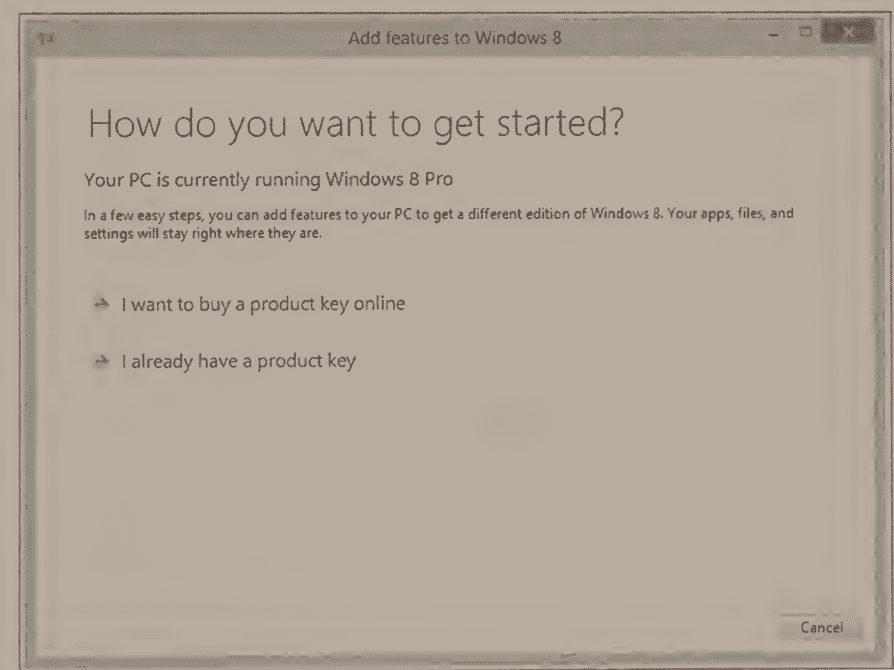

**图 1-1：** 你可以为 Windows 8 添加功能。

## 摘要

本章澄清了 Windows RT 和 Windows 8 的各个版本。正如我在前言中提到的，本书涵盖了 Windows 8 各个版本的许多功能，其中一些功能仅在企业版中提供。如果本书中介绍的特定主题或功能不在你的版本中，你可以潜在地通过“Windows 8 添加功能”实用程序升级到该功能。在第 2 章中，我将向你展示如何以多种方式安装 Windows 8，包括复杂的安装，例如使用虚拟硬盘文件 (VHD) 进行双启动。

# 第 2 章
# 安装 Windows 8

既然你了解了 Windows 8 的各个版本，你几乎准备好在计算机上安装 Windows 8 了。首先，理解 32 位和 64 位 Windows 8 之间的区别很重要，因为购买零售盒装版时，微软提供了这两个版本。在本章中，我将向你展示如何选择适合你计算机硬件的正确版本。然后，我将引导你完成安装步骤，甚至展示一些安装技巧，以便在不使用光盘驱动器的计算机上安装 Windows 8。最后，我将向你展示如何使用高级配置，例如使用虚拟硬盘文件在同一计算机上双启动 Windows 7 和 Windows 8，以及如何使用 Windows 8 企业版创建 Windows To Go 工作区。

## 了解安装介质

每个 Windows 8 零售盒装版都包含 Windows 8 两个版本的 32 位和 64 位介质。由于一些稍后将详细讨论的原因，最常用的版本是 64 位版本，但已经存在多年的 32 位版本仍在特定情况下使用。

## 32 位还是 64 位？

64 位 Windows 的第一个版本于 2005 年 4 月首次亮相，作为 Windows XP Professional x64 版本发布。虽然 64 位版本是一个真正的 64 位操作系统 (OS)，但它因驱动支持不佳而影响了其普及。这是因为新的 64 位内核需要所有硬件设备的 64 位驱动程序。这大大减少了兼容硬件设备的数量。硬件制造商缺乏动力为这个小众操作系统重写驱动程序。随着 Windows Vista 的发布，情况开始改变，这是第一个同时提供 32 位和 64 位版本的 Microsoft Windows 发布。硬件制造商做出了回应，现在几乎所有现代主流硬件都有 64 位驱动程序可用。

64 位 Windows 已成为大多数用户的标准选择，通常也是新 Windows 8 电脑上预装的版本。但是，32 位和 64 位 Windows 8 之间的真正区别是什么？

除了运行 64 位 Windows 8 需要 64 位 CPU（如今你购买的大多数新 CPU 都支持）这一显而易见的事实外，还有其他区别，例如使用更多内存、额外的处理能力和额外的安全功能的能力。

64 位操作系统的主要优势在于能够利用 64 位 CPU 特有的更大的 64 位寄存器。这允许在一个周期内执行更大的计算，并寻址和访问显著更多的 RAM。对于 32 位 Windows 8，可用的最大内存地址数是 $2^{32}$，即可以使用 4 GB 的 RAM。64 位 Windows 8 在 Pro 和企业版中可以使用多达 512 GB 的 RAM。

此外，Windows 8 的 64 位版本包含一些功能，例如 PatchGuard。这是一项有用的技术，试图保护操作系统内核免受恶意或合法软件补丁的修改。在我看来，任何干扰内核的行为都是不好的，因为它可能会影响系统的稳定性。微软正试图通过实施 PatchGuard 功能并创建 API，以便合法软件以更安全的方式与内核交互，来制止这种行为。

一些数学密集型应用程序，如渲染 3D 场景，在使用 64 位渲染应用程序版本时，在 64 位 Windows 8 上表现也更好。加密程序似乎也在 64 位 Windows 上运行得更快。

既然你了解了 Windows 8 64 位版本的好处，决定哪种更适合你的硬件就很重要。对我来说，RAM 和驱动支持是主要的决定因素。我倾向于仅在虚拟机上使用 32 位 Windows 8，用于测试非常旧的应用程序的兼容性。我在所有硬件上使用 64 位 Windows 8，以便利用 4 GB 以上的 RAM 和增强的性能。


## 从 USB 安装

Windows 8 零售版在 DVD 上包含了安装软件。这对大多数用户来说完全没问题，但对于拥有笔记本电脑、平板电脑或其他没有光驱的计算机的用户来说，这是一个大问题。如果你的计算机没有光驱，你需要采取额外步骤来安装 Windows 8。

解决这个问题有一些方案，例如 PXE（预启动执行环境）网络启动到 Windows 部署服务器（这是 Windows Server 2008 及更高版本的功能）。然而，最受欢迎且最易于配置的是可启动的 USB 闪存驱动器。这也是我个人的偏好，因为通过 USB 闪存驱动器安装 Windows 8 实际上比从 DVD 安装快得多。

你需要一个 4 GB 的 USB 闪存驱动器，以便有足够空间将完整的 Windows 8 安装代码放入驱动器中。我发现 4 GB 的 SanDisk Cruzer 用于启动 Windows 8 安装代码工作良好，并且似乎与广泛的计算机兼容。然而，如今几乎所有的 4 GB USB 闪存驱动器都应该可以使用。

如果你拥有物理介质而不是数字下载的 ISO 文件，创建启动介质的说明略有不同。请遵循适用于你情况的说明。

### 从物理 DVD 创建 USB 启动介质

如果你可以访问 Windows PC（XP 或更高版本），本节就很有用，因为你需要 DiskPart 才能创建 USB 启动介质。

在开始之前，了解 USB 闪存驱动器上的任何数据都会被永久删除是很重要的，因为该过程会重新格式化驱动器。在继续下一节之前，请将任何重要文档保存到其他位置。

#### 准备 USB 闪存驱动器

USB 闪存驱动器上的分区和文件系统对于启动至关重要。设备上只能有一个分区，它必须被设置为活动分区，且文件系统必须是 FAT32。许多使用新 UEFI BIOS 替代方案（如 UEFI 固件）的计算机在使用除 FAT32 以外的任何文件系统启动 USB 闪存设备时都会遇到问题。将驱动器插入 Windows 计算机并按照以下步骤操作：

- 1. 在驱动器被计算机识别并安装后，点击“开始”按钮，输入 **DiskPart**，然后按 Enter 键。
- 2. 在 DiskPart 窗口中，输入 **list disk** 并按 Enter 键，如图 2-1 所示。
- 3. 找到你的 USB 闪存驱动器的磁盘编号。你可以通过查看大小列轻松找到它。一旦你有了 ID，输入 **select disk #** 并按 Enter 键。（将 # 替换为实际的磁盘 ID，例如 1。）
- 4. 输入 **clean** 并按 Enter 键，以销毁设备上可能存在的任何分区、文件系统和数据。
- 5. 现在是创建分区的时候了。输入 **create partition primary** 并按 Enter 键。
- 6. 对于启动，将分区设置为活动分区非常重要。输入 **active** 并按 Enter 键。
- 7. 如前所述，文件系统必须是 FAT32。输入 **format fs=fat32 label=win8boot quick** 并按 Enter 键。这会执行快速格式化并在一步中为驱动器打标。
- 8. 输入 **exit** 以关闭 DiskPart。你的 USB 闪存驱动器已准备好进入下一阶段。

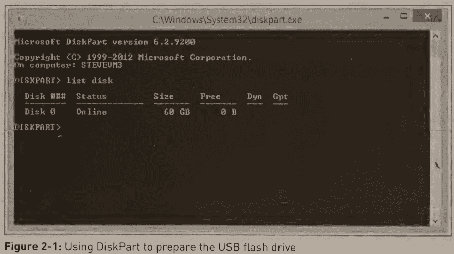

### 复制安装软件

现在你已经准备了 USB 闪存驱动器，最后一步是复制代码。如果你是个极客，你可以使用一些花哨的 xcopy 或 robocopy 命令来完成这一步，但这个简单的复制粘贴程序就非常好用。

将 DVD 介质插入你的 PC，并导航到计算机上包含 Windows 8 安装文件的驱动器。选择所有文件，如图 2-2 所示，然后右键点击并选择“复制”。

导航到 USB 闪存驱动器的根目录，右键点击并点击“粘贴”。文件复制可能需要几分钟，但完成后，你可以快速地在没有光驱的机器上安装 Windows 8。

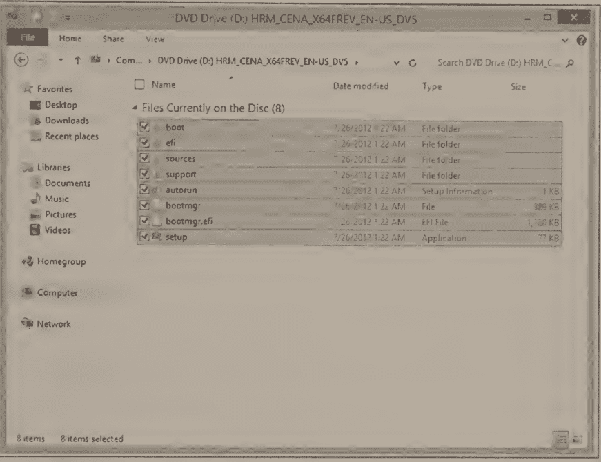

**图 2-2：** 复制所有 Windows 8 安装源文件

### 从 DVD 映像创建 USB 启动介质

与物理 DVD 不同，DVD 映像或 ISO 文件是你直接从 Microsoft 购买 Windows 8 并通过数字方式下载购买时获得的东西。如果你是 MSDN 或 TechNet 订阅者，或者是批量许可企业客户，你也可以获得 Windows 8 的 ISO 文件。

你可以遵循物理 DVD 说明的修改版本，但使用 Microsoft Store 提供的免费实用工具有一种更好的方法。该实用工具称为 Windows 7 USB/DVD 下载工具，但它也能很好地与 Windows 8 ISO 映像一起工作。

只需访问 [http://tweaks.com/935795](http://tweaks.com/935795) 从 Microsoft Store 下载并安装该免费实用工具。安装完成后，从开始菜单启动该实用工具：

- 1. 将你的 USB 闪存驱动器插入计算机。
- 2. 点击“浏览”并选择你的 Windows 8 ISO 文件。然后如图 2-3 所示点击“下一步”。
- 3. 在“选择介质类型”屏幕上，选择“USB 设备”。
- 4. 从列表中选择你的 USB 设备并点击“开始复制”，如图 2-4 所示。

当此过程完成后，你就拥有了一个功能完整的 Windows 8 USB 闪存驱动器，你可以用它来安装 Windows，速度远快于使用 DVD。

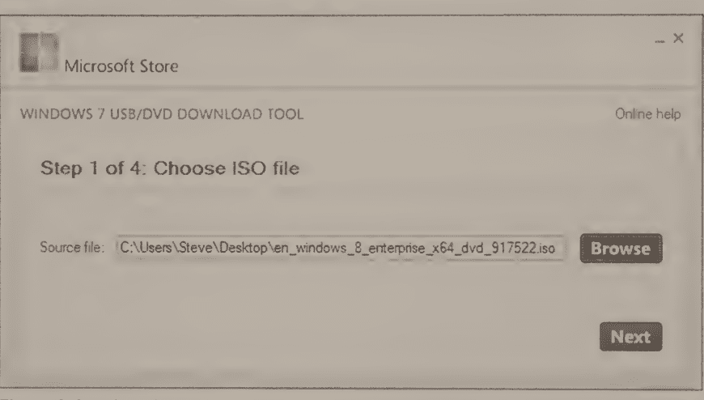

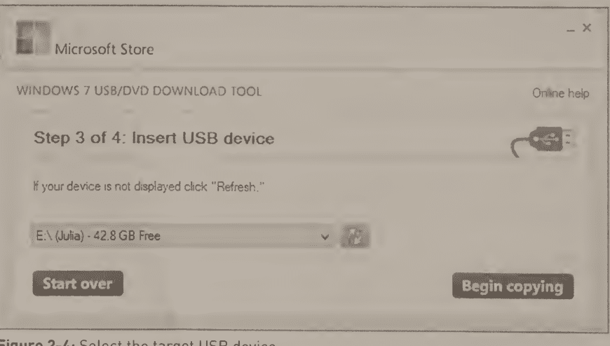

## 理解安装过程

在已安装 Windows 版本的 PC 上安装 Windows 8 的任何版本时，你主要有两个选项：

- 升级你的安装
- 使用全新安装

自 XP 时代以来，升级安装已经走了很长一段路。如今，它基本上执行全新安装，但随后应用来自旧操作系统的配置和个性化设置。只有当你从 Windows 7 升级时，应用程序才会转移过来。所有较早的版本都要求你重新安装应用程序。

全新安装是安装 Windows 8 最纯粹的方法。建议用户将重要数据备份到外部硬盘，然后删除操作系统驱动器的内容。这允许安装程序安装 Windows 8，而不会携带任何遗留设置、应用程序或文件。

每种安装方法都有其优缺点，我将在接下来的两个部分中讨论这些内容。

## 使用升级安装过程

升级安装比全新安装更容易实施，但它们存在的许多负面方面将在长期内困扰你。该过程的运作方式如下：你在安装了以前版本 Windows 的机器上启动安装程序。安装程序会告知你哪些应用程序是兼容的。然后你将有权选择停止升级并保留当前版本的 Windows，或继续升级，稍后你就会拥有一台 Windows 8 PC。以前版本 Windows 上的大多数相同设置和应用程序都会完美转移过来。

这是在一个完美世界中该过程的运作方式。在现实中，它很少能如此顺利。我见过大量归因于从以前版本 Windows 升级的用户的 Windows 8 技术问题。最令人印象深刻的是，当用户执行全新安装时，大多数问题都消失了。

Microsoft 有一些聪明人正在处理升级过程，他们已经在这一领域工作了数十年。但该过程很少工作良好，因为想法本身有缺陷。你为什么总是希望将所有 Windows 设置、应用程序和旧 PC 上积累的垃圾带到一台全新 PC 上？这就像买了一辆新车，然后把旧车上的零件安装上去。

底层系统已经改变。花点时间在全新安装后重新安装你的应用程序和设置。你将获得回报：一台以最高速度运行且随时间推移遇到问题更少的 Windows 8 PC。

## 使用全新安装过程

安装 Windows 8 的最佳方式是进行全新安装。这会清除你计算机上所有已安装的应用程序和数据，但在长期来看是值得的。此外，许多应用程序已更新以在 Windows 8 上更好地工作并利用新功能，因此无论如何最好更新并安装新版本。

要开始全新安装过程，请遵循以下步骤：

- 1. 将你创建的安装 DVD 或 USB 闪存驱动器插入计算机。然后重启并选择计算机的启动菜单键。在我的机器上，我按 F12 然后选择我想启动的设备，如图 2-5 所示。如果你使用的是 DVD，确保在屏幕上看到“按任意键从 CD 或 DVD 启动”的消息后按任意键。

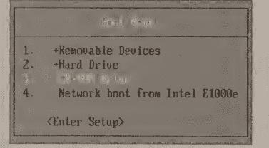

**图 2-5**：从 PC 启动菜单中选择要启动的设备。

- 2. 屏幕底部显示一个进度条，随后是 Windows 标志。在下一个屏幕上，确保语言、时间和货币格式以及键盘设置正确。准备就绪时，如图 2-6 所示按“下一步”。
- 3. 在下一个屏幕上，点击“立即安装”。
- 4. 如果你使用的是 Windows 8 或 Windows 8 专业版介质，你必须输入产品密钥，如图 2-7 所示，然后点击“下一步”。你提供的产品密钥决定了安装的是 Windows 8 还是 Windows 8 专业版。如果你使用的是 Windows 8 企业版介质，则不会提示输入产品密钥，可以跳过此步骤。


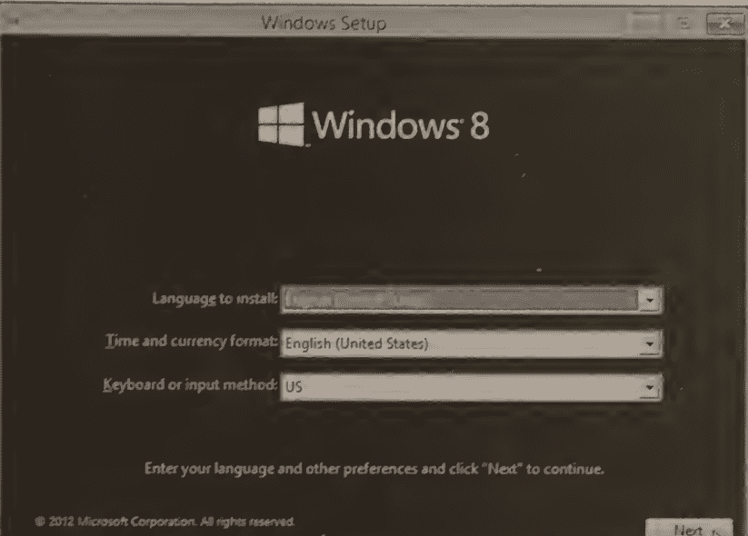

图 2-6：检查 Windows 8 安装的区域设置。

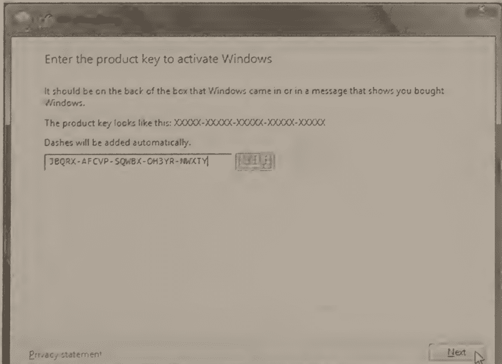

图 2-7：输入产品密钥。

5. 点击“我接受许可条款”，然后点击“下一步”。

6. 在下一个屏幕上，您可以选择“升级”或“自定义”安装。千万不要犹豫；点击“自定义”以执行全新安装，如图 2-8 所示。

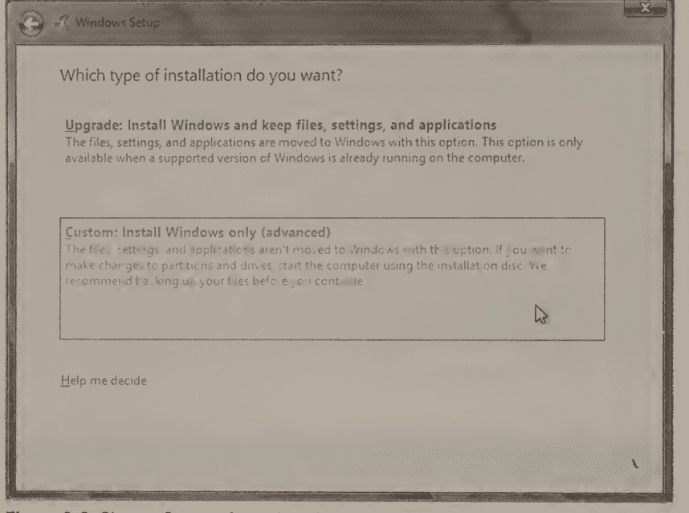

**图 2-8：** 选择“自定义”以进行全新安装。

7. 安装的最后一步手动操作是选择要安装到的驱动器。在我将数据复制到备份驱动器之后，我喜欢删除将在其上安装 Windows 8 的驱动器上的所有分区。您可以通过选择分区然后点击“驱动器选项”来执行此操作。然后只需点击“删除”。对该驱动器上的其他分区重复此操作，选择“未分配空间”，然后点击“下一步”，如图 2-9 所示。这将自动对该驱动器进行分区和格式化，然后 Windows 开始安装。

设置现在完全自动化了。文件被复制到目标驱动器，计算机重启几次。安装完成后，计算机重启，启动后会要求您输入用户名、计算机名称、密码以及其他首次运行信息。恭喜，Windows 8 已安装完毕，准备好进行调优了。

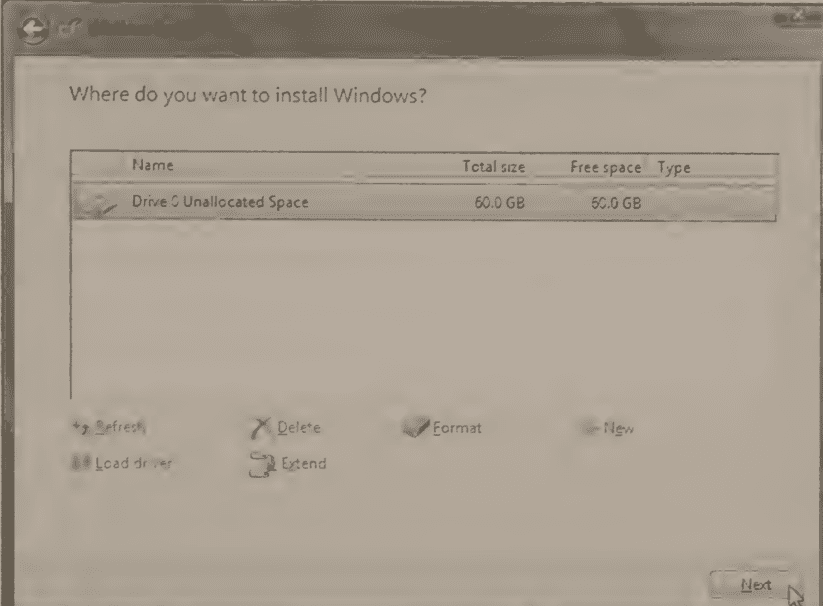

**图 2-9：** 选择安装 Windows 8 的位置。

## 双启动 Windows

随着虚拟化技术变得更加普及，在物理计算机上运行多个操作系统的必要性已显著降低。应用程序兼容性是过去用户安装多个操作系统的主要原因。您的旧 Windows XP 应用程序在 Windows 8 中无法运行？只需重新启动并进入 Windows XP 即可。诸如 VMware Workstation、Sun VirtualBox 和 Microsoft Hyper-V 等虚拟机应用程序允许您在主操作系统之上启动第二个操作系统，从而消除了重启进入另一个操作系统的必要性和麻烦。这解决了大多数应用程序的兼容性问题，但虚拟机并不总是完美的。

游戏是虚拟机可能会出现问题的一个领域，因为 3D 支持虽然有了很大改进，但尚未达到裸机性能。如果您是一名游戏玩家，或者只是想以一种很酷的方式在裸机性能下试用 Windows 8，我将向您展示如何双启动 Windows 7 和 Windows 8，并带有一些极客风格的技巧。

您可以通过多种方式实现 Windows 7 和 Windows 8 的双启动系统，但最简单且破坏性最小的方法是先安装 Windows 7。然后，使用 Windows 7 中一个鲜为人知的功能“启动到 VHD（虚拟硬盘文件）”，您可以将 Windows 8 安装在 VHD 文件中，这非常安全，因为您无需更改 Windows 7 分区或安装。完成后，Windows 8 驱动器将被虚拟化为 Windows 7 分区上的单个文件，并在启动菜单中显示，就好像它是安装在原始磁盘上一样。

### 在 Windows 7 上创建 VHD 文件

双启动 Windows 8 和 Windows 7 的第一步是创建一个 VHD 文件以容纳 Windows 8 安装。在 Windows 7 上打开磁盘管理来创建该文件：

- 1. 在 Windows 7 中点击“开始”按钮，输入 **diskmgmt.msc**，然后按 Enter。磁盘管理实用程序应该加载。
- 2. 点击 **操作** 菜单并选择 **创建 VHD**。
- 3. 输入位置，例如 `C:\VHD\Win8.vhd`。设置大小——我建议 40 GB——并选择“动态扩展”格式以节省磁盘空间。动态 VHD 文件开始时较小，并随着写入虚拟磁盘的数据而增长。当您的屏幕看起来像图 2-10 时，点击“确定”，文件即创建完成。

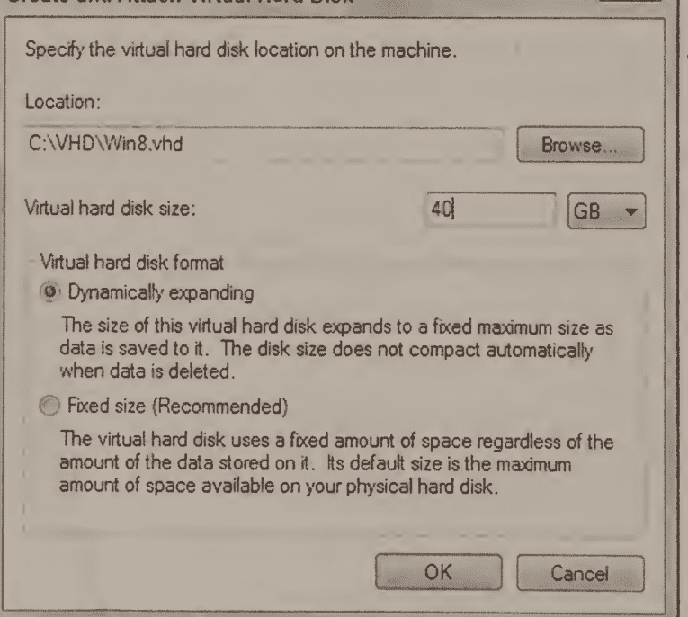

### 将 Windows 8 安装到 VHD

按照前面介绍的全新安装流程继续安装 Windows 8，但在询问“您想在哪里安装 Windows？”的屏幕处停止，如图 2-9 所示。您需要将 VHD 文件附加到安装程序，以便将其识别为安装 Windows 8 的有效位置。

- 1. 按键盘上的 Shift + F10 调出命令提示符窗口。
- 2. 输入 **diskpart** 并按 Enter。
- 3. 现在是时候选择您之前创建的 VHD 文件了。您需要知道 VHD 文件的完整路径。请记住，正确安装的 Windows 7 机器有两个主分区：一个用于启动和恢复工具的隐藏分区，以及一个用于操作系统的独立分区。当 Windows 运行时，它会隐藏隐藏的启动分区，并给第二个操作系统分区分配 C 盘盘符。当安装程序运行时，启动分区未被隐藏，因此会被分配 C 盘盘符，而第二个操作系统分区会被分配 D 盘盘符。如果 VHD 文件是在 Windows 7 运行时创建于 `C:\VHD\Win8.vhd`，那么在安装程序运行时，您需要使用 `D:\VHD\Win8.vhd` 作为 VHD 文件的完整路径。使用调整后的 VHD 文件路径运行以下命令，然后按 Enter：

```
select vdisk file=d:\vhd\win8.vhd
```

- 4. 输入 **attach vdisk** 并按 Enter。
- 5. 关闭命令提示符窗口，并点击“您想在哪里安装 Windows？”屏幕上的“刷新”按钮。
- 6. 选择现在列表中新显示的 40 GB VHD 驱动器（显示为驱动器 1），并点击“下一步”，如图 2-11 所示。忽略任何声称无法在该驱动器上安装 Windows 的警告。这些是不正确的，因为安装程序并不了解这种高级的 Windows 8 安装方法。
- 7. 只需继续照常安装 Windows 8。下次您的 PC 重启时，您将看到一个新的启动菜单，使您可以选择 Windows 7 和 Windows 8，如图 2-12 所示。

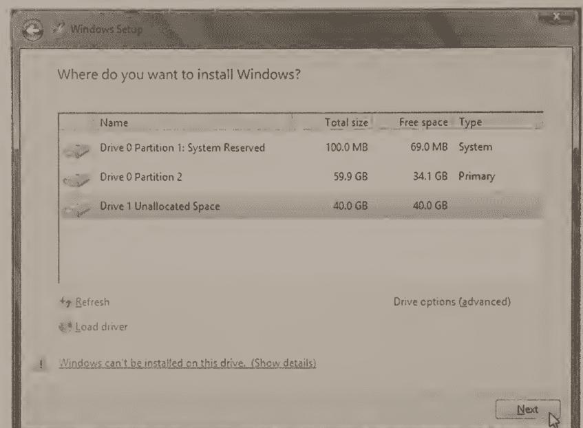

图 2-11：您可以将 Windows 8 安装到虚拟硬盘。

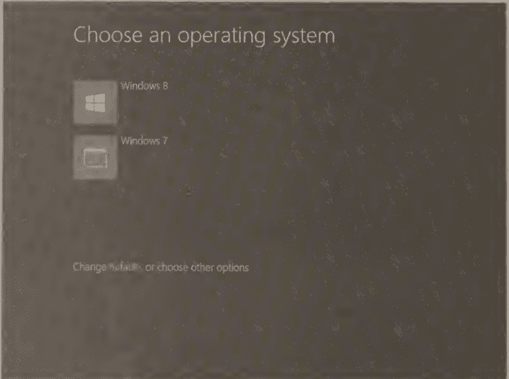

图 2-12：在 Windows 8 启动菜单中选择 Windows 7 或 8。

## 使用 Windows To Go

Windows 的一个新功能是 Windows To Go 工作区，它仅存在于 Windows 8 企业版中。不要为员工提供台式机或笔记本电脑，让他们使用自己的硬件，并为他们提供一个包含其公司桌面的可启动 USB 闪存盘。他们可以带着 Windows To Go 工作区去任何地方，并几乎可以在任何计算机上使用。只需插入并启动工作区即可。

正如您可以想象的那样，如果没有快速设备，从 USB 闪存盘运行 Windows 可能会很慢。在我的测试中，所有 USB 2.0 闪存盘都是完全无用的，除非您不介意 20 分钟的启动时间。事实上，微软建议仅使用经过 Windows To Go 认证的 USB 3.0 闪存盘。微软特别推荐以下三款设备：

- Kingston DataTraveler Workspace
- Super Telen Express RC8
- Western Digital My Passport Enterprise

Western Digital 的选项实际上是一个外部 USB 3.0 硬盘，因此理论上您还可以使用 USB 硬盘。

除了设备的性能之外，微软还要求该设备具有创建多个分区的能力。这需要一种特殊的控制器，如今在 USB 闪存盘上很少见。您最好的选择是坚持使用经过 Windows To Go 认证的 USB 3.0 驱动器。

## 为什么仅限企业版？

我前面提到过，Windows To Go 仅存在于 Windows 8 企业版中。这背后的原因全在于产品激活。到这个时候，您应该知道过去十年制造的每个版本的 Windows 都需要某种形式的互联网激活。Windows 的激活基于您 PC 的独特硬件配置。如果您拆下硬盘并将其安装到另一台 PC 中，Windows 8 会启动，但您需要重新激活它。

如果您使用 Windows To Go，也会发生同样的情况。您在每台不同的机器上启动时都需要激活。即使您回到过去使用过的机器，仍然需要重新激活。由于消费者产品密钥在停止工作前只能激活几次，因此频繁重新激活是不可行的。

Windows 8 的企业客户通常使用不同类型的产品激活。这种激活使用一种称为 *密钥管理服务* (KMS) 的技术，它安装在公司网络内部的 Windows 服务器上。您可以


# 章节

## 3

# Windows 8 基础

自 Windows 95 以来，微软首次采取了大胆举措，通过创建新的“Metro”设计风格界面，对 Windows 的界面进行了彻底改造。最佳描述为全屏沉浸式环境，新界面是 Windows 商店应用和基于磁贴的新开始屏幕的主场。本章涵盖界面的新元素，帮助你快速上手，以便你能像使用经典桌面界面一样熟练地穿梭于新界面之中。

## 使用新界面

对于使用 Windows 多年的人来说，新界面可能会非常令人困惑和恼人。习惯一个新界面并不容易——面对变化从来都不轻松。但一旦你习惯了它，你会发现某些任务比以前容易得多。

许多人声称新界面专为平板电脑的触控用户设计。虽然该界面确实在触控设备上表现极佳，但说它仅适用于平板电脑而不适用于使用台式机或笔记本电脑的传统 PC 用户是错误的。触控用户可以做的所有事情，使用键盘和鼠标同样可以实现。接下来的几节将介绍如何使用传统的键盘和鼠标来使用新界面。

## 使用开始屏幕

当你首次启动 Windows 8 时，你将看到新的开始屏幕，而不是经典桌面。取代开始菜单，开始屏幕是一切的起点。微软没有采用应用名称列表和静态图标，而是选择了一种名为 *Live Tiles* 的新磁贴布局。

Live Tiles 类似于提供实时信息（如天气状况、体育比分，甚至警报）的动态图标。不幸的是，由于磁贴具有实时特性，它们仅限于从 Windows 商店下载的应用程序。经典桌面应用程序获得的磁贴带有乏味的静态图标。

## 在开始屏幕上导航

如果你没有触控设备，使用滚轮鼠标在开始屏幕上导航是最佳方式。只需滚动滚轮即可向右滑动。你也可以使用方向键，但那通常较慢。当你找到想要的东西时，只需点击它即可。

如果你知道想要什么，经典开始菜单的搜索功能依然存在。只需输入名称并按 Enter 键。你还可以像在 Windows Vista 和 Windows 7 中一样运行命令。输入 **CMD** 并按 Enter 键即可打开命令提示符，如图 3-1 所示。

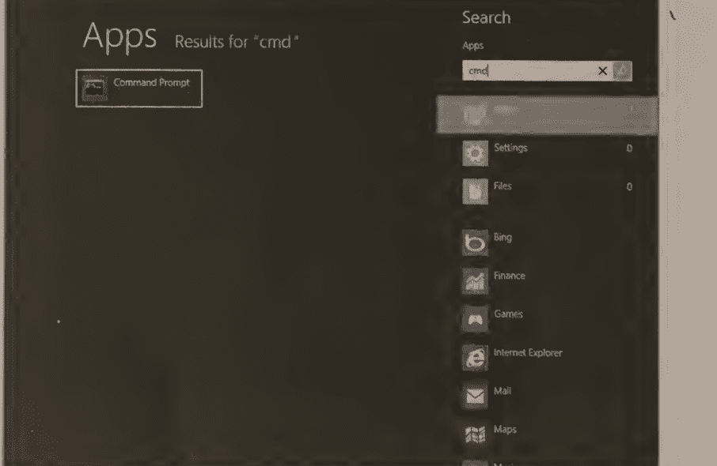

**图 3-1：** 打开命令提示符。

根据你要搜索的内容，你可能需要更改搜索范围。与 Windows 7 和 Vista 不同，在 Windows 8 中，微软将应用程序搜索与设置或控制面板搜索分开了。如果你正在查找 Windows 设置，例如显示设置，在输入你想查找的内容后，你需要点击屏幕右侧的设置选项，如图 3-2 所示。

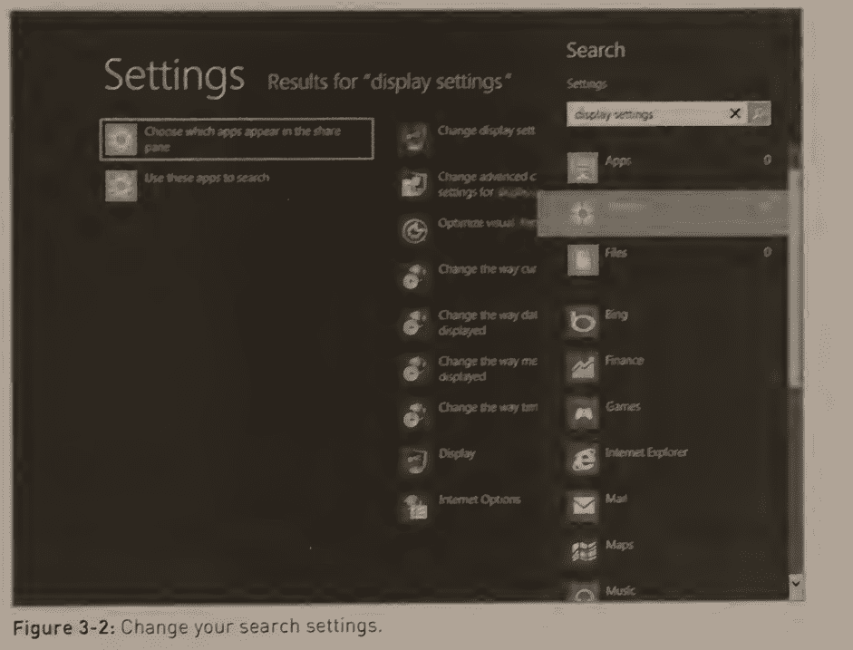

**图 3-2：** 将搜索范围更改为设置。

## 开始屏幕视图

除了默认视图外，还有另外两种开始屏幕视图可用，但需要一些操作才能显示它们。第一种是 PC 上安装的所有应用程序的列表。该视图类似于在旧版 Windows 中点击“所有程序”，但提供全屏显示，如图 3-3 所示。

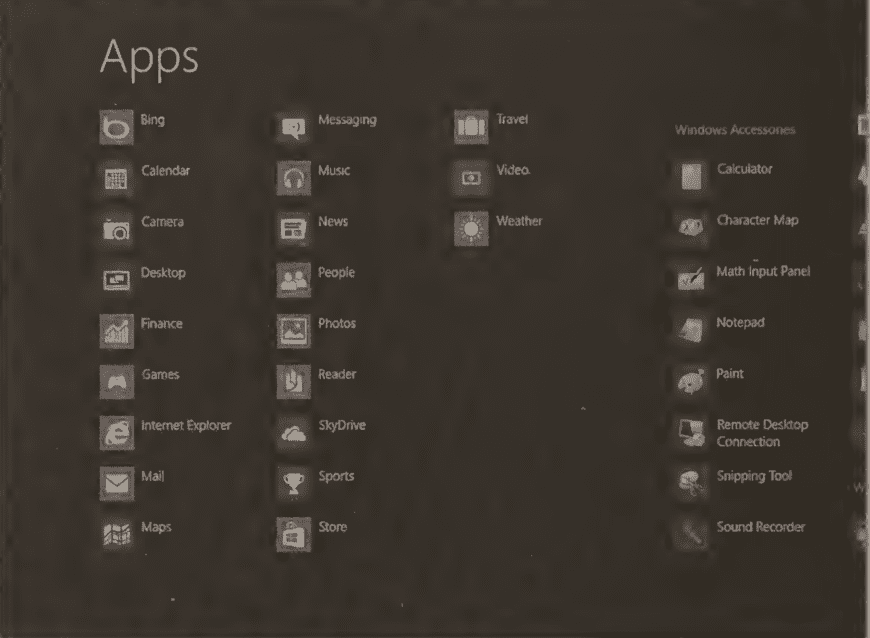

**图 3-3：** 此开始屏幕视图以类似于旧版 Windows 中“所有程序”菜单项的方式显示应用。

你可以通过按下以下键盘组合键调出应用程序列表视图：Windows 键 + Q。

我将下一个视图称为“组视图”，因为它允许你查看开始屏幕上的所有磁贴组。当你的屏幕上有很多磁贴时，这非常适合快速选择应用程序，而不是滚动（见图 3-4）。要激活此视图，请调出开始屏幕，然后按住 Ctrl 键并按减号键（-）。或者，你可以按住 Ctrl 键并用鼠标滚轮向下滚动，或点击屏幕右下角的小减号按钮。

要充分利用此视图，你需要将开始屏幕磁贴组织到命名列组中。我将在第 5 章中介绍这一内容以及更多内容，该章专门介绍自定义开始屏幕。

## 使用 Charms

Charms 是新界面的另一重要部分，也是 Windows 8 的重要组成部分。我喜欢将 Charms 视为全屏应用世界的右键菜单。传统的右键上下文菜单不适合全屏沉浸式应用的世界。Charms 提供了一种新的方法，在需要时向用户呈现相关选项，这些选项在闲置时是隐藏的。

## 构建 Windows To Go 工作区

假设你购买了一块通过 Windows To Go 认证的 USB 3.0 闪存盘，请按照以下步骤创建 Windows To Go 工作区：

1.  打开开始屏幕并输入 **Windows To Go**。
2.  通过点击侧边的“设置”将搜索范围更改为设置，然后你应该能够运行 Windows To Go 实用工具。
3.  加载后，你将看到“创建 Windows To Go 工作区”屏幕，其中列出了插入你 PC 的兼容驱动器。选择你的驱动器并点击 **下一步**，如图 2-13 所示。
4.  接下来，将 Windows 8 企业版 DVD 插入光驱，或双击挂载 Windows 8 企业版 ISO 文件。
5.  在“创建 Windows To Go 工作区”实用工具中，点击 **添加搜索位置** 并选择包含 Windows 8 企业版文件的驱动器。
6.  当实用工具找到文件时，选择名称并点击 **下一步**。
7.  Windows To Go 支持 BitLocker 驱动器加密，因此 USB 设备的内容会被加密。考虑到丢失小型 USB 闪存盘有多容易，这是一个好主意。如果你对这个功能感兴趣，请勾选框并输入密码；否则，只需点击 **跳过**。
8.  最后，点击 **创建**，USB 闪存盘将被重新格式化，并在其上安装 Windows 8 企业版。

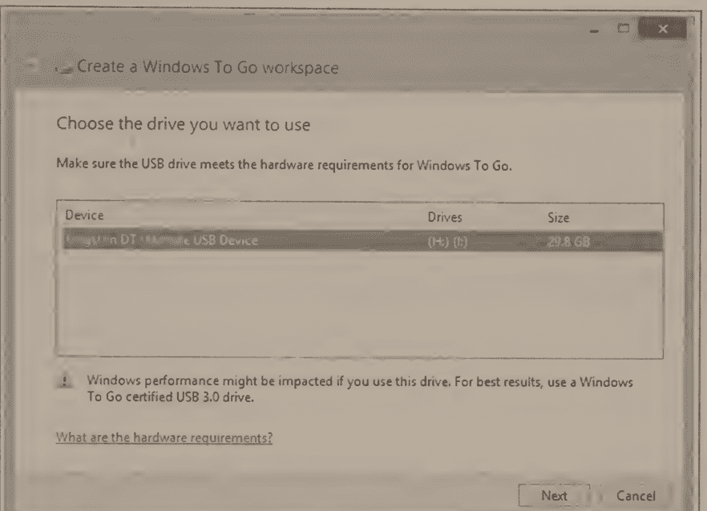

**图 2-13：** 创建 Windows To Go 工作区。

在任何 PC 上，只需像安装 Windows 一样启动带有 Windows To Go 工作区的新 USB 3.0 闪存盘。按下键盘组合键调出 PC 上的启动菜单，并选择“从 USB 设备启动”。

## 摘要

在本章中，我描述了 Windows 8 的 32 位和 64 位版本之间的区别和优势。我向你展示了如何使用 DVD 进行干净安装以安装 Windows 8，以及如何从 USB 闪存盘安装——一个非常有用的技巧。然后我转向双启动世界，演示了如何在同一台物理计算机上安装 Windows 7 和 Windows 8，但带有使用 VHD 文件的虚拟化 twist。最后，我介绍了 Windows 8 企业版中的 Windows To Go 工作区功能。

在下一章中，我将回顾 Windows 8 新界面的基本操作，因为变化巨大。导航可能会令人困惑，并创造了大量的调整机会使其更好。


停靠在对屏幕所有边缘出现的工具栏中的，最常用的是系统特性栏，如图 3-5 所示。系统特性栏适用于任何你打开的应用程序，甚至存在于经典桌面上。如果你有触控设备，只需将手指从屏幕右侧向内滑动。桌面和笔记本电脑用户必须将鼠标光标移至屏幕右上角，然后向下移动以显示特性栏。或者，你可以按 Windows 键 + C 键调出系统特性栏。

系统特性栏允许你打开开始屏幕、搜索所有内容或仅搜索当前打开的应用程序，以及打开“设置”面板，在那里你可以关闭你的 PC。微软为何将关闭和重启计算机的功能隐藏在“设置”特性栏中，这一点让我不解，但起码现在你知道如何正确关闭你的 PC 了。

在 Windows 商店应用或开始屏幕中，在屏幕顶部和底部的应用工具栏上还有额外的特性栏。将手指从屏幕顶部向下拖动或从屏幕底部向上拖动，或者如果你使用鼠标，只需右键单击。这些是新的应用程序特定上下文菜单，它们停靠在对屏幕边缘。它们允许你执行任务，例如在 Internet Explorer 中打开新标签页，或访问开始屏幕上所选磁贴的磁贴设置，如图 3-6 所示。

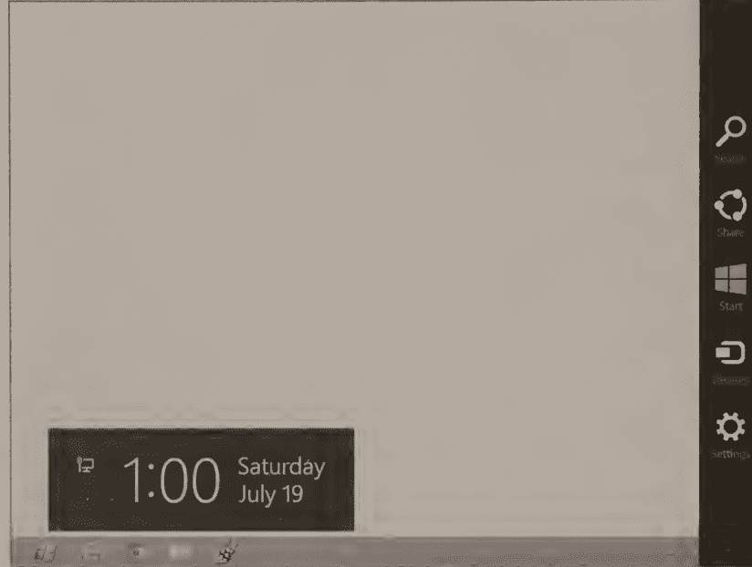

**图 3-5：** 系统特性栏在你需要时显示信息。

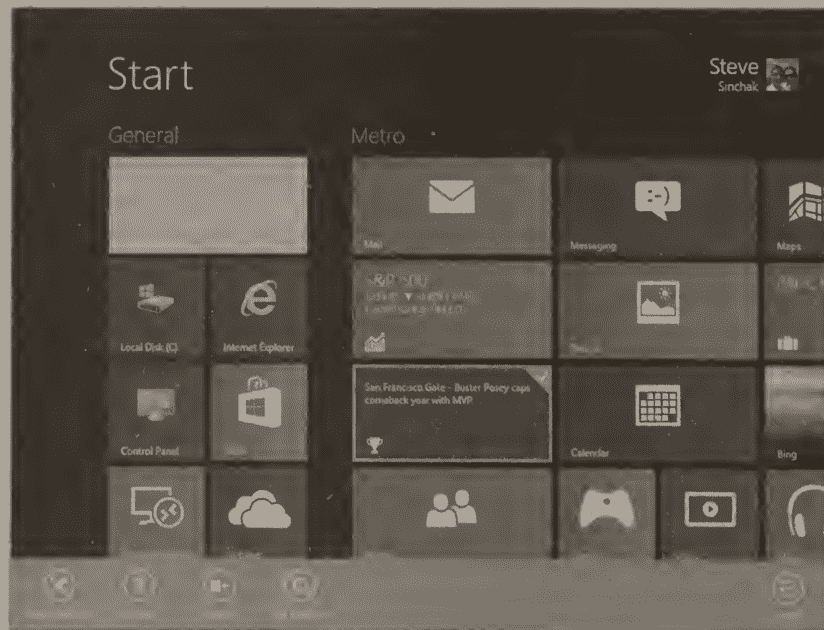

**图 3-6：** 开始屏幕具有磁贴设置特性栏。

最后一种特性栏位于屏幕左侧，有助于你在应用程序之间切换。你可以将其视为新界面的任务栏。将手指从屏幕左侧向内拖动，或者将鼠标光标放在屏幕左上角，然后向下移动光标。或者，在键盘上你可以按 Windows 键 + Tab 键。此特性栏提供所有打开的 Metro 风格应用程序的缩略图视图以及桌面的截图。

## 在 Windows 商店应用和开始屏幕中使用键盘快捷键

如果没有触控设备，我已经介绍了一些帮助你在新界面中快速移动的键盘快捷键，但你还可以使用更多。表 3-1 中的键盘快捷键将为你省去几次点击，并访问通常隐藏在界面内的项目。

**表 3-1：Windows 商店应用和开始屏幕键盘快捷键**

| 按键组合 | 功能 |
| :--- | :--- |
| Windows 键 | 打开开始屏幕 |
| Windows 键 + Tab | Metro 应用切换器 |
| Windows 键 + C | 系统特性栏 |
| Windows 键 + Z | 应用程序特性栏 |
| Windows 键 + I | 设置菜单 |
| Windows 键 + K | 设备菜单 |
| Windows 键 + H | 共享菜单 |
| Windows 键 + F | 在开始屏幕上搜索文件 |
| Windows 键 + Q | 在开始屏幕上搜索应用程序 |
| Windows 键 + W | 在开始屏幕上搜索设置 |
| Windows 键 + . (句号) | 将 Metro 应用停靠到屏幕右侧 |
| Windows 键 + Shift + . (句号) | 将 Metro 应用停靠到屏幕左侧（仅适用于宽屏显示器） |

## 使用经典桌面

虽然新的 Metro 界面在讨论 Windows 8 时最受关注，但经典桌面也进行了一些微小的改进。几乎所有的变化都是外观上的，因为底层系统组件与 Windows 7 几乎相同，只是进行了优化。

### 有什么新变化？

新的桌面功能集中在 Windows 任务栏和文件资源管理器界面上。用户会立即识别出来自 Microsoft Office 的熟悉选项卡式界面，该界面已集成到文件资源管理器中。无论喜欢与否，许多新选项只需一次点击即可访问。文件复制/移动对话框也进行了重大更新，配有漂亮的图表和暂停文件传输的功能，这非常有用，如图 3-7 所示。

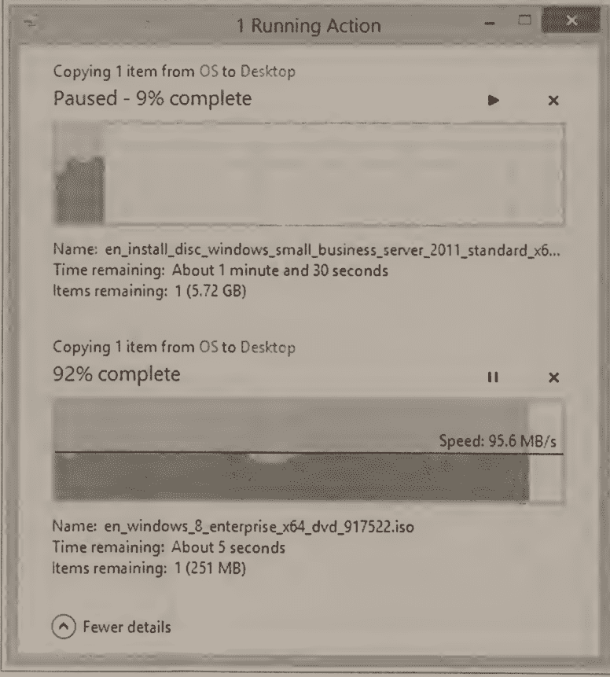

**图 3-7：** 新的 Windows 复制对话框提供暂停选项。

Windows 任务栏终于获得了对多显示器的支持，允许用户将其扩展到所有显示器。用户还可以自定义应用程序图标的行为，使在单个显示器上打开的窗口显示在所有显示器的任务栏上，或者仅显示在窗口实际所在的任务栏上。

在幕后，Windows 继续执行 Vista 时期的“瘦身”计划。据微软称，Windows 8 比 Windows 7 使用更少的 RAM，并且后台运行的进程更少。我实际上在一台仅装有 2 GB RAM 的机器上使用了 Windows 8，性能是可以接受的。

## 使用桌面键盘快捷键

除了访问方式外，在 Windows 8 中导航经典桌面没有发生显著变化。表 3-2 中的键盘快捷键并非全部是全新的，但它们将帮助你像真正的强力用户一样快速导航界面。

表 3-2：经典桌面键盘快捷键

| 按键组合 | 功能 |
| :--- | :--- |
| Windows 键 + D | 显示桌面 |
| Windows 键 + 逗号 | 预览桌面 |
| Windows 键 + M | 最小化窗口 |
| Windows 键 + 向上箭头 | 最大化窗口 |
| Windows 键 + 向右箭头 | 将窗口停靠到右侧 |
| Windows 键 + 向左箭头 | 将窗口停靠到左侧 |
| Windows 键 + X | 管理员工具菜单 |
| Windows 键 + Pause/Break | 系统信息 |
| Ctrl + Shift + Escape | 任务管理器 |
| Windows 键 + Enter | Windows 讲述人 |
| Windows 键 + L | 锁定 PC |
| Windows 键 + P | 投影仪选项 |
| Windows 键 + Print Screen | 将截图保存到图片 |
| Windows 键 + Space | 切换语言包 |
| Windows 键 + R | 运行对话框 |
| Windows 键 + E | 文件资源管理器 |
| Windows 键 + 数字 | 启动固定的任务栏应用 |
| Windows 键 + 加号 | 屏幕放大 |
| Windows 键 + 减号 | 屏幕缩小 |

## 摘要

本章介绍了 Windows 8 的新特性基础以及如何像强力用户一样使用它。新界面需要一些时间来适应，在后续章节中，如果你是粉丝，我将介绍如何自定义它。如果不是，我会展示如何尽可能避免它。

在下一章中，我将介绍如何安全地调整你的计算机。很快你就要开始修改系统了，这总是伴随着出错的风险，因此了解如何安全地进行更改非常重要。

# **第 4 章**

# **安全调整**

如果你的计算机预装了 Windows 8，或者你已完成 Windows 8 的安装，你几乎可以开始进行了调整。但首先，本章讨论了安全调整和自定义计算机的方法。许多调整、技巧和秘密如果你不小心漏掉步骤，可能会造成严重问题。因此，这是一个讨论保护计算机的好时机，以便你可以轻松撤销任何导致问题的调整。

首先，你创建还原点，允许你拍摄配置快照，以便可以轻松返回到先前状态。然后本章介绍了 Windows 备份以保护你的数据，以及启动修复以自动修复可能阻止 Windows 8 启动的问题。此外，我介绍了新的一键刷新和重置功能，可自动将 Windows 恢复到可工作状态。

## **使用系统还原**

系统还原已经成熟为任何调整计算机的强力用户都很有价值的东西。每次你进行更改时，都存在出错的风险。如果你可以轻松地通过几次点击撤销任何更改，那不是很棒吗？系统还原通过让你回到时间线中较早的状态来解决这个问题。

在接下来的章节中，我将展示如何在调整之前创建还原点，然后在出错时如何还原到以前的状态。

### 创建还原点

你可以在 Windows 中以多种方式创建还原点。每次安装新软件时，Windows 都会自动创建一个新的还原点。你也可以在 Windows 中手动创建还原点。本章从正常方式开始，然后展示如何创建一个桌面快捷方式，使你可以直接跳转到“创建还原点”屏幕。开始操作，请执行以下操作：

- 1. 打开开始屏幕，输入 **创建还原点**，切换到“设置”筛选器，然后按 Enter 键。

系统属性中的系统保护选项卡如图 4-1 所示。这允许你查看系统还原设置并创建还原点。

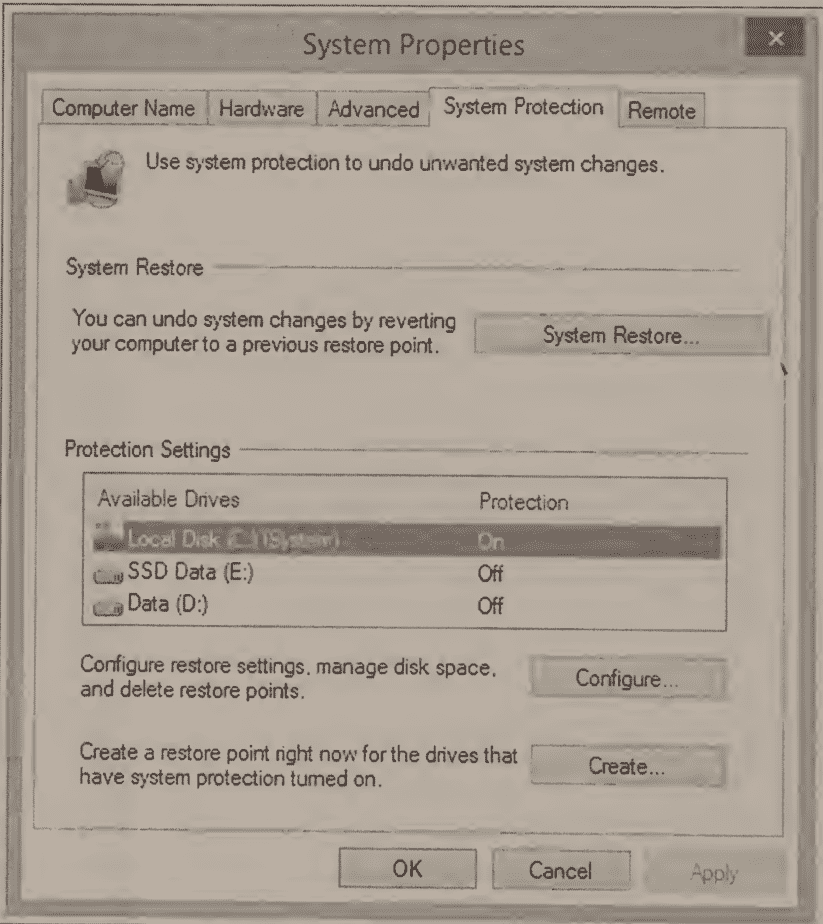

**图 4-1**：访问你的系统还原设置。


2.  点击窗口底部的**创建**按钮。
3.  在下一个屏幕上，输入还原点的名称，然后点击**创建**。

点击**创建**按钮后，还原点会立即开始对您的系统进行快照。屏幕将显示进度，并在快照完成时通知您。根据我的经验，创建还原点最多只需要几分钟。有时甚至不到一分钟。

接下来，我将向您展示如何使用还原点回退到更早的状态。

## 回退到先前状态

使用系统还原的第二部分是使用还原功能将计算机恢复到先前的状态。

在继续之前，重要的是要理解，当您回退到先前状态时，系统还原不会删除您的任何个人文档，例如照片、音乐和 Microsoft Word 文档。然而，在两个还原点之间所做的所有系统更改，例如安装新驱动程序和新软件，都会被清除。建议在恢复计算机之前关闭所有已打开的应用程序。

既然您现在知道需要注意什么，请按照以下步骤将计算机恢复到先前的还原点：

1.  打开开始屏幕，输入 `rstrui.exe`，然后按 Enter 键。
2.  系统还原实用程序加载完成后，在第一个屏幕上点击**下一步**。
3.  您现在将看到一个列表，其中包含每个还原点的日期、时间和描述。屏幕上还有一个**显示更多还原点**复选框，我建议勾选它，以便您可以查看所有可用的系统还原点。
4.  找到您想要回退到的还原点，选中它，然后点击**下一步**。
5.  检查确认页面，然后点击**完成**。
6.  在最终确认屏幕上点击**是**。

您的计算机现在将注销并启动系统还原过程。完成后，您的计算机将重新启动。

系统还原最出色的特点之一是，如果恢复计算机未能解决问题或引发了新问题，您可以随时撤销最近的还原。您可以通过再次启动系统还原来撤销最近的还原。完成任何还原后，系统还原实用程序的初始屏幕上都会显示**撤销**选项。

## 系统恢复控制台

Windows 8 中的系统恢复控制台是一个很棒的功能，如果您遇到的问题导致计算机无法正常启动，它可以帮您修复计算机。它包含许多工具，例如自动修复、系统还原、刷新你的电脑、系统映像恢复和内存诊断，以及访问命令提示符的方法。稍后我将详细介绍系统恢复控制台中可用的工具，但首先，您要学会如何访问该控制台。

### 访问系统恢复控制台

您可以通过两种方式访问系统恢复控制台。最受欢迎的方法是启动在 Windows 8 安装到计算机上时设置的隐藏恢复分区。要做到这一点，请在计算机开机后、制造商标志显示期间（即加电自检 POST 或 Power On Self-Test 阶段）立即按键盘上的 F8 键。如果您在正确的时间按下 F8，将显示一个特殊的启动菜单，其中包含**修复你的电脑**选项。在我的电脑上，我会在 POST 完成后立即开始反复按 F8，以确保抓住 F8 键生效的短暂窗口，以免计算机正常加载 Windows。

选择**修复你的电脑**选项后，系统恢复控制台加载时会显示一个进度条。加载完成后，您将看到系统恢复控制台的主屏幕，如图 4-2 所示。

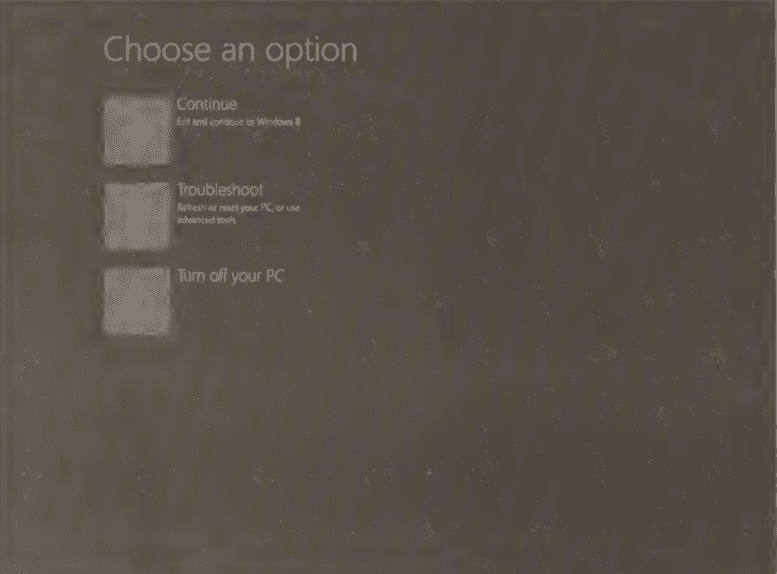

**图 4-2：** 您可以通过 Windows 8 系统恢复控制台修复许多问题。

这种方法在大多数 Windows 8 安装中都有效，但它依赖于该特殊的隐藏分区。如果该分区发生损坏，或者 Windows 8 安装时未创建该分区，您需要使用系统恢复控制台启动光盘或 U 盘来访问系统恢复控制台。

如果您有 Windows 8 安装光盘，您可以使用它启动计算机，然后选择**修复我的电脑**。但是，如果您的电脑预装了 Windows 8，或者您丢失了安装光盘，您可以在 Windows 8 内部创建自己的系统恢复控制台启动 CD/DVD。

在配有 CD/DVD 刻录机的 Windows 8 计算机上，请按照以下步骤创建系统恢复控制台 CD/DVD：

1.  将一张空白 CD/CDR/DVD/DVD-R/DVD+R 光盘放入 CD/DVD 刻录机驱动器中。
2.  打开开始屏幕，输入 `recdisc.exe`，然后按 Enter 键。
3.  确保选中的驱动器正确，然后点击**创建光盘**。

或者，如果您的计算机没有 CD/DVD 驱动器，您可以使用 256 MB 或更大的 USB 闪存盘。请按照以下步骤在 Windows 8 计算机上创建系统恢复 USB 驱动器：

1.  插入 USB 闪存盘。
2.  打开开始屏幕，输入 `recoverydrive.exe`，然后按 Enter 键。
3.  在**恢复驱动器**窗口中，点击**下一步**。
4.  选择 USB 闪存盘，然后点击**下一步**。
5.  点击**创建**以确认 USB 闪存盘上的所有数据将被擦除。

现在，您可以使用自制系统恢复控制台 CD/DVD/闪存盘访问与图 4-2 中显示的相同屏幕。在开机时放入介质，并使用适合您计算机的正确启动菜单选项启动到光盘或 USB 驱动器。

### 使用系统恢复控制台工具

既然您知道如何访问系统恢复控制台，我将详细介绍用于修复计算机的各种工具：

-   **刷新你的电脑**——这会刷新 Windows 8 安装，但保留您的设置和文件。Windows 商店应用保留，但传统桌面应用将被移除。
-   **重置你的电脑**——包括您的个人设置和文件在内的一切都会重置为全新状态。此操作类似于重新安装 Windows 8 并清除所有内容。

更多工具隐藏在**高级选项**部分下：

-   **系统还原**——此工具提供了另一种还原到先前还原点的方法。如果某项调整导致了严重的 Windows 问题，即使 Windows 无法加载，您也可以回退到较早的还原点。
-   **系统映像恢复**——在这里，您可以将备份映像应用到计算机，以从系统映像中恢复所有内容，包括个人文档和文件。我将在下一节中向您展示如何创建系统映像。
-   **自动修复**——Windows 尝试查找导致 Windows 8 无法加载的问题。类似于以前版本 Windows 中的启动修复。
-   **命令提示符**——这是任何高级用户工具箱中的终极工具。

如您所见，系统恢复控制台提供了广泛且非常有价值的工具，可以在 Windows 无法启动时帮助您修复系统。接下来，我将向您展示如何创建完整的系统备份映像。

## 创建备份映像

每个计算机用户都应该定期创建重要数据的备份副本。高级用户（包括您）应该创建计算机的备份映像，以便您可以轻松地从映像中将整个计算机恢复到完美状态。创建计算机映像使您能够恢复所有程序、个人数据和 Windows 设置，而无需手动重新安装 Windows、重新安装每个应用程序，然后复制您的个人数据。

当发生不幸事件时，例如硬盘故障或 Windows 损坏到无法修复的程度，从映像恢复计算机会更好。这就是为什么我建议您至少每年按照下一节的步骤创建一次计算机的备份映像。

## 创建映像

Windows 8 包含有助于创建整个硬盘映像并将其保存到网络共享或另一个硬盘的工具。我家里有一台 Windows Home Server，所以我备份映像保存到了那台服务器。如果您没有可用的网络服务器，您也可以随时使用外部 USB 硬盘来存储备份。要开始操作，您需要一个管理员级别的命令提示符：

1.  打开开始屏幕，输入**命令提示符**。
2.  右键单击命令提示符图标，然后选择*以管理员身份运行*，如图 4-3 所示。


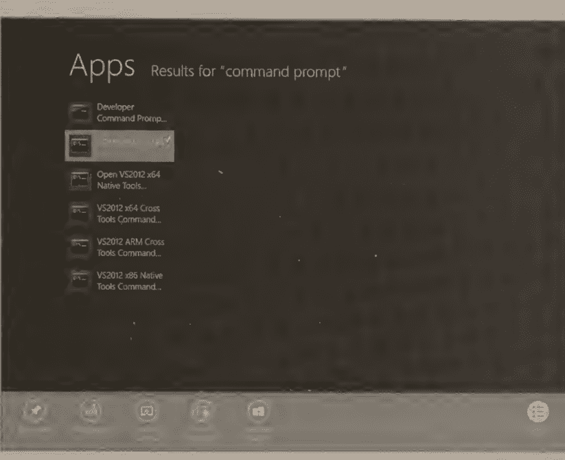

3. 当命令提示符加载后，运行以下命令以创建整个 Windows 8 安装环境的备份：

`wbadmin start backup -allCritical -backupTarget:d:`

将 d: 替换为您希望存储备份的驱动器号。它可以是 PC 中或 USB 连接的任意驱动器的驱动器号，但不能是正在备份的驱动器。

您也可以用 UNC 网络路径替换 d:。例如：
`wbadmin start backup -allCritical -backupTarget:\servername\sharename`。

4. 如果命令输入正确，您将会收到一个确认屏幕，询问您是否要开始备份操作，如**图 4-4**所示。输入 Y，备份即开始。

完成后，请确保备份数据存放在安全的地方。

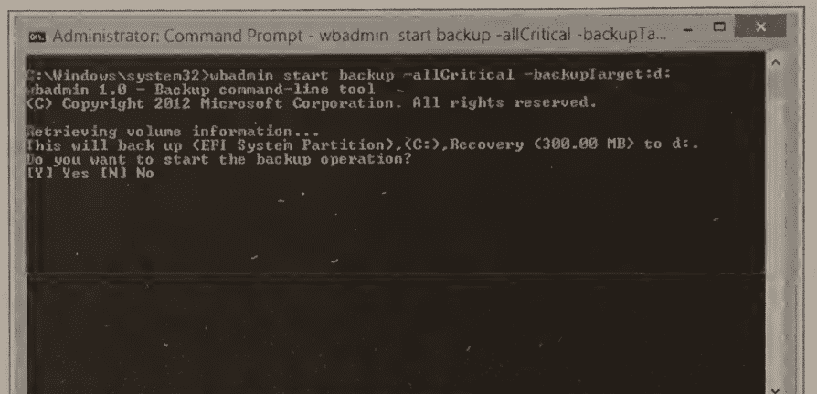

**图 4-4：** 创建系统映像。

## 还原系统映像

如果您需要还原备份的系统映像，则需要启动进入系统恢复控制台（System Recovery Console），我在本章前面已经介绍过。您可以通过在计算机开机且 POST 之后立即按下 F8 键，然后选择“修复我的计算机”来实现。或者，您也可以使用我之前演示过的自制系统恢复控制台启动 CD/DVD/USB。

加载系统恢复控制台后，请遵循以下步骤：

- 1. 连接存储有备份映像的外部硬盘。
- 2. 从恢复介质启动。
- 3. 如果被要求，请选择键盘布局。
- 4. 单击“疑难解答”（Troubleshoot）。
- 5. 单击“高级选项”（Advanced Options）。
- 6. 选择“系统映像还原”（System Image Recovery）。重新映像您的计算机（Re-image Your Computer）工具将加载并搜索您的备份文件。
- 7. 选择“选择一个系统映像”（Select A System Image）选项并单击“下一步”。所有发现的备份位置都会显示出来，因此您也可以连接到网络位置。
- 8. 选择要还原的备份位置并单击“下一步”。或者，如果您想从网络位置备份中还原，请单击“高级”（Advanced），然后单击“在网络中查找系统映像”（Search For A System Image on the network）。连接到您的网络并输入备份文件的完整 UNC 路径。一旦找到文件，您的备份位置就会像连接在外部硬盘上的文件一样显示在列表中。
- 9. 从备份目标中所有可用的映像中选择合适的系统映像，并单击“下一步”。
- 10. 在“还原选项”（Restore Options）屏幕上，不要勾选“格式化并重新分区磁盘”（Format And Repartition Disks）复选框。我从未在该选项设置下成功还原过备份。只需单击“下一步”即可进入下一个屏幕。
- 11. 单击“完成”（Finish），然后在确认屏幕上单击“是”（Yes）。

此时还原开始。根据备份数据的大小，可能需要几个小时。完成后，PC 将重启并准备好使用。

## 使用一键恢复

Windows 8 引入了两项新的恢复功能，使得任何人（即使没有计算机知识）都能轻松地重新开始，将计算机恢复到全新的干净安装状态。这些功能被称为“刷新你的计算机”（Refresh Your PC）和“重置你的计算机”（Reset Your PC）。两者的操作非常相似，但结果却大不相同。

使用“重置你的计算机”类似于对 Windows 8 进行全新安装。您所有的应用程序、设置和文件都将被移除，所有设置都恢复为默认状态。不同之处在于，使用“重置你的计算机”时，您只需单击几个按钮，整个过程将完全自动化。

“刷新你的计算机”类似于“重置你的计算机”，但会保留来自 Windows 商店的 Windows 商店应用程序、设置和个人文件。然而，传统的 Windows 桌面应用程序将被移除。

## 使用刷新你的计算机

“刷新你的计算机”是这两项新恢复功能中破坏性较小的一项，因为它刷新系统文件并仅删除传统的桌面应用程序。

- 1. 打开开始屏幕，输入**刷新你的计算机**（Refresh your PC），并将搜索过滤器更改为“设置”。
- 2. 选择“刷新你的计算机”选项。
- 3. 在“刷新你的计算机”屏幕上，如**图 4-5**所示，单击“下一步”。

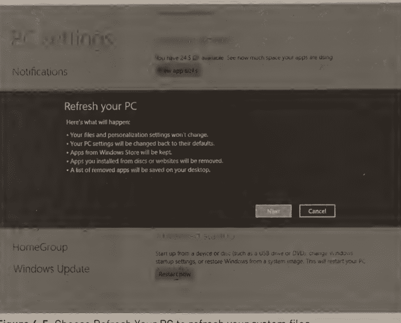

**图 4-5：** 选择“刷新你的计算机”以刷新系统文件。

- 4. 系统可能会要求您提供 Windows 安装 DVD 或制造商提供的恢复介质。插入介质后，如果介质正确，系统会自动检测并进入下一步。
- 5. 在确认屏幕上单击**刷新**（Refresh），刷新即开始。

计算机将重启几次，然后当刷新完成时显示登录屏幕。登录后，所有 Windows 商店应用程序将自动重新安装。桌面上会出现一个名为**Removed Apps.html**的文件，列出所有被移除的传统桌面应用程序。

## 使用重置你的计算机

“重置你的计算机”是这两项新恢复功能中破坏性较大的一项，因为它会清除所有个人文件、应用程序和设置。使用“重置你的计算机”等同于进行干净 DVD 安装，将 PC 上的所有内容恢复为出厂默认状态。

- 1. 打开开始屏幕，输入**删除所有内容**（Remove Everything），并将搜索过滤器更改为“设置”。
- 2. 选择**删除所有内容并重新安装 Windows**（Remove Everything And Reinstall Windows）选项。
- 3. 在**重置你的计算机**（Reset Your PC）屏幕上，如**图 4-6**所示，单击**下一步**。

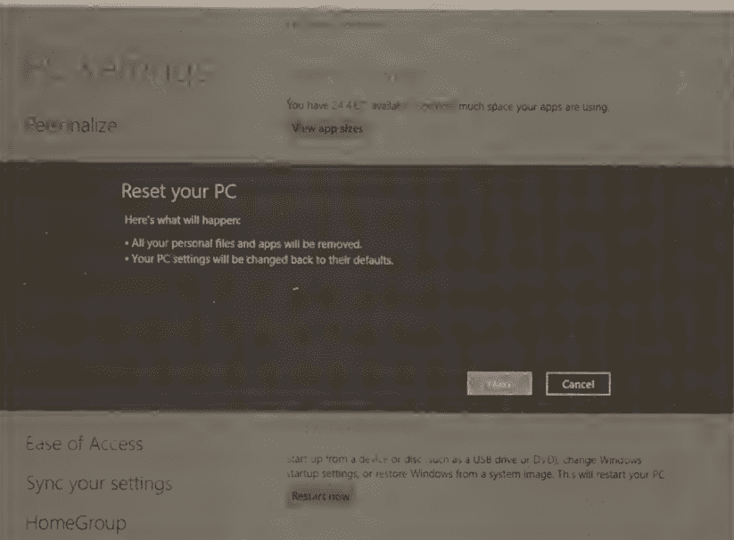

**图 4-6：** 重置计算机可让您从头开始全新安装，仿佛计算机刚出厂一样。

- 4. 系统可能会要求您提供 Windows 安装 DVD 或制造商提供的恢复介质。插入介质后，如果介质正确，系统会自动检测并进入下一步。
- 5. 在**是否要完全清除驱动器**（Do You Want To Fully Clean Your Drive）屏幕上，选择**仅删除我的文件**（Just Remove My Files）。“完全清除驱动器”选项仅适用于您想要安全擦除 PC 上数据的情况。如果您想要出售 PC 并确保所有私密数据被安全删除，这将很有用。安全擦除文件比单纯替换文件耗时得多，因此第一个选项足以解决问题。
- 6. 在确认屏幕上单击**重置**（Reset）。

计算机将重启几次，然后当重置完成时显示 Windows 8 许可条款。您需要像第一次使用 Windows 8 时一样重新设置用户帐户、设置和应用程序。

## 本章小结

本章介绍了如何通过系统保护来安全地调整您的计算机。它展示了如何使用系统恢复控制台恢复计算机，并详细说明了创建和还原完整系统映像的所有方法。本章最后回顾了一键刷新和重置设置，这些设置可以轻松将您的安装恢复到全新状态。

现在，您已准备好开始调整 Windows 8 的界面、性能和安全性。

# 自定义 Windows 8

## 本部分简介

- 第 **5** 章：自定义启动
- 第 **6** 章：自定义用户导航
- 第 **7** 章：个性化桌面
- 第 **8** 章：自定义 Windows 界面的外观
- 第 **9** 章：精细调整文件资源管理器
- 第 **10** 章：个性化 Internet Explorer
- 第 **11** 章：自定义 Windows 媒体


# 第 5 章

# 自定义启动

Windows 8 具有全新的外观，但使用一段时间后，新外观可能会显得陈旧。借助一些酷炫的工具和技巧，您可以自定义 Windows 8 的许多组件。

本章指导您如何自定义锁屏。

您可以通过多种方式自定义此屏幕。例如，您可以更改用户图片以及各种设置，以提高隐私性并改变锁屏的行为。我甚至展示了如何更改默认锁屏和调整颜色方案。

## 自定义锁屏

Windows 8 包含一个非常不同的登录屏幕，按照 Microsoft 的术语现在被称为锁屏。新的锁屏取代了 Windows Vista 中之前改版过的屏幕以及许多域用户熟悉的经典 NT 风格登录屏幕（因为它包含在直到 XP 之前的最后几个 Windows 版本中）。

Windows 8 继续使用首次在 Windows Vista 中出现的安全登录系统，该系统要求所有登录组件必须由 Microsoft 进行数字签名。如果任何登录文件被修改，数字签名将被破坏，您将无法再登录。这防止了恶意软件劫持登录过程，但也使得几乎不可能让人


就像我们那些希望自定义登录屏幕的用户一样；你不能再仅仅通过修改系统文件并替换其中的资源来实现定制了。

在有人编写一个扩展登录屏幕的应用程序或发布一个禁用数字签名要求的补丁之前，对登录屏幕上的每个元素进行自定义的日子已经结束了。

这是自定义登录屏幕的终点吗？绝非如此！你仍然可以对登录屏幕进行许多有用的调整，以赋予其个性化色彩，例如更改用户图片、隐藏用户、自定义登录屏幕颜色等。

## 更改用户图片

你的计算机上设置的每个用户都可以关联一张图片，该图片会显示在锁屏界面上其姓名旁边，如图 5-1 所示。默认情况下，你在安装 Windows 时可以选择为账户选择一张图片。然而，允许你选择图片的界面只提供了有限的图片选择。此外，如果你不喜欢 Windows 提供的图片，你可以选择任何图像文件。

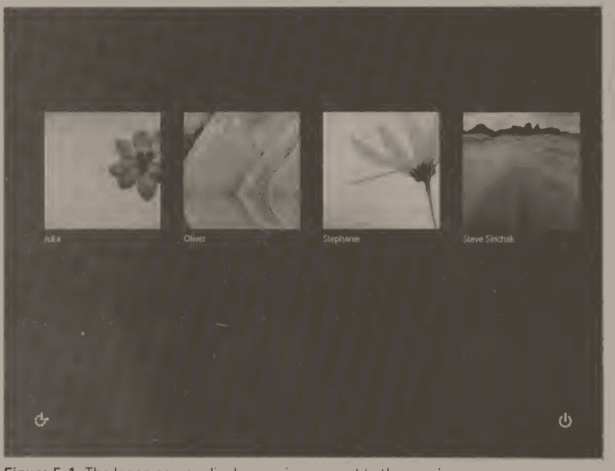

**图 5-1：** 登录屏幕在用户姓名旁边显示一张图片。

更改用户图片的过程很简单。只需执行以下步骤即可快速完成更改：

1.  打开开始屏幕，点击你的用户图片，如图 5-2 所示。

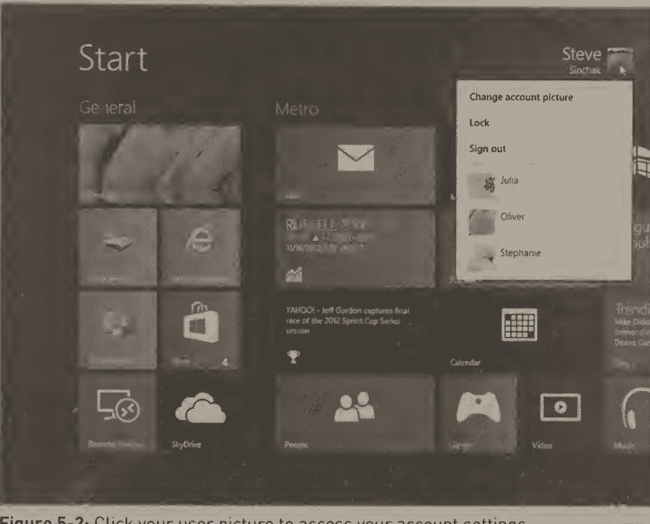

**图 5-2：** 点击你的用户图片以访问你的账户设置。

2.  点击“更改账户图片”。
3.  点击“浏览”按钮。
4.  在浏览器中导航，直到找到你想使用的图片，然后点击它。
5.  选择“选择图片”。

此时，你在登录屏幕上的用户图片已经更改；你还更新了开始屏幕上使用的图片。

## 在锁屏界面上隐藏用户

新锁屏界面的功能之一是显示计算机上所有用户账户的列表。如果你创建了一个用于运行服务的账户怎么办？你并不希望计算机的其他用户拥有登录该账户的选项，因为你指定该账户仅由以服务形式运行的应用程序使用。

也许你有一个秘密的用户账户，你不希望任何人看到。借助一个简单的注册表调整，可以隐藏锁屏界面上的任何账户，这样没有人会知道它的存在。

隐藏在注册表中的功能是微软过去用来从锁屏界面隐藏系统账户的功能。在接下来的几个步骤中，我将向你展示如何重新创建缺失的注册表代码，以便你可以再次使用此功能来隐藏你的账户：

1.  打开开始屏幕，在搜索框中输入 **regedit**，然后按 Enter 键。
2.  当注册表编辑器加载后，导航到 **HKEY_LOCAL_MACHINE, SOFTWARE, Microsoft, Windows NT, CurrentVersion**，然后进入 **Winlogon**。
3.  现在你必须创建一个新的项。右键点击 Winlogon 文件夹，选择“新建”，然后选择“项”。将此新项命名为 **SpecialAccounts**。
4.  右键点击新的 SpecialAccounts 项，选择“新建”，然后选择“项”。将此新项命名为 **UserList**。
5.  现在你准备好添加你想要隐藏的账户名称了。要添加名称，右键点击并选择新的 DWORD（32位）值，如图 5-3 所示。

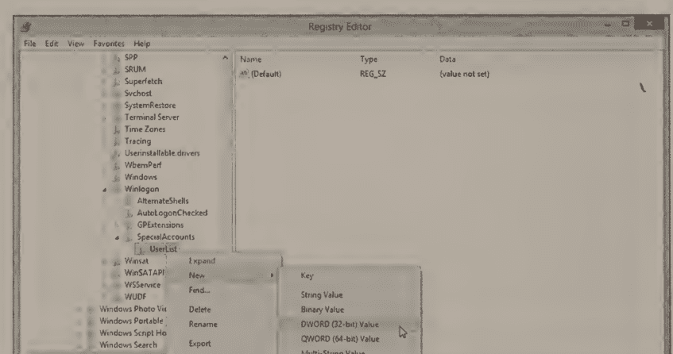

**图 5-3：** 使用注册表编辑器为将在锁屏界面上隐藏的账户名称添加另一个 DWORD 值。

6.  当新的 DWORD 创建后，将用户账户的名称作为 DWORD 的名称输入。完成此操作后，你可以关闭注册表编辑器。

注销后，该用户将不再显示在锁屏界面上。如果你想隐藏所有账户，只保留用户名和密码框，那么下一节适合你。如果你选择这种方法，你可以隐藏所有账户并仍能登录它们。你只需记住用户名和密码，因为不再列出任何账户。

如果你改变主意，希望账户再次显示在锁屏界面上，只需删除你在系统注册表中创建的那个 DWORD，一切就会恢复原状。

## 清除上次登录用户

每次启动你的电脑时，所有已登录过该电脑的计算账户和用户都会显示在锁屏界面上。这可能是一个重大的安全风险，因为它显示了所有账户的用户名，有人可能会尝试使用这些用户名来入侵电脑。此外，锁屏界面可能会因许多用户账户而变得杂乱无章。因此，启用“不显示上次用户名”策略可能是一个好主意。该策略会从锁屏界面移除账户列表，并启用基本的主名和密码框，如图 5-4 所示。

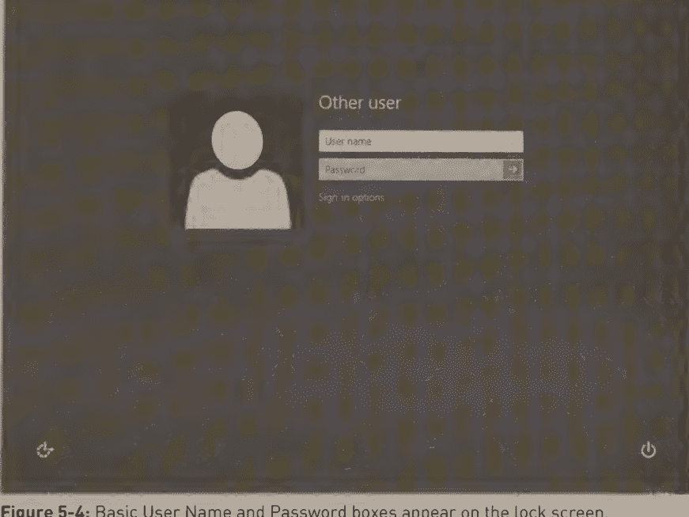

**图 5-4：** 锁屏界面上出现基本的主名和密码框。

使用这个策略很简单。要启用它，请遵循以下步骤：

1.  打开开始屏幕，输入 **secpol.msc**，然后按 Enter 键。
2.  当本地安全策略编辑器加载后，导航到“本地策略”，然后进入“安全选项”。
3.  找到“交互式登录：不显示上次用户名”策略。右键点击它并选择“属性”。
4.  在“本地安全设置”选项卡上，选择**已启用**，然后点击“确定”。
5.  关闭本地安全策略编辑器，你就完成了。

如果你的 Windows 版本中没有 SecPol.msc（只有专业版及更高版本才有），你必须手动设置注册表项：

1.  从开始屏幕，输入 **Regedit**，然后按 Enter 键。
2.  导航到 HKEY_LOCAL_MACHINE, SOFTWARE, Microsoft, Windows, CurrentVersion, Policies，然后进入 System。
3.  右键点击 dontdisplaylastusername 并选择“修改”。
4.  将值设置为 1 并点击“确定”。

一旦你注销，新的锁屏界面设置就会出现。

## 更改锁屏界面屏保

如果你打开电脑并让它在锁屏界面停留足够长的时间，最终屏保会出现。你可以调整此设置，以便你想看的屏保替换掉无聊的 Windows 默认屏保。与更改你登录时账户的屏保不同，只能使用注册表来更改登录屏幕的屏保设置。借助几个快速的注册表技巧，你可以微调显示的屏保以及其他设置，例如确定在启动屏保之前计算机处于非活动状态时间的屏保超时值。

遵循这些简单步骤来自定义你的登录屏保：

1.  启动注册表编辑器。打开开始屏幕，输入 **regedit** 并按 Enter 键。
2.  当注册表编辑器启动后，导航到 HKEY_USERS, .DEFAULT, Control Panel, 然后进入 Desktop。
3.  首先，你需要告诉 Windows 登录屏保是活动的。右键点击 Desktop 项，选择“新建”然后选择“字符串值”。将该值命名为 **ScreenSaveActive**。接下来，通过右键点击它并选择“修改”将值设置为 1。输入 1 并点击“确定”。
4.  设置系统在检测到最后活动后应等待多少时间才启动屏保。为此，右键点击 Desktop 项，选择“新建”然后选择“字符串值”。将新条目命名为 **ScreenSaveTimeOut**。然后，通过右键点击新值并选择“修改”将值设置为你希望在屏保启动前等待的秒数。我喜欢将其设置为 300 秒，即 5 分钟。
5.  现在你需要设置你想显示的屏保。为此，再次右键点击 Desktop 项，选择“新建”然后选择“字符串值”。将此值命名为 `SCRNSAVE.EXE` 并将其值设置为 `.scr` 文件的完整路径，例如 `c:\savers\screen.scr`。
6.  关闭注册表编辑器。你现在完成了。重启后，你会看到新的屏保。

此调整中最困难的部分是找到一个兼容的、能在锁屏界面上正常运行的屏保。Windows 8 附带的所有屏保都需要 Direct3D 图形支持。不幸的是，Direct3D 尚未在锁屏界面上运行。我个人测试过的一个是 Windows 98 中的旧版 3D 迷宫屏保。你可以在 `tweaks.com/208418` 下载一份副本。其他不需要 Direct3D 或 DirectDraw 的旧屏保也应该能正常工作。

## 显示安全消息

你希望在用户登录前向他们显示一条消息吗？你的计算机用户是否需要任何说明，例如“不要关闭这台电脑！”或者你是否需要显示一个安全警告，告知未经授权的�用户在尝试登录你的笔记本电脑时违反了法律？借助组策略的帮助，所有这些都是可能的。只需几次点击，你就可以轻松地向访问者显示消息，如图 5-5 所示。

使用本地安全策略编辑器，你可以开启此功能。遵循以下步骤在你的 PC 上激活它：

1.  打开开始屏幕，输入 `secpol.msc`，然后按 Enter 键。
2.  当本地安全策略编辑器加载后，导航到“本地策略”，然后进入“安全选项”。
3.  找到**交互式登录：尝试登录用户的消息标题**策略。右键点击它并选择“属性”。
4.  在“本地安全设置”选项卡上，输入你想用于消息的标题，然后点击“确定”。
5.  找到**交互式登录：尝试登录用户的消息文本**策略。右键点击它并选择“属性”。
6.  在“本地安全设置”选项卡上，输入你的消息并点击“确定”。
7.  关闭本地安全策略编辑器；你完成了。

一旦你注销或重启，安全消息设置就会生效。


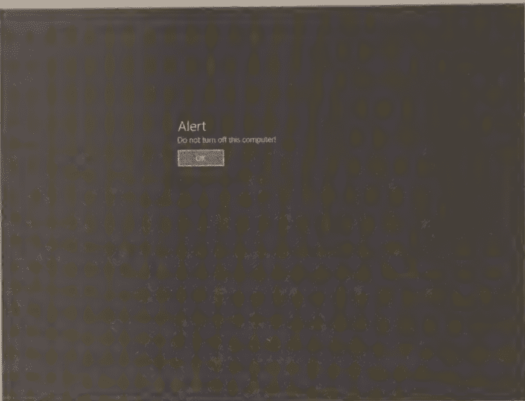

**图 5-5：** 你可以在 Windows 8 锁屏界面上显示安全信息。

## 默认启用 Num Lock

如果你的密码包含数字和字母，并且你经常使用数字小键盘输入密码的一部分，那么这个技巧非常适合你。我无法数清我有多少次开始输入密码后，却看到登录错误提示说密码不正确。我会盯着屏幕看一会儿，然后才意识到我的键盘上的 Num Lock 没有打开。

对于拥有全尺寸键盘和独立数字小键盘的每台台式机来说，这都是一个很棒的技巧。在笔记本电脑上默认开启 Num Lock 并不是一个好主意，因为大多数笔记本电脑没有独立的数字小键盘。在笔记本电脑上启用此功能的结果是，几乎有一半的键盘充当数字小键盘。要开始操作，请遵循以下步骤：

- 1. 打开开始屏幕，输入 regedit，然后按 Enter。
- 2. 当注册表编辑器加载时，依次导航到 HKEY_USERS、.DEFAULT、Control Panel、Keyboard。
- 3. 找到 InitialKeyboardIndicators 项，右键单击它并选择“修改”。要启用 Num Lock，请在框中输入 2。如果你想禁用它，请输入 2147483648，这是系统默认值。
- 4. 点击“确定”保存更改。就这样！

如果你使用的是笔记本电脑并且尝试启用了 Num Lock——即使我告诉过你不要这样做——并且需要修复你的系统，请重复上述步骤，但将 InitialKeyboardIndicators 的值替换为 2147483648 以禁用该功能。

## 更改锁屏图像

Windows 8 实际上有两种不同类型的锁屏图像：一种是面向所有用户的，也称为默认锁屏；另一种是针对每个用户账户的。当计算机上有多个用户账户但没有任何用户登录时，默认登录屏幕会显示。这在具有域加入 PC 的商业环境中最为常见，这些 PC 会隐藏最后登录的用户。它也会在用户注销多用户家用电脑时显示。

### 设置默认锁屏

配置默认锁屏并非 Windows 8 零售版（RTM）的功能。它是根据企业客户的反馈引入的，并在 2012 年 11 月的 Windows 8 累积补丁（KB2770917）中启用。你必须安装该补丁才能继续本节的内容。有关补丁的更多详细信息，请参见 tweaks.com/983858。自定义默认锁屏使用组策略，可以通过域组策略全局控制，或通过本地组策略本地控制。这对任何希望使此更改全局生效而无需接触每台计算机的企业来说都是好消息，但这也意味着它仅适用于 Windows 8 Pro 和 Windows 8 Enterprise 版本。

- 1. 要开始操作，打开开始屏幕，输入 gpedit.msc，然后按 Enter。
- 2. 当本地组策略编辑器加载时，依次导航到 Local Computer Policy、Computer Configuration、Administrative Templates、Control Panel，然后 Personalization。
- 3. 右键单击 Force A Specific Default Local Screen Image 并选择“编辑”。
- 4. 选中“已启用”选项。
- 5. 输入你想要用作锁屏图像的 JPG 图像文件的路径。例如，C:\Images\DefaultLockScreen.jpg，如图 5-6 所示。

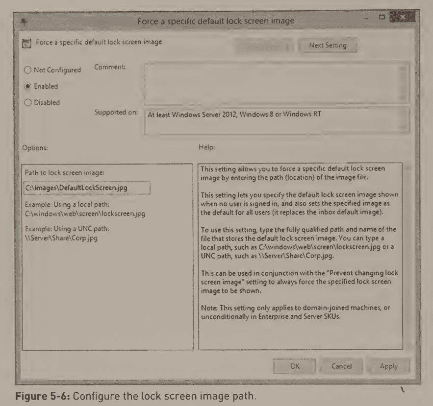

- 6. 点击“确定”。
- 7. 关闭本地组策略编辑器并注销以查看新的默认锁屏。

## 自定义用户锁屏

用户锁屏是大多数 Windows 8 用户日常看到的界面。默认情况下，Windows 8 会自动登录最后一个使用 PC 的人，这就是为什么你最常看到这个锁屏。自定义锁屏非常简单；最难的部分是找到一张好图片：

- 1. 打开开始屏幕并输入 **Lock Screen**。
- 2. 点击“设置”筛选器。
- 3. 点击 **Lock Screen**。
- 4. 点击默认选项中的新图像，或者点击“浏览”并选择自定义图像。

你的新锁屏立即生效。

## 调整默认颜色方案

如果你厌倦了登录和注销屏幕上的默认颜色方案，你可以像更改新界面的其他部分一样更改它。Windows 登录进程通过读取注册表中的值来确定显示哪种颜色方案。微软没有编写图形用户界面来让你轻松更改设置，但你可以在注册表编辑器中完成。

要进行此更改，你需要设置 Accent 设置的值。该值对应于微软预定义的颜色方案。你有 25 种选择，如图 5-7 所示。因为这本书是黑白印刷的，而在黑白环境中选择颜色困难甚至不可能，我已在网上托管了该图形的彩色副本，位于 tweaks.com/552494。

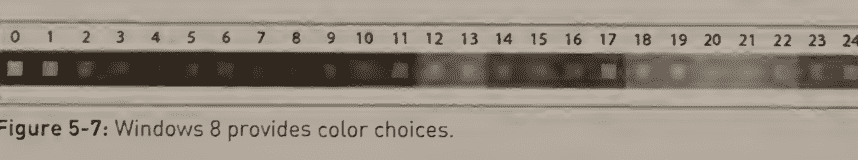

- 1. 打开开始屏幕，输入 **regedit**，然后按 Enter。
- 2. 当注册表编辑器加载时，依次导航到 HKEY_LOCAL_MACHINE、SOFTWARE、Microsoft、Windows、CurrentVersion、Explorer，然后 Accent。如果你的系统上不存在 Accent，请通过右键单击 Explorer，然后选择“新建”和“项”来创建它。
- 3. 通过右键单击 Accent 然后选择“ DWORD (32位)值”来创建一个新的 DWORD。
- 4. 将新的 DWORD 命名为 DefaultColorSet。
- 5. 右键单击新的 DefaultColorSet 项并选择“修改”。
- 6. 通过在选择“编辑 DWORD (32位)值”窗口中选中“十进制”来将基数切换为十进制。
- 7. 输入你想要的颜色方案对应的 0 到 24 之间的值，然后点击“确定”。
- 8. 重启你的 PC 以查看新的颜色方案。

## 自定义锁屏应用

新的锁屏显示一张图片，但具有执行更多功能的能力。事实上，许多流行的 Windows 商店应用可以在锁屏上显示信息。新消息通知或当前天气状况是你拥有的实用选项之一。随着 Windows 商店的持续增长，未来将会有更多选项。

微软允许锁屏上的一个位置在当前时间旁边显示详细信息，并留有七个位置用于通知。请遵循以下步骤修改锁屏上的应用：

- 1. 打开开始屏幕并输入 **Lock screen**。
- 2. 点击“设置”筛选器。
- 3. 点击 **Lock Screen**。
- 4. 滚动到底部查看 Lock Screen Apps 部分。
- 5. 要更改选项，只需选中其中一个框。 **Choose An App** 菜单会弹出，显示该位置所有可用的应用。如果你不想显示任何内容，请选择 **Don't Show Quick Status Here**。

## 使用图片密码

Windows 8 的新功能是可以将照片上的触摸点设置为你的账户密码。这是一种创新的方法，无需使用键盘即可登录你的计算机。你不需要输入密码，只需触摸或点击图片中的人脸、手或背景中的某个物体。你可以选择你想使用的图片，并确定你触摸或点击的位置。

图片密码非常适合触摸屏设备，但它们也可以在带有简单鼠标的传统 PC 上工作。

设置图片密码简单又有趣，让我们开始吧：

- 1. 打开开始屏幕并输入 **picture password**。
- 2. 点击“设置”筛选器。
- 3. 点击 **Create Or Change Picture Password**。
- 4. 在 **Sign-In Options** 下，点击 **Create A Picture Password** 按钮。
- 5. 当被要求时，输入你当前的密码。
- 6. 点击 **Choose Picture** 并选择你 PC 上的一张图片。
- 7. 在确认屏幕上，选择 **Use This Picture**。
- 8. 然后根据屏幕上的说明，触摸或点击图片的三个部分。
- 9. 重复你之前触摸或点击的位置以确认你的图片密码。
- 10. 点击 **Finish**。

你的图片密码现在已经设置好。按 Windows 键+L 锁定你的计算机以进行测试。

## 启用 PIN 登录

如果图片密码不适合你，PIN 登录很可能适合你。我在所有设备上使用这种登录方法，因为它快速且简单。你不需要输入密码，只需键入四位数字的 PIN，即可立即登录。

- 1. 打开开始屏幕并输入 PIN。
- 2. 点击“设置”筛选器。
- 3. 点击 Create Or Change PIN。
- 4. 在 Sign-In Options 下，点击 Create A PIN 按钮。
- 5. 当被要求时，输入你当前的密码。
- 6. 接下来，两次输入你的 PIN 并点击 Finish。

新的 PIN 立即生效。你可以通过点击登录屏幕上的 Sign-In Options，然后选择你想使用的登录方式图标，在密码和 PIN 之间切换，如图 5-8 所示。

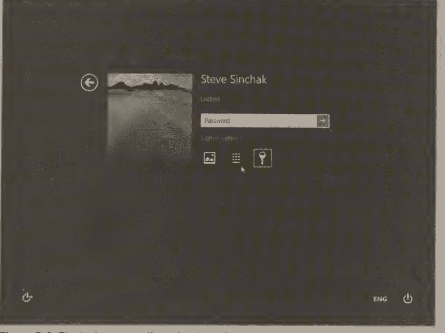


## 启动至桌面

Windows 8 中最具争议性的变更之一是登录后的行为。用户看到的不再是桌面，而是新的开始屏幕。如果用户希望查看桌面，必须选择“桌面”磁贴。微软正不遗余力地推广这种新的无窗口沉浸式环境，但这让一些用户感到不快。

雪上加霜的是，微软在 Windows 8 的正式版中封堵了改变此行为的简单方法，无法在登录后直接到达桌面。目前唯一剩下的方法需要借助第三方软件来绕过微软施加的限制。

我花了大量时间研究如何解决这个问题，最终编写了一个名为 Tweaks.com Boot to Desktop 的免费实用工具。我的工具有两个主要组件。第一部分是一个在后台运行的小型服务，它监视登录事件的发生。检测到该事件后，它会以用户身份启动第二个组件，该组件负责执行显示桌面的实际工作。这个解决方案相当复杂，但为了绕过微软施加的限制，这是必要的。

使用我的工具非常简单。只需从 tweaks.com/414700 下载并安装即可。重启后，您将直接启动到桌面。

如果您改变主意，可以像卸载任何应用程序一样卸载该工具，系统将恢复到开始屏幕的行为。

## 摘要

你可以将这个自定义章节视为对 Windows 8 安装中所有可能方面进行完整自定义的第一步。你首先调整了登录屏幕的行为，然后通过更改锁屏界面对其外观进行了重大改变。

下一章将帮助你自定义 Windows 8 的用户导航组件。首先，你将全面学习如何自定义开始屏幕。然后，你将学习如何自定义 Windows 8 中下一个最常用的组件——任务栏。

## 自定义用户导航

自定义用户导航是 Windows 8 自定义之旅的下一站。在上一章中，借助一些很酷的技巧，你能够更改并改善登录体验。本章承接第 5 章的内容，向你展示如何自定义和改善 Windows 8 的视觉导航元素。

本章从自定义全新的开始屏幕的外观和内容开始，即原来的开始菜单。Windows 8 中改进后的开始屏幕具有许多有用功能，我会展示如何最好地使用它们。然后，我会展示如何自定义开始屏幕上几乎可见的所有内容。如果你不喜欢新的开始屏幕，我会展示如何恢复旧版的经典开始菜单。

你还将学习如何自定义屏幕底部的任务栏。任务栏是导航计算机的重要组成部分。我会展示如何自定义和改善其功能，并给你一些新想法，让你能利用它极大地改善 Windows 8 的使用体验。

## 自定义开始屏幕

开始屏幕在 Windows 8 中得到了彻底的重制，它允许你搜索程序并直接跳转至 Windows 的各个组件。此外，你可以像在传统运行框中一样，只需输入命令即可启动。

读完接下来的几个部分后，你将把开始屏幕改造成更适合你且在日常任务中更为实用的样子。

### 更改背景颜色和色彩

更改背景是最简单的自定义操作之一，但它对个性化你的 Windows 8 电脑有着巨大的影响。你可以使用两种方法来自定义开始屏幕背景：一种使用原生功能，这将限制你只能使用微软设计的美化方案；另一种使用第三方实用工具，可以任意图像作为背景。

*   **原生背景个性化设置**

    微软提供了 20 张不同的背景图像和 25 种不同的配色方案。这意味着共有 625 种背景和配色方案的组合可供选择。有如此多的组合，使用原生个性化选项找到你喜欢的可能性是相当大的。

    在 Windows 8 中选择背景图像和配色方案非常简单：

    1.  打开开始屏幕并输入 **customize**（自定义）。
    2.  点击“设置”筛选器。
    3.  点击“自定义你的开始屏幕”。
    4.  选择你要使用的背景图像，如图 6-1 所示。
    5.  选择你要使用的配色方案。

    一旦你做出更改，设置就会保存。预览窗口提供了一个不错的模拟视图，但我总是喜欢按 Windows 键来查看真实效果。

    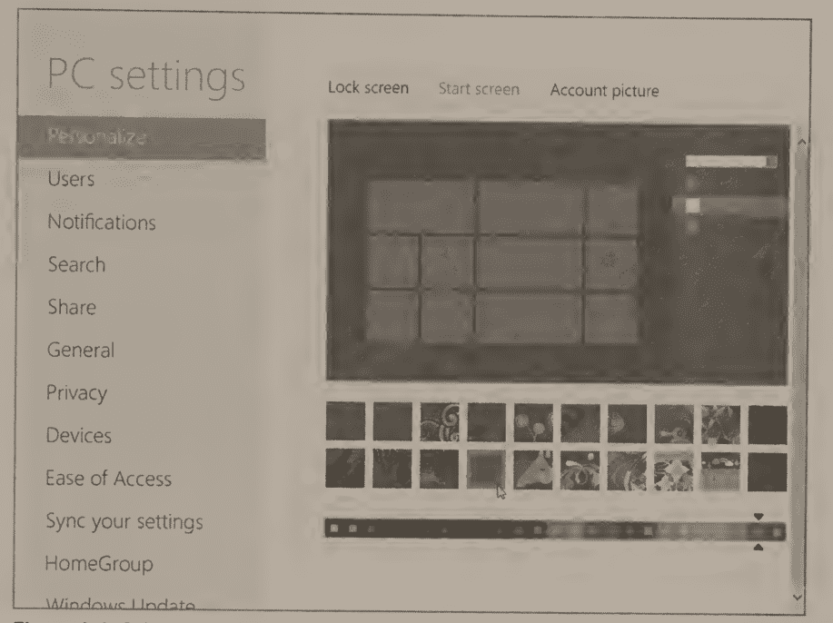

*   **使用工具进行背景自定义**

    如果你不满意微软在 Windows 8 中包含的图像和颜色，你必须使用第三方实用工具以获得更多选项。以下是我在 Windows 8 中使用过的两款工具，用于进一步自定义开始屏幕的图像和颜色。

    **Stardock Decor8**

    Decor8 是迄今最好的开始屏幕自定义应用程序。你可以将任何图像设为背景，自定义磁贴颜色，并调整视觉效果。界面易于使用，甚至包含高级功能，允许你定时自动更改背景图像。这款应用唯一的缺点是，你必须支付 4.99 美元才能使用它。

    前往 tweaks.com/157844 下载免费 30 天试用版。安装 Decor8 后，你将看到如图 6-2 所示的主自定义屏幕。

    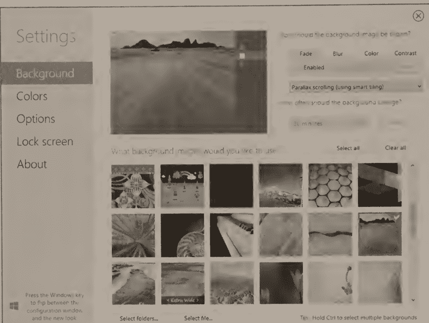

    **图 6-2：** Stardock Decor8 提供此自定义屏幕。

    选择一个背景图像，或点击“选择文件”以使用你自己的图片。点击左侧菜单中的“颜色”选项，以选择标准的 Windows 配色方案或创建你自己的方案。

    **Windows 8 开始屏幕自定义器**

    Windows 8 开始屏幕自定义器是由 vhanla 编写的免费工具，他因创建了许多免费的 Windows 自定义实用工具而闻名。虽然它没有 Decor8 那样多的花哨功能，但它完成了替换开始屏幕背景图像的任务。Windows 8 开始屏幕自定义器的独特之处在于，你还可以调整整个开始屏幕的透明度。

    你可以在 `tweaks.com/161004` 下载免费副本。只需解压文件并将扩展名从 `.ex_` 重命名为 `.exe`，然后运行即可。一旦启动运行，选择一个默认背景或点击“加载图片”以选择你自己的图片。然后只需围绕你想使用的图片部分拖动边框框，点击“应用并保存”按钮（如图 6-3 所示），你的新开始屏幕将生效。

    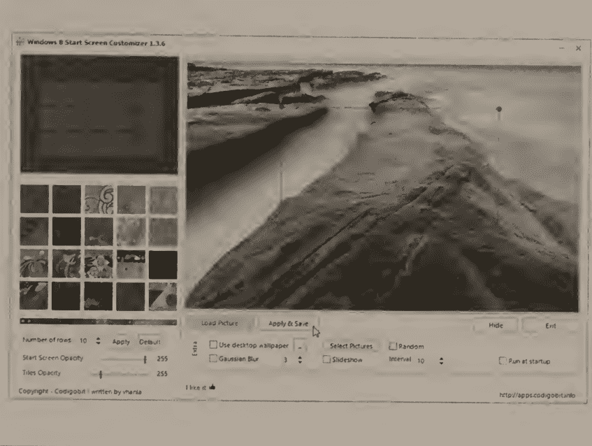

    图 6-3：Windows 8 提供了一个开始屏幕自定义器。

## 使用动态磁贴

磁贴构成了 Windows 8 新开始屏幕上的所有内容。了解如何自定义它们将帮助你个性化你的 Windows 8 体验。随着你安装越来越多的应用，开始屏幕可能会变得杂乱无章。寻找所需内容变得困难，结果是视觉上的混乱。Windows 8 内置了一些非常有用的组织工具，但由于 Windows 8 将许多选项放在隐藏菜单中，这些工具并不总是直观易懂。

### 添加或移除磁贴

任何出现在开始屏幕应用程序搜索中的项目都可以固定到主开始屏幕上。一种查看所有计算机应用的简单方法，类似于旧开始菜单中的“所有程序”菜单，是打开开始屏幕，右键点击，然后在弹出的魅力栏中选择“所有应用”。

此时只需滚动直到找到你要固定的应用程序并右键点击它。然后选择“固定到开始屏幕”，如图 6-4 所示。

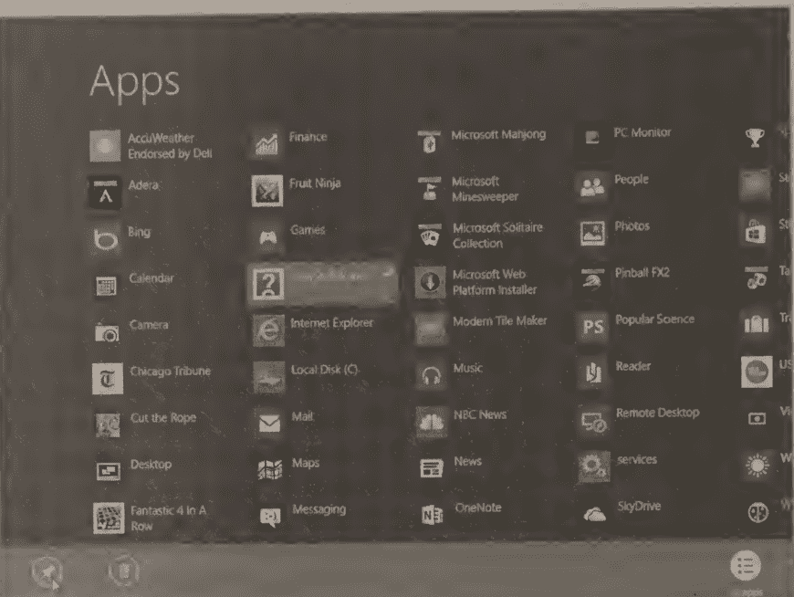

图 6-4：将应用程序固定到开始屏幕。

移除磁贴甚至更容易。只需右键点击开始屏幕上的磁贴并选择“取消固定”。

### 移动磁贴

自定义磁贴的位置是微软在 Windows 8 中使其变得容易的一件事。使用鼠标时，只需点击并按住一个磁贴，你就可以将其拖到开始屏幕上的任何位置。使用键盘时，用 Tab 键选择一个磁贴，然后按住 Shift+Alt 并使用方向键移动磁贴。

### 磁贴分组

当你在电脑上安装了很多应用后，开始屏幕将变得杂乱无章。将磁贴分类到组中对于保持开始屏幕有序且可控绝对必要。你可以将磁贴排列在任意数量的组中，并可以为组添加标签。创建组的过程相当直接。

通过将一个默认组中的磁贴拖到当前组的左侧或右侧来创建一个组。当你将磁贴拖出组时，会显示一个新的组指示器，如图 6-5 所示。将磁贴放在垂直指示器上，它将被放置在一个新组中。接下来，只需根据需要向该组添加额外的磁贴。


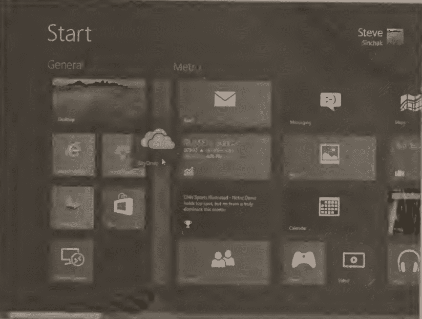

**图 6-5：** 使用新的组指示器将磁贴添加到组中。

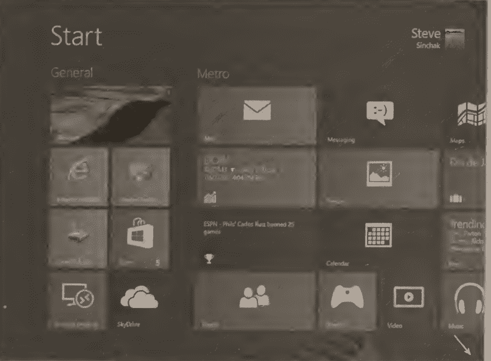

**图 6-6：** 进入缩小显示的组视图。

你可以为组命名，这使得查找你想要的应用磁贴变得更加容易，并且使整个开始屏幕看起来更加整洁有序。为组命名需要开始屏幕处于缩小显示的组视图状态。你可以通过点击屏幕右下角的减号按钮进入该视图，如图 6-6 所示。

一旦进入组视图，只需右键单击任意组，选择“命名组”，输入名称，然后按 Enter 键即可。

### 调整磁贴大小

Windows 商店应用有两种磁贴大小，而经典 Windows 应用只有一种大小。Metro 风格的应用可以是单宽或双宽。调整磁贴大小就像右键单击它一样简单。如果你有一个双宽磁贴并想将其变为单宽？只需右键单击它，然后在弹出的魅力栏中选择“更小”。点击魅力栏上的“更大”可以使其变大。

### 创建自定义磁贴

在 Windows 8 中，你可以通过添加自定义磁贴进一步扩展开始屏幕。使用合适的工具，你可以将几乎任何内容固定到开始屏幕：文件夹、网站、脚本，甚至命令。在接下来的两个部分中，我将展示如何创建自定义磁贴，以提升你的 Windows 8 体验。

#### 原生支持

只有应用程序可以原生固定到开始屏幕，通常是通过固定应用程序快捷方式进行自定义。为了说明如何操作，我将展示如何在开始屏幕上创建一个将关闭你计算机的磁贴。切换到桌面界面，然后按照这些步骤操作：

1. 右键单击桌面，选择“新建”，然后选择“快捷方式”。
2. 在位置框中输入你要运行的命令。对于这个关机磁贴示例，输入 `shutdown.exe /s /t 0`，然后点击“下一步”。
3. 为你的快捷方式输入一个名称，例如“关机”，然后点击“完成”。
4. 现在到了自定义快捷方式外观的时候了。右键单击你的新快捷方式，选择“属性”。
5. 在“快捷方式”选项卡上，点击“更改图标”。
6. 选择一个新的图标，然后点击“确定”。
7. 在 shutdown.exe 属性窗口中点击“确定”。
8. 再次右键单击你的快捷方式，这次选择“固定到开始屏幕”。

你的新自定义磁贴将出现在开始屏幕的最右侧。将其拖动到你想要的位置，操作就完成了。

#### 第三方应用

我推荐两个创建磁贴的第三方应用，它们让你能够创建更定制的磁贴。与仅仅选择一个图标显示在磁贴上不同，这里列出的应用允许你选择磁贴的图像和颜色：

- OlbyTile—tweaks.com/936219
- Modern Tile Maker—tweaks.com/475926

这两个磁贴创建工具都是免费的小工具，而且使用非常简单。只需从链接下载这些工具，填写简单的表单，你的磁贴就创建好了。有报告称这两个应用可能会相互冲突，因此请只选择一个并使用它。

## 管理工具

过去十年中每个版本的 Windows 都包含的经典管理工具也是 Windows 8 的一部分，但它们默认是隐藏的。你可以在开始屏幕上显示这些实用工具，但在我向你展示如何做之前，以下是这个调整将在开始屏幕上启用的完整列表：

- 组件服务
- 计算机管理
- 磁盘碎片整理和优化驱动器
- 磁盘清理
- 事件查看器
- iSCSI 发起程序
- 本地安全策略
- ODBC 数据源 (32位)
- ODBC 数据源 (64位)
- 性能监视器
- 打印管理
- 资源监视器
- 系统配置
- 系统信息
- 任务计划
- Windows 防火墙
- Windows 内存诊断
- Windows PowerShell (x86)
- Windows PowerShell ISE
- Windows PowerShell ISE (x86)

在添加磁贴后，你可以选择使用前面介绍的说明手动隐藏任何特定的磁贴。

要在开始屏幕上显示管理工具，请按照以下步骤开始：

1. 打开开始屏幕。
2. 按 Windows 键+C 调出魅力栏。
3. 在右侧魅力栏中点击“设置”。
4. 点击“磁贴”。
5. 点击“显示管理工具”开关，如图 6-7 所示。

之前列出的所有管理工具将很快出现。

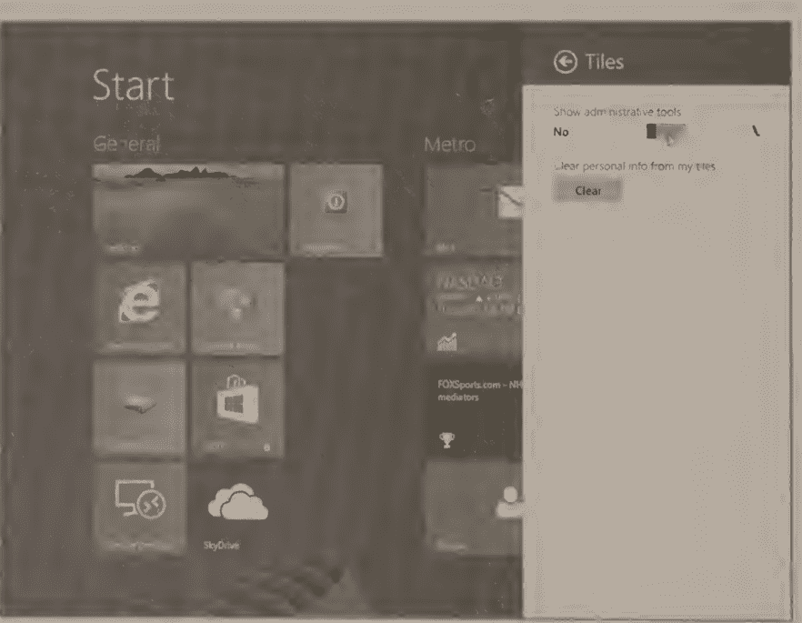

**图 6-7：** 在开始屏幕上启用管理工具。

### 恢复经典开始菜单

经典开始菜单在 Windows 8 中被完全移除。微软希望确保开始屏幕是用户唯一的原生选项，并且已经实现了这一目标。关于新开始屏幕的定论尚未出炉，但有一点非常明显：许多人喜爱传统的开始菜单，并希望能恢复其功能。

两个实用工具重现了传统 Windows 用户熟悉的开始菜单的行为和外观。

#### Classic Shell

Classic Shell 是一个免费的开始菜单替代品，它恢复了开始按钮和一个类似于传统开始菜单的弹出菜单界面，如图 6-8 所示。

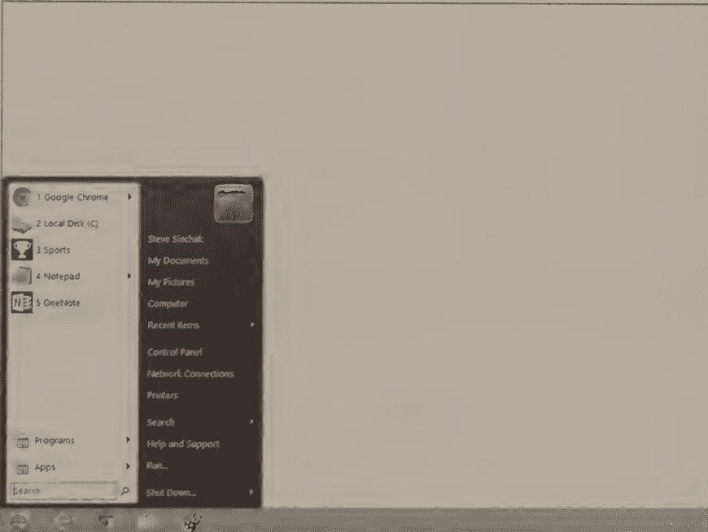

**图 6-8：** Classic Shell 提供开始屏幕替代方案。

Classic Shell 几乎复制了传统开始菜单的所有功能。最棒的是，Classic Shell 可以进行大量自定义。有皮肤可供更改外观，还有数十个设置允许你更改显示哪些项目，甚至更改开始按钮的图形。

Classic Shell 设置起来很简单。只需访问 *tweaks.com/963778* 并下载最新版本。

#### Stardock Start8

Stardock 的 Start8 是一个精制完善的开始菜单替代品，拥有你从传统开始菜单中期待的所有功能，并带有精美的现代外观，如图 6-9 所示。它可以像 Classic Shell 一样进行自定义，允许用户选择显示哪些选项，甚至可以调整开始按钮的图像。

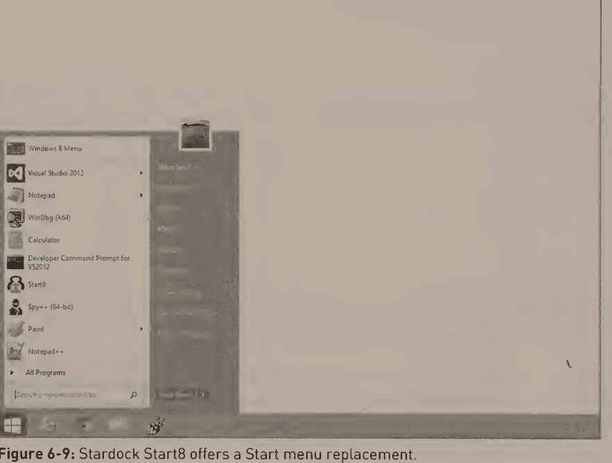

**图 6-9：** Stardock Start8 提供开始菜单替代方案。

Start8 还有一些独特的功能。例如，你可以通过组策略控制它，或者禁用弹出魅力栏的 Metro“热点”。如果你害怕新的 Metro 世界并且只想在桌面界面中工作，该功能会非常有帮助。总体而言，Start8 是开始菜单替代品的黄金标准。

Start8 的价格是 4.99 美元，但提供免费试用。请访问 tweaks.com/559130 下载最新版本。

## 自定义任务栏

Windows 8 包含一个精制完善的任务栏，旨在为你在使用计算机时提供更多的控制和灵活性。任务栏可以描述为一个巨大的快速启动栏，允许你移动应用程序并固定应用程序，即使它们已关闭，它们也会保留在任务栏上。你首先注意到的将是程序列表上默认没有标签。这创造了一种非常整洁的外观，并允许 Windows 在一小块空间中容纳许多打开的应用程序。

除了视觉上的变化，任务栏还包括跳转列表、Peek（预览）和改进的通知区等功能。本节展示如何自定义这些新特性，并个性化你的任务栏。

### 固定应用程序

在 Windows 以前的版本中，任务栏上的快速启动栏是我最喜欢自定义的组件。我花了好几个小时来组织和排序许多应用程序的快捷方式，以创建完美的设置。在 Windows 8 中，微软通过从任务栏中移除快速启动工具栏，颠覆了我的世界。幸运的是，微软意识到了快速启动的价值，并将同样的功能内置到了任务栏中。

任务栏不再仅仅是查看打开应用程序的地方；你还可以通过将应用程序快捷方式固定到任务栏来从中启动应用程序。固定会在任务栏上创建一个永久保留的快捷方式，就像以前的快速启动快捷方式一样。与以前版本的 Windows 不同的是快捷方式的显示方式。打开但未激活的应用程序周围有一个边框。激活并打开的应用程序周围有一个边框和玻璃高光效果。关闭但固定的应用程序仅显示为图标。图 6-10 显示了所有这三种类型的应用程序。


你可以用两种方式固定应用程序：

- 将任何快捷方式从桌面或开始菜单拖动到任务栏。
- 右键单击任何打开的任务栏应用程序，并点击**将此程序固定到任务栏**。

你尝试固定的文件夹和驱动器将显示在资源管理器跳转列表中，而不是作为任务栏上的独立图标。这是微软为了整理任务栏并保持其整洁而做出的设计决定。

移除固定的应用程序就像右键单击任务栏上固定的应用程序并选择**从此任务栏取消固定此程序**一样简单。


## 修改图标位置

Windows 8 的任务栏是专为*您*设计的。您第一次可以确定每个程序的位置——甚至包括您自己打开或当前正在运行的程序的位置。

移动您的程序很简单：只需左键单击并按住任何图标，然后将其拖动到您想要的位置。默认未固定的应用程序总是显示在列表的末尾，但一旦加载，您就可以再次移动它们。

## 调整跳转列表

跳转列表（Jump Lists）是新任务栏的重要组成部分。当您右键单击某个应用程序时，系统会向您提供与该应用程序相关的多个新选项。根据应用程序的不同，您会看到最近项目、常用任务以及更多内容。大多数应用程序会显示最近打开的项目，例如，当您右键单击 Microsoft Word 时，会显示最近使用的 Word 文档。其他应用程序，如 Windows Messenger 和 Windows Media Player，具有增强的跳转列表，使您能够执行常用任务，如图 6-11 所示。如果您想暂时注销 Windows Messenger，只需右键单击任务栏快捷方式，即可快速更改设置。

总体而言，跳转列表是新任务栏的绝佳补充，因为它们使您能够比之前更快地跳转到任务。为了让跳转列表更好地为您工作，有一个调整设置可以帮助您自定义此功能。


**图 6-11：** Windows 8 提供跳转列表。

## 调整最近列表

所有参与 Windows MRU（最近使用）列表的应用程序都会自动在其跳转列表中拥有最近项目组件。Microsoft Word 显示最近使用的文档；Internet Explorer 显示最近访问的网站；Microsoft Paint 在其跳转列表中显示最近打开的图片。默认情况下，Windows 显示最近使用的 10 个项目。如果您认为这太多或太少，我将向您展示如何调整该设置。

Windows 设置跳转列表中最多可显示 60 个最近项目，尽管即使设置为最大值，我也很少看到这么多。我建议将数值设置在 5 到 20 之间，以保持最近列表的实用性。更改数值的设置很难找到，因为它不在您预期的位置。请按照以下步骤自定义在您的最近列表中显示的项目数量：

1. 右键单击任务栏并选择“属性”。
2. 单击“跳转列表”选项卡。
3. 按照图 6-12 所示，设置“在跳转列表中显示最近项目的数量”。
4. 单击“确定”，完成设置。

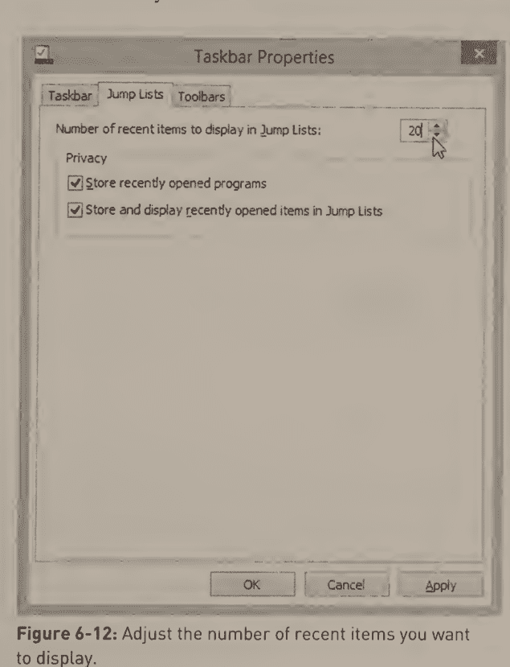

## 启用经典任务栏外观和行为

Windows 8 的任务栏外观整洁，仅将已打开和已固定的应用程序图标按程序分组显示在一起。微软意识到并非所有用户都喜欢新的外观和分组，因此内置了重新启用标签的功能。结果就是我所说的经典任务栏外观和行为，如图 6-13 所示。


与早期版本的 Windows 类似，程序标签外观和缺乏应用程序分组对于不喜欢新任务栏并希望熟悉外观的用户很有帮助。Windows 8 提供三种设置，使您能够配置任务栏的外观和行为：

- **始终组合，隐藏标签**—默认任务栏行为
- **任务栏满时组合**—启用标签
- **从不组合**—启用标签

我不建议使用*从不组合*设置，因为当您打开了大量窗口和应用程序时，这使得查找程序变得非常困难。相反，我会使用*任务栏满时组合*来实现经典的外观和行为。

要进行更改，请按照以下步骤操作：

1. 右键单击任务栏并单击“属性”。
2. 在“任务栏”选项卡上，找到“任务栏按钮”下拉列表，并进行选择。
3. 单击“确定”或“应用”以查看新设置的效果。

如果您想要真正经典的较小图标外观，并结合经典的外观和行为，那么下一节适合您。

## 自定义任务栏图标大小

我总是喜欢自定义笔记本电脑上的任务栏图标大小，因为它的屏幕较小。大型任务栏图标在我运行高分辨率的桌面 LCD 显示器上看起来很棒，但在我笔记本电脑的小屏幕上占用了太多空间。自定义此设置还使您能够在任务栏上容纳更多的固定和打开的应用程序。如图 6-14 所示，任务栏上的小图标和大图标之间有巨大差异。


您可以在任务栏属性中启用小图标：

1. 右键单击任务栏并选择“属性”。
2. 在“任务栏”选项卡上，勾选“使用小任务栏按钮”。
3. 单击“确定”或“应用”以查看结果。

## 调整任务栏预览延迟

Windows 8 中的任务栏预览得到了改进，使您可以通过将鼠标悬停在任务栏图标上来快速查看窗口。我最大的抱怨是显示任务栏预览之前的延迟。我想使用新功能，但我需要悬停在任务栏应用程序上的时间太长了。您可以通过一个简单的注册表技巧来调整此设置：

1. 打开“开始”屏幕，输入 **regedit**，然后按 Enter 键。
2. 当注册表编辑器启动时，依次导航至 HKEY_CURRENT_USER、Software、Microsoft、Windows、CurrentVersion、Explorer 和 Advanced。
3. 右键单击 Advanced，单击“新建”，然后单击“DWORD（32位）值”。将新值命名为 **ExtendedUIHoverTime**。
4. 右键单击您刚刚创建的新 ExtendedUIHoverTime 值，并选择“修改”。
5. 将基数更改为十进制，输入以毫秒为单位的新值，然后单击“确定”。默认值为十进制下的 400，即 400 毫秒。我喜欢将其设置为 100。
6. 重启并测试您的新设置。

## 恢复经典快速启动栏

经典快速启动栏是早期 Windows 版本中启动程序的好方法。在 Windows 8 的新任务栏中，快速启动栏已被移除，并用应用程序固定功能取代。将应用程序固定到任务栏的功能很不错，但它并没有完全复制快速启动栏的旧行为。

尽管快速启动栏在 Windows 8 中被移除，但微软保留了在任务栏上添加更多工具栏的能力，正如早期 Windows 版本中那样。您可以利用工具栏功能，创建一个指向旧快速启动位置的新工具栏。请按照以下步骤恢复快速启动栏：

1. 右键单击任务栏，单击“工具栏”，然后单击“新建工具栏”。
2. 在新工具栏中，选择一个文件夹屏幕，输入 %AppData%\Microsoft\Internet Explorer\Quick Launch，并单击“选择文件夹”，如图 6-15 所示。

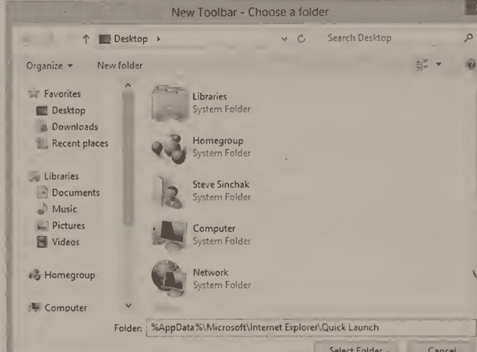

图 6-15：您可以恢复经典快速启动工具栏。

3. 快速启动工具栏显示在任务栏的最右侧，但您还没有完成。接下来，请确保任务栏未锁定，以便您可以自定义刚才创建的工具栏。您可以通过右键单击工具栏并确保未勾选“锁定任务栏”来执行此操作。
4. 在确认任务栏已解锁或已解除任务栏锁定后，您可以移除快速启动工具栏标签。右键单击快速启动标签，并选择“显示标题”以禁用该功能。
5. 再次右键单击新工具栏，并选择“显示文本”以同样禁用该功能。
6. 现在，工具栏应该开始看起来很熟悉了。最后一步是将快速启动栏定位和调整为您希望在任务栏上的位置。您可以通过左键单击并按住工具栏左侧的拖柄来调整其大小。然后，只需向左或向右拖动以调整大小。如果您想将其移回其正常位置，即任务栏的最左侧，右键单击正常任务栏左侧的拖柄并向右拖动。这将使新的任务栏图标和您刚创建的工具栏互换位置。

如果您想完全复制经典 Windows 任务栏的外观，我建议您在阅读本章前面提到的“自定义任务栏图标大小”调整设置和“启用经典任务栏外观和行为”调整设置的同时也进行这些操作。这三种调整设置的结合对于怀念旧版 Windows 任务栏行为和外观的用户非常有用。

## 修改任务栏位置

Windows 任务栏始终显示在屏幕底部，但您知道您可以将其移动到您想要的任何一侧吗？在 Windows 8 中，移动任务栏并创建截然不同的外观是可能的。图 6-16 显示了如果您将任务栏移动到屏幕左侧，屏幕可能看起来的样子。

移动任务栏很简单。只需遵循三个基本步骤：

1. 右键单击任务栏并选择“属性”。
2. 在“任务栏”选项卡上，找到“屏幕上的任务栏位置”下拉框，并选择您要使用的位置。
3. 单击“确定”或“应用”，查看您的新位置。


图 6-16：您可以移动任务栏。这里它显示在屏幕左侧。


## 自定义通知区域

多年来，通知区域（以前称为系统托盘）变得越来越杂乱。似乎你安装的几乎每一个应用程序在运行时都想要在通知区域中创建一个图标。在 Windows 8 中，微软决定适可而止，通过创建一个新的溢出容器来清理通知区域。现在，当任何应用程序创建通知区域图标时，默认情况下它不会显示出来。相反，你必须点击通知区域末端的箭头才能查看溢出容器。然后，如果你认为该通知区域图标确实有用，你可以将它从溢出容器拖到主通知区域。这样你就完全控制了你的通知区域，可以根据你的喜好保持其整洁或杂乱。

在接下来的几个部分中，我将向你展示如何通过自定义外观和行为来微调你的通知区域。

## 隐藏图标

如前所述，出现在你通知区域中的唯一额外图标是你亲自拖入其中的图标。如果你想隐藏其中任何图标（包括默认的系统图标），只需将它们拖出即可，它们就会落入溢出容器中。这在大多数时候效果很好，但还有另一种方法可以获得更多控制权：

- 1. 点击通知区域左侧的箭头，然后选择“自定义”。
- 2. 这将加载“通知区域图标”控制面板屏幕，你可以在此处微调曾经尝试在通知区域中加载的每个图标。滚动列表并选择你想要为每个图标使用的行为。你可以从“显示图标和通知”、“隐藏图标和通知”以及“仅显示通知”中进行选择。
- 3. 调整完所有图标后，点击“确定”。

## 移除系统图标和时钟

调整音量、网络和时钟等系统图标需要额外的一步。请按照以下步骤隐藏任何默认的系统图标：

- 1. 点击通知区域左侧的箭头，选择“自定义”。
- 2. 当“通知区域图标”控制面板屏幕加载时，点击“打开或关闭系统图标”。
- 3. 对于每个系统图标，切换下拉列表以打开或关闭每个项目。
- 4. 完成后点击“确定”。

## 恢复开始按钮

开始按钮的移除是多年来 Windows 最大胆的改变之一。在训练用户在长达十五年的时间里点击该处启动任何应用程序之后，微软决定放弃这一长期行为，并引入“热角”来显示开始屏幕。我们可以推测他们的意图，但事实是，许多人喜欢拥有一个可以点击来显示开始菜单的按钮。

在某些情况下，新的“热角”使得使用 Windows 更加困难。我是虚拟机的重度用户，它在我的桌面上以窗口形式显示正在运行的操作系统。当我运行一个 Windows 8 虚拟机时，将鼠标移动到左下角以调出开始屏幕非常困难。通常我会将鼠标移动得超出了虚拟机窗口的外面。

出于自己对缺乏开始按钮的不耐烦，我着手创建一个开始按钮替代品。该努力的结果是 Tweaks.com Start 实用工具。它是一个简单的应用程序，你可以将其固定到任务栏，但它拥有许多有用的功能。点击它会显示开始屏幕，但这只是开始。你可以选择你想看到的开始屏幕视图。除了默认的开始屏幕视图外，还可用如图 6-17 所示的应用程序视图和如图 6-18 所示的缩小群组视图。我个人最喜欢的是开始屏幕群组视图，因为随着开始屏幕上应用程序数量的增加，你只需点击群组即可轻松跳转，而不是永远向右滚动。

我还为我的开始按钮替代品创建了一个有用的右键快捷菜单，将 Windows 8 中那些藏在深处最常用任务放在了一键可及之处。你会发现，诸如关机和管理员工具等基本命令易于访问。

最好的部分是自定义开始按钮图标非常简单。只需打开位于快捷菜单顶部的配置窗口，并将图标更改为 DLL 或 ICO 文件中的任何图标。

Tweaks.com Start 是一个免费工具，你可以从 tweeks.com/655582 下载。只需安装并按照屏幕上的说明进行配置即可。

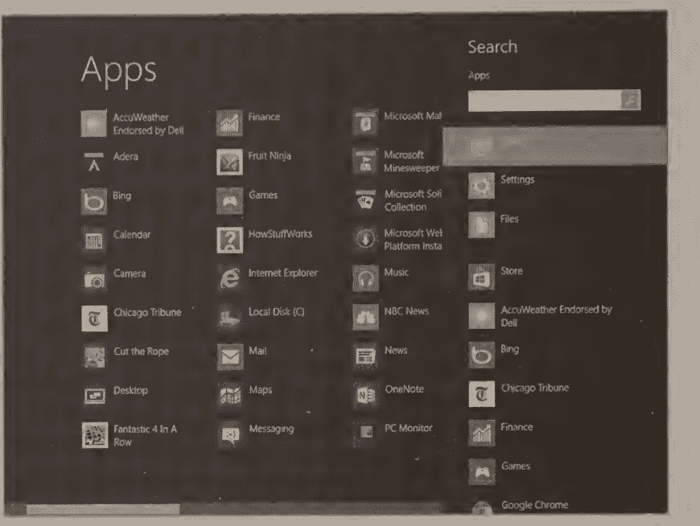

图 6-17：创建此开始屏幕应用程序列表视图。

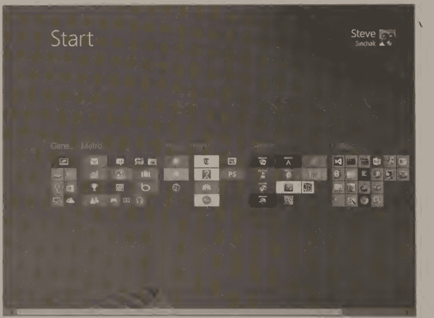

图 6-18：使用此开始屏幕群组视图。

## 使用组策略编辑器自定义开始屏幕和任务栏

组策略编辑器是 Windows 的一个出色组件，它允许你进行数十种普通用户无法看到的高级设置更改。组策略编辑器通过让你定义各种规则（称为 *策略*）来工作，这些规则告诉 Windows 如何行为。

策略的集合被称为组策略，它有两种类型：本地和基于域。本地是指策略驻留在本地计算机上并在本地计算机上受控。基于域的策略是驻留在 Active Directory 域控制器上的策略，多个计算机连接到该控制器。域策略主要用于需要从中央位置控制多台计算机的企业。在这本书中，一些调整使用本地组策略来配置开始菜单，因为你们大多数人是在自定义家庭计算机，且未将它们连接到 Windows 域。实际策略及其设置方式对于两种类型的组策略都是相同的，因此如果你愿意，可以将这些相同的技术应用于域策略。

策略的设置和修改使用——你猜对了——组策略编辑器。这是你将用于设置策略以帮助自定义开始菜单的工具。首先，你学习如何使用策略编辑器，然后是自定义开始菜单相关的所有策略。

### 使用组策略编辑器设置策略

使用组策略编辑器很像使用注册表编辑器。它基于一个分层结构，所有策略都组织在其中的各个部分内。所有策略分为两个部分：计算机策略和用户策略。计算机策略是应用于 Windows 组件（如硬件和全局功能设置）的设置。用户策略是在计算机上不同用户之间可能变化的设置。大多数用于自定义界面外观的策略都位于此处。

既然你已经知道了组策略编辑器的基础知识，那就深入下去开始使用策略编辑器：

- 1. 打开开始屏幕，在搜索框中输入 `gpedit.msc`，然后按 Enter。
- 2. 组策略编辑器加载后，你会看到之前提到的分层结构以及计算机策略和用户策略部分。
- 3. 通过“用户配置”、“管理模板”导航，然后选择“开始菜单和任务栏”。
- 4. 你会看到所有可配置策略的列表。右键单击你想要配置的策略并选择“编辑”。
- 5. 在策略屏幕上，选择启用该策略或设置策略值的选项，然后点击“确定”，如图 6-19 所示。
- 6. 退出策略编辑器，注销并重新登录。某些策略更改可能需要重新启动。

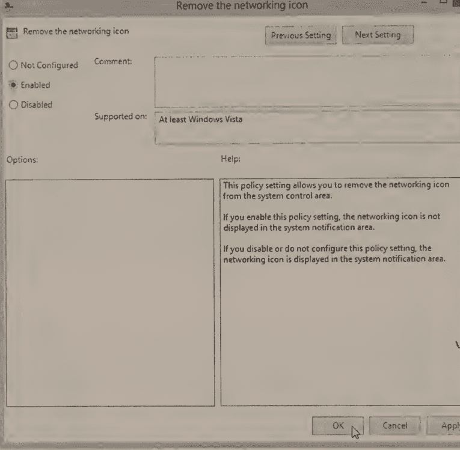

**图 6-19：** 在组策略编辑器中配置策略。

既然你已经知道如何使用组策略编辑器，下一节将向你展示所有策略并简要描述它们的作用。

## 更改开始屏幕和任务栏策略

在“开始菜单和任务栏”部分下列出的许多策略与 Windows 8 无关。将这些视为微软忘记删除的垃圾，因为它们对 Windows 8 没有影响。或者，也许微软想要让创建旧版 Windows 的策略变得更容易。表 6-1 显示了对 Windows 8 有用的一些组策略列表，将帮助你自定义开始屏幕和任务栏。


## 表 6-1：用于配置开始屏幕和任务栏的组策略设置

| 策略 | 描述 |
|---|---|
| 锁定任务栏 | 控制任务栏的锁定状态。锁定的任务栏不允许进行任何更改。 |
| 在“运行”对话框中添加“在单独的内存空间中运行”复选框 | 为通过“运行”框执行程序添加一个额外的设置。我建议您启用此设置。 |
| 防止更改任务栏和开始菜单设置 | 锁定任务栏和开始菜单设置。 |
| 从系统通知区域中移除时钟 | 隐藏时钟。 |
| 防止任务栏项目分组 | 禁用任务栏上的应用程序分组。 |
| 不在任务栏中显示任何自定义工具栏 | 禁用第三方任务栏或用户创建的工具栏。 |
| 移除对任务栏右键菜单的访问权限 | 禁用右键单击任务栏中工具栏的功能。 |
| 隐藏通知区域 | 禁用整个通知区域（系统托盘）。 |
| 移除操作中心图标 | 隐藏通知区域中的操作中心图标。 |
| 移除网络图标 | 隐藏通知区域中的网络图标。 |
| 移除电池计量 | 隐藏通知区域中的电源图标。 |
| 移除音量控制图标 | 隐藏通知区域中的音量图标。 |
| 关闭功能广告气泡通知 | 禁用关于功能的功能弹出式帮助。 |
| 不允许将项目固定在跳转列表中 | 禁用将项目添加到跳转列表的功能。 |
| 不允许将程序固定到任务栏 | 禁用将应用程序添加到任务栏的功能。 |
| 不显示或跟踪来自远程位置的跳转列表项 | 防止网络共享中的最近文档出现在跳转列表中。 |
| 关闭将通知图标自动提升到任务栏的功能 | 禁用在新通知区域图标移动到溢出容器之前，暂时将其添加到通知区域的功能。 |
| 锁定所有任务栏设置 | 锁定任务栏。 |
| 防止用户添加或删除工具栏 | 禁用添加工具栏的能力。 |
| 防止用户重新排列工具栏 | 锁定工具栏的位置（类似于锁定任务栏）。 |
| 关闭所有气泡通知 | 禁用弹出式帮助。 |
| 从任务栏移除固定的程序 | 禁用并移除任务栏上固定的应用程序。 |
| 防止用户将任务栏移动到其他屏幕停靠位置 | 锁定任务栏的位置。 |
| 防止用户调整任务栏大小 | 锁定任务栏的大小。 |
| 关闭任务栏缩略图 | 禁用当光标悬停在任务栏项目上时显示的应用程序缩略图（运行 Aero 玻璃效果时）。 |
| 退出时清除磁贴通知历史记录 | 清除磁贴通知的历史记录。 |
| 防止用户从开始屏幕卸载应用程序 | 阻止用户在开始屏幕上卸载应用程序。 |
| 在开始屏幕显示“以不同用户身份运行”命令 | 通过启用右键菜单中的按钮，允许以不同用户身份运行应用。 |
| 不允许多显示器上显示任务栏 | 禁用多显示器任务栏。 |

如前所述，数十个有用的组策略可以帮助你自定义桌面，其效果优于其他任何方法。此外，这些策略还可以用于管理连接到域的所有 Windows 8 计算机的域策略中。

## 总结

本章带你一步步完成了开始屏幕的自定义过程，然后转向任务栏。你根据工作方式自定义了开始屏幕，并清除了多余的杂乱内容。接着，我们展示了如何自定义和改进任务栏的工作方式，随后通过组策略进行高级调整。

下一章专注于桌面的自定义。你将了解如何完全改变界面的外观，并使用其他第三方应用程序使界面更加出色。

# 第 7 章
# 个性化设置桌面

本章演示了一些酷的技巧和工具，使你的桌面看起来更好用，让你也能从自定义的桌面中受益。我将向你展示如何移除图标、自定义图标大小以及替换桌面上的图标。然后，我将向你展示如何以超越更改壁纸的方式自定义桌面。在本章的后半部分，我将向你展示如何自定义桌面背景并使用 Rainmeter 皮肤进行扩展。

## 自定义桌面图标

基于 Windows Vista 中图标改进的延续，微软继续完善 Windows 8 中高质量图标。这些新的高分辨率图标包含各种尺寸，最大可达 256 x 256 像素。这使得图标在许多不同尺寸下都看起来很棒，真正展示了在创建数百个新图标时所投入的精力和时间。

接下来的几个部分将向你展示如何利用这些新图标，以及如何在其他领域（图标被视为杂乱而非美观的地方）精简图标的使用。

### 移除桌面上的所有图标

无论我如何努力，我的桌面上总是有很多垃圾。我与桌面保持整洁的战斗从未结束——这从我下载的程序、懒得保存到别处的文档以及不知从哪里冒出来的新程序链接中可见一斑。我喜欢看到我的桌面壁纸，而不希望无用的图标挡住我的视线。赢得这场无尽桌面战争的一个酷方法是禁用桌面显示图标的功能，并将最常用的桌面图标（如回收站和其他快捷方式）固定到任务栏上。

禁用桌面上的图标其实是一个非常简单的任务。大多数人从未了解过此功能，因为在之前的 Windows 版本中，它被放置在一个你永远意想不到的位置。在 Windows 8 中，只需右键单击桌面，选择“查看”，然后选择“显示桌面图标”。几乎瞬间，图标就会消失。

不用担心，桌面上的图标和文件夹并没有被删除。如果你以后想重新打开图标，只需重复上述步骤即可。

这是快速清理桌面的非常简单的方法。这有点像把灰尘扫到地毯下。桌面杂乱依然存在，只是你看不到它。

### 自定义图标投影效果

投影效果使图标从你的壁纸中脱颖而出，当你使用既有亮部又有暗部的照片作为背景时，使图标更易读。根据你使用的壁纸不同，你可能喜欢也可能不喜欢这个功能。我非常喜欢这种新效果，但如果你使用的是明亮的壁纸，我建议你禁用它。请执行以下步骤来开启或关闭此功能：

1.  打开开始屏幕，输入 `sysdm.cpl`，然后按 Enter 键启动“系统属性”窗口。
2.  单击“高级”选项卡，然后单击“性能”部分下的“设置”按钮。
3.  在“视觉效果”选项卡上，滚动到窗格的底部。
4.  找到图 7-1 中显示的“为桌面图标标签使用投影”选项，并根据你的意愿勾选或取消勾选该值。
5.  单击“确定”保存更改。
6.  再次单击“确定”关闭“系统属性”窗口。
7.  你可能需要重启计算机才能看到更改。

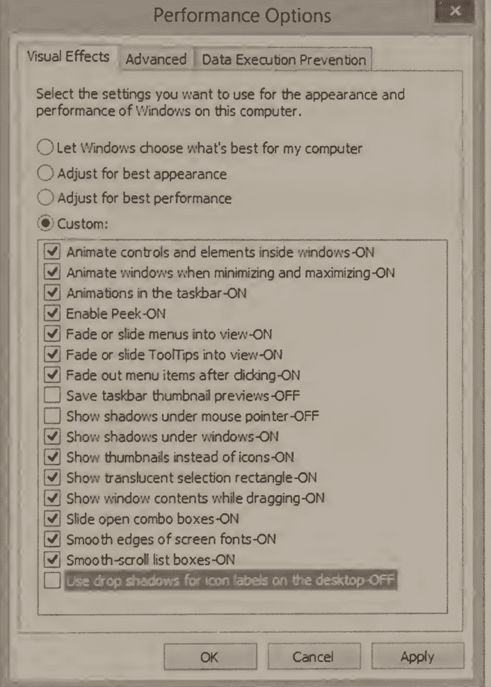

图 7-1：开启或关闭桌面上图标的投影效果。

### 在桌面上显示 Windows 系统图标和用户图标

在 Windows 8 中，默认只有一个图标（回收站）在桌面上。微软试图将桌面上的图标数量降至最低，以获得更整洁的外观。尽管如此，如果你喜欢在桌面上看到系统图标和用户图标，例如计算机、文档、网络等以便于使用，你仍然可以将这些图标添加回桌面。只需按照以下步骤操作：


1. 右键单击桌面，然后单击“个性化”。
2. 单击左侧菜单中的“更改桌面图标”。
3. 在“桌面图标设置”窗口中，勾选你想要显示的图标旁边的复选框，如图 7-2 所示。
4. 完成后，单击“确定”。

完成上述步骤后，你立即会在桌面上看到这些图标。

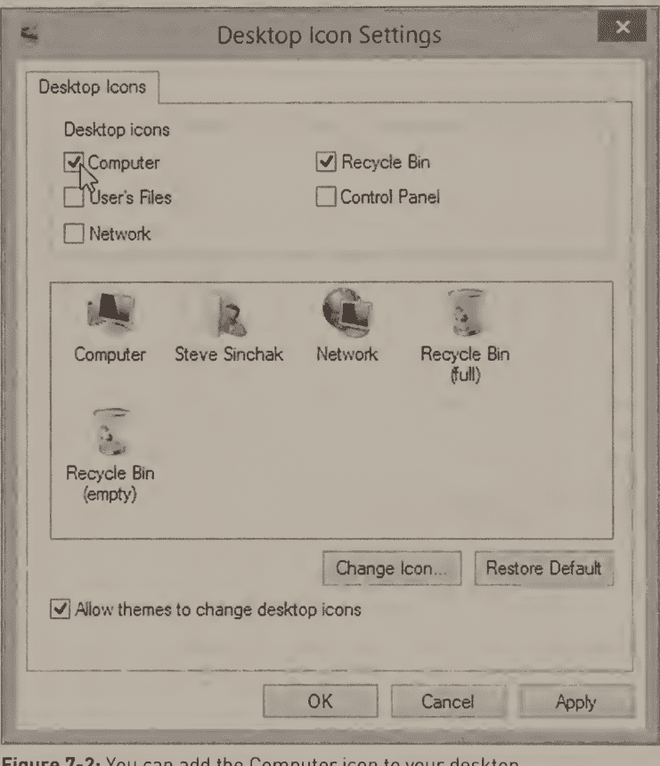

## 调整桌面图标大小

Windows 8 使用了一种新的桌面图标大小，比 Windows 以前的版本稍大。这是我安装 Windows 7 或 Windows 8 后立即就不喜欢的一点。为什么现在的图标这么大？嗯，在 Windows 8 中，一切似乎都变大了，但幸运的是，与其他新功能一样，调整桌面图标大小非常容易。你可以选择桌面上三种不同的标准图标大小。图 7-3 展示了这三种图标大小：小（经典）、中和大。


你只需右键单击桌面，单击“查看”，然后单击你偏好的图标大小，即可更改图标大小。

如果你是高级用户，有一种秘密方法可以在更宽的大小范围内缩小或放大图标，但你必须有一个带有滚轮的外接鼠标。只需在桌面上按住键盘上的 Ctrl 键，然后向上或向下滚动。使用这种方法，你可以创建出大得离谱的图标，如图 7-4 所示。


**图 7-4：** 使用鼠标滚轮技巧创建非常大的图标。

## 重命名回收站

为了给我的桌面增加一点个性化的色彩，我喜欢将回收站重命名为其他名称。在 Windows 的旧版本中，只能通过编辑注册表来实现这一点。在 Windows 8 中，这要容易得多。只需执行以下步骤即可重命名你的回收站：

- 右键单击桌面上的回收站，然后单击“重命名”。
- 输入新名称，例如 *粉碎器*，然后按回车键。

## 自定义快捷方式箭头

我一直讨厌 Windows 的一件事就是快捷方式箭头。当然，能够分辨一个快捷方式是否真的是快捷方式是好的，但我已经知道我把应用程序放在桌面上都是快捷方式。此外，在我看来，Windows 使用的快捷方式指示器并不美观。通过一个简单的注册表技巧，你可以用任何图标替换该快捷方式图标叠加层。这使你可以使用任何流行的图标编辑器创建自己的图标，并将其用作任何快捷方式的叠加层。

我创建了一个绿色的箭头，我喜欢用它作为我的快捷方式图标叠加层。你可以从 Windows 8 Tweaks 网站 tweaks.com/340859 获取它。使用以下步骤更改图标快捷方式叠加层：

- 打开开始屏幕，输入 regedit，然后按回车键以启动注册表编辑器。
- 注册表编辑器启动后，导航到 HKEY_LOCAL_MACHINE\SOFTWARE\Microsoft\Windows\CurrentVersion\Explorer。
- 右键单击 Explorer 文件夹，展开“新建”，并选择“项”。输入 Shell Icons 作为新项的名称。
- 右键单击新的 Shell Icons 项，展开“新建”，并选择“字符串值”。输入 29 作为新字符串值的名称。
- 右键单击你刚刚创建的新字符串值，然后选择“修改”。将值设置为图标路径、一个逗号以及从 0 开始的图标索引号。例如，我使用 C:\icons\myshortcut.ico, 0，如图 7-5 所示。图标索引号指定你想在文件中使用的图标。（某些文件可以包含多个图标，例如 shell32.dll 文件。）完成后，单击“确定”。
- 注销并重新登录，你应该能看到你的新快捷方式叠加层。


图 7-5：设置 shell 图标路径和索引。

## 自定义图标

你开始厌倦 Windows 8 的默认图标了吗？用了一段时间后，它们会变得陈旧和乏味。如果你是一个硬核桌面用户（既然你有这本书，那很可能就是如此），那么现在是时候定制桌面上的 Windows 图标了。

要开始，你首先需要找到一些外观很棒的替换图标。看看我喜欢的网站并下载桌面上的图标：

- *InterfaceLIFT*—tweaks.com/899844
- *VistaIcons*—tweaks.com/701266
- *IconArchive*—tweaks.com/855045
- *IconFinder*—tweaks.com/767865

或者，你可以使用位于 %SystemRoot%\system32\SHELL32.dll 的 Windows 图标库。

现在，你可以开始替换桌面上的图标了。更改应用程序快捷方式图标比更改系统图标（如回收站或计算机）更容易。更改系统图标需要借助图标工具的帮助。首先，我向你展示如何更改应用程序图标，然后是如何更改系统图标。执行以下步骤以更改任何应用程序图标：

- 右键单击你想要更改图标的项，然后选择“属性”。
- 在“快捷方式”选项卡上，单击“更改图标”。
- 在“更改图标”屏幕上，单击“浏览”按钮并导航到你的新图标。
- 在屏幕上选择你的新图标，如图 7-6 所示，然后单击“确定”。
- 再次单击“确定”以退出并在属性屏幕上保存你的更改。

既然你知道如何更改应用程序快捷方式图标，你可以更改系统图标，例如计算机快捷方式或回收站。最好使用图标工具来进行这些更改。我最喜欢的用于此用途的工具称为 Microangelo On Display，由 Impact Software 开发。


图 7-6：选择一个新的应用程序图标。

要开始，前往 [tweaks.com/647410](http://tweaks.com/647410) 获取免费评估副本。安装后，按照以下步骤自定义你的系统图标：

- 安装 Microangelo On Display 后，右键单击任何系统图标，例如计算机中的硬盘图标，然后单击“外观”。这将调出图 7-7 中所示的外观窗口。
- 在显示部分下，将选项切换为“自定义”。
- 浏览并选择你的替换图标，然后单击“确定”。
- 单击“应用”以保存并查看你的更改，然后单击“确定”。

如果你不喜欢你的新图标并希望改回默认，再次右键单击该图标，这次在显示部分下选择“系统默认”，然后单击“确定”。

现在你已经完成了桌面和系统图标外观的定制，你可以进一步定制桌面了。


**图 7-7：** 使用 Microangelo On Display 更改图标。

## 自定义桌面背景

桌面是 Windows 中相当简单的一部分。通常，除了更改壁纸外，你无法做太多来自定义它。本节展示你如何利用 Windows 8 中的一些新壁纸功能（例如自动壁纸更换和桌面小工具）来走得更远。

### 自动轮换你的壁纸

这个功能本应该早在许多个版本前就出现在 Windows 中，但微软终于将自动壁纸切换器集成到了 Windows 中。你可以选择要使用的背景图像数量和图像之间的更换间隔。达到间隔后，你将看到平滑的淡入淡出效果，桌面背景随之变化。

在通常更改背景的地方配置多个背景图像。要开始，请遵循以下步骤：

- 右键单击你的桌面背景，然后选择“个性化”。
- 在窗口底部附近，单击“桌面背景”。
- 默认情况下，你将看到可以选择的纯色。将“图片位置”框更改为“Windows 桌面背景”或单击“浏览”以选择自定义图像。
- 确定你要使用的图像后，将鼠标悬停在每个图像上并单击复选框，如图 7-8 所示。对你想要使用的其他每个图像重复此操作。
- 当你勾选两个或更多图像时，“每隔...更换图片”下拉列表将变为可用状态。你可以在那里设置 10 秒到一天一次之间的图片更换间隔。
- 单击“保存更改”。

### 桌面小工具

首先出现在 Windows Vista 中，然后在 Windows 7 中变为无侧边栏的 Windows 侧边栏小工具，已完全从 Windows 8 中移除。我是桌面小工具的大粉丝，因为我感到它们为高级用户提供了一种轻松的方法来定制桌面并展示有趣的信息。CPU 利用率、内存利用率和带宽利用率只是我桌面上的一些小工具。


**图 7-8：个性化你的桌面背景。**

对于 Windows 8，你需要使用第三方工具来提供相同的功能。我发现一款名为 Rainmeter 的流行工具是 Windows 侧边栏小部件的完美替代品，事实上，它比之前的 Windows 原生平台功能强大得多。

在 Rainmeter 世界中，小部件被称为皮肤。任何人都可以编写皮肤，但下载现成的成千上万种皮肤更为容易。Rainmeter 的生态系统比旧的桌面小部件生态系统要大得多。你可以轻松找到具有你所需功能和外观的小部件。

要开始使用，请访问 Rainmeter 的网站 tweeks.com/559693 并下载和安装最新版本的 Rainmeter。在本节中，我将假设你选择了标准安装选项。我不建议使用便携安装选项。

## 使用皮肤

安装 Rainmeter 后，你将看到名为 illustro 的默认皮肤布局，如图 7-9 所示。你可以通过在屏幕上拖动每个皮肤对象以及右键点击它来自定义每个皮肤对象。如果你想关闭一个对象，请右键点击它并选择“卸载皮肤”。


**图 7-9：** 使用此默认 Rainmeter 皮肤布局来了解自定义选项。

某些对象具有多个视图设置。你可以右键点击对象，并在“变体”菜单中切换它们。你还可以调整右键菜单“设置”选项中的其他设置。

illustro 皮肤集包含比默认显示的更多皮肤（或小部件）。这对于你下载的任何皮肤来说都是常见的。要显示其他可用的皮肤对象，请右键点击通知区域（时钟旁边）的 Rainmeter 图标。按照以下步骤添加已安装在你计算机上的额外皮肤：

1. 定位系统时钟附近通知区域中的 Rainmeter 图标。该图标看起来像一滴水，并且可能隐藏在溢出部分中，如图 7-10 所示。
2. 右键点击 Rainmeter 图标并展开“皮肤”菜单。
3. 导航通过你已安装的皮肤；默认情况下，仅列出 illustro。
4. 选择你想要添加的皮肤项，然后选择特定的 .ini 文件；例如 illustro，Network，然后是 Network.ini。
5. 你的新皮肤将被显示，你可以按照之前所述进行移动和调整。


**图 7-10：** Rainmeter 图标显示在通知区域。

### 下载更多皮肤

Rainmeter 有数千种自定义皮肤和布局集，可以帮助你极大地自定义桌面的外观。默认的 illustro 皮肤看起来不错，但如果你不查看其他可用皮肤，就没有充分利用 Rainmeter。我个人在我的 PC 上使用 Omnimo 5.0 皮肤；它具有现代外观，与 Windows 8 搭配良好，如图 7-11 所示。你可以在 `tweaks.com/765252` 下载 Omnimo 5.0 皮肤。

你可以在许多网站上找到额外的皮肤、布局集和附加组件。以下列表是下载更多 Rainmeter 皮肤的最佳位置集合：

- DeviantArt—`tweaks.com/574891`
- Customize.org—`tweaks.com/766833`
- Rainmeter Discover—`tweaks.com/303767`

下载皮肤或布局集后，只需双击 .rmskin 文件，Rainmeter 将允许你安装该皮肤。


**图 7-11：** Rainmeter 的 Omnimo 5.0 皮肤具有整洁无杂乱的外观。

## 摘要

在本章中，你学习了许多不同的方法来定制桌面上的图标，使桌面更加个性化。我甚至带你走完了添加 Rainmeter 皮肤的步骤，使你的桌面信息更丰富且更具定制化。

下一章是最重要的定制章节之一。我将向你展示如何更改整个 Windows 8 窗口界面的外观，因此对于想要定制 Windows 最可见部分的人来说，第 8 章是必读的。

# 第 8 章

# 定制 Windows 界面的外观

在前几章中，你定制了操作系统的各个部分，从登录屏幕开始。在定制开始屏幕和任务栏后，你也花了一些时间定制桌面。本章将向你展示如何通过更改主题或视觉风格并微调两者的设置，来定制整个用户界面的外观。

在以下各节中，你将学习如何对计算机的外观进行重大更改（比你到目前为止学到的要多得多）。首先，我解释主题和视觉风格之间的区别，以消除你可能的任何困惑。然后，你将学习如何创建高级主题。接下来，我向你展示如何在触摸设备上使传统桌面更容易使用。本章通过介绍一种使用名为 WindowBlinds 的第三方皮肤工具赋予 Windows 8 完全不同外观的简单方法而结束。

## 使用主题

主题一直是 Windows 的一部分。自从 Windows 95 发布以来，主题使得保存字体、颜色、视觉样式、壁纸、鼠标光标甚至所使用的声音的配置成为可能。多年来，主题世界没有太多变化。最初，你必须购买 Microsoft Plus 才能使用主题，但现在使用主题的功能已包含在所有最新的 Microsoft 操作系统中。

尽管主题存在如此之久，为什么谈论它们仍然很重要？因为它们提供了一种独特的方法来保存你计算机的所有视觉设置和音频设置，以便你可以轻松同时更改所有设置。此外，Microsoft 在主题中实施了一些新功能，我将在此介绍。

### 更改当前主题

当你安装 Windows 8 时，Microsoft 包含了许多具有不同样式的主题。更改主题非常简单，所以我不会花太多时间在上面。只需遵循以下步骤：

1. 右键点击桌面并点击“个性化”。
2. 滚动列表并点击你想要应用的主题，如图 8-1 所示。主题将立即生效。
3. 当你选择好想要使用的主题后，只需关闭“个性化”窗口。


选择主题后，新主题会自动应用。如果你选择一个具有不同视觉样式的主题，例如 Windows Classic 或 Windows 8 Basic，此过程可能需要几秒钟。

既然你知道了如何更改主题，现在是时候制作你自己的了。

### 下载更多主题

许多网站可以帮助你下载更多为 Windows 8 制作的现成主题，包括背景图像和声音。请查看以下网站以找到更多出色的主题：

- **Microsoft**—tweaks.com/245527
- **Tweaks.com**—tweaks.com/484131

当你在网上找到喜欢的主题时，只需下载 .themepack 文件并双击文件即可安装。安装后，它将显示在包含的系统主题下方的新“已安装主题”部分中。

### 制作你自己的主题

制作你自己的主题使你能够轻松备份你对 Windows 8 的视觉更改，以便你可以将你的设置分发给其他计算机或互联网。该过程最困难的部分是自定义构成用户界面的视觉元素的所有小方面。接下来的几个部分将引导你完成微调用户界面的过程，然后展示如何保存你的更改并创建你自己的主题文件。

#### 修改系统声音

可以将声音分配给 Windows 中的许多事件，例如登录、注销、最小化窗口和最大化窗口。主题也可以包括声音方案设置，因此我建议你为任何自定义主题定制系统声音。

更改事件声音很简单。只需遵循以下步骤启动和配置声音属性：

1. 打开开始屏幕，输入 **mmsys.cpl**，然后按 Enter 以启动系统声音属性。
2. 声音属性加载后，点击“声音”选项卡。
3. 要调整特定事件的声音片段，请通过导航“程序事件”列表来点击你想要修改的事件，如图 8-2 所示。


### 声音事件配置
- 4. 选中一个事件后，声音下拉列表将被启用，你可以选择想要使用的声音片段。如果你不想为某个特定程序事件使用声音，可以从列表顶部选择（无）。如果在列表中找不到喜欢的声音，可以使用浏览按钮选择计算机上的特定声音文件来使用。
- 5. 在这里你还可以通过选中播放Windows启动声音复选框来启用或禁用Windows启动声音。
- 6. 修改完成后，只需点击确定以保存你的更改。


你现在已完成计算机上声音事件的自定义。

## 自定义鼠标光标

鼠标光标是主题文件中保存的另一个项目。Windows 8 附带许多不同的指针方案。虽然并非所有光标都是外观最美观的，但它们在某种情况下确实非常有用。此外，Windows 8 包含特殊的大号鼠标光标，使光标看起来更柔和舒适。

为了将光标完美地设置为主题文件，请遵循这些步骤：

- 1. 打开开始屏幕，输入 main.cpl，然后按 Enter 键打开鼠标属性。
- 2. 单击指针选项卡。
- 3. 你有两种选项来自定义光标。你可以使用方案下拉框同时将所有指针更改为不同的样式，方法是从列表中选择一个不同的光标方案，如图 8-3 所示。当你选择不同的方案时，所有光标会自动更改。或者，如果你不喜欢光标方案，可以通过滚动列表并选择想要更改的光标，在自定义列表中单独选择光标。然后单击浏览按钮进行更改。
- 4. 完成光标自定义后，只需单击确定，即完成。

现在你已准备好继续自定义主题将使用的视觉样式。


图 8-3：更改指针方案。

## 配置界面颜色设置

在 Windows 8 中，你还可以自定义界面的颜色和高强度。这些设置也保存在你的主题文件中，因此对其进行自定义是个不错的主意。只需遵循以下步骤自定义用户界面颜色：

- 1. 右键单击桌面并选择个性化。
- 2. 在个性化屏幕上，单击屏幕底部的颜色。
- 3. 从 16 个屏幕选项中选择要使用的颜色，或单击显示颜色混合器以设置自定义颜色。可选地，你可以选择第一项，如图 8-4 所示，这将自动设置界面颜色以匹配你的背景壁纸。
- 4. 设置看起来良好的颜色强度值。
- 5. 单击保存更改。


图 8-4：调整界面颜色设置。

## 设置背景图像

Windows 8 包含设置多个背景图像的功能，这些图像会在用户设置的间隔时间自动轮换。这使你可以选择任意数量的背景图像，它们将以柔和的淡入淡出效果自动更改。你在通常的更改背景屏幕上启用此功能。遵循这些步骤在计算机上更改背景图像并启用背景幻灯片：

- 1. 右键单击桌面并单击个性化。
- 2. 单击屏幕底部的桌面背景。
- 3. 将图片位置框设置为纯色或其他图像位置。
- 4. 接下来，单击任意图像将其设置为背景。如果你想设置多个背景图像，只需将鼠标悬停在每个图像上并勾选出现的复选框。
- 5. 选择所有图像后，配置图片位置和更改图片频率设置。完成时单击保存更改。

## 将你的主题保存到文件

你现在已自定义了主题的所有方面，并准备好创建你自己的主题文件，生成一个包含主题使用的所有资源的主题包文件：

- 1. 右键单击桌面并单击个性化。
- 2. 在个性化屏幕上，你将在顶部看到我的主题部分，其中有一个名为未保存主题的主题。右键单击该主题并选择保存主题以进行共享。
- 3. 输入名称，选择保存 .themepack 文件的位置，并单击保存。

你现在已为你的主题创建了主题包，以便未来在自定义用户界面时轻松切换回该主题。此外，你可以将主题包复制到其他计算机或在线共享。你的主题中使用的所有文件（包括背景图像）都包含在 .themepack 文件中。

## 自动 RSS 背景主题

既然你创建了自己的主题，我将向你展示如何通过编辑新创建的主题文件来启用一个隐藏功能。这将允许你的主题自动下载并显示来自 RSS 源引用的新背景图像。随着 RSS 源更新新背景，你的计算机将自动下载并显示它们。

激活此功能需要手动编辑你在前一节创建的主题包中的主题文件。你还需要来自遵循 RSS 附件标准的网站且该源包含图像作为附件的 RSS 源。

你可以通过查找源中每个 `<item>` 的 enclosure 标签来识别兼容的源。例如，查找 `<enclosure url="http://www.site.com/image.jpg" type="image/jpeg" />`。要了解有关 RSS 附件标准的更多信息，请查看维基百科条目 http://en.wikipedia.org/wiki/RSS_Enclosures。

既然你了解了一些示例源以及如何识别其他源，你可以开始了：

- 1. 首先，你需要获取之前创建的 .themepack 或 .deskthemepack 文件中或从在线下载文件中打包的 .theme 文件。为了做到这一点，你必须启用文件资源管理器中的文件扩展名视图。当文件资源管理器打开时，单击视图选项卡，然后在右侧附近的显示/隐藏部分中勾选文件名扩展名。
- 2. 导航到你保存 .themepack 或 .deskthemepack 文件的目录，并将文件重命名为 .cab。主题包文件只不过是一个压缩的 cabinet 文件。
- 3. 重命名为 cab 文件后，使用任何兼容的压缩实用工具（如 WinRAR (www.rarlab.com)）甚至原生的 Windows 资源管理器 shell 打开该文件，并提取其中的 .theme 文件。
- 4. 提取 .theme 文件后，右键单击它并选择打开方式。取消选中使用此应用打开所有 .theme 文件，然后单击更多选项并单击记事本。
- 5. 现在你可以手动编辑主题文件。滚动文件并查找 [Slideshow] 部分。如果该部分已经存在，请删除它。
- 6. 通过在记事本中的文件底部输入以下代码来创建新的 [Slideshow] 部分：

```
[Slideshow]
Interval=600000
Shuffle=1
RssFeed= http://feeds.feedburner.com/bingimages
```

Interval 的值以毫秒列出，因此 600000 表示壁纸将每 10 分钟更改一次。随意更改此值。当 Shuffle 等于 1 时，启用随机播放（0 表示禁用）。用兼容的 RSS 附件源的 URL 替换 RssFeed 的值。

- 7. 保存你对新 .theme 文件所做的更改并关闭记事本。确保在保存之前将另存为对话框中的“保存类型”更改为所有文件 (\*.\*)，以便文件名不会附加 .txt 扩展名。
- 8. 导航到你保存的新文件，右键单击，选择打开方式，然后选择个性化 CPL。这将在个性化屏幕上通过主题浏览器加载该文件。
- 9. 如果你的编辑成功，你应该收到一条应用主题消息，要求你订阅 RSS 源。单击下载附件以处理源中的所有图像，如图 8-5 所示。
- 10. 源中的图像将在几分钟内下载并应用为背景。RSS 背景源现已设置，并应每天更新一次。

如果在你设置的间隔时间过去几分钟后背景仍未更改，那么你的 RSS 源很可能存在问题。


## 使桌面界面适合触控

Windows 8 的全新 Metro 风格因最初就是为触控设计而完美支持触控。在触控设备上使用桌面界面往往令人沮丧且缓慢。桌面应用程序是为键盘和鼠标设计的，使用触控的精确度低得多，可能导致你选择或点击了错误的项。

桌面大部分可用性问题的原因是你需要操作的项目尺寸。它们只是太小了。一种简单的方法

使桌面界面更易于触摸操作的方法是增大您在桌面上最常交互的元素的大小。

## 放大界面

在 Windows 8 中增大界面尺寸的最佳方法是增加字体大小。随着流式界面调整为适应更大的字体尺寸，所有触摸目标都会随之变大。Windows 8 中更改字体大小与其他系统略有不同。请按照以下步骤操作：

- 1. 右键点击桌面并选择“屏幕分辨率”。
- 2. 在屏幕底部附近选择“放大文本和其他项目”。
- 3. 选择“中等”或“较大”以更改所有项目的大小。或者，您可以使用屏幕底部的设置来微调特定项目的字体大小，如图 8-6 所示。
- 4. 点击“应用”。


**图 8-6：** 调整界面字体大小

## 启用大图标

应用程序或文件图标是非常常见的触摸目标，因此将它们变大并更容易点击将极大地改善用户体验。放大它们只需几次点击，但具体操作会根据图标所在的位置略有不同。

### 桌面界面

桌面图标是最容易更改的，而且我之前已经讲解过一次，所以这里仅做简要回顾。右键点击桌面，选择“查看”，然后选择“大图标”、“中等图标”或“小图标”。如果您有滚轮鼠标，可以按住键盘上的 Ctrl 键并滚动鼠标滚轮向上滚动，以获得更精细的控制。

### 文件资源管理器

文件资源管理器原生提供多种非常适合触摸操作的视图，但它们默认并未启用。在我的平板设备上，我喜欢将默认视图设置为“大图标”，这提供了有用的大型触摸目标，使选择我想看的内容变得非常容易。请按照以下步骤将“大图标”设置为所有驱动器、文件和文件夹的默认视图：

- 1. 打开文件资源管理器并导航到任意驱动器或文件夹。
- 2. 点击“视图”选项卡。
- 3. 在“布局”部分中，选择“大图标”。
- 4. 同样在“视图”选项卡中，点击最右侧的“选项”。
- 5. 点击“文件夹选项”窗口中的“视图”选项卡。
- 6. 点击“应用于所有文件夹”。
- 7. 在确认窗口中点击“是”。
- 8. 点击“确定”关闭“文件夹选项”，您的更改即生效。

## 更改 Windows 8 外观

更改 Windows 8 外观主要依靠第三方实用工具和视觉样式来改变整个用户界面。通过更改外观，您可以完全改变其样貌，使其看起来像不同的操作系统，例如 OS X，甚至是一些更奇特的系统。在接下来的章节中，我将展示如何使用破解的视觉样式以及主要的皮肤工具 WindowBlinds 来定制计算机的外观。这将帮助您将定制提升到下一个层级。

## 使用破解的视觉样式

Windows 8 使用基于 Windows XP 引擎的增强型皮肤引擎来显示非玻璃化界面以及新的玻璃化 DWM 界面。在 Windows XP 中，视觉样式引擎使用存储在资源文件中的位图。视觉样式的资源文件包含所有视觉元素，如按钮和窗口组件的图像以及一些配置文件。在 Windows 8 中，资源文件已现代化，包含 PNG 图像而非位图，并针对新的界面设计进行了更新。

为 Windows 8 创建视觉样式的方法与 Windows XP、Vista 和 Windows 7 相同。您需要从一个现有的视觉样式开始，例如 Windows 8 中默认包含的视觉样式，并使用资源破解工具替换文件中的图像。当您使用 PNG 替换文件中的所有资源并创建一个新的视觉样式文件后，您就几乎准备好使用破解的视觉样式了。

在使用任何下载或自己制作的视觉样式前的最后一步是修补皮肤引擎文件。Windows 8 中的皮肤引擎仅使用带有微软数字签名的视觉样式文件。您通过编辑资源制作的视觉样式或从互联网下载的其他视觉样式，由于文件内容已更改，不再具有有效的微软数字签名。要在 Windows 8 中使用破解的视觉样式，您需要修补对该视觉样式文件施加数字签名要求的系统文件。

幸运的是，许多用户已发布了解决数字签名要求的实用工具。我将向您展示其中一个，它是由 Rafael Rivera 编写的 UxStyle Core。此实用程序在内存中修补数字签名要求，因此不会修改您计算机上的任何文件。唯一的缺点是，UxStyle for Windows 8 仅支持 64 位系统。

在开始使用 UxStyle Core 之前，您需要下载一些 Windows 8 视觉样式来更改界面外观。以下是一些我推荐查找兼容视觉样式的网站：

- DeviantArt 视觉样式—tweaks.com/925782
- DeskModder—tweaks.com/167845
- Windows 8 主题—tweaks.com/351086

确保您只下载专为 Windows 8 创建的视觉样式。Windows Vista 和 Windows XP 的视觉样式不兼容。当您下载了几种视觉样式后，就可以配置您的计算机以使用它们了：

- 1. 访问 tweaks.com/841568 并下载适用于 Windows 8 的最新版本 UxStyle。
- 2. 安装该实用程序后，最好重启您的计算机，然后检查您的服务列表（运行 services.msc）中的“未签名主题”，并确保其已启动。
- 3. 接下来，您准备好安装之前下载的视觉样式了。将 .theme 和相应的文件或文件夹复制到 c:\Windows\Resources\Themes。
- 4. 右键点击您的桌面并选择“个性化”。
- 5. 向下滚动到“已安装主题”部分并选择您刚刚复制到 Themes 文件夹中的主题。几秒钟后，您的主题应该会被应用。

现在我将向您展示另一种不使用破解视觉样式更改外观的方法。

## 通过 WindowBlinds 更改 Windows 8 的外观

在视觉样式成为 Windows 的一部分之前，更改 Windows 外观的唯一方法是使用 Stardock 公司名为 WindowBlinds 的实用工具。刚推出时，它将 Windows 枯燥的灰色界面转变为引人入胜且色彩丰富的体验。如今，既然 Windows 自带皮肤引擎，像 WindowBlinds 这样的产品似乎显得不那么必要了。那么，我为什么还要提到这款应用呢？因为除非使用实用工具绕过限制，否则微软引擎仅运行带有微软数字签名的皮肤。此外，WindowBlinds 可用视觉样式的质量通常高于可用的破解视觉样式。

使用 WindowBlinds 比使用破解的视觉样式简单得多。只需从 tweaks.com/514620 下载并安装一份副本即可。

然后在运行时选择您想要使用的样式即可。

如果您对 WindowBlinds 提供的任何皮肤不满意，您始终可以将皮肤改回默认的 Windows 8 外观。如果您想要更多皮肤，下一节正是为您准备的！

## 为 WindowBlinds 添加更多皮肤

WindowBlinds 拥有数千种皮肤组成的强大基础，安装起来非常容易。您可以在 Stardock 运营的网站 WinCustomize 上找到它们。要开始使用，请访问 tweaks.com/797293 查看所有可用皮肤的列表。

从可用皮肤列表中，您可以通过点击“下载”链接来安装皮肤。它应该会自动开始下载。当皮肤下载完成后，WindowBlinds 会自动加载它，并通过询问您是否想要应用它来进行提示。安装皮肤后，您可以再次进入 WindowBlinds 配置界面，浏览该皮肤的不同版本和颜色（当然，假设该皮肤有多个版本）。

## 总结

本章侧重于定制计算机最重要的部分：用户界面。视觉界面是操作系统中在定制后影响最大的部分。使用本章介绍的工具和技术，您可以完全改变 Windows 8 的外观。

下一章全部关于定制 Windows 资源管理器，即您用于浏览计算机上所有文件的程序。我将向您展示如何定制其外观和工作方式，以便您可以最大化其功能来满足您的需求。


# 第 9 章
## 微调文件资源管理器

您可以自定义更新后的文件资源管理器的许多组件和功能，以优化您的 Windows 体验。本章展示了如何自定义资源管理器以及如何利用一些鲜为人知的功能。首先，本章介绍了如何自定义新资源管理器界面的布局。读完本章后，您将能够完全自定义资源管理器的各项功能，从而在计算机上浏览和创建文件。


### 自定义 Windows 布局

Windows 8 中的资源管理器包含各种新的功能区（ribbons）和窗格（panes），例如“详细信息”、“预览”和“导航”，它们提供了大量信息，可能会改变您使用文件资源管理器的方式。默认情况下，大多数窗格都已开启，这使得资源管理器界面显得有些杂乱。就我个人而言，我喜欢移除那些不使用的窗格，以加速并简化我的文件资源管理器窗口。除了新窗格外，资源管理器还包含许多其他新功能，例如“收藏夹”部分、“库”、“搜索”，当然还有功能区。接下来的几个部分将展示如何自定义所有这些功能。

### 自定义窗格

资源管理器窗口上的窗格位于窗口的各个侧边。图 9-1 展示了一个典型的资源管理器窗口，其中所有窗格均可见。


如图 9-1 所示，导航窗格位于左侧，预览窗格位于右侧。每个窗格都提供不同的功能阵列，这些功能要么有助于提升您的资源管理器体验，要么使其变得杂乱无章。深入自定义各个不同的窗格，并彻底改造资源管理器，使其按您想要的方式工作。

### 导航窗格

Windows 资源管理器中的导航窗格分为五个关键的信息区域：收藏夹、库、家庭组、计算机和网络。您可以将“收藏夹链接”部分想象成一个粘性停靠栏，您可以将任何文件夹拖放到上面，以便为将来访问该文件夹创建快捷方式。这使得您能够快速轻松地访问常用文件夹。

您可以将库视为多个文件夹内容的合并视图，这些内容可以是预定义的，也可以是手动设置的。稍后我们将详细讨论库。

其余部分默认处于折叠状态，提供了一个树状驱动界面，类似于早期 Windows 版本中的经典 Windows 资源管理器。现在您已了解基础知识，可以自定义导航窗格上的一切了。

### 添加和移除收藏夹链接

您可以通过两种不同的方式管理您的收藏夹链接部分。最简单的方法是直接将文件夹和保存的搜索拖放到收藏夹部分，以将其添加到列表中。然后，您可以右键点击列表中的项目并选择“移除”来删除它们。或者，您可以导航到位于 `C:\Users\Username\Links` 的收藏夹链接文件夹。在那里，您可以轻松一次性复制和粘贴多个文件夹或快捷方式，以将其添加到收藏夹链接部分。

我喜欢将我的硬盘驱动拖到收藏夹部分，这样我需要在时就能快速跳转过去。

### 移除导航窗格

如果您希望拥有一个超级干净的界面，并且不使用收藏夹链接和文件夹部分，您可以轻松地将整个窗格从视图中移除。请按照以下步骤禁用此视图：

-   1.  当一个文件夹打开并显示导航窗格时，点击“视图”选项卡以打开视图功能区。
-   2.  点击“导航窗格”按钮，然后在菜单上选择“导航窗格”以移除整个左侧窗格。

当您关闭活动窗口时，更改将保存到注册表中。

### 启用自动树状展开

当您在计算机上浏览文件夹时，您可以配置导航窗格以自动在树状视图中显示当前位置。这有助于您理解该文件夹的位置，并能够轻松跳转到上几级的父文件夹。

请按照以下步骤启用此功能：

-   1.  点击“视图”选项卡。
-   2.  点击“导航窗格”按钮。
-   3.  点击“展开到打开文件夹”。

### 详细信息窗格

位于资源管理器窗口右侧的详细信息窗格，为您提供有关任何所选文件或文件夹的信息。类似于资源管理器中经典的状态栏，详细信息窗格显示常见信息（如文件大小），但它不仅如此，还显示了其他许多文件设置。如果您选择一张图像，它会显示缩略图预览，以及拍摄日期、标签、您的星级评分、尺寸、文件大小、标题、作者，甚至相机型号。

详细信息窗格已被证明是一个有价值的信息来源，它可以真正帮助您标记和评级您的个人文档、图像和音乐。没有详细信息窗格，设置所有这些值将困难得多。

现在您已知晓详细信息窗格提供了什么，您可以在“视图”选项卡上启用或禁用它。只需点击“详细信息窗格”按钮即可显示或隐藏它。

### 预览窗格

预览窗格是大多数文件夹中默认关闭的一个窗格，但在浏览图像集合或筛选 MP3 文件时非常有用。当您浏览音乐集合并选择一个 MP3 文件时，预览窗格会显示该歌曲专辑的图片以及用于播放和试听该歌曲的微型音频控制按钮。当您选择一个图像文件时，会显示该照片的大尺寸缩略图。

某些文件甚至在预览窗格中显示其内容。选择一个文本文件或 Word 文档，即可查看文件内部内容的示例。请确保已安装 Microsoft Office，以便启用 Office 文档的预览功能。

不幸的是，您无法对预览窗格进行太多自定义。当预览窗格开启时，您可以通过点击并左右拖动左边界来调整其宽度。通过点击“视图”选项卡，然后点击“预览窗格”按钮，可以开启或关闭它。

微软希望，随着时间推移，更多公司将编写能与资源管理器配合工作的预览筛选器，以便您可以在预览窗格中看到其文件内容的预览。

### 调整搜索

Windows 8 中一个最有用的新功能是每个资源管理器窗口以及许多其他应用程序中的搜索框。这个搜索框使您能够以前所未有的方式对文件进行排序。正在查找某个文件夹中的所有文本文件吗？只需在搜索框中输入 `*.txt` 并按下回车键。几乎立即，您将看到正在浏览的目录中所有文本文件的列表。

正在查找提及特定公司或个人的所有 Word 文档吗？只需转到您的文档文件夹，搜索名称并按下回车键。Windows 搜索可以查看文件名，但它也搜索文件的内容。之所以可能，是因为 Windows 搜索为许多最流行的文件类型内置了阅读器。

如您所见，与 Windows 中先前的搜索选项相比，Windows 搜索是一个全面的搜索解决方案。随着这个新搜索系统的加入，您获得了比以往更强大的自定义搜索的能力。各种搜索设置隐藏在各个窗口中，帮助您自定义搜索的工作方式。

### 调整范围

每次执行搜索时，结果都基于范围，即搜索软件查找的文件夹和文件类型。根据您启用的范围设置，搜索结果可能会有巨大差异。接下来这两个设置有助于您微调搜索软件搜索什么以及如何搜索，然后您再微调索引服务，以便对想要索引的文件进行索引，从而实现快速搜索。

### 自定义搜索内容和方式

您可以在 Windows 资源管理器中的“文件夹和搜索选项”窗口中找到所有 Windows 搜索的“查找位置”设置。请按照以下步骤自定义 Windows 搜索的查找位置：

-   1.  打开文件资源管理器并点击“视图”选项卡。
-   2.  点击“选项”按钮。
-   3.  点击“搜索”选项卡，如图 9–2 所示。


**图 9–2：** Windows 资源管理器提供新的搜索选项。


4. “搜索”选项卡包含两个独立的区域。在“如何搜索”部分，你可以从两种不同的设置中进行选择：查找部分匹配项以及禁用从索引中搜索的选项。

此处的两个设置是你真正需要关注的是子文件夹搜索和自然语言搜索选项。默认设置对大多数用户来说都是合适的。

5. 最后一个区域——“搜索非索引位置时”——指定了如何处理未索引的压缩文件和系统文件夹，或者当索引搜索被禁用时的情况。我会将这些字段留空以加快搜索速度，但我强烈建议你开启压缩文件选项；这会导致搜索耗时过长，并使硬盘的活动变得异常剧烈。除非你拥有 SSD 固态硬盘，否则请远离这些选项。

6. 调整完搜索选项后，点击“确定”以保存你的更改。可能需要重启才能使所有设置生效。

## 自定义索引服务

索引服务在后台运行，并在电脑空闲时读取和索引文件以加快搜索速度。其工作原理是读取所有文件并将搜索关键词及其他信息存储在一个单一的数据库中，这样读取起来更容易，而不必每次执行搜索时都重新读取所有文件信息。

在 Windows 8 中，索引服务的范围默认仅限于用户文件夹。如果你经常使用搜索功能，可能需要调整被索引的文件夹和文件类型。以下步骤帮助你自定义哪些文件夹以及哪些文件类型被索引，从而控制哪些内容被索引，哪些不被索引：

1.  打开开始屏幕，输入**性能信息**，然后选择“设置”筛选器。运行“性能信息”和工具。
2.  “性能信息和工具”加载后，点击左侧菜单中的**调整索引选项**。当“索引选项”加载时，会显示索引服务当前正在监控的所有位置。
3.  “索引选项”窗口打开。首先，调整索引器查找的位置。点击**修改**，然后点击“索引位置”窗口中的**显示所有位置**。接下来，在你的驱动器和文件夹列表中导航，只需勾选你想要索引的文件夹的复选框。完成后，点击**确定**，索引器开始对新的位置进行索引。
4.  修改索引器所索引的文件类型。你可以在“索引选项”窗口中完成此操作。这次，点击“高级”按钮，然后点击“文件类型”选项卡。
5.  滚动浏览文件扩展名列表，选择你想要修改的文件类型。然后，勾选复选框，并在下方部分选择该文件应如何被索引。如果你的文件类型未列出，请在窗口底部的框中输入文件扩展名，如图 9-3 所示，并点击“添加”以添加新的扩展名。
6.  完成后，点击“确定”，然后点击“关闭”以退出索引选项。


图 9-3：添加你希望被索引的文件扩展名。

由于索引服务仅在电脑空闲时运行，可能需要长达几个小时，新的文件、文件夹和文件类型才会被添加到索引中并显示在搜索结果中。

## 自定义功能区

资源管理器中的功能区界面提供了一种新的导航方式。功能区最早出现在 Microsoft Office 中，旨在让用户更容易访问那些难以找到的功能。资源管理器中包含了一个类似版本的功能区，原因相同，即使其更易于使用。接下来的两个部分将帮助你自定义功能区的显示方式以及快速访问菜单。

### 可见性

显示功能区或将其折叠并隐藏起来。这是一个比较难定夺的偏好问题。即使是微软的人也花了一段时间才做出决定。在 Windows 8 的大部分预览版本中，功能区默认是显示的，但在最终发布版本中被隐藏。

如果你喜欢没有干扰的极简用户界面，请立即隐藏该功能区。但如果你喜欢让所有选项都易于看到，功能区可能适合你。无论哪种情况，更改默认行为都非常简单——只需点击窗口最右侧、帮助图标旁边的向上或向下箭头。你的设置会自动保存，以便下次打开资源管理器时使用。

### 快速访问工具栏

每个 Microsoft 功能区都在应用程序窗口的标题栏中包含一个快速访问工具栏。此工具栏让你轻松访问你最常用的项目。在 Windows 8 资源管理器中，你可以将以下项目添加到工具栏：

-   撤销
-   重做
-   删除
-   属性
-   新建文件夹
-   重命名

你还可以选择一个选项，将快速访问工具栏显示在功能区下方，而不是上方。

你可以通过点击任何打开的资源管理器窗口标题栏上快速访问工具栏右侧的下拉箭头来访问所有这些选项。然后，通过选择你想要显示的项目来勾选该项。

### 修改文件关联

每次你点击一个文件时，Windows 都会检查注册表以找到打开该文件的默认程序。然后，Windows 加载该应用程序并告诉应用程序打开哪个文件。这是你在使用电脑时几乎每次都遇到的情况。通常，当你在电脑上安装了许多程序后，程序开始争夺成为打开文件的默认程序。

这种情况最常见于安装了许多类似应用程序的时候。例如，我主要使用 WinAmp 来播放音乐。然而，当 Apple 发布新版本 iTunes 时，我通常会安装它以查看新功能。下一次我尝试播放 CD 或收听 MP3 时，音乐总是会在 iTunes 中打开。我的音乐文件关联被 iTunes 抢走了。我如何重新控制我的文件关联？接下来的两个部分展示了如何自定义电脑上任何文件类型的默认启动应用程序，以及你的文件类型外观如何。

Windows 资源管理器使用存储在注册表中的信息来确定用于打开特定文件类型的应用程序。这些信息存储在 **HKEY_CLASSES_ROOT** 部分。使用注册表编辑器，你可以浏览到该键，找到你想要更改的文件类型并编辑一些键。然而，在 Windows 8 中有更好的方法。

Windows 8 的“默认程序”实用工具允许你更改文件关联信息，而无需处理注册表类 ID。只需按照以下步骤更改任何文件类型的默认启动应用程序：

1.  打开开始屏幕，输入**默认程序**，并按下 Enter 键。
2.  当“默认程序”实用工具加载时，选择**将文件类型或协议与程序关联**。
3.  滚动浏览列表并选择你要更改的文件类型，如图 **9-4** 所示。
4.  点击**更改程序**。
5.  你想要更改的程序可能就在默认的“打开方式”列表中。如果没有，只需点击**更多选项**，向下滚动，然后选择**在本电脑上查找其他应用**。
6.  点击**关闭**。

你点击“关闭”保存更改后，文件启动应用程序的更改立即生效。现在你知道当应用程序试图劫持文件关联时该如何修复它们了。


**图 9-4：** 更改你的文件关联。

## 自定义上下文菜单

什么是上下文菜单？它是当你右键点击电脑任何位置时弹出的菜单。多年来，这些菜单变得越来越有用。然而，随着上下文菜单中额外条目的增加，它们可能变得杂乱无章，充满了你根本不需要的选项和功能。接下来的几个部分将展示如何重新控制你的菜单，以及如何利用新功能创建自己的上下文菜单条目。

我首先教你如何从上下文中移除项目，然后介绍如何添加和自定义菜单组件。


## 从右键菜单中移除项目

随着时间的推移，你的右键菜单可能会变得杂乱无章，充斥着来自旧程序的条目，而这些程序你可能已经不再使用。你可能会遇到一些程序占据了你的所有右键菜单。像 WinZip、WinRAR 或 Picozip 这样的压缩应用总是会在所有右键菜单中添加程序条目。我的电脑上安装了 Picozip，每次我右键单击任何文件或文件夹时，都会看到来自 Picozip 的五个条目，提供不同的压缩选项。这可能是一个方便的功能，但如果你并不经常压缩和解压 zip 文件，你可能不需要这种额外的便利。相反，你可以将这些条目从你的右键菜单中移除，这将为你的系统带来更整洁的界面，并且如果你在右键菜单中有许多多余的条目，还能获得一点性能提升。

从右键菜单中移除这些程序可能有点棘手，因为它们分散在注册表的不同位置。移除这类条目的唯一方法是直接编辑注册表。请遵循以下步骤：

1.  打开开始屏幕，输入 `regedit`，然后按 Enter 键。
2.  当注册表编辑器出现时，展开 HKEY_CLASSES_ROOT 文件夹。此时会显示计算机上设置的文件类型列表。
3.  如果你想从右键菜单中移除的条目出现在所有右键菜单中，例如前面的 Picozip 示例，你必须展开 * 文件夹。否则，请展开你想要修改的文件扩展名所在的文件夹。
4.  展开正确的文件夹后，展开 ShellEx 和 ContextMenuHandlers 文件夹。你的注册表路径应该是 `HKEY_CLASSES_ROOT\*\ShellEx\ContextMenuHandlers`。
5.  浏览列表直到找到你想移除的条目。右键单击该条目并选择“删除”。识别某些程序很简单。例如，WinRAR 标记为 WinRAR，如图 9-5 所示。然而，你可能会遇到一些使用应用程序/类 ID 或模糊名称列出的项。对于这些，请执行注册表搜索以查找类 ID（Ctrl+F），其格式为 (xxxxxxxx-xxxx-xxxx-xxxx-xxxxxxxxxxxx)，以找到其他提供线索的引用，从而了解该 ID 属于什么。如果这不奏效，请尝试在 Google 上搜索，看看是否能找到任何结果。
6.  完成从右键菜单中移除所有条目后，关闭注册表编辑器，你就完成了。你的更改将立即生效。


图 9-5：WinRAR 在注册表中的右键菜单条目标记清晰。

## 修改“发送到”菜单

“发送到”菜单是我右键菜单中我使用最多的功能之一。能够右键单击任何文件并将其快捷方式发送到桌面的功能非常有价值。你想让它更有用吗？向“发送到”菜单添加你自己的项目非常容易，例如你可以发送文件的文件夹。你有一个存储所有音乐的文件夹吗？或者一个存储所有数码照片的文件夹？只需遵循这些快速步骤，即可向你想要的“发送到”右键菜单条目中添加任何内容。

> **提示** 如果你没有看到本部分所需的任何文件夹，你可能已经开启了“显示隐藏文件”。由于这些文件夹默认是隐藏的，你需要告诉 Windows 显示所有文件。要这样做，请参阅本章末尾关于处理隐藏文件的章节。

1.  打开文件资源管理器。
2.  单击你的 Windows 驱动器，浏览到 `Users\Username\AppData\Roaming\Microsoft\Windows\SendTo`。
3.  你将看到显示在“发送到”菜单中的所有文件。如果你想向菜单中添加条目，只需将一个快捷方式复制到该文件夹。

也许你想将你的“数码照片”文件夹添加到“发送到”菜单中。导航到你的“数码照片”文件夹，右键单击它，然后选择“发送到桌面”。这将创建一个指向该文件夹的快捷方式，并将其保存在你的桌面上。接下来，将从桌面创建的快捷方式剪切并粘贴到 SendTo 文件夹中。

如果你希望从“发送到”菜单中移除项目，只需从“发送到”文件夹中删除它们即可。

就这么简单。你现在已经完成了“发送到”菜单的自定义。

## 使用库

用户通常将类似的数据存储在整个计算机以及多个网络共享中。我在我的电脑本地存储照片，一些在一个服务器上，更多在另一个服务器上。Windows 8 中的库使我将所有照片整合到一个文件夹中，我可以轻松搜索并找到我正在寻找的照片。虽然实际的 photo 文件仍位于我电脑上的各种文件夹以及两个不同的网络共享中，但我有一个地方可以找到我所有的照片。

库可以被视为多个文件夹的综合视图。最好的是，如前所述，这些文件夹不一定在你本地的计算机上。

Windows 8 包含许多为计算机上的用户文件夹设置的默认库，如文档、图片、视频等。当你点击文档库时，你会看到计算机上文档和所有用户文件夹中所有文档的综合视图。如果你展开库文件夹，你会看到组成库的所有文件夹列表。创建你自己的库不仅是可能的，而且非常容易操作。

### 创建你自己的库

创建库非常直观。只需遵循以下步骤：

1.  打开文件资源管理器。
    在导航窗格中，你应该会在“收藏夹”部分下方看到列出的可用库。右键单击“库”标题并选择“新建”然后是“库”。
2.  输入你的新库的名称，并按 Enter 键。
3.  右键单击你刚刚创建的库并选择“属性”。
4.  点击如图 9-6 所示的“添加”，并选择要包含的文件夹。对你想添加到库中的所有文件夹重复此步骤。
5.  添加完所有文件夹位置后，你可以通过选择一个文件夹然后点击“设置保存位置”来更改默认保存文件夹。
    这指定了如果你将文件复制并粘贴到你的库中，实际哪个文件夹将持有这些文件。
6.  点击“确定”，你的库就准备好了。


如果你想删除一个库，只需右键单击它并选择“删除”。

## 自定义你的文件夹

在 Windows 中，你可以轻松更改文件夹的图标，以及打开文件夹后的行为方式。接下来的几个章节展示了你可以如何利用 Windows 8 的文件夹自定义功能。

### 更改文件夹图标和图片

更改为文件夹显示的图标是自定义文件夹外观使其脱颖而出最简单的方法之一。本章节展示了如何通过在浏览文件和文件夹时利用高分辨率图标来更改它们的显示方式。

你可以在文件夹属性窗口中更改文件夹的图标和图片。为了了解你可以使用这些设置做什么，请在你的一个硬盘驱动器上创建一个名为 Downloads 的新文件夹。你可以使用此文件夹存储所有下载内容，以免杂乱你的桌面。遵循以下步骤来更改此文件夹的外观：

1.  右键单击你刚刚创建的新文件夹，或右键单击任何你想要自定义的文件夹，并选择“属性”。
2.  点击“自定义”选项卡以显示所有你的自定义选项。
3.  首先，自定义图标，因为这是自定义文件夹外观最受欢迎的方式。要做到这一点，点击窗口底部的“更改图标”按钮。
    现在你将能够浏览可用的系统图标列表，或者你可以通过点击“浏览”按钮指定自己的图标。
4.  选择好你要使用的图标后，只需点击“确定”返回到自定义屏幕。然后点击“应用”以最终确定你的更改。
5.  代替更改图标，如果你使用的是较大的图标视图，你可以显示一张图片。这将显示你的图片，仿佛它在文件夹内部——一种很酷的效果。要做到这一点，只需点击“文件夹图片”部分下的“选择文件”按钮并指定一张图片。
6.  选择图片后，点击“确定”以选择你的更改。然后在自定义屏幕上点击“应用”以查看你的更改。请记住，只有当你使用中号图标或更大时，你才能看到你的新图片。你可以通过点击“视图”菜单项来更改为缩略图视图。

当你完成更改文件夹外观后，只需点击“确定”以保存你的更改并退出文件夹属性窗口。

### 更改文件夹模板

Windows 8 根据文件夹内部的内容类型使用几种不同的预制模板。例如，它为常规项目、文档、图片、视频和音乐有单独的模板，显示相关的文件属性。每个模板自动自定义文件夹视图，使其看起来最适合其中的内容类型。


您可以自定义任何文件夹所使用的模板，以便充分利用 Windows 8 文件资源管理器的各项功能。通过“文件夹属性”中的“自定义”选项卡来实现这一操作。请按照以下步骤指定应针对特定文件夹使用的模板：

1.  导航到您想要修改的文件夹，右键单击该文件夹，然后选择“属性”。
2.  单击“自定义”选项卡。
3.  展开下拉框并选择您想要使用的模板，如图 9-7 所示。


**图 9-7：** 更改文件夹模板。

4.  如果该文件夹内部有很多包含相同类型内容的子文件夹，请勾选“将此模板也应用于所有子文件夹”复选框，以便将您的更改传播到所有子文件夹。

此时，您已自定义了文件夹模板，并准备好开始自定义视图。

## 自定义文件夹视图

现在您已为文件夹选择了特定的模板，就可以使用更高级的功能列表来显示有关文件夹中文件的许多有用信息。您可以在“布局”部分中的“视图”选项卡内更改文件夹的当前视图。只需单击“布局”框中列出的以下视图之一：

- 超大图标
- 大图标
- 中等图标
- 小图标
- 列表
- 详细信息
- 磁贴
- 内容

图标大小视图的含义不言自明，但其余视图则有所不同。列表视图在多行和多列中填充小图标和标签。详细信息视图将文件夹和文件排列在一个长列中，并附带额外的文件属性。磁贴视图类似于列表视图，但图标更大，如图 9-8 所示。


内容视图首次在 Windows 7 中出现，它将文件夹和文件排列在一个长列中，但每个文件占据两行以显示额外的文件和文件夹信息，如图 9-9 所示。


**图 9-9：** 在内容视图中，您的文件和文件夹以长列表形式显示。

与其他视图不同，详细信息视图具有高度的可定制性。所有显示的列都可以调整大小、移除或重新排列，并且还可以添加更多列。这些操作都可以通过使用界面中一些不太为人知的技巧来完成。首先，让我们自定义一个包含大量 MP3 文件的文件夹。此时，您应该已经将该文件夹的模板更改为音乐模板之一，以便可以使用高级的、针对音乐的功能。如果您尚未这样做，请返回上一节了解如何操作。准备好后，请按照以下步骤自定义详细信息视图的各个不同部分：

1.  首先调整列的大小。为此，只需将鼠标放置在列之间显示的垂直线上，按住鼠标左键并前后拖动鼠标。
2.  添加一些显示嵌入在 MP3 文件中的 ID3 元数据标签中歌曲信息的新列。右键单击列标题，从众多新选项中选择一个，例如“比特率”。您甚至可以从弹出菜单底部的“更多”选项中看到可以添加的更多项目列表，如图 9-10 所示。重复此步骤，直到添加完所有想要的新列。
3.  很可能有一些列是您根本不需要使用的。要从详细信息视图中移除这些列，只需右键单击列标题，然后再次选中该项以取消勾选。这会立即从视图中移除该列。
4.  自定义视图的最后一步是按您最喜欢的方式设置列的顺序。要更改列的顺序，只需抓住列标题，按住鼠标左键并移动鼠标进行拖动即可。


**图 9-10：** 您可以向详细信息视图添加新列。

如果您想自定义包含其他多媒体文件（如视频或照片）的文件夹的详细信息视图，只需重复上述步骤，即可看到可用于自定义详细信息视图的额外列功能。

## 将您的设置应用于所有文件夹

当您刚开始使用 Windows 8 时，所有文件夹都是按照微软想要的方式配置的。就个人而言，我并不总是喜欢微软的决策，我更喜欢自行自定义，使它们成为我想要的样子，然后将该新文件夹设置应用于计算机上的所有文件夹。

为此，您可以更改每个文件夹的设置，但有一种更简单的方法。相反，只需使用前面的章节自定义计算机上的一个文件夹，使其看起来很棒，然后按照以下步骤将相同的配置应用于计算机上的其他所有文件夹：

1.  在您自定义的文件夹仍然打开的情况下，单击“视图”选项卡，然后单击最右侧的“选项”按钮。
2.  单击“视图”选项卡。
3.  单击“将应用于文件夹”按钮，并在确认屏幕上单击“是”。
4.  单击“确定”关闭“文件夹选项”窗口，这样就完成了。

如果由于某种原因，您不喜欢所做的更改并希望将所有文件夹恢复为原始外观，只需单击位于“将应用于文件夹”按钮旁边的“重置所有文件夹”按钮，即可恢复为微软的默认设置。

## 处理隐藏文件

与 Windows 的其他版本一样，Windows 8 也倾向于隐藏文件。当您调整和自定义计算机时，隐藏文件可能会变得很烦人，因为许多您想要操作的系统文件都是隐藏的。以下两节将向您展示如何让 Windows 8 显示所有隐藏文件和系统文件，以及那些“超级隐藏”文件。

## 显示隐藏文件

在调整您的计算机时，您通常需要编辑不同应用程序的不同配置文件。这可能会带来问题，因为这些配置文件通常是隐藏的。要编辑它们，唯一的办法是知道确切的文件名并将其输入到浏览框中。否则，您将无能为力。让资源管理器显示隐藏文件和文件夹是解决此问题的唯一方案。让资源管理器显示隐藏文件只是找到正确位置的问题。请按照以下步骤显示所有隐藏文件：

1.  在文件资源管理器中打开任意文件夹。
2.  单击“视图”选项卡，然后单击“选项”按钮。
3.  单击“文件夹选项”窗口中的“视图”选项卡。
4.  在“高级设置”部分，向下滚动列表直到看到“隐藏文件和文件夹”条目。单击“显示隐藏的文件、文件夹和驱动器”，如图 9-11 所示。

> **提示** 当您在“文件夹选项”的高级设置列表中时，我建议禁用“隐藏已知文件类型的扩展名”和“隐藏受保护的操作系统文件”设置。这通常是我安装完 Windows 8 后立即做的第一件事之一。

5.  完成后，单击“确定”保存更改并退出配置窗口。

现在您应该可以看到计算机上所有隐藏的文件。但是，您可能会注意到有些文件仍未显示出来。这些是系统文件。要显示这些文件，请继续下一节。


**图 9-11：** 您可以显示隐藏文件。

## 揭示超级隐藏文件

微软在 Windows 中添加了许多功能来保护操作系统的关键文件。“超级隐藏文件”功能允许 Windows 通过将某些最关键的文件对用户隐藏来进一步保护自身。如果用户无法访问它，就无法破坏它，不是吗？

揭示超级隐藏的系统文件并不是很难。您可以取消勾选“文件夹选项”视图中列出的“隐藏受保护的操作系统文件”复选框，但这毫无乐趣可言。使用注册表编辑器来关闭此功能：

1.  打开“开始”屏幕，输入 **regedit**，然后按 Enter 键。
2.  注册表编辑器加载后，导航到 `HKEY_CURRENT_USER\Software\Microsoft\Windows\CurrentVersion\Explorer\Advanced`。
3.  右键单击 `ShowSuperHidden` 并选择 *修改*。
4.  将值更改为 `1` 并单击“确定”以保存更改。

现在，您将能够看到计算机上的所有文件，包括那些超级隐藏的系统文件。

## 摘要

本章向您展示了许多自定义文件资源管理器外观和工作方式的方法。您了解了如何更改文件关联，以及特定文件类型在资源管理器中查看时的外观。然后，您了解了如何自定义上下文菜单以及如何清理它。本章的最后部分展示了如何自定义 Windows 8 的不同视图，以及如何控制隐藏文件的显示方式和是否显示。

下一章将完全致力于自定义 Windows 8 中下一个最常用程序——Internet Explorer。我将向您展示如何自定义最新版 Internet Explorer 重大更新中的新功能。


# 第 10 章 个性化 Internet Explorer

除了让所有用户受益的性能改进之外，微软还对界面进行了调整，并改进了 Internet Explorer 10 中的选项卡和安全性。在本章中，我将向你展示如何自定义这些功能以及其他许多功能，以便你充分利用 Internet Explorer 10。

## 自定义搜索

搜索框最初在 Internet Explorer 7 中引入，在 IE10 中得到了改进和整合，以提供更佳的搜索体验。这使你可以从地址栏进行搜索，而不是使用单独的搜索框。我将向你展示如何自定义新的组合地址/搜索框，使其与你喜欢的搜索引擎配合使用（替代微软的默认设置）。首先，我讲解这一新功能的基础知识，然后展示如何创建自定义搜索条目，以便搜索互联网上几乎所有带有搜索框的网站。

### 添加常用搜索引擎

在开始自定义搜索引擎和创建自定义条目之前，先回顾一下添加和更改 Internet Explorer 使用的默认搜索引擎的基础知识会很有用。这样做很容易。只需完成以下步骤，即可了解如何通过微软搜索站点添加主要搜索引擎，从而在微软的 Bing 之外拥有更多选择：

- 1. 如果桌面版 Internet Explorer 尚未打开，请打开它。
- 2. 浏览至 **tweaks.com/731133**。
- 3. 当你找到想要添加的提供商时，点击其标志。
- 4. 在详细信息屏幕上，点击 **Add To Internet Explorer** 按钮。
- 5. 当显示 **Add Search Provider** 框时，如果你想将其设为默认值以替换 Bing，请务必勾选 **Make This My Default Search Provider** 框。然后点击 **Add**，即可操作完成，如图 10-1 所示。


**图 10-1：** 你可以向 Internet Explorer 10 添加搜索引擎。

新的搜索引擎已配置完成。你可以使用 Internet Explorer 搜索框旁边的向下箭头在活动的搜索引擎之间切换。如果你已经设置好搜索引擎，并希望移除或更改默认搜索引擎，请阅读下一节。

### 管理已配置的搜索引擎

在向 Internet Explorer 添加所有搜索引擎后，随着时间推移，你可能希望移除某些引擎或调整 IE 使用的默认搜索引擎。为此，请前往 Internet 选项中的高级搜索设置。按照以下步骤更改默认搜索引擎或移除某个站点：

- 1. 打开 Internet Explorer。
- 2. 点击齿轮图标，然后点击管理加载项。
- 3. 点击搜索提供商部分。
- 4. 你将看到已添加到 Internet Explorer 的搜索引擎列表。从列表中选择一个条目，然后点击移除或设为默认按钮以更改搜索配置。

既然你已了解 Internet Explorer 搜索的基础知识，就可以阅读下一节关于创建自定义搜索条目的内容了。

### 添加自定义搜索条目

不喜欢 IE 加载项站点上列出的搜索引擎？本节将展示如何将任何带有搜索框的网站添加到 Internet Explorer 搜索框。你可以以两种方式做到这一点。网站所有者可以向其页面添加特殊 HTML，该 HTML 链接到一个开放搜索 XML 文件，允许用户添加该网站以供搜索。由于很少有其他网站实际支持该功能，你始终可以通过少量调整手动添加站点。要添加你自己的站点，只需遵循以下步骤：

- 1. 打开 Internet Explorer 并导航到 *tweaks.com/546288*。
- 2. 打开另一个选项卡或浏览器，前往你要添加自定义搜索条目的网站。在该网站上，使用该网站的搜索功能搜索全大写的 **TEST**。
- 3. 当显示搜索结果页面时，从浏览器地址窗口复制 URL。然后切换回之前打开的 IE 加载项页面。
- 4. 将上一步复制的 URL 粘贴到 IE 加载项“创建你的搜索提供商”页面的 URL 框中，如图 10-2 所示。
- 5. 输入搜索提供商的名称。
- 6. 点击 *Install*。
- 7. 在添加搜索提供商对话框中点击 **Add**。


**图 10-2：** 在搜索提供商创建器中粘贴搜索结果页面的 URL。

如果一切正常，你添加的网站将作为 Internet Explorer 搜索提供商列表中的新选项显示。

### 创建注册表文件以导入站点进行搜索

向 Internet Explorer 中添加站点进行搜索的另一种方法是编写一个可以导入到注册表的注册表文件。这使你可以向多台计算机添加用于搜索的站点，而无需在每台计算机上都手动使用 IE 加载项搜索提供商创建器。以下示例将 Tweaks.com 添加到 Internet Explorer 的搜索提供商中。只需遵循这些步骤：

- 打开开始屏幕，输入 **notepad** 并按回车键。
- 在记事本中输入以下注册表代码：

```
Windows Registry Editor Version 5.00

[HKEY_CURRENT_USER\Software\Microsoft\Internet Explorer\SearchScopes\Tweaks]
"DisplayName" = "Tweaks.com"
"URL"="http://tweaks.com/search/?q={searchTerms}"
```

- 点击 **文件**，然后点击 **另存为**。
- 将 **保存类型** 更改为 **所有文件 (\*.\*)**。
- 输入文件名 **Tweaks.reg** 并点击 **保存**。

现在你已创建一个自定义搜索注册表文件，你可以通过双击该文件将其导入到任何计算机的注册表中。请记住，此设置是每用户注册表设置，因此计算机上每个希望使用此设置的用户都必须在该用户的账户下导入它。

### 调整选项卡

Internet Explorer 中的选项卡浏览功能已得到改进，使你更容易识别和分组相关的选项卡。本节展示如何充分利用 Internet Explorer 中的选项卡。具体来说，我将展示如何使用键盘快捷键和多选项卡主页，以及如何自定义选项卡以满足你的需求。

#### 选项卡键盘快捷键

键盘快捷键让你能够充分利用新的 Internet Explorer 选项卡界面，通过执行各种鲜为人知的操作来节省时间。这些键盘快捷键无需设置；它们在你的计算机上已经是激活状态。表 10-1 列出了所有帮助你控制选项卡的键盘快捷键，并解释了如何启动快速选项卡功能。

**表 10-1：Internet Explorer 10 选项卡键盘快捷键**

| 快捷键 | 功能 |
| :--- | :--- |
| Ctrl+T | 打开一个新选项卡。 |
| Ctrl+Click | 按住 Ctrl 同时点击链接，将在新选项卡中打开该链接，但不会切换到该选项卡。 |
| Ctrl+Shift+Click | 按住这些键同时点击链接，将在新选项卡中打开该链接，并立即切换并在新选项卡上显示网页。 |
| Ctrl+Shift+Wheel Click | 按住这些键同时点击鼠标滚轮上的链接，将在当前选项卡之后的新选项卡中打开该链接。 |
| Ctrl+W | 关闭当前选项卡。 |
| Ctrl+Shift+T | 恢复最后关闭的选项卡。 |
| Ctrl+Alt+F4 | 关闭所有背景选项卡。 |
| Ctrl+Tab | 移动到右侧的下一个选项卡。 |
| Ctrl+Shift+Tab | 移动到左侧的下一个选项卡。 |
| Ctrl+Q | 调出快速选项卡视图，如图 10-3 所示。默认情况下这是禁用的，但你将在本章后面的“自定义选项卡”部分学习如何启用它。 |


**图 10-3：** 在 Internet Explorer 10 中使用快速选项卡视图。

#### 多选项卡主页

在旧版本的 Internet Explorer 中，你熟悉主页的概念——即加载 web 浏览器时显示的 web 站点。在 Windows 8 中，这一经典浏览器功能与选项卡混合在一起。现在，你可以指定在加载 Internet Explorer 时默认打开的多个网站，并显示在不同的选项卡中。虽然这并非开创性功能，但它是一个不错的隐藏功能，有助于自定义你的浏览器。

当你知道其中的秘诀时，使用多选项卡主页很容易。只需遵循这些步骤来设置你自己的多选项卡主页：

- 1. 启动 Internet Explorer。
- 2. 点击齿轮图标，然后选择 Internet 选项。
- 3. 当 Internet 选项加载时，点击常规选项卡。你会在屏幕顶部看到主页部分。要使用多个站点作为主页，只需将每个 URL 输入单独的行，如图 10-4 所示。完成后，点击确定以保存更改。

点击主页按钮即可查看你的更改。


**图 10-4：** 你可以通过在 Internet 选项中将 Internet Explorer 的首页设置为多个页面。

## 自定义选项卡

既然你已经自定义了主页，接下来学习如何微调选项卡设置，使其符合你的工作方式。回到 Internet 选项，你可以更改选项卡的行为方式。你可以改变新选项卡的打开顺序，指定弹出窗口的处理方式，甚至可以自定义各种常见操作发生时的行为。请按照以下步骤打开“选项卡式浏览设置”，并参考表 10-2 了解设置详情及我的建议：

- 打开 Internet Explorer。
- 点击齿轮图标，然后点击“Internet 选项”。
- 在 **常规** 选项卡上找到 **选项卡** 部分并点击 **设置**。这将加载“选项卡式浏览设置”窗口，你可以在这里切换十几个 IE 选项卡设置（设置详情请参考表 10-2）。
- 点击 **确定** 以保存你的更改。

## 表 10-2: Internet Explorer 10 选项卡设置

| 设置项 | 功能 |
|---|---|
| 启用选项卡式浏览 | 启用对选项卡式浏览的支持。禁用可移除选项卡支持。 |
| 关闭多个选项卡时警告我 | 当在打开多个选项卡的情况下关闭 IE 时，显示确认框。我喜欢禁用此项。 |
| 始终切换到新建的选项卡 | 将焦点切换到最近创建的选项卡。 |
| 在任务栏中显示单个选项卡的预览 | 在新的 Windows 8 任务栏上，将每个选项卡显示为独立的缩略图。 |
| 启用快速选项卡 | 允许图 10-3 中显示的快速选项卡功能运行。保持此项启用。 |
| 启用选项卡组 | 启用带颜色的相似选项卡分组支持。 |
| Internet Explorer 启动时只打开第一个主页 | 不会打开你所有的多选项卡主页，而是仅加载列表中列出的第一个主页。 |
| 打开新选项卡时，打开以下选项之一 | 你可以选择空白页、新选项卡页或你的主页。 |
| 让 Internet Explorer 决定弹出窗口如何打开 | 允许 IE 做出弹出窗口决策。我建议改为选择以下两个选项之一。 |
| 始终在新窗口中打开弹出窗口 | 在新的浏览器窗口中打开弹出窗口。 |
| 始终在新选项卡中打开弹出窗口 | 在同一浏览器窗口中打开弹出窗口，但创建一个新的选项卡。这对大多数网站来说效果很好，但我发现某些包含日历的弹出窗口在选择日期后无法正确关闭选项卡。 |
| 在新窗口中打开其他程序的链接 | 此设置将你在任何 Windows 应用程序（如邮件客户端）中点击的链接在新的 IE 浏览器窗口中打开。 |
| 在当前窗口中打开其他程序的链接 | 此设置将你在任何 Windows 应用程序中点击的链接在新选项卡中打开。我建议启用此项。 |
| 在当前选项卡或窗口中打开其他程序的链接 | 此设置将你在任何 Windows 应用程序中点击的链接在当前活动选项卡中打开。 |

以下设置在生效前需要完全重启电脑：

- 在任务栏中显示单个选项卡的预览
- 启用快速选项卡
- 启用选项卡组

## 玩转 RSS

近年来，简易信息聚合 (RSS) 正在接管互联网。看到网站向访问者提供各种 RSS 源以帮助其跟上最新进展的情况已不再罕见。借助 RSS，当你的 favorite 网站发布新文章或主要新闻机构有突发新闻时，你可以收到通知。

RSS 由托管在遵循 RSS 标准的网站上的简单 XML 文件提供支持。RSS 阅读器软件会解析该 XML 文件并将其显示出来供你查看。Internet Explorer 10 拥有一个新的 RSS 阅读器，可以让你在格式美观的界面中查看你的源。

将 RSS 源添加到 Internet Explorer 是个性化设置的好方法，就像将网站添加到你的收藏夹列表一样。在本节中，我将向你展示如何在 Internet Explorer 中订阅和配置 RSS 源。然后，你微调 RSS 设置，以确保你始终拥有最新的 RSS 内容。

## 订阅源

当你知道想要阅读的 RSS 源的 URL 时，添加源（通常称为*订阅*）是一个简单的任务。近年来，识别 RSS 源变得更容易了，因为许多网站已采用了标准的 RSS 图像按钮。其他网站则简单提供了指向 XML 文件而非按钮的 RSS 文本链接。

在本节中，你需要找一个 RSS 源来使用。请按照以下步骤在 Internet Explorer 10 中订阅 RSS 源：

- 打开 Internet Explorer。
- 右键点击齿轮图标并点击“命令栏”。
- 浏览到你喜欢网站之一，如 Tweaks.com，并点击命令栏上的 RSS 图标。
- 这将使 Internet Explorer 进入 RSS 源阅读器模式。在此屏幕上，点击“订阅此源”链接，如图 10-5 所示。
- “源订阅”框将弹出在你的屏幕上。输入源名称并点击“订阅”按钮。


**图 10-5：** 使用 Internet Explorer 订阅 RSS 源。

你已成功在 Internet Explorer 中订阅了一个 RSS 源。既然你已在 IE 中设置好该源，现在你可以配置作为桌面小部件一部分的 RSS 阅读器小部件了。

## 自定义源设置

既然你已在 Internet Explorer 中设置好源，就可以微调源设置了（例如，检查更新的频率，这是一个非常有价值的设置，因为它决定了你的数据来自源的时效性）。你可以再次使用 Internet Explorer 来修改源设置，方式与订阅源时非常相似。从打开 Internet Explorer 开始：

- Internet Explorer 加载完成后，点击收藏夹星形按钮，然后点击“源”选项卡。
- 右键点击你要编辑的源并点击“属性”。
- 当“源属性”窗口加载时，我建议转到“更新计划”部分并选择“使用自定义计划”。
- 从下拉列表中选择一个较短的更新间隔，例如 30 分钟。
- 当你完成所有源属性的调整（包括指定保留源中多少篇文章的归档设置）后，点击“确定”保存更改。

## 在 Internet Explorer 中使用加载项

Internet Explorer 拥有许多新功能，但在某些功能上仍落后于其他第三方 Web 浏览器提供的功能。例如，Internet Explorer 仍未内置拼写检查器。每次我在论坛或网站上发布消息时，我都必须先在 Microsoft Word 中编写，然后将文本复制并粘贴到 Internet Explorer 中，因为我的拼写并不总是很好。这可能很麻烦；毕竟，我并不总是想经历这一繁琐流程来确保拼写正确。相反，我可以使用 Internet Explorer 加载项，在 Web 浏览器中添加拼写检查功能。在这种情况下，我可以忘记加载 Microsoft Word。我只需在浏览器中启动拼写检查，让加载项检查所有文本字段中的拼写即可。

本节主要向你介绍 Internet Explorer 的一些必备加载项，例如前面提到的拼写检查组件。首先，我将向你展示如何使用 ieSpell 加载项来防止你在 Web 帖子中拼写错误。其次，我将向你展示如何使用一个能记住你所有用户名、密码以及其他注册信息的加载项。

## 使用 ieSpell

Internet Explorer 10 最终包含了集成的拼写检查器，但它仅限于文本区域标签，而不适用于普通文本框。这留下了一个很大的覆盖空白，这就是为什么我建议改用 ieSpell。ieSpell 是 Internet Explorer 的一个很棒的加载项。我已经使用它很多年了。这个有用的加载项个人使用免费，在商业环境中使用需支付少量费用。安装 ieSpell 并在 IE 中使用它很容易。只需访问 www.iespell.com 并像其他应用程序一样安装即可。

安装 ieSpell 后，重启你之前打开的任何 Internet Explorer 实例；ieSpell 已准备就绪。当你需要使用时，只需右键点击 Web 页面上的任何文本框，并从上下文菜单中选择“检查拼写”。这就是启动拼写检查所需做的全部。选择“检查拼写”后，你会看到一个熟悉的拼写检查界面，帮助你确保没有拼写错误。

## 使用 RoboForm

Internet Explorer 另一个很棒的加载项叫做 RoboForm。它是一个很棒的小工具，可以记住你所有的用户名、密码以及其他注册信息。RoboForm 可以自动填写表单，这样当你要注册网站或在线购物时，就不需要输入个人信息了。这将为你节省时间，并帮助你记住所有账户和密码。访问 www.roboform.com 下载并安装该加载项。


安装好 RoboForm 后，重启 IE，新的工具栏就会显示出来。要开始使用它，只需访问一个你通常需要登录的网站并填写相关字段。当你点击提交（Submit）或登录（Login）按钮时，系统会提示你保存登录信息。下次访问该网站时，工具栏上会出现一个提示，显示你需要按下的按钮，以便自动填充表单字段。

## Internet Explorer 10 的高级功能

开发者、性能和安全性是 Internet Explorer 10 的主要关注点，但有两个主要的新功能适用于所有用户。**加速器（Accelerators）** 是一种新型的浏览器插件，当你选中并右键点击文本时，它能加速你的网页浏览。你不再需要将文本复制并粘贴到搜索框，或将地址粘贴到地图网站，而是可以直接跳转到针对所选文本的搜索或所选地址的地图。Pinned Sites（固定站点）是 Internet Explorer 10 的另一个实用功能，它允许用户像普通桌面应用程序一样将网站固定到任务栏。它支持任务栏的原生功能，例如跳转列表（jump lists），这对于利用新功能的网站非常有用，可以允许你直接跳转到网站上的特定功能或页面，例如发布 Facebook.com 的动态更新。

在接下来的两节中，我将详细介绍这些新功能的工作原理，以及如何在 Internet Explorer 10 中利用它们。

### 使用加速器

根据微软的说法，加速器可以帮助你在无需手动导航到其他网站的情况下完成日常浏览任务。例如，你想找一家餐厅去吃晚餐，并找到了该餐厅的网站。你不知道餐厅在哪里，所以需要获取路线。通常，你需要将地址复制并粘贴到地图网站以获取路线。IE10 中的加速器允许你选中地址，右键点击，然后在一个小弹出窗口中查看该地址的地图，如图 10-6 所示。

加速器最棒的部分是其插件平台。你可以轻松定制浏览器以添加或删除加速器。

IE 加载项库中有数百个可用的加速器。一些最流行的加速器使你能够执行以下操作：

- 映射所选地址。
- 在 Google、Yahoo! 或 Bing 中搜索所选术语。
- 将所选内容发布到 Facebook。
- 通过电子邮件发送所选内容。
- 在 eBay 上搜索所选产品。
- 翻译所选文本。
- 获取所选地址或邮政编码的天气信息。


向计算机添加加速器类似于在 Internet Explorer 10 的搜索框中添加更多搜索引擎。只需遵循以下步骤：

1. 打开 Internet Explorer 并导航到 tweaks.com/610469。
2. 浏览可用的加速器并点击标志。然后点击“Add To Internet Explorer”按钮。
3. 在“Add Accelerator”屏幕上，点击“Add”。

定制加速器后，你可以通过点击齿轮图标，然后在 Internet Explorer 中点击“Manage Add-ons”来删除或更改默认设置。

### 使用固定站点

一些网站采用了 Internet Explorer 中的一项新功能，称为固定站点（Pinned Sites），它允许你像普通应用程序一样将网站固定到任务栏。你不仅可以轻松访问最喜欢的网络应用，而且这些应用在显示和行为上也与普通网站不同。浏览器边框会根据网站的颜色进行定制，甚至任务栏跳转列表也存在，如图 10-7 所示。


**图 10-7：** 固定站点显示任务栏跳转列表。

固定网站很简单；只需将地址栏中的网站图标向下拖动到任务栏即可。如果你悬停在图标上时看到“Drag To Taskbar To Pin Site”图标，那么你就知道这是正确的网站。

并非所有网站都利用了微软为开发者提供的固定站点的高级功能。微软在 IE 库中维护了一个最受欢迎的“增强型”网站列表。请访问 tweaks.com/404889 查看，并找到一些可以固定到任务栏的优质网站。

## 摘要

本章主要讲述了如何定制你计算机上最常使用的应用程序之一，即 Web 浏览器。Internet Explorer 在 Windows 8 中得到了极大改进，我希望你现在已经明白了如何根据自己的特定需求对其进行定制。在本章前面，我展示了如何定制搜索和选项卡功能。然后，我介绍了新的 RSS 功能以及如何订阅源。本章最后介绍了一些很酷的 IE 加载项，它们将帮助你添加更多功能，例如加速器和固定站点。

下一章将完全关于定制 Windows 8 中与媒体相关的一切内容。我将展示如何调整 Windows Media Player，以及如何利用 pro 版 Windows 8 中包含的升级版 Media Center 软件构建你自己的媒体中心 PC。


## 定制 Windows 媒体

本章展示你如何通过利用一些 Windows 媒体功能并微调其工作方式来定制你的体验。一开始，你将使用一些很棒的新音频增强功能来调整计算机上所有类型媒体的声音。

### 调整音频体验

Windows 8 内核中的音频系统经历了重大升级。无数新功能已被添加，例如按应用控制音量的能力，以及许多普通用户未察觉且被隐藏起来的功能。本节将讨论这些不太为人知的功能，并展示如何提升你的音频体验。为此，你需要启用并调整所有较新的高保真音频卡上可用的新声音增强功能。

新的音频增强功能是一系列效果的集合，使你可以从增强低音到使用麦克风优化环绕声设置，做到极致。这些音频效果位于你的输出设备属性中。请按照这些步骤进入“Enhancements Settings”选项卡：

1. 打开开始屏幕，输入 **Control Panel**，然后按 Enter。
2. 点击“Hardware and Sound”。
3. 点击 **Sound**。
4. 加载“Sound Properties”屏幕。点击 **Speakers** 播放设备，然后点击 **Properties**。
5. 在加载“**Speakers Properties**”窗口后，点击 **Enhancements** 选项卡。所有增强效果都会显示出来，如图 11-1 所示。
6. 只需勾选你想要启用的增强功能。选中后，点击 **Settings** 按钮以微调操作。


**图 11-1**：Windows 音频增强功能位于扬声器属性对话框中。

你可以看到，启用和配置设置很容易，但在开始使用这些新增强功能之前，请查看下面几节，其中详细介绍了这些增强功能。

### 低音增强

低音增强（Bass Boost）使你能够增强扬声器上的低音。你可以微调增强的频率和以 dB 为单位的等级，如图 11-2 所示。

请尝试找到最适合你扬声器的设置，但我建议大多数扬声器不要设置得高于 6 dB。否则，你可能会注意到声音中高音调的流失。


**图 11-2**：Windows 8 提供低音增强功能。

### 虚拟环绕声

虚拟环绕声（Virtual Surround）使你可以通过立体声输出将环绕音频输出到支持 Dolby Pro Logic 或其他矩阵解码技术的接收器，以将信号转换为模拟环绕声系统。此功能仅在你拥有没有数字输入的接收器，且被迫使用模拟立体声输入时才有用。微软真应该给这个功能起个别的名字。这真的让我对它能像几年前那些旧的 Winamp 插件那样模拟通过两个立体声扬声器产生环绕声抱有很大希望。

### 房间校正

扬声器的放置位置和房间的大小在听音乐和看电影时极大地影响音质。房间校正（Room Correction）增强功能会自动校准每个扬声器的音量和延迟，以达到最佳的音质。这个很酷的增强功能通过在所有扬声器上播放各种测试声音，并使用麦克风记录结果来工作。接下来，系统会分析结果并为你呈现每个扬声器的最佳设置。只需确认计算出的设置，你的声音就会自动针对在计算机上运行的所有应用程序（包括 Media Center）进行优化。

在我看来，房间校正是最好的增强功能之一，因为它只通过点击几个按钮就可以让你优化扬声器系统。我记得当我得到一套家庭影院系统时，我是手动对环绕声接收器进行校正的。这个功能本可以为我节省大量时间，并且最终结果产生的声音比人耳所能达到的效果还要好。


## 使用房间校正

使用房间校正很简单。在“增强功能”选项卡中，选中启用该选项，点击“设置”按钮，然后按照以下步骤操作：

1. 当房间校准向导加载完成后，在起始屏幕上点击“下一步”按钮。
2. 选择您希望用于测试的麦克风输入。请确保您的声卡上已插入麦克风到该输入端。您可以使用任何麦克风进行校准。如果您拥有录音室级别的 omnidirectional（全向）麦克风，请勾选“This Is A Flat-Rate, Professional Studio Microphone”（这是费率固定的专业录音室麦克风）。点击“下一步”继续。
3. 将麦克风放置在您房间内的就座位置。请确保麦克风被抬高至大约与耳朵齐平的高度。例如，将麦克风放在椅子扶手上比放在座位上更好。同时确保麦克风垂直朝上。当准备好进行校准测试时，点击“下一步”。测试运行期间最好离开房间。
4. 测试完成后，点击“下一步”查看结果。
5. 测试各通道的结果将显示出来，如图 11-3 所示。当准备应用设置时，点击“完成”。


校准向导完成后，房间校正增强功能的设置即告完成并立即生效。

## 响度均衡

计算机上存在许多不同的音频源，而在所有这些源中，音量可能会有巨大的差异。即使在各个源内部，音量也可能存在变化。例如，如果您在媒体中心观看电影，有时您几乎听不到人物的对话，而其他场景中的背景音乐却非常响亮。响度均衡增强功能通过动态调整所有输入的音量，使它们听起来保持一致，从而帮助解决这些问题。

响度均衡增强功能仅有一个设置，允许您微调样本周期。点击“设置”按钮进行调整。

## 耳机虚拟化

耳机虚拟化仅适用于“播放”选项卡中列出的耳机设备，它使您在使用耳机时能够模拟环绕声系统。假设您在出差时在笔记本电脑上观看 DVD；使用此增强功能，您可以启用特殊的音频效果，仅用两个扬声器即可模拟五声道环绕声系统。如果您经常使用耳机，一定要尝试一下此增强功能。

# 自定义 Windows Media Player

Windows Media Player 在 Windows 8 中没有发生显著变化，但来自 Windows 7 的主要改进仍然存在。界面包括流行的迷你播放器（即“正在播放”模式），以及一个简化的界面，可浏览您带有封面图的音乐、电影和视频收藏。与 Windows 资源管理器一样，您可以将几乎整个用户界面自定义为喜欢的样式。接下来的几个部分将向您展示如何在视觉上调整 Windows Media Player，以及如何使用一些鲜为人知的功能来自定义操作。我将首先向您展示如何调整外观。

## 调整用户界面

用户界面可以分为两个独立的区域进行调整：导航方式和信息显示方式。根据个人喜好，Windows Media Player 可能对您来说过于复杂，因此您可能希望减少显示的导航选项，以创建更简洁、更流畅的界面。接下来的两个部分将向您展示如何调整导航方式以及信息显示方式。

### 调整导航

Windows Media Player 12 中的导航经过更新，提供了更简洁、更易用的界面。左侧的列表可以完全按照您的喜好进行自定义。您可以删除任何项目并显示更多详细信息。只需按照以下步骤操作：

1. 在 Windows Media Player 12 中，点击“组织”，然后选择“自定义导航窗格”。
2. 滚动列表并选中您想要显示的每个项目。取消勾选以隐藏项目，如图 11-4 所示。
3. 为了整洁界面，您还可以移除“显示音乐服务”旁边的勾选，从而隐藏显示在导航窗格底部的音乐服务。
4. 点击“确定”保存您的更改。


图 11-4：调整媒体播放器导航。

### 调整视图

在您将面板布局设置好之后，您还可以修改主窗格中列出媒体的信息显示方式。默认情况下，图标视图处于激活状态。这是一个基本视图，显示专辑封面、标题和艺术家姓名。此外还提供磁贴视图，除了图标视图显示的内容外，屏幕上还会添加年份和您的星级评价。详细信息视图提供媒体的经典列表视图。
您可以通过点击视图选项图标（如图 11-5 所示）并选择视图来修改主面板的活动视图。


**图 11-5：** 选择媒体播放器视图选项。

## 共享您的库

我在自定义 Windows Media Player 时总是启用的一个鲜为人知但非常有用的功能，是与家中其他计算机共享我的音乐库的能力。我在家里有几台不同的计算机和笔记本电脑，用于网站开发和其他用途。与其将个人音乐收藏加载到每台计算机上，在只有一台计算机上设置然后共享该音乐库要容易得多。然后，在我任何同样运行 Windows Media Player 的计算机上，库会被自动发现，我可以连接它并聆听我的音乐，无论我在什么设备上。

您可以通过两种不同的方式在本地共享音乐：通过也共享媒体以外文件的家庭组（Homegroup），或者通过网络和共享中心。家庭组对于初学者用户来说很棒，但我喜欢以提供更大控制权的旧方式进行操作。我向您展示如何通过网络和共享中心配置共享，以表明您无需使用家庭组即可共享您的库。

尽管此功能易于使用，但其设置不如家庭组简单。请按照以下步骤在您的计算机上启用它：

1. 打开开始屏幕，输入**控制面板**，然后按 Enter 键。
2. 在控制面板搜索框中输入**媒体流选项**。
3. 点击列在网络和共享中心下的“媒体流选项”。
4. 如果可见，点击“打开媒体流”按钮。
5. 输入您的媒体库名称，并选择您希望本地网络上哪些设备能够访问您的库，如图 11-6 所示。默认情况下，选中了“允许所有设备”，因此在您配置共享后上线的任何新设备都会自动获得访问权限。
6. 点击“确定”，您就完成了。


图 11-6：配置您的媒体流选项。

## 通过 Internet 共享您的库

Windows 8 的新功能之一是能够通过 Internet 访问您家中的库。这被称为 Internet 家庭媒体访问，当您不在家但想听一首歌曲或播放家庭库中的视频片段时，它非常有用。使用 Windows Live ID，您可以将笔记本电脑上的 Windows Media Player 与您家中台式机上的 Windows Media Player 关联起来。设置所有内容的过程相当复杂：

1. 如果 Windows Media Player 尚未启动，请先启动它。然后点击菜单栏上的**流**以及**允许 Internet 访问家庭媒体**。
2. 在确认屏幕上选择**允许 Internet 访问家庭媒体**，如图 11-7 所示。
3. 如图 11-8 所示，Internet 家庭媒体访问已设置完成。


**图 11-7**：启用家庭媒体访问。

您已完成配置计算机以共享其库。现在您需要设置您的笔记本电脑、平板电脑或其他家庭设备以访问您的家庭库。

如果您任何时候想要禁用对家庭媒体的 Internet 访问，只需点击菜单栏上的**流**并选择**允许 Internet 访问家庭媒体**。然后点击**不允许 Internet 访问家庭媒体**。


图 11-8：在 Internet Home Media Access 确认屏幕上点击“确定”。

## 使用音频特效

Windows Media Player 长期以来一直支持各种第三方音频和视频插件特效，以及一系列内置特效和功能，这些功能通常对普通用户来说是隐藏的。在本节中，我将向你展示如何启用其中一些最佳的内置特效，以帮助你定制和改进你的 Windows Media 体验。

## 访问隐藏的特效

Windows Media Player 简化的用户界面限制了对某些更强大功能（例如音频特效）的访问。访问这些特效不像早期版本那样容易，但在我向你展示技巧后，它也不算是个巨大的麻烦。

在 Windows Media Player 12 中，音频特效只能在对讲机模式（Now Playing mode）中找到。点击窗口右下角的图标以切换到对讲机模式，如图 11-9 所示。


图 11-9：在 Windows Media Player 中切换到对讲机模式以找到音频特效。

在对讲机模式（也称为 Now Playing 模式）下，右键点击应用程序并展开“增强功能”（Enhancements）。然后选择你想使用的特效。

一旦这些增强功能显示出来，使用它们就非常简单了。快速浏览以下几个新部分，以了解一些更有用的特效及如何定制它们。

### 交叉淡化与自动音量平衡

你是否曾希望 Windows Media Player 能像其他流行媒体播放器那样，逐渐淡出一首歌曲并淡入下一首？Windows Media Player 已经有这个功能好一段时间了，但由于它被埋藏在糟糕的用户界面中，很多人甚至都不知道它的存在。使用此功能，你可以设置一个自定义时间段，让一首歌曲的结尾与新歌曲的开头淡入融合，从而在没有空白静音的情况下在歌曲之间创建平滑的过渡。

当选择“交叉淡化”（Crossfading）时，点击**“开启交叉淡化”（Turn On Crossfading）**链接，并将滑块向右拖动以调整两首歌曲淡化的时间，最长为 10 秒。

此外，你可以开启自动音量平衡，以确保每首歌曲的响度相对一致。这防止了你不得不在以不同音量录制的歌曲之间手动调整音量。

### 图形均衡器

图形均衡器允许你调整不同频率的水平，以帮助你使歌曲或视频在你特定的扬声器设置上听起来完美。不同类型的音乐通常需要在均衡器上设置独特的数值。尝试不同的滑块，或通过点击“自定义”（Custom）来选择其中一个预设的均衡器设置。

### 播放速度设置

播放速度设置更像一个有趣的功能，而不是定制选项。不过，我认为它值得提及，因为它可以为合适的人提供数小时的乐趣，或者帮助你快进通过一个长文件。当歌曲正在播放时，将滑块向右滑动以加快播放速度，或向左滑动以减慢速度。

### 静音模式

将此视为仅针对一首歌曲的自动音量平衡。它最小化了歌曲内响亮部分和柔和部分之间的差异。

### SRS WOW 特效

WOW 特效提供 3-D 音效，为你的音频增加更多深度。此特效还提供 True Bass 滤波器，可增加低音。

### 视频设置

在此处定制你的标准视频颜色设置。你可以修改色调（Hue）、饱和度（Saturation）、对比度（Contrast）和亮度（Brightness）。

## 定制媒体中心

Windows 媒体中心是一个可选组件，可以安装在 Windows 8 Pro 版本上。其经过完善的界面以及对许多新技术（如互联网电视，你可以免费观看整集的电视节目）的支持，与 Windows 7 相同。多年来，Windows 媒体中心已成熟为 Windows 的一个宝贵组件，通过你可以使用遥控器控制的高质量和精致界面，为用户提供探索所有类型媒体的途径。此外，Windows 8 中的媒体中心包括对 Clear QAM 频道（数字有线电视上的未保护频道）的支持，这样你可以从有线电视提供商那里免费以高清接收本地频道（数字有线电视上的本地频道通常未加密）。

在本节中，我将向你展示如何定制和扩展你的媒体中心功能。我首先展示如何将没有电视调谐器的带有媒体中心的 PC 变成一个 DVR，方法是添加一个电视调谐器。然后，我将深入探讨定制操作，接着介绍将增强你体验的酷媒体中心插件。

## 安装 Windows 媒体中心

在 Windows 8 上安装 Windows 媒体中心比在以前的 Windows 版本中更困难。首先，你必须拥有 Windows 8 Pro 版本。包括企业版在内的其他版本都不起作用。其次，你必须实际购买 Windows 8 媒体中心包，价格为 999 美元，才能运行媒体中心。

你有两种方法可以安装 Windows 媒体中心。正确的方法取决于你的情况。请遵循以下部分中与你的情况相关的步骤，在你的 PC 上安装媒体中心。

### 购买 Windows 8 媒体中心包

如果你尚未购买媒体中心附加组件，在新 Windows 8 自带的“添加功能”工具中操作非常简单。只需按照以下步骤操作：

1. 打开开始屏幕，输入**“添加功能”（Add Features）**。
2. 点击“设置”（Settings）以更改搜索范围。
3. 选择“将功能添加到 Windows 8”（Add Features To Windows 8）。
4. 点击“我想在线购买产品密钥”（I Want To Buy A Product Key Online）。
5. 点击“Windows 8 媒体包”（Windows 8 Media Pack）下方的“选择”（Choose）按钮。
6. 输入你的账单信息并跟随向导的其余步骤。

重启你的 PC 后，Windows 媒体中心即安装完毕，随时可用。

### 使用媒体中心包产品密钥

如果你已经从促销或其他来源拥有媒体中心附加组件的产品密钥，你可以跳过几个步骤，直接进入媒体中心的安装。当你有产品密钥时，请遵循以下步骤：

1. 打开开始屏幕，输入**“添加功能”（Add Features）**。
2. 点击“设置”（Settings）以更改搜索范围。
3. 选择“将功能添加到 Windows 8”（Add Features To Windows 8）。
4. 选择“我已拥有产品密钥”（I Already Have A Product Key）。
5. 输入你的产品密钥并跟随向导的其余步骤。

重启你的 PC 后，Windows 媒体中心即安装完毕，随时可用。

## 将你的 PC 变成 DVR

所以现在你有了带媒体中心的 Windows 8，但没有安装电视调谐器卡。你错过了媒体中心的主要体验。在这一节的帮助和一个廉价的电视调谐器卡的作用下，我将向你展示如何把你的 PC 变成一个功能齐全的 DVR，这将让任何 TiVo 机顶盒望尘莫及。

在开始之前，我必须列出一些最低系统要求，这样你就能在计算机上观看电视。你的计算机必须有一个至少 128MB RAM 的视频卡。

为 PC 添加调谐器最重要的方面是选择一个与 Windows 8 媒体中心兼容的调谐器。市场上有几种调谐器卡，但并非所有都与 Windows 8 媒体中心兼容。找到微软认证兼容调谐器的一种方法是使用位于 tweeks.com/798380 的 Windows Logo 产品搜索页面，并搜索兼容产品。

选择你的操作系统，然后将产品类型框设置为“电视调谐器”（TV Tuner）。选择 Windows 7 客户端而不是 Windows 8 客户端作为操作系统可能会有更好的运气，因为很少有专门针对 Windows 8 制造的电视调谐器卡。所有 Windows 7 电视调谐器卡都应该能与 Windows 8 配合使用。

如你所见，你可以为计算机添加内部 PCI 卡和外部 USB 设备。以下是已知在 Windows 8 上运行良好的几个型号：

- **内部 PCI-E：** WinTV-HVR-1250
- **内部 PCI-E：** WinTV-HVR-2250
- **外部 USB：** Diamond ATI TV Wonder HD 750 (TVW750USB)

> **提示** 使用 tweeks.com/245689 的论坛来发现更多兼容的电视调谐器，以及解决任何兼容性问题使其正常运行的技巧。

安装电视调谐器也很简单，特别是如果你购买的是外部 USB 调谐器。只需插上它并安装随设备附带的驱动程序。如果你购买的是内部 PCI 或 PCI-E 卡，只需关闭计算机，拔掉电源，打开机箱，并将卡插入空闲的 PCI 或 PCI-E 插槽。记得在重新给 PC 通电后安装驱动程序，尽管在某些情况下（正如我使用的 PCI-E 电视调谐器卡那样），Windows 8 会自动安装驱动程序。

安装好电视调谐器卡后，你即可开始在 Windows 媒体中心中配置它。确保你有你的天线或有线电视馈线


连接到该卡。请按照以下步骤启动并运行 Windows 媒体中心：

1. 打开“开始”屏幕，输入**媒体中心**，然后按 Enter 键。
2. 如果弹出安装向导，请选择“快速”选项。您将采用不同的方式配置您的卡。进入媒体中心主屏幕后，使用方向键导航至“任务”部分。然后导航到“设置”并按 Enter 键，如图 11-10 所示。
3. 在“设置”屏幕上，选择“电视”并按 Enter 键。
4. 选择“设置电视信号”并按 Enter 键。此时，如果您的电视调谐器硬件未正确安装，您将会收到“未找到调谐器”错误。如果发生这种情况，请确保您已为 Windows 8 安装了最新驱动程序。
5. 通过选择“是，使用此区域配置电视服务”来确认您的地区，然后点击“下一步”。


6. 输入您的邮政编码，然后点击“下一步”。
7. 在“节目指南服务条款”屏幕上点击“我同意”，然后点击“下一步”。
8. 如果适用，请在“Microsoft PlayReady PC 运行时 EULA”上点击“我同意”，然后点击“下一步”。Microsoft PlayReady 将被下载并安装。
9. 电视信号检测完成后，Windows 媒体中心将显示其发现的结果列表。在我的电脑上，它检测到数字有线电视（ClearQAM）和模拟有线电视。如果结果正确，请点击**是，使用这些结果配置电视**。否则，请点击**不，让我手动配置电视信号**并指定您的设置。准备就绪后，点击**下一步**。
10. 系统将引导您设置每个信号源，在那里您选择服务提供商，以便 Windows 媒体中心知道为您提供哪个节目指南。依次浏览每个信号的指南并选择您的电视信号提供商。完成后，在“电视信号配置”确认屏幕上点击**下一步**。
11. Microsoft PlayReady 更新将与电视节目指南一起下载。电视频道扫描将自动开始，此过程需要几分钟。完成后，在“结果”屏幕上点击**下一步**。
12. 此时应已完成电视信号配置。点击**完成**以退出并开始使用您的新 DVR。

您的 Windows 媒体中心现已设置完毕。您可以开始观看电视，并在指南中设置节目进行录制。现在您可以进一步自定义您的 Windows 媒体中心了。

## 创建 Windows 媒体中心快捷方式

Windows 已经包含在“开始”屏幕上启动 Windows 媒体中心的快捷方式。接下来，您将创建高级快捷方式，使您可以直接跳转到媒体中心的不同部分；例如，如何制作一个快捷方式，点击后打开 Windows 媒体中心并直接转到电视指南。如图 11-11 所示，也可以直接转到其他部分，如直播电视、录制电视、图片、音乐，甚至体育比分。

这一切都可以通过 Windows 媒体中心可执行文件使用的特殊 `/homepage` 命令行参数来实现。首先，右键单击您的桌面，选择**新建**，然后点击**快捷方式**。接下来，根据您希望发生的情况，输入以下选项中显示的位置之一。

- 启动 Windows 媒体中心并直接转到电视指南：`%SystemRoot%\ehome\ehshell.exe /homepage:videoguide.xml`
- 启动 Windows 媒体中心并直接转到直播电视：`%SystemRoot%\ehome\ehshell.exe /homepage:videofullscreen.xml`
- 启动 Windows 媒体中心并直接转到录制电视：`%SystemRoot%\ehome\ehshell.exe /homepage:videorecordedprograms.xml`
- 启动 Windows 媒体中心并直接转到音乐：`%SystemRoot%\ehome\ehshell.exe /homepage:audio.home.xml`


- 启动**Windows 媒体中心**并直接转到**照片**：`%SystemRoot%\ehome\ehshell.exe /homepage:photos.xml`
- 启动**Windows 媒体中心**并直接转到**广播**：`%SystemRoot%\ehome\ehshell.exe /homepage:radio.xml`
- 启动**Windows 媒体中心**并直接转到**电影**：`%SystemRoot%\ehome\ehshell.exe /homepage:movies.library.browsepage.xml`
- 启动**Windows 媒体中心**并直接转到**幻灯片**：`%SystemRoot%\ehome\ehshell.exe /homepage:Slideshow.xml`
- 启动**Windows 媒体中心**并直接转到**体育比分**：`%SystemRoot%\ehome\ehshell.exe /homepage: SportsScoresPage.xml`

完成选择后，点击**下一步**，为快捷方式命名，即可完成。

## 设置录制节目的存储位置

在**Windows 媒体中心**内部，您可以选择想要录制节目的驱动器；但是，您无法选择具体的文件夹。借助一个简单的注册表修改技巧，您可以准确指定录制节目存储的确切位置和驱动器。请按照以下步骤自定义节目的存储位置：

1. 打开**开始**屏幕，输入`regedit`然后按**Enter**键。
2. 导航至`HKEY_LOCAL_MACHINE\SOFTWARE\Microsoft\Windows\CurrentVersion\Media Center\Service\Recording`。
3. 右键单击**RecordPath**并选择**修改**。
4. 输入完整路径后跟一个反斜杠（\），如图 11-12 所示，然后点击**确定**。重启以使设置生效。

下次您录制节目时，将使用新位置。


**图 11-12：** 修改录制节目的存储位置。

## 配置媒体中心以在网络共享中查找录制节目

个人网络附加存储设备在家庭环境中变得越来越普遍。我最近购买了一个 1TB 的 NAS（网络附加存储），我用它来备份所有个人文档以及存储录制的电视节目。我的媒体中心一直在录制节目，因此桌面上的硬盘很快就会被占满。对于我想保留的节目，我会将文件从录制文件夹移动到我的 NAS 上的一个特殊文件夹中，我已经配置 Windows 媒体中心以监视并从此处播放文件。只需在媒体中心中进行几处设置更改即可实现。

请按照以下步骤配置 Windows 媒体中心，以在主录制文件夹以外的位置监视录制节目：

1. 打开“开始”屏幕，输入**媒体中心**，按 Enter 键启动媒体中心。
2. 启动后，使用方向键导航到**任务**，然后选择**设置**并按 Enter 键。
3. 点击**媒体库**。
4. 选择录制电视媒体库，然后点击“下一步”。
5. 选择“向库添加文件夹”，然后点击“下一步”。
6. 选择“让我手动添加共享文件夹”，然后点击“下一步”。
7. 输入共享文件夹路径，例如 \\Server123\SharedFolder，以及一个有权限访问共享文件夹的用户名和密码。准备连接共享时，点击“下一步”。
8. 在确认屏幕上点击“是，使用这些位置”，然后点击“完成”。

将新的网络共享添加到您的库后，您可以点击媒体中心窗口右上角的绿色按钮返回主菜单。现在，您可以观看存储在其他计算机上的录制节目了。

## 使用第三方 Windows 媒体中心插件

有许多非常有用和很酷的第三方插件可供 Windows 媒体中心使用，它们确实可以帮助您从中获得更多功能。随着 Windows 媒体中心越来越受欢迎，越来越多的插件正在被开发和发布。以下是目前可用于 Windows 8 媒体中心的一些最佳插件列表：

- **TwitterMCE** ([http://tweaks.com/318798](http://tweaks.com/318798))：在观看或聆听您喜爱的媒体时，直接从 Windows 媒体中心发推。
- **Hulu Desktop** ([http://tweaks.com/997439](http://tweaks.com/997439))：使用此实用插件将 Hulu Desktop 集成到媒体中心。
- **MCEBrowser** ([http://tweaks.com/467327](http://tweaks.com/467327))：还记得微软的 WebTV 吗？使用此插件和 Windows 媒体中心创建您自己的 WebTV 并在电视上浏览网页。

大多数 Windows 媒体中心 2005 插件似乎也能很好地用于 Windows 8 媒体中心。访问 [http://tweaks.com/455938](http://tweaks.com/455938) 查看更多可在 Windows 8 媒体中心中使用的媒体中心插件。

## 摘要

本章涵盖了 Windows 媒体几乎各个方面。您从利用虚拟环绕声和房间校正等酷新功能来调整音频设置开始。然后，您转向自定义 Windows 媒体播放器 12 并利用其新功能。最后，我


向你展示了如何轻松地为计算机添加电视调谐器，并将其转变为一台功能齐全的 DVR，你可以以多种方式对其进行自定义。

这是*Windows 8 Tweaks*第二部分的最后一章。在下一部分中，我将稍微转换话题——提升 Windows 8 的性能。你首先通过分析系统来深入了解计算机硬件的功能。


# 提升系统性能

### 本部分内容

- **第 12 章**：分析你的系统
- **第 13 章**：加快系统启动速度
- **第 14 章**：加快登录过程
- **第 15 章**：加快 Windows 资源管理器
- **第 16 章**：优化 Windows 核心组件
- **第 17 章**：优化你的网络

# 第 12 章

## 分析你的系统

你是否曾好奇你的计算机有多快？当然，你的机箱里可能装有一块 Intel 2.6 GHz 双核处理器，但 CPU 并不是决定计算机速度的唯一因素。真正的速度是由所有硬件的综合速度决定的，例如硬盘的读写速度、前端总线速度、RAM 速度，甚至显卡的 GPU。微软试图在 Windows 8 中通过 Windows 体验指数基准测试工具，为用户提供关于其计算机性能的更清晰视图。本章将帮助你理解 Windows 体验指数，并指导你如何对计算机功能进行更详细的分析，从而让你的计算机运行得更快。

在你着手提升计算机速度之前，了解硬件的局限性并识别系统中的潜在瓶颈至关重要。使用本章讨论的工具，你可以运行不同的测试，这些测试有助于你决定在后续章节中哪些调整最适合你的计算机。

### 监控系统硬件

使用各种工具监控系统状态，有助于你了解后台正在发生的事情，就像汽车仪表盘为你提供有关行驶速度和发动机性能的信息一样。如果你在回家的路上注意到温度表爆表，且仪表盘上闪烁着各种警告图标，你就会知道你的汽车没有发挥最佳性能。同样，监控系统可以揭示你的内存是否不足，CPU 是否过载，或者系统中是否同时运行了太多程序。这些都是有用且重要的信息，拥有这些信息可以帮你更改设置以获得最佳性能。

市面上有多种性能监控软件可用。请从使用资源监视器开始。

#### 使用资源监视器

Windows 内置了一个出色的诊断工具，称为资源监视器。这个实用工具几乎可以提供 Windows 各个方面的统计数据。与其他系统监控工具类似，其目的是帮助你诊断问题并提高计算机的性能。

要启动该应用程序，只需打开开始屏幕，输入 resmon.exe，然后按 Enter。

资源监视器加载后，你会看到“概览”选项卡，其中包含了最常见的系统统计数据，如图 12-1 所示。

默认情况下，你会看到 CPU、磁盘、网络和内存使用的动态图表。左侧是详细的分解部分，你可以展开这些部分以查看每个进程使用 CPU、网络和内存的具体数量，以及哪些进程和文件正在使用磁盘。

Windows 8 新增了专用于 CPU、磁盘、内存和网络的分页标签。每个专用标签都提供了大量有用的信息。

#### 使用详细 CPU 部分

图 12-2 中显示的详细 CPU 部分列出了在机器上运行的所有进程，类似于任务管理器中的“进程”选项卡。


图 12-1：资源监视器概览屏幕显示系统统计数据。


图 12-2：详细 CPU 部分提供更多信息。

当前的 CPU 使用率和最大使用率位于条形图的顶部。进程列表位于其下方，并按平均 CPU 使用率排序。与任务管理器中的活动进程列表不同，此列表仅显示平均使用率。当你寻找对 CPU 使用率有显著整体影响的应用程序时，这非常有帮助，例如使用 100% CPU 的应用程序。此外，此屏幕还显示进程当前使用的线程数和 CPU 周期数。

在进程列表下方，有一个正在你的计算机上运行的所有服务及其相应 CPU 利用率的列表。

当你通过勾选映像名称旁边的复选框来选择进程时，服务列表、句柄列表和模块列表将只显示特定进程正在使用的服务、句柄和模块。这非常有帮助，我希望多年前 Windows 就能内置此功能。

从详细 CPU 部分获取的关于计算机的信息，可以帮助你识别那些对计算机性能有重大影响的应用程序。如果列出的某个进程具有极高的平均 CPU 时间，请尝试使用“说明”列，甚至在必要时使用搜索引擎来识别该进程是什么。你可能会发现，像桌面天气应用程序这样简单的在后台运行的应用程序占用了你大量的 CPU。有了这些信息，你可能会决定卸载或禁用该应用程序以加快系统速度。我将在后续章节中详细介绍这一点。

#### 使用详细内存部分

详细内存部分显示每个运行进程使用各种类型内存的数量，如图 12-3 所示。进程显示了每秒发生多少硬内存错误，以及总物理内存的使用百分比。内存概览是资源监视器中最有用的概览之一。

查看硬内存错误的数量和总物理内存的使用百分比。如果你每秒发生几次以上的硬内存错误，你可能需要为你的计算机增加内存。当程序需要的内容不在内存中，且内存管理器必须从磁盘获取并将其放入内存时，就会发生内存错误。通常，它必须通过将其他进程的一些数据从物理内存移出到硬盘上的分页文件中，为放入内存的新数据腾出空间。这可能是一个缓慢的操作。

还要考虑进程使用的私有内存量。使用大量私有内存的进程会从其他进程那里窃取系统资源，从而导致更多的内存错误和计算机速度变慢。


**图 12-3：** 详细内存部分显示你的内存使用情况。

内存部分底部有一个有用的图表，显示你的物理 RAM 是如何分配的。图表包括硬件保留、使用中、已修改、待机和空闲。

#### 使用详细磁盘部分

详细磁盘部分以每分钟字节数显示正在运行的各个进程的读写速度，如图 12-4 所示。每个进程的读写速度列表还显示了正在使用的文件。磁盘条形图显示了所有磁盘操作的总速度，以及磁盘处于活动状态的时间百分比。

这些数据让你能够看到某个应用程序是否因读取和写入大量数据而占用你的磁盘，从而拖慢了计算机上的其他所有进程。当你听到硬盘疯狂运作且硬盘读/写指示灯似乎常亮时，试图确定你的硬盘正在做什么，这一点特别有用。


**图 12-4：** 详细的磁盘部分显示了关于各种进程速度的信息。

### 使用详细的网络部分

详细的网络部分显示了系统中哪些进程正在使用网络，如图 12-5 所示。网络活动条显示了当前的网络速度以及网络连接的使用百分比。下方列出了每个打开的网络连接，并附带使用该连接的进程名称。此外，你还将找到进程已连接到的网络地址，以及每分钟发送和接收的数据量（以字节为单位）。

你的互联网连接很慢吗？你的有线或 DSL 调制解调器的指示灯是否在疯狂闪烁？这些网络使用统计数据有助于你诊断正在拖累网络连接的过程，例如免费的点对点对等 VoIP（语音 over IP）应用程序。即使你没有在进行通话，这些应用程序也可能使用你的网络连接。其他用户的通话可能会通过你的计算机进行路由，从而导致你的网络连接速度变慢。利用详细网络概览中的信息，你可以轻松识别计算机上每个进程双向传输的数据量。


**图 12-5：** 详细的网络部分提供了关于正在使用的网络的信息。

**注意** 在详细的网络概览中，通过查看标题栏可以轻松找出你的网络连接是否具有较高的利用率。请记住，计算机中的网络卡通常具有更大的容量，并且能够支持比你的互联网连接更高的速度。如果你的计算机中有一块 100 MB 的网络卡，并且它连接到 10 MB 的宽带互联网连接，那么当你的网络卡利用率为 10% 时，你的互联网连接则达到了 100% 的利用率。

## 使用性能监视器获取更多系统统计信息

性能监视器是性能诊断控制台自 Windows NT 以来一直存在的经典功能之一。多年来，性能监视器经过改进，现在成为一个非常全面的工具。在 Windows 8 中，内置的数百个监视器使你可以监视操作系统和硬件的几乎每个方面。如果你愿意，甚至可以查看笔记本电脑电池充放电速度的信息。

与其他系统监控工具类似，性能监视器旨在帮助你检测问题并提高系统性能。

打开开始屏幕，输入 **perfmon.msc**，然后按 Enter 键。加载性能监视器后，选择监控工具下的性能监视器。此时你应该会看到一个处理器利用率百分比的图表。这是一个相当无用的图表，因为你已经在资源监视器或任务管理器中拥有此信息。性能监视器的真正力量在于性能计数器。

> **提示** 性能监视器默认从系统注册表中获取计数器的数据。perfmon.msc 的一个特殊标志允许你将数据源更改为直接从 Windows 管理接口获取数据。如果你在获取一些奇怪的结果并想要对实际发生的情况进行二次确认，这将非常有用。只需打开开始屏幕，输入 **perfmon.msc /sysmon_wmi**，然后按 Enter 键。

要添加更多性能计数器，请单击带有 + 符号的图标或按 Ctrl+I，将显示“添加计数器”窗口，如图 12-6 所示。


当“添加计数器”窗口出现时，计数器按不同的组件类别组织。在列表框中导航并单击向下箭头，以查看所选主题可用的单独计数器。由于某些计数器名称含糊不清，你可以打开底部的说明窗格，通过勾选窗口左下角的“显示说明”复选框来了解更多关于特定计数器的详细信息。

假设你希望监视连接到计算机的远程桌面连接。你可以使用正确的性能计数器轻松实现此目标：

1. 打开“添加计数器”窗口后，在主题列表中导航并展开 Terminal Services（终端服务）。
2. 你会看到三个计数器：活动会话、非活动会话和总会话。选择活动会话。
3. 根据计数器不同，你可能需要选择要跟踪的对象实例。如果你的计算机有双核 CPU 芯片并且你正在使用 CPU 利用率计数器，所选对象的实例列表框将显示并允许你选择要跟踪的 CPU 核心。所选的活动会话计数器没有实例选项，因此该框保持灰色禁用状态。
4. 选择计数器后，单击“添加”按钮。
5. 添加新计数器后，你可以在同一屏幕上继续添加更多计数器。选择总会话计数器并再次单击“添加”。
6. 单击“确定”关闭“添加计数器”窗口并返回到性能监视器屏幕。

> **提示** 选择性能计数器时，你可以按住 Ctrl 键同时选择多个计数器，而不必逐个单击每个计数器然后点击添加。然后单击“添加”按钮，所有选中的计数器都会被添加。此外，如果你想添加类别中的所有计数器，请选择类别名称并单击“添加”。

> **提示** 向性能监视器添加性能计数器时，可以添加来自远程计算机的计数器。如果你的计算机位于企业域中且拥有管理员权限，或者你在另一台家用计算机上拥有管理员账户，你可以轻松进行远程性能监控。当“添加计数器”窗口打开时，只需在“从计算机选择计数器”框中输入计算机名称即可。或者，如果远程计算机的名称在你的网络中广播，你可以单击“浏览”按钮并选择该计算机。输入计算机名称后，按 Enter 键进行连接。如果在家庭或非域环境中遇到错误，请确保你在域中使用此功能的权限，并且你当前登录的账户的用户名和密码在两台计算机上相同。

除了 CPU 利用率性能计数器外，你还将在图表中看到列出的 Terminal Services 活动会话和总会话计数器。然而，折线图使得这些性能计数器难以阅读。下一部分将向你展示如何自定义性能计数器数据显示。

### 查看数据

性能监视器允许你以多种不同方式查看数据。默认屏幕是折线图，如图 12-7 所示。对于少数几个性能计数器，这种显示方式是足够的，但当你拥有超过三四个计数器时，弄清楚哪条线对应哪个计数器开始变得有点令人困惑。此外，对于某些计数器（如内存缓存故障/秒和缓存字节峰值），折线图使理解数据变得困难。幸运的是，微软提供了另外两种查看数据的方法。

另一种查看数据的方法是使用直方图显示，如图 12-8 所示。要切换到这种显示方法，请在当前显示已选中“折线”的“视图”下拉列表中 select 直方图条。这种数据显示方法并不比默认方法好多少，但由于它依赖于一个尺度，报告大数字的计数器会压过报告小数字的计数器。这一局限性使得几乎不可能阅读某些性能计数器。


**图 12-7：** 很难确定性能监视器默认屏幕上的线条意味着什么。

为了让每个人都满意，还有一种报告查看方法，它只是以文本形式列出计数器数字，如图 12-9 所示。你可以从“视图”下拉列表中选择“报告”来激活这种查看方法。


**图 12-8：** 性能监视器的直方图条视图也很难以阅读。


**图 12-9：** 性能监视器的报告视图以易于阅读的列表形式呈现信息。


## 设置更新间隔

现在，既然您已经设置好所有性能计数器并显示数据，您需要选择数据更新的时间间隔。计数器的更新频率取决于您监控硬件的原因。例如，如果您想跟踪您的计算机每天或每小时通过网络适配器发送的数据量，则没有必要让该计数器每秒都更新。您正在浪费 CPU 周期，因为您让计算机不断更新性能计数器。然而，如果您关心当前的内存或 CPU 利用率，则希望有更快的更新时间。

要更改更新间隔，请执行以下步骤：

- 1. 在性能监视器中，右键单击图形并选择“属性”。或者，您可以按 Ctrl+Q。
- 2. 加载“性能监视器属性”窗口后，单击“常规”选项卡。
- 3. 找到“图元”部分并更新“采样间隔”文本框。此数值以秒为单位。
- 4. 单击“确定”关闭窗口并保存您的更改。

现在，性能监视器将按照您指定的间隔轮询数据源。

## 分析和检测问题

性能监视器和各种性能计数器使检测许多问题并阐明如何使系统运行更快成为可能。您应该熟悉一些与接下来列出的特定性能计数器相关的提示；这些在您的分析和决策中证明是无价的。以下是监控您的系统时应留意的一些事项：

- **物理磁盘：磁盘读取字节/秒和磁盘写入字节/秒**——这两个性能计数器告诉您您的物理磁盘是否设置并正确运行。要确定这一点，请查看您的硬盘制造商的网站或手册。查找读写速度的范围。如果您得到的读数远低于您应有的值，您的硬盘可能已损坏或设置不正确。在磁盘上运行诊断软件，并确保它在设备管理器中正确设置，具有正确的传输模式。请记住，大多数硬盘在从磁盘的不同部分读取时速度不同。这就是为什么您的读数之间可能存在一些差异的原因。

- **分页文件：使用率百分比和使用率峰值百分比**——这两个性能计数器可以告诉您您的系统使用分页文件的效率如何。如果您手动设置分页文件的大小，这些计数器对于决定分页文件的大小至关重要。一般来说，如果分页文件使用率百分比超过 95%，或者使用率峰值接近 100%，如果您手动设置了大小，请考虑增加分页文件的大小。

- **内存：可用兆字节和分页文件，使用率百分比**——这两个性能计数器可帮助您决定是否应该向计算机添加更多 RAM。如果您的可用兆字节数较低且分页文件使用率百分比非常高，您应该考虑为您的计算机购买更多 RAM。

- **处理器：处理器时间百分比**——这个性能计数器监控您的处理器正在执行的活动和工作。如果您的 CPU 持续工作在 50% 或以上，并且您没有在后台运行任何计算密集型应用程序，您应该考虑升级您的 CPU。CPU 难以跟上您所有的程序。您还可以尝试关闭在后台运行的开放应用程序，以使您的计算机响应更快、速度更快。

## 保存您的性能计数器设置

在花费一些时间添加您想要使用的所有性能计数器之后，可以保存此配置，以便每次启动和使用性能监视器时，您的性能计数器都会自动加载。

要保存您选择的性能计数器，请执行以下操作：

- 右键单击图形并选择“另存为”。
- 输入文件名，指定位置，然后单击“保存”。

当您想再次使用您的性能计数器时，只需导航到您保存文件的位置并双击它。如果您更改了默认 Web 浏览器，请确保它在 Internet Explorer 中加载。性能监视器工具将在 Internet Explorer 中作为网页加载。只需单击绿色播放按钮即可开始监控。

## 使用可靠性监视器

与性能监视器一样，可靠性监视器是一种系统监控工具，旨在帮助您诊断问题并提高计算机的性能。要启动可靠性监视器，打开开始屏幕，输入 **view reliability**（查看可靠性），将搜索过滤器更改为设置，并运行“查看可靠性历史记录”。可靠性监视器特别有助于帮助您解决可能导致各个领域性能下降的各种类型的系统故障。它通过跟踪所有软件安装、卸载、应用程序故障、硬件故障、Windows 故障和一般杂项故障来编制系统稳定性图表和系统稳定性报告，如图 12-10 所示。


**图 12-10：** 可靠性监视器提供可靠性图表和报告。

您可以选择 **系统稳定性图表** 上的任何图标，将 **系统稳定性报告** 的范围移动到特定的时间段。这非常有用，因为它使您能够查看发生某种故障的同一天或之前发生了什么。根据此信息，您就有了故障原因的线索。

### 阅读系统稳定性报告

每天，您的计算机都会根据当天的系统活动获得一个 **系统稳定性指数** 评级。该分数为满分 10 分。根据过去发生的事情，该分数会上升或下降。例如，如果您遇到 Windows 故障，您的分数会下降。随着日子过去，如果您没有更多故障，您的分数会逐渐回升。但是，如果发生另一次故障，它会下降得更多。

我最近遇到安装笔记本电脑新视频驱动程序的问题。我试图通过安装一些并非完全为我笔记本电脑型号制造的增强型驱动程序来获得更好的图形性能。安装新驱动程序后，我不得不重启，但遇到了蓝屏错误。我再次重启，同样的事情发生了。这些系统故障毁掉了我的 **系统稳定性指数**。在我遇到这些问题之前，我的评级为 9.44；在我的驱动程序灾难之后，我的指数为 4.711。如您所见，如果您有多个主要错误（例如蓝屏），您的可靠性评级可能会迅速下降。

当您注意到系统稳定性指数下降时，您将想知道原因，以便您可以解决问题并使系统性能恢复正常。系统稳定性报告非常适合理解具体发生了什么。

用鼠标在系统稳定性图表上选择分数显著下降的时间段。根据特定日期网格中的信息、警告或错误图标，您将知道应该展开报告的哪些部分以查看发生了什么细节。图 12-10 显示选中日期的应用程序故障网格项中有红色错误图标。这告诉您展开报告中的应用故障部分以查看细节。展开该部分后，您将看到哪个应用程序失败以及如何失败。类似地，如果是硬件故障，您将看到组件类型、设备名称以及故障原因。如果是 Windows 或杂项故障，您将看到故障类型和发生情况的详细信息。

阅读系统稳定性报告是一种快速简便的方法来了解具体正在发生什么。接下来，您使用 Windows 8 中的新事件查看器来获取关于计算机状态的更详细信息。

## 使用事件查看器

Windows 8 中的事件查看器是读取系统各种日志文件的集中来源。当 Windows 防火墙服务等组件出现错误、通知或警告时，您可以在事件查看器中查看。当第三方应用程序导致计算机崩溃时，您还可以在事件查看器中找到有关事件的详细信息。甚至当任何用户登录到您的计算机时，您也可以在事件查看器中找到事件的详细信息。如您所见，事件查看器是了解您的计算机正在发生什么和已经发生了什么最终来源。

事件查看器如何有助于提高计算机的性能？事件查看器使您能够识别您可能甚至不知道正在发生的硬件和软件故障。如果您想提高计算机的性能，您需要先解决任何问题。不解决问题而跳过这一步，就像为了速度调整汽车发动机但不修理瘪胎一样。即使您提高了计算机其他组件的性能，任何错误或故障都可能抵消速度的任何改进。

使用事件查看器非常简单，但需要一个具有管理员特权的帐户来运行。要启动事件查看器，打开开始屏幕，输入 **Eventvwr.msc**，然后按 Enter。

当事件查看器出现在屏幕上时，您将看到概述和摘要屏幕，如图 12-11 所示。管理事件摘要部分


提供一个针对您所有事件的聚合视图。它将这些事件从您的所有系统日志中分组在一起，并为您提供不同类型事件的时间段统计数据。展开不同的事件类型，例如**严重**、**错误**和**警告**，可以更详细地查看匹配该事件类型的所有事件。您还可以通过双击事件类型和事件来查看更多详细信息。这样做会自动为您创建一个自定义视图。我稍后将详细介绍这些视图。首先，我会为使用事件查看器奠定基础。

## 读取日志和事件

各种系统日志被组织在两个分组文件夹中：

-   **Windows 日志**——Windows 日志使您可以找到涵盖 Windows 核心应用程序、安全性、安装和系统的事件。
-   **应用程序和服务日志**——您可以在应用程序和服务日志中找到硬件和特定软件应用程序等事件。

当您展开顶层分组文件夹并选择一个子事件主题时，默认情况下您会看到一个按日期排序的所有事件列表。只需选择一个事件即可查看详细信息。

阅读事件日志非常容易。选择事件后，事件详细信息会显示在底部窗格中。每个事件最重要的信息是来源、ID 和描述。如果您在屏幕上未看到事件的描述，请展开“详细信息”窗格以查看描述。或者，您可以双击事件以在新窗口中打开“详细信息”窗格。

如果您发现任何指示错误或警告的事件，最好研究一下该事件，以确定修复它是否重要。调查事件的最流行方法是在 Google、Yahoo! 或 Bing 上搜索该事件的 ID。在 Windows 8 的新版事件查看器中，您还可以单击事件“常规”选项卡上的“更多信息”链接。这可以显示微软是否拥有关于该特定事件的信息。

## 创建自定义视图

使用事件查看器可能会令人不知所措，因为您可以访问的数据量巨大。自定义视图是微软针对数据过载的解决方案。您无需浏览多个日志文件，可以创建一个自定义视图，在其中指定特定类型事件的参数。您可以使用该视图查找您指定的所有事件，无论它们位于哪个日志中。您之前在“事件日志摘要”屏幕上首次接触了自定义视图。“管理事件摘要”部分中的所有信息都是由自定义视图填充的。


图 12-11：在 Windows 8 的事件查看器中选择一个事件。

创建自己的自定义视图比手动浏览不同的日志来源更容易，而且自定义视图比“事件日志摘要”屏幕更灵活。请按照以下步骤创建您自己的自定义视图：

1.  打开事件查看器，右键单击“自定义视图”，然后选择“创建自定义视图”。
2.  加载“创建自定义视图”窗口，显示该视图的所有参数。会出现两个选项卡：筛选器和 XML。您使用筛选器选项卡，因为它会自动为您生成 XML。
3.  为您的视图选择“时间范围”。我倾向于为此选项使用“过去 7 天”。
4.  勾选您想要查看的“事件级别”复选框，例如严重、错误和警告。
5.  展开“事件日志”下拉框，然后选择您要搜索的日志来源。
6.  您可以选择一个特定对象来查看其事件，例如特定应用程序或设备。或者，您可以仅将此设置保留为 `<所有事件来源>`。
7.  要查找具有特定 ID 的所有事件，请在“事件 ID”中输入 ID。您还可以通过在 ID 前添加负号（例如，-2030）将特定事件从视图中排除。
8.  最后几个设置使用频率较低。在这里，您还可以指定任务的类别、事件的关键词以及事件发生的特定计算机用户。
9.  完成设置后，点击“确定”。
10. 弹出“将筛选器保存为自定义视图”屏幕。输入一个名称并点击“确定”。

生成新的自定义视图后，您可以展开“自定义视图”并从列表中选择它来打开。

## 理解蓝屏

Windows 8 的问题没有比经历导致经典 Windows 蓝屏的完全操作系统崩溃更严重的了。蓝屏通常由设备驱动程序或硬件故障引起，其中包含的有用信息非常少。Windows 8 包含重新设计的蓝屏，显示的信息更少。然而，这并不是一件坏事，因为所有有价值的信息都位于一个特殊的转储文件中，您可以使用它来确定究竟发生了什么。

每次发生蓝屏时，Windows 都可以将内存内容转储到文件中，以便您可以使用各种工具甚至微软支持来分析它。在本节中，我将向您展示一种分析崩溃转储文件以确定问题来源的简单方法。首先，确保您的系统已配置为保存转储文件。

### 调整恢复设置

在能够分析蓝屏转储文件之前，您需要验证您的 PC 是否已配置为在发生蓝屏事件时创建它们。这些设置隐藏在系统属性中的“启动和故障恢复”部分。请按照以下步骤验证您的 PC 是否已正确配置：

1.  打开开始屏幕，输入 `sysdm.cpl`，然后按 Enter。
2.  当“系统属性”窗口打开时，点击“高级”选项卡。
3.  在“启动和故障恢复”部分下，点击“设置”按钮。
4.  在“启动和故障恢复”窗口的“写入调试信息”部分，确保下拉框设置为除 `(无)` 之外的任何选项。我建议自动使用内存转储，或者如果您遇到未生成内存转储文件的问题，请尝试小内存转储选项。
5.  点击“确定”，设置完成。

## 分析蓝屏

您可以使用多种方法来分析内存崩溃转储文件，从极其简单到极其复杂不等。微软支持通常使用名为 Windbg 的 Windows 调试工具来分析崩溃转储。Windbg 是一个非常强大的工具，但除非您有调试 Windows 应用程序的经验并且深入了解 Windows 的底层工作原理，否则它并不是很容易使用。

对于其他人来说，最好的选择是使用自动崩溃分析工具，该工具会查看崩溃转储文件并确定是哪个驱动程序或系统组件导致了崩溃条件。为此，我喜欢使用一个名为 Who Crashed 的免费工具。请按照以下步骤识别蓝屏的真正来源：

1.  前往 [tweaks.com/864162](https://tweaks.com/864162) 并下载 Who Crashed 的最新版本。点击“下载免费家庭版”按钮。
2.  下载完成后，安装并启动该实用工具。
3.  加载 Who Crashed 后，只需点击“分析”按钮。
4.  在“报告”选项卡上向下滚动以查看崩溃转储分析。

每个该实用程序找到的崩溃转储文件都有一个部分。该部分向您显示哪个文件导致了崩溃，甚至是如果它是驱动程序，它属于哪个产品。

绝大多数的 Windows 蓝屏都是由编写不良的设备驱动程序引起的，这些驱动程序遇到了未预期的情况，例如硬件故障或编程错误。看起来像是由操作系统内核（例如 `ntoskrnl.exe`）引起的蓝屏通常是错误的。内核很少自行崩溃。崩溃通常有环境原因，例如故障的硬件或可能是损坏的系统文件。

## 使用任务管理器

Windows 任务管理器是 Windows 的重要组成部分，它使用户能够完全控制系统的运行状态。任务管理器提供了监视单个程序和控制任何程序或进程的功能，非常有用。使用任务管理器无需安装任何特殊软件；只需按 `Ctrl+Alt+Del`，然后点击“启动任务管理器”即可。您也可以按 `Ctrl+Shift+Esc`，或者打开开始屏幕，在搜索框中输入 `taskmgr`，然后按 Enter。

Windows 任务管理器启动后，您会看到新的简化进程视图。这对新用户来说很好，但对于正在阅读本书的人来说并非如此。


单击“更多详细信息”可查看任务管理器的完整版本。选项卡列出了进程、CPU 性能、Windows 商店应用历史记录、启动应用、活动用户、进程详细信息以及服务。正如您所见，Windows 8 中的新任务管理器包含大量内容和图形更新。

### 监控进程

在计算机上正在您的账户下运行的所有应用程序中，您可以在“进程”选项卡的列表中查看那些隐藏的和未隐藏的应用程序。在此列表中，您可以查看每个进程使用了多少内存、CPU、磁盘和网络资源。单击列标题可按数值或字母顺序对行进行排序。

“进程”选项卡有许多有用的列：

-   **名称（Name）** 列显示进程的名称。
-   **状态（Status）** 显示 Windows 商店应用是否处于挂起状态。
-   **CPU** 显示进程使用的 CPU 百分比。
-   **内存（Memory）** 显示进程使用的保留内存总量。
-   **磁盘（Disk）** 显示进程读写磁盘的速度。
-   **网络（Network）** 显示进程通过网络设备发送和接收数据的速度。

如果您发现某个进程占用了大量内存或消耗了 CPU 的很大部分，如果该进程不是关键进程，您可能会考虑结束该进程。结束进程非常简单。只需选中您要结束的进程所在的行，然后单击“结束任务”按钮。

### 查看性能数据

如图 12-12 所示，“性能”选项卡提供了大量与“资源监视器”应用程序显示相同的信息。此选项卡是另一个查看内存、磁盘和网络信息的地方，但以累积和更详细的方式呈现。

您可以查看 CPU、内存以及每个磁盘和网络适配器的总利用率以及一些历史数据。


## 配置任务管理器以显示 CPU 利用率

当启动 Windows 任务管理器时，系统托盘中会显示一个详细列出 CPU 利用率的小型直方图。如果您总是希望关注 CPU 利用率，但不希望任务管理器浮在所有窗口之上，那么这个小小的功能会非常有用。经过一点设置，就可以让 Windows 任务管理器在每次启动时自动运行，并使其最小化且隐藏在任务栏中（除了系统托盘外）：

1.  打开文件资源管理器，浏览到 `C:\Users\USERNAME\AppData\Roaming\Microsoft\Windows\Start Menu\Programs\Startup`。将 `USERNAME` 替换为您的用户名。放置在此文件夹中的任何快捷方式都会在 Windows 启动时自动加载。
2.  在启动文件夹的空白处右键单击，选择“新建”，然后导航至“快捷方式”。
3.  当“新建快捷方式向导”加载时，在提示输入文件位置的文本框中输入 **taskmgr.exe**，然后单击“下一步”。
4.  输入快捷方式的名称，然后单击“完成”。
5.  启动文件夹再次显示，并出现了任务管理器的新图标。若要最小化启动任务管理器，请右键单击新图标并选择“属性”。
6.  将“运行方式”从“常规窗口”更改为“最小化”，然后单击“确定”。
7.  快捷方式已设置完毕。然而，还需要进行最后一项更改，您需要打开任务管理器来执行此操作。打开 Windows 任务管理器后，单击“选项”菜单项，并选择“最小化时隐藏”，这样当程序启动时，仅显示 CPU 直方图；程序不会显示在任务栏上。

您的系统现已配置为在每次启动时都在系统托盘中启动 CPU 监视器。如果您稍后改变主意，不想再显示任务管理器的 CPU 监视器，只需从启动文件夹中删除该快捷方式即可。

您可能需要将任务管理器图表图标从系统托盘溢出区域拖到时钟附近的主要系统托盘区域，以便能够查看它。

## 基准测试您的系统

术语 *基准测试（benchmarking）* 指的是对计算机进行测试，并为计算机的性能分配某种分数。该分数可以是时间量，例如计算机解决复杂数学问题所需的时间。该分数也可以是通过对多种测试（如硬盘传输速度）进行计算得出的点数值。测试可以读取和写入文件到您的硬盘，然后根据每项测试的结果计算加权分数。时间量或计算出的点数值本身价值很小；只有当时间或点数值与其他相同测试的结果进行比较时，它才变得有价值。

获取计算机的初始基准测试分数非常重要，这样您就可以将计算机的初始性能与以后运行测试时得到的基准测试分数进行比较。了解本书中的一些调整实际上对您的系统产生了多大影响是很好的。或者，如果您升级了内存（RAM），查看它如何影响系统性能也会很有帮助。运行初始基准测试可以为您提供一个分数，以便在您对计算机进行更改后，将您的所有基准测试分数与该分数进行比较。

要对系统进行基准测试，您需要基准测试应用程序的帮助。各种各样的软件程序几乎可以针对您系统的每个部分进行基准测试。例如，如果您有兴趣对 3D 显卡的功能进行基准测试，就有相应的软件。如果您有兴趣对硬盘速度进行基准测试，也有专门用于此任务的软件。接下来，我将介绍三个流行的基准测试应用程序。我从内置的 Windows 体验指数开始。

## Windows 体验指数

微软在 Windows 8 中包含了此功能，以使消费者更容易理解其硬件组件组合的实际性能有多强大。性能评级应用程序根据 CPU、内存、硬盘和显卡的性能和功能生成一个总体分数。例如，我的计算机被评定为 5.1 分（参见图 12-13）。除了总体分数外，还提供了称为“单项评分（Sub Rating）”的各个组件分数。这些分数让您快速了解您的计算机与其他配置相比的整体性能。


**图 12-13：** Windows 体验指数提供性能概览。

不同硬件组件的具体评分方法尚不清楚，但它是基于对不同级别功能的支持以及硬件性能来确定的。例如，要获得 7.9 的分数，您的硬件组件必须支持一组特定的功能，并在特定级别之间运行。

您的计算机的总体分数对于确定您的硬件与其他配置相比如何非常有用。然而，评级的主要目的是确定 Windows 8 在您的特定硬件配置上的运行情况如何。“单项评分”对于识别可能的瓶颈以及您需要进一步调查的区域最为有用。为了开始，请打开您计算机的“系统”窗口：

-   打开开始屏幕，输入 **性能信息**。
-   将搜索筛选器更改为 **设置**。
-   运行 **性能信息 And 工具**。

您现在可以看到您计算机的性能评级，如图 12-13 所示。如果您的计算机尚未分配评级，请单击 **为此计算机评级** 或 **重新运行评估**。这将启动评级工具。在它根据性能测试和硬件规格生成分数时，请等待几分钟。为了确保读数准确，最好在测试完成前不要使用计算机。

**提示** 如果您更改或升级了计算机中的硬件，应在每次更改后刷新您的评级。分数不会自动刷新。

现在 **性能信息 And 工具** 窗口已加载并填充数据，您可以分析结果。我喜欢查看是否有某些数字可能会阻碍总体分数。例如，如果我所有的单项评分都在 5.7 到 7.4 之间，除了游戏图形评级是低得多的 5.1，那就很清楚我应该集中确定是否应该购买新的显卡。任何单项评分中的最低分数决定了您计算机的总体分数。

根据您的结果，如果在 CPU、内存、硬盘或图形评级中得分较低，您应该能够确定在下一节探索其他更详细的监控工具时，应关注哪些领域。

Futuremark Corporation 的 PCMark 7 基础版是高级用户最流行的基准测试程序之一。PCMark 7 有一个很酷在线组件，允许您查看基准测试数据并将其与其他用户的计算机进行比较。此外，该应用程序生成一个总体分数，您可以使用它将您的系统与其他系统进行比较。分配给您的综合分数是通过对计算机各个部分进行多项测试结果得出的。

您可以从 tweeks.com/630110 下载 PCMark 7 的副本。


## PCMark 7 概述

PCMark 7 的用户界面非常简洁易用。只需点击“运行基准测试”按钮即可开始测试。免费版仅包含基本测试，通过模拟各种计算机使用场景来生成您的综合得分。基本系统测试包括以下内容：

- 视频播放和转码
- 图像操作
- 网页浏览和解密
- 图形 – DirectX 9
- 系统存储 – Windows Defender
- 系统存储 – 导入图片
- 系统存储 – 游戏

点击“运行基准测试”按钮后，系统测试随即开始，如图 12-14 所示。


*图 12-14：PCMark 7 正在运行基准测试*

基准测试完成后，您将看到系统的综合得分。若要查看不同测试的详细得分，您需要通过结果窗口中的链接在 Futuremark 网站上注册。您可以了解哪些硬件性能真实可靠，以及哪些硬件应当避免使用。总体而言，PCMark 7 网站为该软件增添了巨大的价值。

## 总结

本章对性能监控和基准测试领域进行了介绍。在使计算机运行得更快之前，了解计算机在哪些方面表现不佳是非常有帮助的。本章向您展示了如何使用资源监视器、性能监视器、事件查看器、任务管理器、Windows 体验索引以及 PCMark 7 等应用程序来发现瓶颈。请在本章后续章节中运用所获得的信息。例如，如果您有大量应用占用了大量内存，请在后续章节中密切关注建议禁用的应用和服务。

下一章将向您展示如何从一开始——即在系统启动阶段——优化计算机的速度。

# 第 13 章
# 加快系统启动速度

除了 Windows Vista 之外，随着每个 Windows 版本的更新，启动速度都有所提升。配合现代硬件和正确的配置，您的 Windows 8 电脑可以在几秒钟内完成启动。

本章将向您展示一些可用于进一步提升启动性能的技巧和调整方法。它还展示了如何着手减少硬件负载，以及改善从存储设备读取数据的方式。

## 操作 BIOS

每台个人电脑都有一个系统 BIOS（基本输入/输出系统），在您打开电源的那一刻，它就接管了对计算机的控制。您开机后首先看到的屏幕被称为*加电自检*，更为人熟知的是*POST 屏幕*。如果您是从主要计算机制造商处购买的电脑，这个屏幕通常会被制造商的标志所遮盖。若要从此屏幕上移除该标志，只需按下键盘上的 Esc 键；届时您将看到后台正在发生的事情。在系统启动的这个阶段，BIOS 正在探测硬件以测试系统内存及其他设备连接。POST 完成后，BIOS 继续寻找启动设备。当它找到您的启动盘时，就开始加载 Windows。


BIOS 还充当主硬件组件控制面板，所有硬件设备的低层设置都在此处配置。设备启动顺序、端口地址以及即插即用等功能设置均位于 BIOS 设置屏幕中。例如，如果您想更改计算机检查启动源的驱动器顺序，就需要修改设备启动顺序。我几乎每次安装 Windows 时都必须修改此设置，因为我希望电脑从 CD-ROM 启动以运行安装光盘，而不是从硬盘上的操作系统启动。

通常，每种 PC 型号和厂商的 BIOS 都是独特的。有些 PC 配备了较新版本的 BIOS，称为 UEFI，其效率更高，但管理方式相同。访问 PC 上的 BIOS 也因厂商而异。不过，访问设置屏幕的最常见方式是在 POST 屏幕显示时按 F1、F2 或 Delete 键。一些电脑甚至会告诉您需要按哪个键来访问设置屏幕，我的笔记本电脑就是这样。如果您的 PC 不允许以这种方式访问设置屏幕，请咨询您的计算机文档或联系计算机制造商获取说明。

> **注意** 当您在系统 BIOS 中进行更改时，请确保您没有意外更改其他任何设置。如果您意外更改了某个设置的值，且不知道该将其恢复为何值，只需按照屏幕指示退出 BIOS 设置屏幕，并选择“不保存更改”。然后重新启动并重新进入设置屏幕，继续对系统进行调整。

## 更改驱动器的启动顺序

大多数电脑被配置为在首次开机时，先检查是否应从硬盘以外的驱动器启动。BIOS 会自动检查您的 CD/DVD 驱动器中是否有可启动磁盘。然后，在检查完所有可能的启动盘位置后，系统默认为 BIOS 中设置的硬盘，并开始启动 Windows。

更改系统设备的启动顺序有什么好处？如果您修改启动设备的顺序，使 BIOS 首先搜索安装了 Windows 的硬盘，系统就不必浪费时间检查其他设备的启动记录。仅仅通过更改设备顺序，根据硬件速度和系统安装的驱动器数量不同，您可以将启动时间缩短一到数秒。

若要更改启动顺序（有些人称之为序列），您必须进入前文提到的系统 BIOS 设置屏幕：

1. 在 POST 屏幕（或显示计算机制造商标志的屏幕）上按 F1、F2、F8、Delete 或适用于您特定系统的正确按键，进入 BIOS 设置屏幕。
2. 查找标有“Boot”（启动）的位置，并打开子菜单。
3. 选择“Boot Sequence”（启动顺序），然后按 Enter。图 13-1 展示了启动顺序设置屏幕的一个示例。


4. 如果您的屏幕外观与图 13-1 相似，说明您已到达正确位置。导航至“First Device”（首选设备），并在列表中循环切换到“Hard Disk Drive”（硬盘驱动器），或者在某些计算机上切换到您的硬盘所连接的端口，例如 IDE0 或“SATA0”。如果您的设置屏幕没有专门提供“First Device”选项，而是列出所有设备，那么只需选择硬盘，并使用“Change Values”按键（在我的 BIOS 中由 Phoenix 提供——空格键将项目上移，减号键将项目下移）将其移动到列表顶部。不同系统的具体按键几乎各不相同，但基本概念是一样的。您希望将硬盘置于列表顶部，或将其列为尝试启动的首选设备。如果您不知道 BIOS 的按键操作，屏幕底部或右侧通常会有说明，您可以在那里找到适用于您系统的正确按键。
5. 完成更改后，按 Escape（Esc）键退出系统 BIOS，并确保选择在退出时保存更改。重新启动后，新设置将生效。

更改启动顺序有什么后果？如果您操作正确，更改启动顺序不会以任何方式伤害您的系统。如果不小心将硬盘从列表中移除并保存了 BIOS 设置，当计算机重启并提示找不到任何操作系统时，您会收到一个令人不快的惊喜。如果您恰好看到该消息，请不要担心；您并没有刚刚擦除操作系统。只需同时按下 Ctrl+Alt+Delete 重新启动，进入 BIOS 设置，并确保选择您的硬盘作为启动设备。完成此操作后，您的系统将恢复正常。

您可能遇到的另一个潜在问题仅仅是麻烦而已。在您更改系统设备的启动顺序，使硬盘列在首位之后，您将无法再使用系统恢复启动盘。如果您的电脑出现了问题，您需要从这些驱动器启动以恢复系统或运行诊断，只需回到系统 BIOS，将硬盘从首选启动设备中降低优先级或移除，并根据需要将其替换为 CD。

## 使用 BIOS 的快速启动功能

所有系统的初始化过程大体相同。在之前提到的 POST 期间，BIOS 会检查硬件设备并计算系统内存。在系统内存的不同类型中，*随机存取存储器*（更为人熟知的是 RAM）的检查耗时最长。在拥有大量 RAM 的机器上，此计算可能需要数秒。例如，拥有 4 GB RAM 的机器仅检查内存就可能耗时多达三秒。除了 RAM 计数之外，您的电脑还需要执行一些其他测试，以确保所有硬件正常工作。

并非每次启动都需要执行这些测试的完整版，您可以关闭它们以节省时间。大多数系统 BIOS 都提供一项名为*快速启动*的功能。该功能允许用户关闭完整版的测试，有时还允许您改为运行较短的快速检查测试。其他 BIOS 允许您仅关闭内存检查，这同样能节省大量时间。

若要开启快速启动功能或关闭内存检查，请执行以下操作：

1. 在您的系统 POST 屏幕上，按 F1、F2、Delete、Enter 键或适用于您系统的正确系统设置按键，进入系统 BIOS。
2. 进入 BIOS 设置后，找到“快速启动”或“内存检查”选项，如图 13-2 所示。使用方向键导航，直到该选项被高亮显示。


图 13-2：BIOS 设置界面显示快速启动功能。

-   使用修改值键（Change Value keys）循环切换选项，为快速启动功能选择 **Enable**（启用）；如果你的系统 BIOS 具有内存检查功能，则选择 **Disable**（禁用）。
-   修改设置后，按 **Escape** 键退出系统 BIOS。请务必在退出时保存更改。

使用快速启动功能或禁用内存检查不会对系统造成任何伤害。事实上，一些电脑制造商甚至以这些优化过的性能设置来出厂交付电脑。禁用这些测试的唯一缺点是，在极罕见的情况下，如果你的 RAM 自行损坏，BIOS 无法检测到，你可能会收到来自操作系统的错误信息，或者系统可能变得不稳定。如果你注意到系统变得不稳定、频繁崩溃或无法启动，请重新进入 BIOS 并重新启用这些测试，以查明系统内存是否引起了问题。

## 修改操作系统启动

你可以使用几种不同的技巧来进一步减少几秒钟的启动时间。例如，你可以降低超时值，并精简系统以去除所有你不使用或不需要额外功能和 服务。请查看以下几种方法。

### Windows 启动管理器

如果你的计算机上安装了多于一个操作系统，你就必须处理由 Windows 8 安装的 Windows 启动管理器。默认情况下，Windows 启动管理器给你 30 秒的时间来选择操作系统，如果超时则恢复为默认操作系统。避免等待 30 秒的唯一方法是立即选择你要使用的操作系统。如果你大部分时间使用同一个操作系统，将该操作系统设置为默认并将超时值降低到 1 或 2 秒，肯定会节省时间。这样，你每次打开系统时无需选择操作系统，也无需等待 30 秒后计算机才开始加载操作系统。

> **提示** 在对 Windows 启动管理器 (WBM) 进行任何更改之前，使用启动配置数据编辑器 (bcdedit.exe) 进行备份是个好主意，这样如果出现问题，你可以轻松恢复到以前的版本。在以管理员账户运行的命令提示符下，输入 `bcdedit /export "C:\Backup File"`。这将 WBM 保存到一个文件，你可以使用 `/import` 标志进行导入。

### 降低操作系统超时值

如果你的计算机上安装了多个操作系统并安装了 Windows 启动管理器，默认的选择超时时间往往过高。设置较低的超时值要好得多，这样如果你没有进行选择，它会快速恢复为默认操作系统，从而使启动速度大大加快。

使用系统配置实用程序更改超时值很简单。请按照以下步骤使用系统配置实用程序降低操作系统超时值：

-   打开开始屏幕，输入 **msconfig**，然后按 Enter。
-   当系统配置实用程序加载后，点击 **Boot**（启动）选项卡。
-   找到超时 (Timeout) 框，将 30 替换为一个低得多的值，如图 13-3 所示。我建议使用 2 到 5 之间。我使用 2，因为这给了我刚好足够的时间在 Windows 启动管理器显示在屏幕上时敲击键盘上的某个键。
-   更新数值后，点击 **OK**（确定）退出。

现在超时值已更新，启动菜单不再增加你的系统启动时间。虽然这是一个简单的提示，但对于安装了多个操作系统的系统来说，它确实有很大帮助。Windows 启动管理器上的默认操作系统可以在下一节中设置。


**图 13-3**：使用系统配置实用程序设置启动菜单的超时值。

### 设置默认操作系统

在上一节中，你学习了如何设置一个新的超时值，以减少操作系统开始加载前浪费的时间。当你的主要操作系统是默认时，这非常有效；但如果它不是，你必须在每次启动时的正确时刻记住按下某个键。有一种更好的方法来处理这种情况。只需在 Windows 启动管理器中将你的主要操作系统设置为默认操作系统。这允许你从较低的超时值中受益，并加快整体启动时间。

你可以使用系统配置实用程序或命令行启动配置编辑器 bcdedit.exe 来设置默认操作系统。请按照以下步骤使用系统配置实用程序：

-   打开开始屏幕，输入 msconfig，然后按 Enter。
-   点击 **Boot**（启动）选项卡。
-   从列表中选中你想设为默认的操作系统，然后点击 **Set As Default**（设为默认）按钮。
-   完成后，点击 **OK**（确定）。

使用系统配置实用程序是设置默认操作系统最简单的方法，但你也可以使用 bcdedit.exe 实用程序来设置它。请按照以下步骤使用启动配置编辑器设置默认操作系统：

-   打开开始屏幕，并输入 Command Prompt（命令提示符）。
-   右键点击屏幕右上角的命令提示符快捷方式。
-   从屏幕底部的魅力应用程序栏中选择 Run As Administrator（以管理员身份运行）。
-   当命令提示符加载完成后，你准备好使用 bcdedit.exe 命令了。首先，你需要获取你想设为默认的操作系统 ID。为此，在打开的命令提示符窗口中输入 bcdedit /enum all。滚动浏览条目列表并查找 Windows 8。
-   找到正确的条目后，记下它的标识符。你将在下一步中使用它。
-   在命令提示符下，输入 bcdedit /default (条目标识符)。例如，我运行了 bcdedit /default {b2721d73-1db4-4c62-bf78-c548a880142d}。

Windows 启动管理器上的默认操作系统现在已设置。下次重启时，你的更改将生效。

> **提示** 启动配置编辑器是一个强大的实用程序，你也可以用它来更改 Windows 启动管理器的许多其他设置。通过在命令提示符下运行 bcdedit /? 来试验 bcdedit.exe。这会显示你可以与启动配置编辑器一起使用的所有其他可用选项和标志。

### 使用 EasyBCD 编辑 Windows 启动管理器

EasyBCD 是启动配置编辑器一个酷且易用的前端。代替使用命令行界面，你可以使用 NeoSmart Technologies 的这个免费实用程序。使用 EasyBCD，你可以更改超时值、默认选择、描述，甚至启动顺序，如图 13-4 所示。在 http://tweaks.com/887200 下载 EasyBCD 的免费副本。


### 禁用系统启动屏幕

Windows 8 有一个新的高分辨率动画启动屏幕，看起来比以前的 Windows 启动屏幕好得多。旗帜动画确实是一个不错的加载屏幕，但当你的计算机加载时，它是否真的值得多花几分之一秒？禁用启动屏幕可以减少启动时间。请记住，每一分每一秒都很重要。

这种性能提升基于一个简单的原理。计算机做任何事情都需要时间。去除一些硬件必须完成的工作，例如加载启动屏幕，可以腾出时间让它用来加载系统文件。

禁用系统启动屏幕的过程与修改默认操作系统超时的过程类似。为此更改，你需要启动系统配置工具：

-   打开开始屏幕，输入 **msconfig**，然后按 Enter。
-   当系统配置工具加载后，点击 **Boot**（启动）选项卡。
-   找到 No GUI boot 复选框并勾选它，如图 13-5 所示。
-   点击 **OK**（确定）关闭系统配置工具。
-   一个小窗口弹出，询问你是想立即还是稍后重启计算机。确保你已关闭任何打开的文档，然后点击 **Restart**（重启）。


**图 13-5**：使用系统配置工具禁用启动屏幕。

-   计算机重启后，系统配置工具可能会自动加载，通知你更改内容。勾选 Don't Show This Message Or Start System Configuration When Windows Starts（不要显示此消息或在 Windows 启动时启动系统配置）的复选框，然后点击 **OK**（确定）。

关闭系统配置工具并重启后，启动屏幕将消失。你节省了计算机在加载 Windows 8 时进行额外工作的时间。


## 禁用不需要的硬件设备

启动过程中最耗时的部分之一是加载针对您特定系统配置的所有硬件驱动程序。系统启动时，操作系统必须加载每个已安装硬件设备的驱动程序，然后对其进行初始化。请记住，您的电脑有许多您并不总是使用的设备。当 Windows 必须加载电脑上所有额外的硬件时，其性能会受到减慢。

尽管 Windows 8 在加载驱动设备和处理设备方面比以前的版本更智能，但加载和初始化这些设备仍然需要时间。在 Windows 的早期版本中，系统会加载一个硬件设备驱动程序，然后按顺序加载另一个设备驱动程序。这种加载硬件方式的问题是，如果某个硬件设备初始化时间较长，可能会导致启动速度大幅下降。

Windows 8 在加载设备驱动和初始化设备方面与 Windows Vista 相似。它不再按顺序加载硬件设备驱动程序，而是并行加载其中的一部分。这使得启动速度大大加快。尽管硬件设备现在是并行加载而非顺序加载，但系统需要加载驱动的更多设备仍然可能（并且很可能）减慢启动速度。

## 使用设备管理器禁用硬件

通过设备管理器移除多余的硬件是加快启动速度的简单方法。请按照以下步骤禁用多余的硬件设备：

- 1. 打开开始屏幕，输入 **devmgmt.msc**，然后按 Enter 键。
- 2. Device Manager 加载后，您可以通过浏览设备类型部分来查看已连接且当前正在运行或已禁用的设备。要禁用设备，请右键单击设备名称并单击“Disable”。
- 3. 要重新启用设备，请右键单击设备名称并单击“Enable”，如 图 13-6 所示。这会移除菜单中的勾选标记并重新启用该设备。

**提示** 要确定设备状态，请查看其名称旁边的图标。所有已禁用的设备图标上都有一个向下箭头。所有带有问号或感叹号的设备均未正确设置或存在问题。所有图标上没有这些额外标记的设备都在运行——并且没有任何问题。


**图 13-6**：您可以重新启用之前通过设备管理器禁用的硬件。

## 我应该禁用哪些硬件设备？

根据系统配置不同，每个人使用（或不使用）设备的方式也不同。尽管如此，某些类别的设备比其他设备更常被禁用。知道哪些设备经常被禁用有助于您决定应该禁用哪些设备。以下类别的设备经常被禁用：

- **网络适配器**——特别是在笔记本电脑上，通常不止一个网络设备。禁用您不使用的网络设备肯定会为您节省一些启动时间。
- **FireWire**——如果您有 1394 连接，也称为 FireWire，您可以考虑禁用它们。除非您正在使用 FireWire 端口将数字视频录制机连接到电脑，或者拥有其他外部 FireWire 设备，否则您没有理由保持该设备启用状态。
- **生物识别设备**——一些最新的计算机硬件包括生物识别传感器设备，例如指纹扫描仪。如果您不使用这些安全功能，也可以通过禁用这些设备来节省时间。
- **调制解调器**——您有宽带连接吗？如果有，请考虑禁用调制解调器。如果您很少使用它，为什么不禁用它呢？如果您以后需要再次使用它，只需重新启用即可。
- **TPM 安全芯片**——您的电脑有可信平台模块（TPM）吗？这些芯片通常用作存储加密密钥的安全位置，该密钥可用于硬盘加密等功能。如果您没有使用 Windows 8 的这些高级安全功能，也请禁用这些设备。
- **多媒体设备**——您的电脑有许多多媒体设备。请在设备管理器中查看“Sound, Video, and Game Controllers”部分。您会发现许多在启动时加载的设备驱动程序。有些被所有用户使用，但您会发现一些您并不使用的设备。例如，我不使用游戏端口或 MIDI 设备，所以我禁用了它们两者。

**注意** 不要禁用位于磁盘驱动器、计算机、显示适配器、IDE 磁盘控制器和系统部分下的任何硬件设备（系统扬声器除外）。这些硬件设备对系统的运行至关重要。

## 移除多余字体以提升速度

Windows 8 在系统启动时加载约 140 种字体及其变体以供使用。在这些字体中，只有少数在常规基础上被使用。Windows 加载的每一种字体都会增加操作系统启动所需的时间。如果您像我一样安装了那些向系统添加数百个额外字体的字体光盘，您的电脑就不会像以前那样快速启动。简而言之，拥有大量字体的系统加载时间更长，因为系统必须加载并索引每一种字体。值得庆幸的是，有一个非常简单的解决方案：只需从您的字体目录中移除您不使用的字体。

您可以通过多种方式从字体目录中移除不需要的字体。最好的方法是将未使用的字体移动到系统上的单独文件夹中，这样如果您以后想使用其中一种字体，只需将其复制回 Fonts 文件夹即可。

**注意** 当您从电脑中移除字体后，您将无法在任何软件应用程序中使用它们，包括 Adobe Photoshop、Microsoft Word 和 Excel。

在开始移除字体之前，请查看表 13-1。这些字体通常被使用，表格解释了原因。请小心不要移除系统正常依赖的任何字体。

表 13-1：常用的 Windows 字体

| 字体名称 | 原因 |
| :--- | :--- |
| Segoe | 该字体的变体可见于 Windows 界面的元素中。 |
| Calibri | 在 Microsoft Office 应用程序和文档中常用的字体。 |
| Verdana | 该字体常用于网页和应用程序。 |
| Arial | 另一种常见的网页字体，也用于应用程序中。 |
| Trebuchet | 常见的应用程序字体，在 XP 时代的一些网页中使用。一些较旧的应用程序可能仍需要它。 |
| Tahoma | 常见的 Windows 字体，您可能希望保留它以确保应用程序和网页的兼容性。 |
| Times New Roman | 网页和文字处理应用程序（如 Microsoft Word）的默认字体。 |
| MS Sans Serif | Visual Studio 应用程序的默认字体，现在许多遗留和新应用程序都需要它。 |

现在您知道了哪些字体不应该移除，在您开始探索 Fonts 文件夹之前，还需要意识到另一件事。Fonts 文件夹中有几种名称相似的字体。字体不仅按字体名称分类，还按样式类型分类。例如，有 Arial Bold、Arial Bold Italic、Arial Italic 等。在整理要删除的字体时，也可以选择仅删除特定类型的字体。

永久删除字体相对简单，但将字体移动到备份文件夹要稍微棘手一些，因为 Fonts 文件夹不像普通文件夹。要移除字体，您需要首先创建一个文件夹来存放旧字体：

- 1. 打开开始屏幕，然后运行文件资源管理器。导航到本地磁盘 (C:) 或您安装 Windows 的位置。
- 2. 导航到 Windows 文件夹并创建一个文件夹来存储您要从 Fonts 文件夹中移除的字体。右键单击列出文件和文件夹的空白处，选择“New”，然后选择“Folder”。将您的文件夹命名为 **Fonts Backup** 或其他名称，以便您可以将其识别为存放旧字体的地方。
- 3. 创建新文件夹后，打开它。


## 4. 在不关闭刚刚打开的新文件夹的情况下，再次打开开始屏幕，然后运行文件资源管理器。再次导航到本地磁盘 (C:) 驱动器，进入 Windows 文件夹，然后进入 Fonts 文件夹。

## 5. 现在，由于您同时打开了 Fonts 文件夹和备份文件夹，请将屏幕上的两个窗口排列得看起来像图 13-7 中的两个窗口那样。


图 13-7：在屏幕上将 Windows 的 Fonts 文件夹和一个备份文件夹并排排列。

## 6. 既然两个字体文件夹已经并排显示，请将要备份的字体拖拽到您的备份文件夹中。

## 7. 在您备份完想要删除的字体后，右键点击 Fonts 文件夹中的字体文件，然后点击“删除”。

如果您想要重新安装某个字体，只需将字体文件从备份文件夹拖回 Fonts 文件夹即可。当字体被重新添加回库中时，屏幕上会短暂显示一个安装对话框。在您将文件拖回 Fonts 文件夹后，该文件仍会保留在备份目录中，因为这只是将文件复制到了那里。确认字体确实安装完成后，您可以放心地从备份文件夹中删除该字体文件。

## 禁用不必要的服务

服务是一种在电脑开机期间持续在后台运行的软件应用程序。Windows 操作系统拥有许多在后台运行的服务，它们为系统提供基本功能。网络连接、视觉支持以及外部设备连接（例如打印机服务）都是 Windows 服务提供类型的示例。每个在后台运行的服务都会占用系统资源，例如内存和 CPU 时间。此外，在启动操作系统时，服务必须被加载。在大多数计算机上，启动时加载了近 20 个服务。在这些 20 个服务中，只有少数是系统关键服务；其余的所有服务都可以被禁用。

禁用一个服务可能会禁用您或安装在 PC 上的应用程序所依赖的功能，因此了解 Windows 8 中服务的功能至关重要。表 13-2 将帮助您了解最常见的服务是什么、它们的作用以及是否可以禁用它们。

表 13-2：常用 Windows 服务

| 名称 | 用途 |
| --- | --- |
| ActiveX 安装程序 | 为基于互联网的 ActiveX 安装提供 UAC 验证。仅在需要时运行。 |
| 应用程序体验 | 为旧应用程序提供兼容性缓存，在运行时缓存请求。可以禁用此服务，但我建议保持其启动以兼容 Windows 8 的新架构应用程序。 |
| 应用程序标识 | 验证应用程序的身份。由 AppLocker 使用。除非使用 AppLocker，否则不会运行。 |
| 应用程序信息 | 允许您以所有管理权限运行应用程序。请保持此服务运行。 |
| 应用程序层网关 | 为 Internet 连接共享服务提供对额外协议的支持。您可以安全地禁用此服务。 |
| 应用程序管理 | 用于通过组策略进行软件部署和管理。如果您不使用组策略来管理软件，则可以安全地禁用此服务。 |
| 后台智能传输 | 在连接未使用时在后台传输数据。此服务的一个用途是在后台自动下载更新。此服务不是系统关键的，但禁用它可能会影响 Windows Update 等其他服务。我会保持此服务启用。 |
| 基础过滤引擎 | 为防火墙、IPsec 和过滤提供支持。我建议保持此服务运行。 |
| BitLocker 卷加密服务 | 为 BitLocker 卷加密提供关键支持。如果您不使用 BitLocker，请禁用此服务。 |
| 块级备份引擎服务 | 由 Windows 备份使用。禁用将导致 Windows 备份的备份和恢复操作被禁用。 |
| 蓝牙支持服务 | 为蓝牙无线设备提供支持。如果您不使用计算机与蓝牙设备连接，请禁用此服务。 |
| 分支缓存 (BranchCache) | 在分支办公室中提供远程文件共享的本地缓存。如果您是家庭用户且未配置 BranchCache，请禁用。 |
| 证书传播 | 利用智能卡中的证书。大多数家庭用户没有使用此服务的必要。 |
| CNG 密钥隔离 | 隔离加密操作以保护加密密钥。我建议将此服务保持原样，因为它仅在需要时运行。 |
| COM+ 事件系统 | 向 COM 对象提供事件通知。某些应用程序依赖此服务。我建议通过实验您的应用程序来查看是否可以禁用它。 |
| COM+ 系统应用程序 | 用于配置和监控 COM 对象组件。保持为手动启动，因为它仅在需要时启动。 |
| 计算机浏览器 | 负责维护网络上的计算机列表并更新该列表。如果您不需要此信息，如果启动则可以安全禁用。 |
| 凭据管理器 | 提供密码的安全存储和检索。此服务仅在需要时运行，我不建议禁用它。 |
| 加密服务 | 所有类型应用程序的加密和解密操作的主要提供者。它管理私钥、证书和其他加密操作。我建议保持此服务运行。 |
| DCOM 服务器进程启动器 | 启动 DCOM 进程。其他几个系统关键服务使用此服务来启动，因此我不建议禁用。 |
| 设备关联服务 | 提供与各种有线和无线设备配对的功能力。我建议保持此服务启用。 |
| 设备安装服务 | 允许您的计算机检测并安装检测到的硬件。我不建议禁用。 |
| 设备安装管理器 | 提供在下载和安装检测到的设备相关软件的能力。我不建议禁用。 |
| DHCP 客户端 | 提供自动网络地址配置。如果您设置了静态 IP 地址、网关和 DNS 服务器，请禁用此服务。 |
| 诊断策略 | 提供组件的自动问题监控和故障排除。如果禁用此服务，自动诊断和查找解决方案将停止。如果您是高级用户，可能可以禁用此服务。 |
| 诊断服务宿主 | 辅助上述列出的诊断策略服务。 |
| 诊断系统宿主 | 辅助上述列出的诊断策略服务。 |
| 分布式链接跟踪客户端 | 用于跨网络的 NTFS 文件链接。如果您不需要此服务（大多数人都不需要），您可以安全禁用。 |
| 分布式事务协调器 | 提供管理应用程序生成的事务的支持。某些应用程序使用此服务，但除非正在使用，否则不会运行。 |
| DNS 客户端 | 使计算机能够根据需要解析 DNS 地址（如 Tweaks.com）为 IP 地址，供 Web 浏览器和其他互联网工具使用。除非您的计算机未连接到 Internet 或任何类型的网络，否则您应保持此服务启用。 |
| 加密文件系统 (EFS) | 提供文件系统加密支持。如果禁用，您将无法启用或访问任何 NTFS 加密文件。 |
| 可扩展身份验证协议 | 为有线自动配置和 WLAN 自动配置服务提供身份验证支持。除非您使用所有手动网络配置，否则请保持此服务启用。 |
| 家庭安全 | 来自 Windows Vista 的 Windows 家长控制功能。如果您从未使用过这些功能，请禁用。 |
| 传真 | 提供发送和接收传真的支持。不需要传真？请禁用此服务。 |
| 文件历史记录服务 | 允许您回到过去，从而保护您的个人文件免受意外删除或更改。我不建议禁用此服务。 |
| 功能发现提供程序宿主 | 托管其他服务，用于搜索网络上的其他设备，例如媒体中心扩展器服务。如果您不需要这些服务，请禁用。 |
| 功能发现资源发布 | 允许此计算机及其连接的设备通过网络发布，以便局域网上的其他计算机可以共享它们。可以禁用，但可能影响可用性。 |
| 组策略客户端 | 负责应用基于本地和域的组策略设置和限制。此服务在 Windows 8 中无法禁用。 |
| 健康密钥和证书管理 | 管理网络访问保护使用的密钥。如果您的网络不使用任何基于身份验证的访问，请禁用此项。 |
| HomeGroup 侦听器 | 提供基本的 HomeGroup 客户端服务。如果您不使用 HomeGroup，请禁用。 |
| HomeGroup 提供程序 | 提供基本的 HomeGroup 服务器服务。如果您不使用 HomeGroup，请禁用。 |
| 人机接口设备访问 | 支持人机接口设备 (HID) 扩展功能，如键盘上的额外按钮、遥控器等。请勿禁用。 |
| IKE 和 AuthIP IPsec 密钥管理模块 | 管理 IP 安全 (IPsec) 网络访问使用的密钥。如果您的网络不使用任何基于身份验证的网络访问，请禁用此项。 |
| 交互式服务检测 | 提供交互式对话框的通知和访问。请勿禁用此服务。 |


## 表 13-2

| 名称 | 用途 |
| :--- | :--- |
| Internet 连接共享 (ICS) | 启动此服务后，您可以通过网络地址转换 (NAT) 与其他计算机共享您的 Internet 连接。 |
| IP 辅助 | 在 IPv4 网络上提供互联网协议版本 6 (IPv6) 连接性。如果您不需要 IPv6 网络连接，请禁用此服务。 |
| IPsec 策略代理 | 为 IPSec 策略和远程防火墙管理提供代理支持。在大多数家庭环境中可以安全地禁用此功能，但这可能会破坏使用 IPsec 的应用程序。 |
| 用于分布式事务协调器的 KtmRM | 此辅助服务有助于分布式事务协调器与内核事务管理器之间的通信。仅在需要时启动，因此无需禁用。 |
| 链路层拓扑发现映射器 | 提供所有计算机和其他连接设备的生成网络映射图。如果您可以接受没有网络映射图的状态，则可以安全地禁用此功能。 |
| 本地会话管理器 | 管理您的会话。Windows 甚至阻止您接触此服务。 |
| 媒体中心扩展器服务 | 允许媒体中心扩展器硬件和软件设备（如 Xbox 360）连接到您的计算机，并在安装的情况下共享媒体中心功能。如果您不使用此场景，请禁用此服务。 |
| Microsoft 账户登录助手 | 使您能够使用 Microsoft 账户登录计算机及其他集成功能。我不建议禁用它，因为 Microsoft 账户已深度集成到 Windows 8 中。 |
| Microsoft iSCSI 发起程序 | 管理与连接到 iSCSI 的网络设备的连接。禁用将移除 iSCSI 连接支持。这对于家庭用户甚至大多数企业用户都可以安全禁用。通常这仅用于服务器。 |
| Microsoft 软件影子复制提供程序 | 在资源管理器等应用程序需要时提供影子复制文件操作。请勿禁用。 |
| 多媒体类调度器 | 通过优先处理各种系统范围进程和任务的 CPU 负载来协助多媒体应用程序。 |
| Net.Tcp 端口共享服务 | 当使用 net.tcp 协议时，允许共享 TCP 端口。 |
| Netlogon | 如果您的计算机位于域中，则负责域控制器与您计算机之间的连接。如果您的计算机不在域中，请禁用此服务。 |
| 网络访问保护代理 | 支持网络访问保护 (NAP) 服务的主要服务。 |
| 网络连接设备自动设置 | 自动发现和设置网络上找到的特定网络设备。如果禁用，仍可以手动添加设备。 |
| 网络连接 | 为您提供图形界面以管理所有网络连接。如果禁用此服务，网络和共享中心将无法工作。我不建议禁用此服务。 |
| 网络连接助手 | DirectAccess 状态通知。除非您使用 Microsoft DirectAccess 访问公司网络资源，否则请禁用此服务。DirectAccess 是 Microsoft 版本的 SSL VPN。 |
| 网络列表服务 | 管理计算机已连接的网络列表及其各自的设置和属性。我不建议禁用。 |
| 网络位置感知 | 管理计算机已连接的网络列表及其各自的设置和属性。可以禁用，但这样做可能会损害需要此功能的应用程序，例如无线网络配置。 |
| 网络存储接口服务 | 提供网络接口变更通知。此服务对网络操作至关重要，但如果您不使用网络，可以禁用它。 |
| 脱机文件 | 提供 Windows 资源管理器脱机文件功能的文件操作。如果您不使用此功能，可以随意禁用此服务。 |
| 驱动器优化 | 通过碎片化驱动器上的文件来提高磁盘效率。请勿禁用。禁用将导致您的 PC 变慢。 |
| 对等名称解析协议 | 允许您的计算机使用点对点连接解析名称。这是 Windows 协作等应用程序所必需的。 |
| 对等网络分组 | 提供点对点网络服务。依赖于对等名称解析协议服务。可以禁用。 |
| 对等网络身份管理器 | 为应用程序和 Windows 对等应用程序提供点对点身份验证服务。此服务还依赖于对等名称解析协议。 |
| 性能计数器 DLL 宿主 | 使 64 位进程能够查询 32 位 DLL 中的性能计数器。 |
| 性能日志和警报 | 收集性能数据，用于 Windows 诊断和其他故障排除工具。 |
| 即插即用 | 允许计算机自动检测和配置计算机硬件。其他多个服务依赖于此服务的运行才能工作。 |
| PNRP 机器名称发布 | 使用对等名称解析协议广播计算机名称。可以禁用。 |
| 便携设备枚举器服务 | 为便携存储设备（如 USB 设备和 MP3 播放器）提供支持，使其能够与 Windows Media Player 等其他 Windows 组件通信。如果您不使用此类设备配合 WMP，可以安全禁用此服务。 |
| 电源 | 管理电源策略和通知传递。请勿禁用。 |
| 打印后台处理程序 | 使您能够保存打印服务到内存，以便在 Windows 应用程序中实现更快的打印。您可以禁用此服务，但这样做在某些情况下可能会影响打印。 |
| 打印机扩展和通知 | 处理来自远程打印机和自定义对话框的通知。仅在需要时运行。 |
| 问题报告和解决方案控制面板支持 | 提供控制面板支持，用于查看和删除由诊断服务生成的问题报告。仅在需要时运行。 |
| 程序兼容性助手服务 | 协助应用程序兼容性。当禁用此服务时，您无法再在兼容性模式下正确运行应用程序。此服务不是系统关键的。 |
| 优质 Windows 音频视频体验 | 为家庭网络上的音频和视频流提供支持，并进行流量优先级处理。此服务仅在应用程序需要时运行。 |
| 远程访问自动连接管理器 | 当应用程序尝试访问远程计算机时，自动创建连接。 |
| 远程访问连接管理器 | 为通过 Windows 网络功能建立的调制解调器拨号连接和 VPN 连接提供支持。 |
| 远程桌面配置 | 提供所有远程桌面服务和会话管理活动。仅当您永远不需要远程控制您的 PC 时禁用。 |
| 远程桌面服务 | 为远程桌面服务提供一种连接远程计算机和承载传入连接的方式。仅当您永远不需要远程控制您的 PC 时禁用。 |
| 远程桌面服务用户模式端口重定向器 | 提供通过 RDP 连接重定向端口/驱动器/打印机的支持。 |
| 远程过程调用 (RPC) | 负责 COM 组件之间的通信。它不是系统关键的，但被几十个其他 Windows 服务使用。我不建议禁用它。 |
| 远程过程调用 (RPC) 定位器 | 远程过程调用服务的辅助服务，管理连接及其数据库中的组件查找。 |
| 远程注册表 | 在运行时提供对您计算机注册表的远程访问。禁用此服务是安全的。 |
| 路由和远程访问 | 提供入站和出站流量的网络流量路由。此服务默认禁用。 |
| RPC 端点映射器 | 将 RPC 接口标识符解析为传输端点。如果禁用，任何 RPC 服务都将失败。请勿禁用。 |
| 次要登录 | 允许您使用不同的账户运行应用程序。当需要以管理员账户启动程序时，通常使用此功能。我建议保持此服务运行。 |
| 安全套接字隧道协议服务 | 提供 SSTP 支持，通过 VPN 连接到远程计算机。 |


## 表 13-2

| 名称 | 用途 |
| --- | --- |
| Security Accounts Manager | 作为账户信息的数据库，用于身份验证和校验。这是一个系统关键服务，不应禁用。 |
| Security Center | 监控所有安全应用程序，例如防病毒和恶意软件防护。该服务还负责通知消息，这些消息可能会让高级 Windows 用户抓狂。你可以随意禁用此服务，但如果保护软件（如防病毒实用程序）和你的防火墙被关闭，你将不会收到警告。 |
| Sensor Monitoring Service | 监控环境传感器，使你的计算机能够适应不同的亮度级别和其他条件。 |
| Server | 允许你在网络上共享文件、打印机和其他设备。这不是一个系统关键服务，但在家庭网络环境和企业中通常很有用。 |
| Shell Hardware Detection | 提供自动播放硬件事件的通知。 |
| Smart Card | 跟踪你的计算机使用过的智能卡。如果未使用智能卡，可以禁用此服务。 |
| Smart Card Removal Policy | 监控你的智能卡，当智能卡被移除时锁定你的计算机。 |
| SNMP Trap | 处理通过简单网络管理协议接收的消息。 |
| Software Protection | 为下载的软件提供数字许可证支持。请勿禁用。 |
| Spot Verifier | 检查潜在的文件系统损坏。 |
| SSDP Discovery | 使用 SSDP 协议在网络上查找其他兼容的网络设备，例如游戏控制台和扩展器设备。你可以禁用此服务，但这样做不仅会影响媒体中心扩展器，还会影响其他即插即用网络设备。 |
| Still Image Acquisition Events | 当你将相机连接到你的 PC 时启动相关应用程序。 |
| Storage Service | 为存储相关的组策略提供支持。 |
| Superfetch | 通过缓存应用程序信息来加速应用程序加载。你可以禁用此服务，但其好处超过了加载该服务时的初始性能下降。 |
| System Event Notification Service | 监控系统事件并向其他 COM 组件报告。 |
| System Events Broker | 用于 Windows Store 中所有应用程序的 WinRT 应用程序框架的后台任务支持。请勿禁用。 |
| Task Scheduler | 使你能安排进程在指定间隔运行时执行。Windows 8 使用此服务进行所有后台维护，如果禁用此服务，维护将停止。我不推荐禁用此服务。 |
| TCP/IP NetBIOS Helper | 提供通过 TCP/IP 连接的 NetBIOS 协议支持。这主要用于局域网上的机器名称解析。如果你在 Windows PC 之间共享文件，请勿禁用。 |
| Telephony | 为应用程序与调制解调器交互提供支持。由于如今调制解调器很少使用，因此可以禁用此服务。 |
| Themes | 为视觉样式提供支持，使非经典 Windows 外观成为可能。禁用此服务会导致整个界面恢复到经典 Windows 外观。 |
| Thread Ordering Server | 为 Windows 应用程序和组件提供线程管理和优先级设置。禁用此服务可能会使应用程序崩溃，并会禁用 Windows 音频服务。 |
| Time Broker | 为所有 Windows Store 应用程序使用的 WinRT 应用程序框架提供时间和事件相关服务。请勿禁用。 |
| Touch Keyboard and Handwriting Panel Service | 启用触摸键盘和笔功能。仅在需要时启动。 |
| UPnP Device Host | 提供在计算机上托管 UPnP 设备以在本地网络上使用的功能。此服务是 Windows Media Player 库共享所必需的。 |
| User Profile Service | 这是一个系统关键服务，在你登录时加载你的用户配置文件。 |
| Virtual Disk | 负责管理你的驱动器和文件系统。请勿禁用此服务；它是许多操作系统请求所必需的。此外，当不需要时它不会运行。 |
| Volume Shadow Copy | 为备份应用程序使用的卷影副本硬盘数据提供支持。 |
| WebClient | 为 WebDAV 协议提供支持，用于通过资源管理器访问 Internet 上的远程服务器。如果你不需要此协议，可以安全地禁用此服务。 |
| Windows All-User Install Agent | 用于 Windows Store 应用程序的 AppX 安装包支持的一部分。 |
| Windows Audio | 为 Windows 8 提供音频。除非你不喜欢音频，否则我不推荐禁用此服务。但谁不喜欢音频呢？ |
| Windows Audio Endpoint Builder | Windows Audio 的辅助服务，用于管理你计算机中的各种音频相关硬件设备。 |
| Windows Backup | Windows 8 中备份应用程序的一部分，使你能够备份文档和其他重要数据。 |
| Windows Biometric Service | 使应用程序能够捕获、比较、操作和存储生物特征数据。 |
| Windows Color System | 允许其他应用程序在 Windows 8 中配置你的显示器颜色设置。 |
| Windows Connect Now - Config Registrar | Windows Connect Now 功能的一部分，该功能让你通过将一台机器的配置保存到 USB 闪存盘，然后使用它来设置新 PC，从而自动化将其他计算机添加到你的无线网络。 |
| Windows Connection Manager | 根据可用连接和组策略设置提供智能网络连接决策。我不推荐禁用此服务。 |
| Windows Defender Service | Windows 8 中的反间谍软件保护应用程序。如果你使用不同的反间谍软件实用程序，可以随意禁用此服务。 |
| Windows Driver Foundation - User-mode Driver Framework | 支持用户模式下的驱动程序。请勿禁用。 |
| Windows Error Reporting Service | 当出现错误时，此服务让你可以与 Microsoft 联系，查看他们是否为你提供了解决方案，并通知 Microsoft 你的计算机正在发生什么。如果你不想通知 Microsoft 你的错误消息？你可以安全地禁用此服务。 |
| Window Event Collector | 提供订阅远程事件源以监控活动和存储数据的能力。请勿禁用。 |
| Windows Event Log | 这是所有本地事件管理和收集的主要来源。可以停止此服务，但它被 Windows 8 中的许多性能增强功能使用。停止它会导致负面的性能影响。 |
| Windows Firewall | 通过根据应用的防火墙规则阻止入站和出站网络访问来提供网络安全。除非你使用第三方防火墙应用程序，否则请勿禁用此服务；其好处超过了任何性能下降。 |
| Windows Font Cache Service | 通过缓存常用字体数据来优化应用程序。 |
| Windows Image Acquisition (WIA) | 为应用程序提供接口，用于处理各种类型的扫描仪和相机。此服务仅在需要时运行。 |
| Windows Installer | 允许打包到 MSI 文件中的应用程序在你的计算机上安装和卸载。除非你不想安装、卸载或修改任何软件，否则请勿禁用此服务。 |
| Windows Management Instrumentation | 为脚本和其他应用程序提供接口，以控制 Windows 8 的各个组件。禁用此服务会导致 Internet 连接共享、IP 辅助程序和安全中心服务也停止。如果你不使用这些服务，可以随意禁用它。 |
| Windows Media Center Receiver Service | 为媒体中心应用程序提供电视和无线电接收功能。 |
| Windows Media Center Scheduler Service | 为媒体中心应用程序提供关于何时开始和停止录制应用程序的通知。 |


## 表 13-2（续）

| 名称 | 用途 |
| :--- | :--- |
| Windows Media Player 网络共享 | 允许你与其他运行 Windows Media Player 的计算机共享你的音乐收藏。此服务需要 UPnP 设备宿主服务正在运行才能正常工作。 |
| Windows 模块安装器 | 允许安装和卸载 Windows 组件和安全更新。 |
| Windows 远程管理（WS-Management） | 提供对 WS-Management 协议的支持，以远程管理你的计算机。 |
| Windows 搜索 | 允许你对计算机上的各种文件建立索引。你可以禁用此服务，但这样做会减慢计算机中的任何搜索，因为每次都必须搜索整个驱动器，而不仅仅是索引。 |
| Windows 应用商店服务（WSService） | 为 Windows 应用商店以及通过它购买的所有应用提供基础设施支持。禁用此服务可能导致通过 Windows 应用商店购买的所有应用程序出现问题。 |
| Windows 时间 | 负责同步计算机上的时间。你可以安全地禁用它。 |
| Windows 更新 | 提供检测并下载你的 Windows 8 副本新更新的功能。禁用此服务将停止自动更新并阻止手动更新 Windows。由于安全补丁和自动更新在过去对 Windows 至关重要，我建议保持此服务处于启动状态。 |
| WinHTTP Web 代理自动发现服务 | 为应用程序提供 API，以建立 HTTP 连接并自动检测连接设置。此服务不是系统关键服务，如果你不使用 Internet Explorer 中的自动检测连接功能，且没有应用程序使用其 API，则可以安全地禁用它。 |
| 有线自动配置 | 管理你的有线网卡连接，包括支持 802.1X 身份验证。在 Windows 8 中，如果禁用了此服务，网络共享中心可能无法正常工作。 |
| WLAN 自动配置 | 管理你的无线网络连接和设置。在 Windows 8 中，如果禁用了此服务，网络中心可能无法正常工作。 |
| WMI 性能适配器 | Windows 管理仪器（Windows Management Instrumentation）服务的辅助服务，仅在请求时运行。 |
| 工作站 | 提供支持使用 SMB 网络协议（又称 Lanman）创建网络连接。禁用此服务将禁用 Windows 文件共享。 |
| WWAN 自动配置 | 管理移动宽带，如 GSM 和 CDM 连接。 |

### 使用服务实用工具禁用服务

现在你已经了解了 Windows 8 中的数十项服务，你可以开始禁用那些拖慢计算机启动过程并消耗不必要资源的不必要服务。为此，你需要使用服务实用工具，它可以让你启动、停止和配置 Windows 8 服务。

> 提示 在开始更改你的服务设置之前，请设置一个系统还原点——这是一个可以轻松还原系统的配置。但是，从还原点还原时要小心。在创建系统还原点之后创建的任何应用程序或文件在回退到较早的还原点时都将被删除。

服务实用工具包含在所有版本的 Windows 8 中，但被隐藏起来了。使用服务实用工具禁用服务很简单。只需完成以下步骤：

- 1. 打开开始屏幕，输入 services.msc，然后按 Enter。这将启动服务实用工具，如图 13-8 所示。
- 2. 服务实用工具显示计算机上所有可用服务以及已启动的服务的列表。在你能够从启动中禁用某个服务之前，最好先停止它。滚动服务列表直到找到你想禁用的服务名称。右键单击服务名称并点击“停止”。
- 3. 当服务停止后，再次右键单击该服务并选择“属性”。在“常规”选项卡中，查找“启动类型”下拉框。点击下拉框上的箭头并选择“禁用”。
- 4. 点击“确定”。从现在开始，系统将在启动期间不会启动该服务，这应该能加快你的系统启动速度。


图 13-8：使用服务实用工具禁用不必要的服务。

如果在禁用服务后，你的 PC 上的应用程序出现异常行为或问题，本节中做出的所有更改都可以轻松逆转。再次使用服务实用工具并重新启用你禁用的任何服务。或者，你可以从较早时间段的系统还原点进行还原。

### 极简服务配置

为了从系统中获得最大性能，你可以选择禁用计算机上所有非系统关键的服务。这将移除 Windows 的许多核心功能和便利之处，但如果你能忍受没有它们，你将拥有一台运行速度得多的机器。以下是 Windows 8 中默认启动的所有服务列表，这些服务都可以安全地禁用：

- 应用程序体验
- 应用程序信息
- 后台智能传输
- 基本过滤引擎
- Bluetooth 支持
- DHCP 客户端
- 诊断策略服务
- 诊断系统宿主
- 分布式链接跟踪客户端
- 功能发现提供程序宿主
- 功能发现资源发布
- 组策略客户端
- 家庭组监听器
- 家庭组提供程序
- 多媒体类调度器
- 网络连接设备自动设置
- 网络列表服务
- 网络位置感知
- 网络商店接口服务
- 对等名称解析协议
- 对等网络分组
- 对等网络身份管理器
- 便携式设备枚举器
- 程序兼容性助手
- 打印后台处理程序
- 安全中心
- 服务器
- SSDP 发现
- Superfetch
- TCP/IP NetBIOS 辅助服务
- 终端服务
- 主题
- 触摸键盘和手写面板服务
- Windows 音频
- Windows 音频端点生成器
- Windows 防御
- Windows 错误报告服务
- Windows 防火墙
- Windows 管理仪器
- Windows 搜索
- 工作站

### 推荐服务配置

极简系统服务设置对于最佳性能很合适，但你要淘汰许多让 Windows 8 变得酷且新颖的有用功能。看看我列出的建议禁用的服务：

- Bluetooth 支持
- DHCP 客户端
- 功能发现提供程序宿主
- 功能发现资源发布
- 组策略客户端
- 家庭组监听器
- 家庭组提供程序
- 网络连接设备自动设置
- 对等名称解析协议
- 对等网络分组
- 对等网络身份管理器
- 便携式设备枚举器
- 终端服务
- 触摸键盘和手写面板服务
- Windows 错误报告服务

禁用这些使用频率最低的服务可以在节省启动时间和保留 Windows 8 酷炫新功能及应用程序兼容性之间取得良好的平衡。

### 优化启动文件的位置

文件读取的速度取决于你的物理硬盘访问速度以及文件在硬盘中的位置。为了加快启动速度，你希望用于启动计算机的文件位于允许最快读取速度的位置。

例如，我将 Windows 8 安装在一个读取速度非常快的 SSD 驱动器上。结果是 Windows 8 的启动只需几秒钟。如果你没有 SSD，我强烈建议购买一个，因为其成本已经大幅下降。我在第 16 章中介绍了如何选择 SSD 驱动器，并展示了如何迁移整个 Windows 8 安装，该章主要讨论如何提高整体系统性能。

如果你仍在使用传统硬盘，你仍然可以优化文件的位置。尽管在 Windows 8 中，通常所说的启动碎片整理是自动完成的。在第 16 章中，我也将展示如何使用第三方碎片整理实用工具来优化你的启动速度等内容。

## 总结

本章向你展示了许多减少计算机启动时间的方法。首先，你调整了一些 BIOS 设置，以优化计算机以获取最大启动速度。然后，你学习了如何移除启动屏幕以进一步节省时间。接着，你禁用了 Windows 的其他部分，例如你可能永远不会使用的硬件、字体和服务，但它们都会在计算机启动时占用时间。最后，我简要介绍了优化 Windows 8 启动文件位置的方法。

本章向你展示了如何加速计算机启动的前半部分。下一章将涉及后半部分——系统登录。我将向你展示一些酷炫的技巧，告诉你如何也能加速这一过程。


# 第 14 章

### # 加速登录过程

你是否曾好奇过，为什么在登录之后，电脑还要花那么长的时间才能完全启动起来？毕竟，系统已经加载了大多数操作系统组件。与刚把电脑搬回家时相比，现在登录后的加载时间是否变得更长了？本章将解答这些问题。你可以通过使用一些巧妙的调整技巧和黑客手段来让系统加载得更快。上一章讨论了如何加快系统的启动速度。本章则专注于在操作系统加载完成并显示欢迎登录界面后，如何让系统加载得更快。

开启电脑后，它会经历启动过程，加载主要的系统组件和驱动程序。当这些组件加载完成后，Windows shell 会启动并显示锁定屏幕。当锁定屏幕显示且你登录后，系统开始加载你的用户配置文件设置以及其余的 Windows shell 部分。当这些加载完成后，系统会运行启动文件夹中的应用以及其他隐匿的注册表启动程序。当这些应用加载完成后，忙碌图标不再代表你的鼠标指针，你就可以随心所欲地使用电脑了。

本章首先探讨加速登录过程的方法。然后讨论如何消除那些在启动时运行并进一步拖慢电脑速度的额外应用程序。使用本章学到的技巧，你的系统加载时间将大大缩短。

## 加速登录

正如我刚提到的，登录电脑时会发生很多事情。Windows 必须验证你的密码，加载你的配置文件设置，应用这些设置，然后启动任何注册为自动运行的额外应用程序。这些都是可以微调以实现更快登录的领域。首先，让我们看看 PIN 登录。

## 使用 PIN 代替密码

我始终使用长密码来保护我 Windows 8 电脑上的用户账户和数据。虽然这为我的账户提供了极佳的安全性，但每次开机时都费时费力。Windows 8 中新的账户 PIN 功能提供了一种替代的登录方式。你无需输入密码，只需输入你的四位 PIN 码即可立即登录。我发现这个功能是一个折中方案，它加快了我电脑的登录速度，同时仍允许我为远程访问保留强密码。

关于为账户设置 PIN 的方法在第 5 章中已经讨论过。为了方便起见，下面简要回顾启用账户 PIN 的步骤：

- 1. 打开开始屏幕，输入**PIN**，点击设置筛选器，然后按回车键。
- 2. 在“登录选项”下，点击“创建 PIN”按钮。
- 3. 当系统要求时，输入你的当前密码。
- 4. 两次输入你的 PIN，然后点击“完成”。

## 启用自动登录

如果你是电脑的主要用户，且没有其他用户，或者家中每个人都使用相同的用户名，那么你非常适合启用自动登录。自动登录是一项很棒的技术，它通过消除电脑等待你输入密码的时间来为你节省时间。即使你的账户没有设置密码，登录欢迎屏幕仍要求你点击你的名字进行登录。当你本可以使用自动登录时，手动执行这些操作是对时间的不必要浪费。

启用自动登录是一个快速且简单的注册表黑客技巧。请按照以下步骤，通过自动登录来加速你的登录过程：

- 1. 打开开始屏幕，输入**regedit**，然后按回车键。
- 2. 注册表编辑器启动后，导航至 HKEY_LOCAL_MACHINE\SOFTWARE\Microsoft\Windows NT\CurrentVersion\Winlogon。
- 3. 找到 AutoAdminLogon 项。如果该键不存在，请右键点击 Winlogon 文件夹，点击“新建”，然后点击“字符串值”来创建它。
- 4. 右键点击 AutoAdminLogon 项并点击“修改”。将数值设为 1，如图 14-1 所示。然后点击“确定”以保存新值。

> 自动登录可以是一项很棒的功能，但也可能给你的电脑带来安全问题。如果你用电脑处理商业事务，如果你有需要防范他人查看的数据，或者两者兼有，我强烈建议你不要启用此功能。如果你暂时离开办公室，或者你的笔记本电脑被盗，你就等于把你的电脑大门敞开了。启用自动登录，意味着你是用物理访问安全性换取了便利性。然而，你并没有改变网络安全性，因此你的数据仍然免受网络攻击者的威胁。他人远程连接到你的电脑的风险与未启用自动登录时是一样的。


图 14-1：将 AutoAdminLogon 设为 1 以启用自动登录。

- 5. 找到 DefaultUserName 项，或者如果它不存在，创建一个字符串值。
- 6. 右键点击 DefaultUserName 并选择“修改”。将值设置为你主要用于登录 Windows 的用户名。点击“确定”。
- 7. 找到 DefaultPassword 项，或者如果它不存在，创建一个字符串值。
- 8. 右键点击 DefaultPassword 项并设置其值为你的密码。
- 9. 关闭注册表编辑器并重启你的电脑。

重启电脑后，Windows 8 应该会自动登录到你的账户。你的电脑现在应该能比之前更快地进入桌面。如果你希望禁用自动登录，请回到注册表编辑器并将 AutoAdminLogon 项设为 0。删除 DefaultPassword 字符串值也是一个好主意，这样你的密码就不会以明文形式存储在注册表中。

## 调整启动程序

登录后，系统加载你的配置文件，完成 Explorer shell 的加载，然后开始加载启动程序。如果你曾购买过电脑，无论是网上还是实体店，我相信你肯定注意到那些登录后自动加载的烦人软件程序。一些电脑制造商在启动应用程序上做得过于极端，导致 Windows 必须隐藏它们，以便任务栏有足够的空间显示打开的窗口。如果你像我一样自己组装电脑，就不必处理那些大型电脑制造商预装的垃圾软件。然而，你仍然容易受到许多常用应用程序安装的自动启动程序的影响。随着时间的推移，随着你安装更多的应用程序，自动启动应用可能会失控，肯定会拖慢你的登录速度。

像 Adobe Photoshop、Skype、Java、iTunes 等流行应用程序会安装自动启动组件。考虑一下这些应用程序在已经安装在电脑上的自动启动应用程序（如防病毒和反间谍软件）之上又增加了多少额外的自动启动组件。由于登录后加载的数十个应用程序，你的登录过程可能会变得极其缓慢。本节帮助你发现哪些程序是自动启动的，并展示一些很棒的方法来阻止它们全部启动。

## 识别和禁用自动启动应用程序

阻止自动启动应用程序的第一步是准确识别正在启动什么以及是否需要它。你可以使用两种不同的实用工具来查找此信息。第一种是随 Windows 8 提供的增强版任务管理器实用工具。任务管理器现在可以让你看到哪些应用在登录时启动。另一个很棒的实用工具是微软 Sysinternals 的 Autoruns。Autoruns 是一个更全面的工具，它让你能看到所有在登录时运行的应用程序，以及其他类型的自动启动项，如浏览器或 shell 插件。

首先，我将介绍如何使用 Windows 8 的任务管理器来识别和禁用的无用的自动启动应用程序。然后我将深入介绍如何使用微软 Sysinternal 的 Autoruns 来禁用自动启动应用程序以及其他自动启动组件。


### 使用任务管理器识别并禁用不必要的启动应用程序

Windows 8 中内置的增强版任务管理器非常易用。此外，它还能显示哪些应用程序对系统启动有较大影响。首先，你需要获取所有在登录时自动启动的应用程序和组件的列表。为此，请按照以下步骤操作：

- 1. 打开开始屏幕，输入 `taskmgr`，然后按 Enter 键。
- 2. 待任务管理器加载完成后，点击“启动”选项卡，如 图 14-2 所示。既然活跃启动程序的列表已可见，你需要进一步研究哪些程序应该被移除。
- 3. 由于几乎每台计算机在登录后启动的程序都不同，最好通过网页搜索可执行文件名称，以确认该应用程序是否可以从启动项中安全移除。一个有用的网站是名为 AnswersThatWork 的常见启动程序数据库，位于 http://tweaks.com/614125。该网站为列出的每个程序都提供了建议。如果你在列表中找不到你的某个程序，可以在 Google 上快速搜索，你很可能会找到几个展示该程序功能以及移除它对系统有何影响的网站。


**图 14-2：** 任务管理器的“启动”选项卡显示了哪些程序会在启动时加载。

移除自动启动应用程序很容易。当任务管理器打开时，导航到“启动”选项卡并执行以下步骤：

- 1. 找到你想禁用的启动项。
- 2. 右键点击它并选择 *禁用*。

移除部分自动启动应用程序后，你可以更快地登录系统。如果在禁用启动应用程序组件后出现任何问题，你始终可以在任务管理器的“启动”选项卡中右键点击该组件并选择 *启用* 来重新开启它。

### 使用 Autoruns 识别并禁用自动启动组件

Microsoft Sysinternals 推出的 Autoruns 是一款综合工具，用于识别和禁用不需要的自动启动应用程序、组件和插件。类似于系统配置工具，Autoruns 的工作原理相同，但它还展示了其他项的自动启动组件，如浏览器和系统外壳。

Autoruns 易于使用。要开始使用，你需要从 [http://tweaks.com/812786](http://tweaks.com/812786) 下载免费的 Autoruns 软件副本。下载并解压 Autoruns 到文件夹后，按以下步骤操作：

- 1. 进入你解压 Autoruns 的目录，并运行 `autoruns.exe`。
- 2. 当 Autoruns 启动时，点击 *Logon* 选项卡，如 图 14-3 所示。


**图 14-3：** 使用 Autoruns 控制哪些应用程序在你启动计算机时自动运行。

自动启动应用程序的显示方式类似于任务管理器。在 Autoruns 中识别不需要的服务更加容易，因为它具有右键搜索功能。右键点击任何条目并选择“在线搜索”。这将自动打开你的网页浏览器并搜索该进程名称。仅选择该条目也会提供关于其内容的更多信息。

- 3. 禁用进程与使用系统配置工具类似。只需清除进程名称左侧的复选框，这样重启后它就不再启动。

Autoruns 软件的优势在于它还能控制其他自动启动组件，如浏览器插件和 Explorer 外壳插件。查看 Autoruns 中可用的有用选项卡列表：

- **Logon**—此选项卡列出了你登录时运行的所有内容。
- **Explorer**—此选项卡帮助你控制外壳扩展并查看所有通过 DLL 文件接入 Windows 资源管理器的应用程序。
- **Internet Explorer**—此选项卡帮助你查找挂载到 IE 中的应用。
- **Boot Execute**—此选项卡帮助你查找已集成到系统启动过程中的应用程序。
- **Print Monitors**—使用此选项卡移除你不使用的功能对应的额外打印监视器。
- **Drivers**—此选项卡提供了禁用硬件设备驱动程序的另一种方式。
- **Winlogon**—此选项卡帮助你查找在登录屏幕上运行的所有应用程序。

取消勾选选项后，只需重启计算机即可使更改生效。

### 控制不断复现的自动启动应用程序

你禁用的某些应用程序可能会开始再次自动启动。软件开发者通常使用各种技术来检查其应用程序是否在登录时注册为自动启动。如果你禁用了应用程序的自动启动，某些应用程序在下一次运行时会重新启用自己。软件开发者可能试图通过使自动启动难以禁用来确保你使用他们的应用程序。在其他情况下，开发者只是试图确保其他程序没有禁用他们的应用程序。

软件应用程序经常相互冲突并竞争你的计算机资源。当我在 PC 上安装多个媒体播放器时，就发生了这种情况。安装 Winamp、iTunes、RealPlayer 和 Windows Media Player 后，我注意到它们会争夺我的音乐文件关联（即哪个应用程序打开文件）。每次我运行 RealPlayer，它都会将我所有的音乐文件默认设置为在其播放器中播放。当我尝试在其他播放器中播放音乐文件时也发生了同样的情况。通过这段经历，我发现应用程序在系统启动时安装一个程序来检查并接管（或者如开发者所称，保护自己）其他应用程序的行为并不罕见。

从启动项中清除这些应用程序比使用任务管理器或 Autoruns 禁用它们要复杂得多。这需要深入挖掘每个应用程序的设置并更改多个选项。如果你有一个属于此类的应用程序，尝试快速进行网络搜索以查找针对该应用程序的具体步骤，或在各类计算机支持网站（如 `Tweaks.com/forum` 的 Tweaks.com 论坛）上发布求助请求。

### 自定义其他用户的自动启动程序

计算机上的每个用户账户都可以关联不同的自动启动应用程序。某些程序可能会为一个用户启动，而不会为另一个用户启动。所有这些设置都存储在系统注册表中。借助注册表编辑器工具，你可以手动更改这些条目。

首先，转到 Windows 8 存储自动启动信息的注册表位置。Windows 为每个用户在两个位置存储自动启动信息。它在用户的注册表配置单元/位置下存储哪些程序为该特定用户启动。它还在本地计算机配置单元中存储一个自动启动程序的列表。本地计算机注册表配置单元中的条目为计算机上的所有用户启动，因此删除这些条目会对计算机上的所有用户生效。

现在你知道了两种不同类型的启动项——用户特定条目和所有用户条目——你可以开始通过修改注册表来更改启动程序。首先，你学习如何修改所有用户的启动程序，然后学习如何修改个人用户的启动程序。

要修改所有用户的启动程序，请按照以下步骤操作：

- 1. 如果你还没有这样做，通过打开开始屏幕，输入 **regedit** 并按 Enter 键来启动注册表编辑器。
- 2. 注册表编辑器加载完成后，展开并导航到 `HKEY_LOCAL_MACHINE\SOFTWARE\Microsoft\Windows\CurrentVersion\Run`。你将在本地计算机上下文中看到所有自动启动应用程序的列表，如 图 14-4 所示。


**图 14-4**：注册表编辑器显示所有用户的自动启动程序。

- 3. 要移除启动程序，右键点击名称并选择“删除”。或者，若要添加新条目，右键点击空白处，选择“新建”然后选择“字符串值”。右键点击你的新条目并选择“修改”，这样你就可以编辑它并将其值设置为你想要运行的可执行文件的路径。

就是这样。你现在知道了如何添加和移除计算机上为所有用户启动的程序。修改个人用户启动程序的步骤非常相似。唯一的区别是你需要去注册表中的不同位置。

而不是在注册表中的 HKEY_LOCAL_MACHINE 下导航，你有两个选项。你可以登录到个人账户，然后进入 HKEY_CURRENT_USER 并遵循之前使用的相同导航路径。或者，你可以进入 HKEY_USERS，展开账户 SID（安全标识符）键，然后遵循之前使用的路径。

> **提示** 在 HKEY_USERS 中导航时，很难识别 SID 是否属于特定账户。我编写了一个名为 SID Resolver 的实用工具，可在 Wingeek.com/Software 上免费下载，它能将账户 SID 转换为实际的账户名称。

两种方法的结果相同。但是，如果你没有权限访问用户的账户，你仍然可以通过进入 HKEY_USERS 来修改其自动启动应用程序。


## 其他节省时间的技巧

前面的章节介绍了导致登录缓慢的最大贡献因素，但还有一些其他技巧可以为你节省额外的时间。这些技巧单独来看节省的时间不多，但当你将它们组合使用时，效果会非常显著。此外，如果你在旧硬件上运行 Windows 8，这些技巧还能帮助你进一步显著减少登录时间。

## 关闭登录音效

Windows 8 每次显示登录屏幕时（以及你登录时）播放的音乐是你完全可以舍弃的。在大多数人电脑里没有声卡的那个年代，听到这些音乐真的很酷。如今每个人都拥有声卡，而酷劲十足的 Windows 8 新登录音效开始变得过时了。少即是多，当你的电脑必须加载一个 500 KB 的媒体文件来播放时，它会拖慢整体速度。我建议你禁用登录音效。若要这样做，请遵循以下步骤：

1.  打开“开始”屏幕，输入 **控制面板**，然后按 Enter 键。
2.  单击 **硬件和声音**，然后单击 **声音** 下的 **更改系统声音**。
3.  定位到 **程序事件** 框，滚动列表并单击 **Windows Logon**（Windows 登录）。在 **声音** 下拉列表中将已分配的声音设置为 **(None)**（无）以移除该声音。
4.  在 **程序事件** 列表下方，取消勾选 **播放 Windows 启动声音**，如 **图 14-5** 所示。
5.  单击 **确定** 即可完成。

这下也不难吧。此外，你又为加载时间省下了一秒钟。如果你想在 Windows 中节省更多时间，可以在“音频设备和声音主题”屏幕上尝试通过将所有声音方案从“Windows 默认”更改为“无声音”来关闭所有声音。

## 总结

在本章中，你了解了如何从登录过程中移除不必要的步骤，以减轻系统负载，使电脑加载得更快。你学会了如何移除自动启动程序，以及如何掌握那些难以禁用的棘手程序。本章还涵盖了其他缩短加载时间的方法。

你性能改造之旅的下一站是加速 Windows 资源管理器。我将介绍几种很酷的方法来加速 Windows 中最受欢迎的程序：资源管理器外壳。


图 14-5：在“音频设备和声音主题”屏幕中更改启动时播放的声音。

# 第 15 章

# 加速 Windows 资源管理器

既然你已经优化了启动和登录过程，那么加速 Windows 8 中使用最频繁的应用程序——资源管理器，就显得顺理成章了。Windows 资源管理器负责 Windows 8 中你通常与之交互的几乎整个图形用户界面。开始菜单、任务栏和文件资源管理器窗口都是资源管理器外壳的一部分。如你所见，资源管理器是一个庞大的应用程序，是操作系统的核心组成部分。

本章将向你展示如何使用一些酷招来提升资源管理器的性能。首先，你会提升在电脑上浏览和访问文件的速度。然后，你会调整 Windows 8 的视觉效果，使其在你的电脑硬件上运行得更好。最后，通过微调 Windows 搜索来实现最佳性能，从而完成本章的内容。

## 加速文件浏览和访问

计算机执行的最基本操作是将文件读写到磁盘。其他所有功能都建立在这些常见任务之上。例如，当你启动应用程序或玩游戏时，计算机必须从磁盘读取文件。当你只是在文件资源管理器中浏览文件列表时，情况也是如此。通过优化这些基本操作，你可以提升电脑上几乎一切的性能。

该如何做到呢？由于浏览、读取和写入文件的过程都与文件系统交互。利用各种设置和工具，可以优化文件系统的速度。

在继续之前，请注意，以下针对文件系统的加速技巧仅适用于 NTFS。如果你不知道你的计算机使用什么文件系统，可以进入“开始”菜单中的“计算机”，右键单击你的硬盘并选择“属性”。这将弹出“本地磁盘 (C:) 属性”窗口，它会告诉你你的硬盘运行的是哪种类型的文件系统。如果你的硬盘运行的是 FAT32，这些技巧对你将不起作用。

在我看来，NTFS 是 Windows 8 的最佳文件系统。它拥有许多高级安全功能，并且在许多机器上表现更佳。如果你仍然在使用 FAT32，或者由于某些奇怪的原因你的电脑预装了 FAT32，请考虑将你的硬盘转换为 NTFS。

### 快速提示

将驱动器转换为 NTFS 很容易。打开“开始”屏幕，输入 **命令提示符**。然后，右键单击“命令提示符”快捷方式并选择 **以管理员身份运行**。命令提示符现在将以你运行转换工具所需的管理员权限加载。接着，在提示符处输入 `convert c: /fs:ntfs` 并按 Enter 键开始转换。如果你想转换不同的驱动器盘符，只需将 `C:` 替换为你想要的盘符。例如，如果你想转换你的 `D:` 盘，请输入 `convert d: /fs:ntfs`。实际的转换过程需要一点时间，尤其是在大型驱动器上。请记住，转换到 NTFS 后，如果不重新格式化驱动器，就无法转回 FAT32。

既然要求已经明确，你准备好开始了。

## 禁用旧式文件名创建

旧式文件名创建是 NTFS 的一个特性，在 Windows 中保留此特性是为了向后兼容旧应用程序。多年来，Windows 中的文件系统发生了巨大变化。首先发生改变的是旧版 MS-DOS 8.3 文件命名标准的限制。旧的 MS-DOS 文件系统将文件名限制在最大八个字符加三个字符的扩展名。随着 Windows 变得更加先进，需要改变这一点以允许更大的灵活性。最终，随着 Windows 95 的发布，这些限制被扩大，最大文件名限制增加到 255 个字符。然而，这一改变背后有一个隐藏的代价，它也影响了 Windows 8。

微软一直认为向后兼容有助于 Windows 的成功，因为它允许用户升级到新版本，同时保持旧应用程序继续正常工作。然而，这种心态往往导致性能下降，因为代码必须进行调整以允许新功能，同时保留现有功能。旧式文件名创建就是这种情况的一个完美例子。为了支持旧版 Windows 应用程序，Windows 8 的 NTFS 必须同时支持旧的 MS-DOS 文件命名标准和允许更长文件名的新标准。微软是如何做到的？这相当简单。当你创建一个文件时，文件系统会为它创建两个名称：一个符合 MS-DOS 8.3 标准，另一个符合最新的文件名标准。

为每个文件创建两个文件名并不是那种“买一送一”的好事。创建第二个文件名需要更多时间，并拖慢文件系统的性能。尽管这个旧式特性出于好意，但它导致文件创建性能下降 200%。禁用此特性将帮助你夺回丢失的性能。

禁用旧式文件名创建会导致任何需要 8.3 文件名标准的应用程序失效。如果你试图运行需要 8.3 文件名的应用程序，你会收到各种错误消息。尽管这项技术已经十多年历史了，但仍有一些主要软件开发商编写的代码需要古老的 8.3 标准。不幸的是，在软件世界里，一些公司不在乎仅仅为了提升用户计算机性能而修复问题。在很大程度上，他们不必担心这一点，因为微软通过保留这些旧的、低效的特性在操作系统中来支持那些懒散的程序员。

尽管禁用此特性会导致某些应用程序失败，但我强烈建议在你的电脑上尝试禁用它。在最坏的情况下，你只需重新启用该特性即可。然而，几乎所有你的程序都会正常运行。对于那些不正常的程序，尝试从公司的网站下载新版本，或者也许把这当作一个借口去购买本世纪推出的产品版本。

当 8.3 标准被禁用时，一类最容易出现问题的程序是许多软件开发商用于让程序在你的电脑上运行起来的安装程序。出于某种原因，少数安装程序仍然使用旧的 16 位技术编程，这种技术依赖于短文件名兼容性特性才能工作。

用户在使用 Symantec 的防病毒软件时经常遇到此错误。根据 Symantec 的说法，当安装 Symantec 软件的某些版本时，用户可能会收到 1639“无效命令行参数”错误。对于希望禁用旧支持以获取更好性能的 Symantec 软件用户，公司建议在安装软件时启用 8.3 标准文件名兼容性支持，然后在软件安装后禁用它。届时软件应能正常工作。


你可以将这种基本的方法应用到任何在安装应用程序时遇到错误的情况中。只需在安装期间启用 8.3 标准文件名兼容性支持，然后在安装完成后再将其禁用。

既然你已经了解禁用传统文件名标准可能带来的问题，并且知道遇到问题时该如何应对，那么你就可以着手禁用该功能了。请按照以下步骤操作：

1. 打开“开始”屏幕，输入 **命令提示符**。
2. “命令提示符”会显示在“开始”屏幕列表的顶部。右键单击该快捷方式，并点击 **以管理员身份运行**，如图 15-1 所示。
3. 当“命令提示符”以管理员身份加载后，你可以访问 NTFS 配置实用工具。在提示符处输入 `fsutil behavior set disable8dot3 1`，如图 15-2 所示，然后按 Enter 键。
4. 关闭“命令提示符”并重启计算机以使更改生效。

启用传统文件名功能也非常简单。只需重复上述步骤，但运行 `fsutil behavior set disable8dot3 0` 命令，然后重启计算机。


**图 15-2**：使用文件系统实用工具禁用传统文件名的创建。

## 禁用文件访问时间戳

每次你或某个应用程序访问计算机上的文件时，文件系统都会记录日期和时间，并将时间戳存储在两个位置。仅仅访问一个文件就要求系统写入主文件表（MFT）以及文件所在的目录，这意味着每次读取文件都会产生两次写入。Windows 资源管理器是计算机上读取操作最密集型的应用程序之一。没有什么比浏览你的文件更消耗文件系统读取资源了。在 Windows 8 中，资源管理器拥有许多新的文件预览功能，这需要更多的文件读取。所有这些文件读取累积起来会增加额外的时间戳写入次数，从而导致性能变慢。

微软的 NTFS 工程师足够聪明，他们意识到所有这些时间戳日志记录很快就会失控，从而导致更严重的性能下降。应用程序通常一次只打开文件的一小部分数据，然后重复读取这些小部分，直到整个文件被打开。根据文件大小和应用程序的不同，这可能产生数百次甚至数千次的文件读取。可想而知，在短时间内进行大量文件读取会给文件系统带来巨大的额外负载。为了解决这个问题，微软设计了 NTFS，使其大约每小时仅更新一次最后访问时间戳，这意味着每个文件每小时只需进行一到两次两步时间戳更新。这解决了前文提到的问题，但对于每个文件仍然需要进行两次写入；它只是限制了反复更新同一文件的必要性。

禁用文件访问时间戳是加速 Windows 资源管理器的绝佳方法，但这并非没有副作用。通常，备份应用程序会利用文件访问时间戳来确定在执行顺序备份操作（仅复制自上次备份日期以来时间戳较新的文件的备份操作）时备份哪些文件。请查阅你的备份应用程序的网站，以了解其是否会受到影响。如果受到影响，请考虑改为执行完全备份而不是顺序备份。完全备份不受缺少最后访问时间戳的影响。

禁用文件访问时间戳的过程与禁用 MS-DOS 文件名支持的过程非常相似。只需按照以下步骤操作：

1. 打开“开始”屏幕并输入 **命令提示符**。
2. “命令提示符”会显示在“开始”屏幕列表的顶部。右键单击该快捷方式并点击 **以管理员身份运行**。
3. 当“命令提示符”以管理员身份加载后，你可以访问 NTFS 配置实用工具。在提示符处输入 **`fsutil behavior set disablelastaccess 1`**。
4. 关闭“命令提示符”并重启计算机以使更改生效。

如果此更改导致你的备份应用程序或任何其他应用程序出现问题，你可以轻松撤销此调整。只需在“命令提示符”中输入 **`fsutil behavior set disablelastaccess 0`** 即可。

## 调整 NTFS 内存分配

NTFS 倾向于将已打开的文件缓存到物理内存中，以便以最快的速度访问原始数据。它首先从硬盘读取数据，然后将其传输到物理内存。根据计算机中 RAM 的数量，由于整个文件无法放入可用的物理内存中，打开文件的部分内容可能会分页到交换文件中的磁盘上。这导致整体性能变慢，因为对于应用程序要读取整个文件，必须先将物理内存缓存中的现有数据分页回硬盘以腾出空间，然后将其他未读取的部分从硬盘调入物理内存。这种精心协调的内存交换需要大量的 CPU、内存和硬盘处理时间。每当发生内存分页时，都会降低计算机的整体性能。

如果你使用计算机进行任何需要快速读取数百个文件的操作，例如对 MP3 收藏建立索引，你可能会注意到计算机读取这些文件需要一段时间。这是因为文件系统仅被分配了固定数量的物理内存和交换文件空间，这导致分页活动增加。根据计算机中物理内存的数量，你可能可以通过增加分配给 NTFS 的内存来避免问题。如果你的 PC 有足够的空闲 RAM，这将提高高磁盘读取操作的性能。

按照以下步骤增加文件系统可用的内存：

1. 打开“开始”屏幕并输入 **命令提示符**。
2. “命令提示符”会显示在“开始”屏幕列表的顶部。右键单击该快捷方式并点击 **以管理员身份运行**。
3. 当“命令提示符”以管理员身份加载后，你可以访问 NTFS 配置实用工具。在提示符处输入 `fsutil behavior set memoryusage 2`。
4. 关闭“命令提示符”并重启计算机以使更改生效。

如果你注意到性能下降或此调整产生不良结果，撤销该变更非常简单。只需在提示符处输入 `fsutil behavior set memoryusage 1` 然后重启即可。

## 加快用户界面速度

Windows 8 的核心在于新的视觉体验。不幸的是，贡献这一体验的视觉功能会给你的硬件带来沉重负担。除非你拥有配备最新显卡和快速 CPU 的新 PC，否则你可能会看到由视觉效果和功能导致的性能下降。这在你在窗口之间导航和关闭窗口时最为明显。这些效果有时会让你感觉电脑比实际更慢，因为动画的运行速度没有达到设计时的速度。

在 Windows 8 中，你可以微调整个用户界面的设置以获得最大性能。然而，你并不希望禁用所有设置；相反，你需要在美观的界面和为了速度愿意做出的妥协之间找到平衡。以下段落将向你展示如何做到这一点。

### 微调性能选项

我没有最新的显卡或快速的多核 CPU——尽管我的硬件确实满足最低要求，因此新的视觉效果可以运行。不幸的是，它们并不总是运行得很流畅，有时甚至看起来会降低系统速度。动画效果经常显得粗糙，当我拖动窗口时会略有滞后。这种糟糕的性能是因为我拥有的 **ATI 显卡** 性能勉强能跟上它需要处理的工作。由于我的显卡仅满足最低要求，我需要微调视觉效果，使视觉效果在我的系统上运行得更好。


## 调整动画效果

你可以轻松地调整 Windows 8 的视觉效果，从而对 Windows 资源管理器的性能进行微调，使其与你的硬件配置完美配合。你可以使用 Windows 性能选项设置来进行这些调整。打开开始屏幕，输入 `SystemPropertiesPerformance`（单词之间不要有空格），然后按 Enter 键。这将启动性能选项，如图 15-3 所示。

启动性能选项后，你会注意到有三种预设选项和一种自定义选项：

- **让 Windows 为我计算机选择最佳效果：** Windows 使用你的 Windows 体验指数来挑选它认为能为你带来最佳外观与性能平衡的设置。
- **调整为最佳外观：** 开启所有设置。
- **调整为最佳性能：** 关闭所有设置。
- **自定义：** 允许你手动选择各个设置。


**图 15-3：** Windows 8 提供性能选项。

选择自定义选项，以便完全控制要启用或禁用的设置。现在，你可以挑选最适合你硬件的特定设置。请查看以下视觉效果设置列表：

- **动画窗格中的控件和元素**—此设置会对窗口内的控件进行动画处理，虽然它不影响大多数应用程序。
- **动画显示最小化和最大化的窗口**—此效果在窗口最小化到任务栏时会进行动画处理，如图 15-4 所示。这是一个看起来很酷的效果，但它对图形处理要求很高，可能会降低图形用户界面（GUI）的性能。我建议禁用此效果以获得额外的速度。
- **动画显示任务栏**—启用此功能后，应用程序任务栏图标在出现和消失时会伴随平滑的滑动效果。
- **启用“ peek”**—通过如图 15-5 所示将鼠标移动到任务栏右下角，你可以预览桌面。所有打开的窗口都会淡出，以便你查看桌面。
- **淡入或滑入显示菜单**—此效果允许系统中弹出的菜单淡入显示。当你在菜单栏中导航或右键点击某物时，你会体验到这一效果。此效果不影响系统性能。对于拥有较老电脑和较慢显卡的用户，禁用此效果可能会获得更好的性能。
- **淡入或滑入显示提示框**—此效果允许系统各处的工具提示框在事件发生或你将鼠标悬停在对象上时淡入显示。对于大多数用户而言，此效果不影响系统性能，但再次提醒，拥有较老系统的用户应禁用此效果以获得更好的性能。
- **点击后淡出菜单项**—与其他淡出效果一样，此效果在较老的系统上运行较慢，为了获得最佳性能应予以禁用。
- **保存任务栏缩略图预览**—此设置允许系统缓存缩略图预览，这样当你在任务栏上悬停于某个打开的应用程序上时，始终有一个缩略图可供显示。
- **显示鼠标指针下方的阴影**—此效果赋予鼠标三维外观。我发现此功能并未影响性能。
- **显示窗口下方的阴影**—在启用或禁用阴影之间切换。禁用阴影会使界面呈现非常平坦的外观。
- **显示缩略图而非图标**—此功能允许你查看图像文件的缩略图，而不是关联的文件图标。除非你的电脑硬盘速度较慢、内存较低，或者目录中包含成千上万张图片，否则我认为此功能提供的价值大于性能下降带来的影响。然而，如果你不喜欢图像的缩略图视图，请禁用此功能以在浏览图像文件时提升速度。
- **显示半透明选择矩形**—启用此效果后，当你拖动鼠标选择项目时，你会看到一个美观的蓝色边框，内部为半透明蓝色，而不是我们在旧版 Windows 中见过的旧式虚线框。图 15-6 展示了两种不同的选择矩形。在较旧的机器上，此效果可能运行非常缓慢，并且由于消耗大量 CPU 资源，可能会干扰项目的选择。在普通计算机上，此效果根本不会带来任何问题。如果你的机器较慢，请禁用此效果；否则，请保持启用以享受更美观的外观。
- **拖动时显示窗口内容**—如果你正在使用 Aero Glass 界面，且在移动窗口时遇到滞后，禁用此选项会有帮助，因为移动时你将看到方框轮廓而不是整个窗口图像。如果你只遇到轻微的滞后，请保持启用此效果，因为它确实看起来很不错。
- **滑开组合框**—此效果对性能没有明显影响。
- **平滑屏幕字体边缘**—此功能更多依赖于你的显卡和显示器，而非系统本身。使用任何形式的字体平滑处理都需要显卡做更多工作。在较旧的机器上，我会禁用此效果。此外，如果你使用的是阴极射线管（CRT）显示器，启用此功能带来的好处并不大。字体平滑效果，尤其是 ClearType，在平板 LCD 显示器上效果最好。
- **平滑滚动列表框**—根据我的测试，这对性能没有影响。禁用此效果简直是疯了，因为它太酷了。
- **使用图标标签的投影**—除非你不喜欢此功能的外观，否则我不建议禁用它。禁用它所带来的性能提升微乎其微。


**图 15-6：** 选择矩形对比。上方显示为半透明选择矩形。

现在你知道了所有设置的功能，只需取消勾选你想要禁用的任何选项，然后点击“确定”保存你的选择。你的计算机将在调整所有设置时暂停最多 15 秒。

如果你改变主意并想要恢复某个效果，只需返回性能选项工具，重新勾选你之前禁用的选项即可。

## 调整资源管理器的搜索功能

在 Windows 8 中，你可以在整个用户界面中搜索文件和文件夹。几乎每个窗口都有一个搜索框，让你几乎即时地找到文档、图像、应用程序和其他文件。得益于 Windows 索引服务的加速，Windows 搜索可以快速搜索由后台运行的索引服务持续更新的文件索引。要在 Windows 中成功进行搜索，需要在获取结果所需的时间与后台索引服务造成的整体系统性能下降之间取得良好的平衡。

你可以使用一些巧妙的技巧来提高搜索成功率，同时通过减少索引服务的工作量来提高整体系统性能。首先，我展示如何调整资源管理器在浏览文件夹时搜索项目的位置。然后，我展示如何调整索引服务的一些设置，以及如何在没有索引的情况下使用 Windows 搜索。所有这些技巧都有助于提高 Windows 资源管理器和你整体系统的性能。

### 调整搜索设置

通常，当你浏览文件夹时使用搜索框，是在寻找特定的文件。在 Windows 中，你可以配置搜索以查找部分匹配项、文件内容以及压缩文件（如 zip 和 cab 文件）内的内容。通过限制搜索范围，你可以加快返回结果的速度。

调整搜索设置非常简单。请按照以下步骤调整任何文件夹的搜索范围：

1. 打开文件资源管理器。
2. 导航到你希望更改搜索范围的文件夹。点击“查看”选项卡，然后点击最右侧的“选项”。
3. 当“文件夹选项”加载后，点击“搜索”选项卡。
4. 在“搜索方式”下，取消勾选“查找部分匹配项”。
5. 在“搜索未索引的位置”下，你可以配置是否要搜索系统目录、压缩文件内部以及文件内容。
6. 完成更改后，点击“确定”保存。

### 调整 Windows 索引服务

搜索设置只是 Windows 搜索功能的一部分。真正的核心——即让你能够快速搜索计算机上各种类型文件的功能——在于索引服务。此服务在后台运行，仅监控其配置为监控的文件夹和文件类型。索引服务监控的文件夹中任何文件的内容都会被该服务读取并建立索引。然后，这些索引数据将存储在中央数据库中。


索引服务允许你通过开始屏幕进行搜索，从而找到所有文件名和内容均包含搜索词的文档、图像及文件。如果索引的文件是常见的文件格式（例如 Microsoft Word 文档），那么索引服务中通常会有一个对应的阅读器。从理论上讲，你可以搜索单词 "the"，并找到你计算机上所有包含该单词的文档和电子邮件。这一切均由索引服务的设置进行控制。

你可以调整索引服务用于索引的设置，使其仅索引你关心的文件类型和位置，从而减少索引服务的工作量。这将提高计算机的整体性能，释放更多可用资源，因为资源不再被浪费在索引你并不关心的文件上。当你知道在哪里进行这些设置时，调整它们就变得很容易了。只需遵循以下步骤即可开始：

- 1. 打开开始屏幕，输入 **Indexing Options**，将筛选器更改为“设置”，然后按 Enter 键。
- 2. 当索引选项加载完成后，你会看到索引服务当前正在监视的所有位置，如图 15-7 所示。


- 3. 单击“修改”，然后选择“显示所有位置”。

在这里，你可以精细调整索引服务的查找位置。你甚至可以在“修改”界面中，通过窗口底部的摘要列表在不同的位置之间进行导航。

- 4. 在驱动器和文件夹列表中进行导航，并取消勾选你不想让索引服务监视的任何位置。完成后，单击“确定”。
- 5. 当你回到索引选项窗口时，可以通过单击“高级”按钮，然后选择“文件类型”选项卡，来调整索引服务读取的文件类型。
- 6. 滚动浏览列表，并取消勾选你不想让索引服务跟踪的任何文件类型。

默认情况下，有数百种文件类型被选中。减少索引器需要监视的文件类型数量将大大提升性能。完成后，单击“确定”。

- 7. 现在是重建索引的好时机。再次在索引选项窗口上单击“高级”按钮。
- 8. 然后在“索引设置”选项卡中单击“重建”。

至此，你已完成对 Windows 索引服务的调整，使其在保留 Windows 资源管理器快速搜索能力的同时，实现最佳性能。

## 在没有索引的情况下使用 Windows 搜索

索引服务在加速 Windows 8 中的搜索方面起着关键作用。虽然该服务通过让你快速搜索数千个文件提供了许多价值，但它并不是 Windows 搜索的必要条件。完全可以禁用索引服务；不过，Windows 搜索的完成时间将会大大增加，并且在 Windows 搜索遍历文件夹和文件（而不是仅仅访问搜索索引）时，可能会导致你的硬盘进行大量工作。

禁用索引服务可以节省计算机内存，并减少在后台运行应用程序所需的 CPU 时间。根据你使用 Windows 搜索功能的频率，你可以决定是否愿意牺牲快速搜索来换取 Windows 资源管理器的少量额外性能。如果你决定禁用索引服务，请遵循以下步骤：

- 1. 打开开始屏幕，输入 services.msc，然后按 Enter 键。

这将加载服务实用程序。

- 2. 服务加载完成后，滚动浏览列表并找到 Windows Search 服务。这就是索引服务。右键单击此服务并选择“停止”。
- 3. 当服务停止后，请确保它不会再次启动。再次右键单击该服务并选择“属性”。
- 4. 找到“启动类型”下拉框，并将启动类型从“自动”更改为“禁用”。
- 5. 单击“确定”关闭窗口。

你现在已成功禁用 Windows 搜索所使用的索引服务。虽然你的搜索速度现在变慢了，但你释放了处理能力，这些处理能力可以被 Windows 资源管理器等其他进程使用。

## 总结

至此，你已完成 Windows 资源管理器的优化。本章中你所做的操作可能在计算机性能上只带来微小的差异，但这些技巧对 Windows 资源管理器以及系统中其他应用程序的性能有着重大影响。调整文件系统设置、微调视觉设置以及调整 Windows 搜索，都是当你希望计算机以最佳性能运行时所具备的宝贵技能。

现在，你已准备好优化 Windows 的核心组件。在下一章中，你将学习如何为计算机添加更多 RAM，微调分页文件，以及其他将把计算机性能提升到下一个层面的技巧。

# 第 16 章

# 优化 Windows 核心组件

你可以将 Windows 核心组件想象成摩天大楼的钢结构。这座建筑的基本结构为所有其他组件提供了支撑。同样，Windows 8 的许多层次相互支持，最低层直接与硬件交互。本章帮助你调整 Windows 的核心组件，以提高计算机的整体性能。Windows 8 的核心组件不是钢梁结构，而是短期内存（RAM，又称易失性内存）、长期存储（你的硬盘，又称非易失性内存）和 CPU。在 Windows 上运行的所有程序，包括 Windows 本身，最终都会归结为这三个核心组件。

首先，你使用 Windows 8 的某些技术和功能来调整系统的短期内存，以提高内存操作的速度。然后，你调整另一个关键组件——分页系统——最后，加速你的硬盘并调整 CPU 的工作方式。

## Windows 热爱 RAM

微软在 Windows 8 中进行了大量改进，以减少内存使用量，与以内存占用高而臭名昭著的 Windows Vista 和 Windows 7 相比，这帮助了显著改善。但这仍有很大提升空间，因为当计算机拥有足够的内存时，Windows 的表现最佳。我已经介绍了如何给 Windows 8“瘦身”，向你展示了如何禁用你不需要使用的组件和服务。这很有帮助，但对于某些计算机来说，这还不够。

根据微软的说法，运行基本版 Windows 8 所需的最小 RAM 量是 32 位系统为 1 GB，64 位系统为 2 GB。我不确定这个具体是如何确定的，但如果你只用 1 GB 内存运行 Windows 8，我会为你感到遗憾。这可能足够核心操作系统和一两个正在运行的应用程序使用，但如果你做更多的工作，我强烈建议增加更多的物理 RAM。在我继续之前，这里是关于 RAM 的基础知识。

RAM 是你计算机上除了 CPU 缓存之外最快的内存类型。无论你怎么使用计算机，RAM 始终在使用中。你的计算机使用 RAM 作为高速临时存储位置，存储 CPU 当前正在处理的数据和应用程序。每次你启动一个应用程序时，Windows 都必须将其从硬盘加载到 RAM 中，以便 CPU 执行代码。根据可用内存的情况，Windows 可能不得不踢出当前在内存中的其他一些数据。这被称为 *分页*，本章稍后将详细介绍。分页是一个缓慢的过程，因为它将当前内存保存回缓慢的硬盘。最好尽可能避免分页，这样计算机就不会浪费时间为应用程序或数据腾出内存空间。当你考虑到 Windows 8 在常规应用程序之上所使用的内存时，你就会明白为什么拥有适当数量的可用高速内存是如此重要。

### 为计算机添加 RAM

有时，为计算机增加速度的唯一选择是给它更多的它最喜欢的东西——RAM。如果你的计算机 RAM 量很少——比如你刚好处于微软运行 Windows 8 的最低要求，并且已经尝试了本书中所有的性能增强措施——我建议升级你的 RAM 作为最后的手段。我从未见过任何硬件升级能比升级 RAM 更显著地提高计算机速度。升级计算机上的 RAM 数量是一种简单且低成本的方法，可以迅速提升计算机的速度。不确定自己是否有能力动手操作？没问题——只需遵循这里关于购买和安装新 RAM 的建议即可获得帮助。

#### 为你的硬件购买 RAM

挑选 RAM 可能非常令人困惑，因为存在许多不同的类型。以下两个要点消除了购买 RAM 的复杂性：

- **你的硬件所需的 RAM 类型**——现在你通常需要 DDR2 或 DDR3 内存，如果你使用的是笔记本电脑，则需要更小尺寸的


DDR 内存的 DIMM 尺寸被称为 SODIMM。通常您可以访问计算机制造商的网站，输入您的型号，即可找到适用于您硬件的确切内存类型。或者，使用 Kingston 的内存搜索工具 [http://tweaks.com/633323](http://tweaks.com/633323) 来查找您需要的内存类型。我建议多方比较价格；直接从计算机制造商处购买通常会更贵。

### 可用的 RAM 扩展插槽数量

若要向计算机添加更多内存，您需要考虑主板上可用的开放 RAM 扩展插槽数量。大多数计算机有两个或四个插槽，根据您的制造商或您是否自行组装，您可能已经用完了所有插槽。如果您的插槽都已占用，请不要担心——只要您尚未达到机器支持的最大内存限制，您仍然可以升级 RAM。RAM 通常以每根内存条 256 MB、512 MB、1 GB、2 GB、4 GB 以及现在的 8 GB 的组合形式出现。假设您有两个 RAM 插槽，且目前都装有 256 MB 的 RAM 芯片；您仍然可以购买两根 512 MB 的芯片来替换它们，这将使您的 RAM 容量翻倍。理想情况下，如果您有很多空闲插槽，最好成对购买 DDR 内存，以便利用双通道架构的优势。如果您的系统支持双通道，您会注意到主板上有两种不同颜色的 DIMM 插槽。

### 安装新 RAM

在您订购或拿到新 RAM 后，自己安装它非常容易。请记住，打开机箱可能会使您的保修失效。觉得有趣了吗？请按照以下步骤插入您的新内存：

1.  拔掉计算机背面的所有电缆，包括电源线。如果正在维修笔记本电脑，请拆卸电池。
2.  使用十字螺丝刀或按下机箱释放按钮，拆下您的机箱或内存舱盖。
3.  当您可以接触到主板时，找到内存扩展插槽，如图 16-1 所示。此时请佩戴您的防静电腕带。没有吗？没关系。用手触摸金属机箱框架的任何部分即可消除静电。
4.  移除现有的 RAM 部件非常简单。将 RAM 条侧边的塑料或金属卡扣向外推开。这通常会使 RAM 弹出。
5.  插入新的 RAM 条同样简单。当塑料卡扣处于打开状态（即被推开远离插槽两侧）时，将芯片正确对齐以确保其能适当插入插槽，然后轻轻向下按压。随着 RAM 条向下插入，它会促使侧边的塑料卡扣卡入到位。


图 16-1：打开您的计算机以找到 RAM 扩展插槽。

重新装好机箱，连接好电缆，您就可以完成了。如果在重启时 BIOS 屏幕上出现任何错误，或者您的计算机无法识别您安装的新 RAM，请确保您购买了正确的内存类型，并且它已正确安装在插槽中。

## 使用 USB 存储设备增加内存

虽然如果您遇到性能问题，升级计算机中的 RAM 数量是一个很好的最后手段，但 Windows 8 包含了一种很酷的技巧来协助扩展您当前拥有的 RAM 容量。正如我之前提到的，每当您的计算机因空间不足而不得不将应用程序和数据移出 RAM 时，它必须将这些数据存储到较慢的硬盘上，从而拖慢了您的计算机。在 Windows 8 中，一项名为 Windows ReadyBoost 的功能允许您使用更快的固态存储设备，例如 USB 存储设备，来存储这些数据，而不是使用缓慢的机械硬盘。这无需打开机箱即可即时提升系统性能。

它是如何工作的？这个概念很简单。基于 USB 2.0 的固态闪存存储设备的读写速度比市场上某些硬盘更快。Windows ReadyBoost 在 Windows SuperFetch（另一种缓存技术）的帮助下，与内存管理系统协作，将缓存数据重定向到高速设备。在任何时候，如果您需要该设备进行正常的数据传输，都可以将其移除。为了保护缓存在可移动 USB 设备上的数据，Windows 会对数据进行加密，以便如果设备被移除，您的数据是安全的。

设置 Windows 8 使用您的 USB 驱动器来提高性能非常容易。要开始，您需要一个 256 MB 或更大的 USB 2.0 闪存驱动器。然后按照以下步骤操作：

1.  将您的 USB 驱动器插入可用的 USB 端口之一。
2.  当您的计算机识别新设备并显示在“计算机”中时，请确保驱动器上至少有 235 MB 的可用空间。右键单击该驱动器并选择“属性”，如图 16-2 所示。


3.  当看到属性窗口时，单击 ReadyBoost 选项卡。
4.  在 Windows 8 中，ReadyBoost 足够智能，能够识别它是否真的有助于提高您的性能。在一些 RAM 很多的 PC 上，您会看到一条消息，说明 ReadyBoost 不可用，“因为此计算机速度足够快，ReadyBoost 不太可能提供额外的益处”。如果您的 PC 支持 ReadyBoost，请选择“使用此设备”并调整滑块以设置要用于其存储空间的大小，如图 16-3 所示。
5.  准备好后单击“确定”，Windows ReadyBoost 就会在您的计算机上设置完成。


图 16-3：使用 Windows ReadyBoost 来提高性能。

在您设置了一个 USB 设备上的 Windows ReadyBoost 后，您可以随时将其禁用。在之前操作过的 ReadyBoost 选项卡上选择**不使用此设备**即可禁用它。在您的 USB 设备上启用 Windows ReadyBoost 后，同一个 USB 设备不能在另一台 Windows 8 计算机上用于 Windows ReadyBoost。必须在原计算机上禁用 ReadyBoost 之后，才能在另一台 PC 上使用它。或者，您可以使用 diskpart 或其他分区工具重新分区并格式化该设备。

## 调整分页文件

Windows 分页文件，也称为交换文件或虚拟内存，对于 Windows 的运行至关重要。操作系统将分页文件用作存储曾经位于物理内存中但因 Windows 需要空间用于其他目的而被移出数据的地方。

Windows 用于决定哪些程序保留在物理 RAM 中的方法非常复杂且无法更改。然而，有一些调整可以帮助您优化计算机对分页文件的使用。您可以防止某些系统文件被推送到分页文件中，或者您可以完全禁用分页文件以防止整个系统使用它。

下一节将指导您为计算机优化分页文件。

### 禁用分页文件

如果您的机箱中有大量 RAM，您就有能力阻止操作系统将任何数据推送到分页文件中。这会导致比您的 RAM 物理上可能更快的内存管理和内存访问。直接读写 RAM 总是比使用分页文件快得多，因为读写分页文件需要多个步骤，这会花费时间。首先，数据必须从物理 RAM 复制到硬盘，然后新数据必须从硬盘加载到 RAM 中并执行。在这种情况下，硬盘是一个巨大的瓶颈。

如果您的计算机中有 16 GB 或更多的 RAM，您很可能可以禁用分页文件。如果您的 RAM 少于 16 GB，请甚至不要考虑禁用分页文件，否则您会遇到问题。没有一刀切的规则，因为这最终取决于您运行什么应用程序。如果您使用内存密集型应用程序，例如 Adobe Photoshop 或专业视频编辑软件，禁用分页文件可能是一个坏主意。

如果禁用分页文件会发生什么？如果您有足够的 RAM，什么也不会发生；但如果您没有足够的 RAM，应用程序可能会拒绝加载甚至崩溃。例如，如果您运行 Photoshop 并且正在处理一个大图像，您会遇到“内存不足”错误，应用程序将崩溃，导致您失去所有工作。这是一个相当极端的例子，但如果您没有足够的 RAM 并禁用了分页文件，这*确实*可能会发生。

如果您坚持 8 GB 最低配置，在大多数情况下您将不会有问题，但要知道，如果您选择运行一些内存密集型应用程序，例如渲染两小时的电影，或者您只是喜欢同时运行几十个程序，您很容易耗尽内存。


因此，既然您已经了解相关注意事项，就可以按照以下步骤禁用分页文件：

- 1. 打开“开始”屏幕，输入 `sysdm.cpl`，然后按 Enter 键。
- 2. 当“系统属性”加载后，点击“高级”选项卡，如图 16-4 所示。
- 3. 在“性能”部分，点击“设置”。
- 4. 点击“高级”选项卡，然后点击“虚拟内存”下的“更改”。这将加载“虚拟内存”屏幕。
- 5. 取消勾选“为所有驱动器自动管理分页文件大小”复选框。
- 6. 对于列表中每个配置了分页文件的驱动器，选择“无分页文件”选项并点击“设置”，如图 16-5 所示。


图 16-4：选择高级系统设置。


图 16-5：在 Windows 8 中设置“无分页文件”选项。

- 7. 浏览完列表并确认驱动器上不再配置任何分页文件后，点击“确定”退出。

重启后，您的分页文件将被禁用。重启后，您可以放心从硬盘中删除 `pagefile.sys` 文件，以释放一部分空间。您需要在“文件夹选项”的“查看”选项卡中取消勾选“隐藏受保护的操作系统文件”，才能看到 `pagefile.sys` 文件。

如果您的 RAM 不足以完全禁用分页文件，请按照下一节的说明调整分页文件的大小，以获得最佳性能。

### 调整分页文件的大小

分页文件的大小可以由系统自动设置，您也可以手动设置。在某些情况下，让系统管理分页文件是个好主意，但在其他情况下，自己管理分页文件更好。

手动设置分页文件大小和限制的最大理由之一是防止文件增长。当系统管理分页文件大小时，它会监控大小并在需要时自动将其变大。这会导致两个问题。首先，由于计算机必须扩展分页文件，而这是一个磁盘密集型操作，这会导致计算机上运行的所有应用程序产生明显的延迟。其次，允许系统动态增大和缩小分页文件会导致碎片化错误。

为了确保系统具有足够的速度，您的分页文件不应有任何文件碎片。下面关于磁盘碎片整理的章节将准确告诉您如何修复这个问题。然而，在磁盘碎片整理能够成功之前，分页文件需要具有恒定的大小。如果分页文件经常增长，碎片整理工具将无法将文件放置在硬盘上的最佳位置，从而导致其永远不会碎片化。只有当页面文件设置为恒定大小时，碎片整理工具才能确保它永远不会再次变成碎片。

将分页文件设置为恒定大小有一些缺点。例如，分页文件占用的丢失磁盘空间可能高达数 GB。此外，当您手动设置最大分页文件大小时，您设置了一个计算机永远不能超过的限制。如果您运行极其占用内存的应用程序，而您的限制太低，您的分页文件将会填满，您就会陷入困境，后果与完全禁用分页文件类似。

前面的例子说明了为什么设置正确的分页文件大小如此重要。计算分页文件最大大小的简单方法是获取“虚拟内存设置”窗口中的推荐大小，如图 16-6 所示，然后将其乘以 2。如果您找不到计算机上说明推荐大小的位置，请执行以下步骤将分页文件更改为恒定大小（该值与您正在操作的屏幕相同）。

既然您已经准备好将分页文件优化为恒定大小，请按照以下步骤操作：

- 1. 打开“开始”屏幕，输入 `sysdm.cpl`，然后按 Enter 键。
- 2. 当“系统属性”加载后，点击“高级”选项卡。
- 3. 在“性能”部分，点击“设置”。
- 4. 点击“高级”选项卡，然后点击“虚拟内存”部分下的“更改”。


图 16-6：虚拟内存设置显示推荐的分页文件大小。

- 5. 这将显示所有页面文件设置。修改自定义值，使初始大小和最大大小相同。为此，您首先需要启用设置自定义大小的选项，因此请选择“自定义大小”选项。
- 6. 在这两个框中 input 您计算出的值，如图 16-7 所示。
- 7. 点击“设置”按钮，然后点击“确定”退出。

重启计算机后，您将使用新的恒定大小分页文件。现在，您可以运行磁盘碎片整理程序对分页文件进行碎片整理，以确保最佳性能。

**注意** 我用于计算恒定分页文件大小的方法是一种非常保守且有效的方法。但是，如果您觉得需要更多的空闲磁盘空间，请尝试调整计算——将推荐量仅乘以 1.75，甚至 1.5。如果您这样做，请记住，您增加分页文件达到最大值的可能性。


图 16-7：将分页文件设置为自定义大小。

### 更改分页文件的位置

您可以将分页文件放在计算机中的任何存储设备上。如果您真的想这么做，甚至可以将分页文件移动到一个通过 USB 连接的外部硬盘（虽然这可能会减慢系统速度，因为外部硬盘通常比机箱内部连接的硬盘慢）。但是，如果您的系统中有多块硬盘（我不是指同一驱动器上的多个分区），将分页文件移出主系统驱动器可能会看到性能提升。

将分页文件移出主驱动器可以在主硬盘繁忙时更快访问它。当用户向计算机添加硬盘时，由于技术随时间进步，这些新硬盘通常比计算机原装的硬盘更快。将分页文件移动到更快的硬盘上也有助于提升性能。

更改分页文件的位置非常容易。只需按照以下步骤操作，您很快就会完成：

- 1. 打开“开始”屏幕，输入 `sysdm.cpl`，然后按 Enter 键。
- 2. 当“系统属性”加载后，点击“高级”选项卡。
- 3. 在“性能”部分，点击“设置”。
- 4. 点击“高级”选项卡，然后点击“虚拟内存”部分下的“更改”。
- 5. 既然已经显示了虚拟内存设置，请选择当前分页文件所在的驱动器。
- 6. 在进行任何更改之前，写下“初始大小”和“最大大小”文本框中的内容。然后点击“无分页文件”选项并点击“设置”按钮。
- 7. 选择您希望放置新分页文件的硬盘。
- 8. 当新硬盘被高亮显示时，选择“自定义大小”选项并输入您之前写下的数字。如果您没有使用“自定义大小”模式，请点击“系统管理的大小”模式，但请记住前面提到的系统管理分页文件大小模式的负面影响，例如碎片化。
- 9. 点击“设置”按钮，然后点击“确定”完成。

重启后，您的系统将使用新硬盘上的分页文件。您可以放心地从旧硬盘位置删除 `pagefile.sys`；它在那里不再需要了。

## 碎片整理您的硬盘

对于维护传统机械硬盘而言，碎片化至关重要。随着时间的推移，随着硬盘被填满以及您安装和卸载程序和游戏，硬盘上的文件可能会变得碎片化，因为 Windows 必须寻找硬盘上的空闲位置来放置文件。

通常，文件被分解成数百个小片段并散布在硬盘各处。这可能会导致明显的减速，而这可以通过运行一种称为*碎片整理程序*的软件轻松解决。

磁盘碎片整理软件会移动硬盘上的文件碎片，使它们都放置在一起。这种排列方式允许硬盘更快地加载文件，因为磁头（即从驱动器内部盘片读取数据的臂）不必四处散布才能读取数据。

在我继续之前，重要的是要指出，通常包含在高端笔记本电脑、台式机以及一些净本中的固态硬盘（SSD）不需要碎片整理。固态硬盘没有任何移动部件，因此其随机读取时间非常短。即使文件的各个部分散布在驱动器各处也没有区别，因为没有需要移动到驱动器不同部分以读取数据的机械磁头。由于消除了这种延迟，在对 SSD 使用未专为固态硬盘设计的碎片整理工具对其性能影响很小。事实上，如果您使用错误的工具，可能会过早磨损您的 SSD 驱动器，因此请仔细阅读以下章节。

### 使用 Windows 碎片整理工具

Windows 8 中的碎片整理工具已更新，功能远不止磁盘碎片整理。如果您拥有传统硬盘，它使用基本的优化算法能够很好地整理文件碎片。虽然它没有第三方工具那么功能齐全，但对于不想为略好的性能付费的用户来说，它已经足够好。如果您拥有固态硬盘，Windows 8 中的 Windows 碎片整理工具足够智能，可以应用特定优化来清除未使用的存储单元。这利用了大多数现代固态硬盘都具有的称为 trim 的功能，为再次写入做好准备。

Windows 碎片整理工具称为“磁盘碎片整理程序”。您可以通过两种方式访问它：要么在“开始”屏幕上，要么通过右键点击“计算机”中的驱动器，然后选择“属性”。该工具位于驱动器属性的“工具”选项卡中。请按照以下步骤使用“开始”屏幕快捷方式：

- 1. 打开“开始”屏幕，输入 **Disk Defrag**，将范围更改为“设置”，然后按 Enter 键。
- 2. 选择您要碎片整理的驱动器，然后点击*分析*。固态硬盘不可用“分析”功能。
- 3. 如果报告显示您的驱动器已碎片化，请点击*优化*。该工具将通过多次遍历开始碎片整理您的驱动器，如图 16-8 所示。如果您拥有固态硬盘，将运行不同的过程来修剪未使用的闪存单元，以便在需要时能更快地写入。


**图 16-8：**使用 Windows 碎片整理工具来加快计算机速度。

### 使用第三方碎片整理工具

许多第三方碎片整理工具提供了高级功能，其效果可能优于 Microsoft 自带工具。如果您使用的是传统的机械硬盘，第三方工具可能会为您提供更好的性能。但是，如果您使用的是固态硬盘（SSD），内置的 Microsoft 工具就足够了。

所有提供高级功能的工具，如自动后台碎片整理和启动时系统碎片整理，其家庭版价格约为 29 美元，专业版价格为 59 至 79 美元。家庭版和专业版之间的主要区别在于额外的增值服务功能。我将在随后的每个工具介绍中详细说明这些内容。

#### 使用 PerfectDisk 12

PerfectDisk 是一款流行的碎片整理工具，拥有自己独特的文件放置和优化策略。除了标准功能（如自动后台碎片整理和启动时系统文件碎片整理）外，它还具备整合空闲空间的能力。专业版包含空间管理工具，帮助管理磁盘上的数据并释放磁盘空间。

PerfectDisk 还包括特殊的启动碎片整理功能，这些功能会在 Windows 加载之前运行，从而可以碎片整理页面文件和主文件表（MFT）等关键系统文件。

如果您尚未这样做，请访问 http://tweaks.com/498175 下载并安装试用版。安装完成后，请按照以下步骤运行碎片整理：

- 打开开始屏幕，输入 **PerfectDisk**，然后按 Enter 键。
- 加载完成后，单击图 16-9 中所示的开关，为每个驱动器启用**启动时碎片整理**。
- 单击绿色 Start 按钮开始。

或者，您可以单击绿色 Start 按钮下方的 Start 文本来选择不同的碎片整理方法。您可以选择 SMARTPlacement、仅碎片整理、整合空闲空间、准备缩小分区以及 SSD 优化。我建议默认的 SMARTPlacement。

- 重启计算机以完成启动时碎片整理。


#### 使用 Diskkeeper 12

Diskkeeper 是另一款流行的碎片整理工具，拥有专有的算法来优化磁盘上文件的存放位置。提供家庭版和专业版，其中专业版提供改进的文件优化功能，称为 I-FAST，以及名为 Frag Shield 的功能，该功能有助于保护关键系统文件免受碎片化。

没有单独的启动文件优化模式；只需从 http://tweaks.com/314120 下载免费试用版即可。安装后，自动后台碎片整理立即启动。请按照以下步骤查看 Diskkeeper 的工作状态：

1. 打开开始屏幕，输入 **Diskkeeper**，然后按 Enter 键。
2. 向下滚动并单击 Diskkeeper 使用的可用资源。

Diskkeeper 使用的可用资源展开显示一个图表，展示 Diskkeeper 的活动状态。

## 升级到固态硬盘

固态硬盘对系统性能有巨大影响。一块 120 GB 驱动器的价格约为 110 美元，它们正变得越来越实惠，但仍比传统驱动器昂贵。然而，固态硬盘的性能令人惊叹。

我设置了一个简单的测试，以展示固态硬盘与平均大容量传统磁盘硬盘相比有多快。对于这个测试，我使用了一个名为 Crystal Disk Mark 3 的流行磁盘基准测试工具。如果您想在家里尝试，请访问 http://tweaks.com/700105 下载一份副本。我运行性能工具时，使用 1000 MB 的测试大小，并重复五次，以便为每个测试标准创建平均值。

- **顺序读取和写入**——顺序地将数据读取和写入磁盘，即相邻的扇区或单元，块大小为 1024 KB。例如，文件的第一部分放在扇区 1，第二部分放在扇区 2，第三部分放在扇区 3，依此类推。
- **512 K 随机读取和写入**——大小为 512 K 的数据块以随机顺序从驱动器各处读取和写入。例如，文件的第一部分写入扇区 423，第二部分写入 882，第三部分写入扇区 102，依此类推。
- **4 K 随机读取和写入**——与 512 K 测试相同，但块大小更小，为 4 K。读取和写入的块越小，操作越慢，因为驱动器必须做更多工作才能以 4 K 块写入 1 GB 文件，而不是使用大得多的块。
- **4 K 随机队列深度 32 读取和写入**——与其他随机测试相似，但该基准测试利用了较新驱动器的增强功能，如 NCQ 和 AHCI 协议，它们提供有助于性能的队列。

我在传统硬盘、入门级 SSD 和高性能 SATA Rev 3 (6 Gbps) SSD 上运行了测试。表 16-1 显示了读取性能比较，表 16-2 显示了写入性能。

表 16-1：驱动器读取性能比较

| 驱动器 | 顺序 | 随机 512K | 随机 4K | 随机 4K QD32 |
| :--- | :--- | :--- | :--- | :--- |
| 传统 HDD | 67 MB/s | 7.7 MB/s | 0.39 MB/s | 0.44 MB/s |
| 入门级 SSD | 124 MB/s | 120 MB/s | 18 MB/s | 16 MB/s |
| 高端 SSD | 467 MB/s | 457 MB/s | 26.97 MB/s | 222 MB/s |

表 16-2：驱动器写入性能比较

| 驱动器 | 顺序 | 随机 512K | 随机 4K | 随机 4K QD32 |
| :--- | :--- | :--- | :--- | :--- |
| 传统 HDD | 67 MB/s | 13 MB/s | 0.76 MB/s | 0.74 MB/s |
| 入门级 SSD | 127 MB/s | 108 MB/s | 10 MB/s | 14 MB/s |
| 高端 SSD | 251 MB/s | 239 MB/s | 54 MB/s | 205 MB/s |

测试结果展示了固态硬盘在顺序和随机 IO 方面如何摧毁传统硬盘。实际测试运行结果会根据您购买的 SSD 型号和您的硬件而有所不同。请记住，在本书出版时，性能表中的结果可能已经过时，因为更快的固态硬盘发布非常频繁。然而，这些表格对于展示传统磁盘和固态硬盘之间的巨大差异仍然有用。到您阅读此书时，这种差异只会更大。

### 选择 SSD

市场上所有的消费级固态硬盘都使用一种称为 NAND 的闪存，即使断电也能保留数据。当 SSD 刚流行时，它们主要由单层单元或 SLC NAND 内存芯片组成。SLC NAND 每个单元存储一位数据，例如 0 或 1。性能和耐用性极佳，但该技术非常昂贵。

随后引入了一种新的 NAND 内存，称为多层单元或 MLC NAND，其中每个单元存储两位数据。这使得 MLC NAND 芯片与 SLC NAND 芯片相比，能够提供更低的成本并实现更高的容量。如今，所有消费级 SSD 都使用多层单元芯片，甚至企业级 SSD 也开始使用 MLC 的变体。

耐磨性或耐久性是在选择固态硬盘时需要考虑的一项非常重要的指标。NAND 内存中的每个存储单元在磨损之前只能被写入特定次数。SSD 的写入频率决定了驱动器的寿命。从驱动器读取数据不影响其寿命。对于大多数消费级应用，即使入门级 SSD 每天也能承受高达 10–20 GB 的写入量，并且在需要更换之前可以持续使用多年。高端驱动器，通常用于工作站或服务器，每天可以承受数百吉字节的写入量，持续长达五年。由于消费者很少每天写入那么多数据，因此高端 SSD 的寿命会更长。

固态硬盘依赖于先进的磁盘控制器来通过特殊的磨损均衡算法管理 NAND 单元的生命周期。当操作系统需要向磁盘写入内容时，OS 与主板上的存储控制器通信，然后该控制器与 SSD 驱动器控制器通信。SSD 控制器跟踪每个单元块的磨损级别，并将数据写入最佳位置以最大化驱动器的寿命。碎片整理并不值得关注，因为它没有造成传统硬盘机械延迟的活动部件。

由于耐磨性在选择系统 SSD 时非常重要，购物时请留意耐用性规格。例如，Kingston 为其 SSD 指定了总写入字节数 (TBW)，以显示每个驱动器可以写入多少太字节。其他制造商简单地称耐磨性为驱动器耐用性，但也给出了在特定时期内可以写入的太字节或吉字节数量。请记住，随着驱动器容量的增加，耐用性数值也应该增加。

为了获得更高的性能，许多 SSD 控制器将数据分散到多个芯片中，类似于传统硬盘上的条带化。此外，一些 SSD 控制器集成了类似 RAID 的恢复功能，即使 SSD 中的某个芯片故障，控制器也可以恢复您的数据。

选择 SSD 的另一个部分是找到能与您的硬件良好兼容的驱动器。具体来说，选择匹配主板上 SSD 将连接的存储接口速度的驱动器。目前，所有消费级固态硬盘支持两种存储接口：

- SATA Rev 2.0，其理论最大性能为每秒 3 吉比特。
- SATA Rev 3.0，其理论最大性能为每秒 6 吉比特。它也向后兼容 SATA Rev 2，但以较慢的速度运行。


除非你喜欢浪费钱，否则如果你的电脑拥有 SATA Rev 2.0 接口，请不要购买 SATA Rev 3.0 硬盘。从技术上讲它仍然可以工作，但除非你升级你的电脑，否则你永远无法看到你额外付费所获得的性能。这有点像买了一辆昂贵的跑车，却从来不以超过 25 英里/小时的速度行驶。

选择 SSD 的最后一步是找到一个在物理上能适配你电脑的型号。目前市面上有三种尺寸的 SSD 硬盘：

- 高度为 9.5 毫米的 2.5 英寸规格
- 高度为 7 毫米的 2.5 英寸规格
- mSATA 芯片

市场上最常见的尺寸是高度为 9.5 毫米的 2.5 英寸规格。它可以用于所有台式机，尽管有时需要 3.5 英寸硬盘转接支架才能正确安装。一些较旧的笔记本电脑也使用 9.5 毫米的高度。大多数新型笔记本电脑是为 7 毫米的高度设计的。一些新的超薄笔记本电脑（通常称为 Ultrabook）和平板电脑使用一种称为 mSATA 的特殊硬盘，其外观类似于内存模块。确定你所需型号的最佳方法是谷歌搜索你当前安装的硬盘型号，或咨询你的电脑制造商。

> **注意** 如果 SSD 在很长一段时间内未被使用，其中存储的数据可能会丢失。SSD 的额定标准是在断电后安全保留数据长达一年。这也适用于存储照片或音乐的 SD 卡或 USB 闪存盘。对于长期备份，传统硬盘或在线备份服务是最好的归档解决方案。

> **提示** 你可以使用任何能够读取 SMART 属性的硬盘工具来确定 SSD 的剩余寿命。我推荐使用 CrystalDiskInfo 5.4.0 (http://tweaks.com/922029) 或任何随你的 SSD 硬盘提供的 SMART 工具。查看“SSD Life Left”属性的值。该值从 100 开始并降至 0。建议当该值降至 10 时更换硬盘。

### 用 SSD 替换传统 HDD

如果你有台式机或笔记本电脑，可能可以在不重新安装 Windows 8 的情况下安装 SSD。不幸的是，这仅在较旧的、没有 EFI 或 UEFI 类型 BIOS 的计算机上才运行良好。但如果你有传统 BIOS 的计算机，你可以轻松地将现有硬盘克隆到 SSD，然后更换硬盘。Windows 8 以及你的所有应用程序和设置都将保留，因为克隆硬盘只是简单地将旧磁盘上的所有内容复制过去。

在你开始之前，有一些物品你需要用来克隆你的硬盘：

- 没有 EFI 或 UEFI 的 PC
- 固态硬盘
- 用于旧硬盘的外接 USB 硬盘盒
- EaseUS Disk Copy Home Edition（免费） [http://tweaks.com/989332](http://tweaks.com/989332)

一旦你拥有了所需的物品，请按照以下步骤将传统硬盘更换为 SSD：

1. 运行 EaseUS Disk Copy Home Edition 工具生成克隆硬盘所需的可启动介质。选择 USB 或将空白 CD-R 插入光驱并选择 CD/DVD，然后点击 Proceed 按钮。创建好介质后，我们准备好开始克隆。将新的启动介质留在光驱中或连接到 USB 端口。
2. 关闭你的 PC。
3. 将新的 SSD 安装到你的 PC 中，并将你要更换的传统硬盘放入外接 USB 硬盘盒中。
4. 确保 USB 硬盘盒已连接到你的 PC。
5. 打开你的 PC，EaseUS Disk Copy 软件应该开始启动。如果未加载，你可能需要在 PC 开机时按下一个特殊键以显示启动菜单，从而选择包含该工具的 USB 或 CD/DVD 设备。
6. 从菜单中选择 Start Disk Copy。
7. 在欢迎屏幕上点击 Next。
8. 在 Select Copy Mode 屏幕上选择 **Disk Copy** 并点击 **Next**。
9. 选择正确的源磁盘，这应该是外接 USB 硬盘盒中的旧硬盘。然后点击 **Next**。
10. 选择你的新 SSD 并点击 **Next**。
11. 确认源磁盘和目标磁盘设置正确，然后如图 16-10 所示点击 Proceed。
12. 在确认屏幕上点击 Yes，传统硬盘上的所有数据将被复制到 SSD。
13. 复制完成后，断开外接 USB 硬盘盒，移除 EaseUS Disk Copy 启动介质并重启计算机。如果一切成功，Windows 8 应该能非常快速地启动。

如果 Windows 8 无法正确启动，或者如果你的电脑具有较新的 EFI 或 UEFI 类型 BIOS，你最好的选择是简单地重新安装 Windows 8。


图 16-10：将旧硬盘克隆到 SSD。

## 调整应用程序优先级

自从引入多任务处理器以来，操作系统已经能够使用 CPU 提供的新任务切换和分段功能同时运行多个程序。这些新技术使得创建如 Windows 这样的操作系统成为可能。尽管现在的 PC 能够进行多任务处理，但每个 CPU 核心实际上一次只能做一件事。为了支持同时运行数十个应用程序，操作系统必须将所有可用的处理时间切片，并给予每个应用程序轮流使用的时间。尽管随着多核处理器的引入，这对消费者来说正在发生改变，但每个核心仍然一次只能做一件事。以前，这只在通常见于服务器中的昂贵多处理器配置中才可能实现。

操作系统使用多种技术来确定哪个应用程序获得下一个可用的 CPU 时间槽。决定 Windows 8 中这一点的因素之一是应用程序运行的优先级级别。你在电脑上运行的每个应用程序都附有其运行时信息的优先级级别。默认情况下，操作系统以正常优先级启动每个应用程序，这正好处于优先级频谱的中间位置。你可以运行应用程序并分配六个不同的优先级级别，按从高到低排名：Realtime、High、Above Normal、Normal、Below Normal 和 Low。由于 CPU 一次只能做一件事，不同的优先级级别允许操作系统决定哪个应用程序获得下一个 CPU 时间槽。如果一个应用程序以 High 或 Above Normal 优先级级别运行，它将比以 Normal 级别运行的应用程序获得更多的 CPU 时间。

正如你所见，你给予应用程序的优先级可能会影响程序运行的速度。

### 使用任务管理器调整优先级

当遇到程序冻结问题时，每个人都会接触到 Windows 任务管理器，你也了解到它是一个非常有用的工具。在任务管理器中，你可以更改应用程序运行的优先级。当你的电脑上运行大量程序时，此功能非常有用。

> **注意** 将任何应用程序设置为 *Realtime* 可能是危险的，因为这样做允许应用程序独占所有的 CPU 时间。如果一个以这种 *high priority* 运行的程序因某种原因崩溃或陷入循环，退出该程序几乎是不可能的。加载任务管理器以结束该应用程序需要非常长的时间，因为该程序正在独占所有的 CPU 时间。

如果你有一个对 CPU 操作需求很高的应用程序，例如渲染视频片段或玩游戏，你可以按照以下步骤调整应用程序的优先级：

1. 打开开始屏幕，输入 *taskmgr*，然后按 Enter。
2. 任务管理器加载后，点击 Details 选项卡。确保点击 More Details 以查看完整的任务管理器。
3. 右键单击你想要调整优先级的进程名称，选择 Set Priority，然后选择级别，如图 16-11 所示。你的更改现在已完成。

> **提示** 难以识别哪个进程属于某个应用程序吗？在任务管理器的 Applications 选项卡上，右键单击任何应用程序并选择 Go To Processes。属于该应用程序的所有进程将在 Processes 选项卡中被选中。


**图 16-11：** 使用任务管理器调整应用程序优先级。

> **提示** 如果您的计算机拥有多个处理器或核心，或者支持超线程技术，当您右键单击某个进程时，会看到一个名为“设置相关性”的额外选项。此选项允许您指定应用程序将在哪个 CPU 核心上运行（对于超线程用户，即指哪个虚拟 CPU）。

使用任务管理器更改优先级级别非常好。但有一个缺点。当您关闭已更改优先级级别的应用程序时，该优先级设置将丢失。下次启动程序时，它将运行在默认级别。这个缺点可能会让一些用户感到头疼；不过，下一节将讨论一个巧妙的技巧来解决这个问题。

### 以用户设定优先级启动应用程序

Windows 内置的一个强大命令允许您启动任何程序并指定其优先级。这个实用工具称为 Start 命令。使用带有优先级标志的 Start 命令后跟可执行文件，您可以以选择的优先级级别启动任何程序。

为了演示如何使用该命令，假设计算器被设置为高 CPU 优先级。请按照以下步骤设置命令：

1. 打开记事本以输入命令，以便将其转换为批处理脚本文件。
2. 记事本打开后，输入 `start /high calc.exe`。

如果您想以不同的优先级启动计算器，可以将 `/high` 替换为 `/low`、`/normal`、`/realtime`、`/abovenormal` 和 `/belownormal`。

3. 输入优先级级别后，在记事本中单击文件菜单栏项目，然后选择“另存为”。将“保存类型”更改为“所有文件”，并在“文件名”框中输入 `launchcalc.cmd`。

您可以随意命名该文件，但请确保它具有 .cmd 文件扩展名，这样 Windows 才知道要执行文件中的命令。

4. 指定硬盘上的保存位置，例如您的桌面，然后单击“保存”按钮。现在您完成了，可以退出记事本。

既然您已经创建了批处理命令文件，就可以准备启动您的新快捷方式了。

您可以对计算机上的任何程序应用相同的技术。在命令末尾，不要输入 calc.exe，而是输入您想要启动的程序的名称。

此外，您可以将此命令用于非可执行文件，例如文档。例如，您可以输入 `start /high mydocument.doc` 以在高优先级级别启动 Microsoft Word 并打开您的文档。

## 摘要

现在您已经完成了 Windows 8 核心组件的优化。首先，您学习了如何向计算机添加更多内存，以及 Windows 8 的 ReadyBoost 新特性，该特性允许您在不打开机箱以加速内存访问的情况下获得一些增加 RAM 的好处。然后，您学习了如何调整页面文件以加速硬盘访问并调整应用程序优先级。

接下来，我将向您展示一种加速网络连接的方法。我从浏览网络和您的网卡开始，向外扩展到加速您的互联网连接。

# 第 17 章
## 优化您的网络

您的浏览器和网络子系统在计算机的使用中扮演着重要角色。人们越来越多地花费时间使用 Web 浏览器和互联网，这使得 Web 浏览器成为许多用户计算机上使用最多的应用程序。既然您已经优化了操作系统的几乎所有主要组件，本章将涵盖使用最多的应用程序及其依赖的组件——Web 浏览器和将您连接到互联网的网络。

首先，我将向您展示如何通过调整活动下载数量来优化 Internet Explorer、Chrome 和 Firefox。然后我会展示一些能够提高下载速度的优秀实用工具，以及加速您网络的技巧。

# 优化您的 Web 浏览器

如前所述，Web 浏览器已成为大多数计算机上使用最多的应用程序。考虑到您已经为速度优化、调整并“破解”了操作系统的几乎所有其他组件，覆盖使用最多的应用程序也至关重要。使用以下调整，您可以使您的 Web 浏览器比以往任何时候都运行得更快。这是如何做到的？Web 浏览器最初遵循 HTTP/1.1 RFC 标准，该标准规定 Web 浏览器同时只能与服务器建立两个连接。随着时间推移，所有浏览器开发商都开始“作弊”并增加了连接限制，因为他们意识到这对性能的巨大影响。以下调整向您展示了如何通过进一步提高连接限制并使用其他增强功能来改进浏览器的性能。

## 加速 Internet Explorer

Internet Explorer 在 IE10 中作弊得稍微多一点，将 HTTP 1.1 和 HTTP 1.0 连接的并发连接限制都提高到了八。如果您访问一个包含大量图像和必需文件（如 CSS 样式和 JavaScript）的网页，很容易出现这种情况：您的 Web 浏览器必须向 Web 服务器发出 40 多个请求才能下载所有文件并组装网页。一次只请求这 40 个文件中的 8 个，比一次下载 15 个要慢得多。

通过调整隐藏注册表值，您可以指示 Internet Explorer 打破互联网标准，一次下载超过两个文件。修改此设置很简单，但要小心；标准警察会盯着你。请按照以下步骤加速 IE：

1. 打开开始屏幕，输入 `regedit`，然后按 Enter。
2. 注册表编辑器加载后，导航至 `HKEY\_CURRENT\_USER\Software\Microsoft\Windows\CurrentVersion\Internet Settings`。
3. 在空白处右键单击并创建一个新的 **DWORD (32位) 值**，如图 17-1 所示。


**图 17-1**：创建一个新的注册表 DWORD 值以加速您的浏览器。

4. 将 MaxConnectionsPerServer 输入为新 DWORD 值的名称。
5. 右键单击此值并选择“修改”。
6. 将基数设置为十进制，并输入一个大于 6 的值，如图 17-2 所示。

我倾向于在此处使用 15 作为值。完成后单击“确定”。


**图 17-2**：设置 MaxConnectionsPerServer 的值。

7. 创建一个新的 DWORD 值，并输入 MaxConnectionsPer1_0Server 作为名称。
8. 右键单击此值并单击“修改”。
9. 将基数设置为十进制，并输入新值。使用与步骤 6 相同的值。完成后单击“确定”。
10. 退出注册表编辑器并重启您的计算机。

计算机重启后，您新的 Internet Explorer 设置将生效。如果您想要撤销此调整，只需返回注册表，删除您创建的 MaxConnectionsPerServer 和 MaxConnectionsPer1_0Server 值，然后重启即可。

另一种加速 Internet Explorer 的方法是禁用可能对浏览器性能产生巨大影响的附加组件。在最近的几个版本中，Internet Explorer 开始追踪第三方附加组件和插件如何影响性能。您可以在图 17-3 所示的“管理附加组件”屏幕中的“加载时间”和“导航时间”列中找到此信息。


**图 17-3**：查看您使用的附加组件的性能影响。

为了提高性能，只需按照以下步骤禁用影响性能的附加组件即可：

1. 打开 Internet Explorer，单击窗口右上角的齿轮图标，然后单击“管理附加组件”。
2. 单击侧边“附加组件类型”菜单中的“工具栏和扩展”。
3. 选择要禁用的附加组件，然后单击“禁用”按钮。
4. 单击“关闭”按钮并重启 Internet Explorer。

## 加速 Firefox

Firefox 在文件下载方面受到与 Internet Explorer 相同的限制。幸运的是，修改 Firefox 中同时下载数量的方法也很简单。此外，您还可以做其他几件事来加速 Firefox，例如减少延迟并启用并行下载（Firefox 称之为*管道化*）。无需编辑注册表，您可以使用 Firefox 中一个隐藏的酷功能来“破解”内置于浏览器的原始配置设置。请按照以下步骤加速 Firefox 浏览：

1. 如果尚未打开 Firefox，请打开一个副本。
2. 在地址栏中输入 `about:config` 并按 Enter。
3. 单击“我会小心，我保证！”按钮以查看设置。


4. 在搜索框中输入 `network.http`，然后按 Enter 键。
5. 向下滚动列表，找到 `network.http.max-persistent-connections-per-server`，如图 17-4 所示。


图 17-4：修改 Firefox 的配置。

6. 右键单击此设置，点击“修改”。输入一个较高的值，例如 15，然后点击“确定”。
7. 启用并行下载，这在 Firefox 中被称为流水线技术（pipelining）。继续向下滚动列表，找到 `network.http.pipelining`。
8. 右键单击此设置，点击“切换”将其设置为 true。
9. 向下滚动并修改 `network.http.pipelining.maxrequests`。将此值设置为至少 15，然后点击“确定”。

> 提示：如果你使用代理服务器连接到互联网，还需要切换 `network.http.proxy.pipelining`。

10. 现在增加最大总连接数。找到 `network.http.max-connections`。
11. 右键单击并点击“修改”。
12. 最后，找到 `network.http.max-persistent-connections-per-server` 并点击“修改”。我将此值设置为 15。
13. 关闭并重启 Firefox，以激活你新优化的设置。

## 加速 Chrome

谷歌的 Chrome 浏览器已经变得非常流行，根据一些报告，其市场份额已超越了 Internet Explorer。它的界面与 IE 和 Firefox 大不相同，但也面临着相同的连接限制。然而，与 Internet Explorer 和 Firefox 不同的是，Chrome 的六个最大连接限制是硬编码的，因此用户无法更改。Chromium（Chrome 背后的开源浏览器项目）的开发者迄今为止拒绝实现此功能，声称用户配置是不必要的，尽管有用户投诉。有关更多详情，请查阅问题页面 http://tweaks.com/293110。

尽管 Chrome 用户面临并发下载数量的硬性限制，但其他方法可以通过启用实验性功能来提高性能。打开 Chrome，在地址栏中输入 **chrome://flags**，然后按 Enter。将显示一个你可以启用或禁用的实验性功能列表，如图 17-5 所示。


**图 17-5：** 谷歌 Chrome 提供你可以控制以加快浏览器速度的实验性功能。

为了获得 Chrome 的最佳性能，我建议你通过点击“启用”来激活以下功能：

- 在所有页面上使用 GPU 合成
- 线程化合成
- GPU 加速 SVG 滤镜
- HTTP 流水线技术

启用这些功能后，请重启 Chrome 以激活它们。

# 加速你的下载

目前，大多数流行的网络浏览器并不包含可以加速下载的高级下载管理器。你是否注意到，当你从服务器下载文件时，服务器似乎正在对你试图获取的文件设置一个最大速度？我经常遇到这种情况。我在下载一个文件，它似乎卡在我的宽带连接下某个缓慢的速度上。当该文件正在下载时，我开始从该服务器下载另一个文件，而这个文件也在以几乎相同的速度下载。无论我同时下载多少个额外的文件，它们似乎都卡在相同的速度上，就好像下载被设置了一个最大速度一样。

一些 Web 服务器为文件下载设置了最大下载速度，而其他服务器使用各种技术与其他访问者共享带宽，还有的服务器似乎只是表现不一致。下载加速器应用程序可以在所有这些情况下提供帮助。下载加速器的工作原理类似于你同时从同一服务器下载多个文件，只不过它们是同时从服务器下载同一文件的多个块。例如，在上述场景中，使用下载加速器会将我试图下载的文件分成四个相等的块。与将文件作为一个大块下载相比，我几乎能以四倍的速度下载该文件。这里没有魔术；下载加速器只是将文件拆分，从而产生更多的实际连接。如果 Web 服务器设置了最大的下载连接速度，当你有四个连接同时下载而不是只有一个时，四个连接的组合速度总是更快，这意味着你的下载完成得更快。

一些更高级的下载加速器不仅仅是拆分文件。它们在网络上搜索其他也拥有你正在下载的相同文件的服务器，然后确定从这些替代来源下载文件的速度。如果其他来源更快，加速器就会切换并从更快的服务器下载文件。

市面上有各种各样的下载加速器。有些是免费的，有些是共享软件。请查看表 17-1 以获取热门下载加速器的列表。在本节中，我使用 Free Download Manager 来加速下载。

## 表 17-1：热门下载加速器

| 应用程序名称 | URL | 价格 |
| :--- | :--- | :--- |
| GetRight | http://tweakss.com/455102 | 基础版 $19.95 |
| Free Download Manager | http://tweakss.com/571975 | 免费 |
| FlashGet Classic | http://tweakss.com/657377 | 免费 |
| Download Accelerator Plus | http://tweakss.com/629632 | 免费；广告支持 |

*使用 Free Download Manager 加速你的下载*

Free Download Manager 是一个非常全面的下载加速器，包含许多帮助你管理连接并查找文件的功能。你现在感兴趣的只是找到加速下载的方法，所以我直奔主题。如果你还没有这样做，请访问 http://tweakss.com/571975 并下载最新版本的 Free Download Manager。


**图 17-6**：Free Download Manager 提示你“添加下载”窗口。

打开一个 Internet Explorer 副本，浏览到一个你经常下载大量文件的网站。Free Download Manager 与你的网络浏览器集成，因此当你点击下载链接时，它会自动接管。请按照以下步骤使用 Free Download Manager 下载文件：

1. 当你点击下载文件的链接时，Free Download Manager 会接管并提示你，如图 17-6 所示。在这里，你可以选择文件的下载位置以及其他高级设置。找到窗口底部的“高级”按钮并点击它。这会打开“高级属性”窗口。
2. 你可以调整下载加速器将文件拆分的块数。找到“连接”选项卡上的“部分”组，并增加最大数量，如图 17-7 所示。我喜欢将最大数量设置为 15。完成后，点击“确定”返回到“添加下载”窗口。
3. 指定“保存到”文件夹后，确保“启动属性”设置为“自动”，然后点击“确定”。


你的文件下载开始进行。当 Free Download Manager 打开且你的文件正在下载时，点击“进度”选项卡，以图形化视图查看文件的哪些部分已经下载。

## 加速你的网络连接

你网络连接的速度不仅仅取决于硬件的速度。Windows 是一个旨在适用于各种不同硬件和网络设置的操作系统的抽象层面。由于操作系统的抽象性质，它无法针对用户特定的硬件设置进行优化。

根据你拥有的网络连接类型，你可能可以调整连接，使你的互联网连接速度以及局域网速度更快。这些调整可以帮助 Windows 8 中包含的自动调谐网络设置缩小范围，以找到最佳值。

### 调整自动调谐

与前几个版本的 Windows（如 XP）相比，Windows 8 的网络堆栈非常智能。它不使用静态的传输和接收设置，而是根据当前网络状况调整为最佳值。其中一些值具有较宽的可能设置范围，因此缩小范围会有所帮助。此外，根据你硬件支持的情况，完全禁用自动调谐可能会显著提高网络性能。

你可以结合想要使用的自动调谐级别，使用 `netsh` 命令来配置所有自动调谐设置。默认情况下，你的系统将在“正常”模式下运行，但提供了一些选项：

- **高度受限**——允许接收窗口增长，但最为保守。
- **受限**——允许接收窗口增长，但保守程度较低。
- **正常**——允许接收窗口以正常速率增长。
- **禁用**——完全禁用自动调谐功能。

打开一个管理员级别的命令提示符以更改设置：

1. 打开开始屏幕，输入 **cmd**。
2. 当你看到快捷方式出现时，右键单击它并点击**以管理员身份运行**。


1. 输入 `netsh interface tcp set global autotuninglevel=<level>` 然后按回车。将 `<level>` 替换为 **highlyrestricted**、**restricted**、**normal** 或 **disable** 之一。

例如，一条完整的命令看起来像 `netsh interface tcp set global autotuninglevel=disable`。

我觉得最好尝试所有不同的级别，看看哪一个在你的环境中效果最好。如果你想恢复默认设置，请设置 **autotuninglevel=normal**。

### 禁用不必要的协议

每台计算机都安装了你不需要的程序。就像额外的程序占用空间一样，额外的协议只是浪费你的网络连接，实际上还可能拖慢速度。这是如何可能的？默认情况下，你的计算机上安装了几种不同的协议，以实现对网络上其他计算机的最大兼容性；这些协议中的每一个都需要带宽才能运行。大多数用户不使用许多协议，而他们的计算机在响应和传输这些协议的信息时会占用一部分连接带宽。

此外，在你的连接到互联网的网卡上安装额外的协议，会增加出现安全相关问题的风险。宽带用户面临的最常见风险之一是，他们的连接中启用了“Microsoft 网络客户机”网络协议，但没有防火墙来阻止公众访问其计算机。此协议允许用户网络上的任何人，如果他们没有防火墙或路由器，则允许本地邻居通过电缆连接，连接到他们的计算机并查看他们可能共享的任何文件。仅凭这一事实就足以成为你关闭额外协议的充分理由，但禁用它们还可以节省少量带宽。

### 查看网络适配器上的协议

查看安装在各个网络适配器上并处于活动状态的协议非常容易。只需按照这些快速步骤操作，你很快就能看到它们：

1.  打开**开始**屏幕，输入**网络和共享中心**，将筛选器更改为**设置**，然后按**Enter**。
2.  在侧边菜单上，点击**更改适配器设置**。

这会显示计算机上安装的所有网络适配器的列表。

3.  右键单击其中任意一个适配器，选择**属性**。

这将显示你的适配器上安装并处于活动状态的协议列表（参见图 17-8）。已安装但未激活的协议由方框中没有勾选标记来表示。


### 禁用特定协议

既然你已经在屏幕上看到了安装和活动的协议列表，你就可以准备禁用一个协议了。为此，只需点击复选框以移除勾选。然后点击确定，该协议将不再在网络适配器上处于活动状态。查看表 17-2 以获取有关默认 Windows 协议的帮助。如果你看到任何其他未在此表中列出的协议，你应该在禁用它们之前在网上进行研究。

**表 17-2：Windows 8 网络协议**

| 协议名称 | 功能 |
| --- | --- |
| Microsoft 网络客户机 | 用于访问运行 Microsoft 网络的文件和打印机共享协议的其他共享资源。 |
| QOS 数据包调度程序 | 用于为支持该协议的应用程序提供网络流量管理。 |
| Microsoft 网络的文件和打印机共享 | 用于与本地网络上的其他计算机共享你计算机上的打印机和文件。 |
| Microsoft 网络适配器复用器协议 | 提供在两个或多个网卡之间进行负载均衡的能力。 |
| Microsoft LLDP 协议驱动程序 | 用于创建网络浏览器和网络共享中心中使用的网络映射。 |
| 链路层拓扑发现映射 I/O 驱动程序 | 用于发现连接到你的本地网络的其他计算机。 |
| 链路层拓扑响应器 | 用于将你的计算机标识给连接到你的本地网络的其他计算机。 |
| Internet 协议版本 6 (TCP/IPv6) | IPv4 协议的新版本，普及率不高。除非你连接到 IPv6 网络（大多数人不是），否则你可以安全地禁用此协议。 |
| Internet 协议版本 4 (TCP/IPv4) | 主要网络通信协议。请勿禁用此协议。 |

为了获得最佳速度配置，除了 Internet 协议版本 4 之外，请禁用所有协议。不过请注意，这样做将导致你无法再共享或访问共享文件和资源，并且依赖其他协议的某些程序和功能可能无法正常工作。

还要记住，如果你的计算机中有多个网络适配器——例如无线适配器、有线网络适配器和拨号调制解调器——你必须对每个设备重复上述说明。

## 总结

这完成了第三部分“提高你的系统性能”的最后一章。我涵盖了加速 Windows 8 的各个方面，从你按下电源按钮的那一刻到使用你最常用的应用程序。在本章中，我介绍了如何加速你的 Web 浏览器并更快地下载文件。然后，我展示了如何优化你浏览网络和互联网所需的系统组件。

*Windows 8 Tweaks* 的下一部分将涵盖保护你的计算机的安全性。Windows 8 拥有许多新的安全功能，比以往任何时候都更好地保护你的计算机。接下来的几章将展示你如何使用这些新功能，以及许多额外的安全调整，这将有助于让间谍软件、广告软件和黑客成为遥远的记忆。

# 第四部分

**保护 Windows 安全**

## 本部分包括

*   **第 18 章：Windows 安全**
*   **第 19 章：互联网安全**
*   **第 20 章：保护你的隐私**

# 第 18 章

## Windows 安全

安全是 Windows 计算机世界中最重要的问题之一。多年来，随着 Windows 获得越来越多的普及并成为市场占主导地位的操作系统，它成为了黑客和其他希望入侵你系统的人的主要目标。此外，你使用计算机进行的活动越来越多，这导致其中存储了大量极具价值且机密的信息。如今，在计算机中存储个人财务信息、数百份个人文档和数千张珍贵的数字照片已不再罕见。随着存储在计算机上的个人数据量增加，入侵你系统的回报也随之增加。这产生了对能够保持数据安全的操作系统巨大的需求。

根据 Microsoft 的说法，Windows 8 是历史上发布的最安全的 Windows 版本。建立在 Windows Vista 和 7 引入的主要安全更改之上，Windows 8 在技术上更优越，但远非完美。安全补丁仍在发布，以保护用户免受新攻击，而对新安全功能缺乏教育导致许多用户没有使用它们。

本章帮助你最大限度地利用安全功能，并展示如何使用常见的行业最佳实践锁定你的计算机，以保护你的计算机免受入侵。

## 主动保护你的计算机

仅在计算机上运行反病毒程序就足以保护它的日子早已过去。现在，你需要在保护计算机的过程中发挥积极作用。威胁类型正在迅速变化。目前，入侵计算机最有效的方法是利用人为因素——即诱骗你运行某些代码，从而安装恶意程序来帮助某人窃取你的数据或接管你的机器。另一种有效入侵计算机的方法是利用操作系统中的已知漏洞。在这种情况下，用户的安全补丁不是最新的，基本上相当于把门留着没人看管，任何具备有限计算机知识的人都可以直接进来安装和窃取他们想要的任何东西。

在保护计算机安全方面发挥积极作用，涉及密切关注最新的网络安全新闻，这样你就知道新的漏洞以及黑客用于入侵你计算机的方法。此外，你需要知道要警惕什么，以免落入任何未记录的漏洞或陷阱，并确保已知漏洞在你的计算机上已得到修复。

本节帮助你处理主动保护计算机的各个方面。首先，我展示了一些保持最新网络安全信息的前沿方法。然后，我展示如何确保 Windows 8 中的自动更新正常工作，并且你的计算机已修复所有已知漏洞。最后，我提供一些指导，帮助你避免落入大多数未记录且未知的陷阱和诡计。

## 保持最新

在主动保护计算机安全方面，最大的部分之一是密切关注活动漏洞的最新趋势和新闻。各种网站和新闻通讯可以帮助你掌握最新的 Windows 安全新闻。查看以下网站并订阅一些新闻通讯，以保持对最新安全威胁的掌控：

*   **Microsoft 家庭安全新闻通讯**——此新闻通讯面向技术较少的家庭用户，并包含有关改进“人为”安全技巧的大量信息，如我前面提到的。该新闻通讯免费，你可以在此注册：http://tweaks.com/127594。
*   **TechNet 的 Microsoft 安全新闻通讯**——此新闻通讯面向高级计算机用户，更深入地介绍最新的安全补丁发布情况，以及一般安全新闻。此新闻通讯也是免费的，你可以在此注册：http://tweaks.com/633433。


### 趋势科技威胁百科
这是一个安全网站，可帮助你了解适用于 Windows 8 及其常用应用程序的最新病毒、恶意软件和漏洞。请访问 http://tweaks.com/927691 获取最新消息。

### US-CERT
这是由联邦政府资助的计算机应急反应小组网站，提供有关 Windows 8 及其他所有计算机软件产品（包括在 Windows 上运行的应用程序）的最新安全新闻和漏洞信息。US-CERT 是一个非常全面的网站，提供多个 RSS 源，你可以使用你喜欢的 RSS 阅读器或 Internet Explorer 进行订阅。请访问 http://tweaks.com/428545 以利用这一庞大资源。

### 使用 Microsoft Update

每个月，Microsoft 都会为其所有产品发布新的安全补丁，以修复安全漏洞并增强 Windows 的安全性。确保计算机正常工作并设置为自动下载这些新的安全补丁至关重要。此外，Microsoft 还包含 Windows Update 的扩展版本，称为 Microsoft Update，它可用于修补 Windows 之外的 Microsoft 产品。Microsoft Office、Visual Studio 和其他流行的 Microsoft 应用程序也可以自动修补，但此功能默认是禁用的。

请遵循以下步骤启用 Microsoft Update 并扫描计算机以获取更新：

- 打开开始屏幕，输入 **Install Optional Updates**，将搜索过滤器更改为设置，然后按 Enter。
- 如**图 18-1**所示，在 Windows Update 屏幕上单击“查找更多信息”链接。
- Internet Explorer 将启动一个描述 Microsoft Update 以及你必须确认的法律协议的网页。勾选“我同意”复选框，然后单击“安装”按钮。
- Microsoft Update 组件安装完成后，关闭 IE，Windows Update 应会自动扫描 Windows 和其他 Microsoft 产品的更新。
- 扫描完成后，你可以单击重要更新或可选更新链接查看可用更新。只有关键更新会自动安装。
- 勾选你想要安装的更新旁边的复选框，然后单击“安装”，如**图 18-2**所示。


**图 18-1：** 启用 Microsoft Update 以保持计算机安全。

Windows 现在是最新的，当 Microsoft 为 Windows 8 发布新的安全补丁时，它也将保持最新。


**图 18-2：** 选择 Windows 和 Microsoft 应用更新以进行安装。

### Secunia Personal Software Inspector (PSI)

Secunia Personal Software Inspector（又名 Secunia PSI）是一款独特且强大的工具，类似于 Microsoft Update，但适用于所有供应商的应用程序。它扫描内容中的任何已知存在可被利用漏洞的程序，并通知你需要更新。对于某些应用程序，它甚至可以直接安装更新后的修补版本。最重要的是，Secunia PSI 个人使用是免费的。

我在所有个人计算机和虚拟机上都安装了 Secunia PSI，因为对计算机安全的主动方法要求保护所有方面。多年来，Microsoft 使 Windows 越来越安全，攻击者更多地专注于利用不一定遵循 Microsoft 推荐的严格安全指南的第三方应用程序。

前往 http://tweaks.com/142726 下载 Secunia PSI 的最新版本。安装时，我建议选择“自动更新程序”设置，这样包含漏洞的第三方应用程序旧版本将无需努力即可更新。安装 Secunia PSI 后，请遵循以下步骤扫描并修复你的计算机：

- 1. 打开开始屏幕，输入 **Secunia PSI**，然后按 Enter。
- 2. 扫描应自动开始，但如果未开始，请单击 Secunia PSI 启动时显示的“立即扫描”按钮。

或者，如果你之前已经运行过扫描，你可以单击窗口右下角的“再次扫描”。

如果一切均为最新且未发现漏洞，你应该拥有 100% 的 Secunia 系统评分，并有一个大的绿色对勾，如**图 18-3**所示。否则，将显示需要更新的程序列表，如**图 18-4**所示。

- 3. 如果你有程序需要更新，只需单击应用程序图标下方的“点击更新”链接。

通常，你的网络浏览器会立即启动并为你下载新版本以手动安装。然而，在某些情况下，供应商网站上的下载页面会打开。对于 Java 等应用程序，新版本会自动下载并安装。

当你单击窗口底部中间的“设置”按钮时，Secunia PSI 还提供更详细的视图。你还可以配置扫描计算机中除默认（C: 驱动器）以外的其他硬盘。


**图 18-3：** Secunia PSI 显示这是一台安全的计算机。


**图 18-4：** Secunia PSI 显示这台计算机存在哪些漏洞。

### 主动安全提示

入侵计算机以安装恶意软件或窃取数据的最简单方法之一是利用人为因素。攻击者利用我们通常不会仔细阅读下载应用程序的细则或只是盲目地点击弹出对话框上的“是”这一事实。如果你稍微谨慎一点，并遵循以下章节中涵盖的建议，你就可以完全排除人为因素。

#### 不要养成点击“是/继续/允许”的习惯

在 Windows 8 中，用户账户控制（UAC）提供了对自动安装到计算机上的应用程序的更多控制。访问网站并自动安装垃圾软件的日子已经一去不复返了。在 Windows 8 中正确配置后，用户账户控制要求你授权几乎对计算机的所有更改，包括系统配置更改和安装新程序。对一些人来说，这些提示可能会令人不知所措，并导致习惯性地点击所有弹出的“继续”。这种行为完全绕过了 Windows 8 中的新安全功能，允许几乎任何事物接管你的系统。

下次你看到用户账户控制弹出窗口时，请单击“详细信息”箭头，如**图 18-5**所示，以了解你正在允许什么。


**图 18-5：** 当你看到用户账户控制弹出窗口时查看详细信息。

#### 注意你安装的 Internet Explorer 插件

Internet Explorer 插件以捆绑各种额外垃圾软件而闻名，尤其是那些提供某些免费应用程序的网站。应用程序免费通常是有原因的。企业是为了赚钱而存在的，当它们赠送软件时，它们通常会通过捆绑额外软件来获得报酬。这就是为什么你以为只安装了一个应用程序，结果计算机上却弹出一堆新应用程序的原因。

大多数更知名的网站对其将安装在你计算机上的额外垃圾软件稍微透明一些。你可以通过阅读用户协议并注意安装选项来了解它们是否将要安装其他应用程序。复选框通常允许你阻止其他应用程序的安装。如果你访问的是不太知名的网站或可能包含非法或成人内容的网站，我强烈建议不要安装任何插件，除非你进行了研究并验证它是合法的插件。

#### 如果不是你启动的，请谨慎

如果你正在使用计算机，突然遇到意外的用户账户控制弹出窗口，在点击“继续”并允许请求授予时请务必非常谨慎。例如，假设你正在输入文档，突然用户账户控制要求你批准系统更改。这可能是一个重大迹象，表明你的计算机感染了某种试图更改系统设置的恶意软件或病毒。我建议立即进行完整的系统病毒和恶意软件扫描，以确保你的计算机是干净的。

#### 保护你的网络连接

保护计算机的最佳方法之一是将其放置在防火墙或路由设备后面，使其免受恶意 Internet 流量的侵害。通过阻止对内部网络的公共访问或对计算机的完全开放访问，你可以消除某些类型直接攻击的可能性。

在下一章中，我将更详细地展示如何使用防火墙来保护你的计算机。

#### 保护你的账户

只要没人拥有或猜测到你的密码，你的账户就是安全的。确保你为所有账户设置了密码，并且永远不要将其写下来。下一节将帮助你保护计算机账户并选择


复杂的密码，使得任何人都很难通过暴力破解技术进行猜测和攻击。

## 控制您的计算机账户

您计算机的物理安全以及在线安全，取决于访问您的账户的难易程度。本书展示了保护计算机的许多方法，但其中几乎任何方法都可能被计算机上一个密码较弱或根本没有密码的账户所攻破。这就是为什么确保您的计算机由具有强密码的账户保护至关重要。任何更弱的设置都会削弱您的整个安全防御。

本节将展示如何在 Windows 8 中管理您的用户账户，以确保它们都得到妥善保护。

### 在所有计算机账户上使用复杂密码

如果计算机暴露在互联网上，您计算机上的所有账户都应关联一个复杂密码。诸如容易记忆的单词或可预测的按键组合（如"asdf"）等密码根本不够用。这类密码容易受到暴力字典攻击，攻击者可以使用特殊软件尝试数百种组合来入侵您的账户。

复杂密码是指至少包含八个字符，并且由大写字母、小写字母、数字或其他符号组成的密码。Ftm3D8&- 就是一个复杂密码的示例。这类密码非常难以猜测，暴力破解技术需要相当长的时间才能破解它。

在所有账户上使用复杂密码起初可能并不容易，但过了一段时间后，您会习惯它们，并且记住它们也不会有任何问题。为了防止丢失对任何加密文件的访问权限，最好登录到每个尚未设置复杂密码的账户并更改它们。如果您使用计算机管理器中的设置密码功能，您可能会失去对在用户账户下加密的任何文件的访问权限。

请按照以下步骤安全地更改用户账户密码：

- 1. 登录到需要更改密码的用户账户。
- 2. 按住并释放 Ctrl+Alt+Delete，以显示安全桌面（见图 18-6）。
- 3. 点击更改密码按钮。
- 4. 输入旧密码一次，然后为用户的新密码输入两次，并点击蓝色箭头按钮。


图 18-6：Windows 8 的安全桌面为您提供了一种安全的方式更改用户密码。

该账户的密码现已更改。

### 为来宾账户分配密码并重命名

Windows 8 中设置的默认账户之一是来宾账户。如果计算机位于图书馆等公共场所且需要低权限账户，此账户可能很有用。然而，对我们大多数人来说，这个账户只是另一个潜在的安全漏洞，因为它无法被删除。默认情况下它处于禁用状态，但如果您的计算机感染了病毒或恶意软件，它可能会再次被启用。中和此账户的最佳方法是为其设置一个随机密码并重新命名，以消除某些脚本利用它的机会。

请按照以下步骤保护此账户：

- 1. 打开开始屏幕，输入 comppmgmt.msc，然后按 Enter。
- 2. 计算机管理加载后，展开本地用户和组，点击用户文件夹。所有本地计算机账户都列出了，如图 18-7 所示。
- 3. 右键点击列表中的来宾账户，点击设置密码。

会出现一个警告屏幕，告知您如果继续可能会发生什么。

- 4. 忽略警告信息并点击继续。
- 5. 当设置密码窗口出现时，在两个框中分别输入一个完全随机的复杂密码，并点击确定。新密码现在将被设置。

我建议使用的密码至少 20 个字符长。


- 6. 重命名该账户以混淆任何正在寻找它的恶意脚本。再次右键点击来宾账户并点击重命名。
- 7. 输入一个新的账户名称，其中包含一些随机字母和数字。

您只需使其不同于来宾即可。

- 8. 重命名完成后，按 Enter 即可结束。

您的来宾账户现在比以往任何时候都更安全。

### 保护管理员账户

管理员账户是计算机上最重要的账户，因为它拥有最高权限，可以对计算机的配置和设置做任何想做的事。保护这个宝贵账户对于计算机的整体安全至关重要。

您通过确保该账户处于禁用状态、设置强密码以及重新命名该账户来保护它，从而增加恶意脚本和病毒尝试使用它的难度。这样做与上一节中您刚完成的保护来宾账户非常相似。

请按照以下步骤保护您的管理员账户：

- 1. 打开开始屏幕，输入 comppmgmt.msc，然后按 Enter。
- 2. 计算机管理加载后，展开本地用户和组，点击用户文件夹。
- 3. 右键点击管理员账户并点击属性。
- 4. 如果“账户已禁用”选项尚未选中，请勾选它，如图 18-8 所示。然后点击确定以保存更改。


图 18-8：禁用管理员账户是保护它的第一步。

- 5. 右键点击管理员账户并点击设置密码。
会出现一个警告屏幕，告知您如果继续可能会发生什么。
- 6. 忽略此信息并点击继续。
- 7. 当设置密码窗口出现时，在两个框中分别输入一个完全随机的复杂密码，我建议至少 20 个字符长，然后点击确定。
新密码现在将被设置。
- 8. 重命名该账户以混淆任何正在寻找它的恶意脚本。再次右键点击管理员账户并选择重命名。
- 9. 输入一个包含一些随机字母和数字的新账户名称。我喜欢使用 AdminDisabled [随机数字] 作为新名称。
- 10. 按 Enter 即可结束。

现在，Windows 8 内置的两个账户都已得到保护。

### 在登录屏幕上隐藏用户名

如果您在高度安全的环境中使用计算机，将用户名从登录屏幕上隐藏非常重要，这样潜在入侵者就无法在尝试破解您的密码之前得知您的用户名。利用本地安全策略的优势，您可以配置一项设置，自动清除最后登录者的用户名。这通过将账户置于隐身模式为账户增加了另一层保护。请按照以下说明打开此设置：

- 1. 打开开始屏幕，输入 **secpol.msc**，然后按 Enter。
- 2. 本地安全策略编辑器加载后，展开本地策略，点击安全选项。
- 3. 在列表中滚动，右键点击交互式登录：不显示上次登录的用户名，然后点击属性。
- 4. 选中“已启用”复选框，如图 18-9 所示，然后点击确定。


图 18-9：使用本地安全策略编辑器隐藏您的用户名。

- 5. 关闭本地安全策略编辑器即可结束。

下次重启时，您的用户名将被隐藏。

### 设置账户锁定策略

为了补充您账户现在拥有的新复杂密码，我建议配置账户锁定策略，为您的账户增加更多安全性。账户锁定策略使您能够保护账户，防止入侵者试图猜测您的密码时输入几十甚至数千种可能的密码组合。配置后，当入侵者输入错误密码达到一定次数后，该账户将被锁定一段时间。该时间段过去后，账户将被解锁，整个过程重置。

这为您的账户提供了宝贵的额外安全，将消除某些暴力破解工具的有效性，这些工具会尝试所有可能的组合来入侵您的账户。通过使用账户锁定策略，您可以将恶意用户尝试所有可能组合所需等待的时间增加到不可行的程度。

设置账户锁定策略与配置计算机不显示最后用于登录的用户名非常相似。请按照以下步骤配置计算机的锁定策略：

- 1. 打开开始屏幕，输入 **secpol.msc**，然后按 Enter。
- 2. 本地安全策略编辑器加载后，展开账户策略，然后点击账户锁定策略。
- 3. 右键点击账户锁定阈值并点击属性。
- 4. 将无效登录尝试次数从 0 增加到更高的值以启用该功能。

我喜欢使用 5 作为我的账户被锁定前的无效登录尝试次数。

- 5. 点击确定以保存设置。一个建议值设置窗口弹出，自动填充另外两个设置：账户锁定时间和重置账户锁定计数器时间。同样点击此处确定以使用默认值。
- 6. 如果 30 分钟的账户锁定时间对您来说太长了，只需右键点击每个设置，选择属性，并修改数值。

我通常对这两个设置使用 10 分钟，因为我认为这是我可能在半睡半醒状态下使用计算机并多次输入错误密码时，在增加安全性和不便性之间的良好平衡。

您的账户锁定策略现已设置好，并将立即开始保护您的计算机。


## 调整用户账户控制

用户账户控制 (UAC) 在 Windows Vista 中首次亮相，并在此后一直既恼人又保护着用户。据微软称，与 Windows XP 相比，用户账户控制显著降低了 Windows Vista 中的恶意软件感染率。在理论上，UAC 取得了巨大的成功，但在实践中，它让用户体验到了过多的干扰。在 Windows 7 中，UAC 经过微调以最大限度减少干扰，恼人程度显著降低。这项工作在 Windows 8 中继续进行。

对于大多数跳过了 Windows Vista 以及部分甚至跳过了 Windows 7 的用户而言，用户账户控制提供对系统所有变更的完全控制。如果您尝试安装程序、安装插件或访问任何能够更改关键系统设置的应用程序，UAC 将介入并确保您确实希望执行应用程序试图在您的计算机上进行的操作。就计算机安全性而言，UAC 非常棒，因为它能捕捉到应用程序、脚本甚至网站试图对您的计算机执行会导致关键变更的操作。然而，如果您发起变更，例如尝试安装程序或修改 Windows 设置，由于 UAC 的设计方式，您也必须处理由此产生的弹出窗口。

用户账户控制通过监控 Windows 应用程序编程接口 (API)、系统组件和应用配置文件，来确定操作是否需要更高的权限。如果发现某个操作，它会弹出一个 UAC 窗口以征求您的授权。

### 控制用户账户控制

Windows 8 中的用户账户控制在操作系统整体安全性方面发挥着重要作用。您不再需要担心软件被秘密安装，或脚本在不知情的情况下运行并更改关键系统数据。相反，您需要担心的是被 UAC 弹出窗口轰炸，这些窗口要求您授权本书要求您执行的几乎每一项变更。幸运的是，微软在实施此功能时，增加了让高级用户进行微调的能力，以便在享受 UAC 部分保护的同时让生活更轻松。

#### 用户账户控制级别

在 Windows 8 中，微软包含了一个用户账户控制设置功能，允许您修改 UAC 提供的保护级别。您可以首次在四种不同的 UAC 保护级别之间进行选择，如下所示：

- 当程序或用户试图对计算机进行更改时始终通知。
- （默认）仅当程序试图对计算机进行更改时通知。
- 仅当程序试图对计算机进行更改时通知，且不使用安全桌面。
- 从不通知。

新功能使您能够定义适合您的安全性与烦扰之间的平衡。您只需点击几下即可修改设置：

1. 打开开始屏幕，输入 **User Account Control Settings**，将过滤器更改为设置，然后按回车键。
2. 当显示设置屏幕时，拖动滑块到您想要使用的设置，如图 18-10 所示。


3. 点击确定以保存您的设置。

### 使用本地安全策略微调用户账户控制

虽然我更倾向于使用用户账户控制设置窗口来微调 UAC，但您也可以通过本地安全策略进行配置。在那里，您可以微调 UAC 的 10 项不同设置，如表 18-1 中所述。

#### 表 18-1：用户账户控制设置

| 设置名称 | 功能 |
| :--- | :--- |
| 用户账户控制：内置 Administrator 账户的管理员批准模式。 | 这决定已登录并正在工作的管理员是否收到 UAC 提示。此账户通常被禁用，因此此设置无用。 |
| 用户账户控制：允许 UIAccess 应用程序不使用安全桌面请求提权。 | 此设置允许远程控制应用程序（如远程协助）在切换到安全桌面的情况下接收 UAC 提示。 |
| 用户账户控制：管理员批准模式下管理员的提升提示行为。 | 这决定管理员收到的提示类型。您可以选择在征求同意、提示输入管理员密码或完全禁用提示之间进行选择。 |
| 用户账户控制：标准用户的提升提示行为。 | 这决定标准用户收到的 UAC 提示类型。默认设置为提示输入凭据，但可以设置为禁用提示。 |
| 用户账户控制：检测应用程序安装并提示提权。 | 这允许您禁用安装新应用程序时的 UAC 提示。 |
| 用户账户控制：仅提升经过签名和验证的可执行文件。 | 此设置默认被禁用，但如果您想要一个超安全的系统，该系统只能运行带有证书签名的应用程序，您可以启用此设置。 |
| 用户账户控制：仅提升安装在安全位置的 UIAccess 应用程序。 | 这允许 UAC 仅提升位于安全位置（如您的本地硬盘驱动器）的那些应用程序。不安全的位置可能不是受信任的网络驱动器。 |
| 用户账户控制：以管理员批准模式运行所有管理员。 | 与内置 Administrator 账户的管理员批准模式类似，此设置适用于 Administrator 安全组的所有成员账户。 |
| 用户账户控制：在提示提权时切换到安全桌面。 | 使您能够指定是否要切换到安全桌面——在此桌面中，其他应用程序和脚本无法访问——以保护 UAC 提示不被脚本和应用程序而非最终用户所操纵。 |
| 用户账户控制：将文件和注册表写入失败虚拟化到每用户位置。 | 允许以标准用户身份运行的用户运行可能需要管理员权限的应用程序。这将受管理员权限保护的系统注册表条目重定向到本地用户位置，以便应用程序仍能运行。 |

使用本地安全策略编辑器修改 UAC 设置非常容易。只需按照以下步骤修改设置：

1. 打开开始屏幕，输入 secpol.msc，然后按回车键。
2. 本地安全策略编辑器加载后，展开本地策略，点击安全选项。
3. 滚动到列表底部以查看所有 UAC 安全策略。右键点击策略并点击属性以进行修改。
4. 完成后，点击确定以保存更改。

如您所见，编辑用户账户控制的设置非常简单。如果您厌倦了 UAC 并希望完全禁用它，只需将“用户账户控制：管理员批准模式下管理员的提升提示行为”和“用户账户控制：标准用户的提升提示行为”策略设置为“无提示”，您将不再有任何恼人的提示。然而，您刚刚关闭了 Windows 8 中最好的安全功能之一。这就是为什么我相信仍然可以使用用户账户控制，同时减少一些恼人的提示。下一节将向您展示如何配置 UAC 设置以达到良好的平衡。

## 在用户账户控制与安全性之间取得折中

尽管许多人希望完全禁用 UAC，但我反对这样做，因为 UAC 为 Windows 8 提供了额外的安全性。相反，我喜欢以两种方式配置计算机——既能够安装应用程序并自由配置 Windows 设置而不受 UAC 提示的干扰，又能获得 UAC 的安全性。这怎么可能呢？使用两个账户！

人们太常以 Administrator 组成员身份的用户登录计算机。他们这样做是出于意外，甚至是在不知情的情况下，因为当作为 Windows 8 安装过程的一部分创建账户时，会自动将其添加到本地 Administrator 安全组中。最终结果是，您必须被视为标准用户，并授权每一次变更以确保系统安全。我提供了一个更好的解决方案来保护系统，从而大大减少您看到的提示数量。在熟悉之后，这种设置非常简单且易于使用。

其工作原理如下：您的机器上有两个账户。一个用于日常使用的低权限标准用户账户，运行 UAC；另一个具有完全管理员权限且禁用了 UAC，以便您可以在需要时轻松地安装和更改系统设置。


为了实现这一点，你需要将你的管理员级账户转换为标准用户账户。然后，创建一个新管理员账户，专门用于安装和管理应用程序以及更改系统设置。接下来，配置用户账户控制（UAC），使其在该特殊管理员账户上不再提示授权请求，这样你在使用该账户时就不会受到 UAC 的干扰。

创建好这两个账户后，你就拥有了一个标准用户级账户，你可以用它完成 99% 的日常工作任务。该账户受 UAC 保护，确保你的计算机安全。然后，当你需要执行大量系统更改或安装应用程序时，你可以使用快速用户切换功能切换到你创建的系统配置管理员账户，从而在无需担心 UAC 的情况下完成更改。

请按照以下详细步骤，以兼顾两者之长：

1.  首先，创建一个专用的管理员账户。打开开始屏幕，输入**“允许其他用户访问”**，将筛选器更改为“设置”，然后按 Enter 键。
2.  在“其他用户”下，点击“添加用户”按钮。
3.  由于此账户仅用于管理你的 PC，请选中屏幕底部的“在没有 Microsoft 账户的情况下登录”。
4.  点击“本地账户”。
5.  输入新管理员账户的用户名和密码，然后点击“下一步”。
6.  点击“完成”。
7.  打开开始屏幕，输入**“更改账户设置”**，将筛选器更改为“设置”，然后按 Enter 键。
8.  点击你刚刚创建的新管理员账户。
9.  在“更改你的用户账户设置”下，点击“更改账户类型”。
10. 选择“管理员”并点击“更改账户类型”。
11.  既然新的管理员账户已创建完成，请将你的主要账户转换为标准用户。在“管理”部分下，点击“管理其他账户”。
12. 点击你的主要账户。
13. 选择“更改账户类型”。
14. 选择“标准用户”并点击“更改账户类型”按钮。
15. 最后一步更改将禁用管理员账户的 UAC。通过打开开始屏幕，输入**secpol.msc**并按 Enter 键，重新打开本地安全策略编辑器。
16. 导航至“本地策略”和“安全选项”，找到“用户账户控制：以管理员批准模式运行所有管理员”。右键单击此策略并选择“属性”。
17. 选择“已禁用”并点击“确定”以保存更改。

至此，你已完成设置，使系统配置账户不再运行 UAC。

完成这些步骤后，你可以轻松地通过按住并释放 Ctrl+Alt+Delete 切换到权限更高的配置账户。然后点击“切换用户”并选择配置账户。当你完成需要高权限的工作后，再次按下 Ctrl+Alt+Delete 并切换回你的低权限会话。

## 使用文件加密

你的计算机上是否有你不希望其他人看到的重要文档？当然，你可以设置文件权限，使得只有你的账户才能读取它们。这足够吗？这足够吗？不幸的是，这并不够，因为文件权限可以通过多种方式进行操纵，如果某人能物理接触你的计算机，你的账户密码可能会被替换。如果你的计算机被偷或有人闯入你的办公室或家中，真正保护重要数据的唯一方法是对其进行加密。

Windows 8 包含两种不同级别的加密：文件级别和硬盘级别。基于文件的加密是 NTFS 的一项功能，而驱动级别的方法则是 Windows 8 中称为*BitLocker 驱动器加密*的一项功能。两者的主要区别在于，BitLocker 驱动器加密可以加密你的整个驱动器或分区，从而保护甚至文件系统。驱动器上的一切，包括操作系统，都会被加密，因此没有人甚至能看到文件列表。BitLocker 驱动器加密的安全性是以性能为代价的，并且需要特定的硬件，因此通常更倾向于使用文件级加密。因此，我将首先介绍文件级加密。

## 加密你的文件

在 Windows 8 中进行文件级加密非常容易。然而，在开始加密文件之前，需要执行某些步骤，以确保无论发生什么情况，你以后都能随时解密你的文件。下一节将说明在 Windows 8 中设置恢复代理的重要性。

## 设置恢复代理

如果有一天你忘记了密码，有人不得不为你设置一个新密码，或者由于重大的 Windows 或硬件故障，你被迫重新安装 Windows 8，那么你的数据会发生什么情况？在所有这些事件中，由于加密系统的保护机制，你将无法访问之前加密的任何文件。如果你在计算机上加密了文件，你需要确保它们是安全的，并且除了你之外没有人能读取它们。Windows 需要确保你的加密文件只能由保护它们的账户解密。

如果有人在你的计算机上拥有另一个管理员账户，他有能力为你的账户设置新密码，并使用你的用户名和密码登录。通常，任何登录你账户的人都可以完全访问你所有加密的文件；然而，在前述场景中，为了保护你的文件，Windows 会移除对这些文件的访问权限，以至于连你的账户也无法再访问这些文件。此功能既有好影响也有坏影响。它非常好，因为它足够智能，能保护你的数据免受不可信管理员的伤害；然而，你也可能会失去对自己文档的访问权限。针对这一困境有一个解决方案。通过使用本地组策略，你可以指定一个恢复代理（Recovery Agent），它将始终赋予你解密自己文件的能力。

其工作原理是指令加密系统在加密文件的过程中向文件添加额外的证书引用。这个额外的证书引用属于通常被称为恢复代理的对象。设置恢复代理分为两步。首先，你必须生成分配给恢复代理的证书。然后，你需要设置加密系统以使用该证书。请按照以下步骤使你的恢复代理投入运行：

1. 登录你计算机上的一个属于管理员组的账户。
2. 打开开始屏幕，输入 `cmd`，然后按 Enter 键。
3. 显示命令提示符后，输入 `mkdir c:\RA` 并按 Enter 键。
4. 然后输入 `cipher /r:c:\RA` 并按 Enter 键。
5. 当提示输入时，输入一个用于保护恢复代理证书的密码，然后按 Enter 键。你必须再输入一次以确认密码输入正确。

命令完成后，将生成两个文件：`recovery.cer` 和 `recovery.pfx`。我稍后会更详细地介绍这些文件。

6. 打开开始屏幕，输入 `secpol.msc`，然后按 Enter 键。
7. 展开“公钥策略”，右键单击“加密文件系统”，然后选择“添加数据恢复代理”。
8. 在向导欢迎屏幕上点击“下一步”，然后点击“浏览文件夹”以指定 `recovery.cer` 的位置。如果你正确执行了第 4 步和第 5 步，它现在应该位于 `c:\ra\` 中。
9. 在告知你 Windows 无法确定此证书是否已被吊销的屏幕上点击“是”。此时你的窗口应该看起来与图 18-11 相似。
10. 再次点击“下一步”，点击“完成”，这样就结束了。恢复代理现已设置完毕。


**图 18-11：** 向 Windows 8 的加密文件系统添加恢复代理，以便你始终可以访问加密数据。

务必将另一个文件 `recovery.pfx` 从 `C:\RA` 中移除，并将其刻录到 CD 上或存储在 USB 闪存盘上。然后，将 CD 或 USB 闪存盘放入保险箱或银行保险箱中，以确保它不会落入他人之手。如果你需要解密自己的加密文件，你将使用 `recovery.pfx`。如果任何人获得该文件并能猜测出你的密码，他们就可以解密你的所有文件。这就是为什么从计算机中删除该文件并将其放在非常安全的地方如此重要的原因。

如果你因任何原因失去访问权限后需要解密自己的文件，请将 `recovery.pfx` 复制回任何计算机（你想解密文件的计算机），然后双击它。接着通过向导导入证书，并在提示时输入你的密码。现在，你将能够访问和解密你需要的任何文件。


## 设置要加密的文件

既然您已经设置好恢复代理，并将 PFX 文件从计算机中移除并放置在安全位置，您可以安全、可靠地对计算机上的文件进行加密。为此，只需导航到您想要加密的计算机上的文件或文件夹，并按照以下步骤操作：

1.  右键单击文件或文件夹，并选择“属性”。
2.  在“常规”选项卡上，单击“高级”按钮。
3.  勾选“加密内容以便保护数据”复选框，然后单击“确定”，如图 18-12 所示。
4.  单击“确定”退出属性窗口，操作即完成。

如果弹出通知询问您是否要备份加密密钥，请忽略它；您之前已经备份过了。


图 18-12：您可以使用加密文件系统来加密文件。

如果您以后想要解密某个文件，只需取消勾选之前勾选的“加密内容以便保护数据”复选框，然后单击“确定”即可。

## 使用 BitLocker 驱动器加密

BitLocker 驱动器加密是源自 Windows Vista 的另一项改进功能，它允许您加密整个驱动器或分区。这种驱动层加密甚至会对文件系统和操作系统文件进行加密，从而确保所有内容的安全。BitLocker 驱动器加密是最安全的 Windows 安全选项。对于驱动器上存有敏感数据的笔记本电脑用户，以及无法承受信息泄露风险的台式机用户，此功能都是理想的选择。

BitLocker 驱动器加密通过使用 256 位加密算法对整个分区（包括文件系统）进行加密来工作。BitLocker 使用可信平台模块 (TPM) 芯片、USB 拇指驱动器或输入的密码短语来保护您的加密分区。当您启动计算机时，BitLocker 开始从一个小未加密分区加载，提示您插入 USB 密钥或密码短语以开始引导 Windows 8。如果一切检查无误，BitLocker 将解封加密分区并开始运行正常的引导代码。如果未插入 USB 密钥或未输入正确的密码短语，将导致引导失败，甚至无法启动 Windows。

在 Windows Vista 中使用 BitLocker 驱动器加密非常困难。用户需要在安装 Windows 之前，将驱动器分区格式化为特定格式才能使用该功能。Windows 8 集成了 Windows Vista 的驱动器准备工具，因此您现在无需重新安装 Windows 即可启用 BitLocker。

### 硬件要求

为了获得最安全的配置，BitLocker 驱动器加密要求您的计算机中内置 TPM 芯片版本 1.2 或更高版本。可以在没有 TPM 设备或 USB 驱动器的计算机上设置 BitLocker 驱动器加密，但您唯一的保护来源是密码和物理 USB 驱动器。

### 启用 BitLocker 驱动器加密

> **提示** 如果您的计算机没有兼容的 TPM 芯片，您仍然可以使用 USB 存储设备配合 BitLocker 驱动器加密。然而，微软最近决定将此选项对用户隐藏。必须修改本地组策略才能重新启用此选项。打开开始屏幕，输入 `gpedit.msc`，然后按 Enter 键。当组策略编辑器加载完成后，依次导航到 计算机配置、管理模板、Windows 组件、BitLocker 驱动器加密 和 操作系统驱动器。右键单击 *Require Additional Authentication At Startup* 并单击“编辑”。单击“已启用”选项并按“确定”。现在您可以再次使用 USB 存储设备配合 BitLocker 驱动器加密了。

当您的硬盘驱动器配置正确且已重新安装 Windows 8 时，使用 BitLocker 驱动器加密非常容易。只需按照以下步骤即可让 BitLocker 投入运行：

1.  打开开始屏幕，输入 **BitLocker**，将筛选器更改为“设置”，然后按 Enter 键。
2.  如果您的计算机配置正确，您应该在操作系统驱动器旁边看到一个“Turn on BitLocker”链接，如图 18-13 所示。现在请单击该链接。如果您的计算机没有 TPM 设备，请确保遵循提示中的说明。
3.  选择您将用于保护计算机的设备类型，并按照屏幕上的步骤操作以设置您的保护方法。


完成向导引导的所有步骤后，您的计算机将自动开始对硬盘进行加密。

恭喜，您的计算机现在更加安全了。请记住，如果您选择了非 TPM 选项，每次想要启动计算机时都需要插入您的 USB 驱动器。未插入将导致计算机无法启动。请务必将紧急恢复密码和 USB 驱动器存放在安全的地方。

如果您想要微调 BitLocker 设置，可以通过打开开始屏幕，输入 **gpedit.msc**，然后按 Enter 键来找到数十个组策略设置。然后依次导航到 计算机配置、管理模板、Windows 组件 和 BitLocker 驱动器加密。

## 启用 BitLocker To Go 驱动器加密

据我所知，几乎所有计算机用户都有几个 USB 存储设备用于移动和共享文件。随着 USB 闪存设备存储容量的激增，用户存储在这些小型、易丢失设备上的数据量也在增加，保护您的数据变得至关重要。许多用户将所有个人文档都存储在一个微小的 USB 存储设备上。如果您丢失了其中一个驱动器会发生什么？任何找到它的人都可以将其插入计算机，从而完全访问您所有的私人数据。

值得庆幸的是，微软在 Windows 8 中通过 BitLocker To Go（为 USB 存储设备设计的 BitLocker 驱动器加密新版本）解决了这个问题。BitLocker 的便携版提供了一种非常简单但有效的方法来使用加密保护您的数据。

最棒的是，BitLocker To Go 与所有版本的 Windows 兼容。只需将您的加密 USB 存储设备带到任何其他 Windows 8 计算机上，系统就会提示您输入设备密码。输入密码后，您将获得对驱动器的完全读取和写入权限。如果您在旧版本的 Windows 上使用您的设备，一个专用程序将启动，询问您的密码，然后为您提供对文件的只读访问权限。

启用 BitLocker To Go 是所有安全功能中最简单的：

1.  打开文件资源管理器，显示 PC 上的所有驱动器。
2.  找到并右键单击您的 USB 驱动器，然后单击 **Turn On BitLocker**。
3.  如图 18-14 所示，勾选使用密码解锁驱动器的复选框。
4.  两次输入您的密码，然后单击“下一步”。
5.  将恢复密钥保存到您的 Microsoft 账户、文件，或打印出来。然后单击“下一步”。
6.  如果 USB 驱动器是全新的，请选择 **Encrypt Used Disk Space Only**（仅加密已使用的磁盘空间）。如果您曾经在该驱动器上有数据，请选择 **Encrypt Entire Drive**（加密整个驱动器），这可以防止旧删除的数据被恢复。
7.  单击“下一步”，然后单击 **Start Encrypting**（开始加密）。


图 18-14：使用密码配置 BitLocker To Go。

## 总结

本章主要介绍如何让微软所称的“有史以来最安全的操作系统”变得更加安全。首先，我谈到了通过关注最新新闻和趋势，并确保计算机更新到最新的安全补丁，以积极的方式保护您的计算机。然后，我展示了如何配置用户账户控制 (UAC)，通过创建一个单独的配置管理账户，并在大部分时间以标准用户身份运行，从而在可用性和安全性之间取得平衡。最后，我介绍了 Windows 8 中可用的两种不同类型的加密：文件级加密和使用 BitLocker 驱动器加密的驱动器级加密。

下一章将在本章建立的安全基础之上，向您展示如何保护您的计算机免受通过 Internet 侵入的攻击者。我将展示如何配置隐藏的火墙设置，以启用通常处于关闭状态的双向防火墙。然后，我将介绍用于对抗间谍软件和病毒的最新工具。


# 第 19 章：互联网安全

互联网几乎是你电脑所遭受的所有攻击的主要来源。可能有人试图入侵以窃取信息，或者来自另一台受感染计算机的蠕虫可能正试图利用最新的漏洞来感染你的电脑。那么，你该如何保护你的互联网连接？我将向你展示如何测试你的计算机并查看它实际上有多脆弱。然后你会发现如何利用防火墙在你的计算机周围建造一道“砖墙”。此外，你还将了解到如何保护自己免受其他互联网威胁（例如间谍软件），以及清除感染时应采取的措施。

## 分析你的安全性

保护互联网连接的第一步是检测你存在漏洞的地方。你具体的网络配置（例如，如果你的计算机位于硬件防火墙或路由器之后）将影响你的计算机暴露的风险程度。例如，如果你拥有高速宽带连接，并在使用路由器的情况下与家中多台计算机共享该连接，那么你的计算机已经比直接连接到互联网的计算机得到了更好的保护。默认情况下，大多数路由器通过阻止所有外部互联网流量进入你的家庭网络来充当防火墙。然而，如果你的笔记本电脑被感染并将其插入家庭网络，由于威胁现在位于你的防火墙内部，所有机器都会变得脆弱。我会在下一节详细介绍防火墙的工作原理，但首先，测试你的连接以查看你的计算机遭受来自互联网和你内部网络其他机器攻击的暴露程度。

## 测试互联网安全性

端口是你计算机内部的网关。当一个计算机程序想要与远程计算机通信时，它会通过一个端口建立连接，并利用该端口与远程计算机进行交谈。每台计算机都有数千个端口——确切地说是 65,535 个。你可以将不同的端口想象成一堆不同的邮箱。当一个程序想要向远程计算机发送数据时，它会将数据发送到特定的端口（邮箱）号码。然后，前提是远程计算机上的某个程序被设置好在特定端口（邮箱）接收数据，远程计算机就可以处理接收到的数据。

从理论上讲，这种机制本身没有问题。但在现实世界中，应用程序并不总是这样工作的。有时，应用程序会收到它们未被编程接收的数据。这可能导致错误和意外行为，从而可能执行远程攻击者发送的代码。结果是，远程攻击者可以利用应用程序中的漏洞获得访问权限或感染你的计算机。发送到程序并导致绕过安全检查的数据的技术名称是*漏洞利用*。

现在你了解了攻击的基本工作原理，可以使用各种实用工具来检查允许其他用户连接的开放端口。理论上，如果没有开放任何端口，要入侵你的计算机几乎是 불가능的。要检测你计算机上对整个互联网开放的端口，最好使用基于 Web 的端口扫描器。如果你的计算机位于内部网络，并且位于防火墙或路由器之后，基于软件的端口扫描器将向你显示哪些端口在内部是开放的。

首先，检查你的外部端口暴露情况，这是互联网上任何人都可以看到的东西。为此，请使用基于 Web 的端口扫描器。许多网站免费提供此类扫描器。我个人喜欢使用 GRC.com 进行测试。请按照以下步骤测试你的外部连接：

1.  打开 Internet Explorer 或 Firefox 的一个副本，导航至 http://tweaks.com/238748。
2.  页面加载后，单击“Proceed”（继续）按钮。
3.  单击“All Service Ports”（所有服务端口）以开始扫描。
4.  查看结果时，确保所有内容均为绿色或蓝色。为了最大程度的安全性，你不希望任何端口开放，开放端口以红色标示。绿色表示你的计算机完全没有响应，这让你的计算机呈现出隐蔽外观。蓝色表示你的计算机响应称所测试的端口已关闭。

如果你的测试结果显示有任何端口是开放的，你可以在“使用防火墙”部分找到如何关闭这些端口的说明，但首先，如果你连接到了内部网络，测试你的内部脆弱性是个好主意。正如我前面提到的，测试内部脆弱性最好使用软件端口扫描器。在这个测试中，你将学习如何使用 Axcence NetTools，这是一个包含快速端口扫描器的综合网络工具套件。要开始，请访问 http://tweaks.com/570140 并下载 NetTools 的最新版本。然后，按照以下步骤扫描你计算机的本地端口：

1.  在下载并安装 Axcence NetTools 后，如果它尚未运行，请启动它。打开开始屏幕，输入 nettools，然后按 Enter。
2.  NetTools 启动后，点击图标栏上的“Scan Host”（扫描主机）工具栏选项。
3.  在“Address”（地址）框中输入 localhost。

如果你想扫描另一台计算机，可以在这个框中输入任何计算机的 IP 地址。

4.  设置要扫描的端口范围。在 NetTools 中，你有四个选项：Services（服务）、Ports (well known)（已知端口）、Ports (well known-extended)（已知扩展端口）和 Ports (range)（端口范围）。在这个示例中，使用 Ports (range) 来扫描所有可能的端口。在结束端口框中输入 65535，以便遍历所有可能的端口号。

其他选择仅扫描已知应用程序正在运行的较流行端口。如果你想要更快的扫描，我建议使用 Ports (well known-extended)。由于你希望在这里进行完整扫描，请选择 Ports (range)。两个端口框将变为可用状态。

5.  单击“Address”（地址）框旁边的“Scan”（扫描），并观看结果出现，如图 19-1 所示。

根据你的硬件情况，扫描计算机上所有 65,535 个端口可能需要一个多小时。完成后，你将得到你计算机上所有开放端口的列表。你将在“使用防火墙”部分稍后了解如何关闭这些端口。


**图 19-1：** NetTools 发现你 PC 上的开放端口。

## 监视操作中心

Windows 8 中的操作中心是另一种轻松检查你是否已安装并运行所有“基本”保护软件的方法。始终设置并开启你的防火墙、病毒软件、间谍软件防护以及其他安全功能，以抵御任何可能试图攻击你计算机的威胁，这一点至关重要。

使用操作中心很简单。只需打开开始屏幕，输入 **Action Center**（操作中心），将筛选器更改为 Settings（设置），然后按 Enter。当操作中心加载时，它会显示如图 19-2 所示的警报。如果一切均为绿色，你就设置好了。如果没有，请留意建议，以便你的计算机尽可能安全。


**图 19-2：** 操作中心显示安全信息。

## 使用防火墙

帮助抵御来自互联网的攻击者和病毒的一种方法是在所有端口上阻止对你的计算机的访问，这些端口可能是进入你计算机的网关。究竟如何阻止所有端口？防火墙是一种特殊的应用程序，它充当保护你计算机上所有端口的砖墙。

当远程计算机试图访问由防火墙保护的计算机时，它无法建立连接，发送的数据会被忽略并丢弃。根据防火墙的配置方式，当数据被发送到你计算机上的被阻止端口时，防火墙要么向数据发送源响应一条“端口已关闭”的消息，要么不做任何事，从而让你的计算机呈现出隐蔽的存在感。大多数防火墙应用程序默认设置为以隐蔽模式运行，这提供了最大程度的保护。任何试图连接到你的计算机或向你的计算机发送数据的远程计算机，如果你的防火墙已安装并正在以隐蔽模式运行，都会认为你的计算机已离线，因为它们没有得到响应。


到目前为止，我只讨论了阻止来自 Internet 入站攻击的防火墙。防火墙也可以阻止源自您计算机并流向 Internet 的流量。为什么要这样做呢？如果有人在你的电脑上安装了一个键盘记录器，它会将你的所有信息发送到远程计算机供其使用怎么办？或者，如果一个媒体播放器会将你播放过的所有内容历史记录发送到一个服务器进行跟踪，那又该怎么办？使用双向防火墙，你可以阻止未经你授权的出站流量。

防火墙可以是一种非常强大的安全设备。在 Windows 8 中，正确配置的防火墙可以完全消除攻击者试图访问你计算机的一种途径。下一节将向你展示如何使用 Windows 8 中全新且改进的防火墙来阻止入站攻击并防止不需要的应用程序向外发送信息。

### 使用 Windows 8 防火墙

Windows 8 中内置的防火墙比以前的 Windows 防火墙要先进得多。微软实际上称其为“带有高级安全功能的 Windows 防火墙”。其三个不同的位置配置文件允许你根据计算机所在位置自定义防火墙规则。如果它在公共场所，你可以实施非常严格的防火墙规则；如果你在公司域中或在家使用私有网络，你可以使用较宽松的安全选项。除了位置配置文件之外，防火墙复杂的规则结构允许你拥有最大的灵活性，以在防火墙中创建特定的开口，以允许应用程序或服务相关的网络流量。最重要的是，Windows 防火墙还必须阻止出站流量。

对 Windows 防火墙的升级确实使其成为一种非常强大的安全解决方案，而这一方案以前只能由高级第三方防火墙软件提供。接下来的两节将指导你使用高级防火墙配置工具的基础知识以及启用出站防火墙。

### 配置 Windows 防火墙

网络和共享中心是你配置 Windows 8 PC 上所有网络相关设置的地方。你也可以从网络和共享中心访问 Windows 防火墙，但只暴露了基本控制。相反，管理 Windows 防火墙的最佳方式是通过“带有高级安全功能的 Windows 防火墙”管理控制台。打开开始屏幕，输入 **wf.msc**，然后按 Enter。当“带有高级安全功能的 Windows 防火墙”窗口加载时，你将看到新防火墙的复杂性和强大功能。也许微软决定将其对缺乏经验的用户隐藏是个好主意。在主屏幕上，你会看到一个配置文件列表，如图 19-3 所示。


**图 19-3：** 使用“带有高级安全功能的 Windows 防火墙”。

这是主屏幕，你可以在这里查看防火墙是否开启，以及入站规则和出站规则是否处于活动状态。下一步是查看具体的规则。你只需从左侧列表中选择入站规则或出站规则即可。现在，点击入站规则。

很快，你将看到电脑上当前设置的所有规则。如果它们已启用，图标将是绿色的。如果未启用，图标将是灰色的。你还可以看到规则使用的防火墙配置文件，如图 19-4 中的配置文件列所示。如果你需要启用或禁用某个规则，只需右键点击该规则并选择启用或禁用。你还可以通过右键点击规则并选择属性来编辑单个规则的属性。处理出站规则的操作与处理入站规则完全相同；出站规则只是控制不同方向的流量。

为了演示如何添加新规则，假设你刚在电脑上安装了某种服务器，用户将通过 TCP 端口 800 连接到该服务器。请按照以下步骤开放一个端口，以便用户能够连接：

- 1. 如果“带有高级安全功能的 Windows 防火墙”窗口尚未打开，请打开开始屏幕，输入 `wf.msc`，然后按 Enter。
- 2. 管理控制台加载后，点击入站规则。
- 3. 在右侧窗格的 **操作** 下，点击 **新建规则**。
- 4. **新建入站规则向导** 加载，并询问你想创建哪种类型的规则。在此场景中，选择 **端口** 并点击 **下一步**。
- 5. 系统要求你指定要开放的端口类型。除非你有专门需要 UDP 端口的应用程序，否则你几乎每次都会选择 TCP。在此场景中，选择 **TCP**。此外，在此屏幕上，在特定端口框中输入 **800**，因为你只想开放端口 800。完成后点击 **下一步**。
- 6. 下一个屏幕要求你定义规则的动作。你可以选择 **允许连接**、**如果连接是安全的则允许连接**（在带有 IPSEC 的网络上）或 **阻止连接**，具体取决于你想做什么。选择 **允许连接** 并点击 **下一步**。
- 7. 选择该规则将属于哪些配置文件。配置文件允许你的规则仅适用于某些特定情况，例如当你的 PC 活动连接到带有 Windows 域的公司网络、家庭中的私有网络或连接到你当地咖啡店的免费 WiFi 等公共网络时。默认情况下，所有配置文件均已勾选；取消勾选你不希望你的规则包含的配置文件，然后点击 **下一步**。
- 8. 最后一步是为你的新规则命名。如果你愿意，输入名称和描述，然后点击 **完成**。


你的新规则将显示在入站规则列表中。点击完成时，它会自动启用。

#### 启用出站防火墙

在 Windows 8 中，微软决定禁用出站连接过滤，因为这可能会给许多缺乏经验的计算机用户带来麻烦。这可能是一个正确的选择，但不过滤出站流量会增加应用程序窃取重要个人信息并将其发送到远程计算机的可能性。如果该应用程序是恶意的，它可以用于窃取个人密码和银行账号等个人信息。打开出站防火墙过滤，并仅启用授予正常应用程序 Internet 访问权限的规则，将大大提高计算机的安全性。

知道微软在哪里隐藏了该设置后，在电脑上启用出站防火墙规则就很容易了。请按照以下步骤重新打开出站防火墙：

- 1. 如果“带有高级安全功能的 Windows 防火墙”窗口尚未打开，请打开开始屏幕，输入 `wf.msc`，然后按 Enter。
- 2. 当管理控制台加载时，点击开始屏幕中间的 Windows 防火墙属性。
- 3. 当设置窗口加载时，你会看到每个不同防火墙配置文件都有一个选项卡。选择希望启用出站过滤的配置文件选项卡。
- 4. 在 *状态* 部分下，找到 **出站连接** 下拉框，将其更改为 **阻止**。
- 5. 完成后，点击 **确定** 以在你指定的配置文件上激活出站防火墙。

Windows 会自动检测在启用出站防火墙时任何试图访问被阻止的 Internet 或其他网络资源的应用程序，并提示你授权该应用程序向 Internet 发送信息。

### 使用 Online Armor 防火墙

另一种我在使用需要对特定应用程序进行更多控制的情况下使用的免费防火墙叫做 Online Armor。它具备阻止除允许列表上的端口之外所有端口的基本防火墙功能，但它还提供了一个非常全面的应用程序防火墙。应用程序防火墙允许你基于在 PC 上运行的程序创建阻止或允许规则，而不仅仅是基于端口号。这比仅仅开放一个端口提供了更大和更安全的控制，因为该端口即使在不再使用它的程序停止运行后仍然保持开放。

我喜欢 Online Armor 的另一个原因是图 19-5 中显示的图形状态窗口。状态窗口显示入站和出站数据的速度、当前允许通过的内容以及连接总数。


**图 19-5：** Online Armor 显示你的防火墙状态。

Online Armor 有三个版本，但我坚持使用免费版本，因为我对其高级功能不感兴趣。前往 http://tweaks.com/834331 并下载页面底部的免费版本。安装时，选择 Limited Freeware Version 选项并完成安装。安装完成后，Online Armor 应自动启动。如果没有，请打开开始屏幕并选择 Online Armor 图标，它应该位于你的开始屏幕的末尾。

第一次启动 Online Armor 时，它以学习模式运行，监控当前正在运行的内容两分钟，并填充防火墙规则，以便你的应用程序继续正常工作。学习模式完成后，你可以访问主界面并调整其创建的规则。只需点击防火墙菜单选项，然后根据程序、端口、接口甚至计算机/网络设备自定义规则。


## Web 浏览器安全

既然你通过使用防火墙封禁端口来消除了一种攻击者进入你电脑的方法，现在该加固另一个入口点——Web 浏览器了。攻击者也可以通过利用 Web 浏览器的漏洞，诱骗你安装包含恶意代码的 Web 组件来入侵你的电脑。Internet Explorer（IE）内置了许多有助于你保持安全的设置。然而，权衡往往存在，包括易用性和便利性。例如，为了获得最大程度的安全性，你可以禁用所有 Web 组件的安装，但当你真正需要安装某个组件时，这可能会比正常情况花费更长时间，且需要更多操作。

### 加固 Internet Explorer 10

Internet Explorer 10 是一个精炼的升级，它建立在 Internet Explorer 7 中首次引入的安全功能（如保护模式）之上。只有在 Windows 7 或 Windows 8 上使用 Internet Explorer 10 时才可能启用保护模式，但保护模式仍然是所有浏览器都应具备的最重要的安全功能。

过去，Internet Explorer 容易遭受各种攻击，使其成为整个操作系统中最薄弱的部分之一。在 Windows XP 服务包 2 的发布中，微软试图阻止自动下载、安装以及网站漏洞利用，但这只起效了一点点。互联网 Explorer 中的漏洞仍不时被发现，攻击者也在试图寻找新的方式来诱骗用户安装恶意代码。你如何修复这个问题？很简单——你将 Internet Explorer 隔离到一个安全环境中，这样如果将来发现漏洞，它们将不起作用，因为 IE 无法访问自身以外的资源。这种保护被称为 *保护模式*。

Internet Explorer 首先在 IE9 中引入的另一个主要功能叫做 SmartScreen 筛选器。SmartScreen 保护用户免受已知恶意网站的侵害。这些网站可能提供恶意内容，例如充满病毒的下载，或者其他试图诱骗你提供敏感信息的网站。例如，你可能登录的一个假 eBay 网站会将你的用户名和密码交给坏人。在这些情况下，SmartScreen 甚至会阻止你加载该网站。

Internet Explorer 10 中的保护模式和 SmartScreen 与其他安全功能相结合，将有助于加固间谍软件、恶意软件和攻击者的另一个主要入口点。下一节向你展示如何充分利用这些新功能。

### 微调安全设置

你可以在“Internet 选项”中调整 Internet Explorer 的安全设置。请按照以下步骤调整 IE10 中的安全设置：

- 1. 打开 Internet Explorer 10。
- 2. 单击齿轮图标，并选择菜单底部的 **Internet 选项**。
- 3. 在“Internet 选项”加载后，单击“安全”选项卡。“安全”选项卡允许你管理每个浏览器区域设置中允许内容的单独设置——例如，是否允许 ActiveX 控件在 Internet 区域中自动下载和安装。我建议你将设置拖动上去，以便每个区域都选择“高”。你可以通过选择区域，然后单击 **自定义级别** 按钮来微调区域，如图 19-6 所示。


**图 19-6：** 调整 Internet Explorer 10 安全区域。

- 4. 在加载了该区域的安全设置后，你可以滚动设置列表，并单击大多数设置的禁用、启用或提示。为了获得最佳安全性，我建议禁用通常禁用的更多功能。请查看表 19-1，了解我建议你在最佳安全实践中更改的设置。修改完所有设置后，单击“确定”返回“Internet 选项”。
- 5. 返回到“Internet 选项”的“安全”选项卡后，确保每个区域的“启用保护模式”框都已勾选。我认为这是一个应该在所有区域都启用的功能。
- 6. 单击“高级”选项卡，向下滚动列表到“安全”部分，如图 19-7 所示。


- 7. 在“安全”部分，我建议选择 **不将加密页面保存到磁盘** 和 **浏览器关闭时清空临时 Internet 文件文件夹**。这两个设置有助于保护你的隐私，并保护你的重要在线数据，例如银行信息的安全。
- 8. 完成所有操作后，单击 **确定** 以保存你的更改。

现在你已完成 Internet Explorer 的配置，使其运行更加安全，并在你在线时提供更好地保护。

#### 表 19-1：Internet Explorer 安全区域设置

| 设置名称 | 功能 |
| :--- | :--- |
| 宽松 XAML | 我喜欢将此选项设置为“禁用”，因为很少有网站使用它，禁用它意味着少了一个可能被利用的功能。 |
| XML 浏览器应用程序 | 我也禁用此设置，因为它也不太常用。 |
| XPS 文档 | 为了更严格的安全性，禁用此选项。如果你不使用此文档格式，禁用它应该没有问题。 |
| 运行未用 Authenticode 签名的组件 | 为了更严格的安全性，请选择“禁用”。 |
| 字体下载 | 如果你遇到过使用此功能的网站，那你非常幸运。为了安全起见，请禁用它。 |
| 启用 .NET Framework 设置 | 禁用此设置。我不明白为什么这个选项甚至列在这里。 |
| 上传文件到服务器时包含本地目录路径 | 我喜欢禁用此选项以保护隐私，因为这绝对是不需要的。 |
| 在 IFRAME 中启动程序和文件 | 禁用此功能。真的，这永远不应该被允许。 |
| 仅允许已批准的域无需提示使用 ActiveX | 我喜欢禁用此选项，因为如果某个域在你不知情的情况下被添加到已批准列表，这可能是绕过某些控制的一种方式。 |
| 登录 | 我通常将此选项设置为“提示用户名和密码”以获得最大安全性。 |

### 禁用加载项

多年来，Internet Explorer、Firefox 和 Chrome 变得更安全，但仍需做更多工作。最受欢迎的攻击向量（即电脑被攻击的方式）是通过浏览器加载项或插件。事实上，如今最常见的攻击在热门网站被黑客入侵且拥有受影响插件的用户访问时传播。目前 Java 是受攻击最严重的，新的补丁似乎每周都在发布。保护电脑的一种方式之一是禁用你绝对不需要的插件。

许多应用程序即使你可能根本不会使用，也会安装浏览器加载项。Java 就是完美的例子。我使用一些用 Java 编写的桌面应用程序，但我从不使用用 Java 编写的 Web 应用程序。

所有 Web 浏览器都允许你出于性能和安全性原因禁用加载项。我强烈建议你禁用所有绝对不需要的浏览器加载项，以使你的电脑更加安全。在第 17 章中，我介绍了如何禁用 Internet Explorer、Firefox 和 Chrome 中的加载项以加速性能。你可以使用完全相同的步骤来禁用加载项以增强安全性。

### 在沙盒中运行 Internet 应用

沙盒技术是一种通过在执行过程中将应用程序限制在隔离环境中，从而为任何类型的应用程序提供额外安全层的技术。应用程序对系统所做的任何更改，例如保存或下载文件，都会被虚拟化并重定向，以保持一切都在沙盒内。在沙盒中运行的应用程序在沙盒外部只有读取权限，因此除了销毁自身外，该应用程序不可能造成任何永久性危害。在这种情况下，只需重置沙盒即可拥有一个全新的环境。

在沙盒中运行 Web 浏览器是浏览网络最安全的方式。无论是否在浏览器或加载项中发现漏洞都不重要，因为一切都受到限制。但是，几乎任何应用程序都可以运行在沙盒中，包括你的邮件客户端，甚至是你刚刚下载尝试的不可信应用程序。

Sandboxie 由一个特殊实用程序提供，该实用程序以拦截对系统进行更改的模式运行应用程序，从而使沙盒实用程序可以重定向这些更改。Windows 上最流行的沙盒实用程序是由 Ronen Tzur 开发的 Sandboxie。从 http://tweaks.com/508053 下载并安装 Sandboxie。忽略兼容性警告；作者声称它在 Windows 8 上有效，我的测试也证实了这一点。

当 Sandboxie 首次启动时，它会自动创建一个沙盒化的 Internet Explorer。你可以在桌面上找到该快捷方式。你可以通过右键单击 Sandbox DefaultBox，然后单击“运行沙盒化”和“运行任何程序”来在沙盒中运行其他应用程序，如图 19-8 所示。


使用 Sandboxie 在沙箱中运行任何应用程序。

## 防御间谍软件、恶意软件和病毒

在过去十年中，间谍软件和其他恶意软件已成为 Windows 系统中最令人烦恼的问题。这些程序通常隐藏在看似无害的下载文件中，可以窥探您的电脑活动，并将有关您使用习惯的各种信息回传。广告软件是另一种与间谍软件密切相关的威胁。与间谍软件一样，它也可以被秘密安装到您的电脑上并监控您的操作。然后，在合适的时间，它会显示相关的广告。你是否曾经访问过 eBay.com，然后注意到屏幕上弹出了其竞争对手之一 Ubud.com 的广告？如果是这样，那么你可能已经感染了此类软件。

你的电脑可能通过多种方式被感染。最常见的方式是访问网站并下载免费游戏、即时通讯软件的表情符号，或诸如搜索工具栏等浏览器实用程序。这些实用程序本身往往是间谍软件，并且通常还捆绑了其他间谍软件和广告软件。不幸的是，用户似乎从不阅读安装这些免费应用程序时展示的服务条款协议，从而忽略了关于该软件将显示广告并监控浏览习惯的通知。

攻击者用来感染你电脑的另一种常见方法是通过利用你最常使用的应用程序（如网络浏览器）中的漏洞。虽然浏览器的安全性正在不断提高，但正如我之前讨论的，在其中运行的插件或附加组件受到的攻击最为频繁。

在 Windows 8 中，由于对需要管理员权限的任何操作都启用了用户账户控制，外部人员更难在你不想要的情况下在电脑上安装软件。如果某项软件被安装，那是因为你在 UAC 授权框中点击“允许”或通过漏洞授权了它。如果你犯了错误或你的电脑被利用，你该怎么办？下一节将向你展示如何使用更新后的 Windows Defender 工具来保护你的电脑并清除其中的间谍软件威胁。

### 使用 Windows Defender

Windows 8 中的 Windows Defender 已经彻底翻新。它是 Windows 7 中被称为 Windows Defender 的反间谍软件工具与微软的杀毒工具 Microsoft Security Essentials 的合并成果。微软首次将杀毒和反恶意软件保护内置到 Windows 中，并且默认开启。

我一直是 Windows 7 的 Microsoft Security Essentials 杀毒保护的忠实粉丝，因此当微软将这两项安全工具合并且将其包含在每个 Windows 8 系统中时，我感到非常兴奋。

Windows Defender 的工作方式与任何第三方杀毒工具类似。它在后台运行，扫描每个打开的文件，并执行完整的系统扫描。它使用的签名定义更新非常频繁，并且还通过 Microsoft Active Protection Service (MAPS) 辅助查找尚不广泛传播的新未知恶意软件。当 Windows Defender 发现一个看起来可疑但无法确定具体内容的文件时，它会将该信息回传给 MAPS 进行跟踪。

### 扫描你的电脑

Windows Defender 在扫描电脑方面非常有效。默认情况下，Windows Defender 被配置为每天执行一次快速扫描。如果你注意到电脑有异常行为，或者只是想执行一次完整的系统扫描，请遵循以下步骤：

1.  打开开始屏幕，输入 **Windows Defender**，然后按 Enter 键。
2.  Windows Defender 加载后，点击 **完全**，然后点击如图所示 **立即扫描**，如图 19-9 所示。


图 19-9：使用 Windows Defender 开始完整的系统扫描。

3.  扫描完成后，结果将显示出来。如果发现任何恶意文件，请点击 **查看扫描时检测到的项目** 以确切了解发现了什么。
4.  在扫描结果屏幕上，将显示 Windows Defender 检测到的所有恶意软件及其详细资料。点击 **全部删除** 按钮以清理你的电脑。

### 使用其他杀毒/反间谍软件

有时，Windows Defender 无法检测到你电脑上的所有恶意软件。为了获得第二意见，请尝试以下额外的保护工具：

- ESET Online Virus Scan—http://tweaks.com/478357
- Ad-Aware—http://tweaks.com/548237
- Spybot — Search & Destroy—http://tweaks.com/717292
- Avast Antivirus—http://tweaks.com/601281
- AVG Antivirus—http://tweaks.com/377179
- Avira Antivirus—http://tweaks.com/962614

## 摘要

本章向你展示了如何通过利用电脑上的漏洞和开放端口以及通过你的网络浏览器来保护你的电脑免受来自互联网的攻击。我向你展示了如何使用 Windows 防火墙来保护你的电脑，以及如何防御攻击并提高 Internet Explorer 的安全性。然后，我通过向你展示如何保护电脑免受诸如病毒等恶意软件的侵害来结束了本章。下一章全部关于在 Windows 中保护你的隐私。Windows 8 跟踪的关于你操作的信息比其他任何版本的 Windows 都要多。诚然，这些信息可能有用，但也可能令人尴尬。在下一章中了解如何清理这些信息。


## 保护你的隐私

Windows 8 会跟踪你在电脑上执行的所有活动。它记录你访问的网站、你输入的地址、你启动的应用程序，甚至你打开的文件。它为什么要这样做？所有这些信息都用于定制你的电脑体验，并支持旨在使 Windows 更易于使用的设计功能，例如最近打开的文档列表。你的浏览器历史记录用于在你开始输入 URL 时建议网站，从而为你节省几次按键操作。这些功能可能非常有用，但也会让你电脑上的操作暴露给任何坐在电脑前的人。

你打开的文档、你写的私人信件、你访问的网站和你使用的应用程序，等同于大多数用户希望保持隐私的大量个人数据。也许你想在线活动保密，或者只是将财务文件远离孩子们——无论哪种情况，本章都适合你。我将向你展示如何配置 Windows 8，使其既易用又注重你的隐私。

### Internet Explorer 隐私

Internet Explorer 是 Windows 中最难清理的部分之一，因为它将数据存储在电脑上的许多文件夹和文件中。每次你想清理 Internet Explorer 历史记录时，都需要清除最近地址、删除历史记录文件、擦除临时 Web 文件并删除 cookie。本节的第一部分向你展示如何清理所有必要部分以移除 Internet Explorer 历史记录并保护你的隐私。

本节的第二部分向你展示如何通过配置和使用新的 Internet Explorer 功能来进一步保护你的隐私。

#### 移除地址栏建议

Windows 8 与早期版本的 Windows 一样，包含一个名为自动完成的功能，该功能默认始终为地址框启用。这通常是一个非常方便的功能，因为它可以根据你的浏览器历史提供各种建议，帮助你在输入地址时更方便。但这种便利也带来了风险，因为它可能会暴露你的在线行踪。当我在地址栏开始输入“twe”时，它会因为我以前访问过该网站而自动建议 tweaks.com。任何使用我电脑并手动开始输入地址的人都可以看到我访问过的网站。如果他们只输入 www.s 或 www.t，就会看到一个包含所有我访问过的以 *s* 或 *t* 开头的网址的小列表。

你如何停止这些建议？这取决于你是想删除单个条目还是清除所有条目。

#### 从地址栏中移除单个网站

Windows 8 包含许多出色的隐私功能，让你可以控制自己的信息。当你在 Internet Explorer 10 中看到地址栏建议时，将鼠标悬停在下拉列表中显示的条目上，右侧会出现一个 X 图标，如图 20-1 所示。

点击 X 按钮将永久删除该条目，同时保留你浏览器的其他建议。这是我在 Windows 8 中最喜爱的新功能之一。它确实使你比之前的 Windows 版本能更好地控制你的信息。

#### 清除所有地址栏建议

过去，清除所有地址栏建议是一项艰巨的工作，需要删除一个正在被使用的文件。借助 Internet Explorer 10，只需要点击几下：

1.  当 Internet Explorer 打开时，按 Ctrl+Shift+Delete 调出“删除浏览历史记录”窗口。
2.  在“删除浏览历史记录”窗口中，除了“历史记录”之外，取消选中所有其他项目。
3.  点击“删除”，你所有的地址建议都会被删除。


图 20-1：现在您可以从地址栏中删除单个条目。

请记住，在 IE10 中，地址栏还会搜索您的常用网站列表。如果您希望阻止某个网站出现在地址栏建议中，最好从常用列表中删除该网站。

### 清除临时互联网文件、历史记录和 Cookie

每次您访问网站时，网页文件（例如 HTML 和图片）都会被下载并存储在一个名为临时互联网文件的临时目录中。随着时间的推移，这个目录会充满了您访问过的各种网站的图片和 HTML。这个目录最终可能会占用大量存储空间。此外，用户可以浏览您的临时互联网文件目录，并确切地找出您访问过哪些网站，就像查看您的浏览器历史记录一样。如果您担心隐私问题，或者仅仅担心磁盘空间，那么清除临时互联网文件是必须的。

网络浏览历史记录是用户通常希望清除的另一个区域。默认情况下，Internet Explorer 配置为记录您访问的所有网站，记录期为 20 天。如果您担心隐私问题，应该经常清理浏览历史记录，并配置您的历史记录设置以保护您的隐私。这样做可以确保使用您计算机的人不能轻松查看您一直在做的事情。

当您访问网站时，您的计算机上也会创建 Cookie。与普遍认为的相反，Cookie 并不都是坏的。大多数网站使用它们将用户数据保存到浏览器中。一个例子是当您访问网站时的自动站点登录。您访问的网站可以检测是否已经存在包含用户 ID 的 Cookie（来自之前对该网站的访问）。如果找到，它确切知道您是谁并自动为您登录。广告商也使用 Cookie 来存储个人数据。他们使用 Cookie 来跟踪广告在您的屏幕上显示了多少次，而不是向您显示同一则广告 50 次。

然而，一些广告商滥用了所谓的*第三方 Cookie*来跟踪您访问的网站，然后根据您在线的行为推送相关的广告。由于存在滥用的行为，最好定期删除所有您的 Cookie，因为很难区分好 Cookie 和坏 Cookie。我将在下一节向您展示更多关于如何保护免受第三方 Cookie 攻击的内容。

清除临时互联网文件、历史记录和 Cookie 是一项非常简单的任务。请遵循以下步骤来清除这些文件：

- 1. 当 Internet Explorer 打开时，按 Ctrl+Shift+Delete。
- 2. 在“删除浏览历史记录”屏幕上，选中除“保留收藏夹网站数据”以外的所有项目，如图 20-2 所示。
- 3. 点击“删除”，所有数据都将被删除。

现在，用户无法再通过存储在您计算机上的 Cookie 和临时互联网文件看到您访问了哪些网站。此外，通过删除这些文件，您还释放了一些磁盘空间。

### 调整您的 Cookie 安全策略

如前所述，Cookie 并不像计算领域的一些人希望您相信的那样坏。相反，它们带来的唯一真实风险是失去一些隐私。如果您允许浏览器接受 Cookie，您的 PC 将随时间积累相当多的 Cookie。任何使用您计算机的人，如果他们知道 Cookie 文件的位置，都可以发现您访问过哪些网站。

最新版本的 Internet Explorer 包含许多新的增强功能。其中一项增强功能包括一种接受 Cookie 的新方法。现在，您可以指定是否希望浏览器阻止所有 Cookie 或仅仅阻止某些类型的 Cookie。要使用此新功能，您需要了解两种不同类型的 Cookie：

- **第一方 Cookie**——由您当前正在访问的网站放置在您的计算机上。
- **第三方 Cookie**——由远程站点（例如广告服务器）放置在您的计算机上。


**图 20-2：**在 Internet Explorer 10 中清除浏览器数据比以往任何时候都更容易。

好 Cookie 和坏 Cookie 之间的区别在于它们的发放方式。如果您访问 Tweaks.com，Web 服务器会向您的浏览器发放一个第一方 Cookie。该 Cookie 包含无害的用户会话数据，以便 Web 服务器知道您是否已登录。具有潜在滥用风险的 Cookie 被称为第三方 Cookie，因为它们不是由您正在访问的 Web 服务器发放的，而是由第三方发放的。这些 Cookie 在在线广告程序（如 Google AdSense）中很常见。使它们成为“坏 Cookie”的隐私担忧取决于广告公司如何使用它们。借助第三方 Cookie，从技术上讲，Google 可以监控您访问的网站，然后推送与您在线行为相关的广告。这是可能的，因为大约四分之一的在线网站使用 Google AdSense，这意味着四分之一的网站会让您的浏览器连接到 Google 的服务器以显示广告。当向 Google 服务器发出该调用时，它可以读取它通过其他使用 AdSense 的网站（这些网站也向 Google AdSense 服务器发出相同的调用以获取广告）放置在您计算机上的第三方 Cookie。在幕后，Google 的广告投放软件可以串联这些点，并建立关于您访问的网站类型的用户画像。将这一点与您在 Google 搜索网站上搜索的内容相结合，Google 对您是谁以及您需要什么就有了非常清晰的了解。

如果您不希望借助第三方 Cookie 被在线跟踪，可以调整您的 Cookie 接受设置。请遵循以下步骤：

- 1. 打开 Internet Explorer。
- 2. 点击齿轮图标并选择 Internet 选项。
- 3. 当 Internet 选项加载后，点击“隐私”选项卡。
- 4. 您可以移动上下滑块来调整您的 Cookie 安全级别，但我建议绕过此滑块，改为点击“高级”按钮。
- 5. 点击“高级”按钮并看到“高级隐私设置”窗口后，选中“覆盖自动 Cookie 处理”复选框。
- 6. 您可以调整第一方和第三方 Cookie 的设置，如图 20-3 所示。


**图 20-3：**调整您的 Cookie 隐私设置以阻止第三方 Cookie。

我建议您始终接受第一方 Cookie。您可以决定是否要阻止所有第三方 Cookie 或提示接受它们。如果您选择“提示”选项，一个对话框会通知您已收到每个 Cookie 的请求。

- 7. 点击“确定”保存更改并返回 Internet 选项。
- 8. 再次点击“确定”关闭 Internet 选项。

现在，既然您已经手动设置了 Cookie 隐私设置，您可以从根本上防止 Cookie 被存储到您的硬盘上。这样做允许您保护隐私，同时仍能使用需要 Cookie 的网站。

### 保护敏感的在线数据

如果您管理财务或在线购物，您可能已经体验过使用安全 Web 连接，也称为安全套接字层 (SSL)。这些安全连接加密传输到 Web 服务器和您计算机之间以及从 Web 服务器到您计算机之间的数据。数据到达您的计算机后，您的浏览器有一个特殊的密钥来解密信息并将其显示在您的计算机上。在此过程中，当文件被解密时，它会被存储在临时互联网文件目录中，以便浏览器可以显示它。

默认情况下，这看起来是无害的，因为网页只保存在您的计算机上。如果没有人拥有您计算机的远程访问权限，数据是安全的，对吧？不一定，因为您的数据现在对于任何拥有您计算机物理本地访问权限的人都是易受攻击的。如果那个人足够聪明且幸运，他们可以浏览您的临时互联网文件目录，并可能发现一些机密信息，例如您的网上银行信息。所有这些信息默认都保存在您的硬盘上，任何知道如何获取的人都可以看到。他们甚至不需要知道您的密码或在银行网站上登录您的账户，因为网页的快照就本地存储在您的计算机上。

除了设置更好的安全措施（如复杂密码）之外，您可以做什么来保护您的计算机免受此漏洞的影响？Internet Explorer 提供了一个很酷的功能，您只需将其打开即可完全消除此问题。该功能简单地称为“不将加密页面保存到磁盘”，它防止您的计算机存储加密数据。要启用它，请遵循以下步骤：

- 1. 打开 Internet Explorer。
- 2. 点击齿轮图标并点击 Internet 选项。
- 3. 点击“高级”选项卡。
- 4. 向下滚动列表，直到窗口底部，直到您看到“安全”部分。


5. 勾选“不将加密页面保存到磁盘”复选框。
6. 点击“确定”以保存并启用你的更改。

现在，你不再需要担心被加密的页面被保存到硬盘上，从而被任何有权访问你电脑的人看到。

### 禁用自动完成

你早已熟悉地址栏中的自动完成功能。通过清除存储该信息的文件，你处理了这个隐私问题，如“移除地址栏建议”一节所示。自动完成功能在你填写网页上的文本框时也会提供帮助。在这种情况下，自动完成的工作方式与在地址栏中完全相同。当你开始填写文本框时，会基于你已经输入的信息出现几个建议选项。

要了解此功能的实际运作方式，请访问任何带有文本框（如用户名或登录字段）的网站，并开始输入你的用户名。这样做时，类似于你之前在该网站访问时输入的内容的词语将会出现。这项功能允许任何以你的账户使用你电脑的人看到你的用户名或你曾在类似网站文本框中输入的任何其他内容。

显然，如果你关心隐私，启用此功能将是一个大问题。禁用自动完成功能并不难，并能完全解决这一隐私顾虑。按照以下步骤彻底结束自动完成：

-   1. 打开 Internet Explorer。
-   2. 点击齿轮图标，然后点击 Internet 选项。
-   3. 点击“内容”选项卡，然后点击“自动完成”部分下的“设置”按钮。
-   4. 在自动完成设置窗口加载后，清除所有复选框，如图 20-4 所示。
-   5. 点击“确定”以保存你的更改。
-   6. 再次点击“确定”以关闭 Internet 选项并启用你的更改。

自动完成已成为过去。你不再需要担心使用你电脑的人可以看到你输入到地址栏和文本框中的所有内容。


图 20-4：调整自动完成设置，使任何人都无法访问你的用户名。

### 自动清除临时 Internet 文件

之前我向你展示了如何手动清除临时 Internet 文件，以免它们成为隐私隐患。但是，你可以使用一个隐藏的酷功能，该功能会在每次关闭浏览器时自动删除这些文件。这样，你就不必每次使用 Internet Explorer 时都担心清除所有文件了。按照以下步骤启用自动清空功能：

-   1. 打开 Internet Explorer。
-   2. 点击齿轮图标，然后点击 Internet 选项。
-   3. 点击“高级”选项卡，向下滚动几乎到底部。
-   4. 勾选“Internet 浏览器关闭时清空临时 Internet 文件文件夹”，如图 20-5 所示。
-   5. 点击“确定”以关闭 Internet 选项并启用你的更改。

启用自动清空功能是保持电脑整洁的好方法。请记住，这只会删除你的临时 Internet 文件，而不会删除你的 cookies。你仍然需要按照本章之前提到的方法删除 cookies。


图 20-5：设置 IE 以自动清除临时 Internet 文件。

### 在隐私模式下运行 Internet Explorer 10

Internet Explorer 10 包含一项名为 InPrivate 浏览的新功能。这项隐私功能可防止 Internet Explorer 存储有关你浏览会话的任何数据，包括 cookies、历史记录和临时 Internet 文件。一旦你关闭浏览器，任何你访问过的网站的痕迹都会消失。此外，工具栏、扩展程序和第三方 cookies 也会被禁用，以防止第三方监视你访问的网站。

我个人喜欢在进行网上银行交易时使用 InPrivate 浏览，以提供额外的保护。但请记住，InPrivate 浏览并非匿名浏览。如果你在 InPrivate 浏览中做了非法之事，浏览器不会做任何事情来向远程服务器隐藏你的 IP 地址。当访客的 IP 地址被记录在服务器日志中时，通过传票要求拥有该 IP 的 ISP 提供该 IP 背后用户的姓名和地址是很容易的。

使用 InPrivate 浏览非常简单。当 Internet Explorer 10 运行时，只需按 Ctrl+Shift+P。你可以通过图 20-6 中所示的独特的 InPrivate 标志来识别 InPrivate 浏览是否正在运行。


**图 20-6**：Internet Explorer 10 提供 InPrivate 浏览选项。

#### 跟踪保护列表

Internet Explorer 10 允许你使用跟踪保护列表，以阻止跟踪你浏览习惯的已知公司。这些列表由各种组织提供，帮助用户阻止来自列表中任何地址的所有 web 流量。例如，如果某个列表阻止了 ads.google.com，那么对该页面的所有请求都将被阻止。阻止跟踪请求的一个副作用是，正常的广告请求也会被阻止，因为大多数情况下跟踪保护列表也是广告阻止列表。

在 IE10 中使用跟踪保护列表非常简单。微软维护着一个兼容列表提供者的列表，并允许用户提供评级。要开始使用跟踪保护列表，请打开 Internet Explorer 并浏览到 http://tweaks.com/630672。

浏览列表，只需点击你想使用的列表旁边的“添加”。然后在确认屏幕上点击“添加列表”，如图 20-7 所示。可以一次使用多个列表，所以放手去做吧。

你可以在“管理加载项”窗口中删除列表。点击齿轮图标，然后点击“管理加载项”。点击侧边菜单中的“跟踪保护”，选择你要删除的列表，然后点击“删除”。如果你只是在测试不同的列表，也可以禁用该列表。


图 20-7：添加跟踪保护列表以保护你的隐私。

## Windows 界面隐私

在掌控 Internet Explorer 之后，你可以继续清理 Windows 界面的其余部分。与 Internet Explorer 一样，Windows 资源管理器也会记录你运行的应用程序和打开的文件。它这样做是为了通过快速列表中的常用打开项等功能，根据你的个人使用习惯来定制你的电脑。此类功能旨在加快电脑的使用速度。然而，便利性的副作用是隐私的损失。接下来的几节将向你展示如何恢复你的隐私，尽管要以牺牲便利性为代价。

### 从任务栏快速列表中移除特定条目

与 Internet Explorer 类似，并遵循 Windows 8 中给予用户更多隐私控制权的趋势，微软加入了从许多快速列表中出现的最近打开列表中移除单个条目的功能。

只需右键点击任务栏上的应用程序（例如 Microsoft Word），你就会看到最近打开的文档列表。Windows 文件资源管理器也是如此。要移除特定条目，只需右键点击它并选择“从列表中移除”，如图 20-8 所示。


**图 20-8**：移除快速列表条目以防止程序出现在列表中。

### 从硬盘中移除临时文件

随着时间的推移，你的硬盘可能会因应用程序和操作系统留下的临时文件而变得杂乱无章。这些文件不仅占用空间，还可能成为你在电脑上活动的证据。移除临时文件是清理遗留垃圾信息、增加隐私并释放一些磁盘空间的好方法。

Windows 的复杂性多年来一直在增加。在早期版本的 Windows 中，只有一个存放所有临时文件的 temp 文件夹。而在 Windows 8 中，temp 文件夹随处可见。要移除这些文件，你可以去不同的文件夹手动删除文件，但还有更好的方法。

为了清除硬盘上的临时文件，我喜欢使用磁盘清理。磁盘清理是 Windows 8 自带的一个实用工具，使移除临时文件变得轻而易举。它的工作原理是自动为你检查已知的临时文件位置并删除文件。使用磁盘清理，你不必担心要在硬盘上的哪里导航以删除文件。相反，只需运行该程序即可。


### 开始使用磁盘清理

- 1. 打开开始屏幕，输入 **cleanmgr**，然后按回车键。
- 2. 如果你的计算机有多个硬盘驱动器，系统会提示你选择要清理的驱动器。选择要清理的驱动器并单击“确定”。
- 3. 实用程序分析完你的计算机后，它会提供各种文件类型的报告，表明它可以清理哪些文件，如图 20-9 所示。滚动列表，确保仅勾选“临时 Internet 文件”和“临时文件”。
- 4. 单击“确定”以运行清理。
- 5. 在确认屏幕上点击“删除文件”。

该实用程序现在运行，并在清理完你的硬盘驱动器后自动退出。


图 20-9：使用磁盘清理移除临时文件。

磁盘清理是清理临时文件的完美方式。既然你已经知道如何使用它，我建议你每月至少运行一次，以控制临时文件的数量。

清理用户文件后，你还可以使用磁盘清理来删除临时系统文件。在磁盘清理主屏幕上，只需点击“清理系统文件”，然后从第 2 步开始执行之前的步骤。

> **提示** 清除计算机上临时文件的另一种方法是使用旨在删除计算机上所有已知临时文件夹中文件的第三方实用程序。除了使用磁盘清理外，我最喜欢的用于此任务的实用程序是由 Piriform 开发的 CCleaner。CCleaner 是一个非常有用的免费实用程序，只需几次点击即可清除计算机上的临时文件。访问 http://tweaks.com/694343 以了解更多信息。

### 使用凭据管理器移除已保存的密码

当你访问需要身份验证的网站或尝试连接远程计算机时，你可以选择保存密码，以便下次访问该页面或尝试访问远程资源时无需重新输入密码。此功能可以极大地提高便利性，特别是如果你经常访问特定网站或资源。这种便利性的缺点是可能存在严重的安全和隐私问题。本质上，你获取了所有已保存密码的网站和资源的密码。任何拥有你计算机物理访问权限的人都可以使用你的用户名和密码登录，即使他们不知道你的密码。

从计算机中移除已保存的密码是个好主意，因为这样做可以保护你的账户。在 Windows 8 中，你可以使用新的凭据管理器来移除保存的密码。

- 1. 打开开始屏幕，输入 **Credential Manager**，点击“设置”筛选器，然后按回车键。
- 2. 所有已保存的账户都列在“Web 凭据”和“Windows 凭据”下。如图 20-10 所示，点击每个列出账户旁边的向下箭头。
- 3. 显示账户详细信息，包括删除该账户的选项。点击“从存储区中删除”以删除该账户。
- 4. 在验证屏幕上点击“是”。


图 20-10：使用凭据管理器管理你的账户登录信息。

### 设置文件和文件夹权限

Windows 8 运行在 NTFS 上，允许用户设置文件和文件夹权限。这些权限设置使你可以指定哪些用户可以查看计算机上的特定文件或整个文件夹。事实上，Windows 8 中的文件权限非常详细，你甚至可以在允许某人读取你的文件的同时，阻止其保存任何更改。就隐私而言，文件权限非常有帮助，因为它们可以阻止其他用户甚至无法访问你的私人文件夹。

设置文件和文件夹的权限很简单。只需按照以下步骤操作：

- 1. 右键点击你想要修改权限的任何文件或文件夹，点击“属性”。
- 2. 点击“安全性”选项卡，然后点击“高级”按钮。
- 3. 通过点击“禁用继承”按钮来禁用继承。*继承*意味着父文件夹的权限会自动应用于子文件夹。
- 4. 从权限条目列表中移除你不希望拥有此文件或文件夹访问权限的所有用户。

移除“Everyone”组是个好主意，因为这包括所有可以访问你计算机的人，包括访客。请确保你没有意外移除列表中你的用户名。移除 SYSTEM 账户时也要谨慎。这是操作系统用于访问文件的账户之一，但除非你在特定应用程序或服务中遇到问题，否则可以安全地移除。

- 5. 既然你已经处理好了用户和组列表，请为每个用户设置特定权限。选择你想要修改的一个用户的名称，然后点击“编辑”按钮。如图 20-11 所示，在“基本权限”列表中勾选允许该用户执行的操作对应的复选框，然后点击“确定”。
- 6. 完成所有用户的权限设置后，点击“确定”退出权限屏幕。


**图 20-11：** 调整个人权限，允许其读取文件夹中的文件，但不允许更改它们。

设置所有敏感目录的权限后，你将极大地提高安全性和隐私。还要记住，文件权限是继承的。除非特别移除，否则文件夹中的每个文件夹都会继承父文件夹的权限。因此，如果你为某个文件夹设置了文件权限，所有子文件夹和文件都会自动设置相同的权限。

文件和文件夹权限可以非常有用。如果你计算机上有一个不希望其他人运行的程序，只需设置该文件夹的权限，使只有你可以读取和执行该程序。

## 摘要

在本章中，你了解了如何在使用 Internet Explorer 时增加隐私。Internet Explorer 留下的信息可能非常敏感，因此我向你展示了如何清除历史记录并删除临时文件以保护隐私。然后，我向你展示了如何配置 Internet Explorer，使其在关闭浏览器时自动清理。

本章的第二部分涉及 Windows 界面的隐私问题。就像 Internet Explorer 一样，Windows 会记录你的许多计算机活动。清除这些记录是保护隐私的重要组成部分。首先，我向你展示了如何移除可能出现在任务栏上跳出的列表中的敏感项目，然后你学习了几种使用文件权限进一步保护隐私的方法。

你现在已经读完了 *Windows 8 Tweaks* 的最后一章。在第一部分中，我指导你选择了正确的 Windows 8 版本并安装了它，以及安全调整计算机的基本技巧。在第二部分中，我向你展示了如何自定义 Windows 8 中几乎可以自定义的所有内容，使 Windows 看起来像是为你量身定制的。在第三部分，重点转向性能，我介绍了可以通过优化操作系统的各个方面来帮助在任何计算机上加快 Windows 8 速度的调整。在第四部分，主题转向保护你的计算机安全。我向你展示了如何保护计算机免受攻击者侵害，防御间谍软件和病毒，并保护你的隐私。

既然你完成了最后一章，你的 Windows 8 体验已完全个性化、优化和安全。


# 索引

## 符号和数字

- * \ (反斜杠), Media Center RecordPath, 173
- 1639. 无效的命令参数, 253

## A

- 加速器
  - Download Accelerator Plus, 300
  - IE, 154–155
- 账户锁定策略, 322
- 操作中心, 340–341
- 活动会话, 187
- 活动用户, 198
- ActiveX, 348, 350
- ActiveX 安装程序, 220
- Ad-Aware, 354
- 插件库, IE, 154
- 地址栏建议, IE, 358–359
- 针对最佳外观调整, 258
- 针对最佳性能调整, 258
- 管理工具, 开始屏幕, 75–76
- 管理员账户, 安全性, 319–320
- Adobe Photoshop, 217, 242
- 高级选项, 43–44
- 高级隐私设置, 362
- 高级安全, 342–343
- 高级设置, 141
- 高级选项卡, 系统属性, 94, 274, 276, 279
- 允许所有设备, 164
- 允许家庭媒体访问 Internet, 165
- 允许连接, 344
- 同时应用此模板, 136
- 始终组合, 隐藏标签, 82
- 始终在程序或用户尝试对计算机进行更改时通知, 323
- 始终在新选项卡中打开弹出式窗口, 150
- 始终在新窗口中打开弹出式窗口, 150
- 创建新选项卡时始终切换到新选项卡, 150
- 动画化窗口内的控件和元素, 259
- 在最小化和最大化时动画化窗口, 259
- 动画, 258–261
- 任务栏中的动画, 259
- AnswersThatWork, 243
- 防病毒软件, 354
- 随时升级, 8
- API. 参见 应用程序编程接口
- 应用程序体验, 220
- 应用程序故障, 193
- 应用程序标识, 220
- 应用程序信息, 220
- 应用程序层网关, 220
- 应用程序管理, 220
- 应用程序编程接口 (API), 323
- 应用程序
  - 版本, 6
  - 固定到任务栏, 79
  - 优先级, 288–291
  - 搜索, 30–31
  - 启动, 198
  - XAML 浏览器, 350
- 应用程序和服务日志, 194
- AppLocker, 8
- 应用主题, 115
- 应用于文件夹, 140
- 基于 ARM 的处理器, 5
- 音频, 230
  - 增强功能设置, 157
  - 媒体播放器, 166–168
  - 优质 Windows 音频视频体验, 227
  - 第三方, 166–168


## B
- Windows Media，157–161
- Bass Boost，158–159
- Headphone Virtualization，161
- Loudness Equalization，161
- Room Correction，159–161
- Virtual Surround，159
- 音频设备和声音主题，248, 249
- Authenticode，350
- AutoAdminLogon，240–242
- 自动完成
  - IE，358–359
  - 用户名，364–365
- 自动化管理，企业版，5
- 自动登录，240–242
- 自动内存转储，196
- 自动修复，42, 44
- 自动树状展开，123
- autoPlay，228
- Autoruns，242, 244–245
- 自动启动程序
  - 登录过程，242–247
  - 系统配置，244–245
  - 任务管理器，242–244
- 自动调谐，网络连接，302–303
- 可用 MB 字节数，191
- Axence，339–340
- POST，205, 206, 208
- 快速启动，208–209
- RAM，208–209, 270
- SSD，286
- 系统引导，205–209
- bcdedit.exe。参见 启动配置数据编辑器
- 基准测试，200–203
- 生物特征识别，216
- BIOS。参见 基本输入/输出系统
- BitLocker 驱动器加密，8, 26–27, 221, 332–335
- BitLocker To Go，8, 334–335
- 位图，118
- 块级备份引擎服务，221
- 阻止连接，344
- 蓝屏，196–197
- 蓝牙支持服务，221
- 启动配置数据编辑器 (bcdedit.exe)，210, 212, 213
- Boot Execute 选项卡，Autoruns，245
- 启动文件优化，系统引导，236–237
- 从 VHD 启动，7
- 启动顺序设置，207
- 启动到桌面，66
- BranchCache，8, 221

## B
- 背景
  - 桌面，102–106
  - 开始屏幕，68–70
- 主题
  - 图像，112–113
  - RSS，113–115
- 后台智能传输，220
- 备份
  - 文件访问时间戳，255–256
  - 硬盘，286
  - 镜像，44–46
- 向后兼容性，252–253
- 基础筛选引擎，221
- 基本输入/输出系统 (BIOS)
  - 更改驱动器启动顺序，206–208
  - 清除上次用户登录，锁定屏幕，57–58

## C
- ClearQAM，168, 172
- Microsoft 网络客户端，305
- 时钟图标，移除，86–87
- CNG 密钥隔离，221
- 颜色
  - 界面，112
  - 锁定屏幕，63
  - 开始屏幕，68–70
  - 视频，媒体播放器，168
- COM+ 事件系统，221
- COM+ 系统应用程序，221
- 任务栏满时组合，82
- 命令提示符
  - 备份镜像，44–45
  - 启动配置数据编辑器，212
  - 文件访问时间戳，256
  - 文件系统，252
  - 创建旧文件名，254
  - 内存，257
  - 开始屏幕，252, 254, 256, 257, 329
  - 系统恢复控制台，44
- 合规性，5
- 缓存
  - BranchCache，8, 221
  - 内存缓存故障/秒，188
  - Windows 字体缓存服务，231
- 缓存，NTFS，256
- 缓存字节峰值，188
- CCleaner，371
- CDM，233
- 证书传播，221
- 魅力栏，32–35
- 检查拼写，153
- Chrome，298–299
- 经典桌面，36–37
- Classic Shell，77
- 恢复经典开始菜单，77–78
- 经典任务栏，82
- 干净安装，18–21
- 计算机账户
  - 密码，317–319
  - 安全，317–323
- 计算机浏览器，221
- 计算机管理，318–320
- 计算机策略，89
- 整理空闲空间，282
- 内容视图，138
- 上下文菜单，文件资源管理器，130–133
- ContextMenuHandlers，131
- Cookie，359–363
- CPU 部分，资源监视器，180–182
- CPU。参见 处理器
- 崩溃转储分析，197
- 凭据管理器，221, 371–372
- 交叉淡出，167
- 加密服务，221
- 自定义任务栏图标大小，85
- Customize.org，105

## D
- DCOM 服务器进程启动器，222
- DDR2 内存，268
- DDR3 内存，268
- Decor8，69–70
- DefaultColorSet，63
- DefaultPassword，241
- 磁盘碎片整理程序，279–283
- 删除浏览历史记录，358
- DeskModder，118
- 桌面
  - 背景，102–106
  - 启动到桌面，66
  - 经典，36–37
  - 小工具，102–106, 152
  - 图标，93–101
    - 调整大小，96–98
    - 阴影效果，94–95
    - 移除所有，94
    - 替换，99–101
    - 快捷方式箭头，98–99
  - 远程客户端，6
  - 远程桌面
    - 配置，227
    - 远程桌面服务，227
    - 远程主机，7
  - 在桌面上为图标标签使用阴影，94, 261
- 桌面图标设置，96
- 详细信息窗格，文件资源管理器，123–124
- 详细信息视图
  - 文件夹视图，137–139
  - 媒体播放器，163
- DeviantArt，105, 118
- 设备关联服务，222
- 设备驱动程序，215
- 设备安装服务，222
- 设备管理器，215–217
- 设备设置管理器，222
- DHCPC 客户端，222
- 诊断策略，222
- 诊断服务宿主，222
- 诊断系统宿主，222
- Direct3D，59
- DirectAccess，8, 225
- DirectDraw，59
- 磁盘清理，369–371
- 磁盘碎片整理，280–281
- 磁盘读取字节/秒，190
- 磁盘部分，资源监视器，183–184
- 磁盘写入字节/秒，190
- Diskkeeper，283
- DiskPart，13–14
- 分布式链接跟踪客户端，222
- 分布式事务协调器，222
- DLL，226
- DNS 客户端，222
- Dolby Pro Logic，159
- 域加入，7
- 下载加速，299–302
- Download Accelerator Plus，300
- 驱动器选项，20
- Drivers 选项卡，Autoruns，245
- 阴影效果，94–95
- 双系统启动，11, 21–22
- DWM 界面，118
- DWORD，56–57, 63, 294–295

## E
- EaseUS Disk Copy 家庭版，287
- EasyBCD，213
- 版本
  - 对比，3–8
  - RAM，12
  - 选择，3–10
- EFS。参见 加密文件系统
- 加密文件系统 (EFS)，222, 329
- 加密，7, 8, 328–335.
  - *另见* BitLocker 驱动器加密
  - 临时 Internet 文件，363–364
- 增强设置，157
- 增强选项卡，158, 160
- 企业版，5, 11, 25–27
- 企业搜索范围，8
- ESET 在线病毒扫描，354
- 事件查看器，193–196
- 漏洞，338
- Explorer 选项卡，Autoruns，245
- ExtendedUIHoverTime，83
- 可扩展身份验证协议，223

## F
- 菜单淡入或滑动显示，260
- 工具提示淡入或滑动显示，260
- 点击后菜单项淡出，260
- 家庭安全，223
- FAT32，252
- 收藏夹链接，122, 123
- 传真，223
- 源属性，152
- 源订阅框，151
- 文件访问时间戳，255–256
- Microsoft 网络的文件和打印机共享，305
- 文件关联，文件资源管理器，129–130
- 文件浏览和访问，Windows 资源管理器，251–257
- 文件资源管理器，36
  - BitLocker To Go，334
  - 上下文菜单，130–133
  - 详细信息窗格，123–124
  - 文件关联，129–130
  - 微调，121–142
  - 文件夹图标，135
  - 文件夹选项，262
  - 文件夹，134–140
  - 字体，218–219
  - 隐藏文件，140–142
  - 图像，135
  - 库，133–134
  - 导航窗格，122–123
  - 预览窗格，124
  - 功能区，128–129
  - 搜索，124–128
  - 任务管理器，199
  - 触摸支持，117
  - 视图选项卡，114
  - 视图，117
  - Windows 搜索，262
- 文件历史记录服务，223
- 文件系统
  - EFS，222, 329
  - 加密，版本，7
  - NTFS，252–257
  - 以管理员身份运行，252
  - USB 闪存驱动器，13
- 查找部分匹配项，126
- Firefox，296–298
- 防火墙，26, 231, 341–346

## F
- FireWire，216
- 第一方 Cookie，360–363
- FlashGet Classic，300
- 固定费率，房间校准向导，160–161
- 文件夹选项，141, 262, 275
- 文件夹
  - 文件资源管理器，134–140
  - 图标，135
  - 权限，372–374
  - 模板，135–137
  - 视图，137–139
- 字体下载，IE 安全区域，350
- 字体，116, 217–220, 231
- Frag Shield，283
- 免费下载管理器，299–302
- fsutil behavior set disable8dot3，254
- fsutil behavior set memoryusage，257
- 完整版本包，4
- 完全清理驱动器，49
- 功能发现提供程序宿主，223
- 功能发现资源发布，223

## G
- 小工具，102–106
- 常规选项卡，属性，329
- GetRight，300
- Google AdSense，361–362
- Google Chrome，298–299
- gpedit.msc，61, 89, 334
- 图形均衡器，168
- 显卡，201, 257–261
- GRC .com，338
- 组策略，7, 59, 332
- 组策略客户端，223
- 组策略编辑器，89–92

## H
- 硬盘。*另见* 固态硬盘
  - 备份，286
  - 磁盘碎片整理程序，279–283
  - 分页文件，279
  - 临时文件，369–371
  - USB，25
  - Windows 体验指数，201
- 硬件
  - BitLocker 驱动器加密，332
  - 监控
    - 蓝屏，196–197
    - 事件查看器，193–196
    - 性能监视器，185–191
    - 可靠性监视程序，191–193
    - 资源监视器，180–185
    - 系统分析，179–200
    - 任务管理器，197–200
  - 系统引导，215–217
- 硬件和声音，157–158, 248
- 耳机虚拟化，161
- 健康密钥和证书管理，223
- 隐藏文件，140–142, 143
- 直方图，188–189
- 历史记录删除，359–361
- HKEY_CLASSES_ROOT，129, 131
- HKEY_CURRENT USER，247
- HKEY_USERS，247
- HomeGroup，7, 164
- HomeGroup 侦听器，223
- HomeGroup 提供程序，223
- 主页，148–149
- 热角，87
- HTTP，232, 294
- HTTP/1.1 RFC 标准，293
- 人机接口设备访问，223
- Hyper-V，7, 21

## I
- *图像*，*静态图像采集事件*，228
- IconArchive，100
- IconFinder，100
- 图标
  - 桌面，93–101
    - 调整大小，96–98
    - 阴影效果，94–95
    - 回收站，95
    - 替换，99–101
    - 快捷方式箭头，98–99
  - 用户，95–96
  - 文件夹视图，大小，137
  - 文件夹，135
  - 界面，117
  - 通知区域，86–87
  - 任务栏，82–83
  - 位置，80
- ICS。*参见* Internet 连接共享
- IE。*参见* Internet Explorer
- ieSpell，153
- I-FAAST，283
- IFRAME，350
- IKE 和 AuthIP IPsec 密钥模块，223
- illustro 皮肤集，104
- 图像
  - 背景，主题，112–113
  - 备份，44–46
  - 文件资源管理器，135
  - 锁定屏幕，54–55, 61–63
  - 密码，锁定屏幕，64–65
  - PNG，118
  - 系统映像恢复，42, 44
  - WIA，231
- *导入*，210
- 非活动会话，187
- 入站规则，343–345
- 上传文件到服务器时包含本地目录路径，350
- 索引选项，126, 263
- 索引服务，126–128, 262–265
- 继承，372
- InitialKeyboardIndicators，61
- InPrivate 浏览，366–367
- 安装，11–27
  - ActiveX 安装程序，220
  - 干净安装，18–21
  - 设备安装服务，222
  - 媒体，11–16
  - 媒体中心，168
  - 分区，20, 23
  - 产品密钥，18–19
  - RAM，269–270
  - 区域设置，19
  - 移除所有内容并重新安装 Windows，48
  - 64 位，11, 12
  - 源文件，14–15
  - 32 位，11, 12
  - 升级，17–18
  - USB 闪存驱动器，13–16
  - VHD，23–24
  - Windows 7，21–22
  - Windows 所有用户安装代理，230
  - Windows 安装程序，231


## Windows
- Windows 模块安装程序，232
- Windows To Go，25–27

## 交互式登录
- 试图登录用户的消息文本，59
- 试图登录用户的消息标题，59

## 交互式服务
- 检测，223

## 界面
- 通用，29–35, 107–120
- 魅力栏，32–35
- 颜色，112
- 字体大小，116
- 图标，117
- 媒体播放器，161–163
- 隐私，368–374
- 皮肤，117–120
- 开始屏幕，30–32
- 主题，107–115
- 触摸支持，115–117
- 视觉样式，118–119
- Windows 资源管理器，257–261
- 界面增强，100

## 互联网
- 连接共享，7
- 媒体播放器库共享，165–166
- 安全，337–355
  - 操作中心，340–341
  - 防火墙，341–346
  - 恶意软件，352–354
  - 间谍软件，352–354
  - 测试，338–340
  - 病毒，352–354

## 互联网连接共享 (ICS)
- ，224

## Internet Explorer (IE)
- 通用，143–156, 359–363
- 加速器，154–155
- 插件，153–154, 295–296, 351
- 地址栏建议，358–359
- 自动完成，358–359
- Autoruns，245
- 删除浏览历史，358
- DWRD，294–295
- 历史记录删除，359–361
- ieSpell，153
- Internet 选项，347–349, 362
- 键盘快捷键，147–148
- 多标签主页，148–149
- 固定站点，155–156
- 插件，安全，316
- 隐私，357–368
- 受保护模式，347
- 注册表编辑器，294–295
- Roboform，152–154
- RSS，151–152
- 搜索，143–146
  - 搜索引擎，143–145
- 安全，347–352
- SmartScreen 筛选器，347
- 加速，294–296
- 标签页，147–152
- 临时 Internet 文件，359–366

## Internet 家庭访问
- ，165–166

## Internet 选项
- ，144, 148, 347–349, 362

## Internet 协议第 4 版 (IPv4)
- ，305

## Internet 协议第 6 版 (IPv6)
- ，224, 305

## 间隔
- ，114

## IP 地址，InPrivate 浏览
- ，367

## IP 辅助程序
- ，224

## IP 安全 (IPsec)
- ，223

## IPsec 策略代理
- ，224

## IPv4
- 参见 Internet 协议第 4 版

## IPv6
- 参见 Internet 协议第 6 版

## iSCSI
- ，224

## <item>
- ，114

## J
## 跳转列表
- ，79, 80–81, 87, 155–156, 368–369

## K
## KB2770917 补丁
- ，61

## 内核
- ，12

## 密钥管理服务 (KMS)
- ，25–26

## 键盘快捷键
- ，35, 37, 147–148

## Kingston
- ，269, 285

## Kingston Data Traveler 工作区
- ，25

## KMS
- 参见 密钥管理服务

## 分布式事务协调器的 Ktm/RM
- ，224

## L
## 语言
- ，6

## 在 IFRAME 中启动程序和文件
- ，350

## 传统文件名创建
- ，252–255

## 让 Internet Explorer 决定如何打开弹出窗口
- ，150

## 让 Windows 选择最适合我计算机的设置
- ，258

## 库
- ，122, 133–134
- 媒体播放器，163–166

## 链路层拓扑发现映射器 I/O 驱动程序
- ，305

## 链路层拓扑响应器
- ，305

## 链路层拓扑发现映射器
- ，224

## 列表视图
- ，137

## 动态磁贴
- ，30, 72–74

## LLDP 协议驱动程序
- ，305

## 加载时间和导航时间
- ，295

## 本地组策略编辑器
- ，61

## 本地安全策略编辑器
- ，58, 59, 321, 324–326

## 本地安全设置
- ，58

## 本地会话管理器
- ，224

## 本地用户和组
- ，318–320

## 锁屏
- ，53–66
  - 启动到桌面，66
  - 清除最后登录信息，57–58
  - 默认设置，61–62
  - 隐藏用户，55–57
  - 登录过程，239
  - 图片密码，64–65
  - 图片，54–55
  - PIN 登录，65
  - 用户名，321
  - Windows Vista，53

## 日志文件
- ，193

## 登录
- Autoruns，245
- IE 安全区域，350

## 登录过程
- 自动，240–242
- 自动启动程序，242–247
- 锁屏，239
- PIN，65, 240–242
- 加速，239–249
- 关闭声音，248

## 锁屏
- 参见 锁屏

## 在此计算机上登录其他应用日志
- ，129

## 松散 XAML
- ，350

## 响度均衡
- ，161

## M
## 恶意软件
- ，352–354

## 管理插件
- ，144, 295

## MAPS
- 参见 Microsoft 主动防护服务

## 主文件表 (MFT)
- ，255

## MaxConnectionsPerHost
- ，295

## MaxConnectionsPerServer
- ，295

## MCEBrowser
- ，175

## 媒体中心
- ，168–175
  - ClearQAM，168, 172
  - 数字视频录像机 (DVR)，170–175
  - 版本，8
  - 安装，168
  - 网络附加存储，174–175
  - PCI/PCI-E，170
  - 产品密钥，169
  - RecordPath，174
  - 房间校正，159
  - 快捷方式，172–173
  - 存储，173–174
  - 第三方，175
  - 电视调谐器，170–172

## 媒体中心扩展服务
- ，224

## 媒体中心接收服务
- ，231

## 媒体中心计划程序服务
- ，231

## 媒体播放器
- ，161–168
  - 允许 Internet 访问家庭媒体，165
  - 音频，166–168
  - 交叉淡化，167
  - 详细信息视图，163
  - 版本，7
  - 图形均衡器，168
  - 家庭组，164
  - 界面，161–163
  - Internet 家庭访问，165–166
  - 跳转列表，80
  - 库共享，163–166
  - 导航窗格，162
  - 正在播放模式，161, 166–167
  - 播放速度设置，168
  - 静音模式，168
  - 平铺视图，163
  - TrueBass，168
  - UPnP 设备宿主，229
  - 视频颜色设置，168
  - 查看选项图标，163
  - 视图，163
  - 音量均衡，167
  - Windows Live ID，165
  - WOW 效果，168

## 媒体播放器网络共享
- ，232

## 媒体流选项
- ，164

## 内存
- ，267–272。另见 随机存取存储器
  - 索引服务，264
  - 处理器，256
  - USB，270–272
  - Windows 7，267
  - Windows 资源管理器，256–257
  - Windows Vista，267

## 内存缓存故障/秒
- ，188

## 内存检查
- ，208–209

## 内存诊断
- ，42

## 内存搜索
- ，269

## 资源监视器中的内存部分
- ，182–183

## MFT
- 参见 主文件表

## Microangelo On Display
- ，101

## Microsoft 账户登录助手
- ，224

## Microsoft 主动防护服务 (MAPS)
- ，353

## Microsoft iSCSI 发起程序
- ，224

## Microsoft 网络适配器复用器协议
- ，305

## Microsoft Office
- ，8, 124

## Microsoft 安全通讯，TechNet
- ，310

## Microsoft 软件影拷贝提供程序
- ，224

## Microsoft Sysinternals
- Autoruns，244–245

## Microsoft 更新
- ，311–312

## Microsoft Word
- ，80, 81, 124, 217

## MLC
- 参见 多层单元

## mmsys.cpl
- ，109

## 调制解调器，禁用
- ，216

## 现代磁贴制作器
- ，75

## 监控工具
- ，186

## 任务管理器中的更多详细信息
- ，198

## 最近使用 (MRU)
- ，81

## MP3
- ，124, 129

## MRU
- 参见 最近使用

## MS-DOS
- ，253

## 多层单元 (MLC)
- ，284–285

## 多媒体类调度程序
- ，224

## 多媒体设备，禁用
- ，217

## 多监视器
- ，6

## 多标签主页
- ，148–149

## N
## NAND
- ，284–285

## NAP
- 参见 网络访问保护

## 导航
- ，67–92
  - 组策略编辑器，89–92
  - 媒体播放器，162
  - 开始屏幕，68–78
  - 任务栏，78–88

### 导航窗格
- ，122–123, 162

## .NET Framework
- ，350

## NetBIOS
- ，229

## Netlogon
- ，225

## netsh
- ，302
- netsh interface tcp set global autotunnellevel，303

## Net.Tcp 端口共享服务
- ，225

## NetTools
- ，339–340

## 网络访问保护 (NAP)
- ，225

## 网络访问保护代理
- ，225

## 网络适配器
- ，216, 232, 303–304

## 网络和共享中心
- ，164, 232, 303, 342

## 网络附加存储
- ，174–175

## 网络连接助手
- ，225

## 网络列表服务
- ，225

## 网络位置感知
- ，225
- 网络存储接口服务，225

## network.http.max-connections
- ，297

## network.http.max-persistent-connections-per-server
- ，298

## network.http.proxy.pipelining
- ，297

## 网络中心
- ，232

## 网络
- 连接，225
  - 自动调优，302–303
  - 禁用不必要的协议，303–305
  - 安全，316
  - 加速，302–305
- 优化，293–306
- Web 浏览器，293–302

## 从不合并
- ，82

## 从不通知
- ，324

## 无分页文件
- ，274–275

## 通知区域
- ，86–87, 105

## 仅当程序尝试对计算机进行更改时通知
- ，324

## 正在播放模式
- ，161, 166–167

## NTFS
- ，252–257, 372–374

## 数字锁定键
- ，60–61

## O
## OEM
- 参见 原始设备制造商

## 脱机文件
- ，225

## OlbyTile
- ，75

## Omnimo 5.0
- ，106

## 一键恢复
- ，47–49

## Online Armor
- ，345–346

## 操作系统 (OS)
- 另见 双启动；特定操作系统
- 默认，211–213
  - 64 位，12
  - 系统启动，210–237
  - 超时值，210–211
  - Windows 启动管理器，210–213

## 优化驱动器
- ，225

## 任务管理器中的选项菜单
- ，200

## 原始设备制造商 (OEM)
- ，3–4

## OS
- 参见 操作系统

## Windows 防火墙中的出站规则
- ，343, 345

## 溢出容器
- ，86

## 事件查看器概览屏幕
- ，193–195

## P
## pagefile.sys
- ，275, 279

## 分页文件
- 调整大小，276–278
- 更改位置，278–279
- 禁用，273–275
- 硬盘驱动器，279
- RAM，256, 268, 273–279
- USB，278–279

## 窗格
- ，122–124

## 分区
- 安装，20, 23
- 系统恢复控制台，43
- USB 闪存驱动器，13
- Windows 7，22

## 密码
- ，371–372
  - BitLocker To Go，334–335
  - 计算机账户，317–319
  - 锁屏，57, 64–65

## PatchGuard
- ，12

## PCI/PCI-E
- ，170

## PCMark 7
- ，202–203

## 对等名称解析协议 (PNRP)
- ，225, 226
  - 对等网络分组，226
  - 对等网络标识管理器，226

## PerfectDisk
- ，281–282

## 性能计数器 DLL 宿主
- ，226

## 性能计数器
- ，187, 191

## 性能诊断控制台
- ，185

## 性能信息
- ，126

## 性能信息和工具
- ，202

## 性能日志和警报
- ，226

## 性能监视器
- 添加计数器，186–187
- 分析和检测问题，190–191
- 缓存字节峰值，188
- 硬件监控，185–191
- 直方图，188–189
- 内存缓存故障/秒，188
- 监视器，工具，186
- 性能计数器，187, 191
- 处理器，187
- 报告视图，189
- 更新间隔，190

## Windows 资源管理器中的性能选项
- ，257–261

## 任务管理器中的性能选项卡
- ，198–199

## 权限
- ，372–374

## 个人软件检查程序 (PSI)
- ，313–314

## 个性化屏幕
- ，112

## Piczip
- ，131

## 图片位置
- ，113

## 图片
- 参见 图像

## PIN
- ，65, 240–242

## 固定到开始
- ，71–72

## 固定站点
- ，155–156

## 将应用固定到任务栏
- ，79

## 管道处理
- ，296

### 播放速度设置
- ，168

## 播放 Windows 启动声音
- ，110, 248

## PlayReady
- ，172–173

## 即插即用
- ，226

## PNG 图像
- ，118

## PNRP
- 参见 对等名称解析协议

## PNRP 机器名称发布
- ，226

## 策略
- 账户锁定策略，322
- 计算机策略，89
- 诊断策略，222
- 组策略，7, 59, 332
- 组策略客户端，223
- 组策略编辑器，89–92
- IPsec 策略代理，224
- 本地组策略编辑器，61
- 本地安全策略编辑器，58, 59, 321, 324–326
- 公钥策略，329
- 智能卡移除策略，228

## 便携设备枚举服务
- ，226


# 索引 Ⅲ Q–R

POST. 参见 开机自检
开机自检 (POST)，42，205，206，208
预启动执行环境 (PX)，13
准备精简，282
预览延迟，任务栏，83
预览窗格，文件资源管理器，124
先前状态，41
“打印监视器”选项卡，245
“打印后台处理程序”，226
打印扩展和通知，226
隐私，357–374
- 文件和文件夹权限，372–374
- IE，357–368
- 界面，368–374
- 跳转列表，368–369
- 密码，371–372
- 权限，372–374
- 临时文件，369–371
- Windows 资源管理器，368
“问题报告和数据收集”控制面板支持，226
进程监控，198
“进程”选项卡，任务管理器，198
% 处理器时间，性能监视器，191
处理器，6，12
- 应用程序优先级，288–289
- 索引服务，264
- 内存，256
- 性能监视器，187，191
- 任务管理器，198，199–200
- Windows 体验索引，201
产品密钥，18–19，26，169
专业录音室麦克风，160–161
程序兼容性助手服务，226
“程序事件”框，248
属性
- “更改适配器设置”，303
- “常规”选项卡，329
- USB，271
受保护模式，347
受保护列表，367–368
协议，网络连接，303–305
PSI. 参见 个人软件检查员
公钥策略，329
PXE. 参见 预启动执行环境

## Q
QoS 数据包计划程序，305
Windows 音频视频体验质量服务，227
快速访问工具栏，128–129
快速文档，208–209
快速启动栏，78–79，83–85
快速选项卡，147–148
静音模式，168

## R
Rainmeter，103–106
RAM. 参见 随机存取存储器
随机存取存储器 (RAM)，267–272
- 添加，268–270
- 基准测试，200
- BIOS，208–209
- 版本，6，12
- 扩展插槽，269
- 安装，269–270
- NTFS，256–257
- 页面文件，256，268，273–279
- 64 位，12
- 类型，268–269
- Windows 体验索引，201
简易信息聚合 (RSS)，113–115，151–152，311
RecordPath，174
恢复代理，328–330
回收站，95，98
刷新你的电脑，42，43，47–48
regedit，58，60，143，173，240，294
- 自动启动程序，246
- 锁定屏幕颜色，63
- 快捷方式箭头，99
区域设置，19
注册表编辑器，131，143，240，242
- 自动启动程序，246–247
- 组策略编辑器，89
- IE，294–295
- 锁定屏幕，56，58，63
- 快捷方式箭头，99
可靠性监视器，191–193
远程访问自动连接管理器，227
远程访问连接管理器，227
远程桌面客户端，6
远程桌面配置，227
远程桌面主机，7
远程桌面服务，227
远程过程调用 (RPC)，227
远程注册表，227
移除所有内容并重新安装 Windows，48
修复我的电脑，43
修复你的电脑，42
报告视图，性能监视器，189
重置你的电脑，43，48–49
资源监视器
- CPU 部分，180–182
- 磁盘部分，183–184
- 硬件监控，180–185
- 内存部分，182–183
- 网络部分，184–185
还原选项，47
还原点，40–41
功能区，128–129
Rivera，Rafael，118
RoboForm，152–154
房间校准向导，160–161
房间校正，159–161
路由和远程访问，227
RPC. 参见 远程过程调用
RPC 终结点映射器，227
RSS. 参见 简易信息聚合
RSS 源，114
以管理员身份运行，44–45，252，257
- 文件访问时间戳，256
- 遗留文件名创建，254
- 网络自动调节，302
运行基准测试，203
运行未使用 Authenticode 签名的组件，350

## S
Sandboxie，351–352
沙盒隔离，351–352
SATA Rev 2.0，285–286
SATA Rev 3.0，285–286
保存任务栏缩略图预览，260
范围，搜索，125–128
屏幕保护程序，58–60
SCRNSAVE.EXE，59
搜索. 另请参阅 Windows 搜索
- 应用程序，30–31
- 文件资源管理器，124–128
- 查找部分匹配，126
- 如何搜索，126
- IE，143–146
- 索引服务，126–128
- 范围，125–128
- 搜索非索引位置时，126
搜索引擎，143–145
搜索提供程序创建器，146
次要登录，227
secpol.msc，58，59，321，329
安全套接字隧道协议 (STP)，227
安全套接字层 (SSL)，363
安全性，309–335
- 账户锁定策略，322
- 管理员账户，319–320
- 自动登录，241
- 计算机账户，317–323
- Cookie，360–363
- 企业版，5
- 文件加密，328–335
- IE，316，347–352
- Internet，337–355
- 操作中心，340–341
- 防火墙，341–346
- 恶意软件，352–354
- 间谍软件，352–354
- 测试，338–340
- 病毒，352–354
- Microsoft Update，311–312
- 网络连接，316
- 通讯，310–311
- 恢复代理，328–330
- UAC，315，323–328
- 用户账户，316–317
- Web 浏览器，347–352
安全账户管理器，228
家庭安全通讯，310
安全中心，228
安全标识符 (SID)，247
安全消息，屏幕保护程序，59–60
安全选项，59，321
“安全”选项卡，Internet 选项，348
敏感数据，363–364
传感器监控服务，228
服务器，228
服务
- 推荐配置，236
- 系统引导，220–236
- 任务管理器，198
- 服务实用工具，233–236
services.msc，264
设置密码，318–319
影子副本，230
Shell 硬件检测，228
Shell 图标，99
shellEx，131
快捷方式
- 桌面图标，98–99
- 键盘，35，37，147–148
- Media Center，172–173
- 任务管理器，199–200
显示管理工具，76
shufile，114
SID. 参见 安全标识符
SID 解析器，247
登录选项，65
单级单元 (SLC)，284–285
64 位，6，11，12
皮肤，103–106，117–120
SLC. 参见 单级单元
滑动打开组合框，261
[幻灯片]，114
小型内存转储，196
智能卡，228
智能屏幕，6
SMARTPlacement，282
SmartScreen 筛选器，347
平滑屏幕字体边缘，261
平滑滚动列表框，261
SNMP 陷阱，228
SODIMM 内存，269
软件保证，5
软件保护，228
纯色，113
固态硬盘 (SSD)，280
- BIOS，286
- 读取，283–284
- 选择，284–286
- 升级，283–288
- 写入，283–284
声音方案，248，249
声音，157–158，248
- 系统，109–110
- 扬声器文件，安装，14–15
扬声器属性，158
SpecialAccounts 键，56
Spot 验证器，228
Spybot—Search & Destroy，354
间谍软件，352–354
SSD. 参见 固态硬盘
SSD 优化，282
SSDP 发现，228
SSL. 参见 安全套接字层
STP. 参见 安全套接字隧道协议
Stackdock，69–70，78，119–120
开始按钮，87–88
开始命令，291
开始屏幕，68–78
- 添加功能，9
- 管理工具，75–76
- 应用程序搜索，30–31
- 背景，68–70
- BitLocker，333，334
- 魅力栏，33–34
- 颜色，68–70
- 命令提示符，252，254，256，257，329
- compmgmt.msc，318
- 控制面板，157
- 磁盘碎片整理程序，280
- 事件查看器，193
- epidTimer，61，334
- 组策略编辑器，90–92
- 索引选项，263
- 索引服务，263
- 界面，30–32
- 键盘快捷方式，35
- 活动磁贴，30，71–74
- mmys.cpl，109
- 网络和共享中心，303
- 性能信息，126
- 策略，90–92
- regedit，58，99，173，294
- 注册表编辑器，246
- secpol.msc，321，329
- services.msc，264
- 开始按钮，87–88
- sysdm.cpl，274，276，279
- 系统属性，94
- 视图，31–32
开始，78
启动和恢复，196
启动应用程序，任务管理器，198
启动修复，44
静止图像采集事件，228
存储，Media Center，173–174
存储服务，228
存储空间，版本，7
子评分，201–202
订阅此源，151
订阅，RSS，151–152
摘要屏幕，事件查看器，193–195
Sun Virtualbox，21
Super Talen Express RC8，25
Superfetch，229
Surface RT，4
交换文件. 参见 页面文件
Symantec，253–254
sysdm.cpl，94，274，276，279
SYSTEM 账户，373
系统分析，179–204
- 基准测试，200–203
- 硬件监控，179–200
系统引导
- BIOS，205–209
- 启动文件优化，236–237
- 设备管理器，215–217
- 字体，217–220
- 硬件禁用，215–217
- 提高速度，205–237
- OS，210–237
- 超时值，210–211
- Windows 启动管理器，210–213
- 屏幕禁用，213–214
- 服务禁用，220–236
- 服务实用工具，233–236
系统构建器. 参见 完整版本包
系统配置，210–211，212，244–245
系统事件通知服务，229
系统事件代理，229
系统映像恢复，42，44
系统属性
- “高级”选项卡，94，274，276，279
- 无页面文件，274–275
- 启动和恢复，196
- “系统保护”选项卡，40–41
- 虚拟内存，274–278，279
“系统保护”选项卡，系统属性，40–41
系统恢复控制台，42–44
系统还原，39–41，42，44
系统声音，109–110
系统稳定性图表，191–193
系统稳定性索引，192
系统稳定性报告，191–193

## T
选项卡浏览设置，149
平板电脑，4
任务管理器，6
- 应用程序优先级，289–290
- 自动启动程序，242–244
- 硬件监控，197–200
任务计划程序，229
任务栏，78–88
- 经典界面，37
- 固定网站，156
- 固定应用程序，79
- 策略，90–92
- 预览延迟，83
- 快速启动栏，78–79，83–85
- 任务栏在屏幕上的位置，85
TBW. 参见 总写入字节数
TCP 端口，225，344
TCP/IP NetBIOS 支持，229
TechNet，310
电话，229
模板，文件夹，135–137
临时文件，369–371
临时 Internet 文件，IE
- 自动清除，365–366
- 删除，359–361
- 加密，363–364
主题，229
主题
- 背景，112–115
- 界面，107–115
- 更改当前主题，108–109
- 下载更多，109
- 创建自己的主题，109–113
- 鼠标指针，110–111
- 保存到文件，113
- 系统声音，109–110
第三方
- 音频，166–168
- Cookie，360–363
- 碎片整理程序，281–283
- 小工具，103
- Media Center，175
- 临时文件，371
磁贴，75
32 位 Windows 8，6，11，12
线程排序服务器，229
威胁百科，311
3D 场景渲染，12
磁贴视图
- 文件夹视图，137
- Media Player，163
磁贴，74–75
时间代理，229
超时值，210–211
总写入字节数 (TBW)，285
总会话数，187
触摸键盘和手写面板服务，229
触摸支持，7，29，115–117
TPM. 参见 可信平台模块
TrendMicro，311
TrueBass，168
可信平台模块 (TPM)，217，332
切换系统图标显示
电视指南，172–173
电视信号配置，172–173
电视调谐器，170–172
TwitterMCE，175


## U

- UAC。参见用户帐户控制
- UEFI，206，287
- 卸载皮肤，103
- 从“开始”菜单取消固定，72
- 从任务栏取消固定此程序，79
- 更新间隔，性能监视器，190
- 更新计划，152
- 升级
  - 任意时刻升级，8
  - 安装，17–18
  - 固态硬盘，283–288
- 升级软件包，4
- U-P-N-P 设备宿主，229
- 占用率，性能监视器，190–191
- 峰值占用率，性能监视器，190–191

## USB

- BitLocker，332
- BitLocker To Go，334
- 启动介质
  - DiskPart，13
  - DVD，15–16
- 闪存驱动器
  - 文件系统，13
  - 安装，13–16
  - 分区，13
- 系统恢复控制台，43
- Windows To Go，26–27
- 硬盘，西部数据
  - My Passport
    - Enterprise，25
  - 内存，270–272
  - 页面文件，278–279
  - 属性，271
- Windows ReadyBoost，270–272
- US-CERT，311
- 使用自定义计划，152
- 在桌面上使用图标标签投影，94，261
- 用户帐户控制 (UAC)，315，323–328
- 用户帐户，安全性，316–317
- 用户图标，95–96
- 用户名称框，锁屏，57

用户策略，组策略编辑器，89
用户配置文件服务，229
用户名，321，364–365
UxStyle Core，118，119

## V

- vhanla，70
- VHD。参见虚拟硬盘
- 视频，168，227
- 查看选项卡
  - 文件资源管理器，114
  - 文件夹选项，275
- 视图
  - 事件查看器，194–196
  - 文件资源管理器，117
  - 文件夹，137–139
  - 媒体播放器，163
  - 开始屏幕，31–32
  - 虚拟磁盘，230
- 虚拟硬盘 (VHD)，21–24
- 虚拟机，21
- 虚拟内存，274–279
- 虚拟内存。参见页面文件
- 虚拟环绕声，159
- 虚拟化，21，161
- 病毒，352–354
- 可见性，128
- 视觉效果，257–261
- 视觉样式，118–119
- VMware Workstation，21
- 音量平衡，167
- 卷影子复制，230

## W

- 关闭多个选项卡时警告我，150
- WBM。参见 Windows 启动管理器
- 网络浏览器。另请参见 Chrome；Firefox；Internet Explorer
  - 下载加速，299–302
  - 网络优化，293–302
  - 安全性，347–352
- WebClient，230
- WebDAV，230
- 网站
  - IE 搜索，144–146
  - 固定站点，155–156
- WebTV，175
- 西部数据
  - My Passport
    - Enterprise，25
- Who Crashed，197
- WIA。参见 Windows 图像采集
- WinAmp，129
- WindowBlinds，118，119–120
- Windows 7，4
  - 任意时刻升级，8
  - 双重启动，11，21–22
  - 安装，21–22
  - 内存，267
  - 分区，22
  - 安全性，309
  - TV 调谐器，170
- Windows 7 USB/DVD 下载工具，16
- Windows 8 媒体中心包，8–9
- Windows 8 Pro，4，9，18–19
- Windows 8 Pro 包，8–9
- Windows 8 开始屏幕定制器，70–71
- Windows 所有用户安装代理，230
- Windows 音频，230
- Windows 音频端点构建器，230
- Windows 备份，230
- Windows 生物特征服务，230
- Windows 启动管理器，210–213
- Windows 协作，225
- Windows 颜色系统，230
- Windows 连接现在 - 配置注册表，230
- Windows 连接管理器，230
- Windows 复制对话框，36
- Windows 防御，7，230，353
- Windows 部署服务器，13
- Windows 诊断，226
- Windows 错误基础 - 用户模式驱动程序框架，230
- Windows 错误报告服务，231
- Windows 事件收集器，231
- Windows 事件日志，231
- Windows 体验指数，201–202

Windows 资源管理器，122
  - 文件浏览和访问，251–257
  - 显卡，257–261
  - 界面，257–261
  - NTFS，252–257
  - 脱机文件，225
  - 性能选项，257–261
  - 隐私，368
  - 加速，251–265
  - Windows 搜索，261–265

Windows 防火墙，231，342–345
Windows 字体缓存服务，231
Windows 图像采集 (WIA)，231
Windows 安装程序，231
Windows Live ID，媒体播放器，165
Windows 标志，170
Windows 登录，248
Windows 日志，194
Windows 管理仪表 (WMI)，231
Windows 管理接口，186
Windows 媒体中心。参见媒体中心
Windows 媒体播放器。参见媒体播放器

Windows 信使，80
Windows 模块安装程序，232
Windows NT，185
Windows ReadyBoost，USB，270–272
Windows 远程管理 (WS-Management)，232
Windows RT，4–5
Windows 搜索，232，261–265
Windows Server 2008，13
Windows 侧边栏小工具，102–106
Windows 商店应用，5
  - 触控条，33
  - 键盘快捷键，35
  - 动态磁贴，74
  - 锁屏，64
  - 重置您的 PC，48
  - 任务管理器，198
Windows 存储服务 (WSService)，232
Windows 时间，232
Windows To Go，11，25–27
Windows 更新，7，232
Windows Vista，4
  - BitLocker，332
  - 设备驱动程序，215
  - 锁屏，53
  - 内存，267
  - 安全性，309
  - 视觉样式，118
Windows 侧边栏小工具，102

Windows XP
  - 网络协议栈，302
  - 皮肤，118
  - 升级软件包，4
  - 视觉样式，118
Windows XP 专业版，12
WinHTTP Web 代理自动发现服务，232
Winlogon 选项卡，Autoruns，245
WinRAR，114，131–132
WinZip，131
有线自动配置，232
无线网络，7
WLAN 自动配置，232
WMI。参见 Windows 管理仪表
WMI 性能适配器，233
工作站，233
WOW 效果，168
WS-Management。参见 Windows 远程管理
WSService。参见 Windows 存储服务
WWAN 自动配置，233

## X

- XAML 浏览器应用程序，350
- XPS 文档，350

## 深入底层，打造专属于你的 Windows 8

Windows 8 是微软操作系统的一次彻底革新。无论你是热爱 Windows 8 还是讨厌它，这本直截了当的书都能提供工具，让你完全按照自己的喜好进行自定义。提升速度，优化性能，解锁隐藏设置，移除让你抓狂的功能，强化安全性，并将 Windows 8 打造成你的专属系统。

- 自定义锁屏和导航
- 让传统桌面支持触控
- 将你的 PC 变成数字录像机
- 加快系统启动和登录速度
- 提高网络和在线速度
- 使用 BitLocker 驱动器加密保护你的计算机
- 禁用 Internet Explorer 中危害隐私的功能

Steve Sinchak 是 Advanced PC Media LLC 的创始人，这是一家专注于电脑爱好者的 Web 开发公司，运营着 Tweaks.com 等网站。他还担任一家金融服务公司的系统工程师，并因对 Windows 社区的贡献而九次获得微软最有价值专家 (MVP) 奖项。

请在配套网站 http://Tweaks.com/books/win8tweaks/ 上查找链接和更新内容。

