# 《Windows Server 2022与PowerShell全能傻瓜指南》

学习从未如此简单！


随着Windows Server 2022的发布，微软持续改进其服务器操作系统。尽管Windows Server 2022未推出颠覆性的重大变更，但依然具备诸多优秀的新功能，涵盖安全、服务和系统管理方面的升级。安全功能得到优化，为服务器消息块（SMB）协议提供更完善的加密支持。Windows Server 2022推出一项新功能——安全核心服务器，系统管理员可通过该功能在硬件/固件层面强化系统安全。随着越来越多客户迁移至Azure云，微软新增了多项功能，以更好地支持在Azure云及本地混合环境中对Windows Server 2022进行管理。新增功能之一是无重启补丁支持（没错，这项功能确实存在！）。

## 关于本书

*《Windows Server 2022 & PowerShell全能入门指南》* 适合所有系统管理员阅读——无论是刚入门的初级系统管理员，还是希望提升技能的资深系统管理员。我尽可能涵盖系统管理员日常需要了解的各类主题，并解释日常工作之外的相关知识。编写本书的目标是帮助大家不仅了解“做什么”和“怎么做”，更能理解“为什么这么做”。这不是一本需要你从头到尾逐页阅读的书，你大概也不会在度假时抱着它打发时间。相反，本书是一本参考书——你可以随时拿起，翻到几乎任意一页直接开始阅读。全书分为八个小册，每个小册分别涵盖Windows Server 2022或PowerShell的特定领域。

你无需死记硬背本书内容。需要查阅相关信息时再拿起它就好。找到所需内容后，放下书本继续忙你的日常事务就好。书中部分网址可能跨两行排版，如果你读的是纸质版，想访问这些网页的话，直接照着文本里标注的完整网址输入即可，就当换行不存在一样。如果你读的是电子书，那就方便多了——直接点击网址就能直接跳转到对应网页。

### 前提预设

撰写本书时，我基于一些对读者的预设：

- 我预设你希望了解Windows Server 2022和PowerShell的相关知识，且过去接触过某个版本的Windows Server。
- 我预设你是系统管理员，拥有执行本书所述操作的权限。部分操作流程需要你具备管理员访问权限。

### 本书图标说明

阅读本书时，你会在页边看到各类图标，我用它们提醒你注意重点。以下是各图标的含义：

标注提示图标的内容，能帮你节省时间、少走弯路，至少能让你作为系统管理员的工作更轻松（关于你和你父母的关系问题，我可就帮不上忙了）。

如果你看到警告图标，一定要多加留意！标注该图标的内容可能会造成破坏，最起码也会给你带来大麻烦。

标注技术细节图标的部分，一般是我这个“技术宅”补充的深度技术信息。如果你想满足自己的“极客瘾”，就尽情阅读这部分内容就好！但如果你赶时间，只想获取必需的信息，完全可以跳过这些内容。

> **记住** 如果某条内容非常重要、重要到需要你牢记在心，我会标注**记忆**图标来提示。

### 拓展内容

除本书内容外，本产品还附赠一份可随时随地免费查阅的速查表，其中包含有助于操作和管理Windows Server 2022的实用技巧。获取这份速查表的方法很简单：访问`www.dummies.com`，在搜索框中输入`Windows Server 2022 & PowerShell All-in-One 易读大全速查表`即可。

**在搜索框中搜索「易读速查表」。**

### 后续阅读建议

我比较传统，因此建议从第1册第1章开始阅读，这一章会介绍Windows Server 2022带来的新特性。之后的阅读顺序你可以完全自主决定！你可以按顺序通读全书，也可以根据兴趣跳跃式阅读。最后再提醒一句：我强烈建议你在学习本书时搭建测试环境，对Windows Server操作系统的各个组件进行实验。我会尽量提示可能存在破坏性的操作流程，但确保你在安全环境下练习是你的责任，理想情况下最好不要在生产环境中操作。

## 1 安装与配置Windows Server 2022

### 内容概览

- **第1章：** Windows Server 2022概述
- **第2章：** 使用启动诊断
- **第3章：** 执行基础安装
- **第4章：** 执行初始配置任务

#### 本章内容

- 了解Windows Server 2022的新增功能
- 厘清Windows Server 2022的不同版本
- 了解Windows Server 2022的不同使用体验
- 认识服务器管理器的优势
- 使用Windows 管理中心
- 升级你的数据中心，让它更强大

### 第1章

### Windows Server 2022概述

Windows Server 2022是微软旗舰服务器操作系统的最新版本。本章内容适合所有读者：如果你已经熟悉Windows Server，我会介绍Windows Server 2022带来的新功能；如果你之前很少接触微软服务器操作系统，你会了解到不同版本、不同使用场景的相关信息，可以根据自身需求选择使用。

#### 热点聚焦：速览Windows Server 2022新特性

Windows Server的每个新版本，微软都会引入创新技术，优化管理体验、补充所需功能、提升安全性。以下是Windows Server 2022的部分新特性：

- **安全核心服务器：** 这类系统配备专用硬件，可支持高级安全功能。例如可信平台模块（TPM）2.0是标配功能，可用于安全密钥存储、通过BitLocker提升启动时的防护能力等场景。微软还针对固件级攻击和基于虚拟化的安全（VBS）提供了更强防护。
- **域名系统（DNS）安全升级：** 现在可通过加密的超文本传输安全协议（HTTPS）发送DNS请求，这项新功能被称为*DNS-over-HTTPS*，缩写为DoH。如果你和我一样，估计已经联想到《辛普森一家》里的霍默 yelling “D'oh!”的场景了吧。
- **传输层安全（TLS）：** Windows Server 2022默认启用HTTPS和TLS 1.3，可更好地保护你的网络和上网活动。想了解该功能的更多信息，可参阅第5册第3章。
- **服务器消息块（SMB）安全：** Windows Server 2022对SMB安全做了多项优化。现在SMB可通过QUIC协议运行，不再依赖传输控制协议（TCP），可支持TLS 1.3加密。SMB Direct现在支持加密，且几乎不会影响性能；此前启用SMB加密时会因性能损耗关闭直接数据放置功能。此外，存储空间直通的存储集群之间的流量现在也支持加密。
- **Azure混合功能：** Windows Server 2022内置Azure Arc，可实现服务器的集中管理；还有Azure自动化：热补丁功能，支持无重启更新。本章末尾我会进一步介绍这些功能。
- **Windows 管理中心：** 已优化Windows 管理中心，新增对安全核心服务器新特性的支持。
- **Windows容器支持升级：** 容器镜像体积大幅缩减，新增了对Kubernetes的强化支持。我会在第8册中详细讲解这些内容。
- **网络性能：** Windows Server 2022优化了TCP和用户数据报协议（UDP）的性能。

> **Microsoft Edge浏览器：** 微软产品现已默认使用Microsoft Edge浏览器，它已在Windows Server 2022中取代Internet Explorer成为默认浏览器。

> **存储优化：** 存储迁移服务的升级让数据迁移更简单；存储空间直通也有两项重大更新：第一项新功能是用户可自定义存储修复速率，用户可指定分配给数据修复或活跃存储服务的资源占比；第二项新功能是非集群系统也支持存储总线缓存，让你能够在单台服务器上搭建分层存储。

#### 如何选择适合你的Windows Server 2022版本

Windows Server 2022共有三个版本：Essentials版、Standard版和Datacenter版。后续章节会逐一介绍各版本的特点，帮你判断哪个版本最适合你。

##### Essentials版

Essentials版适合小型组织（通常用户数不超过25-50人），它提供了完成多数基础工作所需的足够功能，是小型组织的高性价比之选。

Essentials版的主要特性如下：

- 最多支持2个CPU核心
- 最高支持64GB随机存取存储器（RAM）

##### Standard版

Standard版适合几乎无虚拟化需求的场景，或作为客户操作系统使用。

Standard版的主要特性如下：

- 最多支持2个Hyper-V容器，无限制支持Windows容器
- 支持主机防护服务（HGS）和纳米服务器
- 支持存储副本（存在部分限制）

##### 数据中心版

数据中心版具备标准版的所有功能，还额外提供一系列功能，非常适合有大量虚拟化需求、希望部署软件定义网络，或需要高级存储选项的组织。部分功能如下：

- 无限数量的Hyper-V容器，以及无限数量的Windows容器
- 无限数量的Hyper-V虚拟机，且支持受防护的虚拟机
- 存储副本（无限容量）和存储空间直通
- 软件定义网络
- 网络控制器
- 主机守护程序Hyper-V支持

> **注意：** Windows Server数据中心版有一个专属特殊版本，名为Azure版。Windows Server 2022 数据中心版：Azure 版与微软Azure云的集成度更高。你只能通过微软Azure平台获取该版本，将其作为Azure中的虚拟机安装。你无法自行将其安装在本地系统上，也无法在你自己的管理程序上运行该版本。

新功能包括以下内容：

- Azure扩展网络
- 热修补
- QUIC上的SMB
- 受防护的虚拟机支持

> **注意：** 本书不会专门单独提及Azure版数据中心版，但本书涵盖的诸多内容同样适用于该版本。

#### 实践指南：Windows Server 2022 用户体验

Windows Server 2022 提供两种可选的使用体验，选择哪种体验取决于你需要支持的工作负载以及组织的具体要求。本节将介绍“桌面体验”和“服务器核心”两种体验，以及各自的优缺点。

##### 桌面体验

桌面体验是你在以往版本Windows Server操作系统中可能用过的标准图形用户界面（GUI），你可以通过按钮和菜单与系统交互，无需使用命令行。安装了桌面体验的服务器若已加入Active Directory域，可通过组策略进行管理；工作组（非域）服务器则可通过本地组策略进行管理。

> **提示：** 对于初级系统管理员来说，桌面体验是更易上手的服务器安装和管理方式，但我强烈建议你不要过度依赖图形界面（如图1-1所示）。不如转而成为PowerShell高手！PowerShell是一种非常通用的语言，可用于多种系统，包括较新版本的Linux系统。

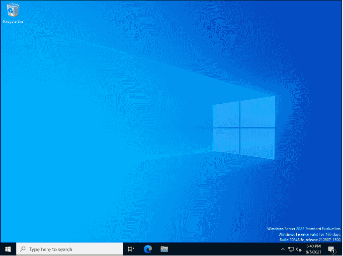

##### 服务器核心

服务器核心（如图1-2所示）连接控制台时界面会简洁很多。登录时会弹出一个看起来比较熟悉的命令窗口，提示你输入用户名和密码。登录后默认会打开`sconfig`窗口，如果你从`sconfig`中选择退出到命令行，会打开一个PowerShell窗口供你操作。初始配置可通过`sconfig`工具完成，也可以使用PowerShell脚本或PowerShell预期状态配置（DSC）完成。如果服务器加入了Active Directory域，可通过组策略管理该体验；如果是工作站服务器，则可通过本地组策略管理。

**图1-2：** 服务器核心的`sconfig`工具是用于执行初始配置的界面。

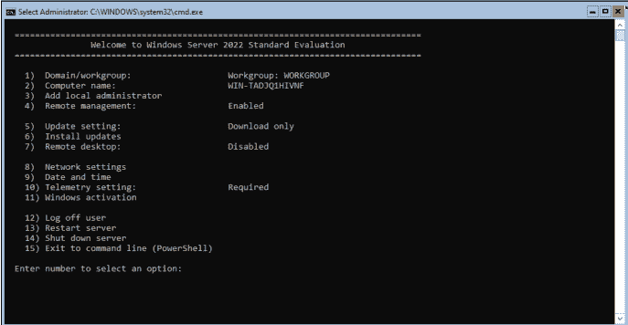

##### Nano服务器

Nano服务器提供了更简洁的界面和功能更有限的恢复控制台。它无法通过光盘上的常规安装程序安装，你需要从微软下载其容器镜像。相较于桌面体验和服务器核心，Nano服务器的磁盘占用量和计算资源需求都小得多。由于整体占用量更小，其攻击面也相应缩小。Windows Server 2022 Nano 服务器仅以容器基础操作系统镜像的形式提供，只能在容器主机上作为容器运行。

无法通过组策略管理Nano服务器。如果需要大规模管理Nano服务器，你需要改用PowerShell DSC。你可能会问：Nano服务器的功能如此有限，为什么还要使用它？如果你需要运行基于.NET的容器工作负载，Nano服务器是非常合适的选择，因为它已经过优化，可以运行.NET Core应用程序。如果你想试用Nano服务器，可以通过以下命令从DockerHub上的微软容器镜像仓库下载Nano服务器镜像：


```bash
docker pull mcr.microsoft.com/windows/nanoserver
```

你也可以前往[Nano服务器官方镜像页面](https://hub.docker.com/_/microsoft-windows-nanoserver)，查看当前Nano服务器容器镜像的更多信息，包括镜像描述、评价和额外资源。如果你想了解更多关于容器和使用`Docker`命令的内容，可以阅读本书第8册。

> **注意：** 本书不会深入讨论Nano服务器相关内容，因为你在实际场景中更可能接触到的是Windows Server 2022的桌面体验或服务器核心安装版本。

### 了解服务器管理器的功能

首次安装Windows Server 2022并登录后，首先看到的界面就是服务器管理器（如图1-3所示）。该界面提供了一个集中区域，你可以在此完成服务器上的所有配置任务，同时还可以通过便捷的菜单管理服务器上安装的所有角色和功能。

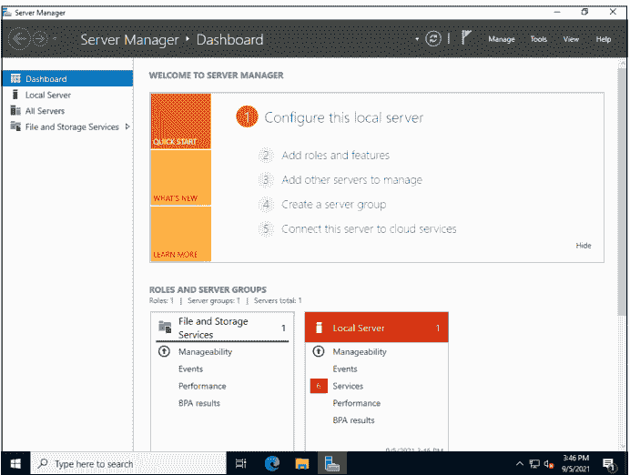

服务器管理器不仅可以管理本地服务器，还可以管理远程服务器。远程服务器需要先添加到服务器管理器中才能被管理，部分情况下还需要打开防火墙端口才能使用全部功能。远程服务器添加完成后，你可以对其运行`PowerShell`，执行关闭服务器、通过远程桌面协议（RDP）连接等基础管理操作。通过服务器管理器最多可以管理100台远程服务器，具体可管理的数量上限取决于受管服务器上运行的工作负载，如果运行大型工作负载，可管理的服务器数量会更少。

> **记住：** 服务器管理器可以管理其自身所安装的操作系统，以及版本更旧的操作系统，但无法管理运行版本更新操作系统的服务器。例如，安装在Windows Server 2019上的服务器管理器无法管理运行Windows Server 2022的服务器。

图1-4展示了服务器管理器菜单中的部分可用选项。你可能注意到“远程桌面连接”选项是灰色的，这是因为示例截图中的服务器正是我正在登录的服务器。

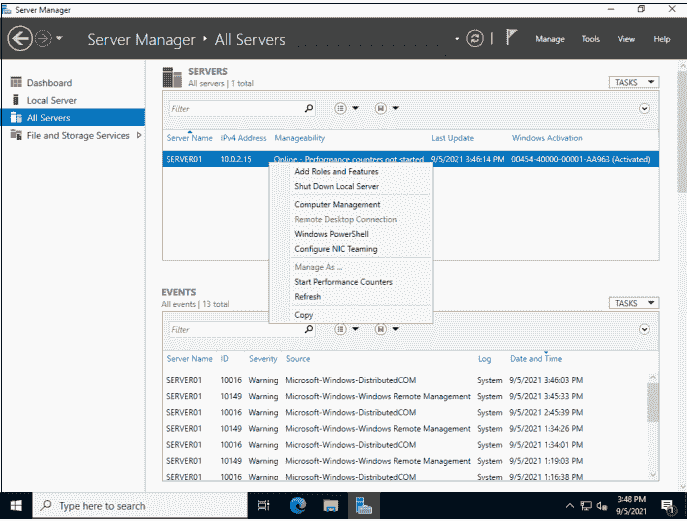

**图1-4：** 使用服务器管理器管理服务器。

以下是服务器管理器部分常用功能列表：

- 管理本地和远程服务器
- 管理服务器上的角色和功能（要安装或删除角色和功能，目标系统必须至少运行Windows Server 2012）
- 启动管理工具，如Windows PowerShell和MMC管理单元
- 查看事件、性能数据以及最佳实践分析器的结果

### Windows 管理中心：你的全新得力助手

Windows 管理中心是微软推出的新一代服务器管理工具。微软在该工具上投入了大量资源，成效显著。你可以使用它管理本地系统，也可以管理Azure中的系统。Windows 管理中心通过浏览器访问，你可以在同一个界面中完成几乎所有管理任务。最重要的是，它是完全免费的！你仅需支付其运行所在操作系统的许可证费用即可。

Windows 管理中心支持对Windows Server 2022、2019、2016、2012 R2和2012进行管理，所有功能均完全支持。默认情况下，Windows 管理中心使用TCP端口6516，你需要根据网络架构在服务器防火墙中放行该端口。要访问Windows 管理中心仪表板，你需要知道安装Windows 管理中心的系统的主机名。在图1-5中可以看到地址是`localhost:6516`，这是因为我将它安装在了处于桌面模式的Windows 10客户端上。桌面模式通常供单个系统管理员使用，而网关模式则可供更多员工使用。

首次打开的界面（见图1-5）会显示所有已连接的设备。点击列表中的任意设备，即可进入该设备的专属管理视图。图1-6中我点击了`server2022-dc`，你可以看到系统概览以及部分管理选项。屏幕左侧还有更多可操作的功能选项。

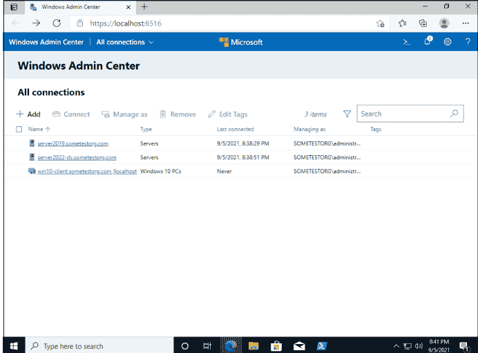

**图 1-5：** 你可以在“所有连接”页面上查看所有已连接的设备。

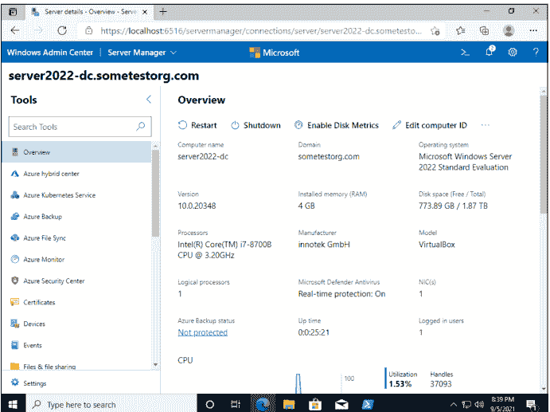

**图 1-6：** “概览”页面会展示你点击的设备的总体概况。

#### Windows Server 2022 概述

Windows 管理中心的安装非常简单。你可以从微软 Windows 管理中心官网（`www.microsoft.com/en-us/cloud-platform/windows-admin-center`）下载微软安装程序（MSI）安装包。安装前你需要决定是直接安装到桌面客户端，还是安装到服务器上。如果你只是试用该工具，或者只需要管理少量服务器，推荐你安装到桌面。如果要充分使用 Windows 管理中心的所有功能，就安装到服务器上，这样所有管理员都能访问，你就是他们的救星啦！

你可以在受支持的 Windows 10 版本，或 Windows Server 2016 及更高版本的服务器上安装 Windows 管理中心。要管理旧版服务器（包括 2012 和 2012 R2），需要在每台旧服务器上安装 Windows 管理框架 5.1。在 Windows 10 上安装 Windows 管理中心时，会以桌面模式安装，此时你可以通过`https://localhost:6516`访问。如果安装在服务器上，则会以网关模式安装，在 URL 中填写服务器名称即可访问（例如`https://服务器名称`），不需要加端口号！


> `localhost`指的是系统的本地环回地址，也可以通过 IP 地址`127.0.0.1`访问。


> 不支持将 Windows 管理中心安装到域控制器上。可想而知，这是非常糟糕的做法！因为 Windows 管理中心通过网页暴露服务，会多出一个通常不存在的攻击面。

Windows 管理中心的部分实用功能如下：

- 集中式服务器管理
- 与 Azure 集成，你可以在同一个控制台中管理本地和云资源
- 内置集群管理工具
- `Showscript`功能，可以查看用于执行管理操作的`PowerShell`脚本


> 当前仅支持 Microsoft Edge 和 Google Chrome 浏览器。Firefox 和 Internet Explorer 未经过测试，也不受官方支持。

第1章 *Windows Server 2022 概述* 17

### 扩展和优化数据中心

Windows Server 2022 支持你使用 Azure 云中的多项强大功能。部分功能要求运行 Windows Server 2022 数据中心版：Azure 版；其他版本的限制则较少。我不会深入讲解这些功能，毕竟它们是 Azure 相关书籍更适合讨论的内容，但你需要了解这些功能是什么、具备哪些能力。

#### Azure Arc

Azure Arc 是一项较新的服务，你可以使用 Azure 工具集管理 Azure 和本地资产。Windows Server 2022 是可通过 Azure Arc 管理的操作系统之一，你只需要安装 Azure Connected Machine 代理即可。

#### Azure 自动管理：热修补

截至本书编写时，Azure 自动管理：热修补功能仍处于预览阶段，你可以在 Windows Server 2022 数据中心版：Azure 版上试用该功能。它的工作原理是先以最新发布的累积更新（CU）为基准，之后每个月会发布可安装且无需重启的热修补。我再强调一遍：无需重启！对于系统管理员来说，打补丁无需重启简直是梦想。当基准更新为新的累积更新（大约每三个月一次）时，就需要重启了。

### 本章内容

- 排查启动诊断故障
- 使用特殊启动模式绕过服务器问题
- 对服务器执行内存测试
- 使用命令提示符进行故障排查
- 使用第三方启动工具排查故障

## 第2章

### 使用启动诊断

作为系统管理员，总有一天你会接到不可避免的求助电话，称服务器怎么也启动不了。要么是服务器陷入无限启动循环，要么是服务器直接卡住。如果你选择接受任务，就需要查明系统启动故障的原因并解决问题。本章将介绍用于排查系统无法正常启动故障的基础工具和技术。

#### 访问启动诊断工具

排查系统故障的第一步是访问 Windows Server 操作系统自带的启动诊断工具。

##### 从 DVD 启动

如果出现启动故障的是物理服务器，你可以使用 DVD 或 U 盘来访问启动诊断菜单。现在手头有物理存储介质的情况非常少见，因此你大概率需要从微软官网下载 Windows Server 2022 的 ISO 文件，再将镜像刻录到 DVD 或 U 盘中。


> **技术说明**
>
> ISO 文件就是物理光盘中存储的内容。

准备好存储介质后，你需要将其插入服务器并从该介质启动。你可能需要修改服务器的启动顺序，让 DVD 驱动器或 U 盘排在硬盘之前启动。你可以通过访问基本输入/输出系统（BIOS）来完成这项修改。在服务器系统上，这个选项会在系统启动过程中出现。进入 BIOS 需要按的按键取决于制造 BIOS 或统一可扩展固件接口（UEFI）的固件厂商。部分系统只需按下 F12 键就会弹出启动菜单，你可以选择 DVD 驱动器或 U 盘进行一次性启动。

当你搞清楚如何从 DVD 或 U 盘启动后，请按照以下步骤操作：

1. **从 DVD 或 U 盘启动。**
2. **当你看到“按任意键从 CD 或 DVD 启动”的提示时**，按下任意键，Windows Server 2022 的安装向导就会启动。
3. **在第一屏上，点击“下一步”。** 这一屏只是要求选择语言、时间和货币格式，以及键盘或输入法，你可以直接接受默认设置。
4. **在下一屏上，你会看到醒目的“立即安装”按钮，不要点击它！** 转而查看左下角的“修复计算机”链接（见图 2-1），点击该链接。
5. **在下一屏上，点击“疑难解答”。** 此时会显示可用的选项（见图 2-2）：
   - **命令提示符：** 可用于执行高级故障排查，在需要修复启动文件时尤其有用。你可以使用`diskpart`工具操作磁盘，使用`bootrec`命令重建或修复启动文件。
   - **系统映像恢复：** 可用于从备份工具创建的映像恢复系统。你需要先选择要恢复的目标操作系统，之后会显示可供使用的可用备份。

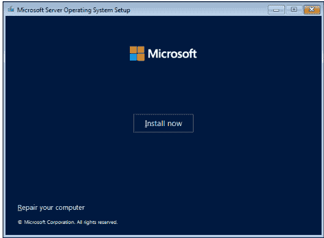

**图 2-1** 查找左下角的“修复计算机”链接。

### 使用启动诊断

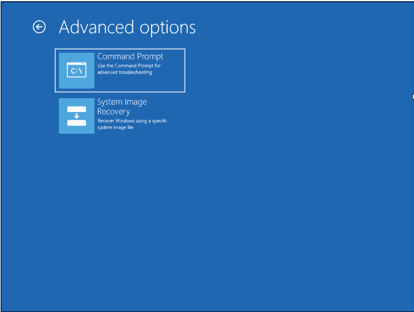

**图 2-2** “高级选项”界面。

### 使用启动诊断

#### 使用高级启动选项

“高级启动选项”菜单为系统管理员提供了多种用于排查各类系统故障的工具。该菜单在 Windows 操作系统中已经存在很久了，有两种方式可以进入它：

> 第一种方式是所有系统管理员的噩梦：系统出现故障、重启后自动进入“高级启动选项”菜单，这表明系统存在问题。

> 第二种方式没那么吓人，是系统管理员主动选择进入“高级启动选项”菜单，可能出于多种原因。我本人曾用它排查驱动故障，以及检查并清除可能已感染恶意软件的机器上的病毒。

要进入“高级启动选项”菜单，请按照以下步骤操作：

1. 点击“开始”菜单，再点击设置图标。
2. 点击“更新和安全”，再点击“恢复”。
3. 在“高级启动”下，点击“立即重启”按钮（见图 2-3）。
4. 点击“继续”按钮。
5. 点击“疑难解答”按钮。
6. 选择“启动设置”。
7. 点击“重启”。

当“高级启动选项”菜单弹出后，会显示多个可选选项（见图 2-4），我将在后续章节中介绍这些选项。

##### 安全模式

只要系统出现启动故障，我几乎都会首先选择安全模式。每当安装了新的硬件或软件，或者怀疑系统因恶意软件感染出现故障时，我都会进入安全模式处理。

###### 图2-3

进入高级启动选项菜单的旅程从“立即重启”按钮开始。使用启动诊断 

###### 图2-4

在高级启动选项菜单中，你可以选择让 Windows Server 执行的操作。

```text
高级启动选项

请选择要对以下系统执行的高级操作：

Windows Server

（使用箭头键突出显示所选选项。）

修复计算机

安全模式

带网络连接的安全模式

带命令提示符的安全模式

启用启动日志记录

启用低分辨率视频

上次正确的配置（高级）

调试模式

禁用系统失败时自动重启

禁用驱动程序签名强制

禁用反恶意软件早期启动驱动程序

正常启动 Windows

说明：查看可用于修复启动问题、运行诊断并还原系统的系统恢复工具列表。

ENTER=选择

ESC=取消
```


你可能要问：“什么是安全模式，为什么它如此重要？”

安全模式以运行 Windows 所需的最低限度服务和驱动程序启动。安全模式对故障排除至关重要，特别是在有问题的驱动程序导致`启动循环`的场景下。进入安全模式后，你可以排查驱动程序的故障，并将其卸载或替换。

安全模式对付潜在恶意软件感染也非常有用，因为恶意软件运行所需的依赖项不会被加载，这能让你运行恶意软件移除工具，彻底清除操作系统中残留的恶意代码。

使用哪种安全模式取决于我要完成的任务。例如，如果我只是在排查一个怀疑与驱动程序相关的问题，大多数时候我会使用普通旧版安全模式。在接下来的章节中，我会带你了解不同版本的安全模式，以及你可能想要使用它们的原因。

### 安全模式

这就是普通的旧版安全模式。它仅加载 Windows 运行和用户交互所需的基础服务和驱动程序。不多也不少。大多数情况下，这种普通版本的安全模式足够你排查和解决当前问题。

它有图形界面，和你平时在 Windows Server 中看到的一致，但无法访问互联网或其他网络资源。本质上，它是一台独立运行的单机。

### 带网络连接的安全模式

带网络连接的安全模式与普通安全模式类似，不同之处在于系统还会加载网络接口卡（NIC）正常运行所需的驱动程序。如果你需要从互联网下载软件（例如驱动程序或诊断软件），或是从网络共享下载文件，这个模式就非常有用。

带网络连接的安全模式在解决软件或驱动程序问题时最为实用。它允许你在安全模式下下载替代软件或替代驱动程序，之后你就可以用已知的完整版本替换异常的驱动程序或兼容性有问题的软件，然后成功启动系统。

### 带命令提示符的安全模式

在带命令提示符的安全模式下，你会跳过资源管理器的桌面环境。如果桌面因为某些原因无法正常显示，这个模式就特别有用。

如果你习惯使用 Server Core，那你也会喜欢这个版本的安全模式。如果你对命令窗口的使用还不够熟练，准备一份速查表会很有帮助。

当需要修复的问题和图形相关时，我推荐使用带命令提示符的安全模式。问题可能源于驱动程序、图形渲染，或是移除依赖壁纸、屏幕保护程序这类图形组件的恶意软件感染。

### 启用启动日志记录

如果你需要查看系统启动时安装了哪些驱动程序，你应该选择“启用启动日志记录”。这会创建一个名为`ntbtlog.txt`的文件，其中列出了操作系统启动时安装的所有驱动程序。

该文件存储在 Windows 系统目录中，通常是`C:\WINDOWS`。顺便一提，这个列表和你进入安全模式时闪现在屏幕上的内容是同一个。

### 启用低分辨率视频

如果你遇到显示问题，这个设置非常有用，最常见的情况是你把显示设置改成了显示器不支持的分辨率。它会使用当前已安装的显卡驱动程序，但以较低的分辨率（通常为 640 x 480）和刷新率设置启动。

### 上次正确的配置

上次正确的配置有助于修复因 Windows 注册表损坏导致的启动问题。这种情况通常是由于用户误操作，或是更新、补丁安装导致的。

当你选择“上次正确的配置”时，注册表会回滚到系统上一次成功启动时的对应设置。

> 任何会以任何方式修改注册表的操作，都要格外谨慎。使用“上次正确的配置”无法撤销操作。如果它没有修复问题，或是让情况更糟，你就需要从备份中还原系统。

### 目录服务还原模式

这个选项只出现在作为域控制器的服务器上（因此图2-4中未显示）。目录服务还原模式（DSRM）是专为域控制器设计的特殊安全模式，允许你修复或恢复 Active Directory（活动目录）数据库。

#### 使用启动诊断

> **提示**
>
> 要使用此工具，你需要知道创建域控制器时设置的 DSRM 密码。如果你不知道密码，可以使用`ntdsutil`工具修改密码。你需要在目标系统上访问命令提示符才能运行该工具。
>
> 如果这些内容对你来说完全是天书，也不用担心！我会在第2册第5章中深入讲解 Active Directory（活动目录）。目前，你可以把 Active Directory（活动目录）想象成一个特殊数据库，用于存储网络中用户、计算机、站点及其他对象的相关信息。这个数据库对你的组织至关重要，因此掌握它损坏时的恢复方法是一项非常有用的技能。

### 调试模式

如果你是资深系统管理员，想尝试使用内核调试器，这个选项适合你！

`内核`是服务器启动时最先运行的程序之一（内核在引导程序之后立即加载），它对你的系统上的所有内容有完全控制权。调试模式会启用内核调试，允许你使用内核调试器检查内核级运行的系统和进程状态。

这对于排查导致臭名昭著的蓝屏死机问题的设备驱动程序问题，以及中央处理器（CPU）相关问题非常有用。你可以查看出现问题的系统上的内核内存转储，也可以通过串行连接在其他系统上远程查看内核内存转储。

调试模式的信息通常通过 COM1 端口提供（假设你配有串行端口，并且已分配给 COM1）。在没有串行端口的新系统上，你也可以通过 USB 访问这些信息。

**技术说明**

内核调试并非胆量小的人能尝试的。有关如何通过串行或 USB 连接为系统配置内核调试的更多信息，请查看以下文章：

- **串行连接：** https://docs.microsoft.com/en-us/windows-hardware/drivers/debugger/setting-up-a-null-modem-cable-connection
- **USB 连接：** https://docs.microsoft.com/en-us/windows-hardware/drivers/debugger/setting-up-a-usb-3-0-debug-cable-connection

> **提示**
>
> COM 端口在旧系统上通常以带 RS-232 连接器的串行端口形式提供。在新系统上，这些端口已被 USB 端口取代。USB 是`通用串行总线`的缩写——它仍然属于串行连接。

### 禁用系统失败时自动重启

最终，每位系统管理员都会遇到这样的系统：反复尝试启动、失败、重启，再尝试启动、失败、重启，如此循环。这种情况被称为`启动循环`。

如果你的系统遇到启动循环问题，你可以从高级启动选项菜单中选择“禁用系统失败时自动重启”，让系统停止自动重启。

禁用自动重启在系统出现蓝屏死机、你需要查看屏幕上显示的信息时非常有用。当系统在下一次蓝屏时停止运行，你将有充足的时间抄写下所有信息。

### 禁用驱动程序签名强制

选择“禁用驱动程序签名强制”选项，本质上就是告诉系统可以加载未经过数字签名的驱动程序。默认情况下，Microsoft 要求驱动程序必须经过数字签名，会阻止未签名驱动程序运行。

Microsoft 这样做的原因是，经过数字签名的驱动程序会被视为正版，因为你可以通过数字签名验证它确实来自其所声称的供应商。数字签名还能保证驱动程序自供应商发布后未被以任何方式篡改。

数字签名使用代码签名证书对文件的哈希值进行加密。（哈希值是唯一的指纹——文件的任何改动都会改变哈希值。）加密后的哈希值会与证书、驱动程序可执行文件打包在一起。

当最终用户安装驱动程序时，会使用证书中的公钥解密文件哈希值。在最终用户的系统上会再次对文件进行哈希计算，将新哈希值与解密后的哈希值进行比对。如果两者一致，说明驱动程序未被篡改。

> **警告**
>
> 如果你选择禁用驱动程序签名强制，你将能够加载未签名的驱动程序。选择此选项需自行承担风险：你最终可能会安装伪装成未签名驱动程序的恶意软件。

### 禁用早期启动反恶意软件驱动

在 Windows 启动后才安装的恶意软件，通常会被系统上已安装的杀毒软件检测到。但问题是，病毒制作者开始编写一种名为`根套件`的恶意软件。

这类根套件极难清除，因为它们会在操作系统启动`之前`就完成安装并执行。许多更复杂的根套件还会安装驱动，在系统启动流程`非常`早期的阶段就加载，这使得它们极难被发现和清除。

微软会不断升级技术、应对威胁，尽可能在早期阻止威胁。针对这种情况，微软推出了早期启动反恶意软件（ELAM）驱动。

支持早期启动的认证杀毒软件厂商，可以让其产品驱动在 Windows 启动驱动之前加载，从而在系统启动时扫描恶意进程。是不是很实用？

但如果 Windows 的合法启动驱动被误判为恶意程序会怎么样？你的服务器将无法启动。因此，微软提供了关闭该功能的选项，选择“禁用早期启动反恶意软件驱动”，就能让启动驱动正常加载。

建议开启这项功能。仅在绝对必要的情况下才禁用它，且仅需在问题解决前临时禁用。

### 执行内存检测

如果你的服务器毫无征兆地崩溃、弹出蓝屏，这种情况该如何处理？这个问题可能不太好回答。这些症状可能是软件损坏导致的，也可能是硬件故障导致的。

内存是排障时很好的排查切入点，Windows Server 2022 内置了名为 Windows 内存诊断工具的内存诊断实用程序。

你可以通过按 Win+R 组合键，输入`mdsched.exe`，再点击“确定”来运行 Windows 内存诊断工具。如果你不做任何操作，Windows 内存诊断工具会以标准模式运行。

你可以随时按 F1 进入选项界面修改设置来中断扫描。可选设置如下（见图2-5）：

> **测试组合：** 测试组合是你希望工具运行的测试集合：
>
> - **基本：** 会对你的内存运行3项测试，是最快的选项。
> - **标准：** 运行与基本测试相同的内存测试，并额外增加5项测试，完成时间比基本测试更长。
> - **扩展：** 运行与标准测试相同的测试，并额外增加9项测试。该测试最详细，完成时间也最长。
> - **缓存：** 缓存设置用于配置你要运行的每项测试的缓存参数（缓存用于提升 CPU 频繁访问数据的内存访问速度）。如果你运行的测试需要直接访问内存，应禁用缓存。可选设置如下：
>   - **默认：** 大多数情况下，默认是合适的设置，会为当前运行的测试自动选择正确的缓存配置。
>   - **开启：** 强制为测试开启缓存。
>   - **关闭：** 强制为测试关闭缓存。
> - **传递次数（0-15）：** 传递次数控制你选择的整个测试组合的运行次数。如果设置为5，选中的测试组合会完整运行5次。该设置的默认值为运行2次。

图2-5：Windows 内存诊断工具选项。

完成设置后，按 F10 应用设置，扫描将重新启动。如果你不知道这些测试分别的作用，标准测试是很好的入门选择。

扩展测试耗时更长，如果你不需要额外的测试，运行它可能不会获得有价值的信息。不过，运行这三项测试中的任意一项都不会对你的服务器造成损害。

> **提示**
>
> 第2章 使用启动诊断 29

```text
Windows Memory Diagnostics Tool - Options
Test Mix: Basic Standard Extended
Description: The Extended tests include all the Standard tests plus MATS+ (cache disabled), Stride38, WSCHCK, WStride-6, CHCKR4, WCHCKR3, ERAND, Stride6 (cache disabled), and CHKR8.
Cache: Default On Off
Description: Use the default cache setting of each test.
Pass Count (0 - 15): 2
Description: Set the total number of times the entire test mix will repeat (Max = 15).
TAB=Next F10=Apply ESC=Cancel
```

### 使用命令提示符

当其他所有方法都无效时，命令提示符永远是你可靠的后盾。多年来我排障过无数问题，多亏有命令提示符才得以解决。

系统文件损坏？打开命令提示符运行`sfc /scannow`。硬盘损坏？打开命令提示符输入`chkdsk /f /r`。

在表2-1中，我列出了多年来用过的最实用的几款工具。这些命令大多需要以管理员身份运行命令提示符才能执行。

要以管理员身份运行命令提示符，可以选择“开始”➢“Windows系统”，右键点击“命令提示符”，点击“更多”，再选择“以管理员身份运行”；或者如果你能打开任务管理器，可以选择“文件”➢“运行新任务”，输入`cmd.exe`。

**表2-1 使用命令提示符排障**

| 名称 | 命令 | 说明 |
|---|---|---|
| 系统文件检查器 | `sfc /scannow` | 该实用程序会检查系统文件，通过对比服务器上的系统文件签名与同一文件的缓存副本签名，确认文件是否符合预期。缓存文件存储在`C:\Windows\System32\dllcache`目录下的压缩文件夹中。如果发现损坏的系统文件，会将其自动替换。 |
| 检查磁盘 | `chkdsk /f /r` | 该实用程序可修复文件系统错误，标记坏扇区，使操作系统不再使用这些扇区。`/f`参数会指示工具修复发现的所有问题，`/r`参数会定位磁盘上的坏区域（扇区）。该过程可能耗时较长，启动后可以先去喝杯咖啡。 |
| 驱动程序查询 | `driverquery` | 该实用程序会查询系统上安装的所有 Windows 硬件驱动程序。如果你遇到的故障和硬件配置相似的系统有关，想确认它们是否有共用的驱动，这个工具非常实用。 |
| BCDEdit | `bcdedit` | 该实用程序在《Book 1》第4章中有详细介绍。目前你只需要知道，它可以用来编辑 Windows 服务器的启动配置。 |

### 使用第三方启动实用程序

如果没有简要介绍旨在帮助诊断和解决启动问题、或至少辅助恢复的第三方实用程序，本章内容就不完整。表2-2列出了我最常用的两款工具，包含它们的费用和简要说明。

#### 第三方启动实用程序

**表2-2**

| 名称 | 费用 | 说明 |
|---|---|---|
| Ultimate Boot CD | 免费 | 这是我个人一直以来最喜爱的实用程序之一，包含多种诊断和恢复工具。使用时只需从光盘启动即可，非常简单！更多信息可访问 www.ultimatebootcd.com。 |
| Trinity Rescue Kit | 免费 | Trinity Rescue Kit 功能丰富，也是非常实用的工具。更多信息可访问 https://trinityhome.org。 |

> **本章内容**
>
> - 安装支持成功安装的先决条件
> - 执行 Windows Server 2022 的全新安装
> - 从旧版本的 Windows Server 升级
> - 使用 Windows 部署服务（WDS）执行网络安装

# 第3章 执行基础安装

你已经做出了决定：要安装 Windows Server 2022。太棒了！你可能好奇接下来该做什么。

确保安装成功能做的最重要事情之一，就是确认你已满足 Windows Server 2022 的所有先决条件。确认你拥有满足操作系统需求的合适硬件，绝对能帮你后续省去不少麻烦。

当你准备好了安装 Windows Server 2022 所需的一切，就可以开始操作了。本章会带你完成全新安装和升级安装的操作流程，我也会讲解如何使用 Windows 部署服务执行网络安装。

> **提示**
>
> 需要注意的是，你无法再在 Server Core（服务器核心）和带桌面体验的 Server 之间切换了。该功能在 Windows Server 2016 中被移除，目的是为了支持服务器上基于 Windows 10 的新型桌面体验，而非 Windows Server 2012 R2 时期的旧版传统桌面体验。
>
> 如果你安装了 Server Core，之后反悔想要改用带桌面体验的 Server，需要重新安装系统。如果你尝试使用 Windows Server 安装介质在核心版和桌面体验版之间切换，系统不会提供保留任何数据的选项。

## 确保你已具备所需条件

微软会发布其所有操作系统的先决条件。部分硬件要求与你计划安装的 Windows Server 版本无关；其他硬件要求则取决于你安装的是带桌面体验的服务器还是服务器核心版。

Windows Server 2022 仅提供64位操作系统版本，没有32位版本。运行安装程序时，会提供标准版或数据中心版的选择；同时你可以选择安装服务器核心版还是带桌面体验的服务器。

> ⚠️ **警告**
>
> 本节中我提到的最低要求是指成功安装 Windows Server 2022 的`绝对最低要求`。如果你为服务器配备此处列出的规格，`绝对不要`指望它能有良好的运行表现。
>
> 那么，要安装 Windows Server 2022，你必须满足哪些绝对最低要求呢？继续往下看即可。

### 版本与版本要求

总体而言，服务器核心版和带桌面体验的服务器的最低要求差异不大，唯一非常重要的例外是随机存取内存（RAM）的容量。

安装服务器核心版的最低内存要求是512MB，而带桌面体验的服务器最低需要2GB内存。如果你要安装 Windows Server 2022 标准版，硬件规格应根据你计划运行的工作负载要求来确定。

如果选择运行 Windows Server 2022 数据中心版，你可能需要考虑配备更好的硬件。数据中心版的一个典型使用场景是作为 Hyper-V 宿主机。数据中心版不会限制你可以运行的虚拟机（VM）数量，你的硬件才是真正的限制因素。在这种情况下，你需要配置多核处理器和大容量内存。

### 中央处理器（CPU）

中央处理器（CPU）是设备的“大脑”，负责处理程序和/或应用程序发出的指令。Windows Server 2022 对 CPU 的要求，大部分现代处理器都能轻松满足：

- **1.4 GHz 64位处理器**：考虑到该操作系统是 x64 系统，处理器也必须是 x64 处理器才合理。即使是搭载入门级处理器的廉价服务器，也能轻松达到1.4 GHz 的要求。
- **支持无执行（NX）**：当在部分内存区域启用 NX 位时，处理器不会执行该内存空间中的任何内容，可防范恶意软件。受 NX 位保护的区域通常存放处理器指令或数据存储等内容。英特尔将该技术称为 XD（Execute Disable 的缩写），而 AMD 处理器则称之为增强型病毒防护（EVP）。
- **支持数据执行保护（DEP）**：DEP 可提供额外防护，抵御针对内存位置的恶意软件。


- **支持 `CMPXCHG16b`、`LAHF/SAHF` 和 `PrefetchW`**：这些是处理器专属设置，关于其特性已发布多份白皮书。`CMPXCHG16b` 是绝大多数现代 `x86_64` 处理器支持的指令集。从标志加载 `AH`（`LAHF`）/将 `AH` 存入标志（`SAHF`）是支持虚拟化所必需的。`PrefetchW` 可在使用 AMD 处理器时提升性能。你不需要记住这些内容——只要知道这些处理器功能可以加速任务执行、同时提供额外的安全功能即可。

- **支持二级地址转换（扩展页表 [EPT] 或嵌套页表 [NPT]）**：如果你计划运行 `Hyper-V`，该特性尤为重要。它可以提升系统上虚拟机的性能，同时减轻管理程序的负担，进而提升管理程序的性能。

> **技术提示：执行基础安装**
>
> 你可能好奇如何判断 CPU 是否支持这些要求。微软提供了一款属于 `Sysinternals` 工具集的工具，名为 `Coreinfo`，它可以告诉你你的处理器支持哪些功能。
>
> 你可以从微软官方网站免费下载 `Coreinfo`（<https://docs.microsoft.com/en-us/sysinternals/downloads/coreinfo>）。你下载的文件是压缩的 `zip` 包，因此需要先解压，再打开命令提示符运行该工具。
>
> 要运行 `Coreinfo`，只需在命令窗口中输入 `coreinfo`，即可获得所有可用和不可用功能的报告。可用功能用星号（`*`）标记，不可用功能用连字符（`-`）标记，如图 3-1 所示。

图 3-1：在 Windows 系统上运行 `Coreinfo` 工具。

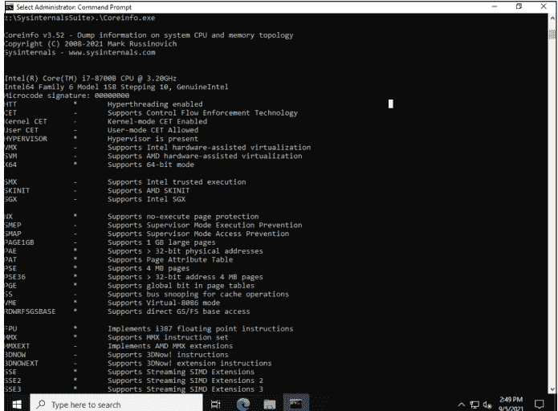

### 随机存取内存（RAM）

服务器使用随机存取内存（`RAM`）存储当前需要访问的内容，以及近期可能需要访问的内容。`RAM` 的速度远快于持久化存储，因此配备大容量 `RAM` 的服务器运行表现会远优于 `RAM` 容量极低的系统。如本章前面“版本与版本要求”附注栏所述，服务器核心版最低需要 `512MB RAM`，带桌面体验的服务器最低需要 `2GB RAM`。同时 `RAM` 必须是纠错码（`ECC`）类型内存。`ECC` 类型内存可以纠正单比特错误（例如，如果电气干扰导致比特位意外翻转，通过使用奇偶校验位可以确保内存中的数据被修正）。

### 存储

这里没有复杂的公式或计算。如果要安装 `Windows Server 2022`，你至少需要 `32GB` 的硬盘空间。请记住这只是安装操作系统的绝对最低要求。如果你的硬盘只有 `32GB`，就没有空间安装其他任何内容了。如果你的存储空间有限，根据微软的说法，Windows Server 核心版比带桌面体验的 Windows Server 小约 `4GB`。

### 网络适配器

如果你无法访问服务器，它就毫无用处。网络适配器（也称为网络接口卡 [`NIC`]）让你的服务器能够接入网络进行通信。对于 `Windows Server 2022`，你的网络适配器至少要支持千兆以太网。你的网络适配器可能是板载的，也就是主板的一部分，也可能是独立网卡，需要插入 `PCI Express` 插槽。你的网络适配器应支持预启动执行环境（`PXE`）。这是当今大多数组织都使用的功能，用于从 Windows 部署服务或系统中心配置管理器这类集中式镜像服务器给系统做镜像。

### DVD 驱动器

现在不是所有服务器都自带 DVD 驱动器了。安装操作系统的方式有很多，比如从 U 盘启动或从网络启动，很多系统管理员根本不会用 DVD。也就是说，如果你想通过 DVD 安装系统，你需要确保有 DVD 驱动器。驱动器可以是内置的，也可以是外置的。

### 基于 UEFI 的固件

统一扩展固件接口（`UEFI`）现在已经取代了传统的旧版基本输入/输出系统（`BIOS`）。我强烈建议你选择 `UEFI` 而非 `BIOS`。如果你要使用安全启动这类高级功能，就必须使用 `UEFI`。

### 受信任的平台模块

如今绝大多数主板都自带受信任的平台模块（`TPM`）芯片。如果你计划使用 `BitLocker` 进行磁盘加密，这是必备组件。

### 显示器

不用说，安装操作系统时你需要能够看到服务器的运行状态。`Windows Server 2022` 要求配备超级视频图形阵列（`SVGA`）接口，屏幕分辨率最低为 `1024 x 768`。你可以通过给服务器连接物理显示器，或者通过 `KVM` 查看视频流来实现这一点。

`KVM` 可让你使用一套键盘、显示器（其中 `V` 是 `video` 的缩写）和鼠标来管理多台服务器。早期的 `KVM` 需要你亲临现场才能使用键盘、显示器和鼠标。现代 `KVM` 则支持通过网页服务远程管理服务器，其提供的功能和你在服务器上物理接入键盘、显示器和鼠标时获得的体验几乎一致。

### 键盘和鼠标

你可以在系统镜像写入期间直接将键盘和鼠标连接到服务器，也可以通过 `KVM` 将输入设备提供给系统。无论用哪种方式，你都需要某种形式的键盘和鼠标来与系统交互。

## 执行全新安装

我本人更推荐全新安装的方式。执行全新安装可以有效降低因驱动故障、系统文件损坏或配置错误引发问题的概率。在本节中，我会教你如何全新安装 `Windows Server 2022`。我们假设你已经通过要用于安装的介质（DVD、U 盘等）启动了系统，并且正处于 `Windows Server 2022` 的初始安装界面。如果你已经完成以上操作，应该会看到如图 3-2 所示的界面。请按照以下步骤操作：

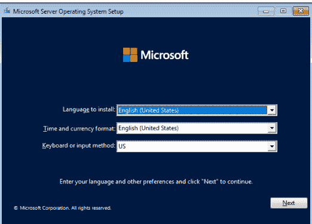

> **图 3-2**：`Windows Server 2022` 的初始安装界面。

1. 选择适合你所在地区的设置，然后点击「下一步」。在我的示例中，我选择了以下选项：
   - **安装语言**：英语（美国）
   - **时间和货币格式**：英语（美国）
   - **键盘或输入法**：美式

   点击「下一步」后，会显示如图 3-3 所示的界面。

   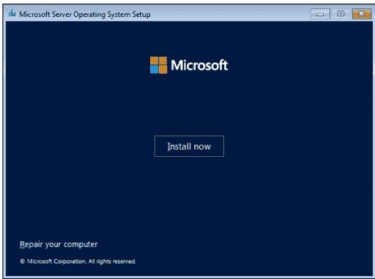

2. 点击「立即安装」。

3. 在下一个界面中，选择要安装的操作系统版本，然后点击「下一步」。默认选项为 `Windows Server 2022` 标准版（如图 3-4 所示）。你也可以选择 `Windows Server 2022` 标准版（含桌面体验）、`Windows Server 2022` 数据中心版或 `Windows Server 2022` 数据中心版（含桌面体验）。

   > **图 3-4**：选择你需要的 `Windows Server 2022` 版本及体验模式。

   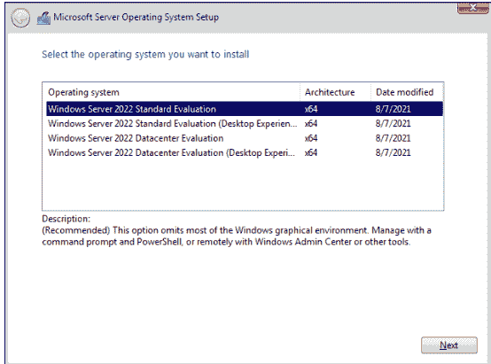

4. 在下一个界面中，勾选「我接受许可条款」复选框，然后点击「下一步」。

5. 在下一个界面中，选择「自定义」。另一个选项是用于升级安装的。

   > **图 3-5**：选择 Windows 的安装位置。

   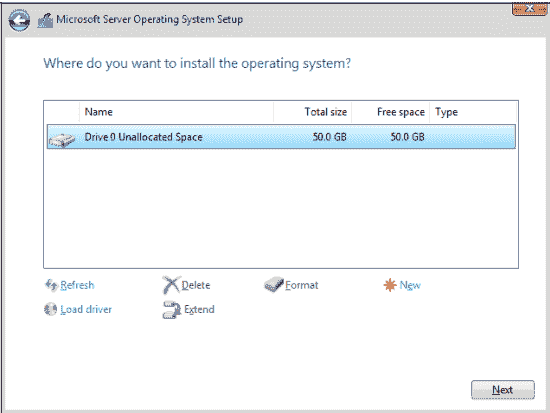

6. 在下一个界面中，选择要安装 Windows 的分区，然后点击**下一步**。在图 3-5 中可以看到，这里是驱动器 0。`Windows Server 2022` 将开始安装，安装完成后会自动重启。接下来的操作就轻松多啦！

## 升级 Windows

考虑升级安装时，你需要确认当前使用的操作系统版本可以升级到 `Windows Server 2022`。表 3-1 列出了可升级的来源操作系统以及可升级到的 `Windows Server 2022` 版本。


> **提示**
>
> 通常情况下，只要你使用的系统属于最近两个大版本，就可以直接升级到最新的 Windows Server 操作系统。

**表 3-1**

| 如果你运行的版本是…… | 可升级到的版本…… |
|---|---|
| Windows Server 2016 标准版 | Windows Server 2022 标准版或数据中心版 |
| Windows Server 2016 数据中心版 | Windows Server 2022 数据中心版 |
| Windows Server 2019 标准版 | Windows Server 2022 标准版或数据中心版 |
| Windows Server 2019 数据中心版 | Windows Server 2022 数据中心版 |

你还需要联系应用供应商，确认服务器上的应用与 `Windows Server 2022` 兼容。如果不兼容，你可能需要在升级服务器操作系统之前先升级相关应用。


> **提示**
>
> 早于 `Windows Server 2016` 的 Windows Server 操作系统没有直接的升级路径。如果你要从更早的服务器迁移，请先执行全新安装。如果无法执行全新安装，你需要先升级到 `Windows Server 2016` 或 `Windows Server 2019`，之后才能升级到 `Windows Server 2022`。

确认当前系统版本兼容后，你就可以开始升级安装了。本示例中，我将从 `Windows Server 2019` 标准版升级到 `Windows Server 2022` 标准版，请按照以下步骤操作：

- 以管理员身份登录要升级的系统。
- 将光盘或其他安装介质插入要升级的系统，运行 `setup.exe`。下一个界面会询问你是否要提前下载更新和驱动（见图 3-6）。

### 执行基础安装

> **图 3-6**：选择保留你的文件和设置，或全新开始。
>
> **警告**

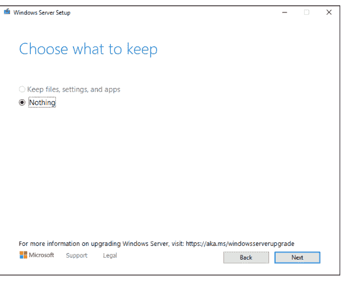

3. 在「安装 Windows Server」界面中，点击「下一步」。系统会自动下载相关更新，你可能需要在继续操作前重启一次。在该界面中，你会看到一个名为*更改 Setup 下载更新方式*的链接，点击它可以设置在安装时不为服务器安装补丁。除非服务器没有网络连接，否则我不建议这么做，因为未打补丁的服务器在完成修补前可能存在被攻击的风险。

4. 选择「Windows Server 2022 标准版（含桌面体验）」（或你需要的任意版本），然后点击「下一步」。

5. 如果有时间，请仔细阅读许可条款，之后点击「接受」。在下一个界面中，你需要选择是保留个人文件和应用，还是全部清除。如果你保持相同的体验模式（核心版或桌面版），会看到两个选项；如果切换体验模式，则只能选择全部清除。

6. 如果看到该选项，请选择「保留个人文件和应用」单选按钮，然后点击「下一步」。如果你想全新安装，可以选择「不保留任何内容」。需要注意，选择该选项会导致数据丢失。本次示例中由于我使用的是评估版镜像，因此只能选择「不保留任何内容」。该界面如图 3-6 所示。

### 技术说明

如果「保留文件、设置和应用」选项呈灰色不可选，可能是因为你正在尝试切换用户体验模式（例如从核心版切换到桌面版），也可能是你使用的是评估版镜像而非零售版镜像。以上两种情况都需要选择「不保留任何内容」。安装程序会自动获取所有适用的更新，然后显示摘要界面。

7. 如果所有信息都正确无误，点击「安装」。安装程序将开始执行到 `Windows Server 2022` 的升级安装，过程中可能会重启多次。至此，升级完成！

## 使用 Windows 部署服务执行网络安装

Windows 部署服务（`WDS`）是可在 Windows Server 操作系统上安装的角色，它集成了预启动执行环境（`PXE`）服务器和普通文件传输协议（`TFTP`）服务器，支持你通过选择网卡作为启动设备，在网络连接上安装 Windows。安装 `WDS` 的流程非常简单，你可以选择将其安装为独立服务器，也可以将其与 `Active Directory` 集成。你只需要指定要使用的启动文件即可，最简单的选择是 Windows Server 安装媒体中的 `boot.wim` 文件，该文件包含 Windows 预安装环境（`WinPE`），通常位于安装介质的 `Sources` 目录下。接下来你需要创建安装文件，最简单的入门方式是复制 `Windows Server 2022` 安装媒体中的 `install.wim` 文件（同样位于 `Sources` 目录）到将作为 `WDS` 服务器的系统中。你可以在该系统中看到和光盘安装向导完全一致的版本及体验模式选项。`WDS` 完全配置完成后，会通过网络分发系统镜像，你只需要告诉新服务器从网络启动即可。


如果你正在进行网络安装，且服务器与 Windows 部署服务（`WDS`）服务器不在同一个子网，你需要设置动态主机配置协议（`DHCP`）的 66 和 67 选项。选项 66 用于指定 `WDS` 服务器的主机名或 IP 地址，选项 67 则是启动文件名。如果两个网络之间存在防火墙，你可能还需要创建防火墙规则以允许 `UDP 67` 和 `68` 端口的通信。


如果你使用安装介质中的默认 `boot.wim` 选项，你会收到弃用提示，但你仍可以继续使用该 `boot.wim` 进行配置。未来版本的 Windows Server 将不再支持此选项。不过你可以使用自定义的 `boot.wim` 文件。微软建议迁移至 `Microsoft Endpoint Configuration Manager`（微软端点配置管理器）或 `Microsoft Deployment Toolkit`（微软部署工具包）产品，以实现更细粒度的镜像自定义与部署。

# 第 4 章 执行初始配置任务

## 本章内容

- 了解 `Windows Server 2022` 的默认设置
- 了解配置流程概览
- 提供服务器正常运行所需的信息
- 为 `Windows Server 2022` 安装最新的补丁、热修复及其他更新程序
- 根据偏好自定义 `Windows Server 2022`
- 使用 `BCDEdit` 配置服务器启动选项

现在你已经完成了 `Windows Server 2022` 的安装，接下来就是有趣的配置环节了！作为管理员，安装服务器操作系统后的下一项任务就是对其进行配置，使其能够按预期运行。微软在 `Windows Server 2008` 中推出了服务器管理器功能，并在 `Windows Server 2012` 中对该功能进行了重大更新，以支持远程管理以及多服务器管理。如果你使用的是带桌面体验的服务器，那么绝大多数需要完成的服务器配置任务都可以通过服务器管理器开始操作。如果你使用的是 `Server Core`（服务器核心）系统，则不会在控制台使用服务器管理器，取而代之的是使用 `sconfig` 实用工具执行初始配置（前提是你没有部署已经针对你的环境配置好的 `Server Core` 镜像）。当然，只需稍作初始设置，你就可以使用服务器管理器远程管理 `Server Core` 系统，相关内容我会在配置流程概览部分进行介绍。

## 了解默认设置

`Windows Server 2022` 首次安装时，会自动创建或设置一些默认配置。通常这些配置都是你需要修改的，例如设置服务器名称、配置 IP 地址、将服务器加入域等。表 4-1 列出了这些默认设置，并说明了其出厂默认值，帮助你更好地了解初始配置状态。

**表 4-1：Windows Server 2022 默认设置**

| 设置项 | 默认值 | 说明 |
|---|---|---|
| 计算机名 | `WIN-<随机字符串>` | 这是以 `WIN-` 开头的随机生成名称，你需要根据所在组织的命名规范修改该名称。修改名称后需要重启系统。 |
| IP 地址 | 由 `DHCP` 分配 | 默认情况下，全新服务器会通过 `DHCP` 自动获取 IP 地址。如果你的组织使用 `DHCP` 管理 IP 地址，那么无需额外操作即可正常使用。如果未使用，你可能需要设置静态 IP 地址。 |
| 域或工作组 | 名为 `WORKGROUP` 的工作组 | `Windows Server 2022` 初始状态为加入名为 `WORKGROUP` 的工作组。如果该服务器是独立服务器，该默认设置可以满足需求。工作组成员服务器不属于域成员。如果你的服务器需要加入域，则需要修改该设置，修改后需要重启系统。 |
| Windows 更新 | 自动下载更新 | 更新会自动下载，但需要你手动确认后才会安装。 |
| Microsoft Defender 防火墙 | 公用和专用配置文件：已启用<br>核心操作系统功能：已允许 | 默认状态下，Microsoft Defender 防火墙包含公用和专用两个配置文件。操作系统运行所需的核心功能会被自动允许。如果服务器加入域，则会出现域配置文件。 |
| Microsoft Defender 防病毒 | 实时保护：已启用 | 提供实时病毒/恶意软件扫描，可阻止恶意软件在你的服务器上安装或运行。默认情况下还会启用自动提交示例功能，该功能会将示例文件发送至微软进行分析。 |
| 角色和功能 | 已安装部分角色/功能 | 出厂默认会启用部分角色和功能以保障服务器基础功能正常运行。需要注意：即使某个角色或功能处于选中状态，也不代表该角色的全部功能都已安装。 |
| 远程管理 | 已启用 | 允许通过 `PowerShell` 远程管理服务器，同时允许需要通过 Windows 管理规范（`WMI`）运行的应用程序或命令管理服务器。 |
| 远程桌面 | 已禁用 | 允许用户远程连接至服务器桌面，可单独配置允许访问的用户，或通过安全组批量配置。 |

## 了解配置流程概览

对于全新安装的服务器，初始状态下几乎不具备任何功能，你需要执行一些基础配置步骤。这些步骤既包括设置日期和时间这类基础操作，也包含实现系统远程管理的相关任务。基本流程如下：

- 激活 `Windows Server 2022`
- 设置日期、时间和时区
- 修改计算机名称
- 加入域（如果存在可加入的域）
- 配置网络
- 配置服务器以接收 Windows 更新
- 添加角色和功能
- 配置 Windows Server 操作系统以支持远程管理
- 配置 Windows Server 防火墙

这些任务的具体操作方法将在后续章节中介绍。


#### 提供计算机信息

部署新服务器时，你需要执行一些必要任务，例如使用有效的微软产品密钥激活操作系统、设置时区、修改名称以及将服务器加入域。本节将介绍如何在带桌面体验（Desktop Experience）的Windows Server 2022和Server Core 2022上完成上述信息配置。

##### 带桌面体验（Desktop Experience）的Windows Server 2022

许多系统管理员都是从Windows Server操作系统的图形用户界面（GUI）入门的。Windows Server 2022延续了这一传统，提供了带桌面体验的安装选项。接下来我们看看如何配置带桌面体验的Windows Server 2022。

###### 激活

安装Windows Server操作系统后，首先要做的事情之一就是使用有效的产品密钥激活系统。你可以通过桌面界面或PowerShell完成激活操作，本节将介绍通过桌面界面激活的方法，通过PowerShell激活Server Core的方法将在后续Server Core激活部分介绍。

1. 登录服务器，服务器管理器会自动启动。
2. 在服务器管理器中，单击导航窗格中的“本地服务器”。
3. 要启动激活流程，请单击**产品ID**旁边的“未激活”超链接，此时会自动弹出要求输入产品密钥的对话框。
4. 输入你的产品密钥，然后单击**下一步**，系统会提示你激活Windows。
5. 单击**激活**，你会收到Windows已激活的确认提示。
6. 单击**关闭**，你将停留在图4-1所示的激活页面，其中会显示你的Windows版本已激活。

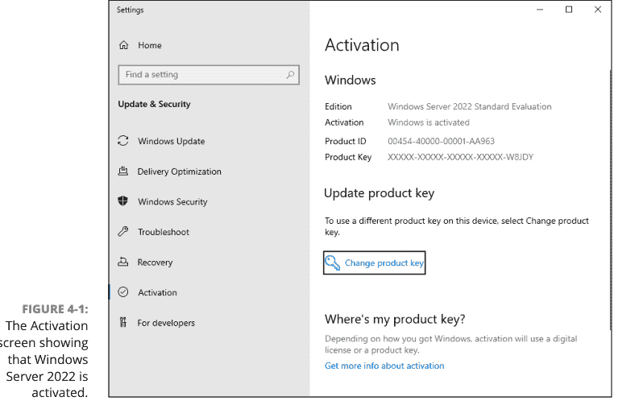

###### 时区

设置时区是服务器配置流程中的常见任务，你可以将服务器时区设置为你所在的时区，或与异地总公司相同的时区。如果服务器采用共同托管（即放置在异地托管设施中）且需要与本地系统保持相同时区，通常需要进行此项设置。

1. 在服务器管理器中，点击左侧菜单中的“本地服务器”。
2. 点击**时区**旁边的超链接。该超链接可能已经设置为你所在区域正确的时区。
3. 点击**更改时区**按钮。
4. 从**下拉列表**中选择你的**时区**。
5. 如果你所在的区域使用**夏令时**，请点击**自动调整为夏令时调整时钟**旁边的复选框。如果你所在区域不使用夏令时，请保持该复选框未选中状态。
6. 点击“确定”退出**时区设置**对话框，再次点击“确定”退出**日期和时间**对话框。

###### 计算机名称和域

在企业的环境中设置计算机名称是必做操作。大多数组织都有需要遵守的命名规范，但组织要求的名称肯定比默认随机生成的名称更易记忆。

加入域是较为简单的步骤之一，但同时也是实现集中身份验证管理和配置能力最重要的步骤之一。

1. 在服务器管理器中，点击左侧菜单中的“本地服务器”。
2. 点击**计算机名**旁边的超链接。该名称是默认名称，以`WIN-`开头，后跟随机生成的字母和数字字符串。
3. 点击**更改**按钮。
4. 在**计算机名**字段中输入你为服务器设置的名称，然后点击“确定”。此时会弹出一个对话框，提示你需要重启服务器。
5. 点击“确定”。
6. 点击**系统属性**对话框中的**关闭**按钮。系统会提示你在**立即重启**和**稍后重启**之间选择。
7. 如果想要立即重启服务器，请点击**立即重启**。如果想先完成其他可能存在的管理任务，请点击**稍后重启**。如果选择**稍后重启**，则需要在准备就绪后手动重启服务器。
8. 要加入域，请执行步骤1至3。
9. 在“计算机名/域更改”对话框中，点击“域”单选按钮，输入你要加入的域的名称。
10. 点击“确定”。此时会弹出一个对话框，提示你需要重启服务器。
11. 点击“确定”。
12. 点击系统属性对话框中的关闭按钮。
13. 点击“立即重启”或“稍后重启”。重启完成后，服务器就会加入该域。

###### 配置网络

默认情况下，你的服务器会使用动态分配的IP地址。如果不想使用动态地址，你需要设置静态IP地址，这样服务器就会持续使用同一个地址。

1. 在服务器管理器中，点击左侧菜单中的“本地服务器”。
2. 在以太网旁边，点击显示“由DHCP分配的IPv4地址，已启用IPv6”的超链接。
3. 右键点击你的网络适配器（名称为“以太网”），然后点击“属性”。
4. 点击“Internet协议版本4”，再点击“属性”按钮。默认情况下，服务器设置为自动获取IP地址、自动获取DNS服务器地址。如果这正是你需要的设置，则无需做出任何修改。
5. 如果需要修改，请选择“使用下面的IP地址”。
6. 填写IP地址、子网掩码和默认网关。
7. 手动输入首选DNS服务器的地址。示例见图4-2。
8. 点击“确定”关闭该对话框。
9. 再次点击“确定”退出“以太网属性”窗口。

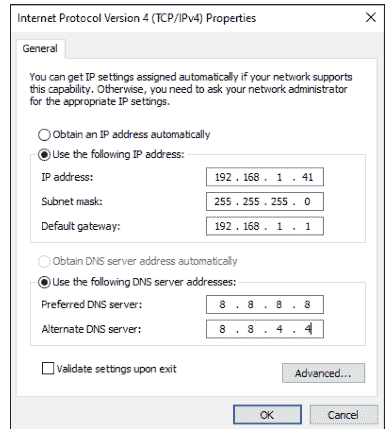

**图4-2：** Internet协议版本4属性对话框。

##### Windows Server 2022 核心版

许多系统管理员都配置过带图形用户界面的Windows Server，但使用过Windows Server核心版的并不多。正如你在本节中看到的，Windows Server核心版界面简洁，当你学会如何操作它后，你会发现它比带桌面体验的Windows Server更易使用。

###### 激活

Windows Server核心版为你提供了多种激活Windows Server 2022副本的选项。本节将介绍通过`sconfig`激活，以及通过PowerShell激活的方法。

####### 通过SCONFIG激活

`Sconfig`是Windows Server核心版内置的配置工具。它是一个基于文本的菜单，允许你在一个中心位置完成绝大多数初始配置任务。默认情况下，`sconfig`会在你登录后自动启动。

1. 在`sconfig`工具中输入11（对应Windows激活），然后按Enter键。
2. 输入3以安装产品密钥。
3. 在弹出的对话框中输入你的25位产品密钥，然后点击“确定”。密钥安装完成后，你会看到提示密钥安装成功的消息。
4. 点击红色X按钮，或按两次Enter键关闭窗口。
5. 回到`sconfig`界面后，输入2以激活Windows，然后按Enter键。此时会再次打开命令提示符窗口，运行`slmgr.vbs`脚本执行激活操作。如果没有出现错误，激活完成后不会有任何提示消息。
6. 点击红色X按钮，或按两次Enter键关闭窗口。

####### 通过PowerShell激活

登录Windows Server核心版后，会启动`sconfig`工具。你可以通过该工具激活Windows副本。要通过命令行设置许可证并执行激活操作，你需要选择菜单项15“退出到命令行（PowerShell）”。要执行激活，必须先设置密钥，这可以通过Windows Server许可证管理脚本`slmgr.vbs`完成。

> 技术说明

`slmgr.vbs`脚本允许你根据搭配使用的参数，以不同方式处理Windows Server产品密钥。本书的示例中同时使用了`-ipk`和`-ato`参数。`-ipk`参数用于安装产品密钥，`-ato`参数用于指定在线激活。

要安装你的Windows Server 2022版本所需的产品密钥，请使用以下带有`-ipk`参数的命令：只需将`<productkey>`替换为你带分隔符的25位许可证密钥即可。

```
slmgr.vbs -ipk <productkey>
```

你会看到一个提示产品密钥安装成功的对话框，点击“确定”即可。

安装许可证密钥后，你需要使用带有`-ato`参数的同一脚本，对你的Windows副本执行在线激活，命令如下：

```
slmgr.vbs -ato
```

如果激活成功，你会看到一个提示产品已成功激活的对话框（见图4-3）。

> 执行初始配置任务

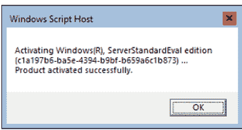

**图4-3：** 使用`slmgr.vbs`激活Windows Server。

###### 时区

和Windows Server核心版中的激活操作类似，你可以通过`sconfig`或PowerShell设置时区。本节将介绍这两种方法。PowerShell版本的优点是它也适用于带桌面体验的Windows Server。

####### 通过SCONFIG设置时区

`Sconfig`是Windows Server核心版内置的配置工具。由于它是基于文本的简易菜单，管理员无需掌握脚本知识即可通过它轻松配置时区。

1. 在`sconfig`工具中输入9进入日期和时间设置，“日期和时间”对话框会弹出。
2. 点击“更改时区”按钮。
3. 从下拉列表中选择你的时区。
4. 如果你所在的区域使用夏令时，请点击“自动调整为夏令时调整时钟”旁边的复选框。如果你所在区域不使用夏令时，请保持该复选框未选中。
5. 点击“确定”退出“时区设置”对话框，再次点击“确定”退出“日期和时间”对话框。

####### 通过PowerShell设置时区

如果你更习惯使用PowerShell，也可以通过它设置时区。该方法会调用`control`命令打开控制面板的日期和时间界面。在PowerShell中输入以下命令：

```
Set-TimeZone -Id <Time Zone Id>
```


> **提示** 如果你不确定自己的时区ID是什么，可以运行`Get-TimeZone -ListAvailable`查看所有可供选择的时区。

###### 计算机名称和域

设置名称以及将服务器加入Windows域是系统管理员对新服务器执行的一些最常见操作。在Windows Server Core中，完成这项任务有两种你需要了解的方法：`sconfig`（Windows Server Core中的配置实用工具）和PowerShell。

####### 使用sconfig设置计算机名称

Windows Server Core中的`sconfig`实用工具通过其文本驱动菜单，可以轻松更改服务器名称。请按以下步骤操作：

1. 在`sconfig`实用工具中，输入**2**来更改计算机名称。系统会提示你输入新名称。
2. 输入新名称，然后按Enter键。你需要重启计算机才能使更改生效。
3. 输入**yes**立即重启，或输入**no**稍后重启。

####### 使用sconfig加入域

当服务器名称设置正确后，你可能希望将其加入Windows域。你也可以使用`sconfig`实用工具完成此操作。

1. 在`sconfig`实用工具中，输入**1**来更改域。
2. 输入**D**加入域，然后按Enter键。
3. 输入你要加入的域的名称，然后按Enter键。
4. 输入授权用户的名称，然后按Enter键。
5. 输入用户密码，然后按Enter键。你需要重启计算机才能使更改生效。
6. 点击**yes**立即重启，或点击**no**稍后重启。

####### 通过PowerShell设置计算机名称

虽然`sconfig`是一款很实用的工具，但你可能希望对要做的更改进行脚本化。遇到这种情况时，PowerShell会非常有用。无论是从命令提示符运行批处理脚本，还是在PowerShell中运行PowerShell脚本，这两种方法在Windows Server Core和带桌面体验的Windows Server上都能正常使用。

1. 在`sconfig`实用工具中，输入15退出到命令行（PowerShell）。PowerShell窗口会在你的Server Core服务器上打开。
2. 使用`Rename-Computer`命令更改服务器名称：

```
Rename-Computer -NewName <new-name>
```

如果名称超过15个字符，你会收到一条提示，说明NetBIOS名称将被截断。如果收到这条提示，输入`Y`然后按Enter键确认。

####### 通过PowerShell加入域

如果你要部署多台服务器，将加入域的操作脚本化是一项很有用的技能。通过PowerShell加入域不仅操作更简便，还有助于确保加入域的过程中不会出现错误。

1. 在`sconfig`实用工具中，输入15退出到命令行（PowerShell）。PowerShell窗口会在你的Server Core服务器上打开。
2. 使用`Add-Computer`命令将服务器加入域。示例如下：

```
Add-Computer -DomainName "your_domain_name" -Restart
```

会弹出一个对话框，要求输入用户名和密码。

3. 输入有权将系统添加到Active Directory域的用户名，并输入对应的密码。
4. 点击“确定”。服务器将重启。

###### 配置网络

在使用PowerShell设置网卡IP地址之前，你需要先查明网卡的索引号。你可以通过输入以下命令来查询：

```
Get-NetAdapter
```

输出结果会列出所有网卡。在本例中，你需要找到显示为`Ethernet`的网卡。获取到索引号后，你就可以设置IP地址和DNS服务器了。在我的服务器上，索引号是4。使用以下命令设置静态IP地址：`InterfaceIndex`是我的网卡索引号，`IPAddress`是要分配的IP地址，`PrefixLength`是要使用的子网掩码，`DefaultGateway`是本地网络的网关地址（见图4-4）。

```
New-NetIPAddress -InterfaceIndex 4 -IPAddress 192.168.1.50 -PrefixLength 24 -DefaultGateway 192.168.1.1
```

> **技术说明** 截至目前我还没有过多介绍PowerShell，这里是一段比较复杂的PowerShell内容。`New-NetIPAddress`是一个cmdlet（命令管道工具），可用于操作Windows Server系统上的IP地址。其后跟的参数（比如`-InterfaceIndex`）用于标识你要操作的对象（本例中为网卡），或者用于修改设置，比如`-IPAddress`参数就是用来指定要在网卡上设置的IP地址。

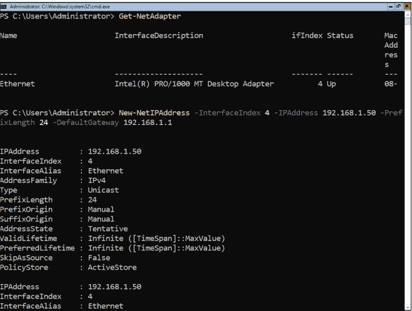

**图4-4：** 使用PowerShell设置IP地址。

之后要设置DNS服务器，该命令使用相同的网卡索引号。`ServerAddresses`参数用于指定系统应使用的DNS服务器（见图4-5）。如果有多个DNS服务器，可以用逗号分隔。

```
Set-DnsClientServerAddress -InterfaceIndex 4 -ServerAddresses 8.8.8.8, 8.8.4.4
```

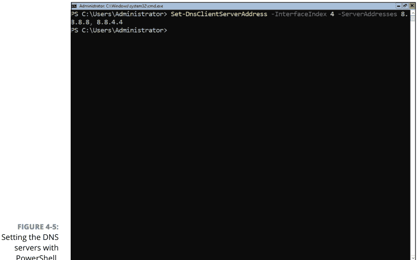

#### 更新Windows Server 2022

安装全新的Windows Server后，你可能已经完成了更改名称、加入域等基础配置工作，接下来就需要更新服务器了。更新包含安全漏洞修复和新功能，在将服务器移交给申请使用的团队之前，应始终完成更新安装。

##### 带桌面体验的Windows Server 2022

鉴于及时安装Windows Server更新非常重要，大多数组织都会设置自动更新。你可能有一台无法设置为自动接收更新的服务器，或者发布了一个紧急补丁，你希望立即安装。在本节中，我将介绍如何执行自动更新和手动更新。

###### 自动更新

大多数组织都使用自动更新。以下步骤将指导你配置服务器连接至微软更新服务器（这是默认行为）。许多组织都有补丁管理解决方案来处理更新的调度，这类方案仍可被视为自动更新，因为相关工具会自动调度已批准补丁的部署。


1. 点击“开始”菜单，输入`gpedit.msc`。
2. 依次点击“计算机配置”“管理模板”“Windows组件”，最后点击“Windows更新”，进入Windows更新设置部分。
3. 双击“配置自动更新”。
4. 选择“已启用”。此时会出现配置选项。在“配置自动更新”下方，你可以看到默认设置为“自动下载并通知安装”。
5. 点击下拉框，选择最适合你环境的设置。在我的例子中，我选择了“自动下载并计划安装”。示例见图4-6。
6. 点击“确定”保存更改。

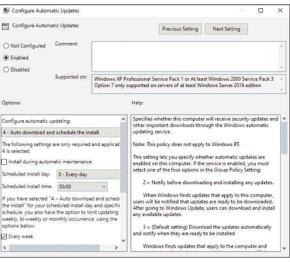

**图4-6：** 使用本地组策略编辑器更改Windows Server 2022中的自动更新设置。

###### 下载并安装更新

你从新闻媒体得知下一个重大安全漏洞后，厂商会很快发布对应的漏洞补丁。当安全漏洞影响到你的Windows Server系统时，你可能希望启动手动更新——这样你的系统就能在常规补丁窗口之外得到保护。如果你的组织使用了补丁管理解决方案，补丁可能会从该系统推送，但总有一些系统因各种原因无法安装补丁。出现这种情况时，你可能需要手动更新。

1. 打开服务器管理器，点击左侧菜单中的“本地服务器”。
2. 点击“上次检查更新”旁边的超链接。如果还未执行过更新检查，这里可能显示为“从未”。
3. 点击“检查更新”按钮。服务器将检查是否有可用更新。

##### Windows Server 2022 Core

在接收微软更新方面，Windows Server Core的需求与带桌面体验的Windows Server相同。在本节中，我将展示如何从PowerShell设置自动更新，以及如何执行手动更新。

###### 自动更新

在Server Core上启用自动更新有两种方式：使用`sconfig`实用工具和使用PowerShell。

####### 通过sconfig将更新设置为自动

`sconfig`实用工具提供的文本驱动菜单让启用自动更新非常简单。仅需4个简单步骤即可完成自动更新设置：


在`sconfig`菜单中，输入`5`配置 Windows 更新设置，然后按 Enter。此时会出现选项：输入`A`可启用自动下载并安装，输入`D`仅下载（默认选项），输入`M`为手动更新。

输入`A`即可自动下载并安装 Windows 更新，系统会返回文本提示确认更改成功。

按 Enter 退出更新部分。

## 通过 PowerShell 将更新设置为自动

要通过 PowerShell 将更新设置为自动，需要先导航到`C:\Windows\system32`目录，然后停止 Windows 更新服务。该服务可能已经处于停止状态。之后可以使用脚本程序执行`scregedit.wsf`，添加`/AU 4`参数可启用自动更新，添加`/AU 1`参数则会禁用自动更新。以下示例将启用 Windows 更新：

1. 停止 Windows 更新服务器服务。

``` 
net stop wuauserv
```

2. 将自动更新设置为 4（即启用状态）。

``` 
cscript scregedit.wsf /AU 4
```

3. 启动 Windows 更新服务器服务。

``` 
net start wuauserv
```

如果想查看此操作的效果及对应的返回结果，请参阅图 4-7。

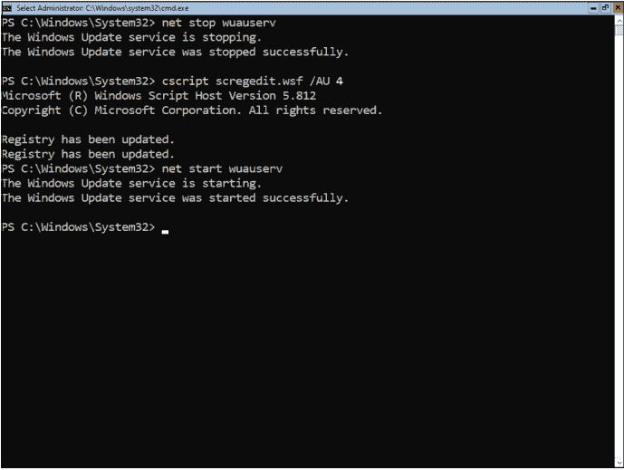

**图 4-7：** 通过 PowerShell 设置自动更新。

### 下载并安装更新

要强制 Server Core 检测并安装所有可用更新，只需输入以下命令并按 Enter 即可。

``` 
wuauc lt /detectnow
```

## 自定义 Windows Server 2022

Windows Server 操作系统安装完成后，下一步就是对其进行自定义配置，打造适合你需求的系统！这包括安装角色和功能、设置远程管理、配置防火墙等操作。

### 带桌面体验的 Windows Server 2022

首先从桌面体验开始讨论自定义配置。登录已启用桌面体验的服务器时，默认会启动服务器管理器。大部分你需要的配置和自定义任务都可以通过服务器管理器完成。

#### 添加角色和功能

在带桌面体验的 Windows Server 2022 中，角色和功能通过服务器管理器添加。

1. 打开服务器管理器。
2. 选择「管理」→「添加角色和功能」。
3. 在「开始之前」页面，单击「下一步」。
4. 在「选择安装类型」页面，单击「下一步」。
5. 在「选择目标服务器」页面，单击「下一步」。
6. 勾选要安装的角色旁边的复选框，然后单击「下一步」。本次演示中，我选择了「文件和存储服务」下的「文件服务器」（见图 4-8）。

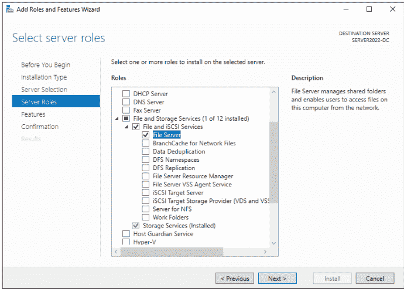

**图 4-8：** 已选中文件服务器的选择服务器角色界面。

7. 在下一个屏幕中，选择需要安装的任何功能，然后单击「下一步」。
8. 如果希望服务器在安装的角色需要时自动重启，可勾选`需要时自动重启目标服务器`复选框。如果不需要重启，或你不想让服务器重启，则保持复选框未勾选状态。
9. 单击「安装」以安装所选的角色和/或功能。


#### 启用远程管理

远程管理默认处于启用状态，支持通过 PowerShell 进行远程管理。远程桌面是单独的设置项，可让你直接连接到服务器并操作。对于带有桌面体验的服务器，管理员通常更倾向于通过远程桌面操作服务器。远程桌面默认处于禁用状态，需要手动启用才能使用。如果服务器上的防火墙已启用且未启用远程桌面规则，你将无法连接到服务器，需要启用服务器防火墙入站规则中的「远程桌面 - 用户模式 (TCP-In)」规则。

1. 打开服务器管理器，点击左侧菜单中的「本地服务器」。
2. 点击远程桌面旁边的显示为「已禁用」的超链接。
3. 在弹出的对话框中，选择`允许远程连接到此计算机`。随后会弹出对话框，提示系统将为远程桌面创建防火墙例外。
4. 单击「确定」。
5. 如果要为特定用户或组设置远程访问权限，点击`选择用户`按钮。
6. 单击「添加」，选择对应的用户或组，然后单击「确定」。
7. 再次在远程桌面用户界面单击「确定」以关闭。
8. 在系统属性界面再次单击「确定」，即可启用远程桌面。

#### 配置 Windows 防火墙

如果打算使用服务器上的 Windows 防火墙，需要了解如何通过防火墙放行应用程序。通过允许入站流量，可以让服务器执行你计划用它完成的任务。

1. 在服务器管理器中，选择左侧的「本地服务器」。
2. 点击 Microsoft Defender 防火墙旁边的「专用：启用」链接，将打开「防火墙和网络保护」应用。
3. 单击「允许应用通过防火墙」。
4. 选择「文件和打印机共享」，通过勾选「专用」下的复选框，为专用配置文件启用该规则（见图 4-9）。
5. 单击「确定」保存更改。

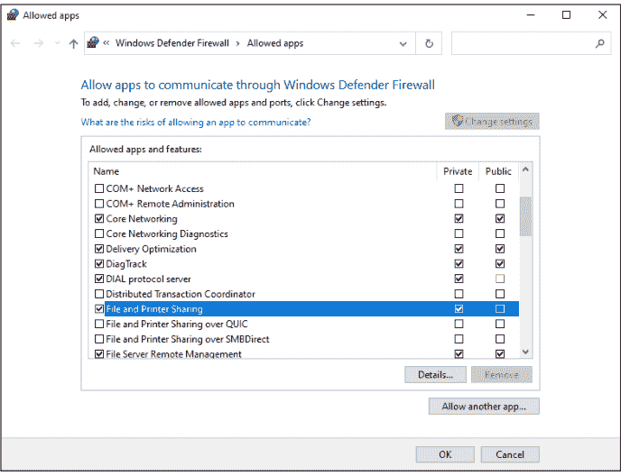

**图 4-9：** 通过 Microsoft Defender 防火墙放行应用程序。

### Windows Server 2022 核心版

无论你是通过控制台连接到 Windows Server 核心版系统执行 PowerShell 命令，还是通过远程 PowerShell 操作，都只需几条 PowerShell 命令即可完成大部分配置工作。

#### 添加角色和功能

要熟练使用 Server Core，一半的挑战在于学会找到你需要的功能。带桌面体验的服务器有图形界面引导操作，而 Server Core 没有。接下来我们看之前在桌面体验服务器上用过的示例：你需要安装文件服务器角色。安装角色前，需要先知道它的名称。通过`Get-WindowsFeature`命令可以查找你感兴趣的角色和功能的名称。如果你知道名称的部分内容，可以进行通配符搜索。以下示例中，我使用了`*文件*`来指示`Get-WindowsFeature` cmdlet 返回名称中包含「文件」的结果。

``` 
Get-WindowsFeature *file*
```

执行上述命令后，你会得到 3 条名称中包含`file`的结果，在「显示名称」列下可以看到「文件服务器」。安装命令需要使用「名称」列下的对应名称，本例中为`FS-FileServer`。现在就可以开始安装了！使用以下命令安装文件服务器（见图 4-10）：

``` 
Install-WindowsFeature FS-FileServer
```

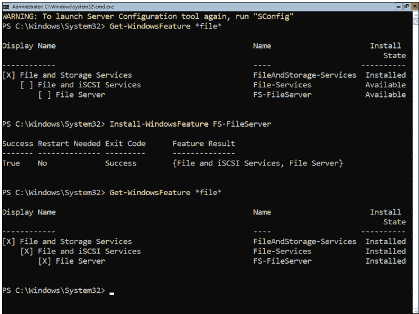

**图 4-10：** 使用 PowerShell 安装角色和功能。

安装过程中会显示进度条。安装完成后，再次执行第一条命令，你会看到所有 3 条结果都已安装。「文件和 iSCSI 服务」也会被一同安装，因为文件服务器依赖该服务。

#### 启用远程管理

Windows Server 2022 中远程管理默认处于启用状态。如果你的环境中该功能被禁用，可以通过执行`Configure-SMRemoting`命令启用它，之后就能通过服务器管理器远程管理服务器了。

``` 
Configure-SMRemoting –Enable
```

要通过 PowerShell 远程管理服务器，还需要执行两条命令。`Enable-PSRemoting` 用于配置 PowerShell 接收发送到你系统的远程命令。`Winrm quickconfig` 会自动分析并配置 WinRM 服务，如果你只是想让功能正常运行、不需要自定义配置，这个命令非常实用。它会启动未运行的 WinRM 服务，并确保 WinRM 设置为自动启动；同时配置 HTTP 和 HTTPS 监听器，并确保 Windows 防火墙允许 HTTP 和 HTTPS 入站流量。如果`Enable-PSRemoting`命令执行成功，不会有任何输出，只会重新显示 PowerShell 提示符。

``` 
Enable-PSRemoting –force
```

执行`winrm quickconfig`会稍有不同。命令完成分析后，会提示需要修改的内容，并询问是否允许其执行必要的更改，此时输入`Y`并按 Enter 即可。如果分析结果显示所有配置都正常，会提示 WinRM 已运行且已配置为支持远程管理，不会出现是否允许更改的询问。

``` 
winrm quickconfig
```

#### 配置 Windows 防火墙

在 Server Core 上操作 Microsoft Defender 防火墙非常简单。首先需要找到你要操作的规则的名称，可以通过`Get-NetFirewallRule`命令查找（见图 4–11）。在命令末尾添加`Format-table`命令可以让输出更易读，你可以试试不加该参数的效果，就知道区别了。

``` 
Get-NetFirewallRule *remote* | Format-table
```

### 第4章 执行初始配置任务

图4-11：使用`Get-NetFirewallRule`查找规则。

前面的命令会查找名称中包含`remote`的所有规则。你可以看到每条规则以及它们是否已启用。我们来启用远程防火墙管理规则。这些规则允许你从其他系统管理此服务器的防火墙。你要查找的规则是`RemoteFwAdmin-In-TCP`和`RemoteFWAdmin-RPCSS-In-TCP`。以下是用于启用这些规则的命令（见图4-12）：

```powershell
Set-NetFirewallRule -Name "RemoteFwAdmin-In-TCP" -Enabled True
Set-NetFirewallRule -Name "RemoteFWAdmin-RPCSS-In-TCP" -Enabled True
```

如果命令成功执行，你将不会收到任何响应。你会返回到PowerShell提示符。如果再次运行搜索，你会看到这些规则现已启用。

**图4-12：** 使用PowerShell设置防火墙规则并验证其已启用。

#### 使用BCDEdit配置启动选项

从Windows Server 2008开始，微软推出了一款名为BCDEdit的实用工具，可用于操作Windows启动配置数据（BCD）存储。BCD用于告知操作系统应如何启动，其中包含支持该功能所需的所有启动配置参数。它取代了Windows Vista之前用于编辑`boot.ini`文件的旧版`bootcfg.exe`实用工具。要在系统上使用BCDEdit，你必须是本地管理员组的成员。这是一款高级实用工具，可用于排查导致服务器无法正常启动的问题。

> **注意**
> 在使用BCDEdit之前，你可能需要在系统上禁用或暂停BitLocker和安全启动。

> **警告**
> 使用BCDEdit实用工具时出现错误可能导致系统完全无法启动。请务必确保你已有系统的完整备份，如果还没有备份，请从BCDEdit导出当前设置，以便需要时恢复。你可以通过输入`BCDEdit /Export <导出路径>`来导出当前的启动配置数据库。如果需要从该导出文件恢复，命令非常相似，你只需输入`BCDEdit /Import <导出文件路径>`即可。

表4-2列出了BCDEdit的一些更常用选项。

**表4-2 BCDEdit常用选项**

| 选项 | 说明 |
|--------|-------------|
| `/bootdebug` | 启用或禁用启动调试。 |
| `/dbgsettings` | 配置调试连接的类型。 |
| `/debug` | 启用或禁用内核调试。 |
| `/delete` | 从数据存储中删除启动条目——请谨慎使用！ |
| `/deletevalue` | 删除或移除启动条目选项——请谨慎使用！ |
| `/displayorder` | 设置启动管理器在显示多启动菜单时使用的顺序。 |
| `/enum` | 列出启动配置数据存储中的所有条目。 |
| `/export` | 导出BCD的内容；可用作恢复BCD的备份。 |
| `/import` | 导入导出文件的内容；需要时可用作恢复选项。 |
| `/set` | 设置启动选项中的值。 |

通常情况下，你会使用`bcdedit /set`来修改启动配置数据存储。在进行任何更改之前，你需要了解当前BCD的状态。你可以使用`/enum`选项来实现。在图4-13中，你可以看到Windows启动管理器和Windows启动加载程序的当前设置。你可能会注意到Windows启动加载程序的描述仅显示为"Windows Server"。你可能希望它更具描述性。你可以使用`bcdedit /set`来修改它。你需要操作对象的ID。在本例中，你需要编辑Windows启动加载程序；你在图4-13中看到的标识符是`{current}`。你输入的命令将如下所示：

```powershell
bcdedit /set {current} description "Windows Server 2022 Standard"
```

> **提示**
> 该命令在命令提示符中可以正常运行，但如果你尝试在PowerShell中执行，需要给标识符加上引号。例如，如果要在PowerShell中运行该命令，我会输入以下内容：

```powershell
bcdedit /set "{current}" description "Windows Server 2022 Standard"
```

当你收到`The operation completed successfully`的消息时，再次使用`bcdedit /enum`命令。你会看到新的描述，我的示例见图4-14。

**图4-13：** 使用`bcdedit /enum`查看启动配置数据存储的当前设置。

**图4-14：** 使用`bcdedit /set`修改Windows启动加载程序条目的描述。

你为什么要修改Windows启动加载程序的名称？考虑这样一个多启动系统示例：两个磁盘上安装的是同一个操作系统。这两个磁盘的用途完全不同，因此你需要确保自己记得哪个磁盘对应什么用途。能够修改描述可以简化在启动菜单中选择相应磁盘的操作。BCDEdit还可以用于更改启动菜单的顺序。如果你想将其中一个磁盘设置为列表中的第一个，并设为超时后的默认启动磁盘，这个功能非常有用。

## 配置Windows Server 2022

### 内容概览

- **第1章：** 配置服务器角色和功能 ................... 75
- **第2章：** 配置服务器硬件 ................... 103
- **第3章：** 使用设置菜单 ...................... 145
- **第4章：** 使用工作组 ....................... 155
- **第5章：** 将服务器提升为域控制器 . . 171
- **第6章：** 使用IP地址管理管理DNS和DHCP .............. 203

#### 本章内容

- 使用服务器管理器管理你的服务器
- 了解Windows Server 2022中可用的服务器角色
- 了解Windows Server 2022中可用的服务器功能

### 第1章

#### 配置服务器角色和功能

熟悉服务器管理器以及如何找到所需的工具，会让你作为系统管理员的工作轻松很多。从了解如何访问服务器的基本信息（如主机名、IP地址和激活状态）到安装新的角色和功能，服务器管理器为你提供了一个统一的集中管理起点。本章首先介绍服务器管理器，并说明所需工具的位置，帮助你顺利开展工作。接下来我将介绍Windows Server 2022中可用的角色和功能。

#### 使用服务器管理器

对于全新的服务器，你大部分操作都会在服务器管理器中完成。它会在你登录后自动启动，是你所登录服务器的集中管理区域。首次登录时，服务器管理器会默认打开仪表板视图。仪表板顶部有一个大磁贴，称为“快速开始磁贴”，其中包含典型初始服务器配置任务的超链接，如图1-1所示。如果你想要隐藏这个大磁贴，可以点击右下角的“隐藏”按钮。

**图1-1：** 顶部带有快速开始磁贴的服务器管理器仪表板。

快速开始磁贴下方是服务器上已安装的所有角色对应的磁贴。全新安装且未做任何自定义的Windows Server 2022默认会显示“文件和存储服务”和“本地服务器”两个磁贴。这些磁贴非常实用，可以快速判断服务器是否运行正常。如果磁贴为绿色且带有一个向上的小箭头，说明服务已正常运行。如果磁贴为红色且带有一个向下的小箭头，说明服务出现故障或未启动。你可以点击单个磁贴获取对应角色的更多信息。例如，如果我点击“文件和存储服务”角色磁贴，就可以看到支撑该角色的运行服务相关的事件，如图1-2所示。左侧是本地服务器存储的配置选项，包括卷、磁盘和存储池。

#### 角色和功能

角色和功能可以为你的服务器添加额外功能。

*角色*是你希望服务器承担的工作。例如，你可以安装Active Directory域服务角色，让这台服务器成为域控制器。

*功能*通常用于支撑角色的运行。在本例中，你还需要安装Active Directory域服务的管理工具（选择该角色时，系统会提示你安装这个功能）。管理工具属于功能。

- 诊断服务器管理器可让你快速、便捷地使用职业生涯中可能会用到的诸多诊断工具。要使用这些工具，只需点击顶部菜单中的“工具”选项，如图1-3所示。

以下是“工具”菜单中多年来对我帮助很大的几个选项：

- **事件查看器：** 当我排查问题时，几乎总是首先打开事件查看器。我一开始会查看系统、应用程序和安全日志，如果需要的话，再查看与角色和/或组件相关的特定日志。
- **性能监视器：** 当你需要测量与性能相关的非常具体的指标时，比如处理器（CPU）空闲时间、中断时间、用户时间等，性能监视器是非常有用的工具。它开箱即用，提供数百个计数器，还可以设置在满足特定条件或阈值时自动启动。该工具最适合用于排查与性能相关的问题，比如运行缓慢和/或卡顿。


- **资源监视器：** 如果你只是想快速查看系统运行状态，资源监视器是绝佳选择。它有一个简洁的摘要界面，可以提供 CPU、磁盘、网络和内存使用情况的相关信息。该工具专注于资源利用率，可帮助你排查磁盘空间不足、磁盘过度使用或网络带宽不足之类的问题。

- **系统配置：** 遇到启动问题时，我会使用系统配置。“启动”选项卡提供了几个实用的选项，包括是否要使用安全启动、是否要创建启动日志，以及是否要使用最基础的视频设置。

- **系统信息：** 当你需要了解硬件规格或某些系统设置时，这款工具是你的首选。它甚至可以告诉你当前运行的 BIOS 版本以及运行模式。

- **Windows 内存诊断：** 这是我在《手册 1》第 2 章中介绍过的内存诊断工具。你只需要通过菜单启动它，无需输入程序名称。

- **Windows PowerShell：** `PowerShell` 非常实用。你可以查询设置，需要时还可以将其导出到文本文件。

#### 配置任务

大部分配置任务都可以在服务器管理器的“本地服务器”部分完成。点击“本地服务器”后，会打开显示当前服务器信息的属性页，如图 1-4 所示。这个页面的优点是所有设置都是可点击的超链接，点击后即可进入对应设置的配置界面。是不是很酷？对于刚搭建完成的新服务器，你可以在此处修改主机名和 IP 地址，还可以更新服务器、将其加入域，甚至激活操作系统。

**图 1-4：** 服务器管理器的本地服务器属性界面。 

#### 配置和管理存储

我之前提到过，默认情况下所有 Windows Server 2022 系统都已安装“文件和存储服务”角色，你可以通过该角色下的便捷菜单管理服务器存储。在导航菜单中点击“文件和存储服务”后，会显示多个选项；选择“磁盘”。在此处你可以上线新磁盘、初始化磁盘并创建卷，如图 1-5 所示。

**图 1-5：** 在服务器管理器的“文件和存储服务”区域中管理磁盘。 

#### 了解服务器角色

我之前提到过，角色是服务器要承担的功能。通过安装角色，你可以让服务器发挥实际作用。你可能正在搭建 Active Directory 基础架构，也可能正在创建稳定的虚拟化平台。无论你要实现什么目标，通常都需要从安装角色开始。接下来我们来看看 Windows Server 2022 包含的角色。

##### Active Directory 证书服务

Active Directory 证书服务（AD CS）是一个可在组织中搭建公钥基础架构（PKI）的角色，支持你颁发自有内部证书。这类证书包括域控制器的证书，用于支持通过安全套接字层（SSL）运行的轻量级目录访问协议（LDAP）；也包括内部 Web 服务器的证书，甚至可以是组织中系统运行的脚本所需代码签名证书。你可以安装证书颁发机构（CA），并提供额外服务，比如用于查询证书吊销信息的在线证书状态协议（OCSP），以及允许网络设备无需域凭据即可申请证书的网络设备注册服务（NDES）。AD CS 的组件非常多，如果你想进一步了解 AD CS，包括如何安装和配置它，可以阅读《手册 5》第 6 章。

##### Active Directory 域服务

Active Directory 域服务（AD DS）支持你将用户和其他网络对象的信息存储在目录服务中。你可以通过林、域和组织单位（OU）的层次结构来组织这些对象。Active Directory 包含一个全局编录，其中存储了目录中所有对象的信息，是成功登录域所必需的。借助 Active Directory，只要你掌握少量相关信息，就能轻松搜索和定位特定对象。如果你想了解 AD DS，可以阅读《手册 2》第 5 章学习如何安装和配置 AD DS。

##### Active Directory 联合服务

Active Directory 联合服务（AD FS）可为使用 AD DS 的组织提供单点登录功能。它允许持有 Active Directory 账户的用户，将该账户用于 Active Directory 边界之外的应用程序（例如，由业务合作伙伴托管的 Web 应用程序），或是完全不依赖 Active Directory 账户进行身份验证的应用程序。通过建立联合（即身份信息的共享），用户可通过所在公司的 Active Directory 完成身份验证，随后即可通过声明访问业务合作伙伴的 Web 应用程序。业务合作伙伴只需配置其 Web 应用程序信任传入的声明即可。

##### Active Directory 轻型目录服务

Active Directory 轻型目录服务（AD LDS）是基于轻量级目录访问协议（LDAP）的目录服务，与 AD DS 类似。它专为与支持目录的应用程序配合使用而设计，对于想要建立客户账户目录、同时希望该目录与组织 AD DS 基础架构分离的组织来说尤为实用。它可以与 AD FS 配合作为身份提供方，既能为配置为支持联合的 Web 应用程序提供身份验证，也能生成对应的声明。

##### 配置服务器角色和功能

##### Active Directory 权限管理服务

Active Directory 权限管理服务（AD RMS）允许企业创建并执行数据保护策略。这些规则在 AD RMS 服务器上创建，即使文档离开企业内部，仍会受到保护。例如，你可以设置策略仅允许文档在短时间内可访问，到期后收件人将无法再打开它们。你还可以禁止打印文档，或禁止通过复制粘贴的方式从文档中提取文本内容。AD RMS 并非完美无缺，它无法阻止用户对敏感文档中的内容进行截图（市面上几乎没有权限管理产品可以阻止这类操作）。此外，客户端应用程序必须支持 RMS，微软 Office 套件、SharePoint 和 Exchange Server 都具备该功能，你还可以通过加载项让 Internet Explorer 支持 RMS。

##### 设备运行状况证明

设备运行状况证明角色于 Windows Server 2016 中新增，它帮助管理员验证设备启动过程中的运行状态是否正常。它可以测量多项不同的设置，由系统管理员或网络管理员自行配置需要跟踪的设置项。该角色通常用于系统在通过直接访问（DirectAccess）或其他虚拟专用网络（VPN）服务连接前，先验证其安全性。设备运行状况证明可验证的设置包括以下内容：

- 是否已启用 BitLocker？
- 是否已启用早期启动反恶意软件（ELAM）？
- 是否已启用安全启动？
- 是否已启用代码完整性？

##### 动态主机配置协议

动态主机配置协议（DHCP）绝对是系统管理员的好帮手。如果没有 DHCP，你就需要手动分配 IP 地址，并记录已分配的 IP 地址。DHCP 可以自动完成这一流程，它基于租约机制为系统自动分配 IP 地址。当租约时间达到配置时长的 50% 时，客户端会

你可以申请续订 IP 地址。如果某个系统需要保留相同的 IP 地址，你可以为该 IP 地址设置保留。只要目标系统的网卡不变，它就能获得相同的 IP 地址。

此外，你还可以为每个已定义的地址范围设置 DHCP 选项。这些选项可以告诉地址范围内的系统如何找到网关服务器、DNS 服务器、可能存放镜像的服务器等。

如果你想进一步了解 DHCP，可以阅读第 2 册第 5 章，其中会介绍 DNS 和 DHCP 的安装方法。也请务必阅读第 2 册第 6 章。

##### 配置服务器角色和功能

##### 域名系统（DNS）

域名系统（DNS）是一项非常实用的服务，能够帮助将主机名映射到 IP 地址。正是有了 DNS，你才可以在网页浏览器中输入容易记忆的 `www.dummies.com`，而不需要记住像 `13.32.254.23` 这样的 IP 地址。不得不说，人脑记忆词汇和短语的能力远强于记忆数字。

DNS 既可以将主机名解析为 IP 地址，也可以执行反向查询，将 IP 地址映射回主机名。在处理仅识别 IP 地址的网络设备时，这项功能非常实用。

如果你想进一步了解 DNS，可以阅读第 2 册第 5 章，其中会介绍 DNS 和 DHCP 的安装方法。也请务必阅读第 2 册第 6 章。此外，第 5 册第 7 章还专门有一节介绍如何保障 DNS 基础设施的安全。

#### 传真服务器

启用传真服务器角色后，服务器就能充当传真机使用。该服务器允许网络用户收发传真信息，负责处理实际的信息传输。它需要配备连接到电话线的传真调制解调器，以及网络连接，以便与网络上的用户通信。这种部署方式比在办公室放置多台实体传真机效率高得多。

这个角色最方便的一点是，它可以配置为通过电子邮件向用户发送传真，用户也可以给服务器发送电子邮件或 Word 文档，由服务器代为发送传真。

#### 文件和存储服务

文件和存储服务角色包含大量可安装的组件。默认情况下，全新安装 Windows Server 2022 时会自动安装存储服务组件，而文件和 iSCSI 服务下的以下组件默认均未安装：

- **文件服务器：** 管理文件夹共享，允许用户通过网络访问这些共享。

- **分支缓存（针对网络文件）：** 一种带宽优化技术，可将主站点服务器的内容缓存到分支站点的服务器中。

- **数据重复数据删除：** 通过删除驱动器上的重复数据节省磁盘空间；仅保留一份完整数据副本，其余位置的相同文件会被替换为指向该副本的链接。

- **DFS 命名空间：** 允许你使用逻辑命名空间访问不同服务器上的共享文件夹组，最终用户看来它就像一个包含多个子文件夹的单一文件夹。

- **DFS 复制：** 跨多个服务器同步文件夹。

- **文件服务器资源管理器：** 允许你管理文件服务器上的数据并对其进行分类。

- **文件服务器 VSS 代理服务：** 允许你在系统上启用卷影副本，即使文件或卷正被其他程序使用，也能为其创建备份副本（快照）。

- **iSCSI 目标服务器：** 提供 iSCSI 目标的服务和管理工具。iSCSI 允许你通过常规 TCP/IP 网络发送存储用的 SCSI 命令，让企业能够搭建成本可控的存储区域网络（SAN）。

- **iSCSI 目标存储提供程序：** 允许连接到 iSCSI 目标的应用程序对虚拟 iSCSI 磁盘上的数据创建卷影副本。

- **NFS 服务器：** 允许服务器向使用 NFS 协议的 Unix 和 Linux 系统提供文件服务。

- **工作文件夹：** 在多个计算机之间同步文件。

##### 主机保护服务

该角色首次出现在 Windows Server 2016 中，负责管理并发放受信任的 Hyper-V 主机（称为受保护主机）的密钥。这使得受保护主机能够启动受防护的虚拟机（VM），并执行实时迁移。该角色依赖两项服务完成工作：

- **证明服务：** 验证与它通信的主机的身份及其配置。
- **密钥保护服务：** 提供加密传输密钥的访问权限，让受保护主机能够操作受防护的虚拟机。

如果你想进一步了解受防护的虚拟机，可以阅读第 7 册第 2 章。

###### Hyper-V

安装 Hyper-V 角色会在 Windows Server 操作系统上安装管理程序。在 Windows Server 标准版中，你最多只能运行 2 台虚拟机；而在数据中心版中，则可以运行无限数量的虚拟机。此外，数据中心版还支持操作受防护的虚拟机。我将在第 7 册中详细介绍 Hyper-V 的相关内容。

##### 网络控制器

网络控制器是 Windows Server 2016 中新增的角色，仅在数据中心版中提供，标准版无此功能。网络控制器允许你配置、监控、编程和排错物理及虚拟网络基础设施。为此，它可以借助 `Windows PowerShell` 或表述性状态转移（REST）应用程序编程接口（API）与设备通信。

如果你的企业想要开始探索软件定义网络（SDN），这是一个很好的切入点。使用 `Windows PowerShell` 操作网络控制器功能非常强大，而 REST API 则允许你与其他产品（包括无法识别 `PowerShell` 的产品）构建集成。所有通信都通过 HTTP/HTTPS 进行，因此你无需担心为了支持 REST API 而打开非常规网络端口。

##### 网络策略和访问服务

安装网络策略和访问服务时会一同安装网络策略服务器（NPS）。它提供 RADIUS 等服务，支持认证、授权和计费（AAA）功能。NPS 通常用于网络设备和 VPN 客户端的认证。

请注意，你只能在带桌面体验的服务器上安装该角色。

如果你对此感兴趣，可以阅读第 4 册第 3 章，其中会介绍如何将 NPS 安装并配置为 RADIUS 服务器。

#### 打印和文档服务

通过安装打印和文档服务角色，你可以将服务器转变为网络打印服务器，实现对打印的集中管理，包括管理打印队列、设置网络打印器的默认配置等。常见的配置包括仅黑白打印、双面打印等。

##### 远程访问

远程访问角色支持多种功能，它可以通过 DirectAccess 和 VPN 提供网络连接，还支持 Web 应用程序代理。从本质上来说，远程访问是一个 VPN 解决方案。

路由和远程访问服务提供传统 VPN 服务，支持连接到内部网络；而 DirectAccess 则为终端用户提供类似 VPN 的无缝体验。用户无需手动启动或断开 VPN 连接，只要互联网连接正常，通过 DirectAccess 就能自动连接到企业内网。

如果你安装 Web 应用程序代理，就可以将基于 HTTP 和 HTTPS 的 Web 应用程序发布到网络内外设备上。

路由功能与传统路由器非常相似，支持网络地址转换（NAT）以及在 IP 网络上执行路由所需的其他方法。

##### 远程桌面服务

远程桌面服务（原名终端服务）允许用户访问虚拟桌面，在虚拟桌面上运行软件的体验与使用本地桌面完全一致。当你持有的应用程序许可证数量有限时，这项功能非常实用，可以通过这种方式复用应用程序。对于客户端/服务器架构的应用程序而言，这项功能的作用尤为突出——这类应用程序升级后往往需要做大量配置变更，升级工作非常繁琐。你只需要在每台远程桌面服务（RDS）服务器上做一次变更，而不需要在数百台桌面上分别操作。

##### 批量激活服务

该角色可创建密钥管理服务（KMS）服务器，管理所有 Windows 产品的密钥，并为加入域的系统、服务器及客户端自动处理密钥管理和激活事宜。

你还可以设置要求，例如要求系统每 15 天向 KMS 服务器报到一次，否则密钥将失效。这也能确保笔记本电脑至少每 15 天返回办公场所一次，进行补丁安装等其他操作。

#### Web 服务

Web Server 角色会安装基于 Windows 的网页服务器，即 Internet Information Services（IIS）。IIS 可用于托管多个网站，并且支持多种你熟悉且常用的服务端语言，例如 PHP 和 ASP。它还支持 FTP 服务。借助 Microsoft Web Platform Installer，安装 ASP.NET、Microsoft SQL Server 以及 WordPress、Joomla 这类非微软应用都非常简单。

#### Windows 部署服务

Windows 部署服务（WDS）让服务器和桌面的镜像管理变得非常简单。WDS 集成了预启动执行环境（PXE）服务器和普通文件传输协议（TFTP）服务器，还配有友好易用的图形用户界面（GUI）控制台来管理这些功能。如果你对 PXE 不太熟悉，它可以让没有安装操作系统的服务器从网络启动，以便系统管理员对其进行配置，并为其选择操作系统镜像。TFTP 用于通过网络传输镜像。镜像以 `.wim` 格式保存，可以使用系统自带工具保持其更新。通过 WDS 部署镜像的系统会从网卡（NIC）启动，并且能够从 DHCP 选项 66 和 67 获取 WDS 服务器的配置。

#### Windows Server 更新服务

Windows Server 更新服务（WSUS）正如其名：这是一个服务器角色，安装该角色对应的软件后，你可以集中管理所有微软产品的安全补丁及其他更新。它的扩展性良好，既可以部署为承担所有功能的单台服务器，也可以部署为上游服务器，从微软下载更新后再将这些更新提供给其他下游 WSUS 服务器。

#### 了解服务器功能

服务器角色备受关注，但功能为角色及其他应用程序正常运行提供了必要的支持。功能涵盖的范围很广，从支撑应用程序的框架，到管理工具和加密功能，不一而足。

> **提示**
>
> 如果你找不到想使用的功能，请检查你使用的是标准版还是数据中心版。部分功能仅在 Windows Server 2022 数据中心版中提供。


**技术说明**

TPM 全称为受信平台模块（Trusted Platform Module），是计算机主板上的一个芯片，负责生成 BitLocker 用于全盘加密的密钥。它会保留一半密钥，另一半密钥则存储在磁盘上。这样可以防止小偷盗取已启用 BitLocker 加密的硬盘后，在其他系统上启动该硬盘。BitLocker 会锁定启动流程，直到用户输入 PIN 码才会放行，以此确保操作者为授权用户，同时避免系统离线时被盗导致未加密驱动器出现数据丢失问题。

###### `.NET 3.5`

为 `.NET 3.5` 提供支持，同时向后兼容 `.NET 2.0` 和 `.NET 3.0` 的 API。API 允许应用程序与操作系统或服务进行交互。如果你要安装的应用程序有相关依赖，通常供应商的文档会明确说明需要提前安装哪些组件作为先决条件。

###### `.NET 4.8`

Windows Server 2022 默认预装了较新的 `.NET 4.8`。该功能还可添加对 `ASP.NET 4.8` 的支持，以及新增对 `WCF` 服务的支持。许多新发布的应用程序都会用到这些功能，你可以联系应用程序供应商确认其是否支持 `.NET 4.8`。

##### 后台智能传输服务

后台智能传输服务（BITS）用于在服务器和客户端之间传输文件，并提供传输进度的状态信息。Windows 操作系统通常会用它来下载更新。BITS 的一大优势是，如果连接因故中断，它会暂停传输；等连接恢复后，BITS 会自动继续传输，就像什么都没发生过一样。Windows Server 2022 操作系统默认已安装该服务，因此除非有应用程序需要使用该功能，否则无需额外安装此功能。

##### BitLocker 驱动器加密

BitLocker 驱动器加密功能会对已启用该功能的系统中的整个硬盘及其内容进行加密。在配备 TPM 1.2 或更高版本芯片的现代系统上，BitLocker 会校验系统在离线期间是否被篡改。如果硬件校验通过，系统就会正常启动。搭载旧版 TPM 芯片的系统仍可使用 BitLocker，但易用性较差；而且旧版 TPM（1.2 之前的版本）不会像新版 TPM 那样对系统完整性进行校验。

##### BitLocker 网络解锁

BitLocker 网络解锁功能于 Windows Server 2012 中推出。当系统处于企业内网时，该功能可让系统自动解锁 BitLocker。如果企业使用局域网唤醒技术唤醒系统进行补丁或软件安装，该功能可以简化补丁管理流程。不过 BitLocker 网络解锁依赖 DHCP 服务，如果你要使用该功能，请确保你的环境中已部署 DHCP。

##### 分支缓存


你从文件和存储服务角色部分可能已经了解到，分支缓存（BranchCache）是一种带宽优化技术，它会将总公司文件服务器中的文件复制到远程（分支）地点进行本地缓存。对远程地点的用户而言，这意味着他们访问文件的延迟更低，而且访问文件时无需跨网络向总公司发起请求，可显著提升带宽利用率。在服务器上启用分支缓存功能后，你可以将该服务器设置为托管缓存服务器或支持分支缓存的内容服务器。

## NFS 客户端

如果你的环境中存在使用 NFS 协议的 Unix 或 Linux 文件服务器，安装 NFS 客户端功能后，你的服务器就可以访问这些 NFS 共享，前提是这些共享允许匿名访问。

## 配置服务器角色和功能

### 容器

如果要运行 Hyper-V 容器或 Windows Server 容器，需要启用此功能。如果需要更高的隔离性、选择使用 Hyper-V 容器，则需要额外启用 Hyper-V 角色。安装容器功能后，你还需要完成更多步骤才能搭建可用的容器主机，例如安装 Docker 并拉取基础镜像。标准版下可以运行无限数量的 Windows 容器，但最多只能运行 2 个 Hyper-V 容器；数据中心版下 Windows 容器和 Hyper-V 容器均无数量限制。容器是一项激动人心的新技术，于 Windows Server 2016 首次推出。更多关于容器的内容可以参考第 8 册。

### 数据中心桥接

如果你的服务器将用于集群或存储场景，建议启用数据中心桥接（DCB）。DCB 支持对不同类型的流量设置优先级（你可以把它想象成交通警察），还能借助硬件实现更优的带宽分配。

### DirectPlay

DirectPlay 是 DirectX API 的一部分，目前已被弃用。要启用 DirectPlay 功能，必须先启用桌面体验功能。不过你仍可能遇到需要 DirectPlay API 的应用程序，但这类应用不太可能出现在服务器上，因为 DirectPlay 传统上多用于游戏场景。

### 增强存储

增强存储功能可为符合增强存储规范的设备提供额外功能支持。这类设备内置安全特性，需要先完成身份验证才能访问驱动器中的数据，常被用于 U 盘中。

### 故障转移群集

故障转移群集是一项为服务器角色提供高可用性的功能，常用于文件服务器、Hyper-V 主机以及 Microsoft SQL Server 这类数据库应用程序。如果故障转移群集中的某台服务器发生故障，相关服务可以近乎无缝地迁移到群集中的其他服务器上。故障转移群集中的系统被称为节点。

故障转移集群利用共享存储，使所有节点均可访问相同数据。若发生故障转移事件，节点间的切换可尽可能无缝，因为每个节点都能访问同一存储。如需了解有关通过故障转移群集功能实现高可用性的更多信息，请参阅第 7 卷第 5 章。其中我探讨了与 Hyper-V 相关的故障转移群集，但其工作原理无论被何种应用程序使用都大致相同。

### 组策略管理

组策略管理是用于管理整个环境中组策略的 Microsoft 管理控制台（MMC）。它支持你创建、编辑、删除、分配组策略直至组织单位（OU）级别，还可用于强制执行组策略对象。

### 主机防护 Hyper-V 支持

如果要在 Hyper-V 主机上配置受防护的虚拟机，需要安装此功能。该功能仅在数据中心版中提供，支持 Hyper-V 服务器与主机保护服务进行通信。

### I/O 服务质量

启用此功能后，可为应用程序设置服务质量配置，包括最大 I/O 限制和带宽限制。

### IIS 可承载 Web 核心

IIS 可承载 Web 核心功能支持你编写自定义应用程序，使其可独立承载核心 IIS 功能。你的应用程序将能够处理 HTTP 请求，并使用自有配置文件（`application-Host.config` 和 `web.config`），而非传统完整 Web 服务器（IIS）角色安装所使用的配置文件。安装 IIS 可承载 Web 核心后，可打开浏览器并输入 `http://localhost`，即使未安装 Web 服务器角色，也会加载传统的 IIS 启动屏幕。

### Internet 打印客户端

Internet 打印客户端支持你通过 Internet 打印协议（IPP）连接网络或 Internet 上的打印机并执行打印操作。该功能需要安装桌面体验，因此 Server Core 安装选项不提供此功能。

## IP 地址管理服务器

IP 地址管理（IPAM）为需要管理多个 DNS 和 DHCP 服务器的网络管理员和系统管理员带来了便捷。它为 DNS 和 DHCP 提供统一管理界面，可帮助你查找可用 IP 地址、可用子网等信息。最重要的是，它支持多个 Active Directory 林，真正可实现组织的统一管控。如需了解有关 IPAM 的更多信息，请参阅第 2 卷第 6 章。

## LPR 端口监视器

远程行式打印机（LPR）端口监视器支持你的服务器向通过行式打印机守护进程（LPD）共享的打印机发送打印任务。这类打印机通常是将 Unix 或 Linux 服务器用作打印服务器。

## IIS 管理 OData 扩展

此功能支持你通过运行在 IIS 上的基于 OData 的 Web 服务公开 PowerShell cmdlet。OData 是一种数据访问协议，支持你查询和更新数据。要使用此功能，需要安装 Web 服务器角色。

## 媒体基础

媒体基础支持你处理媒体文件，可执行转码、分析媒体文件，甚至可以为媒体文件生成缩略图。它还支持 DirectX 视频加速和增强视频渲染器（EVR）。媒体基础支持多种主流编解码器、源和接收器，包括 AVI、DV、H.264、MP3 和 MP4。

## 消息队列

消息队列常被应用程序用于向其他应用程序传递消息。它可保证消息送达，并提供应用程序间的路由、安全、基于优先级的消息传递功能。应用程序可以向队列发送消息、从队列接收消息。当你需要确保消息能送达最终目的地，或应用程序因忙碌、离线无法及时接收消息时，消息队列非常实用。如果你的应用程序需要使用消息队列，供应商会将其列为应用要求之一。

## Microsoft Defender 防病毒

此功能默认随系统安装，原名为 Windows Defender。它是一款内置的新一代防病毒解决方案，可扫描文件和进程行为，识别可疑恶意内容，会通过病毒特征库、机器学习和威胁研究获得定期更新。

## 多路径 I/O

如果服务器通过网络交换机连接存储，而该交换机发生故障会怎么样？服务器将无法再访问存储。借助多路径 I/O，可让服务器使用多条路径访问 SAN——例如可通过两个独立交换机建立连接。如果连接了两个独立交换机，即使其中一个交换机离线，服务器仍可正常运行并访问存储，从而构建真正容错的存储网络。

## 多点连接器

如果正在使用多点服务，多点连接器支持系统由多点管理器和多点仪表板进行管理。

## 网络负载平衡

网络负载平衡（NLB）支持你将流量分散到多个服务器，由于流量被均匀分配，可提升响应速度。它在 Web 服务器中应用广泛，尤其是无状态应用程序场景，用户的请求可由 NLB 集群中的任意服务器处理。随着负载升高，只需向集群中添加更多服务器即可；需要对特定服务器进行维护时，可在保持 NLB 集群中其他服务器正常运行的前提下操作。NLB 集群侧重于可靠性和性能，而非高可用性或容错能力。

### 网络虚拟化

网络虚拟化支持你在同一物理网络上创建虚拟网络覆盖。如果要开展软件定义网络（SDN）相关的工作，这是一项需要重点关注的重要功能。借助网络虚拟化，你还可以在正在进行的其他服务器自动化项目之外，实现网络资源的自动预配。

### 配置服务器角色和功能

### 对等名称解析协议

对等名称解析协议允许应用程序在你的计算机上注册和解析名称，使网络上的其他计算机也能够与这些应用程序通信。这对处于工作组而非加入域的系统而言尤为实用。

### 高质量 Windows 音视频体验

高质量 Windows 音视频体验（也称为 qWave）是适用于家庭 IP 网络上音视频流应用程序的网络平台。当它安装在 Windows Server 操作系统上时，仅提供流量控制和优先级服务。

### RAS 连接管理器管理工具包

RAS 连接管理器管理工具包（CMAK）功能用途非常简单：用于创建连接远程服务器和远程网络的配置文件。此功能仅在桌面体验中提供。

### 远程协助

远程协助功能支持你作为支持人员向最终用户提供远程帮助。你可以从服务器查看和控制用户的桌面。远程协助需要桌面体验功能支持。

### 远程差分压缩

远程差分压缩可帮助优化带宽。它可对比源对象和目标对象，仅传输两个对象之间的差异，而非传输整个对象。

### 远程服务器管理工具

远程服务器管理工具（RSAT）是系统管理员的最佳助手。安装 RSAT 功能后，你将获得所有用于管理角色和功能的嵌入式管理单元和命令行管理工具。通常，当你安装了具有 RSAT 管理工具的角色或功能时，系统会提示你同时安装对应的管理工具。传统上，RSAT 仅安装在客户端设备上以辅助远程管理任务，因此除非你需要管理服务器上的角色和/或功能，否则不应在服务器上安装这些工具。


要在客户端设备上安装远程服务器管理工具（RSAT），你可以从微软官网下载 RSAT 安装包。对于未安装 2018 年 10 月更新的 Windows 10 客户端系统，可通过 `www.microsoft.com/en-us/download/details.aspx?id=45520` 下载 RSAT。如果你使用的是已安装 2018 年 10 月更新的 Windows 10 系统，则无需下载 RSAT 安装程序，它已作为按需功能集成在操作系统中，可直接从系统内安装。如果通过 PowerShell 安装角色或功能，你需要指定管理工具才能完成 RSAT 的安装，示例如下：


```powershell
Install-WindowsFeature -Name Web-Server -IncludeManagementTools
```

#### 基于 HTTP 的 RPC 代理

该功能通常用于支持需要通过 HTTP 通信的 VPN 客户端。顾名思义，它可将 RPC 流量通过 HTTP 中继传输。

#### 设置和启动事件收集

该功能最早随 Windows Server 2016 推出。启用该功能后，你可以将服务器设置为收集器，用于收集其他系统在启动或安装过程中产生的多种类型的事件。收集完成后，你可以像往常一样通过事件查看器查看这些事件。

#### 简单 TCP/IP 服务

该功能仅为向后兼容而提供，除非有特殊需求，否则不建议安装。它是一组命令行工具，可响应特定端口的 Telnet 请求。例如，每日一句功能会在你通过 Telnet 连接 17 端口时，随机返回一条名言。

#### SMB 1.0/CIFS 文件共享支持

启用该功能将支持通用互联网文件系统（CIFS）客户端和/或 CIFS 服务器通过 SMB v1.0 协议连接，而 SMB v1.0 目前属于不安全协议。仅在绝对必要时才可使用该功能，它存在严重的安全漏洞，永远不应被启用。如果你有依赖 SMB v1.0 的设备或应用，需要与所在组织协调，更换这些设备和/或应用。

#### SMB 带宽限制

SMB 带宽限制功能允许你对 SMB 流量进行分类，并可按类别限制允许通过的流量上限。在 Hyper-V 主机上执行实时迁移时，该功能尤为实用。你可以限制实时迁移可占用的带宽，避免对其他虚拟机或终端用户造成负面影响。

#### SMTP 服务器

Windows Server 2022 中的 SMTP 服务器属于基础邮件服务器，仅可作为小型企业的主邮件服务器使用。需要注意的是，它的稳定性和功能远不及 Exchange Server。

#### 简单网络管理协议服务

许多组织会使用简单网络管理协议（SNMP）来监控设备的事件和状态。启用 SNMP 服务后，你可以接收来自其他服务器和设备的事件。安装完成后，若要配置 SNMP，可打开服务控制台 MMC（`services.msc`），找到 SNMP 服务，在服务属性中即可设置团体字符串，以及允许接收 SNMP 数据包的主机。

#### 软件负载均衡器

该功能支持出站网络地址转换（NAT）和入站 NAT，可在多个应用实例间实现负载均衡，还可在将流量发送到应用实例前，检查该实例是否处于正常运行状态。该功能对软件定义网络（SDN）十分友好，支持通过 PowerShell 进行配置，工作于 OSI 模型的传输层（第 4 层）。

#### 存储迁移服务


存储迁移服务是 Windows Server 2022 的全新功能。它可以帮助你轻松清点服务器上的数据和设置，并将这些数据与配置迁移到新服务器上。新服务器可继承旧服务器的标识，应用和终端用户无需做任何调整。

这是一项非常实用的新功能！如果你正为那些因无人敢操作而遗留的老旧 Windows Server 2008 系统头疼，存储迁移服务就是你的最佳解决方案。该系统支持从最早为 Windows Server 2003 的系统迁移数据，但目标服务器必须为 Windows Server 2012 R2 或更高版本。

##### 配置服务器角色和功能

> **提示**
>
> 建议将 Windows Server 2022 系统作为目标服务器，因为你可以安装存储迁移服务代理。相较于旧版 Windows Server，该代理可将传输性能提升一倍。

##### 存储迁移服务代理

将该功能安装在目标服务器上后，存储迁移服务的传输性能可提升近一倍。该功能仅支持在 Windows Server 2022 上使用。

##### 存储复制

存储复制功能支持跨服务器或集群进行同步或异步复制，是灾难恢复场景的绝佳选择！存储复制功能最初仅支持数据中心版，Windows Server 2022 开始也支持标准版，但在标准版上安装时存在一定限制：仅能复制单个卷，卷仅可有一个复制伙伴，且卷的最大容量不能超过 2TB。

##### 系统数据归档程序

该功能是 Windows Server 2022 的新增功能，默认随系统一起安装。它的作用非常简单：负责收集并归档服务器上的系统数据。

##### 系统洞察

系统管理员面临的挑战之一是如何预测自身的计算和存储需求。系统洞察是 Windows Server 2022 的新增功能，这一实用的新工具集成了分析与机器学习能力，可根据使用情况预测未来的资源需求。

在容量规划场景下非常有用，可覆盖计算、存储和网络需求，无需再靠经验猜算了！


##### Telnet 客户端

> **警告**
>
> 请谨慎使用该功能！它在故障排查时非常有用，但由于其以明文形式传输信息，请勿通过该功能传输用户名或密码。

##### TFTP 客户端

TFTP 客户端功能允许你与 TFTP 服务器交互。安装该功能后，你可以读取或写入远程 TFTP 服务器上的文件，网络管理员可通过该功能拉取或推送网络设备的镜像，十分实用。

##### 适用于结构管理的虚拟机屏蔽工具

此处的结构指受防护结构，可为受防护的虚拟机提供更安全的运行环境。该功能应安装在结构管理服务器上，包含可供管理结构的解决方案使用的实用工具。

##### WebDAV 重定向器

WebDAV 重定向器允许你连接到 WebDAV 站点，并通过映射驱动器访问站点上的文件。从兼容性角度来看，该功能非常实用。部分应用不支持 WebDAV，但完全可以识别映射驱动器上的文件访问方式。

##### Windows 生物识别框架

Windows 生物识别框架支持你使用指纹设备或面部识别功能向 Windows 完成身份验证。该框架包含 Windows 生物识别服务，支持 Windows 生物识别框架 API，客户端应用可通过调用该 API 使用生物识别认证功能。

##### Windows 标识基础 3.5

Windows 标识基础 3.5 功能提供构建支持声明型应用的 .NET 3.5 框架。仅在存在特定需求时才应使用该功能。

你需要针对 `.NET 3.5` 或 `.NET 4.0` 进行编码。Windows Identity Foundation 已内置在 `.NET 4.5` 中，不再是需要单独安装的独立功能。

## 第 1 章 配置服务器角色和功能

##### Windows 内部数据库

Windows 内部数据库是一种关系型数据库，旨在为 AD RMS、WSUS 和 Windows 系统资源管理器等 Windows 角色和功能提供支持。它并非用于替代 SQL Server，仅用于支持 Windows Server 操作系统中的角色和功能。

#### Windows PowerShell

Windows Server 2022 默认安装 PowerShell 5.1 和 PowerShell ISE。大多数情况下，使用 PowerShell 管理服务器仅需这两个组件即可。你还可以安装较旧的 PowerShell 2.0 引擎、PowerShell Web Access 和 PowerShell 预期状态配置（DSC）。PowerShell 是一个非常广泛的主题，本书第 6 卷专门对其进行了介绍。

#### Windows 进程激活服务

安装 Windows 进程激活服务后，你便可通过 Windows 通信基础（WCF）服务，为原本只能通过 IIS 和 HTTP 应用获取的功能提供非 HTTP 应用支持。此外，IIS 10.0 可利用 Windows 进程激活服务实现基于 HTTP 的消息激活。

#### Windows 搜索服务

Windows 搜索服务（WSS）可对一组文档进行分析，提取通常为元数据类型的实用信息，供后续查询使用。索引处理过程可能会占用较多 CPU 资源，但如果索引操作可能影响用户体验，该服务会自动限速甚至暂停索引。借助索引功能，用户在文件服务器上搜索时会明显感受到性能提升。

#### Windows Server 备份

Windows Server 备份是系统内置的备份工具，可用于备份和恢复数据，支持完全备份、系统状态备份、卷备份和指定文件夹备份。你还可以进行裸机备份，在系统需要重建时可实现完全恢复。备份文件可保存到本地驱动器或远程服务器共享中，支持单次运行或按需设置定时任务。

#### Windows Server 迁移工具

微软推出 Windows Server 迁移工具的目的是尽可能降低向新版本 Windows Server 迁移的难度。安装该功能后，可迁移角色、功能、操作系统设置和共享资源。

我认为该工具最大的价值在于支持将旧版本操作系统中的角色迁移到新版本。这对部分系统管理员而言可能是个令人忐忑的决策，但 Windows Server 迁移工具确实简化了迁移流程，降低了出错风险。

#### 基于标准的 Windows 存储管理

你需要发现、管理和监控存储设备吗？你的管理接口使用的是 SMI-S 标准吗？如果这两个问题的答案都是肯定的，那么该功能正适合你。

安装该功能后，会在服务器上添加多个 Windows 管理规范（WMI）类和 Windows PowerShell cmdlet，支持你发现、管理和监控兼容的设备。

#### 适用于 Linux 的 Windows 子系统（WSL）

适用于 Linux 的 Windows 子系统（WSL）最初支持用户在 Windows 上运行基于 Ubuntu 的 Bash 壳程序。自推出以来，该功能不断升级，如今已支持从 Windows 应用商店安装完整的 Linux 发行版。

需要注意的是，WSL 无法提供完整的图形化 Linux 体验，仅提供终端访问权限，且主要面向开发者设计。

#### Windows TIFF IFilter

启用 Windows TIFF IFilter 后，你可使用光学字符识别（OCR）技术搜索 TIFF 文件中的文本。该 IFilter 可供 Windows 搜索工具使用，支持你对系统中的 TIFF 文件进行全文搜索。

需要注意的是，待识别文本需清晰可辨。如果 TIFF 图像是扫描所得且扫描质量较差，或包含图像内容，IFilter 可能无法正常读取该 TIFF 文件。

#### WinRM IIS 扩展

启用 WinRM IIS 扩展后，你可通过使用 WS-Management（WS-Man）的客户端（例如 PowerShell 远程管理）远程管理服务器。

#### WINS 服务器

WINS 服务器可将 NetBIOS 名称映射到 IP 地址。Windows 系统可向 WINS 服务器注册自身，随后工作组中的其他系统即可查询 WINS 服务器以获取该系统的 IP 地址。该技术目前已基本被大多数组织中的 DNS 取代。

#### 无线局域网服务

如果你的服务器需要连接无线网络，则需要安装该功能。无线局域网服务支持服务器查找无线网络适配器，并管理无线连接和无线配置文件。

#### WoW64 支持

WoW64 支持是 Windows Server 2022 的默认安装组件，支持在 64 位系统上运行 32 位应用程序。

#### XPS 查看器

安装了桌面体验的 Windows Server 2022 默认包含 XPS 查看器，可用于查看 XPS 文档，还可为其分配权限或添加数字签名。

##### 本章内容

- 使用设备管理器
- 使用添加硬件向导添加新硬件
- 配置硬盘驱动器并执行其他存储相关任务
- 完成打印相关的设置与配置任务
- 执行其他配置任务

## 第 2 章 配置服务器硬件

无论你使用的是全新服务器，还是部分情况下的旧服务器，都需要执行相应的配置任务。其中部分任务与你要安装的操作系统和应用程序相关，另一部分则与服务器硬件相关。

首次安装新服务器时，首先要做的就是验证所有硬件是否正常工作，即检查每件硬件是否有对应的驱动程序，且所有设备均无故障。对于出现故障的旧服务器，你需要排查问题是否由硬件导致。

如果软件未做变更，但服务器突然出现卡顿、崩溃或运行缓慢的情况，该步骤尤为重要。在本章中，我将介绍多种服务器硬件的操作方法，并说明可供选择的方案。

##### 使用设备管理器

长期以来，设备管理器一直是 Windows 操作系统中硬件管理的核心工具。事实上，它首次出现在 Windows Server 操作系统中是在 Windows Server 2000 版本中。

该工具的优势在于界面简洁，可以非常轻松地发现存在故障的硬件设备。每个分区和驱动程序旁边的图标能让用户一眼识别出对应分区内的设备是否存在问题，以及具体是哪个设备出现故障。

以下是你可能遇到的图标：

- 中间带感叹号的橙色三角形：表示设备存在问题，可能仍可正常运行，但需要检查。
- 带向下黑色箭头的白色圆形：表示设备已禁用，可通过右键点击设备并选择“启用设备”来开启设备。
- 带蓝色小写字母 `i` 的白色圆形：这并不代表设备存在任何问题，而是表示该设备已进行手动配置，未使用“使用自动设置”选项。
- 带蓝色问号的白色圆形：表示已安装的驱动程序理论上与设备兼容，但由于无法找到适配的原厂驱动，因此并非该设备的预期驱动。

###### 打开设备管理器

打开设备管理器有多种方法，本节将介绍其中最便捷的一种。微软简化了 Windows Server 操作系统中常用管理工具的访问路径，设备管理器就是其中之一。

- 右键点击“开始”菜单。
- 从菜单中选择“设备管理器”。打开后的设备管理器界面与图 2-1 类似。

###### 配置设备管理器的显示方式

设备管理器中的“查看”菜单提供了多种硬件可视化方式，你可以根据自身需求对硬件进行逻辑分组，让故障排查更加便捷。

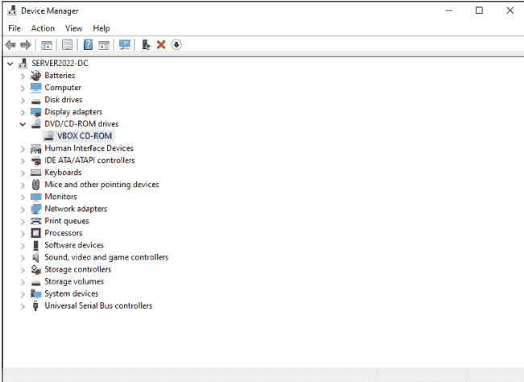

**图 2-1：** 对于曾经使用过 Windows 的用户来说，Windows Server 2022 中的设备管理器会让人感到十分熟悉。

### 配置服务器硬件

当你选择「查看」菜单时，会出现以下选项：

- **按类型分组设备：** 该视图会按硬件类型对硬件进行逻辑分组。例如，如果你的服务器安装了多张网卡，它们会被统一归类到「网络适配器」下；如果你有多个硬盘，它们会被归类到「磁盘驱动器」下。这是设备管理器打开时的默认视图。
- **按连接关系分组设备：** 服务器中的设备能够正常运行，是因为它们都通过某种方式相互连接。该视图会按设备的连接方式进行排序。大部分存储设备和网络适配器会显示在「PCI 总线」下，因为这通常是它们的连接方式。
- **按容器分组设备：** 该视图按容器的 ID 对设备进行分组。这些容器 ID 可能是分配给设备的，也可能是设备从父对象继承而来的。例如，服务器的父容器之一就是服务器本身。归到该容器下的项目可能包括通信端口、ATA 通道、处理器核心等。
- **按类型分组资源：** 该视图会将服务器中的所有设备按资源类型分类，资源类型包括直接内存访问、输入/输出、中断请求和内存。我将在本章的「了解资源」部分详细介绍这些内容。
- **按连接关系分组资源：** 该视图会按系统资源的连接和交互方式排序。在过去，人们经常需要排查中断请求（IRQ）冲突，该视图在当时非常实用，不过现在可能已不再被广泛使用。

你还可以自定义设备管理器中显示的信息。选择「查看」→「自定义」，就会弹出「自定义视图」对话框（见图 2-2）。你可以在此更改要显示的项目。我从来没有特别充分的理由要更改默认视图。

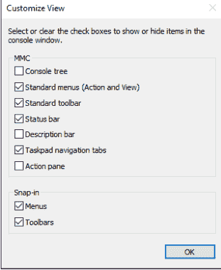

**图 2-2：** 自定义设备管理器视图。

###### 查看无法正常工作的设备

通常情况下，如果设备出现故障，会以下列两种方式之一显示：

- 如果设备存在问题但仍可部分运行，设备图标上会显示一个中间带有感叹号的橙色三角形。
- 如果设备完全无法运行，图标上会显示一个带有黑色向下箭头的白色圆圈，这意味着设备已被禁用。

当有设备出现问题时，打开设备管理器后该设备会自动展开，这大大方便了系统管理员定位故障设备。如图 2-3 所示，我的一台设备出现了问题。DVD/CD-ROM 驱动器已被禁用，从名称旁边的向下箭头就能看出这一点。

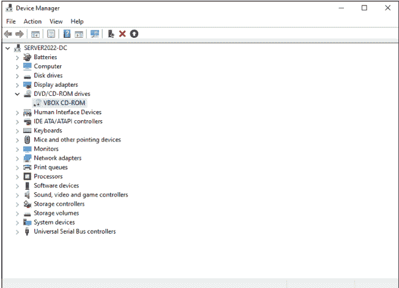

**图 2-3：** 设备管理器可以轻松识别存在问题的设备。可以重新启用 DVD/CD-ROM 驱动器来确认它是否存在故障。我只需右键单击该设备，然后选择「启用设备」即可。在我的案例中，它能够正常运行，因为我是为了截图才禁用了它。

查看故障设备的「属性」界面时，我可以进一步了解问题所在。如果是驱动程序缺失，我可以让 Windows 自动搜索兼容的驱动程序，大多数时候这都能解决问题。如果无法解决，最好前往设备制造商的官网手动下载驱动程序。

###### 了解资源

了解设备管理器中呈现的资源信息，对排查系统技术问题很有帮助。在某些情况下，比如输入/输出（I/O）和 IRQ，重复的地址可能导致设备故障，设备可能会停止工作，甚至导致系统死机或崩溃。

如果你已经学过 A+ 认证的相关内容，本节对你来说可能没有新意，可以跳过。如果你还没有学习 A+ 认证，或是刚接触服务器和计算领域，请继续阅读！

###### 直接内存访问（DMA）

直接内存访问（DMA）允许外设直接与内存通信，无需中央处理器（CPU）作为中介，这可以大幅提升通信速度。通常，约有 16MB 的内存可用于 DMA。

###### 输入/输出（I/O）

最简单的 I/O 定义是：任何能够向服务器传入或传出数据的设备都属于 I/O 设备，包括键盘、鼠标等输入设备，打印机、显示器等输出设备，以及磁盘驱动器等同时支持输入输出的设备。

在设备管理器中，切换到「资源」选项卡后，通过查看 I/O 范围，就可以看到特定设备被分配了哪些 I/O 地址。

###### 中断请求（IRQ）

中断请求（IRQ）本质上是发送给 CPU 的信号，它会「中断」CPU 当前正在执行的任务，以便发送中断的设备或软件获得 CPU 的资源。

该机制用于支持多任务处理，处理器仅在需要时被通知，无需在空闲时轮询（poll）是否有任务。中断会被分配给特定设备，不会共享。如果两个设备使用相同的 IRQ，就会出现 IRQ 冲突。

这曾经是系统管理员需要关注的问题，但由于如今大多数设备都支持即插即用，大部分系统管理员已经不需要再处理这类问题了。

###### 内存

随机存取内存（RAM）是固态存储技术，读取速度很快，非常适合快速加载数据。在设备管理器中，切换到单个设备的「资源」选项卡，就可以查看分配给该设备的内存范围。

###### 查看隐藏设备

有时初次打开设备管理器时，部分设备不会显示。未连接的设备和不支持即插即用的设备，就是默认不会在设备管理器中显示的设备类型。

对于不支持即插即用的设备，选择「查看」→「显示隐藏设备」，即可显示出非即插即用设备。

要查看曾经安装但已从服务器上拆卸的设备，需要以管理员身份打开命令提示符或 PowerShell 窗口，并输入以下命令：

```cmd
SET DEVMGR_SHOW_NONPRESENT_DEVICES=1
```


接着在同一个窗口中输入`devmgmt.msc`启动设备管理器。打开设备管理器后，选择「查看」→「显示隐藏设备」，就能看到曾经存在的设备的「幽灵」条目。如果旧设备驱动程序导致新设备或应用程序出现问题，这个功能会非常实用，因为你可以看到这些旧驱动的条目并将其删除。

### 扫描新设备

如果你安装了新设备但设备管理器中没有显示，可以选择「操作」→「扫描检测硬件改动」来扫描新硬件。该操作会扫描新硬件，如果找到新硬件，会尝试定位并为其安装驱动程序。

### 处理旧设备

作为系统管理员，你可能会被要求安装较旧的设备，这类设备插入电脑后无法被识别。对于这类非即插即用设备，最佳选择是使用设备管理器中的「添加过时硬件」选项。你可以在设备管理器窗口中选择「操作」→「添加过时硬件」来打开该功能。

### 查看单个设备的设置

在设备管理器中，查看单个设备的设置非常简单，只需双击该设备，或是右键单击设备后选择「属性」即可。

大多数设备至少有四个选项卡：

- **常规：** 「常规」选项卡（见图 2-4）包含设备的基本信息，例如设备名称、设备类型、制造商以及设备在系统中的位置。我最喜欢这个选项卡的部分是底部的「设备状态」框，如果你在排查故障，「设备状态」框会非常有用。当设备正常运行时，状态框会显示为如图 2-4 所示的内容。

**图 2-4：** VirtualBox CD-ROM 驱动程序的“常规”选项卡。

> **驱动程序：** “驱动程序”选项卡会显示已安装驱动程序的相关信息，并允许你执行多项与驱动程序相关的管理任务。页面首先会显示驱动程序名称，随后列出驱动程序的提供方、发布日期、版本号；如果驱动程序经过签名，还会包含签名组织的身份信息。通过此选项卡中的以下按钮，你可以管理系统上的驱动程序：

- **驱动程序详细信息：** 提供有关驱动程序的更多详细信息，包括驱动程序文件的存储位置和文件名。
- **更新驱动程序：** 点击此按钮可更新驱动程序，系统会提供两个选项：你可以自动搜索更新的驱动程序，系统会在你的本地系统和互联网上搜索更新；如果你知道更新后的驱动程序在系统中的存放位置，也可以浏览至对应的驱动程序软件位置。
- **回滚驱动程序：** 如果你更新了驱动程序后设备运行异常，可以点击“回滚驱动程序”恢复之前安装的驱动程序。
- **禁用设备：** 点击“禁用设备”会在设备管理器中禁用对应设备。禁用设备后，设备名称旁的图标会出现向下的箭头，表明该设备当前处于禁用状态。
- **卸载设备：** 如果你需要完全卸载设备，可以点击此按钮。该选项适用于移除硬件卸载时未删除的残留驱动程序、移除已损坏的驱动程序，或手动移除导致系统稳定性问题的设备驱动程序。

> **详细信息：** 首次点击“详细信息”选项卡时看起来内容较少，但实际包含大量与设备相关的信息。默认情况下，下拉框会选中“设备描述”，你也可以选择其他多种属性，获取设备具体参数的更多信息。

> **事件：** “事件”选项卡包含特定设备发生的事件记录。在新系统上，没有太多可查看的内容——只有初始的“设备已启动”和“设备已配置”条目。如果服务器已经运行了一段时间，你正在排查问题，可以点击“查看所有事件”，事件查看器会打开并附带自定义筛选器，你可以查看仅针对该设备的事件。部分设备还有提供更多管理功能的附加选项卡，例如电源管理和资源。电源管理功能允许计算机关闭设备以节省电量，或允许设备在系统处于睡眠模式时唤醒计算机。“资源”选项卡（如果存在）会显示设备使用的内存范围、占用的 IRQ（中断请求），以及是否存在设备冲突。

### 更新驱动程序

通过设备管理器更新驱动程序非常简单，你有两种选择：可以右键点击设备并选择“更新驱动程序”，也可以右键点击设备，选择“属性”，再点击“驱动程序”选项卡。通过以上任一方式选择“更新驱动程序”后，你会看到图 2-5 所示的对话框。

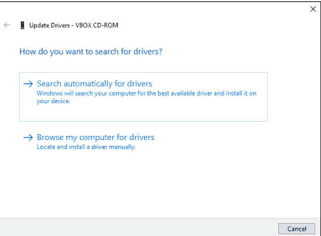

**图 2-5：** 通过 Windows Server 2022 的设备管理器更新驱动程序时，你有两个选择：自动搜索驱动程序，或浏览计算机查找软件。自动搜索通常是最简单的方法，它会先搜索本地计算机，然后在互联网上搜索更新的驱动程序。如果由于某种原因无法找到驱动程序，且你知道驱动程序的位置，选择浏览计算机查找驱动程序软件可能是最佳选择。

## 配置服务器硬件

### 配置电源管理

设备管理器中的部分设备有“电源管理”选项卡，你可以通过此选项卡配置设备的电源管理相关行为。根据设备类型的不同，你有两个或三个选项：

- **允许计算机关闭此设备以节省电量：** 此选项对依靠电池供电的设备（如笔记本电脑）最有用。你很可能不希望服务器组件关闭，因此可能需要取消勾选此框。
- **允许此设备唤醒计算机：** 选中此复选框的设备可以在服务器进入睡眠状态时将其唤醒。网卡需要使用此功能来唤醒服务器进行补丁安装，鼠标和键盘等输入设备也使用此功能唤醒连接的设备。
- **仅允许魔术包唤醒计算机：** 此设置仅适用于网络适配器，且只有在启用“允许此设备唤醒计算机”时才可用。魔术包也称为 Wake-on-LAN（网络唤醒）包，是一种专门用于唤醒系统的广播包。

### 使用添加硬件向导

由于大多数设备即插即用，你通常不需要使用添加硬件向导。事实上，它在 Windows 7 时已从控制面板中移除，因为驱动程序安装会自动处理。如果由于某种原因未安装设备驱动程序（可能是设备过于陈旧或过于新），你可以手动启动添加硬件向导。首先从制造商的网站下载驱动程序，然后按照以下步骤操作：

1. **右键点击“开始”菜单，选择“Windows PowerShell (管理员)”。**
2. **输入** `hdwwiz.exe` **然后按 Enter 键。** 添加硬件向导将启动（见图 2-6）。

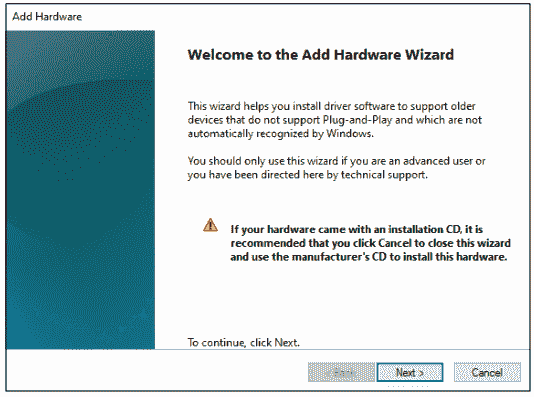

**图 2-6：** 添加硬件向导。

3. **点击“下一步”。**
4. **选中“搜索并自动安装硬件（推荐）”旁边的单选按钮，然后点击“下一步”。**
5. **如果向导找到新硬件，会告知你找到的内容，你可以安装驱动程序。**
6. **如果向导未找到新硬件，会要求你选择硬件类别，选择一个类别后点击“下一步”。**
7. **选择设备的制造商和型号，然后点击“下一步”。** 向导将安装驱动程序。

值得注意的是，除了上述步骤外，还有其他多种方式可以打开添加硬件向导。找到最适合你访问这些项目的方式即可——大胆尝试。

### 执行与硬盘相关的任务

硬盘是你在服务器上执行的大部分工作的核心存储设备，它存储操作系统以及组织运营所需的数据。当前使用的存储主要有两种类型：

- **硬盘驱动器（HDD）：** 多年来，磁性存储（即硬盘驱动器）是唯一的选择。这类驱动器的速度和容量各不相同；速度更高、容量更大的驱动器价格更贵。由于是机械结构，它们容易磨损，随着技术进步，受物理限制，磁性存储已无法满足部分高存储负载的需求。磁性存储并未消失——依然在市场中存在。由于成本更低，当速度和高性能不如控制成本重要时，HDD 仍是数据存储的绝佳选择。
- **固态硬盘（SSD）：** 固态硬盘没有移动部件，数据存储在非易失性闪存芯片中。随着技术进步，其使用寿命增加、容量持续增长、价格不断下降。对于大多数系统管理员来说，固态硬盘是操作系统盘的首选，因为它们速度非常快。如果你的应用程序需要持续稳定的性能和高每秒输入/输出操作数（IOPS），SSD 可以满足这一需求。


在许多场景中，系统管理员和存储管理员会采用两者兼顾的方案：创建分层存储。较高层级的存储由速度更快、价格更高的 SSD 组成，而较低层级的存储用于访问频率较低的数据，由价格更低的 HDD 组成。

#### 选择基本磁盘或动态磁盘

首次初始化磁盘时，它是基本磁盘。对于大多数用户来说，基本磁盘完全够用。基本磁盘是简单的解决方案，默认情况下新磁盘就是基本磁盘。然而，如果你的组织需要使用更高级的磁盘功能，则需要升级到动态磁盘。动态磁盘支持


- **简单：** 简单动态磁盘与基本磁盘非常相似。当你第一次将基本磁盘转换为动态磁盘时，它会是一个简单卷。
- **条带化：** 数据会被写入多个磁盘（即条带化）。这种方式可以提升写入性能，但并不是容错方案。你需要至少 2 块磁盘才能使用该功能，并且如果丢失其中 1 块磁盘，就会丢失整个条带集。条带化有时也被称为 RAID 0。
- **跨区：** 跨区卷是由多个物理硬盘组合而成的逻辑卷。如果你有一两块小硬盘，但需要一块大硬盘时，跨区卷会非常实用。这种方案的缺点是和条带化一样，如果其中一块硬盘停止工作，将没有容错能力，你会丢失该硬盘上的所有数据。
- **镜像：** 数据会被完全相同地写入两块或更多磁盘中。这种方式提供了容错能力，因为如果其中一块磁盘无法工作，也不会丢失数据。镜像有时也被称为 RAID 1。
- **RAID 5：** RAID 5 卷也被称为奇偶校验卷。它至少需要 3 块磁盘，其中 1 块用于存储奇偶校验信息。该奇偶校验位可保证如果其中一块磁盘出现故障，不会丢失数据。当然，如果丢失的磁盘超过 1 块，就会出现数据丢失。

#### 使用多路径 I/O

试想一下你在数据中心安装新服务器的场景：你正忙着给服务器接跳线，抱怨着挡路的那堆乱成一团的线缆，这时你意识到不小心拔掉了机架交换机的电源——该交换机用于连接互联网小型计算机系统接口（iSCSI）存储。你做好了一堆投诉电话打过来的准备，结果什么都没有发生。随后你发现每台系统都接有第二根网线，连接到隔壁机架的 iSCSI 交换机。你松了一口气——你有多路径 I/O（MPIO）。

MPIO 是一种允许服务器识别到其存储区域网络（SAN）存储的多个路径的技术。该技术通常用于光纤通道和 iSCSI 存储网络，为存储网络提供容错能力。此外，根据配置方式的不同，它还能提升性能，因为你可以同时使用两条连接。安装 MPIO 非常简单，但配置可能稍微复杂一些。MPIO 是 Windows Server 2022 的内置功能。以下是安装 MPIO 的步骤：

1. 打开服务器管理器，选择“管理”→“添加角色和功能”（如图 2-7 所示）。

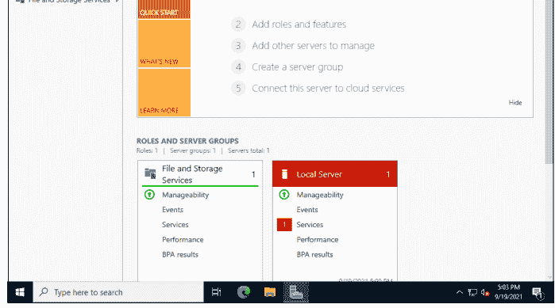

图 2-7：在 Windows Server 2022 中安装 MPIO 功能。

2. 在“开始之前”界面，单击“下一步”。
3. 在“选择安装类型”界面，选择“基于角色或基于功能的安装”，然后单击“下一步”。
4. 在“选择目标服务器”界面，你的服务器会被自动选中；单击“下一步”。
5. 在“选择服务器角色”界面，单击“下一步”。
6. 在“选择功能”界面，向下滚动并选中“多路径 I/O”（如图 2-8 所示），然后单击“下一步”。

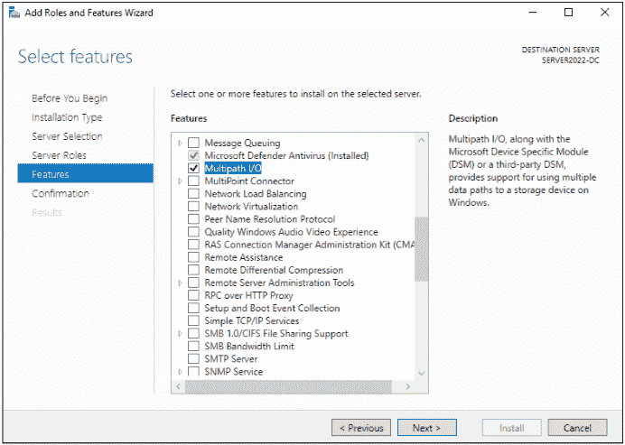

7. 在“确认安装选择”界面，单击“安装”。
8. 安装完成后，单击“关闭”。

安装好 MPIO 后，你可以将其配置为兼容 iSCSI 存储，甚至是串行连接 SCSI（SAS）存储。

#### 聊聊磁盘术语

在进入精彩的存储世界之前，先快速介绍一下本章会用到的部分术语：

- **磁盘：** 呈现给服务器、用于存储数据的物理或虚拟存储设备。
- **分区：** 磁盘可以被划分为多个分区。这些分区是磁盘的较小部分，可能包含文件系统，也可能不包含。
- **卷：** 卷有名称，是你呈现给用户的对象。卷带有文件系统，可以存储各类数据。一块磁盘或一个分区上可以存在多个卷。

#### 使用存储区域网络

多年来，服务器的本地存储是你唯一可用的存储资源。只使用服务器内置的存储存在不少问题：它不具备容错能力（除非使用 RAID，RAID 0 除外），不易扩展，容量也受限于服务器能安装的磁盘数量。有人提出创建驱动器阵列来解决这些问题。这类驱动器阵列可以配备可扩展的磁盘托盘，这些托盘可以用来镜像其他托盘，或者在容错是主要目标时使用 RAID。这些大型驱动器阵列需要能够支撑日益增长的数据流入量的网络，存储区域网络（SAN）便应运而生。

SAN 中有许多不同的协议，以下是当今企业环境中使用最广泛的两种：

- **iSCSI：** iSCSI 成为中小企业的首选，是因为企业可以使用现有的网络基础设施来承载存储流量。这意味着 iSCSI 的前期投入更低，无需购买专用的网卡和交换机来支持 iSCSI 流量，企业只需要一台 iSCSI 存储设备即可使用该协议。iSCSI 协议会将 SCSI 命令封装到传输控制协议（TCP）数据包中，然后通过传统以太网线缆将数据传输到目标位置。
- **光纤通道：** 光纤通道目前在两种协议中仍更受欢迎，主要得益于其速度和可靠性。它需要购买专用的网卡和交换机来支持光纤通道协议。尽管光纤通道能实现快速数据传输，但其传输距离受限，远甚于 iSCSI。光纤通道使用光纤线缆传输数据，数据以光脉冲的形式在玻璃纤维中传输。

如果你想要两者兼得该怎么办？部分厂商销售的是被称为*统一存储*的设备，这类存储设备同时支持 iSCSI 和光纤通道协议。

#### 了解存储空间直通

存储空间直通是 Windows Server 2016 数据中心版引入的一项功能。对于无力承担 SAN 成本的组织来说，这是一种实现高可用、高扩展性存储的绝佳方案。它利用服务器的本地存储创建存储池，供整个被称为*节点*的服务器集群共用。要在多台服务器上使用存储空间直通，需要在每台服务器上安装故障转移群集和 Hyper-V 角色。群集系统之间至少需要 10Gb 以太网网络，同时建议使用远程直接内存访问（RDMA）。存储的设置过程相当简单：先从物理磁盘创建存储池，再创建逻辑磁盘，最后创建卷。我会演示如何在独立服务器上完成该操作，群集服务器上的流程与此非常相似。

##### 创建存储池

存储池是搭建存储空间直通存储的起点。以下是创建存储池的步骤：

1. 在服务器管理器中，单击左侧菜单中的“文件和存储服务”。
2. 单击“存储池”。如果你有可用的磁盘驱动器，它们会显示在右下方的“物理磁盘”下。注意“存储池”下方有一个名为“原质”的条目，这是默认随可用磁盘创建的（见图 2-9）。

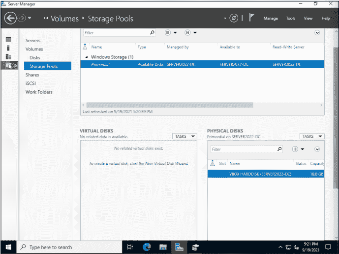

图 2-9：显示可用物理磁盘的存储池界面。

3. 右键单击“原质”，然后选择“新建存储池”。
4. 在“开始之前”界面，单击“下一步”。
5. 在“指定存储池名称和子系统”界面，输入存储池的名称，然后单击“下一步”。这里我们将存储池命名为“Pool1”。注意在图 2-10 中，原质存储池会被默认选中。

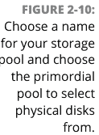

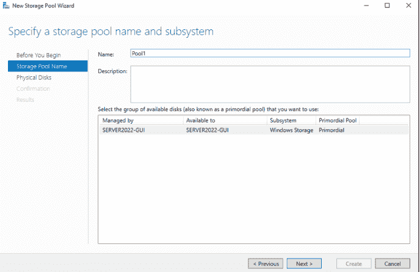

在“选择存储池的物理磁盘”界面，你可以看到原质存储池中的所有磁盘，可以选择其中部分磁盘或全部磁盘。

6. 本示例中请选中所有磁盘。
7. 将最后一块磁盘的“分配”下拉框改为“热备用”，如图 2-11 所示，然后单击“下一步”。
8. 在“确认选择”界面，单击“创建”。如果一切顺利，“查看结果”界面会显示“已完成”。
9. 单击“关闭”。

## 配置服务器硬件

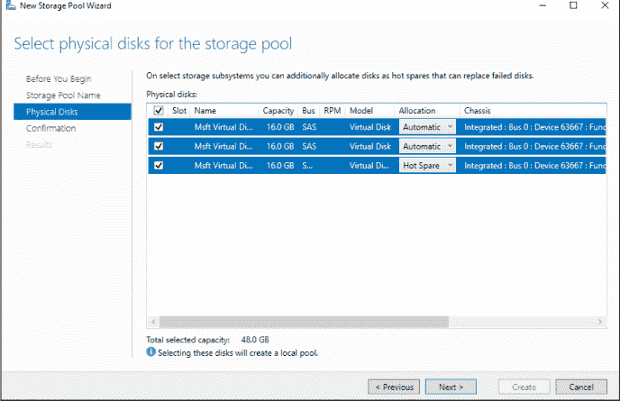

图 2-11：存储池中物理磁盘的配置。

##### 创建逻辑磁盘

现在存储池已创建完成，你可以创建逻辑磁盘了。请按照以下步骤操作：

- **右键单击**`Pool1`**，选择“新建虚拟磁盘”，或者单击“虚拟磁盘”框中的“要创建虚拟磁盘，请启动‘新建虚拟磁盘’向导”超链接。** 系统会提示你选择要操作的存储池，此时你应该只会看到我们之前创建的唯一一个存储池`Pool1`。
- **选择**`Pool1`**，然后单击“确定”。**
- **在“开始之前”界面，单击“下一步”。**
- **在“指定虚拟磁盘名称”界面，将磁盘命名为**`Disk1`**，如图 2-12 所示。**

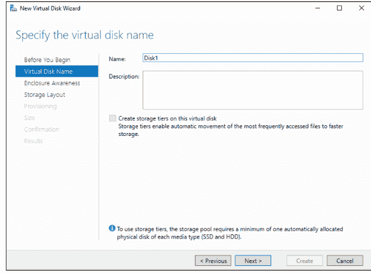

图 2-12：使用虚拟磁盘前需要先为其命名。

- **单击“下一步”。**
- **在“指定机箱容错能力”界面，保持“启用机箱感知”复选框未选中状态，然后单击“下一步”。** 下一个界面是“选择存储布局”界面，共有三个选项：简单、镜像和奇偶校验。它们的功能和 RAID 级别非常相似：简单磁盘是非 RAID 磁盘，镜像对应 RAID 1，奇偶校验对应 RAID 5。
- **如图 2-13 所示，选择“简单”选项，然后单击“下一步”。**

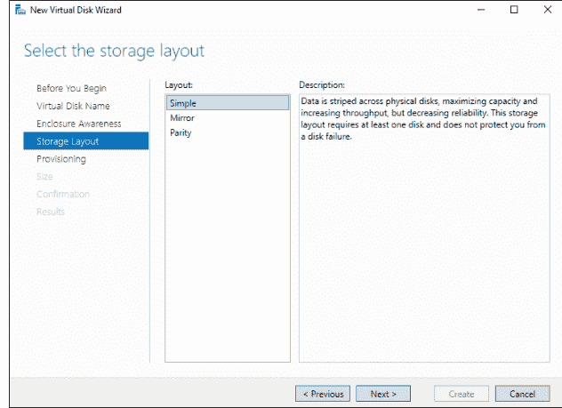

图 2-13：如果对容错性有要求，选择存储布局非常重要。

- 在“指定预配类型”界面，预配类型选择“精简”，然后单击“下一步”。
- 在“指定虚拟磁盘大小”界面，设置虚拟磁盘的大小，然后单击“下一步”。本示例中虚拟磁盘的大小设置为 5GB。
- 在“确认选择”页面，单击“创建”。
- 如果所有操作都成功完成，单击“关闭”。

##### 创建卷

现在你已经完成了存储池和虚拟磁盘的创建，接下来可以创建卷了。请按照以下步骤操作：

- 右键单击`Disk1`，选择“新建卷”，如图 2-14 所示。

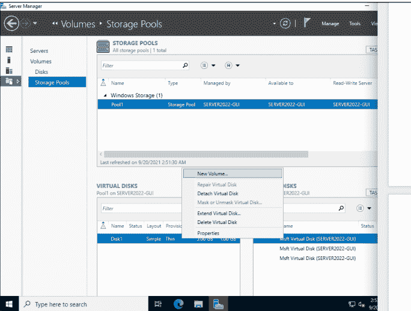

图 2-14：创建完虚拟磁盘后，创建操作系统可使用的卷非常简单。

第 2 章 配置服务器硬件 123

- 在“开始之前”界面，单击“下一步”。
- 在“选择服务器和磁盘”界面，此时你应当只有一台服务器和一块磁盘，因此可以直接单击“下一步”。
- 在“指定卷大小”界面，输入大小后单击“下一步”。我输入的是 3GB。
- 在“分配驱动器号或文件夹”界面，选择一个驱动器号或指定一个文件夹，然后单击“下一步”。我选择了最简单的方案，指定了一个驱动器号，系统自动分配了 F 盘符，如图 2-15 所示。

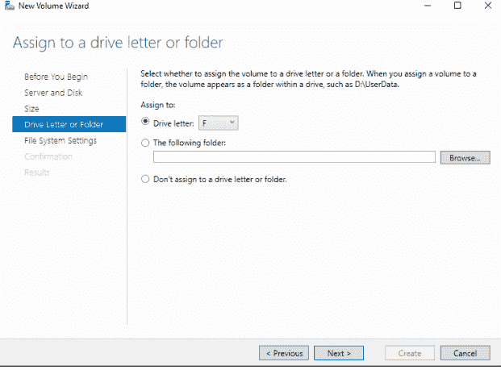

图 2-15：为我的新卷选择驱动器号。


- **在“选择文件系统设置”界面，选择文件系统设置后单击“下一步”。** 我保持默认的`NTFS`文件系统和默认的分配单元大小，并将卷命名为`Volume1`。

- **在“确认选择”界面，如果所有设置都无误，单击“创建”。**

- **如果“完成”界面上的所有项目都显示“已完成”，说明操作成功，此时可以单击“关闭”。**

## 使用存储复制

存储复制是灾难恢复场景下的优秀工具，它可以在服务器或集群之间实现卷的同步或异步块级复制。通过部署拉伸集群，你甚至可以实现跨远距离站点的复制。存储复制功能最早随`Windows Server 2016`数据中心版发布。从`Windows Server 2019`开始，即使是标准版也可以使用存储复制功能。`Windows Server 2022`中这一情况仍然不变，不过该功能存在一些限制：

- 存储复制仅能复制一个卷，而非无限数量的卷。
- 一个卷最多只能建立一个复制伙伴关系，而数据中心版中一个卷可以建立无限数量的伙伴关系。
- 存储复制仅支持最大`2TB`的卷，而数据中心版对卷大小没有限制。

124 第2册 **配置`Windows Server 2022`**

## 使用存储服务质量

存储服务质量（QoS）功能支持你在使用`Hyper-V`和横向扩展文件服务器角色时，集中监控虚拟机（VM）的存储性能。注意：如果需要，你可以使用群集共享卷替代横向扩展文件服务器。存储`QoS`可以实现以下功能：

- 确保单个虚拟机无法占用全部存储带宽。
- 监控存储性能。
- 通过策略为虚拟机设定最小和最大`I/O`限制。

体验存储`QoS`最简单的方式之一就是搭建故障转移群集并创建群集共享卷。完成上述操作后，存储`QoS`会自动配置完成，你可以在“群集核心资源”下查看它。

## 使用`BitLocker`加密

如今数据安全的重要性前所未有。通过`BitLocker`，你可以对整个数据盘进行加密，防止数据被窃取。`BitLocker`可以对固定驱动器和可移动驱动器进行加密：固定驱动器通常使用受信任的平台模块（TPM）芯片存储加密密钥，而`BitLocker To Go`则通过密码或智能卡来解锁。在接下来的章节中，我会介绍`TPM`的相关内容，并带你完成`BitLocker`的安装，以及`BitLocker To Go`和`BitLocker`的配置。

### 了解受信任的平台模块

受信任的平台模块是主板上专用于存储密码、证书和加密密钥的特殊芯片。为了获得最流畅的`BitLocker`使用体验，建议使用`1.2`或更高版本的`TPM`芯片。如果你的系统没有`TPM`，仍然可以使用`BitLocker`，但需要通过组策略绕过`TPM`要求，并且需要输入密码才能解锁系统。本章后续的“无`TPM`模块时的应对方案”一节会介绍如何在没有`TPM`的情况下安装`BitLocker`。


### 安装`BitLocker`

要在`Windows Server 2022`上安装`BitLocker`，你需要先安装`BitLocker`功能。请按照以下步骤操作：

- 打开服务器管理器，选择“管理”>“添加角色和功能”。
- 在“开始之前”界面，单击“下一步”。
- 在“选择安装类型”界面，单击“基于角色或基于功能的安装”，然后单击“下一步”。
- 在“选择目标服务器”界面，单击“下一步”。
- 在“选择服务器角色”界面，单击“下一步”。
- 在“选择功能”界面，勾选“`BitLocker`驱动器加密”复选框，然后单击“下一步”。系统会提示你是否需要安装`BitLocker`驱动器加密所需的附加功能，如图2-16所示。

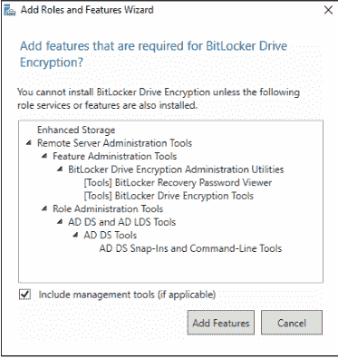

图2-16：安装`BitLocker`驱动器加密运行所需的附加功能。

- 单击“添加功能”，然后单击“下一步”。
- 在“确认安装选择”界面，勾选“需要时自动重启目标服务器”复选框。`BitLocker`驱动器加密功能需要重启服务器才能生效。
- 单击“安装”。服务器重启完成后，你就可以继续配置`BitLocker`了。

> **警告**  
> 任何涉及数据加密的操作，请务必提前做好备份，以便在出现问题时恢复数据。如果没有可用备份，且加密过程中出现故障，你将需要从备份中恢复数据。

### 配置`BitLocker To Go`

配置`BitLocker To Go`时，你需要先找到隐藏的管理工具，然后就可以开始操作了。请按照以下步骤操作：

- 单击“开始”按钮，向下滚动到“`Windows`系统”，然后选择“控制面板”。
- 单击“系统和安全”。
- 在“`BitLocker`驱动器加密”下，单击“管理`BitLocker`”（见图2-17）。

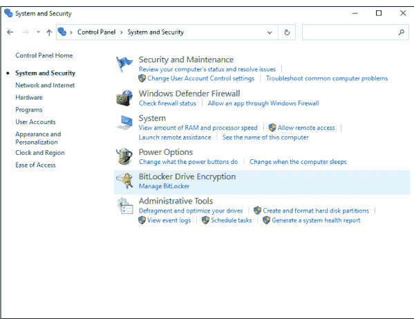

图2-17：`BitLocker`管理控制台可用于为你的驱动器开启`BitLocker`加密。

- 在我的系统中，`BitLocker`当前处于关闭状态，因此我会单击“为`Volume1`开启`BitLocker`”（见图2-18）。由于`Volume1`被视为可移动磁盘，不会使用`TPM`，因此你需要设置密码或指定使用智能卡，这是为了支持`BitLocker To Go`功能。
- **5.** 设置密码，如图2-19所示。
- **6.** 单击“下一步”。系统会询问你要如何备份恢复密钥，你可以将密钥保存到文件中，也可以打印恢复密钥。

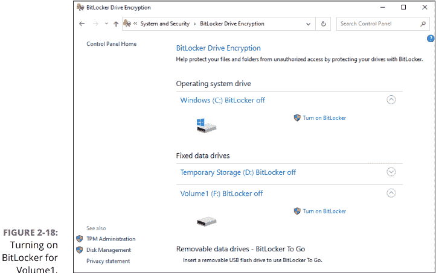

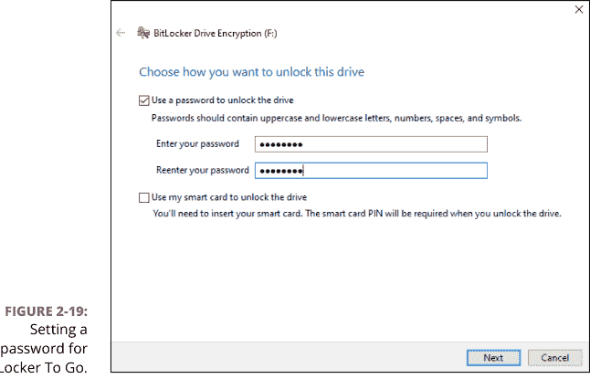

- **7.** 保存后单击“下一步”。系统会询问你要加密驱动器上的多少内容。
- **8.** 选择“仅加密已用磁盘空间”，然后单击“下一步”。
- **9.** 在“选择要使用的加密模式”屏幕上，选择“兼容模式”并单击“下一步”。对于可移动媒体，通常选择兼容模式最安全。系统会询问你是否已准备好加密驱动器。
- **10.** 单击“开始加密”。加密完成后，你会在`BitLocker To Go`驱动器上看到`BitLocker`的状态，应该显示为“`BitLocker` 已启用”。

### 配置`BitLocker`

要配置`BitLocker`，你需要导航到管理工具所在的位置。这些步骤与《配置`BitLocker To Go`》中的步骤1至3相同，因此我将从步骤3之后开始说明。如果你需要回顾如何进入`BitLocker`管理屏幕，请在继续操作前查看《配置`BitLocker To Go`》中的步骤1至3。

- **1.** 在我的系统中，`C`盘当前已关闭`BitLocker`，因此我将单击“为`C`盘启用`BitLocker`”。在“你要如何备份恢复密钥”屏幕上，你可以选择将密钥保存到文件或打印恢复密钥。
- **2.** 保存文件并单击“下一步”。系统会提示你选择要加密驱动器的方式：你可以加密整个驱动器，也可以仅加密已用空间。请选择你所在组织要求的方式。
- **3.** 我将选择“仅加密已用磁盘空间”。
- **4.** 单击“下一步”。
- **5.** 在“选择要使用的加密模式”屏幕上，选择“新加密模式”并单击“下一步”。
- **6.** 在最后一个屏幕上，选中“运行`BitLocker`系统检查”复选框。这样可确保`BitLocker`在加密驱动器前能够读取密钥。
- **7.** 单击“继续”。系统会返回`BitLocker`屏幕，并要求你重启系统。

## 配置服务器硬件

- **8.** 单击“立即重启”。系统重启后，`BitLocker`将开始加密驱动器。加密完成后，状态会显示为“`BitLocker` 已启用”。

### 了解无`TPM`模块时的处理方法

你可能会遇到没有`TPM`模块的服务器。当你尝试启用`BitLocker`时，会收到一条错误提示，提示找不到兼容的`TPM`。这不代表你无法使用`BitLocker`，只是意味着需要额外操作才能让`BitLocker`加密数据驱动器。请按照以下步骤操作：

- 1. 单击“开始”菜单，选择“运行”。
- 2. 输入`gpedit.msc`。
- 3. 依次单击“本地安全策略”、“计算机配置”、“管理模板”、“`Windows`组件”、“`BitLocker`驱动器加密”，再单击“固定数据驱动器”，如图2-20所示。

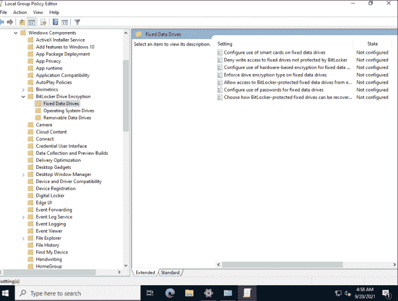

**图2-20：** 配置`BitLocker`在无`TPM`模块的情况下运行需要编辑本地安全策略。

- 4. 双击“配置对固定数据驱动器使用基于硬件的加密”。
- 5. 选择“已启用”，并确保选中“当硬件加密不可用时使用基于`BitLocker`软件的加密”复选框（如图2-21所示）。

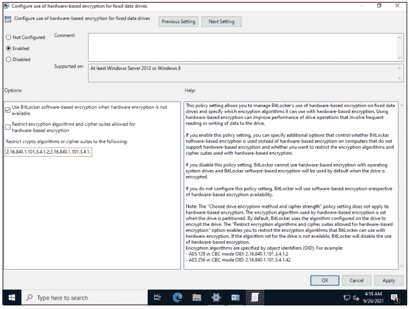

**图2-21：** 为`BitLocker`启用基于软件的加密。

- 6. 单击“确定”。
- 7. 依次单击“本地安全策略”、“计算机配置”、“管理模板”、“`Windows`组件”、“`BitLocker`驱动器加密”、“操作系统驱动器”，如图2-22所示。
- 8. 双击“要求启动时进行额外身份验证”。
- 9. 选择“已启用”。
- 10. 确保选中“允许在不兼容的`TPM`的情况下使用`BitLocker`”复选框，如图2-23所示。

**图2-22：** 允许系统驱动器使用备用身份验证方法。

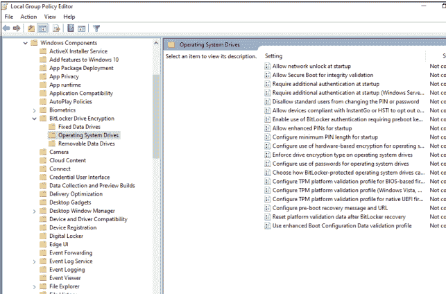

| 设置 | 状态 |
|---|---|
| 允许在启动时进行网络解锁 | 未配置 |
| 允许使用安全启动进行完整性验证 | 未配置 |
| 要求启动时进行额外身份验证 | 未配置 |
| 要求启动时进行额外身份验证（`Windows Server Vista`及更高版本） | 未配置 |
| 允许标准用户更改`PIN`或密码 | 未配置 |
| 允许符合`InstantGo`或`HSTI`标准的设备选择退出... | 未配置 |
| 启用使用需要预启动键盘输入的`BitLocker`身份验证 | 未配置 |
| 允许使用增强型启动`PIN` | 未配置 |
| 配置启动`PIN`的最小长度 | 未配置 |
| 配置对操作系统驱动器使用基于硬件的加密 | 未配置 |
| 在操作系统驱动器上强制实施驱动器加密类型 | 未配置 |
| 配置对操作系统驱动器使用密码 | 未配置 |
| 选择`BitLocker`保护的操作系统驱动器的恢复方式 | 未配置 |
| 为基于`BIOS`的固件配置配置`TPM`平台验证配置文件 | 未配置 |
| 配置`TPM`平台验证配置文件（`Windows Vista`、`Windows Server 2008`、`Windows 7`） | 未配置 |
| 为原生`UEFI`固件配置配置`TPM`平台验证配置文件 | 未配置 |
| 配置预启动恢复消息和`URL` | 未配置 |
| `BitLocker`恢复后重置平台验证数据 | 未配置 |
| 使用增强型启动配置数据验证配置文件 | 未配置 |

**图2-23：** 要让操作系统驱动器在没有`TPM`的情况下加密或解密，需要配置此设置。

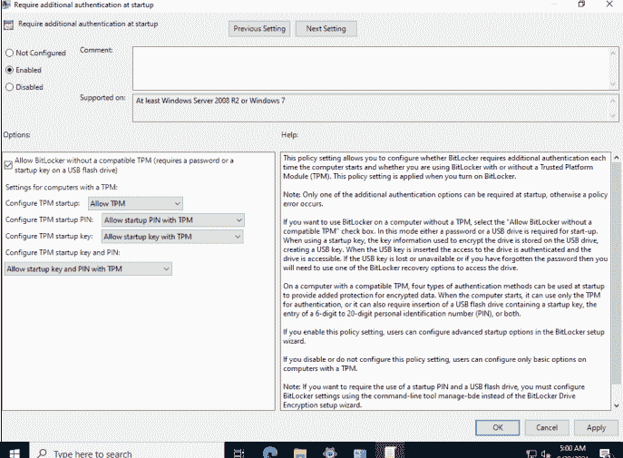

> 此策略设置允许你配置`BitLocker`是否需要在每次计算机启动时进行额外身份验证，以及你是使用带`TPM`的`BitLocker`还是不使用`TPM`的`BitLocker`。该策略设置在启用`BitLocker`时生效。
>
> > **注意：** 启动时只能要求一种额外的身份验证选项，否则会出现策略错误。
>
> > 如果要在没有`TPM`的计算机上使用`BitLocker`，请选中“允许在不兼容的`TPM`的情况下使用`BitLocker`”复选框。在此模式下，启动时需要输入密码或插入`USB`驱动器。使用启动密钥时，用于加密驱动器的密钥信息将存储在`USB`驱动器上，形成`USB`密钥。插入`USB`密钥后，即可验证对驱动器的访问权限，驱动器可正常访问。如果`USB`密钥丢失、不可用或你忘记了密码，则需要使用其中一种`BitLocker`恢复选项来访问驱动器。
>
> > 在带有兼容`TPM`的计算机上，可以使用四种类型的身份验证方法在启动时提供额外保护，以确保加密数据的安全。计算机启动时，可以仅使用`TPM`进行身份验证，也可以要求插入包含启动密钥的`U`盘、输入6位到20位的个人识别码（`PIN`），或同时要求两者。
>
> > 如果启用此策略设置，用户可以在`BitLocker`设置向导中配置高级启动选项。
>
> > 如果禁用或未配置此策略设置，用户只能在带有`TPM`的计算机上配置基本选项。
>
> > **注意：** 如果你要要求在启动时使用启动`PIN`和`U`盘，必须使用命令行工具`manage-bde`配置`BitLocker`设置，而不能使用`BitLocker`驱动器加密设置向导。

- **配置`TPM`启动：** 允许`TPM`
- **配置`TPM`启动`PIN`：** 允许在启动时使用带`TPM`的`PIN`
- **配置`TPM`启动密钥：** 允许在启动时使用带`TPM`的密钥
- **配置`TPM`启动密钥和`PIN`：** 允许在启动时使用带`TPM`的密钥和`PIN`

- 11. 单击“确定”。
- 12. 关闭本地组策略编辑器。
- 13. 现在返回`BitLocker`屏幕，你应该可以顺利让其正常工作了。

## 执行与打印机相关的任务

打印机是非常重要的资源。如果你的打印服务器宕机，很快就会接到大量的求助电话。反过来，如果用户正在尝试打印，无法打印的话他们会非常烦躁。安装服务器有几种不同的方式。例如，本地连接的打印机很可能是通过`USB`线连接的，这种打印机可能只有单个用户使用，或者在小型办公环境中，可能从该工作站共享出来，供多个用户打印。网络连接打印也非常普遍，从家庭中的无线打印机到大型组织中局域网（LAN）里的打印机都有。有些组织会使用打印服务器来集中管理打印队列：你向服务器的打印队列发送打印任务，它会通过网络将任务发送到打印机。

### 使用打印机安装向导

打印机安装向导会引导你完成打印机的安装流程。你可以通过依次打开“设置”（开始菜单中的齿轮图标）、“设备”，再选择“打印机和扫描仪”来启动它。之后只需单击“添加打印机或扫描仪”，向导就会启动。如果你的打印机已被检测到，安装过程会非常简单。如果你的打印机未被检测到，你需要多做一些操作。以下是添加不配合的打印机的方法：

- 1. 单击“我所需的打印机未列出”。
- 2. 以我的情况为例，我的打印机在网络上，因此我选择“通过IP地址或主机名添加打印机”，如图2-24所示。
- 3. 单击“下一步”。
- 4. 填写打印机的IP地址（如图2-25所示）。你的IP地址和我的不同，因此你需要查看打印机获取其正在使用的IP地址。确保从“设备类型”下拉列表中选择“`TCP/IP`设备”。

图 2-24：选择查找打印机的方式。

图 2-25：配置打印机的 IP 地址。

- **5.** 点击“下一步”。如果一切顺利，系统将能够联系到打印机，并确定其所需的驱动程序。
- **6.** 点击“下一步”。在“打印机共享”屏幕上，您可以决定是否要将该计算机与其他系统共享。
- **7.** 我将选择“不共享此打印机”。
- **8.** 点击“下一步”。最后一页会提供将新打印机设置为默认打印机的选项。
- **9.** 保留该复选框的选中状态，然后点击“完成”。

> **提示**  
> 如果您需要使用打印机提供的更高级打印功能，但`Windows`驱动程序没有提供您需要的选项，那么您可能需要从制造商的网站下载驱动程序。驱动程序通常打包为可执行文件以方便安装。

### 配置打印选项

要进入打印机管理屏幕，请先从“打印机和扫描仪”菜单开始（参见上一节）。在“打印机和扫描仪”部分，您会看到刚才添加的打印机。点击选中它，然后点击“管理”按钮。配置单个打印机时，有两个选项需要注意：

### 打印首选项

打印首选项允许您设置打印机的默认打印设置。在这里，您可以设置打印方向。如果点击“高级”按钮，会出现更多设置——这些设置取决于为打印机安装的驱动程序。我的打印机设置如图 2-26 所示。

**图 2-26：** “高级选项”为您提供更多可用的设置。

### 打印机属性

“打印机属性”选项提供打印机的配置项。例如，如果您在安装后选择共享打印机、更换驱动程序，或者需要更改`IP`地址，都可以通过“打印机属性”完成。您会看到一个与图 2-27 类似的屏幕。

**图 2-27：** “打印机属性”屏幕允许您更改配置项。

## 配置打印服务器角色

在`Windows Server 2022`中，打印服务器是一个可安装后再配置的角色。

### 安装打印服务器角色

以下是安装打印服务器角色的步骤：

- 1. 打开服务器管理器，选择“管理”>“添加角色和功能”。
- 2. 在“开始之前”屏幕上，点击“下一步”。
- 3. 在“选择安装类型”屏幕上，选择“基于角色或基于功能的安装”，然后点击“下一步”。
- 4. 在“选择目标服务器”屏幕上，点击“下一步”。
- 5. 向下滚动并选择“打印和文档服务”。
- 6. 当系统提示时，点击“添加功能”。您的屏幕应该如图 2-28 所示。

**图 2-28：** 安装“打印和文档服务”角色以设置打印服务器。

- 7. 点击“下一步”。
- 8. 在“选择功能”屏幕上，点击“下一步”。
- 9. 在“打印和文档服务”屏幕上，点击“下一步”。
- 10. 在“角色服务”屏幕上，选择“打印服务器”，如图 2-29 所示，然后点击“下一步”。

**图 2-29：** 选择要安装的“打印服务器”角色。

- 11. 在“确认安装选择”屏幕上，选择“安装”。
- 12. 在“安装进度”屏幕上，安装完成后点击“关闭”。

### 配置打印服务器角色

现在您已经安装了打印服务器角色，接下来可以对其进行配置。以下是添加第一台打印机的步骤：

- 1. 从服务器管理器中，选择“工具”→“打印管理”。
- 2. 展开“打印服务器”，右键单击您的打印服务器，然后选择“添加打印机”，如图 2-30 所示。

**图 2-30：** 向打印服务器添加打印机。

- 3. 选择“按 IP 地址或主机名添加 IPP、`TCP/IP` 或 Web 服务打印机”，然后点击“下一步”。


1. 输入 IP 地址，然后点击“下一步”。在下一个屏幕上，您可以为打印机命名。在企业环境中，我建议您这样做。

2. 我将我的打印机命名为“主办公室打印机 #1”，如图 2-31 所示。

**图 2-31：** 为打印机命名并添加位置，方便用户查找打印机。

3. 点击“下一步”。如果向导找到打印机，下一个屏幕会提示您打印机已被找到，并显示打印机信息摘要。

4. 点击“下一步”。服务器将安装打印机的驱动程序。

5. 驱动程序安装完成后，点击“完成”退出向导。

## 连接到打印服务器上的打印机

连接到打印服务器上的打印机非常简单。您可以使用通用命名约定（UNC）路径添加打印机，格式为 `\servername\printername`。要使用此功能，服务器的名称必须在 DNS 中可解析。如果您在 DNS 中没有打印机名称，也可以改用 IP 地址代替服务器名称来使用 UNC 路径。在企业环境中，通常使用组策略为用户和/或计算机管理打印机。

> **技术相关**
>
> 使用 UNC 路径访问对象（例如文件服务器上的共享文件夹或打印机）是一种便捷的资源访问方式，无需知道资源的具体位置。例如在文件服务器的场景中，文件的本地路径可能是 `E:\SomeFolder\SomeShare\SomeFile.txt`，而其 UNC 路径为 `\\Server Name\SomeShare\SomeFile.txt`。如果共享被移动到其他磁盘，UNC 路径仍然保持不变。

## 执行其他配置任务

本章已经介绍了很多配置步骤，我差不多要讲完了。最后几个配置任务对您使用服务器的体验更为重要，相比于从服务器消费服务的用户来说。

## 配置服务器硬件

### 键盘

从“设置”菜单中，进入“设备”，然后选择“输入”。右键单击要管理的键盘，选择“键盘设置”。会弹出“输入”屏幕（如图 2-32 所示）。在这里，您可以按照需求配置键盘。

**图 2-32：** 您可以调整键盘设置以更好地匹配您的打字速度。

### 鼠标

从“设置”菜单中，进入“设备”，然后选择“输入”。会弹出“鼠标”屏幕（如图 2-33 所示）。在这里，您可以调整按钮配置、光标和滚轮的行为。

**图 2-33：** 您可以调整鼠标设置以自定义使用体验。

### 电源管理

从“设置”菜单中，进入“系统”，然后选择“电源和睡眠”。您会看到一些非常基础的设置。但是，您可以通过点击“其他电源设置”获得更精细的配置（参见图 2-34）。这将允许您选择电源计划，以自定义系统平衡功耗和性能的方式。

**图 2-34：** 高级电源设置可让您创建精细的电源管理方案。

### 声音

从“设置”菜单中，点击“系统”，然后点击“声音”。通过此屏幕，您可以自定义默认声音设备和录音设备。您还可以在此处对声音设备进行故障排除。

### 语言

从“设置”菜单中，点击“时间和语言”，然后点击“语言”。在此屏幕上，您可以添加新语言、设置新的默认语言，还可以根据需要更改键盘布局。服务器上的“语言”屏幕应与图 2-35 类似。

**图 2-35：** “语言”屏幕允许您调整语言和键盘布局的设置。

### 字体

您可能需要在服务器上安装新字体。这可能是因为公司标准要求使用不同于常规的字体。我甚至之前不得不安装过条形码字体。要使用字体，请打开“设置”菜单。点击“个性化”，然后点击“字体”。我最喜欢这个新界面的地方是，它会显示每种字体的视觉示例，并且可以从 Microsoft Store 获取更多字体。图 2-36 展示了“字体”屏幕。

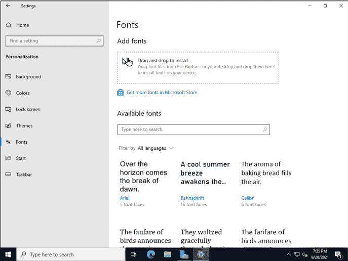

**图 2-36：** 服务器上已安装字体的示例。

> **本章内容**
>
> - 找到设置菜单的入口
> - 查看设置菜单中的内容

## 第 3 章 使用设置菜单

多年来，控制面板一直是 Windows Server 操作系统的主要管理区域。你可以在此配置设备、设置时间和语言选项、更改服务器外观、管理已安装的程序，还能管理 Windows 更新以及设置辅助功能选项。

微软一直在积极努力，用较新的设置菜单取代日益陈旧的控制面板。设置菜单和之前的控制面板一样，将设置项按类别划分。不过大部分新功能都被放进了设置菜单，而未必会出现在控制面板中。本章将介绍如何打开设置菜单，以及在哪里可以配置设置菜单中的各项功能。

### 打开设置菜单

你可以通过以下两种方式打开设置菜单：

- 点击开始菜单，然后选择“设置”（齿轮图标）。
- 右键点击开始菜单，然后选择“设置”。

设置菜单打开后，会显示为图 3-1 所示的样子。

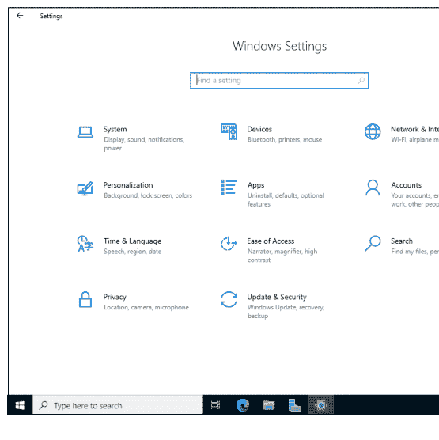

**图 3-1：** 完整的设置菜单界面。

### 了解设置菜单项

设置菜单中的各项用于配置服务器的各项功能。接下来的章节将介绍全新安装的 Windows Server 2022 中可用的设置项。

> **提示**
>
> 目前设置菜单包含了大部分管理工具，所有新功能也会在这里推出。如果你是刚入门的系统管理员，建议你熟悉这个菜单。如果你已经从事该工作有一段时间了（还记得 ZIP 驱动器曾风靡一时吗？），建议你现在就切换至设置菜单，而不是继续使用控制面板。

#### 系统

“系统”菜单（见图 3-2）中包含了很多你可能需要在系统中配置的选项，具体如下：

- 更改显示设置
- 调整声音设置
- 配置系统通知
- 调整电源和睡眠设置
- 访问磁盘优化工具（例如磁盘清理）
- 管理多窗口（也称为多任务处理）
- 配置远程桌面

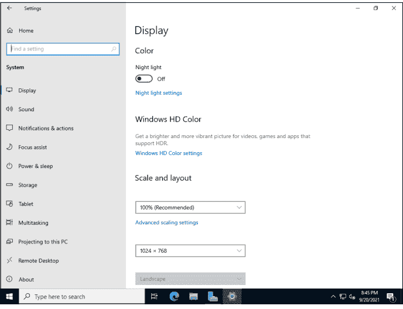

**图 3-2：** “系统”菜单包含大量配置选项。

#### 设备

“设备”菜单（见图 3-3）正如其名，你可以通过该菜单管理蓝牙设备、打印机、扫描仪，以及键盘和鼠标的设置。你还可以更改自动播放行为，以及调整系统处理 USB 问题的方式。


**图 3-3：** “设备”菜单可用于安装和配置外围设备。

#### 网络和 Internet

“网络和 Internet”菜单（见图 3-4）可显示你的网络连接状态，还支持设置或配置以太网、拨号、虚拟专用网络（VPN）以及代理连接。


**图 3-4：** “网络和 Internet”菜单提供了配置服务器网络连接的选项。

#### 个性化

“个性化”菜单（见图 3-5）可让你根据需求自定义服务器。你可以在此调整背景图片和颜色、配置锁屏界面图片、设置主题并管理字体，还能自定义“开始”菜单和任务栏设置。


**图 3-5：** “个性化”菜单提供了多种自定义服务器的选项。

> 我听到有人说：“我为什么要调整服务器上的这些设置？我根本不需要服务器上有背景或者自定义颜色，简直是多此一举！”不过我曾见过一些机构用壁纸或配色方案来提供视觉提示，让你区分生产环境系统（红色）和测试环境系统（绿色）。当你打开了多个远程桌面窗口时，这种提示会非常有用。

#### 应用

“应用”菜单（见图 3-6）可用于指定程序的安装来源、卸载不再需要的应用程序，以及选择要自动启动的程序。此外，如果你有一个网站既可以在应用中打开也可以在浏览器中打开，你可以通过“网站的应用程序”设置调整该行为。


**图 3-6：** “应用”菜单可用于管理已安装的应用程序。

#### 账户

“账户”菜单（见图 3-7）可用于管理本地用户账户和身份验证方法。操作系统（OS）支持多种身份验证方式，包括 Windows Hello、物理安全密钥，当然也支持传统的密码登录方式。


**图 3-7：** “账户”菜单可用于设置多种身份验证方式。

#### 登录选项

> *部分设置可能被你的组织隐藏或托管。*

管理你登录设备的方式。选择一个登录选项即可添加、更改或移除该选项。

- **Windows Hello 人脸识别**
  - 该选项当前不可用——点击了解详情
- **Windows Hello 指纹识别**
  - 该选项当前不可用——点击了解详情
- **Windows Hello PIN 码**
  - 该选项当前不可用——点击了解详情
- **安全密钥**
  - 使用物理安全密钥登录
- **密码**
  - 使用你的账户密码登录

#### 动态锁定

Windows 可以使用已与你的电脑配对的手机来感知你是否离开，当这些手机超出连接范围时，就会锁定你的电脑。允许 Windows 在你离开时自动锁定你的设备。

#### 时间和语言

“时间和语言”菜单（见图 3-8）可用于调整日期和时间。你还可以更改区域设置，这会影响包括日历类型、日期/时间格式在内的多项设置。你可以安装新语言，并为各项服务设置默认语言。如果你使用语音与系统交互，还可以选择系统要使用的语音。


**图 3-8：** “时间和语言”菜单可用于设置日期和时间的显示格式。

#### 区域

**国家或地区：** 美国

Windows 和应用程序可能会使用你所在的国家或地区为你提供本地化内容。

#### 区域格式

**当前格式：** 英语（美国） 推荐 [英语（美国）]

Windows 会基于你的语言和区域偏好来设置日期和时间的格式。

#### 区域格式数据

选择“更改数据格式”即可切换该区域支持的日历、日期和时间格式。

| 项目 | 值 |
| :--- | :--- |
| 日历 | 公历 |
| 每周首日 | 星期日 |
| 短日期格式 | 9/21/2021 |
| 长日期格式 | 2021 年 9 月 21 日星期二 |
| 短时间格式 | 下午 8:17 |
| 长时间格式 | 下午 8:17:16 |

更改数据格式

#### 辅助功能

“辅助功能”菜单（见图 3-9）包含了 Windows 系统中的所有辅助工具。你可以在这里完成多种操作，具体如下：

- 针对盲人或视力障碍用户优化使用体验
- 针对失聪或有听力障碍的用户优化使用体验
- 配置鼠标，使用更大或不同颜色的指针
- 选择不同颜色的文本光标，并调整文本光标的大小
- 调整键盘设置
- 设置屏幕放大镜
- 设置屏幕阅读器（即“讲述人”功能）
- 设置屏幕键盘
- 设置高对比度模式以提升可见性


**图 3-9：** “辅助功能”菜单可用于配置辅助功能选项。

### 搜索

“搜索”菜单的选项相对较少。你可以通过该菜单修改安全搜索设置，该设置可帮你屏蔽网络上的不良图片，还能调整系统及关联云账号存储中的内容搜索方式。

### 隐私

隐私菜单（见图 3-10）可用来调整授予操作系统和已安装应用的权限。这个菜单的操作非常直观，包含大量可调整的设置，建议你花些时间浏览其所有子菜单。

**图 3-10：** 隐私菜单可配置 Windows 系统和已安装应用中的跟踪和广告设置。


### 更新和安全

更新和安全菜单（见图 3-11）可用来配置 Windows 更新，以及管理 Windows 安全设置，包括防病毒、防火墙、应用和浏览器控制、设备安全等功能。该菜单还提供了故障排查工具和恢复选项的入口。如果你有需要，还可以在此激活 Windows 副本、开启开发者模式。

**图 3-11：** 更新和安全菜单可用于管理服务器的各项安全相关配置。


## 第 4 章 使用工作组

### 本章内容

- 定义工作组
- 评估工作组的优缺点
- 了解集中式共享与组共享的区别
- 了解如何为工作组配置服务器
- 保障工作组稳定运行
- 了解对等名称解析协议如何助力工作组通信

对于部分网络而言，部署并运行带 Active Directory（活动目录）的域控制器并非必要选择。不过在这类网络中，系统之间的资源共享仍是有实际需求的，工作组正是为此而生。在本章中，我将介绍工作组的定义、创建方法，同时讲解对等名称解析协议的功能，以及它对工作组的重要作用。

### 了解工作组的定义

工作组是对等（P2P）计算机群组，组内计算机可共享资源，但不属于 Active Directory（活动目录）域。工作组可以有一台中央服务器用于提供各类服务，也可以仅由独立工作站共享数据。工作组规模可小到仅 2 台计算机，也可扩展至更大规模（不过规模越大，管理难度也越高）。其核心特点是无需接入 Active Directory（活动目录）域。若要保证工作组正常运行，所有系统的工作组名称必须保持一致。默认情况下，未加入域的 Windows 系统会归属到名为 `WORKGROUP` 的工作组中。工作组这种对等关系与 Active Directory（活动目录）等客户端-服务器关系的最大差异在于：对等关系是完全去中心化的。你需要为每台用户想要连接的服务器单独配置用户和资源的访问权限。而 Active Directory（活动目录）这类客户端-服务器关系则拥有集中式数据库，负责处理资源访问的身份验证与授权。


**提示：** 工作组的核心优势之一在于，只要规模较小，管理就会十分简单：你只需配置好待共享的资源，再设定共享对象即可，无需操心复杂的组策略，因为所有设置都是本地配置的。工作组还是一种低成本方案：你不需要多台服务器来支撑工作组，从技术角度讲甚至完全不需要服务器，仅靠客户端系统即可搭建工作组。本章主要围绕 Windows Server 2022 系统中的工作组展开。


**警告：** 但由于用户账户是在每台独立系统上单独管理的，工作组的安全性存在一定隐患。密码可能不会频繁更换，即便更换，用户也可能只在部分系统上更新密码，而非所有系统，最终导致密码不同步。此外，部分应用需要依赖 Active Directory（活动目录），若使用工作组则无法运行这些应用。

### 判断工作组是否适配你的场景

考虑搭建工作组时，你需要明确工作组能实现和不能实现的功能，以此判断工作组是否适配你的使用环境。例如，若你的网络规模较小，系统数量少于 15 台，那么工作组是个不错的选择；如果系统数量达到 200 台，工作组大概率并不适用，因为会带来极高的管理开销。工作组内可共享文件、数据库和打印机，如果你的需求仅此而已，且系统数量较少（理想情况下不超过 15 台），那么工作组就很合适。这种方式能为组织节省部署域控制器的成本——既不需要额外采购服务器操作系统许可证，也无需雇佣精通 Active Directory（活动目录）运维的系统管理员。但工作组也存在局限：没有集中式身份验证，每个用户都需要在要访问资源的系统上拥有独立账户；无法通过组策略管理系统，只能使用本地安全策略；同时无法运行需要依赖 Active Directory（活动目录）的应用。

### 对比集中式共享与组共享

如果你确定工作组适合你的场景，接下来需要决定采用集中式共享模型还是组共享模型。集中式共享模型下，所有数据都存储在一台系统（工作站或服务器）上，工作组内其他成员连接到该中心位置即可使用共享资源。这种模型最容易维护，因为你可以在服务器上为工作组成员创建账户，他们就能直接访问共享资源。而组共享模型下，组内所有工作站分别共享不同的资源，管理复杂度会高很多，因为用户需要获得每台他们所访问资源所在系统的访问权限。

### 为工作组配置服务器

若要将服务器配置为工作组服务器，你需要先添加组、用户以及所有需要共享的资源，但在进行上述操作前，你需要先修改工作组的名称。

#### 修改工作组名称

Windows 的默认工作组名称为 `WORKGROUP`，建议你将其修改为自定义的有意义名称，操作步骤如下：

1. 打开服务器管理器，点击“本地服务器”。
2. 点击计算机名称下方的 `WORKGROUP` 链接（见图 4-1），此时会弹出“系统属性”对话框（见图 4-2）。

**图 4-1：** 工作组的配置从服务器管理器的“本地服务器”页面开始。


3. 点击“更改”按钮。
4. 输入你想要设置的工作组名称，点击“确定”。示例中我将名称修改为 `NOTWORKGROUP`（见图 4-3），此时会弹出欢迎加入工作组的提示。
5. 点击“确定”，此时会弹出提示，告知服务器需要重启。
6. 再次点击“确定”。

**图 4-2：** “系统属性”对话框可用于设置工作组名称。

> Windows 会使用以下信息识别你的计算机在网络中的标识：
>
> 计算机描述：
>
> 示例：“IIS 生产服务器”或“财务服务器”。
>
> 完整计算机名：`SERVER2022-DC`
>
> 工作组：`WORKGROUP`
>
> 若要重命名此计算机，或更改其所属域/工作组，请点击“更改”。
>
> [更改...] [确定] [取消] [应用]

7. 在“系统属性”对话框中，点击“关闭”。
8. 当弹出重启服务器的提示时，点击“立即重启”。

修改工作组名称的操作十分简单，也符合“修改默认配置”的安全最佳实践。

> 计算机名/域更改
>
> 你可以更改此计算机的名称及成员归属。更改可能会影响网络资源的访问。
>
> 计算机名：`SERVER2022-DC`
>
> 完整计算机名：`SERVER2022-DC`
>
> 所属成员
>
> ○ 域：
>
> ● 工作组：
>
> `NOTWORKGROUP`
>
> [更多...] [确定] [取消]

**图 4-3：** 设置工作组名称。

### 添加组


你为共享资源向组授予权限，而非直接向用户账户授予权限。这能确保用户获得所需的所有访问权限——且比单独管理用户权限简单得多。因此，你应该先创建组，再创建用户。

## 创建组

以下是创建组的步骤：

1. 在服务器管理器中，选择工具 ▸ 计算机管理。
2. 单击“本地用户和组”。
3. 双击“组”。

Windows Server 2022 开箱即用包含多个组，本示例中我将创建一个名为“工作组用户”的简单组。

4. 单击屏幕右侧的“更多操作”，然后选择“新建组”。

将弹出“新建组”对话框（见图4-4）。


**图4-4：“新建组”对话框。**

## 创建用户并将用户添加到组

用户要访问工作组，必须在尝试连接的系统上拥有本地账户。创建用户账户时，你可以直接授予权限，但将用户添加到具有正确权限的组中会更加简单。想象一下，如果你需要创建5个用户：你可以分别为每个用户设置权限，也可以直接将它们添加到组中。

以下是创建用户并将其添加到组中的步骤：

1. 在服务器管理器中，选择工具 ▸ 计算机管理。
2. 单击“本地用户和组”。
3. 双击“用户”。
4. 单击屏幕右侧的“更多操作”，然后选择“新建用户”。
5. 填写“用户名”、“全名”和“密码”字段（见图4-5）。

Windows Server 2022 开箱即用包含几个用户账户，本示例中我将创建一个名为“User1”的用户账户。

将弹出“新建用户”对话框。在生产环境中，你需要保留“用户下次登录时必须更改密码”复选框的选中状态。


**图4-5：创建用于访问工作站资源的用户账户。**

6. 单击“创建”。
7. 单击“关闭”以关闭“新建用户”对话框。
8. 右键单击新创建的用户，然后选择“属性”。将弹出“用户名”属性对话框（其中“用户名”是你要查看其属性的用户的名称）。
9. 单击“成员资格”选项卡，然后单击“添加”。将弹出“选择组”对话框。
10. 在“输入要选择的对象名称”字段中，键入你之前创建的组的名称，然后单击“检查名称”。如果找到该组，它会被加下划线，并且以服务器名称开头，如图4-6所示。


**图4-6：将用户添加到组中。**

11. 单击“确定”以关闭“选择组”对话框。
12. 单击“确定”以关闭“用户名属性”对话框。

## 添加共享资源

工作组场景中最常共享的是打印机和文件。在《卷二》第2章中，我讲解了如何安装和配置打印服务器角色。

以下是共享文件和文件夹的步骤：

1. 在服务器管理器中，选择工具 ▸ 计算机管理。
2. 单击“共享文件夹”。
3. 双击“共享”。
4. 单击屏幕右侧的“更多操作”，然后选择“新建共享”。将弹出“创建共享文件夹向导”。
5. 在名为“欢迎使用‘创建共享文件夹向导’”的界面上，单击“下一步”。
6. 在“文件夹路径”界面上，单击“浏览”。将弹出“浏览文件夹”对话框。
7. 导航到你要共享的文件夹（见图4-7）。


**图4-7：在“创建共享文件夹向导”中选择要共享的文件夹。**

8. 单击“确定”以关闭“浏览文件夹”对话框。
9. 单击“下一步”。下一个界面允许你修改共享名称并设置脱机设置，该设置可让脱机用户访问共享文件。
10. 选择所需选项后，单击“下一步”。下一个界面允许你自定义共享权限。
11. 选中“自定义权限”单选按钮，然后单击“自定义”。将弹出“自定义权限”对话框。
12. 单击“添加”。
13. 键入你之前创建的组的名称，然后单击“检查名称”以确保其有效。
14. 单击“确定”。
15. 在“工作组成员的权限”部分，设置你需要的共享权限。通常你会选中“更改”和“读取”复选框，如图4-8所示。


**图4-8：自定义共享文件夹权限。**

16. 单击“确定”以关闭“自定义权限”对话框。
17. 单击“完成”。
18. 在“共享成功”界面上，再次单击“完成”。

共享添加完成后，它会显示在“共享文件夹”下的“共享”中，如图4-9所示。


**图4-9：新建的文件夹共享显示在“共享文件夹”的“共享”部分。**

如果你曾在旧版 Windows 上设置过工作组，你会知道下一步还要把你创建的组添加到文件系统中文件夹的共享权限里，这需要大量重复工作。幸运的是，微软修复了这个问题。在计算机管理的“共享文件夹”区域共享文件夹时，系统会自动设置共享权限。如果你想查看相关设置，请按以下步骤操作：

1. 单击屏幕底部任务栏中的文件夹图标，将打开文件资源管理器。
2. 单击“此电脑”，然后双击你创建共享文件夹所在的分区。
3. 右键单击共享文件夹，然后单击“属性”。
4. 单击“共享”选项卡，然后单击“高级共享”，如图4-10所示。


**图4-10：“高级共享”对话框可用于配置共享设置。**

在这个界面上，你可以修改同时连接的用户数量、修改权限、修改缓存设置。在此语境下，“缓存”指的是脱机访问。

## 第4章 工作组操作

### 工作组管理

作为工作组管理员，你可能需要处理一些日常管理任务，最常见的包括重置密码，当然你也可以修改用户的角色。本节将介绍几种不同的用户账户管理方法。

### 计算机管理控制台

计算机管理控制台是进行相关操作的首选入口，请按以下步骤操作：

1. 在服务器管理器中，选择工具 ▸ 计算机管理。
2. 双击“本地用户和组”将其展开。
3. 双击“用户”以显示用户列表。


如果你只需要重置密码，右键单击用户账户，然后选择“设置密码”。在对话框中单击“继续”，输入新密码后单击“确定”即可。

4. 右键单击你之前创建的账户，然后选择“属性”。将弹出“属性”对话框，以下是该对话框各个选项卡可执行的操作：

- **常规**：禁用账户，或要求用户下次登录时修改密码。
- **成员资格**：为用户分配组成员身份。
- **配置文件**：设置登录脚本和主文件夹位置。
- **环境**：设置用户登录时启动的程序，以及客户端设备的期望行为。
- **会话**：设置特定用户账户的会话处理方式。
- **远程控制**：允许你远程控制用户的会话，在排查问题时非常有用。
- **远程桌面服务配置文件**：与“配置文件”选项卡类似，但仅适用于远程桌面会话。
- **拨入**：控制备用连接选项。

### 账户窗口

账户窗口可以完成计算机管理控制台所具有的所有用户管理功能，仅界面更加美观。打开方式如下：

1. 点击“开始”菜单，再点击“设置”图标。
2. 点击“账户”。
3. 点击“其他用户”（如图4-11所示）。
4. 选择您之前创建的用户。


**图4-11：** 点击“其他用户”即可管理除本人账户之外的其他账户。

在此处，您可以更改账户类型，或删除账户（见图4-12）。

**图4-12：** 管理其他用户的账户。


### PowerShell

您既可以使用图形化工具管理用户账户，也可以使用 PowerShell 实现相关操作。事实上，部分管理任务只能通过 PowerShell 完成。

要打开 PowerShell，请点击“开始”菜单，选择“Windows PowerShell”。

> **提示** 仅就本书介绍的任务而言，您需要以管理员身份打开 PowerShell。若从“开始”菜单选择 PowerShell，默认将以管理员身份启动。您需要完成的绝大多数管理任务，都要求 PowerShell 以管理员身份运行。

如果您想进一步了解 PowerShell，请参阅第6册。

以下是两个用于管理本地账户的实用命令：

- 要查看账户当前配置，请输入以下命令：`Get-LocalUser -Name "User1"`
- `Get-LocalUser` 命令用于查询指定用户账户的系统信息。
- 要修改用户密码，请输入以下命令：

```powershell
$Password = Read-Host -Prompt 'Enter Password' -AsSecureString
$UserAccount = Get-LocalUser -Name "User1"
$UserAccount | Set-LocalUser -Password $Password
```

以 `$` 符号开头的标识符称为“变量”，您可以将其理解为存储内容的容器。例如，`Read-Host -Prompt 'Enter Password' -AsSecureString` 命令会提示您输入密码，随后将该密码以安全字符串的形式保存到 `$Password` 变量中。`Get-LocalUser` 命令用于检索用户 User1 的信息，您可以将这些信息存储到名为 `$UserAccount` 的变量中。最后，您可以将 `$UserAccount` 中存储的内容，设置为之前保存至 `$Password` 变量中的安全字符串作为新密码。

图4-13展示了运行上述命令后的示例效果。

**图4-13：** 包含用户账户管理代码行的 PowerShell 窗口。


### 对等名称解析协议（PNRP）介绍

对等名称解析协议（PNRP）最早随 Windows XP 一同推出，该协议支持在对等网络（P2P 网络）中完成名称解析与注册。

您可能在文件共享示例中注意到，共享地址以服务器名称开头。如果没有 PNRP，您将无法解析主机名，只能通过 IP 地址连接。

反正我是觉得，记忆一长串 IP 地址非常困难，尤其当系统数量较多时，难度会进一步上升。

您可能会想：「那为什么不用域名系统（DNS）解析呢？」

使用 DNS 当然也没问题，但需要部署专门的 DNS 服务器提供支持。而 PNRP 无需额外部署独立服务器，可以直接利用现有基础设施完成名称解析，非常便捷。

如果您需要更高的安全性，可以通过防火墙保障 PNRP 流量安全。PNRP 使用 UDP `3540` 端口实现名称解析功能。

那么 PNRP 是如何工作的呢？假设您当前在 ServerA 上，想要与 ServerB 通信，流程如下：

ServerA 会先检查本地缓存，确认是否存在 ServerB 对应的 PNRP ID，结果有两种可能：

- 若找到匹配项，ServerA 会向 ServerB 发送 PNRP 请求消息。
- 若*未*找到匹配项，ServerA 会向 PNRP ID 与 ServerB 最接近的系统发送 PNRP 请求消息。

PNRP 请求会被发送到的节点接收，之后会出现以下三种情况：

- 若 PNRP 请求是发送给 ServerB 的，且 ServerB 处于运行状态、可以响应，ServerB 会向 ServerA 回复应答消息。
- 若接收 PNRP 请求的节点不是 ServerB，且不知道 ServerB 的身份（本地没有 ServerB 对应的 PNRP ID），该节点会向 ServerA 回复无法提供帮助。
- 若接收 PNRP 请求的节点不是 ServerB，但本地存有 ServerB 的 PNRP ID，或是知道哪个节点的 PNRP ID 与 ServerB 更接近，该节点会将相关信息回复给 ServerA。

ServerA 随后可以直接联系 ServerB，或是联系下一个距离更近的节点，重新发起搜索。

## 本章重点

- 了解 Active Directory 域及其作用
- 使用 Windows Server 2022 准备创建域
- 完成域配置的先决条件
- 将服务器配置为域控制器

## 第5章

### 将服务器提升为域控制器

上一章介绍了如何创建和使用工作组。虽然工作组在系统数量较少（少于15台）的小型环境中表现良好，但在企业环境中扩展性较差。大多数企业环境中都会使用域。域为所有身份验证事件提供统一的权威数据源。

您只需创建一次用户账户，将其加入对应的安全组，之后便可将该安全组关联到用户需要访问的所有资源（前提是这些资源已加入域）。这大幅简化了用户管理工作，同时提升了组织的安全水平——因为您可以通过组策略在域内统一强制执行配置（相关内容请参阅第3册第2章）。

### 了解域

在介绍如何创建域控制器之前，您需要先了解什么是 Active Directory 域、其架构是怎样的，以及首次创建 Active Directory 域时会生成的默认组。本章还会介绍域控制器的相关角色。

如果您已经熟悉这些内容，可以跳过本部分直接阅读后续章节；如果还不了解，请继续阅读。

#### 什么是域？

我们从基础概念讲起，逐步深入。Microsoft 网络中的域通常指 Active Directory 域服务（AD DS）域。每个 AD DS 域都拥有独立的内部对象数据库，对象可以是用户、组、计算机甚至是打印机。AD 域采用分层结构组织，最高层级为林，其下是域和组织单位（OU）。每片林可包含多个域，每个域又可包含多个 OU。

#### 林、域与 OU 简介

本章会涉及大量专业术语，我们先明确定义再继续讲解：

- **组织单位（OU）：** OU 是 Active Directory 中存储对象的容器，通常用于将同类对象分组管理，例如财务部的所有用户账户、某栋楼二层的所有计算机。将同类对象分组后可以简化管理流程，因为这些对象通常具有相似的配置或设置。
- **域：** 您可以将其理解为安全边界。域拥有独立的内部对象数据库，域内所有对象共享该数据库以及域内分配的安全策略。此外，域可以通过建立信任关系授权信任其他域，允许一个域中的用户访问另一个域中的资源。
- **域树：** 域树是多个域的集合。例如，若您将域树的命名空间设置为 `sometestorg.com`，则该域树下方的域可以是 `accounting.sometestorg.com`、`hr.sometestorg.com` 这类形式。域名与域树共享命名空间。
- **林：** Active Directory（活动目录）林是顶级对象，存储了整个 Active Directory 的所有内容，包含所有的树和域。林中创建的第一个域被称为“林根域”，它通常和林同名。
- **架构：** Active Directory 架构类似于字典，包含各类定义，存储了 Active Directory 对象可用的所有对象类和属性的定义。

根据你所在的组织规模，你可能使用仅包含1个林和1个域的小型 Active Directory 实例，也可能在拥有多个林和多个域的大型企业工作。你可能会问，为什么要部署多个林？这无疑会增加管理开销，不是吗？没错，确实如此。但如果你所在的环境对安全边界隔离的要求很高，那么多林就是最佳选择。常见的场景是将企业网络和生产网络隔离：企业林用于管理员工访问电子邮件、互联网的办公终端，生产林仅用于管理对服务器或网络设备的身份验证流量。通过隔离林，也就是隔离这两类网络的安全边界，就能保护生产环境不受企业网络中可能存在的恶意软件侵害。

### 理解特权域组

创建 Active Directory 域时，系统会默认创建多个管理组。我认识不少管理员，直接把账号加入企业管理员组就不再过问。作为系统管理员，你应当严格落实最小权限原则：即用户仅拥有完成工作所需的权限，没有多余权限。企业管理员组是权限极高的组，不能作为解决所有权限问题的万能方案。表5-1介绍了各类特权组，以及加入对应组后获得的权限。

### 检查域控制器上的灵活单主机操作角色

Active Directory 刚推出时，存在不少明确的问题。多年来，微软持续优化域控制器与 Active Directory 的协同工作机制，提出了灵活单主机操作（FSMO）的概念。通过 FSMO 角色，域控制器不会再争夺更改权限，也不用过于担心主域控制器宕机，因为其承担的职能可以迁移到其他域控制器上。

## 表5-1 默认域组

| 组名称 | 描述 |
|---|---|
| 企业管理员组 | 该组位于林根域，是林中每个域的内置管理员组的成员。企业管理员组的成员可以修改林配置、添加或删除域、建立林信任、提升林功能级别。<br><br>该组权限极高，仅在必要时使用，例如首次创建林、或执行建立林信任这类跨林全局更改操作时使用。 |
| 域管理员组 | 域管理员组的成员是对应域的内置管理员组成员，会自动被添加到加入该域的所有系统的本地管理员组中。 |
| 管理员组 | 域管理员是其账号所在域的管理员组成员，企业管理员是其所在林中所有域的管理员组成员。该组负责授予所有加入域的系统的本地管理员组访问权限。<br><br>该组拥有域内绝大多数对象的完全管理权限，可以取得域内几乎所有对象的所有权。 |
| 架构管理员组 | 架构管理员组是特殊组，和企业管理员组一样位于林根域。架构管理员仅拥有管理 Active Directory 架构的权限，无其他权限。因此该组的权限相对较低，但要非常谨慎地选择架构管理员的人选。架构修改操作失误可能会损坏 Active Directory，仅在确实需要修改架构的极少场景下才需要添加该组成员。 |
| 额外管理组 | 安装角色或应用程序时会自动创建额外管理组，例如 DHCP、DNS、Exchange Server 等角色或应用都会在 Active Directory 中创建新的管理组。 |

以下是当前域控制器支持的 FSMO 角色及其职能：

### 林范围：


- **架构主机：** 管理`Active Directory`架构的可读写副本。
- **域命名主机：** 确保不会创建与现有域名重复的新域。

### 域范围

- **RID主机：** `Active Directory`中的每个安全主体都有唯一的`SID`（安全标识符）。`SID`由两部分组成：对同域系统都相同的域`SID`，以及每个域内安全主体独有的`RID`（相对标识符）。`RID`主机负责将`SID`块分配给域控制器，供其发放使用。
- **PDC仿真器：** `PDC`原本是主域控制器（Primary Domain Controller）的缩写，在Windows NT 4.0及更早版本的环境中使用。引入`PDC`仿真器是为了兼容旧系统，如今它仍对现代系统承担重要职能。`PDC`仿真器是权威域控制器，负责处理身份验证、密码修改、身份验证失败事件、组策略对象（`GPO`），并为整个域设置正确时间。下次开会迟到，可别怪你的`PDC`仿真器哦！
- **基础结构主机：** 基础结构主机相当于域之间的翻译器，可以在不同域之间转换`SID`、`GUID`（全局唯一标识符）和`DN`（可分辨名称），让域1理解域2的请求。这使得用户可以访问其他域的资源，而不仅是其所在并完成身份验证的域的资源。

最后还有一个不属于`FSMO`角色的重要组件是全局编录。全局编录服务器存储林中所有域的全部对象记录。域控制器会保存自身全局编录的可读写副本，以及林中其他域全局编录的只读副本。这样你就可以在`Active Directory`中搜索对象，无需逐个访问每个域。

## 准备创建域

你已经决定要创建一个域，有若干前置任务需要提前完成。其中最重要的任务之一是安装所有可用的安全更新，并确保已安装最新版的反病毒软件，特别是当你要使用的是一台全新服务器时。毕竟这台服务器将作为核心身份验证服务器，必须确保其安全性。

很多人都抵触、有时还会跳过的一项任务是规划工作。我认为大家会跳过这一步，是因为和安装服务器角色、做配置比起来，规划工作实在没啥乐趣。但事实是：如果你提前花时间做好安装和配置规划，最终效果会好很多。你可以提前确保服务器能满足你的需求，更棒的是，不用等装完发现不合用再重装。

所以，花点时间坐下来，规划好你想要的`Active Directory`架构。要部署多个域吗？要用什么样的`OU`（组织单位）结构？当然，这种架构规划大多适用于还未部署`Active Directory`的全新安装场景。但如果你是在现有`Active Directory`环境中新增域控制器，同样需要做好规划：这台域控制器要承载`FSMO`角色吗？如果是，要承载哪些？这台是新增的、用于替换旧域控制器的服务器吗？如果是，现有域控制器的林功能级别和域功能级别是多少？

### 功能级别

功能级别用于告知域控制器，可以在林或域级别启用哪些功能。每次`Active Directory`更新新版本，都会增加你可能想使用的新功能。如果是全新安装`Active Directory`，请选择可用的最高功能级别。

如果服务器的功能级别过低，将无法将其设置为域控制器。功能级别可以在林级别或域级别设置：域的功能级别可以高于所属林的功能级别，但不能低于林的功能级别。提升功能级别后，无法再添加功能级别更低的域控制器。另外需要注意的是，域功能级别可以等于或高于林功能级别，但不能低于林功能级别。

在老版本服务器操作系统中，提升功能级别是单向操作，一旦出现问题没有便捷的回退方法。现在已不存在这个问题：只要回退操作被支持，且没有启用需要新功能级别支持的新功能，就可以用`PowerShell`回退到旧版本的功能级别。如果已经启用了这类功能，需要先禁用才能回退。

#### 回退林功能级别

```powershell
Set-ADForestMode -ForestMode <desired forest level>
```

林功能级别包括：

- Windows Server 2016 林（版本 7）
- Windows Server 2012 R2 林（版本 6）

#### 回退域功能级别

```powershell
Set-ADDomainMode -DomainMode <desired domain level>
```

域功能级别包括：

- Windows Server 2016 域（版本 7）
- Windows Server 2012 R2 域（版本 6）

#### 林功能级别

要提高林功能级别，你必须是企业管理员组的成员。你必须从运行架构主机角色的域控制器上提升林功能级别，无法从其他域控制器执行该操作。要查看当前林功能级别，请打开`PowerShell`并运行命令`Get-ADForest`。

#### 域功能级别

要提高域功能级别，你必须是域管理员组的成员。你必须从运行`PDC`模拟器角色的域控制器上提升域功能级别，无法从其他域控制器执行该操作。要查看当前域功能级别，请打开`PowerShell`并运行命令`Get-ADDomain`。

## 执行域配置先决条件

你已经完成了规划阶段，接下来是更有趣的部分！希望你现在是在全新服务器上安装`Active Directory`域服务（`AD DS`）角色，如果是这样，你可以直接跳转到安装域名系统（`DNS`）和动态主机配置协议（`DHCP`）的步骤。如果你要在旧服务器上安装`AD DS`，需要确保没有需要先卸载的不受支持的角色或功能。`AD DS`正常运行需要`DNS`和`DHCP`支持。如果你的环境中已经有这些组件，那就再好不过了，万事俱备！如果没有，你可以将它们和`AD DS`安装在同一系统上，也可以安装在独立系统上。

### 检查不受支持的角色和功能

微软并未发布与`AD DS`不兼容的角色和功能列表。如果你要在带有其他角色和功能的系统上安装`AD DS`，可以参考以下两种方案：

- 如果这些角色和功能已不再使用，直接卸载即可。
- 如果这些角色和功能仍在使用中，先备份系统，卸载这些角色和功能，安装`AD DS`，之后再重新安装其他角色和功能。


> **记住**：最佳且最安全的做法是在全新打造的服务器上安装`AD DS`，但如果你实在没有其他选择（这种情况在无力承担多台服务器成本的小公司中很常见），请遵循上述步骤。

### 安装并配置域名系统（DNS）

`DNS`负责将易于记忆的主机名解析为不易记忆的`IP`地址，它是`Active Directory`正常运行的必要条件。如果你要安装`AD DS`的系统上没有安装`DNS`，但你的环境中已有`DNS`服务，那么你可以直接继续后续操作。如果你的环境中完全没有`DNS`，你需要先安装它。你可以单独安装`DNS`服务器角色，也可以在安装`AD DS`时将其作为配置任务的一部分一并安装。接下来我会演示如何单独安装`DNS`。


> **技术提示**：安装`DNS`角色前，请确保你的服务器已配置静态`IP`地址。如果没有，安装角色时会弹出警告。你仍然可以继续安装，但如果`IP`地址发生变更，客户端可能会失去与`DNS`服务器的连接。

#### 安装域名系统（DNS）

请按照以下步骤安装`DNS`：

1. 在服务器管理器中，点击「管理」，然后点击「添加角色和功能」。
2. 在「开始之前」界面，点击「下一步」。
3. 在「选择安装类型」界面，点击「下一步」。
4. 在「选择目标服务器」界面，点击「下一步」。
5. 在「选择服务器角色」界面，勾选`DNS`服务器。
6. 在弹出的对话框中点击「添加功能」。
7. 点击「下一步」。
8. 在「选择功能」界面，点击「下一步」。
9. 在`DNS`服务器界面，点击「下一步」。
10. 点击「安装」。
11. 安装完成后点击「关闭」。

#### 配置域名系统（DNS）

请按照以下步骤配置`DNS`：

1. 在服务器管理器中，点击「工具」，然后点击`DNS`。
2. 点击服务器名称旁的箭头展开选项，你会看到配置区域，界面应如图 5-1 所示。
3. 右键点击「正向查找区域」，选择「新建区域」。
4. 在「新建区域向导」欢迎界面，点击「下一步」。
5. 在「区域类型」界面，保持「主要区域」选中状态，点击「下一步」。

##### 将服务器提升为域控制器


**图 5-1：** 安装后未配置任何区域的`DNS`管理器界面。

6. 在「区域名称」界面，输入区域名称，通常就是你的域名。它表示该`DNS`服务器担任权威的命名空间。如图 5-2 所示，我输入了`sometestorg.com`。


**图 5-2：** 为区域命名表示该`DNS`服务器担任哪个区域的权威。

7. 点击「下一步」。
8. 在「区域文件」界面，保持选中**使用此文件名新建文件**，点击**下一步**。
9. 在「动态更新」界面，保持选中**不允许动态更新**，点击**下一步**。
10. 在「完成新建区域向导」界面，点击**完成**。
11. 右键点击「反向查找区域」，选择**新建区域**。
12. 在「新建区域向导」欢迎界面，点击**下一步**。
13. 在「区域类型」界面，保持**主要区域**选中，点击**下一步**。
14. 在「反向查找区域名称」界面，确保选中**IPv4 反向查找区域**，点击**下一步**。
15. 在下一个「反向查找区域名称」界面，输入**网络 ID**，这是`IP`地址中的网络部分。我的`DNS`服务器`IP`地址是`192.168.1.43`，对应的网络 ID 为`192.168.1`，如图 5-3 所示。


**图 5-3：** 分配网络 ID。

16. 点击**下一步**。
17. 在「区域文件」界面，保持选中**使用此文件名新建文件**，点击**下一步**。
18. 在「动态更新」界面，保持选中「不允许动态更新」，点击「下一步」。
19. 在「完成新建区域向导」界面，点击「完成」。

至此，你已经拥有了一台可正常运行的`DNS`服务器。你可能好奇我为什么让你关闭动态更新。安装`Active Directory`后，你可以启用安全动态更新。在此之前，如果你开启所有动态更新，任何系统都可以在`DNS`中注册记录，这实际上是非常不好的做法。

## 安装并配置动态主机配置协议（DHCP）

安装`DHCP`是接下来的步骤。`DHCP`负责为网络中的系统分配可用`IP`地址，相比过去需要在电子表格中手动追踪`IP`地址的方式，这是巨大的改进。大多数系统、工作站和服务器都默认启用了`DHCP`客户端。如果某系统需要静态`IP`地址（比如我正在讨论的这些基础设施服务：`AD DS`、`DNS`、`DHCP`），就需要在`DHCP`服务器上将该`IP`地址设置为保留地址，避免`DHCP`分配已被使用的`IP`地址。

### 安装动态主机配置协议（DHCP）

请按照以下步骤安装`DHCP`服务器角色：

1. 在服务器管理器中，点击「管理」，然后点击「添加角色和功能」。
2. 在「开始之前」界面，点击「下一步」。
3. 在「选择安装类型」界面，点击「下一步」。
4. 在「选择目标服务器」界面，点击「下一步」。
5. 在「选择服务器角色」界面，勾选`DHCP`服务器。
6. 在弹出的对话框中点击「添加功能」。
7. 点击「下一步」。
8. 在「选择功能」界面，点击「下一步」。
9. 在`DHCP`服务器界面，点击「下一步」。
10. 点击「安装」。
11. 安装完成后点击「关闭」。

## 配置动态主机配置协议

请按照以下步骤配置`DHCP`：

1. 在服务器管理器中，单击旗帜图标，然后单击“完成`DHCP`配置”。
2. 在`DHCP`安装后配置向导中，单击**提交**。此操作将创建管理`DHCP`服务器所需的安全组。
3. 完成后单击“关闭”。
4. 在服务器管理器中，单击“工具”，然后单击“`DHCP`”。
5. 单击服务器名称旁的箭头，再单击`IPv4`旁的箭头。此时界面应与图 5-4 类似。


6. **右键单击`IPv4`，然后选择“新建作用域”。**

> **提示**：`DHCP`作用域定义了可供已定义子网上系统租赁的`IP`地址。若要为网络中的某子网内的系统分配`IP`地址，你需要事先为该子网定义一个独立的`DHCP`作用域。

7. 在“新建作用域向导”欢迎界面，选择“下一步”。
8. 在“作用域名称”界面，可将描述留空并单击“下一步”。本示例中将其命名为“演示作用域”。
9. 在“IP地址范围”界面，输入你希望`DHCP`服务器管理的地址池以及子网掩码（见图 5-5）。本示例中创建的作用域范围很小，实际使用时作用域范围通常更大，可能覆盖整个子网。


图 5-5：“IP地址范围”界面可用于指定`DHCP`作用域的地址范围。

10. 单击“下一步”。
11. 在“添加排除范围和延迟”界面，输入你不希望该作用域分配的地址。你可以输入该作用域内存在但不希望由此服务器分配的路由器地址或其他设备地址。
12. 单击“下一步”。在“租约期限”界面，你会看到默认值为 8 天，大多数情况下该设置都可用。
13. 单击“下一步”。
14. 在“配置`DHCP`选项”界面，保持“是，我想现在配置这些选项”的选中状态，然后单击“下一步”。
15. 在“路由器（默认网关）”界面，添加默认网关的`IP`地址，然后单击“下一步”。
16. 在“域名和`DNS`服务器”界面，输入你之前在`DNS`服务器上创建的域名，示例可参考图 5-6。


**图 5-6：** 在`DHCP`作用域选项中设置域名和`DNS`服务器。

17. 单击“下一步”。
18. 在“WINS服务器”界面，你可以选择性地输入网络中`WINS`服务器的名称或`IP`地址，然后单击“下一步”。本示例将留空此项。最后一个界面会询问你是否要激活作用域，默认选项为“是”。
19. 保持“是”的选中状态，然后单击“下一步”。
20. 在“正在完成新建作用域向导”界面，单击“完成”。以上就是`DHCP`作用域的创建步骤。

## 将服务器升级为域控制器

要创建Windows域控制器，需要安装并配置`Active Directory`域服务（`AD DS`）。`AD DS`会安装`Active Directory`及其数据库，可提供集中式身份验证源，大幅简化用户管理。

### 安装Active Directory域服务

在Windows中，绝大多数功能都可以通过图形用户界面（`GUI`）或`PowerShell`安装该角色。本节将介绍如何通过`GUI`安装该角色，同时会说明如何获取对应的`PowerShell`命令，方便你在配置多个域控制器时重复执行相同操作。

1. 在服务器管理器中，单击“管理”，然后单击“添加角色和功能”。
2. 在“开始之前”界面，单击“下一步”。
3. 在“选择安装类型”界面，单击“下一步”。
4. 在“选择目标服务器”界面，单击“下一步”。
5. 在“选择服务器角色”界面，选择“`Active Directory`域服务”。
6. 在弹出的对话框中单击“添加功能”。
7. 单击“下一步”。
8. 在“选择功能”界面，单击“下一步”。
9. 在“`Active Directory`域服务”界面，单击“下一步”。
10. 单击“安装”。如果你需要配置更多域控制器，安装完成`AD DS`后，界面底部会有“导出配置设置”链接，单击该链接并保存生成的`XML`文件。后续创建其他域控制器时，只需使用`PowerShell`将安装程序指向该`XML`文件即可：

```powershell
Install-WindowsFeature -ConfigurationFilePath <path and name of file>
```

11. 安装完成后单击“关闭”。

### 配置Active Directory域服务

安装完`AD DS`后，下一步自然是对其进行配置，使服务器能够作为域控制器运行。请按照以下步骤操作：

1. 在服务器管理器中，单击旗帜图标，然后单击“将此服务器提升为域控制器”，如图 5-7 所示。


图 5-7：将服务器提升为域控制器。

> **注意**

2. 在“部署配置”界面，选择**新建林**。将服务器提升为域控制器时有三个选项：
   - “新建林”通常用于不存在现有`AD`基础设施的场景。
   - “向现有林添加新域”用于创建林根域以外的域，顾名思义，该选项适用于已存在`AD`基础设施的场景。
   - “向现有域添加域控制器”功能如其名，你不会新建林或域，只是新增一个域控制器。
3. 输入根域名，然后单击“下一步”。
4. 在“域控制器选项”界面，选择你之前确定需要的功能级别，然后单击“下一步”。保持“域名系统（`DNS`）”和“全局编录”的选中状态。输入还原密码并将其保存在可随时获取的位置，若`AD`需要还原，你需要该密码进行恢复。
5. 在接下来的“`DNS`选项”界面，单击“下一步”。
6. 在“其他选项”界面，单击“下一步”。
7. 在“路径”界面，接受默认路径设置并单击“下一步”。
8. 在“查看选项”界面，单击“下一步”。

> **提示**：如果你要安装多个域控制器，可单击“查看脚本”按钮查看相同配置对应的`PowerShell`脚本。在“先决条件检查”界面，出现若干警告属于正常情况，只要界面顶部显示“所有先决条件检查已成功通过”，即可继续操作。示例可参考图 5-8。


图5-8：安装前检查先决条件是否通过。

- 9. 单击“安装”。AD DS安装完成后，服务器会自动重启，你将能够以域管理员账户登录。该账户初始密码与服务器本地管理员账户密码相同，请务必修改该密码。

#### 将DNS区域转换为Active Directory集成区域

本章前面配置DNS时，你创建的区域选择了手动更新而非动态更新。现在DNS区域已与Active Directory关联，你可以返回将其与Active Directory集成，并选择安全动态更新。

将DNS区域设置为Active Directory集成区域后，将获得多主机环境，只要域控制器运行DNS且是该区域的权威服务器，就可以更新区域数据。区域数据将通过Active Directory复制，而非传统的区域传输方式。

选择将区域设置为Active Directory集成区域后，你还可以启用安全动态更新，该功能可控制哪些系统可以更新记录名称，同时防止未授权系统覆盖DNS中的名称。请按照以下步骤将区域转换为Active Directory集成区域并启用安全动态更新：

1. 在服务器管理器中，单击“工具”，然后单击“DNS”。
2. 展开服务器名称，再展开“正向查找区域”，你将看到之前创建的区域。
3. 右键单击该区域，然后选择“属性”。
4. 在“常规”选项卡中，于“类型：主要”下方单击“更改”按钮。
5. 保持“主要”的选中状态，勾选“将区域存储在Active Directory中”复选框，然后单击“确定”。
6. 当系统询问你是否要将区域设置为Active Directory集成区域时，单击“是”。
7. 在“动态更新”下方选择“仅安全”。当前界面的预期样式可参考图5-9。
8. 单击“应用”，然后单击“确定”。
9. 展开“反向查找区域”，你将看到之前创建的区域。
10. 右键单击该区域，然后选择“属性”。
11. 在“常规”选项卡中，于“类型：主要”下方单击“更改”按钮。

##### 将服务器提升为域控制器

**图5-9：** 将DNS区域的属性设置为与Active Directory集成。

12. 保持选中「主要」选项，勾选「在Active Directory中存储区域」复选框，然后点击「确定」。
13. 当系统询问你是否要将该区域配置为与Active Directory集成时，点击「是」。
14. 在「动态更新」下方选择「仅安全」。此时屏幕的样式可以参考图5-9。注意图5-9来自正向查找区域，但对应设置是完全相同的。
15. 点击「应用」，再点击「确定」。
16. 在「正向查找区域」下为这台服务器创建记录，后续系统现在会自动弹出。
17. 在「正向查找区域」下右键点击你的域名，选择「新建主机 (A 或 AAAA)」。DNS服务器会使用主机记录将主机名映射到IP地址。A记录用于匹配主机名和IPv4地址，AAAA记录用于将主机名映射到IPv6地址。
18. 在「名称」栏输入你的系统名称。
19. 在「IP地址」栏输入系统的IP地址。
20. 勾选「创建关联指针 (PTR) 记录」复选框，这会在反向查找区域创建对应的条目。
21. 点击「添加主机」。
22. 点击确认框中的「确定」。
23. 点击「新建主机」框中的「完成」。至此你已经完成了所有设置。Active Directory已安装完成，你已以安全方式允许DNS执行动态更新。你已为服务器创建了DNS记录。现在可以进行测试，确保名称解析功能正常工作，测试步骤如下：

1. 右键点击「开始」菜单，选择「Windows PowerShell」。
2. 输入`nslookup <servername>`，如图5-10所示。

> 如果DNS功能正常，它会返回你输入的服务器名称对应的IP地址。

**图5-10：** 使用`nslookup`验证DNS是否正常工作。

如你所见，事后集成DNS会相当耗时。你也可以在安装Active Directory的同时安装DNS，从而节省不少配置工作。不过你现在已经了解了完整的操作流程，所以走更短的路径会简单很多。

##### 为Active Directory环境授权DHCP服务器

在正常使用DHCP之前，你还需要完成最后一步操作。此前你已经安装过DHCP并配置了作用域。现在这台服务器已升级为域控制器，你需要在Active Directory中授权DHCP，使其能够为加入域的系统分配IP地址。通过在Active Directory中授权你的DHCP服务器，可以阻止流氓DHCP服务器出现在你的网络中，这类恶意服务器会发起拒绝服务攻击。

要授权DHCP服务器，请按以下步骤操作：

1. 打开服务器管理器，依次选择「工具」>「DHCP」。
2. 右键点击服务器名称，选择「授权」。
3. 点击「操作」，再点击「刷新」。此时原本在IPv4旁的红色向下箭头应该会变成绿色的勾选标记。

至此你的DHCP已配置完成，可正常与Active Directory域协同工作。之后你部署的任何新的DHCP服务器，若需要与Active Directory环境配合使用，都需要完成授权操作。

#### 配置用户账户

Active Directory安装完成后，你就可以开始创建用户账户了。毕竟Active Directory的核心作用之一就是进行身份验证！在Active Directory中创建第一个用户账户的方法如下：

1. 打开服务器管理器，依次选择「工具」>「Active Directory用户和计算机」。
2. 点击域名旁的箭头，展开域名结构。
3. 点击「Users」（即Users组织单元）选中它，此时可以看到系统内置的账户和组。
4. 右键点击「Users」，选择「新建用户」，如图5-11所示。
5. 填写「名字」和「姓氏」字段。
6. 输入你希望设置的用户登录名。你会发现「全名」字段会自动填充你输入的内容。以我的示例为例，用户名为John Smith，我设置的登录名为`jsmith`（见图5-12）。

**图5-11：** 在Active Directory中创建新用户。

**图5-12：** 创建我的第一个用户John Smith。

7. 点击「下一步」。
8. 为用户设置临时密码。
9. 在「确认密码」字段再次输入该密码。
10. 保持勾选「用户下次登录时必须更改密码」复选框，点击「下一步」。
11. 点击「完成」。
12. 双击新创建的用户John Smith。
13. 点击「成员属于」选项卡。你会看到John Smith是「域用户」组的成员。假设John需要管理我们的DNS和DHCP服务器。
14. 点击「添加」，输入`DnsAdmins`，然后点击「确定」。
15. 再次点击「添加」，输入`DHCP Administrators`，然后点击「确定」。
16. 再次点击「确定」关闭John的账户配置窗口。

#### 在域中共享资源

在域中共享资源与在域外共享资源的流程非常相似。在Active Directory域环境中，管理资源访问的最佳方式是使用组。我们接下来创建一个名为File Share Users的组，将John Smith加入该组，再为文件夹共享分配相应的权限，步骤如下：

1. 右键点击「Users」组织单元，选择「新建」>「组」。
2. 输入组名称，然后点击「确定」。
3. 双击新创建的组（本示例中为File Share Users），点击「成员」选项卡。
4. 点击「添加」。
5. 输入John Smith，然后点击「确定」。
6. 再次点击「确定」退出组的配置窗口。
7. 点击屏幕底部的「文件资源管理器」图标（外观为文件夹样式）。
8. 点击「此电脑」，确定要在哪个卷上创建这个文件夹共享。
9. 双击卷将其打开。在本示例中，我将使用C盘作为该文件夹的位置。
10. 右键点击空白区域，选择「新建」>「文件夹」。
11. 将文件夹命名为`Files`。
12. 右键点击`Files`文件夹，选择「授予访问权限」>「特定用户」。
13. 在输入框中输入你之前创建的组名称（本示例中为File Share Users），然后点击「添加」。此时会添加该安全组，默认拥有读取权限。
14. 点击「读取」旁的箭头，选择「读取/写入」，如图5-13所示。
15. 点击「共享」。
16. 在「你的文件夹已共享」界面点击「完成」。

**图5-13：** 向域安全组共享文件夹。

当安全组中的用户需要访问你刚刚创建的共享时，只需执行以下操作：

1. 点击「开始」菜单。
2. 输入`\\servername\sharename`。本示例中的路径为`\\server2022-dc\Files`。
3. 按下回车键，即可进入该共享文件夹。

###### 将客户端加入域

这种方式的优势在于，新用户只需要被添加到File Share Users安全组，就能获得你创建的文件夹共享的读写权限。本次配置的最后一步，当然就是将其他系统加入域，这样后续就可以使用域凭据而非本地凭据进行身份验证。

本节将分别介绍「带桌面体验的服务器」和「服务器核心」的配置方法。默认情况下，任何「已验证用户」组的成员都可以将工作站加入Active Directory域，「已验证用户」组的成员最多可以添加10台工作站。（该限制可根据你所在组织的策略进行调整。）

你可以在「组策略管理控制台」的「默认域控制器策略」中修改该域级设置，路径为：计算机配置 > 策略 > Windows设置 > 安全设置 > 本地策略 > 用户权利分配。双击「将工作站添加到域」，添加你希望用来授权系统加入域的安全组（此处通常设置为「域管理员」），再删除「已验证用户」选项。

##### 带桌面体验的服务器

带桌面体验的服务器是大多数人熟悉的Windows图形界面版本。将Windows Server加入域的流程非常简单，请按以下步骤操作：

1. 以管理员身份登录尚未加入域的系统。
2. 服务器管理器启动后，点击菜单左侧的「本地服务器」。
3. 点击服务器名称下方的`工作组`，会弹出如图5-14所示的「系统属性」窗口。
4. 点击「更改」按钮。
5. 在「隶属于」下方选择「域」旁的单选按钮，输入你要加入的域名，界面样式应类似图5-15。
6. 点击「确定」。

**图5-14：** 系统属性框允许你更改计算机名称以及工作组/域成员身份。

**图5-15：** 更改服务器的域成员身份。

7. 输入有权加入域的账户的用户名和密码。如果你一直跟着本书操作，并且是从零开始搭建域，那么域管理员账户的密码和你在域控制器上设置的本地管理员账户密码相同。如果你要加入的是已搭建好的域，该密码可能不同。
8. 单击“确定”。你会看到“欢迎加入<域名>域。”的提示。
9. 单击“确定”。系统会提示你需要重启系统。
10. 单击“确定”。
11. 单击“关闭”关闭系统属性窗口。
12. 单击“立即重启”。系统重启后，重新启动完成就会加入该域。

###### 服务器核心

服务器核心没有大多数管理员习惯的图形化菜单，因此加入域的流程也有所不同。加入域有两种方式：可以使用`sconfig`工具，也可以使用PowerShell。

###### 使用`sconfig`加入域

`sconfig`是服务器核心自带的文本菜单驱动工具，登录后会默认启动。另外，你也可以在命令行中输入`sconfig`然后按Enter键来打开它。`sconfig`启动后，你会看到如图5-16所示的界面。接下来我们使用`sconfig`加入域。为了方便说明，我假设你已经输入了`sconfig`命令，并且现在处于菜单界面。请按照以下步骤操作：

1. 按1选择“域/工作组”。
2. 按D选择域，然后按Enter键。
3. 输入你要加入的域的名称，然后按Enter键。
4. 输入域管理员账户。我这里输入的是`sometestorg\\administrator`。
5. 输入该账户的密码并按Enter键。系统会询问你是否要在重启前更改计算机名称。
6. 输入`no`。如果你需要重启，可以选择“是”。系统会提示你重启服务器。

**图5-16：** 服务器核心中的`sconfig`菜单是主要的系统配置区域。

7. 输入`yes`重启服务器。
8. 系统重新启动后，就会加入该域。

###### 使用PowerShell加入域

`sconfig`是手动操作流程，因此不太适合服务器自动化场景。PowerShell能让加入域的流程比`sconfig`快得多，还可以作为脚本化任务的一部分使用。以下是使用PowerShell将服务器加入Active Directory的命令：

```powershell
Add-Computer -domainname <domain name> -Credential domain\administrator -restart -force
```

你看PowerShell多么简洁直观？我建议你抽时间学习PowerShell。本书第6部分会全面讲解PowerShell。以下是使用PowerShell命令加入Active Directory的步骤：

1. 登录到服务器核心系统。
2. 在`sconfig`中输入15退出到PowerShell界面。
3. 使用前面给出的示例命令，输入你的测试域对应的域名和凭据，然后按Enter键。
4. 输入密码后单击“确定”。系统会自动重启，重启完成后就会加入该域。

#### 总结

到现在你可能会有疑问：这些内容之间有什么关联？如果你从头到尾学完了本章，你已经完成了DNS、DHCP和Active Directory的安装。你还回去将DNS区域转换为了Active Directory集成区域，并配置了安全动态更新。你还回去将DHCP服务器授权给了Active Directory。最后你将部分系统加入到了Active Directory中。

如果你回到DNS管理界面，会发现所有加入域的系统都已完成注册，这一操作是在你将系统加入域时自动完成的。你可以在图5-17中看到我的示例。

**图5-17：** Active Directory集成DNS区域可以提升跨域控制器的复制效率，安全动态更新则能确保记录仅由已通过身份验证的用户添加。

系统注册非常重要，这意味着用户可以通过记忆系统名称而非IP地址来访问资源。只要DNS能正常解析名称，你就可以使用名称访问，系统会自动匹配对应的IP地址。想想是不是很酷？

名称解析确实很方便，但随着规模扩大，你肯定不想手动管理所有IP地址。接下来我们看看DHCP服务器。由于它已经获得Active Directory授权，当你将系统加入Active Directory时，它会自动给这些系统分配IP地址，如图5-18所示。

**图5-18：** 所有加入域的系统的DHCP地址租约。

你可以设置保留，确保DHCP不会将IP地址分配给其他系统。你只需右键单击拥有常规租约的系统，选择“添加到保留”，即可完成设置。

接下来我们看看Active Directory。新加入域的系统现在就会显示在Active Directory中。请按照以下步骤操作：

1. 打开服务器管理器，依次选择“工具”≫“Active Directory用户和计算机”。
2. 单击“域控制器”组织单位（OU），你会看到你配置为域控制器的系统。
3. 单击“计算机”组织单位（OU），你会看到其他已加入域的服务器。

现在这些系统已经处于Active Directory中，你有一个集中位置来管理它们。你可以查看它们运行的操作系统，也可以为它们委派权限。

### 第6章

#### 使用IP地址管理（IPAM）管理DNS和DHCP

如果你在小型组织工作，管理域名系统（DNS）和动态主机配置协议（DHCP）服务器并不会太麻烦。你可能只有1台服务器，或者仅几台服务器。但随着组织规模扩大，你可能会体会到管理多台DNS和DHCP服务器的痛点。要跟踪所有区域和作用域会变得越来越困难。微软推出了一项名为IP地址管理（IPAM）的功能，来解决DNS和DHCP服务器不可避免的扩张问题。这个名字是不是很朗朗上口？

IPAM将DNS、DHCP等网络服务的管理整合到一个应用中，你可以通过一个中央管理控制台同时管理DNS和DHCP基础设施。IPAM的一大优势是它可以告诉你某个子网的利用率是否过高。这可以帮助你判断是否需要新增子网，避免用户或系统耗尽可用IP地址。本章将带你了解如何安装、配置和使用IPAM。

#### 安装IP地址管理

在开始安装IPAM之前，请记住以下要求：

- IPAM无法安装在域控制器上。
- IPAM不应安装在DHCP或DNS服务器上，否则可能导致发现功能出现问题。
- IPAM需要安装在已加入域的系统上。
- IPAM是微软生态的工具，无法管理Linux上的BIND等第三方产品。

满足以上简单要求后，你就可以安装IPAM了。请按照以下步骤操作：

1. 打开服务器管理器，单击“管理”，然后单击“添加角色和功能”。
2. 在“开始之前”界面，单击“下一步”。
3. 在“选择安装类型”界面，单击“下一步”。
4. 在“选择目标服务器”界面，单击“下一步”。
5. 在“选择服务器角色”界面，单击“下一步”。
6. 在“选择功能”界面，选择“IP地址管理（IPAM）服务器”，弹出提示时单击“添加功能”。
7. 单击“下一步”。
8. 在“确认安装选择”界面，单击“安装”。
9. 安装完成后，单击“关闭”。

#### 配置IP地址管理

安装IPAM非常简单，你只需确保不要遗漏任何步骤即可。点击IPAM后，所有配置IPAM需要执行的任务都会以编号任务的形式显示在快速入门磁贴中。给你个建议：本次安装请使用具有域管理权限的账户登录。然后按照以下步骤操作：

1. 在服务器管理器中，点击左侧菜单的IPAM（见图6-1）。注意快速入门磁贴中的任务，任务1“连接到IPAM服务器”已经完成。

图6-1：IPAM安装完成后会显示在服务器管理器中。

2. 点击任务2“预配IPAM服务器”。
3. 在“开始之前”界面，点击下一步。


4. 在“配置数据库”界面，接受默认的 Windows 内部数据库选项，点击下一步。

5. 在“选择预配方法”界面，选中“基于组策略”单选按钮，然后在“组策略名称前缀”字段中输入组策略对象（GPO）名称前缀（见图 6-2）。组策略对象是一组设置集合，用于定义系统的运行方式或向用户呈现的外观，可针对用户和/或计算机应用。我倾向于使用直观的 IPAM 前缀，这样能明确这些组策略的用途。

图 6-2：IPAM 的预配方法包括手动预配和基于组策略的预配。

6. 点击下一步。

7. 在“摘要”界面，点击“应用”。如果一切顺利，你将看到“IPAM 预配成功完成”界面。

8. 点击“关闭”。现在需要将新组策略推送到域中，你需要在希望 IPAM 管理的每个域中执行此操作。本示例中我仅有一个域。

9. 在 IPAM 服务器上右键单击“开始”菜单，选择“Windows PowerShell”。

10. 运行以下命令（此步骤必须以域管理员身份登录）：


```powershell
Invoke-IpamGpoProvisioning -Domain <domain name> -GpoPrefixName "IPAM" -force
```

- 11. 你需要在弹出的确认提示中确认三次，分别对应正在创建的三个策略。这三个策略分别是：IPAM_DC_NPS、IPAM_DHCP 和 IPAM_DNS。
- 12. 返回到服务器管理器中的 IPAM 快速入门磁贴，下一个任务是任务 3，用于配置服务器发现。
- 13. 点击“配置服务器发现”。
- 14. 点击“获取林”按钮，系统将运行查询。
- 15. 点击“确定”关闭“服务器发现”界面。
- 16. 任务完成后，再次点击“配置服务器发现”，此时林和域信息会自动填充。
- 17. 在域旁边，点击“添加”。
- 18. 选择你希望 IPAM 发现的服务器角色，此时界面应如图 6-3 所示。
- 19. 点击“确定”。
- 20. 点击任务 4“启动服务器发现”，这将安排发现任务，等待任务完成即可，系统会在任务完成后发出提示。
- 21. 任务完成后，点击任务 5“选择或添加要管理的服务器并验证 IPAM 访问权限”。
- 22. 右键单击服务器，选择“编辑服务器”。
- 23. 将“可管理性状态”下拉列表从“未指定”改为“已管理”，如图 6-4 所示。

### 配置服务器发现

- 选择林：`sometestorg.com`
- 获取林
- 选择要发现的域：
- 添加
- 选择要发现的服务器角色：

| 域 | 域控制器 | DHCP 服务器 | DNS 服务器 |
|---|---|---|---|
| （根域）`sometestorg.com` | ☑ | ☑ | ☑ |

若采用基于组策略的预配方式，可在 IPAM 服务器上使用 PowerShell cmdlet `Invoke-IpamGpoProvisioning` 为列表中的每个域创建对应的 GPO。你可了解更多基于组策略的预配相关信息。

### 服务器发现计划详情

- 下次计划运行时间：2021 年 9 月 28 日晚上 7:16:08
- 如需修改发现计划，可在 IPAM 服务器上以管理员权限打开任务计划程序，编辑位于 `\Microsoft\Windows\IPAM\ServerDiscovery` 的任务即可。

图 6-3：在 IPAM 中配置服务器发现。

### 添加或编辑服务器

提供服务器详细信息及其他自定义字段映射详情：

#### 基本配置

| 字段 | 值 |
|---|---|
| 服务器名称（FQDN） | `server2022-dc.sometestorg.com` |
| 服务器林名称 | `sometestorg.com` |
| IP 地址 | `192.168.1.43` |
| 服务器类型 | ☑ DC 服务器 ☑ DNS 服务器 ☑ DHCP 服务器 ☐ NPS 服务器 |
| 可管理性状态 | 未指定 |
| 所有者 | |
| 说明 | |

#### 自定义配置

图 6-4：将服务器的可管理性状态设置为“已管理”。

208 第 2 册 配置 Windows Server 2022

- 24. 点击“确定”，这会将受管服务器添加到之前创建的对应 GPO 中。此时你可能会看到 IPAM 访问状态被阻止，通常这意味着组策略尚未在其他系统上应用（假设你使用了基于组策略的预配方法）。要解决此问题，请登录到其他系统，打开 PowerShell 窗口，输入 `Invoke-GPUpdate -Force`，然后返回 IPAM 服务器，右键单击对应系统并选择“刷新服务器访问状态”。如果仍无法解决，你可能需要重启要管理的服务器。
- 25. 右键单击受管服务器，选择“检索所有服务器数据”。检索任务完成后，你就可以通过 IPAM 管理添加的服务器了。恭喜！最难的部分已经完成了！

## 使用 IP 地址管理

你可能好奇 IPAM 具体能实现哪些功能。在接下来的章节中，我将带你了解 IPAM 中可用于配置和管理 DNS、DHCP 基础设施的不同功能区域。

### 概述

现在 IPAM 已经配置完成，进入“概述”部分。还记得之前使用的快速入门磁贴吗？现在请点击第二个橙色磁贴，也就是标注“操作”的磁贴，你将看到可执行操作的列表，如图 6-5 所示。

图 6-5：可在 IPAM 中针对受管服务器执行的部分操作。

### 服务器清单

服务器清单界面你应该并不陌生——在配置 IPAM 时它可能曾给你带来不少困扰。该界面的主要功能是展示你正在管理的服务器概览、它们的 IPAM 访问状态，以及支持绕过计划检索任务、直接从服务器拉取最新数据的能力。你可以按 IPv4 和 IPv6 筛选，也可以按“受管（GPO 预配）”服务器和“未受管（手动）”服务器筛选。图 6-6 展示了服务器清单界面的视图。

图 6-6：服务器清单界面会列出所有服务器及其当前状态。

210 第 2 册 配置 Windows Server 2022

### IP 地址空间

如果你点击 IP 地址空间中的第一个选项“IP 地址块”，将看到之前配置的 DHCP 作用域。当前“利用率”显示为“不足”，如图 6-7 所示，这意味着该作用域仍有大量可用 IP 地址。在 IPAM 出现之前，你需要通过电子表格跟踪地址利用率，不仅操作繁琐，还因为电子表格可能无法及时更新，且无法在地址空间被过度使用时给出友好提示。

图 6-7：在 IPAM 中可一目了然地查看 IP 地址利用率。

#### 使用 IP 地址管理管理 DNS 和 DHCP

IP 地址空间类别下的其他界面——“IP 地址清点”和“IP 地址范围组”——会以不同视图展示相似数据。建议你花时间点击浏览这些界面，熟悉各自包含的内容。

### 监视和管理

“监视和管理”是你在 IPAM 中花费时间最多的功能区域。

## DNS 和 DHCP 服务器

当您点击 DNS 和 DHCP 服务器时，可以查看通过 IPAM 管理的每台服务器上各项服务的状态。如果一切正常，DNS 和 DHCP 的服务器可用性状态均应显示为“正在运行”。图 6-8 是状态页面的示例。


**图 6-8：** 通过 IPAM 监控和管理的 DNS 与 DHCP 服务器状态。

## DHCP 作用域

DHCP 作用域部分包含 IPAM 识别的所有 DHCP 服务器上配置的全部 DHCP 作用域。该界面提供的利用率指标与之前的 IP 地址块部分一致，可显示子网掩码、租约持续时间等基础子网设置信息。右键点击现有作用域，会弹出大量用于管理 DHCP 作用域的选项。图 6-9 展示了可用的配置选项。


**图 6-9：** 可借助 IPAM 的 DHCP 作用域界面，跨多台 DHCP 服务器完成 DHCP 作用域配置。

## DNS 区域

在 DNS 区域部分，您可以快速浏览区域状态是否正常，还能一目了然地获取区域所在 DNS 服务器的实用信息。您可以选择查看正向查找区域（名称解析为 IP）或反向查找区域（IP 解析为名称）。与 DHCP 作用域界面相同，您也可以右键点击区域，直接在 IPAM 内完成配置，无需再登录多台 DNS 服务器操作。图 6-10 是 DNS 区域界面的示例。


**图 6-10：** 可在 IPAM 内部完成 DNS 区域配置。

## 服务器组

服务器组功能可依据系统运行的服务类型对系统进行分类。您只需点击服务器类型下拉列表，选择您关注的服务类型即可。

## 事件目录

事件目录会收录事件查看器中所有与 IPAM 直接相关的事件。当您排查系统运行异常的原因时，该功能非常有用。

## 访问控制

最后一个部分是访问控制，您可以在此查看 IPAM 内支持管理各类操作的权限角色。系统内置了多个角色，您也可以通过点击“任务”，再点击“添加用户角色”来创建自定义角色。大部分场景下，内置角色可满足您的使用需求，若您需要自行创建角色，可按以下步骤操作：

1. 在访问控制部分，点击“任务”，再点击“添加用户角色”。
2. 为角色命名，然后选择所需权限。本次示例中，我创建的是 DNS 区域管理员角色。图 6-11 是操作示例。
3. 点击“确定”。角色创建完成后，会显示在列表中。您可以通过“内置角色”列下的状态判断该角色是否为系统内置角色：若显示“否”，则为自定义角色。图 6-12 是最终效果。


**图 6-11：** 借助精细化的权限设置，创建 DNS 区域管理员角色非常简单。


**图 6-12：** 新角色创建完成，与内置角色一同展示在列表中。

| 名称 | 内置角色 |
|---|---|
| DNS 记录管理员角色 | 是 |
| 单管理员管理员角色 | 否 |
| IP 地址记录管理员角色 | 是 |
| IPAM 管理员角色 | 是 |
| IPAM ASM 管理员角色 | 是 |
| IPAM DHCP 管理员角色 | 是 |
| IPAM DHCP 保留管理员角色 | 是 |
| IPAM DHCP 作用域管理员角色 | 是 |
| IPAM DNS 管理员角色 | 是 |
| IPAM MSM 管理员角色 | 是 |

# 3 管理 Windows Server 2022

## 目录概览

- **第 1 章：Server 管理器中“工具”菜单概述** .................................................... 219
- **第 2 章：设置组策略** ........................................................................... 233
- **第 3 章：配置注册表** ........................................................................... 247
- **第 4 章：使用 Active Directory** ................................................................. 263
- **第 5 章：执行日常维护** ......................................................................... 279
- **第 6 章：使用命令行操作** ....................................................................... 313
- **第 7 章：使用 PowerShell** ...................................................................... 325

## 第 1 章 Server 管理器中的“工具”菜单概述

### 本章内容

- 访问 Server 管理器中的“工具”菜单
- 使用 Windows Server 2022 中的常用管理工具
- 使用远程服务器管理工具管理您的服务器

大多数情况下，您登录服务器的目的是管理服务器角色、管理功能，或排查系统可能出现的故障。现代服务器操作系统的一大优势是，登录时会自动启动 Server 管理器，它是您使用所有必备工具的起点。“工具”菜单中的部分工具在所有服务器上都会存在。磁盘管理工具、故障排除工具以及其他实用的系统工具都能在这里快速找到。只要工具由 Microsoft 开发，且与服务器管理（包括您已在服务器上安装的角色和功能）相关，都会出现在“工具”菜单中。

### 访问 Server 管理器的工具菜单

访问“工具”菜单有多种方式。最简单的方法是在 Server 管理器内点击顶部工具栏中的“工具”选项，即可一键访问大部分管理工具。图 1-1 是“工具”菜单的示例。


**图 1-1：** Server 管理器内的“工具”菜单。您会发现菜单中还有 Active Directory 相关工具，这是因为当前服务器是域控制器，已加载对应的管理工具。您也可以在本地电脑上安装远程服务器管理工具（RSAT）来使用这些工具，相关内容将在本章后续部分介绍。

第二种访问“工具”菜单的方法是点击“开始”菜单，向下滚动找到“Windows 管理工具”。该菜单与 Server 管理器中“工具”下的菜单一致。如果您在启动时禁用了 Server 管理器，这会是您常用的访问方式。图 1-2 展示了“开始”菜单中“工具”菜单的位置。


**图 1-2：** “开始”菜单中的“Windows 管理工具”与 Server 管理器中的“工具”菜单内容相同。

> **提示**
>
> 如果您在启动时禁用了 Server 管理器，可以点击“开始”菜单，从 Server 管理器磁贴启动它，也可以在 PowerShell、命令提示符或“运行”框中输入 `servermanager` 来启动。

第三种访问“工具”菜单的方式是更经典的方法：点击“开始”菜单，选择“控制面板”磁贴，在控制面板中选择“系统和安全性”，即可找到“管理工具”选项。该菜单与前两种方式打开的菜单一致。图 1-3 展示了其位置。


**图 1-3：** 通过控制面板访问“工具”菜单。

## 使用常用管理工具

现在您已经了解了如何找到“工具”菜单，接下来为您介绍一些您会经常用到的常用管理工具。

### 计算机管理

计算机管理工具在很多场景下都非常实用。它可以快速访问“系统工具”集合，包含任务计划程序、事件查看器、共享文件夹、性能监视器和设备管理器等工具。您还可以用它管理存储，以及管理系统上安装的服务和应用程序。这些工具的相关内容会在后续章节介绍，目前您只需要知道，计算机管理工具可以让您从同一个控制台访问所有这些工具，如图 1-4 所示。


**图 1-4：** 计算机管理控制台为您提供统一的管理工具使用区域。

### 碎片整理和优化驱动器

当您选择“碎片整理和优化驱动器”时，会打开一个菜单，支持您手动分析和优化驱动器。优化效果取决于你所拥有的驱动器类型。例如，传统机械硬盘（HDD）会经过优化过程的磁盘碎片整理。支持 TRIM 功能的固态硬盘（SSD）（该功能允许操作系统告知 SSD 哪些存储块未被使用、可以被清除）会进行重新 TRIM 操作。你会注意到，默认情况下该任务被设置为每周自动运行一次，如图 1-5 所示。


**图 1-5：** 硬盘碎片整理是一项计划任务，但你可以选择手动运行。这对管理员来说是个很大的便利，因为过去的驱动器碎片整理是手动操作，需要记得定时执行，通常只有在系统开始出现性能问题时才会去做。现在碎片整理可以自动完成，你无需再担心手动处理的问题。

## 工具

### 服务器管理器菜单概览

### 磁盘清理

磁盘清理工具在 Windows 操作系统中已经存在很长时间了。运行该工具后，它会询问你要清理哪个驱动器，然后扫描可以安全删除的项目，通常包括临时 Internet 文件、回收站中的内容等。该工具会估算可释放的磁盘空间大小，你只需要点击“确定”，它就会删除你指定删除的所有项目。注意图 1-6 中勾选的复选框，这些就是工具将要删除的项目。还有一个“更多选项”选项卡，选中后你可以删除不使用的程序，以及如果你启用了系统还原和卷影复制功能，还可以删除旧的系统还原点和卷影副本。


**图 1-6：** 功能完备的磁盘清理工具。

### 事件查看器

事件查看器是排查硬件、软件和应用程序问题时最有用的工具之一。大多数使用过 Windows 操作系统的用户都熟悉事件查看器中的三个基本日志：应用程序、安全和系统。不过还有很多其他日志可供你使用。在“自定义视图”下，你可以查看已安装角色对应的专属日志。如果你依次单击“应用程序和服务”、“Microsoft”、“Windows”，就可以查看 Windows 组件专属的日志。举个例子，当你怀疑 Windows 防火墙拦截了你的请求时，Windows 防火墙的日志就位于“应用程序和服务”>“Microsoft”>“Windows”>“Windows 防火墙高级安全”路径下。如果你要查找特定内容，可以选择要搜索的日志，然后创建如图 1-7 所示的筛选器。我强烈建议你深入研究事件查看器、尝试使用筛选器，筛选器真的可以节省大量时间，尤其是当你排查问题时老板急着要结果的时候！


**图 1-7：** 在事件查看器中使用筛选器查找登录失败的记录。

- **创建自定义视图**
- **记录时间：** 任意时间
- **事件级别：** 关键、警告、详细信息、错误、信息
- **按日志：** 安全
- **按来源：**（未选中）
- **事件来源：**（空）
- **包含/排除事件 ID：** 输入事件 ID 编号和/或 ID 范围，用逗号分隔。要排除某个条件，先输入减号。例如：`1,3,5-99,-76`
- **任务类别：** <所有事件 ID>
- **关键字：** 审核失败
- **用户：** <所有用户>
- **计算机：** <所有计算机>
- **按钮：** 清除、确定、取消

## 本地安全策略

本地安全策略允许你修改系统中的多项设置。如果你身处企业环境中，很可能不会使用到该功能，因为所有设置都会通过组策略进行配置。如果你使用的是独立系统，或者处于工作组中的计算机，那么可以通过本地安全策略设置系统的安全要求，包括账户设置、审计要求以及其他安全相关设置。你可以在图 1-8 中查看本地密码策略。

### 注册表编辑器

注册表编辑器允许你修改系统的注册表。使用此工具时务必格外谨慎！如果你修改了不该修改的内容，可能会导致系统损坏。我会在第 3 册第 3 章中更详细地介绍注册表，一定要去看！在这部分中，我会讲解每个配置单元的用途、如何与之交互，以及更重要的，如何在修改注册表前对其进行备份。系统中的几乎所有设置都存储在注册表的某个位置。图 1-9 展示了注册表中设置系统颜色的区域，这些颜色以 RGB 值的形式存储。例如，255 255 255 是白色，0 0 0 是黑色。


**图 1-8：** 在本地安全策略中设置的本地密码策略。


**图 1-9：** 系统颜色存储在注册表中。

### 服务

单击“服务”会打开服务管理控制台，系统中所有服务都会显示在该控制台中。服务是后台运行的应用程序，通常不需要直接与其交互，但你可以停止、启动服务，或为其定义启动选项。双击任意一个服务，会打开多个选项卡。其中“常规”选项卡允许你修改启动类型，可选类型如下：

- **自动：** 启动类型为“自动”的服务会在服务器启动时自动运行。
- **自动（延迟启动）：** 如果服务设置为“自动（延迟启动）”，则表示它不会立刻启动，通常用于依赖其他服务的场景，这样可以确保依赖的服务先启动完成，再启动当前服务。
- **手动：** 如果服务设置为“手动”，则需要由外部触发启动，可能是用户操作，也可能是应用程序的调用。
- **已禁用：** 如果服务被禁用，则无法启动。

你也可以随时停止或启动服务。在“登录”选项卡中，你可以设置服务运行所使用的账户。“恢复”选项卡允许你指定服务出现故障时执行的操作，你可以设置为重启服务、运行某个程序，或者重启系统。“依赖项”选项卡会显示该服务是否依赖其他服务，以及其他服务是否依赖该服务。你可以在图 1-10 中查看服务器服务的属性页面。

### 系统配置

系统配置工具允许你管理系统启动时的相关服务。例如，在“常规”选项卡中，你可以选择正常启动（默认）、诊断启动或选择性启动，这些选项有助于排查完整操作系统启动时出现的问题。图 1-11 展示了系统配置中“常规”选项卡的示例。“引导”选项卡允许你指定启动驱动器，以及安全启动、无 GUI 启动等一些引导选项。


**图 1-10：** 服务器服务的属性页面允许你设置启动类型并管理服务。


**图 1-11：** 系统配置中的“常规”选项卡允许你设置所需的启动类型。

“服务”选项卡允许你指定启用或禁用的服务，你可以选择隐藏所有 Microsoft 服务，从而查看已安装的第三方服务。“启动”选项卡依然存在，但默认情况下启动项处于禁用状态，因此除非你启用它们，否则该选项卡为空白。最后，“工具”选项卡包含许多不同的操作系统工具，你可以选择某个工具查看其所在位置，还可以单击“启动”按钮直接运行该工具。

### 任务计划程序

任务计划程序允许您安排各类管理任务，使其自动执行。许多 Windows 组件开箱即用自带专属任务。您也可以通过任务计划程序创建自定义任务，来运行自定义脚本或执行其他操作。您可以选择触发器的类型。触发器可以是按计划的时间、登录、事件等任意类型。请参见图 1-12 了解任务计划程序中自定义任务的视图。


> 图 1-12：在任务计划程序中创建自定义任务。

## 安装和使用远程服务器管理工具

安装角色和功能时如果同时安装了管理功能，就相当于安装了 RSAT 组件。管理员通常会在桌面端安装 RSAT，这样无需登录到每台单独的服务器，就能从工作站管理服务器。本节将指导您在 Windows 10 系统上安装 RSAT，并展示如何添加要管理的服务器。

### 安装远程服务器管理工具

自 Windows 10 1809 版本起，RSAT 已作为操作系统的一部分内置，您只需启用即可。按照以下步骤安装 RSAT：

- 1. 点击“开始”按钮，然后选择“设置”。
- 2. 选择“应用”，然后选择“可选功能”。
- 3. 点击“添加功能”。
- 4. 选择您需要的特定 RSAT 工具。


您可以在搜索框中输入**远程服务器管理工具（RSAT）**后按回车键，专门搜索 RSAT 工具。所有工具都以**远程服务器管理工具（RSAT）：**开头。1809 版本更新非常贴心，省去了管理员外出下载安装包的麻烦，节省了管理员的时间。请务必安装服务器管理器，本书的示例默认您已安装 RSAT 的这个组件。


微软提供了版本号来标识您正在使用的 Windows 10 版本，例如 1809 版本于 2018 年 11 月 13 日发布。2020 年微软对版本号进行了部分调整，20H2 于 2020 年下半年发布，21H1 于 2021 年上半年发布。

### 使用远程服务器管理工具

RSAT 安装完成后，您就可以开始使用它了，让我们开始吧！

- 1. 点击“开始”菜单。
- 2. 向下滚动找到字母 S 分类，选择“服务器管理器”。
- 3. 服务器管理器启动后，点击“快速启动”磁贴上的“添加要管理的其他服务器”链接。“Active Directory（活动目录）”选项卡支持您搜索 Active Directory 中的系统以添加到管理列表，如图 1-13 所示。
- 4. 选择 `SERVER2022-DC`，点击右箭头选中该服务器。
- 5. 点击“确定”。
- 6. 系统添加完成后，该服务器上安装的角色和/或功能即可通过 Windows 10 客户端系统上的服务器管理器进行管理，如图 1-14 所示。

**图 1-14：** 服务器管理器展示了我添加的服务器的角色。

## 服务器管理器仪表板

- 仪表板（已选中）
- 所有服务器
- AD DS
- DHCP
- DNS
- 文件和存储服务
- 打印服务
- 管理
- 工具
- 视图
- 帮助

### 欢迎使用服务器管理器

- 1. 添加要管理的其他服务器
- 2. 添加角色和功能
- 3. 创建服务器组

### 新功能

了解更多 隐藏

### 角色和服务器组

角色：5 | 服务器组：0 | 服务器总数：1

> AD DS
>
> - 可管理性
> - 事件
> - 服务
> - 性能
> - 最佳实践分析程序（BPA）结果
>
> DHCP
>
> - 可管理性
> - 事件
> - 服务
> - 性能
> - 最佳实践分析程序（BPA）结果

在此处输入搜索内容 | 任务视图 | Chrome | 文件资源管理器 | Edge | 商店 | 邮件 | 52°F | 2021 年 9 月 27 日晚上 8:41

**图 1-13：** 在 Active Directory 中搜索要管理的系统。

### 添加服务器

- Active Directory（已选中）
- DNS
- 导入位置：sometestong 实验室

证据：所有服务器管理器

正在 Active Directory 中搜索要管理的系统。

| 名称 | 操作系统 |
|---|---|
| `SERVER2022-DC` | Windows Server 2022 Standard Evaluation |
| `SERVER2022-S...` | Windows Server 2022 Datacenter Evaluation |
| `SERVER2022-C...` | Windows Server 2022 Standard Evaluation |
| `WIN10-CLIENT` | Windows 10 Education |

立即查找 - 找到 4 台计算机 - 已选 0 台计算机 - 帮助 - 确定 - 取消

现在您可以像在目标服务器上本地操作一样，添加角色和功能。我们尝试一下吧：

- 从服务器管理器中点击“管理”，然后选择“添加角色和功能”。
- 在“开始之前”界面，点击“下一步”。
- 在“选择安装类型”界面，点击“下一步”。
- 在“选择目标服务器”界面，选择您要安装角色或功能的远程服务器，然后点击“下一步”。从这一步开始，操作流程与直接登录到服务器上安装完全相同。

> **提示**
>
> 在服务器管理器的“所有服务器”选项卡中，右键点击您要管理的服务器。根据已安装的组件不同，弹出的列表会略有差异。例如图 1-15 中的列表就来自我刚添加的域控制器，这能让你直观了解服务器管理器的功能。安装它，让你的系统管理员工作更轻松！


**图 1-15：** 在 Windows 10 上通过服务器管理器管理远程服务器。

### 本章内容

- 了解组策略在 Active Directory 域中的工作原理
- 启动组策略编辑器以操作组策略对象
- 使用组策略执行计算机管理
- 使用组策略实现用户配置
- 查看策略的结果集以排查组策略问题

## 第 2 章

### 设置组策略

仅对一两台系统更改设置还好说，但试想你在一家有 200 台甚至 2000 台系统的企业中工作，逐台修改设置就成了不可能完成的任务。这时候就需要用到组策略了。组策略支持您创建策略，并将策略定向到组织单位（OU）、安全组中的用户/系统，甚至面向单个用户/系统。组策略是跨所有加入 Active Directory 域的系统强制执行组织规范的强大工具。组策略通常配置的常见项包括：

- 密码策略
- 用户权限分配（谁能执行哪些操作）
- 用户账户控制（UAC）设置
- BitLocker 设置
- 补丁管理设置

组策略提供数百项配置项，支持您集中管理所有加入域的系统的配置与安全性。

### 了解组策略的工作原理

组策略对象（GPO）是一组设置的集合。GPO 可以链接到多个不同层级，最常用的是域层级或 OU 层级，您也可以在 GPO 中定向特定系统或安全组。计算机启动时，面向计算机的 GPO 会被应用，这些 GPO 会调整计算机的设置，不受后续登录用户的影响。面向用户的 GPO 则会在用户登录系统时应用，用于调整会影响用户本身的设置，例如密码策略、账户锁定策略等。用户 GPO 会跟随用户，无论用户登录哪台系统都会生效。

请记住以下规则：最后应用的策略优先。如果遇到策略未按预期生效的问题，可能是后续应用的 GPO 覆盖了前置 GPO 的配置。默认情况下，组策略每 90 分钟刷新一次，但最多可能有 30 分钟的随机延迟。因此，如果您应用了更改，最多可能需要 120 分钟才能让所有系统/用户都应用该更改。部分设置不会通过这种方式刷新，需要用户注销后重新登录，或重启系统才能生效。属于这类设置的包括文件夹重定向、驱动器映射、部分文件首选项等。

组策略按固定顺序应用设置：

1. 本地策略（通过 `gpedit.msc` 配置）
2. 站点策略
3. 域策略
4. OU 策略

可以理解为自上而下的处理逻辑：本地策略应用完成后，站点 GPO 的覆盖范围最广，其次是域 GPO，最后是 OU GPO。大多数系统管理员都有管理域层级和 OU 层级 GPO 的经验。常见的问题是：管理员修改了域层级策略后，更改似乎没有生效，最常见的原因是 OU 层级的策略覆盖了域策略的配置。

#### 表 2-1 组策略：策略与首选项的对比

| 策略 | 首选项 |
|---|---|
| 当某条组策略不再适用时，相关配置会被移除，系统将恢复原有的设置值。 | 当某个组策略首选项不再适用时，相关配置会保留在注册表中。 |
| 当组策略为应用程序设置了特定值时，应用会采用策略配置的数值。如果移除该策略，应用将恢复使用原有值。 | 当组策略首选项为应用程序设置了特定值时，它会覆盖应用的默认值。如果移除该首选项，应用程序的配置值将保持不变。 |
| 当使用组策略强制配置设置时，用户会看到置灰的选项，提示该设置由管理员管理。 | 当使用组策略首选项强制配置设置时，用户可以手动修改设置。组策略仅在首次应用配置值后，不会再重新覆盖该值。 |

> **提示**
>
> 在进入下一部分之前，最后补充一点：组策略已经沿用很长时间了，最早可追溯到 Windows Server 2000。现在还有一种更新的系统配置方式：PowerShell 期望状态配置（DSC，Desired State Configuration）。不要在同一系统的同一时间段内同时使用组策略和 PowerShell DSC 进行配置设置。如果两者的某条配置存在差异，就会陷入无休止的冲突：组策略应用并覆盖某一个设置后，PowerShell DSC 又会将该设置改回之前的数值。如果你所在的企业环境已经在使用组策略，我建议你继续沿用组策略。如果你是从零开始搭建环境，或者你所在的是偏向 DevOps 的环境，往后选择 PowerShell DSC 会更合适。你可以在《第 6 册，第 5 章》中学习更多关于 PowerShell DSC 的内容。

### 启动组策略编辑器

在服务器管理器中，选择“工具”→“组策略管理”。只要你安装了管理工具，该服务器本身就会提供组策略管理功能。你也可以通过远程服务器管理工具（RSAT）访问该功能，这样就能在自己的 Windows 10 桌面上远程管理组策略。

首次启动组策略管理管理单元时，你会看到当前所在的 Active Directory（活动目录）林的相关条目。点击该林旁边的箭头即可展开。点击“域”旁边的箭头展开域名列表，再点击你的域名旁的箭头展开该域。在新的 Active Directory 环境中，会存在一条“默认域策略”。该策略链接在域级别下，用于配置所有用户生效的规则，比如密码策略以及其他安全设置。你可以在图 2-1 中看到，“默认域策略”会应用于所有经过身份验证的用户组，该组的标识出现在“安全筛选”部分。


**图 2-1：** 默认域策略配置在域级别下。

要打开组策略管理编辑器，你只需要右键点击某个组策略对象（GPO），然后选择“编辑”即可。组策略管理编辑器打开后，你就可以在其中进行修改了。接下来的部分我会教你如何修改组策略。我会先讲解计算机配置的修改，之后讲解用户配置。我还会介绍如何查看哪些策略正在生效。

### 执行计算机管理

计算机管理相关的操作可以涵盖从安全设置到在特定系统上安装所需应用程序等各类内容。你可以通过组策略完成很多不同的操作。使用组策略能实现的操作唯一的实际限制，就是是否存在能实现你所需配置的相关设置。

按照以下步骤创建一个全新的 GPO：

1. 打开组策略管理并展开目录树后，右键点击“组策略对象”，然后选择“新建”，操作如图 2-2 所示。


**图 2-2：** 创建新 GPO。

2. **为 GPO 命名**。我把我创建的这个命名为“计算机 GPO”。

> **提示**
>
> 如果你想为常见的管理任务创建 GPO 模板，可以在“启动项 GPO”文件夹中创建，而不是在“组策略对象”文件夹里创建。这样做的好处是，你在创建新 GPO 时可以选择它们作为源，系统会自动将它们的配置复制到你新建的 GPO 中。

3. **将“源启动项 GPO”留空，然后点击“确定”。**
4. 选中新创建的 GPO 后，点击策略主窗口“安全筛选”部分下方的“添加”按钮。
5. **点击“对象类型”按钮**，勾选“计算机”复选框，然后点击“确定”。
6. **输入你要定向的服务器的名称（或服务器组名称），然后点击“确定”**。在我的示例中，定向目标是 `SERVER2022-DC`。
7. 要在域级别链接 GPO，右键点击域名，然后选择“链接现有 GPO”。
8. **选择“计算机 GPO”**（或者你给新建 GPO 起的其他名称），然后点击“确定”。以上就是开始编辑组策略的全部操作。现在我们来对刚刚创建的“计算机 GPO”进行实际修改。

#### 修改计算机软件设置

组策略中的软件配置区域允许你在应用了该 GPO 的系统上安装软件。你可以用这个功能向特定系统组或所有系统部署软件。

**注意：** 你要部署的软件需要存放在一个共享文件夹中，并且对你想要部署到的系统可见。这些系统需要有权限访问该共享文件夹及其内容。在本示例中，我创建了一个名为“Software”的共享文件夹，并从这个文件夹中选择安装包。

按照以下步骤通过组策略部署软件：

1. 从组策略管理界面开始，右键点击你之前创建的 GPO，然后选择“编辑”。
2. 依次展开“计算机配置”→“策略”→“软件设置”，然后选择“软件安装”。
3. 右键点击“软件安装”旁边的空白区域，选择“新建”→“程序包”。浏览器窗口会打开，查找 Windows 安装程序包，这类文件通常以 `.msi` 结尾。
4. 选择对应文件，然后点击“打开”。
5. 选择“已分配”，然后点击“确定”。你可以在图 2-3 中看到，我已经把这个软件包配置为通过该 GPO 安装，软件源是我之前创建的共享文件夹。


**图 2-3：** 配置通过组策略部署软件。

#### 修改计算机配置

“计算机配置”下的“Windows 设置”区域允许你修改系统配置的某些部分。你可以配置域名系统（DNS）设置，设置启动和关机脚本，以及配置打印机和安全设置。

#### 配置组策略

以下是配置计算机部分基础安全设置的步骤：

1. 从组策略管理界面开始，右键点击你之前创建的 GPO，然后选择“编辑”。
2. 依次展开“计算机配置”→“策略”→“Windows 设置”→“安全设置”→“本地策略”，然后选择“审核策略”。
3. 双击“审核账户登录事件”。
4. 选择“定义这些策略设置”，勾选“成功”和“失败”，然后点击“确定”。
5. 重复第 3 步和第 4 步，为“审核策略”下的每个项目都执行相同的操作。完成后，你的界面应该和图 2-4 类似。花点时间浏览“本地策略”下的其他设置。你可以进行很多操作来定制用户与系统的交互方式。比如，你可以禁用 Microsoft 账户，强制用户必须用 Active Directory 账户登录。你可以修改登录界面，让它不显示最后登录的用户名。可用的设置非常多，我建议你挨个浏览，如果有条件的话在家庭实验环境或测试实验环境中尝试修改。


#### 图 2-4：设置审核策略以跟踪成功和失败事件

> **⚠️ 警告**
>
> 在测试环境中充分验证变更前，请勿在生产环境中修改组策略。由于组策略处理存在延迟，你可能会造成严重的系统故障，而且无法快速回滚。组策略需要几分钟才能重新应用正常设置。

### 使用管理模板

管理模板可以让你进一步自定义用户与系统的交互方式。以下是自定义“开始”菜单的方法：

1. 在组策略管理界面中，右键单击你之前创建的组策略对象（GPO），然后选择“编辑”。
2. 依次展开“计算机配置”“策略”“管理模板”“开始菜单和任务栏”。
3. 双击“不保留最近打开的文档的历史记录”。
4. 选择“已启用”，然后单击“确定”。这只是你所能实现的自定义功能的一个很小的示例。你可以浏览其余可用的管理模板设置，有大量的自定义选项可供你选择。

### 配置用户设置

用户配置跟随用户而非特定计算机。用户组策略对象（GPO）会在用户登录时生效，部分情况下在用户注销时也会生效，具体取决于 GPO 的配置。用户 GPO 通常用于配置账户设置或软件安装，这类设置的目标是用户而非系统。不过使用时需谨慎，因为它们会延长用户的登录时间。

#### 修改用户软件设置

与计算机配置类似，如果在用户配置中进行了设置，也可以基于用户安装软件。请按以下步骤操作：

1. **在组策略管理界面中，右键单击你之前创建的组策略对象（GPO），然后选择“编辑”。**
2. **依次展开“用户配置”“策略”“软件设置”，然后单击“软件安装”。**
3. **右键单击“软件安装”旁的空白区域，然后选择“新建程序包”。** 此时会打开浏览窗口，用于查找 Windows 安装程序包，这类文件通常以 `.msi` 结尾。
4. **选择文件后单击“打开”。**
5. **选择“已分配”，然后单击“确定”。** 此时你的界面应该和图 2-5 类似。如果一致，说明你已经成功为用户部署了软件。**注意：** 通常不会同时向计算机和用户部署同一款软件，你需要二选一。

#### 修改用户 Windows 设置

与计算机配置的“Windows 设置”类似，用户配置的“Windows 设置”也包含系统专属设置。最大的区别在于，这类设置在用户登录时生效，而非系统启动时生效。“Windows 设置”中的选项数量远少于计算机配置中的对应选项。

#### 图 2-5：通过用户配置部署的软件


现在我们来配置用户“文档”文件夹的重定向。这是非常常见的应用场景，因为用户保存在“文档”中的内容不会被备份。开启重定向后，你可以将用户的“文档”文件夹保存到会执行备份的服务器上。请按以下步骤操作：

1. 在组策略管理界面中，右键单击你之前创建的组策略对象（GPO），然后选择“编辑”。
2. 依次展开“用户配置”“策略”“Windows 设置”“文件夹重定向”，然后选择“文档”。
3. 右键单击“文档”右侧的空白区域，然后选择“属性”。
4. 在“目标”选项卡中，从“设置”下拉列表选择“基本”。
5. 在“目标文件夹位置”下，选择“在根路径下为每个用户创建文件夹”。
6. 单击“浏览”按钮，选择你要将“文档”文件夹重定向到的位置。此时会弹出“文档属性”对话框，你的界面应该和图 2-6 类似。通常重定向的目标是网络中拥有足够存储空间、可支持所有用户目录的文件服务器。


7. **单击“确定”。** 你会收到一条关于旧版操作系统可能无法支持文件夹重定向的警告。
8. **单击“是”继续。** 现在你已经完成了用户“文档”文件夹的重定向设置。在组策略管理编辑器中你不会看到任何变化，不过你可以让受影响的某个用户注销后重新登录，以此验证重定向是否生效。该用户的文件夹应该会创建在你指定的共享位置。是不是很棒？

### 使用用户管理模板

用户管理模板与计算机版本的管理模板非常相似，区别仅在于它可以自定义操作系统中与用户相关的特定区域。

1. 在组策略管理界面中，右键单击你之前创建的组策略对象（GPO），然后选择“编辑”。
2. 依次展开“用户配置”“策略”“管理模板”“桌面”，然后选择“桌面”。
3. 双击“禁用 Active Desktop”。
4. 选择“启用”，然后单击“确定”。如果你的组织想要在所有系统上设置统一的壁纸，你也可以在“桌面背景”下进行设置，只需将其指向存储壁纸的共享文件夹即可——瞧！下次用户登录时，就会看到新的壁纸了。我建议你浏览各个菜单，看看有哪些可配置的选项，你可以进行非常细粒度的自定义。

### 查看策略结果集（RSoP）

你已经配置并应用了组策略对象，但某些功能无法正常运行。你期望用户接收的组策略设置没有生效，你也不清楚原因。这时你需要查看策略结果集（RSoP）。现在我们来启动 RSoP，看看结果是什么样的：

1. 右键单击“开始”菜单，选择“Windows PowerShell”。
2. 输入 `rsop.msc` 并按 Enter 键。RSoP 启动后会显示当前已应用的设置结果。
3. 如果我在 GPO 中配置的软件没有安装，我可以依次单击“用户配置”“软件设置”，然后选择“软件安装”。如果我在 GPO 中配置的软件显示在这里，说明策略已经生效，安装失败是其他原因导致的。如果通过策略部署的软件没有显示在这里，说明策略没有生效。如果是用户策略，可能需要注销后重新登录才能生效；如果是计算机策略，则可能需要重启系统。RSoP 是非常实用的工具，它只会显示已应用设置的类别。请注意，用户配置仅对当前登录的用户生效。例如在图 2-7 中，你可以看到我的用户配置下没有显示“管理模板”，尽管我配置了 Active Desktop 的设置。这种情况属于正常行为，因为我在修改该设置后还没有注销并重新登录。如果我为用户排查问题时看到这种情况，我会要求用户注销后重新登录，让新设置生效。

#### 图 2-7：RSoP 显示哪些 GPO 已成功应用


### 本章内容

- 在 Windows Server 2022 中启动注册表编辑器
- 导入和导出注册表项
- 查找所需的注册表项
- 了解可用的不同注册表数据类型
- 了解配置单元及其作用
- 连接网络注册表以配置远程系统
- 设置注册表安全权限以防止篡改

## 第 3 章

### 配置注册表

能让系统管理员感到畏惧的事情并不多，但修改注册表绝对算得上其中之一。Windows 系统中的注册表就像是操作系统的骨架，控制面板项目只是注册表中现有值的图形化前端。所有安装在系统中的程序、所有曾经插入系统的设备，都会记录在注册表中。因此，修改这个对操作系统运行如此核心的组件，是一件非常让人望而却步的事情也就并不奇怪了。如果你误删或误改了错误的注册表项，你的系统可能突然就无法正常运行了。在本章中，我将介绍注册表是什么、由什么组成、如何安全地配置它，以及在其出现严重问题时如何恢复它。

### 启动注册表编辑器

有几种不同的方法可以启动注册表编辑器。如果你在服务器管理器中，只需选择工具→注册表编辑器。如果不在服务器管理器中，可以右键单击“开始”菜单，选择“Windows PowerShell”，然后输入 `regedit.exe`。运行注册表编辑器需要具备管理员权限。假设你已具备所需权限，使用上述任一方式都会打开如图 3-1 所示的注册表编辑器。首次打开注册表时，所有配置单元都会折叠。如果你之前在这台系统上使用过注册表，通常它会打开到你上次离开的位置。


### 导入和导出注册表元素

导入和导出注册表元素可以让你备份并恢复注册表。这个操作流程本身非常简单，多年来几乎没有变化。同样的流程既适用于较旧的操作系统，也适用于 Windows Server 2022。

#### 导出注册表元素

计划修改注册表时，最好先备份当前设置，这样万一出现严重问题，你就可以恢复注册表。备份注册表的最简单方法之一是将其导出为 `.reg` 文件。`.reg` 用于标识注册表文件。以下是备份注册表的步骤：

1. 在服务器管理器中，选择工具 ⇨ 注册表编辑器。
2. 选择要导出的元素。
3. 选中目标元素后，选择文件 ⇨ 导出。
4. 为 `.reg` 文件选择保存位置。
5. 单击保存。

注意你也可以单独导出项，无需导出整个配置单元。

#### 导入注册表元素

有备份固然好，能恢复备份就更重要了。要恢复注册表，你需要已导出的 `.reg` 文件和注册表编辑器的访问权限。你可能需要导入 `.reg` 文件的原因有以下几种：

> 你可能修改了注册表导致系统不稳定，因此需要从操作前导出的 `.reg` 文件中恢复。
>
> 你可能在某台服务器上自定义了注册表设置，希望更轻松地将相同配置应用到另一台服务器。你可以通过将已配置服务器上的 `.reg` 文件导入到待配置服务器中快速完成这一操作。


> **提示**
>
> 如果注册表修改导致系统无法启动，你无法打开注册表编辑器，最佳选择是从最近的系统备份中恢复。以下是使用备份文件恢复注册表的步骤：
>
> 1. 在服务器管理器中，选择工具 ⇨ 注册表编辑器。
> 2. 选择文件 ⇨ 导入。
> 3. 导航到存储 `.reg` 备份文件的位置。
> 4. 选择 `.reg` 文件并单击“打开”。此时会弹出进度条显示恢复进度。
> 5. 恢复完成后单击“确定”。

### 查找注册表元素

职业生涯中，你终有一天会承担注册表更新任务，需要找到某个配置单元中的特定项。由于配置单元层级嵌套极深且内容繁多，这无异于大海捞针。好在注册表自带搜索工具，能大幅简化查找工作。举个例子，假设我需要查找 SCHANNEL 项，因为要修改服务器所支持的部分加密协议，但我记不住 SCHANNEL 的位置。以下是搜索工具帮我找到目标项的方法：

1. 在服务器管理器中，选择工具→注册表编辑器。
2. 在注册表编辑器中，选择“编辑→查找”（或直接按 `Ctrl+F`）。
3. 在“查找内容”框中输入搜索关键词，选择要查找的元素类型，如图 3-2 所示。


4. 单击“查找下一个”。
5. 如果第一个搜索结果不是你要找的，选择“编辑→查找下一个”，或者直接按 `F3`，直到找到你想要的结果。

### 了解注册表数据类型

注册表中有很多你可能不太熟悉的新术语。例如，配置单元是注册表层级的最高级别，将在下一节介绍。每个配置单元内包含项，在注册表中看起来像文件夹，用于组织数据。项可以嵌套多层子项。每个配置单元和每个项都可以包含特定数据类型的数据。了解每种数据类型及其用途非常重要。例如，DWORD 和 QWORD 听起来非常相似，但通常不能互换使用。以下是注册表中你会遇到的几种不同的数据类型及其用途：

- **字符串值（REG_SZ）**：包含固定长度的文本字符串，是 Windows 注册表中第二常用的数据类型。
- **多字符串值（REG_MULTI_SZ）**：由多个用逗号或空格分隔的文本字符串组成。
- **可扩展字符串值（REG_EXPAND_SZ）**：用于存储操作系统和/或应用程序需要解析的变量。这类变量可能包括 `%username%`，与你在脚本中使用环境变量的语法类似。
- **二进制数据（REG_BINARY）**：用于以十进制或十六进制格式存储二进制数据。这类数据通常与硬件组件及相关信息有关。
- **32 位数值（REG_DWORD）**：表示 32 位数字。DWORD 是注册表中最常用的数据类型之一。
- **64 位数值（REG_QWORD）**：表示 64 位数字。

> 一个常见的误解是：32 位程序会写入 DWORD，64 位应用程序会写入 QWORD，事实并非如此。如果 64 位应用程序向注册表写入一个长度为 32 位的值，该值会被存储为 DWORD。


**图 3-3：** 注册表中的数据类型及示例值。

### 了解配置单元

在 Windows 注册表的语境中，配置单元是注册表中所有项、子项和值的逻辑分组，按照相似的设置归类。例如，HKEY_USERS 包含影响所有用户的设置，而 HKEY_CURRENT_USER 仅包含影响当前登录用户的设置。这些本地分组还包含支持文件，我会在每个注册表配置单元部分中特别说明。

#### HKEY_CLASSES_ROOT

HKEY_CLASSES_ROOT 通常缩写为 HKCR。它是注册表中记录文件类型与程序关联关系的区域，如图 3-4 所示。它还保存 Visual Basic 程序和 COM 对象的配置数据。HKEY_CLASSES_ROOT 中的数据来自两个不同的位置：

> `HKEY_LOCAL_MACHINE\SOFTWARE\Classes`
>
> `HKEY_CURRENT_USER\SOFTWARE\Classes`


**图 3-4：** HKCU 记录文件类型与程序的关联关系。如果在上述任一位置创建了子项，该子项也会自动在 HKCR 中同步创建。

#### HKEY_CURRENT_USER

HKEY_CURRENT_USER 通常简写为 HKCU。注册表的这个区域会根据实际登录用户的不同而变化。每次用户登录时，它都会根据该用户的 `ntuser.dat` 文件中存储的信息重新创建。如果用户是首次登录，则会从存储在 `C:\Users\Default\Ntuser.dat` 的默认用户 `ntuser.dat` 文件创建该区域。你可以在图 3-5 中看到 HKCU。

> **提示**
>
> 如果想查看默认用户，你需要在视图中启用隐藏项目。只需导航到 `C:\Users`，单击“查看”选项卡，然后勾选“隐藏的项目”复选框，之后就能看到 Default 用户配置文件。

> **注意：** HKCU 实际上并不存储数据，它包含一个指向用户实际数据的指针，该数据存储在 HKEY_USERS 下。每个用户都会被分配一个安全标识符（SID），每个用户都有一个以其 SID 命名的键，用于在 HKEY_USERS 中存储其数据。如果你想修改用户的设置，实际上可以在 HKCU 或 HKEY_USERS 中修改，因为这两个位置本质上是同一个存储空间。


> **图 3-5：** HKCU 包含指向当前登录用户设置的指针。

#### HKEY_LOCAL_MACHINE

HKEY_LOCAL_MACHINE 通常缩写为 HKLM，是系统信息的宝库，包含硬件、操作系统、安全、驱动和启动参数等相关信息。以下是关于 HKLM 的更多信息：

- **Hardware（硬件）**：存储系统检测到的硬件相关信息。
- **SAM**：SAM 是安全账户管理器（Security Accounts Manager）的缩写，用于存储用户和组信息。切勿直接编辑此注册表项，否则可能导致用户无法登录；如需修改其中的信息，请使用 Active Directory（活动目录）。
- **Security（安全）**：包含系统和网络所需的安全信息，切勿直接编辑此键，请改用组策略、本地安全策略或 Active Directory（活动目录）进行操作。
- **Software（软件）**：Software 子项按供应商分类存储你安装的每个软件程序的子项，还包含启动或运行应用程序可能需要的程序变量，这些设置适用于系统的所有用户。

> **System（系统）：** 系统键存储与控制集相关的子项，包括当前控制集以及历史上曾使用过的控制集。查看 CurrentControlSet 子项时，可随时查看当前实际激活的控制集；如果 Current 值中的条目为 1，则 ControlSet001 是激活的控制集。

#### HKEY_USERS

HKEY_USERS 通常缩写为 HKU，包含每个已登录系统的用户的专属设置，每个用户由其唯一的 SID（安全标识符）表示。在图 3-6 中你可以看到多个 SID 的示意图，默认用户的 SID 仅为 .DEFAULT，其余用户的 SID 为数字形式。


> **图 3-6：** 系统上每个账户的 SID 都存储在 HKU 中，图中你看到的短 SID 是内置系统账户：
>
> - `S-1-5-18`：本地系统
> - `S-1-5-19`：NT 授权-本地服务
> - `S-1-5-20`：NT 授权-网络服务
>
> 较长的 SID 属于已登录系统的用户账户，末尾为 500 的长 SID 是管理员账户。

#### HKEY_CURRENT_CONFIG

HKEY_CURRENT_CONFIG 通常缩写为 HKCC，与 HKEY_CURRENT_USER 类似，并不实际存储数据，而是存储指向数据的指针。HKCC 包含从当前硬件配置文件提取的配置数据，其实际存储的指针指向 `HKLM\SYSTEM\CurrentControlSet\Hardware Profiles\Current`。

### 加载和卸载配置单元

有时你可能需要对比用户或机器的设置，加载配置单元的功能正好可以实现这一需求。


仅当选中 HKEY_LOCAL_MACHINE 或 HKEY_USERS 时，才能使用“加载配置单元”和“卸载配置单元”命令，选择其他配置单元时，这些选项会处于灰色不可用状态。

接下来演示如何加载配置单元：我当前以管理员账户登录，将打开注册表编辑器，对比当前账户与之前创建的 John Smith 账户的设置。如果你想创建账户跟随操作但不知道如何创建，可参阅第 3 册第 4 章。


要查看 `ntuser.dat` 文件，需要启用“隐藏的项”，最简单的方法是在文件资源管理器中点击“查看”选项卡，勾选“隐藏的项”复选框。

1. 从服务器管理器中选择“工具” ↦ “注册表编辑器”。
2. 选中 HKEY_USERS，然后选择“文件” ↦ “加载配置单元”。
3. 定位到你想要对比的 `ntuser.dat` 文件，本例中的路径为 `C:\Users\jsmith\ntuser.dat`。
4. 选中 NTUSER.DAT 并点击“打开”，系统会提示你为配置项命名，该配置项将创建在 HKEY_USERS 下，方便你对比感兴趣的设置。
5. 将其命名为 `JSMITH`，然后点击“确定”。你可以在图 3-7 中看到新加载的配置项，接下来可以展开它，与其他用户配置项的设置进行对比。


> **图 3-7：** 加载配置单元后即可对比包括用户设置在内的各类配置。

完成操作后需要卸载配置单元时，请按以下步骤操作：

1. 选中要移除的配置项。
2. 选择“文件” → “卸载配置单元”。
3. 在弹出的“确认卸载配置单元”对话框中点击“是”。操作非常简单，配置项将被移除，你将回到普通的注册表界面。

## 连接网络注册表

有时你可能需要快速检查某项设置，或对注册表进行小幅修改，但不想登录目标系统完成操作，此时可以非常轻松地通过网络连接到远程注册表。要完成此操作，目标系统需要在防火墙中启用/允许远程管理，且源系统和目标系统都需要运行远程注册表服务。操作步骤如下：

1. 从服务器管理器中选择“工具” ➪ “注册表编辑器”。
2. 选择“文件” ➪ “连接网络注册表”。
3. 输入要连接的系统名称，本例中系统名为 `SERVER2022-SVR2`。
4. 点击“确定”，要连接的注册表将按名称显示在列表中。注意，你只能操作 HKEY_LOCAL_MACHINE 和 HKEY_USERS，列表中也仅会显示这两个选项，如图 3-8 所示。


> **图 3-8：** 远程注册表功能可用于对比远程系统或对其进行快速修改。

## 设置注册表安全

由于 Windows 注册表是 Windows 操作系统所有运行的核心，因此限制其访问权限并妥善保护是很有必要的。

### 设置 Windows 注册表的权限

你可以为 Windows 注册表中的配置单元和单个注册表项设置权限，只需右键点击要保护的配置单元或注册表项，选择“权限”即可。弹出的对话框中可以添加或删除用户和组，并设置所需的权限级别，这是大多数用户都熟悉的操作。点击“高级”按钮，可像在文件系统中一样设置更细粒度的权限，高级安全设置对话框如图 3-9 所示。

## 配置注册表

> **图 3-9：** 设置 Windows 注册表权限与设置文件服务器权限非常相似。


### 禁用远程注册表访问

如果不需要远程编辑注册表，最简单的做法是禁用远程注册表服务。该服务停止运行后，他人将无法远程访问注册表，必须登录系统才能操作。按照以下步骤禁用远程注册表访问：

1. 从服务器管理器中选择“工具” ▸ “服务”。
2. 向下滚动找到远程注册表服务，双击打开“属性”对话框。
3. 将“启动类型”改为“禁用”，如图 3-10 所示。
4. 点击“确定”。

> **图 3-10：** 禁用远程注册表服务可确保无人能够远程连接到注册表。


### 保护远程管理安全

你可以通过组策略设置允许远程连接到系统的 IP 范围或独立 IP 地址，该设置可通过组策略对象（GPO）推送。操作步骤如下：

1. 从服务器管理器中点击“组策略管理”。
2. 展开“组策略对象”。
3. 选中要编辑的 GPO，右键点击并选择“编辑”。
4. 依次导航至“计算机配置”→“策略”→“管理模板”→“网络”→“网络连接”→“Windows Defender 防火墙”→“域配置文件”。
5. 双击 **Windows Defender 防火墙：允许入站远程管理例外**。
6. 选择 **已启用**，然后在下方 **允许来自这些 IP 地址的未经请求的入站消息** 对应的文本框中输入你允许远程连接的地址或子网（见图 3-11）。你可以在其中输入星号（`*`），但这将允许来自任意位置的连接，并非良好的操作实践。
7. 单击 **确定**。


**图 3-11：** 将远程管理限制在特定子网是一层极佳的额外安全防护。

配置注册表 第 3 章 配置注册表 261

## 第 4 章 使用 Active Directory

### 本章内容包括

- Active Directory 基础
- 配置 Active Directory 对象
- Windows Server 2022 中的相关操作

几乎所有系统管理员在其职业生涯中都会接触或使用 Active Directory。大多数人都熟悉 Active Directory 用户和计算机，因为这是他们的日常工作内容。但这只是 Active Directory 功能的很小一部分。在本章中，我将为你介绍 Active Directory 是什么、它的作用是什么，以及 Active Directory 中的不同组件有哪些。

### Active Directory 入门

Active Directory 是一种目录服务，用于存储用户账户、计算机账户、组策略和各种记录。Active Directory 林是层次结构的顶层，每个林都是一个安全边界，默认创建时会包含一个根域。林中还可以创建其他域，但这些域必须与林共享相同的命名空间（该命名空间与底层 DNS 区域匹配）。例如，如果你的林命名空间为 `sometestorg.com`，则该林中的域可以是 `hr.sometestorg.com` 或 `accounting.sometestorg.com` 这类形式。

域是 Active Directory 层次结构中仅次于林的下一层级。Active Directory 域是共享 Active Directory 中同一数据库的对象集合，这些对象包括用户、组、工作站和服务器等。域内会使用组织单位（OU）来组织具有共同特征的系统或用户。如果你只想将组策略应用于财务部门用户，就可以将他们放到专属的 OU 中，再将组策略对象链接到该 OU，十分便捷。组织系统和用户的常见标准包括地理位置、所在楼栋或所属部门等。

Active Directory 中的用户会被分配至安全组以获取资源访问权限。安全组会被授予对应资源的权限，当用户被添加到安全组后，即可访问该安全组授权范围内的所有资源。

Active Directory 中的安全组分为三种类型，也称为作用域：

- **通用**：通用安全组能够授予同一林中任意域的资源访问权限，也可授予已建立信任关系的其他林中域的资源访问权限（信任关系将在本章后续内容中介绍）。
- **全局**：全局安全组能够授予林中任意域的资源访问权限，也可在存在信任关系时，授予其他域或林中域的资源访问权限。
- **域本地**：只要资源位于同一域内，域本地安全组就能够授予对这些资源的访问权限。

### 配置 Active Directory 对象

Active Directory 包含若干不同的组件，每个组件都有不同的用途，但所有组件都会以某种方式支撑 Active Directory 的运行。我认识很多系统管理员，他们只使用过 Active Directory 用户和计算机，从未有过理由或意愿去探索其他功能区域。但你不会这样！在本节中，你将了解 Active Directory 的不同组件以及各自的功能。

### 使用 Active Directory 域和信任关系

小型组织通常可能只有 1 个域，而大型组织最终会拥有多个域。为简化管理和提升用户体验，你可以在域之间建立信任关系，使一个域中已通过身份验证的用户无需使用另一组凭据重新认证，即可访问其他域中的资源。

在讨论信任关系类型之前，你需要了解几个术语：

- **传递信任**：传递信任可以利用其他域建立的信任关系。例如，假设域 1 信任域 2，域 2 信任域 3；如果信任关系设置为传递信任，那么域 1 也会信任域 3。
- **非传递信任**：非传递信任意味着与其他域建立的信任关系不会自动适用于所有其他域。例如，域 1 信任域 2，域 2 信任域 3；但域 1 不信任域 3，因为二者没有直接的信任关系。
- **单向信任**：单向信任仅建立单向的信任关系。按此方式设置后，域 1 信任域 2，但域 2 不信任域 1。
- **双向信任**：双向信任是双向的信任关系。如果域 1 信任域 2，那么域 2 也会信任域 1。

#### 识别信任关系类型

在 Windows Server 2022 中，你会用到四种信任关系，每种都有其优缺点和不同的适用场景：

- **快捷信任**：快捷信任用于同一林中的 Windows Server 域，适用于需要优化身份验证流程的场景。当域 A 中的用户频繁需要向域 B 进行身份验证时，就会用到快捷信任。快捷信任属于传递信任，可设置为单向或双向信任。
- **领域信任**：领域信任允许你在 Windows Server 域与非 Windows（如 Linux、Unix 或 MacOS Server）Kerberos 领域之间建立信任关系。领域信任的灵活性很高，可以是传递信任或非传递信任，也可设置为单向或双向信任。
- **外部信任**：外部信任用于连接一个林中的 Windows Server 域与另一个不同林中的 Windows Server 域。外部信任属于非传递信任，可设置为单向或双向信任。
- **林信任**：林信任用于在两个 Windows Server 林之间建立信任关系。林信任属于传递信任，可设置为单向或双向信任。

#### 创建域信任关系

创建域信任关系非常简单。我们来看一个实际案例并逐步操作。假设你的域位于独立的林中，你想要连接到另一个林中的 Windows 域。根据可创建的信任关系类型，你需要设置外部信任。以下是具体操作步骤：

1. 在服务器管理器中，选择 **工具**▶**Active Directory 域和信任关系**。
2. 右键单击你的域名，然后选择 **属性**。
3. 单击 **信任** 选项卡，然后单击 **新建信任** 按钮。
4. 在“新建信任向导”欢迎界面中，单击 **下一步**。
5. 在“信任名称”界面中，输入你要建立信任关系的目标域名。本示例中使用的域名为 *somewhat.org*，见图 4-1。
6. 单击 **下一步**。


7. 在“信任类型”界面中，假设你要在两个林的根域之间建立信任关系，选择 **外部信任**（如图 4-2 所示），然后单击 **下一步**。


**图 4-2：** 设置信任类型。

8. 在“信任方向”界面中，你可以设置信任是双向还是单向；本示例中选择 **双向**（如图 4-3 所示），然后单击 **下一步**。


**图 4-3：** 设置信任方向。

9. 在“信任方”界面中，你需要设置是在你的域还是两个域上都建立信任；本示例中选择 **此域和指定的域**（如图 4-4 所示）。

**图 4-4：** 设置信任所在的位置。

### 技术内容

- **10.** 点击“下一步”。你可能会有疑问：既然已经选择创建双向信任，为什么还需要指定本地域或两个域？如果你同时拥有两个域的凭据（可通过通用安全组或域本地安全组获取），就可以选择在两个域中都创建信任。例如你最近收购了一家合作企业，但不知道其域管理员或企业管理员账户的凭据，此时就需要选择“仅此域”，然后由对方的管理员在其环境中重复执行相同操作，才能建立双向信任。
- **11.** 在下一个界面中，输入域管理员或企业管理员账户的用户名和密码，然后点击“下一步”。
- **12.** 在“传出信任身份验证-本地域”界面中，选择“域范围身份验证”，然后点击“下一步”。
- **13.** 在“传出信任身份验证-指定域”界面中，选择“域范围身份验证”，然后点击“下一步”。
- **14.** 在“信任选择已完成”界面中，点击“下一步”。
- **15.** 在“信任创建完成”界面中，点击“下一步”。
- **16.** 在“确认传出信任”界面中，选择“是”，确认传出信任，然后点击“下一步”。
- **17.** 在“确认传入信任”界面中，选择“是”，确认传入信任，然后点击“下一步”。如果一切顺利，你将看到“完成新建信任向导”界面，如图 4-5 所示。
- **18.** 点击“完成”。


## 使用活动目录站点和服务

当你需要在活动目录域中标识不同的站点时，活动目录站点和服务非常有用。这种情况通常出现在域被用于多个物理地理位置相隔较远的场所时。

### 了解活动目录站点的定义

活动目录中的站点是对物理站点的抽象表示。每个站点都会关联到一个活动目录域。虽然一个域可以包含多个站点，但一个站点不能同时隶属于多个域。站点在跨地理位置较远的场景中非常有用，它可以告知正在连接的客户端哪个域控制器距离最近。这能最大程度减少需要跨网络传输的流量，同时还能提升性能——因为活动目录复制可由距离最近的域控制器完成。

### 创建站点

现在你已经了解了站点的定义，接下来就可以创建自己的站点了。在活动目录站点和服务中创建站点的方法如下：

1. 打开服务器管理器，选择“工具” → “活动目录站点和服务”。
2. 右键单击“站点”，选择“新建站点”。
3. 输入站点名称，然后选择站点链接对象。本例中选择默认选项，如图 4-6 所示。
4. 点击“确定”。


当然，只有分配了子网的站点才有实际作用，接下来我们完成这一步：

1. 右键单击“子网”，选择“新建子网”。
2. 输入站点的前缀。本示例中输入的前缀为 `192.168.178.0/24`。
3. 选择你刚刚创建的站点（本示例中为 Demo）。此时你的操作界面应与图 4-7 类似。
4. 点击“确定”。

操作就这些。你已经成功在活动目录中创建了第一个站点！


**图 4-7：** 为新活动目录站点配置子网。

## 使用活动目录用户和计算机

活动目录用户和计算机是活动目录中最广为人知的组件。通过活动目录用户和计算机，你可以管理存储在活动目录数据库中的用户、组及其他对象。在活动目录用户和计算机中创建的账户称为域用户。用户拥有域账户后，可使用同一账户登录多个资源。这与本地账户形成鲜明对比：使用本地账户时，用户需要在每台系统和/或应用程序上都拥有独立的账户。本节将介绍几种最常见的使用场景。

### 使用活动目录

#### 创建用户

创建用户无疑是系统管理员在活动目录相关工作中最常执行的任务，所幸微软将这一流程设计得非常简便：

1. 打开服务器管理器，选择“工具” → “活动目录用户和计算机”。
2. 右键单击要创建用户账户的组织单位（OU）或容器。本示例中使用默认的“用户”容器。
3. 选择“新建”，然后选择“用户”。
4. 填写“名字”和“姓氏”（“全名”会自动填充你输入的内容），然后选择登录名（本示例中为 `ksmith`，如图 4-8 所示）。
5. 点击“下一步”。


**图 4-8：** 在活动目录用户和组中创建新用户。

6. 为用户设置密码，然后在“确认密码”字段中再次输入该密码。
7. 大多数情况下，你会选择“**用户下次登录时必须更改密码**”选项。
8. 点击“下一步”。
9. 在确认界面中，点击“完成”。

现在打开“用户”容器，就能看到你新建的用户账户。你可以右键单击该用户的名称，选择“重置密码”来重置账户密码；右键单击用户名称，选择“禁用账户”来禁用该账户；右键单击用户名称，选择“属性”还可以配置账户的更高级选项，其中包括设置组织信息、设置组成员身份以及其他相关信息（见图 4-9）。

#### 创建组

域用户账户的优势在于，用户可以使用同一账户登录多个系统或应用程序。但如果为每个用户账户直接分配资源访问权限，很快就会变得难以维护。例如当用户离职时，你需要从所有该用户有权限访问的位置中移除其权限。如果改用域组，你依然可以保障用户获得所需的访问权限，而当用户离职时，只需将其从组中移除并禁用其账户即可：

1. 双击你新建的组。
2. 点击“成员”选项卡。
3. 点击“添加”，输入用户名后点击“确定”。本示例中的用户为 Karen Smith。
4. 点击“确定”关闭对话框。
5. 右键单击要创建组的组织单位（OU）或容器。本示例中使用默认的“用户”容器。
6. 选择“新建”，然后选择“组”。
7. 填写“组名称”字段。本示例中输入的是“新建组”。
8. 选择“组作用域”。可选选项如下：
   - **域本地**：仅在所属域内可见的组。
   - **全局**：可在整个林范围内可见，但只能包含同一域内的账户和组。
   - **通用**：可在整个林范围内可见，且能包含林中所有域内的账户和组。
   
   本示例中选择的是“域本地”。
9. 选择“组类型”。可选选项如下：
   - **安全组**：用于管理用户或计算机对网络资源的访问权限。
   - **通讯组**：用于邮件列表，不能用于为对象分配权限。
   
   本示例中选择的是“安全组”，如图 4-10 所示。
10. 点击“确定”。


**图 4-10：** 在活动目录用户和组中创建新组。

## 使用活动目录管理中心

活动目录管理中心是进行活动目录配置任务的核心管理入口。你可以在此运行查询、创建用户和组；你还可以更改功能级别及其他设置。在接下来的章节中，我将带你了解其中部分设置的配置方法。

### 启用 Active Directory 回收站

在 Active Directory 回收站功能推出之前，删除用户或组后没有便捷的恢复方法。你可以从 Active Directory 的备份中恢复（这并非易事），也可以重新创建你删除的对象。恢复 Active Directory 需要先停止 AD DS，从对象删除前获取的系统状态备份中进行恢复，使用 `ntdsutil.exe` 工具将对象标记为授权还原，再重启 AD DS。`ntdsutil.exe` 是可在数据库层面操作 Active Directory 的命令行工具。

微软意识到这是所有 Active Directory 管理员都会遇到的痛点，因此推出了 Active Directory 回收站功能。但该功能默认处于禁用状态，因此你需要提前规划并启用它。启用后，你可以在无停机时间的情况下恢复已删除的 Active Directory 项目。已删除项目不会被永久保留；默认情况下，它们的保留期为 180 天。系统管理员可以根据需要调整该数值。要启用 Active Directory 回收站，请按以下步骤操作：

1. 在服务器管理器中，选择“工具”►“Active Directory 管理中心”。
2. 从左侧菜单选择你的域。
3. 点击右侧菜单中的“启用回收站”，如图 4-11 所示。此时会弹出对话框，提示你回收站启用后将无法禁用。
4. 点击“确定”。此时会弹出对话框，提示你刷新 Active Directory 管理中心。
5. 点击“确定”。
6. 点击屏幕顶部的双箭头圆形按钮进行刷新。此时“启用回收站”选项会变为灰色不可用状态。


**图 4-11：** 通过 Active Directory 管理中心启用 Active Directory 回收站。

### 管理用户和组

在 Active Directory 管理中心管理用户和组并不困难。打开 Active Directory 管理中心并选择域名后，大部分选项都会变为可用。例如，如果你右键单击“用户”容器，会看到可选的“新建”选项，进而可以选择“用户”或“组”。如果选择“用户”，你会发现用户创建界面提供了更多可配置的选项。图 4-12 展示了在 Active Directory 管理中心创建用户的示例。在创建用户时就能自定义所有这些设置非常方便。过去使用 Active Directory 管理中心时，你需要先创建用户，待用户创建完成后再进入“用户属性”界面，对各个组织选项卡进行修改。而 Active Directory 管理中心的用户创建工具支持你一次性完成所有这些设置。


**图 4-12：** 在 Active Directory 管理中心创建用户可在初始阶段提供更多配置选项。

## 使用 Active Directory

> **本章内容**
>
> - 激活 Windows Server 2022
> - 添加和删除服务器上的标准应用程序
> - 评估 Windows Server 的可靠性与性能
> - 保护系统数据免遭丢失或损坏
> - 使用远程服务器管理工具执行服务器管理任务
> - 通过管理中心管理服务器

## 第 5 章

### 执行日常标准维护

本章涵盖了系统管理员需要掌握的日常操作任务。从激活新服务器许可证这类简单操作，到使用全新的 Windows 管理中心，本章的内容适合所有相关从业者。

#### 激活 Windows

首次在服务器上安装新操作系统后，首先要做的操作之一就是激活系统。如果你的域部署了密钥管理服务（KMS），则能自动完成服务器的激活，无需你手动查找产品密钥并输入到服务器中，KMS 会为你统一管理产品密钥（采用多重激活密钥 [MAK]）和激活流程。如果你的域没有部署 KMS，则需要手动激活服务器。下面介绍通过图形用户界面（GUI）和命令行激活服务器的方法。

##### 通过图形用户界面

通过 GUI 激活 Windows Server 2022 非常简单，就从我最熟悉的地方开始：服务器管理器！下面介绍通过服务器管理器控制台激活 Windows Server 2022 的步骤：

1. 在服务器管理器中，点击菜单左侧的“本地服务器”。
2. 要启动激活流程，点击“产品 ID”旁边的“未激活”超链接。此时会自动弹出对话框，要求你输入产品密钥。
3. 输入你的产品密钥，点击“下一步”。系统会提示你激活 Windows。
4. 点击“激活”。你会收到 Windows 已激活的确认提示。
5. 点击“关闭”。此时你会停留在激活界面，如图 5-1 所示，可以看到你的 Windows 版本已经处于激活状态。


**图 5-1：** 显示 Windows Server 2022 已激活的激活窗口。

此时会弹出产品密钥安装成功的对话框，点击“确定”。许可证密钥安装完成后，你可以使用带有 `-ato` 参数的同一脚本，对 Windows 副本执行在线激活，对应命令如下：

```cmd
slmgr.vbs -ato
```


如果激活成功，你会收到如图 5-2 所示的产品已成功激活的提示框。


**图 5-2：使用 `slmgr.vbs` 激活 Windows Server。**

### 通过命令行

你也可以通过命令行激活 Windows Server 副本。你可能偏好使用命令行操作，也可能因为服务器安装的是核心版，没有图形界面可供选择。无论选择哪种方式，首先都需要安装密钥。你可以使用 Windows Server 许可证管理器脚本 `slmgr.vbs` 完成该操作。要通过 `slmgr.vbs` 安装密钥，请使用带 `-ipk` 参数的命令，将 `<productkey>` 替换为你包含连字符的 25 位许可证密钥即可：


```slmgr.vbs -ipk <productkey>```

## 配置用户界面

用户界面的配置通常非常个性化，你可能希望各项设置按照自己的使用习惯调整。本节将介绍用户界面的部分可选配置项。

### 使用「文件夹选项」对话框

「文件夹选项」对话框可修改很多设置。要打开它，请打开文件资源管理器，点击「查看」选项卡，再点击「选项」并选择「更改文件夹和搜索选项」（如图 5-3 所示）。


> 图 5-3：可通过文件资源管理器「查看」选项卡打开「文件夹选项」对话框。

「文件夹选项」对话框包含三个选项卡：「常规」、「查看」和「搜索」。

#### 「常规」选项卡

「常规」选项卡（如图 5-4 所示）可调整文件夹的常规行为。你可以设置文件资源管理器默认打开到「快速访问」（默认选项）或「此电脑」。打开文件夹时，可以选择在同一个窗口中打开（默认）或在新窗口中打开。厌烦了双击打开文件夹？可以改为单击打开。你甚至可以设置「快速访问」显示常用文件夹（默认）、常用文件，或者两者都显示。


**图 5-4：「文件夹选项」对话框的「常规」选项卡。**

#### 「查看」选项卡

「查看」选项卡（如图 5-5 所示）可修改文件夹及文件夹内项目的显示方式。我在「查看」选项卡最常做的修改是勾选「显示隐藏的文件、文件夹和驱动器」和「隐藏已知文件类型的扩展名」。设置这两个选项后，我就能查看像`Default User`这样的隐藏文件夹，以及`ntuser.dat`这样的隐藏文件。而且不隐藏扩展名的话，当同名文件分别为应用程序文件和配置文件时，更容易区分它们。

注意图 5-5 背景中可以看到文件扩展名，而且之前不可见的隐藏文件（如图 5-4 所示）现在以半透明图标显示出来了。

#### 「搜索」选项卡

「搜索」选项卡（如图 5-6 所示）控制操作系统搜索文件夹和文件时搜索功能的行为。默认情况下，该部分仅勾选了「在搜索非索引位置时包含系统目录」选项。其他可选设置包括搜索压缩文件、文件名和文件内容，还可以设置 Windows 搜索在搜索过程中不使用索引。请谨慎使用最后一个选项——根据需要处理的数据量，搜索过程可能需要较长时间才能完成。

> **图 5-5：** “文件夹选项”对话框的“查看”选项卡。  
> **图 5-6：** “文件夹选项”对话框的“搜索”选项卡。

## 设置 Internet 选项

您可以通过两种方式设置 Internet 选项：一种是通过控制面板，另一种是通过“网络和 Internet”设置页面。我先介绍控制面板的操作方法，请按以下步骤操作：

1. 单击“开始”，依次单击“Windows 系统”和“控制面板”。
2. 单击“网络和 Internet”，再单击“Internet 选项”。此时会弹出如图 5-7 所示的“Internet 属性”对话框。


**图 5-7：** “Internet 属性”对话框。

该对话框共有 7 个选项卡：

- **常规：** “常规”选项卡可用于设置自定义主页、指定 Internet Explorer 的启动行为、定义网页在选项卡中的显示方式、删除浏览记录，以及调整与外观相关的各项设置。
- **安全：** “安全”选项卡可用于为各个独立区域设置安全级别，这些区域包括：Internet、本地 Intranet、受信任的站点、受限站点。
- **隐私：** 可用于指定是否允许网站跟踪您的位置、如何设置弹出窗口阻止程序的工作方式，以及是否要启用 InPrivate 模式来禁用工具栏和扩展程序。
- **内容：** “内容”选项卡聚焦于各类与内容相关的功能。您可以管理证书、控制自动完成功能的工作方式，以及查看任何 RSS 相关订阅的配置。
- **连接：** 可用于设置 Internet 连接，并在局域网（LAN）设置区域指定代理服务器。
- **程序：** “程序”选项卡可用于设置单击链接和编辑 HTML 文件的默认行为，还可用于管理已安装的所有加载项，以及设置用于处理邮件等操作的默认程序。您也可以设置 Internet Explorer 要打开的关联文件类型。
- **高级：** “高级”选项卡可用于设置 Internet Explorer（IE）中的更细粒度配置。您可以自定义 IE 响应脚本的方式、更改要使用的加密设置，以及更多其他配置。

设置 Internet 选项的新方法是通过“开始”菜单的“设置”图标（外观为齿轮样式）进入。在该界面中，可以从新的“设置”菜单中选择“网络和 Internet”。我将在第 4 册第 1 章中更详细地介绍这部分内容。

## 个性化设置

Windows Server 2022 中的个性化设置受到了广泛关注，事实上它在新的“设置”菜单中拥有独立的分区。要访问个性化设置，请单击“开始”菜单，再单击齿轮图标进入“设置”，之后单击“个性化”。您可以自定义以下几个项目：

- **背景：** 此分区可将背景设置为图片、纯色或幻灯片放映。您可以选择背景的显示方式为填充、适应、拉伸、平铺、居中或跨屏。
- **颜色：** 在此分区中，您可以选择“开始”菜单等元素的强调色。您可以选取特定颜色，也可以选择“从我的背景自动选择强调色”，背景颜色变化时会自动更新强调色。您还可以设置强调色的显示位置，以及选择浅色或深色应用模式。
- **锁屏界面：** 在此处，您可以为锁屏界面设置自定义图片，可以选择系统提供的照片，也可以使用自己的图片。
- **主题：** 和 Windows 10 类似，您可以在 Windows Server 2022 中设置主题。这些主题会影响背景、颜色、声音以及光标样式。
- **字体：** “字体”分区可用于搜索、查看和安装新字体。如果您喜欢某款字体，可以单击它查看可用的字体变体，如图 5-8 中展示的 Courier New 字体。


**图 5-8：** 展示 Courier New 字体的字体分区。

- **开始：** “开始”分区可用于自定义“开始”菜单中显示的内容。您可以选择显示更多磁贴或应用，甚至可以让“开始”屏幕占满整个屏幕（和 Windows 8 类似）。
- **任务栏：** “任务栏”分区可用于更改任务栏的行为。您可以锁定或隐藏任务栏，还可以选择在右键单击“开始”菜单时，将 Windows PowerShell 替换为命令提示符。

## 报告问题

故障排除工具仍然位于控制面板中。要访问控制面板，请单击“开始”，依次单击“Windows 系统”和“控制面板”，之后单击“系统和安全”，再单击“查看计算机的状态和解决疑难问题”（位于“安全和维护”分块中）。潜在问题会被归类到安全和维护问题中，如图 5-9 所示。


**图 5-9：** 故障排除工具可以通知您相关问题和可能的解决方案。

## 设置区域和语言选项

“区域和语言选项”可在新的“设置”菜单的“时间和语言”下进行设置。您可以通过单击“开始”菜单，再单击齿轮图标进入“设置”来找到该选项。您可以在此设置日期和时间、区域、语言以及语音设置。

## 使用“性能选项”对话框

“性能选项”对话框的操作非常简单，您可以通过以下两种方式打开它：

- 单击“开始”，再单击“Windows 系统”，然后单击“控制面板”。之后选择“系统和安全”分区，单击“系统”。单击“高级系统设置”，在弹出的“高级”选项卡中，单击“性能”下方的“设置”按钮。
- 单击“开始”菜单，再单击齿轮图标进入“设置”菜单。单击“系统”，再单击“关于”，接着单击“系统信息”，然后单击“高级系统设置”。在弹出的“高级”选项卡中，单击“性能”下方的“设置”按钮。

无论通过哪种方式，您都会看到与图 5-10 类似的界面。


**图 5-10：** “性能选项”对话框。

“性能选项”对话框共有三个选项卡：

- **视觉效果：** 可用于调整 Windows 使用的视觉效果的数量。在服务器上，通常应将其设置为优先保障性能，而非华丽的屏幕过渡效果。
- **高级：** 可用于设置性能目标是优先保障程序的性能，还是优先保障后台服务，还可用于调整正在使用的虚拟内存大小。
- **数据执行保护：** 数据执行保护（DEP）是一项用于保护系统免受恶意代码侵害的实用功能，但它可能会导致部分应用程序出现性能问题。通常情况下，您的设备供应商会告知您是否需要禁用 DEP，您也可以将该程序加入白名单。

## 了解用户访问控制对维护任务的影响

用户账户控制（UAC）的设计目的是保护系统免受未经授权的更改。它要求某些类型的更改必须获得管理员批准后才能执行，这样可以确保恶意软件和其他恶意应用程序不会在未经您同意的情况下运行。不过当您只是想要完成工作时，它也可能非常令人厌烦：只要有程序想要对您的系统进行更改，它就会弹出提示请求批准。如果您以标准用户身份登录，必须提供管理员的用户名和密码或 PIN 码；如果您以管理员身份登录，必须选择“是”或“否”。大多数维护任务都需要一定程度的权限提升，因此您很可能会遇到这种情况。您可以通过查看要运行的应用程序来判断是否会收到提示：如果程序图标右下角带有盾牌图标，则运行时会请求权限提升。

UAC 共有四个设置级别，按安全程度从低到高排序如下：

- **从不通知：** 这本质上相当于关闭 UAC。请不要这样做。
- **仅当应用尝试对我的计算机进行更改时通知我（不使桌面变暗）：** 当程序尝试对系统进行更改时，此设置会发出通知。您无需响应 UAC 提示，即可在后台继续执行其他操作。
- **仅当应用尝试对我的计算机进行更改时通知我（默认）：** 当程序尝试对系统进行更改时，此设置会发出通知。在允许您继续操作前，您必须选择“是”或“否”（前提是您以管理员身份登录）。如果您不是以管理员身份登录，需要在提示时使用管理员账户和密码进行验证。
- **始终通知：** 这是最安全的设置，但也是最令人厌烦的，因为只要应用程序或用户需要进行需要管理员权限的更改，它就会弹出提示。

如果您想要对单个系统的 UAC 进行更改，可以依次通过控制面板进入“系统和安全”→“安全和维护”，然后单击“更改用户账户控制设置”，如图 5-11 所示。如果 UAC 通过组策略进行管控，则图中所示的选项可能会显示为灰色。有关 UAC 的更多信息，请参阅第 4 册第 3 章。

**图 5-11：** 用户账户控制设置对话框。

## 添加和删除标准应用程序

Windows Server 2022 与 Windows 10 类似，可通过 Windows 应用商店安装应用程序。你也可以通过传统方式安装（双击从网络下载、光盘或闪存媒体获取的安装包）。删除应用可通过统一入口操作：点击“开始”按钮，再点击齿轮图标打开“设置”，在“设置”中点击“应用”。要卸载应用，只需选中目标应用，再点击**卸载**按钮即可，如图 5-12 所示。

**图 5-12：** 在“设置”菜单的“应用和功能”部分卸载程序。

## 测量可靠性与性能

作为系统管理员，你会有很多天上班一开始就听到“服务器慢得要死”的抱怨。遇到这种情况，你永远可以先把锅甩给网络团队。开个玩笑啦。和之前的许多版本一样，Windows Server 2022 内置了多款工具，可用于衡量系统运行状态、排查潜在瓶颈和资源限制。最常用的工具包括性能监视器、资源监视器和任务管理器。

### 性能监视器

性能监视器支持实时采集数据，还可将采集到的数据存入日志供后续复盘。该工具可分析系统上运行的应用程序对整体性能的影响。你可以通过服务器管理器打开性能监视器：点击“工具”，再点击“性能监视器”即可。

虽然性能监视器的计数器远不止 CPU 和 RAM 相关，但它是跟踪中央处理器（CPU）、随机存取存储器（RAM）等基础性能指标的绝佳工具。你可以用它监控系统上运行的大部分硬件、软件和服务的性能。如图 5-13 所示，我启动了性能监视器，默认添加的是“% 处理器时间”计数器，还额外添加了“中断/秒”计数器。


**图 5-13：** 在 Windows Server 2022 上运行的性能监视器。

性能监视器最实用的功能之一就是支持定时采集数据。举个例子，如果你的系统总是在晚上 10 点到午夜之间出现卡顿，你就可以设置性能监视器在该时段运行并分析数据，定位问题原因，第二天上班时就能直接查看分析结果。性能监视器的一个缺点是计数器粒度非常细：要找到能提供所需信息的计数器可能比较费劲，你可能需要摸索一会儿才能找到正确的计数器。

要向性能监视器添加计数器，请按以下步骤操作：

1. 打开性能监视器，点击“性能监视器”。
2. 点击菜单栏中的加号（`+`）按钮。
3. 在“添加计数器”界面中，展开“处理器”选项，选择“中断/秒”。
4. 选中“中断/秒”后，点击“添加”按钮，再点击“确定”。
5. 双击新添加的计数器，选择一个与默认计数器颜色差异足够大的颜色，再点击“确定”。

### 资源监视器

资源监视器在排查导致系统卡死甚至崩溃的问题时更为实用。你可以一目了然地看到哪些进程占用了最多的资源，或者占用了最多的磁盘空间、网络带宽或内存。你可以点击 CPU、内存、磁盘或网络等单独的选项卡，查看各项的详细信息。我个人也很喜欢用这款工具排查性能问题，我觉得它呈现性能问题的方式非常直观易懂。图 5-14 展示了资源监视器的界面示例。


**图 5-14：** 使用资源监视器可轻松排查资源争用问题。

### 任务管理器

任务管理器是 Windows 操作系统中存在了非常久的工具。它可以快速查看 CPU、网络和内存的占用率，还支持强制结束无响应的正在运行的进程或应用程序。打开任务管理器有两种方式：

- 右键点击任务栏，选择“任务管理器”。
- 按下 `Ctrl+Alt+Del` 组合键，在弹出的界面中选择“任务管理器”。

打开任务管理器后，你会看到与图 5-15 类似的界面。


**图 5-15：** Windows Server 2022 中的任务管理器。

大多数系统管理员打开任务管理器只有一个目的：某个应用程序或进程没有响应，需要将其结束。在任务管理器中操作步骤如下：

1. 打开任务管理器，选中无响应的应用程序。
2. 点击“结束任务”。

> 通过任务管理器强制结束程序属于非正常关闭，可能导致数据丢失，因此仅建议在万不得已时使用。

## 保护服务器上的数据

系统管理员的职责之一是保护公司的关键资产，而最关键的核心资产几乎总是数据。Windows Server 2022 提供了可选的“Windows Server 备份”工具，用于备份和还原数据。使用“Windows Server 备份”前，需要先安装该功能，请按以下步骤操作：

1. 打开服务器管理器，点击“管理”，再点击“添加角色和功能”。
2. 在“开始之前”界面点击“下一步”。
3. 在“选择安装类型”界面点击“下一步”。
4. 在“选择目标服务器”界面点击“下一步”。
5. 在“选择服务器角色”界面点击“下一步”。
6. 在“选择功能”界面中向下滚动，选中“Windows Server 备份”。
7. 点击“下一步”。
8. 点击“安装”。
9. 安装完成后点击“关闭”。

“Windows Server 备份”安装完成后，可通过服务器管理器打开，只需依次选择“工具”→“Windows Server 备份”即可。


“Windows Server 备份”安装有一个有趣的毛病，从服务器操作系统的好几个版本起就一直存在：你已经安装了“Windows Server 备份”，但“工具”菜单里找不到它。解决方法：返回“添加角色和功能”界面，在“选择功能”界面中展开“远程服务器管理工具”，选中“网络负载均衡”。我也不知道为什么安装“网络负载均衡”的远程服务器管理工具就能让“Windows Server 备份”显示出来，我试了好几个功能，只有“网络负载均衡”能解决这个问题。

### 系统备份

安装完“Windows Server 备份”后，你可以通过服务器管理器打开控制台，依次选择“工具”→“Windows Server 备份”即可。你会看到与图 5-16 类似的界面。


**图 5-16：** “Windows Server 备份”支持创建并运行一次性备份，也支持按计划执行备份。

### 创建一次性备份

有时候你可能需要最新的备份，比如即将进行维护或升级软件时。这种情况下，计划备份可能不够新，无法满足你的需求。遇到这种情况，一次性备份是最佳解决方案，请按以下步骤操作：

1. 打开服务器管理器，依次选择“工具”→“Windows Server 备份”。
2. 在“Windows Server 备份”控制台界面右侧，选择“立即备份”。
3. 在“备份选项”界面选择“其他选项”，点击“下一步”。
4. 在“选择备份配置”界面选择“自定义”，点击“下一步”。
5. 点击“添加项目”，然后选择要备份的内容。我这里会选择除备份驱动器之外的所有内容。
6. 点击“确定”，再点击“下一步”。
7. 在“指定目标类型”界面，你可以选择任意选项——但不要将备份保存到你要备份的同一个驱动器中。我会选择本地 F 盘，因此这里选择“本地驱动器”。
8. 单击“下一步”。
9. 在“选择备份目标”屏幕上，选择要备份到的驱动器，然后单击“下一步”。
10. 在“确认”屏幕上，单击“备份”，备份即会启动。

### 创建计划备份

要创建计划备份，请按照以下步骤操作：

1. 从“服务器管理器”中，选择“工具”>“Windows Server 备份”。
2. 在 Windows Server 备份控制台中，选择屏幕右侧的“备份计划”。
3. 在“入门”屏幕上，单击“下一步”。
4. 在“选择备份配置”屏幕上，选择“自定义”，然后单击“下一步”。
5. 单击“添加项目”，然后选择要备份的内容。我会选择除备份驱动器之外的所有内容。
6. 单击“确定”，然后单击“下一步”。
7. 在“指定备份时间”屏幕上，选择希望备份运行的频率。我会选择“每天一次”，时间为晚上9点。
8. 单击“下一步”。
9. 在“指定目标类型”屏幕上，你可以选择以下任意选项——但切勿将备份保存到要备份的同一个驱动器上。我会选择“备份到专用于备份的硬盘”。
10. 单击“下一步”。
11. 在“选择目标磁盘”屏幕上，选择要备份到的磁盘。如果未显示，请单击“显示所有可用磁盘”，然后从中进行选择。
12. 选择备份磁盘后，单击“下一步”。此时会出现一条警告，提示你完成向导后磁盘将被重新格式化。
13. 单击“是”。
14. 在“确认”屏幕上，单击“完成”。

### 系统还原

通过 Windows Server 备份恢复项目非常简单、方便。以下是恢复已删除文件的方法：

1. 从“服务器管理器”中，选择“工具”→“Windows Server 备份”。
2. 在右侧菜单中，单击“恢复”。
3. 在“入门”屏幕上，选择备份的存储位置。我的情况会选择“此服务器”。
4. 单击“下一步”。
5. 选择你需要的可用备份。这里会显示带有可用日期的日历和带时间选项的下拉框。
6. 单击“下一步”。
7. 选择要恢复的内容。我的情况是删除了一个文件和文件夹，因此我会选择“文件和文件夹”。
8. 单击“下一步”。
9. 浏览目录树，直到找到你要恢复的内容。我的情况对应的是图5-17。
10. 单击“下一步”。
11. 在“指定恢复选项”屏幕上，选择恢复目标，以及如果目标中存在同名项目时恢复操作的反应方式。我的情况会选择“原始位置”和“覆盖现有版本”。
12. 单击“下一步”。
13. 在“确认”屏幕上，单击“恢复”。你可以查看恢复进度。
14. 恢复完成后，单击“关闭”。


> **图5-17**：通过 Windows Server 备份恢复部分文件。

## 执行磁盘管理任务

管理服务器存储是一项重要工作。大型组织通常会配备专门的存储管理员，而不仅仅是系统管理员。作为系统管理员，你应该熟练掌握如何管理和维护服务器上的存储。

### 管理存储

Windows Server 2022 中的大部分存储管理任务都可以通过服务器管理器中的“文件和存储服务”区域完成。在这里，你可以管理与服务器关联的卷、磁盘和存储池。如果你想要了解有关配置和管理存储的更多信息，可以查阅《卷二》第2章。

### 管理磁盘

通过服务器管理器中的“文件和存储服务”区域可以管理系统中的磁盘。单击“文件和存储服务”后，只需再单击“磁盘”，即可管理物理磁盘和逻辑磁盘以及相关卷。通过右键单击驱动器，你可以创建新卷、将脱机磁盘联机或将联机磁盘脱机，还可以重置磁盘。如果右键单击卷，你会看到很多与旧版“磁盘管理”工具相似的选项（如果你愿意，仍然可以使用旧版工具）。你可以在图5-18中看到这些选项。


## 对驱动器进行碎片整理

磁盘在使用过程中，随着数据的创建和删除，磁盘上的数据会变得碎片化。这可能会导致硬盘驱动器（HDD）的性能问题。你需要对磁盘进行碎片整理来解决这个问题。对 HDD 进行碎片整理时，你会将所有分散的数据合并，使其占据单个连续的空间。如果固态硬盘（SSD）支持 TRIM 功能，它也能从优化中受益，TRIM 允许操作系统告诉 SSD 哪些数据块不再需要。

要对驱动器进行碎片整理或优化，请按照以下步骤操作：

1. 从“服务器管理器”中，选择“工具”→“碎片整理和优化驱动器”。
2. 选择已碎片化的驱动器，然后单击“分析”。分析结果会给出是否需要优化的建议。
3. 如果需要，选择“优化”，驱动器就会进行碎片整理。

磁盘碎片整理过去是系统管理员必须手动完成的工作，但在最近的服务器操作系统中，它会每周自动计划运行一次，如图5-19所示。


> 图5-19：磁盘碎片整理会每周自动运行一次，但仍可以手动运行。

## 使用任务计划程序自动执行诊断任务

对于系统管理员来说，一些日常任务需要完成，但它们要么手动执行很麻烦，要么非常单调。对于这类任务，任务计划程序是自动执行维护任务的绝佳方式，你无需再记得登录系统去完成这些工作。

要打开任务计划程序非常简单。登录系统时会启动服务器管理器。从服务器管理器中，选择“工具”→“任务计划程序”。启动后的屏幕看起来与图5-20相似。


### 发现任务状态

如果你想了解任务的状态，可以在选择“任务计划程序库”或任务计划程序库中包含的任何文件夹后，查看“状态”列。以下是你可能遇到的一些状态：

- **就绪**：计划的任务已准备好进行下一次计划执行。
- **正在运行**：计划的任务当前正在运行。
- **已禁用**：计划的任务不会运行。

## 使用预配置的任务

Windows Server 2022 自带了很多预定义的任务可供选择。例如，当系统开始缺乏可用空间时，“磁盘清理”会自动运行。你可以在图5-21中看到状态为“就绪”，还显示了上次运行时间。


**图5-21：** 配置 Windows Server 的预配置任务之一。你可以更改任务的运行计划，甚至可以删除任务。有几个选项卡是你需要了解的：

- **常规**：“常规”选项卡包含有关任务的信息，包括任务的创建者以及运行该任务的账户。
- **触发器**：此选项卡用于自动执行任务。在这里，如果你希望任务在特定日期的特定时间运行，或者希望任务在其他事件（如登录、启动或发生特定事件）发生时触发，可以创建计划。
- **操作**：“操作”选项卡包含任务要实际执行的操作。通常这会是启动某种程序，但你仍可使用已弃用的发送电子邮件或显示消息的选项。
- **条件**：“条件”选项卡可以设置允许任务运行的条件。例如，你可以要求任务仅在系统空闲达到预设时长后运行。
- **设置**：“设置”选项卡允许你调整与任务运行方式以及运行失败时应执行的操作相关的设置。
- **历史记录**：“历史记录”选项卡会告诉你任务是否运行成功。如果运行出错，它可以提供有关错误原因的宝贵信息。

## 执行标准维护

要编辑预配置的任务，只需双击任务，进行修改，然后点击“确定”即可。例如，我想让`SilentCleanup`任务每天傍晚运行，可以按以下步骤操作：

1. 在服务器管理器中，选择“工具”>“任务计划程序”。
2. 展开任务计划程序库。
3. 进入磁盘清理文件夹，双击`SilentCleanup`。
4. 点击“触发器”选项卡，再点击“新建”。
5. 在“开始任务”下方，选择“按计划”。
6. 将设置区域改为“每日”，然后选择想要任务运行的时间。
7. 在“高级设置”下方，选择“如果任务运行时间超过”，然后设置合理的时间范围。
8. 点击“确定”保存触发器。

按照我的设置，该任务现在会在每天下午7:00运行。具体效果可参见图5-22。


**图5-22：** 将预配置任务修改为每日运行。

### 创建自定义任务

如果预配置任务无法满足你的工作需求，如果你需要按计划运行自定义脚本，那么创建自定义任务就能派上用场。要创建自定义任务，需先选择任务计划程序库。你可以选择创建基本任务，也可以直接创建任务，以下是创建任务的步骤：

1. 在服务器管理器中，选择“工具”>“任务计划程序”。
2. 点击任务计划程序库。
3. 在右侧菜单中选择“创建任务”。
4. 在“常规”选项卡中，为任务命名，选择要运行该任务的用户账户，以及要为其配置的操作系统。
5. 点击“触发器”选项卡，再点击“新建”。
6. 在“开始任务”下方，选择“按计划”。
7. 将设置区域改为“每日”，然后选择想要任务运行的时间。
8. 在“高级设置”下方，选择“如果任务运行时间超过”，然后设置合理的时间范围。
9. 点击“确定”保存触发器。
10. 点击“操作”选项卡，选择“启动程序”。
11. 在“程序/脚本”栏中，点击“浏览”，选择要运行的任务脚本。
12. 添加可能需要的参数，然后点击“确定”。
13. 点击“确定”保存任务。

完成！你已经成功创建了第一个任务！

## 使用远程桌面

在管理服务器时，有时你需要登录到实际服务器查看运行状态。这种情况下就可以使用远程桌面工具。远程桌面可让你远程连接到 Windows Server 系统的控制台。你可以对远程桌面会话进行多项配置，影响其运行方式。要使用远程桌面连接的服务器上，只需点击“开始”菜单，进入“Windows 附件”，选择“远程桌面连接”，输入要连接的系统名称，再点击“连接”即可，如图5-23所示。

**图5-23：** 通过远程桌面连接其他系统。


系统会提示你输入另一台服务器的凭据以登录。输入用户名和密码后点击“确定”。如果你经常连接该系统，可以保存连接设置，甚至可以指定要使用的用户名。打开远程桌面连接窗口，点击“选项”箭头，填写用户名，然后选择“另存为”，即可生成一个 RDP 文件，之后双击该文件就能自动启动已保存设置的远程桌面会话。

以下是其他可配置的设置项，这些设置也会被保存到该 RDP 文件中：

- **设置显示配置：** 打开远程桌面连接，展开“选项”面板，点击“显示”选项卡。在该选项卡中，你可以设置远程窗口的大小，启用多显示器支持，还能选择颜色深度。默认设置为32位，是画质最高的选项。
- **访问本地资源：** 打开远程桌面连接，展开“选项”面板，点击“本地资源”选项卡。在该选项卡中，你可以配置音频、键盘在远程会话中的响应方式，以及要通过远程连接共享的本地设备，比如打印机、驱动器和剪贴板。
- **优化性能：** 打开远程桌面连接，展开“选项”面板，点击“体验”选项卡。默认情况下，该选项会自动检测连接质量。你也可以将其设置为当前使用的连接类型，包括调制解调器、低速宽带、卫星、高速宽带、广域网或局域网。你还可以选择连接断开后是否自动重连。

## 使用远程服务器管理工具

远程服务器管理工具（RSAT）可用于管理服务器上的各种角色和功能。RSAT 的一大优势是可以将其安装在桌面系统上，远程管理服务器，操作方式和直接连接到目标服务器完全一致。其界面是我们熟悉的服务器管理器界面。这款服务器管理器与服务器内置版本的主要区别是，没有“本地服务器”选项，取而代之的是“所有服务器”选项。

### 配置防火墙规则

要使用 RSAT，远程服务器需要运行 WinRM 服务，且 Windows 防火墙需放行 5985 端口，这样 RSAT 才能与远程服务器通信。

### 连接服务器

要通过 RSAT 管理服务器，首先需要连接到该服务器。以下是向 Windows 10 电脑上的服务器管理器添加服务器的步骤：

1. 点击“开始”按钮，打开服务器管理器，再点击“所有服务器”。
2. 右键点击“所有服务器”，选择“添加服务器”。
3. 搜索系统名称。
4. 选择要添加的服务器，点击箭头将选中的服务器移动到“已选择”框中。
5. 点击“确定”。
6. 右键点击新添加的服务器，选择“启动性能计数器”。

完成以上步骤后，在“可管理性”栏下会显示服务器的“在线”状态（如图5-24所示），此时你就可以通过 RSAT 工具远程管理服务器了。

### 管理服务器

要管理已添加到 RSAT 版服务器管理器中的服务器，只需右键点击服务器，选择需要执行的操作即可。服务器管理器界面提供了大量管理选项：如果远程系统是域控制器，你可以添加角色和功能、重启服务器，或运行 AD 工具，甚至可以打开远程 PowerShell 窗口。可用选项可参见图5-25。

## 执行标准维护


**图5-24：** 通过 Windows 10 客户端使用 RSAT 管理远程服务器。

| 服务器名称 | IPv4 地址 | 可管理性 | 最后更新 | 激活状态 |
| --- | --- | --- | --- | --- |
| SERVER2022-DC | 192.168.1.43 | 在线 | 2021年10月9日 下午9:21:11 | 00454-40000-00001-AA963（已激活） |

| 服务器名称 | 事件ID | 严重程度 | 来源 | 日志 | 日期和时间 |
| --- | --- | --- | --- | --- | --- |
| SERVER2022-DC | 6038 | 警告 | Microsoft-Windows-DCA | 系统 | 2021年10月9日 下午9:12:08 |
| SERVER2022-DC | 264 | 错误 | Microsoft-Windows-Defrag | 应用程序 | 2021年10月9日 下午9:01:25 |
| SERVER2022-DC | 140 | 警告 | Microsoft-Windows-Http | 系统 | 2021年10月9日 下午8:58:25 |
| SERVER2022-DC | 141 | 警告 | Microsoft-Windows-SmbClient | Ntfs | 2021年10月9日 下午8:57:16 |
| SERVER2022-DC | 140 | 警告 | Microsoft-Windows-SmbClient | Ntfs | 2021年10月9日 下午8:57:05 |
| SERVER2022-DC | 140 | 警告 | Microsoft-Windows-Http | 系统 | 2021年10月9日 下午8:57:05 |
| SERVER2022-DC | 10016 | 警告 | Microsoft-Windows-DistributedCOM | 系统 | 2021年10月9日 下午8:54:01 |


- 添加角色和功能
- 重启服务器
- 计算机管理
- 远程桌面连接
- Windows PowerShell
- 配置网卡绑定
- `Dcdiag.exe`
- `Dsacls.exe`
- `DsdbUtil.exe`
- `Dsquery.exe`
- `Gppclup.exe`
- `Ldp.exe`
- `Netdom.exe`
- `Nltest.exe`
- `NtdsUtil.exe`
- `Repadmin.exe`
- `W32tm.exe`
- 以…身份管理
- 移除服务器
- 刷新
- 复制

**图5-25：** 使用 RSAT 管理远程服务器时有大量可用选项。

### 使用管理中心

长期以来，远程服务器管理工具（RSAT）一直是远程服务器运维的核心工具。微软对 RSAT 进行了大量改进，尤其是在 Windows 10 中，但 RSAT 仍属于本地安装的组件。微软意识到需要一套可通过网页浏览器访问的集中式控制台，因此推出了 Windows 管理中心。如果你只是想了解 Windows 管理中心的功能，可以将其安装在桌面端。不过它的优势在于将其安装在服务器上，并将该服务器作为管理服务器使用。管理员只需连接到网页界面，即可直接管理所有需要管控的服务器。接下来的章节将介绍使用 Windows 管理中心完成的一些常见运维任务。

#### 配置防火墙规则

Windows 管理中心需要在其运行的服务器上开放 6516 端口。如果在同一系统上连接，只需打开 Microsoft Edge 浏览器，输入`https://localhost:6516`即可。如果从远程系统访问，则需要输入`https://<服务器名称>:6516`。

#### 连接服务器

Windows 管理中心启动后默认打开的是【所有连接】页面，你可以在此页面添加系统。我目前是在 Windows 10 电脑上运行该工具，我的电脑已经显示在 Windows 管理中心的列表中了。

请按以下步骤添加新服务器：

1. 点击【添加】，然后单击【添加服务器连接】。
2. 选择【添加单个服务器】，然后输入服务器名称。
3. 点击【提交】。

添加服务器的步骤非常简单。连接时会自动使用当前登录用户的凭据。如果你不想使用这些凭据，可以选中对应系统，选择【以…身份管理】，输入你想使用的账户后点击【继续】。如图5-26所示，我的 Windows 10 电脑和 Windows Server 2022 系统均使用的是管理员账户。


**图5-26：** 使用 Windows 管理中心连接服务器。

#### 使用 Windows 管理中心管理服务器

在 Windows 管理中心中，点击你想管理的系统名称，界面将切换到服务器管理器视图，如图5-27所示。在此界面中，你可以管理系统、查看资源使用情况，还可以执行更多操作。你可以在传统服务器管理器中完成的所有操作，在此处都可以实现，同时还新增了不少功能。最新版本的 Windows 管理中心新增了大量 Azure 相关功能，支持管理 Azure Kubernetes 集群、Azure 备份、Azure 安全中心等更多服务。


**图5-27：** Windows 管理中心的服务器管理器视图。

#### 创建 Windows 恢复驱动器

如果需要执行裸机还原，Windows 恢复驱动器会非常有用。它可用于恢复操作系统、自定义设置、配置以及驱动程序。

请按以下步骤创建恢复驱动器：

1. 将空白 U 盘插入系统。
2. 点击开始菜单，向下滚动至【Windows 系统】，然后选择【控制面板】。
3. 将【查看方式】从【类别】改为【大图标】。
4. 选择【恢复】，然后单击【创建恢复驱动器】。
5. 在【创建恢复驱动器】页面中点击【下一步】。系统需要短暂搜索，之后会自动识别到插入的 U 盘。
6. 系统识别到 U 盘后，再次点击【下一步】。在最后的【创建恢复驱动器】页面中，系统会提示目标驱动器上的所有内容都将被删除。
7. 点击【创建】。

## 本章内容

- 打开管理级命令提示符以管理服务器
- 配置命令行以便使用
- 设置用户与会话环境变量
- 获取命令行的额外帮助
- 了解命令行符号及其作用

# 第6章 使用命令行

几乎所有系统管理员在职业生涯中都使用过命令提示符。命令提示符不仅是自动化重复任务的实用工具，也是诸多诊断工具的启动入口，同时也是收集信息的重要资源。本章将介绍命令行的使用方法——从基础操作到个性化定制。

## 打开管理级命令提示符

在 Windows Server 2022 中打开命令提示符最简单的方法是：点击开始菜单，向下滚动至【Windows 系统】，然后单击【命令提示符】。此时命令提示符会以非特权状态运行。


提示：部分命令需要以管理员身份运行命令提示符才能生效。具体操作为：在开始菜单中右键单击【命令提示符】，点击【更多】，再选择【以管理员身份运行】，如图6-1所示。命令提示符打开后，顶部标题栏会显示【管理员：命令提示符】，这是快速确认你已以管理员身份运行的视觉标识。


**图6-1：** 以管理员身份运行命令提示符即可执行需要更高权限的命令。

## 配置命令行

你可以对命令提示符进行大量个性化设置。右键单击菜单栏选择【属性】，即可设置你需要的自定义选项，这些设置仅在当前会话中生效。如果希望保存设置，右键单击菜单栏选择【默认值】即可。【属性】和【默认值】菜单的内容几乎完全一致。本节将介绍你可以进行的不同自定义操作。

### 自定义命令提示符交互方式

【选项】选项卡（如图6-2所示）可用于设置光标大小、命令历史缓冲区保存的命令数量、编辑选项以及文本选择相关设置。接下来我将逐段介绍【选项】选项卡的各项设置，你可以对照这张截图查看。


#### 光标大小

调整光标大小可以让光标更宽、更容易识别，该设置对视障用户非常友好。

#### 命令历史

命令历史功能支持你按向上方向键快速回溯之前输入的命令，在进行重复操作时无需重新输入命令。默认缓冲区大小为 50，你可以根据需求自行调大或调小。

### 编辑选项

该部分提供了多个控制命令提示符内编辑行为的选项：

- **快速编辑模式：** 支持使用鼠标在命令提示符窗口内外复制、粘贴文本。
- **插入模式：** 支持在光标所在位置直接输入文本。如果插入模式意外关闭，输入的内容会从光标位置开始覆盖原有文本。
- **启用 Ctrl 键快捷键：** 支持使用 Ctrl 组合键，例如 Ctrl+C 复制、Ctrl+V 粘贴。
- **粘贴时过滤剪贴板内容：** 自动移除从命令提示符窗口复制内容中的制表符和智能引号。
- **使用 Ctrl+Shift+C/V 作为复制/粘贴快捷键：** 如果你用 Ctrl+C 复制文本，就无法用它终止正在运行的命令，这会造成不便，因为此时唯一的解决方法是关闭命令提示符窗口后重新打开。勾选该选项后，会保留 Ctrl+C 的原有终止功能，同时通过添加 Shift 键实现复制粘贴功能。

#### 文本选择

该部分还有两个额外的可配置选项：

- **启用自动换行选择：** 修复从命令提示符复制粘贴内容时的格式问题。
- **扩展文本选择键：** 支持在命令提示符内使用常用键盘快捷键。

#### 当前代码页

当前代码页为不可调整字段，仅用于展示当前使用的字符编码信息。我所在地区为美国，因此分配的代码页为 437（这是 IBM PC 时代的遗留编码），附加标识符为美国。

#### 使用传统控制台

传统控制台会移除命令提示符后期新增的大部分功能。如果勾选【使用传统控制台】复选框，上文提到的部分自定义选项将不会在【选项】选项卡中显示。你可能因为兼容性问题需要勾选该选项，也可能是因为习惯了旧版命令提示符的操作方式，觉得新功能会干扰日常使用。


```text
if (condVar > someVal) {console.log("xxx")}
```

#### 更改字体

「字体」选项卡（如图6-3所示）非常容易操作。你可以在该选项卡中选择字体大小以及要使用的字体。它甚至可以在「窗口预览」中展示你所选设置的效果预览。例如在图6-3中，我选择了大小为24的`Consolas`字体。你可以在底部的预览框中看到保留该设置时字体的显示效果。


**图6-3：**「字体」选项卡可用于更改字体，以及命令提示符中字体的显示样式。

#### 选择窗口布局

「布局」选项卡（如图6-4所示）中有三个可配置的选项：

- **屏幕缓冲区大小：** 每行可显示的字符数由「宽度」设置控制，「高度」设置决定内存中存储的行数。如果你希望在调整命令提示符窗口大小时文本自动适配，请勾选「调整大小时自动换行输出」。该功能非常实用：如果命令输出因窗口尺寸太小难以阅读，你只需调整命令提示符窗口大小，文本就会自动缩放，无需调整窗口后再重新运行命令。
- **窗口大小：** 「宽度」和「高度」设置可调整实际命令提示符窗口的尺寸。
- **窗口位置：** 如果取消勾选「由系统定位窗口」复选框，你就可以调整命令提示符打开时距离屏幕顶部和左侧边缘的偏移量。如果不勾选该复选框，则无法更改「左侧」和「顶部」设置。


#### 定义文本颜色

「颜色」选项卡（如图6–5所示）可用于设置命令提示符中使用的背景色和文本颜色。你可以调整命令提示符屏幕和弹出框的文本颜色与背景颜色。默认情况下，命令提示符的背景为黑色，文本为灰白色。你可以根据需要随意更改这些颜色。你还可以通过「不透明度」滑块调整命令提示符的不透明度。滑块默认设置为100%。如果将滑块向下调整，就可以看到命令提示符后方的内容。

**图6-5：**「颜色」选项卡可用于自定义命令提示符中的颜色。


#### 自定义命令提示符

新增的「终端」选项卡支持对命令提示符进行更多自定义设置。该选项卡如图6–6所示，包含四个全新选项。

**图6-6：**命令提示符中可用的更多自定义选项。


- **终端颜色：** 你可以在「终端颜色」区域中修改命令提示符的前景色和背景色。
- **光标形状：** 在「光标形状」区域中，你可以将光标调整为传统光标、下划线、竖线、空心方框或实心方框样式。
- **光标颜色：** 顾名思义，该区域可用于调整命令提示符窗口内光标的颜色。
- **终端滚动：** 默认情况下，「向前滚动」功能处于启用状态，你可以滚动查看存储在缓冲区中的命令历史记录。如果勾选该选项并禁用「向前滚动」，则只能滚动到最后一行输出。

#### 设置环境变量

环境变量分为两类：用户环境变量仅对单个用户生效，系统环境变量则对所有用户生效。环境变量的数量非常多，远非一本书可以全部涵盖。如果你想查看自己可用的环境变量及其当前设置，可以在命令提示符窗口中操作：只需输入`Set | More`，就可以看到系统中所有环境变量的输出结果，如图6-7所示。

**图6-7：** 使用`Set`命令即可显示环境变量及其当前设置。


```cmd
Microsoft Windows [Version 10.0.20348.169]

(c) Microsoft Corporation. All rights reserved.

C:\Users\Administrator>Set | More

ALLUSERSPROFILE=C:\ProgramData

APPDATA=C:\Users\Administrator\AppData\Roaming

CommonProgramFiles=C:\Program Files\Common Files

CommonProgramFiles(x86)=C:\Program Files (x86)

CommonProgramW6432=C:\Program Files\Common Files

COMPUTERNAME=SERVER2022-DC

ComSpec=C:\windows\system32\cmd.exe

DriverData=C:\Windows\System32\Drivers\DriverData

HOMEDRIVE=C:

HOMEPATH=\Users\Administrator

LOCALAPPDATA=C:\Users\Administrator\AppData\Local

LOGONSERVER=\\SERVER2022-DC

NUMBER_OF_PROCESSORS=1

OS=Windows_NT

Path=C:\Windows\system32;C:\Windows;C:\Windows\System32\wbem;C:\Windows\System32\WindowsPowerShell\v1.0\;C:\Windows\System32\OpenSSH\;C:\Users\Administrator\AppData\Local\Microsoft\WindowsApps

PATHEXT=.COM;.EXE;.BAT;.CMD;.VBS;.VBE;.JS;.JSE;.WSF;.WSH;.MSC

PROCESSOR_ARCHITECTURE=AMD64

PROCESSOR_IDENTIFIER=Intel64 Family 6 Model 158 Stepping 10, GenuineIntel

PROCESSOR_LEVEL=6

PROCESSOR_REVISION=9e0a

ProgramData=C:\ProgramData

ProgramFiles=C:\Program Files

ProgramFiles(x86)=C:\Program Files (x86)
```

最常编辑的环境变量之一是`PATH`变量。当你希望将某个目录添加到路径中，从而无需进入该目录即可直接运行其中的程序时，就可以编辑`PATH`变量。其语法非常简单。例如，要将名为`Tools`的文件夹添加到路径中，我输入`SET PATH=%PATH%;C:\Tools`。这样就会将`Tools`文件夹追加到现有路径变量中，结果如图6–8所示。我可以通过输入`echo %PATH%`来验证新条目已成功添加到路径中。


**图6-8：** 将文件夹追加到`PATH`环境变量后的显示结果。

#### 在命令行中获取帮助

在命令行中获取帮助非常简单。要获取特定命令的帮助信息，只需输入该命令后再加上`/?`即可。例如在图6–9中，我想获取`nslookup`工具的帮助信息，于是输入了`nslookup /?`，随后就看到了该命令的所有可用选项。

**图6-9：** 使用命令提示符的帮助功能获取命令的更多信息。


如果你需要获取命令提示符的通用帮助（比如了解可执行的操作），只需输入`help`并按回车键即可。此时会显示当前所有可运行的命令列表，如图6–10所示。

```cmd
C:\Users\Administrator>nslookup /?

Usage:

- nslookup [-opt ...] # interactive mode using default server

- nslookup [-opt ...] server # interactive mode using 'server'

- nslookup [-opt ...] host # just look up 'host' using default server

- nslookup [-opt ...] host server # just look up 'host' using 'server'

C:\Users\Administrator>
```


**图6-10：** 在命令提示符中使用`help`命令。


## 理解命令行符号

符号可以扩展命令提示符的实用性，它们能让你将输出发送到文件，或组合多条命令。

表6-1列出了你可以在命令提示符窗口中使用的符号。

### 命令行符号

| 符号 | 示例 | 说明 |
| --- | --- | --- |
| `>` | `command > file.txt` | 将命令的输出写入你指定的文件名。如果文件不存在，则会创建该文件；如果文件已存在，则会覆盖该文件。 |
| `<` | `command < file.txt` | 运行命令，并将文件的内容作为该命令的输入插入。 |
| `>>` | `command >>file.txt` | 与单个`>`符号功能类似，但如果文件已存在，该命令会追加内容而非覆盖文件。 |
| `\|` | `command A`<br>`\| command B` | 将命令A的输出作为命令B的输入。 |
| `&` | `command A`<br>`& command B` | 先运行命令A，再运行命令B。 |
| `&&` | `command A`<br>`&& command B` | 仅当命令A成功执行完成后，才执行命令B。 |
| `\|\|` | `command A`<br>`\|\| command B` | 仅当命令A未成功执行完成时，才执行命令B。 |
| `@` | `@echo off` | 输入`@`符号会屏蔽其后的所有内容。它并非真正的命令，而是一个可选标志，可用于屏蔽其后的一切内容，这能防止某行代码显示在你的服务器日志中。你通常会看到它和`@echo off`搭配使用，用于关闭脚本或控制台中运行的命令的输出。 |

## 本章内容

- 以管理员身份打开PowerShell窗口
- 配置并自定义PowerShell会话
- 使用PowerShell设置环境变量
- 在PowerShell窗口中获取帮助
- 了解PowerShell标点符号及其使用方法

# 第7章 使用PowerShell

命令提示符多年来一直是标配工具，但微软正大力推广PowerShell。原因不难理解：PowerShell不仅能运行命令提示符中的所有实用工具和可执行程序，功能还远不止于此。通过导入模块，你可以扩展PowerShell的功能。对于系统管理员而言，PowerShell是非常灵活的选择。它既可以运行命令提示符中的旧版命令，也能运行更新的PowerShell命令和脚本。PowerShell进一步强化了跨平台自动化支持能力，覆盖本地数据中心、Azure、亚马逊云服务（AWS），通过PowerShell Core甚至还能支持Linux和macOS！

使用PowerShell时你会发现，由于它支持制表符自动补全功能，输入长命令变得非常轻松。你只需输入命令let的前几个字母，然后按下Tab键即可。如果输入的字母与某个命令let匹配，该命令let就会显示出来；如果不是目标命令，你可以继续按Tab键，直到正确的命令let显示为止。这让通过PowerShell窗口进行管理变得非常高效。

相比命令提示符，我最喜欢PowerShell的一点是它使用的通用语言规范：PowerShell命令let采用**动词-名词格式**。使用PowerShell命令let时，有一组有详细文档记载的“动词”可供选择。最常见的PowerShell动词包括`Get`、`Set`、`New`和`Invoke`，还有更多可用动词——你可以在微软官网上查看这些动词及对应的使用示例，网址为`https://docs.microsoft.com/en-us/powershell/scripting/developer/cmdlet/approved-verbs-for-windows-powershell-commands?view=powershell-7.1.`。

PowerShell命令let中的名词是你想要操作的对象。以命令let `Get-Date` 为例：`Get`是动词，表示你要告诉PowerShell查询某些信息；`Date`是名词，表示你要让PowerShell获取日期。

本章是对PowerShell的简要介绍，如果你想进一步了解PowerShell，请参阅第6册。

## 打开具有管理员权限的PowerShell窗口

鉴于PowerShell的灵活性和实用性，微软正大力推动更多系统管理员采纳PowerShell。在Windows Server 2022中，右键单击“开始”菜单时，默认不再显示命令提示符，取而代之的是Windows PowerShell，如图7-1所示。在该视图中有两个选项：

- 选择“Windows PowerShell”会打开一个非提权的PowerShell窗口，你可以在这个窗口中执行不需要管理员权限的PowerShell任务。
- 选择“Windows PowerShell (Admin)”会打开一个提权后的PowerShell窗口。作为系统管理员，大多数工作都需要管理员权限，因此你需要选择“Windows PowerShell (Admin)”。

**图7-1：** 现在右键单击“开始”菜单打开的菜单中，默认包含Windows PowerShell选项。

## 配置PowerShell

配置PowerShell窗口的方式与配置命令提示符窗口相同。你可以单次自定义窗口，也可以设置默认值，让设置每次启动时自动加载。通过菜单中的“默认值”或“属性”选项进行设置时，唯一的局限是PowerShell用于命令及其他内容的颜色不会受“属性”设置的影响。如果你想修改PowerShell中命令及其他组件的颜色，需要使用配置文件脚本。如果想了解具体操作方法，请参阅本章后文的“使用配置文件脚本”部分。

要配置PowerShell窗口，请启动Windows PowerShell，右键单击其标题栏，然后选择“属性”。此时会弹出Windows PowerShell“属性”对话框。接下来的部分将逐一向你介绍该对话框的各个选项卡。

第7章 使用PowerShell 327

### 选项

**图7-2：** “选项”选项卡可用于自定义你与Windows PowerShell的交互方式。如图7-2所示，你可以在该选项卡中设置光标大小、可回溯的命令数量、编辑选项以及文本选择方式等。接下来的部分将逐一介绍“选项”选项卡的各个功能区。

#### 光标大小

调整光标大小会让光标更宽、更容易被发现。这项设置对视障用户非常有帮助。我个人倾向于将命令提示符和Windows PowerShell的光标大小都设置为“大”。

#### 命令历史记录

通过“命令历史记录”设置，你可以按向上箭头键回溯之前输入过的命令。如果你要执行重复性操作，这项功能可以省去重新输入命令的麻烦。默认的缓冲区大小为50，你可以根据需求自行调大或调小。“缓冲区数量”设置用于指定允许拥有独立缓冲区的进程数量。“丢弃旧重复项”复选框为可选设置；我个人通常不会勾选它。该功能会删除重复的命令，这样你在查找旧命令时就不需要浏览大量重复内容，更加便捷。

### 编辑选项

“编辑选项”部分提供了一些控制PowerShell窗口内编辑行为的设置：

- **快速编辑模式：** 勾选该复选框后，你可以使用鼠标在Windows PowerShell窗口内外复制、粘贴文本。
- **插入模式：** 勾选该复选框后，你可以在光标所在位置直接输入文本。如果禁用该选项，输入文本时会根据光标位置覆盖原有内容。
- **启用Ctrl键快捷键：** 勾选该复选框后，你可以使用Ctrl键快捷键，例如按Ctrl+C复制、按Ctrl+V粘贴。
- **粘贴时筛选剪贴板内容：** 勾选该复选框后，从Windows PowerShell窗口粘贴的内容会被去除格式。
- **使用Ctrl+Shift+C/V作为复制/粘贴快捷键：** 如果你使用Ctrl+C复制文本，就无法用该快捷键终止正在运行的命令。如果遇到命令卡死的情况，这会带来麻烦，因为你不得不关闭Windows PowerShell窗口。启用该选项后，你可以正常使用Ctrl+C终止运行中的命令，同时只需在复制粘贴快捷键中添加Shift键，即可继续使用复制粘贴功能。

#### 文本选择

“文本选择”部分提供了两个额外选项：

- **启用自动换行选择：** 勾选该复选框可以修正从Windows PowerShell复制粘贴时的格式问题。
- **扩展文本选择键：** 勾选该复选框后，可以在PowerShell窗口内使用常规键盘快捷键。

#### 当前代码页

“当前代码页”不是可调整的字段，仅用于告知你当前使用的字符编码。在我的PowerShell窗口中，你可以看到我使用的是UTF-8字符集。

#### 使用旧版控制台

勾选最后一个选项“使用旧版控制台”会移除PowerShell中添加的许多新功能。如果启用该选项，上文提到的部分自定义选项会从“选项”选项卡中消失。我不建议在Windows PowerShell窗口中勾选该选项。

### 字体

字体选项卡（如图7-3所示）是一个仅包含少量设置的简单选项卡。它允许你选择要使用的字体大小以及所使用的字体。窗口预览部分会预览你所选设置的效果。例如在图7-3中，我选择了大小为24、字体为Consolas的设置。你可以在底部框（所选字体：Consolas）中看到，如果我选择保留更改，我的设置会呈现的效果。


**图7-3：** 字体选项卡允许你更改字体及其在PowerShell中的显示方式。

### 布局

布局选项卡（如图7-4所示）包含三个可配置选项：

- **屏幕缓冲区大小：** 宽度调整项控制屏幕上能容纳的字符数，高度调整项决定内存中会存储多少行文本。勾选“调整窗口大小时自动换行文本输出”复选框，可在调整PowerShell窗口大小时让屏幕上的文本自动适配。
- **窗口大小：** 此部分的宽度和高度调整项会更改PowerShell窗口的实际尺寸。
- **窗口位置：** 如果取消勾选“由系统定位窗口”复选框，你可以调整PowerShell窗口距离屏幕顶部和左侧的距离。（如果保留该复选框的勾选状态，则“左”和“顶”选项会变为灰色不可用状态。）


**图7-4：** 布局选项卡用于配置PowerShell窗口的外观。

### 颜色

颜色选项卡（如图7-5所示）可用于设置Windows PowerShell窗口中使用的背景色和文本颜色。你可以调整PowerShell窗口以及任何弹出窗口的背景色和文本颜色。选择你想要更改的选项对应的单选按钮（例如“屏幕背景色”），然后可以通过红、绿、蓝下拉列表选择你想要的颜色，也可以点击下方的彩色色块进行选择。默认情况下，Windows PowerShell采用蓝色背景、米白色文本，你可以将其修改为任意你喜欢的配色。本章中我所有的截图都使用了黑底白字的配色，主要是因为这种配色打印效果更好。你也可以使用“不透明度”滑块调整PowerShell窗口的不透明度。该滑块默认设置为100%，此时窗口为不透明状态，无法看到窗口背后的内容。如果将滑块向左拖动，就能看到PowerShell窗口背后的内容。这样做或许很有趣，但个人认为这容易分散注意力；我建议将不透明度滑块保持在100%的位置。


**图7-5：** 颜色选项卡允许你自定义Windows PowerShell中的屏幕配色。

### 进一步自定义PowerShell

终端选项卡（如图7-6所示）提供了四个全新选项，可对PowerShell窗口进行进一步自定义：

- **终端颜色：** 你可以在“终端颜色”部分修改PowerShell窗口的背景色和前景色。
- **光标形状：** 在“光标形状”部分，你可以将光标调整为旧版光标、下划线、竖线、空心方框或实心方框样式。
- **光标颜色：** 该部分允许你调整PowerShell窗口内光标的颜色。
- **终端滚动：** 默认情况下，“向前滚动”功能处于启用状态，这允许你滚动查看存储在缓冲区中的命令历史。如果勾选该复选框并禁用“向前滚动”，则只能滚动到最后一行输出内容。


**图7-6：** PowerShell中可用的更多自定义选项。

### 使用配置文件脚本

在创建脚本之前，你需要先在“文档”文件夹中创建一个名为WindowsPowerShell的文件夹。配置文件脚本需要命名为`profile.ps1`，并放置在该WindowsPowerShell文件夹内。若要设置屏幕上显示的各组件（如命令、变量、字符串等）的颜色，你需要编写一个脚本来为每个组件设置目标颜色。例如，我希望所有组件在我的黑底上都显示为白色（这种配色打印效果非常好），那么我的脚本会如下所示：

```powershell
$colors = @{}

$colors['String'] = [System.ConsoleColor]::White

$colors['Variable'] = [System.ConsoleColor]::White

$colors['Comment'] = [System.ConsoleColor]::White

$colors['None'] = [System.ConsoleColor]::White

$colors['Command'] = [System.ConsoleColor]::White

$colors['Parameter'] = [System.ConsoleColor]::White

$colors['Type'] = [System.ConsoleColor]::White

$colors['Number'] = [System.ConsoleColor]::White

$colors['Operator'] = [System.ConsoleColor]::White

$colors['Member'] = [System.ConsoleColor]::White

Set-PSReadLineOption -Colors $colors
```

你可以看到每个组件都是单独设置的，最后会使用`Set-PSReadLineOption`命令读取你在开头创建的名为`$colors`的变量中的颜色配置。

## 设置环境变量

环境变量分为两种：

- **用户：** 用户环境变量仅对单个用户生效。
- **系统：** 系统环境变量对系统上的所有用户生效。

环境变量的数量非常多。如果你想了解有哪些可用的环境变量以及它们当前的配置，可以通过Windows PowerShell进行查看。只需输入以下命令，将位置设置为环境变量（它被视作一个驱动器）：

```powershell
Get-ChildItem Env:
```

你将看到系统中所有环境变量的输出结果，如图7-7所示。最常编辑的环境变量之一是**路径**变量。当你需要在路径中添加一个目录，这样无需进入该目录即可直接运行其中的程序时，就需要修改该变量。其语法很简单。例如，若要向我的路径中添加一个名为Tools的文件夹，我会输入以下命令：

```powershell
[Environment]::SetEnvironmentVariable("DEMO","C:\Tools","User")
```

这会将我C盘中的Tools文件夹追加到现有的路径变量中，如图7-8所示。我可以通过输入以下命令验证新条目是否已添加到路径中：

```powershell
Get-ChildItem Env:
```

> **提示** 添加环境变量后，你需要关闭PowerShell并重新打开，才能通过`Get-ChildItem Env:`命令看到新添加的变量。如果你刚添加了一个变量但没有看到它，请确认你没有忘记这一步。

```powershell
PS C:\Users\Administrator> Get-ChildItem Env:

Name                           Value

----                           -----

ALLUSERSPROFILE                 C:\ProgramData

APPDATA                         C:\Users\Administrator\AppData\Roaming

CommonProgramFiles              C:\Program Files\Common Files

CommonProgramFiles(x86)         C:\Program Files (x86)\Common Files

CommonProgramW6432              C:\Program Files\Common Files

COMPUTERNAME                    SERVER2022-DC

ComSpec                         C:\Windows\System32\cmd.exe

DriverData                      C:\Windows\System32\Drivers\DriverData

HOMEDRIVE                       C:

HOMEPATH                        \Users\Administrator

LOCALAPPDATA                    C:\Users\Administrator\AppData\Local

LOGONSERVER                     \\SERVER2022-DC

NUMBER_OF_PROCESSORS            1

OS                              Windows_NT

Path                            C:\Windows\System32;C:\Windows;\Windows\System32\Wbem;...
```


```powershell
PS C:\Users\Administrator> Get-ChildItem Env:

Name                           Value

----                           -----

ALLUSERSPROFILE                 C:\ProgramData

APPDATA                         C:\Users\Administrator\AppData\Roaming

CommonProgramFiles              C:\Program Files\Common Files

CommonProgramFiles(x86)         C:\Program Files (x86)\Common Files

CommonProgramW6432              C:\Program Files\Common Files

COMPUTERNAME                    SERVER2022-DC

ComSpec                         C:\Windows\System32\cmd.exe

Demo                            C:\Tools

DriverData                      C:\Windows\System32\Drivers\DriverData

HOMEDRIVE                       C:

HOMEPATH                        \Users\Administrator

LOCALAPPDATA                    C:\Users\Administrator\AppData\Local

LOGONSERVER                     \\SERVER2022-DC

NUMBER_OF_PROCESSORS            1

OS                              Windows_NT

Path                            C:\Windows\System32;C:\Windows;\Windows\System32\Wbem;...

PATHEXT                         .COM;.EXE;.BAT;.CMD;.VBS;.VBE;.JS;.JSE;.WSF;.WSH;.MSC;.CPL

PROCESSOR_ARCHITECTURE          AMD64

PROCESSOR_IDENTIFIER            Intel64 Family 6 Model 158 Stepping 10, GenuineIntel

PROCESSOR_LEVEL                 6

PROCESSOR_REVISION              9e0a

ProgramData                     C:\ProgramData

ProgramFiles                    C:\Program Files

ProgramFiles(x86)               C:\Program Files (x86)

ProgramW6432                    C:\Program Files
```

**图7-7：** 使用`Get-ChildItem`命令即可轻松查看环境变量及其当前设置。


**图7-8：** 创建新环境变量后的视图。

#### 在PowerShell中获取帮助

您可能需要对特定`cmdlet`的语法进行查询。例如，`Get-Command` `cmdlet`的语法需要您遵循，以获取具体且相关的信息。要获取`Get-Command` `cmdlet`的帮助，只需输入`Get-Help Get-Command`，如图7-9所示。


**图7-9：** 使用PowerShell帮助获取`Get-Command` `cmdlet`的更多信息。

如果您想要从Windows PowerShell中获取通用帮助，例如`Help`命令的语法相关指导，只需输入`help`并按Enter键。您将看到Windows PowerShell的帮助页面，其中会解释该命令的作用并提供一些示例，如图7-10所示。


**图7-10：** 在Windows PowerShell中使用`help`命令。

##### 了解PowerShell标点符号

命令提示符主要涉及各类符号，而Windows PowerShell则主要涉及标点。表7-1列出了您可以在Windows PowerShell窗口中使用的标点类型。

###### 表7-1 Windows PowerShell标点

| 标点 | 示例 | 说明 |
|-------------|---------|-------------|
| `#` | `#这是一条注释` | 标识注释。注释在PowerShell脚本中用于记录代码各部分的用途以及其他信息。行中`#`之后输入的所有内容都被视为注释。 |
| `$` | `$myvariable` | 声明变量。 |
| `=` | `$myvariable=1` | 为变量赋值。 |
| `\|` | `Get-ChildItem \| Get-Member` | 获取第一个命令的输出并将其传递为第二个命令的输入。 |
| `"` | `"My value is \`$var\`"`（结果可能是：My value is 5。）这假设变量`$var`之前已被设置为5。 | 封装文本；变量会显示对应的值。 |
| `'` | `'My value is \`$var\`'`（结果将是：My value is `$var`。）即使变量`$var`被设置为5，`$var`也会以`$var`的形式输出。 | 封装文本；将文本按字面处理，因此变量会被视为普通文本。 |
| `( )` | `sometext.ToLower()`<br>`100/(5+4)*6` | 为`cmdlet`提供参数，以及对数字这类项目进行分组。 |
| `[ ]` | `$fruit=[apple,orange]`<br>`-like [sometext]` | 通常用于数组和`like`比较。 |
| `{ }` | `Invoke-Command`<br>`-ScriptBlock {$cmdlets}` | 用于封装代码块。 |

###### PowerShell集成脚本环境（ISE）

PowerShell集成脚本环境（ISE）一直是学习PowerShell或需要排查PowerShell脚本问题的人们的优质资源。它有两个用于处理PowerShell脚本的窗格。顶部窗格是文本编辑器，具备语法着色功能，还能通过名为智能感知的功能为您提供命令自动补全建议。第二个窗格是传统的PowerShell窗口，您可以直接在其中输入命令，不过通常在排查脚本无法正常运行的原因时，我会用它来查看单行代码的输出结果。

屏幕右侧会为您提供命令浏览器，它会列出所有您可以使用的命令，并帮助您补全命令。PowerShell ISE仅在Windows PowerShell 5.1及更早版本中受支持。从PowerShell 6开始，它不再受支持，如果您想要使用图形化工具处理PowerShell脚本，微软建议您过渡到使用Visual Studio Code。正是出于这个原因，本书中的大多数PowerShell示例都是使用Visual Studio Code完成的，不过需要注意的是，截至本文撰写时，Windows Server 2022确实自带PowerShell 5.1。

## 4 配置Windows Server 2022的网络

#### 内容概览

- **第1章：** Windows Server 2022网络概述 . . . . . . . . . . . . . . . . . . . . . . . 341
- **第2章：** 执行基础网络任务 . . . . . . . . . . . . . . . . . . . . . . . . . . . . 359
- **第3章：** 完成高级网络任务 . . . . . . . . . . . . . . . . . . . . . . . . . . . . 371
- **第4章：** 诊断和修复网络连接问题 . . . . . . . . . . . . . . . . . . . . . . . . . 389

##### 本章内容

- 检查“网络和共享中心”
- 控制网络设置
- 在Windows Server 2022上配置TCP/IP
- 了解DHCP及其必要性
- 了解DNS及其如何让您的工作更轻松

#### 第1章：Windows Server 2022网络概述

服务器需要稳定可靠的网络支撑才能完成其基础工作。您需要维护的网络很可能是以太网。以太网使用非屏蔽双绞线（UTP）电缆。以太网电缆有不同类别，其中最常见的是5类增强型（Cat5e）和6类（Cat6）。类别越高，传输速度越快，在某些情况下传输距离也越远。

如果您的组织只占用一栋建筑或小型办公空间，您很可能需要维护局域网（LAN），且您的组织通常会拥有全部网络组件。如果您的组织规模更大、地理分布更广，您可能需要维护广域网（WAN）；在这种情况下，您的组织会拥有部分网络设备，但互联网服务提供商（ISP）很可能会拥有流量途经的部分铜缆或光纤。

在本章中，我将介绍如何在Windows Server 2022中配置网络。我会为您介绍“网络和共享中心”，并说明如何配置TCP/IP、DNS和DHCP（这些内容会在后续页面中详细讲解）。

##### 熟悉“网络和共享中心”

在Windows Server 2022中，“网络和共享中心”为您处理所有网络需求提供了统一的起始位置。该工具在Windows的早期版本中就已存在，因此如果您是资深系统管理员，这个界面会对您来说非常熟悉。

要打开“网络和共享中心”，请右键点击“开始”菜单，选择“网络连接”。在“状态”页面向下滚动，找到“网络和共享中心”。在“网络和共享中心”界面（如图1-1所示）中，您可以一站式访问多个实用工具。


> **图1-1：** Windows Server 2022中的“网络和共享中心”。

在“查看活动网络”部分，您可以一眼看到连接是否已启用以及是否有互联网连接。如果没有互联网连接，“访问类型”会显示“无Internet”。在屏幕左侧，您会看到“更改适配器设置”链接。点击该链接后，会显示系统上所有网络适配器的列表。右键点击目标适配器，选择“属性”（见图1-2）。


**图1-2：** 进入网络适配器属性界面。

“属性”界面是大多数TCP/IP配置发生的地方。有关此主题的更多内容，请参阅本章稍后的“配置TCP/IP”部分。

我想向您指出的最后一个“网络和共享中心”部分是“排查问题”工具。当您点击“排查问题”链接（见图1-1）时，会进入“排查”区域。在这里，您可以点击“Internet连接”（见图1-3），使用基于向导的工具来帮助您识别和解决问题。如果系统认为没有问题，您可能需要点击“其他排查程序”来找到所需的选项。之后，您可以选择“Internet连接”，或从众多其他排查选项中进行选择。


**图1-3：** 使用内置排查工具排查Internet连接问题。

##### 使用网络连接工具

在Windows Server 2022中，有一个区域允许您控制所有网络设置。要访问这些工具，请右键点击“开始”菜单，选择“网络连接”。或者，您可以点击“开始”，点击“设置”（齿轮图标），然后点击“网络和Internet”。

###### 状态

> **技术说明** 在页面底部，您可以看到“更改适配器选项”链接和“网络排查程序”链接，和您在“网络和共享中心”中看到的一致。我猜测这个界面最终会取代“网络和共享中心”，因为该界面上的工具集完全相同。

> **图1-4：** 设置中“网络和Internet”部分的状态界面。

#### Windows网络概述

##### 以太网

当你点击“网络和Internet”区域左侧菜单中的“以太网”链接时，你会看到仅针对以太网连接的专属选项：

- **更改适配器选项：** 点击此链接后，你会看到系统中安装的所有网络适配器列表，你可以从中选择要操作的适配器。
- **更改高级共享选项：** 点击此链接后，你可以修改各网络配置文件的网络发现、文件和打印机共享设置。
- **网络和共享中心：** 点击此链接会打开经典的“网络和共享中心”。
- **Windows防火墙：** 点击此链接会打开如图1-6所示的新版“防火墙和网络保护”界面。在此界面中，你可以允许特定应用程序通过防火墙，为不同配置文件启用或禁用防火墙，调整防火墙发出的通知。你还可以进入“高级设置”区域，从而通过互联网协议（IP）、端口号等维度指定更精细的规则。

> **图1-5：** 设置中“网络和Internet”部分的以太网界面。

> **图1-6：** 设置中“网络和Internet”部分的“防火墙和网络保护”界面。

##### 拨号

当你点击“网络和Internet”区域左侧菜单中的“拨号”链接时，如果你的系统连接了调制解调器，就可以创建新连接。向导会引导你设置拨号服务所需的号码。

##### 虚拟专用网络（VPN）

当你点击“网络和Internet”区域左侧菜单中的“VPN”链接时，可以创建虚拟专用网络（VPN）连接（见图1-7）。默认情况下，系统仅内置了Windows自带的VPN提供商。你需要为连接命名，然后填写要连接的VPN服务器的地址。

> **图1-7：** 设置中“网络和Internet”部分的VPN界面。

##### 代理

当你点击“网络和Internet”区域左侧菜单中的“代理”链接时，可以配置代理设置——如果你的组织使用了代理服务器，就需要进行此项配置（见图1-8）。如果你使用的是自动配置脚本，可以开启“自动检测设置”开关和“使用设置脚本”开关。如果需要手动配置，可以在“手动代理设置”部分指定代理服务器的IP地址和端口。

> **图1-8：** 设置中“网络和Internet”部分的代理界面。

## 第1章 Windows Server 2022网络概述

#### 配置TCP/IP

传输控制协议/互联网协议（TCP/IP）是一整套协议，可实现设备在网络中的通信。作为系统管理员，掌握服务器TCP/IP配置是必备的基础技能之一。在讲解如何配置TCP/IP之前，我们需要先明确几个术语：

> **IP地址：** IP地址是唯一标识网络中某个系统的数字，共有两个IP地址版本：
>
> - **IPv4：** 32位地址，用于标识IPv4网络中的系统（例如192.168.10.10）
> - **IPv6：** 128位地址，用于标识IPv6网络中的系统（例如FE80:0000:0000:0000:0202:B2EF:FC4B:5749）

> **域名系统（DNS）：** 可通过正向查找区域将主机名解析为IP地址，通过反向查找区域将IP地址解析为主机名。

> **Windows Internet名称服务（WINS）：** 负责将NetBIOS名称转换为IP地址。WINS主要用于Windows早期版本（Windows 2000、Windows XP和Windows Server 2003）。

现在你已经了解了核心术语，接下来为系统分配IP地址。请按照以下步骤操作，完成可修改的配置：

1. 右键点击“开始”菜单，选择“网络连接”。
2. 点击“更改适配器选项”。
3. 右键点击任意一个适配器，选择“属性”，此时会弹出该适配器的属性对话框。
4. 选中“Internet协议版本4（TCP/IPv4）”，点击“属性”按钮（如图1-9所示），此时会弹出“Internet协议版本4（TCP/IPv4）属性”对话框。默认情况下，此配置为自动获取互联网协议（IP）地址和域名系统（DNS）服务器地址。从图1-10可以看出，该服务器已配置静态地址，这是因为它承担了DNS服务器和域控制器的角色。

> **图1-10：** 提供关键基础设施服务的服务器通常采用静态IP和DNS服务器配置。

你还可以配置更多高级设置。在“Internet协议版本4（TCP/IPv4）属性”对话框中（参照图1-10），点击“高级”按钮。“高级TCP/IP设置”对话框包含三个选项卡，可用于配置IP地址、DNS服务器和WINS服务器相关的高级参数，如图1-11所示。

> **图1-11：** “高级TCP/IP设置”对话框可用于执行更高级的配置任务：“IP设置”选项卡可用于添加、编辑或删除IP地址或网关；“DNS”选项卡可用于添加、编辑或删除DNS服务器（基础配置界面仅支持配置2个服务器，若需要更多可通过此选项卡额外配置）。如果使用了WINS，可通过“WINS”选项卡指定网络中可用的WINS服务器。

##### 了解DHCP

动态主机配置协议（DHCP）可自动为系统分配IP地址，大幅简化运维工作。它会管理已使用的地址，确保不会重复分配IP地址。默认情况下，地址租期为8天，租期到期后可续租，或将IP地址重新分配给其他系统。DHCP将IP地址分配、跟踪的工作从系统管理员的手动表格管理中解放出来，实现了更自动化的流程。对于大型组织而言，DHCP能够更高效地利用可用的IP地址空间。如果带有租期的设备从网络中移除或离线，租期到期后会被注销，该IP地址会被释放给其他设备使用。虽然IP地址自动配置十分便捷，但部分场景仍需要设置不会变更的静态IP地址。承载DNS、DHCP、Active Directory等核心基础设施服务的系统应配置静态IP地址。你仍然可以在DHCP中通过设置地址预留来管理静态IP：DHCP会记录该地址的归属，但不会将其重新分配给其他设备。DHCP除了分配IP地址外，还可提供其他配置信息。通过DHCP选项，你可以配置默认网关、网络名称服务器、可用的镜像服务器等参数。那么DHCP的工作流程是怎样的呢？最简单的记忆方式是用DORA缩写，DORA分别代表发现（Discover）、提供（Offer）、请求（Request）、确认（Acknowledge）：

1. **发现：** DHCP客户端会向本地子网广播发送DHCPDiscover消息，以此请求IP地址。
2. **提供：** DHCP服务器通过DHCPOffer消息向客户端提供地址，该消息包含IP地址、配置信息，以及租期时长。
3. **请求：** DHCP客户端会广播DHCPRequest报文，表明它已接受服务器发送的内容。
4. **确认：** 作为最后一步，DHCP服务器会广播DHCPAck报文，告知客户端租约已正式生效。

DHCP使用UDP/67和UDP/68端口。其中UDP/67是DHCP服务器的目的端口，UDP/68由DHCP客户端使用。

#### DNS定义

域名系统（DNS）是一种将`www.dummies.com`这类人类可读的名称映射到IP地址的服务，IP地址是计算机标识网络位置的依据。

要理解DNS解析地址的规则，你需要先了解几个术语：

##### 顶级域

顶级域用于标识源站所在国家或组织类型。例如，商业组织可能会使用`.com`后缀，巴西的网站可能会使用`.br`后缀。

常见的顶级域包括：

- `.com`（商业用途）
- `.edu`（教育机构）
- `.org`（通常由非营利组织使用）
- `.net`（`.com`的替代选项）
- `.gov`（政府网站）
- `.mil`（军事网站）
- 国家代码，如`.us`、`.br`、`.tk`、`.cn`等

##### 二级域

二级域由个人或组织注册，例如`dummies.com`就是一个二级域。

##### 子域

子域是组织选择注册的附加名称，例如`www.dummies.com`中的`www`就是子域。

DNS中的区域用于划分同一DNS命名空间（如`sometestorg.com`）内的管理边界。同一区域下可以存在多个子域，同一台DNS服务器上也可以配置多个区域。例如，我可以设置三个子域：`hr.sometestorg.com`、`sales.sometestorg.com`和`legal.sometestorg.com`。其中HR和Sales子域由同一团队管理，因此属于同一区域；Legal子域由不同团队管理，因此单独配置为一个区域。

每个区域的信息都存储在DNS区域文件中，区域文件包含了该区域下所有的DNS记录，DNS记录存储在对应的DNS区域中。一个区域中包含多种类型的DNS记录，记录类型决定了该记录的用途。

例如，子域通常由A记录定义。

表1-1列出了常见的DNS记录类型。

#### 表1-1：DNS记录类型

| 记录类型 | 说明 |
| --- | --- |
| SOA | 授权起始记录，用于定义主DNS服务器名称、刷新间隔以及生存时间（TTL）设置。 |
| A或AAAA | A记录是IPv4地址的主机记录，AAAA记录是IPv6地址的主机记录，该记录用于实现主机名到IP地址的映射。 |
| PTR | 用于将IP地址映射到主机名，支持反向DNS查询。 |
| NS | 用于定义DNS区域对应的名称服务器。 |
| MX | 用于定义邮件交换服务器的DNS记录。 |
| CNAME | 用于创建别名记录。例如，你可能拥有`server1.example.com`，但希望用户使用`www.myawesomeite.com`这个名称访问，此时可以创建一个指向目标域名的CNAME记录，并将该CNAME指向`server1.example.com`对应的A记录即可实现。 |

了解了这些知识后，你可能会问：“DNS是如何工作的？”简单来说就是通过DNS查询实现：当DNS客户端需要解析某条记录时，会向本地DNS服务器发送DNS查询请求；如果该服务器知晓对应的IP地址，就会返回该地址；如果不知道，就会向其他服务器发起查询。

我们通过下面的示例说明：你想访问`www.dummies.com`（毕竟你可不是傻瓜），你在浏览器中输入地址后，后台会发生以下过程：

- DNS客户端会向本地DNS服务器查询`www.dummies.com`对应的地址。
- 本地服务器不知道该地址，因此会向根服务器发起查询，获取`.com`对应的权威DNS服务器，最终收到`.com` DNS服务器的指引信息。
- 本地服务器向`.com`服务器查询`www.dummies.com`的地址。
- `.com`服务器可能不知道具体地址，但会返回`dummies.com`对应DNS服务器的指引信息。
- 接下来，本地服务器可以向`dummies.com`的DNS服务器查询`www.dummies.com`的地址，最终会收到有效的IP地址作为原始查询的响应。

整个过程在你打开网站的几秒内就会完成。查询结果会被DNS客户端缓存，缓存时长由生存时间（TTL）设置决定，后续请求可以直接由本地系统的缓存响应，无需再次发起完整查询流程。

DNS使用53端口通信。普通DNS查询通过UDP/53端口发起；但IPv6、DNSSEC这类较大规模的查询需要使用TCP/53端口。TCP/53也用于区域传输，因此历史上很多组织会在防火墙中封锁该端口。但如果你的组织计划使用IPv6或DNSSEC，就需要放行该端口。

#### 创建DNS区域

职业生涯中你很可能会遇到需要创建DNS区域的需求。之前介绍区域概念时，我曾提到过一个使用场景：在一个区域下配置两个子域——销售子域和人力资源子域，当时的例子里提到需要为法务子域单独创建一个新区域。以下是设置新区域的具体步骤：

- 打开服务器管理器，选择「工具」→「DNS」。
- 右键点击「正向查找区域」，选择「新建区域」。
- 在「新建区域向导」欢迎页面中，点击「下一步」。
- 在「区域类型」页面，选中「主要区域」对应的单选按钮，点击「下一步」。

> **技术提示**
>
> 在「区域类型」页面，系统会提示你勾选**将区域存储在Active Directory中**复选框。选择该选项需要你处于可写的域控制器上，建议勾选该选项以获得Active Directory集成区域的容错能力。

- 在「Active Directory区域复制范围」页面，选中**复制到本域中所有运行在域控制器上的DNS服务器**：*<域名>*对应的单选按钮，如图1-12所示。
- 点击**下一步**。
- 在「区域名称」页面，输入你要创建的区域名称，点击**下一步**。本示例中我将输入`legal.sometestorg.com`。

在「动态更新」页面，你有三个可选选项。如果选择将DNS区域存储在Active Directory中，三个选项均可使用；如果未选择存储在Active Directory中，则无法选择「仅允许安全动态更新」。

- 选中**仅允许安全动态更新**，点击**下一步**。
- 在「完成新建区域向导」页面，点击**完成**。

**图1-12：** 选择新区域的复制范围非常重要，本示例中复制范围设置为域级别。


如果按照上述步骤操作，你的界面应该会显示如图1-13所示的内容，你可以看到已创建了`legal.sometestorg.com`子域对应的新区域。


**图1-13：** `legal.sometestorg.com`区域与`sometestorg.com`区域相互独立，拥有单独的管理边界。

#### DNS与Active Directory

安装Active Directory时，必须提前安装DNS，或者与Active Directory同时安装。你可能会疑惑为什么使用Active Directory需要先配置DNS，主要原因有以下两点：

- DNS通过定位器记录帮助网络中的系统定位域控制器，为工作站和服务器提供域控制器的位置信息。如果没有定位器记录，系统将无法进行身份验证，因为不知道该将身份验证流量发送到何处。
- 域控制器依赖DNS查找其他域控制器，以便将自身的区域数据复制到其他节点。

#### 配置DNS容错

创建DNS服务器时，需要指定该服务器是对应区域的主DNS服务器还是辅助DNS服务器。一个区域只能配置一台主DNS服务器，但可以配置多台辅助DNS服务器。区域的主DNS服务器负责响应该区域收到的查询请求，后续内容省略

（主DNS服务器）是关键组件，可接受区域记录的修改与新增。辅DNS服务器可以响应用户查询，但无法接受区域记录的新增或修改。它们存储的是从主DNS服务器复制来的区域只读副本。如果区域的主DNS服务器宕机，你可以将该区域的辅DNS服务器提升为主DNS服务器。这一过程并非自动触发——作为服务器管理员，你必须手动启动该操作。如果你使用的是Active Directory集成DNS区域，则默认具备容错能力。采用Active Directory集成的DNS区域会将记录存储在Active Directory中。被视为这些区域权威的DNS服务器处于多主配置模式。如果其中一台DNS服务器宕机，其余DNS服务器仍可无中断地响应用户查询。谨记，要实现容错，你需要至少两台针对该Active Directory集成区域的权威DNS服务器。

- **本章内容**
- 查看Windows Server 2022中的网络属性
- 连接到其他网络并使用虚拟专用网络
- 管理和配置Windows Server中的网络连接

### 第2章：执行基础网络任务

系统管理员需要掌握在Windows服务器上配置网络的各项基础细节。比如你可能需要修改服务器上的IP地址。部分服务器需要静态配置IP地址，这类通常是Active Directory域服务（AD DS）、域名系统（DNS）、动态主机配置协议（DHCP）这类核心基础设施服务器。本章将介绍如何对网卡进行基础配置，以及Windows Server 2022中网络相关的其他实用功能。

#### 查看网络属性

查看网卡的属性可以快速、直观地了解系统在网络上通信的配置情况。要在Windows Server 2022中查看网络属性，请按以下步骤操作：

1. 点击“开始”菜单，再点击齿轮图标打开“设置”菜单。
2. 点击“网络和Internet”。
3. 在左侧菜单中选择“以太网”。
4. 点击“更改适配器选项”。

选中网卡后，屏幕顶部会出现多个选项，如图2-1所示：


- 禁用此网络设备：禁用选中的网卡。
- 诊断此连接：用于排查网络连接相关的故障。
- 重命名此连接：可对连接进行重命名。若存在多张网卡，该功能可帮助你区分不同网卡的用途。
- 查看此连接的状态：显示网络连接的状态信息。
- 更改此连接的设置：打开选中网卡的“属性”对话框。

右键点击网卡时也会出现对应选项，绝大部分选项和选中网卡后顶部栏显示的选项一致，仅“桥接连接”选项除外：该选项可桥接两张网卡，让操作系统将它们识别为单一网卡。

如果要配置网卡，你可以右键点击网卡后选择“属性”，也可以在选中网卡后从顶部栏选择“更改此连接的设置”。

打开网卡的“属性”对话框后，你会看到如图2-2所示的界面。

**图2-2：** 网卡的“属性”对话框可用于修改网卡的配置。


网卡“属性”对话框中的部分项目只能卸载，部分项目可通过“属性”按钮进行配置。此外，你可以点击“安装”按钮安装新的网络功能。

#### 连接到其他网络

连接到本地网络是很好的第一步，但多数情况下你需要连接到其他网络，最常见的典型场景就是连接到互联网。互联网与你计算机所在的网络完全不同，你需要完成正确的配置才能访问。


#### 连接到互联网

部分网络（比如家庭网络）中，你只需将计算机连接到光猫或交换机，配置会自动完成，几分钟内就能访问互联网。此时如果你查询IP地址，会获得表2-1所示的一个私有IP地址。

#### 表2-1：IPv4私有地址范围

| 子网 | 范围 |
| --- | --- |
| `10.0.0.0/8` | `10.0.0.0-10.255.255.255` |
| `172.16.0.0/12` | `172.16.0.0-172.31.255.255` |
| `192.168.0.0/16` | `192.168.0.0-192.168.255.255` |

不过要访问互联网，你需要公有IP地址。你从运营商租赁的光猫会分配到一个公有IP地址，通常会负责将你内部的、无法在互联网路由的IP地址，转换为其分配的可路由公有IP地址。

在企业环境中，你和互联网之间可能部署了代理服务器。代理服务器可同时兼具防火墙和网页过滤功能：既能保护你的系统免受恶意流量攻击，也能拦截已知的恶意网站。

要配置代理服务器，请按以下步骤操作：

1. 点击“开始”菜单，再点击齿轮图标打开“设置”菜单。
2. 点击“网络和Internet”。
3. 点击“代理”。
4. 点击“使用安装脚本”开关，输入脚本地址，需包含`.pac`文件的名称。
5. 点击“保存”。

企业环境中如果使用代理服务器，通常都会配有安装脚本。点击保存后，服务器的配置界面会如图2-3所示，当然代理脚本的位置会有所不同。


**图2-3：** 在Windows服务器上配置互联网访问的代理脚本。

#### 配置拨号连接

我知道你看到这个标题时可能忍不住笑了，毕竟现在谁还用拨号上网啊？不过说来你可能不信，拨号上网至今仍存在，只是确实越来越少了。那什么情况下会需要用到拨号呢？根据不同使用场景，有几个合理的需求场景：

> 可能你那里有传统电话线，但运营商不提供DSL服务。
>
> 可能需要稳定、连贯的连接，仅用来查收邮件或进行简单的谷歌搜索。
>
> 可能需要联网，但希望成本尽可能低（拨号上网每月费用约20美元）。

不管是什么原因，如果你需要用到拨号连接，可以按以下步骤配置：

1. **注册拨号服务，并从服务商处获取服务号码。** 这是你拨号连接时需要拨打的号码。
2. **点击“开始”菜单，点击齿轮图标打开“设置”菜单。**
3. **点击“网络和Internet”。**
4. 选择“拨号”。
5. 点击“设置新连接”。
6. 选择“连接到Internet”，然后点击“下一步”。
7. 在“你想如何连接”页面，选择“拨号”。
8. 在“输入你的互联网服务提供商（ISP）的信息”页面，输入你在第1步获取的信息。你的界面会如图2-4所示，由于隐私原因，输入的内容不会和图中一致。
9. 点击“创建”。


**图2-4：** 如果你有ISP提供的信息，在Windows Server 2022中配置拨号连接非常简单。

#### 连接到虚拟专用网络

你可以使用虚拟专用网络（VPN）远程接入网络。VPN最大的优势是让你可以像在实际工作网络中一样办公。如果你的工作场所使用VPN接入，你可以使用Windows系统自带的VPN客户端，配置步骤如下：

1. 点击“开始”菜单，再点击齿轮图标打开“设置”菜单。
2. 点击“网络和Internet”。
3. 选择VPN。
4. 单击“添加VPN连接”。
5. 对于“VPN提供商”，选择“Windows（内置）”。
6. 输入连接名称，以及要连接到的VPN服务器的地址。你的屏幕应该与图2-5类似，尽管各个字段中的内容会有所不同。
7. 输入用户名和密码，然后单击“保存”。

**图2-5：** 使用Windows内置VPN客户端设置用于远程访问的VPN。


#### 管理网络连接

更改IP地址是非常标准的操作，但网络适配器“属性”对话框中的其他一些选项就没那么简单直白了。在本部分中，我会带你逐一了解这些选项，因为这些都是你最有可能用到的。

> 执行基本网络任务

##### 了解Microsoft Networks客户端功能

Microsoft Networks客户端没有可供你配置的选项。你只能卸载它，没有其他可操作项。Microsoft Networks客户端功能是允许客户端远程访问Windows服务器上的文件、打印机和其他共享资源所必需的。它默认已安装，且不应被卸载。

##### 配置Internet协议

配置服务器上的IP设置是系统管理员在服务器上最常见的任务之一。在开始配置前，我们先了解一些术语。**IP地址**是分配给系统的地址，网络上其他系统通过该地址定位你的系统。*子网掩码*用于标识地址中哪一部分是网络地址，哪一部分是主机地址。例如，`172.22.0.0/16`的子网掩码是`255.255.0.0`。`/16`被称为无类别域间路由（CIDR）表示法，它告诉我们地址的网络部分占多少位。同一网络上的其他系统都会有以`172.22.x.x`开头的IP地址，其中x代表因系统而异的地址主机部分。*默认网关*是系统用于访问其他网络中系统所使用的IP地址。我们先了解一些IPv4和IPv6的背景知识，然后再看如何配置两者。首先，你需要打开要操作的网络适配器的“属性”对话框。以下是打开“属性”对话框的步骤：

1. 单击“开始”菜单，然后单击齿轮图标打开“设置”菜单。
2. 单击“网络和Internet”。
3. 从左侧菜单中选择“以太网”。
4. 单击“更改适配器选项”。
5. 右键单击要操作的网络适配器，然后选择“属性”。

###### IP版本4

IP版本4（IPv4）地址是32位地址。每个数字代表二进制中的8位——例如255的二进制表示为1111 1111。要配置静态IPv4地址，请选择“Internet协议版本4（TCP/IPv4）”并单击“属性”。默认情况下，该选项设置为“自动获取IP地址”和“自动获取DNS服务器地址”。你可以选择“使用下面的IP地址”，并在对话框上半部分填写IP地址、子网掩码和默认网关。然后选择“使用下面的DNS服务器地址”，在对话框下半部分填写首选DNS服务器，再单击“确定”。具体示例见图2-6。

**图2-6：** 通过网络适配器“属性”对话框设置IPv4属性。


###### IP版本6

IPv4地址已经使用相当长一段时间，人们早已意识到最终可用的公网IPv4地址将会耗尽。美国互联网号码注册中心（ARIN）于2015年9月分发了最后一个可用的公网IPv4地址。IP版本6（IPv6）的创建就是为了解决IPv4地址耗尽的问题。与仅32位的短地址不同，IPv6地址是更长的128位地址，由8组16位的值组成，组之间用冒号分隔。要配置静态IPv6地址，请选择“Internet协议版本6（TCP/IPv6）”并单击“属性”。默认情况下，该选项设置为“自动获取IP地址”和“自动获取DNS服务器地址”。你可以选择“使用下面的IPv6地址”，并在对话框上半部分填写IP地址、子网掩码和默认网关。然后选择“使用下面的DNS服务器地址”，在对话框下半部分填写首选DNS服务器，再单击“确定”。具体示例见图2-7。


> **图2-7：** 通过网络适配器“属性”对话框设置IPv6属性。

#### 安装网络功能

安装新的网络功能不像过去那样频繁操作了，但该选项仍可从网络适配器的“属性”对话框中找到。请按以下步骤操作：

1. **从网络适配器的“属性”对话框中，单击“安装”。** 你可以选择“客户端”、“服务”或“协议”。
2. **选择“协议”并单击“添加”。**
3. **选择“可靠多播协议”并单击“确定”。** 新协议会显示在已安装协议列表中，如图2-8所示。


**图2-8：** 安装客户端、服务或可靠多播协议这类组件非常简单。


#### 卸载网络功能

卸载网络功能的操作与安装类似，你只需选择要卸载的组件，然后单击“卸载”按钮即可。卸载网络功能时要小心，卸载错误的组件（例如Microsoft Networks客户端）可能会导致非常严重的后果。你还记得我们前一节安装的可靠多播协议吗？现在我们来卸载它：

1. **选择“可靠多播协议”。**
2. **单击“卸载”。** 此时会弹出对话框，询问你是否确认要卸载该组件。
3. **单击“是”。** 卸载网络功能确实就这么简单。请始终牢记，在生产服务器上移除这类组件存在风险，因此你应始终先使用测试环境来确保你所做的更改是安全的。

#### 本章重点

- 通过远程桌面服务实现远程访问
- 在Windows Server 2022上使用网络策略和访问服务
- 在命令行中排查网络问题

#### 第3章：完成高级网络任务

掌握Windows Server网络基础配置是必备技能，但了解如何配置一些更高级的服务同样非常重要。虽然网络提供资源访问权限，但有时你需要允许远程访问，或为网络设备配置访问权限以利用Active Directory（AD）基础架构进行身份验证。在本章中，我将介绍如何设置远程桌面服务（RDS），以及正确设置所需的各项要求。我还将讨论如何安装远程访问服务（RAS）角色的网络策略服务器（NPS）组件，该组件允许网络设备使用称为RADIUS的协议，即使设备本身不支持AD，也能实现对AD的身份验证。

##### 使用远程桌面服务

远程桌面服务（旧称终端服务）允许同一服务器建立多个远程桌面协议（RDP）连接。默认情况下，Windows Server 2022允许建立两个远程连接。RDP允许你连接到远程系统并查看桌面，效果与直接使用服务器物理控制台一致。要允许远程桌面连接，你需要在服务器上启用该功能，并且如果客户端与目标RDP服务器之间存在防火墙，必须允许TCP和UDP 3389端口通过。使用RDS时，你可以为每个用户提供专属的虚拟桌面供其使用。这在安装流程复杂或成本较高的应用程序场景中非常实用，同时还能简化升级流程——你只需升级服务器上的应用程序，无需在多台PC上分别升级。你还可以将RDS用于RemoteApps，它允许你在服务器上运行应用程序，但对用户呈现的效果如同该应用程序安装在他们的本地桌面上。

###### 安装远程桌面服务

远程桌面服务是一个服务器角色，但其安装方式与过去你可能安装过的其他角色略有不同。以下是安装RDS的步骤：

1. 从服务器管理器开始，单击“管理”，然后单击“添加角色和功能”。“添加角色和功能向导”随即打开。
2. 在“开始之前”屏幕中，单击“下一步”。
3. 在“选择安装类型”屏幕中，选择“远程桌面服务安装”，如图3-1所示，然后单击“下一步”。
4. 在“选择部署类型”屏幕中，选择“快速入门”并单击“下一步”。
5. 在“选择部署方案”屏幕中，选择“基于会话的桌面部署”并单击“下一步”。
6. 在“选择服务器”屏幕中，你当前所在的服务器已被默认选中，因此直接单击“下一步”即可。
7. 在“确认选择项”屏幕中，勾选“如果需要，自动重新启动目标服务器”复选框，然后单击“部署”。你会看到角色安装进度屏幕（见图3-2）。角色安装完成后，服务器会重新启动。
8. 服务器重新启动后，单击“关闭”。

**图3-1：** 选择远程桌面服务是与安装角色常规步骤不同的操作。

**添加角色和功能向导**

**选择安装类型**

- 开始之前
- **安装类型**
- 部署类型
- 部署方案
- RD连接代理
- RD Web访问
- RD虚拟化主机
- 确认
- 完成

选择安装类型。您可以在正在运行的物理计算机或虚拟机，或离线虚拟硬盘（VHD）上安装角色和功能。

**目标服务器**

未找到服务器。

◉ **基于角色或基于功能的安装**

通过添加角色、角色服务和功能来配置单个服务器。

◉ **远程桌面服务安装**

安装虚拟桌面基础架构（VDI）所需的角色服务，以创建基于虚拟机或基于会话的桌面部署。

< 上一步 | 下一步 > | 部署 | 取消

**图3-2：** 通过快速入门安装方式在单台服务器上安装RDS角色。

**查看进度**

- 开始之前
- 安装类型
- 部署类型
- 部署方案
- 服务器选择
- 确认
- **完成**

**目标服务器**

`SERVER2022-SVR2.sometestorg.com`

正在安装远程桌面服务部署方案。

| 服务器 | 进度 | 状态 |
| --- | --- | --- |
| **远程桌面服务角色服务** | | 进行中 |
| `SERVER2022-SVR2.sometestorg.com` | 安装中... | |
| | 会话集合 | 待处理 |
| `SERVER2022-SVR2.sometestorg.com` | | 待处理 |
| | `RemoteApp`程序 | 待处理 |
| `SERVER2022-SVR2.sometestorg.com` | | 待处理 |

安装进度：正在安装...

###### 配置用户专属设置

安装好RDS后，您可能会想立刻让人们开始连接并使用服务，但请稍缓一步，因为您可能希望先做一些调整。如果您使用漫游配置文件，您可能会希望将RDS服务器设置为使用漫游配置文件。您还可能希望RDS映射用户的主驱动器。总体目标通常是为最终用户提供最佳使用体验，例如让他们能像在普通物理桌面上一样访问映射的驱动器和应用程序。您可以在RDS中完成所有这些操作，就像配置普通用户会话一样。

1. 登录已安装Active Directory远程服务器管理工具（RSAT）的系统。
2. 点击「服务器管理器」，然后选择「工具 > Active Directory用户和计算机」。
3. 展开您的域名，选择「Users」容器。
4. 双击一个用户账户。本示例中使用的是Karen Smith账户，此时会弹出所选用户的「属性」对话框。
5. 点击「远程桌面服务配置文件」选项卡（见图3-3）。

**图3-3：** 设置用户配置文件以充分利用RDS功能，需要配置漫游配置文件并映射主驱动器。

6. 根据需要填写信息，可选配置项如下：
   - **配置文件路径：** 如果使用漫游配置文件，请填写此项。
   - **远程桌面服务宿主文件夹：** 设置用户登录RDS会话时的宿主驱动器。
   - **拒绝此用户登录到远程桌面会话主机服务器的权限：** 勾选此项将阻止用户通过RDS连接，无论用户是否属于允许该操作的安全组。

##### 配置应用程序

RDS的一大实用功能是能够发布应用程序。您可以将应用程序发布到用户的桌面，也可以让用户通过RD Web访问使用。通过RDS共享应用程序有很多常见原因：例如，依赖旧版Java、Flash或Internet Explorer的应用程序非常适合通过该服务提供。通过RDS支持这类遗留应用程序时，仅需在一台系统上安装旧版软件，而无需在所有需要使用该遗留应用程序的用户终端上都安装，这样可以减少您网络中存在的安全漏洞软件数量。

Windows Server 2022默认已共享3款应用程序（前提是您通过快速入门方式部署，参见本章之前的「安装远程桌面服务」部分）：计算器、画图和WordPad。假设企业不希望用户通过RDS使用WordPad，而是希望用户使用Notepad++，您可以在服务器上安装Notepad++并配置为可通过RDS使用，此时可按以下步骤操作：

1. 下载Notepad++可执行文件，并安装到之前安装RDS的Windows服务器上。
2. 在服务器管理器中，点击左侧菜单中的「远程桌面服务」选项。
3. 点击「集合」下的`QuickSessionCollection`。
4. 在「RemoteApp程序」窗口中，点击「任务」，然后选择「发布RemoteApp程序」。
5. 点击「添加」，找到Notepad++的可执行文件，确认已选中（见图3-4），然后点击「下一步」。
6. 在「确认」界面，点击「发布」。
7. 在「完成」界面，点击「关闭」。
8. 右键点击新添加的应用程序，选择「编辑属性」。
9. 点击「用户分配」选项卡。默认情况下所有用户都有权限使用新应用，但您可以通过选择「仅指定用户和组」来修改该设置。
10. 根据需要修改设置，点击「确定」。

##### 使用RD Web访问

RDS有一项名为RD Web访问的实用功能，允许用户通过标准网页浏览器连接应用程序或远程桌面会话。默认情况下，以快速入门模式安装RDS时会自动启用该功能，地址格式为：`https://serveraddress/RDWeb`。

您可以在发布新应用的同一界面中，控制RD Web访问中可见的应用程序。默认情况下，在RDS服务器上发布应用时，会自动在RD Web访问中发布。如果不想让某款应用出现在RD Web访问中，可以编辑该应用的属性。「常规」选项卡中有一个名为「在RD Web访问中显示RemoteApp程序」的区域，只需将按钮切换为「否」，然后点击「确定」即可移除该应用。

在访问RD Web访问页面之前，您需要配置安全套接层（SSL）证书。在旧版Windows Server中，会自动创建自签名证书，您可以直接跳过证书警告。但默认情况下，自签名证书不再自动创建，因此我们需要创建一个并将其附加到RDWeb服务。请按以下步骤操作：

1. 打开服务器管理器，从左侧菜单中选择「远程桌面服务」。
2. 在「概述」界面，点击「部署概述」旁边的「任务」下拉菜单。
3. 选择「编辑部署属性」。
4. 选择「证书」并展开该选项。
5. 点击「RD Web Access」。
6. 点击「创建新证书」。如果您有企业公钥基础设施（PKI）系统颁发的证书，也可以点击「选择现有证书」。
7. 证书名称需要输入完全限定域名（FQDN）。本示例中输入的是`server2022-svr2.sometestorg.com`。
8. 输入密码。
9. 勾选「存储此证书」复选框，选择证书的保存位置。
10. 勾选「允许将此证书添加到目标计算机上的受信任根证书颁发机构证书存储」复选框。
11. 点击「确定」。此时状态会显示「就绪」。
12. 点击「应用」。点击「应用」后，状态会显示「成功」。

请注意，如果您已有受信任证书颁发机构颁发的证书，只需执行步骤6至11即可。如果您想了解如何在Windows Server中部署自己的证书颁发机构，可参阅第5册第6章。

我推测您阅读到此处并完成了上述设置，应该是想试用RD Web访问功能。打开网页浏览器（在非RD Web服务器的系统上），输入RD Web服务器的地址。本示例中的地址为：


`https://server2022-svr2.sometestorg.com/RDWeb`

你可能会因证书不受信任而收到错误提示。这是预期内的现象，如果你在之前的步骤中选择了创建证书，该证书是自签名的。现在你可以暂时忽略这条提示。输入地址后，你应该会看到一个与图3-5相似的界面。


登录 RD Web 访问后，你会看到所有你有权限访问的已发布应用。如果你跟着上一节的内容操作并安装了 `Notepad++` 应用，那么在列表中就能看到 `Notepad++` 的图标。点击该图标启动 `Notepad++`。你可能会收到一条提示，称某个网站正尝试运行 `RemoteApp` 程序。系统发出该提示是因为微软无法识别该发布者。由于你确认 `Notepad++` 是安全的，因此可以直接点击“连接”。你会看到一个显示“正在启动你的应用”的对话框（见图3-6）。

### 配置并使用 RDS 许可

`RDS` 的许可是通过客户端访问许可证（`CAL`）完成的。`CAL` 本质上是商业许可证，允许你使用服务器上的服务。其中，`RDS CAL` 专门用于为连接到 `RDS` 服务器的用户或设备授权。


> **图3-6：** 在 RD Web 访问控制台中选择应用程序后，会建立远程连接，随后该应用会像实际安装在你系统中一样打开。

远程桌面服务（`RDS`）的许可分为两种类型：

- **基于设备的许可：**
  - 物理分配给指定设备。
  - 无论设备是否加入活动目录，都可以对其进行跟踪。
  - 临时 `CAL` 的有效期最长可达 89 天。
  - `CAL` 不可超额分配。
- **基于用户的许可：**
  - `CAL` 分配给活动目录中的用户。
  - 无法通过工作组跟踪 `CAL`，仅能通过活动目录跟踪。
  - 不提供临时 `CAL`。
  - `CAL` 可超额分配（这允许你超出许可协议中规定的授权数量）。

你需要有一个正在运行的许可服务器才能分配许可证。我觉得很奇怪，这个组件没有和 `RDS` 的其他组件一起安装。以下是将许可角色安装到 `RDS` 服务器的方法：

1. 在服务器管理器中，点击屏幕上显示**远程桌面服务**的左侧区域。
2. 在部署概述窗口中，点击标有**RD 许可**的绿色加号，开始添加 `RD` 许可角色。
3. 选择你的服务器，点击箭头将服务器移动到已选框中。
4. 点击**下一步**，然后点击**添加**。
5. 点击**关闭**。
6. `RD` 许可安装完成后，加号已被功能区图标替换，如图3-7所示。
7. 点击**RD 许可**正上方的**任务**按钮，然后选择**编辑部署属性**。
8. 点击**RD 许可**，选择你要使用的许可模式。我将选择“每用户”模式。
9. 点击**确定**。


> **图3-7：** 点击加号安装 `RD` 许可角色。

#### 为 RDS 服务器添加许可证

380 第4册 配置 Windows Server 2022 网络

许可服务器安装完成后，我们来看看如何为 `RDS` 服务器添加许可证：

1. 在服务器管理器中，依次选择“工具”→“远程桌面服务”→“RD 许可管理器”。
2. 右键点击服务器名称，选择“激活服务器”。
3. 在“欢迎使用激活服务器向导”界面中，点击“下一步”。
4. 在“连接方法”下，保持“自动连接”选项不变，点击“下一步”。
5. 输入你的公司信息，然后点击“下一步”。
6. 跳过下一个界面，因为该界面要求输入额外的可选信息——直接点击“下一步”即可。你会看到一条显示“正在激活许可服务器”的提示。如果激活成功，你会看到“完成激活服务器向导”界面。
7. 点击“完成”。

`RDS` 服务器激活完成后，你就可以安装 `CAL` 了。

1. 右键点击服务器，选择“安装许可证”。
2. 在欢迎界面中，点击“下一步”。
3. 选择你购买许可证所依据的计划，然后点击“下一步”。
4. 输入你的许可证计划的相关信息（例如许可证代码、协议/授权代码或类似信息），然后点击“下一步”。
5. 选择产品版本、许可证类型以及你要安装的许可证数量，然后点击“下一步”。你的服务器会联系微软以获取许可证。
6. 许可证获取完成后，点击“完成”。你的 `RDS` 服务器现已安装完成并完成授权。用户能够连接远程桌面会话开展工作，就像他们坐在办公室的桌面电脑前一样。或者他们可以访问一些传统应用，这些应用过去很难在他们的普通桌面电脑上运行。搭建 `RDS` 并非小事，也不是简单任务，但它是支持你业务需求的非常实用的服务。

### 使用网络策略和访问服务

现在我们要从远程桌面服务切换到网络策略和访问服务（`NPAS`）。网络策略和访问服务是一个服务器角色，包含网络策略服务器（`NPS`）。首先，你需要安装 `NPAS`。接下来我会介绍 `NPS`，并讲解你可以用它完成哪些工作。

1. **在服务器管理器中**，点击“管理”，然后点击“添加角色和功能”。
2. **在“开始之前”界面**，点击“下一步”。
3. **在“选择安装类型”界面**，点击“下一步”。
4. **在“选择目标服务器”界面**，点击“下一步”。
5. **在“选择服务器角色”界面**，向下滚动并选择“网络策略和访问服务”，点击“添加功能”，然后点击“下一步”。
6. **在“选择功能”界面**，点击“下一步”。
7. **在“网络策略和访问服务”界面**，点击“下一步”。
8. **在“确认安装选择”界面**，选择“安装”。
9. **安装完成后**，点击“关闭”。

#### 网络策略服务器

网络策略服务器是 `NPAS` 的一个组件，允许你集中管理网络中各设备的身份验证、授权和计费功能。它常用于支持网络交换机和防火墙的身份验证。安装 `NPAS` 后，你可以通过服务器管理器中的“工具”→“网络策略服务器”访问 `NPS`。

#### 注册 RADIUS 服务器

远程身份验证拨入用户服务（`RADIUS`）服务器能够执行身份验证、授权和计费功能。这是你可能安装 `NPS` 的常见原因之一。它最初用于验证通过拨号连接的远程用户，如今更常用于验证通常不支持 `AD` 身份验证的、对接活动目录的系统，这类系统通常是网络交换机、路由器、无线接入点和防火墙。`RADIUS` 服务器允许管理员使用其活动目录凭据登录支持 `RADIUS` 协议的设备，无需记住每台设备的本地登录凭据。

在使用全新的 `RADIUS` 服务器对接活动目录进行身份验证之前，你需要先注册该服务器。这是搭建 `RADIUS` 服务器时经常被遗漏但非常重要的一步。以下是注册 `RADIUS` 服务器的步骤：

1. **在服务器管理器中，依次选择“工具”→“网络策略服务器”。**
2. **右键点击“NPS（本地）”，选择“在活动目录中注册服务器”。** 系统会提示你允许该服务器读取用户的拨入属性。
3. **点击“确定”。** `NPS` 会确认其现在可以读取拨入属性。
4. **点击“确定”。** 操作到此就完成了。这是一个非常简单的步骤，但也是经常被遗漏的关键步骤。

#### 了解 RADIUS 代理

`RADIUS` 代理服务器会将身份验证和计费消息转发到 `RADIUS` 服务器。当涉及域信任关系时，该功能可助力提供身份验证服务。

#### 配置 RADIUS 客户端

在本场景中，假设你有一台思科交换机。你之前一直通过本地方式登录该交换机，但你想配置集中式身份验证源，这样就不用记住环境中每台交换机的用户名和密码。将交换机指向 `RADIUS` 服务器的配置超出了本书的范围，但客户端的配置不在范围内。以下是配置思科交换机 `RADIUS` 客户端的方法：

1. **在服务器管理器中，依次选择“工具”→“网络策略服务器”。**
2. **展开“RADIUS 客户端和服务器”，然后选择“RADIUS 客户端”。**
3. **右键点击“RADIUS 客户端”，选择“新建”。** 此时会弹出“新建 `RADIUS` 客户端”对话框。
4. **输入友好名称、IP 地址和共享密钥。** 该对话框的外观应与图3-8相似。


5. 单击“高级”选项卡。
6. 在“供应商名称”下拉列表中，选择 `Cisco`。
7. 单击“确定”。


> **图3-8：** “设置”选项卡是配置 `RADIUS` 客户端的主要操作位置。

#### 设置网络策略

网络策略用于控制允许通过 `RADIUS` 服务器进行身份验证的内容。以下是配置基本网络策略的步骤：

1. 在服务器管理器中，选择“工具”→“网络策略服务器”。
2. 展开“策略”。
3. 右键单击“网络策略”，然后选择“新建”。
4. 为策略命名并指定网络接入服务器的类型。在本例中，我将策略命名为“域管理员到网络交换机”，并将网络接入服务器类型保留为“未指定”。
5. 单击“下一步”。
6. 在“指定条件”屏幕上，指定策略生效必须满足的条件。我按照以下步骤操作：
   - (a) 选择“用户组”条件。
   - (b) 单击“添加”。
   - (c) 单击“添加组”。
   - (d) 输入**域管理员**，然后单击“确定”。
   - (e) 再次单击“确定”。
   - (f) 单击“添加”。
   - (g) 选择“客户端供应商”条件。
   - (h) 单击“添加”。
   - (i) 选择 `Cisco`。
   - (j) 单击“确定”。
7. 返回“指定条件”屏幕后，你可以添加其他条件，或者单击“下一步”。
8. 在“指定访问权限”屏幕上，选择“授予访问权限”，然后单击“下一步”。
9. 在“配置身份验证方法”屏幕上，单击“下一步”。
10. 在“配置约束”屏幕上，单击“下一步”。
11. 在“配置设置”屏幕上，单击“下一步”。
12. 在“完成新建网络策略”屏幕上，单击“完成”。

如图3-9所示，我的新允许策略位于拒绝策略的上方。如果传入连接不匹配我的策略，它将被自动拒绝。


> **图3-9：** 允许流量的网络策略需要具备更低的处理序号，这样它会在默认拒绝策略之前被处理。

### 命令行故障排除

`PowerShell` 默认安装在所有 Windows Server 上。它包含许多不同的模块，可用于协助完成各类任务。在本节中，我将带你了解一些可能帮你排查服务器及网络连接问题的模块。

`Test-NetConnection` 命令是你故障排查工具包中的强大工具。单独使用时，除了 `ping` 功能外，`Test-NetConnection` 命令还会显示关于网络的基本信息。还有一些其他参数能帮你深入排查特定问题，如表3-1所示。

你可以将参数与多种不同的组合一起使用。例如，我们来看一个基本检查，确保你能连接到远程端口。打开 `PowerShell`，输入以下命令：

```powershell
Test-NetConnection -Port 443 -InformationLevel "Detailed"
```

该命令用于测试你是否可以通过 443 端口（`HTTPS`）建立连接，并提供详细的结果输出，如图3-10所示。


#### 表3-1 `Test-NetConnection` 参数

| 参数 | 说明 |
| :--- | :--- |
| `-Port` | 用于测试到目标服务器的远程连接。你需要指定一个 `TCP` 端口号，该命令会测试对应的连接。 |
| `-InformationLevel` | 该参数有两个可选值：`Detailed` 会返回大量信息，`Quiet` 会返回基本信息。 |
| `-DiagnoseRouting` | 运行路由诊断。 |
| `-TraceRoute` | 对目标系统运行 `tracert` 命令。`Tracert` 会显示每一跳，直到抵达目标地址。 |

前面的测试仅检查基本连接。设想以下场景：你的用户反馈，在使用远程桌面会话时无法访问某个网站，但他们表示使用普通系统时是可以访问该网站的。你可以再次执行基本连接测试，但这次需要指定目标地址。我在示例中使用了 `www.dummies.com` 这个地址。

```powershell
Test-NetConnection -ComputerName www.dummies.com -Port 443
```

如果该命令执行成功，`TcpTestSucceeded` 字段会显示 `True`。如果是这种情况，说明到该站点的连接是正常的。如果 `TcpTestSucceeded` 字段显示 `False`，则可能是存在路由问题。你可以使用 `-TraceRoute` 参数确认是否为路由问题。

```powershell
Test-NetConnection -ComputerName www.dummies.com -TraceRoute
```

上述命令会执行 `TraceRoute`，并显示到目标地址路径上的每一跳。如果 `TraceRoute` 执行失败，则可能存在路由问题，或者你的互联网服务提供商（`ISP`）可能出现了故障。作为最后一步，你可以运行路由诊断，查看到目标站点的路由是否存在问题。你可以使用 `-DiagnoseRouting` 参数运行路由诊断。命令如下：


```powershell
Test-NetConnection -ComputerName www.dummies.com -DiagnoseRouting -InformationLevel "Detailed"
```

如你所见，仅一条命令就能提供大量信息，助力你的故障排查工作。你将能够找到问题根源，更快解决网络连接问题。

## 本章内容

- 使用 Windows 网络诊断进行故障排除
- 修复 Windows Server 上的单个网络连接
- 识别并修复常见的网络配置错误
- 使用命令行实用工具进行故障排除
- 使用第三方故障排除工具

# 第4章

## 诊断和修复网络连接问题

389

这件事从未失手：周五了，你正准备下班回家。就在你出门的时候，接到电话说你的一个或多个服务器出现了网络问题。或许你的系统宕机了，或许它们时不时宕机又恢复。如果你选择接受这个任务（你有得选吗？），你的任务就是找到问题并修复它。本章介绍了操作系统内置的一些故障排查功能，以及你在新系统和老系统上可能遇到的一些常见配置问题。

### 使用 Windows 网络诊断

有时候网络问题非常明显，有时候却并非如此。例如，你的服务器可能显示网线未插入，但当你查看时，网线其实是插好的。这可能意味着网线损坏、交换机端口损坏，或者服务器上的网卡（NIC）损坏。这些是硬件问题，不幸的是，排查硬件问题时只能靠你自己。而软件问题则可以使用 Microsoft Windows 网络诊断来解决。

请按照以下步骤操作：

1. 单击“开始”菜单，然后单击“设置”菜单的齿轮图标。
2. 单击“网络和 Internet”。
3. 在“状态”页面上，向下滚动并选择“网络疑难解答”。
4. 单击“关闭”以退出疑难解答向导。该向导会搜索问题并尝试修复。如果未发现任何问题，你会看到类似于图4-1的屏幕。


> **图4-1：** Windows 网络诊断屏幕是一个向导，可帮助你诊断和修复问题。

还有一种方法可以启动针对互联网的专用故障排查工具。该工具不专注于内部网络问题，而是专门针对互联网连接问题。要打开“Internet 连接”故障排查工具，请按照以下步骤操作：

1. 单击“开始”菜单，然后单击“设置”菜单的齿轮图标。
2. 单击“更新和安全”。
3. 选择“疑难解答”。
   
   “疑难解答”实用工具会运行并告知你是否发现任何问题。
4. 如果未发现任何问题，你可以单击“其他疑难解答”链接，在那里你可以访问一系列故障排查实用工具，如图4-2所示。
5. 单击“关闭”以退出疑难解答向导。


### 修复单个网络连接

你可以直接操作出现问题的网络适配器。如果一台设备有多个网络适配器、需要逐个测试时，这种方式非常实用。微软提供的这款软件工具非常擅长查找软件类问题，例如适配器被禁用、配置错误等。

1. 点击“开始”菜单，再点击设置菜单的齿轮图标。
2. 点击“网络和 Internet”。
3. 在“状态”页面中向下滚动，选择“更改适配器选项”。
4. 右键单击要检查的网络适配器，选择“诊断”。

此时会启动 Windows 网络诊断向导，尝试查找错误。如果诊断成功，它会告知你发现的问题。在我图4-3的示例中，向导发现网络适配器处于禁用状态，并已通过重新启用适配器修复了问题。


> **图4-3：** Windows 网络诊断可以排查多种问题，包括网络适配器被禁用的情况。

当然，系统出现网络问题不代表一定是软件问题。硬件问题更难排查，因为故障排查工具根本无法提供帮助。以下是可能影响系统网络连接的一些常见问题：

- **线缆损坏：** 以太网线缆中间有一根铜导线，光纤线缆内部则有多根玻璃纤维贯穿整根线缆。如果传输介质受损，就会导致连接中断。请注意查看线缆是否有扭结、急弯，还要留意线缆是否有被拉伸过的痕迹。解决该问题的方法是更换损坏的线缆。
- **线缆连接器损坏：** 线缆上的连接器也可能出现故障。以太网和光纤线缆使用的连接器通常由塑料制成，如果受力过大就可能开裂。如果拉扯的是线缆本身而非连接器，线缆内部的介质可能会脱落。如果有合适的工具，解决这个问题非常简单。更换以太网线缆的连接器时，你只需要剥开非屏蔽双绞线（UTP）线缆的外皮，将八根线芯压入对应的卡槽即可。内部线芯采用色标区分，请确保你遵循正确的标准，否则新连接器将无法使用。更换光纤线缆的连接器则要复杂一些，你需要剪断光纤线缆并对玻璃端面进行抛光。如果条件允许，光纤修复最好交由专业人员处理。
- **交换机端口故障：** 系统所连接的交换机端口可能出现问题。有时端口会损坏，也可能被网络管理员误关闭。要确认是否是这个问题，可以请网络管理员查看端口是否处于启用状态。如果未启用，请网络管理员重新开启即可。如果端口应该处于启用状态但无法工作，在网络管理员帮你配置好新的交换机端口后，你可以将线缆连接到该端口上。
- **网卡（NIC）故障：** 如果你的网卡（NIC）损坏，你需要更换它。不幸的是，这意味着你需要关闭系统电源才能更换网卡。

### 命令行网络故障排查

如果 Windows 网络诊断向导没有发现任何问题，你还可以尝试以下几种方法。以下所有命令都需要在命令提示符中运行。

1. 点击“开始”菜单，向下滚动找到“Windows 系统”。
2. 点击“命令提示符”，然后按顺序尝试执行以下命令：

#### 重置 TCP/IP 协议栈

```cmd
netsh winsock reset
```

```cmd
netsh int ip reset
```

#### 释放旧 IP 地址

```cmd
ipconfig /release
```

#### 续订 IP 地址

```cmd
ipconfig /renew
```

#### 清空 DNS 缓存

```cmd
ipconfig /flushdns
```

在命令提示符中排查故障时，还有一些其他命令也很有用：

- **`ping`**：`ping` 命令会输出简单反馈。它会告知你发送了多少个数据包、收到了多少个数据包，以及发送和接收之间的延迟时间。默认情况下，`ping` 会发送 4 个数据包，但你可以根据需要调整 `ping` 的次数，或者设置为连续 `ping`。（`ping` 的示例参见图4-4。）
- **`tracert`**：`tracert`（路由跟踪）工具可以帮助你定位问题所在。它会逐跳返回报告，直到到达你指定的目标地址。默认情况下，最多跟踪 30 跳。
- **`pathping`**：功能与 `tracert` 命令非常相似，可以提供网络延迟和网络数据包丢失的相关信息。
- **`telnet`**：可用于测试特定端口是否开放。使用该功能需要安装 Telnet 客户端。你的安全团队可能不希望系统中出现 Telnet，因此请确保你安装它没有违反公司政策。很多系统已配置为不显示欢迎横幅——如果你没有收到错误提示，说明你很可能已经成功连接到了要测试的资源。


**图4-4：** `ping` 工具会输出简单的读数，可以帮助你找出源和目标之间的问题。

### 使用 Windows 防火墙

网络问题排查起来非常令人头疼。你可能会发现所有配置看起来都没问题，却不知道问题出在哪里。如果你怀疑是 Windows 防火墙导致的问题，可以使用事件查看器查看 Windows 防火墙是否已阻止进出服务器的流量。

1. 在服务器管理器中，选择“工具”→“事件查看器”。
2. 双击“应用程序和服务日志”将其展开。
3. 依次单击“Microsoft”“Windows”和“Windows 高级安全防火墙”。
4. 双击“防火墙”。

当 Windows 防火墙阻止某项操作时，你会看到类似于图4-5所示的提示。


> **图4-5：** 事件查看器可以显示 Windows 防火墙阻止传入数据包的时间。

如果找不到任何被阻止的记录，你可以临时关闭 Windows 防火墙，查看问题是否得以解决。操作前请务必确认关闭防火墙不违反公司政策。

关闭防火墙的步骤如下：

1. 点击“开始”菜单，向下滚动找到“Windows 系统”，选择“命令提示符”。
2. 输入以下命令后按 Enter 键。

```cmd
netsh advfirewall set allprofiles state off
```

重新开启防火墙的步骤如下：

1. 点击“开始”菜单，向下滚动找到“Windows 系统”，选择“命令提示符”。
2. 输入以下命令后按 Enter 键。

```cmd
netsh advfirewall set allprofiles state on
```

### 识别常见配置错误

服务器硬件通常非常可靠。部分问题可能由硬件故障导致，但大多数情况都是配置错误引起的。在接下来的部分中，我会带你了解系统管理员常遇到的一些常见问题。

#### IP 地址冲突

**症状：** 你会收到提示，告知网络中存在重复的 IP 地址。

**解决方案：** 最佳方案是使用动态主机配置协议（DHCP）自动分配和跟踪 IP 地址。如果你的环境中没有部署 DHCP，可以尝试使用其他 IP 地址。

#### 无网关地址

**症状：** 你的系统可以与同一子网内的其他系统通信，但无法与子网外的任何设备通信。

**解决方案：** 设置默认网关地址。这样当流量不是发往本地网络系统时，系统就会知道该将流量发送到哪里。

#### 未设置 DNS 服务器

**症状：** 你无法解析类似 `www.dummies.com` 的名称，或者尝试加入 Active Directory 域时，会收到“找不到域名”的提示。


**解决方案：** 为你的网络设置合适的 DNS 服务器。这将支持你进行内部域名解析。如果你的系统需要加入 Active Directory 域，则需要配置有效的 DNS 服务器记录。

### 应用程序出现网络问题

**症状：** 系统已接入网络，`ping`、文件共享等基础功能均运行正常，但服务器上的应用程序无法响应网络请求。

**解决方案：** 检查 Windows Defender 防火墙是否已启用，确认存在允许流入目标应用程序的流量的规则。在部署应用程序时，经常会出现遗漏这项规则的情况，这一点非常值得注意。

### 所有功能看似正常，但实际无法使用

**症状：** 硬件状态正常，Windows 网络诊断工具也提示未发现问题，但你的系统仍无法进行网络通信。

**解决方案：** 检查你的 IPv4 设置。IP 地址或子网掩码非常容易输错，只要其中一项有误，你的系统就无法正常运行。

## 使用其他故障排除工具

部分第三方工具在排查网络问题时非常实用。表4-1列出了我常用的几款工具，其中部分免费，部分需要付费。通常免费产品可能不提供支持或仅提供有限支持，因此如果你打算选用第三方工具，建议将这一点纳入考量。

**表4-1：网络故障排除工具**

| 工具名称 | 费用 | 说明 | 官网 |
|---|---|---|---|
| Cacti | 免费 | 一款网络监控工具，可用于创建高度自定义的图表。 | `www.cacti.net` |
| Nagios Core | 免费 | 基础网络监控工具，拥有大量可用于扩展功能的插件和附加组件。 | `www.nagios.org/downloads/nagios-core/` |
| Nagios Network Analyzer | 1995美元 | 提供网络分析、监控功能，以及带宽利用率报告。 | `www.nagios.com/products/nagios-network-analyzer/` |
| Nagios XI | 1995美元起 | 面向应用程序、服务及网络的监控解决方案。 | `www.nagios.com/products/nagios-xi/` |
| SolarWinds ipMonitor | 1570美元起 | 为网络、服务器和应用程序提供简洁直观的运行状态控制台。 | `www.solarwinds.com/ip-monitor` |
| SolarWinds Netflow Traffic Analyzer | 1072美元起 | 可分析 Netflow 流量以排查问题，并监控带宽使用情况。 | `www.solarwinds.com/netflow-traffic-analyzer` |
| SolarWinds Network Performance Monitor | 1638美元起 | 监控网络性能，并在出现问题时向你发出告警。 | `www.solarwinds.com/network-performance-monitor` |
| Wireshark | 免费 | 一款数据包嗅探工具，支持按需筛选流量类型，还可重建完整的 TCP/用户数据报协议（UDP）流。它还能让你一眼识别出网络中是否存在大量重传现象。 | `www.wireshark.org` |

# 计算机科学 101

## 算法基础与伪代码

### 教学方法

本课程采用理论与实践相结合的教学方式。通过讲解算法设计与分析的基本概念，结合大量实例演示，帮助学生建立扎实的算法基础。课程强调伪代码的编写规范，培养学生的抽象思维能力。

### 理论框架

本课程基于算法复杂度理论，重点讲解时间复杂度与空间复杂度的分析方法。学生将学习如何正确分析算法的效率，并能在实际应用中选择合适的算法策略。

### 实验设计

本课程设计包含 12 周的教学计划，涵盖从基础算法到高级数据结构的完整内容。每周安排 2 小时理论课，其中三周用于实验操作与项目实践。

| 周次 | 日期 | 内容 | 备注 |
|---|---|---|---|
| 1 | 2024.09.04 | 课程简介与算法复杂度 | - |
| 2 | 2024.09.11 | 基础数据结构 | - |
| 3 | 2024.09.18 | 排序算法 | 插入排序 |
| 4 | 2024.09.25 | 搜索算法 | 二分查找 |
| 5 | 2024.10.02 | 递归 | 递归示例 |
| 6 | 2024.10.09 | 动态规划 | 背包问题 |
| 7 | 2024.10.16 | 期中考试 | 期中考试 |
| 8 | 2024.10.23 | 图论 | 图的表示 |
| 9 | 2024.10.30 | 树结构 | 二叉树 |
| 10 | 2024.11.06 | 期末项目 | 项目提案 |
| 11 | 2024.11.13 | 期末项目 | 项目展示 |
| 12 | 2024.11.20 | 复习 | 复习 |

### 结果分析

通过阶段性测试与期末项目综合评估学生掌握情况。作业占 30%，旨在考察学生对基础知识的掌握程度；期中考试占 30%，检验学生对核心算法的理解；期末项目占 40%，重点考察学生解决复杂问题的能力。

# 5 Windows Server 2022 安全管理

## 目录概览

- 第1章：了解 Windows Server 2022 安全特性 ................................................................. 403
- 第2章：配置共享资源 ................................................................. 419
- 第3章：配置操作系统安全 ................................................................. 439
- 第4章：接入互联网 ................................................................. 457
- 第5章：了解数字证书 ................................................................. 471
- 第6章：安装和配置 AD CS ................................................................. 479
- 第7章：保护 DNS 基础设施安全 ................................................................. 499

## 第1章

### 了解 Windows Server 2022 安全特性

鉴于如今新闻中报道的安全漏洞事件层出不穷，微软大力投入改进 Windows Server 的安全性并不令人意外。但在你深入了解 Windows Server 2022 酷炫的全新安全功能之前，你需要先牢固掌握通用的基础安全概念，尤其要熟悉 Windows 安全的相关知识。本章将讲解安全基础知识，你可以把本章看作安全入门指南，首先介绍通用安全主题，随后再讲解 Windows Server 专属主题（如 .NET 安全、文件和文件夹安全，以及 Windows 安全应用）。

**本章包含以下内容**

- 使用 Windows Server 基础安全功能
- 保护文件和文件夹安全
- 使用 Windows Server 本地安全策略
- 了解 Windows 安全

#### 了解 Windows Server 基础安全

保障服务器安全可以说是在日常工作中必须要做的最重要的事情之一。毕竟，你肯定不愿意在花费大量精力搭建和配置完服务器后，却让它遭受攻击。本节将讲解安全基础知识，方便你理解全书使用的相关术语。

### CIA 三元组：机密性、完整性和可用性

CIA 三元组（如图1-1所示）由机密性、完整性和可用性组成，是信息安全领域最基础的概念之一。三元组中任意一项的保障程度越高，另外两项的保障程度就越低。例如，如果一个系统对记录完全保密，那么最终用户将无法访问该系统。


**图1-1：** CIA三元组是信息安全领域最基础的概念之一。

以下是这些概念对你作为系统管理员的具体含义：

> **机密性：** 机密性指的是确保数据不被未授权人员获取。例如，当你使用网上银行或电商网站时，连接应当使用`HTTPS`协议，这意味着连接是加密的。加密可以保护敏感信息不被网络窃听者截获。
>
> **完整性：** 完整性指的是数据未被以任何方式篡改或修改。数据完整性适用于静态存储的数据和传输中的数据。版本控制功能可以帮助你回滚意外修改的内容。文件完整性监控软件可以检测潜在的恶意修改，这类软件会生成文件的哈希值。如果哈希值发生变化，说明文件也发生了修改。哈希是一种针对文件运行的数学函数，它会生成唯一的“数字指纹”，只要文件被修改，该指纹就会发生变化。通过对比两个文件（例如原文件和副本）的数字指纹，你就可以判断文件是否被修改。


> **可用性：** 可用性是三元组中最广为人知的一项。作为系统管理员，你的目标是确保系统正常运行，可供最终用户使用。你可以通过搭建冗余和容错机制来降低系统宕机的概率，也可以负责备份工作，以便在系统出现故障时恢复数据。

#### 认证、授权与审计（AAA）

你需要了解的下一个术语组是认证、授权与审计，三者合称为`AAA`：

**认证：** 认证是你向系统证明自身身份的方式，可以是用户名和密码、用户名和生物识别信息，或个人识别码（`PIN`）。你可以把认证想象成向保安出示你的工牌，从而被允许进入该保安负责守卫的大门。

**授权：** 完成认证后，每次你访问资源时，系统都会检查你是否具备访问该资源的授权。授权类似于在安全建筑内的门禁处刷工牌：如果你有权限进入某个区域，就可以通过；如果没有权限，则会被拦截。

**审计：** 审计（有时也称为审计日志）是指记录认证和授权事件的发生时间。在`Windows`系统中，仅需要使用事件查看器即可完成这一操作。

#### 访问令牌

`Windows Server`操作系统使用访问令牌来标识与对象交互的用户。令牌通常包含用户的安全标识符（`SID`）、用户所属群组的`SID`，以及访问令牌的来源。`SID`是分配给对象的唯一标识值。对于用户而言，`SID`支持你修改用户名称而不影响用户的访问权限：用户名称可以更改，但`SID`不会改变。

#### 安全描述符

安全描述符包含与已受保护或可受保护对象安全相关的实用信息，其中可以包含对象所有者的`SID`，以及对象、访问控制列表（用于指定允许访问该对象的实体，以及哪些访问事件应生成审计记录）。

##### 访问控制列表

访问控制列表（`ACL`）包含访问控制条目（`ACE`），用于向用户或组授予或拒绝特定访问权限。`Windows Server`操作系统中有两类你需要了解的`ACL`：

#### 自主访问控制列表（DACLs）

当被问及`Windows Server`中的`ACL`时，大多数系统管理员首先想到的就是自主访问控制列表（`DACL`）。`DACL`用于基于用户账户或组成员身份授予或拒绝访问权限。拒绝条目始终优先于允许条目。文件夹的`DACL`示例如图1-2所示。

#### 系统访问控制列表（SACLs）

系统访问控制列表（`SACL`）的知名度远低于`DACL`。它可用于确定应对哪种类型的事件执行审计，支持审计成功访问、失败访问，或同时审计两者。在图1-3的示例中，我对所有域管理员账户的访问成功和失败情况都执行审计，但仅对我的`ksmith`账户记录失败访问。


**图1-2：** 自主访问控制列表可用于确定哪些实体应有权访问文件夹或文件。


**图1-3：** 使用`SACL`审计文件夹的特权访问非常简单。

`SACL`默认是空的，你需要手动配置需要审计的内容。如果你只有一两台服务器，手动配置该设置并不麻烦；但如果你有大量服务器，配置`SACL`很快就会变得难以管理。这时组策略就派上用场了！组策略允许你在一个位置完成配置设置，然后将这些更改应用到多台系统。以下是使用组策略开启该功能的方法：

- 从服务器管理器中选择「工具」→「组策略管理」。
- 双击域以展开它。
- 选择你要用于设置的策略，我将新建一个名为「文件服务器」的组策略对象（`GPO`）。
- 右键单击域名，选择「在此域中创建GPO并在此处链接」。


通过这种方式创建的`GPO`将应用于所有域系统。虽然在演示环境中这么做没问题，但你很可能希望将`GPO`链接到包含文件服务器的组织单位（`OU`）。

- 为策略命名，然后单击「确定」。
- 右键单击你新建的策略，选择「编辑」。
- 在「计算机配置」下，依次双击「策略」→「Windows设置」→「安全设置」→「高级审核策略配置」。
- 双击「审核策略」展开它，然后双击「对象访问」。
- 双击「审核文件系统」。
- 勾选「配置以下审核事件」复选框，然后选择「成功」、「失败」或两者都选（见图1-4）。
- 单击「确定」。


**图1-4：** 你可以使用组策略配置`SACL`，从而在整个组织中应用这些设置。

以上就是通过组策略配置文件审计的所有操作。你还需要在要监控的文件夹上启用审计。在存放该文件夹的文件服务器上，按照以下步骤操作：

- 右键单击要启用审计的文件夹，选择「属性」。
- 单击「安全」选项卡，然后单击「高级」按钮。
- 单击「审核」选项卡，然后单击「添加」按钮。
- 单击「选择主体」超链接，在对话框中输入用户名或组，然后单击「确定」。
- 将「类型」下拉列表更改为「全部」，然后单击「确定」。
- 再次单击「确定」退出`<folder_name>`的「高级安全设置」对话框。
- 再次单击「确定」关闭「属性」对话框。

##### 处理文件和文件夹

处理文件和文件夹几乎是系统管理员的核心日常工作。虽然部分文件夹可以开放给所有人访问，但你大概率会被要求锁定特定文件夹或共享，只允许特定人员访问。在`Windows Server`上，`NT`文件系统（`NTFS`）权限和共享权限可能存在冲突，这会大幅增加访问问题排查的难度。接下来我们了解不同类型的权限，以及如何检查有效权限。

现代版本的`Windows Server`支持`NTFS`，这也是当今绝大多数`Windows`服务器使用的标准文件系统。`NTFS`在安全性和可靠性方面做了大幅改进，还增加了对大容量卷的支持。

##### 设置文件和文件夹安全

随着`NTFS`的引入，我们获得了设置`ACL`的能力，这是相比`FAT32`时代的巨大进步。虽然文件服务器确实会使用`NTFS`权限，但它们也可以使用共享。共享的设计初衷是让用户能够访问服务器上的目录，而无需直接访问服务器本身。这对于安全性来说是一大进步，但有效权限（`NTFS`权限和共享权限的组合）有时会引发意外的访问问题。共享权限管控用户通过网络可以访问的内容，`NTFS`权限则管控用户在服务器本地和网络上都可以执行的操作。

##### NTFS权限

编辑文件或文件夹的`NTFS`权限非常简单：只需右键单击要修改权限的文件夹或文件，然后单击「属性」，然后  单击「安全」选项卡（见图1-5）。

`NTFS`文件系统中有多个不同层级的权限：

- **完全控制：** 完全控制权限允许你读取、写入和执行文件夹内的文件，还可以设置权限，同时支持删除文件和文件夹。这是权限级别非常高的权限，仅应授予拥有管理员访问权限的用户。
- **修改：** 允许你修改文件夹和文件的内容和/或名称，还支持删除文件和文件夹。
- **读取和执行：** 允许你打开文件和文件夹，以及启动包括脚本在内的程序。
- **列出文件夹内容：** 允许你查看文件和文件夹的名称，但不允许你打开文件。
- **读取：** 允许你打开文件进行阅读，但不允许你修改文件。
- **写入：** 允许你添加文件或子文件夹，以及对文件进行修改。
- **特殊权限：** 这是通过「高级」对话框设置的专属权限集。


**图1-5：** 你可以在文件属性的「安全」选项卡中非常精细地设置权限。

##### 共享权限

共享权限通过文件属性对话框中的「共享」选项卡设置（见图1-5）——只需单击「高级共享」按钮，然后单击「权限」即可。共享权限比`NTFS`权限简单得多，界面与图1-6类似。


**图1-6：** 共享权限允许你向用户或组授予完全控制、更改或读取权限。

共享权限共有三个简单的层级可供设置：

- **完全控制：** 允许你读取、修改和删除共享内的项目，还可以更改权限、获取文件的所有权。
- **更改：** 除了设置权限之外，允许你执行完全控制权限支持的所有操作。
- **读取：** 允许你查看文件和文件夹，但不允许进行任何编辑操作。

#### 有效权限

有效权限是容易引发问题的部分。你可能已经正确配置了权限，但随后用户反馈称无法访问自己的文件。在`Windows Server 2016`中，微软新增了「有效权限」选项卡，允许你查看用户基于`NTFS`权限和共享权限的组合后实际拥有的权限。

要打开“有效权限”选项卡，请按以下步骤操作：

1. 右键单击要检查的文件夹，然后选择“属性”。
2. 单击“安全”选项卡。
3. 单击“高级”。
4. 单击“有效访问”选项卡。
5. 单击“选择用户”，然后输入要检查其权限的用户名。
6. 单击“查看有效访问”。

你会看到与图1-7类似的界面。该界面显示我的用户Karen Smith没有该文件夹的权限。实际上，她没有任何`NTFS`权限，尽管她拥有共享权限。由于没有`NTFS`权限，她被拒绝访问。

图1-7：检查用户帐户的有效权限是验证其是否拥有你预期的权限的好方法。


#### 创建本地安全策略

本地安全策略允许你定义与当前所用计算机相关的多项设置。如果你需要某项设置在特定服务器上生效，而组策略当前未应用该设置，本地安全策略会非常有用。本地策略先于服务器应用，随后才应用`AD`组策略。如果本地安全策略与`AD`组策略的设置发生冲突，`AD`组策略的设置将生效，因为它在本地安全策略之后应用到系统。

要访问本地安全策略，请按以下步骤操作：

1. 单击“开始”菜单。
2. 输入`secpol.msc`，然后按`Enter`键。此时会打开本地安全策略窗口。

在此窗口中，你可以修改与系统安全相关的多项设置。例如，如果未启用文件服务器审核，你可以为这台单独的服务器开启该功能。图1-8展示了本地安全策略的示例。


#### 了解Windows Server 2022安全

组策略将覆盖这些设置。如果你设置了非常严格的本地安全策略，但组策略推送的密码要求较为宽松，你的系统将继承宽松的密码要求。所有系统管理员需要关注的一些关键领域包括：

- **帐户策略：** 帐户策略包含密码策略、帐户锁定策略和`Kerberos`策略。密码策略允许你设置密码要求。帐户锁定策略定义了帐户何时会被锁定，以及锁定时长。`Kerberos`策略允许你定义不同类型票证的生命周期。
- **审核策略：** 审核策略位于本地策略下。它允许你指定要审核的事件类型，可设置为审核成功、失败，或两者都审核。
- **用户权限分配：** 用户权限分配是本地策略下的第二个部分。它允许你为系统中的各项功能分配帐户。例如，如果你有一个用于启动非交互式脚本的服务帐户，你需要将该用户帐户添加到“作为批处理作业登录”部分。
- **安全选项：** 安全选项也位于本地策略下。这是一组可针对系统定义的长安全设置列表，按配置选项分组，包括帐户、审核、`DCOM`、设备、域控制器、交互式登录、Microsoft网络客户端、Microsoft网络服务器、网络访问、网络安全、恢复控制台、关机、系统加密、系统对象、系统设置和用户帐户控制。
- **高级审核策略配置设置：** 该区域全部与审核相关，你可以在此配置要审核的内容，支持为所有类别的事件设置审核，包括：帐户登录、帐户管理、详细跟踪、`DS`访问、登录/注销、对象访问、策略更改、特权使用、系统以及全局对象访问审核。

##### 关注Windows安全

Windows安全应用提供了一个集中位置来查看系统的安全状态。你可以在“病毒和威胁防护”中查看防病毒软件的状态，在“防火墙和网络保护”中检查防火墙设置，在“应用和浏览器控制”中查看应用是否受信任，还能通过“设备安全性”获得额外保护。

##### 病毒和威胁防护

Microsoft Defender 防病毒是一款功能全面的反恶意软件解决方案。它支持定期检查更新，可执行计划扫描和实时扫描，甚至提供勒索软件防护功能。图1-9展示了病毒和威胁防护仪表板的界面，你可以通过该仪表板查看过往扫描记录，并调整Microsoft Defender 防病毒的设置。

图1-9：病毒和威胁防护仪表板提供功能全面的反恶意软件解决方案。


你可以通过组策略为整个组织配置病毒和威胁防护界面的设置。只需打开组策略管理编辑器，做出要推送到整个组织的更改即可。打开要编辑的组策略对象（`GPO`），然后依次双击“计算机配置”→“策略”→“管理模板”→“Windows组件”→“Microsoft Defender 防病毒”。

##### 防火墙和网络保护

防火墙和网络保护区域允许你管理Windows防火墙的各类配置文件。你拥有专用配置文件和公用配置文件，如果你的系统已加入域，则还有域配置文件。在此处，你可以为应用程序添加入站例外以允许其通过防火墙，还可以调整Windows防火墙的通知设置。图1-10展示了防火墙和网络保护区域的界面。

图1-10：借助提供的链接，可以非常轻松地在防火墙和网络保护中修改防火墙设置。


##### 应用和浏览器控制

应用和浏览器控制部分可以通过检测从网络下载的应用程序和文件是否存在威胁来保护你的系统。遇到此类文件时，你可以将其设置为阻止或发出警告，也可以关闭该功能，默认设置为发出警告。此外，你还可以通过单击“漏洞利用保护设置”来调整Windows Server 2022内置的漏洞利用保护设置。图1-11展示了应用和浏览器控制界面。漏洞利用保护界面值得进一步查看（见图1-12）。它可以保护你免受多种漏洞利用攻击，且默认开启。它具备控制流保护（`CFG`）功能，可帮助确保发送到系统的间接调用的完整性；还有数据执行预防（`DEP`）功能，可阻止代码在仅用于数据的内存页中运行。此外，它还提供地址空间布局随机化（`ASLR`），会对服务器内存中可执行文件的存储位置进行随机化，从而防范缓冲区溢出攻击。

**图1-11：** 应用和浏览器控制可以保护你免受下载的可执行文件和文件的威胁，还可以配置漏洞利用保护。

- 主页
- 病毒和威胁防护
- 防火墙和网络保护
- 应用和浏览器控制
- 设备安全
- 保护记录

**应用和浏览器控制**

应用保护和在线安全

**基于信誉的保护**

这些设置可以保护你的设备免受恶意或潜在不需要的应用程序、文件和网站的侵害。

基于信誉的保护设置

**漏洞利用保护**

漏洞利用保护内置于`Windows 10`中，有助于保护你的设备免受攻击。开箱即用，你的设备已预先配置了适合大多数人的保护设置。

漏洞利用保护设置

了解更多

- Windows社区视频
- [详细了解应用和浏览器控制]

**更改你的隐私设置**

查看和更改你的Windows 10设备的隐私设置。

- 隐私设置
- 隐私仪表板
- 隐私声明


**图1-12：** 漏洞利用保护提供了多种更高级的机制来保护你的系统，且默认已启用。

- 主页
- 病毒和威胁防护
- 防火墙和网络保护
- 应用和浏览器控制
- 设备安全
- 保护记录

**漏洞利用保护**

查看你的系统和程序的漏洞利用保护设置。你可以自定义所需的设置。

[系统设置]

[程序设置]

| 设置 | 描述 | 默认值 |
|---|---|---|
| 控制流保护（`CFG`） | 确保间接调用的控制流完整性。 | 开启 |
| 数据执行预防（`DEP`） | 阻止代码在仅用于数据的内存页中运行。 | 开启 |
| 强制图像随机化（强制`ASLR`） | 强制重新定位不符合`DYNAMICBASE`规范的图像 |  |

导出设置

- Windows社区视频
- [详细了解应用和浏览器控制]

**更改你的隐私设置**

查看和更改你的Windows 10设备的隐私设置。

- 隐私设置
- 隐私仪表板
- 隐私声明


##### 设备安全

最后同样重要的是设备安全部分，它提供了可让你与受信任平台模块（`TPM`）芯片（如果你有的话）及虚拟化控制功能交互的工具。`TPM`是主板上的一块芯片，用于生成加密密钥并保存其中一半；另一半密钥则存储在磁盘上。这样可以防止窃贼盗取硬盘后在另一台系统上解密。系统中有一个清除`TPM`的按钮，当有可用更新时，用户会收到更新`TPM`固件的建议。还有一个虚拟机监控程序控制完整性设置，可用于启用或禁用此功能，它用于判断驱动程序等在内核模式下运行的软件是否为安全软件。从图1-13可以看到，虚拟机监控程序控制完整性功能在我的虚拟机上处于运行状态，但该虚拟机没有暴露`TPM`（`VirtualBox v6.x`版本不会传递`TPM`），因此没有`TPM`相关选项。


**图1-13：** 虚拟机监控程序控制完整性功能显示在该虚拟机的核心隔离下。如果点击核心隔离详细信息，即可调整虚拟机监控程序控制完整性的设置，你会看到一个简单的滑动开关，可用于启用或禁用内存完整性。

## 本章重点

- 理解共享文件夹权限与文件系统安全的差异
- 在`Windows Server 2022`上共享资源
- 配置联合身份验证访问，使用`Active Directory联合身份验证服务（AD FS）`
- 理解并部署`Active Directory权限管理服务（AD RMS）`

## 第2章：配置共享资源

系统管理员将系统接入网络时最常见的任务之一，就是确保这些系统上的资源可用。在本章中，我会讲解共享文件夹权限、打印机共享，以及如何共享服务器上的其他感兴趣的内容。我还会讲解如何设置`Active Directory联合身份验证服务（AD FS）`，该服务允许你针对其他实体和应用使用同一身份验证源，以及如何配置`Active Directory权限管理服务（AD RMS）`，以保护你内外共享的文档。

### 共享安全与文件系统安全的对比

在企业中，必须在不授予最终用户访问资源所在服务器的权限的前提下，让最终用户能够使用这些资源。通过共享文件夹，可以自动为最终用户将共享文件夹映射为驱动器。最终用户看到的是另一个驱动器（比如主目录驱动器或部门共享驱动器），实际上它是位于服务器上的一个文件夹。

新系统管理员最困惑的问题之一就是如何共享文件夹。共享设置中有两个选项卡：“安全”和“共享”。有关自主访问控制列表（DACL）以及“安全”选项卡和“共享”选项卡上不同权限级别的说明，请参阅第5册第1章。

按照最佳实践，通常会在共享权限中设置较为开放的访问权限，再通过“安全”选项卡上的新技术文件系统（`NTFS`）权限限制访问。这能大幅简化管理，而且通过“有效权限”选项卡，你可以检查以确保用户获得了应有的共享及其内容的权限。

你可能会疑惑：“为什么我要在两个地方设置权限？这也太蠢了！”我同意这个看法。这个原因的由来早于`NTFS`文件系统。在`NTFS`出现之前，使用的是`FAT16`和`FAT32`文件系统。这些文件系统不支持像`NTFS`那样设置访问控制。

因此，为了正确保护共享资源，引入了“共享”选项卡，它提供了三个基本设置：读取、更改和完全控制。`NTFS`文件系统推出后，突然之间你就可以使用粒度精细得多的访问控制了。这就是我们现在的配置方式。

许多系统管理员会在`NTFS`和共享权限上设置相同的权限，这种方式可行，但会大幅增加共享管理的复杂度。微软和大多数微软培训师推荐的做法是，在共享权限中设置较为开放的权限，再通过“安全”选项卡使用`NTFS`限制访问。

### 共享文件夹权限

创建共享时，你会创建一个通用命名约定（UNC）路径（`\\servername\sharename`），用户可以用该路径连接到对应文件夹。设置文件夹共享的一大优点是，你可以通过共享授予用户访问目标文件夹的权限，而无需授予他们登录服务器的任何权限。

共享的安全设置通常权限较为开放，如今的限制则通过“安全”选项卡设置，并由文件系统强制执行。在图2-1中，你可以看到`Software`文件夹的共享权限，注意所有用户都拥有完全控制权限。


**图2-1：** 本示例中的共享权限较为开放，所有用户都拥有完全控制权限。

### 文件系统安全

`NTFS`最早于1993年推出，但直到许久之后才获得广泛应用。`NTFS`是`Windows`支持的第一个提供更细粒度访问控制的文件系统。与共享提供的三个基本权限不同，`NTFS`可分配六种权限：完全控制、修改、读取和执行、列出文件夹内容、读取和写入。

当前的最佳实践是在共享权限中设置较为开放的权限，再通过`NTFS`文件系统限制对文件夹的访问。这一最佳实践背后的原因是，同时设置共享权限和`NTFS`权限并保持两者同步非常困难。为了避免这个问题，你最好选择其中一种方式设置权限即可。由于`NTFS`权限的粒度更细，它是更合理的选择。

在图2-2中，你可以看到名为Karen Smith的用户拥有读取和执行、列出文件夹内容以及读取的权限。在下一节中，我会解释为什么这很重要。


**图2-2：** 此处“安全”选项卡上设置的`NTFS`权限比共享权限更严格。

### 有效权限验证

有效权限是指用户在文件系统权限和共享权限组合下实际获得的权限。由于`NTFS`权限粒度更细，且同时适用于本地和网络访问，因此推荐使用`NTFS`保护共享资源。无论哪种情况，都会采用更严格的权限。如果用户未被明确授予访问权限，则默认会被拒绝访问。

**表2-1：有效权限**

| 共享权限 | NTFS权限 | 有效权限 |
| :--- | :--- | :--- |
| 读取 | 完全控制 | 读取 |
| 完全控制 | 读取 | 读取 |

现在你已经了解了有效权限的工作原理，我们回到前文提到的示例。我的服务器上的共享权限为所有用户设置了完全控制权限，而`NTFS`权限为Karen Smith用户设置的权限限制严格得多。检查“有效权限”选项卡即可查看她实际拥有的权限：

1. 右键点击要检查权限的文件夹，选择“属性”。
2. 点击“安全”选项卡。
3. 点击“高级”。
4. 点击“有效访问”选项卡。
5. 输入要检查的用户或组名称，然后点击“查看有效访问”。

你可以在图2-3中看到Karen Smith用户的结果。

**图2-3：** “有效访问”选项卡会显示用户或组实际拥有的权限。


带对勾的项是“安全”选项卡上授予Karen Smith用户的访问权限，另外请注意，所有带红色叉号的项在“访问限制依据”列下都显示“文件权限”。

### 共享资源

除了常规的文件和文件夹，你可能还想要共享其他内容。例如，你可能需要共享设备驱动器或其他硬件。在本节中，我会介绍几种你可能需要的共享对象，并讲解具体操作方法。

#### 存储介质

你可能需要共享连接到计算机的光驱或外部存储设备的访问权限。操作非常简单：

1. 打开文件资源管理器，点击“此电脑”。
2. 右键点击你想要共享的存储介质，选择“授予访问权限”→“高级共享”（见图2-4）。


3. 切换到“共享”选项卡，点击“高级共享”按钮。
4. 勾选“共享此文件夹”复选框。
5. **设置更具描述性的驱动器名称。** 默认情况下，共享名称是你所共享的卷/媒体的驱动器号。
6. **点击“权限”，添加你希望授予访问权限的用户，再点击“确定”。**
7. **再次点击“确定”。** 驱动器就共享完成了。共享完成后，驱动器下方会出现一个带两个人像的图标，说明该存储驱动器已成功共享。

#### 打印机

共享打印机的操作也相对简单，只是步骤与共享存储设备略有不同。不少组织机构都有企业级打印服务器，但我曾见过它们共享本地打印机的情况。你可能好奇为何要从工作站共享打印机，而不是通过打印服务器使用，答案通常都是一次性使用的打印机。

1. **点击“设置”，再点击“设备”。**
2. **点击“打印机和扫描仪”。**
3. **选择你想要共享的打印机，点击“管理”。**
4. **点击“打印机属性”。** 此时会弹出打印机属性对话框。
5. **点击“共享”选项卡。**
6. **点击“更改共享选项”。**
7. **勾选“共享此打印机”复选框，还可根据需求选择其他选项。** 建议勾选“在客户端计算机上呈现打印作业”，这样可以在他人打印时降低你的系统负载。
8. **点击“确定”。**

#### 其他资源

其他资源的共享方式取决于你要共享的内容。在`Windows Server`环境中，共享选项与前面介绍的非常相似，因此只要你掌握了文件夹和打印机的共享方法，就能应对各类共享需求。

### 通过联合权限管理配置访问权限

共享的对象并不总是局限于文件夹或硬件。有时你可能需要与其他实体“共享”凭据，比如用本地`Active Directory`向`Microsoft Azure`门户进行身份验证。当然这并非真正的共享：配置`Active Directory联合身份验证服务（AD FS）`时，你并不会将凭据提供给微软，只是建立联合信任关系而已。

你可能还希望在企业外部对文件有更高的控制权，比如对文件进行密码加密或设置过期时间。这些功能都可以通过`Active Directory权限管理服务（AD RMS）`实现。本节将详细介绍`AD FS`和`AD RMS`，包括它们各自的作用以及配置方法。

#### 使用Active Directory联合身份验证服务

如果你用过`Active Directory`，应该会很满意大量内部应用都可以对接`Active Directory`这一点：用户只需使用同一组用户名和密码，就能访问所有工作所需的资源。但如今随处可见的第三方云服务呢？如果用户可以用自己熟悉的用户名和密码登录这些第三方服务，是不是非常方便？好消息是，只要第三方服务支持`AD FS`，用户就可以用自己的用户名和密码登录。

那么`AD FS`是如何工作的呢？我们来了解一下它的身份验证流程。

站点1是你的本地网络，部署了域控制器、`AD FS`服务器和`AD FS`代理服务器；站点2承载着你希望通过`Active Directory`凭据登录的第三方网站。你要访问资源的站点2与你所在的站点1之间已建立信任关系。

站点1中的`AD FS`服务器被称为*身份提供者*，因为身份验证操作在此进行；站点2被称为*依赖方*，它会依据`AD FS`返回的令牌判断你是否为已通过身份验证的用户。具体流程如下：

1. 打开浏览器，输入站点2的网址。
2. 站点2将请求重定向到站点1的`AD FS`代理服务器，该服务器会要求你输入用户名和密码。
3. 身份验证通过后，站点1的代理服务器会携带包含用户账户声明（含身份信息）的令牌，将你重定向回站点2。
4. 你成功登录站点2。


**注意** `AD FS`的设计目标非常明确：为最终用户提供Web应用程序的单点登录（SSO）体验。它在这方面的表现非常出色，微软在绝大多数情况下都推荐将`AD FS`用于`Office 365`的身份验证。

但`AD FS`并非用于处理需要传统`Windows NT`令牌的身份验证场景，例如访问文件共享、`Exchange Server`（电子邮件）、远程桌面（`RDP`）或不支持声明的旧版Web应用。

此时你可能好奇，`AD FS`为什么会出现在共享资源相关章节中？毕竟你并不是在共享`Active Directory`。当你与其他组织建立联合信任关系后，就可以访问该组织的资源，本质上相当于其他组织无需你单独登录其系统，即可将资源（如Web应用）共享给你。

现在你已经了解了`AD FS`的概念和基本工作原理，接下来我们开始配置它。完成配置需要安全套接层（SSL）证书。为方便演示，本节将使用自签名证书，但生产环境的`AD FS`服务器需要使用公共证书授权机构颁发的证书。


**警告** 不要将`AD FS`安装在域控制器上。如果使用`AD FS`代理服务器对外部资源（如软件即服务（SaaS）提供商）进行身份验证，代理服务器需要公网暴露，但你肯定不希望域控制器暴露在互联网中。

#### 安装AD FS

按以下步骤安装`AD FS`：

1. 打开服务器管理器，点击“管理”，再点击“添加角色和功能”。
2. 在“开始之前”界面，点击“下一步”。


3. 在“选择安装类型”界面，点击“下一步”。
4. 在“选择目标服务器”界面，点击“下一步”。
5. 在“选择服务器角色”界面，勾选“Active Directory联合身份验证服务”，然后点击“下一步”。
6. 在“选择功能”界面，点击“下一步”。
7. 在“Active Directory联合身份验证服务（AD FS）”界面，点击“下一步”。
8. 在“确认安装选择”界面，点击“安装”。
9. 点击“关闭”。第一步安装完成：`AD FS`已安装成功。不过要让其正常运作，还需要进行配置。

#### 配置AD FS

按以下步骤配置`AD FS`：

1. 点击服务器管理器中的旗帜图标，再点击“在此服务器上配置联合服务”（见图2-5）。


**图2-5：** 安装后配置`AD FS`角色。

2. 在欢迎界面，选择**在联合服务器场中创建第一台联合服务器**，点击“下一步”。
3. 在**连接到Active Directory域服务**界面，输入域管理员名称，点击“下一步”。
4. 在**指定服务属性**界面，选择你要使用的SSL证书。联合服务名称将根据证书的通用名称自动填充。
5. **填写联合服务显示名称**，点击“下一步”。下一界面需要创建组托管服务账户，但该选项大概率呈灰色不可用，因为还未创建KDS根密钥。
6. **右键点击“开始”按钮**，选择**Windows PowerShell（管理员）**。
7. **输入以下命令**，然后按Enter键：

```powershell
Add-KdsRootKey -EffectiveTime (Get-Date).AddHours(-10)
```

此时KDS根密钥创建完成。密钥分发服务（KDS）密钥是生成组托管服务账户（gMSA）密码的必要条件。gMSA是一类托管服务账户，可以自动将密码同步到多个系统。使用gMSA的服务需要支持gMSA才能实现此功能。

8. **返回Active Directory联合身份验证服务向导，点击错误提示框中的“确定”。** 你可能需要点击“上一步”再点击“下一步”，才能使“创建组托管服务账户”选项变为可用。
9. **选择“创建组托管服务账户”**，输入你要使用的名称，点击“下一步”。本例使用`gmsa_adfs`。
10. 在**指定配置数据库**界面，选择**在此服务器上使用Windows内部数据库创建数据库**，点击“下一步”。在生产环境中，你大概率会选择实际的`SQL Server`来托管`AD FS`数据库，因为Windows内部数据库有功能限制，扩展性较差。
11. 在**查看选项**界面，点击“下一步”。你的查看界面应如图2-6所示。

> **提示**

> 技术说明

**图2-6：** 完成配置前请复核您的`AD FS`设置。

12. 在“先决条件检查”屏幕中，单击“配置”。安装屏幕将显示进度以及遇到的任何错误。完成后您将看到“结果”屏幕，显示消息“此服务器已成功配置”。
13. 单击“关闭”。
14. 重启服务器以完成`AD FS`角色的配置。要确认`AD FS`已正常运行，您需要启用将用于测试的页面。从`Windows Server 2016`开始，`idpinitiatedsignon.aspx`页面默认处于禁用状态。请按以下步骤操作：

    1. 右键单击“开始”菜单，选择“Windows PowerShell (管理员)”。
    2. 输入以下命令，然后按Enter：

       ```powershell
       Set-AdfsProperties -EnableIdPInitiatedSignonPage $true
       ```

    3. 打开Internet Explorer，导航到`https://ADFS_FQDN/adfs/ls/idpinitiatedSignOn.aspx`。
    4. 单击“登录”按钮。
    5. 输入Active Directory用户名和密码，然后单击“确定”。您将看到显示“您已登录”的屏幕。确认`AD FS`正常运行后，您可以通过输入以下命令禁用用于测试的页面：


```powershell
Set-AdfsProperties -EnableIdPInitiatedSignonPage $false
```

## 第2章 配置共享资源

### 使用 Active Directory 权限管理服务

AD RMS 可对 Microsoft Office 等支持 RMS 的应用程序创建的文档提供数据保护。这种保护可以伴随文档离开本地环境，即使没有网络连接也可以生效。简言之，无论文档去向何处，数据都受到保护。您可以设置加密和访问过期要求，甚至可以禁止电子邮件或文档被复制、粘贴或打印。

AD RMS 通过您已经熟悉的服务器管理器界面安装，配置也并不复杂。请按照以下步骤在您的环境中启用并运行 AD RMS：

1. 在服务器管理器中，单击“管理”，然后单击“添加角色和功能”。
2. 在“开始之前”屏幕中，单击“下一步”。
3. 在“选择安装类型”屏幕中，单击“下一步”。
4. 在“选择目标服务器”屏幕中，单击“下一步”。
5. 在“选择服务器角色”屏幕中，选择“Active Directory 权限管理服务”，单击“添加功能”，然后单击“下一步”。
6. 在“选择功能”屏幕中，单击“下一步”。
7. 在“Active Directory 权限管理服务”屏幕中，单击“下一步”。
8. 在“选择角色服务”屏幕中，保留仅选中 AD RMS 的默认设置，然后单击“下一步”。
9. 在“Web 服务器角色（IIS）”屏幕中，单击“下一步”。
10. 在“选择角色服务”屏幕中，保留默认设置，然后单击“下一步”。
11. 在“确认安装选择”屏幕中，单击“安装”。
12. 单击“关闭”。

**图 2-7：** AD RMS 安装完成后，您需要对其进行配置。现在 AD RMS 已安装完成，还需要执行一些安装后配置。请按以下步骤操作：

1. 单击服务器管理器中的旗帜图标，然后单击图 2-7 中显示的“执行其他配置”链接。
2. 在“Active Directory 权限管理服务”屏幕中，单击“下一步”。
3. 在“创建或加入 AD RMS 群集”屏幕中，选择“创建新的 AD RMS 群集”，然后单击“下一步”。
4. 在“选择配置数据库”屏幕中，输入 SQL 服务器的名称，然后单击“下一步”。对于实验室环境，可以选择 Windows 内部数据库。
5. 在“指定服务帐户”屏幕中，单击“指定”，输入 AD RMS 服务帐户的用户名和密码，单击“确定”，然后单击“下一步”。

   > 在此提醒您一句以保持心态平稳：在生产环境中，AD RMS 的服务帐户应是域用户组的成员，且不应为其分配额外权限。如果您在实验室环境中将 AD RMS 安装在域控制器上，则需要将该服务帐户添加到域管理员组。否则您会遇到类似“提供的凭据无效。请验证所提供的密码是否正确”的错误。
   >
   > **提示**

6. 在“指定加密模式”屏幕中，选择“加密模式 2”，然后单击“下一步”。除非需要支持旧版系统，否则应始终选择加密模式 2。它拥有更长的私钥（2048 位），并使用更强大的哈希算法。这使得攻击者更难以破解您的加密，因为更大的密钥尺寸会让破解过程耗时更长。
7. 在“指定 AD RMS 群集密钥存储”屏幕中，选择“使用 AD RMS 集中管理的密钥存储”，然后单击“下一步”。
8. 在下一个屏幕中，设置密码以保护群集密钥，然后单击“下一步”。
9. 选择要用于 AD RMS 的网站，然后单击“下一步”。本示例中将使用默认网站。
10. 在“指定群集地址”屏幕中，将连接类型设置为“使用 SSL 加密连接”，为群集指定名称（必须是完全限定域名），然后单击“下一步”。
11. 在“选择服务器身份验证证书”屏幕中，选择现有证书，然后单击“下一步”。请注意，您可以创建自签名证书，也可以稍后选择证书。如果当前没有可用证书，请先选择“自签名”，并尽快替换为有效证书。
12. 在“服务器许可人证书”屏幕中，单击“下一步”。
13. 在下一个屏幕中，保留默认的“立即注册 SCP”选项，然后单击“下一步”。您终于进入确认页面了！
14. 如果所有内容看起来都正确，请单击“安装”。
15. 安装完成后，单击“关闭”。现在您已经完成 AD RMS 的安装和配置。我猜您已经迫不及待想开始动手操作了。不过如果您现在尝试打开 AD RMS 控制台，会收到错误提示“请求失败，HTTP 状态为 401：未授权”。这是因为系统创建了一个名为 AD RMS 企业管理员的安全组，该组在服务器本地创建，虽然您的帐户会自动添加到该组中，但在您注销并重新登录之前，无法获得新权限的收益。现在请执行注销并重新登录的操作，我会等您。

注销并重新登录后，服务器管理器将自动启动。选择“工具”→“Active Directory 权限管理服务”。您将看到与图 2-8 类似的控制台。

**图 2-8：** 您可以通过服务器管理器“工具”菜单中的控制台管理 AD RMS。

现在您需要设置“权限策略模板”，该模板用于定义要应用于受保护数据的规则和/或条件。请按以下步骤操作：

1. 在 Active Directory 权限管理服务控制台中，单击左侧菜单中的“权限策略模板”。
2. 单击右侧菜单中的“创建分布式权限策略模板”。将显示图 2-9 中的屏幕。
3. 单击“添加”。
4. 填写“模板标识信息”：语言、名称和描述，单击“添加”，然后单击“下一步”。
5. 选择可访问受保护数据的用户以及他们将拥有的权限。在本示例中，我授予用户 Karen Smith 仅查看权限，如图 2-10 所示。

**图 2-9：** 创建权限策略模板可定义要应用于受保护数据的规则。

#### 创建分布式权限策略模板

#### 添加模板标识信息

1. 添加模板标识信息
2. 添加用户权限
3. 指定过期策略
4. 指定扩展策略
5. 指定撤销策略

权限策略模板可支持使用不同语言的客户端。请为客户端计算机支持的每种语言配置此模板的标识信息。

#### 模板标识

| 语言 | 名称 | 描述 |
| --- | --- | --- |
|  |  |  |

**图 2-10：** 使用 AD RMS 可轻松确保用户仅能查看文档，无法执行其他操作。

#### 添加用户权限

1. 添加模板标识信息
2. 添加用户权限
3. 指定过期策略
4. 指定扩展策略
5. 指定撤销策略

指定有权使用此模板保护的内容的用户和组。某些权限在常见的启用 RMS 的应用程序中不会用到。

#### 用户和权限

- 用户：`lars@sometestorg.com`
- [ ] 完全控制
- [ ] 查看
- [ ] 编辑
- [ ] 保存
- [X] 导出（另存为）
- [ ] 授予所有者（作者）无过期时间的完全控制权限
- **请求 URL：** `eval`

6. 单击“下一步”。在生产环境中，你会希望通过组而非单独指定的用户来分配权限。该组必须有关联的电子邮件地址。
7. 在“内容过期”部分，选择“永不过期”，然后单击“下一步”。
8. 在“指定扩展策略”屏幕上，不要做任何更改。直接单击“下一步”。
9. 在“指定吊销策略”页面上，不要做任何更改。直接单击“完成”。

现在权限策略模板已经创建完成，你需要配置该模板的实际分发操作。你通过 PowerShell 完成此操作。要打开 PowerShell，请右键单击“开始”菜单，然后单击“Windows PowerShell（管理员）”。首先，你需要在存储驱动器上创建一个新目录。你可以把这个新目录放在任何你想要的位置。本次演示我把它放在 C 盘，但我建议生产部署时不要把它存放在系统驱动器上。然后你需要将该目录共享给 AD RMS 服务帐户。你为 AD RMS 模板执行此操作。请按照以下步骤操作：

1. 以管理员身份打开 Windows PowerShell。
2. 使用以下代码创建目录：

   ```powershell
   New-Item C:\ADRMS_Templates -ItemType Directory
   ```

3. 使用以下代码共享目录：

   ```powershell
   New-SmbShare -Name ADRMSTemplates -Path C:\ADRMS_Templates -FullAccess sometestorg\ad_rms
   ```

你可以在图 2-11 的 PowerShell 中看到我环境中的所有命令。现在返回 AD RMS 管理控制台，在其中设置保存模板的文件位置：

1. 单击屏幕底部的“更改分布式权限策略模板文件位置”链接。
2. 单击“启用导出”，然后输入文件夹共享的 UNC 路径，如图 2-12 所示。
3. 单击“应用”，然后单击“确定”。

```powershell
Windows PowerShell

Copyright (C) Microsoft Corporation. All rights reserved.

Install the latest PowerShell for new features and improvements!

https://aka.ms/PSWindows

PS C:\Users\Administrator> New-Item C:\ADRMS_Templates -ItemType Directory
```

| 模式 | 最后写入时间 | 长度 | 名称 |
| --- | --- | --- | --- |
| d----- | 2021 年 10 月 19 日 下午 9:47 |  | ADRMS_Templates |

```powershell
PS C:\Users\Administrator> New-SmbShare -Name ADRMSTemplates -Path C:\ADRMS_Templates -FullAccess sometestorg\ad_rms
```

Access: `sometestorg\ad_rms`


| 名称 | 作用域 | 路径 | 描述 |
| ---- | ---- | ---- | ---- |
| `ADRMSTemplates` | * | `C:\ADRMS_Templates` | |

#### 图2-11：通过 Windows PowerShell 创建文件夹和共享非常简单

#### 权限策略模板

模板文件位置：指定一个文件位置，用于存储此集群权限策略模板的副本。配置数据库中的模板将镜像到此位置。此位置必须对向客户端计算机分发这些模板的管理员可用，且路径必须为 UNC 格式。

当前模板文件位置：未设置  
☑ 启用导出  
指定模板文件位置（UNC）：`\\server2022-dc\ADRMSTemplates`  
[浏览...]

- 确定
- 取消
- 应用
- 帮助

#### 图2-12：创建共享后，你需要将 AD RMS 指向你希望导出模板的位置

#### 配置共享资源

### 第2章 配置共享资源

要验证此功能是否正常工作，请转到你的模板位置。你应该会看到一个名称为你先前所起的 XML 文档。现在服务器已经设置完成，你的用户将能够使用你授予他们访问权限的模板来限制对自己文档的访问。

例如，当你的用户想要保护 Microsoft Word 中的文档时，可以选中“文件”选项卡，单击左侧菜单中的“信息”，单击“限制访问”，然后单击“连接到权限管理服务器并获取模板”，如图2-13所示。你在 RMS 服务器上定义的模板将会显示，你的用户可以根据文档中包含的数据类型选择合适的模板。

#### 图2-13：“保护文档”按钮可用于选择 AD RMS 服务器上定义的 RMS 模板

##### 本章内容

- 了解用户账户控制及其功能
- 管理 Windows Server 2022 中的用户密码
- 了解并配置凭据保护
- 配置 Windows Server 中的启动和恢复选项
- 保护你的服务器

## 第3章 配置操作系统安全

Windows Server 2022 提供多种内置安全机制，无需支付服务器操作系统许可证以外的额外费用，即可帮助你更好地保护系统。在本章中，你将了解其中一些内置机制——它们的工作原理以及如何利用这些机制。

### 了解和使用用户账户控制

讨论 Windows 内部安全时，不可能不讨论用户账户控制（UAC）。无论你喜欢它还是讨厌它，它都发挥着一定的作用。

#### 使用用户账户控制保护服务器

如果你曾经使用过 Windows 操作系统，肯定遇到过提示某项操作正在尝试安装的弹窗。你很可能见过类似于图3-1的界面，翻个白眼然后允许它运行。这个打扰很烦人，尤其是你正在安装东西的时候，但想象一下，如果你没打算安装软件时它弹出来提示你安装，那会怎么样？这就是 UAC 设计用来防范的情况。

#### 图3-1：熟悉的“用户账户控制”窗口可保护你的系统免受未经授权的软件或用户的侵害

过去，如果你不小心访问了包含恶意软件的网站或打开了包含恶意软件的电子邮件，这些恶意软件可能会在管理员权限下运行而不会受到任何干扰，你甚至不知道它已经运行了。UAC 弥补了这一薄弱环节。现在，如果你下载了恶意代码并且它试图提升权限，系统会弹出熟悉的窗口询问你是否允许其以管理员身份运行。这使你能够在它获得运行机会之前就阻止它。

> **警告**
>
> 在服务器上访问互联网并不是好主意。这甚至可能违反你所在组织的策略。如果你必须从互联网上下载服务器软件，请先下载到你的工作站，确保它经过了杀毒软件的扫描，然后再复制到服务器上。

### 以管理员身份运行任务

你可能想知道如何判断一个应用程序在运行时是否会弹出 UAC 提示。如果应用程序的图标右下角有一个小盾牌标记，运行它时就会触发 UAC 响应。

> **提示**
>
> UAC 对于交互式会话非常有用，但如果你有需要运行的计划任务呢？这些任务在非交互式会话中运行，那么如何让它们在 UAC 不干扰的情况下以管理员身份运行呢？在“任务计划程序”中创建任务时，请确保选中“无论用户是否登录都运行”单选按钮，并选中“使用最高权限运行”复选框。选中这两个选项后，你的计划任务将能够以管理员身份运行，不会受到 UAC 的干扰。

### 注意自动权限提升

此功能允许管理帐户在运行过程中不会收到任何 UAC 提示。听起来很棒，对吧？缺点是这与完全关闭 UAC 的效果非常相似。也许你清楚这样做的固有风险，仍然想要启用自动权限提升。如果是这样，请参阅本章后面的“使用本地安全策略控制用户账户控制”，我在其中会介绍允许自动权限提升的必要步骤。

### 覆盖用户账户控制设置

有多种方法可以覆盖或永久禁用 UAC。有些方法比其他方法粒度更细。我从不建议永久禁用 UAC。不过，我确实建议调整它的设置，使其与你的用户和管理员更无缝地协作。毕竟 UAC 正在保护你的系统，所以最好允许它完全发挥这个作用。

### 在控制面板中处理用户账户

处理 UAC 的常见方法之一就是在它打扰你的时候直接关闭它。我不推荐这种做法，但通过“用户账户”小程序可以非常轻松地完成：

1. 打开“控制面板”，然后单击“用户账户”。
2. 再次单击“用户账户”。
3. 单击“更改用户账户控制设置”，如图3-2所示。

**442** 第5册 使用 Windows Server 2022 管理安全

> **图3-2：** 在「用户账户」中关闭用户账户控制（UAC）操作简单，但需谨慎执行。

4. 在「用户账户控制设置」对话框中，选择「永不通知」（见图3-3）。四个选项分别如下：
   - 永不通知
   - 应用尝试更改时通知（不使桌面变暗）
   - 应用尝试更改时通知（默认）
   - 应用尝试更改或你尝试更改时始终通知

### 使用本地安全策略控制用户账户控制

大多数情况下，你可能需要比控制面板中「用户账户」提供的更细粒度的配置，此时本地安全策略就非常实用了。


要打开「本地安全策略」窗口，请点击「开始」菜单，输入 `secpol.msc` 后按 Enter 键。依次选择「本地策略」和「安全选项」，然后一直滚动到页面底部。你会看到页面底部有多个 UAC 配置选项，均按「用户账户控制」分类，如下图所示：

> **图3-4：** 本地安全策略支持对用户账户控制进行更细粒度的配置。


如果要在整个组织中修改这些设置，请在此处讨论的组策略中而非本地安全策略中进行修改。本章前面我承诺会向你介绍如何在不弹出 UAC 提示的情况下自动提升管理权限，方法如下：

1. 双击「用户账户控制：管理员在管理员批准模式下的提升提示行为」。
2. 选择「无提示提升」，然后点击「确定」。

系统会根据需要自动提升你的权限。管理员批准模式还有其他几个可选的配置行为：

> **无提示提升：** 允许特权账户运行可执行文件并对系统进行更改，且无需弹出任何提示。

- 在安全桌面上提示凭据：用户屏幕会变暗，系统会要求用户输入凭据。在用户输入凭据或取消正在执行的操作之前，无法与桌面交互。
- 在安全桌面上提示同意：用户屏幕会变暗，系统会要求用户允许或拒绝该操作。在用户做出选择之前，无法与桌面交互。
- 提示凭据：当某项操作需要管理权限时，系统会提示用户输入管理凭据。
- 提示同意：当某项操作需要管理权限时，系统会要求用户允许或拒绝该操作。如果用户允许，该操作将以用户的最高权限级别运行；如果用户权限不足，则操作不会执行。
- 针对非 Windows 二进制文件提示同意（默认）：当非 Windows 程序需要管理权限时，系统会要求用户允许或拒绝该操作。如果用户允许，该操作将以用户的最高权限级别运行；如果用户权限不足，则操作不会执行。

### 管理用户密码

如今大多数系统的密码均由 Active Directory（活动目录）管理，工作组环境是例外，这类环境的密码管理是在每台系统本地进行的。不难理解，很多人并不太清楚如何管理本地密码。

幸运的是，Windows Server 2022 提供了一款工具，可以简化本地和网络环境中的密码操作。无论你使用的是本地登录还是域账户登录，Windows Server 2022（以及 Windows 10！）都会使用名为「凭据管理器」的工具来保存你的网页和 Windows 凭据。

你可以在控制面板中通过点击「用户账户」，再点击「凭据管理器」来打开凭据管理器。凭据管理器的一大优势是支持保存凭据，你能获得近乎单点登录的体验。你可以在同一个界面中备份、恢复凭据，以及添加 Windows 凭据、基于证书的凭据和通用凭据，如下图所示：

> **图3-5：** 凭据管理器支持你在一个位置统一管理网络密码。


### 了解凭据保护

凭据保护是 Windows Server 2016 中引入的一项功能，旨在缓解日益常见的密码攻击。它可以保护 Windows 服务器上几乎所有可被视为凭据的内容，包括 NT LAN Manager（NTLM）密码哈希、Kerberos 票据授予票证（TGT），以及应用程序存储的域凭据。

NTLM 是微软开发的一种用于简化身份验证的协议，它会在服务器或域控制器上存储哈希后的密码值。Kerberos 提供更强的加密能力，采用基于票据的身份验证方式，票据授予票证（TGT）用于请求访问资源。凭据保护适用于 Windows Server 2016/Windows 10 及更高版本的系统。

> **警告**
>
> 不要在域控制器上启用凭据保护，否则可能导致系统崩溃。

#### 凭据保护的工作原理

传统情况下，Windows 会将机密信息存储在本地安全机构（LSA）中，这些机密信息会存放在内存里，因此很容易遭遇凭据窃取。

启用凭据保护后，LSA 会与较新的隔离 LSA 进程通信，该进程通过基于虚拟化的安全技术保护机密信息。此时机密信息不再存储在内存中，对凭据窃取的防护能力大幅提升。Mimikatz 等黑客工具再也无法从内存中提取凭据，为凭据提供了凭据保护出现前不存在的防护层。

> **注意**
>
> 凭据保护并非用于保护存储在 Active Directory（活动目录）或安全账户管理器（SAM）中的凭据，它的作用是保护使用中的机密信息，避免其存储在内存中而被窃取。

#### 凭据保护的硬件要求

要支持凭据保护，需要满足以下要求，大多数现代系统都可以轻松满足：

- 硬件必须支持基于虚拟化的安全技术。
- 需要 64 位 CPU。
- CPU 必须支持虚拟化扩展（Intel VT-x 或 AMD-V）和扩展页表（SLAT）。
- 系统需要能够运行 Windows 虚拟机监控程序 Hyper-V。
- 硬件必须支持安全启动。
- 必须配备版本为 1.2 或 2.0 的 TPM（可信平台模块）。
- 首选 UEFI 锁定，但非强制要求。该功能可以防止攻击者通过修改注册表禁用凭据保护。
- 服务器的 UEFI 固件必须支持安全启动，且固件版本需为 2.3.1.c 或更高。

#### 如何启用凭据保护

启用凭据保护有多种方式，本节将介绍企业环境中常用的方法。组策略是较常用的方法之一，因为它适用于所有加入域的系统；注册表也是非常有用的方法，尤其适用于未加入域的系统。

##### 组策略

通过组策略启用凭据保护是目前最简单的方法，因为其步骤最少，出错概率也最低。请按以下步骤操作：

1. 在服务器管理器中，点击「工具」，然后点击「组策略管理」。
2. 展开「林和域」，再展开要应用凭据保护的目标域。
3. 右键点击「组策略对象」，选择「新建」。
4. 为策略命名后点击「确定」，我将我的策略命名为「凭据保护」。
5. 如果尚未展开「组策略对象」，请展开后点击新建的策略以选中它。
6. 右键点击该策略，选择「编辑」。
7. 依次导航至「计算机配置」>「策略」>「管理模板」>「系统」>「设备防护」。设备防护用于阻止恶意代码运行，而凭据保护侧重于保护凭据免遭泄露，二者是不同的功能，但互补性很强。
8. 双击「启用基于虚拟化的安全」，选择「已启用」。


9. 在“选择平台安全级别”选项中，选择“安全启动”。安全启动可防止未经授权的软件和/或驱动程序在系统启动时加载。
10. 在“凭据防护配置”对话框中，选择“启用并带 UEFI 锁定”。此时设置界面应与图3-6一致。
11. 如果设置与图3-6一致，请单击“确定”。


> **图3-6：** 通过组策略启用凭据防护是部署过程中最简单、最快捷的方式。

##### 注册表

部分系统无法应用组策略，需要通过其他方式启用凭据防护。你需要完成若干步骤才能通过注册表启用该功能。本节将逐一讲解这些操作步骤。

##### 启用基于虚拟化的安全

仅当你需要启用凭据防护的系统是版本号低于 1607 的 Windows 10 系统时，才需要执行本步骤。Windows Server 2016 及更高版本的系统无需执行此步骤。

1. 打开注册表编辑器：单击“开始”菜单，输入 `regedit.exe`，然后按 Enter 键。
2. 导航到路径 `HKEY_LOCAL_MACHINE\System\CurrentControlSet\Control\DeviceGuard`。
3. 右键单击 DeviceGuard 项，选择“新建”，再选择“DWORD（32 位）值”，将下述 DWORD 值添加到 DeviceGuard 项中。
   - `EnableVirtualizationBasedSecurity`：将值设为 1 以启用该功能。
   - `RequirePlatformSecurityFeatures`：针对安全启动功能，将值设为 1。完成上述 DWORD 值的创建后，即可启用凭据防护。


> **图3-7：** 设置完上述两个启用基于虚拟化安全的注册表项后，即可启用凭据防护。

##### 启用凭据防护

这是整个操作流程的第二步，即实际启用凭据防护功能。如果你使用的是 Windows Server 2016 或更高版本，或 Windows 10 1607 或更高版本，可直接跳转至本节操作。若不清楚如何打开注册表编辑器，可参考上一节的步骤 1。

1. 打开注册表编辑器，导航到路径 `HKEY_LOCAL_MACHINE\System\CurrentControlSet\Control\Lsa`。
2. 新建一个名为 `LsaCfgFlags` 的 DWORD 值，将其设为 1 即可启用带 UEFI 锁定的凭据防护。
3. 关闭注册表编辑器。


> **提示**
>
> 由于这些设置是在 `HKEY_LOCAL_MACHINE`（HKLM）配置单元中修改的，因此需要重启系统后才会生效。

### 配置启动和恢复选项

如果需要配置 Windows Server 2022 服务器的启动和恢复设置，可通过 Windows 的“高级系统属性”对话框完成。“启动和恢复”对话框可让你选择系统启动的操作系统（若安装了多个操作系统）、操作系统列表的显示时长，以及恢复选项的显示时长。你还可以配置系统故障时是否自动重启，以及是否生成内存转储文件。这些选项如图3-8所示。

你可能会有疑问：“这功能挺不错，但要怎么打开‘启动和恢复’对话框呢？”别急，请按以下步骤操作：

1. 单击“开始”，然后单击齿轮形状的“设置”图标。
2. 单击“系统”，然后单击“关于”。
3. 滚动到页面底部。
4. 单击图3-9所示的“高级系统设置”。
5. 单击“高级”选项卡，然后在“启动和恢复”部分单击“设置”按钮。


> **图3-8：** “启动和恢复”对话框可用于设置服务器所需的启动和恢复功能。

- **系统启动**
  - 默认操作系统：Windows Server
  - 操作系统列表显示时长：**30** 秒
  - 恢复选项所需显示时长：**30** 秒
- **系统故障**
  - [ ] 向系统日志写入事件
  - [x] 自动重启
  - 写入调试信息：**自动内存转储**
  - 转储文件：`%SystemRoot%\MEMORY.DMP`
  - [x] 覆盖现有文件
  - [ ] 磁盘空间不足时不禁用内存转储的自动删除


> **图3-9：** 要访问“启动和恢复”设置，需要选择“高级系统设置”。

- **设置**
- 主页
- 查找设置
- **系统**
- 显示
- 声音
- 通知和操作
- 专注助手
- 电源和睡眠
- 存储
- 平板电脑
- 多任务处理
- 投影到此电脑
- 远程桌面
- **关于**（已选中）
- **关于**
- **[复制]** 按钮
- 更改产品密钥或升级 Windows 版本
- 阅读适用于我们服务的 Microsoft 服务协议
- 阅读 Microsoft 软件许可条款
- *本页面包含若干新增设置*
- 部分控制面板设置已迁移至此，你还可以复制电脑信息，方便分享。
- **相关设置**
- 设备管理器
- 远程桌面
- 系统保护
- 高级系统设置
- 重命名这台电脑（高级）
- 图形设置

在“启动和恢复”对话框中，你可以设置默认启动的操作系统，以及可用操作系统列表的显示时长。如果同一服务器上安装了多个操作系统，该设置十分有用，可用于指定默认启动的操作系统。你还可以配置系统发生故障时的操作，以及是否生成内存转储文件、转储文件的存储位置。

默认情况下，如果系统出现故障，Windows Server 2022 会自动重启并生成内存转储。内存转储可用于后续诊断导致系统故障的问题。以上就是 Windows Server 2022 中修改启动和恢复选项的方法。

### 加固服务器

Windows Server 2022 对默认加密协议和密码套件的强度进行了优化。新版传输层安全（TLS）协议 TLS 1.3 已可用且默认启用。当系统请求建立安全连接时，会优先选择其支持的最高版本 TLS 协议。

过去通常选择 TLS 1.2，但随着 TLS 1.3 的加入，随着各组织逐步支持 TLS 1.3，这种情况将会改变。你可以在微软文档网站查看协议和密码套件的默认优先级顺序，链接如下：

<https://docs.microsoft.com/en-us/windows/win32/secauthn/tls-cipher-suites-in-windows-server-2022>

#### 密码协议与密码套件

此时你可能好奇密码协议和密码套件是什么。接下来我们将快速讲解这些概念，帮助你理解它们的定义，以及如何利用它们提升系统安全性。

##### 密码协议

密码协议是用于保障数据传输安全的协议，它定义了安全连接需要满足的要求。例如，不同厂商应能够使用非专有密码套件进行安全通信。目前最常用的是 TLS 协议，该缩写代表*传输层安全*。

##### 密码套件

密码套件是一组定义数据传输加密方式的指令集。现代密码套件采用 TLS 协议，而较老的密码套件使用安全套接层（SSL）协议。密码套件的格式如下：

```text
TLS_ECDHE_ECDSA_WITH_AES_128_GCM_SHA256
```


接下来我们解析该密码套件字符串的各个部分。


> **ECDHE**：这是用于保护生成共享密钥所需信息的密钥交换算法。共享密钥用于对称加密。对称加密的速度非常快，但由于收发双方的密钥相同，因此需要对密钥进行保护。通常情况下，会使用非对称加密来保护密钥：发送方使用私钥加密共享密钥，接收方使用公钥解密共享密钥。
>
> **ECDSA**：这是签名算法，用于对电子邮件等内容进行数字签名。
>
> **AES_128_GCM**：这是用于加密/解密服务器与客户端之间消息的批量加密算法。
>
> **SHA256**：这是用于验证文件或消息完整性的哈希算法。

### 更改密码套件的默认优先级顺序

当需要更改系统上密码套件的默认优先级时，你可能需要进行此操作。笔者过去曾因需要移除较旧的密码套件，或因某应用要求将优先级较低的密码套件置顶，而执行过此操作。更改默认优先级的操作十分简单：

1. 打开本地组策略编辑器：单击**“开始”**，输入`gpedit.msc`，然后按**Enter**键。
2. 依次展开**计算机配置**、**管理模板**和**网络**，然后双击**SSL配置设置**。此时你会看到与图3-10类似的界面。

   图3-10：使用本地组策略编辑器修改加密套件相对简单。

3. 右键单击“加密套件”框，选择“全选”。
4. 选择“复制”。
5. 将文本粘贴到记事本中并进行修改。我建议保留原始副本以备后续参考。
6. 将更新后的加密套件列表复制，粘贴到本地组策略编辑器窗口的“SSL加密套件”窗口中。

### 禁用旧协议

在系统加固清单的最后一项（同样重要）是禁用TLS 1.0和TLS 1.1这类旧协议。禁用这些协议的同时，也会禁用与之配套的部分旧加密套件。安全协议位于注册表中：

```text
HKEY_LOCAL_MACHINE\SYSTEM\CurrentControlSet\Control\SecurityProviders\SCHANNEL
```

导航到`Protocols`文件夹，如果之前对这些协议进行过修改，你就能看到其中列出的协议条目。每种协议都对应一个服务器组件文件夹和一个客户端组件文件夹。如果是全新系统，`Protocols`文件夹下不会出现任何子文件夹，你需要自行创建。本示例以TLS 1.1为例（见图3-11）。我已通过添加名为`Enabled`的`DWORD`值并将其设置为0，禁用了TLS 1.1的服务器组件。

图3-11：在注册表中通过新建`DWORD`值即可禁用TLS 1.1。支持的协议状态分为启用、默认禁用、禁用三类，每种状态的含义各不相同：

- **启用**：除非通信协商的另一端系统已禁用该协议，否则均可使用。
- **默认禁用**：除非明确请求使用该协议，否则不会启用。
- **禁用**：该协议不会被使用。

如果协议处于启用状态，`Enabled DWORD`的值为1，`DisabledByDefault`的值被设置为0；如果协议被禁用，`Enabled DWORD`的值被设置为0，`DisabledByDefault`的值可以是1或0。

## 本章内容

- 了解Windows Defender防火墙基础知识
- 在Windows Server 2022中配置和管理Windows Defender防火墙

# 第4章

## 互联网接入管理

没有什么安全原则比“拦截有害内容、放行合法内容”更基础的了。你可以选择阻止或限制来自高风险协议或端口号的入站流量，甚至可以将出站流量锁定为仅允许已获批的协议和端口号。通常通过Windows Defender防火墙来定义可接受的入站、出站流量规则。本章将为你介绍Windows Defender防火墙，包括每位系统管理员都必须掌握的配置和使用任务。

### 防火墙基础知识

Windows Defender防火墙是*有状态防火墙*。这意味着你可以创建规则放行入站流量，已建立的连接流量将自动被允许返回；如果创建出站规则，向外发送的流量也会自动被允许返回。它可以检查所有流经自身的流量，并跟踪连接状态。这比旧的传统防火墙（称为*无状态防火墙*）有了极大改进——后者需要在访问控制列表中创建规则以允许双向流量通过。无状态防火墙不检查流量内容，仅基于源/目的IP地址或端口来允许或拦截流量。

和大多数防火墙一样，Windows Defender防火墙默认拒绝所有入站连接。简言之，如果没有允许流量进入的规则，流量就会被拦截；出站连接通常默认允许。

> **提示** 部分微软文档中可能将该防火墙称为*Microsoft Defender 防火墙*，另一些文档则称为*Windows Defender 防火墙*。操作系统中的产品官方名称仍为Windows Defender防火墙，因此本书统一使用该术语。请留意这两个术语指向同一产品，避免混淆。

## 了解Windows Defender防火墙配置文件

Windows Defender防火墙通过配置文件定义网络流量的信任级别。配置文件可以分配给特定网卡，默认情况下所有配置文件都会针对每个网卡启用。例如，当系统连接到域时使用域配置文件，其权限通常比公用配置文件更宽松，公用配置文件专用于网卡连接到互联网这类不受信任网络的场景。Windows Defender防火墙包含三种配置文件：

- **域**：仅当系统加入域时才会启用该配置文件，是三种配置文件中限制最少的。
- **专用**：当系统处于无关联的网络中时使用该配置文件，例如未加入域的网络中的系统会使用专用配置文件。由于专用网络的可信度低于域网络，因此专用配置文件的限制应比域配置文件更严格。
- **公用**：当连接到酒店、餐厅、咖啡店这类公用网络时使用该配置文件。由于连接到网络的可信度最低，因此该配置文件应是限制最严格的。

## 启用和禁用Windows Defender防火墙

排查连接问题时，最常见的需求就是“能不能关掉防火墙？”我见过太多这样的情况了：很多厂商在排查自家应用的连接问题时，都会要求先关闭防火墙。从技术角度来说，确实可以禁用Windows Defender防火墙，但你需要确认所在组织的政策是否允许这样做。禁用Windows Defender防火墙绝非明智之选，它是你服务器的重要防护层。


撇开这个前提说明，我们来看看如何启用和禁用Windows Defender防火墙。共有三种方式可以启用或禁用防火墙：可以通过图形用户界面（GUI）、PowerShell或命令行操作。

### 通过图形用户界面启用/禁用

通过GUI禁用防火墙是三种方式中最耗时的。你无法一次性全部禁用，而需要针对每个单独的配置文件关闭防火墙。以下是关闭域配置文件下防火墙的步骤（公用和专用配置文件的步骤相同，只需在第4步替换为目标配置文件即可）：

1. 右键单击“开始”菜单，点击齿轮图标进入“设置”菜单。
2. 点击“更新和安全”，然后选择“Windows 安全”。
3. 在“保护区域”下，点击“防火墙和网络保护”（如图4-1所示）。
4. 点击“域网络（活动）”。如果看不到域配置文件，是因为系统未连接到域，仅当系统加入域后才会显示该配置文件。
5. 要禁用Windows Defender防火墙，点击你要禁用的每个配置文件，然后点击图4-2中处于开启位置的Windows Defender防火墙切换开关，将其滑动到关闭位置。
6. 要重新启用防火墙，只需再次点击切换开关，将其滑动回开启位置即可。

图4-1：Windows Defender防火墙设置可通过“更新和安全”中的Windows安全应用访问。


图4-2：可通过切换开关单独禁用每个Windows Defender防火墙配置文件。


### 通过PowerShell禁用/启用

禁用或启用防火墙的方法之一是使用PowerShell。仅需一行简单命令，即可开启或关闭所有Windows Defender防火墙配置文件，也可针对单个配置文件进行开启/关闭操作。

禁用所有配置文件的防火墙的命令如下：

```powershell
Set-NetFirewallProfile -Profile Domain,Public,Private -Enabled False
```

如需重新启用所有配置文件的防火墙，请使用以下命令：

```powershell
Set-NetFirewallProfile -Profile Domain,Public,Private -Enabled True
```

如果仅需禁用/启用单个配置文件，只需替换为对应的配置文件名称即可，无需使用`Domain,Public,Private`。

### 通过命令提示符禁用/启用

通过命令提示符禁用或启用防火墙，仅需一行命令即可完成，支持禁用/启用全部或指定配置文件。

禁用所有配置文件的防火墙的方法如下：

```cmd
netsh advfirewall set allprofiles state off
```

如需重新启用所有配置文件的防火墙，请使用以下命令：

```cmd
netsh advfirewall set allprofiles state on
```

如果仅需禁用/启用单个配置文件，只需替换为对应的配置文件名称（域、公用或专用），无需使用`allprofiles`。

### 通过“高级安全”配置Windows Defender防火墙

如需配置Windows Defender防火墙，需先进入“高级设置”界面，操作步骤如下：

1. 右键点击“开始”菜单，再单击齿轮图标进入“设置”菜单。
2. 单击“更新和安全”，然后选择“Windows 安全中心”。
3. 在“保护区域”下方，单击“防火墙和网络保护”。
4. 向下滚动页面，单击“高级设置”。

如果你之前使用过Windows Defender防火墙，一定会对这个“高级设置”界面感到熟悉。它可以一目了然地显示哪些配置文件已启用，以及防火墙的基本拦截状态（见图4-3）。


图4-3：Windows Defender防火墙的“高级设置”界面允许你对防火墙的运行方式进行精细化调整。

界面左侧提供了多个可选功能：

- **入站规则：** 如果入站连接不匹配“入站规则”区域内的任何规则，则会默认被拦截。单击该区域即可启用内置规则，或创建自定义规则。
- **出站规则：** 如果出站连接不匹配“出站规则”区域内的任何规则，则会默认被允许通过。单击该区域即可启用内置规则，或创建自定义规则。
- **连接安全规则：** 该区域支持你配置系统使用IPSec协议，保护终端之间的通信。
- **监视：** 该区域可以快速查看哪些配置文件规则已启用，以及是否配置了连接安全规则。还可以查看当前是否已建立任何安全关联（SA）。如果不清楚SA的定义，可查阅本章后续的“了解IPSec”部分。

#### 配置文件设置操作

对大多数用户而言，默认的配置文件设置已经足够使用。但如果你所在的企业有严格的安全策略，要求除非明确允许，否则禁止所有出站流量，此时你就可以修改配置文件的行为。

在“高级设置”界面中，右键单击“具有高级安全性的Windows Defender防火墙”，然后选择“属性”。你会看到每个配置文件对应的选项卡，以及一个IPSec选项卡。首先来看图4-4所示的“公用配置文件”选项卡。

**图4-4：** 可在Windows Defender防火墙的“属性”界面中修改配置文件，使其脱离默认行为。


以下几个设置项需要你重点关注：

- **防火墙状态：** 此处可选择开启或关闭，可用于禁用或启用当前所选配置文件的防火墙。
- **入站连接：** 此处提供三个可选设置：
  - **阻止：** 拦截所有未被规则允许的连接。
  - **阻止所有：** 无论是否存在允许连接的规则，都会拦截所有连接。
  - **允许：** 无论流量是否被规则允许，都会放行。该选项的默认设置为“阻止”。
- **出站连接：** 此处提供两个可选设置：
  - **阻止：** 拦截所有未被规则允许的连接。
  - **允许：** 无论流量是否被规则允许，都会放行。该选项的默认设置为“允许”。
- **受保护的网络连接：** 单击该按钮可以选择要将配置文件应用到的网络适配器。
- **设置：** 单击“设置”按钮可以自定义当前配置文件的设置，包括通知相关配置、是否允许*单播*（一对一传输），以及是否合并通过组策略推送的规则。
- **日志记录：** 单击“日志记录”按钮可以修改防火墙日志的存储位置、设置日志大小限制，以及选择是否记录丢弃的数据包和/或成功建立的连接。

如上所述，你可以非常精细地配置配置文件的行为方式以及应用场景。

#### 入站/出站规则操作

Windows Server 2022 已预置了大量防火墙规则。保障服务器正常运行所必需的规则已默认启用，支持核心网络功能、文件和打印共享的规则就是典型示例。安装新角色和功能时，对应的防火墙规则也会自动启用。

#### 启用预置规则

启用预置规则非常简单：只需右键单击需要启用的规则，然后选择“启用规则”即可，如图4-5所示。如需禁用规则，只需右键单击该规则，然后选择“禁用规则”。


图4-5：可在主界面中启用预置规则。

### 网络相关配置

#### 创建自定义规则

预置规则虽使用便捷，但通常仅针对微软服务设计。如果你需要安装有特定端口需求的第三方产品，该如何处理？我们通过一个实际场景来创建规则：假设你是系统管理员，需要允许入站连接访问托管MySQL数据库的已加入域的服务器，已知MySQL需要使用TCP 3306端口，现在我们来创建一条允许该流量的规则：

1. 选择“入站规则”，然后单击“新建规则”（位于界面右侧菜单中）。
2. 在“规则类型”界面，选择“端口”，然后单击“下一步”。
3. 在“协议和端口”界面，保持TCP为选中状态，选中“特定本地端口”，在文本框中输入3306，然后单击“下一步”。
4. 在“操作”界面，选择“允许连接”，然后单击“下一步”。
5. 在“配置文件”界面，保持“域”处于选中状态，取消选中“专用”和“公用”，然后单击“下一步”。完成此操作后，仅允许域流量访问MySQL数据库。
6. 在“名称”界面，输入一个表意清晰的名称，然后单击“完成”。如果企业使用工单系统追踪变更，将工单号填入规则的“描述”字段，可方便记录变更原因，实用性很高。

如图4-6所示，顶部为我所创建的规则，可以看到它已处于启用状态，因为旁边带有绿色对勾标记。


图4-6：为MySQL创建的自定义规则将允许来自域的TCP/3306入站流量。

我仿佛听到你心里的声音在说：“这很简单，但精细化设置在哪里？”实际上你可以对规则进行非常精细的配置，接下来我们就来查看相关设置。

双击任意规则即可打开设置界面，我就以刚刚创建的MySQL规则为例。规则设置总共有8个选项卡，每个选项卡都支持修改规则配置。部分设置是创建规则时的基础选项；另一些设置则比规则向导中的选项更精细：

- **常规：** 该选项卡支持修改规则名称、启用/禁用状态，以及选择允许或阻止对应流量。
- **程序和服务：** 该选项卡可以指定允许通过防火墙的应用程序或服务。
- **远程计算机：** 在「远程计算机」选项卡中，您可以设置仅允许特定计算机连接，或对特定计算机跳过该规则。
- **协议和端口：** 当选择「端口」规则时，「协议和端口」选项卡可提供比向导更详细的设置。我创建这条规则时，因为选的是「端口」规则，所以只能在TCP和UDP之间选择。但在这个界面中，有更多可选选项，如图4-7所示。如果当初在向导中选择「自定义」而非「端口」，也能通过这些向导选项完成设置。您也可以在这个选项卡中修改本地端口和远程端口，目前我的规则中已允许TCP 3306端口。

  

  **图4-7：** 由于我创建的是「端口」规则，因此通过此选项卡可选择的协议比向导中多很多。

- **作用域：** 「作用域」选项卡可用于设置允许连接的主体。例如，如果您的系统有多个IP地址，但仅希望通过规则允许其中一个IP地址的连接，就可以设置本地IP。通过设置远程IP，您可以指定服务器上的应用程序可以访问哪些IP地址，这能大幅提升安全水平。比如我的MySQL服务器，我只希望它和应用服务器通信，不希望它访问Web服务器，就可以通过「作用域」选项卡完成设置。
- **高级：** 「高级」选项卡可用于设置将规则应用于哪些配置文件、哪些网络适配器，以及是否允许边缘遍历。通常建议将此项设置为「阻止边缘遍历」，这也是默认设置。
- **本地主体：** 「本地主体」选项卡可用于设置允许通过该规则连接的特定本地用户，或指定可以跳过该规则的用户。
- **远程用户：** 「远程用户」选项卡可用于设置允许通过该规则连接的特定远程用户，或指定可以跳过该规则的用户。如果当初在向导中选择「自定义」而非「端口」，也可以通过向导完成所有这些设置。但我还是希望带大家逐一了解各个选项卡的含义，因为我遇到过不少系统管理员，他们不清楚每个选项卡的作用，也不知道规则创建后如何正确编辑。

### 了解IPSec

IP安全（IPSec）用于保护基于IP网络的通信安全。它通常被配置为支持并保护网络到网络、主机到主机、主机到网络的通信。对于处理敏感信息的企业而言，IPSec提供了数据传输过程中的加密方法。

讨论IPSec时，你需要了解以下几个术语：

- **安全关联（SA）：** 安全关联是IPSec连接最基础的部分，是通信两端关于如何建立安全通信的约定，涵盖使用的加密算法、加密密钥以及其他相关网络信息。IPSec使用的密钥交换分为两个阶段：
  - **主模式或激进模式：** 也被称为IKE第1阶段。该阶段会安全地创建通信通道并处理密钥交换，本次协商会建立安全关联。


- **快速模式：** 也被称为 IKE 第 2 阶段。后续所有密钥交换都通过快速模式完成，因为它对系统的资源占用更低。
- **互联网密钥交换（IKE）：** `IKE` 用于处理 `IPSec` 安全关联创建过程中的协商和身份验证。

### 配置 IPSec 设置

`IPSec` 隧道可以通过 Windows Defender 防火墙中的「连接安全规则」部分进行配置。本节中，我将创建服务器到服务器的隧道。

1. 打开「高级设置」界面，右键单击「连接安全规则」，然后选择「新建规则」。
2. 在「规则类型」界面，选择「服务器到服务器」，然后单击「下一步」。
3. 在「终结点」界面，定义符合隧道规则的终结点，然后单击「下一步」。
4. 在「要求」界面，您可以选择是请求身份验证还是必须进行身份验证，然后单击「下一步」。
5. 在「身份验证方法」界面，如果您有支持该用途的内部公钥基础结构（PKI），可以选择「计算机证书」。
6. 本次演示中，我选择使用 `NTLMv2` 作为主要身份验证方法，`Kerberosv5` 作为备选身份验证方式，如图 4-8 所示。


**图 4-8：** 您可以分别设置计算机和用户的主身份验证和备选身份验证选项。

7. 单击「确定」。
8. 单击「下一步」。
9. 在「配置文件」选项卡中，保持选中「域」，取消选中「专用」和「公用」，然后单击「下一步」。
10. 在「名称」页面，为您的 `IPSec` 隧道设置一个易识别的名称，然后单击「完成」。

> 这两项我都会保留为「任何 IP 地址」。在生产环境中，你可能需要设置得更具体。
>
> 入站和出站连接的「请求身份验证」我会保持默认。
>
> 我会单击「高级」，然后单击「自定义」。现在你已经完成了连接安全规则的设置。你需要在所有要使用 `IPSec` 的系统上都完成这个配置。

举个例子，我在另一台系统上完成配置后，安全关联立刻建立成功，如图 4-9 所示。


**图 4-9：** 在两台系统上都完成连接安全规则配置后，两台系统之间的安全关联自动建立。

我之所以在本书演示中使用 `NTLM` 和 `Kerberos` 配置连接，主要是因为这是最简单的方式。虽然这种方法也有效，但推荐使用证书身份验证，因为发送系统/用户是唯一持有私钥的主体，证书可以证明发送方的身份。通过「自定义」按钮，你可以添加预共享密钥，但不推荐这样做，因为预共享密钥是明文存储的。

## 互联网相关操作

# 第 5 章

## 了解数字证书

大家都知道证书是件好事，但很少有人真正理解证书是什么、如何运作。当你访问网站时，可能会检查站点是否使用 HTTPS，但 HTTPS 到底是什么意思呢？它是「基于 SSL 的安全超文本传输协议」的缩写，其中 SSL 代表安全套接层。证书用于保护通信通道的安全。本章会整体介绍证书，并说明可以通过 Active Directory 证书服务（AD CS）颁发哪些类型的证书。本章讨论的证书并非全部类型，仅涵盖一些常用的证书。

### 本章内容

- 了解 Windows Server 2022 中的证书
- 了解 Active Directory 证书服务中的证书类型
- 选择合适的用户证书
- 选择合适的计算机证书

### Windows Server 2022 中的证书

Windows Server 2022 提供了 `AD CS`（Active Directory 证书服务），这也是本小册下一章的重点内容。`AD CS` 支持你搭建自己的公钥基础结构（PKI），从而可以为受信任的用户和内部系统颁发证书。你也可以安装来自 GoDaddy、DigiCert 等第三方证书颁发机构的证书；事实上，如果证书用于保护组织外部人员可访问的资源，就必须使用第三方 CA 的证书。但如果资源仅组织内部人员可访问，那么使用组织 PKI 颁发的内部证书是更优选，还能节省购买外部证书的费用。

#### 密码学基础

密码学用于保护传输中及静态存储的数据安全。密码学通过数学算法生成用于加密数据的「密钥」。可以使用单个密钥完成数据的加密和解密（参见「对称密码学」），也可以使用数学上关联的私钥和公钥：其中一个密钥用于加密，另一个用于解密（参见「非对称密码学」）。

> 
>
> **技术提示** 密钥是密码学算法用于将明文转换为*密文*、也可用于将密文还原为明文的工具。密钥本身由一串比特组成，长度由你所使用的算法支持的范围和你指定的长度共同决定。

密码学分为两种类型：对称密码学和非对称密码学。

### 对称密码学

*对称密码学* 是指使用同一个密钥完成加密和解密的能力。当你使用共享密钥或密码时，就可以理解为对称密码学。由于它仅使用一个密钥，因此加密解密速度更快，但安全性较低，因为攻击者只需要获取到密钥就能解密数据。

对称密码学的工作原理可参见图 5-1。

**图 5-1** 对称加密使用同一个密钥加密和解密数据。


密码是用于执行加密和解密的算法。常见的对称密码包括：

- `3DES`
- `AES`
- `TwoFish`
- `BlowFish`
- `IDEA`

### 非对称加密

非对称加密（或称*公钥加密*）是一种加密方案，其中数据用一个密钥加密，用另一个密钥解密。这些密钥在数学上相互关联，仅能彼此配对使用。私钥被妥善保管，且具备*不可否认性*（即可用于证明身份），因为它不会被分发。公钥会提供给他人，用于解密由私钥加密的数据。公钥基础设施（PKI）使用的就是非对称加密技术。非对称加密的一个常见应用场景是使用 HTTPS 时：假如你访问银行的网站，浏览器会收到公钥证书，用它来加密/解密与银行 Web 服务器之间的通信流量；银行的 Web 服务器持有私钥，这既能证明银行的身份属实，也能让银行解密你的通信流量。图 5-2 展示了非对称加密的工作原理概览。

**图 5-2** 非对称加密使用两个数学上相关联的密钥来加密和解密数据。


证书属于非对称加密的范畴。创建证书时，你需要先生成一个私钥，随后生成证书签名请求（CSR），即公钥的编码表示形式。CSR 会被提交给内部或外部的证书颁发机构（CA），随后由此生成证书。私钥永远不会离开你的掌控。常见的非对称密码算法包括：

- `Diffie-Hellman`
- `DSS/DSA`
- `RSA`
- `ECDH`
- `ECDSA`

### 证书相关术语

介绍证书或加密技术时，若不澄清几个术语，内容将是不完整的。如果你理解这些术语，那么本章和下一章的内容会容易得多：

- **CRL**：证书吊销列表（CRL）用于记录已被吊销、不再有效的证书。默认情况下，基础 CRL 每 7 天更新一次，增量 CRL 每天更新一次。
- **OCSP**：在线证书状态协议（OCSP）可提供近乎实时的证书吊销信息。相较于仅使用 CRL，这是很大的改进，因为 CRL 的更新频率较低。
- **FQDN**：完全限定域名（FQDN）由主机名和域名组成。例如，`Server2.sometestorg.com` 就是一个 FQDN。
- **CN**：证书中的通用名称通常与 FQDN 一致。
- **SAN**：使用者备用名称（SAN）允许你在证书中添加除通用名称之外的其他名称。当你需要支持短名称和 IP 地址时（尤其是开发场景下），该功能非常实用。你还可以添加其他完整的 FQDN，因此当你想要避免使用通配符证书时，这类证书非常有用。
- **通配符证书**：通配符证书本质上对其域名下的任意主机都有效。`sometestorg.com` 域的通配符证书可表示为 `*.sometestorg.com`。通配符证书可用于节省保护多个网站和/或服务器的成本。

### Active Directory 证书服务中的证书类型

Active Directory 证书服务（AD CS）中有多种类型的证书。未加入域的服务器默认自带一套证书模板，而加入了域的企业证书颁发机构（CA）还提供更多可选的证书模板。下一节将介绍你可能会遇到的更常见的用户证书和计算机证书类型，以及它们的用途。

#### 用户证书

用户证书正如其名，是面向用户的。这类证书通常用于验证用户的身份。以下是你可能遇到的一些常见用户证书类型：

- **User**：该证书模板用于传统的身份验证类证书。它最常用于双因素认证（2FA）方案中，作为用户名和密码之后的第二认证因素。这类证书在虚拟专用网络（VPN）方案中尤为普及。你随时可以在颁发该证书的 CA 上查看模板，模板会说明其获批的用途。图 5-3 展示了 User 证书模板的属性。


| 属性 | 值 |
| --- | --- |
| 证书用途 | 加密文件系统、安全电子邮件、客户端身份验证、其他用途 |
| 包含电子邮件地址 | 是 |
| 公钥用法列表 | 数字签名、密钥加密 |
| 公钥用法关键 | 是 |

**图 5-3** User 证书模板适用于加密文件系统（EFS）、安全电子邮件和客户端身份验证。


#### 代码签名

当你需要运行内部 PowerShell 脚本或可执行文件，且希望确保它们未被篡改时，就需要用到代码签名证书。代码签名证书可验证代码自上次签名后是否未被修改或篡改。如果你要运行远程 PowerShell 脚本，这是一种很好的方式，可以确保只有经过测试的合规脚本由授权用户运行——你可以设置哪些用户可以注册该模板，还可以配置环境中 PowerShell 脚本的执行策略。

加密文件系统（EFS）可用于加密文件或文件夹，且仅能由加密这些文件的用户，或授权恢复代理（EFS 恢复代理）解密。请注意，这与 BitLocker 不同，BitLocker 提供的是整盘加密，而非文件/文件夹级加密。

#### 基础 EFS

如果你使用 EFS，当用户首次尝试加密文件时（假设该用户尚未持有 User 证书），系统会自动向你的某个证书颁发机构申请基础 EFS 证书。基础 EFS 证书仅用于 EFS 相关操作。

#### EFS 恢复代理

该证书模板同样与 EFS 配合使用，但用于解密已被 EFS 加密的数据。这种情况可能是因为有人离职或被解雇，也可能是误删除导致的。持有 EFS 恢复代理证书后，即可解密这些数据。默认情况下，域管理员和企业管理员组的所有成员都可以注册该证书。

#### 密钥恢复代理

密钥恢复代理证书由授权管理员用于解密私钥。如果 CA 已配置为归档并允许恢复证书申请时提交的公钥对应的私钥，则可以使用该证书恢复私钥。应尽量减少使用该模板，因为持有该证书的用户可以恢复私钥，进而解密与该私钥所属证书加密的数据。微软认为，如果要使用密钥恢复代理模板，应遵循职责分离的最佳实践。建议做法是：允许证书管理员角色的用户检索私钥但无权解密，允许密钥恢复代理解密私钥但无权检索。这种方式能更好地保障组织数据安全，因为没有单人权限可以解密所有数据。


#### 计算机证书

计算机证书与用户证书类似，都是用于验证身份。主要区别在于，计算机证书验证的是机器的身份，而非用户的身份。以下是更常见的计算机证书模板及其用途：

- **Computer**：`Computer` 模板可用于工作站和服务器。它常用于 VPN 场景，用于判断系统是否获得授权，也可用于加密。默认情况下，系统名称从 Active Directory 中获取，不过也可以设置为手动指定。你随时可以在颁发该证书的 CA 上查看模板，模板会说明其获批的用途。图 5-4 展示了 Computer 证书模板的属性。
- **Domain Controller**：域控制器模板适用于客户端和服务器的身份验证，也支持智能卡登录。它与 Computer 模板的最大区别在于，域控制器模板旨在保障域控制器之间的安全复制。我一直建议确保域控制器持有该模板颁发的证书，因为它支持通过 SSL 的轻量级目录访问协议（LDAPS），可对线路上传输的身份验证流量进行加密。默认情况下，系统名称从 Active Directory 中获取，不过也可以设置为手动指定。
- **Web Server**：Web 服务器模板用于支持内部网站的 HTTPS。通常你需要配置该模板，要求填写通用名称（CN）及要添加的使用者备用名称（SAN），这样用户就不会收到证书不可信的提示。对于内部证书，我通常会将 FQDN 用作 CN，同时将短名称和 IP 地址添加为 SAN。
- **从属证书颁发机构**：该模板由根或颁发证书颁发机构使用，用于向从属证书颁发机构颁发证书。它更偏向于证书颁发机构的层级架构，相关内容将在下一章介绍。简单来说，该模板用于证书颁发链中位于根 CA 与最终用户或系统证书之间的所有系统。它是少数几个未在模板描述中添加预期用途的证书模板之一，事实上，如果你查看其预期用途，仅显示为“全部”。

> 了解数字证书

##### 图 5-4 计算机模板提供客户端和服务器身份验证。

- **证书用途：**
  - 客户端身份验证
  - 服务器身份验证

| 包含电子邮件地址 | 否 |
| --- | --- |
| 公钥用途列表 | 数字签名、密钥加密 |
| 公钥用途关键标记 | 是 |

> 本章内容包括：
>
> - 了解证书颁发机构（CA）的架构与层级
> - 安装 Windows Server 2022 证书颁发机构
> - 配置基于 Active Directory 证书服务的证书自动注册

# 第 6 章 安装与配置 AD CS

在你的职业生涯中，某个阶段你大概率会接触到证书相关工作。如果你要管理自己的 Windows 公钥基础设施（PKI），那么大概率会用到 Active Directory 证书服务（AD CS）。如果你还不清楚证书是什么，或者不知道为何需要它，可以查阅本小册的第 5 章。我在那一章介绍了证书的定义，以及用于颁发证书的一些常用模板。简单回顾一下，证书可用于证明身份和/或加密数据。证书由公钥基础设施（PKI）中的服务器颁发。由于从第三方证书颁发机构购买证书的成本对很多组织来说难以承受，不少组织会部署自己的内部 PKI，以支持内部系统或应用。本章将专门介绍 AD CS，我会讲解证书颁发机构（CA）的架构，以及如何安装和配置 Windows Server 2022 CA。

## 证书颁发机构架构简介

在搭建 PKI 之前，你需要先规划好它的架构。你设计的 PKI 需要满足组织的证书需求——从凭证加密、安全复制到代码签名等各类场景都在覆盖范围内。你需要做出一些重要决策，比如根 CA 是采用离线 CA 还是企业 CA，需要多少台签发 CA，以及是否需要设置单独的策略 CA。如果你没看懂上一句也没关系，接下来的章节我会逐一解释这些 CA 角色的定义，以及你可能需要或想要使用它们的原因。

### 根证书颁发机构

根 CA 是所有证书信任链的第一层级，在验证证书有效性时处于证书信任链的最高级别。它是唯一会持有自签名证书的 CA，因此必须做好安全防护，否则攻击者可能会用你的 CA 颁发证书，而这些证书会被你网络中的所有设备信任。根 CA 绝对不应用于颁发日常使用的证书。最佳实践是至少部署 1 台根 CA 和 1 台签发 CA：根 CA 向签发 CA 颁发从属 CA 证书，除此之外不做其他操作。从技术角度来说，你可以将这两个角色合并，让根 CA 同时充当签发 CA，但这种做法并不推荐。如果根 CA 处于离线状态，就不会受到攻击，这是最安全的根 CA 类型，被称为离线根 CA。采用这种架构时，根 CA 仅在需要时为签发 CA 颁发基于从属 CA 模板的证书，待证书颁发完成且证书吊销列表（CRL）更新完毕后，就会再次被关闭。


CRL 用于标识已被吊销的证书，也就是说这些证书已经不再有效。离线根 CA 是最安全的选择，应当作为首选方案。但离线根 CA 的缺点是：你需要通过组策略分发其证书，并且手动发布 CRL，这一过程非常耗时。对于小型 IT 部门来说，可能缺乏支持这类维护工作的技能。如果你的环境对 PKI 防护没有严格的监管要求，那么企业根 CA 是不错的解决方案。企业根 CA 与 Active Directory 集成，可以自动发布自身的证书和 CRL，这也是最简单的部署方式，因为几乎不需要手动操作。如果你选择采用这种方案，请确保对操作系统进行加固，仅向最必要的用户开放访问权限，并且设备上安装了优质的反恶意软件。由于企业根 CA 始终处于在线状态，你需要采取一些额外的防护措施。

### 证书签发机构

签发 CA 是 PKI 体系中的核心业务组件。当用户或系统申请证书时，申请请求会被路由到你的签发 CA，由它完成证书签发后将证书返回给申请人。你可以部署独立运行的签发 CA，但最常见的配置是企业签发 CA，这意味着 CA 与 Active Directory 实现了集成，签发 CA 可以与 Active Directory 通信，包括发布 CRL。

### 策略证书颁发机构

策略 CA 是特殊用例，传统上仅出现在规模极大、安全级别极高的企业中。如果部署了策略 CA，它会向签发 CA 颁发证书。策略 CA 用于制定并执行与证书持有人身份验证相关的策略与流程，同时对 CA 架构中的各 CA 进行安全管控。在大多数小型组织中，签发 CA 和策略 CA 是同一台设备，策略 CA 会执行自身设定的策略与流程。

## 安装证书颁发机构

现在你已经规划好了 PKI 的架构，准备好开始搭建了。我会假设你的 Windows Server 2022 服务器已经部署完成，可以正常使用。接下来我会介绍具体的操作步骤。

### 创建 CAPolicy.inf 文件

搭建任何证书颁发机构时，你都应当使用 `CAPolicy.inf` 文件。该文件可以配置大量基础参数，包括续订日期和 CRL 有效期，如果你使用了证书服务中的策略，还可以在该文件中指定对应策略。该文件仅用于控制 CA 的续订，不控制其他证书的续订。创建该文件的过程非常简单。`CAPolicy.inf` 文件支持大量配置项，建议你自行调研，根据需求确定文件中的配置参数。请特别注意你设定的有效期：你肯定不希望 CA 证书的有效期过长，但有效期过短又会影响已颁发证书的有效期——已颁发证书的有效期不能长于颁发它的 CA 的有效期。


```ini
[Version]
Signature="Windows NT"

[Certsrv_Server]
RenewalKeyLength=2048
RenewalValidityPeriod=Years
RenewalValidityPeriodUnits=5
AlternateSignatureAlgorithm=0
```

你可以将上述内容输入到记事本中，保存为`CAPolicy.inf`文件，存放到`C:\Windows\`目录下。文件名和存储路径非常重要，如果这两项不正确，配置将不会生效。`[Version]`部分是文件中唯一必需的段，必须始终放在文件开头。你可能想知道其他配置项的作用，下面逐一解释：

- `RenewalKeyLength`（续订密钥长度）：该参数用于设置证书续订时的密钥长度。证书首次创建时，会使用CA为证书配置的默认密钥长度。

- `RenewalValidityPeriod`（续订有效期类型）：该参数用于指定续订后的证书的有效期时长类型，可选择小时、天、周、月或年。

- `RenewalValidityPeriodUnits`（续订有效期单位数）：该参数用于指定证书有效期的具体数值。例如上面的示例文件中，我设置了5，对应有效期为5年。

- `AlternateSignatureAlgorithm`（备用签名算法）：当该参数设置为0时，该功能启用，将生成包含PKCS #1（RSA）签名格式的证书请求。

如果你要安装离线CA，就需要在`CAPolicy.inf`文件中添加CRL发布周期配置。如果你每年仅启动一次根CA，就将周期设置为每年一次，示例如下。你需要在`[Certsrv_Server]`段中添加以下两行：


| 配置项 | 值 |
| --- | --- |
| `CRLPeriod` | 年 |
| `CRLPeriodUnits` | 1 |

在你创建好`CAPolicy.inf`文件并将其放入`C:\Windows`目录后，你就可以着手搭建新的证书颁发机构了。我们先来看根CA。

## 安装根证书颁发机构

安装根CA是搭建公钥基础设施（PKI）时必须执行的最初步骤之一。在Windows Server上，Active Directory证书服务（AD CS）角色可以帮助你完成这项操作。离线根CA与企业根CA的安装流程非常相似，接下来我将分别介绍二者的安装流程。

### 离线根证书颁发机构

我将通过离线根CA的安装，带你开启证书颁发机构的学习之旅。如你在本章前文中所见，这是最安全的根CA形式，但同时也需要一些手动操作。请按以下步骤操作：

- 从服务器管理器，单击“管理”，再单击“添加角色和功能”。
- 在“开始之前”界面，单击“下一步”。
- 在“选择安装类型”界面，单击“下一步”。
- 在“选择目标服务器”界面，单击“下一步”。
- 在“选择服务器角色”界面，选中“Active Directory证书服务”，单击“添加功能”，再单击“下一步”。
- 在“选择功能”界面，单击“下一步”。
- 在“Active Directory证书服务”界面，单击“下一步”。
- 在“选择角色服务”界面，选中“证书颁发机构”，其余选项保持未勾选状态，然后单击“下一步”。
- 在“确认安装选择”界面，单击“安装”。
- 安装完成后，单击“关闭”。
- 单击服务器管理器顶部的旗帜图标，然后单击“配置Active Directory证书服务”，打开目标服务的配置界面，如图6-1所示。


**图6-1：** AD CS安装完成后需要进行配置。

- 在“凭据”界面，输入属于服务器本地管理员组的账户，然后单击“下一步”。
- 在“角色服务”界面，选中“证书颁发机构”，然后单击“下一步”。
- 在“安装类型”界面，选择“独立CA”（如图6-2所示），然后单击“下一步”。
- 在“CA类型”界面，选择“根CA”，然后单击“下一步”。
- 在“私钥”界面，选择“创建新私钥”，然后单击“下一步”。
- 在“CA的加密”界面，确保密钥长度至少为2048位，为证书签名选择SHA256（见图6-3），然后单击“下一步”。
- 在“CA名称”界面，将通用名称修改为任意你喜欢的名称，然后单击“下一步”。我将其修改为`ROOTCA`。
- 在“有效期”界面，接受默认的五年有效期，然后单击“下一步”。
- 在“CA数据库”界面，单击“下一步”。

**图6-2：** 此选项后续无法修改，除非重新安装AD CS。


**图6-3：** “CA的加密”界面允许你为CA设置重要的安全参数。

### AD CS的安装与配置

- 在“确认”界面，单击“配置”。配置完成后，会出现“结果”界面，显示“配置成功”的消息。
- 单击“关闭”。

接下来你需要将根CA上的证书和证书撤销列表（CRL）导出，以便发布到Active Directory中。通常你会将这些文件复制到U盘，因为根CA不应连接到网络。这些文件位于`C:\Windows\System32\CertSrv\CertEnroll`目录下，如图6-4所示。


将这些文件复制到一台你可以使用属于Active Directory中“域管理员”或“企业管理员”安全组成员的账户登录的计算机上。以管理员身份打开PowerShell，然后运行以下命令：

```powershell
certutil.exe -dpublish -f "certificatename.crt" RootCA
certutil -f -dpublish "CRL_Name.crl"
certutil.exe -addstore -f root "certificatename.crt"
```

第一条命令会将证书发布到Active Directory，大约8小时内该证书就会复制到所有加入AD的系统中。第二条命令会发布新的CRL，第三条命令可确保证书被添加到所有从属CA的相应证书存储中。

### 企业根证书颁发机构

企业根证书颁发机构已集成到Windows域中，且会一直保持开机状态，它会通过Active Directory自动发布CRL。

- 执行前文“离线根证书颁发机构”部分的第1至13步。
- 在“安装类型”界面，选择“企业CA”，然后单击“下一步”。
- 在“CA类型”界面，选择“根CA”，然后单击“下一步”。
- 在“私钥”界面，选择“创建新私钥”，然后单击“下一步”。
- 在“CA的加密”界面，确保密钥长度至少为2048位，为证书签名选择SHA256（见图6-3），然后单击“下一步”。
- 在“CA名称”界面，将通用名称修改为任意你喜欢的名称，然后单击“下一步”。我将其修改为`ROOTCA`。
- 在“有效期”界面，接受默认的五年有效期，然后单击“下一步”。
- 在“CA数据库”界面，单击“下一步”。
- 在“确认”界面，单击“配置”。配置完成后，会出现“结果”界面，显示“配置成功”的消息。
- 单击“关闭”。

配置完成后，你无需像配置离线根CA那样执行任何手动操作，证书和CRL会直接发布到Active Directory中。

### 安装签发证书颁发机构

当你完成根CA的搭建后，你就有了良好的基础。现在你需要一个签发CA来实际为你颁发证书。以下步骤基于你已经搭建了企业根CA的前提：

- 执行“离线根证书颁发机构”部分的第1至13步。
- 在“安装类型”界面，选择“企业CA”，然后单击“下一步”。


- 在“CA类型”界面，选择“从属CA”，然后单击“下一步”。
- 在“私钥”界面，选择“创建新私钥”，然后单击“下一步”。
- 在“CA的加密”界面，确保密钥长度至少为2048位，为证书签名选择SHA256（见图6-3），然后单击“下一步”。
- 在“CA名称”界面，为你的证书颁发机构选择一个通用名称，然后单击“下一步”。我选择了`ISSUECA`。
- 在“证书请求”界面，选择“向父CA发送证书请求”，然后单击“选择”按钮，选中根CA，再单击“确定”。你应该能在列表中看到之前创建的企业根CA，如图6-5所示。请注意，如果你创建的是离线根CA，可以在此界面选择另一个选项来生成证书签名请求（CSR）。


**图6-5：** 选择根CA（假设根CA为企业CA），用于为签发CA颁发证书。

- 在“证书请求”界面，单击“下一步”。
- 在“CA数据库”界面，单击“下一步”。
- 在“确认”界面，单击“配置”。配置完成后，会出现“结果”界面，显示“配置成功”的消息。
- 单击“关闭”。

## 证书注册

现在你已经完成了证书颁发机构的搭建，首先要做什么呢？我喜欢先给我的域控制器颁发证书，这样我就可以开始使用SSL上的LDAP（LDAPS），这会对域控制器之间的复制流量和目录查询进行加密。我已经登录到了我的域控制器上，以下是在需要安装证书的设备上进行证书注册的步骤：

- 单击“开始”，输入`mmc.exe`，然后按Enter键。
- 选择“文件”→“添加/删除管理单元”。
- 选择“证书”，然后单击“添加”（如图6-6所示）。


> **图6-6：** 微软管理控制台（MMC）为你的系统提供了大量配置选项，包括证书管理。选自《AD CS的安装与配置》

- 在“证书管理单元”屏幕中，选择“计算机账户”，然后单击“下一步”。
- 在“选择计算机”屏幕中，保持“本地计算机”处于选中状态，然后单击“完成”。
- 单击“确定”。
- 依次展开“证书”和“个人”。
- 如果存在“证书”子文件夹，则选择该文件夹；如果不存在，则在“个人”文件夹上执行下一步操作。
- 选中“证书”文件夹后，右键单击其旁的空白区域，选择“所有任务”，再选择“申请新证书”（参见图6-7）。


> **图6-7：** 在微软管理控制台（MMC）中申请证书的操作从选择证书存储并提交申请开始。

- 在“证书注册”屏幕中，单击“下一步”。
- 在“选择证书注册策略”屏幕中，选择“Active Directory注册策略”，然后单击“下一步”。你将看到所有可用的证书模板。
- 选择“域控制器”，如图6-8所示，然后单击“注册”。服务器将提交申请，证书颁发后将返回成功消息。


**图6-8：** 你将看到你有权限使用的全部证书模板。

在已加入Active Directory的系统上，从企业颁发CA申请证书的操作到这里就全部完成了。

## 配置Web注册

使用企业CA时，你可以从当前使用的任意设备上申请证书。但你可能有一些未接入Active Directory的设备，这些系统就没办法申请证书了吗？当然不是！Web注册界面允许你使用任意设备生成的证书签名请求（CSR）来申请证书。CSR在你创建证书时生成，其中包含你希望纳入证书的公钥，以及你希望在证书中填写的信息，比如名称、组织等。其中名称被称为通用名称，由系统的完全限定域名组成（例如`www.dummies.com`）。

> **技术说明**
>
> 接下来我们回到之前安装的企业颁发CA，为其添加Web注册功能：

- 从服务器管理器单击“管理”，然后单击“添加角色和功能”。
- 在“开始之前”屏幕中，单击“下一步”。
- 在“选择安装类型”屏幕中，单击“下一步”。
- 在“选择目标服务器”屏幕中，单击“下一步”。
- 在“选择服务器角色”屏幕中，展开“Active Directory证书服务”。
- 选择“证书颁发机构Web注册”。
- 单击“添加功能”，然后单击“下一步”。
- 在“选择功能”屏幕中，单击“下一步”。
- 在“Web服务器角色（IIS）”屏幕中，单击“下一步”。
- 在“选择角色服务”屏幕中，单击“下一步”。
- 在“确认安装选择”屏幕中，单击“安装”。
- 安装完成后，单击“在目标服务器上配置Active Directory证书服务”链接。
- 在“凭据”屏幕中，确保你使用的是企业管理员组成员账户的凭据，然后单击“下一步”。
- 勾选“证书颁发机构Web注册”复选框，然后单击“下一步”。
- 在“确认”屏幕中，单击“配置”。
- 在“结果”屏幕中，单击“关闭”。

你可能会问这么多操作是为了什么：你为用户提供了一个网页，他们可以自行请求并获取证书，无需再向你提交申请。这是帮助用户为其内部应用启用安全保护、无需联系他人为自己创建证书的绝佳方式。用户可通过Web界面（如图6-9所示）访问该服务，地址为`http://servername/CertSrv/Default.asp`。

## 安装在线证书状态协议

过去，证书的撤销信息是通过证书吊销列表（CRL）获取的。基础CRL的体积可能非常大，因此引入了增量CRL来配合更短的时间范围使用。默认情况下，基础CRL每周更新一次，增量CRL每天更新一次。这意味着如果你吊销了证书，该证书可能不会在一天内出现在增量CRL中。因此需要一种更优的方式获取更即时的撤销信息。在线证书状态协议（OCSP）就是为此创建的，它可以提供近乎实时的撤销信息。OCSP的安装步骤如下：

**图6-9：** 证书Web注册页面简洁易用。


- 从服务器管理器单击“管理”，然后单击“添加角色和功能”。
- 在“开始之前”屏幕中，单击“下一步”。
- 在“选择安装类型”屏幕中，单击“下一步”。
- 在“选择目标服务器”屏幕中，单击“下一步”。
- 在“选择服务器角色”屏幕中，展开“Active Directory证书服务”，选择“在线响应程序”，单击“添加功能”，然后单击“下一步”。
- 在“选择功能”屏幕中，单击“下一步”。
- 在“确认安装选择”屏幕中，单击“安装”。
- 安装完成后，单击“在目标服务器上配置Active Directory证书服务”链接。
- 在“凭据”屏幕中，确保你使用的是企业管理员组成员账户的凭据，然后单击“下一步”。
- 勾选“在线响应程序”复选框，然后单击“下一步”。
- 在“确认”屏幕中，单击“配置”。
- 在“结果”屏幕中，单击“关闭”。

现在OCSP已经安装完成，你需要在配置时启用其证书模板。请按照以下步骤操作：

- 从服务器管理器选择“工具▷证书颁发机构”。
- 展开CA名称，然后选择“证书模板”。
- 右键单击“证书模板”，选择“新建▷要颁发的证书模板”。
- 向下滚动，选择“OCSP响应签名”，然后单击“确定”。现在你应该能在“证书模板”列表中看到“OCSP响应签名”模板，如图6-10所示。

**图6-10：** 配置OCSP的撤销信息需要使用OCSP响应签名模板。


你已经安装了在线响应程序，并启用了其证书模板，现在可以开始配置它了！

- 从服务器管理器选择“工具▷在线响应程序管理”。
- 右键单击“撤销配置”，选择“添加撤销配置”。
- 在“添加撤销配置向导”的第一个屏幕中，单击“下一步”。
- 为你的配置指定一个名称，然后单击“下一步”。名称可以任意设置，我将我的命名为`ISSUECAREV`。
- 在“选择CA证书位置”屏幕中，保持默认选中的“选择现有企业CA的证书”，然后单击“下一步”。
- 在“选择CA证书”屏幕中，单击“在Active Directory中发布的CA证书”旁的“浏览”按钮。
- 选择属于你的颁发CA的证书，然后单击“确定”。
- 单击“下一步”。
- 在“选择签名证书”屏幕中，选择“自动选择签名证书”，并勾选“自动注册OCSP签名证书”复选框。然后单击“浏览”。
- 选择你的颁发CA，然后单击“确定”。它会自动选择OCSP响应签名模板，如图6-11所示。

**图6-11：** 配置OCSP撤销配置需要使用OCSP响应签名证书模板。


- 单击“下一步”。撤销提供程序将完成初始化。
- 单击“完成”。你的OCSP响应程序现在已经启动并运行！现在当收到证书时，OCSP服务可以返回实时响应，表明该证书仍然有效还是已经被吊销。

## 配置证书自动注册

你可能希望部分证书能够自动注册。一个常见的使用场景是用户证书，如果你的用户需要用到虚拟专用网络（VPN）连接或双因素认证（2FA），就会用到这类证书。在本节中，你将配置用户证书模板以实现自动注册。

### 配置模板

设置自动注册的第一步是在证书模板本身中完成配置。因此，我们先配置模板，使其为域用户组启用自动注册。

- 从服务器管理器选择“工具→证书颁发机构”。
- 双击CA名称以展开它。
- 右键单击“证书模板”，选择“管理”。
- 选择“用户”证书模板，右键单击它，选择“复制模板”。
- 在“兼容性”选项卡中，将“证书颁发机构”下拉列表更改为你拥有的最低版本CA。对你拥有的最低服务器/桌面版本的“收件人”下拉列表执行相同操作。
- 选择“常规”选项卡，为模板指定一个有意义的名称。我将我的命名为“VPN用户证书”。


7. 选择“安全性”选项卡。

8. 选择“域用户”，勾选“读取”和“自动注册”。“注册”已经默认选中。

> **警告**

> 修改证书模板时请始终选择“复制模板”。如果使用内置模板，自定义模板可能会在更新或升级时被覆盖。

9. 单击“确定”。

10. 通过单击右上角的X关闭证书模板控制台。

11. 再次右键单击“证书模板”，但这次选择“新建”→“要颁发的证书模板”。

12. 选择你新建的VPN用户证书（或者你在步骤6中命名的任何名称），然后单击“确定”。现在证书颁发机构（CA）已设置为颁发新的用户证书。你可以开始配置组策略，以便已加入域的用户在登录时自动获取其证书。

### 配置组策略

你需要切换到安装了组策略管理工具的计算机。我已经切换回我的域控制器。按照以下步骤操作：

1. 在服务器管理器中，选择**工具**→**组策略管理**。

2. 右键单击“默认域策略”（或你要放置此设置的其他策略），然后选择“编辑”。

3. 依次双击“用户配置”、“策略”、“Windows设置”、“安全设置”，然后单击“公钥策略”。

4. 双击“证书服务客户端自动注册”。

5. 将配置模型更改为“已启用”。

6. 选中“配置模型”下方的两个复选框，如图6-12所示。

7. 单击“确定”。你的用户下次登录时，将收到你在CA上设置的自动注册证书。如果你要验证其系统是否已收到证书，可以检查颁发CA以确认其证书是否存在，或者可以打开之前提到的微软管理控制台（MMC），检查“个人”证书存储以确保证书已存在。


#### 图6-12：设置自动注册的最后一步是配置组策略以自动注册用户证书。


### 本章内容

- 了解DNSSEC如何保护DNS服务
- 了解DANE及其如何补充DNSSEC
- 使用HTTPS保护DNS

## 第7章 保护你的DNS基础架构

域名系统（DNS）是活动目录（Active Directory）的必要组件，也是让网络更易用的核心。借助DNS，你无需记住IP地址——只需记住简单的名称即可。试想，如果攻击者能让你的系统误认为他们的DNS服务器就是你的DNS服务器，你和你的用户可能会被重定向到恶意站点。在本章中，你将学习如何使用DNS安全扩展（DNSSEC）和基于DNS的命名实体认证（DANE）来保护DNS基础架构。

### 了解DNSSEC

DNSSEC旨在防止攻击者劫持DNS查询进程，保护用户不会被导向恶意服务器的地址。DNSSEC会对区域和记录进行签名，这使得发起查询的终端能够验证DNS记录是否有效，或者是否被重定向到无效且可能存在风险的地址（即DNS缓存中毒）。通过对DNS基础架构中的根区域进行数字签名，你可以向用户保证，他们的系统获得的是来自合法DNS服务器的响应。数字签名会生成一个哈希值——你可以将其理解为唯一的指纹。如果记录的任意内容发生变更，哈希值将不匹配，该记录也会随之失效。需要特别注意的是，DNSSEC完全不会加密数据，它仅对执行DNS查询的DNS服务器的身份进行验证。

#### DNSSEC基础

使用DNSSEC时，你需要了解两种密钥：

> **密钥签名密钥（KSK）：** KSK是长期密钥，用于对ZSK进行签名并验证DNSKEY记录。

> **区域签名密钥（ZSK）：** ZSK是短期密钥，用于对实际的DNS记录进行签名。

要使用DNSSEC保护区域，首先需要将同类型的记录分组为资源记录集（RRset）。随后会对该RRset进行数字签名，从而为资源记录集中的所有独立记录提供保护。ZSK的私钥用于对每个RRset进行数字签名，ZSK的公钥则用于验证签名。每个RRset的数字签名会保存为RRset签名（RRSIG）记录。

#### DNSSEC使用的记录类型

DNSSEC引入了多种需要协作的新记录类型，包含DNSSEC新增的加密特性。以下是需要你掌握的记录类型：

> **RRSIG记录：** 包含由ZSK签名的RRset的数字签名，或由KSK签名的DNSKEY记录的数字签名。

> **DNSKEY记录：** 包含ZSK的公钥或KSK的公钥。

> **DS记录：** 委托签名者（DS）记录支持将信任从父区域传递到子区域，进而让子区域启用DNSSEC。DS记录包含父区域DNSKEY的哈希副本。

> **NSEC记录：** 传统DNS在无匹配结果时返回空响应，这种方式的问题是无法提供经过身份验证的响应。NSEC记录会返回带有下一个可用安全记录的已验证响应。例如，如果你查询`totallybogus.sometestorg.com`，由于不存在totallybogus的记录，DNS服务器可能会直接返回www的记录。

> **NSEC3记录：** NSEC3的功能与NSEC相同，但记录中的所有者名称以哈希形式存储。通过将所有者名称以哈希形式存储，可以防止区域枚举——这是一种侦察手段，攻击者可借此通过重定向到其他记录来构建完整的DNS区域。

> **NSECPARAM/NSEC3PARAM记录：** NSECPARAM和/或NSEC3PARAM资源记录用于选择要在否定响应中包含的NSEC或NSEC3记录。

#### 配置DNSSEC

现在你已经对DNSSEC的总体工作原理有了基本了解，接下来我们就在Windows服务器上实际配置它。

##### 启用DNSSEC

当你决定使用DNSSEC后，首先要做的是对DNS区域进行签名。你需要一台安装了DNS管理器管理工具的计算机，按照以下步骤操作：

1. 在服务器管理器中，选择**工具**>**DNS**。

2. 展开你的服务器和“正向查找区域”，然后选择你要启用DNSSEC的域。

3. 右键单击该域，选择**DNSSEC**>**签名区域**，如图7-1所示。将弹出DNS安全扩展（DNSSEC）向导。

4. 单击**下一步**。

5. 在“签名选项”屏幕上，选择“自定义区域签名参数”，然后单击“下一步”。

6. 在“密钥主控”屏幕上，选择“DNS服务器*你的服务器名称*是密钥主控”，然后单击“下一步”。

7. 在“密钥签名密钥”屏幕上，单击“下一步”。


#### 图7-1：你可以通过在菜单中选择DNSSEC下的“签名区域”来为区域启用DNSSEC。

8. 在第二个“密钥签名密钥”屏幕上，单击“添加”。

9. 接受图7-2所示默认KSK设置，然后单击“确定”。

10. 单击“下一步”。

11. 在“区域签名密钥”屏幕上，单击“下一步”。

12. 在第二个“区域签名密钥”屏幕上，单击“添加”。

13. 将密钥长度字段更改为2048，然后单击“确定”。

14. 单击“下一步”。

15. 在“下一安全（NSEC）”屏幕上，选择“使用NSEC3”，然后单击“下一步”。

16. 在“信任锚”屏幕上，选中“为此区域启用信任锚分发”复选框，保持另一个复选框的选中状态，然后单击“下一步”。

17. 在“签名和轮询参数”屏幕上，将DS记录生成算法仅更改为SHA-256，如图7-3所示。

18. 单击“下一步”。

19. 在最后一个屏幕上，单击“下一步”。区域将被签名。

20. 签名完成后，单击“完成”。

#### 图7-2：创建KSK非常简单——你可以安全地接受默认设置。


#### 图7-3：由于DS记录负责信任传递，你需要仅选择SHA-256这类安全算法。


如果你要验证DNSSEC是否已启用，可能需要刷新，届时你将看到我之前提到的所有特殊记录类型。我的示例如图7-4所示。

![img/9118af6d66f4dbe6fc38add22afdd948_525_0.png]

> **图7-4：** 区域签名完成后，特殊的DNSSEC记录类型会显示在已签名的区域中。

### 配置客户端以要求启用DNSSEC

你可能以为大功告成了，但其实还没有。现在你的DNS区域已经启用DNSSEC，你需要告知系统使用DNSSEC。最好的方式是通过组策略完成，你需要在一台已安装组策略管理工具的系统上操作。

1. 从服务器管理器中选择「工具」→「组策略管理」。

2. 展开你的域，右键单击「默认域策略」。

3. 单击「编辑」。

4. 依次导航到「计算机配置」>「策略」>「Windows 设置」>「名称解析策略」。

5. 在「创建规则」部分，确保下拉框中选中了「后缀」，然后填写域名。

6. 在「DNSSEC」选项卡中，勾选「在此规则中启用DNSSEC」和「要求DNS客户端检查名称和地址数据是否已由DNS服务器验证」（如图7-5所示）。

7. 单击「创建」。操作就完成了。配置好名称解析策略后，加入域的系统就会使用DNSSEC。

![img/9118af6d66f4dbe6fc38add22afdd948_526_0.png]

> **图7-5：** 通过组策略创建名称解析策略是保证加入域的系统使用DNSSEC的最简单方式。

## 保护你的DNS基础设施

### 了解DANE

DANE基于DNSSEC构建。虽然DNSSEC旨在防范DNS缓存投毒和欺骗，但DANE额外增加了一层防护：它允许域名管理员指定哪些证书颁发机构（CA）有权为其组织的域名颁发证书，同时提供了一种通过CA验证客户端和服务器证书的方式。这可以防止攻击者从CA获取证书并冒充你的域名身份。它的运行依赖DNSSEC的支持。

#### DANE基础

DNS实体认证（DANE）使用一种较新的记录类型，即传输层安全认证（TLSA）记录。TLSA记录用于将域名与TLS证书关联。并非所有DNS托管服务商都支持DANE，但如果你的DNS服务器运行的是Windows Server 2016或更高版本，就可以使用DANE，因为Windows Server 2016支持未知记录类型。借助DANE，你可以通过DNSSEC将证书绑定到特定DNS名称。

### 生成TLSA记录

要生成TLSA记录，你需要一份想要保护的证书副本。

1. 打开浏览器，访问你想要保护的站点。本次示例中我使用的是自己的`https://www.sometestorg.com`站点。

2. 单击URL栏中的锁形图标，再单击「查看证书」。不同浏览器的操作可能略有差异，我使用的是默认浏览器Edge。

3. 当证书属性窗口弹出后，单击「详细信息」选项卡。

4. 单击「复制到文件」按钮。

5. 在「欢迎使用证书导出向导」界面，单击「下一步」。

6. 在「导出文件格式」界面，选择「Base-64编码」，然后单击「下一步」。

7. 在「要导出的文件」界面，单击「浏览」，为文件选择名称和存储位置后单击「确定」。我暂时把它保存在桌面上。

8. 单击「下一步」。

9. 在「正在完成证书导出向导」界面，单击「完成」。

10. 打开浏览器，访问以下地址：

```
https://www.huque.com/bin/gen_tlsa
```

11. 在前三个字段中接受默认选项。

12. 单击「开始」菜单，选择「Windows 附件」，再单击「记事本」。

13. 通过记事本的「文件」>「打开」选项，选择你刚才导出的证书文件，用记事本打开它。

14. 复制文件中从以下内容开始的文本：

```
-----BEGIN CERTIFICATE-----
```

到以下内容结束：

```
-----END CERTIFICATE-----
```

15. 回到TLSA生成器页面，将复制的文本粘贴到**「在此输入/粘贴PEM格式X.509证书」**输入框中。

16. 端口号输入对应的数值即可，我的例子中HTTPS流量使用的端口是443。

17. 输入传输协议和域名。我的示例中传输协议是`tcp`，域名是`som-etestorg.com`。你的界面应该和图7-6类似。

18. 单击「生成」。你会得到类似图7-7的输出。拿到这个结果后，就可以在服务器上安装TLSA记录了。

![img/9118af6d66f4dbe6fc38add22afdd948_528_0.png]

> **图7-6：** 你需要先生成TLSA记录才能使用它。

![img/9118af6d66f4dbe6fc38add22afdd948_529_0.png]

> **图7-7：** 页面已生成TLSA记录，现在你可以安装它了。

### 安装TLSA记录

要安装TLSA记录，请按以下步骤操作：

1. 右键单击「开始」菜单，选择「Windows PowerShell（管理员）」。

2. 在PowerShell窗口中输入以下命令：

```
Add-DnsServerResourceRecord -TLSA -CertificateAssociationData "9933c1848f2f492f4715abff9e79f74025fdd219a2f77a34d3cc9a00f36c8a0b" -CertificateUsage DomainIssuedCertificate -MatchingType Sha256Hash -Selector FullCertificate -ZoneName sometestorg.com -name _443._tcp.www.sometestorg.com
```

TLSA记录现已安装。`-CertificateAssociationData`参数使用的是生成记录末尾的长数字字符串。你可以通过以下步骤验证记录是否创建成功：

1. 从服务器管理器中选择「工具」→「DNS」。

2. 展开你的服务器名称，再展开域名；以我的环境为例，依次展开com、sometestorg、www、_tcp，你会看到「数据」栏下显示为「Unknown」的记录。

3. 双击该「Unknown」记录，如果「类型」显示为52，说明它已被识别为有效的TLSA记录。示例如图7-8所示。

![img/9118af6d66f4dbe6fc38add22afdd948_530_0.png]

### 使用DNS over HTTPS保护DNS流量

每次我读到DNS over HTTPS（DoH）的相关内容，我都会想起《辛普森一家》里的霍默·辛普森说出「Doh！」时的语气。不过此处的DoH可不是表示懊恼，而是一种超棒的方式，能用广泛使用的安全协议HTTPS保护你关键的DNS流量。它的配置也非常简单。DNS over HTTPS会对DNS流量进行加密，既提供保护和机密性，还能让你的DNS流量在传输时伪装成通过HTTPS默认端口443传输的数据，而非传统的DNS端口53。听起来很不错，对吧？你可能会觉得这么好的事不太真实，支持DoH的DNS服务器*怎么可能*有很多吧？事实上目前已经有不少服务器支持该协议，我预计后续还会持续增加。如果你想查看当前可用的系统列表，可以运行以下命令：

```
Get-DNSClientDohServerAddress
```

#### 在Windows Server 2022中启用DoH

要在Windows Server 2022中启用DoH，请按以下步骤操作：

1. 单击「开始」菜单，再单击「设置」。

2. 选择「网络和Internet」，再选择「以太网」。

3. 选择要启用DoH的网络适配器。我的例子中只有一块名为「Network 2」的适配器，我会选择它。

4. 向下滚动到「DNS设置」，单击「编辑」。

5. 在「DNS加密」下，从图7-9所示的三个选项中选择一个。由于是实验环境，我会选择「优先加密，允许不加密」。你也可以选择默认的「仅不加密」，或者选择「仅加密」来强制启用DoH。

6. 单击「保存」。

![img/9118af6d66f4dbe6fc38add22afdd948_531_0.png]

> **图7-9：** 你有多种DNS流量加密选项可供选择。

#### 使用组策略启用DoH

能启用DoH固然很好，但我们必须承认：你肯定不想在企业内所有系统上逐一单独启用DoH。不出所料，微软提供了通过组策略启用DoH的功能。请按以下步骤操作：

1. 打开服务器管理器。

2. 点击「工具」，然后点击「组策略管理」。

3. 右键点击「默认域策略」，选择「编辑」。

4. 导航到`Computer Configuration\Policies\Administrative Templates\Network\DNS Client`，双击「配置DNS over HTTPS（DoH）名称解析」，如图7-10所示。


5. 选择「已启用」，然后选择你要用于DoH的选项。你可以选择禁止、允许或强制使用DNS over HTTPS。我先选择「允许DoH」。

6. 点击「确定」。操作就完成了！

如果你跟着本章内容操作至今，你的DNS基础设施安全防护已经取得了很大进展。

## 第6章 使用Windows PowerShell

### 内容概览

- **第1章：** 介绍PowerShell ........................ 515
- **第2章：** 理解.NET框架 .............. 547
- **第3章：** 使用脚本与Cmdlet .............. 555
- **第4章：** 创建自定义脚本与高级函数 ........................ 565
- **第5章：** PowerShell期望状态配置 ...... 581
- PowerShell、组件与相关概念的基础使用
- 日常使用PowerShell
- 使用PowerShell远程管理系统
- 在PowerShell中获取帮助


# 处理PowerShell安全问题

## 第1章 介绍PowerShell

PowerShell是未来的发展趋势。随着服务器自动化越来越普及，掌握PowerShell技能的系统管理员需求量会大幅增加。此外，使用PowerShell进行远程管理可以减少与图形用户界面（GUI）交互的需求，让你可以直接从工作站对单台或多台系统进行修改。本章将介绍PowerShell的基础知识，从入门术语到远程使用PowerShell的方法都会涵盖。

### 了解PowerShell基础知识

在学习任何脚本语言之前，你都需要先了解它。本节将为你介绍PowerShell的基础知识，方便你理解后续章节的内容。

#### 对象

在PowerShell中，对象是某个事物的单个实例，比如服务或进程。如果在PowerShell中运行`Get-Process`或`Get-Service`命令，每一行结果都是一个对象（默认使用默认格式的情况下）。在图1-1中，每行对应一个服务，每个服务都是一个对象。


**图1-1：** `Get-Service`命令返回的每一行结果都是一个对象。

#### 管道

管道功能可以将一个命令的输出结果传递给下一个命令。举个例子，如果你想知道某个Cmdlet有哪些可用的方法和属性，可以将该Cmdlet的输出结果通过管道传递给`Get-Member`。在图1-2中，我输入了未加任何过滤器的`Get-Service`命令，随后接上了`Get-Member`。由于没有设置过滤器，`Get-Member`可以返回与`Get-Service`相关的所有方法和属性。通过管道你还可以做很多事情，常见操作包括格式化、过滤，有时甚至还有导出命令。

**图1-2：** 使用管道可以将一个命令的输出结果传递给另一个命令的输入。


#### 提供程序

PowerShell提供程序可以让你访问各种数据源，就像访问系统上的普通数据驱动器一样。PowerShell内置的提供程序如表格1-1所示。你可以通过以下命令查看系统内置的提供程序列表：

```powershell
Get-PSProvider
```

##### PowerShell内置提供程序

| 提供程序 | 驱动器示例 |
|----------|---------------|
| 注册表 | HKLM: |
| 别名 | Alias: |
| 环境变量 | Env: |
| 文件系统 | C: |
| 函数 | Function: |
| 变量 | Variable: |

PowerShell提供程序支持你以不同方式与系统交互。比如，文件系统提供程序允许你通过PSDrive Cmdlet操作服务器上的文件系统。`Get-PSDrive`命令会返回当前PowerShell会话中所有可用的驱动器列表，包括系统驱动器，以及可用于操作其他提供程序的驱动器。你也可以使用`New-PSDrive`和`Remove-PSDrive` Cmdlet创建或删除PSDrive。

#### 变量

你可以把变量理解为一个用来存储内容的容器。你可以随时创建变量。变量不区分大小写，也可以使用空格和特殊字符。不过作为最佳实践，微软建议不要在变量名中使用空格和特殊字符，推荐仅使用字母数字字符（A-Z、0-9）和下划线字符（_）。变量以美元符号（$）声明。举个例子，如果我要创建一个变量来存储我的名字，可以输入以下内容：

```powershell
$FirstName = "Sara"
```


变量不区分大小写。我之所以将每个单词的首字母大写，是因为这样更易于阅读，但这不是必须的。如果你想查看变量的值，只需要在变量名前加上美元符号输入即可。在图1-3中，你可以看到我将变量`FirstName`的值设置为我的名字`Sara`，随后我输入了变量名，系统就显示了该变量的值。

#### 会话

会话用于连接到远程系统上的PowerShell，既可以用来运行命令，也可以直接与远程系统上的PowerShell交互。比如，`New-PSSession`命令可以创建一个新的PowerShell会话，该命令既可以在本地系统执行，也可以在远程系统执行。注意，`New-PSSession`创建的是持久连接，而`Enter-PSSession`连接到远程系统时只会创建临时连接，连接仅在命令执行期间存在。


> **图1-3：** 美元符号用于告诉系统你正在操作变量。你可以在变量名前加上美元符号来创建和显示变量。

#### 注释

编写PowerShell脚本时，你应该始终添加注释，注释可以帮助他人理解代码的运行逻辑和作用。如果你后续需要修改代码，或者不常运行该脚本，注释也能帮到你。注释以井号（#）开头，该行井号之后的所有内容都属于注释部分。参考以下示例：

```powershell
#This is a comment...
Write-Host "This is not a comment"
```

#### 别名

别名是完整命令的快捷方式。PowerShell的别名数量过多，无法全部列出，表格1-2列出了部分常用的别名。

#### Cmdlet

Cmdlet是由动词和名词组成的代码片段。常见的动词包括`Get`、`Set`、`New`、`Install`等。以`Get-Command`这个Cmdlet为例，其中`Get`是动词，`Command`是名词。

> 介绍PowerShell | 别名 | 完整命令 |
> | --- | --- |
> | gcm | Get-Command |
> | sort | Sort-Object |
> | gi | Get-Item |
> | cp | Copy-Item |
> | fl | Format-List |
> | ft | Format-Table |
> | pwd | Get-Location |
> | cls | Clear-Host |
> | ni | New-Item |
> | sleep | Start-Sleep |
> | write | Write-Output |
> | where | Where-Object |

运行`Get-Command`命令会返回所有的Cmdlet、别名和函数。你可以使用`Get-Command` Cmdlet查找你需要的Cmdlet、别名和函数。参考以下示例：

```powershell
Get-Command -Noun *network*
```

运行该命令时，PowerShell会返回所有名词包含`network`的命令列表。星号是通配符，本质上是告诉PowerShell，你不需要关注要查找的名词前后是否有其他文本。该命令的示例如图1-4所示。

参数可以让你精准控制命令的执行结果。比如，默认使用`Get-Command` Cmdlet会返回Cmdlet、别名和函数，而使用`-All`参数后，`Get-Command` Cmdlet还会返回过滤器、脚本和应用程序。你可以通过查看命令的帮助文档来了解某个命令有哪些可用参数，我们会在本章后续内容中介绍如何在PowerShell中使用帮助功能。


**图 1-4：** 即使你不知道完整的名词名称，也可以使用`cmdlet` `Get-Command`来查找其他命令。

### 使用PowerShell

在本部分中，我将向你展示PowerShell的典型日常用法，以及如何完成那些能大幅改善你作为系统管理员工作体验的操作。

#### 编写PowerShell命令和脚本

你最终可能会花费大量时间在PowerShell中输入单行命令，也可能会编写完整的脚本。有多种工具都很适合编写PowerShell脚本，我会在接下来的部分介绍它们。

##### PowerShell集成脚本环境（ISE）

你始终可以直接在PowerShell中输入命令；不过，如果你是PowerShell新手，我推荐你使用PowerShell集成脚本环境（ISE）。它会根据你输入的内容给出建议，在你对命令不确定时会非常实用。如图1-5所示，在我开始输入内容后，PowerShell ISE正确推荐了`Get-Member`。此外，你还可以在右侧窗格中查找命令。

**PowerShell ISE** 正在被弃用；它在PowerShell v5中仍然存在，但会在PowerShell v6中被移除。在撰写本文时，它仍然包含在Windows Server 2022中。


##### 文本编辑器

对于一些系统管理员来说，简单文本编辑器的简洁性非常有吸引力。记事本在Windows Server操作系统中默认可用。我个人很喜欢Notepad++，因为它界面简洁，同时提供语法高亮功能，而且安装扩展后还可以比较两个文件的差异。Notepad++是一个开源项目，你需要自行下载安装（前往https://notepad-plus-plus.org下载）。

##### Visual Studio Code

Visual Studio Code是一款代码编辑器，旨在成为传统复杂型产品的轻量版本。它针对快速代码开发进行了优化，支持Windows、Linux和macOS系统，可免费使用。它具备许多你过去使用PowerShell ISE时熟悉的实用功能，还增加了一些新功能，使其成为更出色的组织管理工具。它支持IntelliSense自动补全命令，安装PowerShell扩展后，浏览PowerShell命令的方式也更加人性化。对于有一定Visual Studio使用经验、或需要与GitHub或其他代码仓库集成的系统管理员来说，Visual Studio Code是一个非常不错的选择。它开箱即用地支持Git命令，除了核心PowerShell扩展外，还可以通过其他扩展进行自定义。鉴于PowerShell ISE正在被弃用，微软推荐今后使用Visual Studio Code进行PowerShell相关操作。你可以在https://code.visualstudio.com下载Visual Studio Code。安装和配置相对简单：

1. 从https://code.visualstudio.com下载Visual Studio Code安装程序。
2. 转到你的下载文件夹，双击VS Code可执行文件开始安装。
3. 在“安装Visual Studio Code”界面，点击下一步。
4. 在“许可协议”界面，选中“我接受协议”单选按钮，然后点击下一步。
5. 在“选择目标位置”界面，选择你想要的软件安装路径，然后点击下一步。
6. 在“选择开始菜单文件夹”界面，如果你想将应用程序存储在默认位置以外的文件夹，可在开始菜单中选择一个文件夹，然后点击下一步。你也可以选择不创建开始菜单文件夹，我会使用默认设置。
7. 在“选择附加任务”界面，选中“创建桌面图标”、“将「使用Code打开」操作添加到Windows资源管理器文件右键菜单”、“将Code注册为受支持文件类型的编辑器”复选框；保持“添加到PATH”复选框的选中状态（见图1-6）。
8. 在“准备安装”界面，点击安装。
9. 在“完成Visual Studio Code安装向导”界面，保持“启动Visual Studio Code”复选框的选中状态，点击完成。
10. VS Code启动后，点击左侧菜单中的“扩展”。它的图标像是一个小方块被添加到另外三个方块上。
11. 在搜索框中输入`PowerShell`，然后点击PowerShell扩展旁的安装按钮，如图1-7所示。图中可以看到PowerShell是列表中的第一个，请确保选择由微软开发的扩展。


**图 1-6：** “选择附加任务”界面允许你自定义与VS Code交互的方式和时机。


**图 1-7：** VS Code安装完成后，你可以从扩展市场安装PowerShell扩展。

在VS Code中安装PowerShell扩展后，你可以打开PowerShell命令浏览器（见图1-8）。这在查找命令时非常有用。要打开它，点击**帮助**，然后点击**显示所有命令**。在搜索框中输入**PowerShell**，选择PowerShell命令浏览器。如果你点击某个cmdlet旁边的问号图标，你的浏览器会打开该cmdlet的在线帮助页面。点击铅笔图标会将cmdlet插入到代码窗口中。


**图 1-8：** PowerShell命令浏览器窗口会展示PowerShell cmdlet，并支持轻松访问帮助文件。

#### 使用对象

在PowerShell中最常见的操作之一就是处理对象，事实上，你很难不这么做！在接下来的部分中，我会介绍PowerShell中一些常用的对象，以及使用它们的相关示例。

##### 属性和方法

属性和方法与cmdlet结合使用，用于细化你希望cmdlet执行的操作。属性用于查看适用于对象的数据，例如检查对象是否只读，或验证与对象相关的数据是否存在。属性带有前缀短横线，格式如下：

- `Get-Command -Version`：返回`Get-Command` cmdlet返回的所有内容的版本号。
- `Get-Command -Verb Get`：返回使用动词`Get`的别名、cmdlet和函数。

方法与属性不同，你需要在方法名称前加上英文句点（.）来调用它们。方法通常用于指定你希望对对象执行的某种操作。考虑以下示例中的`Replace`方法：

```
'This is a great For Dummies book!'.Replace('great','super')
```

这里你使用`Replace`方法将单词`great`替换为单词`super`。

##### 变量

正如我之前提到的，变量用于存储值。它们可以存储命令、值和字符串。如果你进行任何脚本编写，都会大量使用变量，因为变量可以让操作更简单。例如，你可以直接调用变量，而不需要输入冗长的命令。

##### 数组

数组是一种变量类型。创建数组变量时，你需要为同一个变量分配多个值。例如：

```
$Alphabet = "A,B,C,D,E,F"
```

这段代码创建了一个名为`$Alphabet`的数组变量，包含字母`A`、`B`、`C`、`D`、`E`和`F`。要读取数组的内容，操作方式与显示变量内容相同。你在PowerShell窗口中调用该变量，在本例中是`$Alphabet`，会得到类似图1-9的显示结果。数组是系统管理工作中非常有用的变量类型，例如，当你需要从Active Directory导出用户名或计算机名列表，以便对每个条目执行命令时，数组是非常合适的选择。我还没有介绍循环，但你可以使用循环对数组中的每个条目执行命令，而不需要针对单个系统逐个执行命令。

##### 使用管道

管道本质上是一组通过管道符连接起来的命令，形成一条命令管道。第一个命令将其输出作为第二个命令的输入，第二个命令将其输出作为第三个命令的输入，以此类推。

管道可以非常便捷地将命令和/或数据传递给另一个命令，以便你对其执行操作。比如说，假设计算器正在运行，而你讨厌这个烦人的计算器，你可以运行以下命令来结束它：

```powershell
Get-Process win32calc | Stop-Process
```

当然，你也可以点击红色关闭按钮来关掉计算器，但那样多没意思啊？在实际情况中，你会用这条命令来停止无响应的进程。你可以使用包含`Start-Process`或其他实用cmdlet的类似版本，在一台或多台服务器上运行它们，简化远程管理任务。

`$_`变量代表当时管道中存在的任意对象。如果你需要根据两个或更多属性进行筛选，这是一种非常便捷的简写方法。请看以下示例：

```powershell
Get-Process | Where {$_.CPU -gt 10}
```

```powershell
Get-Process | Where {$_.CPU -gt 10 -AND $_.Handles -gt 700}
```

在本例中，`$_`传递的是`Get-Process` cmdlet的输出，允许你访问`Get-Process`命令的属性，以便对其运行比较运算符。你可以在图1-10中看到这两条命令的实际输出。


**图 1-10：** 使用带有`$_`的管道传递第一个cmdlet的输出，允许你使用该cmdlet的属性通过比较运算符进行筛选。


> **提示** 那么，你应该在什么时候使用管道呢？我认为只要需要将一个命令的输出传递给下一个命令时，就应该使用管道。这可能会导致出现非常长的管道，但使用管道比将每个cmdlet单独拆分出来更简单。

### 使用模块

PowerShell 开箱即用功能非常强大，但你会遇到它无法完成你所需任务的场景。例如，PowerShell 开箱即用并不支持操作活动目录（Active Directory）对象。要让它知道如何与活动目录交互，你需要导入`ActiveDirectory`模块。最简单的来说，模块就是一个包含cmdlet、提供程序、变量和函数的包。

#### 浏览可用模块

模块非常棒，对吧？你的下一个问题可能是：我如何知道有哪些模块可供我使用？很高兴你问到了这个问题。命令很简单：

```powershell
Get-Module -ListAvailable
```


如果单独运行这条命令，你会获得当前会话中可用的模块列表。通过添加`-ListAvailable`参数，你可以获得安装在计算机上且可供使用的模块列表。这条命令返回结果需要一些时间，但返回后，你将获得系统上所有可用PowerShell模块的清晰列表。我在图1-11中给出了输出的示例。请注意，你的输出可能看起来不同，因为根据系统上安装的角色和功能，你会列出额外的模块。


**图 1-11：** 查看PowerShell中的可用模块能让你了解它的强大之处，以及你能使用多少工具。

### 浏览模块的属性

`Get-Member` 是查找模块有哪些可用属性的最简单方法。下面这行代码会输出与`Get-Module`相关的所有属性的列表。命令的最后部分将结果精简为仅名称列，因为你本次不需要关注其他列。

```powershell
Get-Module | Get-Member -MemberType Property | Format-Table Name
```

## PowerShell 入门

### 使用比较运算符

当你需要判断两个对象是否匹配时，比较运算符非常有用。例如，你可以使用比较运算符查找系统上所有被禁用的服务。在本节中，我会介绍最常见的比较运算符。

#### -eq 和 -ne

相等（`-eq`）和不等（`-ne`）运算符用于需要查找某个内容的精确匹配，或需要确保结果不匹配的场景。你得到的返回结果是真/假响应。请看以下代码示例：

```powershell
$num = 2
$othernum = 3
$num -eq $othernum
```

当最后一行运行时，它会返回`false`，因为2不等于3。现在我们来运行不等（`-ne`）运算符，它会返回`true`：

```powershell
$num -ne $othernum
```

你可以在图1-12中看到这两段代码及其输出的结果。


**图 1-12：** 如果你要判断一个对象是否与另一个对象匹配，简单的相等（`-eq`）运算符可能是最佳选择。

#### -gt 和 -lt

大于（`-gt`）和小于（`-lt`）也是返回真/假响应的比较运算符。你可以通过将变量设置为某个值然后测试它，来尝试非常简单的用法。例如：

```powershell
$x = 4
$x -gt 8
```

上面的代码会检查`x`的值（本例中为4）是否大于8。结果是否定的，因此响应将是`false`。

#### -and 和 -or

`-and`和`-or`也会根据给定的条件返回真/假响应。例如，`-and`在它接收到的两个语句都为真时返回真；`-or`在它接收到的语句中有一个为真时返回真。例如，下面的语句在`$a`小于`$b`且`$b`小于50时为真：

```powershell
($a -lt $b) -and ($b -lt 50)
```

这个表达式类似，但会在`$a`小于`$b`，或者`$b`小于50时为真：

```powershell
($a -lt $b) -or ($b -lt 50)
```

## 从 PowerShell 中获取信息

编写方程让PowerShell直接在屏幕上输出答案虽然很有趣，但事实是，你通常希望PowerShell以不同的格式输出信息。一个常见的使用场景是将Active Directory中的系统信息导出为CSV文件，以便你可以根据每个系统的属性（如操作系统版本、是否安装服务包）进行筛选。或者你可能希望它在屏幕上输出结果，但附带一些文本为信息提供上下文。在接下来的章节中，我会介绍几种让PowerShell输出文本的方法。

### Write-Host

`Write-Host` 用于在屏幕上输出内容。当你需要为某个结果提供上下文时，这个命令非常有用。例如，你可以先将变量的值设置为2，此处变量为`$x`：

```powershell
$x = 2
```

然后你可以使用`Write-Host`输出一个句子和变量的输出结果：

```powershell
Write-Host "The value of x is:" $x
```

最终会输出`"The value of x is: 2."`。

### Write-Output

`Write-Output` 会将变量的值输出到屏幕，作用与直接输入变量名类似。使用这个特定命令的主要原因是，你可以要求它不枚举数据。如果你在处理数组，这会很有用，因为数组会作为单个对象而非多个对象沿管道向下传递。微软PowerShell官方文档中的一个示例完美地展示了这一点。在两种情况下，你都会创建一个包含三个值的数组。如果对数组进行计数，会返回3，这很合理。当添加`-NoEnumerate`参数时，你会得到1的计数。三个值仍然存在，但数组仅被视为一个对象而非三个值的集合，如图1-13所示。


> **图 1-13：** 添加`-NoEnumerate`参数会告诉PowerShell以不同于常规方式处理数组。

### Out-File

`Out-File` 是另一种将数据从PowerShell导出到PowerShell外部文件的方法。当你需要编译脚本中的数据以供后续分析时，这个方法特别有用。要获取系统上运行的进程列表并将其转储到文件中，你可以执行如下操作：

```powershell
Get-Process | Out-File -filepath C:\PSTemp\processes.txt
```

## 脚本逻辑

循环可以让PowerShell脚本更强大。例如，假设你要对从Active Directory导出的计算机列表执行命令。你可以使用循环遍历导入的CSV文件，并对每个条目执行命令。

### If

`If` 语句会测试一个条件是否为真。如果为真，它会执行块中的代码。如果不为真，它会检查下一个条件，或执行最后一个块中的指令。下面是一个简单的示例：

```powershell
$server = 'Windows'
If ($server -eq 'Linux') {
    Write-Host 'This is a Linux server.'
}
ElseIf ($server -eq 'Solaris') {
    Write-Host 'This is a Solaris system.'
}
ElseIf ($server -eq 'Windows') {
    Write-Host 'This is a Windows system.'
}
Else {
    Write-Host "Don't know what kind of system this is."
}
```

在本例中，因为`$server`被初始化为Windows，前两个块会被跳过，但第三个块会执行。最后一个块被忽略，因为它未被触发。

### ForEach-Object

使用`ForEach-Object`允许你枚举通过管道传递的多个对象，甚至从数组和CSV文件导入的对象，仅举几个例子。假设你想收集正在系统上运行的所有进程的名称，但不需要附带的其他任何信息。你可以使用`ForEach-Object`来实现这一需求：

```powershell
Get-Process | ForEach-Object {$_.ProcessName}
```

### While 循环

While循环属于**先测试循环**，因为如果设定的循环条件不成立，循环内的代码就不会执行。基本原理是，循环会持续执行，直到被评估的表达式结果为假。当你需要递增或递减计数器时，这类循环非常实用。看下面的示例：

```powershell
$myint = 1
DO {
    "Starting loop number $myint"
    $myint
    $myint++
    "Now my integer is $myint"
} While ($myint -le 5)
```

你可能会想：“好吧，它会从1数到5。”但事实并非如此。在第5次循环时，While循环会判断5小于等于5，因此允许循环继续。只有当计数到6时，循环才会停止执行，因为6不满足小于等于5的条件。所以最终计数会从1到6。你可以亲自试试！

### 其他实用技巧

PowerShell还有很多其他实用的功能，如果作者不把这些内容加入本章，那就是作者的失职。继续阅读了解更多吧。

#### 导出和导入CSV文件

当输出内容包含多列数据时，导出为CSV格式非常方便。这是我导出活动目录数据时的首选命令，因为它能让所有数据保持整洁有条理。下面是导出系统进程的方法，和你之前使用`Out-File`导出为文本文件的操作类似：

```powershell
Get-Process | Export-Csv -Path C:\PSTemp\processes.csv
```

当你需要处理大量数据且不想手动输入时，导入CSV文件可以说是系统管理员梦寐以求的解决方案。延续之前导出进程列表的示例，你可以导入同一份列表，再对其格式进行美化。本章后续的“格式化输出”部分会介绍相关格式设置方法。

```powershell
$Procs = Import-Csv -Path c:\PSTemp\processes.csv
```

> **提示：** 只有当你需要将输出保存到其他位置，或从当前目录以外的路径导入输出时，才需要指定`-Path`参数。

#### 导出HTML/XML

这一步算不上真正的导出，你实际上是将命令的输出转换为HTML格式，再使用`Out-File`将其写入文件。看下面的示例：

```powershell
Get-Process | ConvertTo-Html | Out-File c:\PSTemp\processes.html
```

你可以在图1-14中看到这个示例，我当时使用了`Invoke-Item`命令来打开自己创建的、包含`Get-Process`命令输出的HTML文件。

**图1-14：** `ConvertTo-Html`命令可用于将上一道命令的输出转换为HTML格式，之后可通过`Out-File`写入文件。


#### 对象排序

告诉PowerShell你希望如何对对象排序，会非常实用。例如，你可能希望按内存使用量排序，从而查看哪些进程占用的资源最多。`Sort-Object`命令会按照CPU占用从低到高的顺序对进程进行排序：

```powershell
Get-Process | Sort-Object -Property CPU
```

#### 对象筛选

排序这类操作非常实用，但你通常不会想逐一查看所有CPU相关的结果。你大概率只想知道哪些是占用资源最多的进程。`Select-Object`命令会返回上述CPU排序列表中的最后5条结果，如果你要排查问题，这份列表易读性更高也更有用。

```powershell
Get-Process | Sort-Object -Property CPU | Select-Object -Last 5
```

#### 格式化输出

你在使用PowerShell时可能已经注意到，有时候输出的可读性不太理想。接下来我们来看看几种美化输出的格式设置方法。运行`Get-Process`命令获取基准输出外观。图1-15展示了该命令输出的参考样式。

##### FORMAT-LIST

`Format-List`会接收前面的命令或代码的输出，将其格式化为列表形式。`Get-Process | Format-List`的输出样式如图1-16所示。

##### FORMAT-TABLE

`Format-Table`可接收列表格式的数据，并将其转换为表格形式。在本章一直使用的`Get-Process`命令示例中，该命令不会改变输出样式，因为`Get-Process`的输出本身就是表格形式。你可以添加`-AutoSize`参数，让表格的列宽自动调整。

## 第1章 PowerShell入门 537

#### FORMAT-WIDE

`Format-Wide`命令会以表格形式展示数据，但仅会显示所提供数据的一个属性。你可以指定显示的列数，以及希望展示的具体属性。图1-17中的示例是将`Get-Process`的输出拆分为3列的结果，我没有指定属性名，但你可以看到它默认使用了进程名作为展示属性。


> **图1-17：** 你可以使用`Format-Wide`命令对数据进行美化，并以表格形式呈现。

## 远程运行PowerShell

在本地运行PowerShell可以很好地实现工作自动化、简化管理操作。但PowerShell真正的强大之处在于，你还可以在网络中的其他系统上远程运行它。

### Invoke-Command 命令

`Invoke-Command`既可以在本地使用，也可以远程使用。由于本节重点是该命令的远程用法，因此我们接下来只介绍远程场景。假设我想在名为Server3的系统上运行我最常用的`Get-Process`命令，完整写法如下：

```powershell
Invoke-Command -ComputerName Server3 -Credential domain\username -ScriptBlock {Get-Process}
```

### New-PSSession 命令

使用`New-PSSession`命令可以在你的网络中的远程系统上建立长期、持久的连接。如果你要通过PSSession运行命令，需要使用`Invoke-Command`命令（参考上一节内容）。建立新连接的方法如下：

```powershell
New-PSSession -ComputerName Server3
```

### Enter-PSSession 命令

`Enter-PSSession`命令可以让你打开与远程计算机的交互式会话。命令提示符会发生变化，提示你已经连接到远程系统。在图1-18中，你可以看到变化后的提示符，以及我在远程服务器上运行的命令。


**图1-18：** 通过`Enter-PSSession`连接到远程服务器后，与其交互非常直观。

若你在环境中运行无头系统（比如Server Core），此功能会非常实用。要退出交互式会话，可以输入`Exit-PSSession`，也可以直接输入`exit`。

## 在 PowerShell 中获取帮助

PowerShell功能极多，不可能把所有用法都记下来。此时内置帮助就派上大用场了。帮助页面会说明命令的功能，同时附带示例以及该命令支持的其他参数。

### 更新帮助内容

拿到新系统后，我通常会先运行`Update-Help` cmdlet。这个 cmdlet 会拉取你执行命令时最新可用的帮助文章。该过程可能耗时稍长，建议在不急需使用 PowerShell 的时候运行。在图1-19中可以看到更新流程的样子，每个模块都会显示自身的更新进度。这个过程需要联网。


**图 1-19：** 更新 PowerShell 模块的帮助页面。


最新的帮助文章版本会发布在微软 PowerShell 参考页面（https://docs.microsoft.com/en-us/powershell/scripting）上，而不是通过系统下载获取。

### Get-Help 命令

`Get-Help` cmdlet 就像 cmdlet 界的瑞士军刀。如果你不确定自己要找什么功能，它会非常有用。以下是常用用法：

- `Get-Help Get-Process`：运行该命令会返回`Get-Process`命令的相关信息。当你需要了解某个 cmdlet 的详细信息，或是学习如何操作某个 cmdlet 时，这个用法非常实用。
- `Get-Help process`：如果你不确定要查找的 cmdlet 的准确名称，这个用法会很方便。它会搜索所有包含“process”一词的帮助主题，然后把结果展示给你。

#### -Detailed 和 -Full 参数

帮助文章有不同的详细程度。默认情况下，帮助文章只会展示基础语法，让你对 cmdlet 的用法有个大致了解。如果需要查看更详细的内容，可以使用以下参数：

- `–Detailed`：该参数会展示各参数的说明，以及这些参数与 cmdlet 配合使用的示例。
- `–Full`：该参数会展示某个 cmdlet 的所有可用信息，包括参数说明、cmdlet 使用示例、输入/输出对象类型，以及帮助文件中包含的所有补充说明。

例如，你可以输入`Get-Help Get-Process –Full`，即可获取`Get-Help`命令帮助文件中关于`Get-Process`的所有详细信息。

### 识别 PowerShell 中的安全问题

由于PowerShell功能强大，你需要正确配置其安全设置。你可以通过以下操作，确保网络上只有合规、已授权的PowerShell脚本可以运行。

#### 执行策略

执行策略可以定义网络中允许运行的脚本类型。你可以通过组策略，或是以下 PowerShell cmdlet 来设置执行策略：


`Set-ExecutionPolicy -ExecutionPolicy <policy>`

上述示例中`<policy>`可以替换为以下几种策略类型：

- **Restricted（受限）**：如果未指定其他策略，该策略为默认策略。它会禁止 PowerShell 脚本运行，且不会加载配置文件。
- **AllSigned（全部签名）**：脚本或配置文件必须由可信证书签名才能运行。下一节会介绍如何实现签名。
- **RemoteSigned（远程签名）**：从互联网下载的脚本必须由可信证书签名才能运行，本地创建的脚本无需签名即可执行。
- **Unrestricted（不受限）**：该策略允许运行所有脚本、加载所有配置文件。运行脚本前会弹出权限确认提示。不建议使用该配置。
- **Bypass（绕过）**：该策略与不受限策略非常相似，但运行脚本时不会弹出任何权限提示。强烈建议不要使用该配置。
- **Undefined（未定义）**：该策略会移除当前设置的所有执行策略，除非该执行策略是通过组策略配置的。


### 代码签名

若想使用更安全的执行策略，PowerShell 脚本需要经过签名。对脚本签名相当于验证其来源可信，且自发布后未被篡改过。如果使用的是远程签名（`RemoteSigned`）策略，那么只需要给从互联网下载的脚本签名即可。但如果安全团队把策略设得极为严格，配置了全部签名（`AllSigned`）策略，你就需要先给所有 PowerShell 脚本签名才能运行。后续章节会介绍具体的签名步骤。

### 创建代码签名证书

要给 PowerShell 脚本签名，你需要先准备代码签名证书（CSC）。如果证书要用于对外发布的互联网服务，可以向 GoDaddy、DigiCert 等大型公共证书颁发机构购买 CSC；如果证书仅用于内部场景，可以通过内部证书颁发机构生成 CSC。以下是具体操作流程：

1. 点击开始菜单，输入`CertMgr.msc`后按回车键。
2. 右键点击“个人”，依次选择“所有任务”→“申请新证书”。
3. 在“开始之前”界面点击“下一步”。
4. 在“选择证书注册策略”界面，选择“Active Directory 注册策略”，然后点击“下一步”。
5. 选择 CSC 模板，然后点击“注册”。在“证书安装结果”界面会看到“成功”提示。
6. 点击“完成”。

### 将证书导入到受信任的发布者证书存储区

如果仅在本地系统运行脚本，手动将证书从“个人”存储区导出，再添加到受信任的发布者证书存储区即可。如果是企业级场景，建议使用组策略将证书推送到所有需要运行脚本的系统的受信任发布者证书存储区。请按以下步骤将代码签名证书添加到受信任的发布者证书存储区：

1. 点击开始菜单，输入`CertMgr.msc`后按回车键。
2. 选择“个人”，右键点击你的 CSC，选择“所有任务”>“导出”。
3. 在“欢迎使用证书导出向导”界面点击“下一步”。
4. 在“导出私钥”界面，保持选中“否”，然后点击“下一步”。
5. 保持文件格式为默认的`.DER`格式，点击“下一步”。
6. 在“文件导出”界面点击“浏览”。
7. 选择保存位置，为证书命名后点击“下一步”。这里我将证书命名为 Demo CSC，并保存到桌面。
8. 在“完成证书导出向导”界面点击“完成”，会弹出“导出成功”的提示框。
9. 点击“确定”。
10. 找到你保存的证书，双击打开它。
11. 点击“安装证书”按钮。
12. 在“欢迎使用证书导入向导”界面，选择“本地计算机”，然后点击“下一步”。
13. 在“证书存储”界面，选择“将所有证书放入下列存储”，然后点击“浏览”。
14. 选择“受信任的发布者”，点击“确定”，然后点击“下一步”。
15. 在“完成证书导入向导”界面点击“完成”，会弹出“导入成功”的提示框。
16. 点击“确定”。

### 为脚本签名

创建好证书并导入受信任的发布者证书存储区后，你就可以为脚本签名，系统也会信任该签名后的脚本。接下来我们为之前创建的那个简单的`Do While`脚本签名：

```
Set-AuthenticodeSignature c:\DoWhile.ps1 @(Get-ChildItem cert:\CurrentUser\My -codesign)[0]
```

这条命令会使用我个人存储区中的证书为脚本签名。脚本签名完成后，我就可以直接运行它，不会弹出任何提示，也能正常运行。在图 1-20 中可以看到添加签名后的脚本样子。图 1-21 的示例展示了从开始到结束的完整流程：我先将执行策略设置为`AllSigned`，然后尝试运行未签名的脚本，你会看到弹出的错误提示，说明该脚本未经过数字签名。接着我运行 PowerShell cmdlet 为脚本签名，再次运行脚本时就成功执行了。是不是很方便？

## PowerShell 远程管理的防火墙要求

PowerShell 远程管理依赖 Windows 远程管理（WinRM）服务。WinRM 会创建两个监听器，分别对应 HTTP 和 HTTPS 协议。要支持远程 PowerShell 命令运行，需要开放 5985 和 5986 端口：5985 端口用于 HTTP 协议支持，5986 端口用于 HTTPS 协议支持。

## 引入PowerShell

图1-20 对脚本进行签名后，即使在不允许运行未签名脚本的限制性环境中，该脚本也能正常运行。

```
# SIG # Begin signature block # MIIKOwYJKoZIhvcNAQcCoIIILDCCCFwCAQExCzAJBgUrDgMCGgUAMGC1sXAAQB6 # gICgaOQsimlZMQGClSsGAQQBgjSARwAgENMGgUBAFBaT7DgWUsITrck80syFpNR # AgEAEAGgAEeEWAgEAfCLWoMQfKKaAHoFFAQeJUCc77rETf/GOl9wkISgrxfnl # f+LyggvmMIPHI3fCYRrOGBI8AYPlGtopXRPfCftYwAAAAAAAznegSkpkthGcI # g9BBaq4SfADBmBMRroeyKClNZ1RLyGGQDRYy9mNksgXCZHIinPCysILyGBG8YL # MExPzEcDIrOQtBNPmEHGgAhzpBOXZk1JxQYylxUvDKIeKxG2AlB0g3Jk1hZ3/t # ZAEfZgb3G2ldoGrSXTuZkwRDMHsMAEQIVEYQQvQFCAS51OQyYzkOZHV8wKNj # hcg9QZxFbLVcCCnCcKkBqTEAG9ANrHPLBEMYxOMEWuQMIkqwtBNINhFUoOy1 # ACdOSubdtIPA+Fys8EdQhgPLfXUUTBZTJESHFHHTIyYyGqSTFHLnUWx/HNl # kDlqqUjIohlpGevB8T0EwQlFbdgeTSUTh3zBkISNHFHTIYyXVgdkSXSZIMTXY9 # 6Z2EmcoqTPPfEFrfMvojHu+S6dLSPCGBB83r8vZkfVpPYR154skTsaso6XJVLRA # u45gsumtIEdFA0Wy46HsfG2viuZP5cRniFMlH9fzfxhsCdNOeM/1Bpoqu5SuokBzX+K # 9ZnzhSyhKGIwsTx7QtWhHfvCX9AhcFbbLsvIu8wBMPcSogMjHlMAuU7LyAz # cQnWTNvag9iOEltIOxCC4q9e36an6sSg2hoXeRYhMdDQMzCeNqnMEG1NaKCIOUzGl # MBAGCSsBGOJqWVUCuVOQAoQAHPpGAgUBSDv9IqXsrBxs0kiWsWEvNXqpsBKIywAlCT # SIG # End signature block # TjA2BgkrBGBEEAY9IFAIEDAEdKAMfApdIAENAgqTQAP0QGNhRFBEibEMBCAMYwQVD # VROATAQ/fWAIB8EaCnCpGZ/ugH0iOb6GhG80cRjovL9evD1vY/AIGRnmGullEaahcbC # XOXYR0BfIMIHHhIMhPMCGq/UyLiOdIsciRS6hhvYfq92vwXsTO09QBEsQ4B90UGBS # [VksMJnyMTILV1iyLRSOMEPEUcUXCTj10QDqbfMJAWMMXLBMZLKLMbTBTXCCx2AwhNcIXyD # T1TJZX2aANilycxTnfIJD8Z3eMd8ApiCfKao9LJERPMgXkWDZfN0oJZ3H6KLKEROPMkn # b9JZfZgDNdnyPQarOPZvFYOVD1IidjY9RnphNXBf2BZQHZhc3/32hIwQkfZfc06Z1EErM # Rg1sD3hPWnVaB69UnGQpRwnbsGWnCAGdBUQW6BEIGYMlGpR6g8gBEfBVQ # As8aNRXGGYKVALvD8BQUQ9NBBVEIpENQPUfFSGTb3jsNIXsALMIBLXZ1KUTBJ # XZ2uaXwAcncUvDyTjTfXZVJaN1IsxyFOiJD8Z3eMd8ApiCfKao9LJERPMgXkWDZfN0o # h8ahMlnrbPCfUdfGCCeDTfCL5NAAFfQ99AFAADFOCAgMCAwEAAzocCxwdZMBgNvQ # zoOLLWWOBoMmXsGyCHOMZVgsmlnvSP74Q5lIs3LpeCsuMM9MHg08vLeAuJSe8JF # bDaG0dURyYcHFoIeDIOlNEoI61aAIBwscWC2D7G5WUNbxNnRAGZPhwArXRlxfxZrvxwUKcF
```

图1-21 运行未签名脚本、为脚本签名、最终执行已签名脚本时，你会看到的界面演示。

```
Execution Policy AllSigned

The execution policy helps protect you from scripts that you do not trust. Changing the execution policy might expose you to the security risks described in the about_Execution_Policies help topic at https://go.microsoft.com/fwlink/?LinkID=135170.

Do you want to change the execution policy?

[Y] Yes [A] Yes to All [N] No [L] No to All [S] Suspend [?] Help (default is "N"): Y

PS C:\Users\Administrator\Documents> .\DoWhile.ps1

File C:\Users\Administrator\Documents\DoWhile.ps1 cannot be loaded. The file C:\Users\Administrator\Documents\DoWhile.ps1 is not digitally signed. You cannot run this script on the current system. For more information about running scripts and setting the execution policy, see about_Execution_Policies at https://go.microsoft.com/fwlink/?LinkID=135170.

At line:1 char:1

+ .\DoWhile.ps1

+ ~~~~~~~~~~~~~

+ CategoryInfo : SecurityError: (:) [], PSSecurityException

+ FullyQualifiedErrorId : UnauthorizedAccess

PS C:\Users\Administrator\Documents> Set-AuthenticodeSignature .\DoWhile.ps1 @(Get-ChildItem Cert:\CurrentUser\My -codesign)[0]

Directory: C:\Users\Administrator\Documents

SignerCertificate                         Status     Path

--------------                         ------     ----

36A96B2F8FE186EA6A2860B3E6G2A08234AEE08112  Valid  DoWhile.ps1
```

```
PS C:\Users\Administrator\Documents> .\DoWhile.ps1

Starting loop number 1

Now my integer is 2
```

在单台计算机上，运行`Enable-PSRemoting` cmdlet 即可完成启用远程PowerShell所需的所有配置，包括启用必要的本地防火墙规则。此cmdlet需要在提升权限的（选择“以管理员身份运行”）PowerShell窗口中执行。

### 本章内容

- 了解.NET Framework的各个版本
- 关注.NET 4.8的新增功能
- 查看全局程序集缓存的内容
- 了解.NET Standard和.NET Core

## 第2章

### 了解.NET Framework

很多人疑惑为什么要了解.NET Framework，更疑惑的是为什么它会随PowerShell一起捆绑分发。使用.NET，你不仅能完成PowerShell原生无法实现的操作，还能基于.NET代码创建可复用的函数和模块。在本章中，我将讲解.NET的基础知识以及如何与.NET进行交互。我不会涉及.NET编程相关内容——那足够写满一整本书。

#### 介绍.NET Framework的各个版本

在介绍.NET版本之前，我想先确保你理解.NET框架究竟是什么。框架可以让程序员直接调用现成代码，而无需在每次需要某项功能时都重新编写代码。.NET框架为开发者提供了编写.NET应用程序所需的全部代码，无需他们自行定制开发每一个细小的功能模块。.NET与PowerShell深度集成，你可以在PowerShell控制台或脚本中直接调用开发者可用的.NET代码片段。例如，图2-1展示了从PowerShell中调用的一段用于显示系统进程的.NET代码，这段代码实际上就是PowerShell `Get-Process` cmdlet 所使用的代码。


**图2-1：** .NET框架通过可在控制台直接调用或通过脚本调用的代码，大幅扩展了PowerShell的功能。

.NET Framework的每个新版本都会新增功能并修复旧版存在的问题。.NET Framework的版本更新节奏与大多数产品类似，包含主版本和次版本。主版本发布通常聚焦于重大新功能，而次版本则新增功能并修复前一版本中发现的问题。截至本文写作时，4.8是当前最新的主版本和次版本。Windows Server 2022默认安装的就是4.8版本。同一系统上通常可以安装多个版本的.NET Framework，且它们一般可以共存，不会产生冲突。当前使用的.NET版本号存储在Windows注册表中。要查找发行版本号，你可以使用以下命令：

> **提示**
>
> ```
> (Get-ItemProperty 'HKLM:\SOFTWARE\Microsoft\NET Framework Setup\NDP\v4\Full' -Name Release).Release
> ```


该命令会返回一个数值，表2-1列出了每个主版本对应的最低数值。例如，在我的系统上运行该命令时，返回结果是`528449`，对照表2-1可知，我安装的是4.8版本，这与实际相符，因为4.8的最低数值是`528040`。

**表2-1：带发行版本号的.NET版本**

| 版本 | 最低数值 |
|---------|----------------|
| .NET Framework 4.5 | 378389 |
| .NET Framework 4.5.1 | 378675 |
| .NET Framework 4.5.2 | 379893 |
| .NET Framework 4.6 | 393295 |
| .NET Framework 4.6.1 | 394254 |
| .NET Framework 4.6.2 | 394802 |
| .NET Framework 4.7 | 460798 |
| .NET Framework 4.7.1 | 461308 |
| .NET Framework 4.7.2 | 461808 |
| .NET Framework 4.8 | 528040 |

> 来源：`https://docs.microsoft.com/en-us/dotnet/framework/migration-guide/how-to-determine-which-versions-are-installed#ps_a`

大多数情况下，你的系统只会安装一个版本的.NET，也仅需用到这一个版本。但偶尔你可能会有需要旧版本.NET的遗留应用程序，同时还需要一个需要新版本.NET的新应用程序。.NET的一大优势是支持多个版本并行运行。例如，你的遗留应用可能需要.NET 3.5，而新应用需要.NET 4.5，你可以在系统上同时安装这两个版本的.NET，每个应用都能使用其所需的版本正常运行。.NET在服务器操作系统中以功能的形式提供。要安装.NET，请按照以下步骤操作：

1. 在服务器管理器中，选择「管理」↻「添加角色和功能」。
2. 在「开始之前」界面，点击「下一步」。
3. 在“选择安装类型”屏幕中，选择“基于角色的安装”或“基于功能的安装”，然后单击“下一步”。
4. 在“选择目标服务器”屏幕中，单击“下一步”。
5. 在“选择服务器角色”屏幕中，单击“下一步”。
6. 在“选择功能”屏幕中，选择“.NET Framework 3.5 功能”（该选项会安装 .NET Framework 2.0、3.0 和 3.5）或 .NET Framework 4.8，然后单击“下一步”。
7. 在“确认安装”屏幕中，单击“安装”。

## 聚焦 .NET 4.8 的新增功能

.NET 4.8 版本在几个关键领域引入了新功能：

- **基类库：** 使用 FIPS 模式时的加密功能得到了改进。之前如果使用未通过 FIPS 140-2 认证的加密提供程序类的托管版本，会收到错误提示。用于压缩的 Zlib 库也得到了更新，修复了一些问题。
- **Windows Communication Foundation (WCF)：** 可以启用健康检查终结点，以允许通过 WCF 访问服务运行状况信息。这一功能称为 `ServiceHealthBehavior`，可以通过代码或配置文件启用。
- **Windows Presentation Foundation (WPF)：** WPF 是基于用户界面的框架，可助力桌面应用程序的创建。在此更新版本的 WPF 中，新增了对高 DPI（每英寸点数）配置的支持。这允许需要高 DPI 的应用程序正确缩放，从而让最终用户看到清晰锐利的界面。
- **公共语言运行时：** 对即时（JIT）编译器进行了更新。现在的 JIT 编译器基于 .NET Core 2.1 版本的 JIT 编译器。如果你疑惑为什么使用这么“旧”的版本，大可不必。.NET 历史上一直专属 Windows 平台，而 .NET Core 是开源软件框架，支持你在 Windows、Linux 和 macOS 上创建 .NET 应用程序。


> **提示** 还对原生映像生成器（NGEN）的内存管理方式和恶意软件扫描功能做了一些改进，可确保所有程序集都会被扫描，而不仅仅是那些从磁盘加载的程序集。

## 查看全局程序集缓存

在深入介绍全局程序集缓存（GAC）之前，你可能好奇它是什么。GAC 负责存储计算机上被多个应用程序共享的程序集。程序集最基本的定义是某种可执行文件，它包含所有将要运行的代码，是应用程序的边界。系统安装 .NET 时会安装许多程序集。.NET Framework 4 及更高版本将其程序集存储在 `%windir%\Microsoft.NET\assembly` 中，其中 `%windir%` 是 Windows 目录的占位符，通常位于 `C:\Windows` 下。

查看 GAC 中的程序集需要使用名为 `gacutil.exe` 的工具，该工具是 Visual Studio 开发人员命令提示符的一部分，因此如果想操作自己系统上的 GAC，需要先安装 Visual Studio。Visual Studio IDE 社区版是免费版本，且包含开发人员命令提示符。

图 2-2 展示了通过 GAC 查看程序集时的样子。我输入了以下命令：

```
gacutil.exe -l
```

该命令会列出 GAC 中的所有程序集。


> **图 2-2：** 你可以使用开发人员命令提示符查看 GAC 的内容。

## 了解 .NET Framework

### 了解程序集安全性

因为 GAC 位于 Windows 文件夹中，所以继承了 Windows 文件夹的权限。多数情况下，你可能需要收紧 GAC 目录的权限，仅允许管理员删除程序集。如果有人删除了系统或应用程序正常运行所依赖的程序集，该应用程序将无法再正常工作。

#### 识别两种程序集隐私类型

你系统中存在的 .NET 由两种程序集构成：

> **私有：** 私有程序集随应用程序一起部署，仅能被该应用程序使用。你可以把它们想象成操场上不肯分享玩具的小朋友。
> **共享：** 共享程序集可被你系统上的多个应用程序使用，存储在 WinSXS 文件夹中，通过 Windows 更新和 Windows Installer 程序包安装。

#### 查看程序集属性

在旧版本的 Windows Server 操作系统中，你只需右键单击程序集即可获取文件的所有属性。这一功能在几个操作系统版本前已被移除。现在如果需要获取程序集文件的信息，最好的方式是通过 PowerShell。例如我想查看正在使用的 `accessibility.dll` 的版本信息，需要运行以下命令：

```powershell
[Reflection.AssemblyName]:GetAssemblyName('C:\Windows\Microsoft.NET\Framework\v4.0.30319\accessibility.dll').Version
```

运行该命令后，我会得到主版本号、次版本号、内部版本号和修订号，如图 2-3 所示。


> **图 2-3：** 在 Windows Server 2022 中，需要使用 PowerShell 查看程序集属性。

### 了解 .NET Standard 和 .NET Core

.NET Framework 多年来一直是行业标配，但更新颖的框架正越来越受欢迎。

#### .NET Core

.NET Core 是 .NET Framework 家族中最新的成员之一，它是开源的，可运行在 Windows、Linux 和 macOS 上。借助 .NET Core，你可以构建跨平台应用程序。如果你的应用程序是用 .NET Core 开发的，那么只有 .NET Core 应用程序兼容——你无法支持 Xamarin 或经典 .NET Framework。.NET Core 是 .NET Standard 制定的规范的实现。你可能疑惑，如果 .NET Core 不兼容其他运行时，为什么还要使用它？有几个很好的理由：

- 你可以在 Windows、Linux 或 macOS 上开发 .NET Core 应用程序。
- 如果你要编写移动端应用程序，.NET Core 针对移动开发进行了优化。

#### .NET Standard

.NET Standard 是一组所有 .NET 框架都必须支持的 API，涵盖 .NET Core、Xamarin 和经典 .NET Framework。需要注意的是，.NET Standard 是规范，而非框架。它用于构建可在所有 .NET 实现中复用的库，包括传统 .NET Framework、较新的 .NET Core 以及 Xamarin。

### 综合梳理：.NET 与 PowerShell

PowerShell Core 6.0 使用较新的 .NET Core 作为其运行时，这意味着你现在可以在 Windows、Linux 和 macOS 上运行 PowerShell。PowerShell Core 还支持你在命令和脚本中使用所有出色的 .NET Core API，这极大地扩展了脚本的实用性和功能。你可以在不影响当前 PowerShell 安装的情况下开始使用 PowerShell Core，因为 PowerShell 和 PowerShell Core 可以并行运行。PowerShell Core 可从 GitHub 上的 PowerShell 仓库下载，下载地址为 `https://github.com/PowerShell/PowerShell/releases`。

### 本章内容

- 检查常用脚本和 Cmdlet
- 运行 PowerShell 脚本或 Cmdlet
- 使用 PowerShell 远程工作
- 使用 PowerShell 脚本执行管理任务

## 第 3 章

## 使用脚本和 Cmdlet

在第 1 章中，我介绍了 PowerShell 是什么，并讲解了它的基础使用方法。在第 2 章中，我简要介绍了 .NET 及其与 PowerShell 的交互。本章将重点讲解如何运用这些知识和技能，开始构建你作为系统管理员日常会使用的脚本。

### 介绍常用脚本和 Cmdlet

当你尝试执行管理任务时，编写单行 PowerShell 代码是很常见的，但真正实用且强大的 PowerShell 来自将多个 Cmdlet 组合成脚本的能力。

微软官网有一些很棒的 PowerShell 参考资料，我觉得最实用的是 PowerShell 主站上的参考链接（`https://docs.microsoft.com/en-us/powershell/scripting/`）。点击参考链接后，你可以看到所有可以从 PowerShell 控制台请求的帮助页面，且采用了友好的图形界面。

你可以在其中找到语法帮助以及如何使用这些 cmdlet 的示例。默认选择的是最新稳定版的 PowerShell。截至本文撰写时，最新版本为 7.1。不过 Windows Server 预装的是更早的版本。你可以选择更新到新版本，或者点击版本下拉框选择旧版本。所有 cmdlet 会按类型分组，列出来供你浏览或选择。图 3-1 展示了 `Connect-PSSession` 页面的示例样式。

**图 3-1：** 微软官网的参考页面包含数百个附带描述、语法和示例的 cmdlet。


如果你想获取更多可用的示例，PowerShell 库中有数千个可供下载直接使用的示例脚本。我最喜欢 PowerShell 库的一点是，你可以搜索想要下载的内容。比如，我下载过为企业级防火墙编写的 PowerShell 模块。厂商仅公布了 API，社区合力编写了对应的 PowerShell 模块，让我能用熟悉的 PowerShell 语法操作，不用去学习厂商的 API。

### 执行脚本或 Cmdlet

大部分情况下，执行 PowerShell 脚本和使用命令提示符的差别不大。你可以右键点击脚本，选择“使用 PowerShell 运行”，也可以在 PowerShell 控制台中调用它。别忘了前文提到过的执行策略。如果你的执行策略未设置为允许目标脚本运行，那么尝试执行该脚本时 PowerShell 会报错。

从控制台调用时，你可以传入脚本的路径：

```
C:\PSTemp\dowhile.ps1
```

也可以使用 `.\` 前缀表示你当前已经处于脚本所在的正确目录：

```
.\dowhile.ps1
```

### 使用 COM 对象

在 PowerShell 中编写脚本时，你更多会接触 .NET 框架，但也可以操作 COM 对象。相关命令非常相似，只是在标识 COM 对象的语法上存在差异。下面的示例创建了一个代表 Internet Explorer 的 COM 对象，将其 `Visible` 属性设置为 `$True` 以便你能看到 IE 窗口，同时将网址设置为 `www.dummies.com`。

```
$IE = New-Object -COMObject InternetExplorer.Application -Property @{Navigate2="www.dummies.com"; Visible = $True}
```

如果你想知道可以操作哪些属性，查找方式和普通 cmdlet 一样。比如，可以先输入如下内容，查看可用的属性：

```
$IE = New-Object -COMObject InternetExplorer.Application
$IE | Get-Member
```

图 3-2 展示了 `Get-Member` 命令的输出示例。你可以看到 `Navigate2` 是列出的方法之一，如果向下滚动列表，还会在属性列表底部找到 `Visible` 属性。


**图 3-2：** 使用 `Get-Member` 检查 COM 对象的属性和检查 cmdlet 属性的方法类似。

### 组合使用多个 Cmdlet

每次只用一个 cmdlet 会浪费很多时间，说白了，所有系统管理员都想节省时间。你已经了解了管道和变量的相关知识，掌握这些后你就能一步步成为 PowerShell 高手。比如，你可以按如下方式编写这行代码：

```
$cmd = Get-Command $cmd | Get-Member
```

也可以从一开始就将两条命令组合在一起，写法如下：

```
Get-Command | Get-Member
```

组合使用多个 cmdlet，而非逐个运行，同时将它们的值存入变量，效率会高得多。在这本迷你书的第 4 章，我会教你更进阶的用法，如何将命令保存到文件中，以便随时调用。PowerShell 脚本非常好用，能节省大量时间——而且如果设计合理，你可以用好几年，用来实现流程自动化和批量作业。

### 远程位置操作

你可能偶尔需要远程处理数据，又不想登录远程系统。有几种方法可以实现这个需求，你也可以通过远程控制台获取信息。要列出共享中的项目，和运行 `dir` 或 `ls` 命令类似：

```
Get-ChildItem \\servername\sharename
```

要检查文件共享的健康状态：

```
Get-FileShare -FileServer (Get-StorageFileServer -FriendlyName "servername")
```

操作服务器消息块（SMB，一种网络文件共享协议）也很简单。接下来看几个可用于操作 Windows 文件服务器上 SMB 共享的命令。这些命令会在本地运行，因此你需要和目标系统创建会话才能操作。

`Get-SmbShare` 会返回本地系统的所有 SMB 共享列表。如果你需要进一步列出共享的属性，这条命令会很有用。比如，我想查看名为 `MyData` 的共享的属性，可以输入如下内容：

```
Get-SmbShare -Name "MyData" | Format-List -Property *
```

如图 3-3 所示，用这个简单的命令就能获取到共享的很多有价值的信息。你可以查到物理路径、数据是否加密、是否开启了卷影副本等信息。


**图 3-3：** `Get-SmbShare` 是非常强大的 cmdlet，可以帮你收集大量信息。

### 使用 PowerShell 脚本执行简单管理任务

在本节中，我会介绍一些可以用 PowerShell 脚本实现的实用技巧，能帮你解决当下的问题。

> **记住** 请注意，部分脚本需要安装对应模块才能正常运行。如果你在域控制器上运行 Active Directory 相关脚本，就不需要额外添加 AD 模块。如果你在没有安装 Active Directory 的系统（比如你的桌面端）上运行，就需要使用 `Import-Module ActiveDirectory` 命令导入 Active Directory 模块。如果你在桌面上安装了远程服务器管理工具（RSAT），需要的模块会自动加载。

#### 在 Active Directory 中添加用户

在 Active Directory 中添加用户是非常常见的操作。你可以通过图形用户界面（GUI）完成，但这里的方法效率更高。本示例会创建一个名为 George Smith 的用户，将其添加到 Sales 组织单位（OU）中，提示输入密码（密码会安全存储），启用账户，并确保用户首次登录时必须修改密码。


```powershell
New-ADUser -Name "George Smith" -GivenName "George" -Surname "Smith" -SamAccountName "gsmith" -UserPrincipalName "gsmith@sometestorg.com" -Path "OU=Sales,DC=sometestorg,DC=com" -AccountPassword(Read-Host -AsSecureString "Input Password") -Enabled $true -ChangePasswordAtLogon $true
```

如图 3-4 所示，用户账户已创建并添加到指定的 OU 中。账户处于启用状态，用户入职当天即可使用。


图 3-4：使用 PowerShell 创建用户的速度非常快，账户几乎会立刻显示在 Active Directory 用户和计算机窗口中。

##### 创建 CSV 文件并从 Active Directory 导入数据

从 Active Directory 提取数据是系统管理员必备的重要技能。以下代码会查询 Active Directory 中的服务器操作系统信息，你也可以进一步定义筛选条件，返回特定版本的服务器操作系统。如图 3-5 所示，屏幕上显示的信息会出现在 CSV 文件中。目前还没有发布任何服务包，因此 `OperatingSystemServicePack` 字段为空。

```powershell
Get-ADComputer -Filter "OperatingSystem -like '*Server*'" -Properties OperatingSystem,OperatingSystemServicePack | Select-Object Name,OperatingSystem | Export-CSV c:\PS\Temp\ServerOSList.csv
```

图 3-5：在屏幕上运行查询并查看信息固然不错，但要是信息能保存在你后续可以使用的文件中就更好了。

##### 检查补丁是否已安装

这话说的一点没错——每当有重大漏洞发布、补丁公告发出时，你的老板几乎总是会问：“补丁装了吗？”

如果你供职于大型组织，可能已经购买了可以帮你管理这类事宜的工具。但如果你在小型组织工作，或是想抽查一下所用工具的准确性，PowerShell 确实提供了检查补丁是否安装的简便方法。你可以结合 `Invoke-Command` Cmdlet 使用这个方法，如果你需要针对所有系统列表进行检查的话，这个方法非常实用。

```powershell
Get-Hotfix -Id "KBXXXXXX" -ComputerName <servername>
```

把 X 替换为实际知识库（KB）的编号，把 `<servername>` 替换为远程服务器的主机名。如果你在本地运行这条命令，可以直接省略 `-ComputerName` 参数。

##### 检查正在运行的进程或服务

最后但同样重要的是用于检查运行中进程和服务的管理 Cmdlet。`Get-Process` 默认会返回所有活跃进程，你可以直接运行它，就能收到以表格形式展示的活跃进程列表。`Get-Service` 稍有不同，因为白天存在未运行的服务是完全正常的情况。如果你只想查看正在运行的服务，需要输入类似于下面的命令：

```powershell
Get-Service | Where-Object {$_.Status -eq "Running"}
```

`$_.Status` 是 `Get-Service` 的一个属性，在它前面加上 `Where-Object` 会过滤输出结果，让你只看到正在运行的服务。如果你需要检查多台系统的服务，要怎么做呢？你可以像下面这样选择多个系统名称：

```powershell
Get-Service -Name "WinRM" -ComputerName Server2022-DC, "Server2022-dc2", "Server2022-dc3" | Format-Table -Property MachineName, Status, Name, DisplayName -auto
```

这条命令会专门检查 `-ComputerName` 参数后列出的三台服务器上的 WinRM 服务。


- 了解并创建 PowerShell 脚本
- 为 PowerShell 脚本设置执行策略
- 使用代码签名证书为 PowerShell 脚本签名
- 使用 VS Code 创建 PowerShell 高级函数

#### 第 4 章

##### 创建你自己的脚本和高级函数

网上有不少现成的脚本片段可以下载，但没有什么能比自己编写脚本和 Cmdlet 更有成就感了。当你投入精力编写的脚本真正被用起来时，那种成就感真的是无可替代的。随着基础设施即代码（IaC）越来越流行，掌握自定义脚本编写能力不仅能让你在系统管理层面更有竞争力，从 DevOps 视角来看也是如此。IaC 支持你通过脚本部署服务器，比起手动搭建服务器，响应扩容需求的速度会快得多。

在本章中，我会教你如何创建自定义的 PowerShell 组件。你会学到如何创建新的 shell 扩展、你自己的 PowerShell 脚本，以及如何创建自定义 Cmdlet。

###### 创建 PowerShell 脚本

你每天都要做重复枯燥的任务，完成这个任务通常要花掉你一小时时间，你想把这小时省回来，要怎么做呢？当然是写一个 PowerShell 脚本啊！PowerShell 算是我最喜爱的脚本语言之一，主要原因在于：只要你掌握了它的语法，以及如何查询各类 Cmdlet 的属性，你能做到的事就只受你的想象力限制了。

在接下来讲解脚本和函数的使用之前，我们先明确几个定义：

- **脚本**：脚本是一系列按顺序执行的命令，执行顺序取决于脚本内部是否有条件判断操作。脚本通常包含 Cmdlet、循环以及其他元素，这些元素共同运行即可完成特定任务，是自动化重复性工作的最简便方法。
- **高级函数**：高级函数能让你实现与 Cmdlet 相同的创建和操作功能，但无需学习 C# 这类 .NET Framework 语言，也无需编译代码。不过创建函数时需要遵守 PowerShell 命令的命名规则，需要和普通 PowerShell Cmdlet 一样采用“动词/名词”的语法结构。

PowerShell 脚本始终以 PS1 为后缀保存，这会让系统识别该文件为 PowerShell 脚本文件，系统会提示你使用 PowerShell 或你常用的文本编辑器打开编辑，或是直接打开 PowerShell 执行该文件。如果你需要找示例脚本，或是想下载代码片段而不是从零开始写代码，我强烈推荐 [PowerShell Gallery](www.powershellgallery.com)。它由微软维护，上面有各类模块、脚本，甚至还有 PowerShell DSC 的相关示例，我在这本小册子的第 5 章会介绍 DSC 相关内容。

图 4-1 展示的是 PowerShell Gallery 的主页，截至本书编写时，上面已经提供了 4260 个独特的脚本和模块。我非常喜欢的一点是，你可以看到每个资源的下载量，以及针对脚本或模块作者提出的问题和评论。


图 4-1：PowerShell Gallery 是下载或查看各类脚本、模块示例的绝佳资源。

###### 创建简单脚本

创建你的第一个脚本时，先定一个小目标，再逐步扩展功能。如果你一开始就试图实现非常庞大、细节繁多的功能，很可能会遇到问题，备受打击。可以上网看别人解决同类问题的示例，多动手尝试。

在给出脚本示例之前，我想提醒你：写脚本的时候一定要加注释。在 PowerShell 中，以井号（`#`）开头的行会被识别为注释，井号后的内容会被系统忽略，按注释处理。注释对你非常有用，它可以列清楚你要实现的目标大纲，后续它可以作为你的文档参考，也能帮助你的同事理解如何使用脚本，或是协助你完善脚本。在这本小册子的第 3 章里，我举过用 PowerShell 替代图形化的 Active Directory 用户和计算机工具来创建新用户的示例。这点代码真正的威力，体现在把它放到脚本里之后：脚本可以读取 CSV 文件（比如 HR 提供的员工信息表），导入 PowerShell，再让 PowerShell 遍历每一行数据自动创建对应用户。

在接下来的部分，我会带你一步步走完这个脚本的编写流程，最后再展示完整的脚本内容。别担心！脚本已经上传到为本书创建的 GitHub 仓库里，你可以直接下载，不用重新敲代码。为本书创建的 GitHub 仓库地址是 https://github.com/sara-perrott/Server2022PowerShell。

###### 创建 CSV 文件

CSV 文件是整个流程里最重要的部分，因为它为脚本提供了输入数据。脚本开头会将列名分配给变量，这样在处理 CSV 每一行的循环中就可以调用这些变量。图 4-2 展示了 CSV 文件的参考样例。CSV 文件制作完成后，你就可以继续编写脚本了。


> **提示** 作为一名从业的安全专业人员，我必须指出：在明文的 CSV 文件中存储密码并不是个好做法。我建议设置复杂的临时密码，并在使用完成后彻底删除该 CSV 文件。当然，在删除文件前，你可以通过组织批准的任何方式，将凭据发送给新员工的直属主管。不过不要把存有密码的表格随意留在电脑里，这些文件对黑客来说可是宝藏。

###### 创建脚本

此脚本会从你之前创建的 CSV 文件中导入用户，并为每位用户创建 Active Directory 账户。

假设你当前没有在域控制器上操作，你需要导入 Active Directory 模块，才能使用 AD cmdlet。这一流程过去需要手动完成，但现在会在需要时自动导入。如果你已经安装了远程服务器管理工具（RSAT），那么当你使用需要该模块的 cmdlet 时，Active Directory 模块就会自动加载。

下面这行 PowerShell 命令在运行时会导入 CSV 文件，并将内容存储在 `$ImportADUsers` 变量中。

```powershell
$ImportADUsers = Import-Csv C:\PSTemp\UserImport.csv
```

下一行会启动 foreach 循环。该循环会逐行遍历 CSV 文件，每一行都会存储在 `$User` 变量中。每列表头名称通过 `$User.columnname` 部分调用，对应的值会存储在名称相同的变量中。（请注意 foreach 和变量块之间的大括号。）

```powershell
foreach ($User in $ImportADUsers) {
    $FName = $User.FName
    $LName = $User.LName
    $Username = $User.username
    $Email = $User.Email
    $Phone = $User.Phone
    $Dept = $User.Dept
    $Password = $User.password
    $Title = $User.Title
    $OU = $User.OU
}
```

接下来你需要检查正在创建的用户名是否已经存在于 Active Directory 中。完成这一操作最简单的方法是使用 If..Else 语句。以下是 If 部分，用于检查用户账户是否已存在，若存在则将错误信息输出到屏幕：

```powershell
if (Get-ADUser -Filter {SamAccountName -eq $Username}) {
    Write-Warning "This user account already exists in Active Directory: $Username"
}
```

接下来使用 Else 部分，用于在未找到对应账户时创建账户。因此会调用 `New-ADUser` cmdlet，并传入从 CSV 文件中获取的各类参数。

```powershell
else {
    New-ADUser `
    -SamAccountName $Username `
    -UserPrincipalName "$Username@sometestorg.com" `
    -Name "$FName $LName" `
    -GivenName $FName `
    -Surname $LName `
    -Enabled $True `
    -DisplayName "$LName, $FName" `
    -Path $OU `
    -OfficePhone $Phone `
    -EmailAddress $Email `
    -Title $Title `
    -Department $Dept `
    -AccountPassword (ConvertTo-SecureString $Password `
    -AsPlainText -Force) `
    -ChangePasswordAtLogon $True
}
```

以上就是各个独立的部分，现在来看完整的脚本。*注意：* 我已移除了示例中的注释，以便让印刷版本更易读。GitHub 上的版本包含所有注释：

```powershell
Import-Module ActiveDirectory

$ImportADUsers = Import-Csv C:\PSTemp\UserImport.csv

foreach ($User in $ImportADUsers) {
    $FName = $User.FName
    $LName = $User.LName
    $Username = $User.username
    $Email = $User.Email
    $Phone = $User.Phone
    $Dept = $User.Dept
    $Password = $User.password
    $Title = $User.Title
    $OU = $User.OU

    if (Get-ADUser -Filter {SamAccountName -eq $Username}) {
        Write-Warning "This user account already exists in Active Directory: $Username"
    }
    else {
        New-ADUser `
        -SamAccountName $Username `
        -UserPrincipalName "$Username@sometestorg.com" `
        -Name "$FName $LName" `
        -GivenName $FName `
        -Surname $LName `
        -Enabled $True `
        -DisplayName "$LName, $FName" `
        -Path $OU `
        -OfficePhone $Phone `
        -EmailAddress $Email `
        -Title $Title `
        -Department $Dept `
        -AccountPassword (ConvertTo-SecureString $Password `
        -AsPlainText -Force) `
        -ChangePasswordAtLogon $True
    }
}
```

###### 运行脚本

首次运行该脚本时，我强烈建议你在 Visual Studio Code 中运行。Visual Studio Code 对排查脚本问题很有帮助，因为你可以调试并逐行执行代码。此外，它还会高亮显示问题，让你更容易找到。最常见的问题出在循环的那些可恶的大括号上。

要在 PowerShell ISE 中打开并运行脚本，请按以下步骤操作：

1. 点击“开始”，向下滚动找到 Visual Studio Code，展开文件夹并点击 Visual Studio Code。
2. 选择「文件 ▷ 打开文件」。
3. 导航到你的脚本所在位置。
4. 选择脚本并点击“打开”。
5. 要运行脚本，选择「终端 ▷ 运行活动文件」。

当你确认脚本可以正常运行后，有两种运行方法：

- 右键点击脚本，选择“使用 PowerShell 运行”。我不推荐这种方法，因为 PowerShell 窗口会弹出，但运行结束后会立即关闭，你无法查看是否出现错误。
- 打开 PowerShell 窗口，通过指定目录（示例 1）或从相同目录运行（示例 2）来执行脚本：
  - 示例 1：`C:\PSTemp\UserImport.ps1`
  - 示例 2：`.\UserImport.ps1`

###### 定义脚本执行策略

定义脚本执行策略可以让你设置允许在组织网络中运行的脚本类型。你可以通过组策略在全组织范围内设置执行策略，也可以通过以下 PowerShell cmdlet 设置。执行策略默认设置为 Restricted（受限）。

```powershell
Set-ExecutionPolicy -ExecutionPolicy <policy>
```


以下是可用于设置执行策略的策略类型：

- `Restricted`（受限）：阻止 PowerShell 脚本运行，且不会加载配置文件。
- `AllSigned`（全部签名）：脚本必须由受信任的证书签名才能运行。
- `RemoteSigned`（远程签名）：要求从 Internet 下载的脚本必须由受信任的证书签名，本地创建的脚本无需签名即可运行。
- `Unrestricted`（不受限）：允许运行所有脚本，运行前会提示你授予权限。
- `Bypass`（绕过）：与 `Unrestricted` 类似，但运行脚本时不会提示授予权限。
- `Undefined`（未定义）：移除当前设置的执行策略，但如果该执行策略是通过组策略设置的，则不会被移除。

### 签署 PowerShell 脚本

根据你设置的执行策略不同，你可能可以直接运行自己创建的脚本，不会遇到任何问题。但如果你处于安全性更高的环境中，则可能需要签署脚本，使其被信任并允许运行。你可以参阅这本小册子的第 1 章了解有关代码签署的更多内容。其中我会带你一步步完成申请代码签名证书和签署 PowerShell 脚本的操作。

### 创建 PowerShell 高级函数

对于大多数系统管理员来说，在 PowerShell 中制作自己的工具这一想法可能会让人有些却步。通过 PowerShell 高级函数，你可以运用已经学到的 PowerShell 知识创建自己的工具集，像运行 PowerShell cmdlet 一样运行它们。最大的区别在于，PowerShell cmdlet 是使用 C# 等 .NET Framework 语言编写的，必须编译后才能使用；而高级函数是使用 PowerShell 脚本语言编写的。

创建 PowerShell 高级函数需要几个组件，在开始讲解如何创建你的第一个高级函数之前，我会先介绍这些组件。

> `CmdletBinding()`：这是将普通函数转换为高级函数的关键，它不仅能让函数像 cmdlet 一样运行，还允许你使用 cmdlet 的各种功能。
>
> `param`：该区域用于设置你希望高级函数使用的参数。你可以在图 4-3 中看到这些组件的布局。

Creating Your Own Scripts and Advanced Functions 

#### 图 4-3 高级功能的基本结构

包括 `CmdletBinding()`，它使函数能够像 cmdlet 一样运行并使用 cmdlet 功能。

### 操作参数

高级函数在处理参数时比基础函数精细得多，支持更多参数相关功能。这些参数位于参数块中，你可以在其中为函数定义参数。以下是我最喜欢的几个功能：

- **必选参数：** 当你将参数设置为必选时，如果未提供该参数，函数将无法运行。在下面的示例中，我将该参数设置为必选，并指出参数的取值将来自管道。

  ```powershell
  [Parameter(Mandatory, ValueFromPipeline)]
  ```

- **参数验证：** 当你需要确保参数符合预期的输入格式时，参数验证功能非常有用。它的实现方式是使用 `ValidateSet`，然后指定你期望看到的字符串。如果参数字符串不匹配，函数将无法运行。示例如下：

  ```powershell
  [ValidateSet('String1', 'String2')]
  ```

574 第 6 册 使用 Windows PowerShell

##### 创建高级函数

既然你已经了解了高级函数的基本构建块，接下来我将创建一个高级函数的示例。这个高级函数用于检索系统信息。我会从函数的各个组件入手，完成后再向你展示完整内容。你还可以从本书的 GitHub 仓库下载该函数，仓库地址为 https://github.com/sara-perrott/Server2022PowerShell。

首先，要告诉 PowerShell 你要创建函数，需要先在文件中以 `function` 开头，后面跟着你为函数指定的名称。该名称必须严格遵循 PowerShell 的“动词-名词”语法规则。

接下来，你需要添加 `CmdletBinding()`，它用于告知 PowerShell 这是一个高级函数，应按与 cmdlet 类似的方式处理。

在 Param 块中，你可以定义要使用的任意参数。本示例中仅定义一个参数，即名为 `computername` 的变量。

```powershell
function Get-ReconData {
    [CmdletBinding()]
    Param (
        [string[]] $computername
    )

    BEGIN {
        Write-Output "Gathering reconnaissance on $computername"
    }

    PROCESS {
        foreach ($computer in $computername) {
            $os = Get-WmiObject -class Win32_OperatingSystem -computerName $computer
            $comp = Get-WmiObject -class Win32_ComputerSystem -computerName $computer
            $prop = @{'ComputerName'=$computer; 'OSVersion'=$os.version; 'SPVersion'=$os.servicepackmajorversion; 'FreeMem'=$os.FreePhysicalMemory; 'OSType'=$os.OSType; 'Domain'=$comp.domain; 'Status'=$comp.Status}
            $sysinfo = New-Object -TypeName PSObject -Property $prop
            Write-Output $sysinfo
        }
    }

    END {}
}
```

接下来，我会在 `BEGIN` 块中添加一些文本。我喜欢用它来查看当前正在操作的系统。你可能不希望在生产环境中使用这个功能，尤其是当你需要对多个系统运行该函数时。但它在排查脚本问题时非常有用。

接下来是核心逻辑部分。`PROCESS` 块用于告诉函数要执行的操作。本示例中，我会让函数对通过 `$computername` 变量传入的每一个对象运行对应的代码块，每个对象会被赋值给 `$computer` 变量。

现在你可以使用 Windows 管理规范（WMI）类来获取所需信息。本示例中用到了两个 WMI 类来查询目标数据，分别是 `Win32_OperatingSystem` 类和 `Win32_ComputerSystem` 类。你可以在微软官方文档页面查看这两类可使用的属性列表。`Win32_OperatingSystem` 的文档地址为 https://docs.microsoft.com/en-us/windows/desktop/cimwin32prov/win32-operatingsystem，`Win32_ComputerSystem` 的文档地址为 https://docs.microsoft.com/en-us/windows/desktop/cimwin32prov/win32-computersystem。

为了告诉 PowerShell 我要使用这两个 WMI 类，我使用了 PowerShell cmdlet `Get-WmiObject`，将目标 WMI 类赋值给变量。随后我筛选出了几个我认为对收集系统信息最有用的属性，为这些属性自定义了名称，再将名称与之前创建的 WMI 变量以及我关注的属性进行映射。最后，我会让函数将输出结果打印到屏幕上。如果在生产环境中对多个系统运行该函数，你也可以将数据导出到文件中。

最后一个块是 `End{}` 块。本例中函数运行后无需执行额外操作，因此该块留空即可。

##### 使用高级函数

你可以从自己常用的代码编辑器或 PowerShell 中运行函数。不同工具的代码执行方式略有差异。本节将介绍两种运行方式：一是在 VS Code 中运行高级函数，这是测试时最常用的方式；二是在 PowerShell 中运行，这是更贴近实际生产环境的使用方法。

###### 在 VS Code 中运行高级函数

现在你已经写好了高级函数，接下来可以尝试运行它查看是否能正常工作。我会用 VS Code 来测试，这是验证函数是否正常运行时的常规操作。我会使用上一示例中的名称和参数。

1. 点击“开始”菜单，向下滚动找到 Visual Studio Code 文件夹。
2. 展开文件夹，点击 Visual Studio Code 启动程序。
3. 选择“文件”>“打开文件”。
4. 导航到脚本存储的位置，选中文件后点击“打开”。
5. 在终端中导航到你保存函数的目录。我的函数保存在 PSTemp 目录中，因此我输入了 `cd C:\PSTemp`。
6. **输入**一个英文句点，后接一个空格，再输入 `.\Get-ReconData.ps1`。这表示你要从当前目录运行该脚本，输入内容应形如 `.\Get-ReconData.ps1`。
7. **输入** `Get-ReconData -computername <computername>`。你收到的输出会包含要求函数检索的所有信息。本例中 `server2022-svr3` 是一台 Windows Server 2022 虚拟机，你可以看到我还是获取到了有价值的信息，结果如图 4-4 所示。

**图 4-4：**测试你的函数非常重要，且在 VS Code 中操作非常简单。


###### 在 PowerShell 中运行高级函数

在生产环境中，你更可能会选择从 PowerShell 而非代码编辑器中运行高级函数，具体操作步骤如下：

1. **右键单击**“开始”菜单，选择 **Windows PowerShell（管理员）**。
2. **导航**到函数保存的位置。我的函数保存在 PSTemp 文件夹中，因此我输入了 `cd C:\PSTemp` 进入该目录。
3. 输入一个英文句点，后接一个空格，再输入 `.\Get-ReconData.ps1`。这表示你要从当前目录运行该脚本，输入内容应形如 `.\Get-ReconData.ps1`。
4. 输入 `Get-ReconData -computername <computername>`。函数运行后，你请求的信息会输出到屏幕上，结果如图 4-5 所示。


**图 4-5：**你可以在 PowerShell 控制台中运行编写好的高级函数。

操作到这里就全部完成了。如果你跟着步骤走完，已经成功创建了你的第一个高级函数。接下来你可以充分发挥创意，实现更多功能。如果你不确定要提取哪些信息，我强烈建议你查看各类 WMI 类的相关文档链接，其中包含大量可提取的信息。

##### 创建你自己的脚本和高级函数

##### 本章内容

- 介绍 PowerShell 期望状态配置（DSC）
- 编写你的第一个 PowerShell 期望状态配置脚本
- 使用 PowerShell 期望状态配置脚本
- 大规模部署 PowerShell 期望状态配置

#### 第 5 章：PowerShell 期望状态配置（DSC）

PowerShell 期望状态配置（DSC）可帮助系统管理员配置系统，使其始终符合既定的组织基线标准，它有时也被称为“配置即代码”。你可能想知道什么时候会用到这类工具。在我的职业生涯中，我见过 PowerShell DSC 被用于在服务器上强制执行安全要求，例如 CIS 基准或反恶意软件设置。它支持系统管理员通过基础设施即代码（IaC）实现服务器部署的现代化，同时还能保证构建要求得到满足。如果用户修改了安全设置，PowerShell DSC 可以将该设置覆盖为你创建的安全基线设置，它确实是款非常强大的工具。在本章中，我将向你介绍 PowerShell DSC，并讲解如何创建 DSC 脚本以及如何应用它。

#### 了解 PowerShell 期望状态配置概览

DSC 随 PowerShell 4.0 版本一同推出。它提供了一种简便的方式，让你直接指定系统需要达到的状态，无需再逐行编写代码搭建系统。

我习惯把它和烘焙做类比：传统的 PowerShell 方式就像跟着食谱一步步做；而 DSC 就像跟烘焙师说“我要做这个”，直接把蛋糕的图片递给他。

DSC 的功能非常强大，可用于安装角色和功能、将文件复制到指定位置、安装软件，以及修改注册表。

PowerShell DSC 有三个核心组件：

- **配置：** 根据组织的需求配置资源所用的 PowerShell 脚本。
- **资源：** 用于让系统符合指定配置的代码。
- **本地配置管理器（LCM）：** 负责处理配置与资源之间的交互。

接下来的章节中，我会更详细地介绍这三个组件，并展示它们在 DSC 实际脚本中的样子。

###### 配置

由于 PowerShell DSC 文件以 PS1 格式保存，你可能会好奇 PowerShell 是如何识别出这是 DSC 文件的？这个问题问得非常好！

PowerShell 会检索 `configuration` 关键字，该关键字会告诉 PowerShell 这个文件包含 DSC 配置。

一个 DSC 配置示例如下：

```powershell
Configuration MyAwesomeWebsite {
```

你可以随意为配置命名，PowerShell 并不关心配置的名称。我建议你给它起一个你能看懂的、符合语义的名称，这样你看到名称就能知道这个配置文件是用来配置什么的。

DSC 脚本的执行方式和传统 PowerShell 略有不同，看起来和高级函数类似。

使用传统 PowerShell 时，你会编写如下命令：

```powershell
Install-WindowsFeature -Name "Web-Server"
```

这行命令会在你运行它的 Windows 系统上安装 Internet Information Services（IIS，互联网信息服务）Web 服务器，你还可以指定是否要启用子功能，以及是否安装 IIS 的管理工具。

使用 DSC 配置实现同样的功能，代码如下：

```powershell
WindowsFeature WebServer {
    Ensure = "Present"
    Name = "Web-Server"
}
```

你不需要再通过 PowerShell 显式命令要求安装 `Web-Server` 功能，只需要告诉 DSC 你需要确保 `Web-Server` 存在即可：如果该功能已安装，脚本会继续执行，不会重复安装；如果未安装，DSC 就会自动安装 `Web-Server` 功能。

##### 资源

资源是 PowerShell DSC 的基础组成部分。资源会提供可包含 PowerShell 脚本的属性，本地配置管理器（LCM）会使用这些属性来实施变更。

如果你需要查询某个特定 DSC 资源的使用方法，可以通过以下命令轻松获取：

```powershell
Get-DscResource -Syntax <Resource>
```

例如，如果你使用 `service` 作为资源参数运行上述命令，就能看到和服务相关的常用配置项，比如服务名称、服务运行状态。

大多数管理员都希望检查服务是否处于运行状态，比如确认杀毒服务、补丁更新服务是否正常运行。

下面的示例展示了如何使用资源块验证本地系统上的服务（此处为 IIS）处于运行状态：

```powershell
Configuration MyAwesomeWebsite {
    Import-DscResource -Name Service

    Node localhost {
        Service "W3SVC" {
            Name = "W3SVC"
            State = "Running"
        }
    }
}
```


你可能会好奇我如何获取到IIS（Windows Server 2022自带的Web服务器）的服务名称，你可以打开`Services.msc`服务面板查看所有服务的名称。以Web服务器为例，我向下滚动找到「World Wide Web Publishing Service（万维网发布服务）」，双击打开后就能看到DSC需要的服务名称，在图5-1中标注为服务名称，该服务的名称为`W3SVC`。

#### 图5-1

每个服务的服务名称都会显示在`services.msc`服务面板中。

表5-1中列出了常用的资源类型，如果表中没有列出你需要的资源，你可以从PowerShell库（`www.powershellgallery.com`）和GitHub（`https://github.com/PowerShell/DscResources`）下载更多资源。

#### 表5-1：DSC资源

| 资源名称 | 说明 |
| --- | --- |
| `file` | 文件资源类型可用于将文件从源位置复制到目标位置，并确保源位置和目标位置的文件始终一致。它可以通过日期和哈希值对比源文件和目标文件，如果不一致，就会将源文件复制到目标位置。 |
| `archive` | 归档资源类型可用于解压ZIP等归档文件，它可以通过校验和验证归档文件的完整性。 |
| `environment` | 环境资源类型可用于创建、修改或管理所需的环境变量。 |
| `group` | 组资源类型可用于管理组，包括组本身的配置以及组内用户的配置。 |
| `log` | 日志资源类型的作用如其名称：写入事件日志，具体来说会写入到「Microsoft-Windows-期望状态配置」分析事件日志中。 |
| `package` | 包资源类型在你需要确保某款软件已安装时非常有用，你也可以用它来卸载软件包。 |
| `registry` | 注册表资源类型可用于操作注册表，包括创建、修改、删除注册表项及其关联的值。 |
| `script` | 脚本资源类型支持你自定义脚本块，你的脚本可以以`Get`、`Set`或`Test`开头。 |
| `service` | 服务资源类型可用于管理系统上的服务，你可以确保服务存在、运行或处于禁用状态。 |
| `user` | 用户资源类型可用于管理系统上的本地用户账户，你可以创建、修改、删除用户，以及修改用户账户的相关配置。 |
| `WindowsFeature` | `WindowsFeature`资源类型是基础架构即代码场景中最常用的资源类型之一，可用于管理角色和功能，支持安装、卸载或修改角色和功能。 |
| `WindowsProcess` | `WindowsProcess`资源类型可用于管理Windows进程，支持启动、停止和配置进程。 |

#### 本地配置管理器

LCM会接收发送到你目标系统的配置，并实施这些配置。所有你通过DSC脚本进行管理的系统上都会运行LCM。LCM支持你指定配置的获取方式，你可以使用推送模型或拉取模型，还可以设置每个系统拉取配置的频率。如果你想查看目标使用DSC配置脚本的系统上的LCM设置，可以运行以下命令：

```powershell
Get-DscLocalConfigurationManager
```

该命令会显示LCM的当前配置，示例如图5-2所示。

#### 图5-2

在PowerShell中使用`Get-DscLocalConfigurationManager`命令即可轻松查看LCM的当前配置。

#### 创建PowerShell期望状态配置脚本

如果你从头到尾读了本章内容，此时你已经了解了DSC的各个组件。接下来我们来看看如何构建实用的DSC配置？本节中，我们将继续基于Web服务器的示例进行讲解。在企业中，你可能需要快速配置系统来满足业务需求。本次示例中，我们将使用DSC确保系统上安装了IIS，并将指定源中的网站文件复制到新的Web服务器上，使其可以正常提供服务。通常情况下，源文件不会和Web服务器放在同一台服务器上，只需要处于同一网络中即可访问。

脚本以关键字`configuration`开头，该关键字告知PowerShell这是一个DSC文件。下一步是导入`PSDesiredStateConfiguration`，这是加载脚本中可能需要的自定义资源所必需的。`Node`用于指定要运行DSC的目标系统。在本例中，我在脚本所在的计算机上运行它，因此`Node`被设置为`localhost`（本地计算机）。`WindowsFeature`块用于指定必须存在的Web服务器功能，该块会检查Internet Information Services（IIS，因特网信息服务）是否已安装。如果未安装，DSC将自动安装该功能。脚本的最后部分将网站文件从源路径复制到目标路径。如果需要快速扩展，这是加速Web服务器预配置的绝佳方式。

```powershell
Configuration MyAwesomeWebsite {

    Import-DscResource -ModuleName PsDesiredStateConfiguration

    Node 'localhost' {

        WindowsFeature WebServer {

            Ensure = "Present"

            Name = "Web-Server"

        }

        File WebsiteGoodies {

            Ensure = 'Present'

            SourcePath = 'c:\PStemp\index.html'

            DestinationPath = 'c:\inetpub\wwwroot'

        }

    }

}

MyAwesomeWebsite
```

你可以在自己选择的代码编辑器中编写脚本，并将其保存为PS1文件。我已经将这个简单的DSC脚本上传到了本书对应的GitHub仓库，你可以通过以下链接访问：`https://github.com/sara-perrott/Server2022PowerShell`。你可能注意到这个DSC配置仅配置了一个节点`localhost`。在生产环境中，你通常需要让DSC配置针对多个主机，这是一个非常简单的修改。之前针对单个节点的定义如下：

```powershell
Node 'localhost' {
```

要支持多个节点，只需将其修改为如下形式即可：

```powershell
Node @('localhost','Server2') {
```

#### 应用PowerShell期望状态配置（DSC）脚本

编写完脚本后，你下一步需要实际应用它。操作步骤非常简单：首先，像运行其他任何PowerShell脚本一样运行PS1文件，这将生成一个托管对象格式（MOF）文件，PowerShell DSC正是使用MOF文件来执行配置工作。

##### 编译为MOF

打开PowerShell窗口，你可以通过右键单击“开始”按钮，然后选择“Windows PowerShell (管理员)”来打开。接下来按照以下步骤操作：

- 导航到新的PS1文件所在的目录。
- 运行以下命令：

```powershell
.\AwesomeWebsite.ps1
```

如图5-3所示，运行该命令会生成MOF文件。MOF文件的名称来自资源块中提供的名称，在本例中该名称为`localhost`。如果你配置了多个系统，则会生成多个MOF文件，每个系统对应一个。


> 图5-3：像运行普通PowerShell脚本一样运行PS1文件，即可完成PS1到MOF文件的编译。

浏览到脚本所在的目录，你会发现现在多了一个以配置名称命名的文件夹，MOF文件就位于该文件夹内。

##### 应用新配置

生成MOF文件后，接下来就可以应用其中包含的配置了。你需要运行`Start-DscConfiguration` cmdlet，该cmdlet会使用MOF文件在系统上执行配置。运行该cmdlet时，指定MOF文件所在的文件夹即可：

```powershell
Start-DscConfiguration .\MyAwesomeWebsite
```

运行该命令后，你会看到配置的状态为“Running”，如图5-4所示。


> 图5-4：DSC脚本已编译并运行，当前状态显示为Running。

#### 推送与拉取：大规模使用PowerShell期望状态配置（DSC）

正如你所见，DSC是配置系统的强大工具。你很可能希望进一步实现自动化：不需要登录到服务器手动运行DSC。这时就需要了解两种配置模式：推送模式和拉取模式。

##### 推送模式

在推送模式中，配置会被推送到目标系统，这是一种单向的关系。推送模式的操作与本章前面“应用新配置”部分的示例类似：运行`Start-DscConfiguration` cmdlet，并使用`-ComputerName`参数指定要应用脚本的目标系统。


> 提示：你可以在脚本服务器上通过计划任务轻松实现这一操作的自动化。通过配置计划任务，可以确保配置按固定周期推送，系统始终保持在预期的配置状态。

使用推送模式时，需要选择要使用的配置模式。你可以通过运行`Get-DscLocalConfigurationManager`命令查看当前使用的模式。共有三种可选模式：

- **ApplyOnly**：仅应用一次配置，之后不再执行任何操作。
- **ApplyAndMonitor**：应用配置，并将任何配置偏差写入日志，这是默认值。
- **ApplyAndAutoCorrect**：应用配置，将偏差写入日志，然后重新应用当前配置以自动纠正偏差。

如果修改了配置脚本，需要重新生成MOF文件。由于DSC会缓存配置，因此如果你对脚本进行了修改，需要停止并重启承载DSC引擎的进程。你可以通过以下命令完成该操作：首先，需要获取承载DSC引擎的进程ID：

> PowerShell期望状态配置（DSC）

```powershell
$ProcessID = Get-WmiObject msft_providers | Where-Object {$_.provider -like 'dsccore'} | Select-Object -ExpandProperty HostProcessIdentifier
```

然后使用以下命令停止该进程：

```powershell
Get-Process -Id $ProcessID | Stop-Process
```

停止进程后，只需重新运行`Start-DscConfiguration`，它就会使用最新版本的配置脚本。

##### 拉取模式

拉取模式的初始设置要复杂一些。你需要搭建一个拉取服务器，该服务器会托管DSC服务，并包含所有客户端需要拉取的配置和资源脚本。拉取模式的设置顺序为：创建配置脚本、设置拉取服务器、然后配置需要执行拉取操作的客户端系统。

###### 配置拉取服务器

在使用拉取服务器之前，需要先对其进行配置。首先，你需要安装名为`xPSDesiredStateConfiguration`的模块，该模块托管在PowerShell Gallery中。打开PowerShell，运行以下命令即可自动下载并安装该模块：

```powershell
Install-Module -Name xPSDesiredStateConfiguration
```

你可能会被提示接受名为NuGet的新提供者，此时按`Y`确认即可。随后系统会提示你确认是否要安装该模块，再次按`Y`。模块安装完成后，你可以运行脚本设置DSC拉取服务器，我使用的是微软DSC拉取页面提供的配置脚本，你可以从以下链接复制该脚本：`https://docs.microsoft.com/en-us/powershell/dsc/pull-server/pullServer`

###### 配置系统以使用拉取服务器

拉取服务器设置完成后，最后一步是配置需要从拉取服务器拉取配置的客户端系统，你可以运行以下配置完成客户端设置：

```powershell
Configuration ConfigurationForPull {

    LocalConfigurationManager {

        ConfigurationID = "registration_key_from_server_setup_script";

        RefreshMode = "PULL";

        DownloadManagerName = "WebDownloadManager";

        RebootNodeIfNeeded = $true;

        RefreshFrequencyMins = 30;

        ConfigurationModeFrequencyMins = 60;

        ConfigurationMode = "ApplyAndAutoCorrect";

        DownloadManagerCustomData = @{

            ServerUrl = "http://PullServer:8080/PSDSCPullServer/PSDSCPullServer.svc"

            AllowUnsecureConnection = "TRUE"

        }

    }

}
```

运行以下命令生成MOF文件并应用配置：

```powershell
ConfigurationForPull -Output "."
```


保存脚本并像之前一样运行，之后使用`Start-DscConfiguration` cmdlet应用配置即可。

## 安装与管理 Hyper-V

### 内容概览

- 第1章：什么是 Hyper-V ................................................................. 595
- 第2章：虚拟机 .............................................................................. 607
- 第3章：虚拟网络 ............................................................................ 619
- 第4章：虚拟存储 ............................................................................ 637
- 第5章：Hyper-V 高可用 .................................................................... 651

### 本章内容

- 了解虚拟化基础
- 了解 Type 1 和 Type 2 管理程序之间的区别
- 在 Windows Server 2022 上安装和配置 Hyper-V

## 第1章 什么是 Hyper-V？

在技术领域，总会出现下一个大家热议的新兴事物。虚拟化技术刚出现时，就是这类热门话题之一。虚拟化让 IT 专业人员能够更充分地利用已采购的资源，也催生了云计算服务的诞生。本章将介绍微软的虚拟化产品 Hyper-V，先带你了解虚拟化的基础概念，再演示如何安装和配置 Hyper-V。

### 虚拟化简介

我刚进入技术领域时，所有机构都使用物理服务器。大多数情况下，机构都遵循最佳实践，一台服务器只运行一款应用。这往往会导致资源浪费，因为应用实际并不需要被分配的全部中央处理器（CPU）和随机存取存储器（RAM）资源，这些资源只能处于闲置状态。与此同时，机构还要为空闲服务器的供电和散热付费。部署新服务器所需的时间对时效性强的项目来说是个问题。每台物理服务器都需要上架、布线、配置、安装软件，大型项目的新服务器部署可能需要数周甚至数月，尤其是涉及多个团队协作时。

虚拟化是一次颠覆性的变革。机构无需再采购多台小型服务器分别运行单款应用，而是可以购买性能更强的大型服务器运行某类管理程序，再由管理程序运行多台被称为*虚拟机*（VM）的虚拟服务器。通过采购大型服务器承载小型工作负载，机构能够节省供电和散热成本；同时还能缩短产品上线时间——通常由虚拟化管理员在虚拟机中启动服务器操作系统、搭建网络、完成分配 IP 地址等基础配置工作。虚拟化真正简化了系统管理员和机构响应其他团队项目需求、或是扩展现有容量以支持应用的服务器搭建流程。配置得当的话，它还能简化故障恢复流程：故障宿主机上的虚拟机可以被迁移到其他宿主机上。


> **技术说明** 你可能会听到有人把管理程序称为*宿主机*，把虚拟机称为*客户机*。如果遇到这类术语不用困惑，这类称呼适用于所有类型的虚拟化技术。

### Type 1 与 Type 2 管理程序

在介绍 Type 1 和 Type 2 管理程序的区别之前，我想先确保你理解什么是管理程序。*管理程序*本质上是一个可创建、运行和管理虚拟机的进程，最终负责为在其上运行的虚拟机提供 CPU、RAM、网络和存储等资源。


> **提示** 大多数管理程序支持虚拟机超量分配，也就是说你可以分配尚未实际可用的资源。如果你的工作负载很小，这种方式或许可行，但如果工作负载出现峰值，或是虚拟机占用了过多资源，管理程序就会出现资源匮乏，影响运行在该管理程序上的*全部*虚拟机。因此，我建议你不要对虚拟机进行超量分配。

#### Type 1 管理程序

Type 1 管理程序也被称为*裸金属*管理程序，因为这类管理程序软件可以直接在宿主系统的硬件上运行。Type 1 管理程序的性能和安全性在所有管理程序中表现最佳，但部分 Type 1 管理程序的部署配置比其他类型更复杂。以下是常见的 Type 1 管理程序示例：

- Microsoft Hyper-V
- VMware ESXi
- Oracle VM Server
- KVM
- Citrix XenServer

#### Type 2 管理程序

Type 2 管理程序也被称为*托管型*管理程序，需要先安装操作系统才能部署和运行。Type 2 管理程序通常安装和配置更简单，但由于无法直接访问宿主系统的硬件，其安全性和性能都不如 Type 1 管理程序。以下是常见的 Type 2 管理程序示例：

- Oracle VirtualBox
- VMware Workstation
- VMware Fusion

### 安装与配置 Hyper-V

Windows Server 2022 内置了 Type 1 管理程序 Hyper-V，Hyper-V 是 Windows Server 2022 操作系统上的一个可安装角色。与之前版本的 Windows Server 不同，Windows Server 2022 不再提供独立的图形用户界面（GUI）——没有单独的 Windows Server 2022 Hyper-V 版本。你需要安装该角色才能使用 Hyper-V。本节将演示如何通过角色安装 Hyper-V，本次安装所用的实验系统已加入 `sometestorg.com` 域。


Windows 10 也自带可安装的 Hyper-V 版本，它是一个可启用的功能，支持虚拟机、虚拟网络和虚拟存储。如果你在日常使用中需要运行多个操作系统，该功能非常实用。该功能仅 Windows 10 专业版、企业版和教育版可用，Windows 10 家庭版不支持。Windows 10 版的 Hyper-V 不支持实时迁移、Hyper-V 副本、SR-IOV 等高级功能。

## 安装 Hyper-V

安装 Hyper-V 时你需要做一些基础配置选择，但这些配置在安装完成后还可以修改，所以如果想法改变或是配置出错，不用慌张！请按照以下步骤安装 Hyper-V：

1. 打开服务器管理器，选择“管理”>“添加角色和功能”。
2. 在“开始之前”界面，单击“下一步”。
3. 在“选择安装类型”界面，单击“下一步”。
4. 在“选择目标服务器”界面，单击“下一步”。
5. 在“选择服务器角色”界面，勾选 Hyper-V。
6. 在弹出的对话框中单击“添加功能”，之后单击“下一步”。
7. 在“选择功能”界面，单击“下一步”。
8. 在第一个 Hyper-V 配置界面，单击“下一步”。
9. 在“创建虚拟交换机”界面，选择你要用于虚拟交换机的网络适配器。
10. 单击“下一步”。
11. 在“虚拟机迁移”界面，勾选“允许此服务器发送和接收迁移到该服务器的实时迁移”复选框，并选中“使用凭据安全支持提供程序”单选按钮（见图 1-2）。


> 实时迁移功能可以让你将虚拟机从一台 Hyper-V 宿主服务器迁移到另一台 Hyper-V 宿主服务器，且迁移过程中服务无中断。凭据安全支持提供程序（CredSSP）是配置实时迁移最简单的方式，但它要求你登录到正在迁移的服务器，因此并不适合自动迁移虚拟机的场景。

##### 什么是 Hyper-V？

第1章 599

#### 安装 Hyper-V 角色

##### 虚拟交换机

图 1-1：必须为虚拟交换机选择要使用的网络适配器。后续可以更改此项设置。

- 开始之前
- 安装类型
- 服务器选择
- 服务器角色
- 功能
- Hyper-V
- **虚拟交换机**
- 迁移
- 默认存储
- 确认
- 结果

虚拟机需要使用虚拟交换机才能与其他计算机通信。安装该角色后，即可创建虚拟机并将其连接到虚拟交换机。每选择一块网络适配器，就会创建一个对应的虚拟交换机。我们建议现在至少创建一个虚拟交换机，为虚拟机提供物理网络连接。之后可以使用“虚拟交换机管理器”添加、删除或修改虚拟交换机。

网络适配器：

| 名称 | 说明 |
|------|-------------|
| [x] Ethernet0 | Intel(R) 82574L 千兆网络连接 |

> 我们建议预留一块网络适配器用于远程访问此服务器。要预留网络适配器，请勿将其选中用于虚拟交换机。

图 1-2：要启用虚拟机实时迁移，请选中允许实时迁移的复选框，并选择 CredSSP。

#### 虚拟机迁移

- 开始之前
- 安装类型
- 服务器选择
- 服务器角色
- 功能
- Hyper-V
- 虚拟交换机
- **迁移**
- 默认存储
- 确认
- 结果

可将 Hyper-V 配置为发送和接收此服务器上的虚拟机实时迁移。现在配置 Hyper-V 可启用此服务器上所有可用连接用于实时迁移。如果希望为实时迁移指定专用网络，请在安装该角色后使用 Hyper-V 设置进行配置。

- [x] **允许此服务器发送和接收虚拟机实时迁移**

##### 身份验证协议

- 选择要用于实时迁移身份验证的协议。
- **使用凭据安全支持提供程序 (CredSSP)**

此协议的安全性低于 Kerberos，但无需配置约束委派。执行实时迁移时，必须登录到源服务器。

- 使用 Kerberos

此协议的安全性更高，但需要在环境中配置约束委派，才能在远程管理此服务器时执行实时迁移等任务。

> 如果此服务器属于群集的一部分，请勿立即启用迁移。相反，创建群集时，再配置服务器的实时迁移（包括指定网络）。

12. 单击“下一步”。
13. 在“默认存储”屏幕上，保留默认位置，然后单击“下一步”。
14. 在“确认安装选择”屏幕上，选中“需要时自动重启目标服务器”复选框。
15. 在确认是否允许重启的对话框上，单击“是”。
16. 单击“安装”。Hyper-V 角色安装完成后，服务器将重启。服务器重启完成后，即可开始配置 Hyper-V 主机。

## 配置 Hyper-V

安装 Hyper-V 后，可以配置或修改安装过程中设置的许多选项。打开 Hyper-V 控制台的方式与在 Windows Server 2022 上安装其他角色类似：在“服务器管理器”中，选择“工具”>“Hyper-V 管理器”。打开 Hyper-V 管理器后，会看到刚刚安装了该角色的服务器名称，单击该服务器，菜单会更新为显示可对主机执行的操作。如果右键单击主机，会看到类似于图 1-3 所示的菜单，通过该菜单可以按需配置 Hyper-V 主机。要开始配置主机，请右键单击服务器名称，在弹出的菜单中单击“Hyper-V 设置”。

### 虚拟硬盘和虚拟机

前两个配置选项（“虚拟硬盘”和“虚拟机”）可用于更改虚拟机所用虚拟硬盘的存储位置，以及虚拟机配置文件的存储位置。

### NUMA 扩展

第三个选项是非统一内存访问（NUMA）扩展，如图 1-4 所示，该选项可将主机设置为充当 NUMA 节点。使用该选项后，虚拟机可以使用其所在服务器上的资源，以及其他配置为 NUMA 节点的服务器上的资源。这意味着，如果另一个同样作为 NUMA 节点的主机共享该资源，虚拟机可获得的 CPU 或内存可以超过单一物理主机上的资源量。该功能会影响性能，因此除非在实验室或开发环境中使用，否则不建议启用。请勿在生产环境中使用该功能。

图 1-3：Hyper-V 管理器中的主机菜单会显示针对该主机的配置选项。

图 1-4：NUMA 扩展在实验室和开发环境中非常有用，在这些环境中可能没有和生产环境相同的资源，因为它允许跨 NUMA 节点共享资源。

### 实时迁移

如果在安装 Hyper-V 时按照步骤操作，“实时迁移”部分中的“启用传入和传出实时迁移”复选框应已被选中。在此屏幕上，可以指定任意时刻可执行的实时迁移数量，默认值为 2，如图 1-5 所示。如果希望实时迁移通过不同于其他流量的接口进行，还可以指定特定的 IP 地址。

图 1-5：实时迁移支持虚拟机在主机之间移动且无需停机，您可以指定同时执行的迁移数量。

“实时迁移”旁边有一个加号，单击该加号可打开“高级功能”选项。在“高级功能”中可以更改迁移使用的身份验证类型。当前设置为 CredSSP（如果按照安装说明操作），如果愿意，也可以在此处选择 Kerberos（更多相关信息，请参阅第 7 册第 5 章）。还可以在此处选择性能选项，可选值包括 TCP/IP、压缩或 SMB。建议保留压缩设置。

### 存储迁移

存储迁移功能支持在虚拟机不关机的情况下迁移其存储。在迁移到新存储阵列，或准备对存储阵列执行维护时，该功能非常有用，因为无需关闭虚拟机即可迁移存储。在此部分中，可以指定允许同时执行的存储迁移数量，此屏幕的默认设置为 2。

### 增强会话模式策略

增强会话模式策略允许 Hyper-V 主机通过远程桌面协议 (RDP) 连接到虚拟机。您可能想知道为什么要启用该功能。使用 RDP 连接时，可以将本地设备（如磁盘驱动器、闪存驱动器和其他外围设备）传递给虚拟机，还可以获得支持复制粘贴的共享剪贴板，并提升在高分辨率显示器上查看虚拟机的支持效果。Windows Server 2022 默认禁用该设置，因此如果要使用此功能，需要手动启用。

### 复制配置

可以将 Hyper-V 主机配置为 Hyper-V 副本主机。将 Hyper-V 主机配置为副本后，主 Hyper-V 服务器会将虚拟机复制到该副本主机。如果主 Hyper-V 服务器发生严重故障，副本主机可以启动处于关机状态的虚拟机。可以指定复制流量以明文还是加密形式发送。只要支持加密，始终建议使用加密。还可以选择是允许任何可通过身份验证的服务器进行复制，还是将复制限制为特定服务器。该屏幕如图 1-6 所示。

### 键盘

“键盘”屏幕是用户设置之一。可以指定类似 Alt+Tab 的键盘组合键是应用于键盘所连接的物理计算机、虚拟机，还是仅在虚拟机全屏时应用于虚拟机。

### 鼠标释放键

如果尚未安装虚拟机驱动程序，可以设置用于释放鼠标的快捷键组合，以便在虚拟机外部使用鼠标。除非有充分的理由不安装，否则始终建议安装虚拟机驱动程序。

**图 1-6：** 配置 Hyper-V 副本服务器是增强组织灾难恢复策略的绝佳补充。


### 增强会话模式

增强会话模式默认为用户启用。它允许你通过远程桌面连接传递驱动器、打印机等设备，并使用共享剪贴板。

### 重置复选框

此设置仅会重置用于在选中时隐藏页面或消息的复选框，不会重置其他任何内容。

### 虚拟交换机管理器

当你右键单击 Hyper-V 主机时，可能会注意到虚拟交换机管理器选项。通过该选项可以创建虚拟机可用来在网络中通信的虚拟交换机。Hyper-V 中可供使用的交换机共有三种类型：

- 外部：允许连接到物理网络
- 内部：允许虚拟机与同一交换机上的其他虚拟机及主机通信
- 专用：仅允许虚拟机与同一交换机上的其他虚拟机通信

如果你的 Hyper-V 部署想要成功，选择适配使用场景的交换机类型至关重要。相关界面如图 1-7 所示。你可以在第七册第 3 章中了解更多 Hyper-V 虚拟网络配置的相关内容。


> **图 1-7：** 虚拟交换机管理器可用于为 Hyper-V 环境配置虚拟网络交换机。

> **记住**

### 虚拟 SAN 管理器

Hyper-V 主机菜单中还有虚拟 SAN 管理器选项。它可以将 Hyper-V 主机连接到光纤通道 SAN，这对于已投资光纤通道技术的大型组织尤为有用。如图 1-8 所示，你可以为 Hyper-V 主机上的光纤通道端口定义全球节点名称（WWNN）。光纤通道 SAN 使用专用交换设备来支持高速、低延迟的存储网络。使用光纤通道的系统需要安装被称为主机总线适配器（HBA）的专用存储网络适配器。Hyper-V 服务器的存储相关内容会在第七册第 4 章中详细介绍。

**图 1-8.** Hyper-V 支持光纤通道 SAN，这对于已投资光纤通道技术的大型组织来说是一项巨大优势。


- 创建 Hyper-V 虚拟机
- 在 Windows Server 2022 Hyper-V 中配置虚拟机
- 使用受防护虚拟机保护你的虚拟机

## 第2章：虚拟机

在本小册的第 1 章中，我介绍了虚拟化的定义，以及如何安装和配置 Hyper-V。如果不会使用虚拟机（VM），那么拥有主机毫无意义——毕竟这才是最有趣的部分！Hyper-V 主机上的 VM 以及 Hyper-V 主机本身都可以通过 Hyper-V 控制台进行集中管理，这让系统管理员的日常运维效率更高，因为他们可以在一个控制台中完成所有任务。VM 也被称为客户机，是运行在主机服务器上的虚拟服务器，由主机分配资源，功能和普通物理服务器几乎一致。VM 有大量可配置的选项，我会在本章中介绍这些选项。本章内容全部围绕 VM 展开，你将学习如何创建和配置 Hyper-V 虚拟机，了解创建 VM 时需要做的一些选择（其中部分选项后续无法更改），以及为何要为你的 VM 做出这些决策。

### 创建虚拟机

创建 VM 是系统管理员最常执行的工作之一。当然，你需要针对服务器做出一些非常重要的决策，比如要创建哪一代 VM。VM 的版本在创建完成后无法更改，因此首次选择正确的版本非常重要。Hyper-V 同时支持 Windows 和 Linux 端的多种客户机操作系统，支持的 Windows 客户机包括搭载 Service Pack 1 的 Windows 7 到 Windows 11，以及搭载 Service Pack 2 的 Windows Server 2008 到 Windows Server 2022。支持的 Linux 客户机 VM 包括红帽企业 Linux（RHEL）及 CentOS、Debian、Ubuntu、Oracle Linux、SUSE 和 FreeBSD。要开始创建，你需要启动新建虚拟机向导，请按以下步骤操作：

1. 在服务器管理器中，选择工具 ▸ Hyper-V 管理器。
2. 右键单击主机服务器名称，然后选择新建 ▸ 虚拟机（见图 2-1）。


3. 在“开始之前”界面，单击“下一步”。
4. 在“指定名称和位置”界面，为你的虚拟机命名。我会把它命名为 `VM1`（很创意，我知道）。
5. 如果你希望 VM 的存储位于默认位置以外的位置，请勾选“将虚拟机存储在别的位置”复选框，我会保持该复选框未勾选。
6. 单击“下一步”。
7. 在“指定代系”界面，选择第 2 代，然后单击“下一步”。Hyper-V 支持第 1 代和第 2 代 VM，大多数情况下你都应该选择第 2 代 VM，因为它支持更多高级功能。第 2 代提供统一可扩展固件接口（UEFI）支持，如果你需要使用安全启动，就必须用到该功能。如果你需要安装 32 位操作系统或需要支持旧硬件，第 1 代会更适用。

> **技术说明**

8. 在“分配内存”界面，指定 VM 的启动内存，如果需要，可以勾选“对此虚拟机使用动态内存”复选框。针对 Windows Server 2022，我将启动内存设置为 4096MB，并且勾选了“对此虚拟机使用动态内存”复选框。启动内存就是系统启动时使用的内存，不要和后续可以设置的最小随机存取存储器（RAM）混淆。动态内存允许主机控制 VM 的内存，对 VM 而言，它拥有 4096MB 的 RAM，但当它处于空闲状态时，主机可以根据需要将这部分 RAM 分配给其他对象使用。

> **技术说明**

9. 单击“下一步”。
10. 在“配置网络”界面，选择你要连接到的虚拟交换机。如图 2-2 所示，我选择的是安装 Hyper-V 角色时创建的虚拟交换机。
11. 单击“下一步”。
12. 在“连接虚拟硬盘”界面，你可以选择创建硬盘、连接到现有硬盘，或选择稍后连接硬盘。我会创建一个硬盘，但将默认的 127GB 大小改为 40GB，如图 2-3 所示。我创建较小的硬盘是因为这是在我的实验环境中，你应该根据要安装的内容创建合适大小的硬盘。
13. 单击“下一步”。


> **图 2-2：** 选择虚拟交换机后，你的虚拟机就可以通过网络连接到其他所需的资源，这和传统交换机的作用一致。


> **图 2-3：** 创建虚拟硬盘时，你需要指定硬盘的名称、大小和位置。

14. 在“安装选项”界面，你可以选择稍后安装操作系统（OS）、从 ISO 文件安装，或从 WDS 这类网络安装服务器安装 OS。目前我会保持选中“稍后安装操作系统”选项。
15. 单击“下一步”。
16. 在“完成新建虚拟机向导”界面，如果所有内容看起来都正确，请单击“完成”。假设创建过程中没有遇到问题，你会看到一个和图 2-4 类似的界面，其中你新创建的 VM 处于关机状态，可供操作。


> **图 2-4：** 你新创建的虚拟机会显示在 Hyper-V 管理器的“虚拟机”窗格中。

### 配置虚拟机

创建 VM 时，你仅能使用有限的初始配置选项，大多数情况下你都会希望对 VM 进行进一步自定义。和更改 Hyper-V 主机设置的方式类似，你可以右键单击 VM，然后选择“设置”进入 VM 的配置菜单。

> **记住：** 本章中的截图均来自第 2 代 VM，如果你创建的是第 1 代 VM，部分选项会略有不同，因为第 1 代 VM 支持旧设备，不支持较新的功能。

#### 添加硬件

“添加硬件”部分允许您添加额外的小型计算机系统接口（SCSI）控制器、网络适配器或光纤通道适配器。只需选择要添加的设备，然后点击“添加”，新设备将显示在左侧菜单中。

#### 固件

“固件”部分允许您设置已连接设备的启动顺序，并为每个设备输入启动文件。如需更改启动顺序，可先选中要移动的设备，再点击右侧的“上移”或“下移”按钮，如图 2-5 所示。


**图 2-5：** 固件界面可让您更改连接到虚拟机的设备的启动顺序。

#### 安全性

“安全性”部分包含多个复选框，您可通过这些选项为虚拟机提供更强的安全防护。具体而言，您可以启用以下功能：

- **安全启动**：该功能随 Windows Server 2012 R2 一同推出，仅支持第 2 代虚拟机，因其依赖 UEFI。该功能可确保启动过程中加载的所有驱动程序和软件组件均经过数字签名，且被验证为合法组件。
- **可信平台模块**：可信平台模块（TPM）是一种专用芯片，用于执行加密操作，例如 BitLocker 提供的全磁盘加密。虚拟机的对应复选框用于启用虚拟可信平台模块（vTPM）。从 Windows Server 2016 开始，即使宿主机没有物理 TPM，您也可以启用该功能，但该功能要求虚拟机为第 2 代。如果启用此设置，您还可以选择启用系统状态加密和虚拟机迁移流量加密，我强烈建议您启用这些选项。
- **防护**：该功能随 Windows Server 2016 一同推出，仅适用于第 2 代虚拟机。受防护的虚拟机同时利用安全启动和 BitLocker 保护其启动文件的完整性与数据隐私。防护功能可保护虚拟机免受仅被授权管理宿主机的系统管理员的侵害：这些管理员可以重启对应服务器，但无法查看虚拟机的内容或更改其任何设置。

#### 内存

“内存”部分允许您微调虚拟机的内存分配方式。创建虚拟机时，您仅需指定要分配给该虚拟机的启动 RAM 大小，您输入的数值即为宿主机呈现给虚拟机的内存容量。

如果启用动态内存，您可以设置宿主机可分配的最小和最大 RAM 容量。如果虚拟机运行绝对需要 512MB 内存，您需要将最小 RAM 设置为 512MB；如果您需要确保虚拟机使用的内存不超过特定上限，可设置最大 RAM。请务必为虚拟机分配足够的内存，若内存不足，虚拟机性能会下降，甚至可能导致系统崩溃。


部分应用程序无法很好地兼容动态内存，如果出现这种情况，您的供应商会告知您。如果应用程序无法利用动态内存，那么您指定的启动 RAM 大小就是系统可用的总内存容量。

内存缓冲区用于告知 Hyper-V 在使用动态内存时，应为虚拟机预留多少内存，您可以将其视为 Hyper-V 版本的“应急资金”。当虚拟机需要更多内存时，在虚拟机提出内存需求到实际获得内存的间隙，会使用缓冲区供其临时调用，因此即使内存尚未正式分配，虚拟机也能获得所需内存。默认情况下，该值设置为 20%。

此界面的最后一个设置是内存权重。在此您可以指定该虚拟机对宿主机的优先级。例如，如果虚拟机运行关键业务应用程序，您需要确保其永远不会因资源不足而卡顿，可将内存权重设置为“高”。默认情况下，该设置为“中”，如图 2-6 所示。


**图 2-6：** 内存界面允许您调整宿主机为每个独立虚拟机处理内存的方式。

#### 处理器

“处理器”部分允许您设置分配给虚拟机的虚拟处理器数量。如果点击“处理器”旁边的加号（+）标记，会显示更多设置界面，包括“兼容性”和 NUMA。

如果在“兼容性”界面勾选对应复选框，呈现给虚拟机的处理器功能将被限制，但这样可以将虚拟机迁移到使用不同处理器版本的宿主机上。

NUMA 配置界面允许您专门针对 NUMA 节点的使用进行设置，若虚拟机分配了多个处理器，且正在共享 NUMA 节点提供的 CPU 资源，该设置可提升虚拟机性能。

#### SCSI 控制器

“SCSI 控制器”部分允许您添加额外的硬盘、DVD 驱动器或共享驱动器。选择要添加的设备后，只需点击“添加”按钮，新设备就会显示在菜单中。对于每个设备，您都会进入一个可配置新添加设备的页面。

如果点击“SCSI 控制器”旁边的加号（+）标记，会看到当前连接到虚拟机的所有基于 SCSI 的设备。如果选择其中一个设备（例如硬盘），您可以查看其位置，还可以看到若干操作虚拟硬盘文件的选项，以及完全移除硬盘文件的选项（如图 2-7 所示）。


**图 2-7：** 每个 SCSI 设备都有对应的配置页面，您可以在该页面上配置设备或将其移除。

SCSI 控制器下方、硬盘下方会看到一个“服务质量”选项。如果虚拟机承载的应用程序有特定的每秒输入/输出操作次数（IOPS）需求，您可以在此界面上设置最小和最大 IOPS。如果应用程序非常依赖低延迟存储，供应商通常会指定最小 IOPS。您使用的存储必须能够满足 IOPS 要求；在此处更改设置仅会告知 Hyper-V 可以优先处理该驱动器的存储流量。

#### 网络适配器

“网络适配器”部分允许您执行多项操作：您可以更改网络适配器所连接的虚拟交换机，可以启用 vLAN 标识以支持 vLAN 标记，还可以启用并配置带宽管理。

如果点击“网络适配器”旁边的加号（+）标记，您会看到两个选项：虚拟局域网（vLAN）是由位于不同物理局域网上的端点组成的逻辑网络，这使得同一个 vLAN 内的设备可以像在同一个物理链路上一样通信。


- **硬件加速**：硬件加速包含以下功能：
  - **虚拟机队列（VMQ）**：通过将外部虚拟网络的数据包直接传递到虚拟化系统来提升性能。要使用此功能，物理宿主机的网络适配器必须支持该功能。
  - **IPSec 任务卸载**：如果物理宿主机的网络适配器支持该功能，Hyper-V 可将 IPSec 相关任务卸载到该适配器上执行。
  - **单根 I/O 虚拟化（SR-IOV）**：通过允许网络流量直接发送到虚拟机，无需经过虚拟交换机，来降低延迟并提升带宽。
- **高级功能**：高级功能包含以下功能：
  - **DHCP 防护**：确保您仅与经过授权的 DHCP 服务器通信。
  - **路由器防护**：确保您仅与经过授权的 DHCP 路由器通信。
  - **受防护的网络**：如果网络断开连接，且该虚拟机属于集群且已启用高可用性，虚拟机可以自动迁移到其他节点。
  - **端口镜像**：复制发送到虚拟机的流量，并将该流量发送到另一台虚拟机。如果您需要进行流量检查，此功能非常有用。
  - **网卡（NIC）组队**：允许您为虚拟机创建网卡组。要使用此功能，虚拟机的操作系统必须支持网卡组队。网卡组队允许您在逻辑上组合多个网络适配器，使它们的行为类似于一个大型网络适配器。如果组队中的网络连接连接到独立的基础架构交换机，网卡组队可以提供一定的容错能力。网卡组队还可用于平衡传入服务器的流量。


- 设备命名：用于确保虚拟机（VM）知晓 Hyper-V 网络的名称。若系统配备多个网络适配器，尤其是多宿主系统，该功能十分有用。

#### 名称

本部分允许你修改虚拟机名称，并添加任意备注，当有人在 Hyper-V 管理器中点击该虚拟机时即可查看这些备注。

#### 集成服务

本部分允许你将宿主机 Hyper-V 服务器上的服务暴露给你正在配置的虚拟机，包括操作系统关机、时间同步、数据交换、心跳、备份以及访客服务等。

#### 检查点

检查点是虚拟机的即时备份。若在操作系统中进行可能具有破坏性的变更前创建检查点，非常有用。检查点不应替代备份。默认情况下，检查点处于启用状态，且将创建为生产检查点。你可选择生产检查点或标准检查点。

##### 生产检查点

使用虚拟机操作系统内可用的任意备份技术创建检查点，可保护数据，但无法识别正在运行的应用程序。

##### 标准检查点

可捕获正在运行的应用程序的相关信息。你可设置虚拟机自动创建检查点，也可设置所有检查点的保存位置。

#### 智能分页文件位置

此屏幕允许你设置虚拟机的智能分页文件存储位置。智能分页仅在启动时使用，可用于确保虚拟机能够正常启动，即使宿主机无法提供虚拟机所需的最低启动内存。

#### 自动启动操作

“自动启动操作”部分允许你设置当宿主机启动时虚拟机的运行方式，可选择不执行任何操作、若服务停止时虚拟机处于运行状态则自动启动，或者始终自动启动此虚拟机。

#### 自动停止操作

“自动停止操作”部分用于确定当 Hyper-V 宿主机关机时虚拟机的运行行为，可选操作为保存虚拟机状态、关闭虚拟机，或关闭访客操作系统。

#### 受防护虚拟机

在本章前文的“配置虚拟机”部分，我展示了可勾选的选项，用于将虚拟机转换为受防护虚拟机。受防护虚拟机要正常运行，仅勾选该选项是不够的，你还需搭建合适的服务器基础设施来支持受防护虚拟机。Windows Server 2016 中引入了主机防护服务（Host Guardian Service），该服务通过确保受防护虚拟机所在的宿主机是可信的 Hyper-V 主机（受防护主机）来保护受防护虚拟机。本质上，受防护虚拟机仅能运行在能够向运行主机防护服务的系统传递运行状况证明的 Hyper-V 主机上。受防护主机可使用两类证明：

##### TPM 可信证明

使用受防护主机的 TPM 芯片验证其身份。此类证明方式安全性最高，但配置更为复杂。

##### 主机密钥证明

使用密钥验证受防护主机的身份。其配置难度低于基于 TPM 的证明方式，适用于未搭载 TPM 芯片的系统。

要使虚拟机支持受防护功能，需为第 2 代虚拟机，且配备虚拟 TPM。受防护虚拟机由 BitLocker 加密。


如果需要，你可以将现有虚拟机转换为受防护虚拟机，仅需其运行的系统至少为 Windows Server 2012 即可。

### 本章内容包括

- 虚拟交换机分类
- 了解如何创建虚拟交换机
- 深入探究 Hyper-V 网络

## 第3章

### 虚拟网络

学习虚拟机（VM）和 Hyper-V 时，虚拟网络是最基础的话题之一。对于习惯使用物理网络设备的用户来说，虚拟网络可能是一个难以适应的转变。虚拟网络不仅需要我们改变过往的工作方式，还开启了更多可能性。例如，过去采购新物理服务器时，需要专人配置服务器对应的交换机端口，再由专人布设网线。使用 Hyper-V 虚拟交换机则无需这些流程——你只需将虚拟机分配给虚拟交换机，Hyper-V 就会自动完成大部分配置工作。当然，如果你愿意，也可以深入细节进行自定义设置，但这不是必需的。Hyper-V 中的虚拟交换机支持虚拟机之间、虚拟机与其所在宿主机之间，以及与其他网络的系统之间的通信。在本章中，你将了解 Hyper-V 虚拟网络的相关知识、各类虚拟交换机的区别，以及如何创建交换机并完成更高级的网络配置。

### 识别虚拟交换机的类型

Hyper-V 提供三类可使用的虚拟交换机：外部交换机、内部交换机和专用交换机。你所创建的虚拟交换机类型完全取决于你希望允许的通信类型。在接下来的内容中，我将逐一介绍各类交换机，并说明它们的最佳适用场景。


Hyper-V 宿主机可配备多个虚拟交换机。每块网络适配器仅对应一个虚拟交换机，因此如果某台虚拟机需要接入两个虚拟交换机，就需要两块独立的虚拟网络适配器。

#### 外部交换机

初次配置 Hyper-V 时，系统会要求你为虚拟交换机分配网络适配器，此类即外部交换机。外部交换机支持访问其他网络，包括互联网。从使用方式来看，外部交换机与传统网络交换机十分相似。外部虚拟交换机与内部、专用虚拟交换机的最大区别在于：只有外部虚拟交换机可分配至物理网络适配器，这也是其能够访问物理网络的原因。

#### 内部交换机

内部虚拟交换机允许虚拟机之间（只要位于同一宿主机上）以及虚拟机与其 Hyper-V 宿主机之间通信。虚拟机无法与其他 Hyper-V 宿主机上的虚拟机或网络中的其他设备通信。内部虚拟交换机不会分配至物理宿主机上的网络适配器，而是分配虚拟 NIC（vNIC），以实现虚拟机与 Hyper-V 宿主机之间的通信。内部虚拟交换机最适用于 Hyper-V 宿主机监控相关的流量，包括*心跳流量*，该流量通过双向发送数据包确认系统是否处于运行状态。如果宿主机未收到虚拟机访客发回的数据包，即可重启该虚拟机。

#### 专用交换机

专用虚拟交换机可创建完全隔离的网络网段，允许同一 Hyper-V 下的虚拟机之间相互通信，但不允许虚拟机与 Hyper-V 宿主机通信。专用虚拟交换机不会分配网络适配器。当你需要隔离网络环境时（例如开发、测试或实验网络场景），专用虚拟交换机非常实用。

### 创建虚拟交换机

现在你已经了解了 Hyper-V 中可用的各类交换机，想必已经准备好实际创建虚拟交换机并开始使用了。你可以通过 Hyper-V 管理器或 PowerShell 创建虚拟交换机，本节将带你了解这两种操作方式。

#### Hyper-V 管理器

许多系统管理员通过 Hyper-V 管理器创建虚拟交换机开启 Hyper-V 网络的学习之旅。Hyper-V 管理器界面易用，创建虚拟交换机仅需几分钟。本示例将创建外部虚拟交换机，创建内部或专用虚拟交换机的步骤与此一致，仅需注意选择内部或专用虚拟交换机时无需选择网络适配器。

- 从服务器管理器中选择「工具」➔「Hyper-V 管理器」
- 右键点击你的 Hyper-V 服务器名称，选择「虚拟交换机管理器」
- 选中「外部」选项后，点击「创建虚拟交换机」按钮，将弹出「虚拟交换机属性」窗口，你可以在该窗口中自定义虚拟交换机的设置。
- 为你的虚拟交换机命名
- 确保选中「外部网络」单选按钮，然后从下拉列表中选择交换机将使用的网络适配器，如图 3-1 所示。
- 点击「应用」，再点击「确定」。

##### 虚拟网络


**图 3-1：** 在“连接类型”下，您需要选择“外部网络”，然后选择一个网络适配器来创建外部虚拟交换机。

#### PowerShell

使用 PowerShell 创建虚拟交换机，和在图形用户界面（GUI）中操作一样简单，只要您了解 PowerShell 创建您想要的交换机类型所需的参数。

##### 外部

要在 PowerShell 中创建外部虚拟交换机，您需要先找到要使用的网络适配器的名称。执行此操作，您可以运行以下命令：

```
Get-NetAdapter
```


一个网络适配器只能绑定一个虚拟交换机。如果您尝试将多个虚拟交换机绑定到同一网络适配器，会收到错误提示。以我的情况为例，我的网络适配器命名为`Ethernet1`，因为`Ethernet0`已被默认交换机占用。因此，要创建外部虚拟交换机，命令如下：

```
New-VMSwitch -Name PSExternalSwitch -NetAdapterName Ethernet1 -AllowManagementOS $true
```

该命令告诉 PowerShell 我要创建一个新的虚拟交换机，命名为`PSExternalSwitch`，要将其设为外部交换机（因为我指定了网络适配器），并且允许管理操作系统（OS）使用它。（在 Hyper-V 管理器中，有一个默认勾选的复选框可以实现相同功能。）从开始到结束，图 3-2 展示了创建外部虚拟交换机的完整流程。


**图 3-2：** 创建外部虚拟交换机需要先找到要使用的网络适配器的名称。

### 内部

创建内部虚拟交换机不需要了解系统中的网络适配器信息，因为它不会使用物理网络适配器。相反，您只需指定交换机的名称和要创建的交换机类型即可。创建内部虚拟交换机的代码如下：

```
New-VMSwitch -Name PSInternalSwitch -SwitchType Internal
```

### 专用

专用虚拟交换机的创建流程与内部虚拟交换机非常相似。唯一区别是使用`-SwitchType`参数将虚拟交换机设置为专用虚拟交换机：


```powershell
New-VMSwitch -Name PSPrivateSwitch -SwitchType Private
```

如果您希望以图形化形式查看交换机，可以随时返回 Hyper-V 管理器。图 3-3 展示了本节创建的三个虚拟交换机在虚拟交换机管理器中的状态。


**图 3-3：** 无论您在哪里创建虚拟交换机，所有交换机都会显示在虚拟交换机管理器中。

### 高级 Hyper-V 网络配置


Hyper-V 中的网络功能丰富，可满足企业场景下的可用性和可扩展性需求。本节将介绍企业环境中常用的一些核心功能。

#### 虚拟局域网（VLAN）标记

虚拟局域网（VLAN）用于隔离网络流量。出于安全考虑，您可能需要使用 VLAN；也可能为了缩小广播域的大小、提升网络性能而使用 VLAN。广播域本质上是广播帧的转发范围。如果广播域过大，该域内的所有系统都会收到广播流量并可能做出响应，会对网络性能造成负面影响。因此，更合适的方式是缩小广播域，避免其被大量广播流量淹没。

VLAN 标记用于识别经过中继链路（用于交换机之间的通信）的数据包。迁移到虚拟化环境后，您依然可以使用 VLAN 标记功能。您需要确保承载虚拟交换机的主机所连接的网络适配器和物理网络都支持 VLAN 标记。如果满足前提条件，您可以在虚拟外部交换机上启用 VLAN 标记，之后再在单个虚拟机上启用。接下来的章节将介绍启用 VLAN 标记的相关步骤。

##### 在交换机上启用 VLAN 标记

使用 VLAN 标记的第一步是在虚拟交换机上启用该功能。这会给通过 Hyper-V 主机（管理 OS）虚拟交换机的流量添加 VLAN 标记。请按以下步骤操作：

1. 从 Hyper-V 管理器中，右键单击 Hyper-V 服务器的名称，选择“虚拟交换机管理器”。
2. 选择要配置的外部虚拟交换机，勾选“为管理操作系统启用虚拟局域网标识”复选框。
3. 将 VLAN ID 编号设置为您需要使用的值（见图 3-4）。
4. 单击“应用”，然后单击“确定”。


##### 在虚拟机上启用 VLAN 标记

现在您已经在交换机上启用了 VLAN 标记，接下来可以在虚拟机上启用该功能。请按以下步骤操作：

1. 从 Hyper-V 管理器中，右键单击虚拟机，选择“设置”。
2. 选择连接到您刚才启用 VLAN 标记的外部交换机的网络适配器。
3. 勾选“启用虚拟局域网标识”复选框，并设置 VLAN ID 编号，如图 3-5 所示。
4. VLAN ID 编号需要与交换机上设置的编号保持一致。
5. 单击“应用”，然后单击“确定”。


#### 带宽管理

对于连接到虚拟机的每个网络适配器，您都可以配置带宽管理。带宽管理功能允许您指定该网络适配器允许使用的最大或最小带宽（单位为 Mbps）。将任意带宽设置设为 0 表示不限制带宽。

在图 3-6 的示例中，您可以看到我将最小带宽设为不限制，最大带宽设为 1024 Mbps。要修改带宽设置，请按以下步骤操作：

1. 从 Hyper-V 管理器中，右键单击虚拟机，选择“设置”。
2. 选择“网络适配器”。
3. 勾选“启用带宽管理”复选框，并根据需要修改“最小”和“最大”带宽值。
4. 单击“应用”，然后单击“确定”。

**图 3-6：** 为虚拟机设置最大带宽可以防止虚拟机占用过多网络适配器带宽。


#### 网卡绑定（NIC 绑定）

网卡绑定（NIC Teaming）功能允许将两块网络适配器配对，使其表现为一块网络适配器，从而缓解带宽限制。要配置虚拟机使用 NIC 绑定，您需要满足以下前提条件：

- Hyper-V 主机至少需要两块网络适配器以支持 NIC 绑定。
- 如果 Hyper-V 主机的网络适配器连接到不同的物理交换机，则这些交换机必须处于同一子网。
- 您需要为 NIC 绑定组中的每块网络适配器分别创建独立的外部虚拟交换机并绑定到对应适配器。
- 要使用 NIC 绑定的虚拟机需要同时连接到这两个虚拟交换机。

接下来的章节将介绍在 Hyper-V 中配置 NIC 绑定的步骤。

#### 创建两个虚拟交换机

首先，您需要创建两个虚拟交换机，并将其分配给对应的网络适配器。请按以下步骤操作：

1. 从 Hyper-V 管理器中，右键单击 Hyper-V 主机，选择“虚拟交换机管理器”。
2. 选择“新建虚拟网络交换机”，然后单击“创建虚拟交换机”。
3. 为交换机命名，确保其类型设置为“外部网络”，然后选择一块未使用的网络适配器，如图 3-7 所示。
4. 单击“应用”。
5. 重复步骤 2 到 4，创建第二个虚拟交换机。
6. 单击“确定”。


> **图 3-7：** 要支持 NIC 绑定，您必须创建两个虚拟交换机，分别连接到两块独立的网络适配器。

##### 在虚拟机上创建网络适配器并启用网卡组合

现在虚拟交换机已经创建完成，需要将它们附加到要配置网卡组合的虚拟机上。为此，需向虚拟机添加两个网络适配器，每个适配器会被分配给你之前创建的其中一个交换机。请按以下步骤操作：

1. 右键单击虚拟机，选择“设置”。
2. 单击“添加硬件”，然后选择“网络适配器”。
3. 单击“添加”。
4. 在网络适配器的配置页面中，选择你刚刚创建的其中一个虚拟交换机。在我的案例中，该虚拟交换机名为 `PSExternalSwitch`。
5. 单击 `Team1` 网络适配器旁边的加号（`+`），然后选择“高级功能”。
6. 向下滚动至“网卡组合”选项，勾选“启用此网络适配器加入来宾操作系统中的网卡组合”复选框。
7. 单击“应用”。
8. 重复步骤 2 至 7，创建第二个网络适配器，并将其分配给你创建的第二个虚拟交换机。
9. 单击“确定”。

##### 创建网卡组合

最后一步需要登录虚拟机，并在其中完成网卡组合的配置。请按以下步骤操作：

1. 在服务器管理器中，单击“本地服务器”。
2. 找到“网卡组合”，单击显示“已禁用”的位置，你将看到类似图 3-8 的网卡组合界面。
3. 选中 `Ethernet 2` 和 `Ethernet 3`（你的适配器名称可能不同）。你可以按住 `Ctrl` 键同时选中这两个适配器。


**图 3-8：** 可在网卡组合界面中配置操作系统内的网卡组合所需网络适配器。

4. 选中两个网络适配器后，单击“任务”，然后单击“添加到新组合”。
5. 为你的组合命名。
6. 单击“其他属性”并进行相应设置。我将组合模式设置为“独立于交换机”，负载均衡模式设置为“地址哈希”，备用适配器设置为“无”，具体设置如图 3-9 所示。以下是这些设置的含义：
   - **组合模式：** 组合模式有两种可选设置，可选择“独立于交换机”或“依赖于交换机”。选择“独立于交换机”时，交换机不会感知网卡组合的存在，也不会对流量分发方式做出判断。“依赖于交换机”则表示由交换机决定如何分发流量。
   - **负载均衡模式：** 共有三种负载均衡模式——地址哈希、Hyper-V 端口和动态。地址哈希模式会基于数据包的地址信息生成哈希值，随后将该哈希值分配给其中一个适配器。


**图 3-9：** 网卡组合的配置可以很简单，也可以展开“其他属性”进行更高级的设置。

在 Hyper-V 端口模式下，每个虚拟机会获得独立的 MAC 地址，该模式无法用于虚拟机内的网卡组合。针对该使用场景，建议使用地址哈希模式替代 Hyper-V 端口模式。如果选择“动态”模式，出站流量将基于 TCP 端口和 IP 地址生成的哈希值进行分发，入站负载的处理方式与 Hyper-V 端口模式相同。动态模式是三种模式中性能最好的。

7. 单击“确定”。组合后的网卡需要片刻时间才能完成启用，启用后两者都会显示为“活动”状态，你将能看到它们的流量统计信息（如图 3-10 所示）。


**图 3-10：** 配置完成的网卡组合会显示其健康状态，以及通过该组合的流量统计信息。

#### 了解单根 I/O 虚拟化（SR-IOV）

单根 I/O 虚拟化（SR-IOV）可绕过 Hyper-V 网络软件层，让虚拟机更直接地访问主机的网卡，从而降低虚拟机的延迟。要使用 SR-IOV，你需要拥有支持该功能的网卡，同时系统的 motherboard 和固件也必须支持该功能。

要开始使用 SR-IOV，需要先在虚拟交换机上启用该功能，再在要配置使用 SR-IOV 的虚拟机的虚拟网络适配器上启用它。SR-IOV 无法在交换机创建完成后启用，你需要新建一个虚拟交换机。请按以下步骤操作：

1. 在服务器管理器中，选择“工具”>“Hyper-V 管理器”。
2. 在屏幕右侧，单击“虚拟交换机管理器”。
3. 单击“新建虚拟网络交换机”，然后选择“外部”。
4. 单击“创建虚拟交换机”按钮。
5. 为交换机命名，然后勾选“启用单根 I/O 虚拟化（SR-IOV）”复选框，如图 3-11 所示。
6. 单击“确定”。
7. 当系统弹出警告，提示待处理的修改会影响网络连接时，单击“是”。


**图 3-11：** 需要在虚拟交换机上启用 SR-IOV 后，才能在虚拟机上启用该功能。

现在新交换机已经启用了 SR-IOV，你可以将该交换机分配给虚拟机，并在虚拟机上勾选 SR-IOV 选项。请按以下步骤操作：

1. 在 Hyper-V 管理器中，右键单击要配置的虚拟机，然后单击“设置”。
2. 通过单击“添加硬件”>“网络适配器”>“添加”，添加你刚刚创建的新交换机。
3. 从下拉列表中选择新交换机，然后单击“应用”以保存更改。
4. 单击“网络适配器”旁边的加号，然后单击“硬件加速”。
5. 勾选“启用 SR-IOV”复选框（如图 3-12 所示），然后单击“确定”。


**图 3-12：** 启用 SR-IOV 的选项位于网络适配器的“硬件加速”部分中。

### 虚拟存储

#### 本章内容

- 了解磁盘格式
- 识别磁盘类型
- 向主机添加存储
- 向虚拟机添加存储

在完成虚拟机（VM）的构建和网络配置后，大多数系统管理员接下来会关注要在虚拟机上安装的应用程序的存储问题，主要原因如下：

- 你不想将应用程序安装在操作系统（OS）驱动器中。
- 该应用程序的存储可能有非常严格的大小和/或性能要求。

本章将介绍如何为 Hyper-V 主机以及运行在 Hyper-V 主机上的虚拟机添加存储，同时你还会了解不同类型的磁盘和磁盘格式。

#### 了解虚拟磁盘格式

讨论虚拟磁盘时，需要了解两种磁盘格式：VHD 和 VHDX。每种格式都有其优缺点，在决定使用哪种格式前，你需要充分考虑这些因素：

> **VHD：** VHD 是最早的磁盘格式，支持第 1 代虚拟机以及 Azure 基础设施即服务（IaaS）产品。VHD 的最大容量为 2 TB。要更改磁盘大小，必须关闭其关联的虚拟机。在大多数情况下，除非你需要执行以下操作，否则建议使用 VHDX 格式：
>
> - 将驱动器与第 1 代虚拟机（支持旧硬件）配合使用。第 2 代虚拟机不支持 VHD 格式。
> - 将虚拟机迁移到 Azure。

> **VHDX：** VHDX 是较新的磁盘格式，支持第 1 代和第 2 代虚拟机，最大容量可达 64 TB。你可以在虚拟机开机运行时调整 VHDX 文件的存储大小，这对运行关键业务的虚拟机来说是巨大的优势。

#### 了解磁盘类型

Hyper-V 中有四种不同类型的磁盘：固定磁盘、动态磁盘、差异磁盘和直通磁盘，每种都有最适用的场景。当你尝试创建磁盘时，可能无法在菜单中看到所有这些选项。

##### 固定磁盘

固定磁盘类似于传统的标准硬盘。如果你配置一块 60 GB 的硬盘，虚拟机的磁盘文件将占满完整的 60 GB。这种磁盘选项性能最佳，但由于创建后无法缩小容量，可能会导致大量空间浪费。固定磁盘也被称为厚置备。

##### 动态磁盘

动态磁盘可以节省存储空间。你可能遇到要求 200 GB 存储空间的应用程序，如果你配置动态磁盘，操作系统和应用程序会看到一块 200 GB 的磁盘，而实际的磁盘文件会小得多，仅占实际数据的大小。例如，如果你只使用了 200 GB 动态磁盘中的 30 GB，那么磁盘文件的大小就是 30 GB。

动态磁盘的性能不如固定磁盘，且需要特别注意不要对 Hyper-V 主机上虚拟机的可用存储进行过度置备。动态磁盘也被称为薄置备。

##### 差异磁盘

差异磁盘和你传统的 VHD/VHDX 磁盘不同。差异磁盘是关联到父磁盘的动态磁盘。关联到父磁盘的磁盘被称为子磁盘。子磁盘会存储对父磁盘所做的更改。这使得它们非常适合故障排查，但也容易导致存储过度配置，因为它们使用的是动态磁盘。

##### 直通磁盘

直通磁盘并非 VHD。这些是物理驱动器，先连接到 Hyper-V 主机，再透传给虚拟机。使用直通磁盘还能让你利用连接到 Hyper-V 主机的物理网络存储。这能让你最大化在虚拟环境中使用昂贵物理存储阵列所获得的收益。此外，由于数据以原生 NTFS 格式存储，它还能简化备份与恢复操作。

##### 向主机添加存储

向 Hyper-V 主机添加存储是一项常见的管理任务。除非你配置 Hyper-V 主机将虚拟机配置文件与虚拟磁盘文件保存到某种网络存储上，否则它通常会将这些文件存储在本地存储中。向 Hyper-V 主机添加存储和向任意 Windows Server 2022 添加存储的操作类似。我们先创建两个 50 GB 的驱动器并将它们添加到主机，之后再向你展示如何更改虚拟硬盘和虚拟机的默认保存位置。

###### 添加驱动器

你要先将驱动器安装到服务器上才能投入使用，安装完成后就可以进入服务器管理器对其进行初始化。请按以下步骤操作：

1. 在服务器管理器中，单击“文件和存储服务”。
2. 单击“磁盘”。
3. 右键单击状态显示为“脱机”的第一个磁盘，然后单击“联机”，如**图 4-1**所示。如果该磁盘在其他位置正在使用，你会收到一个数据丢失警告对话框。

**图 4-1：** 磁盘安装完成后，必须将其联机并初始化。


4. 单击“是”。
5. 再次右键单击该磁盘，选择“初始化”。
6. 在出现的“初始化磁盘”警告框中，单击“是”。
7. 再次右键单击该磁盘，选择“新建卷”。
8. 在“开始之前”界面，单击“下一步”。
9. 选择你已联机并初始化的磁盘，然后单击“下一步”。
10. 在“指定卷大小”界面，单击“下一步”。
11. 在“分配驱动器号或文件夹”界面，单击“下一步”。
12. 在“选择文件系统设置”界面，单击“下一步”。
13. 在“确认选择”界面，单击“创建”。
14. 磁盘创建完成后，单击“关闭”。

> **提示：** 如果创建卷后磁盘从列表中消失，只需单击“任务”按钮，再单击“刷新”即可完成刷新。

15. 对第二个脱机磁盘重复执行步骤 3 到步骤 14。

此时，你的屏幕应如图 4-2 所示，三个磁盘均显示为联机且已分区。


**图 4-2：** 存储已添加到服务器、完成初始化并格式化后，即可投入使用。

###### 更改虚拟磁盘文件的默认保存位置

将新存储添加到 Hyper-V 主机后，你可以将其用于各类场景。添加存储最常见的原因之一，就是为虚拟机和虚拟磁盘文件创建保存位置。请按以下步骤更改虚拟机和虚拟磁盘的默认保存位置：

1. 在 Hyper-V 管理器中，右键单击 Hyper-V 主机，选择“Hyper-V 设置”。“虚拟硬盘”选项默认处于选中状态，我们先更改这个设置。
2. 单击“浏览”，选择你之前添加的新驱动器之一。
3. 单击“选择文件夹”。新位置将显示在输入框中，如图 4-3 所示。


**图 4-3：** 我的虚拟硬盘的默认保存位置现在是 `G:\` 盘。

4. 单击“应用”。
5. 单击“虚拟硬盘”下方的“虚拟机”选项。
6. 单击“浏览”，选择之前添加的另一个驱动器。
7. 单击“选择文件夹”。
8. 单击“应用”，再单击“确定”。此操作不会更改之前已创建的虚拟机，你需要通过存储迁移将这些虚拟机移动到新位置（参见本小册子的第 5 章）。

#### 向虚拟机添加存储

对系统管理员来说，向虚拟机添加存储是日常操作。有时你需要扩展虚拟驱动器，有时则需要添加额外的虚拟驱动器。

##### 添加新的虚拟驱动器

对于第 1 代虚拟机，你可以在 VHD 格式和 VHDX 格式的驱动器之间选择。如果是第 2 代虚拟机，则没有选择余地——它只能使用 VHDX 格式的驱动器——因此系统会询问你要创建哪种类型的驱动器，而不是要使用哪种格式。由于两代虚拟机的配置向导略有不同，我会分别给出操作说明。

###### 向第 1 代虚拟机添加磁盘

对于第 1 代虚拟机，你需要先确定要创建的磁盘类型。如果你打算将虚拟机迁移到 Azure，需要选择 VHD 格式；否则通常可以选择 VHDX 格式。请按以下步骤操作：

1. **右键单击虚拟机，然后单击“设置”。** 左侧配置菜单中包含 IDE 控制器和 SCSI 控制器，你可以任选其一。我会选择 IDE 控制器，因为我另一块硬盘正在使用它（这样更整洁——你也可以混合搭配使用不同控制器）。
2. **选择 IDE 控制器，然后选择“硬盘”，再单击“添加”（见图 4-4）。** 我的设备上该控制器标注为“IDE 控制器 0”，“虚拟硬盘”按钮会处于选中状态。


**图 4-4：** 在第 1 代虚拟机中创建磁盘时，可选择使用 IDE 控制器或 SCSI 控制器。

3. **单击“新建”。**
4. **在“开始之前”界面，单击“下一步”。**
5. **在“选择磁盘格式”界面，选择你需要的格式，然后单击“下一步”。** 我会选择 VHDX 格式。
6. **在“选择磁盘类型”界面，选择“动态扩展”，然后单击“下一步”。**
7. 在“指定名称和位置”界面，你可以为磁盘设置任意名称。
8. 如果你在本章前文更改过默认位置，这里会显示对应路径。如果需要修改，更改后单击**下一步**即可。
9. 在“配置磁盘”界面，选择**创建新的空白虚拟硬盘**，将大小修改为你需要的数值，然后单击**下一步**。向导的最后一页会展示你的所有选择摘要。
10. 如果所有设置都正确，单击**完成**。
11. 在“虚拟机设置”页面，单击**确定**。

###### 向第 2 代虚拟机添加磁盘

第 2 代虚拟机没有 IDE 控制器选项，因此创建该硬盘时你需要选择 SCSI 控制器（除非你配备有光纤通道适配器）。请按以下步骤操作：

1. 右键单击虚拟机，然后单击“设置”。
2. 选择 SCSI 控制器，选择“硬盘”，然后单击“添加”。“虚拟硬盘”选项会处于选中状态。
3. 单击“新建”。
4. 在“开始之前”界面，单击“下一步”。
5. 在“选择磁盘类型”界面，选择“动态扩展”，然后单击“下一步”。
6. 在“指定名称和位置”界面，为磁盘设置名称，可选择接受磁盘的默认位置或选择其他位置，然后单击“下一步”。
7. 在“配置磁盘”界面，选择“创建新的空白虚拟硬盘”，设置所需大小，然后单击“下一步”。
8. 在最终的摘要页面，确认设置无误后，单击“完成”。
9. 返回“虚拟机设置”页面，单击“确定”。

##### 扩展磁盘驱动器

如果你想扩展 VHDX 文件，可以在虚拟机运行时完成操作。这是 VHDX 格式磁盘的一大优势。如果你使用的是 VHD 格式的磁盘，则需要关闭虚拟机电源才能进行扩展。请按以下步骤操作：

1. 右键单击虚拟机，然后单击“设置”。
2. 选择要扩展的硬盘，然后单击“编辑”，如图 4-5 所示。
3. 在“定位虚拟硬盘”界面，单击“下一步”。
4. 在“选择操作”界面，选择“扩展”，然后单击“下一步”。
5. 在“扩展虚拟硬盘”界面，设置所需大小，然后单击“下一步”。
6. 在摘要页面，确认设置无误后，单击“完成”。
7. 返回“虚拟机设置”页面，单击“确定”。

**图 4-5：** 扩展磁盘的操作是：选中硬盘后点击「编辑」。


#### 添加直通磁盘

要让虚拟机识别直通磁盘，该磁盘必须在主机上处于离线状态。如果磁盘未处于离线状态，将不会显示为可用磁盘。你可以在服务器管理器的「文件和存储服务」的「磁盘」区域查看是否存在可用的离线磁盘，如图 4-6 所示。

确认存在可用的离线磁盘后，打开 Hyper-V 管理器，按照以下步骤操作：

1. 右键点击要添加磁盘的虚拟机，然后选择「设置」。
2. 选择 SCSI 控制器，然后选择「硬盘」，再点击「添加」。默认会选中「虚拟硬盘」选项。
3. 选择「物理硬盘」，如图 4-7 所示。如果没有列出硬盘，请确认该磁盘在 Hyper-V 主机上显示为离线状态。
4. 点击「应用」，然后点击「确定」。

**图 4-6：** 你需要确认存在显示为离线状态的可用的磁盘，可以在服务器管理器中进行此操作。


**图 4-7：** 当你选择物理硬盘时，已添加到 Hyper-V 主机的离线磁盘会显示为可用。


#### 将 VHD 磁盘文件转换为 VHDX 磁盘文件

未来你可能需要将 VHD 磁盘文件转换为 VHDX 磁盘文件。你可能已经达到了 2 TB 的大小限制，或者想要获得更强的断电恢复能力，又或是想升级到第 2 代虚拟机。无论出于何种原因，你都可以通过图形用户界面（GUI）或 PowerShell 完成转换。本节将带你了解这两种方法。

##### 通过图形用户界面转换

通过 GUI 进行转换时，你需要先进入虚拟机设置界面，选择要转换的硬盘，然后按照以下步骤操作：

1. 选中要转换的硬盘后，点击「编辑」。
2. 在「定位虚拟硬盘」界面，点击「下一步」。
3. 在「选择操作」界面，点击「转换」，然后点击「下一步」。
4. 在「转换虚拟硬盘」界面，选择 VHDX，然后点击「下一步」。
5. 保持「动态」选中状态（除非是固定磁盘，这种情况下保持「固定」选中），然后点击「下一步」。
6. 在下一个界面中，除非你想更改，否则无需选择新的存储位置。
7. 指定转换后磁盘的名称，然后点击「下一步」。你可以保留原有名称，只需将文件扩展名改为 `.vhdx` 即可。
8. 在摘要界面，点击「完成」。

##### 通过 PowerShell 转换

通过 PowerShell 转换磁盘只需一条简单命令，命令格式类似如下：

```powershell


```powershell
Convert-VHD -Path "G:\Virtual Disks\VHD_PS.vhd" -DestinationPath "G:\Virtual Disks\VHD_PS.vhdx"
```


> **提示** 你会发现我的命令中路径加了引号，这是因为「Virtual Disks」中间有空格。如果你的路径中没有空格，就不需要加引号。如图4-8所示，我的G盘中有VHD文件，运行上述命令后就会得到VHDX文件，操作就是这么简单。


**图4-8：** 通过PowerShell将VHD文件转换为VHDX文件的步骤远少于通过GUI操作。

#### 将转换后的磁盘附加到虚拟机

转换后的磁盘驱动器不会自动附加到虚拟机。转换完成后，你需要手动指定虚拟机使用该VHDX文件。这个操作过程和新建硬盘类似，区别在于你不需要点击「新建」或「编辑」，而是点击「浏览」并选择VHDX文件。选择文件后点击「确定」，转换后的VHDX文件就会附加到虚拟机上了。

##### 本章内容

- 了解Hyper-V副本
- 执行实时迁移
- 执行存储迁移
- 配置故障转移群集

#### 第5章
#### Hyper-V高可用性

任何关于Hyper-V的讨论，如果不涉及如何实现其高可用性都是不完整的。对大多数组织而言，最大的收益是在底层物理硬件发生故障时能够减少停机时间。

在本章中，你将了解如何让Hyper-V部署实现高可用。这些技术可用于避免或最大程度减少因硬件故障或底层主机维护导致的业务中断。

##### Hyper-V副本

Hyper-V副本是灾难恢复场景下的优秀解决方案。它支持将正在运行的虚拟机（VM）复制到离线的Hyper-V副本服务器上。当活动主机出现故障停机时，可以在副本服务器上启动该虚拟机。Hyper-V副本可以部署在同一物理数据中心内，也可以部署在地理位置相距较远的不同数据中心。

###### 在Hyper-V主机上配置Hyper-V副本

在使用Hyper-V副本之前，你需要先启用副本服务器，并配置允许发起复制的来源。复制可以通过未加密的Kerberos连接，或基于证书的HTTPS连接完成。对于生产环境，建议使用基于证书的连接，因为复制流量会进行加密。对于测试或开发环境，加密会带来额外开销，此时使用Kerberos连接更为合适。本例中我们将配置未加密的副本。

在副本服务器上，按照以下步骤操作：

- 1. 打开Hyper-V管理器，右键点击Hyper-V主机。
- 2. 选择「Hyper-V设置」。
- 3. 选择「复制配置」，然后勾选「启用此计算机作为副本服务器」复选框。
- 4. 勾选「使用Kerberos（HTTP）」复选框。
- 5. 在「授权和存储」部分，选择「允许来自任何已认证服务器的复制」。
- 6. 如果你不想使用默认存储位置，可以设置复制虚拟机硬盘的存储路径。
- 7. 点击「应用」，然后点击「确定」。此时你的界面应该和图5-1类似。

现在Hyper-V主机已经配置为副本，你需要确认Windows防火墙允许复制流量通过。你可能需要启用以下两条规则：

- **Hyper-V副本HTTP监听器（TCP入站）：** 如果使用基于Kerberos的连接，需要启用这条规则。
- **Hyper-V副本HTTPS监听器（TCP入站）：** 如果使用基于证书的连接，需要启用这条规则。

要在Windows防火墙中启用规则，请按照以下步骤操作：

- 1. 点击「开始」按钮，然后点击齿轮图标打开「设置」菜单。
- 2. 点击「网络和Internet」。
- 3. 在「状态」页面，向下滚动并选择「Windows Defender防火墙」。
- 4. 点击「允许应用通过防火墙」。
- 5. 向下滚动到「Hyper-V副本」，启用对应的规则。我已经为域配置文件启用了Hyper-V副本HTTP规则，如图5-2所示。
- 6. 点击「确定」。


> **图5-1：** 必须先配置副本服务器，才能复制虚拟机。
> **图5-2：** Hyper-V副本通信需要允许通过防火墙，复制才能正常进行。

###### 在虚拟机上配置复制

Hyper-V副本主机配置完成后，就可以配置虚拟机向其发起复制了，请按照以下步骤操作：

- 1. 在Hyper-V管理器中，右键点击虚拟机，选择「启用复制」。
- 2. 在「开始之前」界面，点击「下一步」。
- 3. 在「指定副本服务器」界面，输入上一节中配置的服务器名称，然后点击「下一步」。
- 4. 在「指定连接参数」界面，确认显示的信息正确。如果你按照之前的步骤操作，界面应该和图5-3类似。
- 5. 点击「下一步」。
- 6. 在「选择复制的VHD」界面，选择要复制的虚拟磁盘，然后点击「下一步」。通常需要复制所有磁盘，但如果某个磁盘不需要复制，可以取消勾选。

##### 为VM1启用复制

- 开始前
- 指定副本服务器
- **指定连接参数**（当前）
- 选择复制的VHD
- 配置副本服务器
- 配置频率
- 配置额外恢复点
- 选择初始复制方法
- 摘要

| 字段 | 值 |
|-------|-------|
| 副本服务器 | SERVER2022+HV2.sometestorg.com |
| 副本服务器端口 | 80 |

**认证类型：**

- [ ] 使用基于证书的认证（HTTPS）
- [x] 使用Kerberos认证（HTTP）

> 数据在网络上传输时不会被加密。

选择证书...
☑ 压缩通过网络传输的数据。

**图5-3：** 确保连接参数与您在Hyper-V副本上设置的参数一致。

> **技术说明**

7. 在“配置复制频率”界面中，设置复制周期的间隔时间，然后点击**下一步**。您可以选择30秒、5分钟（默认）或15分钟。我这边保留5分钟的设置。
8. 在“配置额外恢复点”界面中，保留*仅保留最新恢复点*的默认设置，然后点击**下一步**。如果您担心驱动器上的数据损坏，可以配置复制以每小时保存额外的恢复点。如果系统遭遇勒索软件或其他恶意活动或实体攻击，这将使您能够恢复到未损坏的恢复点，而非可能已被损坏的复制数据。
9. 在“选择初始复制方法”界面中，选择**通过网络发送初始副本并立即开始复制**，如图5-4所示。您可以选择立即开始，也可以计划复制时间。如果是大型系统，可以导出初始副本，再导入到副本服务器。
10. 在摘要页面，确认您的设置无误后，点击**完成**。

第5章 Hyper-V高可用性 655

**图5-4：** 设置初始复制参数即可启动复制。此时复制已启用，VM正在被复制到副本服务器。如果复制成功，您会收到类似图5-5所示的提示。该提示说明您需要连接VM的网络适配器。

**图5-5：** 此提示表示初始复制已成功，您需要连接另一台Hyper-V主机，并将虚拟网络适配器连接到虚拟交换机。

#### 实时迁移

Hyper-V副本非常适合灾难恢复场景，但有时您只需要将VM迁移到另一台Hyper-V主机以进行维护。如果某台主机的资源即将耗尽，您也可能出于这个原因迁移VM。实时迁移是这两种场景的绝佳解决方案，因为它可以让您以近乎零停机的时间迁移VM。我在实验室环境中测试时发现，ping服务器时最多只会丢失1个响应包。这项技术非常出色。

配置实时迁移有两种方式。CredSSP是最简单的方式，但安全性也最低。Kerberos是最安全的方式，但配置约束委派会让其实现更复杂。

##### 配置实时迁移

所有需要使用实时迁移的Hyper-V主机都必须配置该功能。配置过程非常简单，使用CredSSP时配置完成后即可直接使用；使用Kerberos时则需要额外配置后才能使用（额外配置内容将在“Kerberos”章节介绍）。请按照以下步骤配置您的第一台Hyper-V主机以支持实时迁移。请确保在所有主机上执行此操作，否则功能将无法生效！

1. 打开Hyper-V管理器，右键单击Hyper-V主机，选择“Hyper-V设置”。
2. 点击“实时迁移”，勾选“启用入站和出站实时迁移”旁边的复选框。同时进行的实时迁移数默认为2。如果没有特殊原因需要修改，可以保留默认设置。
3. 在“入站实时迁移”下，保留“为实时迁移使用任意可用网络”的选中状态，然后点击“确定”。

##### CredSSP

CredSSP是支持实时迁移时最简单的认证配置方式。它要求您登录到要迁移的目标服务器上。例如，如果您将服务器迁移到其他主机，维护后想再迁回原主机，则需要先登录到VM才能执行回迁操作。如果您尝试迁移VM时未登录，会收到“安全包中无可用凭据”的错误提示。由于CredSSP无需额外配置，您只需启用实时迁移功能即可。

##### Kerberos

在企业环境中，更推荐使用Kerberos支持实时迁移，因为您无需在迁移前登录到服务器。如果您的组织希望实现自动化操作，这是最佳选择。在实时迁移中使用Kerberos认证的唯一缺点是，Properly配置它所需的时间比CredSSP更长。您需要配置所谓的*约束委派*，才能让实时迁移与Kerberos协同工作。这本质上是授予系统直接相互操作的权限，该配置在Active Directory中完成。要为Kerberos配置约束委派，您需要一台已安装Active Directory用户和计算机RSAT的系统。

1. 打开服务器管理器，选择“工具”：Active Directory用户和计算机。
2. 双击“Computers”文件夹。
3. 右键单击将作为源服务器的Hyper-V主机，选择“属性”。
4. 点击“委派”选项卡，选择“仅信任此计算机委派到指定服务”，然后选择“使用任意身份验证协议”。
5. 点击“添加”，然后点击“用户或计算机”。
6. 输入目标服务器的名称，然后点击“确定”。
7. 在“可用服务”下，选择以下两项（按住Ctrl键可同时选中两项）：
   - **cifs**：允许您迁移VM存储。
   - **Microsoft Virtual System Migration Service**：允许您迁移VM。
8. 点击“确定”。此时您的界面应类似图5-6所示。
9. 再次点击“确定”保存更改。
10. 对其他所有参与实时迁移的Hyper-V主机重复步骤3至9。完成上述配置后，您无需登录到VM即可发起实时迁移。

**图5-6：** 必须为源系统授予目标系统的权限，才能为实时迁移启用Kerberos认证。

##### 发起实时迁移

现在您已经完成了Kerberos和实时迁移的配置，肯定想测试一下功能是否正常。请按以下步骤操作：

1. 在源Hyper-V主机上打开Hyper-V管理器。
2. 右键单击要迁移的VM，选择“移动”。
3. 在“开始之前”界面，点击“下一步”。
4. 选择“移动虚拟机”，然后点击“下一步”。
5. 在“指定目标计算机”界面，输入目标Hyper-V主机的名称，然后点击“下一步”。
6. 在“选择移动选项”界面，保留默认的“将虚拟机的数据移动到单个位置”，然后点击“下一步”。

> **技术说明**

迁移VM时有几个可选选项：

- **将虚拟机的所有数据移动到单个位置：** 将VM及其硬盘一并移动到目标主机的同一位置。
- **通过选择项目移动位置来迁移虚拟机数据：** 允许您为VM和硬盘选择不同的存储位置。
- **仅移动虚拟机：** 仅迁移VM，不迁移其硬盘。

- 7. 在“选择虚拟机新位置”屏幕，设置目标服务器上要存储虚拟机文件的位置，然后单击“下一步”。
- 8. 在“完成迁移向导”屏幕，验证设置是否正确，然后单击“完成”。迁移完成后，虚拟机将显示在你的另一台Hyper-V主机上。在图5-7中，你可以看到VM1运行在我的第二台Hyper-V主机SERVER2022-HV2上，我是从SERVER2022-HV1执行实时迁移的。

图5-7：实时迁移不会影响虚拟机的正常运行时间。


#### 存储迁移

迁移虚拟机非常有用，但有时你只需要迁移其存储。你可能已经购买了极速存储区域网络（SAN），或者可能只是添加了新驱动器来支持Hyper-V虚拟机的虚拟磁盘。无论使用场景如何，存储迁移都可以帮你实现。本示例中，我的虚拟机虚拟磁盘位于E盘，但我希望将其移动到F盘。以下是迁移存储的操作步骤：

- 1. 在源Hyper-V主机上，打开Hyper-V管理器。
- 2. 右键单击要迁移的虚拟机，然后选择“移动”。
- 3. 在“开始之前”屏幕，单击“下一步”。
- 4. 选择“移动虚拟机的存储”，然后单击“下一步”。
- 5. 保留默认的“将所有虚拟机数据移动到单个位置”，然后单击“下一步”。
- 6. 在“选择虚拟机新位置”屏幕，输入要将存储移动到的路径，然后单击“下一步”。
- 7. 在“完成迁移向导”屏幕，验证所有设置是否正确，然后单击“完成”。

####### 故障转移群集

故障转移群集并非Windows Server 2022的新功能，它可为系统管理员确保系统的高可用性。应用程序或服务会通过群集地址通信。对于Hyper-V而言，群集地址是Hyper-V副本代理，它负责处理群集Hyper-V主机的通信。

##### 安装故障转移群集

故障转移群集是Windows Server 2022中可安装的功能，安装流程与其他功能的安装类似。请按以下步骤操作：

- 1. 在服务器管理器中，选择“管理”→“添加角色和功能”。
- 2. 在“开始之前”屏幕，单击“下一步”。
- 3. 在“选择安装类型”屏幕，单击“下一步”。
- 4. 在“选择目标服务器”屏幕，单击“下一步”。
- 5. 在“选择服务器角色”屏幕，单击“下一步”。
- 6. 在“选择功能”屏幕，选择“故障转移群集”。
- 7. 单击“添加功能”，然后单击“下一步”。
- 8. 在“确认安装选择”屏幕，单击“安装”。
- 9. 收到安装成功的消息后，单击“关闭”。继续下一步操作前，请在故障转移群集的其他成员上重复执行上述步骤。

> Hyper-V中的高可用性

##### 配置故障转移群集

安装故障转移群集功能后，你就可以创建群集了。首先需要运行验证，该操作会告知你是否存在会影响群集正确配置的问题；之后再构建群集。

- 1. 在服务器管理器中，选择“工具”→“故障转移群集管理器”。
- 2. 单击“验证配置”。
- 3. 在“开始之前”屏幕，单击“下一步”。
- 4. 输入故障转移群集中服务器的名称，然后单击“下一步”。
- 5. 保留默认的“运行所有测试”，然后单击“下一步”。
- 6. 在“确认”屏幕，单击“下一步”。
- 7. 测试完成后，勾选“使用已验证的节点立即创建群集”旁边的复选框，然后单击“完成”。
- 8. 在“开始之前”屏幕，单击“下一步”。测试将开始运行，你会看到与图5-8类似的内容。警告不一定会阻止你创建故障转移群集，但在将故障转移群集用于生产部署前，你应该处理报告中的警告项。此时将启动“创建群集向导”。

> 

图5-8：运行群集验证工具以确保创建群集时没有问题是个好主意。


- 9. 在“群集管理访问点”屏幕，选择群集名称，然后单击“下一步”。
- 10. 在确认屏幕，单击“下一步”。
- 11. 摘要页面启动后，单击“完成”。
- 12. 单击“配置角色”。
- 13. 在“开始之前”屏幕，单击“下一步”。
- 14. 在“选择角色”屏幕，选择“Hyper-V副本代理”，然后单击“下一步”。
- 15. 在“客户端访问点”屏幕，输入群集角色的名称，然后单击“下一步”。
- 16. 在确认屏幕，单击“下一步”。
- 17. 在摘要页面，单击“完成”。如果你一直按步骤操作，此时你的屏幕应该与图5-9类似。

#### Hyper-V中的高可用性


##### 为故障转移群集配置见证

在介绍见证类型之前，我们先回顾一下Windows Server故障转移群集中的不同仲裁类型（见表5-1）。请记住，每个节点被视为一票。

| 类型 | 说明 |
|------|------|
| 节点多数 | 当节点数为奇数时使用此类仲裁。节点会被划分为更小的子集，拥有最多节点的子集拥有最多的“票数”。例如，5个节点分为包含3个节点的子集和包含2个节点的子集；包含3个节点的子集将处于活动状态，因为3票多于2票。 |
| 节点和磁盘多数 | 当节点数为偶数且存在群集磁盘（磁盘见证）时，此类仲裁非常适用。每个节点都有一票，群集磁盘也有一票。磁盘见证会为偶数节点子集增加额外一票，从而让你知道哪个子集应该处于活动状态。例如，假设你有4个节点，分为两个各包含2个节点的子集，拥有群集磁盘的子集将获得第三票，即为活动子集。 |
| 节点和文件共享多数 | 此类仲裁与“节点和磁盘多数”类似，不同之处在于见证不是磁盘见证，而是文件共享见证。它提供的服务与磁盘见证相同，但通常放置在两台故障转移群集均可访问的数据中心。例如，假设你有4个节点，分为两个各包含2个节点的子集，拥有文件共享见证的子集将获得第三票，即为活动子集。 |


> > **技术说明**
> > 此处的仲裁由系统必须正常运行、群集才能启动并持续正常运行的数量决定。
> > 现在你已经了解了仲裁类型，下面介绍可在故障转移群集中使用的见证类型。这些见证类型中的每一种都能提供一票，以在故障转移群集中形成仲裁：
> > **磁盘见证：** 如果系统管理员过去曾使用过故障转移群集，那么磁盘见证是他们最熟悉的类型。它是一块可在故障转移群集的节点之间故障转移的小型驱动器。
> > **文件共享见证：** 文件共享见证本质上是配置了共享的、用于存储群集信息的文件服务器。文件共享见证的使用场景是：将带有共享的文件服务器放置在故障转移群集其他节点之外的数据中心。如果某个数据中心出现故障，文件共享见证能够向现有数据中心投出决定性的一票。
> > **云见证：** 云见证随Windows Server 2016推出，允许你在Azure中创建Blob存储（这也是名称中包含*云*的原因）并将其用于存储群集信息。云见证的推出是一种成本效益较高的方式，可获得与文件共享见证类似的功能，且无需在另一数据中心部署额外的文件服务器。文件共享见证的设置相对简单，因此本章示例将使用该类型。现在我们来添加文件共享见证。我已经在故障转移群集外的一台服务器上创建了一个文件夹，并使用之前使用的群集名称在该文件夹上创建了一个共享。你在通过向导创建群集时会发现系统已创建了一个DNS对象。为其授予读取和更改权限。现在转到故障转移群集中的一台系统，按以下步骤操作：

- 1. 在故障转移群集管理器中，选择要添加文件共享见证的群集。
- 2. 在右侧的“操作”菜单中，单击“更多操作”，然后单击“配置群集仲裁设置”。
- 3. 在“开始之前”屏幕，单击“下一步”。
- 4. 在“选择仲裁配置选项”屏幕，选择“选择仲裁见证”，然后单击“下一步”。
- 5. 在“选择仲裁见证”屏幕，选择“配置文件共享见证”，然后单击“下一步”。图5-10展示了部分仲裁见证选项。
- 6. 输入你配置的文件共享的路径，然后单击“下一步”。
- 7. 在“确认”屏幕，单击“下一步”。
- 8. 单击“完成”。

###### 配置集群仲裁向导
###### 选择仲裁见证

- 开始之前
- 选择仲裁配置选项
- 选择仲裁见证
- 配置文件共享见证
- 确认
- 配置集群仲裁设置
- 摘要

选择仲裁见证选项，以便为集群配置添加或更改仲裁见证。作为最佳实践，建议配置仲裁见证来帮助实现集群的最高可用性。

- 配置磁盘见证
  - 添加磁盘见证的仲裁投票
- **配置文件共享见证**（已选中）
  - 添加文件共享见证的仲裁投票
- 配置云见证
  - 添加云见证的仲裁投票
- 不配置仲裁见证

**故障转移集群仲裁与见证配置选项**


> **图5-10：** 配置仲裁见证有多个可选方案。

## 安装、配置和使用容器

#### 内容概览

> **第1章：Windows Server 2022 容器简介** ................................................................................... 669
> **第2章：Docker 与 Docker Hub** ............................................................................................... 675
> **第3章：在 Windows Server 2022 上安装容器** . . . 685
> **第4章：在 Windows Server 2022 上配置 Docker 和容器** ......................................................... 695
> **第5章：管理容器镜像** ....................................................................................................... 705
> **第6章：容器网络** ............................................................................................................... 715
> **第7章：容器存储** ............................................................................................................... 725

- 了解 Windows Server 2022 中的容器
- 了解容器的常见用例
- 确定要使用的容器类型
- 大规模部署容器

#### 第1章
##### Windows Server 2022 容器简介

虚拟化极大地改变了不同规模组织中的IT运营方式，但容器也带来了重大影响。你可能好奇为什么有人要使用容器？它们不就是虚拟机（VM）吗？其实并不完全是。这两项技术看似相似，但容器和虚拟机并不相同。虚拟机向用户呈现的是虚拟硬件，而容器不会暴露硬件或操作系统，其设计目的是隔离运行应用程序。在本章中，我们将详细介绍容器——它是什么、为何要使用它，以及Windows Server的容器实现如何为你提供支持。

###### 了解容器

虚拟机可被视为基础设施即服务（IaaS）。尽管虚拟机确实会向系统管理员呈现虚拟硬件，但虚拟服务器的管理员无需关注底层硬件，只需专注于自己负责的操作系统和应用程序即可。容器沿用了这一理念并进一步优化，每个容器仅负责运行单个应用程序。应用程序被打包进镜像中，因此容器可以随时快速创建和销毁。这对于平台即服务（PaaS）场景非常适用，在PaaS场景中，开发人员只需测试自己的代码，无需操心准备测试服务器。通常情况下，开发人员并不关心硬件或操作系统，他们只关心代码是否能按预期运行。

###### 了解容器的形态

你可能好奇容器具体是什么形态，接下来我们以Windows容器为例进行说明。从宏观层面来看，其架构如图1-1所示。


> **图1-1：** Windows Server上的容器架构包含多个层级，并且使用Docker引擎来管理容器。

在Windows Server操作系统中，启用容器功能后，你需要安装Docker引擎。Docker引擎负责打包和部署容器。微软在Windows Server 2016中首次与Docker合作，支持在Windows操作系统上运行容器。

###### 定义关键容器术语

- **容器主机：** 容器主机是配置了Windows容器功能的系统，可以是物理主机，也可以通过嵌套虚拟化技术成为虚拟主机。容器主机上的所有容器共享主机的资源。
- **容器镜像：** 创建容器镜像时，你会得到一个可部署的镜像，其中包含你存储在沙盒中对原始镜像所做的修改。容器镜像不包含操作系统（OS），相反，部署自定义容器镜像时，它是添加在容器操作系统镜像之上的自定义层。
- **沙盒：** 沙盒会保存对容器镜像所做的所有修改，这可能包括对文件系统和注册表的更改，以及你安装的任何新应用程序。保存在沙盒中的修改可以被保存为容器镜像，以便重复使用。
- **容器操作系统镜像：** 注意不要将其与容器镜像混淆，容器操作系统镜像无法修改。它是容器分层结构中的第一层，为容器提供所需的操作系统。
- **容器仓库：** 容器镜像及其可能包含的所有依赖项都存储在容器仓库中，以便重复使用。你可以将它们存储在本地仓库中，如果你计划在多个容器主机上使用该镜像，也可以在Docker Hub上创建私有或公共仓库。仓库也可以称为注册表；例如Docker Hub通常被称为容器注册表。

###### 了解容器在Windows上的运行方式

你可能注意到前面多次提到了Docker，这是因为容器在Windows Server上运行时依赖Docker引擎！容器最早在Windows Server 2016中推出，但该项技术，当然还有Docker本身，出现的时间要早得多。Docker是负责打包和分发容器镜像的引擎。这些容器镜像可以基于Windows或Linux操作系统，并且可以在你数据中心的Windows Server 2022上运行。关于Docker的更多信息，你可以阅读本迷你书的第2章。

###### 考虑容器的使用场景

容器有多种不同的使用场景，具体场景通常取决于你最关注的需求。例如，系统管理员和开发人员的使用场景差异非常大。好在容器可以支持绝大多数使用场景。

####### 开发人员

由于容器包含了应用程序运行所需的全部依赖项，你可以将这些容器移动到任何地方（只要目标环境运行的是Windows Server 2016或更高版本）。这意味着你几乎可以在任何地方开始开发工作，最后只需将容器镜像迁移到生产环境即可。此外，Docker Hub上已有超过18万个打包好的现成应用程序可供使用，可以大幅提升你的开发效率！

####### 系统管理员

我认识的管理员里，没几个喜欢反复搭建环境的——还得翻出令人头疼的清单，确保自己不会忘装某个组件、漏配某项功能。各位系统管理员，欢呼吧！借助容器，你可以为从开发到生产支持的整个团队提供即用型打包环境，再也不用做令人头疼的核对清单了！当你需要修改或更新容器时，只需更新容器构建所依据的容器镜像，*瞧！* 下次团队从该镜像构建容器时，所有环境都会自动更新到最新版本。如果更新或变更导致故障？回滚到之前的容器镜像即可。

###### 决定要使用哪种类型的容器

Windows Server 允许你使用两种不同的方法来管理容器：

- **Windows Server 容器**：Windows Server 容器简单易用，非常适合那些安全性和隔离性要求不高、只需快速启动运行的负载。
- **Hyper-V 容器**：Hyper-V 容器提供更高的安全性和隔离性，是当你需要为容器强化这两项要求时的绝佳选择。

你的选择并非一成不变。例如，你可以先创建 Hyper-V 容器，之后也可以将其改为 Windows Server 容器。本书在第 3 章会介绍容器的安装方法。

####### Windows Server 容器

Windows Server 容器提供了一种利用进程和命名空间隔离来实现应用隔离的简单方法。由于这类容器会共享其所在容器宿主的内核，进而也会共享该宿主机上的所有其他容器的内核，因此无法实现真正的隔离。如果你要编写你认为可能具有破坏性的代码，这种环境并不理想。Windows Server 容器应用于那些可信、无影响且不需要强安全组件的代码。


由于内核是共享的，因此需要记住宿主和所有容器必须使用相同的内核版本。这可能会给开发人员带来问题——由于这一要求，你在测试时确实会损失一些灵活性。

####### Hyper-V 容器

Hyper-V 容器提供了真正的隔离性。每个容器都在自己的虚拟机中运行，既不会与容器宿主共享内核，也不会与同一宿主机上的其他容器共享内核。这类容器非常适合需要更高安全性的负载，或是运行不可信代码的场景，因为损坏只会局限于单个容器内。如果不可信代码造成了损坏，你只需要重新创建一个新的 Hyper-V 容器，待问题解决后即可再次尝试。

> Windows Server 2022 容器入门

由于容器宿主和其上的容器之间不会共享内核，因此所有容器可以使用不同的内核版本。

###### 大规模管理容器

即使你已经认同容器的优势，你可能仍然会想：如果容器在你们公司普及开来，管理起来会有多难？你要怎么管理那么多容器？！

Dockerfile 可以让你自动化创建容器镜像。你可以把 Dockerfile 看作容器的脚本；它指定了要安装哪些功能，并对容器进行配置。微软维护了一个 GitHub 仓库，里面有大量 Dockerfile 示例可以帮助你快速上手。你可以访问 https://github.com/MicrosoftDocs/Virtualization-Documentation/tree/master/windows-container-samples 查看。

我最喜欢这个仓库的一点是，它覆盖了非常多的使用场景，而且不全是基于微软产品的。里面有 Apache、MongoDB、MySQL 和 nginx 的 Dockerfile，如图 1-2 所示。


**图 1-2：** 微软存储可用于 Windows Server 容器实现的 Dockerfile 示例的 GitHub 仓库。

**本章内容**

- 介绍 Docker
- 了解 Docker Hub

#### 第 2 章：Docker 和 Docker Hub

在向你介绍 Windows Server 中的容器之前，你需要先了解 Windows 容器所基于的技术，也就是 Docker！在本章中，我会介绍 Docker 和 Docker Hub，并说明如何将它们与 Windows Server 结合使用，开启你的容器之旅。

##### Docker 简介

Docker 是一个开源平台，可以帮助你打包和部署应用。你可以在一个容器宿主上运行多个容器，由于它们共享容器宿主的内核，因此比虚拟机（VM）消耗的资源更少，因为你不需要额外开销来管理 hypervisor（虚拟机监控程序）。

###### Docker 架构

Docker 采用客户端-服务器模型架构。Docker 客户端与被称为 *守护进程* 的 Docker 服务端组件通信。你的 Docker 客户端可以与 Docker 守护进程在同一台服务器上，也可以从你的工作站运行 Docker 客户端。

####### Docker 服务端

Docker 服务端是整个操作的核心。它管理 Docker 中的大部分运行逻辑，包括创建的各种对象，以及与 Docker 应用编程接口（API）的通信。服务端组件被称为 *守护进程*。

####### Docker 客户端

Docker 客户端是你进行大部分容器操作的地方。每当你运行 Docker 命令时，都是从 Docker 客户端执行的。

####### Docker 注册中心

Docker 镜像存储在 Docker 注册中心中。


你可能也听到过将它称为 *镜像仓库*。*Registry（注册中心）* 是 Docker 官方文档中的术语，但很多开发者习惯将这类构造称为 *repository（仓库）*。两个说法都正确——需要注意你可能会看到两者被互换使用。

####### Docker 对象

*Docker 对象* 是用来指代大量不同组件的术语，比如镜像、容器和服务。

####### 基础 Docker 命令

Docker 命令总是以 `docker` 开头，并包含用于确定你要执行的操作的关键字。表 2-1 列出了一些你需要记住的常用命令。

**表 2-1：常用 Docker 命令**

| 命令 | 说明 |
|---------|-------------|
| `docker pull` | 从你配置用于存储容器镜像的任意注册中心拉取容器镜像 |
| `docker push` | 将你的容器镜像推送至你配置用于存储容器镜像的任意注册中心 |
| `docker run` | 如果容器镜像尚未可用，则先拉取该镜像，然后基于该镜像创建新容器 |
| `docker images` | 列出所有存储在容器宿主本地的容器镜像 |
| `docker login` | 用于登录注册中心；公共注册中心无需登录，但访问私有注册中心需要登录 |
| `docker stop <容器名>` | 停止名称为指定名称的运行中容器 |
| `docker ps` | 列出当时所有正在运行的容器 |

#### Docker Hub 简介

Docker Hub 是 Docker 所有的公共注册中心，可用于在独立的仓库中存储容器镜像。企业也可以使用 Docker Hub 创建自己的私有仓库，用于存储专有容器镜像。许多可用的镜像来自大型开源项目，但也有大量来自非开源组织的容器镜像。例如，微软有一个公共仓库，在撰写本文时其中约有 68 个容器镜像。你可能会问：“怎么访问 Docker Hub？听起来很棒啊。”你可以通过访问 https://hub.docker.com 来使用 Docker Hub。

##### 查找公共镜像

公共镜像是最容易查找的。你不需要账户就能搜索公共镜像，也不需要账户就可以对公共镜像执行 `docker pull` 操作。要查找你感兴趣的镜像，只需在顶部的搜索框中输入查询内容即可。例如，如果你想搜索 Windows Server 镜像，只需输入 **Windows Server** 然后按回车键。在搜索结果中，你会找到 Windows Server Core。如果点击它，你可以了解更多关于该容器的信息，如图 2-1 所示。


**图 2-1：** Docker Hub 上的搜索框可以轻松查找来自数百个组织的公共容器镜像，并了解它们的详细信息。

如果只有一个容器镜像符合你的查询条件，你会被直接带到该镜像的专属页面。如果你输入某个组织的名称，或是搜索结果返回多个匹配项，你会看到搜索结果列表。例如，如果我搜索 Microsoft，就能得到所有与微软相关的容器镜像。微软官方的容器镜像可以通过选择屏幕左侧筛选器中的“已验证发布者”来筛选，如图 2-2 所示。

Docker Hub 的一大优点是你可以通过点击容器镜像来了解更多相关信息。你点击进入的页面和你搜索某个产品、且只有一个匹配结果时看到的页面是同一个。页面会展示该容器镜像的描述信息，包括可用的标签以及使用该镜像所需的命令。这些命令通常用于接受许可协议。例如，Microsoft SQL Server 容器镜像会提示你运行以下命令来启动运行 SQL Express 的 MS SQL Server 实例：

```docker
docker run -e 'ACCEPT_EULA=Y' -e 'SA_PASSWORD=yourStrong(!) Password' -e 'MSSQL_PID=Express' -p 1433:1433 -d mcr.microsoft.com/mssql/server:2019-latest
```


#### 图2-2：你可以在 Docker Hub 中仅筛选经过验证的发布者，这能确保你获取到的是官方容器镜像。


容器镜像的信息还会涵盖软件要求、可用环境变量以及完整的标签列表。标签可以让你选择不同版本的容器镜像。如果你未指定标签，那么默认会获取带有 `latest` 标签的容器镜像。如果你对某张镜像感兴趣，还会提供拉取该镜像的命令。例如，要将这张 MS SQL 容器镜像拉取到 Docker 中，你需要运行以下命令：

```
docker pull mcr.microsoft.com/mssql/server
```

另外我觉得非常有用的一点是，你可以查看某张容器镜像被拉取的次数。如果你不熟悉提供该容器镜像的组织，这个信息会很有帮助。在下拉箭头图标旁的名称下方，会显示一个数字，告诉你该镜像被拉取的次数。截至本文撰写时，Microsoft SQL Server 已被拉取超过5000万次，如图2-3所示。

#### 创建私有仓库

公共仓库让获取容器镜像十分便捷，但如果你正在处理容器镜像且不希望其公开可见，你就需要创建私有仓库。向仓库拉取或推送容器镜像时，你需要先使用 `docker login` 命令完成身份验证，之后才能操作该仓库。


#### 图2-3：你可以查看某张容器镜像被拉取的次数。

默认情况下，你在 Docker Hub 中可获得1个免费私有仓库。如果你需要更多私有仓库，可以升级到付费方案。截至本文撰写时，Pro 方案每月仅需支付5美元即可使用无限数量的私有仓库。

#### 创建账户

在 Docker Hub 创建账户非常简单且免费。从首页点击右上角的“注册”链接，选择一个 Docker ID，输入你的邮箱地址和密码，接受 Docker 的服务条款，完成验证码勾选，最后点击“注册”即可，如图2-4所示。你会收到一封验证邮箱地址的邮件，点击邮件中的链接即可激活你的账户。

#### 图2-4：你只需提供极少的信息即可开始使用 Docker Hub——仅需要一个 Docker ID、一个邮箱地址和一个密码。


### 创建你的私有仓库

创建完账户并登录 Docker Hub 后，系统会询问你是要创建仓库还是要创建组织。

1. 点击“创建仓库”。
2. 输入仓库的名称和描述。
3. 将可见性更改为“私有”。
4. 点击“创建”。

> **技术说明** 你可以选择将仓库关联到你的 GitHub 或 Bitbucket 账户，以实现容器镜像的自动构建。该选项位于仓库创建菜单中，如果你之后需要设置，也可以返回进行配置。

仓库创建完成后会是一片空白的，但系统会提供用于向仓库推送内容的示例命令，如图2-5所示。


#### 图2-5：新仓库的推送命令示例。

#### 使用私有仓库

要使用你的私有仓库，首先需要登录 Docker，之后你就可以随意推送和拉取容器镜像。要登录，请输入以下命令：

```
docker login
```

我将从 Microsoft 的仓库拉取标准的 Nano Server 镜像，可以通过以下命令实现：

```
docker pull mcr.microsoft.com/windows/nanoserver:ltsc2022
```

接下来我会添加一条命令，用于将容器镜像推送到我的仓库。通常你会在修改完镜像后执行此操作；本次我执行该操作是为了演示具体做法。

```
docker push <dockerid>/<reponame>:ltsc2022
```

该命令先使用我的 Docker ID，接着是我的仓库名称，最后是我为容器镜像设置的标签。本例中我创建的标签值为 `ltsc2022`，命令行部分如图2-6所示。

#### 图2-6：你可以使用 `docker login` 命令登录后，通过 Docker 命令将镜像推送到你的私有仓库。


容器镜像推送完成后，就会显示在 Docker Hub 的你的仓库中。你推送到 Docker Hub 的所有标签都会显示在门户中。你无法在 Docker Hub 内部修改容器镜像，实际上你唯一能做的操作就是删除它们。要修改容器镜像，你需要先拉取镜像，完成修改后再重新推送。图2-7展示了我推送带标签的容器镜像后 Docker Hub 的界面。

要拉取容器镜像进行修改，我会使用一条和推送带标签镜像非常相似的命令：

```
docker pull <mydockerid>/server2022:ltsc2022
```

完成我需要的修改（比如更新容器镜像）后，我就可以将其重新推送到我的私有仓库，之后任何我能登录 Docker 仓库的系统都可以访问该镜像。请检查你的收件箱，验证与该账户关联的邮箱地址。未验证邮箱地址的话，你将无法创建仓库或配置 Docker Hub。

- 探索仓库
- 组织
- 帮助

# goddessofcode # Repositories # server2022

正在使用1/1个私有仓库。

- 常规
- 标签
- 构建
- 协作者
- Webhook
- 设置

#### 高级镜像管理

查看此仓库中的所有镜像和标签，清理未使用的内容，恢复无标签镜像。Pro、Team 和 Business 订阅可用。

查看预览

##### server2022

此仓库暂无描述

上次推送：几秒前

#### Docker 命令

向此仓库推送新标签。

```
docker push goddessofcode/server2022:tagname
```

#### 标签与扫描

漏洞扫描 - 已禁用

启用

此仓库包含1个标签。

| 标签 | 操作系统 | 拉取时间 | 推送时间 |
|------|----------|----------|----------|
| `tsc2022` | Ubuntu/Linux | 1分钟前 | 几秒前 |

查看全部

#### 自动构建

还在手动向 Hub 推送镜像？将你的账户关联到 GitHub 或 Bitbucket，即可在代码更新时自动构建并标记新镜像，让你专注于创作。Pro、Team 和 Business 订阅可用。请联系你的组织管理员升级方案以启用此功能。了解更多

自述文件

仓库描述为空。点击此处编辑。

#### 图2-7：我从服务器推送带标签的容器镜像 `tsc2022` 后，它显示在 Docker Hub 中。


684 第8册 容器的安装、配置与使用

##### 本章内容

- 实现 Windows Server 容器
- 实现 Hyper-V 容器
- 在 Windows Server 2022 上安装 Docker
- Docker 安装完成后测试容器

#### 第3章：在 Windows Server 2022 上安装容器

容器是一项变革性技术——尤其适合拥有需要动态开发环境的开发人员的团队。开发人员可以在几分钟内启动一个适配其应用需求的容器，而且许多容器镜像都是根据容器镜像标题中注明的各类编程框架专门构建的。

Windows Server 2022 支持两种类型的容器：

> **Windows 容器：** Windows 容器是传统的容器模式，速度快、体积轻量且易于使用。缺点是它会与宿主操作系统共享内核。

> **Hyper-V 容器：** 如果工作负载需要不同版本的内核，或是无法共享内核的高安全性工作负载，Hyper-V 容器是更优选择。Hyper-V 容器会给主机服务器带来更高的性能损耗，但由于它在自己的容器中运行每个虚拟机（VM），因此你可以使用不同内核版本的容器，并且能获得真正的隔离性——因为容器不会和主机及其他容器共享主机操作系统的内核。本次讨论最大的优势在于，你无需在两类容器中二选一，容器可以在 Windows 容器和 Hyper-V 容器之间切换。本章我会教你如何安装 Windows 容器和 Hyper-V 容器，以及如何安装 Docker 组件以让所有功能正常运行。

##### 安装 Windows 容器

安装 Windows 容器非常简单，只需启用相应功能，再安装 Docker 即可。本节介绍功能安装步骤，完成本节步骤后，请继续阅读「安装 Docker」一节。

1. 在服务器管理器中，选择「管理」→「添加角色和功能」。
2. 在「开始之前」界面，点击「下一步」。
3. 在「选择安装类型」界面，点击「下一步」。
4. 在「选择目标服务器」界面，点击「下一步」。
5. 在「选择服务器角色」界面，点击「下一步」。
6. 在「选择功能」界面，选中「容器」（如图 3-1 所示），然后点击「下一步」。
7. 在「确认安装选择」界面，点击「安装」。
8. 点击「关闭」并重启服务器。


#### 图 3-1

要使用 Windows 容器，你只需安装「容器」功能，再安装 Docker 即可。

## 在 Windows Server 2022 上安装容器

##### 安装 Hyper-V 容器

安装 Hyper-V 容器还需要安装 Hyper-V 角色，你可以同时安装这两项，请按以下步骤操作：

1. 在服务器管理器中，选择**管理** ▸ **添加角色和功能**。
2. 在**「开始之前」**界面，点击**「下一步」**。
3. 在**「选择安装类型」**界面，点击**「下一步」**。
4. 在**「选择目标服务器」**界面，点击**「下一步」**。
5. 在**「选择服务器角色」**界面，选中**Hyper-V**，点击**「添加功能」**，然后点击**「下一步」**。
6. 在**「选择功能」**界面，选中**「容器」**，然后点击**「下一步」**。
7. 在**「Hyper-V」**界面，点击**「下一步」**。
8. 在**「创建虚拟交换机」**界面，选择你的网络适配器，然后点击**「下一步」**（见图 3-2）。
9. 在**「虚拟机迁移」**界面，点击**「下一步」**。
10. 在**「默认存储」**界面，点击**「下一步」**。


#### 图 3-2

配置 Hyper-V 时，可以同时配置虚拟交换机。

11. 在「确认安装选择」界面，点击「安装」。
12. 安装完成后，点击「关闭」，然后重启服务器。

#### 安装 Docker

目前你已经至少完成了容器功能的安装，可能还同时安装了 Hyper-V 角色和容器功能。现在你需要安装 Docker 引擎，这是将所有组件整合在一起的核心部分。你需要打开 PowerShell 来运行本节以及「测试容器安装」一节中的命令。要打开 PowerShell，请右键点击开始按钮，选择「Windows PowerShell（管理员）」。

打开 PowerShell 后，第一步是安装 Docker 的 Microsoft 包提供程序，执行以下命令即可：

```powershell
Install-Module -Name DockerMsftProvider -Repository PSGallery -Force
```

现在你可以通过以下命令安装最新版本的 Docker：

```powershell
Install-Package -Name docker -ProviderName DockerMsftProvider
```

Docker 安装完成后，你需要重启一次服务器。你可以通过图形用户界面（GUI）完成重启，也可以直接在 PowerShell 中输入以下命令：

```powershell
Restart-Computer -Force
```

这些命令如图 3-3 所示。如果一切顺利，不会输出任何内容，PowerShell 提示符会直接返回，你可以执行下一条命令。


#### 图 3-3

在 Windows Server 2022 上安装 Docker 需要两条 PowerShell 命令，如果将最后的重启命令也算在内，则是三条。

#### 测试容器安装

服务器配置完成且 Docker 安装好后，你需要测试以确保容器安装运行正常。

##### Windows 容器

测试 Windows 容器是否安装正确有一个简单的方法：下载并运行一个容器镜像。我最推荐的是示例镜像，它会打印一条类似「Hello World」的消息后退出。要运行该测试，请使用 `docker run` 命令（见图 3-4）。由于容器镜像尚未下载，它会先下载镜像，再运行。

```powershell
docker run hello-world
```


#### 图 3-4

简单的 hello world 容器可以用来快速测试 Docker 安装，使用 `docker run` 命令即可。

如果想尝试更复杂的操作，你可以运行 Windows Server 容器，命令如下：

```powershell
PS C:\> docker run -it mcr.microsoft.com/windows/servercore:ltsc2019 powershell
```

如果你希望拉取镜像供后续使用，可以使用 `docker pull` 命令替代 `docker run`，该命令只会下载容器镜像。以下是下载容器的命令（本例中我下载的是 Windows Server Nano）：

```powershell
docker pull mcr.microsoft.com/windows/nanoserver:ltsc2022
```

注意下载可能需要几分钟，因为它会拉取一份 Nano Server 的副本，你可以在屏幕上查看下载进度。图 3-5 展示了运行该命令的输出结果，你可以看到我下载新容器后 Docker 镜像的变化。


#### 图 3-5

使用 `docker pull` 命令从 Docker Hub 下载示例容器非常简单。

> **记住**

容器镜像的内核版本必须和容器主机一致。如果你尝试运行内核版本与容器主机不匹配的容器，会收到类似图 3-6 截图中所示的错误。请注意错误信息中最后一行为「容器操作系统与主机操作系统不匹配」。我收到这个错误是因为我尝试运行的是 Nano Server 1909，而不是 `ltsc2022`。Nano Server 1909 的内核版本比容器主机使用的内核更旧。


#### 图 3-6

如果你尝试运行与容器主机操作系统不匹配的容器镜像，会收到错误提示。

##### Hyper-V 容器

测试 Hyper-V 容器的流程和测试 Windows 容器类似，但由于内核不共享，你可以更自由地选择要运行的容器镜像。命令本身也类似——你只需要加上 `--isolation=hyperv` 参数，告诉系统你要以 Hyper-V 容器而非 Windows 容器的形式启动容器。

```powershell
docker run --isolation=hyperv mcr.microsoft.com/windows/nanoserver:1909
```

如图 3-7 所示，该容器镜像（我在「Windows 容器」部分更早下载的）即使内核版本更旧，也能正常运行，因为我对其使用了 Hyper-V 隔离模式。


#### 图 3-7

由于我没有指定名称，该容器镜像被用来创建了一个名为 `quizzical_galileo` 的容器。


```powershell
PS C:\Users\administrator.SOMETESTORG> docker images
| 仓库 | 标签 | 镜像 ID | 创建时间 | 大小 |
|-----------|-----|----------|---------|------|
| hello-world | latest | fedae85b8e22 | 2 周前 | 295MB |
| mcr.microsoft.com/windows/nanoserver | ltsc2022 | 8c7c323428d9 | 3 周前 | 295MB |
| mcr.microsoft.com/windows/nanoserver | 1909 | 8ad8cde68ea6 | 6 个月前 | 256MB |
PS C:\Users\administrator.SOMETESTORG> docker run --isolation=hyperv mcr.microsoft.com/windows/nanoserver:1909
Microsoft Windows [Version 10.0.18363.1556]
(c) 2019 Microsoft Corporation。保留所有权利。
PS C:\Users\administrator.SOMETESTORG> docker ps -a
| 容器 ID | 镜像 | 命令 | 创建时间 | 状态 | 端口 | 名称 |
|---|---|---|---|---|---|---|
| a592c908e090 | mcr.microsoft.com/windows/nanoserver:1909 | "c:\\windows\\system32..." | 17 秒前 | 8 秒前退出 (0) |  | quizzical_galileo |
PS C:\Users\administrator.SOMETESTORG>
```

## 本章内容

- 介绍`Dockerfile`
- 为容器和其他对象应用自定义元数据
- 配置容器
- 使用`daemon.json`配置 Docker 守护进程

# 第4章：在 Windows Server 2022 上配置 Docker 和容器

安装容器是最简单的部分，你甚至可以在安装过程中获得一些乐趣。但在企业环境中，你需要配置容器，让它们能够执行有用的功能，为业务创造价值。在本章中，你将了解如何配置和定制容器，让你的组织真正从容器化中获益。

## 使用 Dockerfile

`Dockerfile`允许你指定容器的构建方式，它会标识你要使用的容器镜像，并包含你可能想要运行的所有命令。你对容器镜像所做的更改会作为原始容器镜像上的一层被保存。在 Windows 上创建`Dockerfile`时，需要确保它没有文件扩展名。你可以通过将其保存为带引号的`dockerfile`，并将“保存类型”设置为“所有文件”来实现，如图 4-1 所示。


图 4-1：在记事本中创建无扩展名的`Dockerfile`。

在`Dockerfile`内部，你会添加用于构建容器的指令，这些指令如表 4-1 所示。

### 表 4-1：Docker 指令

| 名称 | 说明 |
|------|------|
| `FROM` | 用于指定你的镜像基于哪个容器镜像构建。 |
| `LABEL` | 标签用于在 Docker 内整理各类对象，标签以键值对的形式存储为字符串。 |
| `RUN` | 用于在操作系统（如 PowerShell、命令提示符或任何其他可调用的可执行文件）中运行命令。 |
| `CMD` | 用于设置默认命令，每次创建并部署容器时都会自动运行该命令。 |
| `COPY` | 将文件或文件夹从指定源复制到指定目标。文件或文件夹必须位于`Dockerfile`所在目录或相对于该目录的位置，否则无法完成复制。 |
| `ADD` | 与`COPY`指令类似，但它支持从带有 URL 的远程主机复制源。 |
| `WORKDIR` | 用于设置工作目录，运行`RUN`和`CMD`指令时可能需要用到该目录。 |

现在你可能已经准备好构建你的第一个`Dockerfile`了。我将引导你创建一个简单的`Dockerfile`，它会拉取 Windows Server Core 镜像并安装 Internet Information Services（IIS），然后你会创建一个简单的“Hello World”式页面，并将其放置在默认网站中。

> **提示**：`#`符号用于在`Dockerfile`中添加注释，这能让后续需要时重新查看和修改变得更加方便。

打开记事本输入以下内容，或从本书的 GitHub 仓库复制`Dockerfile`，仓库地址为：https://github.com/sara-perrott/Server2022PowerShell

```dockerfile
##### 设置基础容器镜像为 Windows Server 2022 Core
FROM mcr.microsoft.com/windows/servercore:ltsc2022
##### 标识镜像维护者的元数据
LABEL "version" = "1.0" "Description" = "Core with IIS"
##### 使用 dism.exe 安装 IIS
RUN dism.exe /online /enable-feature /all /featurename:iis-webserver /NoRestart
##### 创建 Hello World 文件并添加消息
RUN echo "Hello World – I was created from a Dockerfile!" > c:\inetpub\wwwroot\index.html
```

当你准备从`Dockerfile`创建容器时，打开 PowerShell 并导航到保存`Dockerfile`的目录。在我的例子中，它保存在名为`dockerfiles`的文件夹中。进入正确的文件夹后，输入以下命令：

```powershell
docker build -t coreiis .
```

该命令会创建一个名为`coreiis`的容器镜像，基于你创建的`Dockerfile`构建。注意，点（`.`）表示`Dockerfile`位于当前目录，你也可以在命令中输入完整路径替代。在图 4-2 中，你可以看到`Dockerfile`中的指令在启动时的运行情况。


图 4-2：`docker build`命令允许你根据`Dockerfile`中的指令构建容器。

## 为容器和其他对象应用自定义元数据

当你在容器的相关语境下听到“元数据”这个词时，应该自动联想到“标签”。你可以使用标签来整理 Docker 中的各类对象——从镜像、容器到网络和卷都可以。标签是键值对，键位于键值对的左侧，通常用于对对象进行分组。例如，如果你为某个特定项目制作了特殊的容器镜像（这种情况很常见），你可以设置一个键为`Project`，键值对右侧的值在本例中就是项目名称，我们把这个项目叫作“NewApp”，因此，你可以附加到这些特殊容器镜像上的完整键值对就是`Project = NewApp`。容器镜像可以使用多个标签，因此你还可以添加描述性标签，包含项目负责人的姓名或任何其他相关信息，这方面的限制几乎没有。

> **提示**：如果你的容器镜像的父镜像（在`Dockerfile`中由`FROM`指定）带有标签，你的容器镜像将继承父镜像上设置的标签。如果你为已存在的标签设置了新值，新值会覆盖原有值。标签是在用于构建镜像的`Dockerfile`中创建的。本节将引导你了解如何设置标签，以及设置后如何查看标签。

### 创建标签

在`Dockerfile`中创建标签非常简单，以下是我在本节开头提到的场景的示例。

#### 单标签

对于单标签示例，`Dockerfile`中的条目如下所示：

```dockerfile
LABEL "Project" = "NewApp"
```

#### 多标签

如果要创建多个标签，你可以沿用单标签的格式——只需用空格分隔不同标签即可：

```dockerfile
LABEL "Project" = "NewApp" "Author" = "John Doe" "version" = "1.0"
```

如果你发现标签过长且在屏幕上换行，你可以使用反斜杠（`\`）来提高可读性。以下是修改后的相同示例，使用斜杠后更易读：

```dockerfile
LABEL "Project" = "NewApp" \
"Author" = "John Doe" \
"version" = "1.0"
```

#### 查看标签

如果你想查看容器镜像上设置的标签，可以输入以下命令：

```powershell
docker inspect <containername>
```

该命令会列出与容器镜像关联的所有标签。在图 4-3 中，你可以查看本章`Dockerfile`部分创建的容器镜像所附带的标签。


图 4-3：`docker inspect`命令允许你查看容器镜像的元数据，包括当前分配的所有标签。

## 配置容器

目前，你已经尝试过`Dockerfile`并部署了容器镜像，你可能还对其他几种配置形式感兴趣，本节将介绍其中几个主题。

### 自动启动容器

对于运行重要服务的容器，你可能需要确保它们始终保持运行状态。例如，当容器退出时，你可以使用重启策略来确保容器自动重启。要使用重启策略，你需要手动启动容器，且该容器至少运行 10 秒，Docker 才能对其进行监控。你仍然可以手动停止容器，如果你手动停止了容器，Docker 不会执行重启策略。你可以通过`--restart`标志告诉 Docker 你要使用重启策略，命令如下所示：

```powershell
docker run -dit --restart <policy> coreiis
```

你正在让 Docker 为核心 IIS 容器设置重启策略，这个镜像就是你之前跟着操作时创建的容器镜像。你还指定了它以分离模式（`-d`）运行，即使在未附加连接时也保持连接开启（`-i`），并创建远程终端会话（`-t`）。

共有四种不同的重启策略，如表 4-2 所示。

### 表 4-2：重启策略标志

| 标志名称 | 描述 |
|-----------|-------------|
| `no` | 遵循 Docker 的默认行为，即不会自动重启容器。 |
| `on-failure` | 适合错误处理场景。如果容器因异常退出，系统会自动重启它。 |
| `unless-stopped` | 除非你手动停止容器，否则容器无论因任何原因退出，都会自动重启。 |
| `always` | 谨慎使用。即使容器被管理员手动停止，它仍会自动重启。 |

### 限制容器资源

这可能是你需要了解并掌握实施方法的最重要的配置之一。当你在容器主机上运行多个容器时，可能需要限制容器可使用的资源，避免容器占满所有资源，导致其他容器或容器主机资源不足。

在接下来的章节中，我会教你如何限制 CPU 和内存的使用。

#### 内存

创建容器时，你可以通过`--memory`参数指定容器允许使用的内存大小。例如，要将核心 IIS 容器的内存限制为 512MB，命令如下：

```powershell
docker run -it --memory 512m coreiis
```

#### CPU

CPU 的限制方式和内存类似，对应的参数是`--cpus`。如果你希望容器最多只能使用 1 个 CPU 和 512MB 内存，命令如下：

```powershell
docker run -it --cpus 1 --memory=512m coreiis
```

## 通过 daemon.json 配置 Docker 守护进程

最后一个要讲的主题是 Docker 守护进程的配置文件，它是 Docker 的服务器组件。修改该文件可以进行大量自定义设置，但需要注意：截至本文撰写时，Windows Server 操作系统上的 Docker 守护进程的`daemon.json`文件并不支持所有可用的配置选项。`daemon.json`文件中可用的配置选项如表 4-3 所示。请注意，你不需要将所有参数都添加到`daemon.json`文件中，只需添加你希望修改的参数即可。`daemon.json`文件的默认路径为`C:\ProgramData\docker\config\daemon.json`。

### 表 4-3：Windows 系统 Docker daemon.json 文件允许的配置选项

| 参数 | 描述 |
|-----------|-------------|
| `authorization-plugins` | 允许你通过名称或规范文件的位置来指定额外的授权源的名称或位置。 |
| `dns` | 允许你为所有容器指定特定的 DNS 服务器。 |
| `dns-opts` | 允许你设置要搭配 DNS 服务器使用的选项。 |
| `dns-search` | 为所有容器设置 DNS 搜索域。 |
| `exec-opts` | 允许你指定运行时执行的相关选项。 |
| `storage-driver` | 允许你选择要使用的存储驱动。Windows Server 容器主机支持两种驱动：用于 Windows 容器的`windowsfilter`，以及用于在 Windows 主机上运行的 Linux 容器的`lcow`。 |
| `storage-opts` | 允许你设置所选存储驱动专用的选项。`Windowsfilter`有一个可通过`storage-opts`设置的配置项，与存储大小相关。`Lcow`（Windows 上的 Linux 容器）有更多可用的配置项。 |
| `labels` | 用新的一组标签替换守护进程原有的标签。 |
| `log-driver` | 容器日志的默认驱动。 |
| `mtu` | 允许你指定容器网络使用的最大传输单元（MTU）。 |
| `pidfile` | 允许你设置守护进程 PID 文件的路径。*注意：*PID 文件包含守护进程的进程标识（PID）号，其他程序可通过该文件定位进程 ID。 |
| `data-root` | 指定 Docker 存储容器及相关镜像的位置。如果未设置该参数，默认使用`c:\ProgramData\docker`路径。 |
| `cluster-store` | 指向容器可使用的、用于获取证书以支持集群中传输层安全（TLS）通信的系统及端口。通过`cluster-store-opt`参数，你可以指定`.pem`证书文件在文件系统中的存放位置。 |
| `cluster-advertise` | 指定守护进程向集群广播自身时使用的 IP 地址和端口号。 |
| `debug` | 如果设置为`true`，会将守护进程切换为调试模式。仅在你主动排查问题时才需要开启该模式。 |
| `hosts` | 允许你设置 Docker 守护进程可连接的系统 IP 地址和端口号。 |
| `log-level` | 允许你修改守护进程的日志级别，可选值为`debug`、`info`、`warn`、`error`和`fatal`。 |
| `tlsverify` | 使用 TLS 验证远程连接。 |
| `tlscacert` | 告知守护进程可信任哪些证书颁发机构签发的证书。 |
| `tlscert` | 指定 TLS 证书文件的存放位置。 |
| `tlskey` | 指定 TLS 密钥文件的存放位置。 |
| `group` | 允许你修改连接使用的用户组，默认用户组为`docker`。 |
| `default-ulimits` | 设置每个容器的默认`ulimit`值。如果构建容器时未指定`ulimit`，将使用该参数设置的默认值。`ulimit`用于限制同一时间允许打开的文件数量，Docker 容器的默认值为 1024 个打开文件。 |
| `bridge` | 将容器连接到网络网桥。 |
| `fixed-cidr` | 为容器设置 IPv4 子网。 |
| `raw-logs` | 确保日志包含完整时间戳，且无美国国家标准协会（ANSI）的着色。 |
| `registry-mirrors` | 允许你选择要使用的 Docker 仓库镜像。 |
| `insecure-registries` | 允许你与不被视为安全的仓库通信，这类仓库通常仅支持 HTTP 监听、不支持 TLS，或是使用了不受信任的证书。 |

> **技术知识**

> *守护进程*是一种在后台持续运行的进程，其唯一目的是处理来自服务的请求。用户不会直接与守护进程交互。

现在你已经了解了可用的配置选项，接下来我们来创建一个简单的`daemon.json`文件。首先你需要指定 Docker 接收传入通信的端口。在本例中，我们不需要关注连接的来源，只需要关注连接进入的端口，对应配置如下：

```json
{
    "hosts": ["tcp://0.0.0.0:2375"],
    "data-root": "D:\\DockerStuff"
}
```

将这些配置项整合到 JSON 文件中后，内容如下：

```json
{
    "hosts": ["tcp://0.0.0.0:2375"],
    "data-root": "D:\\DockerStuff"
}
```

创建`daemon.json`文件来配置 Docker 守护进程的操作就这么简单。还有很多其他配置项可供选择，学习它们的最好方法就是动手实践，因此我鼓励你搭建实验环境开始练习！

# 第5章

## 管理容器镜像

### 本章内容

- 制作并保存镜像的修改
- 推送镜像到 Docker Hub
- 从 Docker Hub 拉取镜像
- 镜像版本管理

当你对容器镜像进行修改后，终有一天你会对当前镜像的状态感到满意，想要保存这些修改，让他人可以直接启动你制作的新镜像，而无需从`Dockerfile`构建镜像后再一步步配置调整。在本章中，我会教你如何保存对容器镜像的修改，同时也会详细讲解如何向仓库拉取和推送镜像。

## 修改镜像并保存修改内容

启动容器后，你可以通过命令行像操作普通系统一样与容器交互：你可以创建用户和用户组，也可以运行 PowerShell 来安装角色和功能。完成这些修改后，你可能会觉得不再需要这些改动，而容器的一大优势是


它的优势是，当你不再需要这些容器时，你可以退出容器，并使用全新的容器镜像启动一个新的。但如果你喜欢你做的更改，想要创建一个包含这些更改的新容器镜像怎么办？这时`docker commit`命令就派上用场了。`docker commit`命令会创建一个新的容器镜像，其中包含你从基础容器镜像开始所做的所有更改。使用该命令时，你需要指定要保存的运行中容器的名称，以及你要创建的新容器镜像的名称。在接下来的章节中，我会带你逐步完成创建Docker容器、连接到容器、进行一些更改，然后保存这些更改的步骤。

## 创建容器

1. 在PowerShell提示符下，运行命令`docker images`。
2. 找到你要使用的容器镜像。在我的例子中，我将使用`mcr.microsoft.com/windows/servercore:ltsc2022`镜像。
3. 输入以下命令来创建容器并建立到该容器的会话：

```
docker run -dit mcr.microsoft.com/windows/servercore:ltsc2022
```

4. 按Enter键。
5. 当PowerShell提示符返回时，输入`docker ps`并按Enter。
6. 注意分配给容器的名称，该名称显示在最后一行。在我的例子中，容器名称为`crazy_chaplygin`。你可以在图5-1中看到容器创建的步骤。我指定它以分离、交互模式运行。然后我使用`docker ps`命令列出运行中的容器。你可以看到刚刚创建的容器，以及它的名称、运行时间、容器ID。

**图5-1：**从指定容器镜像到执行命令创建容器，整个过程非常简单。


## 连接到容器并进行更改

现在你已经创建了容器，可以连接到它进行交互了。这种情况下你需要使用`docker exec`命令连接到刚刚创建的容器中的`cmd.exe`。你需要用到上一部分中记录的容器名称。命令格式如下：

```
docker exec -it <containername> powershell.exe
```

在我的例子中，我将输入以下命令：

```
docker exec -it crazy_chaplygin powershell.exe
```

按Enter后，你就连接到容器了。你可以通过运行`hostname`命令验证这一点。你会得到一组随机生成的字母和数字字符串。在我运行的这个容器中，我想安装Internet Information Services（IIS）。因此，我会在容器内部运行以下PowerShell命令：

```
powershell Install-WindowsFeature Web-Server
```

**图5-2：**连接到容器后，你可以像添加/删除目录、安装角色和功能等一样对其进行更改。


## 将更改保存到容器

现在你已经安装了IIS，下一步是将容器保存为容器镜像，这样下次需要启动带有IIS的服务器核心容器时就不用重复这些步骤了。首先，你必须停止容器，因为在Windows上无法对运行中的容器执行`commit`操作。停止容器的命令与以下类似：

```
docker stop <containername>
```

容器停止后，你就可以执行`commit`操作。命令格式如下：

```
docker commit <containername> <reponame>:<imagename>
```

你可以在图5-3中看到从开始到结束的这些命令。

**图5-3：**停止容器后，你可以将对其所做的更改提交为新镜像。


## 将镜像推送到Docker Hub

当你执行`docker push`命令时，除非你指定了不同的注册中心，否则默认目标是Docker Hub。如果你需要登录到其他注册中心，可以在`docker login`命令中指定注册中心地址，格式如下：

```
docker login some.registry.com:8000
```

系统会提示你输入用户名和密码，之后你就会完成登录。如果需要重命名镜像以适配上传到仓库的要求，你可以使用`docker image tag`命令。例如，我从微软仓库下载了一个Server Nano镜像。假设我想把这个镜像上传到自己的仓库中。我的容器镜像可能是`server2022:ltsc2022`。当我登录Docker Hub时，需要指定我的仓库名称，这里是我的Docker ID和`<reponame>`的组合，再加上镜像名称。最终命令如下：

```
docker image tag mcr.microsoft.com/windows/nanoserver:ltsc2022 <dockerid>/server2022:ltsc2022
```

如果你创建了本地仓库，现在想要推送到Docker Hub上的仓库，可能就需要执行这个操作。例如，当我提交之前处理的容器镜像时，我将其保存为`server2022:coreiis`。为了能够将其推送到Docker Hub，我运行以下命令：

```
docker image tag server2022:coreiis <dockerid>/server2022:coreiis
```

完成这一步后，我就可以通过简单的`docker push`命令推送容器镜像了。关于如何使用`docker push`将镜像推送到私有或公共仓库，请参阅本节后面的“推送到仓库”部分。

### 了解私有仓库与公共仓库的区别

在Docker Hub上，你可以选择创建私有仓库或公共仓库。两种类型的仓库都需要有效的登录凭证才能推送镜像，但在拉取镜像时存在差异。公共仓库拉取镜像时不需要登录。你只需使用正确的仓库和镜像名称执行`docker pull`命令，容器镜像就会被下载。私有仓库在查看仓库内容或拉取镜像前需要有效的登录凭证。私有仓库非常适合希望将容器镜像存储在仓库中但不希望这些镜像对公众开放的企业。使用`docker login`命令登录后，你就可以执行`docker pull`来下载镜像。假设你有权限拉取该容器镜像，它就会被自动下载。

### 推送到仓库

推送到仓库需要获得授权上传到该仓库的用户登录，私有仓库和公共仓库都适用这一规则。你先登录，然后执行`docker push`命令。要登录仓库，请输入以下命令：

```
docker login
```

填写你的用户名和密码。成功登录后，你就可以将容器镜像推送到你的仓库了。

```
docker push <dockerid>/reponame:imagename
```

**图5-4：**登录后，你可以使用`docker push`命令将镜像推送到你的私有仓库。


## 从Docker Hub拉取镜像

仓库是提供容器镜像的绝佳方式。你可以向组织内的人员提供容器镜像，也可以利用其他公司（如微软）设置的仓库。容器镜像的集中存储位置大大简化了镜像维护的工作，还能确保你的客户始终能获取到你发布的最新镜像。

### 从公共仓库拉取

从公共仓库拉取镜像是最简单的操作之一。我最喜欢Docker Hub的一点是，尤其是对于刚接触容器技术的人，你可以点击镜像，就能看到用于获取该容器镜像的`docker pull`命令，如图5-5所示。

**图5-5** Docker Hub让你可以轻松拉取容器镜像，因为它在容器镜像页面直接提供了拉取命令。


例如，拉取带IIS的Windows Server Core容器的命令可直接复制，内容如下：

```
docker pull mcr.microsoft.com/windows/servercore/iis
```

你可以直接将该命令复制粘贴到Docker容器宿主的PowerShell窗口中，即可自动拉取对应的容器镜像。

### 从私有仓库拉取镜像

私有仓库使用的命令与公共仓库相同，唯一的区别是需要先使用`docker login`命令登录。

#### Docker Hub上的私有仓库

如果不指定注册中心，系统会默认你要连接的是Docker Hub。因此你先使用`docker login`命令登录，之后拉取镜像的操作和公共仓库完全一致。

#### 使用其他注册中心的私有仓库

因为`docker login`命令默认会连接Docker Hub，所以你需要指定要连接的注册中心服务。你依然可以使用`docker login`命令完成该操作，只需稍作修改即可，示例如下：

```
docker login some.registry.com:8000
```

完成登录后，你即可像往常一样执行拉取命令，成功从其他注册中心服务的仓库中拉取镜像。

### 处理镜像版本管理

当你创建了新版容器镜像时，你可能会需要追踪当前使用的容器版本。最常见的解决方案之一就是使用标签来记录容器镜像的新版本。

例如，生产环境中可能正在使用容器镜像的第一个版本，之后你需要对该镜像的部分配置进行更新。你可以使用`docker commit`命令保存新的容器镜像版本，同时希望执行`docker pull`的用户都能获取到最新的版本。

此时就需要为容器镜像添加标签，命令语法如下：

```
docker tag <image_id> image/tag
```

接下来介绍如何为镜像添加标签。首先需要获取镜像的ID。你可以通过执行`docker images`命令来获取镜像ID。

```
docker images
```

请记下对应的镜像ID。本示例中我将使用ID为`b5f8b706670f`的容器镜像，即我的`coreiis`容器镜像。

现在将该镜像标记为v1.0版本：

```
docker tag b5f8b706670f coreiis:v1.0
```

此时再次执行`docker images`命令，即可看到新添加的标签，相关内容如图5-6所示。使用标签记录版本号、构建日期等信息是这项功能最常见的应用场景之一。

### 管理容器镜像

**图5-6** 你可以使用标签追踪容器镜像的版本号。

```
PS C:\Users\administrator.SOMETESTORGX> docker images
```

| 仓库 | 标签 | 镜像ID | 创建时间 | 大小 |
|------------|-----|----------|---------|------|
| coreiis | /server2022 | b5f8b706670f | 4周前 | 5.04GB |
| coreiis | v1.0 | b5f8b706670f | 4周前 | 5.04GB |
| server2022 | coreiis | b5f8b706670f | 4周前 | 5.04GB |
| coreiis | latest | d4d4564beaa4 | 4周前 | 5.03GB |
| hello-world | latest | fedae85b8e22 | 6周前 | 295MB |
| mcr.microsoft.com/windows/servercore/iis | latest | 436f697e8aa5 | 6周前 | 5.04GB |
| mcr.microsoft.com/windows/servercore | ltsc2022 | 3d4792f88e26 | 7周前 | 4.91GB |
| mcr.microsoft.com/windows/nanoserver | ltsc2022 | 8c7c323428d9 | 7周前 | 295MB |
| mcr.microsoft.com/windows/nanoserver | 1909 | 8ad8cde68ea6 | 7个月前 | 256MB |

```
PS C:\Users\administrator.SOMETESTORGX>
```


## 第6章：容器网络

### 本章内容

- 了解网络连接的类型
- 查看网络适配器和虚拟交换机
- 配置NAT网络连接
- 配置透明网络连接
- 配置覆盖网络连接
- 配置L2桥接网络连接
- 配置L2隧道网络连接
- 连接到网络

网络是大多数服务器概念的基石，容器也不例外。容器默认配置为使用网络地址转换（NAT）连接，但你可以修改该配置以定制容器环境。在本章中，你将了解容器网络的全貌，包括可使用的网络连接类型、各类连接的使用场景以及配置方法。

### 了解不同类型的网络连接

Windows容器网络共有五种可用的模式：

- **NAT：** NAT是系统首次运行Docker时为容器配置的默认网络模式。如果运行容器时未指定其他网络，容器会被分配至NAT网络，并从NAT的内部IP地址段`172.16.0.0/16`中获取IP地址。当你需要容器与容器宿主通信、或与宿主机上的其他容器通信时，NAT连接非常适用，通常开发者或个人实验环境会使用该模式。
- **覆盖网络：** 当Docker引擎配置为Swarm模式运行时，覆盖网络允许容器与其他容器宿主机上的容器通信。使用这类网络要求容器宿主至少为Windows Server 2016系统。如果在多节点架构中使用Docker Swarm，就必须使用覆盖网络。
- **透明网络：** 透明网络提供更接近传统网络的连接方式。容器会连接到外部虚拟交换机，从而可以直接通过物理网络进行连接和通信。透明网络适合开发者使用（因为它和传统网络一致），也适合小规模部署场景。
- **L2桥接网络：** L2桥接网络是一个很有意思的概念。容器与其容器宿主处于同一个子网中，同时也会通过外部交换机连接到物理网络。这类网络通常用于Kubernetes和微软软件定义网络（SDN）场景。
- **L2隧道网络：** L2隧道网络是特殊的一类。它的工作原理和L2桥接网络类似，但专门针对微软云栈设计，可以和SDN策略配合使用。这类网络仅可在Azure环境中使用。

## 查看网络适配器和虚拟交换机

首次登录容器宿主时，你可能需要确认预期的虚拟交换机已经配置完成，并且所需的容器网络也已存在。执行`docker network ls`命令即可列出所有你为容器定义的网络。如果尚未配置任何网络，你会看到Docker引擎首次运行时创建的默认NAT连接，相关内容如图6-1所示。

**图6-1：** 首次运行Docker引擎时会创建NAT网络连接；默认情况下所有容器都会连接到该NAT网络连接。


如果你想查看当前机器上的虚拟交换机，可以执行`Get-VMSwitch`命令。如果是全新安装的系统，你只会看到一个名为NAT的内部虚拟交换机，相关内容如图6-2所示。

**图6-2：** 执行`Get-VMSwitch`命令即可查看容器宿主上已经定义的虚拟交换机。


## 配置网络地址转换（NAT）网络连接

网络地址转换（NAT）网络是最容易配置的，因为系统会默认创建NAT网络。但它的IP范围被限制为微软指定的`172.16.0.0/16`段，这是一个非常大的子网，你可能需要定义一个更小的子网。你可以在自定义NAT时完成该操作。假设你已经准备好要使用的子网，以下命令可创建NAT连接：

```
docker network create -d nat --subnet=<subnet with cidr> --gateway=<network_gwaddress> <nat_network_name>
```

执行该命令后即可创建NAT连接，你可以通过`docker network ls`命令查看该连接，相关内容如图6-3所示。在本示例中，你可以看到名为`MyNat`的NAT网络已经创建完成，它是在我执行`docker network ls`命令后显示在列表中的。

**图6-3：** 你可以使用`docker network create`命令为容器主机创建NAT网络。

## 配置透明网络连接

透明网络连接和传统网络连接类似，你的容器可以直接与外部网络交互。创建透明网络的命令比创建NAT网络的命令更简单，因为你不需要定义子网或默认网关。对应命令如下：

```
docker network create -d transparent <network_name>
```

| 网络ID | 名称 | 作用域 | 驱动 |
|------------|------|-------|--------|
| 32aac5c2d9d6 | (Intel(R) 82574L 千兆网络连接 - 虚拟交换机 | - | 透明 |
| 06d350eab2e1 | MyNet | 本地 | NAT |
| 6562170e312b | NAT | 本地 | NAT |
| 9e1e4a31d327 | 无 | 本地 | 空 |

如果你之前没有对应的外部虚拟交换机，这条命令会创建透明网络和对应的外部虚拟交换机。虚拟交换机会被随机分配一个由字母和数字组成的名称（见图6-4）。

**图6-4：** 创建透明网络连接时会自动生成对应的外部虚拟交换机，用于支持与外部物理网络的预期通信。如果你希望控制容器流量走哪个网卡，还可以选择绑定到特定的网络接口。


```docker network create -d transparent -o com.docker.network.windowsshim.interface="net_adapter_name" <network_name>```

### 配置覆盖网络

覆盖网络用于在使用 Docker Swarm 时支持跨容器主机的容器间通信。本书不涉及 Docker Swarm 的相关内容，你只需要知道它允许系统管理员管理整个 Docker 节点集群即可。

> **警告** 截至本文写作时，需要注意 Windows 容器节点不支持加密覆盖网络。如果你将 Windows 容器节点接入加密覆盖网络，不会收到错误提示——但也无法进行任何通信。

```docker network create -d overlay <network_name>```

要支持覆盖网络通信，你需要在容器主机上开放以下防火墙端口，允许节点之间互相通信：

- **TCP 2377：** 集群管理流量
- **TCP/UDP 7946：** 节点间通信
- **UDP 4789：** 覆盖网络通信

### 配置 l2bridge 网络

`l2bridge` 网络会在与容器主机相同的子网中创建容器，同时允许容器通过外部虚拟交换机直接与外部物理网络通信。该命令与你之前用过的 NAT 命令非常相似。

```docker network create -d l2bridge --subnet=192.168.1.0/24 --gateway=192.168.1.1 BridgeNet```

运行上述命令后，你可以通过执行 `docker network ls` 和 `Get-VMSwitch` 命令验证网络连接是否创建成功。这两条命令会显示你新建的网络和虚拟交换机，如图 6-5 所示。

> **图 6-5：** `l2bridge` 的创建过程与 NAT 连接的创建非常相似，你需要为容器指定要使用的子网和默认网关。

### 配置 l2tunnel 网络

`l2tunnel` 连接是专门为微软云栈（Microsoft Cloud Stack）和微软 Azure 设计的。它和 `l2bridge` 类似，但有一个很大区别：两个容器之间的所有通信都会发送到物理 Hyper-V 主机，无论其他子网或不同虚拟容器主机中是否存在容器，情况都是如此。

配置 `l2tunnel` 连接的过程和创建 `l2bridge` 连接非常相似：

```docker network create -d l2tunnel --subnet=192.168.1.0/24 --gateway=192.168.1.1 TunnelNet```

和之前一样，你可以通过 `docker network ls` 验证新网络是否创建成功，通过 `Get-VMSwitch` 验证新的外部虚拟交换机是否创建成功，如图 6-6 所示。

> **图 6-6：** 你可以使用 `docker network create` 命令创建 `l2tunnel` 网络，其命令结构与 `l2bridge` 命令类似。

### 删除网络连接

你可能会遇到需要删除已配置网络连接的场景。例如，NAT、`l2bridge` 和 `l2tunnel` 无法共享同一适配器，如果你尝试同时添加它们，会收到错误提示。删除旧连接的操作非常简单，只需运行以下命令：

```docker network rm <network name>```

例如，我之前将 `l2bridge` 命名为 `BridgeNet`，需要运行以下命令来删除它：

```docker network rm BridgeNet```

执行完毕后，我就可以顺利创建新的网络连接了。

### 连接到网络

你可以在容器运行时通过以下命令指定容器要连接的网络：

```docker run -dit --network=<network_name> <image_name>```

这条命令会以分离模式运行容器，使其可以在后台运行，同时将容器连接到 `<network_name>` 字段指定的网络中。容器会从 `<image_name>` 字段指定的容器镜像启动（见图 6-7）。

> **图 6-7：** 你可以在容器运行时通过 `--network` 参数指定要使用的网络连接。

> **提示** 对于某些类型的网络连接，你可能需要启用介质访问控制（MAC）地址欺骗功能，因为所有容器可能共享宿主机的 MAC 地址。MAC 地址欺骗允许虚拟机将出站数据包的 MAC 地址修改为与自身不同的地址，这种情况下虚拟机会分配容器主机的 MAC 地址。通常需要启用此功能的模式是透明模式和 `l2bridge` 模式（如果容器主机是虚拟机）。要在容器主机上启用 MAC 地址欺骗，请运行以下命令：

```Get-VMNetworkAdapter -VMName <container_host_name> | Set-VMNetworkAdapter -MacAddressSpoofing On```

实际上，容器网络并不复杂：你只需创建网络连接，然后在运行容器时指定要使用的连接即可，非常简单，对吧？

## 第 7 章 容器存储

本书的最后一章将介绍另一个计算基础主题：存储。创建容器很简单，但有时你需要为单个容器镜像添加存储。你可能需要在容器内创建新卷，也可能只是想添加外部存储，让容器在从 Dockerfile 启动时有一个指定的区域来复制文件。本章将全面介绍容器存储，包括可用的存储类型，以及你应当（或不应该）在容器中使用某类存储的原因。

### 了解容器存储

Windows 容器中的存储被称为层存储，因为对容器做的所有更改都是基础容器镜像之上的一层。层默认存储在 `C:\ProgramData\docker` 目录下的 `image` 和 `windowsfilter` 文件夹中。

> **提示** 你可以通过在 Docker 引擎的配置文件 `daemon.json` 中添加 `data-root` 条目，并指定 Docker 引擎存储层的路径来修改存储位置。按照最佳实践，该路径不应设置在系统卷下。

> **警告** 不要直接通过文件系统修改层文件，这极有可能导致系统故障。请使用 Docker 命令（如 `docker images`、`docker rmi` 和 `docker pull`）来管理你的层。

### 在容器内创建卷

容器的核心概念是自包含、易于部署的对象，其中包含运行特定应用所需的所有依赖项。如果你的应用有依赖需要专属的卷，你可以在运行时创建该卷。这既能满足应用需求，也可以在需要时用于添加额外存储空间（如果你需要保存容器中的数据供后续使用，这个功能非常实用）。

卷指向容器主机上的一个位置，因此从技术上讲卷并不存在于容器内部。要在容器内创建卷，请运行以下命令：

```docker run -it -v <volumepath> <imagename>```

这条命令会创建一个符号链接，让容器误以为自己的 `C:` 盘下有一个名为 `Data` 的卷，但实际上该卷存储在容器主机上。你仍然可以像平常一样与该目录交互。

例如，如果我运行以下命令：

```docker run -it -v C:\Data coreiis```

Docker 会基于我的 `coreiis` 容器镜像为我创建一个容器，并在容器内创建指向主机物理位置的符号链接（symlink）。你可以在容器启动时，在容器内执行 `dir` 命令查看该链接，如图 7-1 所示。

主机上的物理位置位于 Docker 的目录中。默认情况下，卷存储在 `C:\ProgramData\docker\volumes\volID\_data` 路径下。

如图 7-2 所示，我在容器的符号链接 `C:\Data` 位置下创建了一个文件，该文件会出现在容器主机的 `_data` 文件夹中。

```
Microsoft Windows [版本 10.0.20348.350]
(c) Microsoft Corporation. 保留所有权利。

C:\>dir
Volume in drive C has no label.
Volume Serial Number is 1693-5294
Directory of C:\
11/27/2021 08:35 PM    <DIR>          data
11/27/2021 05:28 PM    <DIR>          inetpub
11/27/2021 05:28 PM    <DIR>          Program Files
11/03/2021 12:24 AM    <DIR>          Program Files (x86)
11/03/2021 12:44 AM    <DIR>          Users
05/08/2021 02:26 AM               5,510 License.txt
11/27/2021 12:44 AM    <DIR>          Windows
               1 File(s)            5,510 bytes
               6 Dir(s)  21,297,057,792 bytes free
C:\>
```

**图 7-1：** 符号链接将你在容器上创建的卷映射到容器宿主上的物理存储位置。

```
C:\data>echo "containers are rad!" > file.txt
C:\data>
```

| 名称 | 修改日期 | 类型 | 大小 |
|------|---------------|------|------|
| 文件 | 2021年11月27日 晚上10:06 | 文本文档 | 1 KB |

快速访问 - 桌面 - 下载 - 文档 - 图片 - 本地磁盘 (C:) - 此电脑 - DVD 驱动器 (D:) $31.X - 网络 > 文件 - 记事本 文件 编辑 格式 视图 帮助 containers are rad! 第1行，第1列 100% Windows (CRLF) UTF-8

**图 7-2：** 为容器创建的卷存储在容器宿主上的 Docker 目录中。如果你需要查看容器宿主上有哪些卷，随时可以运行 `docker volume ls` 命令。要获取卷的更多详细信息（如存储位置），可以运行 `docker volume inspect <volumeid>` 命令，如图 7-3 所示。


**图 7-3：** 你可以通过 `docker volume ls` 和 `docker volume inspect` 命令获取容器卷的更多信息。

你可能已经注意到，如果不为对象指定名称，它们往往会获得冗长、难看的自动生成名称。这会让卷的追踪变得困难，因为你无法知晓某个卷对应的存储内容。好消息是，你可以自定义卷名。我推荐使用「容器名+盘符」的命名方式，在本示例中，我选用 `MyVolume` 作为名称进行演示：

```powershell
docker run -it -v MyVolume:c:\data coreiis
```

在上一条命令创建的服务器上，你会发现容器内的符号链接与之前外观一致（见图 7-4），但当我检查容器宿主的存储位置时，可以看到带有自定义名称的卷，而非分配给其他卷的那串冗长的全局唯一标识符（GUID）。


**图 7-4：** 通过为卷设置自定义名称，我可以更轻松地分辨出哪一个是刚刚创建的卷。

### 使用持久卷

卷是向容器提供数据的首选方式。使用持久卷可让多个容器共享同一个卷，同时能确保数据持久化（名称里已经说明了这一点！），在容器创建或销毁时数据都不会丢失。

### 查看卷类型

为容器创建卷时，可操作的有两种类型的卷：可将卷配置为绑定挂载，或配置为命名卷。

#### 绑定挂载

当存储需要尽可能高的性能时，绑定挂载是非常合适的选择。宿主上的存储会直接挂载到容器中。绑定挂载的缺点是功能不如卷丰富。

> Docker 建议在任何新开发工作中都优先使用命名卷而非绑定挂载。


请注意，以下示例中，`C:\ContainerData` 是宿主上绑定存储的实际路径，`C:\Data` 是容器内符号链接所处的路径。默认情况下，绑定挂载默认启用读写权限，因此你只需要指定绑定规则即可，无需额外操作。示例如下：

```powershell
docker run -v c:\ContainerData:c:\Data <imagename>
```

如果只希望容器拥有读权限，必须在绑定命令中明确指定该规则：

```powershell
docker run -v c:\ContainerData:c:\Data:RO <imagename>
```

图 7-5 展示了我运行上述两条命令的示例：第一条命令创建了读写绑定，第二条命令创建了只读绑定。


**图 7-5：** 我在运行时为两个容器创建了绑定挂载：第一个为读写绑定，第二个为只读绑定。

#### 命名卷

命名卷是在容器外存储数据的首选方式。绑定挂载严重依赖容器宿主，而命名卷完全由 Docker 管理，可在多个容器之间共享。你无需同时启动容器即可创建命名卷，可通过以下命令实现：

```powershell
docker volume create volume1
```

运行容器时，你可以通过名称指定已存在的卷；如果该卷不存在，系统会自动创建它。之前你已经创建了一个名为 `Volume1` 的卷，现在来看看创建容器并指定使用该卷的命令：

```powershell
docker run -d -v volume1:C:\Data coreiis
```

这种方法的示例如图 7-6 所示，同时附带了卷的列表，你可以看到它使用了之前创建的卷。


**图 7-6：** 你可以创建容器并将其挂载到之前创建的命名卷上。

#### 删除卷

你总有需要对容器宿主进行清理的一天。清理任务之一可能是删除不再使用的卷。你可以先运行 `docker volume ls` 命令查看所有卷，之后执行 `rm` 命令并指定卷名即可完成删除。

> **提示** 如果卷名是冗长的 GUID 格式，我建议你调整 PowerShell 的属性，使其支持在窗口内使用 Ctrl+Shift+C 和 Ctrl+Shift+V 进行复制粘贴。你可以右键点击 PowerShell 窗口，选择「属性」来修改设置。在弹出的「属性」对话框中，勾选「将 Ctrl+Shift+C/V 用作复制/粘贴」复选框。

删除卷的命令格式如下：

```powershell
docker volume rm <volume_name>
```

因此，要删除之前创建的 `Volume1`，你需要输入以下命令：

```powershell
docker volume rm volume1
```

## 索引

### 符号与数字

- #（井号），519、567、697
- $（美元符号），337、519
- .（句点），526、697–698
- 2FA（双因素认证），475、496
- 32 位数字（REG_DWORD），251
- 64 位数字（REG_QWORD），251

#### A

- AAA（认证、授权和计费），85
- 访问控制，214–215
- 访问控制列表（ACL），406–409
- 账户锁定策略，414
- 账户策略，本地安全策略，414
- 账户窗口，167
- 计费，405
- 账户菜单，150、151
- 操作选项卡，任务计划程序，304
- Windows Server 激活
  - 命令行，280–281
  - 图形用户界面，279–280
  - 通过图形用户界面，48–49
- **Active Directory（活动目录）**
  - 概述，264
  - 用户和计算机，270–274
  - 创建，272–274
  - DHCP 服务器，授权，192
  - 与 DNS，356
  - 加入域的系统，201–202
  - 域，264
  - 林，173、263
  - 集成区域，将 DNS 区域转换为，189–191
  - 组织单位，172
  - 架构，173
  - 安全组，264
- **Active Directory 管理中心**
  - 启用 Active Directory 回收站，275–276
  - 概述，274–275
  - 用户和组管理，276–277
- **Active Directory 证书服务 (AD CS)**
  - 计算机证书，477–478
  - 安装证书颁发机构
    - 创建 CAPolicy.inf 文件，481–483
    - 证书申请，489–491
    - 安装颁发证书的证书颁发机构，487–489
    - 安装在线证书状态协议，492–495
    - 安装根证书颁发机构，483–487
    - 配置 Web 注册，491–492
  - 颁发证书的证书颁发机构，481、487–489
  - 概述，80
  - 策略证书颁发机构，481
  - 用户证书，475–476
- **Active Directory 域服务 (AD DS)**
  - 配置，187–188
  - 安装，186
  - 概述，81
- **Active Directory 联合身份验证服务 (AD FS)**
  - 配置，428–430
  - 身份提供商，427
  - 安装，427–428
  - 概述，81、426
  - 测试，430–431
  - 信赖方，427
- Active Directory 轻型目录服务 (AD LDS)，81
- Active Directory 回收站，275–276
- **Active Directory 权限管理服务 (AD RMS)。另见“域”**
  - 配置，432–433
  - 安装，431
  - 概述，82、431
  - 权限策略模板，434–438
- 活动网络，查看，343
- AD RMS 企业管理员，432–433
- ADD docker 指令，695–698


- 添加硬件向导，113–114
- 额外管理组组，174
- 地址空间布局随机化（ASLR），416
- 管理员批准模式，443

- Windows 管理中心
  - All Connections 页面，16
  - 连接到服务器，310–311
  - 仪表板，15
  - 桌面模式，17
  - 功能，17
  - 防火墙规则，310
  - 网关模式，17
  - 安装，17
  - 借助它管理服务器，311–312
  - 概述，15–17
  - 概述页面，16
  - 服务器管理器视图，311–312
  - 网站，17

- 管理中心，274–277
- 管理模板，240、243–244

- 管理工具
  - 计算机管理，222
  - 碎片整理和优化驱动器，222–223
  - 磁盘清理，223–224
  - 事件查看器，224–225
  - 本地安全策略，225、226
  - 注册表编辑器，225–226
  - 服务，227
  - 系统配置，227–228
  - 任务计划程序，229–230

- 管理员组，174
- 高级审核策略 - 配置设置，本地安全策略，414

- 高级启动选项菜单
  - 调试模式，26
  - 目录服务还原模式，25–26
  - 系统故障时禁用自动重启，27
  - 禁用驱动程序签名强制，27
  - 启用启动日志记录，24–25
  - 启用低分辨率视频设置，25
  - 上次已知的正常配置，25
  - 打开，21
  - 立即重启按钮，23
  - 安全模式，22–24

- 高级函数，PowerShell 组件，573–575
  - 创建，573–579
  - 定义，566
  - 参数，574
  - 运行
    - 在 PowerShell 中，578–579
    - 在 VS Code 中，577–578
    - 使用，577–579

- 高级选项卡
  - Internet 属性对话框，286
  - 性能选项对话框，289

- `AES`，473
- `AES_128_GCM`，453
- 激进模式，安全关联，468
- 别名，PowerShell，517、519–520
- All Connections 页面，16
- `-All` 参数，520
- `AllSigned` 执行策略，542、572
- 备用签名算法，482
- 始终重启策略，701
- 亚马逊云科技（Amazon Web Services，AWS），325
- 美国互联网号码注册机构（American Registry for Internet Numbers，ARIN），367、369
- `-and` 比较运算符，531
- 应用和浏览器控制，416–417

- 应用
  - 添加和删除，291–292
  - 修复应用中的错误，397–398

- `ApplyAndAutoCorrect`，590
- `ApplyAndMonitor`，590
- `ApplyOnly`，590
- 应用和功能部分，292
- 存档资源类型，585
- 数组，526

- .NET Framework 程序集
  - 定义，551
  - 私有，552
  - 查看属性，552–553
  - 安全性，552
  - 共享，552
  - 类型，552
  - 查看，551

- 本书假设，2
- 非对称密码，474
- 非对称加密，473–474
- 证明服务，85
- 审核策略，本地安全策略，414
- 身份验证，405
- 身份验证、授权和计费（AAA），85
- 授权，405

- 授权插件
  - 参数，`daemon.json` 文件，702

- 自动注册，配置，496–498
- 自动（延迟启动）服务，227
- 自动权限提升，441
- 自动服务，227
- 自动启动操作，618
- 自动停止操作，618
- 自动更新，59
- Azure，325
- Azure Arc，18
- Azure Automanage：热修补，8、18
- Azure 版，10

#### B

- 后台智能传输服务（Background Intelligent Transfer Service，BITS），88
- 个性化设置中的背景部分，286

##### 备份

- 文件夹重定向，242
- 安装功能，296
- 一次性备份，297–298
- 还原数据，299–300
- 计划备份，298
- 系统备份，296–298

- 损坏的线缆，393
- 损坏的连接器，393
- 带宽管理，627–628
- 最低要求，34
- 裸机 Hypervisor，597
- 基类，550
- 基本磁盘，114–115
- 基本输入/输出系统（BIOS），20、37
- `BCDEdit`，30
- `bcdedit` 命令，30
- `BEGIN` 块，575
- 二进制数据（REG_BINARY），251
- 绑定挂载，729–730

##### BitLocker 驱动器加密

- BitLocker to Go，配置，127–129
- 配置，129–130
- 安装，126
- 概述，88–89
- 无 TPM 模块的服务器，130–133
- 受信任的平台模块（Trusted Platform Modules），37、125

- BitLocker 网络解锁，89
- BlowFish，473
- 启动配置数据（BCD），69

##### 启动诊断

- 访问，19–20
- 高级启动选项菜单，22–28
- 高级选项屏幕，21
- 执行内存测试，28–29
- 概述，19
- “修复计算机”链接，21
- 启动循环，27
- `/bootdebug` 选项，`BCDEdit`，70
- 从 DVD 或 U 盘启动，20
- `boot.wim` 文件，44
- BranchCache，84
- 网络文件 BranchCache，84
- `bridge` 参数，`daemon.json` 文件，703
- 广播域，625
- 浏览器，17
- 缓冲区溢出，416
- `Bypass` 执行策略，542

#### C

- 密码
  - 非对称，474
  - 定义，473
  - 对称，473

- 密码协议，452

- 密码套件
  - 更改默认优先级顺序，453–454
  - 定义，452
  - 组成部分，453

- 密文，472
- Citrix XenServer，597
- 无类域间路由（CIDR）表示法，366
- 执行全新安装，38–40
- `Clear-Host` 命令，520
- 客户端访问许可证（CAL），378–379、381
- 适用于 Microsoft 网络的客户端，366、369
- NFS 客户端，89

- 客户端
  - Docker 引擎，676
  - 加入域，196–200

- 剪贴板，316、329
- 云见证，665
- `cls`（PowerShell 别名），520
- 群集管理流量，720
- `cluster-advertise` 参数，`daemon.json` 文件，703
- `cluster-store` 参数，`daemon.json` 文件，703
- `CMD docker` 指令，695–698
- `[CmdletBinding()]`，573
- cmdlet。*另见* 特定 cmdlet

- COM 对象
  - 合并多个，558–559
  - 定义，519
  - 执行，557–559
  - 概述，555–556
  - 参数，520
  - 远程处理数据，559

- `CMPXCHG16b`，35
- CN（通用名），474

- 代码签名
  - 证书，创建，542–543
  - 概述，542
  - 签名脚本，544
  - 受信任的发布者证书存储，543–544

- 代码签名证书（CSC），542–543
- 个性化设置中的颜色部分，286
- 颜色选项卡，318

- 命令提示符
  - 与 PowerShell 对比，331–332
  - 命令提示符。*另见* PowerShell
  - 自定义，314–320
  - 当前代码页，316
  - 光标大小，315
  - 编辑选项，315
  - 字体，317
  - 旧版控制台，316
  - 文本颜色，318
  - 文本选择，316
  - 窗口布局，317–318
  - 定义，20
  - 通过它启用和禁用防火墙，461
  - 设置环境变量，320–321
  - 获取帮助，321–322
  - 打开，313–314
  - 安全模式，24–25
  - 激活服务器，280–281
  - 激活 Server Core，53
  - 启用服务器管理器，220
  - 符号，323
  - 使用它进行故障排除，30、393–395

- 命令。*另见* 特定命令
- 注释，519
- 通用 Internet 文件系统（CIFS），95
- 公共语言运行时，550
- 通用名（CN），474

- 比较运算符，PowerShell
  - `-and`，531
  - `-eq`（等于），530
  - `-gt`（大于），531
  - `-lt`（小于），531
  - `-ne`（不等于），530
  - `-or`，531

- 计算机证书，477–478。*另见* 证书
- 计算机信息，47–48

- 计算机管理
  - 管理模板，240
  - 修改计算机设置，238–240
  - 创建组策略对象，237–238
  - 部署软件设置，238

- 计算机管理控制台，166、222

- 计算机名
  - 默认设置，46
  - 与域关联，50–51
  - 设置
    - 通过 PowerShell 设置，55–56
    - 使用 `sconfig` 实用工具设置，55

- 修改计算机设置，238–240
- 条件选项卡，任务计划程序，304
- 机密性，定义，404
- 配置流程，47–48
- 配置任务，78–79
- 配置，582–583
- 配置 DHCP 选项屏幕，185
- 连接安全规则，463
- 连接选项卡，“Internet 属性”对话框，286
- 连接器，故障，393
- 同意，提示请求，444
- 约束委托，658
- 容器主机，671

- 容器镜像
  - 更改操作方法，705–709
  - 定义，671
  - 镜像版本控制，713–714
  - 从 Docker Hub 拉取，710–713
  - 推送到 Docker Hub，709–711

- 容器。另见 容器镜像；Docker 引擎
  - 架构，670
  - 更改并保存的操作方法，705–709
  - 配置，700–701
  - 连接，707–708
  - 容器操作系统镜像，671
  - 创建，706–707
  - Docker 守护程序，配置，702–704
  - Docker 引擎，概述，671
  - Docker Hub
    - 创建账户，680–681
    - 概述，677
    - 私有仓库，创建，679–684
    - 公共镜像，查找，677–679
  - `dockerfile`，使用，695–698
  - 主机，671
  - Hyper-V，673–674、685、687–688
  - Hyper-V 容器，692–693
  - 改进，8
  - 在 Windows Server 上安装
    - Hyper-V 容器，687–688
    - 概述，685–686
    - 安装测试，689–693
    - Windows 容器，686–687
  - 限制资源，701
  - 大规模管理，674
  - 元数据，应用，698–700
  - 网络
    - 连接到网络，723–724
    - 连接类型，716
    - VXLAN 网络，配置，721
    - NAT，配置，718–719
    - 网络适配器，查看，717–718
    - 覆盖网络，配置，720
    - 移除网络连接，722
    - 透明网络，配置，719–720
    - 虚拟交换机，查看，717–718
  - 概述，90、670
  - 仓库，672
  - 重启策略，701
  - 在 Windows 上运行，671–672
  - 沙盒，671
  - 自动启动，700–701
  - 存储
    - 绑定挂载，729–730
    - 创建，726–729
    - 具名卷，729–730
    - 概述，725–726
    - 持久卷，使用，729–732
    - 移除卷，731–732
  - 术语，671
  - 类型选择，673–674
  - 适用场景
    - 开发人员，672
    - 系统管理员，672
    - Windows，686–687
  - Windows 容器，690–692
  - Windows Server，673

- 内容选项卡，“Internet 属性”对话框，285
- 控制流防护，416

- 控制面板
  - 在其中禁用用户账户控制，441–442
  - 设置“Internet 选项”，285
  - 与“设置”菜单的关联，145
  - 故障排除工具，287–288

- `Convert-VHD` 命令，648
- 复制和粘贴，329
- `COPY` docker 指令，695–698
- `Copy-Item` 命令，520
- 复制/粘贴，329
- 核心隔离详细信息，418
- `Coreinfo`，35–36
- 计数器，添加，293–294
- 国家代码顶级域名，352
- `cp`，PowerShell 别名，520

- 凭据防护
  - 启用方式
    - 通过组策略，447
    - 通过注册表，448–449
  - 硬件要求，446–447
  - 工作原理，446
  - 概述，446

- 凭据管理器，445
- 凭据安全支持提供程序（CredSSP），598、599、602、657
- 凭据，提示请求，444
- CRL（证书吊销列表），473、474、477、480、491、492

- 加密
  - 非对称加密，473–474
  - 定义，472
  - 公钥，473
  - 对称加密，472–473

- 证书颁发机构加密屏幕，485
- CSC（代码签名证书），542–543
- CSR（证书签名请求），473、477、491

- CSV 文件
  - 创建，568
  - 导出和导入，534–535

- Ctrl 键快捷键，316、329
- 当前代码页，329
- 当前代码页，自定义，316
- `CurrentControlSet` 子项，255
- 光标颜色，自定义，320、332
- 光标形状，自定义，319、332
- 光标大小，自定义，315
- 自定义，Windows Server 2022，62–69

#### D

- DACL（自主访问控制列表），406–409
- 守护程序，703
- `daemon.json` 文件，702–704

- DANE（基于命名实体的 DNS 认证）
  - 基础，505–506
  - 配置，506–509
  - 生成 TLSA 记录，506–508
  - 工作原理，351–352
  - 安装 TLSA 记录，508–509
  - 概述，505

- 数据
  - 备份
    - 安装功能，296
    - 恢复数据，299–300
    - 系统备份，296–298
  - 数据中心桥接（DCB），90
  - 数据去重，84
  - 数据执行保护（DEP），35、289
  - 数据类型，注册表，250–251
  - 数据中心版，10、18
  - `data-root` 参数，`daemon.json` 文件，703
  - `/dbgsettings` 选项，`BCDEdit`，70
  - `/debug` 选项，`BCDEdit`，70
  - `debug` 参数，`daemon.json` 文件，703
  - 调试模式，26
  - 默认域策略，236
  - 默认网关，366
  - 默认设置，46–47
  - `default-ulimits` 参数，`daemon.json` 文件，703
  - 碎片整理和优化驱动器，222–223
  - 驱动器碎片整理，301–302
  - 代理签名者（DS），500
  - `/delete` 选项，`BCDEdit`，70
  - `/deletevalue` 选项，`BCDEdit`，70
  - 部署配置屏幕，187
  - 部署概述窗口，380

- 期望状态配置（DSC），PowerShell
  - 应用新配置，589
  - 应用脚本，588–589
  - 组件，582
  - 配置，582–583
  - 创建脚本，586–587
  - 本地配置管理器，585–586
  - 托管对象格式，编译为，588–589
  - 概述，235、581–582
  - 拉取模式，591–592
  - 推送模式，590–591
  - 资源，583–585

- 桌面体验
  - 激活服务器，48–49
  - 自定义服务器，62–65
  - 将客户端加入域，196–198
  - 概述，11
  - 时区，49–50

- `Detailed` 参数，540–541
- 详细信息选项卡，111
- 开发人员，672
- 设备防护，447
- 设备运行状况证明，82

- 设备管理器
  - 显示，104–106
  - 查看隐藏设备，108–109
  - 图标，104
  - 查看单个设备设置，109–110
  - 查看故障设备，106–107
  - 使用旧设备，109
  - 打开，104
  - 概述，104


- 电源管理，配置，112
- 资源，107–108
- 扫描新设备，109
- 更新驱动程序，111
- 设备命名，616
- 设备安全性，418
- 基于设备的许可，379
- 按连接查看设备选项，105
- 按容器查看设备选项，105
- 按类型查看设备选项，105
- 设备菜单，147、148
- DFS 命名空间，84
- DFS 复制，84
- DHCP（动态主机配置协议）
  - 在 Active Directory 环境中授权，192
  - 工作原理，351–352
  - 安装和配置，182–185
  - 通过 IPAM 管理
    - 配置，204
    - 安装，204–209
    - 概述，203–204
    - 组成部分，209–215
  - 选项 66 和 67，44
  - 概述，82–83、351
- DHCP 控制台，183
- DHCP 防护，616
- DHCP 作用域，212、213
- `DiagnoseRouting` 参数，387
- 拨号连接，347、363–364
- 差异磁盘，639
- Diffie-Hellman，474
- 数字证书
  - 自动注册，配置，496–498
  - 代码签名，542–543
  - 计算机，478
  - 加密
    - 非对称加密，473–474
    - 定义，472
    - 对称加密，472–473
  - 注册，489–491
  - 概述，471–472
  - 自签名，378
  - 受信任的发布者证书存储，543–544
  - 用户，475–476
  - 通配符，474
- 数字签名，27
- 直接内存访问（DMA），108
- Direct Play，90
- 信任方向屏幕，267
- 目录服务还原模式（DSRM），25–26
- 系统故障时禁用自动重启，27
- 禁用驱动程序签名强制，27
- 禁用提前启动反恶意软件驱动，28
- 已停用的服务，227
- 自主访问控制列表（DACL），406–409
- 磁盘清理工具，223–224
- 虚拟磁盘驱动器
  - 将转换后的驱动器附加到虚拟机，649
  - 更改默认保存位置，641–642
  - 差异磁盘，639
  - 动态磁盘，638
  - 扩展，645–646
  - 固定磁盘，638
  - 格式，637–638
  - 添加到 Hyper-V 主机，639–640
  - 直通，639
  - 直通磁盘，646–647
  - 厚置备，638
  - 薄置备，638
  - 类型，638–639
  - VHD，637–638
  - VHD 磁盘文件转换为 VHDX 磁盘文件，648–649
  - VHDX，638
  - 添加到虚拟机，643–649
- 磁盘见证，664
- 磁盘，定义，115
- `/displayorder` 选项，BCDEdit，70
- 直接内存访问（DMA），108
- DNS（域名系统）
  - 与 Active Directory 的关联，356
  - Active Directory 集成 DNS 区域，200–201
  - 定义，83、349
  - 容错，356–357
  - 修复错误，397
  - 改进，8
  - 安装和配置，178–182
  - 通过 IPAM 管理
    - 配置，204
    - 安装，204–209
    - 概述，203–204
    - 组成部分，209–215
  - 概述，352–353
  - 记录类型，352
  - 区域，189–191
  - 区域，创建，354–356
- `dns` 参数，`daemon.json` 文件，702
- DNS 安全扩展（DNSSEC）
  - 基础，500–501
  - 配置客户端，504–505
  - 配置，501–505
  - 启用，501–504
  - 概述，499–500
- DNS 区域，212–213、354–356
- DNSKEY，500
- `dns-opts` 参数，`daemon.json` 文件，702
- DNS-over-HTTPS（DoH）
  - 在 Server 2022 中启用 DoH，510
  - 概述，509
  - 使用组策略启用 DoH，511
- `dns-search` 参数，`daemon.json` 文件，702
- `docker build` 命令，697-698
- `docker commit` 命令，706

##### Docker 引擎

###### 架构

- 客户端，676
- 命令，676-677
- 对象，676
- 概述，675
- 注册中心，676
- 服务器，676
- `docker exec` 命令，707

###### Docker Hub

- 概述，12-13，677
- 私有仓库，创建，679-684
- 公共镜像，查找，677-679
- 拉取镜像，710-712
- 推送镜像，709-711
- `docker image` 命令，677，709
- `docker inspect` 命令，699-700
- `docker login` 命令，677，682，709，712-713
- `docker network ls` 命令，721
- `docker ps` 命令，677
- `docker pull` 命令，677，679，682-683，710，711
- `docker push` 命令，677，682，710
- `docker run` 命令，677，700，730-731
- `docker run` 命令，723-724
- `docker stop` 命令，677
- `docker volume` 命令，731-732
- `docker volume ls` 命令，731
- `docker volume rm` 命令，732

###### Dockerfile，695-698

##### DoH（DNS over HTTPS）

- 在 Server 2022 中启用 DoH，510
- 概述，509
- 使用组策略启用 DoH，511

##### 美元符号（`$`），519

##### 域管理员组，174

##### 域控制器选项

- 屏幕，188

###### 域控制器

- FSMO 角色，173-175

###### 将服务器配置为域控制器

- 配置 Active Directory 域服务，187-188
- 安装 Active Directory 域服务，186
- 为 Active Directory 环境授权 DHCP 服务器，192
- 将 DNS 区域转换为 Active Directory 集成区域，189-191
- 将客户端加入域，196-200
- 在域中共享资源，194-195
- 配置用户账户，192-194
- 模板，477

##### 域功能级别，177

##### 域本地安全组，264

##### 域名和 DNS 服务器屏幕，185

##### 域名系统（DNS）

- 与 Active Directory 的关联，356
- Active Directory 集成型 DNS 区域，200-201
- 定义，83，349
- 容错性，356-357
- 修复其中的错误，397
- 改进，8
- 安装与配置，178-182

###### 通过 IPAM 管理

- 配置，204
- 安装，204-209
- 概述，203-204
- 组成部分，209-215
- 概述，352-353
- 记录类型，352
- 区域，189-191
- 创建区域，354-356

###### 完全限定域名

- 域名（FQDN），377
- 子域，352
- 顶级域，352

##### 域配置文件，Windows Defender 防火墙，458

##### 域树，172

##### 域信任，266-268

##### 域

- Active Directory 域，264，265
- 将服务器添加到域，55
- 计算机名称与域，50-51

###### 配置前提条件

- 域名系统，178-182
- 动态主机配置协议，182-185
- 概述，178
- 检查不受支持的角色和功能，178
- 默认域组，174
- 默认设置，46
- 定义，172
- 域功能级别，177
- 灵活单主机操作角色，173-175
- 林功能级别，177
- 功能级别，176-177

###### 将客户端加入域

- 桌面体验版，196-198
- Server Core，197-200
- 概述，171-172
- 创建前的准备，175-177
- 特权域组，173
- 二级域，352
- 在域上共享资源，195-196
- 相关术语，172-173

##### 点号（`.`），526，697-698

##### 驱动程序选项卡，110

##### `driverquery` 命令，30

##### 驱动程序，110-111，142

##### DS（授权签名者），500

##### DSC（期望状态配置），PowerShell，99

###### 应用新配置，589

###### 应用脚本，588-589

###### 组件，582

###### 配置，582-583

###### 创建脚本，586-587

###### 本地配置管理器，585-586

###### 编译为托管对象格式，588-589

###### 概述，235，581-582

###### 拉取模式，591-592

###### 推送模式，590-591

###### 资源，583-585

##### DSRM（目录服务还原模式），25-26

##### DSS/DSA，474

##### 重复 IP 地址，397

##### DVD 驱动器，37

- 从中启动，20
- DVD，从中访问启动诊断，19-20

##### 动态磁盘，114-115，638

##### 动态主机配置协议（DHCP）

- 为 Active Directory 环境授权，192
- 工作原理，351-352
- 安装与配置，182-185

###### 通过 IPAM 管理

- 配置，204
- 安装，204-209
- 概述，203-204
- 组成部分，209-215
- 概述，82-83，351

##### 早期启动反恶意软件（ELAM）驱动程序，28

##### 轻松访问菜单，152

##### ECDH，474

##### ECDHE，453

##### ECDSA，453，474

##### Edge 浏览器，9，17

##### 编辑选项

###### 命令提示符，315

###### PowerShell，328

##### 版本要求，34

##### `.edu` 域名后缀，352

##### 有效访问选项卡，423

##### 有效权限，411-412，422-423

##### EFS 恢复代理，476

##### 注册表元素

- 导出，249
- 查找，250
- 导入，249-250

##### 启用启动日志记录，24-25

##### 启用低分辨率视频设置，25

##### `Enable-PSRemoting` 命令，67，546

##### 加密文件系统（EFS），476

##### `End{}` 块，576

##### 增强会话模式，604

##### 增强会话模式策略，603

##### 增强存储，90

##### 企业管理员组，174

##### 企业根证书颁发机构，487

##### `Enter-PSSession`，539-540

##### `/enum` 选项，BCDEdit，70，71

##### 环境，PowerShell，517

##### 环境资源类型，585

##### 命令提示符的环境变量

###### PowerShell 的环境变量，334-335

###### 类型，334

##### `-eq`（等于）比较运算符，530

##### Essentials 版，9

##### 以太网，选项，345

##### 事件目录，213-214

##### 事件查看器，77，224-225

##### 事件选项卡，111

##### `exec-opts` 参数，`daemon.json` 文件，702

##### 执行策略，542，572

##### 可扩展字符串值（`REG_EXPAND_SZ`），251

##### 漏洞保护，416-417

##### `/export` 选项，BCDEdit，70

##### 扩展页表（EPT），35

##### 外部交换机，604

##### 外部信任，265

##### 外部虚拟交换机，620，622-623

##### 结构管理服务器，98

####### 故障转移群集

###### 配置，661-663

###### 配置故障转移群集见证，664-666

###### 安装，661

- 概述，90-91，661
- 仲裁类型，664
- 文件共享见证，665

##### FAT16，420

##### FAT32，420

##### 容错 DNS，356-357

##### 功能 另见角色

- 添加，63-64，65-67
- 后台智能传输服务（BITS），88
- BitLocker 驱动器加密，88-89
- BitLocker 网络解锁，89
- BranchCache，89
- NFS 客户端，89
- 通用互联网文件系统（CIFS），95
- 容器，90
- 数据中心桥接（DCB），90
- 默认设置，47
- 定义，76
- DirectPlay，90
- 增强存储，90
- 结构管理服务器，98
- 故障转移群集，90-91
- 组策略管理，91
- 受防护结构，98
- 主机防护程序 Hyper-V 支持，91
- 可承载 Web 核心的 IIS，91
- Internet 打印客户端，91
- I/O 服务质量，91
- IP 地址管理服务器，92
- LPR 端口监视器，92
- 管理 OData IIS 扩展，92
- Media Foundation，92
- 消息队列，92
- 多路径 I/O，93
- 多点连接器，93
- `.NET` 3.5，88
- `.NET` 4.8，88
- 网络虚拟化，93
- 光学字符识别（OCR），100
- 对等名称解析协议，94
- PowerShell 5.1，99
- PowerShell ISE，99
- 高质量 Windows 音频视频体验（qWave），94
- 远程访问服务连接管理器管理工具包（CMAK），94
- 远程协助，94
- 远程差分压缩，94
- 远程服务器管理工具（RSAT），94-95
- 基于 HTTP 的 RPC 代理，94-95
- 服务器管理器，76
- 服务控制管理器 MMC 控制台，96
- 安装和启动事件收集，95
- 简单网络管理协议（SNMP），96
- 简单 TCP/IP 服务，95
- SMB 1.0/CIFS 文件共享支持，95
- SMB 带宽限制，96
- SMTP 服务器，96
- 软件负载均衡器，96
- 软件定义网络（SDN），93
- 存储迁移服务，96-97
- 存储迁移服务代理，97
- 存储复制，97
- 系统数据存档器，97
- 系统见解，97
- Telnet 客户端，98
- TFTP 客户端，98
- TIFF 文件，100
- 受信任的平台模块（TPM）芯片，88-89
- 不受支持，178
- 结构管理虚拟机防护工具，98
- WebDAV 重定向器，98
- Windows 生物识别框架，98
- Windows Defender 防病毒，93
- Windows 身份基础 3.5，98-99
- Windows 内部数据库，99
- Windows 管理规范（WMI），100
- Windows 进程激活服务，99
- Windows 搜索服务（WSS），99
- Windows Server 备份，99-100
- Windows Server 迁移工具，100
- 基于标准的 Windows 存储管理，100
- Linux 的 Windows 子系统（WSL），100
- Windows TIFF IFilter，100
- WinRM IIS 扩展，101
- WINS 服务器，101
- 无线 LAN 服务，101
- WoW64 支持，101
- XPS 查看器，101
- 联合，81
- 光纤通道，116，118
- 光纤通道 SAN，605-606
- 文件和存储服务，77，79-80，84
- 文件资源类型，585
- 文件服务器，84
- 文件服务器资源管理器，84
- 文件服务器 VSS 代理服务，84
- 文件系统安全性，421
- 文件

### 安全选项

- 有效权限，411-412
- NTFS 权限，409-410
- 共享权限，411

- FileSystem，PowerShell，517
- Firefox 浏览器，17

##### F - 防火墙。另请参阅代理

- 管理中心，310
- 应用程序网络问题修复，398
- 基础知识，457–461
- 配置
  - 通过高级安全性，461–463
- 桌面体验，64–65
- Windows Server Core，67–69
- 域配置文件，458
- 启用和禁用
  - 通过命令提示符，459
  - 通过图形用户界面，459
  - 通过 PowerShell，459
- 入站/出站规则
  - 自定义规则创建，465–467
  - 概述，462
  - 预置规则启用，464
- IPSec，468
- 日志，224
- 概述，457–458
- PowerShell 远程管理，544–546
- 专用配置文件，458
- 配置文件，458、463–464
- 公用配置文件，458
- 与远程服务器管理工具（RSAT），308
- 设置，463–464
- 有状态与无状态，457–458
- 网络连接故障排除，395–396
- 重新启用，396


- 关闭，396
- 防火墙和网络保护，345–346、415–416
- 防火墙基础知识，457–461
- 固件，612
- 固定磁盘，638
- `fixed-cidr` 参数（`daemon.json` 文件），703
- `fl`，PowerShell 别名，520
- “文件夹选项”对话框
  - “常规”选项卡，282–283
  - 概述，282
  - “搜索”选项卡，283–284
  - “查看”选项卡，283–284
- 文件夹 - 安全选项
  - 有效权限，411–412
  - NTFS 权限，409–410
  - 共享权限，411、420–421
- 字体
  - 在命令提示符中，317
  - 在 PowerShell 中，330
  - 服务器，143–144
- “字体”部分（个性化设置），287
- `ForEach-Object`，533–534
- 林功能级别，177
- 林根域，173
- 林信任，266
- 林
  - Active Directory，263
  - 添加，187
  - 定义，173
- `Format-List` 命令，520、536–538
- `Format-Table` 命令，67、520、536
- `Format-Wide` 命令，538
- FQDN（完全限定域名），377、474
- `FROM` Docker 指令，695–698
- `ft`，PowerShell 别名，520
- “完全控制”权限级别，410、411
- `-Full` 参数，540–541
- 完全限定域名（FQDN），377、474
- 功能级别，176–177
- PowerShell 函数，517

##### G

- GitHub，575、584、674、697
- 第 1 代虚拟机，643–644、644–645
- 全局程序集缓存
  - 程序集查看，551
  - 程序集属性查看，552–553
  - 概述，551
  - 安全性，552
  - 程序集隐私类型，551
- 全局编录，175
- 全局安全组，264
- `Get-ChildItem` 命令，559
- `Get-Command` cmdlet，336、521、525
- `Get-Command` 命令，520
- `Get-DscLocalConfiguration Manager` 命令，590
- `Get-FileShare` 命令，559
- `Get-Help` cmdlet，541
- `Get-Help Get-Process` 命令，541
- `Get-Help process` 命令，540–541
- `Get-Item` 命令，520
- `Get-LocalUser` cmdlet，158
- `Get-Location` 命令，520
- `Get-Member` 命令，516、529
- `Get-Module` 命令，529
- `Get-NetAdapter` 命令，622
- `Get-NetFirewallRule` 命令，67
- `Get-Process` cmdlet，527、536–538
- `Get-Process` 命令，515、541
- `Get-PSDrive` 命令，518
- `Get-ReconData` 命令，579
- `Get-Service` 命令，515–516
- `Get-SmbShare` 命令，559–560
- `Get-VMSwitch` 命令，721
- `Get-WmiObject` cmdlet，576
- `gi`，PowerShell 别名，520
- `.gov` 域名后缀，352
- GPO（组策略对象），206
- 图形用户界面（GUI）。另请参阅桌面体验
  - 通过其激活 Windows，280
  - 配置，281–289。另请参阅桌面体验
  - 将 VHD 磁盘转换为 VHDX 磁盘，648–649
  - 桌面体验，11
  - 通过其启用和禁用防火墙，459
  - “文件夹选项”对话框，282–284
  - Internet 选项，284–286
  - “Internet 属性”对话框，285
  - “性能选项”对话框，288–289
  - 个性化设置，286–287
  - 区域和语言选项，288
  - 故障排除工具，287–288
- 大于（`-gt`）比较运算符，531
- 组托管服务帐户（gMSA），429
- `group` 参数（`daemon.json` 文件），703

###### 组策略

- 管理模板，240
- 基础知识，234–235
- 计算机设置修改，238–240
- 配置，497–498
- 凭据保护，447
- 碎片整理和优化，222–223
- 通过其启用 DoH（DNS over HTTPS），511

####### GPO

- 创建，237–238
- 定义，206、234
- IPAM（IP 地址管理）配置，206
- 概述，234
- 远程管理安全配置，260–261
- 本地安全策略覆盖，414
- 概述，233
- 策略与首选项对比，235
- 查看策略结果集，244–245
- 软件设置部署，238
- 用户配置概述，241
- 软件设置修改，241
- 用户管理模板，243–244
- Windows 设置修改，241–243
- 启动组策略编辑器，235–236
- 组策略管理，91、235–236、497
- 组策略管理编辑器，236、415
- 组策略对象（GPO）定义，206
- 组资源类型，585
- 组共享，157。另请参阅工作组
- 组
  - Active Directory，276–277
  - 添加到工作组，160
  - 创建，160、272–274
  - 添加用户，161–162
- `-gt`（大于）比较运算符，531
- 受保护结构，98
- GUI（图形用户界面）。另请参阅桌面体验
  - 通过其激活 Windows，280
  - 配置，281–289
  - 桌面体验，11
  - 通过其启用和禁用防火墙，459
  - “文件夹选项”对话框，282–284
  - Internet 选项，284–286
  - “性能选项”对话框，288–289
  - 个性化设置，286–287
  - 区域和语言选项，288
  - 故障排除实用工具，287–288

##### H

- 黑客攻击，446
- 硬盘驱动器（HDD），114、223

####### 硬盘驱动器

- 基本磁盘与动态磁盘选择，114–115
- 使用 BitLocker 加密，125–133
- 多路径 I/O，115–117
- 概述，114
- 存储区域网络，117–118
- 存储服务质量，125
- 存储副本，124–125
- 存储空间直通，118–124

###### 服务器加固

- 更改密码套件的默认优先级顺序，453–454
- 密码协议，452
- 密码套件，453
- 禁用旧协议，454–456

###### 硬件

- 添加硬件向导，113–114
- 设备管理器，104–112

####### 硬盘驱动器

- 基本磁盘与动态磁盘选择，114–115
- 使用 BitLocker 加密，125–133
- 多路径 I/O，115–117
- 概述，114
- 存储区域网络，117–118
- 存储服务质量，125
- 存储副本，124–125
- 存储空间直通，118–124

####### 打印机

- 概述，133
- 打印选项配置，135
- 打印服务器角色配置，136–139
- 连接到打印服务器，140
- 打印机安装向导，133–135
- 打印机属性，136
- 硬件加速，616
- 哈希符号（`#`），519、567、697
- 哈希值，27、404
- HBA（主机总线适配器），605

###### 帮助

- 命令提示符帮助，321–322
- PowerShell 帮助，336–337
- 任务计划程序的“历史记录”选项卡，304

###### 注册表配置单元

- 定义，251
- `HKEY_CLASSES_ROOT`，252–253
- `HKEY_CURRENT_CONFIG`，256
- `HKEY_CURRENT_USER`，253–254
- `HKEY_LOCAL_MACHINE`，254–255
- 概述，254
- `HKEY_USERS`，255–256
- 加载和卸载，256–257
- 主机总线适配器（HBA），605
- 主机保护程序 Hyper-V 支持，91
- 主机保护程序服务，84–85、618
- 主机密钥证明，618
- 托管虚拟机监控程序，597
- `hosts` 参数（`daemon.json` 文件），703
- 导出 HTML/XML，535
- `https://serveraddress/RDWeb`，376

###### Hyper-V

- 另请参阅虚拟机（VM）
- 向其添加硬盘，639–640
- 高级网络，625–635

####### 配置

- 增强会话模式，604
- 增强会话模式策略，603
- 键盘，603
- 实时迁移，602
- 鼠标释放键，603–604
- 非统一内存访问（NUMA）跨越，600–601
- 副本，603、604
- 重置复选框，604
- 存储迁移，603
- 虚拟硬盘，601
- 虚拟机（VM），601
- 容器，673–674

####### 故障转移群集

- 配置，661–663
- 配置故障转移群集见证，664–666
- 安装，661
- 概述，90–91、661
- 仲裁类型，664
- 主机，596、652–653
- 安装，597–599

#### 实时迁移

- 与 CredSSP，657
- 与 Kerberos，658–659
- 概述，602、656–657
- 设置，657
- 验证，659
- 移动虚拟机，659–660

#### 实时迁移

- 概述，85、595
- 存储迁移，660–661
- Type 1 虚拟机监控程序，597
- Type 2 虚拟机监控程序，597
- 虚拟 SAN 管理器，605–606
- 虚拟交换机管理器，604–605
- 虚拟化概述，595–596

####### Hyper-V 容器

- 定义，685
- 安装，687–688
- 测试，692–693

##### Hyper-V 管理器

- 带宽管理，637–638
- 网卡绑定，628–632
- 单根 I/O 虚拟化（SR-IOV），632–635
- 虚拟局域网标记，625–626
- 创建虚拟交换机，621

##### Hyper-V 副本

- 配置，603、604
- 概述，651
- 在 Hyper-V 主机上设置，652–653
- 在虚拟机上设置副本，654–656

Hypervisor 控制完整性，418

超管理器，597

#### I

IaC（基础设施即代码），565

##### 图标

- 设备管理器，104
- 本书使用说明，2

IDEA，473

身份提供商，427

`If` 语句，533

IIS（互联网信息服务），583、586、697、707

IIS 可承载 Web 核心，91

IKE（互联网密钥交换），468

镜像版本管理，713–714

`/import` 选项，BCDEdit，70

入站连接，464

入站规则，462

`-InformationLevel` 参数，387

基础设施即代码（IaC），565

基础结构主机，175

输入/输出（I/O），108

每秒输入/输出操作数（IOPS），615

`insecure-registries` 参数，`daemon.json` 文件，703

插入模式，316、329

##### 安装

- Active Directory 域服务（AD DS），186
- Active Directory 联合身份验证服务（AD FS），427–428
- Active Directory 权限管理服务（AD RMS），431
- Windows 管理中心，17
- BitLocker 驱动器加密，126
- 证书颁发机构（CA），491–495

###### 容器

- Hyper-V 容器，687–688
- 测试安装，689–693
- Windows 容器，686–687

域名系统（DNS），178–182

动态主机配置协议（DHCP），182–185

###### 故障转移群集，661

- Hyper-V，597–599

IP 地址管理（IPAM），204

.NET Framework，549–550

远程桌面服务（RDS），372–373

###### 远程服务器管理工具（RSAT），230

- 根证书颁发机构，483–487

RSAT（远程服务器管理工具），230

TLSA 记录，508–509

Windows 管理中心，17

###### Windows Server 2022

- 最低配置要求，34
- 全新安装，38–40
- 通过 WDS 进行网络安装，43–44
- 要求，34–38
- 升级，41–43

`Install-Package` 命令，689

`install.wim` 文件，43

集成脚本环境（ISE），521

集成服务，617

完整性，定义，404

内部交换机，604

内部虚拟交换机，620、623–624

##### 互联网

- 在服务器上访问，440
- 连接到
  - 拨号连接，347、363–364
  - IP 地址范围，362–363
  - 虚拟专用网络，347、364–365
  - 筛选器，362

Internet Explorer，17

互联网信息服务（IIS），583、586、697、707

互联网密钥交换（IKE），468

Internet 选项，284–286

Internet 打印客户端，91

Internet 属性对话框，284–285

##### 互联网协议（IP）

###### 地址

- 分配给系统，349、351
- 默认设置，46
- 定义，348、366
- 重复地址，397
- 内部不可路由地址，362
- 公网地址，362
- 静态地址，351、359
- 配置，366–368
- IPv4，348、367
- IPv6，348、367–368

Internet 协议版本 4 属性对话框，52

互联网小型计算机系统接口（iSCSI），116、118

节点间通信，720

#### K

##### KDS 根密钥，428

##### Kerberos，468、658–659

##### Kerberos 策略，414

##### Kerberos 票据授予票据（TGT），446

##### 内核

- 调试，26
- 定义，26
- 内核内存转储，26

##### 密钥分发服务（KDS），429

##### 密钥管理服务器（KMS），279–280

##### 密钥管理服务（KMS）服务器，86

##### 密钥保护服务，85

##### 密钥恢复代理证书，476

##### 密钥签名密钥（KSK），500

##### 键盘

- 38、603
- 从“设置”菜单配置，140–141

##### 密钥

###### 密码

- 非对称，474
- 定义，473
- 对称，473
- 密文，472
- 定义，251
- DNSKEY，500
- KDS 根密钥，428
- 密钥签名密钥（KSK），500
- 公钥基础设施（PKI），80、473
- `RenewalKeyLength`，482
- `RenewalValidityPeriod`，482
- `RenewalValidityPeriodUnits`，482
- 子密钥，252–255
- 区域签名密钥（ZSK），500

###### KMS（密钥管理服务器），279–280

#### L

##### L2 桥接网络

- 配置，716
- 定义，716

##### L2 隧道网络

- 配置，722
- 定义，716

##### `LABEL` Docker 指令，695–698

##### 标签

- 定义，698
- 多个标签，699
- 单个标签，699
- 查看标签，699–700

`labels` 参数，`daemon.json` 文件，702

语言设置，142–143

上次正确的配置，25

分层存储，725

布局选项卡，命令提示符，317–318

LCM（本地配置管理器），585–586

LDAP（轻量级目录访问协议），80、81

传统控制台，自定义，316、329

小于（`-lt`）比较运算符，531

产品密钥，280–281

##### 许可

- 客户端访问许可证，378–379
- 基于设备，379
- 远程桌面服务，378–381
- 基于用户，370

轻量级目录访问协议（LDAP），80、81

换行，329

Linux，554

列出文件夹内容权限级别，410

中断请求（IRQ），108

`Invoke-Command`，538–539

输入/输出（I/O），108

I/O 服务质量，91

每秒输入/输出操作数（IOPS），615

IP 地址管理（IPAM）

- 配置，205–209
- 安装，204
- 概述，203–204

###### 组成部分

- 访问控制，214–215
- DHCP 作用域，212、213
- DNS 区域，212–213
- 事件目录，213–214
- IP 地址空间，211
- 监控与管理，211–213
- 服务器组，213
- 服务器清单，209–210
- 要求，204

IP 地址管理服务器，92

IP 地址范围屏幕，184

IP 地址空间，211

IP 安全（IPSec），468–470

IP 版本 4（IPv4），348、367

IP 版本 6（IPv6），348、367–368

`-ipk` 参数，280

IPSec 任务卸载，616

中断请求（IRQ），108


*iSCSI（互联网小型计算机系统接口），116、118*

*iSCSI 目标服务器，84*

*iSCSI 目标存储提供程序，84*

*ISE（集成脚本环境），PowerShell，99、338、521*

*ISO 文件，20*

*证书颁发机构，481、487–489*

- 安装，481

#### 实时迁移

- 与 CredSSP，657
- 与 Kerberos，658–659
- 概述，602、656–657
- 设置，657
- 验证，659
- 移动虚拟机，659–660

从标志加载 AH（LAHF）/将 AH 存入标志（SAHF），35

本地配置管理器（LCM），585–586

本地组策略编辑器，60

本地主体选项卡，468

本地安全机构（LSA），446

#### 本地安全策略

- 创建，413–414
- 设置本地密码策略，226
- 概述，225
- 用户账户控制，442–444

服务器管理器中的本地服务器属性屏幕，79

`localhost`，17

“个性化”设置中的“锁定屏幕”部分，286

日志资源类型，585

`log-driver` 参数，`daemon.json` 文件，702

Windows Defender 防火墙中的“日志记录”按钮，464

逻辑磁盘，121–123

`log-level` 参数，`daemon.json` 文件，703

LPR 端口监视器，92

LSA（本地安全机构），446

`-lt`（小于）比较运算符，531

#### M

##### 主模式，安全关联，468

##### MAK（多激活密钥），280

恶意代码，440

恶意软件，440

##### 托管对象格式（MOF），588–589

管理 OData IIS 扩展，92

必选参数，574

手动服务，227

Media Foundation，92

#### 内存

- 容器内存，701
- 随机存取存储器（RAM），34、36、108
- 执行内存测试，28–29
- 虚拟机内存，613–614
- 虚拟机内存权重设置，614

消息队列，92

元数据，应用于容器，698–700

方法，525

Microsoft Defender 防病毒，47、415

Microsoft Defender 防火墙，47

Microsoft 部署工具，44

Microsoft Endpoint Configuration Manager，44

Microsoft Hyper-V，597

Microsoft 安装程序（MSI）包，17

Microsoft 管理控制台（MMC），489

Microsoft SQL Server，677

`.mil` 域名后缀，352

Mimikatz，446

镜像，115

MMC（Microsoft 管理控制台），489

修改权限级别，410

#### 模块

- 浏览可用模块，528–529
- 概述，528
- 浏览模块属性，529

MOF（托管对象格式），588–589

监视器，37

#### 鼠标

- 配置，140–141
- 与 KVM，38

`mtu` 参数，`daemon.json` 文件，702

多路径 I/O（MPIO），93、115–117

多激活密钥（MAK），280

多个标签，699

多点连接器，93

多字符串值（REG_MULTI_SZ），251

#### N

##### Nagios Core，399

##### Nagios 网络分析器，399

##### Nagios XI，399

##### 名称解析策略，505

##### 具名卷，730–731

##### 命名空间，263

##### Nano，12–13

##### NAT（网络地址转换），86、96、716、718–719

##### `-ne`（不等于）比较运算符，530

##### 嵌套页表（NPT），35

##### .NET Core，12

##### `.net` 域名后缀，352

##### .NET Framework

- 程序集定义，551
- 专用，552
- 查看属性，552-553
- 安全性，552
- 共享，552
- 类型，552
- 查看，551

###### 全局程序集缓存

- 安装，549-550
- 551-553

###### .NET 3.5

- 88

###### .NET 4.8

- 88、550
- 4.8 版新功能，550
- 概述，547-548

###### .NET Core

- 553-554

###### .NET Standard

- 554

###### PowerShell Core

- 版本，547-549

##### 网络和 Internet 部分

- 以太网屏幕，346
- 防火墙和网络保护屏幕，346
- 代理服务器屏幕，348
- VPN 屏幕，347

##### 网络适配器

- 带宽管理，627-628
- 在虚拟机上创建，630
- 选项，345
- 概述，37
- 故障排除，343、392
- 查看，717-718
- 配置虚拟机，616-617

##### 网络地址转换 (NAT)

- 86、96、716、718-719

##### 网络和共享中心

- 342-344、345

##### 网络控制器

- 85
- 网络设备注册服务 (NDES)，80

##### 网络接口卡 (NIC) 绑定

- 在虚拟机上创建网络适配器，630
- 创建网络接口卡绑定，630-632
- 创建两个虚拟交换机，629
- 启用，630
- 先决条件，628
- 616

##### 网络策略

- 384-386

##### 网络策略和访问服务 (NPAS)

- 85、381

##### 网络策略服务器 (NPS)

- 定义，382
- 概述，85
- 注册 RADIUS 服务器，382-383
- 连接到网络注册表，257-258

##### 网络虚拟化

- 93

##### 网络

- 配置，51、56-58
- 安装功能，368-369
- 卸载功能，369
- 虚拟 - 概述，619
- 创建虚拟交换机，621-624
- 虚拟交换机类型，620-621

###### 网络 - 容器

- 连接到网络，723-724
- 连接类型，716
- 配置 L2 桥接网络，721
- 配置 NAT，718-719
- 查看网络适配器，717-718
- 配置覆盖网络，720

####### 移除网络连接

- 722

####### 透明网络

- 配置，719-720

####### 虚拟交换机

- 查看，717-718

###### 网络 - 连接到

- 拨号连接，347、363-364
- 以太网，345
- Internet，362-363
- 代理服务器，347-348、362-363
- 状态，344-345
- 虚拟专用网络 (VPN)，347、364-365
- 管理连接
- 适用于 Microsoft 网络客户端功能，366
- IP 配置，366-368
- 概述，365
- 概述，341-342

###### 网络属性

- 查看，359-361

##### 远程桌面服务 (RDS)

- 配置应用，375-376
- 安装，372-373
- 概述，371-372
- 适用于 RemoteApps，372
- 配置用户专属设置，374-375

##### 修复连接

- 392-393

##### 新技术文件系统 (NTFS)

- 409-410、420

##### `New-ADUser` cmdlet

- 570

##### `New-Item` 命令

- 520

##### `New-PSSession`

- 518、539

##### `ni`（PowerShell 别名）

- 520

##### No Execute (NX)

- 35

##### 无重启策略

- 701

##### 节点和磁盘多数仲裁类型

- 664

##### 节点和文件共享多数仲裁类型

- 664

##### 节点多数仲裁类型

- 664

##### 节点

- 91、118

##### 不可否认性

- 473

##### 非传递信任

- 265

##### 非统一内存访问 (NUMA) 跨度

- 600-601

##### 非 Windows 二进制文件

- 444

##### 不等于 (`-ne`) 比较运算符

- 530

##### 记事本

- 697

##### Notepad++

- 375、522

##### N 对象

- 数组，526
- COM，557-558
- Docker，676
- 筛选，536
- 方法，525
- 概述，515-516
- 属性，525
- 变量，526

##### O

- 自动获取 IP 地址，367
- 自动获取 DNS 服务器地址，367
- OCSP（在线证书状态协议）- 80、474、492-495
- OCSP 响应签名模板，494
- 离线根证书颁发机构，483-486
- 创建一次性备份，297-298
- 单向信任，265
- 故障后重启策略，701
- 在线证书状态协议 (OCSP) - 80、474、492-495
- 在线响应程序，494
- 操作系统 (OS) - 激活，279-281
- 系统启动时选择，450
- 位于 `HKEY_LOCAL_MACHINE`，254
- 安全性 - 凭据保护，445-450
- 管理密码，445
- 配置启动和恢复设置，450-452、452-455
- 用户帐户控制 (UAC)，439-444
- 光学字符识别 (OCR)，100
- 选项选项卡（PowerShell），328
- `-or` 比较运算符，531
- Oracle VirtualBox，597
- Oracle VM Server，597
- `.org` 域名后缀，352
- 组织单位 (OU)，264
- 组织单位，172
- OS。参见操作系统 (OS)
- 出站连接，464
- 出站规则，462
- `Out-File`，533
- 覆盖网络 - 配置，720
- 定义，716
- 概述页面，16

##### P

- 包资源类型，585
- 画图，375
- `param`，573
- 参数 - PowerShell 高级函数，574
- cmdlet，520
- 必需参数，574
- 验证，574
- 奇偶校验卷，115
- 分区，115
- 传递次数，29
- 直通磁盘 - 添加，646-647
- 定义，639
- `$Password` 变量，169
- 密码 - 管理，445
- 工作组，156、168
- `pathping` 命令，394
- PDC 模拟器，175
- 对等名称解析协议 (PNRP)，169-170
- 性能监视器，77、292-293
- 性能选项对话框，289
- 句点 (`.`)，526、697-698
- 权限 - 有效权限，411-412、422-423
- NTFS，409-410、420
- 在 Windows 注册表中设置，259
- 共享文件夹权限，420-421
- 共享服务器，411
- 特殊权限，410
- 使用持久卷，729-732
- 个性化菜单，149
- `daemon.json` 文件中的 `pidfile` 参数，702
- `ping` 命令，394
- 管道，516-517、526-528
- PKI（公钥基础设施）- 80、473
- PNRP（对等名称解析协议），169-170
- 策略 - 证书颁发机构，481
- 端口镜像，616
- `-Port` 参数，387
- 配置电源管理，112、142
- PowerShell。另见命令提示符；PowerShell 期望状态配置 (DSC)；脚本
- 激活 Windows Server Core，53
- 高级函数，573-579
- 组件，573-575
- 创建，573-579
- 定义，566
- 参数，574
- 在 PowerShell 中运行，578-579
- 在 VS Code 中运行，577-578
- 使用，577-579
- 别名，519-520
- 基础知识，515-521
- cmdlet，519-521
- 注释，519
- 比较运算符，530-531
- 配置 - 使用多种颜色，331-332
- 命令历史记录，328
- 当前代码页，329
- 光标大小，328
- 字体，330
- 布局，330-331
- 旧版控制台，329
- 概述，327-333
- 屏幕缓冲区大小，330
- 文本选择，329
- 窗口位置，331
- 窗口大小，330
- 将 VHD 磁盘转换为 VHDX 磁盘，648-649
- 创建，622-624
- 导出和导入 CSV 文件，534-535
- 通过 PowerShell 启用和禁用防火墙，461
- 设置环境变量，334-335
- 导出数据，531-532
- 筛选对象，536
- 格式化输出，536-538
- 获取帮助，336-337、540-541
- 导出 HTML/XML，535
- 集成脚本环境，521
- ISE，338
- 使用 PowerShell 将客户端加入域，199-200
- 模块，527-529
- 对象，515-516、525-526
- 以管理员身份打开，326
- 概述，78、325-326
- 管道，516-517、526-528
- PowerShell 2.0 引擎，99
- PowerShell 5.1，99、338
- PowerShell 6，338
- 配置文件脚本，333-334
- 提供程序，517-518
- 标点符号，337-338
- 远程处理，538-540、544-546
- 脚本逻辑，533-534
- 识别安全问题 - 代码签名，542-544
- 执行策略，542
- 远程处理防火墙，542-544
- 会话，518
- 设置时区，54-55
- 使用 PowerShell 进行故障排除，386-388
- 变量，518
- 管理工作组，167-169
- PowerShell Core，554
- PowerShell 库，567、584
- PowerShell ISE，99
- PowerShell Web 访问，99
- 预启动执行环境 (PXE) 服务器 - 43、87
- 预配置任务，303–305
- 预取W，35
- 打印和文档服务，86
- 打印机
  - 概述，133
  - 打印选项，配置，135
  - 打印服务器角色，配置，136–139
  - 打印服务器，连接到，140
  - 打印机安装向导，133–135
  - 打印机属性，136
  - 共享，425
- 隐私菜单，设置菜单，153
- 隐私选项卡，Internet属性对话框，285
- 私有程序集，552
- 私钥，473
- 私有配置文件，Windows Defender防火墙，458
- 私有仓库，Docker Hub
  - 创建，681–682
  - 创建账户，680–681
  - 使用不同注册表，713
  - 概述，679–680
  - 与公共仓库对比，710
  - 拉取镜像，712–713
  - 使用，682–683
- 私有交换机，605
- 私有虚拟交换机，620–621、624
- 特权域组，173
- PROCESS块，575
- 处理器，26、35、77、108、292–293、294、614、701
- 产品文档按钮，437
- 产品密钥，48–49、280–281
- 生产检查点，617
- 配置文件脚本，333–334
- 程序和服务选项卡，467
- 程序选项卡，Internet属性对话框，286
- 属性，525
- 属性屏幕，网络和共享中心，343
- 受保护网络，616
- 受保护网络连接，464
- 协议和端口选项卡，467
- 提供程序，517–518
- 代理
  - RADIUS，383
  - 设置，362–363
  - 设置，347–348
- 公网IP地址，362
- 公钥加密，473
- 公钥基础设施（PKI），80、473
- 公共配置文件，Windows Defender防火墙，458
- 公共仓库，710、711–712
- 拉取模式，Desired State Configuration，591–592
- 推送模式，Desired State Configuration，590–591
- `pwd`，PowerShell别名，520
- PXE（预启动执行环境）服务器，43、87

##### Q

- Quality Windows Audio Video Experience（qWave），94
- 快速编辑模式，316、329
- 快速模式，安全关联，468
- 快速开始磁贴，75–76
- 法定人数类型，664

##### R

- RADIUS（远程认证拨号用户服务）
  - 客户端，设置，383–384
  - 网络策略，设置，384–386
  - 代理服务器，383
  - 服务器，注册，382–383
- RAID 5，115
- 随机存取存储器（RAM），34、36、108
- RAS连接管理器管理工具包（CMAK），94
- `raw-logs` 参数，`daemon.json` 文件，703
- RDS（远程桌面服务）
  - 服务器上的应用程序，372
  - 应用程序，配置，375–376
  - 安装，372–373
  - 许可，配置，378–381
  - 概述，86、371–372
  - RD Web访问，376–378
  - 用于RemoteApps，372
  - 用户特定设置，配置，374–375
  - 虚拟机（VM），603
- 读取和执行权限级别，410
- 读取权限级别，410、411


- 领域信任，265
- 恢复控制台，12
- 恢复驱动器，创建，312
- `.reg` 文件，249
- `REG_BINARY`（二进制数据），251
- `REG_DWORD`（32 位数字），251
- `REG_EXPAND_SZ`（可扩展字符串值），251
- `REG_MULTI_SZ`（多字符串值），251
- `REG_QWORD`（64 位数字），251
- `REG_SZ`（字符串值），251
- 区域和语言选项，288
- 注册表
  - 备份，创建，249
  - 凭据保护，启用，448–449
  - 数据类型，250–251
  - 定义，676
  - `Docker`，676
  - 导出元素，249
  - 查找元素，250
  - 配置单元，256–257
  - 导入元素，249–250
  - 上次正常配置，25
  - 网络注册表，连接到，257–258
  - 概述，247
  - 权限，设置，259
  - 远程注册表访问，禁用，259–260
  - 安全选项，259–261
- 注册表编辑器
  - 损坏系统，225
  - 导出元素，249
  - 导入元素，249–250
  - 加载和卸载配置单元，256–257
  - 网络注册表，连接到，257–258
  - 打开，248
  - 概述，225–226
  - 安全选项，259–261
- 注册表资源类型，585
- `registry-mirrors` 参数，`daemon.json` 文件，703
- 相对 ID（RID），175
- 可靠多播协议，369
- 远程访问，86
- 远程管理
  - 启用，64、67
  - 保护，260–261
- 远程协助，94
- 远程桌面，47
- 远程桌面连接，14、306–307
- 远程桌面协议（RDP），14
- 远程差分压缩，94
- 远程管理，47
- 远程注册表访问，禁用，259–260
- 远程服务器管理工具（RSAT）
  - `Active Directory` 模块，569
  - 连接到服务器，308
  - 防火墙规则，308
  - 安装，230
  - 使用其管理服务器，308–309
  - 概述，94–95、229、308
  - 使用，230–232
- 远程用户选项卡，468
- `RemoteFwAdmin-In-TCP`，68
- `RemoteFWAdmin-RPCSS-In-TCP`，68
- `RemoteSigned` 策略，542、572
- `RenewalKeyLength`，482
- `RenewalValidityPeriod`，482
- `RenewalValidityPeriodUnits`，482
- 修复计算机链接，21
- 修复连接，392–393
- `Replace` 方法，526
- 复制
  - 配置，603、604
  - 在虚拟机上设置，654–656
- 仓库
  - 定义，676
  - 私有，679–684、710、712–713
  - 公共，710、711–712
  - 推送镜像至，710–711
- 要求
  - 最低要求，34
  - 中央处理器，35
  - DVD 驱动器，37
  - 键盘，38
  - 显示器，38
  - 鼠标，38
  - 网络适配器，37
  - 随机存取存储器，36
  - 存储，36
  - 受信任的平台模块芯片，37
  - 基于 UEFI 的固件，37
- 重置复选框，604
- 资源监视器，77、294
- 资源
  - Desired State Configuration，583–585
  - 共享，424–426
- 按连接查看资源选项，106
- 按类型查看资源选项，105
- 立即重启按钮，23
- 重启策略，701
- `Restricted` 策略，542、572
- 策略结果集（RSoP），查看，244–245
- RID（相对 ID），175
- RID（相对 ID）主控，175
- 权限策略模板，434–438
- 角色
  - 另见功能
    - `Active Directory` 证书服务，80
    - `Active Directory` 域服务，81
    - `Active Directory` 联合服务，81
    - `Active Directory` 轻型目录服务，81
    - `Active Directory` 权限管理服务，82
    - 添加，63–64、65–67
    - 默认设置，47
    - 定义，76
    - 设备运行状况证明，82
    - 域名系统，83
    - 动态主机配置协议，82–83
    - 传真服务器，83
    - 文件和存储服务，84
    - 主机保护服务，84–85
    - `Hyper-V`，85
    - 网络控制器，85
    - 网络策略和访问服务，85
    - 打印和文档服务，86
    - 远程访问，86
    - 远程桌面服务，86
    - 服务器管理器，76
    - 不受支持，178
    - 批量激活服务，86
    - Web 服务，87
    - Windows 部署服务，87
    - Windows Server 更新服务，87
- 根证书颁发机构
  - 定义，480–481
  - 企业版，487
  - 安装，483–487
  - 离线，483–486
- `rootkit`，28
- 路由器防护，616
- `RPC over HTTP` 代理，94–95
- `RRSet` 签名（RRSIG），500
- `RSA`，474
- `RUN` `docker` 指令，695–698

## S

- `S-1-5-18`（本地系统），256
- `S-1-5-19`（NT Authority-本地服务），256
- `S-1-5-20`（NT Authority-网络服务），256
- SaaS（软件即服务），427
- SACL（系统访问控制列表），406–407
- 安全模式
  - 概述，22–24
  - 带命令提示符，24–25
  - 定义，24
  - 带网络，24
- SAM（安全账户管理器），254
- SAN（使用者备用名称），474
- 沙盒，671
- SAN（存储区域网络），117–118
- 计划备份，创建，298
- 架构，173
- 架构管理员组，174
- 架构主控，174
- `sconfig` 实用工具
  - 激活 Windows Server Core，52–53
  - 计算机名，设置，55
  - 使用其将客户端加入域，198–199
  - 设置时区，54
- 范围选项卡，467
- 屏幕缓冲区大小，330
- 脚本资源类型，585
- 脚本逻辑，533–534
- PowerShell 脚本
  - 管理任务，使用其执行，560–563
  - COM 对象，557–558
  - 创建，566–571
  - CSV 文件，创建，568
  - 定义，566
  - 执行，557–559
  - 执行策略，572
  - 概述，555–556
  - 配置文件脚本，333–334
  - 远程处理数据，559
  - 运行，571–572
  - 脚本逻辑，533–534
  - 签名，573
  - 简单脚本，创建，566–567
  - 编写工具
    - 集成脚本环境，521–522
    - 文本编辑器，522
    - Visual Studio Code，522–525
- 向前滚动，320
- SCSI 控制器，615
- SDN（软件定义网络），93
- 搜索菜单，153
- 搜索选项卡，文件夹选项对话框，283–284
- 二级地址转换，35

## S

- 二级域名，352
- 安全启动，613
- 安全套接层（SSL），80、377、427
- 安全核心服务器，8
- 安全
  - 访问控制列表，406–409
  - 访问令牌，405
  - 身份验证、授权和计费，405
  - 基础概念，403–409
  - 机密性、完整性和可用性，404–405
  - 文件系统，421
  - 文件和文件夹安全，409–412
  - 位于 `HKEY_LOCAL_MACHINE`，254
  - 创建本地安全策略，413–414
  - 操作系统 - 服务器加固，452–455
  - 配置启动和恢复设置，450–452
  - 操作系统（OS）- 凭据保护，445–450
  - 管理密码，445
  - 用户帐户控制，439–444
  - 注册表，259–261
  - 远程管理相关，260–261
  - 保护远程管理安全，260–261
  - 安全描述符，405–406
  - 虚拟机，612–613
  - 基于虚拟化的，448–449
  - Windows 安全中心 - 应用和浏览器控制，416–417
  - 设备安全，418
  - 防火墙和网络保护，415–416
  - 概述，414
  - 病毒和威胁防护，415
- 安全帐户管理器（SAM），254
- 安全关联（SA），468
- 安全标识符（SID），175、253、255–256、405
- Internet 属性对话框的“安全”选项卡，285
- 选择预配置方法屏幕，206
- `Select-Object` cmdlet，536
- 自签名证书，378。另见证书
- 串行连接，26
- 服务器核心
  - 使用 `sconfig` PowerShell 将客户端加入域，199–200
  - 使用 `sconfig` 实用工具，198–199
  - 概述，11–12
  - `sconfig` 实用工具，12
- NFS 服务器，84
- 服务器组，213
- 服务器清单，209–210
- 服务器管理器
  - 激活 Windows，48–49、279–280
  - 在管理中心中，311–312
  - 管理工具
    - 计算机管理，222
    - 驱动器的碎片整理和优化，222–223
    - 磁盘清理，223–224
    - 事件查看器，224–225
    - 本地安全策略，225、226
    - 注册表编辑器，225–226
    - 服务，227
    - 系统配置，227–228
    - 任务计划程序，229–230
  - 常用功能，15
  - 配置任务，78–79
  - 仪表板，76
  - 诊断，77–78
  - 概述，13–15、75–76
  - 角色和功能，76
  - 存储管理，79–80
  - “工具”菜单，78、219–221
- 服务器消息块（SMB）安全，8
- 服务器角色，参见角色
- 服务器
  - 连接，308、310–311
  - `Docker`，676
  - 加固，452–455
  - 管理
    - 使用管理中心，311–312
    - 使用 RSAT，308–309
  - 安全核心，8
- 服务控制管理器 MMC 控制台，96
- 服务资源类型，585
- 服务，227
- `services.mac`，96
- 会话，518
- `/set` 选项，`BCDEdit`，70、71
- “设置”菜单
  - 访问，145–146
  - “帐户”菜单，150、151
  - “应用”菜单，149–150
  - “设备”菜单，147、148
  - “轻松使用”菜单，152
  - “网络和 Internet”菜单，147–148
  - 概述，145–146
  - “个性化”菜单，149
  - “隐私”菜单，153
  - “搜索”菜单，153
  - “系统”菜单，146–147
  - “时间和语言”菜单，150–151
  - “更新和安全”菜单，153–154
- 任务计划程序的“设置”选项卡，304
- 安装和启动事件收集，95
- `sfc /scannow` 命令，30
- `SHA256`，453
- 共享权限，411
- 共享安全，420–423
- 共享程序集，552
- 共享文件夹权限，420–421
- 共享资源
  - 添加，162–165
  - 打印机，425
  - 存储媒体，424–425
- 受防护的虚拟机，618
- 防护，613
- 快捷方式信任，265
- SID（安全标识符），175、253、255–256、405
- 信任方屏幕，267
- 简单动态磁盘，115
- 简单网络管理协议（SNMP），96
- 简单 TCP/IP 服务，95
- 单标签，699
- 单点登录（SSO），427
- 单根 I/O 虚拟化（SR-IOV），616、632–635
- 64 位数值（`REG_QWORD`），251
- `sleep`，PowerShell 别名，520
- `slmgr.vbs`，53–54、280
- 小型计算机系统接口（SCSI），612
- 智能分页位置，617
- SMB 1.0/CIFS 文件共享支持，95
- SMB 带宽限制，96
- SMTP 服务器，96
- 软件即服务（SaaS），427
- 软件负载均衡器，96
- 软件设置修改
  - 组策略，238
  - 用户配置，241
- 软件子项，254
- 软件定义网络（SDN），93
- SolarWinds `ipMonitor`，399
- SolarWinds NetFlow 流量分析器，399
- SolarWinds 网络性能监视器，399
- 固态驱动器（SSD），114、223
- `sort`，PowerShell 别名，520
- `Sort-Object` 命令，520
- 声音设置，142
- 跨区卷，115
- 特殊权限，410
- 标准检查点，617
- 标准版，9
- 个性化设置中的“开始”部分，287
- `Start-DscConfiguration` cmdlet，589、592
- `Start-Sleep` 命令，520
- 有状态防火墙，362
- 无状态防火墙，458
- 静态 IP 地址，351、359
- “网络和 Internet”部分的状态屏幕，344–345
- 存储
  - 容器
    - 绑定挂载，729–730
    - 创建，726–729
    - 命名卷，729–730
    - 概述，725–726
    - 使用持久卷，729–732
    - 删除卷，731–732
  - 管理，301
  - 最低要求，36
  - 类型，114
  - 统一存储，118
  - 虚拟存储
    - 将转换后的驱动器附加到虚拟机，649
    - 更改默认保存位置，641–642
    - 差异存储，639
    - 动态存储，645–646
    - 固定存储，638
    - 添加到 Hyper-V 主机，639–640
    - 物理磁盘直通，639、646–647
    - 厚预配，638
    - 薄预配，638
    - 类型，638–639
    - 将 VHD 磁盘文件转换为 VHDX 磁盘文件，648–649
    - VHDX，638
    - 添加到虚拟机，643–649
  - 存储区域网络（SAN），117–118
  - 存储媒体，424–425
  - Hyper-V 存储迁移，660–661
  - 存储迁移服务，9、96–97
  - 存储迁移服务代理，97
  - 存储迁移，603
  - 存储池，119–121
  - 存储服务质量（QoS），125
- 存储副本，97、124–125
- 存储空间直通，9。另见硬盘驱动器
  - 创建逻辑磁盘，121–123
  - 概述，118–119
  - 创建存储池，119–121
  - 创建卷，123–124
- `storage-driver` 参数，`daemon.json` 文件，702
- `storage-opts` 参数，`daemon.json` 文件，702
- 字符串值（`REG_SZ`），251
- 条带化，115
- 子域，352
- 使用者备用名称（SAN），474
- 子项，252–255
- 子网掩码，366
- 从属证书颁发机构，477
- 超级视频图形阵列（SVGA）连接，37
- 故障交换机端口，393
- `-SwitchType` 参数，623
- 命令行符号，323
- 对称加密算法，473
- 系统访问控制列表（SACL），406–407
- 系统管理员
  - 激活服务器，279–281
  - 管理中心，274–277、309–312
  - 添加和删除应用程序，291–292
  - 备份数据，296–298
  - 磁盘管理，301–302
  - 创建恢复驱动器，312


- 衡量可靠性与性能，292-295
- 远程访问，306-307
- 远程服务器管理工具，308-309
- 存储管理，301-302
- 使用任务计划程序，302-306
- 模板
  - 组策略，240
  - 用户配置，243-244
- 工具
  - 计算机管理，222
  - 驱动器的碎片整理和优化，222-223
  - 磁盘清理，223-224
  - 事件查看器，224-225
  - 本地安全策略，225、226
  - 注册表编辑器，225-226
  - 服务，227
  - 系统配置，227-228
  - 任务计划程序，229-230、302-306
- 容器用例，672
- 用户帐户控制（`UAC`），290-291
- 用户界面配置，282-289

### 系统备份

- 创建一次性备份，297-298
- 概述，296
- 创建计划备份，298

### 系统配置

78、227-228

### 系统数据归档程序

97

### 系统环境变量

334

### 系统文件检查器

30

### 系统映像恢复

定义，20

### 系统信息

78

### 系统洞察

97

### 系统密钥

255

### “系统”菜单

146-147

### 系统还原

299-300

### 任务管理器

294-295

### 任务计划程序

- 创建任务，306
- 启动，302
- 概述，229-230
- 预配置任务，303-305
- 任务状态，303

### 个性化设置中的“任务栏”部分

287

### 传输控制协议（`TCP`）

720

### 传输控制协议/Internet 协议（`TCP/IP`）

348-350

### `Telnet` 客户端

98

### `telnet` 命令

394

### 自定义终端颜色

319、332

### 终端滚动

320、332

### 终端服务

参见远程桌面服务（`RDS`）

### 命令提示符的“终端”选项卡

318-320

### `PowerShell` 的“终端”选项卡

332

### 测试组合

28-29

### `Test-NetConnection` cmdlet

386

### 自定义文本颜色

318

### 文本编辑器

522

### 自定义文本选择

316、329

### 简单文件传输协议（`TFTP`）服务器

43、87

### `TFTP` 客户端

98

### 票据授予票据（`TGT`）

446

### 个性化设置中的“主题”部分

286

### 厚预配

638

### 薄预配

638

### 第三方启动实用工具

31

### 32 位数值（`REG_DWORD`）

251

### `3DS`

473

### `TIFF` 文件

100

### “时间和语言”菜单

150-151

### 生存时间（`TTL`）

354

### 设置时区

- 从 `PowerShell`，54-55
- 使用 `sconfig` 实用工具，54
- 在服务器管理器中，49-50

### 传输层安全（`TLS`）

8、452

### `TLSA` 记录

- 生成，506-508
- 安装，508-509

索引 757

## U

- `tlscacert` 参数，`daemon.json` 文件，703
- `tlscert` 参数，`daemon.json` 文件，703
- `tlskey` 参数，`daemon.json` 文件，703
- `tlsverify` 参数，`daemon.json` 文件，703
- 工具菜单，服务器管理器—访问，219–221
- 概述，219
- 顶级域，352
- `TPM`（受信平台模块）芯片，37、88–89、125–133、416、613
- `TPM` 可信证明，618
- `-TraceRoute` 参数，387
- `tracert` 命令，394
- 传递信任，265
- 传输控制协议（`TCP`），720
- 传输控制协议/互联网协议（`TCP/IP`），348–350
- 透明网络—配置，719–720
- 定义，716
- 传输层安全（`TLS`），8、452
- 触发器选项卡，任务计划程序，304
- `Trinity Rescue Kit`，31
- 普通文件传输协议（`TFTP`）服务器，43、87
- 疑难问题解决实用工具，网络和共享中心，343–344
- 故障排除—命令行方式，386–388
- 使用命令提示符，30
- 控制面板中的操作，287–288
- 使用事件查看器工具，224
- 互联网连接，343–344
- 网络适配器，343、392
- 使用 Windows 网络诊断向导排查网络连接问题，390–393
- 网络—命令行方式，393–395
- 常见配置错误，397–398
- 常见问题，392
- 工具，398–399
- 使用 Windows 防火墙排查，395–396
- 使用资源监视器，294
- 对应实用工具，287–288
- 信任类型屏幕，267
- 受信平台模块（`TPM`）芯片，37、88–89、125–133、416、613
- 受信任的发布者证书存储，543–544
- 信任方，427
- 信任—创建域信任，266–268
- 外部信任，265
- 林信任，266
- 非传递信任，265
- 单向信任，265
- 领域信任，265
- 快捷信任，265
- 传递信任，265
- 双向信任，265
- 信任类型，265–266
- `TTL`（生存时间），354
- 双因素认证（`2FA`），475、496
- `TwoFish`，473
- 双向信任，265
- 1 型管理程序，597
- 2 型管理程序，597
- 键入屏幕，140、141
- `UAC`（用户账户控制）—自动权限提升，441
  - 禁用，441–442
  - 本地安全策略，442–444
  - 受其影响的维护任务，290–291
  - 覆盖设置，441–444
  - 概述，439
  - 使用 `UAC` 保护服务器，440
  - 以管理员身份运行任务，441
- `UEFI`（统一可扩展固件接口），20、37
- `Ultimate Boot CD`，31
- 未定义策略，542
- `Unicode`，464
- 统一可扩展固件接口（`UEFI`），20、37
- 统一存储，118
- 通用命名约定（`UNC`），140、420
- 通用安全组，264
- 非停止重启策略，701
- 不受限制策略，542、572
- 更新和安全菜单，设置菜单，153–154
- `Update-Help`，540–541
- 更新—自动更新，59
- 默认设置，46
- 下载和安装，60
- Windows Server 2022 的更新，59–62
- 升级安装，41–43
- `USB` 连接，26
- 从 `USB` 闪存驱动器启动，20
- 用户管理模板，243–244
- 用户证书。另见证书—基本 `EFS`
  - 代码签名，476
  - `EFS` 恢复代理，476
  - 密钥恢复代理，476
  - 用户证书，475
- 用户环境变量，334
- 用户组策略对象（`GPO`）—修改软件设置，241
  - 用户管理模板，243–244
  - 修改 Windows 设置，241–243
- 用户界面。另见图形用户界面（`GUI`）
- 用户资源类型，585
- 用户权限分配，本地安全策略，414
- 基于用户的许可，370
- 用户—Active Directory，270–274、276–277
  - 创建用户，271–272
  - 创建组并添加到组，161–162
  - 用户 `SID`，255–256

## V

- `ValidateSet`，574
- 变量，169、518、526
- 版本要求，34
- `VHD` 磁盘—转换为 `VHDX` 磁盘，648–649
  - 概述，637–638
- `VHDX` 驱动器—使用 `PowerShell` 将 `VHD` 磁盘转换为 `VHDX`，648–649
  - 通过图形用户界面，648–649
  - 扩展，645–646
  - 概述，638
- 查看选项卡，文件夹选项对话框，283–284
- 虚拟磁盘驱动器—将转换后的驱动器附加到虚拟机，649
  - 更改默认保存位置，641–642
  - 差异虚拟磁盘，639
  - 动态虚拟磁盘，638
  - 扩展，645–646
  - 固定虚拟磁盘，638
  - 格式，637–638
  - 添加到 `Hyper-V` 主机，639–640
  - 直通磁盘，639、646–647
  - 厚置备，638
  - 薄置备，638
  - 类型，638–639
  - `VHD`，637–638
  - 将 `VHD` 磁盘文件转换为 `VHDX` 磁盘文件，648–649
  - `VHDX`，638
  - 添加到虚拟机，643–649
- 虚拟局域网（`VLAN`）—概述，616
  - 交换机标记，625–626
  - 虚拟机标记，626–627
- 虚拟机队列（`VMQ`），616
- 虚拟机（`VM`）—将转换后的驱动器附加到虚拟机，649
  - 配置—自动启动操作，618
  - 自动停止操作，618
  - 检查点，617
  - 固件，612
  - 硬件，612
  - 集成服务，617
  - 配置文件位置，600
  - 内存，613–614
  - 名称，617
  - 网络适配器，616–617
  - 概述，600、611
  - 处理器，614
  - `SCSI` 控制器，615
  - 安全，612–613
  - 智能分页位置，617
  - 创建虚拟机，607–611
  - 在虚拟机上创建网络适配器，630
  - 定义，596
  - 第 1 代，643–644
  - 第 2 代，644–645
  - 作为客户端虚拟机，596、607
  - 移动，659–660
  - 概述，607
  - 复制，设置，654–656
  - 防护的虚拟机，613、618
- 存储—添加转换后的驱动器，附加到虚拟机，649
  - 扩展磁盘驱动器，645–646
  - 添加直通磁盘，646–647
  - 将 `VHD` 磁盘文件转换为 `VHDX` 磁盘文件，648–649
  - 添加虚拟驱动器，643–645
- 交换机，604–605
- 启用 `VLAN` 标记，626–627
- 虚拟网络，概述，619
- 虚拟交换机—创建—使用 `Hyper-V` 管理器，621
  - 使用 `PowerShell`，622–624
  - 创建两个，629
  - 外部交换机，620、622–623
  - 内部交换机，620、623–624
  - 专用交换机，620–621、624
  - 类型，620–621
- 查看，717–718
- 虚拟专用网络（`VPN`），347、364–365
- 虚拟 `SAN` 管理器，605–606
- 虚拟存储—将转换后的驱动器附加到虚拟机，649
  - 更改默认保存位置，641–642
  - 差异虚拟磁盘，639
  - 动态虚拟磁盘，638
  - 扩展，645–646
  - 固定虚拟磁盘，638
  - 格式，637–638
  - 添加到 `Hyper-V` 主机，639–640
  - 直通磁盘，639、646–647
  - 厚置备，638
  - 薄置备，638
  - 类型，638–639
  - `VHD`，637–638
  - 将 `VHD` 磁盘文件转换为 `VHDX` 磁盘文件，648–649
  - `VHDX`，638
  - 添加到虚拟机，643–649
  - 将转换后的驱动器附加到虚拟机，649
  - 扩展磁盘驱动器，645–646
  - 添加直通磁盘，646–647
  - 将 `VHD` 磁盘文件转换为 `VHDX` 磁盘文件，648–649
  - 添加虚拟驱动器，643–645
- 虚拟交换机管理器，604–605
- 虚拟化，595–596。另见 `Hyper-V`
- 基于虚拟化的安全，448–449
- 病毒和威胁防护，415
- 视觉效果选项卡，性能选项对话框，289
- `Visual Studio Code`，522–525
- `Visual Studio IDE Community`，551
- `Fabric` 管理用 `VM` 防护工具，98
- `VMware ESXi`，597
- `VMware Fusion`，597
- `VMware Workstation`，597
- 卷激活服务，86
- 卷—绑定挂载，729–730
- 容器中的卷—创建，726–729
- 持久卷，处理，729–732
- 创建卷，123–124
- 定义，115
- 命名卷，730–731
- 奇偶校验卷，115
- 删除卷，731
- 跨区卷，115

## W

- `WCF`（Windows 通信基础），550
- `WDS`（Windows 部署服务），43–44、87
- 设置 Web 注册，491–492、493
- Web 服务器模板，477
- Web 服务，87
- `WebDAV` 重定向器，98
- `where`，`PowerShell` 别名，520
- `Where-Object` 命令，520
- `While` 循环，534
- 通配符证书，474。另见证书
- `Win32_ComputerSystem` 类，575
- `Win32_OperatingSystem` 类，575
- 自定义窗口布局，317–318
- 自定义窗口位置，318、331–332
- 自定义窗口大小，317、331
- Windows 管理中心—所有连接页面，16
  - 连接到服务器，310–311
  - 仪表板，15
  - 桌面模式，17
  - 功能，17
  - 防火墙规则，310
  - 网关模式，17
  - 安装，17
  - 使用 Windows 管理中心管理服务器，311–312
  - 概述，8、15–17
  - 概述页面，16
  - 服务器管理器视图，311–312
  - 官方网站，17
- Windows 应用商店，291
- Windows 生物识别框架，98
- Windows 启动加载程序，70、72
- Windows 通信基础（`WCF`），550
- Windows 容器—定义，685
  - 安装，686–687
  - 测试，690–692

### W—Windows Defender 防火墙

- 另见：
  - 代理—管理中心，310
  - 应用网络问题，修复，398
  - 基础知识，457-461
  - 配置
    - 使用高级安全，461-463
  - 桌面体验，64-65
  - Windows Server Core，67-69
  - 域配置文件，458
  - 启用和禁用
    - 通过命令提示符，459
    - 通过图形用户界面，459
    - 通过 `PowerShell`，459
  - 入站/出站规则，464
    - 自定义规则，创建，465-467
    - 概述，462
    - 预置规则，启用，464
  - IP安全协议（`IPSec`），468
  - 日志，224
  - 概述，457-458
  - 专用配置文件，458
  - 配置文件，458、463-464
  - 公用配置文件，458
  - 设置，463-464
  - 有状态与无状态防火墙，457-458
  - 排查网络连接问题，395-396
- Windows部署服务（`WDS`），43-44、87
- Windows身份基础3.5，98-99
- Windows内部数据库，99
- Windows Internet名称服务（`WINS`），349
- Windows管理规范（`WMI`），100、575
- Windows内存诊断工具，28-29、78、390-393
- Windows PowerShell（见 `PowerShell`）
- Windows预安装环境（`WinPE`），43
- Windows表示层基础（`WPF`），550
- Windows进程激活服务，99
- Windows注册表（见注册表）
- Windows远程管理（`WinRM`），544
- Windows搜索服务（`WSS`），99
- Windows安全
  - 应用和浏览器控制，416-417
  - 设备安全，418
  - 防火墙和网络保护，415-416
  - 概述，414
  - 病毒和威胁防护，415
- Windows Server 2016升级，41
- Windows Server 2019升级，41
- Windows Server 2022
  - 激活，48-49、279-281
  - 版本选择，9-10
  - 自定义，62-69
  - 启用 `DoH`，510
  - 新功能，7
  - 概述，7
  - 更新，58-62
  - 用户体验，10-13
- Windows Server备份，99-100
- Windows Server容器，673
- Windows Server Core
  - 激活
    - 从 `PowerShell`，53
    - 使用 `sconfig` 实用程序，52-53
  - 添加角色和功能，65-67
  - 加入域，55
    - 从 `PowerShell`，56
  - 计算机名设置
    - 从 `PowerShell`，55-56
    - 使用 `sconfig` 实用程序，55
  - 时区设置
    - 从 `PowerShell`，54-55
    - 使用 `sconfig` 实用程序，54
- Windows Server迁移工具，100
- Windows Server更新服务（`WSUS`），87
- 修改 Windows 设置，241-243
- 基于标准的 Windows 存储管理，100


# 适用于Linux的Windows子系统（WSL），100

# Windows Tiff IFilter，100

# WindowsFeature块，587

# WindowsFeature资源类型，585

# WindowsProcess资源类型，585

# WinRM（Windows远程管理），544

# WinRM IIS扩展，101

# WINS（Windows Internet名称服务），349

# WINS服务器，101，185

# 无线局域网服务，101

# Wireshark，399

# WMI（Windows管理规范），100，575

# 写字板，375

# 工作文件夹，84

# WORKDIR docker指令，695–698

# 全球节点名称（WWNN），605–606

# 万维网发布服务，584

# WOW64支持，101

# WPF（Windows表示层基础），550

# write，PowerShell别名，520

# 写入权限级别，410

# Write-Host命令，531–532

# Write-Output命令，520，532

# WSS（Windows搜索服务），99

# WSUS（Windows Server更新服务），87

# WWNN（全球节点名称），605–606

## 工作组

- “账户”窗口，167
- 优势，156
- 集中共享与组共享对比，156

### 计算机管理

- 控制台，166
- 默认设置，46
- 定义，156
- 添加组，160
- 创建组，160
- 限制，156–157
- 管理，166–170
- 更改名称，158–159
- 概述，155–156
- 密码，156，168
- 对等名称解析协议，169–170
- PowerShell窗口，167–169
- 服务器配置，157–165
- 添加共享资源，162–165
- 创建并添加用户，161–162

## X

- 导出XML，535
- XPS查看器，101
- xPSDesiredStateConfiguration模块，591

## Z

- 区域签名密钥（ZSK），500

## 关于作者

Sara Perrott是一名信息安全专业人员，拥有系统和网络工程背景。她通过在当地社区大学教授Windows Server、亚马逊网络服务（AWS）、网络与虚拟化相关课程，以及在需要时开设其他课程，分享自己对信息技术的热情。她喜爱参与公开活动演讲，最近的一次演讲是在2019年的RSA大会上。Sara同样热爱技术编辑与技术校对工作，也乐于参与多个此类项目。在不工作、不写作的时候，Sara喜欢和丈夫一起玩《命运2》和《上古卷轴Online》，还喜欢进行各类手工艺品制作。她也很喜欢和自家的两只哈巴狗相处。Sara拥有个人网站`www.saraperrott.com`，你可以在上面看到她近期的动态。也可以在Twitter（`@PerrottSara`）和Facebook（`@PerrottSara`）上关注她。

## 献辞

本书献给我的丈夫Chris Perrott。如果没有你的支持、帮助与鼓励，我绝无可能完成这本书。感谢你始终支持我，始终鼓励我成为最好的自己。

## 作者致谢

若无一支出色的团队在我写作的每一步都给予支持，本书不可能面世。我要感谢我的经纪人Carole Jelen，她帮我敲开了Wiley的大门。我要感谢Wiley的Steve Hayes，是他联系我承担本书的修订工作，这真的是一份充满热爱的劳作！我要向我出色的技术编辑Robert Shimonski致以最诚挚的谢意，在你的帮助下，本书从优秀变得更为卓越！特别感谢我的编辑Elizabeth Kuball，感谢你的耐心与专业知识，以及在截止日期方面帮我保持正轨。没有你我不可能完成这一切！感谢Wiley的所有工作人员，从草稿到排版再到最终的印刷成品，你们让本书得以变为现实。

## 出版社致谢

- **执行编辑**：Steve Hayes
- **项目编辑**：Elizabeth Kuball
- **文案编辑**：Elizabeth Kuball
- **技术编辑**：Robert Shimonski
- **生产编辑**：Saikarthick Kumarasamy
- **封面图片**：© Gorodenkoff/Shutterstock

## WILEY最终用户许可协议

请访问`www.wiley.com/go/eula`查看Wiley的电子书最终用户许可协议。
