# Windows Server 2022 与 Powershell 一册通


## 指南

1.  封面
2.  书名页
3.  版权信息
4.  目录
5.  开始阅读
6.  索引
7.  关于作者

## 页码

1.  i
2.  ii
3.  1
4.  2
5.  3
6.  5
7.  6
8.  7
9.  8
10. 9
11. 10
12. 11
13. 12
14. 13
15. 14
16. 15
17. 16
18. 17
19. 18
20. 19
21. 20
22. 21
23. 22
24. 23
25. 24
26. 25
27. 26
28. 27
29. 28
30. 29
31. 30
32. 31
33. 33
34. 34
35. 35
36. 36
37. 37
38. 38
39. 39
40. 40
41. 41
42. 42
43. 43
44. 44
45. 45
46. 46
47. 47
48. 48
49. 49
50. 50
51. 51
52. 52
53. 53
54. 54
55. 55
56. 56
57. 57
58. 58
59. 59
60. 60
61. 61
62. 62
63. 63
64. 64
65. 65
66. 66
67. 67
68. 68
69. 69
70. 70
71. 71
72. 72
73. 73
74. 74
75. 75
76. 76
77. 77
78. 78
79. 79
80. 80
81. 81
82. 82
83. 83
84. 84
85. 85
86. 86
87. 87
88. 88
89. 89
90. 90
91. 91
92. 92
93. 93
94. 94
95. 95
96. 96
97. 97
98. 98
99. 99
100. 100
101. 101
102. 103
103. 104
104. 105
105. 106
106. 107
107. 108
108. 109
109. 110
110. 111
111. 112
112. 113
113. 114
114. 115
115. 116
116. 117
117. 118
118. 119
119. 120
120. 121
121. 122
122. 123
123. 124
124. 125
125. 126
126. 127
127. 128
128. 129
129. 130
130. 131
131. 132
132. 133
133. 134
134. 135
135. 136
136. 137
137. 138
138. 139
139. 140
140. 141
141. 142
142. 143
143. 144
144. 145
145. 146
146. 147
147. 148
148. 149
149. 150
150. 151
151. 152
152. 153
153. 154
154. 155
155. 156
156. 157
157. 158
158. 159
159. 160
160. 161
161. 162
162. 163
163. 164
164. 165
165. 166
166. 167
167. 168
168. 169
169. 170
170. 171
171. 172
172. 173
173. 174
174. 175
175. 176
176. 177
177. 178
178. 179
179. 180
180. 181
181. 182
182. 183


183. 184
184. 185
185. 186
186. 187
187. 188
188. 189
189. 190
190. 191
191. 192
192. 193
193. 194
194. 195
195. 196
196. 197
197. 198
198. 199
199. 200
200. 201
201. 202
202. 203
203. 204
204. 205
205. 206
206. 207
207. 208
208. 209
209. 210
210. 211
211. 212
212. 213
213. 214
214. 215
215. 217
216. 218
217. 219
218. 220
219. 221
220. 222
221. 223
222. 224
223. 225
224. 226
225. 227
226. 228
227. 229
228. 230
229. 231
230. 232
231. 233
232. 234
233. 235
234. 236
235. 237
236. 238
237. 239
238. 240
239. 241
240. 242
241. 243
242. 244
243. 245
244. 247
245. 248
246. 249
247. 250
248. 251
249. 252
250. 253
251. 254
252. 255
253. 256
254. 257
255. 258
256. 259
257. 260
258. 261
259. 263
260. 264
261. 265
262. 266
263. 267
264. 268
265. 269
266. 270
267. 271
268. 272
269. 273
270. 274
271. 275
272. 276
273. 277
274. 279
275. 280
276. 281
277. 282
278. 283
279. 284
280. 285
281. 286
282. 287
283. 288
284. 289
285. 290
286. 291
287. 292
288. 293
289. 294
290. 295
291. 296
292. 297
293. 298
294. 299
295. 300
296. 301
297. 302
298. 303
299. 304
300. 305
301. 306
302. 307
303. 308
304. 309
305. 310
306. 311
307. 312
308. 313
309. 314
310. 315
311. 316
312. 317
313. 318
314. 319
315. 320
316. 321
317. 322
318. 323
319. 325
320. 326
321. 327
322. 328
323. 329
324. 330
325. 331
326. 332
327. 333
328. 334
329. 335
330. 336
331. 337
332. 338
333. 339
334. 340
335. 341
336. 342
337. 343
338. 344
339. 345
340. 346
341. 347
342. 348
343. 349
344. 350
345. 351
346. 352
347. 353
348. 354
349. 355
350. 356
351. 357
352. 359
353. 360
354. 361
355. 362
356. 363
357. 364
358. 365
359. 366
360. 367
361. 368
362. 369
363. 371
364. 372
365. 373
366. 374
367. 375
368. 376
369. 377
370. 378
371. 379
372. 380
373. 381
374. 382
375. 383
376. 384
377. 385
378. 386
379. 387
380. 388
381. 389
382. 390
383. 391
384. 392
385. 393
386. 394
387. 395
388. 396
389. 397
390. 398
391. 399
392. 401
393. 402
394. 403
395. 404
396. 405
397. 406
398. 407
399. 408
400. 409
401. 410
402. 411
403. 412
404. 413
405. 414
406. 415
407. 416
408. 417
409. 418
410. 419
411. 420
412. 421
413. 422
414. 423
415. 424
416. 425
417. 426


418. 427
419. 428
420. 429
421. 430
422. 431
423. 432
424. 433
425. 434
426. 435
427. 436
428. 437
429. 438
430. 439
431. 440
432. 441
433. 442
434. 443
435. 444
436. 445
437. 446
438. 447
439. 448
440. 449
441. 450
442. 451
443. 452
444. 453
445. 454
446. 455
447. 457
448. 458
449. 459
450. 460
451. 461
452. 462
453. 463
454. 464
455. 465
456. 466
457. 467
458. 468
459. 469
460. 470
461. 471
462. 472
463. 473
464. 474
465. 475
466. 476
467. 477
468. 478
469. 479
470. 480
471. 481
472. 482
473. 483
474. 484
475. 485
476. 486
477. 487
478. 488
479. 489
480. 490
481. 491
482. 492
483. 493
484. 494
485. 495
486. 496
487. 497
488. 498
489. 499
490. 500
491. 501
492. 502
493. 503
494. 504
495. 505
496. 506
497. 507
498. 508
499. 509
500. 510
501. 511
502. 513
503. 514
504. 515
505. 516
506. 517
507. 518
508. 519
509. 520
510. 521
511. 522
512. 523
513. 524
514. 525
515. 526
516. 527
517. 528
518. 529
519. 530
520. 531
521. 532
522. 533
523. 534
524. 535
525. 536
526. 537
527. 538
528. 539
529. 540
530. 541
531. 542
532. 543
533. 544
534. 545
535. 546
536. 547
537. 548
538. 549
539. 550
540. 551
541. 552
542. 553
543. 554
544. 555
545. 556
546. 557
547. 558
548. 559
549. 560
550. 561
551. 562
552. 563
553. 565
554. 566
555. 567
556. 568
557. 569
558. 570
559. 571
560. 572
561. 573
562. 574
563. 575
564. 576
565. 577
566. 578
567. 579
568. 581
569. 582
570. 583
571. 584
572. 585
573. 586
574. 587
575. 588
576. 589
577. 590
578. 591
579. 592
580. 593
581. 594
582. 595
583. 596
584. 597
585. 598
586. 599
587. 600
588. 601
589. 602
590. 603
591. 604
592. 605
593. 606
594. 607
595. 608
596. 609
597. 610
598. 611
599. 612
600. 613
601. 614
602. 615
603. 616
604. 617
605. 618
606. 619
607. 620
608. 621
609. 622
610. 623
611. 624
612. 625
613. 626
614. 627
615. 628
616. 629
617. 630
618. 631
619. 632
620. 633
621. 634
622. 635
623. 637
624. 638
625. 639
626. 640
627. 641
628. 642
629. 643
630. 644
631. 645
632. 646
633. 647
634. 648
635. 649
636. 651
637. 652
638. 653
639. 654
640. 655
641. 656
642. 657
643. 658
644. 659
645. 660
646. 661
647. 662
648. 663
649. 664
650. 665
651. 666
652. 667


# 简介

微软通过发布 Windows Server 2022 继续改进其服务器操作系统。尽管 Windows Server 2022 没有引入任何巨大的、颠覆性的变化，但它提供了一些很棒的新功能，包括在安全性、服务和系统管理方面的进步。

安全功能得到了改进，为服务器消息块（SMB）协议提供了更好的加密支持。Windows Server 2022 的一个新功能是安全核心服务器，它本质上允许系统管理员在硬件/固件层面加固他们的系统。

随着越来越多的客户迁移到 Azure 云，微软添加了新功能，以更好地支持在 Azure 云中以及本地混合环境中管理 Windows Server 2022。其中一个新功能是能够无需重启即可打补丁（是的，这是真的！）。

## 关于本书

*Windows Server 2022 & PowerShell All-in-One For Dummies* 为每个人提供了内容——从刚刚起步的初级系统管理员，到希望提升技能的资深系统管理员。

我试图涵盖作为系统管理员需要了解的尽可能多的日常主题，并解释那些超出你日常工作范围的事情。我写这本书的目标是帮助你不仅理解是什么和怎么做，还要理解为什么。

这不是那种你从头到尾阅读的书，可能也不是你在海滩上阅读的书。相反，这本书是一本参考书——那种你可以随手拿起，翻到几乎任何一页就开始阅读的书。它分为八个迷你书，每个迷你书涵盖了使用 Windows Server 2022 或 PowerShell 的一个特定方面。

你不需要记住这本书里的任何内容。当你需要知道某件事时，就拿起它。找到你需要的信息后，就放下它，继续你的生活。

在本书中，你可能会注意到一些网址跨了两行文本。如果你在阅读纸质版并想访问其中一个网页，只需按照文本中显示的方式准确输入网址，就好像换行不存在一样。如果你在阅读电子版，那就简单多了——只需点击网址即可直接跳转到网页。

## 愚蠢的假设

在写这本书时，我不得不对你做一些假设：

*   我假设你想了解更多关于 Windows Server 2022 和 PowerShell 的知识，并且你过去使用过某个版本的 Windows Server。

*   我假设你是一名系统管理员，并且你有权限执行本书中提到的操作。其中一些过程需要你拥有管理员访问权限。

## 本书中使用的图标

在阅读本书时，你会在页边看到图标。我使用这些图标来吸引你的注意。以下是每个图标的含义：

 任何标有提示图标的内容都会为你节省时间或避免挫折，或者至少让你的生活更轻松——至少是你的系统管理员生活（我无法改善你与父母的关系）。

 如果你看到警告图标，请注意！任何标有此图标的内容都可能具有破坏性，或者至少会让你非常头疼。

 当你看到技术细节图标时，这通常是我完全进入极客模式并添加更多深入技术信息的地方。如果你想让你内心的极客旗帜飘扬，请尽情阅读这些内容！但如果你很匆忙，只想获取你绝对需要的信息，可以跳过这些。

 如果某件事真的很重要——重要到你需要记住它——我会用记住图标标记它。

## 本书之外

除了你正在阅读的内容外，本产品还附带一个免费的、可随时随地访问的速查表，其中包含有助于导航和管理 Windows Server 2022 的实用技巧和窍门。要获取此速查表，只需访问 [`www.dummies.com`](http://www.dummies.com) 并在搜索框中输入 **Windows Server 2022 & PowerShell All-in-One For Dummies Cheat Sheet**。

## 从这里开始

我是一个传统主义者，所以我建议从第 1 册，第 1 章开始。在这里，你会发现 Windows Server 2022 中等待你的新事物。从那里开始，完全由你决定！你可以按顺序阅读本书，也可以跳着读，让你的好奇心指引你。


最后一点：我强烈建议你在阅读本书时创建一个测试环境，并尝试 Windows Server 操作系统的不同组件。我会尽力提醒你注意可能具有破坏性的操作，但确保你在安全的环境中练习是你的责任，理想情况下不要使用你的生产环境。

# 第 1 册：安装和设置 Windows Server 2022

## 内容概览

1.  第 1 章：Windows Server 2022 概述
    1.  号外！号外！全面报道！看看 Windows Server 2022 的新特性
    2.  决定哪个 Windows Server 2022 版本适合你
    3.  亲身体验：Windows Server 2022 用户界面
    4.  了解服务器管理器提供的功能
    5.  Windows 管理中心：你的新得力助手
    6.  扩展和改进你的数据中心
2.  第 2 章：使用启动诊断
    1.  访问启动诊断
    2.  使用高级启动选项
    3.  执行内存测试
    4.  使用命令提示符
    5.  使用第三方启动工具
3.  第 3 章：执行基本安装
    1.  确保你具备所需条件
    2.  执行全新安装
    3.  升级 Windows
    4.  使用 Windows 部署服务执行网络安装
4.  第 4 章：执行初始配置任务
    1.  理解默认设置
    2.  了解配置过程概览
    3.  提供计算机信息
    4.  更新 Windows Server 2022
    5.  自定义 Windows Server 2022
    6.  使用 BCDEdit 配置启动选项

# 第 1 章：Windows Server 2022 概述

**本章内容**

 **了解 Windows Server 2022 的新功能概览**

 **理解 Windows Server 2022 的各个版本**

 **了解不同的 Windows Server 2022 用户界面**

 **认识服务器管理器的优势**

 **使用 Windows 管理中心**

 **让你的数据中心更大更好**

Windows Server 2022 是微软旗舰服务器操作系统的最新版本。本章内容适合所有人。如果你已经熟悉 Windows Server，我将讨论 Windows Server 2022 带来的新功能。如果你之前没有太多使用微软服务器操作系统的经验，你会欣赏到关于版本和用户界面的信息，你可以根据自己的需求进行选择。

## 号外！号外！全面报道！看看 Windows Server 2022 的新特性

随着 Windows Server 每个新版本的发布，微软都会引入新的创新技术来改进管理、增加所需功能并提高安全性。以下是 Windows Server 2022 的一些新功能：

*   **安全核心服务器：** 这些系统具有特殊硬件，使其能够使用高级安全功能。例如，可信平台模块（`TPM`）2.0 是一项标准功能，可用于多种用途，包括安全密钥存储和改进的启动时 BitLocker 保护。微软还提供了针对固件级攻击和基于虚拟化的安全（`VBS`）的增强保护。

*   **域名系统（`DNS`）安全改进：** `DNS`请求现在可以通过超文本传输安全协议（`HTTPS`）使用加密通道进行。这个新功能被称为*DNS-over-HTTPS*，简称`DoH`。如果你和我一样，你可能想到了荷马·辛普森喊“D’oh!”的样子。

*   **传输层安全（`TLS`）：** 在 Windows Server 2022 中，`HTTPS`和`TLS` 1.3 默认启用，以更好地保护你的网络和互联网活动。有关此功能的更多信息，请查看第 5 册，第 3 章。

*   **服务器消息块（`SMB`）安全：** Windows Server 2022 为`SMB`安全带来了多项改进。`SMB`现在可以通过`QUIC`协议而不是传输控制协议（`TCP`）使用。这使你能够利用`TLS` 1.3 加密。`SMB Direct`现在支持加密，对性能影响很小甚至没有。以前，如果你启用`SMB`加密，由于对性能的影响，直接数据放置会被禁用。此外，存储空间直通中存储集群之间的流量现在也可以加密。

*   **Azure 混合功能：** 在 Windows Server 2022 中，你拥有`Azure Arc`，它提供服务器的集中管理，以及`Azure Automanage: Hotpatch`，它允许无重启更新。我将在本章末尾更详细地讨论这些功能。

*   **Windows 管理中心：** `Windows 管理中心`已进行改进，以支持新的安全核心服务器功能。

*   **改进的 Windows 容器支持：** 容器镜像大小已大大减小，并增加了对`Kubernetes`的支持。我将在第 8 册中更详细地讨论这些主题。

*   **网络性能：** Windows Server 2022 中`TCP`和用户数据报协议（`UDP`）性能均有所提升。

*   **Microsoft Edge 浏览器：** `Microsoft Edge`现在是微软产品的首选浏览器。它已取代 Internet Explorer 成为 Windows Server 2022 中的默认浏览器。

*   **存储改进：** 通过改进存储迁移服务，数据迁移变得更加简单。存储空间直通也得到了两项重大改进。第一个新功能是用户可调节的存储修复速度，允许用户指定应分配多少资源用于修复数据或服务活动存储需求。第二个新功能是存储总线缓存可在非群集系统上使用，允许你在独立服务器上创建分层存储。

## 决定哪个 Windows Server 2022 版本适合你

Windows Server 2022 有三个版本：Essentials、Standard 和 Datacenter。在以下部分中，我将引导你了解每个版本，以便你确定哪个版本适合你。

### Essentials

Essentials 版本非常适合小型组织（通常不超过 25 到 50 个用户）。它提供了足够的基本功能来完成大多数工作，并且是小型组织的经济高效解决方案。Essentials 版本的功能包括：

*   支持最多两个 CPU 核心

*   支持最大 64GB 随机存取存储器（`RAM`）

### Standard

Standard 版本非常适合虚拟化很少或没有虚拟化的环境，或用作客户操作系统。Standard 版本的功能包括：

*   最多两个`Hyper-V`容器和无限 Windows 容器

*   `HGS`和`Nano Server`支持

*   存储副本（有一些限制）

### Datacenter

Datacenter 版本具有与 Standard 版本相同的功能，以及一些额外功能，使其成为具有大量虚拟化需求、希望进行软件定义网络或需要高级存储选项的组织的理想版本。其中一些功能包括：

*   除了无限 Windows 容器外，还有无限`Hyper-V`容器

*   无限`Hyper-V`虚拟机和受保护虚拟机支持

*   存储副本（无限）和存储空间直通

*   软件定义网络

*   网络控制器


*   主机守护程序 Hyper-V 支持

***注意：*** Windows Server Datacenter 有一个专门的版本，称为 Azure 版。Windows Server 2022 Datacenter: Azure Edition 提供了与 Microsoft Azure 云更深度的集成。你只能通过 Microsoft Azure 获取此版本，方法是在 Azure 中将其作为虚拟机安装。你无法在自己的本地系统上自行安装，也无法在自己的虚拟机管理程序上运行。新功能包括以下内容：

*   Azure 扩展网络

*   热修补

*   基于 QUIC 的 SMB

*   受保护的虚拟机支持

***注意：*** 本书不会特别提及 Datacenter: Azure Edition。但是，本书涵盖的许多主题都适用于 Datacenter: Azure Edition。

## 实践体验：Windows Server 2022 用户体验

Windows Server 2022 提供两种用户体验供选择。你使用哪种体验将取决于你想要支持的工作负载以及组织要求。在本节中，我将介绍桌面体验和服务器核心体验，以及各自的优缺点。

### 桌面体验

桌面体验是你可能在以前版本的 Windows Server 操作系统中使用过的标准图形用户界面 (GUI)。它允许你通过按钮和菜单与系统交互，而不是通过命令行。如果附加到 Active Directory 域，安装了桌面体验的服务器可以通过组策略进行管理，而工作组（非域）服务器可以通过本地组策略进行管理。

 对于初级系统管理员来说，桌面体验通常是更易于安装和管理的服务器形式，但我强烈建议你不要依赖 GUI（如图 1-1 所示）。相反，成为一名 PowerShell 高手吧！PowerShell 是一种非常通用的语言，可用于各种系统，包括一些较新版本的 Linux。

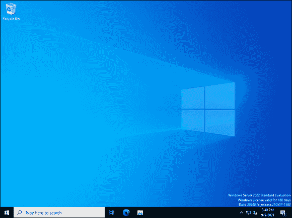

图 1-1： 安装了桌面体验的服务器。

#### 服务器核心

服务器核心（如图 1-2 所示）在连接到控制台时提供了一个简单得多的界面。你会看到一个看起来有些熟悉的命令窗口，提示你输入用户名和密码。登录后，默认情况下会显示 `sconfig` 窗口。当你选择从 `sconfig` 退出到命令行时，会提供一个 PowerShell 窗口供你交互。初始配置是通过 `sconfig` 实用程序完成的，但也可以通过 PowerShell 脚本或 PowerShell 所需状态配置 (DSC) 完成。如果附加到 Active Directory 域，此体验可以通过组策略进行管理；如果是工作站服务器，则可以通过本地组策略进行管理。

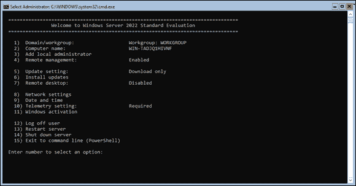

图 1-2： 服务器核心的 `sconfig` 实用程序，用于执行初始配置。

### Nano

Nano 提供了更简单的界面和功能更有限的控制台，称为恢复控制台。它无法通过光盘上的常规安装程序获得；相反，你必须从 Microsoft 下载容器映像。与桌面体验或服务器核心相比，Nano 在磁盘和计算需求方面占用的空间要小得多。由于其整体占用空间较小，攻击面也相应减少。Windows Server Nano 2022 仅作为容器基础操作系统映像提供，只能作为容器在容器主机上运行。

Nano 无法通过组策略进行管理。如果你想大规模管理 Nano，需要改用 PowerShell DSC。你可能会问，既然 Nano 是如此有限的操作系统版本，为什么还要使用它。如果你需要运行使用 .NET 的容器工作负载，Nano 是一个极佳的选择，因为它已经过优化，可以运行 .NET Core 应用程序。

如果你想试用，可以使用以下命令从 Microsoft 在 DockerHub 上的容器注册表下载 Nano 服务器映像：

```
docker pull mcr.microsoft.com/windows/nanoserver
```

你也可以访问 [`https://hub.docker.com/_/microsoft-windows-nanoserver`](https://hub.docker.com/_/microsoft-windows-nanoserver) 查看有关当前 Nano 服务器容器映像的更多信息。这包括映像的描述、评论和附加资源。

如果你想了解更多关于容器和使用 Docker 命令的信息，请查看第 8 册。

***注意：*** 本书不会深入讨论 Nano，因为你更有可能遇到的是 Windows Server 2022 的桌面体验或服务器核心安装。

## 了解服务器管理器提供的功能

首次安装 Windows Server 2022 并登录时，你看到的第一个屏幕是服务器管理器（参见图 1-3）。此屏幕为你提供了一个中心区域，用于在服务器上执行所有需要的配置任务。它还提供了一个便捷的菜单来管理服务器上安装的所有角色和功能。

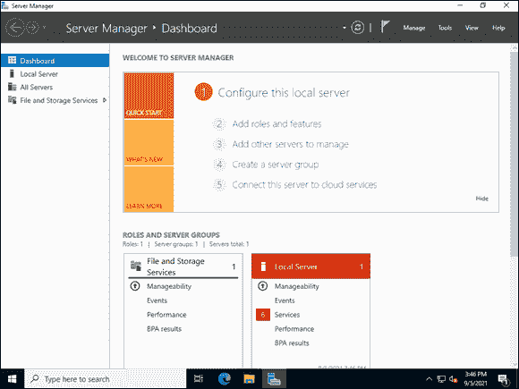

图 1-3： 服务器管理器是登录 Windows Server 2022 时看到的主页。

服务器管理器允许你管理远程服务器，而不仅仅是本地服务器。远程服务器需要先添加到服务器管理器中才能进行管理，并且可能需要打开一些防火墙端口以允许完整功能。添加远程服务器后，你可以对它们运行 PowerShell 并执行基本管理任务，例如关机、通过远程桌面协议 (RDP) 连接等。你可以使用服务器管理器管理最多 100 台远程服务器。这个数字可能会更低，具体取决于你在管理服务器上运行的内容。如果你运行的是大型工作负载，那么你可能无法管理那么多服务器。

 服务器管理器可用于管理与其安装的操作系统相同的操作系统，以及比其安装的操作系统更旧的操作系统。它无法管理运行更新版本操作系统的服务器上的操作系统。例如，在 Server 2019 上运行服务器管理器的服务器无法管理运行 Windows Server 2022 的服务器。

图 1-4 显示了通过服务器管理器菜单可用的一些选项。你可能会注意到“远程桌面连接”是灰色的。这是因为我是登录到窗口中的服务器上。

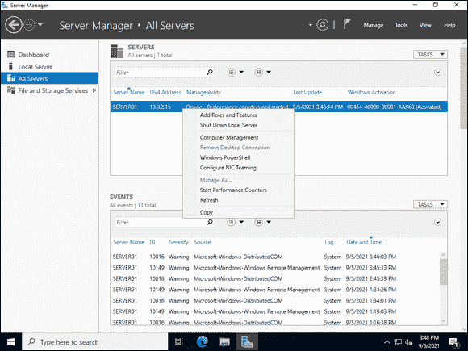

图 1-4： 使用服务器管理器管理服务器。

以下是服务器管理器一些更常用功能的列表：

*   管理本地和远程服务器

*   管理服务器上的角色和功能（要安装或删除角色和功能，目标系统必须至少运行 Server 2012）

*   启动管理工具，如 Windows PowerShell 和 MMC 管理单元

*   查看事件、性能数据和最佳实践分析器的结果

## Windows 管理中心：你的新得力助手

Windows 管理中心是 Microsoft 推出的较新的服务器管理工具。Microsoft 一直在大力投资 Windows 管理中心，成效显著。你可以使用它来管理本地系统以及 Azure 中的系统。Windows 管理中心可通过浏览器访问，允许你通过相同的界面执行几乎所有管理任务。最重要的是，它是免费的！你只需支付其运行操作系统的许可证费用。


管理员中心可用于管理 Windows Server 2022、2019、2016、2012R2 和 2012，并完全支持所有功能。

默认情况下，Windows 管理中心使用 TCP 端口 6516，因此您需要根据网络架构在服务器防火墙中允许此端口。要访问 Windows 管理中心仪表板，您需要知道安装了管理员中心的系统的主机名。在图 1-5 中，请注意地址是 `localhost:6516`。这是因为我将其安装在桌面模式下的 Windows 10 客户端上。桌面模式通常由单个系统管理员使用，而网关模式则可供更多员工使用。

第一个屏幕（参见图 1-5）显示您已连接的设备。

如果您单击列表中的某个设备，您将获得该设备特定的管理视图。对于图 1-6，我单击了 `server2022-dc`。您将看到系统概览以及一些管理选项。在屏幕左侧，还有更多可供您使用的选项。

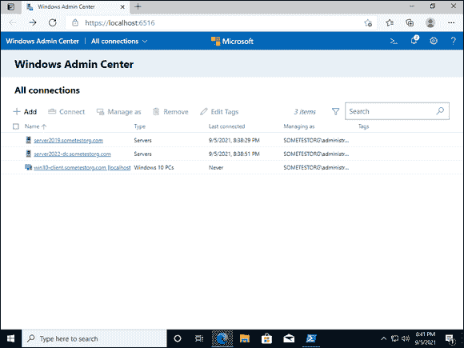

图 1-5：您可以在“所有连接”页面上看到所有已连接的设备。

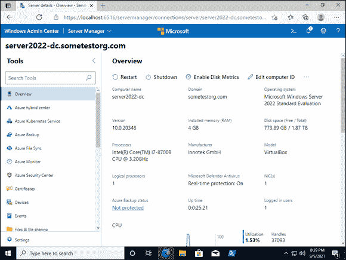

图 1-6：“概览”页面显示了您单击的设备的概览。

安装 Windows 管理中心很简单。您可以从 Microsoft Windows 管理中心网站（[`www.microsoft.com/en-us/cloud-platform/windows-admin-center`](https://www.microsoft.com/en-us/cloud-platform/windows-admin-center)）下载 Microsoft 安装程序 (MSI) 包。在安装之前，您需要决定是将其安装在桌面客户端上，还是安装在服务器上。我的建议是，如果您只是试用或只管理少数几台服务器，请使用您的桌面。如果您要充分利用 Windows 管理中心，请将其安装在服务器上，以便所有管理员都可以访问它。您将成为他们的英雄！

您可以将 Windows 管理中心安装在受支持版本的 Windows 10 或 Windows Server 2016 及更高版本上。要管理较旧的服务器（包括 2012 和 2012 R2），您需要在每台服务器上安装 Windows Management Framework 5.1。

当您在 Windows 10 上安装 Windows 管理中心时，它将以桌面模式安装，这意味着您使用 `https://localhost:6516` 访问它。当 Windows 管理中心安装在服务器上时，它将以网关模式安装，可以通过 URL 中的服务器名称访问（例如，`https://servername`）。无需端口号！

 Localhost 指的是系统上的本地环回地址，也可以通过 IP 地址 `127.0.0.1` 访问。

 不支持将 Windows 管理中心安装在域控制器上。正如您可能想象的那样，这将是一个糟糕的主意！因为 Windows 管理中心通过网页公开其服务，所以它提供了一个通常不存在的攻击点。

Windows 管理中心的一些最酷功能包括：

*   集中式服务器管理

*   与 Azure 集成，因此您可以从同一个控制台管理本地和云资源

*   内置于 Windows 管理中心的集群管理工具

*   Showscript，允许您查看为执行管理任务而运行的 PowerShell 脚本

 目前仅支持 Microsoft Edge 和 Google Chrome 浏览器。Firefox 和 Internet Explorer 尚未经过测试，且不受官方支持。

## 扩展和改进您的数据中心

Windows Server 2022 允许您利用 Azure 云中一些非常强大的功能。其中一些功能要求您运行 Server 2022 Datacenter: Azure Edition；其他功能则没有那么严格。我不会深入探讨这些功能，因为它们更适合 Azure 书籍的主题，但您应该了解它们是什么以及它们的功能。

### Azure Arc

Azure Arc 是一项较新的服务，允许您使用 Azure 工具集管理 Azure 和本地资产。Windows Server 2022 是可以由 Azure Arc 管理的多个操作系统之一。您只需安装 Azure Connected Machine 代理即可。

### Azure Automanage: Hotpatch

在撰写本文时，Azure Automanage: Hotpatch 处于预览阶段；您可以在 Windows Server 2022 Datacenter: Azure Edition 上预览它。它通过与发布的最新累积更新 (CU) 建立基线来工作。从那时起，每个月都会发布热补丁，这些补丁可以安装且无需重启。让我重复一遍：无需重启！对于系统管理员来说，打补丁时无需重启几乎是梦想成真。当基线使用新的 CU 更新时（大约每三个月发生一次），*那么*您将需要重启。

# 第 2 章：使用启动诊断

## 本章内容

 **使用启动诊断找出问题所在**

 **使用特殊的启动模式绕过服务器问题**

 **对服务器执行内存测试**

 **使用命令提示符进行故障排除**

 **使用第三方启动工具进行故障排除**

作为系统管理员，您总有一天会接到不可避免的电话，说有一台服务器就是无法启动。也许服务器处于持续的启动循环中。也许服务器只是挂起了。您的任务（如果您选择接受的话）是找出系统启动问题的原因，然后修复该问题。

本章讨论了用于排除导致系统无法正常启动的问题的基本工具和技术。

## 访问启动诊断

找出系统问题的第一步是访问 Windows Server 操作系统附带的启动诊断实用程序。

### 从 DVD 启动

如果出现启动问题的服务器是物理服务器，您可以使用 DVD 或 USB 闪存驱动器访问启动诊断菜单。现在手头有物理介质的情况非常少见，因此您可能需要从 Microsoft 网站下载 Windows Server 2022 的 ISO 文件，并将映像刻录到 DVD 或 USB 闪存驱动器上。

 ISO 文件是物理光盘内容的副本。

准备好光盘后，您需要将光盘或 USB 闪存驱动器插入服务器并从中启动。您可能需要更改服务器上的启动顺序，以便启动顺序在硬盘驱动器之前从 DVD 驱动器或 USB 闪存驱动器开始。您可以通过访问基本输入/输出系统 (BIOS) 来进行此更改。在服务器系统上，此选项在系统启动时可用。要访问 BIOS，您需要按下的键取决于创建 BIOS 或统一可扩展固件接口 (UEFI) 的固件制造商。某些系统只需按 `F12` 即可提供启动菜单，允许您选择 DVD 驱动器或 USB 闪存驱动器进行一次性启动。

当您弄清楚如何从 DVD 或 USB 闪存驱动器启动后，请按照以下步骤操作：

1.  **从 DVD 或 USB 闪存驱动器启动。**

2.  **当您看到消息** `Press any key to boot from CD or DVD` **时，按任意键。**

    Windows Server 2022 的安装向导将运行。

3.  **在第一个屏幕上，单击“下一步”。**

    此屏幕只是询问语言、时间和货币格式以及键盘或输入方法。您可以安全地接受默认设置。


4.  **在下一个屏幕上，你会看到一个大的“立即安装”按钮。不要点击它！相反，请在左下角查找“修复计算机”链接（参见****图** **2-1****），然后点击它。**

5.  **在下一个屏幕上，点击“疑难解答”。**

    这将为你提供可用的选项（参见图 2-2）：

    *   **命令提示符：** 允许你进行高级疑难解答，如果你需要修复启动文件，它尤其有用。你可以使用 `diskpart` 实用程序来操作驱动器，并使用 `bootrec` 命令来重建或修复启动文件。

    *   **系统映像恢复：** 允许你从备份实用程序创建的映像中恢复系统。系统会要求你选择要恢复的目标操作系统，然后会显示你可以使用的可用备份。

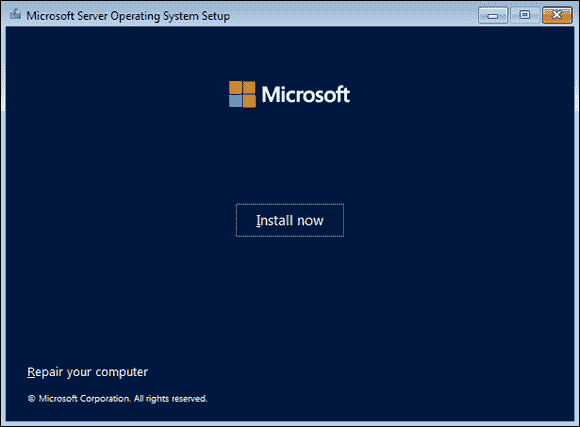

图 2-1： 在左下角查找“修复计算机”链接。

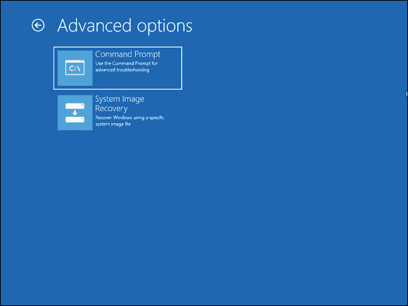

图 2-2： “高级选项”屏幕。

## 使用高级启动选项

高级启动选项菜单为你（系统管理员）提供了多种实用程序，用于排查各种系统问题。

高级启动选项是 Windows 操作系统中存在已久的一个菜单。有两种方法可以进入它：

*   第一种选择是每个系统管理员的噩梦：系统出现问题，重新启动，然后进入高级启动选项菜单，表明存在问题。

*   第二种不那么可怕的选择是系统管理员选择启动到高级启动选项菜单。这可能是出于多种原因。我曾这样做过，以排查驱动程序问题，并调查和清除可能受感染计算机上的恶意软件。

要进入高级启动选项菜单，请按照以下步骤操作：

1.  **单击“开始”菜单，然后单击“设置”图标。**

2.  **单击“更新和安全”，然后单击“恢复”。**

3.  **在“高级启动”下，单击“立即重新启动”按钮，如****图** **2-3****所示。**

4.  **单击“继续”按钮。**

5.  **单击“疑难解答”按钮。**

6.  **选择“启动设置”。**

7.  **单击“重新启动”。**

当高级启动选项菜单出现时，你会看到多个选项，如图 2-4 所示。我将在以下部分描述这些选项。

#### 安全模式

当系统出现启动问题时，安全模式几乎总是我的首选。每当安装了新的硬件或软件，或者我怀疑系统可能因恶意软件感染而出现问题时，我都会转向安全模式。

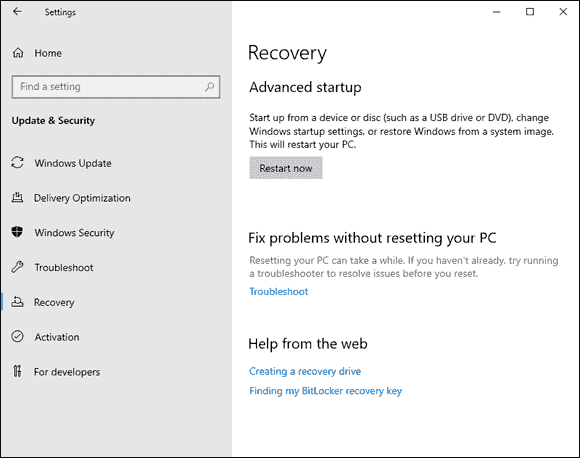

图 2-3： 进入高级启动选项菜单的旅程从“立即重新启动”按钮开始。

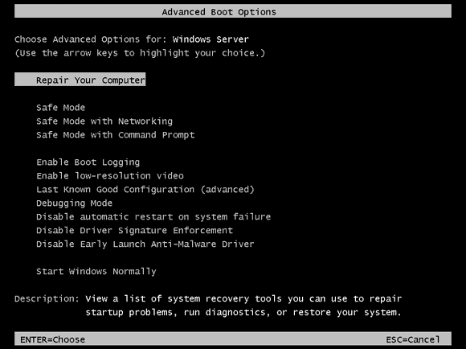

图 2-4： 在高级启动选项菜单中，你可以选择你希望 Windows Server 执行的操作。

你可能会问：“什么是安全模式，为什么它如此重要？”安全模式以 Windows 运行所需的最基本服务和驱动程序启动 Windows。安全模式对于排查因不良驱动程序导致启动循环的问题至关重要。通过进入安全模式，你可以排查驱动程序的问题并卸载或替换它。安全模式对于潜在的恶意软件感染也非常有用，因为恶意软件可能依赖于未加载的运行所需项，这使你可以运行恶意软件清除工具并从操作系统中销毁恶意代码的最后残余。

我使用的安全模式类型取决于我需要完成的任务。例如，如果我只是在排查一个我怀疑可能与驱动程序相关的问题，大多数时候我会使用常规的安全模式。在以下部分，我将引导你了解不同形式的安全模式，以及为什么你可能需要使用每种形式。

#### 安全模式

这就是常规的安全模式。它仅加载 Windows 运行和你与之交互所需的基本服务和驱动程序。不多也不少。

在大多数情况下，这种常规形式的安全模式足以排查和解决手头的问题。它具有你习惯在 Windows Server 中看到的图形界面，但无法访问互联网或其他网络资源。本质上，它是一台独立的计算机。

#### 带网络连接的安全模式

带网络连接的安全模式与常规安全模式类似，不同之处在于系统还将加载网络接口卡 (NIC) 正常运行所需的驱动程序。如果你需要从互联网（例如，驱动程序或诊断软件）或通过网络共享下载软件，这会很有用。

当你试图解决软件或驱动程序问题时，带网络连接的安全模式最有用。它允许你在安全模式下下载替换软件或替换驱动程序。然后，你可以用已知良好的版本替换行为异常的驱动程序或不兼容的软件，然后成功启动。

#### 带命令提示符的安全模式

在带命令提示符的安全模式下，你将绕过 Explorer 桌面环境。如果桌面因任何原因无法正常显示，这可能特别有用。

如果你喜欢 Server Core，你会喜欢这个版本的安全模式。如果你对命令窗口不太熟悉，准备一份备忘单可能会有所帮助。

我建议在需要修复的问题与图形相关时使用带命令提示符的安全模式。问题可能由驱动程序、图形渲染引起，或者与移除依赖于壁纸和屏幕保护程序等图形组件的恶意软件感染有关。

### 启用启动日志

如果你需要查看系统启动时安装了哪些驱动程序，应选择“启用启动日志”。这将创建一个名为 `ntbtlog.txt` 的文件，其中列出了操作系统启动时安装的所有驱动程序。该文件存储在你的 Windows 系统目录中；通常是 `C:\WINDOWS`。顺便说一句，这就是你进入安全模式时在屏幕上快速闪过的同一列表。

### 启用低分辨率视频

如果你遇到显示问题，此设置非常有用，最常见于将显示设置更改为你的监视器不支持的内容之后。它使用当前安装的视频驱动程序，但以较低的分辨率（通常为 640 x 480）和刷新设置启动。

### 上一次正确的配置

上一次正确的配置有助于修复因 Windows 注册表损坏而导致的启动问题。最常见的情况是，这是由于用户配置错误或更新/补丁造成的。当你选择“上一次正确的配置”时，注册表将被还原，以匹配系统上次成功启动时的设置。

 任何时候使用任何修改注册表的东西，都要格外小心。使用“上一次正确的配置”后无法撤销。如果它没有解决问题，或者使情况变得更糟，你需要从备份中恢复。

### 目录服务还原模式

此选项仅出现在作为域控制器的服务器上（因此，它未在图 2-4 中显示）。目录服务还原模式 (DSRM) 是一种专为域控制器设计的特殊安全模式，允许你修复或恢复 Active Directory 数据库。


 要使用此工具，您需要知道在最初创建域控制器时设置的 DSRM 密码。如果您不知道密码，可以使用 `ntdsutil` 工具来更改密码。您需要能够访问相关系统上的命令提示符才能运行它。

如果这一切对您来说如同天书，请不要担心！我在第 2 册的第 5 章中深入介绍了 Active Directory。目前，您可以将 Active Directory 想象成一个特殊的数据库，它存储着您网络中用户、计算机、站点和其他对象的信息。这个数据库对您的组织可能至关重要，因此知道如何在它损坏时进行恢复是一项非常有用的技能。

### 调试模式

如果您是一位铁杆系统管理员，并且想尝试使用内核调试器，那么这个选项就是为您准备的！

*内核*是服务器启动时最先运行的程序之一（内核在引导加载程序之后立即加载）；它对系统上的所有内容拥有完全的控制权。

调试模式会开启内核调试，允许您使用内核调试器来检查在内核级别运行的状态和进程。这对于排查导致臭名昭著的蓝屏死机的设备驱动程序问题以及中央处理器（CPU）问题非常有用。您可以查看出现问题的系统上的内核内存转储，也可以通过串行连接在另一台系统上远程查看内核内存转储。调试模式的信息通常通过 `COM1` 端口提供（假设您有一个串行端口并且它被分配给了 `COM1`）。在没有串行端口的新系统上，您也可以通过 USB 访问此信息。

 内核调试并非胆小者所能驾驭。有关如何设置系统以通过串行或 USB 连接进行内核调试的更多信息，请查看以下文章：

*   **串行连接：** [`https://docs.microsoft.com/en-us/windows-hardware/drivers/debugger/setting-up-a-null-modem-cable-connection`](https://docs.microsoft.com/en-us/windows-hardware/drivers/debugger/setting-up-a-null-modem-cable-connection)

*   **USB 连接：** [`https://docs.microsoft.com/en-us/windows-hardware/drivers/debugger/setting-up-a-usb-3-0-debug-cable-connection`](https://docs.microsoft.com/en-us/windows-hardware/drivers/debugger/setting-up-a-usb-3-0-debug-cable-connection)

 `COM` 端口在旧系统上通常表现为带有 RS-232 连接器的串行端口。在新系统上，这些已被 USB 端口取代。USB 代表*通用串行总线*——它仍然是一种串行连接。

### 禁用系统故障时自动重启

最终，每位系统管理员都会遇到一个系统不断尝试启动、失败、重启，然后再次尝试启动、失败、重启，如此循环的情况。这种情况被称为*启动循环*。如果您在某个系统上遇到启动循环，可以通过从高级启动选项菜单中选择“禁用系统故障时自动重启”来让系统停止自动重启。

如果系统出现蓝屏死机并且您需要获取显示的信息，禁用自动重启会非常有帮助。当系统在下一次蓝屏时停止，您将有充足的时间来抄录信息。

### 禁用驱动程序签名强制

通过选择“禁用驱动程序签名强制”选项，您基本上是在告诉系统可以加载未经过数字签名的驱动程序。Microsoft 默认要求驱动程序必须经过数字签名，并且会阻止未签名的驱动程序运行。Microsoft 这样做是因为，当驱动程序经过数字签名时，它被视为是真实的，因为您可以从数字签名验证它确实来自其声称的供应商。数字签名还保证驱动程序自供应商发布以来未被以任何方式更改。

数字签名使用代码签名证书来加密文件的哈希值。（哈希值是唯一的指纹——文件的任何更改都会改变哈希值。）然后，该加密哈希值与证书和驱动程序的可执行文件捆绑在一起。当最终用户安装驱动程序时，文件的哈希值会使用证书中的公钥进行解密。文件在最终用户的系统上再次进行哈希计算，新的哈希值与解密后的哈希值进行比较。如果它们匹配，则说明驱动程序未被篡改。

 如果您选择禁用驱动程序签名强制，您将能够加载未签名的驱动程序。选择此选项需自行承担风险：您最终可能会安装伪装成未签名驱动程序的恶意软件。

### 禁用早期启动反恶意软件驱动程序

在 Windows 启动后安装的恶意软件很可能会被系统上安装的防病毒软件检测到。但问题是，病毒编写者开始编写一种称为*rootkit*的恶意软件。这些 rootkit 可能非常难以清除，因为它们在操作系统启动*之前*就已安装和执行。许多更复杂的 rootkit 开始安装在系统启动过程中*非常*早期启动的驱动程序。这可能使它们极难被发现和清除。

Microsoft 尽其所能地发展和应对威胁，并尽可能地预防它们。在这种情况下，它提出了早期启动反恶意软件（ELAM）驱动程序。获得认证且产品支持早期启动的防病毒供应商，可以使其产品的驱动程序在 Windows 引导驱动程序之前启动，从而允许它们在启动时扫描恶意进程。这很酷，对吧？

但是，如果 Windows 的一个合法引导驱动程序被标记为恶意软件会怎样？您的服务器将无法启动。因此，Microsoft 为您提供关闭此功能的能力，通过选择“禁用早期启动反恶意软件驱动程序”，允许引导驱动程序像往常一样启动。

 此功能非常有用。除非绝对必要，否则请不要禁用它，并且只在问题解决之前暂时禁用。

### 执行内存测试

如果您的服务器意外崩溃或在您最不期望的时候出现蓝屏，会发生什么？这可能是一个难以回答的问题。这些症状可能是由于软件损坏或硬件故障引起的。内存是开始故障排除工作的好地方，Windows Server 2022 包含一个名为 Windows 内存诊断工具的内置内存诊断实用程序。

您可以通过按 Windows 键 + R，输入 `mdsched.exe`，然后单击“确定”来运行 Windows 内存诊断工具。如果您不执行任何操作，Windows 内存诊断工具将以标准模式运行。您可以随时按 F1 进入选项屏幕并更改设置来中断它。您的选项如下（参见图 2-5）：

*   **测试组合：** 测试组合是您希望工具运行的一组测试：

    *   **基本：** 对您的内存运行三个测试，是最快的选项。

    *   **标准：** 对您的内存运行与基本相同的测试，并添加五个额外的测试。它比基本测试需要更长的时间来完成。

    *   **扩展：** 运行与标准相同的测试，并添加九个额外的测试。此测试是最详细的，需要最长的时间来完成。

     如果您不知道这些测试各自在寻找什么，标准测试是您测试的一个良好起点。扩展测试需要更长的时间，因此如果您不需要额外的测试，运行它们可能不会获得任何有价值的信息。也就是说，运行这三个测试中的任何一个都不会对您的服务器造成伤害。


*   **缓存：** `Cache` 为每个即将运行的测试设置缓存选项（缓存用于提升 CPU 频繁访问内容的内存访问速度）。如果运行需要直接访问内存的测试，则应禁用缓存。您的选项如下：

    *   **默认：** 在大多数情况下，"默认"是合适的设置。它会为当前运行的测试选择正确的缓存设置。

    *   **开启：** 强制为测试启用缓存。

    *   **关闭：** 强制为测试禁用缓存。

*   **通过次数 (0–15)：** "通过次数"控制您选择的整个测试组合将运行多少次。如果设置为 5，所选测试组合将运行其所有测试五次。此设置的默认值是运行两次。

完成选择后，按 `F10` 应用设置，扫描将重新开始。

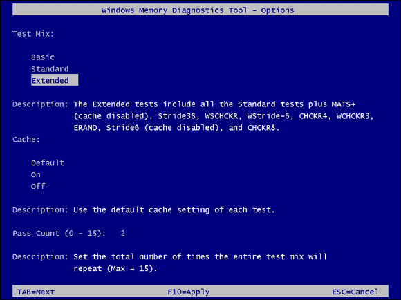

图 2-5： Windows 内存诊断工具选项。

## 使用命令提示符

当所有其他方法都失败时，命令提示符总在那里。多年来，我不得不解决许多问题，正是因为命令提示符可用才得以解决。系统文件损坏？打开命令提示符并运行 `sfc /scannow`。硬盘损坏？打开命令提示符并输入 `chkdsk /f /r`。

在表 2-1 中，我列出了多年来使用过的一些最有用的工具。这些命令大多需要以管理员凭据运行命令提示符。要以管理员身份运行命令提示符，请选择"开始"⇒"Windows 系统"，右键单击"命令提示符"，单击"更多"，然后选择"以管理员身份运行"，或者如果您能打开任务管理器，可以选择"文件"⇒"运行新任务"并输入 `cmd.exe`。

| **名称** | **命令** | **描述** |
| --- | --- | --- |
| 系统文件检查器 | `sfc /scannow` | 此实用程序通过将服务器上的系统文件签名与同一文件的缓存副本签名进行比较，来检查系统文件是否符合预期。缓存文件存储在位于 `C:\Windows\System32\dllcache` 的压缩文件夹中。如果发现损坏的系统文件，它将被替换。 |
| 磁盘检查 | `chkdsk /f /r` | 此实用程序修复文件系统错误并标记坏扇区，以便操作系统不再使用它们。`/f` 告诉实用程序修复它发现的任何问题，`/r` 将定位磁盘上的坏区域（扇区）。这可能需要一些时间。启动它，然后去喝杯咖啡。 |
| 驱动程序查询 | `driverquery` | 此实用程序查询系统上安装的所有 Windows 硬件驱动程序。如果您遇到具有相似硬件的系统问题，并且想知道它们是否有共同的驱动程序，这将非常有帮助。 |
| BCDEdit | `bcdedit` | 此实用程序在第 1 册第 4 章中有深入介绍。目前，只需知道它允许您编辑 Windows 服务器上的启动配置。 |

表 2-1 使用命令提示符进行故障排除

## 使用第三方启动工具

如果不简要介绍旨在帮助诊断和解决启动问题，或至少协助恢复的第三方工具，本章就不完整。表 2-2 列出了我最喜欢的两个工具，以及它们的成本和简要描述。

| **名称** | **成本** | **描述** |
| --- | --- | --- |
| Ultimate Boot CD | 免费 | 这是我一直以来最喜欢的工具之一。它包含多个诊断和恢复工具。要使用它，您只需从光盘启动。就这么简单！访问 [`www.ultimatebootcd.com`](http://www.ultimatebootcd.com/) 了解更多信息。 |
| Trinity Rescue Kit | 免费 | Trinity Rescue Kit 功能丰富，也是一个非常有用的工具。访问 [`https://trinityhome.org`](https://trinityhome.org/) 了解更多信息。 |

表 2-2 第三方启动工具

# 第 3 章：执行基本安装

本章内容

 **安装支持成功安装的先决条件**

 **执行 Windows Server 2022 的全新安装**

 **从早期版本的 Windows Server 升级**

 **使用 Windows 部署服务执行网络安装**

您已经做出决定：您要安装 Windows Server 2022。太好了！您可能想知道接下来该做什么。确保成功安装的最重要事项之一是确保您满足 Windows Server 2022 的所有先决条件。通过确保您拥有满足操作系统需求的适当硬件，您肯定可以为自己省去一些日后的麻烦。

当您拥有安装 Windows Server 2022 所需的一切时，您就可以开始了。在本章中，我将引导您完成全新安装和升级安装。我还将解释如何使用 Windows 部署服务进行网络安装。

 您应该知道，您无法再在 Server Core 和带桌面体验的服务器之间切换。此功能在 Windows Server 2016 中被移除，以支持服务器上较新的 Windows 10 桌面体验，而不是 Windows Server 2012 R2 中较旧的传统桌面体验。如果您安装了 Server Core，然后改变主意决定实际上想要带桌面体验的服务器，则需要重新安装它。如果您尝试使用 Windows Server 安装介质在 Core 和桌面体验之间切换，您将不会被提供保留任何内容的选项。

## 确保您具备所需条件

Microsoft 发布了其每个操作系统的先决条件。一些硬件要求与您计划安装的 Windows Server 版本无关；其他硬件要求则根据您安装的是带桌面体验的服务器还是 Server Core 而有所不同。

Windows Server 2022 仅提供 64 位操作系统；没有 32 位版本可用。运行安装程序时，您会看到标准版或数据中心版的选项。同时，您可以选择是安装 Server Core 还是带桌面体验的服务器。

 在本节讨论最低要求时，重要的是要理解这些是成功安装 Windows Server 2022 的*最低要求*。如果您只提供此处列出的规格，*不应*期望您的服务器运行良好。对于任何实际工作负载，您的服务器应配备更快的处理器、更多的处理器核心和更多的内存。

那么，要安装 Windows Server 2022，您必须满足的绝对最低要求是什么？请继续阅读。

### 中央处理器

中央处理器是整个系统的大脑。它处理程序和/或应用程序发出的指令。Windows Server 2022 的 CPU 要求很容易被大多数现代处理器满足：

*   **1.4 GHz 64 位处理器：** 考虑到操作系统是 x64 系统，处理器也必须是 x64 处理器是合理的。即使是配备低端处理器的廉价服务器也应该能够轻松满足 1.4 GHz 的要求。

*   **支持不执行位：** 当内存的某些区域启用了 NX 位时，处理器将不会执行该内存空间中的任何内容，这可以提供针对恶意软件的保护。受 NX 位保护的区域通常包含处理器指令或数据存储等内容。


 英特尔可能将此技术称为 `XD`（执行禁用的缩写），而 AMD 处理器则称其为增强型病毒防护（`EVP`）。

*   **支持数据执行保护（`DEP`）：** `DEP` 提供了额外的保护，以防止可能针对内存位置的恶意软件。

*   **支持 `CMPXCHG16b`、`LAHF/SAHF` 和 `PrefetchW`：** 这些设置是特定于处理器的，并且已经发布了多份关于其细节的白皮书。`CMPXCHG16b` 是大多数现代 x86_64 处理器支持的指令集。从标志加载 AH（`LAHF`）/将 AH 存储到标志（`SAHF`）是支持虚拟化所必需的。`PrefetchW` 在使用 AMD 处理器时提供了性能改进。你不需要记住这些东西——只需知道这些处理器特性可以加速任务执行，并增加一些额外的安全功能。

*   **支持二级地址转换（扩展页表 [`EPT`] 或嵌套页表 [`NPT`]）：** 如果你计划运行 Hyper-V，此功能尤为重要。它提高了系统上虚拟机的性能，并减轻了虚拟机监控程序的一些压力，从而反过来可以提高虚拟机监控程序的性能。

 你可能好奇如何判断你的 CPU 是否支持这些要求。微软提供了一个名为 `Coreinfo` 的工具，它是 Sysinternals 套件的一部分；此工具可以告诉你处理器支持哪些功能。你可以从微软网站免费下载 `Coreinfo`（[`https://docs.microsoft.com/en-us/sysinternals/downloads/coreinfo`](https://docs.microsoft.com/en-us/sysinternals/downloads/coreinfo)）。你下载的文件是一个压缩的 zip 文件，因此你需要先解压它。然后启动命令提示符来运行该实用程序。要运行 `Coreinfo`，只需在命令窗口中输入 `coreinfo`，你就会得到一份所有可用和不可用功能的报告。可用功能用星号（`*`）标记，不可用功能用连字符（`-`）标记，如图 3-1 所示。

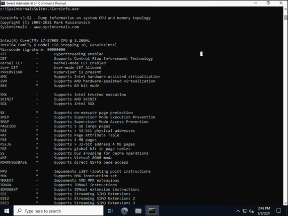

图 3-1： 在 Windows 系统上运行 `Coreinfo` 实用程序。

### 随机存取存储器

随机存取存储器（`RAM`）被服务器用于存储你现在需要访问的内容以及你可能在不久的将来需要访问的内容。`RAM` 比持久存储快得多，因此拥有大量 `RAM` 的服务器性能将远优于 `RAM` 非常少的系统。正如我在本章前面的“版本和版本要求”侧边栏中提到的，Server Core 最低需要 512MB 的 `RAM`，而带桌面体验的 Server 最低需要 2GB 的 `RAM`。`RAM` 还必须是纠错码（`ECC`）类型的内存。`ECC` 类型的内存能够纠正单位错误（例如，如果电气干扰错误地翻转了一个位，使用奇偶校验位可以确保内存中的数据得到纠正）。

### 存储

这里没有复杂的公式或计算。如果你想安装 Windows Server 2022，你需要至少 32GB 的硬盘空间。请记住，这是安装操作系统的绝对最低要求。如果你只有 32GB，你将没有空间安装任何其他东西。如果你的存储空间有限，根据微软的说法，Windows Server Core 比带桌面体验的 Windows Server 大约小 4GB。

### 网络适配器

如果你无法访问服务器，那么它对你毫无用处。网络适配器，也称为网络接口卡（`NIC`），为你的服务器提供了一种在网络中通信的方式。对于 Windows Server 2022，你的网络适配器必须至少支持千兆以太网。你的网络适配器可能是*板载的*，意味着它们是主板的一部分，或者它们可能位于 `NIC` 上，该 `NIC` 插入 PCI Express 插槽。

你的网络适配器应支持预启动执行环境（`PXE`）。这是当今大多数组织用于从中央映像服务器（如 Windows 部署服务或 System Center Configuration Manager）映像系统的方式。

### DVD 驱动器

并非所有服务器都配备 DVD 驱动器了。现在有更多安装操作系统的选择，例如从闪存驱动器启动或从网络启动，因此许多系统管理员不再使用 DVD。也就是说，如果你想从 DVD 安装，你需要确保你有一个 DVD 驱动器。驱动器可以是内置的，也可以是外置的。

### 基于 UEFI 的固件

统一可扩展固件接口（`UEFI`）在这一点上已经取代了传统的基本输入/输出系统（`BIOS`）。我强烈建议你选择 `UEFI` 而不是 `BIOS`。如果你想使用一些高级功能，如安全启动，这将是必需的。

### 可信平台模块

如今，大多数主板都带有可信平台模块（`TPM`）芯片。如果你计划使用 BitLocker 进行磁盘加密，这是必备项。

### 显示器

不言而喻，在安装操作系统时，你需要能够看到服务器的状态。Windows Server 2022 要求超级视频图形阵列（`SVGA`）连接，最低屏幕分辨率为 1024 x 768。你可以通过将物理显示器连接到服务器或通过 `KVM` 查看视频流来实现这一点。

 `KVM` 允许你使用一个键盘、显示器（缩写中的视频）和鼠标来管理多台服务器。旧的 `KVM` 要求你必须在现场才能使用键盘、显示器和鼠标。现代 `KVM` 允许你通过 Web 服务远程管理服务器，它们提供的功能与你物理连接键盘、显示器和鼠标到服务器时获得的功能类似。

### 键盘和鼠标

你可以在映像期间将键盘和鼠标直接连接到服务器，也可以通过 `KVM` 将它们呈现给系统。无论哪种方式，你都需要某种键盘和鼠标来与系统交互。

## 执行全新安装

全新安装是我的首选方式。通过执行全新安装，你遇到由不良驱动程序、损坏的系统文件或配置错误引起的问题的可能性要小得多。在本节中，我将引导你完成如何全新安装 Windows Server 2022。

在本节中，我假设你已经启动到你将用于安装的任何介质（DVD、闪存驱动器等），并且你处于 Windows Server 2022 的初始安装屏幕上。如果你已经完成此操作，你应该会看到一个类似于图 3-2 的屏幕。从这个屏幕，按照以下步骤操作：

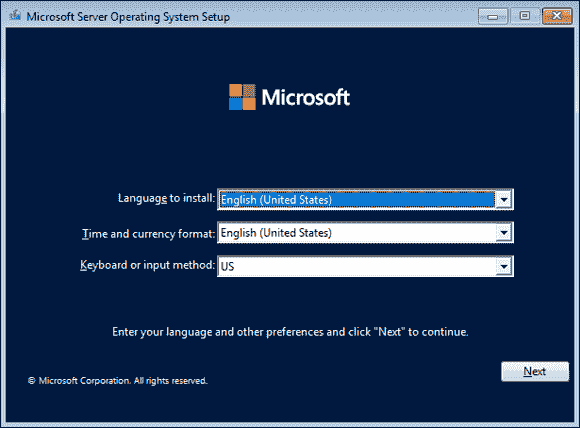

图 3-2： Windows Server 2022 的初始安装屏幕。

1.  **选择适合你所在地区的设置，然后单击下一步。**

    在我的示例中，我选择了以下内容：

    *   **要安装的语言：** 英语（美国）

    *   **时间和货币格式：** 英语（美国）

    *   **键盘或输入法：** 美国

    单击下一步后，将出现图 3-3 所示的屏幕。

    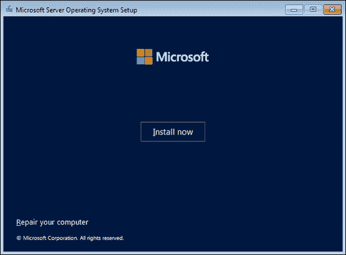

    图 3-3： Windows Server 2022 "立即安装" 按钮。

2.  **单击“立即安装”。**

3.  **在下一个屏幕上，选择你要安装的操作系统版本，然后单击下一步。**


默认选择的是 Windows Server 2022 Standard（如图 3-4 所示）。如果您愿意，也可以选择 Windows Server 2022 Standard（桌面体验）、Windows Server 2022 Datacenter 或 Windows Server 2022 Datacenter（桌面体验）。

4.  **在下一个屏幕上，勾选“我接受许可条款”复选框，然后单击“下一步”。**

5.  **在下一个屏幕上，选择“自定义”。**

    另一个选项用于升级安装。

    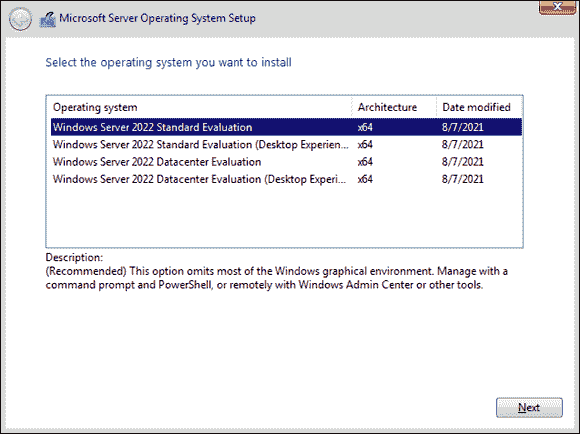

    图 3-4： 选择所需的 Windows Server 2022 版本和体验。

6.  **在下一个屏幕上，选择要安装 Windows 的分区，然后单击“下一步”。**

    在图 3-5 中，您可以看到这是驱动器 0。

    Windows Server 2022 开始安装，并在完成后重新启动。真正的乐趣从那时开始！

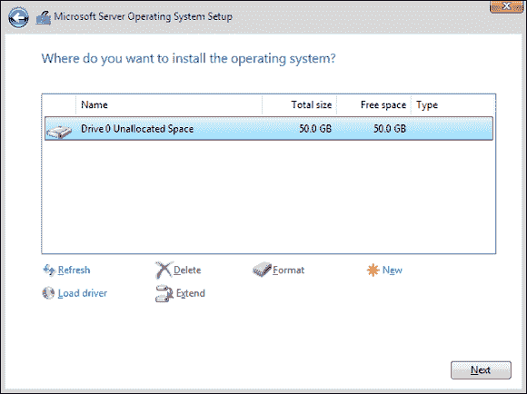

图 3-5： 选择安装 Windows 的位置。

## 升级 Windows

在考虑升级安装时，您需要确保您当前使用的操作系统版本能够升级到 Windows Server 2022。表 3-1 告诉您可以从哪些操作系统升级，以及可以升级到 Windows Server 2022 的哪个版本。

 一般来说，只要您处于最近两个主要版本之内，就可以直接更新到最新的 Windows Server 操作系统。

| **如果您运行的是此版本……** | **您可以升级到这些版本……** |
| --- | --- |
| Windows Server 2016 Standard | Windows Server 2022 Standard 或 Datacenter |
| Windows Server 2016 Datacenter | Windows Server 2022 Datacenter |
| Windows Server 2019 Standard | Windows Server 2022 Standard 或 Datacenter |
| Windows Server 2019 Datacenter | Windows Server 2022 Datacenter |

表 3-1 Windows Server 2022 升级兼容性矩阵

您还需要与应用程序供应商确认，以确保服务器上的应用程序与 Windows Server 2022 兼容。如果不兼容，那么您可能需要在升级服务器操作系统之前先升级应用程序。

 没有从比 Windows Server 2016 更旧的 Windows Server 操作系统直接升级的路径。如果您从较旧的服务器迁移，请进行全新安装。如果无法使用全新安装，您需要先升级到 Windows Server 2016 或 Windows Server 2019，才能升级到 Windows Server 2022。

在验证您使用的是兼容版本后，您可以开始升级安装。在本例中，我将从 Windows Server 2019 Standard 安装开始，并将其升级到 Windows Server 2022 Standard。请按照以下步骤操作：

1.  **以管理员身份登录到要升级的系统。**

2.  **将光盘或其他安装介质插入要升级的系统，并运行** `setup.exe`**。**

    下一个屏幕会询问您是否要提前下载更新和驱动程序（参见图 3-6）。

    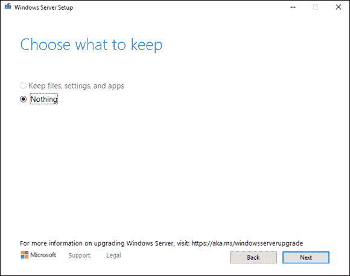

    图 3-6： 选择保留文件和设置或全新开始。

3.  **在“安装 Windows Server”屏幕上，单击“下一步”。**

    任何相关的更新都将被下载。在继续之前，您可能需要重新启动。

     在“安装 Windows Server”屏幕上，您会看到一个“更改设置下载更新的方式”链接。单击此链接允许您在安装时不修补服务器。我不建议这样做，除非服务器没有互联网连接，因为在修补之前它可能容易受到攻击。

4.  **选择带桌面体验的 Windows Server 2022 Standard（或您想要的任何版本），然后单击“下一步”。**

5.  **如果您有时间，请通读许可条款，然后单击“接受”。**

    在下一个屏幕上，您可以选择保留个人文件和应用程序，或者什么都不保留。如果您坚持使用相同的体验（核心或桌面），您将看到这两个选项。如果您更改体验，您唯一的选择将是“什么都不保留”。

6.  **如果有选项，请选择“保留个人文件和应用程序”单选按钮，然后单击“下一步”。**

    如果您想全新开始，可以选择“什么都不保留”。只需注意，如果您选择此选项，您将丢失数据。就我而言，因为我使用的是评估介质，所以我只能选择“什么都不保留”。此屏幕如图 3-6 所示。

     如果“保留文件、设置和应用程序”选项显示为灰色，可能是因为您尝试更改用户体验（例如，从核心更改为桌面），或者您使用的是评估介质而非零售介质。无论哪种情况，您都必须选择“什么都不保留”。

    安装程序会获取任何适用的更新，并向您显示摘要屏幕。

7.  **如果一切看起来正确，请单击“安装”。**

    安装程序开始将系统升级到 Windows Server 2022。在此过程中，它可能会重新启动数次。

    就这样——您完成了！

## 使用 Windows 部署服务执行网络安装

Windows 部署服务 (WDS) 是一个可以安装在 Windows Server 操作系统上的角色。它结合了预启动执行环境 (PXE) 服务器和简单文件传输协议 (TFTP) 服务器的功能，使您可以通过选择网络接口卡作为启动设备，通过网络连接安装 Windows。

安装 WDS 相当简单。您可以选择将其作为独立服务器安装，也可以将其与 Active Directory 集成。您需要告诉它要使用的启动文件是什么。最简单的入门方法是使用 Windows Server 安装介质上的 `boot.wim` 文件，其中包含 Windows 预安装环境 (WinPE)。该文件通常位于安装介质的 Sources 目录下。

接下来，您需要创建安装文件。最简单的入门方法是将 `install.wim` 从 Windows Server 2022 安装介质（同样在 Sources 目录中）复制到将用作 WDS 服务器的系统上。您将获得与从光盘安装向导中相同的版本和体验选项。WDS 完全配置后，它会通过网络提供映像。您需要做的就是告诉您的新服务器从网络启动。

 如果您正在进行网络安装，并且服务器与 WDS 服务器不在同一子网中，则需要设置动态主机配置协议 (DHCP) 选项 66 和 67。选项 66 指定 WDS 服务器的主机名或 IP 地址，选项 67 是启动文件名。如果两个网络之间存在防火墙，您可能还需要创建防火墙规则以允许 UDP 端口 67 和 68。

 如果您使用安装介质上的默认 `boot.wim` 选项，您会收到弃用通知，但您可以继续使用 `boot.wim` 进行配置。未来版本的 Windows Server 将不支持此选项。但是，您可以使用自定义的 `boot.wim` 文件。Microsoft 建议改用 Microsoft Endpoint Configuration Manager 或 Microsoft Deployment Toolkit 产品，以实现更精细的自定义和映像部署。

# 第 4 章：执行初始配置任务

本章内容

 **了解 Windows Server 2022 中的默认设置**


 **了解配置流程概览**

 **提供服务器正确设置所需的信息**

 **使用最新的补丁、热修复程序及所有更新来更新 Windows Server 2022**

 **根据您的偏好自定义 Windows Server 2022**

 **使用 BCDEdit 配置服务器启动选项**

既然您已经安装了 Windows Server 2022，现在是时候开始有趣的部分了！作为管理员，安装服务器操作系统后的下一个任务就是配置它，使其按照您的意愿运行。

Microsoft 在 Server 2008 中引入了服务器管理器功能，并在 Windows Server 2012 中对其进行了重大更新，以支持远程管理以及多服务器管理。如果您在具有桌面体验的服务器上工作，服务器管理器是您完成服务器上大多数配置任务的起点。

如果您在 Server Core 系统上工作，您将不会在控制台上使用服务器管理器。相反，您将使用 `sconfig` 实用程序进行初始配置，假设您没有部署已经为您的环境配置好的 Server Core 映像。当然，您可以使用服务器管理器远程管理您的 Server Core 系统，只需进行一些初始设置即可启动。我在配置流程概览中涵盖了这个主题。

## 了解默认设置

首次安装 Windows Server 2022 时，会创建或设置一些默认设置。通常，这些是您想要更改的内容，例如设置服务器名称、设置 IP 地址、将服务器加入域等。表 4-1 涵盖了这些默认设置，并讨论了它们开箱即用的设置，以便您更好地了解起始状态。

| **设置** | **默认值** | **描述** |
| --- | --- | --- |
| 计算机名称 | `WIN-<randomstring>` | 这将是一个以 `WIN-` 开头的随机生成的名称。您应该根据组织的命名标准更改名称。更改名称后，您将需要重新启动系统。 |
| IP 地址 | 由 DHCP 分配 | 默认情况下，您的全新服务器使用 DHCP 自动接收 IP 地址。如果您的组织使用 DHCP 管理 IP 地址，那么一切就绪。如果不是，您可能需要设置静态 IP 地址。 |
| 域或工作组 | 名为 `WORKGROUP` 的工作组 | Windows Server 2022 初始加入名为 `WORKGROUP` 的工作组。如果它将是一台独立服务器，那么此设置可能对您很合适。工作组中的服务器未加入域。如果您的服务器需要加入域，您将需要更改此设置。这样做需要重新启动。 |
| Windows 更新 | 自动下载更新 | 更新会自动下载，但直到您允许安装才会安装。 |
| Microsoft Defender 防火墙 | 公共和专用配置文件：开启<br>核心操作系统功能：允许 | 在其默认状态下，Microsoft Defender 防火墙具有公共和专用配置文件。操作系统运行所需的核心功能会自动允许。如果服务器加入域，域配置文件将出现。 |
| Microsoft Defender 防病毒软件 | 实时保护：开启 | 提供实时病毒/恶意软件扫描。它防止恶意软件在您的服务器上安装和/或运行。默认情况下还启用了自动样本提交。这会将样本文件发送给 Microsoft 进行分析。 |
| 角色和功能 | 已安装某些角色/功能 | 开箱即用时启用了一些角色和功能，以允许服务器基本功能。需要注意的是，仅仅因为选择了某个角色或功能，并不意味着整个角色都已安装。 |
| 远程管理 | 已启用 | 允许通过 PowerShell 远程管理服务器。还允许需要 Windows Management Instrumentation (WMI) 的应用程序或命令来管理服务器。 |
| 远程桌面 | 已禁用 | 允许用户远程连接到服务器的桌面。可以单独配置允许的用户，也可以通过安全组配置。 |

TABLE 4-1 Windows Server 2022 默认设置

## 了解配置流程概览

当您从全新安装的服务器开始时，它并未配置为执行太多操作。您需要采取一些基本的配置步骤。其中一些步骤是基础性的，例如设置日期和时间；其他任务将允许您远程管理系统。

以下是基本流程：

*   激活 Windows Server 2022。
*   设置日期、时间和时区。
*   更改计算机名称。
*   加入域（如果有域可加入）。
*   配置网络。
*   配置服务器以接收 Windows 更新。
*   添加角色和功能。
*   设置 Windows Server 操作系统以进行远程管理。
*   配置 Windows Server 防火墙。

您可以在以下部分找到有关如何执行每个任务的具体说明。

## 提供计算机信息

部署新服务器时，您必须执行某些任务，例如使用有效的 Microsoft 产品密钥激活操作系统、设置时区、更改名称以及将服务器加入域。在本节中，我将解释如何在具有桌面体验的 Windows Server 2022 和 Server 2022 Core 上为服务器提供信息。

### 具有桌面体验的 Windows Server 2022

许多系统管理员是从 Windows Server 操作系统的图形用户界面 (GUI) 开始的。Windows Server 2022 通过桌面体验安装延续了 GUI 的传统。让我们看看配置具有桌面体验的 Windows Server 2022 涉及哪些内容。

#### 激活

安装 Windows Server 操作系统后，您首先要做的事情之一就是使用有效的产品密钥激活它。您可以通过桌面界面或通过 PowerShell 完成此操作。

在本节中，我将介绍通过桌面界面进行激活。我将在后面关于 Server Core 激活的部分介绍通过 PowerShell 进行激活。

1.  **登录到服务器。**
    服务器管理器会自动打开。
2.  **在服务器管理器中，单击导航窗格中的“本地服务器”。**
3.  **要开始激活过程，请单击产品 ID 旁边的“未激活”超链接。**
    一个对话框会自动启动，要求输入产品密钥。
4.  **输入您的产品密钥，然后单击“下一步”。**
    系统会提示您激活 Windows。
5.  **单击“激活”。**
    您会收到 Windows 已激活的确认信息。
6.  **单击“关闭”。**
    您将停留在如 图 4-1 所示的“激活”屏幕上，您会看到您的 Windows 版本现已激活。

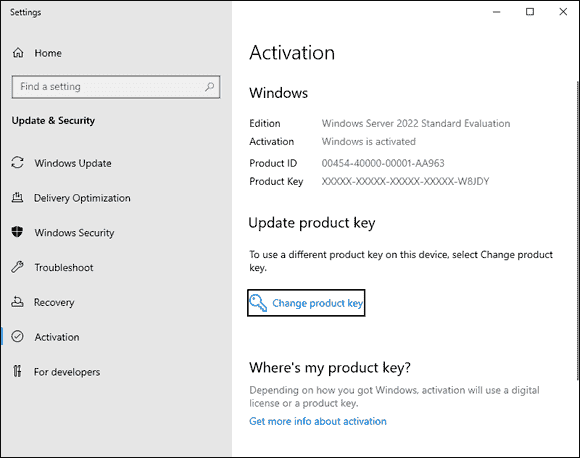

图 4-1： 显示 Windows Server 2022 已激活的“激活”屏幕。

#### 时区

设置时区是服务器配置过程中的常见任务。您可能希望将服务器设置为您所在的时区，或者设置为与位于其他地方的公司办公室相同的时区。如果您的服务器位于托管中心，并且您希望它们与本地系统处于同一时区，这很常见。

1.  **在服务器管理器中，单击左侧菜单中的“本地服务器”。**
2.  **单击“时区”旁边的超链接。**
    这可能已经设置为适合您所在区域的正确时区。
3.  **单击“更改时区”按钮。**
4.  **从下拉列表中选择您的时区。**


5.  **如果你所在的地区使用夏令时，请勾选“自动调整时钟以适应夏令时”旁边的复选框。如果不使用夏令时，请保持该框未选中状态。**

6.  **单击“确定”退出“时区设置”对话框，然后再次单击“确定”退出“日期和时间”对话框。**

## 计算机名和域

在企业环境中设置计算机名是必须的。大多数组织都有需要遵循的命名约定，但组织要求的名称肯定比默认的随机生成名称更容易记住。加入域是较简单的步骤之一，但也是启用集中身份验证管理和配置功能的最重要步骤之一。

1.  **在“服务器管理器”中，单击左侧菜单中的“本地服务器”。**

2.  **单击“计算机名”旁边的超链接。**

    这将是默认名称，以 `WIN-` 开头，后跟一串随机字母和数字。

3.  **单击“更改”按钮。**

4.  **在“计算机名”字段中，输入你想要的服务器名称，然后单击“确定”。**

    会出现一个对话框，提示你需要重启服务器。

5.  **单击“确定”。**

6.  **在“系统属性”对话框中单击“关闭”按钮。**

    系统会提示你选择“立即重新启动”或“稍后重新启动”。

7.  **如果你想立即重启服务器，请单击“立即重新启动”。如果你想先完成其他管理任务，请单击“稍后重新启动”。**

    如果你单击“稍后重新启动”，则需要在准备好时手动重启服务器。

8.  **要加入域，请执行步骤 1 到 3。**

9.  **在“计算机名/域更改”对话框中，单击“域”单选按钮，然后输入你要加入的域的名称。**

10. **单击“确定”。**

    会出现一个对话框，提示你需要重启服务器。

11. **单击“确定”。**

12. **在“系统属性”对话框中单击“关闭”按钮。**

13. **单击“立即重新启动”或“稍后重新启动”。**

    重启后，服务器将加入域。

### 配置网络

你的服务器默认将使用动态分配的 IP 地址。如果这不是你想要的，你需要设置一个静态 IP 地址，以便服务器继续使用相同的地址。

1.  **在“服务器管理器”中，单击左侧菜单中的“本地服务器”。**

2.  **在“以太网”旁边，单击显示“由 DHCP 分配的 IPv4 地址，已启用 IPv6”的超链接。**

3.  **右键单击你的网络适配器（应称为“以太网”），然后单击“属性”。**

4.  **单击“Internet 协议版本 4”，然后单击“属性”按钮。**

    默认情况下，服务器设置为自动获取 IP 地址和自动获取 DNS 服务器地址。如果这是所需的，则无需进行任何更改。

5.  **如果需要进行更改，请选择“使用以下 IP 地址”。**

6.  **填写 IP 地址、子网掩码和默认网关。**

7.  **手动输入首选 DNS 服务器的地址。**

    示例请参见 图 4-2。

8.  **单击“确定”关闭对话框。**

9.  **再次单击“确定”退出“以太网属性”。**

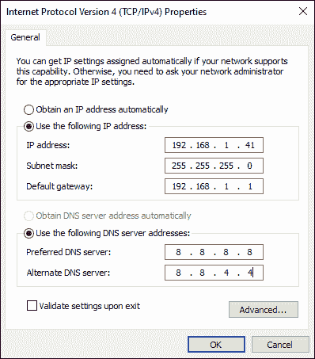

图 4-2： Internet 协议版本 4 属性对话框。

### Windows Server 2022 Core

许多系统管理员都配置过带有 GUI 的 Windows Server，但使用过 Windows Server Core 的人并不多。正如你在本节中看到的，Windows Server Core 具有简单的界面，当你学会如何操作后，你可能会发现它比带有桌面体验的 Windows Server 更易于使用。

#### 激活

Windows Server Core 为你提供了几种不同的选项来激活你的 Windows Server 2022 副本。在本节中，我将介绍通过 `sconfig` 激活以及通过 PowerShell 激活。

#### 使用 SCONFIG 激活

`Sconfig` 是 Windows Server Core 中的内置配置实用程序。它是一个基于文本的菜单，允许你从一个中心位置完成大部分初始配置任务。默认情况下，`sconfig` 会在你登录后自动启动。

1.  **在 `sconfig` 实用程序中，输入** 11 **选择 Windows 激活，然后按 Enter。**

2.  **输入** 3 **以安装产品密钥。**

3.  **在弹出的对话框中输入你的 25 个字符的产品密钥，然后单击“确定”。**

    密钥安装后，你会看到一条消息，说明密钥已成功安装。

4.  **通过单击红色 X 或按两次 Enter 关闭窗口。**

5.  **当你回到 `sconfig` 屏幕时，输入** 2 **以激活 Windows，然后按 Enter。**

    一个命令提示符窗口将再次启动，并运行 `slmgr.vbs` 脚本以执行激活。假设没有错误，此过程将完成且不显示任何消息。

6.  **通过单击红色 X 或按两次 Enter 关闭窗口。**

#### 从 POWERSHELL 激活

登录到 Windows Server Core 后，你会看到 `sconfig` 实用程序。从那里，你可以激活你的 Windows 副本。要从命令行设置许可证并执行激活，你需要选择菜单选项 15，“退出到命令行 (PowerShell)”。要激活，你必须设置密钥。你可以使用 Windows Server 许可证管理器脚本 `slmgr.vbs` 来完成此操作。

 `slmgr.vbs` 脚本允许你根据与之一起使用的参数以不同的方式处理你的 Windows Server 产品密钥。在本书的示例中，我同时使用了 `-ipk` 和 `-ato`。`-ipk` 参数用于安装产品密钥，`-ato` 参数用于指定在线激活。

要安装你的 Windows Server 2022 版本所需的产品密钥，请使用以下命令并附带 `-ipk` 参数。只需将 `<`*`productkey`*`>` 替换为你的 25 个字符的许可证密钥，包括破折号。

```
slmgr.vbs -ipk <`productkey`>
```

你会看到一个对话框，告诉你产品密钥已成功安装。单击“确定”。

安装许可证密钥后，你使用相同的脚本并附带 `-ato` 参数来在线激活你的 Windows 副本。你可以使用以下命令执行此操作：

```
slmgr.vbs -ato
```

如果激活成功，你会看到一个对话框，说明产品已成功激活（参见 图 4-3）。

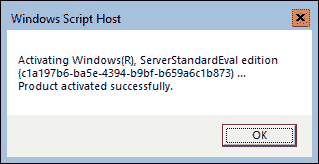

图 4-3： 使用 `slmgr.vbs` 激活 Windows Server。

#### 时区

与 Windows Server Core 中的激活类似，你可以通过 `sconfig` 或 PowerShell 设置时区。在本节中，我将介绍这两种方法。PowerShell 版本的优点在于它也适用于带有桌面体验的 Windows Server。

#### 使用 SCONFIG 设置时区

`Sconfig` 是 Windows Server Core 中的内置配置实用程序。因为它是一个简单的基于文本的菜单，它为管理员提供了一种简单的方法来配置时区，而无需脚本编写知识。

1.  **在 `sconfig` 实用程序中，输入** 9 **进入日期和时间设置。**

    “日期和时间”对话框出现。

2.  **单击“更改时区”按钮。**

3.  **从下拉列表中选择你的时区。**

4.  **如果你所在的地区使用夏令时，请勾选“自动调整时钟以适应夏令时”旁边的复选框。如果不使用夏令时，请保持该框未选中状态。**

5.  **单击“确定”退出“时区设置”对话框，然后再次单击“确定”退出“日期和时间”对话框。**

#### 从 POWERSHELL 设置时区


如果您更喜欢在 PowerShell 中工作，也可以在那里设置时区。这利用了控制命令来调用控制面板的“日期和时间”屏幕。

在 PowerShell 中，输入以下内容：

`Set-TimeZone -Id <Time Zone Id>`

 如果您不确定您的时区 ID 是什么，可以运行 `Get-TimeZone -ListAvailable` 来查看所有可选的时区。

## 计算机名和域

设置名称并将服务器添加到 Windows 域是系统管理员对新服务器执行的最常见操作之一。对于 Windows Server Core，您需要了解两种完成此任务的方法：`sconfig`（Windows Server Core 中的配置实用程序）和 PowerShell。

### 使用 SCONFIG 设置计算机名称

Windows Server Core 中的 `sconfig` 实用程序通过其文本驱动的菜单，可以轻松更改服务器的名称。请按照以下步骤操作：

1.  在 `sconfig` 实用程序中，输入 `2` 以更改计算机名称。

    系统会提示您输入新名称。

2.  输入新名称，然后按 Enter。

    您需要重新启动计算机才能应用更改。

3.  输入 `yes` 立即重启，或输入 `no` 稍后重启。

#### 使用 SCONFIG 加入域

当服务器具有正确的名称后，您可能希望将其添加到 Windows 域。您也可以使用 `sconfig` 实用程序来完成此操作。

1.  在 `sconfig` 实用程序中，输入 `1` 以更改域。

2.  输入 `D` 以加入域，然后按 Enter。

3.  输入您要加入的域名，然后按 Enter。

4.  输入授权用户的名称，然后按 Enter。

5.  输入用户的密码，然后按 Enter。

    您需要重新启动计算机才能应用更改。

6.  单击 `yes` 立即重启，或单击 `no` 稍后重启。

### 从 POWERSHELL 设置计算机名称

虽然 `sconfig` 是一个不错的实用程序，但您可能希望能够将要进行的更改编写成脚本。无论何时需要这样做，PowerShell 都会非常有用。从在命令提示符中运行批处理脚本，到在 PowerShell 中运行 PowerShell 脚本，无论您使用的是 Windows Server Core 还是带桌面体验的 Windows Server，这两种方法都有效。

1.  在 `sconfig` 实用程序中，输入 `15` 退出到命令行（PowerShell）。

    PowerShell 窗口将在您的 Server Core 计算机上打开。

2.  使用 `Rename-Computer` 命令更改服务器的名称：

    `Rename-Computer -NewName <new-name>`

3.  如果您的名称超过 15 个字符，您会收到一条消息，指出 NetBIOS 名称将被截断。

4.  如果收到此消息，请输入 `Y`，然后按 Enter 接受。

### 从 POWERSHELL 加入域

如果您要部署任何数量的服务器，能够将加入域的过程编写成脚本是一项有用的技能。通过 PowerShell 加入域不仅使操作更简单，还有助于确保在加入域的过程中没有错误。

1.  在 `sconfig` 实用程序中，输入 `15` 退出到命令行（PowerShell）。

    PowerShell 窗口将在您的 Server Core 计算机上打开。

2.  使用 `Add-Computer` 命令将服务器添加到域。

    以下是一个示例：

    `Add-Computer -DomainName "your_domain_name" -Restart`

    将出现一个对话框，要求输入用户名和密码。

3.  输入有权将系统添加到 Active Directory 域的用户名，并输入相应的密码。

4.  单击“确定”。

    服务器将重新启动。

### 配置网络

在使用 PowerShell 设置适配器的 IP 地址之前，您需要找出接口的索引。您可以通过输入以下内容来完成此操作：

`Get-NetAdapter`

输出列出了所有网络适配器。在这种情况下，您需要的是显示为“以太网”的那个。获得索引号后，您就可以设置 IP 地址和 DNS 服务器了。在我的服务器上，索引是 4。

使用以下命令设置静态 IP 地址。`InterfaceIndex` 是我的网卡的索引号，`IPAddress` 是我要分配的 IP 地址，`PrefixLength` 是我要使用的子网掩码，`DefaultGateway` 是本地网络的网关地址（参见 图 4-4）。

`New-NetIPAddress -InterfaceIndex 4 -IPAddress 192.168.1.50 -PrefixLength 24 -DefaultGateway 192.168.1.1`

 我到目前为止还没有过多讨论 PowerShell，而这是一段更复杂的 PowerShell 代码。`New-NetIPAddress` 是一个 cmdlet，允许您在 Windows Server 系统上处理 IP 地址。其后的参数，如 `-InterfaceIndex`，有助于标识您要处理的对象（在本例中是网络适配器），或对设置进行更改，例如 `-IPAddress` 参数，您可以在其中指定要在网络适配器上设置的 IP 地址。

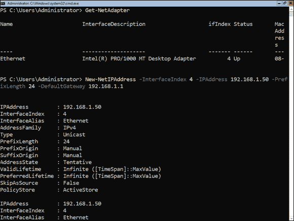

图 4-4： 使用 PowerShell 设置 IP 地址。

要设置 DNS 服务器，该命令使用相同的网卡索引号。`ServerAddresses` 用于标识系统应使用的 DNS 服务器（参见 图 4-5）。如果有多个，可以用逗号分隔。

`Set-DNSClientServerAddress -InterfaceIndex 4 -ServerAddresses 8.8.8.8, 8.8.4.4`

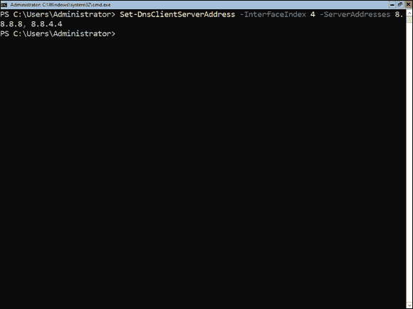

图 4-5： 使用 PowerShell 设置 DNS 服务器。

## 更新 Windows Server 2022

安装全新的 Windows Server 后，甚至可能完成了一些基本配置工作（如更改名称和加入域），您将需要更新服务器。更新包含对安全漏洞的修复和新功能，在将服务器移交给请求它的团队之前应始终安装更新。

### 带桌面体验的 Windows Server 2022

考虑到保持 Windows Server 更新的重要性，大多数组织将设置自动更新。您可能有一台无法设置为自动接收更新的服务器，或者可能发布了紧急补丁，您希望立即应用它。在本节中，我将解释如何进行自动更新和手动更新。

#### 自动更新

大多数组织使用自动更新。以下说明将引导您设置服务器以连接到 Microsoft 的更新服务器（默认行为）。

 许多组织拥有处理更新调度的补丁解决方案，这仍然可以被视为自动更新，因为该工具将调度已批准补丁的部署。

1.  单击“开始”菜单并输入 `gpedit.msc`。

2.  通过单击“计算机配置”，然后“管理模板”，然后“Windows 组件”，最后“Windows 更新”，导航到 Windows 更新部分。

3.  双击“配置自动更新”。

4.  选择“已启用”。

    您将看到配置选项。

    在“配置自动更新”下，您可以看到它设置为“自动下载并通知安装”。这是默认设置。

5.  单击下拉框并选择最适合您环境的设置。

    在我的情况下，我选择了“自动下载并计划安装”。示例请参见 图 4-6。

6.  单击“确定”保存更改。

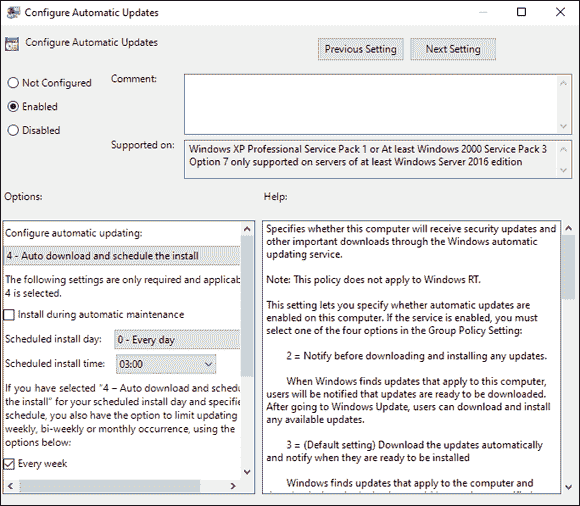

图 4-6： 使用本地组策略编辑器更改 Windows Server 2022 中的自动更新设置。

#### 下载并安装更新


你在新闻媒体上听说了下一个重大的安全漏洞，随后供应商很快就发布了针对该漏洞的补丁。当安全漏洞影响到你的 Windows Server 系统时，你可能希望启动手动更新——这样，你的系统就能在常规补丁窗口之外得到保护。如果你的组织使用补丁解决方案，补丁可能会从该系统推送，但总有一些系统由于各种原因没有安装补丁。当这种情况发生时，你可能需要手动更新。

1.  **打开服务器管理器，在左侧菜单中单击“本地服务器”。**

2.  **单击“上次检查更新”旁边的超链接。**

    如果尚未运行过，此处可能显示“从不”。

3.  **单击“检查更新”按钮。**

    服务器将检查是否有任何可用的更新。

### Windows Server 2022 Core

Windows Server Core 在从 Microsoft 接收更新方面的需求与带桌面体验的 Windows Server 相同。在本节中，我将向你展示如何设置自动更新以及如何从 PowerShell 执行手动更新。

#### 自动更新

你可以通过两种方式在 Server Core 上启用自动更新：使用 `sconfig` 实用程序和使用 PowerShell。

#### 通过 SCONFIG 将更新设置为自动

`sconfig` 实用程序提供的文本驱动菜单使得启用自动更新变得非常简单。你只需四个快速步骤即可设置自动更新：

1.  **从 `sconfig` 菜单中，键入** 5 **以配置 Windows 更新设置，然后按 Enter。**

    你会看到选择：A 表示自动下载和安装，D 表示仅下载（这是默认值），或 M 表示手动更新。

2.  **键入 A 以自动下载和安装 Windows 更新。**

    你会收到一条文本确认，表明更改已成功。

3.  **按 Enter 退出更新部分。**

#### 通过 PowerShell 将更新设置为自动

要通过 PowerShell 将更新设置为自动，你需要导航到 `C:\Windows\system32` 并停止 Windows Update 服务。它可能已经停止。然后你可以使用 `script` 程序执行 `scregedit.wsf`。添加开关 `/AU 4` 可启用自动更新，`/AU 1` 将禁用自动更新。以下示例启用了 Windows 更新：

1.  **停止 Windows Update Server 服务。**

    ```
    net stop wuauserv
    ```

2.  **将自动更新设置为 4，即启用。**

    ```
    cscript scregedit.wsf /AU 4
    ```

    你会收到一条文本确认，表明更改已成功。

3.  **启动 Windows Updates Server 服务。**

    ```
    net start wuauserv
    ```

如果你想查看此操作的示例以及预期的响应，请参阅 图 4-7。

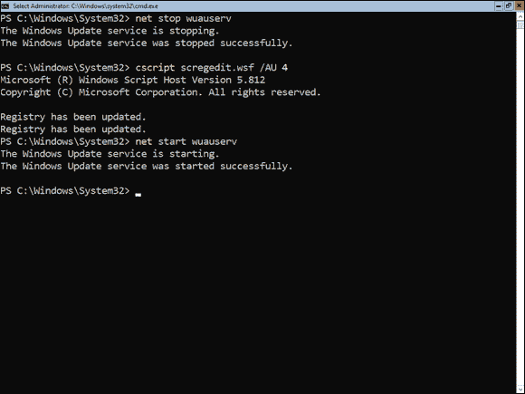

图 4-7： 在 PowerShell 中设置自动更新。

#### 下载并安装更新

要强制 Server Core 随后检测并安装任何可用的更新，只需键入以下命令并按 Enter。

```
wuauclt /detectnow
```

## 自定义 Windows Server 2022

安装 Windows Server 操作系统后，下一步是自定义它并使其成为你自己的系统！这涉及安装角色和功能、设置远程管理以及配置防火墙等事项。

### 带桌面体验的 Windows Server 2022

我将从桌面体验开始讨论自定义。当你登录到启用了桌面体验的服务器时，默认情况下会启动服务器管理器。你可能遇到的许多配置和自定义任务都可以通过服务器管理器完成。

#### 添加角色和功能

在带桌面体验的 Windows Server 2022 中，角色和功能是通过服务器管理器添加的。

1.  **打开服务器管理器。**

2.  **选择“管理”⇒“添加角色和功能”。**

3.  **在“开始之前”页面上，单击“下一步”。**

4.  **在“选择安装类型”页面上，单击“下一步”。**

5.  **在“选择目标服务器”页面上，单击“下一步”。**

6.  **选中要安装的角色旁边的复选框，然后单击“下一步”。**

    在此演示中，我选择了“文件和存储服务”下的“文件服务器”（参见 图 4-8）。

    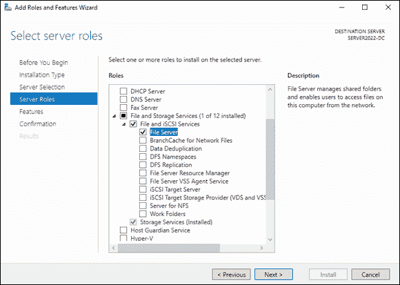

    图 4-8： 选择服务器角色屏幕，其中已选择文件服务器。

7.  **在下一个屏幕上，选择你可能想要安装的任何功能，然后单击“下一步”。**

8.  **如果你希望服务器在安装的角色需要时自动重启，可以选择“如果需要，自动重新启动目标服务器”复选框。如果不需要重启，或者你不想让它重启，请保持该复选框未选中。**

9.  **单击“安装”以安装你选择的角色和/或功能。**

### 启用远程管理

 远程管理默认启用，允许通过 PowerShell 进行远程管理。远程桌面是一个单独的设置，允许你连接到服务器并直接操作它。

当服务器具有桌面体验时，管理员通常更喜欢通过远程桌面操作服务器。此功能默认禁用；你需要启用它才能使用。如果服务器上的防火墙已启用但未启用远程桌面，你将无法连接到它。你需要启用服务器防火墙“入站规则”中列出的“远程桌面 - 用户模式 (TCP-In)”规则。

1.  **打开服务器管理器，在左侧菜单中单击“本地服务器”。**

2.  **单击“远程桌面”旁边的超链接，该链接显示为“已禁用”。**

3.  **在出现的对话框中，选择“允许远程连接到此计算机”。**

    会出现一个对话框，告诉你将为远程桌面创建防火墙例外。

4.  **单击“确定”。**

5.  **如果你想为特定人员或组设置远程访问，请单击“选择用户”按钮。**

6.  **单击“添加”，选择你的人员或组，然后单击“确定”。**

7.  **再次在“远程桌面用户”上单击“确定”以关闭它。**

8.  **最后在“系统属性”屏幕上单击“确定”以启用远程桌面。**

### 配置 Windows 防火墙

假设你打算在服务器上使用 Windows 防火墙，你需要知道如何通过防火墙启用应用程序。通过允许入站流量，你可以使服务器能够执行你计划使用它完成的工作。

1.  **从服务器管理器中，在左侧选择“本地服务器”。**

2.  **单击“Microsoft Defender 防火墙”旁边的“专用：已启用”链接。**

    “防火墙和网络保护”应用将打开。

3.  **单击“允许应用通过防火墙”。**

4.  **选择“文件和打印机共享”，并通过选中“专用”下的复选框为其启用专用配置文件（参见 图 4-9）。**

5.  **单击“确定”以保存你的更改。**

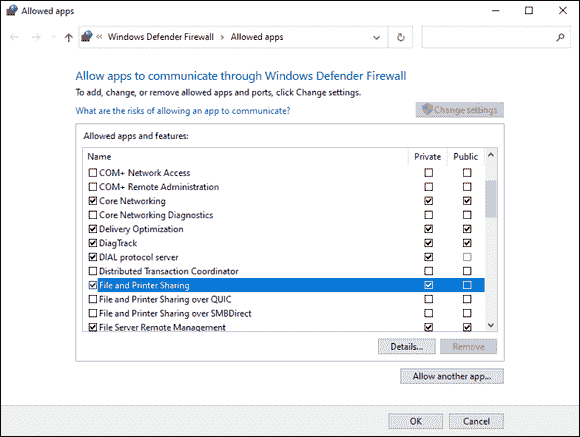

图 4-9： 允许应用通过 Microsoft Defender 防火墙。

### Windows Server 2022 Core

无论你是通过控制台连接还是通过远程 PowerShell 对 Windows Server Core 系统执行 PowerShell 命令，你都可以仅用几个 PowerShell 命令完成大部分配置工作。

#### 添加角色和功能

要真正熟练使用 Server Core，你面临的一半挑战是学习如何找到你想要的东西。在带桌面体验的服务器中，你有 GUI 来引导你。Server Core 则不然。


让我们看看我在桌面体验服务器上使用的示例。你想安装文件服务器角色。在安装该角色之前，你需要先找出它的正确名称。通过使用 `Get-WindowsFeature`，你可以找到你感兴趣的角色和功能的名称。如果你对名称有个大概印象，可以进行通配符搜索。在下面的示例中，我使用了 `*file*`，表示我希望 `Get-WindowsFeature` cmdlet 返回名称中包含 `file` 一词的结果。

```
Get-WindowsFeature *file*
```

当你输入上述命令时，会得到三个名称中包含 `file` 的结果。你可以在“显示名称”下看到“文件服务器”。对于安装命令，你需要的是“名称”列下的名称。在本例中，它是 `FS-FileServer`。现在你已准备好安装它了！使用以下命令安装文件服务器（参见图 4-10）：

```
Install-WindowsFeature FS-FileServer
```

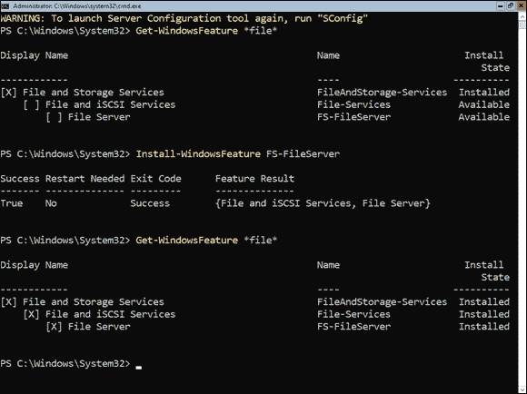

图 4-10： 使用 PowerShell 安装角色和功能。

在功能安装过程中，你会看到一个进度条。安装完成后，如果你再次运行第一个命令，你会看到所有三个结果现在都已安装。文件和 iSCSI 服务也被安装了，因为文件服务器依赖于它。

### 启用远程管理

在 Windows Server 2022 中，远程管理默认是启用的。如果你的环境中该功能被禁用了，你可以通过运行 `Configure-SMRemoting` 命令来启用它。这允许你使用服务器管理器远程管理你的服务器。

```
Configure-SMRemoting -Enable
```

要能够使用 PowerShell 远程管理服务器，你还需要两个额外的命令。`Enable-PSRemoting` 配置 PowerShell 以接收发送到你系统的远程命令。`Winrm quickconfig` 将为你分析并自动配置 WinRM 服务。当你只想让它正常工作而不需要自定义时，这非常有用。该命令会启动 WinRM 服务（如果尚未启动），并确保 WinRM 设置为自动启动。它还会配置 HTTP 和 HTTPS 的侦听器，并确保 Windows 防火墙允许 HTTP 和 HTTPS 入站流量。

如果 `Enable-PSRemoting` 命令成功执行，它不会给你任何输出。你只会再次看到 PowerShell 提示符。

```
Enable-PSRemoting -force
```

运行 `winrm quickconfig` 有点不同。在它完成分析后，它会告诉你需要更改什么，并询问你是否可以进行必要的更改（是/否）。选择 Y 并按回车键。如果分析过程中一切正常，你将被告知 WinRM 已经在运行并且已经为远程管理设置好了，而不是出现是/否问题。

```
winrm quickconfig
```

### 配置 Windows 防火墙

在 Server Core 上使用 Microsoft Defender 防火墙非常简单。你需要首先找到要处理的规则的名称。你可以使用 `Get-NetFirewallRule` 命令来完成（参见图 4-11）。在末尾使用 `Format-table` 命令可以使输出更易于阅读。试试不带该命令的命令——你会明白我的意思！

```
Get-NetFirewallRule *remote* | Format-table
```

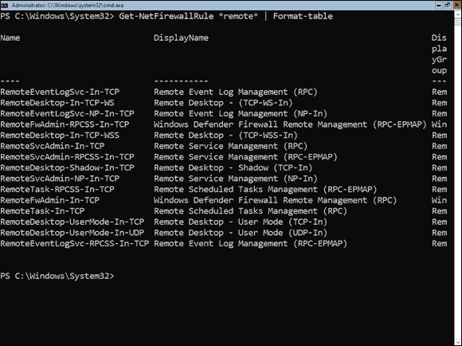

图 4-11： 使用 `Get-NetFirewallRule` 查找规则。

上述命令查找名称中包含 remote 的任何规则。你可以看到每条规则及其是否已启用。

让我们启用远程防火墙管理规则。这些规则将允许你从另一个系统管理此服务器的防火墙。你感兴趣的规则是 `RemoteFwAdmin-In-TCP` 和 `RemoteFWAdmin-RPCSS-In-TCP`。

以下是你将用于启用这些规则的命令（参见图 4-12）：

```
Set-NetFirewallRule –Name "RemoteFwAdmin-In-TCP" –Enabled True
```

```
Set-NetFirewallRule –Name "RemoteFwAdmin-RPCSS-In-TCP" –Enabled True
```

如果命令成功完成，你将不会收到任何响应。你将返回到 PowerShell 提示符。如果你再次运行搜索，你会看到这些规则现在已启用。

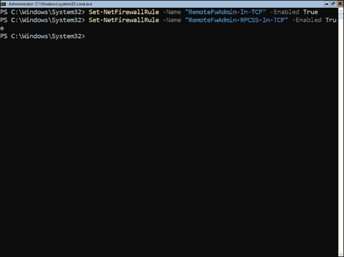

图 4-12： 使用 PowerShell 设置防火墙规则并验证其已启用。

## 使用 BCDEdit 配置启动选项

在 Windows Server 2008 中，Microsoft 引入了一个名为 BCDEdit 的实用程序，它允许你操作 Windows 启动配置数据 (BCD) 存储。BCD 用于告诉操作系统应该如何启动；它包含支持该功能所需的所有启动配置参数。这取代了在 Windows Vista 之前用于编辑 `boot.ini` 文件的旧版 `boot.cfg.exe` 实用程序。你必须是系统本地管理员组的成员才能使用 BCDEdit。这是一个高级实用程序，对于排除阻止服务器正常启动的问题非常有用。

 在使用 BCDEdit 之前，你可能需要禁用或暂停系统上的 BitLocker 和安全启动。

 使用 BCDEdit 实用程序时犯的错误可能导致你的系统完全无法启动。始终确保你拥有系统的良好备份，或者如果没有良好的备份，请从 BCDEdit 导出当前设置，以便在需要时可以恢复它们。你可以通过输入 `BCDEdit /Export <export_path>` 来导出当前启动配置数据库。如果需要从该导出恢复，命令非常相似。你只需输入 `BCDEdit /Import <path_to_export>`。

表 4-2 列出了 BCDEdit 可用的一些更常见的选项。

| **选项** | **描述** |
| --- | --- |
| `/bootdebug` | 启用或禁用启动调试。 |
| `/dbgsettings` | 配置调试连接的类型。 |
| `/debug` | 启用或禁用内核调试。 |
| `/delete` | 从数据存储中删除启动项——请谨慎使用！ |
| `/deletevalue` | 删除或移除启动项选项——请谨慎使用！ |
| `/displayorder` | 设置启动管理器在显示多重启动菜单时使用的顺序。 |
| `/enum` | 列出启动配置数据存储中的所有条目。 |
| `/export` | 导出 BCD 的内容；可用作备份以恢复 BCD。 |
| `/import` | 导入导出文件的内容；如果需要，可用作恢复选项。 |
| `/set` | 设置启动选项中的值。 |

表 4-2 BCDEdit 常用选项

最常见的是，你会使用 `bcdedit /set` 来更改启动配置数据存储。在进行任何更改之前，你需要知道当前的 BCD 是什么样子。你可以使用 `/enum` 选项来完成。在图 4-13 中，你可以看到 Windows 启动管理器和 Windows 启动加载器的当前设置。

你可能注意到 Windows 启动加载器中的描述只写了 Windows Server。也许你希望它更具描述性。你可以使用 `bcdedit /set` 来更改它。你需要要处理的对象的 ID。在本例中，你要编辑 Windows 启动加载器；你在图 4-13 中看到的标识符是 `{current}`。你输入的完整命令将类似于：

```
bcdedit /set {current} description "Windows Server 2022 Standard"
```

 此命令在命令提示符下可以完美运行，但如果你尝试在 PowerShell 中运行它，你需要在标识符周围加上引号。例如，如果我在 PowerShell 中运行该命令，我会这样输入：


`bcdedit /set "{current}" description "Windows Server 2022 Standard"`

当你看到消息 `The operation completed successfully` 时，请再次使用 `bcdedit /enum`。你将看到新的描述。我的示例请参见图 4-14。

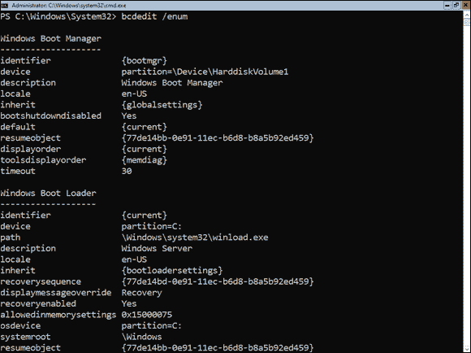

图 4-13： 使用 `bcdedit /enum` 查看启动配置数据存储的当前设置。

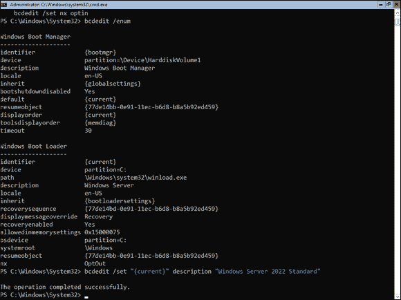

图 4-14： 使用 `bcdedit /set` 更改 Windows 启动加载器条目的描述。

为什么要更改 Windows 启动加载器上的名称？考虑一个双启动系统的例子，两个磁盘上安装了相同的操作系统。这两个磁盘用于非常不同的目的，因此你需要确保记住哪个是哪个。能够更改描述将简化在启动菜单中选择合适的磁盘。BCDEdit 也可用于更改启动菜单的顺序。如果你想将其中一个磁盘设置为列表中的第一个，并在一定时间后默认启动到该磁盘，这将非常有用。

# 第 2 册：配置 Windows Server 2022

## 内容概览

1.  第 1 章：配置服务器角色和功能
    1.  使用服务器管理器
    2.  了解服务器角色
    3.  了解服务器功能
2.  第 2 章：配置服务器硬件
    1.  使用设备管理器
    2.  使用添加硬件向导
    3.  执行硬盘相关任务
    4.  执行打印机相关任务
    5.  执行其他配置任务
3.  第 3 章：使用设置菜单
    1.  访问设置菜单
    2.  了解设置菜单项
4.  第 4 章：使用工作组
    1.  了解什么是工作组
    2.  了解工作组是否适合你
    3.  比较集中式和组共享
    4.  为工作组配置服务器
    5.  管理工作组
    6.  检查对等名称解析协议
5.  第 5 章：将服务器提升为域控制器
    1.  了解域
    2.  准备创建域
    3.  执行域配置先决条件
    4.  将服务器配置为域控制器
    5.  收尾工作
6.  第 6 章：使用 IP 地址管理管理 DNS 和 DHCP
    1.  安装 IP 地址管理
    2.  配置 IP 地址管理
    3.  使用 IP 地址管理

# 第 1 章：配置服务器角色和功能

**本章内容**

 **使用服务器管理器管理你的服务器**

 **了解 Windows Server 2022 中可用的服务器角色**

 **了解 Windows Server 2022 中可用的服务器功能**

熟悉服务器管理器以及如何找到所需的工具，将使你作为系统管理员的工作变得简单得多。从了解如何访问服务器的基本信息（如主机名、IP 地址和激活状态）到安装新的角色和功能，服务器管理器为你提供了一个集中的管理起点。

本章首先介绍服务器管理器，并讨论能够让你执行工作的工具所在位置。然后，我将解释 Windows Server 2022 中可用的角色和功能。

## 使用服务器管理器

服务器管理器是你在全新服务器上将花费大量时间的地方。它在你登录后立即启动，是你登录的服务器的集中管理区域。

首次登录时，服务器管理器将启动并选中仪表板。仪表板顶部有一个名为“快速入门”的大磁贴，其中包含作为超链接的典型初始服务器配置任务，如图 1-1 所示。如果你想隐藏这个大磁贴，可以单击右下角的“隐藏”。

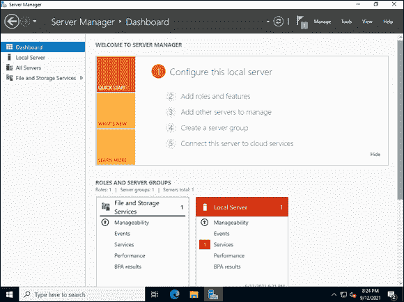

图 1-1： 服务器管理器仪表板，顶部是快速入门磁贴。

快速入门磁贴下方是服务器上已安装的所有角色的磁贴。在全新安装的 Windows Server 2022 上，如果没有进行任何自定义，你将看到“文件和存储服务”和“本地服务器”的磁贴。这些磁贴非常有用，因为它们可以让你快速了解服务器是否运行正常。如果磁贴是绿色的并带有一个向上的小箭头，这意味着服务正在正常运行。如果磁贴是红色的并带有一个向下的小箭头，这意味着服务遇到了问题或未运行。你可以单击各个磁贴以获取有关各个角色的更多信息。例如，如果我单击“文件和存储服务”角色磁贴，我可以看到支持此角色的运行服务的相关事件，如图 1-2 所示。左侧是本地服务器存储的配置选项，包括卷、磁盘和池。

### 角色和功能

角色和功能允许你为服务器添加功能。*角色*是你希望使用服务器执行的任务。例如，你可能安装 Active Directory 域服务角色，以便可以将此服务器设为域控制器。*功能*通常用于支持角色。在这种情况下，你还需要安装 Active Directory 域服务的管理工具（选择角色时会提示你安装此功能）。管理工具就是一种功能。

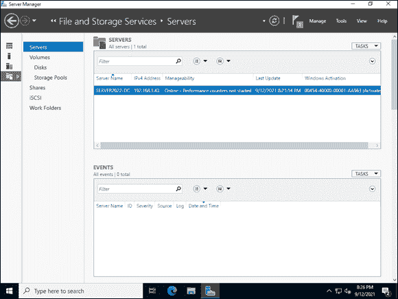

图 1-2： 文件和存储服务管理窗口。

### 诊断

服务器管理器为你提供快速便捷的访问方式，可访问你职业生涯中可能需要的许多诊断工具。要访问它们，只需单击顶部菜单中的“工具”，如图 1-3 所示。

以下是“工具”菜单中多年来对我有帮助的一些项目：

*   **事件查看器：** 当我排查问题时，第一站几乎总是事件查看器。我从系统、应用程序和安全日志开始，然后根据需要深入到特定于角色和/或组件的日志。

*   **性能监视器：** 当你需要测量与性能相关的非常具体的指标（如中央处理器空闲时间、中断时间、用户时间等）时，性能监视器是一个非常有用的工具。它开箱即提供数百个计数器，并且可以设置为在满足某个条件或阈值时开始。此工具对于排查与性能相关的问题（如运行缓慢和/或冻结）最有用。


*   **资源监视器：** 如果你只想快速查看系统运行状况，资源监视器非常适合。它有一个简洁的摘要屏幕，可以提供关于 CPU、磁盘、网络和内存使用情况的信息。此工具专注于资源利用情况，有助于排查磁盘空间不足、磁盘使用率过高或网络带宽不足等问题。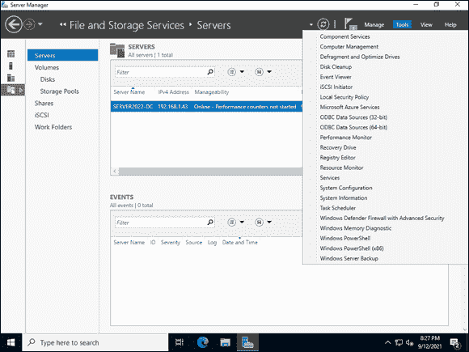

    图 1-3： 服务器管理器中的“工具”菜单。

*   **系统配置：** 当我遇到启动问题时，我会使用系统配置。“引导”选项卡提供了几个有用的选项，包括是否要使用安全引导、是否要创建引导日志，以及是否要使用非常基本的视频设置。

*   **系统信息：** 当你需要了解硬件规格或某些设置时，这应该是你的首选实用程序。它甚至可以告诉你正在运行的 BIOS 版本及其运行模式。

*   **Windows 内存诊断：** 这与我在第 1 册第 2 章中介绍的内存诊断工具相同。你只是从菜单中启动它，而不是输入程序名称。

*   **Windows PowerShell：** PowerShell 总是很方便。你可以查询设置，并在需要时导出到文本文件。

### 配置任务

你的大部分配置任务将在服务器管理器的“本地服务器”部分完成。当你点击“本地服务器”时，会看到一个“属性”页面，显示当前的服务器信息，如图 1-4 所示。这个页面很棒的一点是，每个设置都是一个可点击的超链接。如果你点击它，就会跳转到可以配置该特定设置的地方。很酷，对吧？当你有一台新构建的服务器时，它简化了配置过程，因为你可以从这里更改主机名和 IP 地址，以及更新服务器、将其加入域，甚至激活操作系统。

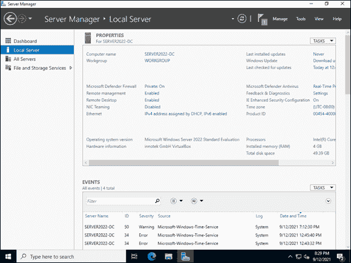

图 1-4： 服务器管理器的“本地服务器”属性屏幕。

### 配置和管理存储

我前面提到过，默认情况下，所有 Windows Server 2022 系统都安装了“文件和存储服务”角色。这为你提供了一个易于访问的菜单来处理服务器的存储。当你在导航菜单中点击“文件和存储服务”时，会看到几个选项；选择“磁盘”。在这里，你可以将新磁盘联机、初始化磁盘并创建卷，如图 1-5 所示。

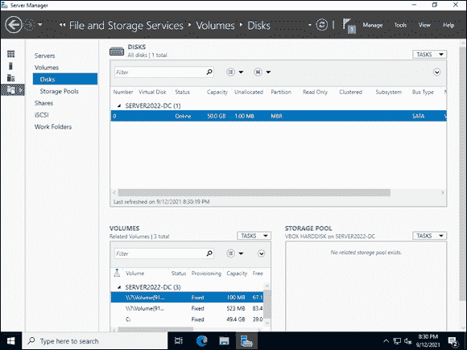

图 1-5： 在服务器管理器的“文件和存储服务”区域中处理磁盘。

## 理解服务器角色

正如我前面提到的，角色是我们希望服务器执行的功能。通过安装角色，你可以使服务器变得有用。也许你正在构建 Active Directory 基础设施，或者你正在创建一个强大的虚拟化平台。无论你试图完成什么，你很可能都是从安装角色开始的。

让我们看看 Windows Server 2022 包含的角色。

### Active Directory 证书服务

Active Directory 证书服务（AD CS）是一个角色，允许你在组织中创建公钥基础设施（PKI），从而可以颁发自己的内部证书。这可能包括为域控制器颁发的证书，以便它们可以支持通过安全套接字层（SSL）的轻量级目录访问协议（LDAP），或者为内部 Web 服务器颁发的证书，甚至为将在组织系统上运行的脚本颁发代码签名证书。你可以安装证书颁发机构（CA）并提供额外的服务，如联机证书状态协议（OCSP，用于查询证书吊销信息）和网络设备注册服务（NDES，允许网络设备无需域凭据即可注册证书）。

AD CS 包含许多组件。如果你有兴趣了解更多关于 AD CS 的信息，包括如何安装和配置它，请查看第 5 册第 6 章。

### Active Directory 域服务

Active Directory 域服务（AD DS）使你能够在目录服务中存储有关用户和其他网络对象的信息。你可以使用林、域和组织单元（OU）将这些对象组织在分层结构中。

Active Directory 包含一个全局编录，其中包含目录中每个对象的信息，这是成功登录域所必需的。使用 Active Directory，如果你知道一些关于对象的信息，就可以轻松搜索和定位特定对象。

如果你对 AD DS 感兴趣，可以在第 2 册第 5 章中了解更多关于安装和配置 AD DS 的信息。

### Active Directory 联合身份验证服务

Active Directory 联合身份验证服务（AD FS）可以为使用 AD DS 的组织提供单点登录功能。它允许拥有 Active Directory 帐户的用户在其 Active Directory 边界之外的应用程序（例如，由业务合作伙伴托管的 Web 应用程序）上使用该帐户，或者根本不依赖 Active Directory 帐户进行身份验证的应用程序。通过创建*联合*（共享身份信息），用户可以通过其公司的 Active Directory 进行身份验证，然后通过声明（claim）对业务合作伙伴的 Web 应用程序进行身份验证。业务合作伙伴只需将其 Web 应用程序配置为信任传入的声明即可。

### Active Directory 轻型目录服务

Active Directory 轻型目录服务（AD LDS）是一种基于轻量级目录访问协议（LDAP）的目录服务，类似于 AD DS。它设计用于与目录启用的应用程序一起使用，对于可能希望建立客户帐户目录但将其与组织的 AD DS 基础设施分开的组织来说尤其方便。

它可以与 AD FS 一起用作身份提供程序，用于身份验证和向配置为理解联合的 Web 应用程序生成声明。

### Active Directory 权限管理服务

Active Directory 权限管理服务（AD RMS）允许企业创建和执行策略以保护其数据。规则在 AD RMS 服务器上创建，但即使文档离开本地环境，也能继续保护文档。例如，你可以设置策略，仅允许文档在短时间内可访问，之后收件人将无法再打开它们。你可以取消打印文档或通过复制/粘贴从中复制文本的能力。

AD RMS 并不完美。它无法阻止某人截取敏感文档中数据的屏幕截图（没有多少权限管理产品可以阻止此活动）。此外，客户端的应用程序必须支持 RMS。此功能存在于 Microsoft Office 套件应用程序、SharePoint 和 Exchange Server 中。你也可以通过加载项使 Internet Explorer 兼容。

### 设备健康证明


设备健康证明角色在 Windows Server 2016 中引入。它为管理员提供了一种在设备启动时验证其健康状态的方法。它可以测量多种不同的设置，并根据系统管理员或网络管理员希望跟踪的任意设置进行配置。此角色通常用于系统在允许通过远程访问服务（如 DirectAccess 或其他虚拟专用网络 (VPN) 服务）连接之前，验证其是否安全。

设备健康证明可以验证的设置包括以下内容：

*   是否启用了 BitLocker？

*   是否启用了早期启动反恶意软件 (ELAM)？

*   是否启用了安全启动？

*   是否启用了代码完整性？

### 动态主机配置协议

动态主机配置协议 (DHCP) 无疑是系统管理员的好帮手。没有 DHCP，你必须手动分配 IP 地址并跟踪哪些 IP 地址已被分配。DHCP 自动化了这一过程。它可以在基于租约的系统上自动为系统分配 IP 地址。当租约达到配置的租约持续时间的 50% 时，客户端将请求续订 IP 地址。如果系统需要保持相同的 IP 地址，你可以为该 IP 地址设置保留。只要相关系统具有相同的网络接口卡，它就会获得相同的 IP 地址。作为额外的好处，你可以为定义的每个作用域设置 DHCP 选项。这些选项可能会告诉作用域中的系统在哪里可以找到其网关服务器、DNS 服务器、映像服务器的位置等等。

如果你想了解更多关于 DHCP 的信息，请查看第 2 册，第 5 章，其中我介绍了安装 DNS 和 DHCP。请务必同时查看第 2 册，第 6 章。

### 域名系统

域名系统 (DNS) 是一项非常有用的服务，它有助于将主机名映射到 IP 地址。正是因为有了 DNS，你才能在 Web 浏览器中输入 [`www.dummies.com`](http://www.dummies.com)（这非常容易记住），而无需记住像 `13.32.254.23` 这样的 IP 地址。让我们面对现实吧，人脑记忆单词和短语比记忆数字更好。

DNS 可以将主机名解析为 IP 地址，也可以进行反向查找，将 IP 地址映射到主机名。在处理仅使用 IP 地址的网络设备时，这非常有用。

如果你想了解更多关于 DNS 的信息，请查看第 2 册，第 5 章，其中我介绍了安装 DNS 和 DHCP。请务必同时查看第 2 册，第 6 章。此外，第 5 册，第 7 章 中有一个完整的部分专门介绍保护你的 DNS 基础设施。

### 传真服务器

传真服务器角色可以使服务器能够充当传真机。该服务器允许网络上的用户发送和接收传真消息。服务器处理实际的消息传输，需要一个连接到电话线的传真调制解调器，以及一个网络连接，以便它可以与网络上的用户进行通信。

这种设置比在办公室里放置多台物理传真机要高效得多。这个角色最酷的地方在于，它可以配置为通过电子邮件将传真发送给你的用户，他们可以向服务器发送电子邮件或 Word 文档，然后将其传真出去。

### 文件和存储服务

文件和存储服务角色有许多可以安装的组件。默认情况下，在全新安装的 Windows Server 2022 上，会安装存储服务组件。文件和 iSCSI 服务下的以下组件均未安装：

*   **文件服务器：** 管理文件夹共享，并允许用户从网络访问这些共享。

*   **网络文件的 BranchCache：** 一种带宽优化技术，它将主站点服务器的内容缓存到分支站点的服务器上。

*   **数据去重：** 通过消除驱动器上的重复数据来节省磁盘空间；保留单个副本，并在其他位置的文件中放置链接。

*   **DFS 命名空间：** 允许你使用逻辑命名空间访问不同服务器上的共享文件夹组，但对最终用户来说，它看起来像一个包含多个子文件夹的单一文件夹。

*   **DFS 复制：** 在多个服务器之间同步文件夹。

*   **文件服务器资源管理器：** 允许你管理和分类文件服务器上的数据。

*   **文件服务器 VSS 代理服务：** 允许你在系统上启用卷影复制，即使某些内容正在使用文件和/或卷，它也会获取备份副本（快照）。

*   **iSCSI 目标服务器：** iSCSI 目标的服务和管理工具。iSCSI 允许你通过常规 TCP/IP 网络发送用于存储的 SCSI 命令，并使组织能够拥有成本可控的存储区域网络 (SAN)。

*   **iSCSI 目标存储提供程序：** 允许连接到 iSCSI 目标的应用程序对虚拟 iSCSI 磁盘上的数据进行卷影复制。

*   **NFS 服务器：** 允许服务器向使用 NFS 协议的 Unix 和 Linux 系统提供文件。

*   **工作文件夹：** 在多台计算机之间同步文件。

### 主机守护服务

此角色在 Windows Server 2016 中首次引入。它管理并为被视为受信任的 Hyper-V 主机（称为 *受守护主机*）分发密钥。这允许受守护主机启动受屏蔽的虚拟机 (VM) 并执行实时迁移。它使用两个服务来完成其工作：

*   **证明服务：** 验证与其通信的主机的身份及其配置。

*   **密钥保护服务：** 提供对加密传输密钥的访问，允许受守护主机与受屏蔽的 VM 协同工作。

如果你想了解更多关于受屏蔽 VM 的信息，请查看第 7 册，第 2 章。

### Hyper-V

安装 Hyper-V 角色会在 Windows Server 操作系统上安装一个虚拟机监控程序。在 Server Standard 版本上，你最多只能运行两个 VM；在 Server Datacenter 版本上，你可以运行无限数量的 VM。Datacenter 版本还包括处理受屏蔽 VM 的能力。

我在 第 7 册 中详细介绍了 Hyper-V。

### 网络控制器

网络控制器是一个较新的角色，在 Windows Server 2016 中引入。它仅在 Datacenter 版本中可用，Standard 版本中没有。网络控制器允许你配置、监控、编程和排查物理和虚拟网络基础设施的问题。为此，它可以利用 Windows PowerShell 或表示状态转移 (REST) 应用程序编程接口 (API) 与设备进行通信。如果你的组织希望开始探索软件定义网络 (SDN)，这是一个很好的起点。能够使用 PowerShell 与网络控制器协作可能非常强大，而 REST API 将允许你与其他产品（包括那些不理解 PowerShell 的产品）构建集成。通信通过 HTTP/HTTPS 进行，因此你也不必担心打开任何不常见的网络端口来支持 REST API。

### 网络策略和访问服务

网络策略和访问服务安装网络策略服务器 (NPS)。它提供 RADIUS 等服务，并提供身份验证、授权和记账 (AAA)。NPS 非常常用于网络设备和 VPN 客户端的身份验证。

请注意，你只能在安装了桌面体验的服务器上安装此角色。

如果这激发了你的好奇心，请查看第 4 册，第 3 章，其中我介绍了将 NPS 安装和配置为 RADIUS 服务器。

### 打印和文档服务


通过安装打印和文档服务角色，您可以将服务器转变为网络打印服务器。这可以集中管理打印任务，从处理打印队列到为网络打印机设置所需的默认配置。这些配置通常包括黑白打印或双面打印等。

### 远程访问

远程访问角色允许您执行几项不同的操作。它可以通过直接访问和 VPN 提供网络连接，还提供 Web 应用程序代理。从根本上说，远程访问旨在成为一个 VPN 解决方案。路由和远程访问服务提供传统的 VPN 服务，以支持连接到您的内部网络，而直接访问则为终端用户提供更无缝的、类似 VPN 的功能体验。您的用户无需停止或启动 VPN 连接；通过直接访问，只要他们有良好的互联网连接，就能连接到您的组织。如果您安装了 Web 应用程序代理，您可以将基于 HTTP 和 HTTPS 的 Web 应用程序发布到网络内外的设备上。路由功能提供了与传统路由器非常相似的功能，包括网络地址转换（NAT）以及在 IP 网络上执行路由所需的其他方法。

### 远程桌面服务

远程桌面服务（以前称为终端服务）允许用户访问虚拟桌面来运行软件，就像在他们自己的桌面上一样。当您对应用程序的许可有限，并且应用程序可以以这种方式使用时，这可能非常有用。对于客户端/服务器类型的应用程序尤其有帮助，因为升级可能是一项艰巨的任务，这通常是由于升级后需要进行配置更改。您可以在每台 RDS 服务器上进行一次更改，而不必在数百台桌面上逐一操作。

### 批量激活服务

此角色创建一个密钥管理服务（KMS）服务器，该服务器可以管理您所有 Windows 产品的密钥，并负责域加入系统（包括服务器和客户端）的自动密钥管理和激活。您甚至可以设置要求，例如要求系统每 15 天与 KMS 服务器签到一次，否则密钥将失效。这有助于确保笔记本电脑至少每 15 天返回本地网络进行补丁更新和其他操作。

### Web 服务

Web 服务器安装基于 Windows 的 Web 服务器，即 Internet Information Services（IIS）。IIS 可用于托管多个网站，并支持您所熟知和喜爱的许多服务器端语言，如 PHP 和 ASP。它还提供对 FTP 服务的支持。使用 Microsoft Web 平台安装程序，设置 ASP.NET、Microsoft SQL Server 以及非 Microsoft 应用程序（如 WordPress 或 Joomla）非常简单。

### Windows 部署服务

Windows 部署服务（WDS）使管理服务器和桌面的映像变得非常简单。WDS 部分是预启动执行环境（PXE）服务器，部分是普通文件传输协议（TFTP）服务器，并配有一个美观、用户友好的图形用户界面（GUI）控制台进行管理。如果您不熟悉 PXE，它允许没有操作系统的服务器从网络启动，以便系统管理员可以对其进行配置并为其选择操作系统映像。TFTP 用于通过网络传输映像。映像保存为 `.wim` 文件，并可以使用系统上已有的工具保持更新。通过 WDS 部署映像的系统从其网络接口卡（NIC）启动，并能够从 DHCP 选项 66 和 67 获取 WDS 服务器的设置。

### Windows Server 更新服务

Windows Server 更新服务（WSUS）顾名思义：一个安装软件的服务器角色，允许您集中管理所有 Microsoft 产品的安全补丁和其他更新。它具有良好的可扩展性，可以部署为一台完成所有工作的单服务器，也可以部署为从 Microsoft 下载更新，然后将这些更新提供给其他下游 WSUS 服务器的上游服务器。

## 了解服务器功能

角色备受关注，但功能为角色和其他应用程序执行其功能提供了必要的支持。功能可以提供从支持应用程序的框架到管理工具和加密功能的一切。

 如果您没有看到想要使用的功能，请检查您使用的是标准版还是数据中心版。Windows Server 2022 的数据中心版中才提供一些功能。

### .NET 3.5

提供对 .NET 3.5 的支持，以及对 .NET 2.0 和 .NET 3.0 API 的遗留支持。API 允许应用程序与操作系统或服务进行交互。您尝试安装的应用程序可能需要此功能；供应商文档通常会非常明确地告诉您需要安装哪些先决条件。

### .NET 4.8

Windows Server 2022 附带了较新的 .NET 4.8，默认情况下已安装。此功能还可以添加对 ASP.NET 4.8 的支持，并增加了对 WCF 服务的支持。许多较新的应用程序正在利用这些功能。请咨询您的应用程序供应商，以查看其是否支持 .NET 4.8。

### 后台智能传输服务

后台智能传输服务（BITS）用于在服务器和客户端之间传输文件，并提供有关这些传输状态的进度信息。Windows 操作系统非常普遍地使用它来下载更新。

BITS 的妙处在于，如果连接因某种原因丢失，BITS 将暂停传输。当连接恢复时，BITS 将恢复传输，就像什么都没发生过一样。

Windows Server 2022 操作系统默认安装了一个服务，因此除非应用程序需要此功能来实现其目的，否则您不需要安装此功能。

### BitLocker 驱动器加密

BitLocker 驱动器加密负责在已启用的系统上加密整个硬盘驱动器及其内容。在配备 TPM 1.2 或更高版本芯片的现代系统上，BitLocker 确保系统在离线时未被篡改。假设硬件检查正常，系统将启动。

配备较旧 TPM 芯片的系统仍然可以使用 BitLocker，但用户友好性较差。较旧的 TPM 芯片（1.2 之前版本）也不会像较新的 TPM 芯片那样检查系统完整性。

 TPM 代表可信平台模块。它是计算机主板上的一个芯片，负责生成 BitLocker 用于提供全盘加密的密钥。它保存一半的密钥，另一半密钥存储在磁盘上。这可以防止窃贼窃取 BitLocker 加密的硬盘驱动器并在另一个系统中启动它。

BitLocker 可以锁定启动过程，直到用户输入 PIN 码。这确保了用户是授权用户，并防止在系统离线时被盗导致未加密驱动器的数据丢失。

### BitLocker 网络解锁

BitLocker 网络解锁功能在 Windows Server 2012 中引入。它使系统能够在处于公司网络上时自动解锁 BitLocker。如果公司使用局域网唤醒技术来唤醒系统进行补丁或软件安装，这可以使补丁管理更简单。

BitLocker 网络解锁确实对 DHCP 有一些依赖，因此如果您想使用它，请确保您的环境中正在运行 DHCP。

### BranchCache


您可能从“文件和存储服务”角色中了解到，BranchCache 是一种带宽优化技术，它从主办公室文件服务器复制文件，并将内容缓存在远程（分支）位置的本地。对于远程位置的用户来说，这意味着他们可以以更低的延迟访问文件。这也意味着他们的网络流量无需跨越网络到主办公室来检索文件，从而可以显著提高带宽利用率。

在服务器上启用 BranchCache 功能，可以将您的服务器转换为托管缓存服务器或启用了 BranchCache 的内容服务器。

### NFS 客户端

如果您的环境中存在使用 NFS 协议的基于 Unix 或 Linux 的文件服务器，安装 NFS 客户端功能将允许您的服务器访问 NFS 共享，前提是这些共享允许匿名访问。

### 容器

如果您想运行 Hyper-V 容器或 Windows Server 容器，则需要启用此功能。如果您需要更高程度的隔离并希望使用 Hyper-V 容器，则除了启用“容器”功能外，还需要启用 Hyper-V 角色。

安装容器功能后，要获得一个可工作的容器主机，您还需要执行更多步骤，例如安装 Docker 和拉取基础镜像。在标准版中，您可以拥有无限数量的 Windows 容器，但只能拥有两个 Hyper-V 容器。在数据中心版中，Windows 容器和 Hyper-V 容器的数量都是无限的。

容器是一项令人兴奋的新技术，首次在 Windows Server 2016 中引入。有关容器的更多信息，请查看第 8 册。

### 数据中心桥接

如果您的服务器将用于群集或存储，您应该考虑启用数据中心桥接（DCB）。DCB 允许您优先处理某些类型的流量（可以将其想象成交通警察）。它还允许您利用硬件实现更好的带宽分配。

### Direct Play

Direct Play 是 DirectX API 的一部分，已被弃用。您必须启用桌面体验才能启用 Direct Play 功能。不过，您可能仍会遇到需要 Direct Play API 的应用程序，但这在服务器上不太可能找到，因为它传统上用于游戏。

### 增强的存储

增强的存储支持在使用兼容增强存储的设备时可用的附加功能。这些设备具有内置的安全功能，可能要求您在访问驱动器上的数据之前进行身份验证。这在 USB 闪存驱动器中非常常见。

## 故障转移群集

故障转移群集是一项用于为服务器角色提供高可用性的功能。它通常用于文件服务器、Hyper-V 主机和数据库应用程序（如 Microsoft SQL Server）。如果故障转移群集中的服务器发生故障，服务几乎可以无缝地移动到群集中的另一台服务器。故障转移群集中的系统称为*节点*。故障转移群集利用共享存储，以便所有节点都可以访问相同的数据。如果发生故障转移事件，从节点到节点的转换可以尽可能无缝，因为每个节点都可以访问相同的存储。

有关使用故障转移群集功能实现高可用性的更多信息，请查看第 7 册，第 5 章。在那里，我讨论了与 Hyper-V 相关的故障转移群集，但无论使用哪个应用程序，其工作方式都非常相似。

### 组策略管理

组策略管理是一个 Microsoft 管理控制台（MMC），用于管理整个环境中的组策略。它允许您创建、编辑、删除和分配组策略，一直深入到组织单位（OU）级别。它也可用于强制实施组策略对象。

### 主机守护程序 Hyper-V 支持

如果您想在 Hyper-V 主机上预配屏蔽虚拟机，则需要安装此功能。它仅在数据中心版中可用。这允许 Hyper-V 服务器与主机守护程序服务进行通信。

### I/O 服务质量

启用此功能将允许您为应用程序设置服务质量设置，包括最大 I/O 和带宽限制。

### IIS 可承载 Web 核心

IIS 可承载 Web 核心功能允许您编写自己的自定义应用程序，这些应用程序可以自行承载核心 IIS 功能。您的应用程序将能够处理 HTTP 请求并使用自己的配置文件（`applicationHost.config` 和 `web.config`），而不是使用传统的完整 Web 服务器（IIS）角色安装所使用的配置文件。安装 IIS 可承载 Web 核心后，您可以打开浏览器并输入 `http://localhost`。这将加载传统的 IIS 启动屏幕，即使未安装 Web 服务器角色。

### Internet 打印客户端

Internet 打印客户端允许您使用 Internet 打印协议（IPP）连接到网络或 Internet 上的打印机并进行打印。它确实需要安装桌面体验，因此在 Server Core 中不可用。

### IP 地址管理服务器

IP 地址管理（IPAM）对于必须管理多个 DNS 和 DHCP 服务器的网络管理员和系统管理员来说，是一股清流。它为 DNS 和 DHCP 提供了一个集中管理面板，能够帮助您定位可用的 IP 地址、可用的子网等。最重要的是，它支持多个 Active Directory 林，因此它确实可以成为您组织的单一管理界面。

您可以在第 2 册，第 6 章中阅读更多关于 IPAM 的信息。

### LPR 端口监视器

行式打印机远程（LPR）端口监视器使您的服务器能够打印到使用行式打印机守护程序（LPD）共享的打印机。这通常是用作打印服务器的 Unix 或 Linux 服务器。

### 管理 OData IIS 扩展

此功能使您能够通过在 IIS 上运行的基于 OData 的 Web 服务公开 PowerShell cmdlet。OData 是一种数据访问协议，允许您查询和更新数据。要使用此功能，您需要安装 Web 服务器角色。

### Media Foundation

Media Foundation 允许您处理媒体文件。您可以转码。您可以分析媒体文件。您甚至可以为媒体文件生成缩略图。它还提供 DirectX 视频加速和增强型视频渲染器（EVR）。Media Foundation 支持您期望的许多编解码器、源和接收器，包括 AVI、DV、H.264、MP3 和 MP4。

### 消息队列

消息队列通常被应用程序用于向其他应用程序传递消息。它保证消息传递，并提供基于应用程序间优先级的路由、安全性和消息传递。应用程序能够从队列发送和接收消息。当您需要保证消息能够到达其最终目的地，或者当应用程序可能因为繁忙或离线而无法立即获取消息时，这非常有用。如果您的应用程序需要消息队列，您的供应商会将其列为要求之一。

### Microsoft Defender 防病毒软件

此功能默认安装，以前称为 Windows Defender。它是一个内置的下一代防病毒解决方案，能够查看文件和进程行为以识别看似恶意的内容。它通过签名以及机器学习和威胁研究获得定期更新。

### 多路径 I/O


如果您的服务器通过网络交换机连接到其存储设备，而该交换机发生故障，会发生什么？您的服务器将无法再与其存储设备通信。通过多路径 I/O，您可以允许服务器使用多条路径连接到 SAN——例如，可以通过两个独立的交换机建立连接。如果您连接到两个独立的交换机，即使其中一个交换机离线，您的服务器仍然可以运行并访问其存储设备。这使您能够构建一个真正具有容错能力的存储网络。

### 多点连接器

如果您正在使用多点服务，多点连接器允许系统由多点管理器和多点仪表板进行管理。

### 网络负载平衡

网络负载平衡 (NLB) 允许您将流量分散到多台服务器上，这可以提高响应时间，因为流量得到了均匀分配。它在 Web 服务器中很受欢迎，尤其是对于无状态应用程序，用户的请求可以由 NLB 集群中的任何一台服务器处理。随着负载增加，您可以简单地向集群添加更多服务器；当您需要对特定服务器进行维护时，可以在保持 NLB 集群中其他服务器正常运行的情况下进行。NLB 集群侧重于可靠性和性能，而非高可用性或容错性。

### 网络虚拟化

网络虚拟化允许您在同一物理网络上创建虚拟网络叠加层。如果您想开始使用软件定义网络 (SDN)，这是一个需要研究的重要功能。通过利用网络虚拟化，除了您可能正在处理的其他服务器自动化项目外，您还可以自动化网络资源的配置。

### 对等名称解析协议

对等名称解析协议允许应用程序在您的计算机上注册和解析名称，以便网络上的其他计算机也可以与这些应用程序通信。这对于处于工作组中而非加入域的系统特别有帮助。

### 高质量 Windows 音频视频体验

高质量 Windows 音频视频体验，也称为 `qWave`，是用于家庭 IP 网络上 A/V 流媒体应用程序的网络平台。当它安装在 Windows Server 操作系统上时，它只提供流量速率和优先级服务。

### RAS 连接管理器管理工具包

RAS 连接管理器管理工具包 (`CMAK`) 功能的目的非常简单：创建用于连接到远程服务器和远程网络的配置文件。此功能仅在桌面体验中可用。

### 远程协助

远程协助功能允许您（作为支持人员）为最终用户提供远程协助。您可以从服务器查看和控制用户的桌面。远程协助需要桌面体验。

### 远程差分压缩

远程差分压缩可以帮助优化带宽。它能够查看源对象和目标对象，并且只传输对象之间的差异，而不是传输整个对象。

### 远程服务器管理工具

远程服务器管理工具 (`RSAT`) 是您作为系统管理员的最佳助手。安装 `RSAT` 功能将为您提供所有用于管理角色和功能的管理单元和命令行管理工具。通常，当您安装具有 `RSAT` 中管理工具的角色或功能时，系统会提示您同时安装该管理工具。传统上，安装 `RSAT` 是为客户端设备保留的，以辅助远程管理任务，因此，除非您打算在服务器上管理角色和/或功能，否则不应在那里安装这些工具。

要在客户端设备上安装 `RSAT`，您可以从 Microsoft 网站下载 `RSAT` 安装包。对于未安装 2018 年 10 月更新的 Windows 10 客户端系统，您可以在 [`www.microsoft.com/en-us/download/details.aspx?id=45520`](https://www.microsoft.com/en-us/download/details.aspx?id=45520) 下载 `RSAT`。如果您使用的是 Windows 10 并且已安装 2018 年 10 月更新，则无需下载 `RSAT` 安装程序。它作为按需功能包含在内，您可以直接从操作系统安装。

 如果您通过 PowerShell 安装角色或功能，则必须指定管理工具才能安装 `RSAT`——例如，`Install-WindowsFeature -Name Web-Server -IncludeManagementTools`。

### HTTP 代理上的 RPC

此功能通常用于支持需要通过 HTTP 进行通信的 VPN 客户端。顾名思义，它通过 HTTP 中继 RPC 流量。

### 安装和启动事件收集

此功能最早在 Windows Server 2016 中引入。启用此功能后，您可以将服务器设置为收集器，该收集器可用于在其他系统启动或进行安装过程时收集大量不同类型的事件。一旦收集到事件，您可以像往常一样使用事件查看器查看它们。

### 简单 TCP/IP 服务

提供此功能是为了向后兼容，除非需要，否则不应安装。它是一组在命令行上使用的实用程序。这些实用程序响应特定端口上的 telnet 请求。例如，“每日名言”会在您 telnet 到端口 17 时为您提供随机名言。

### SMB 1.0/CIFS 文件共享支持

如果您启用此功能，您就是在启用对通用 Internet 文件系统 (`CIFS`) 客户端和/或 `CIFS` 服务器通过 `SMB v1.0` 连接的支持，而 `SMB v1.0` 在目前是一个不安全的协议。仅在绝对必要时才使用此功能。目前，它是一个巨大的安全漏洞，永远不应启用。如果您有需要 `SMB v1.0` 的设备或应用程序，您需要与您的组织合作以更换这些设备和/或应用程序。

### SMB 带宽限制

`SMB 带宽限制`功能允许您对 `SMB` 流量进行分类，并按类别限制您希望允许的流量量。当您在 Hyper-V 主机上进行实时迁移，并且希望限制实时迁移能够使用的带宽量，以免对您的其他虚拟机或最终用户产生负面影响时，此功能特别有用。

### SMTP 服务器

Windows Server 2022 中的 `SMTP 服务器`是一个基本的电子邮件服务器。只要组织规模较小，它就可以用作组织的主要电子邮件服务器。只需记住，它远不如 Exchange Server 强大。

### 简单网络管理协议服务

简单网络管理协议 (`SNMP`) 被许多组织用于监控设备的事件和状态。启用 `SNMP 服务`使您能够接受来自其他服务器和设备的事件。

安装后配置 `SNMP`，请启动服务控制管理器 MMC 控制台 (`services.msc`) 并找到 `SNMP 服务`。在服务的属性中，您可以设置社区字符串以及您希望从中接收 `SNMP` 数据包的主机。

### 软件负载均衡器

此功能提供出站网络地址转换 (NAT)、提供入站 NAT、可以在应用程序的多个实例之间进行负载平衡，并且可以在将流量发送到应用程序实例之前检查其是否运行状况良好。这对于 SDN 非常出色，因为您可以通过 PowerShell 配置它。它在 OSI 模型的第 4 层（传输层）运行。

### 存储迁移服务

`存储迁移服务`是 Windows Server 2022 的新功能。它允许您轻松清点服务器上的数据和设置，然后将该数据和配置设置传输到更新的服务器。然后，新服务器可以接管旧服务器的身份。应用程序和用户无需在其端进行任何更改。


这是一个很棒的新功能！想想那些因为大家都不敢碰而仍在运行的旧版 Windows Server 2008 系统。存储迁移服务就是你解决这些旧服务器问题的答案。你可以从像 Windows Server 2003 这样古老的系统迁移数据，但目标服务器必须是 Windows Server 2012 R2 或更新版本。

 建议使用 Windows Server 2022 系统作为目标，因为你可以安装存储迁移服务代理，它能将传输性能提升至旧版 Windows Server 的两倍。

### 存储迁移服务代理

当此功能安装在目标服务器上时，存储迁移服务的传输性能几乎可以翻倍。此功能仅在 Windows Server 2022 上可用。

### 存储副本

存储副本增加了跨服务器或集群进行同步或异步复制的能力。这对于灾难恢复非常有用！

存储副本最初推出时，仅在数据中心版中受支持。在 Windows Server 2022 中，存储副本在标准版中也可用，不过在标准版上安装时确实存在一些限制：它只能复制单个卷，卷只能有一个伙伴，且卷的最大大小为 2TB。

### 系统数据归档程序

此功能在 Windows Server 2022 上默认安装，也是 Windows Server 2022 的新增功能。它的职责相当简单：负责从服务器收集和归档系统数据。

### 系统洞察

系统管理员面临的挑战之一是预测计算和存储需求。Windows Server 2022 新增了系统洞察功能。这个酷炫的新功能包含分析和机器学习，可根据使用情况预测你的需求。在进行容量预测时，它是一个非常有用的工具，可以涵盖计算、存储和网络需求。不再需要猜测！

### Telnet 客户端

Telnet 客户端允许你使用 Telnet 协议连接到 Telnet 服务器。

 请谨慎使用！它对于故障排除非常有用，但由于它以明文形式发送信息，你肯定不想通过它发送用户名或密码。

### TFTP 客户端

TFTP 客户端功能允许你与 TFTP 服务器进行交互。安装此功能后，你可以从远程 TFTP 服务器读取数据，也可以向其写入数据。这对于网络管理员来说尤其有益，可用于在网络设备上拉取/推送镜像。

### 用于结构管理的 VM 屏蔽工具

此处的“结构”指的是受防护结构，它为受屏蔽的虚拟机运行提供了更安全的基础设施。

此功能应安装在结构管理服务器上。它包含可用于管理结构的解决方案的实用程序。

### WebDAV 重定向器

WebDAV 重定向器允许你连接到 WebDAV 站点，并通过映射驱动器访问站点上的文件。从兼容性角度来看，这非常棒，因为有些应用程序不支持 WebDAV，但它们完全能够理解如何访问映射驱动器上的文件。

### Windows 生物识别框架

Windows 生物识别框架允许你使用指纹设备或面部识别来向 Windows 进行身份验证。这包括支持 Windows 生物识别框架 API 的 Windows 生物识别服务。客户端应用程序能够利用该 API 来实现生物识别身份验证。

### Windows 身份标识基础结构 3.5

Windows 身份标识基础结构 3.5 功能提供了一个 .NET 3.5 框架，用于构建声明感知应用程序。只有在由于某种原因需要针对 .NET 3.5 或 .NET 4.0 进行编码时，才应使用此功能。Windows 身份标识基础结构已包含在 .NET 4.5 中，不再是一个需要单独安装的功能。

### Windows 内部数据库

Windows 内部数据库是一个关系数据库，旨在支持 Windows 角色和功能，如 AD RMS、WSUS 和 Windows 系统资源管理器。它并非设计用来替代 SQL Server。它实际上仅用于支持 Windows Server 操作系统中的角色和功能。

### Windows PowerShell

Windows Server 2022 默认安装了 PowerShell 5.1 和 PowerShell ISE。在大多数情况下，这就是你使用 PowerShell 管理服务器所需的一切。你也可以安装旧版的 PowerShell 2.0 引擎、PowerShell Web 访问和 PowerShell 所需状态配置 (DSC)。

PowerShell 是一个非常广泛的主题，第 6 章专门介绍它。

### Windows 进程激活服务

安装 Windows 进程激活服务后，你可以将通常通过 IIS 和 HTTP 应用程序获得的功能，提供给使用 Windows Communication Foundation (WCF) 服务的非 HTTP 应用程序。此外，IIS 10.0 利用 Windows 进程激活服务通过 HTTP 进行基于消息的激活。

### Windows 搜索服务

Windows 搜索服务 (WSS) 可以分析一组文档并提取有用的信息（通常是元数据），这些信息随后可以被查询。索引处理可能非常消耗 CPU，但如果索引可能影响用户体验，该服务会自行节流甚至暂停索引。通过利用索引，你的用户在文件服务器上进行搜索时会注意到性能的提升。

### Windows Server 备份

Windows Server 备份是一个内置的备份实用程序。它可用于备份和还原数据，可以执行完整备份、系统状态备份、卷备份和特定文件夹备份。你甚至可以进行裸机备份，这将允许你在系统需要重建时完全恢复系统。

备份可以保存在本地驱动器或远程服务器共享上，并且可以运行一次，也可以按需计划定期运行。

### Windows Server 迁移工具

微软试图通过 Windows Server 迁移工具使迁移到更新版本的 Windows Server 尽可能轻松。安装此功能后，可以迁移角色、功能、操作系统设置和共享。我认为这个工具最大的价值在于能够从多个旧版本的操作系统迁移角色。这对一些系统管理员来说可能是一个非常可怕的提议，但 Windows Server 迁移工具确实简化了流程并降低了出错的风险。

### Windows 基于标准的存储管理

你需要发现、管理和监控你的存储设备吗？管理接口是否使用 SMI-S 标准？如果两个问题的答案都是肯定的，那么这个功能就是为你准备的。安装此功能将在服务器上添加多个 Windows 管理规范 (WMI) 类和 Windows PowerShell cmdlet，并允许你发现、管理和监控兼容设备。

### Windows Subsystem for Linux

Windows Subsystem for Linux (WSL) 最初让你能够在 Windows 上运行一种基于 Ubuntu 的 bash shell。自早期版本以来，它已经得到了增强，现在允许你从 Windows 应用商店安装完整版本的 Linux。需要注意的是，WSL 并不提供完整的图形化 Linux 体验。它提供终端访问，主要面向开发人员设计。

### Windows TIFF IFilter

启用 Windows TIFF IFilter 后，你可以使用光学字符识别 (OCR) 在 TIFF 文件中搜索文本。IFilter 可以被 Windows 搜索实用程序使用，允许你对系统上的 TIFF 文件进行全文搜索。值得注意的是，文本需要清晰。如果 TIFF 图像是扫描的结果且扫描质量较差，或者包含图像，IFilter 可能无法很好地读取 TIFF 文件。

### WinRM IIS 扩展


启用 WinRM IIS 扩展允许你从使用 WS-Management (WS-Man) 的客户端（例如 PowerShell 远程处理）远程管理服务器。

### WINS 服务器

WINS 服务器将 NetBIOS 名称映射到 IP 地址。Windows 系统可以向 WINS 注册自身，然后工作组中的其他系统可以向 WINS 服务器查询该系统的 IP 地址。在大多数组织中，这在很大程度上已被 DNS 取代。

### 无线局域网服务

如果你的服务器需要连接到无线连接，你需要安装此功能。无线局域网服务允许服务器查找无线网络适配器，并管理无线连接和无线配置文件。

### WoW64 支持

WoW64 支持在 Windows Server 2022 上默认安装，允许你在 64 位系统上运行 32 位应用程序。

### XPS 查看器

XPS 查看器在安装了桌面体验的 Windows Server 2022 上默认安装。它允许你阅读 XPS 文档，并为 XPS 文档分配权限或进行数字签名。

## 第 2 章：配置服务器硬件

**本章内容**

 **使用设备管理器**

 **使用添加硬件向导添加新硬件**

 **配置硬盘驱动器并执行其他与存储相关的任务**

 **完成与打印机相关的设置和配置任务**

 **执行其他配置任务**

无论你是在处理一台全新的服务器，还是有时在处理一台较旧的服务器，你都需要执行一些配置任务。其中一些任务与操作系统和你想安装的应用程序有关；另一些则与服务器硬件有关。

当你首次安装新服务器时，你想做的第一件事就是验证所有硬件是否正常工作。这意味着要检查确保每件硬件都有驱动程序，并且没有任何设备出现问题。

对于出现故障的旧服务器，你需要能够排查是否是硬件问题。如果软件没有更改，但服务器突然开始冻结、崩溃或运行缓慢，这一点尤其重要。

在本章中，我将引导你了解处理服务器硬件的一些不同方法，并解释你的选项。

### 使用设备管理器

设备管理器长期以来一直是 Windows 操作系统中处理硬件的核心工具。事实上，它首次引入 Windows Server 操作系统是在 Windows Server 2000 中。它的优势在于其简单的界面，使得发现出现故障的硬件设备变得非常容易。每个部分和驱动程序旁边的图标可以让你一目了然地知道该部分中的设备是否有问题以及哪个设备有问题。以下是你可能遇到的图标：

*   **中间带有感叹号的橙色三角形：** 表示设备出现问题。它可能仍在运行，但应该进行检查。

*   **带有向下黑色箭头的白色圆圈：** 设备已禁用。你可以通过右键单击设备并选择 `启用设备` 来启用该设备。

*   **带有蓝色小写 *i* 的白色圆圈：** 这并不表示存在任何问题。相反，它表示设备是手动配置的，未使用 `使用自动设置`。

*   **带有蓝色问号的白色圆圈：** 这意味着已安装了应该与设备兼容的驱动程序，但它不是设备预期的驱动程序，因为找不到该驱动程序。

#### 打开设备管理器

有多种方法可以打开设备管理器。在本节中，我将介绍打开它的最短方法之一。Microsoft 简化了访问 Windows Server 操作系统上常用管理工具的途径，而这就是其中之一。

1.  **右键单击“开始”菜单。**

2.  **从菜单中选择 `设备管理器`。**

    设备管理器看起来类似于 图 2-1。

#### 配置设备管理器的显示方式

设备管理器中的 `查看` 菜单为你提供了不同的方式来可视化系统中的硬件。你可以以对你有意义的不同方式逻辑地分组硬件，这可以使故障排除更容易。

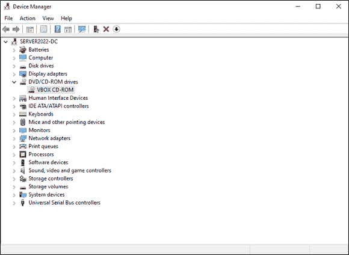

图 2-1： Windows Server 2022 上的设备管理器对于过去使用过 Windows 的人来说会很熟悉。

当你选择 `查看` 菜单时，你有以下选项：

*   **按类型列出设备：** 这按硬件类型逻辑地分组硬件。例如，如果你的服务器有多个网络接口卡，它们都将被分组在 `网络适配器` 下。如果你有多个硬盘驱动器，它们将被分组在 `磁盘驱动器` 下。这是设备管理器打开时的默认视图。

*   **按连接列出设备：** 你的服务器中的设备能够工作是因为它们都以某种方式相互连接。此视图按它们的连接方式排序。你的许多存储设备和网络适配器将显示在 `PCI 总线` 下，因为这通常是它们的连接方式。

*   **按容器列出设备：** 此视图按容器 ID 分组设备。这些容器 ID 可能被分配给设备，或者设备可能从父对象继承容器 ID。例如，其中一个父容器是你的服务器。分组在该容器下的一些项目可能是通信端口、ATA 通道、处理器核心等。

*   **按类型列出资源：** 此视图将你服务器的所有设备分类为资源类型。类型包括直接内存访问、输入/输出、中断请求和内存。我将在本章的“理解资源”部分更详细地讨论这些内容。

*   **按连接列出资源：** 此视图按系统资源的连接和交互方式排序。在需要研究中断请求 (IRQ) 冲突很常见的时候，此视图非常有用，但现在可能不那么广泛使用了。

你还可以自定义设备管理器中显示的信息。选择 `查看`⇒  `自定义`，将出现 `自定义视图` 对话框（参见 图 2-2）。从这里，你可以更改向你显示哪些项目。我从来没有真正找到一个很好的理由去更改默认视图。

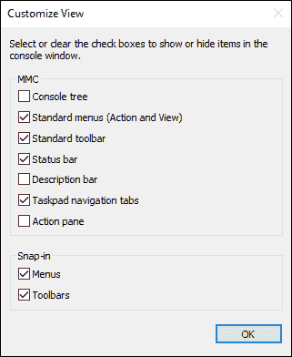

图 2-2： 自定义你的设备管理器视图。

#### 查看无法正常工作的设备

通常，如果设备损坏，它会以两种方式之一显示：

*   如果设备出现问题但仍能部分工作，它将显示一个中间带有感叹号的橙色三角形。

*   如果设备完全不工作，并且显示一个带有向下黑色箭头的白色圆圈，这意味着设备已禁用。

当你有一个出现问题的设备时，打开设备管理器时它会自动展开。这使得你作为系统管理员更容易找到出现问题的设备。在 图 2-3 中，你可以看到我有一个出现问题的设备。`DVD/CD-ROM 驱动器` 已禁用，这很明显，因为你可以看到其名称旁边的向下箭头。

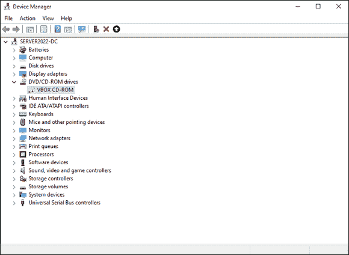


图 2-3： 设备管理器可以轻松识别出有问题的设备。

DVD/CD-ROM 驱动器可以重新启用，以查看其是否存在问题。我只需右键单击它并选择“启用设备”。在我的情况下，它会正常工作，因为我禁用它是为了截取屏幕截图。

当我查看故障设备的“属性”屏幕时，可以进一步了解问题所在。对于缺少驱动程序的情况，我可以设置 Windows 自动搜索以查找兼容的设备。通常这能解决问题。如果不行，那么最好的办法是前往供应商网站手动下载驱动程序。

### 理解资源

理解设备管理器中显示的资源对于系统技术问题的排查非常有帮助。在某些情况下，例如输入/输出（IO）和 IRQ，地址重复可能导致设备问题。设备可能停止工作，或导致系统冻结或崩溃。

如果你已经学习过 A+ 认证的内容，本节可能对你来说已是旧闻，可以随意跳过。如果你尚未进行 A+ 认证，或者你是服务器和计算领域的新手，请继续阅读！

#### 直接内存访问

直接内存访问（DMA）允许连接的设备直接与内存通信，无需中央处理器（CPU）作为中介。这可以显著加快通信速度。通常，大约 16MB 的内存可用于 DMA。

#### 输入/输出

I/O 最简单的定义是任何可以向服务器传输数据或从服务器接收数据的设备。这可能包括键盘和鼠标等输入设备、打印机和显示器等输出设备，以及其他能够同时进行输入和输出的设备（如磁盘驱动器）。在设备管理器的上下文中，在“资源”选项卡上，你可以通过查看“I/O 范围”来了解哪些 I/O 地址已分配给特定设备。

#### 中断请求

IRQ 本质上是发送给 CPU 的一个信号，它会“中断”CPU 正在执行的操作，以便发送中断的设备或软件能够得到处理。这用于支持多任务处理，因为处理器在需要时会被告知，而不是在空闲时进行轮询（poll）。中断被分配给特定设备且不共享。如果两个设备具有相同的 IRQ，就会发生 IRQ 冲突。这曾经是系统管理员需要注意的问题，但由于当今大多数设备都是即插即用的，因此大多数系统管理员实际上无需处理此问题。

#### 内存

随机存取存储器（RAM）非常适合快速加载内容，因为它是一种固态技术。在设备管理器中，你可以在每个设备的“资源”选项卡下查看分配给各个设备的内存范围。

### 查看隐藏设备

有时，首次打开设备管理器时，某些设备不可见。当前未连接的设备和非即插即用设备是默认情况下不会在设备管理器中显示的设备示例。

对于非即插即用设备，请选择“查看”⇒“显示隐藏的设备”。这将使非即插即用设备显示出来。

要查看曾经安装但不再连接到服务器的设备，你需要以管理员身份打开命令提示符或 PowerShell 窗口，并输入以下命令：

```
SET DEVMGR_SHOW_NONPRESENT_DEVICES=1
```

然后在同一窗口中，通过输入 `devmgmt.msc` 启动设备管理器。当设备管理器打开时，选择“查看”⇒“显示隐藏的设备”。你会看到曾经存在的设备的“幽灵”条目。如果旧设备驱动程序导致新设备或应用程序出现问题，这会很有帮助，因为你可以看到它们并将其移除。

### 扫描新设备

如果你安装了新设备但它未在设备管理器中显示，你可以通过选择“操作”⇒“扫描硬件更改”来启动新硬件扫描。这将扫描新硬件，如果找到，将尝试定位并安装该硬件的驱动程序。

### 处理旧设备

作为系统管理员，你可能需要安装一个较旧的设备，该设备在插入时计算机无法识别。对于这些非即插即用设备，最好的办法是使用设备管理器中的“添加过时硬件”选项。你可以通过在设备管理器窗口内选择“操作”⇒“添加过时硬件”来访问它。

### 查看单个设备设置

在设备管理器中，查看单个设备的设置很简单。你可以双击设备，或者右键单击设备并选择“属性”。对于大多数设备，你至少有四个选项卡：

*   **常规：** “常规”选项卡（如图 2-4 所示）包含有关设备的基本信息，例如设备名称、设备类型、制造商以及设备在系统中的位置。

     我最喜欢此选项卡的部分之一是底部的“设备状态”框。如果你正在排查问题，“设备状态”框会非常有帮助。当你的设备正常工作时，它看起来就像你在图 2-4 中看到的那样。

    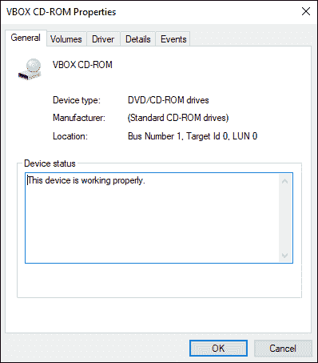

    图 2-4： VirtualBox CD-ROM 驱动器的“常规”选项卡。

*   **驱动程序：** “驱动程序”选项卡提供有关已安装驱动程序的信息，并允许你执行多项与驱动程序相关的管理任务。它首先显示驱动程序的名称，然后列出驱动程序的提供商、驱动程序的发布日期、驱动程序的版本，如果驱动程序已签名，还包括签名组织的标识。

    以下按钮允许你从此选项卡管理系统上的驱动程序：

    *   **驱动程序详细信息：** 提供有关驱动程序的更多详细信息，包括驱动程序文件的位置和名称。

    *   **更新驱动程序：** 你可以单击此按钮来更新驱动程序。你会得到两个选项。你可以自动搜索更新的驱动程序，这会搜索你的系统和互联网以查找更新，或者如果你知道更新的驱动程序在系统上的位置，可以浏览到驱动程序软件。

    *   **回退驱动程序：** 假设你更新了驱动程序，但现在设备无法正常工作。你可以单击“回退驱动程序”以返回到之前安装的驱动程序。

    *   **禁用设备：** 单击“禁用设备”会在设备管理器中禁用该设备。当你禁用设备时，设备名称旁边的图标会有一个向下的箭头，表示它当前已禁用。

    *   **卸载设备：** 如果你需要完全卸载设备，可以按此按钮。此选项对于移除硬件卸载时未移除的陈旧驱动程序、移除已损坏的驱动程序，或手动移除导致系统稳定性问题的设备驱动程序非常有用。

*   **详细信息：** “详细信息”选项卡在你首次单击时看起来并不起眼，但它实际上包含有关设备的丰富信息。默认情况下，下拉框中会选中“设备描述”，但你可以从许多其他属性中选择，以获取有关设备具体信息的更多内容。

*   **事件：** “事件”选项卡包含特定设备发生的事件。在新系统上，没有太多内容可查看——你只有初始的“设备已启动”和“设备已配置”条目。如果服务器已运行一段时间，而你正在尝试排查问题，请单击“查看所有事件”，事件查看器将出现并带有自定义筛选器，以便你可以查看特定于该设备的事件。


某些设备具有额外的选项卡，可提供进一步的管理功能，例如电源管理和资源。电源管理功能允许计算机关闭设备以节省电力，或允许设备在计算机处于睡眠模式时将其唤醒。资源选项卡（如果可用）会显示设备正在使用的内存范围、正在使用的 IRQ，以及是否存在任何冲突的设备。

### 更新驱动程序

通过设备管理器更新驱动程序非常简单。你有两种选择：可以右键单击设备并选择“更新驱动程序”，或者可以右键单击设备，选择“属性”，然后单击“驱动程序”选项卡。

通过任一方法选择“更新驱动程序”后，你将看到如图 2-5 所示的对话框。在此，你可以选择自动搜索驱动程序或浏览计算机以查找软件。自动搜索通常是最简单的方法；它会搜索本地计算机，然后在互联网上搜索更新的驱动程序。如果由于某种原因无法找到驱动程序，而你又知道驱动程序的位置，选择浏览计算机以查找驱动程序软件可能是最佳选择。

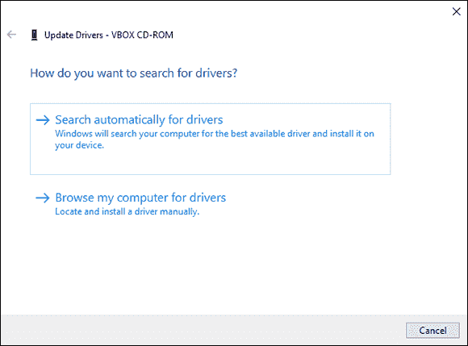

图 2-5： 在 Windows Server 2022 中通过设备管理器更新驱动程序时，你有两个选项。

### 配置电源管理

设备管理器中的某些设备具有“电源管理”选项卡。此选项卡允许你配置设备在——请稍等——电源管理方面的行为。根据设备的不同，你有两到三个选项：

*   **允许计算机关闭此设备以节省电源：** 此选项对于使用电池供电的设备（如笔记本电脑）最有用。不过，你很可能不希望服务器的组件关闭，因此你可能需要取消选中此框。

*   **允许此设备唤醒计算机：** 选中此复选框的设备能够在服务器进入睡眠状态时将其唤醒。此功能由需要能够唤醒服务器进行修补的网卡，以及鼠标和键盘等输入设备使用，以便它们可以唤醒所连接的系统。

*   **只允许使用数据包唤醒计算机：** 此设置在适配器上可用，并且仅在启用了“允许此设备唤醒计算机”时才可用。数据包也称为局域网唤醒数据包，是一种旨在唤醒系统的特殊广播数据包。

## 使用添加硬件向导

由于大多数设备都是即插即用的，你通常不需要使用“添加硬件向导”。事实上，它在 Windows 7 中就已从控制面板中移除，因为驱动程序安装是自动处理的。如果由于某种原因设备驱动程序未安装（可能是因为设备太旧或太新），你可以手动启动“添加硬件向导”。首先从制造商的网站下载驱动程序，然后按照以下说明操作：

1.  **右键单击“开始”菜单并选择“Windows PowerShell（管理员）”。**

2.  **输入** `hdwwiz.exe` **并按 Enter 键。**

    “添加硬件向导”将启动（参见图 2-6）。

    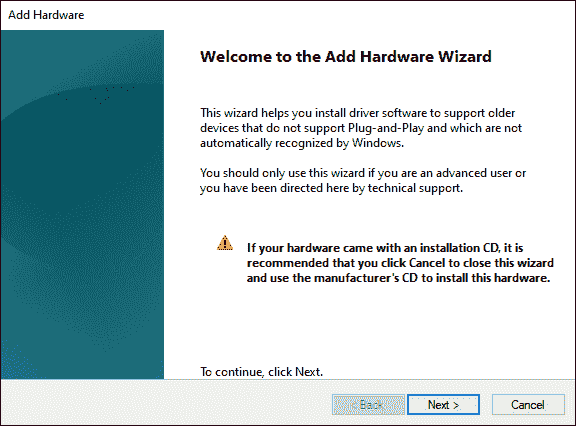

    图 2-6： 添加硬件向导。

3.  **单击“下一步”。**

4.  **选择“自动搜索并安装硬件（推荐）”旁边的单选按钮，然后单击“下一步”。**

5.  **如果向导找到新硬件，它会告诉你找到了什么，然后你可以安装驱动程序。**

6.  **如果向导未找到新硬件，它会要求你选择一个硬件类别。选择一个类别并单击“下一步”。**

7.  **选择设备的制造商和型号，然后单击“下一步”。**

    向导将安装驱动程序。

值得注意的是，有多种方法可以访问“添加硬件向导”，而这些方法并未在我刚才描述的步骤中记录。找到最适合你的方法来访问这些项目——不要害怕尝试。

## 执行与硬盘相关的任务

你在服务器上执行的大部分工作的核心是硬盘。硬盘存储操作系统和组织执行其核心业务所需的数据。目前主要有两种类型的存储。

*   **硬盘驱动器（HDD）：** 多年来，磁性存储（称为硬盘驱动器）是唯一的选择。这些驱动器有不同的速度和容量；更高速度和更大容量的驱动器更昂贵。由于它们是机械驱动器，容易磨损，随着技术的进步，磁性存储由于其物理限制，无法跟上一些更密集存储的工作负载。磁性存储并未消失——它仍然存在。由于成本较低，当高速度和高性能不如降低成本重要时，HDD 仍然是数据存储的绝佳选择。

*   **固态驱动器（SSD）：** 固态驱动器没有活动部件；它们将数据存储在非易失性闪存芯片上。随着技术的进步，它们的寿命增加，容量持续增长，价格下降。对于大多数系统管理员来说，SSD 驱动器是操作系统驱动器的主力，因为它们速度非常快。如果你的应用程序需要持续稳定的性能和高每秒输入/输出操作次数（IOPs），SSD 将满足这一需求。

 在许多场景中，系统管理员和存储管理员采用两全其美的方法：他们创建分层存储。较高层的存储由更快、更昂贵的 SSD 驱动器组成，而较低层的存储（用于不经常访问的数据）则由较便宜的 HDD 组成。

### 选择基本磁盘或动态磁盘

首次初始化磁盘时，它是一个基本磁盘。对于大多数用户来说，这工作得很好。基本磁盘是一个简单的解决方案，并且是新磁盘的默认创建方式。但是，如果你的组织希望使用更高级的磁盘功能，则需要升级到动态磁盘。动态磁盘支持

*   **简单卷：** 简单动态磁盘与基本磁盘非常相似。首次将基本磁盘转换为动态磁盘时，它将是一个简单卷。

*   **带区卷：** 数据被写入多个驱动器（或*条带化*）。这可以提高写入性能，但它不是一个容错解决方案。你需要至少两个磁盘才能利用此功能，如果丢失一个磁盘，你将丢失整个带区集。带区有时被称为 RAID 0。

*   **跨区卷：** 跨区卷是通过组合多个物理硬盘驱动器创建的逻辑卷。如果你有几个较小的硬盘驱动器，但需要一个大的硬盘驱动器，这可能非常酷。这种方法的缺点是，与带区一样，如果其中一个驱动器停止工作，则没有容错能力。你会丢失驱动器上的所有数据。

*   **镜像卷：** 数据被完全相同地写入两个或多个驱动器。这提供了容错能力，因为如果其中一个驱动器无法操作，则不会丢失数据。镜像有时被称为 RAID 1。

*   **RAID 5：** RAID 5 卷也称为*奇偶校验卷*。它至少需要三个磁盘，其中一个用于奇偶校验。该奇偶校验位保证如果其中一个驱动器出现故障，将不会丢失数据。当然，如果你丢失了多个驱动器，你将遭受数据丢失。

### 使用多路径 I/O


想象一下，你正在数据中心安装一台新服务器。你正忙着给它接线，抱怨着挡路的、不可避免的线缆乱成一团，这时你意识到自己不小心拔掉了机架交换机的电源线，而这个交换机是用于连接互联网小型计算机系统接口（iSCSI）存储的。你做好了迎接不可避免的一连串愤怒电话的准备，但什么也没发生。然后你意识到，每个系统都有一根第二根网络线缆连接到隔壁机架的 iSCSI 交换机。你松了一口气——你拥有**多路径 I/O（MPIO）**。

MPIO 是一种允许服务器识别通往其存储区域网络（SAN）存储的多条路径的技术。这通常为光纤通道和 iSCSI 存储网络设置，以提供存储网络的容错能力。除此之外，根据其配置方式，它还可以帮助提高性能，因为你可以同时使用两个连接。

安装 MPIO 相当简单，但配置可能稍微复杂一些。MPIO 在 Windows Server 2022 中作为一项功能提供。以下是安装 MPIO 的方法：

1.  打开服务器管理器，选择`管理`⇒`添加角色和功能`（如图 2-7 所示）。

    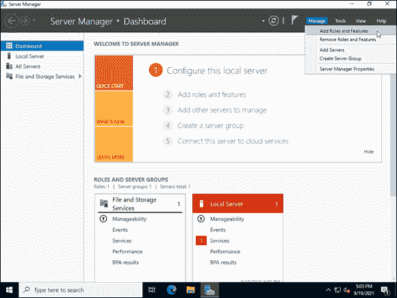

    [图 2-7：] 在 Windows Server 2022 中安装 MPIO 功能。

2.  在“开始之前”屏幕上，单击`下一步`。

3.  在“选择安装类型”屏幕上，选择`基于角色或基于功能的安装`，然后单击`下一步`。

4.  在“选择目标服务器”屏幕上，你的服务器将被高亮显示；单击`下一步`。

5.  在“选择服务器角色”屏幕上，单击`下一步`。

6.  在“选择功能”屏幕上，向下滚动并选择`多路径 I/O`（如图 2-8 所示），然后单击`下一步`。

    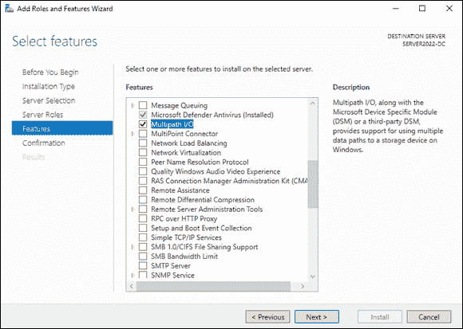

    [图 2-8：] 在“选择功能”屏幕上选择“多路径 I/O”复选框。

7.  在“确认安装选择”屏幕上，单击`安装`。

8.  安装完成后，单击`关闭`。

安装 MPIO 后，你可以配置它以与你的 iSCSI 存储甚至串行连接 SCSI（SAS）存储一起工作。

### 使用存储区域网络

多年来，服务器上的本地存储是你唯一可用的存储。局限于服务器内的存储存在几个问题。它不具备容错性（除非你使用 RAID，RAID 0 除外），不易扩展，并且容量受限于服务器内能容纳的磁盘数量。

有人想出了创建驱动器阵列来缓解这些问题的主意。驱动器阵列可以拥有可扩展的磁盘托架。这些托架可以用于镜像其他托架，或者在容错是主要目标时使用 RAID。这些大型驱动器阵列需要一个能够支持不断增长的数据量的网络。于是，SAN 应运而生。

SAN 中使用了许多不同的协议，但以下是当今企业环境中最常用的两种：

*   **iSCSI：** iSCSI 成为中小企业的宠儿，因为企业可以使用现有的网络基础设施来支持存储流量。这使得 iSCSI 的前期投资较小，因为无需购买特殊的网卡和交换机来支持 iSCSI 流量。企业只需要一个 iSCSI 存储设备，就可以使用 iSCSI。iSCSI 协议将 SCSI 命令封装在传输控制协议（TCP）数据包中。然后，这些数据通过传统的以太网线缆传输到其目的地。

*   **光纤通道：** 光纤通道仍然是这两种协议中更受欢迎的一种，主要归功于其速度和可靠性。它需要购买特殊的网卡和特殊的交换机来支持光纤通道协议。尽管光纤通道提供快速的数据传输，但它受限于距离，其限制远大于 iSCSI。光纤通道使用光纤电缆传输数据。数据以光脉冲的形式通过玻璃纤维传输。

如果你想要两全其美怎么办？一些公司销售所谓的*统一存储*。这些存储设备能够同时支持 iSCSI 和光纤通道。

### 理解存储空间直通

存储空间直通是 Windows Server 2016 数据中心版中引入的一项功能。对于那些负担不起 SAN 的组织来说，这是实现高可用性和高可扩展性存储梦想的好方法。它利用服务器上的本地存储创建一个存储池，整个服务器集群（称为*节点*）都可以利用这个存储池。

要在多台服务器上使用存储空间直通，你需要在每台服务器上安装故障转移群集和 Hyper-V 角色。集群系统之间需要至少 10 Gb 以太网，并且建议使用远程直接内存访问（RDMA）。

设置存储相当简单。你从物理磁盘创建一个存储池，然后从中创建逻辑磁盘，再创建卷。我将向你展示如何在独立服务器上执行此操作，但集群服务器的过程非常相似。首先，你将创建一个存储池。然后你将创建逻辑磁盘和卷。

#### 创建存储池

存储池是构建存储空间直通存储的起点。以下是创建存储池的方法：

1.  从服务器管理器中，在左侧菜单中单击`文件和存储服务`。

2.  单击`存储池`。

    如果你有可用的磁盘驱动器，它们会显示在右下角的“物理磁盘”下。注意在“存储池”下有一个名为“Primordial”的条目。这是使用可用磁盘默认创建的（见图 2-9）。

    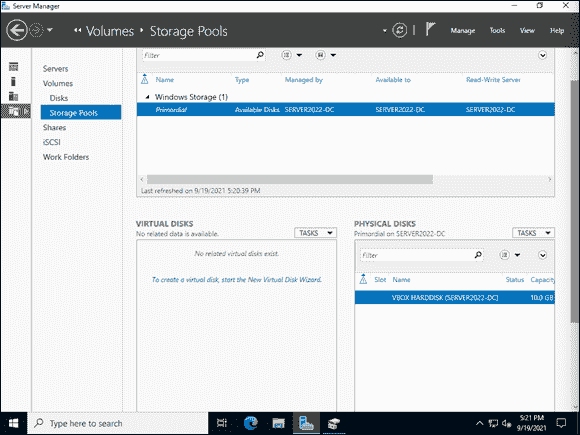

    [图 2-9：] 显示可用物理磁盘的“存储池”屏幕。

3.  右键单击“Primordial”所在的位置，然后选择`新建存储池`。

4.  在“开始之前”屏幕上，单击`下一步`。

5.  在“指定存储池名称和子系统”屏幕上，为池输入一个名称，然后单击`下一步`。

    我将我们的池命名为“Pool1”。注意在图 2-10 中，默认选中了原始池。

    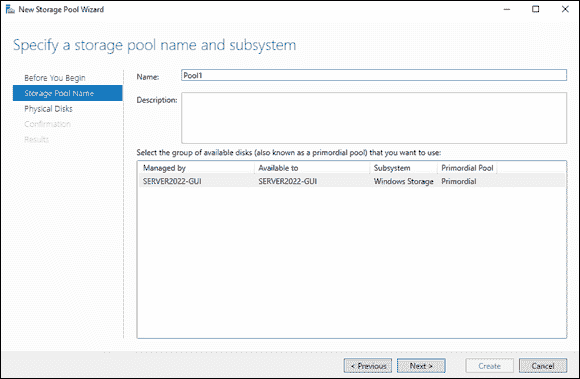

    [图 2-10：] 为你的存储池选择名称，并选择原始池以从中选择物理磁盘。

    在“为存储池选择物理磁盘”屏幕上，你会看到原始池中的所有磁盘。你可以选择部分或全部磁盘。

6.  在此示例中，选择所有磁盘。

7.  将最后一个驱动器的“分配”下拉框更改为`热备用`，如图 2-11 所示，然后单击`下一步`。

8.  在“确认选择”屏幕上，单击`创建`。

    如果一切顺利，“查看结果”屏幕应显示“已完成”。

9.  单击`关闭`。

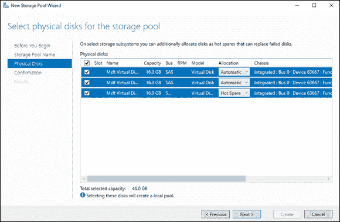

[图 2-11：] 存储池中物理磁盘的配置。

#### 创建逻辑磁盘

现在池已创建，你可以创建逻辑磁盘。请按照以下步骤操作：


### 创建虚拟磁盘

1.  右键单击`Pool1`并选择“新建虚拟磁盘”，或在“虚拟磁盘”框中单击“要创建虚拟磁盘，请启动新建虚拟磁盘向导”超链接。

    系统将要求您选择要使用的存储池。您应该只能看到我们目前创建的池，即`Pool1`。

2.  选择`Pool1`并单击“确定”。

3.  在“开始之前”屏幕上，单击“下一步”。

4.  在“指定虚拟磁盘名称”屏幕上，将磁盘命名为`Disk1`，如图 2-12 所示。

5.  单击“下一步”。

6.  在“指定机柜弹性”屏幕上，保持“启用机柜感知”复选框未选中，然后单击“下一步”。

    下一个屏幕是“选择存储布局”屏幕。您有三个选项：简单、镜像和奇偶校验。就功能而言，这些与 RAID 级别非常相似。简单是非 RAID 磁盘，镜像类似于 RAID 1，奇偶校验类似于 RAID 5。

7.  选择“简单”，如图 2-13 所示，然后单击“下一步”。

    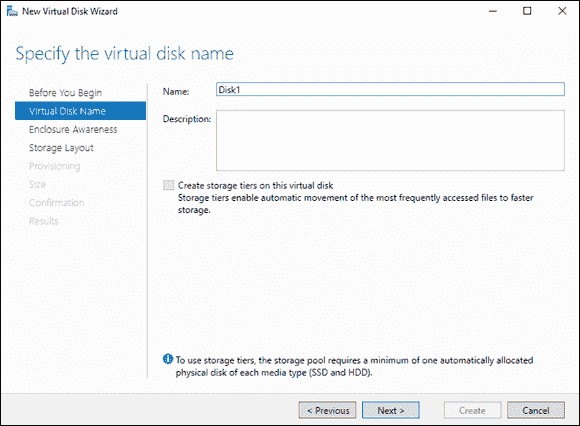

    图 2-12： 在使用虚拟磁盘之前，必须为其命名。

    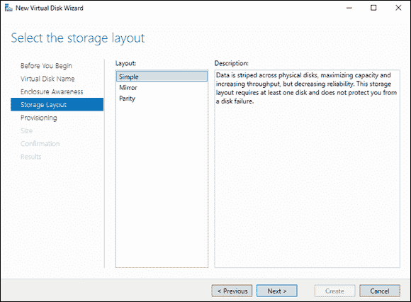

    图 2-13： 如果需要容错，选择存储布局非常重要。

8.  在“指定配置类型”屏幕上，为“配置类型”选择“精简”，然后单击“下一步”。

9.  在“指定虚拟磁盘大小”屏幕上，设置所需的磁盘大小，然后单击“下一步”。

    在我的示例中，我选择将虚拟磁盘大小设为 5GB。

10. 在“确认选择”页面上，单击“创建”。

11. 如果一切成功，单击“关闭”。

### 创建卷

现在您已经创建了存储池和虚拟磁盘，可以开始创建卷了。请按照以下步骤操作：

1.  右键单击`Disk1`并选择“新建卷”，如图 2-14 所示。

    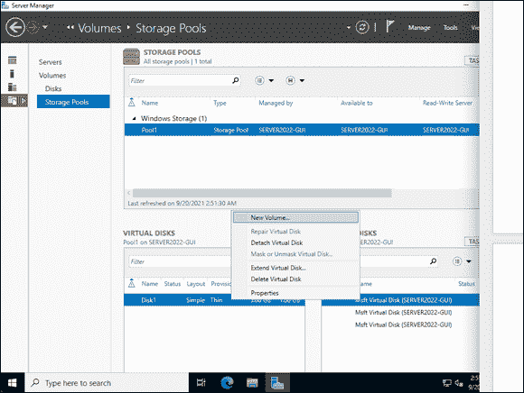

    图 2-14： 在创建虚拟磁盘后，创建操作系统可用的卷很简单。

2.  在“开始之前”屏幕上，单击“下一步”。

3.  在“选择服务器和磁盘”屏幕上，此时您应该只有一个服务器和磁盘，因此可以直接单击“下一步”。

4.  在“指定卷大小”屏幕上，输入大小并单击“下一步”。

    我输入了 3GB。

5.  在“分配驱动器号或文件夹”屏幕上，选择驱动器号或指定文件夹，然后单击“下一步”。

    我保持简单，选择了一个驱动器号。系统自动分配了字母 F，如图 2-15 所示。

    

    图 2-15： 为我的新卷选择驱动器号。

6.  在“选择文件系统设置”屏幕上，选择文件系统设置并单击“下一步”。

    我将坚持使用默认的 NTFS 和默认的分配单元大小，并将卷命名为`Volume1`。

7.  在“确认选择”屏幕上，如果一切正常，单击“创建”。

8.  如果“完成”屏幕上的所有内容都显示“已完成”，则一切就绪，单击“关闭”。

### 使用存储副本

存储副本是灾难恢复场景的绝佳工具。它可以在服务器或集群之间对卷进行同步或异步的块级复制。通过实现扩展集群，您甚至可以跨远程站点进行复制。

存储副本最初在 Windows Server 2016 数据中心版中发布。从 Windows Server 2019 开始，如果您使用标准版，也可以利用存储副本。这在 Windows Server 2022 中仍然成立，尽管它有一些限制：

*   存储副本只能复制一个卷，而不是无限数量的卷。

*   一个卷只能有一个复制伙伴关系，这与数据中心版不同，数据中心版中一个卷可以有无限数量的伙伴。

*   存储副本仅支持最大 2TB 的大小，而数据中心版对大小没有限制。

### 使用存储服务质量

存储服务质量允许您在使用 Hyper-V 和横向扩展文件服务器角色时，集中监控虚拟机的存储性能。请注意，如果需要，您可以使用集群共享卷代替横向扩展文件服务器。存储服务质量实现以下几点：

*   它确保一个 VM 不会占用所有存储带宽。

*   它监控存储性能。

*   它使用策略来确定 VM 的最小和最大 I/O。

使用存储服务质量的最简单方法之一是设置故障转移集群并创建集群共享卷。如果您这样做，存储服务质量会自动设置。您可以在集群核心资源下查看它。

### 使用 BitLocker 加密

保护数据从未像今天这样重要。使用 BitLocker，您可以通过加密整个数据驱动器来保护数据免受潜在窃贼的侵害。BitLocker 可以加密固定驱动器和可移动驱动器。固定驱动器通常使用可信平台模块芯片来保存加密密钥，而 BitLocker To Go 则使用密码或智能卡来解锁。

在以下部分中，我将解释什么是 TPM，并引导您完成安装 BitLocker 以及配置 BitLocker To Go 和 BitLocker 的过程。

#### 了解可信平台模块

可信平台模块是主板上的一个特殊芯片，旨在存储密码、证书和加密密钥。为了获得最无缝的 BitLocker 体验，您需要一个版本为 1.2 或更新的 TPM 芯片。如果您的系统没有 TPM，您仍然可以使用 BitLocker，但必须使用组策略来覆盖 TPM 要求。您必须输入密码才能解锁系统。我将在本章后面的“如果没有 TPM 模块该怎么办”部分介绍如何在没有 TPM 的情况下设置 BitLocker。

#### 安装 BitLocker

要在 Windows Server 2022 上安装 BitLocker，您需要安装 BitLocker 功能。请按照以下步骤操作：

1.  打开服务器管理器，选择“管理”⇒“添加角色和功能”。

2.  在“开始之前”屏幕上，单击“下一步”。

3.  在“选择安装类型”屏幕上，单击“基于角色或基于功能的安装”，然后单击“下一步”。

4.  在“选择目标服务器”屏幕上，单击“下一步”。

5.  在“选择服务器角色”屏幕上，单击“下一步”。

6.  在“选择功能”屏幕上，单击选择“BitLocker 驱动器加密”复选框，然后单击“下一步”。

    系统将询问您是否要安装 BitLocker 驱动器加密所需的其他功能，如图 2-16 所示。

    

    图 2-16： 添加 BitLocker 驱动器加密正常工作所需的功能。

7.  单击“添加功能”，然后单击“下一步”。

8.  在“确认安装选择”屏幕上，选择“如果需要，自动重新启动目标服务器”复选框。

    BitLocker 驱动器加密功能需要重新启动。

9.  单击“安装”。

服务器重新启动后，您可以继续配置 BitLocker。


 任何时候考虑对数据进行加密时，请务必确保拥有良好的备份，以便在出现问题时能够恢复。如果没有良好的备份，且加密过程遇到问题，您将需要从备份中进行恢复。

#### 配置 BitLocker To Go

要配置 BitLocker To Go，您需要找到管理工具所在的位置，然后就可以开始操作了。请按照以下步骤操作：

1.  **单击“开始”，向下滚动到“Windows 系统”，然后选择“控制面板”。**

2.  **单击“系统和安全”。**

3.  **在“BitLocker 驱动器加密”下，单击“管理 BitLocker”（参见****图** **2-17****）。**

    图 2-17： 从控制面板进入 BitLocker 管理屏幕。

4.  **在我的系统上，BitLocker 当前处于关闭状态，因此我将单击“为卷 1 启用 BitLocker”（参见****图** **2-18****）。**

    由于卷 1 被视为可移动磁盘，因此不使用 TPM，您必须设置密码或指定使用智能卡。这是为了支持 BitLocker To Go。

5.  **设置密码，如****图** **2-19****所示。**

6.  **单击“下一步”。**

    系统会询问您希望如何备份恢复密钥。您可以将恢复密钥保存到文件或打印出来。

    

    图 2-18： 为卷 1 启用 BitLocker。

    

    图 2-19： 为 BitLocker To Go 设置密码。

7.  **保存文件，然后单击“下一步”。**

    系统会询问您希望加密驱动器的多少空间。

8.  **选择“仅加密已用磁盘空间”，然后单击“下一步”。**

9.  **在“选择要使用的加密模式”屏幕上，选择“兼容模式”并单击“下一步”。**

    对于可移动媒体，通常选择兼容模式最为安全。

    系统会询问您是否准备好加密驱动器。

10.  **单击“开始加密”。**

    加密完成后，您将在 BitLocker To Go 驱动器上看到 BitLocker 的状态。它应显示为“BitLocker 已开启”。

#### 配置 BitLocker

要配置 BitLocker，您需要找到管理工具所在的位置。这些步骤与“配置 BitLocker To Go”中的步骤 1 到 3 相同，因此我将从步骤 3 之后开始说明。如果您需要回顾如何进入 BitLocker 管理屏幕，请在继续之前查看“配置 BitLocker To Go”中的步骤 1 到 3。

1.  **在我的系统上，C 驱动器上的 BitLocker 当前处于关闭状态，因此我将单击“为 C 驱动器启用 BitLocker”。**

    在“您希望如何备份恢复密钥”屏幕上，您可以选择将恢复密钥保存到文件或打印出来。

2.  **保存文件并单击“下一步”。**

    系统会提示您选择如何加密驱动器。您可以加密整个驱动器，也可以仅加密已用空间。您应根据组织的要求进行选择。

3.  **我将选择“仅加密已用磁盘空间”。**

4.  **单击“下一步”。**

5.  **在“选择要使用的加密模式”屏幕上，选择“新加密模式”并单击“下一步”。**

6.  **在最后一个屏幕上，选中“运行 BitLocker 系统检查”复选框。**

    这可确保 BitLocker 在加密驱动器之前能够读取密钥。

7.  **单击“继续”。**

    您将返回到 BitLocker 屏幕，并被要求重新启动系统。

8.  **单击“立即重新启动”。**

    系统重新启动后，BitLocker 将开始加密驱动器。加密完成后，它将显示为“BitLocker 已开启”。

#### 了解没有 TPM 模块时该怎么办

您可能会遇到没有 TPM 模块的服务器。当您尝试启用 BitLocker 时，会收到一条错误消息，提示找不到兼容的 TPM。这并不意味着您无法使用 BitLocker；它只是意味着需要更多的工作才能加密数据驱动器。请按照以下步骤操作：

1.  **单击“开始”菜单并选择“运行”。**

2.  **输入** `gpedit.msc`**。**

3.  **单击“本地安全策略”，单击“计算机配置”，单击“管理模板”，单击“Windows 组件”，单击“BitLocker 驱动器加密”，然后单击“固定数据驱动器”，如****图** **2-20****所示。**

    图 2-20： 配置 BitLocker 在没有 TPM 模块的情况下工作涉及编辑本地安全策略。

4.  **双击“配置固定数据驱动器使用基于硬件的加密”。**

5.  **选择“已启用”，并确保选中“当硬件加密不可用时使用 BitLocker 软件加密”复选框（参见****图** **2-21****）。**

    图 2-21： 为 BitLocker 启用基于软件的加密。

6.  **单击“确定”。**

7.  **单击“本地安全策略”，单击“计算机配置”，单击“管理模板”，单击“Windows 组件”，单击“BitLocker 驱动器加密”，然后单击“操作系统驱动器”，如****图** **2-22****所示。**

8.  **双击“启动时需要附加身份验证”。**

9.  **选择“已启用”。**

10. **确保选中“允许没有兼容 TPM 的 BitLocker”复选框，如****图** **2-23****所示。**

    图 2-22： 允许系统驱动器使用替代身份验证方法。

    

    图 2-23： 允许操作系统驱动器在没有 TPM 的情况下加密或解密需要此设置。

11. **单击“确定”。**

12. **关闭本地组策略编辑器。**

13. **现在，返回到 BitLocker 屏幕。**

    **您现在应该可以顺利使其工作了。**

## 执行与打印机相关的任务

打印机是相当重要的资源。如果打印服务器宕机，您很快就会接到电话。相反，如果用户正在尝试打印，而无法打印，他们会变得非常烦躁。

安装服务器有几种不同的方式。例如，本地连接的打印机很可能通过 USB 电缆连接。该打印机可能由单个用户使用，或者在小型办公环境中，它可能从该工作站共享，以便多个用户可以向其打印。网络连接打印也非常普遍，从拥有无线打印机的家庭到在其局域网（LAN）上拥有打印机的大型组织。一些组织可能会使用打印服务器来集中管理其打印队列。您将作业打印到服务器的打印队列，然后服务器通过网络将作业发送到打印机。

### 使用打印机安装向导

打印机安装向导将引导您完成打印机的安装。您可以通过转到“设置”（“开始”菜单中的齿轮图标），选择“设备”，然后选择“打印机和扫描仪”来启动它。在那里，您只需单击“添加打印机或扫描仪”，向导就会启动。

如果找到您的打印机，向导是一种简单易行的安装方式。如果未找到您的打印机，您需要做更多的工作。以下是添加一台不愿配合的打印机的方法：


1.  **点击“我想要的打印机未列出”。**

2.  **就我的情况而言，我的打印机位于我的网络上，因此我选择“使用 IP 地址或主机名添加打印机”，如****图** **2-24****所示。**

3.  **点击“下一步”。**

4.  **填写你打印机的 IP 地址（如****图** **2-25****所示）。**

    你的 IP 地址会与我的不同，因此你需要检查你的打印机以查看它使用的 IP 地址。确保从“设备类型”下拉列表中选择“TCP/IP 设备”。

    

    图 2-24： 选择你将如何查找你的打印机。

    

    图 2-25： 配置你的打印机的 IP 地址。

5.  **点击“下一步”。**

    如果一切顺利，系统将能够联系到打印机并确定它需要哪个驱动程序。

6.  **点击“下一步”。**

    在“打印机共享”屏幕上，你可以决定是否要与另一个系统共享计算机。

7.  **我将选择“不共享此打印机”。**

8.  **点击“下一步”。**

    最后一页为你提供了将新打印机设置为默认打印机的选项。

9.  **保持该复选框选中状态，然后点击“完成”。**

 如果你需要使用你的打印机提供的更高级打印功能，但 Windows 驱动程序没有提供你需要的选项，你可能需要从制造商的网站下载驱动程序。驱动程序通常打包在可执行文件中以方便安装。

### 配置打印选项

要进入打印机管理屏幕，请从“打印机和扫描仪”菜单开始（参见上一节）。在“打印机和扫描仪”部分，你会看到你刚刚添加的打印机。通过单击选中它，然后单击“管理”按钮。在配置单个打印机时，有两个选项需要查看：

*   **打印首选项：** “打印首选项”允许你设置打印机的默认打印设置。从这里，你可以设置打印方向。如果你点击“高级”按钮，会有更多设置可用——这些设置取决于为你的打印机安装的驱动程序。我的打印机设置如图 2-26 所示。

    图 2-26： 高级选项为你提供了更多可操作的设置。

*   **打印机属性：** “打印机属性”选项为你提供了打印机的配置项。例如，如果你在安装后选择共享打印机或更改驱动程序，或者你需要更改 IP 地址，你可以使用“打印机属性”来完成。你会看到一个类似于图 2-27 的屏幕。


图 2-27： 打印机属性屏幕允许你更改配置项。

#### 配置打印服务器角色

在 Windows Server 2022 中，打印服务器是一个可以安装然后配置的角色。

#### 安装打印服务器角色

以下是安装打印服务器角色的步骤：

1.  **打开服务器管理器后，选择“管理”⇒“添加角色和功能”。**

2.  **在“开始之前”屏幕上，点击“下一步”。**

3.  **在“选择安装类型”屏幕上，选择“基于角色或基于功能的安装”，然后点击“下一步”。**

4.  **在“选择目标服务器”屏幕上，点击“下一步”。**

5.  **向下滚动并选择“打印和文档服务”。**

6.  **当提示你执行此操作时，点击“添加功能”。**

    你的屏幕应如图 2-28 所示。

    

    图 2-28： 安装打印和文档服务角色以设置你的打印服务器。

7.  **点击“下一步”。**

8.  **在“选择功能”屏幕上，点击“下一步”。**

9.  **在“打印和文档服务”屏幕上，点击“下一步”。**

10. **在“角色服务”屏幕上，选择“打印服务器”，如****图** **2-29****所示，然后点击“下一步”。**

11. **在“确认安装选择”屏幕上，选择“安装”。**

12. **在“安装进度”屏幕上，安装完成后点击“关闭”。**

#### 配置打印服务器角色

既然你已经安装了打印服务器角色，你就可以配置它了。以下是添加你的第一台打印机的步骤：

1.  **从服务器管理器中，选择“工具”⇒“打印管理”。**

2.  **展开“打印服务器”，右键单击你的打印服务器，然后选择“添加打印机”，如****图** **2-30****所示。**

    图 2-29： 选择你要安装的角色的打印服务器。

    

    图 2-30： 向打印服务器添加打印机。

3.  **选择“通过 IP 地址或主机名添加 IPP、TCP/IP 或 Web 服务打印机”，然后点击“下一步”。**

4.  **输入 IP 地址并点击“下一步”。**

    在下一个屏幕上，你可以为你的打印机命名。在企业环境中，我建议这样做。

5.  **我将我的打印机命名为“主办公室打印机 #1”，如****图** **2-31****所示。**

    图 2-31： 为打印机命名并添加位置使你的用户更容易找到打印机。

6.  **点击“下一步”。**

    如果向导找到了打印机，下一个屏幕会告诉你打印机已找到，并显示打印机信息的摘要。

7.  **点击“下一步”。**

    服务器将安装打印机的驱动程序。

8.  **驱动程序安装完成后，点击“完成”退出向导。**

### 连接到打印服务器上的打印机

连接到打印服务器上的打印机非常简单。你可以使用通用命名约定路径（如 `\\servername\printername`）添加打印机。为此，服务器的名称必须在 DNS 中解析。如果你在 DNS 中没有打印机名称，你可以使用 IP 地址而不是服务器名称进行 UNC 连接。在企业环境中，通常使用组策略来管理用户和/或计算机的打印机。

 使用指向对象的 UNC 路径（如文件服务器上的共享或打印机）是访问资源的一种便捷方式，无需知道它们的位置。例如，在文件服务器的示例中，文件的本地路径可能是 `E:\SomeFolder\SomeShare\SomeFile.txt`。UNC 路径将是 `\\ServerName\SomeShare\SomeFile.txt`。如果共享被移动到不同的磁盘，UNC 路径将保持不变。

## 执行其他配置任务

我在本章中涵盖了许多配置步骤，我几乎完成了。最后几个配置任务对你使用服务器的体验比对你的用户（他们将从服务器使用服务）更为重要。

#### 键盘

从“设置”菜单中，转到“设备”，然后转到“输入”。右键单击你要管理的键盘，然后选择“键盘设置”。出现“输入”屏幕（如图 2-32 所示）。从这里，你可以配置你的键盘以满足你的需要。

### 鼠标


从“设置”菜单中，依次转到“设备”和“输入”。此时会出现“鼠标”屏幕（如图 2-33 所示）。在此处，您可以调整按钮配置、光标以及滚轮的行为。


图 2-32： 您可以调整键盘设置以更好地适应您的打字速度。


图 2-33： 您可以调整鼠标设置以自定义您的体验。

### 电源管理

从“设置”菜单中，依次转到“系统”和“电源和睡眠”。您将看到一些非常基本的设置。但是，通过单击“其他电源设置”（参见图 2-34），您可以进行非常精细的调整。这将允许您选择电源计划，以自定义系统如何平衡电源和性能。


图 2-34： 高级电源设置允许您创建精细的电源管理方案。

### 声音

从“设置”菜单中，单击“系统”，然后单击“声音”。通过此屏幕，您可以自定义默认的声音设备和录音设备。您也可以在此处对声音设备进行故障排除。

### 语言

从“设置”菜单中，单击“时间和语言”，然后单击“语言”。通过此屏幕，您可以添加新语言、设置新的默认语言，并根据需要更改键盘布局。您服务器上的“语言”屏幕应类似于图 2-35。


图 2-35： “语言”屏幕允许您调整语言和键盘布局的设置。

## 字体

您可能需要在服务器上安装新字体。这可能是因为公司标准要求使用与常规不同的字体。我甚至曾经不得不安装条形码字体。要处理字体，请打开“设置”菜单。单击“个性化”，然后单击“字体”。我最喜欢新界面的地方在于，它提供了每种字体的视觉样本，以及从 Microsoft Store 获取更多字体的能力。图 2-36 显示了“字体”屏幕。


图 2-36： 服务器上可用的已安装字体样本。

# 第 3 章：使用“设置”菜单

## 本章内容

 **找到“设置”菜单**

 **查看“设置”菜单中的内容**

多年来，控制面板一直是 Windows Server 操作系统的主要管理区域。您可以在其中配置设备、设置时间和语言设置、更改服务器的外观、处理已安装的程序以及管理 Windows 更新和设置辅助功能选项。

微软已积极努力用更新的“设置”菜单取代老旧的控制面板。“设置”菜单将设置分为不同的类别，类似于控制面板中的做法。然而，新功能大多被放入“设置”中，但不一定在控制面板中。在本章中，我将解释如何访问“设置”菜单以及在“设置”菜单中配置项目的位置。

## 访问“设置”菜单

您可以通过两种方式访问“设置”菜单：

*   单击“开始”菜单，然后选择“设置”（齿轮图标）。

*   右键单击“开始”菜单，然后选择“设置”。

“设置”菜单将打开，其外观应类似于图 3-1。


图 3-1： “设置”菜单的完整视图。

## 了解“设置”菜单项

“设置”菜单中的项目用于配置服务器上的功能。在以下部分中，我将引导您了解 Windows Server 2022 全新安装中可用的项目。

 此时，“设置”菜单包含您的大部分管理工具，并且是引入新功能的地方。如果您是新的系统管理员，我建议您熟悉此菜单。如果您已经使用了一段时间（还记得 zip 驱动器很酷的时候吗？），我建议您过渡到“设置”菜单，而不是继续使用控制面板。

### 系统

“系统”菜单（参见图 3-2）显示了您可能想要在系统上配置的许多内容，包括以下内容：

*   更改显示设置

*   调整声音设置

*   配置系统通知

*   调整电源和睡眠设置

*   访问磁盘优化实用程序，如磁盘清理

*   处理多个窗口（也称为多任务）

*   配置远程桌面


图 3-2： “系统”菜单包含许多配置选项。

### 设备

“设备”菜单（参见图 3-3）正如您所期望的那样。此菜单允许您处理蓝牙设备、打印机和扫描仪，以及键盘和鼠标设置。您还可以更改自动播放行为并调整系统报告 USB 问题的方式。

### 网络和 Internet

“网络和 Internet”菜单（参见图 3-4）为您提供网络连接的状态，以及设置或配置以太网、拨号、虚拟专用网络（VPN）和代理连接的能力。


图 3-3： “设备”菜单允许您安装和配置外围设备。


图 3-4： “网络和 Internet”菜单提供配置服务器网络连接的选项。

### 个性化

“个性化”菜单（参见图 3-5）允许您使您的服务器成为您自己的。您可以在此处调整背景图片和颜色、配置锁屏图片、设置主题和管理字体，以及自定义“开始”和任务栏设置。


图 3-5： “个性化”菜单为您提供许多选项来使您的服务器成为您自己的。

我听到您在说：“我为什么要调整服务器上的这些东西。我不需要服务器上的背景或自定义颜色。这太疯狂了！”我见过一些组织使用壁纸或配色方案来提供视觉指示，表明您正在生产（红色）系统上，而不是测试（绿色）系统上。当您打开多个远程桌面窗口时，它们会很方便。

### 应用

“应用”菜单（参见图 3-6）允许您指定可以从哪里安装程序、卸载不再需要的应用程序，以及选择哪些应用程序自动启动。此外，如果您有一个可以在应用或浏览器中打开的网站，您可以通过网站的应用来调整此行为。


图 3-6： “应用”菜单允许你管理已安装的应用程序。

### 账户

“账户”菜单（参见图 3-7）允许你管理本地用户账户和身份验证方法。操作系统（OS）支持多种选项，包括 Windows Hello、物理安全密钥，当然还有传统的密码方式。

### 时间和语言

“时间和语言”菜单（参见图 3-8）是你调整日期和时间的地方。你也可以调整区域设置，这会改变包括日历类型和日期/时间格式在内的多项设置。你可以安装新的语言，并设置各种服务的默认语言。如果你以语音方式与系统交互，你还可以选择系统使用的语音。


图 3-7： “账户”菜单允许你设置各种身份验证方法。


图 3-8： “时间和语言”菜单让你确定日期和时间的格式。

### 轻松使用

“轻松使用”菜单（参见图 3-9）包含 Windows 操作系统中所有辅助功能工具。你可以在这里进行许多不同的操作，例如：

*   如果你失明或视力受损，可以优化你的使用体验。

*   如果你失聪或有听力障碍，可以优化你的使用体验。

*   使用更大或不同颜色的指针配置你的鼠标。

*   选择不同颜色的文本光标并调整其大小。

*   调整键盘设置。

*   设置屏幕放大镜。

*   设置屏幕阅读器（称为“讲述人”）。

*   设置屏幕键盘。

*   设置高对比度选项以提高可见性。


图 3-9： “轻松使用”菜单允许你配置辅助功能选项。

### 搜索

“搜索”菜单相对较小。它允许你更改“安全搜索”的设置，该功能可以保护你免受互联网上不良图像的侵害，同时也可以设置如何在你的系统和任何关联的云账户存储中搜索内容。

### 隐私

“隐私”菜单（参见图 3-10）是你调整授予操作系统和已安装应用程序权限的地方。它非常直观，并且有大量设置可供调整。请务必花些时间浏览各个子菜单。


图 3-10： “隐私”菜单允许你配置 Windows 和已安装应用程序中的跟踪和广告设置。

### 更新和安全

“更新和安全”菜单（参见图 3-11）是你配置 Windows 更新和管理 Windows 安全设置的地方，例如防病毒软件、防火墙、应用和浏览器控制以及设备安全。此菜单还提供故障排除工具和恢复选项。你可以激活你的 Windows 副本，并在需要时进入开发模式。


图 3-11： “更新和安全”菜单是你管理服务器安全相关方面的入口。

# 第 4 章 使用工作组

## 本章内容

 **定义工作组**

 **权衡工作组的利弊**

 **了解集中式共享与组共享的区别**

 **了解如何为工作组配置服务器**

 **保持工作组平稳运行**

 **探讨对等名称解析协议如何助力工作组通信**

对于某些网络来说，运行 Active Directory 的域控制器可能并不适用。然而，在这些网络中，能够从系统到系统共享资源仍然被认为是可取的。这就是工作组发挥作用的地方。

在本章中，我将解释什么是工作组以及如何创建它们。我还会向你介绍对等名称解析协议、它的作用以及它对工作组的重要性。

## 了解什么是工作组

*工作组* 是一组共享资源但不属于 Active Directory 域的对等计算机。工作组可能有一个中央服务器用于提供各种服务，也可能只是在各个工作站之间共享数据。工作组可以小到只有两台计算机，也可以扩展到更大规模（尽管规模越大，管理就越困难）。关键点在于不涉及 Active Directory 域。

为了使工作组正常工作，所有系统必须共享相同的工作组名称。在 Windows 中，默认情况下，未加入域的系统将属于名为 `WORKGROUP` 的工作组。

需要记住的对等关系与 Active Directory 等客户端-服务器关系之间最大的区别在于，对等关系在各个方面都是去中心化的。你必须为用户和他们想要连接的每个服务器上的资源明确设置访问权限。像 Active Directory 这样的客户端-服务器关系中的系统拥有一个集中式数据库，用于处理资源访问的身份验证和授权。

 工作组的一个主要优势是，只要规模较小，它们的管理可以非常简单。你只需配置一个资源以进行共享，并定义你希望与谁共享该资源。你不必担心复杂的组策略，因为所有设置都是在本地完成的。工作组也可以是一种经济实惠的选择，因为你不需要多台服务器来支持一个工作组；实际上，从技术上讲，你根本不需要服务器，你可以仅用客户端系统创建一个工作组。本章重点介绍 Windows Server 2022 系统上的工作组。

 然而，由于用户账户是在每个单独的系统上管理的，因此工作组的安全性是一个问题。密码可能不会经常更改。即使更改了，用户也可能只在部分系统上更新密码，而不是所有系统，最终导致不同步。此外，某些应用程序可能需要 Active Directory；如果你使用工作组，将无法使用这些应用程序。

## 了解工作组是否适合你

当你考虑创建一个工作组时，你需要了解使用工作组可以做什么和不能做什么。这将决定工作组是否真的适合你的环境。例如，如果你有一个少于 15 个系统的小型网络，工作组可能是一个不错的选择。如果你有 200 个系统，工作组可能不是一个好选择，因为这会导致大量的管理开销。

在工作组中，你可以共享文件、数据库和打印机。如果这就是你需要做的全部，并且你的系统数量较少（理想情况下 15 个或更少），那么工作组是一个不错的选择。这可以为组织节省建立域控制器的费用，因为域控制器将消耗另一个服务器操作系统许可证，以及雇佣懂得如何管理 Active Directory 的系统管理员的成本。


然而，你没有集中式身份验证——每个用户都必须在希望访问资源的系统上拥有一个账户。你无法使用组策略来管理系统——只能使用本地安全策略。最后，你无法运行需要 Active Directory 的应用程序。

## 比较集中式共享和组共享

如果你已决定工作组适合你，接下来需要决定是使用集中式共享模型还是组共享模型。

在集中式共享模型中，所有数据都存储在一个系统上——工作站或服务器。工作组的所有其他成员都连接到这个中心位置来使用共享资源。集中式共享模型是最容易维护的，因为你可以为工作组成员在服务器上设置账户，他们就能共享资源。

在组共享模型中，组中的所有工作站共享不同的资源。组共享模型的管理可能要复杂得多，因为用户都需要访问他们需要访问资源的每个系统。

## 为工作组配置服务器

在将服务器配置为工作组服务器时，你需要添加组、用户以及任何你想要共享的资源。但在执行这些操作之前，你需要更改工作组的名称。

### 更改工作组名称

Windows 默认的工作组名称是 `WORKGROUP`。你应该将其更改为对你有意义的名称。操作如下：

1.  **在服务器管理器中，单击“本地服务器”。**

2.  **单击计算机名称下方的 `WORKGROUP` 链接，如** **图** **4-1** **所示。**

    系统属性对话框出现（参见 图 4-2）。

    

    图 4-1： 在服务器管理器的“本地服务器”屏幕中开始配置工作组。

3.  **单击“更改”按钮。**

4.  **将工作组名称更改为任何你想要的名称，然后单击“确定”。**

    在我的示例中，我将名称更改为 `NOTWORKGROUP`（参见 图 4-3）。

    你会看到一条欢迎你加入工作组的消息。

5.  **单击“确定”。**

    你会看到一条消息说服务器需要重启。

6.  **单击“确定”。**

    图 4-2： 系统属性对话框允许你设置工作组名称。

7.  **在系统属性对话框中，单击“关闭”。**

8.  **当提示重启服务器时，单击“立即重启”。**

更改工作组名称很简单，它遵循了更改默认值的安全最佳实践。


图 4-3： 设置工作组名称。

### 添加组

你将共享资源的权限授予组，而不是直接授予用户账户。这确保了用户获得他们所需的一切访问权限——并且比管理单个用户权限要容易得多。因此，你应该在创建用户之前创建组。

创建组的方法如下：

1.  **在服务器管理器中，选择“工具”⇒“计算机管理”。**

2.  **单击“本地用户和组”。**

3.  **双击“组”。**

    Windows Server 2022 开箱即包含几个组。在此示例中，我将创建一个名为 `Workgroup Users` 的简单组。

4.  **单击屏幕右侧的“更多操作”，然后选择“新建组”。**

    新建组对话框出现（参见 图 4-4）。

5.  **在“组名”字段中输入名称，然后单击“创建”。**

6.  **单击“关闭”以关闭新建组对话框。**


图 4-4： 创建组以允许访问工作站资源。

### 创建用户并将用户添加到组

 为了使用户能够访问工作组，她必须在她尝试连接的系统上拥有本地账户。当你创建用户账户时，你可以直接授予权限，但将用户添加到具有正确权限的组要简单得多。想象一下，如果你必须创建五个用户：你可以为每个用户设置权限，或者简单地将他们添加到组中。

创建用户并将用户添加到组的方法如下：

1.  **在服务器管理器中，选择“工具”⇒“计算机管理”。**

2.  **单击“本地用户和组”。**

3.  **双击“用户”。**

    Windows Server 2022 开箱即包含几个用户账户。在此示例中，我将创建一个名为 `User1` 的用户账户。

4.  **单击屏幕右侧的“更多操作”，然后选择“新建用户”。**

    新建用户对话框出现。

5.  **填写“用户名”、“全名”和“密码”字段（参见** **图** **4-5****）。**

     在生产环境中，你会希望保持选中“用户下次登录时必须更改密码”复选框。

    

    图 4-5： 创建用户账户以允许访问工作站资源。

6.  **单击“创建”。**

7.  **单击“关闭”以关闭新建用户对话框。**

8.  **右键单击新创建的用户，然后选择“属性”。**

    `用户名` 属性对话框出现（其中 `用户名` 是你正在查看其属性的用户的名称）。

9.  **单击“隶属于”选项卡，然后单击“添加”。**

    选择组对话框出现。

10. **在“输入要选择的对象名称”字段中，键入你之前创建的组的名称，然后单击“检查名称”。**

    如果找到该组，它将被加下划线并以服务器名称开头，如 图 4-6 所示。

11. **单击“确定”以关闭选择组对话框。**

12. **单击“确定”以关闭 `用户名` 属性对话框。**


图 4-6： 为你的用户账户选择组。

### 添加共享资源

在工作组场景中最常见的共享内容是打印机和文件。在第 2 册，第 2 章 中，我解释了如何安装和配置打印服务器角色。以下是共享文件和文件夹的方法：

1.  **在服务器管理器中，选择“工具”⇒“计算机管理”。**

2.  **单击“共享文件夹”。**

3.  **双击“共享”。**

4.  **单击屏幕右侧的“更多操作”，然后选择“新建共享”。**

    创建共享文件夹向导出现。

5.  **在第一个屏幕（称为“欢迎使用创建共享文件夹向导”）上，单击“下一步”。**

6.  **在“文件夹路径”屏幕上，单击“浏览”。**

    浏览文件夹对话框出现。

7.  **导航到你想要共享的文件夹（参见** **图** **4-7****）。**

    图 4-7： 在创建共享文件夹向导中选择你想要共享的文件夹。

8.  **单击“确定”以关闭浏览文件夹对话框。**

9.  **单击“下一步”。**

    下一个屏幕允许你更改共享的名称并设置脱机设置。这允许脱机用户访问共享文件。

10. **选择所需的选项后，单击“下一步”。**

    下一个屏幕允许你自定义共享的权限。


11.  **选择“自定义权限”单选按钮，然后点击“自定义”。**

    将出现“自定义权限”对话框。

12.  **点击“添加”。**

13.  **输入你之前创建的组的名称，然后点击“检查名称”以确保其解析正确。**

14.  **点击“确定”。**

15.  **在“工作站用户的权限”部分，为共享设置所需的权限。**

    通常，你会选择“更改”和“读取”复选框，如图 4-8 所示。

    

    图 4-8： 自定义共享文件夹权限。

16.  **点击“确定”关闭“自定义权限”对话框。**

17.  **点击“完成”。**

18.  **在“共享成功”屏幕上，再次点击“完成”。**

共享添加后，它将显示在“共享文件夹”下的“共享”中，如图 4-9 所示。

如果你曾在旧版本的 Windows 上设置过工作组，你会知道下一步是将你创建的组也添加到文件系统中文件夹的共享权限中。这需要做大量重复工作。幸运的是，微软解决了这个问题。当你在“计算机管理”的“共享文件夹”区域共享文件夹时，它也会设置共享权限。如果你想查看设置，请按照以下步骤操作：

1.  **点击屏幕底部任务栏中的文件夹图标。**

    文件资源管理器启动。

2.  **点击“此电脑”，然后双击你创建共享文件夹所在的卷。**

3.  **右键点击共享文件夹，然后点击“属性”。**

4.  **点击“共享”选项卡，然后点击“高级共享”，如图 4-10 所示。**

    在此屏幕上，你可以更改可以同时连接的用户数量，可以更改权限，也可以更改缓存。在此上下文中，*缓存*指的是脱机访问。

    

    图 4-9： 新的文件夹共享在“共享文件夹”的“共享”部分可见。

5.  **点击“确定”。**

6.  **再次点击“确定”。**

7.  **点击“关闭”。**


图 4-10： “高级共享”对话框允许你配置共享。

## 管理工作组

作为工作组的管理员，你可能需要处理一些持续的管理任务。最常见的任务之一是重置密码，不过你也可以更改用户的角色。在本节中，我将向你介绍几种管理用户账户的不同方法。

### 计算机管理控制台

计算机管理控制台是一个很好的起点。请按照以下步骤操作：

1.  **从服务器管理器中，选择“工具”⇒“计算机管理”。**

2.  **双击“本地用户和组”以展开它。**

3.  **双击“用户”以显示用户列表。**

     如果你只想重置密码，请右键点击用户账户并选择“设置密码”。在对话框中点击“继续”，然后输入新密码并点击“确定”。

4.  **右键点击你之前创建的账户，然后选择“属性”。**

    将出现“属性”对话框。以下是你在此对话框的每个选项卡上可以执行的操作：

    *   **常规：** 将账户设置为禁用，或要求用户在下次登录时更改密码。

    *   **隶属于：** 为用户分配组成员身份。

    *   **配置文件：** 设置登录脚本并设置主文件夹位置。

    *   **环境：** 设置用户登录时启动的程序，并设置客户端设备的所需行为。

    *   **会话：** 设置你希望如何处理特定用户账户的会话。

    *   **远程控制：** 允许你远程控制用户的会话。这在故障排除问题时非常有用。

    *   **远程桌面服务配置文件：** 与“配置文件”选项卡类似，但仅适用于远程桌面会话。

    *   **拨入：** 控制替代连接选项。

### 账户窗口

账户窗口允许你执行与计算机管理控制台相同的用户管理功能，只是界面更美观。以下是访问方法：

1.  **点击“开始”菜单，然后点击“设置”图标。**

2.  **点击“账户”。**

3.  **点击“其他用户”（如图 4-11 所示）。**

4.  **选择你之前创建的用户。**


图 4-11： 点击“其他用户”允许你管理除自己以外的账户。

从这里，你可以更改账户类型或删除账户（参见图 4-12）。

### PowerShell

你可以使用图形工具管理用户账户，但也可以使用 PowerShell 来完成。事实上，有一些管理任务只能通过使用 PowerShell 来完成。


图 4-12： 管理另一个用户账户。

要打开 PowerShell，请点击“开始”菜单并选择“Windows PowerShell”。

 对于我正在执行的任务，你需要以管理员身份打开 PowerShell。如果你从“开始”菜单选择 PowerShell，它将以这种方式启动。你想要完成的大多数任务都需要以管理员身份运行 PowerShell。如果你想了解更多关于 PowerShell 的信息，请参阅第 6 册。

以下是两个用于处理本地账户的便捷命令。

*   **要查看账户的当前设置，** 请输入以下内容：

    `Get-LocalUser -Name "User1"`

*   `Get-LocalUser` 查询系统以获取你指定的用户账户的信息。

*   **要更改用户的密码，** 请输入以下内容：

    `$Password = Read-Host -Prompt 'Enter Password' -AsSecureString`

    `$UserAccount = Get-LocalUser -Name "User1"`

    `$UserAccount | Set-LocalUser -Password $Password`

    以 `$` 开头的单词称为*变量*。可以将它们视为事物的容器。例如，`Read-Host -Prompt 'Enter Password' -AsSecureString` 会提示你输入密码，然后将其作为安全字符串保存在 `$Password` 变量中。`Get-LocalUser` cmdlet 检索 User1 的信息，并将 User1 的信息存储在名为 `$UserAccount` 的变量中。最后，你获取保存在 `$Account` 中的内容，并使用你之前保存在 `$Password` 中的安全字符串设置密码。

图 4-13 显示了命令已运行的示例。


图 4-13： 带有用户账户管理代码行的 PowerShell 窗口。

## 检查对等名称解析协议

对等名称解析协议（PNRP）最早在 Windows XP 中引入。它允许在对等网络中进行名称解析和注册。


你可能在文件共享示例中注意到，共享地址以服务器名称开头。如果没有 PNRP，你将不得不使用 IP 地址进行连接，因为无法解析主机名。我不知道你怎么想，但对我来说，记住一长串 IP 地址会非常困难，尤其是当有多个系统时。你可能会想，“为什么不改用域名系统（DNS）解析呢？”使用 DNS 并无不妥，但你需要一台 DNS 服务器来支持它。PNRP 则不需要单独的服务器。你可以利用现有基础设施实现名称解析。这很酷，对吧？如果需要提供更好的安全性，你可以用防火墙来保护 PNRP 流量。PNRP 使用 UDP 3540 端口来实现名称解析。

那么，PNRP 是如何工作的呢？假设你在 ServerA 上，想要与 ServerB 通信。过程如下：ServerA 会检查其缓存，看是否有 ServerB 的 PNRP ID。有两种可能：

*   如果找到匹配项，ServerA 会向 ServerB 发送 PNRP 请求消息。

*   如果*未*找到匹配项，ServerA 会向拥有与 ServerB 最接近 PNRP ID 的系统发送 PNRP 请求消息。

PNRP 请求会被发送到的节点接收。接下来有三种可能：

*   如果 PNRP 请求是发送给 ServerB 的，并且 ServerB 正在运行并响应，ServerB 会将回复发送回 ServerA。

*   如果接收 PNRP 请求的节点不是 ServerB，并且不知道 ServerB 是谁（它没有 ServerB 的 PNRP ID），接收请求的节点会回复 ServerA，表示它无法协助。

*   如果接收 PNRP 请求的节点不是 ServerB，但它拥有 ServerB 的 PNRP ID，或者知道一个更接近 ServerB PNRP ID 的节点，它会将该信息回复给 ServerA。然后 ServerA 可以直接联系 ServerB，或者联系下一个最接近的节点并重新开始搜索。

# 第 5 章：将服务器提升为域控制器

## 本章内容

 **了解 Active Directory 域及其优势**

 **使用 Windows Server 2022 准备创建域**

 **执行域配置的先决条件**

 **将服务器配置为域控制器**

在上一章中，我解释了如何创建和使用工作组。虽然工作组对于系统较少（少于 15 个系统）的小型环境运行良好，但在企业环境中扩展性不佳。

在大多数企业环境中，你会使用域。域为所有身份验证事件提供了一个集中的真实来源。你只需创建一次用户帐户，将其分配给适当的安全组，然后就可以将该安全组分配给用户需要访问的任何资源（当然，前提是资源在域上）。这大大简化了用户管理，并提高了组织的安全性，因为你能够通过组策略在整个域中强制实施设置（参见第 3 册，第 2 章）。

## 理解域

在深入探讨如何创建域控制器之前，我认为理解 Active Directory 域是什么、其架构以及首次创建 Active Directory 域时创建的一些默认组非常重要。我还将介绍域控制器角色。如果你已经熟悉这些主题，请随时跳过。如果不熟悉，请继续阅读！

### 什么是域？

让我们从基本概念开始，然后在此基础上构建。Microsoft 网络中的域通常被称为 Active Directory 域服务（AD DS）域。每个 AD DS 域都有自己的对象数据库。对象可以是用户、组、计算机，甚至是打印机。

AD 域被组织成层次结构，森林是最高级别，其次是域和组织单元（OU）。每个森林可以有多个域，每个域可以有多个 OU。

### 森林、域和 OU，天哪！

我在这里使用了很多术语，所以在继续之前让我定义一些内容：

*   **组织单元：** OU 是存储在 Active Directory 中的对象的容器。它们通常用于将相似的对象分组在一起——例如，会计部门所有人员的用户帐户，或建筑物二楼的所有计算机。通过将相似的项目分组在一起，可以更轻松地管理这些对象，因为它们可能具有相似的设置或配置。

*   **域：** 将域视为一个安全边界。域包含其自身对象的数据库。所有这些对象共享该数据库以及在域内分配的任何安全策略。此外，可以通过创建信任关系将一个域设置为信任另一个域，这可能允许一个域中的用户访问另一个域中的资源。

*   **域树：** 域树只是一组域的集合。例如，你可能将域树命名空间设置为`sometestorg.com`，该树下的域可能是类似`accounting.sometestorg.com`或`hr.sometestorg.com`的形式。这些域与域树共享命名空间。

*   **森林：** Active Directory 森林是顶级对象。它存储整个 Active Directory，包括所有树和域。在森林中创建的第一个域被称为*森林根域*。它通常与森林同名。

*   **架构：** Active Directory 架构类似于字典，因为它包含定义。它包含 Active Directory 对象可以使用的每个对象类和每个属性的定义。

根据你所在的组织，你可能只有一个包含一个森林和一个域的小型 Active Directory 实例，或者你可能在一家拥有多个森林和多个域的大公司工作。

你可能会问为什么需要多个森林。这会增加管理开销，对吧？是的，确实如此。然而，如果你在一个需要分离安全边界至关重要的环境中工作，那么多个森林是你的最佳选择。一个常见的例子是将公司网络与生产网络分开。公司森林用于管理工作站，这些工作站用于访问电子邮件和互联网。生产森林仅用于管理到服务器或网络设备的身份验证流量。通过分离森林，进而分离这两个网络的安全边界，你可以保护生产环境免受可能包含恶意软件的公司环境的影响。

### 理解特权域组

当你创建 Active Directory 域时，默认会创建几个管理组。我认识一些管理员，他们只是将自己的帐户放入企业管理员组，然后就再也不管了。作为系统管理员，你确实需要强制执行最小权限原则，这意味着人们应该拥有执行其工作所需的权限，但仅此而已。企业管理员组是一个权限非常高的组，不应成为解决所有权限问题的方案。

表 5-1 涵盖了各种组以及当你被加入这些组时获得的权限。

### 检查域控制器上的灵活单主机操作角色


当 Active Directory 首次出现时，确实存在一些挑战。多年来，微软不断改进域控制器与 Active Directory 的协作方式。他们提出了**灵活单主机操作**（FSMO）的概念。通过使用 FSMO 角色，域控制器之间不会争夺谁有权进行更改，你也不必过于担心主域控制器宕机，因为它所负责的角色可以转移到另一个域控制器上。

| **组名** | **描述** |
| --- | --- |
| 企业管理员 | 此组位于林根域中。它是林中每个域的内置管理员组的成员。企业管理员组的成员可以对林进行更改、添加或删除域、建立林信任以及提升林功能级别。此组应仅在需要时使用，因为它是一个权限极高的组——例如，当你首次构建林时，或进行林范围的更改（如建立林信任）时。 |
| 域管理员 | 域管理员组的成员是其所在域的内置管理员组的成员。他们会被自动添加到加入其域的每个系统的本地管理员组中。 |
| 管理员 | 域管理员是其账户所在域的管理员组的成员。企业管理员是其林中所有域的此组成员。此组授予他们对所有域加入系统的本地管理员组的访问权限。此组能够以完全权限管理域中的大多数对象，并可以获取域中几乎所有对象的所有权。 |
| 架构管理员 | 架构管理员是一个特殊组。它存在于林根域中，类似于企业管理员组。架构管理员有权管理 Active Directory 中的架构，但仅限于此。这使得架构管理员成为一个权限较低的组，但请务必谨慎选择谁被指定为架构管理员。糟糕的架构更改可能会损坏 Active Directory。此组应仅在需要进行架构更改的少数情况下分配。 |
| 其他管理组 | 其他管理组是在安装角色和应用程序时创建的。DHCP、DNS 和 Exchange Server 只是会在 Active Directory 中创建新管理组的角色或应用程序的几个例子。 |

TABLE 5-1 默认域组

以下是当今域控制器中看到的 FSMO 角色及其各自的功能：

*   **林范围：**

    *   **架构主机：** 管理 AD 架构的读/写副本。

    *   **域命名主机：** 确保你不会创建与现有域名相同的域。

*   **域范围：**

    *   **RID 主机：** Active Directory 中的每个安全主体都有一个安全标识符（SID）。该 SID 由域 SID（同一域中所有系统相同）和相对 ID（RID）（该域中每个安全主体唯一）组成。RID 主机向域控制器分配 SID 块，以便它们可以颁发这些 SID。

    *   **PDC 模拟器：** PDC 过去代表主域控制器，用于运行 Windows NT 4.0 及更早版本的环境。引入 PDC 模拟器是为了提供对旧系统的支持，它仍然为现代系统执行重要功能。PDC 模拟器是权威域控制器。它处理身份验证、密码更改、身份验证失败和组策略对象，并为整个域设置正确的时间。下次开会迟到时，就怪你的 PDC 模拟器吧！

    *   **基础结构主机：** 基础结构主机本质上是域之间的翻译器。它可以在域之间转换 SID、全局唯一标识符（GUID）和可分辨名称（DN），以便 Domain1 理解 Domain2 的请求。这允许用户访问其他域上的资源，而不仅仅是他们存在和进行身份验证的域。

除了角色之外，最后一个重要的概念是全局编录。全局编录服务器存储林中所有域中所有对象的记录。域控制器保留其自身全局编录的完全可写副本，以及来自同一林中其他域的只读副本。这允许你在 Active Directory 中搜索对象，而无需前往每个单独的域进行操作。

## 准备创建域

你已经决定要创建一个域。有几项任务需要提前处理。

最重要的任务之一，特别是如果这是一台全新的服务器，是安装所有可用的安全更新，并确保安装了最新的防病毒软件。毕竟，这将是你的中央身份验证服务器，所以你要确保它受到保护。

每个人都害怕并且有时会跳过的任务是规划任务。我认为它被跳过是因为它往往比安装服务器角色和配置它更不有趣。但问题是：如果你花时间提前规划安装和配置，结果会好得多。你将能够确保服务器满足你的需求，更好的是，当你发现它不满足需求时，就不必重新安装它。所以，坐下来一会儿，规划一下你希望你的 Active Directory 是什么样子。它会有多个域吗？你将使用什么样的 OU 结构？

当然，规划 AD 的样子更多是针对尚未部署 Active Directory 的新安装。但如果你要向现有 Active Directory 环境添加域控制器，你仍然应该规划好事情。这个域控制器将托管任何 FSMO 角色吗？如果是，哪些？这是一个正在构建的较新域控制器，用于替换旧的域控制器吗？如果是，它们当前的林功能级别和域功能级别是什么？

### 功能级别

功能级别用于告诉域控制器在林或域级别可以启用哪些功能。随着 Active Directory 每个新版本的发布，都会添加你可能希望利用的新功能。如果你正在创建新的 Active Directory 安装，请选择可用的最高功能级别。

功能级别可能会阻止服务器成为域控制器，如果其功能级别太低。功能级别可以在林级别或域级别设置。域可以以高于其所在林的功能级别运行，但不能以低于林的功能级别运行。

当你提升功能级别时，你将无法添加设置为较低功能级别的域控制器。同样重要的是要注意，域功能级别可以等于或高于林功能级别，但不能低于它。

在旧的服务器操作系统中，提升功能级别是一次性的操作。如果它导致问题，没有很好的方法来撤销更改。情况已不再如此。只要支持回滚，并且没有启用需要较新功能级别的新功能，你就可以使用 PowerShell 回退到旧版本。如果你确实启用了它们，则必须先禁用它们才能回滚。

#### 回滚林功能级别

```
Set-ADForestMode –ForestMode <desired forest level>
```

林功能级别包括

*   `Windows2016Forest` 或 7

*   `Windows2012R2Forest` 或 6

#### 回滚域功能级别

```
Set-ADDomainMode –DomainMode <desired domain level>
```

域功能级别包括

*   `Windows2016Domain` 或 7

*   `Windows2012R2Domain` 或 6


### 林 functional level

要提升林 functional level，你必须是 Enterprise Admin 组的成员。你必须从运行 Schema Master 角色的域控制器上提升林 functional level。无法从其他域控制器执行此操作。

要检查当前的林 functional level，请打开 PowerShell 并运行命令 `Get-ADForest`。

### 域 functional level

要提升域 functional level，你必须是 Domain Admin 组的成员。你必须在运行 PDC Emulator 角色的域控制器上提升域 functional level。无法从其他域控制器执行此操作。

要检查当前的域 functional level，请打开 PowerShell 并运行命令 `Get-ADDomain`。

## 执行域配置先决条件

你已经完成了规划阶段。现在是有趣的部分了！希望你是在一台全新的服务器上安装 Active Directory 域服务 (AD DS) 角色。如果是这样，你可以直接跳到安装域名系统 (DNS) 和动态主机配置协议 (DHCP)。如果你是在一台较旧的服务器上安装 AD DS，则需要确保没有需要先卸载的不支持的角色或功能。

AD DS 需要 DNS 和 DHCP 才能正常运行。如果你的环境中已经有这些，那么很好——你已经准备就绪了！如果没有，你可以将它们与 AD DS 安装在同一系统上，也可以安装在单独的系统上。

### 检查不支持的角色和功能

Microsoft 没有发布与 AD DS 不兼容的角色和功能列表。如果你在具有其他角色和功能的系统上安装 AD DS，可以采取以下两种方法：

*   如果这些角色和功能不再使用，请卸载它们。

*   如果这些角色和功能正在使用中，请备份系统，卸载这些角色和功能，安装 AD DS，然后重新安装其他角色和功能。

 最佳且最安全的做法是在全新构建的服务器上安装 AD DS，但如果你发现别无选择（这在无法负担多个系统的小公司中经常发生），请按照前面的步骤操作。

### 安装和配置域名系统

DNS 负责将易于记忆的主机名解析为不易记忆的 IP 地址。它是 Active Directory 正常运行的必要条件。如果 DNS 未安装在你将安装 AD DS 的系统上，但在你的环境中可用，那么你就可以继续了。如果 DNS 在你的环境中不存在，则需要安装它。

你可以单独安装 DNS 服务器角色，也可以在安装 AD DS 时作为配置任务的一部分安装。我将向你展示如何单独安装 DNS。

 在安装 DNS 角色之前，请确保你的服务器具有静态 IP 地址。如果没有，在安装角色时你会看到一个警告。你将被允许继续安装，但如果 IP 地址发生变化，你的客户端可能会失去与 DNS 服务器的连接。

#### 安装域名系统

请按照以下步骤安装 DNS：

1.  **从服务器管理器中，单击“管理”，然后单击“添加角色和功能”。**

2.  **在“开始之前”屏幕上，单击“下一步”。**

3.  **在“选择安装类型”屏幕上，单击“下一步”。**

4.  **在“选择目标服务器”屏幕上，单击“下一步”。**

5.  **在“选择服务器角色”屏幕上，选择“DNS 服务器”。**

6.  **在弹出的对话框中单击“添加功能”。**

7.  **单击“下一步”。**

8.  **在“选择功能”屏幕上，单击“下一步”。**

9.  **在“DNS 服务器”屏幕上，单击“下一步”。**

10. **单击“安装”。**

11. **安装完成后，单击“关闭”。**

#### 配置域名系统

请按照以下步骤配置 DNS：

1.  **从服务器管理器中，单击“工具”，然后单击“DNS”。**

2.  **单击服务器名称旁边的箭头以展开选项。**

    你会看到配置区域，应类似于 图 5-1。

3.  **右键单击“正向查找区域”，然后选择“新建区域”。**

4.  **在“新建区域向导”欢迎屏幕上，单击“下一步”。**

5.  **在“区域类型”屏幕上，保持选中“主要区域”，然后单击“下一步”。**

    图 5-1： 安装后未配置区域的 DNS 管理器屏幕。

6.  **在“区域名称”屏幕上，输入区域名称。**

    这通常是你的域名。它表示此 DNS 服务器具有权威性的命名空间。在 图 5-2 中，你可以看到我输入了 `sometestorg.com`。

    

    图 5-2： 命名区域指示 DNS 服务器对哪个区域具有权威性。

7.  **单击“下一步”。**

8.  **在“区域文件”屏幕上，保持选中“使用此文件名创建新文件”，然后单击“下一步”。**

9.  **在“动态更新”屏幕上，保持选中“不允许动态更新”，然后单击“下一步”。**

10. **在“正在完成新建区域向导”中，单击“完成”。**

11. **右键单击“反向查找区域”，然后选择“新建区域”。**

12. **在“新建区域向导”欢迎屏幕上，单击“下一步”。**

13. **在“区域类型”屏幕上，保持选中“主要区域”，然后单击“下一步”。**

14. **在“反向查找区域名称”屏幕上，确保选中“IPv4 反向查找区域”，然后单击“下一步”。**

15. **在下一个“反向查找区域名称”屏幕上，输入网络 ID。**

    这将是 IP 地址中的主机位。我的 DNS 服务器的 IP 地址是 `192.168.1.43`。为此分配的网络 ID 将是 `192.168.1`，如 图 5-3 所示。

16. **单击“下一步”。**

17. **在“区域文件”屏幕上，保持选中“使用此文件名创建新文件”，然后单击“下一步”。**

    图 5-3： 分配网络 ID。

18. **在“动态更新”屏幕上，保持选中“不允许动态更新”，然后选择“下一步”。**

19. **在“正在完成新建区域向导”中，单击“完成”。**

就是这样。你现在拥有一个功能正常的 DNS 服务器。你可能想知道为什么我告诉你要关闭动态更新。安装 Active Directory 后，你可以启用安全动态更新。在此之前，你必须启用所有动态更新，这实际上可能是一个非常糟糕的主意，因为任何系统都会在 DNS 中注册。

### 安装和配置动态主机配置协议

安装 DHCP 是你旅程中的下一步。DHCP 负责将可用的 IP 地址分配给你网络上的系统。这比过去必须像以前那样在电子表格中手动跟踪 IP 地址有了巨大的改进。大多数系统、工作站和服务器上都启用了 DHCP 客户端。如果系统需要静态 IP 地址，例如我正在讨论的基础设施服务（AD DS、DNS、DHCP），则应将该 IP 地址设置为 DHCP 服务器上的保留地址，以避免分配已使用的 IP 地址。

#### 安装动态主机配置协议

请按照以下步骤安装 DHCP 服务器角色：

1.  **从服务器管理器中，单击“管理”，然后单击“添加角色和功能”。**

2.  **在“开始之前”屏幕上，单击“下一步”。**

3.  **在“选择安装类型”屏幕上，单击“下一步”。**

4.  **在“选择目标服务器”屏幕上，单击“下一步”。**

5.  **在“选择服务器角色”屏幕上，选择“DHCP 服务器”。**

6.  **在弹出的对话框中单击“添加功能”。**

7.  **单击“下一步”。**

8.  **在“选择功能”屏幕上，单击“下一步”。**


9.  **在 DHCP 服务器屏幕上，单击“下一步”。**

10.  **单击“安装”。**

11.  **安装完成后，单击“关闭”。**

#### 配置动态主机配置协议

按照以下步骤配置 DHCP：

1.  **从服务器管理器中，单击旗帜图标，然后单击“完成 DHCP 配置”。**

2.  **在 DHCP 安装后配置向导中，单击“提交”。**

    这将创建管理 DHCP 服务器所需的安全组。

3.  **完成后，单击“关闭”。**

4.  **从服务器管理器中，单击“工具”，然后单击“DHCP”。**

5.  **单击服务器名称旁边的箭头，然后单击 IPv4 旁边的箭头。**

    你的屏幕应类似于 图 5-4。

    

    图 5-4： DHCP 控制台允许你配置 DHCP 服务。

6.  **右键单击 IPv4，然后选择“新建作用域”。**

     DHCP 作用域定义了可分配给已定义子网上系统的 IP 地址。对于网络上的每个子网，你需要先定义一个单独的 DHCP 作用域，然后才能为该子网中的系统分配 IP 地址。

7.  **在“欢迎使用新建作用域向导”屏幕上，选择“下一步”。**

8.  **在“作用域名称”屏幕上，你可以将描述留空，然后单击“下一步”。**

    为了本示例，我将其命名为“演示作用域”。

9.  **在“IP 地址范围”屏幕上，输入你希望 DHCP 服务器管理的地址池以及你的子网掩码（参见** **图** **5-5****）。**

    我为本示例创建了一个非常小的作用域。通常你的作用域会大得多，可能是一个完整的子网。

    

    图 5-5： IP 地址范围屏幕允许你指定 DHCP 作用域的地址范围。

10. **单击“下一步”。**

11. **在“添加排除和延迟”屏幕上，输入你不希望作用域分配的地址。**

    你可以输入路由器地址或其他存在于此作用域中但不应由此服务器分配的设备地址。

12. **单击“下一步”。**

    在“租约期限”屏幕上，你可以看到默认值为八天。在大多数情况下，这将是合适的。

13. **单击“下一步”。**

14. **在“配置 DHCP 选项”屏幕上，保持设置为“是，我想现在配置这些选项”，然后单击“下一步”。**

15. **在“路由器（默认网关）”屏幕上，添加你的默认网关的 IP 地址，然后单击“下一步”。**

16. **在“域名和 DNS 服务器”屏幕上，输入你之前在 DNS 服务器上创建的域名。**

    你可以在 图 5-6 中看到我的示例。

    

    图 5-6： 在 DHCP 作用域选项中设置域名和 DNS 服务器。

17. **单击“下一步”。**

18. **在“WINS 服务器”屏幕上，你可以选择输入网络上 WINS 服务器的名称或 IP 地址，然后单击“下一步”。**

    我将此项留空。

    最后一个屏幕询问你是否要激活作用域。默认选项为“是”。

19. **保持设置为“是”，然后单击“下一步”。**

20. **在“完成新建作用域向导”屏幕上，单击“完成”。**

就是这么简单。

## 将服务器配置为域控制器

要创建 Windows 域控制器，你需要安装和配置 Active Directory 域服务。AD DS 安装 Active Directory 及其数据库。它创建了一个集中的身份验证源，并极大地简化了用户管理。

### 安装 Active Directory 域服务

对于 Windows 中的大多数功能，你可以通过图形用户界面 (GUI) 或通过 PowerShell 安装此角色。在本节中，我将向你展示如何通过 GUI 安装，但我会指出，如果你正在配置多个域控制器，可以在哪里获取 PowerShell 来重新运行相同的命令。

1.  **从服务器管理器中，单击“管理”，然后单击“添加角色和功能”。**

2.  **在“开始之前”屏幕上，单击“下一步”。**

3.  **在“选择安装类型”屏幕上，单击“下一步”。**

4.  **在“选择目标服务器”屏幕上，单击“下一步”。**

5.  **在“选择服务器角色”屏幕上，选择“Active Directory 域服务”。**

6.  **在弹出的对话框中，单击“添加功能”。**

7.  **单击“下一步”。**

8.  **在“选择功能”屏幕上，单击“下一步”。**

9.  **在“Active Directory 域服务”屏幕上，单击“下一步”。**

10. **单击“安装”。**

     你还有更多域控制器要构建吗？安装 AD DS 后，屏幕底部会有一个“导出配置设置”链接。单击此链接并保存它生成的 XML 文件。当你想用它来创建另一个域控制器时，只需使用 PowerShell 将安装程序指向 XML 文件：

    ```
    Install-WindowsFeature –ConfigurationFilePath <文件路径和名称>
    ```

11. **安装完成后，单击“关闭”。**

### 配置 Active Directory 域服务

安装 AD DS 后，下一步自然是配置它，以便你的服务器可以开始其作为域控制器的生命周期。按照以下步骤操作：

1.  **从服务器管理器中，单击旗帜图标，然后单击“将此服务器提升为域控制器”，如** **图** **5-7****所示。**

    图 5-7： 将服务器提升为域控制器。

2.  **在“部署配置”屏幕上，选择“添加新林”。**

     将服务器提升为域控制器时有三个选项：

    *   **添加新林**通常在没有现有 AD 基础结构时使用。

    *   **向现有林添加新域**用于创建林根域以外的域。正如你可能想象的那样，如果存在现有的 AD 基础结构，则使用此选项。

    *   **向现有域添加域控制器**正如其名。你不是在创建林或域；你只是在添加一个新的域控制器。

3.  **输入根域名，然后单击“下一步”。**

4.  **在“域控制器选项”屏幕上，选择你之前确定的功能级别，然后单击“下一步”。**

    保持选中“域名系统 (DNS)”和“全局编录”。输入一个还原密码并将其保存在你可以访问的地方；如果 AD 需要还原，你需要此密码进行恢复。

5.  **在下一个“DNS 选项”屏幕上，单击“下一步”。**

6.  **在“其他选项”屏幕上，单击“下一步”。**

7.  **在“路径”屏幕上，接受默认位置，然后单击“下一步”。**

8.  **在“查看选项”屏幕上，单击“下一步”。**

     如果你正在安装多个域控制器，可以单击“查看脚本”按钮，查看相同设置的 PowerShell 脚本。

    在“先决条件检查”屏幕上，出现一些警告是很常见的。只要顶部有一条消息说“所有先决条件检查均成功通过”，你就可以继续了。参见 图 5-8 了解示例。

9. **单击“安装”。**

    安装 AD DS 后，服务器将自动重启，你将能够以域管理员帐户登录。这最初将使用与服务器上本地管理员帐户相同的密码。请务必更改它。


图 5-8： 检查安装前是否通过了先决条件检查。

### 将 DNS 区域转换为 Active Directory 集成区域

当您在本章前面设置 DNS 时，您创建了区域，但选择了手动更新而非动态更新。既然 DNS 区域已与 Active Directory 关联，您可以返回，将 DNS 区域与 Active Directory 集成，并选择安全动态更新。

使您的 DNS 区域成为 Active Directory 集成区域，可为您提供一个多主环境，其中任何运行 DNS 的域控制器都可以更新区域，只要它们是该区域的权威服务器。区域数据通过 Active Directory 而不是传统的区域传输方法进行复制。在选择将您的区域设为 Active Directory 集成区域后，您还可以启用安全动态更新。这允许您控制系统可以更新哪些记录名称，并防止未经授权的系统覆盖 DNS 中的名称。

请按照以下步骤将您的区域转换为 Active Directory 集成区域，以及如何启用安全动态更新：

1.  **从服务器管理器中，单击“工具”，然后单击“DNS”。**

2.  **展开服务器名称，然后展开“正向查找区域”。**

    您应该会看到之前创建的区域。

3.  **右键单击该区域并选择“属性”。**

4.  **在“常规”选项卡上，在“类型：主要”下，单击“更改”按钮。**

5.  **仍然选择“主要”，选中“在 Active Directory 中存储区域”复选框，然后单击“确定”。**

6.  **当询问您是否希望该区域为 Active Directory 集成时，单击“是”。**

7.  **在“动态更新”下，选择“仅安全”。**

    有关此时屏幕应显示的示例，请参见图 5-9。

8.  **单击“应用”，然后单击“确定”。**

9.  **展开“反向查找区域”。**

    您应该会看到之前创建的区域。

10. **右键单击该区域并选择“属性”。**

11. **在“常规”选项卡上，在“类型：主要”下，单击“更改”按钮。**

    

    图 5-9： 将 DNS 区域属性设置为 AD 集成。

12. **仍然选择“主要”，选中“在 Active Directory 中存储区域”复选框，然后单击“确定”。**

13. **当询问您是否希望该区域为 Active Directory 集成时，单击“是”。**

14. **在“动态更新”下，选择“仅安全”。**

    有关此时屏幕应显示的示例，请参见图 5-9。请记住，图 5-9 来自正向查找区域，但设置本身是相同的。

15. **单击“应用”，然后单击“确定”。**

16. **在“正向查找区域”下，为该服务器创建记录。**

    未来的系统现在应该会自动弹出。

17. **右键单击“正向查找区域”下的域名，然后选择“新建主机 (A 或 AAAA)”。**

     主机记录由 DNS 服务器用于将主机名映射到 IP 地址。A 记录将主机名匹配到 IPv4 地址，而 AAAA 记录将主机名映射到 IPv6 地址。

18. **在“名称”下，输入系统的名称。**

19. **在“IP 地址”下，输入系统的 IP 地址。**

20. **选中“创建相关的指针 (PTR) 记录”复选框。**

    这将在反向查找区域中创建一个匹配的条目。

21. **单击“添加主机”。**

22. **在确认框上单击“确定”。**

23. **在“新建主机”框中单击“完成”。**

现在您已全部设置完毕。Active Directory 已安装，并且您正在以安全的方式允许 DNS 中的动态更新。您为服务器创建了 DNS 记录。此时您可以进行测试，以确保名称解析正常工作。以下是测试名称解析的步骤：

1.  **右键单击“开始”菜单并选择“Windows PowerShell”。**

2.  **如****图** **5-10****所示，键入** `nslookup <servername>`**。**

    如果 DNS 工作正常，它应该返回您输入的服务器名称的 IP 地址。


图 5-10： 使用 nslookup 验证 DNS 是否正常工作。

如您所见，事后集成 DNS 可能相当耗时。您可以在安装 Active Directory 的同时安装它，从而节省大量配置工作。但是，现在您已经看到了较长的方法，因此较短的方法将简单得多。

### 为 Active Directory 环境授权您的 DHCP 服务器

在正常使用 DHCP 之前，您还需要做最后一件事。之前，您安装了 DHCP，然后设置了一个作用域。既然该服务器现在是域控制器，您需要在 Active Directory 中授权 DHCP，以便它可以开始为加入域的系统分配 IP 地址。通过授权您的 DHCP 服务器，您可以防止流氓 DHCP 服务器出现在您的网络上。流氓 DHCP 服务器可能导致拒绝服务攻击。要授权您的 DHCP 服务器，请按照以下步骤操作：

1.  **从服务器管理器开始，选择“工具” ⇒  “DHCP”。**

2.  **右键单击服务器名称并选择“授权”。**

3.  **单击“操作”，然后单击“刷新”。**

    IPv4 上原本的红色向下箭头现在应该变成绿色对勾。

现在您的 DHCP 已配置为与 Active Directory 域协同工作。任何时候您启动新的 DHCP 服务器并希望它们与 Active Directory 环境协同工作，都需要授权它们。

### 配置用户帐户

既然 Active Directory 已安装，您可能想开始创建用户帐户。毕竟，Active Directory 的主要目的是进行身份验证！以下是在 Active Directory 中创建第一个用户帐户的方法：

1.  **从服务器管理器中，选择“工具” ⇒  “Active Directory 用户和计算机”。**

2.  **通过单击域名旁边的箭头展开您的域名。**

3.  **单击“用户”（这是“用户”OU）以将其选中。**

    您会看到内置的帐户和组。

4.  **右键单击“用户”，然后选择“新建” ⇒  “用户”，如****图** **5-11****所示。**

5.  **填写“名”和“姓”字段。**

    注意，“全名”会自动填入您输入的内容。

6.  **输入您希望用户登录名是什么。**

    在我的示例中，对于 John Smith，我创建的用户名是 `jsmith`（参见图 5-12）。

    

    图 5-11： 在 Active Directory 中创建新用户。

    

    图 5-12： 创建我的第一个用户 John Smith。

7.  **单击“下一步”。**

8.  **为用户设置临时密码。**

9.  **在“确认密码”字段中再次键入密码。**

10. **保持“用户下次登录时必须更改密码”框选中，然后单击“下一步”。**

11. **单击“完成”。**

12. **双击新用户 John Smith。**

13. **单击“成员属于”选项卡。**

    您会看到 John Smith 是“域用户”的成员。

    假设 John 将管理我们的 DNS 和 DHCP 服务器。

14. **单击“添加”，键入** `DnsAdmins`**，然后单击“确定”。**

15. **再次单击“添加”，键入** `DHCP Administrators`**，然后单击“确定”。**

16. **再次单击“确定”以关闭 John 的配置。**

### 在域上共享资源

在域上共享资源与在域外共享资源非常相似。在 Active Directory 域中工作时，管理资源访问权限的最佳方式是使用组。

让我们创建一个名为“文件共享用户”的组，将 John Smith 添加到其中，然后在文件夹共享上为其分配权限。请按照以下步骤操作：


1.  **右键单击“用户”OU，然后选择“新建” ⇒  “组”。**

2.  **输入组名，然后单击“确定”。**

3.  **双击新组（在我的例子中，是“文件共享用户”），然后单击“成员”选项卡。**

4.  **单击“添加”。**

5.  **输入** John Smith **，然后单击“确定”。**

6.  **再次单击“确定”以退出组配置屏幕。**

7.  **单击屏幕底部的文件资源管理器图标（它看起来像一个文件夹）。**

8.  **单击“此电脑”，并确定要在哪个卷上创建此文件夹共享。**

9.  **双击该卷以打开它。**

    在我的示例中，我将使用 `C:` 卷来存放该文件夹。

10.  **右键单击空白区域，然后选择“新建” ⇒  “文件夹”。**

11.  **将文件夹命名为“Files”。**

12.  **右键单击“Files”文件夹，然后选择“授予访问权限” ⇒  “特定人员”。**

13.  **在框中，输入你之前创建的组的名称（在我的例子中，是“文件共享用户”），然后单击“添加”。**

    安全组已添加，并具有读取权限。

14.  **单击“读取”旁边的箭头，然后选择“读取/写入”，如** **图** **5-13****所示。**

15.  **单击“共享”。**

16.  **在“你的文件夹已共享”屏幕上，单击“完成”。**


图 5-13： 将文件夹共享到域安全组。

当安全组中的用户想要访问你刚刚创建的共享时，他只需执行以下操作：

1.  **单击“开始”菜单。**

2.  **输入** \\*servername*\*sharename***。**

    在我的例子中，是 `\\server2022-dc\Files`。

3.  **按 Enter 键。**

    这会将用户带到共享文件夹。

这种方法的好处是，新用户只需被添加到安全组“文件共享用户”，他们就对你创建的文件夹共享具有读/写访问权限。

### 将客户端加入域

当然，此过程的最后一步是将其他系统加入域，以便你可以使用域凭据而不是本地凭据进行身份验证。在本节中，我将介绍如何在“具有桌面体验的服务器”和“服务器核心”中执行此操作。

默认情况下，“经过身份验证的用户”组的任何成员都可以将工作站添加到 Active Directory 域。“经过身份验证的用户”组的成员最多可以添加十个工作站。（这应根据你组织的策略进行更改。）可以在组策略管理控制台的“默认域控制器策略”中进行域范围的调整，该策略位于“计算机配置”下，然后是“策略”，然后是“Windows 设置”，然后是“安全设置”，然后是“本地策略”，最后是“用户权限分配”。双击“将工作站添加到域”。添加你希望用于允许将系统添加到域的安全组（我经常看到这里使用“域管理员”），并移除“经过身份验证的用户”。

#### 具有桌面体验的服务器

“具有桌面体验的服务器”是大多数人习惯使用的 Windows 图形版本。使用 Windows Server 加入域非常简单。请按照以下步骤操作：

1.  **以管理员身份登录到未加入域的系统。**

2.  **当服务器管理器启动时，单击菜单左侧的“本地服务器”。**

3.  **在服务器名称下方，单击“WORKGROUP”。**

    如 图 5-14 所示的“系统属性”框将出现。

4.  **单击“更改”按钮。**

5.  **在“隶属于”下，选择“域”旁边的单选按钮，并填入你要加入的域的名称。**

    这应该类似于 图 5-15。

6.  **单击“确定”。**

    图 5-14： “系统属性”框允许你更改计算机名称和工作组/域成员身份。

    

    图 5-15： 更改服务器的域成员身份。

7.  **输入有权加入域的帐户的用户名和密码。**

     如果你一直跟着操作并从头开始构建了你的域，域管理员帐户的密码将与域控制器上本地管理员帐户的密码相同。如果你加入的是一个已建立的域，此密码可能不同。

8.  **单击“确定”。**

    你会收到消息“欢迎加入 *<域名>* 域”。

9.  **单击“确定”。**

    系统会提示你需要重新启动系统。

10. **单击“确定”。**

11. **单击“关闭”以关闭“系统属性”。**

12. **单击“立即重新启动”。**

    系统将重新启动，当它重新启动后，它将加入域。

#### 服务器核心

服务器核心没有大多数管理员习惯使用的图形菜单，因此加入域的体验有所不同。有两种方法可以加入域：你可以使用 `sconfig` 实用程序，也可以使用 PowerShell。

#### 使用 SCONFIG 加入域

`sconfig` 是服务器核心中存在的基于文本菜单的实用程序，默认情况下在你登录后启动。或者，从命令行你可以通过输入 `sconfig` 并按 Enter 来访问它。当 `sconfig` 启动时，你会看到一个类似于 图 5-16 的屏幕。

让我们使用 `sconfig` 加入域。为了便于说明，我假设你已经输入了 `sconfig` 并处于菜单界面。请按照以下步骤操作：

1.  **按 1 选择“域/工作组”。**

2.  **按 D 选择域，然后按 Enter。**

3.  **输入你要加入的域的名称，然后按 Enter。**

4.  **输入域管理员帐户。**

    在我的例子中，我输入 `sometestorg\administrator`。

5.  **输入该帐户的密码，然后按 Enter。**

    **系统会询问你是否要在重新启动前更改计算机名称。**

6.  **输入** no**。**

    如果你需要重启，请随时选择“是”。

    系统会提示你重新启动服务器。

    

    图 5-16： 服务器核心中的 `sconfig` 菜单是主要的系统配置区域。

7.  **输入** yes **以重新启动。**

8.  **当系统重新启动后，它将加入域。**

#### 使用 POWERSHELL 加入域

`sconfig` 是一个手动过程，因此不太适合服务器自动化工作。PowerShell 可以使加入域的过程比 `sconfig` 快得多，并且可以作为脚本任务的一部分使用。以下是使用 PowerShell 将服务器加入 Active Directory 的命令：

```
Add-Computer –domainname <domain name> -Credential domain\administrator -restart –force
```

看看 PowerShell 有多简洁、直接？我建议你花时间学习 PowerShell。第 6 本书 全是关于 PowerShell 的。

以下是使用 PowerShell 命令加入 Active Directory 的步骤：

1.  **登录到服务器核心系统。**

2.  **从 `sconfig` 中，输入 15 退出到** PowerShell**。**

3.  **使用前面的示例命令，输入特定于你测试域的域名和凭据，然后按 Enter。**

4.  **输入密码，然后单击“确定”。**

    系统将自动重新启动。当它重新启动后，它将加入域。

## 总结


你可能此刻正在自问，所有这些内容是如何串联起来的？如果你从头到尾完成了本章的学习，那么你已经安装了 DNS、DHCP 和 Active Directory。你回头将 DNS 区域转换成了 Active Directory 集成区域，然后设置了安全动态更新。你还回头为 Active Directory 授权了你的 DHCP 服务器。接着，你将一些系统加入了 Active Directory。

如果你回到 DNS 查看，所有你加入域的系统都已注册。这发生在你将它们加入域的时候。你可以在图 5-17 中看到我的示例。


图 5-17： Active Directory 集成 DNS 区域提供了跨域控制器的改进复制，安全动态更新确保记录由经过身份验证的用户添加。

系统注册非常重要，因为这意味着你的用户可以记住系统名称而不是 IP 地址。通过 DNS 正确解析名称，你可以使用名称，系统会知道需要使用哪个 IP 地址。仔细想想，这真的很酷！

名称解析固然很好，但随着规模扩大，你不会想手动跟踪 IP 地址。让我们检查一下 DHCP 服务器。因为它已被授权用于 Active Directory，所以当你将系统加入 Active Directory 时，它会为这些系统分配 IP 地址，如图 5-18 所示。


图 5-18： 所有域加入系统的 DHCP 地址租约。

你可以设置保留，以确保 DHCP 不会将 IP 地址分配给其他系统。你可以通过右键单击具有常规租约的系统并选择“添加到保留”来轻松完成此操作。

现在让我们看看 Active Directory。你新加入域的系统现在将显示在 Active Directory 中。请按照以下步骤操作：

1.  从服务器管理器开始，选择“工具” ⇒ “Active Directory 用户和计算机”。

2.  单击“域控制器” OU。

    你会看到你设置为域控制器的系统。

3.  单击“计算机” OU。

    你会看到其他加入域的服务器。

既然这些系统已在 Active Directory 中，你就有了一个集中管理这些系统的位置。你可以查看它们运行的操作系统，也可以委派权限。

# 第 6 章：使用 IP 地址管理管理 DNS 和 DHCP

## 本章内容

 启动并运行 IP 地址管理

 按照你的意愿设置 IP 地址管理

 使用 IP 地址管理

当你在较小的组织工作时，管理域名系统 (DNS) 和动态主机配置协议 (DHCP) 服务器并不是那么糟糕。你可能只有一台服务器或少数几台服务器。然而，随着组织的发展，你可能会开始感受到管理多个 DNS 和 DHCP 服务器的痛苦。跟踪所有区域和作用域可能会变得更加困难。

微软选择通过一个名为 IP 地址管理 (IPAM) 的功能来解决 DNS 和 DHCP 服务器不可避免的蔓延问题。这个名字非常吸引人，你不觉得吗？IPAM 将你的网络服务（如 DNS 和 DHCP）的管理整合到一个应用程序中，这样你就可以从一个集中的管理控制台管理你的 DNS 基础设施和 DHCP 基础设施。

IPAM 真正很棒的一点是，它可以告诉你某个子网何时被非常密集地使用。这可以帮助你跟踪何时可能需要添加额外的子网，以便你的用户或系统不会用完可用的 IP 地址。

在本章中，我将引导你完成如何安装、配置和使用 IPAM。

## 安装 IP 地址管理

在开始尝试安装 IPAM 之前，请记住以下要求：

*   IPAM 不能安装在域控制器上。

*   IPAM 不应安装在 DHCP 或 DNS 服务器上，因为它可能会导致发现功能出现问题。

*   IPAM 需要安装在加入域的系统上。

*   IPAM 以微软为中心。你无法管理 Linux 上的第三方产品，如 BIND。

满足这些简单的要求后，你就可以安装 IPAM 了。请按照以下步骤操作：

1.  在服务器管理器中，单击“管理”，然后单击“添加角色和功能”。

2.  在“开始之前”屏幕上，单击“下一步”。

3.  在“选择安装类型”屏幕上，单击“下一步”。

4.  在“选择目标服务器”屏幕上，单击“下一步”。

5.  在“选择服务器角色”屏幕上，单击“下一步”。

6.  在“选择功能”屏幕上，选择“IP 地址管理 (IPAM) 服务器”，并在弹出窗口中单击“添加功能”。

7.  单击“下一步”。

8.  在“确认安装选择”屏幕上，单击“安装”。

9.  安装完成后，单击“关闭”。

## 配置 IP 地址管理

安装 IPAM 非常简单，你只需确保不要跳过任何步骤。配置 IPAM 所需的所有任务在你单击 IPAM 后，会以编号任务的形式显示在“快速入门”磁贴中。帮自己一个忙：对于这次安装，请使用具有域管理权限的帐户登录。然后按照以下步骤操作：

1.  在服务器管理器中，单击左侧菜单上的 IPAM（参见图 6-1）。

    注意“快速入门”磁贴中的任务。任务 1：连接到 IPAM 服务器 已经完成。

    

    图 6-1： IPAM 安装后显示在服务器管理器中。

2.  单击任务 2：配置 IPAM 服务器。

3.  在“开始之前”屏幕上，单击“下一步”。

4.  在“配置数据库”屏幕上，接受默认的 Windows 内部数据库，然后单击“下一步”。

5.  在“选择配置方法”屏幕上，选择“基于组策略”单选按钮，并在“GPO 名称前缀”字段中输入组策略对象 (GPO) 名称前缀（参见图 6-2）。

     GPO 是一组设置，描述了系统将如何运行或用户将看到什么。它可以针对用户和/或计算机。

    我喜欢这个明显的 IPAM 前缀。它确切地告诉我这些 GPO 的用途。

    

    图 6-2： IPAM 的配置方法包括手动或基于组策略。

6.  单击“下一步”。

7.  在“摘要”屏幕上，单击“应用”。

    如果一切顺利，你应该会看到“IPAM 配置成功完成”屏幕。

8.  单击“关闭”。

    现在你需要将新的组策略推送到域。你必须在你希望 IPAM 管理的每个域中执行此操作。在这种情况下，我只有一个域。

9.  右键单击 IPAM 服务器上的“开始”菜单，然后选择“Windows PowerShell”。

10. 运行以下命令（此步骤必须以域管理员身份登录）：

    ```
    Invoke-IpamGpoProvisioning -Domain <domain name> -GpoPrefixName "IPAM" -force
    ```

11. 确认你想执行此操作三次，每个创建的策略一次。

    这些策略是：`IPAM_DC_NPS`、`IPAM_DHCP` 和 `IPAM_DNS`。

12. 返回服务器管理器中的 IPAM 快速入门磁贴。

    下一个任务是任务 3，你将在其中配置服务器发现。

13. 单击“配置服务器发现”。

14. 单击“获取林”按钮。


将运行一个查询。

15. **单击“确定”关闭“服务器发现”屏幕。**

16. **作业完成后，再次单击“配置服务器发现”。**

    这次，林和域将被自动填充。

17. **在域旁边，单击“添加”。**

18. **选择你希望 IPAM 发现的服务器角色。**

    你的屏幕应与图 6-3 类似。

19. **单击“确定”。**

20. **单击“任务 4：启动服务器发现”。**

    这将计划一个发现作业。等待其完成。作业完成后会通知你。

21. **作业完成后，单击“任务 5：选择或添加要管理的服务器并验证 IPAM 访问权限”。**

22. **右键单击服务器，然后选择“编辑服务器”。**

23. **将“可管理性状态”下拉列表从“未指定”更改为“已管理”，如图 6-4 所示。**

    

    图 6-3： 在 IPAM 中配置服务器发现。

    

    图 6-4： 将服务器的可管理性状态设置为“已管理”。

24. **单击“确定”。**

    这会将受管理的服务器添加到你之前创建的那些 GPO 中。

     你可能会在此阶段看到 IPAM 访问状态被阻止。通常，这意味着组策略尚未在其他系统上应用（假设你使用了组策略作为预配方法）。要解决此问题，请登录到其他系统，打开 PowerShell 窗口，然后键入 `Invoke-GPUpdate -Force`。然后返回到你的 IPAM 服务器，右键单击相关系统并选择“刷新服务器访问状态”。如果这仍然不起作用，你可能需要重新启动你想要管理的服务器。

25. **右键单击受管理的服务器，然后选择“检索所有服务器数据”。**

检索作业完成后，你就可以开始通过 IPAM 管理你添加的服务器了。恭喜！最难的部分已经过去了！

## 使用 IP 地址管理

你可能想知道在 IPAM 中实际能做什么。在接下来的几节中，我将引导你了解 IPAM 中可用于配置和管理 DNS 和 DHCP 基础结构的不同区域。

### 概述

现在 IPAM 已配置好，请转到“概述”部分。还记得你之前使用的“快速启动”磁贴吗？现在，请单击第二个橙色磁贴，即标有“操作”的那个。你应该会看到一个你可以执行的操作列表，类似于图 6-5。

### 服务器清单

“服务器清单”部分对你来说应该很熟悉——在配置 IPAM 时，它可能曾让你非常头疼。此屏幕主要为你提供所管理服务器的概览、其 IPAM 访问状态，以及在计划的检索任务之外从服务器提取最新数据的能力。你可以按 IPv4 和 IPv6 进行筛选，也可以按“已管理（GPO 预配）”服务器和“未管理（手动）”服务器进行筛选。查看图 6-6 以了解“服务器清单”屏幕的视图。


图 6-5： 你可以对 IPAM 中管理的服务器执行的一些操作。


图 6-6： “服务器清单”屏幕列出了你的服务器及其状态。

### IP 地址空间

如果你单击“IP 地址空间”中的第一个选项，即“IP 地址块”，你会看到之前设置的 DHCP 作用域。目前，对于“利用率”，它显示为“不足”，如图 6-7 所示。这意味着它有大量可用的 IP 地址。在使用 IPAM 之前，你必须在电子表格上跟踪这种利用率，这可能很困难，因为电子表格可能不是最新的，而且电子表格无法友好地警告你正在过度使用地址空间。


图 6-7： 在 IPAM 中，IP 地址利用率一目了然。

“IP 地址空间”类别下的其他屏幕——“IP 地址清单”和“IP 地址范围组”——提供类似的数据，只是视图不同。花点时间点击浏览这些内容，熟悉每个屏幕中的内容。

### 监控和管理

“监控和管理”是你将在 IPAM 中花费大量时间的地方。

#### DNS 和 DHCP 服务器

当你单击“DNS 和 DHCP 服务器”时，你可以看到通过 IPAM 管理的每台服务器上服务的状态。如果一切正常，“服务器可用性”对于 DNS 和 DHCP 都应显示为“正在运行”。有关状态页面的示例，请参见图 6-8。


图 6-8： 通过 IPAM 监控和管理的 DNS 和 DHCP 服务器的状态。

#### DHCP 作用域

“DHCP 作用域”包含 IPAM 所知的所有 DHCP 服务器上配置的所有 DHCP 作用域。此界面为你提供与之前在“IP 地址块”部分相同的利用率指标。它告诉你一些基本的子网设置，如子网掩码和租用期限。如果你右键单击现有作用域，你会看到提供了大量管理 DHCP 作用域的选项。有关可用配置选项，请参见图 6-9。

#### DNS 区域

在“DNS 区域”部分，你可以一目了然地查看区域状态是良好还是异常。你还可以一目了然地获取有关承载该区域的 DNS 服务器的一些非常有用的信息。你可以选择是查看正向查找区域（名称到 IP）还是反向查找区域（IP 到名称）。当然，就像“DHCP 作用域”屏幕一样，你可以右键单击区域并直接从 IPAM 进行配置。不再需要访问多个 DNS 服务器了！有关“DNS 区域”屏幕示例，请参见图 6-10。


图 6-9： 可以从 IPAM 的“DHCP 作用域”屏幕跨多个 DHCP 服务器进行 DHCP 作用域配置。

#### 服务器组

“服务器组”允许你根据系统上运行的服务类型对系统进行分类。你只需单击“服务器类型”下拉列表，然后选择你感兴趣的服务即可。

### 事件目录

“事件目录”收集事件查看器中与 IPAM 直接相关的所有事件。如果你正在排查为什么某些功能无法正常工作，这可能会非常有帮助。


图 6-10： 可以从 IPAM 内部配置 DNS 区域。

### 访问控制

最后一个部分“访问控制”允许你查看 IPAM 中允许你管理各种活动的角色。有几个内置角色，你也可以通过单击“任务”然后单击“添加用户角色”来创建自己的角色。在大多数情况下，我认为你会发现内置角色将满足你的需求。如果需要创建一个，请按照以下步骤操作：

1. **在“访问控制”部分，单击“任务”，然后单击“添加用户角色”。**


2.  **命名角色，然后选择所需的权限。**

    以我为例，我正在为一个 DNS 区域管理员创建角色。有关其外观的示例，请参见图 6-11。

3.  **单击“确定”。**

    角色创建后，它会出现在列表中，并且你可以看出它不是内置角色，因为“内置角色”列下显示为“否”。有关最终视图，请参见图 6-12。


图 6-11： 鉴于可用的细粒度权限，创建 DNS 区域管理员很容易。


图 6-12： 新角色已创建，并与内置角色一起显示。

# 第三部分：管理 Windows Server 2022

## 目录概览

1.  第 1 章：服务器管理器工具菜单概述
    1.  访问服务器管理器工具菜单
    2.  使用常用管理工具
    3.  安装和使用远程服务器管理工具
2.  第 2 章：设置组策略
    1.  理解组策略的工作原理
    2.  启动组策略编辑器
    3.  执行计算机管理
    4.  执行用户配置
    5.  查看策略结果集
3.  第 3 章：配置注册表
    1.  启动注册表编辑器
    2.  导入和导出注册表元素
    3.  查找注册表元素
    4.  理解注册表数据类型
    5.  理解配置单元
    6.  加载和卸载配置单元
    7.  连接到网络注册表
    8.  设置注册表安全性
4.  第 4 章：使用 Active Directory
    1.  Active Directory 基础
    2.  配置 Active Directory 中的对象
5.  第 5 章：执行标准维护
    1.  激活 Windows
    2.  配置用户界面
    3.  理解用户访问控制如何影响维护任务
    4.  添加和删除标准应用程序
    5.  衡量可靠性和性能
    6.  保护服务器上的数据
    7.  执行磁盘管理任务
    8.  使用任务计划程序自动化诊断任务
    9.  使用远程桌面
    10. 使用远程服务器管理工具
    11. 使用管理中心
    12. 创建 Windows 恢复驱动器
6.  第 6 章：在命令行工作
    1.  打开管理员命令提示符
    2.  配置命令行
    3.  设置环境变量
    4.  在命令行获取帮助
    5.  理解命令行符号
7.  第 7 章：使用 PowerShell
    1.  打开管理员 PowerShell 窗口
    2.  配置 PowerShell
    3.  进一步自定义 PowerShell
    4.  使用配置文件脚本
    5.  设置环境变量
    6.  在 PowerShell 中获取帮助
    7.  理解 PowerShell 标点符号

# 第 1 章：服务器管理器工具菜单概述

**本章内容**

 **访问服务器管理器中的工具菜单**

 **在 Windows Server 2022 中使用常用管理工具**

 **使用远程服务器管理工具管理你的服务器**

大多数时候，当你登录服务器时，是为了管理角色、管理功能或解决系统可能出现的问题。现代服务器操作系统的妙处在于，服务器管理器会在登录时启动，并成为你访问所有真正需要使用的工具的起点。

工具菜单中有一些内容在每台服务器上都会存在。磁盘管理工具、故障排除工具和其他有用的系统工具都触手可及。只要该工具是微软编写的，并且与管理服务器（包括你安装在服务器上的角色和功能）有关，它就会出现在工具菜单中。

## 访问服务器管理器工具菜单

有几种方法可以访问工具菜单。最简单的方法是在服务器管理器内部单击“工具”。你可以在服务器管理器的顶部栏找到它。它提供了一键访问大多数管理工具的途径。有关工具菜单的示例，请参见图 1-1。


图 1-1： 服务器管理器内部的工具菜单。

请注意，菜单中也有 Active Directory 工具。这是因为我们位于域控制器上，该控制器已加载了管理工具。你可以使用远程服务器管理工具 (RSAT) 在本地 PC 上安装这些工具，我将在本章后面介绍。

访问工具菜单的第二种方法是单击“开始”菜单并向下滚动，直到找到“Windows 管理工具”。这与服务器管理器中“工具”下显示的菜单相同。如果你禁用了服务器管理器在启动时运行，这可能是你首选的访问方法。有关工具菜单在“开始”菜单中的位置，请参见图 1-2。

 如果你禁用了服务器管理器在启动时运行，可以单击“开始”菜单并从“服务器管理器”磁贴启动它，或者只需在 PowerShell、命令提示符或“运行”框中输入 `servermanager`。

访问工具菜单的第三种方法是更经典的方法：单击“开始”菜单并选择“控制面板”磁贴。在控制面板中，选择“系统和安全”，你将看到一个“管理工具”选项。这与前两种方法得到的菜单相同。有关其位置，请参见图 1-3。


图 1-2： “开始”菜单中的 Windows 管理工具与服务器管理器中的工具菜单相同。


图 1-3： 通过控制面板访问工具菜单。

## 使用常用管理工具

现在你知道如何找到工具菜单了，我需要向你介绍一些你会发现自己经常使用的更常见的管理工具。

### 计算机管理


计算机管理之所以有用，原因有很多。它能让你快速访问系统工具，这是一组工具的集合，包括任务计划程序、事件查看器、共享文件夹、性能监视器和设备管理器。它允许你管理存储，并让你能够管理安装在系统上的服务和应用程序。我将在后续章节中介绍这些工具中的每一个，但现在请知道，计算机管理为你提供了一种从同一控制台访问所有这些工具的方式，如图 1-4 所示。


图 1-4： 计算机管理控制台为你提供了一个使用管理工具的集中区域。

### 碎片整理和优化驱动器

当你选择“碎片整理和优化驱动器”时，会看到一个菜单，允许你手动分析和优化驱动器。优化取决于你拥有的驱动器类型。例如，传统的硬盘驱动器（HDD）将通过优化过程进行碎片整理。支持 TRIM 的固态驱动器（SSD）（允许操作系统告诉 SSD 哪些块未使用且可以擦除）将被重新修剪。你会注意到，默认情况下，此操作被安排为每周自动运行一次，如图 1-5 所示。


图 1-5： 硬盘碎片整理是一个计划任务，但你可以选择手动运行它。

这对管理员来说是一个相当大的进步，因为过去碎片整理驱动器的过程是手动的，你必须记得去做。通常只有在系统开始出现性能问题时才会进行。随着碎片整理自动进行，你不再需要担心这件事了。

### 磁盘清理

磁盘清理工具在 Windows 操作系统中已经存在很长时间了。运行它时，它会询问你要对哪个驱动器进行清理，然后扫描可以安全删除的内容。这通常是临时 Internet 文件、回收站中的内容等。该工具会给你一个估计，告诉你它能释放多少空间。你只需点击“确定”，它就会删除你告诉它要删除的所有内容。注意图 1-6 中选中的复选框。这些是它将删除的项目。

你可以选择“其他选项”选项卡，它允许你删除不使用的程序，以及系统还原和卷影副本的旧副本（如果你启用了这些功能）。


图 1-6： 磁盘清理工具的全貌。

### 事件查看器

事件查看器可能是解决硬件、软件和应用程序问题时最有用的工具之一。

大多数使用过 Windows 操作系统的人，都习惯了事件查看器中的三个基本日志：应用程序、安全性和系统。然而，你可以利用许多其他日志。在“自定义视图”下，你可以查看与你安装的角色特定的日志。如果你点击“应用程序和服务”，然后点击“Microsoft”，再点击“Windows”，你可以查看特定于 Windows 组件的日志。一个常见的场景是，当你认为 Windows 防火墙可能阻止了你时。Windows 防火墙的日志显示在“应用程序和服务”下，然后是“Microsoft”，再是“Windows”，最后是“具有高级安全性的 Windows 防火墙”。

如果你正在寻找特定内容，你可以选择要搜索的日志，然后创建一个过滤器，如图 1-7 所示。

我强烈建议深入研究事件查看器并尝试使用过滤器。过滤器确实能节省时间，尤其是在你解决问题而你的老板又需要尽快得到信息的时候！


图 1-7： 在事件查看器中使用过滤器查找登录失败。

### 本地安全策略

本地安全策略允许你更改系统上的许多设置。如果你在企业环境中，很可能不会访问这个，因为所有设置都将通过组策略完成。如果你在独立系统上，或者在属于工作组的计算机上，那么本地安全策略就是你设置系统安全要求的地方。这可能包括帐户设置、审核要求和其他与安全相关的设置。你可以在图 1-8 中看到本地密码策略。

### 注册表编辑器

 注册表编辑器允许你对系统的注册表进行更改。使用此工具时要极其小心！如果你更改了不该更改的内容，可能会对系统造成损坏。

我在第 3 册第 3 章中更深入地介绍了注册表。一定要看看！在那里，我讨论了每个配置单元的用途、如何与它们交互，以及更重要的，如何在进行更改之前备份注册表。

你系统上的几乎所有设置都存储在注册表中的某个地方。图 1-9 向你展示了注册表中设置系统颜色的区域。这些存储为 RGB 值。例如，255 255 255 是白色，0 0 0 是黑色。


图 1-8： 在本地安全策略中设置的本地密码策略。


图 1-9： 系统颜色存储在注册表中。

### 服务

点击“服务”会打开服务管理控制台。系统上的每个服务都会显示在控制台中。你可以看到服务的状态、启动类型设置为哪个，以及每个服务使用哪个帐户运行。

 *服务*是在后台运行的应用程序。你通常不会直接与之交互，尽管你可以停止和启动服务并为其定义启动选项。

如果你双击其中一个服务，会看到几个选项卡。“常规”选项卡允许你更改启动类型。你可以选择以下选项：

*   **自动：** 启动类型为自动的服务将在服务器启动时启动。

*   **自动（延迟启动）：** 如果服务设置为“自动（延迟启动）”，这意味着它会启动，但不是立即启动。这通常用于依赖于另一个服务的服务。它确保在服务启动之前满足依赖关系。

*   **手动：** 如果服务设置为手动，则意味着必须有东西来启动它。这可能是用户操作或来自应用程序的调用。

*   **已禁用：** 如果服务被禁用，则无法启动。

你也可以停止和启动服务。在“登录”选项卡上，你可以设置服务将使用的帐户。“恢复”选项卡允许你指定如果服务遇到问题时要采取的操作。你可以将其设置为重新启动服务、运行程序或重新启动系统。“依赖关系”选项卡会告诉你该服务是否依赖于任何其他服务，以及是否有任何服务依赖于它。你可以在图 1-10 中看到 Server 服务的属性。

### 系统配置


系统配置允许你处理启动时的服务。例如，在“常规”选项卡上，你可以选择“正常启动”（默认）、“诊断启动”或“选择性启动”。这些选项有助于诊断操作系统完全启动时发生的问题。有关系统配置中“常规”选项卡的示例，请参见图 1-11。

“引导”选项卡允许你指定从哪个驱动器启动，以及一些引导选项，如安全引导、无 GUI 引导等。


图 1-10： 服务器服务属性页允许你设置启动类型并管理该服务。


图 1-11： 系统配置中的“常规”选项卡允许你设置所需的启动类型。

“服务”选项卡允许你指定应启用或禁用哪些服务。你可以选择隐藏所有 Microsoft 服务，以便查看安装了哪些第三方服务。

“启动”选项卡仍然存在，但启动项默认未启用，因此除非你启用它们，否则该选项卡是空白的。

最后但同样重要的是，“工具”选项卡包含许多不同的操作系统工具。你可以选择该工具，它将显示该工具的位置。此外，你可以单击“启动”按钮来实际启动该工具。

### 任务计划程序

任务计划程序允许你安排各种管理任务，使其自动执行。许多 Windows 组件开箱即有其自己的任务。

你也可以通过任务计划程序创建自己的任务来运行自定义脚本或执行其他操作。你选择希望触发器是什么。触发器可以是任何内容，从计划时间到登录、事件等。有关任务计划程序中自定义任务的视图，请参见图 1-12。


图 1-12： 在任务计划程序中创建自定义任务。

## 安装和使用远程服务器管理工具

当你随角色和功能一起安装管理功能时，你正在安装 RSAT 的组件。RSAT 通常安装在桌面上，以便你可以从工作站管理服务器，而不是登录到每个单独的服务器。在本节中，我将引导你在 Windows 10 系统上安装 RSAT，并向你展示如何添加要管理的服务器。

### 安装远程服务器管理工具

从 Windows 10 的 1809 版本开始，RSAT 作为操作系统的一部分包含在内，你只需启用它即可。请按照以下说明安装 RSAT：

1.  **单击“开始”，然后单击“设置”。**

2.  **选择“应用”，然后选择“可选功能”。**

3.  **单击“添加功能”。**

4.  **选择你需要的特定 RSAT 工具。**

 你可以通过在搜索字段中键入 `RSAT` 然后按 Enter 来专门搜索 RSAT 工具。它们都以 `RSAT:` 为前缀。

1809 版本的更新是一个很好的改进。它节省了管理员的时间，因为你不再需要去下载和安装该软件包。请务必安装服务器管理器。我提供的示例假设你已安装了 RSAT 的这一部分。

 Microsoft 提供版本号来标识你使用的 Windows 10 构建版本。例如，版本 1809 于 2018 年 11 月 13 日发布。在 2020 年，构建号进行了一些修订。20H2 于 2020 年下半年发布，21H1 于 2021 年上半年发布。

## 使用远程服务器管理工具

安装 RSAT 后，你将希望开始使用它。让我们开始吧！

1.  **单击“开始”菜单。**

2.  **向下滚动到 S 并选择“服务器管理器”。**

3.  **当服务器管理器启动时，单击“快速启动”磁贴上的“添加要管理的其他服务器”链接。**

    “Active Directory”选项卡允许你搜索 Active Directory 以添加系统，如图 1-13 所示。

4.  **选择 SERVER2022-DC 并单击右箭头以选择它。**

5.  **单击“确定”。**

6.  **添加系统后，现在可以通过我的 Windows 10 客户端系统上的服务器管理器管理该服务器上安装的角色和/或功能，如** **图** **1-14** **所示。**


图 1-13： 搜索 Active Directory 以获取要管理的系统。


图 1-14： 服务器管理器显示我添加的系统的角色。

你现在可以像在相关服务器上一样添加角色和功能。让我们试试看。

1.  **从服务器管理器单击“管理”，然后单击“添加角色和功能”。**

2.  **在“开始之前”屏幕上，单击“下一步”。**

3.  **在“选择安装类型”屏幕上，单击“下一步”。**

4.  **在“选择目标服务器”屏幕上，选择要安装角色或功能的远程服务器，然后单击“下一步”。**

从该步骤开始，与登录到服务器时安装完全相同。

 在服务器管理器的“所有服务器”选项卡上，右键单击要管理的服务器。根据安装的内容，你会得到一个略有不同的列表。例如，图 1-15 中的列表来自我刚刚添加的域控制器。

这应该让你了解服务器管理器能够做什么。安装它，让你作为系统管理员的生活更轻松！


图 1-15： 使用 Windows 10 上的服务器管理器管理远程服务器。

# 第 2 章：设置组策略

## 本章内容

 **了解组策略在 Active Directory 域中的工作原理**

 **启动组策略编辑器以处理组策略对象**

 **使用组策略执行计算机管理**

 **通过组策略实现用户配置**

 **查看策略结果集以排查组策略问题**

在一两台系统上进行设置更改并不难。但想象一下，你在一个拥有 200 台系统的公司工作。或者 2,000 台系统。突然之间，在单台机器上进行设置更改变得不可能完成。这就是组策略发挥作用的地方。

组策略允许你创建一个策略，然后将该策略定向到组织单元 (OU)、安全组甚至单个用户或系统。组策略是一种非常强大的方式，可以在所有加入 Active Directory 域的系统中强制执行组织的要求。通过组策略配置的常见项目包括

*   密码策略

*   用户权限分配（谁可以做什么）

*   用户帐户控制 (UAC) 设置

*   BitLocker 设置

*   补丁管理设置

组策略提供了数百个配置项，允许你集中管理所有加入域的系统的配置和安全性。

## 了解组策略的工作原理

组策略对象 (GPO) 是一组设置的集合。GPO 可以链接到多个不同的级别，最常见的是域或 OU。你也可以在 GPO 中针对特定系统或安全组。


启动时，计算机会应用专注于计算机的组策略对象（GPO）。这些 GPO 会影响计算机上的设置，无论之后谁登录系统。用户策略对象在用户登录系统时应用；它们用于进行会影响用户的更改，例如密码策略、锁定策略等。用户 GPO 会跟随用户，无论用户登录到哪个系统。请记住以下规则：最后应用的策略生效。如果你遇到策略未按预期执行的问题，可能是后续的 GPO 覆盖了先前 GPO 的行为。

默认情况下，组策略每 90 分钟刷新一次，但可能会有最多 30 分钟的随机延迟。因此，如果你应用了一项更改，该更改可能需要长达 120 分钟才能应用到所有系统/用户。某些设置不会以这种方式刷新，需要用户注销并重新登录，或需要重新启动系统。属于此类别的更改包括文件夹重定向、驱动器映射和一些文件首选项。

组策略按特定顺序应用其设置：

1.  本地策略（通过`gpedit.msc`设置）
2.  站点策略
3.  域策略
4.  OU 策略

可以将其视为自上而下的处理方法：本地策略应用后，站点 GPO 范围最广，其次是域 GPO，然后是 OU GPO。大多数系统管理员都有在域和 OU 级别管理 GPO 的经验。

一个常见问题是，当系统管理员对域级别策略进行更改时，更改似乎没有生效。最常见的罪魁祸首是 OU 级别策略覆盖了域策略的设置。

在组策略中，你使用策略和首选项来配置设置。表 2-1 比较了两者，以查看它们之间的差异。

| **策略** | **首选项** |
| --- | --- |
| 当组策略策略不再适用时，设置会被移除，并恢复原始值。 | 当组策略首选项不再适用时，设置会保留在注册表中。 |
| 当组策略策略为应用程序设置特定值时，应用程序使用策略设置的值。如果策略被移除，应用程序将使用原始值。 | 当组策略首选项为应用程序设置特定值时，它会覆盖应用程序的默认值。如果首选项被移除，应用程序的值将保持不变。 |
| 当组策略策略用于强制设置时，用户会看到灰色选项，告知他们该设置由其管理员管理。 | 当组策略首选项用于强制设置时，用户可以手动更改设置。组策略在首次应用后不会重新应用配置的值。 |

表 2-1 组策略：策略与首选项

 在进入下一节之前，最后一点：组策略已经存在很长时间了，自 Windows Server 2000 起。现在有一种更新的系统配置方法：PowerShell 所需状态配置（DSC）。组策略和 PowerShell DSC 不应同时用于在同一系统上进行配置设置。如果两者之间存在一项设置不同，你将陷入持续的斗争：GP 策略应用并覆盖设置，然后 PowerShell DSC 将设置更改回之前的值。如果你处于已经使用组策略的企业环境，我的建议是坚持使用组策略。如果你是从头开始构建环境，或者处于以 DevOps 为中心的环境，PowerShell DSC 是未来更好的选择。你可以在第 6 本书的第 5 章中了解更多关于 PowerShell DSC 的信息。

## 启动组策略编辑器

在服务器管理器中，选择“工具”⇒“组策略管理”。假设你已安装管理工具，组策略管理在服务器本身上可用。它也可以通过远程服务器管理工具（RSAT）使用，因此你可以从 Windows 10 桌面管理组策略。

首次启动组策略管理单元时，你会看到你所在的 Active Directory 林的条目。单击该林旁边的箭头将其展开。单击“域”旁边的箭头将其展开，然后通过单击域名旁边的箭头展开你的域名。

在全新的 Active Directory 环境中，你有一个默认域策略。它在域级别链接。默认域策略通常用于设置适用于所有用户的内容，如密码和其他安全设置。从图 2-1 中可以看到，默认域策略应用于“已验证用户”组中的任何人，这由“安全筛选”部分中该组的存在表示。


图 2-1： 默认域策略在域级别设置。

要打开组策略管理编辑器，你只需右键单击一个 GPO 并选择“编辑”。组策略管理编辑器将打开，你可以从中进行更改。

在以下部分中，我将向你展示如何对组策略进行更改。我首先介绍计算机管理，然后是用户配置。我还将介绍如何查看哪些策略正在被应用。

## 执行计算机管理

计算机管理活动可以涵盖从安全设置到要在特定系统上安装哪些应用程序的所有内容。你可以使用组策略执行许多不同的操作。组策略能做的唯一真正限制是是否存在执行所需配置的设置。

请按照以下步骤创建全新的 GPO：

1.  **打开组策略管理，展开树状结构，右键单击“组策略对象”并选择“新建”，如****图** **2-2****所示。**

    图 2-2： 创建新 GPO。

2.  **为你的 GPO 命名。**

    我将我的命名为“计算机 GPO”。

3.  **将“源启动 GPO”留空，然后单击“确定”。**

     如果你想为常见管理任务创建 GPO 模板，可以在“启动 GPO”文件夹中创建它们，而不是在“组策略对象”文件夹中。这允许你在创建新 GPO 时选择它们作为源，并会自动将其设置复制到你的新 GPO 中。

4.  **选中新 GPO 后，单击策略主窗口中“安全筛选”部分下方的“添加”按钮。**

5.  **单击“对象类型”按钮，选中“计算机”复选框，然后单击“确定”。**

6.  **输入你要定位的服务器（或服务器组）的名称，然后单击“确定”。**

    在我的情况下，这将是 SERVER2022-DC。

7.  **要在域级别链接 GPO，右键单击域名并选择“链接现有 GPO”。**

8.  **选择“计算机 GPO”（或你为新 GPO 选择的任何名称），然后单击“确定”。**

这就是开始编辑组策略的全部内容。现在让我们对刚刚创建的计算机 GPO 进行一些实际编辑。

### 修改计算机软件设置

组策略中的软件设置区域允许你将软件安装到应用了 GPO 的系统上。你可以使用此功能将软件部署到特定系统组，或部署到所有系统。


***注意：*** 你想要部署的软件需要放在一个共享文件夹中，该文件夹需对你希望部署到的系统可访问。这些系统需要拥有访问该共享文件夹及其内容的权限。在此例中，我创建了一个名为 Software 的共享文件夹，并选择将软件包放在此处。

请按照以下步骤使用组策略部署软件：

1.  **从组策略管理界面开始，右键单击你之前创建的 GPO，然后选择“编辑”。**

2.  **依次展开“计算机配置”、“策略”和“软件设置”，然后选择“软件安装”。**

3.  **右键单击“软件安装”旁边的空白区域，然后选择“新建”⇒  “数据包”。**

    浏览器框将打开，用于查找 Windows 安装程序包。这些文件通常以 `.msi` 结尾。

4.  **选择文件并单击“打开”。**

5.  **选择“已分配”并单击“确定”。**

你可以在图 2-3 中看到，我现在已将软件包分配为通过此 GPO 安装，并且软件源是我之前创建的共享文件夹。

### 修改计算机设置

“计算机配置”中的“Windows 设置”区域允许你更改系统配置的某些方面。你可以配置域名系统 (DNS) 设置、设置启动和关机脚本，以及设置打印机和安全设置。


图 2-3： 通过组策略设置要部署的软件。

以下是为计算机设置一些基本安全设置的方法：

1.  **从组策略管理界面开始，右键单击你之前创建的 GPO，然后选择“编辑”。**

2.  **依次展开“计算机配置”、“策略”、“Windows 设置”、“安全设置”和“本地策略”，然后选择“审核策略”。**

3.  **双击“审核帐户登录事件”。**

4.  **选择“定义这些策略设置”，选择“成功”和“失败”，然后单击“确定”。**

5.  **对“审核策略”中的每个项目重复步骤 3 和 4。**

完成后，你的屏幕应类似于图 2-4。

花时间浏览“本地策略”下的其余设置。你可以做很多事情来自定义用户与系统的交互方式。例如，你可以阻止 Microsoft 帐户，以便用户必须使用 Active Directory 帐户登录。你可以更改登录屏幕，使其不显示上次登录的用户。有如此多的设置可供你使用，我建议你浏览它们，并在家庭实验室或测试实验室（如果你有的话）中进行实验。


图 2-4： 将审核策略设置为跟踪成功和失败。

 在完全测试更改之前，请勿在生产环境中修改组策略。由于组策略处理存在延迟，你可能会严重破坏某些东西，并且无法快速回滚。组策略可能需要几分钟才能使用正常设置重新应用。

### 使用管理模板

管理模板允许你进一步自定义用户与系统的交互方式。以下是自定义“开始”菜单的方法：

1.  **从组策略管理界面开始，右键单击你之前创建的 GPO，然后选择“编辑”。**

2.  **依次展开“计算机配置”、“策略”、“管理模板”和“开始菜单和任务栏”。**

3.  **双击“不保留最近打开文档的历史记录”。**

4.  **选择“已启用”并单击“确定”。**

这只是一个非常小的例子，说明你可以做什么。浏览可用的其余管理模板设置。你有大量自定义选项。

## 执行用户配置

用户配置跟随用户，而不是特定的计算机。用户 GPO 在用户登录时应用，并且可能在用户注销时应用，具体取决于 GPO 的设置。用户 GPO 通常用于帐户设置或软件安装，在这些情况下，用户比系统更适合作为目标。但请谨慎使用，因为它们可能会增加用户的登录时间。

### 修改用户软件设置

与“计算机配置”类似，如果在“用户配置”中配置，也可以基于用户安装软件。请按照以下步骤操作：

1.  **从组策略管理界面开始，右键单击你之前创建的 GPO，然后选择“编辑”。**

2.  **依次展开“用户配置”、“策略”和“软件设置”，然后单击“软件安装”。**

3.  **右键单击“软件安装”旁边的空白区域，然后选择“新建”⇒  “数据包”。**

    浏览器框将打开，用于查找 Windows 安装程序包。这些文件通常以 `.msi` 结尾。

4.  **选择文件并单击“打开”。**

5.  **选择“已分配”并单击“确定”。**

你的屏幕现在应类似于图 2-5。如果是这样，你已成功将软件部署给用户。***注意：*** 通常不会将相同的软件同时部署到计算机和用户。你会选择其中一种。

### 修改用户的 Windows 设置

与“计算机配置”的“Windows 设置”类似，“用户配置”的“Windows 设置”具有系统特定的设置。最大的区别在于它们在用户登录时应用，而不是在系统启动时应用。“Windows 设置”的选项远不如“计算机配置”中的对应项多。


图 2-5： 通过用户配置部署的软件。

让我们为用户的“文档”文件夹设置文件夹重定向。这是一个常见的用例，因为用户将内容保存在“文档”中，而这些内容不会被备份。通过启用重定向，你可以将用户的“文档”文件夹保存在服务器上，这样它*确实*会被备份。请按照以下步骤操作：

1.  **从组策略管理界面开始，右键单击你之前创建的 GPO，然后选择“编辑”。**

2.  **依次展开“用户配置”、“策略”、“Windows 设置”和“文件夹重定向”，然后选择“文档”。**

3.  **右键单击“文档”右侧的空白区域，然后选择“属性”。**

    “文档属性”对话框出现。

4.  **在“目标”选项卡上，从“设置”下拉列表中选择“基本”。**

5.  **在“目标文件夹位置”下，选择“在根路径下为每个用户创建一个文件夹”。**

6.  **单击“浏览”按钮，然后选择你希望“文档”文件夹重定向到的位置。**

    你的屏幕应类似于图 2-6。通常，重定向是完成到网络上的文件服务器，该服务器具有足够的存储空间来支持所有用户目录。

    

    图 2-6： 为“文档”文件夹设置文件夹重定向。

7.  **单击“确定”。**

    你会收到一个警告，指出较旧的操作系统可能无法支持文件夹重定向。

8.  **单击“是”继续。**

你现在已经为用户的“文档”文件夹设置了文件夹重定向。你不会在“组策略管理编辑器”中看到任何内容。但是，你可以通过让受影响的用户注销然后重新登录来验证重定向是否正常工作。她应该在你指定的共享位置的服务器上创建了她的文件夹。非常酷！

### 使用用户管理模板

用户管理模板与计算机版本非常相似，只是它们允许你自定义操作系统中与用户相关的特定区域。


1.  **从“组组策略管理”屏幕开始，右键单击您之前创建的 GPO，然后选择“编辑”。**

2.  **展开“用户配置”、“策略”、“管理模板”和“桌面”，然后选择“桌面”。**

3.  **双击“禁用活动桌面”。**

4.  **选择“已启用”，然后单击“确定”。**

如果您的组织希望在所有人的系统上使用特定的壁纸，您也可以在此处进行设置，位于“桌面壁纸”下。只需将其指向存储壁纸的共享文件夹，然后——*瞧！*——下次用户登录时，他就会获得新的壁纸。

我建议您浏览一下菜单，看看有哪些可用的配置选项。您可以进行非常细致的自定义。

## 查看策略结果集

您已经配置了 GPO 并应用了它们，但某些地方就是不正常。您的用户没有收到您期望的组策略设置，而您不确定原因。这时您需要查看策略结果集。让我们启动 RSoP，看看结果是什么样的：

1.  **右键单击“开始”菜单，然后选择“Windows PowerShell”。**

2.  **输入** `rsop.msc` **并按 Enter。**

    RSoP 运行后，会显示当前已应用设置的结果。

3.  **如果我在 GPO 中设置的软件没有安装，我可以单击“用户配置”，单击“软件设置”，然后选择“软件安装”。**

    如果我在 GPO 中设置的软件存在，那么我知道策略已应用，安装失败必定是其他原因。如果我通过策略应用的软件不存在，那么我知道策略没有应用。如果这是一个用户策略，这可能意味着我需要注销并重新登录。如果这是一个计算机策略，则可能需要重新启动。

RSoP 是一个非常有用的实用程序。它只显示已应用设置的类别。请记住，“用户配置”适用于当前登录的用户。例如，在图 2-7 中，您可以看到，尽管我设置了活动桌面的设置，但我的“用户配置”下没有显示“管理模板”。在这种情况下，这是预期的行为，因为自更改以来我尚未注销并重新登录。如果我正在为用户排查问题并看到这种情况，我会要求用户注销然后重新登录，以便应用新设置。


图 2-7： RSoP 显示了哪些 GPO 已成功应用。

# 第 3 章：配置注册表

## 本章内容

 **在 Windows Server 2022 中启动注册表编辑器**

 **导入和导出注册表元素**

 **查找您要找的注册表元素**

 **了解可以使用的不同注册表数据类型**

 **了解配置单元及其作用**

 **连接到网络注册表以配置远程系统**

 **设置注册表安全性以防止篡改**

能让系统管理员感到害怕的事情不多，但操作注册表绝对算一个。Windows 系统中的注册表就像是操作系统的骨架。控制面板项只是注册表中存在值的图形前端。安装到您系统上的每一件东西，或者曾经插入过系统的每一件东西，都记录在您的注册表中。因此，改变这个对操作系统及其功能如此核心的东西，可能会是一个非常令人生畏的前景，这并不奇怪。您删除或更改了错误的键，突然之间，您的系统就无法正常工作了。

在本章中，我将解释什么是注册表、它由什么组成、如何安全地配置它，以及如果出现严重问题如何恢复它。

## 启动注册表编辑器

启动注册表编辑器有几种不同的方法。如果您在服务器管理器中，只需选择“工具” ⇒  “注册表编辑器”。如果您不在服务器管理器中，可以右键单击“开始”菜单，选择“Windows PowerShell”，然后输入 `regedit.exe`。您需要具有管理权限才能运行注册表编辑器。假设您拥有必要的权限，使用任一选项都将打开注册表编辑器，如图 3-1 所示。

当您第一次打开注册表时，所有配置单元都将折叠。如果您之前在系统上访问过注册表，它通常会打开到您上次所在的位置。


图 3-1： 注册表编辑器允许您处理注册表中的配置单元和项。

## 导入和导出注册表元素

导入和导出注册表元素使您能够备份和还原注册表。这个过程本身非常简单，多年来并没有太大变化。同样的过程也适用于较旧的系统以及 Windows Server 2022。

### 导出注册表元素

每当您计划对注册表进行更改时，最好先备份您的设置。这为您提供了一种在出现严重问题时还原注册表的方法。备份注册表最简单的方法之一是将其导出到 `.reg` 文件。`.reg` 用于标识注册表文件。

以下是创建注册表备份的方法：

1.  **从服务器管理器中，选择“工具” ⇒  “注册表编辑器”。**

2.  **选择要导出的元素。**

3.  **选中单个元素后，选择“文件” ⇒  “导出”。**

4.  **为** `.reg` **文件选择保存位置。**

5.  **单击“保存”。**

请注意，您也可以导出单个项。您不必导出整个配置单元。

### 导入注册表元素

拥有备份很好，能够还原它则更好。要还原注册表，您需要导出的 `.reg` 文件和对注册表编辑器的访问权限。您可能选择导入 `.reg` 文件的原因有几个：

*   您可能对注册表进行了更改，导致系统变得不稳定，因此您需要从开始工作之前创建的导出的 `.reg` 文件进行还原。

*   您可能在其中一台服务器上对注册表进行了自定义，并希望更轻松地将相同的配置应用到另一台服务器。您可以通过将已配置服务器的 `.reg` 文件导入到要配置的服务器中来快速完成此操作。

 如果注册表更改导致您的系统无法启动并且无法访问注册表编辑器，最好的办法是从最近的系统备份中还原。

以下是从备份文件还原注册表的方法：

1.  **从服务器管理器中，选择“工具” ⇒  “注册表编辑器”。**

2.  **选择“文件” ⇒  “导入”。**

3.  **导航到存储** `.reg` **备份文件的位置。**

4.  **选择** `.reg` **文件，然后单击“打开”。**

    会弹出一个进度条，显示还原的进度。

5.  **还原完成后，单击“确定”。**

## 查找注册表元素

在您职业生涯的某个时刻，您将被要求对注册表进行更新，这需要您在配置单元中找到特定的项。考虑到配置单元中的递归级别以及大量的内容，这可能就像大海捞针一样。幸运的是，注册表有一个搜索工具，可以大大简化查找所需内容的过程。


比方说，我需要找到 `SCHANNEL` 键，因为我需要编辑服务器支持的一些加密协议，但我就是想不起来 `SCHANNEL` 在哪里。搜索工具可以这样帮助我找到我的键：

1.  从服务器管理器中，选择 **工具 ⇒ 注册表编辑器**。

2.  在注册表编辑器中，选择 **编辑 ⇒ 查找**（或者直接按 `Ctrl+F`）。

3.  在 **查找目标** 框中输入你的搜索词，并选择你想要查找的元素类型，如 图 3-2 所示。

    

    图 3-2： 在注册表中搜索特定键。

4.  点击 **查找下一个**。

5.  如果第一个结果不是你要找的，选择 **编辑 ⇒ 查找下一个**，或者你可以直接按 `F3`，直到找到你想要的结果。

## 理解注册表数据类型

在注册表方面，有很多你可能不习惯的新术语。例如，*配置单元* 是注册表层次结构中的最高级别，将在下一节讨论。

每个配置单元内都有 *键*，它们在注册表中看起来像文件夹，用于组织目的。键可以有多层嵌套的键。每个配置单元和每个键都可以包含以某种数据类型存储的数据。理解每种数据类型以及该数据类型可能的用途非常重要。例如，`DWORD` 和 `QWORD` 听起来可能非常相似，但通常它们不能互换使用。

以下是你在注册表中会遇到的不同数据类型以及每种数据类型的用途：

*   **字符串值 (`REG_SZ`)：** 包含固定长度的文本字符串，是 Windows 注册表中第二常用的数据类型。

*   **多字符串值 (`REG_MULTI_SZ`)：** 由逗号或空格分隔的多个文本字符串组成。

*   **可扩展字符串值 (`REG_EXPAND_SZ`)：** 用于存储操作系统和/或应用程序需要能够解析的变量。这些可能包括像 `\%username%` 这样的变量，类似于你在使用环境变量编写脚本时会用到的。

*   **二进制数据 (`REG_BINARY`)：** 用于以十进制或十六进制格式存储二进制数据。此类型最常用于与硬件组件和信息相关。

*   **32 位数字 (`REG_DWORD`)：** 表示 32 位数字。`DWORD` 是注册表中最常用的数据类型之一。

*   **64 位数字 (`REG_QWORD`)：** 表示 64 位数字。

     一个常见的误解是 32 位程序会写入 `DWORD`，而 64 位应用程序会写入 `QWORD`。事实并非如此。如果一个 64 位应用程序向注册表写入一个 32 位长的值，它将被存储为 `DWORD`。

图 3-3 让你了解存储在每种数据类型中的数据可能是什么样子。这些只是示例，但应该能让你大致了解要寻找什么。


图 3-3： 注册表中的数据类型及示例值。

## 理解配置单元

在 Windows 注册表的上下文中，*配置单元* 是注册表中所有键、子键和值的逻辑分组。它们按类似的设置进行分组。例如，`HKEY_USERS` 包含影响所有用户的设置，而 `HKEY_CURRENT_USER` 包含仅影响当前登录用户的设置。这些本地分组还包含支持文件，我在每个注册表配置单元部分都会指出。

### HKEY_CLASSES_ROOT

`HKEY_CLASSES_ROOT` 通常缩写为 `HKCR`。它是注册表中跟踪哪些文件类型与哪些程序关联的区域，如 图 3-4 所示。它还保存 Visual Basic 程序和 COM 对象的配置数据。

`HKEY_CLASSES_ROOT` 中的数据来自两个不同的来源：

*   `HKEY_LOCAL_MACHINE\SOFTWARE\Classes`

*   `HKEY_CURRENT_USER\SOFTWARE\Classes`


图 3-4： `HKCR` 跟踪文件类型和程序之间的关联。

如果在任一位置创建了子键，它也会自动在 `HKCR` 中创建。

### HKEY_CURRENT_USER

`HKEY_CURRENT_USER` 通常缩写为 `HKCU`。注册表的这一部分会根据实际登录的用户而变化。每次用户登录时，它都会根据存储在用户 `ntuser.dat` 文件中的信息重新创建。如果用户以前从未登录过，那么它将从默认用户 `ntuser.dat` 文件创建，该文件存储在 `C:\Users\Default\Ntuser.dat`。你可以在 图 3-5 中看到 `HKCU`。

 如果你想查看默认用户，你需要在视图中启用隐藏项目。只需导航到 `C:\Users`，点击 **查看** 选项卡，然后选择 **隐藏的项目** 复选框。然后你就能看到默认配置文件。

***注意：*** `HKCU` 实际上并不存储数据。它包含指向用户实际数据的指针，这些数据存储在 `HKEY_USERS` 下。每个用户都被分配一个安全标识符 (SID)，每个用户都有一个以其 SID 命名的键，其数据存储在 `HKEY_USERS` 中。如果你想更改用户的设置，实际上可以在 `HKCU` 或 `HKEY_USERS` 中进行更改，因为它们本质上是同一个空间。


图 3-5： `HKCU` 包含指向当前登录用户设置的指针。

### HKEY_LOCAL_MACHINE

`HKEY_LOCAL_MACHINE` 通常缩写为 `HKLM`。它是系统信息的宝库，包括硬件、操作系统、安全、驱动程序和启动参数的信息。以下是关于 `HKLM` 的更多信息：

*   **硬件：** 存储系统检测到的硬件信息。

*   **SAM：** SAM 代表安全账户管理器。存储用户和组信息。切勿直接编辑此键。如果你这样做，可能会阻止用户登录。如果需要更改此键中的信息，请使用 Active Directory。

*   **安全：** 包含系统和网络所需的安全信息。切勿直接编辑此键。请改用组策略、本地安全策略和 Active Directory。

*   **软件：** 软件子键为你安装的每个软件程序存储子键，按供应商排序。它还包含启动或使用应用程序可能需要的程序变量。这些设置适用于系统的所有用户。

*   **系统：** 系统键存储与控制集相关的子键。这包括当前控制集和曾经在某个时间点使用过的控制集。如果你查看 `CurrentControlSet` 子键，你可以看到在任何给定时间点实际活动的控制集。如果 `Current` 值中的条目是 `1`，那么 `ControlSet001` 就是活动的控制集。

### HKEY_USERS

你通常会看到 `HKEY_USERS` 缩写为 `HKU`。它包含每个已登录系统的用户的特定设置。每个用户由其 SID 表示，SID 对每个用户都是唯一的。在 图 3-6 中，你可以看到几个 SID 的图片。默认用户的 SID 只是 `.DEFAULT`，而其他的是数字表示。


图 3-6： 系统上每个账户的 SID 存储在 `HKU` 中。

你在图片中看到的短 SID 是内置系统账户：

*   **`S-1-5-18`：** 本地系统


*   `S-1-5-19`：NT Authority–本地服务

*   `S-1-5-20`：NT Authority–网络服务

更长的 SID 将属于已登录系统的用户账户。末尾带有 500 的较长 SID 是管理员账户。

### HKEY_CURRENT_CONFIG

`HKEY_CURRENT_CONFIG` 通常写作 `HKCC`。它与 `HKEY_CURRENT_USER` 类似，并不实际存储数据；而是存储指向数据的指针。`HKCC` 包含从当前硬件配置文件中提取的配置数据。它实际存储的指针指向 `HKLM\SYSTEM\CurrentControlSet\Hardware Profiles\Current`。

## 加载和卸载配置单元

有时你可能需要比较用户或计算机的设置。加载配置单元的功能使你能够做到这一点。

 只有在选中 `HKEY_LOCAL_MACHINE` 或 `HKEY_USERS` 时，才能使用“加载配置单元”和“卸载配置单元”命令。如果选中其他任何配置单元，这些选项将显示为灰色。

让我们加载一个配置单元，看看这是如何工作的。先提供一些背景信息：我已使用管理员账户登录。我将启动注册表编辑器，然后将此账户的设置与我之前创建的 John Smith 账户进行比较。如果你想创建一个账户来跟着操作，但不确定如何创建，请查看第 3 册，第 4 章。

 要查看 `ntuser.dat` 文件，你需要开启“隐藏项目”。最简单的方法是打开文件资源管理器，单击“查看”选项卡，然后选中“隐藏项目”复选框。

1.  **从服务器管理器中，选择“工具” ⇒  “注册表编辑器”。**

2.  **选择 `HKEY_USERS`，然后选择“文件” ⇒  “加载配置单元”。**

3.  **导航到你要比较的** `ntuser.dat` **文件。**

    在我的例子中，路径是 `C:\Users\jsmith\ntuser.dat`。

4.  **选择** `NTUSER.DAT` **并单击“打开”。**

    系统会提示你为该项命名。此项将创建在 `HKEY_USERS` 下，以便你可以比较感兴趣的设置。

5.  **将其命名为 `JSMITH`，然后单击“确定”。**

你可以在图 3-7 中看到新加载的项已存在。从这里你可以展开它，并将其设置与其他用户项进行比较。


图 3-7： 加载配置单元允许你比较包括用户设置在内的设置。

完成后，按照以下步骤卸载配置单元：

1.  **选择要移除的项。**

2.  **选择“文件” ⇒  “卸载配置单元”。**

3.  **在“确认卸载配置单元”对话框中，单击“是”。**

就这么简单。该项被移除，你又回到了常规的注册表。

## 连接到网络注册表

有时你可能需要快速检查某个设置或对注册表进行小的编辑，但又不想登录到该系统进行更改。你可以通过网络轻松连接到远程注册表。为了使此功能正常工作，远程系统必须在防火墙中启用/允许远程管理，并且源系统和目标系统上都需要运行远程注册表服务。

按照以下步骤操作：

1.  **从服务器管理器中，选择“工具” ⇒  “注册表编辑器”。**

2.  **选择“文件” ⇒  “连接网络注册表”。**

3.  **输入要连接的系统名称。**

    在我的例子中，这将是 `SERVER2022-SVR2`。

4.  **单击“确定”。**

你要连接的注册表将按名称出现在列表中。请注意，你只能使用 `HKEY_LOCAL_MACHINE` 和 `HKEY_USERS`，并且这些是唯一向你提供的选项。你可以在图 3-8 中看到这一点。


图 3-8： 远程注册表对于比较或对远程系统进行快速更改非常有用。

## 设置注册表安全

鉴于 Windows 注册表是 Windows 操作系统中所有操作的核心，你理所当然地希望限制对其的访问并妥善保护它。

### 在 Windows 注册表中设置权限

你可以对 Windows 注册表中的配置单元和单个项设置权限。你只需右键单击要保护的配置单元或项，然后选择“权限”。这将打开一个大多数人都熟悉的对话框，你可以在其中添加或移除用户和组，并设置所需的权限级别。如果单击“高级”按钮，你可以设置更精细的权限，就像在文件系统中一样。高级安全设置对话框如图 3-9 所示。


图 3-9： 在 Windows 注册表上设置权限与在文件服务器上设置权限非常相似。

### 禁用远程注册表访问

如果你不需要远程编辑注册表的功能，最简单的做法是禁用远程注册表服务。如果此服务未运行，那么人们就无法远程访问注册表；他们需要登录。按照以下步骤禁用远程注册表访问：

1.  **从服务器管理器中，选择“工具” ⇒  “服务”。**

2.  **向下滚动到“远程注册表”服务，双击它以打开属性对话框。**

3.  **将启动类型更改为“已禁用”，如****图** **3-10****所示。**

4.  **单击“确定”。**


图 3-10： 禁用远程注册表服务可确保没有人可以远程连接到注册表。

### 保护远程管理

你可以通过组策略设置允许哪些 IP 范围或单个 IP 地址远程连接到系统。你可以通过组策略对象（`GPO`）推送此设置。按照以下步骤操作：

1.  **从服务器管理器中，单击“组策略管理”。**

2.  **展开“组策略对象”。**

3.  **选择要编辑的 `GPO`，右键单击它，然后选择“编辑”。**

4.  **依次导航到“计算机配置”、“策略”、“管理模板”、“网络”、“网络连接”、“Windows Defender 防火墙”和“域配置文件”。**

5.  **双击“Windows Defender 防火墙：允许入站远程管理例外”。**

6.  **选择“已启用”，然后在“允许来自这些 IP 地址的未经请求的传入消息”下方的文本框中添加你希望允许远程连接的地址或子网（参见****图** **3-11****）。**

    你可以在那里放一个星号（*），但这允许来自任何地方的连接，不是一个好习惯。

7.  **单击“确定”。**


图 3-11： 将远程管理限制在特定子网是额外安全性的绝佳一层。

# 第 4 章

# 使用 Active Directory

本章内容

 **学习 Active Directory 基础知识**

 **在 Windows Server 2022 中配置 Active Directory 对象**

大多数系统管理员都使用过 Active Directory，或者在职业生涯的某个阶段会使用它。大多数人都熟悉 Active Directory 用户和计算机，因为他们日常工作中会用到它。但这只是 Active Directory 所包含内容的一小部分。

在本章中，我将向你介绍 Active Directory 是什么、它的作用以及 Active Directory 中的不同组件。

## Active Directory 入门


Active Directory 是一种目录服务。它用于存储用户账户、计算机账户、组策略以及各种记录。

Active Directory 林是层次结构中的最高级别。每个林都作为一个安全边界，默认情况下会创建一个根域。可以在林内创建其他域，但这些域必须与林共享相同的命名空间（该命名空间与底层 DNS 区域匹配）。例如，如果你的林的命名空间是 `sometestorg.com`，那么该林中的域可以是 `hr.sometestorg.com` 或 `accounting.sometestorg.com` 等形式。

域是 Active Directory 层次结构中林之下的下一层级。Active Directory 域是在 Active Directory 中共享相同数据库的对象集合。这些对象包括用户、组、工作站和服务器。

在域内，组织单元（OU）用于组织具有共同特征的系统或用户。这在你只想将组策略应用于会计用户时很有帮助，因为你可以将他们放入自己的 OU，然后将组策略对象链接到该 OU。组织系统和用户的常见标准包括地理位置、所在建筑或所属部门。

Active Directory 中的用户被分配到安全组以获得对资源的访问权限。安全组被授予资源的权限，当用户被添加到安全组时，他们就能够访问安全组授予她的任何资源。在 Active Directory 中，安全组有三种类型，称为作用域：

*   **通用：** 通用安全组可以为同一林中的任何域，或为存在信任关系的其他林（本章稍后讨论信任）授予权限。

*   **全局：** 全局安全组可以为林中的任何域，或为存在信任关系的域和林授予资源权限。

*   **域本地：** 域本地安全组可以为资源授予权限，只要这些资源位于同一域中。

## 配置 Active Directory 中的对象

Active Directory 有几个不同的组件。每个组件服务于不同的目的，但所有组件都以某种方式支持 Active Directory。我认识很多系统管理员，他们只在 Active Directory 用户和计算机中工作过。他们从未有过理由或意愿去探索其他领域。但你不会是这样！在本节中，你将探索 Active Directory 的不同组件以及每个组件控制的内容。

### 使用 Active Directory 域和信任

小型组织通常可能只有一个域，但大型组织最终会有多个域。为了简化管理和用户体验，你可以在域之间设置信任，这样在一个域中经过身份验证的用户就可以访问另一个域中的资源，而无需使用单独的凭据进行身份验证。在我们讨论信任类型之前，有几个术语你应该了解：

*   **传递信任：** 传递信任可以利用其他域形成的信任关系。例如，假设域 1 信任域 2，域 2 信任域 3；如果信任设置为传递信任，那么域 1 也会信任域 3。

*   **非传递信任：** 非传递信任意味着与其他域建立的信任关系不会自动应用于所有其他域。例如，域 1 信任域 2，域 2 信任域 3；然而，域 1 不信任域 3，因为它没有直接的信任关系。

*   **单向信任：** 单向信任仅在一个方向上建立信任。这样设置的话，域 1 信任域 2，但域 2 不信任域 1。

*   **双向信任：** 双向信任是一种双向的信任关系。如果域 1 信任域 2，那么域 2 也信任域 1。

#### 识别信任类型

你将在 Windows Server 2022 中使用四种类型的信任。每种都有其优缺点和不同的用例：

*   **快捷信任：** 快捷信任用于位于同一林中的 Windows Server 域，当需要优化身份验证过程时使用。当域 A 上的用户经常需要向域 B 进行身份验证时，可能会发生这种情况。它们是传递性的，可以创建为单向或双向信任。

*   **林信任：** 林信任允许你在 Windows Server 域和非 Windows（例如 Linux、Unix 或 MacOS Server）Kerberos 领域之间创建信任。林信任具有很大的灵活性；它们可以是传递性或非传递性的，并创建为单向或双向信任。

*   **外部信任：** 外部信任将一个林中的 Windows Server 域连接到另一个林中的另一个 Windows Server 域。外部信任是非传递性的，可以建立为单向或双向信任。

*   **林信任：** 林信任在两个 Windows Server 林之间创建信任关系。它们是传递性的，可以建立为单向或双向信任。

#### 创建域信任

创建域信任相当简单。让我们看一个用例并构建它。

假设你有自己的林中的域，并且你想连接到另一个林中的另一个 Windows 域。根据你可以创建的信任类型，你知道你需要设置一个外部信任。以下是设置步骤：

1.  **从服务器管理器中，选择工具⇒  Active Directory 域和信任。**

2.  **右键单击你的域名并选择属性。**

3.  **单击“信任”选项卡，然后单击“新建信任”按钮。**

4.  **在“新建信任向导”欢迎屏幕上，单击“下一步”。**

5.  **在“信任名称”屏幕上，键入你要建立信任关系的域的名称。**

    在我的例子中，它是 `someotherorg.com`，参见图 4-1。

6.  **单击“下一步”。**

    图 4-1： 设置新信任的信任名称。

7.  **在“信任类型”屏幕上，假设你要在每个林的根域之间创建信任，请选择“外部信任”（如****图** **4-2****所示），然后单击“下一步”。**

    图 4-2： 设置信任类型。

8.  **在“信任方向”屏幕上，你可以设置信任是双向还是单向；在本例中，选择“双向”（如****图** **4-3****所示），然后单击“下一步”。**

    图 4-3： 设置信任方向。

9.  **在“信任方”屏幕上，你需要设置是在你的域上设置信任还是在两个域上设置；对于本例，选择“此域和指定的域”（如****图** **4-4****所示）。**

    图 4-4： 设置信任位置。

10.  **单击“下一步”。**


 你可能想知道，为什么在你表示要创建双向信任之后，还需要指定本地域或两个域。如果你拥有两个域的凭据（通过通用或域本地安全组），那么你可以选择在两个域中创建信任。假设你最近获得了一个业务合作伙伴，但你不知道域管理员或企业管理员账户的凭据。你必须选择`仅此域`，然后他们的一位管理员需要在他们那边重复此过程以建立双向信任。

11. **在下一个屏幕上，输入域管理员或企业管理员账户的用户名和密码，然后单击下一步。**

12. **在“传出信任身份验证-本地域”屏幕上，选择“全域身份验证”，然后单击下一步。**

13. **在“传出信任身份验证-指定域”屏幕上，选择“全域身份验证”，然后单击下一步。**

14. **在“信任选择完成”屏幕上，单击下一步。**

15. **在“信任创建完成”屏幕上，单击下一步。**

16. **在“确认传出信任”屏幕上，选择“是”，确认传出信任，然后单击下一步。**

17. **在“确认传入信任”屏幕上，单击“是”，确认传入信任，然后单击下一步。**

    如果一切顺利，你将看到“完成新建信任向导”屏幕，如图 4-5 所示。

18. **单击完成。**


图 4-5： 新建信任向导成功完成。

### 使用 Active Directory 站点和服务

当你需要在 Active Directory 域内识别独立的站点时，Active Directory 站点和服务非常有用。这通常在域跨多个物理上分离的位置使用时进行。

#### 理解 Active Directory 站点是什么

Active Directory 中的站点是物理站点的表示。每个站点都与一个 Active Directory 域相关联。虽然域可以包含多个站点，但一个站点不能加入多个域。

站点对于地理位置相隔较远的位置很有用，因为它们可以告诉正在连接的客户端哪个域控制器最近。这最大限度地减少了需要通过网络传输的流量，并且还可以提高性能，因为 Active Directory 复制能够与最近的域控制器进行。

#### 创建站点

既然你知道了站点是什么，你可能想创建自己的站点。以下是在 Active Directory 站点和服务中创建站点的方法：

1. **打开服务器管理器，选择工具⇒  Active Directory 站点和服务。**

2. **右键单击“站点”并选择“新建站点”。**

3. **填写站点的名称并选择一个站点链接对象。**

    在本例中，选择默认值，如图 4-6 所示。

4. **单击确定。**


图 4-6： 在 Active Directory 中创建站点。

当然，没有分配子网的站点是没有用的，所以接下来让我们这样做：

1. **右键单击“子网”并选择“新建子网”。**

2. **输入站点的前缀。**

    在我的示例中，我输入了 `192.168.178.0/24`。

3. **选择你刚刚创建的站点（在我的例子中是 Demo）。**

    此时，你的屏幕应类似于图 4-7。

4. **单击确定。**

就是这样。你已经在 Active Directory 中创建了你的第一个站点！

### 使用 Active Directory 用户和计算机

Active Directory 用户和计算机是大多数人熟悉的 Active Directory 组件。使用 Active Directory 用户和计算机，你可以管理驻留在 Active Directory 数据库中的用户、组和其他对象。在 Active Directory 用户和计算机中创建的用户账户称为域用户。通过拥有域账户，用户可以使用同一个账户登录到多个资源。这与本地账户形成鲜明对比，在本地账户中，用户需要在每个系统和/或应用程序上拥有单独的账户。在本节中，我将向你展示几个最常见的用例。


图 4-7： 为新的 Active Directory 站点配置子网。

#### 创建用户

创建用户可以说是系统管理员在 Active Directory 方面最常见的任务。值得庆幸的是，Microsoft 使这个过程相当轻松：

1. **从服务器管理器中，选择工具⇒  Active Directory 用户和计算机。**

2. **右键单击你想要在其中创建用户账户的 OU 或容器。**

    在此示例中，我使用默认的 Users 容器。

3. **选择“新建”，然后选择“用户”。**

4. **填写名字和姓氏（全名将自动填充你使用的内容），并选择一个登录名（在我的例子中是 ksmith，如** **图** **4-8****所示）。**

5. **单击下一步。**


图 4-8： 从 Active Directory 用户和组中创建新用户。

6. **为用户输入密码，然后在“确认密码”字段中再次输入。**

7. **在大多数情况下，你会选择“用户下次登录时必须更改密码”。**

8. **单击下一步。**

9. **在确认屏幕上，单击完成。**

现在，如果你查看 Users 容器，你会看到你的新用户账户。你可以通过右键单击用户的名称并选择“重置密码”来重置账户的密码。你可以通过右键单击用户的名称并选择“禁用账户”来禁用账户。最后，你可以通过右键单击用户的名称并选择“属性”来配置用户账户的更多高级选项。这为你提供了多种选择，例如设置组织信息、设置组成员身份和其他相关信息（参见图 4-9）。

#### 创建组

拥有域用户账户非常棒，因为它使你的用户能够使用同一个账户登录到多个系统或应用程序。然而，为每个用户账户直接授予对资源的访问权限很快就会变成一场噩梦，因为这非常难以跟踪。例如，当用户离开时，你必须从他们有权访问的每个位置中移除他们。如果你改用域组，你仍然可以确保他们获得所需的访问权限，但当他们离开组织时，你只需将他们从组中移除并禁用他们的账户即可。

1. **从服务器管理器中，选择工具⇒  Active Directory 用户和计算机。**


图 4-9： 用户账户的属性屏幕为你提供了更多配置选项。

2. **右键单击你想要在其中创建用户账户的 OU 或容器。**

    在此示例中，我将使用默认的 Users 容器。

3. **选择“新建”，然后选择“组”。**

4. **填写“组名”字段。**

    我只需输入 New Group。

5. **选择“组作用域”。**

    你的选项如下：

    * **域本地：** 仅在其自身域内可见的组。

    * **全局：** 在整个林中可见，但只能包含来自同一域的账户和组。

    * **通用：** 在整个林中可见，并且可以包含来自整个林的账户和组。

    在此示例中，我选择了“域本地”。

6. **选择“组类型”。**

    你的选项如下：


*   **安全性：** 用于管理用户或计算机对网络资源的访问。
*   **分发：** 用于电子邮件列表；不能用于为对象分配权限。

在这种情况下，我选择了“安全性”，如图 4-10 所示。

7.  **单击“确定”。**


图 4-10： 在 Active Directory 用户和组中创建新组。

组没有用户实际上作用不大，因此让我们将你创建的新用户帐户分配给你刚刚创建的新组：

1.  **双击你的新组。**
2.  **单击“成员”选项卡。**
3.  **单击“添加”，然后键入用户名称并单击“确定”。**
    在我的例子中，这是 Karen Smith。
4.  **单击“确定”关闭对话框。**

### 使用 Active Directory 管理中心

Active Directory 管理中心是你进行 Active Directory 配置任务的中央管理点。你可以运行查询并构建用户和组；你还可以更改功能级别和其他设置。在以下部分中，我将引导你了解其中一些设置。

#### 启用 Active Directory 回收站

在引入 Active Directory 回收站之前，没有好的方法在用户或组被删除后恢复它。你可以从 Active Directory 的备份中进行恢复（这并非易事），或者你可以重新创建你删除的对象。恢复 Active Directory 需要停止 AD DS，从对象删除前进行的系统状态备份中恢复，使用 `ntdsutil.exe` 工具将对象标记为权威，然后重新启动 AD DS。

 `ntdsutil.exe` 是一个命令行工具，允许你在数据库级别操作 Active Directory。

微软意识到这是各地 Active Directory 管理员的一个痛点，因此引入了 Active Directory 回收站。但它默认并未启用，因此你必须提前规划并启用它。启用后，你可以将已删除的项目恢复到 Active Directory，而无需停机。已删除的项目不会永久保留；默认情况下，它们会保留 180 天。系统管理员可以根据需要调整此值。

要启用 Active Directory 回收站，请按照以下步骤操作：

1.  **从服务器管理器中，选择“工具”⇒  “Active Directory 管理中心”。**
2.  **从左侧菜单中选择你的域。**
3.  **单击右侧菜单中的“启用回收站”，如****图** **4-11****所示。**
    你会看到一个对话框，警告你回收站启用后无法禁用。
4.  **单击“确定”。**
    你会看到一个对话框，告诉你需要刷新 Active Directory 管理中心。
5.  **单击“确定”。**
6.  **单击屏幕顶部带有两个箭头的圆圈进行刷新。**
    “启用回收站”现在已灰显。


图 4-11： 通过 Active Directory 管理中心启用 Active Directory 回收站。

#### 管理用户和组

在 Active Directory 管理中心内管理用户和组并不困难。打开 Active Directory 管理中心并选择你的域名后，大多数选项都可用。例如，如果你右键单击“用户”容器，你可以选择“新建”，然后选择“用户”或“组”。如果你选择“用户”，你会发现用户创建屏幕有更多可用的选项。图 4-12 显示了在 Active Directory 管理中心创建用户的示例。

能够在创建用户时自定义所有这些设置非常好。过去，例如使用 Active Directory 管理中心时，你必须先创建用户。用户创建后，你可以进入“用户属性”屏幕并更改组织选项卡。Active Directory 管理中心的用户创建工具允许你一次性进行所有这些设置。


图 4-12： 在 Active Directory 管理中心创建用户，从一开始就有更多选项。

# 第 5 章 执行标准维护

## 本章内容

 **激活 Windows Server 2022**
 **在服务器上添加和删除标准应用程序**
 **衡量 Windows Server 上的可靠性和性能**
 **保护系统数据免受丢失或损坏**
 **使用远程服务器管理工具执行服务器管理任务**
 **使用管理中心管理服务器**

本章涵盖了系统管理员需要了解的日常任务。从激活新服务器许可证等简单任务，到使用全新的 Windows 管理中心，本章对每个人都有一些内容。

## 激活 Windows

当你首次在服务器上安装新操作系统时，你要做的第一件事就是激活它。如果你足够幸运，处于具有密钥管理服务 (KMS) 的域中，服务器的激活会自动为你完成。你不需要找到产品密钥并将其输入服务器。KMS 为你管理产品密钥（它使用多次激活密钥 [MAK]）和激活。如果你不够幸运没有 KMS，那么你需要手动激活服务器。以下是通过图形用户界面 (GUI) 和命令行激活服务器的方法。

### 通过图形用户界面

从 GUI 激活 Windows Server 2022 非常简单。它从我最喜欢的地方开始：服务器管理器！以下是通过服务器管理器控制台激活 Windows Server 2022 的方法：

1.  **从服务器管理器开始，单击菜单左侧的“本地服务器”。**
2.  **要开始激活过程，请单击“产品 ID”旁边的“未激活”超链接。**
    一个对话框将自动启动，要求输入产品密钥。
3.  **输入你的产品密钥，然后单击“下一步”。**
    系统会提示你激活 Windows。
4.  **单击“激活”。**
    你会收到 Windows 已激活的确认信息。
5.  **单击“关闭”。**
    你会停留在图 5-1 所示的“激活”屏幕上，你会看到你的 Windows 版本现已激活。

### 通过命令行

你也可以通过命令行激活你的 Windows Server 副本。你可能想这样做，因为你更喜欢成为命令提示符高手，或者可能因为你安装了 Server Core 而别无选择。

无论哪种方式，首先，你必须安装密钥。你可以使用 Windows Server 许可证管理器脚本 `slmgr.vbs` 来完成此操作。

要使用 `slmgr.vbs` 安装密钥，请使用带有参数 `-ipk` 的命令。只需将 `<productkey>` 替换为你的 25 个字符的许可证密钥，包括连字符：

```
slmgr.vbs -ipk <productkey>
```


图 5-1： 显示 Windows Server 2022 已激活的激活窗口。

你会看到一个对话框，告诉你产品密钥已成功安装。单击“确定”。

安装许可证密钥后，你使用相同的脚本和 `-ato` 参数来在线激活你的 Windows 副本。你可以使用以下命令执行此操作：

```
slmgr.vbs -ato
```


如果激活成功，您将看到一个对话框，提示产品已成功激活，如图 5-2 所示。


图 5-2： 使用 `slmgr.vbs` 激活 Windows Server。

## 配置用户界面

用户界面可能因人而异。您可能希望某些设置以特定方式呈现。在本节中，我将介绍一些可用于配置用户界面的选项。

### 使用文件夹选项对话框

文件夹选项对话框允许您更改多项设置。要访问它，请打开文件资源管理器，单击“查看”选项卡，然后单击“选项”并选择“更改文件夹和搜索选项”（如图 5-3 所示）。


图 5-3： 您可以通过文件资源管理器的“查看”选项卡访问文件夹选项对话框。

文件夹选项对话框包含三个选项卡：常规、查看和搜索。

#### 常规选项卡

常规选项卡（如图 5-4 所示）允许您调整文件夹的一般行为。您可以将文件资源管理器设置为默认打开到“快速访问”（默认）或“此电脑”。当您打开文件夹时，可以选择让它们在同一窗口（默认）或新窗口中打开。厌倦了双击打开文件夹？可以将其更改为单击。您甚至可以将“快速访问”设置为显示常用文件夹（默认）、常用文件，或两者都显示。


图 5-4： 文件夹选项对话框的常规选项卡。

#### 查看选项卡

在查看选项卡（如图 5-5 所示）上，您可以更改文件夹及其内容的显示方式。我在查看选项卡上最常做的更改之一是选择“显示隐藏的文件、文件夹和驱动器”以及“隐藏已知文件类型的扩展名”。通过设置这两个选项，我可以查看像 Default 用户这样的隐藏文件夹，以及像 `ntuser.dat` 这样的隐藏文件。并且，通过不隐藏扩展名，当应用程序和配置文件具有相同名称时，更容易区分它们。

请注意图 5-5 的背景中，您可以看到文件扩展名，并且之前不可见的隐藏文件（在图 5-4 中）现在以透明图标显示，变得可见。

#### 搜索选项卡

搜索选项卡（如图 5-6 所示）控制在操作系统中搜索文件夹和文件时搜索功能的行为。默认情况下，此处唯一选中的选项是在“搜索非索引位置时”部分中的“包括系统目录”。其他选项包括搜索压缩文件、文件名和内容。您还可以告诉 Windows 搜索在搜索期间不使用索引。请谨慎使用最后一个选项——根据需要处理的数据量，该过程可能需要一段时间才能完成。


图 5-5： 文件夹选项对话框的查看选项卡。


图 5-6： 文件夹选项对话框的搜索选项卡。

### 设置 Internet 选项

您可以通过两种方式设置 Internet 选项：通过控制面板，或通过“网络和 Internet”屏幕。

我将从控制面板方法开始。请按照以下步骤操作：

1.  **单击“开始”，单击“Windows 系统”，然后单击“控制面板”。**

2.  **单击“网络和 Internet”，然后单击“Internet 选项”。**

    将出现如图 5-7 所示的“Internet 属性”对话框。


图 5-7： Internet 属性对话框。

“Internet 属性”对话框上有七个选项卡：

*   **常规：** “常规”选项卡允许您设置自己的主页、指定 Internet Explorer 的启动行为、定义您希望网页在选项卡中的显示方式、删除浏览历史记录以及调整与外观相关的项目。

*   **安全：** “安全”选项卡允许您为各个区域设置安全级别——Internet、本地 Intranet、受信任的站点和受限制的站点。

*   **隐私：** 允许您指定是否允许网站跟踪您的位置、您希望弹出窗口阻止程序如何运行，以及是否希望 InPrivate 模式禁用工具栏和扩展。

*   **内容：** “内容”选项卡侧重于各种与内容相关的功能。您可以处理证书、控制自动完成功能，并查看任何 RSS 相关源的设置。

*   **连接：** 允许您设置 Internet 连接，并在本地局域网 (LAN) 设置区域中指定代理。

*   **程序：** “程序”选项卡允许您设置单击链接和编辑 HTML 文件的默认行为。它还允许您管理已安装的任何加载项，并设置您希望用于电子邮件等的程序。您还可以设置希望 Internet Explorer 打开的文件类型。

*   **高级：** “高级”选项卡为您提供了一种在 Internet Explorer (IE) 中设置更精细设置的方法。您可以自定义 IE 对脚本的反应方式、更改您希望它使用的加密设置等。

设置 Internet 选项的较新方法是通过“开始”菜单和看起来像齿轮的“设置”图标访问。从那里，您可以在新的“设置”菜单中选择“网络和 Internet”。我在第 4 册第 1 章中更详细地介绍了这个领域。

### 关注您的个性化设置

个性化设置在 Windows Server 2022 中备受关注。事实上，它们在新的“设置”菜单中有自己的部分。要访问个性化设置，请单击“开始”菜单，然后单击齿轮图标以访问“设置”。从那里，单击“个性化”。

有几个不同的位置可以自定义：

*   **背景：** 此部分允许您使用图片、纯色或幻灯片设置背景。您可以将背景设置为填充、适应、拉伸、平铺、居中或跨屏。

*   **颜色：** 在此部分，您选择用于“开始”菜单等项目的强调色。您可以选择特定颜色，也可以选择“从我的背景自动选取强调色”，这样每当背景颜色更改时，就会设置新的颜色。您可以设置强调色显示的位置，并可以选择浅色或深色应用模式。

*   **锁屏界面：** 在这里，您可以在锁屏界面上设置自定义图像。您可以从库存照片中选择，也可以选择自己的照片。

*   **主题：** 与 Windows 10 类似，您可以在 Windows Server 2022 中设置主题。这些主题会影响背景、颜色、声音以及光标的外观。

*   **字体：** “字体”部分允许您搜索、查看和安装新字体。如果您喜欢某种特定字体，可以单击它以查看可用的字体样式，如图 5-8 所示的 Courier New 字体。

*   **开始：** “开始”部分允许您自定义“开始”菜单上显示的内容。您可以选择显示更多磁贴或应用，甚至可以让“开始”屏幕占据整个屏幕（如 Windows 8 中那样）。


*   **任务栏：** 任务栏部分允许您更改任务栏的行为。您可以锁定或隐藏它，并且可以选择在右键单击“开始”菜单时，用命令提示符替换 Windows PowerShell。


图 5-8： 查看 Courier New 字体的可用字体样式。

### 报告问题

故障排除工具仍位于控制面板中。要访问控制面板，请单击“开始”，单击“Windows 系统”，然后单击“控制面板”。从那里，单击“系统和安全”，然后单击“查看计算机状态并解决问题”（在“安全和维护”部分）。潜在问题被分为安全和维护问题，如图 5-9 所示。


图 5-9： 故障排除工具可以通知您问题和可能的解决方案。

### 设置区域和语言选项

区域和语言选项在新的“设置”菜单中的“时间和语言”下设置。您可以通过单击“开始”菜单，然后单击齿轮图标来访问“设置”。这允许您设置日期和时间、区域、语言和语音设置。

### 使用性能选项对话框

性能选项对话框非常直观。

有两种方法可以到达那里：

*   单击“开始”，然后单击“Windows 系统”，然后单击“控制面板”。从那里，选择“系统和安全”部分，然后单击“系统”。单击“高级系统设置”。在“高级”选项卡上，单击“性能”下的“设置”按钮。

*   单击“开始”菜单，然后单击齿轮图标以访问“设置”菜单。单击“系统”，单击“关于”，单击“系统信息”，然后单击“高级系统设置”。在“高级”选项卡上，单击“性能”下的“设置”按钮。

无论哪种方式，您都会看到一个类似于图 5-10 的屏幕。


图 5-10： 性能选项对话框。

性能选项对话框中有三个选项卡：

*   **视觉效果：** 允许您调整 Windows 使用的视觉效果量。在服务器上，通常应设置为性能优先，而不是花哨的屏幕过渡效果。

*   **高级：** 允许您设置性能是针对程序还是后台服务进行优化，并允许您调整正在使用的虚拟内存量。

*   **数据执行保护：** 数据执行保护 (DEP) 是一项保护系统免受恶意代码侵害的优秀功能，但它可能会导致某些应用程序出现性能问题。通常，您的供应商会告知您是否需要禁用 DEP，并且您可以将该程序加入白名单。

## 了解用户访问控制如何影响维护任务

用户帐户控制 (UAC) 旨在保护您的系统免受未经授权的更改。它要求某些类型的更改在执行前获得管理员批准。这确保了恶意软件和其他流氓应用程序无法在未经您同意的情况下运行。当您只是想完成工作时，它也可能非常烦人。每当程序想要对您的系统进行更改时，它都会提示您批准。如果您以标准用户身份登录，您必须提供管理员的用户名和密码或 PIN。如果您以管理员身份登录，您必须选择“是”或“否”。大多数维护任务都需要某种程度的权限提升，因此您很可能会在某个时候遇到这种情况。您可以通过查看要运行的应用程序来判断是否会收到提示。如果程序图标的右下角有一个盾牌图标，它将提示提升权限。

UAC 中有四个级别的设置，按安全性从低到高排序：

*   **从不通知：** 这本质上是关闭 UAC。不要这样做。

*   **仅在应用尝试对我的计算机进行更改时通知我（不调暗我的桌面）：** 当程序尝试对您的系统进行更改时，这会通知您。您可以在后台继续操作，而无需确认 UAC 提示。

*   **仅在应用尝试对我的计算机进行更改时通知我（默认）：** 当程序尝试对您的系统进行更改时，这会通知您。在允许继续之前，您必须回答“是”或“否”（假设您以管理员身份登录）。如果您未以管理员身份登录，则需要在提示时使用管理员帐户和密码。

*   **始终通知：** 这是最安全的设置，但也是最烦人的，因为每当应用程序或用户想要进行需要管理员权限的更改时，它都会提示您。

如果您想在单个系统上更改 UAC，可以通过控制面板转到“系统和安全”、“安全和维护”，然后转到“更改用户帐户控制设置”，如图 5-11 所示。如果这是通过组策略控制的，则图像中的选项可能会变灰。

有关 UAC 的更多信息，请参阅第 5 册，第 3 章。


图 5-11： 用户帐户控制设置对话框。

## 添加和删除标准应用程序

Windows Server 2022 与 Windows 10 非常相似，可以利用 Windows 应用商店来安装应用程序。您也可以通过传统方式安装它们（双击您下载的或从光盘或闪存媒体获取的安装程序包）。

可以从一个中心位置删除应用程序。单击“开始”，然后单击齿轮图标以访问“设置”。从那里，单击“应用”。要删除应用程序，您只需选择它，然后单击“卸载”按钮，如图 5-12 所示。


图 5-12： 在“设置”菜单的“应用和功能”部分卸载程序。

## 衡量可靠性和性能

作为系统管理员，您会有很多天以“服务器太——慢了”的抱怨开始。如果发生这种情况，总是责怪网络团队。开个玩笑。

Windows Server 2022 与其许多前身一样，提供了多种实用程序，允许您衡量系统的运行状况并发现潜在的瓶颈或资源限制。最常见的工具是性能监视器、资源监视器和任务管理器。

### 性能监视器

性能监视器允许您实时收集信息，并将这些信息收集到日志中以供以后查看。它查看系统上运行的应用程序对系统整体性能的影响。您可以通过从服务器管理器单击“工具”，然后单击“性能监视器”来访问性能监视器。

性能监视器是跟踪中央处理器 (CPU) 和随机存取存储器 (RAM) 基本性能指标的完美工具，尽管它包含的计数器远不止 CPU 和 RAM。您可以监视系统上运行的大多数硬件、软件和服务的性能。

在图 5-13 中，我已使用默认的“% 处理器时间”启动了性能监视器，并添加了“中断/秒”。


图 5-13： 在 Windows Server 2022 上运行的性能监视器。


性能监视器的一大优点在于你可以安排数据收集。例如，假设你的系统总是在晚上 10 点到午夜之间出现性能下降。你可以安排性能监视器运行并分析数据，以确定问题所在，然后在第二天早上查看结果。

性能监视器的一个缺点是其计数器的粒度非常细。要找到能提供所需信息的计数器可能很困难，因此你可能需要尝试一下才能找到合适的计数器。

要向性能监视器添加计数器，请按照以下步骤操作：

1.  **打开性能监视器并单击“性能监视器”。**

2.  **单击菜单栏中的加号（+）。**

3.  **在“添加计数器”屏幕上，展开“处理器”并选择“中断/秒”。**

4.  **在“中断/秒”高亮显示的情况下，单击“添加”按钮，然后单击“确定”。**

5.  **双击你的新计数器，选择一种与默认计数器颜色明显不同的颜色，然后单击“确定”。**

### 资源监视器

资源监视器对于排查导致系统挂起甚至可能崩溃的问题更为有用。你可以一目了然地看到哪些进程使用了最多的资源，或者占用了最大的磁盘、网络带宽或内存。你可以单击“CPU”、“内存”、“磁盘”或“网络”各自的选项卡，以获取每个方面的更多详细信息。实际上，我也喜欢使用这个工具来排查性能问题。我发现它以一种非常有帮助的方式呈现性能问题。有关资源监视器外观的示例，请参见图 5-14。


图 5-14： 使用资源监视器可以轻松排查资源争用问题。

### 任务管理器

任务管理器在 Windows 操作系统中已经存在很长时间了。它提供了 CPU、网络和内存使用情况的快速概览，并允许你在应用程序或进程无响应时强制终止它们。

有两种方法可以访问任务管理器：

*   右键单击任务栏并选择“任务管理器”。

*   按`Ctrl+Alt+Del`，然后从该屏幕选择“任务管理器”。

打开任务管理器后，你会看到一个类似于图 5-15 的屏幕。


图 5-15： Windows Server 2022 中的任务管理器。

大多数系统管理员打开任务管理器时都带着一个目的。他们有一个无响应的应用程序或进程需要终止。以下是在任务管理器中执行此操作的方法：

1.  **打开任务管理器后，选择无响应的应用程序。**

2.  **单击“结束任务”。**

    应用程序或进程将被停止。

 通过任务管理器终止程序是一种强制关闭。它可能导致数据丢失，应作为最后手段使用。

## 保护服务器上的数据

系统管理员的众多职责之一是保护公司的关键资产。最关键的数据资产几乎总是数据。Windows Server 2022 提供了一个可选的实用程序，可用于备份和还原数据，称为 Windows Server Backup。

在使用 Windows Server Backup 之前，你必须安装该功能。请按照以下步骤操作：

1.  **从服务器管理器中，单击“管理”，然后单击“添加角色和功能”。**

2.  **在“开始之前”屏幕上，单击“下一步”。**

3.  **在“选择安装类型”屏幕上，单击“下一步”。**

4.  **在“选择目标服务器”屏幕上，单击“下一步”。**

5.  **在“选择服务器角色”屏幕上，单击“下一步”。**

6.  **在“选择功能”屏幕上，向下滚动并选择“Windows Server Backup”。**

7.  **单击“下一步”。**

8.  **单击“安装”。**

9.  **安装完成后，单击“关闭”。**

Windows Server Backup（安装后）可以通过服务器管理器访问。只需选择`工具⇒  Windows Server Backup`。

 Windows Server Backup 的安装存在一个有趣的问题，该问题在服务器操作系统的多个版本中一直存在：你已经安装了 Windows Server Backup，但它没有出现在“工具”菜单中。解决方法：返回“添加角色和功能”，在“选择功能”屏幕上，展开“远程服务器管理工具”并选择“网络负载平衡”。我不知道为什么安装网络负载平衡的远程服务器管理工具会使其显示出来。我尝试了几个功能，只有网络负载平衡解决了这个问题。

### 系统备份

安装 Windows Server Backup 后，你可以从服务器管理器启动控制台。选择`工具⇒  Windows Server Backup`。你将看到一个类似于图 5-16 的屏幕。


图 5-16： Windows Server Backup 允许你创建和运行备份，一次或按计划进行。

#### 创建一次性备份

有时你可能需要一个最近的备份，因为你即将进行一些维护或升级软件。在这些情况下，计划备份可能不够新，无法满足你的目的。如果发生这种情况，一次性备份是最佳解决方案。请按照以下步骤操作：

1.  **从服务器管理器中，选择`工具⇒  Windows Server Backup`。**

2.  **在 Windows Server Backup 控制台中，选择屏幕右侧的“一次性备份”。**

3.  **在“备份选项”屏幕上，选择“不同选项”并单击“下一步”。**

4.  **在“选择备份配置”屏幕上，选择“自定义”并单击“下一步”。**

5.  **单击“添加项目”，然后选择要备份的内容。**

    我将选择除备份驱动器之外的所有内容。

6.  **单击“确定”，然后单击“下一步”。**

7.  **在“指定目标类型”屏幕上，你可以选择其中任何一个——只是不要将备份保存到你正在备份的同一驱动器。**

    我将选择我的本地`F:`驱动器，因此我将选择“本地驱动器”。

8.  **单击“下一步”。**

9.  **在“选择备份目标”屏幕上，选择要备份到的驱动器，然后单击“下一步”。**

10. **在“确认”屏幕上，单击“备份”，备份将开始。**

#### 创建计划备份

要创建计划备份，请按照以下步骤操作：

1.  **从服务器管理器中，选择`工具⇒  Windows Server Backup`。**

2.  **在 Windows Server Backup 控制台中，选择屏幕右侧的“备份计划”。**

3.  **在“入门”屏幕上，单击“下一步”。**

4.  **在“选择备份配置”屏幕上，选择“自定义”并单击“下一步”。**

5.  **单击“添加项目”，然后选择要备份的内容。**

    我将选择除备份驱动器之外的所有内容。

6.  **单击“确定”，然后单击“下一步”。**

7.  **在“指定备份时间”屏幕上，选择你希望备份运行的频率。**

    我将选择“每天一次”和“晚上 9 点”。

8.  **单击“下一步”。**

9.  **在“指定目标类型”屏幕上，你可以选择其中任何一个——只是不要将备份保存到你正在备份的同一驱动器。**

    我将选择“备份到专用于备份的硬盘”。

10. **单击“下一步”。**

11. **在“选择目标磁盘”屏幕上，选择要备份到的磁盘。**

    如果它不可见，请单击“显示所有可用磁盘”并从那里选择它。

12. **选择备份磁盘后，单击“下一步”。**

    你会看到一个警告，提示完成向导后磁盘将被重新格式化。

13. **单击“是”。**

14. **在“确认”屏幕上，单击“完成”。**

### 系统还原


通过 Windows Server Backup 还原项目既简单又方便。以下是恢复已删除文件的方法：

1.  **从服务器管理器中，选择“工具”⇒  “Windows Server Backup”。**

2.  **在右侧菜单中，单击“恢复”。**

3.  **在“入门”屏幕上，选择存储备份的位置。**

    在我的例子中，我将选择“此服务器”。

4.  **单击“下一步”。**

5.  **选择你需要的可用备份。**

    这将通过一个包含可用日期的日历和一个包含时间的下拉框来完成。

6.  **单击“下一步”。**

7.  **选择你想要恢复的内容。**

    在我的例子中，我删除了一个文件和一个文件夹，所以我将选择“文件和文件夹”。

8.  **单击“下一步”。**

9.  **浏览目录树，直到找到你要找的内容。**

    在我的例子中，这看起来像图 5-17。

10. **单击“下一步”。**

11. **在“指定恢复选项”屏幕上，选择恢复目标以及如果在目标中找到同名项目时还原应如何反应。**

    在我的例子中，我将选择“原始位置”和“覆盖现有版本”。

12. **单击“下一步”。**

13. **在“确认”屏幕上，单击“恢复”。**

    你可以观察恢复的进度。

14. **恢复完成后，单击“关闭”。**


图 5-17： 通过 Windows Server Backup 还原某些文件。

## 执行磁盘管理任务

管理服务器存储是一项重要任务。大型组织通常除了系统管理员外，还会配备存储管理员。作为系统管理员，你应该对如何管理和维护服务器上的存储有良好的实际掌握能力。

### 管理存储

Windows Server 2022 中的许多存储管理任务都可以从服务器管理器的“文件和存储服务”区域执行。从这里，你可以管理与服务器关联的卷、磁盘和存储池。如果你想了解更多关于配置和存储管理的信息，请查看第 2 册，第 2 章。

### 管理磁盘

管理你系统上的磁盘是通过服务器管理器中的“文件和存储服务”区域完成的。单击“文件和存储服务”后，只需单击“磁盘”，你就可以管理物理磁盘和逻辑磁盘，以及相关的卷。通过右键单击驱动器，你可以创建新卷、将脱机磁盘联机、将联机磁盘脱机，或者你可以重置磁盘。如果你右键单击卷，你将看到许多类似于旧版磁盘管理实用程序的选项（如果你愿意，仍然可以使用它）。你可以在图 5-18 中看到这些选项。


图 5-18： 在“文件和存储服务”中管理磁盘卷。

### 磁盘碎片整理

随着磁盘的使用以及数据的创建和删除，磁盘上的数据会变得碎片化。这可能会导致硬盘驱动器（HDD）出现性能问题。你需要对磁盘进行碎片整理来解决这个问题。通过对 HDD 进行碎片整理，你将所有分散的数据组合起来，使其占据一个连续的单个空间。固态驱动器（SSD）如果支持 TRIM，也可以从优化中受益，TRIM 允许操作系统告知 SSD 驱动器何时不再需要数据块。要对驱动器进行碎片整理或优化，请按照以下步骤操作：

1.  **从服务器管理器中，选择“工具”⇒  “碎片整理和优化驱动器”。**

2.  **选择已碎片化的驱动器，然后单击“分析”。**

    分析将返回关于是否需要优化它的建议。

3.  **如果需要，选择“优化”，驱动器将被碎片整理。**

磁盘碎片整理过去是系统管理员必须手动完成的事情，但在最近的服务器操作系统中，它被自动安排为每周运行一次，如图 5-19 所示。


图 5-19： 磁盘碎片整理每周自动运行一次，但仍然可以手动运行。

## 使用任务计划程序自动化诊断任务

对于系统管理员来说，一些例行任务需要完成，但它们要么手动执行不方便，要么单调乏味。对于这类任务，任务计划程序是自动化维护任务的好方法，这样你就不再需要记住登录系统来执行它们。

访问任务计划程序很简单。当你登录系统时，服务器管理器会启动。从服务器管理器中，选择“工具”⇒  “任务计划程序”。启动的屏幕看起来类似于图 5-20。


图 5-20： 任务计划程序是管理自动化/计划任务的中心区域。

### 发现任务状态

如果你想了解任务的状态，可以在选择“任务计划程序库”或“任务计划程序库”中包含的任何文件夹后，检查“状态”列。以下是你可能遇到的一些状态：

*   **就绪：** 计划任务已准备好进行下一次计划执行。

*   **正在运行：** 计划任务当前正在运行。

*   **已禁用：** 计划任务将不会运行。

### 使用预配置的任务

Windows Server 2022 附带了许多你可以选择的预定义任务。例如，当系统开始运行空间不足时，“磁盘清理”会自动运行。你可以在图 5-21 中看到状态为“就绪”，并且它还为你提供了上次运行时间。


图 5-21： 配置 Windows Server 预配置任务之一。

你可以更改任务运行的计划，甚至在需要时删除任务。有几个选项卡你应该了解：

*   **常规：** “常规”选项卡包含有关任务的信息，包括谁创建了它以及它将在哪个账户下运行。

*   **触发器：** 此选项卡用于自动化任务。在这里，如果你想让任务在特定日期的特定时间运行，或者你想让任务在其他事件发生时启动，例如登录、启动或发生特定事件时，你可以创建计划。

*   **操作：** “操作”选项卡包含你希望任务实际执行的操作。通常这将是启动某种程序，尽管你仍然可以使用已弃用的选项，如发送电子邮件或显示消息。

*   **条件：** “条件”选项卡可以对任务何时被允许运行设置条件。例如，你可能要求任务只能在系统空闲预定时间后才能运行。

*   **设置：** “设置”选项卡允许你调整与任务如何运行以及如果遇到故障应执行什么操作相关的设置。

*   **历史记录：** “历史记录”选项卡告诉你任务是否一直在成功运行。如果遇到错误，它可以为你提供有关导致错误原因的宝贵信息。

要编辑预配置的任务，只需双击该任务并进行更改，然后单击“确定”。例如，假设我想安排 `SilentCleanup` 任务每天晚上运行。我将按照以下步骤操作：

1.  **从服务器管理器中，选择“工具”⇒  “任务计划程序”。**

2.  **展开“任务计划程序库”。**

3.  **转到 DiskCleanup 文件夹并双击 `SilentCleanup`。**


4.  **单击“触发器”选项卡，然后单击“新建”。**

5.  **在“开始任务”下，选择“按计划”。**

6.  **将设置区域更改为“每天”，并选择你希望它运行的时间。**

7.  **在“高级设置”下，选择“如果运行时间超过以下时间则停止任务”，并选择一个合理的时间范围。**

8.  **单击“确定”以保存触发器。**

现在，任务将每天运行，在我的例子中是晚上 7 点。你可以在图 5-22 中看到这是什么样子。


图 5-22： 将预配置任务更改为每天运行。

### 创建你自己的任务

也许预配置的任务不是你需要用来完成工作的。也许你有一个需要按计划运行的自定义脚本。这就是创建你自己的任务非常有用的地方。

要创建你自己的任务，请选择“任务计划程序库”。你可以选择创建基本任务或直接创建任务。以下是创建任务的步骤：

1.  **从服务器管理器中，选择“工具”⇒“任务计划程序”。**

2.  **单击“任务计划程序库”。**

3.  **从右侧菜单中选择“创建任务”。**

4.  **在“常规”选项卡上，为你的任务命名，选择你希望它在哪个用户账户下运行，并选择你希望为哪个操作系统配置它。**

5.  **单击“触发器”选项卡，然后单击“新建”。**

6.  **在“开始任务”下，选择“按计划”。**

7.  **将设置区域更改为“每天”，并选择你希望它运行的时间。**

8.  **在“高级设置”下，选择“如果运行时间超过以下时间则停止任务”，并选择一个合理的时间范围。**

9.  **单击“确定”以保存触发器。**

10. **单击“操作”选项卡，然后选择“启动程序”。**

11. **在“程序/脚本”中，单击“浏览”并选择你希望任务运行的脚本。**

12. **添加你可能需要的任何参数，然后单击“确定”。**

13. **单击“确定”以保存任务。**

就这样，你创建了你的第一个任务！

## 使用远程桌面

当你在服务器上工作时，有时你需要通过登录到实际服务器来查看发生了什么。在这些情况下，远程桌面是你想要的工具。远程桌面允许你远程连接到 Windows Server 系统的控制台。你可以进行几种配置选项，这些选项会影响远程桌面会话的工作方式。

在你想要使用远程桌面的服务器上，你只需单击“开始”菜单，单击“Windows 附件”，然后选择“远程桌面连接”。输入你想要连接到的系统的名称，然后单击“连接”，如图 5-23 所示。


图 5-23： 通过远程桌面连接连接到另一个系统。

系统会提示你输入登录到另一台服务器的凭据。输入用户名和密码，然后单击“确定”。

如果这是一个你经常连接的系统，你可以保存连接设置，甚至可以告诉它你想使用哪个用户名。在远程桌面连接窗口打开的情况下，单击“选项”箭头。填写用户名，然后选择“另存为”。这将创建一个 RDP 文件，你可以双击该文件以使用你保存的设置自动启动未来的远程桌面会话。以下是你还可以创建的一些其他设置，这些设置也可以保存到此 RDP 文件中：

*   **设置显示配置：** 在远程桌面连接打开且“选项”气泡展开的情况下，单击“显示”选项卡。从这个选项卡，你可以设置远程窗口的大小，你可以启用对多个监视器的支持，你可以选择你想要多少种颜色。默认情况下，它设置为 32 位，这是最高质量的设置。

*   **访问本地资源：** 在远程桌面连接打开且“选项”气泡展开的情况下，单击“本地资源”选项卡。在此选项卡上，你可以配置音频、键盘与远程会话的交互方式，以及你希望通过远程连接传递的本地设备，如打印机、驱动器和剪贴板。

*   **优化性能：** 在远程桌面连接打开且“选项”气泡展开的情况下，单击“体验”选项卡。默认情况下，这设置为自动检测连接质量。你可以将其设置为你正在使用的任何类型的连接，包括调制解调器、低速宽带、卫星、高速宽带、广域网或局域网。你还可以选择是否希望连接在断开时重新连接。

## 使用远程服务器管理工具

远程服务器管理工具允许你管理服务器上的所有各种角色和功能。RSAT 的妙处在于，你可以将其安装在你的桌面系统上，并远程管理服务器，就像你连接到单个服务器时一样。界面是熟悉的服务器管理器界面。此服务器管理器与服务器上的服务器管理器之间的主要区别在于，它没有“本地服务器”选项，而是只有“所有服务器”选项。

### 弄清楚防火墙规则

要使用 RSAT，远程服务器需要运行 WinRM，并且 Windows 防火墙必须允许端口 5985，以便 RSAT 可以与远程服务器通信。

### 连接到服务器

要使用 RSAT 管理服务器，你需要先连接到它。请按照以下步骤在 Windows 10 PC 上将服务器添加到服务器管理器：

1.  **单击“开始”，打开服务器管理器，然后单击“所有服务器”。**

2.  **右键单击“所有服务器”并选择“添加服务器”。**

3.  **搜索系统的名称。**

4.  **选择你想要添加的服务器，然后单击箭头将选定的服务器移动到“已选定”框中。**

5.  **单击“确定”。**

6.  **右键单击新添加的服务器，然后选择“启动性能计数器”。**

完成这些步骤后，你的服务器将在可管理性下显示“联机”（如图 5-24 所示），你现在可以通过 RSAT 工具远程管理你的服务器。

### 管理你的服务器

要管理已添加到 RSAT 版本服务器管理器的服务器，只需右键单击服务器并选择你想要执行的操作。从服务器管理器界面，你可以使用大量的管理选项。你可以添加角色和功能、重新启动服务器，或者如果远程系统是域控制器，则运行 AD 工具。你甚至可以运行远程 PowerShell 窗口。在图 5-25 中查看可用选项。


图 5-24： 使用 RSAT 从 Windows 10 客户端管理远程服务器。


图 5-25： 使用 RSAT 管理远程服务器有很多选项。

## 使用管理中心

RSAT 一直是管理远程服务器的主力工具已经有一段时间了。RSAT 已经进行了重大改进，尤其是在 Windows 10 中，但 RSAT 仍然是本地安装的。微软认识到需要一个可以通过 Web 浏览器提供的集中控制台，Windows 管理中心应运而生。

如果你只是想看看它的功能，你可以在桌面上安装 Windows Admin Center。然而，它的优势在于将其安装在服务器上，并让该服务器成为你的管理服务器。管理员可以连接到 Web 界面，他们需要管理的所有服务器都已经在那里了。在接下来的几节中，我将介绍使用 Windows 管理中心的一些常见管理任务。

### 专注于防火墙规则


Windows Admin Center 需要在其运行的服务器上开放端口 6516。在同一系统上连接时，你只需打开 Microsoft Edge 并输入 `https://localhost:6516`。如果从远程系统访问，则需要输入 `https://<服务器名称>:6516`。

### 连接到服务器

Windows Admin Center 打开的默认页面是“所有连接”屏幕。此屏幕用于添加系统。我是在一台 Windows 10 PC 上运行此程序，我的 PC 已经显示在 Windows Admin Center 中。请按照以下步骤添加新服务器：

1.  **单击“添加”，然后单击“添加服务器连接”。**

2.  **选择“添加一台服务器”并输入服务器的名称。**

3.  **单击“提交”。**

添加服务器就是这么简单。连接将自动设置为使用已登录用户的凭据。如果你不想使用这些凭据，请选择该系统并选择“以其他用户身份管理”。输入你想要使用的帐户，然后单击“继续”。在图 5-26 中，你可以看到我的 Windows 10 PC 和 Windows Server 2022 系统都在使用管理员帐户。


图 5-26： 使用 Windows Admin Center 连接到服务器。

### 使用 Windows Admin Center 管理你的服务器

在 Windows Admin Center 中，单击你要管理的系统名称。这会将你的视图更改为服务器管理器视图，如图 5-27 所示。

从这里，你可以管理系统、检查其资源利用率等等。你可以执行在传统服务器管理器中能做的所有操作，并且还有一些新增功能。最新版本的 Windows Admin Center 包含许多新的 Azure 功能，包括管理 Azure Kubernetes 群集、Azure 备份、Azure 安全中心等。


图 5-27： Windows Admin Center 中的服务器管理器视图。

## 创建 Windows 恢复驱动器

如果你必须进行裸机恢复，Windows 恢复驱动器会非常有用。它可以恢复操作系统、自定义设置和配置以及驱动程序。请按照以下步骤创建恢复驱动器：

1.  **将空白 USB 闪存驱动器插入系统。**

2.  **单击“开始”菜单，向下滚动到“Windows 系统”，然后选择“控制面板”。**

3.  **将“查看方式：类别”更改为“查看方式：大图标”。**

4.  **选择“恢复”，然后单击“创建恢复驱动器”。**

5.  **在“创建恢复驱动器”屏幕上，单击“下一步”。**

    系统会花一点时间，但它应该能找到 USB 闪存驱动器。

6.  **当系统找到驱动器后，单击“下一步”。**

    在最终的“创建恢复驱动器”屏幕上，你会收到警告，目标驱动器上的所有内容都将被删除。

7.  **单击“创建”。**

# 第 6 章 在命令行下工作

本章内容

 **打开管理员命令提示符以管理你的服务器**

 **配置命令行以供使用**

 **设置用户和会话环境变量**

 **在命令行下获取额外帮助**

 **理解命令行符号及其作用**

几乎每位系统管理员在职业生涯的某个阶段都使用过命令提示符。命令提示符是许多诊断实用程序的启动点，也是收集信息的重要资源，此外它还是一个用于自动化重复任务的实用程序。

本章讨论如何使用命令行——从如何使用命令行的基础知识，到如何根据你的喜好进行自定义。

## 打开管理员命令提示符

在 Windows Server 2022 中，打开命令提示符的最简单方法是单击“开始”菜单，向下滚动到“Windows 系统”，然后单击“命令提示符”。这将以非特权状态运行命令提示符。

 要使某些命令正常工作，你必须以管理员身份运行命令提示符。为此，请右键单击“开始”菜单中的“命令提示符”，单击“更多”，然后单击“以管理员身份运行”，如图 6-1 所示。当命令提示符打开时，顶部栏将显示“管理员：命令提示符”。这是一种快速的视觉方式，可以验证你是否以管理员身份运行。


图 6-1： 以管理员身份运行命令提示符允许你运行更多特权命令。

## 配置命令行

你可以对命令提示符进行相当多的自定义。如果你右键单击菜单栏并选择“属性”，你可以设置所需的自定义选项。这些自定义设置在会话打开期间一直有效。如果你想保存设置，请右键单击菜单栏并选择“默认值”。“属性”和“默认值”菜单几乎完全相同。

在本节中，我将向你介绍可以进行的不同自定义设置。

### 自定义与命令提示符的交互方式

“选项”选项卡（如图 6-2 所示）用于设置诸如光标大小、在缓冲区中保留多少条命令、编辑选项和文本选择等内容。请参考此屏幕截图，我将带你浏览“选项”选项卡的每个部分。


图 6-2： “选项”选项卡允许你自定义与命令提示符的交互方式。

#### 光标大小

更改光标大小会使光标更宽，更容易发现。此设置对于视力受损的人非常有帮助。

#### 命令历史记录

命令历史记录允许你只需按向上键即可回溯旧命令，如果你正在执行重复性操作，这可以省去重新输入命令的麻烦。默认缓冲区大小为 50，但你可以根据需要增加或减少。

#### 编辑选项

在此部分，你有几个选择来控制如何在命令提示符中进行编辑：

*   **快速编辑模式：** 允许使用鼠标在命令提示符窗口中复制和粘贴文本。

*   **插入模式：** 允许你在光标所在位置输入。如果插入模式因某种原因被禁用，你将从光标位置开始覆盖现有文本。

*   **启用 Ctrl 键快捷方式：** 允许你使用 Ctrl 键快捷方式，如 `Ctrl+C` 复制或 `Ctrl+V` 粘贴。

*   **粘贴时筛选剪贴板内容：** 从命令提示符窗口粘贴的材料中删除制表符和智能引号。

*   **使用 `Ctrl+Shift+C/V` 作为复制/粘贴：** 如果你使用 `Ctrl+C` 复制文本，就不能用它来停止正在运行的命令。这可能会有问题，因为你唯一的选择是关闭命令提示符窗口并重新开始。如果你选中此框，它会保留 `Ctrl+C` 的原始用途，但同时也允许你通过在命令中添加 Shift 键来进行复制和粘贴。

### 文本选择

在此部分，你有两个额外的选项可供使用：

*   **启用行尾换行选择：** 有助于在从命令提示符复制和粘贴时纠正格式问题。

*   **扩展文本选择键：** 允许你在命令提示符内使用常见的键盘快捷键。

### 当前代码页

当前代码页不是一个可调整的字段。它只是传递有关你正在使用哪个字符代码的信息。我在美国，因此我被分配了 437（这是旧 IBM PC 时代的遗留物）以及 United States 的附加标识符。


### 使用旧版控制台

旧版控制台会移除命令提示符中添加的许多新功能。如果您选中“使用旧版控制台”复选框，我之前提到的一些自定义选项将不再显示在“选项”选项卡上。您可能出于兼容性问题，或者因为有人习惯于命令提示符以前的工作方式，觉得使用新选项会带来干扰，而希望这样做。

### 更改字体

“字体”选项卡（如图 6-3 所示）非常直观。它允许您选择字体大小和要使用的字体。它甚至在“窗口预览”中提供了您选择效果的预览。例如，在图 6-3 中，我选择了 Consolas 字体，字号为 24。您可以在底部的框中看到，如果我保持此设置，我的字体将呈现的预览效果。


图 6-3： “字体”选项卡允许您更改字体及其在命令提示符中的显示方式。

### 选择窗口布局

在“布局”选项卡（如图 6-4 所示）上，有三个可配置选项：

*   **屏幕缓冲区大小：** 单行可显示的字符数由“宽度”调整控制。“高度”调整决定内存中将存储多少行。如果您希望在调整命令提示符窗口大小时文本也随之调整，请选中“调整大小时自动换行输出”。如果命令输出因窗口太小而难以阅读，此功能非常有用。您可以调整命令提示符窗口，文本将自动调整大小，而无需您手动调整窗口大小然后重新运行命令。

*   **窗口大小：** “宽度”和“高度”调整会更改实际命令提示符窗口的大小。

*   **窗口位置：** 如果您取消选中“让系统定位窗口”复选框，您可以调整命令提示符窗口距离屏幕顶部和左侧边缘的打开位置。如果您不选中该复选框，则无法更改“左”和“上”设置。


图 6-4： “布局”选项卡用于配置窗口的外观。

### 定义文本颜色

“颜色”选项卡（如图 6-5 所示）允许您设置命令提示符中使用的背景和文本颜色。您可以调整命令提示符屏幕以及弹出框的文本和背景颜色。默认情况下，命令提示符具有黑色背景和灰白色文本。您可以将其更改为任何您喜欢的颜色。

您还可以使用“不透明度”滑块调整命令提示符的不透明度。滑块通常设置为 100%。但是，如果您向下调整滑块，您可以看到命令提示符后面的内容。

### 自定义命令提示符

引入了一个新的“终端”选项卡，允许对命令提示符进行进一步自定义。如图 6-6 所示，其中包含四个全新的选项。


图 6-5： “颜色”选项卡允许您自定义命令提示符中的颜色。


图 6-6： 命令提示符中可用的进一步自定义选项。

*   **终端颜色：** 您可以在“终端颜色”部分更改命令提示符的背景和前景。

*   **光标形状：** 在“光标形状”部分，您可以将光标调整为显示为旧版光标、下划线、竖线、空框或实心框。

*   **光标颜色：** 您可以想象，此部分允许您调整命令提示符窗口内光标的颜色。

*   **终端滚动：** 默认情况下，“向前滚动”已启用。这允许您滚动浏览存储在缓冲区中的命令历史记录。如果您选中此项并禁用“向前滚动”，您将只能滚动到最后一行输出。

## 设置环境变量

环境变量有两种类型。用户环境变量适用于单个用户，系统环境变量适用于所有用户。

环境变量有很多，多到无法在一本书中全部涵盖。如果您想知道哪些环境变量可用以及它们的当前设置，您可以在命令提示符窗口中执行此操作。只需输入 `Set | More`，您就会获得系统上所有环境变量的输出，如图 6-7 所示。


图 6-7： 使用 `Set` 命令可以显示环境变量及其当前设置。

最常见的要编辑的环境变量之一是 `PATH` 变量。当您希望将某个目录包含在路径中，以便可以简单地运行该目录中的程序而无需实际导航到该目录时，可以编辑 `PATH` 变量。语法很简单。例如，要将名为 Tools 的文件夹添加到我的路径中，我输入 `SET PATH=%PATH%;C:\Tools`。这会将我的 Tools 文件夹附加到现有的路径变量中，如图 6-8 所示。我可以通过输入 `echo %PATH%` 来验证我的新条目是否在我的路径中。


图 6-8： 将文件夹附加到我的 `PATH` 环境变量后的视图。

## 在命令行获取帮助

在命令行获取帮助非常容易。要获取有关特定命令的帮助，您可以输入该命令后跟 `/?`。例如，在图 6-9 中，您可以看到我想要获取有关 `nslookup` 实用程序的帮助，因此我输入了 `nslookup /?`，然后显示了该命令的选项。

如果您想要命令提示符的一般帮助，例如关于您可以做什么的指导，只需输入 `help` 并按 Enter。您将获得当时可以运行的所有命令的列表，如图 6-10 所示。


图 6-9： 使用命令提示符帮助获取有关命令的更多信息。


图 6-10： 在命令提示符中使用 `help` 命令。

## 理解命令行符号

符号可以扩展命令提示符的用途。它们允许您将输出发送到文件或组合命令。表 6-1 提供了您可以在命令提示符窗口中使用的符号列表。

| **符号** | **示例** | **描述** |
| --- | --- | --- |
| `>` | `command > file.txt` | 将命令的输出写入您指定的文件名。如果文件不存在，将创建该文件。如果文件已存在，该文件将被覆盖。 |
| `<` | `command < file.txt` | 运行命令并在命令后插入文件的内容。 |
| `>>` | `command >>file.txt` | 与单个 `>` 符号类似，不同之处在于如果文件存在，此命令会追加内容，而不是覆盖文件。 |


## 使用 PowerShell

## 本章内容

- **以管理员权限打开 PowerShell 窗口**
- **配置和自定义你的 PowerShell 会话**
- **使用 PowerShell 设置环境变量**
- **在 PowerShell 窗口中获取帮助**
- **理解 PowerShell 标点符号及其用法**

命令提示符（Command Prompt）多年来一直是主流工具，但微软一直在大力推广 PowerShell。这并不难理解。PowerShell 可以运行命令提示符中的相同实用程序和功能，但它能做的远不止于此。通过导入模块，你可以扩展 PowerShell 的功能。

对于系统管理员来说，PowerShell 是一个非常灵活的选择。该控制台可以运行命令提示符中的旧版命令，也可以运行较新的 PowerShell 命令和脚本。PowerShell 改进了跨平台自动化支持的能力，包括本地数据中心、Azure、Amazon Web Services (AWS)，并且通过 PowerShell Core，甚至支持 Linux 和 macOS！

在使用 PowerShell 时，你会发现输入较长的命令是多么容易，因为 PowerShell 使用了 Tab 补全功能。这允许你输入 cmdlet 的前几个字母，然后按 Tab 键。如果有一个 cmdlet 与你输入的内容匹配，它就会显示出来。如果这不是正确的 cmdlet，你可以继续按 Tab 键，直到正确的 cmdlet 显示出来。这使得从 PowerShell 窗口进行管理变得非常高效。

与命令提示符相比，我最喜欢 PowerShell 的一点是 PowerShell cmdlet 使用的通用语言。PowerShell cmdlet 采用“动词-名词”格式。当你使用 PowerShell cmdlet 时，有一套文档齐全的“动词”可供使用。最常见的 PowerShell 动词包括 `Get`、`Set`、`New` 和 `Invoke`。还有更多可用的动词——你可以在微软网站上查看它们以及使用示例；请访问 [`https://docs.microsoft.com/en-us/powershell/scripting/developer/cmdlet/approved-verbs-for-windows-powershell-commands?view=powershell-7.1`](https://docs.microsoft.com/en-us/powershell/scripting/developer/cmdlet/approved-verbs-for-windows-powershell-commands?view=powershell-7.1)。

在 PowerShell cmdlet 的上下文中，名词是你想要对其执行操作的对象。考虑 cmdlet `Get-Date`。`Get` 是动词；你是在告诉 PowerShell 你想要查询一些信息。`Date` 是名词；你是在要求 PowerShell 检索日期。

本章简要介绍了 PowerShell。如果你想了解更多关于 PowerShell 的信息，请查看 第 6 册。

## 打开管理员 PowerShell 窗口

鉴于 PowerShell 的灵活性和实用性，微软一直在大力推动更多系统管理员接受它。在 Windows Server 2022 中，当你右键单击“开始”菜单时，默认情况下不再看到命令提示符；相反，你会看到 Windows PowerShell，如 图 7-1 所示。

在此视图中，你有两个选项：

*   你可以选择 Windows PowerShell，这将打开一个非提升权限的 PowerShell 窗口。此窗口允许你执行不需要管理员权限的 PowerShell 任务。

*   你可以选择 Windows PowerShell (管理员)，这将打开一个提升权限的 PowerShell 窗口。作为系统管理员，你做的大部分工作都需要管理员访问权限，因此你会希望选择 Windows PowerShell (管理员)。


图 7-1： Windows PowerShell 现在默认位于通过右键单击“开始”菜单访问的菜单中。

## 配置 PowerShell

你可以像配置命令提示符窗口一样配置 PowerShell 窗口。你可以一次性自定义窗口，也可以设置默认值，以便每次加载设置。通过菜单中的“默认值”或“属性”选项进行设置的一个限制是，PowerShell 用于命令和其他内容的颜色不受属性设置的影响。如果你想影响 PowerShell 中命令和其他组件的颜色，你需要使用配置文件脚本。如果你想这样做，请参阅本章后面的“使用配置文件脚本”。

要配置 PowerShell 窗口，请启动 Windows PowerShell，右键单击 Windows PowerShell 标题栏，然后选择“属性”。将出现 Windows PowerShell 属性对话框。在以下部分中，我将逐个选项卡引导你完成此对话框。

### 选项

选项卡（如 图 7-2 所示）是你设置光标大小、希望回溯多少条命令、编辑选项和文本选择等选项的地方。以下部分将引导你完成选项卡的每个部分。


图 7-2： 选项卡允许你自定义与 Windows PowerShell 的交互方式。

#### 光标大小

更改光标大小会使光标变宽，更容易发现。此设置对于视力受损的人非常有帮助。我个人更喜欢将命令提示符和 Windows PowerShell 的此设置都设为“大”。

#### 命令历史记录

命令历史记录设置允许你按向上箭头键回溯以前的命令。如果你正在执行重复性操作，这可以省去重新输入命令的麻烦。默认缓冲区大小为 50，但你可以根据需要增加或减少。缓冲区数量设置用于指定允许多少个进程拥有自己的单独缓冲区。“丢弃旧的重复项”复选框是可选的；出于个人偏好，我通常不勾选它。它会删除重复的命令，这使得查找旧命令更简单，因为你不必浏览大量重复的命令。

#### 编辑选项

编辑选项部分为你提供了一些选项，以控制如何在 PowerShell 窗口中编辑内容：

*   **快速编辑模式：** 勾选此框可让你使用鼠标将文本复制到 Windows PowerShell 窗口或从窗口粘贴文本。

*   **插入模式：** 勾选此框可让你在光标所在位置输入。如果禁用此选项，你将根据光标位置覆盖现有文本。

*   **启用 Ctrl 键快捷方式：** 勾选此框可让你使用 Ctrl 键快捷方式，如 Ctrl+C 复制或 Ctrl+V 粘贴。


## 选项卡

*   **粘贴时筛选剪贴板内容：** 勾选此框可移除从 Windows PowerShell 窗口粘贴的材料中的格式。

*   **使用 Ctrl+Shift+C/V 作为复制/粘贴：** 如果你使用 `Ctrl+C` 来复制文本，你就无法使用该快捷键来停止正在运行的命令。如果你有一个挂起的命令，这可能会是个问题，因为你将不得不关闭 Windows PowerShell 窗口。如果你启用此选项，它将允许 `Ctrl+C` 的正常使用（用于停止正在运行的命令），但通过在快捷键中添加 `Shift` 键，你仍然可以进行复制和粘贴。

### 文本选择

文本选择部分为你提供了两个额外的选项：

*   **启用行尾换行选择：** 勾选此框可以纠正从 Windows PowerShell 复制和粘贴时的格式问题。

*   **扩展文本选择键：** 勾选此框允许在 PowerShell 窗口内使用常见的键盘快捷键。

### 当前代码页

当前代码页不是一个可调整的字段。它让你知道你正在使用哪个字符代码。在我的 PowerShell 窗口中，你可以看到我正在使用 UTF-8 字符集。

### 使用旧版控制台

勾选最后一个选项“使用旧版控制台”会移除许多添加到 PowerShell 的新功能。如果你启用它，我讨论过的一些自定义选项将从你的选项卡中消失。我不建议在 Windows PowerShell 窗口中勾选此框。

## 字体

字体选项卡（如图 7-3 所示）是一个简单的选项卡，只有几个设置。它允许你选择要使用的字体大小和字体。窗口预览部分为你提供了你的选择效果的预览。例如，在图 7-3 中，我选择了大小为 24，字体为 Consolas。你可以在底部的框（选定字体：Consolas）中看到，如果我选择保留更改，我的选择效果的预览。


图 7-3： 字体选项卡允许你更改字体及其在 PowerShell 中的显示方式。

## 布局

布局选项卡（如图 7-4 所示）有三个可配置选项：

*   **屏幕缓冲区大小：** 宽度调整控制屏幕上可以容纳的字符数。高度调整决定内存中将存储多少行。勾选“调整大小时自动换行文本输出”框，允许屏幕上的文本在你调整 PowerShell 窗口大小时自动调整自身。

*   **窗口大小：** 此部分中的宽度和高度调整会更改 PowerShell 窗口的实际大小。

*   **窗口位置：** 如果你取消选中“让系统定位窗口”复选框，你可以调整你希望 PowerShell 窗口距离屏幕顶部和左侧的距离。（如果你保持复选框选中状态，“左”和“上”选项将灰显。）


图 7-4： 布局选项卡配置 PowerShell 窗口的外观。

## 颜色

颜色选项卡（如图 7-5 所示）允许你设置 Windows PowerShell 窗口中使用的背景和文本颜色。你可以调整 PowerShell 窗口以及任何出现的弹出框的背景和文本颜色。选择你想要更改的选项的单选按钮（例如，屏幕背景），然后使用红、绿、蓝下拉列表或单击下面的彩色框之一来选择你想要的颜色。

默认情况下，Windows PowerShell 具有蓝色背景和灰白色文本。你可以将其更改为任何你喜欢的颜色。在本章的所有截图中，我使用的是黑色背景和白色文本，主要是因为它打印效果更好。

你还可以使用不透明度滑块调整 PowerShell 窗口的不透明度。滑块通常位于 100%，这使其不透明，因此你看不透它。但是，如果你将滑块向左滑动，你可以看到 PowerShell 窗口后面的内容。这可能很有趣，但就我个人而言，我觉得它会分散注意力；我建议将不透明度滑块保持在 100%。


图 7-5： 颜色选项卡允许你自定义 Windows PowerShell 中的屏幕颜色。

## 进一步自定义 PowerShell

终端选项卡（如图 7-6 所示）允许使用四个全新的选项进一步自定义 PowerShell 窗口。

*   **终端颜色：** 你可以在终端颜色部分对 PowerShell 窗口的背景和前景进行更改。

*   **光标形状：** 在光标形状部分，你可以将光标调整为旧版光标、下划线、竖线、空框或实心框。

*   **光标颜色：** 此部分允许你调整 PowerShell 窗口内光标的颜色。

*   **终端滚动：** 默认情况下，启用“向前滚动”。这允许你滚动浏览存储在缓冲区中的命令历史记录。如果你勾选此框并禁用“向前滚动”，你将只能滚动到最后一行输出。


图 7-6： 命令提示符中可用的进一步自定义。

## 使用配置文件脚本

在创建脚本之前，你需要在“文档”文件夹中创建一个 `WindowsPowerShell` 文件夹。配置文件脚本应命名为 `profile.ps1`，并应放置在 `WindowsPowerShell` 文件夹内。

要设置屏幕上出现的各种组件（如命令、变量、字符串等）的颜色，你需要构建一个脚本，为每个组件设置所需的颜色。假设我希望所有组件在我的黑色背景上都只是白色（这对打印效果很好）。我的脚本将如下所示：

```powershell
$colors = @{}
$colors['String'] = [System.ConsoleColor]::White
$colors['Variable'] = [System.ConsoleColor]::White
$colors['Comment'] = [System.ConsoleColor]::White
$colors['None'] = [System.ConsoleColor]::White
$colors['Command'] = [System.ConsoleColor]::White
$colors['Parameter'] = [System.ConsoleColor]::White
$colors['Type'] = [System.ConsoleColor]::White
$colors['Number'] = [System.ConsoleColor]::White
$colors['Operator'] = [System.ConsoleColor]::White
$colors['Member'] = [System.ConsoleColor]::White
Set-PSReadLineOption -Colors $colors
```

你可以看到每个组件都是单独设置的，最后使用 `Set-PSReadLineOption` 命令从你在开头创建的名为 `$colors` 的变量中读取颜色。

## 设置环境变量

有两种类型的环境变量：

*   **用户：** 用户环境变量适用于单个用户。

*   **系统：** 系统环境变量适用于系统上的所有用户。

环境变量有很多。如果你想知道哪些环境变量对你可用以及它们的当前设置，你可以从 Windows PowerShell 中检查。只需通过键入以下内容将位置设置为环境变量（它被视为一个驱动器）：

```powershell
Get-ChildItem Env:
```

你将收到系统上所有环境变量的输出，如图 7-7 所示。


最常编辑的环境变量之一是 `PATH` 变量。当你希望将某个目录包含在路径中，以便可以直接运行该目录中的程序而无需实际进入该目录时，就需要进行此操作。语法很简单。例如，要将名为 Tools 的文件夹添加到我的路径中，我会输入以下内容：

`[Environment]::SetEnvironmentVariable("DEMO","C:\Tools","User")`

这会将我位于 `C:` 驱动器上的 `Tools` 文件夹追加到现有的路径变量中，如 图 7-8 所示。我可以通过输入以下内容来验证我的新条目是否在我的路径中：

`Get-ChildItem Env:`

 添加环境变量后，你需要关闭 PowerShell 并重新打开它，才能使用 `Get-ChildItem Env:` 命令看到它。如果你刚刚添加了一个但没有看到，请确保你没有忘记这一步。


图 7-7： 使用 `Get-ChildItem` 命令轻松显示环境变量及其当前设置。


图 7-8： 创建新环境变量后的视图。

## 在 PowerShell 中获取帮助

你可能需要关于特定 cmdlet 语法的帮助。例如，`Get-Command` cmdlet 有你需要遵循的语法，以获取具体和相关的信息。要获取关于 `Get-Command` cmdlet 的帮助，只需输入 `Get-Help Get-Command`，如 图 7-9 所示。


图 7-9： 使用 PowerShell 帮助获取有关 `Get-Command` cmdlet 的更多信息。

如果你想从 Windows PowerShell 内部获得一般性帮助，例如关于 Help 命令语法的指导，只需输入 `help` 并按 Enter。你会得到 Windows PowerShell 的帮助页面，解释它是什么并给出一些示例，如 图 7-10 所示。


图 7-10： 在 Windows PowerShell 中使用 `help` 命令。

## 理解 PowerShell 标点符号

命令提示符全是关于符号，而 Windows PowerShell 则全是关于标点符号。表 7-1 列出了你可以在 Windows PowerShell 窗口中使用的标点符号类型。

| **标点符号** | **示例** | **描述** |
| --- | --- | --- |
| `#` | `#This is a comment` | 标识注释。注释在 PowerShell 脚本中用于记录代码段的用途和其他信息。在一行中 `#` 之后输入的所有文本都被视为注释。 |
| `$` | `$myvariable` | 声明变量。 |
| `=` | `$myvariable=1` | 为变量赋值。 |
| `&#124;` | `Get-ChildItem &#124; Get-Member` | 获取第一个命令的输出并将其传递到第二个命令的输入。 |
| `"` | `"My value is $var"` (结果可能是：My value is 5.) 这假设变量 `$var` 之前已设置为 5。 | 封装文本；变量显示相应的值。 |
| `'` | `'My value is $var'` (结果将是：My value is `$var`.) 即使变量 `$var` 设置为 5，`$var` 也将作为 `$var` 打印。 | 封装文本；按字面意思处理文本，因此变量被视为文本。 |
| `( )` | `sometext.ToLower()` `100/(5+4)*6` | 为 cmdlet 提供参数并对数字等项目进行分组。 |
| `[ ]` | `$fruit=[apple,orange]-like [sometext]` | 通常用于数组和类似比较。 |
| `{ }` | `Invoke-Command -ScriptBlock {*cmdlets*}` | 用于括起代码块。 |

表 7-1 Windows PowerShell 标点符号

第 4 部分

# 在 Windows Server 2022 中配置网络

## 内容概览

1.  第 1 章：Windows Server 2022 网络概述
    1.  熟悉网络和共享中心
    2.  使用网络连接工具
    3.  配置 TCP/IP
    4.  理解 DHCP
    5.  定义 DNS
2.  第 2 章：执行基本网络任务
    1.  查看网络属性
    2.  连接到另一个网络
    3.  管理网络连接
3.  第 3 章：完成高级网络任务
    1.  使用远程桌面服务
    2.  使用网络策略和访问服务
    3.  在命令行进行故障排除
4.  第 4 章：诊断和修复网络连接问题
    1.  使用 Windows 网络诊断
    2.  修复单个连接
    3.  在命令行进行网络故障排除
    4.  使用 Windows 防火墙
    5.  理解常见配置错误
    6.  使用其他故障排除工具

第 1 章

# Windows Server 2022 网络概述

本章内容

 **检查网络和共享中心**

 **控制你的网络设置**

 **在 Windows Server 2022 上配置 TCP/IP**

 **理解 DHCP 以及为什么需要它**

 **理解 DNS 以及它如何让你的生活更轻松**

服务器没有坚实可靠的网络支持就无法完成其基本工作。你将支持的网络很可能是一个以太网网络。以太网网络使用非屏蔽双绞线（UTP）电缆。以太网电缆有不同的类别，但最常见的是 5e 类（Cat5e）和 6 类（Cat6）。随着类别等级的提高，你会获得速度，在某些情况下还有距离。

如果你的组织占据一栋建筑或一个小的办公空间，你可能将支持一个局域网（LAN），并且你的组织很可能拥有所有网络组件。如果你的组织规模更大且地理分布更广，你可能将支持一个广域网（WAN）；在这种情况下，你的组织将拥有部分网络设备，但互联网服务提供商（ISP）可能拥有你流量经过的部分铜缆或光纤。

在本章中，我将解释如何在 Windows Server 2022 中进行网络配置。我将向你介绍网络和共享中心，并详细说明如何配置 TCP/IP、DNS 和 DHCP（所有这些我将在后续页面中更详细地解释）。

## 熟悉网络和共享中心

在 Windows Server 2022 中，网络和共享中心为你提供了一个处理所有网络需求的中心位置。此实用程序在以前版本的 Windows 中就已存在，因此如果你是长期系统管理员，这个界面会让你感到熟悉。

要访问网络和共享中心，请右键单击“开始”菜单并选择“网络连接”。在“状态”页面上，向下滚动到“网络和共享中心”。

在“网络和共享中心”屏幕（如 图 1-1 所示）上，你可以在一个位置访问几个有用的实用程序。


图 1-1： Windows Server 2022 中的网络和共享中心。


在“查看活动网络”部分，你可以一目了然地查看连接是否已启用以及是否具有互联网连接。如果没有互联网连接，访问类型将显示为“无互联网”。

在屏幕左侧，你会看到“更改适配器设置”链接。点击该链接后，系统会显示所有网络适配器的列表。右键单击适配器并选择“属性”（参见图 1-2）。


图 1-2： 进入网络适配器属性屏幕。

属性屏幕是进行大部分 TCP/IP 配置的地方。有关此主题的更多信息，请参阅本章后面的“配置 TCP/IP”部分。

我想提醒你注意的网络和共享中心的最后一个部分是“疑难解答”工具。点击“疑难解答”链接（参见图 1-1），你将进入疑难解答区域。在这里，你可以点击“Internet 连接”（参见图 1-3），并获得一个基于向导的工具，该工具可以帮助你识别和解决问题。

如果系统认为没有问题，你可能需要点击“其他疑难解答程序”来获取所需的选项。在那里，你可以选择“Internet 连接”或从众多其他疑难解答选项中进行选择。


图 1-3： 使用内置疑难解答工具对 Internet 连接进行疑难解答。

## 使用网络连接工具

在 Windows Server 2022 中，有一个部分允许你控制所有网络设置。你可以通过右键单击“开始”菜单并选择“网络连接”来访问这些工具。或者，你可以单击“开始”，单击“设置”（齿轮图标），然后单击“网络和 Internet”。

### 状态

状态页面是你进入“网络和 Internet”区域时的默认页面。它提供了与网络和共享中心中相同的许多选项，以及网络连接的状态（参见图 1-4）。

 在页面底部，你可以看到“更改适配器选项”链接和“网络疑难解答程序”链接，就像你在网络和共享中心中看到的那样。我猜测这个屏幕最终将取代网络和共享中心，因为这个屏幕上的工具集是相同的。


图 1-4： 设置中“网络和 Internet”部分的状态屏幕。

### 以太网

当你点击“网络和 Internet”区域左侧菜单中的“以太网”链接时，会显示与以太网连接相关的选项（参见图 1-5）：

*   **更改适配器选项：** 如果你点击此链接，你会看到系统上安装的所有适配器的列表。你可以从中选择要使用的适配器。

*   **更改高级共享选项：** 如果你点击此链接，你可以更改网络配置文件的网络发现以及文件和打印机共享设置。

*   **网络和共享中心：** 点击此链接将打开经典的网络和共享中心。

*   **Windows 防火墙：** 点击此链接将打开较新的“防火墙和网络保护”屏幕，如图 1-6 所示。在这里，你可以允许特定应用程序通过防火墙，为不同的配置文件启用或禁用防火墙，并调整防火墙的通知设置。你还可以进入“高级设置”区域，该区域允许你通过 Internet 协议 (IP)、端口号等指定更细粒度的规则。


图 1-5： 设置中“网络和 Internet”部分的以太网屏幕。


图 1-6： 设置中“网络和 Internet”部分的防火墙和网络保护屏幕。

### 拨号

当你点击“网络和 Internet”区域左侧菜单中的“拨号”链接时，如果你的系统连接了调制解调器，你可以创建一个新的连接。向导将指导你设置拨出服务所需的号码。

### VPN

当你点击“网络和 Internet”区域左侧菜单中的“VPN”链接时，你可以创建一个虚拟专用网络 (VPN) 连接（参见图 1-7）。默认情况下，唯一可用的 VPN 提供程序是 Windows 内置的。你需要为连接命名，然后告诉它你要连接的 VPN 服务器的地址。


图 1-7： 设置中“网络和 Internet”部分的 VPN 屏幕。

### 代理

当你点击“网络和 Internet”区域左侧菜单中的“代理”链接时，你可以设置代理设置——如果你的组织使用代理服务器，你需要这样做（参见图 1-8）。如果你使用自动配置脚本，你可以打开“自动检测设置”开关和“使用设置脚本”开关。


图 1-8： 设置中“网络和 Internet”部分的代理屏幕。

如果需要手动设置，你可以使用“手动代理设置”部分来指定代理服务器的 IP 地址和端口。

## 配置 TCP/IP

传输控制协议/Internet 协议 (TCP/IP) 是一整套协议，允许设备通过网络进行通信。在服务器上处理 TCP/IP 配置是你作为系统管理员需要掌握的基本任务之一。

在我解释如何配置 TCP/IP 之前，我需要你确保理解几个术语：

*   **IP 地址：** IP 地址是唯一标识网络上系统的数字。IP 地址有两个版本：

    *   **IPv4：** 一个 32 位地址，用于标识 IPv4 网络上的系统（例如，`192.168.10.10`）

    *   **IPv6：** 一个 128 位地址，用于标识 IPv6 网络上的系统（例如，`FE80:0000:0000:0000:0202:B2EF:FC4B:5749`）

*   **域名系统 (DNS)：** 使用正向查找区域将主机名转换为 IP 地址，并使用反向查找区域将 IP 地址转换为主机名。

*   **Windows Internet 名称服务 (WINS)：** 负责将 NetBIOS 名称转换为 IP 地址。WINS 主要用于旧版本的 Windows（Windows 2000、Windows XP 和 Windows Server 2003）。

现在你已经了解了关键术语，让我们为系统分配一个 IP 地址。按照以下步骤操作，了解你可以更改的设置：

1.  **右键单击“开始”菜单，然后选择“网络连接”。**

2.  **单击“更改适配器选项”。**

3.  **右键单击其中一个适配器，然后选择“属性”。**

    适配器的属性对话框将出现。

4.  **选择“Internet 协议版本 4 (TCP/IPv4)”，然后单击“属性”按钮（如****图** **1-9****所示）。**


Internet 协议版本 4 (TCP/IPv4) 属性对话框随即出现。默认情况下，此设置为自动获取 Internet 协议 (IP) 和域名服务器 (DNS) 地址。你可以在图 1-10 中看到服务器设置了静态地址。这是因为它是 DNS 服务器和域控制器。


图 1-9： 在适配器的属性对话框中选择要使用的网络协议。


图 1-10： 在提供关键基础设施服务的服务器上，静态设置的 IP 和 DNS 服务器设置很常见。

你还可以配置其他更高级的设置。在 Internet 协议版本 4 (TCP/IPv4) 属性对话框中（参见图 1-10），单击“高级”按钮。高级 TCP/IP 设置对话框包含三个选项卡，允许你对 IP 寻址、DNS 服务器和 WINS 服务器进行更高级的配置，如图 1-11 所示。


图 1-11： 高级 TCP/IP 设置对话框允许你执行更高级的配置任务。

“IP 设置”选项卡可用于添加、编辑或删除 IP 地址或网关。“DNS”选项卡允许你添加、编辑或删除 DNS 服务器。（基本配置屏幕允许配置两个服务器，但通过此选项卡，如果需要，你可以配置更多服务器。）如果你使用 WINS，“WINS”选项卡允许你指定网络中可用的 WINS 服务器。

## 理解 DHCP

动态主机配置协议 (DHCP) 通过自动为系统分配 IP 地址，使你的生活更轻松。它管理正在使用的地址，并确保永远不会分配重复的 IP 地址。默认情况下，地址的租期为八天，届时可以续订租约，也可以将 IP 地址重新分配给另一个系统。

DHCP 将分配和跟踪 IP 地址的负担从系统管理员和手动电子表格转移到更自动化的流程。特别是对于大型组织，DHCP 确保更有效地利用可用的 IP 地址空间。如果具有租约的设备从网络中移除或离线，租约到期后将被移除，IP 地址将可供另一个设备使用。

自动配置 IP 地址是可取的，但有时你需要设置一个不会更改的静态 IP 地址。托管主要基础设施服务（如 DNS、DHCP 和 Active Directory）的系统应具有静态 IP 地址。你仍然可以通过在 DHCP 中设置保留来管理静态 IP 地址，这样 IP 地址会被记录在案，但 DHCP 不会重新分配它。

DHCP 可以提供除简单地分配 IP 地址之外的配置。通过使用 DHCP 选项，你可以设置默认网关、网络的名称服务器、可用的映像服务器等。

那么，DHCP 是如何工作的呢？最容易记住的方法之一是使用 *DORA* 缩写词；*DORA* 代表发现、提供、请求和确认：

1.  **发现。**

    DHCP 客户端通过向其本地子网广播发送 `DHCPDiscover` 消息来请求 IP 地址。

2.  **提供。**

    DHCP 服务器使用 `DHCPOffer` 消息向客户端提供报价，该消息包含 IP 地址和配置信息，包括租用时间。

3.  **请求。**

    DHCP 客户端广播 `DHCPRequest` 以表明它已接受发送的内容。

4.  **确认。**

    作为最后一步，DHCP 服务器广播 `DHCPAck` 消息，让客户端知道租约已最终确定。

DHCP 使用端口 `UDP/67` 和 `UDP/68`。`UDP/67` 用作 DHCP 服务器上的目标端口，`UDP/68` 由 DHCP 客户端使用。

## 定义 DNS

域名系统 (DNS) 是用于将人类可读的名称（如 [`www.dummies.com`](http://www.dummies.com)）映射到 IP 地址的服务，这是计算机寻址位置的方式。

你需要理解几个术语才能理解 DNS 如何分解地址：

*   **顶级域：** 顶级域用于指示原产国或组织类型。例如，商业组织可能使用 `.com`，巴西的网站可能使用 `.br`。常见的顶级域包括

    *   `.com`（商业）

    *   `.edu`（教育机构）

    *   `.org`（通常由非营利组织使用）

    *   `.net`（`.com` 的替代方案）

    *   `.gov`（政府网站）

    *   `.mil`（军事网站）

    *   国家/地区代码，如 `.us`、`.br`、`.tk`、`.cn` 等

*   **二级域：** 二级域注册给个人或组织。例如，`dummies.com` 是一个二级域。

*   **子域：** 子域是组织选择注册的附加名称。子域的一个例子是 [`www.dummies.com`](http://www.dummies.com) 中的 `www`。

DNS 中的区域用于在公共 DNS 命名空间（如 `sometestorg.com`）内分隔管理边界。同一个区域内可以存在多个子域，同一个 DNS 服务器上也可以存在多个区域。例如，我可能有三个子域：`hr.sometestorg.com`、`sales.sometestorg.com` 和 `legal.sometestorg.com`。我的 HR 和 Sales 子域由同一组人管理，因此它们在同一个区域中。我的 Legal 域由不同的组管理，因此它在自己的区域中。每个区域将其信息存储在 DNS 区域文件中。DNS 区域文件包含该区域中存在的所有记录。

DNS 记录存储在 DNS 区域中。你可能会在区域中找到几种类型的 DNS 记录，记录类型定义了你正在使用哪种记录。例如，子域通常由 A 记录定义。表 1-1 列出了常见的 DNS 记录类型。

| **记录类型** | **描述** |
| --- | --- |
| `SOA` | 起始授权机构定义了主 DNS 服务器名称、刷新间隔和生存时间设置。 |
| `A` 或 `AAAA` | `A` 记录是 IPv4 地址的主机记录；`AAAA` 记录是 IPv6 地址的主机记录。此记录提供主机名到 IP 地址的映射。 |
| `PTR` | 将 IP 地址映射到主机名，用于反向 DNS 查找。 |
| `NS` | 定义 DNS 区域的名称服务器。 |
| `MX` | 定义邮件交换服务器的 DNS 记录。 |
| `CNAME` | `CNAME` 用于创建别名记录。例如，你可能有 `server1.example.com`，但你希望人们使用名称 [`www.myawesomesite.com`](http://www.myawesomesite.com)。你可以通过创建一个指向所需 URL 的 `CNAME` 并将该 `CNAME` 指向 `server1.example.com` 的 `A` 记录来实现这一点。 |

表 1-1 DNS 记录类型

现在你知道了所有这些，你可能会问，“但 DNS 是如何工作的呢？”简单的答案：DNS 查询。当 DNS 客户端需要解析记录时，它会向本地 DNS 服务器发送 DNS 查询。如果该服务器知道地址，它会用 IP 地址进行响应。如果它不知道地址，它可以查询另一台服务器。

让我们使用以下示例：你想访问 [`www.dummies.com`](http://www.dummies.com)，因为你不是傻瓜。你在浏览器中输入地址，在幕后，发生了以下情况：


# 执行基本网络任务

## DNS 解析过程

1.  DNS 客户端会查询本地 DNS 服务器，询问其是否知道 `www.dummies.com` 是谁。

2.  本地服务器不知道，因此它向根服务器发送查询，以获取 `.com` 的权威 DNS 服务器。

    它收到了指向 `.com` DNS 服务器的引用。

3.  本地服务器向 `.com` 服务器查询 `www.dummies.com`。

4.  `.com` 服务器可能不知道该地址，但它会在指向 `dummies.com` 的 DNS 服务器的引用中提供该地址。

5.  由此，本地服务器可以向 `dummies.com` DNS 服务器查询 `www.dummies.com`，并会收到一个有效的 IP 地址作为对原始查询的应答。

这一切都发生在你访问网站所需的几秒钟内。DNS 客户端会根据生存时间（TTL）的设置将答案缓存一段时间，因此未来的请求可以通过本地系统的缓存来应答，而无需再次执行查询。

DNS 使用端口 53 进行通信。常规 DNS 查询通过 `UDP/53` 进行；但是，较大的查询（如 IPv6 和 DNSSEC 查询）需要 `TCP/53`。`TCP/53` 也用于区域传输，这就是为什么它在历史上被组织在防火墙处阻止的原因。但是，如果你的组织计划使用 IPv6 或 DNSSEC，则需要允许它。

## 创建 DNS 区域

在你职业生涯的某个时刻，你很可能会被要求创建一个区域。当我之前解释区域时，我提到了一个拥有一个区域和两个子域的用例：一个销售子域和一个人力资源子域。在那个例子中，我提到了需要为法务子域创建一个新区域。以下是设置新区域所涉及的步骤：

1.  从服务器管理器中，选择 `工具⇒ DNS`。

2.  右键单击 `正向查找区域`，然后单击 `新建区域`。

3.  在“新建区域向导”欢迎界面中，单击 `下一步`。

4.  在“区域类型”屏幕上，选择 `主要区域` 旁边的单选按钮，然后单击 `下一步`。

     在“区域类型”屏幕上，系统会提示你选中 `在 Active Directory 中存储区域` 复选框。你必须位于可写域控制器上才能选择此选项。我建议选择此项以获得 Active Directory 集成区域的容错能力。

5.  在“Active Directory 区域复制作用域”屏幕上，选择 `到此域中所有在域控制器上运行的 DNS 服务器：<domain_name>` 旁边的单选按钮，如 图 1-12 所示。

6.  单击 `下一步`。

7.  在“区域名称”屏幕上，输入你要创建的区域的名称，然后单击 `下一步`。

    在此示例中，我将输入 `legal.sometestorg.com`。

    在“动态更新”屏幕上，你有三个选项。如果你选择将 DNS 区域存储在 Active Directory 中，则所有三个选项都可用。如果你选择不将 DNS 区域存储在 Active Directory 中，则无法选择 `仅允许安全动态更新`。

8.  选择 `仅允许安全动态更新`，然后单击 `下一步`。

9.  在“完成新建区域向导”屏幕上，单击 `完成`。


图 1-12： 选择新区域的复制作用域很重要；在此示例中，作用域位于域级别。

如果你按照这些步骤操作，你的屏幕应类似于 图 1-13。你可以看到 `legal.sometestorg.com` 子域的新区域。


图 1-13： `legal.sometestorg.com` 区域提供了与 `sometestorg.com` 区域分离的管理边界。

## DNS 和 Active Directory

要安装 Active Directory，你必须事先安装 DNS，或者与 Active Directory 同时安装。你可能想知道为什么需要 DNS 才能使用 Active Directory。原因有几个：

*   DNS 通过使用定位器记录帮助网络上的系统定位域控制器，这些记录通过提供域控制器的位置来帮助工作站和服务器。没有定位器记录，你的系统将无法进行身份验证，因为它们没有可以发送身份验证流量的位置。

*   域控制器依赖 DNS 来查找其他域控制器，以便将其区域数据复制到这些控制器。

## 使 DNS 容错

创建 DNS 服务器时，你需要指定它是区域的主 DNS 服务器还是辅助 DNS 服务器。一个区域只能有一个主 DNS 服务器，但一个区域可以有多个辅助 DNS 服务器。区域的主 DNS 服务器处理传入的查询，更重要的是，接受对区域记录的更改和添加。辅助 DNS 服务器可以处理查询，但不能接受对区域记录的添加或更改。它们包含从主 DNS 服务器复制的区域的只读副本。如果区域的主 DNS 服务器宕机，你可以将区域的辅助 DNS 服务器提升为主服务器。这不是一个自动过程——作为服务器管理员，你必须启动它。

如果你使用 Active Directory 集成 DNS 区域，你将自动获得容错能力。Active Directory 集成的 DNS 区域将其记录存储在 Active Directory 中。被认为对这些区域具有权威性的 DNS 服务器存在于多主配置中。如果其中一个 DNS 服务器宕机，其他 DNS 服务器将继续正常处理查询。请记住，要实现容错，你需要至少两个对 Active Directory 集成区域具有权威性的 DNS 服务器。

# 第 2 章：执行基本网络任务

**本章内容**

 在 Windows Server 2022 上查看网络属性

 连接到其他网络并使用虚拟专用网络

 在 Windows Server 中管理和配置网络连接

系统管理员需要了解如何在 Windows 服务器上配置网络的基本知识。例如，你可能需要更改服务器上的 IP 地址。某些服务器应将其地址设置为静态。这些通常是关键基础设施系统，如 Active Directory 域服务（AD DS）、域名系统（DNS）和动态主机配置协议（DHCP）服务器。

在本章中，我将介绍如何在网络接口卡上进行基本配置，并深入探讨你可以在 Windows Server 2022 中使用网络进行的一些其他巧妙操作。

## 查看网络属性

查看网络适配器的属性提供了一种快速简便的方法来查看你的系统如何配置为在网络上通信。要在 Windows Server 2022 中查看网络属性，请按照以下步骤操作：

1.  单击“开始”菜单，然后单击齿轮图标以打开“设置”菜单。

2.  单击 `网络和 Internet`。

3.  从左侧菜单中选择 `以太网`。

4.  单击 `更改适配器选项`。

当你选择网络适配器时，屏幕顶部的栏中会出现几个选项，如 图 2-1 所示：


图 2-1： 处理网络适配器属性。

*   **禁用此网络设备：** 禁用选定的网络适配器。


*   **诊断此连接：** 用于排查与网络连接相关的连接问题。

*   **重命名此连接：** 允许你重命名连接。如果存在多个网络适配器，并且你需要跟踪每个适配器的功能，这会很有帮助。

*   **查看此连接的状态：** 显示网络连接的状态。

*   **更改此连接的设置：** 打开所选网络适配器的属性对话框。

如果你右键单击网络适配器，也会出现一些选项。大多数选项与你选择网络适配器时顶部栏上出现的选项相同，但“桥接连接”除外，它允许你桥接两个网络适配器，使操作系统将它们视为单个网络适配器。

假设你要配置网络适配器，你可以右键单击适配器并选择“属性”，或者在选择网络适配器时从顶部栏选择“更改此连接的设置”。打开网络适配器的属性对话框后，你应该会看到类似图 2-2 的内容。


图 2-2： 网络适配器的属性对话框允许你更改网络适配器的配置。

网络适配器属性对话框中的一些项目只能卸载，而其他项目则可以通过“属性”按钮进行配置。此外，你可以通过单击“安装”按钮来安装新的网络功能。

## 连接到另一个网络

连接到本地网络是很好的第一步，但在大多数情况下，你确实希望能够连接到另一个网络。最好也是最常见的例子是连接到互联网。互联网是一个与你计算机所在的网络完全不同的网络，你需要正确设置才能访问它。

### 连接到互联网

在某些网络中（例如家庭网络），你将计算机连接到连接到电缆调制解调器的路由器或交换机，设置是自动的。你可以在几分钟内访问互联网。如果你检查你的 IP 地址，你会得到一个来自表 2-1 所示范围之一的不可路由的内部 IP 地址。

| **子网** | **范围** |
| --- | --- |
| 10.0.0.0/8 | 10.0.0.0–10.255.255.255 |
| 172.16.0.0/12 | 172.16.0.0–172.31.255.255 |
| 192.168.0.0/16 | 192.168.0.0–192.168.255.255 |

表 2-1 IPv4 私有地址范围

然而，要访问互联网，你需要一个公共 IP 地址。你从 ISP 租用的电缆调制解调器接收公共 IP 地址，它通常在你的内部 IP 地址（在互联网上不可路由）和分配给它的可路由公共 IP 地址之间进行“转换”。

在组织中，你和互联网之间可能有某种代理。代理可以充当防火墙和网络过滤器的组合；它们可以保护你的系统免受危险流量的侵害，并阻止已知的恶意网站。要设置代理，请按照以下步骤操作：

1.  **单击“开始”菜单，然后单击齿轮图标以访问“设置”菜单。**

2.  **单击“网络和 Internet”。**

3.  **单击“代理”。**

    在组织中，如果你使用代理，你很可能会有一个设置脚本。

4.  **单击“使用设置脚本”开关，然后输入脚本地址，包括** `.pac` **文件的名称。**

5.  **单击“保存”。**

保存后，你的服务器设置应类似于图 2-3。当然，代理脚本的位置会有所不同。


图 2-3： 在 Windows 服务器上设置用于 Internet 访问的代理脚本。

### 设置拨号连接

好吧，我知道你看到这个标题时可能笑了。谁还用拨号上网，对吧？信不信由你，拨号上网仍然存在，尽管它肯定变得不那么常见了。你为什么可能使用拨号上网？嗯，根据你的用例，有几个原因可能使其成为一个好的解决方案：

*   也许你有一条传统电话线，但你所在的地区不提供 DSL。

*   也许你需要一个可靠、稳定的连接，而你实际上只是在检查电子邮件或进行简单的 Google 搜索。

*   也许你需要互联网访问，但你需要它尽可能便宜（拨号上网每月大约 20 美元）。

无论什么原因，如果你需要使用拨号连接，以下是设置方法：

1.  **注册拨号服务并从他们那里获取服务号码。**

    这是你将拨打以进行连接的号码。

2.  **单击“开始”菜单，然后单击齿轮以访问“设置”菜单。**

3.  **单击“网络和 Internet”。**

4.  **选择“拨号”。**

5.  **单击“设置新的连接”。**

6.  **选择“连接到 Internet”并单击“下一步”。**

7.  **在“你希望如何连接”屏幕上，选择“拨号”。**

8.  **在“键入来自 Internet 服务提供商 (ISP) 的信息”屏幕上，输入你在步骤 1 中获取的信息。**

    你的屏幕应类似于图 2-4，尽管出于显而易见的原因，条目不会匹配。

9.  **单击“创建”。**


图 2-4： 在 Windows Server 2022 中配置拨号连接很简单，如果你有来自 ISP 的信息。

### 连接到虚拟专用网络

你可以使用虚拟专用网络 (VPN) 来远程访问网络。VPN 的妙处在于它们允许你像实际在工作网络上一样工作。

如果你的工作场所使用 VPN 进行连接，你可以使用内置的 Windows VPN 客户端。以下是配置方法：

1.  **单击“开始”菜单，然后单击齿轮图标以访问“设置”菜单。**

2.  **单击“网络和 Internet”。**

3.  **选择“VPN”。**

4.  **单击“添加 VPN 连接”。**

5.  **对于 VPN 提供程序，选择“Windows (内置)”。**

6.  **输入连接名称以及你要连接的 VPN 服务器的地址。**

    你的屏幕应类似于图 2-5，尽管你的字段中会有不同的数据。

7.  **输入你的用户名和密码，然后单击“保存”。**


图 2-5： 使用内置 Windows VPN 客户端设置用于远程访问的 VPN。

## 管理网络连接

更改 IP 地址是相当标准的操作，但网络适配器属性对话框中的其他一些选项则不那么直接。在本节中，我将引导你了解每个选项，因为这些是你最有可能使用的选项。

### 了解 Microsoft 网络客户端功能

Microsoft 网络客户端没有你可以进行的配置。你可以卸载它，但仅此而已。Microsoft 网络客户端功能是允许客户端远程访问 Windows 服务器上的文件、打印机和其他共享资源所必需的。它默认安装，不应卸载。

### 配置 Internet 协议

在服务器上配置 IP 设置是系统管理员在服务器上执行的最常见的任务之一。在我们继续配置之前，让我们先看一些术语。


`IP 地址`是分配给系统的地址。它是网络上其他系统访问你系统的方式。

`子网掩码`用于标识地址中哪部分是网络地址，哪部分是主机地址。例如，`172.22.0.0/16`的子网掩码是`255.255.0.0`。`/16`被称为无类别域间路由（CIDR）表示法，它告诉我地址的网络部分占用了多少位。同一网络上的其他系统都将拥有以`172.22.x.x`开头的 IP 地址，而`x`指的是地址中因系统而异的主机部分。

`默认网关`是系统用于访问其他网络中系统的 IP 地址。

让我们先了解一下 IPv4 和 IPv6 的背景知识，然后看看如何配置它们。

首先，你需要为你想要操作的任何网络适配器打开网络适配器属性对话框。以下是打开属性对话框的步骤：

1.  **单击“开始”菜单，然后单击齿轮图标以打开“设置”菜单。**

2.  **单击“网络和 Internet”。**

3.  **从左侧菜单中选择“以太网”。**

4.  **单击“更改适配器选项”。**

5.  **右键单击所需的网络适配器，然后选择“属性”。**

#### IP 版本 4

IP 版本 4（IPv4）地址是 32 位地址。每个数字代表二进制中的 8 位——例如，255 表示为`1111 1111`。

要配置静态 IPv4 地址，请选择`Internet 协议版本 4 (TCP/IPv4)`并单击“属性”。默认情况下，此选项设置为`自动获得 IP 地址`和`自动获得 DNS 服务器地址`。你可以选择`使用下面的 IP 地址`，并在对话框的上半部分填写 IP 地址、子网掩码和默认网关。然后选择`使用下面的 DNS 服务器地址`，在底部填写首选 DNS 服务器，然后单击“确定”。示例请参见图 2-6。


图 2-6： 通过网络适配器属性对话框设置 IPv4 属性。

#### IP 版本 6

IPv4 地址已经使用了相当长一段时间，人们认识到最终将不再有可用的公共 IPv4 地址。美国互联网号码注册局（ARIN）分配的最后一个可用公共 IPv4 地址是在 2015 年 9 月。IP 版本 6（IPv6）的创建是为了解决 IPv4 地址耗尽的问题。IPv6 地址不是简短的 32 位地址，而是长得多的 128 位地址。该地址由 8 组 16 位组成，用冒号分隔。

要配置静态 IPv6 地址，请选择`Internet 协议版本 6 (TCP/IPv6)`并单击“属性”。默认情况下，此选项设置为`自动获得 IP 地址`和`自动获得 DNS 服务器地址`。你可以选择`使用下面的 IPv6 地址`，并在对话框的上半部分填写 IP 地址、子网掩码和默认网关。然后选择`使用下面的 DNS 服务器地址`，在对话框底部填写首选 DNS 服务器，然后单击“确定”。示例请参见图 2-7。


图 2-7： 通过网络适配器属性对话框设置 IPv6 属性。

### 安装网络功能

安装新的网络功能不像以前那么频繁了。该选项仍然可以从网络适配器属性对话框中获得。请按照以下步骤操作：

1.  **从网络适配器的属性对话框中，单击“安装”。**

    你可以选择客户端、服务或协议。

2.  **选择“协议”并单击“添加”。**

3.  **选择“可靠多播协议”并单击“确定”。**

新的协议现在显示在已安装协议的列表中，如图 2-8 所示。


图 2-8： 安装客户端、服务和协议（如可靠多播协议）很简单。

### 卸载网络功能

卸载网络功能与添加它们类似。你只需选择要卸载的内容，然后单击“卸载”按钮。

 卸载网络功能时要小心。卸载错误的内容，例如`Microsoft 网络客户端`，可能会导致非常糟糕的后果。

你还记得我们在上一节中如何安装`可靠多播协议`吗？现在让我们卸载它：

1.  **选择“可靠多播协议”。**

2.  **单击“卸载”。**

    你会看到一个对话框，要求你确认要卸载它。

3.  **单击“是”。**

卸载网络功能真的就是这么简单。请始终记住，在生产服务器上删除此类功能存在风险，因此你应该始终先使用测试环境，以确保你所做的更改是安全的。

# 第 3 章：完成高级网络任务

本章内容

 **通过远程桌面服务获得远程访问**

 **在 Windows Server 2022 上使用网络策略和访问服务**

 **在命令行上排除网络故障**

了解如何设置 Windows Server 网络基础知识是必须的，但了解如何设置一些更高级的服务也可能非常重要。虽然网络提供了对资源的访问，但有时你需要允许远程访问或为网络设备设置访问，以便利用你的 Active Directory（AD）基础设施进行身份验证。

在本章中，我将解释如何设置远程桌面服务（RDS），并告诉你正确设置它需要什么。我还将讨论安装远程访问服务（RAS）角色的网络策略服务器（NPS）组件，该组件允许网络设备利用称为 RADIUS 的协议，从而允许对 AD 进行身份验证，即使设备本身不支持 AD。

## 使用远程桌面服务

远程桌面服务，以前称为终端服务，允许多个远程桌面协议（RDP）连接到同一服务器。默认情况下，Windows Server 2022 允许两个远程连接。RDP 允许你连接到远程系统并查看桌面，就像你拥有服务器的实际控制台一样。要允许远程桌面，你需要在服务器上启用它，并且如果在你和要进行 RDP 的服务器之间存在防火墙，则必须允许 TCP 和 UDP `3389`。

使用 RDS，你可以为用户提供他们自己的虚拟桌面进行工作。这对于安装复杂或成本高昂的应用程序非常有用，并且它简化了升级过程，因为你只需要在服务器上升级应用程序，而不需要在多台 PC 上升级。你还可以将 RDS 用于 RemoteApps，这允许你在服务器上运行应用程序，但将该应用程序呈现给用户，就像它安装在他们的桌面上一样。

### 安装远程桌面服务

远程桌面服务是一个角色，但其安装方式与你可能安装过的过去角色略有不同。以下是安装 RDS 的方法：

1.  **从服务器管理器开始，单击“管理”，然后单击“添加角色和功能”。**

    “添加角色和功能向导”将打开。

2.  **在“开始之前”屏幕上，单击“下一步”。**

3.  **在“选择安装类型”屏幕上，选择“远程桌面服务安装”，如****图** **3-1****所示，然后单击“下一步”。**

4.  **在“选择部署类型”屏幕上，选择“快速启动”并单击“下一步”。**


5.  **在“选择部署场景”屏幕上，选择“基于会话的桌面部署”，然后单击“下一步”。**

6.  **在“选择服务器”屏幕上，您所在的服务器已被选中，因此只需单击“下一步”。**

7.  **在“确认选择”屏幕上，选中“如果需要，自动重新启动目标服务器”复选框，然后单击“部署”。**

    您将看到一个进度屏幕，显示角色正在安装（参见图 3-2）。角色安装完成后，服务器将重新启动。

8.  **服务器重新启动后，单击“关闭”。**


图 3-1： 选择远程桌面服务与安装角色的常规步骤不同。


图 3-2： 通过快速启动安装在单个服务器上安装 RDS 角色。

### 配置用户特定设置

安装 RDS 后，您可能很想让人们开始连接并享受该服务，但您应该稍等一下，因为您可能想先进行一些更改。如果您使用漫游配置文件，您可能希望将 RDS 服务器设置为使用漫游配置文件。您还可能希望 RDS 映射用户的主驱动器。目标通常是为最终用户提供最佳体验，例如能够像在常规物理桌面一样访问映射的驱动器和应用程序。您可以在 RDS 中执行所有这些操作，就像处理常规用户会话一样。

1.  **登录到已安装 Active Directory 的 RSAT 工具的系统。**

2.  **单击“服务器管理器”，然后选择“工具”⇒  “Active Directory 用户和计算机”。**

3.  **展开您的域名并选择“Users”容器。**

4.  **双击一个用户帐户。**

    在此示例中，我使用的是我的 Karen Smith 帐户。

    将出现所选用户的“属性”对话框。

5.  **单击“远程桌面服务配置文件”选项卡（参见****图** **3-3****）。**

    图 3-3： 设置用户配置文件以充分利用 RDS 功能，涉及漫游配置文件和映射主驱动器。

6.  **根据需要填写信息。**

    以下是您的选项：

    *   **配置文件路径：** 如果您使用漫游配置文件，请填写此项。

    *   **远程桌面服务主文件夹：** 这设置了用户登录到 RDS 上的会话时的主驱动器。

    *   **拒绝此用户登录到远程桌面会话主机服务器的权限：** 选中此框将阻止用户通过 RDS 连接，无论他们是否属于允许连接的安全组。

### 配置应用

RDS 的一个非常有用的功能是能够发布应用。您可能将它们发布到用户的桌面，或者您可能希望它们通过 RD Web Access 可用。通过 RDS 共享应用程序有常见的原因。例如，依赖旧版本 Java、Flash 或 Internet Explorer 的应用程序非常适合此服务。通过使用 RDS 支持此旧版应用程序，您只需在一个系统上安装旧版软件，而不是在所有用户需要使用旧版应用程序的系统上安装。这减少了网络上易受攻击的软件数量。Windows Server 2022 默认共享了三个应用程序（假设您使用快速启动方法部署——参见本章前面的“安装远程桌面服务”）：计算器、画图和写字板。假设业务部门不希望用户通过 RDS 使用写字板；相反，他们希望用户使用 Notepad++。您可以在服务器上安装 Notepad++ 并将其配置为通过 RDS 使用。在这种情况下，您将遵循以下步骤：

1.  **下载 Notepad++ 可执行文件并将其安装在您之前安装 RDS 的 Windows 服务器上。**

2.  **从服务器管理器中，单击侧边菜单中的“远程桌面服务”。**

3.  **单击“集合”下的“QuickSessionCollection”。**

4.  **在“RemoteApp 程序”窗口中，单击“任务”，然后单击“发布 RemoteApp 程序”。**

5.  **单击“添加”，找到 Notepad++ 的可执行文件，确保其被选中（参见****图** **3-4****），然后单击“下一步”。**

6.  **在“确认”屏幕上，单击“发布”。**

7.  **在“完成”屏幕上，单击“关闭”。**

8.  **右键单击新添加的应用，然后选择“编辑属性”。**

    图 3-4： 将非 Windows 程序添加到可用的 RemoteApp 程序列表很简单，只要您知道可执行文件的位置。

9.  **单击“用户分配”。**

    默认情况下，每个人都可以访问新应用。但是，您可以通过选择“仅指定的用户和组”来更改此设置。

10. **根据需要进行更改，然后单击“确定”。**

    这就是使用 RDS 配置应用程序并使其对用户可用的全部内容。

### 使用 RD Web Access

RDS 有一个很棒的功能，称为 RD Web Access，它允许您通过标准 Web 浏览器连接到应用程序或远程桌面会话。默认情况下，当您以快速启动模式安装 RDS 时，此功能已启用，地址遵循以下格式：`https://serveraddress/RDWeb`。

您可以从发布新应用的同一屏幕控制 RD Web Access 中哪些应用程序可见。默认情况下，当您在 RDS 服务器上发布它们时，它们会发布在 RD Web Access 中。如果您不希望某个应用出现在 RD Web Access 中，可以编辑该应用的属性。“常规”选项卡上有一个标题为“在 RD Web Access 中显示 RemoteApp 程序”的区域。只需将按钮更改为“否”并单击“确定”即可将其移除。

在访问 RD Web Access 页面之前，您需要配置安全套接字层 (SSL) 证书。在以前版本的 Windows Server 中，会自动创建自签名证书，您可以直接绕过证书警告。但是，现在默认情况下不再创建自签名证书，因此让我们创建一个并将其附加到 RDWeb 服务。请按照以下步骤操作：

1.  **打开服务器管理器，从左侧菜单中选择“远程桌面服务”。**

2.  **在“概述”屏幕上，单击“部署概述”旁边的“任务”下拉菜单。**

3.  **选择“编辑部署属性”。**

4.  **选择“证书”以展开它。**

5.  **单击“RD Web Access”**

6.  **单击“创建新证书”**

    如果您拥有从企业公钥基础设施 (PKI) 系统颁发的证书，也可以单击“选择现有证书”。

7.  **对于证书名称，您需要输入完全限定域名 (FQDN)。**

    在我的示例中，我输入了 `server2022-svr2.sometestorg.com`。

8.  **输入密码。**

9.  **选中“存储此证书”复选框，并选择保存证书的位置。**

10. **选中“允许将证书添加到目标计算机上的受信任的根证书颁发机构存储区”复选框。**

11. **单击“确定”。**

    状态将显示为“就绪”。

12. **单击“应用”。**

    单击“应用”后，状态将显示为“成功”。


请记住，只有在您尚未拥有由受信任的证书颁发机构签发的证书时，才需要执行步骤 6 到 11。如果您想了解更多关于在 Windows Server 中部署自己的证书颁发机构的信息，请参阅第 5 册，第 6 章。

我假设您正在阅读并已完成此设置，是因为您想试用 RD Web Access。请打开您的 Web 浏览器（在非 RD Web 服务器的系统上），并输入您的 RD Web 服务器地址。在我的示例中，地址是[`https://server2022-svr2.sometestorg.com/RDWeb`](https://server2022-svr2.sometestorg.com/RDWeb)。

您可能会收到一个由于不受信任的证书而导致的错误。这是预期的，因为如果您在之前的说明中选择创建证书，那么该证书是自签名的。目前您可以安全地忽略此消息。输入地址后，您应该会看到一个类似于图 3-5 的屏幕。


图 3-5： RD Web Access 的登录屏幕简洁而优雅。

当您登录到 RD Web Access 时，您会看到所有您有权访问的已发布应用程序。如果您在上一节中按照步骤操作并安装了 Notepad++应用程序，您将在列表中看到 Notepad++的图标。单击该图标以启动 Notepad++。

您可能会收到一条消息，说某个网站正在尝试运行 RemoteApp 程序。它之所以抱怨，是因为 Microsoft 无法识别发布者。由于您知道 Notepad++是安全的，请继续单击“连接”。您会看到一个对话框，显示“正在启动您的应用程序”（参见图 3-6）。与服务器的远程连接建立后，该应用程序将打开，就像它安装在您的系统上一样。

### 配置和使用 RDS 许可

RDS 的许可通过客户端访问许可证（CAL）完成。CAL 本质上是一种商业许可证，允许您使用服务器上的服务。RDS CAL 专门用于为连接到 RDS 服务器的用户或设备进行许可。


图 3-6： 当您在 RD Web Access 控制台中选择一个应用程序时，会建立远程连接，然后该应用程序会打开，就像它实际安装在您的系统上一样。

远程桌面服务（RDS）许可有两种类型：

*   **基于设备的许可：** 基于设备的许可具有以下特点：

    *   它物理上分配给一个设备。

    *   无论设备是否在 Active Directory 中，都可以对其进行跟踪。

    *   临时 CAL 的有效期最长为 89 天。

    *   CAL 不能超额分配。

*   **基于用户的许可：**

    *   CAL 分配给 Active Directory 中的用户。

    *   无法通过工作组跟踪 CAL；只能通过 Active Directory 进行跟踪。

    *   不提供临时 CAL。

    *   CAL 可以超额分配（这允许您超出许可协议中允许的数量）。

您需要有一个活动的许可服务器才能分配许可。我觉得奇怪的是，这个组件没有与其他 RDS 组件一起安装。以下是在 RDS 服务器上安装许可角色的步骤：

1.  **从服务器管理器中，单击屏幕左侧显示“远程桌面服务”的位置。**

2.  **在“部署概述”窗口中，单击标有“RD 许可”的绿色加号，开始添加 RD 许可角色。**

3.  **选择您的服务器，然后单击箭头将您的服务器移入选定的框中。**

4.  **单击“下一步”，然后单击“添加”。**

5.  **单击“关闭”。**

    现在 RD 许可已安装，加号已被丝带图标取代，如图 3-7 所示。

6.  **单击 RD 许可正上方的“任务”按钮，然后选择“编辑部署属性”。**

7.  **单击“RD 许可”，然后选择要使用的许可模式。**

    我将选择“按用户”。

8.  **单击“确定”。**


图 3-7： 单击加号以安装 RD 许可角色。

现在许可服务器已安装，让我们看看如何向 RDS 服务器添加许可证：

1.  **从服务器管理器中，选择“工具”⇒  “远程桌面服务”⇒  “RD 许可管理器”。**

2.  **右键单击服务器名称，然后选择“激活服务器”。**

3.  **在“欢迎使用激活服务器向导”中，单击“下一步”。**

4.  **在“连接方法”下，保持为“自动连接”，然后单击“下一步”。**

5.  **输入您公司的信息，然后单击“下一步”。**

6.  **跳过下一个屏幕，因为它要求提供其他可选信息——只需单击“下一步”。**

    您会看到一条消息，显示“正在激活许可证服务器”。

    如果激活成功，您将看到“完成激活服务器向导”屏幕。

7.  **单击“完成”。**

现在您的 RDS 服务器已激活，您可以安装 CAL 了。

1.  **右键单击服务器，然后选择“安装许可证”。**

2.  **在“欢迎”屏幕上，单击“下一步”。**

3.  **选择您购买许可证所使用的程序，然后单击“下一步”。**

4.  **输入您的许可计划信息（许可证代码、协议/授权代码或类似信息），然后单击“下一步”。**

5.  **选择您的产品版本、许可证类型以及要安装的许可证数量，然后单击“下一步”。**

    您的服务器将联系 Microsoft 以检索许可证。

6.  **许可证检索完成后，单击“完成”。**

您的 RDS 服务器现已安装并获得许可。您的用户能够连接到远程桌面会话并开展工作，就像他们坐在办公室的台式机前一样。或者，他们可以访问一个历来在其常规台式机上难以运行的遗留应用程序。设置 RDS 并非一项小而简单的任务，但它是一项非常有用的服务，可以支持您业务的需求。

## 使用网络策略和访问服务

现在是时候从远程桌面服务转向网络策略和访问服务（NPAS）了。网络策略和访问服务是一个服务器角色，包括网络策略服务器（NPS）。

首先，您需要安装 NPAS。然后我将介绍 NPS 并解释您可以使用它做什么。

1.  **从服务器管理器中，单击“管理”，然后单击“添加角色和功能”。**

2.  **在“开始之前”屏幕上，单击“下一步”。**

3.  **在“选择安装类型”屏幕上，单击“下一步”。**

4.  **在“选择目标服务器”屏幕上，单击“下一步”。**

5.  **在“选择服务器角色”屏幕上，向下滚动并选择“网络策略和访问服务”，单击“添加功能”，然后单击“下一步”。**

6.  **在“选择功能”屏幕上，单击“下一步”。**

7.  **在“网络策略和访问服务”屏幕上，单击“下一步”。**

8.  **在“确认安装选择”屏幕上，选择“安装”。**

9.  **安装完成后，单击“关闭”。**

### 网络策略服务器

网络策略服务器是 NPAS 的一个组件，允许您集中管理网络上各种设备的身份验证、授权和记账。它通常用于支持网络交换机和防火墙上的身份验证。安装 NPAS 后，您可以通过选择“工具”⇒  “网络策略服务器”从服务器管理器访问 NPS。

#### 注册您的 RADIUS 服务器


远程身份验证拨入用户服务（RADIUS）服务器能够执行身份验证、授权和记账。这是您可能安装 NPS 的常见原因之一。它最初用于验证通过拨号连接的远程用户，但如今更常用于验证通常不支持 AD 身份验证的系统与 Active Directory 的对接。这些系统通常是网络交换机、路由器、无线接入点和防火墙。RADIUS 服务器允许管理员使用其 Active Directory 凭据登录支持 RADIUS 协议的设备，而无需记住每个设备上的本地登录信息。

在使用全新的 RADIUS 服务器对 Active Directory 进行身份验证之前，您需要先注册它。这是设置 RADIUS 服务器时常被忽略的一个非常重要的步骤。以下是注册 RADIUS 服务器的步骤：

1.  从服务器管理器中，选择`工具⇒  网络策略服务器`。

2.  右键单击`NPS (Local)`并选择`在 Active Directory 中注册服务器`。

    系统会提示您允许服务器读取用户的拨入属性。

3.  单击`确定`。

    NPS 确认它现在可以读取拨入属性。

4.  单击`确定`。

就这么简单。这是一个非常简单的步骤，但却是常被忽略的关键一步。

### 理解 RADIUS 代理

RADIUS 代理服务器将身份验证和记账消息转发到 RADIUS 服务器。当涉及域信任时，这有助于提供身份验证。

### 设置 RADIUS 客户端

在此场景中，假设您有一台思科交换机。您一直通过本地方式登录交换机，但您希望配置一个集中的身份验证源，这样您就不必记住环境中每台交换机的用户名和密码。将交换机配置为指向 RADIUS 服务器超出了本书的范围，但客户端的配置则在范围内。以下是为思科交换机设置 RADIUS 客户端的方法：

1.  从服务器管理器中，选择`工具⇒  网络策略服务器`。

2.  展开`RADIUS 客户端和服务器`并选择`RADIUS 客户端`。

3.  右键单击`RADIUS 客户端`并选择`新建`。

    将出现`新建 RADIUS 客户端`对话框。

4.  填写友好名称、IP 地址和共享密钥。

    对话框应类似于图 3-8。

5.  单击`高级`选项卡。

6.  从`供应商名称`下拉列表中，选择`Cisco`。

7.  单击`确定`。


图 3-8： 设置选项卡是 RADIUS 客户端大部分配置完成的地方。

### 设置网络策略

网络策略控制允许通过 RADIUS 服务器进行身份验证的内容。以下是配置基本网络策略的方法：

1.  从服务器管理器中，选择`工具⇒  网络策略服务器`。

2.  展开`策略`。

3.  右键单击`网络策略`并选择`新建`。

4.  为策略命名并指定网络访问服务器的类型。

    在此例中，我将策略命名为`Domain Admins to Network Switches`，并将网络访问服务器类型保留为`未指定`。

5.  单击`下一步`。

6.  在`指定条件`屏幕上，指定策略应用必须满足的条件。

    我执行了以下步骤：

    1.  选择条件`用户组`。

    2.  单击`添加`。

    3.  单击`添加组`。

    4.  输入`Domain Admins`，然后单击`确定`。

    5.  再次单击`确定`。

    6.  单击`添加`。

    7.  选择条件`客户端供应商`。

    8.  单击`添加`。

    9.  选择`Cisco`。

    10. 单击`确定`。

7.  返回`指定条件`屏幕，您可以添加另一个条件或单击`下一步`。

8.  在`指定访问权限`屏幕上，选择`授予访问权限`，然后单击`下一步`。

9.  在`配置身份验证方法`屏幕上，单击`下一步`。

10. 在`配置约束`屏幕上，单击`下一步`。

11. 在`配置设置`屏幕上，单击`下一步`。

12. 在`正在完成新建网络策略`屏幕上，单击`完成`。

您可以在图 3-9 中看到，我的新允许策略位于拒绝策略之上。如果传入连接与我的策略不匹配，它将被自动拒绝。


图 3-9： 允许流量的网络策略需要具有较低的处理编号，以便在默认拒绝策略之前被处理。

## 命令行故障排除

PowerShell 默认安装在每个 Windows Server 上。它有许多不同的模块来协助完成不同的任务。在本节中，我将引导您了解一些可能帮助您排除服务器及其网络连接故障的模块。

`Test-NetConnection` cmdlet 是您故障排除工具库中的一个强大工具。单独使用时，`Test-NetConnection` cmdlet 会显示有关网络的基本信息，以及 ping 结果。还有一些其他参数可以帮助您深入研究特定问题，如表 3-1 所示。

您可以使用参数进行多种不同的组合。例如，让我们看一个基本检查，以确保您能够连接到远程端口。打开 PowerShell，然后键入以下命令：

```
Test-NetConnection -Port 443 -InformationLevel "Detailed"
```

此命令测试您是否可以通过端口 443（HTTPS）建立连接，并提供有关结果的详细输出，如图 3-10 所示。

| **参数** | **描述** |
| --- | --- |
| `-Port` | 用于测试到目标服务器的远程连接性。您指定一个 TCP 端口号，它会测试连接。 |
| `-InformationLevel` | 此参数可以使用两个值：`Detailed`返回相当多的信息，`Quiet`返回基本信息。 |
| `-DiagnoseRouting` | 运行路由诊断。 |
| `-TraceRoute` | 对目标系统运行`tracert`。`Tracert`显示到达目的地之前的每一跳。 |

表 3-1 `Test-NetConnection`参数


图 3-10： 您只需向`Test-NetConnection` cmdlet 添加几个参数即可测试基本连接性。

前面的测试检查基本连接性。想象一下这个场景：您的用户抱怨说，当他们处于远程桌面会话时，无法访问某个网站。他们说，当使用常规系统时，他们可以访问该网站。您可以再次尝试基本连接测试，但这次指定一个目标。我在示例中使用了地址[`www.dummies.com`](http://www.dummies.com)。

```
Test-NetConnection -ComputerName www.dummies.com -Port 443
```

如果此命令成功，`TcpTestSucceeded`字段将显示`True`。如果是这种情况，则与站点的连接正常。如果`TcpTestSucceeded`字段显示`False`，则可能存在路由问题。您可以使用`-TraceRoute`参数确认这是否是路由问题。

```
Test-NetConnection -ComputerName www.dummies.com -TraceRoute
```

前面的命令执行`TraceRoute`，并将显示通往目的地路径上的每一跳。如果`TraceRoute`不成功，则可能存在路由问题或您的互联网服务提供商（ISP）可能存在问题。


作为最后一步，你可以运行路由诊断，以查看通往目标站点的路由是否存在问题。你可以使用 `-DiagnoseRouting` 参数运行路由诊断。命令如下所示：

`Test-NetConnection -ComputerName www.dummies.com -DiagnoseRouting -InformationLevel "Detailed"`

如你所见，仅此一条命令就能提供大量信息，并能协助你的故障排除工作。你将能够找到问题的根源，并更快地解决网络连接问题。

# 第 4 章：诊断和修复网络连接问题

## 本章内容

 **使用 Windows 网络诊断进行故障排除**

 **修复 Windows Server 上的单个网络连接**

 **识别和修复常见的网络配置错误**

 **使用命令行实用程序进行故障排除**

 **使用第三方故障排除工具**

总有那么一天：周五，你正准备下班回家。就在你即将离开时，你接到电话，说你的一个或多个服务器出现了网络问题。也许你的系统宕机了。也许它们时断时续。你的任务，如果你选择接受的话（你有选择吗？），就是找到问题并修复它。

本章涵盖操作系统的一些内置故障排除功能，以及你在新系统和旧系统上可能遇到的一些更常见的配置问题。

## 使用 Windows 网络诊断

有时网络问题非常明显，有时则不然。例如，你的服务器可能显示其网络电缆已拔出，但当你查看时，电缆仍然插着。这可能意味着你有一根坏电缆、一个坏交换机端口，或者服务器上的网络接口卡（NIC）有问题。这些是硬件问题，不幸的是，在排除硬件问题时，你只能靠自己。另一方面，软件问题可以通过 Microsoft Windows 网络诊断来解决。请按照以下步骤操作：

1.  **单击“开始”菜单，然后单击“设置”菜单的齿轮图标。**

2.  **单击“网络和 Internet”。**

3.  **在“状态”页面上，向下滚动并选择“网络疑难解答”。**

    向导会搜索并尝试修复问题。如果它没有发现任何问题，你会看到一个类似于 图 4-1 的屏幕。

4.  **单击“关闭”以退出疑难解答程序。**


图 4-1： Windows 网络诊断屏幕是一个帮助你诊断和修复问题的向导。

还有另一种方法可以启动特定于 Internet 的疑难解答工具。此工具不关注内部网络问题。它专门关注 Internet 连接问题。要访问“Internet 连接”疑难解答工具，请按照以下步骤操作：

1.  **单击“开始”菜单，然后单击“设置”菜单的齿轮图标。**

2.  **单击“更新和安全”。**

3.  **选择“疑难解答”。**

    疑难解答实用程序会运行，并让你知道是否发现了任何问题。

4.  **如果它没有发现任何问题，你可以单击“其他疑难解答程序”链接，在那里你可以访问各种各样的疑难解答实用程序，如** **图** **4-2** **所示。**

5.  **单击“关闭”以退出疑难解答程序。**


图 4-2： “其他疑难解答程序”链接包含许多疑难解答工具，其中一个可以帮助解决 Internet 连接问题。

## 修复单个连接

你可以直接处理出现问题的网络适配器。如果系统有多个网络适配器，并且你需要逐个测试它们，这将非常有益。Microsoft 提供的软件实用程序在查找软件问题（如禁用的适配器和配置错误）方面相当出色。请按照以下步骤操作：

1.  **单击“开始”菜单，然后单击“设置”菜单的齿轮图标。**

2.  **单击“网络和 Internet”。**

3.  **在“状态”页面上，向下滚动并选择“更改适配器选项”。**

4.  **右键单击要检查的网络适配器，然后选择“诊断”。**

    Windows 网络诊断向导会启动并尝试查找错误。如果成功，它会告诉你发现了什么问题。在我 图 4-3 的示例中，它发现网络适配器已禁用，并通过重新启用适配器修复了该问题。


图 4-3： Windows 网络诊断可以诊断许多问题，包括禁用的网络适配器。

当然，仅仅因为系统出现网络问题，并不意味着存在软件问题。硬件问题可能更难追踪，因为疑难解答实用程序实际上无法提供帮助。以下是一些可能影响系统网络连接的常见问题：

*   **坏电缆：** 以太网电缆中间有一根铜线。光纤电缆内部有贯穿长度的玻璃纤维。如果用于传输的介质损坏，你将失去连接。注意电缆中的扭结和急弯。寻找电缆似乎被拉伸的区域。解决此问题的方法是更换损坏的电缆。

*   **坏电缆连接器：** 电缆上的连接器也可能损坏。以太网和光纤电缆使用的连接器通常由塑料制成。如果施加过大的应力，它们可能会破裂。如果拉动的是电缆而不是连接器，电缆内部的介质可能会断开。如果你有合适的工具，修复此问题很简单。要更换以太网电缆上的连接器，你只需剥开 UTP 电缆，将八根电线压入相应的通道即可。内部电线有颜色编码；确保你遵循正确的标准，否则新的连接器将无法工作。更换光纤电缆上的连接器稍微复杂一些。你必须切割光纤电缆并抛光玻璃端面。如果可能，修复光纤最好留给专业人士。

*   **故障交换机端口：** 系统连接的交换机端口可能存在问题。有时端口可能会损坏，或者网络管理员可能错误地关闭了端口。要查看是否是此问题，请让网络管理员检查端口是否处于活动状态。如果不是，请让网络管理员重新启用它。如果端口应该处于活动状态但不工作，一旦你的网络管理员为你设置好，你可以将电缆移动到交换机上的另一个网络端口。

*   **坏网卡：** 如果你的网卡损坏，你需要更换它。不幸的是，这意味着你的系统需要关机，以便你可以更换网卡。

## 在命令行进行网络故障排除

如果 Windows 网络诊断向导没有发现任何问题，你还可以尝试更多方法。以下每个命令都需要在命令提示符中运行。请按照以下步骤操作：

1.  **单击“开始”，向下滚动到“Windows 系统”。**

2.  **单击“命令提示符”，并按此顺序尝试以下每个命令：**

    1.  重置传输控制协议/Internet 协议（TCP/IP）堆栈。

        ```
        netsh winsock reset
        ```

        ```
        netsh int ip reset
        ```


## 处理 Windows 防火墙

网络问题排查起来可能非常令人沮丧。你可能发现一切看起来都正常，但不确定到底发生了什么。如果你怀疑是 Windows 防火墙的问题，可以使用事件查看器来确认 Windows 防火墙是否阻止了进出服务器的流量。请按照以下步骤操作：

1.  从服务器管理器中，选择“工具”⇒  “事件查看器”。
2.  双击“应用程序和服务日志”将其展开。
3.  依次点击“Microsoft”、“Windows”和“具有高级安全性的 Windows 防火墙”。
4.  双击“防火墙”。

当 Windows 防火墙阻止某项操作时，你会看到类似 图 4-5 的消息。


图 4-5： 事件查看器可以显示 Windows 防火墙何时阻止了传入的数据包。

如果你找不到任何被阻止的记录，可以暂时关闭 Windows 防火墙，看看是否能解决问题。在尝试之前，请确保这样做不违反组织策略。

要关闭防火墙，请按照以下步骤操作：

1.  单击“开始”菜单，向下滚动到“Windows 系统”，然后选择“命令提示符”。
2.  键入以下命令，然后按 Enter。

    `netsh advfirewall set allprofiles state off`

要重新开启防火墙，请按照以下步骤操作：

1.  单击“开始”菜单，向下滚动到“Windows 系统”，然后选择“命令提示符”。
2.  键入以下命令，然后按 Enter。

    `netsh advfirewall set allprofiles state on`

## 理解常见配置错误

服务器硬件通常相当可靠。有些问题可能是由有问题的硬件引起的，但大多数情况下，问题源于某种配置错误。

在以下部分中，我将带你了解系统管理员需要处理的一些常见问题。

### 重复的 IP 地址

**症状：** 你收到一条消息，指出你的网络上存在重复的 IP 地址。

**解决方案：** 最好的解决方案是使用动态主机配置协议（DHCP），以便自动分配和跟踪 IP 地址。如果你的环境中没有 DHCP，请尝试使用另一个 IP 地址。

### 没有网关地址

**症状：** 你的系统能够与同一子网中的其他系统通信，但无法与子网外的任何系统通信。

**解决方案：** 设置默认网关地址。这将告诉系统，如果流量不是发往本地网络上的系统，应该将其发送到哪里。

### 未设置 DNS 服务器

**症状：** 你无法解析像 [`www.dummies.com`](http://www.dummies.com) 这样的名称，或者当你尝试加入 Active Directory 域时，会收到一条消息，指出找不到域名。

**解决方案：** 为你的网络设置适当的 DNS 服务器。这将允许你进行内部名称解析。如果你的系统要加入 Active Directory 域，则需要一个有效的 DNS 服务器条目。

### 应用程序出现网络问题

**症状：** 系统已连接到网络，ping 和文件共享等基本功能正常工作。服务器上的应用程序没有响应网络请求。

**解决方案：** 检查 Windows Defender 防火墙是否已启用。验证是否存在允许本应流向该应用程序的流量的规则。在配置应用程序时，经常忽略这一点，这很令人惊讶。

### 一切应该正常工作，但实际并非如此

**症状：** 硬件看起来正常，Windows 网络诊断工具说找不到问题，但你的系统仍然无法通过网络进行通信。

**解决方案：** 检查你的 IPv4 设置。输入错误的 IP 地址或子网掩码非常容易。如果其中任何一个不正确，你的系统将无法正常工作。

## 使用其他故障排除工具

一些第三方工具在帮助你查找网络问题时非常方便。表 4-1 列出了我最喜欢的一些工具。有些是免费的，有些需要付费。一般来说，免费产品可能没有支持或支持有限，因此如果你选择使用第三方工具，请考虑这一点。

| **工具名称** | **费用** | **描述** | **网站** |
| --- | --- | --- | --- |
| Cacti | 免费 | 一个网络监控工具，可用于创建高度可定制的图表。 | [`www.cacti.net`](https://www.cacti.net/) |
| Nagios Core | 免费 | 基本的网络监控，提供大量插件和附加组件以扩展其功能。 | [`www.nagios.org/downloads/nagios-core/`](https://www.nagios.org/downloads/nagios-core/) |
| Nagios Network Analyzer | $1,995 | 提供网络分析、监控和带宽使用情况报告。 | [`www.nagios.com/products/nagios-network-analyzer/`](https://www.nagios.com/products/nagios-network-analyzer/) |
| Nagios XI | 起价 $1,995 | 用于应用程序、服务和网络的监控解决方案。 | [`www.nagios.com/products/nagios-xi/`](https://www.nagios.com/products/nagios-xi/) |
| SolarWinds ipMonitor | 起价 $1,570 | 为网络、服务器和应用程序提供一个简单易用的运行状态控制台。 | [`www.solarwinds.com/ip-monitor`](http://www.solarwinds.com/ip-monitor) |
| SolarWinds Netflow Traffic Analyzer | 起价 $1,072 | 分析 netflow 以查找问题，并监控带宽使用情况。 | [`www.solarwinds.com/netflow-traffic-analyzer`](https://www.solarwinds.com/netflow-traffic-analyzer) |
| SolarWinds Network Performance Monitor | 起价 $1,638 | 监控网络性能并在出现问题时向你发出警报。 | [`www.solarwinds.com/network-performance-monitor`](https://www.solarwinds.com/network-performance-monitor) |


# 使用 Windows Server 2022 管理安全

## 内容概览

1.  第 1 章：理解 Windows Server 2022 安全
    1.  理解基本的 Windows Server 安全
    2.  处理文件和文件夹
    3.  创建本地安全策略
    4.  关注 Windows 安全
2.  第 2 章：配置共享资源
    1.  比较共享安全与文件系统安全
    2.  共享资源
    3.  使用联合权限管理配置访问
    4.  使用 Active Directory 权限管理服务
3.  第 3 章：配置操作系统安全
    1.  理解和使用用户帐户控制
    2.  管理用户密码
    3.  理解凭据保护
    4.  配置启动和恢复选项
    5.  加固你的服务器
4.  第 4 章：使用互联网
    1.  防火墙基础
    2.  配置具有高级安全性的 Windows Defender 防火墙
5.  第 5 章：理解数字证书
    1.  Windows Server 2022 中的证书
    2.  Active Directory 证书服务中的证书类型
6.  第 6 章：安装和配置 AD CS
    1.  介绍证书颁发机构架构
    2.  安装证书颁发机构
    3.  配置证书自动注册
7.  第 7 章：保护你的 DNS 基础设施
    1.  理解 DNSSEC
    2.  理解 DANE
    3.  使用 DNS-over-HTTPS 保护 DNS 流量

## 第 1 章：理解 Windows Server 2022 安全

**本章内容**

 **处理基本的 Windows Server 安全**

 **保护文件和文件夹**

 **处理 Windows Server 中的本地安全策略**

 **理解 Windows 安全**

鉴于当今新闻中频繁出现的安全漏洞事件，微软投入巨资改进 Windows Server 的安全性也就不足为奇了。但在深入了解 Windows Server 2022 真正酷炫的新安全功能之前，你需要牢固掌握通用的基本安全概念，以及 Windows 安全的实用知识。

在本章中，我将介绍安全基础知识。可以将本章视为安全入门，首先介绍通用安全主题，然后是 Windows Server 特定的主题（如 .NET 安全、文件和文件夹安全以及 Windows 安全应用）。

### 理解基本的 Windows Server 安全

保护你的服务器可以说是日常工作中最重要的事情之一。毕竟，你不想费尽周折构建和配置一台服务器，结果却让它遭受攻击。

本节涵盖安全基础知识，以便你理解我在本书中使用的术语。

#### CIA 三要素：机密性、完整性和可用性

CIA 三要素（如图 1-1 所示）由机密性、完整性和可用性组成，是信息安全中最基本的概念之一。你越接近三角形的任何一个顶点，就离其他两个顶点越远。例如，如果你有一个系统能完全保密记录，那么该系统将无法供最终用户使用。


图 1-1： CIA 三要素是信息安全中最基本的概念之一。

作为系统管理员，以下是这些术语对你的意义：

*   **机密性：** 机密性指的是防止不应访问数据的人访问数据。例如，当你使用网上银行网站或电子商务网站时，连接应使用 HTTPS，这意味着它是加密的。加密可以保护敏感信息不被窃听网络的人捕获。

*   **完整性：** 完整性意味着数据未被以任何方式更改或篡改。数据完整性可以适用于静态数据或传输中的数据。版本控制可用于回滚意外更改。潜在的恶意更改可以通过文件完整性监控软件检测到，该软件会为文件创建一个哈希值。如果哈希值发生变化，则文件也已更改。

     *哈希*是对文件运行的一种数学函数。它会创建一个唯一的“指纹”，如果对其生成的文件进行任何修改，该指纹就会发生变化。通过比较两个文件（例如原始文件和副本）的指纹，你可以判断文件是否已被修改。

*   **可用性：** 可用性是三要素中最广为人知的部分。作为系统管理员，你的目标是确保系统正常运行并可供最终用户使用。你可以构建冗余和容错机制以降低系统宕机的可能性，或者你可能负责备份工作，以便在发生意外时能够恢复数据。

#### 身份验证、授权和记账

你需要了解的下一组术语是身份验证、授权和记账，统称为 AAA：

*   **身份验证：** 身份验证是你向系统证明你是谁的方式。这可以是用户名和密码，或者用户名和生物识别或个人识别码（PIN）。可以将身份验证想象成向保安出示你的徽章，然后被允许进入保安负责保护的大门。

*   **授权：** 身份验证后，每当你访问资源时，系统都会检查你是否有权访问该资源。授权类似于在安全大楼内刷卡进入各个门。如果你被授权进入某个区域，你将被允许通过。如果你未被授权，则不会被允许通过。

*   **记账：** 记账，有时也称为审计，是记录身份验证和授权事件发生时间的日志。在 Windows 系统中，这可以通过像事件查看器这样简单的工具来实现。

#### 访问令牌

Windows Server 操作系统使用访问令牌来标识与对象交互的用户。该令牌通常包含用户的安全标识符（SID）、用户所属组的 SID 以及访问令牌的来源。SID 是分配给对象以标识它的唯一值。对于用户，SID 允许你在不影响用户访问权限的情况下更改用户名。用户名可能会更改，但 SID 不会。

#### 安全描述符


安全描述符包含与受保护或可受保护对象的安全性相关的有用信息。它可以包括对象所有者的 SID、指定谁有权访问对象的访问控制列表，以及哪些访问事件应生成审计记录。

### 访问控制列表

访问控制列表 (ACL) 包含访问控制项 (ACE)，用于授予或拒绝用户或组的特定访问权限。Windows Server 操作系统有两种你需要了解的 ACL 类型：

*   **自主访问控制列表 (DACL)：** 当被问及 Windows Server 中的 ACL 时，大多数系统管理员想到的就是 DACL。DACL 用于基于用户账户或组成员身份授予或拒绝访问权限。拒绝条目始终优先于允许条目。有关文件夹上 DACL 的示例，请参见 图 1-2。

*   **系统访问控制列表 (SACL)：** SACL 不如 DACL 那样广为人知。它们可用于确定应审计哪种类型的事件。它们可以审计成功的访问、失败的访问，或两者兼有。在 图 1-3 的示例中，我对任何 Domain Admin 账户的成功和失败都进行审计，但只对我的 ksmith 账户记录失败。


图 1-2： 自主访问控制列表可用于确定谁应该有权访问文件夹或文件。


图 1-3： 使用 SACL 审计对文件夹的特权访问很简单。

SACL 默认为空，你必须配置你想要审计的内容。如果你只有一两台服务器，手动配置此设置还不算太糟。但是，如果你有大量服务器，配置 SACL 很快就会变得难以管理。组策略来救场了！

组策略允许你在一个地方进行配置设置，然后将这些更改应用于多个系统。以下是通过组策略启用该功能的方法。

1.  **从服务器管理器中，选择工具⇒  组策略管理。**

2.  **通过双击域来展开域。**

3.  **选择你希望通过其设置此策略的策略。**

    就我而言，我将创建一个名为 File Servers 的新组策略对象 (GPO)。

4.  **右键单击域名，然后选择在此域中创建 GPO 并在此处链接。**

     以这种方式创建你的 GPO 意味着它将应用于所有域系统。虽然这在演示环境中没问题，但你很可能希望将 GPO 链接到包含文件服务器的组织单元 (OU)。

5.  **为策略命名，然后单击确定。**

6.  **右键单击你的新策略，然后选择编辑。**

7.  **在计算机配置下，双击策略，然后双击 Windows 设置，再双击安全设置，最后双击高级审计策略配置。**

8.  **双击审计策略以展开它，然后双击对象访问。**

9.  **双击审计文件系统。**

10. **选中配置以下审计事件复选框，然后选择成功、失败或两者（参见** **图** **1-4****）。**

11. **单击确定。**


图 1-4： 你可以使用组策略设置 SACL，以便在整个组织中应用它们。

这就是在组策略中设置文件审计的全部内容。你还需要在要监视的文件夹上启用审计。在包含该文件夹的文件服务器上，按照以下步骤操作：

1.  **右键单击要启用审计的文件夹，然后选择属性。**

2.  **单击安全选项卡，然后单击高级按钮。**

3.  **单击审计选项卡，然后单击添加按钮。**

4.  **单击选择主体超链接，在对话框中输入用户名或组，然后单击确定。**

5.  **将类型下拉列表更改为所有，然后单击确定。**

6.  **再次单击确定以退出 <*folder_name*> 的高级安全设置对话框。**

7.  **再单击一次确定以关闭属性对话框。**

## 处理文件和文件夹

处理文件和文件夹基本上是系统管理员工作的核心。虽然有些文件夹可以对所有人开放，但你很可能会被要求锁定某些文件夹或共享，以便只有特定人员才能访问它们。在 Windows Server 上，你可能会遇到冲突的 NT 文件系统 (NTFS) 和共享权限，这会使访问问题的故障排除变得更加困难。让我们研究不同类型的权限以及如何检查有效权限。

 现代版本的 Windows Server 支持 NTFS，这是当今大多数 Windows 服务器上看到的标准文件系统。NTFS 在安全性和可靠性方面进行了重大改进，并增加了对更大卷的支持。

### 设置文件和文件夹安全

通过 NTFS，我们获得了设置 ACL 的能力，这是对 FAT32 时代的巨大改进。虽然文件服务器确实利用了 NTFS 权限，但它们也可以使用共享。共享背后的理念是让用户无需直接访问服务器即可访问服务器上的目录。这对安全来说是一个巨大的胜利，但*有效权限*（NTFS 权限和共享权限的组合权限）有时会导致意外的访问问题。

 共享权限管理用户可以通过网络访问的内容。NTFS 权限控制用户在服务器上和通过网络可以执行的操作。

#### NTFS 权限

编辑文件或文件夹上的 NTFS 权限很简单：只需右键单击要更改权限的文件夹或文件，然后单击属性。然后单击安全选项卡（参见 图 1-5）。NTFS 文件系统中有几个不同级别的权限：

*   **完全控制：** 完全控制使你能够读取、写入和执行文件夹中的文件，以及设置权限的能力。它还允许删除文件和文件夹。完全控制是高度特权的权限级别，应仅授予具有管理员访问权限的人员。

*   **修改：** 允许你更改文件夹和文件的内容和/或标题，并允许删除文件和文件夹。

*   **读取和执行：** 允许你打开文件和文件夹，并启动程序（包括脚本）。

*   **列出文件夹内容：** 允许你查看文件和文件夹的标题，但不允许你打开文件。

*   **读取：** 允许你打开文件进行读取，但不允许你修改它们。

*   **写入：** 允许你添加文件或子文件夹并对文件进行更改。

*   **特殊权限：** 这些是通过高级对话框设置的特殊权限集。


图 1-5： 你可以通过文件属性对话框中的安全选项卡非常精细地设置权限。

#### 共享权限


共享权限通过“文件属性”对话框中的“共享”选项卡进行设置（请参阅图 1-5）——只需单击“高级共享”按钮，然后单击“权限”。共享权限比 NTFS 权限简单得多。你会看到类似于图 1-6 的界面。


图 1-6： 共享权限允许你向用户或组授予完全控制、更改或读取访问权限。

你可以在共享上设置三个简单的权限级别：

*   **完全控制：** 允许你读取、修改和删除共享中的项目。你还可以更改权限并接管文件的所有权。

*   **更改：** 允许你执行完全控制可以执行的所有操作，但设置权限除外。

*   **读取：** 允许你查看文件和文件夹，但不能以任何方式进行编辑。

#### 有效权限

有效权限是可能引起问题的权限。你可能已正确设置了权限，但随后用户打电话说他们无法访问其文件。在 Windows Server 2016 中，Microsoft 引入了“有效权限”选项卡，允许你根据 NTFS 权限和共享权限的组合来检查用户实际拥有的权限。

要访问“有效权限”选项卡，请按照以下步骤操作：

1.  **右键单击要检查的文件夹，然后选择“属性”。**

2.  **单击“安全”选项卡。**

3.  **单击“高级”。**

4.  **单击“有效访问”选项卡。**

5.  **单击“选择用户”，然后输入要检查其权限的用户的用户名。**

6.  **单击“查看有效访问”。**

    你会看到一个类似于图 1-7 的屏幕。它显示我的用户 Karen Smith 没有该文件夹的权限。实际上，她没有 NTFS 权限，尽管她确实有共享权限。由于她没有 NTFS 权限，因此被拒绝访问。


图 1-7： 检查用户账户的有效权限是验证他们是否拥有你期望权限的好方法。

## 创建本地安全策略

本地安全策略允许你定义与当前计算机相关的许多设置。如果你需要将某个设置应用于特定服务器，而该设置当前未通过组策略应用，那么它们会非常有用。本地策略首先应用于服务器，然后是 AD 组策略。如果本地安全策略和 AD 组策略的设置之间存在冲突，则 AD 组策略中的设置将生效，因为它在本地安全策略之后应用于系统。要访问本地安全策略，请按照以下步骤操作：

1.  **单击“开始”菜单。**

2.  **输入** `secpol.msc` **并按 Enter。**

    本地安全策略窗口将打开。

通过此屏幕，你可以更改与系统安全相关的许多设置。例如，如果未启用文件服务器审核，你可以为这台单独的服务器启用它。请参阅图 1-8 中的本地安全策略示例。


图 1-8： 本地安全策略屏幕允许你在系统上设置本地安全设置。

 组策略将覆盖这些设置。如果你设置了非常严格的本地安全策略，但通过组策略推送了宽松的密码要求，你的系统将继承宽松的密码要求。任何系统管理员都感兴趣的一些关键领域包括：

*   **账户策略：** 账户策略包含密码策略、账户锁定策略和 Kerberos 策略。密码策略允许你设置密码要求。账户锁定策略定义账户何时被锁定以及锁定多长时间。Kerberos 策略允许你定义不同票证类型的生命周期。

*   **审核策略：** 审核策略位于“本地策略”下。它允许你指定要审核的事件类型。这些可以设置为“成功”、“失败”或两者兼有。

*   **用户权限分配：** 用户权限分配是“本地策略”下的第二部分。这允许你将账户分配到系统上的各种任务。例如，如果你有一个用于启动非交互式脚本的服务账户，则需要将该用户账户添加到“作为批处理作业登录”部分。

*   **安全选项：** 安全选项也位于“本地策略”下。这是一个很长的安全设置列表，可以为你的系统定义。它们被组织成类似的配置选项组，例如账户、审核、DCOM、设备、域控制器、交互式登录、Microsoft 网络客户端、Microsoft 网络服务器、网络访问、网络安全、恢复控制台、关机、系统加密、系统对象、系统设置和用户账户控制。

*   **高级审核策略配置设置：** 此区域完全关于审核以及你可以审核的事件类型。它允许你为所有不同类别的事件设置审核，包括：账户登录、账户管理、详细跟踪、DS 访问、登录/注销、对象访问、策略更改、权限使用、系统和全局对象访问审核。

## 关注 Windows 安全性

Windows 安全中心提供了一个中心位置来查看系统的安全状况。你可以在“病毒和威胁防护”下查看防病毒软件的状态，在“防火墙和网络保护”中检查防火墙设置，查看某个应用是否受“应用和浏览器控制”信任，并通过“设备安全”获得额外的保护。

### 病毒和威胁防护

Microsoft Defender 防病毒软件是一个功能齐全的反恶意软件解决方案。它能够检查常规更新，并进行计划和实时扫描。它甚至提供勒索软件防护功能。请查看图 1-9 以了解“病毒和威胁防护”仪表板的外观。通过此仪表板，你可以访问以前的扫描并检查 Microsoft Defender 防病毒软件的设置。


图 1-9： “病毒和威胁防护”仪表板提供了一个功能齐全的反恶意软件解决方案。

你可以使用组策略选择整个组织的“病毒和威胁防护”屏幕的设置。只需通过打开组策略管理编辑器，进行你想要推送到组织的更改。打开要编辑的 GPO，然后双击“计算机配置”，接着是“策略”，然后是“管理模板”，再是“Windows 组件”，最后是“Microsoft Defender 防病毒软件”。

### 防火墙和网络保护

“防火墙和网络保护”区域允许你处理 Windows 防火墙中的各种配置文件。你有一个专用配置文件和一个公用配置文件，如果你的系统已加入域，你还有一个域配置文件。在这里，你可以为应用程序添加例外，以便允许它们通过防火墙，并且可以调整 Windows 防火墙的通知设置。请参阅图 1-10 以了解“防火墙和网络保护”区域的外观。


图 1-10： 通过“防火墙和网络保护”更改防火墙设置很简单，只需点击提供的链接即可。

### 应用和浏览器控制

“应用和浏览器控制”部分能够通过检查从网络下载的应用程序和文件是否存在威胁来保护你的系统。你可以将其设置为在遇到这些文件时阻止或发出警告，也可以将其关闭。默认设置为警告。此外，你可以通过点击“漏洞利用防护设置”来调整 Windows Server 2022 内置的漏洞利用防护设置。应用和浏览器控制如图 1-11 所示。

“漏洞利用防护”屏幕值得进一步审视（参见图 1-12）。它可以保护你免受多种类型的漏洞利用攻击，并且默认处于开启状态。它具有控制流防护功能，有助于确保对系统进行的间接调用的完整性，以及数据执行保护功能，防止在为数据保留的内存页面中运行代码。此外，它还提供地址空间布局随机化（ASLR），该功能可随机化可执行文件在服务器内存中的存储位置。这提供了针对缓冲区溢出攻击的保护。


图 1-11： 应用和浏览器控制使你能够保护自己免受下载的可执行文件和文件的侵害，并配置漏洞利用防护。


图 1-12： 漏洞利用防护提供了几种更高级的机制来保护你的系统，默认已启用。

### 设备安全

最后但同样重要的是“设备安全”部分，它提供了允许你与受信任的平台模块（TPM）芯片（如果有的话）和虚拟化控制进行交互的实用工具。TPM 是主板上的一个芯片，用于生成加密密钥并保存密钥的一半；另一半密钥存储在磁盘上。这可以防止窃贼窃取硬盘并在另一个系统上解密它。有一个按钮可以清除 TPM，并且当有可用更新时，用户可以收到更新其 TPM 固件的建议。还有一个“虚拟机监控程序控制完整性”设置，你可以使用它来启用或禁用此功能。它用于确定在内核模式下运行的软件（如驱动程序）是否是安全软件。你可以在图 1-13 中看到，“虚拟机监控程序控制完整性”功能正在我的虚拟机上运行，但它没有向其公开 TPM（TPM 不会通过 VirtualBox v6.x 传递），因此 TPM 选项不存在。


图 1-13： 在此虚拟机上，“虚拟机监控程序控制完整性”功能显示在“内核隔离”下。

如果你点击“内核隔离详细信息”，你可以调整“虚拟机监控程序控制完整性”的设置。你会看到一个简单的滑动开关，允许你启用或禁用内存完整性。

## 第 2 章

# 配置共享资源

本章内容

 **理解共享文件夹权限与文件系统安全之间的区别**

 **在 Windows Server 2022 上共享资源**

 **使用 Active Directory 联合身份验证服务设置联合访问**

 **理解并部署 Active Directory 权限管理服务**

系统管理员在将系统接入网络时面临的最常见任务之一，就是确保这些系统上的资源可用。

在本章中，我将解释共享文件夹权限、打印机共享以及如何从服务器共享其他感兴趣的项目。我还将解释如何设置 Active Directory 联合身份验证服务（AD FS），它允许你使用相同的认证源来访问其他实体和应用程序，以及如何配置 Active Directory 权限管理服务（AD RMS）来保护你在内部和外部共享的文档。

## 比较共享安全与文件系统安全

在组织中，必须在不授予用户对资源所在服务器访问权限的情况下，使资源对最终用户可用。通过共享文件夹，你可以为最终用户自动映射一个驱动器到该共享文件夹。最终用户看到的是另一个驱动器（想想主驱动器或部门驱动器），而实际上它是一个位于服务器上的文件夹。新系统管理员最困惑的事情之一是如何共享文件夹。有两个选项卡：“安全”和“共享”。有关自由访问控制列表（DACL）以及“安全”和“共享”选项卡上可用的不同权限级别的解释，请参阅第 5 册，第 1 章。

作为最佳实践，你通常会在共享上设置更开放的访问权限，然后通过“安全”选项卡上的新技术文件系统（NTFS）权限来限制访问。这大大简化了管理，并且通过“有效权限”选项卡，你可以检查并确保用户获得了他们应得的共享及其内容的权限。

 你可能会想，“为什么我必须在两个地方设置权限？这太傻了！”我同意。原因可以追溯到 NTFS 文件系统之前。在 NTFS 之前，有 FAT16 和 FAT32。这些文件系统不允许你像使用 NTFS 那样设置访问控制。因此，为了正确保护共享，引入了“共享”选项卡，它提供了基本的三个设置：读取、更改和完全控制。当 NTFS 文件系统引入时，突然间你可以使用更细粒度的访问控制。这就引出了我们今天的情况。许多系统管理员在 NTFS 和共享上设置相同的权限。这确实有效，但它大大增加了共享管理的复杂性。微软和大多数微软培训师推荐的做法是在共享上设置相当开放的权限，然后通过“安全”选项卡使用 NTFS 来限制访问。

### 共享文件夹权限

当你创建共享时，你创建了一个通用命名约定（UNC）路径（`\\servername\sharename`），你的用户可以使用它来连接到该文件夹。设置文件夹共享的好处在于，你可以使用共享来让用户访问目标文件夹，而无需授予他们登录服务器的任何权限。

共享上的安全设置往往具有更开放的权限，而限制现在通过“安全”选项卡完成，并由文件系统强制执行。

在图 2-1 中，你可以看到 Software 文件夹的共享权限。注意，每个人都具有完全控制权限。


图 2-1： 在此示例中，共享权限相当开放。每个人都具有完全控制权限。

### 文件系统安全


NTFS 于 1993 年首次推出，但直到相当晚的时候才流行起来。NTFS 是 Windows 支持的第一个提供更细粒度访问控制的文件系统。与共享提供的三个基本权限不同，它有六个可分配的权限：完全控制、修改、读取和执行、列出文件夹内容、读取和写入。

当前的最佳实践是在共享上设置更开放的权限，同时使用 NTFS 文件系统来限制对文件夹的访问。这一最佳实践背后的推理是，同时设置共享权限和 NTFS 权限并保持两者同步是很困难的。为了避免这个问题，你需要选择使用其中一种。由于 NTFS 权限提供了更细的粒度，它们是合乎逻辑的最佳选择。

在图 2-2 中，你可以看到名为 Karen Smith 的用户拥有读取和执行、列出文件夹内容和读取权限。在下一节中，我将解释为什么这很重要。


图 2-2： 此处，在“安全”选项卡上设置的 NTFS 权限比共享权限更具限制性。

### 有效权限验证

*有效权限*是指用户实际被授予的权限，是文件系统权限和共享权限的组合。由于其细粒度以及适用于本地和网络访问的事实，使用 NTFS 来保护共享是首选。在任何一种情况下，更具限制性的权限将生效。如果用户没有被明确授予访问权限，他将被默认拒绝访问。有关有效权限的示例，请参见表 2-1。

| **共享权限** | **NTFS 权限** | **有效权限** |
| --- | --- | --- |
| 读取 | 完全控制 | 读取 |
| 完全控制 | 读取 | 读取 |

表 2-1 有效权限

现在你已经了解了有效权限的工作原理，让我们回到我在前面章节中向你展示的示例。我服务器上的共享权限将每个人的权限都设置为完全控制。NTFS 权限则给了 Karen Smith 用户更有限的权限。查看“有效权限”选项卡以了解她实际拥有的权限：

1.  **右键单击要检查权限的文件夹，然后选择“属性”。**
2.  **单击“安全”选项卡。**
3.  **单击“高级”。**
4.  **单击“有效访问”选项卡。**
5.  **填入要检查的用户或组，然后单击“查看有效访问”。**

你可以在图 2-3 中看到 Karen Smith 用户的结果。


图 2-3： “有效访问”选项卡向你显示了用户或组实际拥有的权限。

打勾的项目是在“安全”选项卡上授予 Karen Smith 用户的访问权限。另外，请注意每个带有红色 X 的项目在“访问受限于”列下都显示“文件权限”。

## 共享资源

你可能想要共享典型文件和文件夹之外的其他项目。例如，你可能想要共享设备驱动器或其他硬件。在本节中，我将引导你了解一些你可能想要共享的内容，并解释如何操作。

### 存储介质

你可能需要共享对 DVD 驱动器或连接到你机器的外部存储设备的访问权限。这是一件非常简单的事情。只需按照以下步骤操作：

1.  **打开文件资源管理器，然后单击“此电脑”。**
2.  **右键单击要共享的存储介质，然后选择“授予访问权限”⇒  “高级共享”（参见****图** **2-4****）。**
    
    图 2-4： 共享存储设备遵循与共享文件夹类似的步骤。
3.  **在“共享”选项卡上，单击“高级共享”按钮。**
4.  **选中“共享此文件夹”复选框。**
5.  **创建一个更具描述性的驱动器名称。**
    默认情况下，共享名称是你正在共享的卷/介质的驱动器号。
6.  **单击“权限”，添加你希望有权访问该驱动器的任何人，然后单击“确定”。**
7.  **再次单击“确定”。**
    你的驱动器将被共享。

你可以通过共享后驱动器下方出现的两个人图标来判断存储驱动器已共享。

### 打印机

共享打印机也相对简单，尽管步骤与共享存储设备略有不同。在不止一家组织中，我看到过在拥有企业范围打印服务器的情况下共享本地打印机。你可能会问，为什么他们从工作站共享打印机，而不是通过打印服务器使用它。答案通常与一次性打印机有关。

按照以下步骤共享打印机：

1.  **单击“设置”，然后单击“设备”。**
2.  **单击“打印机和扫描仪”。**
3.  **选择要共享的打印机，然后单击“管理”。**
4.  **单击“打印机属性”。**
    将出现“打印机属性”对话框。
5.  **单击“共享”选项卡。**
6.  **单击“更改共享选项”。**
7.  **选中“共享此打印机”复选框，并选择任何其他你想要的选项。**
     我建议保持“在客户端计算机上呈现打印作业”选中状态，因为这将在人们打印时减少系统负载。
8.  **单击“确定”。**

### 其他资源

如何共享其他资源取决于你想要共享的内容。在 Windows Server 环境中，共享选项应该与已经涵盖的内容非常相似，因此如果你了解如何共享文件夹和打印机，你应该能够处理任何出现的共享请求。

## 使用联合权限管理配置访问

共享并不总是仅限于文件夹或硬件之类的东西。有时你可能想要与另一个实体“共享”凭据，例如使用你本地的 Active Directory 来验证对 Microsoft Azure 门户的访问。当然，这不是真正的共享。通过设置 Active Directory 联合身份验证服务 (AD FS)，你不是将你的凭据交给 Microsoft；你只是建立了一个联合信任。

你可能还会发现，当文件离开你的组织时，你希望对其进行更严格的控制。也许你想要对它们进行密码加密或强制它们过期。你可以使用 Active Directory 权限管理服务 (AD RMS) 来完成这些操作。

在本节中，我将深入探讨 AD FS 和 AD RMS，解释每个服务的功能以及如何配置它们。

### 使用 Active Directory 联合身份验证服务

如果你以前使用过 Active Directory，你可能喜欢你的许多内部应用程序也可以利用 Active Directory 这一事实。你的用户能够只使用一个用户名和密码来访问他们工作所需的所有内容。但是这些到处涌现的第三方云服务呢？如果你的用户可以使用他们已知的相同用户名和密码来访问这些第三方解决方案，那不是很好吗？好消息！他们可以在第三方支持的 AD FS 中使用他们的用户名和密码。


那么，AD FS 是如何工作的呢？让我们来看看其认证过程。站点 1 是你的本地网络，其中包含你的域控制器、AD FS 服务器和 AD FS 代理服务器。站点 2 托管着你希望使用 Active Directory 凭据进行认证的第三方网站。在你所在的站点 1 和你希望访问资源的站点 2 之间建立了一个信任关系。站点 1 中的 AD FS 服务器被称为*身份提供者*，因为认证就在这里发生。站点 2 被称为*信赖方*；它依赖于来自 AD FS 的令牌来确定你是否是经过认证的用户。其工作原理如下：

1.  你打开浏览器，输入站点 2 的 URL。

2.  站点 2 将请求重定向到站点 1 的 AD FS 代理服务器，该服务器会要求你输入用户名和密码。

3.  请求经过认证后，站点 1 的代理服务器会将你重定向回站点 2，并附带一个包含关于你用户账户声明（包括你的身份）的令牌。

4.  你便登录到了站点 2。

 AD FS 的设计有一个非常明确的目标：为你的终端用户提供对 Web 应用程序的单点登录体验。它在实现这一目的方面效果非常好，也是 Microsoft 在大多数情况下推荐用于 Office365 认证的方式。AD FS 并非设计用于帮助认证其他需要更传统的 Windows 令牌的东西，例如访问文件共享、Exchange Server（电子邮件）、RDP 或不理解声明的旧版 Web 应用程序。

此时，你可能想知道 AD FS 如何融入关于共享资源的章节。毕竟，你并没有共享 Active Directory。当你与另一个组织建立联合信任时，你就可以访问该组织的资源。本质上，另一个组织可以将其资源（如 Web 应用程序）与你共享，而无需你单独向其系统进行认证。

既然你已经了解了 AD FS 是什么以及其工作原理的基础知识，让我们来实际设置它。你需要一个安全套接字层证书来完成配置。在本指南中，我将创建一个自签名证书，但对于实际的生产 AD FS 服务器，你需要一个来自公共证书颁发机构的证书。

 不要将 AD FS 安装到域控制器上。如果你使用 AD FS 代理服务器来针对外部资源（如软件即服务提供商）进行认证，那么这些代理服务器需要面向公网，而你当然不希望域控制器暴露在互联网上。

要安装、配置和测试 AD FS 服务器，请按照以下步骤操作：

1.  **从服务器管理器中，单击“管理”，然后单击“添加角色和功能”。**

2.  **在“开始之前”屏幕上，单击“下一步”。**

3.  **在“选择安装类型”屏幕上，单击“下一步”。**

4.  **在“选择目标服务器”屏幕上，单击“下一步”。**

5.  **在“选择服务器角色”屏幕上，选择“Active Directory 联合身份验证服务”，然后单击“下一步”。**

6.  **在“选择功能”屏幕上，单击“下一步”。**

7.  **在“Active Directory 联合身份验证服务 (AD FS)”屏幕上，单击“下一步”。**

8.  **在“确认安装选择”屏幕上，单击“安装”。**

9.  **单击“关闭”。**

第一步完成：你已经安装了 AD FS。不过，要使其发挥作用，你需要对其进行配置。请按照以下步骤操作：

1.  **单击服务器管理器中的标志，然后单击“在此服务器上配置联合身份验证服务”（参见****图** **2-5****）。**

    图 2-5： 安装后配置 AD FS 角色。

2.  **在“欢迎”屏幕上，选择“在联合身份验证服务器场中创建第一个联合身份验证服务器”，然后单击“下一步”。**

3.  **在“连接到 Active Directory 域服务”屏幕上，输入域管理员的名称，然后单击“下一步”。**

4.  **在“指定服务属性”屏幕上，选择你要使用的 SSL 证书。**

    联合身份验证服务名称将根据证书上的通用名称自动填充。

5.  **填写联合身份验证服务显示名称，然后单击“下一步”。**

    在下一个屏幕上，你需要创建一个组托管服务帐户，但此选项很可能会灰显，因为尚未创建 KDS 根密钥。

6.  **右键单击“开始”，然后选择“Windows PowerShell (管理员)”。**

7.  **输入以下命令，然后按 Enter：**

    `Add-KdsRootKey -EffectiveTime (Get-Date).AddHours(-10)`

    KDS 根密钥已创建。

     密钥分发服务密钥是你能够为组托管服务帐户生成密码所必需的。gMSA 是一种托管服务帐户，能够自动将其密码同步到多个系统。使用 gMSA 的服务需要支持 gMSA 才能实现此功能。

8.  **返回到“Active Directory 联合身份验证服务向导”，然后单击错误框上的“确定”。**

    你可能需要单击“上一步”，然后单击“下一步”，才能使“创建组托管服务帐户”选项可用。

9.  **选择“创建组托管服务帐户”，输入你要使用的名称，然后单 The request was rejected because it was considered high risk


AD RMS 通过我们熟悉的 Server Manager 界面进行安装。配置过程也并非异常复杂。请按照以下步骤在您的环境中启动并运行 AD RMS：

1.  在 Server Manager 中，单击“管理”，然后单击“添加角色和功能”。

2.  在“开始之前”屏幕上，单击“下一步”。

3.  在“选择安装类型”屏幕上，单击“下一步”。

4.  在“选择目标服务器”屏幕上，单击“下一步”。

5.  在“选择服务器角色”屏幕上，选择“Active Directory Rights Management Services”，单击“添加功能”，然后单击“下一步”。

6.  在“选择功能”屏幕上，单击“下一步”。

7.  在“Active Directory Rights Management Services”屏幕上，单击“下一步”。

8.  在“选择角色服务”屏幕上，接受默认设置（仅选中 AD RMS），然后单击“下一步”。

9.  在“Web 服务器角色 (IIS)”屏幕上，单击“下一步”。

10. 在“选择角色服务”屏幕上，接受默认设置并单击“下一步”。

11. 在“确认安装选择”屏幕上，单击“安装”。

12. 单击“关闭”。

AD RMS 安装完成后，还需要进行一些安装后配置。请按照以下步骤操作：

1.  单击 Server Manager 中的旗帜图标，然后单击图 2-7 所示的“执行其他配置”链接。

    图 2-7： AD RMS 安装后，需要对其进行配置。

2.  在“Active Directory Rights Management Services”屏幕上，单击“下一步”。

3.  在“创建或加入 AD RMS 群集”屏幕上，选择“创建新 AD RMS 群集”，然后单击“下一步”。

4.  在“选择配置数据库”屏幕上，输入您的 SQL 服务器名称，然后单击“下一步”。

    对于实验室环境，可以选择 Windows 内部数据库。

5.  在“指定服务帐户”屏幕上，单击“指定”，输入 AD RMS 服务帐户的用户名和密码，单击“确定”，然后单击“下一步”。

     这里快速说明一下，以免您困惑：在生产环境中，AD RMS 的服务帐户应是“域用户”组的成员，并且不应为其分配任何额外的权限。如果您在实验室环境中，并且已将 AD RMS 安装在域控制器上，则需要将该服务帐户放入“域管理员”组。否则，您会收到类似 `Invalid credentials were presented. Verify the correctness of the provided password.` 的错误。

6.  在“指定加密模式”屏幕上，选择“加密模式 2”，然后单击“下一步”。

     除非需要支持旧版系统，否则应始终选择“加密模式 2”。它使用更长的私钥（2048 位）和更强的哈希算法。这使得攻击者更难破解您的加密，因为更大的密钥尺寸会使其耗时更长。

7.  在“指定 AD RMS 群集密钥存储”屏幕上，选择“使用 AD RMS 中心管理密钥存储”，然后单击“下一步”。

8.  在下一个屏幕上，设置一个密码来保护群集密钥，然后单击“下一步”。

9.  选择您要用于 AD RMS 的网站，然后单击“下一步”。

    在本例中，我将使用“默认网站”。

10. 在“指定群集地址”屏幕上，将“连接类型”设置为“使用 SSL 加密连接”，为群集命名（必须是完全限定域名），然后单击“下一步”。

11. 在“选择服务器身份验证证书”屏幕上，选择现有证书并单击“下一步”。

    请注意，您可以创建自签名证书或稍后选择证书。如果没有可用证书，请暂时选择“自签名”，并尽快替换为有效证书。

12. 在“服务器许可证颁发者证书”屏幕上，单击“下一步”。

13. 在下一个屏幕上，保持默认选中的“立即注册 SCP”，然后单击“下一步”。

    您终于到达了确认页面！

14. 如果一切正确，单击“安装”。

15. 安装完成后，单击“关闭”。

现在 AD RMS 已安装并配置完毕。我相信您一定想立即开始尝试。但是，如果您现在尝试打开 AD RMS 控制台，会收到一条错误消息：“请求失败，HTTP 状态为 401：未授权。”这是因为创建了一个名为“AD RMS 企业管理员”的组。此组在服务器本地创建，虽然您的帐户会自动添加到该组中，但您需要注销然后重新登录才能获得新权限的好处。现在就去注销并重新登录吧。我等您。

注销并重新登录后，Server Manager 将自动启动。选择“工具”⇒  “Active Directory Rights Management Services”。您将看到一个类似于图 2-8 的控制台。


图 2-8： 您可以通过 Server Manager 的“工具”菜单中的控制台来管理 AD RMS。

现在您需要设置一个权限策略模板，该模板有助于定义您希望应用于受模板保护数据的任何规则和/或条件。请按照以下步骤操作：

1.  在 Active Directory Rights Management Services 控制台中，单击左侧菜单中的“权限策略模板”。

2.  单击右侧菜单中的“创建分布式权限策略模板”。

    将出现图 2-9 所示的屏幕。

3.  单击“添加”。

4.  填写模板标识信息：语言、名称和描述，单击“添加”，然后单击“下一步”。

5.  选择可以访问受保护数据的用户及其拥有的权限。

    在我的例子中，我只授予我的用户 Karen Smith 查看权限，如图 2-10 所示。

    

    图 2-9： 创建权限策略模板定义了您希望应用于受保护数据的内容。

    

    图 2-10： 确保用户只能查看而不能执行其他操作在 AD RMS 中很简单。

6.  单击“下一步”。

     在生产环境中，您应该通过组而不是单个命名用户来分配权限。该组必须有关联的电子邮件地址。

7.  在“内容过期”部分，选择“永不过期”，然后单击“下一步”。

8.  在“指定扩展策略”屏幕上，不做任何更改。直接单击“下一步”。

9.  在“指定吊销策略”页面上，不做任何更改。直接单击“完成”。

权限策略模板创建完成后，您需要配置模板的实际分发。这需要在 PowerShell 中完成。要打开 PowerShell，请右键单击“开始”菜单，然后单击“Windows PowerShell (管理员)”。

首先，您需要在存储驱动器上创建一个新目录。您可以将此新目录放在任何您喜欢的位置。在本演示中，我将其放在 `C:` 盘，但我建议在生产部署中不要将其存储在系统驱动器上。然后，您需要将该目录共享给 AD RMS 服务帐户。这是为了 AD RMS 模板。请按照以下步骤操作：

1.  以管理员身份打开 Windows PowerShell。

2.  使用以下代码创建目录：

    ```
    New-Item C:\ADRMS_Templates -ItemType Directory
    ```

3.  使用以下代码共享目录：


`New-SmbShare -Name ADRMSTemplates -Path C:\ADRMS_Templates -FullAccess sometestorg\ad_rms`

你可以在 图 2-11 中看到我 PowerShell 环境中的所有命令。

现在，返回到 AD RMS 管理控制台，在那里你将为其设置保存模板的文件位置：

1.  **点击屏幕底部的“更改分布式权限策略模板文件位置”链接。**

2.  **点击“启用导出”，然后输入文件夹共享的 UNC 路径，如** **图** **2-12** **所示。**

3.  **点击“应用”，然后点击“确定”。**


图 2-11： 通过 Windows PowerShell 创建文件夹和共享很简单。


图 2-12： 当共享创建后，你需要将 AD RMS 指向你希望模板导出到的位置。

要验证此操作是否有效，请转到你的模板位置。你应该会看到一个 XML 文档，其名称是你之前指定的。

现在服务器已设置完毕，你的用户将能够使用你授予他们访问权限的模板来限制对其文档的访问。例如，当你的用户想要在 Microsoft Word 中保护文档时，他们可以选择“文件”选项卡，点击左侧菜单中的“信息”，点击“限制访问”，然后点击“连接到权限管理服务器并获取模板”，如 图 2-13 所示。你在 RMS 服务器上定义的模板将会显示，你的用户可以根据文档中的数据类型选择适当的模板。


图 2-13： “保护文档”按钮允许你选择在 AD RMS 服务器上定义的 RMS 模板。

# 第 3 章：配置操作系统安全

## 本章内容

 **了解用户帐户控制及其能为你做什么**

 **在 Windows Server 2022 中管理用户密码**

 **了解和配置凭据保护**

 **配置 Windows Server 中的启动和恢复选项**

 **保护你的服务器**

Windows Server 2022 提供了多种内置安全机制，允许你在服务器操作系统许可证成本之外，无需额外费用即可更好地保护你的系统。

在本章中，你将了解其中一些内置机制——它们如何工作以及如何利用它们。

## 了解和使用用户帐户控制

讨论 Windows 内部安全就不可能不讨论用户帐户控制 (UAC)。无论你喜欢还是讨厌它，它都有其存在的目的。

### 使用用户帐户控制保护服务器

如果你使用过 Windows 操作系统，你肯定遇到过提示某个程序正在尝试安装的情况。你很可能收到过类似 图 3-1 的屏幕，翻个白眼然后允许它。当你在尝试安装东西时，这种中断很烦人，但想象一下，当你没有尝试安装时，它却提示你安装某个东西。这就是 UAC 旨在防止的情况。


图 3-1： 熟悉的用户帐户控制窗口保护你的系统免受未经授权的软件或用户的侵害。

过去，如果你不小心访问了一个网站或打开了一封带有恶意软件的电子邮件，该恶意软件可能会在没有干扰的情况下以管理员权限运行，而你甚至不知道它已经运行了。UAC 弥补了这个弱点。现在，如果你下载了恶意代码并试图提升其权限，你会看到熟悉的提示框，询问你是否允许它以管理员身份运行。这使你能够阻止它，甚至不给它运行的机会。

 在服务器上访问互联网不是一个好主意。这甚至可能违反你组织的策略。如果你必须从互联网为服务器下载软件，请先将其下载到你的工作站，确保它经过防病毒软件扫描，然后将其复制到服务器。

### 以管理员身份运行任务

你可能想知道如何判断一个应用程序在运行时是否会给你 UAC 提示。如果应用程序图标的右下角有一个小盾牌，你就会收到它的 UAC 响应。

 UAC 对于交互式会话非常有用，但如果你有需要运行的计划任务怎么办？这些任务是在非交互式会话中运行的，那么如何让它们以管理员身份运行而不受 UAC 干扰呢？当你在任务计划程序中创建任务时，确保选择“不管用户是否登录都要运行”单选按钮，并选择“使用最高权限运行”复选框。选择这些项目后，你的计划任务将能够以管理员身份运行，不受 UAC 干扰。

### 注意自动权限提升

此功能允许管理帐户在不收到任何 UAC 提示的情况下处理其业务。听起来很棒，对吧？缺点是这与你完全关闭 UAC 时的情况非常相似。

也许你理解这样做的固有风险，并且仍然希望拥有自动权限提升。如果是这样，请参阅本章后面的“使用本地安全策略控制用户帐户控制”。在那里，我将介绍允许自动权限提升的必要步骤。

### 覆盖用户帐户控制设置

有几种方法可以覆盖或永久禁用 UAC。有些方法比其他方法提供更精细的控制。我从不建议永久禁用 UAC。但是，我确实建议对其进行调整，使其与你的用户和管理员更无缝地协作。毕竟，UAC 正在保护你的系统，所以最好让它完全做到这一点。

#### 在控制面板中处理用户帐户

处理 UAC 的一种常见方法是在它烦人时直接关闭它。我不建议采取这种行动，但使用用户帐户小程序可以轻松完成：

1.  **打开控制面板，然后点击“用户帐户”。**

2.  **再次点击“用户帐户”。**

3.  **点击“更改用户帐户控制设置”，如** **图** **3-2** **所示。**


图 3-2： 在用户帐户中关闭用户帐户控制很简单，但应谨慎操作。

4.  **在“用户帐户控制设置”框中，选择“从不通知”（参见** **图** **3-3****）。**

    你的四个选项如下：

    *   从不通知

    *   应用尝试更改时通知（不调暗桌面）

    *   应用尝试更改时通知（默认）

    *   应用尝试更改或你尝试更改时始终通知

#### 使用本地安全策略控制用户帐户控制

在大多数情况下，你需要比通过控制面板中的用户帐户更精细的控制。这就是本地安全策略真正派上用场的地方。


图 3-3： 选择“从不通知”会为当前登录用户禁用 UAC。

要打开“本地安全策略”窗口，请单击“开始”菜单，然后输入 `secpol.msc` 并按 Enter。选择“本地策略”，然后选择“安全选项”，并一直向下滚动。你会在底部看到多个用于 UAC 配置的选项，它们都按“用户账户控制”排序，如图 3-4 所示。如果你想在整个组织中更改这些设置，请在“组策略”而非“本地安全策略”中进行此处讨论的更改。

我在本章前面承诺过，我会向你展示如何在没有 UAC 提示的情况下自动提升管理权限。方法如下：

1.  **双击“用户账户控制：管理员批准模式下管理员的提升提示行为”。**

2.  **选择“不提示，直接提升”并单击“确定”。**

这会根据需要自动提升你的权限。

还有其他几个设置也是你可以为管理员批准模式选择的行为：

*   **不提示，直接提升：** 允许特权账户运行可执行文件并更改系统，且不显示任何提示。

    图 3-4： 本地安全策略允许对用户账户控制进行更精细的配置。

*   **在安全桌面上提示输入凭据：** 用户的屏幕将变暗，并会要求用户提供凭据。在用户输入凭据或取消他们尝试的操作之前，他们将无法与桌面交互。

*   **在安全桌面上提示同意：** 用户的屏幕将变暗，并会要求用户允许或拒绝该操作。在用户做出选择之前，他们将无法与桌面交互。

*   **提示输入凭据：** 当某项操作需要管理权限时，系统会提示用户输入管理凭据。

*   **提示同意：** 当某项操作需要管理权限时，系统会要求用户允许或拒绝该操作。如果用户允许，它将以用户的最高权限级别运行。如果用户的权限不够高，则该操作将不会发生。

*   **提示同意非 Windows 二进制文件（默认）：** 当非 Windows 程序需要管理权限时，系统会要求用户允许或拒绝该操作。如果用户允许，它将以用户的最高权限级别运行。如果用户的权限不够高，该操作将不会发生。

## 管理用户密码

在当今的大多数系统中，密码由 Active Directory 管理——例外情况是在工作组环境中，密码管理在每台系统上本地进行。可以理解，很多人对如何管理本地密码没有最好的理解。幸运的是，Windows Server 2022 恰好有一个工具，可以简化本地和网络上的密码处理。

无论你是使用本地登录还是域账户登录，Windows Server 2022（以及 Windows 10！）都使用一个名为“凭据管理器”的产品来保存你的 Web 和 Windows 凭据。你可以在“控制面板”中通过单击“用户账户”，然后单击“凭据管理器”来访问凭据管理器。

凭据管理器的妙处在于，它使你能够保存凭据，从而获得近乎单点登录的体验。你可以备份和还原凭据，还可以从同一个界面添加 Windows 凭据、基于证书的凭据和通用凭据，如图 3-5 所示。


图 3-5： 凭据管理器允许你从一个位置管理所有网络密码。

## 了解凭据保护

凭据保护在 Windows Server 2016 中引入，旨在缓解一些日益常见的密码攻击。它保护几乎所有在 Windows 服务器上可被视为凭据的内容，包括 NT LAN Manager (NTLM) 密码哈希、Kerberos 票据授予票证 (TGT) 以及应用程序存储为域凭据的凭据。NTLM 是 Microsoft 开发的一种用于简化身份验证的协议。它在服务器或域控制器上存储哈希密码值。Kerberos 提供更强的加密能力，并使用基于票据的身份验证。票据授予票证 (TGT) 用于请求访问资源。凭据保护在 Windows Server 2016/Windows 10 及更高版本上可用。

 不要在域控制器上启用凭据保护。它可能导致崩溃。

### 凭据保护的工作原理

传统上，Windows 将机密存储在本地安全机构 (LSA) 中。这些机密存储在内存中，这使它们容易受到凭据窃取的攻击。启用凭据保护后，LSA 会与较新的隔离 LSA 进程通信，该进程使用基于虚拟化的安全技术来保护机密。机密不再存储在内存中，并且得到了更好的保护，免受凭据窃取。像 Mimikatz 这样的黑客工具无法再从内存中提取凭据，这为凭据提供了一层在凭据保护出现之前不存在的保护。

 凭据保护并非设计用于保护存储在 Active Directory 或安全账户管理器 (SAM) 中的凭据。它的设计目的是在机密使用时保护它们，使其不会被存储在可能被窃取的内存中。

### 凭据保护的硬件要求

要支持凭据保护，需要满足一些要求。大多数现代系统应该能够毫无困难地满足这些要求：

*   硬件必须支持基于虚拟化的安全。

    *   你需要一个 64 位 CPU。

    *   你的 CPU 必须支持虚拟化扩展（Intel VT-x 或 AMD-V）和扩展页表 (SLAT)。

    *   你的系统需要能够运行 Windows 虚拟机监控程序 Hyper-V。

*   硬件必须支持安全启动。

*   你必须拥有 TPM 版本 1.2 或 2.0。

*   建议使用 UEFI 锁定，但这不是必需的。它可以防止攻击者通过注册表更改禁用凭据保护。

*   你服务器上的 UEFI 固件必须支持安全启动，并且固件版本为 2.3.1.c 或更高版本。

### 如何启用凭据保护

你有几种启用凭据保护的选项。在本节中，我将介绍你在企业环境中最常用的方法。组策略是更常见的方法之一，因为它将应用于任何加入域的系统。注册表也可以是一种非常有用的方法，特别是如果你有未加入域的系统。

#### 组策略

通过组策略启用凭据保护是迄今为止最简单的方法，因为它的步骤最少，出错空间也最小。请按照以下步骤操作：

1.  **从“服务器管理器”中，单击“工具”，然后单击“组策略管理”。**

2.  **展开“林和域”，然后展开你要应用凭据保护的域。**

3.  **右键单击“组策略对象”并选择“新建”。**

4.  **为你的策略命名并单击“确定”。**

    我将我的策略命名为“凭据保护”。

5.  **如果尚未展开“组策略对象”，请展开它，然后单击你的新策略以选中它。**

6.  **右键单击你的策略并选择“编辑”。**


### 导航至“计算机配置”，然后依次选择“策略”、“管理模板”、“系统”，最后选择“设备防护”。

 设备防护用于防止恶意代码运行，而凭据防护则专注于保护凭据免遭泄露。它们是不同的功能，但彼此互补，效果极佳。

### 双击“启用基于虚拟化的安全”，然后选择“已启用”。

### 在“选择平台安全级别”下，选择“安全启动”。

 安全启动可防止未经授权的软件和/或驱动程序在系统启动时加载。

### 在“凭据防护配置”框中，选择“启用并锁定”。

你的设置应如图 3-6 所示。

### 如果你的设置与图 3-6 匹配，请单击“确定”。


图 3-6： 使用组策略启用凭据防护是最简单、最快的部署方法。

#### 注册表

在某些系统上，你无法应用组策略，需要通过其他方式启用凭据防护。你需要执行几个步骤才能通过注册表启用它。本节将逐步指导你完成这些步骤。

#### 启用基于虚拟化的安全

仅当你要启用凭据防护的系统是 Windows 10 内部版本号 1607 之前的版本时，才需要执行此第一步。Windows Server 2016 及更新版本不需要此步骤。

1.  **通过单击“开始”菜单并键入** `regedit.exe` **然后按 Enter 键来打开注册表编辑器。**

2.  **导航至** `HKEY_LOCAL_MACHINE\System\CurrentControlSet\Control\DeviceGuard`。

3.  **通过右键单击 DeviceGuard 并选择“新建”，然后选择“DWORD (32 位) 值”，向 DeviceGuard 键添加以下 DWORD 值。**

    *   `EnableVirtualizationBasedSecurity`：将值设置为 1 以启用。

    *   `RequirePlatformSecurityFeatures`：将值设置为 1 以启用安全启动。

你可以在图 3-7 中看到新创建的 DWORD 值。创建这些 DWORD 值后，你就可以打开凭据防护了。


图 3-7： 设置了启用基于虚拟化的安全的两个键后，你就可以启用凭据防护。

#### 启用凭据防护

此过程的第二步是实际启用凭据防护。如果你使用的是 Windows Server 2016 或更新版本，或者 Windows 10 1607 或更新版本，你可能已经直接跳到了此步骤。如果你不确定如何访问注册表编辑器，请查看上一节中的步骤 1。

1.  **打开注册表编辑器后，导航至** `HKEY_LOCAL_MACHINE\System\CurrentControlSet\Control\Lsa`。

2.  **添加一个名为** `LsaCfgFlags` **的新 DWORD 值，并将值设置为 1 以启用带 UEFI 锁定的凭据防护。**

3.  **关闭注册表编辑器。**

 这些设置将在重启后生效，因为它们是在 `HKEY_LOCAL_MACHINE` (HKLM) 配置单元中进行的。

### 配置启动和恢复选项

如果你需要为服务器配置启动和恢复设置，可以通过 Windows Server 2022 中的“高级系统属性”对话框进行。

“启动和恢复”对话框允许你选择诸如系统要启动哪个操作系统（如果安装了多个操作系统）、显示操作系统列表的时间以及显示恢复选项的时间等。你还可以配置系统失败时自动重启系统，以及是否要创建内存转储。你可以在图 3-8 中看到这些选项。

你可能会想，“嗯，这很酷，但我如何进入‘启动和恢复’对话框？”很高兴你问了。请按照以下步骤操作：

1.  **单击“开始”，然后单击形状像齿轮的“设置”图标。**

2.  **单击“系统”，然后单击“关于”。**

3.  **滚动到屏幕底部。**

4.  **单击“高级系统设置”，如****图 3-9****所示。**

5.  **单击“高级”选项卡，然后在“启动和恢复”部分单击“设置”按钮。**


图 3-8： “启动和恢复”对话框允许你设置希望服务器使用的启动和恢复功能。


图 3-9： 要访问“启动和恢复”，你需要选择“高级系统设置”。

在“启动和恢复”对话框中，你可以设置要启动的默认操作系统，以及希望显示可用操作系统列表的时间。如果你在同一服务器上安装了多个操作系统，并且希望指定哪个操作系统应被视为默认操作系统，此设置会很有用。你还可以配置系统在发生故障时要执行的操作，以及是否要创建内存转储，以及将其存储在何处。默认情况下，如果遇到故障，Windows Server 2022 会自动重启并创建内存转储。内存转储对于后续诊断导致系统故障的问题很有帮助。

就是这样。这就是在 Windows Server 2022 中更改启动和恢复选项的方法。

### 加固你的服务器

Windows Server 2022 在可用的加密协议和密码套件的默认强度方面进行了一些改进。较新的传输层安全 (TLS) 协议 TLS 1.3 可用且默认启用。

当系统请求安全连接时，将选择支持的最高 TLS 版本。历史上一直是 TLS 1.2，但随着 TLS 1.3 的加入，我相信随着组织选择支持 TLS 1.3，这种情况将会改变。你可以在 Microsoft 文档站点上查看协议和密码套件的默认优先级顺序：[`https://docs.microsoft.com/en-us/windows/win32/secauthn/tls-cipher-suites-in-windows-server-2022`](https://docs.microsoft.com/en-us/windows/win32/secauthn/tls-cipher-suites-in-windows-server-2022)。

#### 密码协议和密码套件

此时你可能想知道密码协议和密码套件是什么。所以让我们快速深入探讨一下这些主题，以便你从本书的这一部分中更好地理解它们是什么，以及如何使用它们使你的系统更安全。

##### 密码协议

密码协议是我们用来确保数据拥有安全连接的工具。密码协议定义了安全连接应具备什么。例如，不同的供应商应该能够使用非专有密码套件进行安全通信。TLS 是当今最常见的；该缩写代表*传输层安全*。

##### 密码套件

密码套件是一组指令，定义了传输中的数据应如何加密。现代密码套件使用 TLS，而较旧的密码套件使用安全套接字层 (SSL)。

密码套件如下所示：

```
TLS_ECDHE_ECDSA_WITH_AES_128_GCM_SHA256
```

让我们检查一下密码套件字符串的某些部分。

*   **ECDHE：** 这是用于保护创建共享密钥所需信息的密钥交换。


 共享密钥用于对称加密。对称加密速度非常快，但由于发送方和接收方使用相同的密钥，因此需要对密钥进行保护。最常见的方法是使用非对称加密来保护共享密钥，即发送方使用私钥加密共享密钥，接收方使用公钥解密共享密钥。

*   **ECDSA：** 这是数字签名算法，用于对电子邮件消息等内容进行数字签名。

*   **AES_128_GCM：** 这是用于加密/解密服务器和客户端之间消息的批量加密算法。

*   **SHA256：** 这是用于验证文件或消息完整性的哈希算法。

### 更改密码套件的默认优先级顺序

有时您可能需要更改系统上密码套件的默认优先级。我过去曾不得不这样做，以确保旧的密码套件不被列出，或者在某些情况下，因为应用程序要求，需要将不太理想的密码套件移到首位。更改默认顺序相对简单：

1.  **通过单击“开始”，输入** `gpedit.msc` **并按 Enter 键来打开本地组策略编辑器。**

2.  **依次导航到“计算机配置”、“管理模板”和“网络”，然后双击“SSL 配置设置”。**

    您应该会看到一个类似于 图 3-10 的屏幕。

    

    图 3-10： 使用本地组策略编辑器修改密码套件相对简单。

3.  **右键单击“密码套件”框，然后选择“全选”。**

4.  **选择“复制”。**

5.  **将文本粘贴到记事本中并进行更改。**

    我建议保留一份原始副本以备参考。

6.  **复制更新后的密码套件列表，并将其粘贴到本地组策略编辑器窗口中的“SSL 密码套件”窗口中。**

### 禁用旧协议

系统加固议程上的最后一点是禁用旧协议，如 TLS 1.0 和 TLS 1.1。通过禁用这些协议，您也会禁用一些与之相关的旧密码套件。安全协议位于注册表中：

`HKEY_LOCAL_MACHINE\SYSTEM\CurrentControlSet\Control\SecurityProviders\SCHANNEL`

导航到 `Protocols` 文件夹，如果之前对其进行了更改，您将看到那里列出的协议。每个协议都有一个用于服务器组件的文件夹和一个用于客户端组件的文件夹。如果这是一个全新的系统，Protocols 下不会出现任何文件夹，您需要创建它们。

我在示例中使用 TLS 1.1（参见 图 3-11）。我通过添加 DWORD 值 `Enabled` 并将其设置为 0 来禁用 TLS 1.1 服务器组件。


图 3-11： 在注册表中禁用 TLS 1.1 可以通过新的 DWORD 值完成。

支持的协议状态可以是“已启用”、“默认禁用”或“已禁用”。每种状态都有不同的含义：

*   **已启用：** 除非协商通信的另一方禁用了此协议，否则可以使用此协议。

*   **默认禁用：** 除非明确请求，否则不会使用此协议。

*   **已禁用：** 将不会使用此协议。

如果协议已启用，`Enabled` DWORD 的值将为 1，`DisabledByDefault` 将设置为 0。如果协议被禁用，`Enabled` DWORD 将设置为 0，而 `DisabledbyDefault` 可以是 1 或 0。

# 第 4 章 使用互联网

## 本章内容

 **了解 Windows Defender 防火墙的基础知识**

 **在 Windows Server 2022 中配置和管理 Windows Defender 防火墙**

在安全方面，很少有比“阻止坏东西进入，允许好东西进入”这一原则更基本的了。您可能会选择阻止或限制来自高风险协议或端口号的入站流量。您甚至可能将出站流量限制为仅允许批准的协议和端口号。定义可接受的入站和出站流量形式通常通过 Windows Defender 防火墙来完成。

在本章中，我将向您介绍 Windows Defender 防火墙，包括每位系统管理员都应了解的配置和使用任务。

## 防火墙基础知识

Windows Defender 防火墙是一种*有状态防火墙*。这意味着您可以创建一条规则来允许入站流量，而已建立的流量将自动被允许返回。如果您创建一条出站规则，出去的流量将自动被允许返回。它可以检查所有通过它的流量并跟踪连接状态。与旧的、传统的防火墙（称为*无状态防火墙*）相比，这是一个巨大的改进，后者需要在访问控制列表中创建规则以允许双向流量。无状态防火墙不检查流量；它们仅根据源和目标 IP 地址或端口来允许或阻止。

与大多数防火墙一样，Windows Defender 防火墙对入站连接采用默认拒绝策略。本质上，如果没有允许流量进入的规则，那么它将被阻止。出站连接通常默认允许。

 您可能会在某些 Microsoft 文档中看到防火墙被称为 *Microsoft Defender 防火墙*，而在其他文档中被称为 *Windows Defender 防火墙*。操作系统中的产品仍然称为 Windows Defender 防火墙，因此我将坚持使用这个术语。请记住，这两个术语适用于同一产品，以避免混淆。

### 熟悉 Windows Defender 防火墙配置文件

Windows Defender 防火墙使用配置文件来定义网络流量的信任级别。配置文件可以分配给特定的网络适配器，尽管默认情况下所有配置文件都为每个网络适配器启用。例如，当系统连接到域时使用域配置文件，并且通常比公共配置文件更宽松，公共配置文件设计用于网络适配器连接到不受信任的网络（如 Internet）时使用。

Windows Defender 防火墙有三个配置文件：

*   **域：** 此配置文件仅在系统加入域时可用。它是限制最少的配置文件。

*   **专用：** 如果系统位于与其无关的网络上，则使用此配置文件；例如，位于没有域的网络上的系统将使用专用配置文件。专用配置文件应比域配置文件更严格，因为专用网络上的信任度低于域网络。

*   **公共：** 当连接到公共网络（如酒店、餐厅或咖啡店）时使用此配置文件。它应该是限制最严格的配置文件，因为它连接到网络的信任度最低。

### 启用和禁用 Windows Defender 防火墙

在排除连接问题时，典型的要求是：“我们可以禁用防火墙吗？”我无法告诉您，在排查其应用程序的连接问题时，供应商要求我这样做的频率有多高。从技术上讲，可以禁用 Windows Defender 防火墙，但您应该检查您组织的策略，看看是否允许这样做。

 禁用 Windows 防火墙不是一个好主意。它是您服务器的一层保护。


在说明了这一点之后，让我们来看看如何禁用和启用 Windows Defender 防火墙。启用和禁用防火墙有三种方法。你可以通过图形用户界面（GUI）、PowerShell 或命令行来操作。

## 通过图形用户界面禁用/启用

通过 GUI 禁用防火墙绝对是三种方法中最长的过程。你不能简单地一次性禁用所有配置文件；相反，你必须为每个单独的配置文件关闭它。

以下是关闭域配置文件防火墙的步骤（公共和专用配置文件的步骤相同，只需在步骤 4 中替换为所需的配置文件）：

*   **右键单击“开始”菜单，然后单击齿轮图标进入“设置”菜单。**

*   **单击“更新和安全”，然后选择“Windows 安全中心”。**

*   **在“保护区域”下，单击“防火墙和网络保护”（如 图 4-1 所示）。**

*   **单击“域网络（活动）”。**

     如果你没有看到域配置文件，那是因为系统未连接到域。除非系统加入域，否则此配置文件不会显示。

*   **要禁用 Windows Defender 防火墙，请单击要禁用的每个配置文件，然后单击 Windows Defender 防火墙切换开关（当前在 图 4-2 中处于开启位置），将其滑动到关闭位置。**

*   **要重新启用防火墙，只需再次单击切换开关，将其滑动回开启位置。**


图 4-1： Windows Defender 防火墙设置可通过“更新和安全”中的 Windows 安全中心应用访问。


图 4-2： 每个 Windows Defender 防火墙配置文件都可以通过切换开关单独禁用。

## 通过 PowerShell 禁用/启用

禁用或启用防火墙的方法之一是使用 PowerShell。这是一个简单的单行命令，可以关闭所有 Windows Defender 防火墙配置文件的防火墙，或者关闭特定配置文件的防火墙。以下是禁用所有配置文件防火墙的命令：

`Set-NetFirewallProfile -Profile Domain,Public,Private -Enabled False`

要重新启用所有配置文件的防火墙，请使用以下命令：

`Set-NetFirewallProfile -Profile Domain,Public,Private -Enabled True`

如果你只想禁用/启用其中一个配置文件，只需使用该配置文件名称，而不是 `Domain,Public,Private`。

## 通过命令提示符禁用/启用

通过命令提示符禁用和启用是一个单行命令，可用于禁用或启用所有或特定配置文件。以下是禁用所有配置文件防火墙的方法：

`netsh advfirewall set allprofiles state off`

要重新启用所有配置文件的防火墙，请使用以下命令：

`netsh advfirewall set allprofiles state on`

如果你只想禁用/启用其中一个配置文件，只需使用该配置文件名称（`domain`、`public` 或 `private`），而不是 `allprofiles`。

## 配置具有高级安全性的 Windows Defender 防火墙

要配置 Windows Defender 防火墙，你需要进入高级设置。请按照以下步骤操作：

1.  **右键单击“开始”菜单，然后单击齿轮图标进入“设置”菜单。**

2.  **单击“更新和安全”，然后选择“Windows 安全中心”。**

3.  **在“保护区域”下，单击“防火墙和网络保护”。**

4.  **向下滚动，然后单击“高级设置”。**

如果你过去使用过 Windows Defender 防火墙，高级设置屏幕看起来会很熟悉。它一目了然地向你显示哪些配置文件已启用，以及防火墙处于何种阻止状态的基本概述（参见 图 4-3）。


图 4-3： Windows Defender 防火墙的高级设置屏幕允许你对防火墙的行为方式进行精细更改。

屏幕左侧为你提供了几个选项：

*   **入站规则：** 如果入站连接与“入站规则”区域中的规则不匹配，则默认情况下它将被阻止。单击此区域使你能够启用内置规则或创建自定义规则。

*   **出站规则：** 如果出站连接与“出站规则”区域中的规则不匹配，则默认情况下它将被允许。单击此区域使你能够启用内置规则或创建自定义规则。

*   **连接安全规则：** 此区域允许你配置系统以使用 IPSec 来保护端点之间的通信。

*   **监视：** 此区域让你可以快速查看哪些配置文件规则已启用，以及是否配置了任何连接安全规则。它还让你查看当前是否设置了任何安全关联。如果你不确定什么是 SA，请参阅本章后面的“理解 IPSec”部分。

### 使用配置文件设置

对于大多数人来说，默认的配置文件设置运行良好。但如果你的雇主希望对出站连接非常严格，除非明确允许，否则不允许流量流出，该怎么办？你可以更改配置文件的行为。

在高级设置屏幕内，右键单击“具有高级安全性的 Windows Defender 防火墙”，然后选择“属性”。你会看到每个配置文件的选项卡和一个 IPSec 选项卡。从公共配置文件的选项卡开始，如 图 4-4 所示。


图 4-4： 配置文件可以从 Windows Defender 防火墙的属性屏幕中更改为默认行为。

我想提请你注意几个设置：

*   **防火墙状态：** 在这里你可以选择开或关。这可以设置为禁用或启用你当前所在的特定配置文件的防火墙。

*   **入站连接：** 这里有三个选项：

    *   **阻止：** 阻止任何未被规则允许的内容。

    *   **阻止所有：** 无论是否有规则允许，都阻止所有内容。

    *   **允许：** 无论流量是否被规则允许，都允许流量。

    此项的默认设置为阻止。

*   **出站连接：** 你有两个选项：

    *   **阻止：** 阻止任何未被规则允许的内容。

    *   **允许：** 无论流量是否被规则允许，都允许流量。

    此项的默认设置为允许。

*   **受保护的网络连接：** 单击此按钮将允许你选择要将配置文件应用于哪些网络适配器。

*   **设置：** 单击“设置”按钮允许你自定义当前配置文件的设置。这包括有关通知、允许*单播*（一对一传输）以及是否要合并通过组策略推送的规则的设置。

*   **日志记录：** “日志记录”按钮允许你更改防火墙日志的位置、设置日志大小限制，以及选择是否要记录丢弃的数据包和/或成功的连接。

正如你可能看到的，你可以非常具体地指定你希望配置文件的行为方式以及希望该配置文件应用于何处。

### 使用入站/出站规则


Windows Server 2022 已经为你预置了相当多的防火墙规则。其中对服务器正常运行至关重要的规则已默认启用。支持核心网络功能以及文件和打印共享的规则就是很好的例子。当你安装新的角色和功能时，这些角色和功能对应的防火墙规则也会自动启用。

#### 启用预置规则

启用预置规则非常简单：只需右键单击要启用的规则，然后选择 `启用规则`，如 图 4-5 所示。

要禁用规则，只需右键单击它并选择 `禁用规则`。


图 4-5： 可以从主屏幕启用预置规则。

#### 创建自定义规则

预置规则很方便，但它们通常非常特定于 Microsoft 服务。如果你需要安装具有特定端口需求的供应商产品怎么办？

让我们从一个用例开始创建规则：你是一名系统管理员，被要求允许入站连接到一个托管 MySQL 数据库的域连接系统。你知道 MySQL 需要 TCP 端口 3306，所以让我们创建一个规则来允许此流量：

1.  **选择 `入站规则`，然后单击 `新建规则`（位于屏幕右侧的菜单中）。**

2.  **在 `规则类型` 屏幕上，选择 `端口` 并单击 `下一步`。**

3.  **在 `协议和端口` 屏幕上，保持 `TCP` 选中状态，并在 `特定本地端口` 选中的情况下，在文本框中输入** 3306 **，然后单击 `下一步`。**

4.  **在 `操作` 屏幕上，选择 `允许连接`，然后单击 `下一步`。**

5.  **在 `配置文件` 屏幕上，保持 `域` 复选框选中，但取消选中 `专用` 和 `公用`，然后单击 `下一步`。**

    这样做，你只允许域流量到达 MySQL 数据库。

6.  **在 `名称` 屏幕上，为其指定一个有意义的名称，然后单击 `完成`。**

 如果你的组织使用工单系统来跟踪更改，将工单号放入规则的 `描述` 字段中，对于记录更改原因会非常有帮助。

在 图 4-6 中，你可以看到我创建的规则位于顶部。你可以看出它已经启用，因为它旁边有绿色的复选标记。


图 4-6： 为 MySQL 创建的自定义规则将允许来自域的入站 TCP/3306 流量。

我能听到你心里的声音在说：“这很简单，但粒度在哪里？” 你可以对规则进行非常精细的设置。让我们来看看这些设置。双击一个规则。我将使用我刚刚创建的 MySQL 规则。

总共有八个选项卡。每个选项卡都允许你对规则进行更改。其中一些设置是你在最初创建规则时设置的基本内容；其他设置则允许比规则向导中更精细的控制：

*   **常规：** 此选项卡允许你调整规则的名称、是否启用以及你是要允许还是阻止流量。

*   **程序和服务：** 此选项卡允许你指定应允许通过防火墙的应用程序或服务。

*   **远程计算机：** 在 `远程计算机` 选项卡上，你可以选择仅允许来自特定计算机的连接，或者对特定计算机跳过该规则。

*   **协议和端口：** 当选择 `端口` 时，`协议和端口` 选项卡允许比向导更深入的设置。当我创建规则时，因为我选择了 `端口` 规则，所以我可以在 `TCP` 和 `UDP` 之间进行选择。然而，在此屏幕上，我有更多选项，如 图 4-7 所示。如果我选择 `自定义` 而不是 `端口`，我可以通过向导获得这些选项。

    我也可以在此选项卡上更改本地和远程端口。目前，在我的规则中，我允许 `TCP 3306`。

    

    图 4-7： 通过此选项卡可用的协议比通过向导可用的多得多，因为我是将其创建为 `端口` 规则。

*   **作用域：** `作用域` 选项卡允许你确定谁应该被允许连接。例如，如果你的系统有多个 IP 地址，但你只想允许通过规则的连接使用其中一个 IP 地址，可以设置 `本地 IP`。通过使用 `远程 IP`，你可以设置服务器上的应用程序可以连接到哪些 IP。这可以大大提高安全态势；例如，对于我的 MySQL 服务器，也许我只想允许它与应用程序服务器通信，而不是 Web 服务器。我可以通过 `作用域` 进行设置。

*   **高级：** `高级` 允许我设置将此规则应用于哪些配置文件、应用于哪个网络适配器，以及是否要允许边缘遍历。通常，你希望将其设置为 `阻止边缘遍历`，这是默认设置。

*   **本地主体：** `本地主体` 选项卡允许你设置允许通过规则连接的特定本地用户，或者指定哪些用户应该能够跳过该规则。

*   **远程用户：** `远程用户` 选项卡允许你设置允许通过规则连接的特定远程用户，或者哪些用户应该能够跳过该规则。

如果你选择了 `自定义` 而不是 `端口`，你本可以通过向导进行所有这些设置。不过，我喜欢带你逐一查看这些选项卡，因为我遇到过不少系统管理员，他们不理解这些选项卡的含义，或者在规则创建后不知道如何正确编辑它。

### 理解 IPSec

IP 安全 (`IPSec`) 用于保护基于 IP 的网络上的通信。它通常用于支持和保护网络到网络、主机到主机或主机到网络的通信。对于处理敏感信息的企业，`IPSec` 提供了一种在数据传输过程中加密数据的方法。在讨论 `IPSec` 时，有几个术语你应该理解：

*   **安全关联 (`SA`)：** `SA` 是 `IPSec` 连接最基本的部分。它是端点之间关于如何建立安全通信的协议——包括使用哪种加密算法、使用哪个密钥进行加密以及其他相关网络信息。用于 `IPSec` 的密钥交换遵循两个阶段：

    *   **主模式或野蛮模式：** 也称为 `IKE 阶段 1`。此阶段安全地创建通信通道并处理密钥交换。此协商建立了 `SA`。

    *   **快速模式：** 也称为 `IKE 阶段 2`。所有后续的密钥交换都通过 `快速模式` 完成，因为它对系统的资源消耗较少。

*   **Internet 密钥交换 (`IKE`)：** `IKE` 用于处理创建 `IPSec SA` 的协商和身份验证。

### 配置 IPSec 设置

`IPSec` 隧道可以通过 `Windows Defender 防火墙` 中的 `连接安全规则` 部分进行配置。在本节中，我将创建一个服务器到服务器的隧道。

1.  **打开 `高级设置` 屏幕后，右键单击 `连接安全规则` 并选择 `新建规则`。**

2.  **在 `规则类型` 屏幕上，选择 `服务器到服务器` 并单击 `下一步`。**

3.  **在 `端点` 屏幕上，定义哪些端点将满足隧道的条件，然后单击 `下一步`。**

    我将把这两个都保留为 `任何 IP 地址`。在生产环境中，你会希望设置得更具体。

4.  **在 `要求` 屏幕上，你可以选择是请求还是要求身份验证，然后单击 `下一步`。**


我将保留“入站和出站连接的请求身份验证”选项。

5.  在“身份验证方法”屏幕上，如果你拥有可以支持此用途的内部公钥基础设施（PKI），则可以选择“计算机证书”。

    我将点击“高级”，然后点击“自定义”。

6.  在本演示中，我选择使用 NTLMv2 作为主要身份验证方法，Kerberosv5 作为次要身份验证选项，如图 4-8 所示。

7.  点击“确定”。

8.  点击“下一步”。

9.  在“配置文件”选项卡上，保持选中“域”，但取消选中“专用”和“公用”，然后点击“下一步”。

10. 在“名称”页面上，为你的 IPSec 隧道指定一个有意义的名称，然后点击“完成”。

现在，连接安全规则已设置完成。这需要在任何你希望使用 IPSec 的系统上进行设置。例如，我在我的另一个系统上进行了设置，其安全关联（SA）立即建立，如图 4-9 所示。

 我使用 NTLM 和 Kerberos 设置连接，主要是因为这是本书演示中最简单的方法。虽然这确实有效，但更推荐使用证书身份验证，因为它能证明发送者的身份，因为发送系统/用户应该是唯一拥有私钥的实体。通过“自定义”按钮，你可以根据需要添加预共享密钥，但不建议这样做，因为它是以明文形式存储的。


图 4-8： 你可以为计算机和用户设置主要和次要身份验证选项。


图 4-9： 在两个系统上设置连接安全规则后，我的两个系统之间的 SA 自动连接。

# 第 5 章：理解数字证书

## 本章内容

 理解 Windows Server 2022 中的证书

 探讨 Active Directory 证书服务中的证书类型

 选择合适的用户证书

 选择正确的计算机证书

每个人都知道证书是个好东西。但理解证书是什么以及它如何工作的人就少得多了。

当你访问一个网站时，你可能会检查该网站是否使用 HTTPS。但 HTTPS 到底意味着什么？它是“基于 SSL（安全套接字层）的超文本传输协议”的缩写。证书用于保护通信通道的安全。

在本章中，我将总体介绍证书，并告诉你使用 Active Directory 证书服务（AD CS）可以颁发哪些类型的证书。本章讨论的证书绝对不是详尽无遗的列表，但它们是一些更常用的证书。

## Windows Server 2022 中的证书

Windows Server 2022 提供了 AD CS，这是本迷你书下一章的重点。AD CS 允许你建立自己的公钥基础设施（PKI），从而为受信任的用户和内部系统颁发证书。

你仍然可以从第三方证书颁发机构（如 GoDaddy 和 DigiCert）安装证书；事实上，如果证书保护的资源需要供组织外部人员访问，这是必须的。但是，如果资源仅供组织内部人员访问，那么它就是由组织 PKI 颁发的内部证书的理想候选者。这也可以为你节省外部证书的费用。

### 密码学入门

密码学用于保护传输中和静态数据的安全。密码学使用数学算法生成“密钥”，用于加密数据。可以使用单个密钥来加密和解密数据（参见“对称密码学”），或者你可以拥有一个私钥和一个公钥，它们在数学上是关联的。一个密钥加密，另一个解密（参见“非对称密码学”）。

 密钥被密码学算法用于将明文转换为密文，密文也被称为 *cipher text*。它也用于将密文转换回明文。密钥本身由一串比特组成，其长度取决于你使用的算法所支持的长度以及你指定的长度。

密码学有两种类型：对称和非对称。

#### 对称密码学

*对称密码学* 是指使用同一个密钥进行加密和解密的能力。当你使用共享密钥或密码时，你可以将其视为对称密码学。因为它只使用一个密钥，所以速度更快，但安全性也较低，因为攻击者只需要找出密钥是什么就可以解密数据。你可以在图 5-1 中看到对称密码学工作原理的示意图。


图 5-1： 对称密码学使用一个密钥加密和解密数据。

 *密码* 是用于执行加密和解密的算法。

一些常见的对称密码包括

*   3DES

*   AES

*   TwoFish

*   BlowFish

*   IDEA

#### 非对称密码学

*非对称密码学*（或 *公钥密码学*）是一种加密方案，其中数据用一个密钥加密，用另一个密钥解密。这些密钥在数学上是关联的，并且只能彼此配合使用。私钥被安全保管，并提供 *不可否认性*（意味着它可以证明身份），因为它不会被分发。公钥则提供给他人，用于解密由私钥加密的数据。非对称密码学用于公钥基础设施（PKI）。非对称密码学的一个常见例子是你使用 HTTPS 时。假设你访问银行的网站。你的浏览器会收到公共证书，并使用它与银行的 Web 服务器进行流量加密和解密。你的银行 Web 服务器拥有私钥，这证明了银行就是它所声称的身份，并允许银行解密你的流量。你可以在图 5-2 中看到非对称密码学工作原理的高层示意图。


图 5-2： 非对称密码学使用两个数学关联的密钥加密和解密数据。

证书属于非对称密码学。当你需要创建证书时，你生成一个私钥，然后生成一个 *证书签名请求*（CSR），这是你的公钥的编码表示。CSR 被提供给证书颁发机构（内部或外部），然后从那里创建证书。私钥永远不会离开你的控制。

常见的非对称密码包括

*   Diffie-Hellman

*   DSS\DSA

*   RSA

*   ECDH

*   ECDSA

### 证书特定概念

任何关于证书或密码学的介绍，如果不澄清几个术语，都是不完整的。如果你理解这些术语，那么本章和下一章将会简单得多：


*   **CRL：** 证书吊销列表用于跟踪已被吊销的证书，使其不再有效。默认情况下，基础 CRL 每七天更新一次，增量 CRL 每天更新一次。

*   **OCSP：** 在线证书状态协议提供近乎实时的证书吊销信息。这比仅使用 CRL 有所改进，因为 CRL 的更新频率较低。

*   **FQDN：** 完全限定域名是主机名和域名。例如，`Server2.sometestorg.com`就是一个 FQDN。

*   **CN：** 证书上的通用名称通常与 FQDN 相同。

*   **SAN：** 主体备用名称允许您在证书上添加比通用名称更多的名称。当您需要支持短名称和 IP 地址时，这非常有用，尤其是在开发工作中。您还可以添加整个其他 FQDN，这使得这些证书在您希望避免使用通配符证书时非常有用。

*   **通配符证书：** 一种本质上对您域中的任何主机都有效的证书。`sometestorg.com`的通配符将表示为`*.sometestorg.com`。通配符证书可用于节省成本，以保护多个网站和/或服务器。

## Active Directory 证书服务中的证书类型

AD CS 中有多种类型的证书。标准的非域成员服务器开箱即有一组证书模板，但域成员企业证书颁发机构（CA）有更多证书模板可供选择。

在以下部分中，我将讨论您遇到的更常见的用户和计算机证书类型及其用途。

### 用户证书

用户证书都与——您猜对了——用户有关。这些证书通常用于建立用户的身份。以下是一些您可能遇到的更常见的用户证书类型：

*   **用户：** 此证书模板用于传统的身份验证式证书。它最常用于双因素认证（2FA）解决方案中，作为用户名和密码之后的第二因素。这在虚拟专用网络（VPN）解决方案中尤其流行。您始终可以在颁发 CA 上查看模板，它会告诉您其批准的用途。在图 5-3 中，您可以看到用户模板的模板属性。

    图 5-3： 用户证书模板适用于 EFS、安全电子邮件和客户端身份验证。

*   **代码签名：** 当您需要运行内部 PowerShell 脚本或可执行文件，并希望确保它们未被以任何方式更改或修改时，您需要一个代码签名证书。代码签名证书验证自上次签名以来，代码未被以任何方式更改或修改。如果您想运行远程 PowerShell 脚本，这是一种确保只有经过授权的用户才能运行良好、经过测试的脚本的好方法，因为您可以设置谁可以注册模板的权限，以及环境中 PowerShell 脚本的执行策略。

     加密文件系统（EFS）可用于加密文件或文件夹，并且只能由加密它们的用户或授权的恢复代理（EFS 恢复代理）解密。请注意，这与提供全盘加密而非文件/文件夹级加密的 BitLocker 不同。

*   **基本 EFS：** 如果您使用 EFS，当您的用户首次尝试加密文件时（假设他们还没有用户证书），您的系统将自动向您的某个证书颁发机构请求基本 EFS 证书。基本 EFS 证书专门用于 EFS 操作。

*   **EFS 恢复代理：** 此证书模板也与 EFS 结合使用，但用于解密由 EFS 加密的数据。这可能是由于某人离开公司或被解雇。甚至可能是意外删除。使用 EFS 恢复代理证书，可以解密数据。默认情况下，域管理员组和企业管理员组的所有成员都可以注册此证书。

*   **密钥恢复代理：** 密钥恢复代理证书由授权管理员用于解密私钥。如果 CA 已配置为存档并允许恢复与请求证书时提供的公钥关联的私钥，则可用于恢复私钥。此模板应非常谨慎地使用，因为它赋予持有证书的用户恢复私钥的能力，进而能够解密由该私钥所属证书加密的数据。

     Microsoft 认为，如果您想使用密钥恢复代理模板，职责分离是最佳实践。建议允许证书管理员角色的人员检索私钥但不解密，而允许密钥恢复代理解密私钥但不检索。这为组织数据提供了更好的保护，因为没有任何一个人可以解密所有数据。

### 计算机

计算机证书与用户证书类似，因为它们都在验证身份。主要区别在于它们验证的是机器的身份而不是用户的身份。以下是一些更常见的计算机证书模板及其用途：

*   **计算机：** 计算机模板可用于工作站和服务器。这通常用于 VPN 以确定系统是否被授权，但也可用于加密。默认情况下，系统名称从 Active Directory 中提取，但可以设置为手动过程。您始终可以在颁发 CA 上查看模板，它会告诉您其批准的用途。在图 5-4 中，您可以看到计算机模板的模板属性。

*   **域控制器：** 域控制器模板适用于客户端和服务器身份验证，以及智能卡登录支持。它与计算机模板的最大区别在于，域控制器模板旨在帮助促进域控制器之间的安全复制。我总是建议确保您的域控制器拥有来自此模板的证书，因为它允许它们支持通过 SSL 的轻量级目录访问协议（LDAPS），该协议加密线路上的身份验证流量。默认情况下，系统名称从 Active Directory 中提取，但可以设置为手动过程。

*   **Web 服务器：** Web 服务器模板用于支持内部网站上的 HTTPS。此模板通常是您希望设置为请求通用名称和您要使用的任何存储区域网络（SAN）的模板，这样用户就不会收到证书不受信任的消息。对于内部证书，我通常使用 FQDN 作为 CN，并将短名称和 IP 地址添加为 SAN。


# 安装和配置 AD CS

本章内容

 **了解证书颁发机构（CA）架构和层次结构**

 **安装 Windows Server 2022 证书颁发机构**

 **使用 Active Directory 证书服务配置证书自动注册**

在职业生涯的某个阶段，你很可能需要处理证书。如果你正在管理自己的 Windows 公钥基础设施（PKI），那么你很可能会使用 Active Directory 证书服务（AD CS）。

如果你不确定什么是证书，或者为什么可能需要证书，请查看本迷你书的第 5 章。在那一章中，我介绍了什么是证书以及一些用于颁发证书的更常见的模板。简要回顾一下，证书用于证明身份和/或加密数据。证书由公钥基础设施（PKI）中的服务器颁发。由于从第三方证书颁发机构购买的证书对组织来说可能成本过高，许多组织安装自己的内部 PKI 来支持内部系统或应用程序。

在本章中，我将专门介绍 AD CS。我将解释证书颁发机构（CA）架构，以及如何安装和配置 Windows Server 2022 CA。

## 介绍证书颁发机构架构

在构建 PKI 之前，你需要规划如何构建它。你构建的 PKI 将支持组织的证书需求——从允许加密凭据以安全复制到代码签名等等。有一些重要的决策需要做出，例如你的根 CA 是离线 CA 还是企业 CA，你需要多少个颁发 CA，以及是否应该有一个单独的策略 CA。如果你没听懂最后一句话，别担心。在接下来的章节中，我将定义这些 CA 角色中的每一个，以及为什么你可能需要或想要它们。

### 根证书颁发机构

根 CA 是所有证书的第一级信任。在验证证书是否有效时，它在证书信任链中具有最高级别。它是唯一拥有自签名证书的 CA。因此，必须对其进行适当保护，否则攻击者可能会从你的证书颁发机构颁发证书，而这些证书会被你网络上的所有设备信任。

根 CA 绝不应用于颁发日常证书。最佳实践是至少有一个根 CA 和一个颁发 CA。根 CA 向颁发 CA 颁发从属 CA 证书，仅此而已。从技术上讲，你可以合并这两个角色，让根 CA 同时充当颁发 CA，但不建议采用这种方法。

如果根 CA 是离线的，它就不会受到攻击。这是最安全的根 CA 类型；它被称为离线根 CA。在这种架构中，根 CA 上线，根据颁发 CA 的从属 CA 模板为颁发 CA 颁发证书。在颁发证书并更新证书吊销列表（CRL）后，它会再次关闭。

 CRL 用于标识哪些证书已被吊销，这意味着它们不再是有效证书。

离线根证书颁发机构是最安全的选项，应该是首选。然而，离线根 CA 的缺点是，你必须通过组策略分发其证书，并手动发布 CRL，这可能非常耗时。对于小型 IT 部门来说，可能不具备支持此类维护的技能。如果你的环境对 PKI 的保护没有严格的监管要求，企业根 CA 是一个很好的解决方案。企业根 CA 与 Active Directory 相连，因此它可以自动发布自己的证书和 CRL。这也是最简单的部署方法，因为几乎不需要手动工作。如果你选择走这条路，请确保操作系统已加固，访问权限仅限于最基本的用户，并且运行良好的反恶意软件。你需要对企业根 CA 采取一些额外的预防措施，因为它始终在线。

### 颁发证书颁发机构

颁发 CA 是 PKI 世界中的主力。当用户或系统请求证书时，该请求会被路由到你的颁发 CA，颁发 CA 将满足请求并将证书返回给你。你可以有独立的颁发 CA，但最常见的配置是企业颁发 CA。这意味着证书颁发机构和 Active Directory 之间存在集成。颁发 CA 能够与 Active Directory 通信，包括发布 CRL。

### 策略证书颁发机构

策略 CA 是一种特殊用例，传统上只在非常大型且高度安全的企业中看到。如果设置了策略 CA，它将向颁发 CA 颁发证书。策略 CA 用于创建和强制执行有关验证证书持有者身份的策略和程序，并保护 CA 架构中的 CA。

在大多数常见的小型组织中，颁发 CA 和策略 CA 是同一个，策略 CA 强制执行其自身设定的策略和程序。

## 安装证书颁发机构

那么，你已经到了规划好 PKI 架构并准备构建它的阶段。我将假设你的 Windows Server 2022 服务器已经构建好，并且准备就绪。在接下来的章节中，我将介绍涉及的步骤。

### 创建 CAPolicy.inf 文件

对于你构建的任何证书颁发机构，你都应该使用 `CAPolicy.inf` 文件。这设置了大量基本参数，包括续订日期和 CRL 有效期长度，如果你使用证书服务中的策略，它还可以指定策略。这仅用于控制 CA 续订，而不是其他证书的续订。

创建此文件是一个简单的过程。`CAPolicy.inf` 文件可以进行很多配置，因此我建议你进行研究以确定文件中的设置。密切关注你定义的有效期。你不希望你的证书颁发机构证书寿命过长，但寿命过短会影响已颁发证书及其有效期。已颁发证书的有效期不能长于颁发它的 CA。

```
[Version]
Signature="$Windows NT$"

[Certsrv_Server]
RenewalKeyLength=2048
RenewalValidityPeriod=Years
RenewalValidityPeriodUnits=5
AlternateSignatureAlgorithm=0
```


你可以将此内容输入记事本，并将其保存为 `CAPolicy.inf` 文件，放入 `C:\Windows` 目录。文件名和位置都很重要。如果这些不正确，设置将不会生效。`[Version]` 部分是文件中唯一必需的部分，并且必须始终位于开头。

你可能想知道其他设置的作用。以下是每个设置的功能：

*   `RenewalKeyLength`：此设置用于指定证书续订时密钥的大小。证书首次创建时，会使用证书颁发机构（CA）为证书设置的默认值。

*   `RenewalValidityPeriod`：此设置用于指定你希望续订的证书有效的时间范围。你可以选择小时、天、周、月或年。

*   `RenewalValidityPeriodUnits`：在此处指定证书有效的具体数字。例如，在上面的示例文件中，我选择了 5，最终有效期为 5 年。

*   `AlternateSignatureAlgorithm`：当设置为 0 时，此选项启用，并将创建包含 PKCS #1 (RSA) 签名格式的证书请求。

 如果你要安装离线 CA，重要的是在 `CAPolicy.inf` 文件中添加 CRL 周期。如果你每年只启动一次根 CA，则将其设置为每年一次，如下例所示。你需要在 `[Certsrv_Server]` 部分添加以下两行：

`CRLPeriod=years`

`CRLPeriodUnits=1`

创建好 `CAPolicy.inf` 文件并将其放入 `C:\Windows` 后，你就可以开始构建新的证书颁发机构了。让我们先来看看根 CA。

### 安装根证书颁发机构

安装根 CA 是建立 PKI 必须采取的最初步骤之一。在 Windows Server 上，Active Directory 证书服务（AD CS）角色将允许你执行此操作。离线根 CA 和企业根 CA 的安装过程非常相似。在以下部分中，我将引导你完成两者的安装过程。

#### 离线根证书颁发机构

我将从安装离线根 CA 开始你的证书颁发机构之旅。正如你可能在本章前面回忆的那样，这是最安全的根 CA 形式，但也需要一些手动工作。请按照以下步骤操作：

1.  **从服务器管理器中，单击“管理”，然后单击“添加角色和功能”。**

2.  **在“开始之前”屏幕上，单击“下一步”。**

3.  **在“选择安装类型”屏幕上，单击“下一步”。**

4.  **在“选择目标服务器”屏幕上，单击“下一步”。**

5.  **在“选择服务器角色”屏幕上，选择“Active Directory 证书服务”，单击“添加功能”，然后单击“下一步”。**

6.  **在“选择功能”屏幕上，单击“下一步”。**

7.  **在“Active Directory 证书服务”屏幕上，单击“下一步”。**

8.  **在“选择角色服务”屏幕上，选择“证书颁发机构”，并保持其他所有选项未选中；然后单击“下一步”。**

9.  **在“确认安装选择”屏幕上，单击“安装”。**

10. **安装完成后，单击“关闭”。**

11. **单击服务器管理器顶部的标志，然后单击“在目标服务器上配置 Active Directory 证书服务”，如** **图** **6-1****所示。**

    图 6-1： AD CS 安装后，需要进行配置。

12. **在“凭据”屏幕上，输入在服务器上属于本地管理员组的帐户，然后单击“下一步”。**

13. **在“角色服务”屏幕上，选择“证书颁发机构”，然后单击“下一步”。**

14. **在“设置类型”屏幕上，选择“独立 CA”（如** **图** **6-2****所示），然后单击“下一步”。**

15. **在“CA 类型”屏幕上，选择“根 CA”，然后单击“下一步”。**

16. **在“私钥”屏幕上，选择“创建新的私钥”，然后单击“下一步”。**

17. **在“CA 加密”屏幕上，确保你的密钥长度至少为 2048，并为证书签名选择 SHA256（参见** **图** **6-3****）；然后单击“下一步”。**

18. **在“CA 名称”屏幕上，将“公用名称”更改为任意你喜欢的名称，然后单击“下一步”。**

    我将其更改为 ROOTCA。

19. **对于“有效期”屏幕，接受默认的五年，然后单击“下一步”。**

20. **在“CA 数据库”屏幕上，单击“下一步”。**

    图 6-2： 除非重新安装 AD CS，否则无法更改此选择。

    

    图 6-3： “CA 加密”屏幕允许你为 CA 设置重要的安全参数。

21. **在“确认”屏幕上，单击“配置”。**

    配置完成后，你会看到“结果”屏幕，其中显示“配置成功”消息。

22. **单击“关闭”。**

接下来，你需要将证书和 CRL 从根 CA 中取出，以便将其发布到 Active Directory。通常，你会将这些文件复制到闪存驱动器，因为根 CA 不应连接到网络。

文件位于 `C:\Windows\System32\CertSrv\CertEnroll`，你可以在 图 6-4 中看到。


图 6-4： 新创建的根证书文件和 CRL 需要从根 CA 复制出来。

将文件复制到你可以使用在 Active Directory 中属于 Domain Admins 或 Enterprise Admins 安全组成员的帐户登录的系统。以管理员身份打开 PowerShell，然后运行以下命令：

```
certutil.exe –dspublish –f "certificatename.crt" RootCA
certutil –f –dspublish "CRL_Name.crl"
certutil.exe –addstore –f root "certificatename.crt"
```

第一个命令将证书发布到 Active Directory，大约八小时内会复制到任何加入 AD 的系统。第二个命令发布新的 CRL，第三个命令确保将根 CA 证书添加到任何从属 CA 的相关证书存储中。

#### 企业根证书颁发机构

企业根证书颁发机构集成到 Windows 域中，并保持开机状态。它通过 Active Directory 自动发布 CRL。

1.  **按照前面部分的步骤 1 到 13 进行操作。**

2.  **在“设置类型”屏幕上，选择“企业 CA”，然后单击“下一步”。**

3.  **在“CA 类型”屏幕上，选择“根 CA”，然后单击“下一步”。**

4.  **在“私钥”屏幕上，选择“创建新的私钥”，然后单击“下一步”。**

5.  **在“CA 加密”屏幕上，确保你的密钥长度至少为 2048，并为证书签名选择 SHA256（参见** **图** **6-3****）；然后单击“下一步”。**

6.  **在“CA 名称”屏幕上，将“公用名称”更改为任意你喜欢的名称，然后单击“下一步”。**

    我将其更改为 ROOTCA。

7.  **在“有效期”屏幕上，接受默认的五年，然后单击“下一步”。**

8.  **在“CA 数据库”屏幕上，单击“下一步”。**

9.  **在“确认”屏幕上，单击“配置”。**

    配置完成后，你会看到“结果”屏幕，其中显示“配置成功”消息。

10. **单击“关闭”。**

配置完成后，你无需像离线根 CA 那样执行任何手动任务。证书和 CRL 会直接发布到 Active Directory 中。

### 安装颁发证书颁发机构


当你构建好根证书颁发机构后，你就拥有了一个坚实的基础。现在你需要一个实际为你颁发证书的颁发机构。以下步骤基于你已构建企业根证书颁发机构的假设。

1.  按照“离线根证书颁发机构”部分中的步骤 1 至 13 进行操作。

2.  在“设置类型”屏幕上，选择“企业 CA”，然后单击“下一步”。

3.  在“CA 类型”屏幕上，选择“从属 CA”，然后单击“下一步”。

4.  在“私钥”屏幕上，选择“创建新的私钥”，然后单击“下一步”。

5.  在“CA 的加密”屏幕上，确保你的密钥长度至少为 2048，为证书签名选择 SHA256（参考图 6-3），然后单击“下一步”。

6.  在“CA 名称”屏幕上，为你的证书颁发机构选择一个通用名称，然后单击“下一步”。

    我选择了 ISSUECA。

7.  在“证书请求”屏幕上，选择“将证书请求发送到父 CA”，然后单击“选择”按钮，单击根 CA，然后单击“确定”。

    你应该能在列表中看到之前创建的企业根 CA，如图 6-5 所示。请注意，如果你创建的是离线根 CA，你可以选择此屏幕上的另一个选项来生成证书签名请求（CSR）。

    

    [图 6-5：] 选择根 CA（假设根 CA 是企业 CA）以颁发颁发机构证书。

8.  在“证书请求”屏幕上，单击“下一步”。

9.  在“CA 数据库”屏幕上，单击“下一步”。

10. 在“确认”屏幕上，单击“配置”。

    配置完成后，你会看到带有“配置成功”消息的“结果”屏幕。

11. 单击“关闭”。

### 注册证书

现在你已经设置了证书颁发机构。你应该首先做什么？我喜欢向我的域控制器颁发证书，这样我就可以开始使用基于 SSL 的 LDAP（LDAPS）。这将加密域控制器之间的复制流量和目录查询。我已经登录到我的域控制器。以下是在你希望获得证书的机器上注册证书的步骤：

1.  单击“开始”，键入`mmc.exe`，然后按 Enter。

2.  选择“文件”⇒“添加/删除管理单元”。

3.  选择“证书”，然后单击“添加”（如图 6-6 所示）。

    

    [图 6-6：] Microsoft 管理控制台（MMC）为你的系统提供了许多配置选项，包括证书。

4.  在“证书管理单元”屏幕上，选择“计算机帐户”，然后单击“下一步”。

5.  在“选择计算机”屏幕上，保持选中“本地计算机”，然后单击“完成”。

6.  单击“确定”。

7.  展开“证书”，然后展开“个人”。

8.  如果存在“证书”子文件夹，则选择它；如果不存在，则在“个人”文件夹上执行下一步。

9.  选中“证书”文件夹后，右键单击其旁边的空白区域，选择“所有任务”，然后选择“申请新证书”（参见图 6-7）。

    

    [图 6-7：] 在 MMC 中请求证书，从选择证书存储开始并发出请求。

10. 在“证书注册”屏幕上，单击“下一步”。

11. 在“选择证书注册策略”屏幕上，选择“Active Directory 注册策略”，然后单击“下一步”。

    你会看到所有可用的证书模板。

12. 选择“域控制器”，如图 6-8 所示，然后单击“注册”。

    服务器将发出请求，并在证书颁发后返回“成功”消息。


[图 6-8：] 呈现给你有权限使用的证书模板。

这就是在加入 AD 的系统上从企业颁发 CA 注册证书所需的全部操作。

### 设置 Web 注册

使用企业 CA，你可以从任何机器注册证书。你可能有一些未连接到 Active Directory 的设备。这些系统就没办法了吗？当然不是！Web 注册界面允许你使用从几乎任何设备生成的证书签名请求（CSR）来颁发证书。

 CSR 是在你想要创建证书时生成的。它包含你希望包含在证书中的公钥，以及你希望包含在证书上的信息，如名称、组织等。名称被称为通用名称，由系统的完全限定域名组成（例如，`www.dummies.com`）。

让我们回到你之前安装的企业颁发 CA，并添加 Web 注册部分：

1.  从“服务器管理器”中，单击“管理”，然后单击“添加角色和功能”。

2.  在“开始之前”屏幕上，单击“下一步”。

3.  在“选择安装类型”屏幕上，单击“下一步”。

4.  在“选择目标服务器”屏幕上，单击“下一步”。

5.  在“选择服务器角色”屏幕上，展开“Active Directory 证书服务”。

6.  选择“证书颁发机构 Web 注册”。

7.  单击“添加功能”，然后单击“下一步”。

8.  在“选择功能”屏幕上，单击“下一步”。

9.  在“Web 服务器角色（IIS）”屏幕上，单击“下一步”。

10. 在“选择角色服务”屏幕上，单击“下一步”。

11. 在“确认安装选择”屏幕上，单击“安装”。

12. 安装完成后，单击“在目标服务器上配置 Active Directory 证书服务”链接。

13. 在“凭据”屏幕上，确保你拥有企业管理员组中某人的凭据，然后单击“下一步”。

14. 选中“证书颁发机构 Web 注册”复选框，然后单击“下一步”。

15. 在“确认”屏幕上，单击“配置”。

16. 在“结果”屏幕上，单击“关闭”。

你可能会问，所有这些工作是为了什么。你为用户提供了一个网页，他们可以在该网页上自行请求和接收证书，而无需向你索要。这是一种极好的方式，可以让用户保护其内部应用程序，而无需联系其他人为其创建证书。用户可以通过`http://servername/CertSrv/Default.asp`访问 Web 界面（如图 6-9 所示）。

### 安装联机证书状态协议

历史上，证书的吊销信息是通过证书吊销列表（CRL）接收的。基础 CRL 可能变得相当大，因此引入了增量 CRL 以在更短的时间范围内工作。默认情况下，基础 CRL 每周更新一次，而增量 CRL 每天更新一次。这意味着如果你吊销了一个证书，它可能在一天内都不会出现在增量 CRL 中。需要一种更好的方法来获取更及时的吊销信息。联机证书状态协议（OCSP）就是为此目的而创建的。它提供近乎实时的吊销信息。以下是安装 OCSP 的方法：


图 6-9： 证书的 Web 注册页面简单易用。

1.  从 `Server Manager`，点击 `Manage`，然后点击 `Add Roles and Features`。

2.  在 `Before You Begin` 屏幕上，点击 `Next`。

3.  在 `Select Installation Type` 屏幕上，点击 `Next`。

4.  在 `Select Destination Server` 屏幕上，点击 `Next`。

5.  在 `Select Server Roles` 屏幕上，展开 `Active Directory Certificate Services`，选择 `Online Responder`，点击 `Add Features`，然后点击 `Next`。

6.  在 `Select Features` 屏幕上，点击 `Next`。

7.  在 `Confirm Installation Selections` 屏幕上，点击 `Install`。

8.  安装完成后，点击 `Configure Active Directory Certificate Services on the Destination Server` 链接。

9.  在 `Credentials` 屏幕上，确保你拥有 `Enterprise Admin` 组中某人的凭据，然后点击 `Next`。

10.  选中 `Online Responder` 复选框，然后点击 `Next`。

11.  在 `Confirmation` 屏幕上，点击 `Configure`。

12.  在 `Results` 屏幕上，点击 `Close`。

现在 `OCSP` 已安装，你需要在配置它时启用其证书模板。请按照以下步骤操作：

1.  从 `Server Manager`，选择 `Tools`⇒  `Certification Authority`。

2.  展开 `CA` 名称并选择 `Certificate Templates`。

3.  右键单击 `Certificate Templates`，然后选择 `New`⇒  `Certificate Template to Issue`。

4.  向下滚动并选择 `OCSP Response Signing`，然后点击 `OK`。

你现在应该能在 `Certificate Templates` 中看到 `OCSP Response Signing` 模板已列出，如 图 6-10 所示。


图 6-10： `OCSP Response Signing` 模板是设置吊销信息作为 `OCSP` 配置一部分所必需的。

你已经安装了 `Online Responder`，并且启用了其证书模板。现在你已准备好配置它了！

1.  从 `Server Manager`，选择 `Tools`⇒  `Online Responder Management`。

2.  右键单击 `Revocation Configuration` 并选择 `Add Revocation Configuration`。

3.  在 `Add Revocation Configuration Wizard` 的第一个屏幕上，点击 `Next`。

4.  为你的配置命名并点击 `Next`。

    名称可以是任何你喜欢的。我将我的命名为 `ISSUECAREV`。

5.  在 `Select CA Certificate Location` 屏幕上，保持默认选中的 `Select a Certificate for an Existing Enterprise CA`，然后点击 `Next`。

6.  在 `Choose CA Certificate` 屏幕上，点击 `Browse CA Certificates Published in Active Directory` 旁边的 `Browse` 按钮。

7.  选择属于你的颁发 `CA` 的证书，然后点击 `OK`。

8.  点击 `Next`。

9.  在 `Select Signing Certificate` 屏幕上，选择 `Automatically Select a Signing Certificate` 并选中 `Auto-Enroll for an OCSP signing certificate` 复选框。然后点击 `Browse`。

10.  选择你的颁发 `CA` 并点击 `OK`。

    它将自动选择 `OCSP Response Signing` 模板，如 图 6-11 所示。

    

    图 6-11： 设置 `OCSP Revocation Configuration` 需要 `OCSP Response Signing` 证书模板。

11.  点击 `Next`。

    吊销提供程序已初始化。

12.  点击 `Finish`。

你的 `OCSP` 响应程序现在已启动并运行！现在，当出示证书时，`OCSP` 服务可以实时响应，指示证书是否仍然有效或已被吊销。

## 配置证书自动注册

你可能希望某些证书能够自动注册。一个常见的用例是用户证书，如果你的用户需要它们用于虚拟专用网络（`VPN`）连接或双因素认证（`2FA`）。在本节中，你将设置 `User` 证书模板以进行自动注册。

### 配置模板

设置自动注册的第一步是在证书模板本身中进行设置。因此，让我们设置模板以自动注册 `Domain Users` 组。

1.  从 `Server Manager`，选择 `Tools`⇒  `Certification Authority`。

2.  双击 `CA` 名称以展开它。

3.  右键单击 `Certificate Templates`，然后选择 `Manage`。

4.  选择 `User` 证书模板，右键单击它，然后选择 `Duplicate Template`。

     修改证书模板时，始终选择 `Duplicate Template`。如果你使用开箱即用的模板，自定义模板可能会在更新或升级时被覆盖。

5.  在 `Compatibility` 选项卡上，将 `Certification Authority` 下拉菜单更改为你拥有的最低版本的 `CA`。对 `Recipient` 下拉菜单执行相同操作，选择你拥有的最低服务器/桌面版本。

6.  选择 `General` 选项卡，并为模板指定一个有意义的名称。

    我将我的命名为 `VPN User Cert`。

7.  选择 `Security` 选项卡。

8.  选择 `Domain Users`，并选中 `Read` 和 `Autoenroll`。

    `Enroll` 应该已经被选中。

9.  点击 `OK`。

10.  通过点击右上角的 `X` 关闭 `Certificate Templates Console`。

11.  再次右键单击 `Certificate Templates`，但这次选择 `New`⇒  `Certificate Template to Issue`。

12.  选择你的新 `VPN User Cert`（或你在步骤 6 中命名的任何名称）并点击 `OK`。

现在 `CA` 已设置为颁发新的用户证书。你已准备好设置 `Group Policy`，以便域加入用户在登录时自动获取其证书。

### 配置组策略

你需要转到已安装 `Group Policy Management` 工具的系统。我已经转回到我的域控制器。请按照以下步骤操作：

1.  从 `Server Manager`，选择 `Tools`⇒  `Group Policy Management`。

2.  右键单击 `Default Domain Policy`（或你希望放置此策略的任何策略）并选择 `Edit`。

3.  双击 `User Configuration`，然后 `Policies`，然后 `Windows Settings`，然后 `Security Settings`，然后 `Public Key Policies`。

4.  双击 `Certificate Services Client Auto-Enrollment`。

5.  将配置模型更改为 `Enabled`。

6.  选中 `Configuration Model` 下方的两个复选框，如 图 6-12 所示。

7.  点击 `OK`。

你的用户将在下次登录时收到你在 `CA` 上设置的自动注册证书。如果你想验证他们的系统是否收到了证书，你可以检查 `Issuing CA` 以确认其证书是否存在，或者你可以如前所述打开 `MMC` 并检查 `Personal` 证书存储以确保证书在那里。


图 6-12： 设置自动注册的最后一部分是设置 `Group Policy` 以自动注册用户证书。

# 第 7 章：保护你的 DNS 基础设施

## 本章内容

 了解 `DNSSEC` 如何保护你的 `DNS` 服务

 探讨 `DANE` 及其如何补充 `DNSSEC`

 使用 `HTTPS` 保护 `DNS`

域名系统（`DNS`）是 `Active Directory` 的要求，它使网络更易于使用。有了 `DNS`，你不必记住 `IP` 地址——你可以只记住简单的名称。然而，想象一下，如果犯罪分子能够让你的系统相信他们的 `DNS` 服务器是你的 `DNS` 服务器。你和你的用户可能会被重定向到一个恶意网站。


在本章中，你将学习如何使用 DNS 安全扩展（DNSSEC）和基于 DNS 的命名实体认证（DANE）来保护你的 DNS 基础设施。

## 理解 DNSSEC

DNSSEC 旨在防止攻击者劫持 DNS 查询过程，并保护用户不会被引导至恶意服务器的地址。DNSSEC 对区域和记录进行签名，这使得发起查询的终端能够验证 DNS 记录是有效记录，或者它是否正在将查询重定向到一个无效且可能恶意的地点（DNS 缓存投毒）。

通过对 DNS 基础设施中的根区域进行数字签名，你可以向用户保证他们的系统正在从有效的 DNS 服务器获取响应。数字签名会创建一个哈希值——可以将其视为一个独特的指纹。如果记录的任何内容发生了变化，哈希值将不匹配，该记录将被视为无效。重要的是要记住，DNSSEC 根本不加密数据；它只是验证执行 DNS 查询的 DNS 服务器的身份。

### DNSSEC 的基础知识

使用 DNSSEC 时，你需要了解两个密钥：

*   **密钥签名密钥（KSK）：** KSK 是一个长期密钥，用于对 ZSK 进行签名并验证`DNSKEY`记录。

*   **区域签名密钥（ZSK）：** ZSK 是一个短期密钥，用于对实际的 DNS 记录进行签名。

要使用 DNSSEC 保护一个区域，首先发生的操作之一是将相同类型的记录分组到一个资源记录集（RRset）中。然后对 RRset 进行数字签名，这为资源记录集中的所有单个记录提供了保护。

ZSK 的私钥用于对每个 RRset 进行数字签名，而 ZSK 的公钥用于验证签名。每个 RRset 的数字签名被保存为 RRSet 签名（`RRSIG`）记录。

### DNSSEC 使用的记录

DNSSEC 引入了几种新的记录类型来配合使用，并包含了 DNSSEC 添加的新加密功能。以下是需要记住的记录类型：

*   `RRSIG`：包含由 ZSK 签名的 RRset 的数字签名，或由 KSK 签名的`DNSKEY`记录的数字签名。

*   `DNSKEY`：`DNSKEY`记录可以包含 ZSK 的公钥或 KSK 的公钥。

*   `DS`：委托签名者（`DS`）记录允许将信任从父区域传递到子区域，这反过来又允许子区域启用 DNSSEC。`DS`记录包含父区域`DNSKEY`的哈希副本。

*   `NSEC`：传统的 DNS 在没有匹配项时返回空响应。问题在于它没有提供经过验证的响应。`NSEC`记录返回一个经过验证的响应，其中包含下一个可用的安全记录。例如，假设你请求`totallybogus.sometestorg.com`。没有`totallybogus`的记录，因此 DNS 服务器可能只返回`www`的记录。

*   `NSEC3`：`NSEC3`的功能与`NSEC`相同，但记录中的所有者名称以哈希状态存储。通过以哈希形式存储所有者名称，你可以防止区域枚举，这是一种侦察形式，允许攻击者根据重定向到其他记录来构建 DNS 区域。

*   `NSECPARAM`/`NSEC3PARAM`：`NSECPARAM`和/或`NSEC3PARAM`资源记录选择包含在否定响应中的`NSEC`或`NSEC3`记录。

### 配置 DNSSEC

现在你已经从高层次上理解了 DNSSEC 的工作原理。让我们在 Windows 服务器上实际配置它。

#### 启用 DNSSEC

当你决定要使用 DNSSEC 时，你必须做的第一件事实际上是去签署 DNS 区域。你需要一个安装了 DNS 管理器管理工具的系统。请按照以下步骤操作：

1.  **从服务器管理器中，选择工具⇒  DNS。**

2.  **展开你的服务器和正向查找区域，然后选择要启用 DNSSEC 的域。**

3.  **右键单击该域，选择 DNSSEC⇒  签署区域，如****图** **7-1****所示。**

    DNS 安全扩展（DNSSEC）向导将出现。

4.  **单击下一步。**

5.  **在“签名选项”屏幕上，选择“自定义区域签名参数”，然后单击“下一步”。**

6.  **在“密钥主服务器”屏幕上，选择“DNS 服务器 *<yourservername>* 是密钥主服务器”，然后单击“下一步”。**

7.  **在“密钥签名密钥”屏幕上，单击“下一步”。**

    图 7-1： 你可以通过选择菜单中 DNSSEC 下的“签署区域”来为区域启用 DNSSEC。

8.  **在第二个“密钥签名密钥”屏幕上，单击“添加”。**

9.  **接受默认的 KSK 设置，如****图** **7-2****所示，然后单击“确定”。**

10. **单击“下一步”。**

11. **在“区域签名密钥”屏幕上，单击“下一步”。**

12. **在第二个“区域签名密钥”屏幕上，单击“添加”。**

13. **将密钥长度字段更改为 2048，然后单击“确定”。**

14. **单击“下一步”。**

15. **在“下一个安全（NSEC）”屏幕上，选择“使用 NSEC3”，然后单击“下一步”。**

16. **在“信任锚”屏幕上，选中“为此区域启用信任锚分发”复选框，保持另一个复选框选中状态，然后单击“下一步”。**

17. **在“签名和轮询参数”屏幕上，将 DS 记录生成算法更改为仅 SHA-256，如****图** **7-3****所示。**

18. **单击“下一步”。**

19. **在最后一个屏幕上，单击“下一步”。**

    区域将被签署。

20. **签署完成后，单击“完成”。**


图 7-2： 创建 KSK 很简单——你可以安全地接受默认设置。


图 7-3： 考虑到 DS 记录负责传递信任，你应该只选择安全的算法，例如 SHA-256。

如果你想验证 DNSSEC 是否已启用，可能需要刷新，但你会看到我之前提到的所有特殊记录类型。我的示例如图 7-4 所示。


图 7-4： 区域签署后，特殊的 DNSSEC 记录类型将出现在已签署的区域中。

#### 配置客户端要求 DNSSEC

你可能认为一切都完成了，但还没有。现在你的 DNS 区域已启用 DNSSEC，你必须告诉你的系统使用 DNSSEC。最好通过组策略来完成。你需要在安装了组策略管理工具的系统上操作。请按照以下步骤操作：

1.  **从服务器管理器中，选择工具⇒  组策略管理。**

2.  **展开你的域，然后右键单击“默认域策略”。**

3.  **单击“编辑”。**

4.  **导航到“计算机配置”，然后“策略”，然后“Windows 设置”，然后“名称解析策略”。**

5.  **在“创建规则”部分，确保在下拉框中选择了“后缀”，然后填写域名。**

6.  **在“DNSSEC”选项卡上，选中“在此规则中启用 DNSSEC”和“要求 DNS 客户端检查名称和地址数据是否已由 DNS 服务器验证”（如****图** **7-5****所示）。**

7.  **单击“创建”。**

就是这样。有了你的名称解析策略，加入域的系统将使用 DNSSEC。


图 7-5： 在组策略中创建名称解析策略是确保加入域的系统使用 DNSSEC 的最简单方法。

## 理解 DANE

DANE 建立在 DNSSEC 之上。虽然 DNSSEC 试图防止 DNS 缓存投毒和欺骗，但 DANE 通过允许域名管理员指定哪些证书颁发机构可以为其组织的域名颁发证书，以及提供一种通过证书颁发机构验证客户端和服务器证书的方法，增加了一层额外的保护。这可以防止攻击者从证书颁发机构获取证书并试图将其冒充为你自己的证书。它需要 DNSSEC 来发挥作用。

### DANE 的基础知识

基于 DNS 的命名实体认证（DANE）使用一种较新的记录类型，称为传输层安全认证（TLSA）记录。TLSA 记录用于将域名与 TLS 证书关联起来。并非所有 DNS 托管提供商都支持 DANE，但如果你的 DNS 服务器运行的是 Windows Server 2016 或更新版本，你可以使用 DANE，因为 Windows Server 2016 支持未知记录类型。

DANE 将允许你使用 DNSSEC 将证书绑定到特定的 DNS 名称。

### 配置 DANE

配置 DANE 包括两个部分：首先，你必须生成 TLSA 记录，然后你可以使用 PowerShell 安装 TLSA 记录。

#### 生成 TLSA 记录

要生成 TLSA 记录，你需要一份你想要保护的证书副本。请按照以下步骤操作：

1.  **打开浏览器并访问你要保护的网站。**

    在此演示中，我使用的是我自己的 [`https://www.sometestorg.com`](https://www.sometestorg.com/) 网站。

2.  **单击 URL 栏中的挂锁图标，然后单击“查看证书”。**

    这可能因浏览器而异。我使用的是默认浏览器 Edge。

3.  **当证书属性屏幕出现时，单击“详细信息”选项卡。**

4.  **单击“复制到文件”按钮。**

5.  **在“欢迎使用证书导出向导”屏幕上，单击“下一步”。**

6.  **在“导出文件格式”屏幕上，选择“Base-64 编码”，然后单击“下一步”。**

7.  **在“要导出的文件”屏幕上，单击“浏览”并选择文件的名称和位置，然后单击“确定”。**

    我现在将其保存到桌面。

8.  **单击“下一步”。**

9.  **在“正在完成证书导出向导”屏幕上，单击“完成”。**

10. **打开浏览器并访问以下地址：**

    `https://www.huque.com/bin/gen_tlsa`

11. **接受前三个字段中的默认选项。**

12. **单击“开始”菜单，单击“Windows 附件”，然后单击“记事本”。**

13. **通过选择“文件”⇒“打开”，然后选择导出的证书文件，用记事本打开你导出的证书。**

14. **从文件中复制文本，从以下内容开始：**

    `-----BEGIN CERTIFICATE-----`

    **到以下内容结束：**

    `-----END CERTIFICATE-----`

15. **返回到 TLSA 生成器页面，并将文本粘贴到“在此处输入/粘贴 PEM 格式 X.509 证书”框中。**

16. **对于端口号，输入适用的值。**

    在我的情况下，HTTPS 流量使用 443。

17. **输入传输协议和域名。**

    在我的示例中，传输协议是 `tcp`，域名是 `sometestorg.com`。

    你的屏幕应类似于 图 7-6。

18. **单击“生成”。**

    你将收到类似于 图 7-7 的输出。当你拿到这个后，就可以在服务器上安装 TLSA 记录了。


图 7-6： 在使用前需要生成 TLSA 记录。


图 7-7： 页面已生成 TLSA 记录，现在可以安装它。

#### 安装 TLSA 记录

要安装 TLSA 记录，请按照以下步骤操作：

1.  **右键单击“开始”菜单，然后选择“Windows PowerShell（管理员）”。**

2.  **在 PowerShell 窗口中键入以下命令：**

    ```
    Add-DnsServerResourceRecord -TLSA -CertificateAssociationData "9933c1848f2f492f4715abff9e79f74025fdd219a2f77a34d3cc9a00f36c8a0b" -CertificateUsage DomainIssuedCertificate -MatchingType Sha256Hash -Selector FullCertificate -ZoneName sometestorg.com -name _443._tcp.www.sometestorg.com
    ```

TLSA 记录现已安装。`-CertificateAssociationData` 参数使用生成记录末尾的长数字字符串。你可以通过以下步骤验证记录是否成功创建：

1.  **从服务器管理器中，选择“工具”⇒“DNS”。**

2.  **展开你的服务器名称，展开域名，在我的情况下，我展开** `com`**，然后** `sometestorg`**，然后** `www`**，然后** `_tcp`**。**

    你会看到一条记录，在“数据”下显示为“未知”。

3.  **双击该“未知”记录。**

    如果你看到类型为 52，则它被识别为有效的 TLSA 记录。示例如 图 7-8 所示。


图 7-8： 验证 TLSA 记录是否正确创建很重要。

## 使用 DNS-over-HTTPS 保护 DNS 流量

每次我读到关于 DNS-over-HTTPS（DoH）的内容时，我都会听到荷马·辛普森的声音说“Doh！”。然而，在这种情况下，DoH 不是表达沮丧，而是一种使用常用安全协议 HTTPS 保护关键 DNS 流量的绝佳方式。它配置起来也非常简单。

DNS-over-HTTPS 允许 DNS 流量被加密，这提供了保护和机密性，并且有效地将你的 DNS 流量伪装成通过 HTTPS 端口 443 传输，而不是传统的 DNS 端口 53。

这听起来很棒，不是吗？你可能在告诉自己这好得令人难以置信。*不可能*有很多 DNS 支持 DoH，对吧？事实上，有几个，而且我怀疑随着时间的推移会增加更多。如果你想查看当前可用系统的列表，可以运行以下命令：

```
Get-DNSClientDohServerAddress
```

你将看到支持 DoH 的已知提供商列表。

### 在 Server 2022 中启用 DoH

要在 Windows Server 2022 中启用 DoH，请按照以下步骤操作：

1.  **单击“开始”菜单，然后单击“设置”。**

2.  **选择“网络和 Internet”，然后选择“以太网”。**

3.  **选择你要启用 DoH 的网络适配器。**

    在我的情况下，我将选择我唯一的适配器，即“网络 2”。

4.  **向下滚动到“DNS 设置”并单击“编辑”。**

5.  **在“DNS 加密”下，从** **图** **7-9** **所示的三个选项中选择一个。**

    我将选择“首选加密，允许未加密”，因为这是我的实验室环境。你可以选择将其设置为“仅未加密”（这是默认值）或“仅加密”，后者将强制执行 DoH。

6.  **单击“保存”。**


图 7-9： 你有几种 DNS 流量加密选项。

### 使用组策略启用 DoH

能够启用 DoH 很好，但让我们面对现实：你不想在企业中的各个系统上单独启用它。不足为奇的是，Microsoft 允许你通过组策略启用 DoH。请按照以下步骤操作：

1.  **打开服务器管理器。**

2.  **单击“工具”，然后单击“组策略管理”。**

3.  **右键单击“默认域策略”，然后选择“编辑”。**


4.  **导航至** `计算机配置\策略\管理模板\网络\DNS 客户端` **并双击“配置 DNS-over-HTTPS (DoH) 名称解析”，如** **图** **7-10** **所示。**

    图 7-10： 新的 DoH 功能可通过组策略进行配置。

5.  **选择“已启用”，然后选择要用于 DoH 的选项。**

    你可以选择禁止、允许或要求使用 DNS-over-HTTPS。我目前选择“允许 DoH”。

6.  **单击“确定”。**

操作就是这么简单！如果你跟着本章一步步操作，那么你在提高 DNS 基础设施安全性方面已经取得了长足进步。

第六部分

# 使用 Windows PowerShell

## 内容概览

1.  第 1 章：PowerShell 简介

    1.  了解 PowerShell 基础知识

    2.  使用 PowerShell

    3.  远程运行 PowerShell

    4.  在 PowerShell 中获取帮助

    5.  识别 PowerShell 的安全问题

2.  第 2 章：了解 .NET Framework

    1.  介绍 .NET Framework 的各种版本

    2.  重点关注 .NET 4.8 中的新功能

    3.  查看全局程序集缓存

    4.  了解 .NET Standard 和 .NET Core

3.  第 3 章：使用脚本和 Cmdlet

    1.  介绍常用脚本和 Cmdlet

    2.  执行脚本或 Cmdlet

    3.  从其他位置操作

    4.  使用 PowerShell 脚本执行简单的管理任务

4.  第 4 章：创建你自己的脚本和高级函数

    1.  创建 PowerShell 脚本

    2.  定义脚本策略

    3.  对 PowerShell 脚本进行签名

    4.  创建 PowerShell 高级函数

5.  第 5 章：PowerShell 所需状态配置

    1.  概述 PowerShell 所需状态配置

    2.  创建 PowerShell 所需状态配置脚本

    3.  应用 PowerShell 所需状态配置脚本

    4.  推送与拉取：大规模使用 PowerShell 所需状态配置

第 1 章

# PowerShell 简介

本章内容

 **开始使用 PowerShell、组件和概念**

 **日常使用 PowerShell**

 **使用 PowerShell 远程管理系统**

 **在 PowerShell 中获取帮助**

 **解决 PowerShell 的安全问题**

PowerShell 是未来的趋势。随着服务器自动化变得越来越普遍，对具备 PowerShell 技能的系统管理员的需求将大幅增加。此外，使用 PowerShell 进行远程管理减少了与图形用户界面 (GUI) 交互的需要，并允许你从工作站对一个或多个系统进行更改。

本章涵盖 PowerShell 的基础知识，从入门术语到使用 PowerShell 远程处理。

## 了解 PowerShell 基础知识

在开始使用脚本语言之前，你需要先学习它。在本节中，我将为你介绍 PowerShell 的基础知识，以便理解本章的其余内容。

### 对象

在 PowerShell 中，*对象*是某样东西的单个实例，例如一个服务或一个进程。如果你在 PowerShell 中运行 `Get-Process` 或 `Get-Service`，每一行都是一个对象（假设你使用的是默认格式）。在 图 1-1 中，每一行都有一个服务，每个服务都是一个对象。


图 1-1： `Get-Service` 命令返回的每一行都是一个对象。

### 管道

*管道*允许你将一个命令的输出发送（管道传输）到下一个命令。例如，如果你想弄清楚某个 cmdlet 有哪些可用的方法和属性，你可以使用该 cmdlet 的输出并将其管道传输到 `Get-Member`。在 图 1-2 中，我输入了没有过滤器的 `Get-Service`，然后添加了 `Get-Member`。在这种情况下，由于没有过滤器，`Get-Member` 能够返回与 `Get-Service` 相关的所有方法和属性。

你可以在管道之后做很多事情。通常，你会看到格式化和过滤器之类的内容，有时甚至是导出命令。


图 1-2： 使用管道允许你将一个命令的输出发送到另一个命令的输入。

### 提供程序

PowerShell *提供程序*允许你像访问系统上的常规数据驱动器一样访问各种数据源。PowerShell 内置的提供程序列在 表 1-1 中。你可以使用以下命令查看系统上内置提供程序的列表：

`Get-PSProvider`

| **提供程序** | **驱动器示例** |

| --- | --- |

| 注册表 | HKLM: |

| 别名 | Alias: |

| 环境 | Env: |

| 文件系统 | C: |

| 函数 | Function: |

| 变量 | Variable: |

表 1-1 PowerShell 内置提供程序

PowerShell 提供程序允许你以不同的方式与系统交互。例如，文件系统提供程序允许你使用 PSDrive cmdlet 处理服务器上的文件系统。`Get-PSDrive` 将返回当前 PowerShell 会话中所有可用驱动器的列表，包括你的系统驱动器，以及可用于处理其他提供程序的驱动器。你还可以使用 `New-PSDrive` 和 `Remove-PSDrive` cmdlet 创建和删除 PSDrive。

#### 变量

可以将*变量*想象成一个可以存储东西的容器。你可以随时创建变量。变量不区分大小写，并且可以使用空格和特殊字符。作为最佳实践，Microsoft 避免在变量名中使用空格和特殊字符。它建议坚持使用字母数字字符 (A–Z, 0–9) 和下划线字符 (_)。

变量使用美元符号 (`$`) 声明。例如，如果我想创建一个变量来存储我的名字，我可以输入以下内容：

`$FirstName = "Sara"`

 变量不区分大小写。我将每个单词的首字母大写是因为这样更容易阅读，但你不必这样做。

当你想显示变量的值时，你只需输入带有前导美元符号的变量名即可。在 图 1-3 中，你可以看到我将变量 `FirstName` 设置为我的名字 `Sara`。然后我输入了变量名，它就显示了变量的值。

### 会话

*会话*用于连接到远程系统上的 PowerShell。这可以用于运行命令或直接与远程系统上的 PowerShell 交互。

例如，`New-PSSession` 将创建一个新的 PowerShell 会话。这可以在本地系统或远程系统上完成。请注意，`New-PSSession` 创建的是持久连接，而 `Enter-PSSession` 连接到远程系统但只创建一个临时连接，该连接仅在命令运行期间存在。


图 1-3： 使用美元符号告诉系统你正在处理一个变量。你可以通过在变量名前添加美元符号来创建和显示变量。

### 注释

编写 PowerShell 脚本时，应始终添加*注释*，这有助于他人理解代码的工作原理和作用。如果你需要修改代码，或者不经常运行它，注释也能对你有所帮助。注释以井号符号（`#`）开头。该行井号符号之后的所有内容都是注释的一部分。请参见以下示例：

`#This is a comment…`

`Write-Host "This is not a comment"`

### 别名

*别名*是完整命令的快捷方式。PowerShell 别名数量众多，无法全部列出，但表 1-2 列出了一些较为常见的别名。

### Cmdlet

*Cmdlet* 是由动词和名词组成的代码片段。常见的动词有 `Get`、`Set`、`New`、`Install` 等。在 cmdlet `Get-Command` 中，`Get` 是动词，`Command` 是名词。

| **别名** | **完整命令** |
| --- | --- |
| `gcm` | `Get-Command` |
| `sort` | `Sort-Object` |
| `gi` | `Get-Item` |
| `cp` | `Copy-Item` |
| `fl` | `Format-List` |
| `ft` | `Format-Table` |
| `pwd` | `Get-Location` |
| `cls` | `Clear-Host` |
| `ni` | `New-Item` |
| `sleep` | `Start-Sleep` |
| `write` | `Write-Output` |
| `where` | `Where-Object` |

表 1-2 常见的 PowerShell 别名

运行 `Get-Command` 会返回所有 cmdlet、别名和函数。你可以使用 `Get-Command` cmdlet 查找所需的 cmdlet、别名和函数。请看以下内容：

`Get-Command -Noun *network*`

运行此命令时，PowerShell 会返回所有名词包含 *network* 的命令列表。星号是通配符，基本上告诉 PowerShell，你不关心所查找名词之前或之后是否有文本。此命令的一个示例如图 1-4 所示。

*参数*允许你细化命令的执行内容。例如，默认使用 `Get-Command` cmdlet 会返回 cmdlet、别名和函数。通过使用 `-All` 参数，你可以让 `Get-Command` cmdlet 返回 cmdlet、别名、函数、筛选器、脚本和应用程序。你可以通过查看命令的帮助文档来了解给定命令有哪些可用参数。本章稍后将介绍如何在 PowerShell 中使用帮助。


图 1-4： 即使你不知道完整的名词名称，也可以使用 cmdlet `Get-Command` 来查找其他命令。

## 使用 PowerShell

在本节中，我将向你展示 PowerShell 的典型日常用法，以及如何完成那些能让你作为系统管理员的工作变得轻松得多的任务。

### 编写 PowerShell 命令和脚本

你最终可能会花大量时间在 PowerShell 中输入单行命令，或者编写完整的脚本。有几种工具非常适合编写 PowerShell。我将在以下部分中介绍它们。

#### PowerShell 集成脚本环境

你总是可以直接在 PowerShell 中输入，但如果你是 PowerShell 新手，我建议使用 PowerShell 集成脚本环境（ISE）。它会根据你输入的内容提供建议，在你不确定时非常方便。如图 1-5 所示，PowerShell ISE 根据我开始输入的内容正确地建议了 `Get-Member`。此外，你可以在右侧窗格中查找命令。PowerShell ISE 正在被弃用；它仍然存在于 PowerShell v5 中，但将在 PowerShell v6 中被移除。在撰写本文时，它仍包含在 Windows Server 2022 中。


图 1-5： PowerShell ISE 是一个非常强大的 PowerShell 脚本编写工具。

#### 文本编辑器

对于一些系统管理员来说，简单文本编辑器的简洁性可能非常有吸引力。Windows Server 操作系统默认提供记事本。就个人而言，我喜欢 Notepad ++，因为它界面简单，但仍提供颜色编码，并且安装扩展后，你可以检查两个文件之间的差异。Notepad ++ 是一个开源项目，你必须下载并安装它（访问 [`https://notepad-plus-plus.org`](https://notepad-plus-plus.org/)）。

#### Visual Studio Code

Visual Studio Code 是一个代码编辑器，旨在成为传统且更复杂产品的轻量级版本。它针对快速代码开发进行了优化，可在 Windows、Linux 和 macOS 上免费使用。如果你过去使用过 PowerShell ISE，它具有许多你习惯的有用功能，但它增加了一些新功能，使其成为更好的组织工具。它可以使用 IntelliSense 完成命令，并且在安装 PowerShell 扩展后，提供了一种更用户友好的浏览 PowerShell 命令的方法。

对于熟悉 Visual Studio 或希望与 GitHub 或其他代码仓库集成的系统管理员来说，Visual Studio Code 是一个绝佳的选择。它开箱即用地支持 Git 命令，并且可以通过核心 PowerShell 扩展之外的其他扩展进行自定义。鉴于 PowerShell ISE 正在被弃用，未来微软推荐使用它来进行 PowerShell 工作。

你可以从 [`https://code.visualstudio.com`](https://code.visualstudio.com/) 下载 Visual Studio Code。安装和配置相对简单：

1.  **从** [`https://code.visualstudio.com`](https://code.visualstudio.com/)**下载 Visual Studio Code 安装程序。**
2.  **导航到你的下载文件夹，双击 VS Code 可执行文件开始安装。**
3.  **在“设置 - Visual Studio Code”屏幕上，单击“下一步”。**
4.  **在“许可协议”屏幕上，选择“我接受协议”单选按钮，然后单击“下一步”。**
5.  **在“选择目标位置”屏幕上，选择你希望软件安装到的位置，然后单击“下一步”。**
6.  **在“选择开始菜单文件夹”屏幕上，如果你想将应用程序存储在默认位置以外的其他位置，请在“开始”菜单中选择一个文件夹，然后单击“下一步”。**
    你也可以选择不创建“开始”菜单文件夹。我将接受默认设置。
7.  **在“选择其他任务”屏幕上，选中“创建桌面图标”复选框、“将‘用 Code 打开’操作添加到 Windows 资源管理器文件上下文菜单”复选框和“将 Code 注册为受支持文件类型的编辑器”复选框；保持“添加到 PATH”复选框选中状态（参见** **图** **1-6****）。**
8.  **在“准备安装”屏幕上，单击“安装”。**
9.  **在“正在完成 Visual Studio Code 设置向导”屏幕上，保持“启动 Visual Studio Code”复选框选中状态，然后单击“完成”。**
10. **VS Code 启动后，单击左侧菜单上的“扩展”。**
    它看起来像一个小盒子被添加到另外三个盒子上。
11. **在搜索框中输入** PowerShell **，然后单击 PowerShell 扩展上的“安装”，如** **图** **1-7****所示。**
    在图中，你可以看到 PowerShell 是列表中的第一个。确保你选择由 Microsoft 开发的那个。


图 1-6： “选择其他任务”屏幕允许你自定义与 VS Code 交互的方式和时间。


图 1-7： VS Code 安装后，你可以从扩展市场安装 PowerShell 扩展。

在 VS Code 中安装了 PowerShell 扩展后，你可以打开 PowerShell 命令资源管理器（参见图 1-8）。这在查找命令时很有帮助。要打开它，请单击“帮助”，然后单击“显示所有命令”。在搜索框中输入 `PowerShell`，然后选择“PowerShell 命令资源管理器”。如果你单击某个 cmdlet 旁边的问号，浏览器将打开该 cmdlet 的在线帮助页面。单击铅笔图标会将该 cmdlet 插入到编码窗口中。


图 1-8： PowerShell 命令资源管理器窗口向你展示 PowerShell cmdlet 并提供对帮助文件的便捷访问。

### 使用对象

你在 PowerShell 中最常做的事情之一就是使用对象。事实上，不使用对象几乎是不可能的！在接下来的章节中，我将介绍你在 PowerShell 中使用的一些更常见的对象，以及一些如何使用它们的示例。

#### 属性和方法

属性和方法与 cmdlet 一起使用，以细化你希望 cmdlet 执行的操作。属性用于查看适用于对象的数据，例如检查对象是否为只读，或验证有关对象的数据是否存在。属性以破折号为前缀，如下所示：

*   `Get-Command -version`：返回 `Get-Command` cmdlet 返回的所有内容的版本号

*   `Get-Command -verb Get`：返回使用动词 `Get` 的别名、cmdlet 和函数

方法与属性不同。你通过在方法名称前放置一个句点 (`.`) 来调用它们。方法通常用于指定你希望对对象执行的某种操作。考虑以下示例中的 `Replace` 方法：

`'This is a great For Dummies book!'.Replace('great','super')`

在这里，你使用 `Replace` 方法将单词 *great* 更改为单词 *super*。

#### 变量

正如我之前提到的，变量用于存储值。它们可以存储命令、值和字符串。如果你进行任何数量的脚本编写，你将广泛使用变量，因为它们使事情变得更简单。例如，你可以调用一个变量，而不必输入一个很长的命令。

#### 数组

*数组*是一种变量类型。当你创建数组变量时，你将多个值赋给同一个变量。例如：

`$Alphabet = "A,B,C,D,E,F"`

此代码创建一个名为 `$alphabet` 的数组变量，其中包含字母 *A, B, C, D, E* 和 *F*。

要读回数组的内容，你需要执行与显示变量内容相同的操作。你在 PowerShell 窗口中调用该变量——在本例中为 `$Alphabet`。如果你使用我的示例，你将获得类似于图 1-9 的显示。

数组是系统管理工作中非常有用的变量类型。例如，当你想要存储从 Active Directory 导出的用户名或计算机名列表，以便可以对每个列表运行命令时，数组非常适合。我还没有介绍循环，但你可以使用循环对数组中的每个条目运行命令，而不必对单个系统运行命令。

### 使用管道

*管道*本质上是一组通过管道连接在一起形成管道的命令。第一个命令将其输出发送到第二个命令的输入，第二个命令将其输出发送到第三个命令的输入。


图 1-9： 创建数组变量和显示数组变量与你之前用于处理变量的方法非常相似。

管道对于将命令和/或数据传递给另一个命令以便对其进行操作非常方便。例如，假设计算器正在运行，而你讨厌那个烦人的计算器。你可以运行以下命令来结束它。

`Get-Process win32calc | Stop-Process`

当然，你可以单击红色的 X 来关闭计算器，但那有什么意思呢？在现实世界中，你会使用此命令来停止一个没有响应的进程。你可以使用类似版本的 `Start-Process` 或其他有用的 cmdlet，并对一台或多台服务器运行它们，以简化远程管理任务。

 `$_` 变量代表在该时间点管道中恰好存在的任何对象。如果你需要根据两个或更多属性进行筛选，这代表了一种非常好的简写方法。考虑以下示例：

`Get-Process | Where {$_.CPU -gt 10}`

`Get-Process | Where {$_.CPU -gt 10 -AND $_.Handles -gt 700}`

在这种情况下，`$_` 传递 `Get-Process` cmdlet 的输出，并允许你访问 `Get-Process` 命令的属性以运行比较运算符。你可以在图 1-10 中看到这两个命令的实际输出。


图 1-10： 使用带有 `$_` 的管道传递第一个 cmdlet 的输出，这允许你使用 cmdlet 的属性通过比较运算符进行筛选。

 那么，什么时候应该使用管道呢？我认为，任何时候你需要将一个命令的输出传递给下一个命令时，都应该使用管道。这可能导致一些非常长的管道，但使用管道比将每个 cmdlet 单独拆分出来更简单。

### 使用模块

PowerShell 开箱即用功能非常强大，但你会遇到它无法完成你想要做的事情的情况。例如，开箱即用的 PowerShell 不知道如何处理 Active Directory 对象。要告诉它如何与 Active Directory 交互，你需要导入 ActiveDirectory 模块。最简单的说，模块只是一个包含 cmdlet、提供程序、变量和函数的包。

#### 浏览可用模块

模块很酷，对吧？你的下一个问题可能是：我如何知道有哪些模块可供我使用？很高兴你问了。命令很简单：

`Get-Module -ListAvailable`

如果你单独运行该命令，你将获得当前会话中可用的模块列表。通过添加 `-ListAvailable` 参数，你可以获得计算机上已安装且可供使用的模块列表。此命令需要一些时间才能返回结果，但当它返回时，你将获得系统上所有可用 PowerShell 模块的完整列表。我在图 1-11 中包含了一个输出示例。请注意，你的输出可能看起来不同，因为根据系统上安装的角色和功能，你会列出额外的模块。


图 1-11： 查看 PowerShell 中可用模块的快照，让你了解其强大功能以及可用的工具数量。

#### 浏览模块的属性

`Get-Member` 是了解模块可用属性的最简单方法。以下代码行将打印出与 `Get-Module` 关联的所有属性。命令的最后一部分将结果缩减为仅名称列，因为对于此目的，你不需要其他列。

`Get-Module | Get-Member -MemberType Property | Format-Table Name`

### 使用比较运算符

当你需要查看两个对象是否匹配或不匹配时，比较运算符非常有用。例如，你可以使用比较运算符来查找系统中所有已禁用的服务。在本节中，我将介绍最常见的比较运算符。

#### -eq 和 -ne

等于 (`-eq`) 和不等于 (`-ne`) 用于你需要查找与某物精确匹配，或者希望确保结果不匹配的情况。你得到的响应是真/假响应。考虑以下代码示例：

`$num = 2`

`$othernum = 3`

`$num -eq $othernum`

当最后一行运行时，它将返回 false，因为 2 不等于 3。现在让我们运行不等于 (`-ne`)，它返回 true：

`$num -ne $othernum`

你可以在 图 1-12 中看到这些小代码片段及其输出。


图 1-12： 如果你试图确定一个对象是否与另一个对象匹配，简单的等于 (`-eq`) 可能是你最好的选择。

#### -gt 和 -lt

大于 (`-gt`) 和小于 (`-lt`) 也是返回真/假响应的比较运算符。你可以通过设置一个变量的值然后测试它来尝试一个非常简单的版本。例如：

`$x = 4`

`$x -gt 8`

前面的代码将检查 `x` 的值（在本例中为 4）是否大于 8。它不大于，所以响应将是 false。

#### -and 和 -or

`-and` 和 `-or` 也根据给定的条件返回真/假响应。例如，`-and` 在其接收的两个语句都为真时返回 true。`-or` 在其接收的语句中有一个为真时返回 true。

例如，如果 `$a` 小于 `$b`，并且 `$b` 小于 50，则以下语句将为真：

`($a -lt $b) -and ($b -lt 50)`

这个等式类似，但如果 `$a` 小于 `$b`，或者 `$b` 小于 50，则为真：

`($a -lt $b) -or ($b -lt 50)`

### 从 PowerShell 中获取信息

编写等式并让 PowerShell 将答案直接显示在屏幕上很有趣，但事实是你通常希望 PowerShell 以不同的格式输出信息。一个常见的用例是将 Active Directory 中系统的导出信息导出到 CSV，以便你可以根据每个系统的属性（如操作系统版本和是否安装了服务包）进行过滤。或者你可能希望它将结果显示在屏幕上，但带有一些文本以提供信息上下文。在以下部分中，我将研究几种让 PowerShell 输出文本的方法。

#### Write-Host

`Write-Host` 用于在屏幕上写入内容。当你想为某事的结果提供一些上下文时，此命令非常有用。

例如，你可以设置一个变量的值，在本例中，将 `$x` 设置为 2：

`$x = 2`

然后你可以使用 `Write-Host` 打印一个句子和变量的输出：

`Write-Host "The value of x is:" $x`

这将最终打印出，“The value of x is: 2.”

#### Write-Output

`Write-Output` 将变量的值打印到屏幕上，就像简单地输入变量一样。使用此特定命令的主要原因是你可以告诉它不要枚举数据。如果你处理的是数组，这会很有帮助，因为数组将作为单个对象而不是多个对象传递到管道中。

Microsoft 的 PowerShell 网络文档中的一个例子完美地展示了这一点。在两种情况下，你都创建了一个包含三个值的数组。如果你测量该数组，你会得到返回的计数为 3，这是合理的。当你添加 `-NoEnumerate` 时，你会得到计数为 1。这三个值仍然存在，但数组只是被视为一个对象，而不是三个对象的集合，如 图 1-13 所示。


图 1-13： 添加 `-NoEnumerate` 告诉 PowerShell 以不同于正常的方式处理数组。

#### Out-File

`Out-File` 是另一种将数据从 PowerShell 导出到 PowerShell 外部文件的方法。当你需要编译来自脚本的数据（例如，用于以后的分析）时，这尤其有用。

要获取系统上运行的进程列表以便将其转储到文件，你可以这样做：

`Get-Process | Out-File -filepath C:\PSTemp\processes.txt`

### 脚本逻辑

循环可以使 PowerShell 脚本更加强大。例如，假设你想对从 Active Directory 导出的计算机列表运行一个命令。你可以使用循环来枚举导入的 CSV 文件，并在每个单独的条目上运行命令。

#### If

`If` 语句测试一个条件是否为真。如果为真，它将执行块中的代码。如果不为真，它将检查下一个条件或执行最后一个块中的指令。这里有一个简单的例子：

```
$server = 'Windows'

If ($server -eq 'Linux') {
    Write-Host 'This is a Linux server.'
}
ElseIf ($server -eq 'Solaris') {
    Write-Host 'This is a Solaris system.'
}
ElseIf ($server -eq 'Windows') {
    Write-Host 'This is a Windows system.'
}
Else {
    Write-Host "Don't know what kind of system this is."
}
```

在这个例子中，因为 `$server` 被初始化为 Windows，所以前两个块将被跳过，但第三个块将执行。最后一个块被忽略，因为它没有被执行到。

#### ForEach-Object

使用 `ForEach-Object` 允许你枚举通过管道传递的多个对象，甚至是从数组和 CSV 文件导入的多个对象，仅举几例。假设你想收集系统上运行的所有进程的名称，但不想要随之而来的任何其他信息。你可以使用 `ForEach-Object` 来完成此操作：

`Get-Process | ForEach-Object {$_.ProcessName}`

#### While

`While` 循环被称为前测循环，因为如果为循环设置的条件不为真，则不会执行代码。基本上，代码将一直执行，直到其评估的表达式变为 false。当你需要递增或递减计数器时，这些循环非常有用。看下面的例子：

```
$myint = 1
DO
{
    "Starting loop number $myint"
    $myint
    $myint++
    "Now my integer is $myint"
} While ($myint -le 5)
```

你可能会想，“好的，它将从 1 计数到 5。” 但事实并非完全如此。在第五次循环时，`While` 循环看到 5 小于或等于 5，因此它将允许继续。只有当它遇到 6 时，它才会停止执行，因为 6 不小于或等于 5。所以它将从 1 计数到 6。试试看！

### 其他很酷的技巧

你可以用 PowerShell 做一些其他很酷的事情，如果我不把它们添加到本章中，作为作者我将失职。请继续阅读以了解更多。

#### 导出和导入 CSV 文件


导出 CSV 在处理包含多列的输出时非常方便。这是我从 Active Directory 导出数据时的首选命令，因为它能保持所有内容整洁有序。

以下是如何导出系统上的进程，类似于你之前使用 `Out-File` 获取文本文件的方法：

`Get-Process | Export-Csv -Path C:\PSTemp\processes.csv`

当你需要处理大量数据且不想手动输入时，导入 CSV 可能是系统管理员的福音。在前面导出进程列表的示例基础上，你可以导入相同的列表，然后进行格式化。格式化将在本章后面的“格式化你的输出”中讨论。

`$Procs = Import-Csv -Path c:\PSTemp\processes.csv`

 只有当你想保存输出或从当前目录以外的位置导入输出时，才需要指定 `-Path`。

#### 导出 HTML/XML

这并不完全是一个真正的导出。你实际上是将命令的输出转换为 HTML，然后使用 `Out-File` 将其写入文件。考虑以下示例：

`Get-Process | ConvertTo-Html | Out-File c:\PSTemp\processes.html`

你可以在图 1-14 中看到这个示例，其中我使用了 `Invoke-Item` 命令来实际打开我创建的包含 `Get-Process` 命令输出的 HTML 文件。


图 1-14： `ConvertTo-Html` cmdlet 可用于将先前命令的输出转换为 HTML 格式，然后使用 `Out-File` 写入文件。

#### 对对象进行排序

告诉 PowerShell 你希望如何对对象进行排序非常有用。例如，你可能想按内存使用量排序，以便查看哪些进程使用了最多的资源。`Sort-Object` cmdlet 将按 CPU 使用率从低到高的顺序对进程进行排序：

`Get-Process | Sort-Object -Property CPU`

#### 过滤对象

像排序这样的示例可能非常有用，但你不太可能想查看所有 CPU 结果。你可能只想知道哪些是资源最密集的进程。`Select-Object` cmdlet 将返回该 CPU 列表中的最后五个结果，如果你在排查问题，这是一个更易于管理且更有用的列表。

`Get-Process | Sort-Object -Property CPU | Select-Object -Last 5`

#### 格式化你的输出

你可能已经注意到，在 PowerShell 中操作时，有时输出的可读性并不理想。因此，让我们看看一些让输出格式更美观的方法。

运行 `Get-Process` cmdlet 以获取外观基准。图 1-15 让你了解该 cmdlet 输出的样子。

#### FORMAT-LIST

`Format-List` 获取 cmdlet 或其前面任何代码的输出，并将输出格式化为列表。`Get-Process | Format-List` 的输出将如图 1-16 所示。

#### FORMAT-TABLE

`Format-Table` 可以将列表格式的数据转换为表格。对于我在本章中一直使用的 `Get-Process` cmdlet，它不会改变输出，因为 `Get-Process` 已经输出表格。你可以添加 `-AutoSize` 参数，以便表格中的列大小自动调整。


图 1-15： `Get-Process` 的输出通常为表格格式。


图 1-16： `Get-Process` 格式化为列表而非通常的表格格式。

#### FORMAT-WIDE

`Format-Wide` 将以表格格式显示数据，但它只会显示所呈现数据的一个属性。你可以指定列数，也可以指定要显示的属性。图 1-17 中的示例是将 `Get-Process` 的输出分成三列。我没有指定属性名称，但你可以看到它使用的是进程名称作为属性。


图 1-17： 你可以使用 `Format-Wide` 以表格格式很好地格式化和呈现数据。

## 远程运行 PowerShell

在本地运行 PowerShell 对于自动化工作和简化管理任务非常有用。但 PowerShell 的真正强大之处在于你也可以针对网络上的其他系统远程运行它。

### Invoke-Command

`Invoke-Command` 可以在本地或远程使用。由于本节的重点是该 cmdlet 的远程使用，我将集中讨论这一点。假设我想在名为 Server3 的系统上运行我最喜欢的 `Get-Process`。整个命令看起来会像这样：

`Invoke-Command -ComputerName Server3 -Credential domain\username -ScriptBlock {Get-Process}`

### New-PSSession

运行 `New-PSSession` 允许你与网络上的远程系统建立持久、持续的连接。如果你想通过 PSSession 运行命令，你可以使用 `Invoke-Command` cmdlet（参见上一节）。要打开新连接，请键入以下内容：

`New-PSSession -ComputerName Server3`

### Enter-PSSession

`Enter-PSSession` 允许你打开与远程计算机的交互式会话。提示符会更改以指示你已连接到远程系统。在图 1-18 中，你可以看到更改后的提示符，以及我在远程服务器上运行的命令。


图 1-18： 使用 `Enter-PSSession` 连接到远程服务器后，与远程服务器的交互非常直观。

如果你在环境中运行像 Server Core 这样的无头系统，这非常有用。要退出交互式会话，你可以键入 `Exit-PSSession` 或直接键入 `exit`。

## 在 PowerShell 中获取帮助

你可以用 PowerShell 做很多事情，以至于不可能记住所有内容。这就是内置帮助非常有用的地方。帮助页面为你描述了命令的功能，以及你可以与该命令一起使用的示例和附加参数。

### Update-Help

我喜欢在新系统上做的第一件事就是运行 `Update-Help` cmdlet。此 cmdlet 会拉取你发出命令时可用的帮助文章。这可能需要一些时间，所以当你不需要立即使用它时运行它。在图 1-19 中，你可以看到更新过程的样子。每个模块都会显示其进度。此过程确实需要互联网连接。


图 1-19： 更新你的 PowerShell 模块的帮助页面。

 帮助文章的最新版本将在 Microsoft 的 PowerShell 参考页面（[`https://docs.microsoft.com/en-us/powershell/scripting`](https://docs.microsoft.com/en-us/powershell/scripting)）上，而不是通过下载到你的系统。

### Get-Help

`Get-Help` cmdlet 就像 cmdlet 的瑞士军刀。如果你不知道你在找什么，它会非常有帮助。以下是一些选项：


*   `Get-Help Get-Process`：运行此命令将返回有关 `Get-Process` 命令的信息。当你需要了解更多关于某个 cmdlet 的信息，或者需要了解如何与某个 cmdlet 交互时，此命令最为有用。

*   `Get-Help process`：当你不知道要查找的 cmdlet 的确切名称时，此命令非常有用。它将搜索包含“process”一词的帮助主题，然后将其显示给你。

### -Detailed 和 -Full

帮助文章可以包含不同详细程度的信息。通常，帮助文章会显示基本语法，让你了解如何使用该 cmdlet。要查看更详细的信息，你可以使用以下参数：

*   `-Detailed`：`-Detailed` 参数将显示参数的描述以及如何在 cmdlet 中使用它们的示例。

*   `-Full`：`-Full` 参数将真正为你提供有关某个 cmdlet 的所有可用信息，包括参数描述、如何使用该 cmdlet 的示例、输入/输出对象的类型以及帮助文件中的任何附加说明。

例如，你可以输入 `Get-Help Get-Process -Full` 来获取 `Get-Process` cmdlet 帮助文件中的所有详细信息。

## 使用 PowerShell 识别安全问题

鉴于 PowerShell 的强大功能，你需要能够正确地保护它。你可以采取多种措施来确保只有适当且经过授权的 PowerShell 脚本才能在你的网络上运行。

### 执行策略

执行策略允许你定义允许在网络中运行的脚本类型。你可以通过组策略或以下 PowerShell cmdlet 来设置执行策略：

`Set-ExecutionPolicy -ExecutionPolicy <policy>`

在前面的示例中，可以用以下几种策略类型替换 `<policy>`：

*   `Restricted`：如果未指定其他策略，这是默认策略。它会阻止 PowerShell 脚本运行，并且不会加载配置文件。

*   `AllSigned`：脚本或配置文件必须由受信任的证书签名才能运行。我将在下一节介绍如何操作。

*   `RemoteSigned`：这要求从 Internet 下载的任何脚本都必须由受信任的证书签名。本地创建的脚本无需签名即可运行。

*   `Unrestricted`：这允许你运行所有脚本并加载所有配置文件。在运行脚本之前，系统会提示你授予权限。我不建议使用此设置。

*   `Bypass`：这与 Unrestricted 非常相似，不同之处在于它甚至不会提示你运行脚本的权限。我告诫你永远不要使用此设置。

*   `Undefined`：这会移除当前设置的任何执行策略，除非该执行策略是通过组策略设置的。

### 代码签名

要使用更安全的执行策略，PowerShell 脚本需要进行签名。通过对 PowerShell 脚本进行签名，你是在验证它来自受信任的来源，并且自发布以来未被更改。如果你使用的是 `RemoteSigned`，那么你只需要担心从 Internet 下载的脚本的签名。但是，如果你的安全人员非常严格，并且将其设置为 `AllSigned`，那么你需要在运行 PowerShell 脚本之前对其进行签名。在以下部分中，我将向你展示执行此操作的步骤。

#### 创建代码签名证书

要能够对 PowerShell 脚本进行签名，你需要一个代码签名证书。如果你要发布供 Internet 使用的证书，你可以从一些大型公共证书颁发机构（如 GoDaddy 和 DigiCert）购买代码签名证书。如果你要创建供内部使用的证书，那么你可以使用内部证书颁发机构创建代码签名证书。你可以按照以下工作流程操作：

1.  **单击“开始”，然后输入** `CertMgr.msc` **并按 Enter。**

2.  **右键单击“个人”，然后选择“所有任务”，再选择“申请新证书”。**

3.  **在“开始之前”屏幕上，单击“下一步”。**

4.  **在“选择证书注册策略”屏幕上，选择“Active Directory 注册策略”，然后单击“下一步”。**

5.  **选择代码签名证书模板，然后单击“注册”。**

    在“证书安装结果”屏幕上，你应该会看到“成功”。

6.  **单击“完成”。**

#### 将证书导入受信任的发布者证书存储区

如果你只打算在本地系统上运行脚本，你可以手动将证书从“个人”存储区导出并添加到“受信任的发布者”证书存储区。在企业环境中，你会希望使用组策略将证书推送到你将运行脚本的任何系统的“受信任的发布者”证书存储区。请按照以下步骤将你的代码签名证书添加到“受信任的发布者”证书存储区：

1.  **单击“开始”，输入** `CertMgr.msc`**，然后按 Enter。**

2.  **选择“个人”，右键单击你的代码签名证书，然后选择“所有任务” ⇒ “导出”。**

3.  **在“欢迎使用证书导出向导”屏幕上，单击“下一步”。**

4.  **在“导出私钥”屏幕上，保持选择“否”，然后单击“下一步”。**

5.  **保持文件格式为默认的 .DER，然后单击“下一步”。**

6.  **在“文件导出”屏幕上，单击“浏览”。**

7.  **选择一个位置，为你的证书命名，然后单击“下一步”。**

    我将我的证书命名为 Demo CSC 并将其保存到桌面。

8.  **在“正在完成证书导出向导”屏幕上，单击“完成”。**

    你会看到一个弹出窗口，显示“导出成功”。

9.  **单击“确定”。**

10. **导航到你保存证书的位置，然后双击它。**

11. **单击“安装证书”按钮。**

12. **在“欢迎使用证书导入向导”屏幕上，选择“本地计算机”，然后单击“下一步”。**

13. **在“证书存储区”屏幕上，选择“将所有证书放入下列存储区”，然后单击“浏览”。**

14. **选择“受信任的发布者”，然后单击“确定”；接着单击“下一步”。**

15. **在“正在完成证书导入向导”屏幕上，单击“完成”。**

    你会看到一个弹出窗口，显示“导入成功”。

16. **单击“确定”。**

#### 对脚本进行签名

创建证书并将其导入“受信任的发布者”证书存储区后，你就可以对脚本进行签名，你的系统就会信任它。那么，让我们来对之前创建的简单 `Do While` 脚本进行签名。

`Set-AuthenticodeSignature c:\DoWhile.ps1 @(Get-ChildItem cert:\CurrentUser\My -codesign)[0]`

这将使用我“个人”存储区中的证书对脚本进行签名。脚本签名后，我就可以运行它了。系统不会提示我，脚本也能顺利运行。如果你查看图 1-20，你可以看到添加了签名后的脚本是什么样子。

在图 1-21 的示例中，我向你展示了从开始到结束的整个过程。我将执行策略设置为 `AllSigned`。然后我尝试运行一个未签名的脚本。你可以看到我得到了一个难看的错误消息，说脚本未进行数字签名。我运行 PowerShell cmdlet 来签名我的脚本，然后再次运行脚本，它就成功执行了。很酷，对吧？

### PowerShell 远程处理的防火墙要求

PowerShell 远程处理依赖于 Windows 远程管理服务。WinRM 会创建两个侦听器，一个用于 HTTP，一个用于 HTTPS。要允许远程 PowerShell 命令工作，你需要开放端口 5985 和 5986。端口 5985 提供 HTTP 支持，端口 5986 提供 HTTPS 支持。


图 1-20： 对脚本进行签名使其即使在要求所有 PowerShell 脚本都必须签名的受限环境中也能运行。


图 1-21： 运行未签名脚本、签署脚本以及最终执行已签名脚本时所见内容的演示。

在单个系统上，运行 `Enable-PSRemoting` cmdlet 即可完成远程 PowerShell 工作所需的所有配置，包括启用必要的本地防火墙规则。此 cmdlet 需要从提升权限的 PowerShell 窗口（使用“以管理员身份运行”）中执行。

# 第 2 章 理解 .NET Framework

## 本章内容

 **熟悉 .NET Framework 版本**

 **关注 .NET 4.8 的新特性**

 **查看全局程序集缓存的内容**

 **探讨 .NET Standard 和 .NET Core**

许多人想知道为什么需要理解 .NET Framework，更重要的是，为什么它与 PowerShell 捆绑在一起。使用 .NET，你不仅可以完成 PowerShell 原生无法实现的功能，还可以利用 .NET 代码创建可重用的函数和模块。

在本章中，我将解释 .NET 的基础知识以及如何与之交互。我不会涵盖 .NET 编程——那是另一本书的内容。

## 介绍 .NET Framework 的各个版本

在深入探讨 .NET 版本之前，我想确保你理解 .NET Framework 实际上是什么。框架允许程序员调用代码，而无需在每次需要该功能时都编写代码。.NET Framework 为开发人员提供了编写 .NET 应用程序所需的代码，而无需自己定制开发每一个小代码片段。.NET 与 PowerShell 集成，因此你可以从 PowerShell（无论是控制台还是脚本中）调用与开发人员相同的 .NET 代码片段。例如，图 2-1 展示了从 PowerShell 调用的一段 .NET 代码，用于显示系统上的进程。这段 .NET 代码实际上用于 PowerShell 的 `Get-Process` cmdlet。


图 2-1： .NET Framework 通过可在控制台或脚本中调用的代码，极大地扩展了 PowerShell 的功能。

.NET Framework 的每个新版本都会添加新功能并修复旧问题。.NET Framework 遵循与大多数产品类似的节奏，具有主版本和次版本。主版本通常侧重于新功能，而次版本则添加功能并修复之前版本中发现的问题。

截至本文撰写时，版本 4.8 是当前的主版本和次版本。4.8 版本是 Windows Server 2022 上默认安装的版本。在同一系统上安装多个版本的 .NET Framework 是很常见的；它们通常可以共存而不会出现问题。

 你当前使用的 .NET 版本存储在 Windows 注册表中。要查找版本号，可以使用以下命令：

```powershell
(Get-ItemProperty 'HKLM:\SOFTWARE\Microsoft\NET Framework Setup\NDP\v4\Full' -Name Release).Release
```

此命令返回一个数字。表 2-1 列出了每个主版本的最小值。例如，当我在我的系统上运行此命令时，我得到 528449。根据表 2-1，这意味着我安装的是 4.8 版本，这是正确的，因为 4.8 的最小值是 528040。

| **版本** | **最小值** |
| --- | --- |
| .NET Framework 4.5 | 378389 |
| .NET Framework 4.5.1 | 378675 |
| .NET Framework 4.5.2 | 379893 |
| .NET Framework 4.6 | 393295 |
| .NET Framework 4.6.1 | 394254 |
| .NET Framework 4.6.2 | 394802 |
| .NET Framework 4.7 | 460798 |
| .NET Framework 4.7.1 | 461308 |
| .NET Framework 4.7.2 | 461808 |
| .NET Framework 4.8 | 528040 |

来源：[`https://docs.microsoft.com/en-us/dotnet/framework/migration-guide/how-to-determine-which-versions-are-installed#ps_a`](https://docs.microsoft.com/en-us/dotnet/framework/migration-guide/how-to-determine-which-versions-are-installed#ps_a)

表 2-1 .NET 版本及其发布值

 大多数情况下，你只安装一个版本的 .NET。但有时，你可能有一个需要旧版 .NET 的遗留应用程序，以及一个需要新版 .NET 的新应用程序。.NET 的妙处在于你可以并行运行多个版本。例如，你的遗留应用程序可能需要 .NET 3.5，但你的新应用程序需要 .NET 4.5。你可以在系统上安装这两个版本的 .NET，每个应用程序都将能够使用其所需的 .NET 版本运行。

.NET 在服务器操作系统中作为一项功能提供。要安装 .NET，请按照以下步骤操作：

1.  **在服务器管理器中，选择“管理” ⇒ “添加角色和功能”。**
2.  **在“开始之前”屏幕上，单击“下一步”。**
3.  **在“选择安装类型”屏幕上，选择“基于角色或基于功能的安装”，然后单击“下一步”。**
4.  **在“选择目标服务器”屏幕上，单击“下一步”。**
5.  **在“选择服务器角色”屏幕上，单击“下一步”。**
6.  **在“选择功能”屏幕上，选择“.NET Framework 3.5 功能”（安装 .NET Framework 2.0、3.0 和 3.5）或“.NET Framework 4.8”，然后单击“下一步”。**
7.  **在“确认安装选择”屏幕上，单击“安装”。**

## 关注 .NET 4.8 的新特性

.NET 版本 4.8 在几个关键领域引入了新功能：

*   **基类：** 在使用 FIPS 模式时进行了加密改进。以前，如果你使用未经 FIPS 140-2 认证的托管版本加密提供程序类，会收到错误。

    用于压缩的 Zlib 也已更新，包含了一些问题修复。

*   **Windows Communication Foundation (WCF)：** 可以启用一个运行状况端点，允许通过 WCF 访问服务运行状况信息。这被称为 `ServiceHealthBehavior`，可以通过代码或配置文件启用。

*   **Windows Presentation Foundation (WPF)：** WPF 是一个基于 UI 的框架，有助于创建桌面应用程序。在此更新版本的 WPF 中，添加了对高每英寸点数 (DPI) 配置的支持。这允许需要高 DPI 的应用程序正确缩放，从而为最终用户提供清晰明了的界面。

*   **公共语言运行时：** 对即时 (JIT) 编译器进行了更新。它现在基于 .NET Core 2.1 版本的 JIT 编译器。

     如果你好奇为什么他们使用如此旧的版本，其实不然。.NET 历史上是特定于 Windows 的，而 .NET Core 是一个开源软件框架，允许你在 Windows、Linux 和 macOS 上创建 .NET 应用程序。

    在本机映像生成器 (NGEN) 和恶意软件扫描功能方面也进行了一些改进，后者确保扫描所有程序集，而不仅仅是从磁盘加载的程序集。

## 查看全局程序集缓存


在我深入讲解全局程序集缓存（GAC）之前，你可能想知道它是什么。GAC 负责存储计算机上多个应用程序共享的程序集。*程序集*，从最基本的定义来说，是某种可执行文件。它包含所有将要运行的代码，并作为应用程序的边界。当.NET 安装到你的系统上时，许多程序集也会随之安装。

.NET Framework 4 及更高版本将其程序集存储在`%windir%\Microsoft.NET\assembly`中。`%windir%`是 Windows 目录的占位符，通常位于`C:\Windows`。

查看 GAC 中的程序集需要使用名为`gacutil.exe`的工具。此工具是 Visual Studio 开发人员命令提示符的一部分，因此如果你想在系统上操作 GAC，需要安装 Visual Studio。Visual Studio IDE 社区版是免费版本，确实包含开发人员命令提示符。图 2-2 让你对查看程序集时 GAC 的样子有个概念。我输入了以下命令：

`gacutil.exe -l`

此命令列出 GAC 中的所有程序集。


图 2-2：你可以使用开发人员命令提示符查看 GAC 的内容。

### 理解程序集安全性

因为 GAC 位于`Windows`文件夹中，它继承了`Windows`文件夹的权限。在许多情况下，你可能希望收紧 GAC 目录的权限，以便只有管理员才能删除程序集。如果有人删除了系统或应用程序正常运行所依赖的程序集，该应用程序将无法再工作。

### 识别两种程序集隐私类型

两种类型的程序集构成了你系统上的.NET 存在：

*   **私有：** 私有程序集随应用程序部署，只能由该应用程序使用。可以把它们想象成操场上不愿分享的孩子。

*   **共享：** 共享程序集可供你系统上的多个应用程序使用。它们存储在`WinSXS`文件夹中，并通过 Windows Update 和 Windows Installer 包进行安装。

### 查看程序集属性

在旧版本的 Windows Server 操作系统中，你可以简单地右键单击程序集以获取文件的所有属性。该功能在几个操作系统版本之前已被移除。现在，如果你需要获取程序集文件的信息，最好的方法是通过 PowerShell。假设我想查看正在使用的`accessibility.dll`的版本信息。这是我需要运行的命令：

`[Reflection.AssemblyName]::GetAssemblyName('C:\Windows\Microsoft.NET\Framework\v4.0.30319\accessibility.dll').Version`

运行此命令后，我看到了主版本号、次版本号、内部版本号和修订号，如图 2-3 所示。


图 2-3：你需要使用 PowerShell 在 Windows Server 2022 中查看程序集属性。

## 理解.NET Standard 和.NET Core

.NET Framework 多年来一直是主流，但更新的框架正日益普及。

### .NET Core

.NET Core 是.NET Framework 家族的最新成员之一。它是开源的，可以在 Windows、Linux 和 macOS 上运行。使用.NET Core，你可以构建跨平台的应用程序。如果你的应用程序是用.NET Core 开发的，那么只有.NET Core 应用程序是兼容的——你将无法支持 Xamarin 或经典的.NET Framework。.NET Core 是.NET Standard 中设定规范的实现。

你可能想知道，如果它与其他运行时不兼容，为什么还要使用.NET Core。有几个很好的理由：

*   你可以在 Windows、Linux 或 macOS 上开发.NET Core。

*   如果你正在为移动应用程序编码，.NET Core 针对移动工作进行了优化。

### .NET Standard

.NET Standard 是一组所有.NET 框架都必须支持的 API。这包括.NET Core、Xamarin 和经典的.NET Framework。重要的是要记住，.NET Standard 是一个规范，而不是一个框架。它用于构建可在所有.NET 实现中使用的库，包括传统的.NET Framework、较新的.NET Core 和 Xamarin。

### 将所有内容联系在一起：.NET 和 PowerShell

PowerShell Core 6.0 使用较新的.NET Core 作为其运行时。这意味着你现在可以在 Windows、Linux 和 macOS 上运行 PowerShell。PowerShell Core 还使你能够在命令和脚本中利用所有出色的.NET Core API，这真正扩展了脚本的实用性和功能。你可以开始使用 PowerShell Core，而不会影响你当前的 PowerShell 安装，因为 PowerShell 和 PowerShell Core 可以并行运行。PowerShell Core 可从 GitHub 上的 PowerShell 仓库下载，地址为[`https://github.com/PowerShell/PowerShell/releases`](https://github.com/PowerShell/PowerShell/releases)。

# 第 3 章：使用脚本和 Cmdlet

## 本章内容

 **检查常用脚本和 Cmdlet**

 **运行 PowerShell 脚本或 Cmdlet**

 **使用 PowerShell 进行远程操作**

 **使用 PowerShell 脚本执行管理任务**

在第 1 章中，我解释了 PowerShell 是什么，并向你介绍了使用它的基础知识。在第 2 章中，我向你介绍了一些关于.NET 及其与 PowerShell 交互的内容。本章的重点是将这些信息和你的技能付诸实践，开始构建你作为系统管理员日常使用的脚本。

## 介绍常用脚本和 Cmdlet

当你需要执行管理任务时，编写单行 PowerShell 命令相当常见，但大多数真正有用且强大的 PowerShell 来自于将多个 cmdlet 组合到一个脚本中的能力。

Microsoft 网站有一些很棒的 PowerShell 参考资料。我发现最有用的是 PowerShell 主站点（[`https://docs.microsoft.com/en-us/powershell/scripting/`](https://docs.microsoft.com/en-us/powershell/scripting/)）上的参考链接。当你点击参考链接时，你会得到所有可以从 PowerShell 控制台请求的帮助页面，但以漂亮的图形界面呈现。你可以找到语法帮助和使用 cmdlet 的示例。默认选择是最新稳定版本的 PowerShell。在撰写本文时，那是版本 7.1。然而，Windows Server 附带的是较旧的版本。你可以更新到新版本，也可以点击版本下拉框选择较旧的版本。

每个 cmdlet 按类型分组，然后列出供你浏览或选择。图 3-1 向你展示了`Connect-PSSession`页面的示例。


图 3-1：Microsoft 网站的参考页面包含数百个带有描述、语法和示例的 cmdlet。


如果您想获取更多示例来练习，PowerShell Gallery 拥有数千个示例脚本供您下载并开始使用。我喜欢 PowerShell Gallery 的一点是，您可以搜索想要下载的内容。例如，我曾下载过为企业级防火墙编写的 PowerShell 模块。供应商只发布了 API；社区成员齐心协力编写了一个 PowerShell 模块，让我能够使用熟悉的 PowerShell 语法，而无需学习供应商的 API。

## 执行脚本或 Cmdlet

在大多数情况下，执行 PowerShell 脚本与使用命令提示符没有太大区别。您可以右键单击脚本并选择“使用 PowerShell 运行”，或者从 PowerShell 控制台调用它。不要忘记前面章节讨论过的执行策略。如果您的执行策略未设置为允许运行所需的脚本，那么当您尝试执行脚本时，PowerShell 会给出错误。

从控制台调用时，您可以提供脚本的位置：

`C:\PSTemp\dowhile.ps1`

或者您可以使用 `.\` 来表示您已经在正确的目录中：

`.\dowhile.ps1`

### 使用 COM 对象

在 PowerShell 中编写脚本时，您更常与 .NET 框架交互，但您也可以使用 COM 对象。命令非常相似，但在标识 COM 对象的方式上存在语法差异。此示例创建一个表示 Internet Explorer 的 COM 对象，并将 Visible 属性设置为 `$True`，以便您可以看到 Internet Explorer 窗口。它将 URL 设置为 [`www.dummies.com`](http://www.dummies.com) 网站。

`$IE = New-Object -COMObject InternetExplorer.Application -Property @{Navigate2="www.dummies.com"; Visible = $True}`

如果您想知道有哪些属性可供使用，可以像查找常规 cmdlet 一样查找它们。例如，前面的示例可以输入如下，以找出可用的属性：

`$IE = New-Object -COMObject InternetExplorer.Application`

`$IE | Get-Member`

图 3-2 向您展示了 `Get-Member` 输出的示例。您可以看到 `Navigate2` 作为方法之一出现，如果向下滚动，您会在属性列表的底部找到 `Visible`。


图 3-2： 使用 `Get-Member` 检查 COM 对象的属性类似于检查 cmdlet 的属性。

### 组合多个 Cmdlet

一次只使用一个 cmdlet 不是高效利用时间的方式，而且坦白说，每个系统管理员都希望能够节省一些时间。

您已经了解了管道和变量。所有这些都将使您一次一个想法地成为 PowerShell 高手。

例如，您可以这样编写这行代码：

`$cmd = Get-Command`

`$cmd | Get-Member`

或者您可以从一开始就简单地将两者组合起来，如下所示：

`Get-Command | Get Member`

组合多个 cmdlet 而不是一次运行一个，并将它们的值存储到变量中，效果要好得多，效率也高得多。在本迷你书的第 4 章中，我将向您展示如何将其提升到一个新的水平，并将您的命令保存到一个可以随时编写的文件中。PowerShell 脚本绝对非常棒。它们能节省大量时间——而且，如果设计得当，您可以使用它们多年来自动化流程和批处理作业。

## 从其他位置工作

您可能需要不时地远程处理数据，而无需登录到远程系统来完成此任务。有几种方法可以完成此任务。您可能还希望能够通过远程控制台获取信息。

要列出共享中的项目，类似于运行 `dir` 或 `ls` 命令：

`Get-ChildItem \\servername\sharename`

要检查文件共享的健康状况：

`Get-FileShare -FileServer (Get-StorageFileServer -FriendlyName "servername")`

使用服务器消息块（SMB）也很简单，SMB 是一种用于网络的文件共享协议。让我们看几个允许您在 Windows 文件服务器上使用 SMB 共享的命令。这些命令在本地运行，因此您需要与要运行此命令的系统建立会话。

`Get-SmbShare` 返回本地系统上所有 SMB 共享的列表。当您需要进一步操作并列出共享的属性时，这会很有帮助。例如，假设我想查看名为 `MyData` 的共享的属性。我可以输入类似以下的内容：

`Get-SmbShare -Name "MyData" | Format-List -Property *`

正如您在图 3-3 中所看到的，通过这个简单的命令，您可以获得有关共享的一些有价值的信息。您可以找出物理路径、数据是否加密、是否启用了卷影副本等等。


图 3-3： `Get-SmbShare` 是一个非常强大的 cmdlet，使您能够收集大量信息。

## 使用 PowerShell 脚本执行简单的管理任务

在本节中，我将向您展示一些使用 PowerShell 脚本可以做的很酷的事情，这些事情可能现在就能帮助您。

 请记住，对于其中一些脚本，您可能需要安装一个模块才能使其正常工作。如果您在域控制器上运行 Active Directory 脚本，则无需添加 AD 模块。如果您从没有 Active Directory 的系统（例如您的桌面）运行，则需要使用命令 `Import-Module ActiveDirectory` 导入 Active Directory 模块。如果您的桌面安装了远程服务器管理工具（RSAT），则模块将在需要时自动加载。

### 在 Active Directory 中添加用户

在 Active Directory 中添加用户是一项相当常见的任务。您可以从图形用户界面（GUI）执行此操作，但此方法可能快得多。此示例创建一个名为 George Smith 的用户，将他添加到销售 OU，提示输入密码（安全存储），启用该帐户，并确保用户在首次登录后需要更改密码。

`New-ADUser -Name " George Smith" -GivenName "George" -Surname "Smith" -SamAccountName "gsmith" -UserPrincipalName "gsmith@sometestorg.com" -Path "OU=Sales,DC=sometestorg,DC=com" -AccountPassword(Read-Host -AsSecureString "Input Password") -Enabled $true -ChangePasswordAtLogon $true`

正如您在图 3-4 中所看到的，用户帐户已创建并放置在我指定的 OU 中。该帐户已启用，并将在用户第一天上班时准备就绪。


图 3-4： 在 PowerShell 中创建用户很快，用户几乎会立即显示，如 Active Directory 用户和计算机窗口所示。

### 创建 CSV 文件并从 Active Directory 填充数据

从 Active Directory 提取数据是系统管理员需要掌握的一项重要技能。以下代码查询 Active Directory 中的服务器操作系统。您还可以进一步定义过滤器以返回特定版本的服务器操作系统。请注意图 3-5 中屏幕上的信息出现在 CSV 中。目前还没有发布服务包，因此 OperatingSystemServicePack 字段为空。


`Get-ADComputer -Filter "OperatingSystem -like '*Server*'" -Properties OperatingSystem,OperatingSystemServicePack | Select Name,Op* | Export-CSV c:\PSTemp\ServerOSList.csv`


图 3-5： 运行查询并将信息显示在屏幕上固然不错，但将其保存到文件中以便后续处理则更佳。

### 检查补丁是否已安装

情况总是如此——当一个重大漏洞被披露并发布补丁时，你的老板几乎总会问：“补丁安装了吗？”如果你在大型组织工作，可能已经购买了可以自动管理此事的工具。但如果你在小型组织工作，或者想抽查工具的准确性，PowerShell 确实提供了一种简单的方法来检查补丁是否已安装。例如，你可以结合 `Invoke-Command` 使用此方法，以便对所有系统列表进行检查。

`Get-Hotfix -Id "KBXXXXXX" -ComputerName <servername>`

将 `X` 替换为实际知识库（KB）中的数字，将 `<servername>` 替换为远程服务器的主机名。如果你在本地运行此命令，可以完全省略 `-ComputerName` 参数。

### 检查正在运行的进程或服务

最后但同样重要的是用于检查正在运行的进程和服务的管理 cmdlet。

`Get-Process` 默认返回所有活动进程。你可以单独运行它，它会以表格格式输出活动进程列表。

`Get-Service` 则有些不同，因为在白天有服务未运行是完全正常的。如果你只想查看正在运行的进程，需要输入类似以下的命令：

`Get-Service | Where-Object {$_.Status -eq "Running"}`

`$_.Status` 是 `Get-Service` 的一个属性。在其前面使用 `Where-Object` 将过滤输出，使你只能看到正在运行的服务。

如果你想检查多个系统上的服务怎么办？你可以像这样选择多个系统名称：

`Get-Service -Name "WinRM" -ComputerName Server2022-DC, "Server2022-dc2", "Server2022-dc3" | Format-Table -Property MachineName, Status, Name, DisplayName -auto`

此命令将专门检查我包含在 `-ComputerName` 参数后的三台服务器上的 WinRM 服务。

## 第 4 章：创建你自己的脚本和高级函数

本章内容

 **理解并创建 PowerShell 脚本**

 **为你的 PowerShell 脚本设置执行策略**

 **使用代码签名证书对 PowerShell 脚本进行签名**

 **使用 VS Code 创建 PowerShell 高级函数**

已经有大量现成的脚本可供下载，但没有什么比编写自己的脚本和 cmdlet 更令人满足的了。当你编写的脚本被投入使用时，那种成就感真是无与伦比。

随着基础设施即代码（IaC）日益流行，能够编写自定义脚本有助于让你成为更具市场价值的员工，这不仅从系统管理的角度来看，也从 DevOps 的角度来看。IaC 允许你将服务器部署脚本化，从而能够比手动构建服务器更快地响应扩展需求。

在本章中，我将向你展示如何创建你自己的 PowerShell 自定义组件。你将了解如何创建新的 shell 扩展和你自己的 PowerShell 脚本，并了解如何创建你自己的 cmdlet。

### 创建 PowerShell 脚本

你有一个每天必须执行的单调任务。这个任务通常需要你花一个小时来完成。你想夺回这一个小时。你该怎么办？当然，你会构建一个 PowerShell 脚本！

PowerShell 可能是我最喜欢的脚本语言之一。主要原因是，当你掌握了语法以及如何查找各种 cmdlet 的属性后，你真正受限的只有你的想象力。

在我继续讲解脚本和函数之前，让我们先明确几个定义：

*   **脚本：** 脚本是一系列按顺序运行的命令，具体取决于脚本中是否发生了条件操作。脚本通常包含 cmdlet、循环和其他元素，当它们一起运行时，可以完成某项任务。脚本是自动化重复性工作的最简单方法。

*   **高级函数：** 高级函数允许你创建和执行与 cmdlet 相同的功能，但无需学习 .NET Framework 语言（如 C#），也无需编译代码。在创建函数时，你必须遵循 PowerShell 命令的命名规则——它应由与常用 PowerShell cmdlet 相同的动词/名词语法组成。

#### 创建一个简单的脚本

在创建你的第一个脚本时，先设定一个小目标，然后在此基础上逐步扩展。如果你试图一开始就做非常庞大和复杂的事情，可能会遇到问题并感到沮丧。查看互联网上的示例，了解其他人如何解决相同的问题，并进行实验。

PowerShell 脚本始终以 PS1 文件类型保存。这告诉你的系统该文件是一个 PowerShell 脚本文件，并会建议使用 PowerShell 或你最喜欢的文本编辑器来编辑它，或者会打开 PowerShell 来执行它。

如果你发现自己需要示例，或者想下载一些代码片段以便从头开始编写代码，我强烈推荐 PowerShell Gallery（[`www.powershellgallery.com`](http://www.powershellgallery.com/)）。它由 Microsoft 维护，包含模块、脚本，甚至一些 PowerShell DSC 的示例，我将在本迷你书的第 5 章中讨论这些内容。图 4-1 向你展示了 PowerShell Gallery 的主页。在撰写本文时，你可以看到 PowerShell Gallery 上有 4,260 个独特的脚本和模块可用。我真正喜欢的是，你可以看到每个资源的下载次数，以及对脚本或模块作者提出的任何问题或评论。


图 4-1： PowerShell Gallery 是一个优秀的资源，可用于下载或查看各种脚本或模块的示例。

在介绍脚本示例之前，我想补充一点：在编写脚本时，你应该始终使用注释。在 PowerShell 中，你可以通过在行首使用井号（`#`）来标记注释。该行中井号之后的所有内容都会被忽略，并被视为注释。注释对你很有用，因为它们可以形成你试图完成的任务的大纲。它们可以作为你以后的文档，并可以帮助你的同事使用脚本或协助你编写脚本。

在本迷你书的第 3 章中，我向你展示了如何使用 PowerShell（而不是使用图形化的 Active Directory 用户和计算机）在 Active Directory 中创建新用户的示例。当这段代码被放入一个可以获取 CSV 文件（可能来自人力资源部门）并将其导入 PowerShell，然后让 PowerShell 循环处理每一行并创建每个用户的脚本中时，其真正的威力就显现出来了。


在接下来的章节中，我将逐步讲解这个脚本。然后我会向你展示完整的脚本。别担心！脚本已上传至为本书创建的 GitHub 仓库，你可以直接下载，无需重新输入。本书的 GitHub 仓库地址为：[`https://github.com/sara-perrott/Server2022PowerShell`](https://github.com/sara-perrott/Server2022PowerShell)。

### 创建 CSV 文件

CSV 文件是整个练习中最重要的部分，因为它为脚本提供输入。脚本的第一部分将列名赋值给变量，以便在处理 CSV 中每一行的循环中调用它们。图 4-2 展示了 CSV 文件的示例。CSV 文件完成后，你就可以继续处理脚本了。


图 4-2： 使用 CSV 文件为脚本导入数据集是处理多个输入的简单方法。

 作为一名在职的安全专业人员，我必须指出，将密码以明文形式存储在 CSV 文件中是不可取的。我建议设置复杂的临时密码，并在 CSV 文件完成后立即销毁。当然，你可以在销毁前通过组织批准的任何方式将凭据发送给新员工的主管。但不要让包含密码的电子表格随意存放。它们对黑客来说是巨大的宝藏。

### 创建脚本

此脚本从你之前创建的 CSV 文件中导入用户，并为每个用户创建一个 Active Directory 账户。

假设你不在域控制器上工作，你需要导入 Active Directory 模块，以便使用 AD cmdlet。这个过程过去是手动的，但现在会在需要时自动导入。假设你已安装远程服务器管理工具（RSAT），当你使用需要 Active Directory 模块的 cmdlet 时，该模块将自动加载。

以下 PowerShell 代码行在运行时将导入 CSV 文件，并将内容存储在`$ImportADUsers`变量中。

`$ImportADUsers = Import-Csv C:\PSTemp\UserImport.csv`

下一行开始一个`foreach`循环。此循环将逐行遍历 CSV 文件。每一行存储在`$User`变量中。每个列名通过`$User.columnname`部分调用，其值存储在与列名匹配的变量中。（注意`foreach`和变量块之间的花括号。）

`foreach ($User in $ImportADUsers)`

`{`

`$FName = $User.FName`

`$LName = $User.LName`

`$Username = $User.username`

`$Email = $User.Email`

`$Phone = $User.Phone`

`$Dept = $User.Dept`

`$Password = $User.password`

`$Title = $User.Title`

`$OU = $User.OU`

接下来，你需要检查要创建的用户名是否已存在于 Active Directory 中。最简单的方法是使用`If…Else`语句。以下是`If`部分，它检查用户账户是否已存在，如果存在，则将错误信息打印到屏幕：

`if (Get-ADUser -Filter {SamAccountName -eq $Username})`

`{`

`Write-Warning "This user account already exists in Active Directory: $Username"}`

然后使用`Else`部分表示，如果未找到该账户，则创建它。因此，使用 CSV 文件中捕获的各种参数调用`New-ADUser` cmdlet。

`else`

`{`

`` New-ADUser ` ``

`` -SamAccountName $Username ` ``

`` -UserPrincipalName "$Username@sometestorg.com" ` ``

`` -Name "$FName $LName" ` ``

`` -GivenName $FName ` ``

`` -Surname $LName ` ``

`` -Enabled $True ` ``

`` -DisplayName "$LName, $FName" ` ``

`` -Path $OU ` ``

`` -OfficePhone $Phone ` ``

`` -EmailAddress $Email ` ``

`` -Title $Title ` ``

`` -Department $Dept ` ``

`-AccountPassword (convertto-securestring $Password -AsPlainText -Force) -ChangePasswordAtLogon $True`

`}`

以上是各个部分，现在让我们看看完整的脚本。***注意：*** 我已从示例中移除了注释，以使印刷版更易读。GitHub 上的版本包含所有注释：

`Import-Module ActiveDirectory`

`$ImportADUsers = Import-Csv C:\PSTemp\UserImport.csv`

`foreach ($User in $ImportADUsers)`

`{`

`$FName = $User.FName`

`$LName = $User.LName`

`$Username = $User.username`

`$Email = $User.Email`

`$Phone = $User.Phone`

`$Dept = $User.Dept`

`$Password = $User.password`

`$Title = $User.Title`

`$OU = $User.OU`

`if (Get-ADUser -Filter {SamAccountName -eq $Username})`

`{`

`Write-Warning "This user account already exists in Active Directory: $Username"`

`}`

`else`

`{`

`` New-ADUser ` ``

`` -SamAccountName $Username ` ``

`` -UserPrincipalName "$Username@sometestorg.com" ` ``

`` -Name "$FName $LName" ` ``

`` -GivenName $FName ` ``

`` -Surname $LName ` ``

`` -Enabled $True ` ``

`` -DisplayName "$LName, $FName" ` ``

`` -Path $OU ` ``

`` -OfficePhone $Phone ` ``

`` -EmailAddress $Email ` ``

`` -Title $Title ` ``

`` -Department $Dept ` ``

`-AccountPassword (convertto-securestring $Password -AsPlainText -Force) -ChangePasswordAtLogon $True`

`}`

`}`

### 运行脚本

我强烈建议你第一次运行脚本时在 Visual Studio Code 中进行。Visual Studio Code 有助于排查脚本问题，因为你可以进行调试并一次执行一行代码。此外，它会为你高亮显示问题，使问题更容易找到。常见的罪魁祸首是循环中那些该死的花括号。

要在 PowerShell ISE 中打开并运行，请按照以下步骤操作：

1.  **单击“开始”，向下滚动到 Visual Studio Code，展开文件夹并单击 Visual Studio Code。**

2.  **选择“文件” ⇒ “打开文件”。**

3.  **导航到你的脚本。**

4.  **选择脚本并单击“打开”。**

5.  **要运行脚本，选择“终端” ⇒ “运行活动文件”。**

当你确定脚本可以正常工作时，有两种运行方法：

*   **右键单击脚本并选择“使用 PowerShell 运行”。** 我不喜欢这种方法，因为 PowerShell 窗口会弹出，但完成后会立即关闭，因此你无法看到是否遇到任何错误。

*   **打开 PowerShell 窗口，通过指定目录（示例 1）或从同一目录运行（示例 2）来运行它：**

    *   **示例 1：** `C:\PSTemp\UserImport.ps1`

    *   **示例 2：** `.\UserImport.ps1`

## 定义脚本策略

定义脚本执行策略允许你定义网络中允许运行哪种类型的脚本。你可以通过组策略在整个组织范围内设置执行策略，也可以通过以下 PowerShell cmdlet 设置。执行策略默认设置为“受限制”。

`Set-ExecutionPolicy -ExecutionPolicy` `<policy>`

以下是可用于设置执行策略的策略类型：

*   **Restricted（受限制）：** 阻止 PowerShell 脚本运行，并且不会加载配置文件。

*   **AllSigned（所有签名）：** 脚本要运行，必须由受信任的证书签名。

*   **RemoteSigned（远程签名）：** 要求从 Internet 下载的任何脚本都必须由受信任的证书签名。本地创建的脚本无需签名即可运行。

*   **Unrestricted（不受限制）：** 允许你运行所有脚本。在运行脚本之前会提示你确认权限。

*   **Bypass（绕过）：** 类似于“不受限制”，但不会提示确认运行权限。

*   **Undefined（未定义）：** 移除当前设置的任何执行策略，除非该执行策略是通过组策略设置的。

## 签名 PowerShell 脚本


根据你的执行策略设置，你可能能够毫无问题地运行自己创建的脚本。然而，如果你处于更安全的环境中，你可能需要对脚本进行签名，以便它被信任并允许运行。

请查看本迷你书的第 1 章以了解更多关于代码签名的信息。在那里，我将引导你完成申请代码签名证书和签署 PowerShell 脚本的步骤。

## 创建 PowerShell 高级函数

对于大多数系统管理员来说，在 PowerShell 中创建自己的工具的想法可能有点令人生畏。使用 PowerShell 高级函数，你可以利用你所学的大部分 PowerShell 知识来创建自己的工具集，就像运行 PowerShell cmdlet 一样运行它们。最大的区别在于，PowerShell cmdlet 是用.NET Framework 语言（如 C#）编写的，你必须编译它们才能使用。高级函数是使用 PowerShell 脚本语言编写的。

创建 PowerShell 高级函数涉及几个组件。在我深入讲解如何创建你的第一个高级函数之前，我将首先介绍这些组件。

*   `[CmdletBinding()]`：这是将函数转变为高级函数的关键。它不仅允许函数像 cmdlet 一样操作，还允许你使用 cmdlet 功能。

*   `param`：此区域用于设置你希望高级函数使用的参数。

你可以在图 4-3 中看到这些组件是如何布局的。

![高级函数基本结构的快照，包括[CmdletBinding()]，它允许函数像 cmdlet 一样运行并使用 cmdlet 功能。](images/9781119867821-fg060403.png)

图 4-3： 高级函数的基本结构包括`[CmdletBinding()]`，它允许函数像 cmdlet 一样运行并使用 cmdlet 功能。

### 使用参数

高级函数在处理参数方面提供了比基本函数多得多的精细控制。这些参数被放置在定义函数参数的参数块中。以下是我最喜欢的几个：

*   **强制参数：** 当你将参数指定为强制参数时，如果未提供该参数，函数将无法运行。在下面的示例中，我已将参数设置为强制参数，并指明参数的值将来自管道。

    `[Parameter(Mandatory,ValueFromPipeline)]`

*   **参数验证：** 当你希望确保参数匹配某种预期的输入形式时，参数验证非常有用。这是通过键入**ValidateSet**，然后指定你期望看到的字符串来完成的。如果参数字符串不匹配，则函数将无法运行。参见以下示例：

    `[ValidateSet('String1','String2')]`

### 创建高级函数

现在你已经了解了高级函数的基本构建块，我将创建一个高级函数的示例。这个高级函数将检索有关系统的信息。我将从函数的各个组件开始，然后在完成后向你展示完整的内容。该函数也可以从本书的 GitHub 仓库下载：[`https://github.com/sara-perrott/Server2022PowerShell`](https://github.com/sara-perrott/Server2022PowerShell)。

首先，要告诉 PowerShell 你想创建一个函数，你需要以`function`开头编写文件中的文本，后跟你想给函数命名的名称。这绝对必须遵循 PowerShell 的“动词-名词”语法。接下来，你添加`[CmdletBinding()]`，它告诉 PowerShell 这是一个高级函数，应该像 cmdlet 一样对待。在`Param`块中，你定义要使用的任何参数。在这种情况下，你定义了一个参数，即一个名为`$computername`的变量。

```powershell
function Get-ReconData
{
    [CmdletBinding()]
    Param (
        [string[]] $computername
    )
```

接下来，我将在`BEGIN`块中添加一些文本。我喜欢用它来查看当前运行在哪个系统上。你可能不希望在生产环境中这样做，特别是如果你有多个系统运行此函数。但它对于排查脚本中的问题非常有用。

```powershell
BEGIN {
    Write-Output "Gathering reconnaissance on $computername"
}
```

接下来是魔法发生的地方。`PROCESS`块是我告诉函数我想让它做什么的地方。在这个例子中，我告诉它为通过`$computername`变量传递给它的每个对象运行代码块。每个对象都被分配给`$computer`变量。

现在你可以利用 Windows 管理规范（WMI）类来获取你想要的信息。在这个例子中，我使用两个 WMI 类来查询我想要的数据。我使用`Win32_OperatingSystem`类和`Win32_ComputerSystem`类。你可以在 Microsoft 文档页面上查看你可以使用的属性列表。`Win32_OperatingSystem`可以在[`https://docs.microsoft.com/en-us/windows/desktop/cimwin32prov/win32-operatingsystem`](https://docs.microsoft.com/en-us/windows/desktop/cimwin32prov/win32-operatingsystem)找到，`Win32_ComputerSystem`可以在[`https://docs.microsoft.com/en-us/windows/desktop/cimwin32prov/win32-computersystem`](https://docs.microsoft.com/en-us/windows/desktop/cimwin32prov/win32-computersystem)找到。

为了告诉 PowerShell 我想使用这两个 WMI 类，我使用 PowerShell cmdlet `Get-WmiObject`将所需的 WMI 类分配给一个变量。然后我选择了几个我认为对收集系统信息最有用的属性。我为它们创建了名称，然后将名称映射到我之前创建的 WMI 变量和我感兴趣的属性。最后，我告诉它将函数的输出写入屏幕。在生产环境中，如果你针对多个系统运行此函数，你可以将数据导出到文件。

```powershell
PROCESS {
    foreach ($computer in $computername) {
        $os = Get-WmiObject -class Win32_OperatingSystem -computerName $computer
        $comp = Get-WmiObject -class Win32_ComputerSystem -computerName $computer
        $prop = @{'ComputerName'=$computer;
                  'OSVersion'=$os.version;
                  'SPVersion'=$os.servicepackmajorversion;
                  'FreeMem'=$os.FreePhysicalMemory;
                  'OSType'=$os.OSType;
                  'Domain'=$comp.domain;
                  'Status'=$comp.Status}
        $sysinfo = New-Object -TypeName PSObject -Property $prop
        Write-Output $sysinfo
    }
}
```

最后一个块只是`END{}`块。在这种情况下，你不需要它在函数运行后执行任何操作，所以它留空。

以下是最终函数的完整代码！

```powershell
function Get-ReconData
{
    [CmdletBinding()]
    Param (
        [string[]] $computername
    )
    BEGIN {
        Write-Output "Gathering reconnaissance on $computername"
    }
    PROCESS {
        foreach ($computer in $computername) {
            $os = Get-WmiObject -class Win32_OperatingSystem -computerName $computer
            $comp = Get-WmiObject -class Win32_ComputerSystem -computerName $computer
            $prop = @{'ComputerName'=$computer;
                      'OSVersion'=$os.version;
                      'SPVersion'=$os.servicepackmajorversion;
                      'FreeMem'=$os.FreePhysicalMemory;
                      'OSType'=$os.OSType;
                      'Domain'=$comp.domain;
                      'Status'=$comp.Status}
            $sysinfo = New-Object -TypeName PSObject -Property $prop
            Write-Output $sysinfo
        }
    }
    END {}
}
```

将你的函数保存为`.ps1`文件，就像保存普通的 PowerShell 脚本一样。现在让我们尝试运行它，看看运行时是什么样子。

### 使用高级函数


你可以从你选择的代码编辑器或从 PowerShell 运行函数。它们在执行代码的方式上都略有不同。在本节中，我将介绍如何在 VS Code 中运行高级函数（这很可能是你在测试时会做的），以及如何在 PowerShell 中运行它（这是更接近实际生产环境的方法）。

## 在 VS Code 中运行高级函数

既然你已经编写了高级函数，你肯定想试一试，看看它是否有效。我将使用 VS Code 来测试它。在想要验证你的函数是否正常工作时，这是非常常见的做法。我将使用我之前示例中的名称和参数。

1.  **单击“开始”菜单，向下滚动到 Visual Studio Code 文件夹。**

2.  **展开该文件夹，然后单击 Visual Studio Code 以启动它。**

3.  **选择 文件 ⇒ 打开文件。**

4.  **导航到你的脚本存储的位置，选择该文件，然后单击“打开”。**

5.  **在终端中，导航到你保存函数的位置。**

    在我的例子中，这是我的 PSTemp 目录，所以我输入了 `cd C:\PSTemp`。

6.  **输入一个句点，后跟一个空格，然后** `.\Get-ReconData.ps1`**。**

    这告诉它你想从当前目录运行脚本。它应该看起来像这样：`. .\Get-ReconData.ps1`。

7.  **输入** `Get-ReconData -computername <computername>`**。**

你收到的输出将包含你要求函数检索的所有信息。在这个例子中，`server2022-svr3` 是一个 Windows Server 2022 虚拟机，但你可以看到我仍然能够获取有价值的信息，如 图 4-4 所示。


图 4-4： 测试你的函数很重要，而在 VS Code 中进行测试很简单。

## 在 PowerShell 中运行高级函数

在生产环境中，你更有可能选择从 PowerShell 而不是代码编辑器来运行高级函数。以下是操作方法：

1.  **右键单击“开始”菜单，然后选择 Windows PowerShell（管理员）。**

2.  **导航到你的函数保存的位置。**

    在我的例子中，它在我的 PSTemp 文件夹中，所以我输入了 `cd C:\PSTemp` 来进入该目录。

3.  **输入一个句点，后跟一个空格，然后** `.\Get-ReconData.ps1`**。**

    这告诉它你想从当前目录运行脚本。它应该看起来像这样：`. .\Get-ReconData.ps1`

4.  **输入** `Get-ReconData -computername <computername>`**。**

函数运行后，你请求的信息将输出到屏幕上，如 图 4-5 所示。


图 4-5： 你可以在 PowerShell 控制台中运行你的高级函数。

就是这样。如果你跟着操作，你刚刚创建了你的第一个高级函数。从这里开始，一切皆有可能。如果你不确定要提取什么信息，我强烈建议你查看各种 WMI 类的链接。那里有大量你可以提取的信息。

# 第 5 章 PowerShell 所需状态配置

## 本章内容

 **介绍 PowerShell 所需状态配置**

 **创建你的第一个 PowerShell 所需状态配置脚本**

 **使用 PowerShell 所需状态配置脚本**

 **大规模实施 PowerShell 所需状态配置**

PowerShell 所需状态配置 (DSC) 使系统管理员能够配置系统并使其符合设定的组织基线。它有时也被称为“配置即代码”。

你可能想知道什么时候会想使用这样的东西。在我自己的职业生涯中，我见过 PowerShell DSC 被用来强制执行安全要求，例如在服务器上实施 CIS 基准或反恶意软件设置。它允许系统管理员通过基础设施即代码 (IaC) 来实现服务器部署现代化，同时保证构建要求得到满足。如果用户更改了安全设置，PowerShell DSC 可以将该设置覆盖回你创建的安全基线。它确实是一个强大的工具。

在本章中，我将向你介绍 PowerShell DSC，并告诉你如何创建 DSC 脚本以及如何应用它。

## 概述 PowerShell 所需状态配置

DSC 在 PowerShell 版本 4 中引入。它提供了一种简单的方法来指定你希望系统成为什么样子，而不是必须一行一行地构建系统。我喜欢把它比作烘焙：传统的 PowerShell 就像按照食谱操作；DSC 就像说“我想要这个”，然后把蛋糕的图片交给面包师。

DSC 非常强大。它可用于安装角色和功能、将文件复制到指定位置、安装软件以及对注册表进行更改。

PowerShell DSC 有三个主要组件：

*   **配置：** 用于根据组织要求配置资源的 PowerShell 脚本

*   **资源：** 使你的系统符合指定配置的代码

*   **本地配置管理器 (LCM)：** 处理配置和资源之间的交互

在接下来的几节中，我将更深入地介绍每个组件，并向你展示它们在实际 DSC 脚本中的样子。

### 配置

因为 PowerShell DSC 文件保存为 PS1 文件，你可能想知道 PowerShell 如何知道该文件是 PowerShell DSC 文件。这是一个很好的问题！它会查找关键字 `configuration`。这告诉它该文件包含一个 DSC 配置。DSC 配置中的一个示例可能看起来像这样：

```
Configuration MyAwesomeWebsite {
```

 你可以随意命名配置。PowerShell 不在乎它叫什么。我建议给它一个对你有意义的名称，这样你一看名字就知道这个特定的配置文件是配置什么的。

DSC 脚本完成任务的方式与传统的 PowerShell 略有不同；它看起来类似于一个高级函数。使用传统的 PowerShell，你会编写类似以下内容的代码：

```
Install-WindowsFeature -Name "Web-Server"
```

这会在你运行它的 Windows 系统上安装 Internet 信息服务 (IIS) Web 服务器。你还可以指定是否要启用子功能，以及是否要安装 IIS 的管理工具。

使用 DSC 配置，你可以这样完成与那行 PowerShell 相同的操作：

```
WindowsFeature WebServer {
    Ensure = "Present"
    Name = "Web-Server"
}
```

你不是通过 PowerShell 显式地告诉它安装 `Web-Server` 功能，而是简单地告诉 DSC 你希望确保 `Web-Server` 存在。如果它存在，脚本将继续执行，而不会重新安装 `Web-Server`。如果它未安装，则将安装 `Web-Server` 功能。

### 资源

资源是 PowerShell DSC 的基础部分。资源提供属性，这些属性可以包含 PowerShell 脚本，并可由 LCM 用于实施更改。

你可能想了解如何使用特定的 DSC 资源。使用以下命令可以轻松完成：

```
Get-DscResource Syntax <resource>
```


例如，如果你使用 `service` 作为资源来运行该命令，你会发现一些与服务相关的常用信息，比如服务名称和服务状态。例如，大多数管理员会希望检查服务是否正在运行。也许你想验证你的防病毒服务或补丁服务是否正在运行。以下示例展示了如何使用资源块来验证本地系统上的服务是否正在运行，本例中是 IIS：

```
Configuration MyAwesomeWebsite
{
    Import-DSCResource -Name Service
    Node localhost
    {
        Service "W3SVC:Running"
        {
            Name = "W3SVC"
            State = "Running"
        }
    }
}
```

你可能想知道我是如何获得 IIS（Microsoft Server 2022 中提供的 Web 服务器）的服务名称的。你可以进入 `Services.msc` 面板，在那里获取你的服务名称。以 Web 服务器为例，我向下滚动到 World Wide Web Publishing Service 并双击它。DSC 所需的名称列为 Service Name，如 图 5-1 所示，为 `W3SVC`。


图 5-1： 服务名称在 `services.msc` 面板中为每个服务显示。

当然，`Service` 并不是唯一可用的资源类型。`Import-DSCResource` 模块包含许多不同的资源，你可以在 DSC 脚本中使用它们。我在 表 5-1 中列出了更常见的资源类型。

如果此表未列出你需要的资源，你可以从 PowerShell Gallery ([`www.powershellgallery.com`](https://www.powershellgallery.com/)) 和 GitHub ([`https://github.com/PowerShell/DscResources`](https://github.com/PowerShell/DscResources)) 下载额外的资源。

| **资源名称** | **描述** |
| --- | --- |
| `file` | `file` 资源类型可用于将文件从源复制到目标，并确保源和目标中的文件始终匹配。它可以使用日期和哈希来比较源文件和目标文件。如果它们不匹配，源文件将被复制覆盖目标文件。 |
| `archive` | `archive` 资源类型可以解压缩像 ZIP 文件这样的归档文件。它可以针对 `checksum` 验证归档文件的完整性。 |
| `environment` | `environment` 资源类型可用于处理你想要创建、修改或管理的环境变量。 |
| `group` | `group` 资源类型可用于处理组。这包括组的管理以及组内用户的管理。 |
| `log` | `log` 资源类型正如你可能想到的那样：它写入事件日志。具体来说，它写入 Microsoft-Windows-Desired State Configuration, Analytic 事件日志。 |
| `package` | 当你想要确保某物已安装时，`package` 资源类型非常有用。你也可以用它来卸载软件包。 |
| `registry` | `registry` 资源类型允许你处理注册表，包括注册表项及其关联值的创建、修改和删除。 |
| `script` | `script` 资源类型允许你发挥一点创意，创建自己的脚本块。你的脚本可能以 `Get`、`Set` 或 `Test` 开头。 |
| `service` | `service` 资源类型允许你处理系统上的服务。你可以确保它们存在，并且它们正在运行或已禁用。 |
| `user` | `user` 资源类型允许你处理系统上的本地用户帐户。你可以创建、修改和删除用户，以及更改其帐户。 |
| `WindowsFeature` | 如果你所在的组织正在实践基础设施即代码，`WindowsFeature` 资源类型是你常见的类型之一。它可用于处理角色和功能，并可以安装、卸载或修改角色和功能。 |
| `WindowsProcess` | `WindowsProcess` 资源类型允许你处理 Windows 进程。它允许你启动、停止和配置它们。 |

表 5-1 DSC 资源

### 本地配置管理器

LCM 接收发送到你系统的配置，并应用这些配置。它在你使用 DSC 脚本定位的每个系统上运行。

LCM 允许你指定如何获取配置。你可以使用推送模型或拉取模型。你还可以设置每个系统拉取配置的频率。

如果你想查看 LCM 设置是否在你想要使用 DSC 配置脚本的系统上，你可以运行以下命令：

```
Get-DscLocalConfigurationManager
```

此命令显示 LCM 的当前设置。示例如 图 5-2 所示。


图 5-2： 在 PowerShell 中使用 `Get-DscLocalConfigurationManager` 命令检查 LCM 的当前设置很简单。

## 创建 PowerShell 所需状态配置脚本

如果你从头开始阅读本章，此时你已经了解了 DSC 的组成部分。那么如何构建有用的东西呢？在本节中，你将继续以 Web 服务器为例进行构建。在你的组织中，你可能需要能够快速配置系统以满足需求。在这个例子中，你将使用 DSC 来确保系统上安装了 IIS，并将网站文件从指定的源复制到新的 Web 服务器，以便它可以开始提供内容服务。通常，源不会在同一台服务器上；它只需在同一网络上可用即可。

脚本以关键字 `configuration` 开头，它告诉 PowerShell 这是一个 DSC 文件。下一步是导入 `PSDesiredConfiguration`，这是加载脚本中可能需要的自定义资源所必需的。`Node` 用于指定你想要对其运行 DSC 的系统。在本例中，我在其所在的计算机上运行它，因此 `Node` 设置为 `localhost`（我的本地计算机）。`WindowsFeature` 块是我告诉它 `WebServer` 功能必须存在的地方。这将检查是否安装了 Internet Information Services (IIS)。如果未安装，DSC 将安装该功能。此脚本的最后一部分将网站文件从源复制到目标。如果你需要快速扩展，这可以成为加速 Web 服务器配置的好方法。

```
Configuration MyAwesomeWebsite {
    Import-DscResource -ModuleName PsDesiredStateConfiguration
    Node 'localhost' {
        WindowsFeature WebServer {
            Ensure = "Present"
            Name = "Web-Server"
        }
        File WebsiteGoodies {
            Ensure = 'Present'
            SourcePath = 'c:\PStemp\index.html'
            DestinationPath = 'c:\inetpub\wwwroot'
        }
    }
}
MyAwesomeWebsite
```

你会希望在你选择的代码编辑器中编写脚本，并将其保存为 PS1 文件。我已经将这个简单的 DSC 脚本放在本书的 GitHub 上。你可以通过 [`https://github.com/sara-perrott/Server2022PowerShell`](https://github.com/sara-perrott/Server2022PowerShell) 访问它。

你可能注意到这个 DSC 配置只写了一个节点 `localhost`。在大多数生产实例中，你会希望将 DSC 配置定位到多个主机。这是一个简单的更改。与其像这样定义单个节点：

```
Node 'localhost' {
```

而是像这样定义以支持多个节点：

```
Node @('localhost','Server2') {
```

## 应用 PowerShell 所需状态配置脚本


编写好脚本后，你接下来需要实际应用它。步骤相当简单。首先，像运行任何其他 PowerShell 脚本一样运行 PS1 文件。这将创建一个托管对象格式（MOF）文件。MOF 文件才是 PowerShell DSC 实际用于执行其配置工作的文件。

### 编译为 MOF

打开你的 PowerShell 窗口。你可以通过右键单击“开始”菜单，然后选择“Windows PowerShell（管理员）”来打开它。然后按照以下步骤操作：

1.  **导航到存储新 PS1 文件的目录。**

2.  **运行以下命令：**

    `. .\AwesomeWebsite.ps1`

你可以在图 5-3 中看到，运行该命令会生成 MOF 文件。MOF 文件的名称取自资源块中提供的名称。在本例中，名称是 `localhost`。如果你有多个系统，你将有多个 MOF 文件，每个代表一个系统。


图 5-3： 通过像平常一样运行 PowerShell 脚本，将 PS1 编译为 MOF 文件。

如果你浏览到脚本所在的目录，你会注意到现在有一个以你的配置命名的文件夹。这个文件夹里面就是你的 MOF 文件。

### 应用新配置

现在你已经创建了 MOF 文件，是时候应用其中包含的配置了。你需要运行 `Start-DscConfiguration` cmdlet，它将使用 MOF 文件对系统运行配置。你运行该 cmdlet 并指定 MOF 文件所在的文件夹：

`Start-DscConfiguration .\MyAwesomeWebsite`

运行此命令后，你会得到配置的状态，该状态应为“正在运行”，如图 5-4 所示。


图 5-4： DSC 脚本已编译并运行；你可以看到状态当前为“正在运行”。

## 推送与拉取：大规模使用 PowerShell 所需状态配置

如你所见，DSC 是一个非常强大的系统配置工具。很可能，你希望进一步实现自动化。你不想登录到服务器并手动运行 DSC。这就是你需要开始了解两种配置模式的地方：推送模式和拉取模式。

### 推送模式

在推送模式下，配置被推送到目标系统。这是一种单向关系。推送模式的执行方式类似于本章前面“应用新配置”部分中的示例。你运行 `Start-DscConfiguration` cmdlet，并且可以使用 `-ComputerName` 参数将脚本定向到特定系统。

 你可以通过计划任务在脚本服务器上轻松实现自动化。通过将其设置为计划任务，你可以确保配置按常规间隔推送，并且你的系统完全按照你期望的方式进行配置。

使用推送模式时，你需要决定要使用哪种配置模式。你可以通过运行 `Get-DscLocalConfigurationManager` 命令来查看当前使用的是哪一种。有三个选项：

*   `ApplyOnly`：仅应用一次配置，不执行进一步操作。

*   `ApplyandMonitor`：应用配置，并将任何差异写入日志。这是默认值。

*   `ApplyandAutoCorrect`：应用配置，将差异写入日志，然后再次应用当前配置。

如果你对配置脚本进行了更改，则需要重新生成 MOF。DSC 会缓存配置，因此如果你对脚本进行了更改，你需要停止并重新启动承载 DSC 引擎的进程。你可以使用以下命令来完成此操作。

首先，你需要获取承载 DSC 引擎的进程的进程 ID。

`$ProcessID = Get-WmiObject msft_providers | Where-Object {$_.provider -like 'dsccore'} | Select-Object -ExpandProperty HostProcessIdentifier`

然后使用以下命令停止该进程：

`Get-Process -Id $ProcessID | Stop-Process`

停止进程后，只需再次运行 `Start-DscConfiguration`，它将使用最新版本的配置脚本。

### 拉取模式

拉取模式的入门稍微复杂一些。你需要设置一个拉取服务器，该服务器将托管 DSC 服务并包含客户端将拉取的所有配置和资源脚本。

设置拉取模式的顺序是：创建配置脚本，设置拉取服务器，然后在你希望发生拉取的系统上设置 DSC。

#### 设置拉取服务器

在使用拉取服务器之前，你需要对其进行配置。首先，你需要安装一个名为 `xPSDesiredStateConfiguration` 的模块。该模块可在 PowerShell Gallery 上找到。打开 PowerShell 后，你可以运行命令 `Install-Module -Name xPSDesiredStateConfiguration`，它会自动为你下载并安装该模块。如果出现提示，请接受名为 Nuget 的新提供程序。按 Y。然后会询问你是否确定要安装该模块；按 Y。

模块安装后，你可以运行脚本来设置 DSC 拉取服务器。我使用的是 Microsoft DSC 拉取页面上提供的配置脚本。你可以从 [`https://docs.microsoft.com/en-us/powershell/dsc/pull-server/pullServer`](https://docs.microsoft.com/en-us/powershell/dsc/pull-server/pullServer) 复制该脚本。

#### 在系统上配置 DSC 以使用拉取服务器

拉取服务器设置完成后，最后一步是设置将从拉取服务器拉取配置的系统。你可以运行以下命令来设置客户端。

```
Configuration ConfigurationForPull
{
    LocalConfigurationManager
    {
        ConfigurationID = "registration_key_from:server_setup_script";
        RefreshMode = "PULL";
        DownloadManagerName = "WebDownloadManager";
        RebootNodeIfNeeded = $true;
        RefreshFrequencyMins = 30;
        ConfigurationModeFrequencyMins = 60;
        ConfigurationMode = "ApplyAndAutoCorrect";
        DownloadManagerCustomData = @{ServerUrl = "http://PullServer:8080/PSDSCPullServer/PSDSCPullServer.svc"; AllowUnsecureConnection = "TRUE"}
    }
}
ConfigurationForPull -Output "."
```

保存脚本并像以前一样运行它。然后使用 `Start-DscConfiguration` cmdlet 应用配置。

第 7 部分

# 安装和管理 Hyper-V

## 内容概览

1.  第 1 章：什么是 Hyper-V？

    1.  虚拟化简介

    2.  Type 1 和 Type 2 虚拟机监控程序

    3.  安装和配置 Hyper-V

2.  第 2 章：虚拟机

    1.  创建虚拟机

    2.  配置虚拟机

    3.  屏蔽虚拟机

3.  第 3 章：虚拟网络

    1.  识别虚拟交换机的类型

    2.  创建虚拟交换机

    3.  深入了解 Hyper-V 高级网络

4.  第 4 章：虚拟存储

    1.  理解虚拟磁盘格式

    2.  考虑磁盘类型

    3.  向主机添加存储

    4.  向虚拟机添加存储

5.  第 5 章：Hyper-V 中的高可用性

    1.  Hyper-V 副本

    2.  实时迁移

    3.  存储迁移


# 什么是 Hyper-V？

本章内容

 **了解虚拟化基础知识**

 **了解 Type 1 和 Type 2 虚拟机管理程序的区别**

 **在 Windows Server 2022 上安装和配置 Hyper-V**

在技术领域，总有一些新的热点话题会引起大家的讨论。虚拟化技术初次亮相时，就是这样一个话题。虚拟化技术使 IT 专业人员能够更好地利用已购买的资源，并催生了云计算服务。

在本章中，你将了解微软的虚拟化产品——Hyper-V。我将为你介绍虚拟化基础知识，并展示如何安装和配置 Hyper-V。

## 虚拟化简介

当我刚进入技术领域时，每个组织都有物理服务器。在大多数情况下，他们遵循最佳实践，即一台服务器专用于一个应用程序。这常常导致资源浪费，因为应用程序实际上并不需要分配给它的所有中央处理器（CPU）和随机存取存储器（RAM），因此这些资源会处于闲置状态。同时，组织却在为一台可能当前并未执行任何任务的服务器支付电力和冷却费用。

对于时间敏感的项目来说，部署新服务器所需的时间可能成为一个问题。对于每台物理服务器，你都需要将其安装到机架、连接线缆、进行配置并安装软件。为大型项目配置新服务器可能需要数周甚至数月的时间，尤其是在涉及多个团队的情况下。

虚拟化技术改变了游戏规则。组织不再购买单独的小型服务器来运行单个应用程序，而是可以购买更大、更强大的服务器来运行某种虚拟机管理程序，该程序进而运行多个虚拟服务器，即*虚拟机*（VM）。通过购买更大的服务器来运行较小的工作负载，组织能够节省电力和冷却成本。他们还能够缩短产品上市所需的时间，因为虚拟化管理员通常负责在虚拟机中启动服务器操作系统、设置网络，并执行分配 IP 地址和其他必要步骤等基本配置任务。

虚拟化技术极大地简化了系统管理员和组织快速构建服务器的流程，以响应其他团队对项目的需求或扩展现有容量以支持应用程序。如果配置得当，它还简化了恢复工作，因为故障主机上的虚拟机可以转移到另一台主机。

 你有时会听到虚拟机管理程序被称为*主机*，虚拟机被称为*客户机*。如果遇到这些术语，不要感到困惑。这些术语在所有类型的虚拟化技术中通用。

## Type 1 和 Type 2 虚拟机管理程序

在深入探讨 Type 1 和 Type 2 虚拟机管理程序的区别之前，我想确保你理解什么是虚拟机管理程序。*虚拟机管理程序*本质上是一个允许你创建、运行和管理虚拟机的进程。

虚拟机管理程序最终负责向在其上运行的虚拟机呈现资源，包括 CPU、RAM、网络和存储。

 大多数虚拟机管理程序允许你过度配置虚拟机，这意味着你可以分配不一定可用的资源。如果你的工作负载非常小，这可能对你有用，但如果工作负载出现峰值，或者虚拟机占用过多资源，那么虚拟机管理程序可能会出现资源短缺，从而影响在该虚拟机管理程序上运行的*所有*虚拟机。因此，我建议不要过度配置虚拟机。

### Type 1 虚拟机管理程序

Type 1 虚拟机管理程序也称为*裸机虚拟机管理程序*。这是因为虚拟机管理程序的软件可以直接在主机系统的硬件上运行。Type 1 虚拟机管理程序提供最佳的性能和安全性，但其中一些在设置上比其他类型更复杂。

以下是一些常见的 Type 1 虚拟机管理程序示例：

*   Microsoft Hyper-V

*   VMware ESXi

*   Oracle VM Server

*   KVM

*   Citrix XenServer

### Type 2 虚拟机管理程序

Type 2 虚拟机管理程序称为*托管虚拟机管理程序*。它们需要一个操作系统才能安装和运行。Type 2 虚拟机管理程序通常更容易安装和配置，但它们的安全性较低，性能也不如 Type 1 虚拟机管理程序，因为它们无法直接访问主机系统的硬件。

以下是一些常见的 Type 2 虚拟机管理程序示例：

*   Oracle VirtualBox

*   VMware Workstation

*   VMware Fusion

## 安装和配置 Hyper-V

Windows Server 2022 提供了 Hyper-V，这是一种 Type 1 虚拟机管理程序。Hyper-V 是一个安装在 Windows Server 2022 操作系统上的角色。与以前版本的 Windows Server 不同，Windows Server 2022 Hyper-V 不再有独立的无图形用户界面（GUI）SKU。你需要安装该角色才能使用 Hyper-V。在本节中，我将向你展示如何从角色安装 Hyper-V。我用于此安装的实验室系统已加入域 `sometestorg.com`。

 Windows 10 也有一个可用的 Hyper-V 版本，你可以安装它。这是一个可以启用的功能，它将允许你支持虚拟机、虚拟网络和虚拟存储。如果你需要在日常活动中运行多个操作系统，这将非常有用。此功能仅在运行 Windows 10 专业版、企业版或教育版时可用。Windows 10 家庭版不提供此功能。Windows 10 版本的 Hyper-V 不支持高级功能，如实时迁移、Hyper-V 副本或 SR-IOV。

### 安装 Hyper-V

在安装 Hyper-V 期间，你需要做出一些基本的配置决策，但这些决策可以在安装后更改，所以如果你改变主意或犯了错误，不要惊慌！

请按照以下步骤安装 Hyper-V：

1.  **从服务器管理器中，选择“管理”⇒“添加角色和功能”。**

2.  **在“开始之前”屏幕上，单击“下一步”。**

3.  **在“选择安装类型”屏幕上，单击“下一步”。**

4.  **在“选择目标服务器”屏幕上，单击“下一步”。**

5.  **在“选择服务器角色”屏幕上，选择“Hyper-V”。**

6.  **在弹出的对话框中单击“添加功能”，然后单击“下一步”。**

7.  **在“选择功能”屏幕上，单击“下一步”。**

8.  **在第一个 Hyper-V 屏幕上，单击“下一步”。**

9.  **在“创建虚拟交换机”屏幕上，选择要用于虚拟交换机的网络适配器。**

    如图 1-1 所示，我现在只有一个适配器可供选择，所以我将选择它。

10. **单击“下一步”。**

11. **在“虚拟机迁移”屏幕上，选中“允许此服务器发送和接收此服务器上虚拟机的实时迁移”复选框，并选择“使用凭据安全支持提供程序”单选按钮（参见图 1-2）。**

     实时迁移使你能够将虚拟机从一台 Hyper-V 主机服务器移动到另一台 Hyper-V 主机服务器，而不会造成停机。CredSSP 是设置实时迁移最简单的方法，但它要求你登录到被迁移的服务器，因此它不是自动移动虚拟机的最佳选择。

    


图 1-1： 你必须为虚拟交换机选择一个网络适配器。此设置可以稍后更改。


图 1-2： 要启用虚拟机的实时迁移，请选择复选框以允许它们并选择 CredSSP。

12. **单击“下一步”。**

13. **在“默认存储”屏幕上，保留默认位置并单击“下一步”。**

14. **在“确认安装选择”屏幕上，选择“如果需要，自动重新启动目标服务器”复选框。**

15. **在确认你希望允许重新启动的对话框上，单击“是”。**

16. **单击“安装”。**

Hyper-V 角色开始安装，然后服务器将重新启动。当服务器从重启中恢复后，你就可以开始配置 Hyper-V 主机了。

### 配置 Hyper-V

安装 Hyper-V 后，你可以配置或更改许多在安装期间设置的内容。进入 Hyper-V 控制台与在 Windows Server 2022 上安装的其他角色类似。从服务器管理器中，选择“工具” ⇒  “Hyper-V 管理器”。

当 Hyper-V 管理器打开时，你会看到刚刚安装了该角色的服务器名称。单击该服务器，你会看到菜单发生变化，以反映你可以对主机执行的一些操作。如果右键单击主机，你会看到一个类似于图 1-3 的菜单。此菜单允许你按照自己的方式配置 Hyper-V 主机。

要开始配置主机，请单击从右键单击服务器名称获得的菜单中的“Hyper-V 设置”。

#### 虚拟硬盘和虚拟机

前两个配置选项——“虚拟硬盘”和“虚拟机”——允许你更改用于虚拟机的虚拟硬盘的存储位置以及虚拟机配置文件的位置。

#### NUMA 跨越

第三个选项，非统一内存访问 (NUMA) 跨越，如图 1-4 所示，允许你将主机设置为充当 NUMA 节点。这允许虚拟机使用其所在服务器以及其他配置为 NUMA 节点的服务器的资源。这意味着，如果另一个也是 NUMA 节点的主机共享该资源，虚拟机可以拥有比单个物理主机上更多的 CPU 或 RAM。这会影响性能，因此我不建议在生产环境中使用，除非你是在实验室或开发环境中使用。请避免在生产环境中使用此功能。


图 1-3： Hyper-V 管理器中主机的菜单为你提供该主机的配置选项。


图 1-4： NUMA 跨越在实验室和开发环境中可能很有帮助，因为这些环境可能没有生产环境中的相同资源，因为它允许你跨 NUMA 节点共享资源。

## 实时迁移

假设你按照 Hyper-V 的安装步骤操作，你的“实时迁移”部分应该在“启用传入和传出实时迁移”复选框中有一个勾选标记。在此屏幕上，你可以指定在任何给定时间可以发生多少个实时迁移。此处的默认值为两个，如图 1-5 所示。如果你希望实时迁移通过与其余流量不同的接口进行，你还可以指定特定的 IP 地址。


图 1-5： 实时迁移允许虚拟机在主机之间移动而没有停机时间，你可以指定同时可以发生多少个迁移。

“实时迁移”旁边有一个加号。如果单击它，你会看到“高级功能”选项。“高级功能”是你更改迁移所用身份验证类型的地方。目前设置为 CredSSP（如果你遵循了安装说明），你可以在此处选择 Kerberos（有关更多信息，请参阅第 7 册，第 5 章）。

你还可以从此处选择性能选项。你的选择是 TCP/IP、压缩或 SMB。我建议保留为压缩。

## 存储迁移

存储迁移允许你在不中断虚拟机的情况下移动虚拟机存储。在迁移到新的存储阵列或准备对存储阵列执行维护时，它非常有用，因为你可以移动存储，而虚拟机仍然保持开机状态。在此部分，你可以决定允许同时发生多少个存储迁移。此屏幕的默认设置为两个。

#### 增强会话模式策略

增强会话模式策略允许你的 Hyper-V 主机通过远程桌面协议 (RDP) 连接到你的虚拟机。你可能想知道为什么你会希望允许这样做。当你使用 RDP 连接时，你可以将本地设备传递给虚拟机，如磁盘驱动器、闪存驱动器和其他外围设备。你还可以获得一个共享剪贴板，允许你复制和粘贴，并且它改进了在更高分辨率显示器上查看虚拟机的支持。此设置在 Windows Server 2022 上默认禁用，因此如果你想使用此功能，需要启用它。

#### 复制配置

你可以将 Hyper-V 主机设置为充当 Hyper-V 副本。当 Hyper-V 主机配置为副本时，虚拟机会从主 Hyper-V 服务器复制到它。如果主 Hyper-V 服务器发生重大故障，副本服务器可以启动保持在关闭状态的虚拟机。

你可以指定是否希望复制流量以明文或加密方式发送。我总是建议在可用时使用加密。你还可以选择是否允许从任何可以进行身份验证的服务器进行复制，或者是否希望将复制限制为特定服务器。此屏幕如图 1-6 所示。

#### 键盘

“键盘”屏幕是用户设置之一。你可以指定组合键（例如 Alt+Tab）是应用于键盘所连接的物理计算机、虚拟机，还是仅在虚拟机全屏时应用于虚拟机。

#### 鼠标释放键

如果你尚未安装虚拟机驱动程序，你可以设置要使用哪个组合键来释放鼠标，以便你可以在虚拟机外部使用它。除非有充分的理由不这样做，否则我总是建议安装虚拟机驱动程序。


图 1-6： 配置 Hyper-V 副本服务器是你组织灾难恢复策略的一个很好的补充。

#### 增强会话模式

增强会话模式默认为用户启用。它允许你使用远程桌面连接来传递驱动器、打印机等，并使用共享剪贴板。

#### 重置复选框

此设置所做的只是重置用于在选中时隐藏页面或消息的复选框。它不会重置其他任何内容。

### 虚拟交换机管理器


当你右键单击 Hyper-V 主机时，可能会注意到一个名为“虚拟交换机管理器”的选项。此选项允许你创建虚拟交换机，供虚拟机用于在网络上进行通信。在 Hyper-V 中，你可以使用三种类型的交换机：

*   **外部：** 允许你连接到物理网络

*   **内部：** 允许虚拟机与同一交换机上的其他虚拟机以及主机进行通信

*   **专用：** 仅允许虚拟机与同一交换机上的其他虚拟机进行通信

选择正确的交换机类型以支持你的用例，对于 Hyper-V 部署的成功至关重要。相关界面如图 1-7 所示。你可以在第 7 册第 3 章中了解更多关于使用 Hyper-V 配置虚拟网络的信息。


图 1-7： 虚拟交换机管理器允许你为 Hyper-V 环境配置虚拟网络交换机。

### 虚拟 SAN 管理器

在 Hyper-V 主机的菜单中，还有一个虚拟 SAN 管理器。它允许你将 Hyper-V 主机连接到光纤通道 SAN。这对于已投资光纤通道技术的大型组织尤其有用。从图 1-8 中可以看到，你可以为 Hyper-V 主机上的光纤通道端口定义全球节点名（WWNN）。

 光纤通道 SAN 使用特殊的交换设备来支持高速、低延迟的存储网络。使用光纤通道的系统需要安装特殊的存储网络适配器，称为主机总线适配器（HBA）。

关于 Hyper-V 服务器的存储将在第 7 册第 4 章中更详细地讨论。


图 1-8： Hyper-V 提供对光纤通道 SAN 的支持，这对已投资光纤通道技术的大型组织是一个巨大的优势。

## 虚拟机

本章内容

 **创建 Hyper-V 虚拟机**

 **在 Windows Server 2022 Hyper-V 中配置虚拟机**

 **使用屏蔽虚拟机保护你的虚拟机**

在本迷你书的第 1 章中，我解释了什么是虚拟化，并向你展示了如何安装和配置 Hyper-V。如果你不打算使用虚拟机（VM），那么拥有主机就没有意义了。毕竟，那才是有趣的部分！Hyper-V 主机上的虚拟机以及 Hyper-V 主机本身都可以从 Hyper-V 控制台进行集中管理。这使得系统管理员的日常管理更加高效，因为他们可以在一个控制台中完成所有任务。

虚拟机，也称为*客户机*，是在主机服务器上运行的虚拟服务器。它们由主机分配资源，并且能够像普通的物理服务器一样运行。在配置虚拟机时，你有很多选择，我将在本章中解释这些选项。

本章全部关于虚拟机。在这里，你将了解如何创建和配置 Hyper-V 虚拟机。你将发现创建虚拟机时需要做出的一些选择（其中一些在之后无法更改），并了解为什么你可能需要为虚拟机做出这些决定。

### 创建虚拟机

创建虚拟机是系统管理员最常进行的活动之一。当然，关于你的服务器，你需要做出一些非常重要的决定，比如你希望它是哪一代虚拟机。虚拟机创建后无法更改其代数，因此第一次就选择正确的代数非常重要。

Hyper-V 支持在 Windows 和 Linux 两侧运行多种客户操作系统。支持的 Windows 客户机包括 Windows 7 Service Pack 1 到 Windows 11，以及 Windows Server 2008 Service Pack 2 到 Windows Server 2022。支持的 Linux 客户虚拟机包括 Red Hat Enterprise Linux (RHEL) 和 CentOS、Debian、Ubuntu、Oracle、SUSE 和 FreeBSD。

要开始操作，你需要启动新建虚拟机向导。请按照以下步骤操作：

1.  **从服务器管理器中，选择“工具” ⇒  “Hyper-V 管理器”。**

2.  **右键单击你的主机服务器名称，然后选择“新建” ⇒  “虚拟机”（参见图 2-1）。**

    图 2-1： 启动新建虚拟机向导。

3.  **在“开始之前”屏幕上，单击“下一步”。**

4.  **在“指定名称和位置”屏幕上，为你的虚拟机命名。**

    我将把我的命名为 VM1（我知道，很有创意）。

5.  **如果希望虚拟机的存储位置不是默认位置，请选中“将虚拟机存储在其他位置”复选框。**

    我将保持未选中状态。

6.  **单击“下一步”。**

7.  **在“指定代数”屏幕上，选择“第 2 代”并单击“下一步”。**

     Hyper-V 支持第 1 代和第 2 代虚拟机。在大多数情况下，你需要第 2 代虚拟机，因为它们支持更高级的功能。第 2 代提供统一可扩展固件接口（UEFI）支持，如果你需要使用安全启动，这是必需的。第 1 代在你需要安装 32 位操作系统或需要支持旧版硬件时很有用。

8.  **在“分配内存”屏幕上，为虚拟机指定启动内存，如果需要，选中“为此虚拟机使用动态内存”复选框。**

    对于 Windows Server 2022，我将启动内存设置为 4096MB，并且我确实选中了“为此虚拟机使用动态内存”复选框。

     启动内存就是系统在启动时使用的内存。这不应与最小随机存取存储器（RAM）混淆，后者你可以稍后设置。动态内存允许主机控制虚拟机的内存。就虚拟机而言，它拥有 4096MB 的 RAM，但当它空闲时，如果需要，主机可能会让其他程序使用该 RAM。

9.  **单击“下一步”。**

10. **在“配置网络”屏幕上，选择你要连接的虚拟交换机。**

    在图 2-2 中，你可以看到我选择了安装 Hyper-V 角色时创建的虚拟交换机。

11. **单击“下一步”。**

12. **在“连接虚拟硬盘”屏幕上，你可以选择创建硬盘、附加现有硬盘，或选择稍后附加硬盘。**

    我将创建一个硬盘，但我会将默认的 127GB 大小更改为 40GB，如图 2-3 所示。我创建一个较小的磁盘，因为这是在我的实验室环境中。你应该根据你要安装的内容创建一个大小合适的磁盘。

13. **单击“下一步”。**

    图 2-2： 选择虚拟交换机允许你的虚拟机通过网络连接到它可能需要的其他资源，就像传统交换机一样。

    

    图 2-3： 要创建虚拟硬盘，你需要指定磁盘的名称、大小和位置。


14. **在“安装选项”屏幕上，你可以选择稍后安装操作系统、从 ISO 文件安装，或从网络安装服务器（如 WDS）安装操作系统。**

    目前，我将保持选中 `稍后安装操作系统`。

15. **单击“下一步”。**

16. **在“完成新建虚拟机向导”屏幕上，如果一切看起来正确，请单击“完成”。**

    假设在创建过程中没有遇到任何问题，你将看到一个类似于 图 2-4 的屏幕，其中新创建的虚拟机处于关闭状态，准备就绪。


图 2-4： 你新创建的虚拟机列在 Hyper-V 管理器的“虚拟机”窗格中。

## 配置虚拟机

创建虚拟机时，你只有一组有限的初始配置选项。在大多数情况下，你将需要进一步自定义虚拟机。类似于更改 Hyper-V 主机上的设置，你可以通过右键单击虚拟机并选择 `设置` 来进入虚拟机的配置菜单。

 本章中的屏幕截图来自第 2 代虚拟机。如果你创建的是第 1 代虚拟机，某些选项会略有不同，因为第 1 代虚拟机支持旧版设备，不支持较新的功能。

### 添加硬件

`添加硬件` 部分允许你添加额外的小型计算机系统接口 (SCSI) 控制器、网络适配器或光纤通道适配器。只需选择你想要的设备，然后单击 `添加`。新设备将出现在左侧的菜单中。

### 固件

`固件` 部分允许你设置所连接设备的启动顺序，并允许你为每个设备输入启动文件。如果需要，你可以通过选择要移动的设备，然后使用右侧的 `上移` 或 `下移` 按钮来更改启动顺序，如 图 2-5 所示。


图 2-5： 固件屏幕允许你更改连接到虚拟机的设备的启动顺序。

### 安全

`安全` 部分包含复选框，允许你为虚拟机提供进一步的安全性。具体来说，你可以启用以下功能：

*   **安全启动：** 此功能随 Windows Server 2012 R2 添加，仅在第 2 代虚拟机上受支持，因为它依赖于 UEFI。此功能确保在启动期间加载的每个驱动程序和软件组件都经过数字签名并验证为合法。

*   **受信任的平台模块：** 受信任的平台模块 (TPM) 是一个用于加密操作的特殊芯片，例如 BitLocker 提供的全盘加密。虚拟机的复选框启用虚拟 TPM (vTPM)。从 Windows Server 2016 开始，即使主机系统没有物理 TPM，你也可以启用此功能。但是，它需要第 2 代虚拟机。如果你启用此设置，你还可以启用系统状态和虚拟机迁移流量的加密。我强烈建议这样做。

*   **屏蔽：** 此功能随 Windows Server 2016 引入，仅在第 2 代虚拟机上可用。屏蔽虚拟机利用安全启动和 BitLocker 来保护其启动文件的完整性和数据的隐私性。屏蔽功能可以防止仅应管理主机的系统管理员访问虚拟机。这些管理员将能够对相关服务器进行电源循环，但无法查看虚拟机的内容或更改其任何设置。

#### 内存

`内存` 部分允许你微调虚拟机的内存分配方式。创建虚拟机时，你只被询问要分配多少启动 RAM。你在那里指定的值将成为主机呈现给虚拟机的内存量。

如果你启用动态内存，你可以设置主机可以分配的最小和最大 RAM 量。如果虚拟机绝对需要 512MB 才能运行，你需要确保将 `最小 RAM` 设置为 512MB。如果你需要确保虚拟机不超过某个 RAM 量，可以设置最大 RAM。确保你为虚拟机提供了它所需的内存。如果分配的内存不足，性能将下降或系统可能崩溃。

 某些应用程序与动态内存配合不佳。你的供应商会告知你是否属于这种情况。如果它无法利用动态内存，那么你指定的启动 RAM 量就是系统将拥有的 RAM 量。

内存缓冲区用于告诉 Hyper-V 在使用动态内存时，应为虚拟机预留多少内存。可以将其视为 Hyper-V 等效的应急基金。当虚拟机需要更多内存时，缓冲区用于在虚拟机表明需要 RAM 和实际授予 RAM 之间的时间段。因此，虚拟机获得了它所需的内存，即使它在技术上尚未被分配。默认情况下，此值设置为 20%。

此屏幕上的最后一个设置是 `内存权重`。在这里，你可以告诉主机这个虚拟机有多重要。例如，如果一个关键任务应用程序正在其上运行，并且你需要确保它永远不会缺乏资源，你会将 `内存权重` 设置为 `高`。默认情况下，此设置为 `中`，你可以在 图 2-6 中看到。


图 2-6： 内存屏幕允许你调整主机如何为每个单独的虚拟机处理内存。

### 处理器

`处理器` 部分允许你设置分配给虚拟机的虚拟处理器数量。如果你单击 `处理器` 旁边的加号 (`+`)，你会看到 `兼容性` 和 `NUMA` 的附加屏幕。如果你选中 `兼容性` 屏幕上的复选框，呈现给虚拟机的处理器功能将受到限制，但这将允许你移动到具有不同处理器版本的系统。`NUMA` 配置屏幕允许你专门设置 NUMA 节点使用的内容。如果虚拟机分配了多个处理器，并且它们共享 NUMA 节点提供的 CPU 资源，这可以提高性能。

### SCSI 控制器

`SCSI 控制器` 部分允许你添加额外的硬盘驱动器、DVD 驱动器或共享驱动器。当你选择要添加的设备时，只需单击 `添加` 按钮，新设备就会出现在菜单中。对于每个设备，你都会进入一个页面，该页面允许你配置新添加的设备。

如果你单击 `SCSI 控制器` 旁边的加号 (`+`)，你会看到当前连接到虚拟机的所有基于 SCSI 的设备。如果你选择其中一个设备（例如硬盘驱动器），你可以看到它的位置，你会看到一些用于处理虚拟硬盘文件的选项，你还可以选择完全删除硬盘文件（如 图 2-7 所示）。


图 2-7： 每个 SCSI 设备都有一个配置页面，允许你配置设备或将其移除。


在 SCSI 控制器下方的硬盘驱动器选项中，您会看到一个服务质量选项。如果虚拟机托管的应用程序有特定的每秒输入/输出操作次数（IOPS）需求，您可以在此屏幕上指定最小和最大 IOPS。如果应用程序确实依赖于低延迟存储，供应商通常会指定最小 IOPS。您使用的存储必须能够满足 IOPS 要求；在此处进行设置更改只是告诉 Hyper-V 可能给予该驱动器的存储流量更高的优先级。

### 网络适配器

网络适配器部分允许您执行多项操作。您可以更改网络适配器连接的虚拟交换机，可以启用 vLAN 标识以支持 vLAN 标记，还可以启用和配置带宽管理。如果您单击网络适配器旁边的加号（+），您有两个选项：

 虚拟局域网（vLAN）是由位于不同物理局域网上的端点组成的逻辑网络。这允许同一 vLAN 上的设备进行通信，就像它们位于同一物理线路上一样。

*   **硬件加速：** 硬件加速包括以下内容：

    *   **虚拟机队列（VMQ）：** 通过将数据包从外部虚拟网络直接传送到虚拟化系统来提高性能。要使用此功能，物理主机的网络适配器必须支持它。

    *   **IPSec 任务卸载：** 允许 Hyper-V 将 IPSec 相关任务卸载到物理主机的网络适配器，前提是该适配器支持此功能。

    *   **单根 I/O 虚拟化（SR-IOV）：** 通过允许网络流量直接进入虚拟机，而不是必须通过虚拟交换机，从而降低延迟并提高带宽。

*   **高级功能：** 高级功能包括以下内容：

    *   **DHCP 防护：** 确保您只与授权的 DHCP 服务器通信。

    *   **路由器防护：** 确保您只与授权的 DHCP 路由器通信。

    *   **受保护的网络：** 如果网络断开连接，并且该虚拟机位于群集中且具有高可用性，则虚拟机可以自动移动到另一个节点。

    *   **端口镜像：** 创建发送到虚拟机的流量副本，并将该流量发送到另一个虚拟机。如果您需要进行流量检查，这非常有用。

    *   **NIC 组合：** 允许您为虚拟机创建 NIC 组合。您的虚拟机的操作系统需要支持 NIC 组合才能使其工作。

         NIC 组合允许您在逻辑上连接多个网络适配器，使它们表现得像一个大的网络适配器。NIC 组合提供一定的容错能力，前提是组合中的连接连接到独立的基础设施交换机。NIC 组合也可用于平衡传入服务器的流量。

    *   **设备命名：** 用于确保虚拟机知道 Hyper-V 网络的名称。当系统有多个网络适配器时，特别是当系统是多宿主时，这很有帮助。

### 名称

名称部分允许您更改虚拟机的名称，并添加您希望在 Hyper-V 管理器中有人单击该虚拟机时可见的任何备注。

### 集成服务

集成服务部分允许您将主机 Hyper-V 服务器上的服务暴露给您正在配置的虚拟机。这包括操作系统关闭、时间同步、数据交换、心跳、备份和来宾服务等。

### 检查点

检查点是虚拟机的时间点备份。在操作系统内进行可能具有破坏性的更改之前，它们非常有用。它们不应替代备份。

默认情况下，检查点是启用的，并将创建为生产检查点。您可以在生产检查点和标准检查点之间进行选择。

*   **生产检查点：** 使用虚拟机操作系统中可用的任何备份技术来创建检查点，这些检查点可以保护数据，但不感知正在运行的应用程序。

*   **标准捕获：** 捕获有关正在运行应用程序的信息。

您可以设置虚拟机以创建自动检查点，也可以设置所有检查点的保存位置。

### 智能分页文件位置

此屏幕允许您设置虚拟机的智能分页文件的位置。智能分页仅在启动时使用，可用于确保虚拟机能够启动，即使主机无法提供虚拟机所需的最小启动 RAM。

### 自动启动操作

自动启动操作部分允许您设置当主机启动时您希望虚拟机执行的操作。您可以在以下选项中进行选择：不执行任何操作、如果服务停止时正在运行则自动启动，以及始终自动启动此虚拟机。

### 自动停止操作

自动停止操作部分确定如果 Hyper-V 主机关闭，虚拟机将执行的操作。选项包括保存虚拟机状态、关闭虚拟机或关闭客户操作系统。

## 受保护的虚拟机

在本章前面的“配置虚拟机”部分，我向您展示了允许您将虚拟机转换为受保护虚拟机的复选框。受保护的虚拟机需要的不仅仅是那个简单的复选框才能正常工作。您必须设置适当的服务器基础结构来支持受保护的虚拟机。

在 Windows Server 2016 中，引入了主机守护服务。主机守护服务通过确保受保护虚拟机所在的主机是受信任的 Hyper-V 主机（受守护主机）来保护受保护的虚拟机。本质上，受保护的虚拟机只能在能够通过其健康证明传递给运行主机守护服务的系统或系统的 Hyper-V 主机上运行。受守护主机可以使用两种类型的证明：

*   **TPM 信任证明：** 使用受守护主机的 TPM 芯片验证受守护主机的身份。这种证明方法提供最好的安全性，但设置起来更复杂。

*   **主机密钥证明：** 使用密钥验证受守护主机的身份。它比基于 TPM 的类型更容易设置，旨在用于没有 TPM 芯片的系统。

要使虚拟机支持成为受保护的虚拟机，它们必须是第 2 代虚拟机并具有虚拟 TPM。受保护的虚拟机由 BitLocker 加密。

 如果您愿意，可以将现有虚拟机转换为受保护的虚拟机。它们只需要运行至少 Windows Server 2012。

# 第 3 章：虚拟网络

## 本章内容

 **虚拟交换机分类**

 **了解如何创建虚拟交换机**

 **深入了解 Hyper-V 网络**

学习虚拟机（VM）和 Hyper-V 时，最基础的主题之一就是虚拟网络。对于习惯于物理网络设备的人来说，虚拟网络可能是一个困难的转变。虚拟网络不仅需要改变做事的方式，还为更多可能性打开了大门。

例如，过去当您获得一台新的物理服务器时，需要有人为您的服务器配置交换机端口，然后需要有人布线。使用 Hyper-V 虚拟交换机，这个需求就被消除了——您只需将虚拟机分配给一个虚拟交换机，Hyper-V 就会为您处理大部分配置。当然，如果您愿意，可以深入了解细节，但您不必这样做。

Hyper-V 中的虚拟交换机允许虚拟机相互通信、与它们所在的主机系统通信，以及与其他网络上的系统通信。

在本章中，我将向您介绍 Hyper-V 中的虚拟网络，向您介绍虚拟交换机的类型，并解释如何创建交换机以及进行一些更高级的网络配置。


## 识别虚拟交换机的类型

Hyper-V 提供了三种不同类型的虚拟交换机供你使用：外部、内部和专用。你创建的虚拟交换机类型完全取决于你希望允许发生何种类型的通信。在接下来的章节中，我将向你介绍每种类型的交换机，并展示它们各自最适合的应用场景。

 Hyper-V 主机可以拥有多个虚拟交换机。每个虚拟机的每个网络适配器只能连接一个虚拟交换机。因此，如果你的虚拟机需要访问两个虚拟交换机，你需要两个独立的虚拟网络适配器。

#### 外部

当你首次配置 Hyper-V 时，系统会要求你为虚拟交换机分配一个网络适配器。这就是一个外部交换机。外部交换机允许你连接到其他网络，包括互联网。从使用方式来看，外部交换机与传统的网络交换机非常相似。

外部虚拟交换机与内部或专用虚拟交换机的最大区别在于，只有外部虚拟交换机被分配到物理网络适配器。正是这一点使它们能够访问你的物理网络。

#### 内部

内部虚拟交换机允许虚拟机之间相互通信（只要它们位于同一主机上），并允许它们与 Hyper-V 主机通信。虚拟机无法与位于其他 Hyper-V 主机上的虚拟机或网络上的任何其他位置进行通信。内部虚拟交换机不会被分配物理主机上的网络适配器；它们被分配一个 `vNIC`，用于促进虚拟机与 Hyper-V 主机之间的通信。

内部虚拟交换机最适用于与 Hyper-V 主机监控相关的流量，包括*心跳流量*，该流量通过来回发送数据包来确认系统是否正常运行。如果主机没有收到来自虚拟机客户机的数据包，它可以重新启动该虚拟机。

#### 专用

专用虚拟交换机允许你创建一个真正隔离的网段。它允许位于同一 Hyper-V 主机上的虚拟机相互通信。但它不允许虚拟机与 Hyper-V 主机通信。专用虚拟交换机不会被分配网络适配器。

当你需要隔离网络环境时（例如在开发、测试或实验室网络中），专用虚拟交换机非常有用。

## 创建虚拟交换机

现在你已经了解了 Hyper-V 中可用的交换机类型，你可能已经准备好实际创建一个虚拟交换机并开始体验其中的乐趣了。你可以通过 Hyper-V 管理器或 PowerShell 来创建虚拟交换机。在本节中，我将引导你完成这两种方法。

### Hyper-V 管理器

在 Hyper-V 管理器中创建虚拟交换机是许多系统管理员开始 Hyper-V 网络之旅的方式。Hyper-V 管理器是一个易于使用的界面，创建虚拟交换机只需几分钟。在本示例中，我将创建一个外部虚拟交换机。创建内部或专用虚拟交换机的步骤完全相同，只是你无需为内部或专用虚拟交换机选择网络适配器。

请按照以下步骤操作：

1.  **从服务器管理器中，选择“工具” ⇒  “Hyper-V 管理器”。**

2.  **右键单击你的 Hyper-V 服务器名称，然后选择“虚拟交换机管理器”。**

3.  **选中“外部”，然后单击“创建虚拟交换机”按钮。**

    将出现“虚拟交换机属性”屏幕。在此处，你可以自定义虚拟交换机的设置。

4.  **为你的虚拟交换机命名。**

5.  **确保选中了“外部网络”单选按钮，然后从下拉列表中选择交换机将使用的网络适配器，如** **图** **3-1****所示。**

6.  **单击“应用”，然后单击“确定”。**


图 3-1： 在“连接类型”下，你需要选择“外部网络”并选择一个网络适配器来创建外部虚拟交换机。

### PowerShell

当你了解 PowerShell 创建所需类型交换机所需的参数时，通过 PowerShell 创建虚拟交换机可以像通过图形用户界面（GUI）一样简单。

#### 外部

要在 PowerShell 中创建外部虚拟交换机，你需要找出要使用的网络适配器的名称。为此，你可以运行以下命令：

```
Get-NetAdapter
```

 一个网络适配器只能绑定一个虚拟交换机。如果你尝试将多个虚拟交换机绑定到同一个适配器，将会收到错误信息。

在我的情况下，我的网络适配器名为 `Ethernet1`，因为 `Ethernet0` 正被默认交换机使用。因此，要创建外部虚拟交换机，命令如下所示：

```
New-VMSwitch -Name PSExternalSwitch -NetAdapterName Ethernet1 -AllowManagementOS $true
```

此命令告诉 PowerShell 我想要创建一个新的虚拟交换机，将其命名为 `PSExternalSwitch`，将其设置为外部交换机（因为我指定了网络适配器），并允许管理操作系统（OS）使用它。（在 Hyper-V 管理器中，有一个默认选中的复选框，用于允许相同的功能。）

从开始到结束，图 3-2 向你展示了创建外部虚拟交换机的过程。


图 3-2： 创建外部虚拟交换机需要查找要使用的网络适配器名称。

#### 内部

创建内部虚拟交换机不需要了解系统上的网络适配器信息，因为它不使用它们。相反，你只需指定交换机的名称和类型。

创建内部虚拟交换机的代码如下所示：

```
New-VMSwitch -Name PSInternalSwitch -SwitchType Internal
```

#### 专用

专用虚拟交换机的创建方式与内部虚拟交换机非常相似。唯一的区别是使用 `-SwitchType` 参数将虚拟交换机设置为专用虚拟交换机：

```
New-VMSwitch -Name PSPrivateSwitch -SwitchType Private
```

如果你想以图形格式查看交换机，可以随时返回 Hyper-V 管理器。图 3-3 显示了包含本节中创建的三个虚拟交换机的虚拟交换机管理器。


图 3-3： 你所有的虚拟交换机无论在哪里创建，都会显示在虚拟交换机管理器中。

## 深入了解 Hyper-V 高级网络

Hyper-V 中的网络功能提供了广泛的功能，使其在企业环境中可用且可扩展。在本节中，我将介绍一些在企业环境中常用的功能。

### 虚拟局域网标记

虚拟局域网（VLAN）用于隔离网络流量。你可能出于安全原因想要这样做，或者通过减小广播域的大小来提高网络性能。


 *广播域*本质上是广播被转发的区域。如果你有一个很大的广播域，网络性能可能会受到负面影响，因为该广播域中的所有系统都会接收到任何广播流量并可能做出响应。最好拥有一个较小的广播域，这样它就不会被大量的广播流量所饱和。

VLAN 标记用于在数据包通过主干链路（用于交换机之间的通信）时进行标识。当你迁移到虚拟化环境时，你不必放弃进行 VLAN 标记的能力。你确实需要确保网络适配器和主机所连接的物理网络都支持 VLAN 标记。假设它们支持，你需要在虚拟外部交换机上启用 VLAN 标记，然后在各个虚拟机上启用。在接下来的章节中，我将介绍启用 VLAN 标记所涉及的步骤。

### 在交换机上启用 VLAN 标记

使用 VLAN 标记的第一步是在虚拟交换机上启用它。这将为通过 Hyper-V 主机（管理操作系统）的虚拟交换机的流量添加 VLAN 标记。请按照以下步骤操作：

1.  **在 Hyper-V 管理器中，右键单击 Hyper-V 服务器的名称，然后选择“虚拟交换机管理器”。**

2.  **选择要配置的外部虚拟交换机，并选中“为管理操作系统启用虚拟局域网标识”复选框。**

3.  **将 VLAN ID 号设置为你需要使用的任何值（参见****图** **3-4****）。**

4.  **单击“应用”，然后单击“确定”。**


图 3-4： 要在虚拟交换机上启用 VLAN 标记，你需要选中复选框并设置交换机要使用的 ID 号。

### 在虚拟机上启用 VLAN 标记

现在交换机上已经启用了 VLAN 标记，你就可以为虚拟机启用了。请按照以下步骤操作：

1.  **在 Hyper-V 管理器中，右键单击虚拟机，然后选择“设置”。**

2.  **选择连接到你刚刚启用 VLAN 标记的外部交换机的网络适配器。**

3.  **选中“启用虚拟局域网标识”复选框并设置 VLAN ID 号，如****图** **3-5****所示。**

    VLAN ID 号应与交换机上设置的值匹配。

4.  **单击“应用”，然后单击“确定”。**


图 3-5： 要在虚拟机上启用 VLAN 标记，选中复选框并设置 VLAN ID。

### 带宽管理

对于连接到虚拟机的每个网络适配器，你可以设置带宽管理。带宽管理允许你指定网络适配器允许使用的最小或最大带宽（以兆比特每秒为单位）。将任一带宽设置设置为 0 表示不受限制。在我图 3-6 的示例中，你可以看到我将最小值设置为不受限制，但最大值设置为 1024 Mbps。

要更改带宽，请按照以下步骤操作：

1.  **在 Hyper-V 管理器中，右键单击虚拟机，然后选择“设置”。**

2.  **选择“网络适配器”。**

3.  **选中“启用带宽管理”复选框，并对“最小值”和“最大值”进行所需的更改。**

4.  **单击“应用”，然后单击“确定”。**


图 3-6： 为虚拟机设置最大带宽量可以防止虚拟机使网络适配器饱和。

### 网络接口卡绑定

网络接口卡绑定可以通过允许你将两个网络适配器配对，使它们像一个网络适配器一样工作，从而帮助减少带宽限制。在配置虚拟机使用网络接口卡绑定之前，你需要满足一些先决条件：

*   Hyper-V 主机必须至少有两个网络适配器才能支持网络接口卡绑定。

*   如果 Hyper-V 主机上的网络适配器位于不同的物理交换机上，它们必须位于同一子网中。

*   你需要创建一个单独的外部虚拟交换机，并将其附加到网络接口卡绑定对中的每个网络适配器。

*   你想要使用网络接口卡绑定的虚拟机必须连接到这两个虚拟交换机。

在接下来的章节中，我将引导你完成在 Hyper-V 中配置网络接口卡绑定所需的步骤。

#### 创建两个虚拟交换机

首先，你需要创建两个虚拟交换机并将它们分配给网络适配器。请按照以下步骤操作：

1.  **在 Hyper-V 管理器中，右键单击 Hyper-V 主机，然后选择“虚拟交换机管理器”。**

2.  **选择“新建虚拟网络交换机”，然后单击“创建虚拟交换机”。**

3.  **为交换机命名，确保将其设置为“外部网络”，并选择一个未使用的网络适配器，如****图** **3-7****所示。**

4.  **单击“应用”。**

5.  **对第二个虚拟交换机重复步骤 2 到 4。**

6.  **单击“确定”。**


图 3-7： 要支持网络接口卡绑定，你必须创建两个连接到两个独立网络适配器的虚拟交换机。

#### 在虚拟机上创建网络适配器并启用网络接口卡绑定

现在虚拟交换机已经创建好了，它们必须附加到你想要创建绑定的虚拟机上。为此，你需要向虚拟机添加两个网络适配器。这些网络适配器中的每一个都将分配给你之前创建的其中一个交换机。请按照以下步骤操作：

1.  **右键单击虚拟机，然后选择“设置”。**

2.  **单击“添加硬件”，然后选择“网络适配器”。**

3.  **单击“添加”。**

4.  **在网络适配器的配置页面上，选择你刚刚创建的其中一个虚拟交换机。**

    在我的例子中，该虚拟交换机名为`PSExternalSwitch`。

5.  **按 Team1 网络适配器旁边的加号（+），然后选择“高级功能”。**

6.  **向下滚动到“网络接口卡绑定”部分，选中“启用此网络适配器成为客户操作系统中团队的一部分”旁边的复选框。**

7.  **单击“应用”。**

8.  **重复步骤 2 到 7 以创建第二个网络适配器，并将其分配给你创建的第二个虚拟交换机。**

9.  **单击“确定”。**

#### 创建网络接口卡团队

最后一步涉及登录到虚拟机并在那里完成网络接口卡团队的配置。请按照以下步骤操作：

1.  **在服务器管理器中，单击“本地服务器”。**

2.  **找到“网络接口卡绑定”，然后单击显示“已禁用”的位置。**

    你将看到类似于图 3-8 的网络接口卡绑定屏幕。

3.  **选择“以太网 2”和“以太网 3”（你的可能名称不同）。**

    你可以按住 Ctrl 键同时选择它们。

    

    图 3-8： 网络接口卡绑定屏幕是你可以在操作系统内设置用于绑定的网络适配器的地方。

4.  **突出显示两个网络适配器后，单击“任务”，然后单击“添加到新团队”。**

5.  **为你的团队命名。**

6.  **单击“其他属性”并进行选择。**

    我已将“绑定模式”设置为“交换机独立”，“负载平衡模式”设置为“地址哈希”，“备用适配器”设置为“无”，如图 3-9 所示。

    以下是这些设置的含义：


# 虚拟存储

本章内容

 **了解磁盘格式**

 **识别磁盘类型**

 **为主机添加存储**

 **为虚拟机添加存储**

在构建虚拟机并设置好网络之后，大多数系统管理员接下来会关注为虚拟机上将要安装的应用程序提供存储。这有多个原因：

*   你不希望将应用程序安装在操作系统驱动器上。

*   应用程序可能对其存储有非常严格的大小和/或性能要求。

本章讨论如何为 Hyper-V 主机及其上的虚拟机添加存储。你还将了解不同类型的磁盘和磁盘格式。

## 理解虚拟磁盘格式

在讨论虚拟磁盘时，有两种磁盘格式需要了解：`VHD` 和 `VHDX`。每种格式都有其优缺点，在决定使用哪种格式之前，你应该考虑这些因素：

*   **VHD：** `VHD` 是最初的磁盘格式。它被第一代虚拟机以及 Azure 基础设施即服务产品所支持。`VHD` 的最大容量为 2TB。要更改磁盘大小，必须关闭其连接的虚拟机电源。在大多数情况下，除非你需要执行以下操作，否则你会希望使用 `VHDX` 格式：

    *   与第一代虚拟机一起使用该驱动器（旧版硬件支持）。第二代虚拟机不支持 `VHD`。

    *   将虚拟机迁移到 Azure。

*   **VHDX：** `VHDX` 是较新的磁盘格式。它被第一代和第二代虚拟机所支持，最大容量可达 64TB。你可以在虚拟机开机时更改 `VHDX` 文件的存储大小，这对于运行在虚拟机上的关键任务系统来说是一个巨大的优势。

## 考虑磁盘类型

Hyper-V 中使用四种不同类型的磁盘：固定、动态、差异和直通。每种类型都有其最适合的使用场景。当你尝试创建磁盘时，可能不会在菜单中看到所有这些选项。

Hyper-V 中的 `VHD` 是作为文件创建的，该文件位于你指定的位置。它们可能位于 Hyper-V 主机本地，也可能位于网络存储的共享卷上。

### 固定

固定磁盘类似于标准的传统硬盘驱动器。如果你配置一个 60GB 的硬盘驱动器，那么虚拟机的文件将正好是 60GB。这种磁盘选择提供最佳性能，但可能会导致大量空间浪费，因为创建后无法缩小。固定磁盘也称为 *厚配置*。

### 动态

动态磁盘可以节省空间。你可能有一个应用程序声称需要 200GB 的存储空间。如果你配置一个动态磁盘，操作系统和应用程序将看到一个 200GB 的磁盘。实际的磁盘文件会小得多——等于实际数据的大小。例如，如果你只使用了 200GB 动态磁盘中的 30GB，那么磁盘文件的大小将是 30GB。其性能不如固定磁盘，而且你必须小心，不要过度配置 Hyper-V 主机上虚拟机可用的存储空间。动态磁盘也称为 *精简配置*。

### 差异

## NIC 组合与 SR-IOV

### 组合模式

在组合模式下，你有两个选项。你可以选择交换机独立或交换机依赖。使用交换机独立模式时，交换机不知道 NIC 组合的存在，也不会决定如何分配流量。交换机依赖模式意味着交换机将决定如何分配流量。

### 负载平衡模式

有三种负载平衡模式——地址哈希、Hyper-V 端口和动态。

地址哈希创建一个基于数据包寻址的哈希值。然后将该哈希值分配给其中一个适配器。


图 3-9： 配置组合可以很简单，也可以通过展开“其他属性”进行更高级的配置。

在 Hyper-V 端口模式下，虚拟机获得独立的 MAC 地址。这不能用于虚拟机内部的 NIC 组合。对于该用例，建议使用地址哈希而不是 Hyper-V 端口。

如果你选择动态模式，出站流量基于由 TCP 端口和 IP 地址生成的哈希值。入站负载的处理方式与 Hyper-V 端口模式相同。动态模式在三种模式中性能最佳。

7.  **单击“确定”。**

组合的 NIC 启动需要一点时间，但当它们启动后，两者都会显示为“活动”状态，你将开始获得它们的流量统计信息（如图 3-10 所示）。

### 了解单根 I/O 虚拟化

单根 I/O 虚拟化（`SR-IOV`）可以通过绕过 Hyper-V 网络的软件层并允许更直接地访问主机的网卡来减少虚拟机的延迟。要使用 `SR-IOV`，你必须拥有支持它的网络适配器，并且系统的主板和固件也必须支持它。


图 3-10： 配置好的 NIC 组合为你提供健康状态和通过流量的统计信息。

要开始使用 `SR-IOV`，需要先为虚拟交换机启用它，然后为要配置使用 `SR-IOV` 的虚拟机的虚拟网络适配器启用它。你不能在交换机创建后启用 `SR-IOV`——你需要创建一个新的虚拟交换机。请按照以下步骤操作：

1.  **从服务器管理器中，选择“工具” ⇒  “Hyper-V 管理器”。**

2.  **在屏幕右侧，单击“虚拟交换机管理器”。**

3.  **单击“新建虚拟网络交换机”，然后单击“外部”。**

4.  **单击“创建虚拟交换机”按钮。**

5.  **为你的交换机命名，然后选中“启用单根 I/O 虚拟化（`SR-IOV`）”复选框，如****图** **3-11****所示。**

6.  **单击“确定”。**

7.  **当系统警告你待处理的更改将影响网络连接时，单击“是”。**


图 3-11： 你必须先在虚拟交换机上启用 `SR-IOV`，然后才能在虚拟机上启用它。

现在 `SR-IOV` 已在新交换机上启用，因此你可以将该交换机分配给虚拟机，并为虚拟机选中 `SR-IOV` 选项。请按照以下步骤操作：

1.  **从 Hyper-V 管理器中，右键单击要配置的虚拟机，然后单击“设置”。**

2.  **通过单击“添加硬件”、“网络适配器”并单击“添加”来添加你刚刚创建的新交换机。**

3.  **从下拉列表中选择新交换机，然后单击“应用”以保存更改。**

4.  **单击“网络适配器”旁边的加号，然后单击“硬件加速”。**

5.  **选中“启用 `SR-IOV`”复选框（如****图** **3-12****所示），然后单击“确定”。**


图 3-12： 启用 `SR-IOV` 的选项位于网络适配器的“硬件加速”部分。


差异磁盘与传统的 VHD/VHDX 磁盘不同。差异磁盘是一种动态磁盘，它与*父磁盘*绑定。与父磁盘绑定的磁盘称为*子磁盘*。子磁盘存储对父磁盘所做的更改。这使得它们非常适合故障排除，但也可能因为使用动态磁盘而容易过度配置存储。

### 直通磁盘

直通磁盘不是 VHD。这些是附加到 Hyper-V 主机然后传递给虚拟机的物理驱动器。使用直通磁盘还可以让你利用连接到 Hyper-V 主机的物理网络存储。这使你能够在虚拟环境中最大化从昂贵的物理存储阵列中获得的收益。此外，它可以简化备份和恢复，因为数据以其原生 NTFS 格式存储。

## 向主机添加存储

向 Hyper-V 主机添加存储是一项常见的管理任务。Hyper-V 主机通常将虚拟机配置文件和虚拟机的磁盘文件存储在本地存储上，除非你将其配置为将它们保存在某种网络存储上。

向 Hyper-V 主机添加存储类似于向任何 Windows 2022 Server 添加存储。让我们创建两个 50GB 的驱动器并将其添加到主机。然后我将向你展示如何更改虚拟硬盘和虚拟机的默认保存位置。

### 添加驱动器

在将驱动器添加到服务器以供使用之前，必须先安装它们。安装后，你可以进入服务器管理器并初始化它们。

请按照以下步骤操作：

1.  **从服务器管理器中，单击“文件和存储服务”。**

2.  **单击“磁盘”。**

3.  **右键单击第一个显示为“脱机”的磁盘，然后单击“联机”，如****图** **4-1****所示。**

    你会看到一个对话框，警告如果磁盘在其他地方使用可能会导致数据丢失。

    

    图 4-1： 磁盘安装后，必须将其联机并初始化。

4.  **单击“是”。**

5.  **再次右键单击该磁盘，然后选择“初始化”。**

6.  **在出现的“初始化磁盘”警告框中，单击“是”。**

7.  **再次右键单击该磁盘，然后选择“新建卷”。**

8.  **在“开始之前”屏幕上，单击“下一步”。**

9.  **选择你已联机并初始化的磁盘，然后单击“下一步”。**

10. **在“指定卷大小”屏幕上，单击“下一步”。**

11. **在“分配驱动器号或文件夹”屏幕上，单击“下一步”。**

12. **在“选择文件系统设置”屏幕上，单击“下一步”。**

13. **在“确认选择”屏幕上，单击“创建”。**

14. **磁盘创建完成后，单击“关闭”。**

     如果在创建卷后磁盘从列表中消失，只需单击“任务”按钮，然后单击“刷新”即可刷新。

15. **对第二个脱机磁盘重复步骤 3 到 14。**

此时，你的屏幕应类似于图 4-2，所有三个磁盘都显示为联机并已分区。


图 4-2： 存储已添加到服务器、初始化并格式化后，即可使用。

### 更改虚拟磁盘文件的默认保存位置

将新存储添加到 Hyper-V 主机后，你可以将其用于各种用途。添加存储最常见的原因之一是为虚拟机和虚拟磁盘文件创建保存位置。

请按照以下步骤更改虚拟机和虚拟磁盘的默认保存位置：

1.  **从 Hyper-V 管理器中，右键单击 Hyper-V 主机，然后选择“Hyper-V 设置”。**

    默认选中“虚拟硬盘”，因此让我们先更改它。

2.  **单击“浏览”，然后选择你之前添加的新驱动器之一。**

3.  **单击“选择文件夹”。**

    新位置将出现在框中，如图 4-3 所示。

    

    图 4-3： 我的虚拟硬盘的默认保存位置现在是`G:\`驱动器。

4.  **单击“应用”。**

5.  **单击“虚拟硬盘”下方的“虚拟机”。**

6.  **选择“浏览”，然后选择之前添加的另一个驱动器。**

7.  **单击“选择文件夹”。**

8.  **单击“应用”，然后单击“确定”。**

这不会更改以前创建的虚拟机。它们需要通过存储迁移移动到新位置（参见本小册子的第 5 章）。

## 向虚拟机添加存储

向虚拟机添加存储是系统管理员的日常事务。有时你需要扩展虚拟驱动器；其他时候，你需要添加额外的虚拟驱动器。

### 添加新的虚拟驱动器

对于第 1 代虚拟机，你可以在 VHD 或 VHDX 格式的驱动器之间进行选择。如果你有第 2 代虚拟机，你没有选择——它只能是 VHDX 格式的驱动器——因此会询问你想要创建哪种类型的驱动器，而不是你想要使用哪种格式。

由于两代虚拟机的向导略有不同，我已包含每种的说明。

#### 向第 1 代虚拟机添加磁盘

对于第 1 代虚拟机，你需要决定要创建哪种类型的磁盘。如果你打算将虚拟机移动到 Azure，则需要选择 VHD 格式；否则，通常可以选择 VHDX 格式。请按照以下步骤操作：

1.  **右键单击虚拟机，然后单击“设置”。**

    在左侧的配置菜单中，你有一个 IDE 控制器和一个 SCSI 控制器。你可以使用任何一个。我将使用 IDE 控制器，因为我的另一个硬盘正在使用它（这是为了整洁——你可以混合搭配控制器）。

2.  **选择 IDE 控制器，选择“硬盘驱动器”，然后单击“添加”（参见****图** **4-4****）。**

    在我的情况下，它标记为 IDE 控制器 0。虚拟硬盘按钮将被选中。

3.  **单击“新建”。**

4.  **在“开始之前”屏幕上，单击“下一步”。**

5.  **在“选择磁盘格式”屏幕上，选择所需的格式，然后单击“下一步”。**

    我将选择 VHDX。

6.  **在“选择磁盘类型”屏幕上，选择“动态扩展”，然后单击“下一步”。**

    图 4-4： 在第 1 代虚拟机中创建磁盘为你提供了 IDE 控制器或 SCSI 控制器的选项。

7.  **在“指定名称和位置”屏幕上，你可以为磁盘任意命名。**

8.  **如果你在本章前面部分更改了默认位置，此处将显示该位置。如果需要，请更改，然后单击“下一步”。**

9.  **在“配置磁盘”屏幕上，选择“创建新的空白虚拟硬盘”，并将大小更改为所需大小；然后单击“下一步”。**

    在向导的最后一页，你将看到选择的摘要。

10. **如果一切正确，单击“完成”。**

11. **在“虚拟机设置”页面上，单击“确定”。**

#### 向第 2 代虚拟机添加磁盘

第 2 代虚拟机没有 IDE 控制器作为选项，因此在创建此硬盘时，你将选择 SCSI 控制器（除非你有光纤通道适配器）。请按照以下步骤操作：

1.  **右键单击虚拟机，然后单击“设置”。**

2.  **选择 SCSI 控制器，选择“硬盘驱动器”，然后单击“添加”。**

    将选中“虚拟硬盘”。

3.  **单击“新建”。**

4.  **在“开始之前”屏幕上，单击“下一步”。**


### 扩展磁盘驱动器

如果你想扩展 VHDX 文件，可以在虚拟机运行时进行操作。这是 VHDX 格式磁盘的一大优点。如果你使用的是 VHD 格式的磁盘，则需要关闭虚拟机才能进行扩展。请按照以下步骤操作：

1.  右键单击虚拟机，然后单击“设置”。
2.  选择要扩展的硬盘，然后单击“编辑”，如图 4-5 所示。
3.  在“定位虚拟硬盘”屏幕上，单击“下一步”。
4.  在“选择操作”屏幕上，选择“扩展”，然后单击“下一步”。
5.  在“扩展虚拟硬盘”屏幕上，设置所需的大小，然后单击“下一步”。
6.  在摘要页面上，验证设置是否正确，然后单击“完成”。
7.  返回“虚拟机设置”屏幕，单击“确定”。


**图 4-5：** 扩展磁盘是通过在选中硬盘时选择“编辑”来完成的。

### 添加直通磁盘

为了让虚拟机看到直通磁盘，该磁盘必须在主机上处于脱机状态。如果它没有脱机，它将不会显示为可用磁盘。你可以通过检查服务器管理器中“文件和存储服务”的“磁盘”区域来验证是否有可用的脱机磁盘，如图 4-6 所示。

验证确实有可用的脱机磁盘后，打开 Hyper-V 管理器并按照以下步骤操作：

1.  右键单击要添加磁盘的虚拟机，然后单击“设置”。
2.  选择 SCSI 控制器，然后选择“硬盘”，再单击“添加”。默认情况下会选中“虚拟硬盘”。
3.  选择“物理硬盘”，如图 4-7 所示。如果没有列出硬盘，请确保磁盘在 Hyper-V 主机上显示为脱机状态。
4.  单击“应用”，然后单击“确定”。


**图 4-6：** 你需要验证你有一个显示为脱机的可用磁盘。你可以从服务器管理器执行此操作。


**图 4-7：** 当你选择物理硬盘时，添加到 Hyper-V 主机的脱机磁盘将显示为可用。

### 将 VHD 磁盘文件转换为 VHDX 磁盘文件

也许有一天你需要将 VHD 磁盘文件转换为 VHDX 磁盘文件。你可能已经达到了 2TB 的限制，或者你可能想要提高对断电的恢复能力。或者你可能想升级到第 2 代虚拟机。无论哪种情况，你都可以通过图形用户界面（GUI）或通过 PowerShell 来转换文件。在本节中，我将引导你完成这两种方法。

#### 通过图形用户界面转换

通过 GUI 进行转换时，你从“虚拟机设置”屏幕开始，并选择相关的硬盘。请按照以下步骤操作：

1.  选中要转换的硬盘，然后单击“编辑”。
2.  在“定位虚拟硬盘”屏幕上，单击“下一步”。
3.  在“选择操作”屏幕上，单击“转换”，然后单击“下一步”。
4.  在“转换虚拟硬盘”屏幕上，选择 VHDX，然后单击“下一步”。
5.  保持选中“动态扩展”（除非是固定大小磁盘，在这种情况下保持选中“固定大小”），然后单击“下一步”。
6.  在下一个屏幕上，除非你想这样做，否则不需要选择新的存储位置。
7.  指定转换后磁盘的名称，然后单击“下一步”。你可以保持名称不变——只需指定`.vhdx`作为文件扩展名即可。
8.  在摘要屏幕上，单击“完成”。

#### 使用 PowerShell 转换

通过 PowerShell 进行磁盘转换是一个简单的命令。该命令类似于以下内容：

```powershell
Convert-VHD -Path "G:\Virtual Disks\VHD_PS.vhd" -DestinationPath "G:\Virtual Disks\VHD_PS.vhdx"
```

 你会注意到我的命令在路径周围有引号。我这样做是因为 Virtual 和 Disks 之间有一个空格。如果你的路径中没有空格，那么你不需要引号。

在图 4-8 中，你可以看到我将 VHD 文件放在我的`G:`驱动器中。我运行前面的命令，然后我就有了 VHDX 文件。就这么简单。


**图 4-8：** 在 PowerShell 中将 VHD 文件转换为 VHDX 文件比通过 GUI 操作步骤少得多。

### 将转换后的驱动器附加到虚拟机

转换后的磁盘驱动器不会自动附加到虚拟机。你必须在转换完成后指定你希望虚拟机使用 VHDX 文件。此过程类似于创建新硬盘，不同之处在于你单击“浏览”并选择 VHDX 文件，而不是单击“新建”或“编辑”。选择它并单击“确定”后，转换后的 VHDX 文件将附加到虚拟机。

# 第 5 章：Hyper-V 中的高可用性

**本章内容**

 了解 Hyper-V 副本
 执行实时迁移
 执行存储迁移
 配置故障转移群集

任何关于 Hyper-V 的讨论，如果不涉及如何使其具有高可用性，都是不完整的。对于大多数组织来说，最大的收益是能够在底层物理硬件发生故障时减少停机时间。

在本章中，你将了解如何使你的 Hyper-V 部署具有高可用性。这些技术可用于防止或最小化因硬件故障或底层主机维护而导致的中断。

## Hyper-V 副本

Hyper-V 副本是灾难恢复场景的绝佳解决方案。它允许你将一个正在运行的虚拟机（VM）复制到一个离线的 Hyper-V 副本。在导致活动主机宕机的问题发生时，可以在副本服务器上启动该虚拟机。

Hyper-V 副本可以位于同一个物理数据中心，也可以位于地理位置相隔遥远的数据中心。

要使用 Hyper-V 副本，你必须首先设置 Hyper-V 主机。然后你可以配置你想要复制的虚拟机。

### 在 Hyper-V 主机上设置 Hyper-V 副本

在使用 Hyper-V 副本之前，你需要启用副本服务器并配置你希望允许从哪里进行复制。这可以通过未加密的 Kerberos 连接或基于证书的（HTTPS）连接来完成。对于生产环境，建议使用基于证书的连接，因为复制流量将被加密。对于加密会引入开销的测试或开发环境，Kerberos 连接将运行良好。在本例中，让我们设置一个未加密的副本。

在副本服务器上，按照以下步骤操作：

1.  打开 Hyper-V 管理器，然后右键单击 Hyper-V 主机。
2.  选择“Hyper-V 设置”。
3.  选择“复制配置”，然后选中“启用此计算机作为副本服务器”复选框。
4.  选中“使用 Kerberos (HTTP)”复选框。


### 在虚拟机上设置复制

Hyper-V 副本主机全部就绪后，接下来需要配置虚拟机以将其复制到该主机。请按照以下步骤操作：

1.  在 Hyper-V 管理器中，右键单击虚拟机并选择 `启用复制`。
2.  在“开始之前”屏幕上，单击 `下一步`。
3.  在“指定副本服务器”屏幕上，输入你在上一节中配置的服务器名称，然后单击 `下一步`。
4.  在“指定连接参数”屏幕上，验证显示的信息是否正确。如果你一直按照步骤操作，其外观应与 图 5-3 类似。
5.  单击 `下一步`。
6.  在“选择复制的 VHD”屏幕上，选择要复制的虚拟磁盘，然后单击 `下一步`。通常会选择所有磁盘，但如果你不希望某个驱动器被复制，可以取消选中它。

    

    图 5-3： 确保连接参数与你在 Hyper-V 副本上设置的参数匹配。

7.  在“配置复制频率”屏幕上，设置复制周期之间的间隔时间，然后单击 `下一步`。你可以选择 30 秒、5 分钟（默认值）或 15 分钟。我将其保留为 5 分钟。
8.  在“配置其他恢复点”屏幕上，保持选中 `仅维护最新的恢复点`，然后单击 `下一步`。

     如果你担心驱动器上的数据损坏，可以将复制设置为每小时保存额外的恢复点。如果你的系统遭到勒索软件或其他恶意活动或实体的攻击，这将使你能够恢复到一个良好的恢复点，而不是可能已损坏的已复制数据。

9.  在“选择初始复制方法”屏幕上，选择 `通过网络发送初始副本` 和 `立即开始复制`，如 图 5-4 所示。你可以立即开始，也可以计划复制。如果是大型系统，你可以导出初始副本，然后在副本服务器上导入。
10. 在摘要页面上，确认你的设置看起来正确，然后单击 `完成`。


图 5-4： 设置初始复制参数以启动复制。

此时，复制已启用，虚拟机正在被复制到副本服务器。如果复制成功，你应该会收到类似 图 5-5 的消息。这告诉你需要连接虚拟机的网络适配器。


图 5-5： 此消息表明初始复制成功，你需要连接到另一个 Hyper-V 主机，并将虚拟网络适配器连接到虚拟交换机。

## 实时迁移

Hyper-V 副本非常适合灾难恢复目的，但有时你只需要将虚拟机移动到另一个 Hyper-V 主机以进行维护。你也可能遇到主机资源开始受限的情况，因此可能需要为此迁移虚拟机。

实时迁移是这两种场景的绝佳解决方案，因为它允许你以近乎零的停机时间移动虚拟机。我在实验室环境中测试时发现，在 ping 服务器时最多只会丢失一个 ping。这技术相当令人印象深刻。

有两种方法可以设置实时迁移。CredSSP 是最简单的，但也是最不安全的。Kerberos 是最安全的，但设置约束委派使其实施起来更复杂。

### 设置实时迁移

任何将使用实时迁移的 Hyper-V 主机都必须进行设置。设置本身相当简单，使用 CredSSP 可以立即使用，或者在使用 Kerberos 进行一些额外配置后使用。（额外配置在“Kerberos”部分介绍。）

请按照以下步骤配置你的第一个 Hyper-V 主机以支持实时迁移。请务必在所有主机上执行此操作，否则将无法工作！

1.  在 Hyper-V 管理器中，右键单击 Hyper-V 主机并选择 `Hyper-V 设置`。
2.  单击 `实时迁移`，并选中 `启用传入和传出实时迁移` 旁边的复选框。同时进行的实时迁移默认值为 2。除非有理由更改，否则可以保持不变。
3.  在“传入实时迁移”下，保持选中 `使用任何可用网络进行实时迁移`，然后单击 `确定`。

#### CredSSP

CredSSP 是支持实时迁移时最简单的身份验证设置方法。它要求你登录到要移动的服务器。例如，如果你移动了服务器，然后想在维护后将其移回，则需要在移回之前登录到虚拟机。如果你在尝试移动虚拟机时未登录，你会收到一个错误，指示“安全包中没有可用的凭据。”

由于 CredSSP 不需要进一步配置，启用实时迁移就是你需要做的全部工作。

#### Kerberos

在企业环境中，使用 Kerberos 支持实时迁移是首选，因为你不必在移动服务器之前登录到它。如果你的组织希望实现自动化，这是可行的方法。

在实时迁移中使用 Kerberos 进行身份验证的唯一缺点是，与 CredSSP 相比，正确设置确实需要更多时间。你必须配置所谓的*约束委派*，以允许实时迁移与 Kerberos 一起工作。这本质上是授予系统相互直接工作的权限，这是在 Active Directory 中完成的。


要为 Kerberos 设置约束委派，你需要一个安装了 Active Directory 用户和计算机 RSAT 的系统。请按照以下步骤操作：

1.  从服务器管理器中，选择 `工具`⇒  `Active Directory 用户和计算机`。

2.  双击 `Computers` 文件夹。

3.  右键单击将成为源服务器的 Hyper-V 主机，然后选择 `属性`。

4.  单击 `委派` 选项卡，选择 `仅信任此计算机委派到指定的服务`，并选择 `使用任何身份验证协议`。

5.  单击 `添加`，然后单击 `用户或计算机`。

6.  输入目标服务器的名称，然后单击 `确定`。

7.  在 `可用服务` 下，选择以下服务（按住 `Ctrl` 键可同时选择两者）：

    *   `cifs`：这允许你移动虚拟机存储。

    *   `Microsoft Virtual System Migration Service`：这允许你移动虚拟机。

8.  单击 `确定`。

    你的屏幕应类似于 图 5-6。

9.  再次单击 `确定` 以保存更改。

10. 对于任何其他将参与实时迁移的 Hyper-V 主机，重复步骤 3 到 9。

完成此操作后，你可以启动实时迁移，而无需登录到虚拟机。


图 5-6： 你必须在源系统上为授予目标系统权限，以启用实时迁移的 Kerberos 身份验证。

### 启动实时迁移

既然你已经配置了 Kerberos 和实时迁移，我相信你想测试一下以验证它是否正常工作。请按照以下步骤操作：

1.  在源 Hyper-V 主机上，打开 `Hyper-V 管理器`。

2.  右键单击要迁移的虚拟机，然后选择 `移动`。

3.  在 `开始之前` 屏幕上，单击 `下一步`。

4.  选择 `移动虚拟机`，然后单击 `下一步`。

5.  在 `指定目标计算机` 屏幕上，输入目标 Hyper-V 主机的名称，然后单击 `下一步`。

6.  在 `选择移动选项` 屏幕上，保持默认的 `将虚拟机的数据移动到单个位置`，然后单击 `下一步`。

     移动虚拟机时，你有几个选项：

    *   `将虚拟机的数据移动到单个位置`：将虚拟机及其硬盘移动到目标主机上的同一位置。

    *   `通过选择移动项目的位置来移动虚拟机的数据`：允许你为虚拟机及其磁盘选择不同的位置。

    *   `仅移动虚拟机`：移动虚拟机但不移动其硬盘。

7.  在 `为虚拟机选择新位置` 屏幕上，设置目标服务器上希望存储虚拟机文件的位置，然后单击 `下一步`。

8.  在 `正在完成移动向导` 屏幕上，验证设置是否正确，然后单击 `完成`。

迁移完成后，虚拟机将出现在你的另一个 Hyper-V 主机上。在 图 5-7 中，你可以看到 `VM1` 在 `SERVER2022-HV2` 上运行，这是我的第二个 Hyper-V 主机。我是从 `SERVER2022-HV1` 进行实时迁移的。


图 5-7： 实时迁移不会影响计算机的正常运行时间。

## 存储迁移

移动虚拟机非常有用，但有时你只需要移动它们的存储。你可能购买了一个超快的存储区域网络 (SAN)，或者你可能刚刚添加了一个新的驱动器来支持 Hyper-V 虚拟机的虚拟磁盘。无论使用场景如何，存储迁移都可以为你做到这一点。

在这个例子中，我有一个虚拟机的虚拟磁盘在我的 `E:` 驱动器上，但我想让它存放在我的 `F:` 驱动器上。以下是你可以如何移动存储：

1.  在源 Hyper-V 主机上，打开 `Hyper-V 管理器`。

2.  右键单击要迁移的虚拟机，然后选择 `移动`。

3.  在 `开始之前` 屏幕上，单击 `下一步`。

4.  选择 `移动虚拟机的存储`，然后单击 `下一步`。

5.  接受默认的 `将所有虚拟机的数据移动到单个位置`，然后单击 `下一步`。

6.  在 `为虚拟机选择新位置` 屏幕上，输入你希望将存储移动到的路径，然后单击 `下一步`。

7.  在 `正在完成移动向导` 屏幕上，验证一切是否正确，然后单击 `完成`。

## 故障转移群集

故障转移群集对 Windows Server 2022 来说并不新鲜。它为系统管理员提供了一种确保其系统高可用性的方法。应用程序或服务与群集地址通信。对于 Hyper-V，群集地址是 Hyper-V 副本代理，它处理群集 Hyper-V 主机之间的通信。

### 安装故障转移群集

故障转移群集是 Windows Server 2022 中可供安装的一项功能。安装它类似于安装其他功能。请按照以下步骤操作：

1.  从服务器管理器中，选择 `管理`⇒  `添加角色和功能`。

2.  在 `开始之前` 屏幕上，单击 `下一步`。

3.  在 `选择安装类型` 屏幕上，单击 `下一步`。

4.  在 `选择目标服务器` 屏幕上，单击 `下一步`。

5.  在 `选择服务器角色` 屏幕上，单击 `下一步`。

6.  在 `选择功能` 屏幕上，选择 `故障转移群集`。

7.  单击 `添加功能`，然后单击 `下一步`。

8.  在 `确认安装选择` 屏幕上，单击 `安装`。

9.  当你收到安装成功的信息时，单击 `关闭`。

在继续下一步之前，请在故障转移群集的其他成员上重复这些步骤。

### 配置故障转移群集

安装故障转移群集功能后，你实际上可以创建群集。首先，你将运行验证，这将让你知道是否有问题会阻止群集正常配置；然后你将构建群集。

1.  从服务器管理器中，选择 `工具`⇒  `故障转移群集管理器`。

2.  单击 `验证配置`。

3.  在 `开始之前` 屏幕上，单击 `下一步`。

4.  输入故障转移群集中服务器的名称，然后单击 `下一步`。

5.  接受默认的 `运行所有测试`，然后单击 `下一步`。

6.  在 `确认` 屏幕上，单击 `下一步`。

    测试将开始运行，你将看到类似于 图 5-8 的内容。

     警告不一定会阻止你创建故障转移群集，但在依赖故障转移群集进行生产部署之前，你应该解决报告中的警告项。

7.  测试完成后，选中 `立即使用已验证的节点创建群集` 旁边的复选框，然后单击 `完成`。

    创建群集向导将启动。

8.  在 `开始之前` 屏幕上，单击 `下一步`。

    图 5-8： 运行群集验证工具以确保创建群集时没有问题总是一个好主意。

9.  在 `用于管理群集的访问点` 屏幕上，选择一个群集名称，然后单击 `下一步`。

10. 在 `确认` 屏幕上，单击 `下一步`。

11. 当摘要页面启动时，单击 `完成`。

12. 单击 `配置角色`。

13. 在 `开始之前` 屏幕上，单击 `下一步`。

14. 在 `选择角色` 屏幕上，选择 `Hyper-V 副本代理`，然后单击 `下一步`。

15. 在 `客户端访问点` 屏幕上，为群集角色输入一个名称，然后单击 `下一步`。

16. 在 `确认` 屏幕上，单击 `下一步`。

17. 在 `摘要` 页面上，单击 `完成`。

如果你一直跟着操作，此时你的屏幕应类似于 图 5-9。


图 5-9： 故障转移集群已创建并分配了 Hyper-V 副本代理角色。

### 为故障转移集群配置仲裁

在深入探讨仲裁类型之前，让我们先回顾一下 Windows Server 故障转移集群中的不同仲裁类型（参见表 5-1）。请记住，每个节点被视为一票。

| **类型** | **描述** |
| --- | --- |
| 节点多数 | 当节点数为奇数时使用此类型的仲裁。节点被划分为更小的子集，拥有最多节点的子集拥有最多的“票数”。例如，五个节点分为一个三个节点的子集和一个两个节点的子集；三个节点的子集将处于活动状态，因为三票多于两票。 |
| 节点和磁盘多数 | 当节点数为偶数且存在集群磁盘（磁盘见证）时，此类型的仲裁效果非常好。每个节点获得一票，集群磁盘也获得一票。磁盘见证为偶数节点子集增加额外一票，以便您知道哪个子集应该处于活动状态。例如，假设有四个节点，分为两个各有两个节点的子集。拥有集群磁盘的子集获得第三票，成为活动子集。 |
| 节点和文件共享多数 | 此类型的仲裁类似于节点和磁盘多数，不同之处在于使用文件共享见证代替磁盘见证。它提供与磁盘见证相同的服务，但通常放置在两个故障转移集群都能访问的数据中心。例如，假设有四个节点，分为两个各有两个节点的子集。拥有文件共享见证的子集获得第三票，成为活动子集。 |

表 5-1 仲裁类型

 此处的仲裁由集群启动和正常运行所需的最少系统数量决定。

现在您已经了解了仲裁类型，让我为您介绍可以在故障转移集群中使用的见证类型。每种见证类型都能提供一票以在故障转移集群中形成仲裁：

*   **磁盘见证：** 如果您过去使用过故障转移集群，磁盘见证是大多数系统管理员所熟悉的。它是一个小型驱动器，可以在故障转移集群中的节点之间进行故障转移。

*   **文件共享见证：** 文件共享见证本质上是一个配置了共享的文件服务器，用于存储集群信息。文件共享见证的使用场景是将带有共享的文件服务器放置在与故障转移集群中其他节点不同的数据中心。如果一个数据中心宕机，文件共享见证能够为现有数据中心投出决定性的一票。

*   **云见证：** 在 Windows Server 2016 中引入，云见证允许您在 Azure 中创建 Blob 存储（因此名称中包含*云*），并使用它来存储集群信息。引入云见证是为了以经济高效的方式获得与文件共享见证类似的功能，而无需在另一个数据中心额外部署文件服务器。

文件共享见证设置相对简单，因此本章示例中我将使用它。现在让我们添加文件共享见证。我在一个不在故障转移集群中的服务器上创建了一个文件夹，并使用之前使用的集群名称在该文件夹上创建了一个共享。您在运行创建集群的向导时会发现它创建了一个 DNS 对象。授予其读取和更改权限。现在转到故障转移集群中的一个系统并执行以下步骤：

1.  **在故障转移集群管理器中，选择要添加文件共享见证的集群。**

2.  **在右侧的“操作”菜单中，单击“更多操作”，然后单击“配置集群仲裁设置”。**

3.  **在“开始之前”屏幕上，单击“下一步”。**

4.  **在“选择仲裁配置选项”上，选择“选择仲裁见证”，然后单击“下一步”。**

5.  **在“选择仲裁见证”屏幕上，选择“配置文件共享见证”，然后单击“下一步”。**

    图 5-10 显示了部分仲裁见证选项。

6.  **输入您已配置的文件共享路径，然后单击“下一步”。**

7.  **在“确认”屏幕上，单击“下一步”。**

8.  **单击“完成”。**


图 5-10： 您有多个配置仲裁见证的选项。

第 8 部分

# 安装、配置和使用容器

## 内容概览

1.  第 1 章：Windows Server 2022 中的容器简介

    1.  理解容器

    2.  考虑容器的用例

    3.  决定要使用哪种类型的容器

    4.  大规模管理容器

2.  第 2 章：Docker 和 Docker Hub

    1.  Docker 简介

    2.  Docker Hub 简介

3.  第 3 章：在 Windows Server 2022 上安装容器

    1.  安装 Windows 容器

    2.  安装 Hyper-V 容器

    3.  安装 Docker

    4.  测试容器安装

4.  第 4 章：在 Windows Server 2022 上配置 Docker 和容器

    1.  使用 Dockerfile

    2.  为容器和其他对象应用自定义元数据

    3.  配置容器

    4.  使用 daemon.json 配置 Docker 守护进程

5.  第 5 章：管理容器镜像

    1.  对镜像进行更改并保存更改

    2.  将镜像推送到 Docker Hub

    3.  从 Docker Hub 拉取镜像

    4.  处理镜像版本控制

6.  第 6 章：容器网络

    1.  考虑不同类型的网络连接

    2.  查看网络适配器和虚拟交换机

    3.  配置网络地址转换网络连接

    4.  配置透明网络连接

    5.  配置覆盖网络连接

    6.  配置 l2bridge 网络连接

    7.  配置 l2tunnel 网络连接

    8.  删除网络连接

    9.  连接到网络

7.  第 7 章：容器存储

    1.  熟悉容器存储

    2.  在容器内创建卷

    3.  使用持久卷

第 1 章

# Windows Server 2022 中的容器简介

本章内容

 **理解 Windows Server 2022 中的容器**

 **检查容器的常见用例**

 **决定要使用哪种类型的容器**

 **大规模实施容器**


虚拟化技术极大地改变了各类规模组织的 IT 运营方式，但容器技术同样产生了深远影响。你可能想知道为什么有人会想要使用容器。它们不就是虚拟机（VM）吗？嗯，其实不完全是。这两种技术看似相似，但容器和虚拟机并不相同。虚拟机向用户呈现的是虚拟硬件，而容器既不暴露硬件也不暴露操作系统；它们的设计目的是隔离运行应用程序。

在本章中，我将为你详细介绍容器——它们是什么、为何要使用它们，以及 Windows Server 的实现方式将如何为你服务。

## 理解容器

虚拟机可以被视为基础设施即服务（IaaS）。虽然虚拟机确实向系统管理员呈现虚拟硬件，但虚拟服务器的管理员无需关心底层硬件。他们可以专注于自己负责的操作系统和应用程序。

容器技术进一步优化了这一理念，使每个容器负责运行一个特定的应用程序。应用程序被封装在镜像中，因此容器可以被频繁地创建和销毁。这对于平台即服务（PaaS）场景非常理想，开发者只需测试代码，而无需担心配置测试服务器。开发者通常不关心硬件或操作系统；他们只想知道代码能按预期工作。

容器背后的核心思想是，每个容器内的应用程序拥有其运行所需的所有资源。这意味着你可以将容器部署到任何容器主机上，应用程序的所有需求仍将得到满足，因为这些需求（例如`.NET`）会随应用程序一起包含在容器内。

### 了解容器的外观

你可能想知道容器是什么样子的。让我以 Windows 中的容器为例来说明。从高层次看，其架构大致如图 1-1 所示。


图 1-1： Windows Server 上的容器架构涉及多个层次，并利用 Docker 引擎与容器进行交互。

在 Windows Server 操作系统中，启用容器功能后，你需要安装 Docker 引擎。Docker 引擎负责打包和部署容器。微软在 Windows Server 2016 中首次与 Docker 合作，以支持在 Windows 操作系统上运行容器。

### 定义重要的容器术语

与大多数新技术一样，你需要理解一些新术语，以便与其他使用容器的系统管理员保持同步。以下是最关键的术语：

*   **容器主机：** 容器主机是配置了 Windows 容器功能的系统。它可以是物理主机，也可以通过嵌套虚拟化技术成为虚拟主机。容器主机上的所有容器共享主机的资源。

*   **容器镜像：** 创建容器镜像时，你创建的是一个可部署的镜像，其中包含你对原始镜像所做的更改，这些更改存储在沙盒中。容器镜像不包含操作系统（OS）；相反，当你部署自定义容器镜像时，它们是在容器 OS 镜像之上添加的一层自定义内容。

*   **沙盒：** 沙盒会保存对容器镜像所做的更改。这可以包括对文件系统和注册表的修改，以及你可能安装的任何新应用程序。保存在沙盒中的更改可以保存为容器镜像，以便重复使用。

*   **容器 OS 镜像：** 不要与容器镜像混淆，容器 OS 镜像无法修改。它是容器三明治结构中的第一层，提供容器将使用的操作系统。

*   **容器仓库：** 容器镜像及其可能具有的任何依赖项都存储在容器仓库中，以便重复使用。它们可以存储在本地仓库中，或者如果你计划在多个容器主机上使用该镜像，可以在 Docker Hub 上创建私有或公共仓库。仓库有时也被称为注册表；例如，Docker Hub 通常被称为容器注册表。

### 了解容器如何在 Windows 上运行

你可能注意到我多次提到了 Docker。这是因为容器使用 Docker 引擎在 Windows Server 上运行！容器最早在 Windows Server 2016 中引入，但这项技术以及 Docker 本身的历史要长得多。

Docker 是负责打包和交付容器引擎。这些容器镜像可以基于 Windows 或 Linux 操作系统，并可以在你的数据中心和 Windows Server 2022 上运行。

你可以在本迷你书的第 2 章中找到更多关于 Docker 的信息。

## 考虑容器的使用场景

容器有多种不同的使用场景。这些场景通常取决于你最感兴趣的内容。例如，系统管理员和开发者的使用场景会大不相同。幸运的是，容器可以支持大多数使用场景。

### 开发者

因为容器包含了应用程序运行所需的一切，你可以将这些容器移动到任何地方（只要运行的是 Windows Server 2016 或更新版本）。这意味着你几乎可以从任何地方开始开发工作，并通过将容器镜像移入生产环境来完成工作。此外，Docker Hub 上已有超过 18 万个打包好的应用程序可用，这可以大大加快你的开发工作！

### 系统管理员

我不知道有多少系统管理员喜欢一遍又一遍地构建环境——拿出那份令人头疼的清单，确保你没有忘记安装这个或配置那个功能。

系统管理员们，欢呼吧！有了容器，你可以为你的所有团队——从开发者到生产支持团队——提供一个即时打包的环境。不再需要那份令人头疼的清单！当你需要更改或更新容器时，只需更新构建容器所用的容器镜像，然后——*瞧！*——下次他们从该容器镜像构建容器时，所有内容就都更新了。如果因为更新或更改导致某些东西出问题？将它们回滚到之前的容器镜像即可。

## 决定要使用哪种类型的容器

Windows Server 允许你使用两种不同的方法来管理容器：

*   **Windows Server 容器：** Windows Server 容器很简单，适用于安全性和隔离性不如快速启动和运行重要的工作负载。

*   **Hyper-V 容器：** Hyper-V 容器提供更高程度的安全性和隔离性，当你需要更严格地强制执行这些要求时，它们是完美的选择。

你不必固守自己的决定。例如，你可以创建一个 Hyper-V 容器，以后再将其更改为 Windows 容器。

我将在本迷你书的第 3 章中介绍容器的安装。

### Windows Server 容器


Windows Server 容器提供了一种简单的应用程序隔离方法，它利用了进程和命名空间隔离技术。由于这种类型的容器与其所在的容器主机共享内核，并且也与该主机上的所有其他容器共享内核，因此你无法获得真正的隔离。如果你编写的代码可能具有破坏性，那么这并非理想的运行环境。Windows Server 容器应仅用于受信任或影响较小的代码，这些代码不需要强大的安全组件。

 由于内核是共享的，因此请务必记住，主机和所有容器必须运行在相同的内核版本上。这可能会给开发者带来一些问题——由于此要求，你在测试时确实会损失一些灵活性。

### Hyper-V 容器

Hyper-V 容器提供了真正的隔离级别。每个容器都在其自己的虚拟机中运行，不与容器主机或同一主机上的其他容器共享内核。这些容器非常适合需要更高安全级别的工作负载，或者在运行不受信任的代码时使用，因为损害会被限制在单个容器内。如果不受信任的代码造成了损害，你只需启动另一个 Hyper-V 容器，并在问题修复后重试即可。

由于容器主机与其上运行的容器之间不共享内核，因此你可以在所有容器中使用不同的内核版本。

## 大规模管理容器

即使你确信容器的好处，你可能仍在想，如果容器在你的工作场所普及开来，管理起来会有多困难。你将如何管理所有这些容器？！

`Dockerfile` 允许你自动化创建容器镜像的过程。可以将 `Dockerfile` 想象成容器的脚本；`Dockerfile` 指定了要安装的功能并配置容器。

微软维护着一个 GitHub 仓库，其中包含大量 `Dockerfile` 示例以帮助你入门。你可以在 [`https://github.com/MicrosoftDocs/Virtualization-Documentation/tree/master/windows-container-samples`](https://github.com/MicrosoftDocs/Virtualization-Documentation/tree/master/windows-container-samples) 查看。我最喜欢这个仓库的地方在于它涵盖了众多用例，而且并非所有都与微软产品相关。其中包含了用于 Apache、MongoDB、MySQL 和 nginx 的 `Dockerfile`，如 图 1-2 所示。


图 1-2： 微软存储可用于 Windows Server 容器实现的 `Dockerfile` 示例的 GitHub 仓库。

第 2 章

# Docker 和 Docker Hub

本章内容

 **Docker 简介**

 **熟悉 Docker Hub**

在我向你介绍 Windows Server 中的容器之前，你需要很好地理解 Windows 容器所基于的技术。那就是 Docker！

在本章中，我将向你介绍 Docker 和 Docker Hub，并解释如何将它们与 Windows Server 结合使用，以开始你的容器之旅。

## Docker 简介

Docker 是一个开源平台，可帮助你打包和部署应用程序。你可以在容器主机上运行多个容器，并且由于它们共享容器主机的内核，因此它们比虚拟机（VM）使用更少的资源，因为你不需要管理程序（hypervisor）的开销来管理它们。

### Docker 架构

Docker 采用客户端-服务器模型架构。Docker 客户端与 Docker 服务器组件通信，该组件称为 *守护进程*。你的 Docker 客户端可以与 Docker 守护进程位于同一服务器上，也可以从你的工作站运行 Docker 客户端。

#### Docker 服务器

Docker 服务器是整个操作的核心。它管理 Docker 中的大部分事务，包括创建的各种对象，以及与 Docker 应用程序编程接口（API）的通信。服务器组件被称为守护进程。

#### Docker 客户端

Docker 客户端是你执行大部分容器操作的地方。每当你运行 Docker 命令时，你都是在 Docker 客户端上运行它。

#### Docker 注册表

Docker 镜像存储在 Docker 注册表中。

 你可能也会听到它被称为 *仓库*。*Registry* 是 Docker 文档中的官方术语，但许多开发者习惯将这种结构称为 *repository*。两个词都可以使用——请注意，你可能会看到它们被互换使用。

#### Docker 对象

*Docker 对象* 是一个术语，用于指代多种不同的组件，如镜像、容器和服务。

### 基本 Docker 命令

Docker 命令总是以 `docker` 开头，并包含用于确定你想要执行的操作的关键字。表 2-1 列出了一些你应该记住的常用命令。

| **命令** | **描述** |

| --- | --- |

| `docker pull` | 从你配置用于存储容器镜像的注册表中拉取一个容器镜像 |

| `docker push` | 将你的容器镜像推送到你配置用于存储容器镜像的注册表 |

| `docker run` | 如果容器镜像尚不可用，则拉取它，然后根据该容器镜像创建新容器 |

| `docker images` | 列出存储在容器主机本地的所有容器镜像 |

| `docker login` | 用于登录注册表；公共注册表不需要，但访问私有注册表需要 |

| `docker stop Book` | 停止名为 Book 的正在运行的容器 |

| `docker ps` | 列出当时正在运行的所有容器 |

表 2-1 常用 Docker 命令

## Docker Hub 简介

Docker Hub 是一个由 Docker 拥有的公共注册表，可用于在单独的仓库中存储容器镜像。企业也可以使用 Docker Hub 创建自己的私有仓库来存储专有容器镜像。许多可用的镜像来自大型开源项目，但也有大量来自非开源组织的容器镜像。例如，微软有一个公共仓库，在撰写本文时包含大约 68 个容器镜像。

你可能会问，“我如何访问 Docker Hub？听起来很酷。” 你可以通过访问 [`https://hub.docker.com`](https://hub.docker.com/) 来访问 Docker Hub。

### 查找公共镜像

公共镜像是最容易找到的。你不需要账户来搜索公共镜像，也不需要账户来对它们执行 `docker pull`。

要查找你感兴趣的镜像，只需在顶部的搜索框中输入你的查询即可。例如，如果你想搜索 Windows Server 镜像，只需输入 **Windows Server** 并按回车键。在搜索结果中，你会找到 Windows Server Core。如果你点击它，可以了解更多关于该容器的信息，如 图 2-1 所示。


图 2-1： Docker Hub 上的搜索框使得从数百个组织中查找公共容器镜像并了解其详细信息变得简单。


如果只有一个容器镜像匹配你的查询，你会被带到该容器镜像的专属页面。如果你输入一个组织的名称，或者你的搜索返回了多个结果，你会看到搜索结果页面。例如，如果我搜索了 Microsoft，我可能会得到任何与 Microsoft 相关的容器镜像。要筛选出官方的 Microsoft 容器镜像，可以在屏幕左侧的筛选器中选择“已验证发布者”，如图 2-2 所示。

Docker Hub 一个非常棒的功能是，你可以点击一个容器镜像来了解更多关于它的信息。你点击进入的页面，与你搜索某个产品且只有一个结果时看到的页面是相同的。页面会展示容器镜像的描述，包括可用的标签和使用该容器镜像所需的命令。这些命令通常用于接受许可协议。例如，Microsoft SQL Server 容器镜像会告诉你运行以下命令来启动一个运行 SQL Express 的 MS SQL Server 实例：

```
docker run -e 'ACCEPT_EULA=Y' -e 'SA_PASSWORD=yourStrong(!)Password' -e 'MSSQL_PID=Express' -p 1433:1433 -d mcr.microsoft.com/mssql/server:2019-latest
```


图 2-2： 你可以在 Docker Hub 中筛选仅显示已验证发布者，这确保你获得的是官方容器镜像。

容器镜像上的信息还将涵盖软件要求、可用的环境变量以及完整的标签列表。标签允许你选择容器镜像的不同版本。如果你没有指定标签，那么默认情况下你会获得带有“latest”标签的容器镜像。

如果你对某个镜像感兴趣，页面还会提供拉取该镜像的命令。例如，要将此 MS SQL 容器镜像拉取到 Docker 中，你需要运行以下命令：

```
docker pull mcr.microsoft.com/mssql/server
```

最后，我发现一个非常有用的功能是，你可以看到一个容器镜像被拉取的次数。如果你不熟悉提供该容器镜像的组织，这个信息会很有用。在名称下方，一个向下箭头图标旁边有一个数字，告诉你它被拉取的次数。在撰写本文时，Microsoft SQL Server 已被拉取超过 5000 万次，如图 2-3 所示。

### 创建私有仓库

公共仓库使得获取容器镜像非常方便，但如果你正在开发容器镜像并且不希望它们公开可用，你就需要创建一个私有仓库。在向你的仓库拉取或推送容器镜像时，你必须先使用 `docker login` 命令进行身份验证，然后才能操作该仓库。


图 2-3： 你可以看到容器镜像被拉取的次数。

默认情况下，你在 Docker Hub 中可以获得一个免费的私有仓库。如果你需要更多的私有仓库，可以升级到付费计划。在撰写本文时，你可以每月支付 5 美元，通过 Pro 计划获得无限的私有仓库。

#### 创建账户

在 Docker Hub 上创建账户既简单又免费。从主页点击右上角的“注册”链接。选择一个 Docker ID，输入你的电子邮件地址和密码，接受 Docker 的条款，勾选验证码框，然后点击“注册”，如图 2-4 所示。

你会收到一封验证电子邮件地址的邮件。点击邮件中的链接来激活你的账户。


图 2-4： 你只需极少的信息即可开始使用 Docker Hub——你只需要一个 Docker ID、一个电子邮件地址和一个密码。

#### 创建你的私有仓库

在创建账户后登录 Docker Hub 时，系统会询问你是要创建一个仓库还是创建一个组织。

1.  **点击“创建仓库”。**

2.  **输入你的仓库名称和描述。**

3.  **将可见性更改为“私有”。**

4.  **点击“创建”。**

 你可以选择将你的仓库链接到你的 GitHub 或 Bitbucket 账户，以进行自动化的容器镜像构建。此菜单位于仓库创建菜单中，不过你也可以稍后返回设置。

仓库创建后，它将是空的，但它会给你一个示例命令，你需要运行该命令才能将内容推送到你的仓库，如图 2-5 所示。在图片中，我模糊了我的用户名，但你可以看到仓库名称 `server2022` 以及我将使用的推送命令。


图 2-5： 你首次创建仓库时它是空的，但其中包含了将容器镜像推送到其中的命令。

### 使用私有仓库

要使用你的私有仓库，你首先必须登录 Docker；然后你就可以随意推送和拉取容器镜像了。要登录，请输入以下命令：

```
docker login
```

我将从 Microsoft 的仓库拉取标准的 Nano Server 镜像。我可以使用以下命令来完成：

```
docker pull mcr.microsoft.com/windows/nanoserver:ltsc2022
```

我将添加允许我将容器镜像推送到我的仓库的命令。通常你会在对镜像进行更改后执行此操作；但在本例中，我将执行此操作以演示如何操作。

```
docker push <dockerid>/<reponame>:ltsc2022
```

该命令使用了我的 Docker ID，后跟我的仓库名称，然后是我用于容器镜像的标签。在这种情况下，我创建了一个值为 `ltsc2022` 的标签。你可以在图 2-6 中看到命令行部分。


图 2-6： 你可以在使用 `docker login` 命令登录后，使用 Docker 命令将镜像推送到你的私有仓库。

容器镜像推送后，它将出现在你 Docker Hub 的仓库中。所有推送到 Docker Hub 的标签都会显示在你的门户中。你无法在 Docker Hub 内部修改容器镜像；事实上，你唯一能做的就是删除它们。要修改你的容器镜像，你需要将它们拉取下来，进行更改，然后再次推送。图 2-7 展示了我推送带标签的容器镜像后 Docker Hub 的样子。

要拉取容器镜像下来进行修改，我会发出一个与推送带标签镜像时非常相似的命令：

```
docker pull <mydockerid>/server2022:ltsc2022
```

在我进行必要的更改（例如更新容器镜像）之后，我可以将其推送回我的私有仓库，这样任何可以登录到我的 Docker 仓库的系统都可以访问它。


图 2-7： 我带标签的容器镜像 `ltsc2022` 在我从服务器推送后出现在 Docker Hub 中。

# 第 3 章：在 Windows Server 2022 上安装容器

本章内容


 **实现 Windows Server 容器**

 **实现 Hyper-V 容器**

 **在 Windows Server 2022 上安装 Docker**

 **安装 Docker 后测试你的容器**

容器是一项颠覆性的技术——尤其对于那些拥有需要动态环境进行开发的开发者的团队而言。开发者可以在几分钟内启动一个支持其应用程序需求的容器，并且许多容器镜像都是根据容器镜像标题中提到的各种编程框架专门构建的。

Windows Server 2022 支持两种容器变体：

*   **Windows 容器：** Windows 容器是传统的容器模型。它快速、轻量且易于使用。缺点是它与宿主操作系统共享内核。

*   **Hyper-V 容器：** 如果你的工作负载需要不同版本的内核，或者需要高度安全且不能共享内核的工作负载，那么 Hyper-V 容器是更好的选择。Hyper-V 容器对宿主服务器的性能影响更大，但由于它在自己的容器中运行每个虚拟机，因此你可以拥有不同内核版本的容器，并且由于容器不与宿主和其他容器共享宿主操作系统的内核，从而实现了真正的隔离。

关于这个话题最棒的一点是，你不需要决定选择一种类型或另一种类型。容器可以从 Windows 容器转换为 Hyper-V 容器。

在本章中，我将向你展示如何安装 Windows 容器和 Hyper-V 容器，以及如何安装使一切正常工作所需的 Docker 组件。

## 安装 Windows 容器

安装 Windows 容器很简单。你只需启用该功能，然后安装 Docker。本节介绍如何安装该功能。完成本节中的步骤后，请继续阅读“安装 Docker”部分。

1.  **从服务器管理器中，选择“管理”⇒“添加角色和功能”。**

2.  **在“开始之前”屏幕上，单击“下一步”。**

3.  **在“选择安装类型”屏幕上，单击“下一步”。**

4.  **在“选择目标服务器”屏幕上，单击“下一步”。**

5.  **在“选择服务器角色”屏幕上，单击“下一步”。**

6.  **在“选择功能”屏幕上，选择“容器”（如** **图** **3-1** **所示），然后单击“下一步”。**

7.  **在“确认安装选择”屏幕上，单击“安装”。**

8.  **单击“关闭”并重新启动服务器。**


图 3-1： 要使用 Windows 容器，你只需安装容器功能，然后安装 Docker。

## 安装 Hyper-V 容器

要安装 Hyper-V 容器，你还必须安装 Hyper-V 角色。你可以同时安装它们。请按照以下步骤操作：

1.  **从服务器管理器中，选择“管理”⇒“添加角色和功能”。**

2.  **在“开始之前”屏幕上，单击“下一步”。**

3.  **在“选择安装类型”屏幕上，单击“下一步”。**

4.  **在“选择目标服务器”屏幕上，单击“下一步”。**

5.  **在“选择服务器角色”屏幕上，选择“Hyper-V”，单击“添加功能”，然后单击“下一步”。**

6.  **在“选择功能”屏幕上，选择“容器”，然后单击“下一步”。**

7.  **在“Hyper-V”屏幕上，单击“下一步”。**

8.  **在“创建虚拟交换机”屏幕上，选择你的网络适配器，然后单击“下一步”（参见** **图** **3-2****）。**

9.  **在“虚拟机迁移”屏幕上，单击“下一步”。**

10. **在“默认存储”屏幕上，单击“下一步”。**

    图 3-2： 设置 Hyper-V 时，可以同时配置虚拟交换机。

11. **在“确认安装选择”屏幕上，单击“安装”。**

12. **安装完成后，单击“关闭”，然后重新启动服务器。**

## 安装 Docker

此时，你至少已经安装了容器功能。你甚至可能同时安装了 Hyper-V 角色和容器功能。现在你需要安装 Docker 引擎。这是真正将所有其他部分联系在一起的部分。

你需要打开 PowerShell 来运行这些命令，以及“测试你的容器安装”部分中的命令。要打开 PowerShell，请右键单击“开始”并选择“Windows PowerShell（管理员）”。

打开 PowerShell 后，你的第一步是安装 Docker 的 Microsoft 包提供程序。这可以通过以下命令完成：

`Install-Module -Name DockerMsftProvider -Repository PSGallery -Force`

现在你可以使用以下命令安装最新版本的 Docker：

`Install-Package -Name docker -ProviderName DockerMsftProvider`

Docker 安装后，你需要再重启一次。你可以通过图形用户界面执行此操作，或者只需在 PowerShell 中输入以下命令：

`Restart-Computer -Force`

这些命令如 图 3-3 所示。如果一切顺利，你将不会收到任何输出。PowerShell 提示符将简单地返回，你可以运行下一个命令。


图 3-3： 在 Windows Server 2022 上安装 Docker 需要两个 PowerShell 命令，如果算上最后的重启命令，则是三个。

## 测试你的容器安装

服务器配置完成并安装 Docker 后，你需要测试以确保容器安装正常工作。

### Windows 容器

有一种简单的方法可以测试你的 Windows 容器是否安装正确：下载并运行一个容器镜像。我最喜欢的一个是示例镜像，因为它会打印出一条“Hello world”风格的消息然后退出。

要运行此测试，你可以使用 `docker run` 命令（如 图 3-4 所示）。因为容器镜像尚未下载，它会先下载容器镜像，然后运行它。

`docker run hello-world`


图 3-4： 简单的 hello world 容器可用于使用 `docker run` 命令快速测试你的 Docker 安装。

如果你想暂存镜像以便稍后使用，可以使用 `docker pull` 命令代替 docker run，它将只下载容器镜像。以下是下载容器的命令（在本例中，我下载的是 Windows Server Nano）：

`docker pull mcr.microsoft.com/windows/nanoserver:ltsc2022`

请注意，下载可能需要几分钟时间，因为它正在拉取 Nano Server 的副本。你可以查看屏幕上的进度。运行命令的输出如 图 3-5 所示。你可以看到当我使用 Docker 镜像时，我已经下载了新的容器。


图 3-5： 使用 `docker pull` 命令从 Docker Hub 下载示例容器很简单。


 容器镜像必须使用与容器主机相同的内核版本。如果你尝试运行内核版本与容器主机内核版本不匹配的容器，将会收到类似图 3-6 截图中的错误。请注意错误信息中以“The container operating system does not match the host operating system.”结尾的那行。我之所以遇到这个错误，是因为我尝试运行 Nano Server 1909，而不是 ltsc2022。Nano Server 1909 比容器主机当前使用的内核版本更旧。


图 3-6： 如果尝试运行与容器主机操作系统不匹配的容器镜像，将会收到错误。

### Hyper-V 容器

测试 Hyper-V 容器与测试 Windows 容器类似，但由于内核不共享，你在选择要运行的容器镜像方面拥有更大的自由度。命令本身类似——你只需包含 `--isolation=hyperv` 来告诉 Docker 你希望以 Hyper-V 容器而非 Windows 容器的方式启动它。

`docker run –-isolation=hyperv mcr.microsoft.com/windows/nanoserver:1909`

如图 3-7 所示，容器镜像（我之前在“Windows 容器”部分下载的）能够运行，尽管其内核版本较旧，因为我对其使用了 Hyper-V 隔离。


图 3-7： 容器镜像被用于创建名为 quizzical_galileo 的容器，因为我没有指定名称。

# 第 4 章 在 Windows Server 2022 上配置 Docker 和容器

本章内容

 **介绍 Dockerfile**

 **为容器和其他对象应用自定义元数据**

 **配置容器**

 **使用 daemon.json 配置 Docker 守护进程**

安装容器是简单的部分，你当然可以从中获得一些乐趣。然而，在企业环境中，你将被要求配置容器，使其能够执行有用的任务并为业务提供价值。

在本章中，你将了解如何配置和自定义容器，以便你的组织能够真正受益于容器化。

## 使用 Dockerfile

`dockerfile` 允许你指定容器应如何构建。它标识了你将使用的容器镜像，并包含你可能希望运行的任何命令。你对容器镜像所做的更改将作为一层保存在原始容器镜像之上。

在 Windows 上创建 `dockerfile` 时，你需要确保它没有文件扩展名。你可以通过将其保存为带引号的 `"dockerfile"` 并将“保存类型”更改为“所有文件”来实现，如图 4-1 所示。


图 4-1： 在记事本中创建无扩展名的 `dockerfile`。

在 `dockerfile` 内部，你将添加用于构建容器的指令。这些指令如表 4-1 所示。

| **名称** | **描述** |
| --- | --- |
| `FROM` | 用于指定你的镜像将基于哪个容器镜像构建。 |
| `LABEL` | 标签用于在 Docker 中组织你的对象。标签以字符串形式存储为键值对。 |
| `RUN` | 用于在操作系统（OS）中运行命令，如 PowerShell、命令提示符或任何其他可调用的可执行文件。 |
| `CMD` | 用于设置默认命令，该命令将在每次创建和部署容器时运行。 |
| `COPY` | 将文件或文件夹从指定源复制到指定目标。文件或文件夹必须位于 `dockerfile` 所在位置或相对于它的位置；否则，将无法复制。 |
| `ADD` | 与 `COPY` 指令类似，不同之处在于它可以从远程主机的 URL 源复制。 |
| `WORKDIR` | 允许你设置工作目录，这可能是 `RUN` 和 `CMD` 指令执行操作所必需的。 |

表 4-1 Docker 指令

你可能已经准备好构建你的第一个 `dockerfile`。我将引导你创建一个简单的 `dockerfile`，它将拉取 Windows Server Core 镜像并安装 Internet 信息服务（IIS）。然后你将创建一个简单的“Hello World”风格的页面，并将其放置在默认网站中。

 井号（`#`）用于在 `dockerfile` 中添加注释，这可以使日后重新访问和进行更改更容易。

打开记事本并输入以下内容，或者从本书的 GitHub 仓库（可在 [`https://github.com/sara-perrott/Server2022PowerShell`](https://github.com/sara-perrott/Server2022PowerShell) 获取）复制 `dockerfile`。

```
# 将基础容器镜像设置为 Windows Server 2022 Core
FROM mcr.microsoft.com/windows/servercore:ltsc2022

# 指示镜像维护者的元数据。
LABEL "version" = "1.0" "Description" = "Core with IIS"

# 使用 dism.exe 安装 IIS
RUN dism.exe /online /enable-feature /all /featurename:iis-webserver /NoRestart

# 创建 Hello World 文件并添加我们的消息。
RUN echo "Hello World – I was created from a Dockerfile!" > c:\inetpub\wwwroot\index.html
```

当你准备好根据 `dockerfile` 创建容器时，打开 PowerShell 并导航到 `dockerfile` 所在的目录。在我的例子中，它保存在一个名为 `dockerfiles` 的文件夹中。当你进入正确的文件夹后，输入以下命令：

`docker build -t coreiis .`

此命令创建一个名为 `coreiis` 的容器镜像，该镜像基于你创建的 `dockerfile` 构建。请注意，点（`.`）告诉它 `dockerfile` 在当前目录中。你也可以在命令中放入完整路径。在图 4-2 中，你可以看到 `dockerfile` 中的命令开始执行。


图 4-2： `docker build` 命令允许你根据 `dockerfile` 中的指令构建容器。

## 为容器和其他对象应用自定义元数据

当你听到与容器相关的 *元数据* 一词时，你应该自动想到“标签”。你可以使用标签来组织 Docker 中的不同类型的对象——从镜像和容器到网络和卷。

*标签* 是一个键值对。标签的键位于键值对的左侧，通常用于对你的对象进行分组。例如，如果你为某个特定项目制作了一些特殊的容器镜像（这种情况经常发生），你可能会创建一个名为 `Project` 的键。值位于键值对的右侧，在这种情况下将是项目的名称。我们称这个项目为“NewApp”。因此，你将附加到这些特殊容器镜像上的完整键值对将是 `Project = NewApp`。容器镜像可以使用多个标签，因此你可以添加一个描述标签，其中包含项目利益相关者的姓名或任何其他相关信息。这方面的可能性真的是无限的。


 如果你的容器镜像的父级（在 dockerfile 中由`FROM`指定）带有标签，你的容器镜像将继承父级上设置的标签。如果你为已存在的标签设置了新的值，你的新值将覆盖现有的值。

标签是在你用于镜像的 dockerfile 中创建的。在本节中，我将引导你了解如何设置标签以及设置后如何查看标签。

### 创建标签

在 dockerfile 中创建标签非常简单。以下是基于我在本节引言中提到的场景的一个示例。

#### 单个标签

对于单个标签的示例，dockerfile 中的条目将如下所示：

`LABEL "Project" = "NewApp"`

#### 多个标签

如果你想创建多个标签，可以遵循与单个标签相同的格式——只需使用空格分隔标签：

`LABEL "Project" = "NewApp" "Author" = "John Doe" "version" = "1.0"`

如果你发现你的标签太长并在屏幕上换行，你可以使用反斜杠来提高可读性。这是同一个示例，只是编辑后使用了反斜杠使其看起来更易读。

`LABEL "Project" = "NewApp" \`

`"Author" = "John Doe" \`

`"version" = "1.0"`

### 查看标签

如果你想查看容器镜像上设置了哪些标签，可以输入以下命令：

`docker inspect <containername>`

此命令列出与容器镜像关联的所有标签。在图 4-3 中，你可以查看附加到你在本章 dockerfile 部分创建的容器镜像上的标签。


图 4-3： `docker inspect`命令允许你查看容器镜像的元数据，包括当前分配的标签。

## 配置容器

至此，你已经尝试过 dockerfile 并部署了一个容器镜像。还有一些其他形式的配置你可能也感兴趣。我在本节中介绍其中几个主题。

### 自动启动容器

对于运行重要服务的容器，你可能希望确保它们保持运行状态。例如，当容器退出时，你可以使用重启策略来确保容器自动重启。

要使用重启策略，你需要手动启动容器，并且该容器必须至少运行 10 秒。此时，Docker 才能监控它。你仍然可以手动停止容器，如果你停止了容器，Docker 将不会使用重启策略。

你可以使用`--restart`标志告诉 Docker 你想使用重启策略。命令如下所示：

`docker run -dit --restart <policy> coreiis`

你正在告诉 docker 为`coreiis`容器设置重启策略，如果你一直跟着操作，这就是你之前创建的容器镜像。你还指定了它将以分离模式（`-d`）运行，即使未附加也保持连接打开（`-i`），并创建远程终端会话（`-t`）。有四种不同的重启策略，如表 4-2 所示。

| **标志名称** | **描述** |
| --- | --- |
| `no` | 强制执行 Docker 中的默认行为，即不自动重启容器。 |
| `on-failure` | 非常适合错误处理。如果容器因问题退出，它将自动重启。 |
| `unless-stopped` | 除非你手动停止容器，否则如果它因任何原因退出，它将自动重启。 |
| `always` | 谨慎使用。容器将自动重启，即使它被管理员手动停止。 |

表 4-2 重启策略标志

### 限制容器的资源

这可能是需要理解并知道如何实施的最重要的配置之一。当你在容器主机上运行多个容器时，你可能需要限制容器可以使用的资源。这可以防止容器占用所有资源，并可能使其他容器或容器主机资源匮乏。在以下部分中，我将向你展示如何限制 CPU 和内存。

#### 内存

创建容器时，你可以使用`--memory`标志指定容器允许使用的内存量。例如，要将我们的`coreiis`容器限制为 512MB 内存，命令如下所示：

`docker run -it --memory 512m coreiis`

#### CPU

CPU 的限制方式与内存类似。标志是`--cpus`。如果你想确保你的容器只能使用 1 个 CPU 和 512MB 内存，命令如下所示：

`docker run -it --cpus 1 --memory=512m coreiis`

## 使用 daemon.json 配置 Docker 守护进程

我想涵盖的最后一个主题是 Docker 守护进程的配置文件，它是 Docker 的服务器组件。修改此文件允许你进行大量自定义，但值得注意的是，在撰写本文时，Windows Server 操作系统上的 Docker 守护进程的`daemon.json`文件并不支持所有可用的配置选项。`daemon.json`文件中可用的配置选项如表 4-3 所示。请注意，你不需要将所有这些参数添加到`daemon.json`文件中。你只需要添加你想要更改的参数。`daemon.json`文件默认位于`C:\ProgramData\docker\config\daemon.json`。

| **参数** | **描述** |
| --- | --- |
| `authorization-plugins` | 允许你通过名称或其规范文件的位置指定额外的授权源的名称或位置。 |
| `dns` | 允许你为所有容器指定特定的 DNS 服务器。 |
| `dns-opts` | 允许你设置与 DNS 服务器一起使用的选项。 |
| `dns-search` | 为所有容器设置 DNS 搜索域。 |
| `exec-opts` | 允许你指定运行时执行的选项。 |
| `storage-driver` | 允许你选择要使用的存储驱动程序。Windows Server 容器主机支持用于 Windows 容器的`windowsfilter`或用于在 Windows 主机上运行的 Linux 容器的`lcow`。 |
| `storage-opts` | 允许你设置与所选存储驱动程序特定的选项。`windowsfilter`有一个可以通过`storage-opts`设置的配置项，与大小相关。`lcow`（Windows 上的 Linux 容器）有更多可用的选项。 |
| `labels` | 用一组新标签替换守护进程的标签。 |
| `log-driver` | 容器日志的默认驱动程序。 |
| `mtu` | 允许你指定容器网络将使用的最大传输单元（MTU）。 |
| `pidfile` | 允许你设置守护进程的 pidfile 路径。**注意：** pidfile 包含守护进程的进程标识（pid）号。这允许其他程序定位进程 ID。 |
| `data-root` | 告诉 Docker 你希望在哪里存储容器及其镜像。如果未使用，则使用默认位置`c:\ProgramData\docker`。 |
| `cluster-store` | 将容器指向系统和端口，以便获取证书以支持集群中的传输层安全（TLS）通信。使用`cluster-store-opt`标志，你可以告诉它`.pem`文件在文件系统中的位置。 |
| `cluster-advertise` | 指定守护进程应使用哪个 IP 地址和端口号向集群通告自身。 |


| `debug` | 如果设置为 true，会将守护进程切换到调试模式。仅在主动排查问题时才应启用此选项。 |
| `hosts` | 允许您设置 Docker 守护进程要连接的系统的 IP 地址和端口号。 |
| `log-level` | 允许您更改守护进程的日志级别。有效值为 `debug`、`info`、`warn`、`error` 和 `fatal`。 |
| `tlsverify` | 使用 TLS 验证远程连接。 |
| `tlscacert` | 告诉守护进程它可以信任哪个证书颁发机构颁发的证书。 |
| `tlscert` | 指定 TLS 证书文件的位置。 |
| `tlskey` | 指定 TLS 密钥文件的位置。 |
| `group` | 允许您更改用于连接的组。默认组是 docker。 |
| `default-ulimits` | 设置每个容器的默认 ulimit。如果在构建容器时未指定 ulimit，则将使用此参数指定的设置。ulimit 设置了任何时间允许打开的文件数量。Docker 容器中的默认值是 1,024 个打开的文件。 |
| `bridge` | 将您的容器连接到网络桥接。 |
| `fixed-cidr` | 为您的容器设置 IPv4 子网。 |
| `raw-logs` | 确保日志具有完整的时间戳，并且没有美国国家标准协会 (ANSI) 颜色。 |
| `registry-mirrors` | 允许您选择要使用的 Docker 注册表镜像。 |
| `insecure-registries` | 允许您与不被视为安全的注册表进行通信。这通常是因为它们仅监听 HTTP 且不支持 TLS，或者因为它们使用了不受信任的证书。 |

TABLE 4-3 Windows Docker daemon.json 文件中允许的配置选项

 *守护进程*是一个在后台持续运行的进程，其唯一目的是响应服务的请求。用户不与守护进程直接交互。

现在您已经了解了可用的选项，让我们来创建一个简单的 `daemon.json` 文件。

您需要指定的第一件事是 Docker 要在哪个端口上接受传入通信。在此示例中，您不关心连接来自何处，只关心它们进入的端口。该行如下所示：

`"hosts": ["tcp://0.0.0.0:2375"]`

接下来，让我们更改容器和镜像的存储位置，使其不在系统驱动器上。您需要在文件位置中使用第二个斜杠，所以不要忘记它！

`"data-root": "D:\\DockerStuff"`

当这些项目被放入 json 文件中时，它们看起来像这样：

```json
{
  "hosts": ["tcp://0.0.0.0:2375"],
  "data-root": "D:\\DockerStuff"
}
```

这就是创建用于配置 Docker 守护进程的 `daemon.json` 文件的全部内容。有很多选项——最好的学习方法是开始动手实践，因此我鼓励您搭建一个实验环境并开始练习！

# 第 5 章：管理容器镜像

本章内容

 **对镜像进行更改并保存**

 **将镜像推送到 Docker Hub**

 **从 Docker Hub 拉取镜像**

 **镜像版本控制**

当您对容器镜像进行更改时，您会达到一个满意的程度，希望保存这些更改，以便人们可以直接启动您的新容器镜像，而不必从 dockerfile 运行镜像并从那里配置和调整镜像。

在本章中，我将向您展示如何保存您对容器镜像所做的更改。我还将更详细地解释从仓库拉取和推送镜像。

## 对镜像进行更改并保存更改

当您启动容器时，您可以从命令行与它们进行交互，类似于与常规系统交互。您可以创建用户和组，也可以运行 PowerShell 来安装角色和功能。在进行这些更改后，您可能决定不再需要它们。容器的好处在于，当您不再需要它们时，您可以退出容器并使用全新的容器镜像启动一个新容器。但是，如果您喜欢所做的更改，并希望创建一个包含这些更改的新容器镜像呢？这就是 `docker commit` 命令的用武之地。

`docker commit` 命令创建一个新的容器镜像，其中包含您从基础容器镜像所做的所有更改。使用该命令时，您需要指定要保存的正在运行的容器的名称，以及要创建的新容器镜像的名称。

在以下部分中，我将引导您完成创建 Docker 容器、连接到容器、进行一些更改，然后保存更改的步骤。

### 创建容器

要修改容器，您首先需要实际创建它。因此，让我们创建一个容器。我假设您已经安装了 Docker 并打开了 PowerShell 窗口。

1.  **在 PowerShell 提示符下，运行命令** `docker images`**。**

2.  **找到您要使用的容器镜像。**

    在我的例子中，我将使用 `mcr.microsoft.com/windows/servercore:ltsc2022` 镜像。

3.  **键入以下命令以创建容器并建立到它的会话：**

    `docker run -dit mcr.microsoft.com/windows/servercore:ltsc2022`

4.  **按 Enter 键。**

5.  **当 PowerShell 提示符返回时，键入** `docker ps` **并按 Enter 键。**

6.  **记下分配给容器的名称，该名称位于最后一行。**

    在我的例子中，容器的名称是 `crazy_chaplygin`。

您可以在 图 5-1 中看到容器创建步骤。我告诉它以分离、交互模式运行。然后我使用命令 `docker ps` 来列出正在运行的容器。您可以看到刚刚创建的容器，以及它的名称、运行时间和容器 ID。


图 5-1： 创建容器很简单，只需识别容器镜像并发出从该镜像创建容器的命令。

### 连接到容器并进行更改

现在您已经创建了容器，可以连接到它进行交互。在这种情况下，您使用 `docker exec` 命令连接到刚刚创建的容器上的 `cmd.exe`。您需要上一节中记下的容器名称。命令应如下所示：

`docker exec -it <`*`容器名`*`> powershell.exe`

在我的例子中，我将键入以下命令：

`docker exec -it crazy_chaplygin powershell.exe`

按 Enter 键后，您就连接到了容器。您可以通过运行 hostname 命令来验证这一点。您会得到一个随机生成的字母和数字字符串。

在我运行的这个容器上，我想安装 Internet 信息服务 (IIS)。因此，从容器内部，我将运行以下 PowerShell 命令：

`Install-WindowsFeature Web-Server`

安装完 Web 服务器后，我将键入 **exit** 然后按 Enter 键，这将使我返回到容器主机。我在容器中运行的命令如 图 5-2 所示。


图 5-2： 连接到容器后，您可以对其进行更改，例如添加/删除目录、安装角色和功能等。

### 保存对容器的更改


既然你已经安装了 IIS，下一步就是将容器保存为容器镜像，这样下次需要启动带有 IIS 的 Server Core 容器时，就不必重复这些步骤了。

首先，你必须停止容器，因为在 Windows 中无法对正在运行的容器执行提交操作。停止容器的命令类似于：

`docker stop <containername>`

容器停止后，你就可以执行提交了。命令格式如下：

`docker commit <containername> <reponame>:<imagename>`

你可以在图 5-3 中看到这些命令从开始到结束的完整过程。


图 5-3： 停止容器后，你可以提交对其所做的更改。

## 将镜像推送到 Docker Hub

当你发出 `docker push` 命令时，除非你指定了不同的注册表，否则默认目标是 Docker Hub。如果你需要登录到不同的注册表，你需要在 `docker login` 命令中指定注册表地址。它看起来像这样：

`docker login some.registry.com:8000`

系统会提示你输入用户名和密码，然后你就会连接成功。

如果你需要重命名镜像以使其适合上传到仓库，可以使用 `docker image tag` 命令。例如，我从 Microsoft 仓库下载了一个 Server Nano 镜像。假设我想将该镜像上传到我自己的仓库。我的容器镜像可能是 `server2022:ltsc2022`。当我登录到 Docker Hub 时，我需要指定我的仓库名称，在这种情况下，它是我的 Docker ID 和 `<reponame>` 的组合，然后是镜像名称。命令最终看起来像这样：

`docker image tag mcr.microsoft.com/windows/nanoserver:ltsc2022 <dockerid>/server2022:ltsc2022`

如果你创建了一个本地仓库，现在想推送到 Docker Hub 上的仓库，可能需要这样做。例如，当我提交之前处理的容器镜像时，我将其保存为 `server2022:coreiis`。为了能够将其推送到 Docker Hub，我运行以下命令：

`docker image tag server2022:coreiis <dockerid>/server2022:coreiis`

完成后，我就可以用一个简单的 `docker push` 命令推送容器镜像了。请参阅本节后面的“推送到仓库”，了解如何使用 `docker push` 将镜像推送到私有或公共仓库。

### 理解私有仓库与公共仓库

在 Docker Hub 上，你可以选择创建私有仓库或公共仓库。对于这两种类型，你都需要有效的登录才能推送镜像，但在拉取镜像时，两者存在差异。

公共仓库不需要登录即可拉取镜像。你只需输入带有正确仓库和镜像名称的 `docker pull` 命令，你的容器镜像就会被下载。私有仓库则需要有效的登录才能查看仓库内容或拉取镜像。私有仓库非常适合那些希望将容器镜像存储在仓库中但又不希望这些镜像对公众开放的企业。使用 `docker login` 命令登录后，你可以执行 `docker pull` 来下载镜像。假设你有权限拉取该容器镜像，它就会为你下载。

### 推送到仓库

推送到仓库需要登录一个有权上传到该仓库的用户；无论是私有仓库还是公共仓库都是如此。你登录后，然后执行 `docker push` 命令。

要登录到仓库，请输入以下命令：

`docker login`

填写你的用户名和密码。成功登录后，你就可以将容器镜像推送到你的仓库了。

`docker push <dockerid>/reponame:imagename`

图 5-4 中的图像向你展示了从开始到结束的整个过程。


图 5-4： 登录后，你可以使用 `docker push` 命令推送到你的私有仓库。

## 从 Docker Hub 拉取镜像

仓库是使容器镜像可用的好方法。你可能是在向组织内的人提供容器镜像，或者你可能在利用其他公司（如 Microsoft）建立的仓库。拥有一个集中的容器镜像位置，可以大大简化镜像的维护，并确保你的客户始终从你这里获得最新的镜像。

### 从公共仓库拉取

从公共仓库拉取是最简单的操作之一。我喜欢 Docker Hub 的一点，特别是对于刚开始接触容器技术的人来说，是你可以点击一个镜像，然后就会显示 `docker pull` 命令来获取容器镜像，如图 5-5 所示。


图 5-5： Docker Hub 使得开始拉取容器镜像变得容易，因为它在容器镜像的页面中提供了拉取命令。

例如，拉取带有 IIS 的 Windows Server Core 容器的命令可以复制。它看起来像这样：

`docker pull mcr.microsoft.com/windows/servercore/iis`

你可以直接将其复制并粘贴到 Docker 容器主机的 PowerShell 窗口中，它会为你拉取容器镜像。

### 从私有仓库拉取

私有仓库使用的命令与公共仓库相同。唯一的区别是你必须先使用 `docker login` 命令登录。

#### Docker Hub 上的私有仓库

当你不指定注册表时，默认假设你要连接到 Docker Hub。因此，你使用 `docker login` 命令登录；然后你就像对公共仓库一样执行拉取操作。

#### 使用不同注册表的私有仓库

因为 `docker login` 命令假设你要连接到 Docker Hub，所以你需要指定要连接到哪个注册表服务。你也可以使用 `docker login` 命令来完成，只需稍作修改，如下所示：

`docker login some.registry.com:8000`

之后，你可以像往常一样发出拉取命令，它将能够成功地从另一个注册表服务上的仓库中拉取镜像。

## 处理镜像版本控制

当你创建容器镜像的新版本时，你可能希望有一种方法来跟踪你当前使用的容器版本。最常见的方法之一是利用标签来跟踪新的容器镜像版本。例如，你可能将容器镜像的第一个版本投入生产，然后你需要更新其上的一些设置。你使用 `docker commit` 保存容器镜像的新版本，并希望确保执行 `docker pull` 的人获得最新版本。这时你就需要为容器镜像应用标签。命令的语法如下：

`docker tag <image_id> image/tag`

以下是如何为镜像打标签的方法。首先，获取镜像 ID 号。要获取镜像 ID，你需要运行 `docker images` 命令。

`docker images`

记下镜像 ID。在这个例子中，我将使用镜像 ID 为 `b5f8b706670f` 的容器镜像，它是我的 `coreiis` 容器镜像。现在将该镜像标记为 `v1.0` 镜像：

`docker tag b5f8b706670f coreiis:v1.0`


现在当你再次运行 `docker images` 时，就能看到新的标签了。本节内容如图 5-6 所示。使用标签来标记版本号、构建日期等，是此功能最常见的用例之一。


图 5-6： 你可以使用标签来跟踪容器镜像的版本号。

# 第 6 章：容器网络

## 本章内容

 **了解网络连接类型**

 **查看网络适配器和虚拟交换机**

 **配置 NAT 网络连接**

 **配置透明网络连接**

 **配置覆盖网络连接**

 **配置 l2bridge 网络连接**

 **配置 l2tunnel 网络连接**

 **连接到网络**

网络是大多数服务器概念的基础，容器也不例外。容器默认配置为使用网络地址转换（NAT）连接，但你可以更改此设置以自定义容器环境。

在本章中，你将学习容器网络的方方面面，包括可以建立哪些类型的网络连接、为何使用它们以及如何配置它们。

## 考虑不同类型的网络连接

对于 Windows 容器网络，有五种不同的模式可供使用：

*   **NAT：** NAT 是在系统首次运行 Docker 时为容器配置的默认网络模式。如果在运行容器时未指定其他网络，它将被分配到 NAT 网络，并从 NAT 的内部 IP 地址范围（即 `172.16.0.0/16`）分配一个 IP 地址。当你希望容器能够与容器主机以及主机上的其他容器进行通信时，NAT 连接非常有用。这通常由开发者或家庭实验室使用。

*   **覆盖（Overlay）：** 当 Docker 引擎配置为在 Swarm 模式下运行时，覆盖网络允许容器与其他容器主机上的其他容器进行通信。你的容器主机必须至少是 Windows Server 2016 才能使用此类型的网络。如果你在多节点架构中使用 Docker Swarm，则需要覆盖网络。

*   **透明（Transparent）：** 透明网络为你提供更传统的网络连接。容器被赋予到外部虚拟交换机的连接，这允许它们通过物理网络直接连接和通信。透明网络对开发者很友好（因为它们模拟传统网络），也适用于小规模部署。

*   **L2bridge：** L2bridge 网络是一个有趣的概念。容器与其容器主机位于同一子网内，但它们也通过外部交换机连接到物理网络。此类型的网络通常用于 Kubernetes 和 Microsoft 软件定义网络（SDN）。

*   **L2tunnel：** L2tunnel 网络是一种特殊情况。它们的工作方式类似于 l2bridge 网络，但其设计考虑了 Microsoft 云堆栈，并可与 SDN 策略结合使用。此类型的网络只能在 Azure 中使用。

## 查看网络适配器和虚拟交换机

首次登录容器主机时，你可能希望验证预期的虚拟交换机是否已配置，以及所需的容器网络是否存在。

通过运行 `docker network ls` 命令，你可以列出为容器定义的所有网络。如果尚未配置任何网络，你将看到 Docker 引擎首次运行时创建的默认 NAT 连接，如图 6-1 所示。


图 6-1： 首次运行 Docker 引擎时，会创建一个 NAT 网络连接；默认情况下，所有容器都连接到该 NAT 网络连接。

如果你想查看当前机器上的虚拟交换机，可以运行命令 `Get-VMSwitch`。如果是全新安装，你将只有一个虚拟交换机。它是一个内部虚拟交换机，名称为 NAT，如图 6-2 所示。在我的环境中，我还有来自 Hyper-V 的默认外部虚拟交换机。


图 6-2： 你可以通过运行 `Get-VMSwitch` 命令来检查容器主机上已定义哪些虚拟交换机。

## 配置网络地址转换网络连接

网络地址转换（NAT）网络是最简单的，因为默认情况下会创建一个。但你受限于 Microsoft 分配给它的 IP 范围，即 `172.16.0.0/16`。这是一个非常大的子网，你可能希望定义一个更小的子网。你可以在配置自己的 NAT 时执行此操作。假设你有一个可用的子网，以下命令将创建 NAT 连接：

```
docker network create -d nat --subnet=<subnet with cidr> --gateway=<network_gwaddress> <nat_network_name>
```

运行此命令后，你的 NAT 连接就创建好了，你可以使用 `docker network ls` 命令查看它，如图 6-3 所示。

在我的示例中，你可以看到名为 MyNat 的 NAT 网络已创建。这是在我运行 `docker network ls` 命令后列出的。


图 6-3： 你可以使用 `docker network create` 命令为容器主机创建 NAT 网络。

## 配置透明网络连接

透明网络连接类似于传统网络连接，因为你的容器可以直接与外界交互。创建透明网络的命令比创建 NAT 网络的命令更简单，因为你不需要定义子网或默认网关。命令如下：

```
docker network create -d transparent <network_name>
```

这将创建透明网络和相应的外部虚拟交换机（如果你还没有的话）。虚拟交换机将被赋予一个由字母和数字组成的随机名称（参见图 6-4）。

你也可以选择绑定到特定的网络接口，如果你想控制容器流量可以通过哪个网络适配器。

```
docker network create -d transparent -o com.docker.network.windowsshim.interface="net_adapter_name" <network_name>
```


图 6-4： 创建透明网络连接会自动创建相应的外部虚拟交换机，以支持与外部物理网络的所需通信。

## 配置覆盖网络连接


覆盖网络用于在使用 Docker Swarm 时支持跨容器主机的容器间通信。本书不涵盖 Docker Swarm；只需知道它允许系统管理员管理整个 Docker 节点集群。

 在撰写本文时，需要注意的是，Windows 容器节点不支持加密覆盖网络。如果你将 Windows 容器节点置于加密覆盖网络上，你不会收到任何错误——但你也无法进行任何通信。

`docker network create -d overlay <network_name>`

要支持覆盖通信，你需要在容器主机上打开以下防火墙端口，以允许节点相互通信：

*   **TCP 2377：** 集群管理流量
*   **TCP/UDP 7946：** 节点间通信
*   **UDP 4789：** 覆盖网络通信

## 配置 l2bridge 网络连接

l2bridge 网络在与容器主机相同的子网内创建容器，但也允许它们通过外部虚拟交换机直接与外部物理网络通信。该命令与你之前使用的 NAT 命令非常相似。

`docker network create -d l2bridge --subnet=192.168.1.0/24 --gateway= 192.168.1.1 BridgeNet`

运行命令后，你可以通过运行 `docker network ls` 和 `Get-VMSwitch` 来验证网络连接是否已正确创建。这些命令会显示你的新网络以及新的虚拟交换机，如 图 6-5 所示。


图 6-5： l2bridge 的创建与创建 NAT 连接非常相似，因为你必须为容器指定一个子网和默认网关。

## 配置 l2tunnel 网络连接

l2tunnel 连接专为 Microsoft Cloud Stack 和 Microsoft Azure 设计。它与 l2bridge 类似，但有一个很大的区别：两个容器之间的所有通信都会被发送到物理 Hyper-V 主机。无论其他子网或不同虚拟容器主机上是否存在容器，情况都是如此。

配置 l2tunnel 连接与创建 l2bridge 连接非常相似：

`docker network create -d l2tunnel --subnet=192.168.1.0/24 --gateway= 192.168.1.1 TunnelNet`

像往常一样，你可以使用 `docker network ls` 验证新网络的创建，并使用 `Get-VMSwitch` 验证新的外部虚拟交换机的创建，如 图 6-6 所示。


图 6-6： `docker network create` 命令可用于创建 l2tunnel 网络，其结构与 l2bridge 命令相似。

## 删除网络连接

你可能会遇到需要删除已配置的网络连接的场景。例如，NAT、l2bridge 和 l2tunnel 不能共享同一个适配器，如果你尝试添加它们，你会收到错误消息。

删除旧连接很简单。只需运行以下命令：

`docker network rm <network name>`

例如，对于我命名为 BridgeNet 的 l2bridge，我会运行以下命令：

`docker network rm BridgeNet`

之后，我可以毫无问题地创建新的网络连接。

## 连接到网络

你可以使用以下命令在运行时指定容器要连接到哪个网络：

`docker run -dit --network=<network_name> <image_name>`

此命令以分离模式运行容器，允许其在后台运行，并将容器连接到 `<network_name>` 字段中指定的网络。容器将从 `<image_name>` 字段指定的容器镜像启动（参见 图 6-7）。

 对于某些类型的网络连接，你可能需要启用媒体访问控制 (MAC) 欺骗，因为所有容器可能共享主机的 MAC 地址。MAC 欺骗允许虚拟机将传出数据包更改为与其自身不同的 MAC 地址。在这种情况下，虚拟机分配容器主机的 MAC 地址。通常需要此功能的模式是透明模式和 l2bridge（如果容器主机是虚拟机）。要在容器主机上启用 MAC 地址欺骗，请运行以下命令：

`Get-VMNetworkAdapter -VMName <container_host_name> | Set-VMNetworkAdapter -MacAddressSpoofing On`


图 6-7： 你可以在运行时使用 `--network` 标志指定所需的网络连接。

容器网络其实并不复杂。你创建网络连接，然后在运行容器时指定要使用哪个连接。很简单，对吧？

# 第 7 章：容器存储

## 本章内容

 **介绍容器存储**
 **在容器内创建卷**
 **使用持久卷**

本书的最后一章涵盖了计算的另一个基础主题：存储。创建容器很好，但有时你需要为单个容器镜像添加存储。也许你需要在容器内创建一个新卷，或者你只是想添加外部存储，以便容器在从 dockerfile 启动时有一个定义好的区域来复制文件。

本章全部关于容器存储。我将介绍有哪些类型的存储可用，以及为什么你应该（或不应该）在容器中使用某种类型的存储。

## 了解容器存储

Windows 容器中的存储被称为*分层存储*，因为对容器所做的更改是基础容器镜像之上的一个层。层默认存储在 `C:\ProgramData\docker` 下的 `image` 和 `windowsfilter` 目录中。

 你可以通过在 Docker 引擎的配置文件 `daemon.json` 中添加 data-root 条目，并添加你希望 Docker 引擎存储层的路径来更改存储位置。作为最佳实践，这应该位于系统卷以外的某个位置。

 不要直接通过文件系统更改层。你很可能会破坏某些东西。相反，使用 Docker 命令（如 `docker images`、`docker rmi` 和 `docker pull`）来管理你的层。

## 在容器内创建卷

容器的整个理念是成为一个自包含且易于部署的对象，包含运行特定应用程序所需的所有依赖项。如果你的应用程序有一个需要自己卷的依赖项，你可以在运行时创建卷。这允许你支持应用程序的需求，并且可以在需要时用于添加额外的存储空间（如果你需要保存容器中的数据以供以后使用，这非常有用）。卷指向容器主机上的某个位置，因此从技术上讲，卷并不位于容器内部。

要在容器内创建卷，请运行以下命令。

`docker run -it -v <volumepath> <imagename>`


此命令创建一个符号链接，使容器误以为其 `C:` 驱动器下存在一个名为 `Data` 的卷，而实际上该卷位于容器主机上。你仍然可以像平常一样与该目录进行交互。例如，如果我运行以下命令：

```
docker run -it -v C:\Data coreiis
```

Docker 将基于我的 `coreiis` 容器镜像创建一个容器，并在容器内创建一个指向主机上物理位置的符号链接（symlink）。这可以通过在容器启动时运行 `dir` 命令来查看，如图 7-1 所示。

主机上的物理位置位于 Docker 的目录中。默认情况下，卷存储在 `C:\ProgramData\docker\volumes\volID\_data`。如图 7-2 所示，我在容器内的符号链接 `C:\Data` 位置创建了文件，该文件出现在容器主机的 `_data` 文件夹下。


图 7-1： 符号链接将容器上创建的卷映射到容器主机上的物理位置。


图 7-2： 为容器创建的卷驻留在容器主机 Docker 的目录中。

如果你需要查看容器主机上有哪些卷，可以随时运行 `docker volume ls`。要获取有关卷的更详细信息（例如其存储位置），可以运行 `docker volume inspect <volumeid>`，如图 7-3 所示。


图 7-3： 你可以使用 `docker volume ls` 和 `docker volume inspect` 命令获取有关容器卷的更多信息。

你可能已经注意到，如果不为事物指定名称，它们往往会获得冗长、难看的自动生成名称。这可能会使跟踪卷变得困难，因为你不知道一个卷映射到什么。好消息是，你可以选择一个名称。我建议使用容器的名称和驱动器号。在我的示例中，我使用了 `MyVolume` 来演示：

```
docker run -it -v MyVolume:c:\data coreiis
```

在前面命令创建的服务器上，你可以看到容器上的符号链接看起来相同（参见图 7-4），但现在当我检查容器主机上的存储位置时，我可以看到我指定的名称的卷，而不是分配给其他卷的冗长全局唯一标识符（GUID）。


图 7-4： 通过在我的卷上使用自定义名称，我可以更容易地知道哪个卷是我刚刚创建的。

## 使用持久卷

卷是向容器提供数据的首选方法。使用持久卷可以使多个容器可能共享同一个卷，并确保数据在容器创建或销毁时持续存在（正如其名！）。

### 查看卷类型

在为容器创建卷时，你可以使用两种类型的卷。卷可以配置为绑定挂载或命名卷。

#### 绑定挂载

当存储需要尽可能高的性能时，绑定挂载非常有用。主机上的存储被挂载到容器上。绑定挂载的缺点是它们的功能不如卷多。

 Docker 建议在你进行的任何新开发工作中使用命名卷而不是绑定挂载。

请注意，在以下示例中，`C:\ContainerData` 是你将存储绑定到的主机上的实际位置，而 `C:\Data` 是容器上符号链接的位置。

默认情况下，绑定挂载是启用读/写的，因此你无需执行任何操作，只需指定绑定即可。以下是一个示例：

```
docker run -v c:\ContainerData:c:\Data <imagename>
```

如果你只希望容器具有读取权限，必须在绑定命令中指定：

```
docker run -v c:\ContainerData:c:\Data:RO <imagename>
```

图 7-5 显示了一个示例，其中我运行了这两个命令。第一个命令创建了读写绑定，第二个创建了只读绑定。


图 7-5： 我在运行时为两个容器创建了绑定挂载；第一个是读写绑定，第二个是只读绑定。

#### 命名卷

命名卷是在容器外部存储数据的首选方法。绑定挂载非常依赖于容器主机，但命名卷完全由 Docker 管理，可以在多个容器之间共享。

你可以在不同时启动容器的情况下创建命名卷。这可以通过以下命令完成：

```
docker volume create volume1
```

运行容器时，你可以按名称指定已存在的卷，如果卷不存在，它将被创建。之前，你创建了一个名为 `Volume1` 的卷，所以让我们看看创建容器并告诉它使用该卷的命令。

```
docker run -d -v volume1:C:\Data coreiis
```

图 7-6 显示了此方法的示例以及卷列表，以便你可以看到它使用了之前创建的卷。


图 7-6： 你可以创建一个容器并将其附加到先前创建的命名卷。

### 删除卷

不可避免地，你需要对容器主机进行一些清理。清理任务之一可能是删除不再使用的卷。

你可能希望先发出 `docker volume ls` 命令查看所有卷；然后可以使用卷名发出 `rm` 命令。

 如果卷名称是冗长的 GUID 格式，我建议调整你的 PowerShell 属性，以便你可以在窗口内使用 `Ctrl+Shift+C` 和 `Ctrl+Shift+V` 进行复制和粘贴。你可以通过右键单击 PowerShell 窗口并单击“属性”来进行此更改。在“属性”对话框中，选择“使用 `Ctrl+Shift+C/V` 作为复制/粘贴”复选框。

删除卷的命令格式如下：

```
docker volume rm <volume_name>
```

因此，要删除之前的 `Volume1`，我将输入以下内容：

```
docker volume rm volume1
```

# 索引

* * *

## 符号和数字

*   `#`（井号），519，567，697

*   `$`（美元符号），337，519

*   `.`（句点），526，697–698

*   2FA（双因素认证），475，496

*   32 位数字（`REG_DWORD`），251

*   64 位数字（`REG_QWORD`），251

## **A**

*   AAA（认证、授权和记账），85

*   访问控制，214–215

*   访问控制列表（ACL），406–409

*   帐户锁定策略，414


*   账户策略，本地安全策略，414
*   账户窗口，167
*   会计，405
*   账户菜单，150，151
*   操作选项卡，任务计划程序，304
*   Windows Server 的激活
    *   命令行，280–281
    *   图形用户界面，279–280
    *   通过图形用户界面，48–49
*   Active Directory
    *   基础知识，263–264
    *   配置对象
        *   使用管理中心，274–277
        *   域和信任，265–266
        *   概述，264
        *   用户和计算机，270–274
    *   创建，272–274
    *   授权 DHCP 服务器，192
    *   DNS 与，356
    *   加入域的系统，201–202
    *   域，264
    *   林，173，263
    *   将 DNS 区域转换为集成区域，189–191
    *   组织单位，172
    *   架构，173
    *   安全组，264
*   Active Directory 管理中心
    *   启用 Active Directory 回收站，275–276
    *   概述，274–275
    *   管理用户和组，276–277
*   Active Directory 证书服务 (AC DS)
    *   计算机证书，477–478
    *   安装证书颁发机构
        *   创建 CAPolicy.inf 文件，481–483
        *   注册证书，489–491
        *   安装颁发证书颁发机构，487–489
        *   安装联机证书状态协议，492–495
        *   安装根证书颁发机构，483–487
        *   设置 Web 注册，491–492
    *   颁发证书颁发机构，481，487–489
    *   概述，80
    *   策略证书颁发机构，481
    *   用户证书，475–476
*   Active Directory 域服务 (AD DS)
    *   配置，187–188
    *   安装，186
    *   概述，81
*   Active Directory 联合身份验证服务 (AD FS)
    *   配置，428–430
    *   身份提供程序，427
    *   安装，427–428
    *   概述，81，426
    *   测试，430–431
    *   信任方，427
*   Active Directory 轻型目录服务 (AD LDS)，81
*   Active Directory 回收站，275–276
*   Active Directory 权限管理服务 (AD RMS)。*另请参阅* 域
    *   配置，432–433
    *   安装，431
    *   概述，82，431
    *   权限策略模板，434–438
*   查看活动网络，343
*   AD RMS 企业管理员，432–433
*   ADD docker 指令，695–698
*   添加硬件向导，113–114
*   附加管理组组，174
*   地址空间布局随机化 (ASLR)，416
*   管理员批准模式，443
*   管理中心，Windows
    *   所有连接页面，16
    *   连接到服务器，310–311
    *   仪表板，15
    *   桌面模式，17
    *   功能，17
    *   防火墙规则，310
    *   网关模式，17
    *   安装，17
    *   使用其管理服务器，311–312
    *   概述，15–17
    *   概述页面，16
    *   服务器管理器视图，311–312
    *   网站，17
*   管理中心，274–277
*   管理模板，240，243–244
*   管理工具
    *   计算机管理，222
    *   碎片整理和优化驱动器，222–223
    *   磁盘清理，223–224
    *   事件查看器，224–225
    *   本地安全策略，225，226
    *   注册表编辑器，225–226
    *   服务，227
    *   系统配置，227–228
    *   任务计划程序，229–230
*   管理员组，174
*   高级审核策略配置设置，本地安全策略，414
*   高级启动选项菜单
    *   调试模式，26
    *   目录服务还原模式，25–26
    *   禁用系统失败时自动重启，27
    *   禁用驱动程序签名强制，27
    *   启用启动日志记录，24–25
    *   启用低分辨率视频设置，25
    *   上次正确的配置，25
    *   打开，21
    *   立即重启按钮，23
    *   安全模式，22–24
*   高级函数，PowerShell
    *   组件，573–575
    *   创建，573–579
    *   定义，566
    *   参数，574
    *   运行
        *   在 PowerShell 中，578–579
        *   在 VS Code 中，577–578
    *   使用，577–579
*   高级选项卡
    *   Internet 属性对话框，286
    *   性能选项对话框，289
*   AES，473
*   AES_128_GCM，453
*   侵略模式，安全关联，468
*   别名，PowerShell，517，519–520
*   所有连接页面，16
*   -All 参数，520
*   AllSigned 策略，542，572
*   AlternateSignatureAlgorithm，482
*   始终重启策略，701
*   Amazon Web Services (AWS)，325
*   美国互联网号码注册局 (ARIN)，367，369
*   -and 比较运算符，531
*   应用和浏览器控制，416–417
*   应用程序
    *   添加和删除，291–292
    *   修复错误，398，397
*   ApplyandAutoCorrect，590
*   ApplyandMonitor，590


*   `ApplyOnly`，590
*   “应用和功能”部分，292
*   归档资源类型，585
*   数组，526
*   程序集，.NET Framework
    *   定义，551
    *   私有，552
    *   属性，查看，552–553
    *   安全性，552
    *   共享，552
    *   类型，552
    *   查看，551
*   假设，本书中，2
*   非对称密码，474
*   非对称密码学，473–474
*   证明服务，85
*   审计策略，本地安全策略，414
*   身份验证，405
*   身份验证、授权和记账 (AAA)，85
*   授权，405
*   `authorization-plugins` 参数，`daemon.json` 文件，702
*   自动注册，配置，496–498
*   自动（延迟启动）服务，227
*   自动权限提升，441
*   自动服务，227
*   自动启动操作，618
*   自动停止操作，618
*   自动更新，59
*   Azure，325
*   Azure Arc，18
*   Azure Automanage: 热补丁，8，18
*   Azure 版本，10

## B

*   后台智能传输服务 (BITS)，88
*   “背景”部分，个性化设置，286
*   备份
    *   文件夹重定向，242
    *   安装功能，296
    *   一次性，297–298
    *   还原数据，299–300
    *   计划，298
    *   系统备份，296–298
*   损坏的电缆，393
*   损坏的连接器，393
*   带宽管理，627–628
*   最低要求，34
*   裸机虚拟机监控程序，597
*   基类，550
*   基本磁盘，114–115
*   基本输入/输出系统 (BIOS)，20，37
*   `BCDEdit`，30
*   `bcdedit` 命令，30
*   BEGIN 块，575
*   二进制数据 (REG_BINARY)，251
*   绑定挂载，729–730
*   BitLocker 驱动器加密
    *   配置 BitLocker To Go，127–129
    *   配置，129–130
    *   安装，126
    *   概述，88–89
    *   没有 TPM 模块的服务器，130–133
    *   可信平台模块，37，125
*   BitLocker 网络解锁，89
*   配置 BitLocker To Go，127–129
*   BITS（后台智能传输服务），88
*   BlowFish，473
*   启动配置数据 (BCD)，69
*   启动诊断
    *   访问，19–20
    *   高级启动选项菜单，22–28
    *   高级选项屏幕，21
    *   执行内存测试，28–29
    *   概述，19
    *   “修复计算机”链接，21
*   启动循环，27
*   `/bootdebug` 选项，`BCDEdit`，70
*   从 DVD 或 USB 闪存驱动器启动，20
*   `boot.wim` 文件，44
*   BranchCache，89
*   BranchCache for Network Files，84
*   `bridge` 参数，`daemon.json` 文件，703
*   广播域，625
*   浏览器，17
*   缓冲区溢出，416
*   绕过策略，542

## C

*   电缆，损坏的，393
*   缓存，29
*   缓存，164
*   Cacti，399
*   计算器，375
*   `CAPolicy.inf` 文件，创建，481–483
*   `ccm`，PowerShell 别名，520
*   中央处理单元 (CPU)，26，35，77，108，292–293，294，701
*   集中共享，157。*另请参阅* 工作组
*   证书颁发机构 (CA)
    *   Active Directory 证书服务，80
    *   `CAPolicy.inf` 文件，创建，481–483
    *   证书，注册，489–491
    *   安装，491–495
    *   颁发，481，487–489
    *   在线证书状态协议，安装，492–495
    *   概述，479–480
    *   策略，481
    *   根，480–481，483–487
    *   Web 注册，设置，491–492
*   证书请求屏幕，488
*   证书吊销列表 (CRL)，474，480，492
*   证书签名请求 (CSR)，473，477，491
*   证书
    *   自动注册，配置，496–498
    *   代码签名，542–543
    *   计算机，478
    *   密码学
        *   非对称，473–474
        *   定义，472
        *   对称，472–473
    *   注册，489–491
    *   概述，471–472
    *   自签名，378
    *   受信任的发布者证书存储，543–544
    *   用户，475–476
    *   通配符，474
*   更改权限级别，411
*   磁盘检查，30
*   检查点，617
*   `chkdsk /f /r` 命令，30
*   Chrome 浏览器，17
*   CIDR（无类别域间路由）表示法，366
*   CIFS（通用 Internet 文件系统），95
*   密码
    *   非对称，474
    *   定义，473
    *   对称，473
*   密码协议，452
*   密码套件
    *   默认优先级顺序，更改，453–454
    *   定义，452
    *   组成部分，453
*   密文，472
*   Citrix XenServer，597
*   无类别域间路由 (CIDR) 表示法，366
*   执行全新安装，38–40
*   `Clear-Host` 命令，520


*   `客户端访问许可证 (CALs)`，378–379，381

*   `Microsoft 网络客户端`，366，369

*   `NFS 客户端`，89

*   客户端

    *   `Docker Engine`，676

    *   加入域，196–200

*   `剪贴板`，316，329

*   `云见证`，665

*   `cls`，`PowerShell` 别名，520

*   群集管理流量，720

*   `cluster-advertise` 参数，`daemon.json` 文件，703

*   `cluster-store` 参数，`daemon.json` 文件，703

*   `CMD` Docker 指令，695–698

*   `[CmdletBinding()]`，573

*   cmdlet。另请参阅特定 cmdlet

    *   `COM` 对象，557–558

    *   组合多个，558–559

    *   定义，519

    *   执行，557–559

    *   概述，555–556

    *   参数，520

    *   远程处理数据，559

*   `CMPXCHG16b`，35

*   `CN`（通用名称），474

*   代码签名

    *   证书，创建，542–543

    *   概述，542

    *   签名脚本，544

    *   `受信任的发布者证书存储`，543–544

*   `代码签名证书 (CSC)`，542–543

*   `颜色`部分，`个性化`设置，286

*   `颜色`选项卡，318

    *   `命令提示符`，318

    *   `PowerShell`，331–332

*   `.com` 域名扩展，352

*   `COM` 对象，557–558

*   `COM` 端口，26–27

*   命令历史记录，315，328

*   `命令提示符`。*另请参阅* `PowerShell`

    *   自定义，314–320

        *   当前代码页，316

        *   光标大小，315

        *   `编辑`选项，315

        *   字体，317

        *   旧版控制台，316

        *   文本颜色，318

        *   文本选择，316

        *   窗口布局，317–318

    *   定义，20

    *   通过其启用和禁用防火墙，461

    *   环境变量，设置，320–321

    *   帮助，321–322

    *   打开，313–314

    *   `安全模式`，24–25

    *   服务器，激活，280–281

    *   `Server Core`，激活，53

    *   `服务器管理器`，启用，220

    *   符号，323

    *   故障排除，30，393–395

*   命令。请参阅特定命令

*   注释，519

*   `通用 Internet 文件系统 (CIFS)`，95

*   `公共语言运行时`，550

*   通用名称 (`CN`)，474

*   比较运算符，`PowerShell`

    *   `-and`，531

    *   `-eq`（等于），530

    *   `-gt`（大于），531

    *   `-lt`（小于），531

    *   `-ne`（不等于），530

    *   `-or`，531

*   计算机证书，477–478。*另请参阅* `证书`

*   计算机信息，47–48

*   计算机管理

    *   `管理模板`，240

    *   计算机设置，修改，238–240

    *   `组策略对象`，创建，237–238

    *   软件设置，部署，238

*   `计算机管理`控制台，166，222

*   计算机名称

    *   默认设置，46

    *   域和，50–51

    *   设置

        *   从 `PowerShell`，55–56

        *   使用 `sconfig` 实用工具，55

*   计算机设置，修改，238–240

*   `条件`选项卡，`任务计划程序`，304

*   机密性，定义，404

*   配置过程，47–48

*   配置任务，78–79

*   配置，582–583

*   `配置 DHCP 选项`屏幕，185

*   连接安全规则，463

*   `连接`选项卡，`Internet 属性`对话框，286

*   连接器，不良，393

*   同意，提示，444

*   约束委派，658

*   容器主机，671

*   容器镜像

    *   更改，进行，705–709

    *   定义，671

    *   镜像版本控制，713–714

    *   从 `Docker Hub` 拉取，710–713

    *   推送到 `Docker Hub`，709–711

*   容器操作系统镜像，671

*   容器仓库，671

*   容器。*另请参阅* `容器镜像`；`Docker Engine`

    *   架构，670

    *   更改，进行并保存，705–709

    *   配置，700–701

    *   连接，707–708

    *   容器操作系统镜像，671

    *   创建，706–707

    *   `Docker Daemon`，配置，702–704

    *   `Docker Engine`，概述，671

    *   `Docker Hub`

        *   创建帐户，680–681

        *   概述，677

        *   私有仓库，创建，679–684

        *   公共镜像，查找，677–679

    *   `dockerfile`，使用，695–698

    *   主机，671

    *   `Hyper-V`，673–674，685，687–688

    *   `Hyper-V` 容器，692–693

    *   改进，8

    *   在 `Windows Server` 上安装

        *   `Hyper-V` 容器，687–688

        *   概述，685–686

        *   测试安装，689–693

        *   `Windows` 容器，686–687

    *   限制资源，701

    *   大规模管理，674

    *   元数据，应用，698–700

    *   网络

        *   连接到网络，723–724

        *   连接类型，716

        *   `l2bridge` 网络，配置，721

        *   `NAT`，配置，718–719

        *   网络适配器，查看，717–718

        *   `overlay` 网络，配置，720


*   移除网络连接，722
*   透明网络，配置，719–720
*   虚拟交换机，查看，717–718
*   概述，90，670
*   仓库，672
*   重启策略，701
*   在窗口上运行，671–672
*   沙箱，671
*   自动启动，700–701
*   存储
    *   绑定挂载，729–730
    *   创建，726–729
    *   命名卷，729–730
    *   概述，725–726
    *   持久卷，使用，729–732
    *   移除卷，731–732
*   术语，671
*   类型，选择，673–674
*   用例
    *   开发者，672
    *   系统管理员，672
*   Windows，686–687
*   Windows 容器，690–692
*   Windows Server，673
*   内容选项卡，Internet 属性对话框，285
*   控制流防护，416
*   控制面板
    *   禁用用户账户控制，441–442
    *   Internet 选项，设置，285
    *   设置菜单和，145
    *   故障排除工具，287–288
*   `Convert-VHD` 命令，648
*   复制和粘贴，329
*   `COPY` Docker 指令，695–698
*   `Copy-Item` 命令，520
*   复制/粘贴，329
*   核心隔离详细信息，418
*   Coreinfo，35–36
*   计数器，添加，293–294
*   国家代码顶级域名，352
*   `cp`，PowerShell 别名，520
*   凭据保护
    *   启用
        *   通过组策略，447
        *   通过注册表，448–449
    *   硬件要求，446–447
    *   工作原理，446
    *   概述，446
*   凭据管理器，445
*   凭据安全支持提供程序 (CredSSP)，598，599，602，657
*   凭据，提示输入，444
*   CRL（证书吊销列表），473，474，477，480，491，492
*   密码学
    *   非对称，473–474
    *   定义，472
    *   公钥，473
    *   对称，472–473
*   CA 屏幕的密码学，485
*   CSC（代码签名证书），542–543
*   CSR（证书签名请求），473，477，491
*   CSV 文件
    *   创建，568
    *   导出和导入，534–535
*   Ctrl 键快捷方式，316，329
*   当前代码页，329
*   当前代码页，自定义，316
*   `CurrentControlSet` 子项，255
*   光标颜色，自定义，320，332
*   光标形状，自定义，319，332
*   光标大小，自定义，315
*   自定义，Windows Server 2022，62–69

## D

*   DACL（自主访问控制列表），406–409
*   守护进程，703
*   `daemon.json` 文件，702–704
*   DANE（基于 DNS 的命名实体身份验证）
    *   基础知识，505–506
    *   配置，506–509
    *   生成 TLSA 记录，506–508
    *   安装 TLSA 记录，508–509
    *   概述，505
*   数据
    *   备份
        *   安装功能，296
        *   还原数据，299–300
        *   系统备份，296–298
*   数据中心桥接 (DCB)，90
*   数据重复数据删除，84
*   数据执行保护 (DEP)，35，289
*   数据类型，注册表，250–251
*   数据中心版，10，18
*   `data-root` 参数，`daemon.json` 文件，703
*   `/dbgsettings` 选项，BCDEdit，70
*   `/debug` 选项，BCDEdit，70
*   `debug` 参数，`daemon.json` 文件，703
*   调试模式，26
*   默认域策略，236
*   默认网关，366
*   默认设置，46–47
*   `default-ulimits` 参数，`daemon.json` 文件，703
*   碎片整理和优化驱动器，222–223
*   碎片整理驱动器，301–302
*   委托签名者 (DS)，500
*   `/delete` 选项，BCDEdit，70
*   `/deletevalue` 选项，BCDEdit，70
*   部署配置屏幕，187
*   部署概述窗口，380
*   所需状态配置 (DSC)，PowerShell，99
    *   应用新配置，589
    *   应用脚本，588–589
    *   组件，582
    *   配置，582–583
    *   创建脚本，586–587
    *   本地配置管理器，585–586
    *   托管对象格式，编译为，588–589
    *   概述，235，581–582
    *   拉取模式，591–592
    *   推送模式，590–591
    *   资源，583–585
*   桌面体验
    *   激活服务器，48–49
    *   自定义服务器，62–65
    *   将客户端加入域，196–198
    *   概述，11
    *   时区，49–50
*   `-Detailed` 参数，540–541
*   详细信息选项卡，111
*   开发者，672
*   设备防护，447
*   设备运行状况证明，82
*   设备管理器
    *   显示，104–106
    *   隐藏设备，查看，108–109
    *   图标，104
    *   单个设备设置，查看，109–110
    *   故障设备，查看，106–107
    *   旧设备，使用，109
    *   打开，104


*   概述，104
*   电源管理，配置，112
*   资源，107–108
*   扫描新设备，109
*   更新驱动程序，111
*   设备命名，616
*   设备安全，418
*   基于设备的许可证，379
*   “按连接查看设备”选项，105
*   “按容器查看设备”选项，105
*   “按类型查看设备”选项，105
*   “设备”菜单，147，148
*   DFS 命名空间，84
*   DFS 复制，84
*   DHCP（动态主机配置协议）
    *   为 Active Directory 环境授权，192
    *   工作原理，351–352
    *   安装和配置，182–185
    *   IPAM，使用其进行管理
        *   配置，204
        *   安装，204–209
        *   概述，203–204
        *   组成部分，209–215
    *   选项 66 和 67，44
    *   概述，82–83，351
*   DHCP 控制台，183
*   DHCP 保护，616
*   DHCP 作用域，212，213
*   `-DiagnoseRouting` 参数，387
*   拨号连接，347，363–364
*   差异磁盘，639
*   Diffie-Hellman，474
*   数字证书
    *   自动注册，配置，496–498
    *   代码签名，542–543
    *   计算机，478
    *   密码学
        *   非对称，473–474
        *   定义，472
        *   对称，472–473
    *   注册，489–491
    *   概述，471–472
    *   自签名，378
    *   受信任的发布者证书存储，543–544
    *   用户，475–476
    *   通配符，474
*   数字签名，27
*   直接内存访问（DMA），108
*   Direct Play，90
*   “信任方向”屏幕，267
*   目录服务还原模式（DSRM），25–26
*   禁用系统失败时自动重启，27
*   禁用驱动程序签名强制，27
*   禁用提前启动反恶意软件驱动程序，28
    *   禁用提前启动反恶意软件驱动程序，28
*   已禁用服务，227
*   自由访问控制列表（DACL），406–409
*   磁盘清理工具，223–224
*   磁盘驱动器，虚拟
    *   将转换后的驱动器附加到虚拟机，649
    *   默认保存位置，更改，641–642
    *   差异，639
    *   动态，638
    *   扩展，645–646
    *   固定，638
    *   格式，637–638
    *   Hyper-V 主机，添加到，639–640
    *   直通，639
    *   直通磁盘，646–647
    *   厚置备，638
    *   精简置备，638
    *   类型，638–639
    *   VHD，637–638
    *   VHD 磁盘文件，转换为 VHDX 磁盘文件，648–649
    *   VHDX，638
    *   虚拟机，添加到，643–649
*   磁盘见证，664
*   磁盘，定义，115
*   `/displayorder` 选项，BCDEdit，70
*   DMA（直接内存访问），108
*   DNS（域名系统）
    *   Active Directory 与，356
    *   Active Directory 集成 DNS 区域，200–201
    *   定义，83，349
    *   容错，356–357
    *   修复错误，397
    *   改进，8
    *   安装和配置，178–182
    *   IPAM，使用其进行管理
        *   配置，204
        *   安装，204–209
        *   概述，203–204
        *   组成部分，209–215
    *   概述，352–353
    *   记录类型，352
    *   区域，189–191
    *   区域，创建，354–356
*   `dns` 参数，`daemon.json` 文件，702
*   DNS 安全扩展（DNSSEC）
    *   基础，500–501
    *   客户端，配置，504–505
    *   配置，501–505
    *   启用，501–504
    *   概述，499–500
*   DNS 区域，212–213，354–356
*   基于 DNS 的命名实体认证（DANE）
    *   基础，505–506
    *   配置，506–509
    *   生成 TLSA 记录，506–508
    *   安装 TLSA 记录，508–509
    *   概述，505
*   DNSKEY，500
*   `dns-opts` 参数，`daemon.json` 文件，702
*   DNS over HTTPS（DoH）
    *   在 Server 2022 中启用 DoH，510
    *   概述，509
    *   使用组策略启用 DoH，511
*   `dns-search` 参数，`daemon.json` 文件，702
*   `docker build` 命令，697–698
*   `docker commit` 命令，706
*   Docker 引擎
    *   架构，675
    *   客户端，676
    *   命令，676–677
    *   对象，676
    *   概述，675
    *   注册表，676
    *   服务器，676
*   `docker exec` 命令，707
*   Docker Hub
    *   概述，12–13，677
    *   私有仓库，创建，679–684
    *   公共镜像，查找，677–679
    *   从其拉取镜像，710–712
    *   向其推送镜像，709–711
*   `docker image` 命令，677，709
*   `docker inspect` 命令，699–700
*   `docker login` 命令，677，682，709，712–713
*   `docker network ls` 命令，721
*   `docker ps` 命令，677


*   `docker pull` 命令，677、679、682–683、710、711

*   `docker push` 命令，677、682、710

*   `docker run` 命令，677、700、730–731

*   `docker run` 命令，723–724

*   `docker stop Book` 命令，677

*   `docker volume` 命令，731–732

*   `docker volume ls` 命令，731

*   `docker volume rm` 命令，732

*   `dockerfile`，695–698

*   DoH (DNS-over-HTTPS)

    *   在 Server 2022 中启用 DoH，510

    *   概述，509

    *   使用组策略启用 DoH，511

*   美元符号 (`$`)，519

*   域管理员组，174

*   域控制器选项屏幕，188

*   域控制器

    *   FSMO 角色，173–175

    *   将服务器配置为域控制器

        *   配置 Active Directory 域服务，187–188

        *   安装 Active Directory 域服务，186

        *   为 Active Directory 环境授权 DHCP 服务器，192

        *   将 DNS 区域转换为 Active Directory 集成区域，189–191

        *   将客户端加入域，196–200

        *   在域上共享资源，194–195

        *   配置用户帐户，192–194

    *   模板，477

*   域功能级别，177

*   域本地安全组，264

*   域名和 DNS 服务器屏幕，185

*   域名系统 (DNS)

    *   Active Directory 与 DNS，356

    *   Active Directory 集成 DNS 区域，200–201

    *   定义，83、349

    *   容错，356–357

    *   修复 DNS 中的错误，397

    *   DNS 的改进，8

    *   安装和配置 DNS，178–182

    *   使用 IPAM 管理 DNS

        *   配置，204

        *   安装，204–209

        *   概述，203–204

        *   组成部分，209–215

    *   概述，352–353

    *   记录类型，352

    *   区域，189–191

    *   创建区域，354–356

*   域名，完全限定域名 (FQDN)，377

*   域配置文件，Windows Defender 防火墙，458

*   域树，172

*   域信任，266–268

*   域

    *   Active Directory 域，264、265

    *   将服务器添加到域，55

    *   计算机名称和域，50–51

    *   配置先决条件

        *   域名系统，178–182

        *   动态主机配置协议，182–185

        *   概述，178

        *   检查不支持的角色和功能，178

    *   默认域组，174

    *   默认设置，46

    *   定义，172

    *   域功能级别，177

    *   灵活单主机操作角色，173–175

    *   林功能级别，177

    *   功能级别，176–177

    *   将客户端加入域

        *   桌面体验，196–198

        *   Server Core，197–200

    *   概述，171–172

    *   准备创建域，175–177

    *   特权域组，173

    *   二级域，352

    *   在域上共享资源，195–196

    *   子域，352

    *   域术语，172–173

    *   顶级域，352、352

*   点号 (`.`)，526、697–698

*   驱动程序选项卡，110

*   `Driverquery`，30

*   `driverquery` 命令，30

*   驱动程序，110–111、142

*   DS (委托签名者)，500

*   DSC (所需状态配置)，PowerShell，99

    *   应用新配置，589

    *   应用脚本，588–589

    *   组件，582

    *   配置，582–583

    *   创建脚本，586–587

    *   本地配置管理器，585–586

    *   编译为托管对象格式，588–589

    *   概述，235、581–582

    *   拉取模式，591–592

    *   推送模式，590–591

    *   资源，583–585

*   DSRM (目录服务还原模式)，25–26

*   DSS\DSA，474

*   重复的 IP 地址，397

*   DVD 驱动器，37

    *   从 DVD 驱动器启动，20

*   DVD，从 DVD 访问启动诊断，19–20

*   动态磁盘，114–115、638

*   动态主机配置协议 (DHCP)

    *   为 Active Directory 环境授权，192

    *   工作原理，351–352

    *   安装和配置，182–185

    *   使用 IPAM 管理 DHCP

        *   配置，204

        *   安装，204–209

        *   概述，203–204

        *   组成部分，209–215

    *   选项 66 和 67，44

    *   概述，82–83、351

## **E**

*   早期启动反恶意软件 (ELAM) 驱动程序，28

*   轻松使用菜单，152

*   ECDH，474

*   ECDHE，453

*   ECDSA，453、474

*   Edge 浏览器，9、17

*   编辑选项

    *   命令提示符，315

    *   PowerShell，328

*   版本要求，34

*   `.edu` 域名扩展，352

*   有效访问选项卡，423

*   有效权限，411–412、422–423

*   EFS 恢复代理，476

*   注册表元素

    *   导出，249

    *   查找，250

    *   导入，249–250

*   启用启动日志记录，24–25

*   启用低分辨率视频设置，25


*   `Enable-PSRemoting` 命令，67，546

*   加密文件系统 (EFS)，476

*   `End{}` 块，576

*   增强会话模式，604

*   增强会话模式策略，603

*   增强存储，90

*   企业管理员组，174

*   企业根证书颁发机构，487

*   `Enter-PSSession`，539–540

*   `/enum` 选项，`BCDEdit`，70，71

*   环境，PowerShell，517

*   环境资源类型，585

*   环境变量

    *   用于命令提示符，320–321

    *   用于 PowerShell，334–335

    *   类型，334

*   `-eq`（等于）比较运算符，530

*   核心版，9

*   以太网，选项，345

*   事件目录，213–214

*   事件查看器，77，224–225

*   事件选项卡，111

*   `exec-opts` 参数，`daemon.json` 文件，702

*   执行策略，542，572

*   可扩展字符串值 (`REG_EXPAND_SZ`)，251

*   漏洞利用保护，416–417

*   `/export` 选项，`BCDEdit`，70

*   扩展页表 (EPT)，35

*   外部交换机，604

*   外部信任，265

*   外部虚拟交换机，620，622–623

## **F**

*   结构管理服务器，98

*   故障转移群集

    *   配置，661–663

    *   为故障转移群集配置见证，664–666

    *   安装，661

    *   概述，90–91，661

    *   仲裁类型，664

*   FAT16，420

*   FAT32，420

*   容错 DNS，356–357

*   功能。*另请参阅* 角色

    *   添加，63–64，65–67

    *   后台智能传输服务 (BITS)，88

    *   BitLocker 驱动器加密，88–89

    *   BitLocker 网络解锁，89

    *   BranchCache，89

    *   NFS 客户端，89

    *   通用 Internet 文件系统 (CIFS)，95

    *   容器，90

    *   数据中心桥接 (DCB)，90

    *   默认设置，47

    *   定义，76

    *   Direct Play，90

    *   增强存储，90

    *   结构管理服务器，98

    *   故障转移群集，90–91

    *   组策略管理，91

    *   受防护的结构，98

    *   主机守护程序 Hyper-V 支持，91

    *   IIS 可承载 Web 核心，91

    *   Internet 打印客户端，91

    *   I/O 服务质量，91

    *   IP 地址管理服务器，92

    *   LPR 端口监视器，92

    *   管理 OData IIS 扩展，92

    *   媒体基础，92

    *   消息队列，92

    *   多路径 I/O，93

    *   多点连接器，93

    *   .NET 3.5，88

    *   .NET 4.8，88

    *   网络虚拟化，93

    *   光学字符识别 (OCR)，100

    *   对等名称解析协议，94

    *   PowerShell 5.1，99

    *   PowerShell ISE，99

    *   高质量 Windows 音频视频体验 (qWave)，94

    *   RAS 连接管理器管理工具包 (CMAK)，94

    *   远程协助，94

    *   远程差分压缩，94

    *   远程服务器管理工具 (RSAT)，94–95

    *   HTTP 代理上的 RPC，94–95

    *   服务器管理器，76

    *   服务控制管理器 MMC 控制台，96

    *   安装和启动事件收集，95

    *   简单网络管理协议 (SNMP)，96

    *   简单 TCP/IP 服务，95

    *   SMB 1.0/CIFS 文件共享支持，95

    *   SMB 带宽限制，96

    *   SMTP 服务器，96

    *   软件负载均衡器，96

    *   软件定义网络 (SDN)，93

    *   存储迁移服务，96–97

    *   存储迁移服务代理，97

    *   存储副本，97

    *   系统数据归档程序，97

    *   系统见解，97

    *   Telnet 客户端，98

    *   TFTP 客户端，98

    *   TIFF 文件，100

    *   可信平台模块 (TPM) 芯片，88–89

    *   不支持，178

    *   用于结构管理的 VM 屏蔽工具，98

    *   WebDAV 重定向器，98

    *   Windows 生物识别框架，98

    *   Windows Defender 防病毒软件，93

    *   Windows 身份验证基础结构 3.5，98–99

    *   Windows 内部数据库，99

    *   Windows 管理规范 (WMI)，100

    *   Windows 进程激活服务，99

    *   Windows 搜索服务 (WSS)，99

    *   Windows Server 备份，99–100

    *   Windows Server 迁移工具，100

    *   Windows 基于标准的存储管理，100

    *   适用于 Linux 的 Windows 子系统 (WSL)，100

    *   Windows TIFF IFilter，100

    *   WinRM IIS 扩展，101

    *   WINS 服务器，101

    *   无线 LAN 服务，101

    *   WoW64 支持，101

    *   XPS 查看器，101

*   联合身份验证，81

*   光纤通道，116，118

*   光纤通道 SAN，605–606

*   文件和存储服务，77，79–80，84

*   文件资源类型，585

*   文件服务器，84

*   文件服务器资源管理器，84

*   文件服务器 VSS 代理服务，84

*   文件共享见证，665

*   文件系统安全，421

*   文件

    *   安全选项

        *   有效权限，411–412

        *   NTFS 权限，409–410


*   共享权限，411

*   `FileSystem`，PowerShell，517

*   Firefox 浏览器，17

*   防火墙。*另请参阅* 代理

    *   管理中心与，310

    *   应用程序网络问题，修复，398

    *   基础知识，457–461

    *   配置

        *   使用高级安全，461–463

        *   桌面体验，64–65

        *   Windows Server Core，67–69

    *   域配置文件，458

    *   启用和禁用

        *   通过命令提示符，459

        *   通过图形用户界面，459

        *   通过 PowerShell，459

    *   入站/出站规则

        *   自定义规则，创建，465–467

        *   概述，462

        *   预构建规则，启用，464

    *   IPSec，468

    *   日志，224

    *   概述，457–458

    *   PowerShell 远程处理，544–546

    *   专用配置文件，458

    *   配置文件，458，463–464

    *   公用配置文件，458

    *   RSAT 与，308

    *   设置，463–464

    *   有状态与无状态，457–458

    *   网络连接故障排除，395–396

    *   重新打开，396

    *   关闭，396

*   防火墙和网络保护，345–346，415–416

*   防火墙，基础知识，457–461

*   固件，612

*   固定磁盘，638

*   `fixed-cidr` 参数，`daemon.json` 文件，703

*   `fl`，PowerShell 别名，520

*   文件夹选项对话框

    *   常规选项卡，282–283

    *   概述，282

    *   搜索选项卡，283–284

    *   查看选项卡，283–284

*   文件夹

    *   安全选项

        *   有效权限，411–412

        *   NTFS 权限，409–410

        *   共享权限，411，420–421

*   字体

    *   在命令提示符中，317

    *   在 PowerShell 中，330

    *   服务器，143–144

*   字体部分，个性化设置，287

*   `ForEach-Object`，533–534

*   林功能级别，177

*   林根域，173

*   林信任，266

*   林

    *   Active Directory，263

    *   添加，187

    *   定义，173

*   `Format-List` 命令，520，536–538

*   `Format-Table` 命令，67，520，536

*   `Format-Wide` 命令，538

*   FQDN（完全限定域名），377，474

*   `FROM` Docker 指令，695–698

*   `ft`，PowerShell 别名，520

*   完全控制权限级别，410，411

*   `-Full` 参数，540–541

*   完全限定域名 (FQDN)，377，474

*   功能级别，176–177

*   函数，PowerShell，517

## **G**

*   `gacutil.exe` 工具，552

*   网关地址，修复错误，397

*   常规选项卡

    *   文件夹选项对话框，282–283

    *   Internet 属性对话框，285

    *   任务计划程序，304

*   第 1 代虚拟机，643–644，644–645

*   `Get-ChildItem` 命令，559

*   `Get-Command` cmdlet，336，521，525

*   `Get-Command` 命令，520

*   `Get-DscLocalConfigurationManager` 命令，590

*   `Get-FileShare` 命令，559

*   `Get-Help` cmdlet，541

*   `Get-Help Get-Process` 命令，541

*   `Get-Help process` 命令，540–541

*   `Get-Item` 命令，520

*   `Get-LocalUser` cmdlet，158

*   `Get-Location` 命令，520

*   `Get-Member` 命令，516，529

*   `Get-Module` 命令，529

*   `Get-NetAdapter` 命令，622

*   `Get-NetFirewallRule` 命令，67

*   `Get-Process` cmdlet，527，536–538

*   `Get-Process` 命令，515，541

*   `Get-PSDrive` 命令，518

*   `Get-ReconData` 命令，579

*   `Get-Service` 命令，515–516

*   `Get-SmbShare` 命令，559–560

*   `Get-VMSwitch` 命令，721

*   `Get-WmiObject` cmdlet，576

*   `gi`，PowerShell 别名，520

*   GitHub，575，584，674，697

*   全局程序集缓存

    *   程序集，查看，551

    *   程序集属性，查看，552–553

    *   概述，551

    *   安全性，552

    *   程序集隐私类型，551

*   全局编录，175

*   全局安全组，264

*   `.gov` 域名扩展，352

*   GPO（组策略对象），206

*   图形用户界面 (GUI)。*另请参阅* 桌面体验

    *   通过其激活 Windows，280

    *   配置，281–289

    *   将 VHD 磁盘转换为 VHDX 磁盘，648–649

    *   桌面体验，11

    *   通过其启用和禁用防火墙，459

    *   文件夹选项对话框，282–284

    *   Internet 选项，284–286

    *   性能选项对话框，288–289

    *   个性化设置，286–287

    *   区域和语言选项，288

    *   故障排除实用程序，287–288

*   大于 (`-gt`) 比较运算符，531

*   组托管服务帐户 (gMSAs)，429

*   `group` 参数，`daemon.json` 文件，703

*   组策略

    *   管理模板，240

    *   基础知识，234–235

    *   计算机设置，修改，238–240

    *   配置，497–498

    *   凭据保护，447


*   碎片整理和优化，222–223
*   启用 DoH，511
*   GPO
    *   创建，237–238
    *   定义，206，234
    *   IPAM，配置，206
    *   概述，234
    *   远程管理，保护，260–261
*   本地安全策略，覆盖，414
*   概述，233
*   策略与首选项，235
*   策略结果集，查看，244–245
*   软件设置，部署，238
*   用户配置
    *   概述，241
    *   软件设置，修改，241
    *   用户管理模板，243–244
    *   Windows 设置，修改，241–243
*   组策略编辑器，启动，235–236
*   组策略管理，91，235–236，497
*   组策略管理编辑器，236，415
*   组策略对象 (GPO)，定义，206
*   组资源类型，585
*   组共享，157。*另请参阅* 工作组
*   组
    *   Active Directory，276–277
    *   添加到工作组，160
    *   创建，160，272–274
    *   用户，添加，161–162
*   `-gt`（大于）比较运算符，531
*   受保护的结构，98
*   GUI（图形用户界面）。*另请参阅* 桌面体验
    *   通过其激活 Windows，280
    *   配置，281–289
        *   。另请参阅 桌面体验
    *   桌面体验，11
    *   通过其启用和禁用防火墙，459
    *   文件夹选项对话框，282–284
    *   Internet 选项，284–286
    *   性能选项对话框，288–289
    *   个性化设置，286–287
    *   区域和语言选项，288
    *   故障排除实用程序，287–288

## **H**

*   黑客攻击，446
*   硬盘驱动器 (HDD)，114，223
*   硬盘
    *   基本磁盘或动态磁盘，选择，114–115
    *   碎片整理，301–302
    *   磁盘管理，301–302
    *   使用 BitLocker 加密，125–133
    *   多路径 I/O，115–117
    *   概述，114
    *   存储区域网络，117–118
    *   存储服务质量，125
    *   存储副本，124–125
    *   存储空间直通，118–124
*   加固，服务器
    *   更改密码套件的默认优先级顺序，453–454
    *   密码协议，452
    *   密码套件，453
    *   禁用旧协议，454–456
*   硬件
    *   添加硬件向导，113–114
    *   设备管理器，104–112
    *   硬盘
        *   基本磁盘或动态磁盘，选择，114–115
        *   使用 BitLocker 加密，125–133
        *   多路径 I/O，115–117
        *   概述，114
        *   存储区域网络，117–118
        *   存储服务质量，125
        *   存储副本，124–125
        *   存储空间直通，118–124
    *   在 `HKEY_LOCAL_MACHINE` 上，254
    *   打印机
        *   概述，133
        *   打印选项，配置，135
        *   打印服务器角色，配置，136–139
        *   打印服务器，连接到，140
        *   打印机安装向导，133–135
        *   打印机属性，136
*   硬件加速，616
*   井号 (`#`)，519，567，697
*   哈希值，27，404
*   HBA（主机总线适配器），605
*   帮助
    *   命令提示符，321–322
    *   PowerShell，336–337
*   历史记录选项卡，任务计划程序，304
*   配置单元
    *   定义，251
    *   `HKEY_CLASSES_ROOT`，252–253
    *   `HKEY_CURRENT_CONFIG`，256
    *   `HKEY_CURRENT_USER`，253–254
    *   `HKEY_LOCAL_MACHINE`，254–255
    *   `HKEY_USERS`，255–256
    *   加载和卸载，256–257
*   `HKEY_CLASSES_ROOT`，252–253
*   `HKEY_CURRENT_CONFIG`，256
*   `HKEY_CURRENT_USER`，253–254
*   `HKEY_LOCAL_MACHINE`，254–255
*   `HKEY_USERS`，255–256
*   主机总线适配器 (HBA)，605
*   Host Guardian Hyper-V 支持，91
*   Host Guardian 服务，84–85，618
*   主机密钥证明，618
*   宿主虚拟机监控程序，597
*   hosts 参数，`daemon.json` 文件，703
*   HTML/XML，导出，535
*   `https://*serveraddress*/RDWeb`，376
*   Hyper-V。*另请参阅* 虚拟机 (VM)
    *   添加驱动器，639–640
    *   高级网络，625–635
    *   配置
        *   增强会话模式，604
        *   增强会话模式策略，603
        *   键盘，603
        *   实时迁移，602
        *   鼠标释放键，603–604
        *   非统一内存访问跨越，600–601
        *   副本，603，604
        *   重置复选框，604
        *   存储迁移，603
        *   虚拟硬盘，601
        *   虚拟机 (VM)，601
    *   容器，673–674
    *   故障转移群集
        *   配置，661–663
        *   为故障转移群集配置见证，664–666
        *   安装，661
        *   概述，90–91，661
        *   仲裁类型，664
    *   主机，596，652–653
    *   安装，597–599


*   实时迁移

    *   CredSSP 与，657

    *   Kerberos 与，658–659

    *   概述，602，656–657

    *   设置，657

    *   验证，659

    *   虚拟机，移动，659–660

*   实时迁移，656–660

*   概述，85，595

*   存储迁移，660–661

*   Type 1 虚拟机监控程序，597

*   Type 2 虚拟机监控程序，597

*   Virtual SAN 管理器，605–606

*   虚拟交换机管理器，604–605

*   虚拟化，概述，595–596

*   Hyper-V 容器

    *   定义，685

    *   安装，687–688

    *   测试，692–693

*   Hyper-V 管理器

    *   带宽管理，637–638

    *   网络接口卡组合，628–632

    *   单根 I/O 虚拟化 (SR-IOV)，632–635

    *   虚拟局域网标记，625–626

    *   虚拟交换机，创建，621

*   Hyper-V 副本

    *   配置，603，604

    *   概述，651

    *   在 Hyper-V 主机上设置，652–653

    *   在虚拟机上设置复制，654–656

*   虚拟机监控程序控制完整性，418

*   虚拟机监控程序，597

## **I**

*   IaC（基础设施即代码），565

*   图标

    *   设备管理器，104

    *   本书中使用的，2

*   IDEA，473

*   身份提供程序，427

*   If 语句，533

*   IIS（Internet Information Services），583，586，697，707

*   IIS 可承载 Web 核心，91

*   IKE（Internet 密钥交换），468

*   映像版本控制，713–714

*   `/import` 选项，BCDEdit，70

*   入站连接，464

*   入站规则，462

*   `-InformationLevel` 参数，387

*   基础设施即代码 (IaC)，565

*   基础结构主机，175

*   输入/输出 (I/O)，108

*   每秒输入/输出操作数 (IOPS)，615

*   `insecure-registries` 参数，`daemon.json` 文件，703

*   插入模式，316，329

*   安装

    *   Active Directory 域服务 (AD DS)，186

    *   Active Directory 联合身份验证服务 (AD FS)，427–428

    *   Active Directory 权限管理服务 (AD RMS)，431

    *   Windows 管理中心，17

    *   BitLocker 驱动器加密，126

    *   证书颁发机构 (CA)，491–495

    *   容器

        *   Hyper-V 容器，687–688

        *   测试安装，689–693

        *   Windows 容器，686–687

    *   域名系统 (DNS)，178–182

    *   动态主机配置协议 (DHCP)，182–185

    *   故障转移群集，661

    *   Hyper-V，597–599

    *   IP 地址管理 (IPAM)，204

    *   .NET Framework，549–550

    *   远程桌面服务 (RDS)，372–373

    *   远程服务器管理工具 (RSAT)，230

    *   根证书颁发机构，483–487

    *   RSAT（远程服务器管理工具），230

    *   TLSA 记录，508–509

    *   Windows 管理中心，17

    *   Windows Server 2022

        *   最低要求，34

        *   全新安装，38–40

        *   使用 WDS 进行网络安装，43–44

        *   要求，34–38

        *   升级，41–43

*   `Install-Package` 命令，689

*   `install.wim` 文件，43

*   集成脚本环境 (ISE)，521

*   集成服务，617

*   完整性，定义，404

*   内部交换机，604

*   内部虚拟交换机，620，623–624

*   Internet

    *   在服务器上访问，440

    *   连接到

        *   拨号连接，347，363–364

        *   IP 地址范围，362–363

        *   虚拟专用网络，347，364–365

    *   筛选器，362

*   Internet Explorer，17

*   Internet Information Services (IIS)，583，586，697，707

*   Internet 密钥交换 (IKE)，468

*   Internet 选项，284–286

*   Internet 打印客户端，91

*   Internet 属性对话框，284–285

*   Internet 协议 (IP)

    *   地址

        *   分配给系统，349，351

        *   默认设置，46

        *   定义，348，366

        *   重复，397

        *   不可路由的内部，362

        *   公共，362

        *   静态，351，359

    *   配置，366–368

    *   IPv4，348，367

    *   IPv6，348，367–368

*   Internet 协议版本 4 属性对话框，52

*   Internet 小型计算机系统接口 (iSCSI)，116，118

*   节点间通信，720

*   中断请求 (IRQ)，108

*   `Invoke-Command`，538–539

*   I/O（输入/输出），108

*   I/O 服务质量，91

*   IOPS（每秒输入/输出操作数），615

*   IP 地址管理 (IPAM)

    *   配置，205–209

    *   安装，204

    *   概述，203–204

    *   组成部分

        *   访问控制，214–215

        *   DHCP 作用域，212，213

        *   DNS 区域，212–213

        *   事件目录，213–214

        *   IP 地址空间，211

        *   监视和管理，211–213

        *   服务器组，213


*   服务器清单，209–210
    *   要求，204
*   IP 地址管理服务器，92
*   IP 地址范围屏幕，184
*   IP 地址空间，211
*   IP 安全 (IPSec)，468–470
*   IP 版本 4 (IPv4)，348，367
*   IP 版本 6 (IPv6)，348，367–368
*   `-ipk` 参数，280
*   IPSec 任务卸载，616
*   IRQ（中断请求），108
*   iSCSI（Internet 小型计算机系统接口），116，118
*   iSCSI 目标服务器，84
*   iSCSI 目标存储提供程序，84
*   ISE（集成脚本环境），PowerShell，99，338，521
*   ISO 文件，20
*   颁发证书颁发机构，481，487–489
    *   安装，481

## K

*   KDS 根密钥，428
*   Kerberos，468，658–659
*   Kerberos 策略，414
*   Kerberos 票据授权票 (TGT)，446
*   内核
    *   调试，26
    *   定义，26
*   内核内存转储，26
*   密钥分发服务 (KDS)，429
*   密钥管理服务器 (KMS)，279–280
*   密钥管理服务 (KMS) 服务器，86
*   密钥保护服务，85
*   密钥恢复代理证书，476
*   密钥签名密钥 (KSK)，500
*   键盘，38，603
    *   从“设置”菜单配置，140–141
*   密钥
    *   密码
        *   非对称，474
        *   定义，473
        *   对称，473
    *   密文，472
    *   定义，251
    *   DNSKEY，500
    *   KDS 根密钥，428
    *   密钥签名密钥 (KSK)，500
    *   PKI（公钥基础设施），80，473
    *   `RenewalKeyLength`，482
    *   `RenewalValidityPeriod`，482
    *   `RenewalValidityPeriodUnits`，482
    *   子密钥，252–255
    *   区域签名密钥 (ZSK)，500
*   KMS（密钥管理服务器），279–280
*   KVM，38，597

## L

*   L2bridge 网络
    *   配置，716
    *   定义，716
*   L2tunnel 网络
    *   配置，722
    *   定义，716
*   LABEL Docker 指令，695–698
*   标签
    *   定义，698
    *   多个，699
    *   单个，699
    *   查看，699–700
*   `labels` 参数，`daemon.json` 文件，702
*   语言设置，142–143
*   上次已知的良好配置，25
*   层存储，725
*   布局选项卡，命令提示符，317–318
*   LCM（本地配置管理器），585–586
*   LDAP（轻量级目录访问协议），80，81
*   旧版控制台，自定义，316，329
*   小于 (`-lt`) 比较运算符，531
*   许可证密钥，280–281
*   许可
    *   客户端访问许可证，378–379
    *   基于设备，379
    *   远程桌面服务，378–381
    *   基于用户，370
*   轻量级目录访问协议 (LDAP)，80，81
*   自动换行，329
*   Linux，554
*   列出文件夹内容权限级别，410
*   实时迁移
    *   CredSSP 与，657
    *   Kerberos 与，658–659
    *   概述，602，656–657
    *   设置，657
    *   验证，659
    *   移动虚拟机，659–660
*   从标志加载 AH (LAHF)/将 AH 存储到标志 (SAHF)，35
*   本地配置管理器 (LCM)，585–586
*   本地组策略编辑器，60
*   本地主体选项卡，468
*   本地安全机构 (LSA)，446
*   本地安全策略
    *   创建，413–414
    *   设置本地密码策略，226
    *   概述，225
    *   用户帐户控制，442–444
*   本地服务器属性屏幕，服务器管理器，79
*   localhost，17
*   锁屏界面部分，个性化设置，286
*   日志资源类型，585
*   `log-driver` 参数，`daemon.json` 文件，702
*   日志记录按钮，Windows Defender 防火墙，464
*   逻辑磁盘，121–123
*   `log-level` 参数，`daemon.json` 文件，703
*   LPR 端口监视器，92
*   LSA（本地安全机构），446
*   `-lt`（小于）比较运算符，531

## M

*   macOS，554
*   主模式，安全关联，468
*   MAK（多次激活密钥），280
*   恶意代码，440
*   恶意软件，440
*   托管对象格式 (MOF)，588–589
*   管理 OData IIS 扩展，92
*   必需参数，574
*   手动服务，227
*   Media Foundation，92
*   内存
    *   用于容器，701
    *   RAM，34，36，108
    *   执行内存测试，28–29
    *   用于虚拟机，613–614
*   内存权重设置，用于虚拟机，614
*   消息队列，92
*   元数据，应用于容器，698–700
*   方法，525
*   Microsoft Defender 防病毒软件，47，415
*   Microsoft Defender 防火墙，47
*   Microsoft 部署工具包，44
*   Microsoft Endpoint Configuration Manager，44
*   Microsoft Hyper-V，597
*   Microsoft 安装程序 (MSI) 包，17
*   Microsoft 管理控制台 (MMC)，489
*   Microsoft SQL Server，677


*   `.mil` 域名扩展名，352
*   Mimikatz，446
*   镜像，115
*   MMC（Microsoft Management Console），489
*   修改权限级别，410
*   模块
    *   可用模块，浏览，528–529
    *   概述，528
    *   模块属性，浏览，529
*   MOF（托管对象格式），588–589
*   监视器，37
*   鼠标
    *   配置，140–141
    *   KVM 与鼠标，38
*   `mtu` 参数，`daemon.json` 文件，702
*   多路径 I/O (MPIO)，93，115–117
*   多重激活密钥 (MAKs)，280
*   多标签，699
*   Multipoint Connector，93
*   多字符串值 (REG_MULTI_SZ)，251

## **N**

*   Nagios Core，399
*   Nagios Network Analyzer，399
*   Nagios XI，399
*   名称解析策略，505
*   命名卷，730–731
*   命名空间，263
*   Nano，12–13
*   NAT（网络地址转换），86，96，716，718–719
*   `-ne`（不等于）比较运算符，530
*   嵌套页表 (NPT)，35
*   .NET Core，12
*   `.net` 域名扩展名，352
*   .NET Framework
    *   程序集
        *   定义，551
        *   私有程序集，552
        *   程序集属性，查看，552–553
        *   安全性，552
        *   共享程序集，552
        *   程序集类型，552
        *   查看，551
    *   全局程序集缓存，551–553
    *   安装，549–550
    *   .NET 3.5，88
    *   .NET 4.8，88，550
    *   .NET Core，553–554
    *   .NET Standard，554
    *   4.8 版本的新功能，550
    *   概述，547–548
    *   PowerShell Core，554
    *   版本，547–549
*   网络和 Internet 部分
    *   以太网屏幕，346
    *   防火墙和网络保护屏幕，346
    *   代理屏幕，348
    *   VPN 屏幕，347
*   网络适配器
    *   带宽管理，627–628
    *   在虚拟机上创建，630
    *   选项，345
    *   概述，37
    *   故障排除，343，392
    *   查看，717–718
    *   虚拟机网络适配器，配置，616–617
*   网络地址转换 (NAT)，86，96，716，718–719
*   网络和共享中心，342–344，345
*   网络控制器，85
*   网络设备注册服务 (NDES)，80
*   网络接口卡 (NIC) 组合
    *   在虚拟机上创建网络适配器，630
    *   创建网络接口卡组合，630–632
    *   创建两个虚拟交换机，629
    *   启用，630
    *   先决条件，628
*   网络策略，384–386
*   网络策略和访问服务 (NPAS)，85，381
*   网络策略服务器 (NPS)
    *   定义，382
    *   概述，85
    *   RADIUS 服务器，注册，382–383
*   网络注册表，连接到，257–258
*   网络虚拟化，93
*   网络
    *   配置，51，56–58
    *   安装网络功能，368–369
    *   卸载网络功能，369
    *   虚拟网络
        *   概述，619
        *   虚拟交换机，创建，621–624
        *   虚拟交换机，类型，620–621
*   容器网络
    *   连接到网络，723–724
    *   连接类型，716
    *   `l2bridge` 网络，配置，721
    *   NAT，配置，718–719
    *   网络适配器，查看，717–718
    *   覆盖网络，配置，720
    *   移除网络连接，722
    *   透明网络，配置，719–720
    *   虚拟交换机，查看，717–718
*   网络
    *   连接到
        *   拨号连接，347，363–364
        *   以太网，345
        *   Internet，362–363
        *   代理，347–348，362–363
        *   状态，344–345
        *   虚拟专用网络，347，364–365
    *   管理连接
        *   Microsoft 网络客户端功能，366
        *   IP 配置，366–368
        *   概述，365
    *   概述，341–342
    *   网络属性，查看，359–361
    *   远程桌面服务 (RDS)
        *   应用程序，配置，375–376
        *   安装，372–373
        *   概述，371–372
        *   用于 RemoteApps，372
        *   用户特定设置，配置，374–375
    *   修复连接，392–393
    *   故障排除
        *   在命令行，393–395
        *   常见配置错误，397–398
        *   常见问题，392
        *   工具，398–399
        *   使用 Windows 防火墙，395–396
*   新技术文件系统 (NTFS)，409–410，420
*   `New-ADUser` cmdlet，570
*   `New-Item` 命令，520
*   `New-PSSession`，518，539
*   `ni`，PowerShell 别名，520
*   NIC（网络接口卡）组合
    *   在虚拟机上创建网络适配器，630
    *   创建网络接口卡组合，630–632
    *   创建两个虚拟交换机，629
    *   启用，630
    *   先决条件，628
*   NIC 组合，616


*   不执行（NX），35
*   无重启策略，701
*   节点和磁盘多数仲裁类型，664
*   节点和文件共享多数仲裁类型，664
*   节点多数仲裁类型，664
*   节点，91，118
*   不可否认性，473
*   非传递信任，265
*   非统一内存访问（NUMA）跨越，600–601
*   非 Windows 二进制文件，444
*   不等于（`-ne`）比较运算符，530
*   记事本，697
*   Notepad++，375，522
*   NPAS（网络策略和访问服务），85，381
*   NPS（网络策略服务器）
    *   定义，382
    *   概述，85
    *   RADIUS 服务器，注册，382–383
*   NPT（嵌套页表），35
*   NSEC，501
*   NSEC3，501
*   NSECPARAM/NSEC3PARAM，501
*   NT LAN Manager (NTLM)，446
*   `ntbtlog.txt` 文件，24–25
*   NTFS（新技术文件系统），409–410，420
*   NTLM，468
*   `ntuser.dat` 文件，253
*   NUMA（非统一内存访问）跨越，600–601
*   NX（不执行），35

## **O**

*   对象
    *   数组，526
    *   COM，557–558
    *   Docker，676
    *   筛选，536
    *   方法，525
    *   概述，515–516
    *   属性，525
    *   变量，526
*   自动获取 IP 地址，367
*   自动获取 DNS 服务器地址，367
*   OCSP（在线证书状态协议），80，474，492–495
*   OCSP 响应签名模板，494
*   离线根证书颁发机构，483–486
*   一次性备份，创建，297–298
*   单向信任，265
*   失败时重启策略，701
*   在线证书状态协议（OCSP），80，474，492–495
*   在线响应程序，494
*   操作系统（OS）
    *   激活，279–281
    *   在系统启动时选择，450
    *   在 `HKEY_LOCAL_MACHINE` 上，254
    *   安全性
        *   凭据保护，445–450
        *   密码，管理，445
        *   启动和恢复设置，配置，450–452，452–455
        *   用户帐户控制（UAC），439–444
*   光学字符识别（OCR），100
*   选项卡，PowerShell，328
*   `-or` 比较运算符，531
*   Oracle VirtualBox，597
*   Oracle VM Server，597
*   `.org` 域名扩展，352
*   组织单位（OUs），264
*   组织单位，172
*   OS。*参见* 操作系统（OS）
*   出站连接，464
*   出站规则，462
*   `Out-File`，533
*   覆盖网络
    *   配置，720
    *   定义，716
*   概述页面，16

## **P**

*   包资源类型，585
*   画图，375
*   `param`，573
*   参数
    *   高级函数，PowerShell，574
    *   cmdlet，520
    *   必需，574
    *   验证，574
*   奇偶校验卷，115
*   分区，115
*   通过次数，29
*   直通磁盘
    *   添加，646–647
    *   定义，639
*   `$Password` 变量，169
*   密码
    *   管理，445
    *   工作组，156，168
*   `pathping` 命令，394
*   PDC 模拟器，175
*   对等名称解析协议（PNRP），169–170
*   性能监视器，77，292–293
*   性能选项对话框，289
*   句点（`.`），526，697–698
*   权限
    *   有效权限，411–412，422–423
    *   NTFS，409–410，420
    *   在 Windows 注册表中设置，259
    *   共享文件夹权限，420–421
    *   共享服务器，411
    *   特殊权限，410
*   持久卷，使用，729–732
*   个性化菜单，149
*   `pidfile` 参数，`daemon.json` 文件，702
*   `ping` 命令，394
*   管道，516–517，526–528
*   PKI（公钥基础设施），80，473
*   PNRP（对等名称解析协议），169–170
*   策略证书颁发机构，481
*   端口镜像，616
*   `-Port` 参数，387
*   电源管理，配置，112，142
*   PowerShell。*另请参见* 命令提示符；所需状态配置（DSC），PowerShell；脚本，PowerShell
    *   激活 Windows Server Core，53
    *   高级函数，573–579
        *   组件，573–575
        *   创建，573–579
        *   定义，566
        *   参数，574
        *   在 PowerShell 中运行，578–579
        *   在 VS Code 中运行，577–578
        *   使用，577–579
    *   别名，519–520
    *   基础知识，515–521
    *   cmdlet，519–521
    *   注释，519
    *   比较运算符，530–531
    *   配置
        *   颜色，使用多种，331–332
        *   命令历史记录，328
        *   当前代码页，329
        *   光标大小，328
        *   字体，330
        *   布局，330–331
        *   旧版控制台，329
        *   概述，327–333


*   屏幕缓冲区大小，330
*   文本选择，329
*   窗口位置，331
*   窗口大小，330
*   将 VHD 磁盘转换为 VHDX 磁盘，648–649
*   创建，622–624
*   CSV 文件，导出和导入，534–535
*   通过其启用和禁用防火墙，461
*   环境变量，设置，334–335
*   从中导出数据，531–532
*   筛选对象，536
*   格式化输出，536–538
*   帮助，336–337, 540–541
*   HTML/XML，导出，535
*   集成脚本环境，521
*   ISE，338
*   使用其将客户端加入域，199–200
*   模块，527–529
*   对象，515–516, 525–526
*   以管理员身份打开，326
*   概述，78, 325–326
*   管道，516–517, 526–528
*   PowerShell 2.0 引擎，99
*   PowerShell 5.1，99, 338
*   PowerShell 6，338
*   配置文件脚本，333–334
*   提供程序，517–518
*   标点符号，337–338
*   远程处理，538–540, 544–546
*   脚本逻辑，533–534
*   安全问题，识别
    *   代码签名，542–544
    *   执行策略，542
    *   用于远程处理的防火墙，542–544
*   会话，518
*   设置时区，54–55
*   使用其进行故障排除，386–388
*   变量，518
*   工作组，管理，167–169
*   PowerShell Core，554
*   PowerShell Gallery，567, 584
*   PowerShell ISE，99
*   PowerShell Web Access，99
*   预启动执行环境 (PXE) 服务器，43, 87
*   预配置任务，303–305
*   PrefetchW，35
*   打印和文档服务，86
*   打印机
    *   概述，133
    *   打印选项，配置，135
    *   打印服务器角色，配置，136–139
    *   打印服务器，连接到，140
    *   打印机安装向导，133–135
    *   打印机属性，136
    *   共享，425
*   隐私菜单，设置菜单，153
*   隐私选项卡，Internet 属性对话框，285
*   私有程序集，552
*   私钥，473
*   专用配置文件，Windows Defender 防火墙，458
*   私有仓库，Docker Hub
    *   创建，681–682
    *   创建账户，680–681
    *   使用不同的注册表，713
    *   概述，679–680
    *   与公共仓库对比，710
    *   从中拉取镜像，712–713
    *   使用，682–683
*   私有交换机，605
*   私有虚拟交换机，620–621, 624
*   特权域组，173
*   PROCESS 块，575
*   处理器，26, 35, 77, 108, 292–293, 294, 614, 701
*   产品文档按钮，437
*   产品密钥，48–49, 280–281
*   生产检查点，617
*   配置文件脚本，333–334
*   程序和服务选项卡，467
*   程序选项卡，Internet 属性对话框，286
*   属性，525
*   属性屏幕，网络和共享中心，343
*   受保护的网络，616
*   受保护的网络连接，464
*   协议和端口选项卡，467
*   提供程序，517–518
*   代理
    *   RADIUS，383
    *   设置，362–363
    *   设置，347–348
*   PSDesiredConfiguration，586
*   公共 IP 地址，362
*   公钥加密，473
*   公钥基础设施 (PKI)，80, 473
*   公用配置文件，Windows Defender 防火墙，458
*   公共仓库，710, 711–712
*   拉取模式，所需状态配置，591–592
*   推送模式，所需状态配置，590–591
*   pwd，PowerShell 别名，520
*   PXE (预启动执行环境) 服务器，43, 87

## Q

*   高质量 Windows 音频视频体验 (qWave)，94
*   快速编辑模式，316, 329
*   快速模式，安全关联，468
*   快速启动磁贴，75–76
*   仲裁类型，664

## R

*   RADIUS (远程身份验证拨入用户服务)
    *   客户端，设置，383–384
    *   网络策略，设置，384–386
    *   代理服务器，383
    *   服务器，注册，382–383
*   RAID 5，115
*   随机存取存储器 (RAM)，34, 36, 108
*   RAS 连接管理器管理工具包 (CMAK)，94
*   raw-logs 参数，daemon.json 文件，703
*   RD Web Access，376–378
*   RDS (远程桌面服务)
    *   服务器上的应用程序，372
    *   应用程序，配置，375–376
    *   安装，372–373
    *   许可，配置，378–381
    *   概述，86, 371–372
    *   RD Web Access，376–378
    *   用于 RemoteApps，372
    *   用户特定设置，配置，374–375
    *   虚拟机 (VM)，603
*   读取和执行权限级别，410
*   读取权限级别，410, 411
*   领域信任，265
*   恢复控制台，12


*   恢复驱动器，创建，312

*   `.reg` 文件，249

*   `REG_BINARY`（二进制数据），251

*   `REG_DWORD`（32 位数字），251

*   `REG_EXPAND_SZ`（可扩展字符串值），251

*   `REG_MULTI_SZ`（多字符串值），251

*   `REG_QWORD`（64 位数字），251

*   `REG_SZ`（字符串值），251

*   区域和语言选项，288

*   注册表

    *   备份，创建，249

    *   凭据保护，启用，448–449

    *   数据类型，250–251

    *   定义，676

    *   Docker，676

    *   导出元素，249

    *   查找元素，250

    *   配置单元，256–257

    *   导入元素，249–250

    *   最后一次正确的配置，25

    *   网络注册表，连接到，257–258

    *   概述，247

    *   权限，设置，259

    *   远程注册表访问，禁用，259–260

    *   安全选项，259–261

*   注册表编辑器

    *   损坏系统，225

    *   导出元素，249

    *   导入元素，249–250

    *   加载和卸载配置单元，256–257

    *   网络注册表，连接到，257–258

    *   打开，248

    *   概述，225–226

    *   安全选项，259–261

*   注册表资源类型，585

*   `registry-mirrors` 参数，`daemon.json` 文件，703

*   相对 ID (RID)，175

*   可靠多播协议，369

*   远程访问，86

*   远程管理

    *   启用，64，67

    *   保护安全，260–261

*   远程协助，94

*   远程身份验证拨入用户服务 (RADIUS)

    *   客户端，设置，383–384

    *   网络策略，设置，384–386

    *   代理服务器，383

    *   服务器，注册，382–383

*   远程桌面，64

*   远程桌面，47

*   远程桌面连接，14，306–307

*   远程桌面协议 (RDP)，14

*   远程桌面服务 (RDS)

    *   服务器上的应用程序，372

    *   应用程序，配置，375–376

    *   安装，372–373

    *   许可，配置，378–381

    *   概述，86，371–372

    *   RD Web 访问，376–378

    *   用于 RemoteApps，372

    *   用户特定设置，配置，374–375

    *   虚拟机 (VMs)，603

*   远程差分压缩，94

*   远程管理，63

*   远程管理，47

*   远程注册表访问，禁用，259–260

*   远程服务器管理工具 (RSAT)

    *   Active Directory 模块，569

    *   连接到服务器，308

    *   防火墙规则，308

    *   安装，230

    *   使用其管理服务器，308–309

    *   概述，94–95，229，308

    *   使用，230–232

*   远程用户选项卡，468

*   `RemoteFwAdmin-In-TCP`，68

*   `RemoteFWAdmin-RPCSS-In-TCP`，68

*   `RemoteSigned` 策略，542，572

*   `RenewalKeyLength`，482

*   `RenewalValidityPeriod`，482

*   `RenewalValidityPeriodUnits`，482

*   修复计算机链接，21

*   修复连接，392–393

*   `Replace` 方法，526

*   复制

    *   配置，603，604

    *   在虚拟机上设置，654–656

*   仓库

    *   定义，676

    *   私有，679–684，710，712–713

    *   公共，710，711–712

    *   推送镜像到，710–711

*   要求

    *   最低要求，34

    *   中央处理器，35

    *   DVD 驱动器，37

    *   键盘，38

    *   显示器，37

    *   鼠标，38

    *   网络适配器，37

    *   随机存取存储器，36

    *   存储，36

    *   可信平台模块芯片，37

    *   基于 UEFI 的固件，37

*   重置复选框，604

*   资源监视器，77，294

*   资源

    *   所需状态配置，583–585

    *   共享，424–426

*   按连接查看资源选项，106

*   按类型查看资源选项，105

*   立即重新启动按钮，23

*   重启策略，701

*   `Restricted` 策略，542，572

*   策略结果集 (RSoP)，查看，244–245

*   RID（相对 ID），175

*   RID（相对 ID）主控，175

*   权利策略模板，434–438

*   角色。*另请参阅* 功能

    *   Active Directory 证书服务，80

    *   Active Directory 域服务，81

    *   Active Directory 联合身份验证服务，81

    *   Active Directory 轻型目录服务，81

    *   Active Directory 权限管理服务，82

    *   添加，63–64，65–67

    *   默认设置，47

    *   定义，76

    *   设备健康证明，82

    *   域名系统，83

    *   动态主机配置协议，82–83

    *   传真服务器，83

    *   文件和存储服务，84

    *   主机守护服务，84–85

    *   Hyper-V，85

    *   网络控制器，85

    *   网络策略和访问服务，85

    *   打印和文档服务，86

    *   远程访问，86

    *   远程桌面服务，86

    *   服务器管理器，76


*   不支持，178
*   卷激活服务，86
*   Web 服务，87
*   Windows 部署服务，87
*   Windows Server 更新服务，87
*   根证书颁发机构
    *   定义，480–481
    *   企业，487
    *   安装，483–487
    *   离线，483–486
*   rootkit，28
*   路由器防护，616
*   RPC over HTTP 代理，94–95
*   RRSet 签名 (RRSIG)，500
*   RSA，474
*   RSAT（远程服务器管理工具）
    *   Active Directory 模块，569
    *   连接到服务器，308
    *   防火墙规则，308
    *   安装，230
    *   使用其管理服务器，308–309
    *   概述，94–95, 229, 308
    *   使用，230–232
*   `RUN` Docker 指令，695–698

## S

*   S-1-5-18（本地系统），256
*   S-1-5-19（NT Authority–本地服务），256
*   S-1-5-20（NT Authority–网络服务），256
*   SaaS（软件即服务），427
*   SACL（系统访问控制列表），406–407
*   安全模式
    *   带命令提示符，24–25
    *   定义，24
    *   带网络，24
    *   概述，22–24
*   SAM（安全账户管理器），254
*   SAN（主体备用名称），474
*   沙盒，671
*   SAN（存储区域网络），117–118
*   计划备份，创建，298
*   架构，173
*   Schema Admins 组，174
*   架构主机，174
*   `sconfig` 实用工具
    *   激活 Windows Server Core，52–53
    *   计算机名称，设置，55
    *   使用其将客户端加入域，198–199
    *   设置时区，54
*   作用域选项卡，467
*   屏幕缓冲区大小，330
*   脚本资源类型，585
*   脚本逻辑，533–534
*   脚本，PowerShell
    *   使用其执行管理任务，560–563
    *   COM 对象，557–558
    *   创建，566–571
    *   CSV 文件，创建，568
    *   定义，566
    *   执行，557–559
    *   执行策略，572
    *   概述，555–556
    *   配置文件脚本，333–334
    *   远程处理数据，559
    *   运行，571–572
    *   脚本逻辑，533–534
    *   签名，573
    *   创建简单脚本，566–567
    *   编写工具
        *   集成脚本环境，521–522
        *   文本编辑器，522
        *   Visual Studio Code，522–525
*   向前滚动，320
*   SCSI 控制器，615
*   SDN（软件定义网络），93
*   搜索菜单，153
*   搜索选项卡，文件夹选项对话框，283–284
*   二级地址转换，35
*   二级域，352
*   安全启动，613
*   安全套接字层 (SSL)，80, 377, 427
*   安全核心服务器，8
*   安全性
    *   访问控制列表，406–409
    *   访问令牌，405
    *   身份验证、授权和记账，405
    *   基础知识，403–409
    *   机密性、完整性和可用性，404–405
    *   文件系统，421
    *   文件和文件夹，409–412
    *   在 `HKEY_LOCAL_MACHINE` 上，254
    *   本地安全策略，创建，413–414
    *   操作系统
        *   服务器，加固，452–455
        *   启动和恢复设置，配置，450–452
    *   操作系统 (OS)
        *   凭据保护，445–450
        *   密码，管理，445
        *   用户账户控制，439–444
    *   注册表，259–261
    *   远程管理，260–261
    *   远程管理，保护，260–261
    *   安全描述符，405–406
    *   虚拟机，612–613
    *   基于虚拟化的，448–449
    *   Windows 安全中心
        *   应用和浏览器控制，416–417
        *   设备安全，418
        *   防火墙和网络保护，415–416
        *   概述，414
        *   病毒和威胁防护，415
*   安全账户管理器 (SAM)，254
*   安全关联 (SA)，468
*   安全描述符，405–406
*   安全标识符 (SID)，175, 253, 255–256, 405
*   安全选项卡，Internet 属性对话框，285
*   选择预配方法屏幕，206
*   `Select-Object` cmdlet，536
*   自签名证书，378。*另请参阅* 证书
*   串行连接，26
*   Server Core
    *   将客户端加入域
        *   使用 `sconfig` PowerShell，199–200
        *   使用 `sconfig` 实用工具，198–199
    *   概述，11–12
    *   `sconfig` 实用工具，12
*   NFS 服务器，84
*   服务器组，213
*   服务器清单，209–210
*   服务器管理器
    *   激活 Windows，48–49, 279–280
    *   在管理中心中，311–312
    *   管理工具
        *   计算机管理，222
        *   碎片整理和优化驱动器，222–223
        *   磁盘清理，223–224
        *   事件查看器，224–225
        *   本地安全策略，225, 226
        *   注册表编辑器，225–226
        *   服务，227
        *   系统配置，227–228
        *   任务计划程序，229–230


*   常用功能，15
*   配置任务，78–79
*   仪表板，76
*   诊断，77–78
*   概述，13–15, 75–76
*   角色和功能，76
*   存储管理，79–80
*   工具菜单，78, 219–221
*   服务器消息块 (SMB) 安全，8
*   服务器角色。*参见* 角色
*   服务器
    *   连接到，308, 310–311
    *   Docker，676
    *   加固，452–455
    *   管理
        *   使用管理中心，311–312
        *   使用 RSAT，308–309
    *   安全核心，8
*   服务控制管理器 MMC 控制台，96
*   服务资源类型，585
*   服务，227
*   `services.mac`，96
*   会话，518
*   `/set` 选项，BCDEdit，70, 71
*   设置菜单
    *   访问，145–146
    *   账户菜单，150, 151
    *   应用菜单，149–150
    *   设备菜单，147, 148
    *   轻松使用菜单，152
    *   网络和 Internet 菜单，147–148
    *   概述，145–146
    *   个性化菜单，149
    *   隐私菜单，153
    *   搜索菜单，153
    *   系统菜单，146–147
    *   时间和语言菜单，150–151
    *   更新和安全菜单，153–154
*   设置选项卡，任务计划程序，304
*   安装和启动事件收集，95
*   `sfc /scannow` 命令，30
*   SHA256，453
*   共享权限，411
*   共享安全，420–423
*   共享程序集，552
*   共享文件夹权限，420–421
*   共享资源
    *   添加，162–165
    *   打印机，425
    *   存储介质，424–425
*   受防护的虚拟机，618
*   防护，613
*   快捷信任，265
*   SID（安全标识符），175, 253, 255–256, 405
*   信任方屏幕，267
*   简单动态磁盘，115
*   简单网络管理协议 (SNMP)，96
*   简单 TCP/IP 服务，95
*   单标签，699
*   单点登录 (SSO)，427
*   单根 I/O 虚拟化 (SR-IOV)，616, 632–635
*   64 位数字 (REG_QWORD)，251
*   休眠，PowerShell 别名，520
*   `slmgr.vbs`，53–54, 280
*   小型计算机系统接口 (SCSI)，612
*   智能分页位置，617
*   SMB（服务器消息块）安全，8
*   SMB 1.0/CIFS 文件共享支持，95
*   SMB 带宽限制，96
*   SMTP 服务器，96
*   SNMP（简单网络管理协议），96
*   软件即服务 (SaaS)，427
*   软件负载均衡器，96
*   软件设置，修改
    *   组策略，238
    *   用户配置，241
*   Software 子项，254
*   软件定义网络 (SDN)，93
*   SolarWinds ipMonitor，399
*   SolarWinds Netflow 流量分析器，399
*   SolarWinds 网络性能监视器，399
*   固态硬盘 (SSD)，114, 223
*   排序，PowerShell 别名，520
*   `Sort-Object` 命令，520
*   声音设置，142
*   跨区卷，115
*   特殊权限，410
*   SR-IOV（单根 I/O 虚拟化），616, 632–635
*   SSD（固态硬盘），114, 223
*   SSL（安全套接字层），80, 377, 427
*   SSO（单点登录），427
*   标准检查点，617
*   标准版，9
*   开始部分，个性化设置，287
*   `Start-DscConfiguration` cmdlet，589, 592
*   `Start-Sleep` 命令，520
*   启动和恢复设置，配置，450–452
*   有状态防火墙，362
*   无状态防火墙，458
*   静态 IP 地址，351, 359
*   状态屏幕，网络和 Internet 部分，344–345
*   存储
    *   容器
        *   绑定挂载，729–730
        *   创建，726–729
        *   命名卷，729–730
        *   概述，725–726
        *   持久卷，使用，729–732
        *   移除卷，731–732
    *   管理，301
    *   最低要求，36
    *   类型，114
    *   统一，118
    *   虚拟
        *   将转换后的驱动器附加到虚拟机，649
        *   默认保存位置，更改，641–642
        *   差异，639
        *   动态，638
        *   扩展，645–646
        *   固定，638
        *   Hyper-V 主机，添加到，639–640
        *   直通磁盘，639, 646–647
        *   厚置备，638
        *   精简置备，638
        *   类型，638–639
        *   VHD 磁盘文件，转换为 VHDX 磁盘文件，648–649
        *   VHDX，638
        *   虚拟机，添加到，643–649
*   存储区域网络 (SAN)，117–118
*   存储介质，424–425
*   存储迁移，Hyper-V，660–661
*   存储迁移服务，9, 96–97
*   存储迁移服务代理，97
*   存储迁移，603
*   存储池，119–121
*   存储服务质量 (QoS)，125


*   存储副本，97，124–125

*   存储空间直通，9。*另请参阅* 硬盘驱动器
    *   逻辑磁盘，创建，121–123
    *   概述，118–119
    *   存储池，创建，119–121
    *   卷，创建，123–124

*   `storage-driver` 参数，`daemon.json` 文件，702

*   `storage-opts` 参数，`daemon.json` 文件，702

*   字符串值 (`REG_SZ`)，251

*   带区化，115

*   子域，352

*   主体备用名称 (SAN)，474

*   子键，252–255

*   子网掩码，366

*   从属证书颁发机构，477

*   超级视频图形阵列 (SVGA) 连接，37

*   交换端口，故障，393

*   `-SwitchType` 参数，623

*   符号，命令行，323

*   对称密码，473

*   系统访问控制列表 (SACL)，406–407

*   系统管理员
    *   激活服务器，279–281
    *   管理中心，274–277，309–312
    *   应用程序，添加和移除，291–292
    *   备份数据，296–298
    *   磁盘管理，301–302
    *   恢复驱动器，创建，312
    *   可靠性和性能，测量，292–295
    *   远程访问，306–307
    *   远程服务器管理工具，308–309
    *   存储管理，301–302
    *   任务计划程序，使用，302–306
    *   模板
        *   组策略，240
        *   用户配置，243–244
    *   工具
        *   计算机管理，222
        *   碎片整理和优化驱动器，222–223
        *   磁盘清理，223–224
        *   事件查看器，224–225
        *   本地安全策略，225，226
        *   注册表编辑器，225–226
        *   服务，227
        *   系统配置，227–228
        *   任务计划程序，229–230，302–306
    *   容器用例，672
    *   用户帐户控制 (UAC)，290–291
    *   用户界面配置，282–289

*   系统备份
    *   一次性备份，创建，297–298
    *   概述，296
    *   计划备份，创建，298

*   系统配置，78，227–228

*   系统数据归档器，97

*   系统环境变量，334

*   系统文件检查器，30

*   系统映像恢复，定义，20

*   系统信息，78

*   系统见解，97

*   系统密钥，255

*   系统菜单，146–147

*   系统还原，299–300

## **T**

*   任务管理器，294–295

*   任务计划程序
    *   创建任务，306
    *   启动，302
    *   概述，229–230
    *   预配置任务，303–305
    *   任务状态，303

*   任务栏部分，个性化设置，287

*   TCP（传输控制协议），720

*   TCP/IP（传输控制协议/网际协议），348–350

*   Telnet 客户端，98

*   `telnet` 命令，394

*   终端颜色，自定义，319，332

*   终端滚动，320，332

*   终端服务。*请参阅* 远程桌面服务 (RDS)

*   终端选项卡
    *   命令提示符，318–320
    *   PowerShell，332

*   测试组合，28–29

*   `Test-NetConnection` cmdlet，386

*   文本颜色，自定义，318

*   文本编辑器，522

*   文本选择，自定义，316，329

*   TFTP（简单文件传输协议）服务器，43，87

*   TFTP 客户端，98

*   TGT（票据授权票据），446

*   主题部分，个性化设置，286

*   精简配置，638

*   厚配置，638

*   第三方启动工具，31

*   32 位数字 (`REG_DWORD`)，251

*   3DS，473

*   票据授权票据 (TGT)，446

*   TIFF 文件，100

*   时间和语言菜单，150–151

*   生存时间 (TTL)，354

*   时区，设置
    *   通过 PowerShell，54–55
    *   使用 `sconfig` 工具，54
    *   在服务器管理器中，49–50

*   TLS（传输层安全），8，452

*   TLSA 记录
    *   生成，506–508
    *   安装，508–509

*   `tlscacert` 参数，`daemon.json` 文件，703

*   `tlscert` 参数，`daemon.json` 文件，703

*   `tlskey` 参数，`daemon.json` 文件，703

*   `tlsverify` 参数，`daemon.json` 文件，703

*   工具菜单，服务器管理器
    *   访问，219–221
    *   概述，219

*   顶级域，352

*   TPM（可信平台模块）芯片，37，88–89，125–133，416，613

*   TPM 可信证明，618

*   `-TraceRoute` 参数，387

*   `tracert` 命令，394

*   传递信任，265

*   传输控制协议 (TCP)，720

*   传输控制协议/网际协议 (TCP/IP)，348–350

*   透明网络
    *   配置，719–720
    *   定义，716

*   传输层安全 (TLS)，8，452

*   触发器选项卡，任务计划程序，304

*   Trinity 救援工具包，31

*   简单文件传输协议 (TFTP) 服务器，43，87

*   疑难解答工具，网络和共享中心，343–344

*   疑难解答
    *   在命令行，386–388
    *   使用命令提示符，30
    *   在控制面板中，287–288


*   使用事件查看器工具，224
*   Internet 连接，343–344
*   网络适配器，343，392
*   网络连接，使用 Windows 网络诊断向导，390–393
*   网络
    *   在命令行，393–395
    *   常见配置错误，397–398
    *   常见问题，392
    *   工具，398–399
    *   使用 Windows 防火墙，395–396
*   使用资源监视器，294
*   实用程序，287–288
*   信任类型屏幕，267
*   可信平台模块 (TPM) 芯片，37，88–89，125–133，416，613
*   受信任的发布者证书存储，543–544
*   信任方，427
*   信任
    *   域，创建，266–268
    *   外部，265
    *   林，266
    *   非传递，265
    *   单向，265
    *   领域，265
    *   快捷，265
    *   传递，265
    *   双向，265
    *   类型，265–266
*   TTL（生存时间），354
*   双因素认证 (2FA)，475，496
*   TwoFish，473
*   双向信任，265
*   Type 1 虚拟机监控程序，597
*   Type 2 虚拟机监控程序，597
*   键入屏幕，140，141

## U

*   UAC（用户帐户控制）
    *   自动权限提升，441
    *   禁用，441–442
    *   本地安全策略，442–444
    *   受影响的维护任务，290–291
    *   覆盖设置，441–444
    *   概述，439
    *   使用 UAC 保护服务器，440
    *   以管理员身份运行任务，441
*   UEFI（统一可扩展固件接口），20，37
*   Ultimate Boot CD，31
*   未定义策略，542
*   unicart，464
*   统一可扩展固件接口 (UEFI)，20，37
*   统一存储，118
*   通用命名约定 (UNC)，140，420
*   通用安全组，264
*   除非已停止重启策略，701
*   无限制策略，542，572
*   更新和安全菜单，设置菜单，153–154
*   Update-Help，540–541
*   更新
    *   自动，59
    *   默认设置，46
    *   下载和安装，60
    *   针对 Window Server 2022，59–62
*   升级安装，41–43
*   USB 连接，26
*   USB 闪存驱动器，从其启动，20
*   用户帐户控制 (UAC)
    *   自动权限提升，441
    *   禁用，441–442
    *   本地安全策略，442–444
    *   受影响的维护任务，290–291
    *   覆盖设置，441–444
    *   概述，439
    *   使用 UAC 保护服务器，440
    *   以管理员身份运行任务，441
*   用户管理模板，243–244
*   用户证书。*另请参阅* 证书
    *   基本 EFS，476
    *   代码签名，476
    *   EFS 恢复代理，476
    *   密钥恢复代理，476
    *   用户，475
*   用户数据报协议 (UDP)，8，720
*   用户环境变量，334
*   用户组策略对象 (GPO)
    *   软件设置，修改，241
    *   用户管理模板，243–244
    *   Windows 设置，修改，241–243
*   用户界面。*请参阅* 图形用户界面 (GUI)
*   用户资源类型，585
*   用户权限分配，本地安全策略，414
*   基于用户的许可，370
*   用户
    *   Active Directory，270–274，276–277
    *   创建，271–272
    *   组，创建并添加到，161–162
    *   SID，255–256

## V

*   ValidateSet，574
*   变量，169，518，526
*   版本要求，34
*   VHD 磁盘
    *   转换为 VHDX 磁盘，648–649
    *   概述，637–638
*   VHDX 驱动器
    *   将 VHD 磁盘转换为
        *   使用 PowerShell，648–649
        *   通过图形用户界面，648–649
    *   扩展，645–646
    *   概述，638
*   查看选项卡，文件夹选项对话框，283–284
*   虚拟磁盘驱动器
    *   将转换后的驱动器附加到虚拟机，649
    *   默认保存位置，更改，641–642
    *   差异，639
    *   动态，638
    *   扩展，645–646
    *   固定，638
    *   格式，637–638
    *   Hyper-V 主机，添加到，639–640
    *   直通，639，646–647
    *   厚置备，638
    *   精简置备，638
    *   类型，638–639
    *   VHD，637–638
    *   VHD 磁盘文件，转换为 VHDX 磁盘文件，648–649
    *   VHDX，638
    *   虚拟机，添加到，643–649
*   虚拟局域网 (VLAN)
    *   概述，616
    *   在交换机上标记，625–626
    *   在虚拟机上标记，626–627
*   虚拟机队列 (VMQ)，616
*   虚拟机 (VM)
    *   将转换后的驱动器附加到，649
    *   配置
        *   自动启动操作，618
        *   自动停止操作，618
        *   检查点，617
        *   固件，612
        *   硬件，612
        *   集成服务，617


*   配置文件位置，600
*   内存，613–614
*   名称，617
*   网络适配器，616–617
*   概述，600，611
*   处理器，614
*   SCSI 控制器，615
*   安全，612–613
*   智能分页文件位置，617
*   创建，607–611
*   在其上创建网络适配器，630
*   定义，596
*   第一代，643–644
*   第二代，644–645
*   作为客户机，596，607
*   移动，659–660
*   概述，607
*   复制，设置，654–656
*   屏蔽，613，618
*   存储，添加
    *   转换后的驱动器，附加到虚拟机，649
    *   磁盘驱动器，扩展，645–646
    *   直通磁盘，添加，646–647
    *   VHD 磁盘文件，转换为 VHDX 磁盘文件，648–649
    *   虚拟驱动器，添加，643–645
*   交换机，604–605
*   VLAN 标记，启用，626–627
*   虚拟网络
    *   概述，619
    *   虚拟交换机，创建，621–624
    *   虚拟交换机，类型，620–621
*   虚拟专用网络 (VPN)，347，364–365
*   虚拟 SAN 管理器，605–606
*   虚拟存储
    *   将转换后的驱动器附加到虚拟机，649
    *   默认保存位置，更改，641–642
    *   差异，639
    *   动态，638
    *   扩展，645–646
    *   固定，638
    *   格式，637–638
    *   Hyper-V 主机，添加到，639–640
    *   直通，639，646–647
    *   厚置备，638
    *   精简置备，638
    *   类型，638–639
    *   VHD，637–638
    *   VHD 磁盘文件，转换为 VHDX 磁盘文件，648–649
    *   VHDX，638
    *   虚拟机，添加到，643–649
        *   转换后的驱动器，附加到虚拟机，649
        *   磁盘驱动器，扩展，645–646
        *   直通磁盘，添加，646–647
        *   VHD 磁盘文件，转换为 VHDX 磁盘文件，648–649
        *   虚拟驱动器，添加，643–645
*   虚拟交换机管理器，604–605
*   虚拟交换机
    *   创建
        *   使用 Hyper-V 管理器，621
        *   使用 PowerShell，622–624
    *   创建两个，629
    *   外部，620，622–623
    *   内部，620，623–624
    *   专用，620–621，624
    *   查看，717–718
*   虚拟化，595–596。*另请参阅* Hyper-V
*   基于虚拟化的安全，448–449
*   病毒和威胁防护，415
*   视觉效果选项卡，性能选项对话框，289
*   Visual Studio Code，522–525
*   Visual Studio IDE 社区版，551
*   用于结构管理的 VM 屏蔽工具，98
*   VMware ESXi，597
*   VMware Fusion，597
*   VMware Workstation，597
*   卷激活服务，86
*   卷
    *   绑定挂载，729–730
    *   在容器中
        *   创建，726–729
        *   持久卷，使用，729–732
    *   创建，123–124
    *   定义，115
    *   命名，730–731
    *   奇偶校验，115
    *   移除，731
    *   跨区，115
*   VS Code，577–578

## W

*   WCF (Windows Communication Foundation)，550
*   WDS (Windows Deployment Services)，43–44，87
*   Web 注册，设置，491–492，493
*   Web 服务器模板，477
*   Web 服务，87
*   WebDAV 重定向器，98
*   where，PowerShell 别名，520
*   `Where-Object` 命令，520
*   While 循环，534
*   通配符证书，474。*另请参阅* 证书
*   `Win32_ComputerSystem` 类，575
*   `Win32_OperatingSystem` 类，575
*   窗口布局，自定义，317–318
*   窗口位置，自定义，318，331–332
*   窗口大小，自定义，317，331
*   Windows 管理中心
    *   所有连接页面，16
    *   连接到服务器，310–311
    *   仪表板，15
    *   桌面模式，17
    *   功能，17
    *   防火墙规则，310
    *   网关模式，17
    *   安装，17
    *   使用其管理服务器，311–312
    *   概述，8，15–17
    *   概述页面，16
    *   服务器管理器视图，311–312
    *   网站，17
*   Windows 应用商店，291
*   Windows 生物识别框架，98
*   Windows 启动加载器，70，72
*   Windows Communication Foundation (WCF)，550
*   Windows 容器
    *   定义，685
    *   安装，686–687
    *   测试，690–692
*   Windows Defender 防病毒软件，93
*   Windows Defender 防火墙。*另请参阅* 代理
    *   管理中心，310
    *   应用程序网络问题，修复，398
    *   基础知识，457–461
    *   配置
        *   使用高级安全，461–463
        *   桌面体验，64–65
        *   Windows Server Core，67–69
    *   域配置文件，458
    *   启用和禁用
        *   通过命令提示符，459


## **X**

*   XML，导出，535

*   XPS 查看器，101

*   `xPSDesiredStateConfiguration` 模块，591

## **Z**

*   区域签名密钥 (ZSK)，500

## 关于作者

Sara Perrott 是一位信息安全专业人士，拥有系统和网络工程背景。她在当地一所社区学院教授与 Windows Server、Amazon Web Services (AWS)、网络和虚拟化相关的课程，并在需要时教授其他课程，以此分享她对信息技术的热情。她喜欢在公开活动中演讲，最近一次是在 2019 年的 RSA 大会上。Sara 也喜欢技术编辑和技术校对，并有幸参与过几个此类项目。

当 Sara 不工作或写作时，她喜欢和丈夫一起玩《命运 2》和《上古卷轴在线》，以及做各种手工艺品。她也喜欢和她的两只哈巴狗玩耍。Sara 有一个网站 [`www.saraperrott.com`](http://www.saraperrott.com)，你可以在上面看到她的一些近况。你也可以在 Twitter (@PerrottSara) 和 Facebook (@PerrottSara) 上关注她。

## 献词

本书献给我的丈夫 Chris Perrott。没有你的支持、帮助和鼓励，我无法完成这本书。感谢你一直支持我，并始终鼓励我成为最好的自己。

## 作者致谢


若没有一支出色的团队在每一步都给予我支持，这本书是不可能完成的。

我要感谢我的代理人卡罗尔·杰伦，她帮助我敲开了威立出版社的大门。

我要感谢威立出版社的史蒂夫·海斯，他邀请我修订这本书。这真是一项充满热爱的工作！

我要向我出色的技术编辑罗伯特·希蒙斯基致以诚挚的谢意。在你的帮助下，这本书从优秀变得卓越！

非常感谢并特别感谢我的编辑伊丽莎白·库巴尔，感谢你的耐心和专业知识，以及帮助我按时完成所有截止日期。没有你，我无法完成这项工作！

感谢威立出版社的每一位成员，帮助这本书从草稿到排版，再到最终印刷成品，成为现实。

## 出版方致谢

**执行编辑：** 史蒂夫·海斯

**项目编辑：** 伊丽莎白·库巴尔

**文字编辑：** 伊丽莎白·库巴尔

**技术编辑：** 罗伯特·希蒙斯基

**制作编辑：** 赛卡尔蒂克·库马拉萨米

**封面图片：** © Gorodenkoff/Shutterstock

随时随地带着“傻瓜书”！


访问我们的[网站](http://www.dummies.com)


在 [Facebook](http://www.facebook.com/fordummies) 上关注我们


在 [Twitter](http://www.twitter.com/fordummies) 上关注我们


在 [YouTube](http://www.youtube.com/user/fordummies) 上观看我们


在 [LinkedIn](http://www.linkedin.com/groups?home=&gid=3229946&trk=anet_ug_hm) 上加入我们


在 [Pinterest](http://pinterest.com/fordummies/) 上关注我们


订阅我们的[新闻通讯](http://www.dummies.com/go/newsletter)


创建你自己的[傻瓜书封面](http://covers.dummies.com/)


# 威立最终用户许可协议

访问 [www.wiley.com/go/eula](http://www.wiley.com/go/eula) 获取威立电子书最终用户许可协议。
