# Windows 到 Linux 迁移工具包

## 4 本免费手册

您的解决方案会员资格

# Windows 到 Linux 迁移工具包

您的 Windows 到 Linux 极致改造计划！

- CD-ROM 中包含功能齐全的脚本，可自动执行您的迁移任务
- 全面覆盖迁移过程规划、抗病毒和反垃圾邮件应用程序以及部署细节
- 涵盖 Windows 95; 98, 98SE, 和 Me; NT4; Windows 2000; 以及 Windows XP。适用于所有 Linux 发行版。

**作者：**

- David Allen
- Andrew Scott
- Herb Lewis
- John Stile
- Tim Tuck
- Christian Lahti, 技术编辑

在过去的几年里，Syngress 出版了许多畅销且广受好评的书籍，包括 Tom Shinder 的《Configuring ISA Server 2000》、Brian Caswell 和 Jay Beale 的《Snort 2.0 Intrusion Detection》，以及 Angela Orebaugh 和 Gilbert Ramirez 的《Ethereal Packet Sniffing》。这些书籍取得成功的原因之一是我们独特的 solutions@syngress.com 计划。通过该网站，我们能够为读者提供纸质书的实时扩展内容。

作为本书的注册所有者，您将有资格免费访问我们仅限会员的 solutions@syngress.com 计划。一旦注册，您将享受多项权益，包括：

- 四本关于与本书相关主题的可下载电子手册。每本手册约为 20-30 页，采用 Adobe PDF 格式。这些手册由我们的编辑从其他 Syngress 畅销书中挑选，其涵盖的主题与本书内容直接相关。
- 一个全面的 FAQ 页面，将本书的所有关键点整合到一个易于搜索的网页中，为您提供执行工作所需的简洁、易得的数据。
- 一个“来自作者”论坛，允许本书作者发布及时的更新链接、相关网站，或读者可能要求的额外主题覆盖。

只需访问 `www.syngress.com/solutions` 并按照简单的注册流程操作即可。注册时您需要随身携带本书。

感谢您给我们机会为您提供服务。如果您有任何其他我们可以做的让您的工作更轻松的事情，请务必告知我们。

## Computer Resources Consulting, Inc.

`http://www.crconsulting.com` (800) 884-9885

这部突破性著作的作者可提供关于迁移、网络、安全和系统的咨询、支持和培训。Computer Resources Consulting 在五大洲完成了超过 25,000 次成功的迁移，拥有确保平稳迁移至能够为任何公司提供卓越价值和提高生产力的系统的专业知识。CR Consulting 的满意客户包括摩根大通、查尔斯·施瓦布、瑞士信贷第一波士顿、应用材料、美国国家航空航天局 (NASA) 以及数十家小型企业。

### 可靠性 * 可扩展性 * 24 x 7 可用性

- **电子邮件**：`MigrationHelp@crconsulting.com`
- **网页**：`http://www.crconsulting.com`
- **电话**：(800) 884-9885

# Windows 到 Linux 迁移工具包

**作者：**

- David Allen
- Andrew Scott
- Herb Lewis
- John Stile
- Tim Tuck
- Christian Lahti, 技术编辑

| 密钥 | 序列号 |
|---|---|
| 001 | HJBR78N764 |
| 002 | PQ987JNHFG |
| 003 | 82NJH24562 |
| 004 | CVPLQ6WQ23 |
| 005 | JKNN6653FL |
| 006 | VBT5GHFF42 |
| 007 | HJEVBVNK89 |
| 008 | 29WMKGHGG8 |
| 009 | 629TGHB356 |
| 010 | IMTVCX32X4 |

## 致谢

Syngress 感谢以下人员在使本书成为可能过程中给予的帮助与支持。

Syngress 的书籍目前在美国和加拿大由 O'Reilly Media, Inc. 发行。O'Reilly 的热情和工作伦理令人惊叹，我们要感谢那里的每一个人为将 Syngress 书籍推向市场所付出的时间和努力：Tim O'Reilly, Laura Baldwin, Mark Brokering, Mike Leonard, Donna Selenko, Bonnie Sheehan, Cindy Davis, Grant Kikkert, Opol Matsutaro, Steve Hazelwood, Mark Wilson, Rick Brown, Leslie Becker, Jill Lothrop, Tim Hinton, Kyle Hart, Sara Winge, C. J. Rayhill, Peter Pardo, Leslie Crandell, Valerie Dow, Regina Aggio, Pascal Honscher, Preston Paull, Susan Thompson, Bruce Stewart, Laura Schmier, Sue Willing, Mark Jacobsen, Betsy Waliszewski, Dawn Mann, Kathryn Barrett, John Chodacki, 以及 Rob Bullington。

Elsevier Science 极其勤奋的团队，包括 Jonathan Bunkell, Ian Seager, Duncan Enright, David Burton, Rosanna Ramacciotti, Robert Fairbrother, Miguel Sanchez, Klaus Beran, Emma Wyatt, Rosie Moss, Chris Hossack, Mark Hunt, 以及 Krista Leppiko，感谢他们确保我们的愿景保持全球视野。

STP Distributors 的 David Buckland, Marie Chieng, Lucy Chong, Leslie Lim, Audrey Gan, Pang Ai Hua, 和 Joseph Chan，感谢他们以热情接纳我们的书籍。

Acorn Publishing 的 Kwon Sung June，感谢他的支持。

Woodslane 的 David Scott, Tricia Wilden, Marilla Burgess, Annette Scott, Andrew Swaffer, Stephen O'Donoghue, Bec Lowe, 和 Mark Langley，感谢他们在澳大利亚、新西兰、巴布亚新几内亚、斐济、汤加、所罗门群岛和库克群岛发行我们的书籍。

Global Publishing 的 Winston Lim，感谢他在菲律宾发行 Syngress 书籍方面提供的帮助和支持。

### 主编

**David Allen**（CRCI 总裁）是 *Windows to Linux Migration Toolkit* 的主编著作者兼技术编辑。David 从八岁起就开始学习计算机编程，在计算机领域拥有超过二十年的经验。他曾在五大洲负责过 25,000 多次迁移工作。他曾就职于国际银行（Schwab、瑞士信贷、摩根大通）、科技公司以及包括 NASA 在内的政府机构。David 多年来一直是一名开源倡导者，并且是 LinuxWorld 和 O'Reilly 开源大会（Open Source Convention）的演讲嘉宾。

David 创立了 Computer Resources Consulting, Inc. (CRCI)，旨在为全球客户提供咨询服务。CRCI 利用开源解决方案提供迁移、支持、培训和安全咨询。欲了解更多关于 CRCI 以及本书作者提供的迁移服务的信息，请访问 `www.crconsulting.com` 或拨打电话 (800) 884-9885。

### 贡献作者

**Herbert Lewis** 自 1997 年起成为 Samba 团队成员。他目前就职于 Panasas Inc.，在该公司利用 Samba 软件协助支持产品的 CIFS 网关部分。此前，他在 SGI 工作，负责开发和维护 Samba 软件以及 IRIX 操作系统上的其他几款开源软件产品。他拥有美国海岸警卫队学院的学士学位，以及斯坦福大学的硕士学位和工程师学位。

**John Streeton Stile** 是 Pervasive Netwerks 的高级技术工程师，负责为 Windows 和 Unix 环境设计开源解决方案。凭借在加州大学戴维斯分校获得的生物化学理学学士学位以及药物研发经验，John 将科学方法应用于网络和计算机解决方案的研究、工程和故障排除中。

John 于 1997 年进入计算机行业，并在 1999 年开始探索 Unix，因为他发现与生物学不同，计算机问题总是有解决方案的。他曾与各行各业的大小型公共及私营实体合作，包括：Industrial Light and Magic、Adobe Systems、Ohlone College、Certicom 和 Skyflow。

John 感谢 John H. Terpstra 在本书写作期间提供的建议、RPM 更新以及带来的个人色彩。John 是 *Samba-3 By Example* 和即将出版的 *OpenLDAP By Example* 的作者，同时也是 Samba 解决方案的承包商。

**James Stanger** (PhD., CIW 首席管理员, Linux+, Security+, A+, CTP) 是 ProsoftTraining 的认证副总裁。他是 LPI 咨询委员会主席，领导 CIW 考试开发，并协助 Symantec 和 CompTIA 开发认证。作为一名高产的作者，James 为 ComputerPREP、Symantec、Syngress、Sybex 和 McGraw Hill 编写了多部著作。其作品包括 *Hack Proofing Linux*、《电子邮件病毒防护手册》（*E-mail Virus Protection Handbook*）以及 *Advanced Internet Services Management*。他也是一名出色的网络顾问，专注于安全审计、Windows 到 Linux 迁移以及基于 LAMP 的电子商务解决方案。

**Andrew Taylor Scott** 是旧金山城市学院的计算机科学和哲学学生，同时也是面向希望在组织内利用开源软件的非营利机构的兼职 Linux 顾问。在重返校园之前，他在 Linuxcare Inc. 工作，这是一家为寻求 Linux 解决方案的企业级公司提供发行版无关的技术支持和专业服务的革命性组织。在 Linuxcare 期间，Andrew 担任过技术支持工程师和专业服务顾问。他还担任过技术作家，使用 SGML 开发用于培训 Linux 工程师在 GNU/Linux 上托管电子邮件系统和 Web 系统的课程软件。他充分利用在 Linuxcare 的时间，通过参与多个版本的 Linuxcare Bootable Business Card 和 LNX-BBC mini-Linux 发行版的开发与发布，尽可能多地学习关于 GNU/Linux 和自由软件运动的知识。此后，他担任过多项定制 Linux 解决方案的顾问，利用 Linux、Apache、MySQL 和 PHP (LAMP) 开发 Web 应用程序。

Andrew 的部分客户包括 Thrasher Magazine、Theme-Co-op Promotions®、Fast Country、协作变革研究所（Institute for Collaborative Change）以及 CCSF 的学生协会。他在 Linuxcare 大学完成了多项 Linux 系统和网络管理认证，包括 LNX-102、LNX-201、LNX-202 和 LNX-301。他还获得了 Sun 的 Solaris 系统管理 I 认证，并在多门关于 Unix 和 Linux 操作系统内核及 C++ 编程的深入课程中表现优异。Andrew 在为内部网络及托管网络部署 Linux 服务器、确定硬件和网络需求以及设计适当的 Linux 配置方面拥有实际经验——且成本通常远低于商业解决方案。他目前致力于为虚拟主机开发基于 LAMP 的开源群件。

**Timothy Tuck** 是 Pervasive Netwerks 的总裁，也是名为 LinuxDojo.net 的 Hayward Linux 用户组的创始人。他专注于 Linux 以及 Windows 到 Linux 的迁移。他的公司目前为硅谷及其周边的 70 多家公司提供 IT 服务。Timothy 的背景包括在 Logitech 担任原型设计人员从事研发工作，以及在 Cisco Systems 担任高级工程技术员和实验室管理员。他在过去的 20 年里一直从事计算机工作，并在过去 6 年里在桌面端使用 Linux。Timothy 目前居住在加利福尼亚州海沃德，与世界上最完美的女人 Louise Cheng 结婚。Timothy 想特别提到并感谢 David Allen 提出本书的创意，感谢 Jaime Quigley 在写作过程中的帮助，感谢 Andrew Scott 在章节编辑期间的帮助，以及感谢 Rick Moen 的推荐。由衷感谢所有为开源软件做出贡献的黑客和程序员，他们的贡献使这一切成为可能。感谢 Linus Torvalds 给世界带来了终极礼物 Linux；这份礼物在不断地传递。感谢来自 LinuxDojo.net 的“企鹅迷”们，他们对用户组的贡献让这里月复一月地充满乐趣且真实。特别提到 Tim 可爱的妻子，她放弃了一切，跨越半个地球来到这里，忍受他没完没了的黑客研究时间。

### 技术编辑

Christian Lahti 是 CRCI 的高级顾问，在 IT 行业拥有超过 15 年的经验。他是安全、系统和网络方面的专家，开发并实施了以 Linux 和开源为重点的全球 IT 基础设施，并为成功的跨平台集成和互操作性提供咨询专业知识。此外，他精通数据库设计和 Web 开发。Christian 是 LinuxWorld 和 O'Reilly OSCON 的演讲者和教程演示者。

### 关于 CD

本书附带的 CD-ROM 包含 Windows 到 Linux 迁移工具包 (W2LMT) 脚本和配置文件，以及虚构公司 Acme Widgets 和 Ballystyx Engineering 所使用的配置文件的逐章摘要。请导航至 `index.html`，以获取一个易于使用的、按章节划分的 CD 功能指南。

下表列出了每个目录、所属章节以及该目录中文件的描述。需要注意的是，虽然下面列出的 package 目录确实包含本书出版时所使用的开源工具的最新版本，但大多数开源项目的开发和演进速度极快；当你阅读本书时，这些脚本可能已被更新或过时。你可能需要从相应的网站获取最新版本，包括 W2LMT（Windows to Linux Migration Toolkit），可在 `www.syngress.com/solutions` 和 `http://sourceforge.net/projects/w2lmt` 找到。

| 目录 | 章节 | 内容 |
|-----------|---------|----------|
| Chap01 | 网络迁移路线图 | - |
| Chap02 | 核心 TCP/IP 服务 | DHCP/DNS 和迁移脚本配置文件 |
| Chap03 | 目录服务 | OpenLDAP 配置文件 |
| Chap04 | 身份验证服务 | Samba 和目录/验证迁移脚本配置文件 |
| Chap05 | 文件服务 | - |
| Chap06 | 打印服务 | - |
| Chap07 | 消息服务 | 邮箱迁移脚本配置文件 |
| Chap08 (Outport) | 群组软件和日历 | Outlook 导出工具 |
| Chap09 | Web 服务 | - |
| Chap10 | 桌面迁移路线图 | - |
| Chap11 | Linux 桌面内部 | - |
| Etc | 全部 | 带有注释的 w2lmt 通用配置文件 |
| Package | 全部 | 本书中提到的许多工具（包括 w2lmt）的打包二进制文件和压缩源文件，以及安装它们所需的所有依赖项 |
| Src | 全部 | 源形式的 W2lmt 脚本 |
| et_sn_ns | 附录 A | Ethereal |
| et_sn_ns | 附录 B | Snort |
| et_sn_ns | 附录 C | Nessus |

### 作者致谢

虽然作者在书的制作过程中是最显眼的工作来源，但许多人对于本书的成功交付同样重要。

我想感谢 Syngress 出版社的优秀团队，特别是 Andrew Williams 和 Jaime Quigley。他们对出版和编辑的精通，以及他们的辛勤工作和奉献，让我能够将 *Windows to Linux Migration Toolkit* 从一个想法转化为一本书。

我尤其想感谢 Windows 到 Linux 迁移工具包脚本的作者以及随书 CD 的打包者 Christian Lahti。他为了完善脚本而熬的许多夜晚，他愿意主持 Iceberg 实验室（在那儿 Acme Widgets 和 Ballystyx Engineering 与真实世界相遇！），以及他在本书写作过程中提供的宝贵见解和支持，极大地提升了材料的质量，使该工具包成为现实。世界各地的人们将使用他的代码来自动完成从 Windows 到 Linux 的迁移。谢谢你，Chris。

我还要感谢我所有的朋友和家人，特别是我的父母。我对 Stephen Hoffman、Drayton Bowles 和 Bob Cooley 在漫长的写作过程中给予的所有支持和理解表示感谢。


Herb Lewis、Andrew Scott、James Stanger、Peter Thoeny、Sam Varshavchik、John Stile 和 Tim Tuck 在撰写多个章节中起到了关键作用。谢谢你们，伙计们。

感谢 Jeremy Allison 在本书写作过程中提供的支持，更重要的是，感谢他编写了 Samba！

—David Allen

2004 年 10 月 7 日

## 前言

如果说计算机技术产业是全球创新经济的驱动力，那么计算机操作系统就是推动车辆前进的发动机。自 1981 年以来，微软一直是消费级和企业级市场中该发动机的主要构建者。

二十多年来，微软的操作系统和应用程序软件解决了市场的需求，成为了美国最伟大的成功故事之一。在快速变化的行业中，微软在经济萧条和繁荣时期都蓬勃发展。但是，正如亨利·福特的竞争对手们追赶 Model T 的市场占有率和垄断地位一样，一群“企鹅”正迅速地在雷德蒙德的那个巨无霸面前赢得阵地。

林纳斯·托瓦兹（Linus Torvalds）在 1991 年 8 月首次在 Usenet 上发布关于其新内核的通知时，并没有打算与微软竞争。但在那一天，IT 世界永远地改变了。Linux 从其卑微的开始，迅速崛起并具有极高的知名度，在全球拥有数千万用户。1991 年 8 月 25 日，林纳斯向同行展示了他将免费开源的想法。他写道：

> 发件人：`torvalds@klaava.Helsinki.FI`（Linus Benedict Torvalds）
>
> 新闻组：`comp.os.minix`
>
> 主题：你们最希望在 minix 中看到什么？
>
> 日期：91 年 8 月 25 日 20:57:08 GMT
>
> 各位使用 minix 的朋友们，你们好——
>
> 我正在为 `386(486) AT` 兼容机开发一个（免费的）操作系统（只是个爱好，不会像 gnu 那样规模大且专业）。这件事从四月份就开始酝酿，现在开始准备就绪了。我想了解人们在 minix 中喜欢/不喜欢的地方；因为我的操作系统在某些方面与其有些相似（出于实际原因，文件系统的物理布局相同）。
>
> 目前我已经移植了 `bash (1.08)` 和 `gcc (1.40)`，而且运行似乎正常。这意味着在几个月内我就能得到一些实用成果，我想知道大多数人想要什么功能。欢迎任何建议，但我不敢保证我会实现它们 :-)

林纳斯决定将他的劳动成果免费贡献给世界，并确保他人能够为这个后来成为世界上最流行的开源操作系统的项目做出贡献，而不是试图将他的知识产权变现。他通过将 Linux 置于开源许可证——GNU 通用公共许可证（GPL）之下来实现这一点。

使用开源软件（OSS）有许多好处，正如 David Wheeler 在 [www.dwheeler.com/oss_fs_why.html](http://www.dwheeler.com/oss_fs_why.html) 中指出的：

1. OSS 保护用户免受单一供应商带来的风险和不利影响。
2. OSS 保护用户免于许可诉讼和管理成本。
3. OSS 比闭源（专有）软件具有更大的灵活性。
4. 使用 OSS 具有积极的社会、道德或伦理意义。
5. 有充足的证据表明，OSS 鼓励而非扼杀创新。

CR Consulting 的总裁兼创始人 David Allen 是 Linux 和开源的另一位拥护者。通过编写 *Windows to Linux Migration Toolkit*，David 提供了一条利用开源技术而非专有技术迁移到相同或更好功能的路径。本书通过提炼散落在许多来源的信息，提供了摆脱“升级跑步机”的方法，并包含分步指令、最佳实践以及从 Windows 迁移到 Linux 的自动化迁移脚本。凭借在五大洲执行的 25,000 多次迁移经验，David Allen 的知识和专业能力在项目管理、基于 Linux 的系统设计以及迁移规划与实施领域提供了宝贵的实战经验。其中许多技术已被 JPMorgan Chase、Applied Materials 和 NASA 等公司采用。

正如 David Wheeler 所写，企业和用户不想被供应商绑架。企业通常更倾向于从一组竞争供应商中购买产品，因为竞争降低了风险——如果他们不满意，或者另一个供应商提供更好的价格，或者原供应商破产，他们随时可以切换到另一个供应商。这转化为对产品本身的影响：如果客户能够轻松地在竞争产品之间选择和切换，产品的价格会下降，质量会提高，从而使客户受益。

本书让从 Windows 迁移到 Linux 比任何人想象的都要简单。出发，开始迁移吧！

——Drayton Bowles

2004 年 10 月

# 第 1 章：网络服务迁移路线图

## 本章解决方案

- 评估当前基础设施
- 确定 Linux 基础设施的需求
- 设计 Linux 基础设施
- 测试 Linux 基础设施
- 部署 Linux 基础设施
- 迁移至 Linux 基础设施
- 总结
- 解决方案快速通道
- 常见问题解答

## 介绍

本章将教您如何规划和管理从 Windows 到 Linux 的网络服务迁移。如果您是一名对迁移规划和管理不感兴趣的系统管理员（`sysadmin`），您可以放心跳过本章，尤其是当有人在处理这些问题时。如果您是 IT 经理、项目经理或迁移顾问，本章将令您非常感兴趣。它为准备成功的 Windows 到 Linux 迁移项目提供了一个框架和路线图，并提供了分步指令以确保迁移过程顺利无忧。

迁移项目的管理是通用项目管理的一个子集。与大多数软件部署项目一样，迁移项目包括评估、需求、设计、测试和部署阶段。本章其余部分的信息旨在解决每个项目阶段存在的项目管理问题，并提供专门针对 Windows 到 Linux 迁移项目的最佳实践方法论。

虽然迁移规划和管理活动可能代表项目前期的一笔重大投资，但它们不可避免地会在后期以平稳、无忧的迁移形式获得回报。这种程度的规划和管理对于大型项目尤为重要——在项目的早期阶段多花几个小时进行准备工作，通常可以在后期阶段节省一天或更多的工作量。

### 评估当前基础设施

迁移项目类似于一次公路旅行。两者都有起点、旅程和终点。规划迁移的第一步是了解起点。这通过对组织当前的 IT 环境进行书面评估来实现。评估为您的起点提供详细信息，并有助于确定迁移项目的范围。

至少，您的评估应包括与您将关注的迁移领域相关的所有数据。由于基础设施评估通常代表一次重大的单次投入，因此在时间允许的情况下，尽可能多地收集关于系统和网络基础设施的有用数据是有意义的。

### 两个公司的故事

为了更好地说明您的公司基础设施在 Windows 到 Linux 转换期间所需的各种需求，我们将跟随两家截然不同的公司进行一次虚拟迁移。每一章都将跟踪 Acme Widgets 和 Ballystyx Engineering 的迁移进展；识别管理员能够产生共鸣的现实场景、收益、挑战和估计成本。

### Acme Widgets 概况

- **全称：** Acme Widgets Manufacturing, Inc.
- **地点：** 田纳西州，诺克斯维尔
- **营业年限：** 5 年
- **员工人数：** 6 人
- **迁移顾问：** Sam Aster

在过去的五年里，定制小部件制造公司 Acme Widgets 发展繁荣。随着员工人数从三人增加到六人，白盒 Exchange 服务器和 Windows 桌面满足了他们的计算需求。

一个月前，一台计算机感染了病毒无法启动。由于病毒清空了硬盘，Sam 要求 Acme Widgets 提供安装介质以重新安装操作系统。快速搜索发现，Acme Widgets 并没有他们运行的任何软件的安装介质或许可证。一名合同 IT 专业人员使用了盗版序列号安装了价值数千美元的软件。

为了让桌面运行起来，他们购买了 Windows 2000 Desktop，以便在被病毒清空的机器上合法安装 Windows。由于公司负担不起 Microsoft Office 的许可证，Sam 在其他机器上安装了 OpenOffice。

在阅读了商业软件联盟（Business Software Alliance）网站上的“举报盗版”表格后，Sam 进行了评估并得出结论：迁移到 Linux 将为 Acme Widgets 节省数千美元。Sam 的计划是将未授权的桌面迁移到运行 Mozilla、OpenOffice 和 Evolution 的 Linux。他将构建一台新服务器来取代 Exchange 服务器。

### Ballystyx 工程概况

- **全称：** Ballystyx Global Semiconductor Engineering, Inc.
- **地点：** 美国硅谷；印度班加罗尔
- **经营年限：** 10 年
- **员工人数：** 76 人
- **IT 经理：** Vijay Srinivasan

十多年来，Ballystyx Engineering 一直致力于开发用于轨迹和弹道计算的芯片。他们的业务稳定且成熟。

这些年来，他们面临的电子邮件垃圾邮件垃圾和病毒问题日益严重。问题严重到一些用户每天需要花费二十分钟或更多时间来审查和删除垃圾邮件。由于影响了生产力，执行管理层要求 IT 经理 Vijay 评估增加电子邮件反垃圾邮件和反病毒保护方案。

由于 Ballystyx Engineering 使用 Exchange 进行消息传递，Vijay 联系了提供 Exchange 集成产品的反垃圾邮件和反病毒软件供应商。他发现为 Exchange 添加这些功能至少需要花费 7000 美元，因此 Vijay 决定准备一份提案，在公司的 Linux 服务器 Hydrogen 上添加开源的反病毒和反垃圾邮件软件。虽然这些软件可能会在一定程度上降低服务器速度，但他可以在无需支付昂贵的软件许可费用的情况下解决垃圾邮件和病毒问题。

在为提交给执行管理层的报告审查软件许可采购情况时，Vijay 发现，虽然 Exchange 服务器和 Outlook 客户端都拥有正确的许可，但并未购买 Exchange 客户端访问许可（CAL）。快速检查 Exchange 服务器后发现，列出的许可用户数为 999 个，这显然是不可能的。有人篡改了许可条目，且未能购买价值超过 5000 美元的 Exchange CAL。

除了垃圾邮件和病毒问题，他现在面临一个更大的困境——要么支付 5000 美元，要么迁移离开 Exchange。看来开源应用程序可以提供 Ballystyx Engineering 所需的类似 Exchange 的功能，而无需支付类似 Exchange 的价格。Vijay 知道开源软件功能强大，但他此前不知道它现在可以取代整个 Exchange 和 Active Directory 基础设施。Ballystyx Engineering 可以消除其 Windows Server 基础设施，转移所有网络应用程序并完全迁移到 Linux。

## 服务器清点

执行迁移评估的第一步是创建所有服务器的清单（见表 1.1 和 1.2）。清单必须至少包含服务器名称、IP 地址、网络服务应用程序、操作系统版本和硬件详情。

表 1.1 Acme Widgets 服务器清单（小型公司）

| 名称 | 操作系统 | 软件 | 内存 | CPU | IP 地址 |
|---|---|---|---|---|---|
| SERVER1 | WinNT SP6a | PDC, File/Print Exchange, | 384 MB | P3-866Mhz | 192.168.100.2 |

表 1.2 Ballystyx Engineering 服务器清单（中大型公司）

| 名称 | 操作系统 | 软件 | 内存 | CPU | IP 地址 |
|---|---|---|---|---|---|
| HYDROGEN | Debian (unstable) | Apache, PostgreSQL (`postgres`) | 2 GB | 2 x 1.4Ghz | 192.168.1.10 |
| HELIUM | Win2K SP3 | Payroll and Financial Processing | 2 GB | 1 x 1.4Ghz | 192.168.1.11 |
| LITHIUM | Win2K SP3 | AD, DNS, DHCP, File/Print | 1 GB | 1 x 2Ghz | 192.168.1.12 |
| BERYLLIUM | Win2K SP3 | Exchange | 2 GB | 1 x 2Ghz | 192.168.1.13 |

在早期阶段收集的信息将用于规划和实施项目的所有其他阶段，因此确保信息的正确性至关重要。当错误的数据在早期规划阶段成为项目的一部分时，它往往会产生连锁反应，因为其他错误数据将基于原始错误而产生。

除了创建服务器清单外，创建桌面清单也很有用，尤其是如果计划迁移到 Linux 桌面时。在许多情况下，桌面清单还可以帮助确定服务器的需求。有关创建桌面清单的信息，请参阅第 11 章“桌面迁移路线图”。

## 创建基础设施图表

当前基础设施的系统和网络图（见图 1.1 和 1.2）为迁移的起点提供了可视化表示。Visio 和 Dia（[www.gnome.com/projects/dia](www.gnome.com/projects/dia)）可用于制作此类图表。

**图 1.1** Acme Widgets 当前基础设施图

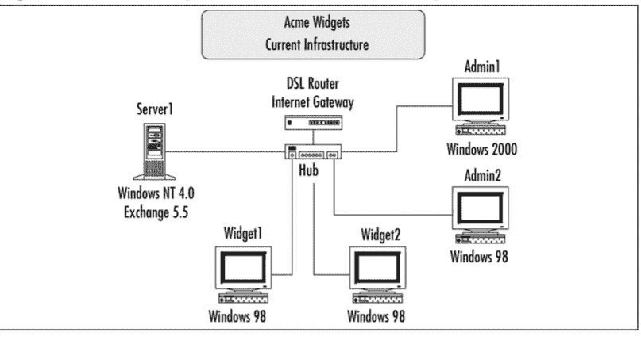

**图 1.2** Ballystyx Engineering 当前基础设施图

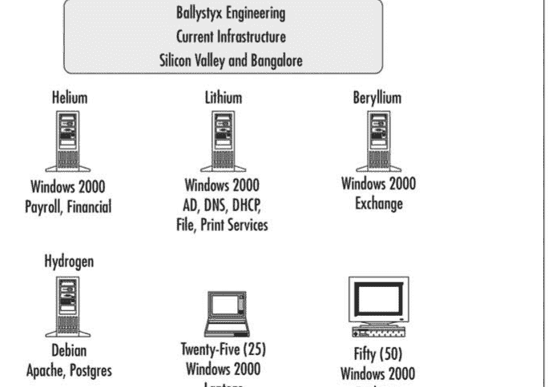

## 记录其他评估信息

如果时间允许且需要详尽的评估文档，还应记录以下各项：

- 硬件资产标签和/或序列号
- 硬件制造商和型号
- 计算机磁盘容量和利用率
- 网络设备制造商、型号和配置

### 确定 Linux 基础设施的需求

在完成现有基础设施的评估后，下一步是确定新 Linux 基础设施的需求。在所有情况下，我们将尝试提供至少与被替换的 Windows 基础设施相似的功能。在许多情况下，Linux 将提供易于利用的增强功能，特别是当需求在项目早期被确定时。

通常，需求必须基于业务需求来确定。仅仅因为软件支持某项功能就将其作为需求，这可能很有诱惑力。然而，部署和持续支持额外功能是有成本的，大多数营利企业都受这些成本因素驱动。当遇到这种情况时，准备一份“必须拥有”清单和一份“希望拥有”清单，或者简单地为每个需求分配优先级通常很有用。如果某项需求的成本（时间、培训、工时、支持）极低，即使其优先级较低，将其纳入项目也是可行的。

## 创建功能需求文档

功能需求文档（如表 1.3 所示）描述了基础设施必须提供的功能，才能被认为是合格的。功能需求列表稍后将用于创建测试计划。

表 1.3 显示了 Acme Widgets 的功能需求文档。该文档分为网络服务组，其组织方式与本书的网络服务迁移章节一致。当你使用此模板创建自己的功能需求文档时，将很容易跟随本书中介绍的网络服务迁移方法。

表 1.3 Acme Widgets 功能需求文档

| 服务 | 需求 |
|---|---|
| **1. 核心网络服务** | |
| 1.1 IP 地址分配 | 使用静态 IP 地址（无 DHCP） |
| 1.2 名称解析 | 使用 host 文件名称解析 |
| 1.3 时间同步 | 在所有计算机上安装时间同步软件 |
| **2. 目录服务** | |
| 2.1 目录服务 | 安装并配置 OpenLDAP |
| 2.2 目录服务迁移 | 将信息从 Exchange 和 NT SAM 迁移到 OpenLDAP |
| **3. 认证服务** | |
| 3.1 认证服务 | 安装并配置 Samba 认证服务 |
| 3.2 认证服务迁移 | 用户必须更改密码 |
| **4. 文件服务** | |
| 4.1 文件服务 | 安装并配置 Samba 文件服务 |
| 4.2 文件服务迁移 | 将所有文件数据复制到新服务器并设置网络共享 |
| **5. 打印服务** | |
| 5.1 打印服务 | 安装并配置 CUPS。 |
| 5.2 打印服务迁移 | 从 Windows 迁移打印队列信息 |
| **6. 消息服务** | |
| 6.1 MTA 服务 | 安装并配置 Courier-MTA |
| 6.2 邮件存储（MAA）服务 | 安装并配置 Courier-IMAP |
| 6.3 Webmail 服务 | 无 Webmail 需求 |
| 6.4 反垃圾邮件 | 由 ISP 提供 |
| 6.5 反病毒 | 由 ISP 提供 |

**表 1.3 Acme Widgets 功能需求文档**

| 服务 | 需求 |
|---|---|
| 6.6 消息服务迁移 | 迁移 Jim 的邮件存储信息 |
| **7. 群组软件和日历服务** | |
| 7.1 日历服务 | 安装并配置日历服务器 |
| 7.2 群组软件服务 | 待定 |
| 7.3 日历迁移 | 迁移 Jim 的日历信息 |
| 7.4 群组软件迁移 | 待定 |
| **8. Web 服务** | **无 Web 服务需求** |

## 识别约束条件

除了业务和/或技术需求外，还可能存在法律、成本、时间、组织或其他约束条件。约束条件可能会导致某些需求的修改或取消，或者改变事件的优先级或计划顺序。表 1.4 展示了约束条件的示例以及排除意外问题可能采取的必要步骤。

**表 1.4** 迁移约束条件与调整

| 约束条件 | 示例 | 解决方案 |
|---|---|---|
| 成本 | 没有足够的资金购买四台新服务器。公司目前只能负担得起一台。 | 不再使用新服务器构建 Linux 基础设施，除一台外的所有现有 Windows 服务器都将回收为 Linux 服务器。一台 Windows 服务器将用作测试实验室计算机。现在需要三台备用桌面工作站作为测试实验室计算机。 |


| 法律 | 由于保密问题，高管电子邮件和非高管电子邮件不得存储在同一台物理服务器上。 | 必须购买一台额外的服务器 |

| 时间 | 由于 Tom 休假，2 月 2 日至 2 月 16 日之间不能进行迁移。 | 迁移将重新安排在 2 月 16 日后的第一个周末 |

| 流程 | 由于公司月末计费流程，在每月的最后一天不能对计费系统进行备份或重启。 | 计费服务器的备份将在每月的最后一天暂停。任何需要重启的计费服务器维护工作将不再安排在每月的最后一天。 |

### 设计 Linux 基础设施

在确定需求之后，您可以开始对 Linux 基础设施进行高层设计。这类设计工作包括确定迁移后基础设施的整体服务器和网络策略。您将决定哪些系统将被保留，哪些系统将被更换、升级或增加。

在迁移的这个阶段，现在确定新基础设施的底层细节还为时过早。随着您阅读本书后续章节，您将获得每个网络服务组件的详细设计指南。

### 创建迁移后的基础设施设计

设计新基础设施需要确定服务器的数量、放置位置以及每台服务器上运行的具体服务。对于小型公司，一两台服务器通常就足以满足用户的需求。图 1.3 展示了一个适用于小型公司的迁移后基础设施设计。

**图 1.3 Acme Widgets 迁移后基础设施设计图**

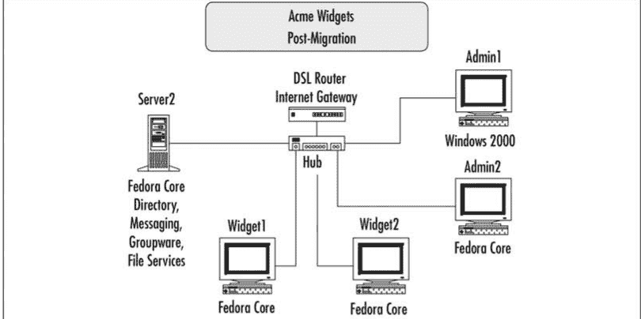

对于设有总部和分支机构的大型公司，典型的布置方式是将公司数据库服务器、内网服务器、消息服务器等安置在总部，而每个分支机构（规模/带宽/用户量足够大的）包含一台服务器，用于为该分支机构的用户运行文件服务，以及可能的身份验证、目录和/或电子邮件服务（见图 1.4）。这种布置将确保分支机构即使在广域网（WAN）和/或互联网中断期间也能保持高效运行且大部分功能可用。

**图 1.4 Ballastyx Engineering 迁移后基础设施设计图**

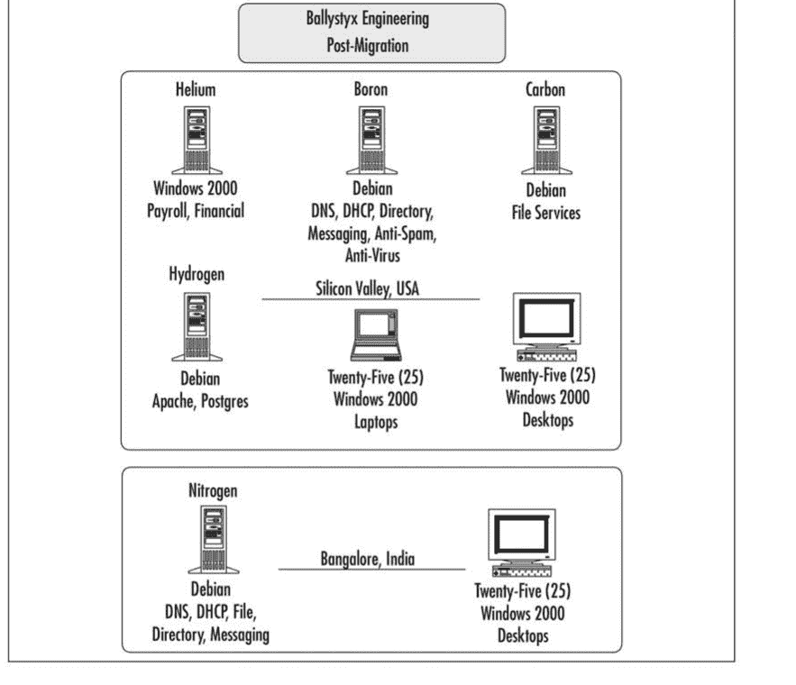

详细的设计工作涉及根据需求规格书记录服务器和应用程序的配置。本书中的每个网络服务章节都为各种环境下的网络服务应用程序配置提供了具体指南。

### 测试 Linux 基础设施

就像商业卡车司机在重要行程前会测试新卡车一样，在将新的 Linux 基础设施投入生产之前，对其进行彻底测试是有意义的。公司必须确保新基础设施的能力与被替换的基础设施相当或更强，并确保基础设施满足或超过功能需求。

测试计划记录了每个需求将如何进行测试。随着每个基础设施组件的部署，必须按照测试计划中的步骤进行测试。只有在成功通过所有测试后，基础设施才被认为是可以接受的。

## 创建测试计划

要创建测试计划，请利用您之前创建的功能需求文档。功能需求中的每个特性都将成为测试计划中的一个条目。对于复杂特性，测试步骤可能会非常冗长。

测试计划（见表 1.5）是一份包含被测需求以及每项需求如何测试描述的文档。测试计划的详细程度取决于需求的复杂程度和环境、执行工作的人员的经验和技能水平，以及项目经理的细致程度。

在 Acme Widgets，测试电子邮件功能的步骤是向互联网用户和内部用户发送一封测试邮件。由于 Sam 是一名经验丰富的系统管理员，他知道向自己的 Gmail 邮箱发送一条消息，并通过打开和阅读它来验证是否成功送达。由于环境简单——且 Sam 是迁移项目的唯一执行人员——简短的描述就足够了。

在环境和服务级别需求更复杂的大型公司中，测试电子邮件功能的步骤可能非常冗长，以至于需要一份单独的文档。Ballystyx Engineering 测试计划中的一个测试步骤是：“确保从硅谷工作站发送的 4KB 电子邮件在 5 分钟内到达班加罗尔的电子邮件服务器。”

**表 1.5 Acme Widgets 测试计划**

| 服务 | 测试步骤 |

|----------|-----------------|

| **1. 核心网络服务** | |

| 1.1 IP 地址分配 | 使用 `ping` 测试 IP 连通性。 |

| 1.2 名称解析 | 通过名称 `ping` 每个主机。 |

| 1.3 时间同步 | 验证每台计算机上的时钟是否正确。 |

| **2. 目录服务** | |

| 2.1 目录服务 | 使用 `gq` 验证 LDAP 查询是否可用。 |

| 2.2 目录服务迁移 | 使用 `gq` 验证 Exchange 和 NT SAM 中的条目是否已正确迁移到 OpenLDAP。 |

| **3. 身份验证服务** | |

| 3.1 身份验证服务 | 验证用户是否可以登录 Windows 和 Linux 桌面。 |

| 3.2 身份验证服务迁移 | 验证用户是否已将密码从默认值更改。 |

| **4. 文件服务** | |

| 4.1 文件服务 | 使用 `smbmount` 验证文件服务连通性。 |

| 4.2 文件服务迁移 | 验证所有文件是否成功复制。 |

| **5. 打印服务** | |

| 5.1 打印服务 | 打印测试页。 |

| 5.2 打印服务迁移 | 验证所有计算机是否能正常打印。 |

| **6. 消息服务** | |

| 6.1 MTA 服务 | 向互联网用户和内部用户发送测试电子邮件。 |

| 6.2 邮件存储 (MAA) 服务 | 使用 Outlook 和 Evolution 验证邮件存储访问。 |

| 6.3 Webmail 服务 | 无 Webmail 需求。 |

| 6.4 反垃圾邮件 | 由 ISP 提供。 |

| 6.5 反病毒 | 由 ISP 提供。 |

| 6.6 消息服务迁移 | 验证 Jim 的 Exchange 邮箱是否已正确迁移。 |

| **7. 群组软件和日历服务** | |

| 7.1 日历服务 | 创建测试预约和会议。 |

| 7.2 群组软件服务 | 待定。 |

**表 1.5** Acme Widgets 测试计划

| 服务 | 测试步骤 |

|:---|:---|

| 7.3 日历迁移 | 验证预约和会议是否已按预期复制。 |

| 7.4 群组软件迁移 | 待定。 |

| 8. Web 服务 | 无 Web 服务需求 |

强烈建议使用测试实验室。测试实验室提供了一个与生产网络分离或隔离的网络环境。硬件和软件配置的更改在生产网络测试或部署到生产用户之前，应先在实验室中进行测试。

### 部署 Linux 基础设施

在实验室测试成功后，可将 Linux 基础设施部署在生产网络上进行进一步测试。当确定新基础设施运行正常时，可以让一组样本用户（称为*试点小组*）测试新基础设施的功能，以确定从他们的角度来看是否运行正常。最佳实践是为每位试点用户提供测试指南和反馈表，然后通过面对面访谈来审查反馈。大多数试点小组最初包括 IT 人员和精通技术的用户，随后扩大到包括主流用户。重要的是，试点小组应包含整体群体的代表性样本，以便在迁移开始前识别并解决问题。

### 迁移至 Linux 基础设施

当你确定新的 Linux 基础设施在生产环境中按预期工作时，就可以开始将用户和系统迁移到新基础设施。IT 人员和试点小组通常是第一批迁移到新基础设施的人员。有多种因素可以决定接下来的迁移用户：

- 对 Linux 提供的新功能的需求（能力驱动）

- 业务部门或职能部门（业务组驱动）

- 办公地点（地理驱动）

管理迁移进度有多种方法，随着迁移组的规模和数量增加，迁移进度管理的重要性（以及复杂性）也会随之增加。在较大的迁移项目中，通常最好指定一名利益相关者和/或联系人，其职责是管理 IT 与其代表的组或办公室之间的沟通。此人可以帮助跟踪谁已准备好迁移，以及安排迁移的最佳日期和时间。理想的安排是由业务组联系人负责创建待迁移用户名单，以便 IT 组能够专注于实际的迁移过程并支持新用户。如果业务组和 IT 之间沟通良好，且各组的职责已被明确定义并接受，迁移过程将最为成功。

某些类型的迁移（如身份验证服务）对终端用户可能是透明的，或者至少在注销或重启后是透明的。虽然必须通知终端用户正在进行更改，但他们可能不需要采取任何操作。在其他情况下，迁移可能会产生较大影响，例如将主目录迁移到一个具有新名称的新服务器，或者更换新的电子邮件应用程序或 Web 浏览器。这类更改必须仔细计划并妥善沟通。在大量用户面临迁移的情况下，尽可能地将工作自动化是合理的。自动化迁移过程将有助于最大限度地减少 IT 员工的工作量并降低人为错误的可能性。

记得规划培训。如果正在部署新应用程序或更改当前流程，沟通这些知识并为受影响人员提供更新的文档和培训至关重要。项目将进行得更顺利，人们对迁移的感受也会更好，因为他们知道自己的需求得到了充分考虑。

最后，在所有迁移规划情况下，请遵循适当的变更管理程序。要求所有拟议的变更必须有完整的文档记录。在决策者和技术人员之间安排定期会议，以确保拟议的变更在签署批准前得到讨论和理解。

# 第 1 章 • 网络服务迁移路线图

## 总结

迁移规划和管理是 Windows 到 Linux 成功迁移的重要组成部分。在大型项目中，它是关键环节。你在这些规划活动中的初始投入将有助于确保迁移顺利进行。虽然这看起来工作量很大，但随附的模板将使你能够快速轻松地完成这项工作。

阅读本章后，你应该对 Windows 到 Linux 网络服务迁移所需的规划和管理步骤有清晰的了解。如果你一直遵循相关指令，你还将拥有完整的评估图、服务器清单、功能需求文档、高层 Linux 基础设施设计和测试计划。你已经在通往成功实现 Windows 到 Linux 网络服务迁移的道路上了！

## 解决方案快速通道

### 评估当前基础设施

- [x] 使用随附模板对服务器进行清单盘点。

- [x] 创建当前基础设施的基础设施图。

- [x] 如果可行，记录额外的评估信息。

### 确定 Linux 基础设施的需求

- [x] 使用随附模板创建功能需求文档。

- [x] 识别约束条件。约束条件通常表现为项目预算或进度的限制。

### 设计 Linux 基础设施

- [x] 创建迁移后的基础设施设计图。该图应指定服务器的数量和位置，以及每台服务器上运行的网络服务。

- [ ] 详细设计工作将在迁移过程的后期进行。

### 测试 Linux 基础设施

- [ ] 部署前需要对新基础设施进行测试。创建测试计划以辅助测试过程。

### 部署 Linux 基础设施

- [ ] 在实验室测试成功后，将 Linux 基础设施部署在生产网络上进行进一步测试。

- [ ] 让一组样本用户（试点小组）测试 Linux 基础设施，以确定其从终端用户角度是否可用。

### 迁移至 Linux 基础设施

- [ ] 当试点小组接受 Linux 基础设施后，你可以开始将其他用户和系统迁移到新基础设施。

- [ ] 当业务部门和 IT 的职责在开始详细迁移规划或实施前被明确定义并接受时，迁移进度安排的效果最好。

# 核心 TCP/IP 网络服务

本章解决方案：

- 理解 IP 地址分配服务

- 理解名称解析服务

- 理解时间同步服务

- 将 MS-DNS/DHCP 迁移到 Linux BIND/DHCPD

- ☑ 总结

- ☑ 解决方案快速通道

- ☑ 常见问题解答

## 简介

互联网协议 (IP) 地址构成了当今几乎所有在使用网络（包括互联网）的基础。假设读者已经理解（或雇佣了理解的人员）以下基础的传输控制协议 (TCP)/IP 知识：

- IP 地址和子网

- IP 数据包广播和路由

- TCP/UDP 套接字和语法

- 网络故障排除工具，如 `ping`、`traceroute`、`nmap`、`telnet` 和 `tcpdump`

- DNS 服务器、记录类型以及 `nslookup` 和 `dig` 等查询工具

如果你对这些网络概念不熟悉，你可能希望阅读互联网上可用的域名服务 (DNS) 和/或 TCP/IP 入门教程，或者考虑购买一本关于 TCP/IP 基础的图书，以帮助你理解以下主题。O’Reilly 的《DNS and BIND》提供了关于基于 Linux 的 DNS 服务的详细指南。

本章探讨了几乎所有使用 TCP/IP 网络的企业中都能找到的一些基本网络服务。DNS、DHCP（动态主机配置协议）和时间同步服务通常是网络上运行的首批服务，因为它们构成了能够利用本书中提到的所有其他网络服务所需的核心需求。如今，其中一些核心服务可能由专用设备或嵌入式设备提供，但本书将专门研究基于 Linux 的 DHCP/DNS 服务。关于时间服务的讨论包括利用许多公开可用的互联网时间服务器所需的正确设置。

下面简要讨论 DHCP、DNS 和时间服务。本章的其余部分将教授这些服务在 Microsoft 和 Linux 平台上的工作原理基础，并解释如何从 Microsoft DNS/DHCP 迁移到基于 Linux 的 BIND/DHCPD 服务。

DHCP 是一种网络协议，它可以动态分配 IP 地址和网络配置参数以正确配置主机。虽然大多数服务器使用静态 IP 地址，但工作站通常接收动态分配的 IP 地址以及其他网络信息，使其能够与网络上的其他主机通信。几乎所有组织都使用 DHCP 服务器来分配动态网络信息。我们将探讨获取初始 DHCP 租约的过程，以及 DHCP 租约的续租过程。

名称解析服务是计算机网络基础设施的另一个重要组成部分。将易于记忆的英文单词（计算机主机名）翻译成 IP 地址的能力，构成了从小型企业局域网（LAN）到全球互联网等各种规模和类型的计算机网络的核心可用性基础。如果没有名称解析服务，人们将不得不使用难以记忆的 IP 地址，而不是易于记忆的名称。DNS 为 Windows 和 Linux 提供了这些功能。我们将研究 Windows 和 Linux DNS 服务的配置，以方便将这些服务迁移到您的 Linux 平台。

本章探讨的最后一个核心网络服务是同步所有计算机时钟的能力。虽然计算机网络的部分功能在时钟不同步的情况下仍能正常运行，但某些网络服务要求计算机时钟之间的误差在几分钟以内。此外，在检查时钟不同步的计算机日志文件时，分析和关联事件会变得非常困难。FBI 的顶级 IT 建议之一是同步所有计算机时钟，以便在取证分析期间更容易地跟踪数据轨迹。

### 理解 IP 地址分配服务

在互联网和企业环境中，大多数服务器使用静态 IP 地址分配。静态 IP 地址配置与动态地址在以下几个基本方面有所不同：

表 2.1 静态和动态 IP 配置的区别

| 静态 IP 地址分配 | 动态 IP 地址分配 |

| :--- | :--- |

| IP 地址信息极少更改 | IP 地址信息预计会发生更改 |

| 迁移或维护后更改 IP 地址 | 物理位置的改变会更改 IP 地址信息 |

| IP 地址信息存储在本地 | IP 地址信息在本地缓存，存储在外部 |

| 不需要外部服务器 | IP 地址信息由 DHCP 服务器分配 |

大多数笔记本电脑和台式机不使用静态 IP 地址。相反，IP 地址是从 DHCP 服务器租用的。在重启或租约到期后，工作站将联系 DHCP 服务器以续租或获取新的 IP 地址。这种设置的主要好处是，无需为每个客户端单独设置网络配置，并且未来发生的任何网络更改都可以在客户端续租网络租约时传播给它们，如下文所述。

## 理解 DHCP 客户端

DHCP 客户端是指任何利用 DHCP 获取其 IP 地址信息的网络设备——无论是计算机、打印机还是支持网络的吉他。当 DHCP 客户端的网络接口启动时，设备将尝试租用一个 IP 地址。租用新 IP 地址的步骤是一个四步过程，通常被称为“四次握手”。

### 获取初始 DHCP 租约

计算机第一次上线时，不知道任何关于 DHCP 服务器的信息。因此，计算机必须发送广播请求以发现 DHCP 服务器。

#### 发现 DHCP 服务器

为了启动 DHCP 租约过程，客户端从 UDP（用户数据报协议）端口 68 向 UDP 端口 67 发送一个广播模式的 DHCP-DISCOVER 数据包。该数据包的源地址为 0.0.0.0，目的地址为 255.255.255.255。

图 2.1 发现 DHCP 服务器


#### 接收 DHCP 租约提供 (Offer)

在本地子网中监听的 DHCP 服务器会对 DHCP-DISCOVER 广播请求做出响应。在较大的网络中，交换机、路由器或其他 DHCP 中继代理可能会转发 DHCP 数据包。如果请求有效且有可用 IP 地址，DHCP 服务器将回复一个 DHCP-OFFER 数据包。此提供内容包括客户端 IP 地址、子网掩码和默认路由器。

图 2.2 接收 DHCP 租约提供

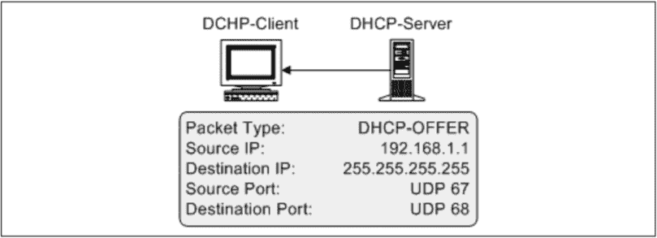

#### 选择并接受 DHCP 租约

如果 DHCP 服务运行正常，客户端将收到至少一个 DHCP-OFFER。客户端选择一个租约提供（通常是接收到的第一个提供），并向 DHCP 服务器发送一个 DHCP-REQUEST 数据包。虽然客户端知道 DHCP 服务器的 IP 地址，但该数据包仍以广播模式发送，以便其他 DHCP 服务器也能知道哪个 DHCP-OFFER 被选中了。

图 2.3 接受 DHCP 租约

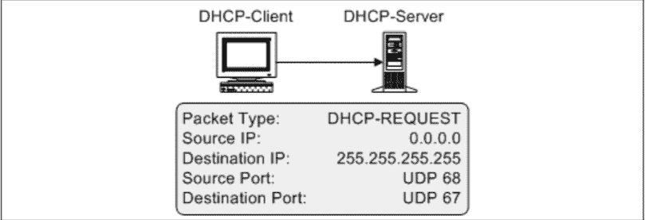

#### 接收 DHCP 租约分配确认

在收到 DHCP-REQUEST 数据包后，DHCP 服务器发送一个 DHCP-ACK 数据包以确认 DHCP 租约分配。该数据包以广播模式发送，以便其他 DHCP 服务器知道哪个 DHCP-REQUEST 数据包已被确认。

图 2.4 接收 DHCP 租约分配确认

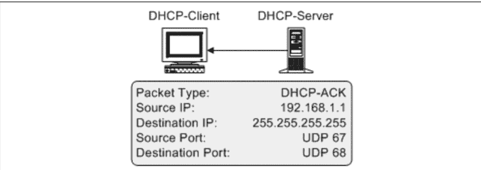

收到 DHCP-ACK 数据包后，客户端正式进入网络，并拥有有效的 IP 地址、子网和默认路由器。后续与（同一台）DHCP 服务器的通信将通过单播数据包进行。

如果收到来自客户端的 DHCP-REQUEST 数据包存在问题，服务器将发送一个 DHCP-NACK 数据包并等待客户端重试。

### 续租 DHCP 租约

当租约总时间的 50% 到 90% 已过时，DHCP 客户端将尝试续租。续租的步骤与初始 DHCP 租约四次握手过程的最后两步类似。

#### 请求 DHCP 租约续租


在租约到期之前，客户端向 DHCP 服务器发送一个 `DHCP-REQUEST` 数据包。该数据包包含客户端当前的 IP 地址设置。

图 2.5 请求 DHCP 租约续租

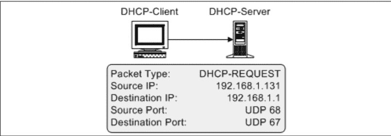

### 接收 DHCP 租约续租确认

在收到 `DHCP-REQUEST` 续租数据包后，DHCP 服务器发送一个 `DHCP-ACK` 数据包确认 DHCP 租约续租。如果收到来自客户端的 `DHCP-REQUEST` 数据包存在问题，服务器将发送一个 `DHCP-NACK` 数据包。

图 2.6 接收 DHCP 租约续租确认

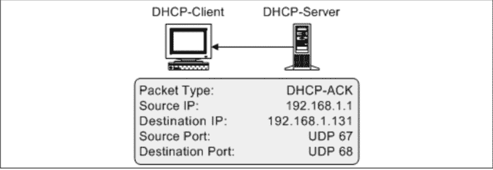

### 释放 DHCP 租约

DHCP 通信过程的最后一步是释放 DHCP 租约。在网络接口的关闭序列期间，DHCP 客户端向 DHCP 服务器发送一个 `DHCP-RELEASE` 数据包。DHCP 服务器终止客户端的 DHCP 租约，并将 IP 地址返回到可用 IP 地址池中。


## 示例与练习

### 收集和分析 DHCP 流量

在深入分析某个主题时，没有什么能替代真实世界的数据收集。收集 DHCP 流量最简单的方法是在 DHCP 服务器上运行 `tcpdump`。要在 `eth0` 上收集 DHCP 数据包并将其写入文件 `/dhcp-sniff`，请输入以下命令：

```
tcpdump -i eth0 -w /dhcp-sniff udp port 67 or udp port 68
```

数据包收集完成后，按下 `Ctrl + C` 停止 `tcpdump`。接下来，使用以下命令启动 `ethereal`：

```
ethereal /dhcp-sniff
```

这将浏览并以图形化方式分析 DHCP 数据。有关 Ethereal 的更多信息，请参考阅读 *Ethereal Packet Sniffing (Syngress)*。

### 配置 DHCP 服务器

既然您已经了解了 DHCP 客户端如何与 DHCP 服务器通信，让我们详细看看服务器配置。我们将使用 Internet System Consortium (ISC) 的 DHCP (www.isc.org/sw/dhcp/) 来演示 DHCP 服务器的工作原理。`DHCPD` 是世界上最流行的开源 DHCP 服务器，也是 Linux 上的首选 DHCP 服务器。

`DHCPD` 将其配置信息存储在 `dhcpd.conf` 中。下面列出的是 Ballystyx 在硅谷和印度服务器迁移后的 `dhcpd.conf` 文件的重要部分。我们将在本章稍后讨论 `ddns-update-style` 条目。这些信息可以在配置您的 DHCP 服务器时用作模板。所有时间值均以秒为单位。

```
ddns-update-style ad-hoc;

# Ballystyx Silicon Valley
subnet 192.168.1.0 netmask 255.255.255.0 {
        range 192.168.1.130 192.168.1.250;
        default-lease-time 43200;
```

```
max-lease-time 86400;

option routers 192.168.1.1;
option subnet-mask 255.255.255.0;
option broadcast-address 192.168.1.255;

option domain-name "ballystyx.com";
option domain-name-servers 192.168.1.12, 192.168.2.10;
}
```

```
# Ballystyx India
subnet 192.168.2.0 netmask 255.255.255.0 {
    range 192.168.2.130 192.168.2.250;
    default-lease-time 43200;
    max-lease-time 86400;

    option routers 192.168.2.1;
    option subnet-mask 255.255.255.0;
    option broadcast-address 192.168.2.255;

    option domain-name "ballystyx.com";
    option domain-name-servers 192.168.2.10, 192.168.1.12;
}
```

请注意，Ballystyx 使用了两个 DNS 服务器：`192.168.1.12` 和 `192.168.2.10`。在硅谷，主 DNS 服务器是 `192.168.1.12`，备用 DNS 服务器是 `192.168.2.10`。在印度，情况则相反。这确保了每个 DHCP 客户端将首先尝试联系本地 DNS 服务器。

## 安全提示

### 什么是 Rogue DHCP 服务器（伪造 DHCP 服务器）？

虽然 DHCP 看起来简单且无害，但它存在一个潜在的安全缺陷。如果一名恶意黑客在你的网络中设置了一个 Rogue DHCP 服务器，并向 DHCP 客户端提供伪造的信息会怎样？这种伪造的信息可能包括：

- 无效的 IP 地址，例如那些已经在其他地方被使用的地址。这将导致 IP 地址冲突以及各种网络故障和麻烦。

- 无效的路由信息，例如伪造路由器的 IP 地址，或者在黑客控制的计算机上运行的路由进程。

- 无效的 DNS 信息，例如伪造的 DNS 服务器。这可以禁用客户端的名称解析功能，或者让伪造的服务器看起来像是一个合法站点。

如你所见，由于如此多的功能依赖于对 IP 地址和租约的正确管理，Rogue DHCP 服务器会导致大量网络麻烦。幸运的是，有办法防御和/或防止 Rogue DHCP 服务器问题：

- **网络探测（Network Probing）**：发送各种类型的 DHCP 数据包以定位网络中的 DHCP 服务器。如果响应的 DHCP 服务器与已知 IP 地址列表（或你选择的其他访问控制方法）不匹配，则通知管理员和/或封锁该 IP 地址。

- **入侵检测集成**：配置你的入侵检测引擎以记录 UDP 端口 67/68 的数据包，并对可疑流量发出警报。

- **路由器和交换机配置**：在路由器和交换机上针对 UDP 端口 67/68 的数据包设置限制。

请注意，DHCP 服务可能会短时间失效，但网络仍将继续运行，特别是如果没有机器移动且租约过期时间足够长的情况下。然而，建立一个监控流程，在 DHCP 服务没有响应时通知管理员是一个好主意。

### 理解名称解析服务

正如本章前面提到的，将易于记忆的英文单词（计算机主机名）转换为 IP 地址的能力，构成了所有规模和类型计算机网络的核心可用性基础。人们输入（和记忆）`www.google.com` 比输入 `216.239.39.99` 要容易得多。

名称解析服务与互联网本身一样古老且多样。最初，所有互联网主机名都存储在单台服务器上的一个文本文件中。显然，这种方法无法良好扩展，因为处理该文本文件的频繁下载需要越来越多的带宽和计算能力。如今，管理主机名到 IP 转换服务主要有两种方法：基于文件的和基于 DNS 的。我们将在接下来的章节中详细探讨这两种方法。

### 理解基于文件的名称解析

最简单的名称解析方法是将所有名称及其对应的 IP 地址存储在本地文件中。在大多数情况下，该文件简单地被命名为 `hosts`。下面的列表包含了 Acme Widgets 公司的 `hosts` 文件：

```
127.0.0.1        localhost           localhost.localdomain
192.168.100.1 router1              router1.acmewidgets.com
192.168.100.2 server1              server1.acmewidgets.com
192.168.100.3 admin1               admin1.acmewidgets.com
192.168.100.4 admin2               admin2.acmewidgets.com
192.168.100.5 widget1              widget1.acmewidgets.com
192.168.100.6 widget2              widget2.acmewidgets.com
192.168.100.7 printer1             printer1.acmewidgets.com
192.168.100.8 printer2             printer2.acmewidgets.com
```

如你所见，这为小型局域网提供了所有基础的名称查找能力。然而，这种方法没有提供其他功能，例如动态名称注册或记录过期。

使用 `hosts` 文件在 Windows 和 Linux 中都很常见。以下是该文件在各种操作系统版本中的常见位置。

**表 2.2** 各种操作系统中的 Hosts 文件位置

| 操作系统 | Hosts 文件位置 |
|-------------------|----------------------|
| Linux 各版本 | `/etc/hosts` |
| Windows 95 / 98 / Me | `C:\Windows\hosts` |
| Windows NT / 2000 / XP | `C:\Winnt\system32\drivers\etc\hosts` |

在很多情况下，Windows 安装目录将被命名为 `WINNT`。在其他情况下，它将被命名为 `WINDOWS` 或由安装操作系统的人员选择的其他名称。

### 理解 DNS 名称解析

虽然基于文件的名称解析可以满足基本需求，但它的局限性太大，除了极小规模的静态 IP 网络外，在其他场景中几乎没有用处。它无法提供像 DNS 这样动态分布式系统的可用性、可扩展性或功能。DNS 是 Windows（2000 及更高版本）和 Linux 系统中将名称解析为 IP 地址的主要方式，同时也是互联网公认的名称解析机制。

DNS 如此具有可扩展性的原因之一是名称解析被分为多个域（例如 `syngress.com`），且每个域的名称解析服务可以分布在多台机器上，以实现冗余和可用性。一个域的 DNS 问题通常不会影响其他域。如果一台服务器不知道 DNS 查询的答案，它会自动将客户端引导至该域的权威 DNS 服务器。

全球由各种组织维护着 13 台顶级 DNS 服务器（称为 *根服务器 (root servers)*）。其中大约一半的服务器物理位置在美国。有关这些根服务器的更多信息可以在 `www.root-servers.org` 找到。

除了名称到 IP 的解析服务外，DNS 还可以提供 IP 到名称的解析服务。这种反向查找功能通过使用 `in-addr.arpa` 域和 PTR（指针）资源记录来管理。如果一个 DNS 客户端想知道 IP 地址为 `192.168.1.12` 的主机的名称，客户端将对记录 `12.1.168.192.in-addr.arpa` 执行 PTR 查找。对该子网具有权威的 DNS 服务器将返回与该 IP 地址相关联的名称。反向查找常用于验证服务器名称，特别是在发送电子邮件的情况下。所有可访问互联网的主机都应该有一个 PTR 条目，以允许反向查找查询成功。对于内部 DNS，也强烈建议使用 `in-addr.arpa` 反向查找区域。

#### 理解动态 DNS (DDNS)

在 DNS 的早期阶段，条目是通过手动编辑一个文本文件（称为区域文件 zone file）来管理的，该文件列出了名称、IP 地址和记录类型。在那个时代，计算机很少更改 IP 地址，信息基本保持静态。偶尔手动编辑一次区域文件——添加/更改名称和 IP 信息并更新序列号——就足够了。

随着动态分配 IP 地址的出现，手动编辑 DNS 区域文件对于繁忙的网络管理员来说不再是一个现实的选择。需要一种动态注册计算机名称的方法。这就是 RFC 2136 和动态 DNS (DDNS) 的基础。在本书的其余部分中，DNS 将指代包含动态 DNS 的 DNS。

在 DDNS 环境中，客户端（或 DHCP 服务器）根据起始权威 (SOA) 记录的定义，将其名称和 IP 地址注册到其域的权威名称服务器中。客户端还会在其子网的 SOA `in-addr.arpa` 域中注册 PTR 记录。

#### 为动态 DNS 配置 BIND 和 DHCP

在默认配置中，Windows 2000 和 Windows XP 客户端在获得 IP 地址后会自动使用动态 DNS 注册自己。`dhcpd.conf` 中的以下条目允许这种情况正确发生：

```
ddns-update-style ad-hoc;
```

如果你的网络中有 Windows 98 和 NT 客户端，它们不会自动通过动态 DNS 注册。相反，可以将 DHCP 服务器配置为注册它们的主机名以及其 IP 地址的 PTR/TXT 资源记录。

```
ddns-update-style interim;
```

`interim` DDNS 更新风格与（即将批准的）RFC 标准略有不同，但在处理低版本客户端时非常有效。要了解更多关于此项以及 `dhcpd` 的其他信息，请在 shell 提示符下输入 `man dhcpd.conf`。

要配置 BIND 以允许动态 DNS 更新，请确保 `named.conf` 中包含以下行：

```
allow-update;
```

> **提示**
>
> Windows Internet 命名服务（WINS）是一种用于 Microsoft 网络（尤其是 NT 和 Windows 3.x/95/98 网络）的旧版命名服务。在 Microsoft 网络之外，WINS 几乎没有用途，甚至 Microsoft 已经弃用它而改用 DNS。如果在迁移后您绝对需要 WINS 服务器，Samba（本书稍后将介绍）具备此功能。然而，在几乎所有情况下，现代操作系统都首选并专门使用 DNS。

### 理解时间同步服务

时间同步的重要性怎么强调都不为过。确保客户端和服务器的时钟被设置为正确的时间至关重要。如果时间差（称为 *时钟偏移 clock skew*）超过五分钟，某些服务（如 Kerberos）将无法运行。其他服务可能会出现运行异常，例如电子邮件服务器显示邮件在实际发送前 10 分钟就已收到。此外，如果不能保持时钟精度，将很难对计算机和网络服务的问题进行故障排除。在尝试将多台计算机上的日志条目进行关联时，情况尤其如此。

实现时间同步有多种方式（和协议），但最流行且经受时间考验的是网络时间协议（NTP）。

### 理解网络时间协议

对于所有现代操作系统，NTP 是实现计算机之间时间同步的首选协议。NTPv3 在 RFC 1305 中定义。NTPv4 尚未有正式的 IETF RFC 草案，但已在当前的 NTP 软件套件版本中实现。NTP 的一个子集称为简单网络时间协议（SNTP），定义在 RFC 2030 中，可用于时间服务器与客户端之间的网络延迟极低的情况，例如在企业局域网（LAN）中。在默认配置下，Windows 2000/XP 计算机使用 SNTP 与 Windows 服务器同步时间。

NTP 的功能基于主时间服务器（称为 *层级 1 服务器 stratum 1 servers*）的概念，这些服务器从高度精确的源（如本地连接的全球定位系统 (GPS) 或铯原子钟）获取正确时间。与层级 1 服务器同步的服务器称为层级 2 服务器——即源服务器的层级加 1。随着层级数字的增加，时间的准确度可能会略有下降。

时间同步的主要问题在于如何计算网络延迟、数据包处理时间和不准确的时间服务器。例如，如果时间服务器发送一个数据包，指示“现在时间正好是 12:00:00；请将你的时钟设置为 12:00:00”，而数据包需要两秒钟才能到达目的地，那么客户端计算机的时钟就会慢两秒。如果客户端需要一秒钟来处理该数据包，那么客户端计算机的时间就会慢三秒。

NTP 通过多种方式克服了这些问题：

- 使用客户端和服务器的时间戳来测量网络延迟。

- 计算处理网络数据包所需的时间。

- 使用来自多个服务器的多个样本来确保准确性。

- 将产生不一致或不准确结果的服务器列入黑名单。

NTP 使用 UDP 端口 123。更多关于 NTP 的信息可以在 `www.ntp.org` 找到。

#### 理解 Linux NTP 客户端

Linux 上最流行的 NTP 客户端是由 ntp.org 实现的版本。Ntp.org 生产了一套完整的支持 NTPv3 和 NTPv4 的客户端和服务器套件。该套件包括：

- `ntpq` 用于查询 NTP 服务器。

- `ntpd` 维护本地时钟的准确性，并（可选地）向客户端提供 NTP 服务。

- `ntptrace` 追踪 NTP 服务器链直到源服务器。

- `ntpdate` 一次性时钟更新程序（即将弃用）。

`Ntpd`（NTP 守护进程）可以作为 NTP 客户端和/或服务器运行。如果您将一台或多台 Linux 服务器配置为 NTP 服务器，您可以为内部基础设施提供时间同步服务。然而，这并不总是像看起来那样理想。如果恶意黑客（或不熟练的系统管理员）修改了时间服务器的时钟，且没有正确的可用时间数据，这种影响可能会传播到所有与该时间服务器同步的计算机。

更好的选择是在所有 Linux 计算机上运行 `ntpd` 服务，并将其设置为与互联网上的一组层级 2 和/或层级 3 服务器同步。虽然可以使用层级 1 服务器进行时间同步，但除非您向互联网提供层级 2 时间服务，否则使用这些服务器被认为是不符合网络礼仪（netiquette）的。层级 2 和 3 服务器能提供足够准确的时间。

`ntpd.conf` 文件控制 `ntpd` 的配置设置。默认配置文件通常就足够了。如果您想使用 `pool.ntp.org` 列出的 NTP 服务器集合，请在 `ntpd.conf` 中加入以下行：

```
server pool.ntp.org
```


您可以通过输入`man ntpd`了解更多关于`ntpd`和`ntpd.conf`的信息。访问`www.pool.ntp.org`获取有关`ntp.org`时间服务器池的更多信息。

## 理解 Windows 时间服务客户端

Windows 2000 和 Windows XP 附带了 Microsoft 的 SNTP 客户端——Windows 时间服务（Windows Time Service）。当计算机加入域时，Windows 时间服务会自动激活。对于非域成员的 Windows 计算机，必须手动启动该服务。

在 Windows 2000 和 Windows XP 中，可以使用以下命令与`pool.ntp.org`时间服务器同步时钟：

```
net time /setsntp:pool.ntp.org
```

在很多情况下，Windows 会报告“命令成功完成”，但时间并未被设置。此外，此命令在 Windows 98 或 NT 中不起作用。

对于 Windows 时间同步，更好的选择是 Automachron。Automachron 是一款免费软件，可以在`www.oneguycoding.com/automachron/`找到。与 Windows 时间服务不同，Automachron 支持所有 32 位 Windows 版本，并具有易于使用的图形用户界面（GUI）进行配置。Automachron 对话框如图 2.7 所示。

**图 2.7 Automachron 配置对话框**

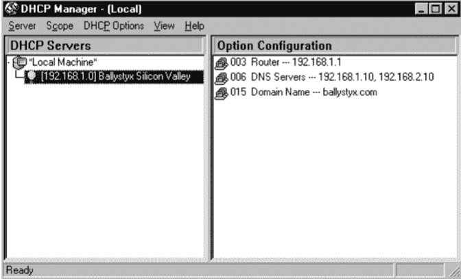

如果您觉得 Automachron 有用，请访问`www.oneguycoding.com`并考虑通过 PayPal 进行捐赠。

> **安全提示**
>
> **NTP 流量**
>
> 为了与互联网时间服务器同步，请确保您的防火墙配置为允许 UDP 端口 123 的入站和出站流量。出于安全原因，最好将 NTP 流量仅限制在您组织所使用的 NTP 服务器的 IP 地址上。

## 将 MS-DNS/DHCP 迁移到 Linux BIND/DHCPD

本迁移章节涵盖了 DHCP 的迁移和 DNS 的迁移。虽然这是两次独立的迁移，但由于 DHCP 和 DNS 之间的互连性，必须协调执行。

### 迁移 DHCP 范围和选项

从基于 Windows 的 DHCP 迁移到基于 Linux 的 DHCP 主要包括：确定所有的范围（scopes）和重要的范围选项，配置 DHCPD 以使用这些信息，关闭 Microsoft DHCP 服务，并启动 Linux DHCP 服务。

#### 在 Windows NT 上确定 DHCP 范围和选项

迁移 DHCP 服务的第一步是确定由 MS-DHCP 提供的所有 DHCP 范围及其每个范围的详细属性。

在 Windows NT 4.0 Server 中，这是通过 DHCP 管理器（`dhcpadmin.exe`）完成的。要使用鼠标访问 DHCP 管理器（见图 2.8），请选择**开始** | **程序** | **管理工具** | **DHCP 管理器**。

**图 2.8 Windows NT DHCP 管理器 - Ballystyx Silicon Valley**


如上图所示，列出了该 DHCP 服务器提供的每个范围以及该范围的 DHCP 选项。要获取范围属性信息（图 2.9），请选择**范围** | **属性**。

**图 2.9 Windows NT DHCP 管理器 - 范围详情**

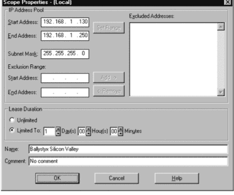

#### 在 Windows 2000 上确定 DHCP 范围和选项

要在 Windows 2000 服务器中获取 DHCP 范围和 IP 地址信息，请选择**开始 | 程序 | 管理工具 | DHCP**。如下面的图 2.10 所示，列出了 DHCP 服务器提供的每个范围，以及 DHCP 地址池、租约、保留和范围选项。点击地址池即可获取该范围提供的 IP 地址范围。

**图 2.10 Windows 2000 DHCP 管理器 - 地址池范围**

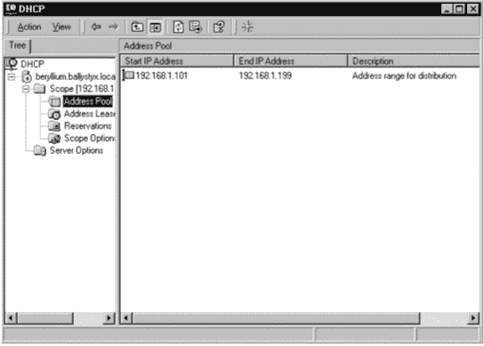

若要确定作用域选项详情，请点击 Scope Options（图 2.11）。

**图 2.11** Windows 2000 DHCP 管理器 - 作用域选项详情

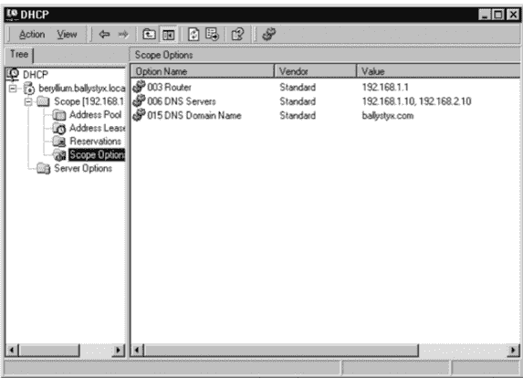

### 记录 DHCP 作用域和选项

将所有的 DHCP 信息记录在纸上、文本文件或电子表格中。您必须收集的最少信息量列在下表 2.3 中。如果您的 DHCP 服务器版本中没有列出默认租约时间，您可以将默认租约时间设置为最大租约时间或最大租约时间的 50%。

**表 2.3** DHCP 作用域和选项信息

| 组件 | 值 |
|-----------|----------|
| 子网 | 192.168.1.0 |
| 子网掩码 | 255.255.255.0 |
| 范围 | 192.168.1.130 至 192.168.1.250 |
| 默认租约时间 | 43200 秒 |
| 最大租约时间 | 86400 秒 |
| 路由器 | 192.168.1.1 |
| 子网掩码 | 255.255.255.0 |
| 广播地址 | 192.168.1.255 |
| 域名 | ballystyx.com |
| 域名服务器 | 192.168.1.12, 192.168.2.10 |

在收集并记录了每个 DHCP 作用域的所有信息后，您就可以配置 Linux DHCP 基础设施了。

### 配置 ISC DHCPD 服务器

要设置基于 Linux 的 DHCP 服务，请在测试实验室服务器上编译并安装当前的 ISC DHCP 服务器软件包，或从您的 Linux 发行版安装当前的 DHCP 服务器软件包。启动您喜欢的文本编辑器并编辑`dhcpd.conf`文件。对于 Ballystyx Silicon Valley，`dhcpd.conf`如下所示：

```
ddns-update-style ad-hoc;

# Ballystyx Silicon Valley

subnet 192.168.1.0 netmask 255.255.255.0 {
    range 192.168.1.130 192.168.1.250;
    default-lease-time 43200;
    max-lease-time 86400;

    option routers 192.168.1.1;
    option subnet-mask 255.255.255.0;
    option broadcast-address 192.168.1.255;

    option domain-name "ballystyx.com";
    option domain-name-servers 192.168.1.12, 192.168.2.10;
}
```

启动 DHCPD。验证测试实验室工作站是否接收到了 IP 地址分配和相应的 DHCP 选项。

### 从 Microsoft DHCP 服务迁移到 Linux DHCP 服务

将经过验证的`dhcpd.conf`文件从测试实验室服务器复制到生产环境的 Linux DHCP 服务器上。停止 Microsoft DHCP 服务。启动 Linux DHCP 服务。启动工作站并测试 DHCP 功能，确保 Windows 桌面和其他客户端能够正确接收 IP 地址和其他 DHCP 信息。

### 回滚失败的 DHCP 迁移

在某些情况下，新的 Linux DHCP 服务可能无法正常工作，导致工作站无法接收 IP 地址。如果发生这种情况，请停止 Linux DHCP 服务并重新启动 Microsoft DHCP 服务。在实验室环境中重复测试，并在必要时使用 DHCP 嗅探程序（在上述侧边栏中描述）来排除故障。

### 迁移 DNS 信息

将 DNS 信息从 MS-DNS 迁移到 BIND 有多种方法。如果 DNS 条目数量较少，可以通过复制和粘贴信息手动完成迁移。DNS 信息可以从 Microsoft 的 DNS 管理器或`C:\WINNT\system32\dns\`及其子目录中的`.dns`文件中获取。然而，如果条目较多，这种方法可能会非常耗时。对于大多数组织来说，传输信息最简单的方法是使用 DNS 区域传输 (AXFR) 机制。

#### 安装和配置 BIND

在测试实验室服务器上编译并安装当前的 ISC BIND 软件包，或从您的 Linux 发行版安装当前的 BIND 服务器软件包。启动您喜欢的文本编辑器并编辑 BIND 的配置文件`named.conf`。`named.conf`中的`ballystyx.com`条目如下所示：

```bind
zone "ballystyx.com" {
    type master;
    file "/etc/bind/ballystyx.com.hosts";
};
```

#### 传输 DNS 信息

大多数 Windows DNS 服务器默认配置为允许 DNS 区域传输 (AXFR)（这对安全性来说很危险，但对迁移非常有用！），因此此选项通常可用或可以开启。在 Windows 2000 中，您可以通过启动 DNS 管理器，展开**正向查找区域**，右键单击域名并选择**属性**来验证设置。选择**区域传输**选项卡，并确保勾选了**允许区域传输**，如图 2.12 所示。

图 2.12 Windows 2000 DNS 管理器区域传输对话框

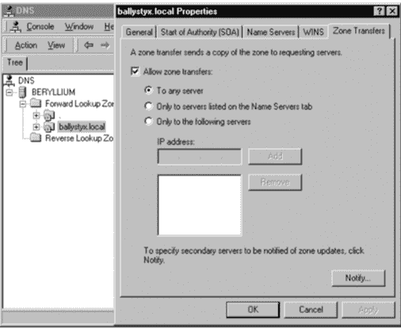

以下命令将在 Ballystyx 执行 DNS 区域传输：

```
dig @lithium ballystyx.com axfr
```

这将列出`ballystyx.com`域名中的所有记录。其格式与 BIND 区域文件的格式类似。`dig`的输出如下所示：

```
; <<>> DiG 9.2.4rc5 <<>> @lithium ballystyx.com axfr
;; global options: printcmd

ballystyx.com.		3600	IN	SOA	lithium.ballystyx.com.
admin.ballystyx.com.	5	3600	600	86400	3600

ballystyx.com.		3600	IN	NS	lithium.ballystyx.com.
hydrogen.ballystyx.com.	3600	IN	A	192.168.1.10
helium.ballystyx.com.	3600	IN	A	192.168.1.11
lithium.ballystyx.com.		3600	IN	A	192.168.1.12
beryllium.ballystyx.com.		3600	IN	A	192.168.1.13
; Query time: 2 msec
; SERVER: lithium#53(192.168.1.12)
; WHEN: Sat Jul 24 08:07:27 2004
; XFR size: 6 records
```

您可以手动复制这些记录并将其粘贴到 BIND 区域文件中，或者使用 Webmin 等图形化配置工具输入数据。如果 DNS 条目较少，此方法效果最好。完成后，区域文件如下所示：

```
ballystyx.com. IN	SOA	lithium.ballystyx.com. admin.ballystyx.com. (
5
3600
600
86400
3600 )

ballystyx.com. IN	NS	lithium.ballystyx.com.
hydrogen.ballystyx.com.		IN	A	192.168.1.10
helium.ballystyx.com.	IN	A	192.168.1.11
lithium.ballystyx.com.		IN	A	192.168.1.12
beryllium.ballystyx.com.		IN	A	192.168.1.13
```


另一种方法是使用随附的迁移脚本`migrate-dns`，自动将 DNS 信息从 Windows 传输到 Linux。这种方法即使对于较大量的 DNS 条目也非常有效。

将 DNS 信息传输到测试实验室的 BIND 服务器，并通过查看区域文件和执行 DNS 查询来确保信息已正确传输。

#### 从 Microsoft DNS 服务迁移到 Linux DNS 服务


当您确定 Linux BIND 服务器配置在实验室中正常工作后，将经过验证的`named.conf`文件复制到生产环境的 Linux BIND 服务器上。然后手动或使用`migrate-dns`迁移脚本执行区域传输。如果名称和/或 IP 地址不同，您必须修改 SOA 和 NS 条目以反映新的 Linux DNS 服务器。

启动工作站并测试 DNS 功能，确保 Windows 桌面和其他客户端能够正确地将名称转换为 IP 地址。如果您使用 DDNS 来注册 DHCP 客户端，请确保客户端已在 DNS 中正确注册。如果您提供 DNS 反向查找功能，请确保在相应的`in-addr.arpa`区域中注册了 PTR 资源记录。

如果您使用了 DHCP 服务，且 IP 地址发生了变化，您必须修改`dhcpd.conf`中的`domain-name-servers`条目以包含新的 Linux DNS 服务器。如果此时可以重启工作站，请执行该操作。这将确保它们接收到更新的 DNS 信息，并测试本章中迁移到 Linux 服务器的所有功能。如果重启造成的影响太大，强制 DHCP 租约更新是一个可行的选项。

#### 回滚失败的 DNS 迁移

在某些情况下，新的 Linux DNS 服务可能无法正常工作，或者 DDNS 名称注册服务可能失效。如果发生这种情况，请尝试更改`ddns-update-style`条目。如果功能仍然无法正常工作，请停止 Linux DNS 服务并重新启动 Microsoft DNS 服务。在实验室环境中重复测试，并在必要时嗅探 53 端口流量以排除故障。如果您能确定并解决问题原因，请重新尝试迁移。

Microsoft 表示，Active Directory 将与任何支持动态 DNS (RFC 2136) 和 SRV 资源记录 (RFC 2782) 的 DNS 服务器（如 BIND 9）正常协作。然而，实际经验有时表明情况并非如此，特别是在复杂环境中。如果您在 Windows 2000 服务器上的 DHCP 和 DNS 迁移中遇到问题，您可能需要等到其他依赖于 MS-DNS 的服务（如 Active Directory 和 Exchange 2000）被停用后，再将 DNS 和 DHCP 迁移到 Linux。

## 总结

IP 地址分配、名称解析和时间同步服务构成了任何 TCP/IP 网络的核心服务，并使本书中讨论的所有其他网络服务能够正常运行。DHCP、DNS 和 NTP 是为 Windows 和 Linux 客户端提供这些服务的协议。除了 Windows 2000 DNS 服务的 Active Directory 集成外，这些服务在 Windows 或 Linux 上运行时提供的功能几乎完全相同。

在从 Windows NT 迁移时，网络服务迁移过程中的 DHCP 和 DNS 部分通常比较简单。Windows NT 的 DHCP 和 DNS 服务比 Windows 2000 的 DHCP 和 DNS 服务简单得多，因此更容易被替换。从 Windows NT DNS 和 DHCP 服务迁移到基于 Linux 的 DNS 和 DHCP 服务还有一个额外好处，即能够启用 Windows NT 中不存在的附加功能（如 DDNS）。

在简单的单域环境中，从 Windows 2000 迁移通常比较直接，但在复杂环境中有时会具有挑战性。如果您因为技术问题无法将 Windows 2000 DNS 和 DHCP 服务迁移到 Linux，可以在停用依赖于 MS-DNS 的服务（如 Active Directory 和 Exchange 2000，后者同样依赖于 Active Directory）之后再迁移这些服务。

## 解决方案快速通道

### 理解 IP 地址分配服务

- IP 地址分配系统有两种类型：静态和动态。大多数服务器使用静态 IP 地址分配；大多数笔记本电脑和台式机使用动态 IP 地址分配。

- DHCP 是动态地向主机分配 IP 地址和网络配置参数的协议。

- DHCP 客户端使用四步广播过程（也称为四次握手）来获取初始 DHCP 租约。DHCP 客户端使用两步单播过程来续订 DHCP 租约。

- Internet Systems Consortium (ISC) 开发并维护着世界上最流行的开源 DHCP 服务器和客户端软件。几乎所有版本的 Linux 都利用 ISC 软件来实现 DHCP 服务。有关 ISC 的更多信息请访问`www.isc.org`。

### 理解名称解析服务

- 将计算机主机名转换为 IP 地址的能力构成了所有规模和类型计算机网络的核心可用性基础。

- 名称解析方法有两种类型：基于文件和基于 DNS。使用 hosts 文件仅适用于极小的静态网络。所有其他网络都使用 DNS 进行名称解析服务。

- 动态 DNS (DDNS) 允许客户端（或 DHCP 服务器）将其名称和 IP 地址在定义其域的 SOA 记录的权威名称服务器中进行注册。客户端（或 DHCP 服务器）还会在作为其子网 SOA 的`in-addr.arpa`域中注册 PTR 记录。

### 理解时间同步服务


- 时间同步的重要性无论如何强调都不为过。如果客户端和服务器的时钟未设置为正确时间，某些网络服务可能无法运行或运行异常。
- 对于所有现代操作系统，NTP 是实现网络时间同步的首选协议。
- `Ntpd` 是 Linux 上最流行的时间服务客户端（和/或服务器）。`Automachron` 是一款运行在 Windows 98、NT、2000 和 XP 上的流行时间服务客户端。
- 虽然在内部网络中运行 NTP 时间服务器在技术上是可行的，但更好的选择是在防火墙上开放 UDP 端口 123，并与低层级（low-stratum）的互联网时间服务器（如 `pool.ntp.org`）同步。

### 将 MS-DNS/DHCP 迁移到 Linux BIND/DHCPD

- 虽然 DHCP 和 DNS 服务的迁移是两个独立的迁移过程，但由于 DHCP 和 DNS 的互连性，必须协调执行。
- 从基于 Windows 的 DHCP 服务迁移到基于 Linux 的 DHCP 服务主要包括：记录所有 DHCP 范围（scopes）和范围选项、使用这些信息配置 `DHCPD`、关闭 Windows DHCP 服务以及启动 Linux DHCP 服务。
- 从基于 Windows 的 DNS 服务迁移到基于 Linux 的 DNS 服务主要包括：安装 `BIND` 服务器、通过区域传输（zone transfer）机制收集 DNS 信息，并将信息填充到 `BIND` 中。随附的 `migrate-dns` 脚本可自动执行此过程。
- 如果您在 Windows 2000 服务器上的 DHCP 和 DNS 迁移遇到问题，您可能需要等到其他依赖 MS-DNS 的服务（如 Active Directory 和 Exchange 2000）停用后，再将 DNS 和 DHCP 迁移到 Linux。

## 常见问题解答

以下由本书作者解答的常见问题旨在衡量您对本章所述概念的理解，并协助您在现实生活中实现这些概念。如需作者解答关于本章的问题，请浏览 `www.syngress.com/solutions` 并点击“Ask the Author”表单。您还可以在 `ITFAQnet.com` 访问数千个其他 FAQ。

**问：** 是否有图形化工具来配置 DHCP 和 DNS 服务？

**答：** 有！`Webmin` 是一个基于浏览器的配置工具，适用于 DHCP、DNS 以及本书中讨论的许多其他网络服务。请访问 `www.webmin.com` 了解有关 `Webmin` 及其模块的更多信息。

**问：** DHCP 是管理动态 IP 地址分配的唯一方法吗？

**答：** `BOOTP`（引导协议）是一种更古老的动态 IP 地址分配系统，仅提供 DHCP 丰富功能的一个子集。`BOOTP` 有时用于无盘工作站。幸运的是，`dhcpd` 可以同时为 DHCP 和 `BOOTP` 客户端提供服务。

**问：** 是否可以确保特定的 DHCP 客户端始终收到相同的 IP 地址？

**答：** 可以。这被称为 DHCP 预约（reservation），是通过 DHCP 客户端网络接口卡 (NIC) 的媒体访问控制 (MAC) 硬件地址来控制的。要实现此功能，请将以下行添加到 `dhcpd.conf` 中，并为您的计算机替换相应的主机名、MAC 和 IP 地址信息：

```conf
host hostname.example.com {
    hardware ethernet 00:11:22:33:44:55;
    fixed-address 192.168.1.100;
}
```

**问：** 是否有办法仅允许已知 DHCP 客户端接收 IP 地址？

**答：** 有。从安全角度来看，这可能是一个好主意，尽管它会稍微增加管理开销。要实现此功能，请在 `dhcpd.conf` 的相应部分放入以下条目：

```conf
deny unknown clients;
```

# 第 3 章：目录服务

### 本章解决方案

- 理解 LDAP 和目录
- 理解 Microsoft 目录服务
- 理解 OpenLDAP
- 设计基于 Linux 的目录服务
- 总结
- 解决方案快速通道
- 常见问题解答

## 介绍

目录服务是管理和编目对象（如用户账户和配置文件设置、组、计算机、打印机、电子邮件以及其他网络和基础设施对象）的关键组件。正如核心网络服务是目录服务的前提一样，目录服务也是其他网络服务（如身份验证、消息传递和组件软件服务）的前提（或理想的集成点）。

本章首先概述目录服务和轻量级目录访问协议 (LDAP)。该部分涵盖 LDAP 基础知识，包括目录信息树 (DIT) 概念、区分名称 (DN) 约定、对象类 (objectclasses)、模式 (schema) 组件以及其他 LDAP 概念。我们还将研究 LDAP 查询和连接。

在目录服务概述之后，我们将探讨 Microsoft 的目录服务解决方案。Microsoft 的目录服务从 Windows NT / Exchange 5.5 到 Windows 2000 发生了巨大的变化。在 Windows NT 中，安全账户管理器 (SAM) 存储所有用户账户信息，Exchange 5.5 提供扩展的联系人和消息信息。在 Windows 2000 中，这两项功能都被合并到了 Active Directory (AD) 中。

接下来的章节将探讨 OpenLDAP，这是首选的开源目录服务器。我们将研究 OpenLDAP 套件的功能，包括服务器守护进程、客户端和服务器实用程序、分布式目录服务以及数据导入/导出。

小型公司的目录服务可能由单个非专用服务器组成，而大型公司的目录服务倾向于分布式、冗余化，并作为许多其他网络服务的集成点。名为“设计基于 Linux 的目录服务”的章节将帮助您确定公司目录服务的关键需求，并设计一个既能满足当前需求又能适应未来增长的灵活解决方案。

### 理解 LDAP 和目录

LDAP 是一种跨平台协议，允许与目录服务器进行通信。LDAP 演变自 X.500 系统的目录访问协议 (DAP) 组件。LDAP 的主要功能包括对 X.500 风格目录进行身份验证和查询操作。当我们在本书中讨论 LDAP 时，是指 LDAPv3。

### 理解 LDAP 术语

我们首先通过概述用于描述目录结构和目录对象的术语来开始对 LDAP 的讨论。为了理解本章的其余内容，您需要掌握这些基础信息。如需对 LDAP 进行深入分析，请参考 Adam Williams 的 *LDAP and OpenLDAP (on the Linux platform)* 演示文档，网址为 `ftp://kalamazoolinux.org/pub/pdf/ldapv3.pdf`。

### 理解目录结构

目录被组织成一种分层结构。这种结构被称为目录信息树，简称 DIT。DIT 结构始于基础 DN（也称为 suffix），并由组织单位 (ou) 对象进行逻辑分隔。DIT 通常根据每棵树中所包含的对象类型来组织。在某些情况下，公司的地理位置或业务部门组织可能会影响 DIT 的设计。

图 3.1 显示了一家典型公司（如 Acme Widgets 和 Ballystyx）的 DIT。这类 DIT 通常足以满足大多数公司的需求。

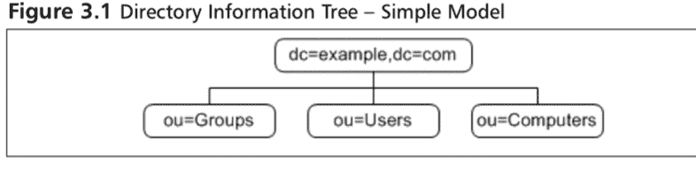

图 3.2 显示了一家业务部门之间界限非常明确的公司 DIT。如果一家公司的业务部门像独立的“孤岛”一样运行，业务组之间几乎没有沟通或信息共享，那么这可能是一种很好的组织方式。

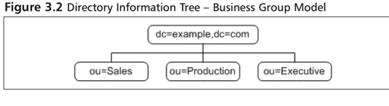

图 3.3 显示了一家在多个大洲设有多个大型办事处的大型公司的 DIT。在这种情况下，出于法律、财务、技术和其他业务原因，所有管理、IT 和业务职能都按大洲分隔。虽然这类组织形式不适用于大多数公司，但它展示了另一种目录结构和设计。


目录中的每个对象都由一个区分名称（distinguished name）唯一标识。DN 由唯一标识该对象的属性（通常是通用名称 (cn) 或用户 ID (uid)）以及在 DIT 中定位该对象的路径组成。图 3.4 显示了两个人员对象示例及其相应的 DN。

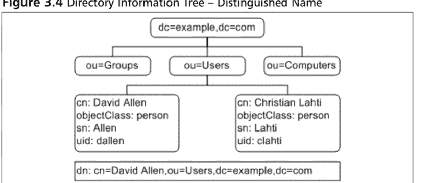

### 理解目录对象

目录是对象及其属性的分层存储库。每个对象是一个或多个对象类（objectclasses）的实例。对象类定义了构成此类对象可能包含或必须包含的属性集合。属性可以包含文本、数字、二进制或其他类型的数据。

目录服务器支持的对象类集合称为目录模式（directory schema）。模式文件（例如 OpenLDAP 和 Samba 包含的文件）包含对象类、属性和语法定义。这些实体中的每一个都与一个对象标识符 (OID) 相关联。OID 由分层点分十进制表示法表示，并唯一标识对象、属性和语法定义。以下显示了 `core.schema` 中 "person" 对象类的定义。

```ldif
objectclass ( 2.5.6.6 NAME 'person'
    DESC 'RFC2256: a person'
    SUP top STRUCTURAL
    MUST ( sn $ cn )
    MAY ( userPassword $ telephoneNumber $ seeAlso $ description ) )
```

此对象类定义列出了构成人员对象必须具备的属性（通用名称和姓氏）以及可以选择性存在的属性（`userPassword`、`telephoneNumber`、`seeAlso` 和 `description`）。以下显示了部分选定属性的定义。

```ldif
attributetype ( 2.5.4.3 NAME ( 'cn' 'commonName' )
    DESC 'RFC2256: common name(s) for which the entity is known by'
    SUP name )
```

```ldif
attributetype ( 2.5.4.4 NAME ( 'sn' 'surname' )
    DESC 'RFC2256: last (family) name(s) for which the entity is known by'
    SUP name )
```

```ldif
attributetype ( 2.5.4.20 NAME 'telephoneNumber'
    DESC 'RFC2256: Telephone Number'
    EQUALITY telephoneNumberMatch
    SUBSTR telephoneNumberSubstringsMatch
    SYNTAX 1.3.6.1.4.1.1466.115.121.1.50{32} )
```

## 连接到目录服务器

为了执行 LDAP 查询等操作，客户端必须首先连接到目录服务器。在 LDAP 术语中，这被称为 bind（绑定）操作。绑定操作共有四种类型：

- 匿名绑定 (Anonymous bind)
- 简单绑定 (Simple bind)
- 带有传输层安全 (TLS) 的简单绑定
- 带有简单认证和安全层 (SASL) 的简单绑定

在匿名绑定中，LDAP 客户端提供空的绑定 DN 和密码。在认证绑定中，LDAP 客户端提供要绑定的目录对象的 DN，并提供密码等凭据。简单绑定（无加密）的缺点是密码在网络上以明文传输。

为了防止密码被嗅探，必须使用某种形式的加密。大多数 LDAP 实现支持使用 StartTLS 操作，该操作会对客户端和服务器之间后续的所有通信进行加密。SASL 是一种更复杂的认证形式，支持 Kerberos 和通用安全服务应用程序编程接口 (GSSAPI)。我们将在第 4 章中更详细地讨论认证和加密。目前最需要记住的细节是，传输明文密码的非匿名绑定会产生安全问题。

## 理解 LDAP 查询

在成功连接到目录服务器后，LDAP 客户端通常会发出查询。一个 LDAP 查询由以下部分组成：

**搜索基准 (Search Base)** 搜索基准包含目录树中应开始搜索的部分的 DN。通常其形式为 `dc=domain,dc=com`，不过较旧的实现可能会使用 `o=organization,c=country`。这有时也被称为搜索后缀。

**搜索范围 (Search Scope)** 搜索范围可以是 `base`、`one` 或 `sub`。`base` 搜索范围仅在搜索基准级别进行搜索。`one` 搜索范围搜索基准之下最多一层。`sub` 搜索范围将搜索包括搜索基准在内的所有子树。

**搜索过滤器 (Search Filter)** 搜索过滤器指定目录服务器应返回哪些类型的对象和属性。搜索过滤器使用正则表达式语法指定。

**搜索属性 (Search Attributes)** 搜索属性参数列出 LDAP 查询中要返回的属性。如果搜索属性字段为空，则将返回对象的所有属性。为了最大限度地减少对目录服务器的性能影响，最佳实践是仅请求所需的属性。

另一种表示 LDAP 搜索的方法是通过使用统一资源标识符 (URI)。LDAP URI 的基本格式如下：

```text
'ldap://' [hostport] ['/' [dn ['?' [attributes] ['?' [scope] ['?' [filter]]]]]]
```

## 理解微软目录服务

Windows NT 和 Windows 2000 Server 采用了三种目录服务器。这三种服务器分别是 NT 安全账户管理器 (SAM)、Exchange 5.5 目录服务和 Windows 2000 活动目录 (Active Directory)。我们在下面检查这些目录服务器。

### 理解 Windows NT SAM

Windows NT 使用 SAM 来存储用户对象。Windows NT SAM 由用户管理器或第三方实用程序管理，与其他目录服务相比，它包含的信息量有限。NT SAM 没有 LDAP 接口。

Windows NT SAM 还支持组的使用，包括嵌套组。SAM 将组分为两种类型：本地组和全局组。本地组可以包含全局组，但全局组不能包含本地组。

Windows NT SAM 内部将用户名和计算机账户存储为安全标识符 (SID)。用户账户还包含 LANMAN (LAN Manager) 和 NTLM (NT LANMAN) 密码哈希、用户全名、描述、主目录、配置文件路径、登录脚本、登录时间和账户状态。

Windows NT 是一种单主目录服务。主（读写）目录服务器被称为主域控制器 (PDC)，而从（只读）目录服务器被称为备份域控制器 (BDC)。这里有


Windows NT 域中只有一个 PDC，但可以有零个或多个 BDC。

Windows NT 域不是层级结构的，而是依赖于信任关系来实现互操作。在本书中，我们将仅考虑单域模型。如果你拥有多个域，可以使用单域迁移技术分别迁移每个域的部分或全部内容。根据你的需求，这些域可以保持独立，也可以合并为一个单域。

### 理解 Exchange 5.5 目录服务

Exchange Server 是微软目录服务的首次实现，其特点是具备多主复制和 LDAP 支持。Exchange 5.5 目录服务器支持 LDAPv3 以及丰富的对象和属性集。每台 Exchange 服务器都包含一份完整的目录副本。在一台 Exchange 服务器上对 Exchange 目录所做的更改会传播到 Exchange 组织内的所有其他 Exchange 服务器。

Exchange 支持使用组来创建邮件列表。在 Exchange 5.5 中，这些组被称为分发列表 (Distribution Lists)。然而，这些组与 NT SAM 组不同，且不能互换。Active Directory 相对于 Exchange 5.5 目录的优势之一在于，AD 组可同时用于电子邮件和访问控制。

Exchange 5.5 支持外部接收者的概念。这些接收者被称为自定义接收者 (Custom Recipients)，通常所有使用 Exchange 目录的人员都可以访问。它们类似于 Outlook 和其他电子邮件客户端中的联系人，但存在于目录中而非本地邮件客户端上。

Exchange 5.5 通过主 Windows NT 账户 (Assoc-NT-Account) 字段将 NT SAM 用户对象链接到 Exchange 用户邮箱。在 Exchange 管理员 (Exchange Administrator) 中，该字段显示为 Windows NT 账户，但实际上在 Exchange 目录中是以 SID 形式存储的。

Exchange 目录是 Active Directory 的前身，包含 Active Directory 部分特性和功能。

### 理解 Active Directory

Active Directory 是微软在 Windows 2000 中实现的目录服务。Active Directory 被用作微软企业域实现的目录服务器，并且是包括 Exchange Server 在内的许多微软产品的核心要求。Active Directory 仅运行在 Windows 服务器上。

Active Directory 实现了 LDAP 接口，尽管 Active Directory 服务接口 (ADSI) 是访问 Active Directory 对象最广泛使用的方法。Active Directory 与微软的 Windows 2000 DNS（域名系统）和 DHCP（动态主机配置协议）实现紧密集成，并且需要 DNS 服务才能正常运行。

虽然 Active Directory 执行的基本功能与 NT 域模型相似，但这两者之间存在许多差异。表 3.1 总结了这些差异。

表 3.1 Windows NT 域与 Active Directory 域的区别

| Active Directory 域 | Windows NT 域 |
|---|---|
| DNS 集成。 | 无 DNS 集成。 |


| 层级化、传递性信任模型。 | 具有多种信任关系的孤岛模型。 |

| 存储 Kerberos 和 NT/LANMAN 身份验证凭据。 | 存储 NT/LANMAN 身份验证凭据。无 Kerberos 能力。 |

| 存储详尽的用户联系信息。 | 存储非常有限的用户联系信息。 |

| 多主复制模型。 | 单主复制模型。 |

Active Directory 存储了大量信息，是 NT SAM 和 Exchange 5.5 目录的超集。用户名、全名、描述、密码哈希、主目录、配置文件路径、联系信息、电子邮件地址以及其他信息都存储在 Active Directory 中。关于 Active Directory 的更多信息可见：www.microsoft.com/windows2000/technologies/directory/

### 理解 OpenLDAP

OpenLDAP 是首选的开源目录解决方案。它包含实现和利用目录服务所需的完整客户端和服务器组件套件。OpenLDAP 运行在所有版本的 Linux 上，并为分布式目录服务提供了强大的复制支持。OpenLDAP 是一款成熟的产品。它最初由密歇根大学开发，现在由 OpenLDAP 基金会管理。关于 OpenLDAP 的更多信息可见 www.openldap.org。

### 理解 OpenLDAP 服务器守护进程

`slapd` (Stand-alone LDAP Daemon) 是 OpenLDAP 的服务器进程，它监听网络端口并响应来自客户端的 LDAP 连接。`slapd` 通过使用 `slapd.conf` 文件进行管理，该文件通常位于 `/etc/openldap` 或 `/etc/ldap` 中。

`slurpd` (Stand-alone Update Replication Daemon) 通过提供复制能力来实现分布式目录服务。`slurpd` 支持主从（单主）或主主（多主）复制模型。主从复制通过维护目录的一个可读写副本（主服务器），并将该目录复制到一个或多个只读副本（从服务器）来工作。单主复制是最简单的复制方法，也是大多数组织使用的方法。`slurpd` 使用推式复制，这意味着主服务器启动到其他服务器的连接并向其推送更新。

多主复制允许多个目录服务器向目录写入数据。当发生更改时，处理写入操作的目录服务器会向其他目录服务器发送更新。

### 理解 OpenLDAP 工具

OpenLDAP 套件包含许多客户端实用工具和库。表 3.2 列出了常用的 OpenLDAP 工具。

**表 3.2** 常用 OpenLDAP 工具

| OpenLDAP 工具名称 | 描述 |
|---|---|
| `ldapsearch` | 查询目录服务器 |
| `ldapadd` | 添加目录对象 |
| `ldapmodify` | 修改目录对象 |
| `ldapdelete` | 删除目录对象 |
| `ldappasswd` | 修改目录对象的密码 |
| `slappasswd` | 生成加密密码 |
| `slapcat` | 将目录内容写入 LDIF 文件 |
| `slapadd` | 从 `slapcat` 生成的 LDIF 文件添加目录内容 |
| `slapindex` | 重新生成 `slapd` 索引 |

为了保持数据库一致性，在执行 `slapcat` 或 `slapindex` 操作时，应关闭 `slapd`（或将其运行在只读模式）。在执行 `slapadd` 操作期间也应关闭 `slapd`。在大多数情况下，执行 `ldapadd`、`ldapmodify` 或 `ldapdelete` 时会指定一个 LDIF 文件作为输入，特别是当需要影响多个对象时。可以通过输入 `man utilityname` 获取更多关于 OpenLDAP 工具的信息。

### 设计基于 Linux 的目录服务

在了解了目录服务、LDAP 和 OpenLDAP 之后，你已经准备好设计并部署基于 Linux 的目录服务了。接下来的章节将帮助你确定满足组织目录服务要求的最佳方式。

### 设计目录信息树 (DIT)

目录服务设计的第一步是确定组织 DIT 的结构。这一过程始于确定你的基础 DN (Base DN)。对于拥有 `.com` 互联网域名的公司，这通常意味着使用 `dc=your-domain,dc=com` 作为基础 DN。对于没有互联网域名的公司，你可以考虑使用 `dc=companyname,dc=local`。

确定基础 DN 后，你必须确定如何将目录层级逻辑地划分为组织单位 (Organizational Units)。对于绝大多数公司，只需要四个组织单位。图 3.5 展示了推荐的 DIT 结构。

**图 3.5** 推荐的目录信息树结构

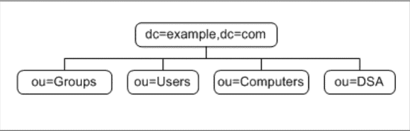

这种 DIT 结构的一个优势是，它可以让你无缝地使用 IDEALX 为 Samba 和 Posix 账户的 LDAP 管理而创建的 Webmin (www.webmin.com) 模块。使用 `idxldapaccounts` 模块是管理目录的一种推荐方式。相关信息和下载可在 www.idealx.org/prj/webmin/index.en.html 获取。

如果你的组织规模较大，且业务部门和/或办公地点之间几乎没有沟通和/或资源共享，你可以考虑更复杂的 DIT 结构。然而，在大多数情况下，最好使用推荐的 DIT，并根据需要添加额外的顶级组织单位。

### 设计 OpenLDAP 基础设施

现在你已经确定了 DIT 的结构，接下来必须确定组织中 OpenLDAP 服务器的类型、位置和数量。对于像 Acme Widgets 这样员工很少且只有一个服务器的小公司，选择很简单：Acme Widgets 将 OpenLDAP 安装在唯一的可用服务器上。

对于像 Ballystyx 这样拥有众多员工、多个站点和五台服务器的公司，有更多选择。以下标准有助于中大型组织在决策过程中进行权衡：

- 带宽的使用情况和可用性
- 服务器的可用性和可扩展性
- 目录服务的使用模式，包括：
  - 终端用户客户端的使用模式（例如电子邮件地址查询）
  - 服务器客户端的使用模式（如身份验证和消息传递）
- 每个站点的使用模式，以及需要目录服务的站点数量
- 目录读写操作的频率和类型
- 目录复制和灾难恢复的考量
- 安全性和法律考量
- 支持人员的可获得性

考虑到这些因素，对 Ballystyx 来说最合理的目录服务基础设施设计是采用单主复制（single-master replication），主 OpenLDAP 服务器位于硅谷，从 OpenLDAP 服务器位于班加罗尔办公室。图 3.6 展示了这一布局。

**图 3.6** Ballystyx 工程目录服务

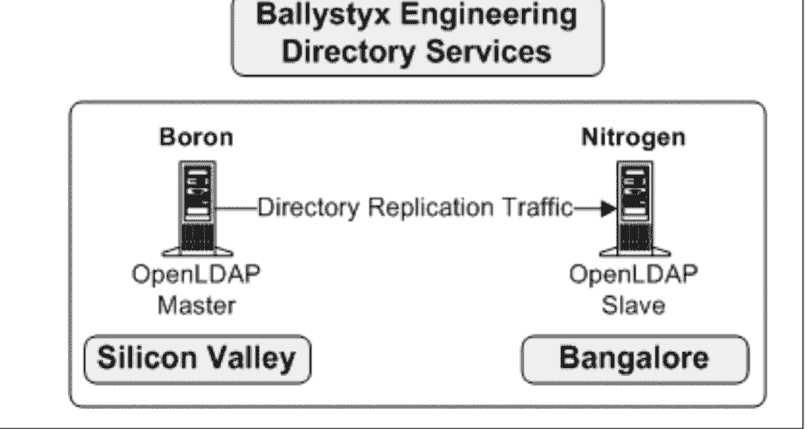

### 设计与规划

### 关键任务目录服务

在像 Ballystyx 全球半导体工程这样的组织中，目录服务是关键任务（mission-critical）的，必须始终可用。原因之一是其他关键网络服务依赖于目录服务。身份验证、消息传递和群组软件服务都需要目录服务才能运行。

为了实现这一目标，Ballystyx 部署了两台目录服务器——一台在硅谷，一台在班加罗尔。这确保了只要硅谷和印度之间的网络连接正常，如果一台服务器发生故障，另一台目录服务器仍然可用。随着预算的增加和 Ballystyx 员工人数的增长，将在硅谷和班加罗尔部署额外的 OpenLDAP 服务器，以便在两个地点提供完全冗余的负载均衡目录服务。

### 配置与测试 OpenLDAP 服务器

在确定了服务器的类型和位置后，您就可以在实验室中测试目录服务了。在测试实验室服务器上编译并安装当前的 OpenLDAP 软件包，或从您的发行版中安装当前的 OpenLDAP 软件包。根据您希望使用的 OpenLDAP 功能，您可能需要向 `./configure` 提供开关以启用特定的编译时选项。如果您是从发行版安装 OpenLDAP 软件包，可能会有多个名称相似但编译选项不同的版本。对于基本的未加密目录服务，默认选项应该运行良好。如果您需要额外功能，可以在稍后重新编译或升级 OpenLDAP 软件。关于构建和安装 OpenLDAP 的更多信息，请访问 www.openldap.org/doc/admin22/install.html。

安装 OpenLDAP 后，您必须自定义 OpenLDAP 服务器配置文件 `slapd.conf` 以反映您的环境。以下展示了 Acme Widgets 的 `slapd.conf` 文件。

```
### Schema files
include /etc/openldap/schema/core.schema
include /etc/openldap/schema/cosine.schema
include /etc/openldap/schema/inetorgperson.schema
include /etc/openldap/schema/nis.schema
include /etc/openldap/schema/samba.schema

schemacheck on
lastmod on

# This section defines the acmewidgets.com directory database
database bdb
suffix   "dc=acmewidgets,dc=com"
rootdn   "cn=Manager,dc=acmewidgets,dc=com"
rootpw   "secret"
directory /var/lib/ldap

# These database indices improve performance
index    objectClass,uidNumber,gidNumber               eq
index    cn,sn,uid,displayName                 pres,sub,eq
index    mail,givenname,memberUid                 eq,subinitial
index    sambaSID,sambaPrimaryGroupSID,sambaDomainName    eq

# Access Control
access to attrs=userPassword,sambaNTPassword,sambaLMPassword
        by self write
        by anonymous auth
        by * none
# all others attributes are readable to everybody
access to *
        by * read
```

请注意包含的模式（schema）定义。在许多情况下，您必须从 Samba 软件包中复制 `samba.schema`。这些模式是必需的，用于提供迁移过程中将用到的以下对象类（objectclasses）：

- `top`
- `posixAccount`
- `shadowAccount`
- `sambaAccount`
- `sambaSAMAccount`
- `sambaDomain`
- `person`
- `organizationalPerson`
- `inetOrgPerson`
- `posixGroup`
- `sambaGroupMapping`

正确设置 `slapd.conf` 后，启动 OpenLDAP 服务器，并使用 `rootdn` 凭据（`cn=Manager,dc=yourdomain,dc=com`）执行简单的绑定（bind）操作。虽然除了模式信息之外没有可见的数据，但您已经验证了能够正确连接到目录服务器。现在您可以准备将数据填充到目录中。

## 总结

目录服务实现了关于用户、组、计算机以及其他网络和基础设施项信息的层级存储和集中管理。由于目录服务是本书中提到的其他网络服务的前提（或理想的集成点），部署基于 Linux 的目录服务意味着为后续章节中的网络服务奠定了重要基础。

在下一章中，您将接触到 Samba，它将与您的 OpenLDAP 目录集成以实现身份验证。我们还将探讨 NT、Exchange 5.5 和/或 Active Directory 信息的迁移。

## 快速解决方案

### 理解 LDAP 和目录

- [x] 目录是对象及其属性的层级存储。轻量级目录访问协议 (LDAP) 允许与目录服务器进行身份验证和查询操作。
- [x] 目录的层级结构称为目录信息树，或 DIT。DIT 以基础 DN（或目录后缀）开始，例如 `dc=example,dc=com`。组织单位 (ou) 对象用于创建树状层级结构。目录树通常按对象类型组织，但也可以按地理位置或业务部门结构组织。
- [x] 模式（schema）定义了目录支持的对象类和属性。一个对象类定义列出了组成该类型对象必须包含或可以包含的属性。对象类和属性由唯一的对象标识符 (OID) 引用。
- [x] 在执行查询之前，LDAP 客户端与目录服务器进行绑定（bind）。绑定可以是匿名的或经过身份验证的。
- [ ] LDAP 查询由搜索基准、范围、过滤器和/或属性列表组成。LDAP 查询可以通过命令行参数定义，或由统一资源标识符 (URI) 表示。关于 LDAP 搜索过滤器和 URI 的更多信息可以在 RFC 2254 和 2255 中找到。

### 理解 Microsoft 目录服务

- [ ] 在 Windows NT 和 Windows 2000 服务器中，有三种类型的目录服务：NT 安全账户管理器 (SAM)、Exchange 5.5 目录服务和 Active Directory。
- [ ] Windows NT SAM 是一个非常简单的目录服务，存储关于用户账户、计算机账户和组的信息。Windows NT 域包含一个主域控制器 (PDC) 和零个或多个备份域控制器 (BDC)。NT 域利用单主复制，PDC 拥有目录的可读写副本，而 BDC 拥有只读副本。
- [ ] Exchange 5.5 目录具有多主复制和 LDAP 支持，并包含丰富的对象和属性集。Exchange 目录支持用户邮箱、组（用于邮件列表）和自定义接收者。用户邮箱通过使用 **主 Windows NT 账户** 字段与 NT SAM 链接。
- [ ] Active Directory 是 Microsoft 在 Windows 2000 中实现的企业目录服务。Active Directory 包含 NT SAM 和 Exchange 5.5 目录信息的超集。关于 Active Directory 的更多信息请访问 www.microsoft.com/windows2000/technologies/directory/。

### 理解 OpenLDAP

- [ ] OpenLDAP 是顶级的开源目录解决方案。它包含实现和利用目录服务所需的完整客户端和服务器组件套件。
- [ ] `slapd` (Stand-alone LDAP daemon) 是响应客户端 LDAP 连接的 OpenLDAP 服务器进程。`slurpd` (Stand-alone Update Replication Daemon) 通过提供复制能力，使 OpenLDAP 分布式目录服务得以实现。
- [ ] OpenLDAP 套件包含许多实用程序，包括 OpenLDAP `ldapsearch`、`ldapadd`、`ldapmodify`、`ldapdelete`、`ldappasswd`、`slapasswd`、`slapcat`、`slapadd` 和 `slapindex`。可以通过输入 `man utilityname` 获取有关 OpenLDAP 实用程序的更多信息。

### 设计基于 Linux 的目录服务

- 设计基于 Linux 的目录服务的第一步是确定组织 DIT 的结构并确定基 DN（目录后缀）。对于拥有 `.com` 互联网域名的公司，这通常意味着使用 `dc=yourdomain,dc=com`。
- 下一步是确定组织中 OpenLDAP 服务器的类型、位置和数量。带宽、服务器可用性/可扩展性、目录使用模式、复制、灾难恢复、安全性和支持考量共同影响这一决策过程。
- 部署前的最后一步是在实验室中安装、配置和测试目录服务。自定义 `slapd.conf` 以包含适用于您组织的架构文件、基 DN、数据库配置和访问控制。

## 常见问题解答

以下是由本书作者回答的常见问题，旨在衡量您对本章所呈现概念的理解，并协助您在现实生活中实现这些概念。如需让作者回答关于本章的问题，请浏览至 www.syngress.com/solutions 并点击“Ask the Author”表单。您还可以在 ITFAQnet.com 访问数千个其他 FAQ。

**问：** 有没有简单的方法来备份或还原 OpenLDAP 目录的内容？

**答：** 建议出于这些目的使用 `slapcat` 和 `slapadd`。不要尝试复制正在执行写操作的实时数据库文件——数据库可能处于不一致状态，从而导致还原操作失败。

**问：** 为什么 Windows SAM 被认为是目录服务器？

**答：** 虽然 Windows SAM 不是 X.500 风格的目录且缺乏 LDAP 接口，但它是用户和组对象的存储与查询机制。因此，它被与其他 Microsoft 目录服务器归为一类。

**问：** 对于我的组织来说，一台、两台或三台 OpenLDAP 服务器足够吗？扩展目录服务的最佳方式是什么，典型的瓶颈在哪里？

**答：** 在一个设计良好的分布式目录服务组织中，总部通常有一台读写（主）OpenLDAP 服务器，每个分公司有一台只读服务器。如果某些应用程序（如 `postfix` 或 Samba 服务器）执行大量的目录查询，可以为这些应用程序部署专用的 OpenLDAP 服务器（只读）。

**问：** 如果一台服务器发生故障，有没有简单的方法将客户端重定向到另一个目录服务器？

**答：** 使用轮询 DNS（round-robin DNS）是实现负载均衡、冗余和高可用目录服务的最佳实践方法。

# 第 4 章：认证服务

### 本章方案：

- 理解 Windows 认证
- 理解 Linux 认证
- 设计基于 Linux 的认证服务
- 从 NT / Exchange 或 Active Directory 迁移
- 总结
- 方案快速通道
- 常见问题解答

## 简介


认证是最重要且应用最广泛的网络服务之一。控制网络资源访问的能力主要取决于能否可靠地确定你是“谁”。在大多数情况下，用户认证包括验证由一个或多个因素组成的凭据：你知道的东西（用户名、密码）、你拥有的东西（令牌）或你本身具备的特征（生物识别）。

认证可以简单到将输入的密码与存储在本地文件中的明文密码进行匹配。然而，除极小型公司外，所有公司对安全性、可扩展性、可靠性和功能集的要求，都意味着需要采用一种包含认证服务的认证方案，该服务与目录服务（可能运行在同一台机器上，也可能不在）进行交互。认证凭据（如用户名和密码哈希）存储在目录中，而不是在认证服务中。由于目录充当这些信息的集中存储库，您可以构建灵活的认证方法，从而实现对分布式的异构认证服务的集中控制。

对于 Windows 工作站的最终用户来说，最可见的认证示例之一发生在用户输入用户名和密码并登录工作站时。“理解 Windows 认证”探讨了在登录 Windows 工作站期间发生的认证、登录脚本、驱动器映射及其他过程。

下一节“理解 Linux 认证”探讨了多种类型的认证，包括`/etc/passwd/shadow`、LDAP（轻量级目录访问协议）和 NIS（网络信息系统）。该节最后概述了可插拔认证模块（PAM），这是一种灵活的、独立于方法的认证机制。

“设计基于 Linux 的认证服务”将帮助您根据组织的安全性、地理位置、操作系统（OS）支持和其他要求确定关键的认证需求。我们将探讨 Samba 和 OpenLDAP 提供的认证服务，并引导您完成安装 Samba 并将其安装与 OpenLDAP 集成的步骤。

最后一节将引导您使用提供的迁移脚本，将信息从 NT / Exchange 5.5 / Active Directory（AD）迁移到 OpenLDAP。本节涵盖了用户、组和计算机信息的迁移。

## 理解 Windows 认证

从 Windows NT 3.1 开始，Microsoft 使用 LANMAN 协议的一种实现（当前版本是 NT LAN Manager 或 NTLM）来进行用户登录认证。Microsoft 对 LANMAN 协议的实现衍生自 IBM 在 OS/2 中对 LANMAN 的实现。

Microsoft 在 Windows 2000 中引入了基于 Kerberos 的认证机制。利用 Kerberos 进行认证使 Microsoft 的基础设施对于大型公司而言更加安全、可扩展且易于管理，并且与 Active Directory 的集成简化了被认为复杂的认证协议的管理。

Microsoft 的 Kerberos 实现可与运行开源或非 Microsoft Kerberos 服务的许多服务器互操作，或者已取代这些服务器。Active Directory 的一个互操作性问题是，Microsoft “拥抱并扩展”了 Kerberos 认证协议，在 Kerberos PAC（代理自动配置）字段中加入了一个加密签名的授权组件。虽然这对于 Linux 客户端不是问题，但 Windows 2000/XP 客户端期望并要求填充 PAC 字段。虽然 Microsoft Kerberos 服务器可以认证 Windows 和非 Windows Kerberos 客户端，但 Heimdal 或 MIT Linux Kerberos 服务器无法正确认证 Windows 客户端。市面上有一些没有此限制的第三方 Windows Kerberos 客户端（因此可以使用 Linux Kerberos 服务器进行认证），但某些客户端（如 NCSA 提供的）由于使用强加密而受到美国出口法的限制。

### 理解 Windows 98/NT 登录

每天早晨，数以百万计的家庭和小型企业用户走到电脑前，打开显示器，看到图 4.1 所示的屏幕。

图 4.1 Windows 98 登录屏幕

用户输入用户名（通常来自上次登录）、密码和域名（通常也已填充），然后点击`OK`。认证子系统被调用，执行域风格（非本地认证）的登录。利用名称解析系统，找到并联系域控制器。Windows 98 使用 LANMAN 协议，Windows NT 使用 NTLM 协议将用户名、密码哈希和域凭据传递给认证服务器。认证服务器（在 Windows NT 术语中为主要域控制器（PDC）或备份域控制器（BDC））解析信息并尝试将凭据与 SAM（安全账户管理器）数据库中的凭据进行匹配。如果凭据有效，则向客户端传递一个认证令牌。如果凭据无效，则返回错误消息。如果用户配置了漫游配置文件，且服务器上的副本比本地配置文件新，则会下载服务器副本。如果配置了用户登录脚本，该文件也将被执行。登录脚本通常通过`NETLOGON`共享进行访问。

### 理解 Windows 2000/XP 登录

Windows 2000/XP 的登录过程与 Windows 98/NT 过程类似。然而，Windows 2000 和 Windows XP 默认尝试 Kerberos 认证，尽管它们也向后兼容 NTLM 认证。如果尝试使用 NTLM 认证，其认证过程与上述 NT 登录过程几乎完全相同。

Windows 2000 Active Directory 允许组策略对象（GPO）在 Windows 2000/XP 桌面端应用配置设置并启动（或安装）应用程序。在撰写本文时，开源目录实现尚不支持 GPO 的管理/模拟。如果您在 Windows 2000/XP 桌面端依赖 GPO 设置，则必须使用另一种方法来应用设置和启动应用程序，例如将这些功能移至登录脚本中。

## 理解 Linux 认证

从历史上看，UNIX 认证形式已经存在了四十多年。从古老的`/etc/passwd`到现代的 PAM，各种认证方法已被用于*nix 工作站登录。本节将探讨在多种 Linux 发行版中运行的认证方法。在许多情况下，这些信息同样适用于 Solaris、BSD、MacOS 和 HP-UX。

### 理解 LDAP 认证

LDAP 认证是最广泛使用的跨平台企业认证技术之一。它通用性强，支持广泛，且具有强大的加密特性。如前所述，认证服务经常与目录服务集成。在 LDAP 认证的情况下，认证服务本身就是目录服务。在认证需求简单的规模较小的公司中，OpenLDAP 常被用作*nix 系统的认证服务器。

虽然 LDAP 认证以简洁著称，但如果将其作为唯一的认证服务，则存在缺陷。LDAP 最初并非像 LANMAN 和 Kerberos 那样专门设计为企业认证协议。它不使用相同的认证令牌或安全组件。因此，仅使用 LDAP 简单绑定（simple bind）认证很难实现无缝的单点登录（SSO）。

幸运的是，通过使用 SASL（简单认证与安全层）和 TLS/SSL（传输层安全协议 / 安全套接字层），可以大幅提升 LDAP 认证的实用性。SASL 提供了一套丰富的认证技术，而 TLS/SSL 则实现了加密，以确保数据和密码（哈希）的隐私。SASL 支持以下认证机制：

- `ANONYMOUS`
- `CRAM-MD5`
- `PLAIN`
- `DIGEST-MD5`
- `GSSAPI`

GSSAPI（通用安全服务应用程序编程接口）的部分吸引力在于它通过丰富的 API（应用程序编程接口）进一步扩展了 SASL 的认证能力。GSSAPI 还支持将 Kerberos 作为一种认证机制。SASL 由卡内基梅隆大学（CMU）开发，有关 CMU 的 Cyrus SASL 实现的更多信息可通过`http://asg.web.cmu.edu/sasl/`获取。

LDAP 认证的另一个重要功能是充当*最低公分母*认证服务。由于几乎所有的认证服务都可以利用 LDAP 与存储用户名/密码组合的目录服务器通信，因此当已存在一个启用了认证支持的 LDAP 服务器时，部署新的认证服务通常非常容易。

### 理解`/etc/passwd/shadow`认证

管理认证最简单的方法之一是使用包含用户名和密码的本地文件。一种更安全的方法是对密码进行加密并将其存储在独立的文件中。

对于现代的独立 Linux 工作站，用户信息存储在`/etc/passwd`中，而密码信息存储在`/etc/shadow`中。访问控制权限允许任何人读取`/etc/passwd`，但仅允许 root 用户读取`/etc/shadow`中的密码哈希。图 4.2 和 4.3 分别包含`/etc/passwd`和`/etc/shadow`的片段。


```
root:x:0:0:root:/root:/bin/bash
daemon:x:1:1:daemon:/usr/sbin:/bin/sh
bin:x:2:2:bin:/bin:/bin/sh
lp:x:7:7:lp:/var/spool/lpd:/bin/sh
dallen:x:1000:1000:David Allen,,,:/home/dallen:/bin/bash
nobody:x:65534:65534:nobody:/nonexistent:/bin/sh
```


```
root:$1$6wDYOdeM$teP1VcO3v9sCG5W4TRbLO.:12655:0:99999:7:::
daemon:*:12590:0:99999:7:::
bin:*:12590:0:99999:7:::
sys:*:12590:0:99999:7:::
lp:*:12590:0:99999:7:::
dallen:$1$hxo7GmPU$kT34Rhw2VV5cOdqjXb.qt.:12655:0:99999:7:::
nobody:*:12590:0:99999:7:::
```

如你在图 4.3 中所见，系统级账户（如`daemon`、`bin`和`lp`）没有密码。`root`和`dallen`的密码条目是单词`secret`的哈希值。

### 理解 NIS 认证

网络信息服务（Network Information Services，NIS）将`/etc/passwd`和`/etc/shadow`的基于文件的方案进一步扩展。在 NIS 中，服务器存储网络用户、密码、组以及其他与本地文件存储信息相对应的信息。

然而，NIS 存在许多安全缺陷。首先，它没有使用加密。基于此及其他原因，不建议在网络中使用基于 NIS 的认证。它设计于网络计算的早期阶段，无法满足现代网络安全的需求。即使是 NIS 的开发商 Sun 公司，也已在 Solaris 10 中将 NIS 宣布为“生命周期结束”（end-of-lifed）。

NIS+ 是对 NIS 的改进。虽然 Linux 拥有 NIS+ 客户端，但没有针对 Linux 的开源 NIS+ 服务器，且 Linux NIS+ 的开发已经停止。尽管 NIS 存在缺陷，但它仍然是一种被广泛使用的认证机制，尤其是在尚未更新为更安全协议的旧 UNIX 网络中。

## 理解 Linux 客户端认证设置

到目前为止，我们讨论了 Linux 的认证能力，但尚未深入探讨 Linux 客户端的配置文件。本节涵盖了两个重要文件`nsswitch.conf`和`ldap.conf`的设置。在几乎所有版本的 Linux、Solaris、BSD、MacOS 和 HP-UX 中，这两个文件（连同 PAM）共同控制 LDAP 认证和 glibc 认证的重要设置。

### 理解名称服务切换（`nsswitch.conf`）

名称服务切换（Name Service Switch，NSS）是由 Sun 开发的一个 C 编程库，旨在返回用户对象的属性。随后，NSS 进行了扩展，以包含 Sun NIS 服务中提供的映射（hosts、protocols、passwd、shadow、automount 等）。

如今，这些是 GNU C 库（glibc）中的函数调用。在 Linux 和其他使用 glibc 的操作系统中，NSS 的配置由位于`/etc`目录下的`nsswitch.conf`文件控制。`nsswitch.conf`包含一个数据库列表及其来源。当调用 glibc 函数来解析此类对象时，会按列出的顺序查询每个来源。对于图 4.4 中的`nsswitch.conf`文件，系统配置为首先尝试通过本地`files`进行查询，如果本地`files`无法解析，则尝试`ldap`。

**图 4.4 NSS 配置**

```
#/etc/nsswitch.conf
passwd: files ldap
shadow: files ldap
group: files ldap
hosts: files dns
```

`nsswitch.conf`中还提供其他类型的数据库、来源和操作项，用于对查询过程进行细粒度控制。输入`man nsswitch.conf`以获取更多信息。

### 理解 LDAP 配置设置（`ldap.conf`）

Linux 系统上的 LDAP 配置主要由`/etc/ldap.conf`控制。该文件包含联系 LDAP 服务器以及管理由 NSS 利用的认证和查询请求所需的设置。`ldap.conf`中的设置被`nss_ldap`和`pam_ldap`模块使用。

图 4.5 显示了 Acme Widgets 公司 Fedora Linux 桌面上的`ldap.conf`文件。在 Fedora 中，可以使用`authconfig`轻松更改这些认证文件。

**图 4.5 Acme Widgets 桌面`ldap.conf`文件**

```
#entry for server2 is in /etc/hosts file
host server2

#Acme Widgets base DN (directory suffix)
base dc=acmewidgets,dc=com

#Settings for nss_ldap
nss_base_passwd ou=Users,dc=acmewidgets,dc=com
nss_base_shadow ou=Users,dc=acmewidgets,dc=com
nss_base_group ou=Groups,dc=acmewidgets,dc=com
```

## 理解 PAM

PAM 是一种灵活的用户认证抽象机制，允许将每个应用程序的认证配置存储在配置文件中。其效果是将应用程序中授予权限的部分分离到一个系统中，该系统可以动态重新配置以支持几乎任何类型的认证方案，而无需重新编译或重新配置应用程序本身。

PAM 由 Sun Microsystems 发明，被用于当前版本的 Solaris。Solaris 的 PAM 实现与 Linux 的 PAM 实现在文件位置、错误代码和配置方法上略有不同。在本书中，当我们提到 PAM 时，是指 Linux PAM。所有现代 Linux 发行版，包括 Red Hat、Debian、Suse、Mandrake 等，都提供 PAM 支持。

PAM 框架为用户认证请求提供了一个函数库。当应用程序需要对用户进行认证时，它会调用相应的函数，然后由 PAM 子系统处理该请求。PAM 将尝试读取该应用程序的 PAM 配置文件，该文件通常存储为`/etc/pam.d/applicationname`。在某些情况下，配置可能存储在单个文件中（`/etc/pam.conf`）。如果`/etc/pam.d/`目录存在，大多数 PAM 实现将忽略`/etc/pam.conf`中的设置。

PAM 配置文件由多行组成，列出的 PAM 令牌格式如下：

```text
service-name    module-type    control-flag    module-path    [args]
```

在`/etc/pam.d/application-name`中拥有多个 PAM 配置文件的系统中，`service-name`仅为配置文件的名称，不会作为条目列在文件中。此类配置文件将`module-type`令牌列为第一项。表 4.1 解释了每种令牌类型及其用法。

### 表 4.1 PAM 令牌类型及描述

| PAM 令牌 | 描述 |
|---|---|
| `service-name` | 与此条目关联的服务或应用程序的名称。 |
| `module-type` | PAM 模块的类型（auth、account、session 或 password）。 |
| `control-flag` | 控制模块如何响应 PAM 请求的成功或失败。 |
| `module-path` | 模块的相对路径或绝对路径。 |
| `args` | 传递给模块的参数（并非所有模块都使用参数）。 |

PAM 配置文件将认证功能分为四类：用户认证（`auth`）、账户限制执行（`account`）、会话启动/拆除（`session`）以及密码（或认证令牌）更新（`password`）更新功能。这四种 PAM 模块类型的特点在下表 4.2 中进行了阐述。

### 表 4.2 PAM 模块类型及描述

| PAM 模块类型 | 描述 |
|---|---|
| `auth` | 提供认证服务以建立身份并授予权限。auth 模块使用凭据（如密码、生物识别、硬件令牌或其他认证机制）来验证身份。 |
| `account` | 管理账户的非认证方面管理。account 模块可能会根据密码过期时间、时间段或系统资源可用性来限制或拒绝访问。 |
| `session` | 管理在授予用户访问服务之前或用户完成服务使用之后需要执行的请求方面。session 模块通常执行审计日志记录或挂载/卸载主目录等任务。 |
| `password` | 用于更新与用户关联的认证令牌。password 模块执行更改用户密码的功能。 |

PAM 控制标志定义了 PAM 模块的成功或失败将如何影响 PAM 堆栈。表 4.3 列出了四种类型的控制标志及其每种标志的描述。

### 表 4.3 PAM 控制标志及描述

| PAM 控制标志 | 描述 |
|---|---|
| `requisite` | requisite 模块失败会立即终止认证过程并导致认证失败。 |
| `required` | required 模块失败将导致认证失败，尽管堆栈中的其余部分仍将被执行。 |
| `sufficient` | sufficient 模块成功将导致认证成功，即使之前的 required 模块失败了。sufficient 模块失败不会导致认证失败。 |


`optional` 模块的成功或失败不会影响认证的成功或失败，除非该 `optional` 模块是唯一列出的模块。

有关 PAM 控制标志、模块和参数的进一步信息，请输入 `man pam` 或 `man pam.conf`，或访问 `www.redhat.com/docs/manuals/enterprise/RHEL-3-Manual/ref-guide/s1-pam-sample-simple.html`。

## 设计基于 Linux 的认证服务

设计基于 Linux 的认证服务通常是一个相对简单的过程。通常，这只是确定组织计算机系统的认证需求并部署相应的服务器，以及确定认证服务器的规模、数量和位置的问题。

虽然认证服务的设计通常很简单，但“确保正确”的重要性极大。认证承担着关键的安全角色——即确认用户是否为其所声称的身份。在几乎所有情况下，这是通过“用户名-密码”组合完成的。虽然这种认证方式被广泛理解且无处不在，但仍有一些安全考量，特别是围绕密码管理方面。

如果说有一个服务是出错代价极其高昂的，那么认证服务无疑就是那个服务。如果一个组织的认证服务失效，在很多情况下，系统将无法接受新的登录，且现有会话将开始过期。如果认证服务将凭据存储在目录中，且目录服务器离线，或者认证服务器与目录服务器（如果运行在不同机器上）之间的网络连接不可用，那么在大多数情况下，认证服务将停止运行。

在设计认证基础设施时需要解决这些潜在问题。如果认证服务无法正常运行会对业务造成高昂影响（对于大多数拥有超过少数员工的企业来说确实如此），那么适当的设计指南是通过在基础设施中构建冗余来提高认证服务的可用性。除了使用容错硬件外，强烈建议大多数企业使用多台认证服务器（以及多个目录服务器），而对于大型组织来说，这是必须的。

为了确保更好的安全性，建议强制要求使用强密码并强制用户更改密码。虽然这会让密码稍微难以记忆，但它为防御恶意入侵者或配置错误的服务器提供了额外的防御层。即使入侵者设法获得了加密的密码，在下一次强制更改密码之前，他们也无法对其进行解密。所有具有安全意识的组织都应要求用户定期更改密码。间隔时间根据行业和其他业务具体情况而有所不同，但对于大多数公司，密码更改间隔在 1 到 6 个月之间。

## 设计跨平台认证服务

认证服务设计的具体细节将根据需求而有所不同。下面的文本和图表描述了 Acme Widgets 和 Ballystyx Engineering 的认证解决方案。因为 Acme Widgets 需要对 Windows 和 Linux 桌面进行认证，因此认证服务必须在这两个平台上都能无缝工作。为此，Acme Widgets 使用了一种基于 Linux 的认证解决方案，该方案利用 OpenLDAP 存储认证凭据并提供 LDAP 认证，并使用 Samba 向 Windows 客户端提供 NTLM 认证服务。图 4.6 展示了 Acme Widgets 的认证服务设计。

### 图 4.6 Acme Widgets 认证服务设计

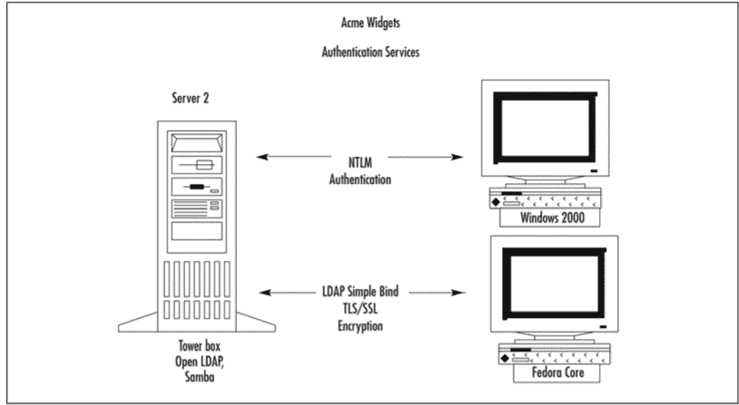

Ballystyx Engineering 的认证服务设计遵循与 Acme Widgets 相同的原则，但其规模扩大以满足全球公司的需求。与 Acme Widgets 类似，Windows 2000 桌面将利用 NTLM 认证，而 Linux 系统将使用带有 TLS 加密的 LDAP 简单绑定（simple binds）进行认证。图 4.7 展示了 Ballystyx Engineering 的认证服务设计。

### 图 4.7 Ballystyx Engineering 认证服务设计

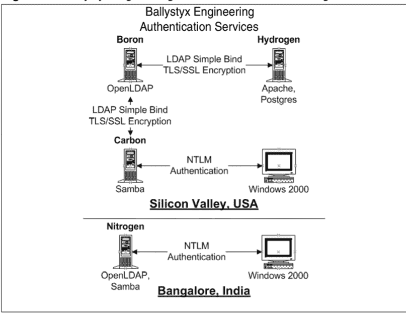

随着预算的到位，Vijay 打算部署额外的服务器以确保认证服务的高可用性。冗余服务器将确保认证始终可用，这将确保即使在半夜有服务器故障，Vijay 也能继续安稳地入睡。

## 安装与配置 Samba

安装和配置 Samba 是提供 NTLM 认证的第一步。在测试实验室服务器上，编译并安装当前的 Samba 服务器软件包（截至本文撰写时为 3.0.6），或从你的 Linux 发行版中安装当前的 Samba 服务器软件包。如果你考虑自己编译最新的 Samba 软件包，请记住，使用 Linux 发行版提供的 Samba 软件包会简单得多，而且只要提供了相应的功能，通常就能“直接运行”。

安装 Samba 后，启动你最喜欢的文本编辑器并编辑 `smb.conf`。或者，你可以使用 Webmin（`www.webmin.com`）或 SWAT（Samba Web Administration Tool）等图形化配置工具来配置 `smb.conf`。图 4.8 显示了 Acme Widgets 的 `smb.conf` 文件。我们建议使用 Windows to Linux Migration Toolkit 中提供的示例作为起点。

### 图 4.8 Acme Widgets `smb.conf` 文件

```ini
[global]

workgroup = ACMEWIDGETS
netbios name = SERVER2
server string = Samba Server
passdb backend = ldapsam:ldap://127.0.0.1/
idmap backend = ldap:ldap://127.0.0.1/
ldap admin dn = cn=Manager,dc=acmewidgets,dc=com
ldap suffix = dc=acmewidgets,dc=com
ldap group suffix = ou=Groups
ldap user suffix = ou=Users
ldap machine suffix = ou=Computers
ldap idmap suffix = ou=Users
ldap ssl = no
security = user
domain logons = yes
domain master = no
log file = /var/log/samba/%m.log
max log size = 50
socket options = TCP_NODELAY SO_SNDBUF=8192 SO_RCVBUF=8192
dns proxy = No
wins support = No
preferred master = Yes
add user script = /usr/local/sbin/smbldap-useradd -m "%u"
ldap delete dn = Yes
delete user script = /usr/local/sbin/smbldap-userdel "%u"
add machine script = /usr/local/sbin/smbldap-useradd -w "%u"
add group script = /usr/local/sbin/smbldap-groupadd -p "%g"
delete group script = /usr/local/sbin/smbldap-groupdel "%g"
add user to group script = /usr/local/sbin/smbldap-groupmod -m "%u" "%g"
delete user from group script = /usr/local/sbin/smbldap-groupmod -x "%u" "%g"
set primary group script = /usr/local/sbin/smbldap-usermod -g "%g" "%u"
```

Acme Widgets 公司将 Samba 服务和 LDAP 服务部署在同一台主机上。如果这些应用程序安装在多台机器上，则配置文件需要通过 DNS（域名系统）名称或 IP（互联网协议）地址来引用另一台服务器。关于 `smb.conf` 的这些设置，可以通过输入 `man smb.conf` 获得详尽解释，但其中某些设置足够重要，值得在本节中探讨。在开头几行中我们可以看到，此 Samba 安装已启用 LDAP，且 `smb.conf` 文件中 LDAP 部分的设置与目录服务器的 `slapd.conf` 相对应。文中列出了 LDAP 目录的 `admin dn`（在 `slapd.conf` 术语中称为 `rootdn`）、后缀以及包含用户、组和计算机的组织单位。这些设置与 Acme Widgets 在第 3 章中建立的 DIT（目录信息树）相对应。`domain logins = yes` 和 `domain master = no` 的设置也值得解释。该配置将 Samba 服务器设置为备份域控制器（BDC），以便获得授权从现有 Windows 域接收身份验证对象的副本。当迁移完成且 Windows PDC（主域控制器）退役后，Sam 将把 `domain master` 条目更改为 `yes` 并重启 Samba。这将使 Samba 服务器从 BDC 转换为 PDC。此过程在下文的迁移部分中有详细说明。

`smb.conf` 中的脚本设置与将在本章迁移部分安装的 IDEALX `smbldap` 工具相对应。请注意，`smbldap` 工具集的物理路径可能因安装方式而异。如果工具集是从 tar.gz 文件安装的，路径将是 `/usr/local/sbin`。如果工具集是从 RPM 包安装的，路径将是 `/usr/sbin`。确定此信息最简单的方法是在命令提示符下输入 `which smbldap-useradd` 并记录路径。如果这些设置不正确，您的 Samba 迁移和后续维护将无法正常运行！

图 4.9 显示了 `smb.conf` 中的 Samba 网络文件共享列表，分别对应于 Windows 登录服务的用户主目录、网络登录和漫游配置文件存储。

### 图 4.9 Acme Widgets Samba 共享

```ini
[homes]
    comment = Home Directories
    read only = No
    browseable = No
    create mask = 0644
    directory mask = 0775

[netlogon]
    path = /home/netlogon/
    browseable = No
    read only = yes

[profiles]
    path = /home/profiles
    read only = no
    create mask = 0600
    directory mask = 0700
    browseable = No
    guest ok = Yes
    profile acls = yes
    csc policy = disable
    # secures profiles by user
    force user = %U
    # allow administrative access to profiles
    valid users = %U @"Domain Admins"
```

设置好 Samba 服务器后，请确保它能正常启动。对于大多数 Linux 发行版，以下命令将启动 Samba 服务并显示状态详情：

```bash
/etc/init.d/smb start
/etc/init.d/smb status
/usr/bin/smbstatus -v
```

假设没有错误，您的 Samba 配置应该是正确的。为了运行迁移脚本，必须关闭 Samba 服务。在进入迁移部分之前，请停止您的 Samba 服务器。在大多数 Linux 发行版中，以下命令将停止 Samba 服务。

```bash
/etc/init.d/smb stop
```

## 从 NT/Exchange 或 Active Directory 迁移

本节详细介绍了从 Windows NT、Exchange 5.5、Windows 2000 和/或 Active Directory 向基于 Linux 的目录和身份验证服务迁移的过程。本节要求您已拥有配置正确的 Samba 和 OpenLDAP 服务器。Samba 必须处于关闭状态，但 OpenLDAP 必须处于运行状态。

迁移 Windows NT 域（无论是否包含 Exchange）和 Active Directory 的过程在功能上是相同的。该过程分两步执行。第一步，脚本获取身份验证信息的副本并将这些对象插入目录。第二步，脚本获取联系人和分发组等项目以及非身份验证用户信息。然后将这些信息适当地插入目录。

### 迁移准备

您需要执行更多步骤来为服务器的迁移做准备。首先，从 `http://samba.idealx.org` 安装 IDEALX 的 `smbldap-tools`。根据安装的软件包不同，`smbldap` 脚本将填充到 `/usr/local/sbin/` 或 `/usr/sbin` 中，配置文件将填充到 `/etc/smbldap-tools/` 中。请确保使用的 `smbldap-tools` 版本至少为 0.8.5。虽然配置过程具有教育意义，但此时无需手动配置 `smbldap-tools`，因为下文的迁移脚本会为您完成此操作。

因为我们将使用 Samba 组件来协助获取身份验证对象，且该服务器未来可能会用于维护 Samba 账户，因此确保服务器已正确配置以向目标 LDAP 服务器进行身份验证至关重要。这通常通过上文“理解 Linux 身份验证”部分中描述的 `/etc/pam.d/samba`、`/etc/ldap.conf` 和 `/etc/nsswitch.conf` 文件来完成。在 Acme Widgets 的 Fedora 桌面系统上，Sam（以 root 身份）只需输入 `authconfig` 并输入相应的 LDAP 值即可实现。

**注意**

未能正确配置上述身份验证组件将导致迁移脚本在目录中填充不可用的 `posix` 账户信息，并可能会破坏 Samba 服务器的身份验证配置。

在迁移过程的此时，您应该在本地机器上安装并配置好一个 Samba 服务器（**不要运行**）和 IDEALX `smbldap` 工具集（未配置亦可）。此外，OpenLDAP 服务器应具有如第 3 章所述配置正确的 `slapd.conf` 文件，且目录服务器**应当**处于运行状态。对于像 Acme Widgets 这样的小公司，所有这些服务都运行在同一台服务器上。而在 Ballystyx Engineering 公司，OpenLDAP 和 Samba 运行在多台服务器上。

现在，您可以根据是从 Windows NT 还是 Windows 2000 迁移，跳至下方相应的章节。

### NT / Exchange 5.5 迁移路径

在 Windows NT 中，SAM 数据库仅存储有限的用户信息。关于用户的电子邮件、位置、电话和其他联系信息必须存储在 SAM 之外的 Exchange 5.5 目录中。为了迁移 Exchange 5.5 信息，脚本需要一个*用户到邮箱*（user to mailbox）的映射表，以将身份验证对象与相应的 Exchange 信息匹配。该映射表可以通过 Exchange 5.5 管理员程序的“目录导出”功能获取。由于 Exchange 邮箱与相关 Windows NT 账户之间的映射没有通过 Exchange 5.5 LDAP 接口公开，因此必须使用外部文件。如果您不是从 Exchange 迁移，或者仅希望填充身份验证对象，可以安全地跳过下一步。

要从 Exchange 5.5 目录提取信息，请启动 Exchange 5.5 管理员程序（通常为 `c:\exchsrvr\admin.exe`）。要启动管理员程序，请选择**开始 | 程序 | Microsoft Exchange | Microsoft Exchange Administrator**。

为了从 Exchange 目录提取用户邮箱信息，请通过选择**工具 | 目录导出（Tools | Directory Export）**，对全局地址簿（GAL）中的所有用户邮箱执行目录导出。图 4.10 展示了 Exchange 5.5 管理员程序准备为 Acme Widgets 执行目录导出的界面。

#### 图 4.10 Exchange 5.5 目录导出

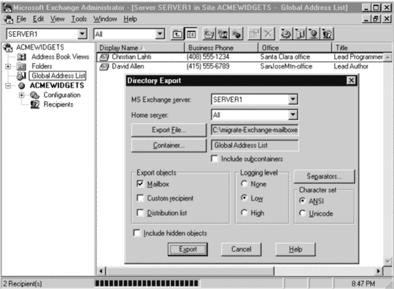

请注意，只需导出邮箱对象，因为这提供了迁移过程所需的必要账户映射信息。其余的组、联系人和用户信息将通过 LDAP 获取。

现在您可以运行第一个脚本 `w2lmt-migrate-smb-auth`，该脚本旨在提取身份验证信息。此脚本需要使用配置文件，尽管未来的脚本版本在未提供配置文件时可能会提示输入信息。图 4.11 列出了 Acme Widgets 的配置文件。

#### 图 4.11 Acme Widgets `migrate-smb-auth` 配置文件

```ini
#migrate-smb-auth-acmewidgets.conf
#information about source server and target server
SourceHost="server1"
SourceDomain="ACMEWIDGETS"
SourceType="NT4"
SourceAdminAccount="Administrator"
TargetHost="localhost"
TargetPort="389"

#locations of config files for samba and smbldap-toolkit
smbconf="/etc/samba/smb.conf"
smbldap="/etc/smbldap-tools/smbldap.conf"
```

`migrate-smbAuth` 配置中的信息相对简单。脚本需要知道在哪里查找要读取/修改的配置文件，以及哪些主机参与迁移。Sam 使用以下命令在 Acme Widgets 的服务器上执行迁移。

```bash
/<path_to_scripts>/w2lmt-migrate-smbauth -f migrate-smbAuth-acmewidgets.conf
```

该命令执行以下功能：


- 检查并确保具备继续运行所需的所有条件。
- 提示输入源 NT 服务器和目标 OpenLDAP 服务器的密码。
- 枚举域 SID。
- 提示默认设置（带有更改/保存选项）。
- 以 BDC 身份加入 NT 域。
- 如果需要，在 OpenLDAP 中创建顶级 OU。
- 调用 Samba 组件以提取用户、组和机器对象，并将它们插入到 OpenLDAP 服务器中。
- 处理组员身份信息并修改组对象以添加 `uid` 成员信息。

在目录填充了用户认证对象后，下一步是运行 `w2lmt-directory-auth`。该脚本将查询 Exchange 服务器，以便使用其中存储的任何相关信息更新目录对象。该脚本还会添加联系人和分发组对象。如果您没有运行 Exchange，或者不希望将此信息迁移到新的 Linux 环境中，可以跳过此步骤。该脚本同样需要一个简短的配置文件。图 4.12 显示了 Acme Widgets 的 `migrate-directory` 配置文件。

#### 图 4.12 Acme Widgets `migrate-directory` 配置文件

```ini
#migrate-directory-acmewidgets.conf
#information about target LDAP instance
SlapdPath="/etc/openldap/slapd.conf"
TargetPort="389"

#specify the relative DN here for user objects in the target LDAP instance.
# you can use a different DN if you want your exchange contacts separate
# from your User/Group DNs. (ex.) Users would equal 'ou=Users,dc=acmewidgets,dc=com'
UsersOU="ou=Users"
ContactsOU="ou=Contacts"
GroupsOU="ou=Groups"
DistributionGroupsOU="ou=DistributionGroups"

#information about import directory (if any)
#valid entries are EXCH55, AD
SourceType="EXCH55"
SourceHost="server1"
SourceAdminAccount="Administrator"

#if import directory is exchange55, a map file is required
Exchange55CSV="/tmp/acmewidgets-exch55.csv"
```

上述配置信息显示了脚本将查询的 Exchange 主机，并描述了在 DIT 中放置联系人和分发组的位置。该脚本的部分信息是从 `slapd.conf` 文件中获取的，因此必须在目录服务器上运行。以下是 Sam 在 Acme Widgets 调用该脚本的方式：

```bash
</path_to_scripts>/w2lmt-migrate-directory -f migrate-directory-acmewidgets.conf
```

该脚本执行以下操作：

- 检查并确保具备继续运行所需的所有条件。
- 提示输入源 Exchange 服务器和目标 OpenLDAP 服务器的密码。
- 向 OpenLDAP 添加联系人和分发组所需的任何顶级 OU。
- 读取提供的 Exchange 导出（`.csv`）文件。
- 枚举所有个人邮箱对象。
- 确定对象是联系人还是映射的 NT uid（注意，如果多个邮箱匹配同一个 uid，最后一个将生效，该邮箱信息将保留在该 uid 下）。
- 更新 OpenLDAP 中匹配的用户对象（包含地址、邮件、电话等属性），或者在适用时将其作为联系人添加。
- 枚举分发组。
- 在 OpenLDAP 中创建填充了 `groupOfNames` 属性的对象。
- 根据适用情况，使用联系人或用户 DN 处理分发组的成员身份信息。

现在，您应该拥有一个完整的目录，其中包含来自之前的 NT 域和 Exchange 5.5 实例的所有认证和目录信息。剩下的唯一工作就是更改您的 Samba `smb.conf` 设置，使您的 Linux 服务器成为该域的 PDC，关闭原 PDC，并重启您的 Samba 服务。

### Active Directory 迁移路径

您现在可以运行第一个脚本 `w2lmt-migrate-smbauth` 了，该脚本旨在提取认证信息。此脚本需要使用配置文件，不过在未来的版本中，如果没有提供配置文件，脚本可能会提示输入信息。图 4.13 列出了 Ballystyx 的配置文件。

**注意**

如果您在混合模式（Mixed Mode）下运行 Active Directory，应在 `w2lmt-migrate-smbauth` 脚本配置文件中将 `SourceType` 设置为 `NT4`。通过使用此设置，您将保留现有域的 SID 和 RID。如果您在原生模式（Native Mode）下运行 Active Directory，脚本将为用户、组和机器创建具有新 SID 和 RID 的新域。这是因为 Active Directory 原生模式与正在迁移到的 Samba NT4 风格域不兼容。请记住，所有加入此域的机器必须重新加入（RE-joined）到新的基于 Linux 的域中。

#### 图 4.13 Ballystyx `migrate-smbauth` 配置文件

```ini
#migrate-smbauth-ballystyx.conf
#information about source server and target server
SourceHost="beryllium"
SourceDomain="BALLYSTYX"
SourceType="AD"
SourceAdminAccount="Administrator"
TargetHost="localhost"
TargetPort="389"

#locations of config files for samba and smbldap-toolkit
smbconf="/etc/samba/smb.conf"
smbldap="/etc/smbldap-tools/smbldap.conf"
```

上述信息相当简单；必须告知脚本在哪里查找要设置的配置文件，以及迁移过程中将与之交互的主机。下面的命令显示了 Vijay 如何在 Ballystyx Engineering 的 Samba 服务器上调用该脚本：

```bash
</path_to_scripts>/w2lmt-migrate-smbauth -f migrate-smbauth-ballystyx.conf
```

该脚本将执行以下功能：

- 检查并确保具备继续运行所需的所有条件。
- 提示输入源 NT 服务器和目标 OpenLDAP 服务器的密码。
- 枚举域 SID。
- 提示默认设置（您有机会更改/保存它们）。
- 以 BDC 身份加入 NT 域。
- 如果需要，在 OpenLDAP 中创建顶级 OU。
- 枚举组对象。
- 在 OpenLDAP 中创建填充了 `posixGroup` 和 `sambaGroupMapping` 属性的组对象。
- 枚举机器账户对象（加入现有域的主机）。
- 在 OpenLDAP 中创建机器（账户）对象，并填充 `inetOrgPerson`、`posixAccount` 和 `sambaAccount` 属性。
- 枚举所有认证对象（用户）。
- 在 OpenLDAP 中创建用户对象，并填充 `inetOrgPerson`、`posixAccount` 和 `sambaAccount` 属性。
- 处理组员身份信息并修改组对象以添加 `uid` 成员信息。

下一步是查询 Active Directory 服务器，以便使用任何非认证相关信息（如电子邮件、电话号码和其他联系信息）更新上述对象，并获取联系人对象和分发组信息。如果您不在意在新的 Linux 环境中保留这些信息，可以跳过此步骤。下一个脚本同样需要一个简短的配置脚本。图 4.14 列出了 Ballystyx 的 `migrate-directory` 配置文件。

#### 图 4.14 Ballystyx `migrate-directory` 配置文件

```ini
#migrate-directory-ballystyx.conf
#information about target LDAP instance
SlapdPath="/etc/openldap/slapd.conf"
TargetPort="389"

#specify the relative DN here for user objects in the target LDAP instance.
# you can use a different DN if you want your exchange contacts separate
# from your User/Group DNs. (ex.) Users would equal 'ou=Users,dc=ballystyx,dc=local'
UsersOU="ou=Users"
ContactsOU="ou=Contacts"
GroupsOU="ou=Groups"
DistributionGroupsOU="ou=DistributionGroups"

#information about import directory (if any)
#valid entries are EXCH55, AD
SourceType="AD"
SourceHost="beryllium"
SourceAdminAccount="Administrator"

#if import directory is exchange55, a map file is required
Exchange55CSV=
```

上述信息基本上为脚本提供了它将要查询的 Active Directory 主机，以及在 DIT（目录信息树）中放置联系人和分发组的位置。由于该脚本的部分信息来自 `slapd.conf` 文件，因此必须在目录服务器上运行。下面的命令展示了 Vijay 如何在 Ballystyx Engineering 的 Samba 服务器上调用该脚本：

```bash
/path_to_scripts/w2lmt-migrate-directory -f migrate-directory-ballystyx.conf
```

该脚本将执行以下功能：

- 检查以确保具备继续执行所需的所有条件均已满足。
- 提示输入源 Exchange 和目标 LDAP 服务器的密码。
- 向 LDAP 添加任何必要的用于联系人和分发组的顶级 OU。
- 枚举分发组。
- 在 OpenLDAP 中创建填充了 `groupOfNames` 属性的对象。
- 枚举所有个人邮箱对象。
- 更新 OpenLDAP 中匹配的用户对象，包含 `address`、`mail`、`phone` 等属性。
- 处理用户的分发组会员信息。
- 枚举所有联系人对象。
- 在 OpenLDAP 中创建包含 `inetorgPerson`、`mail`、`phones` 等属性的联系人对象。
- 处理联系人的分发组会员信息。

现在，您应该拥有一个填充完整的目录，其中包含来自之前的 NT 域和 Exchange 5.5 实例的所有身份验证和目录信息。剩下的唯一工作就是更改您的 Samba `smb.conf` 设置，使您的 Linux 服务器成为该域的 PDC，关闭原有的 PDC，并重启您的 Samba 服务。由于这是一个新域，您需要将迁移后仍保留的 Windows 200x 服务器和工作站（如果还有的话！）重新加入到新域中。

## 迁移 Windows 登录身份验证文件

组织中正在使用的任何登录脚本必须从 `NETLOGON` 共享（通常位于 `C:\WINNT\System32\Repl\Import\Scripts\`）复制到 Linux Samba 服务器上 `NETLOGON` 共享的新位置（默认为 `/home/netlogon/`）。

此外，如果使用了漫游配置文件，则必须将用户配置文件目录中的文件和目录（包括 `NTUSER.DAT` 或 `USER.DAT`、`NTUSER.INI` 等）复制到 Linux Samba 服务器上的相应共享目录中（默认为 `/home/profiles/`）。

用户主目录并非严格用于 Windows 登录，尽管 Windows 为用户主目录提供了驱动器映射。用户主目录内容的迁移最好在第 5 章“文件服务”中，随其他文件和目录的内容一起处理。

## 测试身份验证服务

在所有迁移工作完成后，下一步是测试基于 Linux 的身份验证服务。尝试从一台工作站登录，使用您设置的（在实验环境中）新 Samba 服务器进行身份验证。如果此测试成功，请尝试使用其他用户名登录，并确保登录脚本正在执行，且用户（漫游）配置文件信息被正确更新。

## 启用加密

在企业环境中将这些系统用于身份验证之前，您必须启用加密。由于启用加密是一项复杂任务，我们建议您最初先在不使用加密的情况下使身份验证服务正常运行。使用 Windows 和 Linux 计算机测试登录和其他身份验证功能。在验证身份验证服务正常工作后，您就可以添加加密功能以确保适当的安全性。

启用加密涉及的步骤主要包括以下内容：

1. 获取并安装有效的服务器证书。
2. 配置 `slapd.conf` 以使用服务器证书并要求 TLS。
3. 配置 `smb.conf` 以利用 TLS。
4. 配置客户端以利用 TLS。
5. 测试，测试，再测试！！

您使用的服务器证书可以从任何证书签名颁发机构（CSA）（如 Verisign 或 CA-Cert）获取，或者您可以通过 OpenSSL 生成自己的证书。OpenSSL 证书创建过程在第 9 章“Web 服务”中介绍。安装服务器证书后，您需要修改服务器配置文件以利用新证书。为 Acme Widgets 启用 TLS 所需的附加配置信息列在图 4.15、4.16 和 4.17 中。

**图 4.15** Acme Widgets `slapd.conf` 加密配置部分

```conf
TLSCertificateFile /etc/openldap/server.pem
TLSCertificateKeyFile /etc/openldap/server.key
TLSCACertificateFile /etc/openldap/ca.pem
TLSCipherSuite :SSLv3
TLSVerifyClient demand
```

**图 4.16** Acme Widgets `smb.conf` 加密配置指令

```conf
ldap ssl = yes
```

**图 4.17** Acme Widgets 桌面客户端 `ldap.conf`

```conf
ssl start_tls
TLS_REQCERT allow
```

如果配置文件包含 `ldap://` URI 引用，则必须将它们更改为 `ldaps://` URI。确保在重启 `slapd` 时存在正确的 TLS 选项。例如：

```bash
slapd -h ldap://127.0.0.1/ ldaps:////
```

通常效果良好。Fedora 用户可以通过 `ldaps://` 选项更新 `/etc/sysconfig/ldap` 文件。

下一步是在启用加密的情况下重新测试身份验证服务。在 Acme Widgets 进行快速测试以确保 TLS 正常工作的方法是输入：

```bash
ldapsearch -X -H ldaps://localhost -b 'dc=acmewidgets,dc=com' '(objectclass=*)'
```

## 总结

身份验证是最重要的网络服务之一。能够确定用户的身份并控制对网络资源的访问，构成了企业网络核心安全的基础。在大多数情况下，用户身份验证包括验证由一个或多个因素组成的凭据：您知道的东西（用户名、密码）、您拥有的东西（令牌）或您本身的东西（生物识别）。通过使用 OpenLDAP 目录作为身份验证信息的集中存储库，您可以构建灵活的身份验证方法，从而实现对分布式异构身份验证服务的集中控制。

微软在 Windows 98 和 NT 中使用 LANMAN 协议进行身份验证，并为 Windows 2000/XP 添加了 Kerberos 身份验证服务。目前还没有开源身份验证服务器能为开箱即用的 Windows 2000/XP 客户端提供 Kerberos 登录服务。Samba 服务器提供的 NTLM / LANMAN 身份验证服务可被整个 Windows 客户端和服务器系列（Windows 98/NT/2000/XP）使用。

Windows NT 和 Exchange 5.5 信息的迁移通常很直接，特别是当 NT 账户和 Exchange 邮箱之间存在直接对应关系时。迁移脚本将轻松地将这两个目录结合在一起，在 OpenLDAP 中呈现所有用户数据的统一视图。新的 Samba 管理域提供了 Windows NT 域的所有功能，甚至更多。

Windows 2000 Active Directory 信息的迁移通常运行良好，但如果您使用的是 Exchange 2000，或者在上一章中无法迁移您的 AD 集成 MS-DNS 服务，则必须并行运行基于 Linux 的目录服务，直到您可以迁移 Active Directory 依赖项。如果您在原生模式（Native Mode）下使用 Active Directory，则需要将所有 Windows 计算机重新加入到新的 Linux 管理域中。

## 快速解决方案

### 理解 Windows 身份验证

- [x] 要登录 Windows 计算机，用户需输入用户名、密码和域。Windows 98 使用 LANMAN 进行身份验证，Windows NT 使用 NTLM 进行身份验证，而 Windows 2000/XP 将尝试


Kerberos 身份验证，并具有向后兼容 NTLM 的回退机制。

- 身份验证成功后，Windows 计算机将更新漫游配置文件（如果已配置）并运行登录脚本。
- Windows 2000 可能会使用组策略对象 (Group Policy Objects) 来应用配置设置并启动（或安装）应用程序。

### 理解 Linux 身份验证

- LDAP 身份验证是最通用、支持最完善且应用最广泛的跨平台企业身份验证技术之一。LDAP 身份验证的实用性可以通过简单身份验证和安全层 (SASL) 来扩展。
- 最简单的身份验证方式之一是使用本地文件。使用`/etc/passwd`存储用户信息和`/etc/shadow`存储用户密码是实现本地身份验证最常用的方法。
- `/etc/nsswitch.conf`、`/etc/ldap.conf`和`/etc/pam.d/applicationname`包含了 Linux（以及许多 *nix）计算机上所使用的身份验证机制的配置信息。
- 可插拔身份验证模块（Pluggable Authentication Modules，简称 PAM）是一种灵活的用户身份验证抽象方法。PAM 将应用程序中授予权限的部分分离到一个系统中，该系统可以通过修改`/etc/pam.d/applicationname`进行动态重新配置。

### 设计基于 Linux 的身份验证服务

- 设计基于 Linux 的身份验证服务的第一步是确定组织计算机系统的身份验证需求。对于大多数组织，这意味着 Linux 系统使用 LDAP/TLS 进行身份验证，而 Windows 系统使用 NTLM（通过 Samba 提供）。
- 下一步是确定组织中身份验证服务器的类型、位置和数量。对于像 Acme Widgets 这样的小公司，一台身份验证服务器就足够了。对于像 Ballystyx Engineering 这样的大公司，每个站点至少需要一台身份验证服务器。对于容错安装，每个站点至少需要两台服务器。
- 部署前的最后一步是在实验室中安装、配置和测试身份验证服务。安装 Samba 并配置`smb.conf`。

### 从 NT/Exchange 5.5/AD 迁移信息

- 为了准备迁移，请确保 Samba 服务器已配置为使用 LDAP 进行身份验证，并从 IDEALX 安装`smbldap-tools`（网址：http://samba.idealx.org）。
- 如果您希望使用来自 Exchange 5.5 的信息进行迁移，请在 Microsoft Exchange Administrator 中选择 **Tools | Directory Export**，对 Exchange 5.5 全局地址列表 (GAL) 中的邮箱进行目录导出。
- 要将从 NT / Exchange 或 Active Directory 迁移的用户、组和计算机信息填充到 Samba 和 OpenLDAP 中，请运行`migrate-smbauth`和`migrate-directory`脚本。请务必仔细遵循说明，并访问 http://sourceforge.net/projects/w2lmt 获取脚本的最新版本。
- 在通过实验室测试验证身份验证服务的功能后，启用加密以提供额外的安全性。获取并安装 OpenSSL 服务器证书，并配置应用程序以启用 TLS 加密。

## 常见问题解答

以下常见问题由本书作者解答，旨在衡量您对本章所呈概念的理解，并协助您在现实生活中实现这些概念。如需作者解答关于本章的问题，请浏览 **www.syngress.com/solutions** 并点击“Ask the Author”表单。您还可以在 ITFAQnet.com 访问数千个其他常见问题。

**问：我的系统有两个 ldap.conf 文件。为什么？**

**答：** `/etc/ldap.conf`被`pam_ldap`和`nss_ldap`用于 LDAP 参数（包括身份验证）的系统级配置。`/etc/openldap/ldap.conf`（或`/etc/ldap/ldap.conf`）则被`ldapsearch`等 OpenLDAP 工具使用。

**问：为什么在我从运行在原生模式 (Native Mode) 的 Active Directory 迁移后，必须将我的 Windows 200x 重新加入到 Samba 管理的域中？**

**答：** 因为原生模式的 Active Directory 不使用与 NT SAM 相同的 SID/RID 方案，因此无法将对象描述符 ID 迁移到 Samba 管理的 NT 风格域中。

# 第 5 章：文件服务

本章主题：

- 理解 Windows 文件系统
- 理解 Linux 文件系统
- 理解权限管理（访问控制）
- 理解文件备份、恢复和复制选项
- AMANDA
- 设计基于 Linux 的文件服务
- 将文件服务迁移到 Linux
- 总结
- 快速解决方案
- 常见问题解答

## 简介

“文件服务”是一个在讨论访问远程系统上的文件时使用的术语。无论使用什么计算机平台，大多数公司都使用网络存储库来存放常用的数据，包括主目录、部门文件和公司资源文件。对网络数据的访问必须通过访问控制来防止未经授权的访问，必须通过定期备份来防止丢失或损坏，必须以足够的性能来满足终端用户的使用需求，并且必须以一种可管理且能应对增长的方式进行组织。虽然 Linux 中有多种类型的文件服务可用，但 Samba 是支持 Windows 客户端连接 Linux 服务器最切实可行的解决方案。此次转换的挑战在于实现数据、共享和访问控制列表 (ACL) 的平滑迁移，同时保持性能并确保数据安全。

## 理解 Windows 文件系统

文件服务提供了对存储在文件系统上的数据的网络访问。每种类型的文件系统都有影响文件服务共享数据方式的特性和限制。现代 Microsoft 操作系统 (OS) 与 FAT16、FAT32、NTFS4 和 NTFS5 文件系统具有本地兼容性，并且能够使用一种名为通用 Internet 文件服务 (CIFS) 的协议将这些文件系统上的文件共享到网络。本节将讨论这些文件系统的详细信息，指出每种系统的优势和区别，并涵盖 Microsoft 所遵循的文件系统演进历史。

为什么我们需要文件系统？磁盘驱动器的表面被划分为地址位置（扇区）。通过将一定数量的扇区分组，可以在磁盘上创建分区。当分区使用文件系统进行格式化时，文件系统会尝试组织数据在分区扇区内如何组织、写入、查找、访问和检查。

### 理解 Windows 文件分配表文件系统

FAT (File Allocation Table) 格式的分区将扇区分为簇 (clusters)，每个文件占用一个簇。所有 FAT 文件系统对一个分区中可以包含的簇数量都有最大限制。簇限制基于用于寻址簇部分的位数减去几个保留位。随着硬盘容量的增加，磁盘上的扇区也随之增加。为了创建更大的分区（跨越整个磁盘），一个簇必须包含更多的扇区。如果文件小于簇的大小，则会浪费大量空间（磁盘上的部分扇区将无法使用）。

#### 工具与陷阱：FAT 位数

- FAT12 使用 12 位，即 2^12 位，约 4,086 个簇。
- FAT16 使用 16 位，即 2^16 位，约 65,526 个簇。
- FAT32 使用 28 位，即 2^28 位，约 2.68 亿个簇。

此外，每个簇的大小也有限制。为了在大容量硬盘上使用整个磁盘，您必须创建多个分区，并记住哪个分区包含存储的数据。

#### 工具与陷阱：FAT 分区

- FAT12 可以创建 16MB 分区。
- FAT16 在 DOS 4.0 及以上版本、Windows 9x 和 ME 中可以创建 2GB 分区，在 NT 中可以创建 4GB 分区。
- FAT32 可以创建 8 TB (terabytes) 分区，但在 XP 及之前的 Windows 版本中只能创建 32GB 分区。

## 工具与陷阱

### 目录中的最大文件数

- FAT - 每个文件夹最多 512 个文件或文件夹
- FAT32 - 每个文件夹最多 65,534 个文件或文件夹
- NT 文件系统 (NTFS) - 每个文件夹最多 4,294,967,295 个文件或文件夹

默认情况下，FAT 在分区头中存储 FAT 表的备份副本；在 FAT32 中，可以禁用此功能以加快访问速度。所有 FAT 的所有版本都缺乏用户所有权和用户级访问控制、文件锁定以及冗余的概念，且容易产生碎片。FAT 存储了一些基本的文件属性，如只读、隐藏、系统文件、卷标、子目录和存档。存储在 FAT12 或 FAT16 分区上的文件有三种命名规则：

1. 名称限制为 8 个字符的前缀，后接一个点和 3 个字符的后缀（例如：`my_files.txt`）。
2. 名称必须以字母或数字开头。
3. 不保留大小写。

VFAT/FAT32 具有与 FAT16 相同的 2.0GB 最大文件系统大小限制，并增加了三项改进：

1. 支持长文件名（长度可达 255 个字符，包括空格和多个点；保留大小写但不区分大小写）。
2. 使用“32 位保护模式访问”提高性能。
3. 更好的管理能力；为程序的“独占模式”磁盘文件访问提供磁盘锁定。

虚拟文件分配表 (VFAT)/FAT32 提供了以下进步：

- 每个 FAT 条目使用 32 位且簇大小更小，将最大文件系统大小增加到 32GB。
- 每个独立文件占用单个簇；簇大小较小时，小文件浪费的空间更少。
- VFAT 的一种扩展，共享 VFAT 的文件名限制。
- 提供了可将 VFAT 单向转换为 FAT32 的实用程序。
- FAT32 分区可以大于 32GB，由其他操作系统准备，并可被 Windows 使用。

Windows NT 可以使用 64 Kbits 簇和 64 Kbits 簇，将 VFAT 分区的最大文件系统大小扩展到 4GB。

在 FAT 文件系统中，网络文件共享 ACL 仅限于 *完全控制*、*更改* 和 *读取*。

1988 年，FAT16 面世，用于 DOS 4.0 及更高版本、Windows 3.x、Windows 95 OEM SR1、Windows ME 和 Windows NT。到 1995 年，VFAT 面世，可用于 Windows 3.x、Windows 95 OEM SR1、Windows ME 和 Windows NT。1998 年左右，FAT32 面世，可用于 Windows 95 OEM SR2、Windows 98、Windows ME、Windows 2000 和 Windows XP。

### 理解 Windows NTFS 文件系统

在 Windows NT4 中，微软引入了一个更复杂的文件系统，称为 NTFS。NTFS 使用主文件表 (MFT) 来跟踪分区中的每个文件，并为每个文件设置安全描述符（安全性和权限）。每个安全描述符包含一个用于审计的系统访问控制列表 (SACL) 和一个影响文件访问的酌情访问控制列表 (DACL)。每个访问控制项由用户或组的 ID 以及授予该 ID 的权限组成。该 ID 可以是本地或信任域中的用户，或者是主机账户。NTFS 权限直接影响本地文件系统访问，并与文件共享 ACL 中的共享权限进行比较，以确定对共享资源的有效访问权限。“无访问”权限会阻止对文件或目录的所有访问，其优先级高于任何其他权限（本地或共享）。在授予用户“完全控制”权限时，请确保他们了解如何计算有效共享权限：

1. 检查是否有“无访问”覆盖。
2. 检查最宽松的共享 ACL（他们是所有组的成员）。
3. 检查最宽松的文件 ACL（他们是所有组的成员）。

网络上的有效权限是文件权限和共享权限中限制最严的一个。NTFS 1.1 版本（或 NTFS 4.0 版本）可被 NT4、Windows 200x 和 XP 使用。NTFS 4.0 相比 FAT 具有以下优势：

- 更高效的空间分配
- 具有 ACL（支持多个用户和组以及多个访问级别）
- 六个权限组 —— *无访问、列出、读取、添加、添加和读取、更改以及完全控制*
- 静态 ACL 继承模型，新文件继承其所在文件夹的权限
- 支持超大文件（单个文件可以使用整个分区）
- 包含用于审计的文件系统更改日志
- 支持廉价磁盘冗余阵列 (RAID)
- 减少了碎片（与 FAT 相比），但仍然存在
- 支持长达 255 个字符的文件名且区分大小写

NTFS 1.2（或 NTFS 5.0）随 Windows 2000 面世，可用于 NT 4.0 SP4b、Windows 2000 和 XP。必须安装安全配置管理器 (SCM) 程序，NT4 SP4b 才能使用 NTFS 5.0 的新安全特性。如果将 NTFS 4.0 分区连接到 Windows 2000 系统，它将被转换为具有以下增强功能的 NTFS 5.0 分区：

- **重解析点 (Reparse Points)**：由元数据和应用程序过滤器（一个程序）组成的对象，存储在文件系统相关联的文件或目录中。当访问该文件时，元数据会通过过滤器，从而修改文件的访问方式。单个文件或目录可以有多个重解析点。存在一些内部重解析点，任何支持 NTFS 5.0 的应用程序都可以创建它们：
    - **符号链接 (Symbolic Links)**：指向文件的真实路径
    - **联接点 (Junction Points)**：目录的符号链接
    - **卷装载点 (Volume Mount Points)**：装载点的符号链接
    - **远程存储服务器 (Remote Storage Server)**：将文件移动到离线或近线存储的规则；留下一个重解析点以便找回文件。
- **新的安全与权限方法论（动态继承）**：随着父目录 ACL 的更改，动态权限继承允许子目录继承这些更改。继承的权限和手动设置的权限分别维护。一个缺点是动态继承比静态继承更消耗处理器/内存。由于增加了“允许”和“拒绝”控制，之前的“无访问”覆盖控制已被移除。分配权限有 13 个属性：*遍历文件夹/执行文件*、*列出文件夹/读取数据*、*读取属性*、*读取扩展属性*、*创建文件/写入数据*、*创建文件夹/追加数据*、*写入属性*、*写入扩展属性*、*删除子文件夹和文件*、*删除*、*读取权限*、*更改权限* 以及 *取得所有权*。在确定有效权限时，请结合以下新规则：
    - “手动设置”优于“继承”
    - “拒绝”优于“允许”
    - “父级继承”优于“祖父级继承”
- **更改日志 (Change Journals)**：用 64 位更新序列号记录所有文件系统操作。不存储实际更改的数据。
- **加密**：此选项称为加密文件系统 (EFS)，以加密格式存储数据。操作系统创建 128 位（或 40 位）公钥/私钥；加密使用公钥，解密使用私钥。加密操作是操作系统的一部分，而非文件系统。EFS 方法是基于用户、组以及全局的 NTFS 5.0 硬磁盘和软磁盘配额的一部分。
- **稀疏文件支持 (Sparse File Support)**：对于具有长零序列的数据，仅将非零数据写入磁盘，并记录零应插入的位置。一旦以这种特殊方式存储，文件将永久更改，无法转换为原始形式。

Linux 对 NTFS 的兼容性仅限于 *只读* 内核驱动程序或 *读写* wine hack。Linux NTFS 内核模块经过反向工程，允许 Linux 系统挂载并读取 NTFS 文件系统。在撰写本文时，该驱动程序允许写入与磁盘上现有文件长度相同的文件，但 Windows NT、Windows 2000 和 Windows XP 在重启后通常需要运行磁盘检查 (CHKDSK) 以清理驱动程序造成的损坏。或者，Captive 项目提供了支持 *读取* 和 *写入* 的模块。

通过使用 wine 的 Microsoft Windows NT 内核仿真，并重复使用 ReactOS 的一个原始 *ntoskrnl.exe* 部分和 Microsoft Windows 的 *ntfs.sys* 驱动程序，可以访问 NTFS 分区。这是一种可靠的访问 NTFS 文件系统的方法，它需要 NTFSPROGS v1.8.0（一组基于共享库的 NTFS 工具集），而后者又需要 GLIBC v2.3（一个 GNU/Hurd 和 GNU/Linux 库）。项目主页可见：www.jankratochvil.net/project/captive/CVS.html.pl

由于大多数网络文件服务迁移是通过网络将文件复制到新的 Linux 服务器上完成的，因此对 Linux 而言，对 NTFS 驱动程序的的需求并不大。然而，在存在大量（数 TB）磁盘数据的情况下，即使在高速网络环境下，基于网络的复制可能也需要一天以上的时间才能完成。在这种情况下，将 NTFS 格式的磁盘临时安装到 Linux 机器上并进行本地文件复制通常要快得多。

## 理解 Linux 文件系统

除了支持 FAT 和 NTFS（大多为 *只读*）之外，Linux 还支持许多其他文件系统。2.6 内核原生支持第二和第三扩展文件系统 (ext2/3) 以及 ReiserFS 等。由于 ext2/3 和 ReiserFS 是 Linux 中最常用的文件系统，因此本节将重点讨论它们。

Ext2/3 和 ReiserFS 具有许多共同属性。每个文件和目录在磁盘上都有一个地址，称为 *inode*。它们都支持硬链接和软链接的概念，你可以通过使用 inode 值创建一个指向另一个文件名的文件名（功能类似于 Windows 链接）。*软链接* 是一个包含文件 inode 地址的文件，该地址存储了指向数据的 inode。*硬链接* 是包含目标数据 inode 的第二个文件。Ext2/3 和 ReiserFS 是分层结构的，每个文件或目录都存储在一个目录下，且树的顶端是 "/" 或 "root"。


Linux 文件 `/etc/fstab`（文件系统表）列出了文件系统、挂载点和挂载选项，并在系统启动时被解析。当文件系统被挂载时，`/etc/mtab`（挂载表）文件中会增加一行，且分区头中的“clean”位被读取并设置为“0”。当卸载（如关机时）时，clean 位被设置为“1”。

在启动过程中，如果“clean”位未设置为“1”，则该分区被视为“dirty”（脏），系统将针对该文件系统运行特殊程序以检查错误。这些程序（`fsck`、`fsck.ext2` 和 `fsck.reiserfs`）对磁盘上的数据和元数据进行“一致性”检查。

如果每个数据块要么被分配给单个 inode，要么未被分配，则文件系统是“一致的”。属于多个 inode 的数据块被视为错误或磁盘上的“不一致”，代表丢失或损坏的数据。如果“写入”操作部分失败，文件中的数据可能会丢失，或者块-文件关联信息可能会损坏。

### 理解 Ext2/3

Ext2 是 Linux 使用的第一个文件系统，基于 Minix 文件系统。它为用户、组和其他人提供所有权，并允许读、写和执行的访问控制。文件名区分大小写，最大长度可达 255 个字符。分区或分区上文件的最大大小为 4 TB。

Ext2 的一个缺点是，文件系统中的文件很容易因不洁卸载（如掉电）而损坏，并且需要用户干预才能重启（包括使用文件系统检查（`FSCK`）进行漫长的磁盘检查，这可能需要用户干预才能完成）。当文件损坏时，它可能会消失或变为零字节。如果这种情况发生在关键文件上，系统可能无法启动。

Ext3 最初由 Red Hat 的 Stephen Tweedie 博士开发。它从 2.4.15 版本开始被添加到发行版内核中，但现在用于 2.4.16 或更高版本。Ext3 可以被认为是具有日志功能的 ext2 文件系统。

要使用 ext3，必须将 ext3 编译进内核并安装 `e2fsprogs` 工具集。Ext3 提供了以下三种在 `/etc/fstab` 中设置的日志模式：

- **Journal**：记录文件数据和元数据的更改。这是最慢的模式。
- **Ordered**：记录文件元数据的更改，并在更新元数据之前将数据更新到磁盘。这是默认模式。
- **Write Back**：记录文件元数据，但不检查磁盘上的数据更改。这是最快的模式。

在 ext2 和 ext3 之间转换文件系统不需要像其他文件系统转换那样备份和还原数据。要将 ext2 转换为 ext3，可以添加日志，例如：

```bash
/sbin/tune2fs -j <partition>
```

要将 ext3 转换为 ext2，请清除日志文件系统特性。例如：

```bash
tune2fs -O ^has_journal <partition>
```

无需转换回 ext2，因为 ext3 文件系统既可以作为 ext2 挂载，也可以作为 ext3 挂载。一旦 ext2 转换为 ext3，应编辑 `/etc/fstab` 以防止 `FSCK` 运行一致性检查。

由于存在日志，（理论上）不再需要 clean 位来维持文件系统的一致性。在 `/etc/fstab` 条目中，将最后一列改为 `0` 以防止一致性检查。

| 设备 | 挂载点 | 文件系统 | 选项 | Dump | Pass |
| :--- | :--- | :--- | :--- | :--- | :--- |
| `/dev/hda2` | `/data` | `ext2` | `defaults` | `1` | `2` |
| `/dev/hda2` | `/data` | `ext3` | `defaults` | `1` | `0` |

## 资源

### 内核参数

- `CONFIG_EXPERIMENTAL=y (n)` # 旧内核需要
- `CONFIG_EXT3_FS=y (n)` # 2.6 内核默认

### 模块/驱动程序

`/lib/modules/2.6.5-7.104-default/kernel/fs/ext3/ext3.ko`

### 工具

- **ext2/ext3**：`http://e2fsprogs.sourceforge.net/ext2.html`
- **e2fsprogs**：包含工具：`e2fsck`、`mke2fs`、`debugfs`、`dumpe2fs` 和 `tune2fs`
- **e2fsck**：检查文件系统中损坏或错误的 inode，并允许修复。
- **mke2fs** 或 `mkfs.ext3`：创建 ext2/3 文件系统。
- **debugfs**：调试损坏文件系统中的错误。
- **dumpe2fs**：读取文件系统参数。
- **tune2fs**：修改文件系统参数。
- **ext2ed**：已弃用的 curses 接口，用于编辑小于 2GB 的 ext2 文件系统。
- **defrag**：ext2 文件系统的碎片整理工具。
- **e2image**：创建常规或原始镜像文件。`e2fsprogs` 工具可处理原始文件。
- **fdisk**：用于查看和编辑磁盘分区及文件系统的工具。
- **FSDEXT2**：用于只读 ext2 访问的 Win95 驱动程序。
- **Ext2fsd**：用于 ext2 文件系统的 WinNT、Win2K 和 XP 驱动程序。
- **MountX**：一个用于 ext2 文件系统的 Mac OSX 驱动程序。

### 理解 ReiserFS

ReiserFS 基于 Hans Reiser 的工作，于 2001 年被添加到 2.4 Linux 内核中。在撰写本文时，ReiserFS v.3 随大多数 Linux 发行版一起提供，但 v.4 刚刚发布。该文件系统的主页可以在 Naming System Venture（`http://www.namesys.com/`）找到。

各版本向后兼容，但如果某个版本被向前转换（通过挂载“`-o conv`”选项），旧版本的工具将无法工作。重挂载选项“`resize=<NUMBER>`”允许分区在无需备份或还原数据的情况下增长；但是，分区不能缩小。

这是一个真正的日志文件系统，它保存交易及其元数据的账本，并支持“前滚”（roll forward）和“回滚”（roll back）恢复。流程如下：

1. 计划交易（如果步骤 1 失败，则写入丢失）。
2. 执行交易（如果步骤 2 失败，系统可以重放或删除该交易）。
3. 标记交易完成（如果步骤 3 失败，系统将视其为步骤 2 失败）。

如果文件系统处于“dirty”状态（如掉电后），将分析日志而不是运行耗时的 `FSCK` 来检查不一致性，并在需要时进行重放。这可以减少停机时间和损坏概率。

ReiserFS 将文件系统组织为两个区域：数据区和系统区。数据区由目录、文件和文件元数据组成，组织为单个“平衡树”（balanced tree）数据结构（v.3 中）或“舞动树”（dancing tree）数据结构（v.4 中）。

对于给定文件的平衡树结构，数据和元数据可以在磁盘上存储在彼此附近，从而最大限度地减少读写头的移动，提高读取速度。与 ext2/3 方法相比，在分区上定位文件使用平衡树结构更快，而使用“舞动树”结构则更快。

通过使用精确的块计数存储方法，比 ext2/3 基于块的分配浪费的空间更少。ReiserFS 系统区由超级块、日志和位图组成。ReiserFS 日志可以修复其中的坏块数据区域，但不在系统区域。

系统区域通常不会损坏，但可以通过重建超级块或树来修复。例如：

- `/sbin/reiserfsck --fix-fixable --rebuild-sb /dev/hda2`
- `/sbin/reiserfsck --fix-fixable --rebuild-tree /dev/hda2`

在 2.4.7 之前的内核在 NFS 共享 ReiserFS 分区方面存在问题，包括文件系统损坏和写入失败，但这个问题似乎已经得到了解决。起初，有关于软件 RAID 的问题报告，但硬件 RAID 一直能正常工作。通过 JFS 和 ReiserFS 的组合，可以实现软件 RAID。

ReiserFS v.4 以最快的文件系统著称，具有原子性（不会发生事务损坏），提供更高效的文件存储（用 dancing trees 算法替代了平衡树算法），可通过插件进行扩展，并具有军用级代码（每个函数进入时都有断言）。

与 ext2 和 ext3 不同，ReiserFS 提供了许多内核参数，用于编译新内核（此处不讨论）以启用文件系统的特殊功能。

要将 ReiserFS 支持构建到内核中，请将 `CONFIG_REISERFS_FS` 设置为 `"y"`；要构建模块，请将其设置为 `"m"`。如果 `CONFIG_REISERFS_CHECK` 设置为 `"y"`，文件系统将以调试模式运行，执行所有可能的检查，且运行速度较慢；因此，这通常被保留为 `"n"`。

将 `CONFIG_REISERFS_PROC_INFO` 设置为 `"y"` 将创建较大的内核/模块，需要更多内核内存，且文件系统统计信息将存储在 `/proc/fs/reiserfs` 中。

有一个可用的内核补丁可以添加名为 `CONFIG_REISERFS_RAW` 的选项。如果将其设置为 `"y"`，它将允许对 ReiserFS 内部树进行原始访问，从而绕过文件系统。更多信息请参阅内核源码 `Documentation/filesystems/reiserfs_raw.txt`。

如果您编辑内核源码并包含 `/linux/reiserfs_fs.h`，内核选项 `REISERFS_HANDLE_BADBLOCKS` 将成为一个可用选项，它用于定位并标记已挂载 ReiserFS 分区上的坏块。

## 资源

### 模块/驱动

`/lib/modules/2.6.5-7.104-default/kernel/fs/reiserfs/reiserfs.ko`

### 工具/实用程序

- 获取 ReiserFS 分区的信息（版本、块大小等）：

  `debugreiserfs <partition>`

- 生成 ReiserFS 分区上的坏块列表：

  `/sbin/badblocks [-b<reiserfs-block-size>] <partition>`

- 运行一致性检查并修复文件系统错误：

  `reiserfsck --check <partition>`

- 修复 ReiserFS 分区上的坏块：

  `reiserfsck --badblocks <file with list of bad blocks> <partition>`

**注意**

`fsck.reiserfs` 和 `reiserfsck` 是同一个程序。

- 创建 ReiserFS 文件系统：

  `mkreiserfs <partition>`

**注意**

`mkfs.reiserfs` 和 `mkreiserfs` 是同一个程序。

- 修改日志大小或最大事务大小：

  `reiserfstune <partition>`

- 在文件系统日志中将块标记为坏块：

  `reiserfstune --badblocks bad_blocks.txt /dev/hda2`

## 理解权限管理（访问控制）

文件系统 `NTFS`、`ext2`、`ext3` 和 `ReiserFS` 都以不同的方式支持访问控制。Windows 共享和 Samba 共享也以不同的方式处理访问控制。

从 Windows 迁移到 Linux 的目标是在将共享移至 Samba 服务器时，尽可能多地保留 `ACL`，并随着时间的推移尝试将 `ACL` 简化回所有者、组和其他等 `UNIX` 风格。

本节关注的是最终用户对网络共享的访问。为了涵盖这一点，我们必须首先介绍 Linux 中的基础 `UNIX` 权限和扩展属性（`EA`）/`ACL` 功能。

在简单形式（以及历史上的 `UNIX`）中，基于文件的访问控制被称为“工作组系统”，它仅包含一个级别，且每个文件或目录有三种所有权类型（一个用户、一个组和世界）以及三种访问控制类型（`read`（读）、`write`（写）和/或 `execute`（执行））。

用户和组身份传统上在 `/etc/passwd` 和 `/etc/group` 中设置，尽管用户 `ID`（`UID`）和组 `ID`（`GID`）也可以从 `NIS` 或 `OpenLDAP` 等其他区域获取。

所有权更改通过 `chown` 和 `chgrp` 命令执行，并由权限位控制：九个文件模式位（`read`、`write`、`execute`）和三个特殊位（`setuid`、`setgid` 和 `sticky`）。

`chmod` 命令可用于设置权限位和特殊位，但某些命令专门用于设置三个特殊位（`setuid`、`getuid`、`setreuid`、`seteuid` 和 `setfsuid`）。

对于目录，`read` 允许您列出内容，`write` 允许您在其中创建文件，`execute` 允许您搜索目录。

针对需要更复杂文件级权限的情况，Linux 也有解决方案。通过对内核中文件系统代码的补丁（现已纳入当前的内核发行版），全功能的 `POSIX ACL` 和 `EA` 变得可用。

当标准 `UNIX` 权限不够细粒度时，可以使用 `POSIX ACL`。权限可以单独分配给用户（或组）（例如，Joe 对 `foo.txt` 拥有 `rw` 权限，而 Sally 对 `foo.txt` 拥有 `nw` 权限）。

`EA` 允许您控制文件或目录如何与文件系统交互，从而使文件变为不可变，使目录压缩其内容，或以特定方式记录任何写入的日志。

可以为许多用户和组指定不同的权限。`ACL` 一直是 Windows `NT`、AIX（`IBM UNIX OS`）和 `HP-UX` 的一部分，并且曾作为 2.4 Linux 内核的补丁提供，但 `EA/ACL` 已包含在适用于 ext2、ext3 和 XFS 的 2.6 内核中。

要为 ReiserFS 添加 EA/ACL 支持，仍需要 2.6 内核的补丁，但 SuSE 2.6 内核已经包含了该补丁。

Linux POSIX ACL 为 Linux 增加了 NT 风格的权限。`getfacl` 和 `setfacl` 命令使用 `libacl.so.0` 共享库且属于 `e2fsprogs` 软件包，它们允许更高的权限粒度。

可以基于多个不同的 UID 或 GID 分配不同的权限，而不仅仅是一个 UID、一个 GID 和一个 Other 默认值。可以通过 `lsattr` 和 `chattr` 命令（同样属于 `e2fsprogs` 软件包）访问 EA，允许用户控制文件系统如何允许访问文件。

ACL 属性在创建时从父目录继承。一个 ACL 条目由以下部分组成：

1. “类型”（用户、组、掩码或其他）。
2. 用户/组或空白。
3. 权限。

当给定的“用户”或“组”类型未指定用户时，权限适用于拥有该文件或目录的用户或组。权限解析按以下非累积顺序确定：所有者、命名用户、所有组、命名组、其他。

表 5.1 显示了以下类型的 ACL 条目所对应的术语。

### 表 5.1 ACL 条目术语

| 术语 | 文本形式 | 注释 |
| --- | --- | --- |
| 所有者 | `user::rwx` | 传统的 UNIX 所有者 |
| 命名用户 | `user:root:rwx` | |
| 所有组 | `group::rwx` | 传统的 UNIX 组 |
| 命名组 | `group:admin:rwx` | |
| 掩码 | `mask::rwx` | |
| 传统 UNIX 其他 | `other::rwx` | 传统的 UNIX 其他 |

有效权限是通过对用户条目和掩码条目执行逻辑“与”运算计算得出的。示例见表 5.2。

### 表 5.2 ACL 类型、条目和权限

| 类型 | 条目 | 权限 |
| --- | --- | --- |
| 命名用户 | `user::rw-` | 读取和写入 |
| 掩码 | `mask::r-x` | 读取和执行 |
| 有效权限 | `r—` | 读取 |

在文件的“访问 ACL”设置后，详细列表将在权限位后显示一个加号（`+`）。

```bash
i.e. ls -ld foo
drwxrwx--- 2 jstile users 48 2004-08-24 06:18 foo
setfacl -m user:root:rwx,group:root:rwx foo
ls -ld foo
drwxrwx---+ 2 jstile users 48 2004-08-24 06:18 foo
getfacl foo
# file: foo
# owner: jstile
# group: users
user::rwx
user:root:rwx
group::r-x
group:root:rwx
mask::rwx
other::---
```

当目录上设置了 ACL 功能“默认 ACL”（使用 `-d` 选项）时，目录保留其 ACL，但在该目录下创建的新文件和目录将继承“默认 ACL”。

```bash
Set the default ACL on the directory 'foo':
setfacl -d -m group:ntadmin:r-x foo
getfacl foo/
# file: foo
# owner: jstile
# group: users
user::rwx
user:root:rwx
group::r-x
group:root:rwx
mask::rwx
other::---
default:user::rwx
default:group::r-x
default:group:ntadmin:r-x
default:mask::r-x
default:other::---
```

要删除 ACL，请使用 `-x` 选项：

```bash
setfacl -d -x group:ntadmin foo
getfacl foo/
# file: foo
# owner: jstile
# group: users
user::rwx
user:root:rwx
group::r-x
group:root:rwx
mask::rwx
other::---
default:user::rwx
default:group::r-x
default:mask::r-x
default:other::---
```

## 注意事项


即使 ACL 授予了 `rwx` 权限，也只有 UNIX 所有者/组或 `root` 用户才能删除或移动文件。

即使 ACL 授予了 `rwx` 权限，也只有 UNIX 所有者/组或 `root` 用户才能修改 ACL。

`setfacl` 和 `getfacl` 不列出也不更改 `setuid`、`setgid` 或 `sticky` 位。`/etc/fstab` 必须使用 ACL 选项挂载文件系统，否则 POSIX ACL 命令将失败（例如：`/dev/hda2 ext2 acl,defaults 1 1`）。

`chmod` 将会更改 ACL 掩码（mask），此时必须重新应用 ACL 授予权限，或者将掩码重置为 `rwx`。

如果程序的权限为 `4700` 且用户被授予了 ACL `rwx` 权限，该程序将不会以 `setuid` 身份运行。

您可以使用以下命令创建 EA/ACL 文件系统元数据的备份：

```bash
getfacl -R --skip-base / > /root_AE_ACL_BACKUP_`date`.acl
```

您可以使用以下命令从备份文件还原 ACL：

```bash
setfacl -restore=<your backup file>
```

当 Samba 被配置为使用 PAM（可插拔认证模块）、PAM 被配置为使用 OpenLDAP，且名称服务开关（NSS）被配置为使用 OpenLDAP 和 wins 时，可以使用轻量级目录访问协议（LDAP）账户为文件分配所有权，并将域用户验证为 Samba 主域控制器（PDC）。当经过补丁的 ext2、ext3 或 ReiserFS 文件系统以 “acl” 选项挂载，且 Samba-3 的 `smb.conf` 文件包含 “map acl inherit = Yes” 时，文件系统上的共享和文件可以配置 POSIX ACL。

如果您将 Samba-3 服务器配置为带有 OpenLDAP 后端和 winbind 的域控制器（DC），则可以像 Windows 文件服务器那样为域用户和组分配共享权限。这可能会让 Windows 管理员觉得 Samba 非常像 Windows 服务器，这既有好处也有坏处。一方面，它允许管理员将 ACL 迁移到共享中，就像在 Windows 服务器上设置的那样，从而简化了迁移路径。另一方面，使用 POSIX ACL 会产生两个大问题：

1. 它们难以在机器之间迁移。
2. 它们难以备份或还原。

使用 Windows 资源管理器将文件从一台服务器拖放到另一台服务器不会保留 POSIX ACL，Linux 工具如 SCP（安全复制命令）、RSYNC（允许快速增量文件传输的命令）和 TAR（源自磁带存档工具）也不行。最新版本的 `cp` 命令在复制到以 “acl” 选项挂载的本地挂载文件系统时，可以使用 “-p” 选项来保留 ACL。或者，您还可以使用 “star”，它是 tar 的一个感知 POSIX 的版本（ftp://ftp.berlios.de/pub/star/）。

要创建包含 ACL 的目录 tar 包：

```bash
star H=exustar -acl -c <path> > archive.tar
```

要还原包含 ACL 的存档：

```bash
star -acl -x < archive.tar
```

`H=exustar` 使 `star` 创建一个扩展的 pax 存档。POSIX 1003.1-2001 标准将 pax 定义为一种与 tar 格式兼容并增加了 ACL 的存档格式。在 Windows 中，您可以使用 `robocopy`（来自 Windows XP Resource Kit）、带有 `xacls` 的 `xcopy`（来自 Win2k Resource Kit）或 `scopy`（来自 NT Resource Kit）来传输 ACL，但微软的资源工具包不是免费的。

长期解决方案是在将共享迁移到 Samba 时简化 ACL，尝试将安全模型更改为使用标准 UNIX 文件权限（一个所有者，一个组，以及其他），并结合文件系统和共享控制。通过文件系统权限，您可以在目录上设置 `sticky` 位，以确保只有该目录中文件的所有者才能删除或重命名该文件。在目录上设置 `UID` 或 `GID` 位可确保在该目录中创建的所有文件都由特定的用户或组 ID 拥有。配合基于文件的权限，`smb.conf` 中的共享配置允许管理员根据用户和组授予各种访问权限。表 5.3 是 Samba HOWTO 集合的一部分，识别了基于用户和组的控制。

| 控制参数 | 描述 |
| --- | --- |
| Admin users | 对此共享中所有内容拥有完全控制权的用户列表。 |
| Force group | 将使用此共享的任何人视为该组成员。 |
| Force user | 将使用此共享的任何人视为该用户。 |
| Guest ok | 访问此共享不需要身份验证。 |
| Invalid users | 被禁止访问此共享的用户列表。 |
| Only user | 如果用户不在管理列表中，则不允许其访问共享。 |
| Read list | 仅允许读取此共享中项目的用户列表。 |
| Username | ??? |
| Valid users | 允许访问此共享的用户列表。 |
| Write list | 允许对此共享进行读取和写入的用户列表。 |

## 理解文件备份、还原和复制选项

在讨论文件服务和存储时，无法不提及备份、还原和复制。由于公司的文件通常包含宝贵的知识产权，因此必须妥善保护这些资产，并针对从意外删除文件或目录到服务器和磁盘完全损坏等各种问题制定应急计划。

为了正确防御（或者更准确地说，为之准备）这类事件，有必要将数据备份到可移动介质中以确保安全。

复制可以是单次的、计划的或连续的。备份操作系统文件将允许更快速的灾难恢复。最佳实践要求至少将部分备份介质存储在异地。如果可行，存储在现场的备份介质应存放在防火保险柜中。

虽然可重写光盘对于单次和小规模任务的备份很有用，但对于规模在数十、数百到数千 GB 数据量之间的企业备份需求，事实上的选择是磁带介质。

对于大多数系统管理员来说，问题不在于是否需要执行还原，而在于何时必须执行还原。

如果您找不到需要的数据，那么在磁带上备份数据就毫无意义。正如规划备份很重要一样，规划文件（以及可能的服务器）还原服务同样重要。最佳实践是至少每月从磁带执行一次测试还原。发现备份到磁带的数据因磁带损坏、格式错误或其他错误而无法还原的时间应该是灾难发生之前，而不是之后。

备份策略试图回答五个问题：

1. 应该备份哪些文件？
2. 应该如何备份？
3. 什么样的介质是合适的？
4. 应该在何时运行备份，运行哪些类型？
5. 何时应该舍弃备份？

### 确定需要备份的关键文件

有些文件很难被替换，例如公司知识产权、配置文件、日志文件、主目录和自定义编译的程序。通常，这些类型的文件位于 `/etc`、`/var`、`/home`、`/root` 和 `/opt` 中。其他文件则很容易替换，例如标准发行版软件包、临时内核文件或设备文件，这些不应被备份。它们通常是 `/dev`、`/proc` 的一部分，以及由标准 Linux 安装提供的文件。

选择仅备份必要项目将最大限度地减小每次备份的大小，并降低设计备份方案的资源成本。将关键文件分组在公共位置也将简化决定备份什么的决策过程。

同时，手头拥有每种类型计算机的克隆副本也是好事，以便快速生成新机器。克隆镜像应保存在近线存储（如硬盘）中，因为磁带介质速度可能非常慢。如果硬盘损坏，克隆镜像可以在短时间内放置在新磁盘上，然后从磁带还原关键文件，这比从磁带执行全量备份还原所需的时间要短。System Imager（System Installer 套件的一部分）是一个优秀的独立于发行版的克隆解决方案。

### 决定备份方法

设计可靠备份方法有多种方式。一些建议包括：

- 在每台主机上运行备份到每台主机上的某种备份介质。这对于少量机器可能有效，但不是一个可扩展的解决方案。
- 将所有重要文件复制到备份服务器（使用 `rsync`），然后使用命令行工具将其写入备份介质。
- 备份多台机器可以在不需要任何特殊软件的情况下完成。
- 设置备份客户端/服务器套件。在这种方案中，每个需要备份的客户端运行一个守护进程，而带有备份介质的服务器运行一个服务器守护进程。
- 服务器守护进程将与每个客户端守护进程通信，将数据传输到备份介质（例如：Advanced Maryland Automatic Network Disk Archiver (AMANDA), HP OmniBack, ARKEIA, Veritas NetBackup）。

## 确定使用什么类型的备份介质

随着介质类型的容量和传输速度增加，其成本通常也会增加。介质和驱动器的价格是大多数备份方案中最大的前期成本，并且还会有额外的年度费用。务必批量购买介质（以降低价格），因为这将降低介质的长期成本。如果可能，获取一个磁带库（多盒驱动器）将有助于减少更换磁带的开销。

另一个考虑因素是，某些备份介质虽然耐用，但会因为人们不再拥有读取该介质的设备而变得过时。示例包括开盘带（reel-to-reel tape）、Exabyte、Jaz、Zip 和磁光盘（Magneto Optical）。

## 第 5 章 • 文件服务

在选择归档介质时，请考虑同时归档一个能够读取该介质的驱动器以及该驱动器的驱动程序，以避免不可避免的设备过时问题。或者，在您的备份方案升级策略中，将旧归档迁移到新介质类型的过程包含在内。这将为任何升级增加现实的额外成本，但能避免管理员面临归档文件无法访问的困境。

常用的介质类型包括光盘（CD）/数字多功能光盘（DVD）、磁盘驱动器、数字音频磁带（DAT）、数字线性磁带（DLT）和线性开放磁带（LTO）。

CD/DVD 介质（容量约为 4GB）价格低廉，且可以用带有 CD/DVD 阅读器的机器读取，这在现代 PC 中非常普遍。CD/DVD 介质有几个缺点：管理大量 CD 会变得臃肿且需要极强的组织能力；每次执行备份时，CD 或 DVD 刻录机都需要一张新的空白盘。介质的成本取决于备份执行的次数以及每次备份所需的磁盘数量。

研究发现，介质会随着时间的推移而劣化，导致归档文件无法使用。除了划痕外，胶水可能会脱落，塑料可能会变得不透明，银色背层可能会剥落。大容量磁盘驱动器可以快速传输数据，并提供了一种便宜的介质类型（就单位美元的数据量而言）。

Firewire 驱动器已变得非常流行；一些电影是以这种格式而非胶片进行归档的。其缺点是存在可能失效的机械部件，且驱动器对冲击比较敏感。DAT 磁带（最高 20 到 40GB）在多年前是首选介质。

磁带介质耐用、体积小且可重写，且多盘更换器价格相对便宜。然而，它们的速度非常慢且容量相对较低。

DLT 磁带（最高 40 到 80GB）是当前备份方案中流行的介质。它们具有更快的传输速率（在 1.2 到 16 MBps 之间），存储数据更多，且耐用且可重写。然而，介质和驱动器的价格更高。

LTO Ultrium（最高 100 到 200GB）在中大型网络中很流行。它们的传输速率非常快（20 到 40 MBps），体积与 DLT 相当，且可重写且耐用。问题是它们非常昂贵。

## 备份计划

备份计划通常包括全量备份和增量备份。全量备份确保您仅使用最新的备份介质即可还原文件。执行全量备份比增量备份花费更多时间并使用更多介质，但从全量备份还原所需的时间更短。

增量备份确保可以使用最后一次全量备份的介质和随后的几次增量备份来还原文件。在规划计划时，请考虑您愿意在还原请求中等待多长时间，以及全量备份需要多长时间。全量备份计划得越频繁，每年的介质成本就越高。

备份计划应由管理人员和管理员共同商定，以便在成本和预期之间找到一个折中方案。如果管理层要求一个小时内完成还原的服务等级协议（SLA），则需要更多的全量备份（更多的介质和驱动器）。

通过维护日历，您可以轻松查看备份何时已执行以及下次计划执行的时间。此外，记录每份备份详细信息的日志也很有帮助。这些数据可以保存在数据库或扁平文件中。一些商业解决方案提供自己的方法。它允许管理员和用户快速确定哪个磁带包含所需资料，并显示失败的备份。

### 轮转和归档介质计划

一种最佳实践是对部分（而非全部）全量备份进行长期存储归档。随着备份时间的增加，介质存储成本增加，介质上的数据变得过时，其有用性随之降低。删除备份的权衡在于粒度问题：仅由一个备份代表一个更长的时间窗口。

许多形式的介质可以被擦除并重复使用。为了防止每次备份产生的新介质稳步增加，可以擦除并重复使用旧备份的介质。在重复使用介质时，请务必记录该介质的使用次数（通过介质序列号或物理标记）。所有东西都会随着时间的推移而损坏；您不希望将备份（您的安全网）寄托在损坏或有缺陷的介质上。

将所有扩展属性 ACL 备份到文件中：

```bash
getfacl -R --skip-base / > /backup.acl
getfattr -dhR -m- -e hex / > /backup.ea
```

还原 ea/ACL：

```bash
cd /
setfacl --restore=backup.acl
```

备份 mysql 数据库：

```bash
mysqldump --tab=/path/to/some/dir --opt db_name
```

对于 Linux 设备文件，小型计算机系统接口（SCSI）磁带驱动器中，“回卷”（rewind）设备通常是 `/dev/st0`，“不回卷”（no rewind）是 `/dev/nst0`。带有 SCSI 库更换器的驱动器是 `/dev/sg0`，库是 `/dev/sg1`。对于集成驱动电子（IDE）磁带驱动器，“回卷”设备是 `/dev/ht0`，“不回卷”是 `/dev/nht0`。

存在许多用于压缩文件/文件系统以及写入备份介质的命令行程序。这些包括 Copy In and Out（`cpio`）、`tar`（或 GNU tar）、`dump/restore`、`mt`、`dd` 和 `cdrecord`。这些程序本身可用于创建低技术备份/还原方案。`mt` 命令用于对磁带进行操作、`read`（读取）、`seek`（寻道）和 `write`（写入），而 `mtx` 和 `loaderinfo` 命令用于操作库更换器（可容纳多盘磁带）。

以下示例展示了如何使用 `cpio`、`mt` 和 `mtx`：

- **回卷并弹出磁带：**
  - `mt -f /dev/st0 rewind`
  - `mt -f /dev/st0 eject`

- **列出磁带内容：**
  - `cpio -itv -I /dev/st0`

- **使用 `cpio` 将 `/data` 目录备份到磁带：**
  - `cd /data`
  - `find . -print | cpio -ovH crc -O /dev/st0`

- **使用 `tar` 将 `/data` 目录备份到磁带：**
  - `cd /data`
  - `tar -clpMvf /dev/st0 * # 直接备份到磁带。`
  - `tar -dMf /dev/st0 # 验证内容`

- **使用 `tar` 备份除 `/proc` 和 `/dev` 以外的所有内容：**
  - `tar -cpfM /dev/st0 / --exclude=/proc,/dev`

- **使用 `dump` 备份：**
  - `dump 0f /dev/nst0 /`

- **使用 `cpio` 从磁带还原数据：**
  - `cpio -icvmuld -I /dev/st0`

- **使用 `tar` 从磁带还原所有内容：**
  - `tar -xpf /dev/st0 -C /`

- **列出库中的磁带：**
  - `mtx -f /dev/sg1 inventory`
  - `mtx -f /dev/sg1 status`

- **将库中的 1 号磁带加载到磁带驱动器：**
  - `mtx -f /dev/sg1 load 1 0`

一个更好的解决方案是使用开源备份套件，如 Mondo、StoreBackup 或 AMANDA。这些程序是对前面提到的 shell 命令的封装，但它们还提供了日志记录、调度等额外功能。

Mondo 是一个基于 CD 的单主机备份解决方案，而 StoreBackup 是一个磁盘到磁盘的单主机备份解决方案。Mondo 使用 `cdrecord` 创建一个可启动 CD 和若干个数据 CD。StoreBackup 在另一个磁盘上创建克隆。

### AMANDA

AMANDA 是一个具有 shell 接口的客户端/服务器套件，用于将多个网络主机自动备份到具有磁带驱动器的单台主机上。可以在 `http://AMANDA.org` 找到它，当前版本为 2.4.4p3。

AMANDA 最初由 John R. Jackson 和 Alexandre Oliva 编写，提供备份计划、日志记录、多驱动器/磁带备份以及并发远程主机备份。即使出现磁带问题，它也会尝试保持备份运行。AMANDA 可以使用磁带更换库，并能像 `dump` 命令那样运行全量或增量备份。

`dump` 方法如下：

- Level 0 为全量备份。
- Level 1 为自上次 Level 0 以来更改的内容。
- Level 2 为自上次 Level 1 以来更改的内容。

AMANDA 保留备份日志，跟踪磁带使用情况并打印磁带标签。

通过 shell 脚本 `amplot`，AMANDA 可以生成备份的图形显示。`dumpcycle` 是 AMANDA 执行一次完整 `-f0-` 类型 dump 的频率。在具有多块网络卡的 AMANDA 服务器中，网络流量可以被定向到使用特定的接口。

### AMANDA 备份流程


`AMDUMP` 在 `AMANDA` 磁带服务器上由 `cron`（用于执行计划任务的守护进程）以用户 `"AMANDA-user"` 和组 `"backup"` 身份运行。如果在域配置目录 (`/opt/AMANDA/etc/MyCompany.com/hold`) 中存在名为 `"hold"` 的文件，则会暂停。

如果没有找到名为 `"hold"` 的文件，且上次备份被终止或未干净结束，则运行 `amcleanup`，它将任何 `holdingdisk` 数据写入磁带，然后运行 `amflush`。要擦除之前失败备份的所有数据，请单独运行 `amflush`，然后由 `planner` 在相应的备份级别上查询客户端和计划。

驱动程序随一个 `taper` 进程（一个读取线程和一个写入线程）以及计划中每行对应的一个 `dump` 进程启动。每个进程将备份从客户端 `dump` 到暂存区或直接写入磁带。

最后，`amreport` 脚本重命名日志报告并发送电子邮件报告，`amtrmidx` 更新索引。

`AMANDA` 运行在 `UNIX` 主机上，并可以使用 `Samba` 和 `Kerberos` 备份 Microsoft Windows 主机。

在备份 MS Windows 主机时，您必须记得将注册表 `dump` 到一个文件中，该文件可以使用 Windows NT Resource Kit 工具 `regback.exe` 进行备份，并使用 `regrest.exe` 还原，该工具不是开源的。

以下批处理文件将备份注册表：

```batch
regback.bat
Del C:\regbkp\my_host_name\*.* /q
regback C:\regbkp\my_host_name
```

需要注意的是，v.2.4.0 的数据库变更导致 v.2.4.0 之前的备份在当前版本中无法读取。

要解决此问题：

1. 升级 v.2.4.0 之前的数据库。
2. 使用 v.2.4.0 之前的客户端导出。
3. 使用 <v. 2.4.0 客户端导入数据库。

`AMANDA` 使用 `dump` 和 `tar` 生成备份，并在写入磁带时使用“不回卷”的 `/dev/nst0` 设备。

`AMANDA` 最有效的运行方式是在将数据流传输到磁带之前，先将备份转储（`dump`）到一个 `holdingdisk`（暂存目录）。这样做有三个优点：

1. 由于转储到磁盘通常比写入磁带快，因此写入磁带将成为一个持续的流，从而减少对驱动器和磁带的磨损。
2. 多个转储可以并发进行，从而缩短涉及远程主机的备份窗口。
3. 如果系统磁带用尽，备份可以继续写入 `holdingdisk`，并在以后加载更多磁带时最终刷新到磁带中。

如果系统重启或写入磁带失败，您必须运行 `amflush` 将 `holdingdisk` 的内容写入磁带。

`AMANDA` 提供了一个配置工具，用于确定磁带驱动器的最佳设置：

```
amtapeptype -t "BNCHMARK DLT1" -f /dev/nst0
```

该工具运行时间非常长，但它可以确定适合您的驱动器、介质和 SCSI 配置的正确设置。只有当您的驱动器未列在默认的 `AMANDA.conf` 中时，才需要使用该工具。

在使用 Adaptec 2940UW 卡（传输速度 20.000MBs）、使用 DLT IV (40 到 80GB) 磁带盒的 BNCHMARK DLT1 驱动器，并且运行了 13 小时的 `amtapeptype`（生成的 tapetype 定义）时，输出结果如下：

```
amtape -t "BNCHMARK_DLT1" -f /dev/nst0
Writing 256 Mbyte compressable data: 35 sec
Writing 256 Mbyte uncompressable data: 118 sec

WARNING: Tape drive has hardware compression enabled

Estimated time to write 2 * 1024 Mbyte: 944 sec = 0 h 15 min     #<-- 耗时 15 分钟

wrote 980019 32Kb blocks in 2997 files in 22248 seconds (short write)
#<-- 耗时 6 小时

wrote 950290 32Kb blocks in 5830 files in 28447 seconds (short write)
#<-- 耗时 7 小时
```

```
define tapetype BNCHMARK_DLT1 {
    comment "just produced by tapetype prog (hardware compression on)"
    length 31604 mbytes
    filemark 335 kbytes
    speed 1239 kps
}
```

`amtapeptype` 的输出是一个磁带类型描述符，必须将其添加到 `AMANDA.conf` 中。

## 安装 AMANDA

安装 `AMANDA` 可能有多种选择。Debian 和 Gentoo 使用 `apt-get`：

```
Find it:
 apt-cache search AMANDA
Install:
 apt-get install AMANDA
```

SuSE、Mandrake 和 Red Hat 使用 `rpm` 包：

```
rpm -i AMANDA-1.4.4p3.rpm
```

如果您需要特殊的补丁、异构 UNIX 环境或需要特殊的编译选项，则必须从源代码构建 `AMANDA`：

1. 从 http://www.AMANDA.org/download.php 下载最新版本：

   ```
   wget http://easyns.dl.sourceforge.net/sourceforge/AMANDA/AMANDA-2.4.4p3.tar.gz
   ```

2. 将 tarball（使用 Unix `tar` 工具创建的文件存档）移动到构建目录：

   ```
   mv amanda.1.4.4p3.tar.gz /usr/src/
   pushd /usr/src/
   # Unpack
   tar -zxvpf amanda.1.4.4p3.tar.gz
   cd amanda.1.4.4p3
   ```

3. 为 `AMANDA` 创建目录：

   ```
   mkdir -p /opt/amanda/{doc,etc,lib,libexec,man,share}
   chown -R amanda-user.backup /opt/amanda
   ```

### 构建 AMANDA

```bash
./configure --prefix=/opt/amanda \
--with-config=MyCompany.conf \
--with-user=amanda-user \
--with-group=backup \
--with-owner=amanda \
--with-smbclient=/usr/bin/smbclient \
--with-fqdn
```

`--prefix=<directory>` 命令将所有 `AMANDA` 文件安装到同一个位置。`--with-config=<name>` 命令创建了一个带有 `<name>` 域的示例 `AMANDA.config`。

`--with-user`、`--with-group` 和 `--with-owner` 命令指定 `AMANDA` 运行时的用户和组。

`--with-smbclient=` 命令允许 `AMANDA` 备份 MS Windows 客户端。`--with-fqdn` 命令允许 `AMANDA` 使用全限定主机名。

**注意**：如果为永远不会作为服务器运行的客户端进行编译，请添加 `--without-server` 选项。

### 编译 AMANDA

```bash
make
```

切换用户为 `root` 并添加 `amanda` 组和用户：

```bash
su root
groupadd -g 37 backup
useradd -u 37 -g backup -d /opt/amanda -c 'AMANDA admin' -s /bin/false -k /dev/null -m amanda-user
```

### 安装

```bash
make install
```

以下目录将在 `/opt/amanda` 中创建：

- `sbin`：`AMANDA` 服务端程序
- `libexec`：`AMANDA` 备份客户端程序
- `lib`：`AMANDA` 动态库
- `man`：手册页目录
- `etc/example`：示例配置文件，包括 `AMANDA.conf` 和 `disklist`
- `doc`：文档
- `contrib`：额外脚本

**注意**：如果您需要卸载或删除所有创建的文件，请在构建目录中执行：

```bash
make uninstall
make clean
rm -rf /opt/amanda
```

## 在服务器上

安装 `AMANDA` 后：

1. 将额外数据从源码树复制到 `AMANDA` 安装目录：

   - `mv amplot contrib docs /opt/amanda/`
   - `mv example /opt/amanda/etc/`
   - `chmod +x /opt/amanda/amplot/amplot.sh`

2. 为 `holdingdisk` 创建目录：

   - `mkdir -p /dumps1/AMANDA`

3. 修正可能已更改的所有权问题：

   - `chown -R amanda-user.backup /opt/amanda`
   - `chown -R amanda-user.backup /dumps1`

4. 在磁带服务器的 `/etc/services` 中添加 `AMANDA`：

   - `amanda` 10080/udp
   - `amandaidx` 10082/tcp
   - `amidtape` 10083/tcp

5. 为 `AMANDA` 编辑 `xinetd` 文件：

   ```
   vi /etc/xinetd.d/amandaidx
   # default: off
   # description: AMANDA backup server with indexing capabilities
   #
   service amandaidx
   {
           socket_type      = stream
           protocol         = tcp
           wait             = no
           user             = amanda-user
           group            = backup
           server            = /opt/amanda/libexec/amandad
           disable          = yes
   }
   ```

6. 为备份域创建目录：

   ```
   mkdir /opt/amanda/etc/MyCompany.conf
   ```

7. 通过将示例 `amanda.conf` 文件复制到备份域目录来创建 `amanda.conf` 文件：

   ```
   cp /opt/amanda/etc/example/amanda.conf /opt/amanda/etc/MyCompany.conf/
   ```

根据需要阅读并编辑 `amanda.conf`。`amanda.conf` 文件包含 `AMANDA` 的大部分配置信息。这些设置包括运行的用户/组、Kerberos 设置、磁带驱动器设置 (`tapetype`)、更换库设置 (`tpchanger`)、临时磁盘存储 (`holdingdisk`)、大多数备份选项的通用设置 (`dumptypes`) 以及用于备份的网络接口卡 (`interface`)。

`AMANDA.conf` 文件有两个主要区域：`holdingdisk` 和 `dumptype`。`holdingdisk` 定义了在写入磁盘前存储备份数据的位置。建议配置多个 `holdingdisk` 以进行同步备份，且每个 `holdingdisk` 应有足够的空间容纳一次备份，因为 `holdingdisk` 并非为特定的备份而预留。

如果没有足够的空间来存放备份的 `holdingdisk`，备份将直接写入磁带，其他备份将等待驱动器可用。以下是一个 `holdingdisk` 条目的示例：

```
holdingdisk hd2 {
    directory "/dumps1/AMANDA"
    use 30000 Mb
}
```

`amanda.conf` 的下一个重点区域是 `dumptype` 定义。在一个 `amanda.conf` 中可以有许多 `dumptype` 定义，且一个 `dumptype` 定义可以用在其他 `dumptype` 定义中，作为合并通用设置的一种方法。以下是一个带有说明的 `dumptype` 定义示例：

```
define dumptype mother {
    auth     bsd      # bsd/krb4
    comment "my backups" # description
    #comprate   0.50, 0.50    # compression rate
    compress    none    # none/client best/client fast/server best/server fast
    dumpcycle   30      # days between full dumps
    exclude "./dev/"      # file or pattern to exclude
    exclude "./proc"      # file or pattern to exclude
    holdingdisk yes      # use holding disk (yes/no)
    #ignore             # don't use this backup.
    index no      # keep index (no/yes)
    kencrypt    no      # encrypt transfer (no/yes)
    maxdumps    1       # concurrent dumps on client. Default: 1
    maxpromoteday 0      # Default: 10000
    priority    high
    program "GNUTAR"      # DUMP/GNUTAR
    record yes    # record dump to /etc/dumpdates.
    skip-incr   0       # Skip the disk when dump 0 is not due.
}
```

通过在备份域目录 (`/opt/amanda/etc/MyCompany.conf/`) 中创建 `disklist` 配置文件来配置备份。`disklist` 文件中的每一行代表一个要备份的设备或共享。每行应包含要备份客户端的全限定域名 (`FQDN`)、要备份的设备/分区以及一个 `dumptype`。

`disklist` 中一行的格式为：

```
hostname diskdev dumptype [spindle [interface]]
```

以下是 `disklist` 语法的几个示例：

- 在 `AMANDA` 服务器上备份 `/home`：

  `localhost sda1 nocomp-root`

- 备份名为 `\\Host\C` 的 Windows 共享，指定 Samba 服务器为主机名：

  `samba_host.domain.com "//ms_window_pc/C$." nocomp-root`

- 在另一个 Linux 主机上备份 `/home`：

  `linux_host.domain.com /home nocomp-root`

  `/opt/sbin/amanda/MyCompany.con /am/amdump`

  `chown -R amanda-user.backup /opt/amanda/MyCompany.con`

## 在 Linux 客户端上

Linux 客户端应考虑以下步骤：

1. 允许用户 `amanda-user` 从 `AMANDA` 服务器连接：

   ```bash
   echo '' <<EOF > /opt/amanda/.amandahosts
   192.168.0.221   amanda
   EOF
   ```

2. 设置所有权和权限：

   ```bash
   chown amanda-user.backup /opt/AMANDA/.amandahosts
   chmod 0400 /opt/amanda/.amandahosts
   ```

3. 如果您安装了 `xinetd`，请对其进行配置并启动：

   ```bash
   vi /etc/xinetd.d/amanda
   # default: off
   # description: amanda backup client
   #
   service amanda
   {
       socket_type = dgram
       protocol    = udp
       wait        = yes
       user        = amanda-user
       group       = backup
       server      = /opt/amanda/sbin/amandad
       disable     = yes
   }
   /etc/init.d.xinetd restart
   ```

如果您安装了 `inetd`，请对其进行配置并启动：

```bash
vi /etc/inetd.conf
```


```
amanda               dgram             udp              wait             amanda
/usr/lib/amanda/amandad        amanda
```

```bash
/etc/init.d/inetd restarted
```

## 对于 Windows 客户端

将`share`密码添加到将用于挂载 Windows 客户端的 Samba 服务器上的`/etc/amanda`密码文件中。

AMANDA 将联系 Samba 服务器，而 Samba 服务器随后将联系 Windows 客户端。

## 在服务器上设置备份

AMANDA 用户必须向驱动器中装入一条空白磁带并为其写入标签。AMANDA 备份将不会使用没有标签的磁带。

```bash
amlabel MyCompany.con Label1
```

1. 检查`config`并修复出现的任何问题。

   ```bash
   amcheck MyCompany.con
   ```

   输出将如下所示：

   ```
   AMANDA Tape Server Host Check
   -------------------------------
   Holding disk /dumps1/AMANDA: 51309004 KB disk space available, that's plenty
   ERROR: cannot overwrite active tape Label1 (expecting a new tape)
   NOTE: skipping tape-writable test
   NOTE: info dir /var/lib/amanda/MyCompany.con/curinfo/motherin.MyCompany.con/_: does not exist
   NOTE: index dir / /amanda/MyCompany.con/index: does not exist
   Server check took 6.408 seconds
   AMANDA Backup Client Hosts Check
   ------------------------------
   Client check: 1 host checked in 0.312 seconds, 0 problems found
   ```

2. 手动运行备份：

   ```bash
   amdump MyCompany.con
   ```

3. 为自动化备份配置 Cron AMANDA：

   ```bash
   # 检查磁带
   0 16 * * 1-5 /usr/sbin/amcheck -m /etc/AMANDA/MyCompany.con/amanda.conf
   # 运行备份
   45 0 * * 2-6 /usr/sbin/amdump /etc/AMANDA/MyCompany.con/amanda.conf
   ```

## 设计基于 Linux 的文件服务

设计基于 Linux 的文件服务是网络设计中最受关注的领域之一，因为它直接影响最终用户的体验。如果用户的家目录位于广域网（WAN）链路上、在缓慢（或过载）的服务器上，或者文件突然无法使用或无法保存文档，用户将会抱怨。由于最佳设计因具体场景而异，因此最好遵循一些通用原则。优化时需考虑网络拓扑（慢速 WAN、子网、地理位置）、硬件（磁盘、网络、内存、CPU）、冗余（数据复制）以及用户配置文件配置（漫游配置文件、带有文件夹重定向的非同步文件）。

### 硬件资源

流量从网卡（NIC）流向内存，再流向磁盘。这条路径上最慢的点将成为瓶颈。计划为每位用户预留 100 Kbps 的带宽和约 200MB 的配置文件目录（具体取决于配置文件的限制程度）。新 Samba 服务器的成功直接关系到您对所需容量和吞吐量的估算是否准确。

网络速度逐年提升，用户的文件也逐年增大。在设置域控制器（DC）时，预计到用户家目录所在 DC 的速度为每用户 0.1 Mbps，并将该数值乘以二以估算峰值使用量。如果 DC 还提供其他文件服务，请分配更多带宽。假设为 100 Kbps，30 个用户将从服务器拉取 3 Mbps。计划在 DC 上安装至少 1 GB 的以太网卡以确保高效性能。如果使用多块网卡，请考虑使用“通道绑定”（Intel 称之为“teaming”）将网卡绑定为单个接口，并配置交换机以处理此操作。检查网卡与交换机或路由器之间的硬件自动协商，这往往无法选择最佳设置，从而导致性能下降。对比全双工、速度和流量控制在硬编码设置与自动协商设置下的网络性能。

磁盘访问速度必须达到或接近网络带宽，以处理输入/输出（I/O）请求，否则您的负载将非常高（由于等待进程）。使用标准的外设组件互连（PCI）总线，您可以获得约 132 MBps 的速度。使用 PCI-X 总线和 SCSI 控制器，速度可达 450 MBps。（来源：*Samba-3 By Example*, John H. Terpstra）。本地文件存储的替代方案是将文件存储移至存储区域网络（SAN）或网络附属存储（NAS），将磁盘和网络 I/O 卸载到专为此目的设计的硬件上。SAN 允许管理员将资金投入到一个系统中，而不是每个 DC。

如果内存不足，服务器将花更多时间在寻道和磁盘分页（慢速）上，操作必须等到资源可用为止，导致性能迟缓甚至可能导致服务器锁死。如果在预算范围内，请从一开始就最大化服务器的内存量。我曾见过以下每用户每服务的内存估算值：

| 服务 | 估算内存 |
| :--- | :--- |
| DHCP | 2.5MB |
| DNS | 16MB |
| NMBD | 16MB |
| WINBIND | 16MB |
| SMBD | 4MB |
| APACHE | 10MB |
| CUPS | 3.5MB |
| 基础操作系统 | 256MB |

（来源：*Samba-3 By Example*, John H. Terpstra）

## 将文件服务迁移到 Linux

将文件服务迁移到 Samba 是一个多步骤的过程。不幸的是，目前还没有现成的脚本来完成此操作；不过，相关工作正在进行中，旨在向 Samba 添加必要的命令，以获取能够更轻松地通过脚本实现该过程的信息。

在开始将共享和文件迁移到 Samba 服务器之前，请确保它已正确加入域，并且您已设置所有必需的用户账户和任何所需的用户名映射。如果您以域成员服务器（Domain Member Server）运行，请确保`winbindd`运行正常，以便将 Windows SID（安全标识符）映射到 UNIX UID。如果此功能无法正常工作，您将无法复制文件上的 ACL 设置，甚至在尝试创建文件或目录时可能会遇到权限错误。

首先，您必须确定 Windows 服务器上的共享名称，并在 Samba 服务器上创建这些共享和目录。您可以使用`net rpc share`命令获取远程服务器上的共享列表。假设服务器名为`ntserver`，管理员密码为`admin`。您可以使用以下命令列出现有共享：

```bash
net rpc share -S ntserver -Uadministrator%admin
```

将相应的共享定义条目添加到您的`smb.conf`文件中，并创建所需的目录。您可能需要重启 Samba 或向 SMBD 进程发送挂断（HUP）信号，以使新共享在 Windows 客户端机器上可见。

Windows 共享中有两组不同的权限，这往往容易让人混淆。一组是应用于共享的权限（共享权限），另一组是应用于文件和目录的权限。在 Windows 2000 客户端中，您可以通过右键单击共享文件夹并点击**属性**来查看其共享权限。其中有一个“共享”选项卡和一个“安全”选项卡。在“共享”选项卡中有一个“权限”按钮，点击后会弹出“共享权限”选项卡，允许您将三种共享权限设置为允许或拒绝**完全控制**、**更改**和**读取**权限。“安全”选项卡则允许您设置实际目录上的权限。在 Windows 2000 或更高版本的客户端中，您可以使用`xcopy`配合`/o`选项将文件复制到 Samba 服务器并保留 ACL 设置（至少在 Samba 能将这些 ACL 条目转换为 POSIX ACL 的范围内）。您还可以使用名为`smbacls`的 Samba 工具来查看和修改 ACL。如果您迁移共享的源机器不是 Windows 2000 或更高版本，那么将源机器和目标机器同时挂载到一台 Windows 2000 机器上，并从那里使用`xcopy`会有更好的效果（尽管速度较慢）。

最新版本的 Samba (v.3.0.7) 在将文件所有者设置为内置组（如 administrators）时存在问题；因此，如果您有由组拥有的文件（Windows 允许这样做），您将收到*访问被拒绝*的错误。

复制过程中会出现错误，且所有者和 ACL 条目将无法正确设置。希望这在下一个版本中能够得到修复。

### 迁移文件权限

虽然`xcacls`很有用，但它本身无法递归处理目录。W2k 的资源工具包将安装到`C:\Program Files\Resource Pro Kit\xcacls.exe`，而 NT4 将安装到`C:\NTReskit\xcacls.exe`。

请务必在“注册用户的用户变量”和“系统变量”的 PATH 字符串中添加：开始->设置->控制面板->系统->高级->环境变量。该命令对于设置、查看和保存 NTFS 分区上所有文件和目录的权限非常有帮助（它在 FAT 系统上无法工作）。该命令的使用方法较为晦涩，但这里有几个有用的使用示例：

转储根文件系统的 ACL：

```bash
xcacls %systemroot%\*.* /T > C:\%1_acl.txt
```

查看文件的权限：

```bash
xcacls.exe c:\winnt
```

```text
C:\WINNT BUILTIN\Users:R
	BUILTIN\Users:(OI) (CI) (IO) (special access:)
		GENERIC_READ
		GENERIC_EXECUTE

	BUILTIN\Power Users:C
	BUILTIN\Power Users:(OI) (CI) (IO)C
	BUILTIN\Administrators:F
	BUILTIN\Administrators:(OI) (CI) (IO)F
	NT AUTHORITY\SYSTEM:F
	NT AUTHORITY\SYSTEM:(OI) (CI) (IO)F
	BUILTIN\Administrators:F
	CREATOR OWNER:(OI) (CI) (IO)F
```

- **仅继承 (IO)** ACE (自适应通信环境) 不影响此文件夹。
- **容器继承 (CI)** ACE 将被设置为此目录中的所有文件夹。
- **对象继承 (OI)** ACE 将被设置为此目录中的所有文件。
- **不传播 (NP)** ACE 将不会应用于此目录中的子文件夹或文件。
- **F** 完全控制 (Full Control)。
- **C** 修改 (Change)。
- **W** 写入 (Write)。

将 NTFS 文件系统中所有文件和目录的权限转储到文件中。根据微软知识库文章 245015，“您可以使用`Xcacls.exe`工具打印文件夹中包含的文件和文件夹的权限，但无法打印子文件夹中包含的文件夹和文件的权限。”

```bash
XCACLS .* > C:\\filename.txt
```

有一个名为 FILEACL 的免费软件（[www.gbordier.com/gbtools/fileacl.htm](http://www.gbordier.com/gbtools/fileacl.htm)），可用于递归转储网络上本地和远程共享的所有 ACL。

- 将 samba 设置为具有复制功能的 bdc。
- 设置 samba 以遵守 linux acl。
- 转储 NTFS acl。
- 将 acl 应用于共享。
- 将文件拖放到 samba 共享。

您可以使用资源工具包中的 srvcheck 工具（例如`srvcheck \\hostname`）获取 Windows 系统上的共享列表和共享权限，并可以使用资源工具包中的 perms 工具（例如`perms C:\\my_directory`）查看文件权限。

### 支持工具实用程序 showwaccs

`SubInAcl`工具是一个巧妙且有效的修改共享权限的工具。

```bash
save settings:    SubInAcl /output=c:\subinacl_save.txt /noverbose
```

```bash
/display
```

```bash
replay settings:  SubInAcl /playfile c:\subinacl_save.txt
```

```bash
/subdirectories
```

```bash
SubInAcl /subdirec \\server\share\*.* /display /noverbose
```

通过命令行修改共享权限：

```text
Good list of command line tools:
http://www.ultratech-llc.com/KB/ASP/FileView.asp?File=/KB/Perms.TXT
```

要设置共享和权限，您必须确定所有用户在所有共享上的有效权限。执行过程如下：

1. 检查是否存在“无访问权限 (NO ACCESS)”的覆盖项。
2. 检查最宽松的“共享”权限（他们是所有组的成员）。
3. 检查最宽松的“文件”权限（他们是所有组的成员）。
4. 跨网络的有效权限将是“文件”权限和“共享”权限中较为严格的那一个。

如果用户 A 创建了一个由用户 B 编辑的 Excel 文件 F，当用户 B 打开该文件时，Excel 会创建一个新的临时文件（由用户 B 所有）。在保存更改时，Excel 会将临时文件重命名为原文件名，因此现在用户 B 成了创建者。而在 W2K 服务器上，用户 A 仍然拥有该文件。

## 快速解决方案

### 了解 Windows 文件系统

- 虽然 Linux 确实具有对 FAT 文件系统的读/写访问权限，但应避免使用 FAT/VFAT，因为它们缺乏 ACL，硬盘空间利用率低且容易产生碎片。
- NTFS 文件系统可处理更大的分区，支持 RAID、复杂的 ACL，并支持用于事务的日志记录，且功能不断增加。缺点是与 Linux 的兼容性仅限于只读内核驱动程序（Captive 项目除外），这使得它对于非 NT 架构的微软操作系统而言不是一个可行选项。
- 典型的 Windows 文件系统 (FAT/VFAT/NTFS) 存在局限性（无论是有意还是无意）。Linux 和其他*nix操作系统有更强大、功能更丰富的选项，因此在迁移到 Linux 时请做好过渡准备。

### 了解 Linux 文件系统

- EXT2、EXT3 和 ReiserFS 现在支持 POSIX ACL 和 RAID，且 Linux 和 Windows 操作系统均可进行读/写访问。它们是 Linux 使用的主流文件系统。用户可以将 ext2 文件系统转换为 ext3，反之亦然。
- Ext3 和 ReiserFS 具有日志功能（日志级别不同），为企业提供了更可靠的文件系统。ReiserFs 现在声称是目前最快的文件系统。

### 了解权限管理（访问控制）

- 您可以让 Samba 和 Linux 文件系统支持 POSIX ACL，以获得类似于 NTFS 所支持的更细粒度的权限，但这在利用备份方案保留 ACL 或将数据从一台服务器迁移到另一台服务器时，增加了不必要的复杂性。

## 第 5 章 • 文件服务

- 长期目标应该是通过将标准 Unix 文件权限与 Samba 共享权限相结合，实现足够细粒度的访问控制。

### 了解文件备份、恢复和复制选项

- 文件和服务器会遇到损坏或丢失，因此有必要在设计文件服务时集成备份和恢复计划。
- 仅备份非标准文件（以尽量减少备份时间和资源），并将需要一起备份的文件进行组织。
- 根据网络的规模和复杂程度选择合适的备份方法和介质。这将有助于优化您的备份计划时间窗。
- 安排定期备份（全量或增量），以匹配您的介质和时间资源限制，同时确保能在预期时间内完成恢复。
- 仔细规划近线和离线存储的介质存档、重复使用和丢弃，以确保介质的可靠性和备份的长期访问能力，同时避免对所有备份进行存档。

### AMANDA

- AMANDA 是一个可扩展的开源客户端/服务器备份解决方案，用于*nix和 Windows 客户端的网络备份。它运行在*nix上，具有命令行界面，使用包括`rsync`、`dump`、`tar`、`star`、`cpio`和`mt`在内的标准*nix工具。
- 备份过程始于服务器联系客户端守护进程。客户端收集数据并将数据发送回服务器。服务器在将数据写入存储介质之前，先将其存储在暂存磁盘区域。
- 仅需几个配置文件，您就可以创建一套无需商业许可的可靠网络备份方案。

### 设计基于 Linux 的文件服务

- 在网络上，每个网络段至少设置 2 个域控制器（带有 WINS）。
- 在硬件方面，规划每用户 100Kbit/sec 的数据传输量（从网络到内存到磁盘，以及反向路径）。
- 从客户端的角度简化网络，并通过在网络段的服务器之间使用`rsync`来减轻 WAN 流量。为每个共享设置 DFS。对于在不同网络段修改的文件，需要版本控制来处理并发更改。

## 常见问题解答

以下常见问题由本书作者解答，旨在衡量您对本章所呈现概念的理解程度，并协助您在实际生活中实现这些概念。如需作者解答关于本章的问题，请访问**www.syngress.com/solutions**并点击“询问作者 (Ask the Author)”表单。您还可以通过 ITFAQnet.com 访问数千个其他 FAQ。

**问：** Samba 能替代 Windows NT4 域控制器或 Active Directory 服务器吗？

**答：** Samba-3 可以替代 Windows NT4 域控制器，但目前还不能替代 Active Directory 服务器。

**问：** 针对常见问题有哪些简单的故障排除方案？

**答：** 以下是设置 Samba 服务器的一些故障排除步骤：


```text
'testparm' finds no errors in smb.conf
```

```text
'lsof -i tcp ; lsof -i udp' show running daemons and ports: ldap, nmb, smb, windbind, cups.
```

```text
'smbclient -L localhost -U%' shows samba is responding, host MYSERVER is master for MYDOMAIN.
```

```text
'net getlocalsid' and 'net getlocalsid MYDOMAIN' shows the same SID, so MYSERVER is in the MYDOMAIN.
```

# 第 5 章 • 文件服务

`slapcat` 转储 LDAP 数据库中的所有对象（即使 LDAP 未运行）。

`ldapsearch -x -b "dc=myscompany,dc=com" "(ObjectClass=*)"` 证明 `slapd` 正在运行并有响应。

`getent passwd | grep Administrator` 表明 `nsswitch.conf` 已配置为使用 `nss_ldap` 库将我引导至 LDAP 服务器。

`pdbedit -Lv Administrator` 证明 Samba 可以从 LDAP 后端获取信息。

`getent group` 显示所有标准域组（以及 UNIX 组）。

# 第 6 章：打印服务

## 本章解决方案

- 理解 Windows 打印服务
- 理解 Linux 打印服务
- 共享 Samba 打印机
- 理解自动打印驱动程序下载
- 将 Windows 打印服务迁移到 CUPS/Samba
- 总结
- 解决方案快速通道
- 常见问题解答

## 简介

打印是一个让用户产生极大困惑的领域。这主要是因为它涉及到客户端和服务器端机器的设置问题。如果任何一方配置不当，无论你对 Samba（它仅用于连接这两个部分）做任何操作，都无法使打印工作。考虑到这一点，本章将引导你完成服务器和客户端机器上的打印机设置步骤，以及使两端正确通信所需的 Samba 特定步骤。

本章假设你了解 Windows 客户端的基本管理任务，例如启动“添加打印机向导”或在“网络邻居”中定位打印机。同时假设你已经在 Linux 系统上安装并配置了 CUPS。对于这些任务，本章仅提供简要说明。

本章将概述 Windows 和 Linux 的打印服务。随后将提供分步指令，以配置最适合 Samba 和 Windows 客户端使用的打印机。最后，将描述在 Windows 客户端上配置打印机以实现点播打印（point and print）的必要步骤，以及在事情未按预期运行时的故障排除步骤。

## 理解 Windows 打印服务

Windows 打印子系统使用图形设备接口（GDI）。显示在屏幕上的对象和发送到打印机的内容使用相同的例程库，将输出转换为一种称为增强型元文件（EMF）的标准语言。然后，这由实际的显示或打印机驱动程序进行处理。这使得 WYSIWYG（所见即所得）打印变得简单得多。

当 Windows 打印客户端连接到 Windows 打印服务器时，它可以自动接收并安装该打印机适当的打印驱动程序。这被称为点播打印（point and print）。服务器可以为每个连接的打印机存储适用于各种 Windows 版本的驱动程序，以便运行与服务器不同 Windows 版本的客户端能够接收所选打印机的正确驱动程序。当此驱动程序安装在客户端时，它可以运行代码以更新注册表设置，从而配置该打印机使用的默认打印选项。对于 PostScript 打印机，打印机驱动程序基本上由一个称为 PostScript 打印机描述（PPD）文件（由打印机制造商提供）组成，该文件将打印机支持的所有功能映射到打印机可理解的相应 PostScript、PCL 或打印机作业语言（PJL）命令。打印机驱动程序 GUI 使用此文件向用户呈现可选择的正确打印选项。

在纯 Windows 环境中，当应用程序尝试打印时，会发生以下过程：

1. 应用程序将调用 GDI 将输出转换为 EMF 格式。
2. 使用打印机驱动程序将 EMF 输出转换为打印机可以理解的格式。
3. 准备好打印的文件在打印服务器机器上进行暂存（spooled）。
4. 文件被发送到打印机。

哪些步骤在客户端执行，哪些在服务器执行可能会有所不同。客户端可以选择使用本地打印机驱动程序自行转换 EMF 数据，或者将 EMF 数据发送到服务器，由服务器运行打印机驱动程序。

打印服务器可以为每台打印机设置访问限制，限制哪些客户端可以连接，限制打印机可使用的时段，或者限制哪些用户可以查看和控制打印机及打印作业。客户端或服务器可以使用打印队列应用程序（通过点击打印机图标调用）来查看打印请求的状态，暂停或恢复请求的打印，或者在登录用户获得权限的情况下取消请求。

## 理解 Linux 打印服务

UNIX 系统没有像 Windows GDI 那样开发统一的显示和打印接口。因此，每个应用程序根据自己的选择来格式化打印输出。图像文件倾向于采用图形交换格式（GIF）或联合图像专家组（JPEG）格式，大多数其他类型的文件则输出为 PostScript。许多在 UNIX 系统上使用的打印机实际上内置了 PostScript 解释器，可将 PostScript 输入转换为打印引擎所需的光栅图像。对于其他类型的打印机，打印服务器上的过滤器程序负责将 PostScript 或图像文件转换为适合打印机的格式。

简单来说，打印可以被视为一个三步过程：

1. 文件存储在打印服务器上并放入队列中，直到打印机准备好打印。这一步称为打印文件的暂存（spooling）。
2. 文件可能需要被翻译成打印机能识别的形式。这一步称为打印文件的过滤（filtering）。
3. 文件（以适合打印机的正确格式）被发送到打印机进行打印。该打印机可以是本地连接到计算机的（串口、并口、USB 等），也可以通过网络访问。暂存系统还需要简单的命令，允许用户列出打印机状态和待处理的打印作业，暂停或恢复作业的打印，以及一种取消待处理作业打印的手段。

打印是 UNIX 系统分歧比其他领域更严重的领域之一。UNIX 系统主要分为两个阵营：一个是基于 System V（SYSV）的，另一个是基于 Berkeley（BSD）的。这两种 UNIX 类型使用不同的暂存方法和一套不同的命令来操作打印暂存区。如今许多版本的 UNIX 会同时提供这两套命令，允许用户选择最熟悉的风格。更令人困惑的是，并非所有 UNIX 供应商在暂存程序中使用相同的命令行开关。新版且改进的打印暂存程序被引入，增加了更多的复杂性。Common UNIX Print System（CUPS）打印系统增加的新功能将在稍后详细讨论。

表 6.1 列出了在 SYSV 风格打印系统中通常可见的打印命令。有关更多详细信息以及每个命令可用选项的说明，请查看该命令的 man 页。

### 表 6.1 System V 打印命令

| SYSV 命令 | 描述 |
| :--- | :--- |
| `lpsched` | 调度打印作业的守护进程（通常由系统在启动时启动） |
| `lpshut` | 关闭打印调度守护进程 |
| `enable` | 为调度程序启用打印机，允许打印作业 |
| `disable` | 禁用调度程序使用打印机，防止打印作业 |
| `reject` | 防止 `lp` 为指定打印机接收作业 |
| `accept` | 允许 `lp` 为指定打印机接收作业 |
| `lpmove` | 将打印作业从一台打印机移至另一台 |
| `lp` | 将打印作业发送到打印机队列 |
| `cancel` | 取消打印作业 |
| `lpstat` | 显示打印机和打印作业状态信息 |

表 6.2 列出了在 BSD 风格打印系统中通常可见的打印命令。有关更多详细信息以及每个命令可用选项的说明，请查看该命令的 man 页。

### 表 6.2 BSD 打印命令

| BSD 命令 | 描述 |
| :--- | :--- |
| `lpd` | 调度打印作业的守护进程（通常由系统在启动时启动） |
| `lpc` | 打印机控制程序，用于启用/禁用打印机，重新排列队列中的作业，以及确定打印机及其队列的状态 |
| `lpr` | 将打印作业发送到打印机队列 |
| `lprm` | 从打印队列中移除打印作业 |
| `lpstat` | 显示打印机和打印作业状态信息 |

## 使用 BSD 或 SYSV 配置 Linux 打印

本节将讨论使 UNIX 系统能够向直接连接到系统的打印机打印所需的步骤。具体细节取决于你的打印系统是基于 BSD 还是 SYSV，但基本上你需要创建适当的目录和打印机过滤器文件，并告知系统打印机的位置和能力。在接下来的示例中，我们假设你的打印机被命名为 `myprinter`。

在基于 SYSV 的系统中，你应该创建你的模型接口文件或使用系统中的模型文件，并使用 `lpadmin` 来安装该打印机。这将创建必要的暂存目录，将接口文件添加为 `/var/spool/lp/interface/myprinter`，并创建文件 `/var/spool/lp/member/myprinter` 以指示打印机连接的物理设备。然后运行 `enable myprinter`，随后执行 `accept myprinter` 以启用打印机并允许任务进入缓存池。

在基于 BSD 的系统中，你需要创建 `/etc/printcap` 条目和任何必要的过滤器程序，创建缓存目录（通常为 `/var/spool/lpd/myprinter`），然后使用 `lpc` 来启用打印机及其队列。

大多数 UNIX 版本都有用于向系统添加打印机的 GUI 工具或脚本。建议您使用这些工具之一来安装打印机，除非您是一位在安装打印机方面具有丰富经验的管理员。创建 `/etc/printcap` 条目或打印机过滤器可能相当复杂，而教授这些内容超出了本书的范围。

一旦您在 UNIX 系统上安装好打印机，就可以准备打印文档了。在这些示例中，我们假设您的打印机被命名为 `myprinter`，并且您有一个想要打印的文本文件，名为 `/tmp/myfile`。

要在 BSD 风格的系统上打印，您需要执行以下命令：

```bash
lpr -Pmyprinter /tmp/myfile
```

此命令会使 `lpr` 程序将文件 `/tmp/myfile` 复制到缓存目录 `/var/spool/lpd/myprinter` 中。随后，打印缓存守护程序（`lpd`）会查询打印机能力数据库 `/etc/printcap`，以确定如何处理该文件以及将输出发送到何处。

要在 SYSV 风格的系统上打印，您需要执行以下命令：

```bash
lp -dmyprinter /tmp/myfile
```

此命令会使 `lp` 程序在缓存目录 `/var/spool/lp/request/myprinter` 中为文件 `/tmp/myfile` 创建一个链接（如果您希望创建副本而不是链接，可以在上述命令中添加 `-c` 选项）。随后，打印缓存守护程序（`lpsched`）会根据在 `/var/spool/lp/interface/myprinter` 中找到的接口程序提供的信息来处理该文件并将其发送到正确的位置。如果您没有指定 `-c` 选项来创建文件副本，则必须确保在打印完成之前不要删除原始文件。

在尝试通过 Samba 使该打印机可用之前，您必须确保可以使用上述命令之一在 UNIX 系统上打印文件。UNIX 系统上的大多数打印机都可以打印文本文件（也称为 ASCII 文件）或使用 PostScript 页面描述语言的文件（以字符 `%!` 开头的文件）。

一旦能够正确打印，您需要确保被选为 Samba 访客账户的用户也能正确打印。由于您的访客账户用户不一定具有登录 UNIX 机器的能力，您可以通过首先在机器上成为 root，然后使用 `su` 命令切换到 Samba 访客账户用户来检查该账户的打印能力。

有时打印命令可能不在用户的搜索路径中。您可以使用 `whereis` 命令来确定命令的完整路径名。假设您的 Samba 访客账户用户名为 `nobody`，您将在 BSD 风格的 UNIX 上执行以下命令：

```bash
[root@linuxbox /]# su - nobody
[nobody@linuxbox /]$ whereis lpr
lpr: /usr/bin/lpr /opt/../bin/lpr /usr/man/man1/lpr.1
[nobody@linuxbox /]$ /usr/bin/lpr -Pmyprinter /tmp/myfile
```

这告诉您，在此系统中 `lpr` 命令位于 `/usr/bin/lpr`。随后您可以使用完整路径执行命令来打印文件。

## 使用 CUPS 配置 Linux 打印

与上述传统的 BSD 或 SYSV 打印不同，通用 UNIX 打印系统（Common UNIX Print System，简称 CUPS）不仅仅是一个打印缓存系统。它是一个基于互联网打印协议（IPP）的完整打印机管理系统，允许对打印服务器进行本地或远程管理。许多管理功能甚至可以通过 Web 浏览器访问，为您提供一种独立于平台的管理所有打印服务的方法。它还包含传统的 BSD 和 SYSV 命令行界面以及多个第三方 GUI 界面。当前版本的 CUPS 使用 Ghostscript 将图像文件和 PostScript 文件转换为非 PostScript 打印机所需的光栅图像。您可以运行命令 `ghostscript -h` 来获取您的 Ghostscript 版本所支持的设备列表。

您可能记得，在 Windows 打印模型中，服务器可以接收完全符合打印机要求的格式或需要转换的格式（EMF）的作业。CUPS 系统支持创建无需输出文件转换的原始（raw）打印机，或由 CUPS 将其转换为打印机可理解格式的智能打印机。CUPS 还利用 PostScript 打印机描述文件（PPD）来描述打印机的能力。CUPS 将这一概念扩展到了非 PostScript 打印机，许多非 PostScript 打印机也提供 PPD 文件。通过为所有打印机类型提供 PPD 文件，CUPS 能够使所有打印机在客户端看来都像 PostScript 打印机，并允许客户端选择所有支持的打印机选项。CUPS 为 Windows NT/200x/XP 开发了自己的 PostScript 驱动程序，或者您可以使用适用于早期 Windows 版本的 Adobe PostScript 驱动程序。

关于 CUPS 工作原理的完整解释超出了本章的范围，目前有许多关于 CUPS 详细运作方式的信息源。安装 CUPS 后，您将可以获得所有相关文档。Samba HOWTO 集合文档中对 CUPS 的工作原理和使用方法有非常好的描述。基本上，CUPS 为输入文件设置过滤器链将其转换为 PostScript，然后使用外部 GhostScript 程序将此 PostScript 处理为正确的打印机格式。随后，通过 CUPS 后端将结果传输到打印机。打印机可以是本地连接的（并行口、串口等），也可以通过 TCP/IP 网络访问（IPP、LPR/LPD、SMB 等）。

通过使用通用输入格式（PostScript），CUPS 可以轻松实现页数统计、计费、单页打印多页（n-up printing）等功能。由于 CUPS 是一个完整的打印机管理系统而不仅仅是一个缓存程序，它还提供了设置配额以限制用户提交的页数或作业大小、访问控制、身份验证甚至加密的机制。您甚至可以将多个打印机设置到一个打印机类中，以实现高可用打印。

> **注意**
>
> 如果您将打印机设置为原始打印机（输入内容被直接发送到打印机而不作处理），则计费功能将被跳过，且该作业将被计为单页。

您可以使用上述标准的 BSD 或 SYSV 命令、多种 GUI 界面之一（如 `kdeprint`），或者使用随 CUPS 安装的 Web 界面来添加和管理打印机。安装并启动 CUPS 后，打开浏览器并连接到 `http://localhost:631` 即可访问在线文档或所有管理和行政功能，如图 6.1 所示。

> **注意**
>
> 默认情况下，CUPS 配置为仅允许来自 localhost 的访问，但也可以配置为允许来自其他机器的连接。

### 图 6.1 CUPS Web 界面启动页

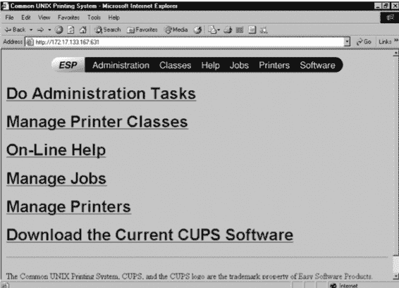

1. 如果您选择 **Administration**（管理），系统将提示您输入用户名和密码。
2. 用户名输入 `root` 并输入相应的密码。我们将演示如何在名为 `server.mycompany.com` 的远程 `LPR/LPD` 服务器上设置一台名为 `globe` 的 HP LaserJet 打印机。
3. 在管理界面中，选择 **Add Printer**（添加打印机）。您将看到图 6.2 所示的界面，允许您为该打印机输入名称、位置和描述（仅名称为必填项）。

### 图 6.2 CUPS 添加打印机页面

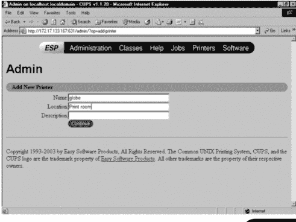

4. 点击 **Continue**（继续）后，您将看到一个选择打印机设备的界面。CUPS 支持本地连接到并行口、SCSI、串口或 USB 端口的打印机，以及使用 AppSocket（HP JetDirect）、HTTP、IPP 或 LPD/LPR 的网络打印机。通过 Samba 连接的打印机同样受到支持。在本例中，我们将使用 LPD/LPR，如图 6.3 所示。

### 图 6.3 配置打印机设备

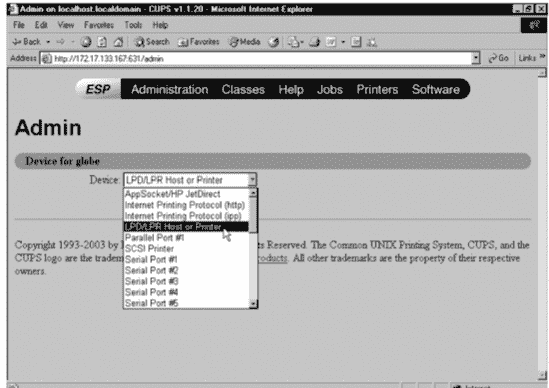


- 5. 点击`Continue`（继续）后，您将看到一个界面（如图 6.4 所示），用于选择打印机的设备`URI`（统一资源标识符）。这些`URI`的格式与 Web 浏览器中使用的`URL`（统一资源定位符）类似。界面上给出了各种类型的示例。在本例中，我们使用`LPD`协议连接到名为`server.mycompany.com`的主机，其打印机队列名为`globe`。

## 图 6.4 指定设备 URI

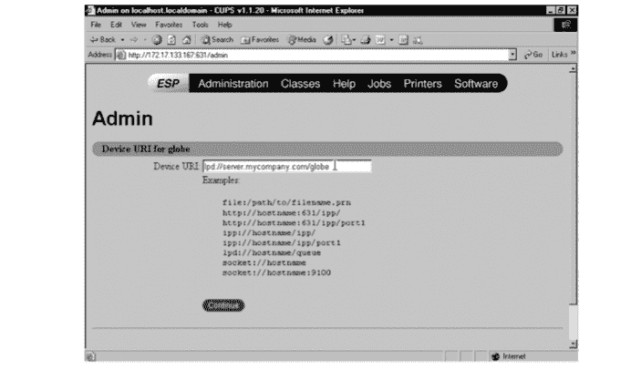

6. 输入 URI 并点击`Continue`。现在您将能够选择打印机的品牌（`Make`）（如图 6.5 所示）。CUPS 包含了多个打印机品牌的驱动程序，而在 Easy Software Products 提供的商业版 CUPS（网址为`www.easysw.com/printpro`）中还提供更多驱动。此外，在`http://gimp-print.sourceforge.net`和`www.linuxprinting.org`也可以找到额外的驱动程序。

## 6.5 指定打印机品牌

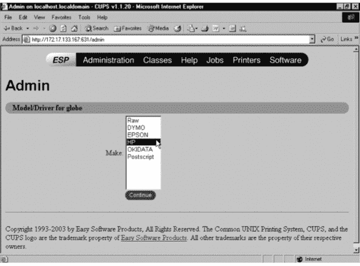

7. 在本示例中选择`HP`并点击`Continue`。在接下来的屏幕中（如图 6.6 所示），您将能够选择打印机的型号（`Model`）。在本示例中，我们将选择`LaserJet Series`。

## 6.6 指定打印机型号

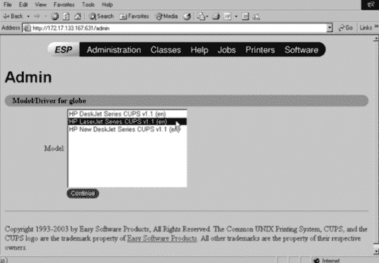

8. 点击`Continue`后，您就完成了打印机的设置。如果您现在点击页面顶部的`Printers`按钮，您将看到系统中打印机的信息以及执行各种任务的按钮，如图 6.7 所示。

## 6.7 查看打印机设置

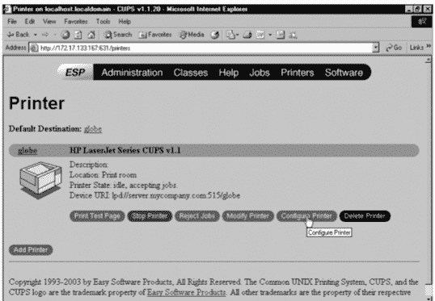

9. 您需要配置打印机的选项。点击`Configure Printer`按钮，随后会显示一个界面（如图 6.8 所示），允许您为该打印机 PPD 文件中指定的所有选项选择对应的值。选择所有正确的值后，点击任意一个`Continue`按钮。

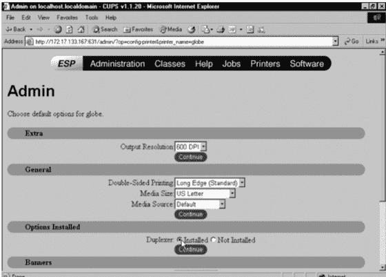

10. 您现在可以通过点击页面顶部的`Printers`按钮，然后点击`Print Test Page`来测试打印机。在尝试配置此打印机与 Samba 协作之前，请确保此操作正常工作。按照前一节所述的方法，以 Samba 指定的用户身份进行测试打印。

### 共享 Samba 打印机

一旦您的打印机在 UNIX 系统中正常工作，您就可以配置 Samba，使 Windows 客户端能够使用该打印机。在设置实际共享之前，让我们回顾一下与打印特别相关的各种`smb.conf`参数。这些参数可以通过 Samba Web 管理工具（`SWAT`）进行查看和修改。表 6.3 列出了`smb.conf`中的打印参数。某些参数在主名称后的括号中标有别名。

### 表 6.3 Samba smb.conf 打印参数

| 参数名称 | 描述 |
|---|---|
| `printcap name` (`printcap`) | 一个全局参数，用于覆盖服务器在获取打印机列表时所使用的编译内置默认`printcap`名称。 |
| `load printers` | 一个全局参数，指示是否默认加载`printcap`中的所有打印机以便浏览。 |
| `printable` (`print ok`) | 允许将打印文件通过后台打印（spooling）发送到服务。 |
| `Printing` | 设置系统的打印风格，决定如何解析打印机状态信息。此参数控制`print command`、`lpq command`、`lppause command`、`lpresume command`和`lprm command`的默认值。 |
| `print command` | 在作业完成后台打印发送到服务后，将通过`system()`调用执行此命令以处理文件。 |
| `lpq command` | 用于获取打印机队列状态信息的命令。 |
| `lprm command` | 用于删除特定打印作业的命令。 |
| `lppause command` | 用于停止打印或暂停特定打印作业后台处理的命令。 |
| `lpresume command` | 用于重启或继续打印或恢复特定打印作业后台处理的命令。 |
| `queuepause command` | 用于停止将打印队列中的打印作业提交给打印机的命令。 |
| `queueresume command` | 用于恢复将打印队列中的作业发送给打印机的命令。 |
| `Comment` | 当客户端向服务器查询可用共享列表时，显示的共享描述文本字段。 |
| `path` (`directory`) | 在执行`print command`中的命令之前，打印数据存放后台打印（spool）的目录。 |
| `Printer` (`printer name`) | 接收打印作业的打印机名称。 |

（接下页）

### 表 6.3 Samba smb.conf 打印参数（续）

| 参数名称 | 描述 |
|---|---|
| `Postscript` | 通过在打印输出开头添加`%!`，强制打印机将打印文件解析为 PostScript。 |
| `lpq cache time` | 一个全局参数，控制`lpq command`指定的命令返回的信息缓存时间，以防止该命令被过于频繁地调用。 |
| `min print space` | 设置在打印作业可以进行后台打印之前必须具备的最小空闲磁盘空间。 |
| `guest account` | 用于访问被指定为`guest ok`的服务的 UNIX 用户名。 |
| `guest ok` (`public`) | 指定此服务不需要密码。访问权限将由`guest account`中指定的用户决定。 |
| `hosts allow` (`allow hosts`) | 允许访问此服务的机器列表。可以通过名称或 IP 地址指定。 |
| `hosts deny` (`deny hosts`) | 明确不允许访问此服务的机器列表。可以通过名称或 IP 地址指定。如果存在冲突，以`hosts allow`列表为准。 |
| `browseable` (`browsable`) | 控制此服务是否显示在客户端的浏览列表中。 |
| `Available` | 允许禁用服务。所有连接尝试都将失败。 |
| `Preexec` (`exec`) | 指定在每次连接到服务时执行的命令。 |
| `root preexec` | 指定在每次连接到服务时以 root 身份执行的命令。 |
| `Postexec` | 指定在服务断开连接时执行的命令。 |
| `root postexec` | 指定在服务断开连接时以 root 身份执行的命令。 |

除了上述参数外，大多数服务级参数也可以包含在打印服务中。有七个专门用于打印的变量，以及其他几个在创建上述各种命令时非常有用的变量。表 6.4 总结了这些变量。

### 表 6.4 smb.conf 打印变量

| 变量 | 定义 |
|---|---|
| `%f` 或 `%s` | 要打印的文件名（不含路径）。 |
| `%p` | 要使用的 UNIX 打印机名称。 |
| `%j` | 打印作业编号（用于打印队列控制命令）。 |
| `%J` | 客户端发送的作业名称。 |
| `%c` | 已打印的页数（如果已知）。 |
| `%z` | 后台打印文件的大小（如果已知）。 |
| `%S` | 当前服务的名称。 |
| `%U` | 会话用户名（客户端请求的用户名，不一定与最终获得的用户名相同）。 |
| `%m` | 客户端机器的 NetBIOS 名称。 |
| `%L` | 服务器的 NetBIOS 名称。 |
| `%T` | 当前日期和时间。 |

在 Samba 中设置打印机共享之前，您需要确定系统使用的打印风格。Samba 二进制文件在编译时会设置一个默认的打印风格。`printcap name`和`guest account`的默认值同样在编译时设定。您可以通过创建一个空配置文件（或使用`/dev/null`）并对该文件运行`testparm`来确定二进制文件的默认设置。要查找默认的`printing style`、`printcap name`和`guest account`，请运行以下命令：

```bash
[root@linuxbox /]# testparm -sv /dev/null | grep printing
printing = bsd
[root@linuxbox /]# testparm -sv /dev/null | grep printcap
printcap name = /etc/printcap
[root@linuxbox /]# testparm -sv /dev/null | grep guest account
guest account = nobody
```

如果默认值不正确，您可以通过在`smb.conf`文件的`global`部分添加`printing = <desired value>`条目和`printcap name = <path to printcap>`条目来更改它。将这些条目放置在...

即使默认设置是正确的，您仍可以在`smb.conf`文件中进行设置。这样可以非常清晰地明确将使用哪些值。随后，打印风格（printing style）决定了其他打印命令的默认值。表 6.5 显示了为每种打印风格设置的默认打印命令。如果这些命令不适用于您的系统，您可以在`smb.conf`文件的全局部分（global section）中对其进行修改。

Samba 目前支持以下打印系统：`SYSV`、`AIX`、`HPUX`、`BSD`、`QNX`、`PLP`、`LPRNG`、`CUPS`、`NT`和`OS2`。最后两种类型（NT 和 OS2）在各自的操作系统上均采用 LPR。CUPS 的条目是在 Samba 未编译 CUPS 支持（不使用 libcups）时会获得的值。如果 Samba 链接了 libcups，它将使用 CUPS API 来发送打印作业并控制打印机和打印队列，此时所有默认命令的条目都将被忽略。如果您在使用 libcups 的 Samba CUPS 打印时，需要设置特定的打印命令或其他命令，您可以在特定的打印机部分中将打印风格设置为`printing = sysv`并在此覆盖该命令。这允许 CUPS 控制所有其他打印机，而仅覆盖某一台特定打印机的设置。

## 表 6.5 各打印系统的打印风格默认值

| 打印风格 | 默认命令 |
|---|---|
| BSD, AIX, NT, OS2 | `print command = lpr -r -P'%p' %s`<br>`lpq command = lpq -P'%p'`<br>`lprm command = lprm -P'%p' %j`<br>`lppause command =`<br>`lpresume command =`<br>`queuepause command =`<br>`queueresume command =` |
| LPRNG, PLP | `print command = lpr -r -P'%p' %s`<br>`lpq command = lpq -P'%p'`<br>`lprm command = lprm -P'%p' %j`<br>`lppause command = lpc hold '%p' %j`<br>`lpresume command = lpc release '%p' %j`<br>`queuepause command = lpc stop '%p'`<br>`queueresume command = lpc start '%p'` |
| CUPS | `print command = /usr/bin/lp -d '%p' %s; rm %s`<br>`lpq command = /usr/bin/lpstat -o '%p'`<br>`lprm command = /usr/bin/cancel '%p-%j'`<br>`ppause command = lp -I '%p-%j' -H hold`<br>`presume command = lp -I '%p-%j' -H resume`<br>`queuepause command = /usr/bin/disable '%p'`<br>`queueresume command = /usr/bin/enable '%p'`<br>`printcap name = lpstat` |
| SYSV | `print command = lp -c -d%p %s; rm %s`<br>`lpq command = lpstat -o%p`<br>`lprm command = cancel %p-%j`<br>`ppause command = lp -i %p-%j -H hold`<br>`presume command = lp -i %p-%j -H resume`<br>`queuepause command = disable %p`<br>`queueresume command = enable %p` |
| HPUX | `print command = lp -c -d%p %s; rm %s`<br>`lpq command = lpstat -o%p`<br>`lprm command = cancel %p-%j`<br>`ppause command =`<br>`presume command =`<br>`queuepause command = disable %p`<br>`queueresume command = enable %p` |
| QNX | `print command = lp -r -P%p %s`<br>`lpq command = lpq -P%p`<br>`lprm command = lprm -P%p %j`<br>`ppause command =`<br>`presume command =`<br>`queuepause command =`<br>`queueresume command =` |

接下来我们在`smb.conf`中创建必要的条目来共享打印机。打印风格将设为`CUPS`，UNIX 系统上的打印机名称为`lp`，我们将以`myprinter`为名称共享该打印机，并允许所有人访问。文件在发送到系统打印缓冲池（spooler）之前，将被放置在名为`/var/spool/samba`的目录中，权限为`0700`。目前系统上的其他打印机将不开放共享。以下条目显示了`smb.conf`中所需的内容。

```ini
[global]
printing = cups
printcap name = cups
guest account = nobody
load printers = no

[myprinter]
printable = yes
writeable = no
path = /var/spool/samba
guest ok = yes
printer = lp
create mask = 0700
browseable = yes
```

全局部分中的`printing = cups`条目将其他打印命令设置为上表中所列的值，或者如果 Samba 编译时使用了 libcups，则使用 CUPS API。`load printers = no`条目指定 CUPS 管理的所有打印机将不会被自动全部共享。随后指定`myprinter`并通过`printable = yes`条目将其声明为打印机。打印机共享始终允许通过打印数据的缓冲（spooling）向`path =`参数指定的目录写入（前提是 UNIX 用户权限允许）。`writeable = no`条目指定非打印访问该共享时不允许写入。指定`guest ok = yes`将共享设置为允许所有用户以`guest account`参数中指名的用户身份访问，且无需密码。

由于 UNIX 上的打印机名称不是我们希望在 Windows 客户端中显示的名称，因此我们使用`printer = lp`参数指定 UNIX 名称。如果未指定此参数，则假设 UNIX 打印机名称与共享名称相同。这里需要记住的是，尽管共享名称对 Windows 客户端不区分大小写，但`printer =`参数中指定的名称（或未指定该参数时的共享名称）必须与系统中定义的打印机名称完全一致。

`create mask = 0700`条目会导致缓冲到共享的文件被剥离所有组权限和其他人权限。

最后，`browseable = yes`条目允许 SMB 客户端在“添加打印机”对话框中浏览服务器时显示该打印机。如果您希望该打印机对客户端保持隐藏，可以将其设置为`no`。如果客户端提供了正确的名称，他们仍然能够连接到该打印机。

如果您系统中仅连接了一台打印机，在`smb.conf`文件中创建共享定义相当简单。如果您有多个打印机，Samba 提供了一种名为`printers`部分（section）的机制，允许您仅在`smb.conf`中创建一条部分条目，即可轻松共享所有连接到系统的打印机。使用此方法的局限性是所有打印机必须具有相同的参数（注释除外），且打印机名称必须与共享名称相同。

假设我们的系统上有三台名为`hp`、`slides`和`color`的打印机。我们可以在`smb.conf`文件中创建一个部分，以相同的参数共享所有这些打印机。以下条目显示了应添加到`smb.conf`文件中的内容。


```ini
[global]
printing = cups
printcap name = cups
guest account = nobody
load printers = yes

[printers]
printable = yes
writeable = no
path = /var/spool/samba
guest ok = yes
create mask = 0700
browseable = no
```

> **注意**
>
> 不要将文件缓冲的路径设置为与系统打印缓冲池相同的目录，否则在使用 Samba 打印时可能会出现不可预知的结果。

让我们看看与之前示例相比发生了哪些变化。在 `global` 部分中，我们将 `load printers` 参数更改为 `yes`。该参数与 `printers` 部分配合使用。当客户端尝试连接服务器上的共享时，Samba 首先会在 `smb.conf` 中检查所有定义的部分以寻找匹配项。如果没有找到，Samba 随后会检查是否定义了 `homes` 部分，如果定义了，则尝试在本地密码文件中匹配用户名。如果仍然没有匹配项且存在 `printers` 部分，Samba 可以在 `printcap name` 指定的位置扫描匹配项。请注意，在 SYSV 系统上，这可以指定为 `lpstat` 命令，该命令将列出可用打印机。

如果找到匹配项，Samba 将通过复制 `printers` 部分的信息来创建一个新部分，并将共享名称设置为找到的打印机名称。如果不存在 `printer` 参数，打印机名称将被设置为与共享名称相同。如果不允许访客访问且连接请求中未提供用户名，用户名也将被设置为找到的打印机名称。如果您未包含 `printable` 参数，您将在 `smbd` 日志文件中收到警告消息，且 Samba 将为您将该部分设置为可打印。`browseable` 参数指定共享名称为 `printers` 的项是否出现在打印机浏览列表中。由于此共享名称实际上不是一个打印机名称，因此建议将其设置为 `browseable = no` 以减少混淆。

即使您不想共享连接到系统的所有打印机，仍然可以使用 `printers` 部分。您可以通过指定一个仅包含您希望共享的打印机名称的伪 printcap（pseudo-printcap）来实现。该文件的每一行由打印机名称和任何可能的别名组成，格式如下：

`name|alias|alias|alias with spaces`

别名不是必须的。如果别名包含空格，该别名将替换创建共享中的注释参数。

`printers` 部分还可以用作创建打印机共享的模板，使其具有与其他打印机略有不同的参数。例如，您可能想限制谁可以使用上述的彩色打印机。您可以将以下部分添加到 `smb.conf` 文件中。

```ini
[color]
copy = printers
guest ok = no
browseable = yes
valid users = @sales
```

这将导致打印机共享 `color` 使用 `printers` 中包含的所有参数进行定义，然后修改为不允许访客访问、使共享可浏览，并仅允许 `sales` 组的用户访问。通过使用 `copy` 参数，您不必在其中包含所有通用参数。

新的定义使得诸如 `printable`、`path` 等参数无需在定义中指定。

## 理解自动打印机驱动程序下载

Samba 可以配置为自动将打印机驱动程序下载到 Windows 客户端，就像 Windows NT（或更高版本）打印服务器所做的那样。这涉及创建一个名为 `print$` 的新共享（驱动程序文件将存放在此处）、将驱动程序文件安装到 `print$` 共享的正确位置、将驱动程序绑定到打印机共享，并设置默认打印机选项。

创建 `print$` 共享涉及在 Samba 服务器上创建相应的目录并设置正确的 `smb.conf` 文件条目。为了支持将驱动程序下载到各种版本的 Windows，您需要在为 `print$` 共享创建的目录下创建多个子目录。表 6.6 列出了您可能希望支持的每种架构所需的子目录。

**表 6.6 打印机驱动程序架构子目录**

| 子目录名称 | 驱动程序架构 |
|---|---|
| `W32X86` | Windows NT x86 |
| `WIN40` | Windows 95/98 |
| `W32ALPHA` | Windows NT Alpha_AXP |
| `W32MIPS` | Windows NT R4000 |
| `W32PPC` | Windows NT PowerPC |

您可以在 Samba 服务器上创建一个组，以指定哪些用户拥有打印机管理员权限（能够添加新驱动程序并设置打印机属性）。假设您创建的组名为 `ntadmin`，您可以将以下条目添加到 `smb.conf` 文件的 `global` 部分。

```ini
printer admin = @ntadmin
```

`print$` 共享条目可能如下所示：

```ini
[print$]
comment = Download area for printer drivers
path = /var/samba/drivers
guest ok = yes
browseable = no
read only = yes
write list = @ntadmin, root
```


如果您只希望经过身份验证的用户能够访问打印机，可以删除 `guest ok = yes` 参数。通过设置 `browseable = no`，您可以防止该共享出现在“网络邻居”中（默认情况下，以 `$` 结尾的共享无论如何都不会显示给除管理员以外的任何人）。设置 `read only = yes` 通过拒绝写入权限来防止任何人将驱动程序文件上传到此共享。`write list = @ntadmin, root` 条目允许 `root` 和 UNIX `ntadmin` 组中的人员拥有写入权限，以便他们可以上传新驱动程序。请确保共享目录的权限同样允许 `ntadmin` 组写入，因为 Samba 不会覆盖底层文件系统的权限。

下一步是将打印机驱动程序安装到 Samba 服务器的 `print$` 共享的正确目录中。这可以使用 Samba 的 `rpcclient` 命令，或从 NT/2000/XP 客户端使用 Windows“添加打印机”向导来完成。如果您希望使用 `rpcclient`，请查看 Samba 文档以获取操作指南，因为该过程可能相当复杂，此处不再详述。

使用 Windows 资源管理器，浏览到“网络邻居”并打开 Samba 主机。您将看到“打印机”文件夹，打开后将看到 Samba 主机共享的所有打印机。图 6.9 展示了右键单击打印机图标并选择“属性”的操作。

### 图 6.9 显示 Samba 打印机的属性

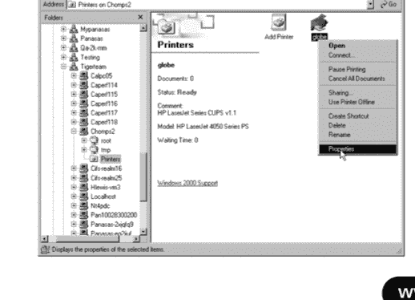

由于该打印机没有关联的驱动程序，您将收到类似于图 6.10 所示的错误消息。具体措辞将取决于运行的 Windows 版本。

### 图 6.10 驱动程序安装查询对话框

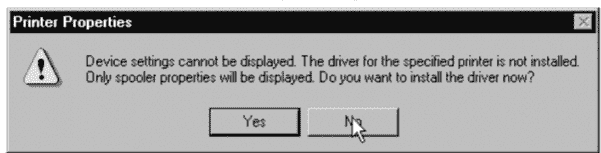

不要点击 **是**，因为这将在本地系统上安装驱动程序。当您选择 **否** 时，将出现 **打印机属性** 对话框。选择 **高级** 选项卡，现在您可以选择 **新驱动程序**（见图 6.11）并将驱动程序安装到 Samba 服务器。请确保您已作为在 `printer admin` 参数中列出的具有管理账户的用户连接，并且 `print$` 共享以及客户端架构所需的子目录中已存在正确的目录。

### 图 6.11 打印机属性对话框

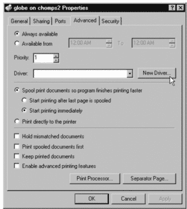

点击 **新驱动程序** 后，您可以选择驱动程序（见图 6.12），文件将被复制到 Samba 服务器的正确目录中。随后 Samba 将更新其数据库文件，以指示哪个驱动程序与该打印机相关联。

### 图 6.12 选择打印机驱动程序

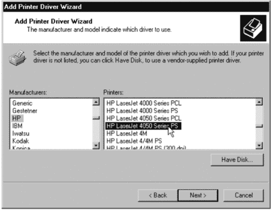

驱动程序文件安装后仍有额外工作要做。在 Windows 服务器上，安装驱动程序可能会在服务器上运行一个程序来设置初始设备模式。由于这些程序无法在 Samba 服务器上运行，您需要进行一些额外工作来正确设置它们。最简单的方法是在一台客户端机器上安装此打印机，然后打开“打印默认值”对话框并从客户端进行设置。

要设置默认设备模式，请打开“打印首选项”对话框，将方向改为“横向”并点击 **应用**，然后将其改回“纵向”并再次点击 **应用**。此时您可以设置其他默认设置。点击 **高级**，然后点击 **打印默认值**，如图 6.13 所示。

### 图 6.13 选择打印机默认值

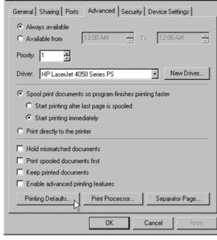

对于 PostScript 打印机，您可能希望将 PostScript 输出选项设置为“优化可移植性”而非默认的“优化速度”，因为这往往能产生更可靠的输出。图 6.14 展示了此设置。

### 图 6.14 优化可移植性

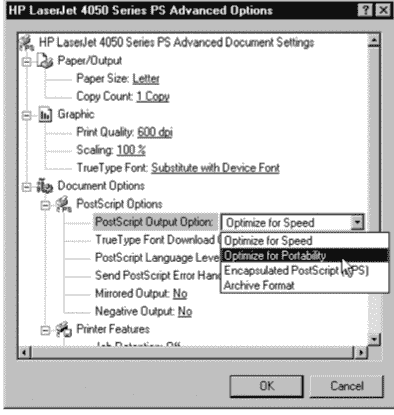

现在从您的 Windows 系统打印一个测试页并确保其正常工作。如果您没有看到打印页面，则需要确定错误发生在 Windows 客户端 - Samba - CUPS 链路中的哪个环节。检查 Samba 和 CUPS 的错误日志是否有明显的提示。解决问题的关键是检查链路中的每一步单独运行是否正常。

您可能希望停止打印机打印作业，以便有机会检查 Windows 发送的文件。如果您使用的是 CUPS，请点击 CUPS 打印机设置页面（*图 6.7*）上的“停止打印机”按钮，或使用 `disable` 命令。这将允许作业被缓存（spooled）但不被打印。从 Windows 客户端再次打印一个测试页，然后点击 CUPS 打印机页面顶部（*图 6.7*）的“作业”按钮或运行 `lpstat -t` 命令，检查文件是否已被缓存。

如果作业没有出现，这意味着 Windows 客户端发送作业或 Samba 将作业传输到系统缓存器时出现了问题。您需要仔细检查 Samba 日志文件（可能需要提高日志级别）以定位问题。如果作业出现了，请检查 `/var/spool/cups` 目录（或其他系统缓存目录）中的文件，看其格式是否正确。尝试使用 `lp` 命令打印它以查看是否有效。如果仍然无效，请检查是否使用了正确的打印机驱动程序。

## 将 Windows 打印服务迁移至 CUPS/Samba

现在 Linux 和 Windows 客户端都能正常使用打印机了，我们可以开始将打印服务从 Windows 服务器迁移到 Linux 服务器的实际过程。由于 Samba 可以通过在 `smb.conf` 文件中使用 `netbios aliases` 参数来广播多个 **NetBIOS** 名称，您甚至可以将多个 Windows 打印服务器整合到一台 Samba 服务器上。如果 Windows 服务器将被淘汰，您可以在 Samba 服务器上设置一个别名，这样客户端就无需更改用于引用打印机的名称。

如果旧的 Windows 服务器仍保留在网络中，您必须前往每台客户端机器更改所使用的打印机连接。由于我们现在已经设置好了“点选打印”（point-and-print），您可以轻松地从“打印机”文件夹中删除旧打印机，然后浏览到 Samba 服务器并从“打印机”文件夹中选择该打印机。右键单击打印机并选择 **连接**（或直接双击），驱动程序将自动安装在客户端上，并采用您设置的默认设置。

## 总结

CUPS 和 Samba 让在 Linux 服务器上设置可供 Linux 和 Windows 客户端共同使用的打印机变得简单。CUPS 简化了打印机的添加和打印服务器的管理。对于 PostScript 打印机，你甚至可以使用 Windows 驱动程序提供的 PPD 文件，这样 Windows 上支持的功能也可以在 CUPS 服务器上使用。

Samba 可以设置为向 Windows 客户端广播这些打印机，并自动将所需的驱动程序下载到客户端机器上。对于 Windows 客户端而言，这些打印机的外观和行为就像连接到 Windows 打印服务器的打印机一样。利用 Samba 的 NetBIOS 别名功能，你甚至可以让一台 Linux 服务器看起来像多台 Windows 服务器，从而整合组织所需的打印服务器数量。

## 解决方案快速通道

### 理解 Windows 打印服务

- Windows 使用 GDI 作为显示和打印的通用 API。
- 打印机驱动程序将 GDI 的 EMF 输出转换为打印机可理解的格式。
- PostScript 打印机使用 PPD 文件来描述打印机的功能。
- Windows 客户端可以自动从服务器下载合适的打印机驱动程序。

### 理解 Linux 打印服务

- UNIX 系统从未像 Windows 那样开发统一的显示和打印通用 API。
- 过滤器或接口脚本执行 Windows 打印机驱动程序的功能。
- 从历史上看，UNIX 上使用的两个主要打印子系统是 BSD 和 SYSV。每个系统使用不同的命令集来控制打印。
- 一个名为 CUPS（通用 Unix 打印系统）的新型打印系统允许通过 Web 浏览器界面管理多种打印队列类型。

### 共享 Samba 打印机

- 为你将要使用的打印系统（BSD、SYSV 或 CUPS）设置 `smb.conf` 参数。
- 为单个打印机创建分区，或使用 `smb.conf` 中特殊的 `Printers` 分区，以便 Windows 客户端能够看到你的打印机。
- 创建具有适当权限的 spool 目录，允许 Samba 指定的用户能够在其中创建文件。

### 理解打印机驱动程序自动下载

- 在 `smb.conf` 中为 `print$` 共享创建条目，并确保打印管理员对其具有写权限。
- 为你将要支持的驱动程序架构创建所需的目录和子目录。
- 从 Windows 客户端使用“添加打印机向导”将驱动程序上传到服务器，并将其与相应的打印机关联。
- 从 Windows 客户端设置默认设备模式和打印默认值。

### 将 Windows 打印服务迁移到 CUPS/Samba

- 使用 NetBIOS 别名让 Samba 服务器广播即将退役的 Windows 服务器的名称。
- 如果旧的 Windows 服务器仍留在网络中，但不再作为打印服务器，你可以从客户端删除旧的打印机定义。然后使用“点选打印”（point and print）连接到 Samba 服务器上的新打印机位置。

## 常见问题解答

以下是由本书作者解答的常见问题，旨在衡量你对本章所述概念的理解，并协助你在实际生活中实现这些概念。若想让作者回答关于本章的问题，请浏览 `www.syngress.com/solutions` 并点击“咨询作者”表单。你也可以在 `ITFAQnet.com` 获取数千个其他常见问题解答。

**问：** 我如何使用浏览器从另一个系统管理我的 CUPS 服务器？

**答：** 有两个可能导致无法远程管理的问题。某些 CUPS 安装会在 `cupsd.conf` 文件中添加一个 `Listen` 指令，仅允许来自 localhost 的连接。如果你在浏览器中收到 **Connection Refused**（连接被拒绝）消息，你需要将该行修改为 `Listen *:631`（或删除该行并确保有一行内容为 `Port 631`）。如果你收到 **Forbidden**（禁止访问）消息，这意味着你未被授予访问权限。你需要修改相应部分并更改 `Deny From` 或 `Allow From` 指令。CUPS 软件管理员手册中对该过程有更详细的描述。

**问：** 为什么我的打印机有时会打印乱码，随后出现类似 PostScript 命令的内容？

**答：** 很有可能是你的 Windows 驱动程序在文件开头放入了一些 PCL 命令。这导致 CUPS 的自动文件类型判定无法将其识别为 PostScript 文件。请在 Windows 客户端使用 CUPS 或 Adobe PostScript 驱动程序。

**问：** 为什么我的 Samba spool 目录不能与 CUPS spool 目录相同？

**答：** `cupsd.conf` 中关于 `RequestRoot`（文件存放的 spool 目录）的设置与 `smb.conf` 中 `printers` 部分的 `path=` 条目必须不同。当系统重启时，`cupsd` 会“清理”其 spool 目录的权限。这可能会导致 Samba 无法再向该目录写入。

**问：** 为什么 `cupsaddsmb` 在我刚创建的打印机上报错？

**答：** 该打印机可能尚未被 Samba 导出。你可以通过向所有 `smbd` 进程发送 HUP 信号来强制 Samba 重新读取 `smb.conf` 文件。请确保你已正确设置 Samba 以共享所有打印机（`load printers = yes`），并且 `print$` 共享已正确设置。

## 消息服务

### 本章解决方案

- 理解 Microsoft 消息服务
- 理解基于 Linux 的消息服务
- 设计基于 Linux 的消息服务
- 集成反垃圾邮件和反病毒服务
- 将信息从 Exchange 迁移到 Linux
- 总结
- 解决方案快速通道
- 常见问题解答

## 简介


消息服务在公司人员与外部世界之间提供了至关重要的通信链路。对于大多数企业而言，电子邮件并非奢侈选项，而是关乎任务成败的优先级事项。整个工作日的电子邮件丢失意味着业务损失、沟通遗漏或延迟、业务放缓、财务损失，以及员工和客户的沮丧。你在学习和规划基于 Linux 的消息服务上花费的时间越多，在修复问题以及向老板和同事解释停机故障上花费的时间就越少。

企业级消息服务为最终用户提供多种功能。除了能够“跟随”用户到任何公司桌面（或笔记本电脑）的`IMAP`邮件存储，提供电子邮件地址查询的目录（在前面章节中设置）以及反病毒和反垃圾邮件过滤，构成了企业消息的核心子服务。大多数服务还提供某种类型的基于 Web 的邮件客户端，许多还结合了群组软件功能，如日历和共享文件夹。本章概述了这些服务，列出了开源解决方案，并为基于 Linux 的消息服务的设计和迁移提供了指南。

本章重点讨论从 Exchange（或具有`IMAP/POP`接口的其他消息系统）迁移到基于 Linux 的`MTA-MDA-MAA-MUA`消息系统。虽然大多数原则适用于非 Exchange 系统，但我们将在示例中使用 Exchange，并已测试相关脚本在 Exchange 服务器上的运行情况。尽管我们完全预期这些脚本能与任何兼容`IMAP`的邮件存储协同工作，但实际效果可能会有所差异。

第一节重点介绍典型的 Exchange 消息系统概览。这些相同的概念适用于许多其他消息系统，但本文的重点是 Exchange。我们考察了 Exchange 5.5 消息系统的主要功能和组件，并回顾了 Exchange 2000 中的升级和新功能。我们还讨论了 Exchange 5.5 和 Exchange 2000 在目录实现上的区别。

“理解基于 Linux 的消息服务”侧重于典型消息系统的组件以及各组件之间的交互。除了探索消息系统理论和核心概念外，还将考察流行的邮件传输代理（`MTA`）`Courier-MTA`、`postfix`、`exim` 和`sendmail`，以及包括`Courier`、`Cyrus`和`UW IMAP/POP`服务器在内的邮件访问代理（`MAA`）。随后，我们将讨论如何为你的组织设计基于 Linux 的消息服务。我们将探讨相关标准。

这些在设计消息系统时构成了重要的考量因素，我们将探讨 Acme Widgets 和 Ballystyx Engineering 的消息服务解决方案。

在设计章节之后，您将学习如何添加反垃圾邮件和反病毒服务。我们将讨论包括专用网关、共享服务器、商业设备和外包选项在内的反垃圾邮件和反病毒解决方案。

最后，我们将详细介绍实际的迁移过程。我们将教您如何为迁移准备 Exchange，然后逐步引导您使用脚本将电子邮件从 Exchange 系统传输到基于 Linux 的电子邮件服务器。在完成本章所有指令后，您将拥有一个基于 Linux 的消息系统，它提供与 Exchange 相同的电子邮件功能，且无需支付许可费用，也没有专有软件的其他缺陷。

## 理解 Microsoft 消息服务

Microsoft 在 1996 年发布 Exchange 4.0 时进入了企业消息和群组软件领域，当时 Exchange 取代了 MS-Mail，成为大型企业的首选消息系统。MS-Mail 难以管理且容易出现故障。随着 Exchange 的发布，Microsoft 为企业提供了一个功能齐全的、支持多主 LDAP（轻量级目录访问协议）的目录服务，并配以基于 JET 的企业邮件存储数据库服务。MS-Mail 服务器通常支持 100 个或更多用户，但在适当的硬件条件下，Exchange 服务器可以支持数千名用户。

Exchange 是 Novell Groupwise、Lotus Notes、Oracle Messaging 以及其他专有消息产品的直接竞争对手。如今，在财富 100 强公司中，Exchange 和 Notes 主导着高端消息和群组软件市场，而大量开源和专有解决方案则服务于中小企业市场。

Exchange 提供了用户邮箱、电子邮件组、共享公共文件夹、`IMAP`和`POP`接口、共享联系人、用户和组日历、灵活的数据库存储，以及企业消息和群组软件系统所需的几乎所有功能。虽然 Exchange 具有成熟且功能齐全的消息系统的优势，但其缺陷在于反病毒和反垃圾邮件的集成成本高昂。虽然没有单一的开源解决方案能在一个集成包中匹配 Exchange 2000 / Active Directory 的所有功能，但通过组合使用开源消息软件，可以实现大多数 Exchange 的功能和能力。

### 理解 Exchange 5.5 消息服务

Microsoft Exchange 5.5 服务器实际上是由几个集成服务组成的。表 7.1 列出了 Exchange 5.5 的组件服务及其简要说明。

**表 7.1 Exchange 5.5 组件服务**

| 服务 | 功能 |
|---|---|
| 系统助手 (System Attendant) | 监控所有其他服务 |
| 目录服务 (Directory Service) | 提供 Exchange 目录服务 |
| 信息存储 (Information Store) | 管理存储公共文件夹和用户邮箱内容的数据库 |
| 消息传输代理 (Message Transfer Agent) | 在 Exchange 服务器之间传输消息 |
| 互联网邮件服务 (Internet Mail Service) | 使用 SMTP（简单邮件传输协议）在主机之间传输消息 |

Exchange 5.5 服务器被分组为站点。站点内的服务器通过始终可用且高带宽的连接进行通信，例如位于 LAN（局域网）以及可能的高带宽 WAN（广域网）子网中的服务器。用 Windows 2000 的术语来说，这些站点是 IP（互联网协议）子网的集合。在一个 Exchange 组织中，每个站点必须具有唯一的名称，并共享相同的组织名称。

Exchange 5.5 连接器将 Exchange 站点与其他站点或外部传输系统（如 SMTP、Notes、MS-Mail、Fax 或 X.400 系统）链接起来。这些连接器允许 Exchange 将服务细分为特定的附加地址类型，并将这些类型的处理卸载到连接器软件中。

最受欢迎的连接器之一是互联网邮件服务（包含在 Exchange Server 的标准版和企业版中），它提供了大量用于配置 SMTP 通信（包括与互联网之间）的选项。图 7.1 显示了 Acme Widget 的互联网邮件服务 (IMS) 配置。

**图 7.1 Acme Widgets IMS 配置**

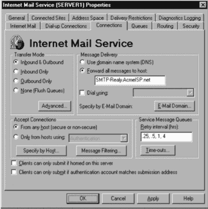

当两个 Exchange 5.5 站点使用站点或其他消息连接器链接在一起时，它们可以交换目录复制信息。在站点内部，目录信息通过 RPC（远程过程调用）进行复制。在站点之间，目录信息通过目录复制连接器通信的电子邮件消息进行复制。

Exchange 支持多种协议用于访问电子邮件（和群组软件）信息。表 7.2 列出了这些协议并描述了它们的用途。

**表 7.2 Exchange 5.5 协议支持**

| 协议 | 描述 |
|---|---|
| MAPI | 消息 API (Application Program Interface) 被 Outlook 使用，提供邮箱和群组软件功能 |
| IMAP | IMAP 是一个功能齐全的跨平台邮箱访问协议 |
| POP | POP 是一个功能受限的跨平台邮箱访问协议 |
| HTTP | HTTP (超文本传输协议) 允许 Web 浏览器通过 OWA (Outlook Web Access) 访问消息和日历/群组软件 |
| LDAP | LDAP 实现了对 Exchange 目录信息的跨平台访问 |

Exchange 5.5 支持*主-备* (active-passive) 集群，或者称之为*故障转移* (failover) 集群。为了利用集群 Exchange 5.5 服务器，您必须使用能够支持集群的存储形式，例如 SAN (存储区域网络) 或共享 SCSI (小型计算机系统接口) 总线。其中一台 Exchange 服务器必须被指定为*备用* (passive) 节点，仅等待另一台服务器发生故障。*双活* (active-active) 或*负载均衡* (load balancing) 集群（两台服务器同时工作）在 Exchange 2000 中得到支持，但在 Exchange 5.5 中不支持。

### 理解 Exchange 2000 消息服务

Exchange 2000 提供了与 Exchange 5.5 相同的核心功能，但大多数功能得到了改进或升级。Exchange 不再使用自己的目录服务，而是需要 Active Directory。原本存储在 Exchange 5.5 目录中的所有信息在 Exchange 2000 中都存储在 Active Directory 中。安装 Exchange 2000 时，它只需更新 Active Directory 架构以支持电子邮件和群组软件的目录对象，并提供配置邮件存储和消息传输的接口。

Exchange 2000 中的邮件存储采用了更具可扩展性的架构，每台服务器处理一个或多个存储组，而不是像 Exchange 5.5 那样每台服务器只有一个公共文件夹/私有邮箱存储。这在存储、备份、恢复和集群方面提供了更大的灵活性。邮箱存储可以轻松地拆分为多个较小规模的数据库，这些数据库可以存储在不同的存储设备上，使用不同的备份计划，并且比单个大型数据库恢复速度更快。

OWA 组件得到了显著改进，比 Exchange 5.5 中的 Outlook Web Access 具有更完整的功能，尤其是当使用 Internet Explorer 作为浏览器时。OWA 2000 的额外功能包括支持拖放、所见即所得 (WYSIWYG) 消息撰写以及增强的内嵌对象显示。

在 Exchange 5.5 中，内部寻址方案主要采用 X.400 约定，所有用户邮箱都拥有 X.400 地址。在 Exchange 2000 中，主要寻址机制是 SMTP，因此 SMTP 被用作主要的通信机制。

Active Directory 处理了以前由 Exchange 5.5 目录服务管理的复制、信任、站点连接和其他功能。在 Exchange 2000 中，站点现在是 Active Directory 的一部分，复制由 Windows 2000 域控制器管理。


## 理解基于 Linux 的邮件服务

大多数开源邮件系统由一个集成且模块化的系统组成，该系统包含多个组件应用程序。这些邮件组件负责电子邮件的传输、接收、投递以及提供访问权限。在小型公司中，这些组件通常是单个邮件套件的一部分，例如 Courier-MTA 套件。在大型公司中，多个组件通常被“胶合”在一起，以形成一个根据该组织特定需求量身定制的自定义邮件解决方案。

在本节中，我们将检查互联网电子邮件的生命周期，然后检查允许此过程发生的邮件系统的各个组件。我们还将列出构成基于 Linux 的邮件服务基础的开源服务器应用程序，并概述每个应用程序。

### 发送和接收互联网电子邮件

为了更好地理解邮件系统，我们将研究互联网电子邮件的发送和接收。换句话说，我们将跟踪互联网电子邮件消息的生命周期，从用户点击**发送 (Send)**开始，直到电子邮件到达接收者的收件箱为止。

发送互联网电子邮件的过程始于`MUA`（邮件用户代理）向`MTA`提交电子邮件。在图 7.2 的示例中，Acme Widgets 公司的 Jim Aster 使用 Evolution 撰写了一封电子邮件，并将其发送给 Ballystyxx Engineering 公司的 Kim Chang。在图中，Acme Widgets 处于迁移后状态，使用的是基于 Linux 的`MTA`和`MUA`。Ballystyxx Engineering 处于迁移前状态，仍在使用 Exchange / Outlook 邮件系统。

**图 7.2 发送和接收互联网电子邮件**

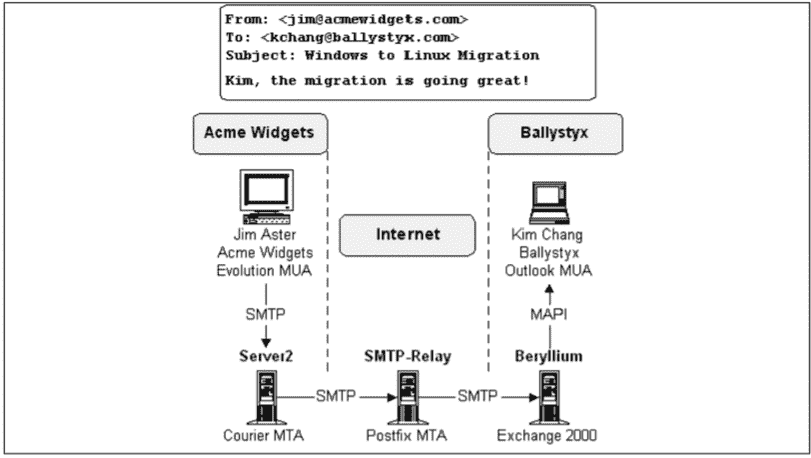

该图中所发生的动作可以分解为七个基本步骤：

1. Jim Aster 撰写电子邮件并点击**发送 (Send)**。
2. Evolution 将电子邮件提交给`SERVER2`。
3. Courier 通过`SMTP`接收电子邮件。
4. Courier 确定该电子邮件是发送给非本地`SMTP`接收者的，于是将电子邮件转发给`SMTP-Relay.acmeISP.net`。
5. Acme ISP 的 SMTP 中继机器接收电子邮件并将其放入出站投递队列中。
   - 出站投递队列中的 Jim 的电子邮件被 MTA 取出由 MTA 进行投递。
   - MTA 对`ballystyx.com`的`MX`（邮件交换机）记录执行`DNS`（域名系统）查询，发现它映射到`beryllium.ballystyx.com`。
   - MTA 连接到`beryllium.ballystyx.com`并通过`SMTP`将 Jim 的电子邮件传输给 Exchange 2000。
6. Exchange 将电子邮件投递到 Kim Chang 的邮箱。
7. 几分钟后，Kim Chang 使用 Outlook 的`MAPI`连接到`beryllium`打开 Jim 的电子邮件。

这些操作每天在全球范围内发生数百亿次。涉及的 MTA 数量以及服务于每个功能的软件可能会有所不同，但图 7.2（上图）和 7.3（下图）总结了为了使该过程从始至终成功而发生的组件、通信和具体步骤。

现在我们已经了解了如何发送和接收互联网电子邮件，让我们更详细地看看 Linux 邮件服务器的组件。

### 理解 Linux 邮件系统组件

邮件服务器不仅仅是一个组件，而是由许多组件组成的。接收邮件、发送邮件、投递邮件以及与邮件客户端交互涉及许多进程，这些进程必须无缝协作，才能使邮件系统作为一个整体正常运行。这些组件及其简短描述列在表 7.3 中。在本章中，我们将频繁地引用这些术语。

**表 7.3 邮件系统组件**

| 组件 | 缩写 | 简短描述 |
|---|---|---|
| 邮件用户代理 | MUA | 用于读取、发送和删除消息的电子邮件客户端 |
| 邮件传输代理 | MTA | 主机到主机的消息传输服务 |
| 邮件投递代理 | MDA | 将消息投递到本地邮件存储区 |
| 邮件访问代理 | MAA | 响应 MUA 查看消息的请求 |
| 邮件存储区 |  | 消息和邮箱的存储机制 |

图 7.3 显示了一个现代基于 Linux 的电子邮件服务器的图表，以及构成它的 MTA、MAA、MDA 和邮件存储区组件。图中还显示了 MUA 的动作以及其他（可能的）MTA。

**图 7.3 电子邮件服务器组件**

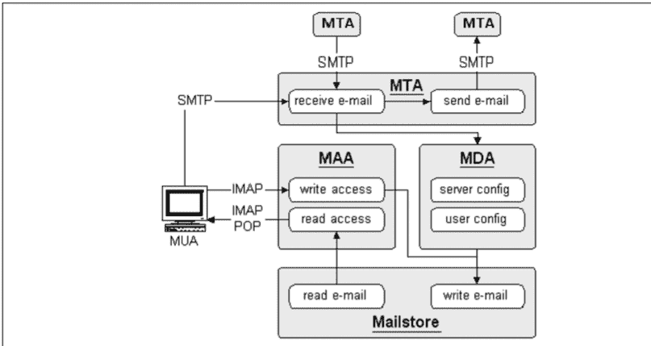

我们将在接下来的章节中更详细地研究这些组件和协议。

#### 邮件用户代理 (MUA)

邮件用户代理是邮件系统中与最终用户交互的客户端部分。在许多情况下，这被简单地称为*邮件客户端*或*电子邮件客户端*。这些术语大多可以互换，通常用于指代 Evolution、Mozilla、Thunderbird、KMail、Outlook 或 Pine 等应用程序。另一种类型的邮件客户端是基于 Web 的客户端，通常作为`cgi-bin`插件安装在 Apache 上。两种流行的开源 Webmail 应用程序是 SquirrelMail 和 SqWebMail，将在本章稍后部分介绍。简单来说，MUA 用于显示用户邮箱中的消息内容。

MUA 与 MTA 通信以发送消息，并与 MAA 通信以访问邮箱。在 Linux（以及几乎所有）`TCP/IP`（传输控制协议/互联网协议）邮件系统中，`SMTP`用于电子邮件提交，`IMAP`（或`POP`）用于邮箱访问。

大多数现代 MUA 支持使用加密，以确保电子邮件内容在通过网络传输期间不被解码。在许多情况下，电子邮件将包含机密或敏感信息，因此在网络传输点使用加密是有意义的。`StartTLS` (Start Transport Layer Security) 机制已成为与邮件服务器通信时实现连接加密的标准方式。

大多数电子邮件客户端支持离线配置，允许在断开网络连接时进行有限的操作。在许多公司中，电子邮件存储在服务器上，并可能镜像在笔记本电脑上以便在断开连接的操作期间查看。在其他公司中，电子邮件被下载到笔记本电脑的硬盘上。如果笔记本电脑丢失、被盗或损坏，这可能会产生问题。电子邮件通常会永久丢失，因为没有备份，而这种（以及其他）信息的丢失可能会对笔记本电脑原主的生产力产生严重影响。此外，当邮件被下载到本地客户端时，它只能在该特定客户端上查看，Webmail MUA 将显示一个空邮箱。

大多数 MUA 支持通过目录服务器（如 OpenLDAP）进行地址查询。这使得查找人员、电子邮件地址和联系信息变得更加容易，特别是对于大型多站点公司的员工。由于本书附带的迁移脚本在第 4 章中已将电子邮件地址填充到您的 OpenLDAP 目录中，因此当用户切换到基于 Linux 的邮件服务时，此地址查询功能已可供其使用。

Linux 有多种可用的开源 MUA，表 7.4 列出了流行的 MUA 及其网站。

**表 7.4 流行的 Linux MUA 及其网站**

| MUA | 网站 |
|---|---|
| Evolution | `www.novell.com/products/evolution/` |
| Mozilla | `www.mozilla.org/products/mozilla1.x/` |
| Thunderbird | `www.mozilla.org/products/thunderbird/` |
| KMail | `kmail.kde.org/` |
| Balsa | `www.newton.cx/balsa/` |
| Pine | `www.cac.washington.edu/pine/` |


关于 Linux MUA 的更详细信息可以在第 11 章“Linux 桌面内部”中找到。Linux MUA 的完整列表位于`www.linuxmafia.com/faq/Mail/muas.html`。

#### 邮件访问代理（MAA）

MUA 必须有一种方式来访问邮件存储区的内容。这是通过 MAA 实现的。访问方法可能是通过文件共享，或通过 IMAP 或 POP 等协议。MUA 指示 MAA 检索、删除、插入和/或移动电子邮件，而 MAA 管理与邮件存储区的读写操作。

Courier-IMAP、UW-IMAP 和 Cyrus-IMAP 是三种流行的开源 MAA。通常，无论是否使用 Courier 套件中的其他应用程序，Courier-IMAP 都是推荐的 IMAP MAA。UW-IMAP 的安全记录较差且不支持 maildirs，而 Cyrus-IMAP 使用一种不寻常的邮件存储方法。所有这些 MAA 都使用 IMAP 和/或 POP 为客户端提供服务。我们将在下面的章节中讨论 IMAP 和 POP 的优点和特点。

### 理解邮局协议（Post Office Protocol）

邮局协议是 IMAP 的前身，目前仍是一种广泛使用的邮箱访问网络协议。在本书中，当我们提到 POP 时，是指 RFC 1939 中定义的 POP 第 3 版。在大多数环境中，POP 用于将电子邮件从服务器下载到本地存储，并在成功下载后从服务器中删除电子邮件。

POP 不支持基于服务器的文件夹，也不支持比简单检索和删除电子邮件更复杂的功能。在许多情况下，这些功能对于简单的邮件服务来说已经足够。

### 理解互联网邮件访问协议（Internet Mail Access Protocol）

IMAP 允许访问远程服务器上的邮箱。我们在本书中提到 IMAP 时，是指 RFC 3501 中描述的 IMAP 第 4 版。虽然 POP 仅允许电子邮件的下载和删除，但 IMAP 能够对远程邮箱进行完整管理，被认为是企业级访问用户邮箱的首选协议。它对于电子邮件的服务器端存储、分层子文件夹组织、从多台计算机和多个位置访问以及全功能的离线操作是最优的选择。

虽然 IMAP 比 POP 具有更多功能，但 IMAP 的部署更为复杂。请记住，POP 和 IMAP 服务于略有不同的需求类型。在许多情况下，快速部署 POP 服务器并将客户端配置为使用 POP 将电子邮件下载到本地硬盘是很简单的。事实上，一些较旧的应用程序不支持 IMAP。

然而，为了实现对邮箱的全面功能访问、对共享文件夹的支持以及对脱机离线操作的支持，IMAP 值得投入额外的精力，并能为消息服务增加价值。将邮件存储数据保存在邮件服务器上可以实现 Webmail（网页邮件），并简化消息的备份与恢复。有关安装和配置 Courier-IMAP 的信息，请访问`www.courier-mta.org/imap/INSTALL.html`。

#### 邮件传输代理（MTA）

邮件传输代理主要负责将消息从一台主机传输到另一台主机——换句话说，就是在网络上发送和接收电子邮件。在互联网和几乎所有其他 TCP/IP 网络中，实现这一目标的协议是 SMTP。SMTP 和互联网电子邮件格式化信息在 RFC 821、2821、2822 和 2487 中有详细描述。

要使用 SMTP 发送电子邮件，主机通过 TCP 端口 25 联系另一台主机来启动电子邮件传输。如果 SMTP 服务器正在运行，客户端和服务器将进行对话。图 7.4 展示了 Acme Widgets 公司中，运行在 WIDGET1 上的 Evolution 与运行在 SERVER2 上的 Courier-MTA 之间典型的 MUA-MTA 对话。客户端（WIDGET1）发送的文本以粗体表示。

**图 7.4 SMTP 对话**

```
SERVER2: 220 server2.acmewidgets.com ESMTP
WIDGET1: EHLO widget1
SERVER2: 250-server2.acmewidgets.com Ok.
SERVER2: 250-STARTTLS
SERVER2: 250-PIPELINING
SERVER2: 250-8BITMIME
SERVER2: 250-SIZE
SERVER2: 250 DSN
WIDGET1: STARTTLS
SERVER2: 220 Ok
( The rest of the conversation is encrypted )
WIDGET1: MAIL FROM: <sender@acmewidgets.com>
SERVER2: 250 Ok
WIDGET1: RCPT TO: <recipient@ballystyx.com>
SERVER2: 250 Ok
WIDGET1: DATA
SERVER2: 354 Ok
WIDGET1: ( e-mail message contents )
SERVER2: 250 Ok
WIDGET1: QUIT
SERVER2: 250 Ok
```

如对话所示，`STARTTLS` 命令启动了加密。Evolution 之所以知道支持加密，是因为 SERVER2 通过响应`250-STARTTLS`宣告了该能力。

大多数现代电子邮件客户端和服务器都支持加密。然而，实现加密可能简单到只需勾选一个复选框，也可能复杂到需要处理证书颁发机构（CA）。对于 MUA 而言，通常只需勾选`Use SSL/TLS`复选框即可启用加密。对于 MTA，加密通常需要安装服务器证书，并重新配置各种服务器以实际使用该证书并启用加密。管理 OpenSSL 证书的内容将在第 9 章“Web 服务”中介绍。

一封电子邮件只有一个发送者，但可以有多个接收者。如果一封电子邮件发给同一域名的多个接收者，大多数 MTA 只会向该域名发送一封电子邮件消息。例如，如果`jim@somedomain.com`发送了一封发给`john@example.com`和`mary@example.com`的邮件，somedomain.com 的 MTA 仅需向 example.com 的邮件交换机发送一份邮件副本，而 example.com 的接收 MTA 将负责将邮件副本投递到 john 和 mary 的邮箱中。

电子邮件中的附件通过 MIME（多用途互联网邮件扩展）进行管理。MIME 将一封电子邮件分为多个部分，每个部分可以具有不同的内容格式。关于 MIME 的更多信息可在`http://en.wikipedia.org/wiki/MIME`以及 RFC 2045、2046、2047、2048 和 2049 中找到。

MTA 通过使用多个队列进行临时消息存储来工作。所有现代 MTA 至少使用一个入站队列、一个出站队列和一个工作队列。大多数 MTA 还会结合使用延迟队列、隔离队列、垃圾队列和/或日志队列，以便对电子邮件进行分类处理。当 MTA 收到一封发送给本地服务器用户的电子邮件时，MTA 会将消息传输给邮件投递代理，以便将其复制到邮件存储中。

#### 邮件投递代理（MDA）

邮件投递代理负责将消息投递到邮件存储中。MDA 有时被称为本地投递代理（LDA）。在本书中，我们将把负责将消息投递到邮件存储的代理称为 MDA。大多数 MTA 都包含自己的 MDA，但如果需要，也可以轻松配置为使用另一个 MDA。

许多 MDA 具有基于规则的过滤机制，该机制可以应用于整个站点和/或基于单个邮箱。站点范围的配置设置通常存储在`/etc/`中，而用户特定设置（例如将某些收件邮件移至特定邮件文件夹）通常存储在用户主目录或邮件池目录中。

Procmail 和 maildrop 是两种流行的邮件投递代理。两者都支持电子邮件过滤，尽管 procmail 的 recipes（配方）语言被认为晦涩难懂。Courier-MTA 使用的 MDA maildrop 具有类似于脚本语言的更简单语法。

Fetchmail 是一个具有类 MTA 功能的 MDA。Fetchmail 从 POP 或 IMAP 邮箱中检索电子邮件，并将电子邮件转发给 SMTP MTA。Fetchmail 提供了一个图形化配置工具`fetchmailconf`，可辅助配置 fetchmail 的众多选项。Fetchmail 甚至能够通过单个邮箱管理整个域名的电子邮件，尽管这不一定是 fetchmail 的最佳用途。关于 fetchmail 的更多信息可在`www.catb.org/~esr/fetchmail/`找到，或通过输入`man fetchmail`查看。

## 邮件存储（Mailstore）

除了发送、接收和投递电子邮件外，另一个重要的考虑因素是如何在 Linux 邮件服务器上存储电子邮件数据。在大多数 Linux 服务器中，这是通过基于文件的存储实现的，尽管某些产品可能会使用数据库来存储电子邮件。Exchange 使用基于 JET 的数据库，而开源 Linux 应用程序使用两种不同的电子邮件消息存储格式：maildir 和 mbox。

### Mbox/Mbx 邮件存储格式

mbox 方法是 UNIX 类邮件服务器存储邮件的历史方式。单个消息被简单地拼接在一起形成一个文件，消息之间放置一个标记。在 mbox 中，该字符串包含元数据以增强索引性能。这种简化的方法适用于单用户工作站上的适量个人电子邮件，并可用作许多电子邮件客户端的本地存储机制。

虽然 mbox 和 mbx 对于客户端邮件来说没问题，但在多个进程需要并发读写访问邮件存储时，它们并不是鲁棒的邮件存储首选方法。由于只有一个进程可以写入 mbox 文件，这种存储方法由于锁定问题而扩展性较差。当邮箱数据托管在网络文件共享（可能正确或不正确地强制执行锁定规则）且多个进程尝试写入单个文件时，这个问题尤为明显。此外，在磁盘写入操作期间邮件存储服务器发生断电，通常会损坏 mbox 文件中的（至少）最后一条消息，有时甚至会损坏整个 mbox 文件。

### Maildir 邮件存储格式

Maildir 是一种比 mbox 更近期的邮件存储格式。Maildir 由 Qmail 的作者发明，第一个 maildir 实现是在 Qmail 中引入的。mbox 和 maildir 邮件存储之间最显著的区别之一是，maildir 邮件存储将电子邮件消息存储为单独的文件。不需要锁定，这意味着即使底层网络文件协议或应用程序中的锁定强制执行有缺陷，这种投递格式也能工作。多个进程可以同时写入 maildir 邮件存储，而不会出现锁定问题或邮件丢失/损坏。

有关 maildir 中使用的文件投递和操作机制的更多信息，可以在 Bernstein 教授关于 maildir 的原始文档`www.qmail.org/man/man5/maildir.html`中找到。关于 maildir 的更全面讨论（包括 maildir 配额）可以在`www.courier-mta.org/maildir.html`中找到。

### 数据库邮件存储格式

数据库式邮件存储主要用于商业专有产品，如 Microsoft Exchange 或 Oracle Messaging。大多数开源企业消息应用程序使用 maildir 或 mbox 格式，尽管 Cyrus-IMAP 使用其自己的类数据库邮件存储。虽然数据库邮件存储提供了一些潜在优势，但它也增加了存储的复杂性，并引入了相对简单的基于文件和目录的邮件存储机制中所没有的潜在麻烦。目前，maildir 似乎是企业级开源消息传递的首选开源邮件存储格式。

## 探索开源邮件服务器软件

开源邮件服务器软件的历史和多样性始于 1980 年的 Sendmail，随后在 20 世纪 90 年代出现了 Postfix、Exim、Qmail 和 Courier。现在，用户可以选择众多开源软件来实现电子邮件的发送、接收、递送和访问。在本节中，我们将探讨一些最受欢迎的邮件软件。

从历史上看，主机之间传输电子邮件有多种方式。Sendmail 是第一个通用 MTA（邮件传输代理）。随后出现了其他几个 MTA，但并未获得普及。Qmail 随后作为一种更安全、更高效的 Sendmail 替代方案出现。Qmail 提出了一种更高效的邮件存储格式，解决了当时电子邮件保存方式的一些问题。然而，Qmail 是一个非常简单、精简的 MTA。Postfix 的创建是为了解决 Sendmail 的冗余、晦涩的配置语法以及其他问题，同时提供一个实现了大多数现代 MTA 所需功能的健壮 MTA。最后，几个与电子邮件相关的项目合并成了 Courier MTA。

### Sendmail

讨论开源邮件服务器软件必须从 Sendmail 开始。Sendmail 是所有 MTA 的鼻祖。Sendmail 的初始版本编写于 1980 年，远在 SMTP 成为全球电子邮件传输协议之前。在当时，电子邮件消息在各种不同的网络和消息格式之间传输。Sendmail 的成名之处在于它能够通过重新格式化消息以适应每个网络的格式，从而在不同网络之间传输消息。

尽管 Sendmail 仍被广泛使用，但这并非因为操作简单或易于使用。Sendmail 使用一个复杂且令人畏惧的配置文件。其复杂程度堪称传奇，初学者难以应对。Sendmail 的配置文件实际上是一门微型的编程语言；它是一个低级脚本，逐步指定 Sendmail 如何处理电子邮件地址和标头。1996 年在 Usenet 新闻组上的一篇帖子展示了如何利用 Sendmail 的配置文件让 Sendmail 解决“汉诺塔”谜题。

幸运的是，现代版本的 Sendmail 包含一个宏预处理器。Sendmail 的配置不再需要手动编写脚本，而是使用一组高级配置指令来描述。随后，宏预处理器将这些指令翻译成 Sendmail 的原生配置文件。

此外，Sendmail 已作为所有主要 Linux 发行版的标准部分包含在内。它通常带有通用配置，因此在大多数情况下几乎不需要任何配置。然而，对于迁移到 Linux 基础设施的小企业，我们通常不建议选择 Sendmail。市面上有更好（更简单）的选择，且大多数 Linux 发行版除了 Sendmail 之外，还提供另一种默认 MTA。

有关 Sendmail 的更多信息，请访问`www.sendmail.org`。有关 Sendmail 支持服务和图形化配置工具的信息，请访问`www.sendmail.com`。

### Qmail

Qmail 是一个有趣的 MTA。它的普及程度受到其不同寻常的许可条款的一定影响，但它仍然拥有良好的安全记录。曾几何时，Qmail 的作者向任何能发现安全漏洞的人提供 500 美元的奖金——但这笔奖金从未被领取。

Qmail MTA 由 Daniel Bernstein 教授在 20 世纪 90 年代初编写。在许多方面，Qmail 与 Sendmail 完全相反。Sendmail 以单个单体进程运行，实现了所有功能；而 Qmail 是一组多个小模块的集合，它们协同工作，每个模块专注于单一任务。Sendmail 使用一个具有晦涩语法的单一配置文件，而 Qmail 将其配置数据存储为独立的纯文本文件。

Qmail 对 MTA 技术的重大贡献是开发了用于电子邮件存储的 maildir 格式。传统上，文件夹中的所有消息都被保存为一个单一文件。这种被称为 mbox 的邮件存储格式在互联网早期足够使用，但随着电子邮件的普及，mbox 的局限性开始显现。任何时间只能有一个进程更新文件夹，因此需要锁定机制来协调竞争进程对文件夹的访问，而传统的文件锁定在基于网络的文件系统中运行并不稳定。为了更新文件夹，进程基本上必须从头开始重写整个文件或大部分内容。如果进程在完成前被中断，结果就是邮件文件夹损坏。

Qmail 的 maildirs 将每条消息放入一个独立的文件中。特定的命名约定决定了每条消息的文件名，并且有一种定义良好的机制，允许多个进程同时更新邮箱内容，而不会互相干扰，也不需要任何形式的锁定。

事实证明 maildirs 非常受欢迎，现在 Courier、Postfix 和 Exim MTA 均支持该格式。通过配合使用如 maildrop 或 procmail 这样的 MDA（邮件投递代理），Sendmail 也可以递送到 maildirs。

Bernstein 教授还提出了一种名为 QMTP 的新型快速邮件传输协议，作为 SMTP 的替代方案。虽然 maildirs 现在已成为大多数 MTA 的固定标配，但 QMTP 并没有流行起来，如今仍仅在 Qmail 中可见。

Qmail 是一个非常小的 MTA。它仅实现了 SMTP 的最基本功能。在过去的二十年里，SMTP 发生了显著演变，在其原始功能基础上增加了许多扩展，但 Qmail 并没有跟上。Bernstein 教授的最后一个 Qmail 版本 1.03 发布于 1993 年。Qmail 缺乏现代 MTA 所需的高级 SMTP 功能，例如加密和身份验证 SMTP。

在当今环境下使用 Qmail 的一个主要缺陷是，其设计要求 Qmail 接受所有发送到本地电子邮件域的邮件。如果目标邮箱不存在，Qmail 服务器会尝试将邮件作为无法投递返回给所谓的发送者。这里的主要问题是垃圾邮件。垃圾邮件通常携带无法投递的退信地址。Qmail 将无法把邮件返回给发送者，邮件将在 Qmail 的邮件队列中停留一段时间，直到超时被删除。大量的无法投递垃圾邮件可能会对 Qmail 的性能产生重大影响。

尽管 Qmail 已经一段时间没有更新，但它拥有庞大的用户群。许多第三方补丁和 Qmail 插件解决了它的一些缺陷。在对安全性要求极高的环境中，Qmail 仍然经常被考虑。因为它如此小巧，出现可利用缺陷的可能性较低。通常，软件功能的复杂度越高，出现 Bug 的可能性就越大。Qmail 的小巧也使其成为某些防火墙环境的热门选择。

导航至`www.qmail.org`获取关于 Qmail 的更多信息。

### Postfix

Postfix 最初由 IBM 在 1997 年开发。它最初被称为“VMailer”，然后是“IBM Secure Mailer”。Postfix 在开发周期早期被拆分，现在独立于 IBM 存在。Postfix 最初也旨在成为 Sendmail 的替代方案，但实际上它与 Sendmail 比与 Qmail 更相似。Postfix 今天仍在积极开发，是许多现代 Linux 发行版的默认 MTA。

Postfix 的设计旨在提供 Sendmail 的健壮性，同时提高速度、简化配置，并在设计之初就将安全性考虑在内。结果是，许多人认为它是安装最广泛的 Linux MTA。


Postfix 包含多种垃圾邮件过滤选项，以及实现虚拟邮箱的多种选项。在早期，邮箱和 UNIX 系统账户是一体的——如果你有一个 UNIX 账户，你就拥有一个邮箱和一个格式为 `username@domain` 的电子邮件地址。当电子邮件成为一项独立服务后，不再需要为每个邮箱创建一个系统账户。邮件服务器变成了一个独立系统，邮箱仅可通过 IMAP 或 POP3 访问。通过 Qmail 或 Postfix，可以通过将账户信息添加到文件中，在没有实际系统账户的情况下创建虚拟邮箱。文件中的账户列表随后被编译成一个小数据库文件。Postfix 还提供了使用 LDAP 服务器、MySQL 服务器或 PostgreSQL 服务器替代文件的选项。

访问 `www.postfix.org` 获取有关 Postfix 的更多信息。

### Exim

Exim MTA 由剑桥大学开发。Exim 的特色在于其邮件过滤和邮件检查能力，它使用了自己专门的邮件过滤语言。与 Postfix 类似，Exim 支持 LDAP、MySQL 和 PostgreSQL 数据库。

Exim 中一个有趣的过滤功能（Postfix 同样具备）是它的 `callout`（呼叫）能力。在接受消息之前，Exim 可以检查发送者的电子邮件地址，并尝试联系发送者的邮件服务器以验证该地址是否存在。这在一定程度上降低了整体邮件投递速度，但基本上消除了带有伪造、不存在的退信地址的垃圾邮件。与 Postfix 一样，Exim 可以轻松地与 SpamAssassin 集成。

Exim 的另一个有趣特性是它可以使用嵌入的 Perl 脚本来处理某些任务。Exim 也许可以被描述为“程序员的 MTA”，因为编程技能可以让邮件管理员充分利用 Exim 的功能。

请参阅 `www.exim.org` 获取有关 Exim 的更多信息。

### Courier Suite

Courier 是一个完整的模块化消息套件，包括一个 MTA（`Courier-MTA`）、Webmail MUA（`SqWebMail`）、MDA（`maildrop`）、MAA（`Courier-IMAP`）、基于 Web 的管理界面（`courierwebadmin`）、LDAP 集成以及日历/群组软件功能。该套件中的每个应用程序都是一个独立的产品，但它们共享一个公共代码库，并以集成的方式协同工作。Courier 配置为使用 maildir 邮件存储。

表 7.5 列出了 Courier 套件的组件。

### 表 7.5 Courier 套件组件

| 组件 | 描述 |
| --- | --- |
| `Courier-MTA` | 用于主机间消息传输的 MTA |
| `maildrop` | 本地 MDA，类似于 procmail |
| `Courier-IMAP` | 用于 IMAP/POP 邮箱服务的 MAA |
| `SqWebMail` | 基于 Web 的 MUA 电子邮件和日历访问（需要 Apache cgi-bin） |
| `Webadmin` | Courier 的基于 Web 的管理模块（需要 Apache cgi-bin） |
| `Courier-MLM` | 邮件列表管理器 |
| `Courier-analog` | 使用情况报告 |

Courier 提供了一套集成解决方案，涵盖电子邮件传输、存储、客户端访问、邮件列表管理和基于 Web 的访问服务。它包含一个可通过 Web 访问的日历解决方案。对于偏好 GUI（图形用户界面）管理的用户，Courier 还提供了一个基于 Web 的管理控制台。除此之外，整个 Courier 套件可以通过 SSL/TLS 加密轻松实现安全化。Courier 满足 Acme Widgets 目前的需求，并将满足所有中期可预见的要求。Acme Widgets 可能会考虑在以后部署 Courier 传真网关选项。

其功能集和安装的便捷性使得 Courier 套件成为 Acme Widgets 的理想选择。由于 Acme Widgets 的消息传递需求有限且 IT 预算有限，他们可以在无需处理多个 MTA、MAA、MDA 和 Webmail 软件包之间相互协作的复杂性（及额外工作）的情况下，获得所有需要的功能。

### Courier-MTA

Courier 的核心部分由一个典型的 MTA 组成。Courier-MTA 接收新的电子邮件消息，将其放入内部队列，调度递送，并对无法立即递送的消息重新调度。

Courier 提供了多种控件，用于有选择地接受或拒绝消息。它包含几个预定义的过滤器，用于检查消息的正确性。此外，还可以安装 Perl 脚本或独立程序来检查消息并有选择地拒绝不需要的电子邮件。

与 Exim 和 Postfix 一样，Courier 可以使用 LDAP、MySQL 或 PostgreSQL。有关 Courier 的一般介绍，请参阅 `www.courier-mta.org`。

### Maildrop

Courier 附带了 `maildrop` MDA，但 Courier-MTA 也可以使用任何其他 MDA。Maildrop 与 procmail 类似，但使用的是更简单、类似 Perl 的电子邮件过滤指令。

Maildrop 既可以安装为由 Courier-MTA 用于递送到每个账户的全局 MDA，也可以有选择地按账户安装。Courier-MTA 还可以直接将 maildrop 用作邮件过滤控件；然而，这是一项高级且复杂的任务，需要一定的编程能力。在大多数情况下，maildrop 作为普通 MDA 的角色就足够了。

有关 maildrop 的更多信息，请参阅 `www.courier-mta.org/maildrop/`。

### Courier-IMAP

Courier-IMAP 服务器为本地邮箱提供 IMAP 和 POP3 访问。与 SMTP 一样，IMAP 在多年来不断演进，在 IMAP 核心基础之上获得了许多对基本功能的扩展。Courier-IMAP 实现了大多数流行的 IMAP 扩展，例如访问控制列表（ACLs）。在 Courier-IMAP 中可以设置共享邮件文件夹，多个账户可以根据 IMAP ACL 配置的规则访问这些文件夹。通过使用共享文件夹交换备忘录和中型文件，可以实现基本的群组软件功能。

与其他 Courier 应用程序一样，Courier-IMAP 可以独立于 Courier 套件安装，并可与任何 maildir 邮件存储配合使用。在大企业中，一种流行的组合是使用 Postfix 发送/接收电子邮件，并使用 Courier-IMAP 为客户端提供电子邮件访问服务。

有关 Courier-IMAP 的更多信息，请参阅 `www.courier-mta.org/imap/`。

### SqWebMail

Courier 的 SqWebMail 是一个功能齐全的 Webmail 服务器，具有日历/群组软件功能。该界面支持用户邮箱文件夹和共享文件夹。它支持地址簿、拼写检查、日历、邮件过滤，甚至支持 GnuPG 加密！这些功能在任何浏览器上都能良好显示，且不需要 Javascript 支持。图 7.5 显示了 SqWebMail 的截图。

图 7.5 Courier SqWebMail Webmail 客户端

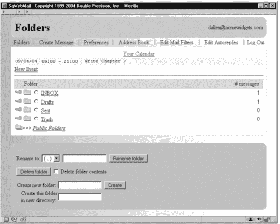

SqWebMail 速度非常快。其他 Webmail 服务器通过建立与 IMAP 服务器的后台连接，并在格式化显示之前使用 IMAP 下载电子邮件消息。而 SqWebMail 直接访问 maildirs，不使用 IMAP。

SqWebMail 还提供了一个选项，可以通过简单的 Web 界面生成基础的 maildrop 过滤器。这使得无需编程知识即可创建基本的电子邮件过滤器。

SqWebMail 和 webadmin 需要一个能够支持 cgi-bin 的服务器，例如 Apache。有关 SqWebMail 的更多信息，请参阅 `www.courier-mta.org/sqwebmail/`。该网站包含许多截图。

### Webadmin

Courier 的 webadmin 是一个基于 Web 的界面，可访问大多数配置设置。在更新服务器配置后，webadmin 会原子性地重启受影响的 Courier 模块。图 7.6 显示了 Courier webadmin 的截图。

图 7.6 Courier Webadmin 管理 GUI

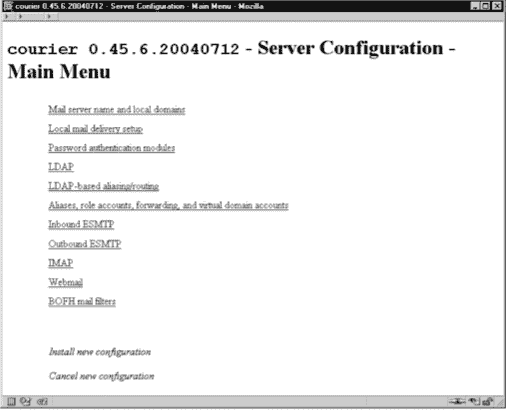

### Courier-MLM

Courier-MLM 是一个基础的邮件列表管理器。要设置邮件列表，请在 Courier 服务器上以邮件列表的名称创建一个单独的账户，然后按照 Courier-MLM 文档中的指示，将 Courier-MLM 安装为该账户的 MDA。这样就得到了一个基础的邮件列表。

对于大多数公司内部邮件列表，Courier-MLM 已经足够。需要高级邮件列表处理器的场景则需要将 Courier 与外部邮件列表管理器配合使用。

### Courier-analog

Courier-analog 是 Courier 的日志分析器。该模块不包含在 Courier 的主发行版中。作为正常运行的一部分，Courier 的许多服务器会将消息发送到 syslog 守护进程，后者将其保存到文件中（通常是 `/var/log/messages` 或 `/var/log/maillog`）。Courier-analog 是一个 Perl 脚本，它读取日志文件并为 Courier-MTA 和 Courier-IMAP 生成使用情况报告。

Courier-analog 通过几种不同的方式汇总 SMTP、IMAP 和 POP3 的使用情况。IMAP 和 POP3 的使用情况按连接网络、时间和下载的电子邮件消息数量进行汇总。SMTP 流量按发送者或接收者以及整体使用情况、时间和错误消息进行汇总。Courier-analog 生成纯文本或 HTML（超文本标记语言）报告。

## 设计基于 Linux 的消息传递服务

设计基于 Linux 的消息传递服务主要包括确定 MTA(s)、MAA(s) 和邮件存储的类型、规模和位置，以及确定要使用的软件应用程序和每个应用程序的配置。设计还必须包括发送和接收互联网邮件的路径。这些选择将由需求文档中确定的消息传递需求决定，并可能受预算、时间或其他因素的限制。

对于像 Acme Widgets 这样的小公司，这个选择很简单。因为只有一个服务器和一个站点，Sam 只需在 Linux 服务器上安装并配置 Courier 套件，消息系统的部署阶段就在几分钟内完成了。但在像 Ballystyx Engineering 这样的大公司中，情况并非如此简单和明确。那里有多个服务器、多个站点和大量用户。由于电子邮件性能至关重要，且有足够的预算来考虑设计因素，因此仔细审查消息系统需求以确保设计能满足当前（及未来）的需求是有意义的。

从可扩展性的角度来看，任何设计基于 Linux 的消息传递服务的公司的首要目标应该是设计一个能够处理该公司目前电子邮件量，并能管理未来 2-3 年预期电子邮件量和存储空间（包括不可避免的垃圾邮件和病毒）的消息系统。从功能和可靠性的角度来看，消息系统必须向用户提供适当的消息传递功能，提供足够的性能，并在给定预算范围内尽可能可靠。

### 确定互联网电子邮件架构

在设计电子邮件基础设施时，通常最好先确定往返于互联网的电子邮件流。为了更好地阐述这一过程，我们将分析 Acme Widgets 和 Ballystyx Engineering 的互联网电子邮件架构。

Acme Widgets 通过 DSL（数字用户线路）连接访问互联网。该连接提供了高速（接近 T1）的下载速度，但仅提供 128Kb 的上传速度。这意味着从互联网接收信息速度很快，但上传信息（包括发送电子邮件）速度较慢。

邮件速度明显较慢。为了提高电子邮件的性能（特别是在向多个收件人发送大型电子邮件时），Acme ISP 设置了一台 SMTP 中继服务器。为了限制出站垃圾邮件和病毒，Acme ISP 不允许 DSL 客户直接向互联网邮件服务器发送电子邮件。所有电子邮件必须通过中继服务器。

Acme ISP 对打击垃圾邮件和病毒的承诺不仅限于出站电子邮件。Acme ISP 还管理 AcmeWidgets.com 的入站电子邮件，并使用 MailScanner 在电子邮件被 Acme Widgets 的 Exchange 服务器接收之前清除垃圾邮件和病毒。acmewidgets.com 的 MX 记录指向 MailScanner.AcmeISP.net。图 7.7 展示了 Acme Widgets 当前的互联网电子邮件架构。

## 图 7.7 Acme Widgets 当前互联网电子邮件架构

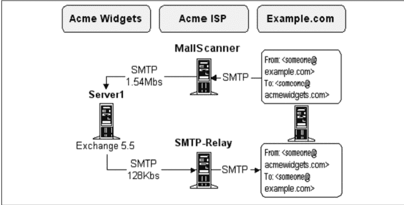

由于互联网服务提供商（ISP）施加的互联网电子邮件架构限制，Acme Widgets 只能采用一种电子邮件流设计。在 Acme Widgets 迁移到 Linux 后，其电子邮件架构和流程将如图 7.8 所示。

## 图 7.8 Acme Widgets 迁移后的互联网电子邮件架构

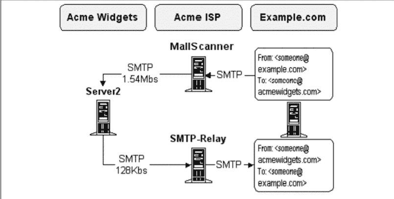

Ballystyx Engineering 通过 T-1 连接访问互联网，该连接可提供高速的数据下载和上传。尽管 T-1 提供了显著的带宽，但由于垃圾邮件和病毒的影响，其链路有些拥塞。因为 Ballystyx 使用的 ISP 不过滤入站电子邮件也不限制出站电子邮件，因此 Ballystyx 直接与互联网邮件服务器发送和接收电子邮件。ballystyx.com 的 MX 记录指向 beryllium.ballystyx.com。图 7.9 展示了 Ballystyx Engineering 当前的互联网电子邮件架构和电子邮件流。

## 图 7.9 Ballystyx 当前互联网电子邮件架构

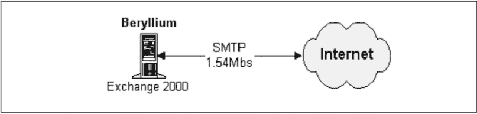

作为 Windows 到 Linux 迁移的一部分，Vijay 计划部署两台新的 Linux 服务器：Boron 和 Nitrogen。Boron 将使用基于 Linux 的消息软件替换 Ballystyx 的 Exchange 服务器，并管理与互联网之间的电子邮件收发。当时间和预算充足时，Nitrogen 将部署在 Ballystyx 的班加罗尔办公室。图 7.10 展示了 Ballystyx Engineering 迁移后的互联网电子邮件架构。

## 图 7.10 Ballystyx 迁移后的电子邮件架构

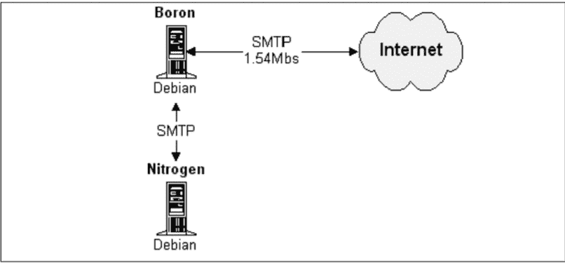

### 选择消息服务器软件

既然互联网电子邮件架构已经确定，我们将重点关注能够实现消息需求文档中所定义功能的软件。影响组织选择软件的标准有很多，包括：

- IT 人员对应用程序的了解程度
- 扩展性和性能考虑
- Webmail 需求
- 与现有（遗留）应用程序的兼容性
- 应用程序的功能集和能力
- 集成需求
- 电子邮件客户端限制

Linux 平台上有种类繁多的开源消息服务器软件。由于篇幅有限，无法列出所有可用软件，表 7.6 列出了几个推荐用于 Windows 到 Linux 迁移的开源消息系统组件。有关这些应用程序的更多信息可以在其各自的网站上找到。

### 表 7.6 推荐的开源消息服务器应用程序

| 组件 | 软件 |
| :--- | :--- |
| MUA | SqWebMail, SquirrelMail, OpenWebmail |
| MTA | Courier-MTA, `postfix`, `exim` |
| MAA | Courier-IMAP, Cyrus-IMAP, `gnupop3d` |
| MDA | `maildrop`, `procmail`，或任何其他 MDA |

由于 Linux 消息系统的模块化特性和对开放标准的遵循，理论上任何 MUA、MTA、MAA 和 MDA 的组合都可以被“粘合”在一起。在实践中，如果各种组件被打包在一个集成套件中（如 Courier），配置过程会简单得多。

需要注意的是，大多数 Linux 发行版供应商会针对发行版环境定制这些消息服务器应用程序的软件包。在许多情况下，软件包在安装后或在回答几个配置问题后即可直接使用。Linux 供应商在应用程序打包方面所做的工作可以显著减轻系统管理员的工作负担。

对于像 Acme Widgets 这样只有一台服务器且需求极少的公司，Sam 选择了 Courier 套件。这提供了一个易于部署的集成解决方案，满足并（在某些方面）超过了 Acme Widgets 的消息需求。Sam 觉得 Courier 方案很有吸引力，因为 Courier 可以替代 Exchange 的所有相关功能，并提供一个简单的迁移方案，配置和运行所需时间极短。通过使用迁移脚本，将 Acme Widget 的所有电子邮件数据迁移到新的 Courier 邮件服务器所需的时间不到一小时。

由于 Ballystyx 的消息需求更复杂，Vijay 选择了一个由多个最顶尖（best-of-breed）开源应用程序组成的消息套件。虽然 Courier 套件很有吸引力，但 Vijay 及其工作人员已经在 `postfix` 管理方面拥有经验，并且比起 Courier 的 SqWebMail 客户端，他们更喜欢 SquirrelMail Webmail 客户端的功能和布局。Vijay 决定将 Courier-IMAP 作为 Ballystyx 首选的 MAA。

### 确定电子邮件存储方式

设计电子邮件系统最关键的决定之一是电子邮件存储在哪里。是集中存储在电子邮件服务器上，还是存储在客户端的本地硬盘上？影响这一决定的因素很多，包括：

- 是否有笔记本电脑需要在断开公司网络时仍能运行电子邮件？
- 用户是否需要能够从组织内的多台计算机访问其邮箱？
- 是否支持远程访问（例如通过互联网）邮箱？远程支持哪些协议？
- 是否需要为部分或全部用户提供 Webmail 访问？
- IT 部门希望支持一种邮件访问协议还是两种？


IT 支持人员是否有时间服务那些将所有电子邮件下载到由“朋友帮忙配置”的 POP 客户端的桌面/笔记本用户？在这种情况下，电子邮件需要使用 IMAP 重新上传回邮件服务器，这个过程相当复杂且通常很耗时。

电子邮件的本地存储使得从多个位置访问邮件库变得更加困难，并增加了集中备份电子邮件的挑战。如果组织希望向所有用户提供 Webmail，则电子邮件必须存储在服务器上。此外，IMAP 在存储于服务器时运行效果最好。

虽然每个组织的需求不同，必须量身定制解决方案以适应具体要求，但大多数提供企业级电子邮件服务（包括共享文件夹）的组织都会采用基于服务器的电子邮件存储，并利用 IMAP 作为 MAA 协议。

### 设计与规划

#### 电子邮件备份与还原

对于使用基于文件存储（`maildir`、`mbox`）的 Linux 邮件库，备份和还原通常简单到只需将文件和目录复制到磁带，然后在电子邮件被意外删除或邮件服务器存储系统故障时，还原特定的文件和/或目录。

#### 创建 Linux 电子邮件服务器图表

既然我们已经确定了消息服务设计的细节（除反垃圾邮件和反病毒外），我们现在创建一个图表，用以展示每个消息系统组件的设计决策。此图类似于“理解基于 Linux 的消息服务”章节中的概念图，但消息系统组件的名称已被提供这些服务的软件应用程序名称所取代。

Acme Widgets 使用 Courier 套件来提供所有消息服务。图 7.11 展示了 `Server2` 的电子邮件服务器组件设计。

## 图 7.11 Acme Widgets 电子邮件服务器组件图

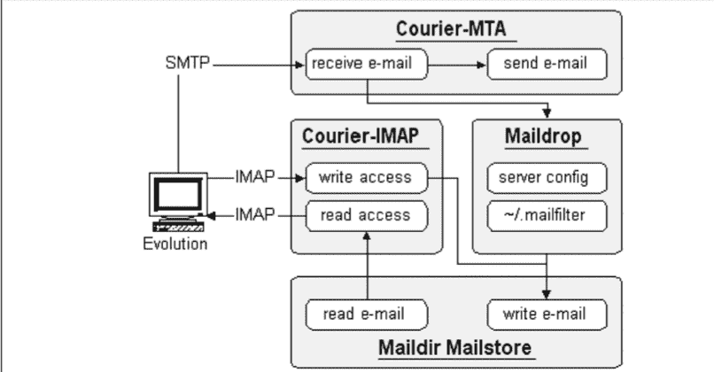

Ballystyx Engineering 正在使用来自多个开源项目的邮件服务器组件。图 7.12 展示了 Boron 和 Nitrogen 的电子邮件组件设计。

**图 7.12** Ballystyx 电子邮件服务器组件图

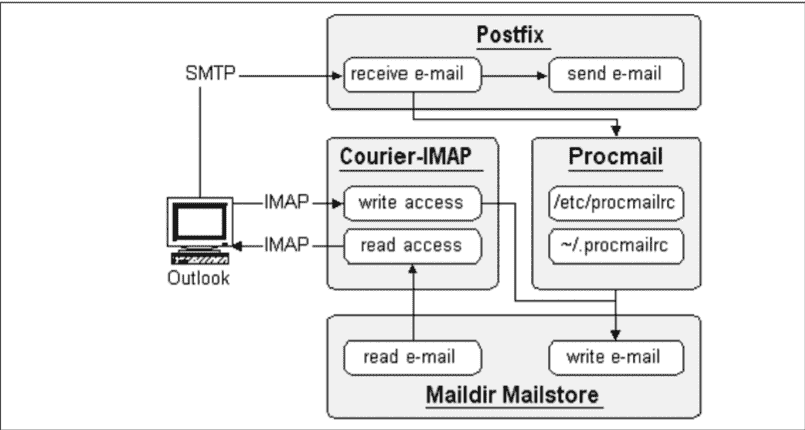

### 集成反垃圾邮件和反病毒服务

虽然互联网电子邮件带来了全球快速通信的便利，但它也带来了一系列新问题。正如我们大多数人亲身经历的那样，其中两个问题就是垃圾邮件和病毒。

对于大多数拥有注册互联网域名的现代公司来说，反垃圾邮件和反病毒服务并非可选方案，而是必须项。对于中型或大型公司而言，垃圾邮件和病毒导致的生产力损失成本远高于提供反垃圾邮件和反病毒服务的成本。当反垃圾邮件和反病毒软件是开源的时候，保护 Windows 计算机免受电子邮件携带的感染以及节省员工阅读和删除垃圾邮件的时间，其成本几乎可以忽略不计。

接下来的章节将概述垃圾邮件、病毒以及开源反垃圾邮件/反病毒软件。最后一节将教授如何设计与您的消息系统集成的反垃圾邮件和反病毒服务，并讨论多服务器、单服务器和外包架构的优缺点。

## 理解垃圾邮件

垃圾邮件是指未经请求的商业电子邮件，通常是指大批量发送的、几乎完全相同的电子邮件，因此像 Spam（某种罐装火腿）一样到处传播。这些电子邮件通常是销售推销，旨在增加或减少人体某些部位的尺寸、快速赚钱/减少债务，或获取某些其他“理想”的产品或服务。尽管轻信者的“点击率”通常低于 1%，但发送垃圾邮件的成本极低，因此即使如此低的“命中率”，垃圾邮件对垃圾邮件发送者和被广告宣传的企业来说仍然是有利可图的。在 2004 年（本书出版年份），在互联网上传输的电子邮件流量中，超过一半是垃圾邮件，而且这一比例年复一年地继续增加。

人们尝试了许多方案来遏制垃圾邮件，包括 SPF（发件人策略框架）。SPF 的工作原理是使用 DNS 记录来指明哪些计算机被允许代表该域名发送电子邮件。虽然在撰写本文时 SPF 尚未被广泛采用，但一些知名的电子邮件域名已经采用了它，包括 `earthlink.net`、`gmail.com`、`mail.com` 和 `spamassassin.org`。

一些政府通过了法律（如美国的 CAN-SPAM 法案）来限制发送未经请求的广告。由于追踪和起诉违规者的难度大且成本高，此类法律的效果有限，或者仅仅是将此类活动转移到法律或执法较宽松的国家。因为垃圾邮件在一定程度上仍然有利可图，预计在可预见的未来，这种冲击仍将继续。幸运的是，有一些有效的开源工具可以拦截几乎所有垃圾邮件，且误报率和漏报率较低。

## 判断电子邮件是否为垃圾邮件

阻止垃圾邮件进入网络的的第一步是判断一封电子邮件是垃圾邮件（`spam`）还是正常邮件（`ham`）。检测垃圾邮件有多种方法，一个有效的反垃圾邮件应用程序将尽可能多地利用这些技术。需要注意的是，每增加一项测试都会增加每条消息的处理开销。判断电子邮件是否为垃圾邮件的测试包括：

- 垃圾邮件指纹匹配
- 消息头分析
- 消息正文分析
- 基于规则（启发式）的分析
- 贝叶斯分析

大多数反垃圾邮件系统会为每封电子邮件分配一个分数，该分数表示该消息是垃圾邮件的可能性。对于 SpamAssassin，分值范围从 0（约 0% 的垃圾邮件概率）到 10 或更高（几乎 100% 是垃圾邮件）。在设计良好的垃圾邮件评分系统中，没有单一因素能决定一封电子邮件是否为垃圾邮件。相反，多个因素的各种权重相加，形成一个高于电子邮件管理员设置的阈值的垃圾邮件分数。

在大多数反垃圾邮件系统中，电子邮件的垃圾邮件分数是决定反垃圾邮件软件采取何种操作的标准。几乎可以确定是垃圾邮件的消息会被直接删除而不投递。可能但并非绝对是垃圾邮件的消息可能会被放入一个单独的队列，由电子邮件管理员审核并判定是否为垃圾邮件。此类审核对于教导反垃圾邮件系统什么是垃圾邮件以及什么不是垃圾邮件非常有价值，并将帮助反垃圾邮件系统在未来更准确地对这类电子邮件评分。

另一种处理垃圾邮件的方法是标记（并转发）可能的垃圾邮件，通常是在主题行前加上类似于 `SPAM` 的前缀。在这种情况下，所有电子邮件都会被投递，没有被丢弃。这样做的好处是永远不会因为垃圾邮件分数的误报而丢失邮件，但需要增加存储空间和/或邮箱所有者投入更多精力。在大多数情况下，最好的办法是在边界邮件设备上拦截垃圾邮件分数极高的邮件，不要在垃圾邮件上浪费存储空间或处理时间。

垃圾邮件指纹识别是判断电子邮件是否为垃圾邮件最有效的方法之一。这种方法是一种协作努力，基于这样一个前提：许多垃圾邮件几乎是完全相同的。当订阅者收到一封新邮件时，系统会计算该邮件的指纹。然后将该指纹与垃圾邮件指纹数据库进行匹配。如果匹配成功，这意味着另一位订阅者已经将一封几乎相同的邮件报告为垃圾邮件。如果没有匹配到垃圾邮件指纹，而这封邮件随后被判定为垃圾邮件，订阅者可以将该新垃圾邮件的指纹上传到垃圾邮件指纹数据库。

DCC、Razor 和 Pyzor 是三个开源反垃圾邮件组织，它们充当垃圾邮件指纹和校验和的集中报告和分发服务器。您可以使用其中一个、两个或全部三个服务来提高反垃圾邮件操作的有效性。表 7.7 列出了其全称和网站。

**表 7.7** 垃圾邮件指纹组织

| 全称 | 网站 |
| --- | --- |
| Distributed Checksum Clearinghouse | <http://www.rhyolite.com/anti-spam/dcc/> |
| Pyzor | <http://www.pyzor.sourceforge.net/> |
| Vipul's Razor | <http://www.razor.sourceforge.net> |

除了垃圾邮件指纹识别，还有许多启发式因素会导致（提高）电子邮件的垃圾邮件分数。首先，如果电子邮件是从已知的垃圾邮件发送者的 IP 地址发送的，垃圾邮件分数将显著提高。如果邮件主题或正文包含某些词汇，如 `Viagra` 或该词的间距版或伪装版（如 `V i.ag r_a`），垃圾邮件分数将增加。如果电子邮件格式存在问题，包括无效的 MIME 编码、伪造的报头行或其他违反 RFC 的特征，垃圾邮件分数会显著增加。如果电子邮件的正文大部分是 HTML 图片组，或包含模糊或无效的 HTML，垃圾邮件分数会提高。如果发送者或接收者的电子邮件地址包含字母和数字的奇特组合，或者发送者的域名是 `yahoo.com` 但邮件是由来自 `Earthlink.net` 拨号池的 IP 地址发送的，垃圾邮件分数会增加。最后，如果电子邮件包含一个声称尊重所有删除请求的“从列表中删除” URL，垃圾邮件分数会显著增加——这是垃圾邮件发送者验证电子邮件地址是否连接到活跃用户并增加向该地址发送垃圾邮件流量的常用伎俩！

贝叶斯分析是另一种有效的反垃圾邮件技术。该方法依赖于两个数据库：一个包含经常出现在正常邮件中但几乎从未出现在垃圾邮件中的词汇或短语（称为标记/`token`），另一个包含经常出现在垃圾邮件中但几乎从未出现在正常邮件中的标记。贝叶斯分析垃圾邮件过滤器比较特殊，因为它必须在发挥作用之前先学习关于垃圾邮件和正常邮件的知识。通常情况下，贝叶斯引擎分析的已知垃圾邮件和正常邮件的数量越多，它对抗垃圾邮件的效果就越好。

打击垃圾邮件非常困难，因为垃圾邮件的性质在不断变化。垃圾邮件与反垃圾邮件技术之间复杂程度的持续增加类似于一场军备竞赛，双方都试图在策略上胜过对方。幸运的是，一群开源程序员和电子邮件管理员通过应对新垃圾邮件、更新启发式过滤器以及向垃圾邮件指纹组织报告垃圾邮件，帮助将垃圾邮件控制在可接受范围内。

### 白名单与黑名单

白名单（Whitelisting）和黑名单（Blacklisting）是指采用列表来授予或拒绝访问的方法论。当这些术语应用于垃圾邮件时，意味着电子邮件可能会根据发送者的 IP 地址和/或电子邮件地址/域名被分类为垃圾邮件或从中剔除。白名单和黑名单非常有效，可用于避免垃圾邮件检测中的误报（false positives）和漏报（false negatives）。当人们订阅电子邮件列表、接收选择性加入（opt-in）的营销邮件，或者偶尔遇到知名发送者/接收者的邮件无法通过垃圾邮件过滤器的问题时，白名单可以提供帮助。

利用黑名单打击垃圾邮件最有效的方法之一是使用 MAPS RBL（实时黑名单）服务。RBL 包含一个经过精心维护的已知发送垃圾邮件的 IP 地址列表。关于 MAPS RBL 的更多信息请访问 `www.mail-abuse.com/services/mds_rbl.html`。

尽管在使用过程中涉及一定的管理开销，但黑名单和白名单仍是被推荐的工具，可用于提高反垃圾邮件操作的有效性。

## 理解病毒

除了垃圾邮件，随着电子邮件和 Windows 计算机的广泛使用而出现的另一个问题是电子邮件携带的病毒。电子邮件携带病毒的感染方法通常是通过具有诱导性（如免费奖品、刺激的照片等）的主题，诱使用户查看携带病毒的电子邮件正文（或附件）。

这类攻击被称为特洛伊木马攻击，得名于让希腊人进入并攻占特洛伊城的木马礼物。我们在本书中提到病毒时，是指病毒（viruses）、蠕虫（worms）和特洛伊木马（trojans）。

电子邮件携带病毒的感染向量分为两类：

- 利用常用电子邮件客户端缺陷进行感染的病毒，通常是这些客户端的 HTML 渲染部分。最常见的例子是 Outlook/Express 和 IE HTML 渲染引擎漏洞（`MSHTML.DLL`）。
- 通过伪装成安全附件进行感染的病毒。当用户打开特洛伊木马附件时，会启动病毒脚本或其他类型的恶意文件。

电子邮件携带病毒的载荷（payload）从糟糕到极坏不等。表 7.8 列出了电子邮件携带病毒中常见的载荷类型。

### 表 7.8 病毒载荷类型

| 方法 | 描述 | 效果 |
| --- | --- | --- |
| 电子邮件复制 | 电子邮件病毒将其副本发送给 Exchange 全局地址列表、个人地址簿或从硬盘文件中搜集到的电子邮件地址中的用户。当用户打开受感染的电子邮件或附件时，他们会发送更多受感染电子邮件的副本。 | 使 MTA 崩溃并耗尽邮件存储中所有可用的存储空间。 |
| 网络复制 | 病毒通过连接到其他计算机并利用安全漏洞感染目标主机，或将自身副本放置在网络共享文件的中。新感染的主机随后尝试联系并感染其他主机。 | 可能会耗尽网络带宽。 |
| 骚扰型 | 病毒可能会显示任何骚扰信息，但通常不会攻击其他机器。 | 令人烦恼，但无破坏性。 |
| 后门 | 电子邮件病毒安装允许黑客远程控制计算机的软件。病毒可能会定期联系一个提供更新指令的服务器。 | 这些由黑客控制的计算机以后可能会发起攻击并造成严重干扰。 |
| 按键记录 | 病毒记录用户输入的所有按键，包括用户名和密码。这些信息可能存储在本地或上传到黑客的计算机。 | 黑客可以获取有效的用户名和密码，并利用这些信息发起攻击。 |
| 破坏型 | 载荷对本地机器和附加的文件共享执行攻击，可能会删除或更改文件。病毒可能会攻击其他网络机器。 | 类似于标准的桌面病毒爆发，清理工作通常涉及从磁带恢复备份文件。 |
| 混合型 | 混合病毒使用两种或多种类型的载荷和/或感染路径，并且可能结合高级特性（如多态性）以避免被反病毒软件检测。 | 破坏力极强且难以隔离/接种。 |

某些类型的文件比其他文件更容易传播病毒。文件必须是能被底层操作系统（通常是 Windows）执行的类型，或者文件必须包含可利用的脚本或宏使用条款。

虽然全面的病毒控制解决方案必须解决遏制和接种问题，但最理想的反病毒方案是在病毒进入组织之前就将其拦截。防御此类病毒最简单的方法之一是扫描和/或拦截部分或全部可能包含病毒的附件。表 7.9 列出了可在 Windows 计算机上执行恶意代码的文件类型列表。这些类型的文件对 Linux 桌面不构成同样的威胁。

### 表 7.9 附件拦截列表

| 扩展名 | 文件类型 |
| --- | --- |
| `.PIF` | 程序信息文件 |
| `.BAT` | 批处理文件 |
| `.CMD` | 批处理文件 |
| `.COM` | 可执行文件 |
| `.EXE` | 可执行文件 |
| `.VBS` | Visual Basic 脚本 |
| `.SCR` | Windows 屏幕保护程序 |

值得注意的是，超过 90% 的电子邮件携带病毒感染涉及 Outlook/Express 和 IE（通常是 `MSHTML.DLL`）漏洞。只要停止使用 Exchange、Outlook/Express 和 Internet Explorer，就能在很大程度上防止此类攻击成功。切换到基于 Linux 的邮件系统和 Mozilla 将在病毒方面获得安全性提升，而将 Windows 桌面迁移到 Linux 将获得更大的安全性提升。

## 探索开源反垃圾邮件/反病毒应用程序

现在你已经了解了反垃圾邮件和反病毒服务的理论，让我们来看看实际完成这些重要任务的开源应用程序。在本节中，我们将研究三种最流行的开源反垃圾邮件和反病毒应用程序：

- `SpamAssassin`
- `Clam AntiVirus`
- `MailScanner`

虽然有很多执行反垃圾邮件和/或反病毒功能的开源应用程序，但这三个应用程序被广泛用于反垃圾邮件和反病毒服务，并提供了能够满足几乎所有组织需求的易部署解决方案。

## SpamAssassin

SpamAssassin 是一款非常流行的开源反垃圾邮件应用程序。在本书中，当我们提到 SpamAssassin 时，是指 SpamAssassin 3.0.x。SpamAssassin 最初是 Deersoft 的产品，后来开源，它是一组对电子邮件标头和正文进行启发式分析的 Perl 脚本。这些程序包括单词和短语匹配、混淆检测、HTML 内容分析、电子邮件标头和地址分析、贝叶斯分析、垃圾邮件指纹匹配以及黑/白名单操作。简而言之，SpamAssassin 是一款成熟的产品，几乎拥有组织所需的所有反垃圾邮件功能。

SpamAssassin 可以轻松地与 `Postfix`、`Exim`、`Sendmail` 或任何其他 MTA 以及大多数开源邮件软件集成。许多开源（甚至是一些商业）产品利用 SpamAssassin 来实现其反垃圾邮件功能。许多 ISP 使用 SpamAssassin 为其客户提供低成本的反垃圾邮件服务。使用 `Webmin`（`www.webmin.com`）或 `www.yrex.com/spam/spam-config.php` 的快速配置工具可以轻松配置 SpamAssassin。

SpamAssassin 可以利用所有三个免费的垃圾邮件指纹数据库。关于将这些服务与 SpamAssassin 集成的文档位于以下 URL：

- <http://wiki.apache.org/spamassassin/UsingDcc>
- <http://wiki.apache.org/spamassassin/UsingPyzor>
- <http://wiki.apache.org/spamassassin/UsingRazor>
- <http://spamassassin.apache.org>

## Clam AntiVirus

ClamAV 是一款流行的命令行 GPL（通用公共许可证）病毒扫描程序。在本书中，当我们提到 ClamAV 时，是指 ClamAV 0.80 版本。ClamAV 能检测并隔离 20,000 多种病毒，并能与几乎任何 MTA 或邮件存储集成。它甚至能检测 `zip`、`gzip`、`bzip2`、`rar` 和其他文件压缩包中的病毒。ClamAV 包含一个支持数字签名验证的自动数据库更新程序（`freshclam`）。

ClamAV 被许多 ISP 以及 SourceForge.net 和 RoaringPenguin.com 等知名开源域名所使用。ClamAV 病毒数据库是每周更新数次，且 ClamAV 病毒库（virusdb）团队能对新病毒威胁做出快速响应。

关于 ClamAV 的更多信息，请访问 `www.clamav.net`。

## MailScanner

MailScanner 是一款极具巧思的产品，它将反垃圾邮件、反病毒以及其他恶意软件过滤功能整合到单个软件包中，并能与 SpamAssassin、ClamAV 及其他病毒扫描器协同工作。MailScanner 是一款知名、成熟且被广泛使用的集成解决方案，几乎可以与任何开源 MTA、反垃圾邮件或反病毒软件配合使用。对于大多数企业而言，从功能集和部署便捷性来看，MailScanner 是一个极佳的选择。Mailscanner 扫描电子邮件以检测：

- 病毒：最多可使用 14 种病毒扫描器，包括 ClamAV。
- 垃圾邮件：使用 SpamAssassin，典型的检测率在 95% 或更高。


- 其他基于电子邮件的攻击和利用已知（有时甚至是未知！）安全漏洞的恶意软件。

此外，`MailScanner` 采用了防御性的配置方式，以防止拒绝服务（DoS）和资源耗尽攻击。它会在可能的情况下删除恶意对象，并在必要时对部分内容进行隔离。数千个组织和数十万用户每天使用 `MailScanner` 来保护数百万封邮件。`MailScanner` 具有高度的可配置性，且易于安装，能够与流行的 `MTA` 配合使用或以网关模式运行。网站上列出了相关指南，逐步解释如何将 `MailScanner` 挂载到邮件服务器上，尽管实现此目标最简单的方法是以网关模式运行 `MailScanner`。

欲了解更多关于 `MailScanner` 的信息，请访问其网站 `www.mailscanner.info`。

## 设计反垃圾邮件/反病毒服务

现在你已经充分理解了垃圾邮件、病毒以及开源的反垃圾邮件/反病毒应用程序，你已经准备好设计一套能够满足或超过组织需求的反垃圾邮件/反病毒解决方案了。本书介绍了四种反垃圾邮件/反病毒服务的架构解决方案：电子邮件网关、共享服务器、商业设备和外包服务。

对于像 Acme Widgets 这样预算有限且缺乏 IT 专业知识的小公司，最简单的解决方案是使用 Acme ISP 为 `AcmeWidgets.com` 域名服务合同提供的免费反垃圾邮件和反病毒服务。在这种外包解决方案中，Acme Widgets 获得了反垃圾邮件和反病毒服务的所有益处，而无需面对服务器或软件管理的劣势。

对于 Ballystyx Engineering，Vijay 选择了一个专门的反垃圾邮件/反病毒电子邮件网关解决方案。这种方案的优点是将反垃圾邮件/反病毒服务隔离到一台专用服务器上，使 Vijay 能够轻松升级 Ballystyx 的反垃圾邮件/反病毒基础设施，而不会影响内部电子邮件服务。

### 共享电子邮件/反垃圾邮件/反病毒服务器选项

将所有电子邮件、反垃圾邮件和反病毒软件安装在同一台机器上是一个被广泛采用的选项，尤其是在预算有限的情况下。这通常意味着将 `SpamAssassin`、`ClamAV` 和/或 `MailScanner` 与服务器的 `MTA` 集成。此类安装的配置复杂程度超出了本书的讨论范围。关于此主题的详细内容，请参阅 `www.mailscanner.info` 上的 `MailScanner` 文档。

这种解决方案的优点是具有高度的可配置性，并能够在垃圾邮件或恶意软件进入用户邮箱之前（但并非在进入公司网络之前）将其拦截。虽然它允许对反垃圾邮件/病毒/恶意软件环境进行最大程度的控制，但这可能是安装、配置、排除故障和调优过程中最耗时的解决方案之一。如果你在考虑这种方案，请记住，在单台机器上运行所有这些进程会消耗大量计算机资源，并且随着用户数量的增加，共享服务器解决方案可能会面临严重的扩展性（或调优）挑战。许多公司在规模较小时从共享服务器解决方案开始，随后随着增长而转向下文所述的专用电子邮件网关解决方案。

### 专用反垃圾邮件/反病毒网关选项

另一种控制垃圾邮件和病毒的方法是利用一台专门用于反垃圾邮件/反病毒电子邮件处理的计算机。这台电子邮件网关计算机接收来自互联网的 `SMTP` 连接，并在允许电子邮件进入内部邮件服务器网络之前执行所有垃圾邮件/病毒/恶意软件检查。图 7.13 展示了这一设计。


图 7.13 反垃圾邮件/反病毒电子邮件网关

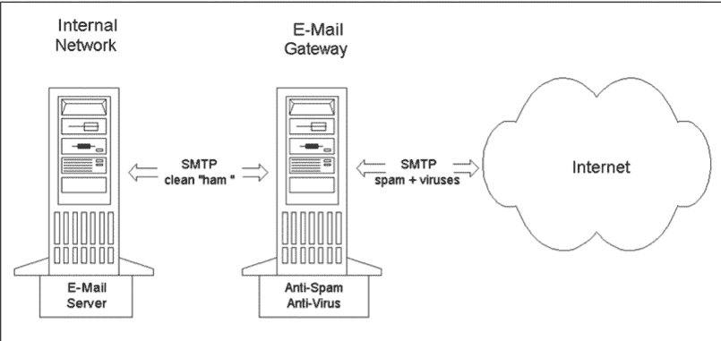

从多个角度来看，这是一个极具吸引力的选项。维护、集成和扩展的考量被隔离到另一台机器上，且电子邮件网关的性能问题不会降低用户邮箱邮件服务器的性能。网关的性能问题可能会延迟邮件传递，但不会影响用户的邮件使用体验。如果预算允许，这通常是将反恶意软件功能部署在独立机器上的绝佳方式，并确保这些功能拥有充足的算力——即使邮件量持续增长。

Ballystyx 非常认可这个想法，因此 Vijay 决定更进一步。由于 Ballystyx 的 ISP 有大量廉价的托管（co-lo）服务器库存，Vijay 能够以极低的月费租赁一台二手服务器，而不是购买新服务器。通过将此方案与 `MailScanner` 结合，Vijay 在为 Ballystyx 提供反病毒和反垃圾邮件服务的同时，还释放了此前被病毒、垃圾邮件和其他恶意软件占用的互联网连接带宽。

尽管这台机器（Mercury）物理上位于 ISP 而非 Ballystyx 内部，但这对 Vijay 来说不是问题，因为他可以使用 `ssh`（仅允许来自 Ballystyx IP 范围的访问）来安全地管理 Mercury。ISP 的设施比 Ballystyx 更先进，这意味着 Mercury 能在更长时间的停电中维持运行，且具有更好的防震保护。邮件网关在 ISP 处更安全，即使 Ballystyx 自己的机房发生故障，它也能继续收集和处理邮件。这种方案在很多方面对 Ballystyx 都有利，包括通过减少邮件占用的带宽来提高所有互联网服务的速度。

如果法律要求对某些类型的电子邮件进行存档或过滤，可以将电子邮件网关配置为处理外发邮件，或者增加第二台服务器来实现此目标。此功能也可以由本书中提到的任何 `MTA` 来处理。

## 商业设备选项

在某些情况下，购买一个低成本的反垃圾邮件/反病毒电子邮件网关设备可能是最简单的。该设备可以部署在 ISP 或公司总部的机房中。许多供应商提供种类繁多的设备，能够满足任何规模或类型的公司需求。其中一些电子邮件网关设备甚至运行开源软件。几乎所有这些设备都提供基于 Web 的配置界面，以便于设备管理。

这些设备通常随订阅和支持协议一起销售。该协议通常包含接收软件、规则和签名更新的机制。请记住，如果未支付或未续约协议，更新通常会停止，因此除非该设备使用的是你可以自行管理的开源软件，否则你将被绑定在与供应商的协议中。

即便存在被绑定的可能性，这种方案的优势在于让你的组织从提供反垃圾邮件和反病毒服务相关的管理和行政要求中解脱出来。在一些组织中，特别是那些对反垃圾邮件/反病毒技术了解有限（或缺乏学习意愿）的组织，这可能是一个很有吸引力的解决方案。

## 外包选项

虽然多服务器和商业设备解决方案适用于拥有相应预算、时间和人员的企业，但选择由 ISP 提供的反垃圾邮件和反病毒服务（如 Acme Widgets 的情况）可以省去公司管理这些服务的麻烦（以及潜在的头疼问题）。如果价格合理，这也可以是最经济的选择，并且经常作为域名托管软件包的一部分提供。

对于希望完全避免邮件管理麻烦的公司，可以将电子邮件完全外包给 ISP。在这种情况下，ISP 将管理互联网域名（包括 `MX` 记录）、电子邮件地址、入站（及出站）邮件服务（`SMTP`）以及邮箱存储和访问（`POP` 或 `IMAP`）。虽然这几乎完全移除了管理工作……

托管互联网域名电子邮件服务的管理开销，它还限制了灵活性，并且可能需要将电子邮件下载到本地用户的工作站，这限制了诸如 Webmail 和可以通过公司内任何工作站访问的电子邮件等服务的可用性。这种客户端下载的电子邮件还带来了额外的备份复杂性和担忧。


### 将信息从 Exchange 迁移到 Linux

本迁移章节将重点讨论将存储在 Exchange 服务器上邮箱中的电子邮件迁移到运行中的 `Courier IMAP` 实例。与此迁移示例相关的脚本是为 `Courier` 编写的，尽管其他源和目标 `IMAP` 服务器可能也适用。如果您处于所有电子邮件都从 Exchange 服务器下载到本地电子邮件客户端（如 Outlook 或 Mozilla）的情况，请阅读第 11 章“Linux 桌面内部”以获取有关电子邮件迁移的信息。此次迁移也将仅集中在邮件对象上，不处理联系人、任务、日志和公共文件夹。Exchange 的这些 Groupware 功能将在下一章“Groupware 和日历服务”中讨论。此外，脚本还需要安装 `Net::LDAP` 和 `Mail::IMAPClient` Perl 模块。

### 为迁移准备 Exchange

为了使 Exchange 5.5 或 Exchange 2000 准备好接受脚本提供的迁移方式，您必须采取一系列步骤。由于电子邮件迁移脚本需要 `IMAP` 服务，您必须确保 Exchange 服务器上已启用 `IMAP` 服务：

- 启用 `IMAP` 协议邮箱服务器。
- 创建一个 `.csv` 文件，包含您希望迁移的用户邮箱和密码。这是必要的，因为 Exchange 不允许通过 `IMAP` 进行邮箱的管理访问。该文件每行应包含一个 `<username>, <password>` 组合。

### 图 7.14 启用 IMAP 服务（Exchange 5.5）

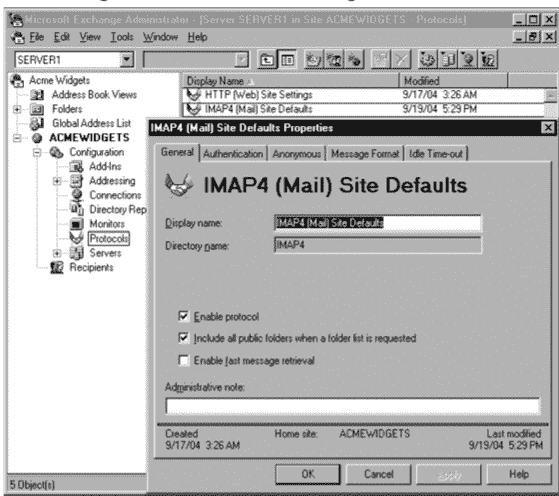

Exchange 2000 的正常安装默认会安装 `IMAP4` 服务。您只需进入控制面板并确保 `IMAP4` 服务已启动即可。图 7.15 说明了此过程。

### 图 7.15 启用 IMAP 服务（Exchange 2000）

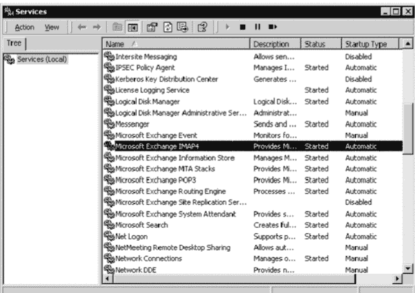

### 安装 Courier IMAP 服务器套件

`Courier IMAP` 是一个庞大的消息服务套件，建议您为您的 Linux 发行版安装相应的预编译包。在 Fedora 或 RedHat AS 3.0 的情况下，没有默认的 `RPM`，但在 Courier IMAP 源码 tar 包中提供了一个 `.spec` 文件，以便您可以为 Redhat 系统构建软件包。具体操作如下：

- 下载最新的 courier tar 包（截至本文撰写时为 0.47）。
- 将源码 gunzip/untar 解压到临时目录，并将 `courier.spec` 复制到 `/usr/src/redhat/SPECS`。
- 将原始 tar 包复制到 `/usr/src/redhat/SOURCES`。
- 作为 root 用户，您可能需要执行 `chmod -R 777 /usr/src/redhat` 以确保非 root 账户可以在此处创建 RPM 文件，因为 courier 不能在 root 账户下编译。
- 作为非 root 用户，切换到 `/usr/src/redhat/SPECS` 并输入 `rpmbuild --bb courier.spec`。
- 编译需要一段时间，但最终应在 `/usr/src/redhat/RPMS/i386` 中为您的 Redhat 版本构建出几个 RPM 包：
  - `courier-0.47-1.i386.rpm`
  - `courier-mysql-0.47-1.i386.rpm`
  - `courier-fax-0.47-1.i386.rpm`
  - `courier-pgsql-0.47-1.i386.rpm`
  - `courier-imapd-0.47-1.i386.rpm`
  - `courier-pop3d-0.47-1.i386.rpm`
  - `courier-ldap-0.47-1.i386.rpm`
  - `courier-smtpauth-0.47-1.i386.rpm`
  - `courier-maildrop-0.47-1.i386.rpm`
  - `courier-webadmin-0.47-1.i386.rpm`
  - `courier-maildrop-wrapper-0.47-1.i386.rpm`
  - `courier-webmail-0.47-1.i386.rpm`
  - `courier-mlm-0.47-1.i386.rpm`
- 根据您需要的功能安装相应的软件包，例如 webclient 和 fax。
- 在大多数情况下，您不需要安装 `ldap`、`pgsql`、`mysql` 等身份验证模块，因为 courier 与 `PAM` 协作良好，这使其成为最佳选择。


现在您已经安装了 `Courier`，需要对该软件包进行配置。所有可用选项都超出了本书的范围，但请参考文档以针对您的特定组织进行设置。配套 CD 中包含了 Acme Widgets 和 Ballystyx 的示例供您参考。

### 将电子邮件迁移到 Linux


提供的 `w2lmt-migrate-imap` 脚本将自动执行将电子邮件对象的私有文件夹从 MS Exchange 迁移到运行中的 `Courier IMAP` 服务器的过程。由于 `Courier` 要求使用 Maildirs（在本章前面已讨论），且 `Courier` 默认不会为单个用户创建这些文件夹，迁移脚本将自动完成此操作。但是，这要求您在具有用户主目录写权限的 Linux 服务器上运行该脚本。该脚本设计为在空 maildirs 情况下运行效果最佳，但如果已存在实例，它将尝试使用现有实例。以下是以 Acme Widgets 为例的脚本基本工作原理：

```bash
w2lmt-migrate-imap -f migrate-imap-acmewidgets.conf
```


- 检查是否具备继续执行所需的所有条件。
- 提示输入 `LDAP` 管理员密码。
- 从配置脚本提供的 csv 文件中读取邮箱用户/密码列表。
- 对于每个用户：
  - 从 `LDAP` 读取用户的主目录。
  - 将用户的 Linux/Samba 密码重置为与 Exchange 密码一致。
  - 在用户主目录中创建正确的 Maildirs。
  - 通过 `IMAP` 连接到 Exchange 服务器。
- 连接到 `Courier IMAP` 服务器（应使用新创建的 Maildirs）。
- 遍历 Exchange 邮箱，并将文件夹和邮件消息对象复制到 `Courier IMAP` 服务器上的正确位置。（注：由于 `Courier` 仅允许在 INBOX 文件夹下创建文件夹，所有迁移的文件夹和消息将显示为 INBOX 下的子文件夹。）

需要注意的是，由于此过程，Linux/Samba PDC 上的用户密码现在将被设置为与 csv 文件中指定的密码一致。因此，请确保您的用户在开始使用新 Samba PDC 后立即出于安全目的更改密码！此外，此脚本不处理公共文件夹。您需要手动处理这些项，因为在 Exchange 上，这些文件夹可能包含各种非邮件对象和特殊权限。

## 总结

在阅读完本章后，您应该对通用消息传递，特别是基于 Linux 的消息传递有了深入的理解。您应该了解 `MUA`、`MAA`、`MTA` 和 `MDA`，并理解如何设计邮件服务器和消息系统，包括反垃圾邮件和反病毒功能。

如果您能将这些知识学以致用，在实验室中构建消息环境的原型，进行全面测试，部署给用户并迁移其电子邮件：恭喜您——您不再依赖 Microsoft Exchange 来提供消息服务。您现在管理着一个资源消耗更低的消息环境，并可以享受免费的许可证消息传递及反垃圾邮件/反病毒服务。

随着本章的结束，您的消息服务应该已经正常运行。这意味着您的用户可以通过 `IMAP`（和/或 `POP`）客户端连接以检索邮件，且您的组织可以正常收发互联网电子邮件。如果您之前使用的是 Exchange 或其他支持 `IMAP` 的 `MAA`，您应该已经将所有重要的用户邮箱电子邮件转移到了基于 Linux 的邮件存储中。

如果您在消息系统中添加了开源的反垃圾邮件和反病毒服务，您就节省了成百上千美元的 Exchange 集成反垃圾邮件/反病毒软件的许可费用。随着这项工作的完成，除非您正在迁移 groupware/日历信息（见第 8 章“Groupware 和日历调度服务”），否则您可以停用 Microsoft Exchange。

当您停用 Microsoft Exchange 时，您通常会删除最后一个依赖于 Active Directory 的应用程序。在这种情况下，您也可以停用 Active Directory 以及依赖于 Active Directory 的 MS-DNS/DHCP 服务，从而移除组织中大部分的 MS 基础设施。对于大多数组织而言，这代表了基础设施的核心支撑，也是从 Windows 到 Linux 网络服务迁移过程中的一个重要里程碑。

尽管设计、部署和迁移到基于 Linux 的消息服务可能需要一些努力，但这些服务通常运行可靠，且长期维护成本极低。

## 解决方案快速通道

### 理解微软消息服务

- `Exchange 5.5 / 2000` 是微软为 Windows NT 和 Windows 2000 Server 提供的消息（及群组软件）服务解决方案。`Exchange` 提供了可共享的用户邮箱、电子邮件组、共享公共文件夹、`IMAP` 和 `POP` 接口、共享联系人、用户和组日历、灵活的数据库存储，以及企业消息系统所需的几乎所有功能。
- 一个典型的 `Exchange 5.5` 服务器由五个子组件组成，包括监控助手、目录服务器、邮件存储、`MTA` 和 `SMTP` 网关。`Exchange 5.5` 支持 `MAPI`、`IMAP`、`POP` 以及可通过 HTTP 访问的消息和群组软件服务。
- `Exchange 2000` 提供了与 `Exchange 5.5` 相同（和/或升级）的功能。然而，`Exchange 2000` 不提供目录服务，而是需要 `Active Directory`。安装 `Exchange 2000` 时，它会更新 `Active Directory` 架构，以便为相关对象启用电子邮件功能。

### 理解基于 Linux 的消息服务

- 大多数基于 Linux 的消息系统由一个集成但模块化的系统组成，该系统包含多个负责传输、接收、递送和提供电子邮件访问的组件。这些组件包括邮件传输代理（`MTA`）、邮件递送代理（`MDA`）、邮件存储、邮件访问代理（`MAA`）和邮件用户代理（`MUA`）。
- 流行开源消息服务器软件的历史始于 1980 年的 `Sendmail`，随后是 `Qmail`、`Postfix`、`Exim` 和 `Courier`。


- `Sendmail`、`Qmail`、`Postfix`、`Exim` 和 `Courier` 都是功能非常强大的 MTA，并得到了广泛使用。`each` 各有优劣。`Courier` 的独特之处在于它是一个全方位解决方案，包含了 MTA、Webmail MUA、MAA、MDA、日历/群组软件功能、邮件列表管理器和使用情况报告工具。

### 设计基于 Linux 的消息服务

- 设计基于 Linux 的消息服务主要包括确定发送和接收 Internet 电子邮件的路径，以及确定每个消息系统组件应用程序的类型、规模、位置和配置。消息系统设计的主要目标应该是设计一个能为用户提供可靠功能，并且能够扩展以满足未来 2-3 年预期电子邮件量的系统。
- 许多因素会影响组织对消息软件的选择，包括员工对特定应用程序知识的（缺乏）了解、扩展性考量、与现有（遗留）应用程序的兼容性、集成要求以及电子邮件客户端的限制。
- 对于像 Acme Widgets 这样的小公司，`Courier` 提供了一个易于部署的解决方案，能够满足并在某些情况下超过 Acme Widgets 的消息需求。对于像 Ballystyx Engineering 这样的大公司，一个流行的选择是 `Postfix`、`Courier-IMAP` 和 `SquirrelMail` 的组合。
- 两个重要的设计考虑因素是电子邮件存储位置以及如何提供访问。对于大多数组织，将电子邮件存储在服务器上并提供 `IMAP` 邮箱访问是推荐的选择。

### 集成反垃圾邮件和反病毒服务

- 尽管 Internet 电子邮件带来了快速全球通信的便利，但它也带来了垃圾邮件和病毒的问题。对于任何拥有注册 Internet 域名的规模较大的现代公司来说，反垃圾邮件和反病毒服务不是一个选项，而是一项要求。
- 垃圾邮件是指批量发送给 Internet 接收者的未经请求的商业电子邮件。垃圾邮件检测包括垃圾邮件“指纹”匹配、邮件头和正文分析、启发式分析以及贝叶斯分析。每封电子邮件都被分配一个数值分数，用以指示该邮件是垃圾邮件的可能性。
- 病毒是指能够感染并复制的病毒、蠕虫、特洛伊木马和其他恶意软件。病毒的载荷从令人不快到极具破坏性不等。反病毒策略包括拦截可能包含病毒的附件类型，以及扫描电子邮件的病毒特征码。
- `SpamAssassin`、`ClamAV` 和 `MailScanner` 是向消息系统添加反垃圾邮件和反病毒服务的三个推荐应用程序。`MailScanner` 将垃圾邮件检测和病毒扫描集成在一个软件包中。
- 本书探讨了四种反垃圾邮件/反病毒架构：电子邮件网关、共享服务器、商业设备和外包服务。

### 将信息从 Exchange 迁移到 Linux

- 迁移方法采用 `IMAP` 到 `IMAP` 的邮箱复制。
- 确保 Exchange 上启用了 `IMAP` 服务。
- 创建一个包含每个待迁移邮箱的用户名和密码的 `csv` 文件。
- 安装并配置 `Courier IMAP` 服务器套件。
- 在一台对每个用户主目录具有 WRITE-ACCESS（写入权限）的 Linux 主机上运行迁移脚本。

## 常见问题解答

以下是由本书作者回答的常见问题，旨在衡量您对本章所呈现概念的理解，并协助您在现实生活中实现这些概念。如需作者回答您关于本章的问题，请浏览 `www.syngress.com/solutions` 并点击 `"Ask the Author"` 表单。您还可以在 `ITFAQnet.com` 访问数千个其他常见问题解答。

- **问：** 我该如何设置 `maildir` 存储？

  **答：** 可以使用 `maildirmake` 来配置 `maildir` 存储目录。输入 `man maildirmake` 以获取更多信息。

- **问：** 有没有简单的方法将 `mbox` 格式迁移到 `maildir` 格式？

  **答：** 有的。实用工具 `mbox2maildir` 和 `maildir2mbox` 可以完成这些任务。下载 `Qmail` 发行版和/或访问 `www.qmail.org` 以获取更多信息。

- **问：** 运行迁移脚本后，我连接到新的 `Courier IMAP` 邮箱，但 `INBOX` 下面没有文件夹！！我的邮件都在哪里？

  **答：** 根据您使用的邮件客户端，您可能需要订阅子文件夹才能使其正确显示。

## 群组软件和日历服务

### 本章解决方案

- 理解 Exchange 和 Outlook 群组软件及日历功能
- 理解基于 Linux 的群组软件和日历服务
- 迁移到 Linux 群组软件 / 日历服务
- 总结
- 解决方案快速通道
- 常见问题解答

## 简介

群组软件对不同的组织（和供应商）意味着不同的东西。群组软件主要指日历，而在群组软件的语境下，这意味着共享日程表。对某些人来说，它仅仅是指有一种可通过 Web 访问的方式来查看和编辑个人日程。对其他人来说，它意味着能够通过访问所有会议参与者的空闲/忙碌时间来安排会议，发送格式美观的邀请函，并允许多个平台上的用户接受/拒绝会议，同时将更新提供给日历服务器。

另一种形式的群组软件是协作内容管理/开发系统，例如 `TWiki` 和其他 WikiWikiWeb 衍生品。`Sourceforge` 是协作内容开发群组软件环境的另一个例子。`Sourceforge` 基于 `CVS` 和 Web 的软件开发与分发能力使其能够托管世界上大部分的开源软件。

群组软件还意味着其他东西。因为群组软件可以指任何与协作相关的软件，所以几乎所有与电子通信有关的内容都符合群组软件的定义。在这种语境下，电子邮件、文件共享、语音信箱、传真和在线会议都是群组软件的形式。

部署基于 Linux 的群组软件通常需要 `LAMP`（Linux-Apache-MySQL-PHP/Perl/Python）环境。`LAMP` 框架的详细描述超出了本书的范围，但它是本章描述的一些基于 Web 的群组软件应用程序的前提条件。

复杂的群组软件通常需要部署专门的服务器（如日历服务器），有时涉及与目录服务器的集成（架构更新），例如 `eGroupware` 的情况。

本章的重点将放在能够满足 Acme Widgets 和 Ballystyx Engineering 等公司需求的群组软件、日历和协作解决方案上。

## 理解 Exchange 和 Outlook 群组软件及日历功能

Exchange / Outlook 组合的群组软件和调度能力非常有吸引力。使用 Outlook 作为客户端，Exchange 作为通信/管理框架，企业级群组软件功能将面向整个组织开放。

即使没有 Exchange，Outlook 客户端也包含许多群组软件（groupware）或类似群组软件的功能。表 8.1 列出了这些功能及其简短描述。

### 表 8.1 Outlook 功能

| 功能 | 描述 |
|---|---|
| 联系人 | 姓名、电子邮件/邮寄地址、电话号码、所属单位、生日等 |
| 日历 | 日/周/月计划视图、预约、提醒 |
| 任务 | 状态、负责人、开始/结束日期、完成百分比、可计费小时数 |
| 日志 | 工作类型、开始/结束时间、所属单位、描述 |

Outlook 的日历功能非常全面，支持具有多个参会者的循环预约，并支持 `iCal` 和 `vCal` 标准（`RFC 2445`）。当 Outlook 与 Exchange 服务器配对时，日历将变为多用户模式，并增加表 8.2 中列出的功能。

### 表 8.2 配合 Exchange 服务器的 Outlook 功能

| 功能 | 描述 |
|---|---|
| 共享日历 | Exchange 支持共享用户和组日历。Exchange 执行访问控制列表（`ACL`）安全限制。 |
| 会议调度 | Outlook 允许用户调度会议并邀请多个接收者。与 Exchange 配对时，Outlook 还可以显示每位参会者的空闲/繁忙时间，甚至能自动选择所有参会者都有空的时段。 |
| 资源账户 | 允许对资源进行调度，例如会议室、餐饮服务、投影仪或其他设备。 |
| 自动请求处理 | 实现特定调度功能的自动化。例如，可以将资源账户（如不常用的会议室）配置为自动接受任何人的会议邀请。 |

## 第 8 章 • 群组软件与日历服务

正如您在下一节将看到的，大多数这些能力都有开源的替代方案。

### 了解基于 Linux 的群组软件与日历服务

虽然目前还没有能够完全替代 Exchange 日历的开源直接替换方案，但有许多解决方案能够满足几乎所有企业的群组软件和日历需求。如果这些解决方案无法满足您的需求，您可以考虑为这些功能使用商业软件，尽管商业软件的标准缺点依然适用。

在接下来的章节中，我们将探讨 `eGroupware` 和 `Horde`，这是两个更受欢迎、成熟且功能全面的开源群组软件/调度应用程序。我们还会简要提及 `OPEN-XCHANGE`，它在本书出版日期前几周成为了一个开源应用程序。

### 了解 eGroupware

开源群组软件有许多示例，但最受欢迎的之一是 `eGroupware`。`eGroupware` 是一个基于 Web 的套件，运行在 `LAMP` 架构上。`eGroupware` 需要 `Apache`、`MySQL` 或 `PostgreSQL` 以及 `PHP`。

`eGroupware` 的功能集非常全面，包括日历等群组软件功能，以及一些并非群组软件的功能，比如漫画！以下是 `eGroupware` 许多优秀功能的部分列表：

- 日历，具有个人和组计划、闹钟和通知功能
- Webmail（需要 `IMAP` —— 互联网消息访问协议 —— 服务器）
- 地址簿
- 问题工单系统
- `WikiWikiWeb`
- 内网门户（称为 Site Mgr）
- 项目管理
- 互联网书签管理
- 漫画

`eGroupware` 是一个成熟的解决方案，在 2004 年 8 月达到了 1.0 版本的里程碑。它被广泛部署，其模块化框架提供了轻松自定义解决方案的能力。`eGroupware` 具有吸引人的界面，支持多种语言，并拥有一个活跃的开发团队。

更多关于 `eGroupware` 的信息可见 `www.egroupware.org`。演示版本可在 `www.egroupware.org/demo` 查看。

### 了解 Horde

`Horde` 应用框架是一个基于 Web 的群组软件框架，运行在 `LAMP` 架构上。`Horde` 需要 `Apache`、`MySQL` 或 `PostgreSQL` 以及 `PHP` / `PEAR`（PHP Extension and Application Repository）。`Horde` 框架提供了处理进程间通信、用户首选项、浏览器检测、访问控制、用户帮助等通用方法。

有许多使用 `Horde` 框架的群组软件及类群组软件应用程序。表 8.3 列出了选定的 `Horde` 项目应用程序及其简短描述。

### 表 8.3 Horde 项目应用程序

| Horde 应用程序 | 描述 |
|---|---|
| `IMP` | 对 `IMAP` 或 `POP3`（Post Office Protocol v3）邮箱的 Webmail 访问 |
| `MIMP` | `IMP` 的手机/PDA（个人数字助理）精简版本 |
| `Ingo` | 用于 `procmail` / `Sieve` 的电子邮件过滤器管理器 |
| `Forwards` | 配置电子邮件转发 |
| `Vacation` | 用于度假通知的电子邮件自动回复 |
| `Turba` | 地址簿 / 联系人管理 |
| `Kronolith` | 日历查看器 |
| `Hermes` | 时间跟踪系统 |
| `Whups` | Web Horde 用户问题解决工具（工单跟踪） |
| `Rakim` | Web 聊天 |
| `Nag` | 任务列表管理器 |
| `Trean` | 书签管理器 |
| `Chora` | 基于 Web 的 `CVS`（并发版本系统）查看器 |
| `Gollem` | 基于 Web 的文件管理器 |

这些应用程序在单一框架下提供了强大的功能。虽然并非所有应用程序都是组织必需的，但其中许多是“有了更好”的应用程序，可以轻松地安装/集成到框架的其余部分中。

更多关于 `Horde` 框架和 `Horde` 项目应用程序的信息可见 `www.horde.org`。热门 `Horde` 项目应用程序的演示可见 `www.horde.org/demo/`。

## 配置与实现

### 自定义群组软件解决方案

大多数开源群组软件和日历解决方案（包括 `Horde` 和 `eGroupware`）都由一个应用程序框架和提供各项群组软件功能的独立模块组成。这种方法的一个优点是模块可以轻松地创建、修改、安装和删除。这极大地简化了自定义组织群组软件解决方案的过程。

### 评述 OPEN-XCHANGE（OX）

不幸的是，由于 `OPEN-XCHANGE` 在本书出版日期前才改为开源许可条款，因此没有足够的时间对这个群组软件协作服务器的新开源版本进行研究和测试。因此，本书不包含对该产品的全面分析。以下是对 `OX` 的简要评述。

`OX` 是 Suse 商业 Openexchange 服务器的开源版本。`OX` 支持多种语言，并提供以下功能：

- Web 门户
- 日历服务
- 联系人管理
- 任务管理
- 项目管理
- 书签管理
- Web 论坛
- Webmail

根据文档，`OX` 可与任何浏览器、`iCal`、电子邮件或 `WebDAV` 客户端协作。由于 `OX` 使用 Java 和 Java servlets，编译 `OX` 需要 Java SDK、Java 编译器、`Apache ANT` 以及一些常用的 Perl 和 Java 库。

由于这个开源解决方案还很新，现在判断该产品将如何发展还为时过早。如果 `OX` 能实现其功能集，它可能会成为 Exchange 最佳的开源替代方案。Openexchange 是一个成熟的产品，因此 `OPEN-XCHANGE` 也很可能具有可靠性。

更多关于 `OX` 的信息可见 `www.open-xchange.org`。

### 了解 TWiki 协作

到目前为止，我们主要讨论的是日历和调度解决方案。还有另一类群组软件解决方案称为内容管理和知识管理系统。这类群组软件允许以协作方式创建和管理内容，通常是以结构化方式并遵循某种工作流。它们还可能促进知识的创建、传播和利用。

`WikiWikiWeb`，简称为 `Wiki`，是一种由一群人集体创建和维护内容与知识的流行方式。`Wiki` 是一个可写的 Web，是一组相互连接且“有机”变化和增长的网页。在大多数情况下，即使您不是页面的所有者，也被允许（且被鼓励）编辑任何页面。`Wiki` 使用一种易于学习的语法，比 `HTML`（Hypertext Markup Language）简单得多，尽管一些 `Wiki` 实现也允许使用 `HTML` 标签。编辑通常基于文本，尽管有些也提供所见即所得（`WYSIWYG`）编辑。

最著名的 `Wiki` 之一是位于 `www.wikipedia.org` 的维基百科（`Wikipedia`）。维基百科是一个自由的百科全书，数千名活跃的贡献者用多种不同语言编写了超过 100 万篇文章。互联网上的任何人都可以被邀请（如果愿意可以匿名）编辑维基百科上的任何文章，或贡献自己的文章。这看起来完全缺乏安全性，听起来像是给麻烦留了后门。涂鸦偶尔会发生，但通常在几分钟内就会被删除，因为有许多眼睛在盯着内容。这种基于版本控制内容和同行评审的“软”安全机制运行得非常有效，即使在互联网规模上也是如此。有关 Wiki 为什么如此有效的更多信息，请访问 `http://c2.com/cgi/wiki?WhyWikiWorks`。

在企业中，一个特别有用的 Wiki“变体”是由 Peter Thoeney 开发的 `TWiki`。与许多其他 Wiki 变体相比，`TWiki` 具有更强的商务协作倾向，使其特别适合本书中所代表的那类公司。一方面，它可以像任何其他 Wiki 一样，以自由且无结构的形式维护内容。`TWiki` 具备该环境下所需的功能，例如身份验证、访问控制、完整的审计追踪、文档管理、电子邮件（及其他企业系统）集成以及应用程序插件。这使得团队能够以结构化的方式维护内容。`TWiki` 在满足以下常见的业务需求方面表现出色：

- 项目共享笔记本：仓库、调度、会议
- 部门协作工具：流程文档、项目评审、QA 跟踪
- 内网内发布工具：IT、人力资源（HR）、公司标准、政策和流程
- 专注于自由形式协作的内容管理系统：需求采集
- 知识库：问题/解决方案对及附带的补丁
- 书籍编写工具：编写、评审和编辑书籍章节。本书就是使用 `TWiki` 协作完成的
- 创建基于 Web 的应用程序的平台，如员工新闻门户、库存系统和问题跟踪系统

组织机构将 `TWiki` 用于许多不同的目的，正如由迪士尼（Disney）、摩托罗拉（Motorola）、`SAP`、雅虎（Yahoo）等提交到 `www.twiki.org` 的成功案例所证明的那样。有关 Wiki 和 `TWiki` 的更多信息，请分别参考 `www.wikipedia.org/wiki/Wiki` 和 `TWiki.org`。

## 迁移至 Linux 组件软件 / 日历服务

既然您已经成功测试并部署了组件软件服务，您可能会发现将信息从 Exchange 迁移到新的组件软件/日历系统具有价值。根据您所选组件软件解决方案的导入/导出能力，这可能是可行也可能是不可行的。

如果用户数量较少，通常最简单的方法是手动执行迁移，尤其是当日历/组件软件服务的使用量较轻时。虽然这种“低技术”方法不符合系统管理员的行为特征，但有时最简单的方案就是最佳方案。许多组件软件和日历迁移（即使是在 100 人或更多人的公司中）也可以通过手动数据输入快速完成，特别是如果使用这些功能的用户组规模较小时。

有许多标准、文件类型和 `RFC` 涵盖了组件软件的某些方面，特别是联系人和日历项。这些标准包括 `iCal`/`vCal`（`RFC 2445`）和 `vCard`（`RFC 2426`）。`iCal` 和 `vCal` 是日历项的文件表示形式，而 `vCard` 文件则是名片的表示形式。`iCal` 文件通常使用 `.ics` 文件扩展名，而 `vCal` 文件通常使用 `.vcs` 文件扩展名。`vCard` 文件则具有 `.vcf` 扩展名。

### 了解 Outport

`Outport` 是将联系人、日历和任务信息从 Outlook 迁移的最有用应用程序之一。数据可以导出为 Evolution 或其他日历/组件软件客户端的文件格式。`Outport` 这个词是 Outlook Export 的缩写，精准地描述了这个程序的功能。


Outport 非常简单且易于使用。窗口的左侧包含 Outlook 的文件夹树，带有用于选择每个文件夹的复选框。窗口的右侧控制导出配置。图 8.1 显示了 Outport 准备迁移邮箱的截图。

> 图 8.1 使用 Outport 导出数据


此配置将把 David Allen 邮箱中的联系人、日历和任务导出为 Evolution 可识别的格式。文件被复制到 Evolution 存储数据的目录中，迁移随即完成。

### 了解其他迁移方法

如果您是从 Outlook 以外的电子邮件/PIM（个人信息管理器）客户端迁移，Outport 将无法为您提供帮助。但并非没有办法——如果您不想通过手动输入数据来执行迁移，您仍然有几个选择。

迁移日历、联系人和其他组件软件数据最有效的方法之一是使用 Windows 和 Linux 应用程序都能识别的中间文件格式。对于日历，使用 iCal/vCal（`.ics`/`.vcs`）文件格式几乎适用于所有日历客户端。大多数管理联系人信息的客户端可以使用 vCard（`.vcf`）格式的文件。

对于没有标准信息交换文件类型的对象，通常可以使用文本文件表示形式将数据从一个应用程序迁移到另一个应用程序。如果应用程序支持，数据可以输出到`.csv`（逗号分隔值）或制表符分隔的`.txt`文件。这类文件已预格式化为行和列，可以轻松导入到类似数据库的结构中。如果迁移数量庞大，编写一个 Perl（或 Python）脚本来解析原始导出数据，并创建一份格式正确且适用于目标应用程序的导入文件，将是非常合理的。

虽然设置基于文件的导入/导出需要前期的投入，但这是一种有效的方法，特别是当问题集规模大且同质化时。在其他情况下可以使用手动输入，特别是对于少量工作量。然而，手动输入带来了人为错误（“手指打错”）的可能性，并且对于系统管理员的时间来说，可能不是一种具有成本效益的利用方式。

## 总结

Linux 上有大量可用的组件软件应用程序，主要运行在 LAMP 平台上。这些解决方案复制了 Exchange-Outlook 组合的大部分日历和组件软件功能，尽管其集成方式并不总是像 Exchange 那样。

eGroupware 和 Horde 是两款非常流行的组件软件套件。这两款套件都提供了广泛的功能和能力，且各有其优势和劣势。OPEN-XCHANGE（Openexchange 的开源版本）在本书出版日期前后采用了非常接近的开源许可证。OPEN-XCHANGE 看起来很有前景，但尚未经过全面评审。

从 Outlook / Exchange 迁移到像 Evolution 这样的开源消息服务器和客户端时，可以使用 Outport（`http://outport.sourceforge.net`）轻松执行迁移。Outport 支持多种文件格式，可用于将数据导出到几乎任何电子邮件客户端 / PIM。

另一种迁移方法是将数据手动输入到新的日历/组件软件系统中。这种方法的优点是在所有情况下都是一个潜在选项，但仅在工作量较小时才可行。它还带来了打字错误的可能性，并且对于系统管理员的时间来说，可能不是一种具有成本效益的利用方式。

随着日历和组件软件的迁移完成，组织中最后的 Exchange 依赖被移除，Exchange 环境（及其依赖）可以退役了。

## 解决方案快速通道

### 了解 Exchange 和 Outlook 组件软件及日历功能

- [x] Outlook 提供了许多组件软件功能，包括日历、联系人、任务列表和日志。
- [x] 当 Outlook 与 Exchange 服务器配对时，该组合可提供共享日历、会议调度、资源账户和自动化请求处理。


### 第 8 章 • 组件软件和日历服务

- [x] Outlook / Exchange 的大多数功能可以通过开源软件提供。

### 了解基于 Linux 的组件软件和日历服务

- [x] eGroupware 是一款 PHP 组件软件和日历解决方案。eGroupware 运行在 LAMP 架构上，并与 OpenLDAP 集成。更多信息请访问`www.egroupware.org`。
- [x] Horde 是一个 PHP/PEAR 组件软件应用框架。Horde 项目包含许多提供组件软件及类组件软件功能的应用程序。关于 Horde 的更多信息请访问`www.horde.org`。
- [x] OPEN-XCHANGE (OX) 是 Suse Openexchange 服务器的开源衍生版本。访问`www.open-xchange.org`获取关于 OX 的更多信息。
- [x] TWiki 是一个 Wiki 协作系统，可用于知识管理和内容管理。关于 TWiki 的更多信息请访问`www.twiki.org`。

### 从 Exchange 和其他组件软件 / 日历服务迁移

- [x] 如果您使用 Outlook，迁移日历、联系人、日志、任务和笔记信息的最佳方式是使用 Outport，可获取自`http://outport.sf.net`。
- [x] 如果您使用 Outlook 以外的 PIM 客户端，如果源应用程序和目标应用程序支持这些格式，您可以使用`.ics`、`.vcs`和`.vcf`文件来完成日历和联系人数据的迁移。在其他情况下，可以使用文本文件或手动输入。

## 常见问题解答

以下由本书作者解答的常见问题，旨在衡量您对本章所呈现概念的理解程度，并协助您在现实生活中实现这些概念。若想就本章的问题由作者解答，请浏览`www.syngress.com/solutions`并点击“询问作者（Ask the Author）”表单。您还可以在`ITFAQnet.com`获取数以千计的其他常见问题解答。

**Q：** 我找不到一个具有我想要的特定群组软件（groupware）功能的开源应用程序。我该怎么办？

**A：** 在某些情况下，专有解决方案（如 Bynari 或 Skalix）可能会提供所需的功能。

**Q：** 我想运行一个能与 Outlook 无缝集成的群组软件服务器。我该怎么办？

**A：** 考虑使用具有 Outlook 和/或 Evolution 插件的群组软件解决方案。

**Q：** 在哪里可以找到关于如何搭建 LAMP 架构的更多信息？

**A：**`www.brtnet.org/linux/lamp.htm`上的“构建 LAMP 服务器（Building a LAMP Server）”包含分步指导。

# 第 9 章：Web 服务：IIS 与 Apache

### 本章解决方案

- 背景：超文本传输协议
- 了解微软的 Internet 信息服务 (IIS)
- 了解 Apache Web 服务器
- 将静态站点从 IIS 迁移到 Apache
- 总结
- 解决方案快速通道
- 常见问题解答

## 简介

自互联网早期以来，没有任何一种协议像超文本传输协议（HTTP）那样迅速普及。1991 年 8 月，蒂姆·伯纳斯-李（Tim Berners-Lee）发布了第一个 Web 服务器，用于托管来自欧洲核子研究组织（CERN）的文件。一年后，在线 Web 服务器增加到了 50 个。到 1999 年，公开的 Web 服务器已超过 72 万个。根据 Netcraft 最近的调查，2004 年 8 月，有超过 5400 万个 Web 服务器正在接收请求，且这一数字每月以 100 万个的速度增长。其中，几乎 70% 运行的是 Apache。超文本标记语言（HTML）的简单性结合 HTTP 服务器易于管理的特点，使得任何人都能在万维网（WWW）上托管内容以供公众查看，也许有一天每个人都会运行一个。

人们在许多不同的场景下出于多种原因部署 Web 服务器。许多企业、独立顾问以及 DIY 终端用户通过提供技术诀窍建立了利润丰厚的业务。你可以发现他们的劳动成果运行在大型安装服务器、小型网络设备固件，甚至是极不可能的地方，比如潜水泵中。一些公司通过其 Web 应用程序赚取数百万美元，而另一些公司则简单地将其当前系统升级为 Web “感知”系统，难怪在任何具有技术头脑的商业计划中都能发现运行 Web 服务器的愿望。与杂志、报纸、手册或当地黄页广告等其他宣传手段相比，运行 Web 服务器的成本相对较低；人们无需具备太多关于 Web 的先验知识，就能以印刷媒介广告的一小部分成本轻松发布公司业务和产品的信息。几乎任何寻求实现业务 Web 化的公司都能从中获益。从商业角度来看，这似乎是一项明智的投资。

对于具有技术头脑、极客精神且自我驱动的个人来说，一个 Web 服务器和稳健的操作系统（OS）就像是一套充满潜力的化学实验套装。服务器端脚本语言、Shell 程序和标准的基于 UNIX 的实用工具可以将 Web 服务器变成一个天气报告站、一个社区公告板系统或一个约会服务。

本章将讨论将 Web 服务从 Windows Internet 信息服务（IIS）迁移到 Apache Web 服务器，并将提供 Linux 上 Web 服务的概述。面向服务器的 Linux 发行版将大量实用工具与 Apache 打包在一起——我们假设您已经很清楚迁移能获得什么：一个免费的操作系统、配套服务、无限的文档、操作指南（how-tos）和常见问题解答，以及广泛的用户采用率，这些只是其中的一部分优势。在本章结束时，您将发现几乎任何人都可以学会管理自己的 Web 服务器。

我们不会深入探讨 Web 托管的编程方面，但我们会介绍您可以继续研究的场所。本章将主要关注静态内容的管理和托管，作为引导管理员快速上手运行 Apache 的入门介绍。毫无疑问，你们中的许多人会直接跳到这一章，那么让我们开始吧，但首先再了解一点历史。

### 背景：超文本传输协议

早在 1989 年，伯纳斯-李就向 CERN 提交了一份关于管理其信息资源的提案。该提案结合了早期的 Gopher 想法（关于可导航的链接项目树）、泰德·尼尔森（Ted Nelson）在其 Xanadu 工作中提出的“超文本”概念，并增加了三个新的重要组成部分：一个通过 TCP/IP（传输控制协议/网际协议）连接传输文档的协议、一种名为 HTML（超文本标记语言）的标记语言，以及用于查看 HTML 内容的客户端软件。其核心思想是通过“超链接”到其他相关文档来消除 CERN 内部的冗余信息，从而避免重复存储相同信息。

循环交叉引用的资料形成了一条非线性的研究路径。研究人员可以通过超链接跳转到另一篇文本，然后是另一篇，最后回到起点。这一特性使 CERN 的成员能够确定他们正在呈现的信息是否已经在其他地方存档。

不久之后，在 1993 年，马克·安德森（Marc Andreesson）带领一个在国家超级计算机应用中心（NCSA）工作的团队，开发了第一个图形化万维网浏览器。这个 Web 浏览器被称为 Mosaic。随后，他们创建了自己的 Web 服务器，即 NCSA HTTP 守护进程（`httpd`）。后来，安德森离开该公司，并于 1994 年与吉姆·克拉克（Jim Clark）共同创立了网景通信公司（Netscape Communications Corporation）。

通过点击鼠标在数百个文档中导航的想法极具吸引力，并迅速根深蒂固。网景推出了自己的服务器软件 Netscape Communications Server，一个新市场由此开启。

自然地，微软不能忽视这项现在被称为“Web”的新兴技术，于是开发了自己的 Web 浏览器，名为 Internet Explorer。由于 HTTP 是一个开放标准，没有人持有该协议的版权，因此微软开始打包自己的 Web 服务器版本，称为 IIS。

## 了解微软的 Internet 信息服务 (IIS)

微软的 Internet 信息服务将几种 Internet 服务整合在一个软件包中。除了 Web 服务器，IIS 还包含一个发送电子邮件服务器（即 SMTP，简单邮件传输协议服务器）和一个文件服务器（即 FTP，文件传输协议服务器）。本节将提供使用 IIS 5.0 运行 Web 服务的概述和一些术语。我们将使用 Windows 2000 Server。我们将涵盖虚拟目录、安全和身份验证，并在将站点迁移到 Apache 和 Linux 之前，使用 IIS 设置静态网页。在开始之前您应该知道，Internet 信息服务在所有微软的 NT、2000、2003 和 XP 产品中均可用，但在这些操作系统的非服务器版本中，某些功能被禁用了。具体而言，在非服务器版本的 Windows 中，创建多个网站的能力和摘要身份验证（Digest Authentication）方法被禁用了。所有版本都支持 SSL（安全套接层），但如果不预先从第三方证书颁发机构购买证书请求签名，则无法配置（请参阅 Apache 章节中关于创建自签名证书以在 Apache 中使用的内容）。

### 入门指南

IIS Web 服务器的管理是通过“Internet 信息服务”对话框完成的。点击`控制面板 | 管理工具 | Internet 服务管理器`即可访问此对话框。这允许您配置默认的 FTP、Web 和 SMTP 服务器，如图 9.1 所示。一旦通过“添加/删除程序”安装，IIS 就会自动运行并在 80 端口监听请求。只要您没有防火墙拦截 80 端口，您就应该能够启动 Web 浏览器并在`http://localhost`查看“欢迎使用 Windows 2000 Internet 服务”页面。当从本地计算机查看此页面时，系统会提示您进行基于 Windows 的身份验证登录。输入您的用户账户和密码，浏览器将重定向到“入门（Getting Started）”页面。如果从另一台计算机查看，此页面将仅向用户显示一个“建设中（Under Construction）”页面。

图 9.1 Internet Information Services 对话框


## 默认索引页

为了移除“建设中”页面并给用户提供更有趣的内容，只需创建一个名为`Default.htm`的 HTML 文件，并将其移动到 Web 服务器的主目录中（在 IIS 中为`c:\Inetpub\www-root`）。您可以使用任何喜欢的文本编辑器或所见即所得 (WYSIWYG) 编辑器来创建`Default.htm`。保存`Default.htm`文件后，将其复制到 Web 服务器的主目录并重新加载浏览器。

```html
<!-- sample Default.htm page -->
<html>
<body>
<p>Hello world.</p>
</body>
</html>
```

> **[warning]** 请确保文件名为`Default.htm`而不是`Default.htm.txt`（这可能是由您使用的文本编辑器引起的）。在操作系统首选项中开启文件扩展名显示将有助于防止这种双重文件名扩展名的问题。请前往**控制面板 | 文件夹选项 | 查看选项卡**并禁用**隐藏已知文件类型的扩展名**选项来更改此设置。

其他 Web 服务器对目录的默认索引文件采用不同的约定，正如我们稍后在 Apache 中看到的那样。通常该文件被称为`index.html`。IIS 同样使用`Default.asp`作为目录索引。文件名扩展名`.asp`是 IIS 的一种约定，代表活动服务器页面 (Active Server Pages, ASP)。Active server pages 是微软版本的服务器端脚本语言。或者，您也可以使用`Default.asp`作为 Web 服务器的默认索引页。

ASP 是一种嵌入式脚本语言；常规 HTML 将像处理常规 HTML 一样被处理。为了让 Web 服务器区分 ASP 命令，您需要将 ASP 语法包裹在`<%= %>`字符中。我们不打算详细讲解 ASP，但这里有一个简单的示例。有关使用 ASP 编写脚本的更多信息，请访问网络上众多的 ASP 门户网站，例如`www.asp.net`。

```html
<!-- sample Default.asp page -->
<html>
  <body>
    <p>Hello world.</p>
    <p>The time is: <%=response.write(time()) %></p>
  </body>
</html>
```

现在，将`Default.asp`复制到`c:\Inetpub\wwwroot`，并将`Default.htm`移走。图 9.2 展示了这在 Web 浏览器中的显示效果。

图 9.2 在 Web 浏览器中查看的 Default.asp 页面


## 默认网站

回到 Internet Information Services 对话框，点击左侧窗格树状结构中的**Default Web Site**部分，您会发现您的**Default.asp**页面现在出现在右侧的列表中。通过右击右侧窗格，或右击左侧的**Default Web Site**分支，您可以访问默认 Web 服务器的**属性 (Properties)**（见图 9.3）。这是一个上下文敏感的对话框，每个虚拟目录和虚拟服务器的对话框都不同。该对话框允许您定义主目录、默认索引页以及目录安全设置和权限等内容。现在请查看这些属性，了解有哪些可用选项。

在**主目录 (Home Directory)**选项卡下，您会看到主目录列为`c:\Inetpub\wwwroot`——这正是我们复制默认页面的位置。在**文档 (Documents)**选项卡下，您可以列出此目录中要显示的默认文档。将`index.html`添加到此列表中。**网站 (Web Site)**选项卡显示，无论访问者使用什么样的规范名称，只要访问此服务器，都会显示此默认网站。可接受的规范名称包括`http://local-host`、HOSTS 文件中的计算机名、IP 地址或完全限定域名 (FQDN)。此网站 IP 地址的**(All Unassigned)**字段意味着，只要不被另一个全匹配或虚拟服务器覆盖，所有进入此计算机的 HTTP 请求都将由它处理。

图 9.3 默认网站属性


## 虚拟目录

IIS 中的虚拟目录是文件系统上的真实目录，但具有特殊性。在 Apache 中，这些被称为别名（aliases）。它们用于将 URL（统一资源定位符）的目录部分映射到服务器文件系统上的一个特殊目录，该目录位于 Web 服务器主目录之外。Web 服务器通过查看请求 URL 的结尾（减去文件名）来确定该虚拟目录关联的文件所在位置。如果提供的目录不是`c:\Inetpub\wwwroot`的子目录，则 Web 服务器将检查它是否匹配某个虚拟目录映射。如果匹配，则在该处搜索请求的文件。

虚拟目录有助于将信息与 Web 服务器的主目录分开。如果要在另一个文件系统或另一台机器上共享目录，也可以使用虚拟目录。请按照以下步骤创建虚拟目录，以存放 Web 服务器主目录之外的脚本：

1. 创建`c:\Inetpub\cgi-bin`目录。
2. 在 Internet Information Services 对话框中，右击 **Default Web Site**，然后选择 **新建 | 虚拟目录 (New | Virtual Directory)**。
3. 弹出一个向导，要求您输入该目录的别名（URL 的目录部分）以及文件系统上的真实目录（即您刚刚手动创建的目录）。向导还会要求您设置访问权限。唯一可能没有明显含义的权限是 **浏览 (Browse)** 权限。如果您启用此选项，在找不到默认索引页时，Web 服务器将生成目录列表。如果禁用，用户将看到“目录列表被拒绝”页面。由于我们知道自己正在创建脚本目录且不希望人们随意浏览，因此我们选择了 **读取 (Read)**、**脚本 (Script)** 和 **执行 (Execute)** 权限。现在，我们已经准备好在网站主目录之外使用 PERL CGIs 或服务器端包含 (SSI) 了——只需将您的 CGI 文件放入`c:\Inetpub\cgi-bin`目录，您就可以通过类似`http://example.com/cgi-bin/Default.cgi`或`http://example.com/cgi-bin/Default.pl`的 URL 访问它们。当然，如果您不使用绝对 URL，则需要将这些文件名添加到默认索引文件列表中。

## 安全性

IIS 中的安全性可以针对整个 Web 服务器、每个虚拟服务器、每个目录或每个文件进行配置。对于其中的每一项，您可以设置匿名访问、基本身份验证、摘要身份验证（或带哈希的基本身份验证）或基于 Windows 的身份验证。这些方法本身都不安全，但当您将它们与 SSL 分层结合使用时，安全性会增强。以下说明了它们之间的区别：

- 匿名访问意味着该资源可以公开访问。
- 基本身份验证是一种 HTTP 互联网标准身份验证方法，许多 Web 浏览器都支持。它基于域（realms）（按服务器、按目录、按文件等）来保护资源。基本身份验证使用挑战-响应过程来确认用户的凭据是否正确，从而允许其访问资源。然而，它仅提供有限的安全性，因为密码在网络中以明文传输。
- 摘要身份验证旨在取代基本身份验证，但安全性并没有提高多少。在这种方式中，服务器向浏览客户端发送一个校验和。浏览器随后使用该校验和及`md5sum`来生成用户名、密码和 URI（统一资源标识符）的哈希值，并将其发送回服务器。服务器随后可以使用此信息反推过程并检查凭据。这是该过程的一个非常简化的视图（更多信息请参阅 RFC2616 和 RFC2617）。由于该过程广为人知且可逆，因此它仅被认为比基本身份验证稍微安全一点。摘要身份验证是 HTTP 互联网标准，大多数 Web 浏览器均支持。
- 基于 Windows 的身份验证与摘要身份验证非常相似，但它是 Windows 标准，主要在 Internet Explorer 中支持。某些较新版本的 Netscape 和 Mozilla 也支持基于 Windows 的身份验证。

通常，这些身份验证方法应仅用于内部网络，因为它们不提供强大的安全性。在没有 SSL 加密的情况下，绝不能在不可信的网络上使用这些身份验证方法。

要为默认 Web 服务器设置基本身份验证：

1. 进入 Internet 信息服务（Internet Information Services）对话框。
2. 右键单击 **Default Web Server**。
3. 选择 **Properties**（属性），然后选择 **Directory Security**（目录安全性）选项卡。
4. 在 **Anonymous access and authentication control**（匿名访问和身份验证控制）下方，点击 **Edit**（编辑）。
5. 取消选择 **Anonymous access**（匿名访问），并启用 **Basic authentication**（基本身份验证）。
6. 选择 **Edit**（编辑）并输入服务器的域名或机器名。
7. 重启 Web 服务器并重新加载 Web 浏览器。系统将提示您输入用户名和密码。用户名和密码直接对应于系统中的实际用户，可以通过 **Control Panel | Users and Passwords**（控制面板 | 用户和密码）进行配置。

要启用摘要身份验证（digest authentication），只需勾选摘要身份验证复选框即可。无需其他配置。

启用 Windows 身份验证与前两种方法几乎完全相同。它使用与 Internet Explorer 浏览器的加密交换，因此仅在您使用已知的、同质的 Windows 计算机网络或支持此身份验证方法的较新浏览器时才应考虑使用。要启用 Windows 身份验证，只需勾选 Windows 身份验证复选框。用户在 **Control Panel**（控制面板）的 **Users and Passwords**（用户和密码）下进行配置。

这些身份验证方法的一个重大局限性是，它没有区分系统用户和 HTTP 用户；将其中任何一种作为 Web 门户数千用户的身份验证方法将无法扩展。这些身份验证方法旨在快速且简单，就像浴室门上的插销一样。请将这些身份验证方法预留给受信任的内网或家庭网络。要创建更鲁棒的身份验证方法，请研究实现一种基于脚本（PERL、PHP、ASP）的方法，通过访问数据库来获取用户信息。这些方法具有很强的可扩展性，并且很容易与 SSL 结合。

## SSL/TLS

安全套接字层（Secure Sockets Layer, SSL）和传输层安全性协议（Transport Layer Security, TLS）是加密 HTTP（或 HTTPS）通信的互联网标准。虽然它们是 HTTP 加密的两个不同方面，但它们通常配套使用，大多数人简单地将加密 HTTP 称为“SSL”。Netscape Communications Corporation 在 1996 年设计了第一个 SSL 协议，随后互联网工程任务组（IETF）通过 TLS 对其进行了补充。有关 TLS 的更多信息，请参阅 IETF 网站`www.ietf.org`（特别是 RFC2817 和 RFC2818）；有关 SSL 的更多信息，请参阅关于“SSL 协议”的互联网草案`http://www.netscape.com/eng/ssl3/draft302.txt`。

在非服务器版本的 IIS 中，除非您从证书签名颁发机构（CSA）购买签名，否则无法配置 SSL 支持。不过，您可以使用 IIS 创建证书签名请求（CSR）。如果您希望在 SSL 环境下运行 IIS，可以通过向导创建此 CSR（右键单击 Default Web Browser，选择 Properties | Directory Security 选项卡，然后选择 Server Certificates）。然后将生成的文本文件复制到您选择的证书颁发机构网站的 Web 表单中。在您购买签名证书后，他们将为您提供关于在 IIS 中启用 SSL 支持的更多信息。

如果您使用的是 Windows 服务器版本，可以使用证书服务器来检索 CA 证书、生成新的证书签名请求或检查待处理的证书。这是处理 IIS 服务器证书的推荐方式，但 IIS 无法处理用于测试服务器 SSL 连接的自签名证书。要访问证书服务器，请在控制面板中选择 Add/Remove Programs（添加/删除程序），点击 Add/Remove Windows Components（添加/删除 Windows 组件），并确保您的计算机上安装了 Certificate Services（证书服务）。然后，打开 Web 浏览器并访问`http://localhost/certsrv`。您将看到一个由 ASP 驱动的 Web 向导，引导您完成处理证书请求的过程，如图 9.4 所示。

### 图 9.4 Microsoft Certificate Services 欢迎窗口


## 虚拟服务器

如果您使用 NT Workstation、2000 Professional、XP 或 XP Pro 运行 Web 服务已经达到了这个阶段，并且现在想创建另一个网站（或虚拟服务器），很遗憾，您不能——或者说，您不应该这样做。创建第二个网站的能力在这些产品中是被禁用的功能，仅在 Windows NT/2000/2003 的服务器版本中可用。

如果您使用的是 Windows OS 的服务器变体，可以通过 **Internet Information Services** 对话框中的另一个向导创建新站点。但在添加新站点之前，请先决定您是要设置基于名称（name-based）还是基于 IP（IP-based）的虚拟服务器。基于名称是指有多个域名指向一个 IP 地址；基于 IP 是指有多个 IP 地址指向一台计算机。基于名称的虚拟服务器不需要任何特殊考虑，但如果您使用基于 IP 的方式，则需要为该计算机控制的每个 IP 配置网络接口。要为多个 IP 地址配置接口，请访问计算机中接口的 **TCP/IP Properties**（TCP/IP 属性）并点击 Advanced（高级）以添加更多 IP。接下来的内容假设您通过 ISP（互联网服务提供商）拥有至少一个公网 IP 地址，并且您已经配置了 DNS（域名服务）或编辑了 HOSTS 文件，使您希望提供服务的每个域名都指向该 IP。

配置 IIS 以识别域名并将请求重定向到正确的目录是在 **Internet Information Services** 对话框中完成的。右键单击主服务器分支，然后选择 **New | Web Site**（新建 | 网站）。您将看到一个向导，要求您输入站点的 **Name**（名称，可以是任何标识名称，仅用于 IIS 内部组织）、计算机的 IP 地址、您希望该虚拟服务器运行的端口号以及 Host Header（主机标头）名称（即您提供服务的域名）。在我们的系统中，我们创建了两个域名`internal.ballystyx.com`和`www.ballystyx.com`，并将两者的 **Name** 和 **Host Header** 设置为相同。然后我们将域名与文件系统上的一个目录相关联。与虚拟目录一样，如图 9.5 所示，这个目录可以位于任何地方；我们在系统中创建了目录`c:\Inetpub\vhosts`来存放我们的域名目录。

### 图 9.5 Internet Information Systems 目录


现在，创建网页并将默认索引文件复制到您的新虚拟服务器目录中。完成后，进行测试以确保没有遗漏任何步骤。我们制作了两个不同的页面，一个用于`internal.ballystyx.com`（内部使用），一个用于`www.ballystyx.com`（公众使用），然后分别将它们复制到`c:\Inetpub\vhosts\internal.ballystyx.com`和`c:\Inetpub\vhosts\www.ballystyx.com`。您可以在图 9.6 和 9.7 中看到这些页面的样子。

### 图 9.6 internal.Ballystyx.com 的内部默认索引文件

```html
<!-- Example Default.htm for internal.ballystyx.com -->
<html><head><title>----- Ballystyx Internal -----</title></head>
<body bgcolor=#FFFFFF>
<center>
  
  <h1>Greetings Programs</h1>
  <p>Here you will find resources to make your job easier.</p>
  <br>
  <br>
</center>
</body>
</html>
```

### 图 9.7 www.ballystyx.com 的公共默认索引文件

```html
<!-- Example Default.htm for www.ballystyx.com -->
<html><head><title>Ballystyx Global Semiconductor Engineering</title></head>
<body bgcolor=#FFFFFF>
<center>
    
    <h1>Welcome To Ballystyx Semiconductor Engineering</h1>
    <p>We welcome you to our new site on the web.</p>
    <br>
    <br>
</center>
</body>
</html>
```

**注意**

- **索引页 (Index Page)**：如果在 URL 中未提供绝对页面，Web 服务器将调用此默认页面。
- **虚拟服务器 (Virtual Server)**：一台 Web 服务器上可能托管的多个域名之一。
- **基于名称的虚拟服务器 (Name-based Virtual Server)**：多个域名解析到同一个 IP 地址。
- **基于 IP 的虚拟服务器 (IP-based Virtual Server)**：多个 IP 地址解析到同一台计算机。
- **虚拟目录 (Virtual Directory)**：指向目录的 URL 别名。它将您希望在 URL 中使用的特殊路径映射到文件系统上的一个目录。
- **SSL/TLS**：加密 HTTP 的互联网标准。

## 理解 Apache Web 服务器

相比之下，Apache 的配置要透明得多。您可以在 Windows 和 UNIX/Linux 以及包括嵌入式系统在内的许多其他操作系统上安装和运行它。它支持多个虚拟服务器（在 Apache 术语中称为 virtual hosts），并且可以轻松设置身份验证和 SSL 等重要配置选项。配置传统上是通过文本文件完成。不过，我们也会提到一些有用的图形化管理工具；无论是随发行版一起打包的本地软件，还是像 WebMin 这样的基于 Web 的管理工具，系统管理员都可以使用。

Linux 社区有着分发版战争（distribution wars）的历史。由于成千上万的软件应用程序在 GPL 协议下提供了源代码，多年来演化出了许多竞争的分发版。撇开分发版战争不谈，我们在本节中选择使用 Fedora Core (`http://fedora.redhat.com`)。

The Fedora Project 是一个由 RedHat 赞助并由社区支持的开源项目。它也是新技术的试验场，这些技术最终可能会进入 Red Hat 的产品中。它不是 Red Hat, Inc. 的支持产品。尽管 Fedora 没有获得官方支持，但它们向最终用户提供了许多功能，使他们能够参与到该分发版中。这非常像 Debian 项目 (`http://debian.org`)；努力的成果属于公共领域，但分发版本身基于 RedHat 包管理器 (`rpm`) 而非 Debian 包 (`dpkg`)。

## Apache 背景

Apache Web 服务器是 Web 上最无处不在的服务器，且没有消失的迹象。根据最近的 NetCraft 统计，互联网上近 70% 的 Web 服务器使用了 Apache。IIS 以略高于 21% 位居第二，而包括 Sun、iPlanet 和`httpd`在内的所有其他 Web 服务器则占据了最后的 10%。对于 Apache 管理员来说，这是一个令人兴奋的时代。结合 Apache 目前由 Apache 软件基金会作为一个开源的、基于社区的、为了公共利益的项目而开发和维护这一事实，你拥有了一个绝佳的真实案例，证明了开源解决方案如何能够超越私有开发模型。

Apache 由 NCSA 的`httpd`软件以代码补丁的形式演变而来。1995 年 2 月，NCSA 的`httpd`是互联网上最受欢迎的 Web 服务器，但当主开发人员 Rob McCool 离开公司后，开发陷入了停滞。一小组开发人员（包括 Brian Behlendorf 和 Cliff Skolnick）收集了这些针对原始`httpd`代码的补丁，并在 1995 年 4 月发布了 Apache 的第一个版本 0.6.2。这个名字是一个文字游戏：由此产生的软件被认为是“a-patchy”（补丁累累的）Web 服务器。从那时起，代码已被完全重写，现在有八名核心开发人员和大量贡献作者组成了 Apache 组，该组后来成为了 Apache 软件基金会。

## 安装

在 Linux 系统上安装 Apache 非常简单。根据你使用的分发版，它可能已经安装好了。如果没有，请检查是否有适用于你特定分发版的预制软件包。在本节中，我们将安装并配置 Apache 最新的一个大版本，即 2.0 版本。


要查看 Debian 上是否安装了 Apache，请访问命令提示符并输入命令 `dpkg -l | grep apache`。在 Fedora 和类 RedHat 系统上，使用 `rpm -qa | grep apache` 或 `rpm -qa | grep httpd`（某些系统将包命名为 "httpd" 而非 "apache"）。在其他系统上，尝试定位 apache，如果屏幕上滚动出现大量文件列表，你可以相当确定它已经安装。有关列出软件包和确定已安装软件包的更多信息，请参阅你所使用的特定包管理器的文档。

如果你没有安装 Apache，请找到适用于你分发版的相应软件包并进行安装。你可以在 `http://rpmfind.net` 和 `http://freshrpms.net` 找到 RedHat rpms，而 Debian 软件包可以通过 Debian 仓库获取，这些仓库通常已预先配置在操作系统中，可通过 `apt` 工具访问。如果你的系统上有 `apt-get` 工具，你可以执行命令 `apt-get install apache` 或 `apt-get install httpd`，`apt-get` 将为你下载并安装软件包。否则，请访问 Apache 服务器的下载页面并下载源代码 (`http://httpd.apache.org/download.cgi`)。本节将不涵盖从源代码编译 Apache —— 互联网上有许多文档涵盖这一主题。我们建议尽可能使用预构建的软件包，因为在大多数情况下，已经为你的 Linux 分发版提供了相应的软件包，以及大量随之而来的配套软件包。一旦你获得了适用于系统的软件包，请运行包管理器工具进行安装。在 Debian 系统上，这类似于 `dpkg -i apache-2.0.x.deb`，在 RedHat 系统上，这类似于 `rpm -i httpd-2.0.x.rpm`。实际的软件包名称会有所不同，虽然许多软件包可以在不同分发版上运行，但我们建议寻找专门为你的系统构建的软件包。

### 启动、停止和检查状态

启动 Apache 是通过 `/etc/init.d` 中系统 rc 风格的初始化脚本完成的。要启动 Apache，请在命令行以 root 身份输入以下命令：`/etc/init.d/httpd start` 或 `/etc/init.d/apache start`。要停止 Apache，请输入 `/etc/init.d/httpd stop` 或 `/etc/init.d/apache stop`。该脚本被称为 `httpd` 还是 `apache` 取决于你的分发版。该脚本还接受其他命令，如 `status`、`reload`、`help` 和 `configtest`。单独运行该脚本（不带参数）即可查看支持哪些命令。

Apache 还提供了自己的管理脚本 `apachectl`。它接受 `start`、`stop`、`restart` 等命令。单独运行 `/usr/sbin/apachectl` 或查看 manpage（帮助页）以获取更多信息。

## 配置

逐一查看 Apache 提供的每一个配置选项（数量极多）会太慢且太痛苦，因此我们仅涵盖基础内容。我们将解释主配置文件 `httpd.conf` 的组成部分，以及如何配置我们现在熟悉的选项。我们还将讨论包含其他配置文件以及 Apache 模块：哪些模块随 Apache 一起提供，以及如何包含更多模块。在此过程中，我们将指出一些用于简化管理工作的图形化工具，并在适用之处提及其他配置选项。

Apache 服务器的配置是通过名为 `httpd.conf` 的文件完成的，但在讨论其工作原理之前，让我们先看看该文件所假设的目录结构。根据编译时选项，该文件可能位于不同的位置。通常它位于 `/etc/httpd/conf` 目录中。为了本节的目的，我们将假设一个基于 RedHat 的安装，其 `ServerRoot` 位于 `/etc/httpd`，`DocumentRoot` 位于 `/var/www` —— 稍后详细解释这些术语。在 Fedora Core 2 系统上，安装 `httpd` 软件包后，`/etc/httpd` 目录包含五个项目。这些项目是两个配置目录：`conf` 和 `conf.d`；以及三个指向服务器文件系统其他位置的符号链接：`logs`、`modules` 和 `run`。

我们将依次解释这些目录：`/conf` 包含 `httpd.conf`（Apache 的主配置文件）；`magic`（一个帮助 Apache 确定文件类型的文件）；几个用于证书、密钥和请求的 `/ssl.*` 目录；以及一个可用于生成证书签名请求和自签名证书以供服务器使用的 `Makefile`。`/conf.d` 目录包含单独的配置文件，这些文件可以为了逻辑组织而分开，但同样也可以直接作为主配置文件的一部分。这些文件是通过 `httpd.conf` 文件中的通配符 `Include` 被包含进来的。需要特殊 Apache 配置选项的模块和其他软件包会将它们的配置文件写入 `conf.d`。`/logs` 目录包含服务器日志，`/modules` 是模块目录，而 `/run` 是一个指向你分发版中等同于 `/var/run` 目录的符号链接，许多程序在此处写入它们的进程 ID (PID)。

正如我们已经提到的，不同的 Linux 分发版会将这些目录放在不同的位置，如果你从源代码安装，可以通过在 `./configure` 行中提供 `-f` 选项来选择这些目录的位置。请参阅源代码文档了解具体操作方法。注意，如果你使用的 Apache 是从源代码安装的，且没有明确告诉 Apache 安装位置，它将被放置在 `/usr/local/apache` 中。

好了，现在你已经了解了布局，让我们深入研究配置文件的语法。

`httpd.conf` 文件有两个主要部分：Main（主）部分和 Virtual Host（虚拟主机）部分。Main 部分是指任何不在 `<VirtualHost>` 容器内的内容。我们从现在起将使用这些术语。Main 部分以嵌套方式包裹任何虚拟主机部分（如果有的话）。通过这种方式，如果允许，虚拟主机可以覆盖 Main 配置选项，但如果在 VirtualHost 容器内没有提供配置，则该选项的设置将默认为 Main 部分。任何一部分都可以包含任意数量的 directives（指令）和 containers（容器），并且后者可以进一步嵌套。

- **Directives** 每行一条。你可以使用 `\`（反斜杠）将一条指令换行。指令的形式为 `Directive Argument1 Argument2 [...]`。指令的参数区分大小写，但指令本身不区分大小写。
- **Containers** 类似于标记语言，具有定义容器开始和结束的打开标签和关闭标签，容器的参数出现在打开标签中。它们被分为两种不同类型：Filesystem（文件系统）和 Webspace（网络空间）（Apache 文档使用这些术语来描述你在配置文件中能找到的最常见容器类型之间的区别）。Filesystem 容器（例如 `<Directory>` 和 `<Files>`）作用于本地文件系统，并控制整个目录及其子目录或特定文件的权限和选项。如果你在配置文件的 Main 部分中有一个 `<Files>` 容器，那么这些权限将适用于任何具有该文件名的文件，无论它在哪个目录中。但是，如果你将 `<Files>` 容器嵌套在 `<Directory>` 容器内部，那么这些权限将仅适用于该目录及其下方任何具有该文件名的文件。另一方面，Webspace 容器（例如 `<Location>`），作用于请求的 URL，根据 URL 中的路径分配权限或执行操作。此外，位置不一定必须是文件系统上的一个目录。

另一种容器是 `<VirtualHost>` 容器。它用于将主服务器（或默认网页）与虚拟主机（或前一节中提到的虚拟服务器）区分开来。一个 `<VirtualHost>` 容器可以包含任意数量的指令，以及文件和 Web 空间容器，但某些组合在逻辑上是没有意义的。Apache 在指令发生冲突时会非常高效地提醒管理员。您还可以使用 `apachectl` 的 `-t` 选项来检查配置语法。

> **注意**
>
> 许多容器都有对应的正则表达式形式，例如 `<DirectoryMatch>` 和 `<FilesMatch>`，它们允许您使用正则表达式而不是字符串字面量进行匹配。

让我们通过几个示例来巩固这些概念，但首先关于注释和空白字符还有一点说明。在 `httpd.conf` 文件中，行首的井号 (`#`) 是注释，且不能放在行中或行尾。空白字符会被忽略，即使在行首也是如此，因此为了清晰和组织，您可以对指令进行缩进。

## 主服务器的基本配置选项

既然我们已经掌握了 Apache 配置文件语法的基本知识，让我们来看一个最简单的 `httpd.conf` 文件并应用这些想法。实际的文件超过 1000 行，但我们删除了所有注释，并将文件精简到启动服务器所需的最小内容。在处理此文件时，大部分情况适用一条经验法则：如果您不知道某个选项的作用，请保持默认设置，通常就没问题。过去，Apache 强制管理员必须编辑此文件，否则无法启动。如今，默认安装的 Apache 将在 localhost 上启动，监听 80 端口，并从 `/var/www/html` 提供文档。我们将在示例之后解释这些选项。

```apache
### Main Server Section
#
ServerName www.acmewidgets.com
ServerRoot "/etc/httpd"
ServerAdmin root@acmewidgets.com
DocumentRoot "/var/www/html"
User apache
Group apache
Listen 80

DirectoryIndex index.htm index.html index.php Default.htm index.cgi

### Directory Container for whole file system
#
<Directory />
    Options None
    AllowOverride None
    Order deny,allow
    Deny from all
</Directory>

### Directory Container for DocumentRoot
#
<Directory "/var/www/html">
    Options Indexes
    AllowOverride None
    Order allow,deny
    Allow from all
</Directory>
```

> **警告**
>
> 如果您直接使用上述配置文件，您的服务器将无法正常工作。此配置文件旨在说明您在启动 Web 服务器时应立即关注哪些选项。请将文件中看到的其他所有配置选项保持原样。

- **ServerName** 是此服务器的默认名称。它是一个完全限定域名 (FQDN)，可以与机器名称不同。这是 Apache 向访问者标识自己的方式。
- **ServerRoot** 如前所述，是 Apache 认为其在文件系统上安装的位置。大多数 Linux 软件包将 Apache 安装在 `/etc/httpd` 目录中，因此配置文件和日志都位于此目录中。
- **ServerAdmin** 是在错误页面和脚本的环境变量中显示的管理员电子邮件地址。
- **DocumentRoot** 相当于 IIS 术语中的默认主目录。如果没有指定虚拟主机，服务器将从此处提供文档。

在上述配置中，Web 服务器运行的用户和组是 "apache"。`listen` 指令可以是 IP:端口对，或者仅是一个端口号。如果未定义 IP，Apache 将监听该端口的所有已配置接口。一个配置文件中可以有多个 `listen` 指令。在 Apache 2.0 中，必须至少存在一个 `listen` 指令，否则服务器将无法启动。我们将在“虚拟主机”章节中看到 `listen` 指令的更详细示例。

`DirectoryIndex` 指定了如果在 URL 中未指定绝对页面时，应调出的默认索引页面。

文件的其余部分是指定根文件系统和 `DocumentRoot` 的权限及行为的容器。这些是容器中最常见的行。`Options` 可以是：`ExecCGI`、`FollowSymLinks`、`Includes` 或 `Indexes` 等（虽然还有几个，但较为冷门）。如果容器中省略了 `Options`，则默认视为 All。`ExecCGI` 表示该目录是一个 CGI 脚本目录。`FollowSymLinks` 意味着服务器将跟踪此目录中的符号链接。`Includes` 允许服务器端包含 (SSI)。`Indexes` 在找不到默认索引页面时将生成该目录的列表。

`AllowOverride` 指令告诉 Apache，这些选项中的哪些可以在配置文件稍后位置或 `.htaccess` 文件中被覆盖。`Allow` 和 `Deny`（未显示）指令定义了允许访问此目录或资源的主机。这些主机可以通过主机名、IP、IP 范围，甚至是通过从浏览器客户端捕获的环境变量来列出。`Order` 指令定义了应用 `Allow` 和 `Deny` 指令的顺序。

现在，使用以下命令启动您的 Web 服务器，并使用您喜欢的 Web 浏览器进行测试：

```
/etc/init.d/apache start
```

### 默认网页

您的 Web 浏览器应该显示一个“测试页面”或“It worked!”页面。更改默认网页的过程与 IIS 相同。只需将默认索引页面复制到 `DocumentRoot` 目录中。在我们的配置文件中，我们将 `DocumentRoot` 定义为 `/var/www/html`，因此将其复制到那里，并将页面重命名为 `DirectoryIndex` 指令所定义的名称。在下一个示例中，我们将为 www.acmewidgets.com 创建一个 `index.html` 页面，并将其复制到 `DocumentRoot` 目录（见图 9.8）。

> 图 9.8 www.acmewidgets.com 的 DocumentRoot 目录

```html
<!-- Example index.html for www.acmewidgets.com -->
<html><head><title>Acme Widgets</title></head>
<body bgcolor=#FFFFFF>
<center>
    
    <h1>Welcome to Acme Widgets on the Web</h1>
        <p>We welcome you to our new home on the Web. We just secured a new hosting provider and they use 100% pure open source!</p>
        <br>
        <br>
</center>
</body>
</html>
```

### 别名与脚本别名 (Aliases and ScriptAliases)

与 IIS 的虚拟目录相同，Apache 提供了一种将请求的 URL 路径映射到文件系统另一部分的方法。在 Apache 中配置这些映射是通过 `Alias` 指令完成的。Apache 配置中最常见的别名是 `/icons/` 目录。这更多是一个历史遗留问题，当时系统管理员试图避免在整个文件系统中存放多份相同的图像副本。系统管理员会将 icons 目录用作图像的单一存储库，然后无论提供的是哪个 Web 空间，HTML `` 标签都可以像以下示例那样编写，Apache 就会知道在哪里找到该图像。

```

```

Apache 在 `httpd.conf` 文件中按如下方式设置此 `Alias`。

```
Alias /icons/ "/var/www/icons/"

<Directory "/var/www/icons">
    Options Indexes
    AllowOverride None
    Order allow,deny
    Allow from all
</Directory>
```

`Alias` 行告诉 Apache，任何路径中包含 `/icons/` 的请求 URL 都应映射到目录 `/var/www/icons`，并在此处查找请求的文件。列出 `Indexes` 的 `Options` 行表示创建目录索引。其他配置文件不能覆盖任何选项，且默认允许任何人访问。

相比之下，`ScriptAlias` 与 `Alias` 相同，但 `ScriptAlias` 指令暗示该别名将提供 CGI 服务。该目录的目录容器不需要包含 `ExecCGI` 选项。请看以下示例。

```
ScriptAlias /cgi-bin/ "/var/www/cgi-bin/"
```

```
<Directory "/var/www/cgi-bin">
    Options None
    AllowOverride None
    Order allow,deny
    Allow from all
</Directory>
```

## 安全与权限

Apache 在服务器上控制安全性的机制与 IIS 一样细致，甚至更为精细。Apache 能够通过允许和拒绝主机、文件权限以及基本认证 (Basic) 和摘要认证 (Digest) 来控制访问。

正如我们已经看到的，`allow` 和 `deny` 指令让您可以明确地控制单个主机，甚至整个网络访问该站点。格式为 `Allow host1 host2 [...]`。主机可以是一个精确的 IP 地址、一个部分 IP 地址、一个网络段或 CIDR 地址、一个 IPv6 地址，或者是 Web 浏览器环境中由脚本设置的变量值，例如：

### 仅允许 localhost 访问名为 admin.html 的文件

```
<Files "admin.html">
    Options None
    AllowOverride None
    Order allow,deny
    Allow from 127.0.0.1
</Files>
```

### 允许内部网络和 localhost 访问名为 admin.html 的文件

```
<Files "admin.html">
```


```apache
Options None
AllowOverride None
Order allow,deny
Allow from 192.168.0.0/24 127.0.0.1
</files>
```

`Deny` 指令接受相同的语法，但它会拒绝任何匹配的主机。

文件系统权限适用于 Web 服务器运行时的用户（User）和组（Group）。在我们的案例中，我们将其定义为`apache`。请注意，这必须是系统上一个实际存在的用户和组。在大多数情况下，你的发行版已经为你定义好了。如果你不确定，请将其保留为配置文件中的默认设置。关于文件权限，例如，如果`apache`用户对某个目录没有读取、写入或执行权限，那么它就无法列出该目录、向其写入或遍历该目录分支。

通常，`ServerRoot`的文件权限由`root`用户所有。`DocumentRoot`目录通常由`apache`或 Web 服务器用户所有。Apache 启动时，会启动一个以`root`身份运行的主进程，然后启动多达 10 个（在配置文件中设置）以 Web 服务器用户身份运行的子进程。日志和其他进程信息由主进程处理，而子进程处理请求。因此，必须根据你运行的应用程序来设置权限。如果你仅从`DocumentRoot`目录提供静态内容，则不需要太多特殊考虑——默认权限 755 `/var/www/html`且所有者为`root`应该就足够了。

```text
drwxr-xr-x 2 root root 4096 Sep 10 14:36 html
```

然而，如果你想运行向文件系统写入内容的脚本，或者你有一个包含可执行文件的 CGI 目录，那么你需要分别确保 Apache 对该目录具有写入权限，或者`cgi-bin`目录中的脚本设置了执行位。

Apache 像 IIS 一样，也具有基本（Basic）和摘要（Digest）认证方法。这些可以在容器内定义，并可用于配置文件的 Main 部分、目录、文件以及`VirtualHost`容器中。要设置基本认证，你需要将以下行添加到这些区域之一。

```apache
AuthType Basic
AuthName "Acme Widgets Internal Area"
AuthUserFile /etc/httpd/passwd/acme_internal
Require valid-user
```

`AuthType`可以是`Basic`或`Digest`。关于它们之间的区别，请参阅本章前面的章节。`AuthName`是受保护区域的名称。这个名称将出现在提示用户输入登录凭据的弹出窗口中，因此将其设置为有意义的名称很有用，以便用户知道他们正在登录到哪个区域。`AuthUserFile`定义了密码存储的位置。与 IIS 不同，HTTP 用户不是系统用户，你可以根据需要创建任意数量的 htpassword 文件。你可以使用`htpasswd`命令创建新用户和更改密码，我们将在接下来的内容中讨论。`Require`行指定哪些用户可以访问该区域。如果设置为`valid-user`，则允许该密码文件中的任何有效用户访问。这里也可以是一个由空格分隔的文件用户名列表。

管理大量 HTTP 用户并不是一项愉快的工作。这个功能在设计之初就不是为了可扩展性，但它对于向特定区域或文件添加几个管理员账户非常有用。要创建密码文件，请在系统中的某个你想存储 htpassword 文件的位置创建目录。我们为此创建了`/etc/httpd/passwd`。然后，以 root 身份创建文件，并使用以下命令为其添加新用户：

```bash
$ htpasswd -c /etc/httpd/passwd/passwords admin
```

`-c`选项会创建一个新文件，且用户名`admin`将是其中的唯一条目。该命令是交互式的，它会提示你输入`admin`的密码。默认情况下，密码将使用 md5 算法加密并存储在指定文件中。如果你想创建另一个用户，只需执行以下命令：

```bash
$ htpasswd /etc/httpd/passwd/passwords acme
```

这将添加用户`acme`。如果你想以非交互方式指定密码，可以将其添加到命令末尾：

```bash
$ htpasswd /etc/httpd/passwd/passwords acmeadmin new_password
```

你可以根据需要拥有任意数量的密码文件，并/或将它们保存在不同的位置。例如，如果你在进行域名托管，你可能会想为每个独立主机创建一个密码文件，将其放置在每个主机的主目录中，并使其仅对该用户和 Web 服务器用户可读。

## `.htaccess`文件

Apache 能够允许服务器上站点的用户和管理员覆盖特定目录的配置设置。这样做的好处是，允许 Web 程序员为自己的站点配置某些服务器选项，而无需授予其访问`httpd.conf`的权限。要设置此功能，主配置文件`httpd.conf`必须为`<Directory>`定义`AllowOverride`指令，并且在该位置必须存在一个`.htaccess`文件。`AllowOverride`接受一个由空格分隔的分组选项名称列表，这些名称是你允许被覆盖的。分组选项名称可以是：`AuthConfig`、`FileInfo`、`Indexes`、`Limit`、`Options`、`All`以及`None`。`.htaccess`文件是一个包含该目录配置选项的文本文件，它必须能被 Web 服务器读取。请注意文件名前面的点。`AllowOverride`仅在`<Directory>`容器中生效，但`.htaccess`内部不需要另一个目录容器，它只需要放置与所在目录相关的选项即可。

```apache
# httpd.conf

<Directory /var/www/html/internal/>
    AllowOverride Indexes AuthConfig
</Directory>
```

在上述示例中，我们允许负责内部网站的 Web 程序员覆盖`Indexes`和`AuthConfig`指令。允许`Indexes`意味着 Web 程序员可以覆盖`.htaccess`文件所在目录中与目录索引相关的选项。而允许`AuthConfig`意味着用户可以使用适用于为此目录设置基本和摘要认证的指令。

```apache
# /var/www/html/internal/.htaccess
Options Indexes

AuthType Basic
AuthName "Internal Use Only"
AuthUserFile /etc/httpd/passwd/internal.passwords

Require valid-user
```

接下来的示例演示了相关的`.htaccess`文件可能的样子。

如果 Web 程序员拥有服务器上的 shell 访问权限，并且可以写入`/etc/httpd/passwd`目录，那么创建新密码文件并填充用户的方法与上述相同。但如果 Web 程序员没有该目录的写入权限，他可能会决定将密码文件放在自己的目录中，或者系统管理员在 Web 服务器目录之外提供的另一个位置。由于指定了`Indexes`选项，因此对于`/var/www/html/internal`目录下任何没有`index.html`页面的目录，都将生成目录索引。

如果你想更改`.htaccess`文件的名称，可以在`httpd.conf`文件中使用`AccessFileName`指令。

### 虚拟主机（Virtual Hosting）

Apache 是第一个支持虚拟主机的 Web 服务器。这项功能（类似于 IIS 中的虚拟服务器）允许你在同一个 Web 服务器上托管多个域名。Apache 虚拟主机通过`httpd.conf`文件设置，可以配置为基于名称、基于 IP 或两者的任意组合。基于名称的虚拟主机使用`NameVirtualHost`指令和`VirtualHost`容器进行配置。基于 IP 的虚拟主机需要`Listen`指令（以告知 Apache 监听哪些 IP 地址）和`VirtualHosts`容器。让我们通过几个示例来看看它们的区别。

要开启基于名称的虚拟主机，除了在`httpd.conf`文件的 Main 部分添加`NameVirtualHost`指令外，你还至少需要在每个`VirtualHost`容器内部添加一个`ServerName`指令，以便 Apache 知道如何处理该域名的请求。

```apache
NameVirtualHost *:80
```

```apache
<VirtualHost *:80>
    ServerName internal.acmewidgets.com
    DocumentRoot /var/www/vhosts/internal
</VirtualHost>
```

```apache
<VirtualHost *:80>
    ServerName billing.acmewidgets.com
    DocumentRoot /var/www/vhosts/billing_dept
</VirtualHost>
```

在这个示例中，Apache 将分别从`/var/www/vhosts/internal`和`/var/www/vhosts/billing_dept`的`DocumentRoot`中响应`internal.acmewidgets.com`或`billing.acmewidgets.com`的请求。请求可以通过服务器上的任何 IP 且通过 80 端口进入。Apache 通过将`VirtualHost`容器中的`ServerName`指令与请求的域名相匹配来处理请求。

URL 中的服务器名称。本示例假设 DNS 已配置为将 acmewidgets.com 的这些子域名指向服务器的 IP 地址。只要 DNS 配置得当，您可以拥有任意数量的域名或子域名。`VirtualHost`容器几乎可以包含配置文件 Main 部分中的任何内容，因此您可以像设置 Main 部分一样，设置目录权限、身份验证、日志文件和服务器管理员等内容。

要配置基于 IP 的虚拟主机，您首先需要在计算机上设置多个 IP 地址。在 Fedora 或 RedHat 变体系统中，添加另一个 IP 地址最简单的方法是将`/etc/sysconfig/network-scripts/ifcfg-eth0`文件复制到`/etc/sysconfig/network-scripts/ifcfg-eth0:0`，并更改新文件中的`DEVICE`变量以使其匹配。

```bash
$ cd /etc/sysconfig/network-scripts/
$ cp ifcfg-eth0 ifcfg-eth0:0
$ cp ifcfg-eth0:0 ifcfg-eth0:1
$ vi ifcfg-eth0:0
```

```bash
# Sample ifcfg-eth0:0 file
DEVICE=eth0:0
ONBOOT=yes
BOOTPROTO=static
IPADDR=192.168.0.53
NETMASK=255.255.255.0
GATEWAY=192.168.0.1

# Sample ifcfg-eth0:1 file
DEVICE=eth0:1
ONBOOT=yes
BOOTPROTO=static
IPADDR=192.168.0.54
NETMASK=255.255.255.0
GATEWAY=192.168.0.1
```

您可以通过增加每个 IP 地址冒号后的数字，并将新 IP 地址分配给`IPADDR`变量，从而向`eth0`设备添加任意数量的 IP 地址。在上面的示例中，我们使用了 C 类（私有）地址空间。您还可以通过对`eth1`或`eth2`直到`ethN`接口重复这些步骤，为其他接口分配更多 IP 地址。

## 第 9 章 • Web 服务：IIS vs Apache

现在您的 IP 地址已配置完毕，您可以通过在`httpd.conf`文件的 Main 部分添加另一个`Listen`指令，在 Apache 中设置基于 IP 的虚拟主机。如前所述，如果没有指定 IP，Apache 将监听所有接口，但明确定义它可以最大限度地提高可预测性，并能更有效地控制服务器的运行方式。在下一个示例中，我们将设置两个基于 IP 的虚拟主机，一个在默认端口 80 上，另一个在 8080 上。

```apache
# Main section of httpd.conf
Listen 192.168.0.53:80
Listen 192.168.0.54:8080
```

```apache
<VirtualHost 192.168.0.53:80>
    ServerName sales.acmewidgets.com
    DocumentRoot /var/www/vhosts/sales_dept
</VirtualHost>
```

```apache
<VirtualHost 192.168.0.54:8080>
    ServerName internal2.acmewidgets.com
    DocumentRoot /var/www/vhosts/internal2
</VirtualHost>
```

Apache 通过 SSL 模块`mod_ssl`支持 SSL/TLS 加密。在大多数发行版中，`mod_ssl`模块作为一个单独的软件包提供。例如，在 Fedora Core 上，该软件包简单地命名为`mod_ssl`并依赖于`openssl`软件包。无论您使用哪种 Linux 变体，最好寻找为您的发行版构建的软件包。如果您使用的是 Suse，请检查安装盘；Debian 请使用`apt`检查存储库；RedHat/Fedora 请访问 http://rpmfind.net 或 http://freshrpms.net。Mandrake 可能在安装盘或 http://rpmfind.net 上提供。

安装后，`mod_ssl`软件包将在`ServerRoot`目录中安装一个`mod_ssl`共享对象库和几个配置文件。共享库包含 Apache 执行 SSL 通信所需的功能，而配置文件则控制 Apache 如何处理 SSL 支持。此外还有一个默认的服务器证书和一个用于生成新证书的 Makefile，但我们将使用`openssl`。首先，让我们通过重启 Apache 并尝试连接到`https://localhost`来测试我们的 SSL 启用 Web 服务器。


您应该会收到浏览器发出的警告消息（图 9.9），提示浏览器无法验证身份。如果您点击**检查证书（Examine Certificate）**，就可以看到默认服务器证书的值，如图 9.10 所示。

### 图 9.9 未知颁发机构警告消息和选项

无法将 localhost.localdomain 验证为受信任站点。

出现此错误的可能原因：

- 您的浏览器不识别颁发该站点证书的证书颁发机构（CA）。
- 由于服务器配置错误，该站点的证书不完整。
- 您连接到了一个伪装成 localhost.localdomain 的站点，可能是为了获取您的机密信息。

请将此问题通知该站点的 Web 管理员。

在接受此证书之前，您应仔细检查该站点的证书。您是否愿意接受此证书以识别 Web 站点 localhost.localdomain？

- 永久接受此证书
- 在本次会话中临时接受此证书
- 接受此证书但不连接到此 Web 站点


### 图 9.10 默认服务器证书值

无法验证此证书，因为颁发者不受信任。

| 字段 | 值 |
|---|---|
| **颁发给（Issued To）** | |
| 通用名称（CN） | localhost.localdomain |
| 组织（O） | SomeOrganization |
| 组织单位（OU） | SomeOrganizationalUnit |
| 序列号 | 00 |
| **颁发者（Issued By）** | |
| 通用名称（CN） | localhost.localdomain |
| 组织（O） | SomeOrganization |
| 组织单位（OU） | SomeOrganizationalUnit |
| **有效期（Validity）** | |
| 颁发日期 | 07/20/2004 |
| 到期日期 | 07/20/2005 |
| **指纹（Fingerprints）** | |
| SHA1 指纹 | 68:66:19:57:20:4A:C7:BD:00:38:8E:92:7F:E4:49:9A:9A:8B:82:AA:89 |
| MD5 指纹 | 13:D1:C6:08:D7:A0:5C:6B:38:58:3E:06:7C:A6:41:55 |


如果您能看到警告，说明您的 SSL 启用 Web 服务器正在运行。由 Apache 安装的默认证书是颁发给 "SomeOrganization" 的。要创建新的证书请求，请输入以下命令。您必须安装`openssl`软件包才能执行此操作。


```bash
$ # backup your original private key and certificate
$ cd /etc/httpd/conf
$ mkdir ssl_bak
$ cp ssl.key/server.key ssl_bak/
$ cp ssl.crt/server.crt ssl_bak/
$
$ # make new Certificate Signing Request and private key
$ openssl req -new > acmewidgets.csr
$ openssl rsa -in privkey.pem -out acmewidgets.key
$
$ # alternatively sign the CSR yourself
$ openssl x509 -in acmewidgets.csr -out acmewidgets.crt -req -signkey \
acmewidgets.key -days 999
```

这将创建您的新 CSR 和私钥。或者，您可以自行签署证书，并使用它来加密服务器与客户端浏览器之间的 HTTP 通信。但请注意，这并不是官方证书。这是一个由您自己验证的“自签名”证书。如果只有您、您的内网或一小组用户会看到此证书，您可以告诉用户接受警告并继续登录，或执行您将其重定向到 HTTPS 的任何操作。

另一方面，如果您正在建立一个电子商务店面，并且需要加密的 HTTP 来在线接受信用卡支付，那么您将希望从互联网上的许多 CA 中购买一个真实的第三方签名。这些 CA 在流行浏览器中已注册，其 CA 证书随浏览器软件包一起分发。这样，如果您的证书由浏览器认可的 CA 签署，它将接受服务器证书并建立加密连接，而不会有任何异议。

> **注意**：您不能在具有独立 SSL 证书的情况下使用基于名称的虚拟主机。这是 SSL 协议的限制。原因是 SSL 连接在 HTTP 之前建立。由于在 HTTP 之前，机器仅通过 IP 地址被引用，因此没有主机头（host header）让服务器能够识别出独立的虚拟主机。如果您想在一台机器上运行多个具有独立 SSL 证书的虚拟主机，则必须使用基于 IP 的虚拟主机，并为每个要启用 SSL 的主机分配独立的 IP 地址。

`mod_ssl` 的安装将所有必要的配置选项添加到了 `/etc/httpd/conf.d/ssl.conf` 文件中，这将启用 Apache 中的 SSL。只需将其复制到 `ssl.conf` 文件中定义的位置，并重启 Apache 即可使您的新证书生效。

```bash
$ # overwrite the default server key
$ cp acmewidgets.key ssl.key/server.key
$ # overwrite the default server crt
$ cp acmewidgets.crt ssl.crt/server.crt
$ /etc/init.d/httpd restart
```

您的新服务器证书现在应该已生效，并且可以通过服务器上的任何 `https://` URL 查看。

Apache 允许您通过添加 `SSLEngine` 指令，为 Main 服务器配置或 VirtualHosts 开启或关闭 SSL 支持，但每个 IP 地址仅允许使用一个证书（见上述注意）。您还需要添加一个 `Listen` 指令，告诉 Apache 监听用于 HTTPS 通信的注册端口。`ssl.conf` 文件应该已经添加了此项。让我们来看看。以下示例来自 `ssl.conf`，其中删除了我们已经涵盖的注释和指令。

```apache
# load the module, listen on port 443, and register the MIME-types
LoadModule ssl_module modules/mod_ssl.so
Listen 443
AddType application/x-x509-ca-cert .crt
AddType application/x-pkcs7-crl    .crl

# SSL handling options
SSLPassPhraseDialog  builtin
SSLSessionCache      shmcb:/var/cache/mod_ssl/scache(512000)
SSLSessionCacheTimeout 300
SSLMutex default
SSLPRandomSeed startup file:/dev/urandom  256
SSLPRandomSeed connect builtin
```

# 第 9 章 • Web 服务：IIS vs Apache

```apache
SSLCryptoDevice builtin

<VirtualHost _default_:443>
ErrorLog logs/ssl_error_log
TransferLog logs/ssl_access_log
LogLevel warn
SSLEngine on
SSLCipherSuite ALL:!ADH:!EXPORT56:RC4+RSA:+HIGH:+MEDIUM:+LOW:+SSLv2:+EXP

SSLCertificateFile /etc/httpd/conf/ssl.crt/server.crt
SSLCertificateKeyFile /etc/httpd/conf/ssl.key/server.key
</VirtualHost>
```

这是 Apache 上 SSL 的最小配置。在安装证书后，如果您保持 `ssl.conf` 文件中的所有设置不变，那么 Apache 将在 80 端口和 443 端口等待请求。如果您想添加另一个 HTTPS 虚拟主机（VirtualHost），可以在这里进行操作。在这个示例配置的开头，有一些主段（Main section）配置，用于定义 Apache 使用 SSL 的一些处理选项——加载模块，并告知 Apache 在 443 端口监听请求。注册了新的 MIME 类型，以便 Apache 知道如何提供 `.crt` 和 `.crl` 文件。然后设置缓存选项和更多默认值。`mod_ssl` 的开发者出于组织目的在 VirtualHost 中启用 SSL，但您也可以同样轻松地将其放入主段配置文件中。由于此 VirtualHost 现在拥有 `DocumentRoot`，它将从主配置文件中继承，默认 Web 空间中的所有文件将像以前一样被提供，但如果您通过 `https://` URL 方案访问它们，则会被加密。

## 模块

Apache 的模块可以根据需要在 `httpd.conf` 文件中开启或关闭。默认情况下，Apache 自带许多模块——基础集几乎涵盖了我们到目前为止执行任何操作所需的一切。但如果您尝试设置特定的服务，例如 WebDav 或 LDAP（轻量级目录访问协议）LDAP 支持，那么您可能需要取消该模块的注释并设置该模块提供的配置选项。

当我们安装 `mod_ssl` 软件包时，它为我们添加了一个新的配置文件来加载 `mod_ssl` 模块。当该模块加载后，上述所有 `SSL_something` 指令在模块插入后就都可以我们在配置中使用。设置其他模块的方法非常相似，但每个模块将有不同的新指令集。例如，为了对接我们的 LDAP 服务器，我们会将以下内容添加到配置文件中。

```apache
# load the mod_ldap and mod_auth_ldap
LoadModule ldap_module modules/mod_ldap.so
LoadModule auth_ldap_module modules/mod_auth_ldap.so

LDAPSharedCacheSize 200000
LDAPCacheEntries 1024
LDAPCacheTTL 600
LDAPOpCacheEntries 1024
LDAPOpCacheTTL 600

<Location /ldap-status>
    SetHandler ldap-status
    Order deny,allow
    Deny from all
    Allow from acmewidgets.com
    AuthLDAPEnabled on
    AuthLDAPURL ldap://127.0.0.1/dc=acmewidgets,dc=com?uid?one
    AuthLDAPAuthoritative on
    
    require valid-user
</Location>
```

同样地，如果我们想使用 `mod_dav` 和 `mod_dav_fs` 模块为 `DocumentRoot` 启用 WebDAV 支持，我们需要在配置文件中添加类似以下的内容。

```apache
LoadModule dav_module modules/mod_dav.so
LoadModule dav_fs_module modules/mod_dav_fs.so
DavLockDB /var/lock/DavLock
<Location /var/www/html>
    Dav On
    AuthType Basic
    AuthName DAV
    AuthUserFile user.passwd
    <LimitExcept GET OPTIONS>
        require valid-user
    </LimitExcept>
</Location>
```

## 图形化工具

在 RedHat 7.3 及更高版本中，提供了一套完整的图形化服务器管理工具。这些工具都被称为 `redhat-config-something`，其中 `something` 是您要配置的特定服务的名称。例如 `redhat-config-network`、`redhat-config-bind` 和 `redhat-config-httpd`。在 GNOME 桌面中，这些工具被集成到窗口管理器中，可以通过“系统设置”菜单访问。在 Fedora Core 系统中，这些配置实用程序的名称更改为 `system-config-something`。例如 `system-config-network`、`system-config-bind` 和 `system-config-httpd`。无论使用哪种窗口管理器，您应该都能通过终端以 root 身份运行这些命令来在 X-Windows 中启动这些工具。图 9.11 是 HTTPD 配置工具的屏幕截图。

**图 9.11 HTTPD 配置工具**


虽然它的外观可能有点简单，但 Fedora 系统提供的、通过 `system-config-httpd` 命令访问的 HTTP 配置实用程序实际上是一个非常精细且功能强大的应用程序。它比 IIS 的对话框要细致得多。每个选项卡都有自己的子菜单集，其中一些子菜单还拥有自己的选项卡。通过深入研究子菜单，您可以管理本章涵盖的所有内容，而无需接触命令行。

另一个可以简化 Apache 管理的实用程序是 WebMin（[www.webmin.com](http://www.webmin.com/)）。该程序将您的 Linux 或 UNIX 服务器变成一个网络设备，完全可以通过 Web 浏览器进行管理。它不仅支持通过浏览器配置 Apache，还支持配置典型的互联网服务器的所有服务器守护程序，例如：Postfix、Bind/Named、MySQL、PostgreSQL、Sendmail、Procmail、SpamAssassin 等等。它还拥有许多处理网络行为、带宽限制以及使用内核级 Netfilter（防火墙）进行 TCP/IP 过滤的配置菜单。它是工具中的“瑞士军刀”，非常像 Web 版的 Linuxconf。但这还不是全部，WebMin 还可以帮助您管理底层操作系统。您可以管理系统中的组和用户，更改密码，管理文件系统，还可以查看日志文件、编辑配置文件以及管理启动选项。WebMin 已成为系统管理员一个非常强大且健壮的实用工具。这个强烈推荐的工具可见于图 9.12。

**图 9.12 WebMin 管理工具**


## 将静态站点从 IIS 迁移到 Apache

现在我们已经设置好了两个可以正常运行并响应请求的 Web 服务器，从 IIS 迁移到 Apache 只需要将文档从一个服务器复制到另一个服务器，并重命名默认索引页即可。目前我们的站点是非动态的（除了 ASP hello world 之外），但即使是它也可以转换为等效的 PHP 代码。为了传输文件，您可以使用任何文件传输协议。由于我们始终建议尽可能避免使用明文传输协议，因此我们使用 OpenSSH 和 WinSCP 客户端将文件从 Windows 传输到 Linux。WinSCP 是一款出色的开源免费图形化安全复制程序，其行为非常像其他 FTP 程序，并与 SSH 或 SFTP 服务器通信。有关 WinSCP 的更多信息和下载，请参阅 [http://winscp.sourceforge.net/eng](http://winscp.sourceforge.net/eng)。

将 `Default.htm` 和 `Default.asp` 页面复制到 Linux 服务器的 `DocumentRoot` 目录后，分别将它们重命名为 `index.html` 和 `index.php`。`index.html` 页面无需修改即可立即工作，而 `index.php` 页面应修改如下：

```php
<!--
    sample index.php
-->
<html>
  <body>
    <p>Hello world.</p>
    <p>The time is: <?php echo date("h:i:s A"); ?></p>
  </body>
</html>
```


## 总结

在本章中，我们涵盖了关于 IIS 和 Apache（互联网上最著名的两种 Web 服务器守护进程）的大量历史和领域。现在，您应该能够启动 Internet Information Server，设置带有默认索引页的默认服务器，配置虚拟目录和虚拟服务器，以及启用 SSL 加密。您可能会发现，配置 Apache 完全不同，但它提供相同的功能或等效方案，而且更多。您应该能够启动 Apache Web 服务器，配置其默认索引页、主服务器配置、别名（aliases）和脚本别名（ScriptAliases）、虚拟主机（VirtualHosts）以及 SSL 支持。凭借这些通用知识，您应该能够安装任何数量的模块以满足组织的需求。此外，将站点从一个服务器迁移到另一个服务器的方法应该是简单且清晰的——只需要一个良好的文件传输客户端即可。

## 快速解决方案

### 背景：超文本传输协议

- 蒂姆·伯纳斯-李（Tim Berners-Lee）1990 年在 CERN 工作期间设计了 HTTP 协议。
- HTTP 协议基于早期 Gopher 的想法以及 Ted Nelson 在 Xanadu 工作中提出的“超文本”概念。
- HTTP 和万维网非常成功。在 20 世纪 90 年代初，微软和网景公司（Netscape Communications）开始构建自己的 Web 服务器和 Web 浏览器。

### 理解微软的 Internet Information Server

- IIS 可用于微软的 NT 系列产品，但在非服务器版本中某些功能被禁用。IIS 的配置和管理是通过 Internet Information Services 对话框完成的。
- IIS 支持虚拟目录、虚拟服务器和身份验证，但如果您想运行 SSL，需要在开启前从证书签名颁发机构购买签名。

### 理解 Apache Web 服务器

- Apache 是基于一系列针对 CERN 早期 `httpd` 程序的代码补丁构建而成的。
- Apache 的配置传统上通过文本文件 `httpd.conf` 完成，但系统管理员也可以使用图形用户界面（GUI）工具和 Web 应用程序。
- Apache 支持别名、虚拟主机、身份验证和 SSL，但由于 SSL 协议的限制，在使用基于名称的虚拟主机时，不能运行多个 SSL 虚拟主机——若要在单台服务器上使用多个 SSL 证书，必须使用基于 IP 的虚拟主机。
- Apache 默认打包了许多用于扩展功能的模块。

### 将静态站点从 IIS 迁移到 Apache

- 使用文件传输协议将文件从 Windows 服务器复制到 Linux。
- 将文件放置在 `DocumentRoot` 目录中。
- 将 `Default.htm` 重命名为 `index.html`。
- 简单的 ASP 文件功能可以通过使用免费提供的 PHP 语言来替代实现。

## 常见问题解答

以下是由本书作者解答的常见问题，旨在衡量您对本章所呈现概念的理解，并协助您在实际生活中实现这些概念。如需作者解答关于本章的问题，请浏览 `www.syngress.com/solutions` 并点击“询问作者（Ask the Author）”表单。您还可以在 ITFAQnet.com 获取数千个其他常见问题的解答。

- **问：** IIS 中的默认 Web 目录在哪里？

  **答：** `c:\Inetpub\wwwroot`

- **问：** Apache 中的 `DocumentRoot`（默认 Web 目录）在哪里？

  **答：** `/var/www/html`

- **问：** Apache 的日志在哪里？

  **答：** `/var/log/httpd` 或 `/etc/httpd/logs`

- **问：** 有什么快速测试可以检查 Web 服务器是否正在运行？

  **答：** 在命令行中，Telnet 到本地机器的 80 端口，然后输入：

  ```http
  GET / HTTP/1.0
  ```

- **问：** 如何快速测试以确保我的 SSL 证书正常工作？


**答。** 就像在 80 端口上进行 Telnet 测试一样，您可以使用 `openssl` 来测试 443 端口是否正常工作：

```
$ openssl s_client -connect localhost:443 -state -debug
GET / HTTP/1.0
```

- **问。** 我如何测试以确保 PHP 正常工作？

  **答。** 在 `DocumentRoot` 下，创建一个名为 `info.php` 的文件并添加以下内容。然后用 Web 浏览器打开 `http://localhost/info.php`。

  ```php
  <?php phpinfo(); ?>
  ```

- **问。** 什么是 RFC？

  **答。** RFC 代表 Request For Comments（征求意见稿）。RFC 是开放的互联网标准，定义了所有 TCP/IP 协议的工作方式。它们以白皮书的形式呈现，为开发人员实现协议时的最佳实践提供了指导。它们是开放的，允许人们对其发表评论、根据需要进行修改和更新。例如，HTTP RFC 已经被多次重写，以允许实现新功能。每个流行的互联网协议，甚至是不那么流行的协议（如 HTCPCP 1.0 超文本咖啡壶控制协议）都有相应的 RFC。请访问互联网工程任务组 (IETF) 的网站 `http://ietf.org` 以获取更多关于 RFC 的信息。

- **问。** 在哪里可以找到更多关于安全套接层 (SSL) 协议的信息？

  **答。** 有关 SSL 工作原理的理论概述，请查看 OpenSSL 网页 `www.openssl.org/` 以及 Apache 的 SSL/TLS 加密页面 `http://httpd.apache.org/docs-2.0/ssl/`。

- **问。** 当这一切崩溃时我该联系谁？

  **答。** 大多数流行的发行版都有您可以寻求的支持渠道。当然，支持通常需要付费，但您获得的服务通常物有所值。如果您向大多数 Linux 技术人员解释您在做什么，他们通常很乐意帮助您达成目标。您也可以在互联网上搜索独立顾问，他们会非常乐意收取少量费用帮您实现 Web 服务。可以说，这些服务是 Linux 变得昂贵的地方，但在极端情况下，我们的经验表明，这仍然比被供应商锁定 (vendor lock-in) 的代价要低，并且通过与关心您业务增长的人建立专业的合作关系，可以达到平衡。

互联网是寻找所有 Linux 相关指南 (how-tos) 和常见问题解答 (FAQs) 的绝佳场所。由于自由软件运动在文化上的意义与在自由上的意义一样重要，Linux 用户组 (LUGs) 是寻求帮助和学习管理服务器的绝佳场所。进行一次搜索，并结合您所在的地区，您肯定能找到一个当地的用户组。如果您找不到，可以自己创建一个。Linux 文档项目 (The Linux Documentation Project) 在此处提供了一个关于 Linux 用户组的指南：`www.tldp.org/HOWTO/User-Group-HOWTO-3.html#ss3.1`。

# 第 10 章：桌面迁移路线图

## 本章方案

- 评估当前的桌面环境
- 设计 Linux 桌面
- 测试 Linux 桌面
- 迁移应用程序数据和配置文件
- 对桌面用户进行培训
- 部署 Linux 桌面
- 总结
- 方案快速通道
- 常见问题解答

## 简介

将 Windows 桌面用户迁移到 Linux 的过程与我们在第 1 章中将 Windows 服务器迁移到 Linux 的过程类似，但在用户生产力方面需要额外小心 —— 您必须特别关注单个用户的系统设置和培训需求，以确保迁移迅速。该过程在步骤上是一样的，您将经历信息收集、设计和部署，就像在第 1 章中那样，但由于我们已经决定了桌面机器在整个网络拓扑中的位置，因此我们可以跳过设计的那一部分。在本章中，我们将分析 Acme Widgets 的桌面计算环境，并建立一个将用户迁移到使用 Fedora Core 操作系统的 Linux 的路线图。

这里描述的过程旨在对桌面迁移过程中涉及的内容进行概括。我们将涵盖像 Acme Widgets 这样相对较小的内部网络，不过所描述的过程可以根据需要扩展到任意数量的用户和系统。在整个章节中，我们将提供一些建议，以帮助定制迁移路线图以适应您的公司。

一次成功的 Linux 迁移涉及规划、几台额外的计算机和一些帮助：评估当前的软件和硬件以及设计新环境是实施的前提条件。您收集的信息将使您能够为公司中的各类用户确定最合适的替代方案，并制定向他们推广这些替代方案的时间表。这就是为什么我们将迁移过程分为以下阶段：评估、设计、测试、迁移、培训和部署。这些阶段可以作为迁移路线图上的里程碑，尽管它们不一定必须按顺序完成。让我们看看每一个阶段。

评估涉及评估各种桌面环境并准备参考文档。为此，我们为每台机器创建软件应用程序、硬件和许可证的列表。这被称为`资产列表 (asset list)`。通过查看资产列表，我们将能够识别用户配置文件类型，并为替换的桌面计算机创建`功能需求规范 (functional requirement specification)`。功能需求规范通常是一个电子表格或表格，列出了每种用户类型在其系统中需要的应用程序资源。当这两个文档完成时，评估阶段结束。

在设计阶段，我们利用前一阶段的资产列表和功能需求规范，为每种用户配置文件类型创建`功能替换规范 (functional replacement specification)`。替换规范也可以被看作是将 Linux 配置文件分配给从资产列表中收集的用户配置文件。我们将使用此规范来构建稍后将要使用的测试机和培训计算机。

测试阶段确保测试的操作系统替换方案符合替换规范，并满足上一步的需求规范。应测试几个检查清单项，以确保您的用户不会遇到容易被捕捉到的 Bug。

如果您有足够的 IT 人员，迁移阶段可以与培训阶段同步进行。当一个人向用户介绍 Linux 的基础知识时，您的 IT 人员将备份这些用户的计算机，并在其上安装新指定的操作系统配置文件。为了进行备份，您需要一个网络文件服务器或 CD 刻录机。安装可以通过几种不同的方式完成 —— 网络安装、硬盘克隆、Kickstart 方法或常规 CD-ROM 安装都是流行且简单的方法。

培训通常需要您有一些额外的硬件。根据公司的规模，您的资源会有所不同，但您需要预留一定比例的额外机器作为培训计算机。

学习 Linux 最简单的方法是通过动手实践。拥有培训计算机不仅能让您的用户有时间尝试 Linux，还能让您在真实场景中测试您的操作系统设计。显然，培训计算机越多越好，但对于一个约 50-100 名用户的中型公司，一个大致的数字是 7 到 14 台。在像 Acme Widgets 这样的小公司中，培训可以通过一对一的方式进行，用户的机器迁移则在下班后进行。培训时间短则一天，长则延伸至一周，但必须非常详尽 —— Linux 桌面上的许多操作与 Windows 桌面非常相似。培训需要涵盖文件系统的导航、应用程序的启动以及电子邮件和首选项的设置。

最后阶段是部署，涉及在出现问题时解答疑问并帮助用户适应新环境。编写文档以帮助重建桌面环境，以及解释用户如何设置常用应用程序和选项的简短指南，将是非常有益的。部署的一部分还包括在帮助用户配置电子邮件设置、即时通讯和协作软件应用程序时给予一定的引导，以及管理他们在文件服务器上的备份目录，并从旧浏览器设置中导入书签等内容。

这一切都假设有一支能力出众的 IT 团队，但只要你花时间正确执行，这也是可以实现的。

## 评估当前的桌面环境

在决定如何迁移之前，你必须了解你面对的情况。对当前正在使用的用户类型、硬件和软件以及获得许可的软件应用程序都要进行盘点。有了这些信息，你将能够确定是否有 Linux 软件解决方案，硬件是否与 Linux 兼容，以及你的桌面用户可能有哪些特殊需求。接下来的两个章节将涵盖你可能遇到的各种类型的计算机用户，以及如何考虑他们的桌面环境。利用这些信息，我们将创建`功能需求规格说明书`，该说明书定义了这些用户对应用程序和硬件的需求（如果有）。

## 用户类型

在办公计算环境中，用户通常分为几个众所周知的类别。在小型组织中，这种分类可能并不至关重要，特别是如果员工的计算机使用情况较为通用。在拥有高度专业化人员的大型组织中，识别计算机用户的数量和类型非常有用，这样你就可以为他们设计替代的操作系统。通用类别如下。

### Kiosk（自助服务终端）

Kiosk 是应用程序极少的简单工作站。许多 Kiosk 采用非标准的外形尺寸，例如嵌入式系统或专用设备。Kiosk 经常用于销售点、信息展示、网页浏览和定制应用程序。在某些情况下，员工使用 Kiosk；在其他情况下，业务客户或顾客可能会使用 Kiosk。互联网休息室系统和信息展示系统也是 Kiosk 的例子。

### 基础知识工作者（Basic Knowledge Worker）

基础知识工作者主要使用通用办公应用程序，几乎不使用其他软件。这通常包括网页浏览器、电子邮件/个人信息管理（PIM）客户端，以及包含文字处理、电子表格、演示文稿、绘图以及可能的数据库软件的办公套件。基础知识工作者不使用专业应用程序，但可能会执行某些事务性工作。属于基础知识类别的典型职位包括数据输入员、速记员和行政助理。

### 事务工作者（Transactional Worker）

这是一个相当广泛的类别，包含几个子类型。事务工作者是指主要执行几乎相同且定义明确的任务的人，有时会使用专业软件应用程序来执行这些任务。事务工作者通常担任的职位如帮助台代表、订单录入员、收发货服务代表，或在支持中心界面工作。

### 技术工作者（Technical Worker）

技术工作者，如软件开发人员、CAD/CAM/CAE 硬件开发人员以及系统或网络管理员，通常使用其桌面进行设计、开发或使用特殊的开发应用程序，如集成开发环境（IDE）。他们通常需要与基础知识工作者相同的应用程序，例如电子邮件、网页浏览和办公套件应用程序。

### 高级知识工作者（Advanced Knowledge Worker）

这些是精通用户，他们对办公应用程序有深入的了解，并知道如何使用高级特性和功能。他们很可能是成熟的用户，拥有许多附加设备和外设以及额外的软件以提高效率。高级知识工作者分布在广泛的职位中，从行政助理到业余计算机极客。在小型公司中，高级知识工作者可能会执行系统管理或其他 IT 任务。

### 创建桌面资产清单

对当前桌面环境进行正确的评估是迁移中最关键的部分。在此阶段收集的信息将在整个迁移过程中被反复引用。可以准备一份桌面资产清单来帮助分析用户的需求。该文档是对桌面计算机上的硬件和软件的盘点。

评估硬件只需记录桌面机器的速度、容量和组件/外设。评估用户的软件环境涉及记录正在使用的桌面软件、软件许可，有时甚至包括软件的配置。我们将在第 11 章中更详细地讨论最后一点。

大多数组织在采购硬件时已经拥有某种类型的资产清单或库存清单。如果你还没有，这份文档很容易准备。其中跟踪的项目通常包括：序列号；计算机名称、品牌和型号；CPU 品牌、型号和速度 (MHz)；以及 RAM 和磁盘容量。可以说，你会希望收集关于计算机主要部件以及任何外接外设（包括扩展卡及其品牌和型号）的所有详细信息。将这些信息汇总在一起将大大加快确定 Linux 硬件兼容性的过程，并将成为我们替代规格的基础。表 10.1 展示了一个非常基础的硬件/软件/许可资产清单的样子。

### 表 10.1 Acme Widgets 的资产清单示例

| 序列号 计算机名称, 品牌, 型号 | CPU 型号, 速度, RAM, 硬盘, CD | 网卡, 声卡, 显卡, 调制解调器, WiFi, 其他 | 打印机, 扫描仪, USB 外接驱动器 | 操作系统, 软件 | 已授权应用程序 |
| :--- | :--- | :--- | :--- | :--- | :--- |
| 1001 LTPTP_1001 HP Omnibook 6000 | Intel III, 850MHz, 256M, 20Gig, DVD/CD-RW | 3com 10/100 "mini PCI" 网卡和 56K 调制解调器, ATI Rage 8Meg, ESS Maestro, Orinoco 11mbps WiFi PCMCIA | HP Photosmart 1200 USB, 通用 USB 20Gig 存储, 256M MP3 播放器 (USB 存储) | Windows 2000 Pro, 图形设计, 办公软件, 电子邮件, 网页, 网页开发 | Windows 2000 Pro, Office 2000, Photoshop 5, Ultimate FTP, Dreamweaver |
| 1002 LTPTP_1002 Panasonic Toughbook CF-71 | Intel PII, 300MHz, 192M, 20Gig, CD-ROM | Neomagic Gen. SB, Neomagic 2Meg 显卡, Aironet 11mbps WiFi PCMCIA | Kodak DC 240 USB 摄像头 | Windows 98 SE, 图形设计, 文字处理, 电子邮件, 网页 | Windows 98 SE, Photoshop 5, Word 6 |
| 1003 DTKP_1003 PC 兼容桌面, 供应商未知 | Dual III 700MHz, 512M, 60 Gig + 40Gig 外接, CD-RW | 2 Lite-on 10/100 网卡, NVIDIA Riva TNT 2, Trident SCSI | 外接 Seagate 40Gig SCSI 硬盘, USB 鼠标/键盘 | Windows 2000 Pro, 图形设计, 办公软件, 电子邮件, 网页, 网页开发 | Windows 2000 Pro, Office 2000, Photoshop 5, Ultimate FTP, Dreamweaver |

正如你将学到的，在确定 Linux 兼容性时，关于硬件的信息越具体越好。上述大部分信息是直接从 Windows 的设备管理器中收集的，但明智的做法是实际检查硬件，因为设备管理器中显示的名称通常与卡的实际型号不同。如果可能，打开计算机机箱并写下扩展卡和主板的品牌和型号（如果有）。你可能已经在采购订单收据中拥有这些信息。这将有助于解决由相同品牌名称的多种型号引起的歧义。

接下来，确定你的组织中正在使用哪些应用程序，以及它们提供了什么功能。尽量详细地构建一张关于你的桌面用户实际执行哪些任务的图表。这些信息在随后塑造桌面需求时起着重要作用。

Kiosk 用户、基础知识工作者和事务工作者通常使用办公套件、电子邮件程序、网页浏览器，以及可能的一些专业程序（如图形处理）。这些需求很容易通过开源应用程序来满足，其中许多应用程序在 Windows 和 Linux 上都能运行。要运行类似办公的应用程序，请使用 `OpenOffice.org`。进行网页浏览和电子邮件，请使用 `Mozilla`。运行图像编辑，请使用 `The GIMP`。如今，这些替代方案是完整的应用程序：它们具有直观的 GUI，功能丰富，并能与窗口管理器集成。我们知道，来自 `http://openoffice.org` 的 OpenOffice.org 免费提供一套 copyleft 办公套件。它可以处理 Word/Office XP/2000 的 `.doc` 文件、电子表格、演示文稿、绘图、HTML（超文本标记语言）等。来自 `http://mozilla.org` 的 Mozilla 是一个强大的网页浏览器、电子邮件客户端、新闻客户端、IRC 客户端等工具套件。而且我们知道，来自 `http://gimp.org` 的名为 “GIMP” 的图形图像处理程序提供了任何人所需的全部开源照片编辑能力。

高级知识工作者和技术工作者通常会保留一些遗留应用程序，因此，他们也会有更复杂的应用程序需求。这些桌面在确定合适的 Linux 桌面解决方案时需要更多时间。在某些情况下，可能需要模拟器，以便在 Linux 桌面上为他们提供与 Windows 桌面相同的功能。然而，在迁移这些用户时的一个优势是，他们通常最愿意接受改变，其中一些用户可能已经在尝试替代方案来解决其对私有软件的困扰。

从 Acme Widgets 的资产列表中我们可以看到，他们的用户主要由一名技术工人两名高级知识工作者组成。

### 编录文件格式

了解用户需要什么样的文件格式也很有必要。通过在桌面端打开应用程序并尝试读取或写入文件，来确定组织中正在使用的文件格式。大多数程序在**打开文件**或**保存文件**对话框中都有一个下拉菜单，允许你查看该程序期望的文件格式。许多常见的文件类型（如 `.doc`、`.xls`、`.ppt` 和 `.html`）在 Linux 中可以通过 OpenOffice.org 和 Mozilla 等开源应用程序轻松处理。列出组织中所有与应用程序相关的文件格式，以便在寻找替代应用程序时提供帮助。表 10.2 列出了一些常见格式以及能够读写这些格式的相应 Windows 和 Linux 应用程序。

### 表 10.2 常见文件格式

| 文件类型 | 扩展名 | Windows 应用程序 | Linux 应用程序 |
| :--- | :--- | :--- | :--- |
| 超文本 | `.htm`, `.html` | Internet Explorer | Mozilla, Firefox, Konqueror |
| 文档 | `.doc`, `.rtf` | MS-Word | OpenOffice.org Writer, Abiword |
| 电子表格 | `.xls` | MS-Excel | OpenOffice.org Calc, Gnumeric |
| 演示文稿 | `.ppt` | MS-PowerPoint | OpenOffice.org Impress |
| 个人存储文件 | `.pst` | MS-Outlook | 无直接支持 `.pst` 的程序 |
| 图像 | `.jpg`, `.gif`, `.bmp`, `.png` | Photoshop | Gimp |
| 音频/视频 | `.wav`, `.mp3`, `.mpg` | Windows Media Player | X Multi-Media System (XMMS) |

### 功能需求规格说明书


功能需求文档将成为选择在 Linux 中使用的应用程序的基础。该文档基本上是对资产列表中软件组件的重申，但剔除了不需要的应用程序。通常由能够做出执行决策的项目经理或 IT 经理创建此文档，并且在寻求外包解决方案时，它经常作为征求建议书（RFP）文档的基础。

功能需求文档还可用于获得受影响用户的认可，并确保其需求得到满足。在人员使用计算机时与他们一起审查此文档，以确保没有遗漏——仅仅通过“开始菜单 | 程序”进行挖掘是不够的。如果时间允许，请浏览硬盘，确保没有意外发现。在这一阶段投入足够的时间来评估和记录你的发现，是迁移成功的关键要素。表 10.3 是 Acme Widgets 简化版功能需求文档的一个示例。

根据资产列表并结合前一步的文件格式，Acme Widgets 总部计算机需要具备以下功能。

### 表 10.3 功能需求文档

| 应用程序 | 功能 |
| --- | --- |
| 办公套件 | 必须支持 MS 文档、富文本、电子表格和演示文稿 |
| 网页浏览 | 必须支持 HTML 4.0, CSS 2.0, Frames, Javascript |
| 网页开发 | WYSIWYG（所见即所得）HTML 编辑器 |
| 电子邮件 | 必须支持加密的 IMAP, POP 和新闻协议。必须支持文件夹、日历处理以及 HTML 格式邮件 |
| 图形 | 必须支持 TIF, PNG, GIF, JPEG, Postscript, Bitmap 和 PSD 图像格式 |
| 多媒体 | 必须支持 WAV, MPG, MP3 和 OGG 媒体文件格式 |

## 设计 Linux 桌面

在完成 Windows 桌面的评估后，你可以开始设计替代的 Linux 桌面解决方案。自然地，设计将很大程度上依赖于功能需求，因此本节创建的功能替代文档为评估阶段指定的需求提供了解决方案。

随后，该文档可以被纳入提案（当外包时），或者由 IT 人员作为问题的解决方案发送给项目经理。以功能需求文档为指南，为组织中的每类工作者确定能够满足每项需求的合适 Linux 应用程序。这些信息将被整合到功能替代规格书中。

### 资产列表

迁移过程中的某些环节可能需要遵循一定的顺序，而其他环节则可能简单直接。准备资产列表将有助于确定迁移期间执行任务的顺序。

对于像我们需求示例中的大多数主要应用程序，我们已经知道用什么软件来替代常见程序，但对于一些遗留应用程序，可能需要通过网络搜索合适的替代品。Freshmeat.net（`http://freshmeat.net`）是一个社区采用的标准开源和免费软件项目仓库。在其中搜索，很多情况下你会惊讶地发现，开源社区已经开发出了你认为不可或缺的应用程序。

在某些情况下，如果一名员工经过专门培训只能使用某款特定软件，那么继续使用该商业软件可能是合理的。这些程序通常可以在 Linux 内部的 Win32 模拟环境中运行。这些 Windows 类比（work-alike）替代方案在复杂性和价格上有所不同。其中一些仅提供在 Linux 中运行 Windows 应用程序所需的库，而另一些则创建了一个虚拟机，允许你在其中安装一个有授权的 Windows 操作系统副本。

如果你发现自己需要这类解决方案，可以研究 `CrossOver Office`、`WINE`、`VMWare` 或 `Bochs`。在 Google 或 Freshmeat 上搜索即可找到这些项目。

对于那些特别顽固、不想更换操作系统的用户，可以通过在他们仍使用 Windows 时提供替代软件来让他们慢慢适应。`OpenOffice.org`、`Mozilla` 和 `GIMP` 目前在 Windows 上均可免费获得。这种中间方案将允许一个妥善的分阶段迁移，并减轻学习曲线，因为用户在开始使用 Linux 之前就已经熟悉了一些桌面软件。

一些供应商还提供其 Windows 软件的 Linux 版本。如果你的公司购买了某个由供应商在 Linux 中支持的应用程序许可，他们可能愿意转移该许可。在某些情况下，Linux 二进制文件可能已经打包在安装 CD-ROM 中。

对于你想要保留的任何其他 Windows 应用程序，你必须使用我们之前提到的 Windows 类比解决方案。通常，简单且在旧版本 Windows（如 Windows 98）中运行的应用程序通常可以通过 `WINE` 良好运行，`WINE` 为 Linux 中的 Windows 应用程序免费提供原生库。只需在 Linux 中执行 `wine some.exe` 命令即可。

需要复杂本地安装的大型应用程序（如 MS Office 2000）则需要 `CrossOver Office` 或安装在虚拟机中。由于 Acme Widgets 的需求可以通过常见的 Linux 软件包轻松满足，因此我们不会详细讨论混合解决方案。有关 Linux 桌面环境和常用应用程序的更多细节，请参阅第 11 章“深入了解 Linux 桌面”。

Acme Widgets 的用户配置文件将需要两种不同的 Linux 操作系统解决方案。对于基础知识工作者，我们需要一个基础的 Linux 桌面安装，经过精简以在较旧的硬件上流畅运行。对于高级知识工作者，我们需要一个开发版 Linux 安装，为用户提供库和集成开发环境（IDE）等开发工具。

发行版自带的 Linux 安装程序将提供选择这些操作系统配置文件以及更细颗粒度偏好的选项。任何经过培训的帮助台或技术支持工程师都能够在一台符合这些描述的计算机上安装 Linux 操作系统。这些操作系统配置文件将用于制定我们的功能替代规格书。

## 工具与陷阱

### Linux 终端服务

对于 Linux 桌面，另一种适用于拥有大量自助服务终端（Kiosk）和交易员的大型网络安装方案是转向 Linux 终端服务（Linux Terminal Services）模型。Linux 终端服务是一种将桌面环境从中央服务器导出到内部网络中瘦客户端的方法。

这种方法扩展速度快，且比管理单个桌面机器更容易。其缺点是并不真正适用于小型网络，且实施起来更为复杂。此外，在这种模型中，网络变成了一个依赖项，且你通常需要一台存储空间巨大的高速机器。

如果你决定部署 Linux 终端服务，建议通过将其与故障转移（failover）机器配对并进行定期备份，从而在终端服务器上构建冗余。从每台工作站所需的硬件和持续维护成本来看，每增加一个系统，Linux 终端服务模型的成本就会大幅降低。

该模型具有良好的扩展性，因为向网络添加另一个用户只需在终端服务器上创建另一个账户，并将另一个瘦客户端接入网络即可。然而，请记住，设计 Linux 终端服务解决方案需要投入大量的时间进行规划和测试才能确保正确运行。

不过，其价值在于你可以将管理重心集中在一台机器上。Linux 终端服务是可管理性的最佳选择，但在所有情况下可能并非可行或理想——最显著的是小型临时网络。请访问 Linux 终端服务项目主页以获取更多信息（`http://ltsp.org`）。

### 功能替换规范

接下来我们将创建功能替换规范和功能需求文档。后者基本上是将 Linux 程序映射回需要被替换的功能。在大型安装中，你可以为每个用户配置文件创建替换文档，但就我们的目的而言，只需说明我们的高级知识工作者拥有与基础知识工作者相同的配置，外加额外的开发工具即可。该文档的一个示例见表 10.4。

### 表 10.4 功能替换文档

| 用户类型/操作系统配置文件 | 应用程序 | Linux 程序 |
|---|---|---|
| 基础知识工作者/桌面 | 办公套件 | `OpenOffice.org` |
| 基础知识工作者/桌面 | 网页浏览 | `Mozilla` |
| 基础知识工作者/桌面 | 电子邮件 | `Mozilla` |
| 基础知识工作者/桌面 | 图形处理 | `The GIMP` |
| 基础知识工作者/桌面 | 媒体播放 | `XMMS` |
| 高级知识工作者/开发 | Web 开发 | `Quanta`、`Scream` |

由于 Linux 发行版极其稳健，所有这些替换程序（包括 Web 开发 IDE）都已经包含在流行的发行版软件包中。让用户能够使用它们，只需在安装过程中选择它们即可。

## 构建培训计算机

如果你是一个只有少数用户和计算机的小型组织，你可能会跳过这一步。对于需要部署数十台桌面机器的大型组织，你可能希望在一些额外的培训计算机上创建操作系统配置文件的原型。

这将起到三重作用：允许 IT 管理员指定为所有这些机器创建镜像的安装方法，提供一个测试这些系统配置文件的场所，并提供一个允许用户尝试的沙箱。

镜像硬盘、使用 Red Hat 的 Kickstart 创建安装配置文件、网络安装和 CD-ROM 安装都是任何流行 Linux 发行版提供的选项。如果你需要提供半打或更多桌面，请研究这些选项。

对于 Acme Widgets，我们将直接使用 CD-ROM 安装方法，然后在安装后制作一个 Kickstart 磁盘，以防将来公司需要为另一台类似机器创建镜像。在 Google 上搜索会发现许多执行 Kickstart 安装的示例。

## 测试 Linux 桌面

培训计算机构建完成后，你可以通过设计一个像第一章那样的测试计划来测试它们。测试计划应确保系统配置文件符合替换规范。

测试计划应确保该用户配置文件所需的所有软件均已安装，并且在运行期间不需要安装时未安装的额外库或软件包。它应该检查默认的窗口管理器是否直观且易于使用——例如，你还可以根据该用户配置文件的需求自定义窗口管理器，将最常用的程序和应用程序放置在工具栏中。我们将在下一章更详细地讨论这一点，所以现在不深入细节。

当你确认安装符合系统配置文件后，记录下你为此采取的步骤，并在其他系统上重复该过程。这是处理少量计算机的最简单方法。

如果你有许多计算机需要安装，可以使用前面提到的 Kickstart 方法或磁盘镜像方法来为其他计算机创建镜像。对于像我们正在处理的这样的小型网络，执行三次相同的安装是非常容易的。

当我们将在用户数据迁移到新 Linux 机器时，会再次详细讨论测试和测试计划。

## 迁移应用程序数据和配置文件

此时的迁移仅仅是导出并备份用户数据、安装 Linux，然后将用户数据重新导入并复制回新 Linux 系统。在经过评估、设计和测试设计之后，应该很清楚哪些内容需要备份，以及哪些应用程序将在 Linux 桌面上可用。

Linux 操作系统配置文件已经过测试，我们大致知道将其中一个安装到机器上需要多长时间。开始下一阶段只需与用户协调时间表即可。

在用户机器上安装 Linux 所花费的时间取决于技术员的技能，但通常在现代硬件（约 1 GHz 处理器/256MB 内存）上，每台机器不应超过 2-4 小时。随着你增加更多机器，这个时间会缩短，因为你可以通过刻录多套发行版 CD-ROM 来进行并发安装。

当你切换到其他安装介质（如网络安装或 Kickstart）时，安装时间还会进一步缩短。由于没有自动处理跨平台应用程序迁移的程序，大部分过程必须手动完成。这就是为什么一些 IT 管理员会选择让技术员在营业时间之后或在周末（如果可能的话）迁移用户计算机的原因。

### 备份桌面系统

中小型网络可用的简单备份选项包括网络备份、USB 硬盘备份或 CD-ROM 备份（如果主机拥有 CD-RW 驱动器）。根据网络规模和可用资源，每种方法有不同的优势。

如果你在文件服务器上有足够的存储容量来覆盖所有用户的数据，那么网络备份可能是最快的。外部 USB 硬盘备份可能是最简单的，因为它不需要运行其他服务。

就介质而言，CD-ROM 备份可能是最便宜的，但其限制是一张盘只能存储 650 MB 的信息，因此备份一台机器可能需要很多张盘。DVD 备份是另一种选择，但这需要 DVD-RAM 驱动器和介质，成本较高且速度较慢。

考虑到硬盘的容量和价格，网络备份或 USB 硬盘备份可能是最佳解决方案。对于拥有许多桌面机器的大型网络，文件服务器不仅是推荐的，而且是必要的。

虽然备份用户邮件、地址簿和书签在不同应用程序中略有不同，但一个用户的所有数据以及这些资源的 Windows 格式版本都保存在 `C:\Documents and Settings` 下的用户目录中。因此，备份主目录通常就足够了，以便在需要回滚到 Windows 时能够恢复。

在执行备份之前，访问该用户桌面上的每个常用应用程序，利用程序提供的导出功能将邮件、地址簿和书签导出为基于文本的格式。将这些导出文件保存到用户的桌面上。你也可以通过在备忘录中提供简短的说明，要求用户为你完成此操作。

`Documents and Settings` 文件夹包含系统上每个用户的子文件夹。检查每个子文件夹的属性将显示其大小。将这些文件夹备份到你的存储介质中。正如我们已经讨论过的，这里有很大的灵活性，将取决于你的设置和资源。

同时备份 `All Users` 目录。对于较旧的系统（如 Windows 95/98），除了备份用户目录外，你还需要检查 C: 盘以及任何其他物理驱动器或分区，以查找散落的配置文件夹。在 NT 系统和新版本的系统中，你应该找不到这类情况，因为它是多用户平台；但在较旧的 Windows 95/98 计算机（非多用户系统）上，程序将数据保存到 `C:\Program Files` 下的程序目录中是很常见的。

现在，在每个备份的用户文件夹中，你应该已经拥有了将用户迁移到 Linux 以及再次迁回所需的全部邮件、书签、地址簿、配置文件设置和用户数据。

### 安装 Linux

正如前面提到的，安装 Linux 非常简单。你可以进行网络安装、CD-ROM 安装，或者从测试计算机镜像硬盘。

对于 Acme Widgets 的计算机，我们使用 Fedora Core Linux 直接从 CD-ROM 安装。Fedora 可以从 `http://fedora.redhat.com` 下载。其中两台系统将安装“开发（Development）”安装包，第三台将安装“桌面（Desktop）”版本。

安装完成后，我们将在每台机器上安装 `apt for rpm`（可从 `http://freshrpms.net/apt` 获取），并运行以下命令将软件包更新至最新版本：

```bash
apt-get update; apt-get upgrade; apt-get dist-upgrade
```

### 导入用户配置文件和首选项

安装完成后，创建用户账户并以该用户身份登录。挂载网络文件共享、USB 驱动器或 CD-ROM 介质，并开始将用户文件复制到其 Linux 用户目录中。

随后，打开每个应用程序并按照该程序的导入步骤进行操作。例如，要将导出的 mbox 文件导入 Mozilla，请关闭 Mozilla，并将文件复制到 `<mozilla_userdir>/Mail/Local Folders`。之后，它将出现在 Mozilla Mail 的“本地文件夹（Local Folders）”下。

下一章将详细介绍这一点，但你应该已经明白其原理。

## 培训桌面用户

培训内容应涵盖桌面导航、打开常用应用程序以及挂载 CD-ROM。如今的 Linux 桌面非常稳健且直观，就像切换到任何其他操作系统一样。

打开命令行并教会用户一些基本的 UNIX 命令，如 `cd`、`pwd`、`ls`、`cp`、`mkdir` 和 `rm`，可能是让新用户快速熟悉文件系统的最快方式。接着，打开 Nautilus 并向用户演示如何通过图形界面导航文件系统。

### 培训指南

培训实际上并没有一套固定指南，这取决于用户的能力。鼓励他们做笔记并提出问题。向他们展示如何在发行版提供的文档中以及通过搜索引擎（如 `http://google.com/linux`）和存储库（如 `http://linuxdoc.org` 的 Linux Documentation 项目）在线寻找答案。

基础的 Linux 桌面培训可以通过聘请培训咨询公司的讲师带领一组用户在一天内完成；而在许多情况下，负责安装的技术人员可以花几个小时陪伴用户，引导他们快速上手。毫无疑问，你组织的需求会有所不同，你可以在实际操作时灵活评估。

在小型网络中，一对一培训是可行的。在大型网络中，你可能希望在 IT 员工忙于备份和重新镜像计算机时，安排由讲师主导的团体培训。

你可以将此安排在周五，让 IT 员工在周末处理 bug，并在周一为用户提供新系统，从而最大限度地减少停机时间。可能性很多，但最关键的是通过赋予用户独立寻找答案的能力来增强其掌控感。一点点鼓励会产生很大作用，你会看到用户毫不费力地适应 Linux。

在某些情况下，培训是必需的；而在其他情况下，可能完全不需要。如果你的组织要求，迁移过程可以分散在较长的时间段内。在足够小的组织中，你可能只需要在部署新应用程序当天安排人员在场支持即可。

所有这些都应记录在你的迁移计划中，并依赖于你的功能替代文档。以下是一些能为你提供帮助的额外提示。

列出你打算部署的 Linux 应用程序清单，并基于功能创建一个矩阵，将 Windows 的等效程序与 Linux 程序进行对比。找出相同点和不同点。通过这个过程可以生成高质量的文档，并为未来的培训创建部分课程材料。

先处理简单的任务并完成大部分工作，将剩余时间用于详细记录你在桌面评估阶段记录的各项流程的具体操作方法，并沿途截取屏幕截图。

永远不要忘记，你是在要求用户做出改变——通常人们会抵触改变——你的工作就是让这个过程变得轻松无痛。你可以通过评估、规划和沟通目标来实现这一点。多提问，特别是涉及业务流程时。花时间寻找最佳方法，确保在使用不同应用程序时，事情依然能够顺畅、简单地运行。

如果你无法完成此项工作或感到困难，可以在网上搜索当地的 Linux 用户组（LUGs）和会议。教育/培训机构可能也提供关于你计划部署的各种应用程序的培训。你也可以通过 LUGs 寻找培训师。只要寻找，你一定能找到能干的人才。

## Linux 桌面的差异

Windows 和 Linux 在桌面上的大多数差异属于环境层面的。也就是说，它们是底层的，主要在幕后运行。我们将在下一章中更详细地讨论这一点。然而，大部分差异仅在于外观。

在最受欢迎的两个 Linux 桌面 GNOME 和 KDE 中，都有一个包含可配置启动菜单、任务栏和工具栏的桌面导航栏，并且可以配置为包含快速启动应用程序和小工具——其中许多是发行版默认提供的，可以通过“首选项（Preferences）”开启或关闭。

这些桌面的行为在很大程度上就像 Windows 桌面一样。如前所述，文件系统与 Windows 不同，需要特别注意。


在 Windows 上，用户主目录存储在`C:\Documents and Settings`中，而在 Linux 上，等效目录是`/home`。由于从 Linux 桌面点击任何文件管理器应用程序都会将用户带到其自己的主目录，因此`/home/<username>/`目录是复制剩余备份数据的理想位置。以点（`.`）开头的隐藏文件仍然是隐藏的，其中大多数是配置目录。你可以深入挖掘这些目录，并尝试从其他应用程序中导入更多设置。例如，在设置即时通讯客户端时就是这种情况。

事务性工作人员（Transactional workers）可能是最容易迁移和学习新应用程序的人群，因为他们在工作日中使用的应用程序较少，且通常使用的功能也较少。最难迁移的可能是高级知识工作者（advanced knowledge workers），因为他们不仅使用的应用程序更多，而且每个应用程序使用的功能也更深。不过，他们通常也是最愿意学习的人，所以这在某种程度上达到了平衡。

对这些细节的关注程度将再次由你的技术需求规范、功能需求规范以及它们如何映射到新应用程序来决定。在某些情况下，差异可能很大，而在其他情况下，甚至不值得提及。每次迁移都有不同的需求。

部署规模越大，分阶段实施就越有意义。在小型办公环境中，根据用户需求安装和定制每台系统很容易，但一旦拥有超过 15 台桌面，我们在本节之前创建的文档将变得极其有用。

## 文件系统差异

在 Windows 中，`C:`是第一个硬盘分区的顶级目录。在 Linux 中，这由正斜杠`/`表示，通常被称为根目录（root directory），Linux 中的所有其他内容都源自这里。对于 Linux 来说，一切皆文件。Linux 中有七种文件类型，但用户只需要了解设备文件、常规文件和目录。

`/`下的第一层包含管理员使用的系统级文件夹：

- `/home`目录是存储用户主目录的地方，如前所述。
- `/dev`目录包含系统中所有硬件和设备的设备文件。
- `/usr`目录包含共享用户文件，但用户可用的许多命令行二进制文件位于`/bin`中。

在 Linux 中，为了使用 CD-ROM 驱动器或外部 USB 驱动器等设备，你需要将其挂载（mount）到文件系统的特定位置。如今，有自动挂载工具可以为你完成此操作，它们将可移动介质挂载在`/mnt`目录中。在 Windows 中，你会通过`D:`目录访问 CD-ROM 驱动器，但在 Linux 中，你通过`/mnt/cdrom`访问。

你可以通过在桌面上为用户创建熟悉的文件夹名称和快捷方式（例如“我的文档快捷方式”）以及为常用项创建符号链接（symbolic links），从而减轻用户的迁移压力。

## 其他差异

Linux 的其他方面稍微难以解释，因为 Windows 中没有等效的概念。一些例子包括虚拟桌面、虚拟控制台以及窗口管理器的差异。在 Linux 中可以即时更改显示器分辨率，并且有重启 X-Windows 会话的热键。

使用设备是一个可能需要时间习惯的概念，尤其是 USB 设备。例如，如果你的用户将使用可移动介质，你需要确保配置了`autofs`或`automount`并在桌面上放置一个快捷方式，这样对他们来说就只是“插入即浏览”的问题。这在很大程度上取决于你的用户如何使用系统。组织的部门不同，需求也会不同。同样，请参考回...

请查阅您的功能需求规格说明书，以确认是否需要在该用户的系统上为外部 USB 驱动器创建快捷方式。

- 窗口管理器（Window Managers）：在 Linux 中，X Window 系统提供了窗口化环境，而窗口管理器则是用户与窗口化环境之间的抽象层。Linux 中有许多不同的窗口管理器可供选择。
- 虚拟桌面（Virtual Desktop）：大多数 Linux 窗口管理器都具有多个桌面工作区。您可以通过桌面菜单栏上的小部件在它们之间切换。
- 虚拟控制台（Virtual Console）：通过按下`CTRL + ALT + F2`，您可以从窗口管理器跳转到虚拟控制台并以命令行方式登录。从`F3`到`F6`还有更多控制台。按下`ALT + F7`将让您重新回到窗口管理器。

### 替代应用程序等效方案

Windows 用户习惯于使用一套特定的应用程序来执行各种功能。在 Linux 中，这些功能可能有不同的名称。新的命名习惯是较难传播的知识点之一。由于每个名称都是新的，您添加的应用程序越多，用户就越容易感到不知所措。您可以为替代应用程序使用 Windows 图标，以便更容易地将新名称与旧名称联系起来。在大型组织中，创建应用程序矩阵并将其存储在内网中无疑是非常有用的。可以在文件共享中维护一份关于这些替代等效程序的简单文档，并从用户的桌面链接到该文档，或者将其放入`/etc/skel`目录（该目录类似于 Windows 中的“所有用户”目录）。将文件放入`/etc/skel`将把通用的用户配置文件传播给所有新用户。

种类繁多的应用程序及其全新的名称，是任何人从 Windows 迁移到 Linux 时的最大障碍之一。Linux 在系统上安装的应用程序和实用工具比 Windows 多得多。点击主菜单将为您提供广泛的选择。

正如我们已经提到的，对于最常见的任务（如编写文档、使用电子邮件、浏览网页或进行开发工作或图形设计），有许多功能齐全的应用程序和多种选项可供选择。此外，还有无数的游戏、配置和监控工具，以及科学和绘图程序。如果您安装了`apt`，可以运行`apt-get install synaptic`，让您的用户在庞大的应用程序软件库中进行挑选。

每个 Linux 发行版都可以使用类似于`apt-get`的工具进行设置，这使得新应用程序只需以`root`身份在控制台窗口中输入简短的命令即可安装。`apt-get`有几个变体，例如 Mandrake 的`urpmi`和 Red Hat 的`yum`。这些实用工具在 Windows 中没有等价物，极大地简化了为用户安装、管理和配置新程序的繁琐工作。

### 获取帮助

虽然有一些大型商业支持机构，但除非您自己在企业级别工作，否则很少需要联系他们。几乎所有的问题都可以在发行版随附的文档中、在互联网上或通过 LUG（Linux 用户组）或顾问等其他方式得到解答。每个发行版在 GUI 的大多数方面都内置了“帮助”选项，为该界面提供文档。此外，系统上安装的每个软件包都会在`/usr/share/doc`中或在`man`（手册）页中安装自己的文档。例如，您可以在命令行输入`man bash`来调出 BASH shell 的手册页。关于 BASH 的更多信息可以在`/usr/share/doc/bash-some_version`目录中找到。

在互联网上，您可以搜索邮件列表、新闻组、公告板和文章。通常，解决问题只是找到别人已经想出的方案。如果您只是想完成一项普通任务，在网上查找他人已有的解决方案可以节省大量时间。同样，您只需在 Google 中输入您所在的地区和 LUG 即可搜索 LUG 和顾问。或者输入您的地区和 Linux 顾问，就能找到一些可聘用的帮手。无论如何，当您需要帮助时，资源就在那里。

## 部署 Linux 桌面

在小型组织中，部署就是上述已描述的过程：备份用户的计算机，安装 Linux，并将用户数据返回到新桌面。在较大的组织中，这些步骤必须在迁移路线图中分阶段实施。此外，对于无法提供一对一支持的大型组织，记录所有涉及的流程是极其宝贵的。而且，您应该能够预见到用户可能会遇到的许多常见问题。

当用户回到他们的新系统时，应该提供与旧系统相同的所有功能，但其中许多功能的分类方式不同，名称不同，自然需要一点时间来习惯。您可能希望对用户进行一段时间的监控，在最初的推广期间保留一名技术人员在至少一周内随时待命，以帮助解答用户的问题。您的用户可能在管理打印机和设置旧的即时通讯账号方面需要帮助。预见这里的几个问题将会很有帮助。

## 文档记录

记录一个您从用户那里收到的问题 FAQ。我们在本章中没有过多讨论文档，因为功能需求规格说明书、功能替代规格说明书、资产列表以及您可能创建的任何应用程序矩阵，都可以作为极佳的参考资料。对于用户，您可以创建简短且直截了当的关于设置邮件账户或 IM 账户的 how-to 指南，并将它们放在网络上易于访问的地方。您会惊讶地发现，这能节省多少技术支持成本。一名训练有素的聘用顾问会懂得考虑这些（经验可能已经教会了他们）。

## 总结

这是一个关于在将 Windows 桌面迁移到 Linux 的过程中可能会遇到的“坑”的概述和介绍。我们介绍了在分阶段迁移过程中我们发现的最佳实践，以确保迁移顺利进行。我们涵盖了评估当前桌面环境、设计和测试新环境、迁移用户并对其进行培训，以及最后将新计算机和新 Linux 用户投入生产环境。当然，这个路线图与普通路线图不同，可以根据您组织的需要进行修改，或许更像是一个食谱。遵循这里介绍的步骤将确保尽可能实现无缝且无痛的迁移。似乎所有的变革都会带来成长的阵痛，但如果提前规划，可以将痛苦降至最低。现在的用户界面已经非常精美。是的，现在是切换的好时机。

本章应作为迁移的路线图。在下一章中，我们将详细阐述设置 Linux 桌面的具体细节。

## 解决方案快速通道

### 评估当前桌面环境

- 通过创建硬件/软件/许可资产列表进行盘点。
- 制定功能需求规格说明书，以便在前进时有明确的目标。
- 确定用户类型并编目文件格式以辅助设计。

### 设计 Linux 桌面

- 考虑网络拓扑和用户需求。
- 在 Linux 中寻找可比的解决方案。
- 制定功能替代规格说明书。
- 创建操作系统配置文件，并使用它们构建培训/测试计算机。

### 测试 Linux 桌面

- 遵循测试计划，确保您的操作系统配置文件完全满足要求。
- 对常用应用程序进行手动测试。

### 迁移应用程序数据和配置文件

- 与用户约定时间处理其计算机。
- 备份用户数据，安装 Linux，并将用户数据复制到 Linux。

### 培训桌面用户

- 为用户安排培训。
- 涵盖文件系统差异、界面差异、常用应用程序和基本命令行功能。
- 指导用户如何获取帮助。

### 部署 Linux 桌面

- 记录一切。
- 预计在推广后的第一周会有大量的技术支持问题。

## 常见问题解答

以下是由本书作者回答的常见问题，旨在衡量您对本章所呈现概念的理解，并协助您在现实生活中实施这些概念。如需作者回答关于本章的问题，请浏览`www.syngress.com/solutions`并点击“Ask the Author”（咨询作者）表单。您还可以在`ITFAQnet.com`获取数千个其他 FAQ。

**问：** 应用程序在哪里？

**答：** Linux 有数以千计的应用程序，寻找它们的地方也同样之多。可以尝试使用`apt`仓库来搜索并快速安装软件。`www.linuxmafia.com/kb/Apps`也是一个很好的起点。

**问：** 我在哪里可以下载新应用程序？

**答：** Freshmeat（`www.freshmeat.net`）和 SourceForge（`www.sf.net`）是下载新开源应用程序的两个绝佳场所。

**问：** 我应该尝试在一天之内完成所有的桌面迁移步骤吗？

**答：** 在一天之内迁移所有用户可能会给用户带来困难。虽然这可行，但迁移过程往往不会完全按计划进行。在大多数情况下，将对用户的干扰分散开来，并预留足够的时间来排除意外问题会更好。

**问：** 从 Windows 迁移到 Linux 桌面，其投资回报率（ROI）是多少？

**答：** 这个问题很难回答，因为计算 ROI 有很多种方法，而且 Linux 的某些优势无法简单地用美元衡量。所有迁移最初都需要投入时间及金钱，但成功的迁移随着时间的推移将在许可费和维护方面节省资金。对于面临昂贵的专有软件许可采购成本的组织来说，迁移到 Linux 和开源软件几乎总是成本较低的选择。

# 第 11 章：典型 Linux 桌面的内部剖析

## 本章主题

- 常见的桌面环境
- X Window 服务器与窗口管理器
- 电子邮件与个人信息管理客户端
- Web 浏览器
- 办公软件套装
- 在 Linux 上运行 Windows 应用程序
- 总结
- 快速解决方案
- 常见问题解答

## 简介

在讨论 Linux 时，许多顾问和供应商倾向于关注那些吸引所谓的“极客”（propeller head）的优势。技术人员关注的卖点包括系统稳定性、增强安全性的可能性，以及 Linux 能为公司节省许可费用这一事实。

然而，大多数最终用户对这些话题并不太感兴趣；他们只关心自己的桌面体验。用户表示他们想要一个“直观”且“易于理解”的桌面。但他们实际上是在暗示，他们想要一个与他们已经熟悉的桌面相似的环境。微软和苹果做得非常出色的一点就是让最终用户相信，他们的界面一直都很直观且易于使用，尽管这些公司在过去 10 年里彻底改变了这些界面。

请记住，你的工作是取悦“普通最终用户”。这些最终用户在登录后想知道如何访问生产力应用程序。他们想知道如何在硬盘上定位文件并使用正确的应用程序打开它们。除此之外，他们其实很少关心其他事情。

因此，在本章中，您将学习如何为您的客户选择合适的桌面环境和窗口管理器。您还将能够推荐电子邮件、个人信息管理（PIM）和 Web 浏览器应用程序，以便最终用户能够从 Outlook、Outlook Express 和 Internet Explorer 等应用程序迁移过来。由于最终用户需要打开 Word、PowerPoint 和 Excel 文件，您还需要推荐理想的 Linux 办公套装以及额外的开源解决方案。在本章结束时，您将能够确保员工在桌面上保持高效的工作能力。

### 常见的桌面环境

“所以，Linux 使用命令行，对吧？我的意思是，你们没有像 Microsoft Windows 那样的图形环境，对吧？”因为您熟悉 Linux，您可能会认为这是一个愚蠢的问题。然而，那些有兴趣迁移到 Linux 的人仍然会问这个问题。这个问题之所以依然存在，部分原因是早期的 UNIX 版本（像当时的其他操作系统一样）没有图形用户界面（GUI）。等到 Macintosh 和 Windows 出现时，UNIX 系统对于普通最终用户来说已经变得有些冷门了。

随着 Linux 普及度的提高，这类问题正变得越来越少。尽管如此，您将面临的首项任务之一就是为您的最终用户选择合适的桌面环境。

您需要选择一个客户认为具备以下特点的桌面：

- 易于使用（且易于学习）
- 易于定制
- 易于升级

当然，“易于”是一个相对概念，但作为一名顾问，您必须快速展示最常见桌面环境的相对优劣。记住，在任何基于 UNIX 的操作系统中，完成同一件事都有多种方法。您的责任是为客户提供一组可控的选择。您还必须准备好为您推荐的环境提供理由。

最常见的桌面环境是 Gnome（`www.gnome.org`）和 KDE（`www.kde.org`）。还存在其他环境，包括通用桌面环境（CDE）和 Xfce。以下是对这些环境的讨论。不过，我们有一个提醒：请不要认为我们偏好其中任何一个桌面。我们更倾向于由 Blackbox 窗口管理器提供的环境，主要是因为其界面更简洁，且没有模仿 Windows 桌面。选择“正确”的桌面环境取决于多种因素，其中大多数只能由您的客户来描述。

在推荐桌面时，请避免成为“Gnome 与 KDE 之战”的牺牲品。只需花时间向最终用户展示各种桌面环境。给他们一个试用的机会。只有这样，客户才能做出相对明智的选择。因此，在接下来的阅读中，请考虑每个环境的相对强项和弱点。

### Gnome

Gnome 桌面由 GNU 项目（`www.gnu.org`）开发，该项目负责为包括 Windows、Linux 和 Macintosh 在内的各种平台开发广泛的软件。图 11.1 显示了 Red Hat Linux 系统上的 Gnome 桌面。

**图 11.1 Gnome 桌面环境**


但请理解，图 11.1 中显示的桌面代表的是默认设置。您可以定制桌面，使其外观大不相同。在推荐 Gnome 时，请强调以下几点：

- 它与 GNU 项目（`www.gnu.org`）相关联。因此，Gnome 根据 GNU 通用公共许可证（GPL）授权，这确保了代码是由开源、自由可用的技术创建的。
- 许多应用程序是为 Gnome 编写的，或使用了 Gnome 库。Gnome 以欢迎多样化的开发环境而自豪，包括 C、C++、Tcl/Tk 和 Python。Gnome 对 GPL 的使用也是其拥有极其多样化应用程序的一个促成因素。
- 其代码由带来 GnuPG（本质上是开源的 PGP）和许多其他应用程序的同一团队进行审核。
- Gnome 桌面开发人员采取了特殊措施，以确保残障人士也能使用 Gnome。
- 如果客户想要使用 Galeon、Evolution 和 GnomeMeeting 等应用程序，您可能想推荐 Gnome 作为默认桌面。
- Gnome 通常被认为更简洁，因为默认情况下提供的选项较少。

Gnome 桌面通常看起来不像 KDE 桌面那样集成度高。此外，传统上 Gnome 应用程序的产出速度慢于 KDE 应用程序。然而，许多供应商采用了 Gnome，因为它与 GNU 的关联，这意味着该软件更有可能保持开源。要了解更多关于 Gnome 的信息，请访问`www.gnome.org`。

### KDE

对许多人来说，KDE 看起来与 Windows 环境最为相似。图 11.2 显示了 Red Hat Linux 系统中的 KDE 环境。

**图 11.2 使用 KDE**


## 典型 Linux 桌面的内部结构

将图 11.2 与图 11.1 进行对比。如你所见，Red Hat 特意让这两个界面看起来极其相似。但这并非必须。在推荐 KDE 时，请考虑以下优势：

- 应用程序集成紧密。你可以感觉到 KDE 的开发人员从一开始就致力于设计一个具有逻辑流和连贯组织的桌面。最终用户通常认为 KDE 桌面能更快速地访问更多应用程序。
- KDE 桌面提供了编写精良的应用程序，让你能够轻松配置网络。
- 如果客户喜欢 KMail 和 Konqueror 等应用程序，你可能希望将 KDE 设为默认桌面。


KDE 环境的一个缺点是，它不像 Gnome 那样能吸引多样化的开发。因此，你可能找不到像 Gnome 那么多与 KDE 兼容的应用程序。KDE 基于 Qt GUI 工具包，因此最初并非基于 GNU 的 GPL 协议。虽然现在情况已不再如此，但这段历史导致许多开发人员（至少在 20 世纪 90 年代期间）选择了 Gnome。此外，普遍认为 KDE 的运行速度比 Gnome 慢。就个人而言，我们发现与本章后面讨论的 Blackbox 等更简朴的环境相比，KDE 和 Gnome 的运行速度都较慢。

> **地下笔记……**
>
> **避免争议**
>
> 在某种程度上，我们希望没有以“优势和缺点”的方式讨论 Gnome 和 KDE。讨论 KDE 和 Gnome 往往会让人们很快变得非常激进。你必须根据自己的实际情况确定最佳环境。当你提供选项时，请确保你准备好基于可靠的商业理由（而非仅仅是你的个人偏好）来证明你的推荐是合理的。如果你完全基于个人偏好决定桌面环境，请坦诚告知这一事实，不要试图编造一个看起来正当的理由。只需陈述你的个人偏好，然后对客户保持灵活。

`www.syngress.com`

## 共同特性

Gnome 和 KDE 都具有以下优先级：

- 易用性和可定制性
- 对多种语言的支持

Gnome 和 KDE 都支持类 Windows 菜单。只要经验丰富的 Windows 用户知道在哪里访问他们需要的应用程序，应该能很快适应。KDE 和 Gnome 都包含了各自版本的“开始”应用程序对话框，允许最终用户启动不在菜单中的应用程序。同样，最好的策略是给最终用户体验两种环境的机会。

由于 KDE 和 Gnome 都以提供完整的 GUI 环境为荣，它们的运行速度可能会相当慢。许多人似乎拥有强大的现代计算机，因此这通常不是问题。

## 同时安装，设置其中一个为默认

如果磁盘空间允许，我们会同时安装 Gnome 和 KDE。然后让客户选择他们想要默认使用的桌面。这样，最终用户在任何一种环境下都可以访问 KDE 和 Gnome 的应用程序。并非每个 Gnome 应用程序在 KDE 中都兼容，反之亦然。不过，兼容性问题已越来越少见。

随后，我们会向最终用户介绍其他桌面环境以及如何选择它们。通过这种方式，我们赋予客户选择和自定义其桌面环境的能力。

### 替代窗口管理器

Xfce 桌面环境旨在运行在任何 UNIX 系统（包括 Linux）上。它还旨在与 Gnome 和 KDE 兼容。Xfce 的一个特殊功能是，它对“拖放”文件管理的支持比竞争对手更完整。有关 Xfce 的更多信息，请访问 `www.xfce.org`。

另一个替代桌面环境是通用桌面环境（CDE），它由 HP、Novell、Sun 和 IBM 的员工组成的团队开发。Sun Solaris 系统传统上随附 CDE。它不是一个常见的窗口管理器。有关 CDE 的更多信息，请访问 `www.sun.com/software/solaris/cde/`。

## X Window 系统与窗口管理器

X Window 系统旨在提供一个基于标准的 GUI 环境。这意味着想要创建 X Window 服务器的开发人员只需阅读通用标准，然后就可以创建符合这些标准的应用程序。

X 环境从设计之初就具备网络兼容性，这意味着可以通过网络运行 X Window 会话。因此，使用 X Window 环境，你可以连接到远程系统的 X Window 服务器来控制它，就像你直接坐在远程系统面前一样。

X Window 服务器负责确保 GUI 环境可用。该环境最常提供给本地系统，但也可以提供给远程系统。因此，每当你登录 Gnome 或 KDE 环境时，你实际上是在运行一个 X Window 会话。Gnome 或 KDE 环境仅仅是本地系统的一个客户端。

目前存在两种主要的 X Window 环境实现：

- **X.org**：大多数 Linux 发行版使用的 X Window 服务器，因为它符合 GPL 协议。
- **XFree86**：直到大约 2002 年为止，它是大多数平台默认的 X Window 服务器软件。然而，XFree86 采用了新许可证，放弃了 GPL。结果，许多供应商和开发人员开始支持 X.org 服务器。

图 11.3 显示了 X.org 网站。

### 图 11.3 X.org 网站


## X Window 服务器与窗口管理器的区别

窗口管理器在 X 服务器和桌面环境之间起中介作用。它负责管理窗口工具栏和菜单，还负责确定应用程序启动时的位置。常用的窗口管理器包括：

- **Metacity**：8.0 版本之后 Gnome 桌面的默认窗口管理器。
- **Sawfish**：Gnome 8.0 及更早版本的默认窗口管理器。
- **KWin**：KDE 的默认窗口管理器。
- **Tab Window Manager（TWM）**：一个较旧的窗口管理器，旨在仅提供桌面所需的必要元素。常用于远程 X 会话，以确保与可能未安装更复杂窗口管理器的系统具有最大兼容性。
- **Enlightenment**：曾被打算作为 FVWM 的升级版。但一段时间以来，它已成为一个独立项目。你可以在 `www.enlightenment.org` 了解更多关于 Enlightenment 的信息。
- **FVWM**：FVWM 的最新版本是 FVWM2，可在 `www.fvwm.org` 获取。
- **AfterSTEP**：你可以在 `www.afterstep.org` 了解更多关于 AfterSTEP 的信息。
- **WindowMaker**：你可以在 `www.windowmaker.org` 了解更多关于 WindowMaker 的信息。
- **Blackbox**：对 KDE 有一定支持，但不正式支持 Gnome。你可以在 `http://blackboxwm.sourceforge.net` 获取 Blackbox。

至少存在十几个窗口管理器。当你推荐桌面环境时，你的目标是为客户选择一个合理的窗口管理器。如果客户希望拥有一个最接近模拟 Windows 的完整 KDE 环境，那么你应该使用 KWin。如果最终用户想要一个更简单的桌面，他们可以使用 WindowMaker 或 Blackbox。如果你想要一个外观完全像 Macintosh 系统的桌面，请选择 Metacity。有关窗口管理器的更多信息，请访问 `www.xwinman.org`。

> **工具与陷阱……**
>
> **桌面环境、X Window 服务器、窗口管理器……有什么区别？**
>
> 在与客户咨询时，他们可能不理解桌面环境、X Window 服务器和窗口管理器之间的区别。以下是对每一项的简要讨论。
>
> 像 Gnome 这样的桌面环境与窗口管理器不是同一个东西。桌面环境包含许多功能，例如配置应用程序（例如，SuSE Linux 的 `yast/yast2`，或 Mandrake Linux 的 `drakconf`）和默认应用程序（例如，文字处理器、FTP 应用程序和计算器）。桌面环境包含一个窗口管理器。如果没有桌面环境，你……（未完待续）

将会有一个“骨架级”的图形环境，这会让大多数习惯于 Windows 的用户感到陌生。

X Window 服务器充当 Linux GUI 的基础。它负责提供字体和网络能力。如果没有 X Window 服务器，你就无法拥有 GUI。窗口管理器是 X Window 服务器的一个客户端（例如，来自 X.org 或 XFree86 组织）。它在幕后工作，负责桌面窗口的外观和感觉，包括工具栏和菜单的外观。窗口管理器还控制菜单在桌面上的显示方式。如果你能访问 Linux 系统，请启动一个 X Window 会话，然后启动任何应用程序。查看应用程序的标题栏。注意应用程序是如何启动在屏幕的特定部分的（例如，在中心或左侧）。使用鼠标的左右键。这些元素全部由你的窗口管理器控制。如果没有窗口管理器，由 X Window 服务器提供的内容将是不连贯的，且没有统一的主题。

## 作为替代桌面环境的窗口管理器

你并不局限于 Gnome、KDE、CDE 和 XFCE。图 11.4 显示了 Blackbox 窗口管理器的替代方案。Blackbox 与 Gnome 和 KDE 都非常不同。例如，它没有类似 Windows 的菜单或任务栏。此外，Blackbox 是一个窗口管理器，而不仅仅是一个桌面环境。

### 图 11.4 Blackbox 环境


你只需在桌面上右键单击即可使菜单出现。然后你可以选择想要运行的应用程序。像 Blackbox 这样环境的优点之一是它对资源的占用较少，因此加载速度更快。无论如何，我们都倾向于速度，主要是因为每次 Gnome 或 KDE 开发者引入一个新的耗费进程的 GUI 功能时，我们都没有钱购买一台新系统。

> **来自地下的笔记……**

## 客户想要什么？

作为一名将客户从 Windows 迁移到 Linux 桌面的顾问，你的工作是：

1. 确定客户的需求。确定客户想要的服务。创建一份详细的客户需求列表。立即确定是否存在开源替代方案。如果 Linux 不是该解决方案的一部分，不要试图强行将 Linux 塞进一家公司。如果你这样做，客户将不会再次邀请你，并且你会面对一个不满的客户。
2. **确定解决方案。** 你的工作是了解现有的开源选择。学习最新的解决方案。经常访问 `Freshmeat`（`www.freshmeat.net`）、`SourceForge`（`www.sourceforge.net`）甚至 `Slashdot`（`www.slashdot.org`）等网站，以保持对最新软件动态的关注。
3. **满足客户的需求。** 使用基于 Linux 的应用程序，创建可行且可工作的解决方案，允许最终用户以最少的重新培训访问所需的服务并获取所需的信息。你首先需要进行广泛的测试部署，以确保你的解决方案真正满足客户的需求。另一个步骤包括进行最终验收测试。你的客户会希望有一个“宽限期”，以便他们确定你的解决方案是否运行正常。最后，你需要对最终用户进行适当的培训，使他们了解该解决方案。

> 即便是经验最丰富的顾问，在某个时间点也会无法让客户满意。你会发现，每当顾问遇到麻烦时，他或她都没有遵循上述三个步骤。

## 电子邮件和个人信息管理客户端

电子邮件和 PIM（个人信息管理）已变得紧密相关，因为如今大多数人通过电子邮件沟通其可用时间。本节讨论的电子邮件和 PIM 软件将帮助用户保持有序，即使没有 Outlook 也是如此。

根据我们的经验，大多数最终用户认为 Outlook *就是* 电子邮件。我们的许多客户没有意识到他们只是在使用一个应用程序来发送和接收电子邮件。在与客户合作时，请花时间确定他们是否理解其中的区别。嘲笑那些无法区分电子邮件应用程序和电子邮件本身的人可能很有诱惑力。问题在于，我们经常抱怨的许多最终用户恰恰是公司的经营者，他们雇佣（和解雇）员工，并做出购买决策。你的工作是告知他们，即使不再使用 Outlook 或 Outlook Express，他们仍然可以使用电子邮件。

因此，对于那些不确定 Outlook 或 Outlook Express 之外是否存在电子邮件的最终用户，尝试让他们阅读接下来的部分，因为在 Linux 领域绝对不缺乏电子邮件应用程序。常用的电子邮件应用程序包括：

- Evolution
- KDE Suite/KMail
- Mozilla mail/Thunderbird
- Aethera
- Sylpheed

### Evolution

Evolution 是 Gnome 的默认邮件和 PIM 客户端。KMail 和 Evolution 可以在你决定使用的任何窗口管理器中运行。它们也可以在 KDE、Gnome 或 Blackbox 环境中运行。图 11.5 显示了 Evolution 的电子邮件界面。从这里，你可以发送和接收电子邮件。

**图 11.5 Evolution 和电子邮件界面**


Evolution 以 mbox 格式存储其文件。如果你的用户名是 james，请在目录 `/home/james/evolution/local` 中查找电子邮件，该目录包含所有邮件文件夹的目录。在每个文件夹内部，你会找到一个名为 `mbox` 的文件，这就是 mbox 格式的邮件。

Evolution 还具有 PIM 功能，包括图 11.6 所示的日历功能。

### 图 11.6 Evolution 显示的日历界面


使用 Evolution 的好处包括：

- 它由 Novell 开发，该公司具有开发稳固客户群的历史。
- 它可以运行在任何常见的窗口管理器上（例如，KDE 或 Gnome）。
- 它旨在与常见的组件软件服务器（如 Microsoft Exchange）协同工作。

## Evolution、Microsoft Exchange、Novell GroupWise 和 OpenExchange

Evolution 的独特之处在于它能很好地与其他供应商创建的服务器协作。例如，Evolution 的 Microsoft Exchange 连接器允许你利用 Exchange 提供的所有功能。同样，Evolution 的插件允许它作为 Novell GroupWise 和 Novell OpenExchange 服务器的客户端。你可以在 `www.novell.com/products/evolution` 了解更多关于 Evolution 的信息。

## KDE Suite/KMail

KDE 的默认邮件客户端名为 KMail。它可以独立运行，也可以集成在 Kontact 中，使其看起来更像 Outlook。在 KMail 和大多数其他邮件客户端中，除非你运行 IMAP，否则所有邮件最终都会保存在主目录中名为 `Mail` 的文件夹中。在你的 `/home/user_name/Mail` 文件夹内部是所有的邮件文件，如 `inbox`、`trash`、`sent`、`drafts` 等。复制这些文件并确保正确设置权限，以便用户拥有唯一的读写权限。你的 `Mail` 文件夹看起来应该是这样的：

```bash
ls -lh /home/james/Mail
total 11M

-rw------- 1 james james   0 Aug 20 19:51 drafts
-rw------- 1 james james  11M Aug 20 19:51 inbox
-rw------- 1 james james   0 Aug 20 19:51 outbox
-rw------- 1 james james  26K Aug 13 19:04 sent-mail
-rw------- 1 james james   0 May 17 18:32 trash
```

图 11.7 显示了 KMail 应用程序。

**图 11.7 KMail**


### Kontact

Kontact 实质上是“增强版”的 KMail。它允许你连接到以下组件软件服务器：

- **Microsoft Exchange**：目前，Kontact 仅支持 Microsoft Exchange 2000。欲了解更多信息，请访问 `www.microsoft.com`。
- **Novell GroupWise**：目前，Kontact 支持 6.5 版本。欲了解更多信息，请访问 `www.novell.com`。
- **eGroupWare**：一个由开源社区设计并为其服务的基于 PHP 的组件软件应用程序。运行在 Linux 服务器上。欲了解更多信息，请访问 `www.egroupware.org`。
- **The Kolab project**：一个最初由德国政府建立的组件软件服务器。欲了解更多信息，请访问 `www.bsi.bund.de`。

因此，KMail 是 Evolution 的竞争对手。你可以在 `www.kontact.org` 了解更多关于 Kontact 的信息。

### Aethera

与 Evolution 类似，Aethera 是一款捆绑了 PIM 软件的电子邮件应用程序，且根据 GPL 协议编写。然而，在撰写本文时，Aethera 旨在仅支持 Kolab 组件软件服务器。图 11.8 显示了 Aethera 的日历功能。

### 图 11.8 Aethera 的日历功能


Aethera 是一款 GPL 应用程序，被认为相当可靠。然而，其有限的群组软件（groupware）支持对于那些不想迁移到 Kolab 服务器的公司来说可能是一个问题。您可以在 `www.thekcompany.com/projects/aethera/index.php3` 了解更多关于 Aethera 的信息。

## Mozilla Mail/Thunderbird

如图 11.9 所示，Mozilla Mail 与 Mozilla Web 浏览器以及 GUI HTML 编辑器 Composer 捆绑在一起。Mozilla Mail 是一款功能强大的电子邮件客户端，支持 SMTP、POP3 和 IMAP。

### 图 11.9 Mozilla Mail


Mozilla Mail 非常普遍，是一款稳定的产品。然而，在撰写本文时，它还不是一个群组软件客户端。由于它捆绑了 HTML 编辑器和浏览器，因此它是那些不使用群组软件公司的完美推荐选择。许多公司会发现其终端用户能够充分利用该 HTML 编辑器和 Web 浏览器。您可以在 `www.mozilla.org` 了解更多关于 Mozilla Mail 的信息。此外，请阅读随后的“迁移电子邮件”章节。

### Thunderbird


尽管 Thunderbird 同样由 Mozilla.org 的开发人员创建，但它使用的代码与 Mozilla Mail 不同。因此，Thunderbird 应当被视为一个不同的应用程序。图 11.10 展示了 Thunderbird 应用程序。

**图 11.10 Thunderbird 应用程序**


与 Mozilla Mail 一样，Thunderbird 在撰写本文时不支持群组软件服务器。然而，它的加载速度快且占用资源少，使其成为那些需要独立电子邮件应用程序用户的理想选择。您可以在`www.mozilla.org`了解更多关于 Thunderbird 的信息。

### Sylpheed

如图 11.11 所示，Sylpheed 是市场上众多电子邮件应用程序之一。它没有群组软件或调度功能。然而，它在某一方面做得非常出色：它支持 PGP 和 GPG。虽然许多客户端声称支持 PGP 和 GPG，但很少有像 Sylpheed 这样运行良好的。

图 11.11 Sylpheed


因此，如果您的客户需要使用 PGP 或 GPG，请考虑推荐 Sylpheed。要了解更多关于 Sylpheed 的信息，请访问`http://sylpheed.good-day.net`。Sylpheed 的创建者专注于确保其支持 IPv6，这是 IP 的下一个版本，旨在提高安全性。

## 关键信息

无论您计划使用哪个客户端，您都需要以下信息：

- SMTP 服务器名称或 IP 地址
- POP3 或 IMAP 服务器名称或 IP 地址
- 用户认证信息（例如，用户名和密码）

花时间将这些信息记录下来，以便随时查阅。在进行迁移时，您一定不想向协助您的人员反复重复这些信息。

## 推荐电子邮件和 PIM 软件

不要认为您必须只推荐一款电子邮件或 PIM（个人信息管理）应用程序。在许多情况下，您可能需要安装多个应用程序才能达到目的。例如，您可能需要使用 Evolution 以允许客户连接到公司 Exchange 服务器并使用其日历，但使用 KMail 以便客户使用其互联网电子邮件。不过，更有可能的情况是，您的客户希望标准化使用一款应用程序。

您可能会发现，偏好 Outlook 的客户会更倾向于 Evolution。已经使用 Windows 版 Mozilla/Netscape/Thunderbird 变体的人会发现过渡到 Linux 对应版本非常容易。您的一些客户可能仍在运行 Eudora，这些客户可能会选择 KMail，因为它的外观和感觉相对相似。您可以自信地推荐这些客户端；它们都非常稳定且功能丰富。

## 迁移邮件

如果您的客户在邮件客户端中使用的是 Outlook 以外的软件，您可能不需要进行转换，因为您的邮件很可能已经是以 mbox 格式存储的。但是，如果您使用的是 Outlook，则必须转换邮件的存储格式。实现这一点有五种方法。我们将从最简单的方法开始，最后介绍“在所有其他方法都失效时”采用的方法。根据所使用的客户端版本，您可能在迁移邮件之前需要进行升级。如果您需要为每个客户迁移数千封电子邮件，迁移的这一部分在每个人身上可能会花费很长时间。

确保有足够时间进行妥善迁移的最佳方法之一是计划阶段性迁移，这涉及使用多个应用程序来转换您的电子邮件。您可能会发现，无法直接从 Windows 电子邮件应用程序导出邮件，然后将其导入到 Linux 应用程序中。您会发现，必须先将电子邮件导出到一个中间电子邮件客户端，然后由该客户端将您的电子邮件导出为目标电子邮件应用程序所需的格式。

现在，让我们看看从 Outlook 和 Outlook Express 迁移时必要的步骤。

### 从 Outlook 或 Outlook Express 迁移

第一步是进行备份，以防出现任何问题。在 Outlook 中，您需要将电子邮件消息导出到一个单一的`.pst`文件中。通过点击**文件 | 导入和导出**（File | Import and Export）来调出“导入和导出向导”对话框。然后选择**导出到文件**（Export to a file），如图 11.12 所示。

**图 11.12** Microsoft Outlook 导入和导出向导窗口


点击**下一步**（Next）后，选择**个人文件夹文件 (.pst)**（Personal Folder File (.pst)）。然后，通过点击**个人文件夹**（Personal Folders）选择树状结构的顶层，并确保勾选**包含所有子文件夹**（Include all subfolders）复选框。请务必记住保存`backup.pst`文件的位置。在保存文件时，请勿使用任何加密、压缩或密码保护来导出备份。如果这样做，导入过程将会失败。现在您可以将该文件导入到 Mozilla 中。

#### 将 Outlook 邮件导入 Mozilla

现在，在 Windows 桌面系统上安装 Mozilla。请确保在此步骤中选择 Mozilla，而不是 Firefox 或 Thunderbird，即使您不打算在过程结束时运行 Mozilla。

首先，安装 Mozilla，并在被询问要安装哪些组件时选择**完整安装**（Complete）。您无需告知系统将 Mozilla 设为默认浏览器或电子邮件客户端。安装完成后，启动 Mozilla 并点击**窗口 > 邮件与新闻组**（Windows > Mail & Newsgroups）。您不需要填写弹出账户向导中的设置。如果您愿意，可以将这些从 Outlook 导入到 Mozilla 中；它将显示为第二个账户。

账户设置好后，您需要将旧邮件从 Outlook 导入到 Mozilla 中。然后，对设置和地址簿执行相同的操作。如果您愿意，也可以直接将地址簿以`.csv`格式从 Outlook 或 Outlook Express 导出，并像导入邮件一样将其导入到 Mozilla 中。

为此，在导入界面点击`工具 > 导入`（Tools > Import），选择`邮件`（Mail），然后选择您要从中导入的邮件客户端；其余步骤由系统自动完成。完成这些步骤后，您的邮件将从`.pst`格式转换为标准的 mbox 邮件格式。在我们的案例中，导入的邮件文件夹最终位于`C:\Documents and Settings\james\Application Data\Mozilla\Profiles\default\033c70c1.slt\Mail\Local Folders\Outlook Mail.sbd\Inbox.sbd`。

在这个文件夹中是 Outlook 客户端中存在的所有文件夹。您会注意到每个文件夹有两个文件：邮件文件本身，以及该文件内容的索引。如果您尝试用记事本等软件打开没有`.msf`扩展名的文件，您会发现它是一个标准的 mbox 邮件文件。有些人报告称 Mozilla 没有执行转换。

现在，您可以用任何您喜欢的方式将所有这些文件复制到新系统——刻录到 CD 中，通过 FTP 传输到服务器，或使用`winscp`将其复制到新系统。

## LibPST

LibPST 是一款 Linux 应用程序，可将 PST 文件转换为与 Mozilla 兼容的 mbox 文件。因此，一旦您生成了 PST 文件，只需在 Linux 系统上安装并使用 LibPST，即可将 PST 文件的内容准备好供 Mozilla 使用。您可以从`http://sourceforge.net/projects/ol2mbox`获取 LibPST。如果您有一个特别大的 PST 文件需要转换，LibPST 是理想之选。在许多情况下，Mozilla 使用自带的转换工具处理此类大文件会失败。

## 将 Outlook 邮件导入 Evolution

将 Outlook 邮件导入 Evolution 的一种方法是使用名为 Outport 的应用程序。您可以从`http://outport.sourceforge.net`下载 Outport。例如，假设一名客户在 Outlook Express 中有一组名为 Syngress 的电子邮件消息，类似于图 11.13 所示。

### 图 11.13 Outlook 中的电子邮件消息


您只需下载 Outport，然后双击`out-port.exe`应用程序即可。Outport 主界面将出现，如图 11.14 所示。

### 图 11.14 使用 Outport 从 Outlook 导出消息


当 Outport 界面出现时，您可以选择要导出的各种 Outlook 元素，包括：

- Outlook 日历条目
- 联系人
- 邮件消息
- 日志条目
- 笔记
- 单个任务

在点击**Export**（导出）按钮之前，您需要指定一个目标目录。在之前的示例中，使用了`C:\outport/`目录。点击**Export**后，Outport 将转换并将文件导出到 Outport 目录中，您可以在文件管理器中查看它们，例如如图 11.15 所示的 Windows 资源管理器，或者是 Linux 文件管理器 Gentoo (`www.obsession.se/gentoo`)。

### 图 11.15 在 Windows 资源管理器中查看导出的消息


一旦导出了这些文件，您就可以将它们导入到 Evolution 中，或者导入到另一个应用程序中，以便更轻松地将它们转换为 Evolution 能够识别的文件。

## 文档标准

当您将电子邮件和 PIM（个人信息管理）软件设置从 Windows 系统迁移到 Linux 时，您需要熟悉以下标准：

- **互联网日历和调度核心对象规范 (iCalendar) 标准**：被称为 Ical，定义在 RFC 2445 中。苹果设备是最早采用此标准的设备之一。用于个人日历。
- **Vcalendar 标准 (Vcal)**：用于预约。
- **虚拟名片标准 (Vcard)**：一种电子名片格式，旨在提供事件的统一文本表示。这是一种跨平台表示日历事件的方式。Outport 可以导出为这些格式（参见第 8 章“群组软件和日历服务”）。此标准定义在 RFC 2426 中，经常用于 PIM 软件。

## 困难的方法

最不理想的迁移选项是简单地将电子邮件从 Windows 客户端转发到新的 Linux 系统。如果您必须采用这种方法，最简单的方法可能是转发整个邮件文件夹。尽管如此，将大量电子邮件消息作为一封邮件转发，可能会导致最终用户永远无法再次找到这些邮件，除非他们费力地去筛选埋在文件夹中（可能）数十个的附件。因此，在转发电子邮件时，请根据您的最佳判断行事。

## Web 浏览器

Web 浏览器不仅用于“冲浪”；它们还可以用于启动嵌入式应用程序、检查电子邮件以及查看群组软件日历。因此，Web 浏览器变得越来越复杂，并且必须支持各种身份验证和加密方案。在本节中，我们将讨论如何为您的客户端选择合适的浏览器。

您会发现，最终用户期望他们的 Linux 系统提供一个（且仅一个）浏览器。在 Windows 中，每个人都倾向于使用 Internet Explorer。自 Windows 98 以来，每台计算机上都有这款浏览器；许多最终用户在 Windows 95 系统上就习惯了使用 Internet Explorer。

然而，在 Linux 中，有多种选择，包括：

- Mozilla
- Firefox
- Galeon
- Konqueror
- Opera

很可能没有一个 Linux Web 浏览器能满足所有人的需求。您必须熟悉许多可用的浏览器。以下是对最重要的基于 GUI 浏览器的讨论。

### Mozilla

如图 11.16 所示，Mozilla 实际上是一组应用程序，包括 Mozilla 浏览器、Mozilla Mail 和 Composer。

### 图 11.16 Mozilla


Mozilla 的优点包括：

- **标签页浏览**：能够在一个窗口中查看多个页面的能力，让您浏览更高效。
- **Gecko 渲染引擎**：一个快速高效地渲染 Web 页面的引擎。
- **速度**：浏览器渲染页面迅速，且加载到内存中非常轻松。
- **稳定性**：代码经过广泛审查，可能比许多其他厂商的浏览器更稳定。
- **内置弹出窗口拦截**：如果您使用 Mozilla，则无需下载第三方软件来拦截弹出广告。
- **内置应用程序**：您可以查看新闻组，并可以使用 Internet Relay Chat (`IRC`) 客户端。

如果您的客户需要一套全方位服务方案且不想处理分散的应用程序，请推荐 Mozilla。

### Mozilla 和 Microsoft CHAP

Internet 信息服务 (`IIS`) Web 服务器使用一种特殊的质询握手身份验证协议 (`CHAP`)，称为 MS-CHAP。微软将 IIS 设计成这样。其意图是，如果 IIS 管理员启用 MS-CHAP，则只有使用 Internet Explorer 的用户才能安全地进行身份验证。

然而，Mozilla.org 从 1.6 版本起就能够实现 MS-CHAP。这是一个重要的进展，因为它消除了继续使用 Internet Explorer 的又一个理由，而后者曾经历过最严重的安全性问题。

### Firefox

Firefox 是一个基于 Gecko 引擎的独立浏览器，就像 Mozilla 一样（见图 11.17）。

### 图 11.17 Firefox


然而，Firefox 并非简单的另一种形式的 Mozilla。Firefox 具有以下特点：

- **改进的自定义能力**：从字体选择到确定可见按钮，Firefox 的设计允许更多的自定义。
- **更快的页面渲染**：Firefox 拥有更先进版本的 Gecko 引擎。
- **更小的占用空间**：Firefox 开发人员尝试将应用程序的大小控制在约 4MB。

如果您的客户不介意使用独立的应用程序（例如，独立的 Web 浏览器和电子邮件客户端），那么请推荐 Firefox。最后，Firefox 受益于 MS-CHAP 的兼容性。您可以在`www.mozilla.org`了解更多关于 Firefox 的信息。

### Galeon

Galeon 是专门为 Gnome 桌面设计的。然而，它使用了 Mozilla 的 Gecko 渲染引擎。因此，对于那些既想要 Gecko 引擎的稳定性和速度，又想利用 Gnome 桌面环境的客户端来说，它是一个可靠的选择。尽管 Mozilla 和 Firefox 很好，但它们并非专门为在 Gnome 中运行而设计。因此，在优化后的 Gnome 环境中，Galeon 的加载和渲染速度可能比任何浏览器都快。有关 Galeon 的更多信息，请访问`http://galeon.sourceforge.net`。

### Konqueror

如图 11.18 所示，Konqueror 是 KDE 的默认浏览器。它使用 KHTML 渲染引擎。有趣的是，MacOS 的新浏览器 Safari 也使用相同的渲染引擎。如果您正在将最终用户从 Macintosh 系统迁移过来，Konqueror 可能是最佳选择。

### 图 11.18 Konqueror Web 浏览器


在本章介绍的浏览器中，Konqueror 是唯一仅针对 Linux/UNIX 系统设计的浏览器。它不是一个跨厂商的浏览器。

### Opera

Opera 是本章讨论的唯一收费浏览器。对于一些公司来说，为软件付费实际上会带来安全感。许多人认为，支付软件费用会带来更强大的支持合同。Opera 的开发人员认为 Opera 具有以下优势：

- 在所有 Web 浏览器中渲染速度最快
- 标签页浏览
- 能够聚焦并“缩放”内容
- IRC 兼容性

在许多方面，Opera 提供了与 Mozilla 相同的功能。

## 迁移书签

您会发现将最终用户迁移到 Linux 浏览器相对容易，因为几乎所有在 Linux 上运行的浏览器都会自动导入从 Internet Explorer 导出的书签。导出的书签数据很容易找到。然而，在最近版本的 Internet Explorer 中，这些数据存储在一个目录中。在我们的系统中，Internet Explorer 书签位于`C:\Documents and Settings\james\Favorites`。

一旦安装了 Mozilla、Firefox 或 Opera，获取这些数据会更容易，因为它们将被存储在一个单一文件中。根据浏览器的版本，此文件可能被称为`bookmark.htm`、`bookmarks.htm`、`bookmark.html`或`bookmarks.html`。在迁移操作系统时，您只需将此文件复制到新的 Linux 系统中。然后，只需找到管理书签的功能。例如在 Firefox 中，您需要进入**Bookmarks | Manage Bookmarks**。当书签管理器窗口打开时，进入**File | Import**，然后选择**From File**选项按钮。然后您可以选择导出的 Internet Explorer 书签文件。

## 浏览器插件

Windows 用户可能熟悉数十种浏览器插件。在 Linux 中，您会发现插件集较为有限，不过大多数核心插件都得到了支持，包括：

- Macromedia Flash 和 Shockwave/Director
- RealNetworks Realplayer
- Adobe Acrobat Reader

以下是对每种插件技术的讨论。


## Macromedia Flash 和 Shockwave/Director

Macromedia Flash 在 Linux 上已经可用多年，安装相对简单。然而，Flash 在 Linux 中不会像在 Windows 浏览器中那样自动升级。请确保您的客户明白，他们需要定期手动更新 Flash 插件。

安装 Flash 非常简单，只需从 Macromedia 的官方网站`www.flash.com`下载即可。下载文件（例如`install_flash_player_7_linux.tar.gz`）后，只需解压并解包，然后进入`install_flash_player_7_linux/`目录。接着运行`flash-player-installer`脚本（例如`flashplayer-installer`）并按照屏幕上的指示进行操作。

在撰写本文时，Macromedia Shockwave/Director 只能通过使用 CrossOver Office Plugins 捆绑包在 Linux 中安装，我们将在本章稍后讨论。不过，这种情况可能会改变，因为随着市场份额的增加，Macromedia 已开始对 Linux 表现出真正的兴趣。但由于几乎没有商业上的必要性，除了图形艺术家或家庭用户外，很少有人需要此功能。简而言之，如果您需要 Shockwave/Director，请安装 CrossOver Office Plugins 捆绑包。

## RealPlayer

如图 11.19 所示，RealPlayer 是比较重要的插件之一，因为它允许您查看流媒体。您可以将其用于流式音频和视频。

图 11.19 RealPlayer


您可以使用本章介绍的任何 Web 浏览器运行 RealPlayer。例如，在 Konqueror 中，系统会询问您想要使用哪个应用程序。只需输入 RealPlayer 二进制文件的名称（例如`realplay`），您就能看到或听到所选的媒体。您可以免费在`www.realplay.com`下载 RealPlayer 的基础版本。您需要与客户商议使用哪个版本。

为了正确运行流式视频，您可能需要将 RealPlayer 指定为“辅助应用程序（helper application）”。为此，请打开任何浏览器中的`Preferences`，并进入允许您定义文件关联的相应窗口。例如，在 Konqueror 中，您需要进入`Settings | Configure Konqueror`，然后选择`File Associations`界面。在 Mozilla 中，您需要进入`Edit | Preferences`，选择`Helper Applications`，然后定义相应的 MIME 类型。流媒体常见的 MIME 类型包括：

- `application/x-pn-realaudio`（用于`rm`和`ram`文件）
- `audio/x-realaudio`（用于`ra`文件）
- `audio/x-wav`（用于`wav`文件）

## Adobe Acrobat Reader

另一个必要的插件是 Adobe Acrobat Reader，如图 11.20 所示。

图 11.20 Acrobat Reader


在某些浏览器上，您可能需要为 PDF 定义 MIME 类型。您可以定义的 MIME 类型包括：

- `application/pdf`
- `application/x-pdf`
- `application/acrobat`
- `text/pdf`
- `text/x-psdf`

我们一直发现`application/pdf`就足够了。Acrobat Reader 可在`www.adobe.com`免费获取。

## 办公应用套件

您已经了解了如何将工作站迁移到基于 Linux 的电子邮件/PIM 客户端和 Web 浏览器。您可能会找到一种方法让最终用户在管理电子邮件和使用基于浏览器的应用程序时感到满意。然而，最终用户并不只是整天使用电子邮件和 Web 浏览器；他们还需要创建文档和演示文稿。最终用户会问：“Microsoft Word 在哪里？”他们还会想知道 Excel 和 PowerPoint 应用程序在哪里。换句话说，最终用户想知道他们是否能够处理自己的文件。

最终用户希望能够顺利完成工作，不希望操作系统“碍事”。管理者则会担心生产力的下降。当然，您必须向这些相关方保证，尽管他们将从 Microsoft Office 迁移，但他们依然能保持高效。您需要证明用户将能够：

- 仍然能够处理其`.doc`、`.rtf`、`.xls`和`.ppt`文件。
- 在可接受的时间内习惯使用新应用程序。
- 能够与仍在使用 Microsoft 软件的人员交换文件。

最常见的办公软件套件包括：

- OpenOffice.org
- StarOffice
- KOffice
- Hancom Office

接下来的章节将讨论每个套件。

## OpenOffice.org

自从 Sun 在 1999 年推出 OpenOffice.org 后，它迅速成为了 Linux 办公套件的标准。OpenOffice 包含多个应用程序，以下是最常用的：

- `Star Writer (swriter)`文字处理软件；相当于 Microsoft Word。
- `Star Impress (simpress)`幻灯片演示软件；相当于 Microsoft PowerPoint。
- `Star Calc (scalc)`电子表格软件；相当于 Microsoft Excel。
- `Star Web (sweb)`网页创建软件；相当于 Microsoft FrontPage Express。

基本上，安装好 OpenOffice 后几乎不需要做太多操作。如果您像许多人一样在公司外部共享文档，可以通过告诉 OpenOffice 原生保存为`.doc`、`.xls`或`.ppt`格式来方便用户。操作方法是点击`Tools > Options > Load & Save > General`，在标准文件格式部分，确保为“文档类型，文本文档”选择`Always save as Microsoft Word 97/2000/XP`。对电子表格（Spreadsheet）和演示文稿（Presentations）执行相同操作。但请注意不要选择模板，因为模板的处理方式不同。您可以在`www.openoffice.org`了解更多关于 OpenOffice 的信息。

OpenOffice.org 可以打开任何在 Microsoft Office 2000 中创建的文档。例如，图 11.21 所示的文档是在 Microsoft Office 2000 中创建的。


**图 11.21** Star Writer

1. 使用`pico`或`vi`等文本编辑器打开`/etc/mail/sendmail.cf`文件。您也可以使用基于 X Window 的文本编辑器。
2. 打开`/etc/mail/sendmail.cf`后，找到以下行：`O DaemonPortOptions=Port=smtp,Addr=127.0.0.1, Name=MTA`
3. 注释掉此行，然后创建一行如下内容：`O DaemonPortOptions=Port=smtp, Name=MTA`
4. 退出此文件，确保保存更改。
5. 打开`/etc/mail/local-host-names`文件并输入主机的一个完全限定域名（FQDN）。例如，如果您的 Linux 邮件系统名称是`mail.classroom.com`，则输入以下行：`mail.classroom.com`
6. 重启`sendmail`：`/etc/rc.d/init.d/sendmail restart`
7. 现在，测试连接性。

注意：如果您遇到 Sendmail 发送关于“邮件循环（mail loop）”和“配置（configuration）”的 root 账户消息的问题

图 11.21 所示的文档也经过 Office 2003 的修改。图 11.22 显示了 Star Impress 程序。您可以看到其界面与 PowerPoint 非常相似。

**图 11.22** Star Impress


图 11.22 所示的文档是在 PowerPoint 中创建，然后在 Star Impress 中打开的。事实上，本次演示的大多数幻灯片都是在 Star Impress 中创建的。随后该演示文稿被发送给了几个仅使用 Microsoft PowerPoint 的人员。他们完全没有意识到这些幻灯片是在 Linux 系统上创建的。

图 11.23 显示了 Star Calc 应用程序打开一个简单的电子表格。

**图 11.23** Star Calc


图 11.23 中的电子表格相对简单。然而，大多数人在使用电子表格时，除了创建行和列以及计算汇总之外，不会做更多操作。同时请注意，这个特定的电子表格支持标签页（tabbed sheets）。

### 局限性：宏和 PDF 文件

除极少数例外，PDF 文件都可以被 OpenOffice 轻松读取、创建或修改。此规则的例外情况是您使用了宏（macros）。虽然这些宏无法在 OpenOffice 或任何其他替代软件上原生运行，但有一种方法可以重写您的宏以使其与 OpenOffice 兼容，因为 OpenOffice 包含一个非常强大的宏编写器（Macro Writer）。

OpenOffice.org 具有“即时”创建 PDF 文件的能力。这项功能相当令人印象深刻，但尚未完全完善。预计未来的版本将提供生产级别的 PDF 生成质量。

我们发现，较为复杂的模板在 OpenOffice 中运行效果不佳。这表明，像桌面出版商所从事的那类更复杂的工作，对于 OpenOffice.org 来说可能过于宏大。然而，OpenOffice.org 能够处理绝大多数的文字处理、幻灯片演示文稿创建以及电子表格开发需求。

尽管如此，普通最终用户在使用 OpenOffice 时不会遇到任何困难。只有那些从事真正高级文字处理和电子表格创建的最终用户才会遇到问题。Microsoft Office 2003 引入了一些 OpenOffice.org 不支持的功能，Office 2000 和 Office XP 同样如此。例如，Microsoft Office 2003 允许您对文件的某些部分创建编辑限制，而 OpenOffice.org 不支持此功能。但重要的是要意识到，许多人还没有将他们的 Office 2000 软件升级到 Office 2003，因此他们也没有用到这些功能。

OpenOffice.org 的另一个弱点是对宏的支持。您无法简单地将所有宏导入到 StarOffice 中。往好里说，重新创建宏绝不是一件有趣的事；往坏里说，这是一个巨大的时间负担。如果您需要广泛的宏支持，我们建议您阅读关于 CrossOver Office 的相关资料。

因此，当您引入 OpenOffice.org 等办公套件时，不要声明甚至暗示这些套件将无痛地取代 Microsoft Office。在某些情况下，您和您的客户会感到失望。请确保您准确地确定客户的需求，然后在推荐解决方案之前对其进行彻底测试。

## 未来计划

OpenOffice.org 很可能会能够即时生成 Shockwave Flash（SWF）文件。到目前为止，还没有任何办公套件具备这种能力。OpenOffice.org 已经使用 XML 作为其文件的基础。因此，该套件能够处理复杂的任务。OpenOffice.org 要想与 Microsoft Office 等产品并驾齐驱，只需要时间而已。

## StarOffice

StarOffice 实质上是 OpenOffice.org 的一个稳定版本，并承诺提供客户支持。也许一个类比会有所帮助：StarOffice 之于 OpenOffice.org，就像 Netscape Navigator 之于 Mozilla。就像 Netscape 采用 Mozilla 的稳定版本然后将其销售一样，Sun 公司采用 OpenOffice.org 并将其作为 StarOffice 销售。

企业越来越青睐 StarOffice，因为在出现问题或 Bug 时，他们可以购买客户支持。通过支付少量费用，您可以获得客户支持、基于互联网的文件存储以及增强的宏支持。您可以在`www.staroffice.com`了解更多关于 StarOffice 的信息。

## KOffice

KOffice 是 KDE 团队的一个项目，是一个功能完整的 Microsoft Office 替代品。图 11.24 展示了 KWrite 应用程序，它是 KDE 的默认文本编辑器。虽然它比 Wordpad 或 Notepad 等简单文本编辑器更强大，但仍然不如 Star Writer 强大。

### 图 11.24 KWriter


## Hancom Office

Hancom Office 由一家韩国公司销售，该公司有以下目标：

- 创建一个与 Microsoft Office 兼容且用户友好的套件。
- 支持大量语言。广泛的 Unicode 支持意味着，如果您需要支持处理中文（简体和繁体）、韩文和阿拉伯文文档的办公室，Hancom Office 也是理想之选。

您可以访问`www.hancom.com`了解更多关于 Hancom Office 的信息。Hancom Office 尝试确保与 Microsoft Office 文档兼容的方法之一是自动更新功能。该功能允许您快速获取最新的过滤器和渲染引擎。

Hancom Office 的局限性之一是它不支持用 Visual Basic 编写的宏。在这方面，Hancom Office 并没有比 OpenOffice.org 或 StarOffice 做出改进。

## 在 Linux 上运行 Windows 应用程序

您会发现，您无法在所有时间点将每个用户都迁移到 Linux。与其承认失败，您有两种替代方案：

- **使用模拟器。** 安装允许您的 Linux 系统“模仿” Windows 系统的软件。一旦正确安装了模拟器，您只需在 Linux 系统上安装 Windows 应用程序即可。随后，模拟器将允许该 Windows 应用程序直接在 Linux 内部运行。
- **使用远程桌面管理软件。** 只需安装一个服务器，允许您通过 Web 浏览器或专用应用程序直接访问桌面。

以下是对每个选项的讨论。

## 兼容层软件

在许多方面，这里讨论的软件并不是模拟软件。在最严格的意义上，模拟软件重新创建了软件应用程序编程接口（API）以及 CPU 的实际功能（例如 Pentium 芯片）。Wine、CrossOver Office 和 Win 4 Lin Workstation 并没有重新创建 CPU 的架构。因此，从技术上讲，它们不是模拟器。

尽管如此，将这类软件归入模拟器类别仍然是普遍做法，因为使用 Wine 等应用程序，您可以使您的 Linux 系统表现得就像 Windows 系统一样。事实上，如果您正确配置这些应用程序，某些原生 Windows 应用程序将会运行，并认为它们处于 Windows 环境中。这些应用程序使用一组 API 来帮助说服原生 Windows 应用程序，使其相信它们实际上运行在 Windows 上。

因此，为了避免争议，我们不会将这些应用程序称为“模拟器”，尽管它们基本上就是这个角色。效仿 Wine 的开发者，我们将这些应用程序称为“兼容层软件”，因为它们都在 Linux 操作系统和 Windows 应用程序之间创建了一个层。

这种类型的模拟器（或者说软件）的好处是，您可以直接从 Linux 桌面使用原生 Windows 应用程序，而无需依赖到另一个系统的网络连接。然而，模拟器的配置可能有些棘手，应用程序配置中微小的变动就可能“破坏”您的配置，从而导致耗时且可能昂贵的售后服务调用。

在准备使用模拟器之前，请询问以下问题：

- 该应用程序需要哪个版本的 Windows 操作系统？
- 您是否需要在 Linux 内部访问原始数据？
- 同时有多少人需要访问这些应用程序及其产生的数据？简而言之，该系统的预期负载是多少？

这些问题将帮助您确定正确的硬件规模和合适的软件。现在，让我们看看一些常见的可用模拟器。

## Wine

Wine 是“Wine is not an emulator”（Wine 不是模拟器）的缩写。Wine 旨在提供 Windows 的替代方案；它运行不需要 Windows。因此，您不需要 Windows 许可证即可运行 Windows 应用程序。但是，您需要该应用程序本身的许可证。例如，假设您在 Wine 上成功运行了 Microsoft Word，您不需要 Microsoft Windows 操作系统的许可证，但您需要为 Microsoft Word 购买许可证。

重要的是要理解，Wine 多年来一直处于“开发中”状态。许多 Windows 应用程序确实可以在 Wine 中运行。在`www.winehq.org/site/supported_applications`可以找到经过验证可在 Wine 中运行的 Windows 应用程序列表。


一个名为“Frank's Corner”（`http://frankscorner.org`）的网站提供了帮助运行各种应用程序的技巧。Frank 处理过的应用程序包括：

- Microsoft Office 2000
- Macromedia Flash MX
- PhotoShop 7.0


人们在使用 Wine 方面取得了显著成功。然而，Wine 尚未成为一个“生产级别”的工具；它更像是一个处于扩展状态的“持续黑客行为”。即便您需要的应用程序今天在最新且最强大的 Wine 版本上运行，也不能保证在升级到下一个版本后它仍能正常运行。不过，有一个更可靠的应用程序：Code Weavers 的 CrossOver Office。

## Code Weavers 的 CrossOver Office

CrossOver Office 实质上是 Wine 的一个完善的商业版本。CrossOver Office 允许任何 Windows 应用程序流畅运行（或者说，在兼容软件环境下尽可能流畅地运行）。与 Wine 一样，如果您使用 CrossOver Office，则无需购买 Windows 许可证。您会发现，使用 CrossOver Office 时，升级不会导致现有配置失效。此外，CrossOver Office 使得运行许多 Microsoft Office 用户所依赖的全部 Visual Basic 宏成为可能。

CrossOver Office 使在 Linux 中安装和运行 Windows 应用程序变得相对容易。尽管如此，这个方案仍有缺点。首先，CrossOver Office 需要大量的内存。此外，您的 Windows 应用程序并非所有功能都可用。因此，虽然您可能能运行一份 Macromedia Flash MX，但仍可能会发现某些功能缺失。

尽管有这些缺点，您可能会发现，通过前述替代方案和像 CrossOver Office 这样的应用程序，您将能够把任何用户迁移到 Linux。要了解更多关于 CrossOver Office 的信息，请访问`www.codeweavers.com/site/products`。

## 总结

选择合适的桌面环境需要具备几项技能。首先，你需要了解各种选项。其次，你需要识别客户想要什么以及需要什么。然后，你需要知道如何将当前技术与这些客户需求相匹配。在本章中，你学习了可用的技术，以及如何根据客户需求对这些技术进行权衡。

从 Gnome 和 KDE 等常用桌面到电子邮件和 Web 应用程序，你学习了如何推荐能够为最终用户节省时间和金钱的解决方案。你还学习了如何迁移设置，以及如何在 Linux 上安装由于某些原因无法被 Linux 同类软件替代的原生应用程序。

本章帮助你识别了问题、可能性和解决方案。现在你对 Linux 桌面解决方案更加熟悉了，请通过安装本章介绍的部分软件来继续你的学习过程。提升知识水平和解决问题能力的唯一方法就是亲身经历软件安装的过程。

## 解决方案快速指南

### 常用桌面环境

- 最受欢迎的两种桌面环境是 Gnome 和 KDE。
- Gnome 和 KDE 有显著的相似之处。
- 权衡各自的优点和利益是你的职责。
- 让客户查看这些桌面环境，以便做出知情的选择。

### X Window 系统和窗口管理器

- X Window 服务器负责为作为客户端的窗口管理器提供资源。
- 你可以在几种窗口管理器之间进行选择。
- 窗口管理器与桌面环境不是同一个概念；桌面环境包含一个窗口管理器。
- 窗口管理器有助于决定桌面环境所提供元素的外观和感觉，包括元素的布局方式、工具栏的外观和感觉以及字体。

### 电子邮件和个人信息管理客户端

- 存在许多电子邮件客户端。有些是“纯”电子邮件客户端，而另一些则具有群组软件功能，包括日历和调度。
- 迁移电子邮件设置可能需要你采取一种中间策略，即将设置导入到一个浏览器中，然后再导入到下一个。这种策略有助于将信息转换为目标电子邮件浏览器能够理解的格式。
- 如果所有方法都失败了，你只需通过将邮件从一台机器转发到另一台机器来迁移消息。

### Web 浏览器

- 很可能没有哪个单一的 Web 浏览器能满足所有人的需求。
- 浏览器现在被用于访问所有类型的信息。
- 最新版本的 Mozilla 具有进行基于 Microsoft CHAP 会话的能力。

### 办公应用套件

- 为了保持生产力，必须为最终用户提供能够帮助他们履行职责的软件。
- 你的职责是在 Linux 可用的办公套件和应用程序的功能方面尽可能坦诚。不要夸大其词。给最终用户一个“试运行”机会，让他们确切地知道他们将面对什么。
- OpenOffice.org 软件可能看起来是最合适的，因为它功能丰富且免费。然而，在某些情况下，OpenOffice.org 甚至 StarOffice 也不够用。在这种情况下，你可能需要购买像 Hancom Office 这样的工具。你甚至可能需要研究如何在 Linux 中运行原生的 Windows 应用程序。

### 在 Linux 上运行 Windows 应用程序

- 像 Wine（`www.winehq.org`）这样的软件并非严格意义上的模拟软件。真正的模拟软件会模拟运行所需的软件库以及实际的 CPU（例如 Pentium 处理器）。Wine 仅包含必要的应用程序编程接口（`API`）软件，以“欺骗”原生 Windows 应用程序，使其认为自己运行在 Windows 系统上。
- 在使用模拟器时，记得至少询问三个问题：第一，“该应用程序需要哪个版本的 Windows 操作系统？”第二，“你是否需要从 Linux 内部访问原始数据？”第三，通过询问“有多少人需要同时访问这些应用程序及其产生的数据？”来确定对系统的预期要求。简而言之，该系统的预期负载是多少？
- Code Weavers 的 CrossOver Office 是 Wine 的商业版本。因此，它更加可靠。但请理解，即使是 CrossOver Office 也有局限性。例如，虽然某个 Windows 应用程序可以运行，但可能并非所有功能都能激活。

## 常见问题解答

以下是由本书作者解答的常见问题，旨在衡量你对本章所呈现概念的理解，并协助你将这些概念应用于实际操作。如需作者解答关于本章的问题，请浏览`www.syngress.com/solutions`并点击“Ask the Author”表单。你还可以在`ITFAQnet.com`访问数千个其他常见问题解答。

**问：KDE 和 Gnome 哪个更好？**

**答：** 研究两种界面以及客户的需求来确定答案。考虑性能、灵活性和应用程序可用性等问题。可以让两种界面看起来彼此相似，也可以自定义这些环境，使它们看起来截然不同。

**问：Gnome 应用程序可以在 KDE 和 Blackbox 环境中运行吗？**

**答：** 是的，在绝大多数情况下都可以。可能会有例外，但例如 Evolution 在 KDE 和 Gnome 中都能同样出色地工作。KMail 在 Gnome 和 Blackbox 中同样有效。

**问：我决定让员工使用三种不同的浏览器。我需要安装三次 RealPlayer 吗？**

**答：** 不需要。只需访问必要的菜单，引导浏览器找到 RealPlayer 的二进制文件（`realplay`）即可。你可能还需要定义一个 MIME 类型。

**问：我有部门经理要求给员工提供创建 PDF 所需的软件。他们不想购买 Adobe Acrobat。我可以使用哪个应用程序创建 PDF 文件？**

**答：** 有好几个选择，包括 OpenOffice.org、StarOffice、Hancom Office 和 CrossOver Office。

**问：为什么 Code Weavers 的 CrossOver Office 比 Wine 更稳定？我以为它们很相似。**

**答：** Code Weavers 的 CrossOver Office 是一款商业产品，有一个专门的团队每天致力于软件改进。Wine 团队没有那么充足的时间。

## 安全附录

本书的前十一章为你提供了将网络从 Windows 迁移到 Linux 环境的信息和工具。这些安全附录现在将为你介绍一些最重要的信息和开源工具，你可以使用它们来监控和保护你的网络。有关这些附录中涵盖工具的更深入信息，请参阅：

- Angela Orebaugh 和 Gilbert Ramirez 所著的 *Ethereal Packet Sniffing*（Syngress ISBN: 1-932266-82-8）。
- Brian Caswell 和 Jay Beale 所著的 *Snort 2.1 Intrusion Detection, Second Edition*（Syngress ISBN: 1-931836-04-3）。
- Renaud Deraison、HD Moore 和 Jay Beale 所著的 *Nessus Network Auditing*（Syngress ISBN: 1-931836-08-6）。

# 附录 A：网络分析与 Ethereal 介绍

## 本附录中的解决方案

- 什么是网络分析和嗅探（Sniffing）？
- 谁在使用网络分析？
- 它是如何工作的？
- 检测嗅探器
- 防御嗅探器
- 网络分析与策略
- 总结
- 解决方案快速指南
- 常见问题解答

## 介绍

“为什么网络这么慢？”“为什么我无法访问我的电子邮件？”“为什么我打不开共享驱动器？”“为什么我的电脑表现得很奇怪？”如果你是一名系统管理员、网络工程师或安全工程师，你可能已经无数次听到这些问题。于是，枯燥且有时令人痛苦的故障排除之旅开始了。你首先尝试在自己的电脑上复现问题。果然，你也无法访问本地网络或互联网上的任何内容。现在怎么办？检查每台服务器确保它们都在运行且功能正常？检查路由器是否正常工作？检查每台电脑的网卡是否故障？

考虑这样一个场景：你来到主接入交换机或边界路由器，将一个未使用的端口配置为端口镜像。你插入笔记本电脑，启动网络分析仪，看到数以千计的目的端口为 1434 的用户数据报协议（UDP）数据包，这些数据包具有各种看起来随机的互联网协议（IP）地址。你立即应用访问过滤器，阻止这些数据包进入或离开你的网络，直到你进行进一步调查。在互联网上快速搜索就得到了答案。日期是 2003 年 1 月 25 日，你刚刚受到了 SQL Slammer 蠕虫的攻击。由于你拥有网络分析知识并能使用网络分析仪，你能够相对快速地控制住问题。

### 什么是网络分析和嗅探？

网络分析是捕获网络流量并对其进行仔细检查以确定网络上发生了什么的过程。网络分析仪对常用协议的数据包进行解码或剖析，并以人类可读的格式显示网络流量。网络分析也被称为流量分析、协议分析、嗅探（`sniffing`）、数据包分析和窃听等。嗅探倾向于是目前最流行的术语之一。然而，正如你在本附录后面将看到的，由于恶意用户的存在，它在过去具有负面含义。

网络分析仪可以是一个带有专用软件的独立硬件设备，也可以简单地是你安装在台式机或笔记本电脑上的软件。网络分析仪有免费的和商业的两种形式。网络分析仪之间的区别通常取决于支持的协议解码数量、用户界面以及绘图和统计能力等功能。其他区别包括推理能力，例如专家分析功能以及数据包解码的质量。虽然有几款网络分析仪都能解码相同的协议，但有些的解码效果可能比其他的更好。

> **注意**
>
> Sniffer（首字母大写 “S”）是 Network Associates 公司拥有的商标，指其 Sniffer 产品线。然而，在行业通用习惯中，`sniffer`（首字母小写 “s”）是指用于捕获和分析网络流量的程序。

图 A.1 展示了 Ethereal 网络分析仪的显示窗口。典型的网络分析仪在三个窗格中显示捕获的流量：

- **摘要（Summary）**：此窗格显示捕获内容的单行摘要。字段通常包括日期、时间、源地址、目的地址，以及最高层协议的名称和相关信息。
- **详情（Detail）**：此窗格以树状结构提供捕获数据包中包含的每个层的所有详细信息。
- **数据（Data）**：此窗格以十六进制和 ASCII 两种格式显示原始捕获数据。

## 图 A.1 网络分析仪显示示例


网络分析仪是硬件和软件的结合体。虽然每个产品之间存在差异，但网络分析仪由五个基本部分组成：

- **硬件（Hardware）**：大多数网络分析仪基于软件，并在标准操作系统（`OS`）和网络接口卡（`NIC`）上运行。然而，一些特殊的硬件网络分析仪能提供额外的优势，例如分析硬件故障，包括：循环冗余校验（`CRC`）错误、电压问题、电缆问题、抖动（`jitter`）、乱码（`jabber`）、协商错误等。有些网络分析仪仅支持以太网或无线适配器，而另一些则支持多种适配器并允许用户自定义配置。有时，你还需要一个集线器（`hub`）或电缆分路器（`cable tap`）来连接到现有电缆。
- **捕获驱动（Capture driver）**：这是网络分析仪中负责从电缆中实际捕获原始网络流量的部分。它还会过滤出你想要的流量并将数据存储在缓冲区中。这是网络分析仪的核心，没有它就无法捕获数据。
- **缓冲区（Buffer）**：该组件存储捕获的数据。数据可以存储在缓冲区中直到填满，或者采用“轮询（`round robin`）”等循环方法，即用最新数据替换最旧数据。缓冲区可以是基于磁盘的或基于内存的。
- **实时分析（Real-time analysis）**：该功能在数据从电缆传出时立即进行分析。一些网络分析仪利用此功能来发现网络性能问题，而网络入侵检测系统则利用此功能来寻找入侵者活动的迹象。
- **解码（Decode）**：该组件通过描述来显示网络流量的内容，使其具有人类可读性。解码是针对每个协议特定的，因此网络分析仪在目前支持的解码数量上往往有所不同。不过，新的解码功能在不断地被添加到网络分析仪中。

> **注意**
>
> *抖动（Jitter）* 是一个用于描述信号定时随机变化的术语。电磁干扰和与其他信号的串扰会导致抖动。*乱码（Jabber）* 是指设备不正确地处理电信号，从而影响网络其余部分的现象。故障的网络接口卡会导致乱码。

### 谁在执行网络分析？

系统管理员、网络工程师、安全工程师、系统操作员，甚至程序员，都在使用网络分析仪。网络分析仪是诊断和排除网络问题不可或缺的工具。网络分析仪曾是极其昂贵的专用硬件设备，而技术的进步使得软件网络分析仪的开发成为可能。

这使得管理员能够更方便、更经济地有效地排除网络故障。它还将网络分析的能力带给了任何希望执行此操作的人。

网络分析的艺术是一把双刃剑。虽然网络、系统和安全专业人员将其用于网络的故障排除和监控，但入侵者也可以将网络分析用于有害目的。网络分析仪是一个工具，就像所有工具一样，它们既可以用于良好的意图，也可以用于恶意的意图。

以下列表描述了管理员使用网络分析仪的一些原因：

- 将数据包中的二进制数据转换为人类可读的格式
- 排除网络上的故障
- 分析网络性能以发现瓶颈
- 网络入侵检测
- 为取证和证据记录网络流量
- 分析应用程序的运行情况
- 发现故障的网络卡
- 发现拒绝服务（`DoS`）攻击的来源
- 检测间谍软件
- 在开发阶段进行网络编程调试
- 检测被入侵的计算机
- 验证是否符合公司策略
- 作为学习协议时的教育资源
- 对协议进行逆向工程，以便编写客户端和支持程序

## 入侵者如何使用嗅探器？

当被恶意人员使用时，嗅探器会对网络安全构成重大威胁。网络入侵者经常使用网络嗅探来捕获有价值的机密信息。嗅探（`sniffing`）和窃听（`eavesdropping`）这两个术语经常与这种行为联系在一起。然而，嗅探现在已不再是一个纯粹的负面词汇，大多数人将嗅探和网络分析这两个术语互换使用。

以非法方式使用嗅探器被认为是一种被动攻击。它不直接与网络上的任何其他系统进行交互或连接。然而，安装嗅探器的计算机可能已经通过主动攻击被攻陷。嗅探器的被动特性使得检测它们变得非常困难。我们将在本附录的后面讨论检测嗅探器的方法。

以下列表描述了入侵者在网络上使用嗅探器的几个原因：

- 捕获明文用户名和密码
- 窃取专利信息
- 捕获并重放 VoIP 电话对话
- 绘制网络拓扑图
- 被动操作系统指纹识别

显然，除非你是一名渗透测试员，其职责就是寻找此类漏洞并向组织报告，否则这些都是嗅探器的非法用途。

为了实现嗅探，入侵者必须首先获得对目标系统通信电缆的访问权限。这意味着处于同一个共享网络段，或者在通信路径的某个地方接入电缆。如果入侵者不在目标系统或通信接入点物理存在，仍有方法可以嗅探网络流量，包括：

- 侵入目标计算机并安装远程控制的嗅探软件。
- 侵入通信接入点（如互联网服务提供商 `ISP`）并安装嗅探软件。
- 在 `ISP` 中寻找/发现已经安装了嗅探软件的系统。
- 使用社会工程学手段获得 `ISP` 的物理访问权限以安装数据包嗅探器。
- 让目标计算机组织或 `ISP` 的内部共犯安装嗅探器。
- 将通信重定向，使其经过包含入侵者计算机的路径。

大多数安装在被攻陷系统上的 `rootkit` 中都包含嗅探程序。`rootkit` 通过替换命令和实用程序以及清除日志条目来掩盖入侵者的踪迹。它们还会安装其他程序，如嗅探器、键盘记录器和后门访问软件。Windows 嗅探可以通过某些 `RAT`（远程管理木马）来实现，例如 SubSeven 或 Back Orifice。入侵者经常使用配置为检测特定内容（如密码）的嗅探程序，然后将这些内容电子化发送给入侵者（或存储起来以便入侵者稍后检索）。对此类活动易受影响的协议包括`telnet`、`FTP`、`POP3`、`IMAP`、`SMTP`、`HTTP`、`rlogin`和`SNMP`。

`Rootkit` 的一个例子是 T0rnKit，它运行在 Solaris 和 Linux 上。该 `rootkit` 自带的嗅探器名为 `t0rns`，安装在隐藏目录`/usr/srec/.puta`中。另一个 `rootkit` 例子是 Lrk5（Linux Rootkit 5），它随 `linsniff` 嗅探器一起安装。

入侵者通常使用嗅探程序来控制后门。一种方法是在目标系统上安装一个监听特定信息的嗅探器。然后，将后门控制信息发送到相邻系统。嗅探器捕获该信息，并在目标计算机上采取相应行动。这类后门控制通常很难被调查人员检测到，因为它看起来像是无辜的邻居系统才是被攻陷的目标。


Cdoor 是一个在非混杂模式下运行的后门嗅探器示例，这使得它更难被检测到。使用像 Nmap 这样的产品向几个预定义的端口发送一系列传输控制协议（TCP）SYN 数据包，将触发后门在预先配置的端口上开启。关于 Cdoor 的更多信息可以在`www.phenoelit.de/stuff/cd00r.c`找到。

> **注意**
>
> `rootkit` 是一组特洛伊程序，用于替换受损系统上的真实程序以避免被检测。一些被替换的常用命令包括`ps`、`ifconfig`和`ls`。Rootkit 还会安装额外的软件，例如嗅探器。

> **注意**
>
> Nmap 是一种用于网络发现和审计的网络扫描工具。它可以向目标系统上的目标端口发送原始 IP 数据包。

## 嗅探到的数据是什么样的？

我们已经详细讨论了嗅探器及其用途，但掌握之前讨论概念最简单的方法就是观看嗅探器的实际运行。图 A.2 显示了从笔记本电脑到 Sun Solaris 系统的简单 FTP 会话的捕获情况。两个高亮显示的数据包向您展示了嗅探用户名和密码是多么简单。在这种情况下，用户名是`"root"`，密码是`"password"`。当然，允许 root 通过 FTP 进入系统是一种非常糟糕的安全实践；这仅用于演示目的！

### 图 A.2 嗅探连接的示例


## 常见的网络分析仪

在`SecurityFocus`（`www.securityfocus.org/tools/category/4`）上进行简单的搜索就可以看到可用嗅探器的多样性和数量。其中一些最著名的包括：

- **Ethereal**：当然，这就是本书的主题！Ethereal 显然是目前最优秀的嗅探器之一。它被开发为一个免费的商业级质量嗅探器。它具有众多功能，拥有出色的图形用户界面（GUI），可解码 400 多种协议，并且在积极地进行开发和维护。它运行在基于 UNIX 的系统和 Windows 上。这是一个非常棒的嗅探器，即使在生产环境中使用也同样出色。可通过`www.ethereal.com`获取。

- **WinDump**：这是`tcpdump`的 Windows 版本，可在`http://windump.polito.it`获取。它使用`WinPcap`库，运行在 Windows 95/98/ME/NT/2000/XP 上。

- **Network Associates Sniffer**：这是最流行的商业产品之一。目前以 McAfee Network Protection Solutions 的名义销售，Network Associates 在`www.nai.com`有一整条 Sniffer 产品线供您查阅。

- **Windows 2000/NT Server Network Monitor**：Windows 2000 Server 和 NT Server 都内置了一个用于执行网络分析的程序。它位于“管理工具”文件夹中，但默认不安装，因此您可能需要从安装光盘中添加。

- **EtherPeek**：这是 WildPackets 公司推出的一款商业网络分析仪。它有 Windows 和 Mac 版本，以及其他可以在`www.wildpackets.com`找到的网络分析产品。

- **Tcpdump**：这是最古老且最常用的网络嗅探器。它由劳伦斯伯克利国家实验室（LBNL）信息和计算科学部（ICSD）的网络研究组（NRG）开发。它基于命令行，运行在基于 UNIX 的系统上。它在`www.tcpdump.org`得到积极的开发和维护。

- **Snoop**：这个命令行网络嗅探器包含在 Sun Solaris 操作系统中。它在解码 Sun 特定协议方面尤为出色。

- **Sniffit**：这个网络嗅探器运行在 Linux、SunOS、Solaris、FreeBSD 和 IRIX 上。可在`http://reptile.rug.ac.be/~coder/sniffit/sniffit.html`获取。

- **Snort**：这是一个利用网络嗅探的网络入侵检测系统。它在`www.snort.org`得到积极的开发和维护。欲了解更多信息，请参阅 *Snort 2.0: Intrusion Detection*（Syngress Publishing，ISBN: 1-931836-74-4）。

- **Dsniff**：这是一个非常流行的网络嗅探软件包。它是一组程序的集合，专门用于嗅探有趣的数据（如密码），并简化嗅探过程（如规避交换机）。它在`www.monkey.org/~dogsong/dsniff`得到积极维护。

- **Ettercap**：这款嗅探器专门设计用于在交换网络中进行嗅探。它具有内置功能，如密码收集、操作系统指纹识别和字符注入。它运行在包括 Linux、Windows 和 Solaris 在内的多个平台上。它在`http://ettercap.sourceforge.net`得到积极维护。

- **Analyzer**：这是一个适用于 Windows 操作系统的免费嗅探器，由都灵理工大学的 WinPcap 和 WinDump 开发者积极开发。可以从`http://analyzer.polito.it`下载。

- **Packettyzer**：这是一个适用于 Windows 操作系统的免费嗅探器，使用 Ethereal 的核心逻辑。它的版本通常比 Ethereal 的当前发布版本低一两个版本。它由 Network Chemistry 在`www.networkchemistry.com/products/packetyzer/index.html`积极维护。

## 来自地下世界的笔记……

### 食肉者还是素食者？

如果不提到 Carnivore，关于网络分析仪的讨论就不完整。虽然它肯定不是一个常用的网络分析仪，但它在安全领域以及媒体中引起了大量讨论。Carnivore 是 FBI 网络分析仪的代码名称。它被用于在刑事调查中监控选定个人之间的相关通信。为了掩盖其形象并平息公众对其滥用的恐惧，其名称已被改为 DCS100。必要时，联邦特工会携带一个“黑匣子”到达嫌疑人的 ISP 处，这个黑匣子仅仅是一个运行 Windows 2000 或 NT 且预装了 FBI Carnivore 软件的专用服务器。该服务器被放置在 ISP 的干线（trunk）上，用于读取所有发往或来自嫌疑人的流量的首部信息。在 2001 年 9 月 11 日之后，这在许多 ISP 中相当普遍。

许多人担心 Carnivore 的使用及其拦截所有流量的能力，这主要出于隐私问题。他们担心 Carnivore 的工作方式、执法部门如何滥用它，以及关于电缆截听（cable taps）的普遍隐私争论。

Carnivore 是由美国联邦调查局（FBI）设计的一种互联网窃听工具。它的设计考虑了执法部门的特殊需求。例如，某些法院命令可能只允许对发件人/收件人电子邮件地址进行登记监控（pen-register monitoring），而其他法院命令可能允许对电子邮件进行完整捕获。Carnivore 功能的摘要可见于图 A.3 所示的配置程序中。

### 图 A.3 Carnivore 配置程序


其功能包括：

- **过滤器集（Filter sets）**：设置保存在配置文件中；用户可以通过选择不同的过滤器集快速更改监控内容。

- **网络适配器（Network adapters）**：一个系统可能有多个网络适配器；一次只能选择一个用于嗅探。

- **归档文件大小（Archive file size）**：可以设置捕获数据的上限；默认情况下，它会填满磁盘。

- **总内存使用量（Total memory usage）**：网络流量可能会以比写入磁盘更快的速度突发进入；因此预留内存用于缓冲传入数据。

- **固定 IP 地址（Fixed IP address）**：可以过滤发往/来自某个 IP 地址范围的所有流量。例如，嫌疑人的电缆调制解调器可能被分配了固定 IP 地址`1.2.3.4`。FBI 可能会获得一份允许他们嗅探该嫌疑人所有流量的法院命令。

- **捕获协议（Protocols to capture）**：通常，法院命令仅允许监控特定流量，例如基于 TCP 的 SMTP。在 Pen 模式下，仅捕获首部。

- **数据文本字符串（Data text strings）**：这是 Echelon 的功能，用于在流量中搜索关键词。法院命令必须明确指定要监控的内容，例如 IP 地址或电子邮件账户。在美国，如此广泛的关键词搜索是非法的。FBI 最初否认 Carnivore 具有此功能。

- **端口（Ports）**：可以指定 TCP 和 UDP 端口列表。例如，如果 FBI 拥有允许捕获电子邮件的法院命令，他们可能会指定电子邮件端口 25（SMTP）、110（POP3）和 143（IMAP）。

- **SMTP 电子邮件地址（SMTP e-mail addresses）**：一个典型的场景是 Carnivore 监控 ISP 的电子邮件服务器，丢弃所有电子邮件，除了嫌疑人的邮件。电子邮件会话被跟踪直到看到嫌疑人的电子邮件地址，然后捕获组成该电子邮件的所有数据包。

- **动态 IP 地址（Dynamic IP addresses）**：当用户拨号上网时，他们通过 RADIUS 协议登录，然后被分配一个 IP 地址。通常，FBI 会要求 ISP 重新配置其 RADIUS 服务器，以便始终为嫌疑人分配相同的 IP 地址，然后监控所有往返于该 IP 地址的流量。注意：如果你是拨号用户并怀疑 FBI 在追踪你，请检查你每次拨号时的 IP 地址是否相同。有时这并不可行。Carnivore 可以配置为监控 RADIUS 协议并动态发现分配给嫌疑人的新 IP 地址。监控在 IP 地址分配时开始，在取消分配时停止。

FBI 开发 Carnivore 是因为其他现有工具不能满足执法部门的需求。当一封电子邮件在线缆上传输时，它被分解为多个数据包。像`mailsnarf`这样的工具会将电子邮件重新组装回原始形式。这很糟糕，因为嫌疑人的辩护律师会质疑其准确性：是否在中间丢失了一个数据包从而改变了邮件的含义？是否来自另一封邮件的数据包被某种方式插入到了消息中？通过捕获原始数据包而不是重新组装它们，Carnivore 维护了原始的序列号、端口和时间戳。任何丢失或额外的数据包都清晰可见，这使得 FBI 能够证明该系统的准确性。

FBI 面临的另一个问题是嗅探数据的最小化。当 FBI 对你的线路进行监听时，他们必须指派一名特工进行听写。如果其他人使用了你的电话（例如你的配偶或孩子），他们被要求关闭录音机。同样地，Carnivore 的设计旨在避免捕获任何不属于嫌疑人的内容。一个典型的例子是使用 Carnivore 监控拨号用户的活动。Carnivore 包含一个用于监控 RADIUS 流量的模块，大多数 ISP 使用该流量来验证用户并分配动态 IP 地址。这使得 Carnivore 能够仅监控该用户，而不拦截任何其他流量。

以下网站有关于 Carnivore 的更多信息：

- `www.fbi.gov`
- `www.robertgraham.com/pubs/carnivore-faq.html`
- `www.stopcarnivore.org`

*摘自 Robert Graham 在* Hack Proofing Your Network, Second Edition *中的章节。Syngress Publishing，1-928994-70-9。*

## 它是如何工作的？

本节概述了所有这些嗅探是如何进行的。它为你提供了一些关于网络和协议如何工作的背景知识；不过，市面上有很多优秀的资源，其中有些甚至能写成整本书！最受欢迎且毫无疑问是最优秀的资源之一是 Richard Stevens 的 “TCP/IP Illustrated, Vol. 1 – 3”。

## 详解以太网

以太网（Ethernet）是用于实现计算机通信的最流行协议标准。协议就像是说一种特定的语言。以太网建立在共享介质的原理之上，其中本地网络段上的所有计算机共享同一根电缆。它被称为一种*广播*协议，因为当一台计算机有信息要发送时，它会将该数据发送到同一网络段上的所有其他计算机。这些信息被分成可管理的块，称为数据包（packets）。每个数据包都有一个报头，就像一个包含目的计算机和源计算机地址的信封。尽管这些信息被发送到了段上的所有计算机，但只有目的地址匹配的计算机才会响应。网络上的所有其他计算机仍然能看到该数据包，但如果它们不是预期的接收者，它们将忽略并丢弃它，除非该计算机正在运行嗅探器。当你运行嗅探器时，我们之前提到的数据包捕获驱动程序会将计算机的 NIC（网卡）置于所谓的混杂模式（promiscuous mode）。这意味着嗅探计算机将能够看到该段上的所有流量，无论这些流量是发送给谁的。通常情况下，计算机运行在非混杂模式，仅监听指定给它们自己的信息。然而，当 NIC 处于混杂模式时，它可以看到所有邻居之间往来的对话。

以太网地址被称为介质访问控制（MAC）地址、硬件地址，有时简称为以太网地址。由于许多计算机可能共享同一个以太网段，因此每台计算机必须有一个唯一的标识符。这些标识符被硬编码在 NIC 上。MAC 地址是一个 48 位数字，也可以表示为一个 12 位的十六进制数。这个数字被分为两半，前 24 位标识以太网卡的供应商，后 24 位是由供应商分配的序列号。

以下步骤允许你查看 NIC 的 MAC 地址：

- **Windows 9x**：进入**开始 | 运行**，输入`winipcfg.exe`。MAC 地址将列为 “Adapter Address”。

- **Windows NT/2000/XP**：进入命令行并输入`ipconfig /all`。MAC 地址将列为 “Physical Address”。

- **Linux 和 Solaris**：在命令行输入`ifconfig –a`。MAC 地址在 Linux 上列为 “HWaddr”，在 Solaris 上列为 “ether”。

你还可以通过使用命令`arp –a`来查看你最近通信过的其他计算机的 MAC 地址。关于这一点，将在“击败交换机”章节中进一步讨论。

MAC 地址是唯一的，不应有两台计算机拥有相同的地址。然而，事实并非总是如此。偶尔可能会出现制造错误，导致多个网络接口卡具有相同的 MAC 地址，但大多数情况下，人们会故意更改他们的 MAC 地址。这可以通过程序实现，例如`ifconfig`，它允许你伪造 MAC 地址。伪造 MAC 地址也被称为*欺骗（spoofing）*。此外，某些适配器允许你使用程序重新配置运行时的 MAC 地址。最后，通过正确的工具和技能，你可以物理性地将地址重新烧录到网络接口卡中。

> **注意**
>
> 欺骗是指篡改网络数据包信息，例如 IP 源地址、MAC 地址，甚至电子邮件地址。这通常是为了伪装成另一个设备以利用信任关系，或者为了使追踪攻击源变得困难。地址欺骗还用于拒绝服务（DoS）攻击，例如 Smurf 攻击，其中网络请求的返回地址被欺骗为受害者的 IP 地址。

## 理解 OSI 模型

国际标准化组织（ISO）在 20 世纪 80 年代初开发了开放系统互连（OSI）模型，以描述网络协议和组件如何协同工作。它将网络功能分为七层，每一层代表一组相关的规范、功能和活动。

OSI 模型的各层为：

- **应用层（Application layer）**：这是 OSI 模型的最顶层，负责管理网络应用程序之间的通信。这一层并不是应用程序本身，尽管某些应用程序可能具有执行应用层功能的能力和底层协议。例如，Web 浏览器是一个应用程序，但提供应用层功能的是底层的超文本传输协议（HTTP）。应用层协议的示例包括文件传输协议（FTP）、简单网络管理协议（SNMP）、简单邮件传输协议（SMTP）和 Telnet。

- **表示层（Presentation layer）**：该层负责数据的表示、加密和压缩。

- **会话层（Session layer）**：会话层负责创建和管理端系统之间的会话。在许多协议中，会话层协议通常不被使用。会话层协议的示例包括 NetBIOS 和远程过程调用（RPC）。

- **传输层（Transport layer）**：该层负责程序或进程之间的通信。端口或套接字号用于标识这些唯一的进程。传输层协议的示例包括：TCP、UDP 和顺序数据包交换（SPX）。

- **网络层（Network layer）**：该层负责将数据包从源计算机寻址并交付到目的计算机。网络层从传输层获取数据，并将其封装在数据包或数据报中。逻辑网络地址通常在此层分配给计算机。网络层协议的示例包括 IP 和网际包交换（IPX）。在此层工作的设备是路由器和三层交换机。

- **数据链路层（Data link layer）**：该层负责在同一物理段的 NIC 之间交付帧。数据链路层的通信通常基于 MAC 地址。数据链路层将来自网络层的数据封装在帧中。数据链路层协议的示例包括以太网、令牌环和点对点协议（PPP）。在此层运行的设备包括桥接器和交换机。

- **物理层（Physical layer）**：该层定义了连接器、布线以及电压和比特如何通过电缆或无线介质传输的规范。此层的设备包括中继器、集中器、集线器和电缆分接头。在物理层运行的设备不具备网络路径的概念。

> **注意**
>
> 在讨论网络流量时，*帧（frame）*和*数据包（packet）*这两个术语往往被交替使用。然而，其区别在于 OSI 模型的不同层级。帧是数据链路层的传输单位，但许多人使用“数据包”一词来指代任何层级的数据。

OSI 模型非常通用，几乎可以用它来解释任何网络协议。为了这个目的，各种协议族经常被映射到 OSI 模型上。对 OSI 模型有深入的理解将极大地有助于网络分析、对比和故障排除。然而，同样重要的是要记住，并非所有协议都能很好地映射到 OSI 模型。例如，TCP/IP 的设计是为了映射到美国国防部（DoD）模型。在 20 世纪 70 年代，DoD 开发了其四层模型，核心互联网协议均遵循该模型。

DoD 模型仅仅是 OSI 模型的精简版本。其四个层级为：


- **进程层（Process layer）**：该层定义了实现用户级应用程序的协议，如邮件传输、远程登录和文件传输。
- **主机到主机层（Host-to-host layer）**：该层处理连接、数据流管理以及丢失数据的重传。
- **网际层（Internet layer）**：该层负责将数据从源主机跨越一组连接两台机器的不同物理网络传递到目的主机。
- **网络访问层（Network access layer）**：该层处理在特定硬件介质上传输数据的过程。

## 底层笔记

### TCP/IP 协议

在本书中，你会看到大量关于 TCP/IP 及其相关协议（特别是 IP、TCP 和 UDP）的引用。TCP/IP 由美国国防高级研究计划局（DARPA）开发，是当今最广泛使用的路由协议。IP 是一种第 3 层协议，包含允许数据包路由的地址和控制信息。IP 是一种无连接协议；因此，它提供不可靠的“尽力而为”数据包交付服务。由于 IP 仅提供尽力而为的交付，数据包在传输过程中可能会被丢弃。所有 IP 数据包都由报头（header）和有效载荷（payload，来自上层的数据）组成。

在 TCP/IP 协议栈的传输层，最常用的两种协议是 TCP 和 UDP。这两种协议的报头都包含源端口号和目的端口号，用于确定 TCP 段或 UDP 数据报的来源应用程序/进程以及目标应用程序/进程。TCP 是面向连接的协议，而 UDP 是无连接协议。TCP 报头包含用于可靠交付的序列号和确认号。当 IP 需要可靠、保证的传输时，它依赖 TCP 来提供此功能。

由于 TCP 是面向连接的协议，它会在两个通信主机之间创建对话以建立连接。这被称为三次握手。它始于主机 A 向主机 B 发送一个 SYN 数据包，告知其想要通信。随后主机 B 回应一个 SYN/ACK，表示它可以通信。最后，主机 A 通过一个 ACK 完成连接。

TCP 还可以使用滑动窗口原则。滑动窗口算法允许在应用程序和网络数据流之间设置一个缓冲区。从网络接收的数据会被放入该缓冲区，直到应用程序准备好读取它。窗口是指在必须发送确认之前，可以提取到缓冲区中的数据量。使用 TCP 的应用程序示例包括 FTP、Telnet、网络文件系统（NFS）、SMTP、HTTP、域名系统（DNS）和网络新闻传输协议（NNTP）。使用 UDP 的应用程序示例包括 DNS、路由信息协议（RIP）、NFS、SNMP 和动态主机配置协议/启动协议（DHCP/BOOTP）。如你所见，某些应用程序（如 DNS 和 NFS）可以同时使用这两种协议。


## 编写你自己的嗅探器

Chad Renfro 撰写了一篇非常出色的论文，题为 "Basic Packet-Sniffer Construction from the Ground Up"，位于`www.unixgeeks.org/security/newbie/security/sniffer/sniffer_construction.txt`。在这篇论文中，他展示了一个用 C 语言编写的非常简单的 28 行数据包嗅探器，名为`sniff.c`。即使你不是一名程序员，Chad 也会以易于理解的方式逐行解释该程序。该程序演示了如何使用`RAW_SOCKET`设备从网络读取 TCP 数据包，并将基本的报头信息打印到`stdout`。为了简单起见，该程序在非混杂模式下运行，因此你需要首先使用`ifconfig eth0 promisc`命令将网卡设置为混杂模式。

此外，还需要将一个头文件复制到与`sniff.c`相同的目录下。它提供了访问 IP 和 TCP 字段的标准结构体。这些结构体定义了 IP 和 TCP 报头中的每个字段。它包含的信息比`sniff.c`实际使用的要多，但至少它可以作为进一步开发的基础。

要运行该程序，请将`sniff.c`和`headers.h`复制到同一目录下，并输入命令`gcc -o sniff sniff.c`。这将编译程序并创建一个名为`sniff`的可执行文件，可以通过输入`./sniff`来运行。以下文本显示了我在尝试 TELNET 和 FTP 连接时`sniff`程序的输出结果：

```text
Bytes received :::    48
Source address ::: 192.168.1.1
IP header length ::: 5
Protocol ::: 6
Source port ::: 1372
Dest port  ::: 23
Bytes received :::    48
Source address ::: 192.168.1.1
IP header length ::: 5
Protocol ::: 6
Source port ::: 1374
Dest port  ::: 21
```

完成数据抓取后，你可以通过输入`CTRL-C`结束程序。你可能还希望通过输入命令`ifconfig eth0 –promisc`将网卡从混杂模式恢复。

### CSMA/CD

以太网使用载波侦听多路访问/冲突检测（CSMA/CD）协议来让网络上的设备交换数据。“多路访问”是指连接到同一网段的许多网络设备都有机会进行传输。每个设备被给予平等的机会，没有哪个设备比其他设备具有优先权。“载波侦听”描述了网络设备上的以太网接口在传输前如何监听电缆。网络接口在传输前会确保电缆上没有其他信号。以太网接口在传输时也会进行监听，以确保没有其他网络设备在同一时间传输数据。当两个网络设备同时传输时，就会发生冲突。由于以太网接口在传输时会监听介质，它们能够通过其冲突检测方法识别其他设备的出现。如果发生冲突，发送设备将在重新发送之前等待一段随机时间。此功能被称为随机退避（random backoff）。

传统上，以太网运行在半双工模式。这意味着接口要么传输数据，要么接收数据，但不能同时进行。根据 CSMA/CD，如果一个网段上有多个网络接口尝试同时传输，就会发生冲突。当使用交叉线连接两个设备，或者单个设备连接到交换机端口时，网段上只有两个接口需要传输或接收，因此不会发生冲突。这是因为设备 A 的发送端（TX）连接到设备 B 的接收端（RX），而 B 的 TX 连接到 A 的 RX。因此，冲突检测方法不再必要，接口可以被设置为全双工运行模式。这种模式允许网络设备同时发送和接收，从而提高性能。

## 硬件：分路器、集线器和交换机

电缆分路器（Cable taps）是辅助连接到网络电缆的硬件设备。Tap 代表测试访问点（Test Access Point），你可以使用该设备访问计算机、集线器、交换机、路由器和其他设备之间的任何电缆。分路器支持 10、100 和 1000 Mbps 以太网链路的全双工或半双工模式。它们还提供各种多端口尺寸。以下是一些常见的电缆分路器产品列表：

- Net Optics 提供几种用于铜缆和光纤电缆的网络分路器。可以在`www.netoptics.com`查看。
- Shomiti 提供的 Century Tap 系列位于`www.shomiti.net/shomiti/century-tap.html`。他们为铜缆和光纤电缆提供多种分路器。

集线器（Hub）是一种允许你在共享介质（如以太网）上将多个主机连接在一起的设备。当一台计算机发送信息时，信息进入集线器，然后集线器会盲目地将该信息转发给所有连接到它的其他计算机。正如我们之前关于以太网的解释，目标计算机会在数据包头中识别出自己的 MAC 地址，然后接收该数据。集线器转发所有信息的区域被称为*冲突域*（collision domain）或*广播域*（broadcast domain）。对于所有流量，集线器只有一个共享的冲突域。图 A.4 显示了与集线器相关的冲突域网络架构。较大的冲突域不仅使嗅探（sniffing）更容易，还会导致带宽占用过多或集线器流量过大等性能问题。

### 图 A.4 集线器冲突域


交换机（Switch）的运行方式与集线器截然不同。它同样用于在共享介质上连接计算机；然而，当交换机接收到来自一台计算机的信息时，它不会盲目地将其发送给所有其他计算机。交换机会检查数据包头以定位目标 MAC 地址。交换机维护着一个列表，记录了所有 MAC 地址以及计算机所连接的交换机对应端口。随后，它将数据包转发到指定的端口。如图 A.5 所示，这将冲突域或广播域缩小到了单个端口。这种类型的冲突域将为每个连接提供固定数量的带宽，而不是像集线器那样共享带宽。由于过去几年交换机的价格大幅下降，没有理由不将集线器更换为交换机，或在购买新设备时选择交换机。此外，一些价格较高的交换机通常包含更好的技术，使其更能抵抗嗅探攻击。

### 图 A.5 交换机冲突域


从图表中可以看出，集线器使嗅探更容易，而交换机则使其更加困难。然而，正如“击败交换机”章节中所讨论的，交换机也可以被欺骗。

## 端口镜像（Port Mirroring）

如果你在一个使用交换机的网络中工作，并且想要合法地进行网络分析怎么办？你很幸运，因为大多数交换机和路由器都带有一种称为*端口镜像*（port mirroring）或*端口跨接*（port spanning）的功能。要镜像端口，你需要配置交换机，将你想监控的端口流量复制到连接有网络分析仪的端口上。这一功能的设计初衷正是为了这个目的：通过分析网络流量来进行故障排除。

使用端口跨接不会干扰交换机的正常运行，但你始终需要检查所配置交换机的具体文档，并定期检查设备的日志。你不会影响交换机，但会增加特定目标端口上的流量，因此请确保正确配置的网络分析仪处于目标端口。请查阅具体交换机的文档以了解启用端口镜像的准确命令。图 A.6 展示了端口镜像的过程。交换机被配置为将所有端口 1 的流量镜像到端口 5。网络分析仪将看到所有往返于计算机 A 的流量。有时管理员会镜像交换机上的上行链路端口；这样他们就能看到往返于该交换机及其所有端口的所有流量。

### 图 A.6 端口镜像


> **注意**
>
> *Span* 代表 Switched Port **AN**alyzer。Cisco 使用 *span* 一词来描述端口镜像的概念。在 Cisco 术语中，span 一个端口与镜像一个端口是相同的。

## 击败交换机（Defeating Switches）

我们之前提到，在网络中使用交换机会使嗅探变得更加困难。理论上，在交换机上，你应该只能看到发往你自己计算机的流量。请注意，我们并没有说交换技术消除了嗅探。有一些方法可以欺骗交换机或绕过其技术。以下列表描述了几种击败交换机的方法：

- **交换机泛洪（Switch Flooding）**：一些交换机可以被诱导像集线器一样工作，将所有数据包广播给所有计算机。这可以通过用各种伪造的 MAC 地址使交换机地址表溢出来实现。这被称为设备*故障开启*（failing open），从而移除了所有安全措施。*故障关闭*（fail close）的设备会包含某种安全措施，例如关闭所有通信。Dsniff 软件包自带一个名为`macof`的程序，旨在执行交换机 MAC 地址泛洪。可以从`http://monkey.org/~dugsong/dsniff`下载。

- **ARP 重定向（ARP Redirects）**：当一台计算机需要知道另一台计算机的 MAC 地址时，它会发送一个 ARP 请求。每台计算机都维护一个 ARP 表，用于存储与其通信过的其他计算机的 MAC 地址。ARP 在交换机上是广播的，因此该交换机上的所有计算机都能看到请求和响应。有几种方法利用 ARP 欺骗交换机将流量发送到不该去的地方。首先，入侵者可以通过发送一个声称自己是他人 MAC 地址的 ARP 来破坏交换机。入侵者还可以发送一个声称自己是路由器的 ARP，在这种情况下，计算机将尝试通过入侵者的计算机发送数据包。或者，入侵者可以仅向一个受害者发送 ARP 请求并声称自己是路由器，此时受害者将开始向入侵者转发数据包。所有这些技巧都允许入侵者看到其不应该看到的信息。

- **ICMP 重定向（ICMP Redirect）**：有时计算机处于同一个物理分段、同一个交换机，但处于不同的逻辑分段。这意味着它们在不同的 IP 子网中。当计算机 A 想要与计算机 B 通信时，它会通过路由器发送请求。路由器知道它们在同一个物理分段，因此它会发送一个 ICMP 重定向给计算机 A，告知其可以直接将数据包发送给计算机 B。入侵者（计算机 X）可以向计算机 A 发送一个伪造的 ICMP 重定向，声称应该将发往计算机 B 的数据包发送给计算机 X。

- **ICMP 路由器公告（ICMP Router Advertisements）**：这些公告告知计算机谁是路由器。入侵者可以发送此类公告声称自己是路由器，计算机将开始通过入侵者转发所有数据包。

- **MAC 地址欺骗（MAC Address Spoofing）**：入侵者可以通过欺骗其 MAC 地址来伪装成使用另一台计算机。发送源地址为受害者的数据包会欺骗交换机。交换机会将伪造的信息输入到其表中，并开始将数据包发送给入侵者。但仍然在交换机上发送更新并导致交换机将表改回来的受害者怎么办？这可以通过某种 DoS 攻击使受害者离线，然后重定向交换机并继续通信来解决。入侵者还可以广播他接收到的流量，以确保受害者计算机仍能收到数据包。一些交换机具有对策，允许你将 MAC 地址静态分配给端口。如果你有一个大型网络，这可能难以管理，但它可以消除 MAC 欺骗。

在 Linux 或 Solaris 上本地连接时，你可以简单地使用`ifconfig`来欺骗你的 MAC 地址，如下所示：

```bash
ifconfig eth0 down
ifconfig eth0 hw ether 00:02:b3:00:00:AA
ifconfig eth0 up
```

通过广播 ping 在所有主机上注册 MAC（使用 Control C 关闭 ping）：`ping -c 1 -b 192.168.1.255`


现在你可以嗅探所有发送到拥有该 MAC 地址计算机的流量了。

- **重新配置交换机上的端口跨接**：正如我们之前提到的，交换机端口可以被配置为查看发往其他端口的流量。入侵者可以通过 Telnet 或其他默认后门连接到交换机来实现这一点。如果 SNMP 未加密，入侵者也可以使用 SNMP。

- **电缆分路器（Cable taps）**：如前所述，电缆分路器可用于物理接入电缆。接入交换机上的上行链路电缆将向你展示所有进入和退出该交换机的流量。

击败交换机有许多方法，但这取决于交换机如何运行。并非所有讨论的方法都有效，尤其是对于更新的、技术更先进的交换机。Dsniff FAQ 包含一些在交换环境下进行嗅探的有用信息。可以在`http://monkey.org/~ducsong/dsniff/faq.html`找到。

## 检测嗅探器（Detecting Sniffers）

记得我们之前说过，嗅探器是一种被动攻击形式。它们不与任何设备交互，也不传输任何信息，因此很难检测。虽然困难，但检测嗅探器是可能的。最简单的方法是检查你的网络接口是否处于混杂模式（promiscuous mode）。在基于 UNIX 的系统中，命令`ifconfig -a`将列出系统上的网络适配器。在输出中寻找 PROMISC 标志，例如以下示例：

```text
[root@localhost host]# ifconfig -a

eth0          Link encap:Ethernet  HWaddr 00:02:B3:06:5F:5A
              inet addr:192.168.1.2  Bcast:192.168.1.255  Mask:255.255.255.0
              UP BROADCAST RUNNING PROMISC MULTICAST  MTU:1500  Metric:1
              RX packets:204 errors:0 dropped:0 overruns:0 frame:0
              TX packets:92 errors:0 dropped:0 overruns:0 carrier:0
              collisions:0 txqueuelen:100
              RX bytes:46113 (45.0 Kb)  TX bytes:5836 (5.6 Kb)
              Interrupt:11 Base address:0x1800  Memory:e8120000-e8120038
```

如果`ifconfig`没有检测到你已知安装且处于混杂模式的嗅探器，你可以尝试使用`ip link`命令，这是一个便捷的 TCP/IP 接口配置和路由实用程序。以下示例显示了`ip`命令的输出结果：

```text
[root@localhost root]# ip link
1: lo: <LOOPBACK,UP> mtu 16436 qdisc noqueue
    link/loopback 00:00:00:000:00:00 brd 00:00:00:00:00:00
2: eth0: <BROADCAST,MULTICAST,PROMISC,UP> mtu 1500 qdisc pfifo_fast qlen 100
    link/ether 00:02:b3:06:5f:5a brd ff:ff:ff:ff:ff:ff
```


在 Windows 系统上检测混杂模式更为困难，因为没有标准的命令可以列出此类信息。不过，有一个由 Arne Vidstrom 开发的免费工具名为`PromiscDetect`，它可以检测 Windows NT、2000 和 XP 的混杂模式网络适配器。该工具可从`http://ntsecurity.net/toolbox/promiscdetect`下载。以下示例显示了`PromiscDetect`的输出，其中 D-link 适配器处于正常工作模式，而 Intel 适配器上运行着`Ethereal`：

```
C:\>promiscdetect

PromiscDetect 1.0 - (c) 2002, Arne Vidstrom (arne.vidstrom@ntsecurity.nu)
    - http://ntsecurity.net/toolbox/promiscdetect/

Adapter name:
 - D-Link DWL-650 11Mbps WLAN Card

Active filter for the adapter:
 - Directed (capture packets directed to this computer)
 - Multicast (capture multicast packets for groups the computer is a member
 of)
 - Broadcast (capture broadcast packets)

Adapter name:
 - Intel(R) PRO/100 SP Mobile Combo Adapter

Active filter for the adapter:
 - Directed (capture packets directed to this computer)
 - Multicast (capture multicast packets for groups the computer is a member
 of)
 - Broadcast (capture broadcast packets)
 - Promiscuous (capture all packets on the network)

WARNING: Since this adapter is in promiscuous mode there could be a sniffer
 running on this computer!
```

遗憾的是，某些嗅探器可以通过隐藏混杂标志来掩盖其踪迹。此外，如果嗅探器是通过`rootkit`安装在被攻破的系统上，入侵者很可能已经替换了像`ifconfig`这样的命令。以下列表描述了其他几种可用于检测网络嗅探器的方法：

- 监控 DNS 反向查询。某些嗅探器会执行 DNS 查询将 IP 地址解析为主机名。执行网络`ping`扫描或`ping`整个网络地址空间可能会触发此活动。
- 向同一以太网网段上的所有 IP 地址发送 TCP/IP 数据包，但使用伪造的 MAC 地址。通常，网络接口卡会丢弃 MAC 地址错误的数据包。然而，某些系统在混杂模式下会以重置数据包（`RST`）进行响应。这在交换环境下也可能有效，因为交换机会转发其没有 MAC 地址记录的广播数据包。许多较新的嗅探器通过改变处理 MAC 地址的方式，内置了针对此技术的防御措施。
- 仔细监控集线器（`hub`）端口。理想情况下，你应该拥有网络拓扑图并且线缆贴有标签。这样，如果出现异常情况（如新设备或新激活的集线器端口），你就能识别出来。然而在现实中，布线间和布线情况可能是一场噩梦。如果你的集线器通过网络管理系统使用`SNMP`等协议进行监控，你可能可以使用这些信息来检测任何异常的连接和断开。
- 回想 ARP 如何用于将 IP 地址链接到 MAC 地址。通常 ARP 是作为广播发送给所有人的。但是，你可以向一个非广播地址发送 ARP，随后发送一个广播`ping`。除了嗅探器之外，任何人的 ARP 表中都不应该有你的信息，因为嗅探器在监听所有流量，甚至是非广播的流量。因此，安装了嗅探器的计算机将会响应。
- 使用蜜罐（honeypot）。蜜罐是一个专门用于监控入侵者活动的服务器，包含虚假数据和服务。在这种情况下，你可以在蜜罐上创建虚假的管理员或用户账户，然后使用 Telnet 或 FTP 等明文协议通过网络与其建立连接。如果有嗅探器在监控用户名和密码，它们会发现蜜罐，入侵者最终会尝试登录。蜜罐运行入侵检测软件来监控活动，并且可以添加特殊签名，以便在虚假账户被使用时触发警报。
- 仔细监控你的主机。这包括磁盘空间、 CPU 利用率和响应时间。嗅探器在记录流量时每天会逐渐消耗磁盘空间，有时会对 CPU 产生明显负载。当被感染计算机的资源被占用时，其响应速度会比正常情况慢。

有几种工具可用于检测网络中的嗅探器。其中许多已经过时且不再积极维护，有时很难找到。此外，较新的嗅探器已经过重写以规避检测。尽管如此，我们还是花点时间提及其中一些。

- `PromiScan Ver 0.27`：这是由 Security Friday 提供的一个免费程序，目前保持更新且积极维护。它运行在 Windows 2000 和 XP 上，需要`WinPcap`驱动。它可以使用 ARP 数据包扫描本地网络以寻找远程混杂模式适配器。可以从`www.securityfriday.com/ToolDownload/PromiScan/promiscan_doc.html`下载。
- `AntiSniff`：该程序最初由 L0pht 编写，但已不再支持或维护。存档的 Windows 和 UNIX 版本可从`http://packetstormsecurity.nl/sniffers/antisniff`下载。
- `Sentinel`：这个免费程序执行远程混杂模式检测，运行在各种版本的 BSD 和 Linux 上。它需要`libpcap`和`libnet`库才能运行。可以从`www.packet-factory.net/projects/sentinel`下载。
- `Neped`：Network Promiscuous Ethernet Detector 是一个由 Apostols Group 编写的免费 UNIX 程序，用于远程检测 Linux 计算机上的混杂模式网络接口卡。它仅能检测 2.0.36 版本之前且未打补丁内核的部分 Linux 系统。Apostols 网站已不存在，`neped`可能很难找到。目前有一个版本位于`www.dsinet.org/tools/network-sniffers/neped.c`。
- `Check Promiscuous Mode (CPM)`：这是一个由 CERT/CC 为应对日益增加的网络嗅探而开发的免费 UNIX 程序。更多信息（包括该程序）可从`www.cert.org/advisories/CA-1994-01.html`获取。
- `Ifstatus`：这是一个用于检测 Solaris 和 AIX 系统上混杂模式接口的免费 UNIX 程序。可以从`ftp://ftp.cerias.purdue.edu/pub/tools/unix/sysutils/ifstatus`下载。
- `Promisc.c`：这是一个用于检测 Linux 和某些 SunOS 系统上混杂模式接口的免费 UNIX 程序。可以从`www.dsinet.org/tools/network-sniffers/promisc.c`下载。

## 防范嗅探器

到目前为止，你已经了解了什么是嗅探以及它是如何工作的。你还学习了一些入侵者用于在不被允许的地方进行嗅探的技巧，以及一些并非万无一失的检测嗅探器的方法。这些内容并没有为保护网络和数据的困境提供太多积极的解决方向。幸运的是，你可以在网络中使用一些方法来防御这种被称为“嗅探”的被动攻击。

我们之前讨论过在网络中使用交换机（switch）而非集线器（hub）。然而，我们也了解了破解交换机的方法。使用交换机是一项网络最佳实践，它可以提高性能和安全性，无论是否存在规避方法都应当采用。虽然交换机能为随意的嗅探设置一道屏障，但保护数据的最佳方法是加密。无论是在公共网络还是内部网络，加密都是防止流量截获的最佳保护形式。入侵者仍然能够嗅探流量，但数据将显示为不可读。只有预定的接收者才能解密并读取数据。某些加密方法仍保留明文报头，因此入侵者能够看到源地址和目的地址，并可能绘制网络拓扑，但数据本身将被掩盖。其他形式的加密还会掩盖数据包的报头部分。

虚拟专用网络（`VPN`）使用加密和身份验证，在原本不安全的网络上提供安全的通信。`VPN`保护通过互联网甚至内部网络的数据传输。然而，如果入侵者攻破了`VPN`的任何一个端点，这种保护就失效了。以下列表描述了目前使用的一些可以保护数据免受嗅探的 VPN 方法：

- **Secure Shell (`SSH`)**：`SSH`是一种运行在 TCP 之上的应用层 VPN，用于确保客户端与服务器之间交易的安全。它通常用于常规登录和远程管理服务器，旨在替代 Telnet、FTP 和 Berkley 服务的“r”命令。然而，由于任何任意的 TCP 协议都可以通过`SSH`连接进行隧道传输，因此它可以用于许多其他应用程序。`SSH`通过 RSA 或 DSA 非对称密钥对提供身份验证。`SSH`会话中的报头未加密，因此入侵者仍然能够查看源地址和目的地址。
- **安全套接层（`SSL`）/传输层安全性协议（`TLS`）**：`SSL`最初由 Netscape Communications 开发，旨在为 Internet 会话提供安全性和隐私保护。根据 RFC 2246 的规定，它已被`TLS`取代。`TLS`在传输层提供安全性，并克服了`SSL`的一些安全问题。它用于封装高级应用程序的网络流量，如`LDAP`、`HTTP`、`FTP`、`NNTP`、`POP3`和`IMAP`。它通过数字证书和数字签名提供身份验证和完整性。
- **IP 安全（`IPSec`）**：`IPSec`是一种网络层协议，通过扩展 IP 数据包报头，直接在数据包级别将安全性集成到 IPv4 和 IPv6 协议中。这使得加密任何更高层协议成为可能。目前，它正被集成到路由设备、防火墙和客户端中，以确保信任网络之间的安全。`IPSec`提供了多种身份验证和加密手段，支持相当多的公钥身份验证密码算法和对称密钥加密算法。它可以运行在隧道模式下，提供一个新的 IP 报头，从而掩盖原始的源地址和目的地址。

一次性密码（`OTP`）是另一种防止嗅探的方法。`S/key`、全能一次性密码（`OPIE`）以及其他一次性密码技术可以防止密码的收集和重复使用。它们通过挑战—响应机制运行，每次需要身份验证时都会传输不同的密码。嗅探器收集到的密码将毫无用处，因为它们只能使用一次。智能卡是实现一次性密码的一种流行方法。

电子邮件保护是公司和个人的热门话题。两种保护电子邮件的方法（在传输中和存储中对其进行加密）是 Pretty Good Privacy（`PGP`）和安全多用途互联网邮件扩展（`S/MIME`）。这两种方法都通过使用数字证书和数字签名提供身份验证和完整性。

## 网络分析与策略

有一个非常重要的课题我们需要花时间来探讨。在工作中打开你新安装的网络分析器之前，请先阅读你的公司政策！一份编写得当且全面的“适当使用”网络政策很可能会禁止你运行网络分析器。通常唯一的例外是网络分析在你的工作描述中。此外，仅仅因为你为公司客户提供安全咨询服务，并不意味着你可以在公司网络上使用嗅探器。然而，如果你是一名管理员且被合法允许运行嗅探器，你可以使用它来执行公司的安全策略。如果你的安全策略禁止使用`KaZaA`、`Morpheus`等文件共享应用程序，或 Internet Relay Chat（`IRC`）或 Instant Messenger 等消息服务，你可以使用嗅探器来检测此类活动。

此外，如果你为客户提供安全服务（例如执行渗透测试的道德骇客），请确保在你的“交战规则（Rules of Engagement）”中包含了嗅探器的使用。请具体说明将如何使用、在何处使用以及何时使用。同时提供相关条款，例如保密协议（`NDA`），以免除你因获知机密信息而产生的法律责任。

另一个警告：许多 ISP 在其“适当使用”政策中禁止使用嗅探器。如果他们发现你在连接其网络时使用了嗅探器，他们可能会切断你的服务。实验嗅探器的最佳场所是未连接到 Internet 的家庭网络。你真正需要的是两台计算机以及连接它们的一根交叉线。你可以将一台作为客户端，在另一台上安装服务器服务，如 Telnet、FTP、Web 和邮件服务。在一台或两台计算机上安装嗅探器，然后开始探索吧！

**注意**：你也可以从众多网站下载数据包跟踪文件，并使用你的网络分析器读取它们，以习惯分析和解读数据包。`http://project.honeynet.org`的 HoneyNet 项目提供每月挑战赛和其他用于分析的数据。

## 总结

网络分析是维持网络优化和检测安全问题的关键。主动管理有助于在问题演变为严重故障并导致网络停机或机密数据泄露之前发现它们。除了识别攻击和可疑活动外，你还可以使用网络分析器的数据来识别安全漏洞和弱点，并执行公司的安全策略。嗅探器日志可以与 IDS、防火墙和路由器日志相关联，为取证和事件处理提供证据。网络分析器允许你从网络中逐包捕获数据，解码信息，并以易于理解的格式查看。网络分析器易于获取（通常是免费的）且易于使用；它们是任何管理员工具箱中的关键部分。

我们介绍了网络基础、以太网、OSI 模型以及网络架构中使用的硬件。相信我，我们在这里仅仅触及了皮毛。每位管理员的书架上都应该有一本优秀的网络和协议参考书。当你发现网络中出现某些未知或异常流量时，这将非常有用。

作为一名管理员，你还应该知道如何检测入侵者使用嗅探器的情况。你应该随时跟进入侵者用于绕过旨在防止嗅探的安全措施的方法。一如既往，你还需要确保你的计算机系统已安装最新的补丁和安全修复，以防止`rootkit`和其他后门程序。

我们还介绍了一系列用于保护数据免受嗅探器窃听的方法。你应该始终关注最新的安全技术、加密算法和身份验证流程。入侵者在不断寻找击败当前安全实践的方法，因此人们开发了更强大的方法。一个很好的例子就是`DES`加密方案被破解，随后被三重复数据加密标准（`3DES`）所取代。

最后，请记住网络分析的准则——只有在获得许可的情况下才进行。一个快乐、好奇、有前途的管理员很容易被误认为是一个入侵者。请确保你拥有权限，或者使用自己的私有网络进行实验。

## 快速回顾方案

### 什么是网络分析和嗅探？

- 网络分析是捕获和解码网络数据。
- 网络分析器可以是硬件或软件，提供免费和商业两种版本。
- 网络分析器界面通常有三个窗格：摘要、详细信息和数据。
- 网络分析器的五个组成部分是：硬件、捕获驱动程序、缓冲区、实时分析和解码。

### 谁在使用网络分析？

- 管理员使用网络分析来排除网络故障、分析网络性能和进行入侵检测。
- 当入侵者使用嗅探器时，这被认为是一种被动攻击。
- 入侵者使用嗅探器主要为了捕获用户名和密码、收集机密数据以及绘制网络拓扑图。
- 嗅探器是`rootkit`的常见组件。
- 入侵者使用嗅探器来控制后门程序。

### 它是如何工作的？

- 以太网是一个共享介质，使用 MAC 地址（或硬件地址）。
- OSI 模型有七层，代表了网络通信的标准。
- 集线器（`Hub`）将信息发送到网段上的所有主机，从而创建一个共享的冲突域。
- 交换机（`Switch`）每个端口有一个冲突域，并维护一张与每个端口相关联的 MAC 地址表。
- 端口镜像是一项允许你在交换机上进行嗅探的功能。
- 虽然交换机增加了嗅探的难度，但通过多种方法可以克服交换机架构中的安全措施，从而允许嗅探发送至其他计算机的流量。

## 检测嗅探器

- 有时可以通过查找混杂模式标志在本地系统中检测嗅探器。
- 目前有多种可用工具尝试通过不同方法检测混杂模式。
- 仔细监控主机、集线器（`hub`）和交换机端口，以及 DNS 反向查询，有助于检测嗅探器。
- 蜜罐是检测网络中企图使用被盗密码的入侵者的有效方法。
- 较新的嗅探器足够智能，能够让自己在传统检测技术面前隐藏起来。

## 防御嗅探器

- 交换机能提供一定的保护，但防御嗅探器的作用有限。
- 加密是保护数据免受嗅探器侵害的最佳方法。
- `SSH`、`SSL/TLS`和`IPSEC`都是在 OSI 模型不同层运行的 VPN 形式。
- `IPSec`隧道模式可以通过附加新报头来保护 IP 报头中的源地址和目的地址。

## 网络分析与策略

- 请确保你在非自有网络上使用嗅探器已获得许可。
- 在使用嗅探器之前，请阅读互联网服务提供商（`ISP`）的相关使用策略。
- 如果你被雇佣来评估计算机网络并计划使用嗅探器，请确保签署了某种形式的保密协议，因为你可能会接触到机密数据。
- 一次性密码使被盗密码失效。
- 电子邮件在传输和存储过程中应使用某种类型的数据加密方法进行保护。

## 常见问题解答

以下由本书作者回答的常见问题旨在衡量您对本附录中所呈现概念的理解，并帮助您在实际生活中实现这些概念。如需作者回答关于本附录的问题，请浏览`www.syngress.com/solutions`并点击“询问作者”表单。您还可以在 ITFAQnet.com 获取数以千计的其他常见问题解答。

**问：** 我对我的交换机运行了一个交换机泛洪程序，但没有任何效果，为什么？

**答：** 一些较新的交换机对某些较旧的泛洪工具具有免疫力。

**问：** 我公司大楼各层之间使用了级联集线器，这是否全部属于一个冲突域？

**答：** 是的！集线器内部没有任何能够识别数据发送目的地的智能机制，因此它们会盲目地将数据转发给所有人。所以，所有连接在一起的集线器都能看到所有端口的流量。

**问：** 当我在 Linux 系统上运行`Ethereal`时，在`ifconfig –a`的输出中看不到 PROMISC 标志。

**答：** `Ethereal`使用`libpcap`程序来执行数据包捕获和过滤。某些新版本的`libpcap`使用一种不同的方法将接口设置为混杂模式，而`ifconfig`无法检测到该方法。

**问：** 在我的网络中增加加密会降低性能吗？

**答：** 是的，数据的加密和解密可能是资源密集型的，这取决于多种因素，包括加密算法的类型和密钥长度。然而，根据您的网络架构，终端用户可能感觉不到性能差异。

## 附录 A • 网络分析与 Ethereal 简介

**问：** 如果攻击者入侵了我运行 VPN 客户端的主机怎么办？


**答：** 你的 VPN 基本上为攻击者提供了一个可以肆意妄为的安全环境！例如，你在家通过拨号或高速互联网将工作笔记本连接到互联网，你的系统通过特洛伊木马被入侵。你返回办公室的连接通过 VPN 连接加密，而该连接在你连接到邮件服务器或其他受保护的工作资源时启用。攻击者随后就能够访问这些原本由 VPN 保护的资源。

**问：** 我还是不明白一次性密码是如何工作的。

**答：** 让我给你举个例子。你被提供了一个`RSA Secure ID`硬件令牌。这是一个带有屏幕的小设备，屏幕上的数字每六十秒变换一次。这些数字就是你对`RSA`服务器挑战的响应，即你的密码。令牌和服务器是同步的，所以当你登录时，服务器向你提出挑战（即询问你的密码），你输入此时`Secure ID`令牌屏幕上显示的任何数字。你将在本次会话中通过验证，但下次登录时将是不同的数字，因此被称为一次性密码。

# 附录 B：入侵检测系统与 Snort 简介

## 本附录中的方案

- 入侵检测系统简介
- 回答常见的 IDS 问题
- 将 Snort 融入你的安全架构
- 确定你的 IDS 设计与配置
- 定义 IDS 术语
- 总结
- 方案快速通道
- 常见问题解答

## 入侵检测系统简介

凌晨三点，攻击者 Andy 正在努力工作。凭借最新一轮端口扫描的结果，Andy 将目标锁定在看起来有漏洞的服务器上。Andy 针对各项服务发起漏洞攻击，试图造成缓冲区溢出并覆盖指针，旨在接管他人的服务器。其中一些尝试取得了成功。在受到鼓舞后，Andy 迅速在被攻破的机器上安装`rootkit`，开启后门访问机制，确保这些机器足够安全以将其他攻击者锁在外面，并巩固控制权。一旦完成，Andy 就开始从新被攻破的机器发起下一轮扫描与攻击。

凌晨三点，一阵尖锐且持续的哔哔声将系统管理员 Jennifer 从床上唤醒。她模糊地在床头柜上找到寻呼机，盯着显示的短消息。一条定制消息提醒她，有一个`Secure Shell`溢出尝试……正从她的其中一台服务器向外发送。她被惊醒了。她掀开被子，抱怨网络不法分子倾向于在睡眠黄金时段发起攻击，抓起手机，目标坚定地走向最近的电脑。

凌晨三点，在城市的另一端，系统管理员 Bob 正在安稳地睡眠。没有寻呼机或手机打扰他的休息。

是因为 Bob 的安全性比 Jennifer 强得多，所以他能安稳入睡，而她却在咒骂并进行损害控制吗？还是说他也已经被入侵了，只是还不知道而已？仅凭这些信息，我们无法得知。如果他没有安装入侵检测系统（IDS），那么 Bob 同样处于风险之中。IDS 是系统管理员、网络管理员和安全专业人员武器库中的一件武器，能够实时报告可疑的及恶意的系统和网络活动。虽然它们并不完美，无法展示所有可能的攻击，但 IDS 可以提供关于主机和网络中实际发生情况的极需的情报。

### 什么是入侵？

要理解“入侵检测”的作用，首先需要理解什么是入侵。韦伯斯特词典将入侵定义为“未经邀请、无权或不受欢迎地强行进入某个地方或状态的行为”。就我们的目的而言，入侵简单来说就是在你的一台计算机或网络上发生的未经授权的系统或网络活动。这可以表现为：系统的合法用户试图提升权限以获得比允许的更多的系统访问权；远程且未经身份验证的用户试图攻破运行中的服务以便在系统中创建账户；病毒在你的电子邮件系统中猖獗运行，或许多其他类似场景。入侵可能来自世界上蓄意作恶的 Andy 攻击者，也可能来自完全糊涂的 Archibald 终端用户——尽管被反复告诫不要这么做，但他们仍会点击发送给他们的每一个邮件附件。入侵可能来自三个大洲之外的完全陌生人，来自城里一个心怀不满的前员工，或者来自你自己的信任员工。

### OINK!（警示）

在许多环境下，检测来自自身员工或用户的恶意活动是 IDS 最重要的用途之一。事实上，一个由系统管理员以外的人员监控且正确实现的 IDS，可能是少数能真正抓住系统管理员从事恶意活动的手段之一。这就是为什么你应该让网络安全人员分析 IDS 事件，而让系统管理员管理系统的主要原因之一。

### 法律定义

在法律上，对于什么构成“入侵”并没有清晰且统一的标准。许多国家（如美国和澳大利亚）有关于计算机犯罪的联邦法律，但其他国家则没有。虽然存在各种州法和地区法规，但并非到处都有。计算机犯罪案件的管辖权可能不明确，尤其是当攻击者所在地的法律与被入侵机器所在地区的法律截然不同时。更混乱的是，即使一次入侵显然符合法律定义，许多执法机构除非涉及的直接经济损失超过某个固定金额，否则不会花费时间处理。一些机构使用 10,000 美元作为基准，而另一些则使用 100,000 美元——这个数值因地而异。

使用 IDS 的另一个法律考量是隐私。从技术上讲，IDS 是一种全内容窃听。在美国，全内容窃听受联邦法律监管，包括 1968 年《综合犯罪控制和安全街道法》第三章（Title III）、美国法典第 18 卷第 2510–2522 条以及电子通信隐私法。它们还受关于笔记录仪（Pen Registers）或陷阱与追踪（Trap and Trace）情况的较宽松法律约束，例如笔记录仪和陷阱与追踪法案中的“提供者例外”条款，`18 U.S.C. § 2511(2)(h)`。这些通常涉及记录流量的特征和模式，而无需检查数据负载。根据这些法律，拦截网络数据可能是违法的，特别是如果该行为并非由网络运营商在执行正常职责期间，或在直接支持针对计算机入侵者的持续刑事调查时所采取。我们强烈建议您就特定司法管辖区的法律以及在网络上部署 IDS 的后果咨询您的法律部门。

一些企业依赖其数据在当地通用商业秘密法规下作为“受保护的商业秘密”的地位。此类法律通常要求数据不对广大公众公开，且必须采取一定的措施来保护数据。因此，如果您依赖此类法律在数据被盗时提供保护，而法院认为您的安全措施不足，您可能会遭受沉重打击。然而，1996 年的《美国经济间谍法》（可见`www.cybercrime.gov/eea.html`）可使此类活动成为联邦犯罪。

活动的类型和范围也会产生影响。在计算机安全论坛中，经常会有关于端口扫描是否合法的争论。答案取决于您所在的司法管辖区。1998 年，挪威裁定端口扫描不违法。然而，密歇根州法律规定，未经授权使用或访问计算机是违法的，除非您有理由认为该系统是为公众访问而设计的。律师们仍在争论端口扫描是否属于“未经授权的使用”。在某些司法管辖区，需要有明确禁止访问的登录横幅（`login banners`）才能证明对系统的特定使用是未经授权的。隐私预期也可能影响结果——如果用户认为其系统活动应该是私密的，那么即使该活动明显具有恶意，对其进行记录并起诉也可能很困难。

解决这一法律困局的最佳实践方案通常是：尽可能地加固您的系统，在所有可访问的服务上清晰地标注说明使用条款的登录横幅，并了解您当地及联邦的计算机犯罪法（如果存在）。这将帮助您保护系统，并识别在您的司法管辖区内什么被视为“入侵”。

### 扫描与攻破

在观察网络活动时，最先引起注意的通常是扫描活动，具体来说，是大量的扫描活动。无论是扫描特定漏洞还是仅仅扫描开放端口，这种活动在未经过滤的互联网以及许多私有网络中都非常普遍。许多 IDS 被配置为标记扫描活动，且大部分警报由某种形式的扫描引起的情况并不罕见。虽然扫描本身并不一定具有恶意，且可能有正当理由（例如，本地系统管理员在打补丁前检查自己网络的漏洞，或受雇进行系统安全审计的第三方公司），但扫描往往是尝试攻击的前奏。因此，许多管理员希望在被扫描时收到警报。跟踪扫描活动在随后发生攻击时对于关联分析也非常有用。

许多流行的网络扫描工具是免费且公开可用的。快速通过`Google`搜索就能找到从简单的`ping`和文件传输协议（`FTP`）“Grim's Ping”，到功能齐全的端口扫描器`Nmap`，以及商用`SolarWinds`扫描器和漏洞扫描器`Nessus`等各种工具。由于扫描工具如此容易获取，它们被广泛使用也就不足为奇了。

然而，必须意识到扫描本身并不是一次尝试性的攻破（`compromise`），不应将其视为与实际尝试攻击相同级别的升级响应。有些人仅仅出于好奇而扫描系统，并无意攻击。我们在一次安全会议上遇到的一位同行曾坦言，在与任何企业进行在线金融交易之前，他会扫描他能找到的所有该公司机器。这是他决定是否足够信任其安全性从而交付资金的方式。

同样重要的一点是，扫描活动几乎是持续不断的。在现代互联网这个“狂野西部”上，各种自动化程序时刻都在扫描大量的地址范围。其中一些可能是您的。网络监控工具、蠕虫和病毒、自动化优化应用程序、脚本小子（`script kiddies`）等在不断地探测您的机器和网络。如果您不刻意将其过滤掉，在互联网上看到这种流量就是生活常态。

虽然了解网络何时被扫描很重要，但您不要犯这样的错误：花费宝贵的时间去追踪每一个看似在扫描您网络的傻瓜。利用扫描信息能做的最好事情之一就是跟踪扫描您的源 IP，然后将它们与更高优先级事件的警报进行关联，或者寻找重复扫描者。

### 病毒与蠕虫——SQL Slammer

既然讨论了扫描活动，让我们详细探讨一些实际的尝试性攻破行为。另一种您会经常看到触发 IDS 的常见流量是自动化蠕虫。蠕虫和病毒通常是 IDS 的理想检测对象，因为它们具有可重复且一致的可识别行为。即使是尝试多种攻击向量的多态蠕虫和病毒，也会有一些共同的网络行为，即某种可以被 IDS 匹配和检测的流量模式。举例来说，我们来看看 SQL Slammer 蠕虫。

2003 年 1 月 25 日，SQL Slammer 蠕虫在野外被释放。该蠕虫也被称为 Sapphire，它利用了 Microsoft 结构化查询语言（`SQL`）服务器的一个漏洞。它向`1434`端口发送一个 376 字节的用户数据报协议（`UDP`）数据包，导致 SQL 服务器缓冲区溢出，并获取`SYSTEM`权限——这是 Windows 操作系统中最高级别的攻破权限。一旦成功攻破一台主机，它就会开始扫描其他 IP 地址以进一步传播。

使用多种攻击路径的蠕虫是证明“关联分析”价值的绝佳案例。来自 CodeRed 或 Nimda 的单个警报足够常见，但当它们同时出现时（正如在 CodeRed 或 Nimda 中那样），它们就成了该蠕虫非常独特的指纹。

同样值得注意的是，SQL Slammer 是一个完美的例子，在这种情况下，“主动响应”型 IDS 将无法防止感染，但内联（`inline`）IDS 可以。

据估计，该蠕虫从发布之日起，大约在 10 分钟内就传播到了全球。蠕虫的扫描和传播尝试吞噬了海量的网络带宽。许多系统被攻破。为互联网提供名称服务的 13 个根域名服务器中有 5 个被该蠕虫击垮。您可以在`www.microsoft.com/technet/treeview/default.asp?url=/technet/security/alerts/slammer.asp`阅读微软关于该蠕虫的公告，以及在`www.cert.org/advisories/CA-2003-04.html`阅读计算机应急响应小组协调中心（`CERT-CC`）的公告。

`CERT/CC` 是一个位于软件工程研究所（`Software Engineering Institute`）的互联网安全专家中心，该研究所是由卡内基梅隆大学运营的联邦资助研究与开发中心。

那么，用 IDS 捕捉这种活动的最佳候选规则是什么？显然，这就是您希望在网络中检测到的活动类型。所有被 Slammer 感染的主机的一个共同点是它们发送出的漏洞利用负载（`exploit payload`）。事实上，这正是`Snort` IDS 规则签名所匹配的内容。以下是匹配此活动的`Snort`签名：

```text
alert udp $EXTERNAL_NET any -> $HOME_NET 1434 (msg:"MS-SQL Worm propagation attempt"; content:"|04|"; depth:1; content:"|81 F1 03 01 04 9B 81 F1 01|"; content:"sock"; content:"send"; reference:bugtraq,5310; classtype:misc-attack; reference:bugtraq,5311; reference:url,vil.nai.com/vil/content/v_99992.htm; sid:2003; rev:2;)
```

您可以看到该警报被标记为蠕虫传播尝试，并且它匹配指向我们网络`$HOME_NET`的`1434`端口且具有特定负载的 UDP 流量。使用此签名，我们可以检测并枚举我们看到了多少次攻击尝试，以及它们尝试接触我们网络中的哪些主机。像这样的大规模自动化攻击通常会导致安全社区的协调响应——IDS 程序员编写新签名，防病毒厂商编写检查程序和补丁，骨干网提供商跟踪流量，并根据请求和需要通过过滤来减轻其影响。这种签名可以帮助我们跟踪蠕虫在我们网络上的感染企图，并确保受攻击的系统保持安全。

在公司与防御者之间协调响应是我们可以跟上攻击者步伐的少数方法之一。大量组织致力于帮助响应者应对攻击并共享信息。

> Oink!（哼！）

以下是一些获权帮助减轻攻击的组织：

- 事件响应和安全团队论坛（The Forum of Incident Response and Security Teams），也称为`FIRST`，是由来自各个组织的安全专业人员组成的集群。成员资格仅限于具有明确章程和组织范围、由现有团队赞助且能够使用`PGP`进行安全通信的合格团队。
- 信息共享与分析中心（Information Sharing and Analysis Centers，简称`ISACs`）于 1998 年在美国根据`PDD 63`《保护美国关键基础设施》政策成立。`ISACs`覆盖的领域非常广泛，包括电力、金融服务、饮用水和地面运输，但与网络安全最相关的`ISAC`是信息技术`ISAC`，网址为`www.it-isac.org/`。
- 分布式入侵检测系统`Dshield`对全球范围内的防火墙日志和网络攻击报告进行关联分析。任何人都可以加入，或匿名提交其日志文件进行分析。会员是免费的。
- 许多商业服务将为您外包网络安全、防火墙和 IDS 管理、日志分析以及攻击关联。一些供应商会在客户之间关联数据，以增加检测到明显且活跃的攻击者的可能性，而另一些供应商则不会。所提供服务的具体细节取决于供应商。

## 实时攻击——Sendmail 缓冲区溢出

我们已经看到了 IDS 如何让你了解自动化攻击。然而，对于由一个人驱动的攻击，即一次针对网络服务的溢出尝试，而非虚拟的数据包洪水，情况如何？`Snort`也可以提供帮助。让我们来看一个可利用的漏洞：`Wingate POP3`缓冲区溢出。

该漏洞是`Wingate`实现的`POP3`守护进程中一个可远程利用的缓冲区溢出。在发送`USER`命令后，紧随“USER”之后足够大量的数据将溢出缓冲区，并可能导致执行插入的任何利用代码。`POP3`守护进程的正常使用将在`USER`命令后提供用户名，而正常的用户名不太可能非常长。现在，让我们看看检测此利用尝试的`Snort`规则：

```text
alert tcp $EXTERNAL_NET any -> $HOME_NET 110 (msg:"POP3 USER overflow attempt"; flags; flow:to_server,established; content:"USER"; nocase; isdataat:50,relative; pcre:"/^USER\s([^\n]{50})\smi"; reference:bugtraq,789; reference:cve,CVE-1999-0494; reference:nessus,10311; classtype:attempted-admin; sid:1866; rev:7;)
```

这条规则查找内容为`USER`且后面跟着超过 50 字节数据的流量，且`USER`之后的这 50 字节数据中不包含换行符。这应该与我们在真实的缓冲区溢出尝试中看到的数据模式相匹配，且不应与合法的用户登录相匹配。

## IDS 如何工作

现在我们已经了解了 IDS 在恶意流量警报方面的一些能力，是时候详细研究 IDS 究竟可以监控什么、它们使用哪些数据源进行监控、它们如何将攻击流量与正常流量区分开，以及在看到恶意流量时可能采取的响应措施。

## IDS 正在监控什么

让我们先看看你的 IDS 能够看到什么。这在很大程度上取决于它是哪种类型的 IDS，以及它在网络中的部署位置。IDS 根据其功能分类，大致分为以下三类：

- 基于网络的入侵检测系统（`NIDS`）
- 基于主机的入侵检测系统（`HIDS`）
- 分布式入侵检测系统（`DIDS`）

## 网络 IDS

`NIDS` 之所以得名，是因为它监控整个网络段或子网。这是通过更改`NIDS`网络接口卡（`NIC`）的模式来实现的。通常，`NIC`在非混杂模式（`nonpromiscuous mode`）下运行，仅监听目标为其自身媒体访问控制（`MAC`）地址的数据包。其他数据包不会被转发到协议栈进行分析，而是被忽略。为了监控子网上的所有流量，而不仅仅是发往`NIDS`机器本身的数据包，`NIDS`必须接收所有数据包并将其转发到协议栈。这被称为混杂模式（`promiscuous mode`）。

在混杂模式下，`NIDS`可以窃听网络段上的所有通信。然而，这还不足以确保你的`NIDS`能够监听子网上的所有流量。`NIDS`直接上游的网络设备也必须配置为将子网上的所有数据包发送到你的`NIDS`。如果该设备是集线器（`hub`），由于集线器上的所有端口都会接收流经集线器的所有流量，因此所有数据包都会自动发送。但是，如果该设备是交换机（`switch`），你可能需要将交换机上的端口设置为监控模式，将其变为镜像端口（`span port`）。设置`NIDS`后，建议在接口上运行嗅探工具，以确保你可以看到子网上的所有流量。

`NIDS`的优点是它对所监控的系统或网络没有影响。它不会增加主机的负载，且攻破被监控系统之一的攻击者无法触碰到`NIDS`，甚至可能不知道它的存在。监控的一个缺点是可能会耗尽你在给定网络中被分配的镜像端口，并耗尽镜像端口本身的带宽。如果你将 20 个 100MB 端口镜像到一个端口，你将开始填满背板……一旦 5GB 或 11GB 的背板饱和，你将陷入极大的困境。

## 工具与陷阱……

### 网络嗅探工具


在设置或调试 NIDS 时，确保你能看到所连接子网的所有流量至关重要。Snort 可以作为一个精良的数据包嗅探器运行。当使用 `-i` 参数从命令行调用时，Snort 将监听特定的接口。请确保你能看到来自网络上其他机器以及发往其他机器的流量，而不仅仅是广播流量和发往本地机器的流量。

除了 Snort，其他几个程序也是非常出色的数据包嗅探器。Ethereal（可通过`www.ethereal.com`获取）是一个跨平台的数据包嗅探器。Tcpdump（`www.tcpdump.com`）在许多 Unix 系统中已经预装，而 Windump（`http://windump.polito.it`）为 Windows 提供相同功能，尽管它通常需要安装在系统上。

鉴于新兴的隐私法规，监控网络通信是一项必须谨慎考虑的责任。请确保你熟悉当地法律对该活动的具体要求。

在图 B.1 中，我们看到一个使用了三个 NIDS 的网络。这些单元被部署在战略网络段上，可以监控该段上所有设备的网络流量。这种配置代表了一种标准的周界安全网络拓扑，其中承载公共服务器的屏蔽子网由 NIDS 保护。当屏蔽子网上的公共服务器被攻破时，该服务器可能会成为进一步利用的发起平台。为了防止进一步的损害，细致的监控是必要的。

### 图 B.1 NIDS 网络


内部主机系统由另一个额外的 NIDS 保护，以减轻内部被攻破的风险。在网络中使用多个 NIDS 是深度防御（`defense-in-depth`）安全架构的一个例子。

## OINK!

以防你刚才没听清，我再重复一遍——隐私法规可能是一个危险的陷阱。即使你让用户签署了一份规定你有权监视他们的《可接受使用策略》（Acceptable Use Policy），仍可能出现他们主张拥有隐私权的情况。请务必获得管理层的批准（如果你是部署 IDS 的人），或人力资源部门的批准（如果你的公司有该部门），或者作为最后的手段，咨询你的律师，确保你没有违反任何法律。如果你操作不当，你可能会发现被起诉的人是你，而不是你试图监控的那个人！尽管《爱国者法案》（PATRIOT Act）受到许多批评，但它确实似乎赋予了服务提供商和系统管理员监控其网络和系统使用情况的能力，以识别滥用行为。

## 基于主机的 IDS（Host-Based IDS）

必须仔细考虑谁能看到数据，以及如何确保这些数据的安全性。最后，请记住，本书中提供的任何法律建议均非由律师提供——在依赖这些建议之前，您应先咨询自己的法律顾问。

基于主机的 IDS（简称 HIDS）与 NIDS 在两方面有所不同。首先，安装的 HIDS 仅保护其所在的系统，而非整个子网；其次，安装了 HIDS 的系统的网卡通常在非混杂模式（`nonpromiscuous mode`）下运行。在某些情况下，这可能是一个优势——并非所有网卡（NIC）都支持混杂模式，尽管大多数现代网卡都支持。此外，对于性能较弱的主机，混杂模式可能会消耗大量 CPU 资源。

HIDS 的另一个优势是能够针对特定的主机系统量身定制非常具体的规则集。例如，对于一个不使用网络文件系统（NFS）的主机，无需配置旨在检测 NFS 漏洞利用的多条规则。能够微调规则集将提高性能并减少误报（或减少那些您根本不在意的正确报单）。然而，HIDS 的主要优势在于它能够检测其主机文件和操作系统的具体更改。它可以监控文件大小和校验和，以确保关键系统文件在未被察觉的情况下不被恶意修改。它可以拦截可能试图利用本地漏洞的异常系统调用。此外，它可以监控从未跨越网络、因此永远不会被 NIDS 看到的系统内部流量。

选择使用 HIDS 也有一些缺点。您必须选择一个适配您操作系统的产品。如果您的网络中运行着多种不同的操作系统，且希望所有 HIDS 均来自同一供应商，您可能需要花一些时间寻找支持所有这些操作系统的合适供应商。HIDS 会增加其配置主机的负载，因为 HIDS 进程会消耗资源。在个人桌面电脑上这通常不是问题，但在繁忙的网络服务器上可能会成为问题。请确保您熟悉所选 HIDS 的详细信息及其运行方式——有些 HIDS 会监控文件访问、使用时间、进程负载和/或系统调用，而另一些则可能从该主机的视角监控网络活动。明确您对 HIDS 的功能需求，并确保您选择的 HIDS 在您所需的所有平台上都支持这些功能。

此外，维护一个部署了大量 HIDS 的大型系统网络可能极具挑战性。仅靠 HIDS 解决方案并不总是能很好地扩展，如果没有集中管理，您作为系统管理员可能会为了跟进所有这些警报而忙得不可开交。

图 B.2 展示了一个在特定服务器和主机电脑上使用 HIDS 的网络。如前所述，邮件服务器上的 HIDS 规则集经过定制，以防止邮件服务器漏洞利用，而 Web 服务器的规则则针对 Web 漏洞量身定制。在安装期间，单个主机可以配置一套通用规则。可以定期加载新规则以应对新漏洞。

### 图 B.2 HIDS 网络


## 分布式 IDS（Distributed IDS）

分布式入侵检测系统（简称 DIDS）是 NIDS 传感器、HIDS 传感器或两者的结合，分布在整个企业中，并全部报告给一个中央关联系统。攻击日志在传感器上生成并（定期或持续地）上传到中央服务器站，存储在中央数据库中。随着新攻击特征码的出现，它们会被创建或下载到管理站，然后根据需要下载到各个传感器。不同类型的传感器可能由同一个服务器管理，也可能由不同服务器管理，且管理服务器通常与收集日志的服务器分开。每个传感器的规则都可以根据其具体需求进行定制，以适应该传感器所监控的网络或主机。警报可以转发到位于关联系统站的消息系统中，用于通知 IDS 管理员。

在图 B.3 中，我们看到一个由四个传感器和一个集中管理站组成的 DIDS 系统。传感器 NIDS 1 和 NIDS 2 以隐身混杂模式运行，保护公共服务器。传感器 NIDS 3 和 NIDS 4 则保护可信计算基中的主机系统。

### 图 B.3 DIDS 网络


传感器与管理器之间的网络传输可以在私有网络上进行（如图所示），也可以使用现有的基础设施。当使用现有网络传输管理数据时，强烈建议使用加密或 VPN 技术来提供额外的安全性。将所有关于网络的安全信息以明文形式在网络中传输，简直是在邀请聪明的攻击者拦截这些通信。在最好的情况下，他们可以知道何时触发了您的 IDS，并调整行为以避开检测。在最坏的情况下，他们可能会拦截并篡改您的警报机制，彻底破坏您的数据以及您依靠其进行分析和/或起诉的所有机会。如果您选择让 DIDS 通过普通网络通信，另一个需要记住的问题是，如果您的公司网络由于恶意流量而瘫痪或被淹没（正如许多网络在 SQL Slammer 事件中那样），您的 IDS 传感器将无法与关联或管理服务器通信，这将大大降低其效用。

> **OINK!**
>
> 我们有时会提到 NIDS 的“隐身模式”（`stealth mode`）。这意味着 NIDS 对其监控的网络是不可见的。这通常是通过不给用于监控的网卡分配 IP 地址，并使用一种称为“分路器”（Tap）的设备来实现，该设备仅允许接收流量而不允许发送流量。这种观察网络流量的方法是防止攻击者察觉您的 NIDS 的关键。

使用 DIDS 分析事件的主要优势之一是能够从 50,000 英尺的高度（宏观视角）观察系统范围甚至互联网范围的事件。在 C 类子网中看似孤立的端口扫描，在 Dshield 这样的系统中看来可能是一个全球传播的蠕虫。

本书编辑的一位朋友，也是 Dshield 的经常贡献者，负责对一个 B 类地址两端的两个 C 类子网进行入侵检测。他会观察到一次扫描通过较低的 C 类子网进入，几分钟后又出现在较高的 C 类子网中。DIDS 的设计可能相当复杂，需要资深专家来对其进行调优，并关联和管理所有传感器产生的数据。系统的范围和功能在不同实现之间差异很大。单个传感器可以是 NIDS、HIDS 或两者的结合。传感器可以在混杂模式或非混杂模式下工作。

现在我们已经熟悉了不同类型的 IDS 如何部署，让我们来看看它们可以收集哪些信息。

## 应用程序特定信息（Application-Specific Information）

三种类型的 IDS 都能监控至少一部分应用程序特定的信息。这可以是从往返于 Web 服务器的流量，到自定义编码应用程序的内部数据结构。（当然，对于自定义应用程序，您需要自定义 IDS 规则来匹配其流量。）当应用程序流量在网络线上传输时，NIDS 能够检测到它。如果流量是以 Telnet 或超文本传输协议（HTTP）这种明文形式发送的，NIDS 在匹配时应该没有问题。例如，请看这个特征码，它在寻找对一个易受攻击的 PHP: Hypertext Preprocessor（PHP）应用程序“Proxy2.de Advanced Poll 2.0.2”的访问。

> **工具与陷阱...**
>
> ### PHP 及其缩写演变
>
> 在创建之初，PHP 代表“Personal Home Page”。根据`www.cknow.com/ckinfo/php_php_1.shtml`上的 PHP 历史记载，它最初是一个围绕 Perl 的网页包装器。随着时间的推移，PHP 的功能演变为一种完整的服务器端脚本语言，这个缩写失去了原意，然后变成了现在的递归缩写“PHP: Hypertext Preprocessor”，如`www.php.net/manual/en/faq.general.php`中所述。

```text
alert tcp $EXTERNAL_NET any -> $HTTP_SERVERS $HTTP_PORTS (msg:"WEB-PHP Advanced Poll admin_tpl_misc_new.php access"; flow:to_server,established; uricontent:"/admin_tpl_misc_new.php"; nocase; reference:bugtraq, 8890; classtype:web-application-activity; sid:2299; rev:2;)
```

即使流量是以二进制格式发送的，只要有已知的有效载荷（payload）或数据包中存在一致的部分（且该部分具有唯一性以避免误报），NIDS 就可以进行匹配，基于特征码的规则匹配便成为可能。然而，使用足够强加密算法发送的加密应用程序流量，可能会超出大多数 NIDS 的检测能力。为使用良好随机种子加密的流量（例如，相同的输入字符串每次加密后产生不同的输出）编写高效的 NIDS 规则将非常困难。

## 附录 B · 入门入侵检测系统与 Snort

加密流量是基于主机的 IDS（HIDS）大显身手的地方。以加密格式跨越网络的应用程序流量通常在每个端点被解密。因此，之前随机的乱码在主机上变成了有意义的模式，并且可以通过签名进行匹配。

在特定应用程序的信息中，人们通常寻找什么样的内容？尝试通过输入过多数据来利用输入字段（即已知利用缺乏输入验证的溢出或欠溢），以及尝试进行 SQL 注入，这些仅仅是其中的几种可能性。当然，签名会根据被保护的应用程序而大不相同。

### OINK!

尽管我们刚才说过，由于 HIDS 位于发送或接收数据的主机上（因此更有可能在数据加密前或解密后看到信息），因此在查看加密数据方面具有优势，但这并不完全正确。重要的是要记住，只有在它们真正看到未加密数据时，它们才更优秀。这意味着，如果加密发生在应用层（例如，你的 Web 浏览器或 SSH 客户端或电子邮件客户端正在进行加密），而你的 HIDS 在加密发生后或解密发生前，在流量离开或进入系统时拦截网络流量，那么它即使是 HIDS 也没有意义；它仍然无法看穿加密，且就像任何 NIDS 一样盲目。

## 主机特定信息

虽然大多数 HIDS 实际上并不会监视主机上发生的一切，但它们有能力看到给定主机的所有行为，从文件创建和访问、系统调用，到本地网络活动以及环回接口。HIDS 在安装时创建系统状态（文件大小、权限、访问时间）数据库，然后监测与该基线的偏差，这是非常普遍的做法。事实上，对于许多类型的 HIDS 来说，调优过程需要安装 HIDS 软件，然后进行正常的系统活动，以建立关于何时、由谁更改了什么的基线。

## 子网特定信息

大多数网络的流量流具有共同的模式。如果你知道网络中的一台机器是邮件服务器，那么看到简单邮件传输协议（SMTP）流量进出该机器你不会感到惊讶。如果你习惯于看到一个网络监控设备每五分钟 ping 一次网络上的每个设备，那么这种流量是可以接受的，尽管来自网络中另一个设备的相同行为则会令人担忧。随着时间的推移，一个优秀的 NIDS 应该经过调优，以识别其所在子网的预期行为，允许已知预期且可接受的流量，并对来自未经授权主机的类似流量发送警报。授权的渗透测试人员的工作站可能会扫描你的网络，而你的新实习生的工作站则不应该。

### OINK!

前一段描述的 NIDS 部署通常被称为基于策略的 IDS。它在你能严格控制哪些类型的流量可被接受的环境中最为有效。因此，它在军事部署或对网络和系统实施极其严密控制的公司中非常常见。如果你处于一个非常动态或极其复杂的环境中，实施严格的基于策略的 IDS 方法可能会更加困难。

子网流量中另一个值得关注且经常被忽视的组件是可以进行的二层协议映射。大多数 IDS 忽略地址解析协议（ARP）流量，该协议用于将本地网络上的 MAC 地址映射到 IP 地址。攻击者可以通过更改其 MAC 地址或伪造不属于他们的 IP 地址，然后尝试拦截返回流量来欺骗流量。根据你的网络拓扑结构，这种恶作剧可能在子网级别可见。如果你的 NIDS 不在发生二层攻击的同一个本地子网中，它将无法正确检测到它们。当网络流量跨越路由器时，MAC 地址会发生变化。由于我们要检查 MAC 地址的端口和位置，我们不能允许它们在检查之前发生变化，否则数据将变得不可靠。因此，如果你想用 NIDS 捕获二层数据，请确保你的 NIDS 与所有要监控的机器处于同一个本地子网中，且在任何路由器介入数据流之前。

## 分布式 IDS

所有信息都可以通过 DIDS 进行收集和关联，但其规模要大得多。你不再是获取子网及其机器的本地网络视图，而是获取整个企业的活动视图。你可以挑出在较小规模下会令人困惑或微不足道的数据模式；当你审视全局时，原本看起来像是一台服务器的自动备份，结果证明是全网络范围内的协同（恶意）数据复制。从 DIDS 级别查看流量可以让你更清晰地看到大规模数据流和总体趋势。缺点是你必须拥有能够有效理解所收集数据量的工具；否则，你希望发现的微妙攻击将被环境中的通用噪声所掩盖。

## IDS 如何监视你的网络

如果没有有效的收集数据进行分析的方法，IDS 就没有任何意义。幸运的是，你的 IDS 有几种可能的方式来收集数据进行分析。以下是 IDS 分析数据最常用的收集方法。每种方法都有其自身的优缺点，且最适合不同的任务。你的 IDS 有几个可能的数据源。

### 数据包嗅探（Packet Sniffing）

任何查看网络流量的 IDS 都会执行数据包嗅探。正如我们提到的，NIDS 通过将接口设置为混杂模式并在该接口上进行数据包嗅探来运行。通过这样做，它们可以捕获本地子网中跨越线路的每个数据包。它们看不到跨越机器内部 TCP/IP 栈的数据包，但它们有可能看到本地线路上的所有内容。然而，许多执行网络流量分析的 HIDS 也会使用类似的技术（无需使用混杂模式），以收集特定于其所在主机的流量。

数据包嗅探是进行入侵检测的一种经典方式，而针对数据包嗅探 IDS 也有同样经典的 IDS 规避技术；例如，分片攻击（fragmentation attacks），它将攻击负载分散在多个数据包中。我们将在本附录稍后讨论规避技术并提供一些关键参考。我们强烈建议你阅读它们，并在听到供应商谈论“绝不会漏掉一次攻击”时将其牢记在心。IDS 对此的响应是创建重新组装数据包并与组装后的数据包进行匹配的能力。攻击者的响应是改变数据包分片的方式，导致某些数据覆盖自身。随后，针对此情况又创建了 IDS 技术，以此类推。如果你还没猜到，Snort 使用的就是数据包嗅探。

### 日志解析（Log Parsing）

另一个极佳的安全数据源是系统日志文件。许多 IDS 系统可以从系统日志中提取数据，并在发现任何异常时发出警报。在某些系统中，最初的 IDS 实现之一就是使用日志监控作为其数据收集方法。某些攻击在系统日志中留下的足迹非常明显；例如，Secure Shell CRC32 溢出可能会在日志中留下：

`sshd[3698]: fatal: Local: crc32 compensation attack: network attack detected`

### OINK!

Tina Bird 博士在入侵尝试的日志分析方面做了大量工作；你可以在`www.loganalysis.org`阅读她的研究结果。

### 系统调用监视（System Call Monitoring）

HIDS 能够将自己设置为驻留在操作系统的内核中，并监视（在某些情况下是拦截）潜在的恶意系统调用。系统调用是程序向操作系统内核提出的请求。如果 HIDS 认为该系统调用可能是恶意的（例如请求将用户 ID 更改为 root 用户），它可以创建警报，或者在像 Linux 入侵检测系统（LIDS）这样的某些 HIDS 中，除非被明确覆盖，否则不允许该系统调用。

### 文件系统监视（Filesystem Watching）

HIDS 的另一种非常常见的策略是关注文件系统中关键文件的大小和属性。如果你的操作系统内核突然

## 附录 B · 入侵检测系统与 Snort 简介

如果文件大小发生了变化，且你的系统管理员对此一无所知，那么这很可能是需要检查的事情。如果你发现系统中存在全球可写（world-writable）的目录，或者发现常用的系统二进制文件发生了变化，那么它们可能已经被植入了特洛伊木马。像这样监控文件系统有助于提醒管理员可能的恶意活动；即便不能在事实发生前预警，至少也能在发生后尽快发现。Tripwire 可能是最著名的文件变更监控工具示例，但还有许多其他执行相同功能的工具，包括开源工具 Advanced Intrusion Detection Environment（AIDE）。

## IDS 如何获取数据

### 它收集并发现入侵尝试


# IDS 策略与实现

任何 IDS 都会收集海量的数据。网络繁忙，服务器轰鸣，数据传输在不断传输，进程在不断运行，网络中充斥着普遍的电子底噪。为了保证有效性，IDS 必须至少具备一种（可能多种）算法，用于确定哪些流量值得管理员关注。虽然有多种策略，但在最基础的层面上，有两种战术选择。

## “已知良好”与“已知不良”

网络流量可以通过多种方式进行识别和分类。你可以寻求让流量符合特定的安全策略，而该策略由企业的特定需求或网络的特定需求决定。一些管理员选择仅允许他们认为是“良好”的流量，而另一些管理员则选择仅拦截他们认为是“不良”的流量。大多数基于策略的方法会以“已知良好”的方法为中心。为了给你的企业做出最佳决策，请考虑你可能会看到哪些类型的流量、你有多少人力来处理警报，以及你希望达到怎样的谨慎程度（偏执程度）。

你是想识别网络中已知可接受的流量，并对除此之外的所有内容标记警报，还是想识别已知的攻击，而让其他所有内容在无需评论的情况下通过？这就是 IDS 策略的基本难题；防火墙管理员无疑对这种困境非常熟悉。“已知良好”策略的工作量将增加几个数量级，因为你需要梳理网络上的所有流量，确定哪些是应该发生的，哪些是可疑的。你将立即面临由极其繁忙的 IDS 产生的大量误报（false positives），并且在识别网络中已知良好流量的过程中，必须缓慢地将这些误报削减到可管理的水平。此外，除非你的网络永远没有任何变化，否则你必须不断地调整和再调整 IDS，以适应几乎任何环境下随时间而产生的正常变化。

有一些自动化工具可以定义“正常”，这里的“正常”被预期为“良好”的一个可接受的近似值。然而，此类工具在复杂或高度动态的环境中会面临误报问题。如果新的活动在足够长的时间内以足够小的幅度发生，它们也可能被欺骗，从而判定该活动为“正常”。（想想煮青蛙的故事。如果你把青蛙丢进沸水里，它会跳出来。如果你把青蛙放在冷水里并慢慢升高温度，它不会察觉，最终会被煮熟。）

然而，采取仅对已知或疑似恶意流量发出警报的策略，会导致警报量大幅减少。此外，由于规则可以非常具体地定义什么是“不良”行为，因此当警报触发时（假设规则编写良好），你可以相当自信地认为确实看到了“不良”活动。这意味着监控 IDS 的人员不需要那么专业（因为他不需要能够对 IDS 进行故障排除），这在某些情况下是一个重要问题。然而，这种方法极有可能遗漏那些恰好不匹配你的规则或算法的攻击流量，而且如果你编写更灵活的规则，误报数量将会增加。

在某些场景下，例如 Archibald Enduser 的家用电脑，Archibald 对入侵检测了解不多，也没有时间或意愿去学习，这可能是更好的解决方案。但是，如果你想增加捕获特定攻击的可能性，并且拥有监控和维护 IDS 的资源，你可能需要考虑另一种方法。策略的选择是一次成本/效益分析；权衡你投入到 IDS 上的时间和资源，与捕获最大数量攻击的重要性。

## OINK!（提示）

> 实际上，大多数规划良好的 IDS 实现会结合使用这两种方法。在能够严格定义允许流量的地方，使用“已知良好”方法。在需要稍微宽松一些或环境变化过于频繁而难以定义的地方，使用“已知不良”方法。在合适的地方使用相应的方法，你会成为一名更快乐的入侵分析师。

## 实现策略的技术

IDS 通过多种方式将攻击流量与无害的网络和系统活动区分开来。一些 IDS 主要使用一种称为`基于规则（又称基于签名）分析 (rule-based / signature-based analysis)`的技术，将已知模式与系统或网络上观察到的活动进行匹配。我们已经看过 Snort 规则的示例，它在网络上搜索数据包内容并将其与一系列预定义规则匹配。在查看日志文件条目或系统调用集时也可以执行相同的操作。这与许多杀毒软件使用病毒签名来识别并拦截感染的文件、程序或活动 Web 内容进入计算机系统的方式非常相似（这也是为什么你必须不断更新杀毒软件的原因）。签名检测是当今商业 IDS 技术中最广泛使用的方法，因为它易于演示、有效，且在有限的培训或经验下即可进行高度自定义。随着新攻击的开发并出现在现实环境中，可以编写新签名来匹配并警报这些新形式的攻击。

基于规则分析的一种更复杂版本是协议分析。协议分析不是编写一个定义特定事件（良好或不良）的相对简单的规则，而是尝试定义某种特定活动的所有可能可接受的行为。例如，当我们的计算机想要建立 TCP 连接时，它会发送一个 SYN 数据包。可接受的响应要么是 RST/ACK，要么是 SYN/ACK。任何其他响应都将违反协议。

这种方法在定义什么是“不良”时具有更多的灵活性。你不再说“如果你看到一个超过 500 字节且填满特定字符的字符串，它就是这种类型的攻击”，而是可以说“在连接的这个阶段，你不应该看到超过 500 字节的字符串。如果看到了，它就是攻击。如果你在连接的其他某个阶段看到超过 500 字节，那是没问题的”。

问题在于，虽然协议被定义得非常严密且清晰，但并非所有厂商都选择关注协议定义中的所有细节。结果，你可能会发现基于协议分析的 IDS 正在正确地抱怨某些在 RFC（Request For Comments——用于定义大多数互联网协议的文档。完整列表请参阅`www.rfc-editor.org`）中不允许但在特定厂商的应用中完全正常的情况。此外，编写一个优秀的协议模型，并以足够高效的方式实现它以便用于监控高速网络，是非常耗时且复杂的。这需要多年的经验。这意味着大多数厂商往往非常不愿公开分享他们的协议模型，甚至不对客户公开。因此，为协议分析 IDS 排除误报或请求修复误报可能是一个漫长的过程，因为你需要等待厂商的响应。

另一种方法被称为`异常`（anomaly）检测。它利用关于“正常”和“异常”系统活动的学习过或预定义的概念（称为启发式算法）来将异常情况与正常系统行为区分开来，并对发生的异常进行监控、报告或拦截。一些异常检测 IDS 带有预定义的标准，规定了正常网络流量应该是什么样子，而另一些则观察您的网络流量（或系统上的活动），并使用学习算法据此开发一个基准配置文件。这些配置文件是正常活动的基准，可以使用统计采样、基于规则的方法或神经网络等多种方法来构建。

数百家供应商提供各种形式的商业 IDS 实现。由于实现简单，大多数实现主要基于签名，协议分析解决方案较少，而仅在某些特定产品或解决方案中存在有限的基于异常的检测能力。

## OINK!

虽然大多数有效的 IDS 部署结合了网络端和主机端 IDS 的实现，但很少有供应商能够成功地同时提供这两类 IDS，或者提供结合了多种技术方法的 IDS。结果这些产品在每个方面都仅仅达到了勉强可接受的程度，而没有任何一项做得极其出色。由于近年来我们在 IDS 领域看到了大量的收购，这种情况实际上可能正在发生改变。幸存的供应商现在确实有资源投入到每个独立的关注领域，或者他们可能在所有领域都做得糟糕透顶——这正是我们过去在收购后经常看到的情况。

# IDS 在发现攻击尝试时会做什么

大多数现代 IDS 包含一些有限的自动响应能力，但这些通常集中在自动流量过滤、拦截或作为最后手段的断开连接。尽管一些公司声称能够对攻击发起反击，但最佳实践表明，自动识别和回溯设施是此类设施提供的最有用（且最不容易让你被起诉）的方面，因此也是最有可能被使用的功能。关于 IDS 在检测到入侵尝试时实际执行的操作，存在不同的且高度可配置的方法。值得简要讨论一下主动 IDS 响应（有时被误称为 IPS，即入侵防御系统）与传统的被动检测和告警之间的优劣。

## 被动响应

传统上，IDS 会监控活动，并可配置为将记录写入文件和/或向管理员发送告警。这些告警可以采取多种形式——简单网络管理协议（SNMP）陷阱、传出电子邮件、发送给系统管理员的分页消息或文本消息，甚至是自动电话。大多数管理员会根据感知到的攻击严重程度及其发生频率，配置 IDS 以通过各种方式提醒他们。你不会希望每小时被分页消息提醒 10 次，而这些事情起初看起来很严重，但每次结果都被证明是误报。然而，如果告警表明发生了严重的破坏，特别是如果它不经常误报，你确实希望收到通知。

传统的 IDS 就到此为止。它们通常设置一个与网络监听分路（tap）完全独立的管理接口，这样它们就不会通过不断发送告警而在分路上暴露自己的存在。很多时候，监听分路甚至没有 IP 地址，而是一个被配置为不响应任何流量的隐身接口。

## 主动响应

具有主动响应能力的 IDS 和 IPS 在检测方面模拟了传统被动 IDS 的所有行为。然而，当它们看到攻击尝试时，可以配置为采取主动措施，而不仅仅是告警并等待管理员采取行动。它们可以被部署在内联（inline）位置并丢弃被视为恶意的流量；它们可以对源系统或目标系统（或两者）伪造传输控制协议（TCP）重置，以突然终止它们检测到有攻击流量通过的 TCP 会话；或者它们可以向源系统发送互联网控制消息协议（ICMP）不可达消息，试图让其相信目标系统不可达；有些则重新配置目标和攻击者之间的防火墙或路由器以拦截流量。一些系统会对攻击系统进行名称服务器查询或路由跟踪，试图收集有关它的信息。有些甚至会反向对攻击系统进行端口扫描，并向你报告其可能的操作系统和潜在漏洞。

主动响应的吸引力在于你不需要系统管理员实时监控线路。危险之处在于，配置错误导致的后果会严重得多。我们之前部署过具有防御能力的全新 IDS，结果眼睁睁地看着它们监听网络流量，判定我们的 DNS 服务器正在对网络进行端口扫描，然后拦截了所有对它的访问。没有名称服务，许多网络应用程序会陷入停顿。应提前检查 IP 的白名单能力，以避免出现此类场景。如果你计划让系统自动追踪或扫描“攻击”系统，建议检查你所在司法管辖区的法律法规。

## 内联 IDS

另一个常见的配置争论是，你的 IDS 应该位于交换网络的监听分路上，还是位于你与 Internet 之间的内联位置。两种配置各有优缺点。如果你打算让 IDS 作为 IPS 运行，那么将其设置为内联是你可能非常想要考虑的选择。当 IDS 能够直接丢弃它判定不应允许通过的流量时，防御会有效得多。当你的 IDS 不在内联位置时，你可以向源和目标发送 ICMP 不可达或 TCP 重置，但你必须希望设备本身表现正常。你无法控制它们之间的网络段，所以能做的事情有限。而使用内联 IDS，你手中拥有更多的控制权。

这种配置有两种主要顾虑：误报带来的后果比普通 IPS 更加灾难性，且性能可能是一个重大问题。由于所有网络流量都经过这一个盒子，从冗余和性能的角度来看，单点故障通常更令人担忧。

# 回答关于 IDS 的常见问题

让我们来看看人们在为网络考虑 IDS 时经常提出的主要问题。理解 IDS 在整体安全设计中的功能、IDS 与其他安全设备之间的区别，以及 IDS 在增强网络安全性方面能为你做什么和不能做什么，是非常重要的。

## 为什么入侵检测系统很重要？

IDS 为强大的安全设计和策略提供了一个不可或缺的审计组件。它们让你知道什么时候被扫描以及什么时候被攻击。它们提供的信息比你仅检查服务器和防火墙日志所能获得的更多。你可以看到失败的攻击和成功的攻击，并获得攻击尝试的实时通知。你可以观察自己的网络流量，比没有 IDS 时更早地意识到配置错误以及恶意攻击。它们并非解决所有安全困扰的万能药，但在熟练的安全管理员手中，它们是极具价值的工具。

## 为什么我的防火墙不能充当 IDS？

虽然市面上一些集成设备声称既是防火墙又是 IDS，而且未来我们可能会看到更多此类产品，但防火墙的功能是过滤数据包，而不是对潜在的恶意流量发出告警。防火墙的主要设计目的是拒绝或允许流量访问网络，而不是提醒管理员恶意活动。许多防火墙仅是网络层的数据包过滤器，纯粹根据源和目的 IP 地址及端口来允许或拒绝流量。这完全无法触及 IDS 所处理的复杂流量分析。一个简单的比喻是：你不会信任门上的锁也能充当摄像头，那么为什么你的网络锁（防火墙）会被期望成为摄像头（IDS）呢？

## 为什么攻击者对我感兴趣？

简单来说，因为你就在那里。虽然攻击者确实在寻找高价值目标（拥有他们特别想要的东西的目标），但如今任何连接到 Internet 的系统都是潜在目标。虽然许多攻击者会追求看起来诱人的目标和其他容易得手的对象，但并不是最诱人的目标并不意味着你是安全的。你不想只是比下一个人安全那么一点点……在今天的数字化环境中，你想要的是真正的安全。许多管理者的错误想法是攻击者想要公司的资料。在大多数情况下，攻击者想要窃取的是带宽，而不是秘密。

# 自动化扫描/攻击并不在意你是谁

许多攻击者一次会扫描（甚至在不扫描的情况下直接攻击）整个 B 类子网。对于那些不擅长心算指数运算的人来说，这意味着一次目标就是 65,536 台机器。许多脚本小子（script kiddies）并不是在寻找某台特定的机器，他们只是想尽可能多地获得被攻破的“僵尸”机器。因此，他们会启动自动化扫描，并尝试利用所有他们认为存在漏洞的机器，而不管对方是谁。`You@example.com`被对待的方式与`you@whitehouse.gov`或`you@google.com`完全一样。而这已经比许多自动化蠕虫和病毒给你的关注要多了，那些病毒会毫无顾忌地随机扫描子网及其上的所有机器，完全不感知网络上到底有哪些机器，也不在乎它们是否应该这么做。

那么，为什么这些攻击者想要这么多对他们而言可能毫无价值的随机机器呢？他们想要你拥有的一些资源，无论是带宽、CPU 的时钟周期还是数据。

# 理想的资源让你成为目标

你拥有的越多，其他人就越想要。如果连 Archibald Enduser 这种普通用户都是目标，那么大型机器和企业网络就更如此。但这些恶徒希望用你的计算机做什么呢？

## 带宽

在地下世界中，连接良好的计算机因多种用途而具有价值。最流行的一种用途是发起分布式拒绝服务攻击（DDoS），利用你的带宽向他们不喜欢的人发送攻击流量。当然，这会让你合法使用计算机及其网络的速率大大降低，但他们并不在乎。带宽还可以用于营利的垃圾邮件机器人（通过劫持你的计算机来大量发送关于通用伟哥和整形手术的广告），或者用于托管高流量的盗版软件、电影、色情内容和音乐的 warez 服务器。

## 磁盘空间

磁盘空间通常是那些计划建立 warez 服务器以分享盗版软件、电影、色情内容和音乐的攻击者所关注的。你拥有的磁盘空间越多，你的服务器在此类用途中就越具吸引力。

## 价值信息

如果你的机器上有任何类型的敏感信息，攻击者很可能正盯着它。无论是为了窃取你构建 Isengard 2.0 的企业秘密计划的针对性攻击，还是某个运气好的攻击者，企业间谍活动或信息贩卖并非不可行。仅举一例，看看 2004 年美国国会涉及党派信息窃取的丑闻。

## 重点提示！

由于窃取信息可以获利，这些攻击者通常是你或你工作的公司可能面临的资金最充足、技术最高超的威胁。一个典型的例子是：在 Slammer 蠕虫出现前六个月，另一个利用 Microsoft SQL Server 漏洞的蠕虫出现了。这个被称为 SQL Snake 的蠕虫利用了许多 SQL Server 安装默认 SA（管理员）密码为空的事实。据称，释放该蠕虫的人窃取了数百个数据库并将其公开出售。

## 政治或情感动机

一些攻击者受政治利益驱动，或者出于对某个不喜欢的人的某种复仇心理。2004 年初由 MyDoom 蠕虫变体产生的 DDoS 攻击就是一个例子，它们针对`sco.com`和`Microsoft.com`，据报道则跳过了`google.com`和`Berkeley.edu`等域名。Internet Relay Chat（IRC）服务器在安全社区中以招致攻击而闻名。当互联网上的口水战（flamewars）爆发时，结果往往是 DDoS 攻击。例如，印度和巴基斯坦黑客之间存在一系列著名的持续网络敌对行动，病毒互传，并通过篡改网页来宣布政治诉求以及一个民族相对于另一个民族的优劣。自 9·11 美国恐怖袭击以来，据报道出现了“技术圣战”行为，美国黑客攻击他们认为与基地组织有关的站点，反之亦然。

# IDS 在我的整体安全计划中处于什么位置？

除了良好的安全策略、事件响应计划、防火墙架构、病毒检查器以及现代企业网络安全计划的所有其他功能外，IDS 在保障企业安全方面可以发挥至关重要的作用。你的 IDS 可以作为网络故障的早期预警，通常能在其他任何防御层之前检测到恶意活动。如果你需要就网络入侵出庭，你的 IDS 可以提供必要的日志和活动证明。你的 IDS 可以及时向系统管理员和安全人员发出问题警报，以便他们采取有效行动，并且它可以成为执行企业 IT 策略和标记违规行为的有用工具。最后但同样重要的一点是，它可以在其他安全措施失效时提供及时警告，以便进行修复。许多公司和组织在防火墙的两侧各放置一个 NIDS 传感器，然后调整受保护侧的传感器，以便在发现任何不应通过防火墙的流量时发送高优先级警报。

# 我应该在哪里寻找入侵迹象？

一个良好的安全策略涵盖多个安全层，以多种方式保护企业资产。这种理念被称为“深度防御”（defense in depth），是针对现代企业面临的多重威胁建立有效防御的核心。如果攻击者无法绕过你的防火墙，他们可能会打电话给帮助台，试图通过欺骗让他们交出账户凭据。如果他们不能直接走进你的总部，他们可能会给你的副总裁发送一封电子邮件，其中包含伪装成节日贺卡的后门。攻击者接近你网络的方式仅受限于他们的想象力。不幸的是，这意味着这个问题的最正确答案是：“你应该到处寻找。”

然而，严格讨论 IDS 的部署位置时，你应该监控网络连接到另一个网络的每个点（Internet 连接、DMZ、调制解调器池、VPN 网关等），以及任何一旦被攻破会让你感到不安的重要服务器。如果你想进一步了解攻击者进入公司的其他替代方式，凯文·米特尼克（Kevin Mitnick）最近的书籍《欺骗的艺术》描述了一些颠覆安全的非传统方式。

# 操作系统安全：后门与木马

这是大多数人在考虑网络安全时想到的经典问题：木马、后门，以及通过软件或配置缺陷攻破单台主机。除了良好的系统管理实践（如及时更新补丁和默认关闭不需要的服务）之外，你应该考虑对自己的网络进行定期扫描或漏洞评估。这将帮助你检测未知的监听服务或未经批准的配置。你应该拥有标准、记录在案的强化配置模板，这样当一台新机器连接到你的网络时，它不会成为成千上万个可预防的漏洞涌入的网关。IDS 在监控这类流量方面能提供极大帮助。

> 重点提示！


> 几家供应商出现了一个有趣的进展（嗯……到目前为止是这样），他们现在提供一种软件，据称仅通过被动观察网络流量就能识别系统上的漏洞。如果这行得通，将允许你的 IDS 传感器实际上执行一定程度的漏洞监控和分析。许多公司对漏洞扫描最大的抱怨之一是它可能导致服务器崩溃的风险或增加的网络负载。这种方法具有不触碰服务器且完全不增加网络负载的优势。在出版时，我们知道提供此功能的两家供应商是 Tenable Security 和 Sourcefire。

## 物理安全

良好的安全实践不仅仅关注你的网络连接。物理攻击和接触手段依然活跃。是否有人能走进你的企业，拿起一台存有价值数据的笔记本电脑，然后在不被发现的情况下悠闲地走出大门？别笑！这种情况发生得比你想象的要频繁。最近一家航空公司就发生了这样的事：两个打扮成技术人员的男子走进办公室，随后带走了公司的两台大型机。我们只能猜测他们想要什么，或者他们用那些信息做了什么...

既然他们还没有被抓住，这就意味着他们已经得手了。他们仅仅是为了追求刺激而这么做，这种情况极低。如果是这样，那么你不仅需要考虑你的网络安全，还需要思考你的物理安全模型。你的服务器是否安置在设有员工访问控制的独立空间内？任何网络安全顾问都会告诉你，能够物理接触到设备是非常危险的。在大多数情况下，你只需要重启机器并将 BIOS 设置为从 CD-ROM 启动即可。有些安全工具集小到可以装在信用卡大小的 CD-ROM 上，其中包含了你发现服务器硬盘和数据中几乎任何类型信息所需的所有取证工具，以及大量可以随心所欲修改数据的工具。这些工具集与操作系统无关；例如，一张可启动的 Linux CD 就可以重置 Windows 机器的管理员密码。更危险的是，现在可启动的 USB 驱动器已变得十分普遍，这让“移除所有磁盘和 CD-ROM 驱动器”的防御手段失效了。

## 工具与陷阱...

### 可启动 CD 工具集

- **FIRE** 一款基于 CD-ROM 的便携式 Linux 发行版，在编写本文时（0.4 版本）包含 196 个安全和取证工具。FIRE 旨在通过可启动 CD-ROM 提供一个能够进行漏洞评估、数据取证、病毒扫描和事件响应的环境。对于安全管理员来说，FIRE 非常有用；而对于在物理漏洞评估场景中道德水准参差不齐的人来说，它同样极其有用。只要是你能用这个工具完成的操作，攻击者同样能做到。可通过 `http://fire.dmzs.com/` 在线获取。

- **Knoppix** 一个功能齐全的 Linux 环境，包括图形用户界面 (GUI)、OpenOffice、Gimp、Abiword 和 Mozilla。虽然它对攻击者或安全管理员的直观用途不如 FIRE 那么明显，但它提供了在不登录或无需通过合法手段访问系统的情况下，直接通过自己的操作系统查看本地机器上的办公文档、编辑并离开的能力。可通过 `www.knoppix.net` 在线获取。

- **Linux-BBC** 在 Linux 社区中非常有名，Linux Bootable Business Card (BBC) 是一款被裁剪成迷你名片尺寸的 CD-ROM Linux 发行版。它足够小，可以不被察觉地滑入任何人的钱包中。Linux-BBC 支持大型 IDE 磁盘、BitTorrent 以及软件取证包 The Coroner's Toolkit。可通过 `www.lnx-bbc.org` 在线获取。

- **Offline NT Password & Registry Editor, Bootdisk/CD** 需要更改 Windows 系统上的管理员密码（或任何其他密码）？目前没有登录权限？请前往 `http://home.eunet.no/~pnordah/ntpasswd/bootdisk.html` 下载此工具集。在不到 10 分钟的时间内，你就可以更改密码，重启进入 Windows，并使用新密码登录。

不过，将服务器与不法之徒和攻击者隔离开并非物理安全的全部。防止有人盗走包含敏感数据的笔记本电脑、确保在主数据中心失火时拥有所有重要信息的异地备份，以及培训员工意识到社会工程学攻击并了解在发生安全漏洞尝试时该如何应对，这些都是物理安全的重要方面。

## 应用安全与数据完整性

你确定你的数据没有被篡改过吗？你怎么知道中央 CVS 仓库中的源代码与昨晚的一模一样？你如何证明银行数据库中的数字是真实准确的，而不是被篡改过的？对数据完整性进行可证明的认证对于现代企业至关重要，而且外界有大量动机强烈的攻击者正等着掌控你的资源。从 2003 年 11 月尝试在 Linux 源代码树中植入后门，到以色列邮政局网络遭受无线黑客攻击导致据称 80,000 个信用卡号被盗，我们可以看到攻击者有充分的理由利用脆弱的应用。如果你没有某种方法来验证数据未被修改或交易是安全的，那么一旦发生成功的入侵，甚至仅仅是潜在的成功入侵，你的处境将非常糟糕。当被问及数据完整性时，回答“我不知道”对于客户来说几乎永远是不够的。

## 附录 B · 入侵检测系统与 Snort 简介

### 所有这些数据源的相关性

值得一提的是，将来自多个数据源的安全信息进行关联，在分析入侵尝试时更有助于你还原事件经过。来自防火墙和路由器的信息可以支持 IDS 看到的警报。重叠的数据源可以在一个系统失效时提供互补；当你能将多个来源的警报关联起来时，你可以更有信心地确定这并非误报。刷卡记录日志可以帮你确定在相关时间点谁（或者至少是谁的访问凭据）在特定区域内，网络访问凭据可以帮你确定谁登录了系统，而监控摄像头则可以帮你验证键盘前的人是否就是你记录在案的密码持有者。

### IDS 能为我做什么？

IDS 可以成为你安全工具箱中的一个有价值的补充。它可以让你前所未有地深入洞察网络中实际发生的情况，并在你意识到之前提醒你新的麻烦或攻击。它可以帮你监控并执行公司的安全策略，深入了解系统和网络使用趋势，并通过识别盲点和问题，为未来的预算和采购做出更好的规划。它可以通知管理员系统可能已被攻破，甚至包括失败的尝试。而且它永远不会疲倦，不需要咖啡休息时间，也不会在你对他大吼大叫时要求涨工资。

### 持续监控网络数据包并理解它们

我们还没见过哪位系统管理员或安全工程师能坚持这样做超过五分钟，而且那还是在慢速网络连接下，通常阅读的是十六进制而非二进制。IDS 完全能够不知疲倦地将一个个数据包与已知签名进行匹配，并在无需将其转换为人类可读形式的情况下比较其负载。其算法通常比人类尝试执行相同任务的速度快出至少几个数量级，而且通常更不容易出错。

### 每天读取数百兆日志并寻找特定问题

IDS 可以显著提高你每天能够解析的日志文件数量。当你负责一个大型环境的安全时，你会发现自己累积的日志文件量之大令人震惊（对于一组大型系统和活跃的高速网络，请考虑以太字节 TB 为单位）。随着网络的增长，手动检查所有日志变得越来越不可能。日志解析 IDS 提供了一种理智且可行的方法，用于在日志文件中寻找特定问题和签名，让你能更好地了解各种设备的情况。

### 无论如何调整，都会产生海量数据

即使是经过最精确调优的 IDS 也会产生大量输出。虽然这样说似乎有些矛盾，但异常的网络和系统事件一直在发生。用户在获取 root 权限；命令通过 Web 界面发送；管理员密码被更改；带有错误 TCP 标志组合的数据包被发送；应用程序以只有最扭曲、最古怪的大脑才能想出的方式滥用协议；而自动化的蠕虫和病毒继续盲目地寻求自我传播。其中每一个事件都可能触发 IDS 警报。而当你每天面对数千个这样的警报时，管理这些警报就成了一个巨大的挑战。

IDS 管理员经常面临每天必须筛选数千个（或数万个）警报的局面，其中许多是已知问题，但由于某些人最终打算去修复它们而没有将其过滤掉。有些警报由于其本质很难被过滤掉——许多操作系统和应用程序会发送根本不应该发送的数据包！然而，你不能花时间去过滤互联网上可能运行这些系统的每一个独立系统，你也不想完全删除该签名，因为担心会错过可能属于网络侦察的实际潜行端口扫描。当你决定部署 IDS 时，请做好面对类似情况的准备。无论你如何调优，你都会得到数据——而且是大量数据。其中一部分将是误报。编写良好的规则并关联数据可以减少误报，甚至减少需要单独查看的真阳性数量，但你最终仍然会面对海量数据。

## 产生海量数据：如果不进行调优，拥有它也毫无意义

作为安全极客（security geeks），我们最沮丧的情况之一就是：某公司花费巨资购买了最顶尖的入侵检测系统（IDS），不计成本，然后却雇佣了一个完全没有安全背景的人来监控和管理所有这些设备。这位可怜的管理员完全不知道如何调优 IDS，更不知道如何处理像洪水般向她袭来的海量警报。在这种情况下，那个“尖头发型”的老板必然会得出结论：所有的 IDS 都是毫无价值的。毕竟，他们买的是最好的，不是吗？

从 IDS 中通过调优消除误报至关重要。让具备专业知识的管理员参与传感器的设计、部署以及规则集的调优是必不可少的。如果你对自己的网络不够了解，无法筛选出已知问题和确定的误报，你将被淹没在端口扫描和信息类警报的海洋中，很难从中挖掘出极少数的明显攻击和/或隐蔽的系统入侵。任何开箱即用的 IDS 都会产生海量的误报，对于一个不懂行的安全极客来说，拥有一个这样的系统还不如没有。

## 在海量数据中发现可能被忽略的微妙趋势

拥有如此庞大数据库的优势之一，就是能够分析警报或数据包流的趋势。今天针对某个异常端口的扫描是否比昨天更多？最近是否在稳步上升？也许市面上出现了针对该端口的新工具或漏洞利用程序。你是否在网络中的各种服务器上看到了更多登录失败的情况？也许有人正在尝试通过猜测密码进行渗透。IDS（尤其是具有关联分析能力的 IDS）可以增强在数据领域洞察大局的能力。

## 补充其他防护机制

IDS 可以作为其他网络安全系统的确认或备份手段。这回到了“深度防御”的原则。如果你看到针对 Web 代理的漏洞利用流量，但不确定代理在将流量转发给最终用户之前是否对其进行了清洗，请检查你的 IDS。看看在代理之前和之后是否都触发了警报。如果你知道某个拥有管理员权限的人在昨天 Exchange 服务器崩溃前使用了远程桌面连接，请检查 IDS 日志，看看是否有记录显示谁访问了该服务器、从哪里访问的，以及（如果你同时拥有 HIDS 和 NIDS）发送了什么样的流量。

不出现 IDS 警报并不应被视作一切正常的确凿证据。正如我们之前所说，IDS 无法捕捉每一次攻击。即使它们拥有相应的特征码，极高流量的压力也会导致 IDS 丢包。然而，警报的存在可以作为其他网络安全系统和日志的备份与支持。

## 作为“力量倍增器”

通过使用 IDS，优秀的安全极客能够处理比没有 IDS 时多得多的日志和网络数据。虽然 IDS 不能取代额外的专业人力，但它可以让每个胜任的极客比没有这些工具时更高效。在调查一次入侵尝试时，能够询问“该源 IP 或用户还产生了哪些其他警报？与该目的 IP 关联的还有哪些警报？”将非常有帮助。能够快速锁定其他相关数据，可以帮助管理员比手动解析和搜索所有日志更快地理解问题的类型和范围。

> **OINK!**
>
> 什么是力量倍增器（Force Multiplier）？力量倍增器是指某种能够增加投入力量后所获得结果数量的事物。可以参考任何一本机械工程书籍（如 *The Way Things Work*）来寻找示例。

## 在遭受攻击时及时通知你

凭借大多数 IDS 提供的多种警报功能，有大量方法可以在攻击发生时通知值班的系统管理员。节省下来的这段时间对于事件响应团队来说是极其宝贵的资产。它可能决定了你是能在某个受损系统有机会扩散并攻击其他系统之前将其从网络中隔离，还是得面对一次需要耗费无数工时来处理的大规模企业级安全漏洞。

## IDS 不能为我做什么？

IDS 并不是解决所有安全烦恼的万能药。它不能取代你的系统管理员，不能让那个在 IRC 上讨厌你的家伙消失，也不能帮你回复那封你一直在逃避的邮件。它无法保障你站点的物理周界安全，无法神奇地检测出网络中每一个可能的恶意位翻转（bit flipped），也无法告诉你哪个员工正打算把你出卖给竞争对手。为了最大限度地发挥 IDS 的作用，理解其能力和局限性并据此设计安全策略至关重要。

### 取代具备安全专业知识的人员

即使是最好的 IDS，其效果也取决于其编程。它会忠实地执行你的指令，只要你要求它报警，它就会报警；如果它是 IPS（入侵防御系统），它会按你的要求做出响应。然而，在面对全新且前所未见的情况时，它无法告诉你该怎么做。它不能为新攻击编写自己的特征码，也无法应对一个超出其规格定义的、智能且灵活的自适应攻击者。它无法决定你的安全策略应该是怎样的，也无法根据最新的行业发展为你的网络提供专业的建议。简而言之，它无法取代一名熟练的安全极客。

### 捕捉每一次发生的攻击

新攻击一直在不断被开发。甚至在我们写这篇文章时，在你阅读这篇文章时，攻击者们仍在尝试寻找潜入系统的新方法。有时这些是利用旧漏洞的新方式，有时则是完全全新的方法。你的 IDS 无法配置以应对所有可能的攻击，简单来说，是因为其中一些攻击还尚未被发明。你只能防御你所意识到的那类攻击。而且，即使是一些已知的攻击，并非所有 IDS 都能防范。IDS 能帮你发现现有的和潜在的攻击，但它不能捕捉所有内容。

## 破坏与防御...

### fragoute 与 Newsham/Ptacek 论文

1998 年，Tim Newsham 和 Tom Ptacek 写了一篇名为 $\text{“Insertion, Evasion, and Denial of Service: Eluding Network Intrusion Detection”}$（插入、逃避与拒绝服务：规避网络入侵检测）的论文，描述了逃避当时大多数 IDS 检测的方法 ([www.insecure.stg/set/secret_ids/secret_ids.pdf](www.insecure.stg/set/secret_ids/secret_ids.pdf))。相关技术包括测试 IDS 的超时时间、检查分片数据包的重组（用不同内容覆盖相同数据）、模拟网络程序中的延迟和丢包，以及随机化 IP 参数以逃避操作系统指纹识别。

虽然这引起了入侵检测社区许多人的关注，但与 Dug Song 发布 `fragrouter` 以及随后的 `fragoute` 时引起的影响相比还差得远，这些工具实现了上述大部分攻击 ([www.monkey.org/~dugsong/fragoute/](www.monkey.org/~dugsong/fragoute/))。理论变成了现实。自 Snort 1.9 版本以来，许多此类攻击已被 Snort 处理并检测，但仍有许多 IDS 可能会遗漏它们，而且某些攻击从网络角度来看很难处理。

目前一个受到广泛关注的方法是“基于目标的 IDS”（target-based IDSs），它将对网络、操作系统和配置的认知与实时攻击检测相结合。基于目标的 IDS 旨在为管理员提供更精准的警报，大幅削减误报数量，并将分析重点集中在最可能是真实攻击的警报上。你可以在 $\text{Information Security Magazine}$ ([http://infosecuritymag.techtarget.com/ss/0,295796,sid6_iss306_art500,0.html](http://infosecuritymag.techtarget.com/ss/0,295796,sid6_iss306_art500,0.html)) 阅读更多关于基于目标的 IDS 的内容——该杂志 2004 年 1 月的封面故事中重点介绍了基于目标的 IDS 评论。

### 防止攻击发生

没有任何一个 IDS 能神奇地让攻击者停止攻击你。你的防御措施可能会防止这些攻击成功，但攻击者会继续尝试攻破你的数字围墙。无论你的 IDS 有多好，它都无法改变人性，也无法改变恶意攻击者试图控制你网络的倾向。

当你在选择和安装 NIDS 时，思考你“看不到什么”与“能看到什么”同样具有启发意义。如果流量被加密，你仍然能够看到 IP 标头和传输层协议标头，但在不破解加密的情况下，你将无法解码数据包的内容。你可以观察发送了多少流量、发送者与接收者是谁以及发送频率，但你无法知道他们具体在说什么。根据你部署的 NIDS 类型，这可能会或不会对你的工作造成阻碍。依赖于明文传输的基于签名的 IDS 在流量加密时可能无法发出警报。协议分析在处理加密流量时可能仍然有效，但如果流量在非预期端口上发送，则可能会失效。在面对加密时，流量模式分析可能是你最好的选择。

## OINK!

显而易见，如果网络流量被加密，你的 NIDS 将无法查看其内部（除非你使用特殊工具并改变加密方式）。可能没那么显而易见的是，即使是大多数监控网络流量的 HIDS（又称网络节点 IDS 或 NNIDS）也无法查看加密流量的内部。原因很简单，几乎所有 HIDS 都是在网络栈的第 2 层左右（即流量从操作系统传输到硬件之前）监控进入或离开系统的网络流量。目前，大多数加密是在应用层（第 7 层）由 Web 浏览器或 SSH 等应用程序完成的。这意味着当 IDS 看到流量进入或离开系统时，流量仍然处于加密状态。遗憾的是，大多数供应商在谈论其产品优势时都会忘记提及这一点。

随着越来越多的环境在越来越多的网络通信中使用加密，这正成为一个日益严重的问题。幸运的是，IDS 供应商意识到了这一点并正在研究解决方案。我们希望他们能提供有效的方案。

## 自动阻止攻击成功（在大多数情况下）

除了某些 IPS 之外，在大多数情况下，当 IDS 看到攻击尝试在线缆上传输时，攻击要么已经成功，要么已经失败。例如，对于带有病毒负载的电子邮件，IPS 可能会在主题行触发并有时间发送 Reset-kill 并在包含病毒的完整邮件交付之前终止邮件传输。然而，在许多其他情况下，攻击行为和漏洞利用的成功紧随其后，IDS 或 IPS 根本没有足够的时间在最后一个无操作（no-operation）命令和 shell 代码执行之间介入。

## 替代你的其他防护机制

虽然市面上有很多全方位安全产品，但不要被误导，认为任何单一的安全产品都能替代另一种类型的安全产品。仅仅因为你拥有 IDS，并不意味着你可以抛弃防火墙。VPN 的存在同样不意味着你不需要给系统打补丁。确保网络安全的进程需要冗余和多层加固防御。IDS 本身不会是你唯一需要或想要的安全设备。

## 入侵检测还能做些什么？


这些仅是 IDS 的部分可能用途。许多 HIDS 允许你审计和监控共享资源的使用情况。它们提供了增强的功能来确定谁在使用共享网络资源，提供基准测试和资源利用率统计以监控服务器功能，并且可以匹配电子邮件的主题行或内容，以便对含有已知恶意软件内容的邮件发出警报和/或将其删除。可能性是无穷的，且取决于你的规则集和 IDS 实现的灵活性。

## 将 Snort 融入你的安全架构

既然你正在阅读这本书，我们假设你的网络中已经部署或有兴趣部署 Snort。Snort 是一款非常灵活的网络 IDS，它不仅提供了大量预先编写的规则，还允许你编写自己的规则。有几个邮件列表供人们交流针对最新攻击编写的 Snort 新规则，并对规则及其在网络中看到的最新事件提供评论。

Snort 功能非常齐全，拥有许多用于解析不同类型数据的预处理器，大量允许匹配内容、端口、协议等信息的关键字，端口扫描检测、缓冲区长度检测以及许多其他功能——而且由于它是开源的，你可以添加任何你喜欢的功能。此外，还有许多其他插件支持以数据库格式记录警报、管理和自动下载新规则、在不破坏本地规则集的情况下将规则分发到传感器、Snort 传感器管理的 Web 界面等。让我们快速了解一下 Snort 在企业网络中的实用性。

## 病毒、蠕虫与 Snort

在新蠕虫发布后的几天甚至几小时内，就会有人为其编写 Snort 签名。这些签名通常被合并到 Snort 主规则集中，以便所有 Snort 用户都能从中受益。在 SQL Slammer 蠕虫被初步检测到的几小时内，其签名就出现在了 NANOG 邮件列表中 (`www.merit.edu/mail.archives/nanog/2003-01/msg00775.html`)。MyDoom.A 蠕虫的签名在防病毒实验室初步检测后的一天内就发布了。

这种快速响应能力允许 Snort 用户在出现新攻击时更新其规则集，并更早地开始检测和修复漏洞。事实上，如果你使用一些 Snort 可用的插件，你甚至可以在签名出现之前检测到蠕虫传播的迹象。

## 已知漏洞利用工具与 Snort

Snort 拥有许多量身定制的签名，用于让你知道网络中是否正在使用已知的漏洞利用工具。其中一些工具在数据包负载中具有自我声明的特征，例如 SolarWinds ICMP 和 SNMP 扫描器。以下是该 Snort 签名 (`www.snort.org/snort-db/sid.html?sid=1918`)：

```text
alert icmp $EXTERNAL_NET any -> $HOME_NET any (msg:"SCAN SolarWinds IP scan attempt"; content:"SolarWinds.Net"; itype:8; icode:0; classtype:network-scan; sid:1918; rev:3;)
```

注意 ICMP echo 数据包中的 “SolarWinds.Net” 内容。在这种情况下，这就是该工具的指纹。然而，并非所有已知漏洞利用工具都如此自我声明。考虑这个签名，它用于检测 Trin00 攻击者客户端尝试使用默认密码在默认端口连接到 Trin00 主服务器的情况：

```text
alert tcp $EXTERNAL_NET any -> $HOME_NET 27665 (msg:"DDOS Trin00 Attacker to Master default startup password"; flow:established,to_server; content:"betaalmostdone"; reference:arachnids,197; classtype:attempted-dos; sid:233; rev:3;)
```

虽然许多 Snort 签名被编写得尽可能通用，以便让你在无论使用什么工具产生攻击时都能发现，但如果某个工具能以清晰的方式标记自身，规则作者也不会犹豫为该特定工具编写规则。

## 使用 Snort 编写你自己的签名

现在应该很明显，Snort 最大的优势之一就是能够为你自己的网络和所见流量编写自定义规则。其语法精确且灵活，允许你匹配各种不同的网络流量。更多信息可以在 `www.snort.org/` 在线找到。

## 使用 IDS 监控公司策略

自定义 Snort 规则的一个常见用途是监控那些虽然没有积极恶意行为，但被公司策略限制或不鼓励的流量。一些企业编写规则，以便在用户访问包含特定关键字内容的网页、未经授权的软件网站或其他违反策略的行为时发出警报。

Snort 实际上自带了一套用于识别潜在色情流量的规则。你甚至可以编写自己的 Snort 规则来匹配任何类型的网络流量，让你在有人关闭邮件服务器并启动 Quake 服务器时收到通知。

## 分析你的 IDS 设计与投资

一旦你决定了要部署哪种类型的 IDS 以及将它们放置在网络的什么位置，就该认真考虑如何改进你的设计了。你是否可能会被虚假警报淹没，或者错过你想看到的警报？真实的攻击是否会在误报的风暴中悄悄溜走？

### 误报与漏报

在尝试制定 IDS（入侵检测系统）策略时，人们预期会收到大量的误报（False Positives）；至少在进行了一些 IDS 调优将其降低到可控范围之前是这样。然而，更令人担忧的是漏报（False Negatives）的可能性，即那些被 IDS 遗漏的攻击。

人们很容易陷入一种虚假的安全感中——每天看到许多警报往往会给我们一种印象：既然我们看到了这么多潜在攻击，那么肯定已经捕捉到了所有攻击。然而，熟练的攻击者可以专门地对他们的漏洞利用进行扫描和编码，以实现隐蔽且不被检测。实现这一目标有多种技术，我们将在后面讨论。

### 欺骗 IDS

前文提到的 Ptacek & Newsham 的论文讨论了许多欺骗 NIDS（网络入侵检测系统）的个体技术，但总的来说，主要有两种方法。

一种方法是向其提供如此大量的数据使其崩溃，要么导致丢包，要么让管理员淹没在海量的警报中，从而无法发现真正的攻击。另一种通用方法是将攻击伪装成某种形式，使其不匹配 IDS 用于从网络背景噪声中提取攻击的签名或算法。

前一种技术是 Stick 和 Snot 工具以及 Nmap 的诱饵扫描（decoy scan）所依赖的。后一种技术则是隐蔽 Nmap 扫描以及像 Dug Song 的 fragrouter 或 Rain Forest Puppy 的 Whisker 等工具所使用的。

### IDS 规避技术

首先，让我们看看“嘈杂”的方法。Stick 和 Snot（见侧栏）是旨在让你的 IDS 产生尽可能多警报的工具。它们通过使用一个可能与你的 IDS 匹配流量所用的规则集相似的规则集来生成警报。

一些不法分子希望在你被所有误报分散注意力或 IDS 正在丢包时，悄悄潜入一些攻击流量。另一些人则单纯喜欢摧毁你的 IDS。

如果攻击者使用 Stick 或 Snot 来掩盖踪迹，然后发起 TCP 攻击，这可以通过仅让 Snort 对已建立的 TCP 会话发出警报来轻松弥补。然而，这将是攻击者发起基于 UDP 攻击（如远程过程调用 RPC、DNS 等）的理想时机。

为了达到最大程度的隐蔽，攻击者甚至可以伪造源地址；在无连接的 UDP 中这并不影响结果。如果网络链路因 Stick/Snot 的输出而过度饱和，攻击数据包有可能会被丢弃，但实际的攻击数据包很可能不会被 IDS 捕获，原因要么是 IDS 仅监听已建立的 TCP 会话而我们的攻击是 UDP 或 ICMP，要么是 IDS 仍在监听所有连接但被误报所淹没。

#### 地下笔记……

##### Stick、Snot 和 Snort

Stick、Snot 和 Snort 被宣传为“IDS 杀手”，旨在使你的 IDS 过载到无法使用的程度。

- `Stick` (`www.eurocompton.net/stick/projects8.html`) 是一个基于旧版 Snort 规则集的 C 语言程序，旨在每秒喷出大量触发警报的数据包，从而强制 IDS 陷入停顿。在当时它非常有效，但现在的 Snort 已经有了相应的措施来适应和补偿这种风格的攻击。
- `Snot` 是另一个类似的工具 (`www.stolenshoes.net/sniph/index.html`)，它将 Snort 规则集作为参数，并生成一系列会触发该规则集的数据包。Snot 具有跨平台且灵活的特点，允许全世界的脚本小子（script kiddies）骚扰他们的 IDS 管理员。

如果你的 Snort 安装正受到这些工具或类似工具的骚扰，你可以使用 `snort -z est` 参数将 Snort 警报限制在仅注意到已建立的 TCP 会话。但要使此功能生效，必须配置 `stream4` 预处理器。同时请记住，这将限制你看到所有其他非状态 TCP 警报，因此你会错过基于 UDP、ICMP 和 ARP 的警报。不过，你的 IDS 仍将保持运行状态。

Nmap 提供了一种嘈杂的扫描，通过使用 `-D` “诱饵”选项生成大量伪造的数据包作为替代“源”。对于目标来说，看起来就像是被所有诱饵机器同时扫描，而你的真实扫描则被掩盖在伪造扫描之中。

现在来看看“安静”的方法。这些才是你真正需要担心的人。我们已经描述了 fragroute 和 Dug Song 在原 Newsham-Ptacek 论文中阐述的规避技术，但 Nmap 也提供了隐蔽选项。

包括空闲扫描（idle scan）、FTP 反弹攻击、基于时间（timing-based）的攻击（如跨越数日的极慢速扫描）、基于分片和重组的攻击、TCP 标志组合攻击，甚至是通过一个无意识的僵尸主机进行空闲扫描。要阅读所有这些攻击背后的数据包构造细节，请参考 Nmap 的 man 手册页：`www.insecure.org/nmap/data/nmap_manpage.html`。

## 投资回报——值得吗？

归根结底，对于许多企业来说，决定因素是预期的投资回报率（ROI）。网络安全是否真的能得到足够的提升，以至于值得安装、配置和维护一个 IDS？安全通常被企业视为一个经济黑洞；他们投入资金，但很少看到直接回报。

相反，回报体现在节省的成本而非制造的产品上。因此，许多 CEO 不愿花费必要的资金购买昂贵的系统或解决方案，如果他们已经花钱买了 IDS 却没看到多少积极结果反而看到大量误报，这种不愿感会更强。

如果你在考虑为网络增加 IDS，请将其视为一个商业案例。如果发生入侵，你的公司会损失多少钱？这种入侵发生的概率有多大？安装和维护一个 IDS 需要多少成本？IDS 能在多大程度上抵消或减轻该入侵的风险？

IDS 将在法律上如何影响你的组织？在附录的前面，我们讨论了窃听法和隐私法对公司使用 IDS 的可能影响。然而，IDS 也可以协助遵守公司会计法（如 Sarbanes-Oxley 法案的要求），并在发生损害时建立审计追踪。

Sarbanes-Oxley 法案的第 302 和 304 节规定，公司有责任在网络内部建立内部控制。IDS 可以成为这些控制中一个可证明的部分。当与第三方网络安全渗透测试相结合时，这可以在外部审计（含完整追踪）中验证自身数据的有效性。

现在某些地区要求公司在客户数据泄露时通知客户，加利福尼亚州就是其中之一。拥有 IDS 可以让你更可靠地检测入侵尝试。带着强有力的数字、法律支持和商业先例去找 CEO，会比说“呃，我想我们需要一个那个，因为大家似乎都有”要令人印象深刻得多。

## 定义 IDS 术语

在尝试设计安全架构时，能够理解不同类型 IDS 及其功能的区别至关重要。让我们看看 IDS 领域一些最常见的术语，并确保我们理解所有可用选项。

### 入侵防御系统（HIPS 和 NIPS）

一种不仅能检测潜在攻击，还能做出响应以防止攻击成功的 IDS。这种响应可以是任何形式，从创建防火墙规则以将攻击者丢入黑洞，到杀死违规进程（处理主机 IPS 时），再到丢弃违规流量（处理网络 IPS 时）。

### 网关 IDS（Gateway IDS）

一种位于你的网络与互联网（或你连接的任何上游对等点）之间瓶颈处的 IDS。也被称为内联（inline）IDS，所有流量必须通过此网关才能离开你的本地网络。如果它具备决定流量是否允许通过的能力，它也可以作为 IPS 运行。

### 网络节点 IDS（Network Node IDS）

一种入侵检测方法，它先建立一个“正常”网络流量的基准，然后寻找偏离该基准的异常情况，并将其标记为可能的攻击流量。

### 协议分析

这是一种入侵检测方法，通过查看各协议规范内的数据流，根据预期的协议行为来寻找异常情况和可能的恶意流量。

### 基于目标的 IDS

一种新型的 IDS，专门针对网络中实际存在的资产。它们旨在减少误报，并且仅对与您的网络以及网络上运行的特定服务相关的攻击发出警报。

## 总结

在深度防御架构中，IDS 可以实现多种目的。除了识别攻击和可疑活动外，您还可以使用 IDS 数据来识别安全漏洞和弱点。

IDS 可以审计并强制执行安全策略。例如，如果您的安全策略禁止使用 Kazaa、Gnutella 等文件共享应用程序，或 Internet Relay Chat (IRC) 或 Instant Messenger 等消息服务，您可以配置 IDS 来检测并报告这种违规行为。

IDS 是极其宝贵的证据来源。来自 IDS 的日志可以成为计算机取证和事件处理工作的重要组成部分。检测系统通过监控来自特洛伊木马或恶意代码的流量来检测内部攻击，并可用作事件管理工具来追踪攻击。

无论是来自 HIDS、NIDS 还是 DIDS，对数据进行关联分析可能是处理入侵检测数据的最佳方式。虽然 IDS 可以为安全架构做出重要贡献，但仅靠它本身绝不足以保护网络。

NIDS 可用于记录和关联恶意网络活动。NIDS 具有隐蔽性，可以部署为被动监控或对入侵做出反应。HIDS 在深度防御态势中起着至关重要作用；它是攻击中的最后一道希望防线。

如果攻击者绕过了所有边界防御，HIDS 可能是防止系统被完全攻破的唯一手段。HIDS 驻留在主机机器上，仅负责对进出该主机的数据包进行检查。它可以监控主机层面的加密流量，并有助于关联由不同网络传感器检测到的攻击。

以这种方式使用时，它可以确定攻击是否成功。来自 HIDS 的日志在重建攻击过程或确定事件严重程度时是至关重要的资源。

## 快速解决方案

### 入侵检测系统介绍

- 入侵是指对您的网络或计算机进行的未经授权的访问、使用或攻击。
- IDS 通过监视网络和系统活动，并将其与已知签名或算法进行比较，从而将合法活动与可疑活动区分开来。
- IDS 随后可以记录攻击并以多种方式做出响应。最常见的响应是通过 SNMP trap、短信、电话或传呼机向系统管理员发出警报。

### 回答关于 IDS 的常见问题

- 如今，攻击者对所有连接到互联网的人都感兴趣；这不一定是针对个人的。
- IDS 可以向您发出警报，提醒您注意到可能未曾察觉的网络流量和系统活动。它可以提高优秀系统管理员的工作效率，并为其提供额外的数据。
- IDS 不会取代您现有的安全人员，也不会让人们停止攻击您。

### 将 Snort 融入您的安全策略

- Snort 是一款网络 IDS，具有强大的模式匹配能力，用于唯一地描述攻击流量。
- 针对最新病毒、蠕虫和其他新漏洞的 Snort 签名通常在这些新攻击出现后的几小时或几天内编写并发布。
- 您可以编写自己的 Snort 签名，以匹配违反公司策略的行为、新型或独特的流量，或者任何其他内容。

### 分析 IDS 的设计与架构

- IDS 可以配置为仅检测并警报，或者同时做出响应。
- 可能的响应包括丢弃流量、伪造 ICMP 或 TCP Reset 数据包，以及识别并回溯攻击源。
- IDS 并非完美无缺或万无一失——它们可能会被欺骗或规避。它们是安全策略的有益补充，但仅凭它们本身不足以强制执行该策略。

## 常见问题解答

以下是由本书作者回答的常见问题，旨在衡量您对本附录中呈现概念的理解，并协助您在现实生活中实现这些概念。如需作者回答您关于本附录的问题，请浏览至 `www.syngress.com/solutions` 并点击 **"Ask the Author"** 表单。您还可以在 ITFAQnet.com 获取数千个其他常见问题解答。

- **问：** 为什么我的防火墙不能充当 IDS？
- **答：** 防火墙的设计初衷主要是通过、丢弃或拒绝流量，而不是对可疑流量发出警报。IDS 的设计目的是在发生可疑活动时通知您。这两个功能不同，且在关键问题上存在冲突。
- **问：** 除了在网络上嗅探，IDS 还能从其他地方收集数据吗？
- **答：** 是的，一些 IDS 还可以通过解析日志、监视系统调用或监控文件系统来收集数据。
- **问：** IDS 能为我做哪些我的系统管理员做不到的事情？
- **答：** 每天以二进制形式解析数亿个（或更多）数据包或日志条目。大多数管理员在一段时间后会感到疲劳。
- **问：** 我的系统管理员能为我做哪些我的 IDS 做不到的事情？
- **答：** 为分析带来创造性思维以及对该网络活动重要性的理解。
- **问：** 我必须花时间调整（Tuning）我的 IDS 吗？
- **答：** 是的。如果您不想被淹没在误报中，最好根据环境调整您的 IDS。
- **问：** 如果我拥有世界上最好的网络安全，物理安全还重要吗？
- **答：** 当然重要。如果我们能直接走进您的办公室把服务器搬走，您依然被“root”了。
- **问：** 既然 Snort 已经有这么多签名了，为什么我还要费心编写自己的签名？
- **答：** 您当然不必这样做，但您可能想要添加现有规则集中不存在的功能，例如为您的企业策略定制的规则，或用于检测针对特定专有应用程序攻击的规则。

# 附录 C：漏洞评估与 Nessus 介绍

本附录中的解决方案：

- 什么是漏洞评估？
- 自动化评估
- 两种方法
- 现实的预期
- 总结
- 快速解决方案
- 常见问题解答

## 简介

在现代互联网这个战场上，手动检查每个联网系统的安全缺陷已不再可行。在过去的十年中，操作系统、应用程序和网络协议变得如此复杂，以至于需要一名专门的安全管理员才能使即使是相对较小的网络免受攻击。

每一次技术进步都会带来一波又一波的安全漏洞。一个新协议可能会产生数十个实际实现，其中每一个都可能包含可利用的编程错误。逻辑错误、供应商安装的后门以及默认配置困扰着从现代操作系统到最简单的打印服务器的所有设备。与持续攻击全球互联网上每个系统的优化 Internet 蠕虫相比，昨天的病毒似乎温顺得离谱。


为了对抗这些攻击，网络管理员需要适当的工具和知识，以便在漏洞被利用之前识别出脆弱的系统并解决其安全问题。目前最强大的工具之一就是漏洞评估，本附录将描述它是什么、能为您提供什么，以及为什么您应该尽可能频繁地进行评估。随后是对可用不同类型解决方案的分析、每种方案的优点，以及大多数工具在评估过程中使用的实际步骤。下一节将描述当前一代评估工具使用的两种截然不同的方法，以及选择正确的工具如何对您的网络安全产生重大影响。最后，附录将讨论在使用任何可用评估工具时可以预见的挑战和局限性。

## 什么是漏洞评估？

在解释漏洞评估之前，我们首先需要定义什么是漏洞。在本书中，*漏洞*指的是任何可能允许入侵者获得未经授权访问的编程错误或配置错误。这包括从路由器上的弱密码到暴露的网络服务中未修复的编程缺陷等任何内容。漏洞不再仅仅是系统黑客和安全顾问的领域；它们已成为大多数网络蠕虫、间谍软件应用程序和电子邮件病毒背后的推动因素。

垃圾邮件发送者越来越多地依赖软件漏洞来掩盖其行踪；20 世纪 90 年代的开放邮件中继已被如今通过大规模利用常见漏洞而创建的受损“僵尸”代理所取代。人们经常问的一个问题是：“为什么有人会把我的系统作为目标？”答案是，大多数被利用的系统并不是被刻意选中的目标；它们仅仅是被攻击者扫描的网络范围中的一个地址而已。它们是“机会主义”的目标，而非“选择性”的目标。垃圾邮件发送者并不关心一个系统是属于一家国际银行还是属于你的祖母埃德娜（Edna）；只要他们能安装其中继软件，对他们来说没有任何区别。

漏洞评估简单来说就是定位和报告漏洞的过程。它为您提供了一种在他人或某种手段利用漏洞之前检测并解决安全问题的方法。漏洞评估最常见的用途之一是其验证安全措施的能力。如果您最近安装了一个新的入侵检测系统（IDS），漏洞评估可以让您确定该方案的运行效果如何。如果评估完成而您的 IDS 没有发出一个警报，那么可能是时候与供应商谈谈了。

不同的解决方案在漏洞识别的实际过程上差异很大；然而，它们都集中在一个单一的输出上——报告。该报告提供了给定时间网络上所有已识别漏洞的快照。报告的组成部分通常包括一份详细列出每个已识别漏洞、发现位置、潜在风险以及如何解决的列表。图 C.1 显示了一个仅包含五个系统的网络 Nessus 安全扫描器报告示例；漏洞数量竟然已经超过了 100 个！

## 图 C.1 Nessus 报告示例


## 为什么需要漏洞评估？

漏洞评估已成为许多组织安全基础设施的关键组成部分；执行全网安全快照的能力支持了许多安全漏洞处理和管理流程。当发现新漏洞时，网络管理员可以进行一次评估，发现哪些系统存在漏洞，并开始安装补丁的过程。在修复完成后，可以再次运行评估以验证漏洞是否真正得到了解决。这种“评估、补丁、再评估”的循环已成为许多组织管理安全问题的标准方法。

许多组织已将漏洞评估整合到其系统部署流程中。在安装新服务器之前，它必须首先通过漏洞评估并以优异的成绩通过。对于使用标准构建镜像安装每个系统的组织来说，这个过程尤为重要；经常会出现管理员在镜像、配置和安装新服务器时忘记安装最新的系统补丁的情况。此外，许多漏洞只能通过手动配置更改来解决；即使是自动补丁安装可能也不足以确保一个新镜像系统的安全。在构建阶段发现这些问题要容易得多，因为此时配置更改简单且无风险，而一旦系统部署到现场，情况就截然不同。我们强烈建议在部署任何新系统之前对其进行漏洞评估。

虽然许多安全解决方案使系统管理复杂化，但漏洞评估实际上可以协助管理员。尽管评估的主要目的是检测漏洞，但评估报告也可以用作网络上系统及其公开服务的清单。由于枚举主机和服务是任何漏洞评估的第一部分，定期评估可以让您对网络上提供的服务有一个最新且非常有用的了解。评估在危机时刻也大有裨益；当一种新蠕虫病毒发布时，评估报告通常被用于为系统管理人员生成任务列表，使他们能够在蠕虫爆发达到临界规模之前阻止其蔓延。

资产分类是漏洞评估工具最常见的非安全用途之一。了解使用了多少台以及什么类型的打印机将有助于资源规划。确定仍需升级的 Windows 95 系统数量，只需查看最新的报告即可。快速浏览文档并确定哪些网络资源可能过载或利用不足的能力，对于拓扑规划来说具有极高的价值。

评估工具还能够检测违反公司政策的行为；许多工具会报告对等网络（P2P）服务、充满非法共享版权材料的共享目录以及未经授权的远程访问工具。如果一名资深系统管理员离开公司，可以使用评估工具来检测防火墙中是否留有后门。如果带宽使用量突然激增，可以使用漏洞评估来定位安装了文件共享软件的工作站。

漏洞评估数据最重要的用途之一是事件关联；如果确实发生了入侵，最近的评估报告可以让安全管理员确定入侵是如何发生的，以及哪些其他资产可能已被入侵。如果入侵者获得了由未打补丁的 Web 服务器组成的组的访问权限，那么可以合理地假设他也获得了这些系统的访问权限。

## 地下笔记...

### 入侵检测系统

漏洞评估与 IDS 之间的区别并不总是能立即显现。为了理解这两个互补的安全系统之间的差异，您还需要了解 IDS 的工作原理。当人们谈论 IDS 时，他们通常是指更具体地被称为网络入侵检测系统（NIDS）的设备。NIDS 的职责是监控所有网络流量，从正常数据中筛选出恶意攻击，并在检测到攻击时发送警报。这种防御方式被称为*响应式安全措施*，因为它只能在攻击发生之后为您提供信息。相比之下，漏洞评估可以在漏洞被用于入侵系统之前为您提供相关数据，从而让您修复问题并防止入侵。因此，漏洞评估被认为是*主动式安全措施*。

### 评估类型

*漏洞评估*（vulnerability assessment）这个术语被用来指代许多不同类型和服务水平。主机评估通常是指针对单个系统的安全分析，在该系统内部进行，通常使用专用工具和管理用户账户。相比之下，网络评估用于一次性测试整个网络系统。

## 附录 C • 漏洞评估与 Nessus 简介

### 主机评估

主机评估工具是系统管理员可以使用的最早的主动安全措施之一，且至今仍在使用。这些工具要求在每个需要评估的系统上安装评估软件。该软件既可以独立运行，也可以链接到网络上的中央系统。主机评估查找系统级漏洞，例如不安全的文件权限、缺失的软件补丁、不合规的安全策略，以及直接的后门和特洛伊木马安装。

主机评估工具执行的测试深度使其成为监控关键系统安全的首选方法。主机评估的缺点是，除了需要对每个待测系统具有管理权限外，还需要针对所使用的操作系统和软件包的一套专用工具。由于执行测试需要投入大量时间且扩展性有限，主机评估通常仅针对少数关键系统。

在过去几年中，可用且最新的主机评估解决方案数量一直在减少。几年前系统管理员虔诚使用的 COPS 和 Tiger 等工具，现在已经落后到几乎毫无用处。许多独立工具已被基于代理（agent-based）的系统取代，后者使用集中化的报告和管理系统。这一转变是由对可扩展系统的需求推动的，以便能以最小的管理成本部署在更大的服务器集群中。在出版之时，仍被频繁使用的独立主机评估工具仅限于那些针对非技术家庭用户和小型业务系统兼职管理员的工具。

尽管独立工具开始衰落，但包含主机评估组件的“企业安全管理”系统的数量仍在剧增。可扩展性和易部署的双重需求导致主机评估成为了大型管理系统的一个组件。许多成熟的软件公司在这一领域提供商业产品，包括但不限于 Internet Security System 的 System Scanner、Computer Associates 的 eTrust Access Control 产品线以及 BindView 的 bvControl 软件。

## 网络评估

网络评估的出现时间几乎与主机评估一样久，最早可以追溯到 1995 年由 Dan Farmer 和 Wietse Venema 发布的网络分析安全管理员工具 (SATAN)。对于习惯于使用主机评估和加固工具的管理员来说，SATAN 提供了一个全新的视角。它不再是分析本地系统的漏洞，而是允许用户查找连接到网络上的任何系统中的常见问题。这为一个不断扩大的开源和商业网络评估系统市场打开了大门。

网络漏洞评估会评估旨在定位网络中所有存活的系统，确定正在使用哪些网络服务，然后分析这些服务是否存在潜在漏洞。与主机评估方案不同，此过程不需要对被评估的系统进行任何配置更改。网络评估在管理要求方面具有可扩展性和高效性，并且是衡量大型、复杂且由异构系统组成的网络安全性的唯一可行方法。

虽然网络评估在识别漏洞方面非常有效，但它们确实存在某些局限性。这些局限性包括：

- 无法检测某些类型的后门；
- 受到防火墙的干扰；
- 由于测试过程本身具有危险性，导致无法测试某些漏洞。

网络评估可能会中断正常运行，干扰许多设备（尤其是打印机），占用大量带宽，并在被评估的系统上生成充满日志文件的磁盘。此外，许多漏洞可以通过已授权但无特权的用户账户来利用，而无法通过网络评估来识别。

## 自动化评估

许多人接触漏洞评估的第一次经历是通过聘请安全咨询公司提供网络审计。这类审计通常由手动和自动化两个部分组成；审计员将使用自动化工具完成大部分初步的基础工作，随后进行手动系统检查。虽然这个过程可以提供详尽的结果，但它通常比单纯使用自动化评估工具在公司内部执行该过程要昂贵得多。

对自动化评估工具的需求促使许多先进方案的开发。这些方案涵盖了从简单的图形用户界面 (GUI) 软件产品到能够链接到大规模分布式评估架构的独立设备。由于构建即使是一个简单的工具也需要海量的漏洞测试项，商业市场很容易被分为少数几个资金充足的独立产品，以及数百个基于开源 Nessus 安全扫描器的解决方案。这些自动化评估工具可以进一步分为两类产品：通过购买或下载实际获取的产品，以及通过订阅服务提供的产品。

### 独立设备 vs. 订阅服务

独立产品类别包括大多数开源项目和约一半的重量级商业竞争者。示例包括 Nessus 安全扫描器、Efeye 的 Retina、Tenable Security 的 Lightning Proxy 以及微软的 Security Baseline Scanner。这些产品要么是以安装在工作站上的软件安装包形式提供，要么是以简单的即插即用并通过网络访问的硬件设备形式提供。

订阅服务方案采取了略有不同的方式；它不需要用户执行实际的安装和部署，而是由供应商处理基础配置，并仅向客户提供一个 Web 界面。这主要用于为面向互联网的资产提供评估（外部评估），但也可以与设备相结合，为组织的内部网络提供评估。提供订阅服务的产品示例包括 Qualys 的 QualysGuard、BeyondSecurity 的 Automated Scan 以及 Digital Defense 的 Frontline 产品。

使用独立探测器的优点显而易见：所有数据都保存在公司内部，且你可以精确决定产品在何时、何地以及如何使用。然而，一个缺点是这些产品要求用户在每次使用前执行更新，以避免使用过时的漏洞检查集，从而可能遗漏最近出现的漏洞。订阅服务模式的优点有两个：更新由供应商代劳，且由于外部评估源自供应商的网络，你可以获得一个关于你的网络在互联网上呈现状态的真实视角。

订阅方案的缺点是你对设备配置缺乏控制权，以及漏洞数据可能会存储在供应商的系统中。目前出现了一些混合订阅服务方案，通过租赁设备并结合用户提供的评估数据存储介质来解决这两个问题。实施这种方法的一个产品是 nCircles 的 IP360 系统，它使用多个专用设备，将所有敏感数据存储在可移动的闪存存储设备中。

## 评估流程

无论使用哪种自动化评估方案，其遵循的一般流程基本相同。每次评估都始于用户指定需要测试的地址或地址范围。这通常实现为预定义范围的下拉列表，或者一个可以输入网络地址和掩码的简单文本组件。一旦指定了地址，界面通常会向用户呈现一组评估配置选项；这可能包括要扫描的端口范围、要使用的带宽设置或任何特定产品的功能。在输入所有这些信息后，评估阶段开始。图 C.2 显示了 Nessus 安全扫描器的评估配置界面。

**图 C.2 Nessus 扫描选项**


### 检测存活系统

网络漏洞评估的第一阶段是确定目标范围内指定的哪些互联网协议 (IP) 地址实际上映射到了在线且可访问的系统。对于用户指定的每个地址，会发送一个或多个探测包以诱导响应。如果收到响应，系统会将该地址放入有效主机列表中。在防火墙极其严格的网络中，大多数产品提供一个选项，无论在此阶段是否收到响应，都强制扫描所有地址。

在此阶段发送的此类探测在不同评估工具之间差异巨大；几乎所有工具都使用互联网控制消息协议 (ICMP) “ping” 请求，而除此之外的技术在两个产品之间很少相似。Nessus 安全扫描器能够使用一系列针对常见端口的 TCP 连接请求，来识别那些可能屏蔽 ICMP 消息的系统。这使得扫描器能够识别防火墙后的系统或专门配置为忽略 ICMP 流量的系统。在发送连接请求后，从该系统收到的任何响应都将导致其被添加到已测试主机列表中。许多商业工具除了标准 ICMP 和 TCP 测试外，还包括探测特定用户数据报协议 (UDP) 服务的能力。这种技术对于检测仅允许特定 UDP 应用程序请求通过的系统非常有用，这在外部 DNS 和 RADIUS 服务器中很常见。

### 识别存活系统

在初始主机检测阶段完成后，许多产品将使用各种指纹识别技术来确定存活系统列表中每个地址上发现的系统类型。这些指纹识别技术范围广泛，从简单网络管理协议 (SNMP) 查询到复杂的基于 TCP/IP 协议栈的操作系统识别。

这一阶段对于防止评估干扰网络的正常运行至关重要；相当一部分打印服务器、旧版 UNIX 系统和启用网络的应用程序在对其进行漏洞评估时会崩溃。事实上，大多数管理员在使用自动化评估工具时遇到的最大问题就是它们可能会中断网络运行。通常，管理员必须花费时间重启设备、从网络附加打印服务器中清理垃圾打印件，以及调试用户在网络应用程序中遇到的问题。识别阶段通常可用于在后续阶段引发问题之前检测并避开这些问题系统。

### 枚举服务

一旦主机检测和识别步骤完成，接下来的阶段通常是端口扫描。端口扫描是指确定哪些 TCP 和 UDP 服务在给定系统上开放。TCP 端口扫描是通过向每个系统上配置的端口号列表发送连接请求来执行的。如果系统响应的消息表明该端口处于开放状态，则记录该端口号并存储以备后用。UDP 端口扫描通常会产生不一致的结果，因为该协议的特性使得在大多数网络上难以获得一致的结果。

TCP 端口共有 65,536 个可用端口；然而，大多数评估工具仅会对其中有限的端口集执行端口扫描。将扫描范围限制在可用端口的子集可以减少执行评估所需的时间，并大幅降低评估所需的带宽（以每秒数据包数计算，而非总字节数）。不扫描所有可用端口的缺点是，绑定到非标准高端口号的服务经常被评估完全忽略。Nessus 安全扫描器提供了一个选项，允许用户定义如何处理这些端口。默认设置是将所有未扫描的 TCP 端口视为开放，这在评估过程中可能会花费相当长的时间，尤其是在存在严苛的数据包过滤器或防火墙的情况下。图 C.3 展示了 Nessus 安全扫描器执行评估的服务枚举阶段。

## 图 C.3 Nessus 枚举服务


## 识别服务

Nessus 安全扫描器包含一个强大的服务识别引擎，能够检测 90 多种不同的应用程序协议。该引擎使用一组应用程序探测包来诱导每个服务做出响应。在发送每个探测包后，结果会与已知应用程序签名列表进行匹配。当找到匹配的签名时，端口号和协议将被存储以备后用，随后引擎继续处理下一个服务。如果检测到安全套接字层 (SSL) 传输协议，引擎在发送应用程序探测包之前，会自动在服务上协商 SSL。这种传输层和服务层相结合的识别方式，使得系统即使在受影响的服务处于非标准端口时，也能准确检测出漏洞。

超文本传输协议 (HTTP) 是一个典型的例子，它经常被发现运行在非默认端口上。虽然几乎所有标准 Web 服务器都使用 TCP 端口 80，但实际上有数以千计的应用程序将 HTTP 服务安装在 80 以外的端口上。许多 Web 应用程序服务器、硬件设备和安全工具的 Web 配置界面都会使用非标准端口。诸如简单邮件传输协议 (SMTP)、邮局协议 3 (POP3) 和互联网消息访问协议 (IMAP) 等电子邮件协议通常也配置有 SSL 传输协议并安装在非标准端口上。一种常见的错误配置是在主 SMTP 服务上阻止垃圾邮件中继，但信任通过不同端口上的 SSL 封装 SMTP 服务接收的所有邮件。此外，该阶段可以防止运行在通常为另一种协议预留端口上的应用程序被扫描完全忽略，或导致误报。

## 识别应用程序

一旦服务检测阶段完成，接下来的步骤是确定每个检测到的服务所使用的实际应用程序。此阶段的目标是识别上一个阶段检测到的每个服务的供应商、类型和版本。这些信息至关重要，因为针对某个应用程序的漏洞测试实际上可能会导致另一个应用程序崩溃。例如，如果一个 Web 服务器容易受到长路径名溢出攻击，那么任何其他发送请求长度超过该系统预期值的漏洞测试都会导致应用程序崩溃。为了在 Web 服务器上准确检测此漏洞而不是使其崩溃，系统必须首先识别出该特定应用程序，然后防止任何有问题的漏洞测试针对其运行。

大多数评估工具最常见的问题之一就是*误报 (false positive)*，即工具报告了在被测系统中实际上并不存在的漏洞。误报会给评估工程师带来巨大的验证工作量。当应用程序识别信息缺失或不完整时，测试结果经常包含误报。当这些评估工具的开发人员编写漏洞测试时，他们通常假设与其交互的系统始终是发现该漏洞的那个产品。提供相同服务的不同应用程序在响应探测包时，可能会触发漏洞测试逻辑并将其记录为漏洞。因此，应用程序识别已成为现代评估工具中最关键的组件之一。

## 识别漏洞

在所有在线主机被识别、每个开放端口被映射到已知服务，且已知服务被映射到特定应用程序之后，系统终于准备好开始测试漏洞。这个过程通常从基础的信息收集技术开始，随后是主动的配置探测，最后是一组自定义攻击，用于识别被测系统是否存在特定漏洞。

漏洞识别过程可以从简单的横幅匹配（banner matching）和版本测试，一直到对被测缺陷的完整利用。当使用版本检测和横幅匹配来识别漏洞时，由于应用程序供应商提供的更新软件仍显示易受攻击版本的横幅，经常会导致误报。因此，通常只有在没有其他安全验证漏洞是否存在的方法时，才会参考版本号。


许多常见漏洞只能通过尝试利用缺陷来识别。这通常意味着利用漏洞来执行命令、显示系统文件，或通过其他方式验证系统确实容易受到远程入侵者的攻击。许多缓冲区溢出和输入操纵漏洞可以通过触发足以表明系统未打补丁、但不足以真正导致服务宕机的缺陷来检测。评估工具必须在可靠的漏洞识别与破坏性副作用之间寻找平衡点。

使用横幅检查的漏洞测试在以下情况会遇到问题：被测服务已被供应商或系统管理员打补丁，但显示给网络的版本号尚未更新，或者至少没有按照漏洞测试预期的方式更新。这在基于 UNIX 的开源平台和某些 Linux 发行版中是一种相对常见的做法。

## 报告漏洞

分析完成后，评估过程的最后阶段是报告。每个产品对于如何生成报告、报告应包含哪些内容以及以何种格式提供都有独特的见解。无论使用什么产品，评估报告都将列出评估过程中发现的系统以及在这些系统上识别出的任何漏洞。许多产品根据受众提供不同级别的报告；向管理层提供高层级摘要，同时向系统管理员提供一份告知哪些系统需要修复以及如何修复的报告是非常有用的。许多评估工具中的一个流行功能是能够显示给定网络随时间变化的趋势报告。图 C.4 显示了 Nessus 安全扫描器的 HTML 报告摘要。

### 图 C.4 Nessus 报告摘要


---

## 附录 C · 漏洞评估与 Nessus 简介

## 两种方法

在进行自动化漏洞评估时，测试的实际视角会对结果的深度和质量产生巨大影响。本质上，漏洞测试有两种不同的方法：管理视角（administrative）和外部视角（outsider）。每种方法都有其明显的优缺点，因此许多更优秀的评估工具已迁移到结合了两种方法最佳特性的混合模型。了解这些不同的方法可以帮助人们洞察为什么两种不同的评估工具在测试同一个网络时会产生截然不同的结果。

### 管理视角方法

管理视角方法是从一个正常的、经过身份验证的系统管理员的视角进行评估。评估工具可能要求由经过身份验证的管理用户启动，或者需要提供用户账户和密码。这些凭据可用于检测缺失的补丁、不安全的配置设置以及潜在的易受攻击的客户端软件（如电子邮件客户端和 Web 浏览器）。

对于主要由所有向同一域进行身份验证的 Windows 系统组成的网络，这是一种强大的方法。它将主机评估的深度分析与网络评估的可扩展性优势相结合。由于几乎所有的漏洞测试都是通过远程注册表或远程文件系统访问执行的，使用此方法的评估工具几乎没有机会对被测系统产生不利影响。这使得评估可以在白天系统处于活跃使用状态时进行，而无需担心干扰业务活动。

当尝试检测和解决工作站网络上的客户端漏洞时，管理视角方法尤其有用。许多蠕虫、特洛伊木马和病毒通过利用电子邮件客户端和 Web 浏览器软件中的漏洞进行传播。使用此方法的评估工具可以访问每个系统的注册表，并确定是否安装了最新的补丁，是否应用了正确的安全设置，以及系统通常是否已经被成功攻击。客户端安全是大多数企业网络中最容易被忽视的入口点之一；曾有许多案例表明，一个周界防御严密的网络仅仅因为用户使用过时的浏览器访问了错误的网站而遭到入侵。

不幸的是，这类产品通常也存在一些严重的限制。由于测试过程使用标准的 Windows 管理通道——即 NetBIOS 服务和管理用户账户——任何阻止该通道访问的情况都会导致扫描结果不准确。网络中任何配置了不同身份验证源（以独立模式运行、在不同域中或向 Novell 服务器验证身份）的系统都无法被正确评估。此外，这些产品可能会出现与基于主机的评估工具类似的问题，网络设备、基于 UNIX 的服务器和支持 IP 的电话系统可能会被完全遗漏或返回不完整的结果。

网络防火墙和主机防火墙也可能会干扰评估。当对托管在不同网络段（如非军事区 DMZ 或专用防火墙后的外部网段）的系统进行评估时，这种干扰很常见。此外，网络设备、基于 UNIX 的服务器和支持 IP 的电话系统也可能会被完全遗漏，或者仅返回极少的结果。例如，某款基于 Windows 的商业评估工具即使在 Web 服务器未启用或未配置的情况下，仍会报告缺失 Internet 信息服务 (IIS) 补丁。

这种类型的测试对于验证全网补丁部署非常有帮助，但不应将其作为唯一的安全测试方法。微软的 Security Baseline Scanner 是仅使用此方法的评估工具的最佳示例。许多商业评估工具最初都基于此方法，直到最近才开始将不同的技术整合到其漏洞测试中。管理方案与混合方案之间的差异在 *混合视角方法* 章节中有详细讨论。

### 外部视角方法

外部视角方法采取的是一个未经身份验证的、试图闯入网络的恶意入侵者的视角。评估过程只能通过应用程序指纹识别、版本识别和实际的漏洞利用尝试的结合来对系统的安全性做出判断。基于此方法构建的评估工具通常能够检测比管理视角工具范围更广的操作系统和设备的漏洞。

在对由许多不同操作系统和网络设备组成的网络进行大规模评估时，外部视角方法是唯一有可能针对每个发现的系统返回准确且一致结果的技术。如果系统位于防火墙之后，则仅会对暴露的服务进行测试，为您提供与入侵者在真实攻击中看到的信息相同的信息。使用这种混合方法（注：此处原文为 hybrid，应指外部视角相关工具）的工具提供的报告旨在防止常见攻击；这与那些通常关注缺失补丁和不安全配置设置的管理视角工具形成对比。本质上，外部视角方法提供了一个更有针对性的修复问题列表，使管理员能够专注于潜在入侵者的首选目标。

虽然这是在异构网络上进行漏洞评估的唯一可行方法，但它也存在一组显著的缺点。许多漏洞在不导致应用程序、设备或操作系统崩溃的情况下根本无法测试。结果是，任何测试此类漏洞的评估工具要么提供“侵入式”测试选项，要么在发现潜在漏洞服务时始终触发警告。由于外部视角方法只能检测从启动评估的网络点可见的内容，它可能不会报告绑定到同一系统不同接口的漏洞服务。这更多是一个报告问题，因为审核评估报告的人在为该系统创建修复任务列表时，可能没有考虑网络视角。

### 混合视角方法

在过去的几年中，越来越多的工具在网络评估中转向了混合视角方法。它们在可能的情况下使用管理凭据，但如果被测系统上没有可用账户或账户不被接受，则回退到远程指纹识别技术。这些混合解决方案的质量差异很大；最初仅考虑管理视角而设计的产在没有管理凭据时会非常吃力，而基于外部视角的方法在将管理账户用于测试时经常出现缺陷。看来后者在无需重写代码的情况下，更有机会克服障碍。但总体而言，这些产品提供的结果通常优于使用单一方法的工具。Nessus Security Scanner 和 eEye 的 Retina 产品就是使用此方法的工具示例。

使用外部视角工具的最大优势之一是，它们通常能够确定给定漏洞是否存在，无论

## 附录 C • 漏洞评估简介与 Nessus

是否应用了补丁。正如许多 Windows 网络管理员所知，安装操作系统补丁并不能真正保证漏洞已被消除。最近，Microsoft Windows Network Messenger 服务中的一个漏洞允许远程攻击者在易受攻击的系统上执行任意代码。该漏洞的公开利用程序开始流传，各公司正疯狂地尝试在所有内部工作站上安装补丁。被忽略的一点是，为了使补丁生效，系统在应用后必须重启。许多站点使用自动化补丁安装工具来更新所有易受攻击的系统，但完全忘记了重启要求。

结果是，当使用采取“管理方式”的工具进行评估时，它报告系统已打补丁。然而，当使用 Nessus 安全扫描仪进行评估时，它报告这些系统仍然存在漏洞。采用管理方式的工具仅仅检查每个系统的注册表以确定补丁是否已应用，而 Nessus 扫描则实际探测该漏洞以确定其是否仍然存在。如果没有第二次评估，该组织将导致数百台工作站处于暴露状态，即使补丁已经应用。许多采用管理方式的工具所使用的注册表分析还可能由于其他多种原因而遗漏漏洞。最常见的情况是，为了解决某个漏洞而应用了一个热补丁（hotfix），随后又在整个系统上重新应用了一个较旧的服务包（service pack）。热补丁安装的更改被覆盖了，但记录补丁已应用的注册表项仍然存在。这个问题主要影响 Windows 操作系统；然而，一些商业 UNIX 供应商在跟踪已安装补丁和确定哪些补丁仍需应用方面也遇到了类似问题。

最近，许多管理工具和混合工具开发了验证已安装补丁是否真实存在的新技术。Shavlik Technology 的 HFNetChk Pro 会检查最后一次重启时间并将其与热补丁安装日期进行比较。Nessus 安全扫描仪则通过网络实际访问受影响的可执行文件并验证其嵌入的版本号。

混合方式的缺点通常在观察到几次大规模扫描结果之后才会显现；因为管理方式是被机会性地使用的，因此在接受所提供用户账户的系统上报告的漏洞，可能不会在使用了不同身份验证领域的类似系统上报告。如果管理员没有意识到另一个系统可能同样易受攻击，这可能会导致一种虚假的安全感。这些被遗漏的漏洞可能难以追踪，并可能在管理员的监控范围之外。由于这些系统不被打补丁的可能性更高，混合方式在入侵或蠕虫爆发期间实际上可能会导致更大的损害。虽然管理方式也存在同样的问题，但使用管理方式的工具认为身份验证领域之外的系统将不会被测试，这被视为理所当然。

## 现实的预期

当第一批商业漏洞评估工具开始流行时，它们的广告称能够神奇地识别网络上的每一个安全漏洞。几年前，这可能接近事实。当时公开记录的漏洞数量仍然相当少，跟踪漏洞信息是一种冷门的爱好。如今，情况大不相同，以前只有几百个记录良好的漏洞，现在则有数以千计，而且就能够用来渗透公司网络的缺陷数量而言，这甚至才刚刚触及皮毛。

除了漏洞的雪崩式增长，普通公司网络中发现的设备数量和类型也呈爆炸式增长。其中一些设备在网络漏洞评估期间可能会崩溃、行为异常或速度慢到极点。为某个系统设计的漏洞测试可能会导致另一个应用程序或设备完全停止运行，从而干扰该系统的用户并可能中断工作流程。评估工具的任务非常艰巨：它们必须在需要实时分析和分类的系统上尽可能多地识别漏洞，且不能报告误报，同时要避免导致那些在设计之初就未考虑安全性设备和应用程序崩溃。有些工具表现比其他工具好；然而，所有目前的评估工具在某种形式上都存在这个问题。

当某人开始使用漏洞评估系统时，他或她经常会注意到连续两次扫描的结果可能存在显著差异。这个问题在通过较慢链接连接的大型网络中更为常见。造成这种情况的原因有很多，但核心问题在于，与大多数软件进程不同，远程漏洞测试更多是一种艺术而非科学。许多评估工具为建立服务连接或接收查询结果定义了硬超时（hard timeout）。如果网络上出现一两秒的额外延迟，测试可能会丢失有效的响应。这类时序问题在评估工具中很常见；然而，许多其他因素也会影响扫描结果的一致性。

许多网络设备提供 Telnet 控制台，允许管理员远程重新配置系统。这些设备通常会对允许连接到此服务的并发网络连接数设置硬限制。当启动漏洞评估时，它可能会同时对给定端口执行多个测试；这可能导致一个检查收到有效响应，而另一个则收到一条指示所有可用连接都已被占用的错误消息。如果第二个检查负责测试该特定设备的默认密码，它可能会完全遗漏该漏洞。如果稍后运行相同的扫描，但默认密码测试在其他测试之前运行，它将能够准确地检测到漏洞，但代价是牺牲其他测试。这类时序问题在网络设备和旧版 UNIX 系统上比在大多数现代工作站和服务器上更常见，但最终会导致评估结果不一致。

## 工具与陷阱...

### 评估打印服务器

几乎所有的漏洞评估工具都有一个共同点：它们能够把打印服务器“吃得干干净净”（导致其崩溃或瘫痪）。问题在于许多打印服务器提供多种网络服务，可用于将文档直接发送到连接的打印机。其中最麻烦的服务是 Direct Print 协议，这是一个 TCP 服务。这会给自动化评估工具带来问题，因为服务识别阶段经常会导致打印出大叠看起来像乱码的纸张。另一个常见问题与许多打印服务器运行的自定义 FTP 服务有关。该服务允许使用任何用户名和密码组合进行身份验证，并直接打印出任何上传的文件。如果评估工具在寻找不安全的 FTP 配置，那么在针对打印服务器运行扫描时，它可能会最终打印出一份测试文件。更糟糕的是，相当一部分打印服务器的 TCP/IP 实现如此糟糕，以至于简单的端口扫描就能使其离线，并且需要完全重启电源才能恢复服务。

动态系统是漏洞评估工具的克星。如果评估正在全力运行，而用户决定重启其工作站，评估工具将开始收到漏洞测试的连接超时。一旦

当系统重新上线后，随后的任何测试都将正常运行；然而，在停机期间启动的所有测试将导致该系统的漏洞结果缺失。在浏览海量的评估报告时，这类问题极难被检测到，且目前只有极少数商业系统具备检测并在评估过程中重新扫描重启系统的能力。

尽管大多数评估工具已经经过了极大量级的优化和测试，但误报（false positives）仍然让网络管理员和安全顾问感到困扰。正如我们在附录前面讨论过的，误报简单来说就是一种被报告但实际上并不存在于被测系统中的漏洞。这些干扰可能会累积成相当繁重的验证工作——在你因为误报压力而抛弃 Nessus 或任何漏洞评估应用程序之前，请花时间对其进行调优。非标准 Web 服务器、后移植（backported）的软件安装包以及漏洞测试脚本中过于宽松的匹配字符串是导致误报的主要原因。

为许多网络设备提供配置控制台的 Web 服务器软件以导致误报而臭名昭著；这些系统通常不会对不存在的文件返回标准的“404”错误响应，而是会对请求的任何文件返回成功消息。作为应对，几乎所有流行的评估工具都开发了某种形式的 Web 服务器指纹识别，使其系统能够绕过这些奇怪的 Web 服务器。这些解决方案的水平参差不齐，有的极其强大（如最新版本的 Nessus Security Scanner 中所包含的），而有的在某些商业产品中则几乎不值一提。

## 自动化的局限性

漏洞评估工具仍然无法替代由经过培训的安全专家团队进行的手动安全审计。虽然许多评估工具会尽力寻找所有公开服务中的常见漏洞，但相对简单的漏洞经常被遗漏。在紧迫的截止日期下为少量用户编写的定制 Web 应用程序，通常对用户输入执行的安全检查不足，但自动化评估系统可能无法发现这些缺陷。虽然自动化评估工具能够发现此类软件漏洞的机会很小，但一名经验丰富的 Web 应用程序测试安全分析师可以在短时间内轻松地指出许多安全问题。仅仅因为自动化评估没有发现任何漏洞，并不意味着漏洞不存在。

## 总结

随着每天发现的漏洞数量增加，维持网络的安全性变得越来越困难。对于许多组织来说，漏洞评估已成为管理安全缺陷的首选方法。快速识别配置错误和未打补丁系统的能力，结合许多评估工具的易用性和准确性，改变了许多管理员管理系统的方式。网络漏洞评估提供了给定网络上安全弱点的全局视角，而主机评估解决方案则为关键系统提供细粒度的加固步骤作为补充。

传统的系统加固和补丁应用流程已被远远抛在身后；因为漏洞的绝对数量已经超过了大多数管理员团队能够跟踪的范围，尤其是对于多样化的网络。自动化评估解决方案成为了救星，既有独立运行的选项，也有基于订阅的选项。普通的管理员不再需要为了保持系统安全而变成一个安全专家。同样的可重复流程允许管理员跟踪、解决并验证漏洞。

虽然几乎所有的评估工具都宣传其能检测并报告所有关键漏洞的能力，但这些系统的设计方式及其用于漏洞测试的技术差异很大。并非所有的评估解决方案都是平等的；在使用管理权限（administrative approach）的方法时，工具在识别网络设备和大型网络漏洞方面几乎非常有用。与此同时，使用外部视角（outsider approach）的工具则受限于漏洞本身的技术限制，经常忽略那些它们根本无法测试的漏洞。幸运的是，许多更受欢迎的解决方案已经围绕一种混合方法（hybrid approach）进行漏洞测试，从而实现了前所未有的准确度和深度。

漏洞评估并非安全灵丹妙药；虽然它们擅长检测广泛部署产品中的漏洞，但即使是相对简单的缺陷也可能被遗漏。目前的评估工具市场经常会导致网络设备、缓慢的互联链路和定制应用程序出现问题。无论你使用什么工具，误报始终是一个重大问题；尽管许多解决方案在减少误报方面取得了巨大进步，但后移植补丁和模糊的版本标识符将确保这些问题永远不会完全消失。手动安全评估的深度和灵活性将始终优于任何自动化解决方案；没有任何东西可以替代资深分析师手动审查你的系统、网络架构和内部应用程序。

## 解决方案快速指南

### 什么是漏洞评估？

- 漏洞是攻击者可以用来获取系统或网络访问权限的任何缺陷。

- 漏洞评估提供了网络安全态势的快照。

- 主机评估提供了关于系统弱点的详细信息。

- 网络评估精确指出远程攻击者可用于获取访问权限的缺陷。

### 自动化评估

- 由于存在的漏洞数量极其庞大，对整个网络进行手动评估已不再可行。

- 独立运行和订阅评估模型 each 具有独特的优势。

- 无论使用何种工具，自动化评估往往遵循相同的流程。

- 评估过程本质上是分阶段的信息收集。

### 两种方法

- 根据采用的方法，两种评估工具可能会提供截然不同的结果。

- 管理员方法通常最安全，但可能不够可靠。

- 外部视角方法提供与攻击者所拥有的相同信息。

- 强大的评估工具采用混合方法以实现最大程度的漏洞覆盖。

### 现实的预期

- 在普通的企业网络中，评估可能会引起无数的副作用。

- 不同评估之间的一致性往往不尽如人意。

- 误报将始终是一个问题，但近期的工具正在取得进展。

- 手动安全审计提供的结果仍然优于任何评估工具。

- 从攻击者的角度来看，渗透测试可以提供比漏洞评估更深（即便不更广）的网络视角。

## 常见问题解答

以下由本书作者解答的常见问题，旨在衡量你对本附录中所述概念的理解，并帮助你在现实生活中实施这些概念。如需作者回答关于本附录的问题，请浏览 **www.syngress.com/solutions** 并点击“**Ask the Author**”表单。你还可以在 ITFAQnet.com 获取数千个其他 FAQ。

**问：** 我计划在我的组织中使用漏洞评估工具。是否有必要在评估外部网络的同时也评估内部网络？

**答：** 虽然暴露在互联网上的系统应始终纳入漏洞评估计划，但内部评估实际上可以进一步降低组织的风险。当出现利用一个或多个已知漏洞的新蠕虫时，组织应采取的第一步就是保护所有外部和内部系统。内部评估可用于验证内部资产在面对自动化攻击时是否没有风险。内部网络容易通过被电子邮件客户端和 Web 浏览器攻破的用户而感染；内部网络段的蠕虫感染可能导致业务无法运行。此外，不道德的顾问、心怀不满的员工以及使用网络的访客可以利用不安全的系统来获取敏感信息。

## 漏洞评估与 Nessus 介绍 • 附录 C

**问：漏洞评估（vulnerability assessment）和渗透测试（penetration test）有什么区别？**


**答：** 安全行业最大的问题之一就是服务命名不统一。一个重要原因是许多近乎不诚实的安全公司在销售所谓的“渗透测试”，而这些测试实际上不过是使用自动化工具进行的漏洞评估。漏洞评估是在网络上识别漏洞的过程，而渗透测试则专注于实际获取对被测系统的未经授权访问，并根据客户的指示利用该访问权限获取网络或数据。渗透测试是衡量安全措施应对真实攻击能力以及攻击者可能达成目标或破坏程度的绝佳方式，但它可能无法对网络中的每个系统进行详细分析。

**问：漏洞评估能发现密码强度弱的用户吗？**

**答：** 虽然手动漏洞评估可以包含密码审计，但自动化漏洞评估工具很少能检测到常见或弱密码。其背后的原因并非工具在技术上无法执行检查，而是测试每个用户的过程可能会导致账户锁定。这种情况主要发生在 Windows 域中，但也适用于许多商业 UNIX 系统。虽然一些自动化评估工具会测试具有默认密码或空密码的账户，但它们仍然无法检测出具有简单单字符密码的账户。最后，自动化工具可能会降低被测应用程序或网络的运行速度。这是安全评估过程的一部分，需要与管理员进行非常仔细的协调，以在最大限度提高成功率的同时，将给用户带来的负面影响降至最低。

**问：我的组织使用了入侵防御系统（IPS）。这会对漏洞评估造成什么影响？**

**答：** IPS 的目标是在恶意流量到达潜在漏洞系统之前将其拦截。许多自动化评估方案依赖于发送精心构建的攻击探测包，并通过分析响应来确定系统是否存在漏洞。如果 IPS 拦截了初始探测包，漏洞评估将无法准确检测到该漏洞。解决方案要么是将 IPS 配置为专门忽略来自漏洞评估工具的流量，要么仅在 IPS 的保护端内部运行该工具。大多数评估工具并非为了绕过这些系统而设计；然而，高级入侵者可以轻松检测到 IPS，并找到一种在避开 IPS 拦截的同时利用漏洞的方法。逃避入侵检测和防御本身就可以写成一本书；但可以简单地说，IPS 寻找的特征可能并非入侵者成功利用漏洞时所使用的手段。

# 索引

### A

- 访问控制 (access control)

    - *另见* 密码 (passwords), EXT2/3 权限 (permissions with EXT2/3), 112

    - 以及文件系统, 106

    - ACL (访问控制列表), 118, 143

- Acme Widgets

    - 资产清单（表格）, 297

    - 身份验证解决方案软件, 82–84

    - 公司概况, 3–4

    - 当前基础设施图, 7

    - 功能和需求文档（表格）, 9–10

    - 互联网邮件服务配置, 184–185

    - `migrate-user-directory` 配置文件, 91–92

    - 测试计划, 14–16

- Active Directory

    - DNS 服务器支持, 45

    - 迁移, 88, 93–97

    - 理解, 58–59

- 管理 (administration)

    - 以及网络分析, 369–378

    - 远程。*见* 管理员 (administrator)

    - 远程。*见* 系统管理员 (system administrator)

    - 管理员。*见* 系统管理员 (system administrator)

- Adobe Reader DC 插件, 349–350

- 高级入侵检测环境 (AIDE), 424

- 以太网 (Ethernet)

    - 应用程序配置文件, 333–334

- AfterSTEP 窗口管理器, 326

- 别名 (aliases), Apache, 271–272

- AMANDA (高级马里兰自动网络磁盘存档系统)

    - 以及备份, 125

    - 备份功能, 129–132

    - 概论, 146

    - 安装, 132–138

- `amanda-backup-set`

- `amsert` 脚本 (AMANDA), 130

- Analyzer 嗅探器, 374–375

- 分析 (analyzing)

    - DHCP 流量, 28

    - IDS 设计、投资, 446–450

    - 漏洞。*见* 漏洞评估 (vulnerability assessment)

- Andresen, Marc, 251

- 匿名访问, Web 服务, 257

- 反垃圾邮件、反病毒服务应用, 219–221

    - 设计服务, 221–225

    - 将服务与消息系统集成, 232–235, 232–233

- AntiSuff, 394

- Apache

    - 别名 (aliases), 脚本别名 (scriptaliases), 256, 271–272

    - 更改默认 Web 页面, 270

    - 图形化管理工具, 284–285

    - 安装, 264

    - 从 IIS 迁移静态站点, 286

    - 从 IIS 迁移 Web 服务, 250–251

    - 模块加载, 282–284

    - 覆盖配置指令, 275–276

    - 安全与权限, 272–277

    - 虚拟主机支持，设置, 276–282

    - Apache HTTP Server 配置：

        - 配置, 265–270

        - 描述，使用, 262–263

        - 摘要, 287

- 应用程序 (applications)

    - 反垃圾邮件、反病毒, 219–221

    - 常见配置文件格式（表格）, 239

    - Horde 项目（表格）, 239

    - 保留日志, 240

    - Windows 的 Linux 等效软件, 311–312

    - 迁移配置文件, 305–306

    - Office outpost, 350–356

    - Outlook (组迁移), 233–234

    - 在 Linux 上运行应用, 356–359

    - 搜索特定应用, 312

    - 识别 amazement standing, maker standardize, 312

    - 互联网电子邮件设计, 205–208

- LAMP 栈

    - 归档, *见* tar, 122

    - 归档备份介质, 127–129

- `arp` 命令, 379

- ARP 重定向, 389, 393

- 资产 (assets)

    - 公司当前基础设施, 2–4

    - 当前桌面环境, 294–300, 314

    - 文件格式, 297

    - 打印服务器, 479

    - 资产类型, 294–295

    - 漏洞。*见* 漏洞评估 (vulnerability assessment)

- 资产清单 (asset lists)

    - 创建桌面清单, 295–299

    - 描述, 292

    - 以及任务顺序, 301

    - 以及漏洞评估, 458

- 附件, 为病毒防护而拦截, 238–219

- 攻击 (attacks)

    - *另见* 特定攻击 (specific attack)

    - 检测交换机, 389–391

    - 检测。*见* IDS

    - 确定构成要素, 441

    - DoS, 431

    - 组织如何帮助减轻影响, 410

    - 预防, 442–444

    - 伪造 DHCP 服务器, 30

    - 嗅探器。*见* sniffers, sniffing

    - 特洛伊木马, 216

    - 以及 VPN, 402

    - 漏洞评估。*见* 漏洞评估 (vulnerability assessment)

- `authentcfg` 命令, 78, 88

- 身份验证 (authentication)

    - 设计基于 Linux 的服务, 81–88

    - LDAP。*见* LDAP 身份验证 (LDAP authentication)

    - 使用配置文件管理配置, 76–78

    - 迁移 Windows 登录文件, 97

    - 网络信息服务 (NIS), 76

    - 服务。*见* 身份验证服务 (authentication services)

    - 用户，以及 PAM, 79–81

    - Windows 98/NT 2000/XP 登录过程, 73–74

    - 基于 Windows 的方法, 257

- 身份验证服务 (authentication services)

    - 设计跨平台服务, 82–84

    - 介绍, 72

    - 从 Linux 基础设施迁移, 17

    - Automachron, 36–37

    - 自动化漏洞评估, 461–468

### B

- 后门 (back doors)

    - 以及操作系统安全, 434

    - 以及嗅探器, 371

    - Back Orifice, 371

- Balsyrys Engineering

    - 身份验证解决方案, 82–84

    - 公司概况, 4–5

    - 当前基础设施图, 7

    - 设计目录服务, 81

    - `migrate-directory` 配置文件, 95–96

    - `migrate-smbauth` 配置文件, 96–97

- BASH shell, 312

- 基础身份验证 (basic authentication), 257, 274

- 贝叶斯分析与反垃圾邮件, 219

- BDC (备份域控制器), 57, 250, 251

- 基于 Berkeley (BSD) 的打印系统, 152, 153

- Berners-Lee, Tim, 250, 251

- Berstein, Daniel, 198

- BIND

    - Active Directory 支持, 45

    - 以及 DHCP 配置，用于 (DS), 106

    - bind 操作, 55–56, 66

- Blackbox 桌面, 322–323

- Blackbox 窗口管理器, 319, 326

    - 将垃圾邮件发送者列入黑名单, 216

- 书签, 迁移, 347

- 广播域, 38

- 广播协议, 378

- 浏览器。*见* Web 浏览器 (web Browsers)

- 基于 BSD 的打印服务器, 151, 154

- 缓冲区溢出攻击, 411

### C

- 电缆表, 395, 391

- 日历服务 (calendaring services)

    - Aetheria, 333–334

    - Evolution, 331

    - 介绍以及 236

    - Linux-smb, 232–248

    - 迁移到 Linux, 224–242

    - Outlook, 237

- Carriershop 网络分析仪, 375–378

- 载波侦听多路访问/冲突检测, CSMA/CD

- CD/DVD 介质

    - 作为备份介质, 126

    - 以及桌面备份, 306

    - cd-burning 嗅探器, 372

- CERT/CC 安全公告, 409

- 证书颁发机构 (CA), 194

- 证书请求, 259, 279–280

- 认证服务器, 98

- 更改

    - 默认 Web 页面, 270

    - Apache 中的密码, 274

    - 定期更改密码, 82

- 链路聚合 (channel bonding), 140

- CHAP (挑战握手身份验证协议), 344

- 章节摘要

    - 身份验证服务, 100

    - 桌面环境应用程序, 359

    - 桌面路线图迁移, 334

    - 目录服务, 67

    - 群组软件计算，服务器 245

    - IDS (入侵检测系统), 452

    - 留言板, 230

    - 网络分析, 398

    - 网络服务迁移组织, 334

    - TCP/IP 网络服务, 46

    - Web 服务, 287

- 检查磁盘 (CHKDSK), 111

- Check Prometheus Mode (CPM), 399

- CIFS (通用 Internet 文件系统) 服务, 106

- ClamAV

    - ClamAV 扫描器, 220–221

- Clark, Jim, 251

- 客户端 (clients)

    - 电子邮件, 190

    - Linux。*见* Linux 客户端 (Linux Clients)

    - Linux NTP, 35–36

    - Windows 时间服务, 36–37

- 时钟同步, 108

- Code Wedel’s CrossWire Office, 408, 302, 348, 367

- Code folded warm, 408

- 冲突检测, 366–387

- .com 互联网域名, 69

- 命令

    - *见* 特定命令

- UNIX 打印（表格）

- 通用 Internet 文件服务 (CIFS), 106

- 通用 UNIX 打印系统, CUPS, 106

- 紧凑光盘 (CD) 作为备份介质, 126

- 公司目录信息 (Tree DITs), 53–54

- 公司概况

    - Acme Widgets, 3–4

    - Ballysrys Engineering, 4–5

- 计算机，培训, 304

- 配置文件

    - `2web.dminute-hourly`, 91–92

    - `migrate-smbauth`, 90–91

    - `amanda.conf`, 135

    - `/etc/ldap.conf` (LDAP), 78

    - `/etc/pam.conf` (PAM), 79

    - `nswitch.conf` (LDAP), 77

    - `smb.conf`。*见* `smb.conf`

- 配置 (configuring)

    - Apache Web 服务器, 265–270

    - BIND, 33–34, 42

    - Courier-IMAP 193

    - 使用 Webwin 配置 DHCP 和 DNS 服务, 49

    - DHCP 服务器, 28–31

    - IIS 虚拟服务器, 260–262

    - 基于 IP 的虚拟主机, 277–278

    - ISC DHCP 服务器, 41

    - Linux 打印服务器, 153–161

    - 打印机选项, 161

    - Samba, 84–88

    - 磁带驱动器, 131

    - 以及测试 OpenLDAP 服务器, 64–66

- 连接到目录服务器, 55–56

- 连接器, 示例 5.2, 184

- contains

    - 描述，使用 266

    - VirtualHost, 267

- 控制标志 (PAM), 81

- Copy In and Out (cpio) 以及备份介质, 128

- 成本

    - 投资回报率。*见* 投资回报率 (ROI)

    - Windows 到 Linux 桌面迁移, 316

- Courier-analogy 日志分析仪, 204

- Courier-IMAP 192, 193, 227–228

- Courier-MLM 邮件列表管理器, 204

- Courier MTA 消息传递, 207, 201–204

- Courier 套件，消息软件, 200–201

- `cpio` 命令, 128

- 创建

    - 桌面资产清单, 295–299

    - 功能需求文档, 8–10

    - 新用户。Apache 服务器, 274

    - 测试计划, 14–16

- CrossOver CD, 302, 348, 362

- CSMA/CD (载波侦听多路访问冲突检测), 384–385

- CUPS (通用 UNIX 打印系统)

    - 使用其配置 Linux 打印, 155–161

    - 将 Windows 打印服务迁移到 Samba, 175

    - 打印样式表, 161–166

    - 远程管理, 178

    - 以及 UNIX 打印, 152

    - capcut, 178

- Custom Receipts, 58

- 定制

    - 群组软件解决方案, 240

    - ldap, 69

- Cyrus-IMAP 192

## D

- 守护进程 (daemons), OpenLDAP, 60

- 数据完整性 (data integrity), 保护, 436

- DDNS (动态 DNS), 为 BIND 和 DHCP 配置, 33–34

- 非军事区 (DMZs), 470

- 拒绝服务攻击 (denial-of-service attacks), 431

- 部署 Linux 桌面, 312–313

- 设计,

    - 反垃圾邮件、反病毒服务, 221–225

    - 基于 Linux 的认证服务, 81–88

    - 基于 Linux 的目录服务, 61–66, 60

    - 基于 Linux 的文件服务, 139–140, 147

    - 基于 Linux 的消息服务, 209–212

    - Linux 桌面, 314

    - Linux 基础设施, 11–13

    - 迁移到 Linux 桌面, 292

    - OpenLDAP 基础设施, 62–63

    - 迁移后的基础设施, 11–13

- 桌面


- 替代指标（alternative metr），327–329
- 用户评估，295，299
- 共同维度，318–329
- 设备管理器，使用其收集桌面信息，298

- DHCP 客户端和 DHCP 租约，24–27
- DHCP（动态主机配置协议），22–20，43–41
- DHCP 管理器，38
- DHCP 服务器：
  - 配置，28–31
  - 获取、释放 DHCP 租约，24–28
  - `dhcpd.conf`，第 23、28 页
  - `dhcpd.leases`，第 28 页
- DHCPD，提供自有源 DHCP 服务器，29
- Dia 绘图程序，6
- 图表：
  - Linux 电子邮件服务器，211–212
  - 迁移后的基础设施设计，12–13
- 摘要认证（digest authentication），257，274
- 目录：
  - Windows 和 Linux 主目录，309
  - Samba 网络主目录，86–87
  - 结构，53
- 将状态站点迁移至 Apache，286，287
- 使用 GIMP 进行图像编辑，298

- IMAP（Internet Mail Access Protocol）
  - 电子邮件邮资，210
  - 启用服务，226
  - 协议与消息传递，122
- 索引页，默认（IIS），252–253
- 信息资源：
  - Active Directory，59
  - OpenLDAP，69
- 基础设施：
  - 评估公司的当前状况，2–8
  - 身份验证，82
  - Linux 基础设施（参见 Linux infrastructure）
  - OpenLDAP，设计，62–66
  - 继承，动态与静态，111
  - 模块详细信息，112
- 安装：
  - AMANDA，132–138
  - Apache，264
  - Courier-IMAP 服务器套件，193，227–229
  - GNOME 和 KDE 桌面，323
  - ISC BIND 软件包，42
  - 培训计算机上的 Linux，311–312
  - 培训计算机上的 Linux，393，387
  - OpenLDAP，64
  - 打印机驱动程序，170–174
  - Samba，98–100
  - `unshield` 工具，88
- 即时通讯（Instant Messenger），97
- 集成开发环境（IDEs），295
- 互联网，域名，69
- 互联网工程任务组（IETF）网站，296
- Internet Explorer 与病毒感染，219
- 互联网邮件访问协议（IMAP），192
- 互联网服务提供商（参见 ISPs）
- 互联网系统联盟（ISC），28
- 入侵：
  - 描述，404–406
  - 检测系统，参见 IDS
- 服务器盘点，5–6
- IP 地址：
  - 分配服务，23–31，46–47
  - 为虚拟主机配置，277–278
  - 主机配置及相关，31
  - 测试 DNS 功能，45
- `ip link` 命令，392
- IPsec（IP 安全），396
- IPX（互联网络包交换）与 OSI 模型，246
- IRC（互联网中继聊天），397
- ISC DHCPd 服务器，配置，41
- ISPs（互联网服务提供商）与互联网电子邮件，206
  - 提供反垃圾邮件、反病毒服务，224–225
  - 受影响及相关，397
- IT 人员：
  - 规划迁移协助，292–293

## J

- Jackson，John R.，132
- 抖动（jitter），jabber，369
- 日志模式，Ext2/3 文件系统，113

## K

- KDE 桌面，309，319，321–323
- KDE 套件/KMail，332–333
- `kdeprint` 命令，156
- Kerberos 身份验证，73
- Kicker 安装分析器，304
- 敲门（knocks）：
  - 评估，294，298
  - 以及 Linux 终端服务天气应用程序，301
- KNOME，301，332–333
- Knoppix 安全工具，435
- 知识库，293
  - 查询，294–295
- KOffice 办公套件，3

## 网络分析仪（network analyzers）

- 常用分析仪，描述，373–375
- Ethereal Network Analyzer，367
- Network Associates sniffer，373
- 网络入侵检测系统（NIDSs），412–414，443
- 网络信息服务（NIS）身份验证，76
- 网络登录，Samba 网络，86–87
- Network Monitor，374
- 网络节点 IDS，450
- 网络扫描工具，407
- 网络服务，应用程序配置指南，13–14
- 网络时间协议（NTP），34–35，36，37

## `netsnmp`

- 漏洞评估，461
- 速度与服务文件，146
- 间距，146
- Nessus，411，442
- NIDSs（网络 IDS），412–414
- Ninda 蠕虫，408
- NSIS，以及适用于 Linux 的版本，76
- Nmap 扫描器，407，449
- “无访问”权限，119
- Novell NetWare，OpenExchange 服务器，332
- `nsswitch.conf`，77
- NT 安全账户管理器（NT Security Accounts Manager），57–58

## NTFS 文件系统（NTFS file systems）

- 将权限导出到文件，143
- Linux，111–112
- NTLM/DSS，74–75，110
- 理解 NTLM/DSS，109–112
- NTFSPROGS v1.8 实用工具，112
- NTLM（LAN Manager），57
- NTLM 身份验证，74，84–88
- NTP（网络时间协议），34–35，36，37
- `ntp.org`，35–36
- NTS 漏洞利用，415

## O

- 对象标识符（OIDs），55
- 对象类，54，65–66
- Office 应用程序套件，350–356
- Offline NT Password & Registry Editor（离线 NT 密码与注册表编辑器），439
- OID（对象标识符），55
- Oliva，Alexandre，132
- OpenLDAP：
  - 配置与测试服务器，64–66
  - 目录解决方案描述，59
  - MUA 支持，191
  - 服务器守护进程，实用工具，60–61
  - 总结，68–69
  - 使用 “user” 平台身份验证，82
- OpenOffice.org Linux 办公套件，351–354
- OpenVPN，36–36，347

## 操作系统（operating systems）

- 备份，124
- 各平台上的主机位置（表格），32
- 安全性，434
- OSI（开放系统互连）模型，381
- 电子邮件与个人信息管理（pims），329–330
- 群组软件功能，日历，236–237，245–246
- 迁移邮件，337–338
- Outlook（通过 Outlook 迁移助手），243–244
- Outlook 表达式与病毒感染，219
- Outpost（Outlook 迁移应用程序），243–244，339–341
- 外包反垃圾邮件、反病毒服务，224–225
- OWA（Outlook Web Access），186

## P

- PAX（Procy Audio Conference），Kerberos，73
- 数据包嗅探，IDS 功能，422–423
- 数据包，“网络流量中的数据包”，381
- PacketAnalyzer 嗅探器，375
- PAM（可插拔身份验证模块），142
  - 以及 OpenPAM LDAP
  - 以及用户身份验证，79–81
- 分区，FAT，106–109

## 密码（passwords）

- 与身份验证，72，76
- 与绑定操作，57
- Offline NT Password & Registry Editor，439
- 一次性密码，396，402
- 强密码，82
- 与 Windows NT SAM，57

- 分区，用于身份验证的确定，57
- 命令，155
- 《爱国者法案》（PATRIOT Act），414
- PCI 卡，141
- PDC（主域控制器），57
- PDF 文件，OpenOffice 的限制，353–354
- 渗透测试与漏洞评估，479
- 外设组件互连（PCI）卡，140

## 权限（permissions）

另见访问控制（access control）。

- Apache，272–274
- 授予用户，109–110
- 管理，118–123，145–146
- WinNT 权限迁移，142–143
- 共享迁移，141
- PGP（Pretty Good Privacy），396–397
- PHP / PERL（PHP 扩展与应用库），259，289
- PHP 脚本语言，419

## PIM（个人信息管理器）

- 软件选择，336–337
- 客户端与电子邮件，329–330，360
- 电子邮件与邮件迁移方法，244

## 规划（planning）

- 桌面用户迁移，292–294
- 测试规划，14–16
- 新系统培训规划，17
- 插件（plug-ins），247
  - 群组软件，247
  - Web 浏览器，347–350

## 策略（policies）

- 可接受使用策略，414
- 网络分析与策略，397
- 使用 IDS 监控公司网络，443
- POP（邮局协议），192
- 端口监控与网络分析，388
- 端口扫描，386
- 端口镜像（port spanning），388，391
- Posix 账户与 Webmin 模块，62
- POSIX ACLs，118

## 迁移后基础设施设计（post-migration infrastructure design）

- 账户
- Acme Widgets，12
- Ballystix Engineering，13
- 邮局协议（POP），192
- Postfix 邮件软件，190–193
- PostScript 打印，150–151，154，156，174

## 打印服务（print services）

- CUPS，见 CUPS
- 通用，150，176
- Linux，见 Linux 打印服务
- Windows，见 Windows 打印服务
- 打印机驱动程序，150，159，170
- 打印作业语言（PJL），151

## 打印（printing）

- 命令（表格）：
  - PostScript，150–151，154，156，174
  - RS232，170
- 各系统的默认样式（表格），165–166

## 配置文件（profiles）

- 迁移至 Linux 桌面，305–306
- 区域，305
- Promisc.com Ver 0.29，354
- Promisc.c 程序，395
- PromiscDetect，392
- 协议分析与入侵检测，451

## 协议（protocols）

另见特定协议广播，378。

- Exchange 5.5 支持（表格），185
- Ptacek，Tom，442
- PTR（指针）资源记录，32

## Q

- Qmail，197–198，239，174
- 查询，LDAP，55–57

## R

- RAT（远程管理木马），371
- RealPlayer 插件，348–349，362

## RedHat Linux

- 消费者 SOAP 服务中心，233
- 与 Fedora，263
- 图形化管理工具，284–285
- Kicker 启动程序，504
- `rbexec.exe` 访客，150，172
- Reiser，Hans，115
- ReiserFS 文件系统，112，115–117

## 远程管理（remote administration）

- CUPS 的远程管理，178
- Windows 应用程序的远程管理，356
- 远程过程调用（RPCs），180–181
- 远程服务器，获取现有共享列表，141
- Referans，Chrf，383

## 修复（repair）

- `repare.dll`，380
- 使用 OpenLDAP 修复，60
- 选项，123–129，146
- 征求建议书（RFP），300

## 还原（restoring）

- ACLs，122
- 选项，123–129，146
- 投资回报率（ROI）
- IDS（入侵检测系统），449–450
- Windows 到 Linux 桌面的迁移还原，316
- RFC（请求注释），289–290
- RFP（征求建议书），300
- 漫游配置文件，86–87，97

## `root`

- 服务器的 `root`，30
- `root` 目录，32
- rootkits，307–312
- 轮转备份介质，127–129
- RPCs（远程过程调用），180–181

## S

- Safari 浏览器，346
- SAM（安全账户管理器），57–58

## SAM

- 账户与 Webmin 模块，62
- 安装与配置，84–88
- 使用 CUPS 迁移 Windows 打印服务，175，177–178
- 打印机，161–170，177，179
- 复制 NTP Da，活动目录中心，149
- 服务器，身份验证组件，88
- 使用与基于组的控制（表格），123
- SAM 与管理工具（SWATA），161
- `samba`，模式（schema），65
- SAN（存储区域网络），140，184
- SASL（简单身份验证与安全层），75
- SATAN（网络分析安全管理员工具），461
- Security Baseline Scanner（Microsoft），470
- 安全配置管理器（SCM），110
- SecurityFocus 网站，373
- Sendmail，197–198
- 服务器证书，98，278–281
- 服务器图表，创建 Linux 电子邮件，211–212
- `setfcmd` 命令，119
- 共享权限，141–146

## 共享（shares）

- 在远程服务器上获取列表，141
- 打印，170–174
- 共享 samba 打印机，161–170，177，179

- Shavlik Technology’s HFNetChk Pro，472
- Shockwave，317
- SID（安全标识符）与 Windows NT SAM，57
- 简单 NTP（SNTP），34
- Slopnik，Ctrl-f，263
- `slapd`（独立 LDAP 守护进程），60
- `slapd.conf`，89，98
- 从服务器（slave servers），57
- `slurpd`（独立更新解析守护进程），60
- SM（安全配置管理器），110

## 小计算机系统接口（SCSI）

- 以及集群 Exchange 5.5，186
- 用于备份的磁带驱动器，127–128

## `smb.conf`

- 描述，85–86
- 打印参数、变量，161–170

- `smbldap` 工具，88
- SMTP（简单邮件传输协议）与 OSI 模型，380
- Apache，272–274
- 在 IIS 中，257–258
- NTP 流量限制，27
- 强密码与安全，82
- 漏洞评估。见漏洞评估（vulnerability assessment）
- 网络分析安全管理员工具（SATAN），461
- Security Baseline Scanner（Microsoft），470
- 安全配置管理器（SCM），110
- SecurityFocus 网站，373
- Sendmail，197–198
- 服务器证书，98，278–281
- 服务器图表，创建 Linux 电子邮件，211–212
- `sniff c.` 数据包嗅探器，383–384
- Sniffer（产品线），367

## 嗅探器（sniffers）

- 常用嗅探器，373–375
- 检测，391–395
- 防护，395–397
- 编写自己的嗅探器，383–384

## 嗅探（sniffing）

- 连接及其他数据，372–373
- 使用嗅探进行描述，366–367
- 以太网，367 以及 378–380
- 集线器（hubs），387
- 入侵者的使用，370–372
- 日志文件，390
- 总结，399–400

- Sniffnet 网络嗅探器，374
- SNMP（简单网络管理协议）与 OSI 模型，380
- Snmp sniff，374

## Snort 网络入侵检测，374–379

- 与安全系统集成，444–446
- 作为数据包嗅探器，413
- 以及 SQL Slammer 蠕虫，409
- Snort 程序与 Snort，448
- SNTP（简单网络时间协议），34
- 软件资产集，291–296
- Sysinternals 扫描器，407–445


## Sourceforge

- 群组软件, 236
- 开源应用程序, 316

`upan`

- 描述，分析，对抗, 213–216
- 指纹识别, 214–215

`SpamAssassin`, 219–220

`Span` (交换端口分析器), 380

`SPF` (发信人策略框架) 注册表, 320

MAC 地址欺骗, 390

`SQL Slammer` 蠕虫, 406–409

`SQL Worm snake`, 42

`SquirrelMail`, 190

`SqWebMail`, 190, 203–203

`svchost` 实用工具, 143

`SSH` (安全外壳), 392

`SSL` (安全套接层), 280, 291, 396

`SSL/TLS` (安全套接层/传输层安全), 258–259

`star` 存档, 122

`Star Witness`, `Impress`, `Calc`, `Web` 应用程序, 351–354

`StarOffice` 办公套件, 354–355

起始授权 (`SOA`) 记录, 33

## 启动 (starting)

- `Apache`, 264–265
- `Samba` 服务, 87

静态与动态 IP 地址配置 (表格), 23–24

隐身模式，入侵检测, 418

`Stick` 程序与 `Snort`, 448

## 停止 (stopping)

- `Apache`, 264–265
- `Samba` 服务, 87–88

存储, 180

存储区域网络 (`SAN`), 140, 186

`StoneBackup`, 129

`stratum-1` 服务器, 35

强密码, 82

`su` 命令, 154

`SubinMind` 工具, 144

`SubVersio`, 371

## Sun Microsystems

- `NIC` 服务, 77
- `PAM`, 79

## 交换/切换 (swishing)

- 描述，对抗, 389–391
- 使用其描述, 386–387
- 洪水攻击程序, 401

`Sylpheed` 电子邮件应用程序, 335–336

## 系统管理员 (system administrators)

- 漏洞评估方法, 469–470
- 管理向 Linux 基础设施的迁移, 17

系统调用接口 (`SCI`) 与入侵检测系统, 423

基于 `system V` (`SYSV`) 的打印系统, 见 `System V`

`system V`, 见 `System V`

## T

`Törün Rootkit`, 371

`Tab` 窗口管理器 (`TWM`), 325

磁带备份，使用 `amANDA` 备份, 138–139

`tar` 存档, 122, 138

`Tcdump`, 374

## TCP/IP (传输控制协议/网际协议)

- 与 HTML 251
- IP 地址分配, 23, 27
- 将 DNS-MS/DHCP 迁移到 Linux BIND/DHCP, 37–45
- 网络服务:
  - 介绍, 22–23
  - 路由协议描述, 382–383
  - 时间同步服务, 34–37
  - 理解名称解析服务, 31–34

`tcdump`, 使用其分析 DHCP 流量, 28

Linux 技术支持, 313

技术作者，评估, 295, 298

模板，根据模板配置 DHCP 服务器, 28

测试实验室，使用, 16

测试计划, 14–16, 19

## 测试 (testing)

- 身份验证服务, 97, 99
- 电子邮件功能, 14
- 黑客渗透, 397
- Linux 桌面, 315
- Linux 基础设施, 13–16, 19
- OpenLDAP 服务器, 64–66
- PHP, 289
- 桌面迁移阶段, 293

`Thunderbird` 电子邮件应用程序, 335

时间同步服务, 34–37, 47

`TLS/SSL` (传输层安全/安全套接层), 258

- 身份验证, 75, 83
- 配置文件中的令牌类型, 79–80
- 令牌与贝叶斯分析, 215

商业秘密与安全入侵, 406

## 培训 (training)

- 计算机, 303–304
- 与桌面迁移路线图, 292–293
- 桌面新闻, 307–312
- 培训规划, 17

## 事务处理人员 (transactional workers)

- 评估, 295
- 与 Linux 终端服务模型, 303

传输控制协议/网际协议。见 `TCP`

传输层安全/安全套接层 (`TLS/SSL`), 75, 258

传输层安全 (`TLS`), 258

`Tripwire` 工具, 424

特洛伊木马攻击, 216, 434

## 故障排除 (troubleshooting)

- `Samba` 服务器设置, 147–148
- Web 测试服务器运行, `PHP`, 289
- Web 服务, 290

`TWiki` 知识管理系统, 241–242

## U

UDP 端口 123, 37–45

`UDP` (用户数据报协议) 与 `SQL Slammer` 蠕虫, 408

“建设中”页面, 253

统一资源标识符 (`URI`)，代表 LDAP 搜索, 57

## UNIX

- 通用 UNIX 打印系统。见 `CUPS`
- Linux。见 Linux
- Linux 权限, 118

## 190 索引

- 打印服务 152
- 1996年美国经济间谍法 406
- 使用报告 `Courier` 电子邮件 204
- 用户账户、密码与安全 45
- 用户权限管理（OS II 信息） 106–107
- 用户配置文件，导入 Linux 桌面 307
- 用户类型评估 294–295
  - 配置
    - 使用 `wgs` 进行身份验证 76
  - 使用
    - 迁移到 Linux
      - 基础设施 16–17
      - Linux 桌面培训 307
      - 307–312
- `vCard` 庆祝文件格式 244
- `vCard` 标准 342
- `vcf` 文件 244
- `VFAT` (虚拟文件分配表) 109
- 虚拟桌面，控制台 311
- 虚拟桌面 (`VDI`) 256
- 虚拟文件分配表 (`VFAT`) 108
- 虚拟主机，`Apache` 276–282
- 虚拟专用网络 (`VPNs`) 395, 402
- 虚拟服务器，配置 `IIS` 286–287
- 病毒
  - 反间谍软件，反病毒预防措施 210–222
  - 概论 216
  - 以及入侵检测 408–409
  - 防护措施 232–233
  - `Snort` 与病毒 245
  - 反病毒表（表格） 217–218
- `Visio` 绘图程序 6
- `VPNs` (虚拟专用网络) 395, 402
- 漏洞报告 468
- 漏洞评估
  - 管理员及其相关内容
  - 混合方法 469–473
  - 自动化评估 461–468
  - 以及 `IDS` 476–489
  - 介绍 456–459
  - 局限性 473–475
  - 总结 476–478
  - 评估类型 459–461

## W

- `w2lmnt-migrate-imsbath`
  - 配置文件 93–97
- `WANs` (广域网)
  - 为文件服务定位主目录 139
- Web 浏览器
  - 用于 Linux 系统 342–350
  - 插件 347–350
- Web 服务器
  - `Apache`：参见 `Apache Web Server`
  - `Apache` 虚拟主机 276–282
  - `IIS` (Internet 信息服务)，参见 `IIS`
  - 用途及 HTTP 250–251
- Web 服务
  - 介绍 250–251
  - 从 `IIS` 迁移到 `Apache` 250–251
  - `Webadmin` (CareerNet) 203–204
  - `Webmin` 49–C
  - `WebMin` Web 管理工具 307–312
- 网站
  - 可用的嗅探器 373
  - CMU 的 `Cyrus SSL` assay 实现 75
  - `eGregrep` 339
  - `Freshmeat.net` 301
  - `Hancom Office` 办公套件 356
  - `IIS` 默认 255
  - 互联网工程任务组 (`IETF`) 250
  - Naming System Venture 11, `OpenSSL` 系统 290
  - `PAM` 302
  - 垃圾邮件指纹组织 215
  - `X.org` 325
  - `wheresnipped` 命令 154
  - `whitespotting` 程序 316
  - `Win-TCP-Wire` 之于 342
  - `WikiWikiWebs` 控制管理系统 241–242
- `Williamson` 336
  - `winbind` 141
  - 窗口管理器 311, 323, 324, 359–360
- Windows
  - Windows 管理器 326
  - Windows
    - 应用程序，Linux 等效项 311–312
    - 应用程序，在 Linux 上运行 356–359, 361–362
    - 常见内核（表格） 299
    - 与 Linux 的描述符差异 309–312
- Windows 2000
  - 身份验证概论 73
  - DHCP 管理器 39–40
  - 网络监视器 374
- Windows 98
  - 身份验证概论 73–74
  - 配置绑定到 DHCP 以及 DDNS 33–34
- Windows 客户端与 `AMANDA` 安装 138
- Windows 文件系统
  - 文件分配表 (`FAT`) 106–109
  - 概论 145
  - `NTFS` 文件系统 109–112
- Windows Internet 命名服务 (`WINS`) 34
- Windows NT
  - 身份验证概论 73–74
  - 配置绑定到 DHCP 以及相关配置 33–34
  - 确定 DHCP 范围及选项 38–39
  - 域 58, 59
  - 迁移 88–93
  - 网络监视器 374
  - 安全账户管理器 (`SAM`) 57–58
  - Windows NT Resource Kit，备份与恢复实用程序 130
- Windows 打印服务，使用 150–151, 176
- Windows 时间服务 36–37
- `WinDump` 网络分析器 373
- `WINE` 原生 Windows
  - 应用程序 302
  - `wine.com` 示例 302
  - `wine` 工具 357–358, 361
- `WINS` (Windows Internet 命名服务) 34
- 窃听以及入侵检测 403
- 万维网 (`WWW`) 与 HTTP 250–251
- 蠕虫
  - 另见具体蠕虫
  - 入侵检测与对抗 408–409
  - `Snort` 与蠕虫 445
- 所见即所得 (`WYSIWYG`) 打印 150

## X

- X 窗口系统与窗口管理器 324–327, 359
- `Xccals`, `exe` 143
- `xcopy` 命令 141
- `Xfe` 桌面环境 323
- `xmit` 命令 128

## Z

- 区域文件 33
- 区域传输，DNS 43–44

## GNU 通用公共许可证

第 2 版，1991 年 6 月

版权所有 (C) 1989, 1991 自由软件基金会 (Free Software Foundation, Inc.)

59 Temple Place - Suite 330, Boston, MA 02111-1307, USA

允许任何人复制并分发本许可证文档的逐字副本，但不允许对其进行修改。

## 前言

大多数软件的许可证旨在剥夺您分享和修改软件的自由。相比之下，GNU 通用公共许可证旨在保证您分享和修改自由软件的自由——确保软件对所有用户都是自由的。本通用公共许可证适用于自由软件基金会的大部分软件，以及任何作者承诺使用本许可证的其他程序。（自由软件基金会的某些其他软件则由 GNU 库通用公共许可证覆盖。）您也可以将本许可证应用于您的程序。

当我们谈论自由软件时，我们指的是自由，而不是价格。我们的通用公共许可证旨在确保您拥有分发自由软件副本的自由（如果您愿意，可以为此服务收费），确保您能够收到源代码或在需要时获得源代码，确保您可以修改软件或将其部分用于新的自由程序，并且您知道自己可以这样做。

为了保护您的权利，我们需要做出限制，禁止任何人否认您的这些权利或要求您放弃这些权利。如果您分发软件副本或对其进行修改，这些限制将转化为您的某些责任。

例如，如果您分发此类程序的副本（无论免费还是收费），您必须向接收者授予您所拥有的所有权利。您必须确保他们也能收到或获得源代码。而且您必须向他们出示这些条款，以便他们了解自己的权利。

我们通过两个步骤来保护您的权利：(1) 对软件进行版权保护，以及 (2) 向您提供本许可证，授予您复制、分发和/或修改软件的法律许可。

此外，为了保护每位作者以及我们自己，我们希望确保每个人都明白，对于这种自由软件没有担保。如果软件被他人修改并传递，我们希望接收者知道他们获得的是非原版，这样由他人引入的任何问题都不会影响原作者的声誉。

最后，任何自由程序都不断受到软件专利的威胁。我们希望避免自由程序的重新分发者单独获得专利许可，从而实际上使程序变成私有软件的危险。为了防止这种情况，我们明确规定，任何专利必须许可给所有人免费使用，或者根本不予许可。

具体的复制、分发和修改条款和条件如下。

### 复制、分发和修改的条款和条件

- 0. 本许可证适用于任何包含版权持有者放置的通知，且该通知说明该程序可以根据本通用公共许可证的条款进行分发的程序或其他工作。下文中的“程序”是指任何此类程序或工作，而“基于该程序的作品”是指该程序或版权法下的任何衍生作品：也就是说，包含该程序或其一部分的作品，无论是逐字复制、经过修改和/或翻译成另一种语言。（在此，翻译被无限制地包含在“修改”一词中。）每位被许可人被称为“您”。

复制、分发和修改以外的活动不属于本许可证的覆盖范围；它们在本许可证的范围之外。运行程序的行为不受限制，且只有在程序的输出内容构成基于该程序的作品时（无论是否是通过运行程序而产生），该输出才受本许可证覆盖。具体情况完全取决于程序的功能。

- b) 您必须使任何您分发或发布的、全部或部分包含或衍生自本程序或其任何部分的工程，在整体上根据本许可条款免费地向所有第三方授予许可。

- c) 如果修改后的程序在运行时通常以交互方式读取命令，那么您必须使其在以最普通的方式启动此类交互式运行且打印或显示一条公告，其中包含适当的版权声明以及一份无担保声明（或者说明您提供担保），并且告知用户可以根据这些条件重新分发本程序，以及告知用户如何查看本许可的副本。（例外：如果程序本身是交互式的但通常不打印此类公告，则您基于本程序的工作无需打印此类公告。）

这些要求适用于修改后的整体工作。如果该工作中可识别的部分并非衍生自本程序，且可以被合理地认为是独立且单独的作品，并与本许可分开，那么当您将这些部分作为独立作品分发时，本许可及其条件不适用于这些部分。但当您将相同的部分作为基于本程序的整体工作的一部分进行分发时，整体的分发必须遵守本许可的条款，本许可对其他许可的权限延伸至整个作品，因此延伸至每一个部分，无论该部分是谁编写的。

因此，本节的意图并非主张权利或控制您对完全由您编写的作品的权利；相反，其意图是确保对基于本程序的衍生作品或集合作品分发的修正权。

此外，在存储或分发介质上将不基于本程序的其他作品与本程序（或基于本程序的工作）简单地聚合在一起，并不会使其他作品落入本许可的范围。

- 3. 您可以根据上述第 1 条和第 2 条的条款，以目标代码或可执行文件形式复制并分发本程序（或根据第 2 条基于其而产生的工作），前提是您还必须执行以下操作之一：
  - a) 随附完整的相应机器可读源代码，且该源代码必须根据上述第 1 条和第 2 条的条款，在通常用于软件交换的介质上进行分发；或者，
  - b) 随附一份有效期至少三年的书面报价，向任何第三方提供一份完整的机器可读的相应源代码副本，费用不超过您执行源代码分发的实际成本，且该源代码应根据上述第 1 条和第 2 条的条款，在通常用于软件交换的介质上进行分发；或者，
  - c) 随附您在接受分发相应源代码报价时收到的信息。（此替代方案仅允许用于非商业分发，并且仅在您根据上述 b 小节收到带有此类报价的目标代码或可执行形式的程序时才允许。）

作品的源代码是指为了对其进行修改而首选的作品形式。对于可执行作品，源代码是指其包含的所有模块的所有源代码形式，加上任何相关的接口定义文件，以及用于控制可执行文件编译和安装的脚本。然而，作为一个特殊的例外，随 GCC 分发的源代码必须包括在可执行文件运行的操作系统任何主要组件（编译器、内核、操作系统等）中通常分发的（无论是源代码还是二进制形式）任何内容，除非该组件本身已随可执行文件一同提供。

如果可执行代码或目标代码的分发是通过提供从指定地点的复制访问权限来实现的，那么提供从同一地点复制源代码的同等访问权限即被视为源代码的分发，即使第三方并非被强制要求在复制目标代码的同时复制源代码。

- 4. 除非本许可中明确规定，否则您不得复制、修改、再许可或分发本程序。任何其他复制、修改、再许可或分发本程序的尝试均属无效，并将自动终止您在本许可下的权利。然而，根据本许可从您那里获得副本或权利的当事人，只要其权利保持符合本许可，其许可将不会被终止。


## 5. 许可接受与分发条件

您无需接受本许可，因为您尚未签署它。然而，没有任何其他条款授予您修改或分发本程序或其衍生作品的权限。如果您不接受本许可，这些行为将被法律禁止。因此，通过修改或分发本程序（或任何基于本程序的作品），您即表示您接受本许可以进行此类操作，以及所有关于复制、分发、修改本程序或基于其的作品的条款和条件。

## 6. 接收者的自动许可

每当您重新分发本程序（或任何基于本程序的作品）时，接收者将自动从原始许可方获得一份许可，以便根据这些条款和条件复制、分发或修改本程序。您不得对接收者行使本协议授予的权利施加任何进一步的限制。您不对第三方遵守本许可的行为负责。

## 7. 义务冲突与分发限制

如果由于法院判决或专利侵权指控或任何其他原因（不限于专利协议、其他法院协议或其他原因）导致您无法履行本许可的条件，这并不能使您免于本许可的条件。如果您无法在同时满足本许可义务和任何其他相关义务的情况下进行分发，那么结果就是您完全不能分发本程序。例如，如果某项专利许可不允许所有直接或间接通过您接收副本的人员免费重新分发本程序，那么您同时满足该专利许可和本许可的唯一方法就是完全停止分发本程序。

如果本节的任何部分在任何特定情况下被认定为无效或不可执行，则本节的其余部分仍适用，且本节整体旨在应用于其他情况。

本节的目的并非诱导您侵犯任何专利或其他财产权利主张，或质疑此类主张的有效性；本节的唯一目的是保护自由软件分发系统的完整性，该系统是通过公共许可实践实现的。许多人依赖于本声明的一贯应用，为通过该系统分发的大量软件做出了慷慨贡献；作者/所有者有权决定他或她是否愿意通过任何其他系统分发软件，且被许可人不能强加这种选择。

本节旨在彻底阐明被认为是对本许可其余部分的推论。

## 8. 地理分发限制

如果本程序的分发和/或使用在某些国家因专利或版权限制而被限制，将本程序置于本许可下的原版权持有人可以增加明确的地理分发限制，排除这些国家，从而使分发仅在未被排除的国家或国家之间被允许。在这种情况下，本许可将把该限制纳入，如同写在本许可正文中一样。

## 9. 许可版本更新

自由软件基金会（Free Software Foundation）可能会不时发布通用公共许可（General Public License）的修订版和/或新版本。此类新版本在精神上将与当前版本相似，但在细节上可能会有所不同，以解决新问题或关注点。

每个版本都被赋予一个区分版本号。如果本程序指定了适用于它的本许可版本号以及“任何后续版本”，则您可以选择遵守该版本或自由软件基金会发布的任何后续版本的条款和条件。如果本程序未指定本许可的版本号，您可以选择自由软件基金会发布的任何版本。

## 10. 与其他程序的合并

如果您希望将本程序的某些部分纳入分发条件不同的其他自由程序中，请致信作者请求许可。对于由自由软件基金会持有版权的软件，请致信自由软件基金会；我们有时会为此提供例外。我们的决定将以两个目标为指导：保持我们自由软件所有衍生品的自由状态，以及促进软件的自由共享和重用。

## 无担保

## 11. 担保免责声明

由于本程序是免费许可的，在适用法律允许的范围内，除非版权持有人和/或任何其他方另有书面说明，否则本程序不提供任何担保。本程序按“原样”提供，不提供任何形式的明示或暗示担保，包括但不限于对适销性和针对特定用途适用性的暗示担保。关于本程序的质量和性能的所有风险由您承担。如果本程序被证明有缺陷，您将承担所有必要的服务、修复或纠正的费用。

## 12. 责任限制

除非适用法律要求或书面同意，否则任何版权持有人或任何其他被允许在上述条件下修改和/或重新分发本程序的当事人，在任何情况下均不对您承担损害赔偿责任，包括因使用或无法使用本程序（包括但不限于数据丢失或数据变得不准确或您遭受的损失）或第三方（或本程序无法与任何其他程序协同工作）而产生的任何一般性、特殊性、偶然性或间接性损害，即使该持有人或其他当事人已被告知发生此类损害的可能性。

## 条款和条件结束

## 如何将这些条款应用于您的新程序

如果您开发了一个新程序，并且希望它能给公众带来尽可能大的用处，实现这一目标的最佳方式就是将其变为自由软件，让每个人都能根据这些条款重新分发和修改它。

本程序是自由软件；您可以根据自由软件基金会发布的 GNU 通用公共许可证（GNU General Public License）的条款对其进行重新分发和/或修改；可以使用该许可证的第 2 版，或者（由您选择）任何更高版本。

本程序的分发旨在使其有用，但没有任何保证；甚至没有关于适销性或针对特定用途适用性的隐含保证。详见 GNU 通用公共许可证。

您应该在收到本程序的同时收到一份 GNU 通用公共许可证的副本；如果没有，请致信：Free Software Foundation, Inc., 59 Temple Place - Suite 330, Boston, MA 02111-1307, USA。同时请添加您的电子邮箱和纸质信函联系方式。如果本程序是交互式的，请使其在进入交互模式时输出如下简短通知：Gnomovision version 09, Copyright (C) year name of author

Gnomovision 绝无任何保证；详请输入 `show w`。这是自由软件，欢迎您在某些条件下重新分发它；详请输入 `show c`。

假设的命令 `show w` 和 `show c` 应该显示通用公共许可证的相应部分。当然，您使用的命令名称可能不叫 `show w` 和 `show c`；它们甚至可以是鼠标点击或菜单项——只要适合您的程序即可。

如有必要，您还应让您的雇主（如果您是以程序员身份工作）或您的学校（如果有）为该程序签署一份“版权免责声明”。这里有一个示例；请修改名称：Voyodyne, Inc. 特此声明放弃对 James Hacker 编写的程序 `Gnomovision`（该程序会对编译器进行尝试）的所有版权利益。

Ty Coon 的签名，1989 年 4 月 1 日

Ty Coon, President of Vice

本通用公共许可证不允许将您的程序合并到专有程序中。如果您的程序是一个子程序库，您可能会认为允许专有应用程序与该库链接会更有用。如果您想这样做，请使用 GNU 库通用公共许可证（GNU Library General Public License）而非本许可证。

## SYNGRESS 出版许可协议

本产品（简称“产品”）包含由 SYNGRESS PUBLISHING, INC.（简称“SYNGRESS”）及其许可方拥有的专有软件、数据和信息（包括文档）。您使用本产品的权利受本协议条款和条件的约束。

### 许可

在本许可协议中，“您”是指打开本软件包的个人或实体的代理人。在遵守以下条款，您被授予一个有限的、非排他的、不可转让的许可以使用本产品：

由该广域网提供服务；但是，如果任何建筑物距离该站点内任何建筑物超过五 (5) 英里，则该建筑物不被视为位于同一站点。此外，您只能在单台服务器上使用本产品的局域网或广域网版本。如果您希望在多台服务器上使用本产品，必须获得 Syngress 的书面授权并支付额外费用。

- (iii) 您仅可为备份目的制作一份本产品的副本，并且您必须始终保留关于该备份位置的准确记录。

### 所有权；使用与转让限制

本产品的所有权利（包括专利权和版权）均由 Syngress 及其许可方所有。您是记录有本产品的随附光盘的所有者。除非本许可协议中明确规定，否则您不得以任何形式或手段（包括电子方式或其他方式）对本产品或其任何部分进行复制、使用、编译、反汇编、逆向工程、修改、复制、创建衍生作品、传输、分发或在任何形式的存储或数据库或检索系统中分发、分许可、出租或转让。对于您根据本协议被允许制作的本产品备份副本，您必须复制本产品上出现的 Syngress 及其许可方的版权声明、商标声明、图例和徽标。本协议中未明确授予的本产品所有权利均由 Syngress 及其许可方保留。

### 期限

本许可协议有效期至终止为止。如果您未能遵守本许可协议的任何条款或条件，本协议将终止。终止后，您同意停止使用本产品及其所有副本，并清除并销毁包含在任何所有系统、服务器和设施中的所有本产品副本。

### 免责声明

本产品及其备份副本按“原样”许可。SYNGRESS、其许可方和作者不对任何个人或实体因使用本产品和/或其中包含的任何信息或数据而获得的结果做出任何明示或暗示的保证。SYNGRESS、其许可方和作者不对本产品和/或其中包含的任何信息或数据的适销性、针对特定目的或用途的适用性做出任何明示或暗示的保证。此外，SYNGRESS、其许可方和作者不对本产品或其中包含的任何信息或数据的准确性、完整性或完备性做出任何保证。SYNGRESS、其任何许可方或作者均不保证本产品包含的功能将满足您的要求，或本产品的运行将是不中断或无误差的。您承担关于本产品质量和性能的所有风险。

### 光盘有限质保

仅针对原始被许可人，Syngress 保证记录有本产品的随附光盘在正常使用和服务情况下，自购买之日起九十 (90) 天内无材料和工艺缺陷。如果光盘出现上述质保范围内的缺陷，Syngress 将更换光盘。

### 责任限制

无论 SYNGRESS、其许可方或作者是否已被告知发生此类损害的可能性，他们均不对因使用或无法使用本产品而导致的任何间接、附带、特别、惩罚性、结果性或类似的损害（例如但不限于预期利润或利益的损失）承担责任。本责任限制适用于任何形式的索赔或诉由，无论该索赔或诉由是基于合同、侵权还是其他原因。某些州不允许排除或限制间接、特别或结果性损害，因此上述限制可能不适用于您。

### 美国政府受限权利

如果本产品是由美国政府获取或为美国政府获取，则提供受限权利。美国政府的使用、复制或披露受 FAR 52.227-19 中规定的限制。承包商/制造商为 Syngress Publishing, Inc.，地址为 800 Higgins Street, Rockland, MA 02370。

### 通用

本许可协议构成双方之间关于本产品的完整协议。任何采购订单的条款均不对本许可协议的条款产生影响。Syngress 在任何时候未能坚持严格遵守本许可协议，并不构成对本许可协议项下任何权利的放弃。本许可协议应根据马萨诸塞联邦的法律解释并管辖。如果本许可协议的任何条款被认定为违反法律，该条款将在允许的最大范围内强制执行，其余条款将继续完全有效。

如果您不同意，请将本产品退回购买地以获得退款。

## Syngress：专业安全库的定义

Syn·gress (sin-gress)：名词，单数。免于风险或危险；安全。参见 security。

现已发售

订购请访问 @ www.syngress.com

### Snort 2.1 入侵检测，第二版

Jay Beale, Brian Casswell, 等

> “《Snort 2.1 入侵检测，第二版》的作者们创作了一本重点明确的书，旨在教会您如何使用 Snort。从入门基础到高级规则配置，他们涵盖了使用 Snort 的所有方面，包括基础安装、预处理器配置以及 Snort 系统的优化。”

—Stephen Northcut

SANS 研究所培训与认证总监

| 项目 | 详情 |

| :--- | :--- |

| ISBN | 1-9318386-04-3 |

| 价格 | $49.95 美元 / $69.95 加元 |

现已发售

订购请访问 @ www.syngress.com

### Ethereal 数据包嗅探

Ethereal 提供的协议解码和重组能力超过了目前任何免费嗅探器，在商业工具中也名列前茅。您可能都使用过 `tcpdump` 或 `windump` 等工具来检查单个数据包，但 Ethereal 使分析持续的网络通信流变得更加简单。Ethereal 不仅让网络故障排查工作变得轻松得多，而且通过提供更好的“大局”视图，极大地辅助了网络取证（寻找和检查攻击的艺术）。《Ethereal 数据包嗅探》将向您展示如何最大限度地发挥 Ethereal 的作用。

| 项目 | 详情 |

| :--- | :--- |

| ISBN | 1-932266-82-8 |

| 价格 | $49.95 美元 / $77.95 加元 |

现已发售

订购请访问 @ www.syngress.com

### Nessus 网络审计

Jay Beale, Haroon Meer, Roelof Temmink, Charl Van Der Walt, Renaud Deraisson

黑客经常探测机器以寻找旧的或新的漏洞。为了避免成为随手攻击的黑客的牺牲品，精明的系统管理员会在敌对外部人员（甚至是敌对内部人员）探测之前审计自己的机器。Nessus 是首屈一指的开源漏洞评估工具，最近被评为各类开源安全工具中“最受欢迎”的一款。《Nessus 网络审计》是第一本关于 Nessus 的书籍，由 Nessus 创始人 Renaud Deraisson 领导的世界顶级 Nessus 开发人员编写。

| 项目 | 详情 |

| :--- | :--- |

| ISBN | 1-931836-08-6 |

| 价格 | $49.95 美元 / $69.95 加元 |

SYNGRESS®
