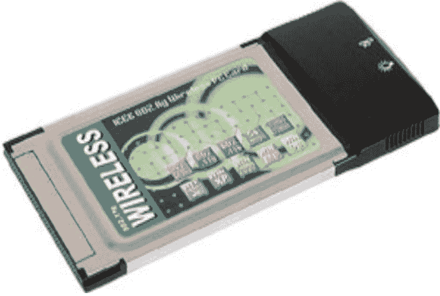
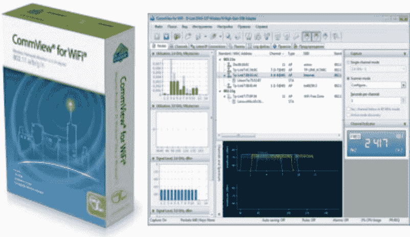
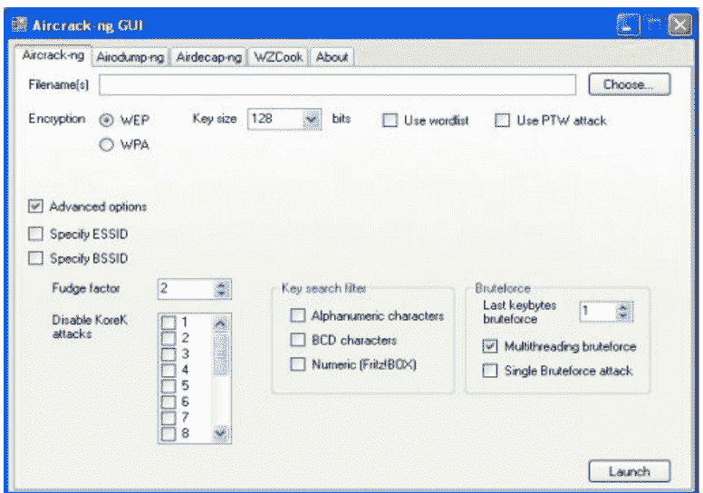
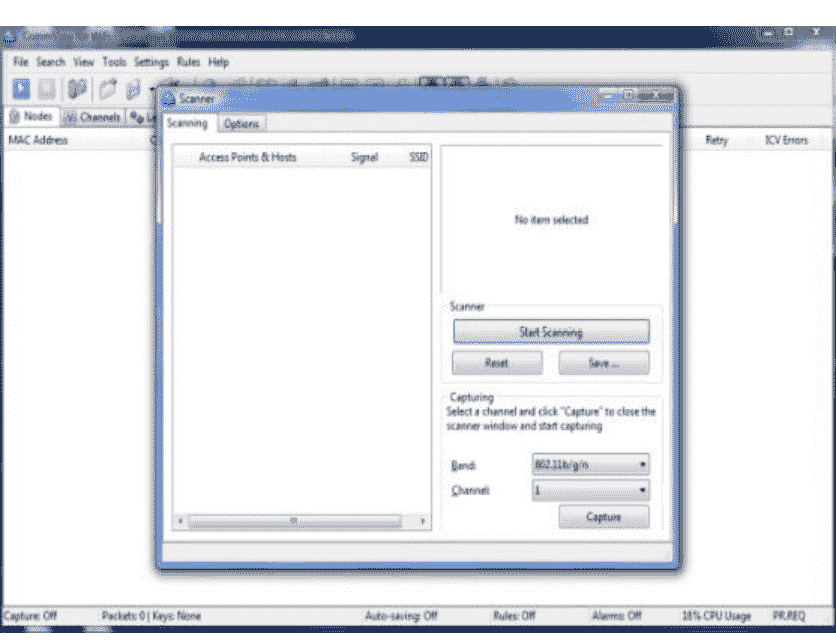
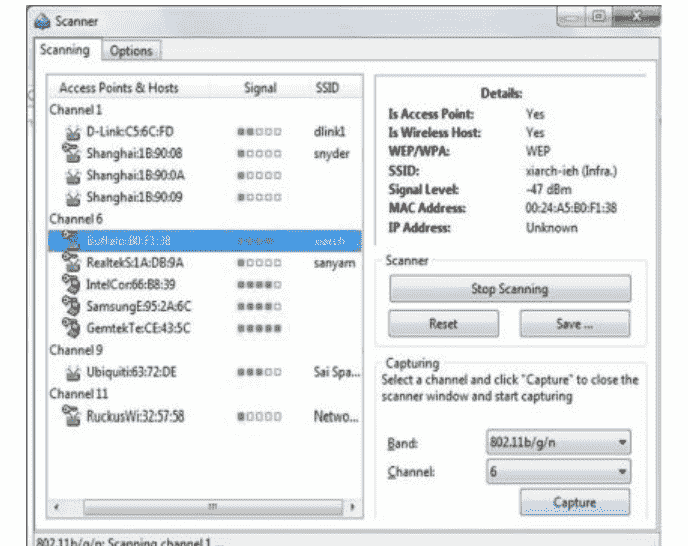
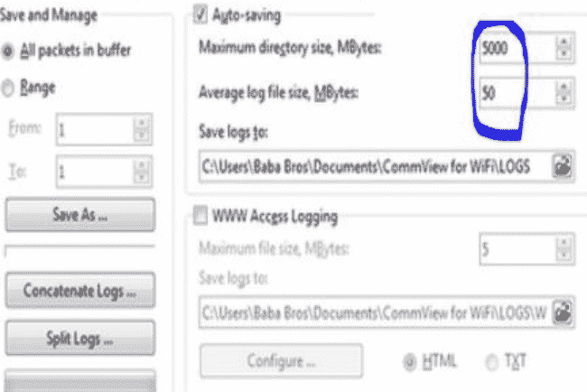
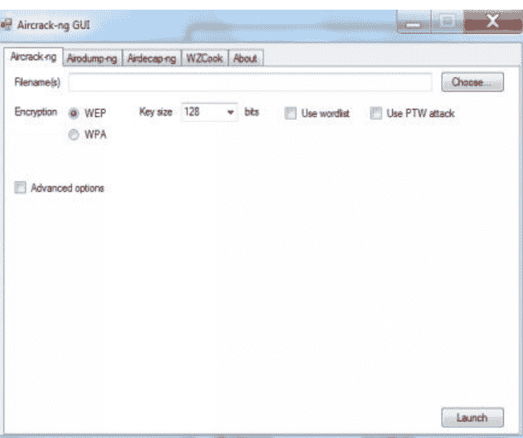
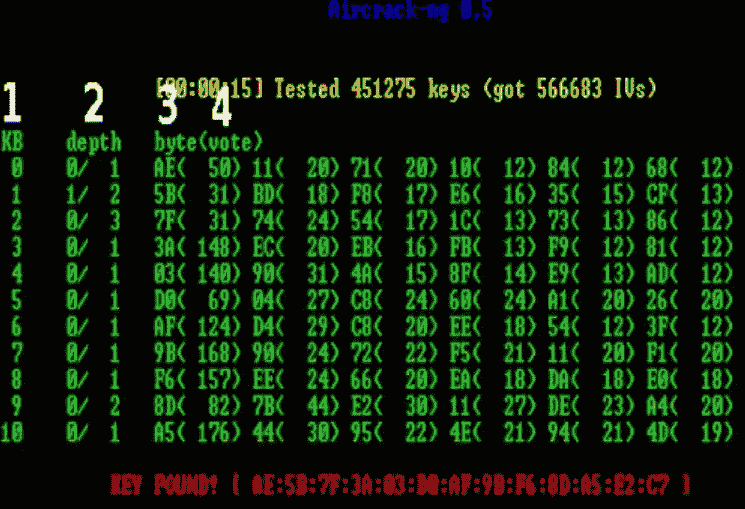

# 无线黑客：如何破解无线网络 (破解技巧、无线黑客、渗透测试、安全、计算机黑客、Kali Linux)

# 引言

我想感谢你，并祝贺你下载了这本书！
关于无线破解，你需要的所有知识都在书中。

Lu Xi

# 第 1 步：必要要求

你需要确保你将使用的电脑无线网卡与 CommView 软件兼容。这是必要的，因为它的兼容性将确保它可以监控网络并捕获进出该网络的数据包。你可以通过检查 CommView 网站上的列表来验证其兼容性。如果你当前的无线网卡不在兼容无线卡列表中，那么你需要购买一个兼容的外部无线网卡适配器连接到你的电脑。

# 第 2 步：安装 CommView

CommView For Wifi 软件将是主要的工具，用于捕获数据包并提供有关你尝试破解的无线网络密码所需的信息。你应该从他们的网站下载并安装该软件。你只需按照屏幕上的指示操作。它还包含驱动程序安装指南，会告诉你安装此过程所需的必要驱动程序。

# 第 3 步：Aircrack-ng GUI

你还需要 Aircrack-ng GUI 软件。这是用于对 CommView 软件捕获的数据包进行实际破解的软件。你只需要访问他们的网站下载并安装这个特定的软件。严格按照屏幕上的指示操作，以便成功安装软件。

# 第 4 步：运行 CommView

成功下载并安装 CommView 软件后，你必须运行该程序。打开程序后，点击页面左上角的播放按钮。它是带有蓝色箭头图标的也是你看到的第一个按钮。通过这种方式，你就能看到“Scanner”（扫描）对话框。

# 第 5 步：扫描网络

在 Scanner 对话框上，点击“Start Scanning”（开始扫描）按钮。这将指示软件开始扫描区域内找到的不同无线网络。在扫描过程中，你只需等待片刻。最后，你将

在屏幕上看到许多无线网络以及若干详细信息，例如安全类型以及信号。

# 第 6 步：选取目标无线网络

接下来要做的是选择一个你想要目标并破解的无线网络。此外，选择一个受 WEP 保护的网络，这意味着网络名称旁边仅有 WEP 而不是 WPA。你应该选择一个信号最强但分贝（dB）最低的网络。一旦确定了完美的目标，就应该点击“Capture”（捕获）按钮。在此过程中，你需要确保 Packets（数据包）列达到 100,000 之后才能进入下一步。

# 第 7 步：日志

捕获了所需数量的数据包后，进入 Logging（日志）选项卡并选择所有保存的日志。打开日志文件并将其导出到你想要的任何位置。建议选择一个你可以轻松访问的目标路径。确保格式为 tcpdump。在文件夹中查找时文件应该是 .cap 扩展名。在此过程中任何时候都不要关闭 CommView 软件。

# 第 8 步：使用 Aircrack-ng GUI 

获取所有日志后，你应该运行 Aircrack-ng GUI 软件。这样就可以就可以破解无线网络的密码。你需要选择 WEP 并打开扩展名为 .cap 文件。这是你在上一步保存的文件。然后，点击 Launch（启动）并在命令行提示符输入索引数字或你的目标无线网络。

# 第 9 步：Hercules

最后，你应该等一会儿。如果软件成功破解了密码，它将在屏幕上显示无线网络密钥。该无线网络密钥将是你访问目标无线网络所需的密钥。不过，如果你需要破解 WPA 密码，则需要不同的步骤。

# 结语

再次感谢你下载这本书！希望你学到了很多！

最后，如果你喜欢这本书，我想请你帮个忙，你是否愿意在 Amazon 上为这本书留评价？将不胜感激！

感谢并祝你好运

