# Kali Linux 无线破解：如何通过渗透测试快速学习破解任何无线网络


通过本渗透测试与实施指南，开始快速学习如何破解任何无线网络

（2022年初学者速成课程）

# 无线威胁简介

后续章节将讨论无线网络安全威胁和防御措施。首先，我们将概述无线安全威胁。例如，当你身处咖啡馆或机场时，可能会面临哪些类型的威胁。我们不仅将讨论威胁，还会讨论可以用来对抗威胁的各种机制。许多人并不认为在连接到未知无线网络时这些地点是危险的，但我们将讨论如何防御常见攻击的技术方面。最严重的威胁是他人获取了你用于访问公司账户的密码，或者可能是你用于网上银行业务的密码。接下，我们将讨论无线窃听。这同样重要，因为你的流量是通过空气传输的，这意味着任何人可以在传输过程中监听它、捕获它，或者更糟糕的是，对其进行修改。最后，黑客可能会建立一个自持网络，希望你连接到它，从而攻击你的机器并窃取机密信息。了解你的无线网络可能面临的威胁类型，对于理解保护它的安全机制至关重要。因此，我们将讨论当你不在公司办公室时面临的威胁。世界上有成百千种威胁，但我将重点关注行业内讨论的关键威胁，并与你分享在你未连接到网络时可能遭遇的各种攻击。我们特指人们在办公室内外用于个人用途的个人设备，以及在办公室内外用于业务用途的设备。在介绍这些内容之后，我们将讨论家庭以及业务或企业环境下的无线网络安全威胁和防御措施。

目标不是向你展示所有可能的安全威胁，而是通过选取一些人们讨论的威胁来观察威胁的多样性。如果你了解在企业环境中可能面临的威胁类型的范围和广度，你将处于更好的位置来考虑应对此类威胁的机制。随后，我们将概述 WiFi 标准中定义并在 WiFi 产品中找到 Wi-Fi 特有机制。然后，我们将专门查看这些 Wi-Fi 安全机制，从加密开始，以及有哪些哪些加密机制可以保护你的数据不被在空中窃听。我们还将概述基础密码学和不同的 Wi-Fi 选项，包括 WEP 以及它为什么存在漏洞。我们还将查看 TKIP 以及它如何在修复 WEP 漏洞的同时引入新类型的漏洞，并过渡到高级加密标准的使用。你也将理解你可以使用的各种安全选项，这对于实施无线安全策略至关重要。在涵盖加密基础知识后，我们将转向认证。我们将查看各种 Wi-Fi 认证机制，保护你的敏感系统不被不该访问无线网络的人访问。由于 Wi-Fi 认证是一个大话题，我们将将其分为几个部分。

你将理解你正在实施的安全机制以及为什么要实施它们。渗透测试工具的第二个理由是识别针对你无线网络的漏洞和潜在威胁。如果这些网络漏洞的风险因素不足以支持花费额外的安全设备费用，那么你就可以决定是否部署解决方案来防止这些攻击。当攻击发生时，你是否拥有了必要的策略、程序和指南来有效处理它？只有当你也了解这些攻击是如何实施时，你才能知道答案。此外，IT 是一个不断变化的行业，我们也在不断变化，有越来越多的接入企业网络的无线设备且不属于企业所有。当我们第一次想到 BYOD（自带设备）设备时，我们想的是笔记本电脑、平板电脑和智能手机，但随着物联网（IoT）设备的发展，我们会考虑到传感器和可穿戴设备等其他智能设备。因此，在这个连接无线网络的设备日益增演的行业中，使用渗透工具并理解无线安全威胁及防御措施至关重要。

## 软件参考

- `Tcpdump`: https://www.tcpdump.org/
- `Microsoft NetMon`: https://www.microsoft.com/en-us/Download/confirmation.aspx?id=4865
- `LanDetective`: https://landetective.com/download.html
- `Chanalyzer`: https://www.metageek.com/support/downloads/
- `Ettercap`: https://www.ettercap-project.org/downloads.html
- `NetworkMiner`
- `Fiddler`: https://www.telerik.com/fiddler
- `Wireshark`: https://www.wireshark.org/download.html
- `Kali Linux`: https://www.kali.org/downloads/
- `vMW`: https://my.vmware.com/web/vmware/downloads
- `Virtual Box`: https://www.virtualbox.org/wiki/Downloads

# 第 2 章 用于渗透的无线适配器与无线卡

当我们讨论无线适配器和无线卡时，许多人似乎都很困惑。他们不知道它们是什么、为什么需要它们，或者如何选择正确的型号，因为有这么多品牌和型号。无线适配器是通过 `USB` 端口连接到电脑的设备，允许你与其他 `Wi-Fi` 设备通信，允许你连接无线网络并与使用 `Wi-Fi` 的电脑通信。你可能认为你的笔记本电脑已经具备此功能，你是正确的；大多数笔记本电脑和智能手机都具备此功能。但这里有两个问题。第一个问题是，如果 `Kali Linux` 是作为虚拟机安装的，你无法访问内置的无线适配器；第二个问题是，这些内置无线适配器并不适用于渗透无线网络。

即使在笔记本电脑上将 `Kali Linux` 安装为主操作系统并能够访问内置无线网卡，你仍然希望能够使用此无线适配器进行渗透测试，因为它不支持监控模式（`monitor mode`）或数据包注入（`packet injection`）。你希望能够破解 `Wi-Fi` 密码，并执行 `airc-ng` 以及其他工具在 `Kali Linux` 中允许你执行的所有酷炫操作。在我们讨论与 `Kali Linux` 兼容的品牌和型号之前，我想讨论一个更重要的因素：适配器内部使用的芯片组。目前，请忽略品牌。相反，我们将讨论在无线适配器内部执行所有计算的品牌，这与适配器本身的好坏没有关系。如果它支持注入和监控模式并与 `Kali Linux` 兼容，品牌并不重要。适配器内部使用的是什么，即芯片组，才是关键的。许多芯片组支持监控模式、数据包注入和 `Kali Linux`。

其中一个是由 `Atheros` 制造的，型号为 `AR9271`。该芯片组支持监控模式和数据包注入，还可以用于创建伪造接入点或入侵网络。你可以使用此芯片组执行几乎所有的 `Kali` 攻击。该芯片组唯一的问题是它只支持 2 吉赫兹，这意味着如果你的目标使用 5 吉赫兹，或者某些设备连接在 5G 上，你将无法与这些设备通信。你甚至看不到它们，这意味着你将无法攻击它们。这并不是因为芯片组不好，而是因为它无法处理 5GHz 的流量。获取使用该芯片组的适配器有两种选择。我们有几种选择，但我将讨论其中两种。首先是低成本方案，你可以获得一个使用该芯片组的无品牌无线适配器，并用它执行之前的所有攻击。唯一的区别是这个适配器没有品牌，所以便宜一些。第二种方案是购买 `Alpha AWUS036NHA` 无线适配器，它由 `Alpha` 制造，这是一个持续生产优秀无线适配器的知名公司。它具有相同的芯片组并且向后兼容。

唯一的区别在于做工质量。这是一个由声誉良好的公司制造的高质量产品。两者工作都非常好，`Alpha` 适配器的范围更远且更可靠。预算型适配器小得多且更紧凑，使得它们在公共场所比体积大且带有大天线的 `Alpha` 适配器更容易使用。我想讨论的下一个芯片组是由 `Realtek` 制造的，型号为 `RTL8812AU`。该芯片组仅在 `Kali Linux 2017` 版本1 中获得支持，它支持监控模式、数据包注入以及 2.4 和 5 吉赫兹频率。该芯片组唯一的问题是它看起来没那么可靠，因为某些攻击可能需要更强的信号，某些攻击会失败且必须重复，有时网卡会直接断开，你需要重新连接。该芯片组再次有两个选择。你可以获得比 `Alpha` 便宜得多且具有相同芯片组的预算无线适配器，或者购买 `Alpha`，这样你就能连接更远的网络，因为信号更强。`Alpha AWUSD36ACH` 是使用这种芯片组的 `Alpha` 适配器。你可以比较它们的规格并选择最适合你的。芯片组是最重要的因素。这不是蓝牙的错。预算型的要便宜得多。它们更好是因为它们更紧凑，你可以在公共场所更有效地使用它们，但它们没有 `Alpha` 那么强大。`Alpha` 型提供更强的信号，因此更可靠，但预算型也能运行得完美，在各种渗透攻击中都很有用。唯一的区别在于做工质量。因为它们使用相同的芯片组，预算适配器的兼容性与 `Alpha` 型一样。再次，最重要的因素是无线适配器内部使用的芯片组。

# 第 3 章 安装 VIRTUAL BOX 与 KALI LINUX

`Virtual Box` 是一种专门用于各种操作系统虚拟化的软件，可以安装在 `Windows`、`Macintosh`、`Linux` 和 `Solaris` 上。它可以免费下载。

一旦你到达该网站，你可以选择下载各种平台包。

下载 `Virtual Box` 后，你将能够创建和运行多个虚拟机（`VMs`）。如上一章提到的，安装 `Virtual Box` 的用户手册可以在其网站上找到。该软件易于使用，建议你在它上面运行 `Kali Linux`。

你可以使用其他类似的虚拟环境，例如 `VMware`，但我已经使用 `Virtual Box` 多年，并在贯书中一直引用它。

`Kali Linux` 是一个操作系统的发行版，可以作为你的主操作系统或虚拟机运行。你可以从 `DVD` 或 `USB` 驱动器运行它。下载 `ISO` 文件后，你可以将其安装在当前的操作系统之上。

`Kali Linux` 是最好的渗透测试套件/软件，因为它包含了数百种现成的可用工具，用于对任何网络进行渗透测试。`Kali Linux` 的目的是测试现有漏洞以提高整体网络安全。

`Kali Linux` 同样对用户友好，具有用于信息收集、取证、逆向工程、压力测试、漏洞评估、报告工具、利用工具、权限提升、访问维持以及更多工具。

一旦你下载了 `Kali Linux` 并准备好在虚拟环境中安装它，就有细节需要注意。当你为 `Kali` 创建新的虚拟机时，你必须分配至少 4 GB 的空间，并为虚拟硬盘额外分配 20 GB。

完成新虚拟机的创建后，你必须进入设置，并通过将虚拟机桥接到你的路由器来确保网络设置已调整。配置好镜像后，你应该就可以启动它。你必须输入 `startx` 然后按回车键。这将开始从硬盘安装 `GUI`（图形用户界面），这也是建议采取的。在安装 `GUI` 之前，你必须回答一些问题，例如语言、键盘、位置以及时区设置。

安装完成后，你必须从硬盘重启镜像。`Kali` 将要求在 `CLI`（命令行界面）上登录。输入 `root` 作为用户名，输入 `to` 作为密码并按回车。如果你对 `CLI` 还不熟悉，不知道该使用什么命令或输入什么，请不要担心。你随时可以通过输入 `startx` 并按回车切换到 `GUI`。这将启动用户友好的 `GUI`，让你访问我们将要详细介绍的所有渗透测试工具（`Pen Tools`）。

`IP` 地址配置是另一个你必须完成的基础设置。

`Kali Linux` 将通过 `DHCP` 服务器查找 `IP` 地址，但建议分配一个静态 `IP` 地址，这样你就不会混淆哪个 `IP` 地址代表哪台机器。要在 `Kali` 上分配 `IP` 地址，请使用 `CLI` 命令 `Ifconfig eth0 10.10.10.2/24`。

必须配置默认网关，即你路由器的 `IP` 地址。要进行配置，请输入以下命令：`Route add gw 10.10.10.1`。

完成这些设置后，使用命令 `Ping 10.10.10.1` 节点你的路由器 `IP` 地址。

一旦你访问了默认网关并通过路由器访问互联网，你就应该通过输入命令：`Ping www.google.com` 来测试网络连接性。

如果成功，则意味着你的虚拟化 `Kali` 现在已连接到互联网。你需要访问互联网是因为你需要更新 `Kali Linux`。

你的首要任务是保持 `Kali Linux` 为最新版本。在清洁安装后，你应该做的第一件事就是更新你的操作系统。

`APT`（或高级软件包工具）通过搜索仓库并安装或升级带有所有所需依赖的包来扩展 `Debian` 包的功能。

打开控制台并输入 `apt-get update`，这将使本地包索引文件与其在源文件中定义的源重新同步。在执行升级或发行版升级之前，务必始终使用 update 命令。

接下来，你必须通过发出 `-y` 选项来升级 `Kali`，这允许安装继续进行而无需每次都输入确认。那么，`apt-get upgrade` 到底意味着什么呢？

它用于安装系统上所有已安装包的最新版本。结果是 `Kali` 上具有新版本的现有包将获得升级。需要注意的是，升级命令不会更改或删除未升级的包，也不会安装尚未安装的包。

最后，你必须运行 `distribution upgrade`（发行版升级）命令。

此命令会升级系统上当前安装的所有包及其依赖项。

它还会清除系统中的过时包。下一步是重启你的电脑。重启电脑后，你现在应该拥有一个全新的、纯净的 `Kali` 版本。

要查看你机器上安装的 `Debian` 包列表，请使用命令 `sudo apt list --installed`。

如果包很多，且你想知道某个特定工具是否已经安装，请在命令中添加 `grep filter` 参数。

运行以下命令以显示包的描述并识别其依赖项：`dpkg --status packagename`。

最后，要从 `Kali` 中卸载包，请运行以下命令：`sudo apt-get remove name-uninstall package`。

当然，你必须将包名替换为应用程序名称。最后，我想介绍你的系统是如何使用官方 `Kali` 仓库的。`sources.list` 文件是所有魔法发生的地方。

你可以通过在 `Leaf Pad` 中打开此文件来检查它。当你运行更新命令时，`Kali` 会搜索该文件的内容以完成更新过程。

你的首要任务是保持 `Linux` 为最新版本。在清洁安装后，你应该做的第一件事就是更新你的操作系统。

`APT`（或高级软件包工具）通过搜索仓库并安装或升级带有所有所需依赖的包来扩展 `Debian` 包的功能。

打开控制台并输入 `apt-get update`，这将使本地包索引文件与其在 `sources.list` 文件中定义的源同步。在执行升级或发行版升级之前，务必始终使用 update 命令。

接下来，你必须通过发出 `-y` 选项来升级 `Kali`，这允许安装继续进行而无需每次都输入确认。那么，`apt-get upgrade` 到底意味着什么呢？

它用于安装系统上所有已安装包的最新版本。结果是 `Kali` 上具有新版本的现有包将获得升级。需要注意的是，升级命令不会更改或删除未升级的包，也不会安装尚未安装的包。

最后，你必须运行 `distribution upgrade`（发行版升级）命令。

此命令会升级系统上当前安装的所有包及其依赖项。

它还会清除系统中的过时包。下一步是重启你的电脑。重启电脑后，你现在应该拥有一个全新的、纯净的 `Kali` 版本。

要查看你机器上安装的 `Debian` 包列表，请使用命令 `sudo apt list --installed`。

如果包很多，且你想知道某个特定工具是否已经安装，请在命令中添加 `grep filter` 参数。

运行以下命令以显示包的完整描述并识别其依赖项：`dpkg --status packagename`。

最后，要从 `Kali` 中卸载包，请运行以下命令：`sudo apt-get remove name un-install package`。当然，你必须将包名替换为应用程序名称。最后，我想介绍你的系统是如何使用官方 `Kali` 仓库的。`sources.list` 文件是所有魔法发生的地方。

你可以通过在 `Leaf Pad` 中打开文件来检查它。当你运行更新时，`Kali` 会搜索该文件的内容以完成更新过程。

现在是时候介绍一些对你作为渗透测试员非常有用的基本工具了。列表上的第一个应用被称为 `preload` 应用。要安装此包，请使用命令 `sudo apt-get install preload`。

`preload` 会识别用户最频繁使用的程序，并将二进制文件和依赖项预加载到内存中以便快速访问。它在安装后重启后会自动启动。

`bleachbit` 是你的下一个工具。通过清除缓存、删除 cookie、清除上网历史、粉碎临时文件、删除日志和丢不需要的文件，`Bleachbit` 可以释放磁盘空间并保护隐私。此应用程序包含高级功能，例如粉碎文件以防止恢复以及清除空闲空间以隐藏未完全删除的文件痕迹。`sudo apt-get install bleachbit` 是你安装 `bleachbit` 需要运行的命令。

启动管理器是下一个程序。每个在启动过程中运行的应用程序都会减慢系统。安装“启动管理器”允许你禁用那些启用的不需要的服务和应用程序。

在启动期间。要安装它，请运行命令 `sudo apt-get install bum`。

`gnome-do` 是你应该应该关注并安装的下一个应用程序。如果你倾向于通过键盘运行应用程序，“`gnome-do`” 正是适合你的工具。要安装此工具，请使用命令 `sudo apt-get install gnome-do`。

`apt file` 是你列表上的下一个软件。这是一个用于在 `apt` 软件包系统中进行搜索的命令行工具。它允许你在无需安装或获取包的情况下查看包的内容。安装该工具的命令是 `apt-get install apt-file`。

安装该包后，你还必须使用命令 `apt-file update` 对其进行更新。

`Scrub` 是你必须安装的下一个应用程序。这是一个符合政府标准的安全删除程序。要安装此工具，请使用命令 `sudo apt-get install scrub`。

然后你必须安装 `Shutter`。`Shutter` 是一个可以为桌面拍摄快照的截图工具。安装该工具的命令是 `apt-get install shutter`。

`Figlet` 是你应该安装的下一个软件。该程序将通过显示个性化消息（如你的公司名称）让你的控制台看起来更专业。安装此工具的命令是 `apt-get install figlet`。

然后，滚动到文件末尾并输入 `figlet message` 来编辑 `bashrc文件`。接下来，关闭并重启控制台，当你重新登录控制台会话时，看到的第一个内容就是你提供的消息。

之后，你将熟悉 `SSH`，也称为 `Secure Shell`（安全外壳）配置。尽管 `Kali` 自带默认 密钥，但在 `Kali` 上使用 `SSH` 之前，禁用默认密钥并生成唯一的密钥是一个好主意。以下是移动原始密钥并创建新密钥的步骤。首先，打开控制台并导航到 `SSH` 文件夹。


# 目录导航帮助

- 要立即返回主目录，请使用 `cd ~` 或 `cd`
- 要切换到 Linux 系统的根目录，请使用 `cd /`
- 要进入 root 用户目录，请以 root 用户身份运行 `cd /root/`
- 要向上移动一级目录，请使用 `cd ..`
- 要返回上一个目录，使用 `cd -`

## 创建备份文件夹并移动 SSH 密钥

接下来，你必须创建一个备份文件夹，并将 SSH 密钥移动到该备份文件夹中。

> **注意**：`cp` 命令是用于复制文件和目录的 Linux 命令。其语法如下：

```
cp source destination
cp dir1 dir2
cp -option source destination
cp -option1 -option2 source destination
```

在以下示例中，使用以下命令将 `/home/test/paper/` 文件夹及其所有文件复制到 `/usb/backup/` 目录：

```
cp -avr /home/test/paper /usb/backup/
```

- `-a`：保留指定的属性，如目录和文件模式、所有者、时间戳，以及如果可用的额外属性（如上下文、链接、xattr 和所有）
- `-v`：产生详细输出
- `-r`：递归复制目录

## SSH 密钥生成与验证

最后，按照上述操作后，你将看到以下消息，表示你的 SSH 密钥已生成：

```text
Creating an SSH2 RSA key; could take some time...
Creating an SSH2 DSA key; could take some time...
SSH2 ECDSA key generation; this may take some time...
```

然后，运行以下命令验证 SSH 密钥哈希值：`md5sum ssh_host_*`

在这里，`*` 代表你的新密钥，因此使用以下命令比较这些哈希值：

```
md5sum *
cd default_keys/
```

重新生成 SSH 密钥对后，你可以从命令行通过 `/usr/sbin/sshd` 启动 SSH 服务。

如果你想在启动 SSH 后确认它正在运行，请运行 `netstat` 查询。输出应显示 SSH 现在正在监听 22 端口。

```
[-de DEAUTH_ESSID] [-p PHISHINGSCENARIO] [-pk PRESHAREDKEY]
[-hc HANDSHAKE_CAPTURE] [-qi] [-ic] [-le LURE10_EXPLOIT]
[--logging] [-cp CREDENTIAL_LOG_PATH]
[--payload]
[-wAI WE
[--pdo PHISHING
--dnsmasq-conf --p PHISHING_ESSID
```

### 可选参数

- `-h, --help`：显示此帮助并退出
- `-i INTERFACE, --interface`：手动选择支持 AP 和客户端的接口
- `-request`：请求监控模式，用于生成伪造 AP

# 密码安全威胁与攻击方式

弱密码是企业组织面临的最严重安全威胁之一。当黑客或渗透人员尝试破解企业网络时，他们会寻找最弱的切入点，只需要一个人的账户密码被破解，整个企业网络就会被破解。

黑客使用各种技术来获取你的密码并访问你的无线网络。他们可以简单请求密码，你会惊讶于有多少人会因为落入一个故事而轻易被社会工程欺骗。

他们还可以在你输入密码时从背后窥视，或者在你的桌子上寻找关于密码的任何笔记。这被称为“窥视攻击”（shoulder surfing）。密码攻击的两种主要方法是猜测密码和暴力破解。

## 字典攻击

字典攻击，顾名思义，是指我尝试字典中的每一个单词，包括外语字典、医学字典等。大多数人会使用一些容易记忆的东西，例如一个有意义的单词。

有些人使用配偶的名字，另一些人使用宠物的名字，而许多人使用社会安全号码，这是极其危险的，因为黑客不仅拥有你的密码，还拥有关于你非常有价值的信息。

## 暴力破解攻击

如果从字典中找不到你的密码，黑客可以通过暴力破解攻击获取它。在这个阶段，我会尝试所有可能的组合，直到找到你的密码。我可以表现得很聪明，可能会从最常用的密码单词开始。

例如，我可以暗示一些规则以希望尽早破解它们，因为暴力破解攻击的问题在于尝试所有可能的组合需要很长时间。

## 无线网络攻击特点

使用无线网络时需要记住这一点，我并不是试图用一系列不同的密码来攻击接入点。

相反，我会嗅探空气，从已经认证的合法用户那里收集信息，然后对我收集的信息尝试暴力破解或字典攻击以找到密码。

我可以在你不知情的情况下嗅探网络，因此我可以在你不知情的情况下对无线网络进行字典或暴力破解攻击。

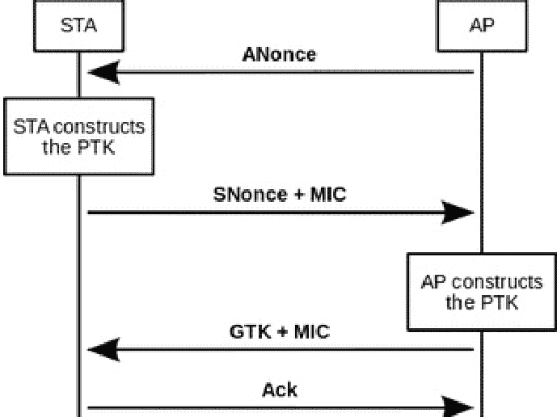

# WPA/WPA2 字典攻击四步骤

为了对受 WPA 或 WPA2 的无线网络执行字典攻击，我们将通过四个步骤的过程。

1. **确定目标 BSSID**：首先，我们需要确定要对其发起字典攻击的接入点的 BSSID。
2. **选择词表**：一旦确定了要攻击的接入点，我们必须选择攻击中使用的词表。词表，顾名思义，是一个单词列表，类似于字典，我们将使用该列表对接入点进行测试。
3. **生成身份验证流量**：第三步将生成身份验证流量。为了使攻击生效，我们需要能够捕获合法用户连接到接入点的过程，我们将生成流量以便通过空气进行嗅探。
4. **执行字典攻击**：最后，我们必须执行字典攻击。

## 实操步骤（基于 Kali Linux）

我们将使用 Kali Linux 进行此攻击。为此，你必须启动终端并检查配置。当你输入 `iwconfig` 时，你应该能看到配置。

### 1. 设置网卡为监控模式

要将网卡设置为监控模式，请使用以下命令：

```
ifconfig wlan0 down
ifconfig wlan0 mode monitor
ifconfig wlan0 up
```

现在网卡处于监控模式，输入 `iwconfig`。你应该能看到它正处于监控模式。

### 2. 确定目标接入点 BSSID

下一步是确定你想攻击的接入点的 BSSID。为此，输入：

```
airodump-ng wlan0
```

这将开始搜索广播的 BSSID。你会注意到你正在捕捉附近网络的 BSSID 以及你正在使用的通道。

> **注意**：不要破坏邻居的网络，更糟糕的是，不要在生产环境使用此工具。

回到 Kali，一旦找到想要攻击的 BSSID，可以按 `Ctrl+C` 退出监控。

你应该也会在 Kali 的输出中看到 BSSID 的 MAC 地址，它通常长 12 个字符，你应该记录下来，因为在执行攻击时需要该 MAC 地址。

### 3. 捕获握手包

下一步是找到一个用于访问接入点的词表，Kali 有几种工具可以实现这一点。你也可以下载类似的工具，但 `airodump` 工具足够了。因此，你必须输入：

```
airodump-ng --bssid [BSSID] --channel [CHANNEL] -w cracking wlan0
```

> **注意**：这只是一个示例，但在我说 `[BSSID]` 的地方，必须输入要破解的 BSSID 的实际 MAC 地址，以及你所在的通道。

你在 `ls` 命令下收集并命名的文件名，就在 `Public` 文件旁边。

如果你使用了 WEP 认证，密码现在已经被破解了。默认情况下，`Aircrack-ng` 将密码显示为 ASCII 文件并提示“KEY FOUND”（找到密钥）。

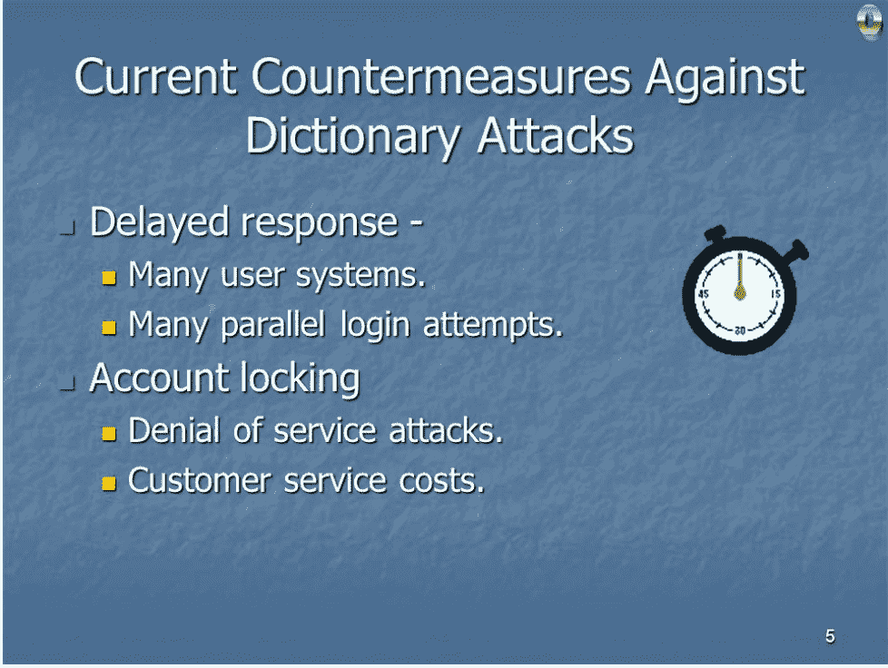

## 攻击后果与风险

- **延迟响应**
  - 许多用户系统
  - 许多并行登录尝试
- **账户锁定**
  - 拒绝服务攻击
  - 客户服务成本

如你所见，对密码进行字典攻击非常简单，在家庭或小型企业等环境中，人们会与其他分享密码以获得网络访问。

因此，保护网络的第一步是确保你不会将密码泄露给不该拥有它的人。已经知道密码的人不应该将其写下来，并用贴纸贴在电脑屏幕上，或放在办公桌上。

尽可能保护自己免受字典攻击的更好方法是让字典攻击所需的时间长到无法侵入你的网络。

# 密码防护策略

## 使用复杂密码短语

你如何做到这一点？你通过使用复杂的密码短语（passphrases）来实现。

也就是说，你使用大写字母、小写字母以及数字和特殊字符。那么，如果你打算使用大小写字母、数字和特殊字符，如何让它足够好记，至于让你不想把它写下来呢？

诀窍是创建一个包含大小写字母、数字、以及你能记住的特殊字符的密码，例如 `#ThisIsAVeryDifficultPa55word1357#`。

这只是一个例子，你可以自己想一个。

## 使用密码生成器

另一种可能性是使用密码生成器。你可以在网上找到密码生成器，也可以在你的环境中下载并运行应用程序。

有几个在线密码生成器，例如 `www.passwordsgenerator.net`。使用这个工具，你可以指定密码的长度，以及是否需要包含特殊字符、大写字母、小写字母或数字。然后你可以通过生成一个新的安全密码来更改密码，它会为你生成。

这是一个生成密码的有效方法。`Random.org` 是另一个你可以使用的在线工具。

它非常棒，因为它允许你同时生成多个随机密码。例如，如果你需要生成随机密码，这是一个很好的方法。

只需指定你想要 10 个长度为 12 位的随机密码，然后点击“Get Passwords”，它就会为你生成一组密码。

`https://www.grc.com/passwords.htm` 是另一个类似的工具。这个也很棒，因为它会为你生成非常长的字符串，某些设备需要这种字符串，而且越长越安全。

当你刷新页面时，它会为你随机生成新密码，所以你不需要输入正在查找的代码类型，这个工具会自动为你生成一个非常长的随机密码。

## BYOD 策略下的密码分配考量

在实施 BYOD（自带设备）策略并考虑如何分配密码时，请考虑你尝试保护的资产有多重要。

当人们连接到无线网络时，他们通常被限制只能访问网络的某些部分。他们可能只能访问公共网络或互联网。

一种允许你评估如果有人违反密码时的风险的评估方法。威胁越严重，密码应该越安全。

你应该考虑密码将如何被使用。它是打算供大群人使用、个人使用，还是用于机器之间的通信？机器使用的密码可以比人类使用的密码复杂得多。

例如，如果你在客户端上安装了一个包含密码的配置文件，以便用户不需要记住密码，配置文件会自动连接到无线网络，那么你可以使用更复杂的密码。

反之，如果你依赖用户记住并输入该密码，你必须创建一个易记的密码，而不是随机的数字和字符字符串。

```
(kali@kali) ~[~]
$ theHarvester -d nudesystems.com -b google
```

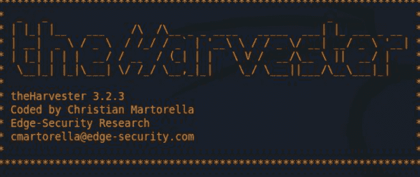

- 目标: `nudesystems.com`
- 正在搜索 0 个结果。
- 正在搜索 100 个结果。
- 正在搜索 200 个结果。
- 正在搜索 300 个结果。
- 正在搜索 400 个结果。
- 正在搜索 500 个结果。
- [*] 正在搜索 Google。
- 未找到 IP。
- 未找到电子邮件。
- 找到主机：1
  - `www.nudesystems.com:172.64.140.166, 104.21.65.52`

另一方面，如果你依赖用户记住并输入该密码，那么你必须创建一个易记的密码，而不是随机的数字和字符字符串。

# 无线网络物理安全与流量加密

你能保护自己免受空中窃听吗？有什么是你可以做的来对抗被动侦测吗？第一步是确保你的覆盖范围限制在你希望提供无线连接的区域。

如果你不想在停车场提供无线连接，请确保你的天线部署方式不会让信号溢出到建筑外。

与其部署以 360 度圆形方式辐射的全向天线，也许你可以部署具有以 90 度圆形方式辐射的射线的访问点。

这样做是为了减少溢入停车场的信号，同时将每个角落的信号聚焦在建筑内部。同样，你可以安装向 360 度圆周辐射的墙壁天线。

这将信号辐射到办公室内部，而不是辐射到墙外的停车场。最重要的是，你的数据在空中传输时是加密的。

Wi-Fi 无法加密管理和控制信息，但可以加密用户数据信息。如果经过了加密，攻击者在读取你的数据之前，必须先解密你的加密密钥。

请记住，即使你限制了无线覆盖区域，某些攻击者仍然可以使用高方向性天线对准你的建筑，并仍然读取空中传输的流量。因此，虽然减少覆盖是一个好主意，但攻击者仍然可以听到它。

如果你知道用于加密无线流量的密钥，就可以用它进行解密。要解密任何无线流量，请使用 `Wireshark` 工具并按照几个简单的步骤操作。

首先，在 `Wireshark` 中打开之前捕获的数据包文件。然后，使用该捕获文件过滤出数据帧，因为这些是我们想要解密和检查唯一数据帧。

然后你可以检查用于加密数据的加密方法，以确保你使用的是正确的密钥。接着，在 `Wireshark` 中输入解密密钥并使用该密钥解密数据。

让我们从打开之前捕获的数据包文件开始。为了过滤你捕获的内容，请确保只查看数据包。为了能够只查看数据包，你必须先学会如何使用 `Wireshark` 中的过滤器，因此本章的其余部分将集中在基础过滤选项上，一旦掌握这些选项，解密数据包将变得简单。

## Wireshark 过滤器分类

过滤器是在开始捕获包时过滤包的方法，当你开始捕获时，你会收到大量的包，其中 99% 是你并不关心的。

例如，你不关心 UDP 流量，甚至大部分 TCP 流量。可能你只是对你访问的网站感兴趣，需要弄清楚如何过滤掉所有额外包，并且你想关注某件事，而不是查看你捕获的所有内容。

过滤器分为两类：

1. **显示过滤器**：位于“Filter”单词旁边的空白处
2. **捕获过滤器**：如果你想进入捕获选项，你的捕获过滤器也在那里。要到达那里，先选择“Capture（捕获）”，然后选择“Options（选项）”。

如果你正在查看 UDP 或 TCP 等其他流量并想过滤掉它们，可以在显示过滤器中输入 `HTTP` 并点击“apply（应用）”，这将移除其他内容并仅显示 HTTP 数据包。

由于显示过滤器非常方便，你可能会奇怪捕获过滤器是做什么的。所以，如果你打开捕获过滤器并按 HTTP 进行过滤，这意味着在捕获期间你正在监听流量，它除了 HTTP 流量外不会为你记录任何其他内容。

因此，**捕获过滤器是你想要记录的内容，而显示过滤器是你想要看到的所有内容**。


# 使用 Ettercap 进行中间人攻击获取凭据

在本章中，我们将介绍如何使用 `Ettercap` 通过 HTTP 和 FTP 从目标主机获取凭据，特别是用户名和密码。

如果目标使用的是两种未加密的协议（例如 HTTP 和 FTP），这是可能的。我们的设置中有一个 Linux 系统和一个 Windows 10 系统，我们将使用 `Ettercap` 将自己置于默认网关（即 Windows 主机）的中间。

## 准备工作

要获取默认网关地址，请在终端中输入 `ip route`。

在我的情况下，默认网关是 `192.168.100.1`，但无论你的地址是什么，这都是 `Ettercap` 所需的主要信息。

如果你愿意，可以将自己置于子网中所有用户与默认网关目标之间。在这种情况下，我们将站在所有人和默认网关之间。

## Ettercap GUI 操作步骤

1. 进入 Kali Linux 的“Applications（应用程序）”，然后向下滚动并选择“Sniffing and Spoofing（嗅探与欺骗）”，然后选择“Ettercap-gui”。这是 `Ettercap` 的图形用户界面（GUI）。
2. GUI 打开后，选择“sniff（嗅探）”，然后选择“unified sniffing（统一嗅探）”，这将打开下一个窗口。
3. 在打开的标题为“ettercap Input”的新窗口中，系统会询问你想在哪个网络接口上嗅探。在我们的 Kali 机器上，只有一个网卡（NIC），即网络接口，选择统一 sniffing。因此，无论显示的是哪个接口都应该被使用，所以点击“ok”。
4. 接下来，在用 `Ettercap` 将自己插入中间之前，我们必须配置目标。要做到这一点，请进入“hosts（主机）”然后选择“scan for hosts（扫描主机）”。这将对你的目标所在的子网进行扫描。只有“arp poisoning（ARP 投毒）”（我们将使用的模式）允许将自己置于给定子网的中间。
5. 扫描完成后，返回并选择“hosts”，然后“hosts list（主机列表）”，在新窗口中，你应该看到上一次扫描发现的 IP 地址。你还应该在这里找到默认网关的 IP 地址，在我的情况下是 `192.168.100.1`。
6. 现在你必须创建目标，点击 IP 地址 `192.168.100.1` 或默认网关的 IP 地址，然后选择“Add to Target 1（添加到目标 1）”。
7. 接下来，如果你列出了更多 IP 地址并也想将它们作为目标，点击它们将其高亮，然后点击“Add to Target 2（添加到目标 2）”。
8. 一旦决定了目标，转到顶部窗口并选择“Mitm”，它代表“中间人攻击”。从那里，你可以选择“arp poisoning（ARP 投毒）”。选择后将出现一个新窗口，在其中勾选“Sniff remote connections（嗅探远程连接）”旁边的框并点击“OK”。

## 验证 ARP 投毒是否成功

如果你处于中间，或者 Kali 机器处于 Windows 10 机器和默认网关之间，那么 IP 地址 `192.168.100.1` 的 MAC 地址应该是 Kali 机器的 MAC 地址。要确认这一点，在你的 Windows 10 机器上打开命令提示符并输入 `arp -a`。

`ARP` 代表地址解析协议，它将 MAC 地址翻译为 IP 地址。当你在 Windows 上运行该命令时，你应该看到一个带有关联 MAC 地址的 IP 地址列表。

顺便说一下，为了避免混淆，Windows 将 IP 地址称为“Internet Addresses”，将 MAC 地址称为“Physical Addresses”。

正如你所看到的，“从技术上是不正确的，因为你只是使用 `Ettercap` 更改了默认网关的 MAC 地址，但为了确保起见，你也可以验证 Kali 的 MAC 地址。

要这样做，返回 Kali Linux 终端并输入 `ifconfig`。

在该命令的输出中，寻找“ether”一词，它指的是 Kali 以太网地址的 MAC 或“physical address（物理地址）”。

一旦你验证了 ether 地址与 Windows 默认网关匹配，你就知道自己已经通过 `Ettercap` 处于中间位置了。

## 获取凭据

`Ettercap` 的用处在于，当你处于中间时，只需要在 `Ettercap` 中运行它，它就会将其捕获到窗口中。

用户名将显示在 `Ettercap` 窗口的“USER”旁边，密码将显示在“PASS”旁边。

它会自动出现在左侧，所以你不需要做什么。例如，与 `Wireshark` 不同，你不需要坐在那里检查所有的流量，因为用户名和密码都显示出来了。


如果使用了未加密协议，Ettercap 会捕获任何用户名和密码，因此请使用 `HTTPS` 而不是 `HTTP`，使用 `SFTP` 或 `SCP` 而不是 `FTP` 来传输文件。

由于在你处于中间时不会向用户显示警告横幅，因此终端用户不会注意到你使用 Ettercap 执行了二层中间人攻击。

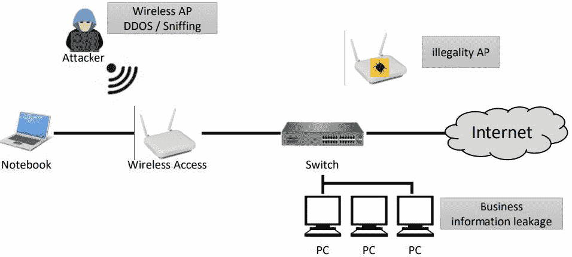

正如你所看到的，由于在你处于中间时不会向用户显示警告横幅，终端用户不会注意到你使用 Ettercap 执行了二层中间人攻击。

那么，如果密钥被破解并落入他人手中，你可以使用哪些方法来保护自己？第一种方法是使用强加密算法。WPA 采用 `TKIP` 和共享密钥，这很容易被破解。WPA2 引入了 `AES`，即高级加密标准。

目前没有公开的漏洞可以让你在使用 `AES` 加密时被破解，但取决于你阅读的内容，`AES` 有某些可能被破解。

你可以做的第二件事是使用临时密码。定期更改的临时密码。例如，你可以在每次连接接入点时更改密码。

你可以配置临时密码每 1 或 2 小时过期一次，这样即使你不重新连接，你也会为加密生成一个新的密钥。

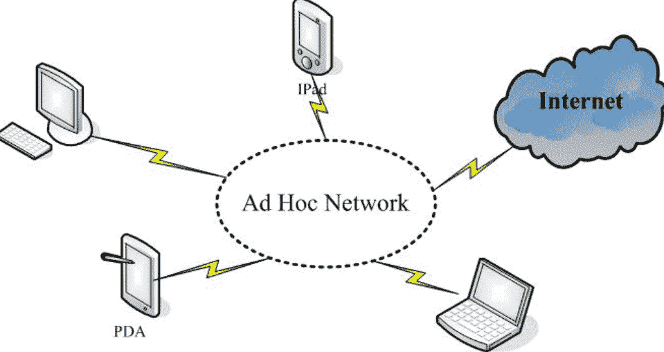

Ad hoc 网络是另一种无线安全威胁，在这种网络中没有提供有线网络连接的接入点，让你只有局域网或互联网。

当你无线地连接设备但没有到有线网络的连接时，你就拥有了一个 ad hoc 网络。

例如，当我进行演示时，我可以在笔记本电脑和数据投影仪之间建立一个 ad hoc 网络，我所做的是从笔记本电脑发送流量到投影仪。

但我并不需要连接互联网、服务器或打印机。

要访问 Windows 网络共享中心，只需找到并选择 Windows 中的“打开网络共享中心”即可。然后选择“更改适配器设置”。

接下来，点击“添加新的网络”，然后点击“添加”，你将看到两个选项。如果你连接的是基础设施接入点（接入点），你应该能够“创建网络配置文件”，同时也应该能够“创建自组网网络（ad hoc network）”。所以，请选择“自组网网络”。

它会给出一个定义，但你可以点击“下一步”来忽略它，现在你可以输入一个名称。你可以将其命名为“Wireless-Test ad hoc network”，你会发现你可以选择安全类型。

你可以选择“完全开放”，我不建议这样做；或者你使用 `WEP`，后者的安全性再次较弱，但你可能需要一个只能使用 `WEP` 认证的特定客户端，这虽然不理想，但确实会发生。

在例例中，我们将使用 `WPA2`。你可以创建一个密码并选择“保存网络”。你应该先保存它，然后点击“下一步”。你的网络现在应该可以运行了。

网络现在应该可以运行并为用户准备就绪。继续连接到该网络。一旦看到你已连接，就可以断开自组网网络的连接。

之后，你会发现没有用户连接到自组网网络，因此你应该删除它。只需选择它并点击“删除”。现在它应该显示你将不再能够使用它，这正是你所想要的。

如果你不再使用该自组网网络，应该尽快终止它。

最后，我们讨论了在你离开家或办公室期间可能实施的各种无线攻击。你不仅学习了这些攻击，还学习了用于减少攻击发生风险以及攻击发生时可能造成的损害的应对措施。

你打算如何利用这些信息，你现在打算做什么？

嗯，我建议做三件事。审查你与办公室外工作的员工相关的安全策略。

如果你是出于个人原因这样做，这可能涉及你的家庭成员在他们没有连接到家庭网络时。如果你没有策略，请考虑是否应该为在办公室外工作的人员制定一个策略。

在你审查该策略的同时，你应该识别出这些策略旨在防止的无线网络攻击。检查你是否能够识别并列出它们。

你对无线攻击的理解越深，为公司制定安全策略时的准备工作就越充分。最后，一个重大的战略问题：你的安全策略中概述的应对措施是否足以保护你的资产？

鉴于业务风险水平较低，你的安全策略可能稍微严苛了。如果这些资产受到攻击，你可以说：“不，策略还不够好，风险需要更多的应对措施”，然后申请预算来实施这些改进后的应对措施。


让我们从最大的企业安全威胁开始。为了在人的地方提供覆盖，接入点必须部署在人的地方。

你不能将接入点放在数据中心或存储柜中并认为它在物理上是安全的，因为你将在需要的地方无法获得覆盖，或者获得次优的覆盖。

如果你在人员聚集的区域部署接入点，你需要考虑如何防止这些接入点被篡改、盗窃或重新配置。

所以，第一步是评估接入点被篡改的安全风险，例如，如果你在工厂环境中部署它，而接入点可能悬在空中 20-25 英尺处，挂在横梁上或从非常高的天花板吊下的线线上。

有人物理篡改它的概率很低。

制造环境通常是封闭区域，只有穿戴防护装备的人员才允许进入。

此外，在工厂环境中携带梯或其他设备帮助你到达接入点是不可能的。

然而，如果你在学校部署接入点，特别是在学校的走廊里，你几乎可以肯定有人会对那个接入点“大作身手”。

学生们至少会将天线指向可能对覆盖不理想的方向。因此，物理安全的一个组成部分是风险评估。

在公共场所，这比在更受控的环境中更危险。小型企业将接入点放在储物柜或放置所有服务器设备的房间里。

有时这些地方可以锁定并加固，而另时候，它们仅仅是办公室里每个人都可以去的地方，就在打印机旁边。

通常情况下，人们以这种方式部署接入点是因为他们需要将接入点连接到交换机，还有什么比放在交换机旁边更好的地方呢？

当然，这对于方便接入点连接到交换机来说是正确的，但对于提供最佳覆盖则不然。

如果他们决定布线的便利性或将其锁在柜子里比连接到无线网络时提供最佳覆盖和容量更重要，这并不是一个坏主意。

然而，关于放置接入点的决策往往是出于便利，而不是出于安全或无线网络优化。

我想和你们分享几个真实的部署案例，请记住，当我们被召唤或被要求协助时，通常是有问题的。我们并不总是了解最好的无线部署方案。

我们能看到哪些是有问题的。底线是，如果你想保护网络性能和完整性，必须认真考虑接入点的物理安全。无论你的接入点是在人们可以看到的公共场所还是隐藏在天花板或存储室里，接入点的端口始终应该受到保护。

控制端口和以太网端口将连接到你的接入点。你不想禁用以太网端口，因为它连接到公司网络。

你想要确保别人不能走到接入点旁，断开网络连接，插上以太网线，然后重新配置它。

因此，你希望在该端口使用 `SSH`，以确保只允许安全访问该接入点。当你完成接入点的配置和部署后，应该禁用控制端口。

# 第 15 章 越权接入点基础

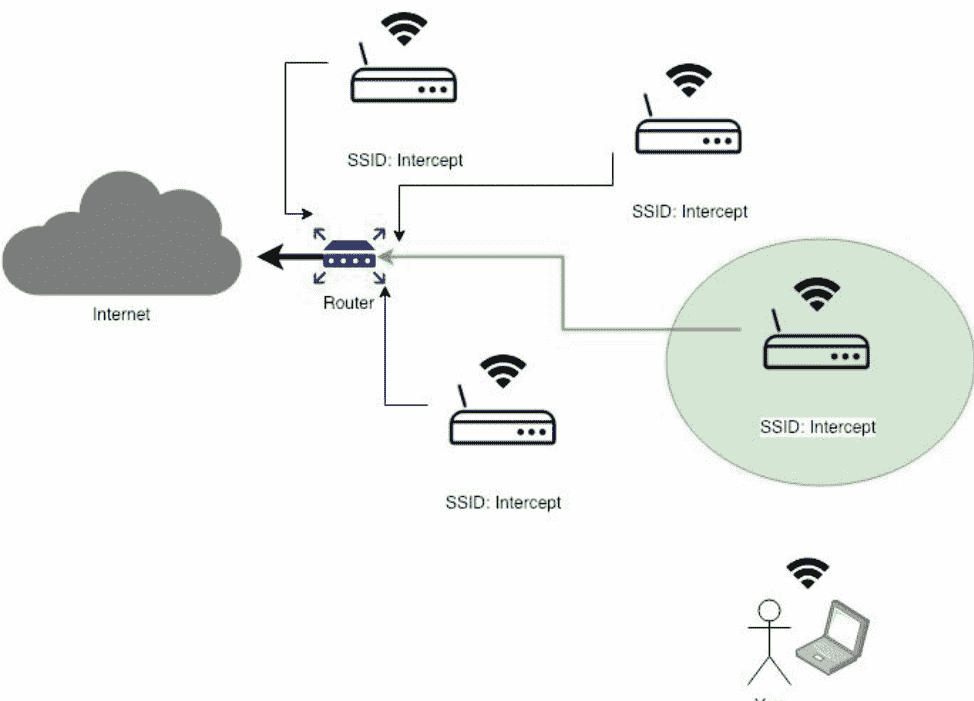

在未经你 IT 管理人员明确许可的情况下，你的组织内安装了一个越权接入点（Rogue Access Point）。

我们在日常生活中越来越越来越多地使用无线设备，因此希望将无线设备连接的便利性和易用性带入工作场所这也是自然的。

当人们在已有无线网络的环境中引入接入点时，会产生两个主要问题。第一个是干扰。

如果此人将其接入点部署在与附近另一个接入点相同的信道上，将损害企业网络的性能。

第二个问题出现在这些越权接入点连接到公司网络时。许多公司在办公地点可能有一个空闲的以太网口，只需将该接入点连接到该以太网口，你就连接到了公司网络。

问题在于，你可能没有在接入点上部署与企业网络中相同的安全机制。你可能让该接入点处于完全开放状态，允许任何人连接它。

连接到公司网络的越权接入点特别棘手，因为它们将为那些不应该访问公司网络的人授予访问网络的权限。

稍后，我将解释如何设置越权接入点，并讨论它如何影响你的企业网络。在考虑干扰时，我们必须考虑物理层，即 OSI 协议栈中的第1 层。

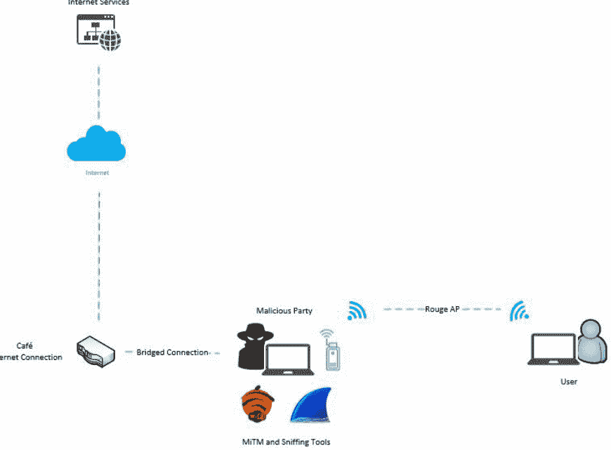

在本章中，我将向你展示如何在 Kali Linux 虚拟机上设置一个伪接入点（bogus access point）。为了执行此攻击，你需要一个同时支持监听模式（monitor mode）和主机模式（master mode）的 USB 网络适配器。

如果你还没有支持这些网络模式的 USB 网络适配器，我强烈推荐我之前提到的 Alpha 网络适配器。它只需要大约 50 美，你可以在亚马逊和其他几个地方买到。

在我们开始之前，我想解释一下这种攻击是如何工作的。让我给你提供一个关于该攻击原理的高级概述以供演示。受害者、攻击者、伪接入点以及一个带有互联网连接的路由器是主要组件。

发生的情况是，攻击者连接到了互联网，并且攻击者意图通过充当伪接入点的 USB 网络适配器共享连接。

任何连接到这个伪接入点的人都能连接到互联网。让我带你过一遍流程。受害者首先连接到伪接入点，之后受害者的互联网流量将通过伪接入点路由到攻击者处。

一旦攻击者获取了受害者的流量，攻击者将使用 SSL 剥离（SSL strip）操纵并记录受害者的流量，允许攻击者强制受害者使用 `HTTP`，从而允许攻击者捕获受害者输入的任何用户名和密码。

在 SSL 剥离完成对互联网流量的操纵和记录后，攻击者会将受害者的互联网流量转发到路由器。最后，路由器将受害者的互联网流量引导至受害者尝试通信的网站。

我们在这里做的是把自己置于受害者和网站之间，允许我们看到受害者与网站之间发生的任何交互；这被称为中间人攻击（man-in-the-middle attack）。

解释到此，让我们开始攻击。第一步是连接互联网，我们将通过将操作系统的互联网连接共享给我们的 Kali Linux 虚拟机来实现。

这本质上是一个桥接或有线网络连接，我采用这种方法是为了避免对第二个 USB 网络适配器的需求；然而，如果你有第二个 USB 网络适配器，可以使用它直接从你的 Kali Linux 虚拟机连接到互联网。

相反，我将使用我即将向你展示的方法。现在让我们登录我们的操作系统。使用哪台电脑运行你的 Kali Linux 虚拟机没有区别，只要它能连接互联网即可。

首先，启动网络设置或你的操作系统使用的任何网络管理应用程序。我可以从顶部菜单栏获取它，然后我们将寻找一个要连接的无线网络。

记住，只要有互联网连接，你就可以连接到任何网络，如果你在移动，可以通过 4G USB 调制解调器、移动热点或你拥任何互联网连接方式连接到 Android 或 iPhone。

一旦你的操作系统连接到互联网，你必须将其共享给我们的 Kali Linux 虚拟机。所以，切换到我们的 Kali Linux 虚拟机，找到顶部菜单栏，然后是网络适配器菜单。

如果有多个，请使用顶部的网络适配器。它应该是一个适配器，后面没有跟着任何数字。在这里，我们必须确保已将网络适配器配置为桥接自动（bridged auto），这将允许我们从操作系统连接的路由器处获取 IP 地址和互联网连接。

一旦你完成了这些操作，就可以允许虚拟机收起，我们现在可以使用该虚拟网络连接。

接下来，让我们打开网络管理器；顺便说一下，你可以使用任何网络管理器并找到显示“有线网络”（Wired Network）的选项然后点击“连接”。

如果你使用的是默认的网络管理器，[我们需要配置 DHCP 服务器]。

我们的网络适配器名称，我们需要监听模式，因此输入 `airmon-ng start wlan0` 并按回车，等待它为您创建一个监听接口。将出现一条消息，通知您名为`mon0`的监听接口已创建。

现在我们将运行 `airbase-ng -c 11 -e freewifi` 来创建我们的伪造接入点。

在`mon0`处输入你的监听接口名称。在我的情况下，是`mon0`，然后按回车。现在我们的伪造接入点已经运行起来，我们需要对隧道接口进行一些更改，该接口是我们在启动伪造接入点时`airbase`为我们的。

因此，在保持运行 airbase 的终端开启的同时，打开一个新的终端，因为我们需要它继续运行。在新终端中，输入 `ifconfig at0 192.168.1.1 mask 255.255.255.0` 并按回车。MTU（最大传输单元）不能被调整。MTU 允许我们的隧道接口发送更大的数据包，防止分片。

通俗来说，这使得我们的伪造接入点能够处理任何连接到我们伪造接入点的人产生的互联网流量。在终端中输入 `ifconfig at0 1400` 并按回车。现在我们添加了路由表，输入 `route add net 192.168.1.0 mask 255.255.255.0 GW 192.168.1.1` 并按回车。现在我们必须启用 IP 转发并创建 iptables 规则，使用隧道接口在伪造接入点和互联网服务器之间路由流量。因此，我们必须输入 `echo 1 > /proc/sys/net/ipv4/ip_forward` 并按回车。现在我们必须输入 iptables 规则。运行 `iptables -t nat -A PRERUTING -p udp -j NAT -to 192.168.0.1`。

在这里，我们必须使用之前记录的网关 IP `192.168.0.1`，并按回。必须输入 `iptables -P FORWARD ACCEPT`。

`Forward` 和 `accept` 必须全部大大写，并且应该按下 ENTER。现在输入 `iptables -append FORWARD -in interface at0 -j ACCEPT` 并按回车。现在输入 `iptables -table nat -append POSTROUTING --interface eth0 -j MASQUERADE` 并按回车。最后，输入 `iptables -t nat - PREROUTING -p tcp --destination-port 80 -j REDIRECT --port 10000`，在我们创建了 iptables 规则后，现在启动我们的 DHCP 服务器。因此，输入 `dhcpd -f /etc/dhcpd.conf -pf /var/run/dhcpd.pid at0` 并按回车。接下来输入 `/init.d/dhcp-server start` 并按回车；DHCP 服务器应该已启动。最后，它显示 `[..] Starting DHCP server: dhcpd。`

是时候获取 SSL strip 了，输入 `sslstrip -f -p 10000` 并按回车。但稍后需要启动 ssl 应用，所以让我们打开一个新终端，保持运行 SSL strip 的终端开启。在新终端中，输入 `ettercap -p -U -q -i at0` 并按回车。现在使用我们已经运行的 SSL strip 和 ettercap 的攻击方法。现在我们模拟了一个受害者，可以使用我们的伪造接入点来窃取用户名和密码。

所以，如果你去你的电脑上，你可以做的第一件事就是连接到伪造接入点。打开网络管理器并扫描附近的无线网络；你应该能看到你的手机接入点`freewifi`。

连接到它，假设我们所做的一切都是，你应该有一个互联网连接。检查你是否从我们之前创建的 DHCP 池中分配了 IP 地址。

在我提供的示例中，我们创建了一个可以为连接设备分配 IP 地址的 DHCP 服务器，并使用命令 `range 192.168.1.2 192.168.1.30` 在 `192.168.1.2` 和 `192.168.1.30` 之间创建了一个范围。

作为 DHCP 配置的一部分，你受害者的 IP 地址应该在该范围内。作为受害者，你可以检查你的 Facebook 页面查看 SSL strip 是否处于激活。

你可以使用 Firefox 或 Google Chrome，你会发现如果你在浏览器中输入 `https://www.facebook.com`，它会将地址更改为 `www.facebook.com`。

这表明 SSL strip 正在运行，在浏览器的左上角标签页可以找到锁图标。

这是 SSL strip 添加的图标，以增加一点伪装，它能防止受害者产生过度怀疑，因为他们看到了锁并假设它是安全的。

所以，放心地通过输入电子邮件地址和密码在 Facebook 上创建一个账户。

你输入一个虚假的用户名和密码，例如`tester` 和 `password123.`。

使用什么用户名或密码没有区别，因为重点在于让你登录 Facebook，以便我们捕获这两个用户名和密码凭据。

返回攻击者机器，并在点击登录之前监控 ettercap 终端。现在你可以继续

使用了系统方法。我可以从顶部菜单栏获取它，然后我们寻找一个无线网络进行连接。

请记住，只要有互联网连接，你就可以连接到任何网络。如果你处于移动状态，可以通过 4G USB 调制解调器、手机热点或其他你拥有的互联网连接方式连接你的 Android 或 iPhone。

一旦你的操作系统连接到互联网，必须将其共享给我们的 Kali Linux 虚拟机。因此，请切换到你的 Kali Linux 虚拟机，在顶部菜单栏中打开虚拟（virtual），然后打开网络适配器（network adapter）。

如果你有多个网络适配器，请使用网络适配器。它应该被称为 network adapter，且后面不跟任何数字。在这里，我们必须确保已配置网络适配器使用“桥接自动检测”（bridged auto-detect），这将允许我们从连接你操作系统的路由器获取 IP 地址和互联网连接。

完成后，你就可以允许虚拟机关闭，我们现在可以使用该虚拟网络连接互联网。

接下来，让我们打开网络管理器；顺便说一下，你可以使用任何网络管理器，找到名为“有线网络”（Wired Network）的并点击“连接”（connect）。

如果你使用的是默认的网络管理器，应该会自动连接；如果没有，你可能需要重启虚拟机，之后你应该就能连接上了。

如果你仍然遇到问题，我建议下载并安装“Wic”网络管理器。现在我们已经有了互联网连接，必须找到并记录我们的网关 IP 地址。

关闭网络管理器并打开终端，在其中输入 `route -n` 然后按回车键查找你的网关 IP 地址。在我的设置中它是 `192.168.0.1`，我们需要记住它，因为我们将在后的命令中使用它。

你可以使用记事本或纸（任何你方便的方法）写下你的网关 IP 地址。在记录下网关 IP 地址后，我们需要安装 DHCP 服务器。

回到 Kali 终端，输入 `apt-get install dhcp3-server` 并按回车键。请耐心给它足够的时间完成 DHCP 服务器的安装，一旦完成，我们需要配置 DHCP 服务器。

回到终端，输入 `nano /etc/dhcp.conf` 并按回车键。你现在应该有一个空的 DHCP 服务器配置文件。如果由于原因它是空的，请删除所有内容，在你准备好后，开始添加你的设置。


首先，输入 `authoritative;` 然后按回车键移动到下一行，输入 `default-lease-time 600;` 然后按回车键移动到下一行，输入 `max-lease-time 7200;`

然后按回车键移动到下一行，然后输入 `subnet 192.168.1.0 netmask 255.255.255.0 {`（在空格后，这是一个“右大括号”）然后按回车键移动到下一行，输入 `option routers 192.168.1.1;` 然后按回车键移动到下一行，然后输入 `option subnet-mask 255.255.255.0";`

默认按回车键，移动到下一行，输入 `option domain-name "free wifi";` 然后按回车键，移动到下一行，输入 `option domain-name-servers 192.168.1.1;` 然后按回车键，移动到下一行，输入 `range 192.168.1.2 192.168.1.30;`

并按回车键移动到下一行，紧跟一个左大括号 `}`。这就是启动所需的所有。

再次，你的设置看起来应该是这样的：

```
authoritative;

default-lease-time 600;
max-lease-time 7200;
subnet 192.168.1.0 netmask 255.255.255.0 {
    option routers 192.168.1.1;
    option subnet-mask 255.255.255.0;
    option domain-name "free wifi";
    option domain-name-servers 192.168.1.1;
    range 192.168.1.2 192.168.1.30;
}
```

默认租用时间为 600 秒，最大租用时间为 7200 秒。子网地址为 192.168.1.0，掩码为 255.255.255.0；路由器 192.168.1.1；subnet-mask 255.255.255.0；domain-name "wifi"; domain-name-servers 192.168.1.1; range 192.168.1.2 192.168.1.30;

接下来，通过按下 `ctrl + x` 键并保存文件来保存我们做的更改。在写入并关闭文件之前必须先按“Y”。

你必须按 ENTER，我们需要找到 USB 网络适配器的名称（如果你还没有连接 USB 网络适配器，请连接），并在终端中输入 `airmon-ng` 并回车，你将看到下方列出的网络适配器名称。我的叫 "lan0"，你的可能也类似。。现在我们知道网络适配器的名称了，我们需要进入监控模式，所以输入 `airmon-ng start lan0` 并回车，等待它为你创建一个监控接口。屏幕会显示一条消息，告知你已创建一个名为 "mon0" 的监控接口。

现在我们将输入 `airbase-ng -c 11 -e free wifi0` 来创建我们的伪造接入点。

为 "mon0" 输入你的监控接口名称。在我的情况下，它是 "mon0"，然后按回车。现在我们的接入点已经运行，我们需要对隧道接口进行一些更改，这是 "airbase" 在我们启动假接入点时为我们创建的接口。

因此，让我们在保持运行接入点的终端开启的同时打开一个新的终端，因为我们需要继续操作。在新的终端中，输入 `ifconfig at0 192.168.1.1 netmask 255.255.255.0` 并按回车。MTU（最大传输单元）现在必须进行调整。MTU 允许我们的隧道接口处理更大的数据包，防止数据包分片。

通俗地说，这使得我们的接入点能够处理由连接到我们接入点的任何人产生的更大流量的流量。在终端输入 `ifconfig at0 1400` 并按回车。现在我们添加了路由表 `route add -net 192.168.1.0 netmask 255.255.255.0 GW 192.168.1.1` 并按回车。现在我们必须启用 IP 转发并创建一些 iptables 规则在我们的假接入点和互联网源之间路由流量。因此，我们必须输入 `echo 1 > /proc/sys/net/ipv4/forward` 并回车。我们现在必须输入 iptables 规则，所以

```
iptables -t nat — PREROUTING udp -j DNAT —to 192.168.0.1
```

在这里我们必须输入之前记录的网关 IP 地址，即 192.168.0.1，然后按 ENTER。现在必须输入 `iptables -P FORWARD ACCEPT`。

FORWARD 和 ACCEPT 必须全大写，然后按 ENTER。现在输入 `iptables --append FORWARD --interface at0 -j ACCEPT` 并回车。现在输入 `iptables --table nat —append PREROUTING --interface eth0 -j MASQUERADE` 并执行。最后，输入 `iptables -t nat —PREROUTING -p tcp --destination-port 80 -j REDIRECT --port 80000` 并回车。既然我们已经得到了 SSL strip，攻击就结束了。

回到攻击者机器，并在点击登录之前，在 ettercap 终端中进行监控。现在你可以继续登录 Facebook，你应该能看到数据流过 ettercap 终端。

"USER" 字段旁边的用户名和 "PASS" 字段旁边的密码应该是可见的。

如果你尝试用在线银行网站进行示例，用户名和密码不太可能出现在 ettercap 终端中，但它们会出现在 SSL strip 日志中。

如果你尝试登录账户，你将不会在终端中看到用户名和密码，但 SSL strip 会捕获并记录它们。

因此，回到攻击者的电脑，并打开一个新终端，输入 `cat sslstrip.log` 并按回车键。你现在应该能同时看到用户名和密码。

用户信息将以 `userId=username` 的形式显示在日志中，密码将以 `auth passwd=password` 的形式显示。

这就是我想给你们展示的所有示例，但请记住，这种攻击是可扩展的。

例如，有一个名为 "karma" 的工具，当计算机正在寻找要连接的无线网络时（特别是以前连接过的无线网络），它会向外发送探测请求。

因此，我们可以构建某些东西，允许我们接受探测请求，然后伪造该人员正在寻找的无线网络。

当它响应时，他们会认为自己发现了一个无线网络，他们的计算机将自动连接。你可以借此做很多事情，但目前，是时候进入下一种攻击了。

你现在可以退出我们查看 SSL strip 日志的终端。

然后，要停止 ettercap，同时按下 `Ctrl + C` 键，然后关闭该终端。

接着，要停止 SSL strip，按下 `ctrl + C` 并关闭终端。

要终止你的伪造接入点，请在 kali 窗口中按 `Ctrl + C`，然后关闭终端。

当你重启虚拟机时，你所创建的所有 `iptables` 规则都将恢复到默认状态。


它们都指示信号在哪个通道上传输，但使用方式略有不同。y 轴上活动的幅度显示在密度视图中。

因此，设备说话有多大以及说话的频率是多少，是通过从蓝到红的颜色编码指示的。红色的闪烁一直在传输但并不大，而右侧的传输时间约占 80%，但它的声音很大，以至于要么非常强大要么非常近。

瀑布图的功能更像地震仪，信号的幅度经过了颜色编码。它发生的频率由垂直线上出现的点数表示。

红点具有一致的蓝色编码且有很多活动，而蓝色峰值的红色编码活动频率较低。另一个技巧是使用左侧的导航功能。

它类似于 PVR（个人录像录视器），因为它允许你看到任何内容，从最近 30 秒的快照（用于问题的即时诊断）到几小时的记录活动（以便清晰地了解全天范围内该区域发生的情况）。

只需记住保存会话，这样你就能记住你当时在哪里以及你当时正在尝试监控什么。

你可以使用此工具查看不同类型的流量长什么样。例如，我们使用频谱分析仪来观察手机上的低比特率缓冲视频播放，短脉冲表明我们正接近连接饱和。

另一方面，高比特率的 1080p 播放在数据传输以建立缓冲区之间似乎没有那么多的间隙，因此可能难以同时运行多个流。

此外，由于 NVIDIA game stream 建议了一份通过你的 Wi-Fi 网络流传输游戏的高质量路由器列表，因为传输之间没有缓冲时间，低延迟至关重要，所以数据必须不断移动且没有中断。

因为是 Wi-Fi，所有这些诊断都相对简单。

那么我们需要这种工具的真正原因是什么？那是非 Wi-Fi 相关的信息。

你可能会发现你有一个设备在我们的 Wi-Fi 通道之外跳动，其中红色表示至少使用了 50% 的空闲时间。它可能是一个表现良好的无线耳机，但许多设备（如婴儿监视器）偶尔会跳到你的 Wi-Fi 上，导致中断。

当你切换到 5GHz 频率时，你首先注意到的是背景干扰有多小，以及可用通道有多少个。

如果你有能力强的设备，你可以分散并运行几个 40 兆赫甚至 80 兆赫的四频道接入点以获得海量吞吐量。你可以进一步测试并查看在手机上运行 `iper` 工具以模拟高负载网络活动然后到达接入点时看起来什么样。

密度不会改变活动的强度，但幅度剧增。这种基于信号强度的发现可以应用于许多有趣的方式。

无论如何，任何情况下，IT 专业人员使用此工具来确定哪些接入点会产生干扰。信号强度会决定这一点。

你可能会发现一个设备在我们的 Wi-Fi 通道之外跳动，红色表示至少使用了 50% 的空闲时间。它可能是一个表现良好的无线耳机，但许多设备

由于，它可能会导致一个不知情的人或客户端连接到它，以为它是合法的接入点，而它是一个 Honeypot。它试图访问你客户端上存储的信息，或将你的客户端作为连接合法网络的手段。

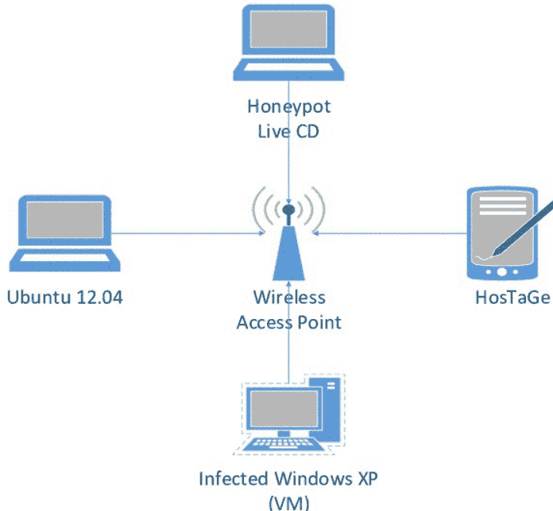

另一种严重的威胁是所谓的蜜罐接入点（Honeypot AP）。到底什么是蜜罐接入点？所以，这是一个我配置成与你公司的接入点完全相同的接入点。

我可能会选择相同的制造商和型号，并且我确定会为其分配相同的 SSID，产生相同的网络名称。使用蜜罐接入点的危险是什么？

蜜罐接入点另一方面，可能会导致一个不知情的人或客户端连接到它，以为它是合法的接入点，而它是一个蜜罐。它正试图访问你客户端上存储的信息，或将你的客户端作为连接合法网络的手段。

我是如何做到的？所以，如果你说服你我是你公司的合法接入点，你将尝试与我的设备进行身份验证。

我可以获取这些消息并转发给合法的接入点，当该合法的接入点响应时，我可以获取这些消息并转发给客户端。

数据，我会获取这些数据帧并将它们路由到法的访问点，反之亦然。

这被称为“中间人”攻击（Man In The Middle attack）。这里的风险在于，我不仅可能访问存储在你的客户端设备上的信息，而且一旦你合法地连接到企业网络，我现在也可以作为中间人的身份访问该网络。

如何防御非法访问点（rogue access point）？在讨论保护防止非法访问点的机制之前，有必要首先什么是非法访问点。

你必须创建无线安全策略。你必须能够监控网络以检测访问点。高端企业访问点通常可以在发射和传感器监控模式下运行，并与客户端通信。

如果你将访问点配置为监控模式，而不是与客户端对话和监听，那么你将在空中监听本不该出现的设备，例如非法访问点。

根据你环境中的风险程度，你可以让访问点 100% 的时间监控网络，或者让它们在部分时间监控，而在其他时间像正常访问点一样，向合法的客户端往回发送数据。

当你在网络上检测到非法访问点时，你的公司策略就会生效。你的首要任务应该是确保它们没有连接到网络，并且没有允许未经授权的信息被访问。

其次要任务是消除其作为干扰源。你必须物理定位非法访问点，以将其作为干扰源移除。

找到并移除干扰源的唯一方法是去现场嗅探网络。当你越接近干扰源时，你的信号就越强；当你远离它时，信号就越弱。

所以你像孩子一样玩“冷热一测”的游戏，直到找到干扰源为止。你如何处理“蜜罐型 AP（Honeypot AP）的问题呢？

另一方面，蜜罐型 AP 更严重，因为有人刻意给它分配一个 SSID，以欺骗网络认为它是一个真实的访问点。你必须通过双向认证来处理这个问题。

网络不仅必须验证客户端以确保该客户端有权访问网络，客户端也必须验证网络，以确保它连接到的是有效的网络。在接后的认证章节中，我们将很快讨论双向认证。

在无线网络中，有许多抑制非法访问点的技术，在这种情况下我们将使用 WLC（无线局域网控制器）。但在我们考虑抑制非法访问点之前，我们必须首先识别它。再次，有几种识别非法访问点的方法，其中我们已经讨论过，因此请考虑实际场景。

考虑使用信道分析仪在广播多个 SSID 的环境中识别潜在的干扰源，但其中一个使用开放认证，而其他的都使用 WPA2-Enterprise 安全防护。

如果这是企业基础设施，我们可能正在看到某些非法访问点试图诱骗一些客户。极有可能是你所在环境中的（无论是机场还是你的公司网络）有人在模拟或伪造你的 SSID，以诱导他们进入。

其次，如果客户关联到这个非法访问点并开始使用它，拥有该非法访问点的攻击者现在可以进行中间人攻击并窃听所有流量。

所以，这就是我们要做的。我们将使用无线局域网控制器，也称为“WLC”，因为 WLC 知道它管理哪些访问点。

好消息是，这些访问点默认并不是只坐在各自的信道上为客户服务，而是定期扫描其他信道，收集信息并反馈给无线局域网控制器。

它收集的数据部分关于它看到的访问点信息。当无线局域网控制器检测到一个既不受其管理也不是无线控制器家族成员的访问点时，它会将该访问点分类为“非法（rogue）”。

因此，我们使用 WLC 的第一步是检查控制器是否知晓任何非法访问点，如果我们找到了，将采取下一个逻辑步骤，即将其从控制器中隔离。

WLC 主页上的“监控（monitor）”页面将在右上角的“非法摘要”中显示活动非法访问点的详情。

如果你使用 WLC，你可能会注意到几个设备并疑惑：“为什么会有这么多非法访问点？”这可能是由于多种因素造成的。例如，WLC 检测到几十或上百个非法访问点，它们全部都是完全合法的；只是你的 WLC 没有管理它们，所以它们被归类为非法。

所有其他广播的 SSID 都会被 WLC 管理的一个或多个访问点看到并报告给控制器，这就是为什么控制器将它们分类为非法，因为它没有拥有这些设备的所有者。要查看这些非法访问点的详情，点击“详情（detail）”链接，我们将看到一个访问点列表，带有它们的 MAC 地址、SSID、正在使用的信道、使用了多少个射频以及连接到它们的客户端数量。

要了解更多关于该设备的信息，我们可以通过点击其 MAC 地址进入“非法 AP 详情（Rogue AP Detail）”。如果我们查看该访问点的详情，我们可以看到设备的 MAC 地址、WLC 首次看到它的时间、最后报告给 WLC 的时间以及最初报告的访问点。

在那里，我们可以看到该 AP 或多个 AP 报告的信道。

如果他们这样做，他们会很快离开，因为定期的“去认证”消息会断开连接到它的客户端。

如你所见，如果你的组织有一个 WLC（无线控制器），你可以快速识别并抑制非法接入点。但再次，我想提醒你，攻击他人的无线局域网是非法行为，并可能让你陷入麻烦，因此在使用 WLC 或任何其他工具执行此类抑制措施之前，请确保你已获得书面授权或经理的批准。

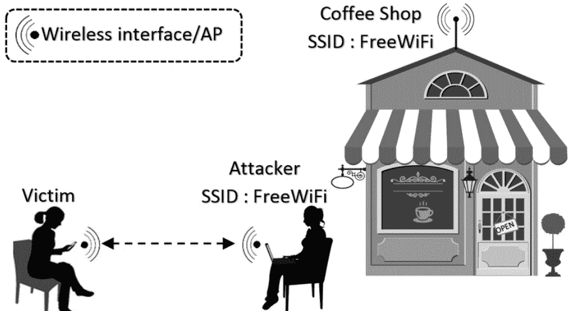

## 在 Kali Linux 上设置恶性双胞接入点

本章将向你展示如何在 Kali Linux 虚拟机上设置一个恶性双胞（Evil Twin）接入点。此外，我将演示如何结合恶性双胞接入点和社交工程技术来获取目标的 WPA 或 WPA2 密码。

你需要一个支持监听模式（monitor mode）的 USB 网络适配器来完成这次攻击。如果你还没有支持监听模式的 USB 网络适配器，我已经在之前的章节中推荐过它们。

此外，如果你已经知道恶性双胞接入点的工作原理，那很好；如果不知道，让我来解释一下我们将为这次攻击做些什么。

首先，我们将创建一个恶性双胞接入点，它是真实接入点的克隆。结果是我们将找到一个想要攻击的无线网络，复制它的标识信息（如名称和 MAC 地址），然后使用这些信息创建我们的无线网络。

请记住，这应该在你自己的无线网络上进行。如果你没有两个无线网络，我建议如果可以的话，请使用你的邻居或朋友的网络进行练习。

当客户端连接到恶性双胞网络时，他们无法区分真实网络和恶性双胞网络。当客户端打开网页浏览器时，我们将把他们重定向到路由器安全更新页面，在那里他们会被提示输入其 WPA 或 WPA2 密码。

当客户端输入其 WPA 密码时，密码将保存在我的 MySQL 数据库中，我们将在稍后创建该数据库。这就是我们应对这次攻击要做的所有工作。

让我们开始吧。首先，我们必须连接互联网，通过将宿主机操作系统的互联网连接共享给 Kali Linux 虚拟机来实现。这样，就不需要第二个 USB 网络适配器了。如果你切换到宿主机操作系统，无论你使用什么操作系统，只要它能连接互联网即可。

打开你的网络管理器并寻找要连接的无线网络。既然你已经在宿主机操作系统上连接了互联网，现在可以连接到你的家庭网络，然后我们需要将其共享给 Kali Linux 虚拟机。

现在，回到 Kali Linux，打开顶部菜单栏中的虚拟机菜单，展开网络适配器菜单，在这里我们需要将网络适配器设置为“桥接自动检测”（bridged auto-detect）。

完成后，你可以允许虚拟机折叠，我们现在可以使用该虚拟网络适配器通过宿主机连接互联网。

接下来，打开你的网络管理器（你可以使用任何现有的网络管理器），找到“有线网络”（wired network）选项并点击“连接”。

在连接期间，我想指出，如果你正在使用默认的网络管理器且在有线连接上遇到问题，我建议安装另一个网络管理器，例如“Wicd network manager”。

既然我们已经有了互联网连接，现在我们需要安装一个 DHCP 服务器。对于那些不知道什么是 DHCP 服务器的人，它用于在特定范围内为连接到接入点的客户端分配 IP 地址。

我们将使用它来为任何连接到我们恶性双胞接入点的人分配 IP 地址。关闭你的网络管理器并打开终端。在终端中输入 `apt-get install dhcp3-server` 然后按回车。我已经安装了 DHCP 服务器，但你可能会收到一个确认安装的提示；只需输入“Y”然后按回车，等待其完成。


接下来，我们需要配置 DHCP 服务器，因此在终端中输入 `nano /etc/dhcp.conf`（如果文件不存在，请在继续之前简单删除现有内容）。准备好后，让我们开始配置。在第一行输入 `authoritative:`，然后按回车到下一行并输入 `default-lease-time 600;`；然后按回车到下一行并输入 `max-lease-time 7200; subnet 192.168.1.128 netmask 255.255.255.128;`；然后按回车到下一行并输入 `option subnet-mask`。

这就是我们需要知道的所有信息，所以让我们保存并关闭文件。但首先，双检查你的终端中是否具有以下配置：

```
max-lease-time 7200; default-lease-time 600;

192.168.1.128 is a subnet. netmask 255.255.255.128; subnet-mask 255.255.255.128; broadcast-address 192.168.1.255; routers 192.168.1.129; domain-name-servers 8.8.8.8; range 192.168.1.130 192.168.1.140;
```

一旦确认配置正确，让我们继续并保存这些设置。

我们首先同时按下“ctrl 和 X”键，然后按“Y”键，最后按回车键。我们现在必须下载客户端启动网页浏览器时看到的安全更新页面。

此示例页面生成 Linksys 路由器安全更新，但在真实的渗透测试中，如果你测试的是使用强制门户（captive portal）或落地页的公司，我使用的示例页面很可能无关。

例如，你可能想创建一个与该公司强制门户看起来类似的网页。如果你正在测试使用 Netgear、D-link 或 Cisco 的网络，你应该创建一个识别这些特定制造商的网页。

下载 `evil.zip` 文件后，你必须解压它。完成后，我们就可以启动 Apache 服务器了，它将托管我们的安全更新网页。现在我们需要启动 Apache2，输入 `/etc/init.d/apache start` 并按回车。既然 MySQL 正在运行，我们需要登录并创建一个数据库，并在其中存储客户端在安全更新页面中输入的 WPA 密码，所以输入 `mysql -u root` 然后按回车，你将看到 MySQL 提示符。

在这里，我们将创建一个名为“evil_twin”的数据库，所以输入 `create database evil_twin` 并按回车。现在我们需要创建一个带有某些列的表，表示客户端在安全更新页面密码字段中输入的数据。因此，为了进入数据库，我们必须使用 `use evil_twin` 并按回车。接下来，输入 `create table wpa_keys(password varchar(64), confirm char(64));` 并回车。如果你好奇，这创建了一个名为“wpa_keys”的表，有两个列。第一个是“password”，第二个是“confirm”。

在这里，你需要引用目标 ESSID、目标通道号（在我的情况下是 6），然后输入你的监听接口名称，即 "mon0"，最后按回车键。

现在我们的“双孪生接入点”（twin access point）已经运行，我们需要配置隧道接口，以便在双孪生接入点和有线接口之间建立连接。

因此，打开一个新的终端，但不要关闭空基终端或 MySQL 终端。在终端中必须输入 `ifconfig a0 netmask 255.255.255.128 192.168.1.129`。

然后按回键。为了将流量转发到我们的双孪生接入点，我们需要添加路由表并启用 IP 转发，因此输入 `route add -net 192.168.1.128 netmask 255.255.255.128 gw 192.168.1.129` 并按回车。我们必须输入 `echo 1 > /proc/sys/net/ipv4/forward` 并按回车。我们现在必须编写一些 iptables 规则。

这些规则将控制网络流量的处理方式。然后，输入 `iptables -t nat -A POSTROUTING -out interface eth0 - MASQUERADE` 来创建一个管理发送到我们的有线接口（即我们的互联网源）流量的规则。

MASQUERADE 应该大写输入，然后回车。

我们需要创建一个规则来管理进入隧道接口的流量，因此输入 `iptables -append FORWARD -in interface eth0 -j ACCEPT` 并按回车。要创建一个接受 80 端口 TCP 连接并将其转发到服务器的规则，使用 `iptables -t nat -A PRERUTING -p tcp --dport 80 -j DNAT -to-destination 192.168.0.6:80`。要创建一个允许为最终规则提供网络地址转换的规则，输入 `iptables -t nat - A POSTROUTING -j MASQUERADE` 并按回车。现在我们已经配置了 IP 接口，我们需要 `cf /etc/dhcpd.conf -pf /var/run/dhcp.pid` 并启动我们的 DHCP 服务器。然后输入 `dhcpd at0` 并按回车 `/etc/init.d/isc-dhcp-server`。输出中现在应该出现 `Starting ISC DHCP server: dhcpd`。

这表明 DHCP 服务器正在运行，并且启动成功了。

最后，我们必须强制目标网络的客户端连接到我们的双孪生接入点。

为了实现这一点，我们必须对客户端进行取消认证攻击（deauthentication attack），将它们从目标网络断开。请记住，实现这一点有多种方法，但对于这次攻击，我们将使用 MDK3。

然后，要开始取消认证攻击，输入 `mdk3 mon0 d -b blacklist c `

在这里，你必须输入你的监听接口名称（mon0）以及目标通道号（6），然后按回车。你现在可以操作模拟受害者的电脑了。

如果取消认证攻击成功，你的受害者电脑的当前连接可能会随时终止。当你的受害者电脑丢失连接时，它会尝试重新建立刚刚丢失的连接，由于我们挂起了了真实的网络，它将转而连接到邪恶孪生网络。

当你回到空基终端监控连接时，你将看到有人连接到了你的邪恶孪生接入点。所以，如果你回到受害者电脑，打开网页浏览器并尝试访问 google.com。

你应该会发现自己被重定向到了安全更新页面，作为用户，你希望确保路由器已更新所有内容，特别是安全更新，因此由于路由器更新，它会提示你输入 WPA 密码。

确认密码后，点击 Update（更新）。回到你的 MySQL 终端，查看你是否成功捕获了 WPA 密码。

在终端中，输入 `use evil twin` 并按回车。然后我们将输入 `select * from wpa keys;` 并按回车，你应该能在你的 MySQL 数据库中看到客户端的密码。

在 MySQL 数据库中，密码应该显示在“password”下，确认的密码应该显示在“confirm”下。

如果客户端输入的密码不匹配，他们将被引导重定向到一个错误页面，提示他们重新输入密码，因为密码不匹配。

如果客户端点击了取消按钮，他们将被带到一个页面，该页面向他们保证这次安全更新对他们有多重要，并且在更新完成之前他们无法上网。

这就是你制作邪恶孪生接入点并设置网页来捕获 WPA 密码的方法。

# 第 21 章 使用 MDK3 进行 DOS 攻击


DOS，或拒绝服务（denial of service）攻击是另一种企业安全威胁。顾名思义，拒绝服务攻击如果成功，将阻止他人使用资源或服务。

它会干扰提供给其他用户的服务。媒体上曾有一个案例，某个人决定他厌倦了开车时不能用手机，于是他在车里装了一个蜂窝干扰器，在行驶时干扰蜂窝网络的所有频率。

这样，周围车辆里的人无法使用手机，你可能会想，哇，这是个好主意，但请记住，执法部门和救护车也使用手机服务。

当你干扰别人的蜂窝网络频率时，你也在干扰那些你不不想干扰的服务。这个人最终被捕获，一旦被捕获，被逮捕并处以巨额罚款。

然而，如何执行拒绝服务攻击呢？无线领域有两种主要方法。第一种是用无效流量淹没你的 Wi-Fi 接入点。如果你产生大量流量且接入点试图弄清楚如何处理，接入点会处理所有的认证请求吗？

如果你发送一个探测请求（probe request），接入点正在处理它但没有处理其他用户流量怎么办？所以，一种方法是简单的占用接入点，使其无法处理合法流量。

第二种方法是在接入点运行的频段内简单产生噪声和干扰。我们可以发送信号，直接中断并干扰任何同时广播的其他信号。

所以，在本章中，我将向你展示如何执行 DOS 攻击。拒绝服务，或 DOS，是指将所有人踢出网络并拒绝他们提供服务的行为。

首先，我们必须连接无线网络适配器。之后，启动终端并在其中输入 `ifconfig`。

回车，现在你必须打开一个文本文件记录一些信息。首先，我们将记录我们的无线接口，在我的情况下是 wlan0。

记住下那个名称。之后，你可以通过输入 `clear` 并按回车来清除终端。接下来，我们将扫描所有接入点以找到目标，输入 `iwlist wlan0 scan` 并按回车。这将显示所有可用接入点的列表，所以去寻找目标吧。一旦定位目标，记录 SSID、BSSID 和通道号。

之后，我们需要创建一个黑名单文件，因此输入 `echo (target access point's BSSID) > blacklist` 然后按回车。这将生成一个名为“blacklist”的文件，其中包含目标点的 BSSID。现在我们必须将无线接口配置为监听模式。要这样做，输入 `airmon-ng start wlan0` 并按回车。此命令将创建一个“mon0”监听接口。记住该接口。你可以输入 `airmon-ng` 来确认你的监听接口名称。

然后按回车键。这将显示你所有的接口，包括新的监听接口“mon0”。

现在我们准备好执行 DOS 攻击了，输入 `mdk3` 并回车。然后我们将输入 `mdk3 mon0 d -b c 6`

在这里，你必须输入你的监听接口名称（mon0）、我们的黑名单文件名（在我的情况下是 blacklist）以及我们接入点的通道号（6）。

完成后，按下回车键。随后，你会发现它开始发送数据包并淹没网络。

与此同时，如果你查看连接到同一网络的其他机器，你会发现它们都断开了连接。现在我们将打开另一个终端并输入 `mdk3 mon0 a -m (target access points BSSID)` 并按回车。查看另一台电脑，你应该能发现它被踢出了网络。如果你检查你的 Wi-Fi，你应该会注意到它已经断开连接。

消息。全部就这些了。如你所见，DOS 攻击非常简单。你应该已经注意到你已经被断开连接，我们无法再建立连接；这就是你使用 MDK3 执行 DOS 攻击的方法。

到为止，我们讨论了物理安全，以及我们的接入点位于公共场所的可能性。很多时候，我们没有考虑到由于这些网络不在锁闭的大门之后，我们无法保护这些网络。

然后，我们研究了非法接入点（Rogue Access Points）和蜜罐（Honeypots）。它们通过引起干扰对网络性能产生重大影响，在最坏的情况下，它们会允许没有访问权限的人进入你的网络。

最后，我们查看了拒绝服务攻击，你现在也知道如何执行它们了。在物理层，我们可以发起拒绝服务攻击。

我们还可以针对更高的帧和数据包层发起拒绝服务攻击。你如何运用所学的知识并继续前进呢？

我有几点建议。第一点建议是制定安全策略，定义员工是否可以在公司环境中引入并运行接入点。

记住，许多智能手机和笔记本电脑现在都可以作为接入点使用，当你的员工启用该功能并允许其他设备连接到该热点时，他们可能并没有意识到这一点，他们可能正在实施非法接入点。

因此，制定一项政策并向你的用户普及该政策以及什么是非法接入点是非常关键的。

第二点建议是确保你理解无线网络上的正常行为包含什么。

如果你知道通常每小时会收到多少认证和关联请求，而你突然注意到认证和关联请求数量的波动，你就能检测到针对你网络的攻击。

理解什么构成了正常行为使你能够检测出网络何时发生异常情况。在寻找异常时，请记住检查协议栈的所有层，包括物理层。

考虑以下因素：正常预期的干扰量是多少？正常预期的损坏帧和重传次数是多少？

我最后的最后的建议是确保 IT 人员理解无线物理层的工作原理。许多人认为无线传输像魔法一样，它就那样发生了。

在排查故障时，例如用户无法连接到网络，或者为什么他们在漫游时会掉线，这些问题不仅要在较高层调查以查看数据包的去向，还必须在物理层进行调查。

许多人对物理层表示担心，因为他们不熟悉空气中传输携带数据的波形概念。因此，作为 IT 专业人员，对无线物理层有深入的理解至关重要。

# 第 23 章 加密术语

在你的无线网络合理范围内的任何人都可以捕获通过空气的信号，并将它们转换回 1 和 0。加密你的数据防止被窃听的最佳方法。

当他们将这些信号转换回 1 和 0 时，他们无法看到任何有效数据。我们将从一些定义开始，帮助你理解加密。

首先，我们必须区分加密（Encryption）和密码学（Cryptography）。密码学和加密曾经是同义词。它们以前被认为是一样的，但现在我们需要不同的方式看待它们。

加密可以被是一个过程，它获取你的数据，使用某些秘密信息对消息进行处理和更改，以便拦截该消息的人如果没有该秘密信息就无法解密并查看消息的原始内容。

另一方面，密码学的定义要广泛得多。它涉及信息安全的所有方面。在以前你无法获得密码学学位，但现在可以了。

在 ways你可以学习算法背后的数学、是什么使它们变得困难，以及其他主题，如概率、统计、环论、图论等。

在书中，我们将只查看 Wi-Fi 网络中使用的加密。回到相同的基本定义，考虑以下场景。

假设我想给你发一条消息，但不想让别人知道。那么我会用一个秘密加密它并发送给你，如果你没有这个秘密，你就无法理解消息在说什么。

第一条以易读信息格式呈现的消息被称为`明文`（Plain text）。密文（Cipher text）是加密后的文本，除非你有秘密信息，否则它是不可读的。

你可能已经推出了我加密数据时使用的规则或秘密。如果你知道秘密信息，例如如果我使用了 ROT3，你就可以成功解密消息，因此我用来加密和解密消息的规则被称为`密码`（Cipher），即我用来加密数据的数学算法。

ROT3 代表“将你的字母表旋转 3 个字符”，在罗马早期使用。众人都尤利叶·凯撒使用的是 ROT13，它根据列出的 ABC 将字符位移 13 个位置。

因此，字母 "A" 变成了 "N"，字母 "B" 变成了 "O"。在罗马时代，这被认为是相当安全的，因为大多数人都能识字写字，所以如果他们理解了规则，解密消息就没用了。

它今天仍有一些个人和公司在使用，但它很容易被破解，因此是不安全的。我们的最后一个定义是`密钥`（Key）。我们对与消息结合加密的秘密密钥通过密码（如 ROT3 或 ROT13）处理，在该过程结束时，我们得到一组随机的 1 和 0，除非你有正确的解密密钥，否则你无法恢复原始信息。

为了更好地理解什么是密钥，考虑恩密码机（Enigma machine），它将旋转字符的概念提升了一个水平。恩密码机使用多个转子，最初是三个，战争后期增加到五个，每当你提供一个密钥进行加密时，它都会移动转子的位置，这表明你没有我们在查看 ROT3 和 ROT13 时讨论过的简单替换机制。

所以破解这需要耗费大量精力。但我们在这里讨论的是什么是密钥，在恩密码机的案例中，密钥就是密码本。

为了加密和解密消息，加密消息的人和解密消息的人必须确保恩密码机的设置或配置方式相同。

该配置至关重要，它是在密码本中定义并分发的。为了让你了解其复杂性，配置将包括转子选择、转子顺序、相对于转子接线的起始位置，以及作为接线一部分的插连接。

因此，如果你有秘密信息和机器，你就可以用它来加密和解密消息。战争期间，不同的军种使用不同的密码本。

现在你已经学习了一些基础定义，让我们看看中等无线网络中的密钥是什么样的，特别是我们的 Wi-Fi 网络。秘密密钥只不过是 1 和 0 的字符串。

1 和 0 的数量被称为密钥大小，在原始的 WEP 系统中使用了 40 和 128 位的密钥长度。我们使用该密钥发送数据，计算机上的数据也表示为 1 和 0。

在 WEP 和 WPA 中，我们使用 RC4 密码，而在 WPA2 中我们使用 AES（稍后详细介绍）。结果是你可以在空中发送的加密文本，除非接收者拥有解密该消息的秘密信息，否则他们无法获得原始数据。

现在你理解了明文、密文、密码和密钥的基础定义，我们可以讨论 Wi-Fi 网络中使用的机制了。

# 第 24 章 无线加密选项

## 无线加密选项

| 协议 | 描述 | 加密级别（密钥长度） |
|---|---|---|
| WEP | 有线等效隐私 (Wired Equivalent Privacy) | 64位 |
| WPA & WPA2 | Wi-Fi 保护访问 (Wi-Fi Protected Access) | 256位 |
| TKIP | 临时密钥完整性协议 (Temporal Key Integrity Protocol) | 128位 |
| AES | 高级加密标准 (Advanced Encryption Standard) | 128、192和256位 |

Wi-Fi 网络提供了多种可供使用的加密选项。如果你查看 Cisco 2800 接入点的配置，你会发现它通常用于中小型企业。

如果我们打开图形界面以访问配置选项，然后选择安全选项，我们就有如身份验证和加密等额外选项供选择。

如果我选择加密管理器（Encryption Manager），将会出现额外的选项。我可以完全不加密，也可以使用 WEP 加密；在 Cisco 产品上，我可以将该加密设置为强制性或可选，并选择我想要使用的算法。

当我点击算法选项时，我会有不同的算法选择，例如 WPA 40 位或 128 位，这指的是我的密钥长度。我有选项选择使用 TKIP（Cisco 的专有协议）或 CCMP。

在这里，我还有使用 WEP 和 TKIP 的选项，在下方，我可以使用高级加密标准（AES），单独使用或与 TKIP 配合使用。结果是我可以同时使用 AES TKIP 和 WEP。


现在让我们了解这些不同的加密技术。要理解各种加密选项，我们必须首先区分 IEEE 802.11 组和 Wi-Fi 联盟的角色。

顾名思义，IEEE 标准组织负责定义标准以及协议本身。第一份规范于 1997 年定义，包含了两个选项：完全不加密或 WEP（WEP 代表有线等效隐私，具有一个加密选项）。

由于 WEP 加密的缺陷，IEEE 定义了标准的修订案以增加安全选项，这些修订案被定义在 `802.11i` 文档中。

Wi-Fi 联盟负责 `802.11` 标准的认证和推广。由于 WEP 的安全缺陷，他们一直推迟 Wi-Fi 技术的部署。

Wi-Fi 联盟决定基于草案标准进行认证计划，这被称为 Wi-Fi 保护访问（WPA）。

在加密方面，`TKIP` 协议的使用是该认证的关键组成部分。`TKIP` 的优势是不需要任何硬件更改，这使得供应商更容易早期推出并解决 WEP 协议的一些早期问题。

在 `802.11i` 标准确定后，Wi-Fi 联盟修订了其认证计划，被称为 Wi-Fi 保护访问 2，简称为 WPA2。

高级加密标准（AES）包含在 WPA2 中。现在任何通过 Wi-Fi 联盟认证测试的产品都要求使用 WPA2。必须记住，WEP 和 `802.11i` 都解决了身份验证机制、加密技术和消息完整性问题。

# 第 25 章 WEP 漏洞

你可能会奇怪，为什么 WEP 是一项旧技术我们还在讨论它。有两个原因。第一，你仍然可以在市场上找到 WEP 旧设备，例如医院和仓库，他们不想更换它们，因为他们认为 WEP 的安全性对于目前的使用已经足够。

第二个原因是，通过理解 WEP 及其缺陷，我们可以更好地理解 `802.11` 如何引入新机制来解决 WEP 的缺陷。

WEP 采用 RC4 算法或密码，某些消息使用 RC4 算法进行处理并对结果进行加密。WEP 可以使用 40 位和 128 位密钥。

24 位的初始化向量（IV）和 104 位的共享密钥共同组成 128 位密钥。这 104 位是秘密部分，而每帧都会更改的初始化向量则包含在帧内部发送。

初始化向量在空中传输，但它在每一帧都会发生变化。当接收器接收到初始化向量时，它与共享密钥连接，然后使用 RC4 算法解密消息。

由于初始化向量长度只有 24 位，它每帧都会更改。如果我收集了足够多的在空中传输的数据，我就可以看到重复模式，而重复模式是加密机制中的一个弱点，允许我破解密钥。

如果黑客可以收集最少 200,000 个在空中发送的 MAC 帧，他们就能破解加密密钥。一旦他们破解了你的加密密钥，他们就能读取你的用户数据。

为了理解 WEP 问题的范围，有必要理解加密密钥破解后的后果。首先，在 WEP 中，所有用户共享同一个 WEP 密钥。

这有两个后果。首先，因为每个人都使用相同的密钥，这使得黑客更容易收集破解密钥所需的数据包。

其次，一旦密钥被破解，黑客就可以解密网络上所有用户的流量。这是因为所有人使用的是相同的密钥。

第三，由于 WEP 容易受到身份验证攻击，黑客可以在不知道密码的情况下访问网络。一旦他们连接，他们就可以以授权用户的身份执行任何活动，例如偷取数据或在网络内部发起进一步的攻击。

最后，由于 WEP 容易受到 IV 攻击，黑客可以收集具有相同初始化向量的数据包来重构密钥。通过收集足够的此类数据包，可以在短时间内破解密钥。这就是为什么 WEP 现在被认为是不安全的。

# 第 26 章 TKIP 基础

为了改进 Wi-Fi 加密，`802.11i` 标准包含了不同的安全机制。第一个被称为 TKIP，我们现在来看它。

TKIP 的主要优势是它可以在供应商无需更改客户端设备或接入点中任何硬件的情况下实施。这使得他们能够快速地将改进的安全性引入市场。

TKIP 使用与 WEP 相同的 RC4 算法，但它对其进行了封装以改进 WEP 的漏洞。它生成 128 位的逐包密钥，该密钥被分为 104 位的 RC4 密钥和 24 位的 WEP 初始化向量，然后输入 RC4 算法。

这里需要注意的重要点是密钥随每个数据包变化。每个包的密钥是通过输入生成的。第一个是临时密钥（temporal key），之后是会话密钥（session key），用户每次使用新会话时都会更改。

源 MAC 地址也会输入 TKIP。输入源 MAC 地址意味着对于每个连接到网络的用户，密钥都是唯一的。

每个数据包还包含一个 48 位的序列计数器，每当传输新数据包时，它就会递增。由于序列号递增，每个数据包都有唯一的密钥。总结来说，TKIP 通过更改输入到 RC4 算法的密钥信息来封装 WEP，而不是使用静态的 104 位密钥加 24 位初始化向量。

通过采用随每个数据包递增的序列计数器，将初始化向量从 24 位扩展到 48 位，这意味着每个数据包的密钥都是唯一的，同时它还能防范中继攻击。

一旦生成了每包密钥，128 位就会被分为 104 位和 24 位，并将相同的馈送作为密钥材料输入到 RC4 算法中。

因此，你应该理解为我并没有从根本上改变运行 RC4 算法的硬件；相反，我改变了输入该算法的密钥材料生成方式。因此，我可以通过固件升级的方式切换到 TKIP，这解决了 WEP 协议的许多缺陷。

## TKIP 加密过程

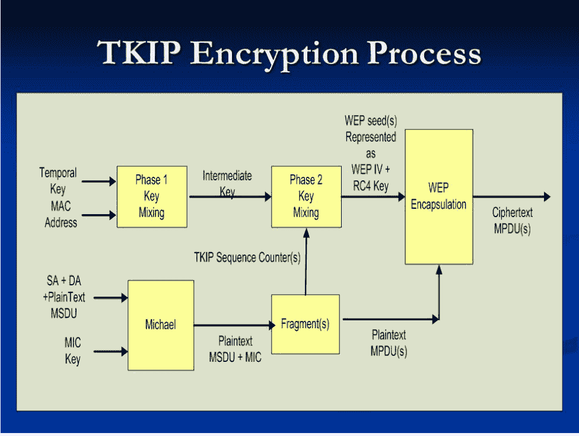

# 第 27 章 定义 CCMP 与 AES

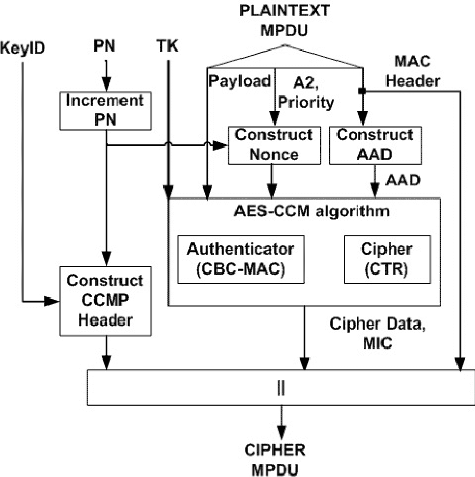

总结一下，我们已经讨论了原始 `802.11` 标准如何定义不进行加密的能力，因此你的数据帧将以明文形式发送，或者你可以使用使用 RC4 算法的 WEP 加密。

由于 WEP 被发现存在缺陷，IEEE `802.11i` 修正案被引入。由于将安全解决方案推向市场的时间限制，Wi-Fi 联盟基于 `802.11i` 草案标准创建了一个认证计划，其中包含了 TKIP 协议。

TKIP 提供了一个封装在 WEP 外围的机制，并使用 RC4 算法，解决了 WEP 中发现的许多漏洞。

它允许厂商通过固件更新其产品，因为它封装了 RC4 算法。Wi-Fi 联盟的认证计划被称为 WPA，即 Wi-Fi 保护访问。

在本章中，我们将讨论带有 AES 密码器算法的推荐加密技术——CCMP 协议，以及 Wi-Fi 联盟对这些协议的认证——WPA2。

带密码分组链消息认证码计数模式协议（Counter Mode with Cipher Block Chaining Message Authentication Code Protocol）简称为 CCMP。首先，这是一种加密协议，因此它不仅用于 `802.11` 标准。

它也可以用于其他标准；例如，IEEE `802.16` WiMAX 标准定义了它的用途。你必须理解的 CCMP 是它提供了两种服务。

CCMP 具有一个提供加密的计数模式，以及一个密码分组链 MAC，后者使用相同的密钥但不同的初始化向量来加密数据帧，并判断该消息是否真实以及是否来自源端。

CCMP 提供加密以及消息认证。换句话说，TKIP 和 CCMP 都是协议。遗留设备使用与 RC4 配合的 TKIP，但今天制造并经过 Wi-Fi 联盟认证的产品将使用使用高级加密算法（AES）的 CCMP 协议。

AES 是块密码算法，而 RC4 是流密码算法。我们具体指代什么呢？RC4 通过获取你的明文数据帧并与密钥流进行异或（exclusive）操作来处理你的数据。

这本质上是根据密钥流的内容翻转位，从而产生密文。块密码算法则不同。使用块密码算法，你将明文数据帧划分为固定长度的块。

这些块的长度取决于标准，它们可能是 32 位、64 位或 128 位。在 AES 和我们的 Wi-Fi 标准中，它采用了 128 位的块大小。

每个块都被加密，然后这些块被重组为你的密文帧。使用块不仅在位级别进行替换，还允许在矩阵级别对数据进行处理，并允许行和列转置，这使得在没有密钥的情况下解密变得非常困难。

CCMP 协议将加密和消息完整性协议合并到一个单一过程中。由于我们已经讨论了加密，我只是为了让你对计数模式有一个基本的了解，我们稍后讨论消息完整性时回顾整个过程。

关于计数模式需要记住的一点是，它的名称源于使用计数器的概念。计数器由几个连接在一起的字段组成。

这些包括源地址（后将讨论），这意味着计数器对于每个连接到网络的设备都是唯一的。它包含了数据包编号，因此计数器对于处理的每个数据包都是不同的。

它还有一个递增式计数器，从 1 开始并递增到 2、3 等。正如在 TKIP 中讨论的那样，计数器 TKIP 将防止重放攻击。

然后，类似于 TKIP，你有一个每个会话（或用户每次连接到该网络时）变化的临时密钥。

它作为 AES 计数模式算法中的密钥材料，与明文帧和消息认证码一起，被加密并通过空中发送。

总结一下，我们讨论了加密以防止人们窃听空中流量，并介绍了作为你 Wi-Fi 网络中 `802.11` 标准一部分的各种可用选项。

还讨论了 WEP、TKIP 和 CCMP。通过这些信息，你可以评估你的组织是否需要连接到无线网络但无法使用更强的 AES 加密。

例如，条形码器并不总是使用 TKIP 或 AES。

如果你有无法使用 AES 的设备，你应该考虑两件事：

- 首先，

因此，在实施网络时，你必须考虑你拥有的各种用户组、为这些不同组所需的各种类型认证机制，然后为每个组分配一个唯一的 SSID。

为了更好地了解接入点（AP）上的配置选项，让我们看看 Cisco 2800 接入点提供的可用功能。例如，一旦访问了 GUI 界面，你可以点击安全（security）来查看已配置的 SSID 列表。

如果你已经配置了 SSID，可以为该 SSID 选择认证方法。还可以添加具有不同认证方法的额外 SSID。

当我们查看这些方法时，可以看到你有：完全开放（completely open）并带有额外的 MAC 认证（additional MAC authentication）、EAP、MAC 和 EAP，或者可选的 EAP（optional EAP）。

可选 EAP 是一种允许客户端在两种认证方法之间进行选择的机制。如果你选择共享认证（shared authentication），你也可以选择 MAC 认证、EAP 认证或 MAC 认证。

EAP 意味着你也可以包含 MAC 认证。这里需要记住的核心点是，有多种认证机制可供选择，你并不局限于使用其中一种。

你可以对单个 SSID 应用多种认证方法。我想说明的最后一点是，这些 SSID 中的每一个都可以分配给特定的 VLAN。

所以，如果我想区分使用访客认证方法连接的人与使用员工认证方法连接的人的流量，我会在这里设置 VLAN。

请记住，单凭 VLAN 并不能保证安全，因此请始终使用 VLAN 访问控制列表（ACL）来控制接入点之外的流量，但我们讨论的是无线认证，而不是如何保护 VLAN 上的流量。

要理解可用的各种 `802.11` 认证选项，我们必须首先回顾规范的历史。1997 年编写的规范包含了两种认证方法。第一种是开放认证（open authentication），本质上意味着完全没有认证；第二种是 WEP 认证。

WEP 协议的功能不仅仅是认证。WEP 还执行了加密和消息完整性检查，但我们只关注认证。WEP 存在已知缺陷，为了解决这些缺陷，IEEE 开发了 `802.11i`。

`802.11` 规范中包含了两个关键方面。首先是将 EAP 作为发送认证消息的框架，尽管 EAP 是一个 IETF 协议。

其次，它还引入了 `802.1X` 基于端口认证的概念，这防止了在用户通过网络认证之前，任何非认证流量通过网络进行传输。

为了确保产品符合 `802.11i` 规范，Wi-Fi 联盟开发了认证计划。这些 Wi-Fi 联盟规范最初发布为 WPA，后来被修订以符合最终标准，即被称为 WPA2。

WPA 和 WPA2 有两种工作模式。有 WPA 和 WPA2 Personal（个人版），以及 WPA 和 WPA2 Enterprise（企业版）。个人版适用于家庭和小型企业环境，而企业版适用于拥有网络并连接到“AAA”（三A）服务器（如 RADIUS 服务器）进行认证的大型机构。

另外两种认证机制未被 `802.11` 标准覆盖但被广泛使用，因此我们也必须包含。第一种是 MAC 认证，第二种是 Web 认证（web authentication），也称为门户认证（portal authentication）。我们将逐一介绍这些认证机制。

# 第 29 章 WEP 认证


## 站点接入点

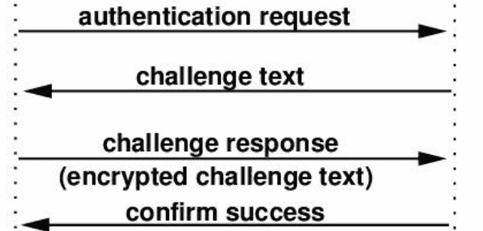

让我们从最简单的认证方案开始，称为开放认证。在开放认证中，站点会向接入点发送认证请求。在某些环境中，接入点可能具有额外的负载控制功能，并可能返回一个带有失败代码的关联响应。但在大多数情况下，接入点会返回一个带有成功代码的认证响应。此时，站点被认为通过了 `802.11` 认证。随后，站点将发送关联请求。关联请求告诉接入点关于站点的能力。随后，站点会返回一个关联响应，愉快地表示成功。此时，站点既通过了 `802.11` 认证，又通过了 `802.11` 关联，可以继续发送数据帧。如果你在 Wireshark 中查看开放认证，你可以看到在空气中传输的数据包。数据包 #1 是一个信标帧（beacon frame），意味着设备监听了信标帧并找到了一个接入点。接入点有一个在信标帧中广播的 SSID。该设备随后发送一个认证消息。如果我们打开这个认证请求，可以看到所使用的算法称为“开放系统（Open System）”。因此我正在发起一个开放系统认证请求。接入点随后响应一个认证响应消息，表示设备已成功认证。该设备随后通过发送关联请求来关联。关联请求包含了关于设备的所有信息。如果你点击标记的参数（tagged parameters），你可以看到 RSN 信息，它揭示了设备能够支持的所有认证机制。在这里，你看到返回的关联响应，设备已成功通过认证和关联，该设备现在可以发送数据帧了。

现在让我们来看 WEP 认证。在 WEP 认证中，客户端和接入点都拥有一个共享密钥（shared secret key）。如果你还记得我们讨论过加密，共享密钥是同时用于加密和认证的相同密钥。该密钥的长度可以是 40 位或 128 位。在 WEP 认证中，当站点发送认证请求时，接入点现在会返回一个挑战文（challenging text）。挑战文只是接入点生成的随机数。站点接收到该随机数，并使用其共享密钥作为挑战响应对该随机数进行加密。接入点拥有共享密钥以及它发送给站点的挑战文，因此它可以加密相同的挑战文。如果接入点的解密结果与来自站点的加密响应匹配，那么接入点就可以假设站点也拥有该共享密钥。因此，它会返回一个表示“成功”的认证响应。此时，站点被认为通过了 `802.11` 认证。它可以继续获取 `802.11` 关联。一旦完成认证和关联，站点就能发送数据帧了。

# 第 30 章 802.11i 认证过程

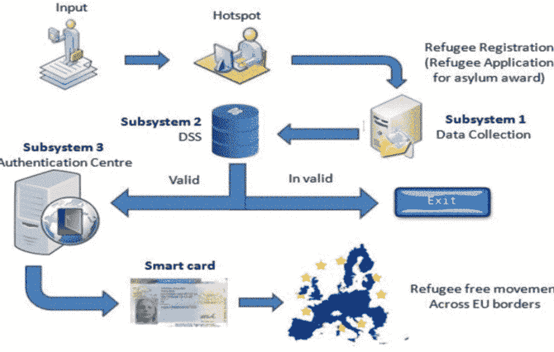

EAP 协议遵循 `802.11i` 规范，允许你的站点与 AAA 服务器（通常是 RADIUS 服务器）进行通信。许多企业使用同一个 AAA 服务器对无线网络上的用户进行认证，就像对有线网络上的用户一样。要理解 `802.11i`，我们必须首先理解 EAP 协议。在此之前，我想确保你理解在 `802.11i` 之前发生的消息交换。许多设备，如条形码扫描器、摄像头、医院设备和工厂设备，仍在使用旧的 `802.11` 标准，`802.11` 标准组希望在支持这些设备的同时，扩展标准以支持新的认证机制。因此，在 `802.11i` 认证和关联之后，会发生 EAP 协议。虽然在 `802.11i` 认证之前执行一次认证或 WEP 认证是可能的，但大多数组织仅在执行 `802.11i` 认证之前执行 `802.11` 开放认证和关联。在比较新旧 Wi-Fi 站点时，旧设备可以继续使用 `802.11`（无论是开放或 WEP 认证后进行 `802.11` 关联）进行连接，而符合 `802.11i` 的新站点将先进行 `802.11` 开放认证和 `802.11` 关联，然后开始 EAP 交换，这就是我们接下来讨论的内容。

EAP 不是通过中间节点进行的。也就是说，EAP 为执行企业可能希望实施的认证协议提供了一个框架。换句话说，`802.11` 定义了使用 EAP 在客户端和 AAA 服务器（如 RADIUS）之间传输消息的方法，而不是认证协议本身。这允许企业在无线网络中使用与其有线网络中相同的认证协议。PEAP 和 MSCHAP 结合使用，是 Windows 计算机身份验证最常用的协议。SIM 和 AKA 通常用于移动服务提供商场景。`802.11` 的优势在于，它允许你使用任何你想要的认证机制，许多组织会使用它们在有线网络上使用的那种。


现在我们知道 EAP 是一种从我的客户端到 RADIUS 服务器传输认证消息的协议。我们还需要讨论如何通过我的无线局域网传输 EAP 消息。为了做到这一点，我们必须讨论局域网上的 EAP，也称为 EAPOL。EAPOL 与 EAP 一样，是一种封装协议，这意味着它获取高层消息（在本例中为 EAP）并将其发送到网络。当我们穿越网络后，网络会查看内部并好奇：“这条消息在哪里？它的目标是 RADIUS 服务器吗？”它将使用 EAPOL 进行封装并继续其传输。EAPOL 是用于在 802.11 等二层协议上传输 EAP 消息的协议。一旦我连接到网络，它就可以被路由到 AAA 服务器。EAP 定义在 IEEE 802.1X 标准中，802.1X 支持基于端口的认证。要理解基于端口的认证包含什么，我们必须首先讨论 802.1X 标准中定义的规则。第一个角色是请求者，即希望在网络上进行身份验证的设备。第二个角色是认证者，即在请求者通过认证之前阻塞除认证流量以外的所有流量的节点。人们经常对认证位于网络何处感到困惑。它是哪个节点？在网络中，你可能拥有客户端设备、接入点（AP）以及一个独立的 WLAN 控制器，或者 WLAN 控制器功能可能存在交换机上，然后是 RADIUS 服务器。认证者通常位于 WLAN 控制器功能中。你的 WLAN 控制器也可能是一个 RADIUS 服务器。该 WLAN RADIUS 服务器可以是交换平台上的独立设备或软件，通常情况下，如果你有一个 WLAN 控制器，它就充当了认证者。你可能会遇到这种情况：没有独立的 WLAN 控制器，所有内容都在接入点上，在这种情况下，接入点充当认证者并可能包含 RADIUS 功能。从实现的角度来看，你应该仅将其视为存在网络某处的某个功能。让我们来看这种情况下的 802.1X。我们已经确定，为了支持旧设备，我们需要先执行 802.11 认证，然后执行 802.11 关联，现在我就可以发送数据帧了。在这种情况下，请求者发送一个数据帧。接入点将该帧转发给认证者，认证者将阻塞除认证以外的所有流量。结果是，数据帧不会在网络任何地方传输。在这种情况下，认证者将响应“你是谁”的请求，此时它将向请求者发送一个 EAP 请求以识别其身份。请求者将用 EAP 响应进行回复，其身份将包含在该 EAP 响应中。当认证者接收响应时，它将其转发给认证服务器，如果你使用的是 RADIUS，它会将其发送到 RADIUS 访问请求。RADIUS 服务器随后检查 RADIUS 消息并注意到它包含一个 EAP 消息。它检查 EAP 并确定是否识别它。如果我是有效用户，它将开始认证过程。由于 EAP 协议支持多种认证方法，认证服务器与请求者之间的具体交换取决于企业使用的是 TLS、TTL 还是 PEAP。如果消息发生且用户成功通过认证，RADIUS 服务器将响应一个 RADIUS accept 消息，这将触发向请求者发送 EAP success 消息。你可能会想：“我们完成了，我现在通过了认证。”嗯，我们还有一件事需要做。用户必须被认证到网络中。这是如何工作的？当认证者发回包含用成对临时密钥材料加密的组密钥的 EAP 消息时，请求者解密该消息，向请求者证明认证者具有有效的密钥材料，从而证明网络是一个具有秘密信息的有效网络。换句话说，802.11i 支持双向认证。与仅认证客户端的 WEP 不同，它允许你对网络和客户端进行认证。我们讨论了认证服务器和请求者如何拥有主会话密钥，它们如何生成成对主密钥，以及认证服务器如何将该成对主密钥发送给认证者。请求者和认证者随后都会生成成对临时密钥，这些密钥长度为 384 位，分为三个独立的密钥。这些密钥用于各种用途。确认密钥、加密密钥和时间密钥都是必须的。这些密钥通过声明消息源自合法来源来验证消息性。确认密钥包含在几个 EAPoL 消息中。加密密钥用于机密性，但不是用于用户数据的机密性，因为它被用于 EAPoL 中密钥字段的机密性。最后是时间密钥，它用于加密用户数据，正如我们之前讨论加密时提到的那样。

## 第 31 章 四次握手

在本章中，我将向你展示如何嗅探空气并监听通过在请求者和认证者之间传输的 EAPoL 消息。这被称为四次握手。你也可以使用 Wireshark 工具来分析这种交换。我已经完成了数据包捕获，所以我只需概述数据包包含了什么。我使用 SSID 连接，并在进行数据包捕获时，我连接了一个设备并通过了认证。你可以搜索 EAPoL 交换消息。我将在 Wireshark 的捕获过滤器中输入 `eapol` 并点击应用，这将为我过滤出所有的 EAPoL 消息。这里就是我们要检查的四次握手，或者说那四条消息。如果我们看第一个，它是作为 802.11 数据帧发送的，然后作为该数据帧内部的 802.1X 认证消息承载，作为 EAPoL 协议的一部分。当我们打开 802.1X 第一条消息时，我想注意几点。首先，设置了为“9”的重放计数器。该计数器是必要的，以防止网络监听者捕获此数据包并作为原始数据包发送。重放计数器将防止此类攻击。认证者向请求者发送第一个 EAPoL 消息。我们可以在该消息中找到发送端接入点的 MAC 地址和接收客户端 MAC 地址的信息。AP 随机数在消息中发送，是一个随机数，底部是位流，但此消息没有受保护。此时没有消息完整性检查，因为请求者和认证者都还没有生成消息完整性校验码所需的密钥信息。第二条消息从请求者发回网络，目标地址是接入点的 MAC 地址。

在此条消息中，请求者将站点随机数发送给接入点，接入点将站点随机数发送给认证者，因此我们有了不同的随机数和一个看似随机的数字。

再次强调，所有的位、1 和 0 都在底部。现在请求者已经生成了站点随机数、它从 EAPoL 消息中收到的 AP 随机数，以及目的和源 MAC 地址和配对主密钥。

因此，它拥有了生成成对临时密钥所需要素，正如你可能记得的，该密钥分为确认密钥、密钥加密密钥和临时密钥。

请求者现在正使用确认密钥为此消息添加消息完整性检查。当网络接收到此消息时，它可以验证该消息确实来自拥有必要密钥密钥的请求者。

认证者现在拥有了它的随机数，此消息中包含了站点随机数，以及源和目的 MAC 地址，并可以生成成对临时密钥。

然后它可以确认消息完整性代码是正确的并信任该消息。这四路握手的第三条消息是作为响应发送的。

在此消息中，计数器已经增加了一。认证者还将第一条 EAPoL 消息中包含的随机数发送给请求者。

你可能奇怪我为什么会发送随机数。另一方面，请求者已经有了 AP 随机数。之所以这样做是因为当它发送此消息时，现在可以包含消息完整性代码，而这在第一条消息中是无法做到的。

它可以这样做是因为现在已经生成了成对临时密钥，并且确认密钥作为成对临时密钥的一部分。当请求者接收到此消息时，它可以确认网络拥有密钥信息。随后它验证了网络的真实性。

第四条消息仅仅是请求者对认证者的确认，表示：是的，我收到了上一条消息。这次重放计数器设置为 10，与接入点发送的计数器相同。

因为这是一个确认，所以不需要随机数信息。然而，我想保护这条消息以指示它未被篡改，因此它包含一个使用确认密钥生成的消息完整性代码。

关于这些消息我想说明的最后一点是，我们回到消息 1 并打开密钥信息，这条消息没有经过保护或加密。

这是因为在消息 1 中，双方都还没有生成成对临时密钥。消息 2 也没有加密，所以尽管请求者已经生成了成对临时密钥，但它没有加密这条消息，以确保认证者能以明文接收站点随机数。

消息 3 现在是加密的，因此它不仅包含了消息完整性检查代码，还加密了第三条消息。记住，认证者现在拥有了确认密钥和加密密钥，因为它生成了成对临时密钥。

所以，当它回传这条消息时，它对其进行了加密，并将组临时密钥作为此消息包含的数据的一部分包含其中。

最后一条消息也是安全的，因为一旦请求者和认证者都拥有了共享密钥，它们将使用这些密钥，通过添加消息完整性检查并使用密钥加密密钥进行加密来保护未来的消息。

这些信息非常多，为了完全理解它，你可以执行四路握手：打开 Wireshark 并捕获你的流量，然后使用过滤器搜索“EAPOL”，然后打开每个包并读取信息。Wireshark 在理解每个捕获的帧或包方面非常易于用户。

## 第 32 章 无线认证方法总结

结论，我们涵盖了 802.11 认证的基础知识。我们讨论了原始规范如何定义开放认证以及 WEP 认证。

WEP 存在几个缺陷，这促使 IEEE 创建了 802.11i 规范。第一个是 802.11i 使用 IEEE EAP 协议，允许认证消息从站点发送到 AAA 服务器（例如 RADIUS 服务器）。

它还引入了 802.1X 基于端口的认证，在该模式下，端口被阻塞，只有在用户通过认证后才允许流量通过。

Wi-Fi 联盟负责开发认证计划以确保符合 IEEE 标准。WPA 是确保符合 IEEE 802.11i 规范的认证计划名称。

WPA2 有两个版本：WPA2 Enterprise 和 WPA2 Personal。WPA2 Enterprise 也称为 WPA2-11X。这是因为 WPA2 Enterprise 是为部署了作为 RADIUS AAA 服务器的大型组织设计的。

WPA2 Personal 旨在尚未部署 AAA 服务器的组织。这适用于家庭市场、小型企业以及可能的热点位置。

你将如何应用你所学的知识？对此我有几点建议。第一个与旧留设备有关。

你的组织中是否仍在使用开放认证或 WEP 认证的旧留设备？

你应该问的问题是：“我可以移除这些设备并禁用 WEP 认证吗？”如果不能，请确保通过开放或 WEP 认证连接的设备无法访问公司网络中更安全的部分。

你可以通过建立 VLAN 和 VLAN 访问控制列表来实现这一点。最后，如果你仍有需要开放或 WEP 认证的设备，你可能想额外添加 MAC 认证作为补充。

我们稍后会提到。我的第二个建议是确保你的客户端能够同时支持 EAP 协议以及你打算用于认证这些设备和用户接入网络的首选认证协议。

例如，你可能想使用 PEAP 和 MSCHAP 来认证基于 Windows 的客户端，但使用 TTLS 来认证非 Windows 的客户端。

一旦你确定了想要使用哪些协议进行认证，你就必须制定一个关于客户端如何更新的策略，以确保作为你无线安全策略的一部分符合这些协议。

我的最终建议是，如果你在大型组织工作，请使用 802.1X 基于端口的认证。这需要安装 AAA 服务器。

可能会出现这种情况无法可行的情况，那时你必须使用 WPA Personal。在这些情况下，我建议通过 VPN（SSL 安全的 VPN 或 IPsec 安全的 VPN）来增加额外的安全保护层。

## 第 33 章 无线保护的附加解决方案

是时候讨论你的 Wi-Fi 网络的替代安全机制了。首先，我们将概述 Wi-Fi 安全的基础知识，但我们已经涵盖了原始规范（即开放和基于 WEP 的认证），然后我们将概述 802.11i 以及 802.11i 如何提供带有 802.1X 基于端口认证的 EAP 框架，以确保只有经过的用户的用户访问网络。

WPA、WPA Enterprise 是 802.11i EAP 的认证。

某些业务需要不同的认证机制或对这些认证方法的改进，将在后续章节中介绍。

我们将涵盖你了解 802.11i 安全基础所需的所有内容。我们将涵盖的首要主题是 MAC 认证，即我们如何通过连接设备的 MAC 地址进行认证。

这可以作为一种独立的认证方法，也可以与另一种认证方法结合使用，例如 WEP 认证或 802.11i 认证。

随后我们将讨论 WPA 和 WPA2 Personal，它们被用于在环境中在没有 RADIUS 服务器的情况下，例如家庭或小型企业环境，以及公共热点。

随后我们将讨论 Web 身份认证，它使用 Web 服务器来验证用户身份，客户端可以通过浏览器接口通过认证并连接到您的网络。

这种技术适用于酒店业，例如在酒店入住期间或尝试访问接入点的网络时。我们将介绍接入点之间的漫游。

我们希望漫游速度足够快以支持语音通话，并且当我们要讨论对 802.11i 机制的修改时，这将允许快速漫游。

首先，MAC 认证发生在网络询问“我认识你的 MAC 地址吗？”以及“如果我认识你的 MAC 地址，我将将允许你加入网络吗？”的时刻。

我们之前讨论过，在连接到 Wi-Fi 网络时，我们会先发送一个认证请求，接着发送一个关联请求。

当这些请求到达接入点时，它现在拥有了你的 MAC 地址，并可以检查该 MAC 地址是否在允许连接的白列表中。

此列表将存储在接入点或 RADIUS 服务器上。如果你有二三个接入点，并且少数设备连接到网络，那么在接入点上存储和维护 MAC 认证列表是可能的。

然而，一旦你有了大量的接入点和设备连接到你的网络，在每个接入点上维护有效 MAC 地址列表在管理上会变得非常困难，因此该列表通常维护在服务器上，例如 AAA RADIUS 服务器。

在你提交认证和关联请求后，接入点将向该 RADIUS 服务器检查，查看你的 MAC 地址是否有效。

它通过向 RADIUS 服务器发送认证请求来实现此点。

在你通过认证并关联后，MAC 认证请求被处理，接入点将不会允许该站发送任何数据。

如果 MAC 地址在 RADIUS 服务器的列表中，RADIUS 服务器将响应认证响应，表示认证成功。

此时，接入点将授权该站发送数据帧。如果认证响应为失败，可能会发生两种情况之一。

要么接入点将不允许该站发送任何数据，要么该站将能够执行 802.11i 认证。如果认证成功，该站就可以继续发送数据。

你可以配置网络，以决定通过 MAC 认证失败的站是否允许使用 802.11i 认证进行连接。

或者，我可以强制该站在被允许在网络上发送任何数据之前，不仅要通过 MAC 认证，还要通过 802.11i 认证。

换句话说，你可以配置网络设置一个仅允许通过 MAC 认证的设备连接的 SSID。如果你的网络中连接了不支持 802.11i 认证的 VoIP 设备，你可能会这样做。

在其他情况下，例如仓库和制造车间，诸如条码扫描器等设备拥有 MAC 地址但无法执行 802.11i 认证。

你可以创建一个 SSID，允许设备先执行 MAC 认证，但如果认证失败，它将执行 802.11i EAP 认证。

如果一切进展顺利，它们就能连接。结果是，任何能够执行 MAC 认证或 802.11i EAP 认证的设备都被允许连接到网络。

这不是一个推荐的选项，但在具有多种需要连接到网络的环境中可能效果良好。

最后，你希望在允许所有设备进行某种认证的同时，将管理复杂度降至最低。这允许你保持一个较小的 MAC 地址列表，例如，你不需要在认证列表中包含每个设备的 MAC 地址。

另一个选项是，连接的站必须通过 MAC 认证，只有通过了 MAC 认证，它才会继续执行 802.11i。

从管理的角度来看，这意味着你必须为每个想要连接到你网络的设备维护一个 MAC 地址列表。

大型组织将同时使用 MAC 认证和 802.11i 认证。这样做的好处是，如果员工离开了组织并不再使用其设备，或者 IT 人员可以从列表中删除 MAC 地址，该设备将不再能够连接到 Wi-Fi 网络。

所有这些功能在 Cisco 接入点上都可用。你可以使用各种认证机制对其进行配置。例如，如果你想在进行 MAC 认证的同时允许开放认证，你有多种选择。

如果你想确保他们不仅通过 MAC 认证，还通过 EAP 认证，你可以选择此选项或 MAC 或 EAP 认证。

你不仅可以有一个 EAP 认证服务器，还可以有一个 MAC 认证服务器，可以在那里跟踪允许连接到你网络的 MAC 地址。

你必须理解 MAC 认证的局限性。人们可以很容易地在空中监听并捕获有效的 MAC 地址。然后他们可以使用这些 MAC 地址更改设备上的 MAC 地址。

当这些设备尝试连接到网络时，它们将成功通过 MAC 认证。因此，MAC 认证应与另一种认证机制结合使用，或者在设备无法执行任何其他类型认证的网络中使用。

## 第 34 章 WPA & WPA2 认证过程

| 步骤 | 描述 |
| :--- | :--- |
| STA | 开放系统认证 |
| Association | 关联 |
| EAP start | EAP 开始 |
| EAP authentication request | EAP 认证请求 |
| EAP authentication response | EAP 认证响应 |
| AC certificate (public key) | AC 证书（公钥） |
| STA certificate (encrypted using public key) | STA 证书（使用公钥加密） | 认证成功 |
| User identity | 用户身份 |
| AC certificate (public key) | AC 证书（公钥） |
| STA certificate (encrypted using public key) | STA 证书（使用公钥加密） | 认证成功 |
| AC certificate (public key) | AC 证书（公钥） |
| STA certificate (encrypted using public key) | STA 证书（使用公钥加密） | 认证成功 |
| AC certificate (public key) | AC 证书（公钥） |
| STA certificate (encrypted using public key) | STA 证书（使用公钥加密） | 认证成功 |
| AC certificate (public key) | AC 证书（公钥） |


| STA certificate (encrypted using public key) | STA 证书（使用公钥加密） | 认证成功 |
| AC certificate (public key) | AC 证书（公钥） | |
| STA certificate (encrypted using public key) | STA 证书（使用公钥加密） | 认证成功 |
| AC certificate (public key) | AC 证书（公钥） | |
| STA certificate (encrypted using public key) | STA 证书（使用公钥加密） | 认证成功 |
| AC certificate (public key) | AC 证书（公钥） | |
| STA certificate (encrypted using public key) | STA 证书（使用公钥加密） | 认证成功 |
| AC certificate (public key) | AC 证书（公钥） | |
| STA certificate (encrypted using public key) | STA 证书（使用公钥加密） | 认证成功 |
| AC certificate (public key) | AC 证书（公钥） | |
| STA certificate (encrypted using public key) | STA 证书（使用公钥加密） | 认证成功 |
| AC certificate (public key) | AC 证书（公钥） | |
| STA certificate (encrypted using public key) | STA 证书（使用公钥加密） | 认证成功 |
| AC certificate (public key) | AC 证书（公钥） | |
| STA certificate (encrypted using public key) | STA 证书（使用公钥加密） | 认证成功 |
| AC certificate (public key) | AC 证书（公钥） | |
| STA certificate (encrypted using public key) | STA 证书（使用公钥加密） | 认证成功 |
| AC certificate (public key) | AC 证书（公钥） | |
| STA certificate (encrypted using public key) | STA 证书（使用公钥加密） | 认证成功 |
| AC certificate (public key) | AC 证书（公钥） | |
| STA certificate (encrypted using public key) | STA 证书（使用公钥加密） | 认证成功 |
| AC certificate (public key) | AC 证书（公钥） | |
| STA certificate (encrypted using public key) | STA 证书（使用公钥加密） | 认证成功 |
| AC certificate (public key) | AC 证书（公钥） | |
| STA certificate (encrypted using public key) | STA 证书（使用公钥加密） | 认证成功 |
| AC certificate (public key) | AC 证书（公钥） | |
| STA certificate (encrypted using public key) | STA 证书（使用公钥加密） | 认证成功 |
| AC certificate (public key) | AC 证书（公钥） | |
| STA certificate (encrypted using public key) | STA 证书（使用公钥加密） | 认证成功 |
| AC certificate (public key) | AC 证书（公钥） | |
| STA certificate (encrypted using public key) | STA 证书（使用公钥加密） | 认证成功 |
| AC certificate (public key) | AC 证书（公钥） | |
| STA certificate (encrypted using public key) | STA 证书（使用公钥加密） | 认证成功 |
| AC certificate (public key) | AC 证书（公钥） | |
| STA certificate (encrypted using public key) | STA 证书（使用公钥加密） | 认证成功 |
| AC certificate (public key) | AC 证书（公钥） | |
| STA certificate (encrypted using public key) | STA 证书（使用公钥加密） | 认证成功 |
| AC certificate (public key) | AC 证书（公钥） | |
| STA certificate (encrypted using public key) | STA 证书（使用公钥加密） | 认证成功 |
| AC certificate (public key) | AC 证书（公钥） | |
| STA certificate (encrypted using public key) | STA 证书（使用公钥加密） | 认证成功 |
| AC certificate (public key) | AC 证书（公钥） | |
| STA certificate (encrypted using public key) | STA 证书（使用公钥加密） | 认证成功 |
| AC certificate (public key) | AC 证书（公钥） | |
| STA certificate (encrypted using public key) | STA 证书（使用公钥加密） | 认证成功 |
| AC certificate (public key) | AC 证书（公钥） | |
| STA certificate (encrypted using public key) | STA 证书（使用公钥加密） | 认证成功 |
| AC certificate (public key) | AC 证书（公钥） | |
| STA certificate (encrypted using public key) | STA 证书（使用公钥加密） | 认证成功 |
| AC certificate (public key) | AC 证书（公钥） | |
| STA certificate (encrypted using public key) | STA 证书（使用公钥加密） | 认证成功 |
| AC certificate (public key) | AC 证书（公钥） | |
| STA certificate (encrypted using public key) | STA 证书（使用公钥加密） | 认证成功 |
| AC certificate (public key) | AC 证书（公钥） | |
| STA certificate (encrypted using public key) | STA 证书（使用公钥加密） | 认证成功 |
| AC certificate (public key) | AC 证书（公钥） | |
| STA certificate (encrypted using public key) | STA 证书（使用公钥加密） | 认证成功 |
| AC certificate (public key) | AC 证书（公钥） | |
| STA certificate (encrypted using public key) | STA 证书（使用公钥加密） | 认证成功 |
| AC certificate (public key) | AC 证书（公钥） | |
| STA certificate (encrypted using public key) | STA 证书（使用公钥加密） | 认证成功 |
| AC certificate (public key) | AC 证书（公钥） | |
| STA certificate (encrypted using public key) | STA 证书（使用公钥加密） | 认证成功 |
| User identity | | |

每个用户都有不同的主会话密钥（`master session keys`），确保这些用户定期更改这些密钥。为了使密钥信息更安全，这些系统会频繁确保密钥长度适当，并包含字符、数字、特殊字符以及大小写字母的适当组合。这取决于业务在 `WPA Personal` 中管理密钥的方式，包括他们更改密钥的频率以及他们共享这些密钥信息的策略。

# 第 35 章 Web 身份认证流程

在目前讨论过的许多场景中，我们一直使用服务器来验证用户身份，通常是 `RADIUS` 服务器。在本章中，我们将讨论如何使用 Web 服务器验证用户身份，这被称为 Web 身份认证（`web authentication`）；它也被称为门户认证（`portal authentication`）。

在许多业务情况下，Web 认证是一个更好的解决方案。例如，在酒店行业，如果你想为酒店宾客或机场休息室的访客提供访问，该用户停留的时间很短，但你仍然希望提供某种程度的安全。

Web 认证不仅提供了安全的访问，还为用户提供了一个浏览器界面，允许用户在友好的界面连接到你的网络并通过认证。

事实上，在任何人们可能想要连接你 Wi-Fi 网络的公共场所使用这种访问是很有意义的，例如图书馆、会议中心和社区建筑。

Web 访问通常用于企业环境中的业务访客，使用 Web 服务器为管理员提供了一种简单的机制，可以快速生成新的用户名和密码，并为访客提供经过认证的网络访问。

在进行身份认证之前，你会先执行 `802.11` 认证和关联，一旦这些过程成功完成，你就会开始在站点和 Web 服务器之间执行认证程序。

为了与 Web 服务器通信，站点必须首先获取 IP 地址并定位 Web 服务器的 URL。

只有当站点拥有 IP 地址并知道 Web 服务器的 IP 地址时，身份认证过程才能开始。

这意味着在用户通过身份验证之前，接入点或控制器必须拦截除 `DHCP` 和 `DNS` 流量以外的所有流量。我们之前讨论过 `802.1X` 基于端口的身份认证。

`EAPOL`（即基于局域网的 `EAP`）被用于将认证消息从客户端传输到控制器。由于使用了 `EAPOL` 协议，这些消息可以通过链路层协议在网络节点之间转发。

当它到达控制器时，它会通过 `RADIUS` 协议转发到 `RADIUS` 服务器。只有在用户通过身份验证后，用户才会通过 `DHCP` 接收 IP 地址，一旦拥有 IP 地址，就可以与内网或互联网进行通信。

由于身份认证发生在站点获取 IP 地址之前，因此这被称为层 2 认证机制。在 Web 认证的情况下，这些角色是反转的。

站点必须在通过认证之前首先获取 IP 地址，站点与 Web 认证服务器之间的通信通过 IP 路由完成。

因此，Web 认证被称为层 3 认证机制。让我们逐步回顾 Web 身份认证过程。在我们的场景中，管理员分配了一个用户名和密码，在 Web 服务器上进行了配置，并将该用户名和密码分配给用户。

用户的机器已完成 `802.11` 认证和关联过程，现在需要一个 IP 地址。

在我们的场景中，我们假设站点没有静态 IP 地址，而是使用动态 IP 地址，因此它必须使用 `DHCP` 来发现包含 IP 地址的消息。

`DHCP` 服务器或多个服务器将响应一个包含 IP 地址和租约时间的 `DHCP offer` 消息。站点通过发送一个 `DHCP request` 消息来响应 `offer` 消息，确认它已选择了一个 IP 地址。

为了完成 `DHCP` 过程，`DHCP` 服务器将响应一个 `ACK`。`DHCP ACK` 通常包含或配置为包含额外信息，如默认网关和 `DNS` 服务器地址。

用户现在将打开浏览器并输入 URL，这将向 `DNS` 服务器发送请求以查找与该 URL 关联的 IP 地址，`DNS` 服务器将响应一个包含目标网站 IP 地址的 `DNS reply`。

`DNS` 过程现在完成，站点既拥有了自己的 IP 地址，也拥有了 Web 认证服务器的 IP 地址。站点现在必须通过发送包含 Web 认证服务器 IP 地址的 `TCP SYN` 数据包来建立 `TCP` 连接。

在部署中，无线局域网控制器拦截 `TCP SYN` 消息并响应 `TCP SYN ACK` 消息，作为 Web 认证服务器的代理。

客户端响应 `TCP ACK` 数据包，完成 `TCP` 三次握手并建立 `TCP` 会话。

连接建立后，将发送 `HTTP GET` 消息。

在某些实现中，无线局域网控制器可能会重定向 `HTTP GET` 消息。然而在这种情况下，并非如此，允许请求到达 Web 服务器。

Web 服务器响应默认登录页面，用户可以在其中输入其用户名和密码。

一旦用户在网络上通过认证，便被允许发送数据。

部署访客网络时需要考虑的最后一点是需要隔离公共和私有网络访问，这通常通过使用非军事化区（`DMZ`）来实现。

用户随后只能访问防火墙后的非军事化区内的网络，而无法访问你的私有网络。

# 第 36 章 快速漫游流程

我们已经讨论过 `WPA2` 企业以及它如何使用 `802.1X` 生成并分发成对主密钥（`pairwise master keys`）。现在我们将查看在我在接入点之间漫游时如何处理密钥。

如果我想支持语音通话，我必须能够在接入点之间移动并在小于 50 毫秒内开始发送数据，这意味着密钥信息必须在 50 毫秒内到达我正在漫游的接入点。

如果我从一个接入点切换到另一个接入点需要超过 50 毫秒才能通话通话，可能会可能会丢包，这将降低我的语音通话质量。

我想提醒你一下我们之前讨论过的。对于 `WPA2` 企业，你必须先执行 `802.11` 认证关联，然后在发送任何数据帧之前使用 `EAP` 触发你的认证方法。

在被认证服务器认证后，你开始 `802.1X` 密钥分发过程，该过程生成一个主会话密钥（`master session key`）和一个成对临时密钥（`pairwise transient key`）。

临时密钥（`temporal keys`）包含在成对临时密钥中。你的语音包随后使用临时密钥进行加密。连接接入点、加密和分发的整个过程可能需要数百毫秒。

结果，如果我漫游到另一个接入点并执行完整的 `802.1X EAP` 认证大约需要 530 毫秒，我将无法支持语音通话。

所以，必须发生变化。首先，我将在接入点进行预认证（`pre-authenticate`）。该过程被称为预认证，并定义在 `802.11` 中。接下来，我将重用派生的密钥，这消除了我连接 `RADIUS` 服务器的需求。因此，如果我在接入点进行预认证并重用密钥，接入点之间的切换时间现在小于 50 毫秒，我就可以支持语音通话了。

`R0` 是分发到控制器的密钥。

控制器随后会生成第二级成对主密钥（`pairwise master key`），称为 `R1`，它将分发到接入点（`AP`）。这里需要记住的重要点是，你现在有两个成对主密钥：级别 0 和级别 1。

级别 0 存储在控制器中，而级别 1 分发到接入点。如之前所述，该成对主密钥将用于生成成对瞬态密钥（`pairwise transient key`）。

这被称为三级体系——我现在是在三个级别上分发密钥，而不是两个。这样做是为了当我漫游到另一个接入点时，不需要返回无线局域网控制器（那是我的成对主密钥存储的地方）。

该密钥可以用于生成级别 1 成对主密钥，该密钥将存在我正在漫游的接入点上。让我们从空中快速切换（`fast transitions over the air`）开始。

在这种场景下，站点正在向当前的接入点发送数据。它注意到信号正在减弱，可能需要切换到另一个接入点。

站点将其无线电切换到与目标接入点相同的通道，然后发送 `802.11` 认证请求。该认证请求包含一个其希望使用快速切换认证算法（`FTAA`）的指示，并指示接入点如何生成密钥信息，包括由站点生成的随机数（`nonce`）。

目标接入点会将该请求转发给认证器（`authenticator`），认证器将把预认证信息返回给接入点。

预认证信息还包括认证器的随机数，该认证器通常是一个独立的无线局域网控制器。

此时，目标接入点已收到了来自无线局域网控制器（即认证器）的认证信息以及来自站点的随机数值，因此接入点用 `802.11` 认证响应消息响应站点，消息表示其正在使用快速切换认证算法，并包含了从认证器处收到的随机数。

站点现在拥有了所需的所有信息并生成成对密钥信息。站点现在将开始其重关联（`reassociation`）过程。需要注意的是，在重关联过程之前，站点和目标接入点上已经生成了成对主密钥，我们不需要执行 `EAPOL` 四次握手来生成这些密钥。

认证随机数和随后的信息也包含在重关联请求消息中。这里的区别在于，此帧受消息完整性代码（`message integrity code`）的保护。

成对主密钥用于生成消息完整性代码。这让目标接入点确信站点确实是其所称的身份，并且拥有共享秘密信息。

当前接入点的 `BSSID` 也包含在重关联请求中。这允许目标接入点通过有线分发系统与旧接入点进行通信；如果在漫游之前有任何数据包未送达站点，旧接入点可以将这些包转发到目标接入点，再由目标接入点转发给站点。

目标接入点现在将发送重关联响应，表示站点与目标接入点之间的连接成功。

此时，站点和目标接入点都可以恢复数据传输。这缩短了我从一个接入点漫游到另一个接入点、进行认证并分发密钥所需的时间。

然而，它适用于语音业务吗？所以，让我们推测一下发生了什么。我们从站点与接入点的通信开始，移动到一个被确定信号正在减弱并可能需要交接的区域。

它停止与当前接入点的通信，并返回去与它认为可能需要漫游的目标接入点进行通信。它进行预认证。

在预认证之后，它可以恢复向接入点发送数据。然后，当它最终移动到一个不再与当前接入点通信的区域时，它只需进行交接。它可以向该接入点发送重关联消息，并与该接入点建立连接，而无需担心身份认证或密钥分发，因为这些已经处理过了。

一旦完成重关联，就可以恢复发送数据帧。结果是，如果网络没有拥堵到我无法及时发送重关联消息，这就足够支持语音通话了。

让我们看看分发系统上的快速漫游，之前我们看过了空中快速漫游。在这种场景下，我们的站点正在与当前接入点通信并发送数据，站点已经意识到其信号正在减弱，需要交接到另一个接入点。

在这种情况下，站点向其当前接入点发送 `802.11` 认证请求，而不是目标接入点。该请求仍然包含了生成的随机数目标接入点需要的一些密钥信息，但现在它还包含了目标接入点的 MAC 地址。

结果是，当前接入知道站点想要传输到哪个接入点。之后，当前接入点通过分发系统与目标接入点通信。

现在，Wi-Fi 中的分发系统并没有定义，不同的组织可能使用不同的网络策略。例如，接入点可以通过以太网网络或 IP 网络连接。

它们连接到当前接入点，当前接入点会将关于站点的信息以及定义的标识元素（`information elements`）转发给目标接入点。

请求的信息元素将包括站点的 MAC 地址、它生成的随机数以及站点的能力。与之前一样，认证器（通常是无线局域网控制器）将向目标接入点发送预认证信息，其中包含认证器的随机数。

这些信息随后可以返回给当前接入点；然而，其返回方式并未定义，不同组织可能有所不同；但返回的信息是有定义的，并以信息元素的形式返回。当前接入点随后可以用 `802.11` 认证响应响应站点。该响应包含了认证器生成的随机数。

目标接入点和站点如之前一样都拥有生成级别 1 成对主密钥所需。此时，成对主密钥由站点和目标接入点持有。

站点可以继续向当前接入点发送数据，直到信号变得变得无法与当前接入点成功通信，此时它必须切换到目标接入点。此时，它发送一个请求重关联的消息。如前所述，重关联消息将包含站点和认证器生成的随机数，并受由成对密钥信息生成的消息完整性代码的保护。


因为消息完整性代码有效，目标接入点将识别出这是一条有效消息，并返回重关联响应消息。

站点与目标接入点之间的连接此时已经建立。执行交接、接收重关联响应的时间以及在两个接入点之间切换的时间，取决于是空中还是通过分发系统。

通过分发系统执行的好处是，我不需要为了中断与当前接入点的通信，而对我可能需要漫游的接入点进行预认证，并返回当前接入点继续发送数据。

发送数据并在语音通话期间扫描您可能需要连接的其他接入点的频率。

在结束本章之前，我想与您分享几点内容。首先，请记住，在运行 WPA 或 WPA2 Enterprise 模式时，快速 BSS 切换（也称为快速漫游）是可以配置的。

例如，在 Cisco 无线局域控制器上，只有在您勾选了 WPA 或 WPA2 Enterprise 的情况下，才能检查支持快速漫游的配置选项。

另一个复选框允许您指定是想使用空中（over-the-air）还是通过分布系统（over-distribution-system）进行快速漫游，您还可以设置重关联计时器（reassociation timer）。

也就是说，站点进入预认证请求阶段到发送重关联消息这段时间内，必须在计时器过期之前完成。

为什么要激活计时器呢？

这是因为当站点进入复杂的 RF 环境并怀疑自己可能需要进行切换时，它可以向一个或多个接入点发起重认证请求。

如果它决定不进行切换，计时器将确保密钥信息从从系统中移除。通过这种方式，站点可以在它认为需要交接时进行预认证，然后执行切换。

在这种情况下，我们可以将周期设置为 20 秒，但这是 Cisco 无线局域控制器内的一个配置选项，您可以将超时设置为 1 秒到 100 秒之间的任何值。

关于快速漫游，我想说明的最后一点是，我们关注的是快速漫游的安全方面，而该功能包含在 802.11r 中。

有一个名为“语音企业认证”（voice enterprise certification）的 Wi-Fi 认证计划，它认证了我们讨论的功能特性，以及支持语音通话的其他功能。

我们讨论了安全性，但在涉及语音时，许多许多需要考虑的功能，例如如何测量 RF 资源、请求切换以及管理网络上的负载和带宽。

所有这些内容都包含在语音企业认证中，而不仅仅是我们关注安全性时讨论的部分。

现在是考虑您的需求以及如何将这些需求与您的安全策略匹配，以及您应该使用哪种无线接入机制了。

我建议从一个简单的表格开始，识别您拥有的各种类型用户组，从销售人员到工程人员。他们使用什么样的设备？条码扫描器、平板电脑、智能手机或其他类似设备。

您需要为他们提供什么样的网络访问？他们是只需要在某一个位置进行物理访问，还是在整个组织范围内都需要访问？

他们可能会访问哪些信息？例如，您的客户可能需要访问组织的产品信息，而不仅仅是接入互联网。

然后，决定想使用哪种 Wi-Fi 安全机制来保护您的网络，以及哪些机制最适合不同的用户组。为了帮助您确定最适合哪些用户组方案，了解这些安全机制的优缺点至关重要。

您应该就组织中的认证机制问自己一系列问题。

第一个问题是现有的认证机制是否与组织的安全策略一致。

这是一个基础问题，许多人实施无线安全仅仅是因为供应商推荐的，或者他们认为这是最好的安全方法，而没有考虑组织的安全策略是什么，以及这种认证机制是否符合这些策略。

如果您发现某些区域尚未实施或不一致，您可以回过头问自己：“当您修改这些机制以符合您的安全策略时，您应该评估实施这些机制在管理上的难易程度如何。”

由于某些小微企业的管理成本很高，因此确保您提出的认证建议与整体业务目标和成本资源可用性一致至关重要。

在许多业务情况下，您可能会发现除了我们刚刚讨论的业务案例外，您还有几种保护网络的不同选择。

您还应该考虑，根据您的组织实施的方式，哪种机制会更安全。

记住，安全性不仅取决于您使用的技术；它还取决于您用于支持该技术的人流程。

因此，跳出我们讨论的机制，问问自己：“如果按照您的方式实施，这会比其他方法更好还是更差？”

大多数组织应该将无线接入与有线网络集成。这减少了管理开销，使故障排除更容易，并让技术人员轻松理解系统。

不仅考虑流量如何通过有线网络，还要考虑它如何与您的有线安全策略集成以及它们是否一致。

我们讨论了各种策略和机制，例如 802.11r 快速漫游，这可能在您的旧产品上不可用，而将其升级以支持新功能可能极其昂贵。

在您考虑部署这些安全机制时，确保您部署在网络中的产品将支持这些功能。
