# 无线网络管理入门指南 (Network Pro Library)


> “对当前技术进行了清晰、详尽的检查，消除了无线网络魔法的神秘感。这本书涵盖了无线理论和所有主要的客户端平台，包括关于使用命令行和图形界面工具的 Linux 系统的最新信息。”
——Chris Tyler，Fedora 项目贡献者，《Fedora Linux: A Complete Guide to Red Hat’s Community Distribution》作者


# 关于作者

Wale Soyinka 是一位 IT 系统/网络/安全顾问，在领域拥有多年丰富经验。他帮助企业和个人理解、设计、部署、保护和集成无线网络。Wale 是《Linux 管理：入门指南》的作者，该书现已出版第五版。

# 关于技术编辑

Craig Thacker 是一位作家、编辑和教育者，他的计算经验始于电传打字机纸带时代。在从小型计算机转向 PC 后，他在担任网络管理员和桌面支持技术员的同时，经营着一家自由桌面出版业务。在纽约大学获得英美文学硕士学位后，Craig 曾支持大量的 Windows 工作站，并担任过大型软件公司在线服务组的技术作家、内容提供者和网站管理员。Craig 编写或贡献了数十本关于操作系统、网络主题和 PC 硬件的书籍。他还为大学课程和网络在线培训课程开发了教育教材，并在顶级行业出版物上发表过文章。


感谢 Daniel A。

此页特意留。


委员会 (CRTC) .................................................................................................... 10


# 第二部分

# 硬件

## 4 无线硬件：客户端 ................................................................ 39

- 芯片组 ........................................................................................................................ 40
无线芯片组的组成部分 ................................................................................ 41
芯片组制造商 ........................................................................................ 42
客户端无线硬件 ................................................................... 43
PCI ................................................................................................................................ 44
Mini PCI ................................................................................................................ 45


# 第三部分

# WLAN, WWAN, WOMAN 和 WPAN


## 无线网络管理：入门指南


无线城域网 (WMAN) ............................................................................ 96

# 第四部分

## 无线网络中的协议、服务与安全


- 9 标准无线网络基础设施服务 ................................... 123


安全背景 ... 152
安全服务 ... 154
密码学概念与术语 ... 154
明文 ... 154
加密与解密 ... 155
密钥 ... 155
算法 ... 157
密码 ... 158
密码实现 ... 163
无线等效隐私协议 (WEP) ... 163
Wi-Fi 安全访问 (WPA) ... 164
Wi-Fi 安全访问 2 (WPA2) ... 165
EAP ... 168
EAP 实体 ... 169
EAP 语法 ... 169
EAP 类型 ... 170
IEEE 802.11i ... 172
四次握手 ... 173
IEEE 802.11i 注意事项 ... 173
总结 ... 175

## 无线网络管理：入门指南

# 第五部分

# 无线设备配置及无线网络注意事项

## 12 基础设施设备配置 ... 179
无线接入点 ... 181
配置 WAP ... 182
WLAN 控制器 ... 186
配置 WLAN 控制器 ... 187
总结 ... 194

## 13 Microsoft Windows 客户端 ... 197
Windows 客户端配置 ... 198
硬件设置 ... 199
设置无线配置文件 ... 201
手动连接到无线网络 ... 205
`netsh` 工具 ... 206
使用 `netsh` 克隆无线网络配置 ... 207
Windows 7 中的无线杂项 ... 209
虚拟 WiFi 与软件接入点 ... 209
互联网连接共享 ... 210
总结 ... 216

## 14 Apple OS X 客户端 ... 217
Macintosh 系统设计 ... 218
Macintosh 软件 ... 218
Macintosh 硬件 ... 218
Mac OS X 无线客户端配置 ... 220
硬件设置 ... 220
设置无线位置 ... 221
OS X 中的无线杂项 ... 226
互联网共享 ... 226
自组织式网络 (Ad-Hoc Networks) ... 229
蓝牙拨号网络 ... 231
总结 ... 234

## 15 Linux 客户端 ... 235
Linux 平台上的无线硬件 ... 237
Linux 无线驱动程序 ... 237
Linux 无线 API ... 237
常见的 Linux 无线驱动程序 ... 239


- 无线网络管理工具 ................................................................... 242
NetworkManager ..................................................................................................................... 242
无线接口连接守护进程 ................................................................................ 243
ConnMan ................................................................................................................................... 243
GoodQ/CLI ........................................................................................................ 243
Ubuntu 无线客户端配置: mm ................................................................ 249
通用 Linux 无线客户端配置: CLI .......................................................... 254
PHY 和 MAC 层配置: CLI ............................................................................ 254
网络与传输配置: CLI ................................................................ 257
FOSS/Linux 中的无线杂项 ................................................................ 261
自自接网络 (Ad-Hoc Networks) ................................................................................................... 262
总结 ................................................................................................................................ 265

- 第6 章 规划、设计、调查与部署 ................................................................ 267
无线网络规划与设计考虑因素 ................................... 268
过去、现在与未来的硬件 ........................................................................ 268
互操作性与不兼容问题 ............................................................ 269
数据吞吐量 ................................................................................................................. 270
网络可靠性 ................................................................................................................. 270
估计硬件需求 ................................................................ 270
现场调查 ........................................................................................................................ 271
现场调查指标 ............................................................................................................ 271
现场调查工具 ................................................................... 272
实际现场调查 ................................................................... 274
无线现场部署示例与考虑因素 ................................... 277
医院 .......................................................................................................................... 278
机场 ............................................................................................................................. 278
零售环境 ............................................................................................ 278
高安全性区域 ........................................................................................ 279
家庭环境 ................................................................................................ 280
总结 ............................................................................................................................ 281

# 无线网络故障排除 ........................................................ 283

- 故障排除法规与技术组织问题 ............................................................................ 285
排除客户端硬件问题 ................................................ 285
排除基础设施端硬件问题 ................................... 286
排除无线基础模块相关问题 ................................... 286
建立无线连接的问题 ................................................ 289
扫描 .......................................................................................................................... 289
选择 ........................................................................................................................ 290
身份验证 ......................................................................................................... 291
关联 ..................................................................................................................... 292
TCP/IP 配置 ................................................................................... 292
- 基础设施服务与协议的问题: ................................... 293
TCP/IP、DNS 和 DHCP 问题 ........................................................................ 294
在不同操作系统上排除网络问题 ................................................ 294
总结 ................................................................................................................... 304

- 索引 ............................................................................................ 305

# 致谢

感谢整个麦格洪尔（McGraw-Hill）制作团队——感谢你们对我多次错过截止日期和迟到的包容。“我们”共同完成了这项任务。

本页特留白

# 引言

无线技术无处不在。这些技术已经渗透到我们的家庭、企业和生活中。没有了其中某些技术，生活几乎是不可想象的。

无线技术的内部运作是一个由许多碎片组成的巨大拼图，它包含了那些构思并概念化所有无线可实现绝妙事物的组织和个人；利用这些概念并不断推出新产品的公司；帮助维护无线竞技场公平安全的机构；以及这些技术的终端用户和消费者。

而且仿佛这个拼图还不够复杂一样，个人和公司必须要求（并要求）所有这些组件以某种方式“自动”相互连接并通信，并与现有的有线设备通信。这正是无线网络管理员用用之地。

《无线网络管理：入门指南》为任何无线网络管理员需要熟悉的各种组件和技术提供了一个视角。本书的方法与其他无线网络管理书籍略有不同——此书并不试图为读者参加无线网络认证考试做准备，它并不仅仅关注无线局域网（WLAN），而且不包含复杂的射频公式和计算。相反，它为每个人提供一些内容，并主要为负责理解、设计、配置、集成、支持和管理无线网络的网络和系统管理员提供实用且真实世界的信息。

## 无线网络管理：入门指南

本书包含五部分，并以关于故障排除的附录结束。出版商网站 www.mhprofessional.com/computingdownload 提供了作者愿景和书籍布局的思维导图。

# 第一部分：概述

书的这一部分介绍了无线技术的世界。这个世界主要由标准（指南）管理，这些标准在其他许多方面也有有助于确保许多相似且无数的无线设备之间的互操作性。

为了制定这些标准，无线技术组织和无线监管组织负责开发、监督和监管无线通信赖以进行的通用及共享资源的使用。监管机构在确保每个人都能公平且受控地使用电波方面发挥着关键作用。

第一部分还讨论了所有无线通信的基础模块。围绕这些基础模块的概念和术语将用于所有关于无线内容的讨论中，因此在书中早期理解这些概念至关重要。

# 第二部分：硬件

第一部分讨论的标准部分实现在硬件中。第一部分讨论的监管机构影响着无线网络硬件如何传输和接收无线信号。

第二部分提供了无线网络中所用硬件的概述。具体而言，无线硬件可以大致分为客户端硬件和基础设施端硬件。这种分类是基于硬件在无线网络中的功能和角色。

某些无线硬件较难分类，因为它们出现在客户端和基础设施端硬件中。

# 第三部分：WLAN、WMAN、WWAN 和 WPAN

这一部分深入探讨了无线通信的多种方法：无线局域网（WLAN）、广域网（WWAN）、城域网（WMAN）和个人局域区域网（WPAN）。哪种方法最好取决于具体的应用或场景。

无线标准的影响在不同的网络技术中再次显而易见，我们将详细讨论其中一些标准，例如热门技术如 WLAN (IEEE 802.11)、WWAN (GSM, LTE, UMTS)、WMAN (WiMax) 和 WPAN (Bluetooth, ZigBee)。


# 第四部分：无线网络中的协议、服务与安全

第四部分涵盖了构建在不同无线技术之上的分层协议和服务。这些协议和服务在大多数无线网络的后台稳定运行，以确保网络对终端用户有用。它们充当了网络的“粘胶水”。

具体而言，应该深入理解传输控制协议/网协议 (TCP/IP)、域名系统 (DNS)、动态主机配置协议 (DHCP)、身份验证服务以及代理服务器等这些网络元素的作用、功能和配置，因为它们往往决定了整个网络的成败。

通过无线电波进行的通信众所周知是极难保护的。这就是为什么在所有其实施的实体（标准、法规、技术、硬件、服务和协议）都已建立以促进无线通信后，最重要的考虑因素是确保通信的安全性。第四部分涵盖了无线网络安全的基础知识。

# 第五部分：无线设备配置及其他无线网络考虑因素

此部分将迄为止讨论的所有内容引入实际操作领域。它首先为异构无线网络奠定基础，这种网络由不同的基础设施硬件和不同的无线客户端组成。

这些无线基础设施设备包括无线接入点和企业级无线网络控制器/交换机。

无线客户端设备包括运行主流操作系统的客户端，如 Microsoft Windows、Apple OS X 以及基于 FOSS/Linux 的系统。本文还涵盖了不同平台上无线网络实现（或协议栈栈）的细微差别。

你还将学习如何配置示例无线网络中的所有设备。

第五部分结束于在尝试部署无线网络之前，对网络环境进行合理规划、设计和测量的过程及其重要性的讨论。


附录为无线网络管理员在排查无线网络连接问题时提供了快速参考。

非常欢迎您的反馈，因为本书的后续版本将在您的意见和建议的基础上不断构建和完善。反馈可以发送至 feedback@labmanual.org。

本页故意留白

# 第一部分 | 概述

本页故意留白

# 第 1 章

## 监管与技术组织

## 4 无线网络管理：入门指南

## 关键技能与概念

- 理解无线监管机构的功能和必要性。
- 识别无线行业中的某些监管机构。
- 理解无线行业中技术组织的功能和重要性。
- 识别对无线世界产生影响的技术组织。
- 理解标准的制定流程。

无线技术行业是一个价值数十亿美元的行业。但你已经知道这一点了。

奇怪的是，驱动无线行业巨大增长的一个重要因素是消费者。我之所以说“奇怪的是”，是因为在其他技术领域，增长和发展往往由特殊利益集团、硬件制造商、软件供应商、行业协会、标准机构、监管机构和公司营销机器所驱动。与通常“供给驱动需求”的常规技术趋势不同，无线消费者对所有无线事物的近乎贪婪的渴望正驱动着行业推技术技术并发现新领域疆。消费者需求并期待最新、最先进的技术，而且他们现在就想要。

有一句流行的说法“能力越大，责任越大”，可以重新表述为：“伴随着每一项伟大的无线技术的出现，都伴随着带宽使用量的增加以及重大的责任。”

严肃地说，无线通信系统的日益普及、需求增加和依赖性已将一些问题推到了前沿，这些问题在过去可能并不那么严重，例如无线通信的安全、无线电带宽使用的海量增加、公共资源（无线电波）被滥用的可能性，以及无线设备之间更好的互操作性。此外，当前无线行业处于一种平衡状态——行业必须不断忙于开发更好的产品以取悦消费者并抵御竞争，这在我们依赖无线技术的世界中是一个极佳的灾难因素。

现在进入监管和技术组织。本章将讨论那些帮助管理和调解原本可能非常混乱的无线世界的组织。其中一些组织控制消费者和无线行业支持者如何使用无线电波，另一些组织则监督通过无线电波进行操作的技术方面。

## 监管机构

无线电通信传输的无线电波是一种共享的自然资源。由于它是共享的且自然发生的介质，人们、国家和行业可以选择如何利用这种资源。

> 注意：介质是物体传播的物质。空气和空间是介质的类型。无线电波利用空气或空间作为介质传播。无线电波也指无线信号可以传播的无形介质。

存在许多实体帮助执行或鼓励合理使用这一公共资源。这些实体在国际、国家和地区层面运作。无论在哪个层面运作，这些实体都受到政府、非政府组织以及营利和非营利组织的控制。

大多数国家都有监管和管理机构，负责该国家或地区内无线频谱的分配和使用。这些机构的一个重要功能是帮助减少或防止无线通信中的干扰。

每个国家内的各个监管机构将无线频谱分为两组：许可频段和非许可频段。只有满 18 周岁的用户才能在许可频段操作无线设备。在无线频谱的许可频段操作无线设备需要特殊的许可（许可证）。这种许可或特权是可以通过付费获取的。未满 18 周岁的人可以使用非许可频段操作设备，在该频段中，某些设备可以在不需要任何特殊许可（权限）的情况下操作。尽管该频段是非许可的，但设备和用户仍必须遵守管理该无线频谱使用的规则。

在国际上，诸如国际电信联盟 (ITU-R) 等机构管理无线电频率 (RF) 使用，而在国家或地区层面，其他机构负责各个国家和或地区的 RF 管理。表 1-1 显示了在国家/地区层面运作的监管机构示例。图 1-1 中的世界地图显示了相同的信息。请注意，该列表并非全部；每个未列出的国家都有自己的专门电信机构，其作用和功能对于维护无线频谱使用的法律秩序至关重要。

> 注意每个国家的监管机构通常由某种国家法律和/电信法授权。随着国家电信格局随时间的推移而变化，电信法会进行审查和更新。

在大多数国家，电信法的意图和设计是将公民的最佳利益置于商业实体利益之上。这种意图也会随着电信需求和格局的变化而改变。


## 6 无线网络管理：入门指南


**表 1-1.** 国家无线电监管机构

## 第 1 章：监管与技术组织

## ITU-R（无线电通信部门）

联合国和 ITU-R 至少有几个共同点：两者都在各自的关注领域内建立了非常高远的目标，而且这两个机构的决定都可能影响全世界。

联合国为世界所的工作（促进国际法、经济发展、社会进步、人权、实现世界和平以及其他良好事务），正如 ITU-R 为无线通信所做的工作（帮助世界避免因无监管、无管理和无协调使用全球无线电频谱而导致的无政府和混乱）。

ITU-R 网站上的使命声明部分指出：“ITU-R 根据其宪章被授权分配频谱并注册分配、轨道位置和其他参数，以避免不同国家无线电站之间的有害干扰。”（ITU-R 使命声明的全文可参见 www.itu.int/net/about/itu-rasp.）

ITU-R 对全球无线电频谱的监督以及对轨道的利用影响了空间研究、全球定位系统 (GPS)、环境监测、移动通信和无线广播等全球服务的运行。

由于世界非常巨大，ITU-R 将世界分为五个行政区域：

- A 区域：美洲
- B 区域：西欧
- C 区域：东欧和北亚
- D 区域：非洲
- E 区域：东亚（East Asia）和大洋地区

ITU-R 还将世界分为三个无线电监管区域，列在此处并在图 1-2 中所示：

- 1 区域：欧洲、中东、包括西伯利亚在的前苏联和蒙古
- 2 区域：南北美洲和太平洋
- 3 区域：亚洲、澳大利亚和太平洋沿岸

图 1-2 所示的监管区域对于无线网络管理员的功能来说非常重要。无线硬件制造商通常会在（产品文献或产品包装中）明确说明其产品设计运行的区域。购买并使用为某一区域（如 3 区域）设计的无线电设备并在另一个区域（如 1 区域）使用相同的设备，可能构成受处罚的行为。除了法律后果外，在指定区域外使用无线电设备还可能对其他无线设备产生技术干扰，并中断通信。

## 8 无线网络管理：入门指南

图 1-2. ITU-R 的三个无线电监管区域

## 联邦通信委员会 (FCC)

FCC 在美国制定了射频（RF）通信使用规则。这个政府机构负责通过无线电、电视、线路、卫星和电缆监管州际国际通信。它负责监管美国无线电频谱的使用，并根据 1934 年通信法案获得授权（该法案在 1996 年经过了更新，现在被称为《通信法》）。

FCC 有许多规则，包括一些影响无线设备运行的规则。例如，某特定的 FCC 规则允许在无线电频谱的指定部分无许可运行无线网络设备。该规则可以在 CFR（联邦法规）规则和条例中“第 47 卷《联邦法规》(CFR) 第 15 部分”的部分找到。它影响了用于无线局域网 (WLAN)、无线电话、个人区域网络 (PAN) 设备等设备的运行。例如，该规则影响了设备可以运行的特定频率范围，以及设备可以发射的最大无线电能量量。FCC 的作用是确保无线电设备的操作员在设定的 FCC 指南内运行其设备。

FCC 还与 ITU-R 等其他国际监管机构协调行动，以处理可能涉及其他国家无线电频谱使用的问题。例如考虑卫星通信。

FCC 代表任何想要通过国际电波进行通信的本地无线电操作员采取行动。它通过与 ITU-R 对接并与 ITU-R 协调申请流程来实现这一点。

## 通信局 (Ofcom)

Ofcom 在英国制定了无线电频谱使用规则。它涉及广泛的功能——从管理和分配频谱到确保英国人从其服务中获得最佳体验。

Ofcom 负责监管以下通信领域：电视和广播广播、固定电话电信、蜂窝（或移动）和无线电。它的法规和规则影响了用于 WLAN、无线电话和 PAN 设备的运行。Ofcom 获得 2003 年《通信法》的授权。

它是通信事务的独立监管机构——独立性体现在它独立于国家政府。在处理可能涉及其他国家无线电频谱的问题（例如卫星通信）时，Ofcom 与 ITU-R 等国际监管机构进行协调。Ofcom 在与 ITU-R 交涉时代表英国。

可以通过 Ofcom 的网站 www.ofcom.org.uk/ 获取更多信息。该机构以人为中心，这在其通易懂的网站上显而可见。

## 澳大利亚通信与媒体管理局 (ACMA)

ACMA 是澳大利亚所有关于广播、无线电通信、电信和互联网监管事务的机构。ACMA 负责规划和管理国家的无线电频谱使用，并处理所有有关遵守许可要求的事务。它调查对无线服务的投诉。

与目前讨论的其他监管机构一样，ACMA 也处理所有的国际无线电活动。它是澳大利亚在 ITU-R 内的代表。

有关 ACMA 角色的更多详细信息可以在其网站 www.acma.gov.au 上。

## 电信管理局 (TRAI)

TRAI 是一个政府独立的机构，负责印度所有电信事务的监管。在其其他功能中，TRAI 确保印度的无线电频谱得到最有效的利用。它负责向无线电操作员授予许可，规定此类许可的条款和条件，并确保许可者遵守许可条件。

根据其网站，TRAI 的使命声明是“在保护消费者利益的同时，促进增长的


# 10 无线网络管理：入门指南

电信、广播和电缆服务，其方式和速度将使 IT 能够在新兴的全球信息社会中发挥领先作用。更多信息，请访问 TRAI 网站：www.trai.gov.in。

## 加拿大广播电视和电信委员会 (CRTC)

除了拥有最酷的 Logo 之外，CRTC 还负责监管加拿大所有的广播和电信活动。CRTC 与其他国家的一些监管机构有所不同，因为它的角色更多是行政性的而非技术性的。对于某些技术事务，如无线频率分配、无线频率频谱管理和无线干扰，它向另一个政府机构——加拿大工业部委托并报告。

CRTC 的另一个有趣方面是它在管理加拿大电信领域采取了不干预的方法。它允许市场力量驱动电信市场，但只有当市场无法达到国家《电信法》目标时才会行使其监管权力。更多信息，请访问 CRTC 网站 www.crtc.gc.ca 或加拿大工业部网站 www.ic.gc.ca。

## 技术组织

技术组织的重点和目标与监管机构略有不同。这些技术组织关注不同技术的内部工作机制和互操作性。它们定义问题或需要提出解决方案来解决这些问题。

其中一些组织负责许多标准的开发和生产，例如本标准（改写自国际标准组织/国际电工委员会 (ISO/IEC) 指南 2:2004，定义 3.2）：标准是一份通过共识建立并经认可机构批准的文件，它为共同和重复使用提供了活动或其结果规则、指南或特征，旨在实现在特定语境下的最大程度的秩序。

标准是一组确保质量的规则，可以以技术规范的形式存在。标准可以针对流程、协议、服务和产品制定，并且通常被视为指南；因此，遵守标准并非强制性。希望被视为中立的技术组织，绝不应该从事强制执行其所创建标准的合规性和遵守性要求的业务。

## 电气电子工程师学会 (IEEE)

IEEE（读音为 "i-triple-e"）是一个致力于技术进步的非营利专业组织。IEEE 规定了符合符合 ITU-R、FCC、Ofcom 以及其他类似机构建立的指南的标准。

## 第一章：监管与技术组织

IEEE 的标准制定过程可能有些冗长且漫长：

- 1. 项目赞助人提交项目授权请求 (PAR)，可以是以下任何一种形式：
    - 新标准（例如 IEEE 802.11）
    - 现有标准的修订（例如 802.11n，它是 802.11 标准的修订）
    - 现有标准的修订案和勘误

注意修订案是一份包含要并入现有标准的新材料的文件，并且可能包含对该标准的技术修正。勘误是一份仅包含对 IEEE 标准技术修正的文件。

- 2. 一旦 PAR 批准，IEEE 文档的未来或正在的工作将获得正式批准。分配一个工作小组（或技术委员会）来准备和开发该文档（标准）。工作小组由受标准影响或对标准的个人或组织组成。

- 3. 然后是草案编写阶段。草案包含标准的范围、目的和大纲。它是基于 PAR 的。

- 4. 投票阶段：项目或草案在完成工作小组开发后，即可进行赞助人投票。这种投票或选举阶段将一直持续，直到所有意见得到解决并获得多数接受。如果无法获得多数接受，标准将返回草案阶段。

- 5. 批准或通过阶段：IEEE 标准的批准通过将文档和支持材料提交给评审委员会 (RevCom) 实现，委员会向 IEEE-SA 标准审查委员会提出建议，再由其提交 IEEE-SA 标准委员会。

- 6. 发布阶段：像任何书籍或草案一样，获批的标准在出版前会由专业的 IEEE 标准编辑进行审查。编辑确保标准在语法和句法上是正确的。编辑不会进行任何影响标准技术含义的更改。

- 7. 重新确认阶段：这是一个持续的过程。标准通常从批准之日起有效期为五年。在这五年期间，可能需要开发修订案来对原始标准进行修订。因此，标准的赞助人必须启动重新确认程序，以确认标准的标准内容仍然有效，并将文档重新确认五年。标准的更新被称为修订案。

## 无线网络管理：入门指南

> **注意** 修订案由任务小组创建，标准由任务小组更新。任务本身及其完成的文档均以 IEEE 数字后跟一个小写字母表示——例如，IEEE 802.11n。

我之所以包含这些标准的复杂性和标准制定过程是出于几个原因：

- 这些标准的结果/成果极大影响了我们这些围绕这些标准构建设备的终端用户或管理员。这些标准直接影响了我们在货架上看到的商品。

## 互联网任务力量组 (IETF)

IETF 是一个开放社区，负责开发和维护互联网自愿标准。技术组织的重点和目标与监管机构略有不同。IETF 关注不同技术的内部工作机制和互操作性。它们定义问题或需要提出解决方案来解决这些问题。

其中一些组织负责许多标准的开发和生产，例如本标准（改写自国际标准组织/国际电工委员会 (ISO/IEC) 指南 2:2004，定义 3.2）：标准是一份通过共识建立并经认可机构批准的文件，它为共同和重复使用提供了活动或其结果规则、指南或特征，旨在实现在特定语境下的最大程度的秩序。

标准是一组确保质量的规则，可以以技术规范的形式存在。标准可以针对流程、协议、服务和产品制定，并且通常被视为指南；因此，遵守标准并非强制性。希望被视为中立的技术组织，绝不应该从事强制执行其所创建标准的合规性和遵守性要求的业务。

这些标准的结果/成果极大影响了我们这些围绕这些标准构建设备的终端用户或管理员。这些标准直接影响了我们在货架上看到的商品。

> **注意** 修订案由任务小组创建，标准由任务小组更新。任务本身及其完成的文档均以 IEEE 数字后跟一个小写字母表示——例如，IEEE 802.11n

我之所以包含这些标准的复杂性和标准制定过程是出于几个原因：

- 这些标准的结果/成果极大影响了我们这些围绕这些标准构建设备的终端用户或管理员。这些标准直接影响了我们在货架上看到的商品。

## 电信协会 (ETSI)

ETSI 是一个标准组织，获得欧盟 (EU)成员的正式认可和授权。ETSI 是一个非营利机构，为信息和通信技术生产全球标准，例如广播、医疗电子、电信和智能交通系统 (ITS)。

## Wi-Fi 联盟

Wi-Fi 联盟是一个由几家公司组成的非营利组织，在全球范围内推广 Wi-Fi 技术。Wi-Fi 联盟可以被视为一个特殊小组 (SIG)，其目标是推动单一全球高速无线局域网 (LAN) 标准的采用。


# 14 无线网络管理：入门指南

Wi-Fi 联盟（Wi-Fi Alliance）的重点和使命声明与 IEEE 非常不同。Wi-Fi 联盟并不是一个标准的制定实体，但它确实试图鼓励和促进其成员制造的无线产品符合标准。Wi-Fi 联盟试图提高其各成员公司提供的 Wi-Fi 产品之间的互操作性和质量。为了实现这一点，它开展产品认证，任何通过其认证的产品都允许宣传商标，例如 Wi-Fi；Wi-Fi 多媒体（WMM）；Wi-Fi 保护访问（WPA, WPA2）；Wi-Fi CERTIFIED、Wi-Fi 和 Wi-Fi ZONE 标志；以及 Wi-Fi 保护设置（WPS）。这些商标旨在增强消费者的信心，确保他们购买的带有这些标志（商标）的产品与带有相同标志的产品具有互操作性。

## 总结

本章讨论了无线技术行业的驱动因素和其奇特的动态机制——这种奇特的动态机制在于，该行业的许多进展都是由无线消费者无止境的需求所驱动的。消费者正迫使此类技术的供应商创造更快、更好的产品。对于一个缺乏可以信任执行某些监督职能组织的行业来说，这是一个可能导致行业迅速变得失控的配方。

全球有监管机构帮助管理无线射电频谱的使用和分配（以及其他事项）。其中一些组织在国际层面运行，另一些在区域层面运行，还有一些在国家层面运行。

几个组织在开发驱动许多无线技术的标准方面具有影响力，这些标准将在本书中进行讨论。你学习了某些组织内部的结构、组织内部的制衡机制以及标准制定流程。有些组织参与标准制定具有纯粹的非营利动机，而一些非营利组织也参与并影响了标准的开发过程。

# 第 2 章
无线通信的构建模块

## 无线网络管理：入门指南

## 关键技能与概念

- 学习无线系统的核心概念和组件。
- 理解组件的特性。
- 学习调制和解调技术。
- 学习模拟信号和数字信号。

如果你计划对无线网络管理进行任何深入讨论，那么对构建无线或无线技术的基础模块的基本理解将是非常用的。本章讨论的许多重要概念和术语相互建立并相互依赖。我们对这些概念的涵盖大部分是简单且高层次的。书中没有出现复杂的射频（RF）数学公式。

## 波

波是一个很难定义的概念，但是一个很容易理解的现象。之所以难以定义，是因为波根据特定的应用或场景有不同的定义方式。波之所以容易理解，是因为你不需要太多的技术知识就能在日常看到它的影响。

波是一种在给定时间内通过介质传播的扰动；这种传播总是伴随着能量的传递。介质可以是实体或无形的——例如水、空气、木头、电线，甚至是真空。每种介质对波的传播方式都有独特的影响。波引起的扰动传递了信息——信号或数据。

我们可以完善对波的定义，以适应本书的重点——无线通信。无线通信是通过无线电波进行的。因此，我们可以说，无线电波是在给定时间内通过空气或空间传播的扰动。

波还有不同类型：无线电波、正弦波、光波、声波和电磁波。我们需要提到其中几种。

电磁波在无线通信中尤为重要。它们由电分量磁分量组成。这类波根据波的某些特征进一步分为子类。电磁波的类型包括微波、红外线、紫外线辐射、X射线，最后是无线电波。

在无线通信中，通过系统地改变辐射波的某个特性来传输信息。无论应用或背景如何，所有波（包括无线电波）都具有某些特性或属性。这些属性包括振幅、频率、波长和相位。为了传递不同的含义（信息或数据），我们只需要操纵这些波属性的一部分。

## 第 2 章：无线通信构建模块 17


例如，正弦波是一种数学关系（函数），可以描述光滑且重复的运动。这种运动被称为振荡。对我们来说，我们在无线电波中关心的属性——振幅、频率、波长和相位也可以外推到正弦波中。这就是为什么正弦波在无线通信中如此重要。图 2-1 显示了一个简单的正弦波。

这些特性将在下一节中详细讨论。

## 频率

频率是波的一个核心且可测量的特性。泛义地说，它是固定单位时间内循环重复事件发生次数的测量。波的频率以赫兹（Hz）为单位。赫兹是一个频率单位，等于每秒一次循环。它是根据每秒发生的循环次数——或每秒完成的循环次数来衡量的。

将我们对频率的定义应用于该单位，我们可以说：

- 10 Hz 的频率意味着一个事件每秒重复 10 次。
- 1000 Hz 的频率意味着一个事件每秒发生 1000 次。
- 100 万赫兹频率意味着一个事件每秒重复 100 万次。为了避免这么多零，这可以缩写为 1 MHz（兆赫兹）。
- 10 亿赫兹频率意味着一个事件每秒重复 10 亿次。为了避免这么多零，这可以缩写为 1 GHz（吉赫兹）。
- 24.5 亿赫兹频率意味着一个事件每秒重复 24.5 亿次。为了避免这么多零，这可以变为 2.45 GHz（吉赫兹）。
- 1 万亿赫兹频率意味着一个事件每秒重复 1 万亿次。为了避免这么多零，这可以缩写为 1 THz（太赫兹）。

> **注意** 吉赫兹倍频的频率对人类非常重要。我们使用 2.45 GHz 范围的微波炉加热食物。巧的是，这也是无线局域网（WLAN）技术中无线电波工作的频率范围。

## 无线网络管理：入门指南


**图 2-2.** 频率不同的正弦波

图 2-2 比较了三个波形的频率。最上面的正弦波频率最低，中间波频率中（相对于其他波），底部波频率最高。

> **注意** 射频（RF）是一种特定的频率，它是无线通信技术和大多数 IEEE 802.11 系列标准的基石。它是 3 Hz 到 300 GHz 范围内的频率（或振荡）。

## 波长

就像现实许多方面一样，波由连续的波谷（低点）和波峰（高点）组成。相邻波峰或波谷之间的距离称为波长（图 2-3）。波长可以用多种方式测量——从一个峰到下一个峰，或从一个谷到下一个谷。

波长与频率相关，它们之间成反比关系——也就是说，频率越高，波长越短；频率越低，波长越长。


**图 2-3.** 波长


## 第 2 章：无线通信构建模块

波长影响波与其传播的介质之间相互作用的方式。例如，波长较短的波更容易受到其路径上固体物体（墙壁、建筑、树木、家具等）的影响。而波长较长的波可以传播得更远。

## 振幅

*振幅*（Amplitude）是波幅（相对大小或范围）的度量（图 2-4）。它是无线电波功率、强度或高度的度量——即信号强度。振幅的正式定义为周期性波的最大位移。

振幅影响信号在传输一段距离后的*能量*（*juice*）。以初始较高振幅传输的 RF 信号并不一定比以初始较低振幅传输的信号传输得更远，但振幅较高的信号在到达目的地时会更有用。

虽然周期性波的振幅在空间中传播时可能会发生，但其频率保持不变。振幅可以是信号强度的减小（*衰减* / attenuation），也可以是信号强度的增加（*放大* / amplification）。无线设备中的各种组件负责信号的衰减和放大。例如，布线和连接器可能会导致衰减，而天线可以导致放大。

在无线通信系统中（如 WLAN），振幅可以在通信实体的发送端和接收端测量。在发送端，此值被称为*发送*振幅（transmit amplitude），在接收端，它被称为*接收*振幅（received amplitude）。手机和电脑无线网卡等各种无线设备中的无线信号指示灯通常使用接收振幅向用户指示无线信号的强度——以显示用户距离无线信号源（发射器）有多远或多近。

## 相位

这里变得有点复杂。波的*相位*（phase）是波相对于参考点的偏移；它是两个量之间的相对度量——


图 2-4。波的振幅

## 无线网络管理：入门指南

已知的另一个未知的——它们具有共同点。在比较特定时间内两个量之间的相位关系时，通常假设其中一个量的相位为零，而第二个量的相位相对于第一个来描述。

这里尝试理清这个复杂的相位定义：两个量之间的关系可以用它们的分离程度（0 到 360 度）来表示。因此，相位也可以用两个波之间的角度关系来描述。例如，两个完全同相的波被称为 0 度相位差（或简单地说，它们是同位的）。而两个完全反相的波被称为 180 度相位差。

相位是一个微妙的概念，对 RF 通信有深远的影响。特别是，正如你将在后续章节中看到的，相位影响波的振幅。

## 相位差

如果两个源（振荡器）具有相同的频率但不同的相位，则认为它们具有相位差。这些振荡器被称为彼此反反的。当这种情况发生时，相位差决定了波是相互增强还是相互削弱。

**相长干涉**（Constructive Interference）当一个波的波峰（高点）通过或叠加在另一个波的波峰（高点）上时，波被称为彼此发生相长干涉。反之亦然：当一个波的波谷（低点）通过或位于另一个波的波谷（低点）上时，就会发生破坏性干涉。

因此，给定任何两个同相的波，产生的波或组合波将比其中任何一个单独波都强。这简单意味着接收端的波更强，而更强也意味着更高的振幅。

从无线网络管理员的角度来看，大多数相长干涉对无线网络是有益的，因为它们可以增强无线通信。

**破坏性干涉**（Destructive Interference）当一个波的波峰（高点）通过或位于另一个波的波谷（低点）上时，波被称为彼此发生破坏性干涉。

破坏性干涉的一种类型是两个相互反相的波产生影响，特别是当它们相互抵消时。这会导致信号减弱（振幅较低）。

作为一名无线网络管理员，你总是希望将所有形式的破坏性干涉降至最低，因为它们可能会阻碍或损坏无线通信。

> 注意：在相长或破坏性波干涉期间，振幅的相加相减取决于作用发生在两个高点之间、两个低点之间，还是一高一低之间。


## 第 2 章：无线通信构建模块 21

## 波段

无线电频谱被分为不同的通信频率，称为频段（bands）。存在多种将频率分组为频段的模型，例如：

- **中波 (MW) 频段** 该频段主要用于调幅（AM）广播。在世界大部分地区，频率范围为 531–1602 kHz。
- **超高频 (VHF) 频段** 这些是 30 到 300 MHz 范围内的无线频率。常见的调频（FM）广播频段在这个范围内。在世界大部分地区，FM 频段在 87.5–108 MHz 范围内……（此处原文存在大量重复，已按要求保留并翻译）


## 无线网络管理：入门指南

继续传输一段固定长度的时间数据，并无限重复，直到所有数据传输完成。

当同一区域内运行过多的基于 FHSS 的设备时，FHSS 会出现一个缺点，因为此类设备跳频到相同频率的概率会增加。

用于个人区域网（PANs）的流行无线技术蓝牙就使用了 FHSS。

## DSSS

直接序列扩频（DSSS）是一种基于扩频技术的调制类型。扩频技术刻意使用比传输意图信息所需的更大的频率带宽来传输信号。这仅仅是增加了信噪比（SNR）。DSSS 的扩频实现会在正在传输的实际信号中添加一些噪声；额外的噪声以 -1 和 1 值的形式存在。在 DSSS 中，时序非常重要；传输数据的数据站负责调制信号（添加额外噪声），而接收站则需要知道如何从信号中消除额外噪声以获得原始数据。

与 FHSS 调制技术相比，DSSS 具有以下优势：

- 更好的抗干扰能力
- 更好的抗截获能力
- 更好的多接入能力（支持多个用户在同一频率上同时传输）
- 提供显著更高的数据速率
- 更短的延迟

基于 FHSS 的系统和基于 DSSS 的系统通常不能良好共存——也就是说，一个可能会干扰另一个。干扰可以发生在任何方向。例如，由于基于 DSSS 的设备尝试在频段内的每个频率上传输，FHSS 系统可能找不到空闲通道。相反，基于 FHSS 的系统在频段可用频率之间的不断跳频可能会导致基于 DSSS 的系统缺乏频率资源。

IEEE 802.11 WLAN 标准使用 DSSS 形式的调制。

## 数字调制技术

当将数字信号转换为模拟信号时，就会采用数字调制技术。数字调制的反过程是解调——将模拟信号转换为数字形式。

在数字调制领域，目前有三种方法用于这种转换，它们都取决于代表信号的正弦波的某些属性的变化。同样，这些属性是频率、幅度和相位。

## 第 2 章：无线通信构建模块

目前执行数字调制的方法是频率键控（FSK）、幅度键控（ASK）和相移键控（PSK）。

> 注意：在通信系统中，系统中的原始信息或原始信号元素被称为基带。基带是系统在应用任何类型的调制之前存在的一个方面。

## 频率键控

FSK 通过改变代表信号的正弦波的频率属性来实现信号的数字转模拟转换。正如你在所有数字事务中预期的那样，FSK 涉及两个值。调制系统可以选择将特定频率表示为 0（零），将另一个频率表示为 1（一）。通过将 0 和 1 的许多可能组合连接在一起，我们可以传达不同的含义或信息信号。

OFDM 正交频分复用是一个读起来很拗口的调制技术！OFDM 是一种数字调制技术——具体来说是更广泛频分复用（FDM）技术的实现。FDM 是一个三部分阶段——频率、划分和复用——它涉及将频率划分为若干块（子载波），以便各个块（或划分）可以在单个通信信道上单独传输或进行复用。

OFDM 通过相互正交（或不相关）的子载波扩展了基本的 FDM 技术。

与 DSSS 相比，OFDM 提供了更高效的系统利用、对恶劣信道的更好的适应性，以及对发送者和接收者之间时间同步错误的更低敏感度。相反，频率同步是 OFDM 中更重要的因素。

OFDM 广泛应用于许多领域：对于 WLAN IEEE 802.11(g)(n)(a) 标准、IEEE 802.16 的无线 MAN 技术（WiMax）、某些数字广播技术以及移动宽带接入标准如 IEEE 802.20 和 IEEE 802.16e。

## 幅度键控

ASK 通过根据信息信号的变化改变正弦波的幅度来实现信号的数字转模拟转换。正弦波的其他属性（如频率和相位）保持不变。对于所有数字事务，ASK 涉及两个值。调制系统可以选择将特定幅度表示为 0，将另一个幅度表示为 1。通过将 0 和 1 的许多可能组合连接在一起，我们可以传达不同的含义或信息信号。

## 相移键控

PSK 通过改变代表原始信号的正弦波的相位属性来实现信号的数字转模拟转换。同样，正如所有数字事务中所预期那样，PSK 涉及两个值。调制系统可以选择将特定相位表示为 0，将另一个相位表示为 1。通过将 0 和 1 的许多可能组合连接在一起，我们可以传达不同的含义或信息信号。

## QAM

当我们混合组合任何标准数字调制方法（如 PSK、ASK 和 FSK）时，就可以创建混合调制技术。其中一种调制技术是 ASK 和 PSK 结合的结晶，被称为正交幅度调制（QAM）。在 QAM 中，代表信号的正弦波的幅度和相位会根据数据或信息信号的变化而改变或变化。

（注：提供的 OCR 文本包含大量重复和跨页的片段。我将根据提供的文本逻辑将片段合并为连贯的文档。）

等等，再次查看提示词，OCR 文本实际上是重复标题的混乱。我将提供页面中显示的文本清洁版本。）


## 第3章 | 无线标准

## 核心技能与概念

- 理解标准的重要性和作用。
- 识别定义某些常用无线技术的流行和不流行流的标准。

第1章讨论了一些值得关注的组织，包括具有监管职能的组织以及具有纯技术功能和目标的组织。你已经了解了在技术机构内部，标准的制定过程可以是多么繁琐和复杂。理理，这些工作一定能取得一些积极成果——对吧？

本章将讨论诞生于这些组织的某些标准，重点关注以某种形式或其他形式影响无线技术的标准。本章涵盖了遗留标准（旧标准），但未深入探讨，重点放在了当前和未来的标准上。

## 标准

与我们现代世界的几乎每一个其他方面一样，关于无线技术的监管标准之所以存在，是为了为我们提供指导，并作为无线技术互操作性、效率及其他方面的参考点。请记住，标准仅仅是指南，并不具有约束力，因此个人、国家和行业可以自行选择是否遵守这些标准。

标准之所以重要有几个原因，包括以下几点：

- **互操作性标准**有助于促进不同厂商制造的设备之间的互操作性。各个厂商可以根据特定标准制造其设备，以确保他们的设备能够协同工作。
- **效率**：每个厂商都可以复用特定标准已经解决的解决方案，而无需重新创建单独的解决方案。其理念是标准只需开发一次，即可在许多实例和许多产品中使用。
- **防止厂商锁定**：标准让技术消费者自由选择和购买他们喜欢的任何产品，这有助于减少或防止消费者被锁定在特定厂商提供的解决方案或产品中。当解决方案根据标准和规范设计时，当原始厂商不再能够或愿意支持其产品时，第三方厂商可以提供持续支持或补充解决方案。

## IEEE 802.3

电气电子工程师学会 (IEEE) 802.3 标准是 IEEE 标准的集合，它定义了有线以太网物理层（Physical Layer）和数据链路层介质访问控制（MAC）子层的属性以及工作特性。

在一部专门介绍有线网络的书中，为什么会出现有线网络的标准？更糟糕的是，它还位于之后将讨论的其他无线标准列表的最顶端。

原因很简单。这是大多数无线和无线技术在长大后想要模仿的标准。

IEEE 802.3 是网络协议中的“后代”。它具有大多数无线工程师想要模仿的感觉和功能。它代表了无线网络工程师希望为无线设备重现的行为和终极境界。

这一切并不是要说或暗示 IEEE 802.3 是一个完美的标准，或者网络工程师认为它是完美的。它并不完美，但它已经存在了如此之久，并且服务得如此出色，以至于大多数人都会认同它可以作为定义新无线网络标准的依据或起点。

此外，在世界完全无电缆化（无线化）之前，无线设备将需要与它们的有线或电缆“兄弟”设备进行互操作。因此，将无线标准设计得与有线标准相似被认为是值得的。

IEEE 802.3 特别关注局域网（LAN）技术，并兼顾了一些广域网（WAN）应用。这就是为什么，因为毕竟，网络化的世界就像就像一个巨大的 LAN——也就是说，WAN 仅仅是单个 LAN 的集合。既然我们已经在这本关于无线书中考虑了有线网络标准的这个小问题，我们就可以进入无线标准本身了。

## IEEE 802

IEEE 802 并不是单一标准——它指的是一个标准族。IEEE 802 内部负责这组标准的委员会被称为 IEEE 802 委员会，它处理局域网（LAN）、城域网（MAN）和个人区域网（PAN）技术及标准。它主要关注开放系统互连（OSI）模型的数据链路层和物理层。

> 注意 你可以通过其网站 ieee802.org 更多关于 IEEE 802 工作。

## IEEE 802.11

IEEE 802.11（读作 802 dot 11）标准可以描述为所有 WLAN 标准之父。它从 IEEE 802 委员会内部的一个子委员会演变而来，这从标准编号使用的点符号（period）中体现出来。

## 无线网络管理：入门指南

该标准及其各种版本是我们书中大部分讨论的核心。IEEE 802.11 标准包含了涵盖无线网络技术的各种独立标准。这些标准不断演进和适应，以满足技术和行业的需求。在此时，该标准的最完整版本是 IEEE 802.11-2007；然而，在 2007 年重大修订之后，该标准又进行了几次修订。表 3-1 显示了一些基于 IEEE 802.11 的标准。

> 注意 很容易接受这样一个事实：通用的 IEEE 802.11 标准确实存在，并且它在创建时实际上是一个具有重要用途的标准。严谨地说，IEEE 802.11 标准规定了 2.4 吉赫兹 (GHz) 波段的 1 兆比特每 (Mbps) 和 2 Mbps 数据速率。所有其他带有字母命名的 IEEE 802.11 标准（如 802.11b）都是对这一原始标准的修订。

接下来将讨论 802.11 标准的修订。继续使用谱系类比，这些修订中的某些可以被视为 IEEE 802.11 标准的后代。

## IEEE 802.11b

该标准的出现代表了 WLAN 技术开始认真对待并获得主流采用的时期。

IEEE 802.11b 规定了 11 Mbit/s 的最大原始数据速率。在当时，与之前的 IEEE 802.11 标准提供的速率相比（11 Mbit/s 对比 2 Mbit/s），数据速率有了巨大的改进。它使用了基于直接序列扩谱（DSSS）的调制。

该标准在 2.4 GHz 波段运行，这使得 WLAN 设备容易受到许多在相同频率范围内运行的日常设备（如微波炉和无线电话）的干扰。

| 标准 | 频率 | 带宽 (MHz) | 数据速率 (Mbps) | 调制 |
| :--- | :--- | :--- | :--- | :--- |
| 802.11a | 5 GHz | 20 | 54 | OFDM |
| 802.11b | 2.4 GHz | 20 | 11 | DSSS |
| 802.11g | 2.4 GHz | 20 | 54 | OFDM |
| 802.11n | 2.4/5 GHz | 20 | 60 | OFDM |
| 802.11ac | 5 GHz | 20 | 135 | OFDM |

表 3-1. IEEE 802.11 标准

## 第3章 | 无线标准

**注意** 很容易接受这样一个事实：通用的 IEEE 802.11 标准确实存在，并且它在创建时实际上是一个具有重要用途的标准。对于我们的应用，绿色指的是一个近乎完美的环境。

### IEEE 802.11a

11a 标准运行在 5 GHz 非许可频段（UNII）。它使用相同的 OFDM（正交频复用）。规定的数据速率为 54 Mbit/s。由于 802.11a 不在拥挤的 2.4 GHz 波段运行，它不容易受到干扰。然而，较高的频率带来了一些缺点：范围减小，且由于 5 GHz 波长较短，信号更容易被吸收和丢失。

尽管 802.11a 设备可以与 2.4 GHz 工业、科学和医疗（ISM）频段的其他无线设备共存，但两种设备无法通信。它们的工作频率不同，而且各自使用的调制技术也阻止了它们的通信。11 设备使用 OFDM。不像支持其他标准的设备普及。

### IEEE 802.11g

基于 IEEE 802.11g 标准的硬件与 802.11b 向后兼容。向下兼容是有利于采用的一个大优势，因为用户和系统集成商确定对早期 IEEE 802.11b 硬件的投资不会白费。

IEEE 802.11g 标准规定在 2.4 GHz ISM 波段运行。该标准规定了 54 Mbit/s 的最大数据速率。它使用 OFDM 复用方案的变体作为 DSSS 调制技术。

由于与现有 802.11b 设备向下兼容是指导 802.11g 标准设计和规范的关键原则，它确定了设备的运行模式：

- **g 模式**：不邀请 IEEE 802.11b 客户端。在此模式下的设备仅使用 OFDM 调制方案，并且支持比任何其他模式都更高的数据吞吐量。
- **b 模式**：仅邀请准备好使用 DSSS 调制方案的无线客户端。对于 802.11g 设备设备来说，这是一种降级，因为它们被迫使用较慢的速率进行通信。这种模式下的整体吞吐量大致等于最慢设备（在此例中为 802.11b 设备）的速度，因此预期数据速率为 11 Mbit/s 或更低。


## 无线网络管理：入门指南

b 和 g 模式。每个人都欢迎参加这个派对。这包括支持 DSSS 和/或 OFDM 调制方案的设备，其中包括 802.11b 和 802.11g 设备。

尽管这是一个开放的派对，但有一些规则规定了参与者的行为。这被称为“保护机制”（protection mechanism）。当 802.11b 和 802.11g 客户端同时存在时，它可以优化无线网络的性能。

与其它在拥挤的 2.4 GHz 频段中运行的无线硬件一样，IEEE 802.11g 设备会受到工作在同一频段的其它设备的干扰。

# IEEE 802.11n

在本文写作时，IEEE 802.11n 正在迅速获得广泛认可。大多数设备制造商在其产品组合中都包含了以某种形式实现该标准的标准。该标准规定了在 2.4 GHz 和 5 GHz 频段上运行。它可以提供高达 600 Mbit/s 的最大数据速率。它使用了基于 OFDM 的调制方案。

与之前的标准相比，IEEE 802.11n 提供了全面的改进。促进这些改进的一个重要变化是使用了多输入多输出（MIMO）技术。MIMO 本质上使用多个天线进行传输和接收，使其能够发送和接收比标准双天线设置更多的信息。信道绑定（Channel bonding）在使用 5 GHz 频段中两个不重叠且相邻的通道进行射频（RF）通信，这也被用于 802.11n。它也被称为 40 MHz，因为它合并了两个宽度均为 20 MHz 的通道。

该标准定义了若干内置机制，有助于 802.11n、802.11b、802.11g 和 802.11a 无线设备的共存。其中一种机制允许 802.11 设备将其传输嵌入到 802.11g 或 802.11a 传输中。这当然让 802.11g 和 802.11a 设备感到很高，因为看起来每个人都在说同一种语言，并可以以最高速度传输。

> 注意：无论好坏，我们都要感谢 Wi-Fi 联盟在市场上提供了某些尚未被 IEEE 全面批准的标准。好的一方面是，联盟绕过了标准开发过程中的某些路径和官僚程序，帮助消费者更快地获得酷炫和新的技术；坏的一方面是，联盟认证的一些标准并不成熟且尚未获得批准。

> 请考虑一下，在 IEEE 批准该标准很久以前，联盟就对 IEEE 802.11n 草案 2.0 进行了认证。几家供应商能够制造并销售支持仍处于开发阶段标准的设备。我提到这一点只是出于历史原因，因为 IEEE 802.11n 显然已经有了一份完全批准的标准。

# IEEE 802.11y

IEEE 802.11y 标准规定了高功率设备在美国 3650 到 3700 MHz RF 频段内的运行。它的关注点和主要应用并非针对现货产品和休闲用途。实现该标准的设备理论上可以连接远达 3 英里（5 公里）的距离。

实现该标准的硬件的成功部署取决于来自其他 RF 设备的极小干扰。为此，该标准规定了若干可以帮助的机制。

第一是要求运营商在被许可运行实现该标准的基站（也称为启用站）之前，必须运行所谓的“轻量级许可”（lite license）。该许可是非排他的。

其核心思想是，运营商向监管机构（如美国联邦通信委员会）申请并获得许可。许可要求还包括基础运营商指定高功率基站（或多个基站）的物理位置，这有助于连接需要与基站通信或通过基站通信的终端用户客户端设备。

客户端设备不需要为了实现该标准而支付或申请任何特殊许可。要参与 802.11y 网络，客户端设备需要来自已许可基站的“启用信号”。

另一个重要概念是扩展信道公告（ECSA），它允许 RF 设备 动态地更改或选择其当前的 RF 信道，到一个噪声和质量特性最好的信道。

# IEEE 802.11k

该 IEEE 802.11 标准的修订案提供了如何更好地利用可用无线资源的规范。它还详细介绍了如何通过公开无线和网络信息来管理资源，以便于维护和管理。

IEEE 802.11k 标准还旨在为新机制提供标准化，以提供所需的测量值和指标，从而协助更高效的无线资源管理。

它允许无线客户端更高效、更智能地利用无线资源。例如，它可以通过考虑信号强度之外的有用参数（如 AP 利用率），帮助移动客户端做出连接到最佳接入点（AP）的决策。

# IEEE 802.11i

IEEE 802.11i 定义了无线网络的安全机制。

与目前为止讨论的大多数标准不同，IEEE 802.11i 并不单独作为无线通信协议使用。相反，它旨在补充并层位于处理实际通信参数的其他标准之上。

原始的 IEEE 802.11 标准规定使用 802.11 等效隐私（WEP）作为安全机制。然而，很快发现 WEP 不适用于保护 WLAN。按照惯例，IEEE 802.11 工作组建立了一个任务组来制定解决方案，这就是 IEEE 802.11i 标准，更广为人知的 Wi-Fi 安全保护（WPA2）。

> 注意：当 WEP 的缺陷被发现时，Wi-Fi 联盟提出了无线保护访问（WPA）。后来 WPA 也被发现了缺陷。

# IEEE 802.15

IEEE 802.15 指的是一个管理各种个人区域网（WPAN）技术的 IEEE 802 分委员会。
802.15 分委员会内部存在若干任务组，旨在以关注不同的 WPAN 实现：

- 任务组 1：该任务组开发了基于蓝牙特殊小组早期规范的标准，即蓝牙 1.1 和 1.2 版本的 IEEE 标准。该任务组寿命很短，产生几个 IEEE 标准后便解散。
- 任务组 2：该任务组处理实现 WPAN 标准与实现 WLAN 标准设备之间的共存问题。
- 任务组 3：该任务组开发了“高速率 WPAN”技术的标准。
- 任务组 4（IEEE 802.15.4）：该任务组开发了“低速率 WPAN”技术的标准。该标准非常适用于低数据速率和低功耗的无线应用。IEEE 802.15 是各种商业实现（如流行的 ZigBee）的核心。ZigBee 联盟是一个维护和发布 ZigBee 规范的公司团体。

## 总结

尽管没有明确提到，但标准驱动着价值数十亿美元的无线行业。你应该理解标准的益处和重要性，并理解监管机构、技术组织和标准制定机构之间的关系。你亲眼见了第一章中讨论的技术组织所付努力的成果。你还学习了一些遗留、当前和未来的标准，这些标准直接影响我们作为无线网络管理员需要管理的最终产品和质量。


# 第二部分 | 硬件

# 第 4 章 | 无线硬件：客户端

## 核心技能与概念

- 识别构成客户端硬件的组成部分。
- 理解芯片组在无线硬件中的作用和重要性。
- 学习无线行业中一些流行的芯片组制造商。
- 学习无线客户端硬件的不同接口类型。

概念、理论和标准都固然重要，但如果我们无法将它们付诸实践，它们又意义何？在本书的这部分，我们将介绍实现第一部分章节中所涵盖的概念、理论和标准的硬件。本章和下一章将介绍三大类硬件：芯片组（存在于客户端侧和基础设施侧）、传统的客户端硬件，以及基础设施侧的硬件。

严格来说，本章讨论的是客户端组件及其特性。我们所谓的“客户端硬件”包括你可能在完整且成品的产品中发现的物品，例如无线客户端站，它们与其他部件结合形成一个完整的轮子（系统）。在书中，“客户端设备”是指任何参与无线网络并满足以下描述中至少两项的硬件：

- 客户端设备通常是自给自足的，本身就有用。这意味着它们可以提供除无线网络相关功能以外的服务。
- 该设备天生是自私的——它通常不向其他设备提供任何类型的服务。它只关心自己。
- 设备可以轻松放入手提包或衬衫口袋。

你还会看到一些既不严格属于客户端也不严格属于基础设施侧的硬件。
我们将从深入芯片组的世界开始本章。

## 芯片组

在技术（IT）世界中，芯片组是一个有些抽象的概念——它无处不在，但很难精确地定位或定义它。尽管我们将芯片组视为一个单一的硬件组件，但它实际上是由多个特殊的集成电路（IC）组成的，这些电路被设计为协同工作以执行特定任务。为了让问题更加复杂，芯片组根据使用该术语的行业可能具有不同的含义——无论是图形、音频还是网络通信行业。

## 第 4 章：无线硬件：客户端

在书中，无线网络通信行业使用的芯片组是关注重点。这些芯片组主要用于分析、解释和处理无线电信号——也称为信号处理。具体而言，我们感兴趣的是以各种形式实现 IEEE 802.11 和其他无线标准的芯片组。

## 无线芯片组的组件

芯片组由几个离散组件组成，它们协同工作以产生一种无缝的幻觉。但这种神秘的幻觉在这里将被消除。无线通信系统中使用的多数芯片组由集成电路组成，负责处理媒体访问控制和基带处理器（MAC/BBP）功能以及无线通信系统的纯射电功能。根据芯片组制造商的意愿，其他杂项功能可能会嵌入电路中，例如硬件加密。

## 媒体访问控制器和基带处理器

MAC 硬件组件控制并协调无线电波传输介质的访问。在这种情况下，传输介质是空气或自由空间。“基带”在电子学中指在信号进行任何调制之前，源自数据源原始且未加工的信号（位）组。BBP 硬件负责在通信信道的另一端将这些基带信号从数字形式转换为模拟形式（称为*调制*），然后再转换回数字形式（称为*解调*）。基本上，BBP 是调制和解调发生的地方。无线通信芯片组的 MAC/BBP 组件执行以下操作：

- 通过相应的总线或接口与主机系统连接——例如通过外围部件互连（PCI）、CardBus、Mini PCI 或通用串行总线（USB）
- 处理模拟到数字转换（ADC）
- 处理数字到模拟转换（DAC）
- 处理芯片组的电源管理功能
- 处理媒体访问技术，例如带冲突避免的载波多路接入（CSMA/CA）
- 实现 IEEE 802.11 或标准的调制技术和物理层（PHY）属性；例如，直接序列扩频（DSSS，用于 IEEE 802.11b）、正交频分复用（OFDM，用于 IEEE 802.11a/b/g）、四相移键（QPSK）和差分相移键（DBPSK）

## 射频收发器

无线芯片组中射频（RF）收发器组件的集成电路处理以下功能：

- 接收 RF 信号
- 发射 RF 信号
- 功率放大和低噪声放大
- 如果适用，提供天线的接口

图 4-1 展示了无线芯片组在无线通信系统中的位置。

## 芯片组制造商

芯片组行业由少数制造商（一个垂直市场）主导，每个设备制造商所需的芯片组功能都是从这些制造商之一处获取的。这就是为什么如此多的不同硬件品牌带有相同的芯片组，这也是为什么无线硬件驱动程序可以在不同的硬件品牌之间通用。

这些设备制造商添加了一些额外的定制，将所有东西装进精美的外壳，贴上他们的公司标志，对产品进行收缩包装，加入利润，为产品生成大量的营销材料和厚厚的说明书，然后将它们放在货架上（水平市场）。

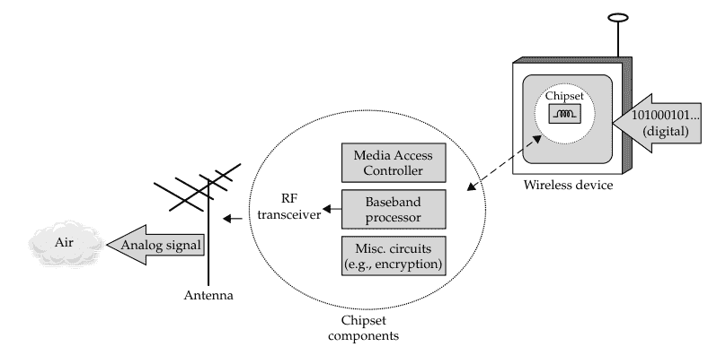

图 4-1. 无线通信系统中的芯片组

## 第 4 章：无线硬件：客户端

| 芯片组制造商 | 芯片组代码 | 无线设备制造商 |
|---|---|---|
| Atheros Communications | AR9002, AR9001, AR5008, AR5007, AR5006, AR5005, AR5002 | Netgear, D-Link |
| Broadcom Cisco Systems | Bcm43xx, BCM47xx | Apple, Belkin, Dell |
| Texas Instruments | Aironet acx111, acx100, acx100_usb | D-Link, US Robotics, Airlink, Netgear, Linksys |
| Alcat-Lucent | Orinoco, Hermes | 3Com, Apple, D-Link, Intel, Microsoft, Toshiba, Farillon, Avaya |
| Intel | Intel PRO/Wireless (IPW) 2200BG/2915AB/3945AG/4965AGN | Dell, Intel |
| Realtek Semiconductor | RTL818x, RTL8187 | Netgear, Belkin, D-Link, Linksys |
| Ralink Technology | RT2500, RT2501, RT2600, RT2501USB, RT2800, rt2x0 | Gigabyte Technology, D-Link, Nintendo |

**表 4-1.** 示例芯片组制造商

## 客户端无线硬件

任何客户端无线硬件都至少嵌入了一个芯片组来执行各种功能。如今几乎可以想象的东西都可以变成无线客户端——从普通的烤面包机到强大的计算机。烤面包机的例子可能看起来有些牵强，但事实是，只要我们能找到给它装上无线电的方法，就能把它变成无线网络中的一个节点。


## 无线网络管理：初学者指南

客户端设备需要接入无线网络。在无线局域网（WLAN）术语中，此类设备通常被称为 WLAN 站（STA）。

某些侧的 WLAN 硬件似乎是内置在主机系统中的，但你应该理解，即使是如此，这些设备仍需要使用一种或多种接口技术与其他硬件进行通信。现在，让我们来看一些常见的客户端硬件接口、它们的形态、外形以及互连类型。这些设备要么为主机系统上的无线芯片提供接口，要么内部已经嵌入了无线芯片。

## PCI

外围组件互连（PCI）是一种通信总线架构，基于 PCI 的设备可以通过它进行通信。规范 PCI 的规范由 PCI-SIG（PCI 特别兴趣小组）——这是一个国际联盟——开发和定义。

使用 PCI 架构的设备通过在并行通道上同时发送数据信号进行通信。使用此接口的无线硬件实现通常以无线 PCI 扩展卡的形式出现。它们为标准消费级 PC 或服务器接入无线网络提供了一种廉价且方便的方法。几乎所有现代计算机仍然支持这一接口标准。

使用此接口的无线卡通常还具有可拆卸天线的额外优点。这种能力为提升 WLAN 设备的接收能力提供了一种廉价且方便的方法。图 4-2 显示了一个 PCI 无线卡。

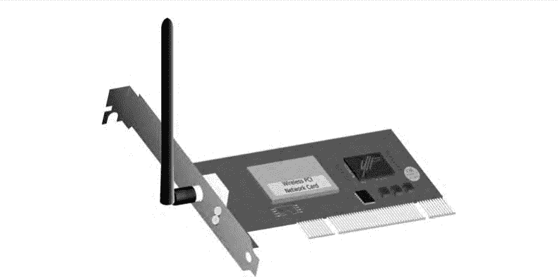

图 4-2. PCI 无线卡

## 第4章：无线硬件：客户端

### Mini PCI

Mini PCI 是一种 PC 扩展接口标准。它是 PCI 标准的小外形实现，主要用于笔记本电脑和其他便携式计算机。该接口通过 PCI 总线与主机通信。

Mini PCI 标准基于主 PCI 规范相同的信号协议和电气特性的子集。该标准的硬件实现在功能上与桌面级系统中使用的全尺寸 PCI 卡相同。

许多围绕 Mini PCI 标准构建的硬件应用程序用于为主机设备提供蓝牙、WLAN、以太网和调制解调器支持。图 4-3 显示了一个 Mini PCI 卡。

旧的笔记本电脑通常配备使用这种接口技术的无线卡。Mini PCI 卡已被下文讨论的 PCI Express Mini 卡取代。

### PCI Express Mini

PCI Express Mini（也称为 Mini PCIe）是 PC 扩展接口标准，是 PCI Express 标准的一种形态。具体而言，它是一种尺寸为 30×56 mm 的小型实现，比 Mini PCI 卡更小。使用此接口的设备通过 PCI Express 或 USB 2.0 与主机通信。通信是通过点对点串行链路实现的。

新款笔记本电脑中使用的无线卡通常是 Mini PCIe 类型，通过主机上的 Mini PCIe 扩展接口连接。图 4-4 显示了一个 Mini PCIe 卡。

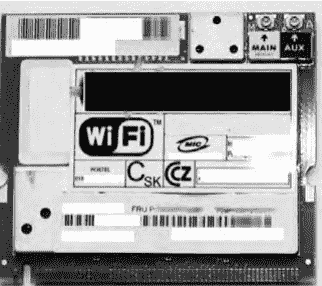

图 4-3. Mini PCI 卡

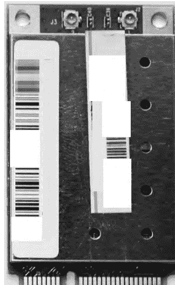

图 4-4. Mini PCIe 卡

### PC Card

PC Card 标准由最初被称为个人电脑内存卡国际协会（PCMCIA）的小组开发。该小组最初设想将其标准作为另一个由名为日本电子工业发展协会（JEIDA）的小组开发的现有标准的替代方案。这两个小组后来改变了主意，决定简化这两个竞争性的标准。

使用此标准的外围设备专为笔记本电脑设计，并能够适应狭小空间——以太网卡、WLAN 网络卡、调制解调器等。

PC Card 标准经历了几代（令人困惑的）硬件迭代，基于几个（更令人困惑的）修订。所有代的硬件都使用 68 连接器，长度（85.6 mm）和宽度（54 mm）相同，但厚度不同。某些 PC Card 标准及其相关外形列在表 4-2 中。

## 第4章：无线硬件：客户端 47

| 标准 | 支持的外形(s) | 特性 |
| --- | --- | --- |
| PCMCIA 版本 1 | 类型 I, 类型 II | 类型 I：实现在较旧硬件中<br> 仅支持 16 位接口<br> 使用主机的 ISA 并行总线<br> 主要为内存卡类型应用设计，而非输入/输出应用（如网络连接）<br> 支持高达 20 Mbps 的吞吐量<br> 卡厚度为 3.3mm |
| PCMCIA 版本 2.0 JEIDA 版本 4.1 | 类型 II | 合并了 PCMCIA 和 JEIDA 标准<br> 支持输入/输出应用<br> 支持双电压卡：3.3 和 5 伏<br> 通常与适配器一起使用，因为卡厚通常不超过 5.5 mm<br> 支持高达 7.84 Mbps 的吞吐量 |
| PCMCIA 版本 2.01 | 类型 III | PCMCIA 实体开始采用“PC Card”名称<br> 提供 16 位或 32 位接口<br> 物理厚度几乎是之前的两倍（10.5 mm） |
| PCMCIA 版本 5.0 | CardBus | 增加对 32 位接口的支持<br> 以 3.3 伏工作<br> 支持高达 132 Mbps 的吞吐量<br> 卡顶部易识别 | 表 4-2. PC Card |

## ExpressCard

ExpressCard 是取代 CardBus 的下一代标准。ExpressCard 基于由 PCMCIA 开发的标准。ExpressCard 硬件通过串行接口与主机通信，当使用 PCI 总线时，支持 2.5 Gbit/s（每秒吉比特）的吞吐量，并支持高达 480 Mbps。

ExpressCard 比 CardBus 有几个优势：

- 外形更
- 速率翻倍
- 从主机抽电更少
- 由于消除了控制器，成本更低

ExpressCard 与旧版 CardBus 技术的良好对比见图 4-5。

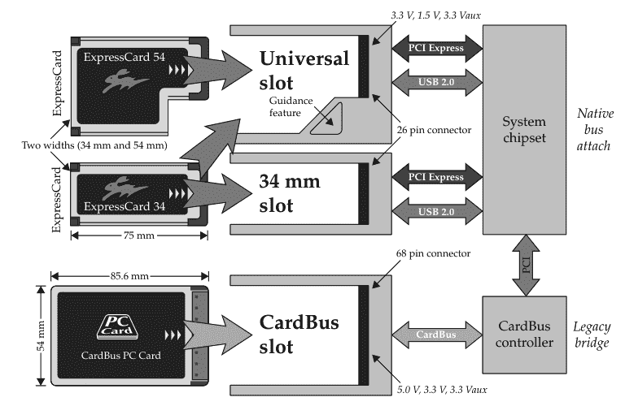

图 4-5. ExpressCard 技术对比 CardBus

## USB

无线 USB 设备为主机添加 WLAN 功能的一种流行方法。它们通常以适配器（通常外接到计算机的电子设备）的形式存在，可以插入主机上的任何可用 USB 端口。没有外部天线的接口，因为天线通常内置在设备内部。典型的无线 USB 适配器如图 4-8 所示。你会发现许多实现几乎任何 IEEE 802.11 族标准的无线 USB 设备。读一下包装盒上的支持的标准和平台，你就可以正常使用了。

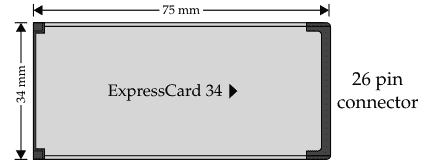

图 4-6. ExpressCard 34

为 ExpressCard 接口构建的外围卡有两种外形。第一种外形是矩形的，被称为 ExpressCard 34。这种形式的尺寸为 75×34mm（图 4-6）。

第二种外形是 L 形的，被称为 ExpressCard 54。它长处为 75 mm，最宽处为 54mm（图 4-7）。

大多数新款笔记本型号都支持 ExpressCard 接口。该标准用于制造无线 WAN、IEEE 802.11 WLAN 以及其他从支持的高数据速率中受益的 PC 外围设备。

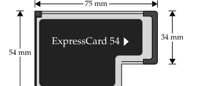

图 4-7. ExpressCard 54


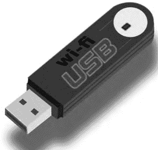

**图 4-8.** 典型的无线 USB 适配器

通过外部 USB 端口连接到主机的 WLAN 设备特别方便，原因有几个：

-   硬件安装简单，通常不需要拆卸电脑机箱。
-   它们不依赖于是否有空闲的 PCI、PCIe 或 PCMCIA 插。
-   大多数主机系统都有大量的 USB 端口。
-   主机系统不需要任何预先内置的无线芯片组即可成为无线站（STA）。
-   它们让大多数旧或较新的计算机主机轻松加入 WLAN 网络。

> **注意：除了 WLAN 硬件应用外，使用 USB 接口的无线卡在连接高速移动宽带网络的设备中也非常流行。**

## CompactFlash 卡与 SDIO 卡

作为个人数字辅助器（PDA）、数码相机、便携媒体播放器、手机和 GPS 接收器的便携设备已成为我们生活中不可或缺的一部分，并延伸成为 WLAN 管理员的噩梦。你可以廉价且毫不费力地为许多此类设备添加无线功能。

便携设备制造商通过让终端用户可选选择设备的 Wi-Fi 功能来降低设备成本。用户可以根据需要选择在设备上使用无线功能。如果用户需要此功能，他们实现此点的选择仅限于设备供应商支持的接口类型和技术。在大多数情况下，选择范围包括主机设备上的 CompactFlash（CF）接口或安全数字（SD）卡接口。

在无线局域网（WLAN）世界中，CF 卡用于为没有此类功能的便携手持设备（如 PDA）添加无线功能。CF 卡在这一角色中特别有用，因为它们从主机处需求并消耗的功率非常小，而电池电量是一个存在的问题。

安全数字输出（SDIO）是一种存储卡格式，其扩展可用于各种应用，包括蓝牙、Wi-Fi 和射频识别（RFID）等。SDIO 卡连接到主机的 SD 卡上。支持设备上的 SD 卡插槽通常用于扩展主机的存储能力，但某些设备能够使用其 SD 卡接口与 SDIO 卡通信。图 4-9 显示了 SDIO 卡和 CF 卡。

## 杂项转换器

在该领域流行的是以太网转无线转换器和串行转无线转换器，它们用于为笨的遗留设备提供无线功能，例如没有无线功能且无法通过通过软件（驱动程序）和硬件组合轻松提供此类功能的打印机。这些接口转换器通常是独立设备，并且通常不为无线网络管理员提供任何用于配置的图形用户界面（GUI）。这些设备的配置通常通过设备上的串口完成。

## 选择无线硬件的其他考量因素

在决定使用何种无线客户端设备用于 WLAN 时，你应该考虑几个因素。其中一个考虑因素是已经讨论过的关于客户端设备形状和接口的明显选择（显而易见，例如，因为物理上无法将无线 PCI 卡放入笔记本电脑的 USB 插槽中）。接下来将讨论选择无线客户端的其他考虑因素。请注意，这些考虑也适用于无线基础设施硬件。

## 第 4 章：无线硬件：客户端侧

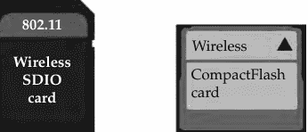

**图 4-9.** SDIO 卡和 CF 卡

## 无线网络管理：入门指南

## 发射功率 (Tx Power)

众所周知，通信是一条双向道。我们既有说话车道和听车道（让我们暂时忽略单行道的存在）。在 WLAN 世界中，这类似于被编码为无线信号的数据传输和接收。

发射（Tx）功率在我们双向道的说话车道上相关。它是发射器在输出端产生的射频功率量。发射功率通常以毫瓦（mW）表示，也可以以瓦特或分贝（dBm）表示。WLAN 发射功率通常小于 1000 毫瓦（1 瓦特），值通常表示为正数。

发射功率与 RF 信号范围有直接关系。换句话说，发射功率越高，信号就能到达越远的预期（以及非预期）目的地。正如第 2 章讨论，影响无线电波功率的属性是振幅。

## 接收灵敏度 (Rx)

该特性在我们双向道的听车道上相关——即通信的接收。接收灵敏度是一个微妙的衡量标准，很少有设备制造商为该特性提供硬性数据。它是 WLAN 客户端设备能够正确检测和解释无线信号的最小阈值测量值。

无线设备的接收灵敏度单位是 dBm。接收灵敏度值较低（例如 -90 dBm）的无线设备可以比接收灵敏度值较高（例如 ~70 dBm）的设备接收并更好地解释无线信号。换句话说，接收灵敏度越低，无线设备能拾到的信号就越弱——这是一件好事。

## 总结

芯片组在几乎所有无线通信硬件的宏图中不可或缺的。芯片组世界的一些巨头使用各种硬件接口和形状来创建各种形状的芯片组。

客户端硬件有不同的类型和不同的接口。所使用的接口取决于主机上的可用接口，还取决于我们打算如何进行通信。

除其他外，无线网络管理员在选择客户端硬件时必须考虑两个重要的 RF 指标：发射功率和接收灵敏度。

下一章将讨论用于基础设施侧的一些硬件。

## 第 5 章：无线硬件：基础设施侧

## 无线网络管理：入门指南

## 概念

-   理解什么是基础设施侧硬件。
-   理解天线的功能。
-   学习与天线相关的各种概念。
-   识别不同的天线类型。
-   理解无线接入点和家用网关的功能。
-   理解无线控制器和无线桥接的功能。
-   学习以太网供电（Power Ethernet）的基础知识。

广义地说，本文所谓的“基础设施侧设备”是指任何参与符合以下任意两项标准的无线网络的硬件：

-   帮助将其他无线设备连接在一起
-   为无线客户端提供服务
-   不会被轻易放入提包

正如你稍后发现的，某些设备在这些标准方面处于“灰色地带”——但继续读下去你就明白为什么了。

## 天线 (Aerial)

在第 4 章中，你读到天线（也称为 aerials）通常内置在客户端使用的无线射电卡中。但那些类型的天线很小且美观。在本章中，当提到天线时，请想象巨大的、巨大的。考虑放置在海拔 300 英尺处的天线。考虑直径 500 英尺的天线。考虑卫星天线。严肃来说，天线有各种形状和大小。制造商设计其天线适用于特定的应用。如果天线是


## 第 5 章：无线硬件：基础设施侧

如果设计是为了适应较小的 ExpressCard 规格，那么它必须非常小。另一方面，如果它的目的是连接两座远处的建筑，它就会非常大（而且很可能无法放入提包中）。

天线是通过无线通信系统的无线信号的第一个入口和出口。它是无线电波发射和汇聚的硬件。

任何无线硬件中的电子设备都会向天线发送电信号，天线将这些电流转换为电磁波，电磁波随后通过空气传播到终点。终点通常是另一个天线，可能嵌入在无线客户端硬件或其他无线基础设施设备中。当电磁波到达目的地后，它们会被转换回电信号。

## 天线概念

关于天线特性，了解几个概念和术语非常。这些概念和术语将帮助你理解关于天线类型的讨论。

## 有意辐射器

有意辐射器（IR）是无线通信系统中任何会刻意产生并发射射频（RF）能量的硬件组件。根据定义，IR 与天线是不同的实体。IR 由发射器、放大器、电缆以及无线设备中的其他旋钮和拨盘等组件组成。IR 结束于天线开始的地方。无线电话、对讲机和无线卡都是 IRs 的良好示例（当然，不包括天线部分）。

IR 与无意辐射器形成对比，后者并不刻意产生 RF 能量，而是将其作为副产品产生。无意辐射器的例子有电子变压器和发电机。

每个国家的监管机构都规定了 IR 能够产生的最大 RF 功率水平。这是出于安全考虑的必要性之一——即，我们不希望人类暴露在过多的 RF 能量之下。RF 能量对人类健康的长期影响尚不明确。此外，产生 RF 的设备有时会干扰其它电子设备的正常运行，例如起搏器等救生设备。

## 等效等向同性辐射功率

等效等向同性辐射功率（EIRP）衡量天线发射实际功率的指标。EIRP 缩写有时代表有效等向同性辐射功率。EIRP 中的*等向性*描述的是一种理想情况，即假设无线能量在所有方向上均匀分布。然而，这种理想情况在现实世界并不存在。

EIRP 是一个可测量量。它是 IR 输出功率与天线引起的被动增益（或损）的总和。每个国家的监管机构也规定了无线设备的 EIRP 值。

下面的插图显示了简单无线站（STA）的 IR 和 EIRP 组件。

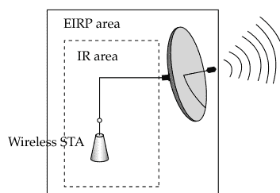

## 天线增益与损

天线可能会导致其传输或接收的 RF 信号产生增益或损。天线引起的增益或损在本质上是被动的，这意味着天线并没有通过使用任何特殊电子设备（如放大器或衰减器）来主动引起 RF 信号强度的增益或损。相反，天线可以产生信号增益，因为它有助于 RF 信号聚焦或集中在特定方向。反之，天线也可以通过简单的重新聚焦导致有效信号强度的降低。

下面的插图描绘了在无线 STA——WAP 1 和 WAP 2 之间的信道中引入高增益天线前后的效果。它展示了天线如何通过使信号更聚焦来产生 RF 功率增益。

天线前

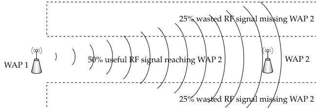

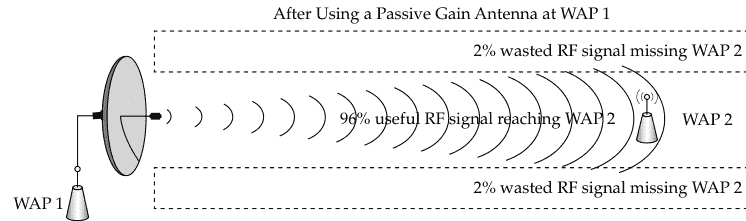

## 波宽

波宽是衡量天线发射的 RF 信号水平和垂直覆盖范围。波宽以度为单位。垂直波宽垂直于地面，水平波宽平行于地面。

天线的波宽规格对于选择为特定区域提供所需覆盖的天线非常重要。从实践上来说，这意味着在某些情况下，窄波宽的天线比宽波宽的天线更理想。

## 极化

电磁波包含两个成分：电分量和磁分量。

电分量也称为 E 面。E 面平行于天线的导体（或元件）。磁分量称为 H 面。这两个分量相互垂直。电磁波的传播方向同时垂直于电分量和磁分量。

天线的极化受天线物理方向的影响。当天线垂直定向时，极化是垂直的，这意味着 E 面垂直于地面。例如，通常垂直定向的天线类型就是如此，如全向性天线（本章稍后将详细介绍）。下面的插图显示了垂直定向的天线及其等效的 E 面和 H 面：

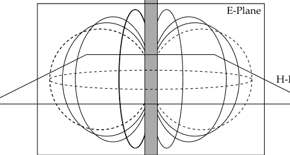

当天线水平定向时，极化是水平的，这意味着 E 面平行于地面。例如，通常水平定向的天线类型就是如此，如八角天线（本章稍后将详细介绍）。下面的插图显示了水平定向的天线及其等效的 E 面和 H 面：

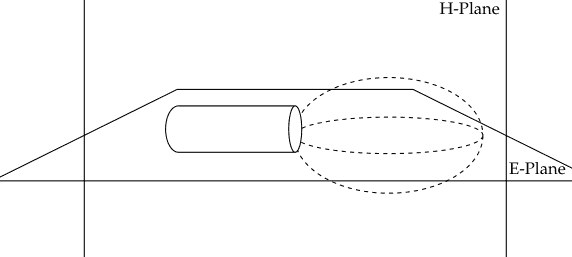

无线系统中，发射和接收天线的极化方向应一致以获得最佳效果。

## 天线类型

天线的形状和特性取决于其应用所在的环境。天线类型分为全向型、半全向和定向型。

## 全向天线

Omni 意为全。全向天线向所有方向发射信号并从所有方向接收信号。全向天线在 360 度范围内发射和接收 RF 信号。全向天线发射的 RF 信号水平波宽为 360 度，垂直波宽通常为 70 80 度。

这些可能是最简单、最便宜且常见的天线类型。它们常见于家用无线硬件。偶极天线是全向天线的一个例子。

全向天线发射和接收的无线电波波形被认为形状像环面（或甜甜圈），如图所示：

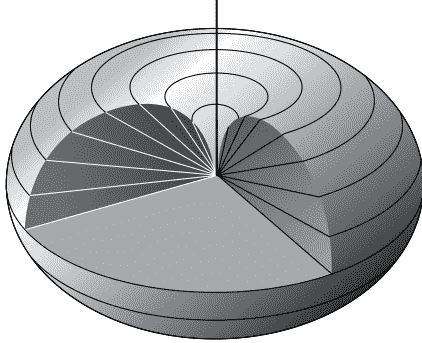

全向天线最适合用于房间或空间中心的环境，因为它们提供了 360 度的水平覆盖。全向天线发射的信号在水平方向上的传播优于垂直方向。

每需要在水平空间范围内提供相对均匀覆盖时，应考虑使用全向天线。只需记住，它们不适用于对垂直覆盖有更高需求的环境，例如建筑的楼层之间。全向天线经常用于室内应用，通过从一个设备同时向多个设备传输无线信号——这被称为点对多或一对多系统。


## 无线网络管理：初学者指南

许多独立全向天线设计用于与 PCMCIA 卡、PC 卡和 PCI 卡等无线客户端设备连接和解耦。

## 半定向天线

半定向天线在约 180 度的波束宽度内发射和接收 RF 信号。目前有几种类型的半定向天线。在室内使用时，可以将半定向天线放置在面向目标方向的墙上，或安装在朝下的花板上。

在应用方面，室外半定向天线最适合短中距离的传输和接收。

在放置方面，这些天线最好放置在某个方向需要信号接收而另一个方向不需要太多信号的地方，例如两边都有办公室的长长走廊的尽头。

从半定向天线发射和接收的无线电波图形形状像被切成两半的甜甜圈。

### 平面天线
平面天线是半定向天线的一个特殊子类。它们没有传统的天线物理结构。由于内部设计和由此带来的灵活性，平面天线可以具有各种形状和尺寸。它们通常部署用于室内应用，而且不容易被发现，因为它们可以封装得与环境其余部分融合。

尽管平面天线看起来非常细小且无害，但它们被用于非常严肃的应用，例如蜂窝网络、宽带、WLAN 部署。

## 八角
八角天线通常用于室外应用。它们也有几种形状和尺寸，但一个独特的物理特征是，它们通常具有某种发射 RF 信号的突出元件。与大多数其他类型的天线一样，八角天线的信号增益源于其限制 RF 信号水平和垂直波束宽度的能力。

图 5-1 显示了一个八角天线。


图 5-1. 八角天线

## 第 5 章：无线硬件：基础设施侧

## 定向天线

定向天线将其 RF 波聚焦在一个特定的方向上。从定向天线发出的 RF 信号水平波束宽度在 4 到 25 度之间，垂直波束宽度通常在 4 到 21 度之间。这些天线通常提供高增益，安装和处理时应非常小心，以避免过度暴露在高功率 RF 辐射下。

从定向天线发射和接收的波形形状几乎像锥体。

这些天线最好放置在与通信系统接收端有清晰视线的地方。大多数情况下，接收端也是另一个定向天线。这使得这类天线适用于点对点应用。定向天线最适合中长距离的传输和接收。

> 注意：这些天线似乎完美地将 RF 波聚焦在它们设计的方向上，但事实并非如此。所有天线都会在某些无意方向上传播 RF 能量，尽管一个重要的天线目标是尽可能地限制这种传输。

## 其他天线考虑因素

天线的放置和使用的类型可以是无线通信良好信号传输和接收的决定性因素。尽管大多数无线设备都自带天线，但无线网络管理员需要更换原始天线，并将其替换为更适用于特定情况的天线。此外，许多无线设备制造商的产品允许最终用户为特定应用选择最合适的天线。

在以下情况下，无线网络管理员可能需要考虑无线天线：

- 默认天线不足以向目标传输所需的信号。
- 默认天线无法接收所需的信号。
- 天线导致无线设备违反当地无线监管规则。
- 无线设备未附带天线，但包含一个用于连接适当天线的连接器。

## 天线检查列表

如果无线网络管理员确定特定应用或场景需要天线，那么为工作选择最佳天线非常重要。

在选择天线时应考虑几个因素。这些因素包括极化、波束宽度、天线增益、天线损耗，以及以下额外的考虑因素：

**室外 vs 室内天线** 设计用于室外安装的天线与室内天线不同。区别并不在于天线的电子元件或功能，而通常在于设计用于室外使用的天线的形状、保护外壳和其他物理特性。通常情况下，你希望室外天线是防风雨的，以便电子元件在雨雪或阳光下得到良好保护。

**美学** 涉及到天线时，外观可能很重要。某些天线的外壳设计旨在与空间内部或家具融合。某些天线设计得尽可能不显眼。

**安装套件** 这是选择天线时的一个重要考虑因素。如果天线需要安装在外部表面，你必须仔细选择用于安装的部件。大多数天线制造商都提供与其硬件兼容的安装支架和套件。但制造商的安装套件可能并不适用于应用；在这种情况下，你需要一些第三方安装部件解决方案。例如，在墙上安装天线所需的部件与安装在杆子或天花板上所需的部件不同。

**放置** 天线的实际放置是另一个重要考虑因素。室内天线需要放置在受来自其他电气设备；移动物体、墙壁、天花板或标牌；甚至是人类干扰最少的地方。有时，不可避免的环境因素会影响天线。天线的室外放置也至关重要。

**安全** 安装天线时应遵循正确的接地程序。

## 无线接入点

无线接入点（WAP）为无线节点（也称为站点）与有线网络的提供了提供了。WAP 通常称为接入点（AP）。传统的 WAP 与无线网关或无线路由器有所不同，因为它们不执行开放系统交叉（OSI）第 3 层功能。它们依赖其他组件来执行此类功能。

随着网络制造商的发展，WAP 和无线网关之间的界限变得模糊。你可以通过缺乏明显的广域网（WAN）接口来识别传统的 WAP 硬件。通常，它只有局域网（LAN）接口，连接到 LAN 段。

除了连接无线客户端到有线网络外，WAP 还可以具有以下功能的组合：
- 安全功能
- MAC 层过滤
- 协议过滤
- VLAN 功能
- 可拆卸天线
- 可现场更换无线卡
- 以太网供电

这些某些功能将在书后详细介绍。

## WAP 工作模式

无线 AP 使用三种工作模式：根模式，这是 WAP 运行的最基本、最自然的模式；桥接模式，用于桥接两个多个网络；以及继器模式，有助于扩展无线网络的范围。图 5-2 显示了 AP 的三种工作模式。

### 根模式

在这种模式下（也称为基础设施模式），WAP 履行其基本功能——连接客户端到有线网络。当 AP 之间需要通信时，根模式也用于分段或管理（例如，为了 STA 游通过组合多个 AP）。

## 桥接模式

以桥接模式运行 WAP 可以连接两个或多个有线网络。桥接后的网络通常位于同一个子网并共享一个广播域。在在此模式下运行时，无线客户端通常无法无线连接到 AP，因为 AP 的无线接口通常专门用于执行桥接功能。

以桥接模式运行的 AP 常用于创建点对点和点对多链路。


## 64 无线网络管理：入门指南

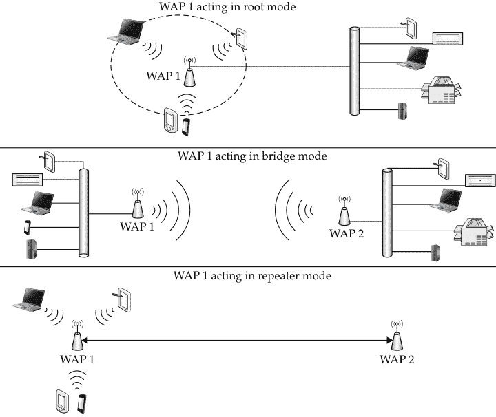

图 5-2. AP 的三种操作模式

## 中继模式 (Repeater Mode)

在中继模式下，WAP 通过中继远程 WAP 的信号来扩展无线网络的覆盖范围。中继 AP 可以通过有线连接到远程根 AP。无线客户端随后可以无线连接到运行在中继模式下的 WAP。这是 AP 中继模式与桥接模式之间的主要区别之一。无线客户端节点可以连接到 WAP 中继器，而有线客户端可以连接到 WAP 桥接器。这不与传统的中继概念混淆，传统中继通常涉及信号的放大和再生。

AP 中继模式的实现是厂商特定的，不依赖于任何 IEEE 802.11 标准。由于中继模式的实现取决于厂商，因此最好确保所有使用的无线硬件均来自同一设备制造商。

## 第 5 章：无线硬件：基础设施侧

## 何时使用 WAP

网络管理员如何知道何时该使用 WAP？一些指南可以帮助回答这个问题：

- 无线网络将跨越三个以上的连续空间。
- 已经建立了稳固的有线网络基础设施，且不需要多用途或多功能 AP 的额外服务，因为将使用现有的有线设备。
- 将使用无线交换机或控制器。其他替代方案无法满足 WAP 设计旨在提供的技术需求或要求。

## 无线交换机和控制器

无线交换机和控制器（WC）是一类基础设施设备，它们在无线部署中的归属或用途完全没有歧义。

WC 是严格的企业级无线硬件。它们被设计为可以扩展以满足不同规模网络的需求，并作为无线网络中 STA（站点）的一种中央管理点。因此，你不需要手动逐个地配置或管理无线网络中的 WAP、无线路由器、桥接器和其他 STA，而是可以通过 WC 集中完成所有操作。这提高了网络管理效率。

除了 STA 配置外，还可以通过 WC 执行以下无线网络管理任务：

- 站 的软件或固件管理（升级、降级）
- 客户端 STA 的单独配置或设置可以存储或保存在 WC 上，使其成为客户端 STA 的配置存储库
- MAC 层过滤、协议层过滤、无线入侵检测能力
- 服务质量 (QoS) 管理
- 远程设备的以太网供电 (PoE) 支持
- 连接客户端的身份验证和授权管理
- 动态主机配置协议 (DHCP)、路由服务
- AP 负载均衡管理

图 5-3 显示了一个无线控制器以及网络中其他各种无线 STA 和有线节点的连接示例。

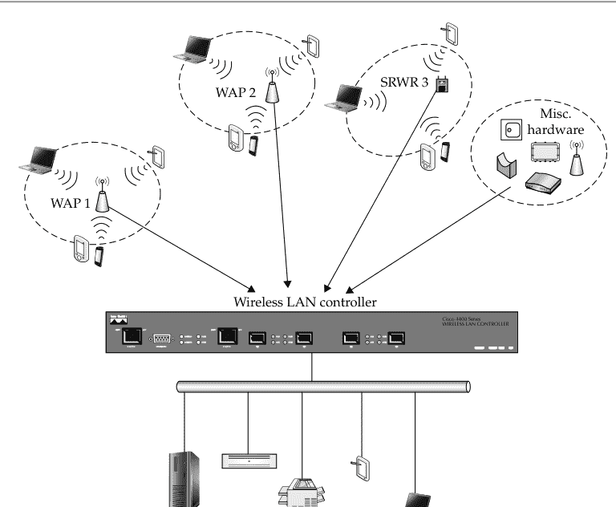

图 5-3. 无线 STA 和有线节点如何连接到无线控制器

## 无线控制器注意事项

无线控制器通常用于非常大的无线网络。优秀的无线网络管理员通常能直觉地判断何时需要此类设备。尽管如此，你可以参考以下情况判断是否需要部署无线控制器：

- 你喜欢的原始设备制造商 (OEM)销售人员不断打电话，告诉你为你购买的 200 个 AP 配备一个控制器。
- 你正在管理一个无线网络，其 AP 分布在不同的地理位置。

## 第 5 章：无线硬件：基础设施侧

在你确定网络上需要无线控制器后，以下清单可以帮助你决定购买哪种类型的控制器：

- 选择一个实现并支持通用标准和协议的控制器。应避免使用实现过多私有技术的设备。
- 如果无法避免私有技术，尽量坚持使用同一制造商的硬件组件。这有助于减少来自不同供应商设备可能产生的兼容性问题。
- 尽可能使用模块化控制器。这使得在未来开发出新技术时，更容易对其进行升级并提供支持。换句话说，这有助于让你的硬件投资具有前瞻性。

## 无线路由器：SOHO 和家用网关

小型办公家庭办公 (SOHO) 和家用无线网关或路由器是普通人对之前讨论的企业级 WAP 的对应。家庭/家用路由器 (SRWR) 经常被人们误认为是 AP，尽管它们提供了与 WAP 提供的大部分相同的服务，但它们提供的是功能精简、体积更小的等效服务。

> 注意：SRWR 并不是唯一的无线路由器种类。无线 OEM 制造了多种企业级纯无线路由器。但 SRWR 是目前最常见的无线路由器类型。

家用网关的处理能力（CPU、内存等）通常低于其企业级对应产品。它们拥有足够的功率来实现其主要功能：为网络中的无线和有线节点接入另一个网络——另一个通常是更大的网络，通常是广域网（如互联网）。在设备连接不同子网的两个或多个网络之前，需要一些路由逻辑。从物理上讲，无线路由器由于存在所谓的 WAN 接口，与 AP 是区别的。当今的无线路由器提供了丰富的服务，并可以具有许多功能，例如：

- 支持不同的安全机制，例如通过内置的状态检测数据包检测 (SPI) 进行 MAC 层过滤和协议层过滤
- 强制性门户 (Captive portals)
- 网络附属存储枢纽、虚拟局域网 (VLAN)

## 66 无线网络管理：入门指南

## 开源替代方案

存在许多成熟且活跃的开源社区专门扩展 SRWR 的原生功能。这些（通常是免费的）替代方案提供的某些功能令人惊叹，让你怀疑 OEM 是否因为在出厂时不支持而刻意限制了硬件功能。

你通常可以通过软件和固件升级来改进这些硬件的功能集。可能需要微小的硬件修改，但这很罕见。你可以在以下 URL 找到关于这些替代方案的信息：

- openwrt.org
- www.freewrt.org
- www.dd-wrt.com
- www.polarcloud.com/tomato

尽管这些网站大多包含在你自己的硬件上使用其产品的免责声明，但你可以确认这些替代方案的高质量和用途：

- 交换功能
- 路由功能
- 服务质量 (QoS) 功能
- 域名系统 (DNS) 服务器
- DHCP 服务器。

经常发现可以运行不同 WAP 模式（根模式、桥接模式或中继模式）的 SRWR。事实上，今天很难找到不支持或提供此处几乎所有功能的无线路由器。

## 无线桥接

无线桥接是一种严格运行在桥接模式下的非常精简的 AP。无线桥接专门执行这种桥接任务，并影响了全功能 AP 或 SRWR 所拥的大部分功能。无线桥接通常不设计为直接连接任何无线客户端设备。

这些桥接器通常有两种部署方式。首先，它们可以使用无线方式连接两个远程站点，这被称为*对点*（一对一）链路。在这种部署中，之间通常需要清晰的视距 (LOS)。


## 第 5 章：无线硬件：基础设施侧 69

两点。第二，它们可以用于将三个或多个站点连接在一起，这被称为点对多点（一对多）链路。

在这两种部署类型中，桥接器之一充当链路的主节点（master）或根（root），另一个（多个）充当从节点（slave）或非根。主节点（根）是链路中的中心且知识丰富的节点。所有其他节点仅通过根桥接器进行通信，而不会直接相互通信。

> 注意：另一种无线桥接部署类型用于建立冗余链路或在两个远程位置之间进行无线流量平衡。为了避免当存在多条路径用于遍历网络时可能出现的混乱（环路），需要生成树协议（STP）机制。可以将四个或更多无线桥接设备组合创建这种部署。如果其中一条链路发生故障，则提供了冗余性，因为站点之间的流量可以切换到另一条良好的链路。负载均衡或负载共享用于指定可以在每条单独链路上传输的流量类型或性质。例如，WLAN 管理员可以指定所有语音流量通过一条链路传输，所有非语音流量通过另一条链路传输。

## 以太网供电 (PoE)

以太网供电（PoE）并不属于基础设施硬件。它是一种有时实现在基础设施侧使用的无线设备中的技术。PoE 也不是专门以无线为中心的技术，因此不受 IEEE 802.11 无线标准的限制。相反，它在 IEEE 802.3 标准的一个条款中被描述为一种使用以太网网络中常用的双绞电缆向远程设备传输电以及数据的方法。

实现 PoE 的硬件组件分为两类：供电设备设备（PSE）和受电设备（PD）。

PoE 对于无线网络管理员来说特别有用，因为通常需要将无线网络设备（如 AP、无线路由器和交换机）放在尴尬的位置。某个位置可能是建筑中没有电源插座或为硬件供电布线的闲置部分。其理念是，如果我们设法法让以太网接口连接到硬件，只要它支持 PoE，我们就可以为其供电。创建或扩展以太网接口可能比创建新的电源插座和线路更容易。使用 PoE，我们可以轻松地将无线 STA 放置仓库的天花板高处或亚马逊丛林的深处。

## 额外考虑因素

当你决定在无线网络基础设施中使用哪种硬件时，你还需要考虑其他几个因素：特别是成本和互操作性。

## 无线网络管理：入门指南

## 成本

成本通常是不言而喻的，因为对我们大多数人来说，财务资源是的。无线网络管理员和经理要求在给定的预算范围内工作，在降低无线网络设备成本的同时，继续维护设备和支持服务协议、员工培训等，这涉及到一种微妙的平衡行为。

需求可能是当预算紧张时影响决定是否购买设备的最重要的单一驱动因素。如果你需要，你就需要。如果你可以没有，那么你就不需要。如今的小、中大型企业正试图尽可能精简高效地运行，以维持生存和盈利。

## 互操作性

互操作性是指某些设备（在我们例中是无线网络硬件）与其他设备工作的方式。它也涉及兼容性问题，这些问题可能并不明确。不兼容可能源于供应商在其产品中错误（或部分）实现 IEEE 802.11 系列标准的方式。也可能源于 OEM 希望通过故意使其硬件和使用的协议私有化来垄断某个市场细分领域的望。

互操作性问题也可能由于不便的原因引起，例如你正尝试与旧设备或协议一起工作。无线管理员或网络设计者并不经常有机会从零开始设计或构建全新的网络。我们通常必须处理并适应现有的或旧的硬件和客户端。

减轻大多数互操作性问题的唯一方法是在部署基础设施类型硬件之前进行周密的规划和大量的测试。在测试期间可以发现许多现实中的故障，这最终将帮助你做出正确的决定。

## 总结

基础设施侧无线硬件包括各种硬件，这些硬件可能很难归类为客户端侧或基础设施侧硬件。当这些硬件被用于客户端侧（例如天线）时，它们可能非常不起眼（并且被理所当然），但你知道它们在任何无线通信系统中都起着重要作用。

某些硬件显然仅用于无线网络的基础设施侧。各种类别的硬件可以帮助连接，并为网络中的其他无线 STA 或有线节点提供某项服务。在处理基础设施硬件时，你需要考虑本章中涵盖的几个重要因素。你还学习了 PoE 技术，这项技术允许你在几乎任何地方为任何支持的无线网络设备供电。

# 第三部分 | WLAN, WWAN, WMAN 和 WPAN

# 第 6 章 | WLAN

## 无线网络管理：入门指南

## 关键技能和概念

局域网（LAN）跨越一个较小的物理区域——之所以小，是因为该区域可以是衣柜间、房间、家庭、整个办公楼或一组建筑的大小。与广域网（WAN，如互联网）、大域网（MAN）相比，LAN 看起来很小。几个 LAN 可以组成大得多的网络。事实上，规范基本操作的 802.11 标准规定 WLAN 是一种 LAN。

## WLAN 组件和概念

WLAN 由几个组件组成，有些是逻辑的，有些是物理的。以下章节介绍了构成 WLAN 的组件并定义了它的术语。

## 无线介质

无线介质（WM）用于 WLAN 实体之间实际的信息传输——即空气。各种类型的数据可以编码为称为无线波的电磁干扰。这些无线波通过空气传输到目的地，并在那里还原为数据。

## 无线站

任何实现 802.11 标准的设备都称为无线站（STA）。无线站本身并不有用；它们需要其他无线或有线设备来发送和接收信息。图 6-1 显示了一些 STA。


图 6-1 示例

STA 可以按以下模式之一运行：

- 基础设施模式：也称为客户端模式 STA，这种模式要求使用基础设施设备（如接入点 AP）与其他 STA 以及有线 LAN 通信。在此模式下运行的设备可以被视为无线客户端，这意味着无线 STA 是 WLAN 中的客户端。其他文献可能将客户端 STA 称为移动单元（MU）。尽管如此，MU 当然可以是移动的，也可以位于固定位置。基础设施模式可能是大多数无线设备最典型、常见的运行模式。
- 自形成模式：Ad hoc Sta 形成不需要 AP 即可与其他 STA 通信的自主网络。
- 访问控制模式：正如名称所示，访问控制 STA 用于控制 STA 之间的访问或控制 STA 对有线 LAN 的访问。无线接入点（WAP）是此类模式模式 STA 的良好示例。


## 接入点 (Access Point)

接入点 (AP) 是一种 STA。具体来说，它帮助将无线站连接到有线站或资源，或者简单地用于连接各个无线 STA。

## 基础服务集 (Basic Service Set)

基础服务集 (BSS) 是无线局域网 (WLAN) 中的一个逻辑实体。BSS 也可以被视为 WLAN 拓扑结构。BSS 有两种“官方”类型：独立 BSS 和基础设施 BSS。

存在第三种“非官方”的拓扑类型，称为无线分布系统 (WDS)。它是非官方的，因为它没有在 802.11 规范中获得官方批准或描述，也没有获得 Wi-Fi 联盟特别小组的批准。但它在 WLAN 设置中被广泛使用。

## 基础设施 BSS (Infrastructure BSS)

基础设施 BSS（通常简称为 BSS）利用 AP。参与基础设施 BSS 的大多数 WLAN STA 并不直接相互通信；所有通信都通过 AP 进行。

IEEE 802.11 标准将 BSS 定义为“一组通过适当功能之间成功实现了同步的站 (STAs)”。在 802.11 技术术语中，这些功能被称为*基元 (primitives)*。

基础设施模式 STA 运行在基础设施 BSS 中。下面的图展示了一个示例基础设施 BSS：

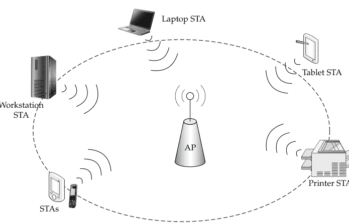

## 独立 BSS (Independent BSS)

独立 BSS (IBSS) 不使用 AP；STA 以点对点的方式直接相互通信。形成一个 IBSS 至少需要两个 STA。

Ad hoc 模式（独立模式） STA 运行在 IBSS 模式。下面的图展示了一个 IBSS：

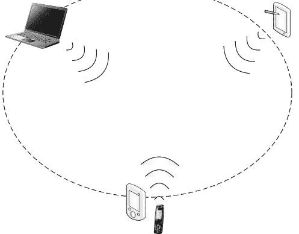

## 无线分布系统 (Wireless Distribution System)

无线分布系统 (WDS) 用于描述 AP 连接在一起的 WLAN 拓扑结构。严格来说，这意味着基础设施设备（或 AP）使用无线介质（空气或空间）作为分布系统连接在一起。WDS 用于在 WLAN 中的 AP 之间创建无线骨干链路。这与通过有线分布系统连接无线网络中 AP 的传统方法形成对比。

WDS 通常要求所有参与者采用并共享各种特性，例如公共的射频 (RF) 通道和公共的安全机制。

## 78 无线网络管理：入门指南

下面的图展示了一个示例 WDS。

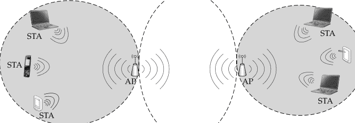

## 服务集标识 (Service Set ID)

服务集标识 (SSID) 用于标识扩展服务集 (ESS) 或 IBSS。具体来说，它是一种识别 ESS 或 IBSS 的用户友好方法。SSID 是其他设备在看到无线设备检测到的可用网络列表时看到的名称。
SSID 的长度可以为 0 到 32 字节。

## 基础服务集标识 (Basic Service Set ID)

既然我们有一种用户友好的方法来识别无线网络，那么我们也应该有一种机器友好的方法来做同样的事情。BSSID 的作用是让我们用它来识别每个 BSS。它长 48 位，与基于以太网的网络上使用的 MAC 地址非常相似。
BSSID 的准确值取决于所使用的服务集（基础设施或独立）。
在基础设施 BSS 中，BSSID 很容易确定，因为它是当前作为 AP 的无线 STA 正在使用的 MAC 地址。记住，基础设施 BSS 始终存在一个 AP。这个 MAC 地址是全局管理的类型，并且始终保证是唯一的。基础设施 BSS 的示例 BSSID 为 00:ab:34:56:78:9a。

- 在 ad hoc 或独立模式下，BSSID 是一种本地本地管理的（非全局唯一）类型的 MAC 地址。本地管理的 MAC 地址是其全局/本地 (U/L) 字段位被设置为 1 (1) 的地址。具体来说，这意味着 MAC 地址的第二个低位位值为 1 (1)。第一个字节之后是一个 46 位的随机生成数字。ad hoc 网络的示例 BSSID 为 02:12:34:56:78:9a。

## 基础服务区域 (Basic Service Area)

基础服务区域 (BSA) 定义了任何 BSS 跨越的物理区域或边界。它用于描述包含 BSS 成员的物理区域。该区域也可以跨越其他 BSS，这意味着它可能包含其他 BSS 的成员。

## 扩展服务集 (Extended Service Set)

IEEE 802.11 标准将扩展服务集 (ESS) 定义为“一组一个或多个互连的基础服务集 (BSS) 和集成局域网 (LAN)，对于与这些 BSS 关联的任何站 (STA) 的逻辑链路控制 (LLC) 层来说，它表现为一个单一 BSS。LLC 是数据链路层的一个通信协议子层。（具体内容请见下节。）”。

（注：由于原始文本存在大量重复和碎片化，已根据指令提取并翻译核心信息。）


## 无线网络管理：入门指南

| 信号技术 | 解释 |
|---|---|
| 扩展速率 (ERP) | ERP PHY 规范实际上是多个 PHY 规范的合体。它对现有的 PHY 规范（如 DSSS 和 OFDM）进行了扩展。这些扩展旨在增强后兼容性以及与现有 PHY 的共存。它在 2.4 GHz 频段内工作。ERP 的某些变体包括：<br><br>**ERP-DSSS** 为需要实现 ERP PHY 但需要与 DSSS 后兼容的系统提供支持。<br><br>**ERP-OFDM** 在 2.4 GHz 频段内纯粹实现 OFDM 操作。实现此 PHY 的系统支持 6, 9, 12, 18, 24, 36 和 48 Mbit/s 的速率。<br><br>**DSSS-OFDM** 为 DSSS 和 OFDM 系统提供混合模式（或杂交）操作。旧的 DSSS 系统解释通信的部分内容（如报头），而较新的基于 OFDM 的系统可以解释报头和通信的实际数据负载部分。 |

**表 6-1.** 信号技术（续）

# MAC

为了在数据通信（以及人类通信）中维持某种理性的状态，必须建立并遵循某些规则和指南。这在无线通信中尤为重要，因为用于通信的介质具有特殊性——空气或空间。这些规则和指南在 OSI 模型的不同层中规定。

MAC 是 OSI 数据链路层（第 2 层）的子层。MAC 子层基本上负责提供寻址和介质访问控制机制，使得网络中的多个节点能够通信。MAC 功能用于控制和管理通信系统中对传输介质的访问。

## 第 6 章：WLAN

由于使用了电缆，控制接入有线以太网局域网 (IEEE 802.3) 的站点相对简单。所有连接到同一网络的所有节点都可以轻松地感知到电缆中是否存在电流。这里的电流意味着数据传输。为了协调 LAN 介质的访问，LAN 站使用带有冲突检测的载波多路接入 (CSMA/CD)。这里的关键词是“检测 (detection)”。

IEEE 802.11 WLAN 的规则无法简单地借用这种方法来管理有线 LAN 中使用的共享介质的访问。这背后有几个原因——之一是缺乏物理线缆。

无线网络中的 STA（站点）不能始终保证处于彼此的听力范围内，因此它们无法听到（或检测到）其他 STA 正在传输。这种现象在射频通信中被称为“隐藏节点”问题。传输可能根本不是为了隐藏节点设计的，或者未被其检测，但它仍然需要使用所有节点共享的公共介质。

第二个原因是无线 LAN 硬件中的无线电能够在传输或接收模式之间切换运行——它通常无法同时执行这两者。为了让无线硬件在发送数据（传输模式）时能够检测冲突（接收模式），它需要包含一个具有此类能力的无线电。正如前面已经提到的，普通的无线 LAN 硬件并不具备这种能力。

因此，基于 802.11 系统不是检测介质何时可用，而是采取了不同的任务：从根本上避免任何类型的冲突。这是带有冲突避免的载波多路接入 (CSMA/CA)，这里的关键词是“避免 (avoidance)”。

在无线 LAN 中实现 CSMA/CA 的流行方法被称为分布式协调功能 (DCF)。以下步骤展示了三个示例无线 STA (STA-A、STA-B 和 STA-C) 如何协商对无线介质的访问。注意，这只是实现 CSMA/CA 的多种方法之一。

- 1. STA-A 需要访问无线介质，因此将其无线电置于接收模式，查看是否有其他 STA 正在传输。
- 2. 如果 STA-A 发现介质正被 STA-B 使用，它将等待 STA-B 完成传输。STA-A 等待的时间是确定的。
- 3. STA-A 将尝试再次传输，首先检查介质可用。如果是，STA-A 将发送一个特殊的 MAC 帧，称为发送请求 (RTS) 帧。也称为控制帧，它是多种 MAC 帧类型之一（将在下一节讨论）。
- 4. STA-C 将看到来自 STA-A 的特殊帧，并反过来发送一个允许发送 (CTS) 帧。
- 5. STA-A 向 STA-C 发送消息。
- 6. 为了使通信被视为成功，STA-c 需要发送一个确认以证实它确实收到了 STA-a 发送的消息。此消息载在另一种控制帧类型中，称为确认 (ACK) 帧。这也称为正向确认。
- 7. 如果出于某种原因，STA-a 没有收到来自 STA-c 的 ACK 消息，它将重新发送消息。

# MAC 帧类型

根据其功能，IEEE 802.11 MAC 帧类型可以分为三类：控制帧、管理帧和数据帧。

## 控制帧
这些最基本的帧类型对于所有 WLAN 通信都非常重要，用于支持其他（管理和数据）MAC 帧类型的交付。所有无线 STA 必须能够看到控制帧——换句话说，控制帧中的信息没有任何秘密或机密性。例如，当 STA 需要协商并获得 WLAN 的访问权限时会使用控制帧。

- RTS：为 WLAN 提供某些避免机制
- CTS：在响应 RTS 时发送
- ACK：由接收 STA 发送以确认接收帧

### 管理帧
这些帧用于 WLAN 的管理目的，它们在其中起着非常重要的作用。当 STA 正式想要加入或退出网络时会使用管理帧。以下是一些示例帧类型：

- 信标帧 (Beacon)：一种非常重要的帧类型，它执行各种功能，例如 STA 之间的时间同步；它还存储 SSID 的值，指定所使用的 PHY，并指定支持的数据速率等。
- 请求帧 (Association request)：STA 发送此类帧以请求接入 AP。
- 关联响应帧 (Association response)：这些帧包含对 STA 请求的响应。结果是“是”或“否”。
- 重新关联请求帧 (Reassociation request)：STA 需要重新关联 AP 时使用这些帧。
- 重新关联响应帧 (Reassociation response)：AP 在响应 STA 重新关联请求时发送这些帧。
- 认证帧 (Authentication)：STA 需要参与或加入 BSS 时使用这些帧。仅仅关联远远不够——STA 需要经过认证才能充分利用 BSS。STA 使用认证帧类型来确认其身份。
- 取消认证帧 (Deauthentication)：已认证的 STA 使用这些帧类型表示终止已认证（安全）通信。
- 解关联帧 (Disassociation)：此帧由接入 AP 的 STA 发送，以通知 AP 它想要停止关联。注意，这不是请求，因此 AP 不需要提供响应或确认或验证。
- 探测请求帧 (Probe request)：STA 在需要发现其他 STA 的信息时发送探测请求。此类信息可能包括其他 STA 的能力或关于支持的数据速率的信息。
- 探测响应帧 (Probe response)：此帧携带对探测请求的响应。

## 数据帧
这些帧负责从通信端点传输实际的数据负载。

## 完整 MAC 帧

下面的插图展示了一个典型的 802.11 MAC 帧格式。表 6-2 解释了从无线网络管理员角度来看可能有趣的 MAC 帧某些部分。


## 86 无线网络管理：入门指南

## 6-2. IEEE 802.11 MAC 帧字段

## 第6 章：WLAN

| 字段 | 描述 |
| :--- | :--- |
| 保护帧 (Protected Frame) | 用于指示帧体字段是否包含加密算法处理的信息。值为 1 表示帧体字段已加密。值 1 仅出现在数据帧类型和某些管理帧类型中。值0 用于所有其他帧类型。 |
| 更多数据 (More Data) | 用作指示，表示有更多数据正在途中。告诉处于节能模式的 STA 有更多数据在缓存并正在传输。 |
| 更多分片 (More Fragments) | 用于指示后续是否有更多数据分片。 |
| 协议版本 (Protocol Version) | 接收此帧的无线 STA 以防止处理重复帧。管理帧或数据帧中的值为 1 表示该帧是较早帧的重传。所有其他帧类型的值均设为 0。该字段长度为 2 位。在编写时，IEEE 802.11 标准的协议版本号为 0。该字段的所有其他可能值预留给当前标准的重大变更。当新修订版本与标准的之前的版本之间存在根本性的不兼容时，修订级别将增加。 |
| 类型和子类型 (Type and Subtype) | 识别帧的特定功能。 |
| 到 DS 和 字节 DS (To DS and From DS) | 指向分发系统。这些字段的含义取决于字段中组合的值。可能值为 1 和 0，其组合含义如下： |

**To DS = 0 且 From DS = 0**
意味着帧是从同一个 IBSS（如 ad hoc 网络）内的一个 STA 发送到另一个 STA 的。表示帧是从同一个 BSS 内的非 AP STA 发送到另一个非 AP STA。

**To DS = 1 且 From DS = 0**
意味着帧的目标是 DS，或者帧是由关联到 AP 的 STA 发送的帧。

**To DS = 0 且 From DS = 1**
当这两个字段设置为这些值时，意味着该帧正在离开 DS。

**To DS = 1 且 From DS = 1**
该帧使用四地址格式。这种组合是可能的，但目前在 IEEE 802.11 标准中尚未定义。

**表 6-2. IEEE 802.11 MAC 帧字段**

## 总结

本章深入探讨了基于 IEEE 802.11 的网络结构，这可以帮助你以后理解并排查异常或复杂的无线连接问题。你已经了解到 IEEE 802.11 标准族指导着 WLAN 技术的发展。

在日常的 WLAN 讨论中会使用一些概念和术语，你需要了解这些概念和术语才能理解 IEEE 802.11 标准。

IEEE 802.11 标准的主要组件是 OSI 参考模型中的物理层和 MAC 子层。在 WLAN 标准的物理层中包含了一些特定的 PHY 实现，例如 DSSS、FHSS、OFDM 和 ERP。

在 MAC 子层中，你学习了典型 MAC 帧的功能和不同部分。

本章绝不是对 IEEE 802.11 定义的 WLAN 标准的完整剖析。当前标准本身的内部工作原理包含在一份长近 1300 页的文档中！这看起来可能令人生畏畏，但感兴趣的读者可以放心，IEEE 802.11 标准包含了许多重复的基础概念，这些概念应用于标准的各个方面。

尽管如此，本章提供的信息应该作为你深入学习 IEEE 802.11 标准的跳板。本书中的后续章节将以不同程度的细节阐述 IEEE 802.11 标准的某些方面。

## 第 7 章 | WWANs、WMANs 和 WPANs

## 核心技能与概念

- 学习无线广域网技术。
- 学习无线城域网技术。
- 学习无线个人局域网技术。

很少有规则和标准适用于无线无线广域网（WWANs）、无线城域网（WMANs）和无线个人局域网（WPANs），我们对自己的数据或通信几乎没有控制权。本章提供了关于这些网络的信息，包括任何相关的标准、指示、概念和架构、特殊功能以及特殊小组（SIGs）。请注意，本章的信息绝非对这些技术的完整或彻底覆盖，但它突出了你作为无线网络管理员可能觉得特别感兴趣的特性。

## 无线广域网

WAN 可以跨越巨大的地理区域——一个国家、多个国家，甚至大洲。互联网是 WAN 的经典示例。无线广域网（WWAN）是一类 WAN 技术，它们利用大多数蜂窝和卫星基础设施通过多种服务实现 WAN 上的互连，例如全球移动通信系统（GSM）及 GSM 的几种变体、通用移动电信系统（UMTS）和长期演进（LTE）。

> 注意：无线网络管理员可能对其所在地的 WWAN 硬件类型和其他实现细节没有多少控制权，因为这些内容通常由第三方服务提供商决定。然而，你会发现本章中包含的关于 WAN 的信息对于理解驱动你网络的技术非常有用。

## GSM 概述

无线网络管理员可能对其所在地的 WWAN 硬件类型和其他实现细节没有多少控制权，因为这些内容通常由第三方服务提供商决定。然而，你会发现本章中包含的关于 WAN 的信息对于理解驱动你网络的技术非常有用。

## 第 7 章 | WWANs、WMANs 和 WPANs

## 无线网络管理：入门指南

（注：提供的文本包含大量重复区块或重叠部分）

无线网络管理员可能对其所在地的 WWAN 硬件类型和其他实现细节没有多少控制权，因为这些内容通常由第三方服务提供商决定。然而，你会发现本章中包含的关于 WAN 的信息对于理解驱动你网络的技术非常有用。


## GSM 组织

第三代移动通信计划（3GPP）是主要的 GSM 组织之一，致力于维护和发展 GSM 的技术规范（www.3gpp.org）。它通过帮助统一全球的电信标准来实现这一目标。

另一个 GSM 组织——全球移动通信系统移动协会（GSMA）代表了全球移动通信行业的利益（www.gsmworld.com）。其重点在于通过帮助其成员（基于 GSM 技术的制造商和供应商）开发和创造新机会，来推动移动通信行业的发展。它的目标与 3GPP 然不同，后者更关注标准化问题。

## GSM 的演进

原始的 GSM 标准有许多演进和修订——数量多到无法在此处全部列出。其中，一种标准——通用分组数据无线业务（GPRS）对我们这些无线网络管理员来说特别重要。它被设计用于处理数据和其他多媒体应用，这与主要关注语音应用的 2G 技术不同。

GPRS 是一种用于在蜂窝网络上进行通信的标准。它通常被称为“二半代”（2.5G）蜂窝技术。GPRS 基于分组交换，从对无线数据通信感兴趣的移动用户角度来看，它具有若干优势。一个优势是，分组交换服务通常比电路交换服务更便宜，且计费基于传输的数据量。分组交换网络允许不同用户之间共享通信媒介，因此不需要为用户专用昂贵的电路。然而，这种共享也可能是一个缺点，因为无法总是为单个用户保证或提供固定带宽。

从无线网络管理员的角度来看，基于 GPRS 的设备可以支持以下内容：

- 互联网协议（IP）版本 4 和 6
- 无线应用协议（WAP）
- 56–114 kbps 的数据传输速率

GPRS 可用于各种设备的数据通信，例如手机、个人电脑和作为销售点系统的远程终端。在用于数据传输时，基于 GPRS 的设备大量使用了“接入点”（Access Point, AP）的概念，这是一个在蜂窝服务提供网络内部具有意义的简单名称。通常来说，这两者都有助于无线客户端访问网络上的可用资源。

## 无线网络管理：入门指南

GPRS 服务中的 AP 指定了移动设备可以访问的外部网络或服务。这些通常有两种类型：WAP APN 或 互联网 APN。

WAP AP 提供对移动运营商内容的访问，这些内容通常经过重新格式化以匹配 GPRS 。一个名为 Wireless WN 的蜂窝服务的示例 AP 可以在 www.gsmworld.com 找到。

互联网 AP 提供移动设备访问基于标准的服务，例如电子邮件和网页浏览。

## UMTS 概述

通用移动通信系统（UMTS）是一种第三代（3G）蜂窝标准，具有多种被称为不同名称的实现方式。UMTS 实现示例包括分频多址（FDMA）和宽带码分多址（W-CDMA）。2G GSM 网络的基站部分被 3G UMTS 网络中新的 Node B 取代。2G GSM 网络中 BSC 提供的功能被 UMTS 中称为无线网络控制器（RNC）的组件所取代。

## UMTS 组织

UMTS 论坛（www.umts-forum.org）可以被视为具有明确目标的 UMTS 组织。论坛的目标是帮助所有 UMTS 利益相关者理解并从 3G/UMTS 网络的机会中获利。

## UMTS 的演进

后续章节将讨论对原始 UMTS 标准的一些修订和增强。其中一些修订包括高速分组数据接入（HSPA）技术族，例如高速下行分组数据接入（HSDPA）、高速上行分组数据接入（HSUPA）以及演进 HSPA（eHSPA）即 HSPA+。

HSPA 指一组 WWAN 技术，为基于 GSM 的设备提供移动宽带接入。HSPA 被认为是 3G 之后的蜂窝技术。它专门为想要部署 HSPA 技术的蜂窝网络运营商提供了一条简单的升级路径。基于 HSPA 的网络在 850、1900 和 2100 MHz 频段运行。

高速下行分组数据接入 HSDPA 是基于 UMTS 标准的 3G 蜂窝技术。它在 UMTS 标准 Release 5 中描述。在其其他特性中，HSDPA 改进了前身（HSPA）的下行速度，下行速率可达 14 Mbps。

## 第 7 章：WWAN、WMAN 和 WPAN

高速上行分组数据接入 HSUPA 是 UMTS 标准 Release 6 中描述的 3G 技术。在某些季度中，它被简单地称为增强上行（EU）。在其其他特性中，HSUPA 改进了前身（HSDPA）的上行速度，上行速率可达 5.7 Mbps。HSUPA 还支持 WLAN 集成。

WLAN 提供的覆盖传统上是有限的，最适合室内使用，但 UMTS 网络提供的覆盖可以跨数英里，最适合户外使用。这两种技术的优缺点可以相互互补。使用这种蜂窝功能使得移动站（如手机）能够进行语音通话或数据通信。

演进 HSPA 即 HSPA+（读作 HSPA plus），通常被称为演进 HSPA（eHSPA），是一项在 UMTS 标准 Release 7 中描述的 3G 蜂窝技术。在它提供的许多增强中，HSPA+ 据称能够实现 42 Mbps 的理论下行速率和 11.5 Mbps 的上行速率。多输入输出（MIMO）天线技术被用于实现 HSPA+ 的增强。

## LTE 概述

LTE 是“加强版”GSM。LTE 的作者和支持者将其描述为 3G/HSPA 蜂窝技术的演进。LTE 设计为与 GSM 和 HSPA 技术向后兼容。“频谱效率提高”是 LTE 宣传的一个亮点，简单来说，这意味着该技术可以更有效地利用可用的无线频谱。

## LTE 特色功能

LTE 据称能够实现 172 Mbps 的理论下行速率和超过 50 Mbps 的上行速率。它将通过无线方式传输丰富的多媒体和带宽密集型应用成为可能。LTE 是一种纯基于 IP 的。

## LTE 组织

无线社区中的几乎每个人对 LTE 的成功都有兴趣——从网络运营商（可以用更少的资源赚更多钱）、设备制造商（可以为支持该技术的酷硬件收取更高价格），到消费者（为酷硬件和更好的网络支付更多）。LTE 是一项备受期待的技术，对于大多数利益相关者来说应该是双赢的局面。


## 第 7 章：WWAN、WMAN 和 WPAN

## WiMAX 的形态

对于无线网络管理员来说，该标准的两种形态至关重要：
固定 WiMAX 和移动 WiMAX。

- **固定 WiMAX** 这一 WiMAX 的第一个主流版本被广泛采用。它从根本上适用于点对多（一对多）应用。其内部工作机制在 IEEE 802.16d 中有所规定。固定 WiMAX 据称支持高达 30 英里（50 公里）的无线覆盖。

- **移动 WiMAX** 移动 WiMAX 的内部工作细节由 IEEE 802.16 标准规定。它的开发是为了支持移动无线——换句话说，它的设计理念是网络用户并不会总是处于固定位置，并且可能在移动中访问网络。移动 WiMAX 据称支持高达 10 英里（15 公里）的无线覆盖。移动 WiMAX 使用了诸如 MIMO 等智能天线技术来提高增益并提供更好的吞吐量。

> 注意：移动 WiMAX 和长期演进（LTE）标准提供了相似的功能，并且在技术上也很相似。事实上，尽管 WiMAX 主要用于 WMAN 应用，而 LTE 主要用于 WWAN 应用，但两者被认为是竞争性标准。两者都被视为第四代（4G）无线网络技术。

## WiMAX SIG

存在多个 WiMAX 特别利益小组，包括以下几个：

- **WiMAX 论坛** 该小组自称为一个行业领先的非营利组织，致力于认证和促进基于 IEEE 802.16 标准的产品的兼容性和互操作性。WiMAX 论坛与 WiMAX 的关系类似于 Wi-Fi 联盟与 WWAN 技术的关系。WiMAX 论坛的网站为 www.wimaxforum.org/。

- **英特尔公司** 英特尔是 WiMAX 技术的有力支持者。可以理解，因为他们可能是世界上实现 WiMAX 的硬件（芯片组）的最大制造商。你可以在 www.intel.com/technology/wimax 了解更多英特尔对 WiMAX 的兴趣。

## 无线个人域网

WPAN 用于在极小区域促进设备之间的通信。这种无线网络类型的“个人”属性是因为涉及的设备通常在个人空间背景下使用。与目前为止讨论的其他通信类型一样，WPAN 的目标是接收和/或发送数据。
WPAN 可以被认为是短距离网络，因为与 WLAN、WMAN 和 WWAN 相比，这种无线网络的范围和覆盖范围通常有限。WPAN 运行所需的设施很少；大多数 WPAN 是自包含的。

IEEE 802.15 标准描述了 WPAN 内部工作机制的规范。
存在多种技术来实现 WPAN，例如蓝牙、ZigBee、Z-Wave、红外数据协会（IrDA）和超宽带（UWB）等。
后续章节将讨论蓝牙和 ZigBee。

## 蓝牙概述

蓝牙技术取代了传统上连接许多电子设备的电缆。
蓝牙使用跳频扩频（FHSS）调制技术。其设备在 2.4-2.4835 GHz 的免授权频率范围内工作。

## 蓝牙标准

IEEE 802.15.1-2002 和 IEEE 802.15.1-2005 标准是少数由中立标准机构产生的标准的良好范例。关于蓝牙开发的过去和未来的工作，大部分由蓝牙 SIG 完成。

## 蓝牙组件与架构

蓝牙设备主要由构成大多数无线射频设备的相同组件组成：发射器和接收器组件（收发器）以及基带。

**协议** 蓝牙标准定义了一组用于管理设备间通信的协议。常用的蓝牙协议列如表 7-1 所示。

**配置文件 (Profiles)** 蓝牙设备使用配置文件来确定设备支持的服务和协议。这是该技术中一个有用但有些令人困惑的特征。它的独特之处在于，硬件制造商和蓝牙软件开发者很容易创建作用范围非常特定的蓝牙设备和应用程序。换句话说，这有助于保持简单性，并可能降低蓝牙设备的成本，因为它们不需要支持大量功能。

这种困惑可能会在用户端产生，因为未知的用户可能假设所有支持蓝牙的设备都可以用于与任何其他蓝牙设备进行任何类型的通信。然而，这是错误的，因为为了进行通信，两个蓝牙设备必须能够使用相同的配置文件。

常见的蓝牙配置文件列如表 7-2 所示。

### 表 7-1 蓝牙协议

| 蓝牙协议 | 描述 |
| --- | --- |
| 对象交换 (OBEX) | 一种定义数据对象的简单文件传输协议。蓝牙设备使用此通信协议交换这些对象。 |
| 蓝牙网络封装协议 (BNEP) | 用于传输和封装以太网包。因此，它可以用于传输 IPv4 和 IPv6 协议，因为它们可以封装在以太网包中。 |
| RFCOMM | 通过封装串口电缆连接和 RS-232 端口的状态来仿真串口类型连接。 |
| 链路管理器协议 (LMP) | 用于建立和控制逻辑传输、逻辑链路和物理链路。控制设备之间的通信链路。 |
| 逻辑链路控制和适配协议 (L2CAP) | 为与栈的其他部分通信提供一个接口（逻辑通道）。 |
| 服务发现协议 (SDP) | 用于发现（通过搜索）并学习其他设备提供的服务。 |
| 电话控制协议 (TCP) | 管理语音和数据控制。 |
| 音视频控制协议 (AVCTP) | 用于传输控制音视频的消息。 |
| 音视频传输协议 (AVDTP) | 定义协商、建立和传输音视频流的程序。 |

### 表 7-2 常见蓝牙配置文件

| 蓝牙配置文件 | 描述 |
| --- | --- |
| 通用对象配置文件 (GOEP) | 实现 OBEX 协议；用于从一个设备交换另一个文件。 |
| 拨号网络配置文件 (DUN) | 通过蓝牙访问互联网和其他拨号服务——例如，通过蓝牙连接到手机。 |
| 文件传输配置文件 (FTP) | 用于文件系统的浏览、操作和传输。提供类似于 TCP/IP 的功能。 |
| 个网络配置文件 (PAN) | BNEP 的实现。 |
| 服务发现应用配置文件 (SDAP) | 指定应用程序如何使用 SDP 发现其他设备的服务。 |
| 人机设备配置文件 (HID) | 用于连接各种蓝牙输入设备——键盘、鼠标、扫描仪、摇杆等。 |

小区网是一种由一个主设备和多个从设备组成的蓝牙网络。主设备负责调节对射频通道的所有访问。射频带宽在参与设备之间共享。

小区网是排他的，因为一次只允许七个从设备参与网络。然而，当这七个设备中的一个离开网络时，其他设备就可以等待。多达 255 个设备处于非活动（或暂停）状态，主设备可以随时将它们带入活动状态。活动成员处于活动状态。

当两个或多个已建立的小区网相互靠近时，它们形成散射网（scatternet），散射网是各个重叠射频覆盖区域的一部分。小区网中的从设备可以以后设备或从设备的角色参与另一个小区网。

## 蓝牙的形态（续）

自诞生以来，蓝牙技术在多年里取得了巨大的增长和发展，结果（截至目前）出了几个版本：蓝牙 1.2、2.0、2.1 和 3.0。


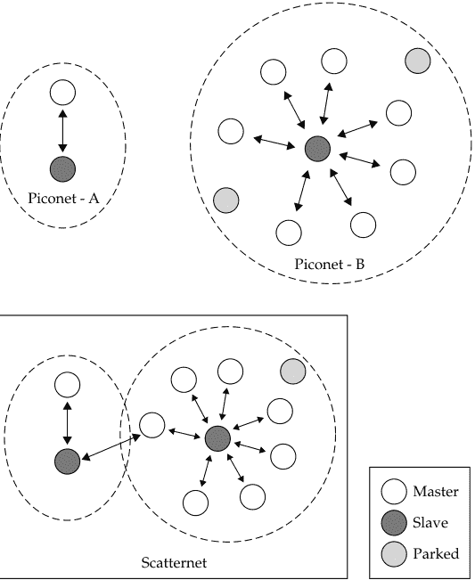

**图 7-2.** 蓝牙网络拓扑结构

## 蓝牙 SIG 与制造商

一个知名的蓝牙 SIG 是名副其实的蓝牙 SIG (www.bluetooth.org)，它是一个非营利性贸易协会。除其他任务外，该组织还负责发布蓝牙规范、对蓝牙设备进行认证以及推广蓝牙商标。

市场上有很多知名的蓝牙硬件和软件供应商，包括爱立信（Ericsson）、英特尔（Intel）、东芝（Toshiba）、联想（Lenovo）、微软（Microsoft）、摩托拉（Motorola）和诺基亚（Nokia）等。

## ZigBee 概述

ZigBee 特别适用于低数据速率和低功耗的嵌入式应用。ZigBee 用于无线监控系统和自动化应用。其低成本、低功耗和基于开放标准的特性是其核心优势之一。

ZigBee 使用直接序列扩频（DSSS）调制技术。它在世界不同频率段运行。例如，在欧洲，它工作在 868–868.8 MHz 范围；在北美，它工作在 902–928 MHz 范围；在全球范围内，它工作在 2400–2483.5 MHz 范围。ZigBee 基于 IEEE 802.15.4 标准描述的规范。

## ZigBee 组件与架构

从无线网络管理员的角度来看，ZigBee 网络的组件相对少且简单。

ZigBee 网络中的参与者可以大致分为两个部分：物理组件和逻辑组件。我们先从表 7-3 中的逻辑组件开始。物理组件见表 7-4。ZigBee WPAN 使用网格（mesh）网络类型的架构，被描述为“自愈”网络。这这意味着节点（ZigBee 设备）是智能的，并且了解周围环境以及如何绕过成员之间通信链路中的故障和简单链路。ZigBee 网络最多支持 64,000 个节点。

一个由 ZigBee 设备构成的示例无线网络如图 7-3 所示。

## ZigBee 形式

截至目前，ZigBee 套件的形式很少，但有两个值得关注的版本：

- ZigBee，原始标准，以及
- ZigBee Pro，为了在 ZigBee 网络中容纳更多节点进行了优化。

## ZigBee 特性

ZigBee 硬件的成本通常低于执行类似功能的竞争技术（如蓝牙）。尽管成本较低，但使用 ZigBee 的设备尚未获得昂贵竞争对手的市场渗透率和认可。

| 逻辑角色 | 特性 |
|---|---|
| ZigBee 协调器 (coordinator) | 初始化网络 |
| | 管理其他网络节点 |
| | 存储网络节点信息 |
| ZigBee 路由器 (router) | 在配对节点之间路由消息 |
| ZigBee 终端设备 (end device) | 作为网络中的叶节点运行 |

**表 7-3.** ZigBee 网络的逻辑组件

## ZigBee SIG 与制造商

一个知名的 ZigBee SIG 是 ZigBee Alliance，根据其网站 www.zigbee.org 的描述，“这是一个公司共同工作的协会，旨在基于开放全球标准实现可靠、成本效益、低功耗、无线网络化的监控和控制产品”。制造 ZigBee 设备的示例制造商包括艾默森（Emerson）、飞思（Freescale）、Ember 和飞利浦（Philips）。

## 总结

无线广域网（WWANs）包括一些特定的 WWAN 实现——特别是 GSM、GPRS、UMTS 和 LTE。

无线城域网（WMANs）包括 WiMAX 网络。无线个人局域网（WPANs）使用蓝牙和 ZigBee 实现。

| 物理组件 | 可能的逻辑角色 | 特性 |
| --- | --- | --- |
| 简化功能设备 (RFD) | ZigBee 终端设备 | 主要用于发送或接收数据；搜索可用网络；向网络协调器请求数据；不能成为 ZigBee 协调器；不与其他 RFD 直接通信；硬件资源最少（例如内存较小）；通常由电池供电 |
| 全功能设备 (FFD) | ZigBee 终端设备 | 可以作为协调器、路由器或另一个 FFD 运行 |
| | ZigBee 路由器 | 可以由电池供电或直接从市电供电 |

**表 7-4.** ZigBee 网络的物理组件

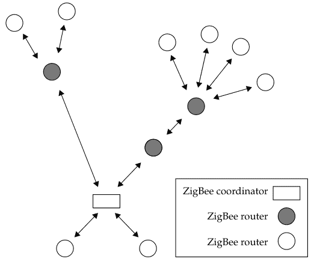

图 7-3. 示例 ZigBee 网络

# 第四部分

## 无线网络中的协议、服务与安全

## 第 8 章 | 无线网络服务与协议：TCP/IP

## 关键技能与概念

- 学习传输控制协议 (TCP)。
- 学习用户数据报协议 (UDP)。
- 学习互联网协议 (IP) 以及 IP 版本 4 和 6。
- 理解在 IP 网络上如何对主机进行寻址。

此时，你应该已经了解了无线网络的各个方面，包括规范无线网络运行的标准，以及实现上述描述规范的各种客户端和基础设施端硬件。（注：原文此处存在重复，已按要求去重处理翻译）。

## 头部

网络协议使用头部来描述从一个主机移动到另一个主机所需的信息。包头（通常如此称）包含了告诉协议如何处理数据包的信息。包头通常很小；这为数据包留了存放实际（有用）数据的空间。

当每层处理包时，相应的头部会被移除。例如，在 802.11 之上的 TCP/IP 情况下，驱动程序会剥离 802.11 访问控制（MAC）头部，IP 会剥离 IP 头部，TCP 会剥离 TCP 头部。最终留下交付给相应应用程序的数据。

IP 帮助包从一个主机移动到另一个主机。一旦包到达主机，IP 头部中没有信息可以指示数据应该交付给哪个应用程序。IP 不提供比简单传输协议更多的功能，因为它旨在作为其他协议的基础。使用 IP 的协议包括……

## IP 版本 4

在写作期间，IPv4 是全球范围内最流行的 IP 版本。图 8-1 显示了 IP 包头部的组件。我们将逐一介绍 IP 包头部的每个字段。

| 4 位版本号 | 4 位头部长度 | 8 位区分服务 (DiffServ) | 16 位总长度（单位：字节） |
|---|---|---|---|
| 16 位标识符 | | 3 位标志 | 13 位分偏移 |
| 8 位存活时间 (TTL) | 8 位协议 | | 16 位头部校验和 |
| 32 位源 IP 地址 | | | |
| 32 位目的 IP 地址 | | | |
| 选项（如有） | | | |
| 数据（如有） | | | |

图 8-1. IP 头部


## 无线网络管理：入门指南

**版本字段（Version Field）** IP 头部第一个值是版本号，它显示了正在使用的 IP 版本。

**长度字段（Length Field）** 下一个值是 IP 头部的长度。了解这个值很重要，因为可选参数可能会被附加在头部的基础上。头部告诉我们包含了多少（如果有的话）选项。要获取总 IP 头部长度的字节数，将该数字乘以 4。典型的 IP 头部头部长度设置为 5，表示完整头部中包含了 20 字节的数据。

**区分服务（Differentiated Services (DiffServ) Field）** DiffServ 用于对数据包进行分类、管理并提供服务质量（QoS）保证。它基本上是指示 IP 栈对数据包采取何种处理。（参见 RFC 2744，www.faqs.org/rfc2744.html）。DiffServ 的使用有时被称为“数据包染色”，这些位被网络设备用于速率整形和优先级排序。

**总长度字段（Total Length Field）** 此值告诉你完整数据包的长度，包括 IP 和 TCP 头部，但不包括以太网头部。该值以字节表示。一个 IP 数据包不能大于 65,535 字节。

**标识 Number字段（Identification Number Field）** 该字段应该是一个主机用于识别特定数据包的唯一数字。

**标志位（Flags）** IP 数据包中的标志位告诉你数据包是否被分片。当 IP 数据包大于两个主机之间的最小传输单元（MTU）时，就会发生分片。MTU 定义了可以在特定网络上发送的最长数据包大小。例如，以太网的 MTU 是 1500 字节。因此，如果我们有一个 4000 字节（3980 字节数据 + 20 字节 IP 头部）的 IP 数据包需要通过以太网发送，该数据包将被分分成三个较小的包。第一个包可能是 1500 字节（1480 字节数据 + 20 字节 IP 头部），第二个包也可能是 1500 字节（1480 字节数据 + 20 字节 IP 头部），最后一个包将是 1040 字节（1020 字节数据 + 20 字节 IP 头部）。

**分片偏移字段（Fragmentation Offset Field）** 分片偏移值表示你正在接收的完整数据包的哪部分。继续之前的 4000 字节 IP 示例，第一个分片将包含 0-1479 字节的数据，偏移值为 0。第二个分片将包含 1480-2959 字节的数据，偏移值为 185 (1480/8)。第三个也是最后一个分片将包含 2960-3999 字节的数据，偏移值为 370 (2960/8)。接收器会在将这三个包传递给协议栈之前，将它们重新组装成一个大数据包。

**TTL 字段（TTL Field）** 存活时间（TTL）字段是一个 0 到 255 之间的数字，表示数据包在被丢弃之前允许在网络上停留多长时间。这背后的思想是，在发生路由错误导致数据包陷入“路由循环”时，TTL 会导致数据包最终超时并被丢弃，防止网络被循环数据包完全拥塞。

# 第 8 章：无线网络服务与协议：TCP/IP 111

## ICMP

ICMP 设计用于网络化主机之间就网络状态进行通信的手段。由于这些数据仅供底层操作系统使用而不供用户使用，ICMP 不支持端口号概念，它不需要可靠传输，也不保证数据包的顺序。

每个 ICMP 数据包都包含一个类型字段，告知接收者消息的性质。最流行的类型是回显请求（Echo-Request），它被著名的 ping 程序使用。当主机接收到 ICMP 回显请求消息时，它用 ICMP 回显应答（Echo-Reply）消息进行响应。这允许发送者确认另一个主机处于在线状态，而且我们可以通过获取响应所需的时间来了解两个主机之间的网络延迟。

当路由器处理数据包时，TTL 值会减 1。当 TTL 达到 0 时，发生该操作的路由器会通过互联网控制消息协议（ICMP）发送消息通知发送者此情况（参见“ICMP”侧边栏）。

**协议字段（Protocol Field）** 此字段告诉你该数据包应该交付给哪种高层协议。通常，它的值可能是 TCP、UDP 或 ICMP。

**头部校验和（Header Checksum）** 此 IP 头部的最后一个值是校验和。当主机构建发送的 IP 数据包时，它计算 ICMP 校验和并将其放入此字段中。接收者可以进行相同的计算并比较值。如果值不匹配，接收者就知道数据包在传输过程中损坏了。例如，闪电产生的电干扰可能会导致数据包损坏。

**源和目的 IP 地址字段（Source and Destination IP Address Fields）** 最后，IP 头部中最重要的数字是源 IP 和目的 IP 地址。这些值以 32 位整数的形式存储，而不是人类可读的点分十进制表示法。例如，192.168.1.1 的实例，其值将是十六进制 c0a80100 或十进制 3232235777。

## 传输控制协议 (TCP)

TCP 运行在 OSI 模型的传输层（第 4 层）。TCP 为单个通信会话提供可靠传输——即从客户端到服务器的单一连接。

除了会话外，TCP 还处理数据包的排序和重传。如果数据包没有按顺序到达，协议栈会在将其传递给应用程序之前将它们重新排序。最后，TCP 连接也是双向的。这意味着客户端和服务器可以在同一个连接上发送和接收数据。

# 112 无线网络管理：入门指南

| 16 位源端口号 | 16 位目的端口号 |
| :--- | :--- |
| 32 位序列号 | |
| 32 位确认号 | |
| 4 位头部长度 | 6 位预留 | U A P S | 16 位窗口大小 |
| | | R K H I N |
| | | G K N |
| 16 位 TCP 校验和 | 16 位指针 |
| 选项（如果有） | |
| 数据（如果有） | |

图 8-2 TCP 头部

TCP 头部与 IP 头部相似之处在于，它们在很小的范围内封装了大量信息。在阅读关于 TCP 数据包的各种字段时，可以使用图 8-2 参考。

**源和目的端口字段（Source and Destination Port Fields）** 端口是 TCP/IP 网络通信中使用的数值标识符，允许主机内同时进行多个进程间的通信。因此，端口号用于识别主机内运行的进程或服务。在 TCP/IP 中，端口号是 0 到 65535 之间的整数。通常，源端口大于 1024，端口 1–1024 在大多数操作系统（包括 Linux、Solaris 和多个 Windows 版本）中保留供系统使用。相反，目的端口通常较小；大多数服务位于那里，尽管这不是强制性的。

**序列和确认字段（Sequence and Acknowledgment Fields）** TCP 头部接两个数字是序列号和确认号。这些值被 TCP 用于确保数据包顺序正确，并告诉发送者哪些数据包已正确接收。在日常管理任务中，你不必处理它们。

每当数据包设置了确认位，接收者可以使用它来确认从发送者处接收了多少数据（“杂标志字段”）。

**头部长度（Header Length）** 与 IP 的头部长度类似，TCP 的头部长度告诉我们头部的长度，包括任何 TCP 选项。此字段中的任何值乘以 4 即可得到字节值。


## 第 8 章：无线网络服务与协议：TCP/IP 113

**杂标志位字段（Miscellaneous Flags Field）** 这个字段有点复杂。TCP 使用一系列标志位来指示数据包是准备用于建立连接、包含数据还是终止连接。这些标志位（按出现顺序排列）分别是：紧急（URG）、确认（ACK）、推送（PSH）、重置（RST）、同步（SYN）和结束（FIN）。它们的含义如下：

- URG：意味着数据包中包含数据，且应该被优先处理。
- ACK：确认已成功接收到数据。
- PSH：请求立即处理任何接收到的数据。
- RST：立即终止连接。
- SYN：请求启动新连接。

**窗口大小字段（Window Size Field）** 这是 TCP 头部中的下一个字段。TCP 使用了一种名为*滑动窗口*的技术，该技术允许连接的双方告诉对方处理连接时还有多少缓冲区空间。当新数据包到达连接上时，可用窗口大小会根据数据包的大小而减小，直到操作系统有机会将数据从 TCP 的输入缓冲区移动到接收端应用程序的缓冲区空间。窗口大小是逐连接计算的。

**TCP 校验和字段（TCP Checksum Field）** TCP 校验和的目的与 IP 校验和相似，都是为了向接收方验证接收的数据没有损坏。与 IP 校验和不同，TCP 校验和实际上同时考虑了 TCP 头部和正在发送的数据。

**紧急指针字段（Urgent Pointer Field）** TCP 头部的最后一部分——紧急指针，指向重要数据之后字节的偏移量。当 URG 标志位被设置时会观察到此值，并告诉接收端 TCP 栈存在某些重要数据。TCP 栈应该将此信息传递给应用程序，使其知道应该对该数据给予特殊关注。

在现实中，你很难发送一个使用 URG 位的数据包。大多数应用程序并不知道发送给它们的数据是否紧急，而且大多数应用程序并不真正在乎。

## TCP 的实际运作（TCP In Action）

如前所述，TCP 支持*连接*的概念。每个连接都必须通过一个序列来建立；一旦双方开始发送数据，它们必须通过另一个序列来关闭连接。

## 无线网络管理：入门指南

这里回顾了打开 TCP 连接、发送数据和拆除连接的完整过程。

请注意，这里提供的信息经过了简化，遗憾的是，由于 TCP 的复杂性，无法涵盖 TCP 连接可能出现的所有场景。然而，这些信息应该足够帮助判断网络层面何时出现了问题。

建立连接：TCP 为其打开的每一个连接都会经历“三次握手”，以便允许双方发送彼此的状态信息，并相互确认已收到的该数据。

- 第一个数据包由想要与服务器建立连接的主机发送，我们称之为为客户端。客户端通过 IP 发送一个 TCP 数据包，并将 TCP 标志位设置为 SYN。序列号是客户端在发送给另一个主机（服务器）的所有数据中将使用的初始序列号（ISN）。
- 第二个数据包从服务器发送到客户端。此数据包包含两个 TCP 标志位：SYN 和 ACK。ACK 告诉客户端它已经收到了第一个（SYN）数据包。通过在确认字段中放置客户端的序列号来完成双重检查。SYN 告诉客户端服务器将使用哪个序列号发送其响应。
- 第三个数据包从客户端发送到服务器。它在 TCP 标志位中仅设置了 ACK 位，用于向服务器确认已收到了其 SYN。此 ACK 数据包在序列字段中包含客户端的序列号，在确认字段中包含服务器的序列号。这应该足够建立连接了。

为什么要费这么大启动连接？为什么客户端不能直接向服务器发送一个数据包并设置“我想开始说话——好吗？”，然后让服务器回一个“好吗？”呢？原因是，如果没有三个数据包的往返，双方都不知道对方是否收到了第一个 SYN 数据包——而数据包对于 TCP 提供可靠且顺序正确的传输的能力至关重要。

传输数据：在连接完全建立后，双方都可以发送数据。数据会被自动处理并提供给需要它的上层应用程序。

只要需要数据，服务器发送某些数据然后从客户端获取确认的过程就可以持续进行。

关闭连接：TCP 连接可以选择不优雅地结束。这意味着一方可以告诉另一方“现在停止！”。不优雅的关闭是通过 RST（重置）标志位实现的，接收方不确认接收。这是为了防止两个主机进入“RST 战争”，即一方重置而另一方又用重置进行响应，从而导致无休止的乒乓球。

作为关闭连接的第一步，准备关闭连接的一方发送一个设置了 FIN 位的数据包，表示其已完成。一旦主机为特定连接发送了 FIN 数据包，就不允许发送除确认以外的任何内容。这意味着尽管它可能已经完成，另一方仍可能向其发送数据。直到双方都发送了 FIN，双方才算完成。就像 SYN 数据包一样，FIN 数据包必须收到确认。这就是优雅关闭的所有内容。

用户数据报协议（User Datagram Protocol）

与 TCP 类似，UDP 是一种流行的传输协议。与 TCP 不同，它不提供可靠性。它是一种无连接协议，意味着在发送数据之前不建立连接。这使得它比 TCP 更快。适用于数据丢失可以接受的应用，如视频流、在线游戏和 DNS。UDP 使用四个字段：
- 源端口（2字节）
- 目的端口（2字节）
- 长度（2字节）
- 校验和（2字节）

UDP 校验和是可选的，但用于检测错误。如果检测到错误，数据将被丢弃。

## 第 8 章：无线网络服务与协议：TCP/IP 115

## 基于 IP 的网络（IP-Based Networks）

现在你掌握了 TCP/IP 的基础知识，让我们来看看它是如何连接在一起的。本节涵盖了主机、子掩码、静态路由和动态路由。

### 主机与网络（Hosts and Networks）

互联网本质上是一个巨大的互联网络；每个网络都被分配一个网络地址。

传统上，在 32 位类中，网络部分通常占用 8、16 或 24 位类 A、B 或 C。IP 地址中的剩余位用于枚举主机；用于描述网络的位越少，可用的主机就越多。例如，类 A 留有 24 位主机，这意味着该网络可以有 16,777,214 个主机（类 B 和 C 分别有 65,534 和 254 个节点）。

> 注意还存在类 D 范围。类 D 用于多组播，类 E 留作实验。

为了组织不同的类，IP 在早期就决定通过起始位来确定地址属于哪个类。为了可读性，IP 地址的第一个字节指定了类。

> 注意一个字节是 8 位，在 IP 常见的点十进制表示法中意味着点之前的数字。例如，在 IP 地址 192.168.1.42 中，第一个字节是 192，第二个字节是 168，以此此类推。

类如表 8-1 所示。
某些特殊地址被留作特殊用途。第一个特殊地址可能是你可能熟悉的：127.0.0.1。这也被称为回环地址。它在每个使用 IP 的主机上都设置了，以便它可以引用自己。这样做似乎有点奇怪。

| 类 | 第一个字节范围 | 示例 |
|---|---|---|
| A | 0–127 | 1.1.1.1 和 10.0.7.9 |
| B | 128–191 | 128.9.8.10 和 168.0.0.78 |
| C | 192–223 | 192.169.0.9 和 223.1.2.25 |

**表 8-1.** IPv4 地址分类


# 第 8 章：无线网络服务与协议：TCP/IP

尽管如此，但仅仅因为一个系统能够使用 IP 协议，并不意味着它已经被分配了 IP 地址！另一方面，127.0.0.1 地址几乎是保证存在的。（如果它不存在，你就知道出问题了）。

还有三个范围值得注意：10.0.0.0 网络中的每一个 IP、172.16-172.31 网络以及 192.168 网络都被视为私有 IP（**private IP**）。这些地址范围不被允许在互联网上分配给任何人，因此，你可以在你的内部网络中使用它们。

> 注意：内部网络是指位于防火墙内部的网络——不直接暴露在互联网上——或者通过某种本身连接到公共互联网的设备连接到互联网的网络。许多无线接入点（WAPs）或无线家庭网关都能充当此类设备。

## 子网划分

想象一个连接着有几千个宿主机的无线网络，这对于一家中型公司来说是不合理的。将它们所有连接到一个单一的大型网络可能会让你抓狂、撞墙，甚至两者兼顾。而这只是比喻性的挣扎。

不将网络保持为单一大实体的原因从技术问题到政治问题都有。在技术方面，任何网络在变得过大之前都有其局限性。例如，以太网在单个冲突域上不能有超过 1024 个宿主。从现实角度考虑，即使在繁忙的网络中，超过十几个宿主也会导致严重的性能问题。即使将主机迁移到交换机并不能完全解决问题，交换机对其能处理的主机数量也有限制。

当然，在触及交换机限制之前，你可能会遇到管理问题；管理一个单一的大型网络是非常困难的。此外，随着组织的增长，各个部门将开始划分化。人力资源部门通常是第一个需要自己独立安全网络的部门，以免嘈杂的工程师窥探他们不该看的内容。为了支持这样的网络，你需要创建子网络，这项任务通常被称为**子网划分**（**subnetting**）。

假设我们的公司网络位于 10.0.0.0 范围内，我们可以通过设置较小的 C 类网络来对其划分，例如 10.1.1.0、10.1.2.0、10.1.3.0 等。较小的网络具有 24 位网络组件和 8 位宿主机组件。由于网络组件的前 16 位将用于指定子网，这为我们提供了 65,534 种可能的子网络。当然，你并不需要使用所有它们！

## 网络掩码

网络掩码（**netmask**，通常称为子网掩码 ****subnet mask**）的作用是告诉 IP 协议栈 IP 地址的哪部分是网络，哪部分是主机。网络掩码允许确定目标 IP 地址是在局域网（LAN）上，还是需要发送到路由器转发到其他地方。

## 无线网络管理：入门指南

查看网络掩码的最佳方法是查看 IP 地址和网络掩码的二进制表示。让我们来看为 192.168.1.42、掩码为 255.255.255.0 的地址。

### 点十进制
## 二进制

| 点十进制 | 二进制 |
| :--- | :--- |
| 192.168.1.42 | 11000000 10101010 00000001 00101010 |
| 255.255.255.0 | 11111111 11111111 11111111 |

在这个示例中，我们想要找到 IP 地址 192.168.1.42 的哪部分是网络，哪部分是主机。现在，根据网络掩码的定义，0 位是主机部分。如此，我们看到前三个字节构成了网络地址，最后一个字节构成了主机。

在他人讨论网络时，你会发现可以在不显式提供原始 IP 地址和网络掩码的情况下陈述网络地址非常方便。坦率地说，在给定 IP 地址和网络掩码的情况下，使用**位与运算**（**bitwise AND operation**）是可以计算出这个网络地址的。

位运算的工作原理可以通过观察两个位共同进行 AND 运算的行为来解释。如果两个位都是 1，那么 AND 的结果也是 1。如果其中一个（或两者）为 0，结果则为 0。你可以在表 8-2 中更清楚地看到这一点。

因此，对 192.168.1.42 和 255.255.255.0 计算位与运算得到位模式 11000000 10101010 00000000。注意，前三个字节保持相同，而最后一个字节变成了全零。在点十进制表示法中，读作 192.168.1.0。

> 注意：我们需要放弃一个 IP 作为网络地址，并留出一个 IP 作为广播地址。在这个示例中，网络地址是 192.168.1.0，广播地址是 192.168.1.255。

让我们来看另一个例子。这一次，我们想通过设置较小的 C 类网络（如 10.1.1.0、10.1.2.0、10.1.3.0 等）来对 10.0.0.0 进行子划分。较小的网络具有 24 位网络组件和 8 位宿主机组件。由于网络组件的前 16 位将用于指定子网，这为我们提供了 65,534 种可能的子网络。当然，你并不需要使用所有它们！

（注：后续提供的文本似乎出现了大量重复和乱码的占位符，翻译已根据上下文逻辑对可读部分进行了处理，并严格遵循了格式要求。）


## 第 8 章：无线网络服务与协议：TCP/IP 121

## IPv6 向后兼容性

IPv6 设计者在版本中内置了向后兼容功能，以适应各种尚未完全符合 IPv6 标准或尚未准备就的主机或站点。对遗留 IPv4 主机和点的支持通过几种方式实现：兼容地址（IPv4 兼容 IPv6 地址）、映射地址（IPv4 映射 IPv6 地址）和隧道技术。

**映射地址 (Mapped Addresses)** 映射地址是 IPv6 主机使用的特殊单播类型地址。当 IPv6 主机需要通过主要是 IPv6 的基础设施向 IPv4 主机发送数据包时使用这种地址。映射 IPv6 地址的格式如下：前 8 位是 0，后面跟着 16 位 1，最后是 32 位 IPv6 地址。

**兼容地址 (Compatible Addresses)** 兼容型 IPv6 地址用于支持仅限 IPv4 的主机或基础设施——即那些以任何方式不支持 IPv6 的设施。当 IPv6 主机想要通过 IPv4 基础设施与另一个 IPv6 主机通信时，可以使用这种地址。兼容 IPv6 地址的前 96 位由全 0 组成，并以 32 位 IPv4 地址结束。

**隧道技术 (Tunneling)** 这种方法用于需要通过配置的隧道在遗留 IPv4 基础设施上传输信息的 IPv6 主机。这是通过将 IPv6 数据包封装在传统的 IPv4 数据包中并通过 IPv4 网络发送来实现。

## 总结

TCP/IP 协议是当今无线和有线网络中非常重要的部分，这就是为什么专门用了一个章节来介绍它。本章涵盖了 TCP/IP 的基础知识，包括 IP、TCP、UDP、IP 地址、子网划分、网络掩码以及 IP 版本 4 和 6。我们还检查了所讨论的某些协议头部的字段。

## 第 9 章
标准无线网络基础设施服务与协议：DNS, DHCP

## 无线网络管理：入门指南

## 核心技能与概念

- 学习支持无线网络的关键基础设施服务。
- 理解域名系统 (DNS)。
- 理解动态主机配置协议 (DHCP)。

第 8 章为本章讨论的位于开放系统互连（OSI）概念模型中较高标准的服务奠定了基础。具体来说，这些协议实现在网络层和传输层之上，它们高度依赖于底层协议提供的功能。换句话说，本章讨论的协议是由下层协议封装的。本章对协议进行了简要描述，但没有涉及这些协议本身的任何配置细节。无线网络管理员负责管理和配置这些后端服务，并需要理解这些服务在整个网络基础设施中的角色和相互关系。

## 域名系统

域名系统 (DNS) 提供了一种将数值 IP 地址（在第 8 章中讨论）映射为人类友好且易于的名称的方法。这种翻译不是强制的，但它确实让网络变得实用得多，并且便于与人类协作。
本节提供了一些背景材料，将帮助你理解 DNS 的内部机制。

## 域名和托管规范

到目前为止，你主要通过完全限定域名名 (FQDN) 引用站点，例如这个：www.ieee802.org。该 FQDN 中点之间的每个字符字符串都有意义。
从右向左移动，我们拥有顶级域名组件、二级域名组件和三级域名组件。


图 9-1 serverA.example.org 的 FQDN

## 第 9 章：标准无线网络基础设施服务与协议：DNS, DHCP 125

这在图 9-1 中通过系统的 FDN (serverA.example.org) 进行了说明，它是 FDN 的一个经典示例。其拆解将在下一节中讨论。

## 根域名

DNS 结构类似于倒置树——树的根位于顶部，叶子和分支位于底部（见图 9-2）。

倒置树的顶部是 DNS 结构的最高层，被形象地称为根域名，用点 `.` 表示。这个点应该出现在每个 FDN 之后，但尽管没有显式写出，人们也默认认为它是存在的。因此，例如，www.ieee82.org 的正确 FDN 实际上是 www.ieee82.org.（注意结尾的根点/点）。同样，yahoo! 流行门户网站的 FDN 是 yahoo.com。

巧合的是（或并非如此），DNS 命名空间的这部分由一组特殊的服务器作为根域名服务器进行管理。在编写本文时，共有 13 个根服务器由 13 个提供商管理。（由于安全和负载均衡等各种原因，每个提供商可能在全球范围内分布了多台服务器。）同样，在编写本文时，13 个根域名服务器中有 9 个完全支持 IPv6 类型记录集。根域名服务器按字母顺序命名，名称形如 a.root-server.net、b.root-server.net、…… m.root-server.net。根域名服务器的作用是

## 顶级域名

顶级域名 (TLDs) 被视为从树顶部开始的第一批分支。在编写本文时，存在 28 多个 TLD。

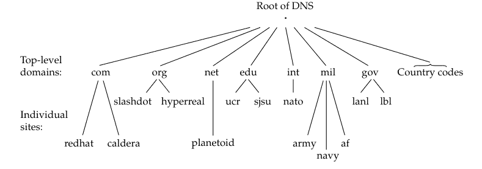

图 9-2 深度为层的树

## 无线网络管理：入门指南

这些 TLD 分为
- 通用顶级域名（如 .org, .com, .net, .mil, .gov, .edu, .int, .biz）
- 国家代码顶级域名（如 .us, .uk, .ng, .ca）
- 特殊顶级域名（如 .arpa）

我们 FQDN (serverA.example.org) 中的 TLD 是 .org。

## 二级域名

此层级的名称构成了组织边界：
- 互联网服务提供商 (ISPs)
- 教育社区
- 非营利团体

这里是一些例子：ieee802.org、github.com、kernel.org 和 caffenix.com。
我们示例 FQDN (serverA.example.org) 中的二级域名是 example。

## 三级域名

在域名的这一层级，被分配了二级域名的个人和组织可以很大决定如何处理三级域名。然而，惯例是使用三级域名来反映主机名或其他功能。分配三级命名的一个例子是 FDN www.com 中的 “www”。“www”可以是 yahoo.com 域伞下机器的实际主机名，也可以是真实主机的别名。

我们在 FQDN (serverA.example.org) 中的三级域名是 serverA。

## 子域名

在浏览万维网时，你可能遇到过如 www.support.example.org 之类的名称。这些名称可能会让你好奇整个名称中的哪部分构成了主机部分，哪些部分构成了域名部分。

欢迎来到奇妙神秘的子域名世界。子域名具有域的所有属性，只是它委托了域的一个子而不是站点所有的主机。使用 example.org 站点，Example, Inc. 支持与帮助台部门的子域名将是 support.example.org。


## 第9 章：标准无线网络基础设施服务与协议：DNS, DHCP 127

当 example.org 域名的主名称服务器接收到支持.example.org 中以 FQDN 结尾的主机请求时，主服务器会将该请求转发给 support.example.org 的主名称服务器。只有 support.example.org 的主名称服务器知道其之外的所有主机——例如名为 www.support.example.org（其 FQDN）的系统。

图 9-3 显示了从根域名到 example.org 域名的命名关系。“www”显然是主机名。
为了让这一点更清晰，让我们跟进一个 DNS 请求的路径：

- 1. 客户端想要访问一个名为 www.support.example.org 的站点。
- 2. 查询从顶级域名 .org 开始，在 .org 内部是 example.example.org。
- 3. 假设 example.org 域名的其中一个权威 DNS 服务器名为 ns1.example.org。
- 4. 由于主机 ns1 是 example.org 域名的权威服务器，我们必须查询它来获取其下所有主机（子域名）。
- 5. 因此，我们查询有关我们感兴趣的主机信息：www.example.org。
- 6. 现在 ns1.example.org 的 DNS 配置使得：对于任何以 support.example.org 结尾的内容，服务器都必须联系另一个名为 dns2.example.org 的权威服务器。
- 7. 对 www.support.example.org 的请求随后传递给 dns2.example.org，由它返回 www.support.example.org 的 IP 地址——例如 192.168.1.10。

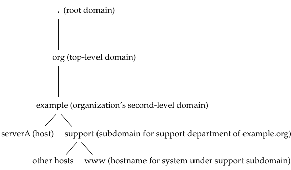

图 9-3. 子域的结构

## 128 无线网络管理：入门指南

> 注意 每当站点名称似乎反映了子域的存在时，并不总是意味着正在使用子域。某些 DNS 实现允许在主机名中使用点。因此，你偶尔会看到主机名中使用点。子域名是否由该站点的 DNS 服务器配置处理。例如，www.bogus.example.org 并不自动意味着 bogus.example.org 是一个子域。相反，它可能意味着 www.bogus 是 example 域中某个系统的主机名。

## (Zones)

DNS 区域的概念有时会被误解，在这里尝试澄清一下：DNS 区域不等同于 DNS 域（Domain）。它们之间的区别细微，但至关重要。

域是根据组织边界指定的。单一组织可以被划分为更小的管理子域名。每个子域名都有自己的区域。所有区域共同构成了该实体。

例如，example.org 是一个域。它包含子域名 .engr.org、.marketing.example.org、.sales.example.org 和 .admin.example.org。这四个子域名每个都有自己的区域。.example 内部还包含一些不属于任何子域的主机；因此它有自己的区域。结果是，example.org 域实际上是由五个区域共同组成的。

在最简单的模型中（即一个域没有子域名），在关于主机、配置和……等信息方面，区域和域的定义是相同的。

## in-addr.arpa 域

DNS 允许双向解析工作。正向解析将名称转换为 IP 地址，反向解析将 IP 地址转换回主机名。反向解析过程依赖于 in-addr.arpa 域，其中 arpa 是地址路由与参数区域（Address Routing and Parameters Area）的缩写。

如前节所述，域名是通过从左到右查看每个组件解析的，后缀指示 DNS 树的根。根据此逻辑，IP 地址也有顶级域名。IPv4 地址的域是 in-addr.arpa。在 IPv6 中，该域是 ip6.arpa。

与 FQDN 不同，IP 地址是从左到右解析的，它们位于 in-addr.arpa 域下。每个字节进一步缩小了可能的主机名。图 9-4 显示了 IP 地址 138.23.16.195 反向解析的视觉示例。

## DNS 服务器类型

DNS 服务器有三种类型：主、从和缓存。另一类特殊的名称服务器由所谓的“根名称服务器”组成。其他 DNS 服务器需要根名称服务器提供的服务。

## 主服务器 (Primary Servers)

主名称服务器被认为对特定域具有权威性。权威服务器是存放域配置文件的服务器。域 DNS 表的更新发生在此服务器上。域的主名称服务器简单来说就是知道该域下所有主机和子名的 DNS 服务器。

## 第9 章：标准无线网络基础设施服务与协议：DNS, DHCP

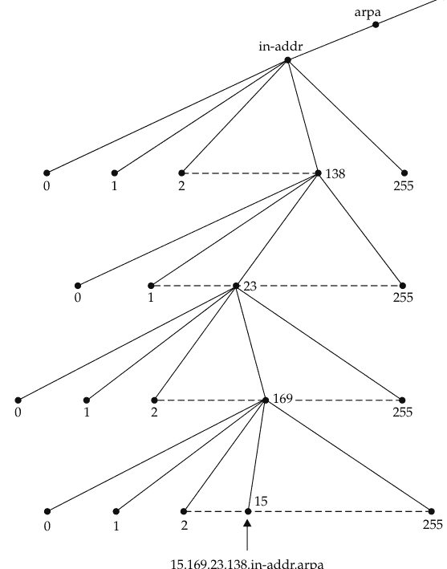

**图 9-4.** 138.23.169.15 反向 DNS 解析

## 从服务器 (Secondary Servers)

从名称服务器作为主名称服务器的备份和负载均衡器。主服务器知道从服务器的存在，并向它们发送定期更新。当查询从服务器时，它会响应。然而，由于从服务器不是权威的，它可能提供过的信息。

## 152 无线网络管理：入门指南

## 根名称服务器 (Root Name Servers)

根名称服务器是 DNS 结构的顶层。它们对特定域没有权威性，但它们知道 .com、org 和 .net 等顶级域名所在地。当客户端查询根服务器时，根服务器会将客户端引向该顶级领域的权威服务器。

## 缓存服务器 (Caching Servers)

缓存服务器存储一段时间内最近 DNS 查询的结果。这减轻了权威服务器的负载并加快了客户端的解析过程。如果请求的主机在缓存中，服务器将直接返回结果，无需查询权威服务器。

## 第9 章：标准无线网络基础设施服务与协议：DNS, DHCP 131

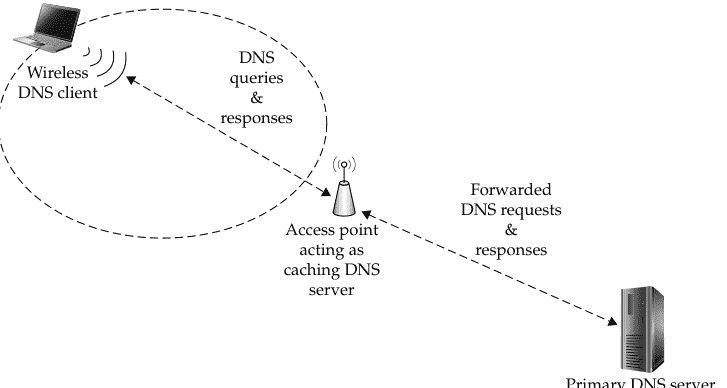

图 9-5. 作为缓存服务器的访问点

## DNS 记录类型

名称数据库文件存储与服务器托管每个区域相关的特定信息。这些数据库文件主要由记录类型组成——因此你需要你需要常见记录类型的含义和用途：SOA, NS, A, PTR, CNAME, MX, TXT 和 RP。

> 注意 我们假设数据存储在文本文件中。这是大多数 UNIX 和类 UNIX 存储 DNS 记录的传统格式。DNS 记录可能存储在其他格式中，例如数据库或专用格式。然而，原理是相同的，关于文本文件的事实在各个平台上是通用的。底线是，无论存储在什么格式或平台上，DNS 记录都是 DNS 记录，并且将始终是 DNS 记录。

## SOA：起始权威

SOA 记录是站点 DNS 条目的描述的开始。该条目的格式如下（为了易读性添加了行号）：

- 1 domain.name. IN SOA ns.domain.name. hostmaster.domain.name. (
2 199908081; 序列号
3 10800; 刷新时间（秒）（3秒）
4 1800; 重试时间（秒）（30分钟）
5 1209600; 过期时间（秒）（2周）
6 604800; 最小时间（秒）（1周）
7 )


## 无线网络管理：入门指南

第 1 行包含一些重要的详细信息：`domain_name` 显然应该替换为你的域名或区域名称。注意 `domain_name` 结尾的最后一个点。它应该是存在的——事实上，某些 DNS 服务器实现程序对此极其挑剔。末尾的点对于服务器区分相对主机和完全限定域名（FDN）是必要的；例如，考虑 `serverA` 和 `serverA.example` 之间的差异。

IN` 告诉名称服务器这是一个互联网记录。还有其他类型的记录，但已经多年没有人需要它们了。你可以安全地忽略它们。

`SOA` 告诉名称服务器这是起始权威（Start of Authority）记录。
`ns_domain_name` 是该域名名称服务器的 FQDN（即该名称最终将居住的服务器）。等一下，不要漏掉那个末尾的点。

`hostmaster.domain_name` 是域名管理员的电子邮件地址。注意此地址中缺少 `@` 符号。`@` 符号被点代替了。因此，示例中提到的电子邮件地址是 `hostmaster@domain.name`。这里也使用了末尾的点。
记录的其余部分从第 1 行的左括号开始。

第 2 行是序列号。它用于告诉名称服务器文件何时已更新。当心——在犯错误时，忘记增加这个数字是管理 DNS 记录过程中经常会犯的错误。（忘记在正确的位置放置点是另一个常见错误。）

- 以合理的方式维护从服务器，使用以下格式格式化的日期：YYYYMMDDxx。末尾的 `xx` 代表从 `00` 开始的额外两位数字，所以如果你在一天内进行了多次更新，你仍然可以区分是哪一个。

值列表第 3 行是以秒为单位的刷新率。此值告诉从 DNS 服务器多久查询一次主服务器，以检查记录是否已更新。

第 4 行是以秒为单位的重试率。如果从服务器尝试但无法联系主 DNS 服务器来检查更新，则从服务器将在指定的秒数后再次尝试。

第 5 行指定了过期（expire）指令。它用于已缓存数据的从服务器。它告诉这些服务器，如果无法联系主服务器进行更新，应在指定的秒数后丢弃该值。对于这个间隔，一到两周是一个不错的值。

第 6 行的最终值（最小值）告诉缓存服务器，如果无法联系主 DNS 服务器，它们应该等待多久后过期条目。对于此条目，五到七天是一个很好的指南。

# 第 9 章：标准无线网络基础设施服务与协议：DNS, DHCP 133

## NS: 名称服务器

NS 记录用于指定哪些名称服务器维护此区域的记录。如果存在任何你打算传输区域的从名称服务器，则需要在在这里指定它们。该记录的格式如下：

```
IN NS ns1.domain.name.
IN NS ns2.domain.name.
```

你可以为一个域名拥有任意数量的备份名称服务器——至少两个是一个好主意。大多数 ISP 在为你提供连接的情况下，都愿意充当从 DNS 服务器。

## A: 地址记录

这可能是现实中发现的最常见的记录类型。A 记录用于提供从主机名到 IP 地址的映射。A 地址的格式为：

```
Host_name IN A IP-Address
```

例如，主机 `serverB.example.org`（其 IP 地址为 `192.168.1.2`）的 A 记录如下：

```
serverB IN A 192.168.1.2
```

IPv4 “A”资源记录的对应项被称为“AAAA”（quad-A）资源记录。例如，主机 `serverB`（其 IPv6 地址为 `2001:DB8::2`）的 quad-A 记录如下：

```
serverB IN AAAA 2001:DB8::2
```

注意，任何主机都会自动带有 SOA 记录中列出的域名后缀，除非该主机名以点结尾。在上述 `serverB` 的示例中，如果它是为了 `example.org`，那么 `serverB` 将被理解为 `serverB.example.org`。如果你将其更改为 `serverB.example.org`（不带末尾的点），名称服务器将将其理解为 `serverB.example.org.example.org.`——这可能不是你想要的！所以，如果你想使用 FQDN，请确保在它的末尾加上一个点。

## PTR: 指针记录

PTR 记录用于执行名称解析，从而允许人们指定 IP 地址并确定相应的主机名。该记录的格式与 A 记录类似，但值反过来了：

```
IP-Address IN PTR Host_name
```

IP-Address 可以采取两种形式之一：IP 地址（让名称服务器根据其从 `in-addr.arpa` 域名获得的信息自动为其加上后缀），或带有点结尾的完整 IP 地址。

`Host_name` 必须具有 FQDN。例如，主机 `serverB` 的 PTR 记录如下：

```
192.168.1.2. IN PTR serverB.example.org.
```

主机 `serverB.example.org.` 的 PTR 记录表达方式类似于 IPv6 地址，即 `00000000000000000000000000000000.0000000000000000.0000000000000000.0000000000000000.0000000000000000.0000000000000000.0000000000000000.0000000000000000.0000000000000000.0000000000000000.0000000000000000.0000000000000000.0000000000000000.0000000000000000.0000000000000000.0000000000000000.0000000000000000.0000000000000000.0000000000000000.0000000000000000.0000000000000000.0000000000000000.0000000000000000.0000000000000000.0000000000000000.0000000000000000.0000000000000000.0000000000000000.0000000000000000.0000000000000000.0000000000000000.0000000000000000.0000000000000000.0000000000000000.0000000000000000.0000000000000000.0000000000000000.0000000000000000.0000000000000000.0000000000000000.0000000000000000.0000000000000000.0000000000000000.0000000000000000.0000000000000000.0000000000000000.0000000000000000.0000000000000000.0000000000000000.0000000000000000.0000000000000000.0000000000000000.0000000000000000.0000000000000000.0000000000000000.0000000000000000.0000000000000000.0000000000000000.0000000000000000.0000000000000000.0000000000000000.0000000000000000.0000000000000000.0000000000000000.0000000000000000.0000000000000000.0000000000000000.0000000000000000.0000000000000000.0000000000000000.0000000000000000.0000000000000000.0000000000000000.0000000000000000.0000000000000000.0000000000000000.0000000000000000.0000000000000000.0000000000000000.0000000000000000.0000000000000000.0000000000000000.0000000000000000.0000000000000000.0000000000000000.0000000000000000.0000000000000000.0000000000000000.0000000000000000.0000000000000000.0000000000000000.0000000000000000.0000000000000000.0000000000000000.0000000000000000.0000000000000000.0000000000000000.0000000000000000.0000000000000000.0000000000000000.0000000000000000.0000000000000000.0000000000000000.0000000000000000.0000000000000000.0000000000000000.0000000000000000.0000000000000000.0000000000000000.0000000000000000.0000000000000000.0000000000000000.0000000000000000.0000000000000000.0000000000000000.0000000000000000.0000000000000000.0000000000000000.0000000000000000.0000000000000000.0000000000000000.0000000000000000.0000000000000000.0000000000000000.0000000000000000.0000000000000000.0000000000000000.0000000000000000.0000000000000000.0000000000000000.0000000000000000.0000000000000000.0000000000000000.0000000000000000.0000000000000000.0000000000000000.0000000000000000.0000000000000000.0000000000000000.0000000000000000.0000000000000000.0000000000000000.0000000000000000.0000000000000000.0000000000000000.0000000000000000.0000000000000000.0000000000000000.0000000000000000.0000000000000000.0000000000000000.0000000000000000.0000000000000000.0000000000000000.0000000000000000.0000000000000000.0000000000000000.0000000000000000.0000000000000000.0000000000000000.0000000000000000.0000000000000000.0000000000000000.0000000000000000.0000000000000000.0000000000000000.0000000000000000.0000000000000000.0000000000000000.0000000000000000.0000000000000000.0000000000000000.0000000000000000.0000000000000000.0000000000000000.0000000000000000.0000000000000000.0000000000000000.0000000000000000.0000000000000000.0000000000000000.0000000000000000.0000000000000000.0000000000000000.0000000000000000.0000000000000000.0000000000000000.0000000000000000.0000000000000000.0000000000000000.0000000000000000.0000000000000000.0000000000000000.0000000000000000.0000000000000000.0000000000000000.0000000000000000.0000000000000000.0000000000000000.0000000000000000.0000000000000000.0000000000000000.0000000000000000.0000000000000000.0000000000000000.0000000000000000.0000000000000000.0000000000000000.0000000000000000.0000000000000000.0000000000000000.0000000000000000.0000000000000000.0000000000000000.0000000000000000.0000000000000000.0000000000000000.0000000000000000.0000000000000000.0000000000000000.0000000000000000.0000000000000000.0000000000000000.0000000000000000.0000000000000000.0000000000000000.0000000000000000.0000000000000000.0000000000000000.0000000000000000.0000000000000000.0000000000000000.0000000000000000.0000000000000000.0000000000000000.0000000000000000.0000000000000000.0000000000000000.0000000000000000.0000000000000000.0000000000000000.0000000000000000.0000000000000000.0000000000000000.0000000000000000.0000000000000000.0000000000000000.0000000000000000.0000000000000000.0000000000000000.0000000000000000.0000000000000000.0000000000000000.0000000000000000.0000000000000000.0000000000000000.0000000000000000.0000000000000000.0000000000000000.0000000000000000.0000000000000000.0000000000000000.0000000000000000.0000000000000000.0000000000000000.0000000000000000.0000000000000000.0000000000000000.0000000000000000.0000000000000000.0000000000000000.0000000000000000.0000000000000000.0000000000000000.0000000000000000.0000000000000000.0000000000000000.0000000000000000.0000000000000000.0000000000000000.0000000000000000.0000000000000000.0000000000000000.0000000000000000.0000000000000000.0000000000000000.0000000000000000.0000000000000000.0000000000000000.0000000000000000.0000000000000000.0000000000000000.0000000000000000.0000000000000000.0000000000000000.0000000000000000.0000000000000000.0000000000000000.0000000000000000.0000000000000000.0000000000000000.0000000000000000.0000000000000000.0000000000000000.0000000000000000.0000000000000000.0000000000000000.0000000000000000.0000000000000000.0000000000000000.0000000000000000.0000000000000000.0000000000000000.0000000000000000.0000000000000000.0000000000000000.0000000000000000.0000000000000000.0000000000000000.0000000000000000.0000000000000000.0000000000000000.0000000000000000.0000000000000000.0000000000000000.0000000000000000.0000000000000000.0000000000000000.0000000000000000.0000000000000000.0000000000000000.0000000000000000.0000000000000000.0000000000000000.0000000000000000.0000000000000000.0000000000000000.0000000000000000.0000000000000000.0000000000000000.0000000000000000.0000000000000000.0000000000000000.0000000000000000.0000000000000000.0000000000000000.0000000000000000.0000000000000000.0000000000000000.0000000000000000.0000000000000000.0000000000000000.0000000000000000.0000000000000000.0000000000000000.0000000000000000.0000000000000000.0000000000000000.0000000000000000.0000000000000000.0000000000000000.0000000000000000.0000000000000000.0000000000000000.0000000000000000.0000000000000000.0000000000000000.0000000000000000.0000000000000000.0000000000000000.0000000000000000.0000000000000000.0000000000000000.0000000000000000.0000000000000000.0000000000000000.0000000000000000.0000000000000000.0000000000000000.0000000000000000.0000000000000000.0000000000000000.0000000000000000.0000000000000000.0000000000000000.0000000000000000.0000000000000000.0000000000000000.0000000000000000.0000000000000000.0000000000000000.0000000000000000.0000000000000000.0000000000000000.0000000000000000.0000000000000000.0000000000000000.0000000000000000.0000000000000000.0000000000000000.0000000000000000.0000000000000000.0000000000000000.0000000000000000.0000000000000000.0000000000000000.0000000000000000.0000000000000000.0000000000000000.0000000000000000.0000000000000000.0000000000000000.0000000000000000.0000000000000000.0000000000000000.0000000000000000.0000000000000000.0000000000000000.0000000000000000.0000000000000000.0000000000000000.0000000000000000.0000000000000000.0000000000000000.0000000000000000.0000000000000000.0000000000000000.0000000000000000.0000000000000000.0000000000000000.0000000000000000.0000000000000000.0000000000000000.0000000000000000.0000000000000000.0000000000000000.0000000000000000.0000000000000000.0000000000000000.0000000000000000.0000000000000000.0000000000000000.0000000000000000.0000000000000000.0000000000000000.0000000000000000.0000000000000000.0000000000000000.0000000000000000.0000000000000000.0000000000000000.0000000000000000.0000000000000000.0000000000000000.0000000000000000.0000000000000000.0000000000000000.0000000000000000.0000000000000000.0000000000000000.0000000000000000.0000000000000000.0000000000000000.0000000000000000.0000000000000000.1...

IP-地址可以采取两种形式之一：IP 地址（让名称服务器根据其从 in-addr.arpa 域名获得的信息自动为其加上后缀），或带有点结尾的完整 IP 地址。

必须具有 FQDN。例如，主机 `serverB` 的 PTR 记录如下：

```
192.168.1.2. IN PTR serverB.example.org.
```

主机 `serverB.example.org.` 的 PTR 记录表达方式类似于 IPv6 地址。与正常方式不同，它是反向的。例如，对于一个示例场景，CNAME 条目将是

| zabsuj-content IN A 192.168.1.111 |
| www IN CNAME zabsuj-content |

## MX: 邮件交换

MX 记录用于指定哪些邮件服务器接收该域名的邮件。如果列出了多个服务器，使用权重来决定优先级。该记录的格式如下：

```
Host_name IN MX priority mail_server
```

MX 记录告诉名称服务器向哪里发送邮件。如果有多个 MX 记录，首先尝试优先级最低的。例如，域名 `example.com` 的 MX 记录可能如下：

```
example.com IN MX 10 mail1.example.com.
example.com IN MX 20 mail2.example.com.
```

## DHCP: 动态主机配置协议

DHCP 用于为网络上的设备分配 IP 地址和其他配置参数。它自动化设备配置的过程 服务器维护一个 IP 地址池并根据需要分配给客户端。当客户端加入网络时，它会发送消息与 DHCP 服务器通信。此过程通常被称为 DORA：

- Discovery（发现）：客户端发送 Discovery 消息以寻找可用的 DHCP 服务器。
- Offer（提供）：服务器响应一个包含 IP 地址的 DHCP Offer。
- Request（请求）：客户端发送 Request 消息以接受所提供的地址。
- Acknowledgement（确认）：服务器发送 Acknowledgement 以确认租赁。

## CNAME: 规范名称

CNAME 记录允许你为主机名创建别名。当你想要让多个主机名指向同一个目标时，这非常有用。CNAME 记录的格式为：

```
Alias_name IN C_name
```

例如，如果你想让 `www.example.com` 指向 `example.com`，你会使用如下 CNAME 记录：

```
www.example.com IN CNAME example.com.
```

## PTR: 指针记录

PTR 记录用于执行名称解析，从而允许人们指定 IP 地址并确定相应的主机名。该记录的格式与 A 记录类似，但值反过来了：

```
IP-Address IN PTR Host_name
```

IP-Address 可以采取两种形式之一：IP 地址（让名称服务器根据其从 in-addr.arpa 域名获得的信息自动为其加上后缀），或带有点结尾的完整 IP 地址。

必须具有 FQDN。例如，主机 `serverB` 的 PTR 记录如下：

```
192.168.1.2. IN PTR serverB.example.org.
```

主机 `serverB.example.org.` 的 PTR 记录表达方式类似于 IPv6 地址。与正常方式不同，它是反向的。例如，对于一个示例场景，CNAME 条目将是

| zabsuj-content IN A 192.168.1.111 |
| www IN CNAME zabsuj-content |

## TXT 和 RP: 文档条目

将联系信息作为数据库的一部分提供是很有用的——不仅仅是注释，而是其他人可以查询的实际记录。这可以通过 TXT 和 RP 记录来实现。
TXT 记录是一个自由文本输入，你可以在其中放置任何你合适的信息。大多数情况下，你只想在这些记录中放置联系信息。每个 TXT 记录必须绑定到特定的主机名。这是一个示例：

| serverA.example.org. IN TXT "Contact: Admin Guy |
| IN TXT "SysAdmin/Android" |
| IN TXT "Voice: 999-9999" |

## RP 记录被创建作为主机联系信息的显式容器。该记录说明了谁是特定主机的责任人员。这是一个示例：

| serverB.example.org. IN RP admin-address.example.org. example.org. |


## DHCP

手动为少数系统配置 IP 地址是一项相当简单的任务。然而，为整个部门、大楼或异构系统手动配置 IP 地址可能是一项艰巨的任务。

DHCP 可以协助这些任务。DHCP 客户端机器可以配置为从网络获取 IP 地址。当 DHCP 客户端软件启动时，它会向网络广播 IP 地址的请求。如果进展顺利，网络上的 DHCP 服务器将做出响应，发布一个地址以及其他必要信息，以完成客户端的网络配置。

这种动态地址分配对于配置移动设备或临时机器也非常有用。例如，在不同办公室之间往返的“游牧战士”可以轻松地将其机器连接到无线或有线本地网络，并为其所在的位置获取适当地址。

DHCP 是为大批量机器或移动工作站动态配置地址的有用工具。由于 DHCP 是一个开放协议，服务器的架构和平台是相关的。

> 注意：DHCP 是一个标准。因此，任何正确实现该标准的平台都可以与其他 DHCP 服务器和客户端通信，无论它们的原生平台是什么。例如，运行 Windows、Linux 或 Macintosh  own系统的客户端可以配置为使用 DHCP，并从一个专有的但同时也作为 DHCP 服务器的无线接入点获取信息。基于 Windows、Linux 或 Macintosh 的客户端并不一定知道或在乎它们的 IP 配置信息是由其他平台提供的。

## DHCP 的机制

当客户端配置为从网络获取地址时，它会以 DHCP 请求的形式索要地址。DHCP 服务器监听客户端请求。当收到请求时，它会检查本地数据库并发布适当的响应，响应始终包含地址，并可以包含名称服务器、子网掩码和默认网关。客户端接受服务器的响应并配置其本地设置。

DHCP 服务器维护一个它可以发布的地址列表。每个地址的发布都带有一个关联的租约（lease），租约规定了客户端在必须联系服务器续租之前之前允许使用该地址的时间。当租约过期后，预计客户端将不再使用该地址。因此，DHCP 服务器假设该地址已可用，并将其放回服务器的地址池。

服务器可以配置为从地址池中发布任何空地址，或向特定机器发布特定地址。

## 第 9 章：标准无线网络基础设施服务与协议：DNS, DHCP 137

## DHCP 服务器

DHCP 服务器负责在客户端请求时提供 IP 地址和其他相关信息。由于 DHCP 是基于广播的，因此对于要提供 DHCP 服务的每个子网必须存在一个服务器。

## 选项

目前，DHCP 服务器向 DHCP 客户端支持 60 个网络配置参数（或选项）。

表 9-1 显示了常用的 DHCP 选项。

## DHCP 客户端

DHCP 客户端是用于与前节描述的 DHCP 服务器通信的软件组件。

实现 DHCP 客户端功能的平台数胜许多——无线接入点 (WAP)；Windows、MAC 和 Linux 系统；无线 PDA、网络打印机和手机等。

当客户端被调用时，它将尝试从可用的 DHCP 服务器获取地址并相应配置其网络设置。

## DHCP 中继 (Relay)

如所述，DHCP 客户端通常通过发送广播消息来运行。路由器会阻止广播。大多数 WAP 和无线网关通常内置了某些路由功能。这些设备通常还具有内置的 DHCP 服务器功能。

在任何有线或无线网络中，密切控制能够分发 IP 配置信息的设备（作为 DHCP 服务器）通常是理想的。这就是为什么网络管理员有时关闭 WAP 和网络网关（有线和无线）中的 DHCP 服务器功能的原因之一——以防止它们也充当 DHCP 服务器。

一种允许路由器（有线和无线）转发客户端的 DHCP 请求和服务器的 DHCP 响应的过程被称为 DHCP 中继。

其工作原理的简化版本在接下来详细介绍，并在图 9-6 中描绘。

| 选项 (Option) | 描述 (Description) |
|---|---|
| broadcast-address | 客户端子网上被指定为广播地址的地址 |
| domain-name | 客户端在执行主机查找时应作为本地域名使用的域名 |
| domain-name-servers | 客户端用于解析主机的 DNS 服务器列表 |
| host-name | 用于标识客户端名称的字符串 |
| routers | 客户端按优先级顺序使用的路由器 IP 地址列表 |
| subnet-mask | 客户端将使用的子网掩码 |

表 9-1. 常用 DHCP 选项

1. 无线节点 Node-1 被配置为 DHCP 客户端，需要参与基于 IP 的网络。
2. Node-1 连接到由接入点 (AP) AP-1 管理的基础设施服务集 (infrastructure service set)。
3. AP-1 也连接到有线网络。
4. 有线网络上存在一个名为 DHCPd-lan 的独立 DHCP 服务器。
5. AP-1 的 DHCP 服务器功能已关闭。
6. Node-1 发出广播消息。DHCP 服务器 DHCPd-lan 没有看到该广播消息，因为 AP-1 阻止了它。
7. 为了允许 Node-1 和其他无线客户端获取 IP 配置信息，需要配置 AP-1 中继 DHCP 请求。

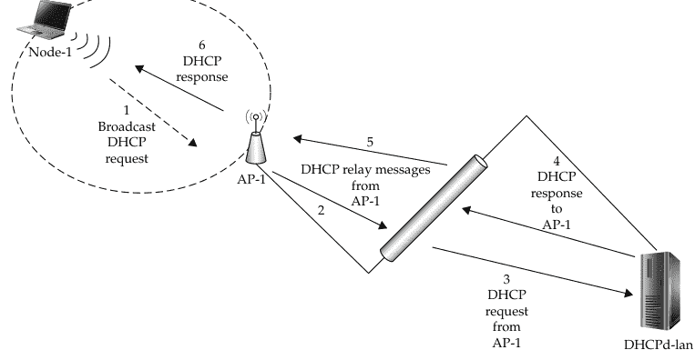

图 9-6. DHCP 中继

# 第 9 章：标准无线基础设施服务与协议：DNS, DHCP

8. 无线节点 Node-1 被配置为 DHCP 客户端，需要参与基于 IP 的网络。
9. Node-1 连接到由接入点 (AP) AP-1 管理的基础设施服务集。
10. AP-1 也连接到有线网络。
11. 有线网络上存在一个名为 DHCPd-lan 的独立 DHCP 服务器。
12. AP-1 的 DHCP 服务器功能已关闭。
13. Node-1 发出广播消息。DHCP 服务器 DHCPd-lan 没有看到该广播消息，因为 AP-1 阻止了它。
14. 为了允许 Node-1 和其他无线客户端获取 IP 配置信息，需要配置 AP-1 中继 DHCP 请求。

## 总结

本章涵盖了关于标准服务的以下信息：

- 名称解析
- DNS 服务器类型：主、从和缓存服务器
- 各种 DNS 记录类型（针对 IPv4 和 IPv6）
- DHCP 服务，用于为机器组或移动工作站提供和管理 IP 配置

## 第 10 章 可可选基础设施服务与协议

## 关键概念

- 介绍增强无线网络的可选服务和协议
- 学习 RADIUS 和 Diameter 协议
- 学习何时作为网络基础设施的一部分部署 RADIUS 或 Diameter
- 了解代理服务器的功能和类型
- 学习何时作为网络基础设施的一部分部署代理服务器

## RADIUS

远程身份认证拨号用户服务 (RADIUS) 协议定义在互联网工程任务组 (IETF) 文档 RFC 2865 中，用于管理网络资源的访问。该协议已存在很长时间，并以各种形式应用于无数应用程序中。RADIUS 通过提供一种集中管理用户的方法来执行其功能，这种方法可以是数据库的形式，包含访问用户必须满足的要求列表。

RADIUS 有助于解决管理大量用户访问网络时涉及的一些问题和逻辑。RADIUS 通过将问题拆分为三个领域：身份认证、授权和计费来解决这些问题。

RADIUS 协议的长久存在归于其可扩展性。该协议从设计之初就易于扩展，这样新功能就可以轻松地叠加或添加到基础协议中，而不会破坏原始协议现有实例。

## RADIUS 实体

图 10-1 显示了示例无线网络上 RADIUS 实体的相对位置。


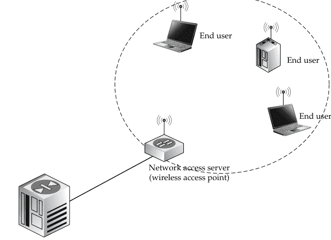

**图 10-1.** RADIUS 网络示例

在任何实现 RADIUS 的环境中都涉及以下参与者：

- **终端用户 (End user)** 需要访问网络资源的实体，例如需要加入无线分布系统 (WDS) 的无线工作站 (STA)。从 RADIUS 协议的角度来看，终端用户并不一定与 RADIUS 客户端是实体。事实上，终端用户通常与实际的 RADIUS 客户端不同。

- **网络接入服务器 (NAS)** 提供网络访问的门禁设备，例如无线接入点 (AP)。

当终端用户需要访问任何网络资源时，就会连接到 NAS。NAS 反则依赖接入服务器来决定是否允许或拒绝终端用户实访问。NAS 通常被称为 RADIUS 客户端或鉴别者（Authenticator）。

## 无线网络管理：入门指南

- **接入服务器 (AS)** RADIUS 协议的服务器组件；也称为 RADIUS 服务器。

NAS 将终端用户访问网络资源的请求转发给 AS。随后，AS 对是否授予或拒绝终端用户的访问做出最终决定。

你可能会奇怪，为什么一本关于无线网络的书籍会讨论拨号服务，因为无线工作站 (STA) 显然不需要拨号到任何地方即可连接无线网络。包含这些信息有三个原因：

- RADIUS 仅仅是一个名称，规范 RADIUS 工作的标准在无线网络变得像今天这样无处不在之前的几年就已经发明了。“RADIUS”这个名称是为了该标准最初创建的原始目的：控制对网络的拨号接入。因此，换句话说，考虑到此后挤出的所有额外功能和应用，这个名称已无法体现该标准的真正价值了。

- 无线 STA 可以以某种方式拨号接入网络。虽然 STA 没有使用传统的基于铜线（电缆）的拨号范式，但 STA 仍然需要登录网络。

- 大型企业无线 (Wi-Fi) 网络通常依赖 RADIUS 作为一种集中方式来管理用户凭据和网络访问。这有助于缓解与用户之间使用通用/共享密钥或密码相关的某些风险。

## AAA

AAA——认证（Authentication）、授权（Authorization）和计费（Accounting）可以被视为实现 RADIUS 协议的框架。

## 认证 (Authentication)

认证用于验证实体的身份。例如，它*主要*用于验证终端用户的身份。我之所以说*主要*是如此，是因为认证也可以反向方向工作（双向认证），即被认证的实体也要求鉴别者（另一个实体）验证其自身。

认证是这一切的开始。任何需要访问网络资源的终端用户或工作站首先需要经过认证。它始于终端用户以各种形式向 NAS 提交其凭据，例如用户名、登录 ID、密码、硬件令牌、数字证书等。当提交的凭据被验证有效时，认证被认为成功。

接下来将讨论一些流行的认证方法。

## 第 10 章：可选基础设施服务与协议 145

**密码认证协议 (PAP)** 是一种弱认证方法。它之所以弱，是因为用户凭据是以明文形式通过网络传输的。当实体不支持任何其他类型的认证方案时，它可以作为最后的认证手段。

**挑战/握手认证协议 (CHAP)** 这种认证方法依赖于方案中仅实体为人知的共享“秘密”。该秘密不会在链路上传输。

该过程在两个实体之间建立链路后开始。鉴别者向对端发送挑战消息。

对端使用单向哈希函数计算出一个值对挑战做出响应。两个实体都应该预先知道如何根据共享秘密应用此哈希函数。

鉴别者对挑战运行相同的单向哈希函数，并知道预期的值应该是什么。如果值匹配，则确认认证；否则，终止连接。

在连接的生命周期内，鉴别者会定期向对端发送挑战，以防被攻破。

**挑战/握手认证协议 (MS-CHAP)** 这是微软对 CHAP 认证方法的变体。MS-CHAP 版本 2 (MS-CHAP-V2) 是该协议的最新迭代版本。

MS-CHAP-V2 支持对端的相互认证。它还具有内置机制，允许鉴别者强制或发起对端的密码更改。

**可扩展认证协议 (EAP)** EAP 在 IETF 文档 RFC 3748 和 RFC 5247 中定义，是一种支持多种认证方法的认证框架。EAP 运行在 OSI 参考模型的数据链路层——这意味着 EAP 不依赖于 IP。

EAP 仅仅是一个框架，本身并不是一种认证方法。相反，它是一个围绕其设计的其他认证机制的框架。顾名其实义，EAP 在设计时考虑了扩展性，这使其非常具有前瞻性。随着新认证机制的开发以及在旧认证方法中发现漏洞的出现，可以设计出仍然使用 EAP 作为其基础的新型协议。

EAP 广泛用于事实上的无线安全协议，例如 Wi-Fi 安全访问 (WPA 和 WPA2)。EAP 也可以用于安全有线网络的安全协议，例如 IEEE 802.1X。

## 授权 (Authorization)

AAA 的认证组件处理权限问题。它规定了经过授权的用户在成功认证后对给定资源可以做什么。授予授权的依据可以基于终端用户的位置、时间、群组身份、连接类型和其他因素。

## 计费 (Accounting)

AAA 的计费部分用于跟踪终端用户对网络资源的使用或消耗。

计费还可以用于容量规划、审计、成本分配以及跟踪其他使用统计，例如成功或失败的登录尝试以及成功或失败的授权尝试。

> 注意 RADI 基于用户数据报协议 (UDP)。RADIUS 的认证组件运行在 UDP 端口 1812，计费组件运行在 UDP 端口 1813。

## 何时使用 RADIUS

一个声誉良好的无线网络管理员如何知道将 RADIUS 纳入其基础设施工具箱中？以下清单可能有助于回答这个问题：

- 当你需要从中心位置管理和维护大量的无线网络用户时，考虑使用 RADIUS。
- 当你需要补充可以利用它的企业级无线安全解决方案时，考虑 RADIUS。
- 当你需要为了计费和账单目的跟踪无线用户时，考虑 RADIUS。
- 当你需要为无线网络用户实施或定义高级基于策略的功能（例如基于时间的访问）时，考虑 RADIUS。
- 当无线网络供公共使用时——例如公共无线热点，考虑 RADIUS。
- 当有线网络已经在使用 RADIUS 服务器时，特别是当集成可以轻松、无缝且有利地进行时，考虑 RADIUS。
- 当你管理运行在不同平台（如 Linux、Windows、Macintosh、UNIX、BSD 等）的大量差异无线客户端时，考虑 RADIUS。这有助于减少每个厂商平台在认证、授权和加密解决方案实现中可能存在的缺陷的影响。


## 第 10 章：可选基础设施服务与协议

## 流行的 RADIUS 实现

多个供应商和团体都创建了 RADIUS 协议的各自实现版本。根据实现的采纳程度，某些实现可能已不再处于活跃开发或维护状态，但可能仍在使用各种网络部署中。

- FreeRADIUS 项目 (http://freeradius.org)
- 网络策略服务器（(http://technet.microsoft.com/en-us/network/bb629414.aspx），它是 Microsoft Windows Server 的内置组件。
- BSDRadius (http://www.bsdradius.org)
- Cisco 安全访问控制服务器（(www.cisco.com)
- Juniper Networks Steel-Belted Radius 系列（(http://www.juniper.net)

## Diameter

既然我们有一个名为 RADIUS 的协议，那么理应有一个名为 Diameter 的对应协议，这完全合逻辑！

Diameter 协议是 RADIUS 协议的继承者。它的设计初衷是为了减轻旧版 RADIUS 协议面临的需求压力。由于许多接入技术的不断发展和演进，RADIUS 可能难以跟上，因此 Diameter 被认为是必不可少的。Diameter 的设计尽可能地与 RADIUS 保持向后兼容。新的 NAS 设备的功能集和能力也大幅增加，因此要求接入服务器（AS）也支持更多功能。

Diameter 也用于提供 AAA 服务。该协议的内部机制在 IETF RFC 3588 中规定。

以下 Diameter 协议的特征将其区别于旧的 RADIUS 协议：

- Diameter 使用了可靠的传输协议，如传输控制协议 (TCP) 和流控制传输协议 (SCTP)。
- 它内置了对网络或传输层安全的支持，例如 IP 安全协议 (IPSec) 和传输层安全协议 (TLS)。
- 它提供了更好的漫游能力。
- Diameter 内置的故障转移（fail-over）支持。
- Diameter 通过使用特殊的 DNS 记录支持自动对端发现和配置。
- Diameter 支持移动 IP，允许移动节点在保持原始 IP 配置的同时，更改其接入网络的接入点。

## 无线网络管理：入门指南

在“何时使用 RADIUS”章节中讨论的任何场景中，你都应该考虑使用 Diameter，当你需要确保无线网络的基础设施具备未来性时也是如此。尽管 RADIUS 是一个过时协议，但它在许多 IT 环境中仍然根深蒂固，总有一天，它将无法无法处理更新的技术需求。

## Diameter 实体

在任何实现 Diameter 协议的环境中，以下角色都至关重要：

- 终端用户：需要访问网络资源的实体，例如需要参与 WDS 的无线 STA。
- Diameter 客户端：代表用户生成并接收请求和响应的客户端——例如，网络服务器 (NAS)，如无线接入点 (WAP)。
- Diameter 服务器：处理 AAA 请求。
- Diameter 对端（peer）：用于描述 Diameter 实体之间的关系，其中一个 Diameter 实体与另一个 实体具有直接的传输连接。例如，作为 NAS 的 Diameter 客户端可以与其连接的 Diameter 服务器形成对端关系。
- Diameter 节点：任何实现 Diameter 协议并作为 Diameter 客户端、Diameter 代理或 Diameter 服务器运行的实体。
- Diameter 代理：帮助在其他 Diameter 节点之间转发请求和响应的实体。

## 代理服务器

代理服务器有各种形状、形式和大小，但它们都有具有几个共同点——特别是在定义方面。代理服务器是软件或硬件，为需要访问某些网络资源的客户端请求充当中间人或经纪人。代理服务器可以帮助你的工作变得简单得多，帮助你的用户和高层管理处理，并可以帮助改进无线网络的带宽利用。

代理服务器的工作原理是接收客户端请求，然后将客户端请求转发到托管资源的相应服务器。代理服务器还接收来自服务器的响应，并将响应传回原始客户端。在进行这一切的同时，代理服务器可能还会对请求和响应执行其他操作：

- 它可以拒绝对给定资源的访问。
- 它可以通过称为“缓存”的过程加速客户端与服务器之间的整个通信。
- 它可以过滤或清理从客户端到服务器的请求和响应，反之亦然。
- 它可以通过不直接将客户端暴露给服务器或其他可能的敌对外部网络，为客户端提供某种形式的匿名性。
- 它可以将客户端或服务器的请求或响应从一种格式转换为另一种。

## 代理服务器的类型

代理服务器在所代理的具体资源类型上有所不同。许多代理服务器是基于它们所代理的资源类型划分的。

**Web 代理服务器**：常见的代理服务器类型之一，Web 代理服务器的主要目的是代理 Web或其他超文本协议 (HTTP) 请求。这类代理服务器的最终目标可以是多方面的。例如，它可以用于控制用户对网络 Web 资源的访问，或者可能通过在本地缓存资源来加速对 Web 资源的访问。

这些代理服务器还可以更改、操纵或将内容从一种形式转换为另一种形式，当例如终端客户端无法支持或使用原始形式的资源时，这可能是必要的。Web 代理服务器还可以用于将传统的网页重新格式化为适合在移动设备等设备上查看的格式。

**内容过滤代理服务器**：内容过滤代理服务器有多用途，通常用于限制用户访问某些内容，例如强制执行业务策略合规性。

**缓存代理服务器**：缓存代理服务器用于在本地存储频繁访问的资源副本。这加快了本地用户的访问速度。

**透明代理服务器**：这类代理服务器的设计可以在无需客户端交互的情况下工作，对于无法单独配置所有客户端的大型网络有用。

## 何时使用代理服务器

如果出现以下场景，无线网络管理员应考虑在无线网络中引入代理服务器：

- 你需要节省带宽费用。如果你的 ISP 根据通过网络传输的数据（每兆字节或每千字节）收费，那么内部代理服务器有助于减少网络传输的数据量。代理服务器将尝试为本地用户重用缓存中的内容，而不是每次都连接互联网。
- 你希望提高用户访问外部内容的体验。得益于代理服务器，某些数据的检索将更快。
- 你需要一种方法来跟踪（记录）无线网络用户通过网络访问的内容。这在法律或管理层面上可能是必要的。
- 你需要控制无线网络用户在网络上的行为。这在法律或管理层面上可能是必要的。
- 你需要在用户通过网络访问 Web 资源之前提供简单的身份验证方法。

## 流行的代理服务器实现

多个供应商和团体都创建了自己的代理服务器产品，包括以下：

- Squid (http://www.squid-cache.org)
- Microsoft Forefront Threat Management Gateway (www.microsoft.com/forefront/threat-management-gateway)
- Wingate (http://www.wingate.com)
- Tor (www.torproject.org)

## 总结

你学习了基础设施中一些非标准或可选的组件。它们之所以是非标准或可选的，是因为它们对于无线网络的运行并非必需。通常情况下，这些服务或协议是有用的，可以帮助你的工作和生活变得轻松轻松——它们也能让网络用户更高效、更快乐。


## 第 11 章
## 无线网络安全：基础

## 152 无线网络管理：入门指南

## 关键技能与概念

- 学习密码学以及加密概念和术语。
- 学习算法和密码。
- 复习某些密码示例和实现。
- 复习扩展身份验证协议 (EAP) 框架。
- 复习 IEEE 802.11i 以及部署 IEEE 802.11i 网络的一些注意事项。

在无线频率上运行的无线无线通信系统具有以下特征：

- **不可见性**：无线通信通过不可见的电波进行传输。
- **几乎无边界**：限制或约束无线通信的边界非常困难，这可能导致通信到达非预期的位置。
- **易于使用适当设备进行监控和观察**：防止无关的人员监控或观察通信是非常困难的。

由于这些原因，无线通信因不安全而闻名。然而，无线通信是不可或缺的，因为它提供了极大的便利。我们能期待的最优就是尝试找到管理和减轻这些不理想特性的方法。

本章研究了为了提高无线通信安全性而开发的某些方法。请注意，提高无线通信安全性就像试图击中一个移动目标。因此，随着现有解决方案中缺陷或漏洞被发现，新的、更好的方法不断被开发出来。

让我们先简要回顾过去；然后我们将过渡到用于保护无线通信的当前方法。

## 安全背景

我们知道通信发生在两个或多个实体之间；无线通信的麻烦在于，当一个实体试图与另一个实体通信时，如果没有实施适当的安全技术来保护通信，第三个（或多个）外部实体就可以窃听。换句话说，需要投入努力来确保无线通信的安全，以防止未经邀请的实体窃听。

## 第 11 章：无线网络安全：基础

实现安全性有几种可选方案，包括：

1. 我们完全不进行通信。
2. 我们通信，但将所有通信限制在内部。
3. 我们通信，但尝试对谁或与什么通信保持谨慎。
4. 我们通信，但尝试对我们通信的内容性质保持谨慎。
5. 我们通信，但明确我们的通信可能并非完全秘密，并在接受风险的同时，尽可能地减轻这些风险。

过去和现在保护无线通信的方法倾向于结合使用第 3、4 和 5 种方法来完成工作。

第三种方案通过身份验证手段解决无线网络中的通信安全问题——由通信通道中的一个或所有参与方验证对方的身份。

促进安全无线通信的符合第四种方案的一种方法是使用加密处理和转换。加密方法可以用于伪装或处理通信，使其仅对目标方可见或可用，而对任何其他方均无用处。

第四种方案还提出了其他问题和挑战。例如，你如何保护或确保你看不见的东西？为了回答这个问题，我们必须理解正在传输的无线“帧”的性质和组成部分。第 6 章讨论了 IEEE 802.11 网络使用的无线媒体访问控制（MAC）帧类型。

> 注意：记住，IEEE 802.11 标准关注物理层 (PHY) 和开放系统互连 (OSI) 参考模型的 MAC 子层。由于这个原因，大多数基于标准的无线网络安全常用方法和解决方案都是在 MAC 子层实现的。

让我们复习 MAC 帧类型：

- **控制帧**：这些帧对所有无线通信都非常重要，用于支持其他（管理和数据）MAC 帧类型的交付。它们是最基本的帧类型。控制帧中的信息对无线网络中的所有节点可见，这一点非常重要；它们在任何方面都不是秘密的。
- **管理帧**：这些帧被无线节点用于加入或退出无线网络成员，并用于其他各种杂的维护工作。保留管理帧的内容有时可能是重要的。

## 无线网络管理：入门指南

- **数据帧**：这些帧类型用于传输数据载荷。例如，它们可能包含我们正试图保护和传输的信息。

加密技术可保护管理帧和数据帧中的信息。接下来的章节将讨论用于保护无线通信的安全概念和技术。

## 安全服务

无论使用何种解决方案，无线网络中采用任何良好的安全解决方案都应该满足身份验证、机密性和完整性的基本需求。

- **身份验证**：确保与我们通信的实体是他们所称的；可以包括授权，允许实体在通过验证后在网络上进行通信。
- **机密性**：确保通信实体之间传输或共享的任何信息保持机密，或对任何未经授权或外部实体不可访问。
- **完整性**：维护授权实体之间通信信息的纯洁。通信内容在到达预期目的地之前，不得以任何方式被损坏、破坏或更改。

每个安全解决方案以不同程度满足这些基本需求：例如，一种解决方案可能提供身份验证服务，但不足以提供机密性服务；另一种解决方案可能提供机密性和完整性服务，但无法提供身份验证服务。换句话说，你会发现现实世界中没有任何安全解决方案是完美的。

## 密码概念和术语

密码学可以定义为用秘密字符书写的行为或艺术。在技术术语中，它指的是加密和解密的科学。以下与密码相关的术语将有助于你的理解。

## 明文 (Plain-text)

明文描述未加密的数据。

> 注意：“plain-text”一词并不完全准确，因为这里的“text”并不一定指字节。

如果不考虑隐私或秘密，发送和接收数据的步骤将非常简单：我们在发送端从明文开始，经过加密转换（变成密文），密文进行传输，接收端获得密文并通过另一种转换，最后如果转换成功，则得到原始明文。

> 注意：“Clear text”是明文的另一种名称。

## 加密与解密

加密是将信息从一种形式（明文）转换为另一种形式（密文）的过程。加密使得密文在没有相应密钥的情况下几乎无法解密。

解密是加密的反面，是将加密的信息（密文）转换回可读形式（明文）。

## 密钥

密码学中的密钥类似于日常生活中用于锁物的钥匙。在密码学中，密钥用于加密和解密过程。在这种情况下，密钥是一个具有特殊数学属性的大数字。破解加密方案取决于密钥或发现密钥的能力。密钥越大，越难以发现。

低加密使用 56 位——这意味着有 2^⁵⁶ 个可能的密钥。以下内容可以提供规模感：

- 2³² 等于 4,294,967,296（超过 40 亿）。
- 2⁴⁸ 等于 281,474,967,710,656。
- 2⁵⁶ 等于 72,057,594,037,926,936（超过 72 万亿）。

虽然这看起来是一个巨大的数字，但现代计算机的处理能力使得发现成为一种可能并引起真正的担忧——特别是在使用低级加密时。

## 密钥空间 (Keyspace)

密钥空间与用于加密解密的密钥相关。密钥空间指的是密钥中可能使用的值的范围。密钥范围越宽，破解或破坏加密就越困难。


## 密钥流

密钥流是一种随机或伪随机数据流，它与明文结合产生密文。可以对密钥流并结合明文执行不同的数学或逻辑操作来生成密文。密钥流与密钥或受保护的信息之间没有必然联系。

可以在密钥流和明文上执行以下逻辑操作（不仅限于此）：

- 逻辑与 (AND)
- 逻辑或 (OR)
- 逻辑非 (NOT)
- 非与 (NAND)
- 否或 (NOR)
- 异或 (XOR)

> 注意：伪随机数是一系列类似于随机数的数字，但不能被定义为完全随机，因为它们是由一个较小的初始值集生成的。它们的范围是有限或有限的。

## 异或 (XOR)

异或是一种二进制逻辑操作：它需要两个输入或操作数。操作数是命题的值（即确认某事为真或否定某事为假的语句）。两个操作数之间的异或操作在仅当其中一个条件为真时返回真值。

异或用作无线等效隐私（WEP）加密的基础，本文将在章稍后部分进行讨论。以下示例展示了对数字 1 和 0 执行异或操作的结果：

- 1 XOR 1 = 0
- 1 XOR 0 = 1
- 0 XOR 1 = 1
- 0 XOR 0 = 0

其中 0 = ，1 = 真。

## 第 11 章：无线网络安全：基础

## 算法

算法是一种既定的计算方法，用于在有限步骤内解决问题，在给定相同参数的情况下，这些步骤可以很容易地复制。技术上讲，算法必须在有限步骤后生成结果。在密码学领域，目前有两类算法：对称算法和非对称算法。

## 对称加密算法

对称算法通常使用相同的密钥进行加密和解密。在对称加密算法中，密钥长度与加密强度直接相关，因此配合良好算法使用的大密钥比小密钥更难破解。对称算法最适合提供安全系统的机密性需求。

这类算法也称为“基于密钥的算法”，因为其操作模式取决于一个秘密——该秘密在需要安全通信的实体之间共享。因此，始终妥善保护秘密或密钥至关重要。密钥的共享也是对称加密算法的主要弱点之一。对称算法的另一个弱点在于密钥分发给需要方的方的逻辑问题。

与非对称算法（下文讨论）相比，对称算法的计算需求通常较低，且执行速度更快。以下是对称算法的示例：

- 加密标准 (AES)
- 三重数据加密算法 (3DES)
- Blowfish
- Carlisle Adams and Stafford Tavares v5 (CAST5)
- 国际数据加密算法 (IDEA)
- Twofish

## 非对称加密算法

这类算法对加密和解密使用不同的密钥。此外，解密密钥不能从加密密钥推导出。这类算法也称为“基于公私钥的算法”。名称中的“公”部分源于公钥任何人已知（它不是秘密），但私钥部分应该是一个秘密。然而，公钥和私钥在数学上是相关的。

使用非对称算法的算法在计算上比对称算法要求，因此执行速度慢得多。用于加密和解密的密钥的分发和管理便利性优于对称解决方案。非对称算法的一些示例包括 Diffie-Hellman、ElGamal 和 Merkle-Hellman 背包算法。

## 无线网络管理：入门指南

### 公私钥加密

非对称加密和解密算法依赖于公钥加密技术，其工作原理类似于银行的保险箱；你需要两把钥匙才能打开箱子，或者至少必须使用多层安全密钥。在公钥加密中，你需要两个数学密钥：一个公钥和一个私钥。你的公钥可以发布在公共网页上，打印在 T 恤上，或贴在城镇最繁华区域的广告牌上。任何索要的人都可以获得副本。另一方面，你的私钥必须尽力受到保护。这项信息使得你想要加密的数据变得安全。

每组公/私钥组合都是唯一的。因此，公钥加密的基本原理是使用公钥加密的数据只能使用私钥进行解密。此外，使用私钥加密可以作为数字签名。

加密数据并从一个人发送给另一个人的实际过程需要几个步骤。我们将使用“爱丽丝和比特的类比”逐步讲解这一过程，因为他们都在以安全的方式相互通信。图 11-1 至 11-5 展示了实际过程的简化版本。

请注意，在任何时候秘密（私有）密钥都没有通过网络发送。一旦数据用比特的公钥加密并用爱丽丝的私钥签名，则只有这对密钥对可以解密和验证它。但如果有人在传输过程中截获了数据，在没有正确密钥的情况下无法解密数据。

为了使其更加安全，非对称加密算法鼓励实现时更换会话密钥。


表 11-1. 密码表 (Tabula Recta)

| A | B | C | D | E | F | G | H | I | J | K | L | M | N | O | P | Q | R | S | T | U | V | W | X | Y | Z |
|---|---|---|---|---|---|---|---|---|---|---|---|---|---|---|---|---|---|---|---|---|---|---|---|---|---|---||
| A | A | B | C | D | E | F | G | H | I | J | K | L | M | N | O | P | Q | R | S | T | U | V | W | X | Y | Z |
| B | B | C | D | E | F | G | H | I | J | K | L | M | N | O | P | Q | R | S | T | U | V | W | X | Y | A |
| C | C | D | E | F | G | H | I | J | K | L | M | N | O | P | Q | R | S | T | U | V | W | X | Y | A | B |
| D | D | E | F | G | H | I | J | K | L | M | N | O | P | Q | R | S | T | U | V | W | X | Y | A | B | C |

## 无线网络管理：入门指南

分组密码定义了不同的“工作模式”。这些工作模式作为算法执行实际加密或解密的某种蓝图。以下是分组密码的一些常用工作模式：

- 电子密码本模式 (ECB)：这种模式非常简单，但也容易产生若干缺点。它依赖于使用固定的“代码”来加密数据块。明文和密钥的组合总是产生相同的密文，事实是它的缺点之一。
- 密文块链模式 (CBC)：这种模式通过使用从上一个块提取的密文（链式）来加密下一块数据来工作。这可能是分组密码最流行、最广泛的工作模式。
- 计数模式 (CM)：这种模式通过使用初始化向量 (IV) 计数器工作，该计数器对于每个要转换为密文的明文块都会递增。在此模式下运行的分组执行速度通常非常快。
- 输出反馈模式 (OFB)：这种模式最适合一次加密较小块的明文，因为它可以模拟流密码的行为。

## 密码示例

以下是几种密码的示例：

DEA (DES) 很久以前，美国国家标准技术研究院 (NIST) 意识到敏感数据需要以标准化的方式保护。数据加密标准 (DES) 诞生了，该标准通过数据加密算法 (DEA) 实现。

DEA 内部机制的主要部分由 IBM 公司发明；该算法在 IBM 内部最初被称为 Lucifer 密码。NIST 接受、修改并对 Lucifer 密码重新定义了品牌名称。

DEA 是一种对称加密算法。这意味着它通过对明文块执行一系列置换和替换来工作。它的对称性意味着它在加密和解密时使用相同的密钥。DEA 中使用的密钥长度为 64 位。

> 注意：用于派生 DEA 的 IBM 原始 Lucifer Lucifer 密码使用了 128 位长度的密钥。由于某种原因，NIST 选择了将密钥 降级为 64 位。

DES 及其相关算法在许多应用中使用了很长时间，最终 NIST 部署了一种更现代、更强大的算法。NIST 认为是时候淘汰旧的 DEA 了，部分是因为当时计算机系统能力的大幅提升。事实上，当 DES 的效性在 1998 年受到时，第二道阴影已经落下。

## 第 11 章：无线网络安全：基础 163

在决定过时的 DEA 不再满足需求后，NIST 要求开发并提交一种更新、更好且更强大的保护敏感信息的方法，高级加密标准 (AES) 诞生了。AES 通过 DES（读作 Triple-DES），也称为 Rijndael 算法实现，该算法是其发明者 John Daemen 和 Vincent Rijmen 名字的变体。

与其先驱一样，3DES 也是一种对称分组密码，但它支持比 DES 更大的块。具体而言，它支持 128、192 和 256 位的明文块大小，以及相应的 128、192 和 256 位的加密密钥长度。

与 DES 相比，使用 3DES 从明文生成密文通常对计算能力要求更高。这意味着在处理 3DES 时需要更强大的硬件。

RC4 Rivest Cipher 4 (RC4) 以其发明者 Ron Rivest 命名，是一种流行且广泛使用的密码。它使用对称密钥和流密码。RC4 使用的密钥大小或长度是变化的，但应在 1 到 255 位之间。

作为一种流密码，RC4 的执行速度非常快，对计算的要求也不高。因为它是流式的，加密和解密在明文的单个位（或字节）上操作。

## 密码实现

到为止，我们已经回顾了算法、密文、明文和密码，你可能在想对于无线网络管理员来说，这些内容有什么实际用处。

在接下来的章节中，我们将查看目前讨论过的某些加密概念的实际实现——只要它们与无线网络管理有关。

## 有线等效隐私协议 (WEP)

在开发 IEEE 802.11 标准时，需要某种方法来保护使用无线电频率 (RF) 作为介质的通信。提出的并实现的解决方案是有线等效隐私 (WEP) 协议。“有线等效”一词指的是 WEP 的意图和目标，即使无线网络中的通信达到与有线网络同等的安全水平。

WEP 的底层是 RC4 密码。WEP 是教科书级密码 (RC4) 的真实且具体的示例。

以下步骤展示了 WEP 工作的一种简化版本：

- 1. 想要在无线分布系统中安全通信的实体（节点）同意使用 WEP 来保护它们的通信。
## 无线网络管理：入门指南

- 2. 由于 WEP 基于于使用对称密钥的 RC4，因此需要一个密钥（共同秘密）。节点选择并对共同秘密达成一致。
- 3. 节点创建要通过无线介质发送的明文消息。
- 4. 将明文数据通过哈希算法处理以获得校验和。
- 5. 将校验和附加到明文数据之后。
- 6. 生成一个 24 位的初始化向量 (IV) 并附加到密钥之后。将生成的数据流通过 RC4 伪随机数生成器形成与步骤 5 中的明文/校验和等长的密钥流。
- 7. 对生成的密钥流和步骤 5 中的明文/校验和组合进行 XOR 运算。
- 8. XOR 运算的结果就是密文或加密消息。
- 9 密文通过无线介质传输到接收节点，接收节点进行解密。

WEP 被认为是一种过时的无线网络安全方法。WEP 很容易被破解，不应作为安全无线通信的方法。WEP 还容易受到暴力破解攻击、字典攻击、拒绝攻击以及利用其 IV 使用的攻击。

## Wi-Fi 安全访问 (WPA)

WPA 是 WEP 协议的继承者。在发现 WEP 实现中的漏洞后，WPA 作为无线网络安全的临时措施，直到 IEEE 802.11 标准开发更稳健、永久的解决方案。WPA 的内部机制在 IEEE 802.11 标准的早期版本中规定。

存在两种 WPA：临时密钥协议 WPA (TKIP/WPA) 和高级加密标准 WPA (AES/WPA)。

## TKIP/WPA

TKIP 是 IEEE 802.11 标准的组件之一，旨在解决 WEP 协议发现的一些漏洞。TKIP 生成随机值并与加密算法结合，产生比 WEP 更好的加密。TKIP 还解决了 WEP 中严重缺失的一个重要方面——密钥管理。具体来说，WEP 无法进行动态密钥管理。适当的密钥管理方案确保加密密钥免受未经授权的方的侵害。


## 第 11 章：无线网络安全：基础

TKIP 开发背后的指导原则是提供一种不会与现有 WEP 部署产生剧剧变化的解决方案。TKIP 的设计使得网络硬件的原始设备（OEM）能够通过软件或固件更新轻松应用新的更改和改进，而无需要求现有的 WEP 部署对其当前基础设施进行重大更改。

因此，TKIP 的“营销名称”是 WPA，TKIP/WPA  Wi-Fi 联盟的支持，这种支持以认证计划的形式出现。联盟保证通过其认证要求的产品的具有互操作性和合规性。

TKIP 的底层仍然是 RC4 算法——尽管这是一个全新的、改进后的实现。TKIP/WPA 解决方案中已发现可利用的漏洞。

> 提示：针对家庭用户或小型办公场所（Soho）市场的 WPA 版本称为 WPA Personal，即 WPA 预共享密钥（WPA-PSK）。针对企业市场的版本是 WPA Enterprise。

预共享密钥是一个密码——由 8-63 个 ASCII 编码字符组成的序列。

## Wi-Fi 保护访问 2 (WPA2)

WPA2 基于已批准的 IEEE 802.11i 标准。这使得它与普通的 WPA 非常不同，WPA 是基于 IEEE 802.11i 标准草案版本的临时措施。WPA2 是 Wi-Fi 联盟对其实现的最终 IEEE 802.11i 标准的别名。

## 密钥管理

密钥是任何加密系统中的核心宝石，它们被用于加密和解密过程。密钥管理是任何加密系统的重要方面，包括以下内容：

- 保护密钥的机制
- 通信双方用于约定使用的秘密密钥的机制
- 确保未经授权方无法使用密钥的机制
- 确保密钥用于其预期用途的机制
- 将秘密密钥分发或传输给需要方的的安全方法
- 自动并周期地生成新密钥

## 无线网络管理：入门指南

WPA2 有几个组件（将在接下来的章节中进行讨论），这些组件可以单独工作也可以共同工作，提供 IEEE 802.11i 子委员会所谓的“健壮安全网络”。

## CCMP/AES

CCMP 是一个很拗口的缩写，全称为计数模式密码块消息认证（Counter Mode with Cipher Block Message Authentication）。CCMP 为其被使用的任何加密系统提供认证、机密性和完整性检查服务。CCMP 的底层是 AES 算法。

让我们尝试将 CCMP 拆分为各个单独的部分以简化并解释它。记住，计数模式（CM）是分组密码可以运行的模式之一。你可能还认识密码文块链（CBC）模式，这是另一种流行的分组密码模式。这为我们留下了名称中的“消息认证码”部分。我们还没有讨论过它，接下来我将简要介绍它及其相关概念。

## 哈希函数

哈希函数（或算法）用于检测数据是否存在未经授权的修改。它们充当一种类型的水印或数字签名，可以应用于数据。

哈希函数的一个流行例子是单向哈希，其中发送实体获取任意数据，将其通过哈希函数进行处理，并生成一个称为哈希（hash）的固定长度值。生成的哈希值附加在数据之后并发送给接收方。接收方获得带有哈希值的数据，对数据部分运行相同的哈希函数，并将结果与随原始数据一起发送的哈希值进行比较。如果两个值不同，接收方就可以得出数据在传输过程中可能被更改的结论。但如果两个值相同，接收方就可以合理地认为数据的完整性得到了保护。单向哈希函数不使用任何密钥，也不以任何方式用于加密。

> 注意：应用哈希函数的过程有时称为摘要（digesting），结果有时称为消息摘要（message digest）。

消息认证是加密系统中用于验证数据真实性和完整性的一种方法。消息认证的完整性方面关注确保数据在到达其预期接收者之前没有以任何方式被修改或更改。真实性则关注确保数据源自接收方预期的实体。它也被消息完整性码（MIC）和消息认证码（MAC）。目前使用两种方法来确保完整性和真实性：基于哈希的消息认证码（HMAC）和密码文链消息认证码（CBC-MAC）。

## 第 11 章：无线网络安全：基础

HMAC 将哈希函数的过程与某种消息认证码结合起来。普通哈希函数与 HMAC 函数之间的一个关键区别是使用了秘密密钥。这里使用的密钥类型是对称的。HMAC 过程的工作原理如下：

1. 发送方和接收方约定一个要使用的秘密密钥。
2. 发送方决定向接收方传输某些任意数据。但发送方想要确保数据在另一端接收，并向接收方提供某种保证，证明发送方确实发送了数据。
3. 发送方将约定的秘密密钥附加到要发送的数据之后。
4. 将结果通过哈希函数。新的哈希值就是消息认证码。
5. 将消息认证码附加到原始数据（明文）之后并发送给接收方。
6. 下一步在接收方端执行。
7. 接收方收到带有消息认证码的数据。
8. 接收方将共享秘密密钥附加到数据。结果通过哈希函数运行。新的哈希值就是消息认证码。
9. 接收方将生成的消息认证码与随原始数据一起发送的消息认证码进行比较（此处逻辑补全）。
10. 如果两个值相同，接收方就可以合理认为数据的完整性得到了保护。
11. 如果两个值不同，接收方就可以得出数据在传输过程中可能被更改的结论。

注意：在过程中过程中没有执行哈希算法。这是 HMAC 和 CBC-MAC 之间的关键区别。CBC-MAC 的工作方式简单且优雅：

1. 发送方和接收方约定一个要使用的秘密密钥。
2. 发送方决定向接收方传输某些任意数据。但发送方想要确保数据在另一端接收，并向接收方提供某种保证，证明发送方确实发送了数据。
3. 发送方将约定的秘密密钥附加到要发送的数据之后。
4. 将结果通过哈希函数。新的哈希值就是消息认证码。
5. 将消息认证码附加到原始数据（明文）之后并发送给接收方。
6. 下一步在接收方端执行。
7. 接收方收到带有消息认证码的数据。
8. 接收方将共享秘密密钥附加到数据。结果通过哈希函数运行。新的哈希值就是消息认证码。
9. 接收方将生成的消息认证码值与随原始数据一起发送的消息认证码进行比较。
10. 如果两个值相同，接收方就可以合理认为数据的完整性得到了保护。
11. 如果两个值不同，接收方就可以得出数据在传输过程中可能被更改的结论。

注意：在过程中过程中没有执行加密。CBC-MAC 的整个点并不是为了隐藏明文数据。

## 无线网络管理：入门指南

## EAP

可扩展身份验证协议（EAP）是一种作为其他认证方案基础的认证框架。它构成了批准 802.11i 标准的重要部分。

正如名称所示，EAP 框架的设计考虑了可扩展性和认证。对于认证部分，各种凭据如用户名、密码、数字证书、智能卡和一次性密码都是接受的。

EAP 的可扩展性意味着以下几点：

- 可以围绕其设计任意的认证机制。
- EAP 基础规范可以保持简单且轻量。
- 高级功能及其产生的复杂性可以从 EAP 中抽象出来，并在使用 EAP 的解决方案中实现。
- EAP 相对面向未来。随着技术的进步和对现有解决方案提出新需求，EAP 可以轻松适应这些变化。


## 第 11 章：无线网络安全：基础 169

EAP 可以封装在任何数据链路协议中，例如以太网（Ethernet）、点点协议（PPP）、IEEE 802.11 帧等。

## EAP 实体

实体是无线网络中使用 EAP 来满足其认证和管理需求的网络组件。注意，其名称和术语与 RADIUS 世界（见第 10 章）或 IEEE 802.1X 世界中的组件非常相似。任何 EAP 方案中的实体可能包含以下任何组件：

- 想要访问受保护网络资源的设备或用户。在无线网络环境中，端点（peer）通常是无线 STA，即响应认证者（Authenticator）的终端。在 IEEE-802.1X 世界，此组件也被称为请求者（supplicant）。
- 认证者（Authenticator）：门禁实体与后端组件发起 EAP 认证会话。在无线网络环境中，这可能是无线接入点（WAP）。在 RADIUS 世界中，它被称为网络接入服务器（NAS）。
- 认证服务器（Authentication server）：认证者依赖后端认证服务器提供认证服务。该组件代表认证者执行 EAP 方法或语法。
- EAP 服务器（EAP server）：与端点组件终止 EAP 会话的组件。此组件或功能通常与后端认证组件单独封装。当以这种方式结合在一起时，它们提供的服务类似于 RADIUS 世界中接入服务器提供的服务。

后端认证服务器和 EAP 服务器拥有关于“谁应该在何时访问什么内容”的最终知情权。

## EAP 语法

EAP 语法指的是想要使用其提供的认证和密钥管理服务的组件之间通过 EAP 进行通性的的方式。EAP 的语法非常简单，由以下原语组成：

- 请求（Request）：认证者向请求者发送此类数据包。
- 响应（Response）：请求者向认证者发送此类数据包。
- 成功（Success）：用于表示认证成功。
- 失败（Failure）：用于表示认证失败。

## EAP 类型

存在不同的 EAP 框架实现，以解决认证和密钥交换的问题。请注意，EAP 框架不仅涉及无线通信的安全，还涉及有线通信。接下来的章节将讨论在无线世界中特别流行的 EAP 实现方案。

## EAP-TLS

EAP 传输层安全（EAP-TLS）认证协议由微软开发，并在 IETF 的 RFC 5216 中详细描述。它使用了独立 TLS 协议提供的功能。

EAP-TLS 依赖于使用数字证书对想要相互通信的双方进行认证。它要求想要使用 EAP 进行认证和密钥管理的实体相互认证。这意味着参与 EAP-TLS 会话的实体需要自己的数字证书。在数字证书尚未被广泛使用的环境中，这一要求可能会为无线网络管理员增加额外负担。

EAP-TLS 会话：以下步骤概述了 EAP 实体之间成功的 EAP-TLS 会话。这些实体是端点（例如无线客户端 STA）、认证者（例如 WAP）以及 EAP 服务器/后端认证服务器（例如 RADIUS 服务器）。

1. 想要被认证的双方——端点和认证者——同意通过 EAP 进行认证。
2. 认证者通过 EAP-Request 消息要求端点识别其身份。
3. 请求者通过 EAP-Response 消息向认证者发送其身份。
4. 从这一点开始，EAP-TLS 会话似乎发生在端点和认证者之间。但实际上，认证者组件充当了中间人，通过在端点和 EAP 服务器/后端认证服务器之间传递消息。
5. 接收端点的身份后，EAP 服务器（通过认证者）发送 EAP-Type 设置为 EAP-TLS 的 EAP-Request 消息。此消息作为告知端点 EAP-TLS 会话即将开始的方式。
6. 请求者响应 EAP-Type 设置为 EAP-TLS 的 EAP-Response 数据包。数据包将作为端点通过 client_hello 消息同意开始 EAP-TLS 的方式。
7. EAP 服务器使用 EAP-Type 设置为 EAP-TLS 的 EAP-Request 数据包响应端点。数据包包含 TLS 证书和 server_hello 消息等信息。服务器还会请求端点发送自己的证书。
8. 请求者响应 EAP-Type 设置为 EAP-TLS 的 EAP-Response 数据包。数据包包含端点的 TLS 证书等信息。
9. EAP 服务器 验证端点的证书和数字签名。端点也执行相同的操作。
10. 如果从服务器的角度来看一切检查正常，EAP 服务器发送 EAP-Success 数据包。
11. 如果端点未能成功向 EAP 服务器完成认证，服务器发送 EAP-Failure 消息。

## EAP-TLS

EAP 隧道传输层安全（EAP-TLS）协议 [注：原文可能指 EAP-TTLS，但根据指令保留原始的 EAP-TLS] 与 EAP-TLS 不同，因为它不需要客户端提供数字证书。它使用隧道来保护认证交换。

EAP-TLS 会话使用服务器建立的隧道。客户端（或请求者）然后在隧道内使用密码或其他方法进行认证。这避免了在每个客户端上管理证书的需求。

## EAP-PSK

EAP 预共享密钥（EAP-PSK）使用客户端和服务器之间的共享密钥。这通常用于不方便管理证书的环境。然而，它比基于证书的方法安全性要低。

## 无线网络管理：入门指南

## EAP-SIM

这种 EAP 认证类型用于全球移动移动（GSM）的用户识别（SIM）。GSM 是二代移动网络。（有关 GSM 的更多信息请见第 7 章）。SIM 卡（人们亲切的称）是移动运营商发行的一种智能卡。

EAP-SIM 由第三代项目小组（3GPP）开发。IETF 文档 RFC 4186 描述了 EAP-SIM。EAP-SIM 在传统 GSM 安全机制的基础上进行了扩展。它通过为双方提供认证机制来扩展 GSM。

## EAP-AKA

EAP 认证与密钥协议（AKA）协议用于第三代（3G）移动网络。通用移动电信系统（UMTS）和 CDMA2000 被视为 3G 移动技术标准。

EAP-AKA 可以结合 3G 模块和网络基础设施用于认证。EAP-AKA 由 3GPP 开发。IETF 文档 RFC 4187 描述了 EAP-AKA。通常，EAP-AKA 与 EAP-SIM 相比提供了更高级的安全。

> 注意 可以 EAS-SIM 或 EAS-AKA 对非小区网络（如无线局域网 WLAN）进行认证。

只需要配置认证者（WAP）向后端认证服务器或移动网络运营商的 EAP 服务器发送认证请求。例如，GSM 手机用户（或请求者）可以使用存储在 SIM 卡上的凭据接入接入 WLAN。只要该 WLAN 配置了此项，移动网络运营商就会代表 WLAN 运营商为用户提供高速 WLAN 网络的服务。用户可以利用更快的 WLAN 进行数据传输（甚至通过 IP 通话），而不是使用昂贵的蜂窝网络。移动网络运营商在这种的角色被降级为单纯的认证计数功能。

## 802.11i

本章一直在围绕这一讨论展开——到为止大部分内容将帮助你理解 IEEE 802.11i 背后的原理和方法。

原因已经在关于 WEP 和 WPA 的讨论中得到了解答。WEP 是早期为无线通信提供某种安全性的尝试之一。


# 第 11 章：无线网络安全：基础

随着时间的推移，WEP 被发现了若干个漏洞，使其不再适用。然而，由于 WEP 已经广泛地应用于许多无线网络安全解决方案中，因此必须非常谨慎地为它提供一种替代方案。这一点尤为重要，因为提议的替代方案必须与现有的、广泛部署的无线硬件兼容。过渡解决方案是 WPA，WPA 的设计要求使得设备可以通过软件或固件更新轻松地升级到 WPA。最终，WPA2 得定型，并成为 IEEE 802.11i 蓝图的重要组成部分。

IEEE 802.11i 的背后是所有为无线网络提供长期身份验证、机密性及完整性安全解决方案的组成部分。其中一些部分包括用于身份验证的 802.1X/EAP，以及用于满足完整性和机密性需求的 AES-CCMP。

## 四路路握手

不同 EAP 类型的一个方面是为想要通信的双方提供一种安全的身份验证手段。EAP 的另一个重要副产品是生成对称密钥，即主会话密钥（MSK）——这是一个至关重要的密钥。

在身份验证阶段成功完成后，接下来是四路握手，这是 IEEE 802.11i 中使用的一种身份验证和密钥管理协议（AKMP）。它的作用是确认想要安全通信的双方拥有对等主密钥（PMK），并分发组密钥。PMK 是从 MSK 派生而来的。

通常，所谓的主密钥本身并不用于加密数据。它们用于生成其他可以加密数据的从属密钥和临时密钥。

四路握手用于生成保护后续数据传输的动态密钥。这些密钥在本质上是瞬态或临时的，被称为瞬态密钥（transient keys）和临时密钥（temporal keys）。从四路握手中可以派生的两种瞬态密钥是对等传输密钥（PTK）和组临时密钥（GTK）。

通常，对等密钥仅用于一对通信实体之间。组密钥可以在两个或多个通信实体之间使用。

## IEEE 802.11i 注意事项

有了本章使用的所有术语和概念，你可能无法立即明确作为无线网络管理员需要什么来部署一个符合 IEEE 802.11i 标准的网络。表 11-2 以易于理解的形式呈现了这些信息。

## 无线网络管理：入门指南

## 场景

### 建议的解决方案与提示

- 你管理一个只有少数用户和设备的小型无线网络，并需要使用最新的安全机制。
    - 考虑 IEEE 802.11i。
    - 使用带有预共享密钥的 IEEE 802.11i，这可以帮助你避免维护公钥基础设施（PKI）的额外开销。

- 你管理一个中等规模无线网络，并需要使用最新的安全机制。
    - 考虑 IEEE 802.11i。
    - 考虑使用带有某种 EAP 身份验证类型的 IEEE 802.11i。

- 你已经在网络中使用数字证书进行服务器端或基础设施端的身份验证。
    - 考虑结合 IEEE 802.11i 使用 EAP-TTLS。
    - EAP-TLS 不需要双向身份验证。

- 你已经在网络中使用数字证书进行服务器端、基础设施端以及客户端的身份验证。
    - 考虑结合 IEEE 802.11i 使用 EAP-TLS。
    - EAP-TLS 需要双向身份验证。

- 你正在考虑在无线网络的基础设施侧使用 EAP-TLS 或 EAP-TTLS。
    - 你需要一个支持 EAP 的 RADIUS 服务器实现。
    - 你需要一个 PKI 来管理将使用的数字证书，这包括颁发、吊销、签名和存储证书的任务。其中部分工作可以通过证书颁发机构来实现。
    - 你的 WAP（认证器实体）必须支持 802.1X，以便它们通过特定协议与 RADIUS 服务器通信。
    - 如果供应商不支持，你可能通过简单的固件升级在基础设施硬件中获得 802.1X 支持。
    - 考虑临时使用遗留身份验证机制以与新的 802.1X 机制共存，如果情况运行不如计划那样顺利，这将有所帮助。

- 你正在考虑在无线网络的客户端或对端侧使用 EAP-TLS 或 EAP-TTLS。
    - 你需要无线客户端 STA 能够与接入点进行 802.1X 通信。客户端上的抑制软件（supplicant）需要支持与服务器配置一致的 EAP 类型。

表 11-2. IEEE 802.11i 无线网络部署考虑因素

## 总结

这一章很难写，可能读起来也很难。将所有这些有时互不关联的话题交织在一起并试图构建一个简单的概念，是一项艰巨的任务。

密码学不是为心细胆小的人准备的；它也不是一门容易的学科。它的美之处在于它受到简单核心原则的指导，这些原则几个世纪以来没有改变，且它们大多是常识性原则。

你学到了任何任何良好的加密系统都应该提供身份验证、机密性和完整性。

我们讨论了为提供或支持这些目标而开发的方法（或算法）。我们从查看构成现代加密系统基石的一些通用算法/密码开始。

我们转向了开发保护无线网络的标准和协议时所用的低级概念和算法的应用。我们将理论方面与无线管理的实践方面结合在一起。

在完成一切之后，请记住在秘密面前，“三个人可以保守秘密，只要其中两个死了。”

# 第五部分 | 设备配置及其他无线注意事项

## 第 12 章：基础设施设备配置

## 无线网络管理：入门指南

## 关键技能与概念

- 理解网络的关键组件。
- 理解无线网络组件的功能和角色。
- 设计一个简单的无线局域网（WLAN）。
- 配置通用的无线接入点（WAP）设备。
- 配置通用的 WLAN 控制器设备。

在本章中，我们开始构建一个包含前面章节讨论的一些元素和技术的简单网络。

我们的示例网络将包含基础设施侧和客户端设备。我们网络设施部分包括：

- 独立 WAP
- WLAN 控制器
- 管理 WAP

以下设备构成了客户端组件：

- Windows 类设备
- Macintosh 类设备
- Linux 类设备

我们将采取四步法来构建这个异构网络：

- 在本章中设置基础设施侧设备。
- 在第 13 章设置 Windows 类设备。
- 在第 14 章设置 Macintosh 类设备。
- 在第 15 章设置 Linux 类设备。

我们将根据图 12-1 所示的网络图来构建网络。我们将通过识别组成网络的单个设备的类型和角色来开始构建我们的基础设施。我们将演示配置设备的过程。

> 注意 在本书的这一部分，配置过程尽可能通用，以便你可以利用在此获得的知识来配置其他真实的基础设施设备。决定网络设备功能和配置的基本原理和概念是相似的；不同的是设备制造商在产品中使用的术语和用户界面。


## 第 12 章：基础设施设备配置

| 管理的接入点 | 管理的接入点 |
| --- | --- |
| 主机名: wap-2 | 主机名: wap-1 |
| SSID: area-2 | SSID: area-2 |
| VLAN IP: 192.168.2.254 | VLAN IP: 172.16.1.254 |
| IEEE 标准: 802.11 b, g, a, n | IEEE 标准: 802.11 b, g, a, n |

| 独立式无线接入点 |
| --- |
| 主机名: wap-3 |
| SSID: area-3 |
| LAN IP: 192.168.3.1 |
| WAN IP: 10.3.3.2 |
| IEEE 标准: 802.11 b, g, a, n |

路由器/网关
LAN IP 地址: 10.3.3.1

路由器/网关
LAN1 IP 地址: 10.0.0.1

| 无线接入网控制器 |
| --- |
| 主机名: controller0 |
| IEEE 标准: 802.11 a, b, g, n |
| SSID: area-1, area-2 |
| WAN IP 地址: 10.0.0.2 |
| 管理 IP: 192.168.0.1 |

路由器/网关
WAN IP 地址: 1.1.1.1

互联网

图 12-1. 网络拓扑

## 无线接入点

我们示例网络中的 WAP 以独立模式运行，这意味着它不受中央控制器的管理。它不从任何其他设备获取配置信息；所有配置都由网络管理员直接在设备上完成。

我们网络中的 WAP 是由 Caffenix 制造的获奖型号 nix-WAP-2012（一种虚构产品），具有以下卓越特性：

- 坚固耐用，能够在极端条件下工作。
- 易于配置。
- 基于标准。
- 免费的。

nix-WAP-2012 的规格和我们的配置目标如表 12-1 所示。

## 无线网络管理：入门指南

| 规格 | 值 |
| --- | --- |
| 主机名 | wap-3 |
| SSID | area-3 |
| 支持的密码和认证 | WEP 64 / 128 bits, WPA-Personal / TKIP, WPA-Personal / CCMP, WPA-Enterprise / TKIP, WPA2-Personal / TKIP, WPA2-Personal / CCMP, WPA2-Enterprise / CCM |
| 加密密钥或密码 | never-land |
| 支持的无线 PHY | 802.11b, 802.11g, 802.11a, 802.11n |
| 物理端口 | 1 个 10/100 Mbit/s 以太网端口 (WAN 口)<br>4 个 千兆以太网端口 (LAN 交换端口) |
| 无线接口 | 1 个无线接口 |

**表 12-1.** nix-WAP-2012 规格

## 配置 WAP

我们首先使用一台独立的计算机来配置 WAP。我们使用以太网线将计算机的以太网端口连接到 WAP 的任何局域网 (LAN) 端口。默认情况下，WAP 会自动为插入其任何 LAN 端口的系统分配 IP 地址。

我们使用 Web浏览器登录 WAP 的管理界面。开箱时，WAP 具有出厂分配的 IP 地址 192.168.3.1，它还具有出厂分配的管理员用户名“administrator”以及一个非常不安全的密码“password”。

登录后，nix-WAP-2012 提示我们启动配置向导。WAP 的整个配置过程被分为三个区域。向导还根据这三个类别对配置任务进行了分类：

- 全局配置
- 网络配置
- 无线与安全配置

向导采用问答的方式，使单元的初始配置尽可能简单。它提出问题并根据你的答案设置配置参数。某些问题还很贴地穿插了说明。

接下来的章节将介绍我们在使用向导时选择的过程和选项。

### nix-WAP-2012 的全局配置

向导从全局配置任务开始。

1. 选择启动 AP 配置向导的选项。
2. 为 WAP 创建主机名或系统名。输入此处显示的主机名并按回。
   > wap-3
3. 更改 WAP 的默认出厂分配管理员密码。输入此新密码：
   > caffenix-wap3-pw
4. 你是否想将更改保存到全局配置部分？
   选项有 [是] [否]

> 注意：在初始配置此类设备时，务必将所有网络设备的密码从默认出厂分配值进行更改，这非常重要。如果不这样做，可能会导致严重的安全后果。

### nix-WAP-2012 的网络配置

向导设置的网络配置部分是为端口和接口分配互联网协议 (IP) 地址的地方。还设置了网关、动态主机主机协议 (DHCP) 和域名系统 (DNS) 值。

图 12-2 显示了 nix-WAP-2012 上可用接口的分解图。

1. 如何配置 WAN 端口？
   选项有 [静态 IP] [DHCP]
   > static
2. WAN 接口的 IP 地址和子网掩码是多少？
   > 10.3.3.2 255.255.255.0
3. 默认网关是多少？
   > 1.1.1.1
4. 默认 DNS 地址是多少？
   > 8.8.8.8
5. LAN 接口的 IP 地址和子网掩码是多少？
   > 192.168.3.1 255.255.255.0
6. DHCP 起始范围是多少？
   > 192.168.3.1
7. DHCP 结束范围是多少？
   > 192.168.3.101
8. 是否允许 DHCP 服务器为无线客户端提供配置信息？
   选项有 [是] [否]
   > 是
9. 你是否想将更改保存到网络配置？
   选项有 [是] [否]
   > 是

### nix-WAP-2012 的无线与安全配置

向导设置的无线安全配置部分控制单元的射频 (RF) 属性。WAP 本身应具有支持我们将配置的不同技术的硬件。

向导继续进行无线配置任务：

1. 此 WAP 具有支持以下无线技术的内置无线电：802.11b, g, a, n。你想启用哪些无线技术？按回。
   选项有 [802.11b] [802.11g] [802.11a] [802.11n]
   提示：你应该只启用你使用的技术。
   > 802.11n
2. 为无线网络创建一个网络名称 (SSID)。
   > area-3
3. 你是否想为无线网络启用加密？
   选项有 [是] [否]
   > 是
4. 有几种可用于保护无线网络的认证和加密方法。你想使用哪一种？
   （此处参考上文）
   提示：确保你选择的任何选项也受到无线客户端的支持。
   > WPA-Personal/TKIP
5. 请创建一个用于加密和解密通信的密钥。该密钥即密码。一个良好的密码应该是至少 8 个字符的随机字母数字字符串。
   > never-never-land
6. 你是否想将更改保存到网络配置部分？
   选项有 [是] [否]
   > 是


## 第12 章：基础设施设备配置

我们选择的 WLAN 控制器是 Caffenix 制造的获奖机型 nix-WLC-2012。nix-WLC-2012 获得了许多行业奖项，是同类中的最佳。以下是该设备的亮点：

- 坚固，并可在极端条件下工作
- 模块化
- 易于配置
- 基于标准
- 免费

nix-WLC-2012 的功能和规格如表 12-2 所示，同时也显示了我们的配置目标。

## 配置 WLAN 控制器

我们将使用一台独立的计算机来配置控制器。我们将以太网线将计算机的以网口连接到控制器的管理端口。控制器将为连接到其管理端口的任何系统分配 IP 地址。

使用网络浏览器登录 WLAN 控制器的管理界面。默认情况下，管理界面具有出厂指定的 IP 地址 192.168.0.1。控制器还有一个出厂指定的管理员用户名“administrator”和一个非常不安全的密码“password”。

| 规格 | 值 |
|---|---|
| 主机名 | controller01 |
| 支持的密码和身份验证 | WEP 64 / 128 bits WPA-Personal / TKIP WPA-Personal / CCMP WPA-Enterprise / TKIP WPA2-Personal / TKIP WPA2-Personal / CCMP WPA2-Enterprise / CCMP |
| 物理端口 | 1 个千兆以太网口1 个管理端口 |
| 支持的虚拟/逻辑接口 支持的无线物理层 | 1–100 802.1b, 802.1g, 802.11a, 802.11n, Bluetooth, ZigBee, RFID, GSM, CDMA |

**表 12-2.** WLAN控制器规格

登录后，控制器将提示启动初始配置向导。控制器的整个配置过程分为五个区域。向导还在这五个区域划分了配置任务：

- 全局配置
- 网络配置
- 无线配置
- 虚拟局域网 (VLAN) 配置
- VLAN 安全配置

向导采用问答的方式，使设备的初始配置尽可能简单。它提出问题并根据用户提供的答案来设置配置参数。某些问题旁边附有称为“提示”的解释。

## nix-WLC-2012 全局配置

以下步骤详细介绍了在使用向导时所选的过程和选项。向导从配置任务开始。

- 1. 选择启动控制器配置向导的选项。
2. 我们需要为控制器创建一个主机名或系统名。在向导提示时输入主机名：
   > `controller01`
3. 创建一个用于管理控制器的用户账户。在提示时输入此用户名：
   > `admin`
4. 我们需要更改控制器的默认出厂管理员密码。更改控制器的管理员密码将自动更新由此控制器管理的所有设备的管理员密码。在向导提示时输入此密码：
   > `caffenix-controller-pw`
5. 您是否想将更改保存到全局配置部分？
   选项为 [YES] [NO]
   > YES

## nix-WLC-2012 网络配置

设置向导的“网络配置”部分处理 nix-WLC-2012 上物理接口或端口的网络属性。在这里为设备上的端口和接口分配 IP 地址。在这里还设置网关、DHCP 和 DNS 值。

这里的设置会影响控制器连接到有线网段，也会影响远程管理的 AP 如何到达有线网段。

图 12-3 显示了 nix-WLC-2012 上可物理和逻辑接口的分解图，以及在我们完成后将分配给接口的网络地址。

向导继续执行网络配置任务：

- 1. 如何配置 WAN 端口？
   提示：WAN 端口用于将控制器连接到其他有线网络。
   选项为 [static IP] {Automatic – DHCP}
   > static IP

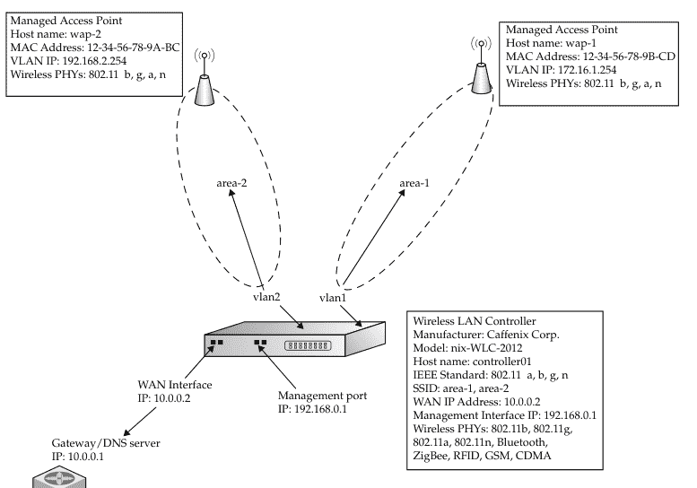

图 12-3. nix-WLC-2012 可用物理和逻辑接口分解图

- 2. WAN 接口的 IP 地址格式和子网掩码是什么？完成后按回。
   提示：接受的格式为 xxx.xxx.xxx.xxx / xxx.xxx.xxx.xxx
> 10.0.0.2 / 255.255.255.252

- 3. 输入控制器的默认网关 IP 地址。完成后按回。
   提示：接受的格式为 xxx.xxx.xxx.xxx / xxx.xxx.xxx.xxx
> 10.0.0.1 / 255.255.255.0

- 4. 输入控制器的 DNS 服务器 IP 地址。完成后按回。
   提示：接受的格式为 xxx.xxx.xxx.xxx / xxx.xxx.xxx.xxx
> 10.0.0.1 / 255.255.255.0

- 5. 您是否想将更改保存到网络配置？
   选项为 [YES] [NO]
> YES

## nix-WLC-2012 无线配置

设置向导的“无线配置”部分处理控制器的无线属性。在这里配置 SSID 和安全协议。向导继续执行无线配置任务：

- 1. 无线网络的 SSID 是？
   提示：SSID 是用户看到的无线网络名称。
   > My-WLAN
2. 选择使用的安全协议。
   提示：常见的协议包括 WEP、WPA-Personal、WPA-Enterprise 和 WPA2。
   > WPA2-Enterprise-AES-CCMP
3. 您是否想将更改保存到无线配置？
   选项为 [YES] [NO]
> YES

## 虚拟局域网 (VLAN) 配置

在我们的无线控制器术语中，VLAN 类似于与特定 AP 通信的虚拟接口。我们的示例控制器最多支持 100 个不同的 VLAN。

每个 VLAN 都是独立的，控制器的默认行为是禁用不同 VLAN 之间的通信。必须明确授予权限才能进行通信。虚拟接口命名为 vx，其中 x 是对应于 VLAN 的数字。因此，第一个创建的 VLAN 接口为 vlan1，以此此类推。

受管理 AP 的访问控制 (MAC) 地址在关联 VLAN 时用作唯一标识。有了这些背景信息，我们现在可以配置控制器。

- 1. 输入控制器现在管理的接入点名称。完成后按回。
   选项为 [1] [2] [3] [4]...[100]
> 2
2. 输入与每个接入点关联的 VLAN 名称。完成后按回。
   选项为 [vlan1] [vlan2] [vlan3] [vlan4]...[vlan100]
> vlan1 vlan2
3. 输入与 vlan1 关联的接入点 MAC 地址。完成后按回。
> 12-34-56-78-9A-BC
4. 输入与 vlan2 关联的接入点 MAC 地址。完成后按回。
> 12-34-56-78-9B-CD
5. 您现在想配置 vlan1 吗？完成后按回。
   选项为 [YES] [NO]
> YES
6. 输入关联 vlan1 的 SSID。完成后按回。
> area-1
7. 为连接到 vlan1 的远程接入点创建一个逻辑接口。接口名称将为 vlan1.1。为接口 (vlan1.1) 指定 IP 地址和子网掩码。完成后按回。


## 无线网络管理：入门指南

提示：接受的格式为 xxx.xxx.xxx.xxx / xxx.xxx.xxx.xxx

+   > 172.16.1.254 / 255.255.255.0

+   8. 你准备好保存并应用 vlan1 的配置了吗？回答 YES 将把配置设置推送到托管的无线接入点。完成后请按回车。

+   选项有 [YES] [NO]

+   > YES

+   9. 你现在想配置 vlan2 吗？

+   选项有 [YES] [NO]

+   > YES

+   10. 输入要与 vlan2 关联的 SSID。完成后请按回车。

+   > area-2

+   11. 必须为连接到 vlan2 的远程接入点创建一个逻辑接口。该接口名称为 vlan21。请为远程 AP (vlan2.1) 的接口指定 IP 地址和子网掩码。

提示：接受的格式为 xxx.xxx.xxx.xxx / xxx.xxx.xxx.xxx

+   > 192.168.2.254 / 255.255.255.0

+   13. 你准备好保存并应用 vlan2 的配置了吗？回答 YES 将把配置设置推送到托管的无线接入点。

+   选项有 [YES] [NO]

+   > YES

# 无线接入点控制与接入协议 (CAPWAP)

我们虚拟的局域网控制器使用了一种极其简单的机制来发现并与 WAP 建立初始通信。

无线接入点控制与接入协议 (CAPWAP) 是一种现实世界中方法（协议）的示例，它可以实现相同甚至更多的功能。它基于 RFC 5414 中的 IETF 规范。

CAPWAP 是一种互操作协议，允许接入控制器管理、控制并提供一组无线 STA（如 AP）。它简化了无线网络的部署和管理。

CAPWAP 使用简单的机制来执行其功能。需要管理的 WAP 需要发送一个发现“请求”消息。控制器响应发现“响应”消息。在这一组初始消息往返发送后，真正的管理过程开始开始。

# 第 12 章：基础设施设备配置 193

nix-WLC-2012 的 VLAN 安全配置之前的配置任务涉及设置与各个托管 WAP 关联的 VLAN。控制器设置向导的最后部分用于设置安全参数，例如身份验证、授权、审计等，并将用于 VLAN。

注意，在此设置的参数将影响连接到托管 WAP 的无线 STA（客户端）。因此，控制器（以及无线网络管理员）必须考虑无线 STA 的安全性。VLAN 安全配置在此开始：

+   1. 此控制器目前定义了两个 VLAN。你想现在配置其中哪一个？[vlan1] [vlan2]

选项是**提示**：vlan1 的 SSID 为 area-1，vlan2 的 SSID 为 area-2。
> *vlan1*

+   2. 可以使用身份验证和加密方法来保护 area-1 无线网络。你想使用哪一种？
选项有 [WEP 64 bits] [WEP 128 Bits] [WPA-Personal / TKIP] [WPA-Personal / CCMP] [WPA-Enterprise / TKIP] [WPA2-Personal / TKIP] [WPA2-Personal / CCMP] [WPA2-Enterprise / CCMP]

**提示**：确保你选择的任何选项都被你的无线客户端支持。
多个选项之间请用逗号、空格或分号分隔。
> *WPA-Personal / TKIP*

+   3. 请创建一个用于 area-1 通信加密和解密的密钥。完成后请按回车。
**提示**：密钥即密码。一个良好的密码应该是字母、数字和符号的混合，且长度至少为八个字符。
> *Sner-never-andS*

+   4. 你准备好保存 vlan1 的 VLAN 安全配置了吗？回答 YES 将把配置设置推送到托管的无线接入点。
**提示**：确保远程无线接入点已通电。还要确保 AP 在此控制器的合理物理距离内，以确保无线电连接性。
选项有 [YES] [NO]
> *YES*

## 无线网络管理：入门指南

+   1. vlan2 的安全参数尚未设置。你想为 vlan2 配置安全性吗？完成后请按回车。
选项有 {YES} [NO]

> YES

+   6. 可以使用身份验证和加密方法来保护 area-2 无线网络。你想使用哪一种？
选项有 {WEP 64 bits] [WEP 128 Bits] [WPA-Personal / TKIP] [WPA-Personal / CCMP] [WPA-Enterprise / TKIP] WPA2-Personal / TKIP] [WPA2-Personal / CCMP] [WPA2-Enterprise / CCMP]

提示：确保你选择的任何选项都被无线客户端支持。
多个选项之间请用逗号、空格或分号分隔。
> *WPA-Personal / TKIP*

+   7. 请创建一个用于 area-2 通信加密和解密的密钥。完成后请按回车。
**提示**：密钥即密码。
> *never-ever-land*

+   8. 你准备好保存 vlan2 的 VLAN 安全配置了吗？回答 YES 将把配置设置推送到托管的无线接入点。
**提示**：确保远程无线接入点已通电。还要确保 AP 在此控制器的合理物理距离内，以确保无线电连接性。
选项有 [YES] [NO]
> *YES*


## 第 13 章：Microsoft Windows 客户端 199

| 规格 | 值 |
| --- | --- |
| 主机名 | Windows7-A |
| 操作系统 | Microsoft Windows 7 企业版 caffenix80211.sys |
| 驱动程序 | WEP |
| 支持的加密和认证 | WPA-Personal / TKIP WPA-Personal / CCMP WPA-Enterprise / TKIP |
| 兼容/最优/合适的加密和认证 | WPA-Personal / TKIP |
| 支持的 IEEE 802.11 标准 | 802.11b, 802.11g |
| 兼容/最优/合适的 IEEE 802.11 标准无线网络名称 (SSID) | 802.11g area-3 |

表 13-2. 无线客户端规格

## 设置硬件

本章的其余部分假设客户端系统上的无线适配器已被 Windows 检测到，并且已加载适当的驱动程序。对于大多数预装操作系统的（带有无线功能的）原始设备制造商（OEM）电脑，情况通常如此。在某些情况下，必须配合现有的 Windows 系统使用第三方无线适配器。也可能工厂安装的适配器和/或驱动程序在计算机寿命期间出现故障，需要更换或重新安装。在这些情况下，你需要了解如何设置无线硬件，这就是后续讨论的重点。

自然，在我们进入调整驱动程序的阶段之前，必须物理上将网卡插入系统。根据各种适配器的因素，在这方面的工作要做很多。

对于可以插入系统外部端口（如 USB 和 PCMCIA 适配器）的适配器，物理任务是简单的。

对于需要通过某些内部且不易访问的端口（如 PCIe、Mini PCI 和 PCI）与系统接口的适配器，任务可能会有点复杂。

## 无线网络管理：入门指南

我们示例适配器的制造商是 Caffenix，它制造了世界上最好的无线适配器。我们将使用的无线适配器型号是 caffenix-80211。

让我们逐步介绍安装通用无线适配器驱动程序软件所需的步骤。

- 按照硬件制造商的说明，如何正确地物理上将无线适配器插入计算机。
- 安装卡片后，打开计算机电源，并在时登录系统。
- 等待 Windows 检测到新硬件并自动尝试查找并安装驱动程序。如果 Windows 找到正确的驱动程序，继续执行第 6 步。
- 如果 Windows 无法从任何标准位置（内置驱动程序缓存、可移动驱动器或 Windows Update 站点）找到并安装适当的设备驱动程序，则必须手动安装。
- 确保你已有驱动程序软件，该软件是从供应商网站下载的，或者是供应商随硬件预封装在介质上的（如 CD）。
- 点击 Windows 开始菜单。
- 在“搜索程序和文件”框中输入 `hdwwiz.cpl`。Windows 将返回与你的搜索词相关的项目列表。
- 从返回的列表中点击 `hdwwiz.cpl`。将出现设备管理器窗口。
- 寻找名称与 WLAN 相关且带有感叹号 (!) 的设备。一旦找到该设备，右键点击设备名称并选择“更新驱动程序”。将出现“更新驱动程序”对话框。
- 点击“浏览我的电脑以查找驱动程序”选项。将出现一个新屏幕，你可以在那里让 Windows 指向第 5 步中驱动程序的精确位置。
- 在我们的示例系统中，驱动程序软件位于计算机 D 盘上的供应商提供的光盘。具体而言，驱动程序位于 D:\caffenix_Inc\Drivers\Windows7\x64。
- 在将 Windows 指向驱动程序的正确位置后，点击“下一步”。
- Windows 可能会弹出一个 Windows 安全对话框（见下图），警告其无法验证驱动程序软件的发布者。点击“始终安装此驱动程序”选项以继续。

如果你没有收到此类警告，可以跳过此步骤。

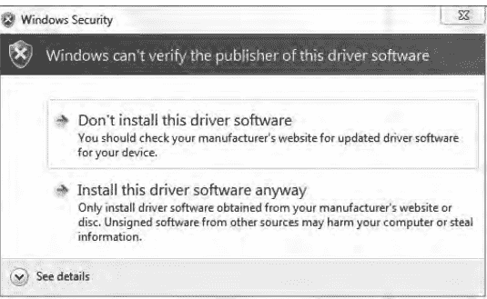

- 1. 如果一切顺利，你应该看到“Windows 已成功更新你的驱动程序”的最终屏幕。点击“关闭”完成。
- 2. 无线适配器现在已准备可以使用。

## 设置无线配置文件

在 Windows 识别无线适配器并安装了与适配器通信的驱动程序后，你就可以通过设置无线配置文件开始配置运行 Windows 的无线客户端系统。

在 Windows 7 中，你可以通过多种方式连接到无线网络。Windows 可以自动完成，也可以手动完成。让 Windows 完成工作是一种简单且某种“笨化”的方法。在某些场景下，它还可能导致意外的后果（例如连接到未知或敌意的无线网络）。我们在这里选择手动方法，因为这允许我们更好地控制过程，并让我们对 Windows 在后台做什么进行一些见解。

单个无线连接的设置存储在 Windows 7 的配置文件中。例如，如果我们想为工作设置到无线网关的无线连接，我们可以创建一个配置文件。

- 1. 如果一切顺利，你应该看到“Windows 已成功更新你的驱动程序”的最终屏幕。点击“关闭”完成。
- 2. 无线适配器现在已准备可以使用。

（注：OCR 文本包含重复段落，已在下方进行逻辑合并。）


# 第 13 章：Microsoft Windows 客户端 205

## 兼容性、优化与适用性考虑

在“设置无线配置文件”部分的第 8 步中，要求“在适当的情况下使用兼容/优化/合适的值”的指令是无线网络管理员在配置无线客户端时可能必须做出的决策典型示例。请注意，例如我们的 WAP（无线接入点）支持的认证和加密方法多于无线客户端适配器支持的方法。

因此，尽管 WAP 对比 Windows 客户端支持更强或优的认证和加密方法（如 WPA2-Personal/CCMP 和 WPA2-Enterprise/CCMP）具有内置支持，但在与客户端通信时，WAP 必须将其自身的安全性降低到“WPA-Personal/TKIP”，仅仅是因为客户端不支持“WPA-Personal/TKIP”以外的任何内容。（关于 WAP、WPA2 和 TKIP 的更多信息，请参见第 11 章。）

同样的逻辑也适用于无线客户端使用的 IEEE 802.11 标准。如果客户端适配器无法支持 WAP 提供并支持的得多的数据速率（例如 IEEE 802.11n），则 WAP 将被迫以次优的数据速率运行。

这种客户端侧设备与基础设施侧设备之间不匹配的解决方案可以从简单廉价到复杂且具有破坏性不等。

解决方案可以简单到升级或将客户端侧设备替换为支持新标准和功能的较新硬件。这种解决方案的缺点是会破坏对现有遗留客户端侧设备（例如运行较旧的、不支持的操作系统）的支持，因为有时无法升级这些遗留客户端设备。或者，应用程序最初可能就是故意设计在低数据速率下运行并使用弱加密的！

另一种稍微复杂且昂贵的解决方案可能是让无线网络管理员维护各种基础设施侧设备，以让每个人都满意——慢客户端、快客户端、安全客户端和不安全的客户端。

## 手动连接到无线网络

现在让我们连接到我们之前创建的配置文件相关的无线网络。

1. 登录系统。
2. 打开“开始”菜单。
3. 在“搜索程序和文件”文本框中，输入连接到网络。Windows 将返回与你的搜索词相关的项目列表。

## netsh 工具

4. 从返回的列表中，点击“连接到网络”。屏幕右下角会出现一个类似下面的窗口：

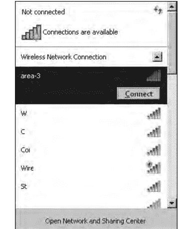

5. 在检测到的无线网络列表中，找到并选择 area-3 网络。
6. 点击“连接”按钮。过了一会儿，Windows 将连接到指定的网络——如果一切顺利的话。

netsh 是一个随较几代 Windows 操作系统提供的网络配置工具。当然，它也随 Windows 7 一起提供。它是一个命令行工具，可以用于执行从 Windows 用户界面 (GUI) 可以执行的所有网络配置任务。它还可以用于许多高级任务，包括在远程系统上执行配置任务。除了允许你查看和操作网络配置外，netsh 还可以用于脚本编写，以帮助自动化任务。命令行界面 (CLI) 爱好者的网络管理员可能会发现，netsh 提供了一种查看和操作基于 Windows 的计算机网络设置的快速方法。如果你熟悉该工具并了解它的开关和选项，这确实如此。netsh 控制 Windows 网络堆栈的某些方面，这些方面被称为“上下文”(contexts)；这些上下文实际上是特定的网络组件。Windows 7 中可用的某些上下文如表 13-3 所示。当然，我们在书中中最感兴趣的是 wlan 上下文。

### 表 13-3. netsh 上下文

| 上文 | 说明 |
| :--- | :--- |
| interface | 管理网络接口的 TCP/IP 设置 |
| bridge | 管理网络适配器 |
| advfire | 管理 IPSec、防火墙和其他高级安全组件 |
| lan | 管理局域网接口 |
| dhclient | 管理 DHCP 客户端 |
| wlan | 管理 WLAN 接口 |
| ras | 管理远程访问服务器 |

## 使用 netsh 配置无线网络

Windows 可以轻松将无线配置设置从一台计算机克隆到另一台计算机。这有助于加速新客户端的配置。克隆过程的自动化特性还减少了在输入网络名称、密钥或密码、认证和加密值时出现人为错误的概率。接下来，我们将使用强大的 netsh 命令从一个系统到另一个系统执行一次简单的克隆。首先假设我们有两个系统：主机（源）是我们之前配置的同一个系统。这台机器命名为 Windows7A，具有连接到我们路由器的正确无线设置。备机（目标）命名为 Windows7B。我们将从 Windows7A 克隆的设置应用到这台机器上。在源机器 Windows7A 上执行以下步骤：

1. 使用具有管理权限的用户账户登录 Windows7A。
2. 选择“开始 | 所有程序 | 辅助工具”。
3. 右键点击“命令提示符”并选择“以管理员身份运行”。
4. 在用户账户控制 (UAC) 对话框中选择“是”。
5. 将出现一个与所示类似的窗口：

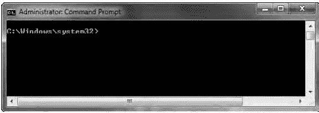

## 无线网络管理：入门指南

6. 输入以下命令以查看存储在本地计算机上的现有无线配置文件：
```
netsh wlan show profile
```
7. 然后按回车键。
8. 输出应包含我们在本章之前创建的名为 area-3 的无线配置文件。
9. 接下来，将工作配置文件导出（导出）到可以轻松导入到任何 Windows 系统进行配置的格式中。使用以下命令执行此操作：
```
netsh wlan export profile="area-3" folder="C:\Users" interface="Wireless Network Connection"
```
这将创建一个名为 Wireless Connection-area-3.xml 的文件，它将存储在 C:\Users 目录下。在输入命令时按回车键。我们需要找到一种方法传输或拷贝导出的配置文件文件到 Windows7B 目标系统——例如，使用 USB 闪盘、光盘、DVD 或网络。在 Windows7B 上执行以下步骤：

1. 使用具有管理权限的用户账户登录 Windows7B。
2. 选择“开始 | 所有程序 | 辅助工具”。
3. 右键点击“命令提示符”并选择“以管理员身份运行”。
4. 在用户账户控制 (UAC) 对话框中选择“是”。
5. 将出现一个窗口。
6. 假设在源系统 (Windows7A) 创建的无线配置文件已拷贝到显示为 F 盘的驱动器，我们将加载（导入）该配置文件。示例命令显示了如何操作：
```
netsh wlan import profile="F:\Wireless Connection-area-3.xml"
```
在输入命令后按回车键。
7. 在出现的窗口中，输入以下命令以查看存储在目标计算机上的新配置文件：
```
netsh wlan show profile
```
在输入命令后按回车键。
8. 你现在应该能够加入源系统 (Windows7A) 使用的无线网络。

> TIP netsh 工具可以用于显示有关 802.11 无线局域网接口的设备程序信息。此外，它还可以显示支持的 PHY 以及认证和加密。相应的完整 netsh 命令是 netsh show drivers

## Windows 7 中的无线杂项

每个操作系统厂商都试图在最先实现对最新标准和技术的支持。某些厂商在这一方面做得比其他厂商更好。某些厂商采取“观望等待”的方法，等技术成熟后再将其整合到其基础操作系统中。在本节中，我们将查看 Windows 7 自带的一些新无线功能。

## 虚拟 WiFi 与软件接入点

微软通过 Windows 7 中的虚拟 WiFi (VWiFi) 功能将虚拟化带给桌面用户。VWiFi 使用虚拟化技术为系统中的无线适配器创建一个虚拟实例。要让 VWiFi 工作，适配器的底层驱动程序必须支持此功能；因此，这把某些责任放在硬件制造商身上，要求在其驱动程序中创建这种支持。

VWiFi 的基本概念已经存在多年，因此大多数主要的无线适配器厂商都有其某种支持，所以它在大多数带有 Windows 7 的系统中都可以轻松运行。

VWiFi 实际上是为任何支持的物理安装的无线适配器创建一个虚拟或软件版本的适配器。虚拟适配器与主无线适配器直接绑定，因此如果主适配器被禁用，虚拟适配器也会自动禁用。

该虚拟适配器在 Windows 7 和其他操作系统的网络设备列表中显示为“微软虚拟 WiFi 适配器”。


## 无线网络管理：入门指南

主或物理无线适配器在常规的无线 STA 模式下运行。这意味着适配器可以作为基础设施网络的客户端或成员，连接到 WAP（无线接入点）并执行其常规操作。

然而，另一个虚拟适配器在 AP 模式下工作，这就是软件接入点（SoftAP）名称的由来。通过让虚拟设备充当 AP，其他无线 STA 可以连接到 SoftAP 并形成一个单独或独立的无线网络。该网络拥有自己的主域，并可以拥有独立的安全需求和策略。

WiFi 和 SoftAP 提供的所有新功能的组合被称为“无线托管网络”（wireless hosted network）。

你可以使用 WiFi 适配器做很多酷的事情。接下来我们将介绍其中一些。

## Internet 连接共享

Internet 连接共享（ICS）是现代 Windows 操作系统中的一项功能，通过运行 Windows 操作系统的计算机促进网络共享。它本质上是将计算机转换为某种路由器或网关，能够执行网络地址转换（NAT）功能。

以下是 ICS 在无线托管网络场景下的工作方式：

1. 运行 Windows 7 或通过物理无线适配器连接到互联网的主节点。
2. 主节点通过物理基础设施网络访问互联网。
3. 物理无线适配器可以充当 WiFi 适配器的网关，提供访问互联网的途径（路由）。
4. WiFi 变成 SoftAP。
5. 因为 WiFi 适配器可以访问互联网，只要策略允许，连接到 SoftAP 的其他 STA 也可以访问互联网。

## 使用后续配置 SoftAP 和 WiFi

Windows 并没有自带一个易于配置的点击式界面来配置无线托管网络功能。使用 WiFi 设置 SoftAP 需要使用某些实用程序或其他第三方软件。我们将介绍在 Windows 中启用无线托管网络的步骤。

我们的示例无线托管网络将按照表 13-4 中的参数进行配置。

在运行托管无线网络的 Windows 7 系统上执行以下步骤：

1. 使用具有管理员权限的用户账户登录 Windows7-A。
2. 选择 开始 | 所有程序 | 附件。

# 第 13 章：Microsoft Windows 客户端 211

| 无线托管网络参数 | 值 |
|:---|:---|
| SSID | windows-ap |
| 支持的密码算法和认证 | WPA2-Personal CCMP |
| 密钥或旁密码 | vwifi-secret |
| 支持的 IEEE 802.11 标准 | 与物理无线适配器/接口支持的相同 |

**表 13-4.** 无线客户端规范

3. 右键点击命令行程序并选择“以管理员身份运行”。
4. 在用户账户控制 (UAC) 对话框中选择是。
5. 在出现的窗口中，输入以下命令为虚拟 WiFi 接口设置 SSID 为 windows-ap，然后按回：
   > `netsh wlan set hostednetwork ssid=windows-ap`
6. 在命令提示符中发布以下命令为无线托管网络创建一个旁密码；完成后按回车。
   > `netsh wlan set hostednetwork key=vwifi-secret`
7. 在命令提示符窗口中输入此命令启用无线托管网络。完成后按回车。
   > `netsh wlan set hostednetwork mode=allowonly`
8. 输入此命令启动无线托管网络；完成后按回车。
   > `netsh wlan start hostednetwork`
9. 在命令提示符中，输入以下命令查看刚刚配置的无线托管网络的设置：
   > `netsh wlan show hostednetwork`
10. 要查看用于无线托管网络的安全参数值，输入此命令，然后按回车：
    > `netsh wlan show hostednetwork setting=security`

搞定了。SoftAP 现在应该已设置并正在广播其 SSID。

# 212 无线网络管理：入门指南

> 注意：此处配置的无线基础设施网络仅促进本地通信；它不支持与任何外部网络（如互联网）通信。这种运行模式也称为“独立模式”。需要全模式 ICS 才能实现与外部网络的互连性。标题为“扩展 SoftAP、WiFi 和 ICS”的侧边栏提供了配置 ICS 组件的摘要。

你将在连接到 SoftAP 的客户端系统上执行以下步骤。这些步骤是完全通用的且与操作系统无关，因此它们可以在几乎任何支持 SoftAP 所支持的认证、密码和 802.11 PHY 的无线客户端上执行。

1. 使用无线 STA 的无线接口配置工具搜索并选择由 SoftAP 广播的网络名称（SSID）。该网络应显示为 windows-ap 网络。
2. 连接到无线网络。
3. 当提示连接 SoftAP 的密钥/旁密码时，输入在 SoftAP 上配置的密钥：wifi-secret。
4. 只要物理（802.11 PHY）和逻辑（如加密）属性在两者之间对应，客户端 STA 将成为基于 Windows 的 SoftAP 形成的基础设施网络的一部分。
5. 前述步骤可以为其他参与无线托管网络的客户端 STA 重复。只要……所有客户端 STA 都能相互通信并与 SoftAP 通信。


## 第 13 章：Microsoft Windows 客户端

215

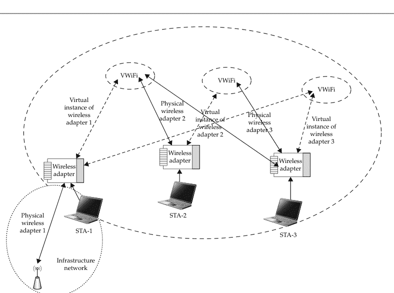
图 13-11 无线网格网络

## 个人局域网 (PAN)

除了传统的 STA（站）外，虚拟 WiFi 还可以用于链接或连接各种类型的设备。这种连接形成了一种点对点网络或自持网络（ad hoc network）。当我在这里提到传统的 STA 时，我指的是普通的移动或便携式计算系统。其他类别的可以利用 WiFi 功能的设备（非传统设备）是用于个人通信的消费电子设备，如无线适配器、耳机、手机、打印机、PDA、MP3 播放器等。

随着越来越多的设备制造商实施新的 Wi-Fi Direct 技术，这种特定用途将变得越来越常见。在创建用于连接不同类型设备的网络时，Wi-Fi Direct 有助于减少对传统无线基础设施设备的需求。Wi-Fi Direct 可用于连接各种消费电子设备以创建一个 PAN，该网络可以独立于传统的无线网络存在。

## 总结

本章涵盖了运行 Microsoft Windows 操作系统的系统在配置无线硬件和管理软件组件时所需的一些基础信息。具体，我们将一个示例 Windows 客户端系统连接到了我们在第 12 章中谨慎设置的基基无线网络。

我们还讨论了几种无线客户端系统的安装和配置选项及程序。

总而言之，Windows 平台上的无线网络配置非常成熟且稳固。Windows 在保持无线技术前沿的同时，在其他无线技术领域保持了合理的保守，之间取得了良好的平衡。

这意味着操作系统内置并支持了若干项高级功能，这些功能应该会令任何无线网络管理员感到忙碌、快乐、沮丧、惊喜、娱乐和再次沮丧。

## 第 14 章 | Apple OS X 客户端

## 核心技能与概念

- 理解 Macintosh 系统的组成。
- 复习常见的 Apple 无线网络硬件。
- 配置 Apple OS X 进行无线网络。
- 学习 Mac 世界中的互联网共享。
- 复习自持无线网络（ad-hoc）的配置。
- 学习如何在 OS X 中配置蓝牙拨号上网。

Apple 电脑的市场份额远低于占据主导的 Microsoft Windows，但 Apple 制造的具备网络能力的设备数量和种类，以及这些设备的快速普及率，使其产品成为无线网络管理员工作的重要部分。
Apple 设备涵盖各种形状和尺寸，从服务器、工作站到一体机、笔记本电脑、平板电脑、手机手机和便携式娱乐设备。所有这些设备的共同点是内置了无线功能。

## Macintosh 系统设计

Apple 制造（或品牌化）硬件以及驱动其硬件的底层软件。这产生了几种影响，我们将在后续章节中探讨。

## Macintosh 软件

将 Macintosh (Mac) 系统配置并连接到无线网络可以是一个简单的过程——这证明了为什么你找不到 Macintosh 网络管理员专家的招聘广告。
Macintosh 系统提供的简单性既有优点也有缺点。优点是对于终端用户显而易见的简单和易用。
缺点是为了实现这种简单性而必须出的技术牺牲。
从设计上来说，简单系统通常部件和功能较少。理理部件和功能越少，意味着出错或损坏的机会越少。网络或系统管理员在 Mac 设计师提供的范围之外，没有足够的灵活性和配置选项。

## Macintosh 硬件

Apple 业务模式中直接影响管理员工作的另一个方面与硬件有关。Mac 硬件（以及驱动它的软件）可能非常“以 Apple 为中心”。与 Apple 设备兼容的硬件部件和组件不像通用 PC 硬件那样容易找到。

## 第 14 章：Apple OS X 客户端

事实事实可能与设备驱动程序问题有关。如果所有硬件制造商都为 Macintosh 系统提供驱动程序，消费者货架上将出现更多样化的硬件。但由于 Apple 也制造自己的硬件，该公司可能认为没有什么好的理由来鼓励这样做。

> 注意：类似的问题曾困扰过开源软件社区。软件开发者乐于为许多硬件平台创建驱动程序，但硬件制造商拒绝提供其硬件内部原理的细节以帮助开发者。从硬件制造商的角度来看，其硬件内部原理的特定细节为供应商带来了竞争优势。这种感知到的优势也作为相似硬件制造商之间的市场差异化因素。
这个问题在开源软件社区中尚未被完全消除，但已经得到了极大的改善。

Mac 系统无线管理员受限于 Apple 提供的有限兼容硬件部件和配件，或由售后市场硬件供应商销售的设备。例如，如果一个无线管理员需要实现最新 IEEE 802.11.xxxx 标准的硬件，那么她可能一直运气不好，直到 Apple 发布此类硬件或实现新功能的固件更新，或者某些售后市场供应商提供该硬件。

## Macintosh 无线硬件

Apple 生产几乎所有无线产品其名称中可能都包含“AirPort”字样。当前代 Macintosh 系统无线适配器的名称如下：

- **AirPort**：这用于识别 Apple 实现原始 IEEE 802.11 标准的第一代无线硬件。该 AirPort 硬件运行在 2.4 GHz 无线频率上。
尽管在技术上可能不准确，但这是大多数 Macintosh 无线硬件的通用名称。
- **AirPort Extreme**：这一代硬件是原始 AirPort 的继者。除了其他改进外，这一代提供了更好的数据传输速率安全性。最新的 AirPort Extreme 可以在双频 2.4 GHz 和 5 GHz 上运行。
- **AirPort Base Station**：这是 Apple 对无线接入点 (WAP) 的实现。但像大多数 Apple 产品一样，基站被包裹在精美的包装子里。

## 无线网络管理：入门指南

当前版本的基站可以以双频模式运行，这意味着它支持 2.4 GHz 和 5 GHz 范围内的频率。它支持 IEEE 802.11n 标准。

- **Time Capsule**：这种多功能无线设备主要是一个无线网络存储设备，也可以作为 WAP 使用。换句话说，它是内置硬盘的 AirPort Extreme 基站。

capsule 网络存储部分与安装在兼容 Mac 电脑上的软件配合，执行从客户端系统到 capsule 的自动备份。

目前的 capsule 硬件是支持 2.4 GHz 和 5 GHz 波段的多频设备。

## 配置

在本节中，我们将 Mac OS X 计算机连接到无线网络。我们的示例系统将配置为连接到第 12 章中设置的通用 WAP。表 14-1 显示了 WAP 的属性，表 14-2 显示了我们的 Macintosh 无线客户端的属性。

## 设置硬件

出箱即用的 Macintosh 系统已安装了适用于硬件的相应驱动程序，因此你实际上不需要做什么。本章的其余部分假设

| 规格 | 值 |
|---|---|
| AP 主机名称 | wap-2 |
| SSID | area-2 |
| 支持的加密和认证 | WEP 64 / 128 bits WPA-Personal / TKIP WPA-Personal / CCMP WPA-Enterprise / TKIP WPA2-Personal / TKIP WPA2-Personal / CCMP WPA2-Enterprise / CCMP |
| 加密密钥或密码 | !never-never-land2! |
| 支持的无线 PHY | 802.11b, 802.11g, 802.11a, 802.11n |

表 14-1. WAP 规格


## 第 14 章：Apple OS X 客户端 221

| 规格 | 值 |
| --- | --- |
| 主机名 | book01 |
| 操作系统 | Mac OS X - 雪豹版 (Snow Leopard) |
| 无线卡厂商及类型 | Apple / AirPort Extreme |
| 无线卡芯片/驱动 | Atheros |
| 支持的加密算法和认证 | WEP WPA-Personal / TKIP WPA-Personal / CCMP WPA-Enterprise / TKIP WPA2-Personal / TKIP WPA2-Personal / CCMP WPA2-Enterprise / CCMP |

兼容/最佳/合适的加密和认证 WPA2-Personal

支持的 IEEE 802.11 标准 802.11b, 802.11g

兼容/最佳/合适的 IEEE 802.11 标准 802.11g

表 14-2. 无线 Mac 客户端规格

Mac 客户端系统上的无线适配器是随系统自带的那个。

## 设置无线位置

其他主流操作系统（OS）将不同的网络配置与配置文件（profiles）相关。在 Mac 世界中，配置文件的等同于“位置”（location）。在 Mac 上，一组网络设置和不同的设备与一个位置相关。定义的位置允许对其内部各种连接设备和接口进行排序。例如，在一个名为“家”（home）的位置，无线连接将优于有线连接；而在名为“办公室”（office）的独立位置上，以太网连接将优于无线连接。Mac 系统上存在一个名为“自动”（Automatic）的默认位置，我们示例系统中使用该位置。

Mac OS X 提供了几种连接无线网络的方法：可以自动或手动进行。让 OS X 配置系统连接到无线网络对你来说可能更容易，但在某些情况下，它也会导致意想不到的后果，例如连接到未知的或敌意的无线网络。我们在这里选择手动方法，因为这允许我们更好地控制该过程，并让我们深入了解 OS X 在后台执行的操作。

## 无线网络管理：入门指南

## AirPort 实用程序

Mac 自带 AirPort 实用程序，可以通过选择“应用程序 | 实用程序”来访问。

很容易假设该实用程序是用于管理电脑内置的 AirPort 无线适配器的。然而，AirPort 实用程序用于管理由 Apple 销售和营销的独立专用硬件。

此 AirPort 设备仅仅是一个独立的无线接入点（WAP）或家庭网关设备，用于创建简单的无线网络以共享 Internet 访问和其他资源。普通的 Microsoft Windows 客户端、Linux/UNIX/BSD 客户端以及其他符合 IEEE 802.11 标准的设备创建并控制无线网络。

与其他配置和管理基础设施设备的接口一样，AirPort 实用程序可用于配置 AP 的动态主机配置协议（DHCP）选项、无线电设置、访问控制、认证和加密设置。

## 手动连接无线网络

让我们连接到第 12 章中配置的 AP 相关的无线网络。该网络的 SSID 为 area-2。

- 1. 登录系统。
- 2. 点击屏幕左角的 Apple 菜单并选择“系统偏好设置”。会出现一个如下的系统偏好设置窗口：

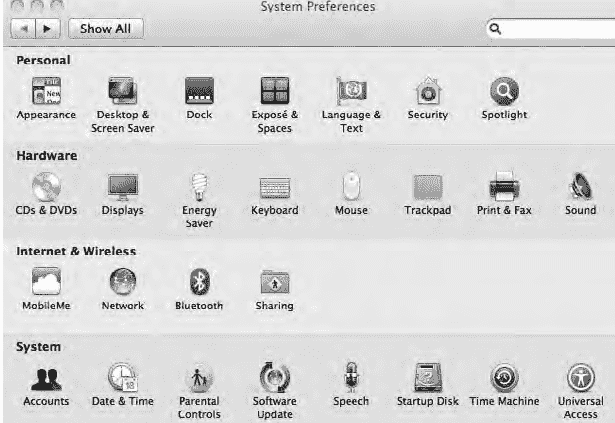

- 3. 点击“互联网与无线网络”类别下的“网络”图标。出现网络偏好窗口，在左窗格中显示系统上可用的网络接口/设备。
- 4. 点击左窗格中的 AirPort 设备。网络窗口将显示 AirPort 可用的一些配置选项。

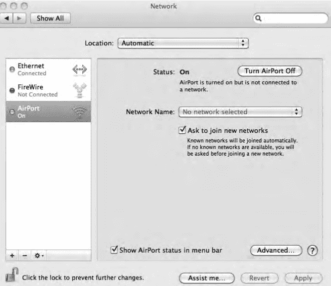

- 5. 在 AirPort 网络屏幕中，确保 AirPort 设备状态设置为“关闭”，如果状态设置为“开启”，点击“开启 AirPort”按钮。
- 6. 点击窗口底部的“高级...”按钮。将出现一个 AirPort 配置屏幕，其中列有首选网络列表（如果有）。

# 224 无线网络管理：入门指南

- 7. 点击“首选网络”部分下的 (+)` 号。将出现以下对话框，你可以在其中输入无线网络的设置：

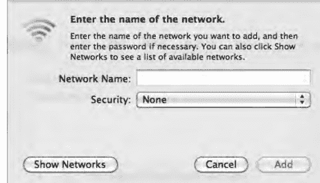

- 8. 在“网络名称”字段中输入 SSID。点击“安全”下拉列表中的箭头，选择我们示例网络中使用的安全类型（见表 14-1）。
- 9. 完成所有字段后点击“添加”按钮。你将返回 AirPort 网络配置窗口。取消勾选“记住此计算机加入过的网络”。窗口看起来应该是这样的：

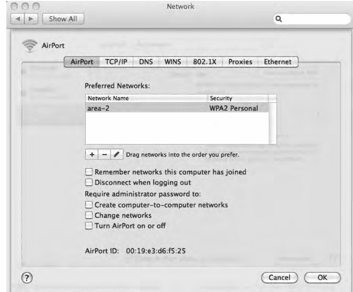

- 10. 点击“确定”关闭 AirPort 网络窗口。
- 11. 在主网络窗口中点击“应用”，启动并完成客户端与基础设施无线网络（area-2）的无线连接。
- 12. 关闭系统偏好设置窗口。

# 更改连接偏好

在 Mac OS X 系统中，网络接口的默认顺序是以太网和 AirPort。你可以通过以下步骤更改顺序：

- 1. 在登录系统时，点击屏幕左上角的 Apple 菜单并选择“系统偏好设置”。出现系统偏好设置窗口。
- 2. 点击“互联网与无线网络”类别下的“网络”图标。出现网络偏好窗口，在左窗格中显示可用的网络接口。
- 3. 在窗口左下角，点击花朵图标并从下拉列表中选择“服务顺序”。出现服务顺序对话框：

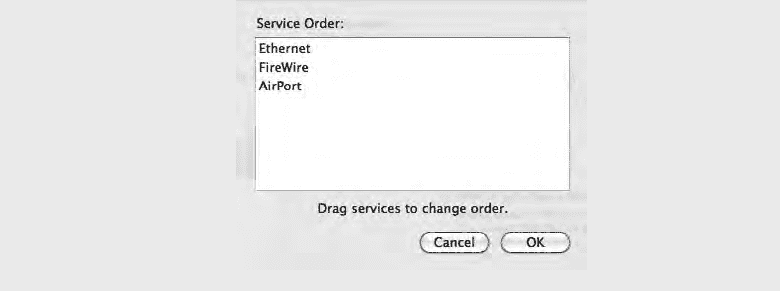

- 4. 将任何接口拖到所需的位置。
- 5. 完成后点击“确定”按钮。
- 6. 在网络窗口中点击“应用”按钮，然后关闭窗口。

## OS X 中的无线杂

大多数操作系统厂商试图率先实现最新的无线标准和技术。其他厂商则等待技术成熟后再将其纳入基础操作系统。

Mac OS 属于保守派。除了方便配置网络设置外，它没有为网络管理员提供许多高级功能。但它提供了一些额外的网络功能。我们将查看其中一些。

## 共享

Mac 有自己的 Internet 共享实现方式，允许 OS X 系统成为某种 Internet 网关。然而，这种功能并不像 Linux 系统或 Windows 系统那样完善或丰富。

Mac 共享的工作方式如下：

- 1. Mac 通过系统上的任何接口（AirPort 卡、以太网、蓝牙、拨号调制解调器等）连接到 Internet。
- 2. 需要访问 Internet 的计算机通过 Mac 未用于连接 Internet 的其他部分进行连接。这里的关键词是“其他”。
- 3. 例如，如果 Mac 通过以太网连接到 Internet，其他系统可以通过 Mac 的无线 AirPort 接口访问 Internet。

## 全都在共享

Internet 连接共享在 Mac 世界中被称为“Internet 共享”。在这个世界里，我们不共享连接，而是共享 Internet。共享指的是访问和使用其他 Mac 系统提供的网络系统资源。例如，如果你想将一个 Mac 系统变成 Web 服务器，你就开启 Web 共享服务。


通过 AirPort 接口连接时，Mac 需要通过其他方式连接互联网，例如有线以太网、蓝牙、蜂窝网络等。

让我们逐步完成示例 Macintosh 系统上启用网络共享的步骤。我们设置的网络将类似于图 14-1 所示的网络。

- 1. 点击屏幕左上角的 Apple 菜单，选择“系统偏好”。
- 2. 在“系统偏好”窗口中，点击“互联网与无线”类别下的“网络”图标。将出现“网络”设置窗口。
- 3. 点击 AirPort 网络设备。你将看到适用于 AirPort 适配器的某些配置选项。
- 4. 确保 AirPort 设备已开启。状态应显示为“已连接”，并应显示 AirPort 已连接到基础架构网络（例如，area-2）。如果设置为“关闭”，点击“开启 AirPort”。
- 5. 在确保 AirPort 已正确连接到网络后，点击窗口顶部的“显示全部”按钮返回系统偏好设置主界面。
- 6. 点击“互联网与无线”类别下的“共享”图标。将出现“共享”窗口。
- 7. 在左侧面板中，浏览可用服务列表并点击“网络共享”服务。网络共享配置选项将出现在窗口的右侧。

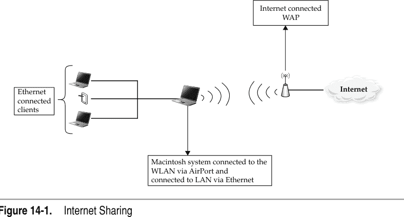

## 无线网络管理：入门指南

- 8. 点击“从以下共享你的连接”字段中的下拉箭头，选择 AirPort 选项。

- 9. 在“通过以下计算机连接”字段中，勾选以太网复选框以启用。

- 10. 确保窗口左侧面板中的网络共享服务仍处于高亮状态。点击网络共享旁边的复选框以启动服务。将会弹出一个警告屏幕，询问你是否确定要进行网络共享，点击按钮。

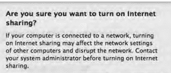

- 11. 最终的共享设置窗口将如所示。在完成更改后关闭此窗口。

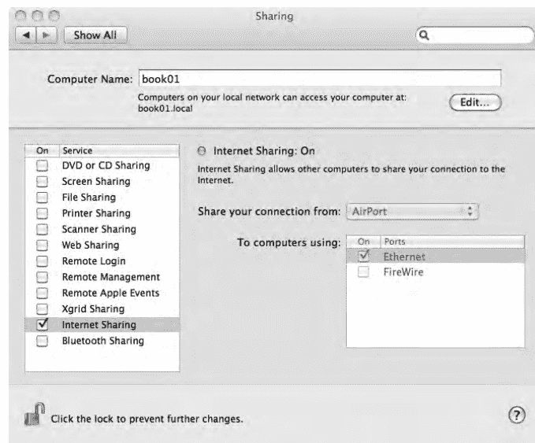

- 点击锁图标防止进一步更改。

## 第14 章：Apple OS X 客户端

所有连接到 Mac 同一以太网段（通过交换机或直接连接）的系统将自动从 Mac 系统获取 IP 配置信息。现在所有连接到 Mac 系统的系统都应该能够访问 Mac 系统可以访问的任何网络（如互联网）。

## 自组织网络 (Ad-Hoc Networks)

Apple 的操作系统可以轻松地设置自组织网络（也称为计算机对计算机网络）。自组织网络可以快速构建系统的无线网络，而不需要像 AP（接入点）这样的传统基础架构网络设备。

遗憾的是，Mac 系统创建的自组织网络无法使用任何新的更高级别的加密技术进行保护。在写本文时，仅可以使用 40 位和 128 位的 WEP 来保护自组织网络。

在 Mac 计算机上，自组织网络和传统的基于基础架构的 WLAN 是互斥的。在 Mac 上启用和托管自组织无线网络将断开系统与任何其他基础架构网络的连接。

我们将根据表 14-3 所示的配置设置创建自组织网络。使用以下步骤在 Mac 系统上设置自组织网络：

- 1. 点击屏幕左上角的 Apple 菜单，并选择“系统偏好”。点击“互联网与无线”类别下的“网络”图标。
- 2. 在“网络”设置窗口中，点击 AirPort 网络设备以查看适用于 AirPort 适配器的某些配置选项。
- 3. 确保 AirPort 设备状态设置为“开启”。如果状态设置为“关闭”，点击“开启 AirPort”按钮。
- 4. 在“网络名称”字段中，点击下拉箭头并选择列表底部的“创建网络”。将出现“创建计算机计算机网络”窗口。
- 5. 默认情况下，“网络名称 (SSID)”字段将显示计算机的主机名。将名称 (SSID) 更改为 ad-hoc-mac。

| 规格 | 值 |
|---|---|
| SSID/网络名称 | ad-hoc-mac |
| 通道 | 接受默认值 |
| 密码 | 128-mac-adhoc |
| 安全性 | 128-bit WEP |

表 14-3. 自组织网络设置

## 无线网络管理：入门指南

- 6. 点击“需要密码”复选框以启用该选项。使用表 14-3 中的值和此处所示的值完成其余字段：

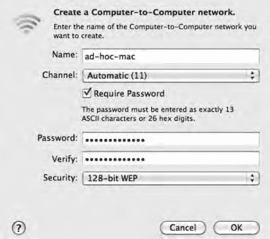

- 7. 点击确定 按钮关闭窗口。然后在“网络”设置窗口中点击 Apple。

- 8. 关闭“网络”设置窗口。

自组织网络现在已激活，并准备好供其他无线客户端加入。

## Mac 自组织网络考虑因素

连接自组织网络的过程与连接基础架构网络没有太大区别。使用相同的连接基础架构网络的工具。理论上，你只需找到检测到的网络名称 (SSID) 并输入安全参数。然而，由于自组织网络不受 802.11 标准覆盖，参与网络的无线客户端使用本地地址（即自动分配的 IP 地址）。这些链路地址位于 169.254.0.0/16 范围，由 IETF RFC 3927 覆盖。

## 蓝牙拨号网络 (DUN)

蓝牙拨号网络 (DUN) 配置文件允许蓝牙设备作为调制解调器与其他蓝牙设备（如笔记本电脑和个人辅助器）配合。连接蓝牙移动设备会产生额外费用。

> 注意 完成后忘记正确断开连接以避免产生额外费用。

以下是设置蓝牙拨号网络的方法：

- 1. 点击 Apple 菜单并选择“系统偏好”。
- 2. 点击“互联网与无线”类别下的“蓝牙”图标。将出现“网络”设置窗口。
- 3. 在左侧面板中，点击底部的加 号添加新接口。
- 4. 在出现的对话框中，点击接口下拉列表并选择蓝牙 DUN 接口类型。在服务名称字段接受蓝牙 DUN 服务名称。完成的对话框如下：

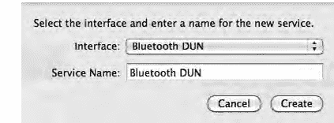

- 5. 点击创建按钮。在“网络”设置主窗口中，点击应用按钮。
- 6. 点击左侧面板中新创建的蓝牙 DUN 接口。
- 7. 点击设置设备。
- 8. 确保蓝牙移动设备已开启并设置为可发现模式。

## 无线网络管理：入门指南

- 9. 在蓝牙设置助理窗口中，Mac 系统将搜索并显示附近的蓝牙设备列表。当发现目标设备后，高亮列表中的设备（见插图），然后点击继续。

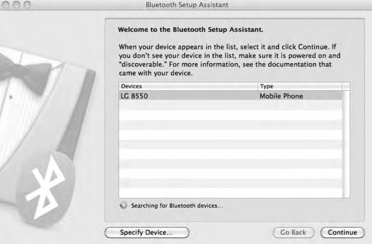


## 第 14 章：Apple OS X 客户端 223

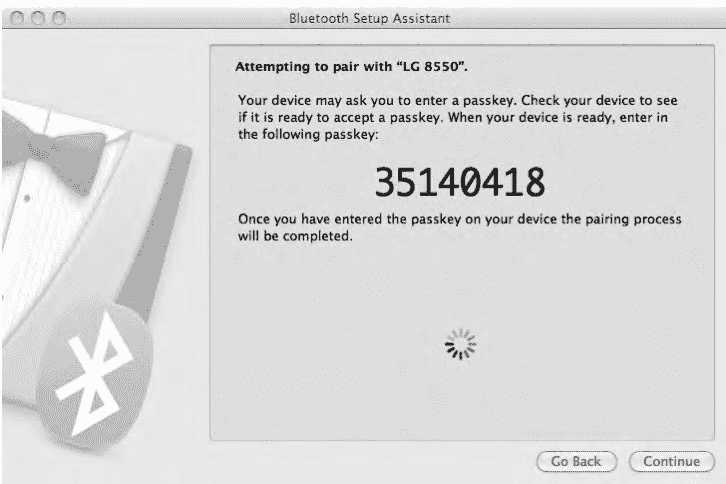

11. 蓝牙设置向导将进入蓝牙手机设置阶段。在这里将涉及到个性化设置，你需要提供适用于你的特定移动或蜂窝运营商的值。完成后点击“继续”（Continue）。在我们的示例系统中，我们使用以下值：

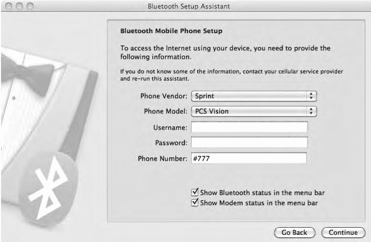

## 无线网络管理：入门指南

- 12. 将出现一个最终的结论窗口，通知你配对成功。你还将看到目标蓝牙设备的一些功能（支持的配置）。点击“退出”（Quit）。

- 13. 回到主网络偏好窗口，确保左侧面板中选择了蓝牙 DUN 接口，然后点击右侧面板中的“连接”（Connect）。

- 14. 如果一切正常，Macintosh 系统将通过蓝牙连接到使用蜂窝网络的移动设备并接入互联网。

> 提示：可以随时尝试可用的手机供应商或移动/蜂窝网络运营商列表，以防你的手机确切运营商未列出（参见蓝牙 DUN 章节的第 12 步）。由于大多数移动网络运营商使用相似的底层技术，你可能会发现，如果你选择了所在地区的手机供应商，其设置和连接参数可能适用于你的特定运营商。

## 总结

为如此广泛的人群设计一个几乎无一失的系统需要花费大量精力，苹果公司的工程师们创建了一个开箱即用的系统——只要你计划的操作没有超出工程师设计意图的范围。Mac 网络并没有给无线网络管理员留存多少工作空间——例如，没有空间让你炫技或演示任何高级的无线网络专业知识。

## 第 15 章 | Linux 客户端

236 无线网络管理：入门指南

## 核心技能与概念

- 学习 Linux 平台上的无线硬件。
- 学习 Linux 扩展应用程序接口 (API)。
- 学习一些流行的 Linux 驱动程序。
- 审查 Linux 发行版中的专有无线固件。
- 审查 Linux 客户端中用于管理无线设置的工具。
- 学习如何使用 GUI 工具配置无线 Linux 客户端。
- 学习如何使用命令行工具配置无线 Linux 客户端。
- 学习如何使用 Linux 客户端设置自自无线网络 (ad-hoc)。

在 Linux 系统中安装和配置新硬件需要过度准备、无尽的咖啡、研究逆向工程、研究帮助论坛以及在编译和交叉编译时不断咒骂的日子已经过去了。如今，这基本上是即插即用的。

Linux 是自由开源软件 (FOSS) 发行版的核心，因此 Linux 负责控制硬件组件与操作系统 (OS) 其他部分之间的交互。今天有数千个基于 Linux 的发行版。这些发行版由不同的商业、非商业实体和爱好者支持。它们汇集了不同的 FOSS 项目和应用程序并封装成发行版格式。大多数发行版的目标是产生一套易安装、易使用、易分发的多用途或单用途软件集。

FOSS 的巨大优势之一是它赋予了你亲自动手或随心所欲的自由。你可以深入研究细节，也可以选择从预定义的菜单选项中点击来完成任务。在本章中，我们将采用实践方法，并提供比需要更多的信息，以确保你对内部工作原理有一定的洞察，帮助你将网络理论组件与实际方面相结合，使你能够精练地排除故障，并在无线网络管理员领域具有竞争力。

本章讨论的概念和基础也可以应用于其他操作系统的内部机制；区别在于其他闭源系统可能会迫使你采取放手的学习和实施方法。

## 第 15 章：Linux 客户端 237

## Linux 平台上的无线硬件

由于几个原因，无线硬件在基于 Linux 的系统上运行一直特别棘手。开源硬件开发者愿意并能够为无线硬件编写驱动程序，但硬件供应商并不愿意提供其内部工作原理的细节以支持此。一些设备制造商认为，公开硬件的内部原理意味着向竞争对手放弃市场优势。

恐惧、不确定性和怀疑 (FUD) 也起了作用。许多国家指定了立法机构来分配和管理国内的无线频谱的使用。这对于操作、安全和实际目的非常重要，例如，业余无线爱好者不会在当地应急服务使用的频率通道上传输信息。

一些硬件供应商表现出 FUD 特性，因为他们认为 Linux 无法遵守无线频谱的要求。FUD 因素之所以起作用，是因为由于 FOSS 的本质，某些硬件供应商看不到开源开发者社区有任何方式可以执行规则。FOSS 认为用户可以很容易地使用强制遵守当地无线频谱规则的底层代码。

抛开所有 FUD 不谈，FOSS 社区最近一直付出的巨大努力联系并消除无线硬件供应商的顾虑。现在包含在 Linux 内代码中的实用安全措施确保了代码不会以不可接受的方式被更改。

## Linux 无线驱动程序

FOSS 社区中有一个常见的笑话，任何单一问题都可以通过 300 种不同的方式解决。这掩盖了 FOSS 的优缺点。显然，优点是 FOSS 赋予用户的选择权和力量。坏处是由于方法过多而导致的混乱、脱节和看似不连贯。无线硬件的 FOSS 驱动程序受到类似于影响软件应用程序的问题。这意味着在某些情况下，同一硬件有多个设备驱动程序可用。

## 无线 API

Linux 世界中的无线 API 提供了一种操作无线硬件的标准方法。该 API 提供了一种独立于设备驱动的方法，在 Linux 内核中实现 802.11 标准。API 为设备驱动程序开发者提供了一套标准工具用于与 Linux 内核通信，这样他们在添加标准功能时就不必从头开始。接下来将讨论一些流行的 API 家族。

## 无线扩展 API

Wireless Extensions API 代表了为 Linux 创建无线 API 的早期尝试之一，并且可能是最流行、部署最广泛的 API。Wireless Extensions 从 2.0.03 版本起就植根于 Linux 内核。

Wireless Extensions API 不再处于活跃开发状态。尽管不再添加新功能，但由于依赖该 API 的用户群体很大，新发现的漏洞仍在修复。
Wireless Extensions API 由以下部分组成：

- **用户接口**：用于操作某些设置的用户空间工具（见表 15-1）。
- **内核接口**：Wireless Extensions API 的 Linux 内核部分。
- **驱动接口**：硬件设备驱动程序中的特定钩，开发者必须在驱动代码中包含它们以利用扩展的好处。

## Mac80211

Mac80211 是 Linux 世界目前的无线 API。它是内核中的子系统。Linux 无线 API 领域目前的工作是开发 mac80211 软件栈，它被视为 Wireless Extensions API 的继任者。

| 无线扩展工具 | 描述 |
| --- | --- |
| iwconfig | 主要用于配置无线接口的某些无线特性，例如频率或通道、工作模式、发射功率、灵敏度、调制、扩展服务标识等。也用于显示无线接口的基本信息。 |
| iwlist | 用于查询和显示无线网络接口的扩展信息。 |
| iwevent | 用于调试。它显示由驱动程序和设置更改产生的无线事件。 |

**表 15-1.** Wireless Extensions API 用户工具


# 第 15 章：Linux 客户端

mac80211 的当前状态面向那些依赖软件和固件来实现部分功能的 SoftMAC 设备。因此，mac80211 为开发者提供了一个框架，他们可以为 SoftMAC 无线设备编写驱动程序。

与其前身（无线扩展，Wireless Extensions）一样，mac80211 由多个组件组成：

- cfg80211：这是 mac80211 框架中新的无线配置 API 组件。除了配置之外，cfg80211 还有助于将无线子系统（mac80211）注册到 Linux 内核的网络子系统中。

cfg80211 的一个重要功能是解决无线硬件厂商的合规性关注问题（在“平台上的无线硬件”章节中进行了讨论）。在默认情况下，无线硬件可以支持不同的射频信道，但 cfg80211 通过确保无线硬件仅在设定的监管区域允许的信道内运行，来处理合规性问题。

- nl80211：用户空间工具通过新 mac80211 框架中的 nl80211 接口与 cfg80211 交互。

- iw：一组命令行界面 (CLI) 工具，用于查询无线网络设备的接口和射频属性。iw 提供了与无线扩展 API 下的 iwconfig 工具类似的功能。

## 常见的 Linux 无线驱动程序

今天有无数开源无线驱动程序可用，但我们只讨论流行的驱动程序家族及其相关的芯片组。请记住，只有少数厂商制造无线芯片组，其他人都是将这些芯片组集成到自己的产品中。因此，你会发现一个驱动程序能够支持来自看似不同厂商的多个无线硬件。

开源软件（FOSS）世界的独特属性之一是，并不是由实际设备制造商主导驱动程序的发布和维护过程，而是 FOSS 社区通常主动采取这样做。你会发现一些无线硬件驱动程序来自开源项目。

## MadWifi 驱动程序项目

MadWifi——多频段 Ather WiFi 驱动——家族支持由 Ather 公司制造的芯片组的无线设备。Ather 芯片组存在于许多无线驱动程序中，包括 Apple、Netgear、HP、Linksys 和 D-Link 等厂商制造的产品。

部分源自 MadWifi 项目的驱动程序（如下所示）不被认为是完全开源的，因为它们的功能一部分是以闭源二进制格式实现的。闭源部分被实现为硬件抽象层 (HAL)。尽管如此，采用 Ather 芯片组的 Wi-Fi 硬件在 FOSS 社区中非常受欢迎，因为它们提供了广泛的高级功能并且易于扩展。

- **madwifi**：来自 MadWifi 项目的原始驱动程序集。这些驱动依赖 HAL 组件运行，尽管它们不再处于活跃开发状态，但仍然拥有庞大的安装量和用户群。

- **ath5k**：该驱动被标记为原始 madwifi 驱动的替代品。与 madwifi 不同，ath5k 不需要闭源 HAL 组件即可运行。这使其成为完全开源。该驱动支持型号为 AR5xxxx 的 Atheros 无线芯片组类型。

- **ath9**：这是下一代无线芯片组的 Ather 驱动，支持 IEEE 802.11n 标准。它也是完全开源的，因为它不需要闭源二进制 HAL 即可运行。该驱动支持型号为 AR9xxxx 的 Atheros 无线芯片组类型。

## Broadcom 驱动程序

Broadcom 是一家流行的芯片组制造商，各种原始设备制造商（OEM）在其成品产品中使用其芯片组——例如 Acer、Apple、Asus、Belkin、Buffalo、Dell、HP、Microsoft、Linksys 和 USRobotics 等。

> Broadcom 芯片组使用固件。请参见（固件和 HAL）了解更多关于 FOSS 平台上的工作。

基于 Broadcom 芯片组的无线设备在 FOSS 上的成功率很高，尽管 Broadcom 作为一家公司在驱动程序开发方面并没有提供帮助。事实上，大多数 Broadcom 驱动程序是由 FOSS 社区成员通过逆向工程努力开发的。事实上，带有 USB 接口且采用 Broadcom 芯片组的无线设备因不被 FOSS 支持而闻名。

以下是 Broadcom 无线芯片组的两个驱动程序：

- **b4legacy and bcm43xx**：b4legacy 驱动被认为是旧硬件和旧内核的遗留驱动。具体而言，b4legacy 支持仅实现 IEEE 802.11b 标准和其他所谓的第 2 代芯片组的无线硬件。bcm43xx 是一个更老的驱动，不再用于 Linux 内核。

- **b43**：这是目前用于驱动较新 Broadcom 无线芯片组和硬件的驱动。

## Intel 无线驱动程序 (iwlwifi)

Intel 无线驱动程序大多作为开源软件项目发布和管理，并由 Intel 提供支持。然而，芯片组本身通常需要闭源固件。Intel 硬件最新的无线驱动程序随最近的 Linux 内核和 FOSS 发行版一起发布。近期 Intel 无线驱动开发的官方项目名称称为 iwlwifi，较新的 iwlwifi 驱动使用新的 mac80211 无线 API 子系统之一。以下是 Intel 无线芯片组的某些驱动程序：

- **ipwXXXX**：该驱动族被 Intel 早期代网络芯片组使用，例如 Intel/Wireless 2100、2200 和 2915 硬件系列。该驱动族没有使用 mac80211 API。

- **iwlw3945**：该驱动用于 Intel/Wireless 3945ABG/BG 芯片组，并取代了旧的 ipw3945 驱动。

- **iwlwagn**：该驱动用于 Intel AGN 家族，如 5100BG、5100AG、5100AGN、6000AGN、4965AGN 等。它支持实现 IEEE 802.11n 标准的较新无线芯片组。

## 固件和 HAL

固件是一种直接运行在为其编写的硬件（微控制器或数字信号处理器）上的软件。任何为了其基本功能而设计固件的硬件。固件的作用并不在于执行策略或保护其所使用的主机系统。

HAL 也是一种软件，但它需要在像系统软件一样的主机中央处理器 (CPU) 上执行。正如名称所示，HAL 在硬件和其他系统进程之间提供了一个抽象层。这种抽象或保护层可以例如用于确保无线电台不在不符合特定区域要求或法律规定的无线频率上运行。

开源 OS 发行版无法合法地与其他发行软件一起打包芯片组的专有固件，因为固件通常由设备制造商拥有版权。闭源 OS（如 Microsoft Windows 和 macOS）没有这些问题，因为硬件制造商通常会将设备固件随销售或出货的成品设备驱动程序一起打包。


## 无线网络管理：初学者指南

提取出的固件会被放置在文件系统中的特定位置，以便芯片组硬件可以加载或执行。
这是截至本文编写时的当前临时解决方案。未来这种情况可能会发生变化，无论好坏，例如：

- 无线硬件制造商可能会找到某些方法（法律上或技术上）来阻止诸如 b43-fwcutter 等工具的功能。
- 无线硬件制造商可能会决定开始更好地支持 FOSS（自由开源软件）用户，并为 FOSS 发行版创建带有或不带固件的驱动程序。

## 无线网络管理工具

每个操作系统都有自己的工具或实用程序帮助用户配置无线网络设备。基于 Linux 的发行版也不例外。而且，正如你对 FOSS 平台预期的那样，我们不只有一个工具，而是有多个工具供选择。

FOSS 社区最初拥有许多不同的无线配置工具，但根据自然选择法则，只有少数工具幸存下来并获得了广泛认可。在 Linux 中用于配置无线设备的 GUI 工具统称为无线网络管理器（Wireless Network Managers）。而命令行工具则被称为——你猜对了——CLI 实用程序。顺便提一下，大多数优秀的 GUI 网络管理器在后端仍然调用并依赖 CLI 实用程序！我们将简要查看一些配置工具和管理器。

## NetworkManager

这个基于 GUI 的网络管理应用可能是所有管理工具中最流行且部署最智能的。
多年来，它与 FOSS 发行版中其他图形桌面环境集成得如此紧密，以至于很容易忘记它的存在！

nm 的设计目标包括易用性、视觉清晰性，以及让事情“即插即用”且尽可能减少的理念。
NetworkManager（或 nm）用于管理各种类型的网络通信接口，如移动宽带、Wi-Fi、调制解调器、虚拟网络（VPN）等。它通过插件架构实现，这使其具有前瞻性，因为随着新的网络协议和接口类型的出现，可以开发插件来与 nm 集成。

nm 期望底层硬件的相关设备已经可以工作。它不关心此类问题，并将低级细节交给操作系统。所以要留神，因为如果你运行并购买了实现不存在的 IEEE 802.11h.u.g 标准的最新顶级无线网络适配器，nm 不一定能帮助你。但是，只要该网卡存在驱动程序并且可以被内核使用，它就能提供帮助。

## 无线接口连接守护进程

Wireless Interface Connection Daemon (wicd，读作“wicked”）是另一种基于 FOSS 发行版的开源有线和无线网络管理应用。它也有自己庞大的用户群，但安装量没有 nm 大。它具有几个突出特性：

- 提供与所有不同桌面环境的无缝集成
- 不依赖流行的 GNOME 桌面环境
- 提供强大的命令行界面

关于 wicd 的更多信息可以访问项目网站 http://wicd.sourceforge.net。

## ConnMan

这是 FOSS 网络管理工具世界中的最新新秀。ConnMan 的关注点与网络管理领域的其他参与者略有不同。该项目的重点是管理运行 Linux 的嵌入式设备的互联网连接设置。

ConnMan 特别适用于嵌入式和低功耗设备，因为它内存占用小，这意味着它尝试使用尽可能少的系统资源。

与其他网络管理工具一样，ConnMan 使用插件架构，因此可以轻松扩展以支持新的和新兴的网络技术及协议。

> 注意：请记住，ConnMan 所述的关注点与万物开始时的那种适度关注（或雄心）是相同的。现实中有太多公司或项目从小众关注开始，最后却无处不在！如果你在未来几年看到 ConnMan 在桌面平台上取代了作为 nm 的既有应用程序，请不要惊讶。

## 经典的 CLI

当所有优秀的 GUI 网络管理工具都失效时，永远会有 CLI。之前提到过，GUI 网络管理工具在后端以某种形式依赖命令行工具，因此深入了解如何使用 CLI 永远不是浪费，并且许多情况下都能派上用场——例如在排除故障或调试无线连接时、出于测试目的、甚至当 GUI 工具不可用时。

接下来的章节将描述用于在 FOSS 系统中配置无线网络接口的一些 CLI 工具。

## iwconfig

iwconfig 用于配置无线网络接口的无线特性。它可以用于查询和操作网络设备的开放系统互连（OSI）第 1 层和第 2 层属性。

> 请参阅本章节早前的“无线扩展 API”部分以获取更多信息。

iwconfig 的语法所示：

```
Usage: iwconfig [interface]
interface essid [NNN|any|on|off]
interface mode [managed|ad-hoc|master|--]
interface freq N.NNN[k|m|G]
interface channel N
interface bit [N|k|m|G]|auto|fixed]
interface rate [N|k|m|G]|auto|fixed]
interface enc [NNNN-NNNN|off]
interface key [NNNN-NNNN|off]
```

iwconfig 提供的功能正在被 iw 命令取代。

## iw

这是用于无线设备的全新命令行无线实用。它利用了 Linux 内核的 nl8011 接口。与 iwconfig 一样，iw 也可以用于查询和操作网络的 OSI 物理层（第 1 层）和数据链路层（第 2 层）。

iw 的语法及其常用选项所示：

Usage: iw [COMMAND]
其中 COMMAND 可以是以下任意组合：

- event [-t] [-F]
- phy
- list
- dev <devname> set <channel> [HT20|HT40|-]
- dev <devname> set <freq> [HT20|HT40|-]
- dev <devname> set <type>
- dev <devname> set mesh <meshid>
- dev <devname> info
- dev <devname> del
- dev <devname> interface add <name> type <type>
- dev <devname> ibss <ssid> <freq in MHz> [fixed-freq] <fixed-freq bssid>
- dev <devname> ibss leave
- dev <devname> station dump
- dev <devname> station set <MAC address> plink_action <open|block>
- dev <devname> station del <MAC address>
- dev <devname> station get <MAC address>
- dev <devname> get mesh_param <param>
- dev <devname> set mesh_param <param> <value>
- dev <devname> scan [-u] [freq*] [ssid*] [passive]
- dev <devname> scan dump [-u]
- dev <devname> trigger <freq*> [ssid*] [passive]
- reg get
- reg set <ISO/IEC 3166-1 alpha2>

欲了解更多关于 iw 命令的语法和各种选项，请查阅手册页（man page）。要查看更多 iw 命令的文档，请在 shell 中输入：

## wpa_supplicant

这是 FOSS 世界中无线安全配置工具的“瑞士军刀”。它也适用于其他操作系统平台。除此之外，wpa_supplicant 可用于配置无线站（STA）的身份验证、授权、关联和加密参数。

具体来说，它是一个 WPA 客户端和 IEEE 802.1X  supplicant。它负责与身份验证器协商密钥和参数。


## 无线网络管理：入门指南

| iw 命令及选项 | 描述 |
|---|---|
| iw list | 列出所有无线设备及其功能。 |
| iw event | 监控来自内核的无线事件。在调试身份验证、取消身份验证、关联和去关联问题时非常有用。 |
| iw dev wlan0 station dump | 显示无线接口 wlan0 的无线状态统计信息。 |
| iw reg dump | 显示内核当前的监管域信息。 |
| iw reg set<ISO/IEC 3166-1 alpha2> | 更改当前的监管域。 |

表 15-2. iw 工具集

（例如无线访问点）并还负责与身份验证服务器（例如 RADIUS 服务器）协商扩展身份验证协议（EAP）认证参数。严格来说，wpa_supplicant 实现了 IEEE 802.11i 标准中的 WPA Supplicant（供养者）。

此处与与 wpa_supplicant 程序配合使用的语法和选项所示：

```
Usage: wpa_supplicant [OPTIONS]
其中某些选项可以是以下内容的任意组合：
-B = 在后台运行进程
-c = 配置文件
-i = 无线接口名称
-d = 增加调试详细程度 (-dd 更详细)
-D = 驱动程序名称（可以是多个驱动程序：name,name）
-f = 将日志输出到调试文件而不是 stdout
-g = 全局 ctrl_interface
-K = 在调试输出中包含密钥（密码等）
-t = 在调试消息中包含时间戳
-p = 驱动程序参数
-P = PID 文件
-q = 减少调试详细程度 (-qq 更不详细)
-u = 启用 DBus 控制接口
-N = 开始描述新接口
```

# 第 15 章：Linux 客户端 247

要了解更多关于 wpa_supplicant 命令的可用语法和各种选项，请参考 man 页（帮助手册）。要查看更多关于 wpa_supplicant 命令的文档，请在 shell 提示符输入以下命令：

```
man wpa_supplicant
```

# wpa_passphrase

此实用是 wpa_supplicant 工具箱的附属。wpa_passphrase 接收 ASCII 输入并生成 WPA 共享密钥，使用提供的服务集标识符（SSID）作为盐（添加到密码中的随机信息，以增加提取密码的难度）。

无线客户端使用生成的密钥来加密网络流量。
wpa_passphrase 生成的输出可用于 wpa_supplicant 主配置文件（wpa_supplicant.conf）中创建一个重要的段落。该段落用于开始新的无线网络配置。
wpa_passphrase 的语法和选项非常直观：

```
wpa_passphrase usage:
wpa_passphrase <ssid> [passphrase]
```

例如，假设密码为 "sample-passphrase"，SSID 为 "sample-ssid"，我们可以使用 wpa_passphrase 生成共享密钥和如下所示的无线网络配置段落：

```
$ wpa_passphrase sample-ssid sample-passphrase
network={
  ssid="sample-ssid"
  psk="sample-passphrase"
  psk=5319e23b7791bc6fd02eb1367f34d77e09b827a16c767f4f6a0b5a4d957
}
```

要了解更多关于 wpa_supplicant 命令的可用语法和各种选项，请参考 man 页。要查看更多关于 wpa_passphrase 命令的文档，请在 shell 提示符输入：

```
man wpa_passphrase
```

# nm-tool

这是一个非常方便的小工具。从它的名字就可以看出它与 GUI NetworkManager 软件有关。

nm-tool 提供关于 NetworkManager、无线设备和无线网络的信息和其他无线统计数据。
它不接受任何命令行选项，用法极其简单。在命令行中，只需输入：

```
nm-tool
```

## 无线网络管理：入门指南

# ifconfig

ifconfig 用于配置基于 Linux 的系统的网络接口。它用于查询和操作网络设备的 OSI 网络层（第 3 层）和传输层（第 4 层）属性。因此，ifconfig 不用于配置无线接口的射电或 IEEE 802.11 特性。这些工作留给了 ifconfig 和 iw 完成。

一旦设置了无线适配器的射电属性，ifconfig 就可以执行相关的协议级配置。它可以用于设置协议级参数，例如无线（或有线）接口的 TCP/IP 配置。

可以使用以下 ifconfig 语法和选项：

```
Usage: ifconfig device [options]
```

其中 device 是以太网设备名称（例如 eth0），address 是您想要应用到设备的 IP 地址，options 是以下内容之一：

| 选项 | 描述 |
| --- | --- |
| Up | 启用设备。此选项是隐式的。 |
| Down | 禁用设备。 |
| Arp | 允许此设备响应 arp 请求（默认）。 |
| -arp | 禁止此设备响应 arp 请求。 |
| mtu value | 将设备最大传输单元 (MTU) 设置为 value。在以太网下， |
| netmask address | 设置接口的子网掩码。如果未指定 value，ifconfig 将从 IP 计算子网掩码。 |
| broadcast address | 设置接口的广播地址。如果未指定 value，ifconfig 将从 IP 计算广播地址。 |
| pointopoint address | 设置点对点连接 (PPP)。 |

要了解更多关于与 ifconfig 配合语法和各种选项，请参考 man 页。要查看更多关于 ifconfig 命令的文档，请在 shell 提示符输入：

```
man ifconfig
```

# 第 15 章：Linux 客户端 249

# ip

另一个用于管理 Linux 设备的强大程序是 ip 实用工具。该工具随 iproute 包一起提供，该包包含了旨在使用 Linux 内核高级网络功能的工具（如 ip）。ip 的语法比 ifconfig 更简洁。ip 是现代系统中配置网络接口的首选工具，提供了与 ifconfig 相似的功能但强大得多。

用于查询和操作 OSI 网络层（第 3 层）和传输层（第 4 层）属性。ip 不关心接口的射电或 IEEE 802.11 特性。该功能留给了 ifconfig 和 iw 完成。一旦设置了无线适配器的射电属性，ip 就可以执行相关的网络或传输配置。

要了解更多关于 ip 命令的可用语法和各种选项，请参考 man 页。要查看更多关于 ip 命令的文档，请在 shell 提示符输入：

```
man ip
```

# Ubuntu 客户端配置：nm

Ubuntu 是最受欢迎且受赞誉的 Linux 发行版之一。它由 Canonical 公司支持和赞助。

Ubuntu 是另一个流行的 Linux 发行版 Debian 的衍生版本。与其他 Linux 系一样，Ubuntu 是众多开源项目的集合并基于 Linux 内核。

我们使用 Ubuntu 系统配置示例系统以连接到第 12 章配置的 WAP 之一。WAP 的相关属性列在表 15-3 中，表 15-4 显示了作为无线客户端 STA 的 Ubuntu 客户端属性以及我们的一些配置目标。

1. 以普通用户登录 Ubuntu 系统。
2. 使用 NetworkManager GUI 工具设置无线接口，使用以下任一方法打开如下插图所示的网络连接窗口：

- 同时按下 ALT-F2 启动运行应用程序对话框。在文本框中输入 nm-connection-editor 并点击运行按钮。
- 桌面右上角的 NetworkManager 系统托盘图标。右键点击图标并选择编辑连接（Edit Connections）选项。


## 无线网络管理：入门指南

| 规格 | 值 |
| :--- | :--- |
| 主机名 | wap-1 |
| SSID | area-1 |
| 支持的加密和认证 | WEP 64 / 128 bits WPA-Personal / TKIP WPA-Personal / CCMP WPA-Enterprise / TKIP WPA2-Personal / TKIP WPA2-Personal / CCMP WPA2-Enterprise / CCM |
| 加密密钥或通行密码 | $never-never-land1$ |
| 支持的无线物理层 (PHY) | 802.11b, 802.11g, 802.11a, 802.11n |

表 15-3. WAP 规格

| 规格 | 值 |
| :--- | :--- |
| 主机名 | foss01 |
| 操作系统 | Ubuntu Linux |
| 无线卡厂商和类型 | Atheros |
| 无线卡驱动程序 | ath5k |
| 支持的加密和认证 | WPA-Personal / TKIP WPA-Personal / CCMP WPA-Enterprise / TKIP WPA2-Personal / TKIP WPA2-Personal / CCMP WPA2-Enterprise / CCMP |
| 兼容/最佳/合适的加密和认证 | WPA2-Personal / CCMP |
| 支持的 IEEE 802.11 标准 | 802.11b, 802.11g, 802.11a, 802.11n |
| 兼容/最佳/合适的 IEEE 802.11 标准 | 802.11n |
| 网络名称或 SSID | area-1 |

表 15-4. Ubuntu 客户端无线规格

# 第 15 章：Linux 客户端

点击桌面左上角主菜单区域“系统”（System）。选择“选项”（Preferences），点击程序组中的“网络连接”（Network Connections）。

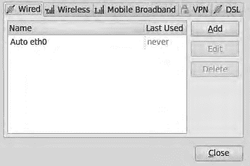

- 3. 点击“网络连接”窗口中的“无线”（Wireless）选项卡。
- 4. 点击“添加”（Add）按钮。将弹出一个新对话框，你可以在其中设置连接无线网络的参数。
- 5. 根据表 15-3 和表 15-4 中的信息填写字段，使完成后的界面类似于所示：

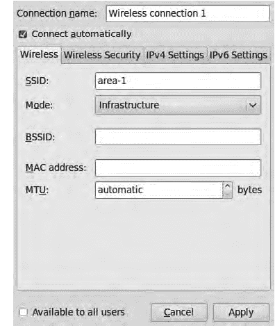

## 无线网络管理：入门指南

- 6. 点击“无线安全”（Wireless Security）选项卡。根据表 15-3 和表 15-4 中的信息填写字段，使完成后的界面类似于所示：

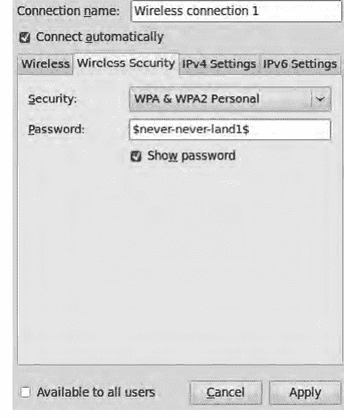

- 7. 接受“IPv4 设置”和“IPv4 Settings”和“IPv6 设置”选项卡中的默认设置。
- 8. 点击“应用”（Apply）按钮。
- 9. 在第 6 步中输入的通行密码（密钥）将存储在密钥环中，以便系统以后能为你记住它。可能会打开密钥环对话窗口，提示你是否允许 NetworkManager 插件访问新创建的无线网络。点击“始终允许”（Always Allow）。
- 10. NetworkManager 插件会立即尝试使用刚刚提供的参数连接到 WAP。如果一切顺利，你应该会在桌面的右上角看到一条简短的通知消息（如下所示），告知你与 area-1 的连接已建立。

```
area-1
Connection Established
```

- 11. 相应的“网络连接”窗口将类似于下方所示。点击“关闭”（Close）按钮退出 NetworkManager 程序。

| 有线 无线 移动宽带 | VPN | DGL |
|---|---|---|---|
| 无线连接 1 | 现在 | 编辑 (Edit) |
| | | 关闭 (Close) |

> NetworkManager 在系统托的右上角有一个方便的小插件（见第 2 步）。点击此插件可以提供有用信息，例如无线信号强度的快速视觉指示、系统当前连接的无线网络名称，以及 Wi-Fi 适配器检测到附近的其他无线网络。

图 15-1 显示了系统托插件在我们的示例系统上显示的某些信息。

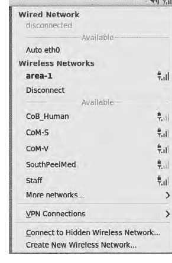

图 15-1. 系统托插件显示的信息

# 通用 Linux 无线客户端配置：CLI

我们将配置一个运行 Ubuntu 系统的示例系统，连接到我们在第 12 章中配置的一个 WAP。
表 15-3 显示了 WAP 的一些相关属性。表 15-4 显示了我们作为无线客户端 STA 的 Linux 客户端的属性，以及我们的一些配置目标。
配置将使用我们示例系统的 CLI。我们将使用之前讨论过的某些工具和程序——`iw`、`wpa_supplicant` 和 `wpa_passphrase`。

> 注意 用于命令行配置的命令和工具需要在 shell 提示符或终端中执行。因此，我们需要某种终端程序或终端模拟器程序。对于 FOSS（自由和开源软件），你有几几个选择，某些可能已经默认安装。一些流行的终端程序有 xterm、gnome-terminal 和 console。我们将在示例系统使用 xterm。此外，后续步骤之所以很长，是因为其中插入了额外信息。这些额外信息可能会干扰读者。额外内容是完全可选的，不影响我们的最终目标。如果你愿意，可以跳过标记为 [可选] 的步骤。

# PHY 和 MAC 层配置：CLI

让我们通过 CLI 开始配置 PHY 和 MAC 层：

- 以普通用户登录 Linux 系统。
- 按 ALT+F2 启动运行对话框。在框中输入 xterm 并点击运行。将出现一个类似于下面的 xterm 窗口。这是我们的第一个终端窗口。


- 部分配置无线设置的命令需要由具有管理权限的用户（如 root 用户）执行。如果你已经以 root 用户登录系统，可以忽略此步骤。对于 Ubuntu 等基于 Debian 的系统，可以通过输入以下命令变为 root 用户：
```
username@foss01:~ sudo su
```
然后输入相应的密码。

对于基于 Red Hat 的系统（如 Fedora、Red Hat Enterprise Linux (RHEL)、openSUSE 和 CentOS），可以通过输入此命令变为 root 用户：
```
username@foss01:~ su
```
输入相应的密码。

- 5. NetworkManager 插件通常在后台运行以帮助管理 Linux 设备。由于我们想手动操作，我们将临时停止服务。输入以下命令：
```
root@foss01:~ service manager stop
```

- 6. [可选] 我们需要为 `wpa_supplicant` 工具创建一个配置文件，其中包含我们要关联的无线网络名称以及我们使用的 WPA2-PSK 加密类型。我们将使用 `wpa_passphrase` 生成示例输出。输出将直接打印到终端。这只是测试运行。输入文本：
```
root@foss01:~ wpa_passphrase area-1 '*never-never-land1'
network{
 ssid="never-never-land1"
 psk=6aba9040d5f4ad7221fe6d8a30886faceee3647a4ec
}
```

- 7. 测试输出正常，我们可以直接写入示例配置文件。文件将命名为 `area-1-wpa.conf`。输入：
```
root@foss01:~ wpa_passphrase area-1 '*never-never-land1' > area-1-wpa.conf
```
我们几乎准备好连接 WAP 了。

- 8. [可选] 在连接之前，让我们找到一种监控无线 STA 连接到接入点 (AP) 时后台发生的情况。为此，我们启动另一个终端并在其中运行不同的命令观察。

- 9. [可选] 重复步骤 2 和 3 启动一个新的 xterm 窗口——我们的第二个终端窗口。将屏幕上的第一个和第二个 xterm 窗口并排放，以便查看而不重叠。

- 10. [可选] 我们将使用带有 event 的 iw 命令显示由无线适配器驱动和其他更改生成的无线事件。

在 Debian/Ubuntu 系统上，如果尚未安装 `iw`，请安装：
```
sudo apt-get install iw
```
在 Hat 系统上，通过输入 `yum install iw` 安装 `iw`。此命令应在第二个 xterm 窗口中输入：
```
root@foss01~$ iw event
```

- 11. 使用 `wpa_supplicant` 连接 WAP 或接口 wlan0，使用我们在第 7 步中创建的配置文件。输入：
```
root@foss01~$ wpa_supplicant -Dw802.11 -i wlan0 -c ./area-1-wpa.conf
CTRL-EVENT-SCAN-RESULTS
WPS-AP-AVAILABLE
Trying to associate with 00:14-6c:dd:4a:1c (SSID='area-1' freq=242 MHz)
Associated with 00:14-6c:dd:4a:1c
WPA: Key negotiation completed with 00:14-6c:dd:4a:1c [PTK:TKIP GTK=TKIP]
CTRL-EVENT-CONNECTED Connection to 00:14-6c:dd:4a:1c completed
(auth) [id=0 id_str]
```

- 12. [可选] 当检测到无线事件时，第二个 xterm 窗口的控制台将更新。它可能会有类似此示例的输出：
```
root@foss01~$ iw event
wlan0 (phy #0): scan finished
wlan0 (phy #0): auth 00:14-6c:dd:4a:1c -> 00:16-6c:6a:2be
status: 0: Success
wlan0 (phy #0): assoc 00:14-6c:dd:4a:1c -> 00:16-6c:6a:2be
status: 0: Success
```

我们的基于 Linux 的无线 STA 现在应该已经正确通过验证并关联到 WAP。这意味着 STA 和 AP 之间的 PHY 和 MAC 层一切正常。这与无线或无线电链路相同。


## 第 15 章：Linux 客户端

## 网络与传输层配置：CLI

现在我们将处理通信链路的网络层和传输层，以便我们能够对其进行一些实用的操作：

- 重复“PHY 和 MAC 层配置：CLI”部分中的第 2 步和第 3 步启动一个新的 xterm 窗口。这将是第三个 xterm 窗口。将第一个、第二个和第三个 xterm 窗口在你的屏幕上排列，以便你可以看到它们而不会互相重叠。

这部分的配置过程应该是很容易的，幸运的是，我们在 wap-1（即 AP）上运行了一个动态主机配置协议（DHCP）服务器。我们在之前的第 12 章配置基础设施设备时，已经配置了 DHCP 服务器服务。

- 大多数具有 DHCP 客户端功能的 FOSS（自由及开源软件）发行版。其中一种流行的 DHCP 客户端软件实现是 `dhclient`，用于使用 DHCP 配置接口。以无线接口名称（在本例中为 `wlan0`）作为唯一参数运行 `dhclient` 工具。输入以下内容：

```
root@foss01:~$ dhclient wlan0
Internet Systems visit http://www.isc.org/sw/dhcp/
Listening on LPF/wlan0=00:ce:6a:2e:ba
Sending on LPF/wlan0=00:ce:6a:2e:ba
Sending on socket/fallback
DHCPDISCOVER on wlan0 to 255.255.255.255 port 67 interval 4
DHPOFFER from 172.162.1.3 from 172.162.1.254
DHCPREQUEST from 172.162.1.3 on wlan0 to 255.255.255.255 port 67
DHCPACK from 172.162.1.3 from 172.162.1.254 -- renewal in 39788 seconds.
```

根据输出结果，看起来我们进展顺利。我们成功从 wap-1 获取了一个 IP 地址。Linux 客户端 STA 的新 IP 地址是 172.162.1.33。而 DHCP 服务器（wap-1）的 IP 地址是 172.162.1.254。

- 让我们进行一些简单的诊断并收集无线连接的一些统计，以确保我们与 wap-1 的 IP 层连接性。输入以下内容：

```
root@foss01:~$ ping -c 2 172.162.1.254
PING 172.162.1.254 (172.162.1.254) 68(84) bytes of data.
64 bytes from 172.162.1.254: icmp_seq=1 ttl=64 time=18ms
64 bytes from 172.162.1.254: icmp_seq=2 ttl=64 time=42ms
-- 172.162.1.254 statistics
2 packets transmitted, 2 received, 0% packet loss, time 101ms
rtt min/avg/max/mdev = 1.189/2.956/4.724/1.768 ms
```

看起来不错。

## 无线网络管理：入门指南

4. 现在让我们查看一些接口统计数据。输入以下内容：

```
root@foss01:~ iw dev wlan0 station dump
Station 00:14:6c:dd:4a:1c (on wlan0) ms
inactive time: 3572 ms
rx bytes: 3534066
rx packets: 27233
tx bytes: 163800
tx packets: 1281
signal: -12 dB
tx bitrate: 54.0 MBit/s
```

5. 显示无线设备的 PHY 能力：

```
root@foss01:~ iw list
Wiphy phy0
```

- 频段 1：
频率：
* 2412 MHz [1] (20.0 dBm)
* 2417 MHz [2] (20.0 dBm)
...<已截断>...
* 2484 MHz [14] (20.0 dBm)
（被动扫描）
比特：
* 1.0 Mbps
* 2.0 Mbps (支持短前导码)
...<已截断>...
* 54.0 Mbps

- 频段 2：
频率：
* 5180 MHz [36] (30.0 dBm)
* 5200 MHz [40] (30.0 dBm)
（被动扫描，无 IBSS）
（被动扫描，无 IBSS）
...<已截断>...
比特：
* 6.0 Mbps
* 9.0 Mbps
...<已截断>...
* 48.0 Mbps

6. 显示关于无线接口的 PHY 层和 MAC 层信息：
root@foss01:~~$ iw dev wlan0 scan dump
BSS 00:14:6c:dd:4a:1c (on wlan0)
TSF: 91807429
freq: 2412
signal: -12 dBm
SSID: MyNetwork
BSSID: 00:14:6c:dd:4a:1c
interval: 100
frequency: 2412
channel: 6
bit rates: 1 2 6 9 24 54
ESS: 1
DS: 1
RSN: 
    Group cipher: AES-CCMP
    Group management: PSK
    Pairwise cipher: AES-CCMP
    AKM suite: PSK
Supported rates: 1 2 6 9 24 54
Required rates: 1 2 6 9 24 54
IE: 
    Type: 1
        Length: 4
        AKM suite: PSK
    Type: 3
        Length: 12
        Supported rates: 1 2 6 9 24 54
        Required rates: 1 2 6 9 24 54

BSS 00:14:6c:dd:4a:1c (on wlan0)
TSF: 91807429
freq: 2417
signal: -15 dBm
SSID: MyNetwork
BSSID: 00:14:6c:dd:4a:1c
interval: 100
frequency: 2417
channel: 7
bit rates: 1 2 6 9 24 54
ESS: 1
DS: 1
RSN: 
    Group cipher: AES-CCMP
    Group management: PSK
    Pairwise cipher: AES-CCMP
    AKM suite: PSK
Supported rates: 1 2 6 9 24 54
Required rates: 1 2 6 9 24 54
IE: 
    Type: 1
        Length: 4
        AKM suite: PSK
    Type: 3
        Length: 12
        Supported rates: 1 2 6 9 24 54
        Required rates: 1 2 6 9 24 54


在将启动并托管自组织网络（ad-hoc network）即源站的系统上执行以下步骤：

1. 以普通用户身份登录 Ubuntu 系统。
2. 在桌面右上角找到 NetworkManager 系统托盘应用程序。点击图标并选择“创建新的无线网络...”（Create New Wireless Network...）选项。将出现“新无线网络”对话框，其外观如下：


3. 根据表 15-4 中的信息填写对话框中的字段。完成后的屏幕显示所示：


4. 点击“创建”（Create）按钮。
5. NetworkManager 小程序将立即尝试在本地系统上启用新的自组织网络。如果一切顺利，你应该在桌面右上区域看到一条简短的消息，告知你自组织 Linux 连接已建立。
6 现在 SSID 为 `ad-hoc-linux` 的自组织网络已激活状态，并准备好其他无线客户端加入。

## 无线网络管理：入门指南

## 自组织网络中的 dnsmasq, iptables, dhcp 和 s

在基于 Linux 的系统中，每当配置系统以托管自组织网络时，后台都会有一些很酷的事情“自动”发生。这包括运行一个占用内存极小的缓存 DNS 代理和 DHCP 服务器。较新版本的 Ubuntu 默认安装了 dnsmasq，如果有必要，你可以在旧系统上快速安装它（使用 `sudo apt-get install dnsmasq-base`）。

该程序带有一组合理的默认设置，因此无需用户输入即可开箱即用。例如，在基于 Ubuntu/Debian 的系统中，以下是 dnsmasq 的默认行为：

- 为管理 dnsmasq 的主机网络接口分配 IP 地址 `10.42.43.1`。
- 为范围 `10.42.43.10` 到 `10.42.43.100` 之间的客户端分配 DHCP 地址。
- 为客户端分配网关地址 `10.42.43.1`。

这些默认设置意味着连接到自组织网络的所有站将获得 `10.42.43.10` 到 `10.42.43.100` 范围内的 IP 地址，而运行该过程的主机将被分配 IP 地址 `10.42.43.1`。这就是自组织网络上的系统获取 TCP/IP 配置的方式。可以通过通过运行包含所需参数的配置文件运行 dnsmasq 来更改这些默认设置。

发生的第二件事情是 Linux 内核的数据包过滤子系统被激活。该系统被称为 netfilter，而管理该子系统的工具是 iptables。iptables 用于管理 Linux 内核中的数据包转发、路由、防火墙和数据包日志功能。

iptables 还可以拥有不同的前端（图形界面、脚本）以使其更易使用。其中一个前端是基于 Ubuntu/Debian 系统的简易防火墙（Uncomplicated Firewall，简称 ufw）。

iptables 被用于创建简单的防火墙规则，以保护管理自组织网络的主机。
一旦禁用自组织网络，dnsmasq 创建的自动防火墙规则和其他设置将被移除，dnsmasq 守护进程将回到休眠状态。

## 第15章：Linux 客户端 265

在将加入自组织网络的其他系统（目标系统）上执行以下步骤：

- 使用系统上可用的无线网络管理工具找到并连接到 SSID 为 `ad-hoc-linux` 的自组织网络。
- 在其他基于 Linux 的系统中，你可以使用 `nm`（命令行）、`wicd` 和 `ConnMan`。
- 在 Mac OS X 系统中，可以使用网络偏好设置应用程序。
- 在 Microsoft Windows 系统中，可以使用“管理无线网络”控制面板小程序。
- 在提示输入加入网络的密码或密钥时，提供表 15-5 中的 WEP 密码。

如果一切进展顺利，系统将连接到自组织网络，并能够与连接到同一自组织网络的系统进行通信。

## 总结

Linux 操作系统是大多数自由开源软件（FOSS）发行版的核心。在本章中，你学习了 FOSS 平台上的无线硬件兼容性问题，学习了无线驱动程序和不同的 Linux 无线 API。你学习了如何使用图形界面和命令行工具为基于 Linux 的客户端系统设置和配置硬件及固件。你还学习了如何为 Linux 客户端设置自组织网络。

与之前讨论其他主流平台（Windows 和 Apple OS X）的章节相比，本章提供了大量的额外信息和细节。FOSS 的本质本身为我们提供了选择、资源和工具来交流这种程度的细节。

本页特意留。

## 第16章 | 计划、设计、调查与部署

## 无线网络管理：入门指南

## 关键技能与概念

- 复习……的重要性。
- 理解……的重要性。
- 复习……的重要性。
- 因为我们在……中读到的某些……
- 在现实世界中，我们应该遵循……
- 在现实世界中，我们应该从……开始
- 在这种情况下，对于……是明智的。
- 接下来，从……获取的信息。
- 最后，从……获取的信息。
- 正因如此，我们需要……

## 无线网络规划与考量

## 过去、现在与未来

## 第16章：计划、设计、调查与部署 269

但无线网络管理员必须确保现有硬件与新硬件兼容。例如，这样做是没有意义的。

因为我们在……中读到的某些……

考虑例如，802.11n。该标准处于草案阶段已经很久，但硬件供应商在发布几年前就已经制造了许多支持该草案的产品。在这种情况下，确保任何新购的设备具有……是非常明智且安全的。


## 无线网络管理：入门指南

# 数据吞吐量

执行适当的现场勘测（稍后将讨论）可以帮助你防范影响无线网络整体吞吐量的问题。从用户的角度来看，数据吞吐量低通常被描述为“网络慢”。合理的无线网络规划和设计将考虑无线网络的应用、数据以及其他用户。然后，你可以利用这些信息设计一个能够为各种用例提供最佳吞吐量的无线网络。

规划和设计还可能确定（例如）某些用户、群组或部门需要与他人进行隔离。它们还可能确定某些区域比其他区域具有更严苛的安全要求，或者可能帮助你意识到，在网络的某些部分，有线方案将能更好地满足用户的网络需求。

# 网络可靠性

网络可靠性是用户衡量网络的另一个指标。你可以确定，如果网络不稳定且不可靠，网络用户或客户端会让你（以及高层管理层）。。不稳定运行异常的网络不仅令人烦恼，还会影响用户的生产力。

在部署无线网络之前进行合理的规划，可以帮助你缓解可靠性问题以及网络上不可预测的行为。例如，很容易忽略物理对象的位置或位置对无线网络的影响——如家具、树木、墙壁、管道等。由于这些原因，空旷办公室的现场勘测结果可能与摆有隔板和家具的相同空间勘测结果不同。

在共享空间或有邻居的建筑中，无线设备也会影响无线网络的可靠性。尽管你可能无法控制其他办公室无线设备的运行，但你至少可以为你自己控制的设备的优化进行规划。现场勘测可以帮助你在无线网络实际部署之前发现问题。

# 估算硬件需求

不要低估或高估你的无线网络的硬件需求至关重要。

高估硬件需求可能意味着为了满足简单需求而预算或投入了过多的资源——例如，为一个两个人的记账业务推荐具有 10 G/s 后背板的企业级 LAN 控制器会被认为是过度了。在小空间内部署多个接入点（AP），而这种情况下使用一个放置位置良好的 AP 更为合理，这也是另一个例子。

相反，通过低估硬件需求，你可能今天可以节省几美元硬件支出，但在未来你可能会发现自己后悔当初没有在合适的设备上投入更多资金。虽然省钱能让管理层开心，但选择正确的硬件来满足无线网络的需求更为重要。

# 第 16 章：规划、设计、勘测与部署 271

例如，为十个用户规划网络并购买专为服务十个用户设计的设备，这应该被考虑为规划得太紧了。相反，你应该规划能够轻松扩展到至少 20 个用户的基础设施设备。另一个例子：你不会使用单个 WAP（无线接入点）为大面积区域提供覆盖，在这种情况下，部署多个 AP 或中继器来扩展网络范围更为合理。

> 注意：没有哪些方程或公式可以帮助你得出完美的网络规划；这大部分时候取决于常识。

# 现场勘测

良好的现场勘测将产生关键信息，有助于设计和规划一个成功的无线网络。现场勘测有助于确定小区覆盖、容量规划、网络文档、基准测试以及获取用户需求。所有这些活动都会直接或间接地影响最终的无线网络部署。

> 注意：小区覆盖指的是 WAP 无射波可以覆盖的有效区域。当你确定无线设备的最佳位置以满足用户需求时，小区覆盖是很有用的信息。

现场勘测有两个方面。方面是非技术性的，涉及事实查找和纸质发布过程。它还涉及获取实际的用户需求。现场勘测的第二个方面更具技术性和物理性。它可能涉及测量、评估物理环境的无线电传播特性以及其他类似的需求。

# 现场勘测指标

物业勘测的技术方面涉及在现场走动，并在场地的不同点收集并记录射频（RF）频率和数据指标——例如接收信号强度（RSS）、数据速率和信噪比（SNR）。RSS 指标影响场地的整体覆盖范围。RSS 值越低，网络覆盖范围越远。无线网络边缘的 RSS 为 -65dBm（低于 1 毫瓦的分贝）。SNR 测量的是有用射频信号与不理想的（且不可避免的）背景噪声之间的差异。SNR 直接影响无线网络上可达到的数据速率。在良好的 SNR 下，相对于噪声信号，可用的有用信号更多。因此，较高的 SNR 意味着噪声信号的影响不明显。在实际应用中，35dB（分贝）的 SNR 值优于例如 10dB 的 SNR 值。

网络数据速率反映了网络上可达到的实际数据吞吐量。

## 无线网络管理：入门指南

# RF 射频干扰

在现场勘测期间，你会花大量时间收集不同的指标。这些指标中的许多最终将用于尝试将干扰减少到最低，并确定最佳网络配置。

每个无线网络都会遇到许多干扰源，例如无线电话、邻近的无线网络、荧光灯和微波炉。它们的影响范围从微其微到严重不等。无论干扰源是什么，它都是无线网络部署中的一个不不受欢迎的因素。

无线网络中的射频干扰有许多副作用。网络性能缓慢就是一个例子。由于无线网络的传输介质是共享介质，因此需要一种方法来管理介质，以确保所有客户端都能获得应有的访问份额。无线电干扰会破坏这种管理机制并减慢流量。干扰源实际上占用了介质，导致其他设备无法及时使用。这就是用户感知为无线网络缓慢的案例之一。

还可能由于某种偶然巧合，过量的射频噪声会导致在无线网络上传输的数据损坏。这种损坏意味着无线 STA 用于确认接收数据包的内置检查将失败，发送 STA 可能被强制多次发送数据，直到接收 STA 确认（只要它没有损坏）。这不可避免地导致了必要的重传，从而减慢网络。

# 现场勘测工具

错误地认为现场勘测只能通过某些专业设备并由特殊人士和公司进行。这种假设也是一些人不愿进行勘测的主要原因之一。

确实，有专业设备用于现场勘测，这些设备的效果非常出色。例如，频谱分析仪或示波器可能花费 40,000 美元，用于测量射频电路的频率、带宽、噪声和失真特性。

但如果你没有拥有自己的频谱分析仪，你可以从许多其他工具中选择，以廉价的方式进行现场勘测。你可以

凭借常识和通用硬件及软件，你可以进行一项不会耗尽预算的现场勘测。这种低预算方法的一个额外处是，你可以使用与最终网络部署中相同的（或类似的）硬件。


最后，当无线信号强度显示器没有彩色条时，我们就完全没有信号。此时，在进行实际实地勘测时，可以将所有的“-65dB”引用替换为三格或以上。如果您的工具使用百分比，请将“-65dB”替换为 50% 或更高的信号强度。

## 实际实地勘测

承认以下步骤有些粗糙，但足以完成任务。
此示例实地勘测的目标之一是在给定的空间内确定 AP 的最佳位置。对于我们的目的，空间内的最佳位置应能为无线客户端提供最好的信号接收，同时避免干扰源。
我们的第二个目标是确定将为我们的站点提供良好覆盖的 AP 数量。
首先，让我们确定 AP 的最佳位置：

- 1. 开启笔记本电脑。
2. 如果笔记本或其他设备没有内置无线适配器，请安装无线适配器和任何必要的软件（如驱动程序）。
3. 如果存在外接天线，请将其连接。
4. 获取待勘测空间的平面图；如果还没有平面图，则快速绘制一份平面图草图。图 16-1 显示了一个示例平面图。

图 16-1 示例平面图

- 5. 在平面图上找到空区域的大致中心，并走到该位置。这是我们图 16-1 示例平面图上的 D 位置。
- 6. 在该位置开启并放置一个 AP。确保 AP 的所有无线安全设置均已禁用，并且射电已开启。
- 7. 配置笔记本电脑与 WAP 关联。
- 8. 由于示例空间的形状，我们将在 D 位置使用补丁天线。将天线连接到第一个 AP 上。
- 9. 从 D 位置开始，密切观察笔记本电脑的无线信号强度指示，并在 A、B、C、E、F、G、H 和 J 方向带着笔记本电脑来回。当信号强度下降到 -65dBm 时，停止在每个方向移动。
- 10. 在我们的示例勘测期间，-65dBm 点完美对应平面图上的以下位置：A、B、C、E 和 J。
- 11. 让我们将这些点（A、B、C、E 和 J）分别重命名为 D_end、A_end、B_end、D_end、E_end 和 J_end（参见图 16-2）。这些位置表示由第一个 AP 提供的 RF 覆盖的外部边界。整个区域将标记为 Cell_A。
- 12. 我们将位置 D 重命名为 D_start。
- 13. D_start 将是第一个 AP 建议的最终位置。
- 14. 这些更改反映在图 16-2 中。

在我们平面图的某些位置，仍然没有 RF 接收。这些位置在图 16-2 中用 F、G、H 和 I 表示。为了找到第二个第二个 AP 的最佳位置，我们从 Cell_A 的一个外部边界开始。具体而言，我们将从 D_end_J 开始（图 16-2）。

- 1. 在笔记本电脑仍处于视线范围内，走到 D_end_J 位置，然后走到 F、G、H、D_end_J 和 K 的大致中心。该中心位置在图 16-2 中标记为 I。
- 2. 在 I 位置开启并放置第二个 AP。确保 AP 的所有无线安全设置均已禁用，并且射电已开启。配置笔记本电脑与第二个 WAP 关联。
- 3. 由于我们示例空间的形状（从 I 位置的角度来看），我们将在 I 位置使用全向天线。将全向天线连接到第二个 AP 上。
- 4. 从 I 位置开始，密切观察笔记本电脑的无线信号强度指示，并在 E、F、G、H、D_end_J 和 K 方向带着笔记本电脑来回。当信号强度下降到 -65dBm 时，停止在这些方向移动。

图 16-2 第一个 AP 位置

- 5. 在我们的示例勘测期间，-65dBm 点完美映射到原始平面图上的 E、F、G、H 和 K 位置。我们将位置 F、G、H 和 K 分别重命名为 I_end、G、I_end_H 和 I_end。这些位置将表示由第二个 AP 提供的 RF 覆盖的外部边界。整个覆盖区域将标记为 Cell_B（图 16-3）。
- 6. 我们将位置 I 重命名为 L_start，这将是第二个 AP 建议的最终位置。这些更改也反映在图 16-3 中。

就是这样。现在，我们原始平面图的所有位置都有了 RF 覆盖。
无线网络管理员必须采取措施，在不利的情况下尽力而为。

## 站点部署示例与考量

当你设计和部署网络（或任何类型的网络）时，应该记住以下几点。除了通用的底层技术外，不同站点的无线网络可能具有不同的特性，这些差异可能是由于网络所用途的不同引起的。接下来的章节将讨论一些示例。

### 医院

医院环境中部署了许多基于 RF 的设备，例如传感器和警报设备，它们起着救命的作用。它们的正常运行关乎生死。在医院环境中部署无线网络是一项复杂的工程。无线设备不能对医疗设备产生任何干扰。无线网络管理员可能需要确保医院的某些区域或房间被完全屏蔽。

### 机场

在涉及无线数据部署时，机场提供了一系列复杂的、相互冲突的需求。一方面，机场高度依赖无线通信设备来实现飞机与机场控制中心（塔台）之间的通信。另一方面，机场还需满足候机或中转乘客的需求，为他们提供访问互联网的方式。为乘客提供互联网访问最方便的方法无疑是无线网络。

由于机场环境中这些冲突的需求，可能必须采用仔细的网络划分技术。这种划分可能包含物理和逻辑部分。物理部分是为了减少飞行通信设备与无线数据通信之间的无线干扰。逻辑划分部分是为了将公共（乘客）网络数据流量与机场的私有数据流量分离。

由于机场无法轻松预定义或规定客户打算在其 Wi-Fi 网络上使用的无线硬件类型，网络规划者可能需要做出妥协，并支持旧协议和旧无线技术，以适应尽可能的人。

有些机场通过将面向公众的无线数据的配置和管理外包给第三方来解决这些问题，第三方使用认证门户为无线客户端提供服务。此类门户的配置功能负责客户端的身份验证、授权和计费需求。

### 零售环境

零售环境依赖多种无线通信技术。由于零售环境对这些技术的依赖通常是避免的，无线网络管理员必须采取措施，在不利的情况下尽力而为。


# 第 16 章：规划、设计、调查与部署 279

零售环境高度依赖无线条形码扫描器、RFID 阅读器、无线支付处理系统、视频监控摄像头以及待售的无线电子产品。这些设备大部分都运行在无线网络设备使用的相同免许可频段中。这为干扰和普遍的混乱提供了绝佳的温床。

零售环境中一个更困扰的具体案例涉及销售点（POS）系统或支付处理系统，这些系统捕捉了未妥善保护的电波。坏人很容易获取包含客户财务数据的感兴趣的网络流量。

数据吞吐量和其他带宽问题在零售环境中并不十分重要，因为往返数据具有特殊性。例如，手持式扫描器间歇性地发送短数据包，不会长时间占用射频频段。

# 高安全区域

高安全区域的示例包括银行和其他金融机构、政府机构以及处理敏感领域（例如能源、医疗保健、交通或国防）的私人机构。

让我们从一个简单的建议列表开始：

- 有线等效隐私（WEP）已被破解。
- WPA 已被破解。
- WPA2 终有一天会被破解。
- WPA3、WPA4、……WPA-无敌破解版-版本100 在开发和发明后，迟早会被破解。

核心点在于：只有在万无可已已的情况下，才在高度安全的应用中使用无线技术进行数据通信。

无线通信的媒介（无线波）使其难以实现完美安全。进一步加剧问题的是，随着更新更强大的加密方法的出现，通用计算机的处理能力也在不断提高，这有助于检测并利用这些方法中的弱点。

如果高安全环境中绝对需要无线网络，你就需要实施一些最佳实践。这类环境需要多层保护机制和分布式基础架构。这可能是昂贵的，因为这意味着要为所有本可以合并的独立组件获取专用服务器。但分布式安全架构意味着，其中一个组件被破解或存在弱点并不意味着其余组件也会被破解。

# 家庭环境

家庭用户应该遵守所有的常识无线安全原则，并妥善保护他们的家庭无线网络。

以下场景展示了如果你不妥善保护网络会发生什么：

1. 家庭用户 A 先生订阅了互联网服务提供商（ISP）接入互联网。没问题。
2. ISP 拥有 A 先生的一些个人信息，例如他的信用卡信息、地址、电话号码等。没问题。
3. A 先生连接到互联网，一切顺利。没问题。
4. A 先生决定家里需要一个无线网络，于是购买了所有必要的硬件（WAP、无线适配器等）。没问题。
5. A 先生回到家，在未保护网络的情况下，迅速将新的无线硬件连接到 ISP 的网络。问题来了！
6. 邻居是 B 先生。他的互联网服务多年前被另一家 ISP 终止，因为他违反了 ISP 的使用条款。他的违规行为包括非法下载和尝试使用盗刷信用卡在线购物。他经历了假刑，现在又在另一家 ISP 上耍老花。
7. B 先生使用笔记本电脑，轻松地连接到 A 先生未安全的无线网络，使用 A 先生的互联网接入。B 先生继续在互联网上进行他的非法和非法活动。
8. A 先生的 ISP 接通知有一位客户在互联网上做不受欢迎的事情。ISP 进行调查后发现违规活动源自 A 先生注册的设备。
9. ISP 通知了警方，给了他们 A 先生的地址和电话号码，然后继续为 A 先生提供服务。B 先生却逍遥无业。
10. 警方访问了 A 先生，针对他的证据非常充分。A 先生可能要对恶意第三方（即 B 先生）在使用 A 先生家庭无线网络期间进行的任何犯罪或非法活动承担法律责任。
11. A 先生给自己找了一位好律师。幸运的是，这名律师读过这本书，所以他理解这种事情是如何发生的。律师能够证明 A 先生是无的，但 B 先生仍然是自由之身。
12. A 先生吸取了教训，并保护了他的家庭无线网络。

## 总结

部署无线网络的“四W 规则”非常简单。你学习了如何使用它来调查、规划和设计无线网络。你学习了如何通过使用通用硬件执行实际现场调查程序，在预算范围内进行现场勘测。你还学习了在几种类型的无线网络部署中干扰和安全的重要性。

本页特意留

# 附录

# 故障排除
## 无线网络

## 核心技能与概念

- 学习基础和通用的故障排除技术。
- 学习如何排除特定的无线网络问题。

在整本书中，你学习了如何以受控的方式组装和构建无线网络的所有部分。你学习了预选基础设施硬件、选择客户端硬件、选择将在客户端系统上使用的操作系统（OS）等，在经过仔细的规划和准备后，任何无线网络都应该无缝运行。

在现实中，情况并不总是（或经常）如此。你可能没有这种奢侈（或经常如此）。


## 基础设施侧硬件问题的故障排除

与客户端无线硬件不同，基础设施侧设备通常更昂贵，可能没那么容易更换。此外，基础设施设备通常是多功能的，这意味着该设备在网络中可能承担多个角色或功能。例如，它可能同时被无线客户端和有线客户端使用。如果由于任何原因需要将设备下线，其他无关的关键网络服务也可能受到影响。

使用以下信息帮助缩小范围并排除由基础设施侧引起的问题：

- **症状** 一切都无法工作，但客户端端似乎一切正常。
- **可能的修复** 重启或对基础设施设备进行电源循环。
- **影响** 所有依赖于该设备的网络服务都可能受到影响。网络应采用分层方法进行设计。这意味着，如果为无线和有线设备使用独立的硬件层，那么影响无线设备的故障就不应影响到有线设备。这将有助于防止单点故障。

在资金允许的情况下，应该始终准备好设备备件。当然，这些备件应该提前配置好。当基础设施硬件必须送去维修时，手头有备件将非常有帮助。

- **症状** 基础设施硬件提供的网络服务仅某些方面运行正常。
- **可能的修复** 如果可用，检查设备生成的系统日志或错误日志以理解问题。

可能的情况下，重启设备提供的特定服务或功能。当所有方法失效时，重启或对设备进行电源循环。如果问题仍然存在，请联系硬件制造商寻求支持。

- **影响** 某些网络服务或功能可能会受到临时影响。
- **缓解措施** 熟悉你的基础设施设备是非常有用的，这将帮助你知道去哪里寻找某些内容（例如系统日志）；它还将帮助你知道应该运行哪些命令或点击哪些按钮来控制不同功能。

由于没有人能预记现今数以亿计的网络设备的命令和语法，你至少应该在需要时知道去哪里查找信息，或者应该向谁询问。

## 无线构建块问题的故障排除

如第2章所述，无线通信技术依赖于一些基本原理和概念——这是所有无线技术的构建块。这些原理决定了无线电波的行为以及无线电波在空间传输时的传播，而构建块正是使实际无线通信成为可能。

许多可以避免和不可避免的环境及物理因素会影响无线网络的正常运行。

通常情况下，对构建块有良好的理解可以帮助你进行故障排除。使用以下信息帮助缩小范围并排除由构建块引起的问题：

### 症状 无信号。

#### 可能原因
- 信号源可能已关闭。
- 客户端 STA 上的接收器可能已关闭或禁用。
- 无线客户端 STA 离源或接入点（AP）太远。
- 发射器和接收器之间过多的物理障碍或屏。

#### 修复
- 验证信号源已启用。
- 验证接收器上的任何硬件均已启用并正常工作。
- 将 STA 移动到物理上靠近信号源的位置。
- 如果可能，移除障碍或屏。

### 症状 信号强度低。

#### 可能原因
- 无线客户端 STA 离源或 AP 太远。
- 发射器和接收器之间过多的障碍。

#### 修复
- 将 STA 移动到物理上靠近信号源的位置。如果可能，在客户端 STA 上使用更好的天线。如果可能，在基础设施设备上使用更好的天线来聚焦或引导无线信号。
- 如果可能，移除障碍或屏。

### 症状 信号强，但未连接。

#### 可能原因
无线网络的其他方面是其原因。

#### 修复
参考基础设施和 TCP/IP 问题的故障排除技术。

### 症状 数据传输率低。

#### 可能原因
- a. RF 信道拥堵。
- b. 未以最佳方式使用 RF 调制方法。
- c. 网络设计不良。

#### 修复
- a. 将无线通信使用的信道更改为不拥堵的信道。
- b. 确保发射设备和接收设备都使用最佳调制技术。例如，在 802.11g 无线网络中使用基于 802.11b 的客户端会影响通常快速的 802.11g 通的整体数据速率。
记住，无线通信的构建块在数据速率和距离之间提供了权衡。因此，如果你想要高数据速率，你可能必须接受在短距离内提供高速率的调制技术。
- c. 确保无线网络用于其能够处理的应用。例如，不要期望在 IEEE 802.11b 网络基础设施上流传输高清 (HD) 视频内容。

### 症状 丢包。

#### 可能原因
RF 噪声或干扰。

#### 修复
找到并消除干扰源。

### 症状 间歇性连接问题。

#### 可能原因
- a. RF 干扰。
- b. 无线网络过度订阅。

#### 修复
- a. 找到并消除干扰源。检查间歇性连接是否发生在一天中的某些特定时间。如果是，找出什么事件与干扰重合并处理它。例如，你可能会发现该事件大多发生在午餐时间，此时微波炉正在持续使用。
- b. 此问题可能是容量规划不足的结果。这意味着你可能有太多客户端设备试图同时访问网络，从而导致 AP 过载。

### 症状 无线频繁断开和重连。

**可能原因**
无线适配器的驱动程序故障，或者连接适配器的系统其他部分故障。

**修复**
向设备制造商获取更新的驱动程序。如果可能，更换已知良好的无线适配器查看问题是否持续。如果问题持续，则是硬件有问题。

## 建立连接问题的故障排除

要排除无线客户端 STA 尝试建立无线连接时发生的问题，你需要理解过程中涉及的步骤或阶段：扫描、选择、认证、关联和 TCP/IP 配置。问题可能发生在这些任何一个或多个阶段，识别出问题发生的确切阶段将有助于简化任务。

### 扫描

无线客户端扫描以搜索并定位可以连接的无线网络。扫描是通过通过基础设施设备定期发送的特殊无线管理帧（信标）中嵌入的信息实现的。信标类似于无线网络中的广告。广告包含了网络名称 (SSID)、无线信道信息、支持的数据速率和时间戳。扫描可以是被动的或主动的。

### 被动扫描

在被动扫描中，无线 STA 被置于监听模式。它监听由 AP 发出的信标。在在此模式下，STA 不需要执行任何操作。

今天几乎所有的 AP 都允许通过类似于“防止 SSID 广播”或“隐藏无线网络”的配置选项来抑制网络名称广告。当网络被 WAP 隐藏或伪装时，无线客户端的被动扫描比较困难，但并非不可能。当网络名称不广播时，无线客户端 STA 需要明确知道网络名称才能加入。

当 WAP 隐藏 SSID 的选项启用时，在排除可能发生在扫描阶段的无线连接问题时，临时取消隐藏网络名称总是一个好主意。

### 主动扫描

在主动扫描中，无线客户端 STA 被置于探测模式。这意味着 STA 主动探测无线电波以获取可用无线网络的信息。STA 发出一种特殊的无线管理


## 无线网络管理：入门指南

被称为探测请求（probe request）的帧。可用的基础设施设备（如无线接入点 WAP）会用“探测响应”（probe response）帧来响应探测请求帧。
无线 STA 可以在多种场景下启动扫描。在一种场景下，STA 处于一个新环境中，对任何无线网络均没有预先知识。STA 开始对所谓的“任意”无线网络名称或 SSID 进行主动扫描。这里的“任意”意味着 SSID 未指定或具有空值。所有配置为向客户端广播其可用性的 WAP 和其他基础设施设备都会做出响应。然后客户端选择它想要连接的无线网络名称。
在另一种场景下，STA 处于其之前配置过参与的无线网络或环境范围内。STA 开始对之前配置的网络进行主动扫描。这就是为什么便携式无线设备只要在网络的物理范围内，似乎就能记住并连接到它们曾经连接过的无线网络。

## 选择

每当无线客户端 STA 尝试连接无线网络时，就会发生选择阶段。请注意，选择发生在客户端——具体来说，它发生在 STA 上的连接管理软件或工具中。更重要的是，选择 AP 或无线网络的行为并不能保证任何结果。你可以选择任何网络，但其他因素会介入以确保最终连接的成功。选择仅仅是步骤之一。
之前提到过，管理信标帧包含了关于无线网络信息的广告信息，例如网络名称 (SSID)、无线能力、支持的数据速率和信号强度。这些信息中的某些内容在选择阶段非常有用。让我们来看看这些因素在选择阶段是如何被使用的。

## 无线网络名称

无线网络名称 (SSID) 除其他外，还是无线客户端 STA 用于识别其之前连接过的无线网络的信息。它也被用于识别 STA 预先配置连接的无线网络。
当出现重复的网络名称时，选择 SSID 时会考虑其他因素——例如，将选择信号最强的 AP 的 SSID 与无线 STA 进行配对。

## 无线能力

当无线客户端 STA 要选择 AP 或分布系统进行连接时，无线能力是必须考虑的的重要因素。AP 广播的能力可能包括 AP 支持的数据速率、支持的安全选项、支持的无线信道和/频率，以及支持的 IEEE 802.11 MAC 和 PHY 类型。

## 附录：无线网络排排除 291

STA 将自身的能力与 AP 广播并支持的进行比较，并根据最合拍的情况做出选择。作为一个简单的例子，支持并实现 IEEE 802.11g 标准的无线客户端 STA 将倾向于选择广播并支持 IEEE 802.11g 的 AP，而不是仅支持 IEEE 802.11b 频段的 AP。

## 信号强度

无线 STA 可以利用存储在探测帧中的 AP 信号强度信息来选择要连接的 AP。信号强度值越高，STA 连接到该 AP 的意愿就越强。当所有其他选择因素都相等时，信号强度值也可以用作平局手段。

## 身份验证

在无线连接设置的认证阶段，无线客户端 STA 需要证明它确实被允许使用或连接无线网络资源。有时，基础设施侧的无线设备也需要证明或确认它们的身份。这被称为双向认证，由所采用的安全机制类型决定。你可以在第 11 章中了解不同的认证技术。

在此阶段，预先配置在无线基础设施设备上的安全机制开始发挥作用。使用了加密和解密密码以及加密系统。

不俗说，这里可能会发生很多问题，并导致数小时数小时的故障排除。例如，一个输错的字符就会让一切乱套。以下是几种场景下的问题及可能的解决方法。

## 问题输入了错误的字符。

**需要检查的项目和可能的解决方法** 如果可能，从基础设施设备上移除安全密码，并从无安全状态开始。如果可能，将加密密钥更改为简单的、不易输错的内容。一旦你确认输错的字符是问题所在，你可以返回并更改为更复杂或更短的密码。

## 问题安全设置不匹配：基础设施设备和客户端设备必须使用相同或兼容的安全设置。例如，如果配置 AP 配置为使用 WPA2 验证客户端，而无线 STA 尝试使用 WPA，则认证阶段将无法成功。

**需要检查的项目和可能的解决方法** 确保在客户端 STA 上配置的安全类型和选项与基础设施侧设备上配置的类型相匹配。

为了消除安全设置不匹配导致认证问题的原因，请完全消除基础设施侧设备和客户端设备上的加密使用。如果使用无加密时运行正常，你就可以从低强度加密一直到高强度加密设置。应该一直这样做，直到找到一个可以使用的相互兼容的设置。

## 问题干扰：在正常情况下，干扰是无线通信系统中的一种困扰，因为它简单地中断通信。干扰可能发生在连接设置过程中的任何阶段，甚至在连接建立之后。射频 (RF) 干扰发生与认证阶段同时发生的概率很小，但并非不可能。当 RF 干扰的影响过大时，它可能会阻止认证过程顺利完成。

**需要检查的项目和可能的解决方法** 消除或减少使用无线通信系统的环境中的 RF 干扰源。干扰源太多，无法在此列全。但一些示例包括其他无线设备、其他非无线电气设备以及意外发射源（微波炉、消费电子产品、灯具、电机、输电线路等）。

## 关联

关联阶段发生在认证阶段成功完成之后。一旦 STA 成功关联，它就变成了无线基础集 (BSS) 的一部分。在关联期间，无线关系的细微细节得到解决。

关联从无线客户端 STA 发送关联请求开始，关联请求包含了 STA 支持的数据速率、无线网络名称 (SSID) 以及其他特殊的扩展信息。基础设施设备用关联响应做出响应。

出现问题，无线设备程序可能会广播或请求基础设施设备不支持或理解的功能。

## TCP/IP 配置

今天的有线和无线网络都基于古老的 TCP/IP 协议族。这在明天可能会随着新技术的出现而改变，但这是现状。这意味着任何想要与其他节点通信的无线节点都必须学会 TCP/IP。


# 附录：无线网络故障排除 293

在无线连接设置的 TCP/IP 配置阶段，无线客户端 STA 会获得其唯一的 TCP/IP 地址配置信息。STA 需要这些信息与其他 STA 或网络资源进行通信，其他网络资源也使用这些信息与 STA 进行反向通信。

本附录的后续章节将讨论与无线网络相关的 TCP/IP 配置的各个方面。

## 基础设施服务与协议问题：TCP/IP、DNS 和 DHCP 问题

基础设施服务在任何无线网络的后台静静地、无形地运行。这些服务对于任何无线网络的正常运行至关重要，并且实际上让无线网络对终端用户变得有用。

这里讨论的基础设施相关服务和协议是通过软件实现的。坦率地说，绝大多数服务都基于定义良好且成熟的标准，因此服务的故障排除程序可以基于标准方法和工具。然而，在排除基础设施协议和服务的故障时，简单经验所提供的价值和便利性是不言而喻的。遗憾的是，经验不是你在教室或书中学到的东西。经验是某种……无法言喻的东西（je ne sais quoi）？经验会告诉网络管理员，当链路或状态灯熄灭时，在启动其他复杂的调试工具之前，先检查网线是否正确插在设备上。坦率地说，当你修复过一次以上问题后，你就开始建立自己的经验库了。

以下是一些通用的症状和解决方案，可以帮助你排除基础设施服务和协议问题。针对特定操作系统平的故障排除技术将在附录的后半部分介绍。

**症状** 发生层级连接问题。

**需要检查的项目和可能的修复** 如果可用，请检查系统错误日志。最近的软件更改或 Bug 可能会影响系统的底层网络栈（TCP/IP 栈）。如果可能，将网络栈重置为已知的正常状态。

这些问题也可能由其他层的问题引起。例如，在网络层出现的问题可以通过检查依赖于此类布布的任何网络组件之间的物理布线来解决。

**症状** 发生名称解析问题。

**需要检查的项目和可能的修复** 检查 DNS 服务器及其日志，寻找其中记录的异常情况。

检查确定问题影响的是单个系统还是整个 WLAN 系统。如果问题仅影响单个系统，可能是客户端端的配置错误。

测试确定名称解析问题是仅影响局域网（LAN）系统，还是也影响外部或互联网上的主机。

如果无线网络客户端能够使用 DNS 服务器正确解析本地系统的名称，则问题可能出在内部 DNS 服务器转发请求的上游 DNS 服务器。

**症状** 无线网络客户端无法获取网络配置信息（DHCP）。

**需要检查的项目和可能的修复** 检查 DHCP 服务器并检查 DHCP 服务器的日志。确保 DHCP 服务器确实正在运行。在某些平台上，可能需要为 DHCP 服务器将的服务的网络显式授权。检查 DHCP 服务器租用给客户端的地址作用域或范围。

如果使用的无线客户端或无线设备数量超过了 DHCP 服务器许可管理的数量，将只有足够的设备才能从服务器获取 DHCP 租约。在这种情况下，你需要增加 DHCP 范围以容纳额外的网络客户端。

检查确定问题是否与特定的客户端设备有关，还是影响所有联网设备的通用性问题。如果仅影响单个设备，请检查服务器或客户端端是否存在可能导致问题的防火墙。

**症状** 无线网络客户端或设备接收到错误的网络配置信息（DHCP）。

**需要检查的项目和可能的修复** 网络上可能存在伪造 AP（rogue AP）或非法 DHCP 服务器，它们向无线客户端提供了错误信息。你需要追踪该设备并将其禁用。

## 在不同操作系统上的网络问题故障排除

无线能力存在于所有类型的设备中，具有不同的形状、大小、平台和应用。无论无线能力如何实现，其底层原理和技术都是相似的。

在书的前部，我们使用了三个流行的操作系统平台来演示无线客户端配置技术：Windows、Apple OS X 和基于 Linux 的自由开源软件（FOSS）。让我们在此继续讨论如何在这些平台上排除不同的无线问题。

# 附录：无线网络故障排除 295

> 注意：所使用的某些技术和工具与操作系统无关，在任何可能或适用的情况下，文中将突出显示其具体差异。

表 A-1 显示了三个平台上的信息性系统消息和系统错误消息（也称为系统日志）的位置。这些日志资源提供了有用信息，可以帮助排除不同平台上的各种无线网络问题。

表 A-2 显示了可能发生在 OSI 参考模型第 3 层到第 7 层的故障排除、问题和症状。注意，大多数此类故障排除工具和程序是基于命令的，因此你将在平台上的相应命令解释器中使用命令。在 FOSS/基于 Linux 的系统中，命令解释器也称为 shell。Shell 环境还包括 csh 和 sh。你可以通过使用图形化前端 gnome-terminal、xterm 或 console 进入 shell。名为 xterm 的 GUI 前端也存在于 Apple OS X 上。在 Windows 系统上，你可以使用 cmd 命令解释器运行命令。

| 平台 | 常用名称 | 系统日志文件的位置 |
| :--- | :--- | :--- |
| FOSS/Linux | 系统日志：/var/log/messages | **dmesg** 用于查看 Linux 内核的环形缓冲区；将诊断消息作为内核中的各种事件显示，例如新硬件检测、模块的加载和卸载、网络接口的激活或禁用、无线接口的诊断信息。查看内核环形缓冲区的内容。实时监控 dmesg 输出，使用 `watch -n 1 "dmesg \| tail"`。 |
| | **iw** 显示无线设备的信息并用于设备配置。要实时查看无线连接身份验证和取消关联消息，使用 `iw -f`。 |
| Apple OS X | **Console** OS X 创建的所有各种日志文件的存储库。 | 应用程序 | 实用程序 | Console |
| MS Windows | **Event viewer** 显示有关计算机的各种重要信息。用于故障排除问题和错误。记录系统错误和其他事件。 | 开始 | 控制面板 | 系统和维护 | 事件查看器 |

表 A-1. 信息性系统消息和系统错误的位置

| 症状与目标 | 平台 | 工具、修复和需要检查的项目 |
| :--- | :--- | :--- |
| TCP/IP：验证和查看 TCP/IP 配置信息 | MS Windows | ipconfig 用于显示、操作各种 TCP/IP 配置参数——例如，查看运行 Windows 操作系统的本地 STA 当前 TCP/IP 设置：<br>`ipconfig /all`<br>该命令将显示 IP 地址、子网掩码、DNS 服务器地址、网关地址以及运行 Windows 操作系统的无线 主机名。 |
| | Apple OS X | ifconfig 用于显示和操作 Macintosh 系统网络接口的 TCP/IP 配置信息 |
| | FOSS/Linux | ifconfig  Windows 中的 ifconfig 命令。<br>ip 用于显示和操作 FOSS 系统的 TCP/IP 配置、路由功能。 |
| 验证和查看无线配置特定信息 | FOSS/Linux | iw 查看所有无线设备的能力以及 频段信息，使用：<br>- iw list<br>要查看无线设备的无线监管域信息，使用：<br>`iw -f`<br>要显示无线站统计信息，例如发送/接收字节数、最后发送比特率，使用：<br>`iw dev <interface_name> station dump` |


Windows netsh 使用 netsh 工具的 wlan 上。下面列出了一些用法示例。要显示所有无线设备和无线网络的完整信息，输入：

```
net wlan show all
```

要显示系统上当前的无线接口列表，输入：

```
net wlan show interfaces
```

要显示系统上无线适配器驱动程序的属性，输入：

```
net wlan show drivers
```

要显示系统上可见的无线网络列表，输入：

```
net wlan show networks
```

要显示无线局域网的当前全局设置，输入：

```
net wlan show settings
```

与驱动相关的问题 MS Windows 使用“设备管理器”卸载设备及其驱动程序。重启，然后重新安装驱动程序。

FOSS/Linux modprobe 从 Linux 内核中添加和删除模块（驱动程序）——例如，要强制为无线设备删除名为 ath5k 的模块，请输入：

```
modprobe -r ath5k
```

要再次重新加载该模块，输入：

```
modprobe ath5k
```

表 A-2. 不同平台上的 OSI 上层问题排查（续）

| 症状、问题与目标 | 平台 | 工具、修复与检查项 |
| :--- | :--- | :--- |
| 通用 TCP/IP 问题 | 通用 | ping 生成并发送 ICMP 消息，可用于测试系统的 TCP/IP 设置并测试其他主机是否可达。可用于检查本地系统安装的 TCP/IP 栈是否在基础层面运行正常。如果你怀疑 STA（站节点）的本地 TCP/IP 栈存在问题，可以通过运行简单的 ping 测试来开始排查，探测 `ping 127.0.0.1`。如果上述简单测试失败，说明本地系统的 TCP/IP 栈存在严重问题。你可以通过使用此表修复部分的技术来开始修复。尽管尽管如此，在检查本地 STA 的 TCP/IP 栈时，你应该尝试 ping STA 的 IP 地址。这也应该成功。输入：`ping <IP-address-of-local-system>`。如果本地系统内一切正常，你可能想检查本地网络上的其他系统是否可达。输入：`ping <IP-address-of-remote-host>`。上述测试在某些可能会失败。如果网络上使用了中间防火墙，防火墙可能会阻止或拦截 ping 工具默认使用的 ICMP 包。运行在本地系统上的主机防火墙软件也可能拦截 ICMP 包。 |
| 地址解析协议 (ARP) | 通用 | arp 在确认本地 STA 的 TCP/IP 栈基本无正常后，如果 STA 仍然无法 ping 其他本地系统，你可以尝试清除 STA 的本地 ARP 缓存。如果你可以同时 ping 回环地址 (127.0.0.1) 和你的 IP 地址，但无法 ping任何其他 IP 地址，请使用 arp 工具清除 ARP 缓存。要查看当前缓存条目，输入：`arp -n`。要删除条目，输入：`arp -d`。 |
| TCP/IP：修复 如果你怀疑本地 STA 的软件 TCP/IP 栈损坏或发生混乱，可以尝试修复它 | MS Windows | netsh 使用网络配置工具（参见第 13 章）重置 Windows 中的 TCP/IP。这与卸载并重新安装 TCP/IP 协议的效果相同。输入：`netsh ip reset logfile.txt` |
| | FOSS/Linux | 这可能简单地停止并重启控制无线接口的不同脚本。不同的 Linux 发行版有不同的处理方法。在 Debian 或 Ubuntu 平台上，输入：`/etc/init.d/network-manager restart`、`/etc/init.d/network restart` 或 `restart network-manager`。在 Fedora、RHEL 或 CentOS 系统上，输入：`restart network` 或 `service network restart`。在 OpenSUSE 或 SUSE 系统上，输入：`rcnetwork restart` 或 `service network restart`。 |

表 A-2. 不同平台上的 OSI 上层问题排查（续）

附录：无线网络排查

| 症状、问题与目标 | 平台 | 工具、修复与检查项 |
| :--- | :--- | :--- |
| 通用 DHCP 相关问题 | | 你应该首先确保无线 STA 确实配置为通过 DHCP 获取 TCP/IP 配置信息。STA 可能配置为使用静态或手动 IP 配置，静态配置的信息可能是错误的。验证 STA 上的 DHCP 客户端软件正在运行。系统上所有运行进程列表以及系统日志文件是检查此项的好地方。在 TCP/IP 配置成功完成之前，无线 STA 必须成功完成扫描、选择、验证和关联的所有阶段。DHCP 相关问题：客户端可能具有错误的 TCP/IP 配置，或者简单地没有从工作的 DHCP 服务器获取任何 TCP/IP 配置。尝试手动强制 DHCP 请求。 | |
| | MS Windows | 强制请求新的 DHCP 配置：`ipconfig /renew`。要释放当前的 DHCP 租期，输入：`dhclient /release`。用于通过 DHCP 配置网络接口。 |
| | FOSS/Linux | 请求新的 DHCP 配置信息或租期，输入：`dhclient <name_of_interface>`。释放当前的 DHCP 租期，输入：`dhclient -r`。 |
| | Apple X | 使用连接管理器（Connection Manager）禁用后重新启用无线接口。 | |
| 通用路由问题 | | 这些问题表现为主机系统无法访问网络。例如，STA 可能可以访问同一网络上的系统，但无法访问其他网络。 | route 显示并操作路由表。检查 STA 上的路由表有助于了解如何访问其他网络。在 Windows 系统上查看路由表，输入：`route print`。在 Linux 系统上查看，输入：`route -n`。 |
| 无法访问 Internet 主机 | STA 能够访问本地系统但无法访问 Internet，最可能是路由问题。使用 route 工具查看本地路由表。如果 STA 需要访问间接网络，路由表中应有默认路由项。 |
| | 通用 | STA 能够访问本地系统但无法访问 Internet，最可能是路由问题。默认路由将指向“0.0.0.0”。每当此项缺失，意味着 STA 不知道如何向外部网络（如 Internet）发送数据包。解决此问题的方法是确保 STA 的路由表中默认路由。 |
| | MS Windows | 在 Windows 系统上，在命令提示符输入此命令：`route add 0.0.0.0 mask 0.0.0.0 <IP_ADDRESS_OF_GATEWAY>` |
| | FOSS/Linux | 在 Linux 系统上，在 shell 提示符输入此命令：`route add default gw <gateway_ip>` |

表 A-2. 不同操作系统上的 OSI 上层问题排查（续）

附录：无线网络排查

| 症状、问题与目标 | 平台 | 工具、修复与检查项 |
| :--- | :--- | :--- |
| 通用名称解析问题 | | 常见的名称解析方法有 NetBIOS、DNS、数据库、本地文本文件。 |
| | MS Windows | nslookup 用于交互式查询 DNS 服务器的简单工具。请注意，nslookup 在其他操作系统平台上可用。识别名称解析问题的金标准测试是：主机系统无法通过主机名与其他系统通信，但能够通过其他方式（如 IP 地址）与系统通信。例如，查询本地配置 DNS 服务器的 example.com 域名的 IP 地址，输入：`nslookup example.com` |
| | nbtstat 此用于显示本地系统所知道的当前 NetBIOS 信息；也用于操作 NetBIOS 名称缓存。 |
| | FOSS/Linux | dig 是许多 Linux 发行版中功能强大的 DNS 查询工具。其语法简单。例如，查询本地配置 DNS 服务器的 example.com 域名的 IP 地址，输入：`dig example.com`。如果你认为本地配置的 DNS 服务器有问题，并想查询另一个 DNS 服务器：`dig <DNS_SERVER_IP> example.com` | |


域名解析问题：无法通过域名访问外部主机或站点。
确认此场景的简单简单测试方法是将任何知名外部站点的友好域名替换为其 IP 地址，并用此信息替换该站点的网页地址。例如，如果使用浏览器访问此网页地址 http://66.249.80.104 可以跳转到 Google 首页，而访问 http://www.google.com 却失败了，那么你就知道存在这个问题。

通用

如果无线 STA 仅通过远程主机的 IP 地址即可浏览网站，可能意味着以下两种情况之一：为 STA 配置的 DNS 服务器无法访问或不可用。

DNS 服务器可以访问且可用，但 DNS 服务器本身无法代表无线 STA 去解析外部主机名。这可能是由于本地 DNS 服务器所依赖的上游 DNS 服务器存在问题。

表 A-2. 不同操作系统平台上的 OSI 上层问题故障排除（续）

附录：无线网络故障排除 303

## 总结

本章回顾了无线网络中可能出现的一些问题。具体而言，回顾了书中之前涵盖的不同主题领域，以及这些领域中可能出现的常见问题。

本附录绝不是对无线网络中可能出现的单个故障进行详尽列举——那需要另一本书才能做出来，而那本书本身将跨越约 100 卷！我觉得你们不会想读那样一本无聊的书，所以我没有写它！

图引用使用斜体表示。

2G 蜂窝技术，GSM, 90–94
3DES, 163

# A

- * AAA, 144–146
- 接入点 (APs), 76
- 接入服务器 (AS), 144
- 计费 (accounting), 146
- ACK 帧, 88
- 活动扫描, 289–290
- 自形成网络 (ad-hoc networks)
- Linux, 262–265
- Mac OS X, 229–230
- 空中：参见天线 (antennas)
- AirPort, 219, 222
- AirPort Extreme, 219
- AirPort Extreme Base Station, 219–220
- 机场, 278
- 空气路, 5

另请

- 算法, 157–158
AM. 参见幅度调制 (AM)
- 放大, 19
- 振, 19
- 调调制 (AM), 27
- 扩频键控 (ASK), 25
- 天线 (antennas)
- 美学, 62
- 波束宽度, 57
- 选择考虑因素, 61–62
- 定向, 61
- 等向同性天辐射功率 (EIRP), 55–56
- 增益与损耗, 56
- 无意辐射体 (IR), 55
- 安装套件, 62
- 单向, 59–60
- 室外 vs. 室内, 62
- 概述, 54–55
- 放置, 62
- 平面, 60
- 极化, 57–58
- 安全, 62
- 半全向, 60
- 八角线, 60

## 无线网络管理：入门指南

- 任播播地址, 120
- Apple，参见 Mac OS X；Macintosh
- ASK, 参见扩频键控 (ASK)
- 关联, 292
- 关联请求帧, 84
- 关联响应帧, 84
- 非对称加密算法, 157
- 澳大利亚通信与媒体管理局 (ACMA), 9
- 身份验证, 144–145, 153, 154, 291–292
- 身份验证帧, 85
- 权威服务器, 128–129
- 授权, 145–146

- CAPWAP, 配置, 192
- CBC-MAC, 167–168
- CCMP/AES, 166
- 小区覆盖, 271
- CF 卡, 50–51
- cfg80211, 239
- 挑战握手身份验证协议。参见 CHAP
- 信道绑定, 34
- 信道, 22
- 信道如何映射到 5GHz 波段频率, 23

- CHAP, 145
- 芯片组
- 组件, 41–42
- 制造商, 42–43
- 概述, 40–41
- 密码, 158–160

- 3DES, 163
- 隐藏式 vs. 运行密钥式, 160
- DEA (DES), 162
- 实现, 163–168
- RCA, 163
- 流式 vs. 块, 160–162
- 替换 vs. 置换, 160
- 明文。参见明文 (plain-text)

# B

- b 和 g 模式, 34
- 仅 b 模式, 33
- b43-fw-cutter 工具, 241
- 频段, 21–22
- 基本服务区 (BSAs), 79
- 基本服务集 (BSS), 76–78
- 束帧, 84
- 信标, 289
- 波束宽度, 57
- 位与逻辑运算, 118
- 块芯片, 160–162
- 蓝牙, 98
- 拨号网络 (DUN), 231–234
- 网络, 99–100
- 配置文件, 98, 100
- 协议, 98, 99
- SIG 和制造商, 101
- 标准, 98
- 版本, 100
- 桥接, 68–69
- Broadcom 驱动程序, 240
- BSSID, 78
- CLI, 243–249
- 通用 Linux 客户端
- 配置, 254–259
- 1934 年通信法案, 8
- 2003 年通信法案, 9
- CompactFlash 卡, 50–51
- 兼容地址, 121
- 隐藏密码, 160
- 机密性, 154
- ConnMan, 243
- 构造性干扰, 20
- 内容过滤代理服务器, 149
- WAP 接入点的配置。参见 CAPWAP
- 控制帧, 84, 153
- 转换器, 53
- 成本, 70
- 密码学操作, 153
- 密码学。参见私钥
- 安全
- CSMA/CD, 83
- CTS 帧, 84
- 缓存, 149
- 缓存代理服务器, 149
- 缓存服务器, 130–131
- 加拿大广播电视委员会 (CRTC), 170

# Index 307

- 数据帧, 85, 154
- 数据吞吐量, 270
- DEA, 162
- 取消身份帧, 85
- 解密, 155
- 解调, 41
- 解调器, 162
- DES, 137
- 破坏性干扰, 20
- dhcp, 264
- DNS
- 域查询, 264
- 域名系统。参见 DNS
- DS。参见分布系统
- DSSS。参见直接序列扩频
- 客户端, 137
- 选项, 136
- 视图, 136
- 中继, 137
- 服务器, 139
- TXT 记录, 135
- 区域, 128
- 域查询, 264

- 拨号网络 (DUN), 231–234
- Diameter 协议, 147–148
- 定向天线, 61
- 直接序列扩频 (DSSS), 24
- 解离帧, 85
- 分布协调函数 (DCF), 83
- 分布系统, 75
- 无线分布系统 (WDS), 76
- DNS, 84
- 缓存服务器, 130–131
- CNAME 记录, 134–135
- 域名和主机命名, 124–128
- 域查询, 128
- in-addr.arp 域, 128
- MX 记录, 134
- NS 记录, 133
- 主服务器, 128–129
- PTR 记录, 133–134
- 记录类型, 131–135
- A 记录, 123
- 根域, 125
- 根服务器, 130
- RP 记录, 135
- 副服务器, 129–130
- 二级域名, 126
- SOA 记录, 131–132
- 子域, 126–128
- 三级域名, 126
- 顶级域名, 125–126

- EAP, 145, 168–169
- EAP-AKA, 172
- EAP-PSK, 171
- EAP-SIM, 172
- EAP-TLS, 170–171
- EAP-TTLS, 171
- 实体, 169
- 语法, 169
- 效率, 30
- 加密, 155
- E 平, 58
- 等向同性天辐射功率 (EIPP), 55
- ETSI, 13
- 欧洲电信协会。参见 ETSI
- 异或 (XOR), 156
- ExpressCard, 48–49
- 扩展服务集 (ESS), 79
- 可扩展身份验证协议。参见 EAP

- FCC, 8–9
- FDM, 25
- 联邦通信委员会。参见 FCC
- FHSS。参见跳频扩频 (FHSS)
- 固件, 241–242, 259–261
- 固定 WiMAX, 97
- FM。参见频率调制 (FM)
- 域查询, 128
- 四次握手, 173
- FQDN。参见完全限定域名 (FQDN)

- 频率, 17–18
- 信道如何映射到 5GHz 波段频率, 23
- ISM 频率, 21
- UNII 频率, 22
- 频率调制 (FM), 27
- 频分复用。FDM
- 跳频扩频 (FHSS), 23
- 扩频键控 (ASK), 25
- FSK。参见扩频键控 (ASK)
- 完全限定域名 (FQDN), 124–125

- PCI Express, 45
- 规划与设计, 268–269
- SD 卡, 50–51
- 故障排除, 285
- 美国, 49
- Linux 下的无线硬件, 237
- 哈希函数, 166–168
- 头部, 109
- 频率, 17
- 隐藏模式, 83
- 高安全性区域, 279
- 高速下行接入。参见 HSPA
- 高速数据接入。参见 HUPA
- HMAC, 176
- 家庭环境, 280–281
- 医院, 278
- 主机与网络, 116–117
- HSDPA, 94
- HSPA, 94
- HSPA 进化, 95
- HSUPA, 95
- H 模式, 33


in-addr.arpa 域, 128
不兼容性, 269
独立 BSS, 77
基础设施 BSS, 76
电气与电子工程师学会 (IEEE). 参见 IEEE
完整性, 154

iwconfig, 244
iwl3945, 241
iwlagn, 241
iwlwifi 项目, 240–241

英特尔公司 (Intel Corporation), 97
英特尔无线驱动, 240–241
发射器 (IR), 55
国际电信联盟
无线通信部门. 参见 ITU-R
网络连接共享 (ICS), 210–214
互联网工程任务组 (IETF)。

# K

密钥管理, 155
密钥, 155
密钥空间, 155
密钥流, 156

网际协议 (Internet Protocol). 参见 IP
网络共享, 226–229
互操作性, 30, 269
硬件, 70

# L

局域网, IEEE 802.3, 31
许可证, 5
- 轻量级鼠标, 35

Linux, 236
自建网络, 262–265

ip, 249

# IP

-区分服务 (DiffServ) 字段, 110
- 标志字段 (Flags field), 110
- 分片偏移字段 (Fragmentation Offset field), 110
- 标识数字字段 (Identification Number field), 110
- 长度字段 (Length field), 110
概述, 108–109

CLI, 249–243
ConnMan, 243
通用无线客户端配置, 254–259

Mac80211, 238–239
NetworkManager, 242–243
无线 API, 237–239
无线驱动, 237, 239

源和目的 IP 地址字段, 111
总长度字段, 110
TTL 字段, 110–111
版本字段, 110

无线扩展 API, 238
Linux 平台上的无线硬件, 233
无线接口连接

-基于 IP 的网络, 116–119
iptables, 264
IPv4, 109

守护进程, 243
参见 Ubuntu

- 轻量级鼠标, 35

局域网. 参见 LANs
回环地址, 116

# M

ISM 频段, 25
ISM 频段通道映射到频率, 23

MAC 帧, 85
字段, 86–87
类型, 84–85, 153–154
MAC 层, 82–85, 254–256

ITU-R, 5, 7–8
iw, 239, 244–245, 246

## 无线网络管理：入门指南

# Mac OS X

- 自建网络, 229–230
- 蓝牙拨号网络, 231–234
- 修改连接偏好, 225
- 网络共享, 226–229
- 设置无线位置, 221–225
- 设置硬件, 220–221
- WAP 偏好, 220
- 无线 Mac 客户端规范, 221
- 参见 MacOS
- MAC/BPP, 41, 238–239
-  Macintosh
- 硬件, 218–219
- 软件, 218
- 无线硬件, 219–220
- 参见 Mac OS X
- MadWiFi 驱动项目, 239–240
- 管理帧, 84–85, 153
- 城域网 (MANs), IEEE 802, 31
- 映射地址, 121
- 主会密钥 (MSK), 173
- 质访问控制器和基带处理器. 参见 MAC/BBP
- 中波 (MW) 频段, 21
- 网格网络, 214–215
- 消息认证码, 166
- 消息完整性码, 166
- 大域网. 参见 MANs
- 微软挑战握手认证协议. 参见 MS-CHAP
- Mini PCI, 45
- Mini PCIe, 45–46
- 移动单元 (MUs), 75
- 移动 WiMAX, 97
- 调制, 22–23, 41
- 模拟调制技术, 26–27
- 数字调制技术, 24–26
- 扩频调制技术, 23–24
- 调制器, 22
MS-CHAP, 145
- 多播地址, 120
- 相互认证, 291

# N

- 北 NATO K 频段, 21
- 子网掩码, 117–109
- Netsh 工具, 206–209
- 配置 SoftAP 和 VWiFi, 210–212
- 网络接入服务器 (NAS), 143
- 网络可靠性, 270
- NetworkManager, 242–243
- 网络和主机, 116–117
- 配置 nix-WAP, 181–186
- 配置, 187–194
- Ubuntu 无线客户端配置, 249–253
- 802.11, 239
- OFDM, 25
- 通信局 (Ofcom), 9
- 全向性天线, 59–60
- 正交频分复用
- 振荡, 17
- OSI 模型, 79, 80
- MAC 层, 82–85
- 物理层 (PHY), 79–82

# P

- 对等主密钥 (PMK), 173
- 个域网 (PANs), 215
- IEEE 802, 31
- PAP, 145
- 被动扫描, 289
- 密码认证协议. 参见 PAP
- PC 标准, 46–47
- PCI, 44
- PCI-SIG, 44
- 个人区域网. 参见 PANs
- 相位, 19–20
- 相位差, 20
- 移相制 (PSK), 25–26
- 物理层 (PHY), 79–82, 254–256
- 明文, 154–155
- 平面天线, 60
- 点多点链路, 69
- 点点链路, 68–69
- 极化, 57–58
- 以太网供电 (PoE), 69
- 防止厂商锁定, 30
- 主服务器, 128–129
- 原语, 76
- 私有, 117
- 请求帧, 85
- 请求, 290
- 响应帧, 85
- 专有驱动, 259–261
- 保护机制, 34
- 代理服务器, 148–149
- 流行实现, 150
- 类型, 149
- 使用场景, 150
- PSK. 参见移相制 (PSK)
- 私钥加密, 158, 159
- 接收灵敏度, 52
监管机构
- 澳大利亚媒体管理局 (ACMA), 9
- 加拿大无线电视委员会 (CRTC), 10
- FCC, 8–9
- ITU-R, 5, 7–8
- 国际监管机构, 6
- 国家无线通信, 6
- 通信局 (Ofcom), 9
- 印度电信管理局 (TRAI), 9–10
- 故障排除, 285
- 监管区域, 7–8
- 征求意见. 参见 RFCs
- 零售环境, 278–279
- RF. 参见无线频率
- RF 干扰, 272
- RFCs, 122
- 根 DNS, 130
- 根服务器, 126
- 无线路由器, 67–68
- RTS 帧, 84
- 流加密算法, 160
- 正交矩阵, 161
Rx 灵敏度, 52

# Q

- QAM, 26
正交幅度调制. 参见 QAM

# R

- 无线频率, 18
- 无线频率 (RF) 收发器, 42
- 磁波, 5, 17
- RADIUS, 142–144
- 流行实现, 147
- 使用, 146
RC4, 16
- 关联请求帧, 84
- 关联响应帧, 84
- 接收幅度, 19
- 接收信号强度 (RSS), 271
- 替代方案, 273
- 扫描, 289–290
- SDIO 卡, 50–51
- 备用服务器, 129–130
安全
- 算法, 157–158
- 背景, 152–154
- 解密, 155
- 加密, 155
- 密钥, 155
- 密钥空间, 156
- 密钥流, 156
- 明文, 154–155
- 服务, 154
- 选择, 290–291
- 半向天线, 60
服务器
- 接入服务器 (AS), 144
- 权威服务器, 128–129
- 缓存服务器, 130–131
DHCP, 137
- 网络接入服务器 (NAS), 143
- 主服务器, 128–129
- 代理服务器, 148–150
- 根服务器, 120
- 备用服务器, 129–130
信号强度, 291
信令技术, 80, 81–82
信噪比 (SNR), 271
正弦波, 178
站点部署示例和
考虑, 279
高安全区域, 279
家庭环境, 280–281
医院, 278
零售环境, 278–279
站点调查, 271
指标, 271
RF 接口, 272
工具, 272–273
IEEE 802.11y, 35
IEEE 802.15, 36
IEEE 802.3, 31
制定过程, 11–12
Mini PCI, 45
PC 卡, 46–47
PCI, 44
PCI Express, 45–46
USB, 49–50
As, 56–74
和无线控制器, 65–67
流加密, 160
子域, 126–128
子网掩码, 117
对称加密算法, 157
系统消息, 295
系统错误消息, 296
软件接入点 (SoftAP), 210–214
住宅无线路由器, 67–68
无线连接, 289–293
隧道技术, 121
Tx 功率, 52

# V

高频 (VHF) 频段, 21
虚拟 WiFi (VWiFi), 209–210
使用 netsh 配置, 210–212

# W

- WAP, 181
桥接模式, 63
配置, 181–186
模式, 63–64
概述, 62–63
中继模式, 64
根模式, 63
规范, 98
nix-WAP 的规范, 182
使用场景, 65
波长, 18–19
波, 167
WCs, 65–67
Web 代理服务器, 149
WEP, 35–36, 163–164
wicd, 243
Wi-Fi 联盟, 13–14, 34, 36
Wi-Fi 安全访问. 参见 WAP
WiMax, 96–97
WiMax 论坛, 97
Windows 7 无线功能
网络连接共享 (ICS), 210–214
网格网络, 214–215
PANs, 215
软件接入点 (SoftAP), 210–214
虚拟 WiFi (VWiFi), 209–214
Windows 客户端
兼容性、优化和
适用性考虑, 205
手动连接无线网络, 205–206
设置无线配置, 201–204
设置硬件, 199–201
站点位置消息, 295
系统错误消息, 296
不同操作系统上的问题, 296–303
监管和技术问题, 285
无线构建块问题, 286–293
隧道技术, 121
Tx 功率, 52


# 314 无线网络管理：入门指南

有线等效加密（Wired Equivalent Privacy）。参见 WEP 无线接入点。参见 WAP 无线网桥，68–69 无线网络构建模块，故障排除，286–289 无线能力，290–291 无线控制器，65–67 无线分布系统 (WDS)，76, 77–78 无线扩展 API，238 无线线接口连接守护进程，243 无线介质 (WM)，74 无线市城域网。参见 WLAN 网络管理工具，204 无线网络名称。参见 SSID 个人区域。参见 WPANs 无线路由器，67–68 无线基站。参见 STAs 无线交换机和控制器，65–67 无线广域网。参见 WWANs WLAN 控制器，186–194

- WLAN 接入点 (APs)，76 基础服务区域 (BSAs)，79 基础服务集 (BSS)，76–78 基础服务集标识 (BSSID)，78 已定义，74 分布式系统，75 扩展服务集 (ESS)，79 IEEE 802.11 标准，79–87 服务标识 (SSID)，78 基站，44 无线介质，74 无线基站 (STAs)，74–75
- WMANs 概述，96 WiMax，96–97

微波接入全球互操作性（Worldwide Interoperability for Microwave Access）。参见 WiMax WPA，36, 164–165 wpa_passphrase，247 wpa_supplicant，245–247 WPA2，165–168 WPANs

- 蓝牙，98–101 IEEE 802.15，36 概述，97–98 ZigBee，101–104 WWANs，90 GSM，90–94 LTE，95–96 UMTS，94–95

# X

异或 (XOR)，156

# Y

八基天线 (yagi antennas)，60

# Z

- ZigBee 组件与架构，102, 103 概述，101–102 SIGs 和制造商，104 特殊功能，102 版本，102 区域，128

