# Wordperfect？Linux 版？初学者指南？

下载 CD-ROM 版本的 Linux 版 WordPerfect 8！

Margaret Levine Young

David C. Kay

David S. Guertin

Kathy Warfel


## Linux 版 WordPerfect 傻呆速表

## 通用信息

要启动 WordPerfect，点击桌面上的 WordPerfect 图标，或者在看到 K、GNOME 或其他“开始”按钮时从菜单中选择 WordPerfect。如果你不知道如何启动程序，请参阅书末的附录。

要关闭窗口，点击菜单栏上的“文件 (File)>关闭 (Close)”或点击窗口右上角的关闭按钮（通常是一个 X）。

要离开 WordPerfect，从程序窗口的菜单栏中选择“程序 (Program)”并选择“退出 (Exit)”。点击 WordPerfect 程序窗口右上角的关闭按钮（通常是一个 X）。

当我们说“按下 Alt+某个键”或“按下 Ctrl+某个键”时，是指你在输入另一个键的同时按住 Alt 或 Ctrl 键（就像按住 Shift 键一样），然后松开。

| 在输入时执行此操作 | 按下此键 |
| --- | --- |
| 获取帮助 | F1 |
| 删除刚刚输入的字符 | Backspace（取决于你的 X Window 配置） |
| 删除光标（插入点）右侧的字符 | Delete |
| 开始新段落 | Enter |
| 新页 | Ctrl+Enter |
| 缩进段落首行 | Tab |
| 缩进段落所有行 | F7（将光标移动到段落开头后） |

## 鼠标操作

| 执行操作 | 使用鼠标完成 |
| --- | --- |
| 选择（高亮）文本 | 在文本中点击，按住鼠标按钮并拖动 |
| 选择一个单词 | 双击单词 |
| 选择一个句子 | 在左边栏点击一次 |
| 选择一个段落 | 在左边栏双击 |
| 移动文本或图形 | 选中它，然后点击并拖动 |
| 查看快速菜单 (QuickMenu) | 将鼠标移动到要操作的项目上并点击右键 |
| 更改字体 | 点击属性栏上的字体 (Font) 按钮 |
| 转到某处 | 双击应用程序栏上的位置区域 |
| 关闭文件 | 点击菜单栏右侧的关闭框 |
| 退出 WordPerfect | 点击 WordPerfect 程序窗口标题栏右侧的关闭框 |

## Linux 版 WordPerfect 傻呆速表

### 常用快捷键组合

这些按键组合帮助你管理文件和文本：

| 按下此键 | 执行此操作 |
|--- |---|
| Ctrl+C | 复制到剪贴板 |
| Ctrl+X | 剪切到剪贴板 |
| Ctrl+V | 粘贴到剪贴板 |
| Ctrl+S | 保存文档 |
| F3 | 另存为 |
| Ctrl+Shift+S | 保存所有文档 |
| Ctrl+P 或 F | 打印文档 |
| Ctrl+D 或 O | 打开文档 |
| Shift+F4 | 创建新文档 |
| Ctrl+B | 应用加粗 |
| Ctrl+I | 应用斜体 |
| Ctrl+U | 应用下划线 |
| Ctrl+F | 查找或替换文本 |
| F9 | 打开字体对话框 |
| Ctrl+G | 更改大小写 |
| Ctrl+K | 插入特殊字符 |
| Ctrl+Enter | 插入日期 |
| Ctrl+Shift+D | 插入始终显示当前日期的代码 |

### 有用提示

- 告诉 WordPerfect 你的想法。永远不要手动输入页码，要使用大量的 Tab 键创建表格，也不要手动输入多列文本。相反，请使用 WordPerfect 的功能，如页码、表格和列。
- 按 Ctrl+S 保存文档。要打开所有文档，按 Ctrl+Shift+S。
- 要查看（或删除）文档中的隐藏代码，请从菜单栏选择“查看 (View)>显示代码 (Reveal Codes)”。使用相同的命令关闭显示代码窗口。

### 在文档中移动

以下按键可使光标在屏幕上移动：

| 关键键 | 移动到这里 |
|--- |---|
| ↑ | 上移一行 |
| ↓ | 下移一行 |
| ← | 向左一个字符 |
| → | 向右一行 |
| Ctrl← | 向左一个字符 |
| Ctrl→ | 向右一行 |
| Home | 行首 |
| End | 行尾 |
| PgUp | 屏幕顶部或上一页 |
| PgDn | 屏幕底部或向下翻一页 |
| Ctrl+Home | 文档开头 |
| Ctrl+End | 文档末尾 |

### 恢复错误

如果你不喜欢当前的操作，

按下 Ctrl+Z

如果你刚刚删除了某些内容并想恢复，

按下 Ctrl+Z

如果你刚刚执行了命令并想撤销，

按下 Ctrl+Z


...傻呆系列 (For Dummies)：针对初学者的畅销书

## 我们普通人的参考指南！

你对电脑感到畏惧吗？你觉得传统的手册充满了你永远用不到的细节细节吗？朋友家人总是打电话让你修理电脑上的简单问题吗？那么，来自 IDG Books Worldwide 的“傻呆”系列正适合你。“傻呆”系列书籍是为那些感到沮丧的用户写的，他们并不是真的愚笨，而是发现硬件、软件，实际上计算机独特的词汇让他们无所无从。“傻呆”系列采用幽默的方法、接地气的风格，甚至使用漫画来消除对电脑的恐惧并建立信心。这些书既幽默又轻量，是任何被迫使用电脑的人的完美生存指南。

> “我喜欢我的副本，所以我告诉了朋友；现在他们也买了。”——Irene C., 俄亥州
> “快速、简洁、非技术且幽默。”——Jay A., 伊利诺伊州
> “感谢需要这本书。现在我晚上可以睡好觉了。”——Robin E., 英属哥伦比亚

已有数百万满意的读者赞同。他们创造了这个最受欢迎的入门级电脑系列，并要求更多更多内容。所以，如果你正在寻找最有趣、最简单学习电脑的方法，请让“傻呆”系列助你一把。

有关批量销售查询和报价，请联系我们的销售部门 650-655-3200。

有关在课堂使用 IDG Books 作品或申请样书的信息，请联系我们的教育销售部门 800-434-2086 或传真至 317-596-5499。

有关媒体评论、作者查询或其他公共信息，请联系我们的关系部门 650-655-3000。

> 责任限制：出版者和作者在编写本书时已尽最大努力，但对书中内容的准确性完整性不作任何保证，并明确不对任何特定目的承担责任。书中包含的建议和策略可能不符合个人需求。任何损害的责任，包括但不限于偶然、后续或其他损害。出版者对销售代表或书面材料所延伸的任何损害不负责。

by Margaret Levine Young, David C. Kay, Guertin, 和 Kathy Warfel

https://archive.org/details/wordperfectfor0000y

## 作者简介

与大多数同龄人不同，Margaret Levine Young 从从小就开始接触计算机。在高中时期，她加入了一个名为 R.E.S.I.S.T.O.R.S. 的计算机俱乐部。“我们是一群孩子，周六整天都待在一个谷仓里，捣鼓着三台运行真空管的计算机。”她承认，他们的目标是研究语言处理，“以便计算机能对我们说俏风话，”

Margy 是出于“好玩”以及“我哥哥也玩”而接触计算机的，她在大学期间一直坚持这一领域，毕业于耶鲁大学获得计算机科学学位。她是 20 世纪 80 年代初哥伦比亚影视工业公司第一批计算机经理之一。

从那时起，Margy 与多朋友共同编写了 20 多本计算机书籍，包括 Dave Kay、她的兄弟 John Levine 以及她的丈夫 Jordan Young。这些书籍包括《傻瓜指南：互联网第 6 版》(*The Internet For Dummies, 6th Edition*)、《傻瓜指南：第 4 版》(*MORE For Dummies, 4th Edition*)、《傻瓜指南：UNIX 第 4 版》(*UNIX For Dummies, 4th Edition*)以及《傻瓜书 101：Netscape Communicator 4》(*Dummies 101: Netscape Communicator 4*)，均由 IDG Books Worldwide, Inc. 出版；此外还有 Osborne/McGraw Hill 出版的《互联网：完全教程》(*Internet: The Complete Reference*)和《Windows 98：完全教程》(*Windows 98: The Complete Reference*)。

Margy 在 R.E.S.I.S.T.O.R.S. 遇到了 Jordan，她的另一个激情是孩子 Meg 和 Zac。她热爱园艺、“任何与食物有关的事”、巴西以及居住的佛蒙特州。

Dave Kay 是一位作家、工程师、野生动物追踪者和梦想中的艺术家，他将职业结合的效果与他喜爱的企业 Acton Muffler, Brake, and Ice Cream（现已倒闭）一样高效。Dave 在计算机书籍方面的努力成果包括《自然语编程》(*Naturally Speaking*)、*Microsoft Works*、*WordPerfect*、Web 发布和 VRML（IDG Books Worldwide, Inc. 出版），以及《互联网：完全教程》(*Internet: The Complete Reference*)和《图形文件格式》(*Graphics File Formats*，McGraw-Hill 出版）。在其他生活中，Dave 是 Brightleaf Communications 的负责人，他在那里写作和教学。他利用空闲时间在森林里玩熔玻璃、设计舞台布景，并在公共场合演唱吉尔特与苏里曼的合唱。他与妻子 Katy 以及金毛犬 Alex 住在马萨诸塞州的偏远地区。

David Guertin 帮助将本版从 Windows 版转换为 Linux 版，他是通过“后门”进入计算机行业的。与一些作者不同，他并不是从小作为一个书呆就开始玩 UNIX 的；相反，他等到成为一个成熟且资深的书呆。Dave 在读动物学研究生期间开始认真学习编程，编写的程序挑战了当时最强大的计算机性能。为了解决这个问题，他忽视了同龄人的怀疑，安装了一个名为 Linux 的雏芽系统。带着皈信者的热忱，从那以后他在工作中一直使用 UNIX 和 Linux。Dave 是中德伯里学院教学技术的科学专家，负责为科学领域提供 UNIX 支持。

Kathy Warfel 也帮助将本书从之前的 Windows 版本进行了更新，她是一位技术作家，在过去的 15 年里教人们如何使用计算机并编写关于计算机的文章。她从第一次登录并看到政客演讲的新闻视频起就痴迷上了互联网。她拥有科罗拉多大学的新闻学士学位，希望有一天能拥有一家小镇在线报纸。

## 关于 IDG BOOKS WORLDWIDE

IDG Worldwide, Inc. 是国际数据集团（International Data Group）的子公司，它是全球最大的计算机信息出版商，也是全球领先的信息技术信息服务供应商。IDG 由 Patrick J. McG 于 30 多年前创立，现在雇有超过 9,000 名员工。IDG 在 75 个国家出版 240 多种出版物。每月有超过 9,000 万读者阅读一本或多本 IDG 出版物。

IDG Books Worldwide 于 1990 年成立，如今是美国最畅销计算机书籍出版商。我们自豪地收到了计算机出版社协会（Computer Press Association）颁发的八项卓越奖，以及首届《计算机》读者奖（Computer' First Annual Readers' Awards）的三项奖。《傻瓜指南》系列（*For Dummies*）拥有 31 种语言，印刷超过 5,000 万册；IDG Books Worldwide 通过与 IDG 高科技北京合资，成为第一家在中华民国出版计算机书籍的美国出版商：近期，IDG Books Worldwide 已成为全球百万想要学习如何更好地管理业务读者的首选。

我们的使命很简单：确保我们的每本书都能为读者提供额外的价值和技能培训说明。我们的书籍由理解并关心读者的专家编写。我们编辑团队的知识库源于在出版、教育和新闻领域的多年经验——我们利用这些经验来制作引领我们进入网络的书籍。简而言之，我们关注书籍，因此我们尽求获得最佳结果。我们提供作者编写、内页设计、图标设计和插图等细节。由于我们使用高效的电子流程进行书籍授权、编辑和桌面出版，因此我们可以把更多时间花在内容上，而不是花在制作书籍的技术层面上。

您可以信任我们的承诺：以具有竞争力的价格提供您感兴趣的主题的高质量书籍。在 IDG Books Worldwide，我们继续传承 IDG 30 多年来提供优质品质的传统。对于某个主题，您找不到比 IDG Books Worldwide 出版的更好的书了。

| 奖项名称 | 年份 |
| :--- | :--- |
| 计算机出版社协会第八项奖 | 1992 |
| 计算机出版社协会第九奖 | 1993 |
| 计算机出版社协会第十奖 | 1994 |
| 计算机出版社协会第十一奖 | 1995 |
| 首届《计算机》读者奖 | - |

# 出版者致谢

我们对这本书感到自豪；请通过位于 http://my2cents.dummies.com 的 IDG Books 全球注册表单提交您的意见。

帮助本书出版的人员包括：

## 征稿、编辑与媒体开发

- 项目编辑：Rebecca Whitney
- 征稿编辑：David Mayhew
- 技术编辑：Keith Underahl
- 媒体开发编辑：Maria Elixsson
- 助理伙伴编辑：Carmen Krikorian
- 媒体开发协调员：Megan Decrae
- 编辑经理：Mary C. Order
- 媒体开发经理：Heather Dismore
- 编辑助理：Beth Paulon

## 制作

- 项目协调员：E. Shawn Aylsworth
- 排版与图形设计：Amy M. Adrian, Kate Jenkins, Jill Piscitelli, Barry Offringa, Tracy Overliver, Brent Savage, Brian Tornelle, Maggio Ubertini, Dan Wehestine, Erin Zeltner
- 校对员：Laura Albert, Beth Baugh, Marian Santi, Charles Spicer
- 索引员：John VanHoose

## 特别帮助

- Constance Carlisle, Amanda Foxworth, Suzanne Thomas

## 一般与管理

- IDG Books Worldwide, Inc.：John Kilculleen，CEO；Steven Berkowitz，总裁兼出版经理
- IDG Books 技术集团：Richard Swadley，高级副总裁兼出版经理；Walter Bruce III，副总裁兼助理出版经理；Joseph Wikert，助理出版经理；Mary Bednarek，品牌开发总监；Mary Order，编辑总监；Barry Pruett，出版经理；Michelle Baxter，出版经理；Kathleen A. Walton，副总裁兼出版经理；Kevin Thornton，征稿经理；Kristin A. Cocks，编辑总监
- IDG Books 消费者出版集团：Roland Engle，高级副总裁兼出版经理；Diane Graves Steele，副总裁兼助理出版经理；Sofia Marchant，在线营销经理
- Dummies 出版：Debbie Stalley，制作总监；Cindy L. Phipps，项目协调、制作校对及索引经理；Tony Augurslay，印前、重印及系统经理；Laura Carpenter，制作控制经理：Shelley Lea，图形与设计主管；Debbie J. James，制作系统专家；Robert Springer，校对主管；Kathy Schutte，制作主管
- Dummies 包装与书籍设计：Patty Page，促销营销经理

> 出版者想要特别感谢 Patrick J. McGovern，没有他，这本书将无法完成。

# Linux 下的 WordPerfect入门教程

## 第2 章：使用鼠标和键盘 ............................................31

## 第3 章：浏览文档 ............................................................51

## 第4 章：玩转文本块 ................................................................61

用你的鼻子和酸瓜选择文本 .................................................68

扩展选择范围 ............................................................................68

## 目录 xvii

## 第5 章：文本改进 ................................................................... 75

# Linux 版 WordPerfect 快速教程

## 第 7 章：惊人的句子与动人的段落 ..................... 109

- 为文档其余部分更改边距............................................... 114
- 为一或两个段落更改边距........................................................... 115


- 更改对齐方式 ................................................................................ 116

- 设置制表位 ....................................................................... 123

- 移动制表位 ............................................................................ 123

- 删除制表位 ................................................................................ 124

## 第 8 章：完美的页面与出色的文档 ....................... 129

## 第 9 章：WordPerfect 秘密密码环 ............... 151

- 样式只要起对名字都一样香 ................................ 172

# Linux 版 WordPerfect 傻手指南

- 回收样式................................................................................................184

## 第三部分：你可以对文档的操作...............................................187

## 第 11 章：终于落于纸：打印内容 ............................................189

- 准备好打印了吗？......................................................................................................189

## 第 12 章：在屏幕上玩转文档 ...................................203

## 第 13 章：在磁盘上管理文件 ...................................................221

## 第四部分：创建不仅仅静止的文档 ............................................233

## 第 14 章：让文字在页面上奔跑 ..........................235

- 填充——用于文本背的所有空白 ................238

- 关于边框的一些杂想 ............................238

- 创建列 ......................................................................240

- 处理表格 .......................................................243

## Linux 版 WordPerfect 入门教程

## 第 15 章：用图片说话 ...................................................... 261

## 第 16 章：创建自己的垃圾邮件 ............................ 275

## 第 17 章：常用文档配方和模板 .... 293

- 选择打印哪些标签............................................................... 305

## 第 18 章：制作网页 ............................................ 319

## 第部分：噢，帮助！.................................................. 341

## 第 19 章：训练 WordPerfect 按你的习惯操作............... 343

# 第 20 章：别慌！读这一章！ ........................................ 359

# 第 22 章：十个超级妙技巧 ....................................................... 377

# 附录：关于 CD ............................................................ 383

# 索引.................................................................. 391

# 安装说明.........................................................

如果你曾经不得不在某个电脑高手面前丢脸，只为了在纸上写字…… . . .

恭喜你——你是一个“呆呆”！呆呆是一个地下群体，他们足够聪明，可以说：“随你们怎么叫我都行——我只想完成一些工作，拜托！”如果你是这样的人，这本书就是为你准备的。

Linux 版 WordProcess 是一个令人兴奋的程序，因为它为 Linux 世界带来了一个简单易用、功能强大的文字处理程序。随着越来越多的 Linux 程序出现，Linux 的人气正在飙升。Linux 是一个神奇的现象——一个几乎完全由志愿者编写的操作系统——而你也是其中的一员！

# 本书介绍了什么

在书中，我们将完成以下工作：

- 从头开始，以防你是新手。我们使用真实的英语单词，而不是晦涩的技术术语。

- 引导你穿过由按钮、命令、图标、菜单、鼠标和窗口组成的迷宫，这些都是 WordPerfect 的一部分。

遵循呆呆系列的哲学，这本书不会对软件太认真。我们认真对待的是帮助你完成工作。当 WordPerfect 有需要注意的地方时，这本书会告诉你。当某些事情不重要时，书也会告诉你。

# Linux 版 WordPerfect 呆呆

书中没有的内容可能与书中包含的内容同样重要。它没有关于原理的冗长解释；没有关于各项功能的巨大表格；也没有按字母顺序排列的命令和按键。

Linux 版 WordPerfect 是基于 Windows 版 8 的。如果你用过 8，你会发现大多数命令、菜单和对话框看起来非常熟悉！


# 如何本书

由于这本书是一本工具书，每当 WordPerfect 的某些功能让你抓狂时，你大可以通过目录或索引查找你想要的内容。

如果你在看 WordPerfect 的图片时已经眉头锁眉，请先看前面的章节。它们讲解的是鼠标和菜单等基础知识，因此是为初学者编写的。如果你是 Linux 或计算机新手，可能应该从开始看。这些章节让你熟悉命令的含义和操作。不过，在理解了基础知识之后，你就不需要按顺序阅读章节了。

这本书是独立的。（没有别人看得懂！）但是，书中偶尔会提到你提到的呆呆系列的另一本书——《Linux 呆呆》，第二版，John "Maddog" Hall 著（IDG Books Worldwide, Inc. 出版），就在书籍销售、阅读或通常丢弃的地方。由于我们涉及的许多主题都有更多可以说的，我们认为，也许你想了解更多。

# 引言

当我们希望你从菜单栏中选择一个命令，然后从出现的菜单中选择另一个命令时，我们用这个可怜的小箭头 ↶ 来分隔这两个命令。详情请参阅第 2 章。

当我们想要你输入内容时，它将以**粗体**显示。屏幕上的消息和文件名看起来*像这样*。当同时按下两个键时（例如 Ctrl 键和 C 键），我们使用这样的加号：Ctrl+C。在第 2 章中，我们将为你详细介绍如何从菜单中选择命令。

# # 我们到底是谁是谁？

本节解释了我们对你——我们尊敬的（而且多亏软件带来的乐趣，偶尔会让你抓狂的）读者——的假设：

- 你对 Linux 或电脑并不在乎，除了你日常工作绝对需要的部分以外。

- 你没有窗口系统的专业知识，尽管你有一个鼠标，而且如果有人指给你，你可能知道什么是窗口。

# Linux 版 WordPerfect 傻瓜指南

# 你不该读的内容

# 本书的结构

## 第一部分：介绍 Linux 版 WordPerfect

## 第二部分：美化你的文本

# 第五部分：噢，救命！

# 第六部分：十项

# 光盘上有什么

# 本书中使用的图标

# 接下来去哪里

如果你的电脑上已经安装了 WordPerfect，你可能已经尝试在 WordPerfect 中做过某些事情。你可能对看到的某些承诺感到恼恼、困惑或好奇，所以请在目录或索引中查找，看看本书对此有什么说。或者，浏览目录看看哪些内容吸引了你。

如果你还没有安装 WordPerfect，请翻到附录了解如何安装它。

我们非常想听到你的反馈！请将关于本书的意见发送到我们的电子邮件地址：wplinux@urus.com。并访问我们的网站获取书籍更新：http://net.gurus.com。如果你想联系 IDG Books Worldwide, Inc.（本书及其他“傻瓜”系列书籍出版商），请邮件至 info@dummies.com 或访问 http://www.dummies.com（IDGB 网站）。

## 第一部分

介绍 Linux 版本的 WordPerfect

《第五波浪》，作者：Rich Tennant


“好的，**技术上来说**，这应该是可以的。朱迪，把‘GOODYEAR’这个单词输入成大写、**加粗**，字号 700 点。”

## 在这一部分中……

你已经准备好使用最新的文字处理技术了。你拥有创建表格、图形、分栏、边框、目录、插图、侧边栏、信封、垃圾邮件的能力——任何你想到的都有！简而言之，你已经准备好投身于文字处理那辉煌、光丽的未来——除了一个极小的小问题。你可能在想，也许只是在想：该如何启动这个笨东西？还有，嗯，该如何打印东西？或者如何删除句子？或者如何保存你的工作？很好的问题，朝圣者——这些问题值得答案。请继续读下去！

## 第一章

### WordPerfect 基础

**本章内容**

- 确定你使用的是哪种窗口管理器

- 启动 WordPerfect

- 查看 WordPerfect 窗口

- 退出程序

在本章中，你将通过学习如何执行文字处理的“五大操作”来学会使用 WordPerfect：运行程序（WordPerfect）、输入文本、将文本保存到磁盘上的文件中、稍后重新打开文件以及打印文件。如果你读到本章的末尾，你将知道如何诱导 WordPerfect 执行这五项操作。在随后的章节中，我们将涉及一些改进，例如在输入文本后进行编辑，或者让它看起来更漂亮一点。

首先，是基础知识。

### 你使用的是哪种窗口管理器？

如果你在 Linux 上使用鼠标，那么你正在使用 X Window 系统（也简单称为 X）和一个窗口管理器。窗口管理器是负责你的所有窗口绘制边框、标题栏和按钮的程序。严格来说，窗口管理器与 WordPerfect 没有任何关系。

然而，由于这些窗口包含了 WordPerfect 窗口，你早晚需要在在使用 WordPerfect 的过程中与你的窗口管理器进行交互。

与我们能列出的其他操作系统（如 Windows 或 Mac）不同，Linux 的窗口并没有统一的外观和感受。相反，你窗口的颜色、样式和按钮取决于恰好运行的是哪种窗口管理器。（这是否是一件好事尚待争议。）尽管有许多不同的窗口管理器在 Linux 下运行，但你可能只会遇到几种。

以下是四种最常见的窗口管理器：

要区分它们的不同，请比较运行在窗口顶部的标题栏和按钮。

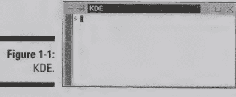

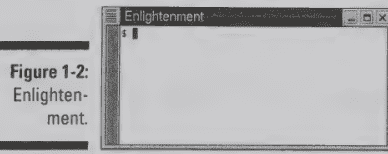

### 第 1 章：WordPerfect 基础

在整书中，我们使用 KDE 作为示例（并不是因为我们认为它比其他任何窗口管理器都要好，而是我们必须选一个，而且认为它是很不错的）。Corel Linux 自带 KDE，这是你可能可能在使用它的另一个原因。所有四种窗口管理器看起来都非常像 Windows 和 Mac，所以如果你熟悉其中任何一个系统，你会发现切换到 Linux 很容易的！如果你的 Linux 系统使用的是 KDE 以外的窗口管理器，不要担心——它们的工作方式几乎完全相同。

### 亲爱的，我把程序缩小了！

当 WordPerfect 运行时，你可以最小化（或图标化）它，这意味着它会缩小成任务栏上的一个小按钮或桌面上的一个图标。你可能想最小化一个程序，以便在你做其他事情时暂时让它让。尽管程序仍在运行并准备好处理你的工作，但它很小。最小化类似于对你的程序进行冷冻干燥：你可以加水让它复活。

如果你想最小化 WordPerfect（谁不想呢？），点击任何窗口的小型最小化按钮。然而，由于这些窗口包含了 WordPerfect 窗口，你早晚需要在在使用 WordPerfect 的过程中与你的窗口管理器进行交互。

在本章中，你将通过学习如何执行文字处理的“五大操作”来学会使用 WordPerfect：运行程序（WordPerfect）、输入文本、将文本保存到磁盘上的文件中、稍后重新打开文件以及打印文件。如果你读到本章的末尾，你将知道如何诱导 WordPerfect 执行这五项操作。在随后的章节中，我们将涉及一些改进，例如在输入文本后进行编辑，或者让它看起来更漂亮一点。然而，由于这些窗口包含了 WordPerfect 窗口，你早晚需要在在使用 WordPerfect 的过程中与你的窗口管理器进行交互。

与我们能列出的其他操作系统（如 Windows 或 Mac）不同，Linux 的窗口并没有统一的外观和感受。相反，你窗口的颜色、样式和按钮取决于恰好运行的是哪种窗口管理器。（这是否是一件好事尚待争议。）尽管有许多不同的窗口管理器在 Linux 下运行，但你可能只会遇到几种。以下是四种最常见的窗口管理器：

要区分它们的不同，请比较运行在窗口顶部的标题栏和按钮。


### 第 1 章：WordPerfect 基础

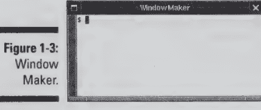

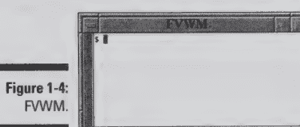

在整书中，我们使用 KDE 作为示例（并不是因为我们认为它比其他任何窗口管理器都要好，而是我们必须选一个，而且认为它是很不错的）。Corel Linux 自带 KDE，这是你可能可能在使用它的另一个原因。所有四种窗口管理器看起来都非常像 Windows 和 Mac，所以如果你熟悉其中任何一个系统，你会发现切换到 Linux 很容易的！如果你的 Linux 系统使用的是 KDE 以外的窗口管理器，不要担心——它们的工作方式几乎完全相同。

### 亲爱的，我把程序缩小了！

当 WordPerfect 运行时，你可以最小化（或图标化）它，这意味着它会缩小成任务栏上的一个小按钮或桌面上的一个图标。你可能想最小化一个程序，以便在你做其他事情时暂时让它让。尽管程序仍在运行并准备好处理你的工作，但它很小。最小化类似于对你的程序进行冷冻干燥：你可以加水让它复活。

如果你想最小化 WordPerfect（谁不想呢？），点击任何窗口的小型最小化按钮。然而，由于这些窗口包含了 WordPerfect 窗口，你早晚需要在在使用 WordPerfect 的过程中与你的窗口管理器进行交互。

### 启动 WordPerfect

你已经准备好使用最新的文字处理技术了。你拥有创建表格、图形、分栏、边框、目录、插图、侧边栏、信封、垃圾邮件的能力——任何你想到的都有！简而言之，你已经准备好投身于文字处理那辉煌、光丽的未来——除了一个极小的小问题。你可能在想，也许只是在想：该如何启动这个笨东西？还有，嗯，该如何打印东西？或者如何删除句子？或者如何保存你的工作？很好的问题，朝圣者——这些问题值得答案。请继续读下去！

- 1. 获取。

要启动 WordPerfect，遵循以下步骤：

- 2. 寻找。

- 3. 开始。

### WordPerfect 的两个窗口

当 WordPerfect 运行时，你会看到两个 WordPerfect 窗口。一个较小的窗口有 WordPerfect 的标志和一个菜单，见图 1-5。这个窗口是程序窗口。标志除了坐在那里看起来漂亮之外，什么都不做；这个窗口存在的意义在于它的菜单。一个较大的窗口是文档窗口，见图 1-6；你所有的打字工作都在那里进行。大片的白绿色区域对应于你旧式打字机上出来的白纸，并没有什么特别灵感。

# 16 第一部分：介绍 Linux 版 WordPerfect

滚动条

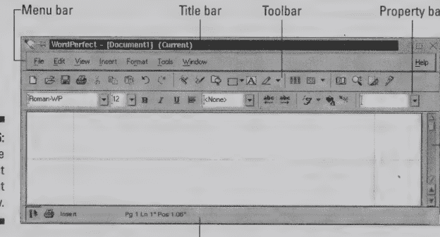

图 1-6：WordPerfect 文档窗口。

以下列表描述了边缘处许多你可能不熟悉的内容：

- **标题栏（Title bar）：** 在窗口顶部显示此行内容：WordPerfect [Document1 - 未修改] (当前)。它显示了你正在编辑的文档名称，并提醒你实际上正在运行 WordPerfect（关于文档的更多信息请参阅附）。[未修改]（unmodified）部分告诉你你还没有输入任何内容，(当前)（Current）部分意味着该窗口是你正在操作的窗口，如果你打开了多个文档，这是一个非常有用的信息。

- **菜单栏（Menu bar）：** 标题栏正下方的一行单词。每个单词都是一个你可以选择的命令。在本章的稍后部分，我们将告诉该如何使用命令关闭 WordPerfect。我们将在第 2 章中更多关于命令的内容。


进入`/path/to/xxx`目录，找到`xxx.json`。

在表达式`cvar = avar + bvar`中，加法运算符（`+`）将`avar`与`bvar`相加，得到它们的和`cvar`

在`List.of(arg0, arg1, arg2)`中，`List`接口的工厂方法`of()`接受一系列的元素，返回包含它们的只读列表。

之后我们这样调用`cmd`命令：`cmd arg0 arg1 arg2`。

```
if (condVar > someVal) {console.log("xxx")}
```

# 工具栏 Toolbar

由菜单栏下方的一排**按钮**组成。按钮上通常有小图标。在本章的稍后部分，使用这些按钮中的一些保存和打印文档。如果你在屏幕上没有看到工具栏，请使用以下强大的咒语让它出现：点击菜单栏上的`View`单词，然后在弹出的菜单中点击`Toolbar`单词。当你看到工具栏对话框时，确保屏幕上出现的`WordPerfect 8`框已选中，并点击确定。

# 第 1 章：基础知识

## 属性栏 Property Bar

包含许多让你更改文档内容外观的控件。文本具有如**粗体**或*斜体*等属性。在表格中，具有单元格是否有边框等属性。无论你在 WordPerfect 中做什么，属性栏都可以让你控制内容的特征。它非常方便。

## 应用程序栏 Application Bar

窗口的最底部一行；显示 WordPerfect 中正在发生的情况。我们将在后续章节讨论应用程序栏的控件。

## 滚动条 Scroll bars

窗口右侧帮助你移动文档的灰色条。在第 2 章中了解如何使用滚动条。如果文档太宽无法适应屏幕，WordPerfect 会在窗口底部显示滚动条。

## 鼠标指针和光标 Mouse pointer and cursor

鼠标指针通常是一个显示鼠标指向位置的小箭头。鼠标指针会根据你所的操作而改变，正如第 2 章所解释的那样。光标或插入点是一个指示你正在输入位置的闪烁垂直线。光标是 WordPerfect 的一项创新。它指示了如果你点击鼠标并开始输入时所在的位置。它是查看你在文档中移动位置的方便方法。

## 深色边缘 Dark edges

有时在文档的侧边代表你正在输入的“纸”下。WordPerfect 的人们在现实主义方面做得过头。哇！当你尝试输入时，你有许多小工具。第 19 章包含了控制 WordPerfect 窗口的提示。当 WordPerfect 忙碌时，鼠标指针会变成其他样子，这意味着“等待我完成”。稍后鼠标指针会恢复正常状态，你可以回到工作。


# 应用程序栏上有什么？

应用程序栏显示关于文档的重要信息。你可以控制 WordPerfect 显示的内容，参见第 19 章。如果你看不到应用程序栏，屏幕底部的 GNOME 任务栏可能会覆盖它。从左侧开始，这里的意思是：


- 这里是告诉你光标是否开启并让你开启或关闭。
- 当你看到工具栏对话框时，确保屏幕上出现的`WordPerfect 8`框已选中，并点击确定。
- 我们将在第 2 章中更多关于命令的内容，并在第 19 章中关于你想看到的内容。

# 输入某些内容

WordPerfect 在许多方面与打字机完全不同，但在一个方面上是相同的：要输入文本，只需开始输入即可。

如果你犯了错误或改变了主意，将光标移动到你想更改的文本；然后进行更改。你可以使用鼠标或键盘让它移动。第 2 章解释了如何移动光标。

键盘上所有的普通键——字母、数字和标点符号——在按下时都会输入字符。其余按键——功能键 `F1` 及其它的、`Enter`键、插入键、删除键以及所有带有箭头的键——不输入字符。

通常情况下，WordPerfect 处于插入模式，这意味着输入文本中的任何内容都会被插入。如果光标在两个字母之间，你输入一个新字母，新字母将插入在两个字母之间。在打字模式下，你输入的字母将替换光标右侧的内容。通过按键在插入模式和打字模式之间切换。

如果你想输入数字，可以按下 QWERTYOP 上方的数字键，或者使用数字键盘。但要注意：你也可以使用数字键盘来移动光标。参见第 2 章了解如何确定这些键的作用。

如果你想删除一个或两个字母，通常可以将光标移动到字母之后，然后按退格键 `Backspace` 进行删除。你的 Linux 系统可能被设定为退格键的工作方式与删除键 `Delete` 一样：如果是这样，将光标移动到它们前面并按删除键。参见第 5 章了解如何删除大量文本。

# 第一部分：介绍 Linux 版 WordPerfect

## 妙笔横溢

开始打字后，你就可以畅所欲言。然而，当你到达行尾时会发生什么？与打字机不同，WordPerfect 不会“叮”的一声提醒你即将超出纸张边缘。相反，WordPerfect 会执行名为“自动换行”`word wrap`的操作。它会发现你已经接近右边距，并会自动移动到下一行。

得益于自动换行的奇迹，你不需要跟踪自己在行中的位置。你只需要管写即可，知道 WordPerfect 会根据需要将你移动到下一行。

在每行的末尾不按 `Enter` 键是非常重要的。WordPerfect 假设你按下 `Enter` 意味着你到达了段落的结束，而不仅仅是段落内某行的结束。

如果你更改了页边距或使用了更大的字体，WordPerfect 甚至会移动文字，使你的段落适应新的页边距。自动换行的这种极佳副作用被称为“格式化”。

只有在你想开始新段落时才按 `Enter`；否则，让 WordPerfect 处理行尾。在每一行末尾按 `Enter` 是文字处理初学者的标志。

如果你想将一个段落分成两个，可以通过按 `Enter` 插入段落标记。将光标移动到你想开始新段落的字母之前，然后按 `Enter`。

## 名字的含义

当你在 WordPerfect 中输入文本时，你正在创建一个文档。一封信、一份备忘录、一张清单或下一部伟大的美国小说——所有这些在 WordPerfect 看来都是文档。

为了保存你的文档以便以后查看、编辑或打印，请将其保存为磁盘上的文件。每个文档对应一个文件。

# 第一章：WordPerfect 基础

如果你从一个新的空白窗口开始打字，你的散文就在一个 WordPerfect 命名为 `Document1` 的文档中。尽管文本在屏幕上，但尚未在磁盘上。屏幕上的文档是瞬时的，当你退出 WordPerfect 或注销 Linux 时它们就会消失。将文档保存到磁盘上是很重要的。

`Document1` 不是一个好的文档名称，因为它没有提供任何关于其内容的线索。你应该给文档一个更具描述性的名称，你可以在保存时完成。

## 保存文档

你可以通过至少三种方式在磁盘上保存文档并命名。按照以下步骤操作：

1. 点击工具栏上的保存 `Save` 按钮。工具栏是标题栏正下方的一排小按钮。保存按钮是一个带有微小软盘图片的按钮。这个按钮可能是从左数第三个。当鼠标指针指向工具栏上的某个按钮时，按钮名称会出现在带有按钮描述的小黄色框中。例如，当鼠标指针悬在保存按钮上时，你会看到这个有用的提示：保存当前文档 `Save current document`。

一旦你点击保存按钮，一个窗口就会出现在 WordPerfect 窗口的正上方。该窗口是一个对话框，WordPerfect 在想要询问你某些问题时会显示。这个特定的对话框标记为“另存为”`Save As`。使用它告诉 WordPerfect 将文档存储在磁盘的什么位置以及命名为什么。

2. 在标记为“文件名/当前选择”`Filename/Current Selection`的框中输入文档名称。可以为你的文档起几乎任何名字。你必须遵循一些规则，列在下一节中。如果只是一个测试文档，你可以将其命名为 `test.wpd`。

3. 按 `Enter` 或点击保存按钮。WordPerfect 将文档保存到你命名的文件中。你可以判断此操作是否成功，因为标题栏会显示如下内容：

```
WordPerfect - /home/myname/test.wpd
```

当你在文件中保存文档时，你可以选择它应该位于哪个目录。请看第 13 章了解如何告诉 WordPerfect 将其存储在何处。

早且经常保存。当你想起它时，每当你纳闷上次保存是什么时候时，一次及时的保存就能防止文档丢失。

你可以让 WordPerfect 每五分钟或你选择的间隔自动保存文档。

如果已经存在名为 `test.wpd` 的文件怎么办？WordPerfect 会提示你。弹出一个对话框，告诉你文件已存在并询问你是否真的要替换它。你有两个选择：

- 是：替换现有文件。
- 否：为你的新文件输入不同的名称。

如果你正在查看“另存为”对话框并改变保存文档的主意，按 `Escape` 或 `Esc` 键或点击取消按钮。对话框将消失。

第 13 章描述了关于文件的一切知识，包括删除、移动、复制和重命名。

## 文件名规则

当你为新的 WordPerfect 文档命名时，必须遵循文件命名规则。这些规则不是 WordPerfect 制定的，而是 Linux 或 UNIX。规则如下：

- 区分大小写。这意味着 `Piffle`、`piffle` 和 `PIFFLE` 是不同的文件名。
- 你不允许在文件名中使用任何特殊字符：`<>|:()[]*|@#`。换句话说，键盘上几乎不是字母或数字的字符。
- 你可以使用空格和连字符 `-`，尽管这不是个好主意。有些程序处理它们会出问题。


与使用空格或连字符相比，UNIX 爱好者通常使用点或下划线，因此文件名经常看起来像路径，例如 `directions.to.grandmas` 或 `chocolate_pickle_recipe`。

## 24 第一部分：介绍 Linux 版 WordPerfect

句号的一个特殊用途是作为文件名扩展名。在 Windows 计算机世界中，文件名以句号结尾，后面跟着（通常是）三个或四个字母，例如 `my_letter.wpd`。句号后的三个或四个字母组就是扩展名，通常描述了它是什么类型。（如果你真的感兴趣，请看本章稍后技术侧边栏的“Doc, html, txt 及其朋友”。）WordPerfect 文档使用扩展名 `wpd`（文字处理文档）、`frm`（邮件合并表单，见第 16 章）和 `dat`（邮件合并数据文件，同样在第 16 章）。如果你习惯了 Windows，你就见过扩展名。然而，Linux 并不使用扩展来自动将文件名与程序关联。扩展名只是为了方便你快速定位特定类型的文件，例如你所有的 WordPerfect 文档。

如果你愿意，可以省略扩展名，但你不能省略名称。

你可以使用任何喜欢的扩展名，尽管使用 WordPerfect 建议的 `wpd`、`frm` 和 `dat` 扩展名更方便。对于 WordPerfect 文档请使用 `wpd`。

例如，这三个文件名是可以的：

- `letter.wpd`
- `Chapter_1.-First_Draft.wpd`
- `SuperCalificaListExpiDocious.Documents.Are.Fun.wpd`

这些文件名是不允许的：

- `"Here's Johnny"`（带有引号和空格）
- `Letter.to\/*#!<>`（在文件名中你可以使用更多标点符号）

请选择仅包含字母、数字、句号和下划线并以 `.wpd` 结尾的文件名。大小写敏感的：简化你的生活，只使用小写字母。

### 再次保存，Sam

在你保存文档并命名后，你不需要再次告诉 WordPerfect 名字。如果你输入了更多文本并想保存，只需再次点击 `Save`（保存）按钮。WordPerfect 会用你文档的新版本更新磁盘上的文件，替换旧文件。

### 获取帮助

显然，关于 WordPerfect 的基础知识你需要记住很多内容。而且，你可能有比记忆这些琐事更重要的事情要做。幸运的是，WordPerfect 可以在你需要时提供帮助——至少它能提供用计算机术语写的描述，尽管帮助可能有限。

大多数程序都有帮助键，WordPerfect 也是如此：即 `F1` 功能键。按下 `F1` 运行 WordPerfect 帮助系统，该系统包含了 WordPerfect 参考手册中的大部分文本。在在线帮助系统中查找信息通常比翻阅打印出来的页面要容易得多。第 2 章对其进行了更详细的描述。

### 编辑另一个文件

如果你遵循了本章的内容，你已经从零开始创建了一个文档。但是，通常你可能想编辑已经存储在磁盘上的文档。它可能是你之前创建并保存的文档，也可能是秘密恋慕留在你磁盘上的一封情信（如今的秘密恋慕正变得越来越高科技了）。无论文档是什么内容，你都可以在 WordPerfect 中查看它。这个过程被称为“加载”（或“打开”）文档。

以下步骤展示了打开存储在磁盘上文档的最简单方法：

1. 点击工具栏上的 `Open`（打开）按钮。
它是那个带有一个小黄色文件夹的按钮——通常是左侧第二个按钮。
Perfect 会显示 `Open` 对话框，如图 1-8 所示。显示此对话框是程序的一种微妙方式，表示它想知道你想打开哪个文件。

2. 从显示的列表中选择一个文件。
要选择其中一个，点击显示列表上的一个名称。WordPerfect 会通过以另一种颜色显示该名称，以表明它知道你想要哪一个。

3. 点击 `Open`（打开）按钮（或双击文件名）。
WordPerfect 打开文件，读取文档并将其显示在屏幕上。

## 26 第一部分：介绍 Linux 版 WordPerfect

图 1-8：打开你之前创建的文件。

现在你可以对文档进行更改、再次保存、打印，或者进行任何其他操作！

如果文档很长，屏幕上无法完全显示。不要恐慌——它还在那里。关于如何在文档中移动位置的信息（包括不可见部分），请参阅第 3 章。

你可能想打开与 `Open` 对话框中显示的不同的目录下的文件。请查看第 13 章了解如何使用文件夹。

如果文档是由 WordPerfect 外的文字处理器创建的，请查看第 12 章了解如何打开它。

在 WordPerfect 中打开文档后，你可以在屏幕上看到它，对其进行更改，保存新版本并打印。我们稍后会讨论如何打印文档。

### 转换的短暂插曲

当你打开文档时，可能会看到一个小框，显示“正在进行转换”的消息。此消息通常意味着你打开的文档是在不同版本的 WordPerfect 中创建的，例如 Windows 版 WordPerfect。每个版本的 WordPerfect 以自己的方式存储文档。

### Doc, html, txt 及其朋友

当你打开文档时，你可能会看到一个显示“正在进行转换”的小框。此消息通常意味着你打开的文档是在不同版本的 WordPerfect 中创建的，例如 Windows 版 WordPerfect。每个版本的 WordPerfect 以自己的方式存储文档。

句号后的后缀通常指示文件包含什么类型。如果文件包含图片，其扩展名可能是 `gif` 或 `jpg`。在 WordPerfect 中格式化文件中，大多数人们使用 `wpd` 扩展名：

- `doc`：Word 文档（除非你在其他文本编辑器中运行的程序）
- `txt`：无格式的文本（除非你在其他文本编辑器中运行的程序）
- `html`：HTML 文档（除非你在其他文本编辑器中运行的程序）
- `htm`：HTML 文档（除非你在其他文本编辑器中运行的程序）

### 创建新文件

如果你想创建一个新文件怎么办？按下快捷键 `Ctrl+N`，或者点击工具栏上的 `New`（新建）图标（位于 WordPerfect 窗口的左侧）。如果你在 WordPerfect 窗口（显示 WordPerfect Logo 的那个窗口）中，点击菜单上的 `Program New`。无论何种方式，WordPerfect 都会打开一个新的空白窗口。关于文档和窗口的更多信息，请参阅第 12 章。

### 打印你的文档

如果你输入了文档并编辑它直到满意，你可能想打印它。毕竟大多数文字处理的目标归结底是在纸张上产生内容。如果你在无纸办公室（就在走廊那头），你可能可以以电子方式发送你的备录或信件。对于我们其他人来说，纸张仍然有效。

以下步骤展示了打印文档的快速方法：

1. 先保存文档，以防在你尝试打印时发生故障。（如果你不知道我们在说什么，请参阅本章稍前的“保存你的文档”部分。）

2. 开启打印机。
祝你好运找到开关！

3. 确保打印机里有纸。

4. 点击工具栏上的 `Print`（打印）按钮。
打印是带有一个小打印机吐出一张纸的按钮——通常是左侧第四个按钮。

5. 点击打印框中的 `OK`（确定）按钮。
WordPerfect 然后将文档打印出来，尽显光彩。非常简单吧？

第 11 章包含了大量更多关于打印的信息，包括打印机的维护。

### 退出 WordPerfect

无论你玩得多么开心，迟早你都需要停止运行 WordPerfect。因为你使用 Linux，你可以在运行 WordPerfect 的同时运行其他程序。你不需要每次检查电子邮件、浏览网页或玩纸接龙都要离开 WordPerfect。虽然你可能想让 WordPerfect 一直运行以便快速切换，但在关闭计算机之前，你必须退出 WordPerfect（以及 Linux）。

要退出 WordPerfect，你需要在程序窗口中选择 `Program`（退出）命令。（记得程序窗口吗？这是你实际使用它的地方之一。）或者点击程序窗口右上角的 `Close (X)` 按钮。

## 第一章：WordPerfect 基础

### 2. 选择“文件”菜单底部的“退出”。

如果你创建或更改了文档，但尚未将其保存到文件中，WordPerfect 会询问你现在是否要保存。点击“是”（`Yes`）保存文档，点击“否”（`No`）跳过保存，或点击“取消”（`Cancel`）返回 WordPerfect。只有当你确定文档中没有任何你以后想再次看到的内容时，才选择“否”。

WordPerfect 结束工作准备回家了，而你可能也在想着这样做。

在退出 WordPerfect 和 Linux 之前，千万不要关闭电脑。否则，可能会让这些程序措手不及（可以说让它们处于“没穿裤”的状态），它们可能没有将所有内容保存到磁盘上。当你重新启动电脑时，可能会遇到报错。如果 Linux 抱怨你的硬盘在关机前没有被正确“卸载”，请咨询你当地的 Linux 专家。

## 第二章

## 使用鼠标和键盘

### 本章内容

- 了解何时该使用鼠标以及何时不该使用
- 从菜单中选择命令
- 处理对话框
- 使用快速菜单（`QuickMenus`）提供更多选择命令的方法
- 摆弄工具栏、属性栏和标尺
- 使用键盘
- 了解何时按下回车键（`Enter`）
- 使用 `Tab` 键和空格键
- 使用撤销按钮
- 获取帮助
- 让 `PerfectExpert` 提供帮助

在 Linux 上使用 WordPerfect 就像在另一个国家的高级餐厅用餐，或者可能是在另一个星球上。正如任何曾在在外国餐厅点过菜的人所知，你有三种方式告诉服务员你想要什么：

- 困难且老式（但极令人印象深刻）的方式：说那种语言。
- 按号点菜（主要适用于中餐馆）。
- 指着菜单并发出咕声。

最初，告诉电脑你想要什么也是一个语言问题：输入命令或通过按下特殊键（如 `F3`）来“按号点菜”。然而，随着图形化窗口界面的出现，软件已经足够智能，你只需要指点发发咕声就行了。

这种进步来得恰好，因为当今软件能提供的菜单是如此巨大——巨大到至于如果你要使用老式的键盘法，你必须同时按住多三个键，并练出一套足以让帕德列夫斯基（`Paderewski`）都下跪的键盘法。

## 第一部分：介绍 Linux 版 WordPerfect

这就是为什么你的键盘旁边会有一个鼠标、触控板或其他指向设备的原因。为了不让那些已经投入大量精力完善自己键盘技巧的人（例如老 UNIX 用户）感到不悦，Linux 版 WordPerfect 也允许你用老式的方法命令它：即使用键盘。

这种极具义务性、近乎谄媚的用户友好性带来的结果是，你现在有了三种或多不同的替代方式来命令 Linux 版 WordPerfect：

- 普通键盘，带有字母、数字等键。
- 标记为 `F1` 到 `F12` 的功能键。
- 鼠标，你可以独立使用它的大约三种方式来命令 WordPerfect。（现在先不要考虑这个。）

所有这一切的另一个结果是，键盘和屏幕开始看起来像战斗机的驾驶舱。当你面对战斗机时，重要的是不要让它吓倒你。它是一架友好的战斗机（从矛盾修辞上说），你不会导致坠毁起火。你不会损坏电脑上的任何硬件，除非你愿意对许多令人生畏的问题回答“是”，否则只会损坏软件或数据。你可能做的最坏的事情就是丢失自上次使用 WordPerfect 以来所完成任何工作，即使这也很难。

如果你已经熟悉窗口操作并且熟练使用键盘，可以快速浏览本章的后两个部分，以了解 WordPerfect 的特殊之处。如果你是从 Windows 或 Mac 切换到 Linux，请跟着读下去——你会发现一切都很熟悉。

### 使用鼠标还是不使用鼠标

由于“指点发咕声”法（为了礼貌起见，以下简称为“点按法”）的流行，鼠标正在接管世界。接受这个事实，并学会爱你的鼠标。Linux 版 WordPerfect 是为鼠标设计的，尽管你也可以通过键盘完成几乎所有工作。

大多数人最终会找到一种适合自己的鼠标与键盘结合的方式。由于鼠标是极佳的事物（the cat's pajamas），本书通常强调鼠标操作法，并列出替代方案。

在大多数 PC 上，鼠标通常有两个按钮；UNIX 系统一直使用三个按钮的鼠标。如果你的 Linux 系统从一开始就被设置得完全像一台正的 UNIX 计算机，它可能有一个三键鼠标。如果像大多数 Linux 计算机一样，它最初是运行 Windows 的 PC 出身，那么它可能有一个双键鼠标。在这种情况下，你可以同时按下两个按钮来模拟中键的操作。

以下是三个鼠标按钮的作用对比：

- **左键**：用于从菜单中选择命令，以及点击工具栏和属性栏上的图标。你的大部分鼠标点击操作都使用这个按钮。当我们要求你点击某处时，我们的意思是使用左键。
- **右键**：显示*快速菜单*（`QuickMenu`），其内容取决于鼠标指针指向的位置。当我们要求你点击某处时，这个快捷方式的意思是使用右键。
- **中键**：在 WordPerfect 中不怎么使用。（见下）

### 从菜单中选择命令

由于“指点发咕声”法（为了礼貌起见，以下简称为“点按法”）的流行，鼠标正在接管世界。接受这个事实，并学会爱你的鼠标。Linux 版 WordPerfect 是为鼠标设计的，尽管你也可以通过键盘完成几乎所有工作。

大多数人最终会找到一种适合自己的鼠标与键盘结合的方式。由于鼠标是极佳的事物，本书通常强调鼠标操作法，并列出替代方案。

在大多数 PC 上，鼠标通常有两个按钮；UNIX 系统一直使用三个按钮的鼠标。如果你的 Linux 系统从一开始就被设置得完全像一台正的 UNIX 计算机，它可能有一个三键鼠标。如果像大多数 Linux 计算机一样，它最初是运行 Windows 的 PC 出身，那么它可能有一个双键鼠标。在这种情况下，你可以同时按下两个按钮来模拟中键的操作。

#### 点击菜单栏

要查看菜单上的内容，点击菜单栏上的一个单词（如果你在想的话，是使用左鼠标键）。该单词随后会被高亮，一个菜单会从它下拉。非常不合理地（因为你并没有拉任何东西），这被称为下拉菜单。

要尝试这个理论，请启动 WordPerfect（参见第一章），确保你正在文档窗口（即显示空白文档的窗口）中操作，然后点击“文件”（`File`）一词。“新建”（`New`）一词（它被一个框围着）正如 WordPerfect 服务员推荐的令人垂涎欲滴的美味命令一样。欣赏这个屏幕，保持原样，继续阅读。

如果你没有找到任何喜欢的内容，点击 WordPerfect 窗口内的任何地方来关闭菜单。然而，如果你点击了另一个按钮或菜单选项，就会得到你点击的内容。

### 在本书中我们如何描述菜单和命令

因为 WordPerfect 中的几乎每一条命令都出现在菜单、子菜单或子子菜单中，如果说“点击菜单栏上的编辑，然后点击菜单中的选择，然后点击下一个菜单中的页面”，这种说法会变得非常冗长。我们在书的早期章节中这样表述是为了让你习惯这种处理方式。但之后，我们只需要说“选择 `编辑>选择>页面`”。这种表达有点简练，但如果我们不这样做，你读到段落结束时可能已经无聊得要昏迷了。此外，想想我们为了缩短这本书的长度节省了多少树木。

### 选择命令

要从菜单中选择命令，只需点击该命令即可。相关的命令聚集在一起，并用线条与其他命令组隔开。

你可能会发现，除了命令之外，还有其他暗示性符号——类似于中餐菜单上热门菜旁边的小红点。此列表显示了这些符号的含义：

- `+` 命令后有一个向右的小的小三角形：如果你点击其中一个命令，你将看到一个子菜单（这个过程类似于选择鸡肉，然后被询问你是想要炸的、烤的还是川菜口味的）。
- `+` 命令旁边有一个方框或菱形：方框表示它已开启。在 Windows 中，这些方框包含 X 或复选标记；在 Linux 中，方框通常包含点或正方形。
- `+` 命令右侧的按键组合：你可以通过按下键或组合键来执行某些命令。如果你这样做，WordPerfect 会在菜单的命令右侧显示按键组合，以此提示你将使用哪些按键。例如，在“文件”菜单上，“另存为”命令右侧有 `F3` 标记，这意味着你可以按 `F3` 执行命令，从而避免使用菜单栏！这些按键组合继承自 Windows 版本的 WordPerfect，且并非所有的组合都有效。
- `+` 命令后有一个省略号 (`...`)：省略号告诉你，如果你提问，该命令还有更多内容。如果你点击它，该命令会将它的想法包装在精美的小对话框中，这些对话框将在后续章节中进行讨论。

## 第一部分：介绍 Linux 版 WordPerfect

### 使用对话框

如果你点击一个带有省略号 (`...`) 的菜单命令，将显示另一个菜单或一个对话框。图 2-2 所示的对话框看起来像是税表和录像机遥控器的交叉体，尽管它们用起来比其中任何一个都要少痛苦得多。

选项列表（你只会看到一个选项）

- 菜单栏
- 选项列表
- 需要勾选的内容

图 2-2：与对话框共舞。输入命令的框、命令按钮框、可以更改数字的框。

如果你想跟随我们对图 2-2 所示对话框中内容的描述，可以通过从菜单栏选择“文件>打开”来显示左侧的对话框，可以通过选择“格式>字体”来显示右侧的对话框。

# 第 2 章：使用鼠标和键盘

## 菜单上所有这些下划线字符是怎么回事？

如果你已经习惯了电脑键盘，那么下划线字符就表示选择命令的 `Alt+` 键组合。要保存文件，你可以按 `Alt+F` 然后再按 `S`。如果前面的信息对你来说是胡言乱语，请阅读本章稍稍后的“使用按键选择命令”部分。警告：取决于你的 X Windows 系统如何配置，你的 `Alt` 键可能无法发送 WordPerfect 命令。

## 那些奇怪的对话框小东西

本节展示了你可能在对话框中发现的一些东西（在此称为“对话框小东西”）：

- - 需要勾选的内容：这些项目左侧有一个小方框或菱形。虽然这些方框和菱形没有实际的勾选标记，但在典型的软件逻辑显示中，它们统被称为复选框。任何类型的项目都可以开启（选中）或关闭（未选中）。点击小方框或菱形可以选择或取消选择该项目。例如，“字体”对话框中有一组复选框，告诉 WordPerfect 为你的字体进行装饰。
- - 选项列表：你可以看出哪个项目被选中了，因为它周围有一个小框，或者它以你想要的不同颜色显示。在“字体”对话框中，“字体”和“字体样式”就是这类列表的示例。
- - 选项列表（尽管你只看到一个选项）：在选项列表中，WordPerfect 只显示被选中的选项。选项通常在右侧附近有一个类似矩形按钮的小东西。要查看所有选项，点击包含文本的框。例如在在字体”对话框中，“位置”和“相对大小”就是这种列表的示例。
- - 输入框：点击这些框（文本框）之一可以高亮显示并输入内容。例如，你可以输入文件名或新的字体大小。


在文本框中输入完成后不要按回车键。如果你按了，对话框会关闭，WordPerfect 会立即开始执行命令，即使你还没有完成。完成输入后，按 `Tab` 键或点击另一个选项。

- 可以更改数字的框：某些对话框包含数字设置，例如页边距宽度。要输入数字，点击现有的数字使其高亮显示，然后输入新数字。点击框旁边的向上或向下箭头可以逐次增加或减少数字。看一眼对话框中的“阴影”框。

- 可以通过点击来“按下”的按钮：这些按钮被称为命令按钮，因为当你用鼠标左键点击它们时，你可以命令 WordPerfect 执行操作。如果你看到一个带有省略号的按钮，猜怎么着？当你点击它时，你会看到另一个对话框。如果按钮上有一个小三角形，点击它会显示一个菜单。图 2-2 所示的两个框底部都有命令按钮，WordPerfect 中的大多数对话框也是如此。

- 菜单栏：是的，有时对话框会有自己的菜单栏，你可以使用从任何窗口顶部菜单栏选择命令的相同技术来从中选择命令。

不要尝试记住所有这些东西。我们在后续过程中会详细介绍各种对话框小东西，但如果你遇到你不熟悉的项，可以参考这个列表。

## 我们最喜欢的按钮

对话框中两个常见且重要的按钮是 `OK` 和 `取消`。点击 `OK` 意味着“执行”，点击 `取消` 意味着“忘掉”。这适用于大多数对话框，但有时还有其他按钮。

- `应用`：此按钮应用你所做的更改，但保持对话框开启。这对于想在关闭框之前查看更改的效果非常有用。

- `帮助`：此按钮打开你正在使用的对话框的帮助文件。

- `默认`：此按钮将对话框中的设置重置为原始值。

- `OK`：此按钮保存更改并关闭对话框。

- `关闭`：此按钮关闭对话框且不保存任何更改。

我们在后续过程中会详细介绍各种对话框小东西，但如果你遇到你不熟悉的项，可以参考这个列表。

# 第一部分：介绍 Linux 版 WordPerfect

## 40 第一部分：介绍 Linux 版 WordPerfect

在本书的后部分（第 19 章），我们将再次介绍 WordPerfect，那时你可能已经阅读了更多内容，并且对于摆弄屏幕显示内容及其工作原理的想法变得更加从容。

每个快速菜单（`QuickMenu`）都包含与你所指向的内容（在此例中为“应用程序栏”）有关的命令。这一个特定的快速菜单包含“隐藏应用程序栏”命令。

要从快速菜单中选择命令（以“隐藏应用程序栏”为例），你（像往常一样）有多种方法可供：

- 用鼠标指针指向该命令，然后点击它（点击鼠标左键或右键均可）。
- 按命令中带有下划线的字母（在此例中为 `H`）。

无论采用哪种方式，WordPerfect 都会立即行动并执行命令。在这种情况下，应用程序栏就像生日派对上的 M&Ms 巧克力一样消失了。（顺便说，如果想找回命令，可以选择“视图>工具栏”命令，并确保“应用程序栏”字样旁边的小框处于选中状态或包含一个黑点。）

## 玩弄工具栏

作为作家，传统上习惯了各种栏（bars），Linux 版 WordPerfect 中的工具栏数量甚至让我们也大为观界。我们将讨论这两个文字处理“饮水点”中的：工具栏和属性栏（`Property Bar`）。在现实生活中（即餐厅），你可以把去这些“吧”视为一种无需领班即可获得快速服务的方式。

工具栏是菜单栏下方的一行带有图标的按钮，如图 2-3 所示。工具栏是让像 WordPerfect 这样的图形化程序看起来印象深刻的酷炫道具——就像视频录像机或 CD 播放器的遥控器一样。然而，与遥控器不同，一旦你熟悉它，工具栏既有用又简单。

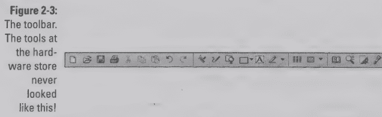

### 磨利你的工具

工具栏的酷之处在于：你可以告诉 WordPerfect 你想在栏上显示哪些按钮。你甚至可以创建自己的按钮。然后，你可以为你处理的不同类型的文档创建不同的按钮组——也许一组按钮用于写备忘录，另一组则用于写报告。

幸运的是，我们现在还不教你如何操作所有这些。不过，我们想提醒你，以防别人在你的电脑上设置了特殊的工具栏，导致在你使用不同文档时，你工具栏上的按钮会发生神秘变化。如果你觉得这个功能听起来像我们认为的那样酷，请查看第 19 章了解详情。

关于工具栏的第一要点是，它并不总是显示。（如果你不是在疯狂寻找带有图标的矩形按钮，那么这个知识应该让你感到宽慰。）第二个要点是，工具栏不等同于属性栏，属性栏拥有更多难以捉摸的按钮。如果你不确定自己在屏幕上看的是哪一个栏，请查看第 1 章中的图 1-6。

如果你没有看到工具栏，可以通过打开“菜单”视图并点击“工具栏”来显示该框。确保“WordPerfect 8 工具栏”旁边的框被选中，然后点击“确定”。请注意，你工具栏上的按钮可能和我们屏幕上的不一样。如果是这样，设置你软件的人决定更改按钮。如果他费了那么大精力，可能有充分的，你应该要求他解释一下他的意图。

工具栏按钮是完成日常事务的快捷方式——那些通过菜单完成需要更长时间的事情。要使用工具栏，请点击鼠标左键。有些按钮是自显其义且简单的，例如“打印”。如果你想打印文档，只需点击“打印”按钮。再次感谢“冗余部门”（再次强调），你也可以通过选择 Ellie 的[快捷键]或按 `F5` 来打印。某些按钮（如“文本框”）的功能要稍微复杂一些。如果你想对某个按钮有更多解释，只需将指针悬停在上面（不要点击）。一只小鸟——哪里，我们的意思是某只小鸟会提供一条关于工具栏的单行说明，并列出相应的键盘快捷键（如果有的话）。

如果你决定不喜欢工具栏上那些可爱的小图片，请打开“菜单”视图，点击“工具栏”，并取消勾选“WordPerfect 8 工具栏”复选框。

在本书中，我们会告诉你工具栏上的哪个按钮何时有用。例如，在第 1 章中，我们使用工具栏按钮一键点击即可打开、保存和打印文档。

## 在属性栏与所有者共进午餐

如今，一切都变成了私有财产。这包括你电脑屏幕上的东西；甚至你的文字现在也有所有了。属性栏是你作为这些文字的所有者，通过你的文字进行观察的。用通俗的话说，如果某些文本是**粗体**的，例如，我们可能会它是粗的。这太简单了。相反，编写文字处理程序的电脑极客们会说该文本被分配了“加粗”属性。而且（你猜对了），属性栏就是你发现文本被分配了哪些属性的地方。

如果属性栏已显示，且你正在查看文档中刚刚输入的普通文本，属性栏看起来就像图 2-4 所示。

图 2-4：属性栏上的专用按钮。

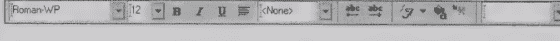

与工具栏不同，属性栏拥有更多难以捉摸的按钮。如果你不确定自己在屏幕上看的是哪个栏，打开“视图”菜单，点击“工具栏”，并确保“属性栏”框被选中。然后点击“确定”。

就像工具栏一样，属性栏是一种完成那些通过菜单需要更长时间完成的快捷方式。要使用工具栏，请点击鼠标左键。有些按钮是自显其义且简单的，例如“打印”。如果你想打印文档，只需点击“打印”按钮。再次感谢“冗余部门”（再次强调），你也可以通过选择 Ellie's 或按 `F5` 来打印。某些按钮（如“文本框”）的功能要稍微复杂一些。如果你想对某个按钮有更多解释，只需将指针悬停在上面（不要点击）。一只小鸟——哪里，我们的意思是某只小鸟会提供一条关于工具栏的单行说明，并列出相应的键盘快捷键（如果有）。

如果你决定不喜欢工具栏上那些可爱的小图片，请打开“菜单”视图，点击“工具栏”，并取消勾选“WordPerfect 8 工具栏”复选框。

在本书中，我们会告诉你工具栏上的哪个按钮何时有用。例如，在第 1 章中，我们使用工具栏按钮一键点击即可打开、保存和打印文档。

## 使用尺子

现在，你处于熟悉的领域了。每个人都知道尺子是什么吗？嗯，可能吧。

## 44 第一部分：Linux 版 WordPerfect 简介

已经设置。这些设置不是你的错：它们是默认制表，你可以更改它们。你可以添加制表、删除制表或移动制表位置。

我们将在第 7 章中非常详尽地讨论这些内容，尽管快速概览如下：

- 要移动制表或段落页边距，你可以*拖动*它。指向它；按下鼠标键并按住。然后移动鼠标。当选定项目在你想要的位置时，松开鼠标。
- 要更改你正在输入的制表类型，在想要更改的制表上*右键点击*。（记得我们说过，这些右键操作非常用用。）WordPerfect 会显示一个制表类型菜单。从菜单中选择你需要的制表。


在标尺上设置制表位或缩进之前，请确保闪烁的光标（闪烁的竖线，而不是鼠标指针）位于正确的段落中。

## 使用键盘

有了所有这些栏、窗口和按钮，键盘开始显得相当老旧且过时。尽管如此，它仍然比用鼠标打字好得多。对于我们这些不因为某些软件工程师设计了鼠标供我们就不愿改变习惯的人来说，键盘仍然提供了一种向 WordPerfect 输入命令的快速方法。

### Shift、Ctrl 和 Alt

`Shift` 键——`Shift`、`Ctrl` 和 `Alt` 只有与其他键配合才有效。如果你使用它们的方式与你喜爱的 Periwinkle-Marmosetwriter 打字机上的 `Shift` 键完全一致，那就一切正常，如这些步骤所示：

1. *首先*按下 `Shift` 键（根据指示按下 `Shift`、`Alt` 或 `Ctrl`），并*按住*它。不要用力按死——只需按下。
2. 按下另一个键（例如 `F7`）。
3. 松开两个键。

如果你的手指配合得不好，请最后松开 `Shift` 键。

这类按键组合写为例如 `Shift+F7`，或者 `Ctrl+F7` 或 `Alt+F7`。

# 第 2 章：使用鼠标和键盘

有时，你必须按下多个 `Shift` 键。虽然这条指令写为 `Ctrl-Shift-F3`，但它完全可能写为 `Shift+Ctrl-F3`，因为你按下 `Shift` 键的顺序并不重要。只需在按下最后一个键之前将它们都按住，然后一次性松开。（如果你勇敢并尝试了那样，屏幕上可能会出现各种情况。不要恐慌。再次按下 `Ctrl-Shift+F3` 即可。）

取决于你的 Linux 和 X Window 安装情况，WordPerfect 可能无法识别到 `Ctrl` 和 `Alt` 键。如果 `Ctrl` 和 `Alt` 组合对你无效，请联系你的 Linux 专家或改用菜单。

## 知道何时按下 Enter 键

这一节的标题可能应该是“知道何时不要按下 Enter 键”。在 WordPerfect 和任何其他文字处理器中，你不需要在每行的末尾按 `Enter` 键；你是在每个*段落*的末尾按 `Enter`。不遵守这一规则会导致不断的困惑和痛苦，并让你在观察你工作的人眼中看起来像个新手。


不要担心行尾。WordPerfect 会自动处理大多数行，而且通常比你做得好得多（右对齐、两端对齐——无论你需要）。你*唯一*在行尾按下 Enter 的时候是你正在输入列表，且列表在填满之前必须结束。

因为按下 Enter 键标记了一个段落的结束，WordPerfect 会插入一个小小的段落符号，如下：¶。问题是，这个符号是不可见的。要让它可见，打开 `View` 菜单并点击“显示 ¶”`Show ¶`。我们强烈推荐这种技术；它让你对文档的状况有一个良好的了解，并提醒你在你不该按 Enter 键时不要按。你应该只在段落末尾看到这些小小的 ¶。

无论 ¶ 符号是否可见，它都在那里。如果你删除它——就像你可以删除任何普通的可见字符一样——该段落就会与下面的段落合并。这是选择 `查看>显示 ¶` 的另一个另一个好理由。要让这些符号再次不可见，再次选择 `查看>显示 ¶`。

## Tab 键和空格键的故事

这个故事听起来像是一个关于 Tab——摇摆的 Astro Kitty 的有趣故事。遗憾的是，虽然这个故事是关于空间的，但它不是关于黑洞和水池的——它是关于空白。

## 第一部分：Linux 版 WordPerfect 简介

就像在每行末尾按下 Enter 键一样，另一种让自己陷入无尽痛苦的方法是过度使用 Tab 键和空格键来让文本达到你的要求。通常你有更好的方法来实现，就像你以前在那台 Stromkowski-Danglowicz 驱动的打字机上做的那样，那是你怀念已的日子。

Tab 键和空格键插入空白字符。就像键盘里的蟑螂一样（在佛罗里达州），尽管你可能看不见，这些字符就在那里。某个 WordPerfect 命令等同于打开灯来看这些小虫子。它与显示隐藏段落标记的命令相同：选择 `查看>显示 ¶` `View>Show ¶`。


在标尺上设置制表位或缩进之前，请确保闪烁的光标（闪烁的竖线，而不是鼠标指针）位于正确的段落中。

### 48 第一部分：介绍 Linux 版 WordPerfect

WordPerfect 也有一个“重做”`Redo`按钮（以及对应的“编辑-重做”命令）。此按钮会撤销你最后执行的“撤销”操作。（困惑吗？我们也是！）重做是工具栏上顺时针 U 形转弯按钮。

### 帮助，帮助之帮助，以及更多帮助

在 Linux 版 WordPerfect 等程序中寻求帮助，有点就像在阿诺德·施瓦辛格-莱奥纳·赫尔姆斯斯救生员培训学校寻求帮助：准备好被大量信息所淹没。你得到的不仅仅是信息——而是一套完整的、肌肉发达的信息检索与管理系统，旨在满足你的协助需求（并在你的枕头旁留下一颗薄荷）。

我们甚至不尝试解释这支救生员梦幻之队能做什么；我们只是为你提供使用“帮助”的最简单方法。我们建议你在“帮助”中尽情所欲地尝试所有花哨的功能。你不会弄坏任何东西，而且可能会学到很多。

### 帮助

最简单的部分是调用帮助：点击菜单栏最右侧的“帮助”`Help`。此时，你之所以在 WordPerfect 中寻求帮助时不是真的在溺水是一件好事，因为现在必须精确决定你打算如何寻求帮助。当你选择“帮助”时，你会看到一个带有三个选项的帮助菜单：目录`Contents`、查找帮助`Search for Help on`和专家`Expert`。下面是三个你可能没那么常用的选项：宏`Macros`、在线帮助`Online Help`和关于 Corel WordPerfect`About Corel WordPerfect`。此列表描述了所有帮助按钮的功能：

- `目录`：在 Corel 帮助窗口中查看目录页。帮助窗口中的页面工作方式就像网页一样。你可以点击其中一个绿色超链接来查看特定主题的帮助信息。
- `查找帮助`：WordPerfect 帮助会打开帮助窗口和一个独立的搜索窗口，后者会显示按字母顺序排列的所有主题列表。当你输入感兴趣的主题的前几个字母时，WordPerfect 会显示以你输入的内容为开头的索引条目。
- `专家`：此工具可以帮助你编写文档。阅读以下章节以帮助你判断此功能有多用。
- `宏`：宏是将一组按键组合成微型程序的方法。虽然宏对于复杂的、重复的任务很有帮助，但讨论它们超出了本本书的范围。点击此菜单项可以学习你一直想知道关于宏的一切以及更多。

### 第2 章：使用鼠标和键盘

- `在线帮助`：此选项显示一个子菜单，其中包括 WP 在线手册和三个实用的网站。如果你选择 WP 在线手册，WordPerfect 将运行 Acrobat Reader 程序显示 WordPerfect 手册，这是你购买盒装版 Linux 版 Core WordPerfect 时获得的打印版手册的屏幕版本。子菜单上的其他选项将在 Web 浏览器窗口（通常是 Netscape Navigator）中打开基于网络的帮助文档。如果你没有运行 Netscape Navigator，选择此选项将帮助你启动它。
- `关于 Corel WordPerfect`：此选项会打开一个关于你版本的 WordPerfect 的晦涩细节窗口，尽管它并没有什么功能做得很好。（为什么它在帮助菜单里？因为这是传统！）

无论你选择哪种帮助方法，你都会得到一个充满信息的窗口。通常，几区域文本会被绿色高亮；这些区域中的每一个都是一个主题。这些高亮短语是超链接，就像万维网上的一样；当你点击其中一个时，就会获得该主题的信息。如果你迷失在这个迷宫般的帮助大厅中并想找回去，请寻找帮助窗口顶部的“返回”`Back`按钮并点击它。

要让帮助窗口消失，最简单的方法是点击窗口的关闭按钮（通常是右上角的 X 按钮）。

### 询问完美专家 Ask PerfectExpert

每个办公室通常都有一个专家级用户——根据我们的经验，是一个真正聪明的行政助理、技术写作部门的人员，或者是一个时间太多、没事可做的人。如果你的办公室没有这些人，那些体贴的 WordPerfect 同士们在 WordPerfect 程序中也包含了一个这样的人，并称之为 PerfectExpert（完美专家）。

你可以让 PerfectExpert 坐在你身边帮助你完成工作。想象一下——阿诺德和莱奥纳就在你身边。怎么做呢？选择“帮助>完美专家”。召唤 PerfectExpert 到你身边会在屏幕上添加一个新组件。你也可以通过点击工具栏一直最右端的那个小按钮来召唤 PerfectExpert。（是的，我们也费了劲才弄明白那个，但那是灵感之光。）如果你的 WordPerfect 窗口不够宽，PerfectExpert 按钮可能就在窗口边缘之外。

如图 2-6 所示，PerfectExpert 包含一组与写作项目步骤对应的按钮——至少是 Core 认为应该那样的；你的英语老师可能不同意！点击描述你想要操作的按钮，WordPerfect 会帮助你完成。

## 第一部分：介绍 Linux 版 WordPerfect

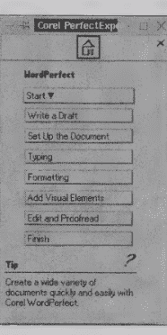

图 2-6：在你身边的完美专家。

PerfectExpert 是一个很酷的想法。尽管当你疑惑下一步该干什么时，它会提供建议供你参考，但它仍然不会为你撰写文档。

### 上文相关帮助

如果你希望“帮助”功能将主题列表筛选与你当前正在执行的操作相关的内容，可以通过按下 `F1` 获取上下文相关帮助。当鼠标指向你可以输入的地方时，你可能会看到一个蓝条。如果你没看到鼠标，只需移动一下鼠标让它出现。

## 第3 章：浏览文档

### 本章内容

- 使用鼠标
- 使用键盘
- 其他方法

### 两种方式

你可以通过两种通用方式移动光标：

- 使用鼠标指向你想去的地方。
- 使用键盘上的按键按你指示的方向移动。

### 第 3 章：浏览文档

### 影子揭示了一切！

当你将鼠标指针移动到文档的空白区域时，一个蓝色符号（影子光标）可能会出现在与鼠标指针同一行。如果出现了影子光标，它会告诉你如果你在当前鼠标所在的位置点击，光标将移动到何处。影子光标的具体外观还会告诉你你输入的文本类型将如何进行格式化。（如果 Word 程序未配置显示它，则影子光标可能不会出现）。

影子光标看起来像一条垂直线和一个指向右侧箭头。这个符号告诉你，与大多数文字处理器不同，WordPerfect 乐意让你点击空白区域，如果你确实这样做，WordPerfect 会顺从地插入一个制表符或类似的字符，使光标出现在你点击的位置。如果鼠标指针出现在行正中央，会显示一条带有两个箭头的垂直线，表示 WordPerfect 将你在此处输入的文本居中。太棒了！

例如，如果你将鼠标指针移动到距离左边距约一英寸的空白区域，

### 移动到文档的远端

如果你看不到想要编辑的文本，不要惊慌。它仍然在那里——只是掉出了屏幕边缘。WordPerfect 显示你的文档就像是写在一个长卷轴上一样。（想象一下中世纪的僧侣或埃及书记员。）文档的开头和结尾部分被卷了起来，只有中间部分可见的。如果你想查看文本的不同部分，WordPerfect 会为你展开卷轴并将其显示在屏幕上。

你可能注意到 WordPerfect 窗口右侧有一条垂直的灰色条。图 3-1 显示了这个滚动条（我们在第 1 章中提到过）。你使用它来告诉 WordPerfect 滚动和展开包含你文档的这个比喻卷轴。

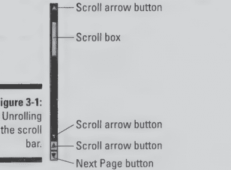

### 54 第一部分：介绍 Linux 版本的 WordPerfect

滚动条类似于你文档的一张小地图，滚动条的整个长度代表整个文档：顶端是文档开头，底部是文档结尾。滚动条上的小灰色框（滚动框）代表你现在在屏幕上看到的文档部分。滚动框在滚动条上的上下移动就像电梯在电井中上下移动一样。通过观察滚动框在滚动条上的位置，你可以判断自己处于文档的哪个位置——开头、中间还是结尾。

### 滚动到正确位置

正如你可能猜到的那样，你还可以通过滚动条在文档中移动。此列表显示了你使用鼠标缩放滚动条可以做的事情：

- **快速移动到文档的任何位置。** 使用鼠标在滚动条上上下拖动滚动框。当你移动滚动框时，文档文本也随之滚动。拖动滚动条：用鼠标指针指向它，按住左鼠标键并上下移动鼠标指针。只要你按住鼠标键，滚动框就会随鼠标指针移动。当你松开按钮时，滚动框将停留在你离开的地方，文档也随之滚动。如果你让鼠标指针进入文本太深（也就是说，如果你在尝试向上或向下滚动时向左移动鼠标），滚动框会跳回到起始位置。尽管这种情况可能非常恼人，但不要惊慌：继续按住鼠标键向右移动，使鼠标指针位于滚动条上。滚动框将跳回到鼠标指针游入文本之前的位置。
- **移动到文档末尾。** 你可以将滚动框向下拖到其电井的底部。
- **移动到文档开头。** 反之：将滚动框向上拖到最顶端。
- **一次向前或向后移动屏文本。** 点击滚动条（而不是滚动框）。要移动到文档的下一屏文本，点击滚动框下方的滚动条。要回到上一屏，点击滚动条上方。滚动框会移动，文档也会（向上或向下）滚动一屏。
- **一次滚动一行文本。** 点击滚动箭头按钮——即滚动条两端带有箭头的微按钮。指向上的箭头的按钮（位于滚动条顶部）会带你向文档开头移动，指向下的箭头的按钮会带你向末尾移动。
- **逐页浏览文档。** 点击“下一页”和“上一页”按钮。这些按钮位于滚动条底部，上面有上下小箭头。当你点击“下一页”按钮时，WordPerfect 会滚动文档，使下一页的顶部位于屏幕顶部。“上一页”按钮则滚动文档，使前一页的顶部位于屏幕顶部。

如果文档太宽无法容于 WordPerfect 窗口，一个滚动条将横跨窗口底部，位于应用程序栏上方。这个水平滚动条与我们讨论的垂直滚动条类似，只是它是水平移动的，且没有“下一页”和“上一页”按钮。

### 使用键盘操作

如果你打字快如闪风，你可能不想让手离开键盘的起始行——甚至吃午饭也不行。你灵活的手指知道每个按键的位置，它们敲击的速度极快。

### 第 3 章：文档浏览

你可以通过按下以下按键移动到行的开头或末尾：

- `Home`：将光标移动到当前行的开头
- `End`：将光标移动到当前行的末尾

我们经常使用 `End` 键回到正在输入的行末尾，以便继续输入内容。

你可以通过按下以下按键向上或向下移动一屏信息：

- `Page Up`：将光标移动到屏幕顶部。如果你已经在那里了，按下 `Page Up` 将文本向上移动一个屏幕的距离，并同时滚动文档。
- `Page Down`：将光标移动到屏幕底部。如果你已经在那里了，按下 `Page Down` 将文本向下移动一个屏幕，并同时滚动文档。

要移动到文档的开头或末尾，请按下以下按键：

- `Ctrl+Home`：将光标移动到文档开头
- `Ctrl+End`：将光标移动到文档末尾

如果你想知道文档有多长，按下 `Ctrl+End` 到达文档末尾。然后查看应用程序栏 `Application Bar` 查看你所在的第几页（Pg 后面的数字）。

### 转到哪里？

WordPerfect 有一个“转到”`Go To`对话框，你可以用它告诉程序去哪里。遗憾的是，你无法让 WordPerfect 去往你可能想去的地方，尽管这个选项总比没有要好。而且，它在大型文档中移动非常有用。

你有三种——数数，是三种——方法来显示“转到”对话框：

- 从菜单中选择 `Edit+G` 命令。
- 按下 `Ctrl+G`。
- 点击应用程序栏上的位置区域（显示页码、行号和光标位置的部分）。

### 58 第一部分：介绍 Linux 版本的 WordPerfect

实际上，你拥有的方法多于四种，因为你可以使用键盘或鼠标来选择命令，但你明白我们的意思。你可以看到图 3-2 所示的“转到”对话框。

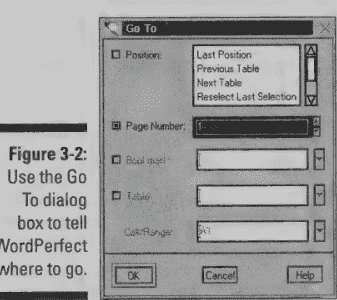

“转到”对话框有四个设置来告诉 WordPerfect 去向哪里：位置 `Position`、页码 `Page Number`、书签 `Bookmark` 和表格 `Table`。本节将介绍如何使用前两个设置（除非你知道书签和单独项，否则后两个没有用处，这些是你可以包含在 WordPerfect 文档中的高级项目）。

### 祝你在页顶愉快！

以下列表显示了如何使用“转到”对话框到达文档中任意页的顶部：

- **将光标移动到当前页顶部**：点击可能的位置列表（听起来有点不雅雅，不是吗？），然后从列表中选择“当前页顶部”`Top of Current Page`。
- **将光标移动到当前页底部**：执行与移动到顶部相同的操作，并选择“当前页底部”`Bottom of Current Page`。为了让该选项出现在视野中，请向下滚动位置列表。
- **将光标移动到其他页的顶部**：选择“页码”`Page number`，输入你想去的页码数字，或者点击微小的上下箭头，直到找到你想要的页码。

当你点击确定或按下回车键时，WordPerfect 会将你带到你想去的地方。

### 不再迷路

如果你在使用书中描述的任何鼠标或键盘方法移动光标，或者使用第 4 章描述的搜索命令，你可能会发现自己犯了可怕的错误，想要回到起点重新尝试。令人惊讶的是，WordPerfect 竟然有一个“回到起点”的命令。（这些美好的小惊喜保持了我们对计算机的信心。）

要将光标返回它最近的位置，请使用“转到”对话框。选择“位置”`Position`，然后选择“上一个位置”`Last Position`，并点击确定或按下回车键。光标会像训练有良好的归信鸽一样飞回之前的位置。

## 第 4 章

## 玩转文本块

**本章内容**

- 构建基础文本块
- 使用鼠标选择文本
- 使用键盘选择文本
- 扩展选择范围
- 删除、移动和复制选中的文本
- 使用剪贴板复制和粘贴
- 使用剪贴板剪切和粘贴

自从第一个埃及人将《金字塔入门》的纸莎草卷拆成一页页的页面以来，文本块的概念一直在不可阻挡地进步。句子。页面。章节。卷册。CD。现在，WordPerfect 的文本选择既拥抱又超越了这些将文本分为块的经典方式，让你能够处理任何文本块。

文本选择允许你精确地选择想要删除、大写、斜体、检查拼写或进行其他字文字处理的内容。想象一下这种力量：你可以手术般地切除枯燥的文本，用亮眼的 26 字体重活乏味的段落，通过语法或拼写检查有选择地压制晦涩的术语，并消除恼人的头韵。

WordPerfect 为你提供了 6000000 万亿（60 quadrillion）种选择文本的方法，在选择后也有大约同样不相同的方法来处理它。我们坚持最简单的方法。

### 基础块

在 WordPerfect 中，*块* `block` 是你文档中的一段文本。与你和你的幼儿朋友们玩过的字母块不同，WordPerfect 的块可以包含许多字母、单词、行甚至页面。

### 62 第一部分：介绍 Linux 版本的 WordPerfect

在 WordPerfect 中，*块* `block` 是你文档中的一段文本。与你和你的幼儿朋友们玩过的字母块不同，WordPerfect 的块可以包含许多字母、单词、行甚至页面。

文本选择允许你精确地选择想要删除、大写、斜体、检查拼写或进行其他文字处理的内容。想象一下这种力量：你可以手术般地切除枯燥的文本，用亮眼的 26 字体重活乏味段落，通过语法或拼写检查有选择地压制晦涩的术语，并消除恼人的头韵。

WordPerfect 为你提供了 60000000 万亿（60 quadrillion）种选择文本的方法，在选择后也有大约同样不相同的方法来处理它。我们坚持最简单的方法。

### 基础块

在 WordPerfect 中，*块* `block` 是你文档中的一段文本。与你和你的幼儿朋友们玩过的字母块不同，WordPerfect 的块可以包含许多字母、单词、行甚至页面。

### 64 第一部分：介绍 Linux 版本的 WordPerfect

### 听我的没错

仔细看图 4-1。注意看高亮从单词 `fight` 开始，到单词 `draped` 结束。我们并没有在 `fight` 之前极其小心地定位鼠标，然后极其小心地拖到 `draped` 单词的末尾。相反，我们将鼠标放在 `fight` 单词的某个地方，然后拖动鼠标，直到 `draped` 被高亮。如果你尝试这种技术，你会发现你无法只选中单词 `draped`（或者任何其他单词）。只要鼠标指针碰到一个字母，整个单词就会被高亮。


大多数人都是这样想要的，而且大多数人本来就想选中整个单词。我们觉得这个功能非常烦人。也许是因为我们的手很稳，又也许是因为我们对选择的内容非常挑剔。随它吧。

如果你也觉得自动选择单词很烦人，可以将其关闭。要做到这一点，请确保文档中没有选中文本，然后点击 WordPerfect 程序窗口。选择“偏选项”（Preferences）和“环境偏选项”（Environment Preferences）对话框，你会看到“环境”（Environment）按钮。在标记为“选择单词而非字符”（Select words instead of characters）的复选框附近。如果你能勾选此框并点击“确定”然后“关闭”，就可以用鼠标选择你想要的任何字符，就像在旧版本的 WordPerfect 中一样。

这是好是坏？取决于你。这种自动选择单词的机制是在 WordPerfect 7 中引入的。WordPerfect 的开发人员添加这个功能，是因为许多人发现很难精确地拖过整个单词。

> 如果你刚开始用这种标记程序，它看起来可能很奇怪。这里有几点建议：
> + 如果你需要的文本跨越几行，不要费劲把鼠标指针拖到行末尾，然后回到下一行的开头，以此此类推。这种方法浪费精力而且看起来很滑稽。就像在罗马开车（或者）在你之后开车，你只需要闭上眼睛往前开。大胆且直接地朝你的目标移动。
> + 你可以向后也可以向前（以及向下）——这没有区别——但你不能向两个方向扩展选择范围。你开始的地方必须是起点或终点。

## 通过大量点击选择文本

点击并拖拽是选择文本的简单方法。这里有更快的选择单词、句子和段落的方法：

- **选择一个单词：** 双击单词（将鼠标指针置在单词内的任何位置，然后双击左键）。
- **选择一组单词：** 双击该组中的第一个单词，并在第二次点击时按住鼠标键。拖动高亮区域的边缘（向任何方向）到你想要词组的另一端。即使你关闭了单词选择（参见本章前面的“听我的没错”侧边栏），这种方法仍然有效。如果你成功完成了这一操作，你就有资格获得你的高级许可了。
- **选择一个句子：** 三击句子（将鼠标指针置在句子的任何位置并连续点击三次鼠标按钮——这类似于双击，但多点了一次）。WordPerfect 对句子的定义是任何以句号（）结束且在下一个字符之前有空格的文本。对于 WordPerfect 来说，如果你觉得三击有点令人生畏，可以使用另一种方便的方法来选择句子：点击句子旁边的左侧边距。
- **选择一组句子：** 这一过程与选择一组单词类似。在前面的项目上进行三击（像鼠标但更快），并在最后一次点击时按住鼠标键。然后将高亮拖到你想要的地方。
- **选择一个段落：** 如果你喜欢通过点击边距来选择句子的方法，可以通过点击边距并向上或向下移动鼠标指针来选择一组句子。四击段落（将鼠标指针置在内部任何位置并连续点击四次）。是的，如果那些人认为你可以不卡顿地点击四下，那么那个部门的水平很高，但快速点击四次鼠标按钮就能抓到一个段落。如果你喝无因咖啡——我们最喜欢的——你可能会发现“替代选择方法”更容易。将鼠标指针移动到段落左侧（此时鼠标指针变成箭头）并双击。
- **选择一组段落：** 你猜对了：在第四次点击时按住鼠标键并拖动。在左侧边距点击两次并拖动。

那么选择页面呢？逻辑上，这个过程应该包含五次点击，尽管 WordPerfect 专家认为五次点击超过了他们的能力。相反，要选择页面，请使用下一节描述的“快速菜单”（QuickMenu）方法。

## 快速菜单方法

你可以使用快速菜单选择句子、段落和页面。首先，点击你想要的句子、段落或页面中的任何位置。然后将鼠标指针移动到左侧边距（此时鼠标指针指向右侧而非左侧）。快速点击鼠标右键，你会看到图 4-2 所示的快速菜单。

图 4-2：用于选择文本和其他酷东西的左侧快速菜单。

那一刻，记忆是他的强项。“我到底在干什么？我在和谁在一起？”一段关于 DNA 讨论的模糊记忆浮现在大脑中心，带着一丝昨晚的气息，然后从右侧退场，推了这个快速菜单的底部有很多非常酷的东西，比如“声音”和“子文档”。现在别玩那些东西；要克制。这是正经事。

现在你有机会选择句子、段落、页面或“全部”（All）选项。只需点击你所在的句子、段落或页面。点击你选择的单词。

## 菜单栏方法

你也可以通过菜单栏选择句子、段落、页面或整个文档。就像使用快速菜单一样，从文本中的任何位置开始。选择“编辑-选择”命令，它的选项与左侧快速菜单相同。

一个额外的选项是“编辑-选择”（Edit-Select）菜单，我们认为它很酷。当你需要时，它是救命星，说实话。注意，当你选择的文本超过一行时，选择将到第一行的末尾，然后从第二行的开始，以此此类推直到直到选择的结束。如果你只想选择一个矩形呢？有一天你会需要的，那时你会感谢自己知道“编辑-选择”命令。例如，矩形方法可以让你选择连续十行的前五个字符。尝试一下这个命令。Word WordPerfect 将你所选的区域变为矩形。

## 使用键盘选择文本

我们中的一些对这种离开键盘使用鼠标的行为仍然有些怀疑。如果你使用键盘，我们将感谢。幸运的是，对于我们这些鼠标爱好者（我们更倾向于称之为快速打字员），有很多替代方案。所有替代方案都涉及导航键，即箭头键以及具有 Home 和 End 等有用名称的相关键。如果你使用键盘选择文本，请先阅读第3章关于坚持使用键盘章节。

- 选择一个单词：将光标置于单词开头，按住 `Shift` 键并按方向键。
- 选择一组单词：将光标置于词组开头，按住 `Shift` 键并反复按 `Ctrl+方向键`。
- 选择一个句子：将光标置于句子开头，按住 `Shift` 键并按方向键直到句号。
- 选择一组句子：将光标置于词组开头，按住 `Shift` 键并反复按 `Ctrl+方向键`直到词组结束。
- 选择一个段落：将光标置于段落开头，按住 `Shift` 键并按方向键直到段落结束。
- 选择一组段落：将光标置于词组开头，按住 `Shift` 键并反复按 `Ctrl+方向键`直到词组结束。
- 选择一个页面：将光标置于页面开头，按住 `Shift` 键并按 `Page Down` 直到页面末尾。

### # 68 第一部分：Linux 版 WordPerfect 简介介绍

表 4-1 显示了如何从光标所在位置选择文本。

| 表 4-1 使用 Shift 键选择文本 | | |
| :--- | :--- | :--- |
| 选择到此位置 | 按 | |
| 下一个字符 | `Shift+→ (右箭头)` |
| 前一个字符 | `Shift+← (左箭头)` |
| 同一位置，向下移动一行 | `Shift+↓ (向下箭头)` |
| 同一位置，向上移动一行 | `Shift+↑ (向上箭头)` |
| 行尾 | `Shift+End` |
| 行首 | `Shift+Home` |
| 文档末尾 | `Shift+Ctrl+End` |
| 文档开头 | `Shift+Ctrl+Home` |
| 屏幕底部 | `Shift+PgDn` |
| 屏幕顶部 | `Shift+PgUp` |
| 街道尽头 | 加速踏板 |
| 磁带开头 | 倒带按钮 |

## 用鼻子和酸黄选择文本

这种选择文本的方法相当不合常规；它涉及到用薄切的酸黄条通过嘴巴呼吸一会儿。这种方法不建议初学者使用，最好留到感冒和过敏季节，因为那时它的通鼻缓解效果最受欢迎欢迎。

## 扩展选择

假设你刚刚仔细地选择了文本。由于突然的震惊，你发现自己真的应该多选一些内容。你被后悔和自责所吞噬。唉，生活本身就是大量的文字处理。与生活不同，WordPerfect 乐意让你选择更多文本——或者少一点也行。你甚至不需要重来；只需扩展你的选择即可。

## 第 4 章：玩转文本块 69

要扩展已经选择的区域，请遵循以下步骤：

- 1. 按住 `Shift` 键。
- 2. 将鼠标指针放在所选文本的任何位置，按住鼠标左键。

选择的端点将收缩到你点击的地方，你可以用鼠标来拖动它。

当然，你也可以通过键盘执行相同的操作；请遵循以下步骤：

- 1. 按住 `Shift` 键。
- 2. 按任何导航键来移动端点——就像你之前进行原始选择时的那样。

注意，WordPerfect 不允许你更改选择的原始起始点；你只能移动第一次移动过的那个端点。

## 处理所选文本

这一节大可以被称为“对分子进行某些操作”，因为它开启的讨论范围非常广泛。此列表显示了你在选择文本后可以更改的一些内容：

- 字体
- 字体大小
- 字体样式
- 大小写转换
- 段落布局
- 位置
- 方向
- 颜色

你还可以对文本进行删除、剪切、复制、粘贴、移动、替换、搜索、拼写检查或语法检查；将其转换为项目符号列表或编号列表；或将其转换为子文档。由于这些主题在本书的其他大部分章节中都有涉及，因此不要在这里寻找；请在本书的索引或目录中查找这些主题。

## 70 第一部分：Linux 版 WordPerfect 简介介绍

## 删除文本

对于所选文本，你可以做的最快、最简单且（取决于你对当前文档的感受）可能最有用的操作就是删除它。

选择文本后，只需按 `Delete` 键（或 `Backspace` 键）。文本就消失了，永不再回来。然而，它并没有完全消减或彻底消失；它进入了下一个维度，你可以通过 `Undo` 命令将其找回（参见第 5 章，或只需按 `Ctrl+Z` 尝试）。

## 移动文本

另一个简单实用的任务是移动文本。只需选择你想移动的内容；然后点击并拖动高亮文本到你想去的地方。

当你执行此操作时，鼠标指针会多出一个阴影矩形。你可以将鼠标指针移动到文档的任何位置。如果你将指针移动到空白区域，阴影光标会显示你的文本将落在何处。另一方面，如果你只是在文本周围移动一些单词，普通光标会在文本中移动，告诉你这些拖动将把你的单词带到何方。

当你松开鼠标按钮时，移动完成。

## 复制文本

你可以使用与移动几乎完全相同的技术来复制文本。复制时，在拖动时按住 `Ctrl` 键。所选文本的第二个副本将被放在新位置。原始所选文本留在原地，保持原来的样子。

## 使用 X 剪贴板

在我们讨论剪切、粘贴以及所有那些曾经对幼儿园来说轻而易举的功能之前，现在（得益于所谓的计算机魔法）却需要价值 2000 美元的硬件软件，以及一堆书用尖利的黄色和黑色字体向所有经过你办公室的人大声宣告你的愚蠢——砰！噢！谢谢，我们确实需要那个。看看，我们刚才说到哪了？

## 第 4 章：玩转文本块

## 使用 X 剪贴板在文档之间复制

X 剪贴板在文档之间的复制特别有用。由于 WordPerfect 允许你同时打开多个文档，你可以在文档 A 中复制文本并粘贴到文档 B 中。关于同时打开多个文档的更多信息，请参见第 12 章。

特殊的 X 剪贴板在复制、剪切和粘贴时可以携带所选文本和图形。X 剪贴板在 WordPerfect 中并不是可见的；没有可爱的的小剪贴板图标移动。它只是某种隐藏存储。

## 不要破坏你的剪切

X 剪贴板一次只能包含一个东西。如果你复制或剪切新内容，剪贴板的旧内容会被擦除，除非你将新内容添加到原有内容中。要添加新内容（无论它是文本还是图形），选择 `Edit>Append`。

## 终身受益键盘技能

在 WordPerfect 中用于剪切、复制和粘贴的键盘命令（分别为 `Ctrl+X`、`Ctrl+C` 和 `Ctrl+V`）也用于某些其他程序（特别是最初设计用于 Windows 而非 Linux 的程序）。因此，记忆并使用这些命令比使用 WordPerfect 菜单对你有利。事实上，这些名称并不特别好记。我们通过记住 X、C 和 V 键在键盘底部排成一小排来跟踪它们的顺序：剪切、复制、粘贴。

## 实用的快捷键列表

- 双击选择一个单词。
- 三击选择一个句子。
- 四击选择一个段落。（或者，你也可以在鼠标指针位于左侧边距时点击鼠标右键，从快速菜单中选择段落。）
- 按 `Ctrl+C` 复制选中的文本。
- 按 `Ctrl+X` 剪切选中的文本。
- 按 `Ctrl+V` 粘贴选中的文本。（或者，你可以选中文本，然后在鼠标指针位于文本区域时点击右键，通过快速菜单进行复制、剪切和粘贴。）

就像复制和粘贴一样，你可以粘贴任意数量的副本（Dingelhausen-Schnitzenzenbaum 家具预制件公司 Dingelhausen-Schnitzenzenbaum 家具预制件公司）。

和复制一样，如果你剪切了新内容，它会替换贴板中的旧内容，除非你使用了本章之前侧栏“不要破坏你的剪切”中提到的“编辑：追加”命令。

## 使用快速菜单进行剪切

如果你很难记住 `Ctrl+C`、`Ctrl+X` 和 `Ctrl+V`，或者不知道“复制”和“粘贴”命令在“编辑”菜单的什么，那么快速菜单正是你所需要的。要从快速菜单中操作，请遵循以下步骤：

1. 选中某些内容。
   确保鼠标指针位于文本区域内——而不是在菜单或边距处。
2. 点击鼠标右键。
   出现快速菜单。
3. 从快速菜单中选择“剪切”、“复制”或“粘贴”。

## 第 5 章

## 文字改进

### 本章内容

- 逐个删除字符：退格键和删除键
- 删除文本块
- 使用插入模式和覆盖模式
- 撤销
- 寻找丢失的内容
- 查找并替换文本
- 输入拼写错误的单词
- 修正拼写错误的单词
- 全文检查拼写

没有人能第一次就做到完美。我们也不会。无论如何，在你的 WordPerfect 文档中输入一些文本后，你可能会抬头看着文本，发现有很大的改进空间。开头的内容其实应该放在结尾，低劣的笑话必须删掉（虽然我们没删自己的），而且有些地方拼写看起来有点神秘（神秘吗？）。

修复文本是文字处理让你感到庆幸没有用老式打字机在纸上打字的地方。在屏幕上进行重大修改非常容易——本章将为你解释这一切。

## 删除文本

在发现咖啡因之后，对作家来说最大的福音无疑是修正液。因此，文字处理器能够比修正液更胜一筹——通过绝对的、不可察觉地删除文本，就像它从未存在过一样——真的、彻底消失了——这非常受欢迎。

## 第一部分：介绍 Linux 版 WordPerfect

## 逐个字符处理：删除键和退格键

你可以通过两种方式逐个删除字符：

- `Delete` 键删除光标*之后*的字符。
- `Backspace` 键通常删除光标*之前*的字符。（取决于你电脑上 X 系统的配置，`Backspace` 键可能仅像 `Delete` 键一样：如果是这样，请让 Linux 或 X 专家为你更改键盘映射。）

无论哪种情况，文本都会随着你的操作自动闭合。这是一场无痕的手术。

如果你想逐个删除一个字符，请确保没有*选中*任何文本。（有关选择文本的信息请参阅第 4 章）。`Backspace` 键和 `Delete` 键都会删除任何选中的文本。选中的文本通过高亮显示。（实际上是深色高亮，但谁在数个数呢？）

## 删除文本块

删除文本块最简单的方法是使用鼠标或键盘*选中它*（高亮显示），然后按 `Delete` 键或 `Backspace` 键。有关选择文本的完整细节，请参阅第 4 章。

## 删除秘密代码

感觉有点被害幻吗？难道你周围的人都在通过秘密眼神和信号交换信息而不被察觉吗？为了增加你的被害幻感，请注意 WordPerfect 确实在使用秘密代码。在你当 CIA 的辉煌岁月，如果你不小心丢失了代码，你可能会陷入深渊。

当你删除文本时，可能也会删除这些秘密代码中的一个或多个。如果你这样做，一段文本的外观就会改变。幸运的是，在很多情况下，WordPerfect 防止你意外删除秘密代码。

正如我们在第 9 章讨论的，每个 WordPerfect 文档中都分布着许多隐藏的秘密代码。这些代码是 WordPerfect 为了记住自己而生成的加密笔记，例如，“此处开启粗体”和“此处关闭粗体”。

如果你在删除时文本块的格式发生了变化，你可能删掉了一个秘密代码。如果你很快发现错误，可能可以通过“编辑-撤销”或等效键盘命令 `Ctrl+Z`（见本章后后的“撤销-执行”部分）进行撤销；否则，只需将其格式化为原来的样子。

## 覆盖与弹出覆盖

有时，在疯狂打字时，飞指不小心碰到了插入键，导致你进入了覆盖模式，这真的把事情搞乱了。

## 使用插入和覆盖模式

在左侧的“撤销”框中，你可以找到最后执行的几件事的简短描述。你可以点击“撤销”按钮撤销每个操作（从框顶的操作开始）。当你撤销一个操作时，它会移动到对话框右侧的“重做”列表。

## 第 5 章：文本改进

79

图 5-1：为操作过头的人提供的撤销。

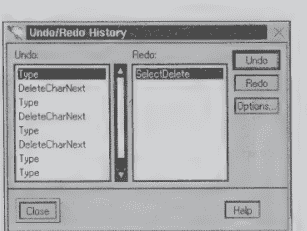

请注意，你只能撤销撤销列表顶部的项目。（如果你有足够的撤销（重做）次数，你可以撤销撤销列表中的多个项目！）但是，你无法无法选择撤销列表中的第五个操作并仅撤销那一个。

通常情况下，WordPerfect 允许你通过“撤销/重做历史”对话框来撤销你执行的最后十项操作。但嘿，如果你发现 WordPerfect 记住得不够多，你可以疯狂地将撤销列表中的项目数量增加到 300 个（限制值）。要更改 WordPerfect 记忆的操作数量，请点击弹出的“撤销/重做选项”对话框中的“选项”按钮，根据你的需要选择数字。但记住，尽量将这个数字保持越小越好，以避免 WordPerfect 运行缓慢。


我们为什么要费力做这些撤销和重做的操作呢？因为它非常有用，而且比使用修正液要好得多。

如果你使用的是早期版本的 WordPerfect，你可能很熟悉“取消删除”命令，它可以帮助你恢复反复不小心删除的内容。你可能也习惯了“撤销”命令的软弱。然而，那些勤奋的 WordPerfect 8 程序员加强了“撤销”功能，结果导致“取消删除”命令消失了。

## 寻找丢失的内容：对理性的寻找

如果你迷失了理智、冷静或价值观，那么你来对对地方了。WordPerfect 的“查找和替换”命令可以帮助你找到它们。（WordPerfect 还可以帮助你将它们替换为更好的东西——例如用农场奶酪替换弹珠。你将在本书的后半部分“查找和替换文本”章节中了解如何替换文本。）

80 第一部分：Linux 版 WordPerfect 导论

在通常情况下，搜索“理智（sanity）”这个词在 WordPerfect 对话框中只需经过两步或三步：

- 从菜单栏选择“编辑：查找和替换”，或按 `F2`。
“查找和替换文本”对话框（如图 5-2 所示）就会为你提供帮助。

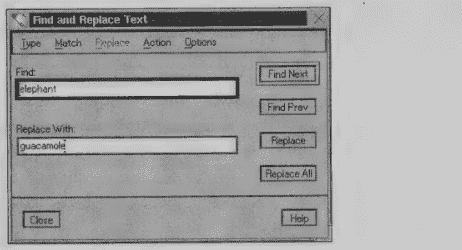

图 5-2：查找和替换对话框。

- 2. 输入你正在查找的文本。
它会出现在“查找”框中，你可以通过移动光标、按退格键和删除键等来对其进行编辑（如果你想的话）。
- 3. 点击“查找下一个”（或按回车键）向文档末尾搜索。
- 4. 若要向文档开头搜索，点击“查找上一个”。

如果你正在寻找“存在（exists）”，它会在文档窗口中高亮显示。如果 WordPerfect 找到的文本不是你想要的文本精确实例，只需再次点击“查找下一个”或“查找上一个”，直到找到它为止。

如果你的搜索是徒劳的，WordPerfect 会显示一个窗口，说找不到该文本。点击“确定”按钮向它确认你并没有疯。

在你完成一些查找和替换后，“查找和替换文本”框仍然保持开启，以防你想进行更多操作。该对话框会一直悬挂，直到你点击“关闭”按钮。

## 改变搜索方式

当你认为 WordPerfect 不再有更多菜单时，这里又来了一个。“查找和替换文本”对话框有它自己的小菜单栏。如果查找和替换按照你想要的方式运行，建议你假装那个小菜单栏不存在。如果查找和替换让你抓狂，看看这里你是否可以让它的行为更符合你的心意。

第 5 章：文本改进

“查找和替换”有五个选项，你可以通过选择“查找和替换文本”对话框菜单栏中的“选项”来查看它们：

- **从文档顶部开始查找**：除非勾选此选项，否则 WordPerfect 将从你所在文档所在的位置开始查找你尝试寻找的内容。如果你想确保找到你的文本在文档中第一次出现的地方，这通常是你想要的，请点击“从文档顶部开始查找”。
- **在文档开头/结尾换行查找**：这是 WordPerfect 的做法：它从你所在文档的位置搜索，当到达末尾时，从开头继续搜索。这样，如果你要找的内容出现在文档中所在位置*之前*，你仍然能找到它。WordPerfect 足够聪明，知道自己从哪里开始，以便在再次循环回到文档开头后，在找到你开始搜索的位置之前的你的文本最后一次出现处时停止。
- **限制查找范围**：通常你只对查找文档特定部分的文本感兴趣，例如当前的图表。如果你选中了想要查找的文本，可以使用此选项告诉 WordPerfect 在该处查找。如果你有一份非常长的文档，此选项特别有用。
- **在查找中包含页眉、页脚等**：通常情况下，WordPerfect 在搜索文本时会忽略页眉、页脚、脚注以及其他并不恰恰出现在文档正文的内容。（什么？）你不知道页眉和页脚是什么吗？去看看第 8 章。）如果由于某些原因你不希望 WordPerfect 查看这些内容，你知道该怎么做：
- **限制更改数量**：通常你只对某些更改感兴趣，你可以通过“查找和替换文本”对话框菜单栏中的“选项”来查看它们。要更改 WordPerfect 记住的操作数量，请点击“撤销/重做选项”对话框中的“选项”按钮，根据你的需要选择数字。但记住，尽量将这个数字保持越小越好，以避免 WordPerfect 运行缓慢。

## 第 5 章：文本改进

### 让你发现的内容变得高级

有时候，你并不完全清楚自己正在寻找什么。例如，你可能在寻找利文博士（Doctor Livingstone）。或者是利文博士？还是 Livingstone？很多程序在这种情况下都帮不了我。而 WordPerfect 会随你进入文本中那些不愿面对的荒野，去寻找那位“叫什么名字”的好医生。然而，在进入荒野之前，你必须自己装备好某些武器——通配符代码。你可以在框中找到你查找的文本中包含这些特殊代码。

Livingston 和 Livingston 但不是 Livingston（字符太少）；你告诉 WordPerfect 在 r 和 n 之间查找两个字符。

- `*`（多个字符）：你很聪明，猜到这个代码匹配直到单词结束的任意数量的字符。例如，`Living*` 无论他如何拼写他的姓名，都能找到那位医生。

请注意：这些代码不是给胆小的人准备的。不过，即使对于初学者，它们也非常有用。我们先给你一个快速的概述，然后让你自己去探索：

- `?`（单个字符）：如其名所示，匹配任何单个字符。所以，`Livingston[(单个字符)]` 匹配 Livingstone 和 Livingston，而 `Livingston[(单个字符)]?(单个字符)` 找到...

最后一个细节：你不能直接输入 `?` 或 `*` 来让 WordPerfect 搜索任意字符。你必须在“查找和替换”对话框菜单中选择“匹配->代码（Match->Codes）”，那里充满了你能想象到的每一个代码。其中就我们这里谈到的两种。在对话框列表中找到它们，并点击“插入”按钮将它们放入“查找”框中。

### 查找和替换文本

如果你即将出版的畅销书《寻找理智》（The Search for Sanity）进展不顺，不要发疯。试着把“理智”替换为“巧克力”，看看整体效果是如何衔接的。为了完成这项文学成就，请使用相同的“编辑->查找和替换”命令（朋友们称它为 `F2`）来查找文本。现在你可以探索图 5-2 所示对话框的更深层次区域：使用“替换”框以及“替换全部”按钮。在通常情况下，将理智替换为巧克力是简单的。按照以下步骤操作：

- 1. 从菜单栏选择“编辑->查找和替换”（或按 `F2`）。
- 2. 在“查找”框中输入你想让 WordPerfect 查找并替换的文本（例如，`sanity`）。
如果你在执行命令之前在文档中选中了 `sanity`，那么该词会自动出现在“查找”框中。
- 3. 点击“替换为”框并输入要替换的单词或短语（例如，`chocolate`）。
- 4. 点击“查找下一个”或“查找上一个”。
WordPerfect 会搜索你查找的文本（例如，`sanity`）。如果它找到了 `sanity`，WordPerfect 会高亮显示它；如果 WordPerfect 没找到，程序会提示你。
- 5. 如果找到了你的文本，你可以点击“替换”将其替换。
积极待切的“替换”功能会继续寻找你文本的任何其他实例。
- 6. 如果没有找到文本，则向另一个方向搜索；点击“查找上一个”而不是“查找下一个”。

与之前一样，你可以通过从“选项”菜单选择“在文档开始/结束处回绕”或“从文档顶部开始查找”来搜索整个文档。

此列表显示了一些替换文本的通用技巧：

- “类型”、“匹配”和“选项”菜单上的命令工作方式与查找文本相同。
- 当你在“替换为”框中输入内容时，“替换”命令会出现在“查找和替换”对话框的菜单栏上。（在此之前，它是几乎不可见的浅灰色。）“替换->区分大小写”和“替换->字体”命令对替换文本非常挑剔——例如，如果你想在 Helvetica 字体中将 `sanity` 替换为 `chocolate`。
- 要替换文档中该文本的每个实例，请点击“替换全部”而不是“替换”。但要小心，通过这种方式你可以很快造成巨大的破坏。例如，除非你关闭“全字”模式（从“匹配”菜单），否则你最终可能不仅把 `sanity` 替换成了 `chocolate`，还会把 `insanity` 替换成了 `chocolateinch`，这可听起来可并不理想。
- 要删除整个文档中的每个单词或短语，请点击“查找”框并输入一个空格，后跟你想删除的文本；在“替换为”框中什么都不放（甚至一个空格也不放）。在删除的文本之前输入空格可以确保你不会在被删除单词的地方留下两个空格。
- 要只替换查找内容的有限数量实例，请从对话框菜单栏选择“选项->限制更改次数”。当你处理长篇文档并预计“替换全部”只会进行几次更改时，此选项特别有用。

### 关于查找的趣闻

查找或替换文本最快的方法是按 `F2`。

在处理文档时，你可以让“查找和替换文本”对话框保持显示，这对于进行大量编辑很有帮助。

如果你在寻找整个单词，请开启“匹配->全字”选项。否则，在搜索 `sanity` 时...

WordPerfect 仅从光标向一个方向搜索。要搜索整个文档，要么手动双向搜索，要么从“选项”菜单中开启“从文档顶部开始”或“在文档开始/结束处回绕”。

你可以将搜索限制在文档中的选定文本块，尽管你应该在“查找和替换文本”对话框显示后进行选择。预先选中的文本会被视为查找文本。

### 查找和替换代码

如果你真的、真的想查找并替换代码，没关系——不过你不符合我们对“笨蛋”的定义！因为你太聪明了，我们只需说你可以像查找通配符代码一样找到你需要的代码：通过从“查找和替换”对话框的菜单栏选择“匹配->代码”。到此为止。更多信息请参阅第 9 章。

### 输入拼错误的单词

你做不到。

好吧，WordPerfect 的人们还没有做到这一步——尽管他们正在朝着目标努力。当你输入时，可能会注意到除了屏幕上出现单词外，还有一些不同的事情正在发生。有些单词有红色点下划线。有些单词有蓝色点下划线。（如果你看到绿色下划线，说明你盯着屏幕太久了；去休息一下巧克力吧！）而且，如果你能在看屏幕而不是看手指时输入，你会发现 WordPerfect 甚至会在你输入时更改某些单词。我们将逐一查看这些内容。

#### “我看到单词下面有红线”

当你操作时，WordPerfect 会从你身后窥视，并忍不住指出它在自己的字典中找不到的单词。它通过在这些单词下画红色点虚线来实现这一点。体贴地，WordPerfect 通常会对你可能的意思给出建议，而不是针对你输入的词。

要查看 WordPerfect 认为你应该输入什么，请右键点击带下划线的单词。WordPerfect 会显示建议单词列表，以及其他几个选项。你可以将此词添加到字典中、在本文档中跳过它，或使用功能全拼写检查。

如果你需要的单词在列表中，你就运气不错了：只需点击它，WordPerfect 就会自动替换掉输入的词。

#### “我看到单词下面有蓝线”

WordPerfect 始终为你自己的利益考虑，它乐于指出你可能输入但可能并非想要输入的单词。常用错误的单词（如 `hear` 和 `here` 或 `their, there, and they're`）符合蓝色下划线的标准。就像处理拼写错误一样，右键点击带下划线的单词，WordPerfect 就会告诉你它怀疑你犯了什么种错误，并提供可能的纠正列表。

### 我在打字时看着自己的文字在变化！

欢迎来到 QuickCorrect 的魔法世界。实际上，这是另一个让《傻瓜》读者喜爱的精彩功能……你不需要了解任何知识，它通常都能如你所愿。正如你的高中打字老师会告诉你的那样，大多数错误属于少数几大类：两个字母颠倒、把空格放在单词的首字母后面而不是前面、大小写错误，以及如果我们不是因为打字太快而不会犯的低级拼写错误。

WordPerfect 的人员认为，既然这些错误如此常见，为什么不让 WordPerfect 为你修复它们呢？这正是 QuickCorrect 的做法。例如，在 WordPerfect 文档中输入 `teh` 作为一个单词。无论你如何尝试，WordPerfect 都会将其更改为 `the`。WordPerfect 正确地判断出你是想输入 `the`。由于某种原因，你确实想输入 `teh`，你就得变得聪明一点。


为了防止 WordPerfect 使用 QuickCorrect 修正某些内容，可以在末尾添加一个额外的字母，让 WordPerfect 无法识别它。在这种情况下，用 *tehh* 怎么样？然后在它后面输入一个空格，告诉 WordPerfect 你已经写完这个单词。现在你可以返回并删掉多余的 *h*。完全笨拙吗？是的，有更好的方法。

如果你发现你想停止 WordPerfect 纠正某个拼写错误，或者你想将你自己的常见拼写错误添加到 QuickCorrect 列表中，你需要查看 QuickCorrect 对话框。选择“`Tools`”->`QuickCorrect` 命令。你会看到如图 5-3 所示的 QuickCorrect 对话框。原理非常简单：你在左列输入内容，WordPerfect 就会将其替换为右列的内容。

你想更改、删除或修改 WordPerfect QuickCorrections 列表上的某个条目？没问题：

- 1. 向下滚动，直到在左列看到你正在自动修正的单词，在右列看到显示在屏幕上的单词。

你可以使用对话框右侧的滚动条，或者点击“`Replace`”列并按下键盘上的“下一页”`Page Down` 键来实现。

## 第一部分：介绍 Linux 版的 WordPerfect

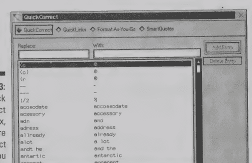

图 5-3：QuickCorrect 对话框，WordPerfect 在这里告诉你它想要为你执行的一系列功能！

- 2. 点击左列中的单词。

发生的情况取决于你想对 QuickCorrect 做什么更改。

- 3. 如果你不希望 WordPerfect 自动纠正这个拼写错误，点击“`Delete Entry`”按钮。

WordPerfect 会询问你是否确定要删除此条目：如果确定，点击“`Yes`”。

- 4. 如果你想添加一组新的错误和纠正后的单词，点击“`Replace`”框，并替换为那里显示的另一个拼写错误的单词。例如，我们有一个奇怪的习惯，把 *information* 写成 *informatino*。在“`Replace`”框中输入 *informatino* 或你选择的任何错误单词。

- 5. 在“`With`”框中，将原有内容替换为单词的正确拼写。

在我们的示例中，输入 information。

- 6. 点击“`Add Entry`”按钮。

这对单词（错误的和正确的）会出现在 QuickCorrect 列表中。

- 7. 当你完成 QuickCorrect 列表的操作后，点击“`OK`”。

我们特别使用了几个实用的 QuickCorrect 条目，比如 `(R)` 会变成 `®`,，`(c)` 会变成 `©`，以及 `1/2` 会变成 `½`。

## 别再盯着我的肩膀看了！

你可以停止 WordPerfect 盯着你的肩膀并纠正你文本的语法。只需从菜单栏中选择“`Tools`”->“`Proofread`”。该菜单为你提供四个选项：关闭打字时的拼写和语法检查、边打边校对 `Spell-As-You-Go` 检查你的拼写和语法，以及即时提示 `Prompt-As-You-Go` 为拼写错误的单词提供替换建议。我们认为 WordPerfect 的边打边校对功能非常棒，因为它能完成它要做的工作，而你无需担心它。

注意文件中的点状红色下划线。我们希望能够告诉你，我们从未发送过带有错误单词的文件到打印机，但正如你可能从这句话中看出的，WordPerfect 无法判断你在文档中是否使用了正确的单词——它只检查你使用的单词拼写是否正确。`WordPerfect` 有一个据称能此功能的特性，即 `Grammatic` 语法检查器，它非常有用；尽管我们从未发现它有效，例如，在前面的句子中没有发现任何单词错误。

小心！你可能仅仅因为文件中没有任何下划线，就认为你的文件已经准备好打印了。

## 自己运行拼写检查

WordPerfect 的边打边校对功能就像以自动驾驶模式运行拼写检查：当你忙其他事情时，它会扫描你的文档并找到拼写错误的单词。如果你愿意，也可以手动运行检查。不过，请清醒一下。虽然文字处理的巨大乐趣之一是你不再需要精通拼写，但你不应该太兴奋。WordPerfect 也不会拼写。WordPerfect 知道的是将单词与列表进行对比，查看其是否存在。

要检查整个文档单词的拼写，请遵循以下步骤：

- 1. 显示拼写检查工具。

执行以下任何操作都会激活拼写检查对话框：

- 选择“`Tools`”->“`Spell Check`”。

- 在键盘上按下 `Ctrl+F7`。

- 点击工具栏上的拼写检查按钮。

- 在文档的任何位置点击右键，然后点击菜单中的“`Spell Check`”。

拼写检查对话框如图 5-4 所示弹出，拼写检查开始。

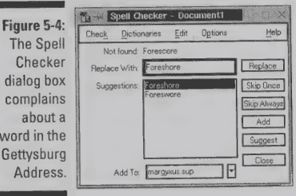

当你忙其他事情时，它会扫描你的文档并找到拼写错误的单词。如果你愿意，也可以手动运行检查。不过，请清醒一下。虽然文字处理的巨大乐趣之一是你不再需要精通拼写，但你不应该太兴奋。WordPerfect 也不会拼写。WordPerfect 知道的是将单词与列表进行对比，查看其是否存在。

当拼写检查发现单词不在字典中时，它会高亮该单词，并在“`Not found`”框中显示。它会心地在建议框中列出各种替换建议。

# 92 第一部分：Linux 版 WordPerfect 简介

文档字典是针对每个特定文档的。例如，一个短篇故事可能有一个包含故事中角色名称的文档字典。也许某个角色因为在编辑过程中遭遇了惨死的死亡，而没有出现在后续的故事中。因此，如果你想让 WordPerfect 将该名称视为本文档的一部分；那么如果该名称出现在任何其他文档中，它应该被标记出来。

你还可以创建可选的特殊字典。你可以编写各种主题，例如，每个主题都有其特定的术语。尽管例如当你为程序员写字时，`e-mail` 这个词可能是故意的，但如果你是为园艺师写字，这可能是一个拼写错误。

保持简单——只需向基础字典中添加单词即可。要向字典添加单词，请像往常一样启动拼写检查。

# 在补充字典中制造错误和纠正错误

很容易轻快地穿过你的文档，对拼写检查标记的每个单词点击“`Add`”。这种粗心最终会导致你将 `knockwork` 作为一个单词添加到字典中。因为 `knockwork` 被认为是一个真实的单词，拼写检查器会忽略之后任何 `knockwork`。

通常，你会看到“`Document Dictionary`”和 `rootxtus.dup`。

- 4. 当选中字典时，点击“`Edit`”按钮。

你会看到该字典的编辑对话框。

要纠正这种情况，你必须比普通学者更深入拼写检查器的迷宫。请往这边走：

- 5. 在“`Key Words`”列中，向下滚动单词列表直到看到 `knockwork`；然后点击“`Delete Entry`”按钮。

- 1. 选择“`Tools`”->“`Spell Check`”显示拼写检查工具。

单词消失了，彻底消失了。

- 2. 在拼写检查对话框中，选择“`Dictionaries`”->“`Supplementary`”。

- 6. 点击“`Close`”按钮返回拼写检查工具。

你会看到“`Supplementary Dictionaries`”对话框。

拼写检查并不是魔法，尽管如果你是一个巫师，这个名字听起来可能很有前景！

- 3. 在“`Dictionaries in Search Order`”中，点击你想要编辑的补充字典。

当拼写检查器高亮你认为没问题的单词时，点击拼写检查工具中的“`Add`”按钮。这一步会将单词添加到字典；对于拼写检查器而言，该单词现在是一个真实的单词了。

## 拼写检查技巧

要检查非整个文档，请从拼写检查对话框的菜单栏中选择“`Check`”；然后选择“`Word`”、“`Sentence`”、“`Paragraph`”、“`Page`”、“`To End of Document`”或“`Selected Text`”。你也可以通过选择“`Number of Pages`”从当前插入点检查指定的页数。

拼写检查器不仅检查拼写，还会指出常见问题，例如重复单词、包含数字的单词以及奇怪的大写情况。如果这些功能干扰了你的工作，可以关闭它们。只需从拼写检查对话框的菜单栏中选择“`Options`”，查看开启或关闭的功能列表。

# 处理 Grammy Grammatik

如果你从“`Tools`”菜单启动拼写检查，可能会注意到另外两个选项：`Grammatik` 和同义词表 `Thesaurus`。本节将简要介绍 `Grammatik`，下一节将讨论同义词表。

正如本章前面的“别盯着我的肩膀看”侧边栏提到的，我们对 `Grammatik` 语法检查器并不太兴奋。然而，我们经常写作，并且对自己的写作有自己的。尽管如此，你可能想尝试一下 `Grammatik`。

检查本身的工作与拼写检查相同：它从文档开始运行，并提供跳过以后不想看到的建议的选项。要选择，点击“`Tools`”->“`Grammatik`”显示 `Grammatik` 对话框。`Grammatik` 向你显示它不喜欢的单词以及其错误的解释，然后提供改进你文本的建议。

如果你真的想钻研并弄清楚 `Grammatik` 认为自己在做什么，可以从 `Grammatik` 菜单栏选择“`Options`”->“`Writing Style`”。你会看到写作风格对话框，其中列出了 `Grammatik` 分析你写作时使用的所有规则集。

# 驯服强大的同义词表

要查看同义词表 `Thesaurus`，请从 WordPerfect 菜单栏中选择“`Tools`”。如果你喜欢用各种词汇来丰富你的写作，同义词表实际上是一个非常有用的功能。同义词表对话框为你提供与你所选单词同义的单词列表。要让同义词表替换你的单词，请执行以下操作：

- 1. 双击文档中的单词将其高亮。

- 2. 点击同义词表对话框中的“`Look Up`”。

- 3. 要查看任何单词的同义词，双击该单词。

- 4. 要使用其中一个建议，点击“`Replace`”。

## 第二部分：美化你的文本

## 第 6 章：趣味字符

本章内容

- 将字体加粗
- 使用斜体
- 添加下划线
- 让字体变大或变小
- 使用不同字体
- 恢复正常
- 复制字符格式
- 更改大小写

WordPerfect 允许你控制单个字符的外观——不是在页面上的位置，而是它们的大小和形状。“字符”，我们指的是组成你文本的字母、数字和标点符号。除了使用下划线、加粗和斜体来强调文本外，你还可以选择不同的类型和大小。

好消息是，通过 WordPerfect，你可以在屏幕上直接看到所有特殊效果。坏消息是，很容易在字符格式中迷失。一页纸使用五种字体的信或备忘录看起来最业余，也最难读。

## 使用粗体、斜体和下划线强调文本

**粗体**、*斜体*和下划线是让单词或短语脱颖出并引起关注的三种方法。你只需要按照以下步骤为文本添加粗体、下划线或斜体：

- 1. 选择你想强调的文本。
- 2. 点击属性栏上的加粗、斜体或下划线按钮。

或者，按下 `Ctrl+B` 加粗，按下 `Ctrl+I` 斜体，或按下 `Ctrl+U` 下划线。


Word 以你选择的字体样式显示文本。完成！

当你使用这些文本样式时，WordPerfect 会在格式化文本前后插入秘密格式代码。第一个代码开启格式，第二个代码关闭格式。这些秘密代码的名为 *Bold*、*Italic* 和 *Und*。要了解如何查看、移动或删除这些秘密格式代码，请参第 9 章。

## 在输入时格式化

你也可以在输入的同时为其添加文本样式。

- 1. 点击属性栏上的加粗、斜体或下划线按钮，或按下 `Ctrl+B`、`Ctrl+I` 或 `Ctrl+U`。
- 2. 输入你想强调的文本。
- 3. 点击相同的按钮或按下步骤 1 中相同的按键组合来关闭格式。

## 这部分已格式化了吗？

如果你选择一段文本而其中部分文本已经格式化，会发生什么？假设你选择了一个包含一个斜体单词的句子。当你选中句子时，斜体按钮看起来*没有*被按下，因为整个选择区域并不是斜体。

## 哎！取消格式

如果你格式化过头了，WordPerfect 可以再次将其关闭。

- 1. 选择你想取消格式的文本。
- 2. 查看属性栏。
- 3. 点击被按下的按钮。

替代方案：按下相应的按键组合 `Ctrl+B`、`Ctrl+I` 或 `Ctrl+U` 来移除所选文本的格式。

你可以同时使用多种类型的格式。你可以让文本既**加粗又是斜体**，只需分别点击属性栏上的加粗和斜体按钮，或按下 `Ctrl+B` 和 `Ctrl+I`。

## 100 第二部分：美化你的文本

## 增大或减小字体

- 1. 选择你想更改大小的文本。
- 2. 点击属性栏上的字体大小按钮。
- 3. 点击即可选择一个尺寸。

你也可以将文本恢复到原始大小。再次选择它，点击字体大小按钮，并选择你之前使用的尺寸。

## 这些尺寸是什么？

文本大小以“磅”`points`为单位。每英寸有 72 磅。大多数普通文本是 12 磅。

## 第章：迷人的字符

当你更改某些文本的字体大小时，WordPerfect 会插入命名为 `Font Size` 的秘密代码。

## 智慧之字体

字体 `font` 是一个指字体 `typeface` 的雅说法。字体是一组字母、数字和标点符号的形状。例如，你现在阅读的文本是用 `Cheltenham` 字字体打印的。章节标题是用 `Cascade` 字字体打印的。当 WordPerfect 启动时，它通常会显示并打印一种相当美观的 12 磅字体，命名为 `Courier`。

## 更改某些文本的字体

- 1. 选择你想更改字体的文本。
- 2. 点击属性栏上当前字体名称旁边的小向下三角形。
- 3. 从列表中选择一种字体。

当你更改某些文本的字体时，WordPerfect 会在你格式化文本的开头和结尾插入两个格式代码。第一个代码更改字体；第二个代码将其恢复。代码名称为 `Font`。

## 102 第二部分：美化你的文本


## 不仅仅是外表


你可以在 WordPerfect 中使用许多字体。某些字体在组成字母的线条末端有小的衬线（`serifs`）；看那些大写字母的顶部。这些字体惊讶地被命名为衬线/无衬线（serif/sans）。其他字体没有这些线条，被称为`无衬线`字体（sans serif，这在法语中完全合理）。在某些字体中，所有字母宽度都相同（`等宽字体`）；而在另一些字体中（如你正在阅读的），某些字母比其他字母宽（它们是比例比例字体）。

你通常在 Windows 和 Mac 上看到字体，尽管它们有很多相似之处。PC 最流行的字体是 Times Roman，这是一种衬线字体，看起来像书中正文较丑陋的版本；Helvetica，一种看起来现代的无衬线字体；以及 Courier，它看起来像老式打字机上的字体。由于某些字体是商标，你版本的这些字体可能有其他名称。例如，Times Roman 可能命名为 Roman-WP，而 Helvetica 可能被命名为 Helve-WP 或 Arial。

X 和 Linux 版本的 WordPerfect 自带字体与 Windows 和 Mac 字体不同。

如果你反复使用少量的字体和大小组合，可以尝试属性栏上的“快速字体”（QuickFonts）按钮。该按钮上有一个华丽（几乎无法辨认）的蓝色 `F`，旁边有一个黄色的闪电。此功能列出了你从属性栏的“字体”列表中选择的最后十几个字体。另一方面，如果你经常使用相同的字体和大小组合，你应该考虑也使用样式；请参阅第 10 章。

## 修改文档其余部分的字体

如果你想在文档的中间位置更改字体，可以告诉 WordPerfect 从此点开始显示另一种字体。按照以下步骤操作：

1. **将光标移动到你想使用新字体的位置。**

   例如，如果你想让从第 2 页开始的所有页面都使用不同的字体，将光标移动到第 2 页的顶部。

2. **点击属性栏上的“字体”（Font Face）按钮。**

   按钮下方会弹出一个可用字体列表。

3. **从列表中选择一种字体。**

   属性栏上的字体名称将变为新字体，光标后的文本也将变为新字体。你也可以对“字号”（Font Size）按钮执行同样的技巧。它紧挨着“字体”按钮，通常显示为 12。

从“字体”列表中选择字体可能不会更改文档剩余部分的字体。你的操作会插入一段隐藏代码，告诉 WordPerfect 在此点更改字体，此更改将一直有效，直到文档中下一个字体更改代码（如果文档中还有另一个代码的话）。请参阅第 9 章以了解如何查找并消除你不需要的任何隐藏格式代码）。

你也可以使用相同的方法，通过将光标移动到文档顶部并点击“字体”按钮来在文档开头选择字体。然而，正如下一节所描述的，有更好的方法。

# 第 6 章：迷人的字符

本章的前半部分描述了字符格式设置的三个方面：文本样式（粗体、斜体和下划线）、字号和字体。如果能在一个统一的显示界面中查看并更改它们，不是很好吗——一个可以让你一次性设置这三种格式的地方？

好了。我们说出了那个魔咒。这样的东西确实存在：字体对话框，如图 6-1 所示。要显示它，从菜单栏选择 `格式<- 字体`，或按 `F9`。


| 字体 | 字号 | 外观 |
|---|---|---|
| Courier/WP | 粗体 | 阴影 |
| Courier | 8 | 小型大写字母 |
| Sans Printer 16 67pt | 下划线 | |
| Roman/WP | 双下划线 | 基线 |
| 搜索/选择 | | 删除线 |
| 字体样式 | | |
|set | | 位置：正常 |
| 粗体 | | 相对大小：正常 |
| 粗斜体 | | 下划线选项： |
| 轮廓 | | 空格 制表符 |
| 搜索/选择 | | 颜色选项：颜色填充 |
| 结果字体：Roman/WP 12 pt. | | |

## 104 第二部分：美化你的文本

显示此对话框的另一种方法是将鼠标指针置在文本的任何位置，点击鼠标右键显示快速菜单（QuickMenu），然后从中选择“字体”（Font）。

## 使用字体对话框中的选项

这个巨大且看起来很吓人的对话框包含了你想要的所有字符格式。你可以使用字体对话框来格式化已经输入的文本，或者指示 WordPerfect 格式化你即将输入的文本。

要为尚未输入的文本选择字符格式，将光标置于文档中你想开始打字的地方，显示字体对话框并选择你想要的格式，然后点击确定。WordPerfect 会在光标位置插入一些隐藏格式代码，影响代码随后的文本。当你开始打字时，文本将以你选择的格式出现。

如果你想格式化文档中已经输入的文本，请选择以下方法之一选择要格式化的内容：

- 要格式化一段文本，首先选择文本，然后使用对话框格式化选中文本。WordPerfect 会插入两个隐藏格式代码：一个在文本块开头开启格式；另一个在文本块结束处将格式恢复为正常。

- 要格式化文档中的剩余文本，将光标置在你想更改字体的地方，然后使用字体对话框。WordPerfect 仅插入一个隐藏代码在光标位置开启格式。

在字体对话框的左下部分，有一个框包含一些文本，通常是你正在使用的字体名称和大小。当你在对话框中选择字符格式时，WordPerfect 会相应格式化这些文本，让你看到文本将后的样子。

要更改字体类型，从“字体”列表中选择一种，这就是你点击属性栏上“字体”按钮时看到的相同字体类型列表。

要设置字号（磅值），从“字号”列表中选择一个大小，这就是你点击属性栏上“字号”按钮时看到的相同大小列表。

## 第 6 章：迷人的字符

如果你需要粗体、斜体或下划线字符，请查看对话框的“外观”（Appearance）部分，并点击那里的粗体、下划线或斜体选项，使你想要的选项框被勾选。

对话框的“外观”部分还列出了其他很酷的格式，包括双下划线、轮廓、阴影、小型大写字母、红线、删除线和隐藏；请参表 6-1 查看所有这些样式的样本。（表格没有显示隐藏文本，因为隐藏文本在打印时是不可见的。）

| 字符格式 | 样本文本 |
| :--- | :--- |
| 粗体 | 这 **coffee** 起来像泥一样! |
| 下划线 | 这 <u>coffee</u> 起来像泥一样! |
| 双下划线 | 这 __coffee__ 起来像泥一样一样 |
| 斜体 | 这 *coffee* 起来像泥一样! |
| 轮廓 | 这 <small>coffee</small> 起来像泥一样! |
| 阴影 | This coffee tastes like sludge! |
| 小型大写字母 | This COFFEE tastes like sludge! |
| 红线 | This red coffee tastes like sludge! |
| 删除线 | 这 ~~coffee~~ tastes like sludge! |

想要创建上标或下标的科学类型应该点击“位置”框，那里通常显示为“正常”。WordPerfect 会显示一个小小的弹出列表：上标、正常和下标。点击你的选择。

如果你正在给单词加下划线，并且对标记空格和制表符有自己的见解，可以通过点击“下划线选项”框来告诉 WordPerfect 这些信息。

在你选择好正确的格式后，点击确定或按回车关闭字体对话框。如果你在打开字体对话框之前选择了文本，则选中的文本将被格式化；否则，格式从当前光标位置开始。

> 如果你想放弃这一切，点击取消或按 Esc 退出字体对话框，让你的文本完无损。


# 106 第二部分：美化你的文本


当你使用字体对话框时，WordPerfect 会将相应的隐藏格式代码插入到你的文档中。要消除掉这些代码，你可能需要阅读第 9 章。

## 格式化整个文档

如果你想告诉 WordPerfect 在整个文档中（从头到尾）使用哪种字体呢？每个文档都有一个文档默认字体，除非你明确另有说明，否则 WordPerfect 在所有文本中都会使用该字体。WordPerfect 不仅将此字体用于文档中的普通正文，还用于页眉、页脚（在第 8 章中描述）以及脚注。

要设置默认字体，你需要使用“文档默认字体”对话框。在执行此小操作时，光标所在的位置并不重要；但请确保没有选中任何文本。然后按照以下步骤操作：

- 1. 选择 `格式 > 菜单栏`或按 `F9` 显示“字体”对话框，如图 6-1 所示。

- 2. 点击“初始字体”按钮。

WordPerfect 显示“文档默认字体”对话框，如图 6-2 所示。如果你好奇，你也可以通过选择菜单栏中的“文件 > 文档 > 默认字体”来显示此对话框。

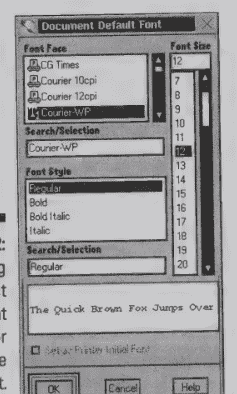

图 6-2 告诉 WordPerfect 在整个文档中使用哪种字体。

- 3. 选择字体字体、字号和字体样式。

此对话框中的设置外观和功能与“字体”对话框中的相似。

- 4. 点击“确定”或按回车键关闭对话框。

WordPerfect 会更改文档中所有文本的字体，但你使用“字体”对话框或属性栏上的字体字体、字号、加粗、斜体或下划线按钮格式化过的文本除外。

## 复制字符格式

当你按照意愿格式化某些文本后，你可以告诉 WordPerfect 以相同的方式格式化其他文本（非常有用！）WordPerfect 将此功能称为“快速格式化”。这些步骤显示了如何使用它：

- 1. 将光标移动到格式化良好的文本中间。

- 2. 要开启快速格式化，选择“格式 > 快速格式化”命令。

或者，你的工具栏可能包含一个名为“快速格式化”的按钮（带有一个油刷滚和闪电的图标）。如果是这样，点击它。开启快速格式化的另一种方法是使用快捷菜单。（这个讨论对我们来说有点太快了。）将鼠标指针指向你的文本，点击鼠标右键显示快捷菜单；然后从中选择“快速格式化”。

你将看到“快速格式化”对话框，如图 6-3 所示。

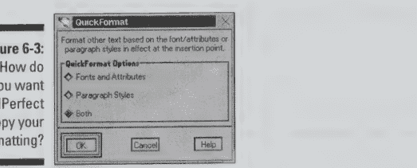

图 6-3：你希望你的 WordPerfect 如何复制你的格式？

- 3. 选择你想复制的格式类型：字体和属性、段落样式或两者都是；然后点击“确定”。

鼠标指针变成了我们见过最奇怪的工具：一个小油刷滚，旁边有一个 I 型插入梁。我们猜想 WordPerfect 想要建议它将用新格式“涂刷”任何文本。

- 4. 选择你想复制格式的文本。

一旦你选中文本，WordPerfect 就会立即对其进行快速格式化。

速度极快！

鼠标指针仍然是那个奇怪的形状。到底该如何关闭它？

- 5. 要关闭快速格式化，再次选择“格式 > 快速格式化”。

或者，点击工具栏上的“快速格式化”按钮，或在步骤 2 中使用快捷菜单策略。无论如何，光标都恢复了它正常的尖头状态。

恭喜！——你刚刚创建并使用了你的第一个样式。“样式？”你问到。WordPerfect 样式（第 10 章的主题）就像快速格式化一样，但更好。WordPerfect 使用快速格式化来引导你使用它们。

## 更改大小写

难道你不讨厌**不小心**按了**大写锁定键**吗？很容易愉快地打着字，几乎不看屏幕，直到你发现自己做了什么。哎！在这种情况下，WordPerfect 是你友善、体贴的朋友；它可以修复你已经输入的文本的大小写。

这是技术在救援！

要将某些文本改为全大写字母、全小写字母，或除每个单词首字母外的小写字母，请按照以下步骤操作：

- 1. 选中你想修改的文本。

- 2. 选择“编辑 > 转换大小写”命令。

WordPerfect 给你三个选择：小写、大写和首字母大写。酷！

- 3. 选择其中一个。

WordPerfect 按要求更改文本。文本仍然保留，以便你对其进行任何其他操作。

只有在你选中了某些文本时才能使用这些命令；否则它们在菜单中是不可用且呈灰色的。

首字母大写选项并不足够智能，无法准确判断标题或名称中哪些单词需要大写。在使用此选项后，你可能需要返回进行一些更改，以取消大写（小写化？）介词、冠词以及你在三年级学到的所有其他类型的小词的首字母。

# 第 7 章 标尺：惊叹的句子与迷人的段落

## 本章将介绍

- 使用标尺

- 设置边距

- 居中文本

- 向右对齐文本

- 对齐文本

- 连字符或不连字符

- 使用制表符

- 缩进文本

- 修改行距和段间距

## 使用标尺

你需要执行的操作是显示标尺，如果它还没有显示在屏幕上的话。如果你在属性栏下方没有看到以英寸（或厘米）为标记的水平条，点击“视图”菜单。在下拉菜单中，你应该能看到“标尺”。（如果没有，说明某人动了你的 WordPerfect。假设那个人是在帮你。）在标尺前面，一个小方框表示标尺可见，没有小方框表示它不可见。注意：如果你看到方框但屏幕上没有标尺，请换新眼镜，仔细盯着图 7-1，少喝点咖啡，清理屏幕，或者去找你当地的 WordPerfect wizards。

标尺显示光标所在处的边距和制表符。当你更改标尺上的设置时，WordPerfect 会在文档中插入相应的代码。标尺及其周围并不存储任何信息；它只是文档状态的视觉显示。当你打开另一个文档时，标尺上的内容会根据新文档的设置进行更改。

# 第 7 章：惊艳的句子与感人的段落 111

当你完成标尺的使用后，可以使用相同的标尺命令来将其移除。

## 那些小三角形是什么？

标尺在很小的空间内封装了大量关于边距和制表位的信息。它由以下两个水平条以及相应的黑色组件（gizmos）组成：

- 边距条（Margin strip）：标尺带数字英寸部分上方的一个细长水平条，用于显示边距。该条中白色部分左右两端的黑色组件显示左、右边距的位置。标尺左右两端的灰色部分是边距之外的区域。如果你仔细观察这些黑色组件，每个组件的外侧部分显示文档的边距，而较小的内部三角形则显示段落格式边距的位置，这是你可以为每个段落设置的独立边距。（你可能并不需要它们，所以如果无法区分组件的不同部分，也不要担心；相反，请参阅本章稍后的“更改一个或两个段落的边距”一节。）

- 制表位条（Tab strip）：标尺带数字部分下方的细长水平条，其中包含小三角形。三角形显示了制表位的位置。制表位就是按下 Tab 键时，光标跨越线条所在的位置。

## 标尺有什么用？

标尺向你显示当前光标所在位置生效的边距和制表位设置（这里不是鼠标指针，即那个带箭头的箭头，而是光标，即闪烁的垂直线）。你可以在文档开始处设置边距、制表位和其他行格式，也可以在整个文档中更改它们。例如，如果你想在写的文章中包含一段长引用，你可以选择只对构成引用的段落进行缩进。

除了显示边距和制表位的当前位置外，标尺还可以帮助你更改它们——你可以使用鼠标在屏幕上拖动边距组件和制表位三角形。在本章的其余部分中，我们通常会告诉你（至少）两种执行每项格式任务的方法：一种是使用菜单或按键，另一种是使用标尺。你可以决定自己更喜欢哪种方法；WordPerfect 并不在乎你使用哪一种。

## 112 第二部分：美化你的文本

## 设置边距

正如你可能从高中打字课上回想起的那样，左、右、上、下边距控制了纸张边缘留出的空白区域。通常情况下，你输入的所有内容都会出现在这些边距内。当然，边距的目的是提供空白，让读者在发呆时可以在上面随手涂鸦。WordPerfect 通常将左、右、上、下边距设置为 1 英寸，这相当慷慨了。你可能想让边距更小，以防止过度的涂鸦。

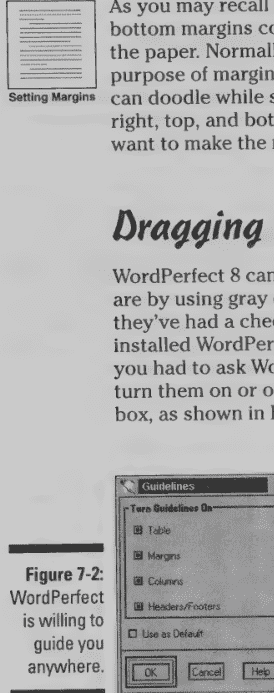

## 拖动边距线

WordPerfect 8 可以通过灰色虚线（称为指南）向你显示左、右、上、下边距的位置。我们喜欢这些线条，尽管它们在 WordPerfect 中的历史经历有些坎折。在某些版本中，安装 WordPerfect 后，指南就会显示在屏幕上。在另一些版本中，你必须要求 WordPerfect 开启指南。无论如何，以下是开启或关闭的方法：选择 `查看（View）> 指南（Guidelines）`。你会看到指南对话框，如图 7-2 所示。

此对话框允许你选择在 WordPerfect 窗口中查看哪些指南。我们并不是乐于受虐之类，而是发现所有指南都非常有用，通常会勾选此对话框中的所有复选框。

好了；现在屏幕上有了指南，你就可以通过拖动它们来更改边距了。按照以下步骤操作：

1. 将光标移动到文档的最顶端。

最快的方法是按 `Ctrl+Home`。如果你想更改整个文档的边距，你必须从顶部，即文档第一行的开头开始。要更改底部边距，请移动到文档第一页的底部。

2. 将鼠标指针移动到你想移动的边距的指南上。

当指针位于指南上时，它会变成一条带有箭头的线，箭头指向你可以拖动指南的两个方向。要移动整个文档的左或右边距，最简单的方法是指向顶部边距线*上方*的左或右边距。

3. 将指南拖动到你想去的位置。

话虽多说不尽，但你可以左右拖动左或右边距指南，也可以上下拖动上或下边距指南。当你松开鼠标按钮时，指南将停在你放置的位置，文档中的文本将移动以保持在边距内。如果你移动了左或右边距，标尺边距条中的边距组件也会移动。

当你更改边距时，指南的顶端可能会拒绝移动。担心，Word WordPerfect 只是在固执。边距会没问题的。

如果你更倾向于使用一个漂亮、安全的对话框，请阅读下一节。我们更喜欢指南；只有你才能决定更喜欢哪种方法。

## 使用边距对话框

如果你不喜欢通过拖动边距，这些步骤将教你如何使用对话框设置文档的边距：

1. 将光标移动到文档的最顶端。

最快的方法是按 `Ctrl+Home`。

2. 选择 `格式（Format）> 边距（Margins）`。

此对话框会启用边距对话框，如图 7-2 所示。

3. 输入你想要的数值。

4. 点击确定（OK）或按回车键（Enter）。

对话框消失。文档中的文本将移动以保持在边距内。

# 116 第二部分：美化你的文本

我们最喜欢的更改一个或多个段落边距的方法是缩进它们，如以下步骤所示：

- 1. 将光标移动到想要缩进的段落开头。

- 2. 选择“格式：段落：缩进”或按 `F7`。

WordPerfect 会插入一个不可见的秘密缩进代码，段落的左边距将向右移动一个制表位。（你可以在本章稍后的部分阅读更多关于制表位的知识）。

WordPerfect 还提供了以下有变体：

- 若要缩进段落的左右两边距，请选择“格式：段落：双倍缩进”。


# 116 第二部分：美化你的文本

我们最喜欢的更改一个或多个段落边距的方法是缩进它们，如以下步骤所示：

- 1. 将光标移动到想要缩进的段落开头。
- 2. 选择“格式：段落：缩进”或按 `F7`。

WordPerfect 会插入一个不可见的秘密缩进代码，段落的左边距将向右移动一个制表位。（你可以在本章稍后的部分阅读更多关于制表位的知识）。

WordPerfect 还提供了以下变体：

- 若要缩进段落的左右两边距，请选择“格式：段落：双倍缩进”。
- 如果你想创建悬挂缩进，WordPerfect 也可以做到。在悬挂缩进中，段落的第一行不缩进，其余行均缩进。在段落开头选择“格式：段落：悬挂缩进”。
- 要缩进几个段落，你可以选择这些段落并按 `F7`。WordPerfect 为每个段落插入一个秘密缩进代码。
- 缩进代码会将段落缩进一个制表位。要控制段落缩进的距离，你可以移动制表位；参见本章稍后的“玩转制表位”章节。

WordPerfect 像往常一样会插入一个秘密格式代码来记录你对段落的要求。普通代码的名称是（信你由信）`Hd Left Ind`。双倍缩进代码是 `Hd Left\Right Ind`（它包含逻辑代码）。要设置悬挂缩进，WordPerfect 会插入两个代码：`Hd Left Ind` 和 `Hd Back Tab`。请查看第 9 章以了解如何查看和删除这些秘密代码。

## 更改对齐方式

对齐（Justification）是一个听起来很严肃的词——它让我们联想到道德准则、行为的理由以及其他哲学内容。当我们发现它其实是关于在文本行间填充空格时，该是多么令人失望。生活就是如此。

在文字处理和排版中，如你可能已经知到的，对齐处理的是不同文本行长度不一的道德问题。如果我们写字时让文档中的每行都有相同数量的字符就不会有这个问题了。但并没有——我们坚持要保持逻辑意义（本书的内容可能除外）。

# 第 7 章：惊人的句子与触动人心的段落

## 种类

尽管大多数人认为 WordPerfect 有四种文本对齐方式，但它实际上有五种：

- **左对齐：** 文本从左边距开始并填充其所需的空间。由于不同行包含的内容不同，文本的右边缘是不平整的或参齐的。这就是为什么这种方法也被称为*右侧参齐*（ragged right）。书中的大部分文本使用左对齐。
- **右对齐：** 这种方法与左对齐相同，只是行移动到了右边距。文本的左边缘是参齐的，右边缘是直的。（奇怪为什么没人称其为右侧参齐或直右？）
- **居中对齐：** 这种对齐类型通常用于标题。它让每行在页面上居中，使得文本的左右边缘都不够整齐。
- **两端对齐：** 最棘手的方法；文本的左右边缘都非常整齐。如果每行的文本量不同，你如何做到这一点呢？额外的空间被切成许多小碎片并插入在行的单词之间，使得所有行都填充到填满左右边距之间的空间。杂志、报纸和书籍通常使用两端对齐，这也称为*对齐文本*。
- **“全部”（WordPerfect 的说法）：** 该方法与两端对齐类似，但程度更大。在两端对齐中，段落末尾的行是被豁免的。例如，如果段落的最后一行只包含几个单词，文本从左边距开始并在它停止的地方停止。但在“全部”中，WordPerfect 会对齐*所有*行。没有一行是安全的。如果段落的最后一行只包含一两个单词，WordPerfect 会每个字母之间插入大量的空白区域，这就是将行拉伸到右边距的代价。我们不认为你会经常使用这种对齐方式；它看起来非常诡异。

# 居中、右对齐和对齐文本

要告诉 WordPerfect 如何对齐你的文本，请遵循以下步骤：

- 决定你想对文档的哪些部分对齐。使用相同的程序，WordPerfect 可以对齐整个文档、单个段落或一组段落。
- 将光标移动到目标位置。
- 要选择整个文档使用的对齐类型，将光标移动到文档开头。要设置文档其余部分的对齐，将光标移动到你想更改对齐方式的地方。要仅对齐一个或两个段落，请选择你想对齐的文本。
- 3. 选择“格式：对齐”。

WordPerfect 会返回另一个选项菜单：五种对齐类型。

- 4. 选择一种对齐类型。

或者，你也可以按下这些键组合之一：

- `Ctrl+L` 左对齐
- `Ctrl+R` 右对齐
- `Ctrl+E` 居中对齐
- `Ctrl+J` 两端对齐

“全部”对齐没有键组合，这是合理的，因为很难想象你会经常使用这种对齐方式；它看起来非常诡异。（等一下，OCR 在此处重复了文本，根据语流进行了更正）。

# 剖析你的行

如果你是一个充满好奇心的读者，你可能注意到 WordPerfect 插入秘密代码来指示要使用的对齐类型。如果你选择了一些文本，代码会出现在选择内容的开头和结尾——一个用于更改对齐，另一个用于还原。

如果你真的想玩弄 WordPerfect 跨行排列字母的方式，只需找到“格式：字体/字符间距”命令，它会显示字符间距对话框。如果你见过它，这种技术就多此一举了。你可以控制 WordPerfect 在字母间留出多少空间，建议 WordPerfect 让字母拥挤一点，或者对单词之间的平均间距进行微调。如果这是你的心意，就去用吧；我们做梦都不敢站在那里。

# 是否连字符

WordPerfect 可以自动进行连字符，通过决定（有时右侧）长到无法放入一行的单词在哪里换。当你使用两端对齐时，连字符是一个好主意；否则，连字符看起来很蠢。（这是我们的观点！）

要告诉 WordPerfect 在需要时连字符，请遵循以下步骤：

- 1. 将光标移动到文档开头。通常，你应该对整个文档使用连字符，或者完全不使用。你也可以选择文档的一部分并告诉 WordPerfect 这样做。如果你只想对文档的一部分进行连字符，转到你想开始连字符的地方并开启它；转到你想关闭的地方并关闭它。
- 2. 选择“工具：连字符”。WordPerfect 显示连字符对话框。忽略可爱的小图表、百分比以及所有。我们还没有遇到过可以更改程序执行连字符时使用的参数。事实上，你可以忘记曾经见过这个框。
- 3. 点击连字符“开启”框使其被填充。
- 4. 点击“确定”或按回车。对话框消失。

## 120 第二部分：美化你的文本

## 打印今天的日期

每个人最喜欢的右对齐操作可能就是在信件开头打印今天的日期。WordPerfect 不仅可以在右侧边缘打印日期，还能提供日期。请按照以下步骤操作：

- 2. 选择“格式+行”（Format+Line），并在出现的选项中选择“右对齐”（Flush Right）。或者，按 `Alt+F7` 使该行右对齐。
- 1. 将光标移动到你想显示日期的信件开头。
- 3. 按 `Ctrl+D` 插入今天的日期。

哇！我打赌你不知道这这么简单。

日期的位置应该在你的信头之后、收信人地址之前。

在处理文档的某个时刻，WordPerfect 会认为某个单词应该加连字符，因为它无法放进某行的末尾，且太长了，无法移动到下一行的开头。如果该单词在 WordPerfect 的连字符字典中，没问题！WordPerfect 会插入连字符，然后就搞定了。然而，如果该单词不在 WordPerfect 字典中，你会看到——在没有任何警告的情况下——弹出一个小的“位置”（Position）对话框。这是 WordPerfect 询问如何处理它不认识单词的方式；对话框会显示要加连字符的单词，以及建议的连字符位置。

你有几个选项可选：

- 点击“插入连字符”（Insert Hyphen）按钮，在 WordPerfect 建议的位置插入连字符。
- 按键盘上的左、右方向键，将连字符移动到更好的单词拆分位置，然后点击“插入连字符”。
- 决定这个长单词实际上应该是两个独立的单词。如果你不小心漏掉了空格（这是我们排名最高的拼写错误），请选择此选项。点击“插入空格”（Insert Space）按钮。
- 决定你没有好的办法将单词分成二，整个单词应该移动到下一行的开头。一个经典的例子是“strength”这个词，这是一个无法加连字符的长单词。（我们这些作者翻出的陈琐事难道不很神奇吗？）在这种情况下，点击“忽略单词”（Ignore Word）。

当 WordPerfect 为单词添加连字符时，它插入的并不是一个普通的连字符。不。如果是那样，而且你进一步编辑了段落导致该单词不再位于右侧边缘，WordPerfect 会将单词重新粘在一起，但连字符仍然会显示。偶尔你会在报纸或杂志上看到这种情况：单词中间出现了一个不该存在的连字符。现在，每当你看到这种情况发生时，你都会冷笑道：“那个文字处理器应该插入一个软连字符（soft hyphen）！”

WordPerfect 确实会插入软连字符，当单词在边缘平分时，它看起来和普通连字符一样，但当单词重新粘在一起时，它就会消失在秘密代码的世界中。非常酷。

## 玩转制表位

在文字处理中，你对制表符和空格的使用与在打字机上输入有所不同。原因之一是 WordPerfect 比打字机聪明；你可以通过一系列字体或制表符让它执行文本居中或右对齐等操作。另一个原因是由于大多数计算机字体是非等宽的（宽度不同；参见第 6 章），使用空格来对齐内容效果并不好。如果你不知道我们的意思，请继续阅读。以下是关于空格、制表符和制表位置的讨论。

## 停！制表符！

制表位（我们说过这个吗？）是跨行制表符停止的位置。逻辑上很好。当你按下 Tab 键时，WordPerfect 会横跨行向右移动，直到遇到下一个制表位；然后停止。WordPerfect 允许你在行上定义几乎无限制数量的制表位。

## 设置制表位

当 WordPerfect 出厂时，你的文档可能每隔半英寸有一个制表位。如何判断呢？显示标尺就够了！（记住，如果你没看到它，请从 WordPerfect 菜单中选择“视图：标尺”（View: Ruler）。）

在标尺的制表区上（标记正下方），小黑色三角形标记着制表位的位置。WordPerfect 默认提供的制表位是左制表位（最常用的类型），用指向下方并向左的三角形符号表示。

## 122 第二部分：美化你的文本

## 制表位的类型和其他无聊的信息

WordPerfect 有许多不同类型的制表位。这个主题属于你自高中以来可能就没想过的无聊、琐碎的事，，如果可能的话，我们敦促你加入这个侧边栏。

还在看吗？好的，这个侧边栏将描述不同类型的制表位，以及每你按下 Tab 键移动到每种类型时会发生什么。侧边栏末尾的表格显示了一个现场演示。

- 左（或 L）：出现在制表位位置右侧的内。在标尺上，左制表位由指向下方并向左的小黑色三角形指示。
- 右（或 R）：出现在制表位位置左侧的内。这个制表位的名字听起来并不恰切，对吧？它是右制表位是因为文本在停止处是右对齐（或右对齐）的。在标尺上，右制表位的三角形指向下方并向右。
- 居中（或 C）：在制表位上居中显示的内容。在标尺上，居中制表位由指向上的三角形显示。
- 小数（或 D）：这种制表位是为带有小数点的数字设计的。WordPerfect 会对齐小数点。在标尺上，小数制表位由一个带有水平线的角号指示。
- 点线（Dotted）：你可以选择带有点线前头的制表位。在标尺上，点线制表位由一个带有水平线的三角形显示。

| 左 | 居中 | 右 | 小数 |
| :--- | :--- | :--- | :--- |
| Tom | 蓝色 | 绿色 | $150.00 | ........ |
| Jo | 绿色 | 紫色 | 75.00 | .............. |
| Sue | 鱼 | 黄色 | 235.50 | ................ |
| Mary | 绿色 | 红色 | 100.00 | ............ |

# 第7章：惊人的句子与动人的段落

## 将制表位放在它们的地方

在设置制表位之前，必须将光标移动到正确的位置。要为整个文档设置制表位，将光标移动到文档开头。要在文档途中更改制表位位置，你可以这样做。例如，如果你的报告包含两个表格，你可能想在第一个表格和第二个表格开头分别设置制表位。

要为表格设置制表位，甚至不要使用制表位！相反，请使用在第 14 章表格节中描述的 WordPerfect 功能。


当你更改或创建制表位时，WordPerfect 会插入一个秘密代码，包含所有生效的制表位位置。制表位的更改从那里开始生效，并持续到文档结束，直到遇到下一个制表位代码。如果你在不同位置多次更改制表位，可能会得到一个充斥着制表位代码的文档，而且制表位会在你意想不到的时候发生变化。幸运的是，Word 8 让你轻松看到你在哪里更改了制表位；文档左侧边距会出现一个小小的制表位设置图标，有一个箭头指向段落中的某个缩进。如果你在文档中出现了不想要的制表位代码，请参阅第 9 章了解如何查看并删除它们。

# 第二部分：美化你的文本

此位置通常位于文档的开头或表格的开头。

- 2. 点击标尺上的小三角形，以选择你想要移动的制表位。
- 3. 按住鼠标左键，沿着标尺向左或向右拖动三角形，到达它的新位置。

当你松开左侧三角形时，WordPerfect会将制表位移动到你松开三角形的位置。文档的左页边距会出现一个制表位图标（一个指向段落缩进的箭头），显示你已在那里创建了一个隐藏的制表位代码。

## 移除制表位

要删除一个制表位，请按照以下步骤操作：

- 1. 移动到文档中你想进行更改的地方。
- 2. 点击制表位的三角形，并将三角形向下拖动到标尺之外。

离开标尺后，制表位就会因缺氧而死亡。你再也看不见那个制表位了。


如果你不小心移动或删除了制表位，选择`编辑+撤销`或按 `Ctrl+Z` 撤销更改。你也可以点击工具栏上的撤销按钮（带有指向左侧的返回箭头的按钮）。

要删除所有现有的制表位，请按照以下步骤操作：

- 1. 在标尺的制表区上点击右键。

无论你是点击制表位还是两个制表位之间，都会弹出一个快速菜单（QuickMenu）。

- 2. 从快速菜单中选择“清除所有制表位”。

砰——不再有制表位了。

## 创建全新的制表位

要创建一个新的制表位，请按照以下步骤操作：

- 1. 通过右键点击制表区上的空白区域（两个制表位之间的区域），告诉 WordPerfect 你想创建哪种类型的制表位。

# 第 7 章：惊艳的句子与动心的段落

你会看到一个包含“八种 WordPerfect 制表位”的快速菜单。要查找可用类型，请参考本章前面的侧边栏“制表位的类型和其他无聊的信息”。

- 2. 从快速菜单中选择你想要的制表位类型。

你已准备好创建制表位了。准备好；这个过程复杂且费力。

- 3. 在标尺的制表区上（三角形出现的部分）上，指向你想放置制表位的位置并点击。

操作就此完成！WordPerfect 会创建制表位以及随之的小三角形。文档的左页边距会出现一个制表位设置图标，提醒你制表位发生了变化。

当你已经在想要的位置设置了制表位后，就可以开始使用它们了。当你想在从光标位置到下一个制表位之间的区域留出空白时，只需按 `Tab` 键即可。

### 每段落首行的缩进

每段落首行的缩进是 `Tab` 键最常用的用途之一。如果你想让段落的第一行缩进，可以在开始输入段落时按 `Tab` 键。或者，你可以在输入完段落后再插入 `Tab`。这没什么什么特别的。

然而，如果你想对一组段落进行进行缩进，可以告诉 WordPerfect 自动完成，而无需在每个段落开头手动输入 `Tab`。以下步骤将教你如何操作：

- 1. 选择所有你想进行首行缩进的段落。

这些段落必须连续的，中间不能混杂其他段落、标题或任何内容。（你可以一次选择一组段落，并对每组重复这些步骤。）如果你想缩进文档中每一个段落的首行，请不要选择任何文本；相反，将光标移动到文档的开头。如果你想缩进从文档中间开始的所有段落，将光标移动到你想开始该格式设置的地方。呼！

- 2. 选择 `格式>段落>格式`。

WordPerfect 显示“段落格式”对话框，如图 7-5 所示。

图 7-5：对一组段落进行格式设置使其首行缩进。

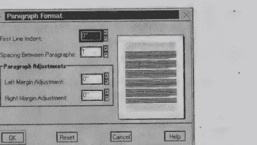

- 3. 在“首行缩进”框中，输入你想缩进每行的距离（通常约为半英寸）。
- 4. 点击确定或按回车键。

搞定！WordPerfect 在每个段落开头添加了那一点点空白，就像你老师教你的一样。看，妈妈——没有用 `Tab` 键！

另一种显示“段落格式”对话框的方法是右键点击标尺上的边距条，并从出现的快速菜单中选择“段落格式”。

无论你选择使用 `Tab` 键还是段落格式，都不要使用空格来缩进段落。在文字处理圈中，这种方法被认为是不雅的。空格的问题在于它们的宽度不同，取决于你使用的字体（有关字体的信息请参阅第 6 章）。制表位的宽度与你在标尺上看到的完全一致。

使用制表位的优势在于，如果你决定以不同的间距缩进段落，只需要将第一个制表位稍微移动一下。然后所有依赖于该制表位的 `Tab` 随之移动。当你执行此操作时，请确保光标位于正确的位置：文档的开头（假设你想这样做）。

当你已经在想要的位置设置了制表位后，就可以开始使用它们了。当你想在从光标位置到下一个制表位之间的区域留出空白时，只需按 `Tab` 键即可。

### 段落开头

当你按下 `Tab` 键时，WordPerfect 会插入各种制表位，取决于制表位的类型。这些代码是左对齐、右对齐、中间对齐...

### 段落之间的间距

你可以告诉 WordPerfect 在文档的段落之间留出额外空间，而在段落的行之间不添加任何空间。这种功能产生的文本看起来就像我们这本书的样子——我们比起首行缩进更喜欢这种效果。去吧 Perpetual老师（她是 Margy 的高中打字老师）。

此过程涉及段落格式设置和“段落格式”对话框的使用。按照以下步骤操作：

- 1. 要更改两个段落（例如），选择你想更改的段落。
- 2. 选择 `格式>段落格式`。
- 3. 在“段落间距”框中，输入段落之间想要的行数。输入 1 表示你不需要额外空间。我们建议输入 1.5，这会在每个段落之间添加一个空白的半行——足以在视觉上区分段落。（听起来像不像我们很专业？）
- 4. 点击确定或按回车键退出对话框。

WordPerfect 会听从你的指令，在每行文本之间添加你请求的垂直空间。

# 第 8 章：完美的页面与出色的文档

## 本章内容

- 设置页面大小
- 调整顶部和底部边距
- 开启新页
- 保持文本不分页
- 页面从上到下居中
- 查看文档的不同视图
- 页面码设置
- 添加页眉和页脚

在前面的章节中，我们讨论了如何让你的字符看起来恰到好处，调整边距和缩进，以及其他烧脑的内容。现在，我们来看**大局**：对整个文档进行格式化。本章将解释如何告诉 WordPerfect 你正计划在什么尺寸的纸张上打印你的杰作；从哪里开始新页；以及在每页的顶部和底部打印什么（如果有的话），例如页码。这种格式化可以将文字处理世界中的高手与平庸者——专家与新手——青蟾与水牛——专业人士与业余爱好者区分开来。

### 设置页面大小

WordPerfect 想要了解关于你文档的所有信息——特别是你计划在什么种纸上打印它。（信头纸？信封？标签？）

Perfect 并不在乎纸看起来什么样；程序无法分辨带有金箔边的压纹手工纸纸和廉价的复印纸；它只是想知道纸的尺寸。


#### 一堂艺术课：肖像与风景

我们在这里中断这本书，上一堂简短的艺术课——特别是关于绘画的形状，这作为文本在纸上打印方式的命名基础。如果你拿着纸张，使其高度大于宽度，然后打印横跨短边方向的文本行，这被称为**纵向布局**（portrait orientation）。这是使用纸张的正常日常方式。另一方面，如果你将纸张侧过来，使其宽度大于高度，并据此进行打印，你就有了**横向布局**（landscape orientation）。根据我们的经验，幼儿通常是这样使用纸张的。

正如你在美术馆的丰富经验中观察到的，人的画像往往比它们高，以便留出空间来包含一张完整的从头到脚的肖像。景点往往比它们宽，以便包含更多的景观和更少的天空。

世界计算机科学家中的许多艺术爱好者决定利用这种情况

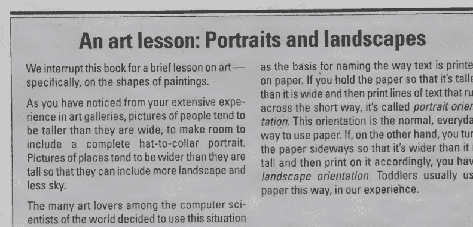

如果你没有提到任何关于纸的说明，WordPerfect 可能假设你将使用常用的：以通常的方式放入打印机的信号尺寸纸。然而，如果你计划侧向打印（横向布局），或者你计划使用法律规定的尺寸纸、信封或任何东西，你最好告诉 Word 这一点。否则，你可能会在边距上遇到麻烦。

要告诉 Word 你计划打印文档的纸张尺寸，请按照以下步骤操作：

1. 按 `Ctrl+Home` 将光标移动到文档开头。

因为纸张大小通常适用于整个文档，请将光标设置在开头。

2. 选择 `文件 (File) > 页面设置 (Page Setup) > 页面大小 (Page Size)`。

WordPerfect 显示纸张对话框：

- A4（欧洲纸，比美国信号纸大一点）
- 信封 COM10（一种普通的商务信封）
- 信封 DL（另一种尺寸信封）
- Legal（法律尺寸纸，比信号纸长）
- Letter（我们的最爱）

无论纸张定义包含 (Portrait)（纵向）还是 (Landscape)（横向）标记，Word 都在告诉你纸张在打印机中的放置方式（参见本章前面的“一堂艺术课：肖像与风景”侧边栏）。

3. 要使用不同的纸张尺寸，点击你想使用的纸张定义。

可用纸张定义（Available Paper Definitions）框中高亮显示的纸张尺寸是你正用于此文档的尺寸。

4. 点击确定（OK）按钮。

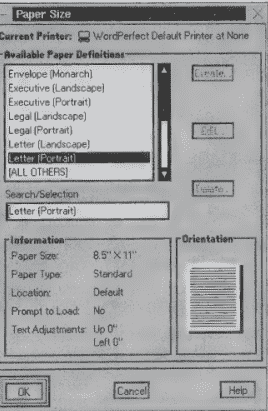

图 8-1：选择打印纸的种类。

如果可用纸张尺寸列表看起来很奇怪，请确保选择了正确的打印机。

对于太宽而无法常规方式放入纸张的文档，使用横向打印，特别是对于具有许多列的表格。此外，当你页面上并排制作文档时，人们总是会发出“噢”和“哇”，这是使用它的另一个好理由。

当你设置纸张大时，WordPerfect 在你的文档中插入一个秘密的 `Paper Sz/Typ` 代码（另一个富有感的代码名称！）。要更多关于这些代码的信息，包括如何删除它们，请看第 9 章。

### 调整顶底部边距

在 WordPerfect 知道你的纸张大小后，它对你的边距有意见。除非你另告诉 WordPerfect，否则它假设整个页面四周都是 1 英寸边距，从纸张边缘测量。我们通常根据自己的喜味找到这个距离，并且通常会更改它——除非我们准备好按页写作，否则这显得太空旷了。

要更改左或右边距，请参考第 7 章。要更改顶部或底部边距，请按照以下步骤操作：

1. 按 `Ctrl+Home` 将光标移动到文档开头。

因为纸张大小通常适用于整个文档，请将光标设置在开头。

2. 选择 `文件 (File) > 页面设置 (Page Setup) > 页面大小 (Page Size)`。

WordPerfect 显示纸张对话框：

- A4（欧洲纸，比美国信号纸大一点）
- 信封 COM10（一种普通的商务信封）
- 信封 DL（另一种尺寸信封）
- Legal（法律尺寸纸，比信号纸长）
- Letter（我们的最爱）

3. 要使用不同的纸张尺寸，点击你想使用的纸张定义。

可用纸张定义框中高亮显示的纸张尺寸是你正用于此文档的尺寸。

4. 点击确定（OK）按钮。


图 8-1：选择打印纸的种类。

当你设置纸张大时，WordPerfect 在你的文档中插入一个秘密的 `Paper Sz/Typ` 代码。要更多关于这些代码的信息，包括如何删除它们，请看第 9 章。

### 保持文本连贯

你对硬分页符发生的位置有完全的控制权，因为它们是由你手动放置的。然而，每当 WordPerfect 决定页面上无法容纳更多行时，它就会插入软分页符。有时它会选择极其糟糕的地方开始新页——事实上，我们怀疑那些时刻存在恶意行为。对于分页符定位糟糕糟糕，有一个专门的技术术语：*bad breaks*（糟糕的分页）。（我们一直认为这是一个很糟糕的滑雪术语。）

### 避免破碎的家庭（孤行与悬挂行）

当一个段落从页面的最后一行开始，导致分页之前只出现该段落的一行时，页面看起来就很糟糕。这种传统的排版禁忌有一个传统的名字：widow（悬挂行，还是 orphan 孤行？）？我们的字典告诉我们这是一种 *orphan*（孤行）。当一个段落的最后一行单独出现在页面顶部时，就发生了 *widow*（悬挂行）。在后院野餐时，通过随机测试让你的朋友惊讶，看看谁知道它们之间的区别。）

幸运的是，你不需要了解这些知识甚至不需要考虑它们，因为 WordPerfect 会替你担心。遵循以下步骤来避免可怕的“糟糕分页”病：

- 1. 按 `Ctrl+Home` 将光标移动到文档开头。

以下命令和生成的秘密代码适用于整个文档。


- 2. 选择 `格式（Format）：保持文本连贯（Keep Text Together）`。

WordPerfect 显示“保持文本连贯”对话框，如图 8-2 所示。

对话框包含三个与分页符定位相关的设置，我们将在本章中讨论这三个设置。然而，你立即关注的是那些孤行和悬挂行。

## 第 8 章：完美的页面与出色的文档

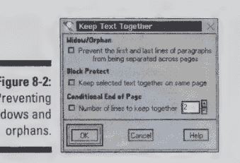

- 3. 点击标记为“防止段落的第一行和最后行跨页分离”的框框；选中时该框应被填充。

此框框位于对话框的“悬挂行/孤行”（`Widow/Orphan`）部分。

- 4. 点击 `确定` 或按 `Enter` 键退出对话框。

WordPerfect 避免让孤行和悬挂行单独留在页面的顶部底部。相反，它会需要将分页符向上或向下移动一行。此外，页面不会完全满；这是你为了家庭凝聚而付出的代价。

当你遵循上述步骤时，WordPerfect 会在你的文档中创建一个 `Wid/Orph:On` 代码。第 9 章描述了必要时如何查看和删除此代码。

# 保持内容的整体性

文档可能包含不应被分页符拆分的信息。例如，如果一个列表格被拆分，看起来会很糟糕，除非它的长度超过一页。你可以选择文档的一部分并告诉 WordPerfect，“不要让任何分页符进入这里！”遵循以下步骤：

- 1. 选择你想要保留的文本。

如果你还不知道如何选择文本，请参阅第 5 章。对于表格，务必包含任何表头或标题。

- 2. 选择 `格式（Format）：保持文本连贯（Keep Text Together）`。

WordPerfect 显示“保持文本连贯”对话框。

- 3. 点击标记为“保持选中文本在同一页”的框框。

此框框位于对话框的“块”（`Block`）部分。

- 4. 点击 `确定` 或按 `Enter`。

# 136 第二部分：美化你的文本

`Block protect`（块保护）听起来像是一个孩子当另一个孩子来时使用的技巧，尽管 WordPerfect 并不是在说那种块。早版本的 WordPerfect 选择文本总是标记块，并且对文本进行任何操作都是块操作。WordPerfect 现在采用了 Windows 模式，需要你选择文本。这是另一个例子。


当你遵循这些步骤时，WordPerfect 在文档中插入两个 `Block` 代码：一个在开头，一个在结尾。

# 保持内容的整体性

具体来说，这意味着让标题与其后的文本在一起。（你是在想完美的页面对吧？除非你小到不记得。）让标题孤落在页面底部，而后续文本从下一页开始是不体面的。与通过在文档开头发布命令来防止孤行和悬挂行不同，你必须为你想要与后续文本保留的标题单独发布命令。（解决这种讨厌情况的方法是使用样式格式化标题；如果你感兴趣，跳到第 10 章。）

为了防止 WordPerfect 将标题与其正文分离，请执行：

- 1. 将光标移动到包含标题的行的开头。

- 2. 选择 `格式（Format）：保持文本连贯（Keep Text Together）`。

WordPerfect 显示“保持文本连贯”对话框（参考图 8-2）。查看对话框的“分页结束”部分。

- 3. 点击标记为“保持连贯行数”的框使其被填充。

它位于“分页结束”部分。

- 4. 在框中输入数字。

要将标题和随后的前两行保持，输入 3。如果你使用空行将标题与文本分开，可能需要输入 4。

- 5. 点击 `确定` 或按 `Enter` 退出对话框。

如果标题和随后的前几行无法放入底部，WordPerfect 现在会将整个部分移动到下一页顶部。

## 第 8 章：完美的页面与出色的文档

当你遵循这些步骤时，WordPerfect 在你的文档中插入 `CEOP`（分页结束）代码。如果你使用样式格式化标题，可以在标题样式中插入 `CEOP` 代码以避免全文档出现（参见第 10 章了解更多信息）。

不要在文档中使用过多的 `Block Protect` 和分页结束代码，否则 WordPerfect 在寻找放置分页符的地方会非常痛苦。放轻松点！

# 从上到下页面居中

当你为文档创建标题页时，如果标题出现在页面中间（上下和左右），效果会很好。第 7 章讨论了如何在左右页边距之间居中文本。（噢，对了：选择要居中的文本并按 `Ctrl+E`）。以下步骤显示了如何垂直居中标题。虽然可以在标题上方多次按 `Enter`，但这不是好主意。让 WordPerfect 将你的标题放在准确的位置。

- 1. 将光标移动到包含要居中文本的页面顶部（大多数情况下，是文档的第一页）。

- 2. 选择 `格式（Format）：居中（Center）`。

WordPerfect 显示“页面居中”对话框，如图 8-3 所示。

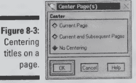

- 3. 要居中此页，选择当前页（`Current Page`）。

- 4. 点击 `确定` 或按 `Enter`。

WordPerfect 将页面上的文本向上向下移动到中心。

你可以通过查看应用程序栏上的 `Ln` 测量值判断页面文本的垂直位置。

# 138 第二部分：美化你的文本

要取消页面居中，将光标移动到页面顶部，选择 `格式（Format）：居中（Center）` 显示“页面居中”对话框，并选择“不居中”。

当你对当前页居中时，WordPerfect 非常简单地插入秘密 `Cntr Pg` 代码。对当前及后续页居中会产生 `Cntr Pgs` 代码。第 9 章告诉你如何自己查看这些魔法代码。如果你能处理它们，双击 `Cntr Pg` 或 `Cntr Pgs` 代码显示“页面居中”对话框，以便你可以更改设置。


# 查看文档的不同视图

WordPerfect 可以从多个角度显示你的文档，取决于你希望视图与打印页的接近程度。此列表显示了你可以选择的不同视图：

- `草稿（Draft）`：分页符以横跨文档的水平线出现，你无法看到顶部或底部边距、部分满页面的额外空间、页眉、页脚或页码。

- `页面（Page）`：WordPerfect 显示页面外观，包括所有边距、页眉和页脚。分页符看起来像页页之间的空白。文本的大小取决于缩放设置。

- `网页（Web Page）`：你可以大致看到页面在 浏览器（你用来查看万网网页的程序）中显示的方式。当你使用此视图时要小心；WordPerfect 会警告你某些格式可能会丢失。

要切换这些视图，请从菜单栏选择 `视图（View）`，然后选择 `草稿`、`页面` 或 `网页`。

## 页码

当你有一份超过一页的文档时，你可能想为页面进行编号。没有什么比一叠没有页码且弄乱（或可能已经弄乱）的纸张更让人心疼了。别看起来像个呆瓜；给你的页面加上页码。

出于某种奇怪的原因——可能是软件历史上的某个怪癖——WordPerfect 不仅有一种，而是有两种页码方法（我们为什么要用惊讶的语气说？WordPerfect 似乎做任何事情都有两种方法）。下面的列表显示了这两个方法：

- 使用 `Format:Page Page Number:Number` 命令告诉 WordPerfect 开始页码。你可以告诉 WordPerfect 码应该出现的位置，还可以输入其他文本（例如今天的日期或文档标题）将其与页码包含在一起。

- 使用 `Insert:Header/Footer` 命令定义页头或页脚，页脚可以包含页码。

这两种方法是相似的，我们稍后会讨论页头和页脚。接下来的步骤展示了如何使用第一种方法为你的页面编号：

1. 将光标移动到你想开始页码的页面顶部。例如，如果你那份高雅的文档有一个封面，你可以从下一页开始编号。

2. 选择 `Format:Page Page Number:Number`。WordPerfect 显示“页码”对话框，如图 8-4 所示。

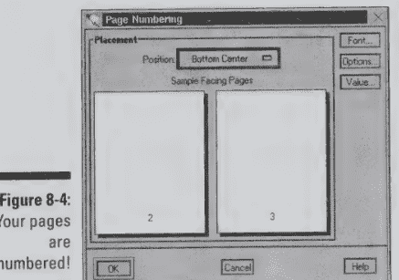

3. 告诉 WordPerfect 在哪里打印页码。

点击 `Position` 框。你会看到长长的选项列表，分为三组：无页码（`No Page Numbering`）、顶部（`Top`）和底部（`Bottom`）。在顶部和底部组中，你可以选择左侧（`Left`）、居中（`Center`）、右侧（`Right`）或交替（`Alternating`）。交替选项并不意味着你和你的朋友搞混了比基尼——它表示页码出现在奇数页的右侧，出现在偶数页的左侧，反之亦然。交替模式非常适合纸张双面打印的文档（例如本书），因为页码出现在每页的外侧边缘。

幸运的是，你不需要记住每种编号格式是什么。在你选择一种格式后，只需查看对话框底部的页码格式示例即可。这难道不很酷吗？

4. 如果你想让页面显示“Page”字码或其他文本，请点击 `Options` 按钮显示“页码”对话框。

如果简单的、无装饰的页码就能满足你，请直接跳到第 7 步。

5. 在 `Format and Accompanying Text` 框中输入你想出现在页码旁边的文本。

最简单的方法是在 `[Pg #]` 代码前输入单词 *Page* 并加一个空格。

6. 点击 `OK` 返回“页码”对话框。

WordPerfect 会在示例的对齐页上显示页码的预览效果。

如果你想让页码以不同的字体显示，点击 `Font` 按钮并选择出现的字体和字号（这看起来和我们在第 6 章中描述的字体对话框非常相似）。然后点击 `OK` 返回“页码”对话框。

7. 点击 `OK` 退出此对话框。

WordPerfect 现在会在此页以及文档中的所有后续页面上打印页码——甚至是你以后添加的页面。

当你告诉 WordPerfect 为页面编号时，它会在页面顶部添加一个隐藏的 `Pg Num Pos` 代码。（有关隐藏代码的信息请参见第 9 章。）


## 第 8 章：完美的页面与出色的文档

### 给所有罗马数字爱好者

你不需要使用无聊、平庸的阿拉伯数字作为页码。例如，你可以使用小罗马数字为报告的引言部分编号。要告诉 WordPerfect 使用哪种类型的数字（罗马数字或阿拉伯数字），请遵循以下步骤：

1. 将光标移动到你想开始编号的页面顶部。

2. 选择 `Format:-Page:-Page Numbering:-Numbering`。你将看到“页码”对话框，如图 8-4 所示。

3. 点击 `Options` 按钮显示“页码选项”对话框。

4. 找到 `Page` 标签并点击右侧的按钮。会出现一个编号选项列表，包括普通（阿拉伯数字）、罗马数字和字母。

5. 选择一种数字样式。当你做出选择后，它会出现在 `Page` 框中。

6. 点击 `OK` 进入“页码选项”对话框，再次点击 `OK` 退出“页码”对话框。

### 停！不要手动输入那个页码！

众许多未经训练的文字处理新手会在每页的底部输入页码。稍加思考你就知道为什么这是一个糟糕、恶劣且荒唐的主意了。如果你在每页底部插入一条线并手动输入页码，当某项重要更新需要你在第 1 页插入额外的行时，该怎么办？突然，原本出现在页面底部的页码会向下移动，打印出后续页顶部的几行。真是一团糟！

这个故事的教训是“永远不要手动输入页码”。务必使用页头和页脚来实现。


## 第二部分：美化你的文本

### 从 1 开始重新计数

如果你想让页头页脚从文档某处开始，请移动到你想更改的页面顶部。遵循以下步骤：

- 将光标移动到你想开始编号的页面顶部。

- 选择 `Format:Page Numbering:Numbering`。WordPerfect 显示“页码”对话框。

- 点击 `Value` 按钮。在 `New Page` 框中输入你想要的数字。

- 点击 `OK` 退出“页码”对话框。

### 添加页头和页脚

在本章中，我们提供了编号的所有细节——一行文本、整个段落，甚至是图片。页头页脚酷的地方在于它们可以包含几乎任何内容。


## 创建页头或页脚

由于需要不同的页脚（例如双面打印时），你可以为偶数页打印不同的页头和页脚。

1. 选择 `View:Page` 切换到页面视图，这样你就可以看到创建的页头页脚了。页头页脚在“稿模式”下是不可见的。

2. 按 `Ctrl+Home` 回文档开头。如果你想让页头页脚从文档某处开始，请移动到你想显示页头页脚的第一页顶部。

3. 选择 `InsertHeader/Footer`。你会看到“页头/页脚”对话框，如图 8-5 所示。


4. 选择你想创建的页头或页脚。如果你计划在整个文档中使用一个页头或页脚，选择 `Header A` 或 `Footer A`。如果你计划使用两个页头页脚（例如双面打印时），选择 A 或 B。

5. 点击 `Create` 按钮。这一步告诉 WordPerfect 在你的文档中插入一个新的隐藏页头或页脚代码。WordPerfect 在顶部（页头）或底部（页脚）添加一个由灰色线条勾勒出的空白区域，如图 8-6 所示。

## 144 第二部分：美化你的文本

（用于页脚）页面的；你可以在这一行开始输入你的页眉或页脚。注意，页眉和页脚有它们自己的指南。你可以拖动除页眉顶边距以外的所有部分（你必须更改页面的顶边距）或页脚底边距以外的部分（你必须更改页面的底边距）。

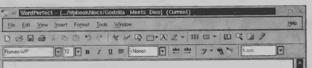

草稿 8-6：输入一个出现在文档每页的页眉。

草稿 - 机密                                               2000年12月4日

金刚对上小紫色恐龙

作者：David Kay

霍凯博士的东京实验室在经历了另一场食物大战后，看起来像是萨尔瓦多·达利想象中的时代广场。从每面墙上滴落的胶状物块和垂挂的无形物体覆盖在了一切上面。破碎金属罐附近的胶状物正从一块看起来像是大金刚的肉上冒着蒸汽。


提示 要跳过文档第一页的页眉或页脚打印（常用技术），请移动到文档开头。你可以告诉 WordPerfect 抑制在第一页打印页眉和页脚；此过程在本章的稍后部分描述。

你可以在文档中拥有多个页眉 A、页眉 B、页脚 A 或页脚 B。如果你认为这种安排会引起困惑，那就用右；不要使用它。

你可以在创建页眉或 A 之前创建页眉 B 或页脚 B；WordPerfect 并不在乎。另一方面，你可能会感到困惑。我们通过只使用一个页眉或页脚来坚持使用 A。如果你同时使用两个（页眉 A 和页眉 B），一个会打印在另一个上面。正如本章稍后解释的，通过为奇数页定义一个页眉或页脚，偶数页定义另一个可以避免这个问题。

当你创建页眉或页脚时，WordPerfect 会插入一个名为 `Header A`（或你选择的任何页眉或页脚）的秘密代码。该代码包含出现在页眉或页脚中的所有文本，包括格式。要查看或删除此代码，请参考第 9 章。

## 在页眉或页脚中输入文本

在创建页眉或页脚后，你的工作是输入你想出现在其中的文本。为了帮助你，Word 在属性栏上添加了几个项目。查看图 8-7 所示的更改。

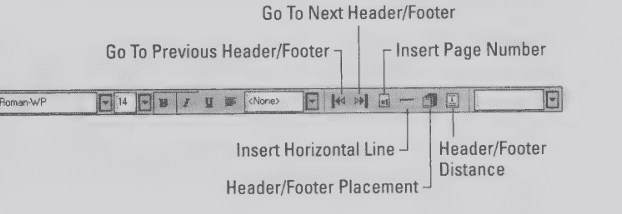

Word 添加到文档中的新行（见前一节的第 5 步）并不是普通的新行——它位于一个特殊区域，该区域包含页眉或页脚的文本。你不能使用光标控制键在页眉或页脚区域与文档其他部分之间移动。你可以使用鼠标点击你想编辑的地方；此操作将允许你在编辑普通文档和你的页眉或页脚之间切换。

## 标准的三部分页眉

如果你想在左边距处放置一些文本、居中显示一些文本，并在右边距处放置一些文本，你可以告诉 Word 对页眉部分进行居中右对齐。例如，你可以在左边距打印文档标题，在页眉中心打印页码，在右边距处打印今天的日期。

边距，（例如，打印为 2000/12/25），选择 `Format::LineFlush Right` 并继续输入。

你可能会发现左对齐的文本被该文本的居中部分覆盖，而居中部分又被右对齐的文本覆盖。这种情况的发生是因为你告诉 Word 把这些文本放在哪里，而由于愚蠢，它将完全按照你所说的去做。如果没有足够的空间将每项内容放在其所在位置，那不是 Word 的问题。你唯一的选择是让左侧文本、居中文本或右侧文本短一点。

要让页眉如你意的那样，从位于左边距的内容开始；例如《巧克力完整史》（*The Complete History of Chocolate*）。当你到达想要居中的部分时（例如第 536 页），选择 `Format::Line::Center` 命令并在行的中心开始输入。当你到达想要靠右侧对齐的部分时

## 146 第二部分：美化你的文本

当你编辑页眉或页脚时，WordPerfect 确实希望你专注于正在做的事情。当你编辑页眉或页脚时，工具栏上的某些按钮和某些菜单命令会变得且无法使用。因此，在编辑页眉或页脚期间，你无法使用工具栏上的“新建”、“打开”、“保存”和“打印”按钮或其相应的菜单命令。C'est la vie（生活如此）。

如果你的页眉或页脚区域还没有文本，请在其中输入一些文本。

- 1. 将光标移动到页眉或页脚区域，

你可以判断出你正在编辑页眉或页脚，因为属性栏获得了图 8-7 所示的页眉/页脚按钮。你也可以通过查看 WordPerfect 窗口的标题栏判断。标题栏不仅显示你正在编辑的文档名称，还显示你正在处理的页眉或页脚名称（例如，`Zuke_soup.wpd - [Header A]`）。

- 2. 输入文本..

在你的页眉或页脚区域输入一些文本，如果那里还没有的话。

你可以判断你正在编辑页眉或页脚，因为属性栏获得了图 8-7 所示的页眉/页脚按钮。你也可以通过查看 WordPerfect 窗口的标题栏判断。标题栏不仅显示你正在编辑的文档名称，还显示你正在处理的页眉或页脚名称（例如，`Zuke_soup.wpd - [Header A]`）。

- 2. 输入文本..


你可以控制字体、字体大小和文本样式，就像控制文档其他部分的一样。如果你想让页眉或页脚包含多行，请按通常方式操作。如果你想让页眉或页脚包含当前日期，请按回车键。

你问页码怎么办？啊哈！是时候使用属性栏上的按钮了，当你进入页眉或页脚时神奇地出现了。

- 3. 为了在页眉或页脚中包含页码，将光标移动到你想放置页码的地方，点击属性栏上的“插入数字”按钮。

这个按钮有一个小小的 `#`。当你点击它时，会弹出一个菜单。

- 4. 选择“页码”（正如你所猜的样）。

- 5. 点击文档中页眉或页脚以外的任何地方回到正文。

当你输入文本时，WordPerfect 会将它们放在页面的顶部和底部边距。如果你不想为页眉或页脚留出空间，请这样做。

如果你想让页眉或页脚包含线条、框框甚至图片，请参第 15 章。


## 第 8 章：完美的页面和精美的文档

你可以使用与文档其他部分相同的命令格式化页眉和页脚中的文本。这些命令在菜单中可能呈灰色显示，这是 WordPerfect 委婉提示你无法选择这些命令。

如果你看不到页眉或页脚，你可能正在使用“草稿”视图，在该视图下它们是不可见的。选择“视图-页面”切换到页面视图。

### 控制页眉和页脚的打印位置

在你创建页眉或页脚并输入文本后，你可以告诉 WordPerfect 打印页面。编辑页眉或页脚时，点击属性栏上的“页眉/页脚位置”按钮，该按钮上有一个三页纸的图标。WordPerfect 显示“位置”对话框，如图 8-8 所示。选择“奇数页”、“偶数页”或“每页”，并点击“确定”。

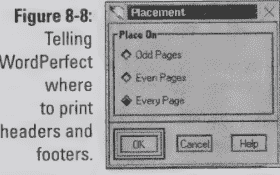

> “不要在这里打印！”

你可以告诉 WordPerfect 不要打印你刚刚费力创建的页眉或页脚。你为什么要这样做呢？我们可以考虑到这两个非常合理的理由：

- 你不想在文档的第一页打印页眉。例如，当你写信时，你可能希望除第一页以外的所有页面都带有一个写着“Joe Jones，2000年9月8日”的页眉。第 2 页（带有正确的页码）。因此，你想抑制某一页的页眉或页脚。

- 你的文档可能有两个或多个节，你可能只想在第一节使用页眉或页脚。你可以取消文档其余页面的页眉或页脚。

### 抑制页眉或页脚

要抑制页眉或页脚的打印，你需要告诉 WordPerfect 在特定页面跳过打印。若要抑制某一页的页眉或页脚，请按照以下步骤操作：

- 将光标移动到不想打印页眉或页脚的页面。确保光标不在页眉/页脚区域内。

- 选择“格式(Format)：页面(Page)：抑制(Suppress)”。WordPerfect 会显示抑制对话框，如图 8-9 所示。

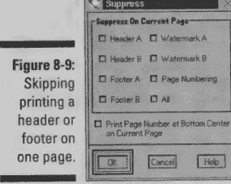

- 选择不想打印的页眉或页脚。你可以选择任意数量的项目。如果你不想在该页显示任何页眉、页脚、水印或任何内容，请勾选“全部(All)”复选框。点击“确定”。

页眉或页脚将从页面消失，但在下一页重新出现。

当你抑制某一页页眉或页脚的打印时，WordPerfect 会在页面顶部创建一个名为 `Suppress` 的隐藏代码。

### 停止页眉和页脚

要停止打印页眉或页脚，你需要告诉 WordPerfect 永久停止打印此页眉或页脚。请按照以下步骤操作：

- 移动到不想打印页眉或页脚的第一页。

- 选择“插入(Insert)：页眉/页脚(Header/Footer)”显示页眉/页脚对话框。

- 3. 选择你想停止的页眉或页脚。你只能选择一个。如果你想停止所有项，必须对每一项重复这些步骤。（唉。）

- 4. 点击“停止(Discontinue)”按钮。

对话框会随着字节流消失，该页面以及文档中所有后续的页眉或页脚也会随之消失。

当你停止页眉或页脚时，WordPerfect 会插入一个名为 `End Header A`（或你选择的页眉/页脚）的隐藏代码。要查看或删除此代码，请参第 9 章。

停止页眉或页脚后，你无法将其重新开启。要取消停止（即撤销之前的步骤），你必须删除隐藏的结束代码。如果你只是想跳过每页的页眉或页脚打印而不是永久停止。

### 移除页眉或页脚

如果你改变了对页眉或页脚的主意并想彻底删除它们，可以删除其内容。（当特殊指南消失时，你就知道成功了。）你也可以删除定义页眉或页脚的隐藏代码。第 9 章将告诉你如何查找并终止不再需要的代码。

# 第 9 章

## WordPerfect 密码环

### 本章内容

- 了解什么是隐藏格式代码

- 使用字符代码

- 处理字符格式代码

- 撤销句子和段落格式

- 撤销页面和文档格式

- 查找代码

- 自动替换代码

- 将代码放归位

- 使用神秘代码

在处理了一段时间 WordPerfect 文档后，它可能会产生奇怪的怪癖和烦人的毛病。你甚至可能怀疑文档被附魂了，并考虑寻找当地的“字节驱魔”。WordPerfect 的这种神秘行为有一个简单的解释：到目前为止，你还没有看到“全貌”。

与前面的章节一样，WordPerfect 文档的内容比表面看到的要多。为了实现所有令人印象深刻的格式技巧，WordPerfect 在你的文档中散布隐藏而强大的代码（或格式代码）。如果这些代码变得混乱，你的文档也会变得一团糟。

理想情况下，你不应该应该看到这些代码。毕竟，你并不在乎 WordPerfect 是如何操作的——你只想让它们完成。然而，这是现实世界，在现实中，事情会出错——有时是错得非常离谱。某些时候，你必须学会卷起袖子，面对那些 WordPerfect 代码并修复它们。解决方法并不算糟糕；你甚至不需要弄脏了手。

### 什么是隐藏格式代码？

WordPerfect 代码是 WordPerfect 插入到文档中的特殊对象，用于开启或关闭特殊功能。在文档中插入代码的常用方法是选择格式命令或点击格式按钮。WordPerfect 将代码与你的文档一起保存。

WordPerfect 有三种类型的代码：字符代码、单条代码和成对代码。（这些术语是我们自造的。）我们将在本章后后详细描述每种代码，并告诉你如何识别它们及其作用。以下列表简要描述了代码类型：

- **字符(Character)**：代表特殊字符，如制表符（`Tab`）；某些代表键盘上的按键，其他（如缩进 `Indent`）。

- **单条(Single)**：开启格式功能。例如，左边距（`Left Marg`）和右边距（`Right Marg`）代码设置从代码所在位置开始的左右边距。该格式代码在文档的剩余部分生效，直到 WordPerfect 遇到另一个相同代码的出现。

- **成对(Paired)**：成对出现（你猜对了，我们知道）。WordPerfect 还称这些代码为可逆转代码——谁知道那个小术语是从哪儿来的？成对中的第一个代码开启某功能，第二个代码关闭它。例如，**粗体(Bold)** 代码就是成对的：一个用于开启加粗，另一个用于关闭。两个代码之间的文本为加粗字体。

### 查看代码

“这套代码的事儿真令人兴奋，”你说。“这些代码都在哪儿？”

另一种方法是在文本上点击右键，并选择“显示代码(Reveal Codes)”。如果你使用 `Shift+F3` 或 `Ctrl+F3`，可能会生效，如图 9 所示。

### 理解代码

一条分割线将普通窗口与显示代码窗口隔开，在分割线的右侧附近会出现一个小框。使用鼠标时，你可以点击该框并向上或向下移动分割线。

### 移除显示代码窗口

当你查看完代码后，可以让显示代码窗口消失。毕竟，看着代码在屏幕底部跳动确实有点让人分散注意力。使用以下方法之一将显示代码窗口送回字节的遗忘中：

### 给 Microsoft Word 用户的说明

如果你使用过 Microsoft Word，你可能会好奇 WordPerfect 的“显示代码”（Reveal Codes）命令是否与 Word 中的“域代码”（Field Codes）命令有什么关系。简而言之：没有。

因为 Word 不使用代码进行格式设置，所以它的“域代码”功能不会向你显示任何关于字体、页边距、页面布局等信息。相反，Word 代码提供了一种包含受 Word 程序控制的文本的方法——例如今天的日期，Word 可以自动更新该日期。某些 WordPerfect 代码可以做到这一点（请参阅第 22 章了解如何创建一个打印今天日期的代码），尽管大多数代码并没有。因此，在 Word 中进行编码（通过勾选“工具→ 选项”对话框中“视图”选项卡上的“域检查”复选框）显示的代码会少得多；许多 Word 文档不包含代码。

### 查看代码细节

某些代码包含比你想象的要多多的信息。例如，你可能会文档开头看到 `Header A`；此代码表示你定义了一个页眉。要查看有关此代码的更多细节，将光标直接置于代码之前。（记住，光标显示为一个小红框。）突然，代码会展开，直到显示为 `Header A: Every Page, Chocolate in the Workplace`。许多代码包含的信息比肉眼看到的要多；将光标放在代码前面即可查看它的具体内容。

### 修改代码

若要更改代码，请尝试在“显示代码”窗口中双击它。这告诉 WordPerfect 你想对该代码进行某些操作，而 WordPerfect 会尝试猜测该操作是什么。如果你最初是使用对话框插入代码的，WordPerfect 会再次显示相同的对话框。例如，如果你双击一个 `Para Spacing`（段落间距）代码，WordPerfect 会弹出“段落格式”对话框，其中显示了你在创建代码时指定的数值。（此功能相当相当用。）如果你更改了对话框中的信息并点击确定，WordPerfect 将更新代码以匹配更改。

### 硬代码与软代码

WordPerfect 的许多代码都有两个版本：一个硬的，一个软的。这个术语与成熟度、使用的材料或任何我们无法在像这样的 G 级书籍中提到的内容无关。不，它与 WordPerfect 对待它们的严肃程度有关。

例如，当你编辑段落中的文本时，WordPerfect 会需要将 `SRT` 代码转换为空格（反之亦然），以确保页边距正确。然而，它绝不会删除 `HRT` 代码。（请参阅本章稍后的“使用字符代码”部分，以了解 `HRT` 和 `SRT` 的作用。）

WordPerfect 会插入一个软代码，也可以直接将其取出。程序会不断打乱代码的位置。当……

### 删除代码

每个代码的位置都非常重要，位置错误的代码会让人头疼。如果你看到某个看起来像迷失在森林里的代码，你可以把它删掉。将光标移动到代码前面并按 `Delete` 键，或将光标移动到代码正后并按 `Backspace`（退格）键。或者，简单地将代码拖到顶部的窗口中，它就会在白天的阳光下蒸发。

当“显示代码”窗口未显示时，当你按下 `Delete` 或 `Backspace` 键时，WordPerfect 会跳过大多数代码，以免你不小心删除代码。然而，当代码显示出来时，WordPerfect 会确保你能看到自己在做什么，当你按下 `Delete` 时，它会删除红色光标右侧的代码。

在对代码进行任何更改之前，请保存文档（按 `Ctrl+S`），因为处理这些代码工作很容易搞得一团糟。如果你在退出前保存了文档，只需关闭那个乱成糟的文件（点击“关闭”按钮或从菜单栏选择“文件> 关闭”并选择“否”来放弃你那些不明智的更改），然后重新打开原始文件（从程序窗口的菜单栏进入）即可。

在在你知道如何查看并处理这些代码之前，我们需要查看这些代码的类型。当你按下 `Delete` 时，它会删除红色光标右侧的代码。

### 使用显示代码

在文档开头，你可能会注意到一个神秘的显示代码。WordPerfect 不允许你删除此代码。它告诉 Word，除非你插入代码，否则它应该格式化设置。现在你已经知道了如何查看并处理这些代码，是时候看看代码的类型了。

### 使用字符代码

文档中最常见的代码是回车（行结束）代码，包括列表中的：

- `SRT`：WordPerfect 在到达右边距时自动插入的字符；通常被称为软回车。（参见前文的“硬代码与软代码”部分以了解。）

- `HRT`：WordPerfect 在按下回车键时自动插入的字符以指示段落结束；称为硬回车。

WordPerfect 包含了几十种其他代码。列表显示了一些常用的字符代码：

- `Left Tab`：当你按下 `Tab` 键移动到左制表位时会看到此代码。（第 7 章讨论了制表位）。当你按下 `Tab` 键移动到另一种制表位时，你会得到 `Right Tab`、`Center Tab`、`Dec Tab`，…… `Right Tab`、`Center Tab` 或……

- `Hd Back`：按下 `Shift-Tab` 时产生的“倒制表”代码（参见第 7 章关于悬挂缩进的章节）。

- `HPg`：你通过按 `Ctrl-Enter`（或选择“插入> 新页”）产生的分页符。

- `SRT-SPg` 和 `HRT-SPg`：当 WordPerfect 因为页面已满而插入软分页符时，它可能还会插入这些代码之一。（不用担心两者之间的差异。）

- `Auto Hyphen EOL` 和 `TSR`：如果你使用 WordPerfect 的自动连字符功能（参见第 7 章），当 WordPerfect 在右边距处断开单词时，它会插入这两个代码。首先，你看到 `Auto Hyphen EOL` 是行结束的术语；然后你看到 `TSR`（可能是临时软回车？）。

你可以删除这些任何代码来移除它们所代表的字符。

### 处理字符格式代码

第 6 章展示了如何从七方面格式化文档中的字符。每当你使用字符格式时，WordPerfect 产生一系列秘密代码。大多数代码都是成对的，标记要格式化文本的开始和结束。此列表显示了可能看到的某些字符格式代码：

- **Bold**：一对代码包裹粗体文本。

- *Italics*：同样，这些代码围绕斜体文本。（那些 WordPerfect 的家伙会不会拼写吗？）

- **Under**：这些代码出现在下划线文本周围。

- **Font Size**：单独的代码会从其位置开始更改字体大小，直到文档结束或遇到 `Font Size` 代码。一对 `Font Size` 代码也可以包裹不同大小的文本。

- **Font**：同样，一个 `Font` 代码（或一对 `Font` 代码）会更改字体（字体）。

为什么不呢？因为新文本是在**粗体**代码结束之后输入的。如果不使用“显示代码”（Reveal Codes）窗口，很难判断光标是在一对格式代码的内部还是外部。

某些类型的格式显示在工具栏和属性栏上。例如，当光标在粗体文本中时，“粗体”按钮看起来被按下了。同样，属性栏上的“字体”和“字体大小”按钮会告诉你光标所在文本的字体和大小。然而，为了万无一失，你必须使用“显示代码”窗口。

如果你的格式代码出现在了错误的位置，你可以删除它们并重新创建。或者，你可以使用剪切和粘贴命令（参见第 5 章）来移动文本，使代码处于正确的位置。由于这种操作看起来看起来很奇怪且可能很复杂，在尝试这种“代码杂技”之前，请务必先保存文档。

### 取消句子和段落格式

在第 7 章中，你尝试了文档的页边距和制表位，以及一些一次性影响整个段落文本的操作。正如你可以想象到的，每当你使用这些格式命令之一时，WordPerfect 都会插入一个隐藏代码。此列表显示你可能会遇到的代码：

- `Tab Set`（制表位设置）：设置你在标尺上看到的所有制表位设置。即使你更改了其中一个停止位，`Tab Set` 代码也会存储所有停止位的位置。该代码属于段落开头——绝不会出现在行中间。

- `Hd Left Ind`（左缩进）：当你按下 `F7` 键或选择“格式<段落>缩进”时得到的缩进字符。

- `Hd Left Ind` 和 `Hd Back Tab`（左缩进和反向制表）：用于悬挂缩进。当你创建悬挂缩进时，WordPerfect 会插入两个代码：首先，它插入一个 `Hd Ind` 代码，使段落的所有行都缩进；然后它插入一个 `Hd Back Tab` 代码，使段落的第一行不缩进。这种做法并不优雅，但有效。

- `Hd Center on Marg`（页边距内居中）：在左右边距之间将某一行水平居中。

- `Hd Flush Right`（右对齐）：将文本推向右边距。

- `Hyph`（连字符）：表示你开启了连字符功能。

你可能会看到以下代码单独出现，或成对出现。如果你只看到一个，它将设置文档其余部分的格式，直到你遇到另一个同类型的代码。如果你看到成对代码，它们将设置这对代码所包围文本的格式。此列表简要描述了这些代码：

- `Lft Marg` 和 `Rgt Marg`（左边距和右边距）：在代码所在的位置设置文档的左右边距，属于段落开头

- `Just`（对齐方式）系列代码：告诉 WordPerfect 如何在左右边距之间对文本对齐

- `Ln Spacing`（行间距）：设置行与行之间的间距

你可以删除这些任何代码来移除文档中不想要的格式。当格式代码成对出现时，你可以删除其中的任意一个；然后它们就会消失。

### 取消页面和文档格式

某些影响整页或整个文档的代码出现在文档开头，或者至少在页面顶部。这种安排使得它们在“显示代码”窗口中更容易找到。要取消由这些代码控制的格式，只需删除该代码即可。

第 8 章描述了格式化页面和整个文档的命令。此列表显示了我们描述的命令所创建的代码：

- `Paper Sz/Typ`（纸尺寸/类型）：设置文档的纸张大小和纸张类型。

- `Top Mar` 和 `Bot Mar`（上下边距）：设置顶部和底部边距。

- `Cnt Cur Pg`（当前页居中）：将当前页在上下边距之间居中。

- `Wid/Orph`（孤行孤节）：告诉 WordPerfect 如何处理孤行和孤节（我们在第 8 章关于保持文本在一起的部分描述它们）。

- `Condl EOP`（条件页末）：告诉 WordPerfect 将最后几行保留，不要用分页符将它们分开。


- - Block Pro（块）：包含不应被分页符分割的文本。此代码应始终成对出现。

- - Pg Num Pos（页码位置）：告诉 WordPerfect 在哪里打印页码。

- - Header A, Header B, Footer A 和 Footer B：定义 WordPerfect 在每页顶部和底部打印的内容。当你延续页头时，你的代码名为 Header A End、Header B End、Footer A End 和 Footer B End。当你抑制页面页头或页脚打印时，WordPerfect 会在页面顶部插入一个抑制（Suppress）代码。

# 第 9 章：WordPerfect 解密环

## 查找代码

“显示代码”窗口并不是易读性的典范，“用户友好”更不是它的代名。（天知道它比 WordPerfect 早期版本的“显示代码”窗口有了巨大的改进。那个窗口看起来像是奇怪的代数与某种电路图的结合。）

使用“显示代码”窗口的主要困难在于找到你需要的代码。因为行尾与普通窗口中的行尾并不对应，你可能会对自己所在的位置感到困惑。

让 WordPerfect 的查找替换命令上场吧！（我们在第 5 章中描述了它。）除了使用查找替换对话框查找文本外，你还可以用它来查找代码。

你有两种方式告诉 WordPerfect 查找代码。这两种方法都很有用：

- **Codes（代码）：**告诉 WordPerfect 要查找的代码类型——例如，左边距（Left Mar）代码。当你想知道文档边距发生了什么时，这种方法非常有用。
- **Specific codes（特定代码）：**告诉 WordPerfect 要查找的精确代码（例如，将左边距设置为 0.5 英字的 Left Mar 代码）。如果你决定将 1/2 英寸边距改为 1/4 英寸且对任何其他边距设置不感兴趣，这种方法很有用。你还可以自动替换所有的 1/2 英寸边距代码为 1/4 英寸边距代码；参见本章后面的“查找特定代码”。

由于两种方法同时调用两个对话框，你的屏幕可能会看起来像一幅达达主义绘画。如果有勇气，尽管尝试一下。

### 查找所有同类型的代码

要找到文档中所有同类型的代码（例如，所有的 Tab Set 代码，无论它们包含的制表位位置如何），请遵循以下步骤：

1. 将光标移动到文档开头或你想搜索的文档部分的开头。
2. 选择 编辑:查找和替换（Edit:Find and Replace）或按下 `F2`。
3. 从此菜单栏选择“匹配：代码”（Match:Codes）。
4. 选择 `Tab Set` 代码，例如。
5. 在“查找代码”框中点击“插入”（Insert）。
6. 点击“查找代码”框中的“关闭”按钮。
7. 点击查找替换对话框中的“下一个”（Next）。

WordPerfect 查找代码或多个代码，并将光标移动到“显示代码”窗口中代码的右侧。

当你显示查找替换对话框时，它的查找框包含你上次搜索的信息。因为查找框的内容被选中了，插入的任何内容都会替换旧内容。如果你不想再次搜索，也可以删除这些信息。

有关使用查找替换对话框的更多信息，请参见第 5 章。

是搜索代码的一些实用提示：

- 要反向搜索文档，请点击查找替换对话框中的“上一个”（Find Prev）。
- 在“查找代码”框列表中，前 16 个代码名称以标点符号开头，例如 ...Left Tab（带有引导线的左制表位）。在这些代码之后，其他代码按字母顺序排列。要在“查找代码”框中定位带 T 的代码，请使用滚动条向下。
- 如果你计划继续在文档查找代码（或文本），可以在编辑文档时保持查找替换对话框开启。这种做法比每次都打开和关闭对话框要快，尽管会让屏幕很乱。你可以通过点击并拖动标题栏将查找替换对话框移动到屏幕不碍的地方。
- 如果你计划查找不同的代码，也可以保持“查找代码”框开启。在完成之前不要点击它的关闭按钮。
- 搜索代码序列也是如此，例如，WordPerfect 使用两个代码 `Hd Left In` 和 `Hd Back Tab` 来创建悬挂缩进。要按此顺序搜索这种代码组合，请在查找框中选择 `Hd Left In`，点击“插入”，然后从列表中选择 `Hd Back Tab` 并点击“插入”按钮。这两个代码出现在查找框中。当你点击查找替换对话框中的“下一个”按钮时，WordPerfect 会查找该代码序列。

### 164 第二部分：美化你的文本

✔ 你也可以搜索代码和普通字符的混合体。例如，要搜索一个制表符后跟一个星号，可以使用“查找代码”对话框，在“查找代码”框中出现 `[Tab（全部）](Tab (all))` 然后输入星号。

### 查找特定代码

WordPerfect 有另一种方法查找包含附加信息的代码。页边距代码（margin code）包含额外信息，例如你想要的页边距大小。相比之下，粗体代码（Bold code）不包含任何其他信息。对于包含额外信息的代码，你可以搜索具有特定设置的所有代码（例如，所有将字体设置为 12 字体 Helvetica-WP 的所有字体代码）。请按照以下步骤操作：

1. 移动到文档开头或你想搜索的文档部分。
2. 选择“编辑：查找和替换”或按 `F2`。
3. 从“查找和替换文本”对话框的菜单栏选择“类型：特定代码”。
4. 在“特定代码”对话框中，选择你想要查找的代码类型。

WordPerfect 仅列出包含额外信息的代码类型。（要查找不在此列表中的代码，请使用上一节介绍的“匹配代码”命令。）

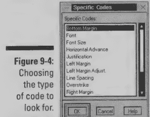

5. 点击“特定代码”对话框中的“确定”按钮。
6. 继续操作：输入你想要查找的代码的设置。
7. 点击“查找下一个”按钮搜索该代码的下一次出现。

当你搜索特定代码时，它无法搜索代码与文本的组合，也无法搜索多个代码序列。（真遗憾）

如果 WordPerfect 找不到该代码，它会显示一个对话框告知你。点击“确定”关闭此对话框。如果你确定代码在某处，请尝试使用上一节描述的“匹配代码”方法。

### 找到代码后该做什么

当你找到要找的代码时，可以按 `Delete` 键将其删除。如果代码是通过对话框创建的，你可以在“显示代码”窗口中双击代码来修改它。

在查找代码时显示“显示代码”窗口，这样你就可以查看 WordPerfect 是否找到了你所找到的那一个。


### 自动替换代码

这是一个常见的场景：你用几种字体精美地格式化了文档，CG Times（Times Roman 的一个版本）。但你发现 Roman-WP 字体在打印时看起来好得多。在不让自己疯掉的情况下将所有字体代码从 CG Times 更改为 Roman-WP 的最佳方法是什么？

### 166 第二部分：美化文本

像所有的文本处理器一样，WordPerfect 都有查找和替换功能。好消息是，你不再需要更改要查找的文本，只需输入代码所包含的信息。例如，“查找和替换字体”对话框允许你输入字体名称和字体样式。坏消息是，你无法搜索代码与文本的组合，也无法搜索多个代码的序列。（真遗憾）


在查找代码时显示“显示代码”窗口，这样你就可以查看 WordPerfect 是否找到了你所找到的那一个。特定代码。

### 替换特定代码

上一节告诉你如何将 WordPerfect 代码替换为相同类型但包含其他设置的代码。你也可以将一种类型的代码替换为另一种类型——例如，将左缩进（indents）替换为左制表符代码（普通的 tabs）。以下步骤展示了如何操作：

1. 按 `Ctrl+Home` 移动到文档开头。
2. 选择“编辑：查找和替换”或按 `F2`。
3. 在“查找和替换文本”对话框中选择“类型：特定代码”，显示“特定代码”对话框。
4. 选择你想要替换的代码类型（例如，字体）。
5. 点击“特定代码”对话框中的“确定”按钮。
6. 选择你想要删除的现有代码设置以及想要替换的新代码设置。
7. 为了搜索要查找的代码的下一个实例，点击“查找下一个”。
8. 要逐个替换代码以便在每次替换前进行确认，点击对话框中的“替换”按钮。
9. 完成后，点击“关闭”关闭查找和替换对话框。

### 用其他代码替换代码

上一节告诉你如何将 WordPerfect 代码替换为相同类型但包含其他设置的代码。你也可以将一种类型的代码替换为另一种类型——例如，将左缩进（indents）替换为左制表符代码（普通的 tabs）。（记住，你不能将粗体开启/粗体关闭代码替换为配对代码，如斜体开启/斜体关闭。）

### 168 第二部分：美化你的文本

1. 点击对话框中的“查找（Find）”部分，从对话框菜单中选择“匹配：代码（Match:Codes）”。
2. 选择你想要替换的代码类型（例如 `Hd Left Ind`，左缩进，等）。
3. 点击“插入（Insert）”将代码插入到“查找和替换文本”对话框的“查找”框中。
4. 点击“关闭（Close）”按钮关闭“查找代码”对话框。
5. 点击“替换为（Replace With）”框，从菜单中选择“替换：代码（Replace:Codes）”，并选择你添加的新代码（例如 `Hd Left Tab`，左制表符）。
6. 点击“插入（Insert）”将代码插入“查找和替换文本”对话框的“替换为”框中。
7. 点击“查找代码”对话框中的“关闭（Close）”按钮。
8. 点击“查找和替换文本”对话框中的“替换（Replace）”按钮逐个替换代码，或者点击“全部替换（Replace All）”一劳永逸。
9. 完成代码替换后点击“关闭（Close）”按钮。

你不能使用这种方法插入需要额外信息的代码。例如，你不能将所有的**粗体（Bold）**代码替换为字体（Font）**代码，因为字体代码需要额外信息（字体名称和样式）。这只是 WordPerfect 的局限性。

使用这种方法，你可以将代码与文本的组合替换为其他代码与文本组合。

### 删除所有代码

你可以使用“查找和替换文本”对话框来消除文档中某种类型的代码（例如所有的字体代码）。使用前面的步骤告诉 WordPerfect 你想要查找哪些代码，但在“替换为”框中不要输入任何内容。当你点击“替换”或“全部替换”时，WordPerfect 会将这些代码替换为空。

### 神奇代码总结

“这到底是什么 !@#$%%% 代码？又是哪个 #$%^&* 把它放到我的文档里的？”这种抱怨自从 WordPerfect 20 世纪 80 年代初发布以来就传遍了。

如果你遇到一个从未见过且在本章未描述的代码，请冷静；毕竟你总是可以删除它的。要找出它是什么，将光标放在代码上方。会弹出一个小黄框并给你提示。如果提示不够，双击该代码。根据代码的不同，你可能会看到与插入该代码相同的对话框。你可以点击对话框中的“帮助（Help）”按钮或按 `F1` 键获取有关此功能的帮助。

# 第10 章

## 样式文档

### 本章内容

- 创建并应用样式
- 使用标题和其他内置样式
- 使用更多内置样式
- 使用样式编辑器（Styles Editor）更改样式
- 关闭样式并链式样式
- 重用样式并删除它们

当深受推崇的猛象猎人 Og 用长毛猛象的彩色内脏修饰身体时，Og 样式捕捉了人们的想象。任何人都可以走进当地的理发店（haderasherby），要求 Og 风格，出来时所有必要的细节都处理好了。不需要指定所有细节，因为编织的肠道项链、头发里的骨头、细节、脑皮制皮囊——“Og”这个词就说明了一切。在接下来的一年里，当 Og 决定链应该是腱而不是肠道时，人们仍然可以这样做。


当深受推崇的猛象猎人 Og 用长毛猛象的彩色内脏修饰身体时……（此处省略重复）

## 172 第二部分：美化你的文本

### 什么是样式

样式是各种格式（如字体、缩进、对齐等）的组合，并分配一个名称。使用命名样式比重复相同的格式命令要简单得多。

另一个优势是，通过样式格式化后，样式的更改会立即在文档中生效。

### 样式的其他名称

WordPerfect 有两种样式：字符和段落。（好的，它还有文档样式，但现在先忘记它们。）字符样式影响字符：显示的字体、是否加粗、斜体或下划线，以及颜色。

## 第10 章：有样式的文档

段落样式包含了段落对中或右对齐（我们稍后会介绍它们）。

### 创建和应用样式

样式的关键在于“格式”菜单的底部：样式命令。如果你认为自己已经理解了样式，勇敢的、愚的或博学的人都可以开始使用“格式”命令。

我们将更缓慢地跟进样式。与其从“格式”命令开始，我们以你想要的方式格式化大量文本，作为例如。我们记录这种格式为样式。因为这种方法简单快速，WordPerfect 称之为快速样式（QuickStyle）。本节解释如何操作。

### 使用快速样式创建样式

记得 WordPerfect 有两种样式：字符和段落。我们首先使用快速样式创建一个字符样式。假设你希望文档中的外国单词加粗并斜体。你可以通过创建一个名为“Foreign”的样式并将其应用到所有外国单词来轻松实现。这些步骤将引导你完成此过程：

- 1. 作为例如，对一些文本进行加粗和斜体格式。
- 2. 最好选择你无论要应用样式的文本。要加粗和斜体，选择文本然后按 `Ctrl-B` 和 `Ctrl-I`。
- 3. 点击属性栏上的选择样式列表（点击“选择样式”框右侧的向下三角形），并选择列表底部的快速样式。样式快速创建对话框出现，如图 10-1 所示。

## 174 第二部分：美化你的文本

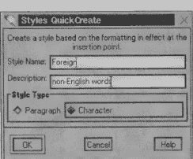

图 10-1：样式快速创建（Styles QuickCreate）对话框。

显示样式快速创建对话框的另一种方法是选择“格式>样式”，然后点击“快速样式”按钮。

- 3. 为你的样式命名（例如 `Foreign/外语`），并将其输入“样式名称”框中，光标正在此处等待。

不要超过 12 个字符；WordPerfect 不允许超过该限制。

- 4. 如果你需要，可以在“描述”框中输入描述该样式用途的内容。

你可以输入诸如“外语文本的字符格式”的内容。

- 5. 在对话框底部的“样式类型”部分，点击“字符”。

此步骤告诉 WordPerfect 创建一个字符样式。记住 WordPerfect 有两种样式：字符样式和段落样式。虽然你可以为你的快速样式选择其中一种，但我们在这里讨论的是字符样式。

- 6. 点击“确定”按钮。

样式快速创建对话框消失，WordPerfect 创建了该样式。

如果你再次点击“选择样式”箭头，你会在可用样式列表中看到你的新样式。

就是这样——你做到了。你创建了一个名为 `Foreign` 的样式，你现在可以按名称将其应用到文档中的任何选定文本。

### 应用字符样式

要应用你的字符样式，选择某些文本，并点击属性栏上“选择样式”框旁边的箭头按钮。这一次，样式列表包含了你自己的专属样式。点击它，将你的新样式应用到选定文本上。

## 第 10 章：有样式风格的文档

### “回车键坏了”

如果你在打字时使用字符样式，回车键的行为会*非常诡异*。假设你创建了一个字符样式（如 `Foreign`），并从属性栏的“选择”列表中选择了它。在开启样式的情况下，像你打字时，你输入的文本都会很好地格式化为该样式。在到达段落结束之前，一切表现都很正常。然后你按下回车键，期望开始一个新段落。结果，*什么也没有发生*！你的问题在于你正在同时进行打字并应用字符样式。为什么这是个问题还难以言说——但在 Word 中，这绝对是一个问题。

回车键插入一段代码来关闭字符样式然后再次开启。它*并没有*开始一个新段落。相反，按下回车键会插入一个结束字符样式代码和一个开启字符样式代码。我们不得不承认，这是 Word 中最神秘的行为之一；你已经收到警告了。

要解决这个问题，按下右方向键移动光标，让你的打字越过结束字符样式代码。除非你打开“显示代码”窗口，否则这个代码是不可见的（你不不必使用这个技巧）。但如果你打开了“显示代码”窗口，发生的情况就会变得清晰。

如果你选择一个字符样式（无论是从属性栏上的“选择”列表还是从“样式列表”对话框）并继续打字，回车键的行为就会改变。它不是开始新段落，按下

我们并不经常使用字符样式（段落样式要有用得多）；但是，当我们使用时，我们是在输入完文本*之后*应用它们的。

### 使用快速样式创建段落样式

某些类型的格式不属于字符样式。段落类型的内容，如缩进，属于段落样式。这些包括你通常通过“格式”菜单执行的操作，并包括段落类型内容和字符类型格式，如加粗和字体样式。


要为标题、注脚或其他让整个段落成为独立的元素定义样式，请使用段落样式。

段落样式对它们拾取的格式有些挑剔。记住，Word 为你执行任何操作都提供了至少两种方法，包括缩进段落。段落样式只会拾取仅从“格式>段落”菜单、首字字母以及“格式>段落/边框/填充”单元格中设置的格式。“格式>段落”菜单中某行方便的提示提醒你，分线以下的任何内容都不会被段落样式采集。此外，你可以随时通过“格式>段落”执行下方的所有操作。

## 176 第二部分：美化你的文本

要创建段落样式，你执行的与创建字符样式相同的步骤；然而，当你进入“快速样式”对话框时，请确保“样式类型”为“段落”。

### 应用段落样式

应用段落样式与应用字符样式非常相似。将光标放在你想设置格式的段落中。（因为段落样式只能应用于整个段落，所以当你只想格式化单个段落时不需要选择文本。）如果你想格式化多个段落，请选择它们。然后点击属性栏上“选择样式”框旁边指向下的三角形。当样式列表出现时，点击样式名称将其应用于选定的段落。

WordPerfect 会告诉你光标所在段落应用了哪种样式。只需查看属性栏上的“选择样式”框。点击选择样式框旁边的箭头为段落选择另一种样式。如果你选择了一个样式但什么都没有发生，说明你创建了一个字符样式。通常情况下，这个主意并不好；参见本章前面的侧边栏“回车键坏了”。


### 内置样式

在继续样式之前，我们应该介绍内置样式，标记为 `Heading 1` 到 `5` 以及 `InitialStyle`。意乎这些样式是用于标题的。它们的定义是预设的，为了方便，因为人们大多数时候都在用。要查看它们，点击属性栏上的“选择样式”按钮。

### 标题样式

标题样式（`Heading 1` 到 `5`）可以做很棒的事情，如让你的标题加粗。像应用任何段落样式一样应用标题样式：在要格式化的段落中，点击属性栏上选择样式框旁边的三角形并选择

应用这些样式后，你可能想使用它们创建目录。如果你这样做，请查看第 17 章；关于报告和其他大型文档的章节有一个创建目录的小节！

### InitialStyle 样式

另一个内置样式 `InitialStyle` 指定了你在创建新文档时文本的样子。你不需要应用 `InitialStyle`；它会自动出现在文档开头。除非你应用了其他样式，否则文档中的所有文本都是 `InitialStyle`。

要在 `InitialStyle` 或标题样式中添加或更改某些内容，请查看样式编辑器，见本章后面的“从头创建样式”或“修改现有样式”。

如果你想删除某些内容，你必须处理代码（参见第 9 章）。如果你不想读完整个第 9 章，你也可以在使用样式编辑器时尝试一点猜测。

### 更多内置样式

WordPerfect 自带了一系列预定义样式供你使用。虽然它们通常不在样式列表中，但你可以通过以下步骤将它们引入：

- 1. 从菜单栏选择“格式>样式”。

你看到了“样式列表”对话框。我们稍后会非常详尽地讨论这个对话框；但因为你决定自己是一个样式的贪婪者，所以你获得了一个预览。

- 2. 点击“选项”按钮并从下拉列表中选择“设置”。“样式设置”对话框出现。
- 3. 点击“系统样式”框。

# 178 第二部分：美化你的文本

## 4. 点击确定。

“样式列表”对话框中的“名称”列表中现在出现了无数种新样式。这些样式包括 WordPerfect 在生成目录、索引、脚注以及其他酷炫功能时使用的样式。然后，你可以从“名称”框中的几十种实用样式中进行选择。

### 样式主控制面板：样式列表

如果你已经读到了本章的这里，说明你已经能够在不诉助于 `格式>样式` 命令的情况下创建并应用样式。该命令会显示“样式列表”对话框，如图 10-2 所示。“名称”框列出了当前文档中定义的所有样式。

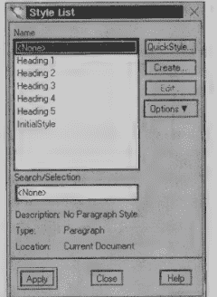

图 10-2：样式列表对话框。

要在文档中使用样式，点击样式名称，然后点击“应用”按钮将其应用于所选文本（对于字符样式）或光标所在位置（对于段落样式或文档样式）。表 10-1 详细介绍了你可以使用样式列表执行的操作。我们将在下一节详细讨论修改样式。

# 第 10 章：有样的文档

| 表 10-1 | 样式列表按钮 |
| :--- | :--- |
| 选项 | 功能 |
| 应用 | 如果样式是字符样式，则将高亮样式应用于高亮文本；如果样式是段落样式，则应用于高亮段落或光标所在的段落；如果是文档样式，则应用于文档的其余部分 |
| 快速样式 | 显示“快速样式”对话框，允许你创建一个与光标所在位置文本格式相同的样式 |
| 创建 | 显示“样式编辑器”对话框，以便你创建新样式 |
| 编辑 | 显示“样式编辑器”对话框，以便你可以更改“名称”框中高亮样式的代码 |
| 选项 | 提供更多样式选项：设置、复制、删除、重置、检索和另存为 |

### 从头创建样式和修改现有样式

“样式列表”对话框是你从头创建样式，或修改 WordPerfect 自带样式以及你通过 Quick 创建样式的门户。修改样式需要你了解一些隐藏代码。坦率地说，这项任务是值得的。没有什么比让文档中的每个段落都关联到一个样式更令人满足了，这样你就可以使用“样式编辑器”来更改整批文档的格式。（尽管你可能能想到一两件更令人满足的事，但你无法用电脑完成它们。）

当你点击“样式列表”对话框中的“创建”或“编辑”按钮时，你就进入了样式的核心：样式编辑器。（如果你是“显示代码”窗口的常客，也可以在其中双击样式代码来查看样式编辑器。）请参阅图 10-3 和表 10-2 中的说明。

# 180 第二部分：美化你的文本

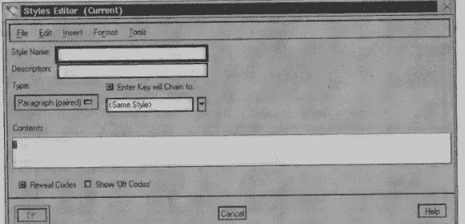

**图 10-3：** 样式编辑器框。

| 表 10-2 | 样式编辑器选项 |
| :--- | :--- |
| 选项 | 功能 |
| 样式编辑器菜单栏 | 为样式提供格式选项。（它们允许你插入代码来格式化文本。最常用的格式命令在“格式”菜单上。例如，要从此对话框应用字符格式，请从其菜单栏选择“格式”以显示字体对话框。） |
| 样式名称 | 显示样名称。对于你创建的样式，你可以更改名称。你无法更改内置样式的名称。 |
| 类型 | 允许你控制应用什么类型的样式：字符、段落或文档。详情请参阅本章开头的“样式即使换个名字，闻起来也一样香甜”章节。 |
| 回车键将链到 | 告诉你下一个段落应该是什么样式。（例如，“标题 1”段落通常后面会跟一个“缩进文本”段落。） |
| 内容 | 显示 WordPerfect 用于实现样式的所有隐藏代码。（如果你还没看，请参阅第 9 章）。如果样式包含任何普通文本（如“图号”或“问题：”），也会显示在这里。 |
| 显示代码 | 选中时，在“内容”框中显示格式代码。你可以关闭此选项；此时，“内容”框将只显示属于样式部分的普通文本。 |
| 显示“关” | 选中时，在“内容”框中显示格式代码。你可以关闭此选项；此时，“内容”框将只显示属于样式部分的普通文本。 |

### 从头创建样式

“样式列表”对话框是你从头创建样式，或修改 WordPerfect 自带样式以及你通过 Quick 创建样式的门户。

- 1. 为你的样式输入一个名称。
- 2. 为你的样式选择一个类型。
- 3. 使用“格式”命令。
- 4. 点击“确定”。
- 5. 完成所有格式设置后，点击“确定”。
- 6. 或者，你只需点击“关闭”来移除样式列表。

# 第 10 章：样式化的文档 183

### 揭示你的秘密样式代码

如果你了解 WordPerfect 中的秘密代码（参见第 9 章），你可能就能理解“样式编辑器”对话框底部的窗口。该窗口显示了代码是如何封装在样式中的，就像“显示代码”窗口的作用一样。

当 WordPerfect 为你的文档应用成对的（字符或段落）样式时，它会使用成对的代码来括起受影响的文本。这些代码仅使用样式名称，这让你能够完全自由地编辑定义，而不会在正文中插入一堆螺丝。当 WordPerfect 应用开启的（文档）样式时，它使用单个代码——同样，只使用样式名称。神奇的是，这些（未使用的）样式代码可以应用字符格式，例如**粗体文本**——粗体文本需要成对的代码（参见第 9 章）。但它确实有效——随它去吧。

此外，你可能理解字符样式和段落样式在样式编辑器“类型”框中是如何被标记为*(成对)*或*(开启)*的。*成对*样式包含成对的样式代码；*开启*样式包含单个、未成对的样式代码。

### 创建文档样式

几秒钟前，我们说 WordPerfect 有两种（实际上是三种）样式。现在，是时候谈谈第三种了：文档样式。有时，你想创建一个从某点开始应用并可能涵盖该点之后所有内容的样式。这种样式，*文档样式*，有点奇怪。与字符和段落样式不同，文档样式没有预定义的结束点。因此，它会一直持续到另一种样式开始。

文档样式不仅可以包含你通常通过“格式 > 页面”命令应用的格式设置，还包括你从“格式”菜单中选择的任何其他内容的代码，包括字体、行、段落和列命令。说来说，文档样式还可以包括你从“插入”、“工具”、“图形”和“表格”菜单中选择的任何命令的代码，包括插入分页符、更改页眉和页脚、插入日期、插入图形或发出加速声（如果你喜欢那样的而且你的电脑会说话的话）。

使用文档样式是设置文档整体布局的好方法，包括页边距、大多数段落的段落格式以及大多数文本的字体。

你不能通过刚刚描述的“快速样式”方法创建文档样式。你必须使用“样式编辑器”方法。在“类型”中，选择“文档”。除此之外，该样式的行为与普通样式相似。

### 应用文档样式

要应用文档样式，首先将光标置在你想要样式开始的地方（可能是段落的开头，也可能是页的开头）。如果你的文档样式插入了任何内容（如分页符），它们会在你开启样式时光标所在的地方出现。

### 关闭样式和链式样式

假设你应用了一种样式，并且正愉快地打字，更新你的简历以包含“精通 WordPerfect 样式”这一短语。你完成了一个排版精美的段落，按下回车键，然后开始——你开始了另一个样式相似的段落。虽然这种自动生成样式相似段落的功能是一个很棒的功能，但如果你不想另一个样式相似的段落怎么办？

或者，假设你正在用一种字符样式给梅姨姨写信，这种使用了漂亮的 ShelleyVolante 字体，而你想关闭它，给近眼的乔治叔舅写一封更易读的信。执行以下两种操作之一：

- 要关闭光标所在段落的段落样式，点击属性栏上“选择样式”按钮旁边的箭头，然后点击列表上的<无>。
- 如果你一直在用某种字符样式打字，现在想对后续文本关闭它，请按键盘上的右箭头键。此步骤会将光标移过秘密的样式结束代码。当你再次打字时，该样式将不再生效。

### 回用样式

重复已完成的工作始终是一个明智的主意，样式可以帮助你重用格式努力。你可以通过以下两种方式重用样式：

- 从现有文档中检索它们。


- 将它们保存到文件中。

## 从另一个文档检索样式

从另一个文档中检索样式是另一种方法。执行以下步骤：

1. 选择“`格式`”。你会看到样式列表对话框。

2. 选择“`检索`”。

3. 点击样式列表对话框中的“`选项`”按钮。

4. 从下拉菜单选择“`检索`”。检索从样式对话框出现。

5. 输入你想要检索的文档名称（或者，你可以点击文件图标使用对话框来执行此操作）。

6. 此时对话框会询问你是否要覆盖当前样式。

7. 点击“`是`”。

从此以后，每当你创建一个新文档，这些样式都可用。

## 创建样式库

为了系统化和组织，你应该将样式保存在一个位置。这种方法允许你在创建新文档时自动使用样式。要将样式复制到模板，执行以下步骤：

1. 选择“`格式`”。你会看到样式列表对话框。

2. 选择你想复制的样式。

3. 点击样式列表对话框中的“`选项`”按钮。选项菜单会弹出。

4. 点击选项菜单上的“`复制`”。样式复制对话框出现。

5. 在“`复制到`”区域中选择“`个人库`”。

6. 为你想复制的每个样式重复步骤 1-5。

7. 点击“`确定`”。

8. WordPerfect 会询问你是否要覆盖当前样式。

9. 点击“`确定`”。

# 第三部分

# 你可以使用文档进行的操作

Rich Tennant 著，《第五次浪潮

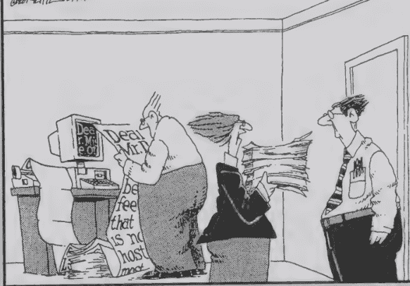

> “是的，我们的文字处理软件还有一些漏洞。顺便说一下，这是一封来自营销部的备忘录。”

# 在这一部分……

有一个为人知的事实是，当人类住在树上时，他们并没有“森林”这个词。（好吧，其实他们对其他任何东西也没有词。随吧。）这是是因为他们无法（现在大家一起大说一遍）“见木不见林”。也就是说，他们做不到这一点，直到他们掌握了树木、爬上了大山，并获得了那种让他们能够说出“哇——看那些森林！”的视角。

同样地，所有精通纯文字世界并攀登文字处理高地的人，最终都会发现自己自己在说：“哇——看那些文档！”（几千年来，语法并没有进步多少。）因此，本书的这部分将探索你文档的打印、移动以及整体管理。准备好，出发吧！

# 第11章

## 终于落纸了：打印东西

**本章内容**

- 准备打印机

- 打印文档的部分、整份文档或多份文档

- 打印磁盘上的文档

- 取消打印作业

每个人都听说过未来的“无纸办公室”。还记得电脑还是新事物时，大家都声称在我们都开始使用它们后，就可以停止使用纸张了吗？事实吧，看看你的办公室。你看到纸了吗？每个人手里的纸似乎比以前多了一倍——你看到的是*非常非常多的*纸。

在现实生活中，你通常想要打印你的文档，本章将介绍如何操作。关于创建和打印某些常用文档（包括邮件标签和信封）的详情，请参阅第17章。

## 准备好打印了吗？

你已经写好并格式化了文档，它看起来*棒极了*。现在你准备好看看它在纸上的样子了。无论，在这样做之前，你最好确保你的打印机已经准备好提供帮助了。

## 基础知识

确保你的打印机已连接到墙电源和你的电脑。连接到墙壁提供电源，连接到电脑的电缆为文档中的信息从电脑进入打印机提供了路径。

190 第三部分：你可以使用文档进行的操作

确保你的打印机有相应的色带、墨盒或碳粉盒，取决于你的打印机——除非你有兴趣在白纸上打印白色字迹。

你需要纸，正如你猜想的那样。你的打印机可能使用单页打字纸或连续进孔纸。无论你的打印机喜欢吃什么，确保它有纸。

你还应该确保你的打印机在关注电脑的话。大多数打印机可以处于在线或离线状态（分别为听电脑或不听）。这些打印机有一个在线指示灯，告诉你打印机是否在线，以及一个可以在在线和离线之间切换的在线按钮。如果你的打印机离线，它会忽略电脑发送的任何信息；它就像关机了一样。

如果你的打印机使用纸张纸，你可能想在旧纸的反面打印文档草稿。我们留着一叠单面有内容的纸，除了文档的最终稿之外，一切都用它。

# Linux 和 WordPerfect 知道你有一台打印机吗？

在 WordPerfect 8 打印任何内容之前，Linux 必须了解你打印机的所有信息。当你（或某人）在电脑上安装 Linux 时，你应该已经告诉 Linux 你拥有哪台（或哪些台）打印机。要介绍打印机，请询问设置 Linux 系统的人是否安装了打印机，或者查阅《Linux 入门》（第2版），Jon Hall、Craig Witherspoon 和 Coletta Wetherspoon 著（IDG Books Worldwide）。

WordPerfect 也需要知道你拥有哪台打印机。要找出 WordPerfect 认为你拥有哪台打印机，可以通过选择“`文件>打印`”（或按 `F5`）或点击工具栏上的“`打印`”按钮来显示打印对话框，然后点击“`选择`”按钮。“`选择打印`”对话框（如图 11-1 所示）显示了 WordPerfect 知道的打印机（如果你的电脑连接到局域网 LAN，此列表可能包括连接到其他电脑的打印机）。如果你的打印机没有出现在列表中，Linux 专家可能可以提供帮助。

# 打印预览功能在哪里？

其他一些文字处理器具有打印预览功能，可以向你准确显示内容在页面上的样子。WordPerfect 没有这个功能，因为它在你编辑文档时已经很好地向你展示了文档的样子。这不就是 WYSIWYG（所见即所得）的本质吗？

第11章：终于落纸了：打印东西 191

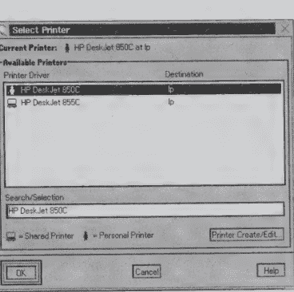

图 11-1：WordPerfect 需要了解你系统上的打印机。

如果你的打印机已连接到电脑且 Linux 已配置好，但打印机没有出现，请按照以下步骤操作：

1. 在“`选择打印`”对话框中（通过按 `F5` 或点击工具栏上的“`打印`”按钮显示），点击“`添加`”按钮。

2. 在“`可用打印机`”中，选择你的打印机并点击 `OK`。

3. 在保持打印机选中的情况下，点击“`设置`”。

4. 在“`设置`”对话框中，你可以告诉 WordPerfect 关于你打印机的各种信息，如你使用的墨盒，保持这些设置即可。

5. 在“`目标`”中，选择你想使用的位置并点击 `OK`。

6. 点击 `OK` 关闭“`打印/编辑`”对话框。

7. 回到“`选择打印`”对话框，确保选择了你想使用的打印机并点击 `OK`。

点击“`取消`”关闭“`打印`”对话框。

192 第三部分：你可以使用文档进行的操作


# 打印机在哪里？

如果你的电脑连接到网络并使用网络打印机，通常其他人负责确保打印机连接了正确的电缆。然而，你仍然应该检查打印机是否有纸，因为隔壁工位的同事可能有在不加纸的情况下打印 200 页报告的讨厌习惯。

你可能还想和网络管理员管理员，了解可以使用哪些类型的打印机，以及你的 Linux 知道如何打印。


WordPerfect 现在知道你拥有哪种打印机了。

即使在告诉 WordPerfect 你的打印机后，你可能仍遇到打印问题。Linux 可能无法找到如何将信息发送到你的打印机的方法，或者打印结果格式怪异。如果是这样，你需要向 Linux 魔法师寻求帮助——带上尽可能多的关于你打印机的信息。

# 打印整份文档

WordPerfect 能让你很好地预判文档打印后的样子。如果你使用页面视图（通过“`视图>页面`”），你甚至可以看到页眉和页脚的位置，以及页面的顶部和底部边距。（第 8 章描述了页面视图以及 WordPerfect 提供的其他视图。）然而，在纸上看到文档之前，你是无法获得整体效果的。这些步骤展示了如何打印文档：

- 确保打印机已开启并准备好打印。

确保装载了正确的纸——草稿用回收纸，最终版本、信纸或其他任何情况用新的白纸。我们总在打印机旁留一叠印有尴尬初稿的纸，准备好在另一面打印不那么尴尬的二稿。

- 你的你的文档，以防在打印期间发生意外情况。

安全打印！

## 第 11 章：终于落于纸面：打印 193

3. 点击工具栏上的“`打印`”按钮。

这个按钮看起来像一个侧放的意大利面机。或者，你可以选择“`文件->打印`”或按 `F5`。WordPerfect 会显示出巨大且气观的打印对话框，如图 11-2 所示。如果你的对话框看起来有点不同，请不要担心。某些设置可能会有所不同，取决于你使用的是什么样的打印机。如果你的对话框看起来完全不同，你的电脑可能连接了某种奇怪的打印机。如果你找到了连接它的电脑向导，问问他发生了什么。

图 11-2: 

告诉 WordPerfect 打印文档的内容、位置和原因。

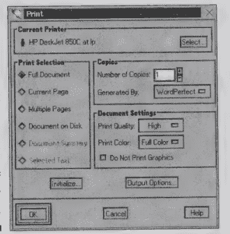

如果你在点击“`打印`”按钮时已经选择了某些文本，打印对话框会假设你只想打印选中的内容。如果事实如此，没关系。只需在对话框的“`打印选定内容`”部分点击“`整个文档`”、“`当前页`”或任何你想要的选项。

4. 忽略所有那些看起来很有有趣的设置，直接点击“`确定`”。

WordPerfect 通知你它正在为打印文档做准备。当 WordPerfect 为打印格式化文档时，可能会有其他对话框在屏幕上飞过。最后，打印机开始嗡嗡作响并开始打印。

在打印机打印时，你可以继续使用 WordPerfect。你可以打开另一个文档、编辑当前文档或进行任何你想做的事。然而，你可能不关闭文档或 WordPerfect，因为第一次尝试就正确打印文档的几率为零。我们敢打赌保证，你会看到一个大字体，它在屏幕上盯着你看了半小时，但只有在纸上时它才变得真正清晰。

如果打印机没有打印任何内容，只需重新打印一遍。你的文档可能仍在通过 WordPerfect、打印守护进程（我们可不是在胡说）进行传输，而池化程序正在前往打印机的路上。文档可能在传输途中卡住了。（电脑也会有肠胃不适）。请确保打印机已开启并在线。如果一两分钟后还没有反应，请参阅本章末尾的“取消打印作业”部分。

如果你正看着打印对话框并最终决定不打印文档，只需按 `Esc` 键或点击对话框中的按钮（也可以点击对话框右上角的“关闭”按钮）。没有任何坏处，也不会浪费纸张。

在打印文档的最终稿之前，你可能想要考虑检查一下拼写。完整说明请参阅第 5 章。

## 打印文档的部分内容

当文档很长（如本书中的某些章节）时，你可能不想打印整个文档。例如，如果你只打印了一份 30 页的报告，然后在第 17 页发现并修正了一个拼写错误怎么办？不用担心——你可以打印单选的文本，或者任何选定的文本。

## 打印选定文本

要打印选定的文本，请按照以下步骤操作：

- 1. 准备好打印机（开启电源等）。

- 2. 选择你想打印的文本。（参阅第 4 章了解如何操作）。

- 3. 点击工具栏上的“`打印`”按钮。

或者，按 `F5` 或从 WordPerfect 菜单栏中选择“`打印`”。

打印对话框出现（参考图 11-1）。注意“`打印选定内容`”部分的底部有一个标记为“`选定文本`”的按钮。如果你没有选择文本，WordPerfect 会自动选择“`整个文档`”选项。

- 4. 点击“`确定`”。

WordPerfect 打印选定的文本。

## 当你的打印机反向打印时

某些打印机的打印方式会导致你总是需要重新排列多页文档的顺序。你真正需要的能力是先打印最后一页。这样，当打印机打印完成后，一切都处于正确的顺序。遗憾的是，你可以告诉 WordPerfect 这样做。在点击“`打印`”按钮之前，点击打印对话框底部的“`输出选项`”按钮。你会看到输出选项对话框。勾选“`反向顺序打印（从后向前）`”框。你准备好打印了！

## 打印特定页面

按照以下步骤打印一页：

- 1. 确保你的打印机已准备好打印。

- 2. 将光标置在你想要打印的页面的任何位置。

- 3. 点击工具栏上的“`打印`”按钮。

  或者，按 `F5` 或从菜单栏中选择“`文件->打印`”来显示打印对话框。

- 4. 在打印对话框的“`打印选定内容`”部分选择“`当前页`”并点击“`确定`”。

## 打印若干页但不是全部

要打印几页纸，请执行以下操作：

- 1. 确保你的打印机已全部设置好打印。

- 2. 记录下你想打印的页码。光标在哪里完全没紧。

- 3. 点击工具栏上的“`打印`”按钮。

  或按 `F5` 或从菜单栏选择“`文件->打印`”。只需让那个打印对话框出现在屏幕上。

- 4. 在对话框的“`打印选定内容`”部分选择“`多页`”，然后点击“`确定`”。

会出现“`多页`”对话框，等待你输入数字或范围。如果你只想打印第 10 页，在“`页码`”框中输入 10。要打印第 10 到 20 页，输入 10-20。关于范围的信息请查看表 11-1。

- 5. 点击“`确定`”，直到所有对话框消失。

WordPerfect 打印你指定的页面。

## 打印随机页面

“`多页`”设置允许你打印连续和不连续的页面。使用表 11-1 中的选项来查找不同的页组。

| 表 11-1 打印页码 | 输入 | 含义 |

| :--- | :--- |

| all | 打印整个文档。 |

| x | 打印第 x 页。 |

| x,y,z | 打印 x、z z（用逗号分隔页码）。 |

| x-y | 打印 x 到 y（包含边界）。 |

| x- | 从 x 页到文档末尾。 |

| -x | 从文档开始到 x。 |

| x,y-z | 打印 x 以及 y 到 z（你可以包含多个范围，用逗号分隔），列表必须从小到大。例如，5,1 只打印第 5 页；10-15 打印第 10-15 页。 |

WordPerfect 打印指定的页面。

## 双面打印

在纸的双面打印文档（如书籍）很酷。这种方法不仅让你的文档看起来更好，还能证明你是一个环保人士。如果你想在纸的双面打印文档（双面打印）但你的打印机不支持，不要担心——你并没有没路。你的环保声誉不会受损。

## 如果你的打印机可以双面打印

如果你的打印机知道如何双面打印，你需要告诉 WordPerfect 你想在纸的双面打印。在你的打印机上设置双面打印：

- 1. 选择“`格式：页面：页面设置：双面打印`”。你会看到“`双面打印`”对话框，如图 11-3 所示。

- 2. 选择装订的纸侧（通常是左侧）以及留给装订的空间。点击“`双面`”按钮并从下拉列表中选择一个“`边缘`”选项。

“`长边`”选项针对纸张的长边设置装订，这是最常用的选项。即使你不打算装订文档也不要；WordPerfect 只需要知道如果要装订的话边缘在哪里。

- 3. 点击“`确定`”退出“`双面打印`”对话框。

现在，当你打印时，打印机会自动在纸的双面进行打印！

# 198 第三部分：你可以用文档进行的操作

## 如果你的打印机不支持双面打印

如果你的打印机只支持单面打印，WordPerfect 仍然可以帮助你实现双面打印。虽然需要多花几个步骤，但这是可行的：首先，打印所有奇数页，然后将纸张翻过来放回打印机，并在奇数页的背面打印所有偶数页。运气好的话，页面正反就了！搞定——双面打印完成。先用一个小文档尝试这个系统。

以下是手动双面打印的步骤：

- 1. 确保你的打印机已准备好打印。

同时确保你计划使用的纸张双面都是空白的。

- 2. 点击工具栏上的“`打印`”按钮。

或者，按 `F5` 或选择“`文件>打印`”。你将看到打印对话框。

- 3. 点击“`输出选项`”按钮。

WordPerfect 显示“`输出选项`”对话框，如图 11-4 所示。

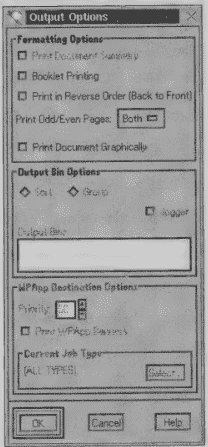

图 11-4：WordPerfect 有一些高级打印选项。

## 第 11 章：终于落于纸：打印内容 199

- 4. 将“`打印奇/偶数页`”设置为打印所有奇数页或所有偶数页。为了简单起见，从奇数页开始。点击“`确定`”退出“`输出选项`”对话框，再次点击“`确定`”打印奇数页。

请记住，如果你的打印机支持双面打印，就不需要经过这些手动打印步骤——请查看前面的章节。如果你和我们一样，打印机分不清“双面打印”和“双层打印”（比如粉刷包含两个住宅的房子），请继续执行其余步骤。

- 5. 翻转纸张，准备打印第一次没有打印的页面。

在打印完所有奇数页后，将它们放回纸盒中，以便 WordPerfect 可以在纸张的另一面进行打印。确保第 1 页是正面朝下并放在最上方，这样 Word 就会在它的背面打印第 2 页。（你可能需要逐页翻面，而不仅仅是把整叠纸翻过来）。

还要确保纸张方向正确，以免第 2 页是倒置的，或者打印在与第 1 页相同的纸面上。由于你所需的确切方向取决于你的打印机，你可能想用一个短文档进行实验并做笔记，这样下次你就知道如何处理页面了。

- 6. 重复步骤 2–4。

这次，在步骤 4 中选择“`偶数页`”选项。

## 打印多份副本

在你开始打印一个文档后，你可能想要几份副本。嘿，为什么不省去你自己跑复印机的麻烦呢？当然，如果你在办公室唯一的一台打印机上打印一份 25 页文档的 10 份副本，你可能不会受到同事们的欢迎，但那是你的决定。

要告诉 WordPerfect 要打印多少份，请按照以下步骤操作：

- 1. 确保你的打印机已准备好打印。

- 2. 如往常，点击工具栏上的“`打印`”按钮。

此外，你可以按 `F5` 或选择“`打印`”来显示打印对话框。

- 3. 在“`份数`”框中，输入你想要的数字。

你可以点击小小的上下箭头按钮来增加或减少数字。

## 200 第三部分：你可以用文档进行的操作

你可以告诉 WordPerfect 打印机本身是否知道打印多份副本。某些打印机足够智能，你只需向它们发送一次文档，并带有打印指定次数的指令即可。但由于大多数打印机并没有那么智能，WordPerfect 必须不断向打印机发送相同的文档。如果你的打印机属于世界上“高智商打印机”，请将“`生成来源`”设置为“`打印机`”而不是“`WordPerfect`”。

- 4. 点击“`确定`”。

## 打印磁盘上的文档

如果你想打印一个没有打开的文档怎么办？例如，如果你今天早上写了、保存了并打印了一封非常棒的信，而现在你想再多打印一份给妈妈看，该怎么办？你可以先打开它，在屏幕上欣赏一会儿，然后打印。不过，有一种更快的方法，如这些步骤所示：

- 1. 设置你的打印机使其处于准备就绪状态。

无论你的光标在哪里，甚至打开了哪个文档，都没有关系。

- 2. 点击工具栏上的“`打印`”按钮。

如果你愿意，按 `F5` 或选择“`文件:打印`”。无论哪种方式，WordPerfect都会显示打印对话框。

- 3. 在打印对话框的“`打印选择`”部分，点击“`磁盘上的文档`”，然后点击“`确定`”。

砰！出现了“`磁盘`”对话框，你可以在其中输入想要打印的文档名称。什么？——你不想输入文档名称？没问题，点击“`文件名`”框最右侧的文件夹图标。


如果文档不在当前目录中，你必须输入文档的完整路径。如果你完全不知道我们在说什么，或者你想知道如何使用位于“磁盘上的文档”旁边的文件夹图标，请参第 13 章。

- 4. 点击“确定”。

WordPerfect 显示“磁盘”对话框。

你可以在“页面”框中输入页码来打印指定的页面。

如果文件不存在，WordPerfect 将显示未找到文件。点击“关闭”按钮关闭“磁盘”对话框。230 第 11 章：终于落于纸：打印内容 201

## 取消打印任务

到目前为止，打印一直很顺利。但有一天，灾难降临：你把一份15页的报告发送到了……这时是时候告诉 WordPerfect：“停止打印！我不是故意的！”

## 谁来负责？

当你打印时，WordPerfect（像所有程序一样）会将信息发送给打印守护进程，一个负责发送打印任务的程序。由它接手。Word 会跟踪进度并在队列中列出你的打印任务。

如果你的电脑和打印机是通过网络连接而不是直接连接，你的文档将传递给网络管理器，由它发送到打印机。你可能需要和网络管理员谈谈（带一些巧克力饼），以便在发送后取消任务。

## WordPerfect，停止打印！

当文档正在打印时，你可以通过以下步骤让 Linux 忘记这一切：

- 1. 切换到程序窗口。

记住，程序窗口是显示 WordPerfect 标志的小窗口。要显示程序窗口，点击其任务栏上的按钮（如果你使用 KDE、GNOME 或或其他显示所有窗口按钮的任务管理器）。

- 2. 在程序窗口中，选择“打印控制”。

所有等待的任务都显示在“打印控制”对话框中，如图 11-5 所示，位于“队列”部分。如果你没有看到你的打印任务，请从“可用目标”列表中选择不同的目标。如果你不知道自己的打印机目标（通常本地打印机为 `lp`），只需点击“可用目标”列表上的项目，直到你的打印任务名称出现在“队列”区域。

## 202 第三部分：你可以用文档进行的操作

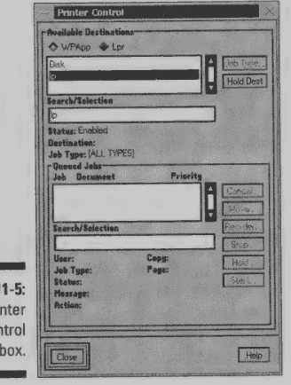

图 11-5：打印控制对话框。

- 3. 在“队列”列表中选择你的打印任务并点击“停止”按钮。

当 WordPerfect 确认你想停止任务时，点击“确定”。你的打印任务已停止。

如果你改变主意，决定不取消打印任务，点击“关闭”按钮关闭“打印控制”对话框。你也可以保持此窗口打开，如果你想经常检查打印任务的状态。

## 第 12 章

## 在屏幕上处理多个文档

**本章内容**

- 同时处理多个文档
- 关闭文档
- 调整窗口大小
- 文档的最大化和最小化
- 合并文档
- 知道当文件已存在时该怎么办
- 使用外部文件

想象你住在纽约市，公寓里有一台功能强大的望远镜。通过望望远镜，你可以窥望各个邻居的窗户。在一个窗口里，你看到一个上班族正在忙着打字。在另一个窗口里，你看到一个仓库。在第三个窗口里，有人正在洗碗。在第四个窗口——噢！关上窗帘！

同样，WordPerfect for Linux 允许你同时处理多个文档。当你打开每个文档时，WordPerfect 会创建一个窗口来显示它。你可以一次打开多个文档，并同时查看多个窗口。嘿，这正是 Windows 的魅力所在！

本章将向你解释这些多窗口操作。你不需要望远镜就能做到。通过这些技术，你可以同时查看和编辑相关文档来提高效率，或者你也可以让你的 Linux 桌面变得一团糟，如图 1-1 所示。选择权在于你。

图 12-1：

处理多个文档可能会失控。

既然谈到了打开文档，在本章结束时，我们将讨论如何打开*不包含* WordPerfect 文档的文件，例如由其他文字处理程序创建的文档。

### 如何同时处理两个文档？

要打开文档，你可以在程序窗口中选择`程序(Program); 打开窗口(Open Window)` 菜单，在新窗口中打开它。WordPerfect 会在桌面上为该文档创建一个新窗口。

打开一个文档后，你可以打开*另一个*文档。WordPerfect 会保持第一个文档开启，但用包含第二个文档的第二个窗口部分覆盖它的文档窗口。

#### 在打开的文档之间切换

如何回到你第一个打开的文档？如果它仍然可见，你只需用鼠标点击它的窗口即可。但如果你的桌面看起来像图 12-1 所示，你又找不到窗口呢？啊！——菜单栏上的命令就是解决方案。当你选择`窗口(Window)` 时，你会看到一个包含五个命令的菜单（层叠排列 Cascade、垂直平铺 Tile Top to Bottom、并排平铺 Tile Side by Side、全部最小化 Minimize All 和全部关闭 Close All），随后是你拥有的文档的编号列表。要切换到另一个打开的文档，只需从菜单中选择它的名称。

要不使用鼠标切换文档，按 `Alt+W` 打开`窗口`菜单。使用光标键向下滚动到所需的文档名称，然后按 `Enter`。

#### 创建新文档

当你想要开始写新内容时，你需要一个没有任何文本的崭新文档。没有人告诉过你如何创建“新文档”吗？是时候让你学习一下生活的真相了。你可以从程序窗口或文档窗口创建新文档。

要创建新文档，可以点击文档窗口工具栏上的`新建空白文档(New Blank Document)`按钮（第一个按钮），或从程序窗口中选择`程序(Program); 新窗口(New Window)`。（你也可以从文档菜单中选择`文件(File); 新窗口(New Window)`，尽管这种方法会将你的新文档打开在现有窗口中，而不是为它创建一个新窗口。）WordPerfect 会为新文档创建一个疯狂的名字，如 `Document2`，并为它创建一个窗口。保存时，你可以给新文档起一个更好的名字。当 WordPerfect 在现有窗口中打开新文档时（当然，它会提示你保存更改）。

你也可以按 `Ctrl+N` 在新窗口中创建新文档——此热键在程序窗口或文档窗口中均有效。

#### 关上窗帘

完成一个文档的工作后，不要让它一直开着。每个打开的文档都会让 WordPerfect 变慢一点。要关闭包含文档的窗口，点击窗口的关闭按钮（通常是文档窗口右上角的 **X**，但取决于你正在使用的窗口管理器）或选择`文件(File); 关闭(Close)`。

根据 WordPerfect 菜单，`Ctrl-F4` 也应该关闭文件。如果你恰好在 Linux 电脑上运行 KDE，KDE 会在 WordPerfect 有机会看到命令之前捕获 `Ctrl+F4` 命令。KDE 对 `Ctrl+F4` 的含义有自己的想法；它会将你的显示切换到桌面 4，而 WordPerfect 永远不会关闭窗口。没关系——只需点击 KDE 任务栏上的桌面图标，切换回显示 WordPerfect 的 KDE 桌面即可。

如果你关闭的文档自上次保存以来发生了更改，WordPerfect 会在关闭前给你保存文档的机会，以免你丢失工作。你可以点击`是(Yes)`（让 WordPerfect 在关闭前保存文档）、`否(No)`（让 WordPerfect 在不保存更改的情况下关闭它）或`取消(Cancel)`。

#### 窗口叠窗口

在两个文档之间来回切换以复制信息或仅参考你写的内容可能会令人烦恼。有时，同时看到两个文档更方便。再次，WordPerfect 乐意配合。

#### 查看大量窗口

你可以通过以下三种方式在屏幕上查看多个文档：

- 从程序窗口的菜单栏选择`窗口(Window); 层叠排列(Cascade)`。WordPerfect 为每个文档创建一个小窗口，并将窗口像牌牌一样堆叠，如图 12-2 所示。
- 从程序窗口的菜单栏选择`窗口(Window); 垂直平铺(Tile Top to Bottom)` 或`窗口(Window); 并排平铺(Tile Side by Side)`。再次，WordPerfect 将每个文档置于一个列表窗口中。这一次，它像多米骨游戏一样用文档填充 WordPerfect 窗口，如图 12-3 所示。

## 208 第三部分：你可以对文档的操作

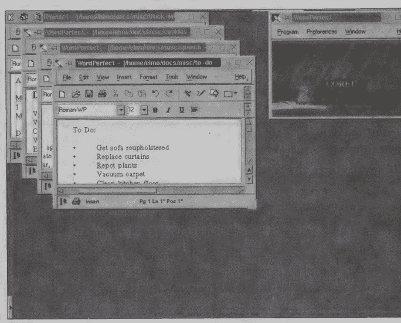

图 12-2：选择一个文档——任意一个文档。这些窗口是层叠排列的。

如果你在 Linux 桌面面上使用 KDE，并将其中一个文档最大化以填充 WordPerfect 窗口，你会在窗口标题栏的右端看到三个小按钮。这些按钮仅在活动文档中有效。第一个按钮是最小化按钮（看起来像一个圆点）；第二个是还原/最大化按钮，第三个是关闭按钮（看起来像一个 X）。如果你点击还原按钮，WordPerfect 会根据你上次使用的命令对你的文档进行层叠或或平铺排列。如果你使用的是 KDE 以外的窗口管理器，按钮可能会有所不同，尽管它们的行为是相似的。

如果你最小化一个文档，它会变成 KDE 任务栏中的一个条，或者如果你使用其他窗口管理器（如 WindowMaker 或 FWWM），则变成桌面上的一个图标。当你使用“平铺”或“层叠”命令排列已打开的文档时，最小化的窗口仍保持最小化状态。你可以按照自己的方式找到它，尽管它没有占用空间。

每个文档窗口都有自己的标题栏，显示文档的文件名，并有自己的小滚动条。你可以使用鼠标和第 3 章中描述的光标方向键在每个文档中移动。

## 第 12 章：在屏幕上处理文档 209

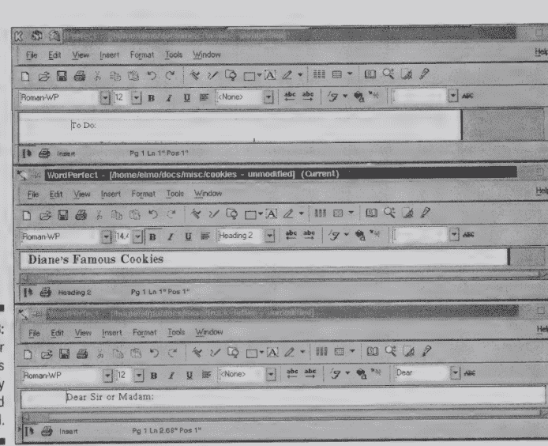

图 12-3：打乱你的文档并让它们靠齐。

> “我想要那一个！”

当你能看到多个文档窗口时，其中一个处于活动状态。活动窗口是标题栏高亮那一个。该文档通常位于其他窗口之上（没有其他窗口遮挡你对它的视线）。活动窗口是你正在编辑的那个，你的光标位于其中。你给出的格式化命令会影响活动窗口。你输入的文本会出现在活动窗口中。

你可以通过点击你想要使用的文档窗口在不同窗口之间切换，或者可以使用本章较早描述的“窗口”菜单命令。

#### 调整窗口大小

对文档进行层叠或平铺极不太可能产生足够让你完成任何工作的文档窗口。你可能需要稍微移动一下它们，也许将你正在处理的主文档窗口调大，而将其他文档窗口调小。这没问题。

## 210 第三部分：你可以对文档的操作

每个文档窗口都有边框，你可以随心所欲移动这些边框，如下列表所示：

- 如果你指向窗口的左边界或右边界，鼠标指针会变成一个小左箭头或右箭头。你可以点击并拖动窗口边界向左或向右以调整其水平宽度。
- 当你指向窗口的顶部或底部边界时，鼠标指针会变成向上或向下箭头，你可以向上或向下拖动窗口边界以调整其垂直高度。
- 当你指向边框的角时，鼠标指针会变成对角线箭头，你可以向任何方向拖动角。WordPerfect 会据此调整边框。

你还可以通过点击并拖动标题栏来移动窗口。这个过程与在桌子上移动纸张类似，不同的是纸张上永远不会留下咖啡渍。事实上，你可以花费大部分工作时间移动你的窗口，直到它们完全按照你想要对齐。

#### 最大化你的文档

屏幕上所有这些窗口、边框和滚动条都可能分散你的注意力。当你想要回到工作并只看一个文档时，你可以将其最大化，使其占据你的整个 Linux 桌面。

- 要使用 KDE 最大化文档，点击其标题栏右侧三个按钮中中间的那个（它看起来像一个小正方形）。搞定！屏幕上所有其他窗口都会被此文档覆盖。（所有的 X 窗口管理器要么有像 KDE 那样的最小化按钮，要么有最大化拉取菜单项。在 UNIX 那个极度非标准的领域里，这并不意外，每个窗口管理器都将此功能放在不同的位置。）

#### 最小化你的文档

- 如果你点击文档窗口 KDE 标题栏上带有圆点的按钮，窗口就会被最小化。它会变得非常小，并显示为 KDE 任务栏上的某处（或作为桌面上的图标）。虽然我们知道没人在会刻意最小化文档，但每当你想要最大化文档窗口却点错了按钮时，这种情况就会发生。点击该条或图标可以再次打开文档窗口。

你可以通过选择 `窗口 > 最小化全部` 来一次最小化所有的文档窗口。

## 第 12 章：在屏幕上处理文档

#### 保存所有已打开的文档

如你所知，频繁保存已打开的文档是一个好主意。这样，如果大楼里所有的空调同时启动导致电压下降，你的电脑死机，你就不会丢失工作。

如果你有多个打开的文档，你应该保存所有它们。你可以通过从程序窗口中选择“保存全部”来实现，或者你可以按下“保存全部”组合键：`Ctrl+Shift+S`。这一步会保存你所有修改过的打开文档。

#### 合并文档

如你所知，WordPerfect 文档存储在自己的独立文件中。有时，你想打破文档之间的墙壁，将它们放在一起，办个派对，随你怎么。

一个文档可能包含一个标准描述。你想打破文档间的隔离并把它们放在一起。

##### 将一个文档插入另一个文档

一个文档可能包含一个标准描述。你想在其中创建一个新文档。遵循以下步骤：

1. 将光标移动到你想让另一个文件的文本出现的位置。
2. 选择 `插入>文件`。WordPerfect 显示“插入文件”对话框，它看起来非常像“打开文件”对话框。
3. 选择要插入当前文档的文件名。
4. 点击插入或双击文件名。WordPerfect 打开该文件，将其内容插入到当前文档的光标所在处，并推开光标之后的任何文本。

## 212 第三部分：你可以对文档的操作

另一种将一个文档的信息包含在另一个的方法是打开两个文档，然后使用剪切和粘贴命令从一个文档复制信息到另一个。生成的合并文档与你粘贴文本的文档名称相同。

你可以在当前文档中插入多个文档。事实上，WordPerfect 对向当前文档中插入的其他文档数量没有限制。但要注意：除非万不得，否则不要创建巨大的文档。它们可能会变得缓慢且难用。

WordPerfect 不跟踪插入文本的来源。如果你希望插入的文本随源文档一起更改，你需要链接文档。WordPerfect 可以做到；你必须使用文件子文档命令，我们在第 17 章中讨论过。

##### 将文本块保存为独立文档

你也可以执行插入文本的反向操作——将当前文档的一部分保存到一个新的、独立的文件。假设你写了一封关于如何制作素食辣椒酱的精彩说明的信（你的特长）。现在你想把你的配谱保存到自己的文件中，步骤所示所示：

- 选择你想单独保存的文本。第 4 章展示了选择文本的方法。
2. 选择你喜爱的发布命令的方式。选择 `文件>保存`，点击工具栏上的保存按钮，或按 `Ctrl+S`。

WordPerfect 注意到已选择部分文本并显示“保存”对话框，如图 12-4 所示。

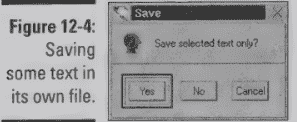

## 第 12 章：在屏幕上处理文档 213

- 3. 若要将所选文本保存到单独的文件，请选择“是”。

WordPerfect 会显示常规“另存为”对话框，你可以指定你想要为所选文本使用的文件名。例如，你可以将所选文本命名为 `Chili_Recipe.wpd`。

- 4. 在“另存为”对话框中点击“确定”，以创建包含所选文本的新文档。

你选择的文本仍然保留在原始文档中——也就是说，Word 在新文件中保存了它的副本。

## 如果文件已存在怎么办？

在 WordPerfect 中打开和保存文档时，你经常为新文件输入名称。总有一天，你为一个新文件输入名称时，却没怀疑自己已经使用过该文件名——可能是为了某个你完全忘记的文档。根据规则，你不能在同一个目录下拥有两个同名的文件。

会发生什么呢？WordPerfect 会问你到底想做什么，事实就是这样。你可以选择将新文件覆盖在旧文件之上，或者改变主意。会出现一个如图 12-5 所示的对话框。

你可以点击这两个按钮之一：

- **是** 意味着“删除此名称的现有文件，并用我现在正在保存的文件替换它。”毫不留情。
- **否** 意味着“等一下！我选错文件名了！给我另一个机会输入正确的！”

## 214 第三部分：你可以用文档做的事情

## ASCII 不问不扣，我绝不说

你可以使用 WordPerfect 编辑 ASCII 文件。将来，你可能被要求编辑某些告诉 Linux 如何运行的特殊文本文件，例如你的 `~/.bash_profile` 或 `~/.bashrc` 文件。

进行格式化或插入任何特殊字符。最后，将其保存为 ASCII 文本文件，就像你处理其他任何外部文件一样（参见本章的“创建外部文件”章节）。

当你编辑 ASCII 文件时，你必须确保将其再次保存为 ASCII 文件，而不是 WordPerfect 文档。要了解如何在 WordPerfect 中打开该文本文件，请遵循本章后部分“读取外部文件”章节中的说明。然后编辑文件，但不要使用任何（特殊功能）。

对于大多数 ASCII 编辑目的，使用标准的 UNIX 编辑器更容易，例如 Emacs、GNOME gEdit 或 KDE Text Editor。这样更安全，因为你不会意外地将一个重要的 Linux ASCII 文件保存为 WordPerfect 文档。

## 使用外部文件

我预见到你的未来有一个外部文档。它强壮、帅气且充满异域风情。你将穿越海洋。

哦！这不是我们讨论的那种外部东西。外部文件是指不是以 WordPerfect 8 格式存储的文件。

你有几个理由使用外部文档：

- 你从使用 FrameMaker 的人那里接收了磁盘上的文档草稿。
- 你想把磁盘上的文档交给一个将用 Microsoft Word 进行某些编辑的人。
- 你从如 Microsoft Access 或 Paradox 等数据库程序获取了数据文件（例如姓名和地址列表）。

WordPerfect 既可以读取（打开）也可以写入（保存）其他格式的文件，包括列表中的格式：

- Applix Words
- FrameMaker
- HTML
- Lotus 1-2-3
- Lotus AmiPro

## 第 12 章：在屏幕上处理文档

- Microsoft Word
- WordPerfect 的其他版本
- 纯 ASCII 文本
- RTF（富文本格式，Windows 标准）
- 网页

当（（或某人）在你的电脑上安装 WordPerfect 时，你（或某人）可能为了节省磁盘空间而选择没有安装 WordPerfect 自带的所有转换选项。如果是这样，你的 WordPerfect 安装程序在处理某些前面的格式可能会出错。

## 我应该使用哪种格式？

如果你想为上一节列出的任一程序读取或创建文件，那你就麻烦了。否则，查看其他程序是否可以读取或写入 RTF 或 ASCII 文本文件。如果是，你应该能够与 WordPerfect 通信。

## 名字与内容不符


这里有一个令人困惑的地方：当你以外部格式保存文件后，WordPerfect 会标题栏上的文档名称更改为文件名。如果你再次使用“文件=保存”、`Ctrl+S` 或工具栏上的“保存”按钮保存文件，WordPerfect 会纳奇你在想什么，并显示“保存格式”对话框。

WordPerfect 建议你以常规 Word 格式、上一次使用的格式或其他格式保存文件。如果你想使用上次的格式，只需告诉它你想要的即可。然而，如果你现在想将文件保存为 WordPerfect 文件，就有问题了。我们建议直接按“取消”关闭此对话框，并改用“文件=另存为”命令。

作为 WordPerfect 文件。遗憾的是，它仍然使用你导出文档时输入的文件名。假设以 WordPerfect 格式将一份重要报告保存为 `Chocolate.wpd`，然后以 Microsoft Word 格式将其保存为 `Chocolate.doc`。标题栏上显示的文件是 `Chocolate.doc`。你按 `Ctrl+S` 以 WordPerfect 格式保存文档。标题栏上显示的文件是 `Chocolate.doc`。

# 第 12 章：在屏幕上处理文档 217

## 216 第三部分：你可以用文档做的事情

### ASCII 不问不扣，我绝不说

`ASCII` 文件仅包含字母、数字、空格和标点符号，`RTF`（富文本格式，Windows 标准）包含了这些。

### 创建文件

要导出 WordPerfect 以外的格式，请遵循以下步骤：

1. 选择“文件：另存为”或按 `F3`。你会看到如图 12-6 所示的“保存”对话框。
2. `WordPerfect`。
3. 点击格式框旁边的三角形，选择你想使用的格式。
4. 在“文件名”框中为新文件输入名称。不要使用用于 WordPerfect 的 `WPD` 扩展名。你应该使用与你创建的文件类型相应的扩展名（例如，用于 Microsoft Word 的 `DOC`，或用于 Lotus WordPro 的 `SAM`）。查看文件类型设置查看 WordPerfect 建议的扩展名。（我们建议 WordPerfect 文件的扩展名为 `WPD`）。
5. 点击“确定”。

WordPerfect 在保存文件时会闪过正在转换的小消息。

## 你在自己的磁盘上创建了一个外部文件

## 读取外部文件

读取其他格式的文件（也导入文档）很容易。只需使用你打开常规 WordPerfect 文档时相同的“程序：打开”命令（或文档窗口中的“文件：打开”命令），步骤所示：

1. 从程序菜单中选择“程序：打开”。如果你愿意，可以选择文档窗口中的“文件：打开”命令，或点击文档窗口工具栏上的“打开”按钮。点击任何显示“打开”对话框的项目！
2. 从文件列表框选择文件名，或在“当前选择”框中输入。
3. 点击“打开”。

啊！WordPerfect 在尝试打开文件时发现不对劲。它会弹出如图 12-7 所示的“转换文件”对话框。它甚至尝试猜测文件的格式。

# 第 12 章：在屏幕上处理文档 213

- 3. 若要将所选文本保存到单独的文件，请选择“是”。

WordPerfect 会显示常规“另存为”对话框，你可以指定你想要为所选文本使用的文件名。例如，你可以将所选文本命名为 `Chili_Recipe.wpd`。

- 4. 在“另存为”对话框中点击“确定”，以创建包含所选文本的新文档。

你选择的文本仍然保留在原始文档中——也就是说，Word 在新文件中保存了它的副本。

## 如果文件已存在怎么办？

在 WordPerfect 中打开和保存文档时，你经常为新文件输入名称。总有一天，你为一个新文件输入名称时，却没怀疑自己已经使用过该文件名——可能是为了某个你完全忘记的文档。根据规则，你不能在同一个目录下拥有两个同名的文件。

会发生什么呢？WordPerfect 会问你到底想做什么，事实就是这样。你可以选择将新文件覆盖在旧文件之上，或者改变主意。会出现一个如图 12-5 所示的对话框。

你可以点击这两个按钮之一：

- **是** 意味着“删除此名称的现有文件，并用我现在正在保存的文件替换它。”毫不留情。
- **否** 意味着“等一下！我选错文件名了！给我另一个机会输入正确的！”

## 214 第三部分：你可以用文档做的事情

### ASCII 不问不扣，我绝不说

你可以使用 WordPerfect 编辑 `ASCII` 文件。将来，你可能被要求编辑某些告诉 Linux 如何运行的特殊文本文件，例如你的 `~/.bash_profile` 或 `~/.bashrc` 文件。

进行格式化或插入任何特殊字符。最后，将其保存为 `ASCII` 文本文件，就像你处理其他任何外部文件一样（参见本章的“创建外部文件”章节）。

当你编辑 `ASCII` 文件时，你必须确保将其再次保存为 `ASCII` 文件，而不是 WordPerfect 文档。要了解如何在 WordPerfect 中打开该文本文件，请遵循本章后部分“读取外部文件”章节中的说明。然后编辑文件，但不要使用任何（特殊功能）。

对于大多数 `ASCII` 编辑目的，使用标准的 `UNIX` 编辑器更容易，例如 `Emacs`、`GNOME gEdit` 或 `KDE Text Editor`。这样更安全，因为你不会意外地将一个重要的 Linux `ASCII` 文件保存为 WordPerfect 文档。

## 使用外部文件

我预见到你的未来有一个外部文档。它强壮、帅气且充满异域风情。你将穿越海洋。

哦！这不是我们讨论的那种外部东西。外部文件是指不是以 WordPerfect 8 格式存储的文件。

你有几个理由使用外部文档：

- 你从使用 FrameMaker 的人那里接收了磁盘上的文档草稿。
- 你想把磁盘上的文档交给一个将用 Microsoft Word 进行某些编辑的人。
- 你从如 Microsoft Access 或 Paradox 等数据库程序获取了数据文件（例如姓名和地址列表）。

WordPerfect 既可以读取（打开）也可以写入（保存）其他格式的文件，包括列表中的格式：

- Applix Words
- FrameMaker
- HTML
- Lotus 1-2-3
- Lotus AmiPro

## 第 12 章：在屏幕上处理文档

- Microsoft Word
- WordPerfect 的其他版本
- 纯 `ASCII` 文本
- `RTF`（富文本格式，Windows 标准）
- 网页

当（或某人）在你的电脑上安装 WordPerfect 时，你（或某人）可能为了节省磁盘空间而选择没有安装 WordPerfect 自带的所有转换选项。如果是这样，你的 WordPerfect 安装程序在处理某些前面的格式可能会出错。

## 我应该使用哪种格式？

如果你想为上一节列出的任一程序读取或创建文件，那你就麻烦了。否则，查看其他程序是否可以读取或写入 `RTF` 或 `ASCII` 文本文件。如果是，你应该能够与 WordPerfect 通信。

## 名字与内容不符

这里有一个令人困惑的地方：当你以外部格式保存文件后，WordPerfect 会标题栏上的文档名称更改为文件名。如果你再次使用“文件=保存”、`Ctrl+S` 或工具栏上的“保存”按钮保存文件，WordPerfect 会纳奇你在想什么，并显示“保存格式”对话框。

WordPerfect 建议你以常规 Word 格式、上一次使用的格式或其他格式保存文件。如果你想使用上次的格式，只需告诉它你想要的即可。然而，如果你现在想将文件保存为 WordPerfect 文件，就有问题了。我们建议直接按“取消”关闭此对话框，并改用“文件=另存为”命令。

作为 WordPerfect 文件。遗憾的是，它仍然使用你导出文档时输入的文件名。假设以 WordPerfect 格式将一份重要报告保存为 `Chocolate.wpd`，然后以 Microsoft Word 格式将其保存为 `Chocolate.doc`。标题栏上显示的文件是 `Chocolate.doc`。你按 `Ctrl+S` 以 WordPerfect 格式保存文档。标题栏上显示的文件是 `Chocolate.doc`。

## 245

## 216 第三部分：你可以用文档做的事情

### ASCII 不问不扣，我绝不说

`ASCII` 文件仅包含字母、数字、空格和标点符号，`RTF`（富文本格式，Windows 标准）包含了这些。

### 创建文件

要导出 WordPerfect 以外的格式，请遵循以下步骤：

1. 选择“文件：另存为”或按 `F3`。你会看到如图 12-6 所示的“保存”对话框。
2. `WordPerfect`。
3. 点击格式框旁边的三角形，选择你想使用的格式。
4. 在“文件名”框中为新文件输入名称。不要使用用于 WordPerfect 的 `WPD` 扩展名。你应该使用与你创建的文件类型相应的扩展名（例如，用于 Microsoft Word 的 `DOC`，或用于 Lotus WordPro 的 `SAM`）。查看文件类型设置查看 WordPerfect 建议的扩展名。（我们建议 WordPerfect 文件的扩展名为 `WPD`）。
5. 点击“确定”。

WordPerfect 在保存文件时会闪过正在转换的小消息。

## 你在自己的磁盘上创建了一个外部文件

## 读取外部文件

读取其他格式的文件（也导入文档）很容易。只需使用你打开常规 WordPerfect 文档时相同的“程序：打开”命令（或文档窗口中的“文件：打开”命令），步骤所示：

1. 从程序菜单中选择“程序：打开”。如果你愿意，可以选择文档窗口中的“文件：打开”命令，或点击文档窗口工具栏上的“打开”按钮。点击任何显示“打开”对话框的项目！
2. 从文件列表框选择文件名，或在“当前选择”框中输入。
3. 点击“打开”。

啊！WordPerfect 在尝试打开文件时发现不对劲。它会弹出如图 12-7 所示的“转换文件”对话框。它甚至尝试猜测文件的格式。

## 218 第三部分：你可以对文档进行的操作

包括文件：

+ 4. 对于“转换文件格式为”(Convert File Format From) 设置，请选择文件的格式。

   WordPerfect 通常能正确识别文件格式。可能你只需要直接进入下一步即可。

5. 点击“确定”(OK)。

   WordPerfect 会显示正在进行转换的消息；然后它会打开（导入）该文件。根据原始文件的格式，格式可能会显得有些……怎么说呢，很奇怪，尽管文本内容应该是存在的。

6. 通过选择“文件(File) > 另存为(Save As)”将文件另存为 WordPerfect 文档，或者在您为新文件选择名称时，可以使用与原始文件相同的文件名；只需确保将文件扩展名（如果有）从原来的任何内容更改为 `.wpd`，这是 WordPerfect 的标准文档扩展名。

7. 选择 WordPerfect 6.x/7/8 作为格式。

8. 点击“确定”(OK) 以保存文档。

有关保存外来文件的提示，请参阅前面的侧边栏，“名不不实”。

## RTF：文件格式的“世界语

如果你必须经常使用或提供外来文件，且它们的翻译效果不好，请查看你的外国朋友是否可以导出和导入 `RTF` 文件，即富文本格式（Rich Text Format）。`RTF` 格式专为文档交换而设计；它像世界语一样，是一种通用语言。虽然不是所有人都会说（就像世界语一样），但许多文字处理器都支持，包括适用于 Linux、Windows、Macintosh 的 WordPerfect，以及适用于 Windows 和 Macintosh 的 Microsoft Word。只要两台电脑都安装了相似的字体，`RTF` 就能保留你的大部分格式设置。

## 第 12 章：在屏幕上操纵文档 219

## 文字处理器对比 食物处理器

尽管 WordPerfect 在导入和导出许多其他格式的文件方面表现出色，但它并不完美。这并不是 WordPerfect 的错——问题在于不同的文字处理器具有不同的功能，且处理方式也不同。有时，导入或导出的文件看起来就像被错误地放进食物处理器里搅拌了几秒钟一样。

当你使用外来文件时，在漫率地编辑或打印之前，请先检查一下。格式可能会被搞乱。字体可能会发生奇异的变化。你可能会在不该出现的地方发现额外的段落结束符（你通常使用 Enter 键输入的字符）。可能需要进行一些清理。

# 第 13 章

## 在磁盘上操纵文件

**本章内容**

- 文件命名
- 使用目录
- 使用 WordPerfect 文件管理器
- 移动、重命名、复制和删除文件
- 查找忘记文件名的文件

在过去，Linux 并没有文件管理器。与所有的 UNIX 系统一样，你对文件进行的所有操作都是通过对晦涩的提示符输入命令来完成的。用户熟练地输入 `cd`、`ls -l`、`pwd`、`cat` 以及其他大约百个命令，以便在任何需要时查看、复制、移动、删除或重命名文件。坦率地说，文件管理器已经蓬勃发展，Linux 拥有如此多的文件管理器，以至于你可能花一周的时间来决定你最喜欢哪一个。这些文件管理器充满了精美的图标、菜单和拖放功能。

文件管理器已经变得非常日常，以至于你现在可以在其他应用程序内部找到它们，包括适用于 Linux 的 WordPerfect。WordPerfect 自带了文件管理器，帮助你处理不可避免遇到的各种文件操作。本章将介绍 WordPerfect 文件管理器的基础知识。

在本章中，我们大量讨论了目录。如果你习惯 Windows 或 Macintosh，你可能知道它们被称为“文件夹”(folders)。尽管是同一个东西，早在人们想到文件夹这个类比之前，它们在 UNIX 世界里就被称为“目录”(directories)，而且这个名字一直保留了下来。如果你愿意，可以称它们为文件夹，但那样没有人会相信你是一个 UNIX 大师。

## 222 第三部分：你可以对文档进行的操作

## WordPerfect 对比真实文件管理器

探索计算机中的目录和文件是一个相当大的话题。事实上，《Linux 傻瓜》（LINUX For Dummies）第 4 版中有一整章都在告诉你关于这方面的一切。（Margy 与 John R. Levine 合著了这本书——由谁出版呢？还能不是 IDG Books Worldwide, Inc.）我们在这里不这么做。相反，我们只告诉你足够的知识来让你的文件井有序。

这个话题也足够大，以至于 Linux 不仅有一个，而是好几个程序专门用来帮助你探索计算机上的目录。大多数常见的 Linux 桌面环境（如 KDE 和 GNOME）都有一个文件管理器程序，对于深度的文件探索，它们是理想选择。如果你想对文件进行重大更改，例如一次性移动大量文件或重组织目录，请考虑学习使用随窗口管理器自带的文件管理器。例如，如果你使用 KDE，可以从屏幕底部的 KDE 任务栏选择 K+Home 来查看 KDE 自己的文件管理器（它看起来非常像 Windows 98 的“我的电脑”文件夹）。

虽然 WordPerfect 文件管理器承担了管理文件的工作，但称其为文件管理器可能有点大过其实。就像人们不应期望一个真实的文件管理器在处理文字方面表现卓越一样，人们也不应该对文字处理器应该包含一个功能完备、增强版的文件管理器寄予厚望。例如，WordPerfect 文件管理器并不让你用鼠标拖放文件。尽管文件管理器有局限性，但它仍然是一个实用的工具。本章的余下部分描述了你可以使用 WordPerfect 文件管理器执行的文件管理魔术。

## 探索你的目录

在 WordPerfect 中，你可能已经注意到，“文件+> 打开”(File+Open)、“文件+> 另存为”(File+Save As) 以及“程序+> 文件管理器”(Program) 显示的对话框是类似的。文件管理器可以帮助你处理你可能会遇到的所有文件操作。本章将介绍 WordPerfect 文件管理器的基础知识。

在本章中，我们大量讨论了目录。如果你习惯 Windows 或 Macintosh，你可能知道它们被称为文件夹。尽管是同一个东西，早在人们想到文件夹这个类比之前，它们在 UNIX 世界里就被称为“目录”，而且这个名字一直保留了下来。如果你愿意，可以称它们为文件夹，但那样没有人会相信你是一个 UNIX 大师。

在 WordPerfect 中，你可能已经注意到，“文件+> 打开”(File+Open)、“文件+> 另存为”(File+Save As) 以及“程序+> 文件管理器”(Program) 显示的对话框是类似的。文件管理器可以帮助你处理你可能会遇到的所有文件操作。本章将介绍 WordPerfect 文件管理器的基础知识。

正如图 13-1 所示。在 WordPerfect 中，你可能已经注意到，“文件+> 打开”(File+Open)、“文件+> 另存为”(File+Save As) 以及“程序+> 文件管理器”(Program) 显示的对话框是类似的。文件管理器可以帮助你处理你可能会遇到的所有文件操作。*

## 第 13 章：在磁盘上操纵文件 223

图 13-1：另存为，瑞士军刀般的对话框。

就像程序窗口一样，这个对话框有几个部分。这里是最重要的：

- **当前目录**(Current Directory)：除非你另指定，否则 WordPerfect 保存文件的目录。
- **文件列表**(File List)：当前目录下的文件。
- **目录列表**(Directory List)：当前目录下的子目录。使用目录列表在目录树中移动。要进入上一级目录，双击命名为 `..` 的目录。
- **文件名/当前选择**(Filename/Current Selection)：所选文件的名称。如果你选择一个目录，选择框将显示 `*`，这是所有文件的通配符。别担心：它是同一个框。
- **查看**(View)：打开一个预览窗口显示所选文件的内容，无需打开它。
- **快速查找**(QuickFinder)：在文件中搜索特定单词或词组。本章后面的“通过名称查找文件”章节将告诉你如何工作。
- **目录列表和快速列表**(Directory List and QuickList)：显示或隐藏这些列表。目录列表显示当前目录下的子目录。快速列表是你创建的一个列表，包含常用目录的易于识别的名称。参见本章后面的“快速列表”章节。


224 第三部分：你可以对文档进行的操作

## 创建目录

除非你告诉 WordPerfect，否则它会将所有文档保存在默认文档目录中，这通常是你的主目录或启动程序时打开的目录。例如，如果你的用户名是 npotter，你的主目录就是 `/home/npotter`。你可能不想把所有文档都放在主目录下，除非你是一个特别喜欢混乱的爱好者。相反，你可以在保存文档或创建新目录时轻松地指定不同的目录。你也可以更改默认文档目录。有关更改设置的更多信息请参见第 19 章。

在本章前面我们提到目录通常被称为文件夹，因为它们与档案柜中的纸质文件夹相似。虽然供应柜似乎总是没有足够的实物文件夹，但电子文件夹没有问题；你只需要凭空创建它们。以下是使用文件管理器的方法：

1. 通过选择 `文件+> 另存为` `File:Save As` 打开另存为对话框，或通过选择 `程序+> 文件管理器` `Program:File Manager` 打开文件管理器对话框。

你会看到类似于图 13-1 所示的对话框。

2. 选择要创建新目录的现有目录。

双击目录列表中的目录名称以进入该现有目录。

## 第 13 章：在磁盘上处理文件

3. 选择文件：在“另存为”对话框或“文件管理器”对话框的菜单栏中选择 `文件：创建目录`。

会出现“创建目录”窗口，窗口中已显示了你当前目录的名称。

4. 输入你要创建的目录名称。

要将该目录放在你的当前目录内，只需在最后一个斜杠之后向当前目录追加新目录名称。记住，斜杠用于分隔目录名称。如果你输入一个已存在的目录名称，WordPerfect 将拒绝创建并以错误消息的形式进行提示。在 WordPerfect 提供的路径与你输入的额外目录名之间不要留空格。

5. 点击“确定”。

WordPerfect 会创建新目录并将其显示在“目录列表”框中。

你已经创建了一个新目录，尽管里面什么也没有。如果你正在使用“另存为”对话框，可以继续在该新目录中保存文档。当你双击“目录列表”框中的目录名称时，该新目录的名称将出现在对话框的“当前目录”部分。在“当前选择”框中输入文档名称并按回车。恭喜！

### 路径

当你与电脑讨论文件时，如何区分同名文件？假设你有两个配谱，都名为 `cookies.wpd`。它们可以共存，因为它们位于不同的目录：一个在名为 `chocolate` 的目录中，另一个在名为 `oatmeal` 的目录中。路径用于告诉软件如何导航层级结构到达正确位置。路径由目录列表组成，用斜杠 `/` 分隔。

`/home/hpotter/recipes/chocolate`

指向 `oatmeal` 目录的路径所示：

`/home/hpotter/recipes/oatmeal`

如果你想精确地告诉电脑某个文件，可以使用带有文件名及其扩展名的路径。路径看起来像这一行：

`/home/hpotter/recipes/chocolate/cookies.wpd`

指向 `chocolate` 目录的路径所示：

## 第三部分：你可以对文档的操作

## 移动、重命名、复制和删除文件

事实上，Linux 文件名可以随你的意愿任意长，尽管你应该避免特殊字符（如 `*`、`&` 和 `!`）以及空格。不能使用空格有时会让习惯 Windows 或 Macintosh 系统的用户感到不便。因为 Linux 系统习惯使用点或下划线代替空格，你经常会看到如 `cookie_recipe.wpd` 或 `letter-to-diane.wpd` 的文件名。Linux 版 WordPerfect 的 `.wpd` 扩展是可选的，但这是一个好主意，因为可以帮助你识别文件是 WordPerfect 文档。

要移动、复制或删除文件，按以下步骤操作：

1. 通过选择 `程序：文件管理器` 或 `文件：另存为` 或 `文件：打开` 打开文件管理器对话框。

2. 找到你想移动、复制或删除的文件。

双击“目录列表”中的目录名称以进入目录。确保目录名称没有保持高亮状态。如果是，双击“当前”以清除高亮。

3. 在“文件列表”框中单击文件名将其高亮。

不要双击文件名；该方法会尝试保存或打开文件，取决于显示的是哪种对话框。

按照以下三个章节之一的步骤操作，以移动、重命名、复制或删除你选择的文件。

### 移动或重命名文件

要移动文件，在完成上一节的步骤 1-3 之后，按照以下步骤操作：

1. 从对话框菜单中选择 `文件：移动/重命名`。

你会看到“移动/重命名”对话框，其中有文件的当前路径。

2. 输入目标位置或新文件名。

输入你想将文件移动到的路径和文件名。你也可以编辑 WordPerfect 已经显示的路径。如果你想移动文件，将路径更改为与文件存储位置不同的目录。如果你想让文件保持相同名称，请输入相同的名称。如果你想重命名文件，请输入不同的名称。

3. 点击“确定”。

如果你输入了不同的文件名，WordPerfect 会重命名文件；如果你输入了不同的目录名，它会移动文件；或者两者兼有！例如，如果文件原始路径为 `/home/hpotter/spells/test1.wpd`，你可以通过将项目改为 `/home/hpotter/spells/quiz1.wpd` 来重命名它。或者，你可以通过将项目改为 `/home/hpotter/history/test1.wpd` 将其移动到不同的目录。如果你尝试移动到一个不存在的目录，WordPerfect 会遵循操作、显示消息并拒绝移动文件。WordPerfect 也不允许将文件移动到你没有相应权限的目录。

### 复制文件

复制文件的方法与移动文件类似。要复制文件，在完成本章之前“移动、重命名、复制和删除文件”节的步骤 1-3 之后，按照以下步骤操作：

1. 从对话框菜单中选择 `文件-复制`。

你会看到对话框，有一个空白框询问你想将文件的副本放在哪里。

2. 输入你想让 WordPerfect 复制文件的目标位置。

输入你想复制的路径和文件名。目录必须已经存在。遗憾的是，WordPerfect 没有提供查看你已拥有目录的方法——框右侧没有出现小文件夹图标。真糟糕！只需仔细输入。

3. 点击“确定”。

WordPerfect 将原文件留在原处，并在你指定的地方创建一个副本。你不能将文件复制到不存在的目录或你没有写入权限的目录。Linux 就是这般复杂。

### 删除文件

要删除文件，在完成本章之前“移动、重命名、复制和删除文件”节的步骤 1-3 之后，按照以下步骤操作：

1. 务必真的确定你想删除此文件。

2. 从对话框菜单中选择 `文件-删除`。

你会看到“删除”对话框，询问你是否确定要删除该文件。

3. 点击“是”。

WordPerfect 会删除该文件，由于 Linux 没有回收站，你无法轻松地找回它。

## 健忘者的两个文件管理工具

无论你给文件命名得多么仔细，在某个时刻你都会忘记里面了什么。WordPerfect 文件管理器有两个奇妙的工具可以唤起你的记忆。

### 查看器窗口

文件管理器、“另存为”或“打开”对话框中的“查看”按钮会打开查看器窗口，显示你拥有的任何文件的内容，如图 13-2 所示。除了文件内容本身，你无法对此预览做任何操作；但此时，这正是你需要的。

在你浏览文件时，查看器窗口会保持打开。如果你选择一个不可读的文件，如程序，WordPerfect 只会说这是一个未知文件类型。当你完成查看器窗口后，点击“关闭”按钮。

图 13-2 预览：使用查看器窗口查看文件内容而不打开它。

### 快速列表 QuickList

取决于你的组织程度，你可能会发现某些文档埋在几层目录之下。例如，你的商务信可能埋在 `/home/hpotter/documents/letters/current/business` 目录下，每次想打开信时都要点到底，你会累的。WordPerfect 快速列表正是你节省鼠标按钮点击所需的工具。快速列表让你为常用目录创建快捷方式。

要显示快速列表，点击文件管理器、“另存为”或“打开”对话框右下角的“快速列表”按钮。WordPerfect 显示快速列表面板，如图 13-3 所示。它较小，因为它与“目录列表”共享空间。你可以通过点击“目录列表”按钮临时隐藏目录列表。快速列表开始仅显示一个名为“Documents”的快捷方式。

图 13-3：激活了快速列表窗口的文件管理器，这是你减少鼠标点击的秘诀。

230 第三部分：你可以用文档进行的操作

要移动到快速列表中列出的目录，请双击它。例如，双击“文档”快捷方式将带你进入 WordPerfect 认为你存储文档的目录。

当你创建了自己的快捷方式时，快速列表就会变得非常有用。假设你想为 `/home/hpotter/letters/current/business` 创建一个快捷方式。该快捷方式将让你能够通过鼠标快速双击即可切换到该目录。按照以下步骤创建你自己的快速列表快捷方式：

1. 如果快速列表没有出现在文件管理器、另存为或对话框的右侧，请点击“快速列表”按钮显示它。

2. 在快速列表窗格内点击并按住鼠标右键。

3. 当弹出菜单出现时，点击 `编辑快速列表` `Edit QuickList` 选项。

出现“编辑快速列表”窗口，如图 13-4 所示。你可以添加新的快捷方式、删除不再使用的快捷方式，并更改现有的快捷方式。

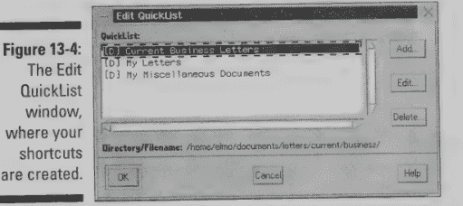

4. 要创建新快捷方式，点击 `添加` `Add` 按钮。

你会看到“添加快速列表项”对话框，在其中你可以告诉 WordPerfect 想给快捷方式命名的名称以及快捷方式带你去的目录。

5. 在“目录/文件名”框中输入目录名称。

例如，输入 `/home/hpotter/documents/letters/current/business`。

6. 在“描述”框中输入快捷方式名称。

例如，输入 `Current Business Letters`。

7. 点击 `确定` `OK`。

`Current Business Letters` 出现在快速列表中，每你想去那里时，都可以双击快速列表，而不是在无尽的目录列表中反复点击。

第 13 章：在磁盘上处理文件

你也可以通过在“编辑快速列表”对话框中选择快捷方式并点击“编辑”键来编辑快捷方式。如果你从未使用某个快捷方式，可以在“编辑快速列表”对话框中选择它并点击“删除”将其移除。WordPerfect 不会删除目录——只删除指向目录的快捷方式。

### 文件类型

WordPerfect 可以且确实使用许多不同类型的文件。有些是 WordPerfect 自有的文件。另一些是导入/导出类型，例如电子表格、数据库、图形以及来自其他处理程序的文档。你必须稍微了解它们的差异以防混淆，例如，图形文件和文档文件可能有相同的名称并存储在同一个目录中。

通常当你看到列表列表时，就能认出它是 WordPerfect 文档文件。它通常在名称后带有三个字母的 `wpd` 扩展名并用点隔开，例如 `.wpd`，除非你在创建文档时刻意为它指定了不同的扩展名。这不是好主意。来自其他文字处理程序的文档也使用扩展名。

图形文件通常也有独特的二或三字母扩展名，尽管存在数百种变体。常见的有 `tif`、`eps` 和 `jpg`。这些扩展名用于 `插入：从文件图形` `Insert:GraphicsFromFile` 命令。

大多数时候，WordPerfect 会根据你提供的命令类型知道你需要什么类型的文件，并只显示正确类型的文件。然而，考虑到你可以误弄的所有设置，总有一天你会做出某些让 WordPerfect 束手无策并让你自己去处理扩展名的事情。

### 查找遗忘名称的文件

伙计，WordPerfect 对你想找到自己的文件感到是多么的高幸啊。它投入了大量精力来创建文件查找领域的“星球大战”、寻找丢失和被困文件的“圣伯纳德犬”，是技术辅助文档搜索与救援的真正“救援911”。它被命名为 QuickFinder，静静地隐藏在文件管理器、另存为和打开文件对话框中。QuickFinder 如此强大，我们甚至不必尝试描述它能做的一切；我们专注于它是如何帮助你找到文件的。

QuickFinder 通过查找特定文本来寻找文件。例如，如果你想找给 Tannwald 女士的一封信，但记不起文件名，只需在 QuickFinder 的相应位置输入 `Tannwald` 即可。

随后 QuickFinder 会发出警报；派遣陆军、海军和空军来执行你的谦微请求；然后自豪地走回来，嘴里还叼着所有带有 `Tannenberg` 单词痕迹的文件。此功能也适用于短语和各种单词组合。

在继续之前，以下是如何执行简单的单词搜索：

1. 从菜单栏选择 `程序：文件管理器`、`程序：打开窗口` 或 `文件：另存为`。

你会看到一个对话框，其右下角附近有一个 QuickFinder 按钮。

2. 点击 QuickFinder 按钮显示 QuickFinder 对话框。

3. 在 `文件模式` `File Pattern` 框中，选择要搜索的文件模式。

要搜索目录中的所有文件，将此项留为 `*`。要仅搜索 WordPerfect 文档，可以输入 `*.wpd`。文件名扩展名对于查找特定类型的文件非常有用。

4. 在 `搜索框` `Search Box` 中输入你想查找文件的单词。例如，输入 `Tannenberg`。

5. 选择想要开始搜索的目录。

要在当前目录中搜索，请将 `搜索位置` `Search In` 框设置为 `目录` `Directory`。要搜索当前目录及其内部的所有目录，设置 `搜索位置`。

236 第四部分：创建不仅仅是放在那里的文档

- 表格：它们非常适合任何你希望在行和列中都安排的内容。表格特别酷，因为你可以在表格中进行一些数学计算。它们可以避免备忘录和类似文档中出现尴尬的错误。

- 框：在 WordPerfect 中，框——就像现实中的盒子一样——是放置内容的地方。在这里，“内容”基本上是指你文档正文以外的所有东西。我们在本章中讨论的线条和文本块等内容，要么在框内，要么几乎就像框一样。我们在第 15 章中讨论的你创建的图片、图表和图形，也都在框内。

## 使用边框和背景

出于某种原因，没有什么比文字周围有一个漂亮、华丽的边框看起来更整洁了。至少，WordPerfect 的员工一定是这么认为的，因为他们的边框功能对于大多数普通人来说又是一个过度设计。WordPerfect 让你从一系列令人眼花缭乱的有味以及没那么味的边框中进行选择。你可以用微妙、有趣甚至极其奇异的图案填充文档背景。

如果你想创建某种精美的文档——例如证书，这些功能中的一些可能有用。除非你仔细地使用这些功能，否则你很容易就会得到一个无法阅读的混乱局面。

### 基础边框

要在文档的部分周围加上一个花哨的边框，首先决定你对让文档的哪个区域变得“非法”——哦不，我的意思是“华丽”。你的选择有页面、段落或列。对页面、段落或列应用边框的效果基本上如你预期的那样：你会得到整页侧边的边框、段落侧边的边框，或者整个列区域侧边的边框。

对于基本的概览，我们选择了段落，因为所有的工作方式基本上都是。选择 `格式->段落->边框/填充` 命令来查看“段落边框”框，如图 14-1 所示。如果你选择 `格式->页面->边框/填充` 命令，或者在 `格式->列` 对话框中点击“边框/填充”按钮，你会看到同样的名为“段落填充”对话框。

## 第 14 章：让你的文字在页面上跑起来

WordPerfect 显示段落边框对话框。点击标记为“边框样式”的大 X，查看一个装满边框的框，如图 14-2 所示。

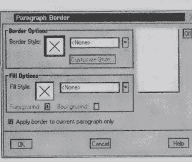

图 14-1：段落边框对话框。


图 14-2：装满边框的框。

WordPerfect 的员工浪费了——呃，是我们花费了——大量的时间为你的文档想出了数百万种类的边框。你可以浏览边框样式集合，找到最适合你的那一个。大 X 表示“无”。当你看到你喜欢的边框时，点击它。选择边框的另一种方法是点击“段落边框”对话框中显示为 `<无>` 的边框右侧的向下三角形框，并从边框列表中选择一个边框。

如果你没有找到喜欢的，可以选择一个边框，然后点击“自定义样式”按钮来自己设置颜色、线条样式和阴影方向。

你还没有完成。在这个框的左下角有一个标记为“仅将边框应用于当前段落” 的按钮。如果你勾选了这个框，WordPerfect 正会这样做。但是，如果你想快速造成大量破坏，请取消勾选此框。后续的所有页面都具有这个边框。

238 第四部分：创建不仅仅是放在那里的文档

### Phil —— 为了你文字背后的所有空白

如果你喜欢边框，你会喜欢 Phil。Phil 或者准确地说是 Fill，填充当你点击段落边框对话框中标记为“填充样式”的 X 时，它就会出现。或者点击它右侧的向下三角形按钮。大多数情况下，这个按钮通过在文字后面放置图案让你的文字变得无法阅读。你可能在你想要突出的内容后面放置浅灰色的图案。但是，请确保你的打印机和复印机能够胜任打印或复制这些内容；否则，你最终得到的是污迹而不是可读的文本。

当你有了喜欢的内容时，点击确定。当你看到你对文档做了什么时，你可能想移除边框和填充。只需按 `Ctrl+Z` 撤销你的更改。

### 关于边框的一些杂杂想法

“但我不是艺术家！”你紧张地叫道，“除了让我的文档变得无法阅读，我该用这些边框和背景做什么呢？”这一节列出了一些你可能想做的事：

- 在整个文档周围加上边框。使用 `格式:边框/填充` 命令，你可以为证书和海报加上整洁的边框。

- 将边框限制在段落、列或光标所在的地方。在边框对话框中，点击左下角标记为“将边框应用于当前区域”的按钮。勾选此框是在发布边框/填充命令之前先选择文本区域的替代方案。


进入`/path/to/xxx`目录，找到`xxx.json`。

在表达式`cvar = avar + bvar`中，加法运算符（`+`）将`avar`与`bvar`相加，得到它们的和`cvar`

在`List.of(arg0, arg1, arg2)`中，`List`接口的工厂方法`of()`接受一系列的元素，返回包含它们的只读列表。

之后我们这样调用`cmd`命令：`cmd arg0 arg1 arg2`。

```
if (condVar > someVal) {console.log("xxx")}
```


假设你正在读一篇严肃的文章——例如在《人物》杂志上读的（“汤姆·汉克斯：他真的在追求梅格·麦当 吗？”）。在页面的角落，有一个洋红色边框，里面两列关于琐碎、烦人的边缘主题的文字，如“汤姆·汉克斯和凯莉：同生异梦？”猜怎么着？你也可以使用文本框在文档中创建像这一样的侧边栏。

说真的，如果你想在 `WordPerfect` 文档中创建任何类型的框，就应该阅读这一节。像我们刚刚描述的那种普通文本框、某些表格、图片甚至方程都使用了这种“框”的功能，了解它很有用。 `WordPerfect` 中所有的框工作方式都大体相同。我们用文本框来介绍它们。

### 创建你的第一个框

要创建文本框，选择“插入文本框”或点击工具栏上的“文本框”按钮（矩形内有一个字母 A）。漂亮！一个框出现在你的文档中。`WordPerfect` 决定了将框放在哪里以及它应该长什么样。光标在框内，所以你可以尽情地打字。

你可以使用“格式”命令对这些文本进行格式化，就像格式化任何其他文本一样。你甚至可以将文字分列。不过，不要尝试使用“格式”命令来更改文本框的边框；否则，你只会得到框中框。文字会自动在顶底栏之间居中显示。如果框的长度或宽度不对，现在不用担心；只需输入文字即可。完成后你可以更改框的尺寸。

你可能会发现这个框有些问题。你可以通过点击并按住边框来移动框。当你处于正确的位置时，光标会变成四向箭头。你可以将框移动到任何地方。如果你想调整框的大小，只需拖动周围八个手柄之一。在边缘附近，光标会变成双向箭头。在角部，它会变成对角双向箭头。要撤销移动，只需按 `Ctrl+Z`。


## 第四部分：创建不仅仅是放在那里的文档


### 选择你的框

我们这一部分讨论的所有内容都需要选中该框。如果你点击框内部，属性栏会显示框内部的信息。如果你点击框外部，属性栏会显示框外部的信息。然而，如果你点击框本身的边缘，你不仅看到箭头和手柄，还能看到如图 14-7 所示的属性栏。（等等，图 14-7 在哪里？我们将在下一页看到。）

其中一些按钮非常简单：

- 上一个框/下一个框：当你关注框时，你可能想对文档中的其他框进行操作。与其手动寻找并点击它们，不如让这些方便的按钮直接带你去那里。如果任何按钮呈灰色，说明文档中没有上一个或下一个框。
- 边框样式：此按钮带你进入“边框格式世界”，我们在本章开头的“基础边框”节中讨论过它。
- 填充样式：此按钮向你介绍 Phil，我们在本章开头的“Phil —— 用于你背后的所有空白空间”节中讨论过这位填充专家。

其他按钮需要更详细的查看。

## 第四部分：创建不再静止不动的文档

## 使用“图形”（Graphics）菜单

由于许多命令只有在选择了一个文本框（技术上讲是一个图形框）时才有意义，因此 `WordPerfect` 的人员认为，如果只有在有可编辑的图形框时才显示“图形”菜单会让人产生困惑。他们没有让“图形”菜单出现在菜单栏上（那里你可能注意不到），而是将其放置在编辑图形或文本框时会显示的“属性栏”（Property Bar）上。至少我们是这么认为的。

在该菜单中你可以完成两件重要的操作，而这些操作在其他地方无法无法的：设置框的精确尺寸和设置框的精确位置。

### 将框精确移动到你想去的地方

在本章前面，我们讨论了通过拖动框的边界（句柄之间）来移动它。如果你不在乎框放置的的确切位置，这种方法也许可以接受。但是，如果你想指定具体的细节，请选择文本框，点击属性栏上的“图形”按钮，然后选择“位置”（Position）命令。图 14-8 显示了“框位置”对话框。

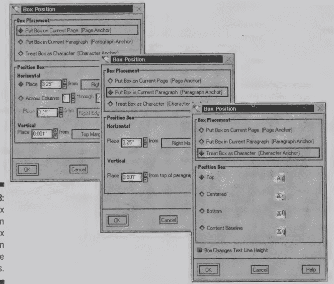

图 14-8：位置对话框有三种样式。

## 第 14 章：让你的文字在页面上移动

由于框不是文本的一部分，`WordPerfect` 需要决定它们应该位于页面的什么位置，以及当页面文本发生变化时它们会发生什么。最后一点，即文本变化时发生什么，这就是为什么各种设置名称中都包含“锚点”（anchor）一词：你将框锚定在文档中的某个项目上，该项目去哪里，你的框就去哪里。你可以通过在位置对话框中分别使用“页面锚点”（Page Anchor）、段落锚点”（Paragraph Anchor）或“字符锚点”（Character Anchor）设置将框附加到页面、段落或字符。该对话框中的其余设置取决于你选择哪种类型的锚点。

#### 将框锚定到页面

附加到页面上的框不会相对于页面移动。文本可以来，也可以去；但这个框始终出现在页面的相同位置。啊，你问是哪一页呢？这都与代码有关，再次。在文档中创建框会插入我们在第 9 章中讨论的另一种秘密代码。该秘密代码随周围的文本移动。如果你添加文本，代码会向文档后续部分移动。如果你删除文本，代码会向文档开头移动。你的框出现在代码所在的页面，但始终位于页面的相同位置。

如果这不是你想要的，没关系，你可以修复它。例如，如果你想让一个框始终出现在文档的第 2 页且仅出现在第 2 页，请在第 2 页创建该框。点击属性栏上的“图形”按钮，选择“位置”命令打开“框位置”对话框，并选择“放在当前页（页面锚点）”。对话框包含图 14-8 中左侧版本所示的设置。现在，你的框将留在第 2 页，无论你向其中插入了多少文本或删除了多少文本。如果你删除了第 2 页上的所有文本，你可能会得到一个只包含你创建的框的页面。这就是你想要的，所以 `WordPerfect` 就会这么做。

你可能认为指定框在页面上的出现位置应该是简单的，但 `WordPerfect` 给了你许多选项。指定框的水平和垂直位置——但是是相对于什么呢？对于水平位置，你可以指定框相对于纸张边缘、相对于纸张的页边距，或者如果你页面上有列，则相对于列。

在你弄清楚了如何将框附加到页面后，你可以选择相对于哪里。是左边距、右边距还是纸张中心？还是纸张左边缘（在更改页边距时）？左列、右列还是列的中心？通常，你会选择相对于左边距或右边距。如果你的框足够大，可能无法放入边距之间，请选择相对于纸张左边缘。你可能需要不断尝试直到找到你喜欢的。


## 第四部分：创建不再静止不动的文档

#### 将框锚定到段落

要将框附加到段落，请点击属性栏上的“图形”按钮，选择“位置”命令打开“框位置”对话框，并选择“将框放在当前段落（段落锚点）”。对话框包含图 14-8 中间版本所示的设置。附加到段落的框会随其所属的段落移动。如果你在段落前面添加文本，你的框会随段落向下移动；如果你删除了文本，你的框会向上移动。告诉 `WordPerfect` 框相对于其段落出现在哪里，比告诉它框相对于页面出现在哪里要简单。水平选项基本相同。然而，对于垂直选项，你可以指定框相对于段落出现在哪里。在大多数情况下，你希望框相对于它们靠近的段落放置。

#### 将框锚定到字符

框也可以附加到字符。你可以将这种框看作是你自己绘制的特殊字符。（如果你真的想画它，请看第 15 章。）如果你只是想让它出现在那里，你可以把它看作一个特殊字符。

要将框附加到字符，请点击属性栏上的“图形”按钮，选择“位置”命令打开“框位置”对话框，并选择“放在当前页（字符锚点）”。对话框包含图 14-8 中右侧版本所示的设置。水平上，水平选项几乎完全相同。然而，对于垂直选项，你可以指定框相对于段落出现在哪里。在大多数情况下，你希望框相对于它们靠近的段落放置。

## 第 14 章：让你的文字在页面上追逐

属性栏上的“环绕”按钮让选择你想要的环绕类型变得简单。万一你忘记了，查看框本身（而不是框内容）属性栏的唯一方法是点击框的轮廓；你应该会在框的边缘看到方形“手柄”（参见本章前面的“追逐关于框的其他所有内容”节）。当你点击“环绕”按钮时，你会看到我们刚才描述的选项列表，以及一些补充。现在先不要担心轮廓；我们在第 15 章讨论图片时会提到它们。你还可以让你的框遮挡它所上方的文本（那是“在文字前面”选项），或者让文本直接越过你的框（“在文字后面”）。你以后会发现这可能有用。

## 在你的文档上涂鸦

在让计算机屏幕上的文档看起来越来越像纸质文档的不懈追求中，文字处理器感到有必要让你在文档上涂鸦，就像你用笔或铅笔一样。如果你想强调某些内容或在文档元素之间建立视觉联系，这个功能将非常有用。`WordPerfect` 在这方面表现异常出色。你可以轻松地在文档中绘制水平和垂直线，再花一点精力，就可以在任何你需要的地方绘制线条和形状。

## 上下和左右

要绘制水平线，按 `Enter` 键创建一个新段落，将光标置于此处，然后按 `Ctrl+F11` 或选择 `插入>形状>水平`。要在贯穿页面大部分区域绘制一条垂直线，选择 `插入>形状>垂直线`。你可以通过编辑线条来更改水平线或垂直线的长度和位置。右键点击线条以选择它，这可能有点棘。将鼠标光标缓慢地移动到你插入的线条上。在某个时刻，光标应该变成一个指向右侧的箭头。这就是右点击的信号。在快速菜单上，你会看到“编辑水平线”（或编辑垂直线）选项，它会显示“编辑图形”对话框，其中有很多选项。如果你厌倦了，可以右键点击线条并选择删除来删除它。当你通过点击选择线条时，会出现黑色手柄，你可以用它们移动线条。

## 第四部分：创建不再仅仅呆在那里的文档

## 五通八糟的线条

`WordPerfect` 有一种更有实用的线条类型，它称为“绘制线条”。绘制线条让你能够在页面上的几乎任何地方决定线条的起始和结束位置。

通过选择 `插入>形状->绘制线条` 向你的文档中添加绘制线条。光标会变成一组十字准。在你想让线条一端所在的地方点击并按住鼠标，将线条拖动到你想让另一端所在的地方。由于线条在框内，我们在本章前面提到的关于文本框的所有内容都适用。你之所以能看到线条背后的文本，是因为该框的“文本环绕”选项被设置为“在文字前面”。

当选中绘制线条时，属性栏会变化以包含一些新按钮。其中几个值得注意；剩下的我们鼓励你探索。图 14-11 显示了图形属性栏。

| 图形菜单 | 线条样式 |
| :--- | :--- |
| 上一个框 | 线条宽度 |
| 下一个框 | 线条颜色 |
| 文本环绕 | |

图 14-11 图形属性栏

## 第 15 章：处理图片

### 本章内容

- 使用图形
- 使用剪贴画
- 绘制自己的
- 处理图片

## 第四部分：创建不再呆板的文档

当你想要保存一个包含框的文档时，`WordPerfect`（以及我们）可能会困惑你想保存什么。当图形框被选中且你尝试仅保存文档时，`WordPerfect` 认为你想单独保存图形，作为一个独立的文件！因此，在保存包含框的文档（或我们在第 14 章中描述的文本框）之前，请确保框没有被选中（周围没有小手柄）。

## 处理图形

在我们进入处理图形的主之前，你需要了解一些基础知识：

- 所有图片都存在框中。
- 我们在第 14 章中详细讨论了这个主题。如果你还没有读过，请看一眼那里关于处理文本的章节。我们关于文本框说的几乎一切都适用于所有图片。这就是为什么我们花费这么多时间讨论它们的原因。
- 所有框都有边框和背景。
- 这就是为什么我们在第 14 章的第一节中讨论它们的原因。
- 你可以选择文本中的框，点击一个框，你会看到黑色手柄（沿框边缘和角的小框），并且框周围没有边框（除非框本身有边框）。当你看到黑色手柄时，如图 15-1 所示，框被选中了。

图 15-1 在编辑图形时，图形以框的形式出现。

# 第 15 章：用图说话 263

双击你的图片将打开 `WP Draw` 程序，该程序在本章稍后的“使用 `WP Draw` 创建你自己的图形”节中进行了描述。

## 在文档中插入一些 Corel 剪贴图

本节将告诉你向文档中插入图形的最简单方法。我们假设（“假设仙子”再次登场了）你想要在文档中插入 `WordPerfect` 自带的约 200 多张剪贴图（预画的图片）中的一张。（如果你是从 Corel 网站下载的 `WordPerfect`，则不包含任何剪贴图，且 `/wpgraphics` 目录是空的。）在对它们感到兴奋之前，请注意一个警告：虽然我们不声称看过了其中的每一张，但我们发现它们大多是卡通风格的图片，更适合用于强调作用，而不是包含在严肃的业务文档中。环顾四周——不要抱太大期望。`WordPerfect` 将剪贴图文件安装在其程序目录的 `wpgraphics` 子目录中。例如，如果 `WordPerfect` 安装在 `/usr/local` 目录下，则图形文件位于 `/usr/local/wpgraphics`。

要使用这些剪贴图之一，请按照以下步骤操作：

- 1. 将光标移动到文档中你想让图片出现的地方。
- 2. 从菜单栏选择 `插入>图形: 来自文件`（`Insert>Graphics: From File`）。

或者，点击工具栏上的剪贴图按钮（带有文件文件夹和 Corel 热气球的那个）。

无论哪种方式，插入图像对话框中都会出现可用剪贴图列表，如图 15-2 所示。（`WordPerfect` 应该知道它的剪贴图文件存储位置。）

- 3. 点击一个听起来吸引人的文件名，并点击查看（View）按钮。

图片将在自己的小查看器窗口中显示。你可以继续点击文件名在查看器中查看文件。

- 4. 当你找到想要的图像时，点击查看器窗口中的关闭（Close）按钮。

插入图像对话框中应已选中该图片的文件名。

- 5. 点击插入（Insert）按钮将图片放入你的文档中。

`WordPerfect` 将图片放置在你的文档中。如果你觉得自己很有艺术细胞，可以双击图片并在 `WP Draw` 中对其编辑。（我们在本章稍后的“使用 `WP Draw` 创建你自己的图形”节中会详细介绍 `WP Draw`。）


## 第四部分：创建不静止的文档

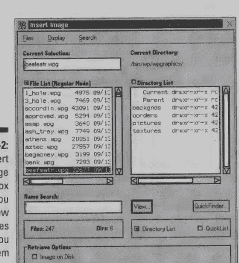

图 15-2：插入对话框允许你在插入到文档之前对其进行预览。

光标现在应该在你离开过的地方欢快地闪烁，你的图形应该出现在你的文档中。总的来说，这种技术并不困难。图 15-1 中所示文档就包含一个 WP 提供的图形。

## 摆弄你的图片

由于你的图片在一个框内，你可以对图形框进行的操作与对文本框的操作相同：

- 通过点击它来移动它（这样就会出现黑色手柄），保持鼠标指针在框内（这样指针看起来像一个四向头的箭头）并拖动图片。
- 通过选中它然后点击角部手柄并拖动它们来更改其大小。当你“拉”框时，框的大小和形状会发生变化。内容像橡皮泥一样拉伸到框的新形状。图 15-3 显示了黑色手柄以及如果你拖动它们使图片变宽时可能会发生的情况。（如果你不小心拖动了手柄，点击文档中的某些文本。然后你可以选择 `编辑>撤销`（`Edit>Undo`）将图片恢复到之前的形状。）你也可以通过右键点击图片并在弹出的快速菜单中选择尺寸（Size）命令将图像调整到精确尺寸。
- 通过选中它然后点击属性栏上的边界样式（Border Style）按钮为其添加边框。

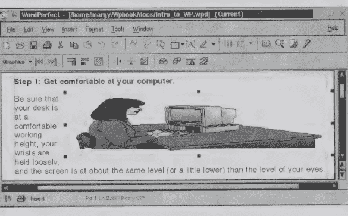

15-3：如果你拉伸插图会发生什么。

第 1 步：在电脑前感到舒适。

确保你的桌子处于舒适的工作高度，手腕放松，且屏幕与你的眼睛平齐（或略低一点）。

这些秘密和更多内容将在第 14 章中详细描述。

记住，你在屏幕上使用的比例与打印时看到的并不完全相同。打印你的文档进行检查。


# 第 15 章：用图说话 263

双击你的图片将打开 `WP Draw` 程序，该程序在本章稍后的“使用 `WP Draw` 创建你自己的图形”节中进行了描述。

## 在文档中插入一些 Corel 剪贴图

本节将告诉你向文档中插入图形的最简单方法。我们假设（“假设仙子”再次登场了）你想要在文档中插入 WordPerfect 自带的约 200 多张剪贴图（预画的图片）中的一张。（如果你是从 Corel 网站下载的 WordPerfect，则不包含任何剪贴图，且 `/wpgraphics` 目录是空的。）在对它们感到兴奋之前，请注意一个警告虽然我们不声称看过了其中的每一张，但我们发现它们大多是卡通风格的图片，更适合用于强调作用，而不是包含在严肃的业务文档中。环顾四周——不要抱太大期望。WordPerfect 将剪贴图文件安装在其程序目录的 `wpgraphics` 子目录中。例如，如果 WordPerfect 安装在 `/usr/local` 目录下，则图形文件位于 `/usr/local/wpgraphics`。

要使用这些剪贴图之一，请按照以下步骤操作：

- 1. 将光标移动到文档中你想让图片出现的地方。
- 2. 从菜单栏选择 `插入>图形：来自文件`（`Insert>Graphics: From File`）。

或者，点击工具栏上的剪贴图按钮（带有文件文件夹和 Corel 热气球的那个）。

无论哪种方式，插入图像对话框中都会出现可用剪贴图列表，如图 15-2 所示。（WordPerfect 应该知道它的剪贴图文件存储位置。）
- 3. 点击一个听起来吸引人的文件名，并点击 `View` 按钮。

图片将在自己的小查看器窗口中显示。你可以继续点击文件名在查看器中查看文件。
- 4. 当你找到想要的图像时，点击查看器窗口中的 `Close` 按钮。

插入图像对话框中应已选中该图片的文件名。
- 5. 点击 `Insert` 按钮将图片放入你的文档中。

WordPerfect 将图片放置在你的文档中。如果你觉得自己很有艺术细胞，可以双击图片并在 `WP Draw` 中对其编辑。（我们在本章稍后的“使用 `WP Draw` 创建你自己的图形”节中会详细介绍 `WP Draw`。）


图 15-2：插入对话框允许你在插入到文档之前对其进行预览。

光标现在应该在你离开过的地方欢快地闪烁，你的图形应该出现在你的文档中。总的来说，这种技术并不困难。图 15-1 中所示文档就包含一个 WP 提供的图形。

## 摆弄你的图片

由于你的图片在一个框内，你可以对图形框进行的操作与对文本框的操作相同：

- 通过点击它来移动它（这样就会出现黑色手柄），保持鼠标指针在框内（这样指针看起来像一个四向头的箭头）并拖动图片。
- 通过选中它然后点击角部手柄并拖动它们来更改其大小。当你“拉”框时，框的大小和形状会发生变化。内容像橡皮泥一样拉伸到框的新形状。图 15-3 显示了黑色手柄以及如果你拖动它们使图片变宽时可能会发生的情况。（如果你不小心拖动了手柄，点击文档中的某些文本。然后你可以选择 `编辑>撤销`（`Edit>Undo`）将图片恢复到之前的形状。）你也可以通过右键点击图片并在弹出的快速菜单中选择 `Size` 命令将图像调整到精确尺寸。
- 通过选中它然后点击属性栏上的边界样式（Border Style）按钮为其添加边框。


15-3：如果你拉伸插图会发生什么。

第 1 步：在电脑前感到舒适。

确保你的桌子处于舒适的工作高度，手腕放松，且屏幕与你的眼睛平齐（或略低一点）。

这些秘密和更多内容将在第 14 章中详细描述。

记住，你在屏幕上使用的比例与打印时看到的并不完全相同。打印你的文档进行检查。

WordPerfect 提供了一系列你可以使用的其他命令来编辑图形框。点击一次以选中框（而不是其内容），然后右键点击图片。从生成的快速菜单中，选择 `图像工具`（`Image Tools`）。你会看到图像工具对话框——它有一组 14 个按钮。将鼠标指针悬停在按钮上以了解它的功能。这些按钮的功能包括将图片转换为黑白、在框内移动图片以及设置图片的亮度和对比度。点击右上角的 `X` 关闭图像工具对话框。

## 如何看清你要去向哪里

为了更方便地看到你正在放置图像的位置，在开始定位或调整图像大小之前，先将其缩放至全页视图（`Full-Page view`）。点击图像区域外的任何地方。点击工具栏上的全页视图（带有放大镜的那个）。现在开始定位和调整大小。

## 268 第四部分：创建不再静止的文档

- 线段（Line）：从一个点到另一个点的直线或曲线。这方面没什么特别的。你可以在图片上画任意数量的线。直线是最简单的，尽管 WordPerfect 也支持曲线。
- 闭合形状（Enclosed shape）：包围某些区域的线或曲线。这些形状会自动闭合，例如，如果你正在画一个矩形，在完成第四条边时，你不需要精确地点击回到起点。闭合形状可以用实色或双色图案填充。
- 文本（Text）：如果你是从头到尾读到这里的，那么你对文本了如指掌；我们已经讨论了几百页了。然而，在 WordPerfect 图形中的每个单独字母或其他字符都有两个部分：外围的细线和内部的空白。

好了，你可能会说，但你并不希望在文档中出现点、线和形状；例如，你想要一张带有一些注释的地图。请耐心。仅使用这四种成分，你就能创建任何东西！


许多 Linux 系统都带有图形编辑器，你可以用它们创建或编辑图形文件。我们最喜欢的是 `Gimp`（我们可不是在瞎编），它随 Red Hat 以及许多其他版本的 Linux 提供。事实上，我们使用 `Gimp` 来捕捉你在书中看到的 WordPerfect 窗口截图。

## 创建新图片

要创建新图片，从简单的开始吧。画几个矩形、椭圆形或手绘形状：

1. 使用 `Insert: Graphics > Draw > Picture...` 命令创建一个新的图形框，并运行 `WP Draw` 来编辑框中的图片。

打开一个新窗口，标记为 `WP Draw`（在右侧窗口中，如图 15-4 所示）。另一个窗口包含 `WP Draw` 工具栏（在左侧窗口中）。
2. 使用 `WP Draw` 窗口中的工具栏创建你的图形。

尝试所有工具，并向你的图中添加线条、文本和颜色。下一节将详细介绍这些工具。
3. 完成后，选择 `File: Update` 将绘图保存为文档的一部分。
4. 选择 `File: Exit` 关闭 `WP Draw` 窗口并回到文档。

你创建的绘图显示在你的文档中。

## 第15 章：用图说话 269

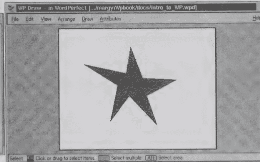

图 15-4：WordPerfect 附带 `WP Draw`，这是一个图形程序。

## 编辑图形

你也可以编辑文档中已经存在的图形框。当你双击框中的图片时，WordPerfect 会运行 `WP Draw` 程序以便你可以编辑图片。或者，右键点击图片，从弹出的快速菜单（`QuickMenu`）中选择 `Edit Image`。

## 让你的绘图成型，或让形状进入你的图中

`WP Draw` 内置的形状多到我们无法详细描述每一个每一个。我们列出了这些形状，并提供了关于如何绘制每个形状的说明。在本节末尾，我们将讨论适用于所有形状的共同点。在你运行 `WP Draw` 编辑绘图后，可以通过从 `WP Draw` 菜单栏中选择 `Draw` 并选择你需要的形状，在你的图中插入任何形状。

某些形状在 `WP Draw` 工具栏上也有相应的选项。选中的按钮在工具栏上显示为深灰色（它必须处于按下状态），并在 `WP Draw` 窗口底部提供有关如何使用该按钮的提示。在图 15-4 中，`Select (arrow)` 按钮被选中。要了解各个按钮的功能，将鼠标指针移动到按钮上而不点击：`WP Draw` 窗口的标题栏上会出现该按钮的简短描述。

## 第四部分：创建不再仅仅静止的文档

在本节中，我们假设你已经双击了绘图，并将其显示在 `WP Draw` 窗口中。

此列表描述了你可以使用 WP 工具栏上某些按钮执行的操作：

- 线段（Line）：点击并拖动你的绘图来创建线。双击线末端。要创建一系列连接的线，在每条线的末端点击一次，并在最后一条线的末端双击。
- 多边形（Polygon）：要创建一个由一系列线段组成的闭合形状（例如三角形），点击并释放每条线段的端点。双击最后一段的末端，Word WordPerfect 会自动连接到起点，使线条形成一个闭合区域。
- 矩形（Rectangle）：在你想让矩形覆盖的空间上对角线点击并拖动。
- 圆角矩形（Rounded Rectangle）：与矩形相同，但角是圆的。
- 椭圆（Ellipse）：点击并拽画一个椭圆或圆。
- 椭圆弧（Elliptical Arc）：这可能不是你画曲线的方法，但谁知道呢。从弧的一端开始点击并拖拽。你会得到一个椭圆的 1/4，它将在你下次点击的地方结束。
- 曲线（Curve）：虽然困惑但强大。点击曲线的一端。在第一个转折点（即你想让曲线改变方向的地方，例如彩虹的顶部）再次点击。每增加一次点击都会带你获得另一个转折点。
- 闭合曲线（Closed Curve）：与多边形类似，但线条是弯的。
- 手绘（Freehand）：点击并按住；拖动鼠标画。

当你放置形状时，它周围有手柄。选中形状后，你可以将其拖到新位置。右键点击形状会显示快速菜单。我们喜欢的两个快速菜单是 `Edit`（在你放置后对其进行编辑）和 `Rotate`（让你旋转形状）。


## 第15 章：用图说话

在绘制形状之前，你可以选择线条的类型以及内部填充的颜色或图案。你绘制的所有形状都将使用这些设置。你可以使用的按钮有：

- 线样式（Line Style）：设置线条类型，例如虚线或实线
- 线颜色（Line Color）：设置线条颜色
- 填充图案样式（Fill Pattern Style）：设置填充闭合形状的图案
- 填充图案颜色（Fill Pattern Color）：设置图案颜色

线条和填充颜色按钮与我们在14章中介绍的文本框边界和填充设置类似。

## 在图中添加文本

毕竟，WordPerfect 是关于文字的。因此，通过点击 `WP Draw` 工具栏上的文本按钮直接在图中输入字这并不意外。图中的文本出现在它自己的小文本框中。与 WordPerfect 文档中的文本不同，你可以通过拖动周围的手柄来更改图中文本的大小。

要向你的图中添加内容，双击绘图在 `WP Draw` 中编辑它（如果你尚未在 `WP Draw` 中打开它），并遵循以下步骤：

1. 点击 `WP Draw` 工具栏上的文本按钮（带有大字母 A 的按钮）。

鼠标指针在你的图中变成了十字准。你可以使用十字准创建区域。
2. 拖动十字准创建一个存放文本的框。

你的框显示在 `WP Draw` 编辑器中，如图 15-5 所示。它是空的，因为你还没有输入文本。
3. 在 `WP Draw` 编辑器框中输入文本。

你可以使用 `WP Draw` 编辑器中的 `Format` 菜单更改文本字体和对齐方式（左对齐、右对齐、居中对齐 —— 你懂的）。
4. 选择 `File>Close` 关闭 `WP Draw` 编辑器并回到你的图中。

你刚刚输入的文本被添加到你的图中。

# 第四部分：创建不仅仅是静止的文档

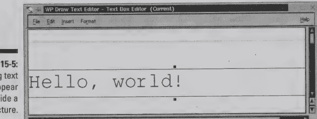


图 15-5：在图片内部输入文字。

- 5. 点击 `WP Draw` 工具栏上的选择按钮（箭头），然后点击你刚刚插入的文本。

文本周围会出现常见的控制柄。你可以随处移动它，或通过拖动控制柄来拉伸文本。

- 6. 在 `WP Draw` 菜单栏上选择 `文件>更新文档`（`File>Update Document`），将这件精彩的艺术品放入你的文档中。

大好了！要关闭 `WP Draw`，选择 `文件>退出并返回`（`File>Exit and Return`），去欣赏你的杰作吧。

如果你想选择文本颜色，可以在开始输入之前选择填充颜色。

## 创建图表和统计图

通过 `WP Draw`，你可以创建各种数据图表，包括饼图、柱状图、折线图和其他形式。这么说吧：如果你在一个健身馆里填满了经济学家，给他们彩色笔和尺子，锁上门并回到几年前，`WP Draw` 完成的图表可能比那些家伙在那段时间内完成的还要多。（当然，如果你让他们这么做，他们可能有一线机会，不过，为什么要错过这种机会呢？）

### 创建新图表

要在文档中创建图表，选择 `插入>图形>图表`（`Insert>Graphics>Chart`）。一个图表和一个数据表（`Datasheet`，其中包含行和列数字）会体贴地出现在旧的 `WP Draw` 窗口中，如图 15-6 所示。数据表是一种电子表格或表格，你可以在其中放入想要制作图表的数据。`WP Draw` 会根据数据自动绘制图表。

# 第 15 章：用图片说话 273

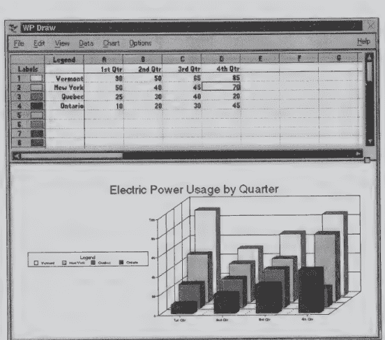

图 15-6：在 WordPerfect 中创建数据图表。

### 编辑你的图表

当你插入一个新图表时，`WP Draw` 会给你一个柱状图示例作为开始。如果你愿意，可以轻松切换到另一种类型的图表，然后用你自己的数据替换示例数据。

你可以通过检查数据表和图表学习许多关于 `WP Draw` 如何处理数据的知识。注意，`WP Draw` 使用数据表顶行的项目作为图表水平轴上的标签。同样注意，数据表中的每行数据都有自己的颜色，这与图表上数据的颜色匹配。图例（`Legend`）列中的文字（数据表最左侧的列）显示在图表的图例框中。

当你使用 `WP Draw` 绘图功能时，它有自己的与图表相关的菜单栏。在选择 `插入>图形>图表` 创建一个示例图表后，按照以下步骤将示例图表转换为你的图表：

- 1. 将图表更改为你需要的类型。

  - 从 `WP Draw` 菜单栏选择 `图表`（`Chart`）并选择一种图表类型。

- 2. 删除示例数据。

  - 数据表中每个包含单词或数字的矩形都是一个单元格。通过点击单元格、按 `Delete` 键，并在出现的清除对话框中点击确定来删除单个单元格的值。

# 274 第四部分：创建不仅仅是静止的文档

要删除一组矩形单元格，点击要删除数据的左上角的单元格；按住鼠标按钮；拖动鼠标将高亮扩展到数据的右下角。释放鼠标按钮并按下键盘上的 `Delete` 键。在清除对话框中再次点击确定。

- 3. 点击单个单元格并输入你的数据、图例和标签。

如果需要，滚动数据表窗口。

- 4. 要将你的标题放在图表上，选择 `选项-标题`（`Options-Titles`）。

在出现的标题对话框中，点击标题框，更改文本，然后按回车键。

此列表显示了更改图表的简便方法，以防你不想与它和每一个选项作斗：

- 更改图表类型：从 `WP Draw` 菜单中选择 `图表`（`Chart`），并从所需的图表类型列表中进行选择。每种图表都有若干可能的布局。选择布局（例如，将柱状图从 3D 更改为 2D），从 `WP Draw` 菜单中选择 `选项-布局`（`Options-Layout`）并选择你想要的布局。

- 更改线条颜色和样式或填充颜色和图案：从 `WP Draw` 菜单中选择 `选项-系列`（`Options-Series`）显示系列对话框，并更改属性部分中的设置。

- 更改图例的位置和方向：从 `WP Draw` 菜单中选择 `选项-图例`（`Options-Legend`）显示图例对话框。点击 `系列字体`（`Series Font`）按钮更改图例中显示的字体，或点击 `属性`（`Attributes`）按钮更改图例中边框和填充。

要更改图表的大小，在选中图表时拖动黑色控制柄。`WP Draw` 会根据你提供的空间重新绘制图表。

### 将图表放回文档

退出绘图功能并返回文档中的文本，只需关闭 `WP Draw` 窗口，并在弹出对话框询问是否要保存更改时点击“是”。图表出现在一个图形框中，你可以用通常的方法对其移动或调整大小。

要返回绘图功能进行更多更改，请双击图表。

# 第 16 章

## 创建自己的垃圾邮件

**本章内容**

- 创建数据文件
- 创建表文件
- 合并你的文件
- 打印信封
- 打印你的数据文件

难道你不**喜欢**收到垃圾邮件吗？难道知道某些直邮营销高管非常看你的购买（或捐赠）能力，以至于给你寄一封巧妙个性化的信件，难道不让你你感到温暖吗？“是的，约翰，我们知道你和整个 SMITH 家庭真的很喜欢收到一大堆垃圾邮件。

说真的，有时你真的**想**创建垃圾邮件。虽然你可能不想创建垃圾邮件。

## 第四部分：创建不仅仅是闲置的文档

通过选择“`工具-合并`”或按下 `Shift-F9` 开始创建你的合并数据文件。`WordPerfect` 会显示图 16-2 所示的对话框。要创建数据文件（例如人员列表），点击“数据”按钮。要创建一个带有格式信函或邮件标签代码的表单文件，点击“表单 (Form)”按钮。在创建数据文件和表单文件后，点击“合并 (Merge)”按钮将数据合并到表单中，创建一个完成的垃圾邮件文档！

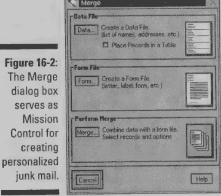

点击“数据”按钮可以让你从头开始输入人员文件（或你列表上的任何内容）。但是，如果你的数据已经在文件中了呢？如果有人给了你一个数据文件，格式非常精美华丽，对她来说很有意义，但与 `WordPerfect` 合并数据文件完全没关系呢？可能并没救。接下来的（相当长的）章节“将纯文本文档转换为数据文件”可能帮助你摆脱这种困境。如果你足够幸运，正对着一桌堆满了纸张，现在打算将这些信息输入 `WordPerfect`，请跳过后续章节，并在“从头创建数据文件”章节处与我们汇合。

### 将充满文本的文档转换为数据文件

你不应该执行这项任务。你本应该设置好你的合并数据文件并向其中输入数据。在现实生活中，你通常从一个想要合并的数据文档文件开始。这种情况可以通过许多方式发生，尽管通常是你先输入了所有数据，然后决定阅读这一章，找出如何在合并文档中使用这些内容。或者可能有人给了你一个文件并问：“你能为这些东西创建一些信吗？”又可能你只是没有按照说明书操作。无论如何，如果你的数据已经在 `WordPerfect`（或 `WordPerfect` 可读取的文档）中，它就可以转换为合并数据文件。虽然这项工作并不简单，但可以完成。

没有一种机械过程适用于所有的数据文件。相反，我们将带你通过一个如何将文档转换为合并文件的示例。（你必须根据自己的情况调整这些步骤。）在你开始处理数据之前，你仍然需要弄清楚你想要如何划分它——即你的文档中有哪些字段。回看图 16-1，看看我们认为托儿中心需要什么。

图 16-3 显示了包含我们所需信息的示例文件可能后的样子。这是某人（显然不是）将数据输入 `WordPerfect` 文件的典型方式。该文件包含你格式信函所需的数据；它的布局并不是 `WordPerfect` 的合并数据格式。

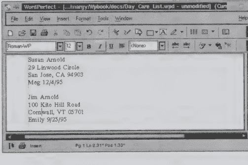

图 16-3 中数据的输入方式与 `WordPerfect` 的显示方式没有太大关系。我们可以帮助你修复这个问题，通过向你展示如何将记录之间的空行替换为 `ENDRECORD` 代码，并将字段之间的空格替换为硬回车和 `ENDFIELD` 代码。遵循以下步骤：

- 1. 保存你的文件。

我们可以假设你已经完成了这一步，尽管提醒你一下也无害。在你着启动像这样一个需要大量查找和替换的项目之前，保存文件是一个特别好的主意，因为如果出现问题，通过这种方式你很快就会对文档造成巨大破坏。智者如言……

- 2. 确保每个记录之间有一个空行（或其他内容）。

记住，一个记录是关于任何一件事的数据集合——在本例中，是关于一个潜在托儿所学生的。在这个例子中，正如通常一样，记录之间有一个空行。

- 3. 选择“`编辑:查找和替换`（`Edit:Find and Replace`）”或按下 `F2`。

出现“查找和替换”对话框。你正要进入最深奥、最黑暗的查找和替换领域。如果你需要一个复习课程，请查看第 4 章。现在，我们向你展示如何将每个记录之间的空行替换为 `WordPerfect` 中用以表示记录结束的代码。

- 4. 将每个记录之间的空行替换为 `WordPerfect` 中用以表示记录结束的代码。

如果图 16-3 中数据的输入方式与 `WordPerfect` 的显示方式没有太大关系。我们可以帮助你修复这个问题，通过向你展示如何将记录之间的空行替换为 `ENDRECORD` 代码，并将字段之间的空格替换为硬回车和 `ENDFIELD` 代码。遵循以下步骤：

- 5. 在“查找”框中输入 `Enter-end-of-lines`。

- 6. 选择并确保选中了“从顶部查找（`Find at Top`）”。

- 7. 将所有空行替换为 `ENDRECORD`。

- 8. 在“查找”框中输入一个空格。

- 9. 在“替换”框中输入 `[HRT]`。

- 10. 将空格替换为 `[T]`。

- 11. 在“查找”框中输入一个换行代码。

- 12. 在“替换”框中替换为字段结束代码后跟一个换行代码。

- 13. 点击“全部替换（`Replace All`）”。当 `WordPerfect` 完成所有替换后，点击“确定”。

## 282 第四部分：创建不仅仅放在那里的文档

这次，关闭“查找和替换”框。

4. 使用“`文件:另存为`”命令用新名称保存你的文件。

你对这个文件做了这么多工作；它看起来已经没问题了。保存它，万如果发生停电，你就不会丢失所有工作。用不同的名称保存，这样如果你以后发现出了什么问题，就可以重新开始。我们喜欢在文件名中包含“data”（数据）一词。

呼！——我们没说过这会很容易。图 16-4 显示了图 16-3 中开始的文档在进行查找和替换后的样子。你可能需要手动进行一些清理。例如，我们必须删除出现在城市名后的逗号。仔细检查你最终完成的数据文件，确保每个字段都单独成一行，且没有地方看起来很奇怪。

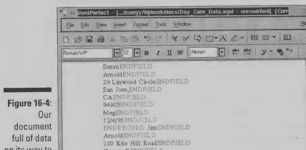

你还没有完成；你仍然告诉 `WordPerfect` 每条记录中这些字段的名称。不过，你这样做就像从头开始创建一个合并文件一样，所以请继续阅读。

### 从头开始创建一个数据文件

按照以下步骤制作数据文件：

- 1. 选择“`工具:合并`”或按下 `Shift+F9` 显示合并对话框（参见图 16-2）。

- 2. 点击“数据”按钮。

如果你看到“创建文件”对话框，请跳到第 3 步。

如果你正在编辑的文档中有任何内容，`WordPerfect` 会首先显示一个标记为“合并文件”的对话框。如果是，你有两个选项：使用活动窗口中的文件和新文档窗口。除非你已经将一个包含大量数据的现有文件转换成了合并文件，否则你应该选择“新文档”，让 `WordPerfect` 创建新文档来包含你的记录列表。如果你已经挺过了上一节的转换说明，请务必使用“活动窗口中的文件”将该文件完成并转换为合并文件。

- 3. 决定你想关于每个人（记录）存储哪些信息（字段）。

如果你读过本章较早之前的“创建数据文件”部分，请参考你在那里随手记录的字段列表。回图 16-1，该图显示了我们在“创建数据文件”对话框中用于向某些（假设的）托儿中心客户发送信件时使用的字段。

- 4. 输入字段名称。

对于每个字段，在“字段”框中输入名称。当你点击“添加”（或按下回车键）时，字段名称将出现在“字段列表”上。

- 5. 完成字段命名后，在“创建数据文件”对话框中点击“确定”。

`WordPerfect` 会执行三件事来准备数据文件以便你在文档开头使用：

- 将有关字段名称的信息放在文档开头：你可能会看到特殊的合并代码，即使你没有使用“显示代码”窗口它们也是可见的。你可以在文档窗口顶部看到 `FIELDNAMES` 和 `ENDRECORD`。

- 使用填空式数据输入屏幕遮挡你的文档视图：（这是计算机术语，指的是为你创建的每个字段留有空白的对话框。）图 16-5 显示了 `WordPerfect` 为你假设的托儿中心创建的“快速数据输入”对话框。

- 显示另一行按钮 —— 在这里是合并工具栏：（听起来像个旋转的单身关节，不是吗？）我们将在下一节中详细讨论合并栏。

现在，如果你正在创建一个新文件，你就准备好输入数据了；如果你正在转换一个旧文件，就可以输入并编辑数据。


图 16-5：用于合并数据的 `WordPerfect` 快速数据输入框。

### 终于输入数据

在让 `WordPerfect` 填充空白并生成大量的信件、标签、地址列表或任何内容之前，你必须告诉它用什么来填充空白。如果你在跟进我们这一章的垃圾邮件传奇，你应该能看到在你完成指定数据文件中的字段后出现的“快速数据输入”对话框。如果你转换了一个已经包含数据的文本文件，你将已经以表单形式看到数据。如果你是从头开始输入数据，请遵循以下步骤：

- 1. 如果数据文件尚未打开，请打开它。

如果你刚刚创建了数据文件，它仍然处于打开状态。

- 2. 如果“快速数据输入”对话框可见，请显示它。

点击合并工具栏上的“快速输入”按钮，该按钮位于文档正上方的一行按钮中。

- 3. 为每个字段填写一个值以创建一个记录。

点击“第一个”按钮查看第一条记录。无论你在哪里，你都可以填写或检查关于某个人（或一条记录）的所有事实。要移动到下一个字段，按下 `Tab` 键、按下 `Enter` 或点击“下一个字段”要向上移动，点击“上一个字段”。

- 4. 点击“新记录”开始下一条记录（下一个人）。

当你到达记录的最后一个字段时，即下一个人。

- 5. 完成输入所有字段后，点击“关闭”。

`WordPerfect` 会询问你是否想要保存更改。除非你已经将一个包含大量数据的现有文件转换成了合并文件，否则你应该选择“新文档”，让 `WordPerfect` 创建新文档来包含你的记录列表。如果你已经挺过了上一节的转换说明，请务必使用“活动窗口中的文件”将该文件完成并转换为合并文件。

## 282 第四部分：创建不仅仅放在那里的文档

- 1. 如果数据文件尚未打开，请打开它。

- 2. 如果“快速数据输入”对话框可见，请显示它。

- 3. 为每个字段填写一个值以创建一个记录。

- 4. 点击“新记录”开始下一条记录（下一个人）。

- 5. 完成输入所有字段后，点击“关闭”。

### 创建表文件

- 1. 选择“`工具:合并`”，并点击“表”按钮。

如果当前文档是空白的，跳到第 3 步。如果当前文档中有任何内容，`WordPerfect` 想要知道你想创建一个新文档来包含表信，还是使用屏幕上的文档。

2. 选择“新文档窗口”，然后点击“确定”。

如果你已经写好了信，且它就是当前文档，请选择“使用活动窗口中的文件”。

3. 在“创建表文件”对话框中，在框的右端输入你的数据文件名，然后点击“确定”。


`WordPerfect` 打开一个新文档并显示表文件，其上方显示着合并（`Merge`）工具栏。当你编辑表文件时，合并工具栏包含的按钮与处理数据文件时不同。

- 4. 输入你想要显示在日期和收件人姓名之前的任何信息。

输入你的信头文本，例如，如果你打算在白纸上打印。对于普通信件，你接下来想看到的内容是今天的日期。

- 5. 点击合并工具栏上的“日期”（`Date`）按钮。

`WordPerfect` 在你的文档中插入一个彩色的 `DATE` 代码。当你将此表文件与数据文件合并时，当前日期将出现在这里。

- 6. 按回车键开始新行，再次按回车键在姓名和地址之前留出空格。

- 7. 点击合并工具栏上的“插入字段”（`Insert Field`）按钮。

`WordPerfect` 显示“插入字段名称或编号”对话框，如图 16-7 所示。该对话框列出了你在表单信中定义的所有字段。

- 8. 从数据文件中选择将出现在表单中的第一个字段，然后点击“插入”（`Insert`）。

例如，选择“名”（`First Name`）字段，然后点击“插入”按钮。`Word` 插入了彩色的 `FIELD(First Name)`。你看到的是一个 `Word` 合并代码，它在打印信件时会显示每个人的名字。对话框仍然可见，这很好，因为你还需要使用它几次。

- 9. 点击文档，输入一个空格（显示在“名”和“姓”字段之间），在对话框中选择“姓”（`Last Name`），并点击插入。

“名”和“姓”字段的代码现在出现在表单信件中。

- 10. 点击文档并按回车键开始新行。

继续这种操作，在代码之间插入代码并输入空格、回车键或任何内容，直到你布局好整个地址。请参阅图 16-8 以获取示例。你不需要使用数据文件中的所有字段——只使用你想在信中显示的字段即可。

图 16-8：创建表文件。

- 11. 写下你的信件。

你可以使用普通信件中使用的所有常用格式、字体和页边距。你甚至可以在信件正文中包含合并字段的内容（例如，“名”），以增加个性化色彩。不过，不要过头——你知道计算机生成的信件会有多糟糕。

- 12. 保存文档。

选择“文件”->“另存为”，并为信件命名。

你可以为一个数据文件创建多个表文件。例如，如果你的数据文件包含一个欠你钱的人员列表，你可以创建一个包含礼貌请求还款信件的表文件。第二个表文件可以包含一封使用农民语言的信件，第三个表文件可以包含一封告诉你要断掉 Pam Vinnie 这条腿的信件。对于我们在本章早期向你展示如何创建的假设托儿中心，你可以创建一个电话列表、地址列表以及开放日邀请函。

到需要打印的时间时，你可以打印与信件配套的信封。你甚至可以打印信封而不打印信件，尽管这项工作稍微复杂一些。在接下来的章节，将解释如何执行这两种操作。

如果你为此表单选择了错误的数据文件怎么办？或者，如果你创建一个新的数据文件并想使用现有的表文件怎么办？没问题。要将不同的数据文件与你的表文件关联，请查看合并工具栏并点击“插入字段”按钮。`Word` 显示“插入字段名称或编号”对话框。点击“数据文件”并指定新的数据文件或新的地址簿，然后点击“确定”。


## 合并你的文件

在拥有数据文件和表文件后，就可以进行合并了。伙计们，我们知道如果你在遵循本章中展示的所有程序，这个解释需要花很长时间；但如果你有大量的信件要发送，这是值得的。我们开始吧。

给邮局打电话，让他们在你执行以下步骤之前退后：

- 1. 选择“工具”->“合并”（`Merge`），然后点击“合并”按钮。

WordPerfect 显示“执行合并”（Perform Merge）对话框，如图 16-9 所示。

- 2. 输入表文件的文件名。

点击“表文件”（Form File）框右侧的小三角形并选择“选择文件”（Select File）。WordPerfect 允许选择文件名并插入表文件的完整路径（例如 `/usr/wpbin/threat1`）。如果表文件设置为<当前文档>（Current Document），WordPerfect 会输入文件名。一旦你输入表文件的文件名，WordPerfect 就会输入数据文件的文件名。如果不存在数据文件，点击输出（Output）框中的“数据文件”。

- 3. 告诉 WordPerfect 将结果放在哪里。

点击“输出文件”（Output File）框右侧的小三角形从菜单选择。我们推荐以下选择：

- 新文档（New Document）：（我们最喜欢的。）

- 打印机（Printer）：选择此选项进行打印。

- 4. 如果你还想打印信封，点击“信封”（Envelopes）按钮。如果不想，跳到第 11 步。

WordPerfect 将信封添加到信件末尾。如果你选择了信封，所有信封都会位于所有信件之后。

- 5. 在“地址”（Addresses）框中输入回信地址。

如果你选择“回信地址”（Return Address），WordPerfect 将跳过此部分。

- 6. 点击“邮件”（Mailing）框并输入数据文件中的第一个字段。

点击对话框底部的“字段”（Field）按钮显示数据文件中的字段（例如，“名”）；然后点击“插入”。

- 7. 输入一个空格（显示在“名”和“姓”字段之间）；然后点击“字段”，选择“姓”，并点击“插入”。

- 8. 按回车键开始新行。

- 9. 继续插入代码并输入空格、按回车键或任何内容，直到布局好整个地址，如图 16-10 所示。

图 16-10：为垃圾邮件创建信封。

- 10. 点击“信封”对话框中的“确定”。

如果你仔细观察，你会发现“执行合并”对话框原来显示“所有记录”（All Records，参见图 16-9），现在左下角显示“所有记录；信封”。这意味着每当你使用此表单进行合并时，WordPerfect 都会在其创建的信件末尾添加信封。

- 11. 点击“执行合并”对话框中的“确定”。

WordPerfect 为数据文件中的每个记录创建一个表文件的副本，并放置你告诉它放置的结果。

图 16-11 显示了给我们在本章早期创建的假设托儿中心的信件。所有信件都在这个新文档中，每页一个。如果你选择了信封，所有信封都会位于所有信件之后。

- 12. 如果你在新文档中合并了信件，请打印该文档。

# 292 第四部分：创建不只是放在那里的文档


## 打印你的数据文件

你可以检查开头几个字母，确保它们看起来足够个人个性化。你甚至可以对它们进行修改，使其真正实现个性化。（附：：正如您的要求，我们已经在教室的窗户上安装了横杆，这样小弗雷德里卡就一定会留在这里了。）

在打印格式信时，你可以保存包含这些信的文档，也可以直接关闭而不保存。毕竟，你始终可以通过重复这些合并步骤重新创建这些信。

如果你想打印发送信件的人的地址列表，可以打印数据文件。

要隐藏合并代码，点击邮件合并工具栏上的“选项 (Options)”按钮，然后选择“隐藏代码 (Hide Codes)”。要打印文件，点击“选项 (Options)”并选择“打印 (Print)”。

# 第17 章

## 常用文档的配方与模板

+ 本章内容

- 模板

- 信件

- 备忘录

- 传真

- 信封

- 邮寄标签

- 小册

- 书籍和其他大型文档

> 重造轮子没有意义。多年来，文字处理的大脑们一直在思考创建许多流行类型文档的最佳方法。他们思考的结晶以 WordPerfect 自带模板的形式提供给你。WordPerfect 还附带了 ExpressDocs，这些是精美的模板，它们通过向你提问并根据你的答案定制文档。在本章中，我们将做两件事：讨论什么是模板，并查看一些你可以使用的 ExpressDocs 来快速制作出受人们欢迎的文档。

## 什么是模板？

模板是不同类型文档的原型。WordPerfect 包含了 60 多种预设计的模板；你也可以设计和使用自己的模板。模板就像是空白表单。不过，它们并不一定包含文本；模板可以只包含特定类型文档的特定字体和格式样式集合，也可以包含你所有标准合同的文本。

每当你创建一个新文档时，WordPerfect 都会使用模板。你启动 WordPerfect 时看到的空白文档（你并不知道）是基于标准模板的——WordPerfect 必须拥有某些默认值，用于边距、字体以及构成你文档的所有其他元素。无论你是通过点击工具栏上的“新建空白 (New Blank)”按钮（那个看起来像一张折了角的空白页的按钮）还是选择“文件->新建 (File->New)”，WordPerfect 都会再次使用该标准模板。

如果你不喜欢 WordPerfect 的预建模板，可以根据你的需要创建你自己的模板。你可能希望你的信件使用指定了（例如，10 号 Times Roman 字体）的模板。原型公告的模板可能使用 14 号 Helvetica 字体作为样式，并使用 12 号字体作为其他正文。然而，简报模板除了指定的字体外，还可能包含标题文本、Logo 图形和 3 列格式。

但对于大多数实际用途来说，你在模板上能做的事情并不比你创建一个普通文档作为原型并重复使用它更多（重复使用它意味着在你每次想写一个类似的文档时都打开它并进行更改，并且仔细使用“另存为 (Save As)”命令用新名称保存你的新文档）。随着 WordPerfect 的演进，模板的维护和管理变得复杂，模板已经与各种项目和专家紧密结合。事实上，除非你是一个专家（如果是那样，你到底在看什么……《傻瓜指南》？），否则我们建议你坚持这种“保存-原型-文档-文件”的方法。

## 不是模板但同样好：让文档变得不可编辑

我们太喜欢制作自己的原型文档了，以至于我们想向你传授一个窍门。

如果你制作一个重复使用的普通文档而不是模板，你可以告诉 WordPerfect 不允许你在上面写字。这样，每当你自定义文档并忘记使用“另存为 (Save As)”而改使用“保存 (Save)”命令时，WordPerfect 就会抱怨你不允许在原型文档上写字。我们这些有点粗心的人会发现这个提醒非常有用。Linux 允许将文件设置为只读，这样你就无法编辑或替换它。


在保存了一个以后不想再编辑的文件后，你可以将文件模式更改为只读。在“另存为 (Save As)”或“打开 (Open)”对话框中，点击文件列表框中的文件名。从对话框的菜单中选择“文件->更改模式 (Files->Change Mode)”以显示“更改模式”对话框，如图 17-1 所示。点击用户（第一）行框中的“写入 (Write)”框以取消勾选，从而使该文件对你不可编辑。然后点击“确定 (OK)”。


## 使用模板

即使你不创建自己的模板，可能也想使用 WordPerfect 模板。事实上，讨论使用模板就像在论空气空气：重造轮子没有意义。多年来，文字处理的大脑们一直在思考创建许多流行类型文档的最佳方法。他们思考的结晶以 WordPerfect 自带模板的形式提供给你。WordPerfect 还附带了 ExpressDocs，这些是精美的模板，它们通过向你提问并根据你的答案定制文档。在本章中，我们将做两件事：讨论什么是模板，并查看一些你可以使用的 ExpressDocs 来快速制作出受人们欢迎的文档。

你创建的文件名出现在模板框中，模板描述框中为 *****。

# 292 第四部分：创建不只是放在那里的文档

## 创建你自己的模板

你可以像创建普通文档一样创建你的模板。如果你有一个这样的原型文档，你可以从它开始，并通过选择“插入->文件 (Insert->File)”包含它。

模板出现在文档模板列表的顶部，名称为 *****。（因为 ExpressDocs 是按描述字母排序的，你可能需要向下滚动才能看到你的文件。）

你的自己的模板出现在 ExpressDocs 列表中！

下次当你想基于此模板创建文档时，选择“文件->新建 (File->New)”，它就会生成。

你可能没有权限在该目录下写入文件。（Linux，设计

- 1. 按照你创建新文档的方式继续。

WordPerfect 会打开一个新窗口（除非取消勾选 ExpressDocs 对话框中的“打开新文档”框），并使用模板创建一个新文档。模板可能会提示你输入信息：例如，选择“月历”模板，WordPerfect 会询问你想要日历的月份和年份。

- 2. 当你的模板看起来符合要求时，将其以 `.wpt` 文件名保存到模板目录。

- 3. 从文档模板列表中选择一个模板并点击“选择 (Select)”。

- 4. 选中 ***** 文件后，点击“文件信息 (File Info)”按钮以查看 ExpressDocs 文件对话框。

- 5. 在模板描述框中输入描述并点击“确定 (OK)”。

你创建的文件名出现在模板框中，模板描述框中为 *****。

# 第 17 章：常用文档的配方与模板


- 4. 如果 Word 提示你输入信息，请输入信息并点击确定。

你已经准备好开始输入文本了。如果模板包含你的姓名或地址，你在“个人信息”对话框中输入的信息将自动出现在模板中。（太酷了！）

当你保存新文档时，你必须给它起一个名称，就像你保存一份从头开始编写的文档一样。

## 信件

除非你认识的所有人都已改用电子邮件了，否则你可能经常使用 WordPerfect 编写大量的信件。毕竟，文字处理器的作用难道不就是为了让这类任务变得快速又简单吗？文字处理应该让你专注于你精妙的文笔，而不是关注内部地址的位置。查看下方的要点，了解如何让 WordPerfect 排版出一封你满意的信件。然后保存所有这些工作，这样你就只需要做一次。

## 让 WordPerfect 为你代写信件

我们过去常说，尽管文字处理功能奇奇，你仍然必须挑选你想要处理的文字。（我们过去管这叫写作；但现在新千年了。）不过，你可以让 WordPerfect 为你设置信件，这样你就有精美的页眉和页脚，其中包含日期和页码等内容。你可以根据自己的喜好修改信件。以下是让 WordPerfect 为你完成编写和格式设置的方法：

## 298 第四部分：创建不是静止的文档

1. 在文档窗口中，从菜单栏选择文件→快速文档（ExpressDocs）。

（如果没有打开文档窗口，请通过在程序窗口选择程序→打开窗口来打开一个。）WordPerfect 向你显示它的模板列表。

2. 向滚动模板列表，直到在列表顶部看到“Letter - Traditional centered company name”（信件 - 传统的居中公司名称）。

我们讨论使用的是传统信件，尽管在现实生活中，选择哪一个并不重要。它们的工作方式几乎相同。

3. 双击你正在创建的信件类型。

如往常，你可以从此列表中单击你选择的内容，然后点击选择（Select）。无论哪种情况，请保持耐心，因为 WordPerfect 有很多事情要为你处理。例如，它需要知道信件收件人的姓名，并会提示你输入此信息。

4. 在对话框中输入收件人姓名，点击确定或按回车键。

WordPerfect 会询问创建信件所需的所有问题。按照出现的顺序填写每个对话框，并点击确定或按回车键进入下一个对话框。在收集所有所需信息后，WordPerfect 将显示你的信件。

5. 在信件正文中输入你想要的信息。

嘿，WordPerfect 并不能包办一切！你仍然需要输入想要发送的消息。完成后，像照常一样保存并打印信件。

恭喜！你已经撰好了一封信（得到了 WordPerfect 的一点帮助）。查看下一节中的技巧，以微调你的信件，使其完美无缺。

## 打印你自己的信纸

如果你正在看一封格调的信件（如果你在跟着本章操作，你应该是这样的），你可能想让 WordPerfect 直接在你的信上为你创建一个信抬头。这样，你就可以从你的每个“分裂人格”来写信，而不需要为每种人格都使用预印的信抬头。利用 WordPerfect 中的多种字体、线条、方框和其他效果，你可以创建一个简洁快捷的信抬头；查看第 14 章和第 15 章；这两章中的大部分内容都是信抬头的良好素材。在让你的信抬头看起来像你想要的样子时记得经常保存。当你创建一个喜欢的信抬头后，将其保存为模板（参见本章稍后的后的“将你的信保存为原型文档”部分），这样所有的信都可以自动包含它。

## 第 17 章：常用文档的配方与模板 299

## 在信纸上留出抬头空间

如果你在信纸上打印，必须在信件顶部留出大量空间，以免你的文本打印在信抬头上。按照以下步骤操作：

- 1. 拿一把尺子，测量你希望信件从页面下方开始的位置。那就是你希望第一段文本（通常是日期）出现的地方。

- 2. 确保指南（边距线）已开启并显示在你的编辑屏幕上。如果不确定，使用视图>指南（View>Guidelines）命令。我们中有些人喜欢一直开启所有指南，这样我们就能看到 WordPerfect 认为文档应该在哪里。

- 3. 点击页面顶部的指南，将其向下拖动到你希望第一段文本出现的位置。

这种方法对于 1 页信件很好。然而，如果你正在创建一封两页或更多页的信呢？你不希望在第二页及后续页顶部有那么多留白：那样只会浪费空间。没问题！使用“此文档只用一次”的方法，当你到达第二页顶部时，将指南向上拖回到你想要的位置。我们不喜欢这种解决方案。如果你使用这种技术，早晚你会编辑某封信，结果所有的间距都会乱掉。


在信纸上留出抬头空间的更好方法（在第一页上留出空间）：告诉 WordPerfect 第一页与后续页不同。要做到这一点，使用格式>排版>高级（Format→Typesetting→Advance）。WordPerfect 会显示高级（Advance）对话框。对于你想向下移动的英寸（或厘米）数。点击确定时，WordPerfect 会插入一个高级代码（Adv），移动到你指定的位置。该代码仅影响它所在的页面，这意味着后续页顶部的间距不受影响。

## 为你的信标注日期

确保让 WordPerfect 输入日期而不是手动输入；按 `Ctrl+D`。

## 300 第四部分：创建不是静止的文档

## 页码

对于多页信件，页码会增加格调。使用 WordPerfect 中的页码、页眉或页脚功能（见第 8 章）。确保不要在第一页显示页码。

## 将你的信保存为原型文档

你不希望在 WordPerfect 中创建的信消失。务必保存一份备用。你可以做几件事来让这个过程更容易：

首先，删除信中的所有文本。除非是特定类型的信（例如订单确认），否则你每次都想输入。其次，删除收件人的姓名。为了保留地址格式，不要直接删除它。相反，选中它并输入类似`<在此处输入地址>` 的内容，提醒自己在那里输入地址。第三，对称呼也这样做。给 Helen 写信结果却是“亲爱的 Fred”，那太尴尬了。选中“亲爱的 Fred”称呼，将其替换为类似`<在此处输入称呼>` 的内容。（你只需要记住不要寄出一封抬头为“亲爱的在此处输入称呼>`的信。）

就这些了。你已准备好使用文件→保存命令来保存你的原型信以供以后使用。

别忘记我们在本章稍早时候提到的技巧。在保存原型后，将其设为只读，这样你就不会把它搞乱（详情见本章稍前的“不是模板但同样好”章节）。更好的方法是将该文档保存为模板，正如本章早前的侧栏“创建你自己的模板”所描述。

## 备忘录

在本章中关于信件的所有内容也适用于备忘录。如果你不使用预印的备忘录纸，查看 WordPerfect 中现成的模板。选择文件→快速文档，并从列表中选择一个备忘录模板。填写 WordPerfect 要求你的所有信息并输入你想发送的消息，你就有了一份备忘录。

## 传真

如果你有一台无聊、老式的传真机，并且往里面投递无聊、老式的纸张，那么我们没什么可以建议的。你可能想查看 WordPerfect 的传真信封模板；这些模板非常时尚且具有设计感。在打印需要固定的文档时，使用较大的字号也是一个好主意，因为传真文档很少像原件那样清晰。不要使用小于 12 磅的字体。

## 信封

在你写完一封世界上最清晰、逻辑最严密的信后，你需要一个信封来装它。（我们已经降低到使用开窗信封，因为我们懒得打印信封，尽管我怀疑你还没到那种地步。）如果你的打印机不支持信封（大多数打印机支持），请跳过本节。

WordPerfect 的工作人员创建了一个命令，可以将文档（或文档的一页）格式化为信封。哇——我们说的是便利性。文字处理迈出了巨大的一步。

## 在信封上打印地址

要在标准的 #10（美国商务尺寸）信封上打印地址，请遵循以下步骤：

- 1. 如果你已经写好了要放入信封的信，请打开该文档。如果没有，也没关系。

- 2. 选择格式（Format）:信封（Envelope）。WordPerfect 显示信封对话框，如图 17-3 所示。（它可能会提示你当前打印机没有定义信封，并询问你是否要创建一个信封定义；如果是，请参见下节。）如果当前文档包含格式非常正常的信，WordPerfect——你敢信吗——会找到信顶部的名称和地址，并将它们显示在邮寄地址（Mailing Addresses）框中。这个功能非常酷；你不需要再次输入地址。


图 17-3：创建信封。你甚至不需要输入地址！


如果信件开头的地址是你自己的地址，那么这个功能就会适得其反。没问题：点击`Cancel`，如果信还没打开，请打开它，选择包含你想要寄出的信封地址的行，然后再次选择`Envelope`。选中的地址将出现在邮寄地址框中。

### 在回信地址（Return Addresses）框中输入你的地址。

如果你使用过此对话框，Word 会记住你上次输入的地址——这是一个贴心的设计。（奇怪的是，当你打开模板时，WordPerfect 不会使用你在个人信息（Personal Info）对话框中输入的信息。）

### 要打印信封，点击打印（Print）。

根据你的打印机的工作方式，可能会被提示（通过一个可爱的对话框）插入信封。对于某些打印机，你可能需要编辑纸张定义、纸张和方向设置；点击`Create New Definition`。

或者，作为文档的一部分打印信封，点击`OK`。

WordPerfect 将信封作为单独的一页添加到文档末尾，并带上所有为了正确打印所需的格式。当当前文档是放入信封内部的信时，这个功能非常有用。每当你打印信时，你也会打印一个信封。

## 打印条形码

如果你想让美国邮政局开心（谁又不想呢？），你可以打印一个 USPS POSTNET 条形码。（这也会给你的朋友留下深刻印象。）点击信封对话框中的`Options`，显示信封选项对话框。在 USPS 条形码选项下，选择`Include`并置于地址上方或下方（`Position Above or Below Address`）。点击`确定`关闭对话框。WordPerfect 会在你的地址寻找看起来像邮政编码的内容，并将其打印在你的地址上方或下方（取决于你在信封选项对话框中选择的内容）。当你打印信封时，地址上方或下方会出现一行格致的小短竖线。邮局的某台机器一定知道这些线条的什么含义。

## 打印信封的贴士

当你选择`格式（Format）-信封（Envelope）`时，WordPerfect 可能会要求你创建一个信封定义。这很糟糕；意味着 WordPerfect 不熟悉在你的类型打印机上打印信封。你必须告诉 WordPerfect 信封的长度、宽度、边距——等所有设置。你可能需要为此任务寻求一些帮助。

在主层上，你将信封正面向上插入，信封的右端先进入打印机。你可能需要对打印机进行机械操作；请检查手册中的“信封（Envelopes）”部分。如果你的打印机有压板（platen），将信封倒过来粘贴，正面背对你，这样它是正确的，面向你，并从压板下方通过。大多数喷墨打印机都有特殊的信封进纸按钮；查看你的打印机手册。

根据你的打印机，WordPerfect 可能知道如何打印多种尺寸的信封。在信封对话框中，查看`Envelope Definitions`设置。如果你点击它，可能会发现有多种尺寸和形状可用。

## 邮寄标签

存在数百万种标签——邮寄标签页、连续卷装邮寄标签、磁盘标签——只要你想得到的都有。幸运的是，WordPerfect 可以处理极其多样的格式。

## 在邮寄标签上打印地址

要在邮寄标签上打印地址，请遵循以下步骤：

1. 从空白文档开始。你的第一步是告诉 WordPerfect 你使用的是哪种标签。
2. 选择`格式（Format）-标签（Labels）`，显示标签（Labels）框，如图 17-4 所示。


3. 选择你拥有的标签类型。如果你不确定种类，WordPerfect 会显示标签图。例如，Avery 5159 标签每页 2 列 7 行。
4. 点击`确定（OK）`。对话框关闭，现在显示文档。标签区域保持白色（或你使用的任何背景颜色），页的其他部分带有阴影，如图 17-5 所示。


图 17-5：为邮寄标签输入地址。

5. 输入地址。
6. 保存文档。
7. 打印标签。

或者任何你想标签上打印的内容。WordPerfect 只允许你输入标签标签的信息。

要移动到下一个标签，按`Ctrl+Enter`。当你输入了一批标签后，可以使用`Alt+PgUp`和`Alt+PgDn`在标签之间移动。（如果你记不住这些复杂的按键组合，就使用鼠标。）

将标签放入打印机。如果你使用的是进纸式打印机，请确保插入标签页时打印的是正面，而不是背面。

### 选择要打印的标签

你不需要一次打印整页标签。要打印选定的标签，你可以通过编号来引用它们。WordPerfect 将每个标签作为一个单独的微型页。事实上，在应用程序栏上，Pg 码就是标签编号。

当你知道想要打印哪些标签时，选择`文件（File）>打印（Print）`，并在打印选择中选择`多页（Multiple Pages）`。当你点击确定时，会看到多页对话框。在页（Page(s)）框中，选择你想打印的标签。例如，输入 3 打印第三个标签；5-12 打印标签范围；2,14,23 打印几个标签；或 15-打印从标签 15 开始的所有剩余标签。

## 第四部分：创建不仅仅是放在那里的文档

### 打印标签的技巧

你可以对标签使用所有常规格式——选择一种漂亮的字体，将邮政编码**加粗**，或者进行此类操作。


WordPerfect 的标签定义列表非常长。为了让它变短，请在对话框的“可用标签”（Available Labels）部分顶端选择“激光器”（Laser）或“针打式”（Tractor-Fed）。WordPerfect 只列出该类型的标签。

如果你已使用 WordPerfect 的合并功能输入了创建垃圾邮件的地址列表（参阅第 16 章），你可以在邮件标签上打印相同的地址。创建一个新的表单文件（包含表单信的文档合并），并选择“`格式=标签`”（Format=Labels）对其进行标签格式化。在第一个邮件标签上，为地址各个部分输入合并代码。然后选择“`工具<-合并`”（Tools<-Merge）来填充标签。

如果你使用的是 WordPerfect 不识别的标签类型，可以创建自己的标签定义。点击标签对话框中的“创建”（Create）按钮，并告诉 WordPerfect 关于你标签尺寸和排列的所有信息。

### 小册

对于大多数文字处理器来说，常见的打字工作是一件头疼的事：一个由普通纸张对折而成的小册子，如图 17-6 所示。

等一下！—— WordPerfect 有一个专门的小册功能，用于制作这种文档。这个酷炫的功能让我们想要收回（几乎）之前对 WordPerfect 说过的所有冷嘲热讽。


## 第 17 章：常用文档的配方与模板

### 创建小册文档

这些步骤将向你展示如何制作由折叠纸张组成的 5½x8½ 英寸小册：

1. 输入你小册的文本。

完成你计划使用的所有字符和行格式设置，包括字体、加粗和居中对齐。按照你的需要设置页码、页眉和页脚。
2. 通过选择“`文件：页面设置：页面大小`”，让 WordPerfect 在页面上横向（landscape orientation）打印。

你会看到“大小”对话框。选择你正在使用的纸张的横向版本。例如，如果你使用的是美国信纸尺寸，将所选纸张从“Letter（纵向）”改为“Letter（横向）”。

如果你的打印机支持双面打印（一次通过在纸张两面打印），选择“`文件：页面设置：双面打印`”并开启双面打印。
3. 保存文档并按`Ctrl+Home`将光标移动到开头。

无论发生什么，必须再次输入文本将是一件苦差！
4. 选择“`文件：页面设置：分割页面`”。

WordPerfect 显示出“分割页面”对话框，如图 17-7 所示。

在执行此步骤时，确保光标位于文档开头，这样格式设置就会影响整个文档。

你的文档看起来像一个小册，每张纸有两个页。


5. 在“列数”框中输入 2 或点击上下箭头，直到你在框内看到 2 为止。将行数保留为 1 并点击确定。

你的文本发生了巨大的变化。它以两列显示。将页面分割成列的操作与普通列（第 14 章中描述）类似，尽管 WordPerfect 知道你想将这些列视为独立的页面处理。太酷了！

如果你没有看到两列显示，请选择“`视图>页面`”（View>Page）。


6. 设置你小册的页边距。

如果你之前没有设置，现在应该设置它们，以便查看文本在这些微小页面上的效果。你可能需要稍微移动你的图形、线条、文本框和标题，以适应适应较小的文本列。
7. 如果需要，创建一个封面。

在文档开头处，输入你想显示在封面上的标题或其他材料。按`Ctrl+Enter`在封面文本和下一页之间插入分页符。你可以通过选择“`格式>页面>居中`”命令让封面文本在页面居中。
8. 保存文档——它看起来棒极了！

### 打印你的小册：神奇部分

你已经准备好打印小册最棘手的部分：告诉 WordPerfect 洗乱页面顺序，以便在将小册对折时，它们的顺序是正确的。幸运的是，WordPerfect 完成了几乎所有的工作。只需遵循以下步骤：

1. 要打印，选择“`文件>打印`”显示打印对话框，并点击“输出选项”按钮。

你会看到“输出选项”对话框。
2. 选择“小册打印”（Booklet Printing）并点击确定。

此步告诉 WordPerfect 切换页面顺序，使得纸张折叠后，小册页面是有顺序排列的。
3. 点击打印对话框中的确定。

WordPerfect 正在处理任务。无论发生什么，必须再次输入文本将是一件苦差！

## 第 17 章：常用文档的配方与模板

### 创建小册的技巧

如果你之前没有设置，现在应该设置它们，以便查看文本在这些微小页面上的效果。你可能需要稍微移动你的图形、线条、文本框和标题，以适应较小的文本列。

7. 如果需要，创建一个封面。

在文档开头处，输入你想显示在封面上的标题或其他材料。按`Ctrl+Enter`在封面文本和下一页之间插入分页符。你可以通过选择“`格式>页面>居中`”命令让封面文本在页面居中。
8. 保存文档——它看起来棒极了！

### 打印你的小册：神奇部分

你已经准备好打印小册最棘手的部分：告诉 WordPerfect 洗乱页面顺序，以便在将小册对折时，它们的顺序是正确的。幸运的是，WordPerfect 完成了几乎所有的工作。只需遵循以下步骤：

1. 要打印，选择“`文件>打印`”显示打印对话框，并点击“输出选项”按钮。

你会看到“输出选项”对话框。
2. 选择“小册打印”并点击确定。

此步告诉 WordPerfect 切换页面顺序，使得纸张折叠后，小册页面是有顺序排列的。
3. 点击打印对话框中的确定。

WordPerfect 正在处理任务。无论发生什么，必须再次输入文本将是一件苦差！

## 报告、书籍及其他文档

### 创建主文档及其子文档

要创建主文档及其子文档，你必须组织文本。遵循以下步骤：

1. 为每一章创建一个文档。

由于你希望所有章节的格式相同，可以考虑创建一个包含格式的模板。或者，创建一个包含你预期的元素的示例章节。不要担心子文档中的页码或页脚；这些元素由主文档控制。将文档命名为 Chapter1 和 Chapter2。
2. 在每个文档中输入文本或从现有文档复制。
3. 创建主文档。

打开一个新文档并输入标题页和其他前言。暂时跳过目录（我们将在下一节讨论）。如果引言和序言（或其他）很短，你可以将其包含文档中；如果它们很长，请将每一个存储在自己的文档中。
4. 对于每一章，在主文档中创建一个代码。

将光标移动到主文档中你想让章节出现的地方。如果你希望章节在新的一页开始，按`Ctrl+Enter`插入分页符。然后选择“`文件>文档>子文档`”显示“包含子文档”对话框。输入章节的文件名（或点击文件夹按钮从“选择文件”对话框中选择文件名），并点击确定。在图 17-8 中，我们在主文档中包含了 Chapter 1。

> 此时并没有太大变化。在页面视图中，你在主文档的左边距看到一个小小的子文档图标。在草稿视图中，你会看到一个子文档代码，看起来像 `Subdoc: Chapter 1` 或子文档的文件名（它看起来如图 17-8）。我们更倾向于在草稿视图工作，这样我们可以一直看到章节的文件名。

在页面视图中，要找出小子文档图标指向哪个文档，请点击它。

## 第17章：常用文档的方案与模板


图 17-8：主文档及其子文档。

使用“`文件>文档>子文档`”命令的快速方法是使用快速菜单（QuickMenu）。在文档左侧边缘处点击右键，然后从快速菜单中选择“子文档”。

## 展开主文档

WordPerfect 可以以两种方式之一显示（并存储）主文档：展开状态；当主文档被展开时，WordPerfect 会检索每个子文档的文本并将其插入到主文档中应所在的位置。当主文档被折叠时，每个子文档的文本——你猜得没错——会存储在各自独立的文件中，你只看到子文档图标。

要展开主文档，请选择“`文件>文档>展开主文档`”，或双击其中一个子文档图标或代码。WordPerfect 会显示“展开主文档”对话框（如图 17-9 所示），其中列出了你所有的子文档。要展开所有文档，请点击“全选”，然后点击“确定”。要跳过某个子文档，请点击对应的小框使其处于未选中状态。

当你展开主文档时，你仍然能看到子文档图标或代码。事实上，你看到的数量是两倍——它们出现在每个子文档的开头和结尾，如图 17-10 所示。（因为我们示例书籍中的章节非常短，一个屏幕可以容纳多个章节）。

当你处理主文档时，最稳妥的方法可能是在其他窗口中打开它的任何子文档。某些版本的 WordPerfect 中，如果你在保存主文档时有任何子文档也处于打开状态，程序可能会出现问题。

## 保存主文档

当你保存主文档时，WordPerfect 想要了解每个子文档的两个情况：

- 你是否想将子文档的文本*保存*回该子文档所在的文件中？
- 你是否想*折叠*子文档，使其在主文档中仅以图标形式出现？

你可以在“折叠/保存子文档”对话框中回答这两个棘手的问题。当你想要保存主文档时，请遵循以下步骤：

1. 选择**文件：保存**，按下`Ctrl+S`，或点击工具栏上的保存按钮。

如果你还没有展开主文档，或者你已经折叠了它，WordPerfect 将不带注释地保存文档。然而，WordPerfect 会显示消息 `文档已展开。是否折叠？`。

2. 点击**否**按原样保存文档。

WordPerfect 也会保存主文档以及所有已展开子文档的文本。它*不会*将子文档的文本保存回单独的子文档文件中。因此，如果你在主文档中编辑了章节文本，你的编辑将不会保存到 `Chapter 1`、`Chapter 2` 等文件中——只会保存在 `Chocolate` 中。

*或者*，点击**是**将每个子文档保存到其自身的独立文件中。

WordPerfect 会显示“折叠/保存子文档”对话框（如图 17-11 所示）。每个子文档都链接了两次：一次是为了你可以折叠它（从主文档中移除文本），一次是为了你可以将其保存到自己的文件中。我们总是勾选所有复选框。我们建议采取稳妥的做法。
3. 点击**确定**。

WordPerfect 将按照你的指示进行保存和折叠。

你也可以通过选择**文件：折叠主文档**来折叠主文档。


图 17-11：保存你的书。你想将每个章节保存回它们自己的文件中吗？

## 编辑主文档

设置好主文档后，当你想要编辑书籍的某个章节时该怎么办？例如，如果你获得了关于阿兹特克贵族早期使用巧克力的新信息，并想将其包含在第2章中？

你有两个选择：

- 编辑章节文件。在这种情况下，确保你的章节文本存储在子文档文件中，而不是主文档中。对章节文件进行更改并保存。下次你打开并展开主文档时，更新后的章节就会出现。
- 编辑主文档。在这种情况下，确保你的章节文件已关闭。打开主文档并展开子文档（或至少展开你想编辑的那个）。进行更改并保存主文件。当 WordPerfect 弹出子文档时，你可能希望将更改保存回子文档中。

## 创建目录

“没有目录的表格有什么用？”

当你展开主文档时，你仍然能看到子文档图标或代码。事实上，你看到的数量是两倍——它们出现在每个子文档的开头和结尾，如图 17-10 所示。（因为我们示例书籍中的章节非常短，一个屏幕可以容纳多个章节）。

当你处理主文档时，最稳妥的方法可能是在其他窗口中打开它的任何子文档。某些版本的 WordPerfect 中，如果你在保存主文档时有任何子文档也处于打开状态，程序可能会出现问题。

对于大多数书籍，你希望目录位于某一页上。

1. 更改层级数量以及每个层级使用的样式（是否包含页码和点状引导线）；然后点击**确定**。
2. 告诉 WordPerfect 层级数量以及每个层级使用的样式（是否包含页码和点状引导线）；然后点击**确定**。

对于仅列出一级标题（例如章节标题）并使用普通数字的目录，请保持此对话框中的所有设置不变。如果你想在目录中增加标题级别，请将“层级数”框更改所需的层级数。

## 第17章：常用文档的配方与模板 317

想要的标题。（例如，输入 2 以包含章节标题和章节内的节标题。）对于每个标题级别，你都可以设置位置——即数字出现的位置，以及其前面是否有一行点。

当你点击“确定”时，WordPerfect 会插入一段不可见的代码，并显示文本 `<<在此处生成目录>`。别担心：WordPerfect 在一分钟内就能做得更好。

9. 点击目录工具栏上的“生成”按钮。

“生成”按钮位于目录工具栏的右侧；你可能需要加宽 WordPerfect 窗口才能看到它。当你点击该按钮时，WordPerfect 会显示“生成”对话框。
10. 点击“确定”。

一些信息一闪而过。然后，“砰”的一声——你就有了目录。


“没什么大不了，”你可能会说，“手动复制章节可能更快。”但这样做的好处是：如果你更新了书籍并让章节变短或变长，当你再次点击“生成”按钮时，WordPerfect 会更新目录并纠正标题和页码。

在你弄完目录后，点击目录工具栏上的“关闭”按钮。要找回工具栏，你可以随时选择“工具 <> 目录”。

# 第18章

## 制作网页

### 本章内容

- “这些互联网事物到底是什么，它们为什么要出现在我的文字处理器里？”
- 什么是超文本？
- 属于你个人的微型全桌面网络
- 世界维网
- WordPerfect 和 HTML：免费的标记语言
- 属于你自己的网页
- 将文档转换为网页

1996年《美国通信改革法案》中一项鲜为人知的规定规定，除非软件能够连接到互联网，否则在美国境内制造的任何软件都是违法的。因此，我们有了支持联网的文字处理器、电子表格和烤面包机。

好了，这其实并不是真正的法律，尽管它很有可能是。让我们称其为一种趋势吧。WordPerfect 也未免受这一趋势的影响。在本课程中，我们将通过几件事来帮助你开启世界维网之体验。首先，我们将简单谈谈什么是互联网和世界维网。如果你计划创建一个网页，你就需要了解这些内容。当然，我们其中一个人为此写过一整本书（《傻瓜系列：互联网教程》，第6版，John Levine、Carol Baroudi 和 Margaret Levine 著，IDG Books Worldwide, Inc. 出），尽管我们不会深入介绍。

其次，我们将介绍超文本链接和书签。它们是 WordPerfect 创建网页的方式：将信息从一个文档链接到另一个文档。使用 WordPerfect 的书签和链接是你开始创建网页的好方法。你不需要担心这个过程中的所有 Web 部分。相反，你可以专注于你想传递给人们的内容以及你计划组织这些内容的方式。

### 第四部分：创建不仅仅是放在那里的文档

最后，我们将谈论使用 HTML 创建网页（我们也会解释那是什么）并将其发布到世界维网。正如你所出的，这个主题非常大；事实上，已经有关于这个主题的书了。我们之所以知道，是因为我们写了其中一本。如果你觉得这个预告很诱人，可以看看 Dave 编写的《傻瓜系列：完美网页出版》（IDG Books Worldwide, Inc. 出）。

## 超文本、互联网和世界维网

世界维网建立在两个基本概念之上：超文本和互联网。当你结合这两个概念时（这经常发生），你得到的东西比其中任何一个单独存在时的影响要大的得多。如果你至少知道运行它的概念是什么，理解世界维网就会容易得多。请继续读下去！

### 什么是超文本？

超文本不仅出现在世界维网上，也出现在计算机软件的许多地方。它和普通文本一样，唯一的不同在于：当你点击某些单词或短语时，你会被神奇地传送到不同的文本，可能在同一个文档中或其他另一个文档中。尽管这个概念听起来很有时代感，但它很简单。你可以以这种方式遵循相关的想法，这种方式如果你必须在书页或书之间来回跳转是很难实现的。

你可能对超文本熟悉；事实上，你可能已经用过它。在哪里？在 Linux 和 Windows 中许多程序使用的在线帮助系统中。帮助屏幕上散满了小图标，正诱诱人们点击；它们是通向帮助系统其他部分的超文本链接。当你点击这些链接之一时，会出现另一个信息屏幕；我们中的大多数人都发现这个功能非常有用。如果你使用 KDE，可以尝试点击 K 按钮并从菜单中选择“KDE Help”来体验超文本。

### 互联网

曾经，计算机是庞大而孤独的。它们住在玻璃房子里，被穿着白大褂的信随者包围着。后来，这些大计算机连接了许多笨终端，就像被小人国束缚的格列佛一样。计算机甚至会相互交谈——就像远处的鲸鱼一样。随着计算机变得越来越小，它们变得越来越社交化——像蚂蚁一样。数百万大大小的计算机现在都连接在一起——有些通过电话，有些通过办公室内的局域网，有些通过高速电话链路。人们发现，与其试图整理好所有的计算机，你通过世界维网就可以向任何计算机发送信息。

### 世界维网

多年来，人们使用网络。1990年，一位名叫伯纳斯-李（Berners-Lee）的迷人家伙在欧洲物理实验室（CERN）意识到他开发了世界维网。在你检查你想看的内容后，该翻页了。

世界维网看起来像一份文档。你可能不知道即使普通文档也可以加粗、斜体甚至下划线。如果你正在创建网页，计划使用 WordPerfect 的一些冷门功能，那么这样做是值得的。（这就是为什么我们现在才解释书签。）

## 超文本链接和书签

WordPerfect 的书签功能允许将一段文本链接到另一个文本。然而，你创建网页并不真的需要书签，但出于三个原因你应该了解它们。第一，你创建链接的工具与创建书签的工具相同。第二，当你浏览文档时，书签对你有帮助。第三，这很简单。

### 创建书签：你要跳转的地方

单个文档内的书签就像它们的名字一样——它们让你标记一个位置并返回那里。假设你正在编写《巧克力与巧克力学》，这是一部有500页的杰作，共有30章。你创建了一个主文档和每个章节的子文档，并且你正在以扩展视图处理主文档（这样所有章节都显示在文档中）。如果你正在处理第23章“巧力的仪式用途”，并想查看第1章“巧克力历史”中关于该主题写了什么，你有几种方法可以实现：

要创建书签，请按照以下步骤操作：

1. 将光标移动到你想快速跳转的位置。高亮你想让书签跳转到的文本。

   对于你在这里的操作，高亮多少文本并不重要。例如，你可以高亮章节标题“巧克力历史”。

2. 选择“工具 <> 书签”。书签对话框出现，如图18-1所示。

### 第 18 章：编织 Web 323


图 18-1：

创建书签。

3. 点击“创建”按钮。

弹出一个小的“创建书签”对话框（如图 18-1 所示）；如果您在步骤 1 中选择了文本，“书签名称”框中将包含该文本作为您的书签名称。如果您没有高亮文本，请为书签输入一个名称。图中同时显示了书签对话框和“创建书签”对话框。

4. 点击“确定”创建书签。

砰的一声！什么也没有发生。嗯，对话框消失了——尽管，您的文档看起来并没有什么变化。现在，好戏开始了！

当您创建书签时，WordPerfect 会您的文本中插入一个书签代码。第 9 章解释了 WordPerfect 代码是如何运作的。

现在我们已经向您展示了如何创建书签，接下来我们将展示如何让人们跳转到它。如果您非常细心，您会注意到当选择一个单词或其他文本块时，属性栏的右端发生了变化。最右侧的按钮变成了一个像戴着无框眼镜（西奥·罗斯福曾戴的那种眼镜）的蜘蛛网。点击此按钮，您会看到一个包含两个项目的小菜单；点击“插入书签”，您就会看到“创建书签”对话框。

### 第四部分：创建不仅仅是放在那儿的文档

### 跳转到书签

创建书签后，跳转到它是非常的。在文档的任何位置，按下 `Ctrl+G`（或选择“编辑：转到”），点击“书签”选项，从列表中选择书签名称。当您点击“确定”时，您将直接跳转到书签所在。

如果您在屏幕上查看文档，这个技巧非常棒，但对于打印文档的读者来说毫无用。

### 创建超链接 —— 一跳转到某处的方法

如果您计划在屏幕上阅读文档，或允许他人这样做，您可以在文本中创建超链接，帮助读者跳转到相关文本。考虑我们在本章正在写的书中第 23 章“巧力的仪式性用途”。在传统书中，您可能会说：“巧克力的第一次仪式性用途发生在阿兹特克社会，早于欧洲发现美洲（见第 1 章）。”读者随后翻到第 1 章并跳过去查看是否提到了关于阿兹特克的内容。这种方法在纸上运行良好，但在计算机屏幕上就有点笨拙，尤其是翻页部分。因此，我们可以直接创建一个链接，指向我们关于关于巧克力的书中第 1 章的特定段落。

遵循以下步骤：

- 在您编写的任何文档中，在可以跳转到的地方创建一个书签，然后保存文档。

在图 18-1 中，我们刚刚在“第 1 章 阿兹特克”这个单词上创建了书签。

- 包含您希望读者能够跳转到的位置的文档。

在这种情况下，它是第 23 章。

- 高亮您希望用户能够点击的单词。

在这种情况下，我们可能选择第 23 章开头处对阿兹特克的引用。

- 选择“工具：超链接”。

出现“创建超文本链接”对话框，如图 18-2 所示。在这个对话框中，您告诉 Word 您希望点击您所创建的链接的人发生什么。现在，我们只是创建一个返回到第 1 章阿兹特克书签的链接。

- 选择“转到其他文档”框，并输入您想要链接的文档名称。

在这种情况下，它是第 1 章。如果您懒或者（像我们一样）记不起，点击那个小文件文件夹按钮。您会看到 WordPerfect 标准的文件浏览对话框，您可以在那里选择文件。

- 在“书签”框中，输入您希望 WordPerfect 将用户带到的书签名称。

在这种情况下，它是“Aztec”。如果您忘记了所选文档中的书签名称，可以点击此框末尾的向下箭头。您将看到该文档中所有书签的列表。您不需要指定书签。如果您留空它，WordPerfect 只会将用户带到文档的开头。

- 点击“确定”。

这一次，您看到文档发生了变化。该单词（或短语或字符）现在被高亮显示并带有蓝色下划线。

为自己一个忙吧：现在保存文档。恭喜！——您已经创建了自己的超链接。创建超文本无非就是创建很多很多这些链接。

哦，如果您想看看您的超链接是否起到了作用？简单——只需点击蓝色的带下划线的文本。您将跳转到相关文本。奇怪的是，如果相关文本所在的文档已经打开，WordPerfect 会打开第二个副本。

### 超链接工具属性栏

跟随链接很容易——只需点击它。编辑文档中的链接也很容易。在创建链接后，您可以无尽地摆弄超链接，WordPerfect 提供了一个充满了按钮的属性栏，您可以使用它们来处理超链接。要查看超链接工具属性栏，将光标置于超文本链接上（那个蓝色的单词）——不要点击链接，因为该操作将带您进入链接所关联的书签（在本章的示例中是第 1 章）。相反，点击链接附近并使用光标移动键将光标移动到链接。查看属性栏：它变了。图 18-3 显示了当其关注链接时的属性栏。

### 图 18-3：超链接工具栏。

| 执行 | 编辑 |

| :--- | :--- |

| 字体 下 | 样式 |

| 上一个 | 链接开关 |

| 删除 | |

因为属性栏是处理和提供超链接最简单的方法，了解它的按钮是很有用的：

- 字体选择框：设置链接的字体。奇怪的是，字体是超链接的属性，尽管它的其他文本属性（如粗体和斜体）不是。我们倾向于通过选择 `Format+F` 命令来格式化文本。
- 执行：跟随链接。
- 上一个：找到当前位置之前的上一个链接。
- 下一个：找到当前位置之后的下一个链接。
- 删除：删除与高亮文本关联的链接并将文本恢复为普通。
- 编辑：显示超链接属性对话框，以防您希望此链接去任何地方。
- 链接开关：激活或禁用文档中的所有链接。
- 样式：帮助您更改链接的显示方式。

更多信息，请查看第 10 章。

现在您拥有了创建超文本文档——如网页所需的所有工具。

## 创建您自己的网页

创建您自己的网页与创建任何其他 Word 文档非常相似。网页比您的普通文档更具结构化。也就是说，它们都应该有一个标题、标题以及关于准备该页面的人的信息。随着世界网的发展，某些习例已变得不那么通用，以至于网页现在可以是任何内容。然而，您仍然受到一些关于网页上*应该*包含内容的原始想法的限制。我们将在更详细地解释我们如何显示用于编辑网页的属性栏。图 18-4 演示了一个带有文本的简单网页。

### 第四部分：创建不仅仅是静态的文档

要开始创建一个网页，请遵循以下步骤：

1. 选择 `文件 -> Internet 发布器`。

当你执行此命令时，文档是否在屏幕上并不重要。你会看到 Internet 发布器对话框，如图 18-5 所示。


图 18-5：Internet 发布器帮助你创建网页。

2. 点击 `新建网页`。

别盯着其他选项流口水了。我们将在本章后面的“将您的文档转换为网页”部分讨论“发布到 HTML”选项；“浏览网页”选项只是启动网络浏览器的另一种方法。如果你跟上了程序，你会在一个新窗口中看到一个灰色背景的新文档。

所有熟悉的 Word 编辑工具都会出现在这个新文档窗口中；你只需要正常输入即可。如果你想从另一个文档复制文本，请在单独的窗口中打开另一个文档（通过在程序窗口选择 `程序 -> 打开窗口`），并将文本从另一个文档复制到你的新文档中。

### 网页上的文本格式

图 18-4 除了显示示例网页外，还说明了在编辑网页时属性栏和 HTML 工具栏显示的状态。以下列表描述了你在创建网页时应该了解属性栏和 HTML 工具栏上的项目，并指出了我们如何将其中一些项目用于图 18-4 所示的示例网页：

## 第 18 章：制作网页

- **字体**：当你编辑普通的 Word 文档时，字体选择框是无关紧要的，尽管在网页上选择自己的字体是一项相当新的功能。在网页上指定字体通常不是一个好主意，因为你无法保证在地球另一端显示你网页的电脑的人是否听过你所选的字体。如果你选择了一个字体，对方的电脑会进行猜测并尝试选择一个它认为合理的字体，尽管它可能会猜错。在制作网页时请避免这种操作。
- **字号**：对于字体大小，大多数考虑因素与字体相同：让查看者的网络浏览器为你选择它们。要告诉浏览器你的需求，请点击我们稍后描述的按钮：`标题/样式`，以及本文后文中的 `字体属性`。
- **标题/样式**：点击此按钮显示网页可以理解的标题和样式列表。这些样式适用于所选的整个段落。（如果你对样式不熟悉，请查看第 10 章）。样式使 Web能够解决不同计算机和网络浏览器存在差异的问题。网络浏览器只执行 HTML 告诉它们要做的事，没有办法说“将以下文本格式化为小型大写”。当你点击此按钮时，会列出 HTML 已知的文本样式。图 18-4 显示文档的大部分使用了 `Heading1` 样式，而特色磁带和哲学标题使用了 `Heading2`。页面底部的联系信息使用了 `Address` 样式。
- **粗体**：至少有些东西的工作方式与以前一样。此按钮可可以在你的网页文档和查看者的网络浏览器上将文本加粗。
- **斜体**：谢天谢地，这个按钮的作用与加粗按钮一样：它就是好用。
- **等宽字体**：除非你精通排版，否则固定大小的文本看起来很丑。然而，如果你的网页是关于技术内容的，你可能想使用固定字体字体。大多数计算机书籍在开头附近都会说：“你应该输入到程序的文本看起来像这样：`sample command`。”
- **字体属性**：在此列表的开头，我们建议不要使用绝对文本大小来格式化文本。此按钮列出了 HTML 知道的所有不同字体属性，并为你提供了一个方便尝试这些属性的地方。这里的粗体和斜体与属性栏上的粗体和斜体是相同的。

属性栏的其余部分工作方式与 WordPerfect 的其他部分基本相同，或者它们在技术上非常复杂，以至于你不必理会它们。然而，工具栏上有几个新按钮：

- **水平线**：此按钮在屏幕上画一条水平线。我们就是这样在图 18-4 所示的文档中画线的。
- **启动你的 浏览器**：用此按钮启动你的网络浏览器。我们认为你可能有十种其他启动浏览器的方法，所以为什么在 WordPerfect 中需要这个呢？尽管如此，它在这里；如果我们不告诉它是做什么的，我们觉得你会问的。
- **在浏览器中查看**：这是一个非常有用的按钮。无论 WordPerfect 多么努力，你的文档在网络浏览器中的外观都会与在 WordPerfect 中不同。使用此按钮，你可以快速查看你的页面在网络浏览器中看起来的样子。务必在之后关闭浏览器，否则下次你从 WordPerfect 查看网页时，你会在桌面上看到一个浏览器，然后是第三个，然后是第四个——你懂的。
- **将文档另存为 HTML**：我们将在本章稍后的“将文档转换为网页”部分更多地讨论此按钮。
- **创建或编辑超链接**：通过此按钮，你可以显示我们在演示如何链接到其他页面时谈到的创建超文本链接对话框。


好了，你现在有一个相当乏味的网页。现在你可以按照下面的章节说明，通过添加图片来开始美化它。

## 在网页上添加图片

就像处理任何 WordPerfect 文档一样，通过插入包含图片的文件向网页上添加图片。遵循以下步骤：

1. 将光标移动到你想让图片出现在文档的地方。许多网页顶部都有图片，以便读者阅读文本时增加趣味。在我们的案例中，因为我们想在描述旁边放一张图片，我们将光标放在“孩子们”这两个字之前。
2. 选择 `插入 -> 文件` 显示插入图像框。
3. 选择包含你图片的文件的。

图片文件存储在计算机的任何地方并不重要。你可以遍历各地（甚至是其他计算机）来查找文件。我们稍后会讨论这些图片应该放在哪里；但现在只需找到你想要的图片。

4. 点击 `插入` 将图片插入你的文档中。

取决于你点击的图片类型，可能会看到一条“正在转换”的消息。注意图片后的文本出现在图片下方，在右侧留下了空白。你可能希望文本在图片旁边流动。遗憾的是，你无法使用 WordPerfect 的环绕功能告诉文本如何环绕这张图片，因为这是一个网页。当我们完成我们的特色磁带网页中插入图片时，它看起来就像 18-6 所示所示。


图 18-6：带有图片的 WordPerfect 渲染。

孩子们喜欢拖拉机、牛和笑话；这个视频会让他们快乐，同时展示真实的佛蒙特奶农场是如何运作的。故事记者 Mac Parker 曾在佛蒙特一个真实的奶农场打工。

如果你正关注属性栏


- 5. 点击属性栏上的图形按钮，从出现的菜单中选择位置 (Position) 命令。

出现框位置对话框，看起来有点像我们在第 14 章中讨论的框位置对话框。这个对话框是让文本在网页上环绕图片的。

- 6. 在框位置对话框中，选择“将框放在当前段落（段落锚点）”(Put Box in Current Paragraph (Paragraph Anchor))，然后在位置框部分的水平位置设置为“左侧边距”(Left Margin)。

## 第四部分：创建不仅仅是静止在那里的文档

“框位置”对话框如图 18-7 所示。

3. 点击“确定”关闭对话框，然后保存文档。

你 Web 页面上的文本移动到图片旁边，如图 18-8 所示。这看起来好多了！


图 18-7：你到底想把那张图片放在哪里？


图 18-8：带有图片及其文字的网页。

# 第 18 章：制作网页 333

现在是查看你的页面在真实 Web 浏览器（而不是在 WordPerfect 中）显示效果的好机了。点击工具栏上的“在浏览器中查看”按钮。（我们在本章前面的“网页上的文本格式”部分中标识了此按钮。）稍等，听听电脑内部发出的嗡嗡声和点击声。不久之后（也就是说只要你的电脑准备好了），屏幕上会出现一个显示你网页内容的 Web 浏览器。出现哪个浏览器取决于你安装了哪一个；如果没有安装浏览器，请使用“浏览器偏好”对话框，在其中你可以输入你使用的浏览器程序文件名。大多数 Linux 安装包含 Netscape Navigator，这是一个非常优秀的 Web 浏览器。


## 创建到另一个网页的链接

万维网的显著特征是页面与之间的链接，这让你能够在发现不同页面时探索它们之间的联系。然而，我们的页面上没有任何链接。

在编辑网页时，WordPerfect 让为万维网上的网页添加链接变得简单。你只需要输入你想要链接的页面的 Web 地址；例如，我们的 Internet Guru 网站 `net.guru.com`，或者 Great Tapes for Kids 网站 `www.greattapes.com`，它们都会识别你输入的内容为 Web 地址，并自动将其转换为指向该地址的链接。这个技巧相当巧妙。它适用于以 `http://www` 开头的 Web 地址（两者都是指向其他网页的链接）以及以 `somethingother@` 开头的电子邮件地址。如果你想要一个看起来不像 Web 地址的链接呢？例如，我们有一个页面关于“Let's Go to the Farm”视频的更多信息。但我们不想让屏幕上显示该页面的 Web 地址，我们希望看到“我们有关于这个迷人的视频的更多信息”。用户可以点击“charming video”字样来跳转链接，就像你在本章之前可能点击过“Aztec”一样。图 18-9 展示了我们用于从此页面创建到计算机另一个页面链接的步骤。

- 1. 选择用户应该看到作为链接的文本。在这种情况下，我们使用了“charming video”这个词。或者，我们可以插入一个小图形（也许是“更多信息”按钮的图片）并选择带有图片的图形框——图片也可以是链接。

- 2. 点击工具栏上的“创建或编辑超链接”按钮，并从出现的小型菜单中选择“创建链接”。你会看到“创建超文本链接”对话框（参见图 18-2）。


### 334 第四部分：创建不仅仅是静止在那里的文档

- 点击此处输入要链接的万维网网页的 Web 地址 (URL)

- 点击此处选择要链接的文件名以链接你自己的文件


**图 18-9**：在你的计算机上创建到另一个网页的链接。

- 3. 选择“转到其他文档”选项。

- 你链接到一个不在当前文档的地方——你创建的另一个文档或万维网上的某个页面。

- 4. 如果你的链接指向存储在计算机上的文档，点击框右侧的文件文件夹，选择你想要链接的文件，并点击“应用”。如果不是，请跳到第 5 步。

- 在“插入文件”对话框中，选择计算机上的文档作为链接的目标。此文件可能是你用 Internet Publisher 创建并保存为 HTML 文件的。在本章末尾，我们将讨论保存 HTML 文件。

- 5. 如果你的链接指向 Web 上的页面，在“转到其他文档”框中输入该页面的 URL。

- 你可以链接到整个万维网上的任何页面——这就是 Web 的魅力所在！如果你不想输入 Web 地址，可以在你的 Web 浏览器（例如 Netscape Navigator）中显示该页面，并将 Web 地址复制粘贴到框中。

- 6. 点击“确定”。

- “创建超文本链接”对话框消失，你选择的文字变为下划线并显示为蓝色。

# 364 第 18 章：制作网页

## 更改页面的外观

所以，如果你想要不同的颜色，请使用“背景”。颜色”对话框会出现，包含许多可选的颜色。在“背景”部分，如图 18-10 所示，点击“颜色”。你的页面颜色改变了！


## 将文档转换为网页

WordPerfect 最实用的功能之一就是你可以将它们用于万维网。砰！内容就是你的了！

### 336 第四部分：创建不仅仅是静止在那里的文档

唯一的问题是文档没有格式化为网页。WordPerfect 及时出现了。Internet Publisher 中的“格式化为 Web”按钮移除了所有非网页格式。你使用此按钮在屏幕上看到的就是它的成果。


取决于你对文档中设置了多少格式，你对结果的满意程度会有不同。如果你的文档看起来崩溃了，你有两个选择：

- 重新格式化文档，仅使用 Web 文档的功能。

- 手动修复网页版本

你选择哪个取决于你打算如何维护文档：

- 为了保留一个 WordPerfect 版本（用于打印）和一个供人们查看的网页版本，请选择第一个选项。虽然这个选项涉及更多工作，但你可以在一个地方更新文档。

- 如果你是在转换文档以用于 Web，请手动修复网页版本。你把文档做得越像 Web 文档，它就与原始文档越不同。这没关系，尽管保持两个版本的文档同步更新通常很困难。

你还可以为你的文档添加 WordPerfect 完全不知道的 HTML 功能。只需在你的文档中输入 HTML 代码，高亮它们，并选择“格式=自定义 HTML”。（此命令仅对 HTML有效。要这样做，你需要在编辑网页时了解一些 HTML。）

你有两种——数一下，两种——方法在 WordPerfect 中保存你的网页。这不应该让你感到意外，因为 WordPerfect 为一切都提供了很多方法。但在这种情况下，知道何时使用哪一种是很重要的。

## 将你的网页保存为 WordPerfect 文档

这里有一个令人困惑的地方：当你将 WordPerfect 文档转换为网页后，它仍然是一个 WordPerfect 文档。它只是包含了一些魔法代码的 WordPerfect 文档，这些代码告诉 WordPerfect 只有网页功能有效。由于该文档是 WordPerfect 文档，你应该将其保存为扩展名为 `wpd` 的 WordPerfect 文件，这正是当你选择“文件>另存为”命令时 WordPerfect 所执行的操作。转换文档后，你会发现它的名称仍然保持不变。因此，如果你不小心，可能会将网页版本（我们假设它已经丢失了大量格式）直接覆盖到你精美的 WordPerfect 版本上。你甚至不会收到任何警告。

我们认为认为这种状况并不好。我们的建议是在文件名末尾使用 `_web`，这样你就知道它是该文件的网页版本。因此，我们的“第 1 章”文档将变成 `Chapter_1_web.wpd`。如果你使用这种命名规范，至少你清楚什么是什么了。

要将网页保存为 WordPerfect 文档，请选择“文件>另存为”命令，或点击工具栏上的“保存”按钮。该文档并不是真正的网页，你无法将此文件上传到互联网并在网页上。相反，该文件是你网页的中间版本，你可以在以后编辑页面时使用它。

## 将你的网页保存为 HTML 文档

要将网页转换为用于网页的 HTML 文件，请按照以下步骤运行 WordPerfect Internet发布器。

- 1. 从菜单栏选择“文件>互联网发布”。

  你会看到“互联网发布器”对话框（参见图 18-5）。

- 2. 点击“发布到 HTML”按钮。

  出现“发布到 HTML”对话框，如图 18-11 所示。

  WordPerfect 建议的文件名是在 WordPerfect 文件名后加上 `.html`。

这个文件名对于网页来说可能是一个很好的名字；但是，如果名称包含空格或除连字符、下划线和点以外的标点符号，它就不可行。你应该编辑文件名以删除这些字符。大多数浏览器不处理网页地址中的空格，某些标点符号在网页上具有特殊含义。删除 `.wpd` 部分，因为此文件不是 WordPerfect 文档格式。

你还会看到 WordPerfect 计划复制图形文件（如果你使用了任何音频片段文件）的目录名称：在本节的稍后部分，我们将详细说明这一点。

- 3. 根据需要编辑文件名并点击“确定”。

WordPerfect 将你的文档转换为 HTML 格式。终于！一个真实的、活跃的网页！

如果你使用“文件>另存为”命令将网页保存为 WordPerfect 文档，并使用“文件>互联网发布”将其保存为 HTML 文件，你现在磁盘上有两个文件——同一个文档的两个版本。你可以在 WordPerfect 中打开其中任何一个（通过通常的“文件>打开”命令）并编辑文档。你可能还有第三个版本——你在开始将其转换为网页的过程之前开始的那个版本！

当你打开 HTML 文件时，WordPerfect 会显示“转换文件”对话框，并询问你想将文件转换为什么格式。WordPerfect 建议使用“互联网文档 (HTML)”，毕竟这是正确答案。去点击“确定”。然而，知道 HTML 文件只是一个文本文件可能很有用。如果你想以文本文件查看文件（并看到其中所有的 HTML 代码），告诉 WordPerfect 从 ASCII 文本格式转换。你网页的内部结构将向你展示。哎呀！别担心：直接关闭文件而不做任何更改即可。

## 第 18 章：制作网页

## 将你的页面发布到万维网

尽管我们在准备为万维网准备页面的章节中做了大量准备工作，但我们没有说明如何将你的页面发布到网上。这是因为该过程因地而异。你通常需要找到一个 Web 服务器——一台连接到互联网（如果你感兴趣在组织内部发布信息，则是内网）的计算机。然后，只需将你的 HTML 文件放在 Web 服务器的正确位置即可。

（内部网络），请联系你的系统管理员。否则，你仍然可以使用许多免费 Web 托管服务之一将页面发布到网上。尝试 GeoCities，地址为 `http://www.geocities.com`，并按照其网站上的说明操作。

如果你使用互联网服务提供商 (ISP) 的互联网账户，它可能会为客户在其 Web 服务器上提供一些空间。要将文件传输到 Web 服务器，你通常需要传输程序 (FTP)。联系你的 ISP 寻求帮助。如果你在一个拥有内部网络的组织工作

很有可能，一个本地的计算机系统发烧友必须完成工作，因为你对（或应该）他们连接到网络其他部分的方式非常谨慎。我们对这个主题考虑了很多，Dave 甚至为此写了一本书。如果你想了解更多，请查阅《傻瓜教程：出版》（IDG Books, Inc.）。

# 第五部分

哦，救命啊！

《第五波》，Rich Tennant 著


> “我们本应该在版本 2 中修复这个。”

## 在这一部分中……

你的文字处理体验还好吗？不佳吗？遇到麻烦了？噢，你来对地方了。

本书的这部分解决了许多棘手问题。你将发现如何让 WordPerfect 的行为更符合社交礼仪。如果你遇到了大麻烦，请跑（不要走）向第 20 章，那里有最常见的 WordPerfect 问题的解决方案。

# 第19 章

## 训练 WordPerfect 按照你的方式行事

### 本章内容

- 查看文档信息

- 设置你常用的字体

- 在文档中进行缩放查看

- 设置你的设置

- 修改 WordPerfect 的外观

- 控制直尺、工具栏、属性栏和应用程序栏

- 控制你的缩放比例

- 确定 WordPerfect 存储文件的位置

- 为按键分配不同的含义（天哪！）

> 你知道软件可以有多糟糕——行为恶劣、把文件保存在错误的文件夹、在屏幕上显示不可理解的内容，而且总是不没礼貌。是时候教它一些礼仪了。你可以教 WordPerfect 表现得像你喜欢与之在一起的那种绅士或女士一样。

WordPerfect 一个很棒的特性是，它允许你对其工作方式进行大量的自定义。在本章中，你将发现如何显示文档信息、如何放大文档文本以便近距离观察、如何控制属性栏和工具栏上显示哪些按钮、如何控制 WordPerfect 存储东西的地方（磁盘上的哪些文件夹），以及如何设置其他偏好。

如果你对 WordPerfect 的现状很满意，可以跳过本章。另一方面，如果你真的、真的非常喜欢 WordPerfect，你可能需要去看心理医生了。让 WordPerfect 保持默认行为运行并不是个坏主意。这种方法的一个优点是，WordPerfect 的运行方式和大家一样（除非他们自定义了自己的版本），所以向精通 WordPerfect 的朋友寻求帮助会变得更容易。


## 设置你喜爱的字体

- 告诉 WordPerfect 你喜爱的字体名称。然后，WordPerfect 将所有新文档中使用此字体，除非你选择了另一种。

## 第19 章：训练 WordPerfect 按照你的方式行事 345

关于使用第一种方法的说明，请参阅第 17 章，我们在那里讨论了模板以及通用的文档。这些步骤展示了如何使用第二种方法：

1. **选择“文件：文档默认字体”。**

   WordPerfect 随时准备好弹出另一个对话框，显示出“文档默认字体”框。

2. **选择你喜爱的字体、大小和样式。**

   在这里要克制一下——如果你用 WingDings 字体打印你的精美散文，没人能读得懂的。

3. **确保选中了“设置为打印机初始字体”复选框。**

   否则，此步骤将仅为当前文档设置字体。

4. **点击“确定”或按回车键。**

   你刚刚告诉 WordPerfect，每当你创建一个要在所选打印机上打印的新文档时，都使用你喜爱的字体。除非你使用几台不同的打印机，否则你就一切就好了。

如果你使用几台打印机，点击“文件：打印”，点击“选择”按钮，然后点击“创建/编辑”按钮，并选择打印机。点击“设置”按钮，然后点击“初始字体”按钮，并在“初始字体”对话框中设置字体。

参阅第 6 章如何在文档内更改字体。

## 在文档中进行缩放查看

也许我们只是老了。或者，台灯的灯泡可能变暗了。又可能是我们的显示器——它的磷光层可能耗尽了，之类的。总之，当我们用 10 字体编辑文档时，我们会把鼻子贴在屏幕上看 WordPerfect 使用的那些极小字母。看了几次推拿后，我们意识到必须做点什么。

然后我们发现了 WordPerfect 的缩放功能。你可以根据需要放大文本，而不会改变其在打印页面上的尺寸。这些步骤将教你如何操作：

1. **选择“视图：缩放”。**

   WordPerfect 显示“缩放”对话框。

2. **选择对话框列出的百分比之一。**

   百分比越大，屏幕上的文字看起来越大（就像你把脸凑得更近一样）。如果你不喜欢 WordPerfect 提供的任何

346 第五部分：哦，救命啊！

- 选项，点击“其他”并输入你想要的百分比（我们喜欢 120 百比）。

3. **选择“确定”。**

如果你更倾向于使用工具栏而不是菜单栏，请点击“缩放”按钮，它会显示一些百分比；然后点击下拉列表中的其中一个选择项。

除了数字百分比外，“缩放”对话框还包含以下四个选项：

- **边距宽：** 放大文本直到其从左到右填充窗口，左边距对齐窗口左边缘，右边距对齐窗口右边缘。此选项将文档自动缩放到最大百分比，让你看到文本的完整宽度。

- **页宽：** 放大页面直到其从左到右填充窗口，包括左右边距。纸张的左边缘紧贴窗口左边缘内，右边缘也紧贴右边缘内。你会在纸张边缘和窗口边缘之间看到一小空间。此选项提供的百分比总是比“边距宽”小。

- **全页：** 缩小页面直到其从上到下填充窗口。纸张的顶部不是窗口的顶部，纸张的底部靠近窗口底部。如果你使用正常方向的普通纸张，导致纸张比窗口大，“全页”会产生一个相当小的（不能说不可读）图像，尽管它带给你了页面的整体效果。

- **其他：** 允许你设置任何你想使用的缩放百分比（至少最高到 400%）。

如果你使用缩放来增大屏幕上文字的大小却无法阅读，请保存你的文档（或多个文档）；然后拿一条湿手擦掉显示器正面的所有灰尘。电脑屏幕产生电的方式会吸引你家里的灰尘。好了！

使用缩放有一个问题：缩放百分比比通过“边距宽”得到的要大。很多文档变得太宽让你无法看到单行文本，这很烦人。这里有一个替代缩放的方案：将缩放设置为“边距宽”，并在文档开头切换到大字体，例如 12 或 14 点。WordPerfect 将通过使用较大的字符重新格式文档（至少到下一个字体代码为止），并将文本封装在边距内。

第19 章 训练 WordPerfect 按照你的方式行事

现在你可以读得很顺畅。但当你打印文档时，反而是文字变得巨大。要修复这个问题，请删除你刚刚添加的字体代码。（参阅第 9 章了解如何使用显示代码窗口删除格式化代码。）

## 设置你的偏好

教 WordPerfect 如何行事的步骤通常很简单：你告诉 WordPerfect 你的偏好，它就会听话。如果每个人都能这样该多好（尤其是你的青少年）？


你通过使用 `PrPreferences` 命令（在 WordPerfect 小程序窗口的那里）告诉 WordPerfect 你的需求，这会显示“偏好”对话框，如图 19-1 所示。


此对话框具有巧妙的图标——而不是你在大多数对话框中使用的那些无味无燥的框和按钮，对应你可以表达的不同类型的偏好：

- 显示：在屏幕上显示的内容，包括直尺包含的内容；显示代码窗口的外观；你是否想看到空格、制表符和回车符的符号。我们将在本章后面的“修改 WordPerfect 的外观”部分中详细描述这些设置。
- 环境：不属于任何其他偏好类别的杂项。
- 文件：WordPerfect 存储你的文档、模板、宏和其他文件的地方；你是否想保留文件的备份。这些内容将在本章后后描述。
- 摘要：文档摘要如何工作以及你何时想看到它们（如果有的话）。

# 348 第五部分：噢，救命！

- **应用栏 (Application Bar):** 在每个文档窗口底部显示哪些信息，除了你喜好的字体和常规外观之外。继续阅读获取更多信息。
- **键盘 (Keyboard):** 更改键盘上每个按键的功能。
- **字体 (Font):** 更改某些字体属性，例如小字体和大字体的尺寸。
- **转换 (Convert):** 一些高级设置，告诉 WordPerfect 转换图形文件、ASCII 分隔符文本文件和其他格式。
- **颜色 (Colors):** 更改文本、背景、菜单和对话框的颜色。
- **打印 (Print):** 一些杂杂的打印设置（最重要的是打印份数、打印质量和颜色）。

哎呀！这个列表列出了令人难以置信需要考虑的事情。可怕的地方在于，你可以控制这些东西的运行方式。这让你产生了一种力量感吗？它给我们带来了一种极度的恐惧——想想我们能做的所有事情！

要使用“首选项”（Preferences）对话框来表达你的偏好，点击你选择的图标；它会显示一个或多个对话框。当你关闭对话框时，你会回到“首选项”对话框。当你折腾完 WordPerfect 的内部构造后，点击“首选项”对话框中的“关闭”按钮。

本章的其余部分解释了如何更改“首选项”对话框中的某些设置，以及你为什么想这样做。别担心——你随时可以将它们改回来。


同时更改太多东西不是个好主意。当你折腾设置时，一次改一两个，然后关闭所有对话框。在 WordPerfect 中环顾看看你做了什么。

## 更改 WordPerfect 的外观

正如你所注意到的，WordPerfect 在屏幕上显示了无数个小部件。这些步骤展示了你可能想要更改的一些内容以及相应的说明。所有这些设置都出现在“显示首选项”（Display Preferences）对话框中，你可以通过以下步骤显示它：

- **在程序窗口中选择“首选项”（Preferences）以显示“首选项”对话框。**
- **点击“显示”（Display）图标。**

你看到了“显示首选项”对话框，如图 19-2 所示。


WordPerfect 有许多类的显示选择，因此它为每种类型在对话框顶部显示一个框。如果你选择“文档”（Document）、显示”（Show）、视图/缩放”（View/Zoom）、显示代码（Reveal Codes）、标度尺栏（Ruler Bar）或“合并”（Merge），对话框的其余部分将更改为显示与该主题相关的设置。

## 缩放

我们总是习惯把文档稍微放大一点，因为通常的 100% 显示对我们来说舒适阅读来说太小了。每次打开文档都要这样做真是太烦人了！相反，你可以一次告诉 WordPerfect 你想要使用的缩放百分比。顺便你还可以告诉 WordPerfect 你只想看哪种视图：草稿（draft）或页面（page）。

按照以下步骤告诉 WordPerfect 你如何缩放：

1. 在程序窗口中选择“首选项”（Preferences）并点击“显示”（Display）图标。
WordPerfect 向你显示“显示首选项”对话框。
2. 点击“显示首选项”对话框顶部的“视图/缩放”（View/Zoom）选项。
WordPerfect 向你显示了两组设置：默认视图（Default View）和默认缩放（Default Zoom）。
3. 选择一个默认视图（草稿或页面）。

# 350 第五部分：噢，救命！

4. 选择一个默认缩放。
你看到了在本章之前列出的相同选项。
5. 点击“确定”（OK），然后点击“关闭”（Close）按钮离开对话框的世界。

当你选择“首选项”对话框时，WordPerfect 会将当前窗口的缩放更改为你刚刚指定的。每当你打开文档或创建新文档时，WordPerfect 都会使用这个缩放百分比。你仍然可以根据需要更改单个文档的缩放。

## 显示

我们总是习惯把文档稍微放大一点，因为通常的 100% 显示对我们来说舒适阅读来说太小了。每次打开文档都要这样做真是太烦人了！相反，你可以一次告诉 WordPerfect 你想要使用的缩放百分比。顺便你还可以告诉 WordPerfect 你只想看哪种视图：草稿（draft）或页面（page）。

按照以下步骤告诉 WordPerfect 你如何缩放：

1. 在程序窗口中选择“首选项”（Preferences）并点击“显示”（Display）图标。
WordPerfect 向你显示“显示首选项”对话框。
2. 点击“显示首选项”对话框顶部的“视图/缩放”（View/Zoom）选项。
WordPerfect 向你显示了两组设置：默认视图（Default View）和默认缩放（Default Zoom）。
3. 选择一个默认视图（草稿或页面）。
4. 选择一个默认缩放。
你看到了在本章之前列出的相同选项。
5. 点击“确定”（OK），然后点击“关闭”（Close）按钮离开对话框的世界。

当你选择“首选项”对话框时，WordPerfect 会将当前窗口的缩放更改为你刚刚指定的。每当你打开文档或创建新文档时，WordPerfect 都会使用这个缩放百分比。你仍然可以根据需要更改单个文档的缩放。

## 第 19 章：训练 WordPerfect 按照你的意愿操作 353


**图 19-4：你想把 WordPerfect 文件存储在哪里？**

- 3. **要告诉 WordPerfect 你希望所有新文档都使用 `wpd` 文件扩展名，请选择“打开和保存时使用默认扩展”（Use Default Extension on Open and Save）选项。**
WordPerfect 建议使用扩展 `wpd`，我们也如此。你可以更改它。
- 4. **要定期对打开的文档创建备份副本，请选择每九分钟定时文档备份”（Timed Document Backup）。**
这一步告诉 WordPerfect 每隔一段时间保存一次所有文档的。如果停电了或你不小心拔掉了电脑插头，这简直是救命星。如果需要知道如何找回这些文件，请参阅本章后面的“找回你的定时备份”部分。
你可以更改 `every` 和 `minutes` 之间框中的数字。这个数字指定了 WordPerfect 备份的频率。
- 5. **为了防止 WordPerfect 不小心用坏文件替换好文件，请选择“原始文档备份”（Original Document Backup）。**
在保存文档时如果选择了此选项，WordPerfect 会重命名而非删除旧版本。该程序使用 `bak` 文件扩展名重命名这些备份文档。
如果你无法挽回地丢失了某个文档，并因保存它而加剧了错误，此设置可以防止 WordPerfect 删除文档的前一个版本。你可以关闭文档而不再次保存，然后打开 `bak` 版本的文档。
- 6. **如果你使用模板，请点击对话框顶部的“快速文档”（ExpressDocs）按钮。**
354 页 第五部分：噢，帮助！
你可以更改 WordPerfect 查找模板的目录。（关于使用模板的说明请参阅第 17 章。）如果你想使用 WordPerfect 内置的模板（存储在默认模板目录中），你可能希望保持此设置不变。
- 7. 如果你使用图形或宏，点击“图形或宏/工具栏/键盘”（Graphic or Macros/Toolbar/Keyboard）框来更改默认目录。
不过，你可能保持原样更好。为什么要去动成功的经验呢？
- 8. 点击 `OK` 按钮，然后点击 `Close` 以消除所有对话框。
Perfect 会让你的更改生效（静无声地）。

### 找回你的定时备份


如果 WordPerfect 崩溃，且你按照上一节所述使用了定时备份，请听好。当你下次运行 WordPerfect 时，如果周围有定时备份文件，它会通知你。如果你打开了几个文档，你可能有几个这样的文件。

Wordperfect 会显示一个“定时备份”对话框，并提示存在备份文件。定时备份对话框有两个选择：

- **继续（Continue）**：忽略备份文件，但不删除它。它仍然存在，并且下次启动 WordPerfect 时，定时备份对话框会再次出现。
- **文件管理器（File Manager）**：打开显示该备份文件的文件管理器对话框。

如果你选择“文件管理器”，你就有机会决定如何处理备份文件。在“文件管理器”对话框中，点击备份文件来高亮它。此时你有三个选择——等一下。首先，你有两个选择：继续或文件管理器。只有当你选择“文件管理器”时，你才有另外三个选择：

- **打开（Open）**：你的最佳选择；在 WordPerfect 中打开备份文件。你可以查看文件以确定你是否需要它，或者它是否是你崩溃前保存的文档的不完整版本。你可能想打开常规方式保存的副本，将其与备份进行比较，看看你想保存哪个版本的文件，选择“文件-保存”（File-Save）或“文件-另存为”（File-Save As）以特定名称在特定文件夹下保存。如果你不想保存文件，选择“文件-关闭”（File-Close）。
- **重命名（Rename）**：告诉 WordPerfect 用你指定的名称将备份文件存储在偏僻的地方（通常在你的 `/tmp` 目录中）。
- **删除（Delete）**：如果你确定不需要备份文件，则可以选择此选项。很难想象你为什么要选择这个选项，为什么不直接打开备份文件确认一下呢？

如果你选择打开文件，或者在你重命名它后打开它，请检查它是否是文档的最新版本；你可能在保存后对其进行了一些额外工作。定时备份通常每十分分钟进行一次，所以自备份保存以来，你可能已经完成了九分钟的编辑。你必须重新做那些工作。

如果 WordPerfect 崩溃时打开了多个文档，请对每个文件重复此过程。

### 一些酷炫的环境偏好

环境设置值得一看——它们让你能告诉 WordPerfect 如何选择单词，并（通过我们最喜爱的功能之一）告诉它自动打开文档。图 19-5 显示了你可以控制的环境设置。


**图 19-5**：“环境偏好”对话框中的设置告诉 WordPerfect 如何工作。

第五部分：噢，帮助！

### 找到你上次离开的地方

Wordperfect 为你提供了两种方法，可以轻松找到你上次离开的地方：

- 在你离开的地方创建书签。
- 保存整个工作空间，包括光标位置，这意味着 WordPerfect 会打开它。

要告诉 WordPerfect 创建你的书签，请执行以下步骤：

- 1. 选择 `工具>书签（Tools>Bookmark）`。
- 2. 确保勾选“设置时”（Set on）。
- 3. 确保勾选“保存时”（Go on）。

要告诉 WordPerfect 每次都保存工作空间，请执行以下步骤：

- 1. 在程序窗口中选择 `偏好（Preferences）` 并点击环境图标。环境偏好对话框出现（参考 19-5）。
- 2. 在“保存工作空间”部分，将设置为“始终”（Always）。如果你愿意，可以将设置改为“退出时提示”（Prompt on Exit）。
- 3. 点击 `OK` 关闭对话框，然后关闭（Close）。

从现在起，WordPerfect 将总是打开你关闭它时的文档。在每个文档中，光标都位于原来。

### 控制鼠标选择

你可能已经注意到，当你用鼠标选择文本时，选择往往会跳到包含整个单词，而你只需要一部分。对于大多数人的大多数时候，这个功能是很有用的——这里是关闭它的方法：

- 1. 在程序窗口中选择 `偏好（Preferences）` 并点击环境图标。
- 2. 选择单词而不是字符（Select Words Instead of Characters）。
- 3. 点击 `OK` 然后关闭。

### 为键分配不同的含义

Wordperfect 已经存在很了（WordPerfect 的早期版本在 Linux、Windows 甚至 DOS 之前。但不是早于 UNIX。）当软件世界对键盘按键应该含义的标准达成共识时， WordPerfect 的同事们陷入了困境。旧版本的 WordPerfect一直使用 `F3` 键显示在线帮助，例如，而且 WordPerfect 用户已经习惯了。现在软件世界，尤其是 Windows 用户，认为 `F1` 而不是 `F3` 才是应该使用的键。怎么办？

答案是：妥协并让所有人满意。WordPerfect 给你一个机会告诉它你想使用哪一套键含义：旧式的 WordPerfect 含义（WPDOS）或新式的标准含义（称为 XPWR）。这些含义集存储为键盘

键盘定义通常不影响键盘上的大多数按键。键盘上的 Q 键会在屏幕上显示一个 Q，无论你使用哪种键盘定义（除非你创建了自己的定义并变得非常古怪）。然而，键盘定义控制了功能键的含义，以及按住 `Ctrl` 和 `Alt` 键时的作用。

按住 `Ctrl` 和 `Alt` 键时，

正如我们在本书引言中提到的，本书中的所有指令都假设你是现代的、20 世纪的人，并且你使用新式的标准键含义（WPWin 键盘定义）。以下步骤显示了你如何检查这一点：

# 358 第五部分：噢，救命！

1. 从程序窗口选择“首选项”（Preferences）并点击键盘图标。

WordPerfect 显示“键盘首选项”对话框，如图 19-6 所示。列出了七种键盘：公式编辑器（除非你是数学家，否则忽略它即可）、WPWin（如果你习惯 Windows 键盘规范）以及其他五种键盘布局。最用的是 XWP8；它也是默认键盘。高亮显示的正是你正在使用的那个。


2. 点击“取消”（Cancel）按钮以保持你的键盘设置不变，然后点击首选项对话框中的“关闭”（Close）按钮。

在更改任何内容之前，赶紧离开这个对话框吧！

大多数人使用 XWP8 键盘，因为它让按键遵循 UNIX 标准含义。这个列表显示了使用某些较老旧键盘的理由：

- 你从旧版本的 WordPerfect 升级了过来，不想学习任何新习惯。（谁想学呢？）
- 你在一个有很多使用 WPDOS 或 WPWin 键盘的人的工作，你希望能够和他们交换 WordPerfect 技术。
- 你喜欢受虐。

# 第 20 章

## 不要慌！读这一章！

### 本章内容

- “WordPerfect 在哪里？”
- “我的文档在哪里？”
- “我在哪儿？”
- “整个文档都是粗体！”
- “屏幕看起来很奇怪！”
- “我的文档打印不出来！”
- “哎呀！我不是故意删掉那个的！”
- “他们打不开我的文档！”
- “WordPerfect 不听我的话！”
- “存在定时备份文件？”

只要你身边有这本可靠的书，你在使用 WordPerfect 时就不应该出任何问题。当然，美国国税务局（IRS）永远不会审计你的纳税申报，你的吐司也不会烤焦。

完美世界的生活到此为止。本章描述了一些可能偶尔、某一次、也许，会发生在你或你认识的人身上的事情。

## “WordPerfect 在哪里？”（第一部分）

“嗯……我记得它昨天还在这里。WordPerfect 在我的菜单或桌面上在哪里？”

当你点击屏幕左下角的按钮（相当于 Windows 98 的开始按钮）时，WordPerfect 通常出现在你窗口管理器的菜单中。它具体出现在菜单的什么位置取决于你或你的 Linux 大师是如何安装 WordPerfect 的。翻翻菜单——如果它不在那里，就让你的 Linux 大师帮你找到它。

# 360 第五部分：噢，救命！

如果你在用电脑时总是运行 WordPerfect，你可能想让 Linux 在你的窗口管理器启动时自动运行它。具体工作原理取决于你的窗口管理器——再次，请你当地的 Linux 魔术士为你设置。

## “WordPerfect 在哪里？”（第二部分）

丢失 WordPerfect 的另一种方法是它在你的眼前消失。你正忙于工作，然后点击了某个地方——可能是 WordPerfect 窗口右上角的某个地方。砰的一声——连烟都没冒，整个 WordPerfect 窗口就消失了，并带走了你的文档。

你可能点击了“最小化”（Minimize）按钮或“关闭”（Close）按钮。

- 在 KDE 中，最小化按钮是 WordPerfect 文档右上角三个小按钮中最左侧的一个；按钮底部有一个小点。点击此按钮会将 WordPerfect 冻结成一个按钮，它出现在屏幕顶某个地方。如果你看到了 WordPerfect 按钮，点击它让 WordPerfect 回复活力。它还在呼吸吗？呼！
- “关闭”按钮是 WordPerfect 文档窗口右上角三个小按钮中最右侧的一个；在 KDE 中，按钮上有一个 X。点击关闭按钮就像点击 X 一样简单。然而，如果 WordPerfect 在没有抗议的情况下消失了，那么你一定在不小心关闭之前已经保存了打开的文档。如果你不小心关闭了文档窗口，WordPerfect 程序窗口应该仍在你的桌面上或任务栏上。只需切换到 WordPerfect 程序窗口并重新打开文档；它们应该在“程序”（Program）菜单底部的最近打开文档列表中。

如果你点击了 WordPerfect 程序窗口中的“关闭”按钮，整个程序将停止运行，WordPerfect 会关闭你打开的所有文档窗口（在询问你是否要保存编辑过的文档之后）。再次运行 WordPerfect，打开你的文档，就可以大干一场了！

## “我的文档在哪里？”（第一部分）

哦哦。你想打开那份重要的报告来做些工作，结果发现磁盘上找不到它的踪迹。看起来它跟着你昨天写的那个可爱的小备忘录一起跑了。派上血猎犬吧。

# 第 20 章：不要慌！读这一章！

不过，先试着寻找。你可能用不同的名称或在不同的目录中保存了文档。尝试此列表中的技巧：

- 点击 Word 程序窗口中的“程序”（Program）菜单，看看你需要的文档是否在菜单底部。（如果你用过它，可能在那里:)
- 在文档窗口中使用“文件-打开”（File-Open）命令，或在程序窗口中使用“打开窗口”（Open Window）命令，并在你认为所在的目录查看。
- 当你在对话框中时，寻找文档。
- 考虑你使用了错误名称的可能性。
- 使用“快速查找”（QuickFinder）按钮。此功能可以查找。
- 尝试搜索你所在附近的单词或短语。
- 使用“查找”（find）命令。这个选项是为了。
- 使用“查找查找find）命令。这告诉 WordPerfect 开始。
- 将文件名括在单引号中，如下：

```
find
```

“我的文档在哪里？”（第二部分）

丢失文档的另一种转折。你打开文档并处理它。然后你点击了某个地方（你不确定是什么），你的文档消失了。

你可能不小心最小化了文档。WordPerfect 凭借同时编辑多个文档的能力，通过使用文档窗口中的最小化按钮让文档缩小到邮票的大小，同时处理其他文档。参见本章前面的“Word在哪里？（第二部分）”。

## “我在哪儿？”

你点击了某个地方，发现自己处于文档中未知的区域。你在哪里，又如何回到你之前的地方？

幸运的是，WordPerfect 有一个“回到我之前的位置”命令；它在“前往”（Go To）对话框中。按照以下步骤回到你之前的地方：

1. 按 `Ctrl+G`。
你会看到“前往”对话框，见第 3 章的“前往哪里？”。
2. 点击列表上的“上次位置”（Last Position）。
这个位置就是“我之前”。
3. 点击“确定”（OK）。

WordPerfect 将你的光标跳回到上一次搜索或前往命令之前的位置。

如果这种技术不起作用，尝试搜索你所在附近的单词或短语。选择“编辑>查找替换”（Edit>Find and Replace）命令或按 `F2` 显示查找替换文本对话框。（第 5 章详细描述了搜索。）

## “整个文档都是粗体！”

或者，它是斜体或奇怪的字体。字符格式命令有时会失控。格式化文本的常用方法（正如我们在第 6 章解释的）是选择文本然后进行格式设置。这种方法告诉 WordPerfect 在选定文本开头插入一个秘密代码以开始特殊格式，并在选定文本结束处插入另一个代码以关闭格式。

如果你的代码被搞乱了，你精心选择的格式可能会应用于整个文档，而不是只是一小部分选定文本。

使用“显示代码”（Reveal Codes）窗口（通过选择“视图>显示代码”）来检查开启格式的代码或多个代码。（第 9 章解释了如何使用显示代码窗口。）当你找到引起故障的代码时，删除它。然后再次尝试应用你的格式。

## 第 20 章：别慌！看这一章！

## “屏幕看起来很怪！”

WordPerfect 的窗口通常看起来很怪，Linux 也是如此，所以没什么大不了的。如果屏幕看起来比正常情况下更怪，这个列表列了一些你可以尝试的方法：

- 选择“视图(View)>缩放(Zoom)”，并选择一个合理的缩放尺寸。（第19 章描述了缩放，给你们这些怪咖看的。）
- 使用“显示代码(Reveal Codes)”窗口（选择“视图(View)>显示代码(Reveal Codes)”）来检查可能来自外星太空的奇异代码（参考第 9 章）。如果你看到你不喜欢的代码，请将其删除。（先另另另保存你的文档是个好主意。）
- 关闭你的文档并重新打开。也许它看起来会好一点。
- 退出 WordPerfect 并重新运行。这一步可能会清除居住在其中的“脏东西”。
- 退出你的窗口管理器，甚至退出 Linux 本身并重新运行。此步骤仅在情况严重时才需要。对于 KDE，按下 `Ctrl+Alt+Backspace` 或点击屏幕左下角的 K 按钮并在出现的菜单中选择“注销(Logout)”。
- 退出 Linux 出出去散散步。谁知道呢——也许你的眼睛转不动了，需要休息。
- 卖掉你的电脑并转行吧，比如插花。

## “我的文档无法打印！”

你点击工具栏上可爱的的小打印按钮，或使用其他方法告诉 WordPerfect 你想让它在某些纸上优雅地安排一些墨水。这个要求过分吗？

在计算机世界里，安排墨水确实可能没错。第 11 章描述了你的文档从 WordPerfect 到打印机可能经历的有时曲折的路径。

关键点在于：如果打印机什么都没有打印出来，不要只尝试重新打印。你的文档可能仍在通往打印机的途中（特别是如果你使用了大量的格式设置或图形）。如果你发出另一个打印命令，你最后可能会得到两个副本。相反，找出你的文档卡在了哪里。

## 364 第五部分：噢，救命！

这个列表显示了当你的文档无法打印时可以尝试的方法：

- 确保打印机已开启并在线。
- 告诉 Linux 取消文档打印，以便你可以重新开始。此过程如何运作取决于你的窗口管理器。在 KDE 中，点击桌面上的打印机图标。你会看到一个窗口，列出了等待打印或正在打印的打印作业。（更多信息请参考第 11 章。）
- 如果你使用网络，问题无疑会被归咎于它。因为你办公室的其他计算机用户可能会检查他们是否可以在你想要的打印机上打印。你可能需要与你的网络管理员交流。问此类问题：“我如何判断我的任务是否在队列中？”以及“你能确保我的系统连接到了正确的打印机吗？”谁知道呢——你刚刚写完的幽默备忘录可能正在执行办公室的高级打印机上打印！
- 检查一些愚蠢、平凡的问题是有的，例如电缆从打印机或电脑的后面掉了。如果电缆脱落了，你应该在重新连接之前关闭 WordPerfect、窗口管理器、Linux、电脑和打印机。电力是你的朋友，尽管你完全可以安全起见。

## “哎！我不是故意删掉那个的

手指比脑子快，尤其是当它直接指向删除东西的按键时。在 WordPerfect 中，就像在所有强大的文字处理程序中，丢失几个小时或几周的工作是非常令人沮丧的。

如果你删除了一些文本，可以通过按下 `Ctrl+Z` 将其恢复（撤销操作也可以）。如果你在删除文本后又做了一些事情，可能需要按几次 `Ctrl+Z`。无论如何你始终可以重新编辑。从记忆中重构被删除的文本可能棘得多。

如果你只是通过在“打开”或“保存”对话框中选择并按 Delete 键删除了整个文档，你就面临更严重的问题。很少有 Linux 系统有恢复删除文件的方法。这个列表显示了在你意外删除东西后的一些方法：

- 你的系统可能有一个垃圾箱或回收站，被删除的文件在那里等待最终删除。如果你在桌面上看到“垃圾(Trash)”或“回收站(Recycling)”图标，点击它看看会发生什么。在 KDE 中，该图标显示存储在你主目录中的 Desktop/Trash 目录。该目录可能包含被删除的文件。如果是，通过将它移回你想要的目录来撤销你的文档。（参考第 13 章了解如何移动文件。）
- 如果你告诉 WordPerfect 保留文档的上一个版本，你可以检索它并输入自保存该版本以来进行的所有更改。这个过程很乏味，但比重新输入一遍要好。第 19 章告诉你如何告诉 WordPerfect 保留备份。你的文档备份与文档同名，尽管它们使用 BAK 后缀。
- 如果你告诉 WordPerfect 为你正在编辑的文档制作备份，而你刚刚正在编辑删除的文档，备份可能还在。选择“文件(File)>打开(Open)”进入 WordPerfect 存放备份文件的文件夹（通常是 `\tmp`；第13 章解释了如何移动到不同的目录）。寻找类似 `wp_bk1.637_margary` 的文件（如果你是 Margy 的话）并立即打开它。如果是你想要的文件，将其保存到另一个目录并使用它。

## “他们打不开我的文档！”

你点击工具栏上可爱的的小打印按钮，或使用其他方法告诉 WordPerfect 你想让它在某些纸上优雅地安排一些墨水。这个要求过分吗？

在计算机世界里，安排墨水确实可能没错。第 11 章描述了你的文档从 WordPerfect 到打印机可能经历的有时曲折的路径。

关键点在于：如果打印机什么都没有打印出来，不要只尝试重新打印。你的文档可能仍在通往打印机的途中（特别是如果你使用了大量的格式设置或图形）。如果你发出另一个打印命令，你最后可能会得到两个副本。相反，找出你的文档卡在了哪里。


## 364 第五部分：噢，救命！

这个列表显示了当你的文档无法打印时可以尝试的方法：

- 确保打印机已开启并在线。
- 告诉 Linux 取消文档打印，以便你可以重新开始。此过程如何运作取决于你的窗口管理器。在 KDE 中，点击桌面上的打印机图标。你会看到一个窗口，列出了等待打印或正在打印的打印作业。（更多信息请参考第 11 章。）
- 如果你使用网络，问题无疑会被归咎于它。因为你办公室的其他计算机用户可能会检查他们是否可以在你想要的打印机上打印。你可能需要与你的网络管理员交流。问此类问题：“我如何判断我的任务是否在队列中？”以及“你能确保我的系统连接到了正确的打印机？”谁知道呢——你刚刚写完的幽默备忘录可能正在执行办公室的高级打印机上打印！
- 检查一些愚蠢、平凡的问题是有的，例如电缆从打印机或电脑的后面掉了。如果电缆脱落了，你应该在重新连接之前关闭 WordPerfect、窗口管理器、Linux、电脑和打印机。电力是你的朋友，尽管你完全可以安全起见。

## “哎！我不是故意删掉那个的”

手指比脑子快，尤其是当它直接指向删除东西的按键时。在 WordPerfect 中，就像在所有强大的文字处理程序中，丢失几个小时或几周的工作是非常令人沮丧的。

如果你删除了一些文本，可以通过按下 `Ctrl+Z` 将其恢复（撤销操作也可以）。如果你在删除文本后又做了一些事情，可能需要按几次 `Ctrl+Z`。无论如何你始终可以重新编辑。从记忆中重构被删除的文本可能棘得多。

（注：原文此处存在大量逻辑重复，译文已根据要求进行去重处理）

## 第 20 章：别慌！读这一章！

如果和你的窗口管理器对话没有用，即使过了五分钟，那是时候采取真正的“暴力”手段了。是时候粉碎一些比特了！遗憾的是，这种技术会毁掉 WordPress 和你打开的文档。如果运气好，你最近保存了文档或者你使用了备份（参见第 19 章）。如果你可以切换到其他应用程序，请现在用传统方法关闭它们。与 Windows 不同，Linux 允许你杀死一个“控制台”以及运行上面的程序，而无需完全重启 Linux。

当 WordPerfect 运行故障时，请按照以下步骤操作：

- 1. 按 `Ctrl+Alt+F1` 切换到 Linux 终端。许多 Linux 版本支持多个控制台，因此你可以同时登录几个人。要在各个控制台之间切换，按下 `Ctrl+Alt` 并加一个功能键：例如，`Ctrl+Alt+F1` 切换到第一个控制台。只有一个控制台可以运行窗口管理器，那就是位于 `Ctrl+Alt+F7` 的第七个控制台。
- 2. 按 `Ctrl+Alt+Del` 关闭 Linux。在不关闭 Linux 的情况下关闭电脑会导致严重的混乱，因此在放弃电脑并按下重置按钮之前，按下 `Ctrl+Alt+Del` 是非常重要的。`Ctrl+Alt+Del` 会运行关机程序，你会看到大量关于程序正在关闭的消息。然后你的电脑将重启，Linux 将恢复运行。
- 3. 重新登录，运行 WordPerfect，看看它变成什么样。

如果 WordPerfect 保留了你的文件备份，你可能不会丢失太多工作。请参考第 19 章以查看 WordPerfect 是否配置了保留备份。

## “存在定时备份文件吗？”

如果 WordPerfect 崩溃（或另一个程序崩溃并带走了 WordPress），或者在 WordPerfect 运行期间你关闭了电脑，又或者当雷电击中了你的房屋导致临时停电，WordPerfect 就没有机会执行它退出时通常执行的清理工作。这些清理工作之一就是删除它创建的定时备份文件（假设你使用了定时备份；参见第 19 章）。

下次你运行 WordPerfect 时，你会看到“定时备份”对话框，上面显示 WordPerfect 发现了你一个或多个文档的定时备份副本——很可能是 WordPerfect 崩溃时你正在编辑的文档之一。

如果你进行了大量编辑但在灾难降临前没有保存文档，这些定时备份文件将是天赐之物。查看第 19 章中关于恢复备份的章节，了解如何使用定时备份从此类类型的灾难中恢复。

## 第六部分

十之部分

## Rich Tennant 著《第五波》

> *我的天哪，你做到了！数以百万计的微型弹簧狗以光速穿过电路，构成了第一个弹簧狗操作系统！*

## 在这一部分中...

你可能会认为，人类到目前应该已经超越了对数字“十”的痴迷。是的，我们有十根手指和十个脚趾确实是一个完全惊人的事实。大大不了了。如果你用二进制数手指上的数，你可以数到 1,023，但你在《读者文》里见过“让配偶开心的1023种方法”吗？没有。

所以，由于我们似乎被困在了数字十里，这里是“十之部分”。这一部分提供了或或有用的事实，这些事实非常微小，如果它们没有自己的空间就会被淹没。我们完全可以把这些十命名为“1023 种方法……””。然而，我们对环境的敏感性不允许我们浪费那么多树。所以摘掉你的手套，跟随我们一起探索 WordPerfect 冷知识的迷人世界吧。

## 第 21 章

## WordPerfect 十诫律

### 本章内容

- 告诉 WordPerfect 你的想法
- 不要使用额外的空格或制表符
- 不要一直按回车键开始新页
- 不要手动为页码编号
- 尽早并频繁地保存
- 在使用编辑查找和替换命令之前保存
- 备份你的工作
- 在从 Linux 注销之前不要关闭 PC
- 在打印文档之前打开打印机
- 始终准备好打印机耗材

好了，你们这些不信邪的人。你们不需要遵循本章解释的规则——只要如果雷电击中你，别怪我们（或者更有可能是，雷电击中了你办公室附近导致断电，摧毁了你宝贵的文档！）

## 告诉 WordPerfect 你的想法

你必须告诉 WordPerfect 你对文档想要什么。如果你需要多列，使用 WordPerfect 的列功能。如果你需要宽页边距，告诉 WordPerfect 通过拖动页边距指南或使用“格式页边距”命令来加宽它们。不要认为如果你跳过这一切，只使用额外的回车、空格或制表符将文本放在你想放的地方，这些任务就会变得更容易。从长远来看，当你编辑文本时，这种方法意味着额外的工作。

例如，WordPerfect 的自动换行功能允许程序在发现你非常接近右边界时开始新行。在 WordPerfect 的脑子里（如果它有脑的话），一段以回车键结束的文本是一个段落，所以像那样输入你的段落，让 WordPerfect 完成剩下的工作。

## 不要使用额外的空格或制表符

WordPerfect 自动换行功能，例如，允许程序在发现你非常接近右边界时开始新行。在 WordPerfect 的脑子里（如果它有脑的话），一段以回车键结束的文本是一个段落，所以像那样输入你的段落，让 WordPerfect 完成剩下的工作。

## 374 第六部分：十之篇

你可以使用磁盘或备份带来进行。至少，你可以使用窗口管理器自带的文件管理器，偶尔将你的重要文档拷贝到软磁盘中。询问你当地的 Linux 专家如何“挂载”(`mount`)和“卸载”(`unmount`)它们：每当你将软盘插入驱动器时，必须显式告诉 Linux。

## 在退出 Linux 之前不要关闭电脑

哎呀——你迟了。该走了！千万不要直接关闭电脑。如果你在 Linux 仍在运行时就关闭它，可能会导致问题。请保持电脑开启（关闭显示器）。事实上，许多较新的电脑都带有美国能源部的 EnergyStar 标志。这些电脑的设计使得它们永远不需要关闭。相反，在不被使用时，它们会关闭自身的部分（有时被称为“睡眠”）。如果你有一台配有 EnergyStar 显示器的电脑，你可以心无虑地走开。不过，我们建议先保存你的文档。

如果你想关闭电脑，必须先退出 Linux。（如果你在机构工作，请咨询你的系统管理员，让她尝试说服你保持系统开启状态。）按下 `Ctrl+Alt+Backspace` 退出 Linux。如果你仍处于登录状态，你会看到 Linux 提示符。输入 `exit` 退出。（在某些系统上，你也可以按下 `Ctrl+D`:)然后询问你当地的 Linux 专家如何关闭 Linux 以及何时关闭电脑是安全的。

## 在打印文档前开启打印机

如果你的文档拒绝打印，且屏幕上出现奇怪的错误框，首先要检查打印机是否开启、在线指示灯是否亮起以及纸盒中是否有纸。如果这些检查无法解决问题，请参阅第 11 章。

## 随时准备好打印用品

噢——打印机是怎么知道你正准备打印某个大作品的终稿的？它通过某种方式知道，而那正是墨盒用尽或碳粉盒排出最后碳粉的时刻。糟糕！

务必手头准备额外的打印用品，以便在这些情况发生时能够对付打印机。如果你使用碳粉盒，有时可以通过将盒从打印机中取出，疯狂地摇晃它（以抖动内部的碳粉），然后再放回去，这样可以多打印几页。你的同事也会喜欢这场表演的。

# 第 22 章

## 十个绝妙技巧

**本章内容**

- 拖拽文本
- 回到所在位置
- 使用 QuickMarks 和书签
- 重新打开早之前的文档
- 插入日期
- 使用不可断的连字符和空格
- 插入项目符号
- 将制表符转换为表格
- 通过电子邮件发送 WordPerfect 文档
- 使用 QuickCorrect 自动输入长句

WordPerfect 的绝妙技巧比一团杂技象还要多。然而，由于个人口味不同，在涉及到“绝妙”时，我们挑选了十个技巧，某人可能觉得极其有用，而另一个人可能觉得它们完全愚蠢。

## 拖拽文本

在文档内移动文本的最快方法就是选中它、点击并将其拖到另一个地方。

如果你想将文本从一个文档移动或拷贝到另一个文档，按下 `Ctrl+C`（复制）或 `Ctrl+X`（剪切）复制或剪切到剪贴板，移动到你想让文本出现的文档和位置，然后按下 `Ctrl+V` 粘贴。你可以粘贴任意数量的副本。

与 Windows 和 Mac 不同，并不是所有的 X 程序都共享同一个剪贴板。你并不总是能使用剪切和粘贴命令在其他程序之间复制或移动信息。不过，值得一试！

# 第六部分：十之篇

## 回到所在位置

如果你在文档的两个地方之间频繁移动，能够轻松切换是一项很棒的功能。要回到之前所在的位置，选择 `Edit>Go` 命令（或按下 `Ctrl+G`）。在“Go To”对话框中点击“Last Position”（最后位置），然后点击 OK。

## 回到原来的旧地点

如果你想反复回到文档中的某一个重要地点，尝试使用 QuickMark。点击那个重要地点并按下 `Ctrl+Shift+Q`（或从菜单选择 `Tools>Bookmark` 并点击“Set QuickMark”设置 QuickMark 书签）。现在，你可以随时通过按下 `Ctrl+Q` 回去。

如果你在文档的几个地方之间来回跳跃，可能会选择使用书签。选中该处唯一的单词或短语，例如“小草屋”（这可以作为名称）。选择 `Tools>Bookmark` 显示 Bookmark（书签）对话框，然后点击“Create”（创建）按钮。在“Create Bookmark”对话框中点击 OK 以接受所选文本作为名称。我们将在第 18 章中详细讨论这一点。

要回到你的小草屋，按下 `Ctrl+G` 显示“Go To”对话框，选择 Bookmark，在 Bookmark 框中选择名称，然后点击 OK。你可以在文档中拥有多个书签。

## 重新打开早之前的文档

WordPerfect 会记录你最后处理过的九个左右的文档。要重新打开它们，点击 WordPerfect 程序窗口（带有 WordPerfect 标志的窗口），点击菜单栏上的 Program，然后点击下拉菜单底部列出的任何文档。

## 插入日期

WordPerfect 提供了两种——你数个数——方法将日期插入到你的文档中。使用快捷键 `Alt+Shift+D`，或从菜单选择 `Insert>Date`。要更改日期格式，使用 Date and Time 对话框。选择你喜欢的格式并点击 OK。你还可以勾选“Include time”来插入时间。

## 使用不可断的连字符和空格

有时你需要一个行末不会换断的连字符。要插入不可断连字符，按下 `Ctrl+Shift-Hyphen`，或从菜单选择 `Insert>Unbreakable Hyphen`。这对于“well-known”这样的单词很有用。

同样，你可以通过按下 `Ctrl+Shift-Space` 不可断空格，或从菜单选择 `Insert>Unbreakable Space`。这可以防止两个单词分隔在不同的行。

## 插入项目符号

WordPerfect 让创建项目列表变得简单。首先，选中要添加项目符号的文本。要创建项目列表，使用快捷键 `Alt+Shift+B`，或从菜单选择 `Insert>Bullets`。要更改项目符号样式，使用 Bullets 对话框。你也可以用数字或字母代替项目符号。要删除项目符号，只需点击它并按下 Backspace。

## 将制表符转换为表格

有时你希望用老办法创建表格：即使用带有制表符的纯文本。这种功能在从某些程序导入未格式化的文本时也有用，因为 WordPerfect 并不知道这些文本应该是表格。

WordPerfect 帮助你从制表文本创建真正的表格。表格的每一行必须以硬换行符结束（HRT 代码；参阅第 9 章）。要在行尾插入硬换行，将光标放在那里并按下 Enter 键。在行内，通过 Tab 键分隔列。只使用一个制表符：如果列没有对齐，使用标尺移动制表符，直到列看起来正确。

选中整个表格。当你按下 `F12`（等同于选择 `Insert>Table`）时，会出现一个 Convert Table 对话框，如图 22-2 所示。点击 Tabular Column 然后点击 OK 按钮。砰！你惊讶了。该列可能太大了，一直到了右页边距。要缩小宽度，将鼠标指针悬停在列的右边缘直到它改变形状；然后点击并向左拖动直到理想宽度。你也可以拖动任何列分界线来更改列宽。你可能发现表格末尾有一个空行。如果你想去掉那一行，点击该行，点击 Property Bar 上的 Delete 按钮，然后选择 Delete 命令删除该行。

# 第22章：十个奇妙的技巧 381


## 通过电子邮件发送文档

在电子邮件中附加 WordPerfect 文档并没有那么简单！从菜单栏中选择“文件(File)->发送邮件(Send to Mail)”，显示“发送 UNIX 邮件”对话框，如图 22-3 所示。（WordPerfect 可能会提示你保存文档）。在“收件人(To)”框中输入地址，在“主题(Subject)”框中输入主题，并在“消息(Message)”框中输入说明信息。


当你点击“确定”时，WordPerfect 会根据你指定的信息编写电子邮件并附加当前文档。如果你的电脑没有连接到互联网，当然，什么都不会发生。但是，如果你处于连接到网的局域网（LAN）中，邮件就会发送出去！

## 再输入一遍，萨姆！

有时，你需要反复输入一个很长的名称或地址。为了减轻手指，可以为长名称想一个缩写，然后告诉 WordPerfect 的“快速更正(QuickCorrect)”功能，每当你输入该缩写时，都将其替换为长名称。例如，如果你经常需要输入 `IDG Books Worldwide, Inc.`，你可以告诉 WordPerfect 将 `IBW` 替换为该全称。要设置一个快速更正条目，选择“工具(Tools)->快速更正(QuickCorrect)”，在“替换为(Replace)”框中输入（例如 `IBW`），在“更正为(With)”框中输入全称或短语（例如 `IDG Books Worldwide, Inc.`）。然后点击“添加条目”并点击“确定”。关于快速更正的更多信息，请参见第 5 章中关于在输入时查看单词变化的章节。

## 关于光盘

光光盘中包含

- 供 WordPerfect 使用的一些字体
- 适用于 Linux 的 Corel WordPerfect 8
- 用于根据你的国家自定义 WordPerfect 的语言模块

本书后附光盘上的 WordPerfect 版本与你可以从 Corel 网站（http://linux.corel.com）下载的产品完全相同。我们只是通过将其包含在光盘中来节省时间！

## 系统要求

确保你的电脑符合以下最低系统要求：

- X86 处理器；486 DX 33 或更高：建议使用英特尔（Intel Pentium）处理器或更高型号。此版本的 WordPerfect 不支持 Sparc、Mac 或其他非 Intel X86 电脑运行。
- Linux：你必须正确安装 2.0.x 或更高版本的内核（Kernel）以及 libc5。
- X Window 系统：KDE、GNOME 或其他。
- 电脑至少安装了 9MB 内存：如果你的系统有多个用户，你需要更多内存（每个用户额外需要 2.5MB）。
- 87MB 硬盘空间：在安装期间，你可能需要比这更多的空间。由于安装文件和程序都在你的硬盘上，你需要大约 116MB 的空闲空间。
- 光盘驱动器

有关 Linux 的基础信息，请阅读 Jon “Maddog” Hall 写的《Linux 傻拍(Linux For Dummies)》第 2 版，以及 John R. Levine 和 Margaret Levine Young 写的《UNIX 傻拍(UNIX For Dummies)》第 4 版（IDG Books Worldwide, Inc.）。

## 384 Linux 版 傻拍

## 如何使用光盘

该光盘设计用于 Linux 系统下访问。你无法在 Windows 或 Mac 系统上安装 WordPerfect For Linux。要安装程序，你必须能够在 Linux 命令行提示符或 shell 提示符中输入命令。你还必须能够以 root（管理员账户）身份登录你的 Linux 版本。如果你没有以 root 身份操作的权限，请向你的系统管理员寻求帮助。（你可能会说服她帮你完成整个安装。）

## 安装 WordPerfect

当你安装 WordPerfect 时，请以 root（管理员）或其他用户的身份登录 Linux。你应该以 root 用户身份安装 WordPerfect，这样你就可以执行所有只有 root 用户才能执行的命令，并且你安装的文件和目录将属于 root 用户。虽然你可以在无法以 root 身份运行的情况下安装 WordPerfect，但你需要有人帮助你。

> 注意：光盘上 Readme 文件中的大小写和斜杠标记（/）看起来不同。这没关系——按照我们在这里说的操作即可。

如果你在 KDE、GNOME 或或其他桌面环境下可以选择使用普通控制台或终端模拟程序（如 xterm 或 Terminal），请选择终端模拟程序。提示符看起来更好看。


按照以下步骤安装 WordPerfect 程序：

1. **以 root 身份登录 Linux。**
2. **在 `/usr/local` 中创建一个用于安装程序的目录。**

该目录应该在 `/usr/local` 目录下，大多数应用程序都在那里。例如，输入以下命令创建一个名为 `/usr/local/wp` 的目录，并在每行命令后按回车：

```
cd /usr/local
mkdir wp
```

3. **如果你计划以 root 外的用户身份安装 WordPerfect，需要有人帮助你。**（注：此处 OCR 文本有乱码，根据上下文修正为：“如果你计划以 root 外的用户身份安装 WordPerfect，需要有人帮助你。”）

### 运行 WordPerfect

在运行 WordPerfect 之前，请先运行您的窗口管理器（KDE、GNOME 或其他桌面环境）。然后，通过打开窗口并输入您安装程序的目录名称（如果您遵循了我们的说明操作，路径为 `/usr/local/wp`），紧接着（中间无空格）输入 `/wpbin/xwp` 来运行 WordPerfect。例如，输入 `/usr/local/wp/wpbin/xwp` 并按回车键。

第一次运行该程序时，它会要求输入许可密钥，你可以从 Corel 的 Linux 网站（http://linux.corel.com）免费获取该密钥。点击链接查看关于 Linux 版 Corel WordPerfect 8 的信息，然后填写个人信息并点击“Register Now”（立即注册）按钮。Corel 将显示您的许可密钥。请按照显示的字符输入这一长串字符串（记住标点符号和大小写是计算在内的！）。

第一次使用 WordPerfect 时不需要输入许可密钥；在程序拒绝在没有密钥的情况下运行之前，你有 90 天的时间。


### 安装语言模块

如果您使用的语言不是美式英语，可以安装另一种语言的“语言”模块。这些模块存储在 CD-ROM 的以下文件中：

| 加拿大英语 | GUILGE/GUILGE0.GZ |
| :--- | :--- |
| 澳洲英语 | GUILGOZ/GUILGO0.GZ |
| 英国英语 | GUILUK/GUILUK0.GZ |
| 加拿大法语 | GUILCF/GUILCF0.GZ |
| 法语 | GUILFR/GUILFR0.GZ |
| 荷兰语 | GUILGNL/GUILGN0.GZ |
| 西班牙语 | GUILGES/GUILGES0.GZ |
| 德语 | GUILGDE/GUILGDE.GZ |
| 意大利语 | GUILGIT/GUILGIT0.GZ |

要安装语言模块，请先按照本附录前面“安装 WordPerfect”节中的说明安装 WordPerfect 本身。然后以相同的方法执行步骤 9 到 12，用语言模块名称（例如，英国英语使用 `GUILUK/GUILUK0.GZ`）替换 WordPerfect 程序文件 (`GUILG/GUILG0.GZ`)。

安装语言模块后，你可以通过命令 `xwp-lang XX` 启动程序让 WordPerfect 使用该模块（将 XX 替换为语言的两个字母缩写，来自包含语言模块的 CD-ROM 目录名的最后两个字母）。要将语言添加到拼写检查器中，在 WordPerfect 文档窗口选择 Tools-Spell Check（工具-拼写检查），选择 Dictionary-Main（字典-主），并点击 Add（添加）以选择该语言的字典。要为当前文档选择语言，选择 Tools-Language-Settings（工具-语言设置）。要为所有新文档选择语言，选择 File-Document-Current Document Style（文件-文档-当前文档样式），选择 Tools-Language-Settings，并选择相应语言。

### 将 WordPerfect 添加到您的 KDE 菜单、面板和桌面上

注意：本节的说明适用于 KDE 窗口管理器：如果您使用其他窗口管理器（如 GNOME），请查阅您窗口管理器的帮助文件或手册。

#### KDE 个人菜单

WordPerfect 安装程序并没有将 WordPerfect 添加到点击 KDE 屏幕左下角 K 按钮（应用程序启动按钮）时出现的菜单。你可以通过将 WordPerfect 添加到您的 Personal（个人）菜单来修复此，该菜单会在您选择 K-Personal 时出现。（点击 K 按钮并在出现的菜单中选择 Personal。）请遵循以下步骤：

- 1. 选择 K-Utilities-Menu Editor 来运行 `keditmenu` 程序。你会看到菜单编辑器窗口，左侧是您的 Personal 菜单，右侧是 Linux 系统的标准 KDE 菜单。（除非您以 root 身份登录，否则可能无法编辑右侧的菜单。）您的 Personal 菜单可能是空的——没关系！
- 2. 右点击 Personal 菜单并从出现的菜单中选择 New（新建）。你会看到 keditmenu 窗口显示您的 Personal 菜单中一个新条目的信息。
- 3. 在 File Name（文件名）框中，输入 `wp.kdelnk` 作为包含此新菜单条目信息的文件。
- 4. 在 Name（名称）框中，输入 WordPerfect 或您希望在菜单上显示的名称。
- 5. 在 Execute（执行）框中，输入 WordPerfect 程序文件的路径。

WordPerfect 程序文件的路径是您安装 WordPerfect 时创建的目录名称，后接 `wpbin/xwp`。例如，如果您将 WordPerfect 安装在 `/usr/local/wp` 目录，请输入 `/usr/local/wp/wpbin/xwp`。

- 6. 点击窗口右侧的大图标，选择您想要为 WordPerfect 使用的图标。Corel WordPerfect 图标不在您的选项中，尽管您有一些不错的图标可以选择！
- 7. 点击 OK（确定）关闭 editmenu 对话框。

您回到菜单编辑器窗口，您的 Personal 菜单现在包含一个 WordPerfect 的条目。

- 8. 点击窗口上的 Close（X）按钮关闭菜单编辑器，并选择 Yes（是）保存您的更改。

要测试您的新菜单条目，选择 K-Personal 并查看 WordPerfect 是否出现在菜单中！如果是，选择 WordPerfect 查看 WordPerfect 程序是否运行。

如果您需要在您的 Personal 菜单上添加条目，请再次运行菜单编辑器，右点击 Personal 菜单。在面板中，右点击条目并从菜单中删除该条目。

#### 面板

您可以将 WordPerfect 添加到屏幕底部的 KDE 面板，这可以通过将 WordPerfect 拖到面板来实现。

#### 桌面

您可能喜欢在桌面上有一个 WordPerfect 图标，最简单的方法是将其快捷方式拖到桌面，格式为 `/usr/local/wp/wpbin/xwp`。

## 392 WordPerfect 傻呆版

字符格式（续）

- 格式代码, 98
- 斜体文本, 98–99
- 属性栏, 100
- 快速格式 (QuickFormat), 107–108
- 字体, 101
- 下划线文本, 98–99
- 撤销, 158
- 字符格式代码, 152, 157–159
- 字符样式, 172
  - 应用, 174–175
- 字符，文本框， 附加, 256
- 图表, 272
- 文档, 274
- 编辑, 273–274
- 复选框, 对话框, 307
- 圆形, 206
- 剪画；亦见图形；图像；图片; 263–264
- 插入图像对话框, 263–264
- 关闭窗口, 308
- 关闭按钮, 窗口, 360
- 关闭曲线按钮, WP Draw 工具栏, 270
- 关闭窗口, 205–206
- 代码. 见格式代码；合并代码
- 颜色偏好, 351–352
- 列, 235, 242
  - 错误换行, 242–243
  - 块保护, 239
  - 创建, 240–242
    - 定义列对话框, 240
    - 间线条, 238
    - 报纸列, 239
    - 并排列, 239
    - 间距, 241
  - 表格, 245–246
  - 表格比较, 244
  - 网页, 340
  - 宽度, 241, 246–247
- 列对话框, 242
- 合并文档, 211–213
- 命令按钮, 对话框, 38
- 命令, 35
  - 菜单上的框, 35
- 切换模式, 294–295
- 转换大小写, 108
- 复制, 171
- 剪, 72
- 菜单上的菱形, 35
- 绘制图片, 268–269
- 省号 (..), 35
- 右对齐, 118
- 转到, 57
- 超链接, 324
- 插入文件, 211
- 互联网出版物, 328
- 组合键组合, 35
- 键盘选择, 46–47
- 语言连字符, 119
- 制表符设置, 123
- 匹配大小写敏感命令, 82
- 匹配全单词, 82
- 合并, 278
  - 鼠标, 33–35
- 鼠标按钮, 39
- 新窗口, 205
- 打开窗口, 204
- 粘贴, 71
- 位置, 254–256
- 快速菜单, 39–40
- 重做, 78
- 菜单上的右右三角形, 35
- 下划线字符, 37
- 撤销, 77–79
- 撤销/重做历史, 78
- 更新命令, 272
- 视图显示, 46
- 关机, 374
- 压缩主文档, 311
- 内容框, 样式编辑器, 182
- 内容，帮助, 48
- 上下文帮助, 50
- 转换选项, 215
- 转换大小写命令, 108
- 转换文件对话框, 217–218
- 转换
  - 文档转换为网页, 335–339
  - 文件, 26
  - 标签页转换为表格, 380
- 复制命令, 371
- 顶部文本, 70–71
- 复制
  - 文档间, 71, 206–207
  - 字符格式, 107–108
  - 拖放, 377
  - 文件, 227
  - X 剪贴板和 72
  - Corel 剪画, 263–264
  - 崩溃, 15
- 创建表对话框, 286
- 创建合并文件对话框, 283
- 剪键, 44–45
  - 箭头键和,
  - 当前故事, 另存为对话框, 223
- 光标, 17
  - 丢失的, 59, 36
  - 移动, 52
  - 返回某一点, 378
  - 尺子和, 43
  - 阴影光标, 53
- 曲线按钮, WP Draw 工具栏, 270
- 自定义, 343–358
- 剪命令, 72
- 剪，X 剪贴板，和 72–73
- 黑色边缘, 文档窗口, 17
- 数据按钮, 合并对话框, 278
- 数据输入屏幕, 邮件合并和, 283
- 数据文件, 邮件合并, 276
  - 创建, 277–286
    - 从头创建, 282–284
    - 作为文档创建, 278–282
    - 编辑, 285–286
    - 输入数据, 284–285
    - 打印, 292
  - 数据表，图表, 272–273
  - 日期
    - 页眉/页脚, 145–144
    - 在文档中插入, 120, 378–379
    - 字母, 299
    - 日期/时间命令, 378–399
    - 小数制表符, 122
    - 定义对话框, 240
    - 删除按钮, 超链接工具栏, 326
    - 删除键, 70
    - 删除框, 246
  - 删除
    - 意外的, 364–365
    - 文件, 227–228
    - 格式代码, 156, 168
    - 页眉/页脚, 149
    - 样式, 186
    - 制表符停止, 124
    - 对话框, 36
    - 菜单上的菱形, 35
    - 字典, 91
    - 目录, 221–225
    - 当前目录, 223
    - 主目录, 21
    - 命名, 224
    - 快速列表, 229–231
    - 查看器窗口, 228–229
    - 打印到, 200
    - 显示图标, 350
    - 偏好设置, 347–352
    - 文档扩展名, 27
    - 格式, 160–161
    - 默认字体对话框, 166–107
    - 信息命令, 344
    - 文档样式, 183–184
    - 摘要, 344
    - 文档窗口, 15–18
    - 激活窗口, 209
    - 边框, 238
    - 图表中的, 274
    - 剪画, 263–264
    - 关闭, 205–206
    - 合并到网页, 335–339
    - 文本间文本, 71, 206–207
    - 来自数据文件, 278–282
    - 闭合形状, 278


# 394 Linux 版 Word 傻呆版

- 格式, 106–107
- 插入到另一个文档, 211–212
- 大的, 309–317
- 链接的, 212
- 定位, 360–361
- 在某处标记, 356–357
- 主文档, 309
- 最大化, 210
- 新的, 205
- 打开, 25–27, 378
- 多个打开, 204–205
- 打印, 27–28, 192–194
- 保护, 294–295
- 只读, 294
- 检索样式, 185
- 保存, 20–24
- 保存所有打开, 211
- 存为网页, 337
- 文件名示例, 213–214
- 邮件中发送, 381
- 形状中的, 266
- 子文档, 309
- 切换打开, 205
- 模板, 293–294
- 文本框，保存, 212–213
- 导点制表符, 122
- 标记，图片, 和 267
- 双倍间距, 127
- 双面打印, 197–199
- 下载剪画, 263
- 草稿视图, 138
- 拖放, 377
- 拖动页边线, 112–113
- 拖动文本, 70
- 绘制线条, 260
- 绘制图片命令, 268–269
- 绘制. 见图片, 259–260, 267–272
- 绘图中的文本, 271–272
- 字体字母, 网页, 340
- 双面打印，小订本，和 307
- 邮件，发送文档, 381
- 编辑按钮, 超链接工具属性栏, 326
- 版本,
  - ASCII 文件, 214
  - 图表, 273–274
  - 数据文件，邮件合并, 285–286
  - 格式化文本, 158–159
  - 图形, 269
  - 主文档, 314
  - 文本, 19
- 编辑器，编辑器图形, 268
- 椭圆按钮, WP Draw 工具栏, 270
- 椭圆, 266
- 命令上的省略号 (...), 35
- 椭弧按钮, WP Draw 工具栏, 270

- 强调文本，98–99
- 闭合形状，文档和, 268
- 结束键, 55, 57
- 行尾，格式代码, 158
- 启蒙窗口管理器, 12
- 回车键, 20, 45, 372
- 对话框, 37
- 样式和, 175
- 插入到数据文件，邮件合并, 284–285
- 信封对话框, 291
- 信封, 301–303
- 栏代码, 303
- 邮件列表, 309
- 环境偏好, 355–357
- 偏好设置对话框, 347
- Esc 对话框, 308
- 现有样式，修改, 182–183
- 退出, 25–27
- 偏好, 352–355
- 重命名, 226–227
- RTF, 218
- 保存文档, 20–21
- 搜索, 231–232
- 类型, 231
- 查看器和, 228–229
- 文件偏好设置对话框, 347
- 文件偏好设置对话框, 352–353
- 填充颜色, WP Draw 工具栏, 271
- 填充样式, WP Draw 工具栏, 271
- 填充, 238
- 文本框, 253
- 网页, 340
- 查找替换
  - 格式代码, 85, 161–166
  - 保存和, 373
  - 文本, 79–80, 85
  - 查找替换对话框, 80
  - 固定宽度字体, 102
  - 右对齐命令, 118
  - 旧的, 221
  - 查找对话框, 107–103
  - 字体, 101–103, 344–345
  - 文档, 106–107
  - 格式代码, 158
  - HTML 工具栏, 329
  - 字体
  - 字段代码，显示代码, 155
  - 字段，邮件合并, 276–287
  - 文件扩展名, 231, 296
  - hm, 272
  - 另存为对话框, 216–217
  - 文件列表，另存为对话框, 223–224
  - 文件管理器, 222
  - 文件名, 23–24–213–214
  - 扩展, 24, 27
  - 外部文件, 215
  - ASCII, 32
  - 备份, 353–355
  - 版本, 26
  - 复制, 227
  - 删除, 227–228
  - 导出, 216–217
  - 外部, 214–219
  - 格式, 214–219, 231
  - 图形, 266–267
  - 导入, 217–218
  - 合并, 289–292
  - 居中, 138
  - 字符代码, 152
  - 字符格式, 157–159
  - 删除, 156
  - 删除和, 76
  - 编辑过的格式化文本, 158–159
  - 查找替换, 161–165
  - 查找和替换, 85
  - 页眉/页脚, 149
  - 连字符, 158
  - 缩进，关于, 155, 169

# 索引 395

# H •

- 对齐, 119
- 边距, 132
- 修改, 155
- 开启样式, 157
- 分页符, 134, 157
- 配对, 152
- 替换, 165–168
- 可撤销代码, 152
- 单个代码, 152
- 软分页, 156
- 分页符, 157
- 抑制页眉/页脚, 148
- 制表符, 127, 159
- 撤销, 159–161
- 格式: 另见样式
  - 文档, 106–107
  - 强调文本, 98–99
  - 字体, 101–103
  - 行格式, 110
  - 快速格式, 107–108
  - 重新格式化, 209
  - 移除, 99, 362
  - 尺子, 110–111
  - 样式, 108
  - 文本块, 104
  - 文本框, 251
  - 故障排除, 249
  - 网页文本, 328–330
- 公式表格, 249
- 可填充的, 249
- 可填充的, 249
- 可填充的, 249
- 可变形的, 249
- 可变形的, 249
- 可变形的, 249
- 缩进, 116
- 分页符, 133
- 硬代码, 156
- 格式代码, 157
- 硬回车, 157
- 格式代码, 157
- 页眉/页脚, 142
- 页眉/页脚, 149
- 删除, 70
- 打印, 27–28, 192–194
- 保护, 294–295
- 只读, 294
- 检索样式, 185
- 保存, 20–24
- 保存所有打开, 211
- 保存为网页, 337
- 文件名示例, 213–214
- 邮件中发送, 381
- 形状中的, 266
- 子文档, 309
- 切换打开, 205
- 模板, 293–294
- 文本框，保存, 212–213
- 导点制表符, 122
- 标记，图片，和 267
- 双倍间距, 127
- 双面打印, 197–199
- 下载剪画, 263
- 草稿视图, 138
- 拖放, 377
- 拖动页边线, 112–113
- 拖动文本, 70
- 绘制线条, 260
- 绘制图片命令, 268–269
- 绘制. 另见图片, 259–260, 267–272
- 绘图中的文本, 271–272
- 字体字母，网页, 340
- 双面打印，小订本，和 307
- 邮件，发送文档, 381
- 编辑按钮, 超链接工具属性栏, 326
- 版本,
  - ASCII 文件, 214
  - 图表, 273–274
  - 数据文件，邮件合并, 285–286
  - 格式化文本, 158–159
  - 图形, 269
  - 主文档, 314
  - 文本, 19
- 编辑器，编辑器图形, 268
- 椭圆按钮, WP Draw 工具栏, 270
- 椭圆, 266
- 命令上的省略号 (...), 35
- 椭弧按钮, WP Draw 工具栏, 270

# 396 Linux版 WordPerfect 指南

- 记住 (Remember), 7
- 制表符设置, 123
- WordPerfect, 359–360
- 导入文件, 217–218
- 缩进, 116
  - 显示, 350
  - 每个段落的首行, 125–127
- 段落, 46
- 网页, 340
- 首字母大写, 108
- InitialStyle 样式，内置, 177
- 插入文件 (Insert File) 命令, 211
- 插入图像对话框, 263–264
- 插入键 (Insert), 77
- 插入模式 (Insert mode), 77–78
  - 栏, 18
  - 插入
    - 文档中的剪贴画, 263–264
    - 日期, 378–379
    - 文档嵌套, 211
    - 从文件插入图形, 226–227
    - 文档中的形状, 266
- 插入点 (insert point), 52
  - 标尺和, 43
- 已安装打印机, 190–192
- 互联网 (Internet), 298–321
  - 浏览器，启动, 330
  - Internet Publisher 命令, 328
  - Internet Publisher 对话框, 328
  - ISP (互联网服务提供商), 339
- 斜体文本 (Italic text), 98–99
  - 格式代码, 158
  - HTML 工具栏, 329
-  (Home), 55, 57
- 文档导航, 55–57
- 导航键, 67
- 数字键盘, 19, 55
  - 向下页 (Page Down), 52, 57
  - 向上页 (Page Up), 55, 57
- 选项对话框 (Preferences dialog box), 348
- 编程, 375–358 (注: 原文可能是 358–375)
- Shift 键, 44–45
- 文本选择, 67–68
  - 键盘快捷键
    - 复制文本, 72
    - 剪切文本, 72
    - 文本格式化, 98
    - 粘贴, 72
    - 选择文本, 73
- 标签对话框 (Labels dialog box), 304–305
- 横向布局, 130
  - 小册和, 307
- 语言连字符命令 (Language Hyperhen command), 119
- 大型文档, 309–317
- 导向制表符 (leader tabs), 122
- 左对齐, 117
- 字间距, 117
- 信头 (letterhead), 298–299
- 信件 (letters), 297–300
  - 自动, 297–298
  - 包含日期, 299
  - 多份, 275–292
  - 页码, 300
  - 存为原型文档, 300
  - 模板, 297–298
- 库，样式, 185–186
- 线按钮，WP Draw 工具栏, 270
- 线按钮，WP Draw 工具栏, 271
- 线格式化, 110
- 行间距, 127–128
- 线样式 (Line Style),WP Draw 工具栏, 271
- 线制表符设置命令 (Line Tab Set command), 123
- 线 (lines)
  - 垃圾邮件。另见邮件合并, 275–292
  - 对齐, 116–119
- KDE (K 桌面环境)
  - 关闭窗口, 206
  - 目录, 222
  - 超文本, 320
  - 窗口管理器, 3, 12
  - 窗口大小, 208
- 保持文本整齐, 134–137
- 组合键, 35
- 键盘
  - Alt 键, 44–45
  - 箭头键, 55
  - 退格键 (Backspace), 56
  - 命令选择, 46–47
  - Ctrl 键, 44–45
  - 删除键, 70
  - 结束 (End), 55–57
  - 回车 (Enter), 45
  - 功能键, 34
- 在列间绘制, 238
- 绘制 (draw), 260
- 绘制 (drawing), 259
  - 图片, 268
  - 网页, 340
- 链接文档, 212
- 链接开启/关闭按钮 (Links On/Off button), 超链接工具属性栏, 326
- Linux 入门 (Linux For Dummies), 2
- Linux 版本, 3
- 列表框，对话框, 37
- 文档中的位置，栏, 18
- 丢失指针, 59
- Lotus 2-3 文件, 214
- Lotus AmiPro 文件, 214

# 索引 397

- 最小化窗口, 13–14, 210–211, 360
- 拼写错误的单词
- 邮件合并 (mail merge)
  - 地址, 290
  - 数据文件, 276
  - 创建数据文件, 282–284
  - 从文档创建数据文件, 282–284
  - 在数据文件中输入数据, 284–285
  - 信封, 291
  - 字段, 276
  - 表单文件, 276
  - 创建表单文件, 268–289
  - 合并代码, 276
  - 合并文件, 289–292
  - 记录, 276
  - 存为表单, 290
  - 邮寄标签, 303–309
- 边距条，标尺, 111
- 边距 (margins)
  - 拖动以设置, 112–113
  - 指南, 121
  - 缩进, 116
  - 对齐, 116–119
  - 段落, 115–116
  - 标尺, 44, 110
  - 设置, 112–116
  - 上/下, 132
  - 网页, 340
- 边距对话框 (Margins dialog box), 113–134, 132
  - 目录标记标题, 315
  - 文档位置, 356–357
  - 主文档, 309
  - 编辑, 314
  - 保存, 313–314
  - 子文档, 310–311
  - 区分大小写命令 (Match Case Sensitive), 82
  - 全匹配命令 (Match Whole), 82
  - 最大化窗口, 210–211
  - 文档窗口, 16
  - 对话框, 38
  - 鼠标, 33, 34–35
  - 鼠标按钮, 309
  - 下拉, 24
  - 快速菜单 (QuickMenus), 39–40
  - 下划线字符, 37
  - 合并代码, 276
  - 合并命令, 278
  - 合并文件, 289–292
- 纠正 (Correct), 87–89
- 拼写检查 (Spell Checker), 89–93
  - 修改现有样式, 182–183
  - 修改格式代码, 155
  - 监视器, 374
  - 控制选择, 357
  - 菜单栏, 33–35
  - 指针, 17, 52
  - 下拉菜单, 34
  - 快速菜单 (QuickMenus), 39–40
  - 滚动条, 54–55
  - 窗口系统, 22
  - 阴影指针, 53
  - 移动指针, 52
  - 文件, 226–227
- 图形书, 264
- 制表符标签 (tab tabs), 123–124
- 文本, 70
- 文本框, 252, 254–256
- 目录命名, 224–225
- 重命名文件, 23–24, 213–214, 226–227
- 样式, 174, 181
- 文档导航, 51–59
  - 转到对话框 (Go To dialog), 57–58
  - 键盘, 55–57
  - 鼠标, 52–55
  - 逐页, 55
  - 快速, 56–57
  - 滚动条, 53
  - 页面顶部, 58
- 未见文 区域, 53
- 导航键, 67
- 新文档, 27, 205
- 新窗口命令 (New Window command), 205
- 报纸列, 239
- 下一个按钮 (Next button), 超链接工具属性栏, 326
- 不断开连字符 (nonbreaking hyphens), 379
- 页面码, 139–142, 373
- 网页, 340
- 对话框, 38
- 数字键盘, 19, 55

# 398 Linux版 WordPerfect 入门

- 打开文档, 378
  - 文件, 25
  - 打印页面顺序, 195
  - 书籍结构, 4–6
- OK 按钮，对话框, 38–39
- 在线帮助, 49
- 打开按钮 (Open button), 工具栏, 25
- 打开对话框 (Open dialog box), 26
- 开启样式代码 (Open Style code), 157
- 开启样式, 183
- 打开窗口命令 (Open Window command), 204
- 孤行 (orphans), 134–135
- 分页符, 133, 372
- 错误断行 (bad breaks), 134
- 小册, 309
- 格式代码, 157
- 孤端和孤行 (widows and orphans), 134–135
- 向下页键 (Page Down key), 55, 57
- 页面格式化, 160–161
- 页码, 132–143


- 修改页码, 142
- 字母, 300
- 数字定位, 140
- 罗马数字, 141–142
- 目录和, 315–316
- 页面, 340
- 页码对话框, 139–140
- 页面设置 (`page setup`)
  - 居中上/下, 132
  - 边距, 114
  - 分页符, 133
  - 页面大小, 129–131
  - 窗口系统, 22
  - 向上页键 (`Page Up key`), 55
  - 窗口视图, 310–311
  - 格式代码, 152
  - 样式, 183
  - 打印机, 190
  - 边距, 130
  - 边距, 236–237
  - 样式, 173
  - 对话框, 38
  - 鼠标, 33, 34–35
  - 鼠标按钮, 309
  - 下拉, 24
  - 快速菜单 (`QuickMenus`), 39–40
  - 合并代码, 276
  - 合并命令, 278
  - 合并文件, 289–292
  - 副本, 199
  - 数据文件, 294
  - 粘贴, 71
  - 粘贴拖放, 377
  - 键, 72
  - 快捷键, 67
  - 属性栏 (`Property Bar`), 326
  - 预览, 190
  - 预览, 330
  - 字体, 100
  - 字体, 121
  - 文本, 70
  - 文本选择, 92–94
  - 文本, 147
  - 文本框, 252, 254–256
- 文本框, 253
- 文本换绕按钮, 258
- 文本框, 253
- 窗口, 17
- 窗口管理器, 3, 12
- 窗口大小, 208
- 窗口系统, 22
- 窗口视图, 310–311

# 400 WordPerfect Linux 入手指南

- 滚动, 53
- 文档窗口, 17
- 鼠标, 54–55
- 搜索, 81–83
- 文件, 231–232
- 查找和替换, 79–80
- 优化, 82–83
- 通配符, 83
- 选择样式列表，属性栏, 173
- 选择文本
  - 自动单词选择, 64
  - 删除, 76
  - 扩展选择, 68–69
  - 键盘, 67–68
  - 菜单栏, 66–67
  - 鼠标, 62–63
  - 鼻子和酸瓜, 68
  - 打印选择, 194
  - 快速菜单 (`QuickMenu`), 66
- 句子
  - 格式化，撤销, 159–160
  - 选择, 65
  - 衬线，字体, 102
- 阴影光标, 17, 53
- 应用程序栏, 18
- 形状
  - 曲线, 270
  - 椭圆, 270
  - 闭合形状, 268
  - 在文档中, 266
  - 多边形, 270
  - 快速菜单 (`QuickMenu`), 270
  - 矩形, 270
  - WP 数据, 269–271
- Shift键, 44–45
- 单格式化, 152
- 单倍间距, 127
- 字体大小, 100–101
- 调整
  - 类似电子表格的表格, 248–250
  - 数字格式化, 250
  - 标准模板, 295
- 启动 WordPerfect, 14–15
- 信纸，信头, 299
- 粘性选择, 82
- 样式 (`Style`), 48
  - 跨链接工具属性栏, 327
  - 样式列表对话框, 177–179
  - 样式编辑器 (`Styles Editor`), 177
  - 内容框, 182
  - 选项, 179–180
  - 样式快速创建对话框, 173–174
  - 另见格式化, 171–186
  - 应用字符样式, 174–175
  - 应用文档样式, 184
  - 应用段落样式, 174–175
  - 内置, 175–178
  - 链式, 154
  - 字符样式, 172
  - 创建, 173–174
  - 从零创建, 181–182
  - 定义, 172
  - 删除, 186
  - 文档样式, 183
  - 回车键和, 175
  - 现有，修改, 182–183
  - 标题, 176–177
  - 初始样式 (`InitialStyle`), 177
  - 库, 185–186
  - 名称, 174
  - 打开, 183
  - 配对, 183
  - 段落样式, 173
  - 段落样式, 175–176
  - 快速样式 (`QuickStyle`), 173
  - 从其他文档检索, 184–185
  - 重用, 184–186
  - 关闭, 84
- 分割页面对话框, 307
- 子命令, 309
- 下标文本, 105
- 上标文本, 105
- 隐藏页眉/页脚, 147–148
- 制表符设置对话框 (`Tab Set`), 123
- 制表符删除图标, 163
- 制表符位, 111, 121–125
  - 创建, 124–125
  - 删除, 124
  - 移动, 44, 123–124
  - 标尺, 43
  - 设置, 121–123
  - 类型, 44, 122
- 制表符条，标尺, 111
- 目录, 315–317
- 目录工具栏, 315
- 制表符快速创建 (`Tab QuickCreate`), 243–244
- 图形边框, 264–265
- 文本框, 252–256
- 窗口, 154, 209–210
- 睡眠显示器, 374
- 软代码，格式化代码, 156
- 软分页代码, 157
- 软换行格式化代码, 157
- 空格, 45–46
- 空格, 372
- 显示, 350
- 间距, 119
- 列, 241
- 行间距, 127
- 段落, 128
- 不可断行, 379
- 文件命名中的特殊字符, 223
- 快速格式 (`SpeedFormat`), 247–248
- 拼写检查器, 82–83
- 实时拼写检查 (`Spell-As-You-Go`), 89
- 启动屏, 15

# 索引 401

- 快速格式框 (`SpeedFormat box`), 247
- 表格, 235, 243–250
  - 计算, 248
  - 单元格, 248
  - 列宽, 246–247
  - 列比较, 244
  - 添加/删除列, 245–256
  - 从制表符继续, 380
  - 删除, 246
  - 公式, 248
  - 数字格式化, 250
  - 属性栏, 244
  - 添加/删除行, 245–256
  - 类似电子表格的表格, 248–250
- 制表符, 45–362
  - 转换为表格, 380
  - 显示, 350
  - 格式代码, 157
- 标尺, 110
- 网页, 328–330
- 技术人员图标, 4
- 表格, 293–294
- 个性制化, 288–394
- 信头, 298
- 字母, 297–298
- 原型文档, 300
- 标准模板, 295
- 终端窗口，启动 WordPerfect, 124
- 文本
  - 粗体, 98–99
  - 拖放, 377
  - 漂移, 271–272
  - 强调, 98–99
  - 格式化, 158–159
  - 标题，保持, 136–137
  - 超文本, 320
  - 斜体, 98–99
  - 保持, 134–137
  - 图片, 268
  - 显示窗口 (`Reveal window`), 153
  - 大小, 100–101
  - 类型, 98–99
  - 下划线, 98–99
- 文本块, 61–73
  - 删除, 76–77
  - 扩展选择, 68–69
  - 格式化, 104
  - 鼠标, 62–67
  - 保存为文档, 212–213
- 文本框
  - 锚定, 255
  - 边框, 253
  - 标题, 257–258
  - 字符，附加, 256
  - 对话框, 37
  - 绘制线条, 260
  - 格式化, 251
  - 图形菜单 (`Graphics menu`), 254
  - 手柄, 252
  - 高宽比, 257
  - 移动, 252–256
  - 段落，附加, 255, 256
  - 位置命令, 254–256
  - 属性栏, 253
  - 文本换行, 258
  - 调整, 252, 256–257
  - 宽度, 268
  - 捕获文本, 258–259
- 文本复制, 70–72
- 文本删除, 190, 75–78
- 退格键, 76
- 块 (`Blocks`), 75–77
- 删除键和, 76
- 文本编辑, 199
- 文本替换, 77–78, 84–85
- 文本选择，打印选择, 194
- 文本换行, 220
- 换行按钮 (`Text Wrap button`)，属性栏, 258
- 文本换行，文本, 258–259
- Gimp, 268
- 同义词典 (`Teasaurus`), 94
- 标题，三部分页眉, 145
- 平铺窗口, 207
- 定时备份, 367
- 副本, 353–355
- 提示图标, 66
- 标题栏，文档窗口, 160
- 工具栏，另见属性栏, 40–41
- 文档窗口, 166
- 公式,, 249
- 隐藏/显示, 41
- HTML 工具栏, 328–329
- 打开按钮, 255
- 打印窗口, 193
- 保存文本, 21–23
- 目录, 315
- WP Draw, 268, 270–271
- 上边距, 132
- 页面文本，移动到, 58
- 底部对/居中, 137–138
- 垃圾桶, 364–365
- 规则中的触发器, 111
- 故障排除, 359–367
- 光标位置, 362
- 删除，加速, 364–365
- 文档位置, 360
- 格式化, 362
- 定位 WordPerfect, 359–360
- 无响应, 366–367
- 打开文档, 365–366
- 打印, 363–364
- 关闭电脑, 374
- 样式关闭, 184

# 402 WordPerfect Linux 入手指南

- 双面打印, 197–199
- txt 文件扩展名, 27
- 字体, 101
- 覆盖模式 (`Typeover mode`), 18, 77–78
- 打字, 19
- 编辑文本, 19
- 结束行, 372
- 语法拼写检查 (`Grammar-As-You-Go`), 89
- 页眉/页脚文本, 145–147
- 快速纠正 (`QuickCorrect`), 87–89, 382
- 拼写检查 (`Spell-As-You-Go`), 89
- 窗口, 134–135
- 列, 241
- 通配符，搜索, 83
- 窗口管理器, 11–13
- 启蒙 (`Enlightenment`), 12
- KDE, 12
- 窗口制作器 (`Window/Maker`), 12
- 窗口, 15–17
  - 激活, 209
  - 边框，拖动, 210
  - 级联, 207
  - 关闭按钮, 360
  - 关闭, 205–206
  - 图标化, 13–14
  - 最大化/最小化, 211
  - 最小化, 13–14, 360
  - 多选, 207–211
  - 显示代码 (`Reveal Codes`), 153–154
  - 调整大小, 154, 209–210
  - 平铺, 207
- Word 文件, 215
- 单词间距, 117
- 消失, 360
- 退出, 228–229
- 图标, 359–360
- 定位, 359–360
- 不响应, 366–367
- 启动, 14–15
- 单词，选择, 356–357
- 工作区，保存, 356–357
- 世界性网, 321
- WP Draw, 267–272
  - 图表, 272–274
  - 图形, 272–274
  - 形状, 269–271
  - 工具栏, 268, 270–271
- 文件扩展名, 296
- 文本换行, 20
- 命令中的下划线字符, 377
- 下划线文本, 88–99
- 蓝色, 86–87
- 红色, 85–86
- 撤销 (`Undo`), 47–48–79
- 字符格式化, 158
- 撤销命令 (`Undo command`), 77–79
- 撤销/重做历史 (`Undo/Redo History`), 78
- 更新文档命令, 272
- 显示命令 (`View Show command`), 46
- 查看窗口，文件内容, 228–229
- 查看代码。另见 Reveal Codes
- 漫画, 138
- 警告！图标, 7
- 水印，网页页, 340
- 网页视图, 138
- 网页, 215
- 背景颜色, 335
- 列, 335–399
- 转换文档, 327–335
- 嵌入字母 (`drop caps`), 345
- 填充, 340
- 文本格式化, 328–330
- 页眉/页脚, 340
- 超链接到其他, 333–355
- 缩进, 340
- 行, 340
- 页码, 340
- 图片, 330–333
- 发布到网页, 339
- 存为 HTML 文档, 377–339
- 存为 WordPerfect 文档, 377
- 制表符, 340
- 水印, 340
- 空格, 46
- X-Y-Z
- X 剪贴板, 70
  - 复制, 71–72
  - 切, 72
  - 粘贴, 71–72
  - 快速菜单 (`QuickMenu`)和, 73
- X Window 系统, 11
- 复制和粘贴, 207
- 终端窗口，启动 WordPerfect, 14
- xwp 命令, 14
- 缩放 (`Zoom`), 345–347
- 偏好, 349–350
- 缩放，图形边框和, 265

# IDG Books Worldwide, Inc.

## 用户许可协议

请阅读本内容。在打开随本书附带的软件包（下简称“本软件”）之前，您应该仔细阅读这些条款。这是您与 IDG Books Worldwide, Inc.（“IDGB”）之间的许可协议（下简称“协议”）。通过打开随附的软件包，即表示您已阅读并接受这些条款。如果您不同意并不想受这些条款的约束，请立即将本书和未打开的软件包退回给安装地点以获得全额退款。

1. 许可授予。IDGB 授予您（个人或实体）一项非排占性许可，允许您在单一计算机（无论是标准计算机或多层网络的工作站组件）上仅为自己的个人或业务目的使用一份所附软件（合统称为“软件”）的副本。当软件被加载到临时内存（随机存储器）或安装到持久性内存（硬盘、CD-ROM 或其他存储设备）时，即处于使用状态。IDGB 保留所有明确授予的权利。

2. 所有权。IDGB 是磁盘或 CD-ROM 上软件组合（下简称“软件媒体”）的所有权利、所有权和利益（包括版权）。软件媒体上记录的单独程序版权由每个程序的作者或其他授权版权所有所有。软件及其相关专有权利归 IDGB 及其许可方所有。

3. 使用和传输限制。
   (a) 您仅可以出于备份或存档目的制作一份软件副本，或 (ii) 将软件传输到单个硬盘，前提是您保留原件用于备份或存档目的。您不得 (i) 出租或租赁软件，(ii) 通过局域网或其他网络系统或通过任何计算机订阅系统或公告板系统复制或复制软件，或 (iii) 修改、改编或基于软件创建衍生作品。
   (b) 您不得对软件进行反向工程、反编译或反汇。您可以永久地传输软件和文档，前提是接收方接受本协议的条款且不保留任何副本。

## 5. 有限质修。

(a) IDDB 保证软件和软件介质在正常使用下，自本书购买之日起六十（60）天内无材料和工艺缺陷。如果 IDDB 在保修期内收到材料或工艺缺陷的通知，IDDB 将更换缺陷的软件介质。

(b) IDDB 以及本书作者不承担任何其他明示或暗示的保证，包括但不限于对软件、其中包含的源代码以及本书中所描述的技术的**适销性和特定用途的适用性**的暗示保证。IDDB 不保证软件中包含的功能将满足您的需求，也不保证软件的运行将没有错误。

(c) 本有限质修赋予了您法律权利，您可能还拥有其他随管辖区而不同的权利。

## 6. 救济措施。

(a) IDDB 的全部责任以及您对材料和工艺缺陷的唯一救济措施仅限于更换软件介质，您可以连同收据复印件寄回以下地址：Software Media Fulfillment Dept., Attn.: Word For Dummies, IDGB Books, Inc., 7260 Shadel Street, Ste. 100, Indianapolis, IN 46256，或拨打 800-672-2974。请预留三到四周的送。如果软件故障是由事故、滥用或误用导致的，则本有限质修失效。任何替换介质的质修期为原质修期的剩余期限或三十（30）天，以较者为准。

(b) 在任何情况下，IDGB 或作者对因使用或无法使用本书或软件引起的任何损害（包括但不限于业务利润损失、业务中断、业务信息丢失或其他任何金钱损失）负责，即使 IDGB 已告知可能此类损害。

(c) 由于某些管辖区不允许排除或限制对间接或意外损害的责任，上述限制或排除可能不适用于您。

## 7. 政府限制权利。


美国对软件的使用、复制或披露受 DARS 252.227-7010 中商业计算机受限权利条款第 (d) 段技术数据和计算机软件权利条款第 (c)(1)(ii) 段的限制、FAR 252.227-19 中商业计算机受限权利条款第 (a) 至 (d) 子段的限制，以及 NASA FAR 演讲中类似类别的限制。

## 8. 通用

本协议构成了双方的完整理解，并撤销和取代双方之前的所有口头或书面协议，除非经双方签署并专门引用本协议的书面文件，否则不得进行修改或修订。本协议应优先于任何可能与之冲突的其他文件。如果本协议包含的任何或多个条款被任何法院或法庭判定为无效、非法或其他不可执行，其他每个条款均应保持完全有效。

## 安装 CD

WordPerfect For Linux Dummies CD 包含了最合适的程序——Corel 公司的 WordPerfect for Linux！要从 CD 将 WordPerfect 安装到 Linux 系统，请按照以下步骤操作：

- 1. 以 `root` 用户身份登录并显示 shell 提示符。

如果您不知道如何输入 shell 命令或没有权限以 `root` 身份登录，请寻求您的 Linux 系统管理员帮助安装 WordPerfect。

- 2. 输入 Linux 挂载命令告诉 Linux 驱动器中有光盘，如下：

```
mount /dev/cdrom /mnt/cdrom
```

- 3. 输入以下命令移动到安装新软件的目录（通常为 `/usr/local`）：

```
cd /usr/local
```

- 4. 输入命令创建一个名为 `wp` 的目录以安装 WordPerfect：

```
mkdir wp
```

- 5. 输入命令创建一个临时目录，用于拷贝安装文件：

```
mkdir /var/tmp/wp
```

- 6. 输入命令将 CD 上 `GUILG` 目录下的文件 `GUILG00.GZ` 拷贝到您刚刚创建的目录：

```
cp /mnt/cdrom/GUILG/GUILG00.GZ /var/tmp/wp
```

- 7. 输入这些命令解压安装程序：

```
cd /var/tmp/wp
gunzip GUILG00.GZ ; tar xvf GUILG
```

- 8. 输入命令运行安装程序：

```
./Runme
```

此命令会询问您是否解压并“tar”了文件：回答 Y。安装程序开始运行。

- 9. 遵循屏幕上的说明

当程序询问安装 WordPerfect 的位置时，输入目录 `/usr/local/wp`（或您在步骤 4 中创建的任何目录）。

有关如何从此 CD 安装 WordPerfect 的更多信息，请参附录，附录还包含了将 WordPerfect 添加到您的 KDE 桌面、个人菜单和面板的说明。

### IDG BOOKS WORLDWIDE

#### 书籍注册

## 我们想听听您的声音！

访问 `http://my2cents.dummies.com` 注册此书并告诉我们您的感受！

- 参加我们的每月抽奖活动。
- 为我们提供这本书的反馈——告诉我们您最喜欢的部分、最不喜欢的部分，或者也许您想向作者和我们提出的问题。
- 告诉我们您感兴趣的其他主题。您的反馈有助于我们决定出版哪些书籍，让我们知道是否满足了您的需求。
- 没上网？在当地零售商处轻松开始使用 Dummies 系列。或者通过向以下地址寄信告诉我们您的想法：

Dummies Registration

Dummies Press

7260 Shandel Station, Suite 100

Indianapolis, IN 46256-3917

Fax 317-596-5498

破坏此光盘包的封，即表示您接受书中包含的 ID Books 全球许可协议的条款。
