# WordPerfect Office 2000 for Linux 快速上手指南

BRIAN PROFFITT

https://archive.org/details/wordperfectoffic0000prof

Brian Proffitt

献给我的妻子，我最好的朋友

引言 ................................................................................................................ xxi

## 第1章 欢迎使用 WordPerfect Office 2000 ................................................................... 3
- 启动 WordPerfect Office 2000 ................................................................................................ 4
- 在 X Window 中启动 WordPerfect .......................................................................................... 4
- 从命令行启动 WordPerfect ................................................................................................ 5
- 探索 WordPerfect Office 2000 ....................................................................................... 6
- 退出 WordPerfect Office 2000 ................................................................................................... 7

## 第2章处理文件 ................................................................................................................. 9
- 创建新文档 ............................................................................................................................ 10
- 创建空文档 ....................................................................................................................................... 10
- 使用 PerfectExpert ................................................................................................................................. 10
- 打开文档 .................................................................................................................................... 18
- 打开现有文档 ................................................................................................................................ 18
- 打开“最近编辑过的文档” ............................................................................................................... 19
- 打开“外部”文档 ................................................................................................................................ 20
- 打开多个文档 ................................................................................................................... 21

## 保存您的文档 ................................................................................................................................ 22
- 保存文档 ....................................................................................................................................... 22
- 重新保存文档 ..................................................................................................................................... 24
- 打印文档 ....................................................................................................................... 24
- 关闭文档 ................................................................................................................................................ 25

## 第3章获取 WordPerfect Office 2000 帮助 ................................................................... 27
- 启动在线帮助 ..................................................................................................................... 28
- 使用 PerfectExpert ....................................................................................................................... 31
- 在操作过程中获取协助 .......................................................................................................................... 31
- 停止 PerfectExpert ................................................................................................................................ 33

## 第6章 提高您的写作水平 . . . . . . . . . 71
- 使用查找和替换 . . . . . . . . . . . . . . . . . 72
- 查找术语 . . . . . . . . . . . . . . . . . . . . . . 72
- 替换拼写错误 . . . . . . . . . . . . . . . 74
- 纠正拼写错误 . . . . . . . . . . . . . . . 75
- 使用实时拼写检查 (Spell-As-You-Go) . . . . . . . . . . . . . 75
- 运行拼写检查 . . . . . . . . . . . . . . . 77
- 使用实时语法检查 (Grammar-As-You-Go) . . . . . . . . . . 78
- 使用快速纠正 (QuickCorrect) . . . . . . . . . . . . . 79
- 添加快速纠正条 . . . . . . . . . . 79
- 删除快速纠正条 . . . . . . . . . . 81
- 使用实时提示检查 (Prompt-As-You-Go) . . . . . . . 82

## 第7章 使用表格和列构建内容 . . . 83
- 使用表格组织内容 . . . . . . . . . . . . . . 84
- 创建表格 . . . . . . . . . . . . . . 84
- 编辑表格 . . . . . . . . . . . . . . 89

- 使用 Make It Fit (自动适应) ............................................................................................ 106
    - 使用文本框 ................................................................................................................................................ 107
    - 创建文本框 ....................................................................................................................................... 107
    - 创建多列文本框 ................................................................................................................ 108
- 插入另一个文档 ....................................................................................................... 109

- 设置页面选项 ....................................................................................................................... 112
    - 更改边距 ................................................................................................................................................ 112
    - 设置纸张方向 ................................................................................................................................ 113
    - 选择纸张大小 ....................................................................................................................................... 114
- 手动插入分页符 ................................................................................................ 115
    - 插入分页符 ...................................................................................................................................... 115
    - 删除分页符 ................................................................................................................................................ 116
- 使用页眉和页脚 ................................................................................................ 117
    - 创建页眉或页脚 ................................................................................................................... 117
    - 添加日期和时间 ............................................................................................................................................ 118
    - 页码 . ............................................................................................................................................ 119
- 创建脚注和尾注 ................................................................................................................ 121
    - 构建目录 ................................................................................................................................................ 124
    - 创建索引 ............................................................................................................................................ 127

- 插入行 . . . . . . . . . . . . . . . . . . . . . . . . . . . . 150

- 数据库概念 ...................................................................................................................................................................................... 220
- 检查 Paradox 环境 ................................................................................................................................................................ 222
- 创建数据库 ....................................................................................................................................................................................... 222
- 使用 Table Expert 创建表 ........................................................................................................................................................................... 222
- 使用 Form Expert 创建表单 ................................................................................................................................................................... 229
- 使用 Query Expert 创建查询 ...................................................................................................................................................................... 233
- 使用 Report Expert 创建报告 ................................................................................................................................................... 238

- 创建邮件标签 ..................................................................................................................................................................................... 244
- 将数据发布到网页 .......................................................................................................................................................................... 249
- 在 Quattro Pro 电子表格中使用数据 ................................................................................................................................................................... 252
- 导入和导出数据 ................................................................................................ 253
- 导入数据 ................................................................. . . . . . . . . . . . . . . . . 253
- 导出数据 ................................................................. . . . . . . . . . . . . . . . . 256

- 启动演示文 ................................................................................................................... 262
- 创建基础幻灯片放映 ....................................................................................................................................... 264
- 切换视图 ....................................................................................................................................................... 265
- 使用幻灯片编辑器查看 ...................................................................................................................................................... 265
- 使用幻灯片大纲 (Slide Outliner) ................................................................................................................................................... 267
- 使用幻灯片排序器 (Slide Sorter) ................................................................................................................................... 268
- 快速播放幻灯片放映 (QuickPlay) .......................................................................................................... 269

- 幻灯片操作 ....................................................................................................................................................... 272
- 添加幻灯片 ....................................................................................................................................................................................... 272
- 删除幻灯片 ....................................................................................................................................................................................... 273
- 重排幻灯片 ................................................................................................................................................................... 274
- 文本处理 ................................................................................................................................................................ 276
- 在新幻灯片上添加文本 ................................................................................................................................................................ 276
- 编辑文本 ....................................................................................................................................................................... 277
- 更改字体 ......................................................................................................................................................................... 278
- 删除文本对象 ................................................................................................................................................................................... 279

- 使用 幻灯片快捷键 . . . . . . . . . . . . . 372

索引 . . . . . . . . . . . . . . . . . . . . . . . . 381

# 致谢

无法想象为了完成这本书所付出的努力。我很感谢编辑、设计和校对人员，他们做了出色的工作。

# 关于作者

作者住在印第安纳波利州。他经常和妻子以及朋友一起度过。

# 前言

这本书是一个非常好的指南。WordPerfect 长期以来一直是 Linux 用户喜爱的文字处理器。现在 Corel 将整个 WordPerfect Office 2000 套件带入了 Linux 平台，用户可以使用其所有功能。

# 谁应该阅读这本书？

这本书非常适合初学者。即使你对其他办公软件有一定了解，其广泛的功能意味着你需要学习一些东西。

# 成为专家的建议

这本书还可以作为一份很好的资源。当你进入新领域时，它包含其他有用信息。

- **提示**提供了实现目标的新方法。
- **注**深入介绍了相关主题的背景信息。

## 第 1 章 欢迎使用 WordPerfect 2000.....3
## 第 2 章 处理文件...........................9
## 第 3 章 获取 WordPerfect 2000 帮助...........................27

# # 1
## 欢迎使用 WordPerfect 2000

WordPerfect 长期以来一直是 Linux 用户喜爱的文字处理器。现在 Corel 将整个 WordPerfect Office 2000 套件带入了 Linux 平台，用户可以使用的所有功能。该系列包含至少五个应用程序：文字处理器、电子表格应用、幻灯片制作器、数据库工具和个人信息管理器。尽管功能广泛，但 WordPerfect Office 2000 的界面有很多相似之处。在本章中，你将学习如何：

- 启动和退出 WordPerfect 组件应用程序
- 识别 WordPerfect 2000 的常见屏幕元素

# 启动 WordPerfect 2000

当启动 WordPerfect Office 2000 套件中的任何应用程序时，通常有两种方法：在图形界面中使用菜单，或者直接在 Linux 命令行中输入相应的命令。

# 在 X Window 中启动

在本示例中，我们使用了 Corel Linux 1.1 中的 KDE 桌面环境。你的 Linux 机器屏幕可能略有不同，特别是如果你使用了不同的桌面环境。但基本原理适用于大多数 Linux 形式及其桌面。

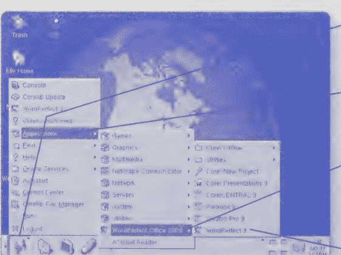

- 1. 点击“应用程序启动”。主菜单将出现。
- 2. 将鼠标移动到“应用程序”。应用程序菜单将出现。
- 3. 将鼠标移动到“WordPerfect Office 2000”。WordPerfect Office 2000 菜单将出现。
- 4. 点击“WordPerfect 9”。WordPerfect 将启动。

# 启动 WORDPERFECT OFFICE 2000

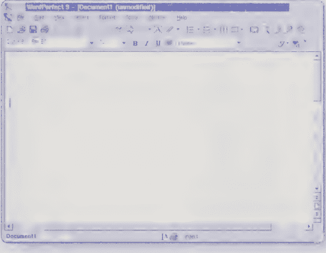

你可以将此方法用于 WordPerfect Office 2000 的任何应用程序。

> 注意
> 当你第一次启动 Office 2000 套件中的某个应用程序时，你会看到一个显示许可协议的许可信息对话框。只需阅读协议并点击“接受”（Accept）按钮即可进入应用程序。

# 从命令行启动 WordPerfect

如果你是倾向于从命令行启动应用程序的 Linux 用户，你的需求也能得到满足。

- 1. 点击面板上的控制台（Console）图标。控制台窗口将会出现。

> 注意
> Linux 中的每个图形界面都有某种形式的控制台或命令行应用程序，如所示。如果你启动它的方式略有不同，也没关系。启动控制台应用程序后，命令行窗口基本上都是一样的。

# 第1章：欢迎来到 WORDPERFECT 2000

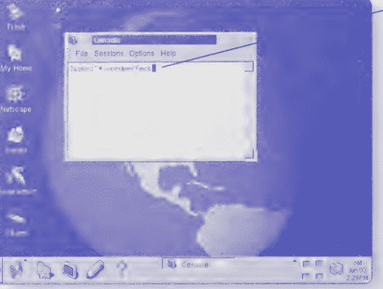

2. 在窗口中输入 `wordperfect` 命令。
WordPerfect 将启动。

你可以将此方法用于 WordPerfect Office 2000 的任何应用程序。表 1-1 列出了每个应用程序所需的命令。

# 表 1-1 启动 WordPerfect 应用程序的控制台命令

| 应用程序 | 命令 |
|---|---|
| WordPerfect | wordperfect |
| Quattro Pro | quattropro |
| Paradox | paradox |
| Presentations | presentations |
| CoreCENTRAL 地址录 | ccaddressbook |
| CoreCENTRAL 日历 | ccalendar |
| CoreCENTRAL 备忘录 | cmmemo |

# 探索 WordPerfect Office 2000

尽管 WordPerfect Office 2000 套包含多个应用程序，但每个应用程序共享许多共同界面特性，如此 Quattro Pro 屏幕所示。

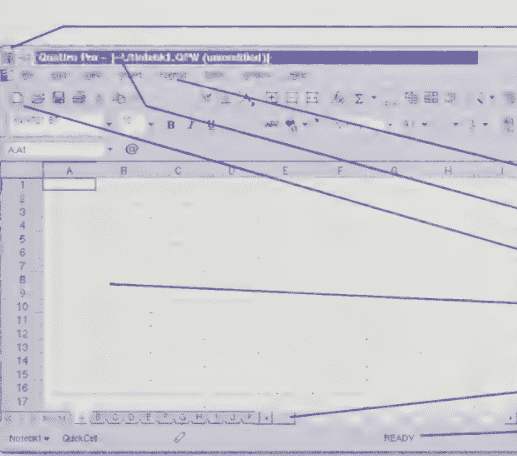

# 退出 WordPerfect Office 2000

退出任何 Office 2000 应用程序都非常简单，如接下来的步骤所示。

- 1. 应用程序控制图标
- 2. 窗口控制按钮
- 3. 文档窗口控制按钮
- 4. 菜单栏
- 5. 标题栏
- 6. 工具栏
- 7. 文档窗口
- 8. 垂直滚动条
- 9. 水平滚动条
- 10. 状态栏

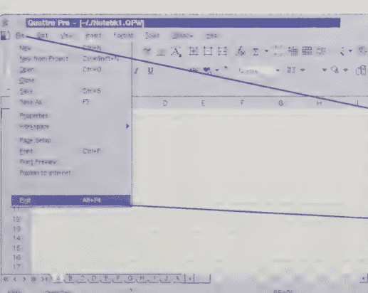

- 在任何 WordPerfect Office 2000 应用程序中**点击“文件”（File）**。文件菜单将会出现。

- **点击“退出”（Exit）**。应用程序将关闭。

> 提示
> 其他退出应用程序的方法包括点击屏幕右上角的关闭按钮 [X]（看起来像一个 X）。你也可以在键盘上同时按下 Alt+F4。

> 注意
> 如果你在退出应用程序时没有保存任何工作，Office 2000 应用程序会询问你是否要保存。你可以在第2章“处理文件”中查看如何保存文件。

# 2 处理文件

无论你在 WordPerfect Office 2000 中做什么，你都在与文档打交道。尽管人们往往认为文档仅由文字处理器应用程序创建，但事实是文档是任何类型的文件——不仅仅是 WordPerfect 文件。管理这些文档将使你在使用 WordPerfect Office 2000 时获得关键优势。在本章中，你将学习如何：

- 创建新的空白 Office 2000 文档，或使用 PerfectExpert 根据模板创建文档
- 保存你的文档
- 打开文档，包括 Office 2000 格式之外的文档
- 打印文档
- 关闭文档

## 创建新文档

当你在 WordPerfect Office 2000 中创建文档时，你可以选择创建一个新的空白文档，或根据几十种可用模板中的一种创建带模式的文档。

## 创建空白文档

在任何 WordPerfect 2000 应用程序中，你都可以随时启动一个新的空白文档。

- 1. 在任何 WordPerfect 2000 应用程序中点击“文件”。文件菜单将会出现。

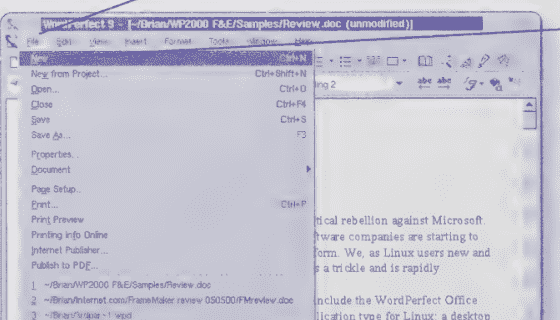

- 2. 点击“新建”（New）。一个新文档将会出现。

> 提示
> 你可以按 Ctrl+N 开始一个一个新的空白文档。

## 使用 PerfectExpert

借助 PerfectExpert 工具，WordPerfect Office 2000 为所有用户提供了大量的内置创意支持。PerfectExpert 使用户能够使用几个模板作为指南创建新文档。

## 打开已安装的模板

在安装 WordPerfect Office 2000 期间，安装了数十种示例模板供你使用。以下是访问它们的方法。

## 启动新文档

1. 在任何 WordPerfect 2000 应用程序中点击“文件”。文件菜单将会出现。

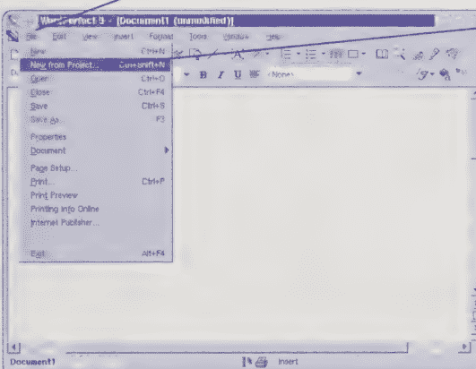

2. 点击“新建”（New）。PerfectExpert 对话框将会出现。

> 提示
> 你可以按 Ctrl+Shift+N 使用 PerfectExpert 开始一个新文档。

3. 点击你想要使用的项目。该项目会被高亮。

4. 点击“创建”（Create）。PerfectExpert 对话框将关闭，在你第一次使用某个项目时会出现一个对话框。

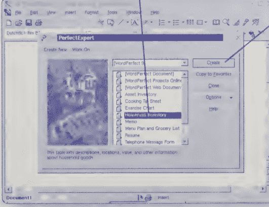

# 第2章：处理文件

5. 点击“是”（Yes），因为我们知道这是一个有效源。对话框将关闭，新的文档模板将会出现。

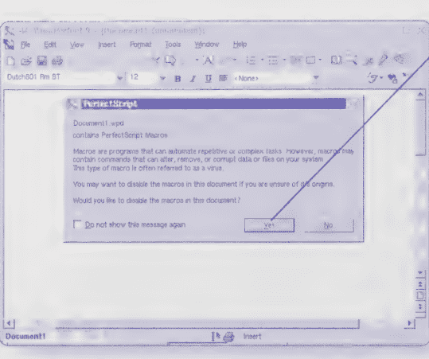

## 打开在线模板

除了 WordPerfect 2000 安装的模板外，互联网上还有许多供你使用的模板。通过 PerfectExpert 获取这些模板非常简单。

> 提示
> 在开始这些步骤之前，将你的系统连接到互联网很有帮助。

## 启动新文档

1. 在任何 WordPerfect 2000 应用程序中点击“文件”。文件菜单将会出现。

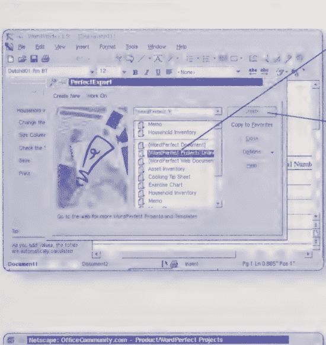

2. 点击“在线”（Online）。PerfectExpert 项目会被高亮。

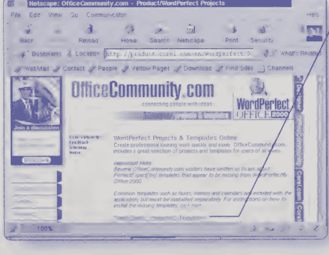

## 打开文件

3. 点击“项目”（Projects）。项目项目页面将会出现。

4. 点击“智能工具”（SmartTools）。智能工具页面将会出现。

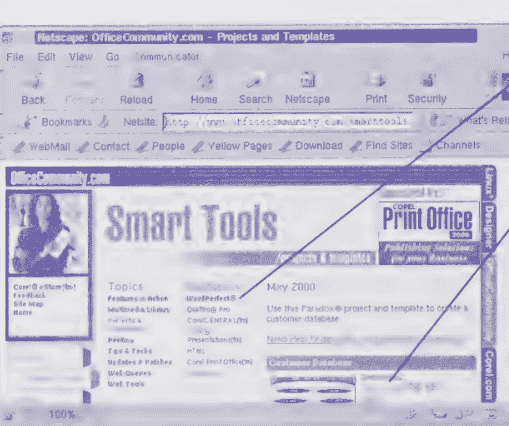

## 打开文件

5. 点击你想要使用的项目。保存对话框将会出现。

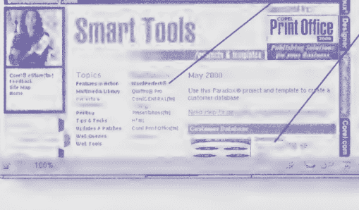

6. 点击“确定”（OK）。保存对话框将关闭。

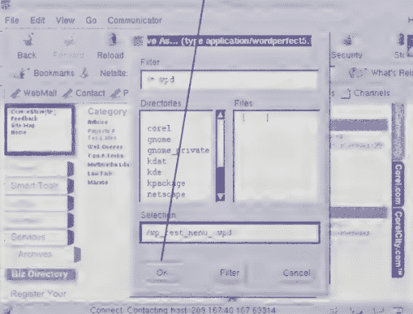

## 启动文件

7. 点击“选项”（Options）。选项菜单将会出现。

8. 点击“添加项目”（Add Project）。添加项目向导将打开。

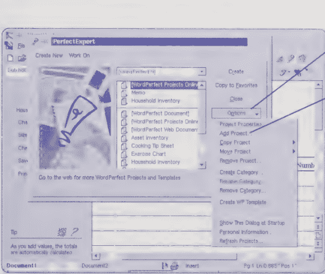

9. 点击“我想添加另一个文档”。该选项会被选中。

10. 点击“下一步”（Next）。向导的下一个屏幕将会出现。

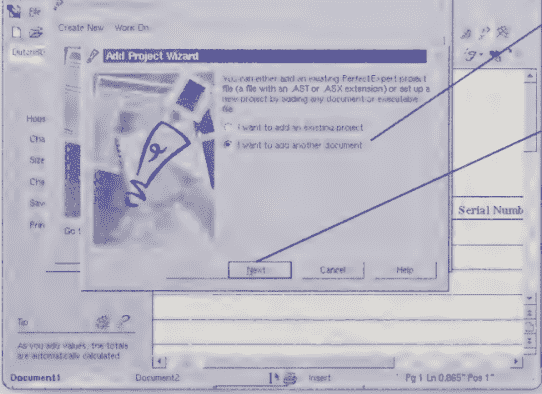

11. 点击“下一步”（Next）。项目对话框将会出现。

12. 为项目输入一个名称。名称将被显示。

13. 为项目输入一个简短描述。描述将被显示。

14. 点击“下一步”（Next）。向导的下一个屏幕将会出现。

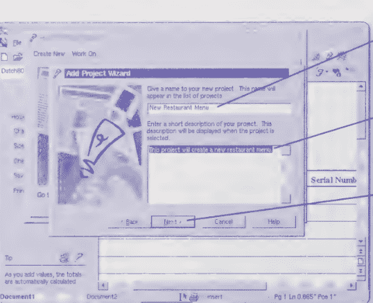

15. 为你的项目文档输入完整路径和文件名。文件名将被显示。

16. 点击“完成”（Finish）。一个对话框将会出现。

17. 点击“确定”（OK）。对话框将关闭。

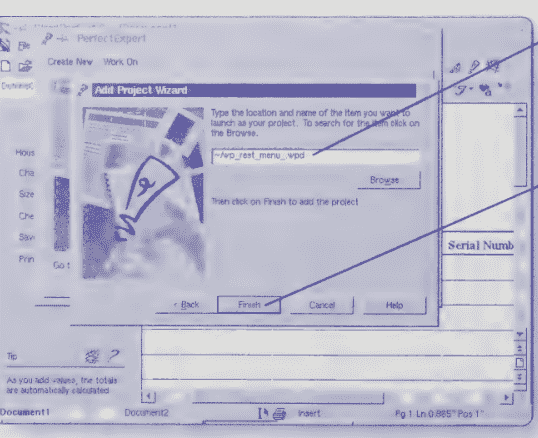

18. 点击新项目。该项目会被选中。

19. 点击“创建”（Create）。PerfectExpert 对话框将关闭，新的文档模板将会出现。

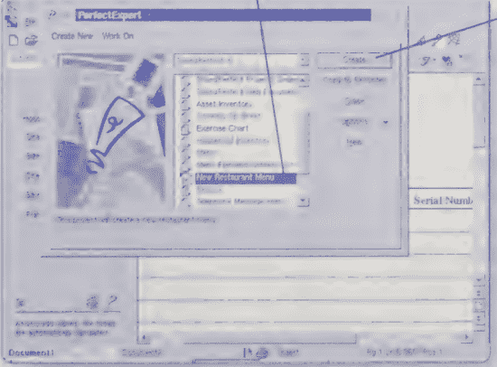

## 打开文档

当你开始使用 WordPerfect 2000 应用程序时，迟早（可能很早）你需要打开一个你或其他人处理过的文档。在本节中，我们将检查用于打开一个或多个文档的方法。

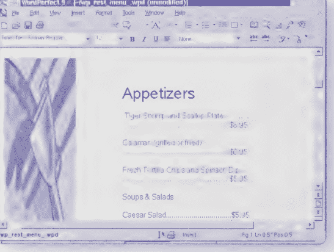

## 打开现有文档

如果你需要处理一个以前处理过的文档，将其调回进行额外的编辑是非常简单的事。

- 1. 点击“打开”（Open）按钮。打开文件对话框将会出现。

> 提示
> 你可以按 Ctrl+O 开始打开文件对话框。

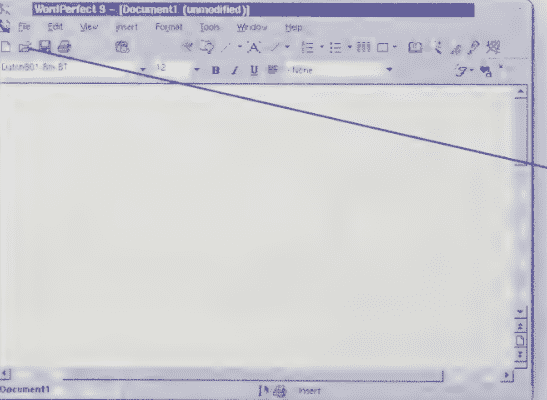

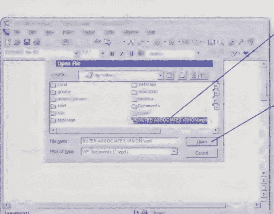

2. 点击您想要打开的文件。该文件将被高亮并显示在“文件名”旁边的框中。

3. 点击“打开”。打开文件对话框将关闭，所需的文件将出现在文档窗口中。

## 打开最近编辑过的文档

如果您需要打开最近处理过的文档，WordPerfect Office 2000 应用程序将让查找和打开这些文档变得更加简单。

- 1. 点击“文件”。将文件菜单。
- 2. 点击最近编辑的八个文件之一。所需的文件将出现在文档窗口中。

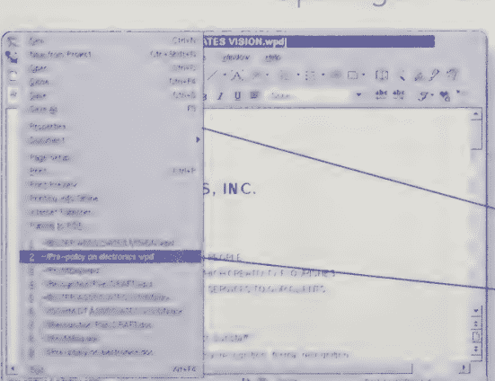

## 第 2 章：文件操作

## 打开“外源”文档

您不仅可以打开任何 WordPerfect 应用程序文件，还可以打开多种非 WordPerfect Office 2000 格式的文件。这一简单功能增强了你与 Linux 和 Windows 用户的共享连接性！

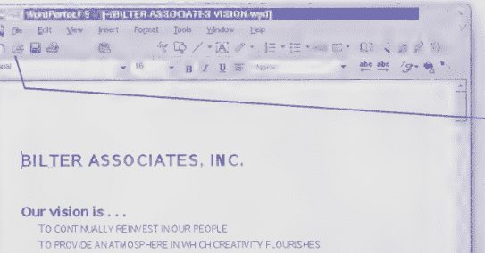

- 1. 点击“打开”按钮。将出现打开文件对话框。

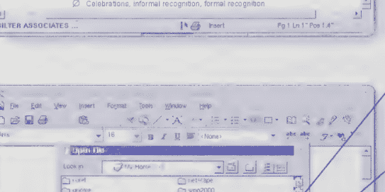

- 2. 点击“文件类型”旁旁的箭头 (↓)。将出现下拉列表。
- 3. 向下滚动下拉列表。您需要的文件类型将被高亮。
- 4. 点击您想要的文件类型。该文件将替换下拉列表，文件窗口现在只显示该类型的文件。

## 打开文档

5. 点击您想要打开的文件。该文件将被高亮并显示在“文件名”旁边的框中。

6. 点击“打开”。打开文件对话框将关闭，所需的文件将出现在文档窗口中。

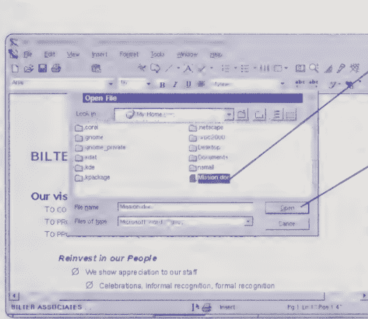

## 打开多个文档

您并不限于一次只能打开一个文档。WordPerfect 应用程序允许您同时打开任意数量的文档。

1. 点击“打开”按钮。将出现打开文件对话框。

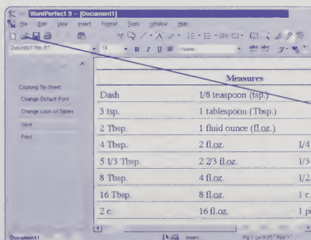

| 测量值 | | |
|---|---|---|
| 茶匙 | 1/8 茶匙 (tsp.) | |
| 3 tsp. | 1 匙 (Tbsp.) | |
| 2 Tbsp. | 1 液盎司 (fl.oz.) | |
| 4 Tbsp. | 2 fl.oz. | 1/4 |
| 5 1/3 Tbsp. | 2 2/3 oz. | 1/3 |
| 8 Tbsp. | 4 fl.oz. | 1/2 |
| 16 Tbsp. | 8 fl.oz. | 1 c |
| 2 c. | 16 fl.oz. | 1 pi |

## 第 2 章：文件操作

- 2. 按住 Ctrl 键并点击您想要打开的文件。该文件将被高亮并显示在“文件名”旁边的框中。
3. 在按住 Ctrl 键的同时点击另一个文件。该文件将被高亮，也会出现在“文件名”旁边的框中。
4. 点击“打开”。打开文件对话框将关闭，所需的文件将出现在文档窗口中。

## 保存您的文档

在完成文档工作后，有必要保存您的工作。保存文档并不困难，在处理其他文档时您应该经常保存，以防发生断电或某些意外情况。

## 保存文档

当您第一次处理并保存文档时，需要为它指定一个新文件名，并在 Linux 系统上选择保存文件的位置。

## 保存您的文档

| 文件 | 快捷键 |
|---|---|
| 从项目新建 | |
| 保存 | Ctrl+S |
| 打开 | Ctrl+O |
| 另存为 | |
| 属性 | |
| 页面设置 | |
| 文件预览 | Ctrl+P |
| 打印信息 | |
| 互联网发布器 | |

1. 点击“文件”。将出现文件菜单。

2. 点击“另存为”。将出现保存对话框。

## 认可计划

> 提示
- - 我们将强化这样一个观点：员工在职业生涯期间会在特定间隔根据其工作重要性获得认可。
- 认可 Plan DRAFT word
- BITTER ASSOCIATES vision doc
- 认可 Plan DRAFT-Edit
- 认可 Plan DRAFT
- ASSOCIATES vision doc
- 认可 Plan DRAFT.doc

这是为了就业。这不仅宣传了员工，还让他们觉得成为团队的一部分，并且他们的工作得到了重视和认可。您可以按 F3 打开“另存为”对话框。

3. 点击“保存”旁边的箭头 (↓) 以选择新位置，驱动器将显示。
4. 在“文件名”旁边的框中输入文件名。文件名将显示在框中。

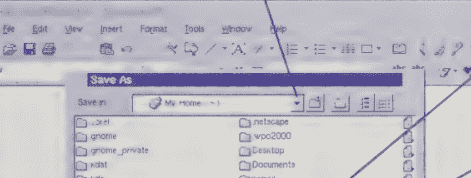

5. 点击“文件”旁边的箭头 (↓) 选择保存的文件类型。文件扩展名将发生变化。每年都是重视的成员，这也是欢迎新员工并让他们成为团队的一部分的一种。当员工工作六个月时，他们的工作得到了重视和认可。
6. 点击“保存”。另存为对话框将关闭，文件将存储在适当的位置。

## 第 2 章：文件操作

## 保存文档

在执行初始“另存为”操作后，您可以根据自己的意愿频繁地保存文档。

- 1. 点击“保存”按钮。文件将被保存，“文件名”旁将出现“未修改”状态。
认可计划将强化这样一个观点：员工是受重视的成员。通过在特定间隔提供认可，提醒员工他们在整个职业生涯中的重要性。有几种高性价比的方法可以实现这一点：入职第一天可以发放胸章。这不仅宣传了员工，还让他们觉得成为团队的一部分。当员工工作六个月时，可以发放咖啡杯提醒他们对团队的贡献得到了重视和认可。周年也将获得认可。

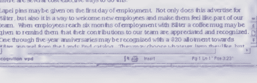

## 奖励/认可计划

## 打印文档

尽管我们创建和使用电子文档的能力，但人们仍然强烈渴望纸质文档。WordPerfect Office 2000 注意到了这种深层需求并允许您轻松打印文档。

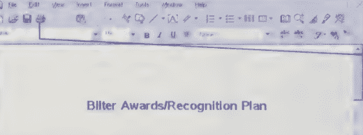

- 1. 点击“打印”按钮。将出现打印对话框。

> 提示
您也可以按 Ctrl+S 快速保存文件。

## 认可计划

奖励/认可计划将强化这样一个观点：员工是受重视的成员。通过在特定间隔提供认可，提醒他们在整个职业生涯中的重要性。有几种高性价比的方法可以实现这一点：入职第一天可以发放胸章。这不仅宣传了员工，还让他们觉得成为团队的一部分。当员工工作六个月时，可以发放咖啡杯提醒他们对团队的贡献得到了重视和认可。周年也将获得认可。

> 提示
您也可以按 Ctrl+P 开始打印过程。

## 关闭文档

2. 点击“全部”选项。该选项将被选中。
3. 点击“打印”。打印对话框将关闭，文档将打印。

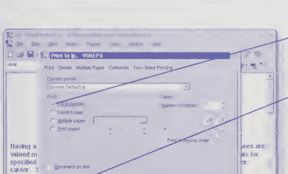

受重视的指定。对于团队一部分的员工，入职或工作年限达到可以发放胸章提醒他们对团队的贡献得到了重视和认可。周年也将获得认可认可.wpd

## 关闭文档

当您完成某个文档的工作时，可以关闭该文档而不关闭整个应用程序。

- 1. 点击“文件”。菜单将出现。
- 2. 点击“关闭”。当前打开的文档将关闭。

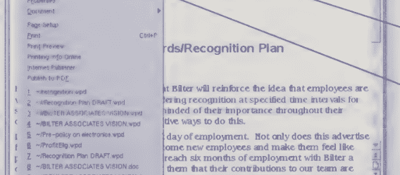

## 认可计划

Biter 强化了观点：员工在他们发展一生的特定间隔内根据其重要性获得认可。这不仅宣传了一些新员工，还让他们觉得在工作六个月后他们对团队的贡献得到了重视和认可，周年也将获得认可。

> 提示
您也可以按 Ctrl+F4 关闭打开的文档。

## 3 获取 WordPerfect Office 2000 的帮助

无论设计者如何努力使其变得直观，计算机并不容易使用——除非你未满 16 岁。许多软件设计人员都意识到了事实，并尝试实现在线帮助。WordPerfect Office 2000 提供了这种传统的在线帮助供你使用，但并不仅于此。你还可以从互联网获取帮助，并使用一种可以在执行任务时引导你的工具！在本章中，你将学习如何：

- 精通 Office 2000 的在线帮助
- 让 PerfectExpert 引导你完成任务

## 第 3 章获取 WORDPERFECT OFFICE 2000 的帮助

## 开始在线帮助

当你找不到问题的答案时，可能会查阅参考资料。这些参考资料可能是你的朋友、救命稻草，或者只是像这样的一本书。在 WordPerfect 中，最快的地方是在线帮助文件。

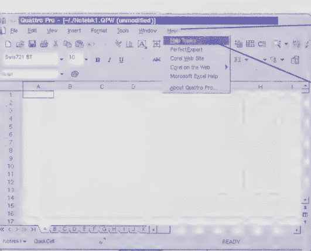

1. 在任何 WordPerfect 2000 程序中点击“帮助 (Help)”。将“帮助”菜单。
2. 点击“帮助主题 (Help Topics)”。你的默认网络浏览器将出现，并打开该特定 Office 2000 程序的帮助文件。
3. 点击所需主题的展开控件。将出现子主题列表。
4. 点击所需的主题。主题将高亮显示，主题内容将显示在浏览器的内容框中。

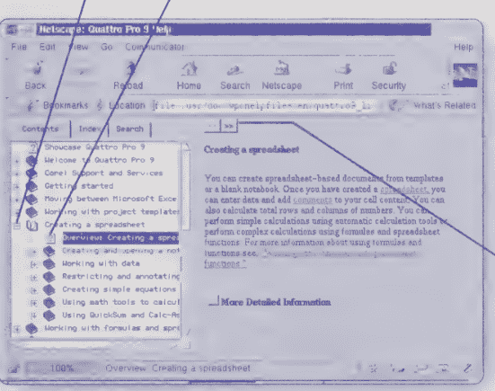

> 注意：主题区域中的加号是展开控件，将“打开”给定主题内的子主题。

5. 点击“下一页 (Next Page)”控制按钮。下一个帮助主题将显示在内容框中。

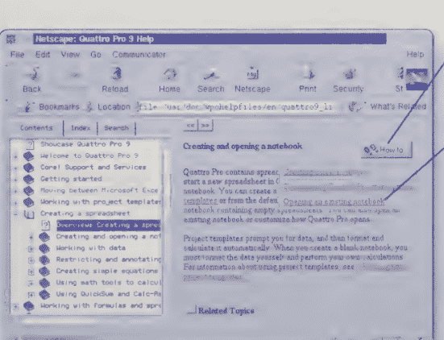

6. 点击“如何操作 (How To)”。将出现与特定主题相关的任务列表。
7. 点击某个任务。任务将显示在内容框中。
8. 点击主题页面底部“相关主题 (Related Topics)”旁边的框。将出现与主题相关的链接列表。
9. 点击主题链接。内容框将显示新主题。

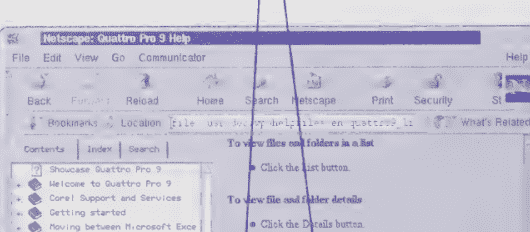

10. 点击关闭 (X) 按钮。网络浏览器将关闭。

## 在帮助中搜索答案

有时主题标题并不能准确揭示你正在寻找的内容。或者你可能根本没有时间快速浏览标题。幸运的是，你可以直接对帮助主题进行搜索。

1. 点击在线帮助中的“搜索 (Search)”选项卡。搜索选项卡将切换到前景。
2. 输入你想学习的关键词。将显示相应的术语。
3. 点击“查找 (Find)”。将显示任何包含搜索术语的结果。

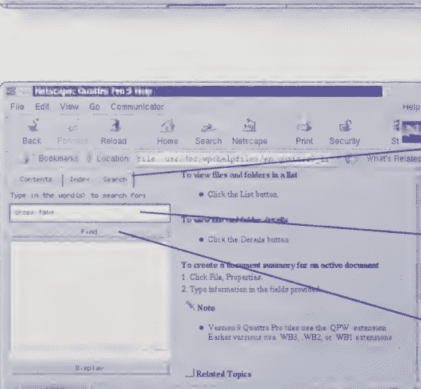

## Netscape Quattro Pro 9 帮助

4. 点击所需的主题。主题将高亮显示。
5. 点击“显示 (Display)”。内容框将显示该主题。

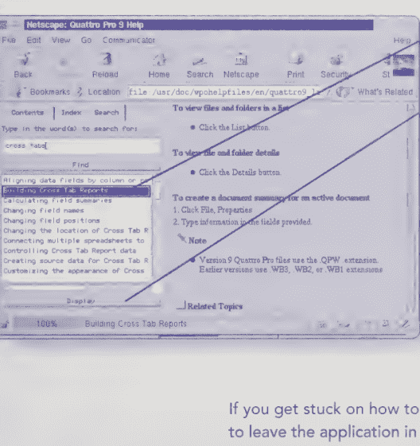

## 使用 PerfectExpert

如果你在如何执行某些操作上卡住了，你可能不需要离开正在工作的程序。通过 PerfectExpert 的帮助，你可以在工作时获得提示。

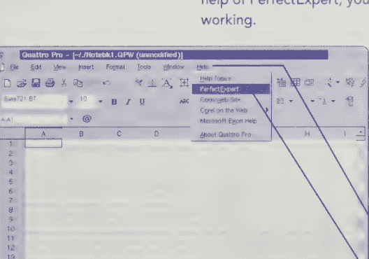

## 边做边获取帮助

PerfectExpert 不仅帮助你启动文档，还能协助你处理文档。

1. 点击“帮助 (Help)”。将出现帮助菜单。
2. 点击“PerfectExpert”。PerfectExpert 格将在文档旁打开。

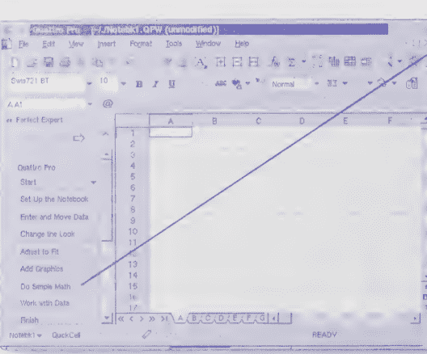

3. 点击所需主题。主题内容将填充 PerfectExpert 格。

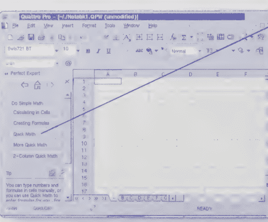

4. 点击所需的子主题。将打开完成任务的工具。
> 注意：如果没有完成任务的特定工具，PerfectExpert 格中将出现详细的说明。

## 停止 PerfectExpert

完成 PerfectExpert 操作后，你需要关闭它以恢复文档空间。

1. 点击 PerfectExpert 格中的关闭 (X) 按钮。该格将关闭。

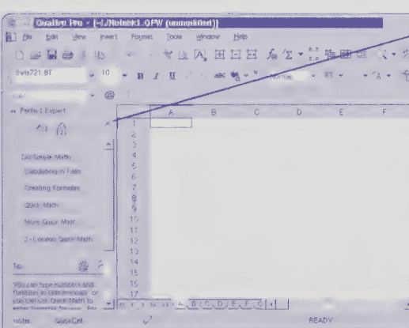

## 第一部分回顾

1. 如何启动 WordPerfect 程序？参见第 1 章“启动 窗口”。
2. WordPerfect Office 2000 套件中有多少应用程序？参见第 1 章“探索 WordPerfect 2000”。
3. 如何退出 WordPerfect 程序？参见第 1 章“退出 WordPerfect 2000”。
4. 如何创建一个空文档？参见第 2 章“创建空文档”。
5. 什么是 PerfectExpert？参见第 2 章“使用 PerfectExpert”。
6. 如何使用模板？参见第 2 章“打开模板”。
7. 如何在 WordPerfect Office 2000 中打开文档？参见第 2 章“打开文档”。
8. 在哪里打印文档？参见第 2 章“打印文档”。
9. 如何搜索帮助文件？参见第 3 章“在帮助中搜索”。
10. 在 WordPerfect 2000 工作时如何获取帮助？参见第 3 章“边做边获取帮助”。

## 第二部分处理文字

| 章 | 标题 |
| :--- | :--- |
| 第 4 章 基础知识 | 37 |
| 第 5 章 文档格式 | 47 |
| 第 6 章 提高写作水平 | 71 |
| 第 7 章 使用表格和列 | 83 |
| 第 8 章 为文档添加样式 | 99 |
| 第 9 章 管理文档 | 111 |

## 4 基础知识

WordPerfect Office 2000 的文字处理组件起名很贴切。WordPerfect 的主要工作是将你的文字落在纸上，无论是真实的还是电子的。在本章中你将学习如何：

- 在文档中创建文本
- 通过插入、选择和删除文本编辑文档
- 使用撤销 (Undo) 和重做 (Redo) 功能纠错
- 在文档中导航

## 第 4 章学习基础知识

## 输入文本

自古登堡印刷机时代以来，我们走了很远，那时需要精细地排列活字来创建书的一页内容。现在，创建信件、报告甚至书籍只需动动手指一样简单。

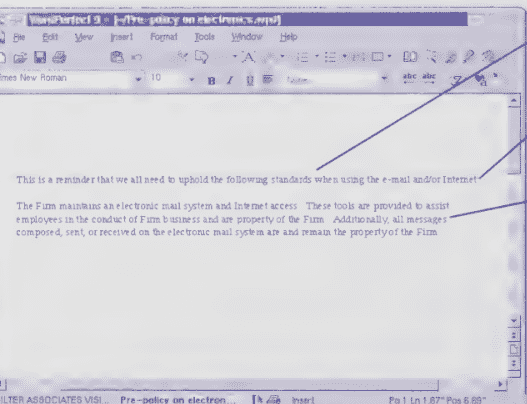

1. 输入文本。文字将显示在屏幕上。
2. 按回车键。将开始新行。
3. 输入段落。文字会自动换行，因此你只需要在段落结束时按回车键。

## 编辑文本

并非第一次就能正确输入所有文本。在创建文档时，你经常在输入完后会想到更好的表达方式。这时，了解如何在 WordPerfect 中编辑文本就很有用了。

## 插入文本

在 WordPerfect 文档中插入文本很简单。正如你在本节中学到的，你甚至可以在现有文本上输入文本。

#### 编辑文本 39

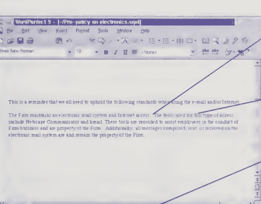

1. 点击文档内的鼠标指针。插入点将出现在你点击的地方。
2. 输入文本。文字将显示在屏幕上，并将现有文本向侧推。
3. 点击状态栏上的“插入 (Insert)”。状态将变为“覆盖 (Typeover)”。

这提醒我们，在使用电子邮件和互联网时，所有人都需要遵守以下标准。公司维护着电子邮件系统和互联网访问。

公司维护着电子邮件系统和互联网访问。用于此类访问的工具包括 Netscape Communicator 和 Gmail。提供这些工具是为了协助员工开展公司业务。此外，所有在电子邮箱系统上撰写或收到的消息均属于公司财产。

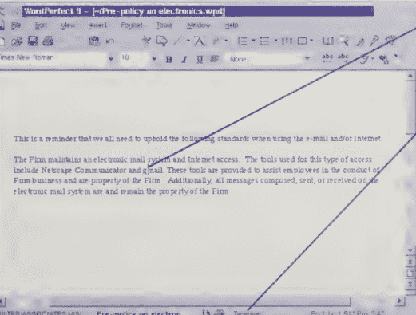

4. 输入文本。文字将显示在屏幕上，覆盖现有文本。
5. 点击状态栏上的“覆盖 (Typeover)”。状态将返回“插入 (Insert)”。

## 第 4 章：学习 WORDPERFECT 基础知识

## 选择文本

在处理文本块时，一种实用的技巧是先选择文本。一旦选中文本，对该区域进行的任何更改都将影响区域内的所有文本。

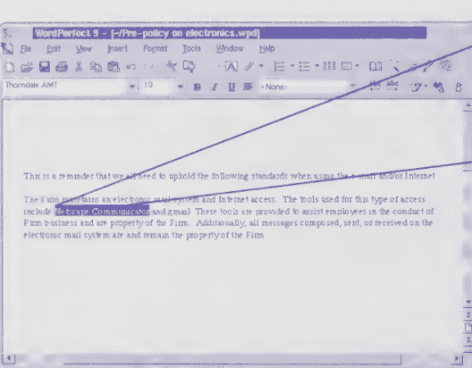

- 1. 在文档中点击鼠标指针。点击时将出现插入点。
- 2. 拖动鼠标指针跨越文本行。随着鼠标移动，文本将被高亮。
- 3. 释放鼠标指针。选中的文本将在屏幕上高亮显示。

> 注意
> 若要移除文档中的选中高亮，只需在文档内的任意位置点击鼠标指针即可。

> 提示
> 双击单词可以选中整个单词。要选择整个段落，请在该段落内的文本上单击三次。

## 修正你的错误

## 删除文本

在修剪玫瑰时，你必须对它们果断才能呈现出最美的花朵。有时，你必须剪掉一些，才能写出最好的文字。

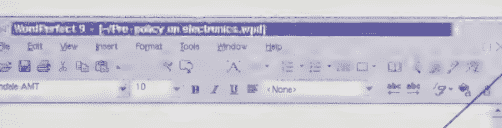

这是一个提醒，在我们在使用电子邮件和互联网时，我们都需要遵守以下标准。公司发布电子邮件系统和互联网访问服务。用于此类访问的工具包括存储通信器（Storage Communicators），这些工具提供的目的是协助员工开展公司业务；此外，在电子邮件系统上发送或接收的所有信息均归公司所有。

- 1. 选择文档中的某些文本。文本将在屏幕上高亮显示。
- 2. 按 Delete 键。文本将从文档中删除。

## 修正你的错误

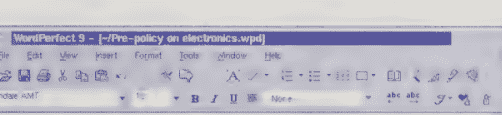

这是一个提醒，在我们在使用电子邮件和互联网时，我们都需要遵守以下标准。公司发布电子邮件系统和互联网访问服务。这些工具提供的目的是协助员工开展公司业务；此外，在电子邮件系统上发送或接收的所有信息均归公司所有。

如果你最终发现自己做了一个并不想要的更改，WordPress 有你需要的的工具！撤销（Undo）和重做（Redo）可以帮助你消除可能犯的任何错误。

- 1. 选择文档中的某些文本。文本将出现在屏幕上。
- 2. 按 Delete 键。文本将从文档中删除。

## 第 1 章 学习 WORDPERFECT 基础知识

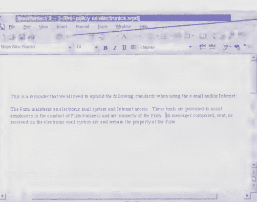

- 3. 点击撤销按钮。
被选中的文本将重新出现。

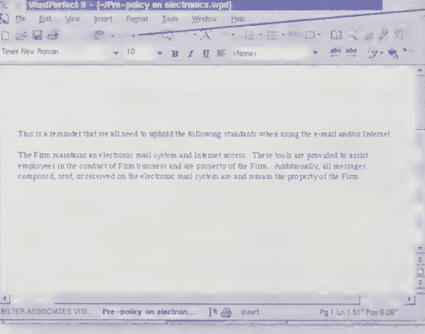

- 4. 点击重做按钮。
文本将再次从文档中删除。

## 在文档中导航

仅使用箭头键在文档中逐字移动可能相当乏味且缓慢。在 WordPerfect 文档的导航有更好、更快速的方法。

## 使用阴影光标（Shadow Cursor）

阴影光标允许你将鼠标指针放在屏幕上的任意位置，无论那里是否已有文本。这一功能对文本放置提供了极佳的控制。

- 1. 点击视图（View）。菜单将出现。
- 2. 点击阴影光标（Shadow Cursor）。阴影光标将出现。

## 第 4 章：学习 WORDPERFECT 基础知识

- 3. 将阴影光标移动到空白区域。阴影将出现。
这是一个提醒，在我们在使用电子邮件和互联网时，我们都需要遵守以下标准。公司发布电子邮件系统和互联网访问服务。这些工具提供的目的是协助员工开展公司业务；此外，在电子邮件系统上发送或接收的所有信息均归公司所有。

- 4. 将阴影光标指针点击空白区域。
这是一个提醒，在我们在使用电子邮件和互联网时，我们都需要遵守以下标准。公司发布电子邮件系统和互联网访问服务。这些工具提供的目的是协助员工开展公司业务；此外，在电子邮件系统上发送或接收的所有信息均归公司所有。

- 5. 输入某些文本。插入点将出现。

## 在文档中导航

## 使用滚动条

要快速在文档中移动，请使用滚动条。

- 1. 点击并按住滚动条。文本将被选中。
- 2. 向上或向下移动滚动条。文档将移动。

## 第 4 章：学习 WORDPERFECT 基础知识

- 5. 点击垂直滚动条。文档将向上或向下移动一个屏幕。
- 6. 点击下一页（Next Page）浏览控件。文档将向下移动一页。
- 7. 点击上一页（Previous Page）浏览控件。文档将向上移动一页。

## 5 格式化 WordPerfect 文档

WordPerfect 对你的文档提供的帮助远不止是一个高级的打字机。首先，你可以对文本应用奇妙的效果、调整文本大小并在文档中移动文本。在本章中，你将学习如何：

- 对文本进行更改，例如更改其字体、大小和属性
- 插入特殊字符
- 在文档中移动或复制文本
- 更改文档中的文本间距
- 设置、移动和删除制表

## 第 5 章：格式化 WORDPERFECT 文档

### 增强文本

你已经见过文字处理器可以创建的所有精美文档。现在，轮到你开始为你的文本应用吸引人的效果了。

## 更改字体

文本字符的字体是文本的外。某些字体更具可读性，而另一些则引人注目。通过 WordPerfect 的实时预览（RealTime Preview），你可以在更改字体之前看到字体更改的效果。

1. 选择你想要影响的文本。文本将被高亮。

2. 点击字体类型（Font Face）框旁边的向下箭头（↓）。将出现可用字体列表，当你悬停在每个字体名称上时，选中文本的字体将在实时预览窗口中更改。

3. 点击 Avant Garde Bk 字体。文本中的选中文本字体将发生更改。

### 更改字体大小

字体不仅有各种形状，还有各种大小。字体大小以磅（points）为单位。每英寸有72 磅。

1. **选择你想要影响的文本**。文本将被高亮。

2. **点击字体大小（Font Size）框旁边的向下箭头（↓)****将出现可用磅数列表。

3. **点击 40** 磅。选中文本的大小将改变。

### 使用快速字体（QuickFonts）

WordPerfect 的快速字体功能允许你在文档中选择最近使用的字体和字体大小组合。

1. **选择你想要影响的文本**。文本将被高亮。

2. **点击快速字体按钮**。将出现最近的字体和字体属性列表。

3. **点击某种字体**。选中文本的字体和大小将更改为新属性。

### 应用粗体、斜体或下划线

除了更改字体外，你还可以文本应用属性。属性包括粗体、斜体或下划线。

1. 选择你想要影响的文本。文本将被高亮。

## 引言

建立一个面向 CM（配置管理）的过程将是 RedLine 应用的工作，用于管理与项目和个人任务相关的各种变更对象。

为了实现这一点，需要对 RedLine 进行某些修改，它目前是一个以任务为导向的项目管理系统。这些修改应包括但不限于：

- 添加字段以允许用户建立每个变更对象及其关联任务的状态
- 允许变更对象从一个状态自动转换到另一个状态的控制
- 允许变更对象签出（checking out）和签入（checking in）的控制。这将实现强大的版本和跟踪控制
- 跟踪变更对象通过所有状态的所有版本的能力
- 一个进程管理界面，用于实现从 CM “外部”进行包管理

2. 点击粗体按钮。
文本将变为粗体。

## 引言

建立一个面向 CM 的过程将是 RedLine 应用的工作，用于管理与项目和个人任务相关的各种变更对象。

为了实现这一点，需要对 RedLine 进行某些修改，它目前是一个以任务为导向的项目管理系统。这些修改应包括但不限于：

- 添加字段以允许用户建立每个变更对象及其关联任务的状态
- 允许变更对象从一个状态自动转换到另一个状态的控制
- 允许变更对象签出和签入的控制。这将实现强大的版本和跟踪控制
- 跟踪变更对象通过所有状态的所有版本的能力
- 一个进程管理界面，用于实现从 CM “外部”进行包管理

| RedLine 要求 | 正文第 57 页 |

3. 选择更多你想要影响的文本。文本将被高亮。

4. 点击斜体按钮。
文本将变为斜体。

### 增强文本

5. 选择更多你想要影响的文本。文本将被高亮。

6. 点击下划线按钮。
文本将带有下划线。

## 引言

建立一个面向 CM 的过程将是 RedLine 应用的工作，用于管理与项目和个人任务相关的各种变更对象。

为了实现这一点，需要对 RedLine 进行某些修改，它目前是一个以任务为导向的项目管理系统。这些修改应包括但不限于：

- 添加字段以允许用户建立每个变更对象及其关联任务的状态
- 允许变更对象从一个状态自动转换到另一个状态的控制
- 允许变更对象签出和签入的控制。这将实现强大的版本和跟踪控制
- 跟踪变更对象通过所有状态的所有版本的能力
- 一个进程管理界面，用于实现从 CM “外部”进行包管理

7. 选择之前的文本。文本将被高亮。

## 引言

建立一个面向 CM 的过程将是 RedLine 应用的工作，用于管理与项目和个人任务相关的各种变更对象。

为了实现这一点，需要对 RedLine 进行某些修改，它目前是一个以任务为导向的项目管理系统。这些修改应包括但不限于：

- 添加字段以允许用户建立每个变更对象及其关联任务的状态
- 允许变更对象从一个状态自动转换到另一个状态的控制
- 允许变更对象签出和签入的控制。这将实现强大的版本和跟踪控制
- 跟踪变更对象通过所有状态的所有版本的能力
- 用于实现从 CM “外部”进行包管理的界面

8. 点击粗体按钮。
粗体属性将被移除。

## 第 5 章：格式化 WORDPERFECT 文档

### 更改文本大小

文本的大写方式（或不大写）被称为其大小（case）。只有首字母大写的句子是普通大小。全大写的文本段落是大大写形式。

1. **选择你想要影响的文本**。文本将被高亮。

2. **点击编辑（Edit）**。菜单将出现。

3. 将鼠标移动到转换大小（Convert Case）。转换大小菜单将出现。

4. **点击大写（UPPERCASE）**。选中文本将更改为大写。

### 插入特殊字符

变音符号、重音符号和图标——这些听起来像是属于黑暗幽灵墓的术语。信不，这些都是 WordPerfect 可以放入你的文档的特殊字符和符号描述。

1. 在你想插入符号的地方点击鼠标指针。插入点将出现在你点击文档的地方。

你可以通过输入 Ctrl+W 唤出符号对话框。

2. 点击插入（Insert）。菜单将出现。

3. 点击符号（Symbol）。符号对话框将打开。

4. 点击集合（Set）列表旁边的列表箭头。将出现可用字体集列表。

5. 点击集合列表中的字体符号（Typographic Symbols）。字体符号集将出现。

# 第5章：格式化 WORDPERFECT 文档

- 6. 点击一个字符。该字符将用闪烁的框显示。
- 7. 点击“插入”和“关闭”。字符将放置在文档中插入点出现的位置。

为了实现这一点，需要对 RedLine 进行某些修改，RedLine 目前是一个以任务为导向的项目管理系统。这些修改将包括但不限于：

- 添加字段允许用户建立每个更改对象及其关联任务的状态。

## 移动或复制文本

在过去（五年前），如果你必须移动一段文本，你必须使用编辑器的刀从字面意义上切掉布局页，然后用蜡蜡将文本物理地粘贴到页面的其他部分。今天，你可以在几秒内内相同的效果，而无需粘蜡。不过，这个过程仍然被称为剪切和粘贴。

## 移动文本

使用键盘在文档中移动文本是一个简单的过程。使用剪切（Ctrl+X）和粘贴（Ctrl+V）的组合键可以提高你的速度。

## 简介

1. 选择你想要移动的文本。文本将被高亮。
2. 输入 Ctrl+X。所选文本将消失。

一旦建立了受 CM（配置管理）控制流程，将由 SQL 的 Redline 应用程序管理与项目和单个任务相关的各种更改对象。

为了实现这一点，需要对 Redline 进行某些修改，Redline 目前是一个任务项目管理系统。这些修改应该包括但不限于：

- 添加字段允许用户建立每个更改对象及其关联任务的状态。
- 能够实现更改对象从一个状态自动转换到另一个状态的控件。
- 用于启用跟踪和检查更改对象的控件。这将使我们能够衡量响应责任。
- 跟踪更改对象在所有状态下的所有版本的能力。
- 进程管理屏幕，允许从 CM 流程“外部”进行包管理。
- 将所有任务及其状态链接到自动化报告系统。

# 3. 将鼠标指针移动到文本的新位置。

一旦建立了受 CM 控制的流程，将由 SQL 的 Redline 应用程序管理与项目和单个任务相关的各种更改对象。

为了实现这一点，需要对 Redline 进行某些修改，Redline 目前是一个任务项目管理系统。这些修改应该包括但不限于：

- 添加字段允许用户建立每个更改对象及其关联任务的状态。
- 能够实现更改对象从一个状态自动转换到另一个状态的控件。
- 跟踪更改对象在所有状态下的所有版本的能力。
- 进程管理屏幕，允许从 CM 流程“外部”进行包管理。
- 将所有任务及其状态链接到自动化报告系统。

## 设计目标

为了实现这一点，已确定了十个设计目标区域：

# 第5章：格式化 WORDPERFECT 文档

4. 输入 Ctrl+V。剪切的文本将出现在新位置。

一旦建立了受 CM 控制的流程，将由 QLS 的 RedLine 应用程序管理与项目和单个任务相关的各种更改对象。

为了实现这一点，需要对 RedLine 进行修改，它目前是一个任务项目管理系统。这些修改应该包括但不限于：

- 添加字段允许用户建立每个更改对象及其关联任务的状态。
- 用于启用更改对象检出和检入的控件。这将实现对版本和跟踪控制的强有力衡量。
- 更改对象从一个状态转换到另一个状态的控件。
- 跟踪更改对象在所有状态下的所有版本的能力。
- 进程管理屏幕，允许从 CM 流程“外部”进行包管理。
- 将所有任务及其状态链接到自动化报告系统。

## 设计目标

## 复制文本

复制文本不再需要重新输入。使用复制（Ctrl+C）组合键让复制变得轻而易举。

1. 选择你想要复制的文本。文本将被高亮。
2. 输入 Ctrl+C。虽然没有可见的变化，但所选文本将放在 WordPerfect 的内部剪贴板中以便以后粘贴。

一旦建立了受 CM 控制的流程，将由 QLS 的 RedLine 应用程序管理与项目和单个任务相关的各种更改对象。

为了实现这一点，需要对 RedLine 进行修改，它目前是一个任务项目管理系统。这些修改应该包括但不限于：

- 添加字段允许用户建立每个更改对象及其关联任务的状态。
- 用于启用更改对象检出和检入的控件。
- 更改对象从一个状态转换到另一个状态的控件。
-  跟踪更改对象在所有状态下的所有版本的能力。
- 进程管理屏幕，允许从 CM 流程“外部”进行包管理。
- 将所有任务及其状态链接到自动化报告系统。

## 设计目标

## 移动或复制文本

# 3. 将鼠标指针移动到文本的新位置。

一旦建立了受 CM 控制的流程，将由 SQL 的 Redline 应用程序管理与项目和单个任务相关的各种更改对象。

为了实现这一点，需要对 RedLine 进行某些修改，RedLine 目前是一个任务项目管理系统。这些修改将包括但不限于：

- 添加字段允许用户建立每个更改对象及其关联任务的状态。
- 用于启用更改对象检出和检入的控件。这将实现对版本和跟踪控制的强有力衡量。
- 更改对象从一个状态转换到另一个状态的控件。
-  跟踪更改对象在所有状态下的所有版本的能力。
- 进程管理屏幕，允许从 CM 流程“外部”进行包管理。
- 将所有任务及其状态链接到自动化报告系统。

## 设计目标

4. 输入 Ctrl+V。剪切的文本将出现在新位置。

一旦建立了受 CM 控制的流程，将由 QLS 的 RedLine 应用程序管理与项目和单个任务相关的各种更改对象。

为了实现这一点，需要对 RedLine 进行修改，它目前是一个任务项目管理系统。这些修改应该包括但不限于：

- 添加字段允许用户建立每个更改对象及其关联任务的状态。
- 用于启用更改对象检出和检入的控件。这将实现对版本和跟踪控制的强有力衡量。
- 更改对象从一个状态转换到另一个状态的控件。
-  跟踪更改对象在所有状态下的所有版本的能力。
- 进程管理屏幕，允许从 CM 流程“外部”进行包管理。
- 将所有任务及其状态链接到自动化报告系统。

# 第5章：格式化 WORDPERFECT 文档

## 使用点击拖动

在 WordPerfect 中，你可以仅使用鼠标移动文本。

- 1. 选择你想要移动的文本。文本将被高亮。
- 2. 点击文本。鼠标指针将变为拖动指针。
- 3. 将所选文本拖动到文档中的另一个位置。拖动指针将移动到新位置。
- 4. 释放鼠标键。所选文本将出现在新位置。

## 使用项目符号或编号列表

当你想要列出观点或组织思路时，列表非常有帮助。Word 让你在瞬间创建出外观精美的列表！

- 1. 选择要变为项目符号列表的文本。文本将被选中。

- 2. 点击“项目符号”按钮。文本将变成项目符号列表。

- 完成第5章
- 在当地书店设置“购买此书”展位
-向编辑诉苦
- 参加当地 Linux 用户组会议

- 3. 选择要变为编号列表的文本。文本将被选中。

- 完成第5章
- 让“购买此书！”展位留在当地书店
- 向编辑诉苦
- 参加当地 Linux 用户组会议

- 4. 点击“编号”按钮。文本将变成编号列表。

1. 完成第5章
2. 在当地书店设置“购买此书！”展位
3. 向编辑诉苦
4. 参加当地 Linux 用户组会议

## 在页面上安排文本

大多数文本会自动对齐到页面的左边距并采用单倍行距。然而，有时你可能想改变这种规范。

### 文本对齐

在 WordPerfect 中，你可以通过四种方式对齐文本：左对齐、居中、右对齐和两端对齐。

- 1. 选择要重新对齐的文本。文本将被选中。

- 2. 点击“对齐”按钮。将出现对齐列表。

- 3. 沿列表移动鼠标指针。当某个对齐方式被高亮时，文档中将出现该对齐设置的实时预览（RealTime Preview）。

## 第5章：WORDPERFECT 文档格式

## 流程

在项目期间，会有很多文档需要创建。每天都会创建很多文档，你不需要一个强大的人。

其他文档，即那些具有更永久性的文档，需要更结构化的流程，特别是在创建期间。

这种流程使 QLS 员工和经理能够遵循每个阶段的项目流程，来管理和控制重要的项目导向型文档，如公司程序、状态报告等。表 2.1 分析了流程中的每个状态，详细说明了每个状态的每个过程。

- 4. 点击“居中”。选中的文本将位于页面左右边距之间。

### 更改行间距

如果你超过了某个年龄，你可能记得在学校的打字课上写双倍行距的报告。虽然这不是日常，但你可能经常需要处理更改行间距。

- 1. 选择要更改的文本——至少两个段落。文本将被选中。

- 2. 点击“格式”。将出现“格式”菜单。

- 3. 将鼠标指针移动到“行”。将出现“行”菜单。

- 4. 点击“间距”。打开“行间距”对话框。

## 在页面上安排文本

5. 在“间距”字段中输入值 2.0。该值将改变。

6. 点击“确定”。“行间距”对话框将关闭。

在项目期间，会有很多需要创建文档的情况。在日常层面，文档由一个人创建，并可能分发给一个或多个个人。这类瞬态文档虽然应该被跟踪，但不需要对其施加强级别的变更控制保护。

选中的文本变为双倍行距。

在项目期间，会有很多需要创建文档的情况。在日常层面，文档由一个人创建，并可能分发给一个或多个个人。此类瞬态文档虽然应该被跟踪，但不需要对其施加强级别的变更控制保护。

其他文档，即那些具有更永久性的文档，需要更结构化的流程，特别是在创建期间。

这种流程使 QLS 员工和经理能够遵循每个阶段的项目流程，来管理和控制重要的项目导向型文档，如公司程序、状态报告等。

## 文本缩进

在 WordPerfect 中，你可以创建三种类型的缩进：普通缩进、悬挂缩进和双倍缩进。

## 第5章：WORDPERFECT 文档格式

1. 将鼠标指针移动到段落开头。
2. 点击“格式”。将出现“格式”菜单。
3. 将鼠标指针移动到“行”。将出现“行”菜单。
4. 点击“间距”。打开“行间距”对话框。

5. 将鼠标指针移动到段落开头。
6. 点击“格式”。将出现“格式”菜单。
7. 点击“双倍”。

## 在页面上安排文本

## 使用制表符

设置和插入制表符是均匀分隔文本的最佳方式。制表符为文本的位置提供了精确度。

### 设置制表符

你可以为任何段落设置不同的制表位。

## 5. 在段落开头输入 Tab 键。段落的首个字符将移动到制表位的位置。制表长度等于第一个制表位的长度。

## 提示

你可以在标尺上的多个位置添加更多制表设置。

## 流程

在项目期间，会有很多需要创建文档的情况。在每个层级，文档可能由一个人创建，也可能由多人共同创建。此类临时文档虽然应该被跟踪，但确实需要执行强程度的变更控制。

## 提示

你可以通过先选择段落，然后在标尺上进行制表更改，一次性更改多个段落的制表设置。

其他文档（具有更永久性的文档）需要更结构化的流程，特别是在其创建期间。这种流程将使 QLS 管理人员和经理能够通过自己的 CM 流程来跟踪手册、状态报告等。图 2.1 展示了项目文档的流程。表 2.1 分析了流程中的每个状态，详细说明了每个过程状态。

## 移动制表位

在标尺上放置制表位后，你可以快速移动它们。

## 第 5 章：格式化 WORDPERFECT 文档

1. 在你想更改制表设置的段落中点击鼠标指针。文本插入点将出现在段落中。

2. 点击你想要移动的制表位标记。该标记被选中。

3. 沿标尺拖动制表位标记到新的线段。将出现一条标记线。

在项目期间，会有很多需要创建文档的情况。在日常层面，文档由单人创建，并可能分发给一个或多个人。此类临时文档虽然应该被跟踪，但不需要执行强程度的变更控制。

其他文档（具有更永久性的文档）确实需要更结构化的流程，特别是在其创建期间。

Buchi 的流程将使 QLS 员工和经理能够通过自己的 CM 流程来跟踪和管理重要的非项目导向文档，例如公司程序手册、状态报告等。图 2.1 展示了项目文档的流程。表 2.1 分析了流程中的每个状态，详细说明了每个状态每个过程。

## 流程

4. 释放鼠标按钮。制表位将出现在新位置，段落的制表位将相应调整。

在项目期间，会有很多需要创建文档的情况。在日常层面，文档由单人创建，并可能分发给一个或多个人。此类临时文档虽然应该被跟踪，但不需要执行强程度的变更控制。

其他文档（具有更永久性的文档）确实需要更结构化的流程，特别是在其创建期间。

这种流程将使 QLS 员工和经理能够通过自己的 CM 流程来跟踪和管理重要的非项目导向文档，例如公司程序手册、状态报告等。图 2.1 展示了项目文档的流程。表 2.1 分析了流程中的每个状态，详细说明了每个状态每个过程。

## 删除制表位

当你需要删除制表设置时，甚至无需按 Delete 键即可完成。

- 1. 在更改制表设置的段落中点击鼠标指针。文本插入点将出现在段落中。

- 2. 点击你想删除的制表位标记。该标记被选中。

- 3. 从标尺上拖动制表位标记。制表位标记将从标尺上消失。

在项目期间，会有很多需要创建文档的情况。在日常层面，文档由单人及多人创建。此类临时文档在应该被跟踪时，不需要执行强程度的控制。

其他文档（具有更永久性的文档）确实需要更结构化的流程，特别是在其创建期间。

这种流程将使 SLS 员工和经理能够通过 CM 流程来跟踪和管理重要的但非项目导向的文档，例如公司程序手册、状态报告等。图 2.1 展示了项目文档的流程。表 2.1 分析了流程中的每个状态，详细说明了每个状态每个过程。

- 4. 释放鼠标按钮。制表位将被删除。

## 流程

在项目期间，会有很多需要创建文档的情况。在日常层面，文档由单人及多人创建。此类临时文档在应该被跟踪时，不需要执行强程度的控制。

其他文档（具有更永久性的文档）确实需要更结构化的流程，特别是在其创建期间。

这种流程将使 SLS 员工和经理能够通过 CM 流程来跟踪和管理重要的但非项目导向的文档，例如公司程序手册、状态报告等。图 2.1 展示了项目文档的流程。表 2.1 分析了流程中的每个状态，详细说明了每个状态每个过程。

## 5. 提高你的写作水平

## 提示

如果你认为内容超过一页，WordPerfect 的查找替换工具可以满足你的任何需要。在本章中，你将学习：
- 查找并替换
- 让 WordPerfect 检查
-  WordPerfect 检查
- 使用快捷键

## 查找术语

- 1. 点击“编辑”。编辑菜单将打开。
- 2. 点击“查找和替换”。查找替换对话框将打开。

## 使用查找和替换

- 3. 在“查找”框中输入术语。

4. 点击“查找下一个”开始搜索。Word 将突出该术语的首次出现。

## 项目文档

## 过程

4. 点击“查找下一个”找到下一个实例。项目将被高亮。

替换为：你需要的内容。

5. 再次点击“查找下一个”继续搜索。将显示项目的下一个实例。

6. 点击“关闭”。查找替换对话框将关闭。

# 替换术语

你可以替换文档中多次出现的单词或短语。

- 1. 点击“编辑”（Edit）。将打开“编辑”菜单。
- 2. 点击“查找和替换”（Find and Replace）。将打开“查找和替换”对话框。
- 3. 在“查找”（Find）框中输入搜索术语。
- 4. 在“替换为”（Replace with）框中输入替换术语。
- 5. 点击“替换”（Replace）。将替换第一个出现的术语。

在项目期间，会创建文档。在日常层面，更多人需要它。

# 正拼写错误

- 7. 点击“关闭”（Close）。“查找和替换”对话框将关闭。

> 提示
> 你可能想直接点击“全部替换”（Replace All）按钮。你可以这样做，但要小心，因为你可能会替换掉不想更改的单词或单词部分。

## 纠正拼写错误

2000年里普斯·华德国家拼写大赛的获者通过正确拼写出“demarche”（一种外交或政治手段）赢得了比赛。对于我们这些拼写普通单词有困难的人来说，WordPerfect 给了我们希望。

## 使用实时拼写检查

WordPerfect 可以在你打字时检查拼写，并提醒你拼写错误的单词。

# 第 6 章：提高你的写作

- 1. 点击“工具”（Tools）。将出现“工具”菜单。
- 2. 将鼠标指针移动到“校对”（Proofread）。将出现“校对”菜单。

- 3. 点击“实时拼写检查”（Spell-As-You-Go）。文档中未识别的单词将立即被下划线标记。
- 4. 检查拼写错误或未识别的单词。查看是否有单词被错误标记。

## 项目文档

- 5. 在带有下划线的单词上点击鼠标右键（右键）。将出现上下文菜单，列出该单词的多种可选拼写方式。
- 6a. 点击单词的正确拼写。该单词将被修正。

或者

## 项目文档

## 纠正拼写错误

- 6b. 如果单词拼写正确但 WordPerfect 无法识别，请点击“添加”（Add）。该单词将添加到 WordPerfect 的字典中，该单词的所有其他出现处将不再被下划线标记。

## 运行拼写检查

如果你没有时间逐个检查所有下划线的单词，可以使用“拼写检查器”（Spell Checker）工具对拼写错误的单词进行全面搜索。

- 1. 点击“拼写检查器”（Spell Checker）。检查器面板将打开。

## 流程

在项目期间，会有多次创建文档的情况。在日常层面，文档由一个人创建并分发给一个或多人；虽然它们应该被跟踪，但不需要进行强力控制。

其他具有更永久性的文档需要更结构化的流程，尤其是在创建期间。例如，员工和经理需要跟踪和管理重要的非项目导向文档，如程序手册、状态报告等。图 2.1 说明了文档的流程。表 2.1 分析了流程中的每个状态。

# 第 6 章：提高你的写作

- 2. 根据你想对每个未识别单词的操作，点击“跳过”（Once）、全部跳过”（Skip All）、替换”（Replace）、自动替换”（Auto Replace）或“添加”（Add）。你的操作将被应用。
- 3. 点击“关闭”（Close）。拼写检查器将关闭。

## 使用实时语法检查

WordPerfect 可以在你打字时检查语法，提醒你任何有疑的语法用法。

- 1. 点击“工具”（Tools）。将出现“工具”菜单。
- 2. 将鼠标指针移动到“校对”（Proofread）。将出现“校对”菜单。
- 3. 点击“实时语法检查”（Grammar-As-You-Go）。文档中语法不佳的短语和单词将被下划线标记。

## 使用快速修正

- 4. 右键点击下划线的单词或短语。将出现上下文菜单，列出该术语的修正建议。

- 5. 点击修正后的术语。术语将被替换。

## 项目文档流程

在项目期间，会有多次创建文档的情况，文档由一个人创建并分发给一个或多人。此类临时文档应该经过检查，不需要强力控制。

其他文档需要更结构化的流程，尤其是在创建期间。这种流程将允许经理跟踪和管理重要的非项目导向文档，如程序手册、状态报告等。表 2.1 分析了流程中的每个状态。

## 使用快速修正

曾经总是拼错字吗？快速修正可以静静地留意并在你打字时修正它们。

## 添加快速修正项

虽然 WordPerfect 已经定义了很多特殊拼写问题，但仍将其添加到快速修正列表中，以便快速修正也能捕捉到它们。

- 1. 点击“工具”（Tools）。将出现“工具”菜单。
- 2. 点击“快速修正”（QuickCorrect）。快速修正对话框将打开。

在项目期间，会有很多日常层面的情况，文档由一个人创建且没有没有任何层级的控制。

其他文档需要更结构化的流程，尤其是在创建期间。这种流程将允许经理跟踪和管理重要的非项目导向文档，如程序手册、状态报告等。表 2.1 分析了流程中的每个状态。

# 第 6 章：提高你的写作

- 3. 在“替换”（Replace）框中输入 `Word`。
- 4. 在“为”（With）框中输入 `WordPerfect`。
- 5. 点击“添加项”（Add Entry）。新的快速修正命令将出现在列表中。

- 6. 点击“确定”（OK）。快速修正对话框将关闭。

## 删除快速修正项

如果你以后需要删除快速修正项，方法如下：

- 1. 点击“工具”（Tools）。将出现“工具”菜单。
- 2. 点击“快速修正”（QuickCorrect）。快速修正对话框将打开。

在项目期间，变更比日常层面更多，文档涉及的人更多。此类临时文档应进行相应的控制。

其他文档具有更丰富的流程，这种流程将允许员工和经理跟踪和管理重要的非项目导向文档，如程序手册、状态报告和文档。图 2-1 详细展示了该流程的每个状态。

- 3. 点击要删除的列表。该项将被高亮。
- 4. 点击“删除项”（Delete Entry）。该项将被删除。
- 5. 点击“确定”（OK）。

## 使用实时提示功能

有时你开始写一个单词，然后完全忘记如何拼写。Word 的实时提示功能会提供恰当的提示让你继续写。

## 项目文档流程

- 1. 点击“工具”（Tools）。将出现“工具”菜单。
- 2. 将鼠标指针移动到“校对”（Proofread）。将出现“校对”菜单。
- 3. 如果未勾选，请点击“实时语法检查”（Grammar-As-You-Go）。它将被选中。

在项目期间，会有多次创建文档的情况，文档由一个人创建并分发给一个或多人。

其他具有更永久性的文档需要更结构化的流程，尤其是在创建期间。这有助于使工作专业化。

- 4. 输入你的文档。当你打字时，拼写建议将出现在你正在输入的单词属性栏中。

## 项目文档流程

## 7 使用表格和列进行构建

在当今时代，越来越多的人开始自己创业。无论是在企业格子隔间里工作的普通薪水阶层者，还是高薪的企业家，这些人都在发现，他们不仅要精通自己的业务，还要学会推销自己。他们希望完成工作，同时也希望在完成工作时被人们看到。WordPerfect 的表格和列功能允许你创建让你和你你的工作脱颖关注的文档。在本章中，你将学习如何：

- 为数据和页面布局创建并编辑表格
- 使用多列布局创建精美的文档和时报

## 第 7 章：使用表格和列进行构建

## 使用表格组织内容

在文档中创建表格并不需要像跳进一个 100 英高的茶杯那样困难。WordPerfect 让这一切变得步入舒适的浴缸一样简单。

## 创建表格

表格用于将你的数据组织成紧凑的形式。现在如果它们也能为我们的腰线这样做就好了。

## 使用“创建表格”工具

更具控制性的创建表格方法是使用“创建表格”工具。

1. **点击鼠标指针**到你想插入表格的地方。插入点将出现在你点击的位置。
2. **点击“插入”。** 菜单将打开。
3. **点击“表格”。** “创建表格”对话框将打开。

> 提示
你可以通过按 F12 打开“创建表格”对话框。

4. 输入表格的列数。该值将出现在“列”字段中。
5. 按 Tab 键。插入点将移动到“行”字段。
6. 输入表格的行数。该值将出现在“行”字段中。
7. 点击“创建”。带有正确规格的表格对话框将出现在文本的插入点处。

## 设计目标

为了完成此任务，确立了以下领域：
- 通过文档管理进行修订标记管理（Redline management）
- 版本控制

8. 在表格中输入数据。数据将出现在表格的单元格中。

> 提示
按 Tab 键可以在表格单元格之间移动插入点。

## 设计目标

为了完成这次重新设计，已确定了其他的设计目标区域：
如下定义的三个领域：

- 文档管理
- 版本控制
- 这三个过程的修订标记管理可以可视化为相互锁的组件，其中文档管理是应用程序新功能的核心，与版本控制紧密耦合。

## 第 7 章 使用表格和列进行构建

## 使用表格快速创建（QuickCreate）

在文档中创建表格更快的方法是使用“快速创建”。

1. 点击鼠标指针到你想插入表格的地方。插入点将出现在你点击的位置。
2. 点击“表格快速创建”按钮。行和列网格将出现。

- 强有版本和跟踪控制措施
- 跟踪更改对象通过所有状态的所有版本的能力
- 过程管理界面，允许从 CM 过程“外部”进行包管理
- 将所有任务及其状态链接到自动化报告系统

## 设计目标

为了完成这次重新设计，在表 1 定义的三个领域内，已确定了 11 个设计目标区域。

- RedLine 对这三个过程的管理可以可视化为相互锁的组件，其中文档管理是应用程序新功能的核心，与版本控制紧密耦合。

## 本文档的设计

3. 拖动鼠标指针向下并横跨网格，直到达到你想要的表格大小。网格将高亮以显示你的选择。

- 强有版本和跟踪控制措施
- 跟踪更改对象通过所有状态的所有版本的能力
- 过程管理界面，允许从 CM 过程“外部”进行包管理
- 将所有任务及其状态链接到自动化报告系统

## 设计目标

为了完成这次重新设计，在表 1 定义的三个领域内，已确定了 11 个设计目标区域。

- RedLine 对这三个过程的管理可以可视化为相互锁的组件，其中文档管理是应用程序新功能的核心，与版本控制紧密耦合。

## 本文档的设计

## 使用表格组织内容

4. Release鼠标鼠标。

带有正确规格的表格将出现在文本的插入点处。

- 强大的视觉和跟踪控制措施
- 跟踪更改对象通过所有状态的所有版本的能力
- 过程管理界面，允许从“外部”CM 过程进行过程管理
- 将所有任务及其状态链接到自动化报告系统

## 设计目标

为了完成这次重新设计，在表 1 定义的三个领域内，已确定了 11 个设计目标区域。

- RedLine 对这三个过程的管理可以可视化为相互锁的组件，其中文档管理是应用程序新功能的核心，与版本控制紧密耦合。

## 本文档的设计

| RedLine 要求 | 表 A | 页 33 7.22 位置 5.17 |
| :--- | :--- | :--- |
| 文档管理 | | |
| 版本控制 | | |
| 配置管理 | | |
| RedLine 对这三个过程的管理可以可视化为单层过程 | 过程 | 过程 |

5. 在表格中输入数据。

数据将出现在表格的单元格中。

## 拖拽表格

有多种方法创建表格。一种变体是将表格拖拽作为图形对象。这种方法很快，但请注意，作为图形对象，它不具备表格的一些固有功能——例如跨页的能力。

1. 点击“插入”。插入菜单将打开。
2. 点击“表格”。“创建表格”对话框将打开。

## 设计

为了完成以下设计领域，已确定了：带有文档主与版本控制

RedLine 对这三个过程的管理可以可视化为相互锁组件

## 文档目的

本文档的目的是介绍 Redline 应用程序重设计的设计元素，本文档中的信息应作为工作的指南

## 第 7 章 使用表格和列进行构建

3. 输入表格的列数。该值将出现在“列”字段中。
4. 按 Tab 键。插入点将移动到“行”字段。
5. 输入表格的行数。该值将出现在“行”字段中。

6. 点击“拖拽”旁边的框创建一个新表格。复选框内将打一个钩 (√)。
7. 点击“创建”。“创建表格”对话框将关闭，表格指针将出现在文档中。

8. 点击并拖动光标跨越文档。表格大小的虚线表示将出现。
9. 释放鼠标按钮。一个包含正确规格和定义大小表格的图形对象将出现在文本中。

# 使用表格进行组织

**10. 在表格中输入数据。** 数据将出现在表格单元格中。

为了实现这一重新设计，在表 1 定义的以下三个领域内已确定了 11 个设计目标区域。

| 文档管理 | 管理单文件依赖文档的过程 |
| --- | --- |
| 版本控制 | 单个文件不同版本的管理 |
| 配置管理 | 管理多文件依赖和版本控制的过程 |

RedLine 对这三个过程的管理可以可视化为互锁锁的组件

## 编辑表格

一旦创建并进入表格，如果需要，你仍然可以添加和删除表格的结构。

- **1. 在数据单元格上点击右鼠标键（右键）。** 将出现表格配置菜单。
- **2. 点击“插入”。** 将打开插入列/行对话框。

## 第 7 章：使用表格和列进行构建

- **3. 点击“行”选项。“行”选项将变亮。**
- **4. 输入要插入的行数。该值将显示在“行”字段中。**

- **5. 点击“在前”选项。“在前”选项将被选中。**
- **6. 点击“确定”。** 插入列/行对话框将关闭，新行将出现在表格中。

- **7. 在新行之一的数据单元格上点击右键。** 将出现表格配置菜单。
- **8. 点击“删除”。** 将打开删除结构/内容对话框。

- **9. 点击“行”选项。“行”选项将变亮。**
- **10. 输入要删除的行数。该值将显示在“行”字段中。**
- **11. 点击“确定”。** 删除结构/内容对话框将关闭，指定数量的行将从表格中消失。

RedLine 对这三个过程的管理可以可视化为互锁的组件，其中“文档管理”是应用程序功能的核心，与“版本控制”紧密耦合

| | 表格 A | 单元格 B3 |
|---|---|---|
| RedLine 要求 | | 第 3 页 | Ln 7.04" Pos 4.33" |

- **12. 在新行中输入数据。** 数据将出现在相应的单元格中。
- **13. 将鼠标指针悬停在列之间的分割线上。** 指针将变为移动线条指针。

- **14. 点击并拖动移动线条指针向左。** 线路指示器也将向左移动。

| | | |
|---|---|---|
| RedLine 要求 | | 第 3 页 | Ln 7.04" Pos 4.33" |

- **15. 松开鼠标按钮。**

列将调整大小。

## 表格格式

表格本质上只是行和列数据的集合。但在当今时代，谁想要仅仅是本质上的东西呢？

## 使用格式工具

你可以配置表格可能具有的每一个属性。你可以锁定单元格使其无法编辑。

- **1. 在数据单元格上点击右键。** 将出现表格配置菜单。
- **2. 点击“格式”。** 将打开“表格格式属性”对话框。

- **3. 点击“锁定单元格”防止更改。** 框中将打上勾标记。
- **4. 点击“行”。** 将出现“行”面板。
- **5. 点击“固定”。** 该选项将变亮。
- **6. 为行高输入值。** 该值（英寸）将显示在“固定”字段中。
- **7. 点击“确定”。** 表格格式属性对话框将关闭，表格将反映更改。

## 第 7 章：表格和列的构建

### 使用快速格式

如果你没有时间为表格创建独特的样式，可以使用快速格式为你应用预配置格式。

- **1. 在表格上点击右键。** 将出现表格配置菜单。
- **2. 点击“快速格式”。** 将打开“快速格式”对话框。
- **3. 点击一种格式。** 该格式的预览将在预览窗口中显示。
- **4. 点击框以在应用前清除当前格式。** 框中将打上勾标记。

- **5. 点击“应用”。** 选择的格式将应用到表格上。
- **6. 点击“关闭”。** 快速格式对话框将关闭。

## 创建多列文档

如果你想制作新闻稿或杂志风格的文档，你需要调整文档包含的列数。当然，大多数大文档的默认列数为一。更改和操作此数字非常简单。

### 创建列

在 Word 中创建额外的列并不难。它非常简单。

- **1. 点击“列”按钮。** 菜单将出现。

- **2. 点击所需的列数。** 列菜单将关闭，文档中将出现相同数量的列。

## 格式化列

一旦你有了多列文档，也可以轻松地格式化这些列。

- **1. 点击“列”按钮。** 列菜单将出现。
- **2. 点击“格式”。** 列菜单将关闭，并出现“框”对话框。

## 创建多栏文档

3. 点击“平衡报纸式”（Balanced Newspaper）选项。该选项将被选中。

4. 点击“间距”（Space between）字段的旋转控制按钮，将设置改为 `.300` 英寸。对话框中“列宽”（Columns Widths）区域的数值将发生变化，以反映这一新设置。

5. 点击“确定”（OK）。“分栏”对话框将关闭，文档将反映你的更改。

## 第 8 章：为你的文档添加样式

如今，仅仅有精炼的文字已不足以让文档脱颖而出。外观精美的文档已成为常态。WordPerfect 拥有将你的文档提升这一新视觉水平的工具。在本章，你将学习如何：

- 在文档中插入艺术品
- 在文档中的艺术品周围环绕文本
- 让你的文本满足精确的空间要求
- 使用文本框实现极佳的布局效果
- 将其他文档中的对象置于你的文档中

## 章节：为你的文档添加样式

### 使用艺术品

一画胜千言……好吧，你知道剩下的了。许多社会的人们投入大量精力在图形上以传达他们的观点。想一下，如果没有图片，这本书会有多么无聊（而且多么短）！

### 插入图形

当你创建一个文档时，合理使用图形将有助于传达你的观点。但不要过头——太多的艺术品会淹没文本！

1. 在你想插入图形的地方点击鼠标指针。插入点将出现在你点击的位置。
2. 点击“插入”（Insert）。“插入”菜单将打开。
3. 将鼠标指针移动到“图形”（Graphics）。“图形”菜单将打开。
4. 点击“从文件”（From File）。“插入图像”对话框将打开。

5. 点击“查找位置”（Look in）框旁边的向下箭头（↓）。将出现常用文件系统路径列表。

6. 点击“我的主页”（My Home）。文件列表现在将显示你的主目录内容。

> 注意
> 在 Linux 中，每个用户在 `/home/username` 下都有一个自己的主目录。这是一个存放个人文件的好地方。

7. 点击你想插入的图形文件。该文件将被高亮。

8. 点击“打开”（Open）。“插入图像”对话框将关闭，所选的艺术品将出现在文本中。

## 第 8 章：为你的文档添加样式

### 编辑图形

一旦放置了图形，你可以对其进行编辑，进一步帮助它匹配你文档的样式。

1. 在图形上按鼠标右键（右键点击）。图像编辑（Image Editing）菜单将出现。

2. 点击“编辑框”（Edit Box）。“编辑框”对话框将打开。

3. 点击“边框”（Border）字段。“边框”调色板将打开。

4. 点击一个首选的边框。边框将出现在图像周围。

5. 点击“关闭”（Close）按钮。“编辑框”对话框将关闭。

### 使用艺术品

6. 在图形上右键点击鼠标指针。“图像编辑”菜单将出现。

7. 点击“编辑框”（Edit Box）。“编辑框”对话框将打开。

 环绕文本， 1

 8. 点击“属性”（Attributes）。“图像设置”对话框将出现。

9. 点击“缩放”（Scale）。“缩放”设置将出现。

10. 点击 `X` 字段来调整数值。

11. 点击“确定”（OK）。“图像设置”对话框将关闭以反映更改。

 12. 点击“关闭”（Close）。

### 环绕文本

## 第二章：为你的文档添加样式

 环绕文本，在图形

1. 在图形上右键点击鼠标指针。“图像编辑”菜单将出现。
2. 点击“工具”（Tools）。“工具”对话框将打开。

3. 点击“环绕”（Wrap）选项。“环绕”选项将被选中。
4. 点击“矩形”（Square）。矩形将出现在图像周围。
5. 点击“确定”（OK）。“环绕”对话框将关闭。

> 提示
> 你可以在图形上右键点击鼠标指针来环绕。

 点击“矩形”（Square）。

 环绕文本

### 使用文本框

### 使用文本框

使用文本框可以创建有趣的布局效果。通过在文本框内放置某些文本，你可以让文本与页面上的其他文本独立运行。

### 创建文本框

文本框在布局上与图形一样。它们只是包含文本的框而不是图片，可以锚定到页面，也可以浮在文档中。

1. 在你想插入文本框的地方点击鼠标指针。插入点将出现在你点击的位置。
2. 点击“插入”（Insert）。“插入”菜单将打开。
3. 点击“文本框”（Text Box）。文本框将出现在文档的插入点。

4. 在文本框中输入文本。框将增大以适应文本。

### 创建多栏文本框

创建多列的框是 WordPerfect 的一个有用功能。

1. 在文本框内点击鼠标指针。插入点将出现在你点击的位置。
2. 点击“分栏”（Columns）按钮。“分栏”菜单将打开。
3. 点击“格式：分栏”（Format: Columns）对话框将出现。

# 插入另一个文档 109

4. 点击“均衡报纸”选项。该选项将被选中。

5. 将“间距”值减小到100。该值将显示在“间距”字段中。

6. 点击“确定”。列”对话框将关闭，文本框的内容将反映新值。

# 插入另一个文档

你不仅可以在 WordPerfect 中制作出色的作品，还可以从 Word 2000 办公套件创建的其他文档中导入材料！

- 1. 在你想插入图形的地方点击鼠标光标。插入点将出现在你点击的地方。
- 2. 点击“插入”。“插入”菜单将打开。
- 3. 将鼠标光标移动到“电子表格/数据库”。“电子表格/数据库”菜单将打开

4. 点击“导入”。“导入数据”对话框将打开。

# 第6 章：为你的文档添加样式

5. 在“文件名”字段中输入文件的路径和名称。
将显示文件名和路径。

6. 点击“确定”。将显示电子表格中可用范围列表。

7. 点击相应的范围。该范围将被选中。

8. 点击“确定”。“导入数据”对话框将关闭，电子表格数据将以表格的形式出现在文档中。

# 管理长文档

WordPerfect 可以轻松创建任何尺寸的文档。它包含了多种工具，让你的文档具有专业的排版外观。在本章中，你将学习如何：

- 配置页面
- 创建分页符
- 构建页眉和页脚
- 创建目录
- 索引

# 第9 章：管理长文档

## 设置页面选项

并非所有页面都适合 8-1/2” × 11” 的纸张。对于具有不同边距的异页面，你可以快速配置 WordPerfect 以符合要求。

## 更改边距

在 WordPerfect 中更改页面的边距是一个简单的操作。

- 1. 点击“文件”。“文件”菜单将出现。
- 2. 点击“页面设置”。页面设置”对话框将打开。

- 3. 点击“边距/布局”选项卡。“边距/布局”选项卡将显示在最前。
- 4. 将“左”、“右”、“顶”和“底”字段更改为 1.5”。这些值将显示在相应字段中。
- 5. 点击“确定”。页面布局”对话框将关闭，文档的边距将发生更改。

## 设置纸张方向

当纸张以长条形形式放置时，它是纵向的。
当它是短而宽的时，它是横向的。你可以在 WordPerfect 中通过电子方式更改此。

- 1. 点击“文件”。“文件”菜单将出现。
- 2. 点击“页面设置”。页面设置”对话框将打开。

- 3. 点击“横向”选项。该选项被选中，预览显示将显示结果。
- 4. 点击“确定”。布局”对话框将关闭，文档的方向将发生更改。

# 第9 章：管理长文档

## 选择纸张尺寸

除了信纸尺寸，你还可以使用许多其他纸张尺寸。

- 1. 点击“文件”。“文件”菜单将出现。
- 2. 点击“页面设置”。页面设置”对话框将打开。
- 3. 点击一种纸张尺寸。该纸张尺寸将被选中，预览显示将显示结果。
- 4. 点击“确定”。页面布局”对话框将关闭并显示新尺寸的文档。

## 手动插入页

当你创建文档时，新页作为文本从一页到另一页生成。然而，你可以指定一页在哪里结束，新页从哪里开始。

## 插入分页符

在某处停止页面是分页符的工作。

- 1. 在你想插入分页符的地方点击鼠标光标。插入点将出现在你点击的地方。
- 2. 按 Ctrl+Enter。分页符将出现在插入点。

新页开始。

## 删除分页符

如果你想删除手动插入的分页符，请遵循以下步骤：

- 1. 在分页符后的第一行点击鼠标光标。插入点将出现在你点击的地方。
- 2. 按 Backspace（退格格键）。分页符将被删除。

分页符消失了。
# 第9 章：管理长文档

## 使用页眉和页脚

在大多数出版物中，你会看到页眉和页脚。页码、日期和其他信息可以出现在这里。

## 创建页眉或页脚

创建一个简单的页眉或页脚是一个快速过程。

- 1. 点击“插入”。插入”菜单将出现。
- 2. 点击“页眉/页脚”。页眉/页脚”对话框将出现。

- 3. 点击“页眉”选项。该选项将被选中。
- 4. 点击“创建”。页眉/页脚”对话框将关闭，新页眉出现在文档中。

- 5. 输入文本。文本将出现在每一页的页眉中。

## 添加日期和时间

你可以向页眉和页脚添加自动生成日期或时间的字段。

- 1. 在你想编辑的页眉或页脚中点击鼠标光标。插入点将出现在你点击的地方。
- 2. 点击“插入”。插入”菜单将出现。
- 3. 点击“日期/时间”。日期/时间”对话框将出现。

- 4. 点击你需要的日期/时间格式。该格式将被选中。
- 5. 点击“保持插入的日期更新”旁边的框。选框内将打上 V。
- 6. 点击“插入”。日期/时间”对话框将关闭，日期/时间将出现在插入点。

## 页码

当你的文档变大时，你需要对页面进行编号以保持清晰。你不需要手动输入它们——WordPerfect 会为你处理。

- 1. 点击“格式”。格式”菜单将打开。
- 2. 将鼠标光标移动到“页面”。页面”菜单将出现。

- 3. 点击“编号”。“选择页码格式”对话框将出现。

- 4. 点击“位置”框旁边的向下箭头（↓）。位置列表将显示。
- 5. 点击一个位置。该位置将被选中。

- 6. 点击一种格式。该格式将被选中。
- 7. 点击“确定”。“选择页码格式”对话框将关闭，页码将出现在页面上合适的位置。

## 创建脚注和尾注

在创建更技术性的文档时，你可能需要插入脚注或尾注。

- 1. 将鼠标光标点击脚注处。插入点将出现在你点击的位置。
- 2. 点击“插入”（Insert）。将插入菜单。
- 3. 点击“脚注/尾注”（Footnote/Endnote）。脚注/尾注对话框将打开。

- 4. 点击“脚注”选项。该选项将被选中。
- 5. 输入脚注编号。值将显示在“脚注编号”框中。
- 6. 点击“创建”（Create）。脚注/尾注对话框将关闭，文本插入点将出现一个脚注标记，同一页底部将出现一个新的页脚。
- 7. 在脚注中输入文本。
- 8. 将鼠标光标点击尾注处。插入点将出现在你点击的位置。

- 9. 点击“插入”（Insert）。将插入菜单。
- 10. 点击“脚注/尾注”（Footnote/Endnote）。脚注/尾注对话框将打开。

- 11. 点击“尾注编号”选项。该选项将被选中。
- 12. 输入尾注编号。值将显示在“尾注编号”框中。
- 13. 点击“尾注位置”（Endnote Placement）。尾注对话框将打开。
- 14. 点击“在插入点插入尾注”选项。该选项将被选中。

- 15. 点击“确定”（OK）。尾注位置对话框将关闭。

- 16. 点击“创建”（Create）。脚注/尾注对话框将关闭，文本插入点将出现一个尾注标记，文档的最后一页将出现带有尾注的新页脚。
- 17. 在尾注中输入文本。
- 18. 点击尾注页脚外部以恢复文档编辑。插入点将出现在你点击的位置。

## 总结

在本章中，你被引导完成了在 PC 上安装 Slackware Linux 7.0 这一漫长但相对简单的过程。理想情况下，你现在可以启动该操作系统并开始尝试它所有强大的功能了。

如果事情没有按照计划进行，不要担心，我们将在第4章“安装之后”中进行一些故障排除。

- 1. 实际情况可能有所不同。

## 创建目录

较长文档的一个功能是目录。WordPerfect 可以轻松地为你创建一个。

- 1. 点击“工具”（Tools）。工具菜单将打开。
- 2. 将鼠标光标移动到“引用”（Reference）。引用菜单将出现。
- 3. 点击“目录”（Table of Contents）。目录工具栏将出现。

## 安装 Slackware

在本章结束时，你的 PC 应该安装了 Slackware Linux 7.0。

- 4. 选择用于目录的文本。文本将被被亮。

- 5. 点击“标记1”（Mark 1）。选中的标题被标记为一级标题。
- 6. 对文档中的其他标题重复步骤 4 和 5。二级标题标记为2，三级标题标记为3，以此此类。当你开始安装时，你需要问自己如何安装？答案并不奇怪。这里是最高效的方法。这里的技巧在于你如何启动机器。你需要某些形式的 Linux。

- 7. 将鼠标光标点击文档中的空行。插入点将出现在你点击的位置。
- 8. 点击“定义”（Define）。目录对话框将打开。

- 9. 在“级别”框中输入3。值将显示且二级和三级的框将被激活。

- 10. 点击“确定”（OK）。目录对话框将关闭，文档中将出现目录标记。
- 11. 点击“生成”（Generate）。生成对话框将打开。

- 12. 点击“保存文档”旁边的框。该框将取消勾选。
- 13. 点击“创建超链接”旁边的框。该链接将会在勾选框中打上标记。

- 14. 点击“确定”（OK）。生成对话框将关闭，目录将创建。

## 创建索引

与目录类似，在 Word 中创建索引是一个自动化过程。索引在较大的文档中特别有用，因为查找主题可能并不直接。但你必须提前做工作。

- 1. 点击“工具”（Tools）。工具菜单将打开。
- 2. 将鼠标光标移动到“引用”（Reference）。引用菜单将出现。
- 3. 点击“索引”（Index）。索引工具栏将出现。

- 4. 选择用于索引的文本。文本将被亮。
- 5a. 点击“标题”（Heading）框。选中的文本被放在标题框中，作为索引的一级标题。
- 5b. 点击“副标题”（Subheading）框。选中的文本被放在副标题框中，作为索引的二级标题。

> 注意：如果你在副标题框中使用文本，则标题框中必须有文本与之关联。使用下拉列表保持标题的一致性。

- 6. 点击“标记”（Mark）按钮。字段中的文本将被标记，以便稍后显示索引索引。
- 7. 对文档中的所有其他索引文本重复步骤 4 到 6。随着你的继续，索引条将不断创建。

- 8. 将鼠标光标点击文档中你想插入索引的空行。插入点将出现在你点击的位置。
- 9. 点击“定义”（Define）按钮。定义索引对话框将打开。

- 10. 点击位置框旁箭头 (↓)。位置列表将出现。
- 11. 点击一个位置。该位置将被选中。
- 12. 点击“确定”（OK）。定义索引对话框将关闭，文档中将出现索引标记。

- 13. 点击“生成”（Generate）按钮。生成对话框将打开。

- 14. 点击“创建超链接”旁边的框。该勾选框中将打上 √。
- 15. 点击“确定”（OK）。生成对话框将关闭，索引将创建。

## 第二部分复习题

- 1. WordPerfect 有哪两种编辑模式？参见第4章“插入文本”。
- 2. 如何将文本放在你任何的地方？参见第4章“使用阴影光标”。
- 3. 如何使用键盘上没有的字符？参见第5章“插入特殊字符和符号”。
- 4. 你使用哪两个工具检查拼写？参见第6章“纠正拼写错误”。
- 5. 如何避免反复输入常用短语？参见第6章“使用提示输入”。
- 6. 如何在 WordPerfect 中创建表格？参见第7章“创建表格”。
- 7. 如何插入图形？参见第8章“插入图形”。
- 8. 如何让文档达到特定长度？参见第8章“强制适应”。
- 9. 如何更改你的页面设置？参见第9章“设置页面选项”。
- 10. 如何对页面进行页码？参见第9章“页码编号”。

# 第三部分
处理数据

* 第 10 章 学习 Quattro Pro 基础 . . . . . . 135
* 第 11 章 编辑电子表格 . . . . . . . . . 147
* 第 12 章 使用函数和公式 . . . . 159
* 第 13 章 电子表格格式化 . . . . . . . . . . 169
* 第 14 章 完成你的电子表格 . . . . . . . . 181
* 第 15 章 数据处理 . . . . . . . . . . . 189
* 第 16 章 数据图表化. . . . . . . . . . . . . . . . . 203

## 10
学习 Quattro Pro 基础

电子表格（Spreadsheets）起源于会计师过去使用大型表格大小的纸张来手写数字和计算结果。这种枯燥且往往令人沮丧的实践已经很好地转化为软件形式，特别是在 Quattro Pro 中。在本章中，你将学习如何：

- 识别电子表格和 Quattro Pro 元素
- 在电子表格中输入数据
- 编辑电子表格数据
- 处理多个电子表格的工作

### 探索电子表格

Quattro Pro 的界面包含大多数电子表格程序中常见的元素，因此不会有太多让你无无所措的内容。

- **单元格。** 包含电子表格的数据。行和列的交叉点形成单元格。
- **工作表坐标。** 显示所选单元格或单元格范围的行列坐标。
- **输入行。** 向所选单元格输入数据。
- **列标题。** 当加粗时指示所选单元格的列。
- **行标题。** 当加粗时指示所选单元格的行。
- **工作表标签页。** 访问电子表格文件中的其他工作表。
- **状态指示器。** 显示你的工作状态。
- **窗格分割器。** 控制工作表窗口的划分。

## 在电子表格中移动

在电子表格文件中穿梭就像在大地图上移动：知道自己在哪里就已经解决了一半的挑战。

- **垂直滚动条。** 点击并拖动此条以在电子表格中上下移动。
- **工作表坐标框。**在此处输入单元格坐标或范围名称以直接访问单元格或范围。
- **水平滚动条。** 点击并拖动此条以在电子表格中左右移动。
- **工作表标签页。** 点击标签页打开电子表格文件中的其他工作表。
- **导航按钮。** 使用这些按钮在笔记本的各个工作表之间移动。

## 输入数据

你可以在单元格中放置各种数据：文本、数字、单元格引用和公式。公式将在第 12 章“使用函数和公式”中介绍。在此期间，你可以探索如何输入其他三种数据类型。

## 输入文本

文本被定义为 Quattro Pro 无法在公式中处理的任何数据。通常，文本本质是字母数字，尽管你可以将纯数字作为文本而非数值数据。例如，2000 年通常被视为专名而不是数值。

1. **点击单元格。** 单元格将高亮显示。

2. **输入一些文本。** 文本将出现在单元格和输入行中。
3. **按下 Enter 键。** 文本将输入到单元格中。

## 输入数值数据

Quattro Pro 在计算公式中的值时可以使用数值数据。同样需要注意的是，所有数字都符合数值数据的定义。

1. 点击单元格。单元格将高亮显示。

2. 输入一个数值。该值将出现在单元格和输入行中。
3. 按下 Enter 键。该值将输入到单元格中。

### 输入单元格地址

电子表格的魅力之处在于一个单元格能够引用另一个单元格的值（文本或数值）。

地址可以反映单个单元格或一个单元格范围。你甚至可以将引用整合到公式中，如第 12 章所示。

1. 点击单元格。单元格将高亮显示。

2. 输入加号 (+)。加号将出现在单元格和输入行中。
3. 输入包含数据的单元格坐标。单元格坐标将出现在输入行中。
4. 按下 Enter 键。被引用单元格的值将出现在引用单元格中。

## 编辑数据

更改单元格的内容很简单，但你需要知道从何开始。一种方法允许你轻松更改单元格的一部分内容，另一种方法倾向于替换整个单元格的内容。

## 替换单元格内容

如果你需要一次替换单元格的内容，请尝试此方法。

1. **点击单元格。** 单元格将高亮显示。

2. **输入新值。** 该值将出现在单元格和输入行中。
3. **按下 Enter 键。** 该值将输入到单元格中。

### 编辑单元格内容

要只更改单元格的一部分内容，首先：

1. **点击单元格。** 单元格将高亮显示。

2. **编辑输入行上的值。**

3. **在电子表格中插入行和列。**

## 3. 点击单元格。单元格将被高亮显示。

## 5. 点击行标题。整行将被高亮显示。

## 第 11 章：编辑电子表格

6. 点击列标题。
整列将被高亮显示。

## 插入行和列

有时你可能会发现需要在 Quattro Pro 电子表格中插入额外的行和列。

## 插入行

如果你使用行标题，在电子表格中插入行并不困难。只需记住：行将插入在当前行上方。

- 1. 在你想插入新行的行中选择一个单元格。该单元格将被高亮显示。
- 2. 右键点击行标题。将出现行的上下文菜单。
- 3. 点击“插入”。新行将出现在当前行上方。

## 插入行和列

4. 点击一个行标题。
该行将被高亮显示。

5. 按住 Shift 键并点击另一个行标题。第二行及其之间的所有行都将被高亮显示。

6. 右键点击选中的行标题。将出现行的上下文菜单。

- 7. 点击“插入”。选定行上方将出现与选定行数等的新行。

## 第 11 章：编辑电子表格

## 插入列

插入列与插入行完全相同。需要注意的是注意的是：列被插入在当前列的左侧。

- 1. 在你想插入新列的列中选择一个单元格。该单元格将被高亮显示。

- 2. 右键点击列标题。将出现列的上下文菜单。
- 3. 点击“插入”。新列将出现在当前列的左侧。

- 4. 点击一个列标题。该列将被高亮显示。
- 5. 按住 Shift 键并点击另一个列标题。第二列及其之间的所有列都将被高亮显示。

## 删除行和列

- 6. 右键点击选中的列标题。将出现列的上下文菜单。
- 7. 点击“插入（注：此处原文可能有误）”。选定列左侧将出现与选定列数等的新列。

## 删除行和列

在删除列和行时，区分删除行或列的数据很重要。选择行或列并按 Delete 键只会清空该行或列的单元格。你必须使用标题来完全删除行或列。

此示例删除多行的方法相同。

- 1. 在要删除的行中选择一个单元格。该单元格将被高亮显示。
- 2. 右键点击行标题。将出现行的上下文菜单。
- 3. 点击“删除”。该行将被删除。

## 第 11 章：编辑电子表格

4. 点击一个行标题。该行将被高亮显示。

- 5. 按住 Shift 键并点击另一个行标题。第二行及其之间的所有行都将被高亮显示。
- 6. 右键点击选定的行标题。将出现行的上下文菜单。
- 7. 点击“删除”。选定的行将被删除。

## 移动数据

创建电子表格时，你可能不太考虑数据放置的位置。如果你需要与他人共享文件，可能需要以他人理解的方式来组织单元格。

## 复制和粘贴

在 Quattro Pro 中移动单元格就像移动文本一样。

- 1. 选择要复制的单元格。该单元格将被高亮显示。
- 2. 按 Ctrl+C。单元格的内容将被复制。
- 3. 点击目标单元格。该单元格将被高亮显示。
- 4. 按 Ctrl+V。复制的单元格将出现在新单元格中。

## 编辑电子表格

- 5. 选择要移动的单元格。该单元格将被高亮显示。
- 6. 按 Ctrl+X。单元格的内容将被移除。

- 7. 点击目标单元格。该单元格将被高亮显示。
- 8. 按 Ctrl+V。剪切的单元格将出现在新单元格中。

## 使用点击和拖动移动数据

仅用鼠标在电子表格中移动单元格。

- 1. 选择要移动的单元格范围。该范围将被高亮显示。
- 2. 点击选定单元格范围的边缘。该范围将准备好移动。

- 3. 将单元格范围拖到新位置。当你在屏幕上拖动它时，单元格范围的轮廓将显示为另一种颜色。

- 4. Release鼠标。单元格范围将被放置在新位置。

## 12 使用函数和公式

如果所有这些数字和数值只是放在那里，将它们放入电子表格中意义不大。Quattro Pro 等电子表格应用程序的威力在于它可以如何处理这些数字以发现新值。在本章中，你将学习如何：

- 编写简单和复杂的公式
- 在公式中使用单元格引用
- 复制和移动公式
- 使用 Quattro Pro 的函数工具构建函数

## 创建公式

公式以某种方式比较两个或多个值，然后将比较结果作为新值。换句话说，将 1 的值与另一个 1 的值进行比较，使它们结合在一起。它们的新值为 2。公式使用运算符和函数来比较值。运算符是你已经熟悉的动作符号，例如 + 和 -。函数不那么常见但功能更强大，将在本章后部分讨论。

## 创建简单公式

简单公式一次只使用一种运算符。公式中的值可以是数值数据或引用。表 12.1 显示了 Quattro Pro 使用的运算符以及它们与日常用途的区别。

## 表 12.1 传统运算符与 Quattro Pro运算符

| 公式 | Quattro Pro 公式 |
| :--- | :--- |
| 2+2=4 | 2+2=4 |
| 2-2=0 | 2-2=0 |
| 2×2=4 | 2*2=4 |
| 4÷2=2 | 4/2=2 |
| 2²=4 | 2^2=4 |

## 创建公式

- 1. 点击一个单元格。该单元格将被高亮显示。
- 2. 在输入行点击鼠标光标。插入点将出现在你点击的地方。
- 3. 在输入行输入 +2+2。
- 4. 点击接受按钮。值将被输入。

## 创建复杂公式

复杂公式包含一种一种类型的运算符，例如 3×3 + 4÷2。当 Quattro Pro 在复杂公式中进行计算时，它先执行乘除法，然后执行加减法。

> 提示
尽可能在复杂公式中使用括号以减少混淆。

## 第 12 章：使用函数和公式

- 1. 点击一个单元格。该单元格将被高亮显示。
- 2. 在输入行点击鼠标光标。插入点将出现在你点击的地方。
- 3. 在输入行输入 +(3*3)+(4/2)。
- 4. 点击接受按钮。值将被输入。

## 在公式中使用地址

在公式中使用地址是利用 Quattro Pro 力的重要部分。

## 使用相对地址

相对地址是一种单元格引用，即使其中一个单元格被移动，也能保持被引用单元和引用单元之间的链接。如果你预计电子表格未来会重新设计，使用这种地址非常棒。

## 在公式中使用地址 163

1. 点击单元格。该单元格将被高亮显示。

2. 在输入行上点击鼠标指针。插入点将出现在你点击的位置。

3. 在输入行上输入 `+D4+D5`。

4. 点击接受（Accept）按钮。将被将被。

> 注意：如果单元格包含计算值，你会在单元格的左下角看到一个小蓝色三角形。

## 自动插入相对地址

Quattro Pro 可以自动创建相对地址。

1. 点击单元格。该单元格将被高亮显示。

2. 在输入行上点击鼠标指针。插入点将出现在你点击的位置。

3. 在输入行上输入 `+`。

4. 点击单元格 D4。该单元格将被高亮显示，单元格引用将被插入到输入行中。

5. 输入 `-`。运算符将出现在公式单元格和输入行中。

## 在公式中使用地址

6. 点击单元格 D5。该单元格将被高亮显示，单元格引用将被插入到输入行中。

7. 点击接受（Accept）按钮。将被

## 使用绝对地址

绝对地址始终引用同一个单元格，即使该单元格及其值被移动。当你的电子表格布局需要保持静态时，应使用绝对地址。

1. 点击单元格。该单元格将被高亮显示。

2. 在输入行上点击鼠标指针。插入点将出现在你点击的位置。

3. 在输入行上输入 `+S$4+$S$5`。

4. 点击接受（Accept）按钮。将被

> 提示
当插入点位于实际单元格地址时，要将输入行上的选定单元格地址从相对地址改为绝对地址，请按下 `Shift+F4`。

## 使用函数

函数只是应用于数值的另一种类型的运算符。Quattro Pro 中的函数不需要运算符符号，尽管它们通常执行相同的工作。例如，`+2*2*2` 可以写为 `@MULT(2,2,2)` 函数。不用担心要记住 Quattro Pro 的所有 525 个函数。几个工具就能为你完成大部分工作。函数组合器（Function Composer）是一个非常棒的工具；它可以为你处理所有的函数语法。

1. 点击单元格。该单元格将被高亮显示。
2. 点击插入（Insert）。将插入菜单。
3. 点击函数（Function）。函数对话框将打开。

4. 在函数文本框中点击 `SUM`。该函数将被选中。

5. 点击下一步（Next）。函数对话框将变为公式组合器（Formula Composer）对话框。

6. 在 List1 旁边的框中输入 `B3..B7`。单元格范围将被插入到下方表达式（Expression）框中的 SUM 函数中。

7. 点击完成（Finish）。函数组合器对话框将关闭，新函数将出现在电子表格正确的单元格中。

## 格式化笔记本

在我们注重视觉的世界里，电子表格中的数据传达的信息取决于这些数据的外观。在本章中，你将学习如何：

- 格式化数值数据
- 修改行高和列宽
- 对值应用字体更改
- 为单元格添加边框
- 自定义你的 Quattro Pro 工作区

## 格式化数字

你可以用多种形式表示数值数据：日期、时间和货币。

## 修改小数位数

在处理小数时，你必须确保使用了正确的位数。

1. 点击单元格。该单元格将被高亮显示。
2. 点击格式（Format）。格式菜单将出现。
3. 点击选定（Selection）。格式对话框将出现。

> 提示
要更改位数，请使用格式对话框。

## 格式化数字

4. 点击数字（Number）。数字选项卡将出现。
5. 在框中输入位数。
6. 点击确定（OK）。格式对话框将关闭，值将被格式

## 应用新数据

你可以对数值数据应用格式。

1. 点击单元格。该单元格将被高亮显示。
2. 点击格式（Format）。格式菜单将出现。
3. 点击选定（Selection）。格式对话框将出现。

## 应用格式

快速格式允许将一个单元格的格式复制到另一个单元格。

1. 点击带有格式的单元格。该单元格将被高亮显示。
2. 点击快速格式（QuickFormat）。快速格式菜单将出现。

## 调整列宽

如果你有大量数据要放入单元格内，可能需要调整列宽。

1. 在列标题上点击鼠标指针。指针将变为缩放光标。
2. 拖动列线。列宽将增大或减小。
3. 在行标题上点击鼠标指针。指针将变为缩放光标。

## 设置单元格对齐

就像 WordPerfect 一样，你可以在单元格内对齐值。

## 调整单元格对齐

Quattro Pro 中的单元格对齐有四种形式：左对、居中和常规。

1. 点击单元格。该单元格将被高亮显示。
2. 点击对齐（Alignment）按钮。对齐菜单将出现。
3. 点击左对（Left）。单元格内容将向左对齐。

## 跨单元格对齐

要在 Quattro Pro 文中创建标题，你需要跨多个单元格对齐文本。

1. 点击带有标题的单元格。该单元格将被高亮显示。
2. 选择你希望标题显示的单元格范围。该范围将被高亮显示。
3. 点击对齐（Alignment）按钮。对齐菜单将出现。
4. 点击跨块居中（Center Across Block）。单元格内容将在所选单元格范围内居中对齐。

## 使用字体格式化

在 Quattro Pro 中更改单元格值的字体时，重要的是记住选择单元格适用于该单元格的所有值。选择单元格输入行中的值部分则仅对这些所选值应用字体更改。

## 更改字体

更改单元格的字体轻而易举。

- 1. **点击单元格。** 单元格将被高亮。

- 2. **点击字体框旁边的向下箭头 (↓)**。将出现字体下拉列表。

- 3. **点击 Amerigo BT。** 下拉列表关闭，新字体将应用到单元格。

## 更改大小

当你需要让数据看起来更大或更小时，可以更改其显示字体的字体。

- 1. **点击单元格。** 单元格将被高亮。

- 2. **点击字体大小框旁边的向下箭头 (↓)**。将出现字体大小下拉列表。

- 3. **点击 24。** 下拉列表关闭，新的字体大小将应用到单元格。

## 第13 章：笔记本格式

### 应用字体属性

- 1. 双击单元格。
单元格将进入编辑模式。

- 2. 选择数值的一部分。
文本将被高亮。

- 3. 点击加粗按钮。
所选文本将获得加粗属性。

### 添加边框

在默认情况下，Quattro Pro 电子表格中的单元格边框在打印时是不可见的，在屏幕上也很难以看到。你可以让边框可见，以获得更整洁的呈现效果。

- 1. 选择一个单元格范围。
单元格范围将被高亮。

- 2. 点击格式 (Format)。将出现格式菜单。

- 3. 点击选择 (Selection)。
将打开活动单元格 (Active Cells)对话框。

- 4. 点击边框 (Border)标签页。边框标签页将显示在前台。

- 5. 点击轮 (Outline)。预览中将出现实线。

- 6. 点击边框类型 (Border Type)按钮旁边的向下箭头 (↓)。将显示边框类型调色板。

- 7. 点击一种边框类型。调色板关闭，更改将应用到预览。

- 8. 点击边框颜色 (Border Color)按钮旁边的向下箭头 (↓)。将出现颜色调色板。

- 9. 点击颜色调色板中的一种颜色。调色板关闭。

- 10. 点击确定 (OK)。活动单元格对话框关闭，更改将应用到选定的单元格范围。

## 定制你的工作空间

为了向所有习惯其他电子表格应用程序的用户致意，Quattro Pro 允许你更改工作空间以匹配其他应用程序。

- 1. 右键点击主菜单。将出现菜单选择菜单。

- 2. 点击 <Excel 菜单> 选项。菜单将更改以反映其他电子表格应用程序的内容。

| | 收入账户描述 | 1月 | 2月 |3月 |
|---|---|---|---|---|
| 会员费 | | | | |
| 年度续费费 (820名会员) | | $9,000 | | |
| 新会员 (120名会员) | $1,000 | $1,000 | $1,000 |
| 全国会员费 | | | | |
| 总会员费 | | $10,000 | | |
| 替代收入 | | | | |
| 邮寄标签 - 四连份 | | | $500 | $500 |
| 会议 - 4个包 | | | | $1,950 |
| 企业 5个包 | | | | |
| 总替代收入 | | $500 | $2,450 | | |

## 完成你的电子表格

尽管我们正在趋向纯电子媒体，但显而易见人们对纸张仍有深爱。了解如何准备并将你的 Quattro Pro 笔记本打印成纸质副本是很重要的。在本章中，你将学习如何：

- 设置纸张大小和页边距
- 预览打印作业
- 打印电子表格

## 第14 章 完成电子表格

## 准备打印

在 WordPerfect 中，打印准备是容易的。但在 Quattro Pro 中。

## 设置边距

在 WordPerfect 中，打印设置并不难以设置。但在 Quattro Pro 中，电子表格的页边距通常是不可见的。

- 1. 点击格式 (Format)。将出现格式菜单。

- 2. 点击选择 (Selection)。将打开活动单元格 (Active Cells)对话框。

- 3. 点击一个框范围。。范围将被高亮。

- 4. 点击边框 (Border)标签页。边框标签页将显示在前台。

- 5. 点击轮 (Outline)。预览中将出现实线。

- 6. 点击边框类型 (Border Type)按钮旁边的向下箭头 (↓)。将显示边框类型调色板。

- 7. 点击一种边框类型。调色板关闭，更改将应用到预览。

- 8. 点击边框颜色 (Border Color)按钮旁边的向下箭头 (↓)。将将颜色调色板。

- 9. 点击颜色调色板中的一种颜色。调色板板关闭

  10. 点击确定 (OK）。活动单元框对话框关闭，更改将应用到选定的单元格范围。

## 设置边距

在 WordPerfect 中，设置边距并不难以设置。但在 Quattro Pro 中，电子表格的页边距通常是不可 de的。

- 1. 点击格式 (Format)。将出现格式菜单。

- 2. 点击选择 (Selection)。将打开活动单元格 (Active Cells)对话框。

- 3. 选择一个单元格范围。单元格范围将被高亮。

- 4. 点击边框 (Border)标签页。边框标签页将显示在前台。

- 5. 点击轮 (Outline)。预览中将出现实线。

- 6. 点击边框类型 (Border Type)按钮旁边的向下箭头 (↓)。将显示边框类型调色板。

- 7. 点击一种边框类型。调色板关闭，更改将应用到预览。

- 8. 点击边框颜色 (Border Color)按钮旁边的向下箭头 (↓)。将出现颜色调色板。

- 9. 点击颜色调色板中的一种颜色。调色板关闭。

- 10. 点击确定 (OK)。活动单元格对话框关闭，更改将应用到选定的单元格范围。

## 设置方向和大小

在 WordPerfect 中，设置方向和大小并不难以设置。但在 Quattro Pro 中，电子表格的设置通常是不可见的。

- 1. 点击格式 (Format)。将出现格式菜单。

- 2. 点击选择 (Selection)。将打开活动单元格 (Active Cells)对话框。

- 3. 选择一个单元格范围。单元格范围将被高亮。

- 4. 点击边框 (Border)标签页。边框标签页将显示在前台。

- 5. 点击轮 (Outline)。预览中将出现实线。

- 6. 点击边框类型 (Border Type)按钮旁边的向下箭头 (↓)。将显示边框类型调色板。

- 7. 点击一种边框类型。调色板关闭，更改将应用到预览。

- 8. 点击边框颜色 (Border Color)按钮旁边的向下箭头 (↓)。将出现颜色调色板。

- 9. 点击颜色调色板中的一种颜色。调色板关闭。

- 10. 点击确定 (OK)。活动单元格对话框关闭，更改将应用到选定的单元格范围。

## 将所有内容置在一页

很多时候电子表格会溢出到另一页。你可以调整边距和纸张大小，直到它们都在一页内，或者使用缩放来让生活变得简单。

- 1. 点击格式 (Format)。将出现格式菜单。

- 2. 点击选择 (Selection)。将打开活动单元格 (Active Cells)对话框。

- 3. 选择一个单元格范围。单元格范围将被高亮。

- 4. 点击边框 (Border)标签页。边框标签页将显示在前台。

- 5. 点击轮 (Outline)。预览中将出现实线。

- 6. 点击边框类型 (Border Type)按钮旁边的向下箭头 (↓)。将显示边框类型调色板。

- 7. 点击一种边框类型。调色板关闭，更改将应用到预览。

- 8. 点击边框颜色 (Border Color)按钮旁边的向下箭头 (↓)。将出现颜色调色板。

- 9. 点击颜色调色板中的一种颜色。调色板关闭。

- 10. 点击确定 (OK)。活动单元格对话框关闭，更改将应用到选定的单元格范围。

## 打印电子表格

一旦你设置了电子表格的页面，就可以打印它。但在之前，你应该预览页面以确保所有数据都在一页内。

## 使用打印预览

打印预览与打印机配合，显示页面在实际纸张上的样子。

- 1. 点击格式 (Format)。将出现格式菜单。

- 2. 点击打印预览 (Print Preview)。打印预览窗口将打开。

- 3. 点击放大按钮查看更多细节。电子表格的视图将放大。

- 4. 点击上一页或下一页按钮浏览整个文档。每点击一次将显示要打印页的预览。

- 5. 点击关闭按钮 (X)离开打印预览。普通视图将出现。

## 打印你的工作

在创建 Quattro Pro 电子表格时，你应该在创建过程的末尾、预览页面之后打印工作。你可以打印当前工作表、整个笔记本或选定的单元格范围。

- 1. 点击格式 (Format)。将出现格式菜单。

- 2. 点击打印 (Print)。电子表格打印对话框将打开。

> TIP
你也可以通过按 Ctrl+P 打开电子表格打印对话框。

3. 点击你想要的选项。该选项将被选中。

4. 点击“打印”。电子表格将打印，“电子表格打印”对话框将关闭。

> 提示
> 点击笔记本程序工具栏上的“打印”按钮，可以立即使用默认打印机打印电子表格，并对打印页码和份数等项目使用默认设置。

# 第 15 章
## 数据处理

在向电子表格中输入数据后，你可以对它进行许多比简单的数字加减要多得多。Quattro Pro 允许你设置数据输入限制，以确保没有“错误”数据进入你的计算，并允许你筛选数据，以便你只看到做出决策所需的数字。Quattro Pro 甚至可以加速数据输入本身。在本章中，你将学习如何：

- 使用 QuickType 更高效地输入数据
- 过滤你的数据以仅查看你需要的内容
- 创建数据输入规则
- 分组和排序你的数据

## 第 15 章：数据处理

## 更快地输入数据

数据处理始于你在开始 Quattro Pro 文档之前问的问题：你想输入什么数据？在回答这个问题后，你就开始将数据放入电子表格中。如果你足够幸运拥有可以直接将数据导入 Quattro Pro 的软件，那么你的工作就微不足道了。我们其他人只能采用传统的“手指跳舞”方法。幸运的是，Quattro Pro 有一些巧妙的功能可以加速数据输入过程。

## 使用 QuickType

如果你像大多数人一样，无休止输入数据是一个单调的过程。QuickType 会记住你之前输入过的数据，因此你可以快快输入数据。

1. **点击第一个空行中的单元格**。该单元格将被选中。
2. **输入 Ford。** “品牌（Make）”列的值将出现在该行中。事实上，你只需要输入 F，Ford 的值就会填充单元格。

## 更快地输入数据

3. 按 tab 键跳到下一个单元格。光标将移动到下一个单元格，你可以在那里填写额外值。

> 注意
> QuickType 方法仅适用于文本值。你必须完全输入任何其他类型的值。

## 使用 QuickFill

QuickFill 让你在眨眼之间输入顺序数据。

1. 点击单元格以输入数据。该单元格将被选中。
2. 输入 January。January 将成为该单元格的值。
3. 将插入点移动到单元格的右下角。插入点将变为单元格选择鼠标指针。

4. 点击并拖动选择鼠标指针向下拖列。空单元格将被选中。

5. 松开鼠标键。全月份将填充到选中的单元格中。

## 过滤数据

过滤允许你从视觉上剔除不需要的数据。这仅仅是一个视觉操作；数据并没有去往任何地方。Quattro Pro 会将其隐藏，直到你想再次查看数据为止。

## 使用 QuickFilter 过滤数据

QuickFilter 可以使用与表格中数量相同的标准。任何数据都可以进行过滤。

1. 选择要筛选的单元格范围。该单元格范围将被选中。
2. 点击“工具”。工具菜单将出现。
3. 点击“QuickFilter”。QuickFilter 箭头将出现在范围的第一行。

4. 点击 Agent 单元格旁边的箭头 (↓)。将一个筛选下拉列表，列出所有可用代理以及其他五种过滤类型：

| Agent | Min | Type | Year | Price |
|---|---|---|---|---|
| West | Ford | Car | 1990 | $7,999 |
| West | Mercury | Car | 1997 | $16,495 |
| West | Ford | Car | 1998 | $25,450 |
| West | Volkswagen | Car | 1997 | $14,450 |
| West | Ford | Car | 1998 | $25,450 |
| West | Ford | Car | 1996 | $14,675 |
| West | Chevrolet | Town & Country | Van | 1996 | $13,500 |
| East | Ford | Firebird | Car | 1998 | $20,995 |
| East | Chevrolet | Tance | Truck | 1997 | $17,500 |

- 显示所有：取消任何已应用的筛选并显示所有值。
- 前 10：在较大的电子表中，仅显示此列的前 10 个值。
- 自定义：创建筛选。
- 空白：仅显示列为空的行。
- 非空：仅显示列不为空的行。

5. 点击 Bill。仅显示 Bill 的行。

6. 点击“工具”。工具菜单将出现。
7. 点击“QuickFilter”。QuickFilter 控制将关闭。

## 使用自定义筛选

你使用自定义筛选进行更有定义的工作。自定义筛选允许你选择三个标准进行过滤。

1. 选择要筛选的单元格范围。该单元格范围将被选中。
2. 点击“工具”。工具菜单将出现。
3. 点击“QuickFilter”。QuickFilter 箭头将出现在范围的第一行。

4. 点击 Agent 单元格旁边的箭头 (↓)。出现一个筛选下拉列表。

5. 点击“自定义”。打开自定义 QuickFilter 对话框。

6. 点击条件（Condition）框旁边的箭头 (↓)。条件下拉列表将出现。
7. 点击“等于”。它将被选中并出现在条件框中。

8. 点击值（Value）框旁边的箭头 (↓)。值下拉列表将出现。
9. 点击 Bob。它将被选中并出现在值框中。
10. 点击操作符（Operator）框旁边的箭头 (↓)。操作符下拉列表将出现。
11. 点击“或（Or）”。它将被选中并出现在操作符框中。
12. 根据需要在剩余字段中输入更多数据。
13. 点击“确定”。自定义 QuickFilter 对话框关闭，筛选结果将出现在电子表格中。

## 多标准数据排序

排序数据是在混乱的世界中保持有条理的良好方法。数据很少以字母顺序或任何其他有序的形式呈现在我们面前。理解它取决于我们自己。

1. 选择要排序的单元格范围。该单元格范围将被选中。
2. 点击“工具”。工具菜单将出现。
3. 点击“排序”。数据排序对话框将打开。

> 提示
> 如果你按下 Alt+F9，数据排序对话框将打开。

4. 点击第一个框旁边的箭头 (↓)。排序依据下拉列表将出现。
5. 点击 Agent。它将被选中并出现在第一个框中。

6. 点击第二个框旁边的箭头 (↓)。排序依据下拉列表将出现。
7. 点击 Type。它将被选中并出现在第二个框中。
8. 点击第三个框旁边的箭头 (↓)。排序依据下拉列表将出现。
9. 点击 Year。它将被选中并出现在第三个框中。

10. 点击“排序”。数据排序对话框将关闭，数据将根据你的标准进行排序。

# 分组你的数据

在 WordPerfect 中，你可以对工作进行大纲处理。在该组件中，你通常在创建主文档之前进行大纲绘制。而在 Quattro Pro 中，你在创建文档大部分内容后发现大纲功能非常有用。

Quattro Pro 将大纲功能称为“分组”（grouping）。当你想要隐藏大量数据，又在需要更多细节时能够快速展开它们时，请使用分组功能。

- 1. 选择要分组的行。这些行将被高亮。
- 2. 点击“工具”（Tools）。将出现工具菜单。
- 3. 将鼠标指针移动到“大纲”（Outline）。将出现大纲菜单。
- 4. 点击“分组”（Group）。所选的行将被分组。

> 提示
如果按下 Shift+F8，行会自动分组。

- 5. 点击分组控件。
大纲的该部分将折叠。

- 6. 选择已分组的行。这些行将被高亮。
- 7. 点击“工具”（Tools）。将出现工具菜单。

- 8. 将鼠标指针移动到“大纲”（Outline）。将出现大纲菜单。
- 9. 点击“取消分组”（Ungroup）。所选的行将取消分组。

> 提示
如果按下 Ctrl+F8，行会自动取消分组。

# 16 数据图表

面对现实吧：图表就是很酷。当你看着难以理解的原始数据，然后又看到它们被整齐地组织在图表中时，那种“啊！”的感觉无与伦比的。

Quattro Pro 非常适合创建这些酷的图表。Quattro Pro 内部的数据已经准备好进行图表化和绘图。只需要一点规划和努力，就能产生巨大的成果。在本章中，你将学习：

- 创建饼图、条形图、折线图和3D 图表
- 调整图表大小
- 编辑图表
- 修改图表样式

## 创建图表

在 Quattro Pro 中，你可以创建多种类型的图表：饼图、条形图、折线图和三维（3D）图。这四类有许多变体。得益于 Quattro Pro 的图表专家（Chart Expert）和快速图表（QuickChart）工具，它们都非常容易创建。

# 使用图表专家制作图表

饼图是显示百分比值的极佳工具。当我们看到饼的某部分与其他的关系时，我们脑海中会形成一个视觉表示，这比单纯的数字更有意义。

- 1. 选择要制作图表的单元格范围。单元格范围将被高亮。
- 2. 点击“插入”（Insert）。将出现插入菜单。
- 3. 点击“图表”（Chart）。第一个图表专家对话框将打开。

- 4. 在图表数据框中确认选定的范围。范围引用应与你选择的内容匹配。
- 5. 点击“下一步”（Next）。第二个图表专家对话框将打开。

- 6. 点击“饼图”（Pie）按钮。该按钮将被选中，预览窗口将显示图表类型。
- 7. 点击“下一步”（Next）。第三个图表专家对话框将打开。

- 8. 点击常规（Regular）按钮之一。该按钮将被选中。

- 9. 点击“下一步”（Next）。第四个图表专家对话框将打开。
- 10. 在标题（Title）框中为图表输入新标题。标题将出现在预览窗口中。
- 11. 点击“下一步”（Next）。第五个图表专家对话框将打开。

- 12. 点击你需要的配色方案。该配色方案将被高亮并显示在预览窗口中。
- 13. 点击“完成”（Finish）。图表专家对话框将关闭，图表指针将在电子表中可见。
- 14. 点击并拖动图表指针到电子表格的某个区域。图表轮廓将出现在所选区域上方。
- 15. Release鼠标按钮。图表将出现在所选区域，并带有一个用于编辑的新属性栏（Property Bar）。

## 使用快速图表制作图表

使用图表专家制作图表虽然简单但过程冗长。如果你只是想可视化地查看数据，快速图表是更好的选择。

- 1. 选择要制作图表的单元格范围。单元格范围将被高亮。
- 2. 点击“快速图表”（QuickChart）。图表指针将在电子表中可见。

- 3. 点击并拖动图表指针到电子表格的某个区域。图表轮廓将出现在所选区域。
- 4. Release鼠标按钮。图表将出现在所选区域，带有用于编辑的属性栏。

## 修改图表

在文档中有图表后，你可能需要进行一些调整使其效果更好。

## 调整图表大小

当 Quattro Pro 在文档中创建图表时，图表的大小可能不正确。图表与图表对象之间通常存在差异。以下是调整图表和对象大小的方法：

- 1. 点击图表对象。图表对象句柄将出现。
- 2. 点击图表对象边界上的任何句柄。边界将随鼠标指针移动。
- 3. Release鼠标按钮。图表对象将调整为所需大小。

- 4. 点击图表附近。图表句柄将出现。

- 5. 点击并拖动图表边界上的任何边缘或角部句柄。边界将随鼠标指针移动。

- 6. Release鼠标按钮。图表将调整为所需大小。

## 移动图表

Quattro Pro 将图表放在你想放的地方，但如果你需要移动它呢？有时为了布局需要移动图表。

- 1. 点击并按住图表对象上的鼠标指针。将出现移动指针。
- 2. 将图表对象拖到所需位置。图表对象将随鼠标指针移动。

- 3. Release鼠标按钮。图表对象将移动到新位置。

## 修改图表样式

有时，你可能会对使用的图表类型改变主意。但你不需要重新开始。你可以直接更改图表类型。

- 1. 点击图表对象选中它。图表对象句柄将出现。
- 2. 点击属性栏上的“更改图表类型”（Change chart type）按钮。图表类型面板将打开。

- 3. 点击所需的图表类型。该类型将被选中，面板将关闭。原始图表将变为新类型。

## 修改图表数据

你不仅可以随时更改图表类型，还可以不费力地编辑图表数据。

- 1. 点击图表对象选中它。图表对象句柄将出现。
- 2. 点击“图表数据”（Chart Data）按钮。图表系列对话框将打开。

- 3. 点击图例（Legend）框旁边的“图表范围”（Chart range）按钮。图表系列对话框将最小化。

- 4. 为图表图例选择新范围，将被高亮。新范围将是
- 5. 点击最小化图表系列对话框旁边的“图表范围”按钮。

图表系列对话框将最大化。

- 6. 为第 1、2、3 和 4 个字段重复步骤 4 和 5。选择跨行选择的范围。
- 7. 点击“确定”（OK）。图表系列对话框将关闭，图表将更改以反映新的数据范围。

## 删除图表

如果你必须删除图表，只需几个简单的步骤即可完成。

- 1. 点击图表对象进行选择。将出现图表对象的句柄。
- 2. 按 Delete 键。图表将被删除。

# 第三部分复习题

- 1. 公式在何输入？请参阅第 10 章的“探索电子表格”。
- 2. 如何在笔记本中使用多个工作表？请参阅第 10 章的“使用多个工作表”。
- 3. 如何添加行和列？请参阅第 11 章的“插入行和列”。
- 4. 如何跨表移动数据？请参阅第 11 章的“移动数据”。
- 5. 什么是绝对地址？请参阅第 12 章的“使用绝对地址”。
- 6. 如何创建相对地址？请参阅第 12 章的“使用相对地址”。
- 7. 如何创建大字体文本标签？请参阅第 13 章的“跨单元格对齐”。
- 8. 如何预览你的电子表格？请参阅第 14 章的“使用打印预览”。
- 9. 在自定义筛选可以使用多少个条件？请参阅第 15 章的“使用自定义筛选”。
- 10. 如何更改图表样式？请参阅第 16 章的“更改图表样式”。

# 第四部分

# 处理高级数据

- 第 17 章 Paradox 基础 . . . . 219
- 第 18 章 使用 Paradox . . . . . . . . . 243

# 第 17 章 Paradox 基础

普通电脑用户正处理着日益增多的的数据。单靠电子表格可能无法满足用户的数据需求。这正是 Paradox 大显用场的地方。Paradox 被公认为世界上最好的关系型数据库之一，现在它已在 Linux 平台上可用，专为你打造。在本章中，你将学习如何：

- 掌握数据库概念
- 浏览 Paradox 环境
- 构建基础数据库组件
- 创建唯一的 StarBase 数据库

## 数据库概念

数据库由四种不同类型的对象组成。所有这些对象共同工作构成数据库。单独使用任何一个对象都没有多大用。这些对象是表格、表单、查询和报告。在检查实际数据库的运作之前，回顾每个对象的功能会有帮助。

你可能对表格很熟悉。它们本质上是简化的电子表格。数据库表更简单，因为其行和列的目的是被设定的，而电子表格在行和列的使用上更有灵活性。此外，电子表格允许单元格之间相互交互，而数据库表则不会。如果你需要进行数学比较，请将数据放在电子表格中。

在数据库表中，每一行都是一条数据库记录。数据库记录是相关数据的集合。例如，在书籍数据库中，其中一条记录可能是：

> 艾莉湖, Sir Walter Scott, New American Library, 1987年9月

此记录有五个字段：书名、作者、出版商、出版月份和出版年份。该数据库表中的所有其他记录都使用相同的字段。如果某记录需要包含更多信息，则数据库表需要额外的字段。在数据库程序员的术语中，包含更多信息有时被称为添加列。

表单是用户与表格之间的接口结构。虽然你可以直接向表中输入数据（有些人更倾向于此），但表单为用户提供了视觉提示，帮助更快地输入数据，而不是枯燥地在数据库表的行之间切换标签。

一个良好的数据库至少需要表格和表单。如果数据库只有表格，它将非常无味。如果数据库只有表单，它将只是一个围绕着空虚壳。

查询是从数据库中提取特定信息的微型程序脚本。如果你认为自己不会编写程序，不要慌。在理解了它们的结构之后，你就能掌握查询。

查询收集信息后会将其显示。这是通过报告完成的，它是数据库拼图的最后一块。报告与电子表格相似之处在于，它们通常以表格形式呈现数据。然而，报告不是交互性的。它们只是将查询请求的数据放入一个只读文件中，该文件可以打印或显示在屏幕上。如果你需要更改数据，必须在表中（通过表单）进行更改。

数据库可以拥有所有对象的多个版本。在气候学数据库中，你可以有一个某个区域已知最高和最低温度的表格，以及另一个降水量的表格，每个表格都通过独立的表单访问。可能性是无限的。

## 检查 Paradox 环境

在开始使用 Paradox 之前，你首先需要学习它为你提供的工具。

- **标准栏**。包含所有 WordPerfect Office 2000 应用程序中常见的文件和文本命令。
- **属性栏**。包含处理元素的特定工具。
- **文本格式栏**。包含在 Paradox 内部格式化文本的设计工具。
- **项目查看器**。管理目录内的元素。
- **状态栏**。指示正在执行的任务状态。

## 创建数据库

在 Paradox 中没有从零开始构建数据库的魔棒，尽管有一些你可以使用的模板。但对于唯一的数据库，你需要逐步构建。

创建一个数据库的起点是构建一个数据的容器。幸运的是，专家提供了强大的工具。

## 使用专家创建表格

- 1. 点击图表对象进行选择。将出现图表对象的句柄。
- 2. 按 Delete 键。图表将被删除。

- 1. 点击 File。
- 2. 点击 New。
- 3. 点击 Table。

- 4. 点击 Table Expert。专家对话框将打开。
- 5. 点击 Personal。模板列表将变为个人化。
- 6. 点击 Albums。可用字段列表将反映 Albums 表格。
- 7. 点击 Add All。可用字段中的所有字段都将添加到表格列表中。

- 8. 点击 Group Name。该选项将高亮。
- 9. 将 Group Name 改为 Publisher。更改将反映在编辑框中。

- 10. 点击 Album Title。该选项将高亮。
- 11. 将 Album Title 改为 Title。更改将反映在编辑框中。
- 12. 点击 Title 侧的向上箭头 (↑)。Title 字段在列表中向上移动。

- 13. 根据需要重复步骤 10-12，直到列表中的字段与表 17-1 反映的相同。
- 14. 点击 Next。专家对话框将打开。

# 表格 17.1 新表格的字段

- Title
- Publisher
- YearofPub
- Volume
- Issue
- Description
- Remarks

# 第 17 章：Paradox 基础

- 15. 确认第一个选项的选择。应该选中“我想要预期的...”选项。
- 16. 点击 Next。专家对话框将打开。

- 17. 点击你想要排序的字段的复选框；在这种情况下，选择 Title、Publisher 和 YearofPub。每个复选框中将打上一个钩 (v)。
- 18. 点击 Next。专家对话框将打开。

## 创建数据库 227

19. 为表输入名称。该名称将出现在表框的类型（Type）字段名称中。

20. 点击编辑结构（Edit table's structure）选项。该选项将被选中。

21. 点击完成（Finish）。表专家（Table Expert）对话框将关闭，并打开重构悖论 7, 8, 9 表对话框。

22. 点击年份（YearofPub）行的类型（Type）单元格。将出现字段类型下拉列表。

23. 点击日期（Date）。日期类型将应用于 YearofPub 行。

## 第 17 章：学习悖论基础

24. 点击卷（Volume）行的类型（Type）单元格。将出现字段类型下拉列表。

25. 点击数字（Number）。数字类型将应用于 Volume 行。

26. 对期（Issue）字段重复第 24-25 步。数字类型将应用于 Issue 行。

27. 点击备注（Remarks）行的尺寸（Size）单元格。该尺寸单元格将被选中。

28. 输入 70。新的字段长度将应用于 Remarks 行。

29. 点击保存（Save）。表的新结构将被保存。

## 使用表单专家创建表单

如果你愿意，可以直接向数据库表输入数据。但这将是繁燥且耗时的。相反，请使用表单来使数据输入更高效。并使用专家工具让表单创建变得简单得多。

- 1. 点击文件（File）。文件菜单将出现。
- 2. 将鼠标指针移动到新建（New）。新建菜单将出现。
- 3. 点击表单（Form）。新建表单（New Form）对话框将打开。

- 4. 点击专家（Expert）。表单专家（Form Expert）对话框将打开。

## 第 17 章：学习悖论基础

5. 点击来自一个表的数据（Data from one table）选项。该选项将被选中。

6. 点击下一（Next）。下一个表专家对话框将打开。

7. 点击表框旁边的向下箭头 (↓)。将显示当前目录中所有表的下拉列表。

8. 点击 Comic Books.DB。表中的字段将列在可用字段（Fields available）框中。

## 创建数据库

9. 点击全部添加（Add All）按钮。所有字段将移动到显示这些字段（Display these fields）框中。

10. 点击 Comic Books.ID。它将被选中。

11. 点击移除（Remove）。ID 字段将移动回框。

12. 点击下一（Next）。表专家对话框将打开。

13. 点击单记录（One record）选项。该选项将被选中。

14. 点击下一（Next）。表专家对话框将打开。

## 232 第 17 章：学习悖论基础

15. 点击企业对象（Corporate Objects）。将被选中，预览（Preview）框中将出现样式。

16. 点击下一（Next）。表专家对话框将打开。

17. 为表单输入名称。名称将出现在表单名称（Form name）框中。

18. 点击查看模式（View mode）。该选项将被选中。

19. 点击完成（Finish）。表专家对话框将关闭，表单将显示。

 使用查询专家创建查询

查询是一组指令，告诉数据库提取某些信息并将其存储在查询表（query table）中，查询表类似于子表。你可以在查询表中进行编辑，这些更改将反映主数据库中。

- 1. 点击工具（Tools）。工具菜单将出现。
- 2. 点击查询（Query）。查询对话框将打开。

- 3. 点击查询（Query）。将被选中。
- 4. 点击运行（Run）。查询专家对话框将打开。

## 234 第 17 章：学习悖论基础

5. 输入或确认表所在的目录。必要时点击浏览（Browse）。

6. 点击下一（Next）。下一个查询专家对话框将打开。

注意：如果在你的机器上看到如 "C:\" 或 "D:\" 的符号请担心。WordPerfect 2000 这样解释磁盘分区。因此，如果你的分区是硬盘上的第二个分区，WordPerfect 将其称为 D:\ 而不是 C:.

7. 点击表框旁边的向下箭头 (↓)。将可用表的下拉列表。

8. 点击 Comic Books.DB。Comic Books.DB 表将被选中，表中的字段将显示在可用字段（Available fields）框中。

9. 点击全部添加（Add All）按钮。所有字段将移动到显示框中。

10. 点击下一（Next）。下一个查询专家对话框将打开。

## 创建数据库 235

11. 点击详细（Detail）选项。该选项将被选中。

12. 点击下一（Next）。下一个查询专家对话框将打开。

13. 点击 Comic Books.Title。将被选中。

14. 点击运算符（Operator）框旁边的向下箭头 (↓)。将出现可用运算符的下拉列表。

15. 点击等于（equal to）。将被选中，字段或值（Field or value）框将激活。

## 第 17 章：学习悖论基础

16. 在字段或值（Field or value）框中输入 Spider-man。数据将出现在字段中。

17. 点击下一（Next）。下一个查询专家对话框将打开。

18. 点击 Comic Books.Volume。将被选中。

19. 点击添加（Add）按钮。字段将移动到排序顺序（Sort order）框中。

## 创建数据库 237

20. 点击 Comic Books.Issue。将被选中。

21. 点击添加（Add）按钮。字段将移动到排序顺序框中。

22. 点击下一（Next）。下一个查询专家对话框将打开。

23. 为查询输入名称。名称将出现在查询名称（Query name）框中。

24. 点击运行查询（Run Query）选项。该选项将被选中。

25. 点击完成（Finish）。查询专家对话框将关闭，查询结果将显示。

## 使用报告专家创建报告

报告与查询的区别仅在于输出类型。报告是只读的。信息进入报告后，你无法在那里进行更改。你必须更改表中的数据并重新运行报告。

- 1. 点击文件（File）。文件菜单将出现。
- 2. 将鼠标指针移动到新建（New）。新建菜单将出现。
- 3. 点击报告（Report）。新建报告（New Report）对话框将打开。

- 4. 点击专家（Expert）。报告专家（Report Expert）对话框将打开。

5. 点击来自一个表的数据（Data from one table）选项。该选项将被选中。

6. 点击下一（Next）。下一个报告专家对话框将打开。

7. 点击表框旁边的向下箭头 (↓)。将出现可用表的下拉列表。

8. 点击 Comic Books.DB。它将被选中，表中的字段将显示在可用字段（Available fields）框中。

9. 点击全部添加（Add All）按钮。所有字段将移动到显示这些字段（Display these fields）框。

10. 点击下一（Next）。下一个报告专家对话框将打开。

# 240 第 17 章：学习悖论基础

11. 点击 Publisher（发布者）。它将被选中。

12. 点击 Add（添加）按钮。该字段将移动到 Group（分组）框中。

13. 点击 Next（下一步）。将打开下一个 Report Expert（报表专家）对话框。

14. 点击 Title（标题）。它将被选中。

15. 点击 Summary（摘要）框旁边的向下箭头（↓）。将显示摘要操作的下拉列表。

16. 点击 Count（计数）。它将被选中。

17. 点击 Add（添加）按钮。标题将移动到此分组框的 Summaries（摘要）中。

18. 点击 Next（下一步）。将打开下一个 Report Expert（报表专家）对话框。

## 创建数据库

19. 点击 Multiple records（多条记录）选项。该选项将被选中。

20. 点击 Neon Objects（霓虹对象）。它将被选中，新样式将出现在 Preview（预览）框中。

21. 点击 Next（下一步）。将打开下一个 Report Expert（报表专家）对话框。

22. 点击 Title（标题）旁边的复选框。复选框内将打勾（√）。

23. 为报表输入标题。标题将出现在预览中。

# 242 第 17 章：学习悖论基础

24. 为报表输入名称。名称将出现在 Report Name（报表名称）框中。

25. 点击 Print report（打印报表）旁边的复选框。复选框内将打钩（v）。

26. 点击 Finish（完成）。Report Expert（报表专家）对话框将关闭并打印报表结果。

# 18

# 使用 Paradox

如果你像我一样是一个收藏家，那么使用数据库并不是一个遥不可及的想法。毕竟，哪个收藏家不想让他心心珍的缅甸瓶盖按状况、重量和弯曲角度进行索引和交叉引用呢？非收藏者们也可以宽宽心——正如你们很快读到的，Paradox 对你们也大有用处。在本章中，你将学习如何：

- 使用 Paradox 数据库中的信息制作邮件标签
- 将数据直接发送到网页
- 直接在 Quattro Pro 电子表格中使用数据
- 在与各种格式之间导入和导出数据

# 第 18 章：使用 Paradox

## 创建邮件标签

每个假期期间都会发生这种情况：你需要向你认识的人寄送卡片。或者，如果你想向一个充满客户的数据库发送最新的营销手册。如果信息在 Paradox 中，以下是将其放入邮件标签的方法。

1. 点击 Tools（工具）。将出现 Tools（工具）菜单。

2. 点击 Experts（专家）。Paradox Experts（Paradox 专家）对话框将打开。

3. 点击 Mailing Label（邮件标签）。该选项将被选中。

4. 点击 Run Expert（运行专家）。将打开 Mailing Label Expert（邮件标签专家）对话框。

5. 点击 5161 – Address（地址）。将选中该 Avery 邮件标签类型。

6. 点击 Next（下一步）。将打开下一个 Mailing Label Expert（邮件标签专家）对话框。

7. 点击 vendors.db。该数据库表将被选中。

8. 点击 Next（下一步）。将打开下一个 Mailing Label Expert（邮件标签专家）对话框。

# 246 第 12 章：使用 Paradox

9. 点击 AmerMd BT。字体将被选中。

> 提示
> 将邮件标签的文字大小保持得小一些是一个好主意，这样所有地址才能实际放入标签中。

10. 点击 Next（下一步）。将打开下一个 Mailing Label Expert（邮件标签专家）对话框。

11. 点击 By（根据）。该选项将被选中。

12. 点击 Next（下一步）。将打开下一个 Mailing Label Expert（邮件标签专家）对话框。

## 创建邮件标签

13. 点击 Vendor Name（供应商名称）。该字段将被选中。

14. 点击 Place Field（放置字段）。Vendor Name 字段将移动到 Sample（样本）窗口。

15. 点击 Sample 窗口中的行 (Vendor Name)。该行将被选中。

16. 点击 Street（街道）。该字段将被选中。

17. 点击 Place Field（放置字段）。Street 字段将移动到 Sample 窗口的插入点。

# 248 第 10 章：使用 Paradox

18. 重复步骤 15–17，在 Sample 窗口中插入 City（城市）、State/Prov（州/省）和 Zip/Postal（邮编）字段。根据需要使用标点和间距。

19. 点击 Next（下一步）。将打开下一个 Mailing Label Expert（邮件标签专家）对话框。

20. 为标签输入名称。名称将出现在 Label 框中。

21. 点击 View labels onscreen（在屏幕上查看标签）。该选项将被选中。

22. 点击 Finish（完成）。邮件标签对话框将关闭并显示标签。

# 将数据发布到网页

如今商业世界互联网的普及意味着我们需要新的信息方式。Paradox 通过让你创建一个适用于万维网的报表来应对这一挑战。

1. 点击 File（文件）。将出现 File（文件）菜单。
2. 将鼠标移动到 Open（打开）。将出现 Open（打开）子菜单。
3. 点击 Report（报表）。Open Report 对话框将打开。

4. 点击要打开的报表。将被选中。
5. 点击 Open（打开）。报表将打开。

# 250 第 18 章 使用 Paradox

6. 点击 File（文件）。将出现 File（文件）菜单。
7. 将鼠标移动到 Publish As（发布为）。将出现 Publish As（发布为）子菜单。
8. 点击 HTML。HTML Report Expert（HTML 报表专家）对话框将打开。

9. 为 HTML 报表输入标题。标题将出现在 Type a title for the HTML document（为 HTML 文档输入标题）框中。
10. 点击 text color（文字颜色）。样本将匹配选择项。
11. 点击 background color（背景颜色）。样本将匹配选择项。
12. 点击 Next（下一步）。将打开下一个 HTML Report Expert（HTML 报表专家）对话框。

# 发布数据到网页

13. 点击 List of Country（国家列表）字段复选框。框内将打钩（V）。

14. 点击 Next（下一步）。将打开下一个 HTML Report Expert（HTML 报表专家）对话框。

15. 为 HTML 报表输入名称。名称将出现在 Type file name for the HTML document（为 HTML 文档输入文件名）框中。
16. 点击 Finish（完成）。HTML Report Expert 对话框将关闭并生成网页。

# 在 Quattro Pro 电子表格中使用数据

尽管数据库表和电子表格看起来非常相似，但实际上它们非常不同。但你仍然可以轻松地从数据库中提取数据并将其放入 Quattro Pro 电子表格中。

1. 点击要复制的数据。数据将被选中。
2. 按 Ctrl+C。数据将被复制。

3. 在 Quattro Pro 中点击要粘贴数据的单元格。该单元格将被选中。
4. 按 Ctrl+V。数据将粘贴到单元格中。

# 导入和导出数据

除了简单的剪切粘贴数据，你还可以导入整个数据文件——并将数据库导出为新类型的数据文件。

# 导入数据

Paradox 允许你导入一系列数据文件，包括文本文件电子表格。你甚至可以从其他格式（如 Excel）导入数据。

1. 点击 File（文件）。将出现 File（文件）菜单。
2. 点击 Import（导入）。Import 对话框将打开。

# 第 16 章：使用 Paradox

4. 点击“源自”(From) 字段旁边的向下箭头 (↓)。将出现数据类型下拉菜单。

5. 点击 Excel 3,4/5,95,997 (.xls)。该选项将被选中。

6. 点击“源自”(From) 字段旁边的浏览 (...) 按钮。将打开“选择文件”对话框。

7. 导航 切换到你想要的文件并点击它。该文件将被选中。

8. 点击“打开”(Open)。“选择文件”对话框将关闭，导入的文件完整文件名将出现在“源自”文本框中。

9. 为新数据库输入名称。该名称将出现在“至”(To) 文本框中。

10. 点击“源自电子表格”(From Spreadsheet) 标签页。“源自电子表格”标签页将置前。

11. 点击数据所在的表格名称。该名称将被选中。

12. 点击“将第一行数据作为字段名”复选框。复选框将被标记 (V)。

13. 点击“导入”(Import)。将从电子表格创建新的数据库表。

## 导出数据

如果你需要与他人共享数据，可能需要将其导出为他们可以使用的通用文件格式，或者导入到他们自己的数据库中。常见的常见格式是文本文件，数据通过分隔符进行分隔。

- 1. 点击“文件”(File)。将出现“文件”菜单。
- 2. 点击“导出”(Export)。将打开“导出数据”对话框。

- 3. 确认“源自”(From)和“文本”(Text)框中的文件名。它们应该符合你的要求。
- 4. 点击“分号”(Semi-Colons)选项。该选项将被选中。
- 5. 点击“将字段名作为第一行数据”复选框。复选框将被标记 (✓)。
- 6. 点击“导出”(Export)。将从数据库创建新的文本文件。

# 第四部分复习题

- 1. 数据库的元素有哪些？请参见第 17 章的“创建数据库”。
- 2. 如何在 Paradox 中创建表格？请参见第 17 章的“使用表格专家创建表格”。
- 3. 为什么使用表单很有帮助？请参见第 17 章的“使用表单专家创建表单”。
- 4. 查询和表格有什么共同点？请参见第 17 章的“使用查询专家创建查询”。
- 5. 报告如何制作？请参见第 17 章的“使用报告专家创建报告”。
- 6. Paradox 如何帮助你联系他人？请参见第 18 章的“创建邮件标签”。
- 7. 如何创建适用于 Web 页的报告？请参见第 18 章的“将数据发布到网页”。
- 8. 如何与 Quattro 电子表格共享数据？请参见第 18 章的“在 Quattro 电子表格中使用数据”。
- 9. 如何从其他源提取数据？请参见第 18 章的“导入数据”。
- 10. 如何与没有 Paradox 的人共享数据？请参见第 18 章的“导出数据”。

# 第五部分：操作

- 第 19 章：Presentations 基础 . . . 261
- 第 20 章：编辑幻灯片 ................... 271
- 第 21 章：使用 Presentations 特效 ....................... 285
- 第 22 章：使用 Presentations 绘图 . . . 297

# 19 学习 Presentations 基础

由于许多人害怕公开演讲，他们更不愿成为演讲者来传达观点。这留下了另一种选择：使用视觉刺激进行交流。如果我们能看到事物，记忆会更深刻。因此，幻灯片诞生了。

它最初始于海报，这些人的工作仅仅是展示。接着出现了投影投影，让演讲者能够现场支持他们的观点。然后是幻灯片，为演示增加了颜色和速度。最后，幻灯片可以直接在计算机上创建并投影。Presentations 完成了这项任务。在本章中，你将学习：

- 启动 Presentations
- 创建幻灯片
- 使用不同的视图修改你的幻灯片

# 第 19 章：基础基础

## 启动 Presentations

与 WordPerfect Office 2000 的其他组件不同，Presentations 在调用后不会立即启动。相反，PerfectExpert 会引导你开始使用 Presentations。

- 1. 点击“应用程序”(Application Starter)。将出现主菜单。
- 2. 将鼠标移动到“应用程序”(Applications)。将出现应用程序菜单。
- 3. 将鼠标移动到“WordPerfect Office 2000”。将出现 WordPerfect 2000 菜单。
- 4. 点击“Corel Presentations 9”。将打开 PerfectExpert 对话框。

- 5. 点击“应用程序启动”(Application Starter) (X)。将出现导航器。

# 启动 Presentations

6a. 点击关闭按钮 (X)。将出现导航器。

- 5b. 点击所需的幻灯片。导航器将被选中。

6b. 点击“创建”(Create)。将出现导航器。

# 创建幻灯片

在使用 PerfectExpert 时，创建幻灯片是常规操作。在开始之前，对你的演示有一个大致大纲是重要的。

- 1. 点击“文件”(File)。将出现“文件”菜单。
- 2. 点击“新建”(New)。将打开“新建”对话框。
- 3. 点击“新建幻灯片”(New Slide Show)。它将被选中。
- 4. 点击“创建”(Create)。将出现 Presentations 窗口，一个面板是导航器，另一个是幻灯片。

# 切换视图

在开始学习修改幻灯片或从头创建幻灯片之前，理解 Presentations 界面很重要。与任何其他 WordPerfect 2000 应用程序相比，Presentations 有多种方式查看文档。

## 使用幻灯片编辑器查看

Presentations 中常用的视图是“幻灯片编辑器”(Slide Editor)，在这里对幻灯片进行最直接的操作。在这里你可以编辑文本和图形。

- 1. 点击“幻灯片编辑器”(Slide Editor) 标签页。编辑器将置前。
- 2. 点击幻灯片以导航到新幻灯片。该幻灯片将置前。

3. 双击某些文本进行编辑。文本框将被选中。
4. 选择文本框内的文本。文本将被选中。
5. 输入新文本。

6. 点击导航器框旁边的向下箭头 (↓)。将出现幻灯片中所有幻灯片的下拉列表。
7. 点击不同的幻灯片。幻灯片编辑器将打开到该幻灯片。

# 使用幻灯片大纲

创建幻灯片后，你通常需要编辑大纲。毕竟，Presentations 幻灯片本质上是一个切分成不同幻灯片的大大纲。

- 1. 点击“幻灯片大纲”(Slide Outliner) 标签页。大纲窗口将置前。
- 2. 选择某些文本进行编辑。文本将被选中。
- 3. 输入新文本。
- 4. 点击“降级”(Demote)或“提升”(Promote)按钮更改选中行的大纲级别。文本将根据选择进行缩进或取消缩进。

> 提示
在幻灯片大纲中双击任何幻灯片图标，都会在幻灯片编辑器中打开该幻灯片。

## 第19 章：学习演示文稿基础

### 使用幻片排序器

通过幻片排序器，你可以快速按照你所需的顺序排列幻灯片。

- 1. 点击“幻片排序器”选项卡。幻片排序器窗口将显示在最前面。
- 2. 点击一张幻片。该幻片将被高亮。

- 3. 将幻片拖动到演示文的新位置。幻片占位符将随鼠标指针移动。

- 4. 放开鼠标按钮。

幻片将被放置在其新位置。

> 提示
> 在幻片排序器中双击任意幻片，均会在“幻灯片编辑器”中打开该幻片。

### 快速播放幻灯片

完成所有工作后，你需要完整查看演示文稿。这就是“快速播放”的用途。

- 1. 点击“快速播放”选项卡。幻灯片将全屏显示。

- 2. 按下空格键。演示文稿将播放到每一张幻片及其效果。
- 3. 按下 Esc 键。快速播放将在演示文稿完成前关闭。

## 编辑幻灯片

你可以有很多方式增强演示文稿，而不仅仅是精美的基础模板。在开始这些增强操作之前，请注意：不要过度设计。保持幻灯片的外观简单整洁。演示文稿中许多花哨的只会分散注意力。简单和一致是优秀演示文稿的关键。在本章中，你将学习：

- 按需要添加、删除和重新排列幻片
- 编辑幻片中的文字
- 在演示文稿中放置图形
- 打印演示文稿

## 第20 章：编辑幻灯片

### 处理幻片

在第19章“演示文稿基础”中，你看到了幻片排序器如何让你一次性查看演示文稿的所有幻片。幻片排序器在处理幻片时是一个重要工具，但不是唯一的工具。

### 添加幻片

世界上没有什么是静态的。呈现想法的方式有很多。你可以通过一个按钮向幻灯片放中添加幻片。

- 1. 点击一张幻片。确保它是你想出现在之后的幻片。该幻片将来到最前面。
- 2. 点击“插入”按钮旁边的向下箭头 (↓)。将出现要添加的幻片模板列表。

- 3. 点击“项目列表幻片”。一个新的项目列表幻片将出现在你最初选择幻片之后。

### 删除幻片

删除某些东西比构建它容易得多。当你删除幻片时，演示文稿也是如此。

- 1. 点击“幻片排序器”选项卡。幻片排序器窗口将显示在最前面。
- 2. 点击要删除的幻片。该幻片被选中。

- 3. 在幻片上点击鼠标右键（右键点击）。将出现上下文菜单。
- 4. 点击“删除幻片”。将出现一个对话框以确认操作。
- 5. 点击“是”。对话框将关闭，幻片将从演示文稿中移除。

### 重新排列幻片

在第19章中，你看到了幻片排序器如何排列演示文稿中的幻片。但这不是实现此目的唯一方法。

- 1. 点击“幻片大纲”选项卡。大纲窗口将显示在最前面。
- 2. 点击幻片图标。幻片的文字将被选中。
- 3. 拖动幻片图标或大纲。幻片文字将随鼠标指针移动。

| 标题 | 副标题 | 正文 |
| :--- | :--- | :--- |
| 说服性演示文稿 | 解释标题的副标题 | 描述当前许多许多问题和需求。第一个需求，第二个需求，第三个需求 |
| 目标 | 你希望说服观众采取的行动 | 用事实和例子支持每个陈述。事实，例子 |

- 4. 放开鼠标按钮。幻片将被放置在其新位置。

| 标题 | 副标题 | 正文 |
| :--- | :--- | :--- |
| 说服性演示文稿 | 解释标题的副标题 | 描述当前许多许多问题和需求。第一个需求，第二个需求，第三个需求 |
| 目标 | 你希望说服观众采取的行动 | 用事实和例子支持每个陈述。事实，例子 |

### 操控文字

在幻灯片中处理文字并不需要成为火箭科学家。你只需要思考你想说什么即可。

### 在新幻片中添加文字

当你创建一个新幻片时，你必须视觉化你想说的内容，以及你希望它在幻片本身上如何显示。

- 1. 点击“幻灯片编辑器”选项卡。编辑器窗口将显示在最前面。
- 2. 双击新幻片中的空白文本框。插入光标将出现，文本框将被高亮。
- 3. 输入新文字。
- 4. 点击文本区域以外的地方。更改将生效。

### 编辑文字

你通常可以在编辑器中编辑幻片文字，但也有其他方法，特别是当你需要一次性查看演示文稿中的文字时。

- 1. 点击“幻片大纲”选项卡。大纲窗口将显示在最前面。
- 2. 选择大纲中的某些文字。文字将被高亮。

- 3. 输入新文字。

## 更改字体

更改幻片文字的字体是一个简单的过程。

- 1. 点击“幻灯片编辑器”选项卡。编辑器窗口将显示在最前面。
- 2. 选择幻片中的某些文字。文字将被高亮。

- 3. 点击字体选择框旁边的向下箭头 (↓)。字体下拉列表将出现。
- 4. 点击“Lithograph”。选中文字的字体将更改为“Lithograph”字体。

### 删除文本对象

演示文稿幻片上的文字包含在文本对象中。需要时，你可以删除文本对象为其他对象留出空间。

- 1. 点击“幻灯片编辑器”选项卡。编辑器窗口将显示在最前面。
- 2. 点击幻片上的某些文字。文本框框将出现。

- 3. 按下 Delete 键。文本框的内容将被移除。
- 4. 再次按下 Delete 键。文本框将被移除。

# 更改幻灯片设计

更改单个幻灯片的基本设计非常简单，这让你有充足的时间思考你想表达的内容。

- 1. 点击幻灯片编辑器（Slide Editor）选项卡。幻灯片编辑器窗口将置前。
- 2. 点击选择格式（Select Format）按钮。将出现选择格式菜单。
- 3. 点击项目符号列表（Bulleted List）。幻灯片将变为新的布局样式。

# 更改幻灯片演示设计

演示（Presentations）允许你快速修改整个幻灯片的外观和感受。

- 1. 点击幻灯片编辑器（Slide Editor）选项卡。幻灯片编辑器窗口将置前。
- 2. 点击母版画廊（Master Gallery）按钮。母版画廊对话框将出现。

- 3. 点击类别（Category）框旁边的向下箭头 (↓)。将出现类别下拉列表。
- 4. 点击主题（Theme）。将显示主题类别的各种样式。

- 5. 点击“道路”（Road）。该主题将被选中。
- 6. 点击确定。母版画廊对话框将关闭，新主题将应用于演示文稿中的所有幻灯片。

# 第 20 章：编辑幻灯片演示

# 制作演讲备注

当你站在观众面前时，无论你练习了多少次，可能都需要一些演讲备注来引导你的演讲。演示允许你创建与任何所需的幻灯片相关的演讲备注，以便帮助你度过难关。

- 1. 点击幻灯片编辑器（Slide Editor）选项卡。幻灯片编辑器窗口将置前。
- 2. 点击演讲备注（Speaker Notes）按钮。幻灯片属性对话框将打开，演讲备注选项卡显示在前景。
- 3. 点击幻灯片导航器（Slide Navigator）框旁边的向下箭头 (↓)。演示文稿中的幻灯片列表将出现。
- 4. 点击你想添加备注的幻灯片。该幻灯片将被选中。

- 5. 点击“从幻灯片插入文本”（Insert Text from Slide）。幻灯片中的文本将出现在备注中。
- 6. 输入额外的备注。文本将出现在备注中。
- 7. 点击确定。该幻灯片的演讲备注将设置完毕。

# 在演示中打印

大多数时候，你使用演示在屏幕上投影幻灯片演示。有时，你可能需要打印演示文稿的纸质副本，仅仅是为了留存。

# 打印幻灯片演示

在演示中打印演示文稿就像在 WordPerfect Office 2000 的其他任何地方打印文档一样。

- 1. 点击幻灯片编辑器（Slide Editor）选项卡。幻灯片编辑器窗口将置前。
- 2. 点击打印（Print）按钮。演示文稿将被打印。

# 打印演讲备注和观众备注

演示中的另一个常见任务是打印演讲备注和观众备注。观众备注是演示文稿中幻灯片的微型打印版，观众可以使用它们对你所说的内容做笔记。

- 1. 点击文件（File）。文件菜单将出现。
- 2. 点击打印（Print）。打印对话框将打开。
- 3. 点击演讲备注（Speaker notes）选项。该选项将被选中。
- 3. 点击观众备注（Audience notes）选项。该选项将被选中。
- 4. 点击打印（Print）。根据所选选项，将打印演示文稿的演讲备注或观众备注。

# 使用特殊效果

你以前见过它们：那些具有各种华丽功能的精丽演示。演示允许你在幻灯片演示中包含这些功能。但记住，你说的内容比你如何说更重要。在本章中你将学习如何：

- 为演示文稿添加表格
- 在幻灯片中插入图表
- 在幻灯片之间添加切换效果
- 在幻灯片演示中放置特效

# 添加表格

与 WordPerfect 不同，演示没有内置的表格工具。要创建表格，你需要插入图表。

- 1. 点击幻灯片编辑器（Slide Editor）选项卡。幻灯片编辑器窗口将置前。
- 2. 点击图表（Chart）按钮。将出现图表指针。
- 3. 在幻灯片上拖动图表指针。图的位置将以框的形式出现。
- 4. 释放鼠标。数据图表（Data Chart）对话框将打开。
- 5. 点击图表类型框中的表格（Table）。对话框右侧将显示表格图示例。

- 6. 点击表格示例。将被选中。
- 7. 点击“使用样本”（Use sample）复选框。复选框中将打钩 (✓)，示例将被清除。
- 8. 点击确定。数据图表对话框将关闭，表格将出现在幻灯片上并打开电子表格对话框。

- 9. 在电子表格中输入数据。
- 10. 点击关闭（X）按钮。电子表格对话框将关闭。

- 11. 双击表格。表格属性（Table Properties）对话框将打开。
- 12. 点击线条颜色（Line Color）按钮。将出现线条调色板。

- 13. 点击新颜色。颜色将被选中，调色板将关闭。
- 14. 点击字体（Font）选项卡。字体选项卡将置前。

# 插入图表

- 15. 点击颜色（Color）按钮。将出现颜色调色板。
- 16. 点击新颜色。颜色将被选中，调色板将关闭。
- 17. 点击确定。表格属性对话框将关闭，表格将有新的外观。

似乎没有图表的商业演示。如你所示，制作图形图表和制作表格相似。

- 1. 点击幻灯片编辑器（Slide Editor）选项卡。幻灯片编辑器窗口将置前。
- 2. 点击图表（Chart）按钮。将出现图表指针。
- 3. 在幻灯片上拖动图表指针。图的位置将以框的形式出现。

- 4. 释放鼠标。数据图表（Data Chart）对话框将打开。
- 5. 点击图表类型框中的表格（Table）。表格将被选中，对话框右侧将显示表格图示例。

- 6. 点击表格示例。将被选中。
- 7. 点击“使用样本”（Use sample）复选框。复选框中将打钩 (N)，示例将被清除。
- 8. 点击确定。数据图表对话框将关闭，图表将出现在幻灯片上，电子表格对话框处于前景。

- 9. 在电子表格中输入数据。
- 10. 点击系列（Series）按钮。系列属性（Series Properties）对话框将打开。

- 11. 点击区域（Area）选项。系列 1：北（North）选项将被选中。

- 12. 点击填充（Fill）选项卡。填充选项卡将置前。
- 13. 点击前景（Foreground）按钮。将出现前景调色板。

- 14. 点击新颜色。颜色将被选中，调色板将关闭。
- 15. 点击下一系列（Next Series）按钮。将显示系列 2：南（South）的设置。
- 16. 点击类型/轴（Type/Axis）选项卡。类型/轴选项卡将置前。

17. 点击“条形”选项。该选项将为“系列 2：南”选中。

18. 点击“下一个系列”按钮。将出现“系列 3：东”的设置。

19. 点击“线条”选项。该选项将为“系列 3：东”选中。

20. 点击“下一个系列”按钮。将出现“系列 4：西”的设置。

## 添加切换 293

21. 点击“标记”选项。该选项将为“系列 4：西”选中。

22. 点击“星形”按钮。星形将被选中。

23. 点击“确定”。系列属性对话框将关闭，图表将呈现新的外观。

# 添加切换

当你在演示文稿从一张幻灯片移动到另一张时，屏幕显示的往往是瞬时切换。这些效果被称为切换，可以轻松地添加到任何幻灯片中。

- 1. 点击“幻灯片排序”选项卡。幻灯片排序窗口将显示在前面。

- 2. 按住 Shift 键。

- 3. 点击所有幻灯片。幻灯片将被高亮。

- 4. Release Shift 键。

## 294 第 21 章：制作演示文稿 特特效

5. 在任何幻灯片上点击右鼠标键（右键点击）。将出现幻灯片右菜单。

6. 点击“切换”。幻灯片属性对话框将出现。

7. 在“效果”框中点击“时钟”。该效果将被选中，并在“预览”窗口中显示切换演示。

8. 在“方向”框中点击“逆时针”。该方向将被选中，并在“预览”窗口中显示切换演示。

9. 在“速度”框中点击“中”选项。该选项将被选中，并在“预览”窗口中显示切换演示。

10. 点击“确定”。幻灯片属性对话框将关闭，幻灯片的切换将改变。

# 应用音效

幻灯片切换并不是你可以在演示文稿中放置的唯一酷炫事件。像声音这样整洁的效果可以应用于演示文稿中的文本和任何其他对象。

你可能会忍不住在文件中加载很多花哨。为了简单起见且不让你的自己的信息淹没在宣传中，请避免过多的噱头。

- 1. 点击“幻灯片编辑器”选项卡。幻灯片编辑器窗口将显示在前面。

- 2. 点击“音效”按钮。幻灯片属性对话框将出现。

- 3. 点击 MIDI 框旁边的“打开文件”按钮。将打开“打开”对话框。

4. 点击一个 MIDI 文件。该文件将被选中。

5. 点击“打开”。打开”对话框将关闭，MIDI 文件将附加到此幻灯片上。

6. 点击并拖动音量控制。MIDI 音段的音量将进行调整。

7. 点击“确定”。幻灯片属性对话框将关闭。

## 22
## 使用演示文稿绘制

创建惊人艺术的能力对于普通人来说每天都变得更容易。凭借其强大的绘图工具集，演示文稿显然朝着这种易用性迈出了正确一步，为你提供了自定义幻灯片的无限机会。由于对绘图中的项目采用了面向对象的处理，你可以更方便地操作和与对象交互——特别是考虑到演示文稿包含的工具。在本章中，你将学习如何：

- 在绘图工具和位图编辑器之间切换移动
- 创建各种形状
- 绘制线条和曲线
- 为你的网页创建工具按钮

# 探索绘图工具

如果你认为演示文稿仅用于制作幻灯片，你可能会惊喜地发现它可以帮助你制作各种绘图项目——海报、横幅、标牌；凡是你能想到的都有！

演示文稿中使用两套绘图工具：主工具调板和位图编辑器。工具调板包含用于创建基本形状的工具。

- 选择工具
- 图表
- 组织结构图
- 位图编辑器
- 文本对象工具
- 线条形状
- 基础形状
- 箭头形状
- 流程图形状

- 星形形状
- 标注形状
- 线条颜色
- 线宽
- 线条样式
- 反转线条颜色
- 背景填充
- 前景填充
- 填充模式

- 星形形状

## 探索绘图工具 299

点击位图编辑器会调用这组工具。位图编辑器可以提供更多灵活性。

- 取消
- 漆
- 填充
- 擦擦- 大小

# 创建形状

不要为你的艺术能力感到自卑。记住，如果你犯了错，随时可以撤销。

1. 点击“文件”。文件菜单将出现。
2. 点击“新建”。新建对话框将出现。
3. 点击“矩形”。矩形将被选中。
4. 点击“形状”。形状对话框将出现。
5. 点击“圆矩形”。圆矩形将被选中。

## 创建形状 301

6. 点击工具调板上的“填充模式”按钮。填充模式面板将出现。
7. 点击“无”。无填充将被指示。

8. 点击工具调板上的“基础形状”。基础形状面板将出现。

## 第 22 章：使用演示文稿绘制

9. 在画布上点击并拖动鼠标。矩形的轮廓将移动。

> 提示：使用任何矩形工具创建正方形时，请按住 Shift 键。

10. 选择对象后点击“线宽”。线宽面板将出现。

11. 点击你想要的宽度。形状的宽度将变为指定的数值。

## 创建形状 303

12. 点击“线条颜色”。线条颜色面板将出现。

13. 点击“青色”。该颜色将被选中，形状的线条将呈现该颜色。

14. 点击“阴影”。阴影面板将出现。

15. 点击你想要的阴影。阴影将出现在形状旁边。

> 提示：只需选择形状然后点击画布上的任何位置，即可放置一个基础形状以稍后编辑。

# 创建填充形状

创建一个未填充形状非常简单。创建一个填充形状同样简单，而且色彩丰富。

- 1. 点击工具调板上的“填充模式”按钮。填充模式面板将出现。

- 2. 点击一个填充模式。该填充模式将被选中。

- 3. 点击工具调板上的“前景填充颜色”按钮。前景填充颜色面板将出现。

- 4. 点击一种颜色。该颜色将被选中。

## 填充形状技巧 305

5. 点击工具面板上的“背景填充颜色”按钮。将出现“背景填充颜色”调板。

6. 点击一种颜色。颜色将被选中。

7. 点击工具面板上“基本形状”按钮旁边的箭头 (↓)。将出现“基本形状”调板。

8. 点击“椭圆”。将出现圆形鼠标指针。

## 第 22 章：使用演示文绘图

9. 点击并拖动鼠标指针跨越绘图画布。圆形对象的轮廓将随鼠标指针移动。

> 提示
要使用任何椭圆工具创建圆，在拖动圆形鼠标指针跨越屏幕时按住 Shift 键。

10. 在保持椭圆选中状态的情况下，点击“旋转”按钮。将出现“旋转”菜单。

11. 点击“手动旋转”。形状周围将出现旋转对象手。

## 创建线条和曲线

12. 点击并拖动旋转手。形状将“旋转”到新的旋转角度。

13. 松开鼠标。圆形将设定在新的角度。

## 创建线条和曲线

线条比绘图中的形状更基础。线条赋予形状形状，并帮助视线从画的一个部分引导到另一个部分。

- 1. 点击工具面板上“线条形状”按钮旁边的箭头 (↓)。将出现“线条形状”调板。
- 2. 点击一条线条。将出现线条鼠标指针。

- 3. 点击并拖动鼠标指针跨越绘图画布。线条对象的轮廓将随鼠标指针移动。

- 4. 在保持线条被中的状态的情况下，点击“线条样式”按钮。将出现“线条样式”调板。
- 5. 点击“细虚线”。该样式将被选中，线条将变为细虚线样式。

- 6. 点击工具面板上“线条形状”按钮旁边的箭头 (↓)。将出现“线条形状”调板。

- 7. 点击“曲线”。将出现“自由曲线”鼠标指针。
- 8. 点击并拖动曲线指针跨越屏幕。曲线对象将随鼠标指针移动。

## 创建动作形状

动作形状不是小玩具。相反，它们是你可以放置在绘图中的特殊形状，用于你决定在页面中使用绘图时。

- 1. 点击工具面板上“动作形状”按钮旁边的箭头 (↓)。将出现“动作形状”调板。
- 2. 点击“主页”。将出现首页鼠标指针。

- 3. 点击并拖动鼠标指针跨越绘图画布。动作形状的轮廓将随鼠标指针移动。

## 画笔编辑器

当你想要创建一些更详细或更自由的作品时，你需要使用画笔编辑器。

- 1. 点击工具面板上的“画笔编辑器”按钮。将出现选择器指针。
- 2. 点击并拖动鼠标指针跨越画布。画布将随鼠标指针移动。
- 3. 松开鼠标按钮。画布将到位，工具将切换到画笔编辑器。

- 4. 点击“画笔”按钮。画笔将被选中。
- 5. 点击并拖动鼠标指针跨越画布。将出现绘画效果。
- 6. 使用其他工具重复步骤 4 和 5。你的绘图将出现。

- 7. 点击“关闭”按钮。画笔将插入你的绘图。

## 第五部分复习

- 1. 如何开始新的幻灯片？参见第 19 章的“开始演示文”。
- 2. 在演示文中可以使用哪些视图？参见第 19 章的“切换视图”。
- 3. 如何查看整个幻灯片？参见第 19 章的“播放幻灯片”。
- 4. 如果幻片的顺序不对怎么办？参见第 20 章的“重新排列幻灯片”。
- 5. 如何添加更多文本？参见第 20 章的“向新幻灯片添加文本”。
- 6. 如何更改幻灯片的外观？参见第 20 章的“更改幻灯片设计”。
- 7. 演示文如何创建表格？参见第 21 章的“添加表格”。
- 8. 如何向幻片添加图表？参见第 21 章的“插入图表”。
- 9. 什么是切换？参见第 21 章的“添加切换”。
- 10. 如何为幻灯片添加声音？参见第 21 章的“应用音效”。

## 第六部分：处理时间与人际关系

- **第 23 章** 学习 CoreCENTRAL 日历 .. 317
- **第 24 章** 使用 CoreCENTRAL 日历保持有序 .............. 331
- **第 25 章** 使用 CoreCENTRAL 备录保持信息 .............. 339
- **第 26 章** 使用 CoreCENTRAL 通讯录保持联系 .............. 343

## 23 学习 CoreCentral 日历

这都关乎时间。你在这个世间闯荡的年是有限的。我这么说为了恐吓任何人，而是为了提出另一个观点。如果你只有有限的时间可以停留，难道你不应该尽可能高效地完成工作，以便出去享受生活的其余部分吗？我想如此。

这带我们来到了 CoreCENTRAL，即 WordPerfect Office 2000 的个人信息管理器。PIMs（行业内的名称）是旨在帮助管理忙碌日的软件应用程序。CoreCENTRAL 实际上是三个紧密结合的应用程序：日历、备录和通讯录。日历是本章的重点，帮助你开始直接管理你的时间。在本章中，你将学习：

- 使用 CoreCentral 日历界面
- 导航 CoreCENTRAL 日历中的许多不同视图
- 在日历上创建事件
- 创建重复事件
- 编辑现有事件
- 删除事件

## 第 23 章：学习 CoreCENTRAL 日历

## 查看 CoreCentral 日历

在学习使用 CoreCENTRAL 日历组件之前，首先检查它的界面，因为它尚未出现在任何其他 WordPerfect Office 2000 组件中。

- 导航日历。此面板有助于导航到特定日期，告诉当前选中的日期，并让你对本月的进展情况有一个全局观。
- 事件日历。此面板以块格式列出某一天的所有事件。你可以直接在此面板中输入事件并用鼠标更改它们，正如你在本章后面部分看到的样。

- 新任务输入行。你可以在此字段中快速输入任务。
- 任务列表。在此查看当前活动任务的列表。

## 更改日历视图

CoreCentral 日历事件日历的默认视图是天视图。还有其他额外的视图。没有哪个视图是正确的；选择哪种取决于你的个人偏好。

- 点击“天”按钮。事件日历的视图视图将出现。

- 点击“周”按钮。事件日历的周视图将出现。

# 320 第 23 章：学习中心日历

- 3. 点击“月份”按钮。将出现事件日历的月份视图。

## 创建事件

在本节中，你将学习 CoreCENTRAL 日历提供了一种非常方便创建事件的方法。

- 1. 点击一个日期。当日日程将出现在事件日历中。

## 创建事件

2. 点击一个开始时间。将选择一个半小时的时间段。

3. 点击“创建新事件”按钮。将出现“编辑 - 新事件”对话框。

> 提示
> 你可以双击事件日历的列来实现相同的效果。

4. 输入你事件的主题。信息将显示在“主题”字段中。

5. 点击“时长”框旁边的向下箭头 (↓)。将出现事件时长的下拉列表。

- 6. 点击“2 小时”。将选择该时长。

## 322 第 23 章：学习中心日历

- 7. 输入事件的地点。信息将出现在“地点”框中。

- 8. 点击“闹钟”。将出现“设置闹钟”对话框。

- 9. 点击“提醒我”事件框旁边的向下箭头 (↓)。将出现下拉列表。

- 10. 点击“5 分钟”。该时间将被选中并显示在“提醒我”事件框中。

- 11. 点击“确定”。“设置闹钟”对话框将关闭。

## 创建重复事件 323

12. 点击“确定”。“编辑 - 新事件”对话框将关闭，创建过程将完成。

> 提示
> 你可以通过点击并拖动事件上下的条条来更改事件的开始和结束时间。

## 创建重复事件

重复事件以某种规律性重复，“规律性”是关键词。你可以设置重复的事件，例如你孩子的小联盟比赛或重要的每周活动，但除非它们按固定的间隔发生，否则你必须在 CoreCentral 日历中将它们视为单个事件。

- 1. 点击一个日期。当日日程将出现在事件日历中。
2. 双击一个开始时间。将选择一个半小时的时间段，并出现“编辑 - 新事件”对话框。

## 324 第 23 章：学习中心日历

3. 输入你事件的主题。信息将出现在“主题”字段中。

4. 点击“时长”框旁边的向下箭头 (↓)。将出现事件时长的下拉列表。
5. 点击“3 小时”。将选择该时长。

6. 输入事件的地点。信息将出现在“地点”框中。
7. 点击“重复”。将出现“重复”对话框。

## 创建重复事件 325

8. 点击“每周”选项卡。“每周”选项卡将切换到前面。
9. 点击“每隔”框旁边的向下箭头 (↓)。将出现一个数字列表。
10. 点击“2”。该数字将被选中。

11. 输入一个新的结束日期。信息将出现在“至”框中。
12. 点击“周三”框。该处将放置复选标记 (✓)。
13. 点击“确定”。“重复”对话框将关闭。

## 第 23 章：学习中心日历

14. 点击“确定”。新事件对话框将关闭，重复事件将创建创建。

## 编辑事件

世界上没有什么是静态不变的。事件经常被推迟。在事件日历中更改事件只需要几秒钟。

## 移动时间

将事件移动到不同的时间时，你可以将整个事件移动到新时间，或扩展事件的时长。

- 1. 点击并按住事件。该事件将被选中。
- 2. 将事件拖动到新时间。事件轮廓将随鼠标移动。

## 编辑事件 327

- 3. 松开鼠标。事件将位于新时间。

- 4. 点击并按住事件的开始线或结束线。
- 5. 将时间线拖动到新时间。时间轮廓将随鼠标移动。
- 6. 松开鼠标。事件的时长将扩展到新时间。

## 第 23 章：学习中心日历

## 移动日期

将事件移动到不同的日期时，你可以轻松地编辑事件的属性。

- 1. 双击一个事件。将出现“编辑 - 新事件”对话框。

## 删除事件

2. 输入一个新的开始日期。信息将出现在“开始”框中。
3. 点击“确定”。“编辑 - 新事件”对话框将关闭，新日期将移动到事件上。

## 删除事件

税务审计取消了？在你欢呼时，请按照以下步骤从 CoreCENTRAL 日历中删除事件。

- 1. 点击一个事件。该事件将被选中。
- 2. 按 Delete 键。事件将被移除。

## 24 使用中心日历保持有序

技术本应该让我们的生活变得更容易。记得这一点吗？如果你有任何疑问，尝试这个规模上的统计数据：50,000 年前，平均人每周需要大约 20 小时来家人提供食物、衣服和住房。其余时间他可以闲逛。而今天，一个人平均每周工作 50 小时才能实现相同的目标。技术并没有让事情变得更容易；它只是在我们享受坚果和浆果放松之前给了我们更多要做的事。在本章中，你将学习如何：

- 在 CoreCentral 日历中创建任务
- 将任务链接到特定事件
- 标记任务为完全完成或部分完成
- 从任务列表中删除任务

## 第 24 章：使用中心日历

## 创建任务

使用中心日历是跟踪生活中所有任务的一种好方法。其界面设计得非常简单。毕竟，为什么要让任务列表变得复杂化呢？

- 1. 点击任务列表顶部的行。光标将出现在该行。
- 2. 在行上输入任务。
- 3. 双击任务行主题列以外的任何位置。将打开“编辑 - 任务”对话框。

> 提示
点击主工具栏上的创建新任务按钮也会启动“编辑 - 任务”对话框。

- 4. 为任务输入一个类别。信息将出现在“类别”框中。

- 5. 如果任务要在以后开始，点击“开始”框旁边的小日历。
小日历将出现。

- 6. 点击日期的月份。小日历显示的月份将改变。

- 7. 点击日期的日期。小日历将关闭，新日期将显示在“开始”框中。

- 8. 如果任务有期限，点击“截止日期”复选框。该处将放置一个复选标记，“截止日期”框将激活。

- 9. 点击“截止日期”框旁边的小日历按钮。
小日历将出现。

- 10. 点击日期的月份。小日历显示的月份将改变。

- 11. 点击日期的日期。小日历将关闭，新日期将显示在“截止日期”框中。

# 134 第 24 章：使用中央日历

12. 点击“优先级”（Priority）框旁边的箭头（↓）。将显示优先级分类列表。

13. 点击“高”（High）。该选项将被选中。

14. 点击“确定”（OK）。“编辑任务”对话框将关闭，新任务将出现在任务列表中。

提示你可以在不离开“编辑任务”对话框的情况下向任务列表添加额外任务。只需点击“添加任务”（Add Task）按钮即可清空框并重新开始新任务。

# 完成任务

当你完成一项任务时，需要将其标记为已完成，以便从你的待办事项列表中移除。

- 1. 点击已完成任务旁边的“完成”（Complete）复选框。复选框中将出现打钩（✓），该任务将被标记为 100% 完成。
- 2. 双击另一个任务。“编辑任务”对话框将出现。

# 将任务分配给事件

3. 输入任务完成的百分比。该信息将出现在“完成百分比”（% Complete）框中。

4. 点击“确定”（OK）。“编辑任务”对话框将关闭，更新后的任务将出现在任务列表中。

很多时候，你会有需要在特定事件期间或之后完成的任务。CorelCENTRAL 允许你创建此类与单个事件关联的任务。

1. 双击一个事件。“编辑事件”对话框将出现。

# 336 第 24 章：使用 CORECENTRAL 日历

2. 点击“添加任务”（Add Task）。新任务将出现在“事件”框中并直接与事件关联，且对话框将变为“编辑新任务”对话框。

3. 在“主题”（Subject）框中输入新主题。

4. 在相应的框中输入任何信息。

5. 点击“确定”（OK）。“编辑新任务”对话框将关闭，事件中将出现任务图标。

# 删除任务

- 6. 点击任务图标查看与事件关联的所有任务。所有与事件关联的任务将出现。

# 删除任务

即使任务被标记为完成，它仍然从你的任务列表中消失。你需要执行清理程序。

- 1. 点击要删除的任务。该任务将被选中。
- 2. 按“删除”（Delete）键。任务将被移除。

# 25 使用 CORECENTRAL 备忘录保持联系

在如今的办公场所，有一种正在消失的物种。它就是“备忘录”（memorandum），简称“memo”。这种曾经向他人传递想法的方法已逐渐被电子邮件和便签纸所取代。遗憾的是，CoreCENTRAL Memo 并不像便签纸那样（尽管如此，便签纸在你的电脑屏幕上仍有用途）。在本章中，你将学习如何：

- 在 CoreCENTRAL Memo 中创建备忘录
- 组织备忘录

# 创建备忘录

对于任何人来说，创建一个备忘录都是一个简单的过程。备忘录的妙之处在于，与那些会让你的设备、桌面和电脑屏幕变得混乱的便签纸不同，你实际上可以将备忘录按分类组织。这非常有意义，因为复杂的流程会损害备忘录的初衷：快速记下想法或提醒。

- 1. 点击“创建备忘录”（Create a memo）按钮。备忘录窗口将出现一个新的备忘录。

- 2. 在占位符处输入备忘录主题。
- 3. 点击备忘录内容框。鼠标光标将出现在文本框中。

- 4. 在备忘录内容框中输入备忘录内容。备忘录将完成。

# 组织备忘录

如你所见，创建备忘录并不是难事。备忘录的优点在于，不像弄乱你设备和电脑屏幕的便签纸，你实际上可以将备忘录分类分类。

- 1. 点击一个备忘录。该备忘录将被选中。
- 2. 点击“分类”（Category）。分类菜单将出现。
- 3. 点击“移动到分类”（Move to category）。“移动分类”对话框将出现。

# 342 第 25 章 使用 CORECENTRAL 备忘录保持联系

- 4a. 输入一个新分类。信息将出现在“选择新分类”（Select new category）框中。
或者
- 4b. 如果备忘录已存在分类，点击“选择新分类”框旁边的箭头（↓）。将出现下拉列表。
- 5. 点击一个分类。该分类将被选中并出现在“选择新分类”框中。
- 6. 点击“确定”（OK）。“移动分类”对话框将关闭，备忘录文本框将显示分配分类下的所有备忘录。

- 7. 点击分类框旁边的箭头（↓）。将出现所有已分类的列表。
- 8. 点击一个分类。该分类将被选中，备忘录窗口将显示分配分类下的所有备忘录。

# 26 使用 CoreCENTRAL通讯录保持联系

CoreCENTRAL 程序的第三组成部分是通讯录。在这里，你可以将所有朋友、同事和伙伴的联系信息汇总并整理到一个易于使用的界面中。在本章中，你将学习如何：

- 将地址添加到通讯录中
- 更新地址信息
- 在通讯录中查找地址
- 创建并管理多个通讯录

# 创建地址

今天结交了新朋友吗？从公司网站获取了新客户吗？那么，你需要将她的地址信息添加到通讯录中。

- 1. 点击“创建新地址条目”（Create a new address entry）按钮。“新建”（New）对话框将出现。

- 2. 点击“人员”（Person）。人员将被选中。
- 3. 点击“确定”（OK）。“新建”对话框将关闭，“人员属性”对话框将打开。

# 345 创建地址

- 4. 在相应的框中输入所有可用信息。
- 5. 点击“人员”（Personal）选项卡。“人员”选项卡将置前。

- 6. 在相应的框中输入所有可用信息。
- 7. 点击“确定”（OK）。“人员属性”对话框将关闭，地址将被添加到通讯录。

# 编辑地址

美国人一生会搬三次。这意味着你需要定期编辑通讯录条目。

- 1. 点击一个地址条目。该条目将被选中。
- 2. 点击“编辑地址条目”（Edit an address entry）按钮。该条目的属性对话框将出现。

- 3. 在条目框中输入任何新或额外的信息。
- 4. 点击“确定”（OK）。条目属性对话框将关闭，通讯录中的条目将更新。

## 第 26 章：使用 CORECENTRAL 通讯录

4. 导航到适当的文件。该文件将被选中。

5. 点击“打开”（Open）。导入对话框将关闭，ASCII 分隔符设置（ASCII Delimiter Setup）框将打开。

6. 确认字段和记录分隔符的设置。大多数 ASCII 版本的联系信息使用逗号作为字段分隔符，换行作为记录分隔符。

7. 点击“确定”（OK）。ASCII 分隔符设置框将关闭，字段映射（Field Mapping）对话框将打开。

## 导入地址 349

8. 点击“已导入”（Imported）列中的某行。该行将被选中。

9. 点击“通讯录”（Address Book）列中的匹配行。该匹配行将被选中。

10. 点击“已映射”（To Mapped）按钮。关系将出现在“已映射”（Mapped）列中。

11. 重复步骤 8-10，直到完成所有必要的映射。

12. 点击“确定”（OK）。当出现“导入成功！”（Imported Successfully！）消息时，地址将导入通讯录。

13. 点击“确定”（OK）。过程将完成。

## 第 26 章：使用 CORECENTRAL 通讯录

### 搜索地址

当你的通讯录中有大量地址时，你需要一种方法快速找到它们。在通讯录中进行搜索是轻而易举的。

- 1. 点击“搜索指定文本”（Search for specified text），对话框将出现。

- 2. 输入要查找的名称。

- 3. 点击立即查找”（Find Now）。查找对话框将展开并列出地址条目。

## 创建新通讯录

### 4. 双击条目。

该条目的属性（Properties）对话框将出现，供你阅读或编辑。

### 创建新通讯录

在你的通讯录中有若干条目后，你可能想通过将它们存放在不同的通讯录中来组织它们。要做到这一点，你需要创建一个通讯录。

- 1. 点击“创建新通讯录”（Create a new address book）按钮。新通讯录（New Address Book）对话框将出现。

- 2. 点击 CoreCENTRAL。CoreCENTRAL将被选中。

- 3. 点击“确定”（OK）。新通讯录对话框将关闭，新通讯录属性对话框将打开。

## 第 26 章：使用 CORECENTRAL 通讯录

- 4. 在“名称”（Name）框中输入通讯录名称。

- 5. 点击“确定”（OK）。新通讯录属性对话框将关闭，通讯录将出现。

### 管理通讯录

创建新通讯录后，你可以轻松地将条目移动进去以便组织。

- 1. 点击通讯录条目。该条目将被选中。

- 2. 点击“剪切”（Cut）按钮。条目将从通讯录中剪切。

- 3. 点击目标通讯录。通讯录将打开。

- 4. 点击“粘贴”（Paste）按钮。条目将被放入通讯录。

### 第 VI 部分回顾

- 1. CORECENTRAL 日历中有哪些视图？参见第 23 章的“更改日历视图”。
- 2. 如何设置事件？参见第 23 章的“创建事件”。
- 3. 如何创建全事件？参见第 23 章的“创建事件”。
- 4. 什么是重复事件？参见第 23 章的“重复事件”。
- 5. 如何更改事件持续时间？参见第 23 章的“移动到时间”。
- 6. 如何更改事件日期？参见第 23 章的“移动到日期”。
- 7. 可以在哪里创建任务？参见第 24 章的“创建任务”。
- 8. 如何指示任务部分完成？参见第 24 章的“完成任务”。
- 9. 如何制作备忘录？参见第 25 章的“创建备忘录”。
- 10. 如何查找地址？参见第 26 章的“搜索地址”。

## 第 VII 部分

### 附录

- 附录 A：Linux 版 WordPerfect 2000.................. 357
- 附录 B：使用快捷键....................... 367

## Linux 版 WordPerfect 2000 安装

在执行书中的任何任务之前，你需要安装 WordPerfect 2000 套件等。在本附录中，你将学习如何：

- 安装 Linux 版 WordPerfect 2000
- 注册应用程序
- 设置适用于 WordPerfect 2000 的打印机

### 安装软件

购买 WordPerfect 2000 后，就可以开始安装了。作为 root 超用户，将第 1 张盘插入插入的光盘驱动器并按照以下步骤操作。

- 1. 在控制窗口中输入 `cd` 命令导航到光盘目录。目录应该是 `/mnt/cdrom`。
- 2. 输入 `./setup`。WordPerfect 2000 安装向导将通过打开 Corel WordPerfect 启动对话框开始。

- 3. 点击“下一步”（Next）。许可协议将出现。

## WordPerfect 2000UX

WordPerfect® Office 2000 许可协议

必须阅读以下协议才能继续。阅读以下文本，如果你接受协议的所有条款，请点击“接受”（Accept）。

注意：这是一个许可，而非销售。本产品根据以下许可协议提供，并适用于你使用该产品时可能进行的所有适配应用程序，并且对 Windows 环境有限制。此许可由 COREL CORPORATION LIMITED 授予加拿大境外购买的产品，并由 COREL CORPORATION OR PRODUCTS LIMITED 授予以下内容：

- 1. 许可协议
- 2. COREL 使用 CLIPART 的用户许可
- 3. 通用版本测试版补充

- 4. 阅读许可协议。
- 5. 点击“接受”（Accept）。安装选项将出现。

> 提示：与 Windows 版本不同，WordPerfect Office 2000 将安装选择限制为完整安装（所有应用程序）或最小安装。建议选择完整安装选项以获得最大价值。

### WordPerfect 2000

WordPerfect® Office 2000 安装选项

选择以下设置之一：

- 完整安装：安装所有常用设置并复制核心文件。
- 最小安装：复制运行应用程序所需的少量文件。

- 6. 点击“完整安装”选项。该选项将被选中。
- 7. 点击“下一步”（Next）。安装评审将出现。

## 360 附录 A：WORDPERFECT OFFICE 2000 安装

- 8. 阅读安装评审。
- 9. 点击“安装”（Install）。安装将开始。

- 10. 等待安装完成。进度条将标记安装状态。完成后，将出现一个消息对话框。

- 11. 点击“确定”（OK）。安装将完成。

### 注册软件

安装完成后，你应该注册应用程序。在任何 WordPerfect Office 2000 应用程序中按照以下步骤以完成注册。

- 1. 点击“帮助”（Help）。帮助菜单将出现。
- 2. 点击“关于 WordPerfect”（About WordPerfect）。关于 WordPerfect 9 的对话框将出现。

## 附录 A：WORDPERFECT OFFICE 2000 安装

3. 点击“编辑序列号/PIN”。会出现序列号/PIN 对话框。

4. 输入随您的 WordPerfect Office 2000 版本附带的 PIN 码。序列号将出现在序列号框中。

5. 点击“确定”。序列号/PIN 对话框将关闭。

## 设置打印机

6. 点击“关闭”。关于 WordPerfect 9 的对话框将关闭。

## 设置打印机

在您安装并注册 WordPerfect Office 2000 之后，应该做的下一步是让打印机与办公套件建立连接。

1. 点击“文件”。会出现文件菜单。

2. 点击“打印”。会出现“打印到”对话框。

## 附录 A：WORDPERFECT OFFICE 2000 安装

3. 点击“当前打印机”框旁的向下箭头 (↓)。会出现可用打印机的下拉列表。

4. 选择打印机。该打印机将被选中并显示在“当前打印机”框中。

5. 点击“设置”。会出现设置菜单。

6. 将指针移动到“应用程序默认值”。会出现应用程序默认值菜单。

7. 点击“替换”。会出现“另存为默认值”对话框。

## 设置打印机

8. 点击“确定”。另存为默认值对话框将关闭。

9. 点击“关闭”。“打印到”对话框将关闭。

## 使用快捷键

在 WordPerfect Office 2000 套件中，您可以使用许多快捷键来启动特定命令。我在书中提到了很多此类组合，但它们也汇集在这里供您参考。在本附录中，您将学习如何：

- 使用快捷键激活常用的 WordPerfect Office 2000 工具
- 使用快捷键激活专用工具

## 使用常用的 WordPerfect Office 2000 快捷键

在整个 WordPerfect Office 2000 中，某些键组合在多个应用程序中执行相同的操作。

| 应用程序 | 快捷键 | 任务 |
| --- | --- | --- |
| WP, QP, PR, CC, PX | F1 | 帮助 |
| WP, QP, PR | F3 | 另存为文件 |
| WP, PR | F7 | 段落缩进 |
| WP, PR | F9 | 字体格式 |
| WP, PR | Alt+F1 | 同义词典 |
| WP, PR | Alt+F3 | 显示代码 |
| WP, PR, CC | Alt+F4 | 退出应用程序 |
| WP, PR | Alt+F7 | 行右对齐 |
| WP, QP | Alt+F9 | 文本排序 |
| WP, PR | Alt+F10 | 运行宏 |
| WP, QP | Alt+F12 | 应用程序设置 |
| WP, PR | Alt+Shift+F1 | 语法 |
| WP, PR | Alt+Shift+F3 | 显示标尺 |
| WP, PR, CC | Ctrl+A | 全选 |
| WP, QP, PR, CC | Ctrl+C | 复制文本 |
| WP, PR | Ctrl+E | 居中对齐 |
| WP, QP, PR | Ctrl+F | 查找和替换 |
| WP, PR | Ctrl+G | 转到 |
| WP, PR | Ctrl+L | 左对齐 |
| WP, QP, PR, CC | Ctrl+N | 打开新文件 |
| WP, QP, PR, CC | Ctrl+O | 打开现有文件 |
| WP, QP, PR, CC | Ctrl+P | 打印文件 |
| WP, PR | Ctrl+R | 右对齐 |
| WP, PR | Ctrl+S | 保存文件 |
| WP, QP, PR, CC | Ctrl+V | 粘贴文本 |

## 使用快捷键

| 应用程序 | 快捷键 | 任务 |
| --- | --- | --- |
| WP, QP, PR | Ctrl+W | 插入符号 |
| WP, QP, PR, CC | Ctrl+X | 剪切文本 |
| WP, QP, PR | Ctrl+Z | 撤销上一步操作 |
| WP, QP, PR, CC | Ctrl+F1 | 拼写检查 |
| WP, QP, PR, CC | Ctrl+F4 | 关闭文件 |
| WP, PR | Ctrl+F7 | 悬挂缩进 |
| WP, PR | Ctrl+F10 | 记录宏 |
| WP, QP, PR | Ctrl+Shift+N | 打开文件 |
| WP, QP | Ctrl+Shift+Z | 重做上一步操作 |
| WP, PR | Ctrl+Shift+F1 | 纠正 |
| WP, PR | Ctrl+Shift+F7 | 双击缩进 |
| WP, PR | Ctrl+Shift+F10 | 停止宏 |
| WP, PR | Shift+F7 | 行居中 |
| WP, PR | Shift+F10 | 暂停宏 |
| WP, QP, PR | Shift+Tab | 后置标签 |

## 使用快捷键

WordPerfect 包含了几个键组合，可以更快速、更方便地创建文档。

| 快捷键 | 任务 |
| --- | --- |
| F12 | 插入表格 |
| Alt+F5 | 页面视图 |
| Alt+F8 | 样式格式 |
| Alt+Shift+F5 | 隐藏栏 |
| Ctrl+J | 两端对齐 |
| Ctrl+F5 | 预览稿视图 |
| Ctrl+F8 | 边距格式 |
| Ctrl+F11 | 插入水平线 |
| Ctrl+Enter | 插入新页 |
| Ctrl+Shift+C | 段落删除 |
| Ctrl+Shift+F3 | 显示非打印字符 |
| Ctrl+Shift+F11 | 插入垂直线 |
| Shift+F9 | 合并文档 |
| Shift+F11 | 编辑图形 |

## 使用演示快捷键

使用快捷键，您可以更高效地创建幻灯片。

| 快捷键 | 任务 |
| --- | --- |
| F6 | 对象向上移动一层 |
| Alt+F8 | 将对象对齐到网格 |
| Alt+Shift+F8 | 显示网格线 |
| Ctrl+F8 | 页面设置 |
| Ctrl+Shift+A | 应用对象属性 |
| Ctrl+Shift+G | 获取对象属性 |
| Ctrl+Shift+R | 重做上一步操作 |
| Shift+F6 | 对象向下移动一层 |

## 使用 Corel 快捷键

Corel 没有许多独特的快捷键，但它拥有的那些是非常实用的。

| 快捷键 | 任务 |
| --- | --- |
| Ctrl+E | 导出地址 |
| Ctrl+F | 查找项目 |
| Ctrl+I | 导入地址 |

## 使用 Paradox 快捷键

Paradox 使用高度专业的快捷键来完成其功能。

| 快捷键 | 任务 |
| --- | --- |
| F2 | 字段视图 |
| F5 | 锁定记录 |
| F7 | 快速表单 |
| F9 | 编辑数据 |
| F11 | 上上一条记录 |
| F12 | 下一条记录 |
| Ins | 插入记录 |
| Alt+Backspace | 撤销上一步操作 |
| Ctrl+A | 定位到下一条记录 |
| Ctrl+G | 网格格式 |
| Ctrl+H | 标题格式 |
| Ctrl+M | 数据格式 |
| Ctrl+F2 | 持久字段视图 |
| Ctrl+F5 | 提交记录并锁定 |
| Ctrl+F7 | 快速图表 |
| Ctrl+F11 | 转到第一条记录 |
| Ctrl+F12 | 转到最后一条记录 |
| Ctrl+Del | 删除记录 |
| Ctrl+Space | 查找帮助 |
| Ctrl+Shift+Space | 移动帮助 |
| Shift+F2 | 备忘视图 |
| Shift+F7 | 快速报告 |
| Shift+F11 | 转到上一组 |
| Shift+F12 | 转到下一组 |

## 术语表

**绝对引用（Absolute reference）。** 对单元格的引用，在复制或移动被引用单元格时不会改变。

**按钮（Button）。** 使用在工具栏上、有时在对话框中的图形表示，代表点击该图标时执行的功能。

**活动单元格（Active cell）。** 工作表中被选中的单元格。

**地址（Address）。** Corel 地址簿录中的条目。

**单元格（Cell）。** Quattro Pro 工作表中行和列交叉处的矩形区域。

**对齐（Alignment）。** 文档中文本的位置。

**图表（Chart）。** 数值的图形表示。

**应用程序启动器（Application Starter）。** 允许用户启动应用程序和打开文件的工具。

**点击（Click）。** 使用鼠标选择菜单项或对话框中的选项，以及任何其他屏幕对象，包括文档文本。

**属性（Attributes）。** 文本的外，如加粗、下划线、斜体或字号。

**点击并拖动（Click and drag）。** 移动文本或对象的方法，通过鼠标点击对象、拖动到新位置，然后释放鼠标将其放到新位置。

**柱状图（Bar chart）。** 使用条形表示值的图表类型。通常用于比较项目。

**剪贴板（Clipboard）。** 用于临时存储文本或图形的内存区域。

**框（Border）。** 包围段落、页面、表格单元格或对象的线条。

**浏览器（Browser）。** 大多数平台的应用程序，允许用户查看互联网上的 Web 以及 WordPerfect Office 2000 中的在线帮助文件。

**关闭按钮（Close button）。** 用于关闭或退出对话框、窗口或应用程序。

## 术语表

**列（Column）。** 工作表中垂直排列的单元格集。也指页面上文本的垂直划分。

**事件（Event）。** CorelCENTRAL 日历中的一个跨越一天且未邀请其他人的条目。

**复杂公式（Complex formula）。** Quattro Pro 表格中包含多个运算符的公式。

**字段（Field）。** 数据库中使用的信息。在信信中，字段是对应数据的占位符。

**坐标（Coordinates）。** 单元格的字母数字引用。

**文件（File）。** 存储在磁盘上单个名称下的信息。

**复制（Copy）。** 从文档中选取内容并复制到剪贴板。

**筛选（Filter）。** 确保工作表中仅显示符合特定标准的单元格的设置。

**剪切（Cut）。** 从文档中选取内容并移动到剪贴板。

**查找（Find）。** 用于在 WordPerfect 2000 文档中定位字符的功能。

**数据（Data）。** 可以是数值或文本的信息。

**字体（Font）。** 字母、符号和数字的设计组合，也称为字体系。

**数据区域（Data area）。** 工作表中指定用于打印的部分。

**页脚（Footer）。** 文档或电子表格每页底部重复的文本。

**数据类型（Data type）。** 数值或文本数据的类别。

**脚注（Footnote）。** 打印在页面底部的引用信息。

**数据库（Database）。** 由记录组成的文件，每个记录包含字段以及一组用于搜索或排序的操作。

**表单（Form）。** 预留了字段空间的数据库窗口，用户可以在其中输入数据。

**默认（Default）。** 除非用户更改，否则由程序预定的设置或操作。

**格式化（Format）。** 使用字体、样式、颜色、边框和大小等功能更改文本或对象的外观。

**对话框（Dialog box）。** 显示警告或消息，或向用户请求信息的框。

**公式（Formula）。** 指示 Quattro Pro 根据指定单元格中的数值数据执行特定计算的方程。

**尾注（Endnote）。** 打印在文档最后一页的引用信息。

## 术语表 377

**函数（Function）。** 电子表中使用的系列预定义公式。函数自动执行专门计算。

**图表（Graph）。** 数值数据的视觉表示。也称为 Chart。

**网格线（Gridlines）。** 表格或工作表中划分行和列的线。

**句柄（Handles）。** 选择对象时出现的小正方形，允许对其进行调整缩放或移动。

**页眉（Header）。** 输入到文档区域的文本，用于在文档每页顶部显示。

**HTML。** 用于创建在 Web 上发布的文档的语言。

**超链接（Hyperlink）。** 一个创建的元素，由位置地址（如计算机上的文件夹或网页）组成。

**缩进（Indent）。** 将文本按特定距离放置在边距内。

**对齐范围（Justify）。** 一种对齐方式，使行或单元格中的字母或单词在左右边距之间（或跨选定单元格）均匀分布。

**KDE。** 设计用于 Linux 系统的图形界面。

**组合键（Key combinations）。** 保存的按键序列，可以用它来代替较长的菜单命令执行操作。

**横向（Landscape）。** 一种页面方向，打印时将纸张的长边位于顶部。

**图例（Legend）。** 图表中的一个包含符号和文本的框，解释数据系列代表什么。每个符号都是颜色模式或标记，对应图表中的一个数据系列。

**行间距（Line spacing）。** 文本行之间的空间大小。

**线条样式（Line style）。** 应用到线条上的使用宽度、箭头和划线实现的效果。

**Linux。** 一种 UNIX 操作系统，允许用户对其工作的所有方面进行广泛控制。虽然它是一个仅命令的操作系统，但可以在 Linux 操作系统“之上”使用几种图形界面使其更易于使用。

**邮件合并（Mail merge）。** 一种使用表单文档、插入数据类型占位符并将该文档与特定数据合并以生成个性化信件、传真或电子邮件的过程。

**数学函数（Mathematical functions）。** 产生数学结果的函数，例如 SUM AND PRODUCT。

**会议（Meeting）。** CoreCENTRAL 日历中跨度小于一天且邀请了其他人的条目。

**笔记本（Notebook）。** 包含一组工作表的单个 Quattro Pro 文件。

**备注（Notes）。** 显示在打印的 Presentations 幻灯片旁边的额外文本，用于提示演讲者。

**对象（Object）。** 你可以放在 WordPerfect Office 2000 文档中的图片、图表或其他图形元素。

**打开（Open）。** 启动文档。

**运算符（Operator）。** 公式中使用的符号，用于指示计算，如加法、减法、乘法或除法。

**方向（Orientation）。** 文档的打印方式，分为横向或纵向。

**大纲（Outline）。** 显示主要和次要思想的文本层次结构。

**分页符（Page break）。** 告诉应用程序从何开始新页的命令。

**页面设置（Page setup）。** 决定页面如何设置的设置，包括边距和方向。

**视图（View）。** 允许按其在屏幕上显示的形式查看文档的功能。

**粘贴（Paste）。** 放置之前从剪贴板复制的文本。

**属性（Properties）。** 对象的特征，如大小。

**查询（Queries）。** 满足特定标准的数据库数据子集。

**快速纠错（QuickCorrect）。** 自动纠正常见拼写错误的功能。

**快速填充（QuickFill）。** 自动完成系列数据的函数。

**快速格式（QuickFormat）。** 允许用户应用格式设置。

**快速提示（QuickTips）。** 当你将指针悬停在工具上时显示工具名称的小框。

**范围（Range）。** 从第一个到最后一个的单元格集合。

**重做（Redo）。** 允许恢复使用“撤销”反转的操作的功能。

**引用（Reference）。** 公式中引用单元格的名称或范围。

**相对引用（Relative reference）。** 相对于公式位置的单元格的引用。

**替换（Replace）。** WordPerfect Office 2000 功能，用于查找文本并将其替换为不同的文本。

**行（Row）。** 工作表中从左到右跨的单元格集。

**保存（Save）。** 将位于计算机内存中的文档创建存储在磁盘上的文件。

**文本框（Text box）。** 包含文本的浮动对象，你可以将其放置在文档的任何位置。

**滚动条（Scroll bars）。** 窗口右侧和底部的条，允许垂直和水平移动。

**工具栏（Toolbars）。** 包含访问常用功能按钮的条。

**工作表（Sheet）。** Quattro Pro 工作簿中的多个页之一。

**切换（Transitions）。** Presentations 中添加到幻灯片的元素，决定从一张幻灯片切换到另一张的外观。

**简单公式（Simple formula）。** Quattro Pro 表格中仅包含一个运算符的公式。

**撤销（Undo）。** 允许反转最后一个操作的功能。可以通过反复使用此功能撤销多次操作。

**幻灯片（Slide）。** Presentations 文档中等于页的元素。

**网页（Web page）。** 在万维网上显示的文档。也称为 Web 文档。

**排序器（Slide Sorter）。** Presentations 中的一种视图，可以在屏幕上同时查看所有幻灯片。

**万维网（World Wide Web）。** 上的系列 HTML 文档。

**排序（Sort）。** 按升（A-Z）或降序（Z-A）排列数据。

**缩放（Zoom）。** 放大或缩小屏幕上的文本显示。不影响文档打印。

**实时拼写检查（Spell-As-You-Go）。** 根据字典检查文档中的拼写并标记错误以便纠正的功能。

**状态栏（Status bar）。** WordPerfect Office 2000 应用程序底部的显示文档信息的区域。

**制表符（Tab）。** 放置在文本行宽度沿设置，允许指针快速跳转到该设置。

**表格（Table）。** 由列和行组成的集合，在交叉处形成单元格，用于组织数据集。

**模板（Template）。** 构成文档类型的格式设置集合。

# 索引

- (括号), 161
- + (加号), 29
- ; (分号), 256

应用程序启动器 (Application Starter), 4, 375
应用程序。参见工具
CorelCENTRAL, 315–354, 372
退出, 7–8
Paradox, 217–257, 373
演示文 (Presentations), 259–313, 372
Quattro Pro, 133–236, 371
启动, 6
WordPerfect, 131–130, 370
艺术品 (artwork)。参见图形
ASCII 分隔符设置对话框, 348
属性, 375
观众注释选项 (Audience Notes), 284

# A

关于 WordPerfect 9 对话框, 361–363
绝对地址, 165
绝对引用, 375
接受按钮 (Accept button), 143
动作形状工具 (Action Shapes tool), 310
活动单元对话框 (Active Cells), 170–172, 179
添加项目向导 (Add Project Wizard), 15–17
地址簿。参见 CorelCENTRAL 地址簿

# B

地址 (addresses)
创建, 344–345
定义的, 375
编辑, 346
导入, 347–349
查找, 350–351
警钟，日历, 322
对齐
- 单元格内容, 175–176
- 文档文本, 61–62
对齐按钮 (Alignment button), 175–176
应用程序控制图标, 7
应用程序默认菜单 (Application Default), 364

背景颜色调色板 (Background Fill Color), 305
背景 (backgrounds)
- 填充颜色, 305
- 网页, 250
退格键 (Backspace), 116
柱状图, 375
基本形状调色板 (Basic Shapes), 301, 305
位图编辑器 (Bitmap Editor), 299, 311–312
空白滤镜 (Blanks filter), 194
**粗文本**, 50–51
边框类型调色板 (Border Type), 179
边框 (borders)
- 单元格, 178–180
- 定义的, 375
- 图形, 102
浏览器, 28, 30, 375
项目列表 (bulleted lists)
- 文档, 59–60
- 幻灯片, 272
项目符号 (Bullets), 59
按钮 (buttons), 375。参见特定按钮

- 图表专家 (Chart Expert), 204–207
图表系列对话框 (Chart Series), 213–215
图表类型调色板 (Chart Type), 212
图表 (charts)
- 柱状图, 375
- 定义的, 375
- 幻灯片播放, 289–293
- 电子表格, 203–215
圆，创建, 306

# C

- 日历。参见 CorelCENTRAL 日历
大写化, 52
ccaddbook 命令, 6
ccendar 命令, 6
cmemo 命令, 6
cd 命令, 358
CD-ROM 目录, 358
单元格 (cells)。参见电子表格
用于的地址, 140, 144–145
对齐内容, 175–176
自动填充功能, 190–192
用于的边框, 178–180
更改尺寸, 173–174
坐标, 140
复制, 155–156
描述, 136, 375
编辑内容, 142–143
在其中输入数据, 138–140, 190–192
在其中的字体, 176–178
格式化, 172–173, 176–180
移动, 157–158
在其中的数字数据, 139
粘贴, 155–156
替换内容, 141
选择, 138, 148–150
在其中排序数据, 198–199
在其中的文本, 138

- 清除全部 (Clear All), 66
点击, 375
点击并拖拽, 375
剪贴板 (clipboard), 56, 375
关闭按钮 (Close button), 7–8, 375
关闭命令 (Close command), 25
关闭文档, 25
颜色 (color)
- 图表, 207, 291
- 填充, 305
- 字体, 288–289
- 线, 303
- 表格, 288–289
- 网页, 249
颜色调色板 (Color palette), 180
列菜单 (Column menu), 95–96
列 (columns)
- 定义的, 376
- 文档, 95–97
- 多列文本框, 108–109
- 电子表格, 136, 150, 152–154, 173–174
列按钮 (Columns button), 95, 96
列对话框 (Columns dialog), 96–97, 108
命令行，从此处启动 WordPerfect, 5–6
命令 (commands)。参见特定
快捷键, 367–373
用于启动 WordPerfect, 6
控制台图标 (Console icon), 5
表格内容, 124–127
转换大小菜单 (Convert Case), 52
坐标, 376
居中按钮 (Center button), 62
复制
单元格, 155–156
定义的, 376
文本, 56–57

CorelCENTRAL 地址簿, 6, 343–353
添加地址, 344–345
创建新地址簿, 351–352
剪切并粘贴, 352–353
编辑地址, 346
导入地址, 347–349
管理地址簿, 352–353
查找地址, 350–351
CorelCENTRAL 应用程序, 315–354, 372
CorelCENTRAL 日历, 6, 317–337
警钟, 322
分配任务到事件, 335–337
更改日历视图, 319–320
完成任务, 334–335
创建事件, 320–326
创建任务, 332–334
删除事件, 329
删除任务, 337
编辑事件, 326–329
查看, 318
CorelCENTRAL 备忘录 (Memo), 6, 340–342
创建按钮 (Create button), 11, 13
创建表格对话框 (Create Table), 84–85, 87–88
创建表格工具 (Create Table tool), 84–85
曲线指针 (curve pointer), 309
在线条中绘制, 307–309
自定义滤镜 (Custom filter), 194, 195–197
自定义快速滤镜对话框 (Custom QuickFilter), 196–197
剪切, 376

数据区域 (data area), 376
数据图表库 (Data Chart), 286–287, 289–392
数据, Paradox
导出, 256
导入, 253–255
发布到网页, 249–251
在电子表格中使用, 252
数据, Quattro Pro
对齐, 175–176
制图, 203–215
编辑, 141–143
输入数据, 138–140, 190–192
过滤, 193–197
格式化, 169–180
分组, 200–201
操作, 189–201
移动, 155–158
选择, 148–150
排序, 198–199

数据排序对话框 (Data Sort), 198–199
数据类型, 376
数据库 (databases)
概念, 220–221
创建, 222–242
创建邮件标签, 244–248
定义的, 376
在数据库中的记录, 220
在电子表格中使用数据, 252
日期 (dates)
更改事件, 328–329
在文档中, 118–119
日期/时间对话框 (Date/Time), 118–119
查看日期, 319
定义索引对话框 (Define Index), 129
定义目录对话框 (Define Table of Contents), 125–126
删除键 (delete key), 41
删除结构/内容对话框 (Delete Structure/Content), 90–91
删除 (deleting)
日历事件, 329
图表, 215
列, 153–154
分页, 116
行, 153–154
幻灯片, 273–274
任务, 337
幻灯片中的文本框, 279
文档中的文本, 41
桌面环境, 4
对话框 (dialog boxes)
关于 WordPerfect 9, 361–363
活动单元 (Active Cells), 170–172, 179
ASCII 分隔符设置 (ASCII Delimiter Setup), 348
图表系列 (Chart Series), 96–97, 108
列 (Columns), 91–109
创建表格 (Create Table), 84–85, 87–88
自定义快速滤镜 (Custom QuickFilter), 196–197
数据排序 (Data Sort), 198–199
日期/时间 (Date/Time), 118–119
定义索引 (Define Index), 129
定义目录 (Define Table of Contents), 125–126
定义的, 376
删除结构/内容 (Delete Structure/Content), 90–91
脚注位置 (Endnote Placement), 122–123
导出数据 (Export Data), 256
字段映射 (Field Mapping), 348–349
脚注/尾注 (Footnote/Endnote), 121, 122
函数 (Functions), 166–167
生成 (Generate), 126–130
页眉/页脚 (Headers/Footers), 117
图像设置 (Image Settings), 103–104
图像工具 (Image Tools), 103, 104
导入 (Import), 347–348
导入数据 (Import Data), 109–110, 253–255
插入列/行 (Insert Columns/Rows), 89–90
插入图像 (Insert Image), 100–101
行间距 (Line Spacing), 62
主图库 (Master Gallery), 280–281
新表格 (New Table), 223
打开 (Open), 18–19
页面设置 (Page Setup), 112, 113
页码 (Page Number), 119–120
重复 (recurring), 323–326
保存为 (Save As), 24
序列编号 (Serial Number), 119–120
系列 (Series), 290–293
设置报警 (Set Alarm), 322
幻灯片属性 (Slide Properties), 294–295
电子表格页面 (Spreadsheet Page), 182–185
符号 (Symbols), 53
表格专家 (Table Expert), 223–227
表格格式 (Table Format), 94–95
启动图库 (Startup Master Gallery), 262–263

# 386 索引

- 术语，72–73
- 文本，72–73, 376
- 字体对话框 (Font Face box)，48
- 字体
    - + 语法检查，78–79
    - 随写语法检查 (Grammar-As-You-Go)，78–79
- 图形
    - 边框，102
    - 创建形状，300–307, 310
    - 绘图工具，297–312
    - 编辑，102–104
    - 在文档中插入，100–101
    - 旋转对象，306–307
    - 调整对象大小，104
    - 文本环绕对象，105
- 图表，377
- 网格线，377
- 页脚，文档，117–120, 376
- 脚注/尾注对话框 (Footnote/Endnote dialog box),121, 122
- 脚注，121–124, 376
- 前景填充颜色调板 (Foreground Fill Color palette)，304
- 表单专家 (Form Expert)，229–232
- 格式，376
- 格式菜单，62, 64
- 格式工具，92–93
- 格式化
    - + 单元格，172–173, 176–180
    - 图表，212
    - 列，Quattro Pro，173–174
    - 列，WordPerfect，96–97
    - 文档，47–69
    - 笔记本，169–180
    - 数字值，170–173
    - 表格，92–95
- 表单，220, 229–232, 376
- 公式栏，376
- 公式，160–165, 376, 379
- 全文档选项，25
- 公式组合器 (Function Composer)，166
- 函数，166–167, 373
- 函数对话框 (Functions dialog box)，166–167

# H

- + 句柄，377
- 页眉，文档，117–120, 377
- 页眉/页脚对话框 (Headers/Footers dialog box),117
- 帮助，27–33
- 关于 Word (About Word)，361–363
- 完美专家 (PerfectExpert)，31–33
- 在其中查找答案，30–31
- 在线帮助，28
- + 帮助菜单，28
- 帮助主题 (Help Topics)，28
- 主目录，101
- 主页鼠标指针，310
- 水平滚动条，7, 137
- 如何操作按钮 (How To button)，29
- HTML，249–251, 377
- HTML 报告专家 (HTML Report Expert)，250–251
- 超链接，127, 130, 377

# I

- + 图像设置对话框 (Image Settings dialog box)，103–104
- 图像工具对话框 (Image Tools dialog box)，103, 104
- 图像。参见“图形”
- 导入对话框，109–110, 253–255
- 导入对话框，347–348

# G

- 通用对话框 (General dialog box)，126–127, 130
- 词表，375–379

# 索引 387

- + 导入项目
- 地址，347–349
- 文档中的材料，109–110
- Paradox 数据，225–255
- 缩进命令，64
- 缩进，63–65, 371
- 索引工具栏，127–130
- 索引，127–130
- 输入行，136
- 插入列/行对话框 (Insert Columns/Rows dialog box)，89–90
- 插入图像对话框 (Insert Image dialog box)，100–101
- 插入菜单，53
- 安装 WordPerfect Office 2000，357–365
- 互联网。参见 Web
- 斜体文本，50–51
- + 虚线，308
- 在幻灯片中绘制，307–309
- 自由格式，309
- 间距，62–63, 377
- 样式，377
- 宽度，302
- Linux，5, 377
- 列表
    - 项目符号列表，文档，59–80
    - 项目符号列表，幻灯片，272
    - 数字列表，文档，59–86
# M

- + 邮件合并，377
- 标签专家 (Mailing Label expert)，244–248
- 邮件标签，244–248
- 适应内容 (Make It Fit)，106
- 边距，文档，61–65, 112
- 表格，182–183
- 边距/布局选项卡 (Margins/Layout tab)，112
- 主画廊对话框 (Master Gallery dialog box)，280–281
- 数学函数，377
- 条目，377
- 备忘，340–342
- 菜单栏，7
- Microsoft Excel，180, 253, 254
- + 小型日历，333
- 月份视图 (Month View)，320
- 鼠标指针，39, 40, 43–44
# J

- + 对齐按钮，61
- 对齐，377
# K

- + KDE (桌面环境)，4, 377
- 组合键，377
- 使用键盘导航，46
- 键盘快捷键。参见 keys
- 关键词，30
# L

- + 标签，邮件，244–248
- 横向纸张，113, 183, 384
- 图例，377
- 许可协议 (License Agreement)，5, 358–359
- 颜色调板 (Line Color palette)，303
- 形状调板 (Line Shapes palette)，307, 309
- 行间距对话框 (Line Spacing dialog box)，62–63
- 样式调板 (Line Style palette)，308
- 行颜色，303
# N

- + 导航，文档，43–46
- 使用键盘，46
- 使用滚动条，45–46
- 使用阴影光标 (Shadow Cursor)，43–44
- 幻灯片，265–266
- 表格，137, 143
# 索引 388

- + 导航日历，318
- 新命令，10
- 新项目命令，11
- 新表格对话框，223
- 下一页，46
- 下一页控制，29
- 空白过滤，194
- 笔记本，169–180, 377
- 备注，演示文，282–284, 377
- 数字列表，59–60
- 编号按钮，60
- + 边距，61–65, 112
- 编号，119–120
- 布局，113, 183–184, 378
- 分页，115–116, 378
- 大小，114, 183–184
- 窗分割器，136
- 纸张方向，113, 378
- 纸张尺寸，114
- 纸张类型选项卡 (Paper Type tab)，Quattro Pro，184
- Paradox，217–257
- 基础，219–242
- 创建邮件标签，244–248
- 数据库概念，220–221
- 数据库创建，222–228
- 环境，222
- 导出数据，256
- 表单，220, 229–232
- 导入数据，253–255
- 将数据发布到 Web 页，241–251
- 查询，221, 233–237
- 记录，220
- 报告，221, 238–242
- 快捷键，373
- 启动，6
- 表格，220, 222–228
- 在表格中使用数据，252
- paradox 命令，6
- 段落菜单，64, 65
- + 单元格中的 +，139
- 小数点，170–171
- 格式化数字值，170–173
- 页码编号，119–120
- 数字格式选项卡 (Numeric Format tab)，171, 172
# O

- + 对象。参见图形
- 定义的，378
- 旋转，306–307
- 调整大小，104
- 文本环绕功能，105
- Office 2000。参见 WordPerfect Office 2000
- 在线帮助。参见 help
- 打开按钮，18, 19
- 打开文件对话框，18–19
- 操作符，160, 378
- 布局，378
- 提纲，200–201, 378
# P

- + 页面设置对话框 (Page Setup dialog box)，112, 113, 114
- 页面设置，112, 113, 114
- 页面视图，378
- 页面。参见“片；Web 页
- 排版文本，61–65
- 适应内容功能 (Make It Fit)，106
- + 段落
- 缩进，63–65
- 行间距，62–63
- 选择，40
- 文本环绕，38
- 括号 ()，161
- 分区，234
- 粘贴单元格，155–156
- 定义的，378
- 文本，54, 57
- 完美专家对话框 (PerfectExpert dialog box)，111
# 索引 389

- 完美专家工具。参见 experts
- 创建形状，300–303
- 创建幻灯片演示，264
- 打开模板，10–12
- 在线模板，12–17
- 启动，31
- 使用，31–33
- 项目查看器 (Project Viewer)，222
- 随写提示 (Prompt-As-You-Go)，82
- 属性，378
- 表格属性对话框 (Properties for Table dialog box)，92–93
- 属性栏，222
- 将数据发布到 Web，249–251
- 属性对话框 (Person Properties dialog box)，344–345
- PIN 号，362
- + ( )，29
- 纵向方向，113, 183, 378
- 列表，120, 29
- 演示文稿，259–313
- 幻灯片。参见 slide；
- 基础，261–270
- 创建幻灯片演示，264
- 打印中，283–284
- 快速播放功能 (QuickPlay feature)，269–270
- 快捷键，372
- 幻灯片编辑器 (Slide Editor)。参见 Slide Editor
- 幻灯片大纲 (Slide Outliner)，267–274, 275
- 幻灯片排序器 (Slide Sorter)，268–269, 373–374
- 特效，285–296
- 启动，6, 262–263
- 切换视图，265–270
- 演示文稿，6
- 上一页控制，46
- 打印按钮，24, 25, 188
- 打印边距选项卡 (Print Margins tab)，Quattro Pro，183
- 打印预览 (Print Preview)，Quattro Pro，186–187
- 打印缩放选项卡 (Print Scaling tab)，Quattro Pro，185
- 打印对话框，363–365
- 打印机，设置，363–365
- 观众备注，284
- 文档，24–25
- 幻灯片演示，283
- 演讲者备注，284
- 表格，182–188
- Quattro Pro，133–216。参见调用；笔记本；表格
- 自动功能，190–192
- 基础，135–145
- 在其中创建图表和表，203–215
- 自定义工作区，180
- 过滤数据，193–197
- 格式化数据，169–180
- 公式，166–165
- 函数，166–167
- 分组数据，200–201
- 操作数据，189–201
- 移动数据，155–158
- 操作符，160
- 打印自，182–188
- 快速填充，191–192
- 快速过滤，193–195
- 快速输入，190–191
- 选择数据，148–150
- 快捷键，371
- 排序数据，198–199
- quattropro 命令，6
- 查询，221, 233–378
- 查询专家 (Query Expert)，233–237
- 快速图表功能 (QuickChart, feature)，208
- 快速纠错 (QuickCorrect)，79–81, 378
- 快速填充，191–192
- 快速过滤，193–195
- 快速字体，49
- 快速字体按钮，48
- 快速格式化 (QuickFormat)，172–173, 378
- 快速播放功能 (QuickPlay feature)，269–270
- 快速提示 (QuickTips)，378
- 快速输入 (QuickType)，190–191
- 边距，61–65

# 索引 391

- 重新排列, 274–275
- 排序, 268–269
- 音效, 295–296
- 演讲备注, 282–283, 377
- 文本输入, 267, 276–279
- 切换, 293–294
- 查看, 265–270
- SmartTools 页面, 13–14
- 排序, 379
- 幻灯片音频, 295–296
- 间距, 62–63, 377
- 间距命令, 62–63
- 演讲备注选项, 282–283, 377
- 特殊字符, 52–54
- 演示文片特效, 285–296
- SpeedFormat 工具, 94–95
- 拼写检查器, 77–78
- 拼写检查
- 边距, 182–183
- 多张工作表, 143–145
- 导航, 137, 143
- 提纲功能, 200–201
- 页面方向, 183–184
- 页面大小, 183–184
- 打印, 182–188
- 行, 149, 150–151, 153–154
- 缩放, 184–185
- 选择单元格, 138–180
- 选择数据, 148–150
- 排序数据, 198–199
- 在 Paradox中使用数据, 252
- 表格, 220
- 缩放选项, 187
- 标准栏, 222
- 启动主画廊对话框, 262–263
- 状态栏, 7, 222, 379
- 状态指示器, 136, 148
- 副标题框, 128
- 即时语法检查 (Grammar-As-You-Go), 78–79
- 边时提示 (Prompt-As-You-Go), 82
- 快速纠正 (QuickCorrect), 79–81
- 拼写检查器, 77–78
- 边时拼写检查 (Spell-As-You-Go), 75–77
- 边时拼写检查, 75, 379
- 电子表格页面设置对话框, 182–185
- 电子表格. 另参阅调用；笔记本；Quattro Pro
- 对齐数据, 175–176
- 边框, 178–180
- 单元格地址, 140, 144–145
- 列, 150, 152–154, 173–174
- 编辑, 141–143, 147–158
- 元素, 136
- 输入数据, 138–140, 190–192
- 过滤数据, 193–197, 376
- 字体, 176–187
- 格式化, 169–180
- 公式方, 160–165
- 函数, 166–167
- 分组数据, 200–201

# T

- 选项卡控制菜单 (Tab Control), 66
- Tab 键, 85, 88
- 表格专家 (Table Expert), 222–228
- 表格专家对话框, 223–227
- 目录，创建, 124–127
- 目录工具栏, 124–127
- 选项卡快速创建工具 (Tab QuickCreate), 86–87
- 表格 SpeedFormat 对话框, 94–95
- 表格
- 定义, 379
- 文档, 84–95
- 幻灯片, 286–289
- 电子表格, 220–228
- 选项卡, 65–69, 379

# 392 索引

- 任务附件图标, 336, 337
- 任务
- 分配给事件, 335–337
- 完成, 334–335
- 创建, 318, 332–334
- 删除, 337
- 在在线帮助中显示, 39
- 编辑, 334–337
- 查看, 318
- 示例, 10–17, 399
- 文本. 另参阅文档；页面；单词
- 对齐, 61–62
- 在页面上排列, 61–65
- 块, 40
- 大写, 52
- 在单元格内, 138
- 更改大小, 52
- 更改字体大小, 49
- 更改字体类型, 48
- 复制, 56–57
- 删除, 41, 54, 55
- 动态效果, 48–52
- 查找, 63–65
- 缩进, 38–39
- 插入, 54–56, 58
- 移动, 54, 56, 57
- 粘贴, 54, 56, 57
- 替换, 74–75
- 选择, 40
- 阴影光标和 (Shadow Cursor), 43–44
- 在幻灯片中, 267, 276–279
- 使用 WordPerfect 打字, 38
- 图形环绕文本, 105
- 文本框, 107, 279, 379
- 文本格式, 222
- 事件时间, 323, 326–378
- 在文档中, 118–119

- 幻灯片编辑器 (Slide Editor)
- 向幻灯片添加文本, 276
- 更改字体, 278
- 更改幻灯片设计, 280
- 取消幻灯片编辑, 276–279
- 打开/查看对话框, 265–266, 267, 269
- 打印幻灯片演示, 283
- 演讲备注, 282–283, 377
- 幻灯片提纲 (Slide Outliner), 267, 274–275, 277
- 幻灯片属性对话框, 294, 295–296
- 观众备注, 284
- 更改设计, 280–281
- 其中的图表, 289–293
- 使用 PerfectExpert 创建, 264
- 编辑, 267, 271–284
- 播放, 269–270
- 打印, 283
- 快速播放功能 (QuickPlay), 269–270
- 重新排列幻灯片, 274–275
- 演讲备注, 282–283, 377
- 特效, 285–296
- 其中的表格, 286–289
- 幻灯片排序器 (Slide Sorter), 268–269, 273–274, 379
- 幻灯片. 另参阅演示文片；
- 添加, 272
- 向其添加文本, 276
- 观众备注, 284
- 项目列表, 272
- 更改设计, 280
- 定义, 379
- 删除, 273–274
- 删除文本对象, 279
- 绘制工具, 297–312
- 编辑幻灯片文本, 267, 277
- 字体, 278–289
- 导航, 265–266

# 393 索引

- 中央 应用
- 处理地址, 347
- 处理事件, 321, 323
- 处理任务, 332, 334
- 工具调板 (Tool Palette), 298
- 工具栏, 7, 379
- 工具. 另参阅特定工具
- 绘制工具, 297–312
- 写作工具, 71–82

- Paradox
- 创建邮件标签, 246
- 处理分区, 234

- 前 10 过滤器, 194
- 主题链接, 30
- 主题, 28–32
- 幻灯片切换, 293–294, 379
- 覆盖模式 (Typeover), 39
- 字体符号命令, 353

- 演示文片 (Presentations)
- 打开幻灯片, 267, 269
- 处理形状, 302, 306
- 程序界面
- 关闭文档, 25
- 退出应用程序, 8
- 打开文档, 18
- 打印文件, 24
- 保存文档, 23, 24
- 创建新文档, 10, 11

# U

- 下划线文本, 50–51
- 撤销按钮, 42
- 撤销功能, 41–42, 379
- 工具. 另参阅

- Quattro Pro
- 更改单元格地址, 165
- 更改纸张大小, 184
- 输入数据, 143
- 分组/取消分组, 200, 201
- 打开活动单元格对话框, 170
- 打开 排序对话框, 198
- 打印电子表格, 187, 188
- 列/行尺寸, 174
- 状态指示器, 148

# V

- 垂直滚动条, 7, 137
- 菜单 (View)

# W

- WordPerfect
- 对齐, 61–62
- 在页面上排列, 61–65
- 块, 40
- 大写, 52
- 在单元格内, 138
- 更改大小写, 52
- 更改字体大小, 49
- 更改字体类型, 48
- 复制, 56–57
- 删除, 41, 54, 55
- 动态效果, 48–52
- 查找, 63–65
- 缩进, 38–39
- 插入, 54–56, 58
- 移动, 54, 56, 57
- 粘贴, 54, 56, 57
- 替换, 74–75
- 选择, 40
- 阴影光标和, 43–44
- 在幻灯片中, 267, 276–279
- 使用 WordPerfect 打字, 38
- 图形环绕文本, 105
- 文本框, 107, 279, 379
- 文本格式, 222
- 事件时间, 323, 326–378
- 在文档中, 118–119

- 幻灯片编辑器 (Slide Editor)
- 向幻灯片添加文本, 276
- 更改字体, 278
- 更改幻灯片设计, 280
- 取消幻灯片编辑, 276–279
- 打开/查看对话框, 265–266, 267, 269
- 打印幻灯片演示, 283
- 演讲备注, 282–283, 377
- 幻灯片提纲, 267, 274–275, 277
- 幻灯片属性对话框, 294, 295–296
- 观众备注, 284
- 更改设计, 280–281
- 其中的图表, 289–293
- 使用 PerfectExpert 创建, 264
- 编辑, 267, 271–284
- 播放, 269–270
- 打印, 283
- 快速播放功能, 269–270
- 重新排列幻灯片, 274–275
- 演讲备注, 282–283, 377
- 特效, 285–296
- 其中的表格, 286–289
- 幻灯片排序器, 268–269, 273–274, 379
- 幻灯片. 另参阅 演示文片；
- 添加, 272
- 向其添加文本, 276
- 观众备注, 284
- 项目列表, 272
- 更改设计, 280
- 定义, 379
- 删除, 273–274
- 删除文本对象, 279
- 绘制工具, 297–312
- 编辑幻灯片文本, 267, 277
- 字体, 278–289
- 导航, 265–266

# 394 索引

- WordPerfect
- 对齐, 61–62
- 在页面上排列, 61–65
- 块, 40
- 大写, 52
- 在单元格内, 138
- 更改大小写, 52
- 更改字体大小, 49
- 更改字体类型, 48
- 复制, 56–57
- 删除, 41, 54, 55
- 动态效果, 48–52
- 查找, 63–65
- 缩进, 38–39
- 插入, 54–56, 58
- 移动, 54, 56, 57
- 粘贴, 54, 56, 57
- 替换, 74–75
- 选择, 40
- 阴影光标和, 43–44
- 在幻灯片中, 267, 276–279
- 使用 WordPerfect 打字, 38
- 图形环绕文本, 105
- 文本框, 107, 279, 379
- 文本格式, 222
- 事件时间, 323, 326–378
- 在文档中, 118–119

- 幻灯片编辑器 (Slide Editor)
- 向幻灯片添加文本, 276
- 更改字体, 278
- 更改幻灯片设计, 280
- 取消幻灯片编辑, 276–279
- 打开/查看对话框, 265–266, 267, 269
- 打印幻灯片演示, 283
- 演讲备注, 282–283, 377
- 幻灯片提纲, 267, 274–275, 277
- 幻灯片属性对话框, 294, 295–296
- 观众备注, 284
- 更改设计, 280–281
- 其中的图表, 289–293
- 使用 PerfectExpert 创建, 264
- 编辑, 267, 271–284
- 播放, 269–270
- 打印, 283
- 快速播放功能, 269–270
- 重新排列幻灯片, 274–275
- 演讲备注, 282–283, 377
- 特效, 285–296
- 其中的表格, 286–289
- 幻灯片排序器, 268–269, 273–274, 379
- 幻灯片. 另参阅 演示文片；
- 添加, 272
- 向其添加文本, 276
- 观众备注, 284
- 项目列表, 272
- 更改设计, 280
- 定义, 379
- 删除, 273–274
- 删除文本对象, 279
- 绘制工具, 297–312
- 编辑幻灯片文本, 267, 277
- 字体, 278–289
- 导航, 265–266

# 393 索引 

- 中央 应用
- 处理地址, 347
- 处理事件, 321, 323
- 处理任务, 332, 334
- 工具调板 (Tool Palette), 298
- 工具栏, 7, 379
- 工具. 另参阅特定工具
- 绘制工具, 297–312
- 写作工具, 71–82

- Paradox
- 创建邮件标签, 246
- 处理分区, 234

- 前 10 过滤器, 194
- 主题链接, 30
- 主题, 28–32
- 幻灯片切换, 293–294, 379
- 覆盖模式 (Typeover), 39
- 字体符号命令, 353

- 演示文片 (Presentations)
- 打开幻灯片, 267, 269
- 处理形状, 302, 306
- 程序界面
- 关闭文档, 25
- 退出应用程序, 8
- 打开文档, 18
- 打印文件, 24
- 保存文档, 23, 24
- 创建新文档, 10, 11

# U

- 下划线文本, 50–51
- 撤销按钮, 42
- 撤销功能, 41–42, 379
- 工具. 另参阅

- Quattro Pro
- 更改单元格地址, 165
- 更改纸张大小, 184
- 输入数据, 143
- 分组/取消分组, 200, 201
- 打开活动单元格对话框, 170
- 打开 排序对话框, 198
- 打印电子表格, 187, 188
- 列/行尺寸, 174
- 状态指示器, 148

# V

- 垂直滚动条, 7, 137
- 菜单 (View)

# W

- WordPerfect
- 对齐, 61–62
- 在页面上排列, 61–65
- 块, 40
- 大写, 52
- 在单元格内, 138
- 更改大小写, 52
- 更改字体大小, 49
- 更改字体类型, 48
- 复制, 56–57
- 删除, 41, 54, 55
- 动态效果, 48–52
- 查找, 63–65
- 缩进, 38–39
- 插入, 54–56, 58
- 移动, 54, 56, 57
- 粘贴, 54, 56, 57
- 替换, 74–75
- 选择, 40
- 阴影光标和, 43–44
- 在幻灯片中, 267, 276–279
- 使用 WordPerfect 打字, 38
- 图形环绕文本, 105
- 文本框, 107, 279, 379
- 文本格式, 222
- 事件时间, 323, 326–378
- 在文档中, 118–119

- 幻灯片编辑器 (Slide Editor)
- 向幻灯片添加文本, 276
- 更改字体, 278
- 更改幻灯片设计, 280
- 取消幻灯片编辑, 276–279
- 打开/查看对话框, 265–266, 267, 269
- 打印幻灯片演示, 283
- 演讲备注, 282–283, 377
- 幻灯片提纲, 267, 274–275, 277
- 幻灯片属性对话框, 294, 295–296
- 观众备注, 284
- 更改设计, 280–281
- 其中的图表, 289–293
- 使用 PerfectExpert 创建, 264
- 编辑, 267, 271–284
- 播放, 269–270
- 打印, 283
- 快速播放功能, 269–270
- 重新排列幻灯片, 274–275
- 演讲备注, 282–283, 377
- 特效, 285–296
- 其中的表格, 286–289
- 幻灯片排序器, 268–269, 273–274, 379
- 幻灯片. 另参阅 演示文片；
- 添加, 272
- 向其添加文本, 276
- 观众备注, 284
- 项目列表, 272
- 更改设计, 280
- 定义, 379
- 删除, 273–274
- 删除文本对象, 279
- 绘制工具, 297–312
- 编辑幻灯片文本, 267, 277
- 字体, 278–289
- 导航, 265–266

