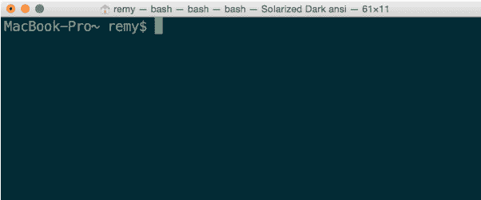
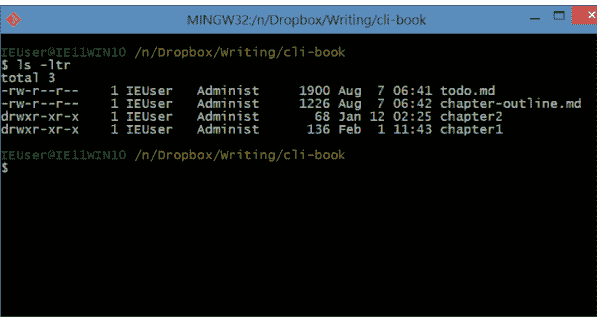
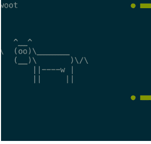
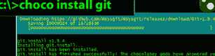
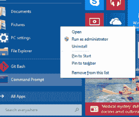
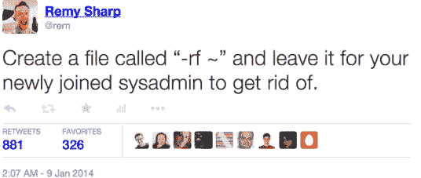

# 命令行实战指南


JEREMY KEITH 序言


76 致谢


# 序言

如果你听过这个故事了，请停下我。

你刚刚点击一个链接，进入了一个朋友推荐的听起来很酷的新资源。现在你正在阅读它如何帮助你完成日常 Web 工作。你兴奋地点击进入文档；安装指南展现在你面前。就在这时，你心沉了。“这是外星语言！”你叫道。

你并不孤单。我的意思不仅是有很多人和你有同样的感觉，我的意思是你真的不孤单。你有 Remy 陪着。

当我穿过命令行界面那令人生畏的黑暗深渊时，我会把这本书放在身边。但它不是一本参考书。它更像是一本自帮助书籍。它将帮助我和你——成为更高效的开发者，更好地装备自己对抗外星语言。“这是一个 Unix 系统，”你会低声说，“我懂这个！”


读完这本书后，现在在面对命令行上一个不可避免的任务之前，我都会问自己一个问题：Remy 会怎么做？

涉及到命令行，WWRD 将让你大有裨益。（警告：涉及到日常生活的几乎任何其他方面，WWRD 几乎会是灾难性的。）

Remy 会怎么做？答案就在这些页面之中。

—Jeremy Keith

# 1

“只需打开终端即可……”

亲爱的读者，在你人生的某个时刻，你可能打开了终端，发现自己正盯着一片黑色虚空——或者，如果你是 Mac 派，是一片白色虚空（图 1.2）。

一个闪烁的光标和一个美元符号邀请你输入命令。但接着呢？它想从中得到什么？在我第一次使用终端的经历中，我记得过像“Hello”。“Run”。之类的词。我试过整个句子。这甚至不是在开玩笑。而且，不，一个都没用。

这本书是写给那些对终端是新手——甚至是对终端极度新手的——你们的。也许你是一个前端开发者或设计师，读过无数以这句魔咒开头的博客文章：“只需打开终端即可……”或者你可能已经有一些命令行技能，但发现自己被吸入了虚空，困在某个命令中，无法退出——永远无法退出。

读完这本书后，你将觉得操作终端非常自在，你将能够说足够多的终端黑色虚空乱码，以至于你可能开始告诉别人“只需”运行 echo 打印美元符号。

## 为什么要使用终端？

问得好。神智正常的人会惩罚自己使用终端，而不是使用一个界面设计到让 Pony Ive 都觉得简陋的精美应用吗？

答案是，终端和命令行（或命令行界面，也称为 CLI）提供的工具已经投入了数十年的开发。大量的、大量的微型工具——这些程序的设计初衷是完美完成一件简单的事情，但它们经常会合力解决更复杂的问题。这种设计微型工具的做法被称为 Unix 哲学。

> 这种哲学没有单一、标准的表述。但如果必须用一个词来描述，那个词将是指模块化，即一个由组件（即模块）组成的系统，这些组件可以以各种方式组合或排列。—Linux 信息项目



**图 1.1:** 面对美元符号和虚无，你立即退出是可以被原的。

考虑一个名为 *cat* 的微型命令行实用，它允许你将文件内容打印到屏幕上。单看 cat 还可以，有些局限性——但它可以作为更大系统的一部分。如果我将 cat 与 *grep* 结合起来，我可以快速找到我的手稿中“黑色虚空”这两个词出现在哪一行。只需组合这两个工具，我就可以计算我使用了“黑色虚空”这个短语多少次。然后我可以将输出插入到另一个程序并处理文本，或者做完全不同的事情。（我们将在第 3 章回到 grep 工具。）

人们无法轻易地将输出插入到另一个程序并处理文本，或者做完全不同的事情。（我们将在第 3 章回到 grep 工具。）

人们无法轻易地将输出插入到另一个程序并处理文本，或者做完全不同的事情。（我们将在第 3 章回到 grep 工具。）

人们无法轻易地将输出插入到另一个程序并处理文本，或者做完全不同的事情。（我们将在第 3 章回到 grep 工具。）

人们无法轻易地将输出插入到另一个程序并处理文本，或者做完全不同的事情。（我们将在第 3 章回到 grep 工具。）

人们无法轻易地将输出插入到另一个程序并处理文本，或者做完全不同的事情。（我们将在第 3 章回到 grep 工具。）

人们无法轻易地将输出插入到另一个程序并处理文本，或者做完全不同的事情。（我们将在第 3 章回到 grep 工具。）

人们无法轻易地将输出插入到另一个程序并处理文本，或者做完全不同的事情。（我们将在第 3 章回到 grep 工具。）

人们无法轻易地将输出插入到另一个程序并处理文本，或者做完全不同的事情。（我们将在第 3 章回到 grep 工具。）

人们无法轻易地将输出插入到另一个程序并处理文本，或者做完全不同的事情。（我们将在第 3 章回到 grep 工具。）

人们无法轻易地将输出插入到另一个程序并处理文本，或者做完全不同的事情。（我们将在第 3 章回到 grep 工具。）

人们无法轻易地将输出插入到另一个程序并处理文本，或者做完全不同的事情。（我们将在第 3 章回到 grep 工具。）

人们无法轻易地将输出插入到另一个程序并处理文本，或者做完全不同的事情。（我们将在第 3 章回到 grep 工具。）

人们无法轻易地将输出插入到另一个程序并处理文本，或者做完全不同的事情。（我们将在第 3 章回到 grep 工具。）

人们无法轻易地将输出插入到另一个程序并处理文本，或者做完全不同的事情。（我们将在第 3 章回到 grep 工具。）

人们无法轻易地将输出插入到另一个程序并处理文本，或者做完全不同的事情。（我们将在第 3 章回到 grep 工具。）

人们无法轻易地将输出插入到另一个程序并处理文本，或者做完全不同的事情。（我们将在第 3 章回到 grep 工具。）

人们无法轻易地将输出插入到另一个程序并处理文本，或者做完全不同的事情。（我们将在第 3 章回到 grep 工具。）

人们无法轻易地将输出插入到另一个程序并处理文本，或者做完全不同的事情。（我们将在第 3 章回到 grep 工具。）

人们无法轻易地将输出插入到另一个程序并处理文本，或者做完全不同的事情。（我们将在第 3 章回到 grep 工具。）

人们无法轻易地将输出插入到另一个程序并处理文本，或者做完全不同的事情。（我们将在第 3 章回到 grep 工具。）

人们无法轻易地将输出插入到另一个程序并处理文本，或者做完全不同的事情。（我们将在第 3 章回到 grep 工具。）

人们无法轻易地将输出插入到另一个程序并处理文本，或者做完全不同的事情。（我们将在第 3 章回到 grep 工具。）

人们无法轻易地将输出插入到另一个程序并处理文本，或者做完全不同的事情。（我们将在第 3 章回到 grep 工具。）

人们无法轻易地将输出插入到另一个程序并处理文本，或者做完全不同的事情。（我们将在第 3 章回到 grep 工具。）

人们无法轻易地将输出插入到另一个程序并处理文本，或者做完全不同的事情。（我们将在第 3 章回到 grep 工具。）

人们无法轻易地将输出插入到另一个程序并处理文本，或者做完全不同的事情。（我们将在第 3 章回到 grep 工具。）

人们无法轻易地将输出插入到另一个程序并处理文本，或者做完全不同的事情。（我们将在第 3 章回到 grep 工具。）

人们无法轻易地将输出插入到另一个程序并处理文本，或者做完全不同的事情。

### 终端应用程序

### 终端应用程序

人们无法轻易地将输出插入到另一个程序并处理文本，或者做完全不同的事情。（我们将在第 3 章回到 grep 工具。）

人们无法轻易地将输出插入到另一个程序并处理文本，或者做完全不同的事情。回到第 3 章的 grep 工具。

人们无法轻易地将输出插入到另一个程序并处理文本，或者做完全不同的事情。（我们将在第 3 章回到 grep 工具。）

考虑一个名为 *cat* 的微型命令行实用，它允许你将文件内容打印到屏幕上。单看 cat 还可以，有些局限性——但它可以作为更大系统的一部分。如果我将 cat 与 *grep* 结合起来，我可以快速找到我的手稿中“黑色虚空”这两个词出现在哪一行。只需组合这两个工具，我就可以计算我使用了“黑色虚空”这个短语多少次。然后我可以将输出插入到另一个程序并处理文本，或者做完全不同的事情。（我们将在第 3 章回到 grep 工具。）

人们无法轻易地将输出插入到另一个程序并处理文本，或者做完全不同的事情。（我们将在第 3 章回到 grep 工具。）

人们无法轻易地将输出插入到另一个程序并处理文本，或者做完全不同的事情。（我们将在第 3 章回到 grep 工具。）

人们无法轻易地将输出插入到另一个程序并处理文本，或者做完全不同的事情。（我们将在第 3 章回到 grep 工具。）

人们无法轻易地将输出插入到另一个程序并处理文本，或者做完全不同的事情。（我们将在第 3 章回到 grep 工具。）

人们无法轻易地将输出插入到另一个程序并处理文本，或者做完全不同的事情。（我们将在第 3 章回到 grep 工具。）

人们无法轻易地将输出插入到另一个程序并处理文本，或者做完全不同的事情。（我们将在第 3 章回到 grep 工具。）

人们无法轻易地将输出插入到另一个程序并处理文本，或者做完全不同的事情。（我们将在第 3 章回到 grep 工具。）

人们无法轻易地将输出插入到另一个程序并处理文本，或者做完全不同的事情。（我们将在第 3 章回到 grep 工具。）

人们无法轻易地将输出插入到另一个程序并处理文本，或者做完全不同的事情。（我们将在第 3 章回到 grep 工具。）

人们无法轻易地将输出插入到另一个程序并处理文本，或者做完全不同的事情。（我们将在第 3 章回到 grep 工具。）

人们无法轻易地将输出插入到另一个程序并处理文本，或者做完全不同的事情。（我们将在第 3 章回到 grep 工具。）

人们无法轻易地将输出插入到另一个程序并处理文本，或者做完全不同的事情。（我们将在第 3 章回到 grep 工具。）

人们无法轻易地将输出插入到另一个程序并处理文本，或者做完全不同的事情。（我们将在第 3 章回到 grep 工具。）

人们无法轻易地将输出插入到另一个程序并处理文本，或者做完全不同的事情。（我们将在第 3 章回到 grep 工具。）

人们无法轻易地将输出插入到另一个程序并处理文本，或者做完全不同的事情。（我们将在第 3 章回到 grep 工具。）

人们无法轻易地将输出插入到另一个程序并处理文本，或者做完全不同的事情。（我们将在第 3 章回到 grep 工具。）

人们无法轻易地将输出插入到另一个程序并处理文本，或者做完全不同的事情。（我们将在第 3 章回到 grep 工具。）

人们无法轻易地将输出插入到另一个程序并处理文本，或者做完全不同的事情。（我们将在第 3 章回到 grep 工具。）

人们无法轻易地将输出插入到另一个程序并处理文本，或者做完全不同的事情。（我们将在第 3 章回到 grep 工具。）

人们无法轻易地将输出插入到另一个程序并处理文本，或者做完全不同的事情。（我们将在第 3 章回到 grep 工具。）

人们无法轻易地将输出插入到另一个程序并处理文本，或者做完全不同的事情。（我们将在第 3 章回到 grep 工具。）

人们无法轻易地将输出插入到另一个程序并处理文本，或者做完全不同的事情。（我们将在第 3 章回到 grep 工具。）

人们无法轻易地将输出插入到另一个程序并处理文本，或者做完全不同的事情。（我们将在第 3 章回到 grep 工具。）

人们无法轻易地将输出插入到另一个程序并处理文本，或者做完全不同的事情。（我们将在第 3 章回到 grep 工具。）

人们无法轻易地将输出插入到另一个程序并处理文本，或者做完全不同的事情。（我们将在第 3 章回到 grep 工具。）

人们无法轻易地将输出插入到另一个程序并处理文本，或者做完全不同的事情。（我们将在第 3 章回到 grep 工具。）

人们无法轻易地将输出插入到另一个程序并处理文本，或者做完全不同的事情。（我们将在第 3 章回到 grep 工具。）

人们无法轻易地将输出插入到另一个程序并处理文本，或者做完全不同的事情。（我们将在第 3 章回到 grep 工具。）

#### Mac

### Windows “cmd.exe”终端

人们无法轻易地将输出插入到另一个程序并处理文本，或者做完全不同的事情。回到第 3 章的 grep 工具。

人们无法轻易地将输出插入到另一个程序并处理文本，或者做完全不同的事情。（我们将在第 3 章回到 grep 工具。）

人们无法轻易地将输出插入到另一个程序并处理文本，或者做完全不同的事情。回到第 3 章的 grep 工具。3.3

人们无法轻易地将输出插入到另一个程序并处理文本，或者做完全不同的事情。（我们将在第 3 章回到 grep 工具。）

人们无法轻易地将输出插入到另一个程序并处理文本，或者做完全不同的事情。（我们将在第 3 章回到 grep 工具。）

人们无法轻易地将输出插入到另一个程序并处理文本，或者做完全不同的事情。（我们将在第 3 章回到 grep 工具。）

人们无法轻易地将输出插入到另一个程序并处理文本，或者做完全不同的事情。（我们将在第 3 章回到 grep 工具。）

人们无法轻易地将输出插入到另一个程序并处理文本，或者做完全不同的事情。（我们将在第 3 章回到 grep 工具。）

人们无法轻易地将输出插入到另一个程序并处理文本，或者做完全不同的事情。（我们将在第 3 章回到 grep 工具。）

人们无法轻易地将输出插入到另一个程序并处理文本，或者做完全不同的事情。（我们将在第 3 章回到 grep 工具。）

人们无法轻易地将输出插入到另一个程序并处理文本，或者做完全不同的事情。（我们将在第 3 章回到 grep 工具。）

人们无法轻易地将输出插入到另一个程序并处理文本，或者做完全不同的事情。（我们将在第 3 章回到 grep 工具。）

人们无法轻易地将输出插入到另一个程序并处理文本，或者做完全不同的事情。（我们将在第 3 章回到 grep 工具。）

人们无法轻易地将输出插入到另一个程序并处理文本，或者做完全不同的事情。（我们将在第 3 章回到 grep 工具。）

人们无法轻易地将输出插入到另一个程序并处理文本，或者做完全不同的事情。（我们将在第 3 章回到 grep 工具。）

人们无法轻易地将输出插入到另一个程序并处理文本，或者做完全不同的事情。（我们将在第 3 章回到 grep 工具。）

人们无法轻易地将输出插入到另一个程序并处理文本，或者做完全不同的事情。（我们将在第 3 章回到 grep 工具。）


如果你是 Windows 用户，我建议你尝试一下 Git BASH。它带有 Git（版本控制系统），但如果你不想用，也不必使用 Git（图 1.3）。

现在，你拥有了与 Linux 或 Mac 上相同的命令和导航方法。这对于一致性来说是一个胜利。

### 提示符 (THE PROMPT)

在终端操作中涉及一些术语，其中一些我们已经提到过了。你首先需要熟悉的内容之一就是提示符（prompt）。提示符是你输入命令的地方。

虽然提示符通常用一个 `$` 符号表示，但它实际上可以是任何内容（因为你可以自定义它，正如我们在第 5 章中看到的）。看到博客和在线教程以 `$` 符号开头代码块的情况并不罕见，它是“你需要在终端运行 `$` 之后的所有内容”的简写。注意，你不需要这样做；这只是给读者的视觉提示。

现在你启动了终端，迎接你的是……额，没多少：一个 `$` 符号和（大部分）空白的屏幕。是的，你需要熟悉这里的环境——但不要，这正是你读这本书的原因！

我们将你的硬盘上进行导航，以感受路径是如何工作的。不过，让我们先探索一下。

#### ls: 列出文件和目录

我们想要切换目录，或 `cd`，进入列出的目录中的一个。`ls` 的输出完全可能无法清楚什么是目录，什么是文件：

```bash
$ ls
chapter-outline.md chapter1 chapter2 todo.md
```



图 1.3：正在使用 Windows？获取一些 Git BASH 让你的生活变得轻松一点。

在这种情况下，我们希望看到文件和目录之间清晰的区别，并且想要当前目录中每个项目的详细信息。绝大多数命令都可以接受开关（switches，有时也称为选项或标志）：即修改命令执行方式的参数。因此，我们将重复 `ls` 命令并添加几个开关：`-l`（再次，小写的 L）它带给我们详细信息，`-F` 它在目录末尾添加斜杠。注意，单字符参数通常可以组合在一起——这就是我们得到的：

```bash
$ ls -lF
total 16
--rw-r--r-- 1 remy staff 1226 Aug 7 14:62 chapter-outline.md
drwxr-xr-x- 3 remy staff 102 Jan 12 10:25 chapter1/
drwxr-xr-x- 2 remy staff 68 Jan 12 10:25 chapter2/
--rw-r--r-- 1 remy staff 1900 Aug 7 14:41 todo.md
```

我们的输出包含大量信息：

- **Total**（总计）：第一行将给你一个总数（在这种情况下是 16）。不要让它像我之前那样困扰你。这里的 `total` 指的是所用“块”的总数，而不是文件的总数。暂时忽略它即可。
- **Permissions**（权限）：你是否有权限读取、写入或执行（即运行）文件。
- **Ownership**（所有者）：哪个用户拥有该文件。
- **File size**（文件大小）：以字节为单位。
- **Timestamps**（时间戳）：内容最后一次修改的时间。
- **Name**（名称）：文件或目录的名字。
- **Whether it's a directory or not**（是否为目录）：由权限字符串前的 `d` 和名称后的斜杠来指示。

现在我们可以区分目录和文件了。让我们选一个目录并使用 `cd [directory name]` 切换进去。在这种情况下，我想 `cd` 进入 `chapter1`：

```bash
$ cd chapter1
~/Dropbox/CLI-book/chapter1
```

通常，我发现我想要按最近修改时间列出目录内容（所以我使用 `-l`）。因此我可以使用另外两个开关：`-t` 开关按时间排序，显示最新的内容，而 `-r` 开关反转顺序——所以现在内容将按升序显示，最新的文件在底部。当命令列出目录时，最后一个文件可能是我处理过的那个：

```bash
$ ls -ltr
total 264
-rw-r--@ 1 remy staff 103726 1 Feb 19:43 item2.png
-rw-r--@ 1 remy staff 14749 1 Feb 19:50 gitbash-for-windows.png
-rw-r--@ 1 remy staff 121118 2 Feb 16:19 chapter1.md
```

一旦你有了目录列表，你就会想要开始处理文件。我们将在接后的章节中这样做。但现在，让我们先遍历目录。

#### 目录快捷径 (Directory shortcuts)

我们已经使用 `cd` 来切换目录。一旦你理解了目录是如何划分的，导航这些目录就很简单，而一旦知道了一些特殊的快捷径，它会变得更容易。

这是一个目录路径：`~/Dropbox/cli-book`。每个目录由斜杠分隔（类似于 URL 的结构）。波浪号 `~` 表示用户的主目录；在我的情况下，如果我输入 `cd ~`，我将到达 `/Users/remy`。主目录符号是我们的特殊快捷径之一。（进入主目录的另一种方法是输入 `cd` 并按回车）。输入 `cd ~` 将带你回到上次所在的任何目录（如果你愿意这么的话，这是在目录之间来回切换）。

以下是我的 Dropbox 文件夹中一些目录的布局：

```text
~/Dropbox
├── cli-book
  ├── introducing-html5
  ├── personal-stuff-n-stuff
  └── zombies-and-rabbits
```

如果我在 `~/Dropbox` 目录，我可以运行以下命令移动到 `cli-book` 目录：

```bash
$ cd cli-book # 移动到 ~/Dropbox/cli-book
```

注意`#` 符号代表在命令行中有效的注释（你将在书中看到几次）。

我还可以使用点来导航到父级目录：输入 `cd ..` 会让我回到 `~/Dropbox`。我可以将其与目录结合，移动进入：

```bash
$ cd ../introducing-html5
```


```
$ echo "hello world"
hello world
$ !-1
hello world
```

你已经遇到过双感叹号 (!!) 命令了，它是 `!-1` 的别名，但它也意味着如果你想运行倒数第二条命令，可以使用 `!-2`（不是最后一条命令，而是它之前的那一条），以此类推，从最后一条命令开始向回溯。

如果你运行 `history`，你将获得所有运行过的命令的完整列表，旁边带有一个历史索引，以便你快速引用更复杂的命令。历史记录的大小取决于你的操作系统——通常是 500 条，但有些系统是 1,000 条，另一些则是 10,000 条。（如果你想了解更多信息，可以在 Google 上搜索 "HISTSIZE"）
这里是我现在的历史记录：

```
$ history
10161 boot2docker start
10169 cd test/a
10170 nodemon -w ../a.js -V --dump
10171 z nodemon
10172 cd tmp
10175 docker run -v ~/Sites/nodemon:/nodemon -t -i
10176 ubuntu/nvm:latest /bin/bash
10177 touch test/a/a.js
10178 touch test/b/b.js
10179 cd ..
10181 git diff
10182 docker run -v ~/Sites/nodemon:/nodemon -t -i
node:0.10-slim /bin/bash
```

注意，这些数字并不是完全递增的。这是当前 shell 会话的历史记录。（如果缺少 10173，是因为它们在另一个终端 shell 会话中运行。）

当我想要重新运行一条命令时，索引就变得有用了。可以通过复制粘贴历史记录来重新运行命令，如下：

```
$ docker run -v ~/Sites/nodemon:/nodemon -t -i ubuntu/nvm:latest /bin/bash
```

或者，我可以通过简单的复制粘贴索引数字来节省时间：

```
$ !10176
```

这重新运行了第 10,176 条命令，并让我进入了我的 Docker 会话（这已经超本书的内容范围了）。使用历史索引使得引用历史命令变得非常简单。

### 使用键盘

虽然不是必须快捷键，但了解一些强大的键盘操作总是很有用的。

#### Tab

我最喜欢的快捷键是默默无名的 Tab。所有的终端都支持 Tab 补全。所以，如果你发现自己经常输入某个命令或目录名称，只需要输入部分文本，按下 Tab，你的终端就会尝试补全它。

不同版本的 shell 行为略有不同。有些会补全你最常用的单词，再次按下 Tab 将循环到下一个最常用的匹配项。

有些会补全到有多个命令匹配的终点为止。例如，如果你有两个应用程序，一个叫 `cowsay`，另一个叫 `cowthink`，输入 “co”



按下 Tab 会补全到 "cow"；然后，如果你添加了 s 并按 Tab，它就会补全为 "cowsay"（图 1.5）。

通常，连击 Tab 会列出所有可能的匹配项。在我们的示例中，在输入 "co" 后连按两次 Tab 会同时显示 "cowsay" 和 "cowthink"，假设这些是你环境路径（系统可以找到程序的目录列表）中唯一以 "co" 开头的命令。我们将在第 2 章详细介绍路径。（我会在那里也向你展示如何安装显然至关重要的 cowsay 程序。）

#### Control-Left / Control-Right

与其使用左/右光标键逐个字符移动，不如你可以使用 `ctrl+left` 或 `ctrl+right` 按单词移动。但是！这只有在你没有像 Mac OS Yosemite 那样使用多个桌面的系统上才会生效，因为该系统使用这些键来切换桌面（尽管你可以在设置中禁用它）。

`ctrl+left` / `ctrl+right` 的替代方案（尽管并不好用）是 `esc+b` 向后移动，`esc+f` 向向前。

#### Control-C

这意味着*终止 (abort)*。它会停止应用程序运行。如果你尝试在终端中运行 *yes*，它会不断地输出 *y* 直到你按下 `ctrl+c` 终止。

你可能看到它被表示为 “C”。（注意，这些快捷键不区分大小写；只是同时按下了 Control 和 C 键。）

#### Control-D

这意味着*传输结束 (end transmission)*，基本上就像在说“滚蛋”。你不需要使用鼠标（或 *logout* 命令）来退出终端，可以使用 `ctrl+d`，它会关闭你的会话。

#### Control-R

这是一个高级用户的快捷键，但由于我们已经到了第 1 章的末尾，我认为你值得拥有。

`Control-R` 允许你搜索与搜索词匹配的最新命令。使用我之前的终端历史记录，如果我按下 `ctrl+r`，我会看到这个：

```
$ bck-i-search: _
```

现在如果我输入 “no”，它将显示我运行过的、包含连续字符 *n* 和 *o* 的最新命令。

## 走出深渊

当第一章即将结束之际，你已经已经掌握了基础知识。掌握了这些要素后，让我们来看看如何安装第三方工具。

### 应用程序安装器

大多数操作系统都带有一些核心应用程序。Ruby 就是其中之一；还有像 `cd`、`ls` 和 `echo` 这样的内置命令。

但是，如何安装像 cowsay 这样的应用程序呢？（注意我只是把 cowsay 作为一个简单、有趣的程序示例。我知道这是我第二次要求你安装了，如果你不安装我不会被冒的。但你应该知道它确实有一个选项可以将牛变成穿着达斯维达服装的考驼。因为*星球大战*）

在继续之前，先声明一下：这本书主要面向初学者、前端开发者和设计师。由于那个特定群体中有强烈的“Mac 用户”倾向，我的大多数安装示例将使用 Mac 方法。

### Linux

Linux 有许多发行版本，安装新应用程序每个版本略有不同。Google 是你的朋友——一旦你找到了应用程序安装程序，一切都会很顺利。

如果你使用的是 Ubuntu，你需要运行 `apt-get install [package]`。通常运行此命令需要根权限，但如果你没有根权限，可以在命令前加上 `sudo`。（我将在第 4 章中详细介绍根权限和 sudo。）系统会提示你输入密码，然后程序将开始安装：

### 你看到的一切

Paul Irish 在 Twitter 上发文：“git open”

Twitter, Inc. [US] https://twitter.com/paulirish/status/562339052504244983

git open 是一个独立的命令，用于打开你所在项目的 github 页面。
github.com/paulirish/git-...


Paul Irish
paulirish_irish

这比任何浏览器性能都要好
疯狂的，而且日期

+   - 加入于 3 月

图 2.1：当 Paul Irish 发推时，我会听他的。

Mac 用户可以跳过以下两个部分。其他人，请继续阅读并耐心等待——本章的大部分内容也适用于你！

20 命令行操作


```bash
$ master ~~/dropbox/writing/cli-book/chapter2
$ wget -O /bin/git-open https://raw.githubusercontent.com/paulirsh/git-open/git-
sh: command not found: wget
$ cd /tmp

$ master ~~/dropbox/writing/cli-book/chapter2
$ chmod +x /bin/git-open
sh: /bin/git-open: No such file or directory
$ master ~~/dropbox/writing/cli-book/chapter2
```

图 2.2: 噢呀……正当一切进展得顺利时！看来需要安装 Wget。

remy@ubuntu:/# sudo apt-get install cowsay
Reading package lists... Done
[code omitted for brevity]
Setting up cowsay (3.03+dfsg-1)
remy@ubuntu:/# /usr/games/cowsay woot

```
< woot >
  ----
  _ ^_ 
 / (oo)\___
(  __)\  )/\\
  |--w| |
  ||       ||
```

remy@ubuntu:/#

注意，Linux 提示符是 remy@ubuntu:#。在 Mac 上，你更有可能看到以 $ 字符作为提示符。

#### Windows

Windows 是一个奇怪的生物。它没有原生的类似终端的 shell，但希望你正在使用 Git BASH（在第一章中介绍），它非常接近。

不过，为了安装外部 shell 应用程序，你需要一个工具 Chocolatey，它自称为“Windows 版本的 apt-get”（也称为“Windows 版本的 Brew——我们稍后会遇到 Brew）。这里的坑在于，所有的安装过程都需要在管理员权限的 cmd.exe 命令提示符中进行。是的，这是层层嵌套的（图 2.3）。

#### 来安装 Chocolatey 吧！

Chocolatey NuGet 是一个包管理器，类似于 apt-get，但是为 Windows 设计的。

##### 快速安装！

要安装 Chocolatey，打开具有管理员权限的 cmd.exe 命令提示符，粘贴下面的文本并按回车（点击）。对于管理员权限的 PowerShell，请复制第二行：(Set-ExecutionPolicy Bypass -Scope Process)。如果你需要以非管理员用户身份安装-



图 2.3: Chocolatey 是 Windows 安装终端应用程序的方法。

图 2.4: 要安装 Chocolatey，你需要以管理员身份运行 cmd.exe。



```bash
### brew install cowsay
=> Downloading https://ftp.debian.org/debian/pool/main/c/cowsay/cowsay_3.02-2_3.02.orig.tar.gz
=> Extracting /tmp/Homebrew/cowsay-3.02-2.tar.gz
=> Installing /usr/local/Cell/cowsay/3.02 (53 files, 228kb, built in 2 seconds)
```

图 2.5: 安装过程。

安装过程并不直而易见（至少肉肉眼看不出来），但请花时间阅读文档。你需要以管理员身份运行 cmd.exe。执行此操作，按下 Start 键打开启动菜单；然后输入 "cmd"。先不要按回车：

### 命令行操作

不要直接启动命令提示符，而是右键点击并选择“以管理员身份运行”（图 2.4）。

然后，对于 Chocolatey 网站，运行他们提供的安装命令并将其粘贴到命令行中。你仍然需要管理员命令提示符来安装应用程序。

遗憾的是，Chocolate 上没有牛仔小子（cowboy）——别担心，亲爱的 Windows 用户，我们将在本章稍后的部分解决这个问题。现在，让我们先安装 Wget 吧：

```cmd
C:\Windows\system32>choco install wget
Chocolate (v0.9.8.32) is installing 'wget' and
depend. By installing you accept the License 
for 'wget' and each dependency you are installing.
```

Wget v1.11.4.1 32 bit

Downloading Wget instead
from 'http://users.uget.be/~bupype/wget/wget.exe'
Added C:\ProgramData\chocolate\bin\wget shim
pointed to '..\lib\wget.1.11.4.1\tools\wget.exe'
Finished installing 'wget' and dependencies—if
errors not shown in console, none detected. Check
Log for errors if unsure.

现在，你可以从 Git BASH 终端或普通的 cmd.exe 运行 Wget。

#### Mac

Mac 有许多应用程序安装程序，但我推荐 Brew。它既全面又可靠。访问 Brew 网站并向下滚动到“Install Homebrew”部分，在那里你会看到一条命令。直接复制它并粘贴到你的终端中，就大搞定了：Brew 安装好了。

现在你可以使用 `brew install [package]` 安装应用程序（图 2.5）。

如果安装成功，你将看到一个啤酒表情符号。

#### 我该如何运行这个？

Mac 有许多应用程序安装程序，但我推荐 Brew。它既全面又可靠。访问 Brew 网站并向下滚动到“Install Homebrew”部分，在那里你会看到一条命令。直接复制它并粘贴到你的终端中，就大搞定了：Brew 安装好了。

现在你可以使用 `brew install [package]` 安装应用程序（图 2.5）。

如果安装成功，你将看到一个啤酒表情符号。

#### 我该如何运行这个？

安装过程并不直而易见（至少肉眼看不出来），但请花时间阅读文档。你需要以管理员身份运行 cmd.exe。执行此操作，按下 Start 键打开启动菜单；然后输入 "cmd"。先不要按回车：

#### Ruby, Python 还是 Node？

Mac 有许多应用程序安装程序，但我推荐 Brew。它既全面又可靠。访问 Brew 网站并向下滚动到“Install Homebrew”部分，在那里你会看到一条命令。直接复制它并粘贴到你的终端中，就大搞定了：Brew 安装好了。

现在你可以使用 `brew install [package]` 安装应用程序（图 2.5）。

如果安装成功，你将看到一个啤酒表情符号。

#### 我该如何运行这个？

安装过程并不直而易见（至少肉眼看不出来），但请花时间阅读文档。你需要以管理员身份运行 cmd.exe。执行此操作，按下 Start 键打开启动菜单；然后输入 "cmd"。先不要按回车：

#### Ruby 应用程序和 gems

Mac 有许多应用程序安装程序，但我推荐 Brew。它既全面又可靠。访问 Brew 网站并向下滚动到“Install Homebrew”部分，在那里你会看到一条命令。直接复制它并粘贴到你的终端中，就大搞定了：Brew 安装好了。

现在你可以使用 `brew install [package]` 安装应用程序（图 2.5）。

如果安装成功，你将看到一个啤酒表情符号。

#### gems 无法工作

安装过程并不直而易见（至少肉眼看不出来），但请花时间阅读文档。你需要以管理员身份运行 cmd.exe。执行此操作，按下 Start 键打开启动菜单；然后输入 "cmd"。先不要按回车：


- 1. 尝试用 root 运行安装（使用 `sudo`，我们之前遇到过）：`sudo gem install lolcommits`。
2. 尝试更新 gem 系统：`sudo gem update --system`。
3. 安装最新的 Xcode 命令行工具：`xcode-select install`。
4. 升级到你操作系统的最新版本。
5. 买一台新电脑。是的，在这一步之前我也会放弃。

步骤 1-3 是我会尝试的，但也遇到过一台需要执行步骤 4 才能安装 gem 的机器（它比最新的 OS X 旧了几个版本）。其他时候，我不得不放弃——但这本书是一本入门书籍，所以如果你卡在 gem 的泥潭里，可能值得咨询一下你最近的运维工程师！

## Python 应用程序

Python 有一个包管理器，但它相当复杂。有很多变动部分需要追踪——比如 `easy_install` 和 `virtualenv`。

你可以找到 Python 包的地方是 `pypi.python.org`不过不过根据我个人的经验（作为一个对 Python 包经验非常少的人），我发现要获取正确的安装器组合非常棘手。事实上，我过去安装的大多数基于 Python 的应用程序都是通过 Brew（我们之前遇到过）安装的。这在未来可能会为你省去一些痛苦。或者，可能不会。

继续往下看……

## Node 应用程序

由于我的背景是 JavaScript，我倾向于将基于 Node 的应用程序作为我的首选解决方案；毕竟，Node 是用来执行 JavaScript 的工具。

另一个吸引我选择 Node 模块而非 Ruby gems 或 Python 模块的原因是，正如我之前提到的，它们拥有极佳的跨平台支持。大多数时候，你安装的 Node 工具在 Mac、Windows 和 Linux 上的运行都是相同的。

唯一的先决条件是安装 Node，它被封装在一个良好的应用程序安装程序中，你可以从 `nodejs.org` 下载。点击大大的 "Install" 按钮，按照提示操作，就完成了。

现在，当你打开终端时，你可以通过 "npm" 安装 Node 模块（顺便说一下，npm 并不代表 "node package manager"，它不代表任何东西）。

我们通常使用 `npm` 将包（也称为模块）安装到我们正在编写的软件中。然而，我们也可以使用 `npm` 进行全局安装——也就是说安装可以在终端任何地方访问的命令行工具。

让我们安装我们的朋友 `cowboy`，因为有人把它移植到了 JavaScript。要这样做，我们将在命令行输入 `npm` 并告诉它安装一个包。不是全局安装，我们需要使用 `-g` 标记：

```
$ npm install -g cowboy
/usr/Local/bin/cowsay ->
/usr/Local/lib/node_modules/cowsay/cli.js
/usr/Local/bin/cowthink ->
/usr/Local/lib/node_modules/cowsay/cli.js
cowsay@1.0.3 /usr/Local/lib/node_wrapper
└ optimist@0.3.7 (wordwrap@0.0.2)
```

你也可以使用 `npm` 安装 Grunt、Gulp、Yeoman 或 PhoneGap 等工具。每天都有大量的开发者社区贡献新的和更新的 npm 包。

在情况下，你可能需要使用 `sudo npm install -g [package]`，但我建议不要使用 `sudo` 并先尝试普通安装。使用 `sudo` 安装包会无意中继承 root 的权限，导致程序在运行时具有与你用户不同的权限。底是：事情可能会变得很棘手。（我将在第 4 章详细介绍 `sudo`。）

在本章中，你学习了如何为你的新命令行技能安装大量的应用程序——不仅有像 Wget 这样的“经典”Unix 类型应用程序，还有像 `cowsay` 这样非常棒的应用程序，甚至还有（等一下）`pony-say`。（是的，好像有一头牛还不够，你还可以得到一匹色彩鲜艳的小马来你说出所有的话。）除了 `brew install` 之外，你现在可以通过 Ruby gems 或 npm 包安装所有出现在你新闻和 Twitter 推送中的定制化应用程序。

如果你想找一个能实现特定功能的程序，我建议从 Google 开始（而不是从特定包的网站）。一些初步的、通用的研究将让你了解该程序是否在你偏好的语言中可用，或者将你指向一个你可能没有想过的替代方案。

掌握了这些新知识，你准备好开始混用你的命令行应用程序了。我们接下来就这样做。

## 终端职业的工具

如果你花过任何时间翻阅教程，或者可能在朋友旁边偷学看他们在终端里如鱼得水地穿梭，那么你很可能遇到过“管道”（pipe）。管道通常发生在两个命令之间，比如 `echo "Hello Remy"` 和 `say`，这会让机器说话并欢迎我，像这样：

```
$ echo "Hello Remy" | say
```

管道是命令行中一个神奇且不可或缺的部分。它非常强大且极其有用。它获取第一个命令（左侧）的输出，并将其“管道”到第二个命令（右侧）。

如果你想要一个类比，想象一下一个卡通工厂的传送带穿过两台大机器。（此处重复内容已删除）

管道是命令行中一个神奇且不可或缺的部分。它非常强大且极其有用。它获取第一个命令（左侧）的输出，并将其“管道”到第二个命令（右侧）。

如果你想要一个类比，想象一个卡通工厂的传送带穿过两台大机器。（此处重复内容已删除）


成千上万条记录，你可能想在历史记录中搜索某个特定的命令。
在我的情况下，我想检索一个使用 `curl`（用于向 URL 获取和发送数据的命令）的命令。因此，我将 history 的输出通过给 grep，并搜索单词 "curl"：

```
$ history | grep curl
210 curl http://jsbin.dev:8080/help
220 curl -i https://jsbin.dev/
260 curl -i://localhost:3000/?url=-emberjs.jsbin.com > emerjs-jsbin.com
300 curl -i https://api.github.com/repos/octocat/HelloWorld/hooks
317 curl -i http://jsbin.dev/help
[为了简洁，省略了代码]
9855 curl rem.io/install
9923 curl -H 'accept: application/json' http://jsbin.ff-platform.local/user/twitter/64883/
```

匹配项非常多。对人类来说处理起来相当困难。

# 增加更：“少即是多，或或如此。”

`less` 是一个让我们分页查看输出的命令。有一个类似的命令叫 `more`，但 `less` 更好，因为它允许我们向前向后翻页（而 `more` 只能向前翻）。
我可以使用 `less` 来翻页（甚至搜索）我历史搜索的输出：

```
$ history | grep curl
```

现在我进入了 `less` 命令内部，我可以使用键盘移动光标；我可以向前翻页（按空格键）或向后翻页（输入 B）。重要的是，我可以在 `less` 内部通过按下斜杠键 `/` 进行搜索。我可以输入像 `-H` 这样的表达式（这是 `curl` 的一个参数）；less

```
$ history | grep curl | grep -v history | tail -5
9649 curl -I jsbin.ff-platform.local
9651 curl jsbin.ff-platform.local:8000
9652 curl localhost:8888
9921 curl http://jsbin.ff-platform.local/user/twitter/648873/
9923 curl -H 'accept: application/json' http://jsbin.ff-platform.local/user/twitter/648873/
```

### 排序与筛选

有时你会有一个文件，想从中提取某些特定的行或数据段。
我以前发现自己一直在写一些奇怪的 jQuery 脚本，然后把所有数据放在数组里，基本上比吃了加速药的青蛙还要跳腾。但现在，命令行是我的朋友，因为它提供了这样的工具：

- grep：用于查找行（正如我们刚刚看到的）
- sort：对行进行排序
- uniq：查找唯一的行
- cut, sed, 和 awk：将一行拆分为多列并选择特定列

通过组合这些工具，你可以做很多事情，所以让我通过以下问题来作为它们范围和灵活性的说明吧。

假设我的服务器收了异常数量的请求，但我无法确定问题的根源。服务器的访问日志通常遵循一致的格式（但可能根据情况略有不同）：

```
IP - user [day/month/year:hour:minute:second zone]
"GET /url HTTP/1.1" status_code bytes "referring-url" "user_agent"
```

每条记录都显示了大量信息：

```
127.0.0.1 remy [24/Feb/2015:16:14:56 +0000] POST /foobar/save HTTP/1.1" 200 34 "http://jsbin.local/foobar edit - "Mozilla/5.0 (Windows NT 6.3; Win64; x64) AppleWebKit/537.36 (KHTML, Like Gecko) Chrome/40.0.2214.115 Safari/537.36"
```

我可以将命令组合起来来搜索、排序和分离访问日志中的信息，以尝试理解问题。

#### 1. 获取最后 1000 行

我需要统计日志中出现的唯一 IP 地址数量——由于我的日志文件很大，我只对最后1000个请求感兴趣。

开始时，我需要进入日志所在的目录。`tail` 命令允许我查看最后 1000 行：

```
$ tail -1000 access.log
```

你也可以将 `tail` 与 `-f` 选项结合，在向文件写入新行时持续打印输出。该命令会在每个 Web 请求被写入访问日志时显示它：

```
$ tail -f access.log.*
```

#### 2. 仅显示 IP 的行分割

有一些工具可以拆分行。其中一个工具是 `cut`；另一个工具 `awk` 非常强大（事实上它本身就是一种编程语言），但为了保持简单，我将只使用 `cut`。

使用 `cut` 时，你必须指定分隔符（`-d' '` 用于分隔空格）和你需要的字段（`-ffield 数字`）：

```
$ tail -1000 access.log | cut -d' ' -f1
217.128.174.115
82.90.202.184
[为了简洁，省略了代码]
```

在上面的命令中，`tail` 每次向 `cut` 提供一行，`cut` 输出第一个字段。

#### 3. 寻找唯一 IP

对于这一点，我将使用 `uniq` 命令。然而，`uniq` 的奇之处在于它只对重复的行（具体说是相邻的行）有效。它只适用于排序后的列表，而不是随机列表。因此我们需要将 `uniq` 与 `sort` 结合。首先我要对 IP 列表进行排序：

```
$ tail -1000 access.log | cut -d' ' -f1 | sort
173.152.252.198
194.19.90.161
217.128.174.111
105.206.139
50.249.99.201
62.90.202.182
85.115.60.181
88.128.80.106
[为了简洁，省略了代码]
```

输出是否排序并不重要，重要的是相同的条目相邻。现在我可以将其传递给 `uniq`，并添加一个参数 `-c` 来给出该 IP 在输出中出现的次数（我包含了代码）：

```
$ tail -1000 access.log | cut -d' ' -f1 | sort | uniq -c
[为了简洁，省略了代码]
2 64.22.77
1 249.64.146
1 249.64.182
2 37.35.161
14 7.226.139
12 68.45.22
13 69.116.182.457
1 70.88.199.14
7 71.197.194.82
[为了简洁，省略了代码]
```

输出仍然很长，而且不是按出现次数排序的，所以我也要修复这个问题。

#### 4. 数字排序

`sort` 命令默认使用字母顺序，但如果你使用 `-n`，它将按数字排序。由于 `uniq -c` 的输出包含数字，这非常完美。此外，我只想要请求次数最多的 IP，所以我将（再次）将其传递给 `tail` 来获取最后几行：

```
$ tail -1000 access.log | cut -d' ' -f1 | sort | uniq -c | sort -n | tail -5
33 77.57.124.151
36 77.232.10.182
38 109.70.40.211
39 192.123.158.35
152 198.21.21.22
```

现在我看到大量请求来自同一个 IP：198.21.21.22。从那里，我可以使用这个 IP 搜索日志查看他们请求了什么，或者封禁该 IP 一段时间，或其他操作。

重要的是，我在这里使用的所有命令都带在 Unix 系统中。你不需要单独安装任何一个。

从本章中学到的最重要的教训是，可以使用符号 `|` 将输出传递到另一个程序的输入。组合命令体现了本书开头提到的 Unix 哲学；大多数程序都支持它。混合和重组命令允许任意数量的操作组合——这是非常强大的功能。

# 4 如何（不）自断自己的脚

当你**刚刚装备好**了一点知识后，我认为是时候让你了解一些足以造成真实破坏的操作了。

换句话说，我将向你展示一些命令，它们可以在应用程序故障或你的机器遭受攻击时帮助你摆脱困境。

如果你使用的是 Mac（例如），可以通过图形用户界面（GUI）实现这些命令的大多数甚至全部，但随着你对命令行越来越熟悉，你会发现直接使用它来删除文件或检查系统健康变得更简单。如果你继续摆腾远程服务器，将没有任何视觉 UI 供你依赖；你将被面对虚无，并别无选择地使用我在这里描述的命令。

### 删除文件：rm

...因为当你可以拥有**磁盘空间**时，谁还需要文件呢？老牌 PC 用户会欣赏这一点（而年轻的用户可能不会相信）：当我开始摆弄 PC 时（是在 1991 年），我有一台 Intel 286，那里有这些奇怪的文件占据着我宝贵的 40MB 硬盘：`config.sys` 和 `autoexec.bat`。这通过陷入恢复超智能配置设置的深渊，教会了我 PC 是如何工作的。

#### 删除普通文件

在桌面应用程序（如 Finder）中执行此操作可能更容易，但要删除单个文件或多个文件（通过通过命名或使用模式），你可以执行以下操作（假设为了讨论起见，你处于一个包含此处虚构名称的文本文件的目录中）：


```bash
$ rm my-file.txt
$ rm *.txt
```

冷知识：`*` 是一个通配符字符，`*.txt` 被称为 glob。
这一切都非常直观。不过，你可能会遇到一个棘手的问题：

```bash
$ rm not-my-file.txt
rm: remove write-protected regular file
'-my-file.txt?' y
$
```

在你的机器上输入简单的 `y` 就会抹除该文件。目录并没有那么简单：`rm` 并不是真的为了用于目录设计的（尽管稍后我会解释如何绕过这个限制）。如果你尝试删除目录，你会得到一个近乎同义反复的响应：

```bash
$ rm chapter6/
rm: chapter6/: is a directory
```

哈？

#### 删除目录

目录有一个特殊的命令 `rmdir`：

```bash
$ rmdir chapter6/
$
```

这可以运行——只要目录是完全空的。面对现实吧，事实确实如此。此外，如果你正在使用 Mac，你可能会发现到处都是 `.DS_Store` 文件——或者你可能没发现，因为隐藏文件（以点开头的文件）默认是隐藏的。有时，一个看起来是空的目录可能并不空。（你可能想考虑更改系统设置来显示隐藏文件。）
尝试删除一个非空目录：


```bash
$ rmdir chapter4
rmdir chapter4: Directory not empty
```

面对“目录非空”，你可以一个一个地删除单个文件——这非常无聊——或者一气呵地摧毁一切！欢迎来到危险地带，音乐起（图 4.1）。

#### 终极删除！

`rm -rf` 命令通常是我应对系统想要设置的任何障碍的首选答案。使用 `rm` 配合这两个标志（`-r` 递归处理任何子目录，`-f` 强制删除文件且不进行任何提示）将在无任何提示的情况下删除并破坏任何子目录。

例如，如果我决定在某个时刻炸掉这本书，运行以下命令将通过一个安静的命令摧毁我所有的心血：

```bash
$ rm -rf cli-book
$
```

没有提示问我是否确定，或者我是否喝了酒，也没有警告我第 1 到第 5 章即将付诸东流。什么都没有。



图 4.2：我的 `rm -rf ~` “玩笑”。

个人而言，我倾向于太快地使用这个命令。我承认，是的，在我操作终端的这些里，我曾因为手指太快而不小心删除了错误的目录。

我转发次数最多的推文包含一个玩笑，会导致某人运行 `rm -rf ~`，这意味着“删除我的主目录，并且不要担心任何警告”。我把推文的热度视为人类天生邪恶的证据（图 4.2）。

但等一下，`rm -rf` 只作用于你有写权限的文件。那么你不拥有的文件呢？

### 当你没有权限时：sudo

`sudo` 代表 Super User Do（超级用户执行）。它就像是你终端的“听口令”。我们已经见过 `sudo` 很多次了，现在我需要履行我的承诺，告诉你们更多关于它的信息。

为什么 `sudo` 是必要的？因为计算机有一个用户权限系统。如果你正在使用基于 Unix 的机器（再次，这包括 Mac），权限最高的用户是 `root`。

全能的 `root` 可以做任何事情，从删除你所有的文件（不需要你的权限），到重启，再到删除操作系统上的每一个文件。

当你登录到机器时，你可能是以你的用户名登录的——事实上也是。你并没有真的执行登录动作，但你就是那个用户。你的用户拥有某些权限，但不像 `root` 那样强大。

如果你和其他人共享电脑，你可能没有读取、写入或执行他人文件的权限。这就是权限体系。稍后我们会详细查看权限，但如果你遇到一个别人创建的巨大文件而你需要删除它时会怎样？

删除文件将不起作用，因为你没有权限。

按照原则，始终尝试不使用 `sudo` 运行，因为使用它有时就像用大锤敲钉子：它确实有效，但并不总是是正确的工具。考虑到这一点，让我们把 `sudo` 加入你的工具箱吧。

#### 使用 sudo

你可以在终端中的任何命令前加上 `sudo`。这将以超级用户（即 `root`）权限运行你的命令。由于 `root` 可以在不需要许可的情况下删除任何内容，这就是我们如何删除另一个用户的文件：

```bash
$ sudo rm /User/jack/boring-pony.jpg
```

密码：

输入你的密码，就好了。
差不多。为了使用 `sudo` 执行某些操作，这就是我们如何删除另一个用户的文件：

```bash
$ sudo rm /User/jack/boring-pony.jpg
```

密码：

输入你的密码，就好了。
差不多。


```bash
$ chmod a+r my-script
```

只要你还记得如何区分用户（User）、组（Group）和其他用户（Other），以及读（Read）、写（Write）和执行（Execute），你就就能记住这些模式和标记。

正如我们之前看到的，权限也可以有数值值：4 = 读，2 = 写，1 = 执行（图 4.3）。偶尔，当你在教程中遇到 `chmod` 时，你会看到它被表示为类似 `chmod 110 my-script` 或 `chmod 744 my-script` 的形式。这是我提到的第二种方法，它有点困惑，并不特别容易记忆。

第一个数字代表用户权限，第二个数字代表组权限，第三个数字代表所有用户的权限。要将用户权限设置为只读，将第一个数字设为 4。要将用户权限设置为读和写，将第一个数字设为 6（即 4 + 2）。要让文件对所有用户可执行、对所有者可读写、对所有人可读，值分别为 7 (4 + 2 + 1)、5 (4 + 0 + 1) 和 5：

```bash
$ chmod 755 my-script
```

让其他用户对文件可读但不可写是常见操作：因为你是程序的所有者，你不希望其他人弄乱它。

## 更改所有权

在更改权限的同时，你可能还想更改文件的所有权——从你自己更改为另一个用户，或者从另一个用户更改为你自己。过去当我我的机器上有多个登录账户时，我曾需要这样做，将文件从另一个用户移动到我自己，这样我就可以编辑它。

在 Mac 上，如果情况足够简单，Finder 就可以为你完成操作（并处理一些权限更改）。然而，我发现如何在命令行上执行此类任务是有用的，因为 Finder 的 UI 界面并不总是可用的，特别是在与远程机器协作时。

更改所有权的命令是 `chown`（恰好是“change ownership”的缩写），后面紧跟新所有者的名字（在本例中为 anna）。以下是你如何更改文件所有者的：

```bash
$ chown anna my-script
```

你还可以通过指定 `-R` 标记（“recursively”的缩写）来使用 `chown` 同时更改目录中的所有文件：

```bash
$ chown -R anna cli-book/
```

你可以自己探索 `chown` 的其他标记和用法，但这两个命令足够让你应付麻烦了。

#### 什么是组，我是什么时候加入的？

每个用户都自动成为某个组的一部分，即使该组只有一个成员。你的用户已经是某个组的一部分了。在运行 Mountain Lion 的 Mac 上，你属于“staff”组，如果你正在共享你的机器，其他用户也是如此。

如果你想将一个用户添加到 admin 组，你需要一条特殊的命令。在 Mac 上，运行：

```bash
$ dscl . -append /Groups/admin GroupMembership remy
```

注意组名前面有 `/Groups/`。在 Linux 机器上，你需要完全不同的命令：

```bash
$ useradd -G admin remy
```

组是管理用户权限的好方法，特别是当你与多人协作部署到服务器上（以及类似的系统管理员忍者）时。

#### 进程 (PROCESSES)

进程指的是运行在你的操作系统上的应用程序。例如，如果你使用 Sublime Text 2，那么有一个进程叫做——听好了——Sublime Text 2。

如果你是 Mac 用户，可以看看活动监视器（Activity Monitor）程序，它列出了当前正在运行的进程。PC 用户可以使用可靠的任务管理器（Task Manager）查看相同的视图。

`ps`（“process status”的缩写）是活动监视器的命令行对应。以下是我现在我的机器上运行 `ps` 时发生的情况：

```
ps TTY TIME CMD
95218 tty000 0:04.06 -zsh
61075 tty001 0:00.21 -zsh
77196 tty002 0:00.60 -zsh
509 tty003 0:04.94 -zsh
525 tty004 0:02.52 -zsh
```

不过，这个输出并不真正代表我的机器上发生的情况。上面的列表显示了五个 zsh（Z shell）命令。Z shell 指的是我的 shell，一个运行在终端中的文本的界面，处理命令并返回输出。（我们将在第 5 章更详细地查看什么是 shell，特别是 Z shell）。

注意 Sublime Text 并没有出现在这里，尽管我正用它来写这一章。事实上，`ps` 本身只列出附加了终端的进程。

但我们想要列出所有进程，带有使用的完整命令和进程所有者（这与谁有权终止该进程也有关，但稍后说）。

这听起来很长，但使用 `ps aux` 命令（标记的顺序并不重要）可以带给我们很多好处。我截取了它对应的几行截图（图 4.4）。当你将 `ps` 的输出通过到 `grep` 等工具来搜索特定的项时，输出会变得更易管理。


图 4.4：`ps` 的原始输出可能有点丑，但使用 `grep` 将帮助我们缩小查找范围。

```bash
$ ps aux | grep -i sublime
remy 59329 0.0 1.5 330828 ?? S 48:43 /Applications/Sublime Text 2/Contents/MacOS/Sublime Text 2
```
奇怪的是这返回了两个结果。为什么？因为我们搜索了 `grep` 命令本身，而我们正在寻找当前运行的，所以它出现在 `ps` 列表中，明白了吗？

#### 使用命令行

如果这困扰了你，记得我们在第 3 章学过使用 `grep -v [term]` 来从结果中排除该项（`-v` 代表“invert-match”）。

```bash
$ ps aux | grep -i sublime | grep -v
remy 59329 0.0 1.6 331748 ?? S 49:37 /Applications/Sublime Text 2/
```
这里有很多信息，但对我们有用的是用户、所有者（这与有权终止该进程的人有关，但稍后说）。

我们想要列出所有进程，带有使用的完整命令和进程所有者。

这听起来很长，但使用 `ps aux` 命令（标记的顺序并不重要）可以带给我们很多好处。我截取了它对应的几行截图（图 4.4）。当你将 `ps` 的输出通过到 `grep` 等工具来搜索特定的项时，输出会变得更易管理。

## 更改所有 (Changing ownership)

在更改权限的同时，你可能还想更改文件的所有权——从你自己更改为另一个用户，或者从另一个用户更改为你自己。过去当我我的机器上有多个登录账户时，我曾需要这样做，将文件从另一个用户移动到我自己，这样我就可以编辑它。

在 Mac 上，如果情况足够简单，Finder 就可以为你为你完成操作（并处理一些权限更改）。然而，我发现如何在命令行上执行此类任务是有用的，因为 Finder 的 UI 界面并不总是可用的，特别是在与远程机器协作时。

更改所有权的命令是 `chown`（恰好是“change ownership”的缩写），后面紧跟新所有者的名字（在本例中为 anna）。以下是你如何更改文件所有者的：

```bash
$ chown anna my-script
```

你还可以通过指定 `-R` 标记（“recursively”的缩写）来使用 `chown` 同时更改目录中的所有文件：

```bash
$ chown -R anna cli-book/
```

你可以自己探索 `chown` 的其他标记和用法，但这两个命令足够让你应付麻烦了。

#### 什么是组，我是什么时候加入的？

每个用户都自动成为某个组的一部分，即使该组只有一个成员。你的用户已经是某个组的一部分了。在运行 Mountain Lion 的 Mac 上，你属于“staff”组，如果你正在共享你的机器，其他用户也是如此。

如果你想将一个用户添加到 admin 组，你需要一条特殊的命令。在 Mac 上，运行：

```bash
$ dscl . -append /Groups/admin GroupMembership remy
```

注意组名前面有 `/Groups/`。在 Linux 机器上，你需要完全不同的命令：

```bash
$ useradd -G admin remy
```

组是管理用户权限的好方法，特别是当你与多人协作部署到服务器上（以及类似的系统管理员忍者）时。

#### 进程 (PROCESSES)

进程指的是运行在你的操作系统上的应用程序。例如，如果你使用 Sublime Text 2，那么有一个进程叫做——听好了——Sublime Text 2。

如果你是 Mac 用户，可以看看活动监视器（Activity Monitor）程序，它列出了当前正在运行的进程。PC 用户可以使用可靠的任务管理器（Task Manager）查看相同的视图。

`ps`（“process status”的缩写）是活动监视器的命令行对应。以下是我现在我的机器上运行 `ps` 时发生的情况：

```
ps TTY TIME CMD
95218 tty000 0:04.06 -zsh
61075 tty001 0:00.21 -zsh
77196 tty002 0:00.60 -zsh
509 tty003 0:04.94 -zsh
525 tty004 0:02.52 -zsh
```

不过，这个输出并不真正代表我的机器上发生的情况。上面的列表显示了五个 zsh（Z shell）命令。Z shell 指的是我的 shell，一个运行在终端中的文本的界面，处理命令并返回输出。（我们将在第 5 章更详细地查看什么是 shell，特别是 Z shell）。

注意 Sublime Text 并没有出现在这里，尽管我正用它来写这一章。事实上，`ps` 本身只列出附加了终端的进程。

但我们想要列出所有进程，带有使用的完整命令和进程所有者（这与谁有权终止该进程也有关，但稍后说）。

这听起来很长，但使用 `ps aux` 命令（标记的顺序并不重要）可以带给我们很多好处。我截取了它对应的几行截图（图 4.4）。当你将 `ps` 的输出通过到 `grep` 等工具来搜索特定的项时，输出会变得更易管理。


图 4.4：`ps` 的原始输出可能有点丑，但使用 `grep` 将帮助我们缩小查找范围。

```bash
$ ps aux | grep -i sublime
remy 59329 0.0 1.5 330828 ?? S 48:43 /Applications/Sublime Text 2/Contents/MacOS/Sublime Text 2
```
奇怪的是这返回了两个结果。为什么？因为我们搜索了 `grep` 命令本身，而我们正在寻找当前运行的，所以它出现在 `ps` 列表中，明白了吗？

#### 使用命令行

如果这困扰了你，记得我们在第 3 章学过使用 `grep -v [term]` 来从结果中排除该项（`-v` 代表“invert-match”）。

```bash
$ ps aux | grep -i sublime | grep -v
remy 59329 0.0 1.6 331748 ?? S 49:37 /Applications/Sublime Text 2/
```
这里有很多信息，但对我们有用的是用户、所有者（这与有权终止该进程的人有关，但稍后说）。

我们想要列出所有进程，带有使用的完整命令和进程所有者。

## 更改所有 (Changing ownership)

在更改权限的同时，你可能还想更改文件的所有权——从你自己更改为另一个用户，或者从另一个用户更改为你自己。过去当我我的机器上有多个登录账户时，我曾需要这样做，将文件从另一个用户移动到我自己，这样我就可以编辑它。

在 Mac 上，如果情况足够简单，Finder 就可以为你为你完成操作（并处理一些权限更改）。然而，我发现如何在命令行上执行此类任务是有用的，因为 Finder 的 UI 界面并不总是可用的，特别是在与远程机器协作时。

更改所有权的命令是 `chown`（恰好是“change ownership”的缩写），后面紧跟新所有者的名字（在本例中为 anna）。以下是你如何更改文件所有者的：

```bash
$ chown anna my-script
```

你还可以通过指定 `-R` 标记（“recursively”的缩写）来使用 `chown` 同时更改目录中的所有文件：

```bash
$ chown -R anna cli-book/
```

你可以自己探索 `chown` 的其他标记和用法，但这两个命令足够让你应付麻烦了。

#### 什么是组，我是什么时候加入的？

每个用户都自动成为某个组的一部分，即使该组只有一个成员。你的用户已经是某个组的一部分了。在运行 Mountain Lion 的 Mac 上，你属于“staff”组，如果你正在共享你的机器，其他用户也是如此。

如果你想将一个用户添加到 admin 组，你需要一条特殊的命令。在 Mac 上，运行：

```bash
$ dscl . -append /Groups/admin GroupMembership remy
```

注意组名前面有 `/Groups/`。在 Linux 机器上，你需要完全不同的命令：

```bash
$ useradd -G admin remy
```

组是管理用户权限的好方法，特别是当你与多人协作部署到服务器上（以及类似的系统管理员忍者）时。

#### 进程 (PROCESSES)

进程指的是运行在你的操作系统上的应用程序。例如，如果你使用 Sublime Text 2，那么有一个进程叫做——听好了——Sublime Text 2。

如果你是 Mac 用户，可以看看活动监视器（Activity Monitor）程序，它列出了当前正在运行的进程。PC 用户可以使用可靠的任务管理器（Task Manager）查看相同的视图。

`ps`（“process status”的缩写）是活动监视器的命令行对应。以下是我现在我的机器上运行 `ps` 时发生的情况：

```
ps TTY TIME CMD
95218 tty000 0:04.06 -zsh
61075 tty001 0:00.21 -zsh
77196 tty002 0:00.60 -zsh
509 tty003 0:04.94 -zsh
525 tty004 0:02.52 -zsh
```

不过，这个输出并不真正代表我的机器上发生的情况。上面的列表显示了五个 zsh（Z shell）命令。Z shell 指的是我的 shell，一个运行在终端中的文本的界面，处理命令并返回输出。（我们将在第 5 章更详细地查看什么是 shell，特别是 Z shell）。

注意 Sublime Text 并没有出现在这里，尽管我正用它来写这一章。事实上，`ps` 本身只列出附加了终端的进程。

但我们想要列出所有进程，带有使用的完整命令和进程所有者（这与谁有权终止该进程也有关，但稍后说）。

这听起来很长，但使用 `ps aux` 命令（标记的顺序并不重要）可以带给我们很多好处。我截取了它对应的几行截图（图 4.4）。当你将 `ps` 的输出通过到 `grep` 等工具来搜索特定的项时，输出会变得更易管理。


图 4.4：`ps` 的原始输出可能有点丑，但使用 `grep` 将帮助我们缩小查找范围。

```bash
$ ps aux | grep -i sublime
remy 59329 0.0 1.5 330828 ?? S 48:43 /Applications/Sublime Text 2/Contents/MacOS/Sublime Text 2
```
奇怪的是这返回了两个结果。为什么？因为我们搜索了 `grep` 命令本身，而我们正在寻找当前运行的，所以它出现在 `ps` 列表中，明白了吗？

#### 使用命令行

如果这困扰了你，记得我们在第 3 章学过使用 `grep -v [term]` 来从结果中排除该项（`-v` 代表“invert-match”）。

```bash
$ ps aux | grep -i sublime | grep -v
remy 59329 0.0 1.6 331748 ?? S 49:37 /Applications/Sublime Text 2/
```
这里有很多信息，但对我们有用的是用户、所有者（这与有权终止该进程的人有关，但稍后说）。

我们想要列出所有进程，带有使用的完整命令和进程所有者。


#### df -kh

| 文件系统 | 大小 | 已用 | 可用 | 容量 | 已用 (字节) | 使用率 | 挂载点 |
| :--- | :--- | :--- | :--- | :--- | :--- | :--- | :--- |
| /dev/disks02 | 931Gi | 271Gi | 659Gi | 30% | 71191732 | 172874989 | 29% | / |
| devfs | 191Ki | 191Ki | 100% | 662 | 0 | 100% | /dev |
| map -hosts | 0Bi | 0Bi | 100% | 0 | 100% | /net |
| map_auto_home | 0Bi | 0Bi | 100% | 0 | 100% | /home |

运行 df -kh 命令会得到一个可用磁盘空间列表。

如果你的服务器负载看起来正常，但事情仍然进展得很糟糕，完全可能是你耗尽了磁盘空间。可以理解，机器在没有磁盘空间时会变得非常奇怪。

df -kh 命令列出了机器上可用的磁盘空间（图 4.6）。取决于你问谁，这里需要注意的重要列是 Size（大小）、Used（已用）、Available（可用）和 Mounted on（挂载点）。Mounted on 告诉哪个路径出了问题。在上面的 df 中，它包含了一些奇怪的虚拟驱动器（我看到它们的大小为 0）。我忽略这些值，专注于挂载在 :/ 的行：那是你操作系统的根，也是所有文件所在的地方。可以使用此信息来感知我剩余多少磁盘空间（以及我是否应该开始删除文件）。这是一个模糊但有效的指标：如果是在 1 左右，那就还好；如果是 10 或以上，机器可能正在挣扎，某些可能出了问题。

你基本上学会了如何完全摧毁你的机器。rm -rf 会在没有提示的情况下粉碎文件。sudo 将允许你对任何人的文件或进程进行任何操作，而 kill -9 会在程序执行过程中终止它。

传闻你可以执行 sudo kill -9 1 就可以一次性关闭机器。正如我之前提到的，现在的系统会保护自己免受这种愚蠢行为的影响，但只能尝试！

你现在知道了一些非常危险的动作。但如果你想成为英雄，你也有几个工具可以检查系统的健康状况。


## 让 shell 属于你自己

在第 1 章，我向你展示了如何用替代方案替换默认终端。终端是运行 shell 的应用程序。你已经遇到并使用了 shell——它是你实际上运行命令并查看输出的地方。无论你选择哪种终端应用程序，shell 都可以有自己的自定义设置。

既然你已经有了一些经验，让我们现在来看其中一些。虽然 shell 自定义只能提供细微的性能提升，但我认为它是非常重要的：自定义让一个东西感觉像是属于你自己的。至少可能，shell 的数量和用户的数量一样多（图 5.1）。

终端自定义遵循某种层级结构：首先是终端应用程序本身；然后，在终端内部是 shell；在 shell 内部是提示符（prompt）；最后是别名（aliases）和快捷方式。我们将逐一查看（图 5.2）。

### 终端

正如我在书开头提到的，iTerm2 是我最喜欢的终端模拟器。与大多数其他终端应用程序相比，iTerm2 接受大量的自定义。让我们看看我键盘快捷键的偏设置（图 5.3）。

正如我在第 1 章中提到的，分屏窗口非常有用。在 iTerm2 中，你可以输入 cmd-d 来垂直拆分终端（这样你就有两个并排的终端），或者输入 cmd-shift-d 进行水平拆分。然后你可以随心所欲地继续拆分。这是应用程序的功能；你的情况可能会有所而异（图 5.4）。

你还可以在偏设置找到终端的主题（“配置”，profile），它允许你自定义颜色和字体。iterm2-color-schemes 是浏览主题的一个好地方。有些人喜欢深色主题，有些人喜欢浅色主题，另一些人会在终端背景中使用图片，而还有一些人则使用半透明背景。我额外的高级用户技巧是使用一个亮粉色（#d13a82）光标配合深色主题。

图 5.1：来自我 Twitter 粉丝的一些终端自定义。

图 5.2：终端中可以个性化的区域。

60 操作命令行

### 偏好

### 重新映射修饰键

| 键组合 | 动作 |
| :--- | :--- |
| ⌥⌘ | Control |
| 左 Option (%) | 左 Option |
| 右 Option (%) | 右 Option |
| 左 Command (⌘) | 左 Command |
| 右 Command (⌘) | 右 Command |

### 键映射

| 键组合 | 动作 |
| :--- | :--- |
| ⇧⌥ | 向上滚动一行 |
| ⌥↑ | 选择分屏窗 |
| ⌥↓ | 选择分屏窗 |
| ⌥→ | 选择分屏窗 |
| ⌘Home | 选择分屏窗 |
| ⌘End | 选择分屏窗 |
| ⌥Page | 选择分屏窗 |
| ⌥Pg | 选择分屏窗 |
| ⌥Down | 选择分屏窗 |

### 快捷方式

- 切换分屏窗：#
- 切换标签页：#
- 切换窗口：#

### 热键

- 切换分屏窗：#
- 切换标签页：#
- 切换窗口：#

- 切换分屏窗：#
- 切换标签页：#
- 切换窗口：#

**图 5.3：** 我的键盘偏好。

**图 5.4：** 我的偏好![](img/75faf7950ffd7820aef985d892b0a56e_62_0.png

### 导航

- 切换分屏窗：#
- 切换标签页：#
- 切换窗口：#![](img/75faf7950ffd7820aef985d892b0a56e_62_0.png

- 切换分屏窗：#
- 切换标签页：#
- 切换窗口：#![](img/75faf7950ffd7820aef985d892b0a56e_62_0.png

- 切换分屏窗：#
- 切换标签页：#
- 切换窗口：#![](img/75faf7950ffd7820aef985d892b0a56e_62_0.png

# 快捷快捷方式

- 切换分屏窗：#
- 切换标签页：#
- 切换窗口：#![](img/75faf7950ffd7820aef985d892b0a56e_62_0.png

- 切换分屏窗：#
- 切换标签页：#
- 切换窗口：#![](img/75faf7950ffd7820aef985d892b0a56e_62_0.png

- 切换分屏窗：#
- 切换标签页：#
- 切换窗口：#![](img/75faf7950ffd7820aef985d892b0a56e_62_0.png

- 切换分屏窗：#
- 切换标签页：#
- 切换窗口：#![](img/75faf7950ffd7820aef985d892b0a56e_62_0.png

- 切换分屏窗：#
- 切换标签页：#
- 切换窗口：#![](img/75faf7950ffd7820aef985d892b0a56e_62_0.png

- 切换分屏窗：#
- 切换标签页：#
- 切换窗口：#![](img/75faf7950ffd7820aef985d892b0a56e_62_0.png

- 切换分屏窗：#
- 切换标签页：#
- 切换窗口：#![](img/75faf7950ffd7820aef985d892b0a56e_62_0.png

- 切换分屏窗：#
- 切换标签页：#
- 切换窗口：#![](img/75faf7950ffd7820aef985d892b0a56e_62_0.png

- 切换分屏窗：#
- 切换标签页：#
- 切换窗口：#![](img/75faf7950ffd7820aef985d892b0a56e_62_0.png

- 切换分屏窗：#
- 切换标签页：#
- 切换窗口：#

- 切换分屏窗：#
- 切换标签页：#
- 切换窗口：#

- 切换分屏窗：#
- 切换标签页：#
- 切换窗口：#

- 切换分屏窗：#
- 切换标签页：#
- 切换窗口：#

- 切换分屏窗：#
- 切换标签页：#
- 切换窗口：#

- 切换分屏窗：#
- 切换标签页：#
- 切换窗口：#

- 切换分屏窗：#
- 切换标签页：#
- 切换窗口：#

- 切换分屏窗：#
- 切换标签页：#
- 切换窗口：#

- 切换分屏窗：#
- 切换标签页：#
- 切换窗口：#

- 切换分屏窗：#
- 切换标签页：#
- 切换窗口：#

- 切换分屏窗：#
- 切换标签页：#
- 切换窗口：#

- 切换分屏窗：#
- 切换标签页：#
- 切换窗口：#

- 切换分屏窗：#
- 切换标签页：#
- 切换窗口：#

- 切换分屏窗：#
- 切换标签页：#
- 切换窗口：#

- 切换分屏窗：#
- 切换标签页：#
- 切换窗口：#

- 切换分屏窗：#
- 切换标签页：#
- 切换窗口：#

- 切换分屏窗：#
- 切换标签页：#
- 切换窗口：#

- 切换分屏窗：#
- 切换标签页：#
- 切换窗口：#

- 切换分屏窗：#
- 切换标签页：#
- 切换窗口：#

- 切换分屏窗：#
- 切换标签页：#
- 切换窗口：#

- 切换分屏窗：#
- 切换标签页：#
- 切换窗口：#

- 切换分屏窗：#
- 切换标签页：#
- 切换窗口：#

- 切换分屏窗：#
- 切换标签页：#
- 切换窗口：#

- 切换分屏窗：#
- 切换标签页：#
- 切换窗口：#

- 切换分屏窗：#
- 切换标签页：#
- 切换窗口：#

- 切换分屏窗：#
- 切换标签页：#
- 切换窗口：#

- 切换分屏窗：#
- 切换标签页：#
- 切换窗口：#

- 切换分屏窗：#
- 切换标签页：#
- 切换，等等，文本损坏且重复了。我将提供干净的版本。

[content]
- 切换分屏窗：#
- 切换标签页：#
- 切换窗口：#

# 让 shell 属于你自己 

在第 1 章，我向你展示了如何用替代方案替换默认终端。终端是运行 shell 的应用程序。你已经遇到并使用了 shell——它是你实际上运行命令并查看输出的地方。无论你选择哪种终端应用程序，shell 都可以有自己的自定义设置。

既然你已经有了一些经验，让我们现在来看其中一些。虽然 shell 自定义只能提供细微的性能提升，但我认为它是非常重要的：自定义让一个东西感觉像是属于你自己的。至少可能，shell 的数量和用户的数量一样多（图 5.1）。

终端自定义遵循某种层级结构：首先是终端应用程序本身；然后，在终端内部是 shell；在 shell 内部是提示符（prompt）；最后是别名（aliases）和快捷方式。我们将逐一查看（图 5.2）。

### 终端

正如我在书开头提到的，iTerm2 是我最喜欢的终端模拟器。与大多数其他终端应用程序相比，iTerm2 接受大量的自定义。让我们看看我键盘快捷键的偏设置（图 5.3）。

正如我在第 1 章中提到的，分屏窗口非常有用。在 iTerm2 中，你可以输入 cmd-d 来垂直拆分终端（这样你就有两个并排的终端），或者输入 cmd-shift-d 进行水平拆分。然后你可以随心所欲地继续拆分。这是应用程序的功能；你的情况可能会有所而异（图 5.4）。

你还可以在偏设置找到终端的主题（“配置”，profile），它允许你自定义颜色和字体。iterm2-color-schemes 是浏览主题的一个好地方。有些人喜欢深色主题，有些人喜欢浅色主题，另一些人会在终端背景中使用图片，而还有一些人则使用半透明背景。我额外的高级用户技巧是使用一个亮粉色（#d13a82）光标配合深色主题。

图 5.1：来自我 Twitter 粉丝的一些终端自定义。

图 5.2：终端中可以个性化的区域。

60 操作命令行

### 偏好

### 重新映射修饰键

| 键组合 | 动作 |
| :--- | :--- |
| ⌥⌘ | Control |
| 左 Option (%) | 左 Option |
| 右 Option (%) | 右 Option |
| 左 Command (⌘) | 左 Command |
| 右 Command (⌘) | 右 Command |

### 键映射

| 键组合 | 动作 |
| :--- | :--- |
| ⇧⌥ | 向上滚动一行 |
| ⌥↑ | 选择分屏窗 |
| ⌥↓ | 选择分屏窗 |
| ⌥→ | 选择分屏窗 |
| ⌘Home | 选择分屏窗 |
| ⌘End | 选择分屏窗 |
| ⌥Page | 选择分屏窗 |
| ⌥Pg | 选择分屏窗 |
| ⌥Down | 选择分屏窗 |

### 快捷方式

- 切换分屏窗：#
- 切换标签页：#
- 切换窗口：#

### 热键

- 切换分屏窗：#
- 切换标签页：#
- 切换窗口：#

- 切换分屏窗：#
- 切换标签页：#
- 切换窗口：#

**图 5.3：** 我的键盘偏好。

**图 5.4：** 我的偏好 | 使用率 | 挂载点 |
| :--- | :--- | :--- | :--- | :--- | :--- | :--- | :--- |
| /dev/disks02 | 931Gi | 271Gi | 659Gi | 30% | 71191732 | 172874989 | 29% | / |
| devfs | 191Ki | 191Ki | 100% | 662 | 0 | 100% | /dev |
| map -hosts | 0Bi | 0Bi | 100% | 0 | 100% | /net |
| map_auto_home | 0Bi | 0Bi | 100% | 0 | 100% | /home |

运行 df -kh 命令会得到一个可用磁盘空间列表。

如果你的服务器负载看起来正常，但事情仍然进展得很糟糕，完全可能是你耗尽了磁盘空间。可以理解，机器在没有磁盘空间时会变得非常奇怪。

df -kh 命令列出了机器上可用的磁盘空间（图 4.6）。取决于你问谁，这里需要注意的重要列是 Size（大小）、Used（已用）、Available（可用）和 Mounted on（挂载点）。Mounted on 告诉你哪个路径出了问题。在上面的 df 中，它包含了一些奇怪的虚拟驱动器（我看到它们的大小为 0）。我忽略这些值，专注于挂载在 :/ 的行：那是你操作系统的根，也是所有文件所在的地方。可以使用此信息来感知我剩余多少磁盘空间（以及我是否应该开始删除文件）。这是一个模糊但有效的指标：如果是在 1 左右，那就还好；如果是 10 或以上，机器可能正在挣扎，某些可能出了问题。

你基本上学会了如何完全摧毁你的机器。rm -rf 会在没有提示的情况下粉碎文件。sudo 将允许你对任何人的文件或进程进行任何操作，而 kill -9 会在程序执行过程中终止它。

传闻你可以执行 sudo kill -9 1 就可以一次性关闭机器。正如我之前提到的，现在的系统会保护自己免受这种愚蠢行为的影响，但只能尝试！

你现在知道了一些非常危险的动作。但如果你想成为英雄，你也有几个工具可以检查系统的健康状况。


### Fish

Fish Shell 是一个选项它包含了很多功能：自动补全、标签页补全、高亮。我不自己使用 Fish，但我在这里提到它是因为

值得注意的是，你应该对任何要求你运行 `curl -L [URL] | sh` 的保持谨慎。此命令实际上是在你的本地机器上以你拥有的权限运行一个远程脚本。如果你熟悉 JavaScript，这等同于在网页上包含一个远程 `<script src="...unknown.js">`。它可能是完全无害的，也可能是恶意的。

等待，如果易于配置就是你需要的，这是一个很好的选项。

### Z shell

Z shell，或 zsh，具有一些很棒的功能——但如果你想充分利用它，你还需要安装 My Zsh，一个管理 zsh 的社区驱动框架。我的终端使用 zsh 来给我一个非常特殊的提示符：它包含了当前目录、Git 状态、电池电量以及我是否连接了互联网。

sh 比 Fish 稍微复杂一点，但绝对值得投入。要安装它，你将使用 Brew；顺便，也安装 Oh My Zsh 管理器，也：

#### Z shell 主题

现在你已经安装了 zsh 并将其设置为默认 shell，你可以选择一个主题并添加一些插件来让 shell 变得超级酷。


有许多主题可供选择。Z shell 的默认主题名为“robbyrussell”（以 Oh My Zsh 作者作者命名命名）。Agnoster 是一个流行的主题，但它需要自定义字体。我的提示符（prompt）是 Agnoster 主题的修改版——主要是对其提示符进行了改进。我将在下一节中解释提示符，这样你就可以创建最适合你的配置。

预装主题的完整列表可以在 Oh My Zsh wiki 上找到，并配有每个主题的截图。还有一些没有随 Oh My Zsh 捆绑的外部主题，但链接中包含了如何安装它们的说明。

要选择你的主题，你需要编辑家目录目录下的 `.zshrc` 文件。如果你可以在你喜欢的编辑器中进行操作，请直接打开该文件。不过，如果你像我一样使用 Sublime Text，该文件将是隐藏的（点文件 dotsfiles 默认隐藏的）。

绕过这一点的一种方法是使用 `open`（如果你在 Mac 上），并希望文件在编辑器中打开：

```bash
$ open ~/.zshrc
```

否则，你可以尝试通过输入 `nano ~/.zshrc` 使用一个终端编辑器程序。保存和退出的命令显示在窗口底部，所以非常一目易懂（图 5.6）。

找到包含 `ZSH_THEME="robbyrussell"` 的行，并将其更新为你喜欢的任何名称。完成后，保存文件并重启会话（这可能会关闭整个窗口）。

#### 使用 zsh 快速搜索历史

如果你已经熟悉了光标键，以便在 CLI 上导航历史，那么 zsh 添加了一些非常实用的功能。

在 zsh 之前，如果你在寻找最近的命令——例如，使用 `wc` 获取文档的字数——你会 `grep` 历史输出来查找 `wc`，然后再次运行那个特定的历史项目（通过复制粘贴命令或运行 `! [n]`——其中 n 是历史编号）。

```bash
Z nano 2.6.6
File: .zshrc
#### 指向你的 oh-my-zsh 安装路径。
export ZSH=$HOME/.oh-my-zsh
#### 设置要加载的主题名称。
#### 向下查看你设置 THEME 变量的地方。
# 可选，如果你将其设置为 "random"，它每次将加载一个随机主题
THEME="robbyrussell" # 已加载。
#### 取消以下行的注释以使用大小敏感补全。
#### CASE_SENSITIVE=true
# 取消以下行的注释以使用连字符不敏感补全。大小
# 敏感补全必须关闭，否则它将对连字符不敏感。
# 读取 4 行
Ctrl Help  Write  Read File  Cut Text  Cur Pos
Exit      Justify    Where  Next Page  Uncut Text  To Spell
```

图 5.6：nano 编辑器没有 Sublime Text 漂亮，但它能胜任。只需记住 `^` 代表键盘上的 Control 键！

使用 zsh，你可以输入命令的开头（`wc`）然后向上移动光标——光标将循环切换到每个以 `wc` 开头的命令。在大多数情况下，你可以立即找到想要的命令并重新运行它。

### 插件 (Plugins)

Oh My Zsh 的核心功能之一是插件生态系统。我无法在这里涵盖所有的插件，但我可以向你如何启用几个我个人认为非常有用的插件，以及在哪里找到更多。

默认情况下，Oh My Zsh 自带了大量插件，并在插件概述 wiki 页面上列出了详细信息。我建议在你熟悉添加插件后浏览它们一次，看看是否有任何引起你兴趣的内容。

如果你想要一个默认集合之外的插件，你通常可以在插件的 `readme` 文件中找到安装说明。遗憾的是，“最简单”的安装方法通常需要命令行中安装 Git。

Oh My Zsh 让启用插件变得非常简单：你需要编辑 `.zshrc` 文件（就像你之前编辑主题时那样）。找到以 `plugins=(` 开头的行。从那里开始输入你想要在 shell 中可用的插件名称，每个名称之间用空格分隔。

在编写本文时，我的插件列表如下：

```bash
plugins=(sublime z zsh-syntax-highlighting)
```

值得注意的是，我使用的所有插件都是 Oh My Zsh 随带的默认插件，除了 `zsh-syntax-highlighting`，我稍后会解释。

作为 Sublime Text 的用户，我发现自己经常通过终端导航目录和编辑隐藏文件。我擅长 CLI 编辑器（特别是 Vim，还有我（之前）提到过的 nano，但我更习惯在 Sublime Text 中编辑）。

从终端，我可以使用 Sublime Text 插件，它为我的 shell 添加了 `st` 命令，以便在 Sublime Text 中打开文件或目录：

- $ st cli-book 在 sublime 中打开 cli-book 目录
- $ st cli-book/chapter5/chapter5.md # 打开单个文件

如果你是 TextMate 用户，也有一个相应的插件；只需使用 `mate` 代替 `st` 命令即可。

接下来是 `z`，这可能是我日常工作流中使用频率最高的命令。它允许我仅通过名称的片段（如果我以前去过那里）跳转到任何目录，在以下插件列表中 z：

```bash
plugins=(sublime z zsh-syntax-highlighting)
```

假设我在终端中导航到 `cli-book` 目录。当我第一次切换到该目录后，在以下插件列表中 z：

```bash
plugins=(sublime z zsh-syntax-highlighting)
```

（注：原文此处似乎存在重复，翻译时已按逻辑流处理）

### 提示符 (THE PROMPT)

你已经见过提示符了。它通常看起来像这样：$. 可能包含你的机器名和用户名：MacBook-Pro:~ remy$。这没问题，但如果是你自己的机器，你可能并不关心机器名，而且我希望你知道自己的用户名。（尽管在远程连接时，这些名称可能是很有用的。）


图 5.8: 默认 zsh 提示符。挺酷的对吧？

```
~ z cli
cli-book git:(master) 
2. bash (bash)
MacBook-Pro-remy $ dull n (
MacBook-Pro-remy $PS1=\\[\e[1;30m\]\$PPID \\\e[1;30m\]\\[e[0;36m\]\\e[1;31m\]\[e[1;34m\]u@h\[e[1;30m\]\\e[0;37m\]\\[SSH_TTY\]\\e[0;32m\]\\[e[1;30m\]\\[e[1;37m\]w\\[e[0;37m\]\\[SHLVL\]!
[69342:69873:0584] 09:45:00 Jan 06 [@remy@MacBook-Pro.local +-2] ~
(2)$ # party time 
```
```

图 5.9: 提示符过度设计。

如果你已经切换到了 zsh，你更有可能拥有一个简洁的提示符（图 5.8）。
如果我们将其拆解开，我们在这个提示符中看到一个箭头 (➜)，后面跟着当前目录的名称（而不是完整路径）。当我们处于 Git 仓库时，它会显示 git 并注出哪个分支是激活状态。

提示符可以变得非常复杂。如果它们变得太复杂，看起来就像垃圾一样。如果我将 Bash 自定义 shell (PS1) 设置为一个新值，它会修改我的提示符——哇，那代码写得太糟糕了（图 5.9）。

幸运的是，在共享提示符和使其更具可读性方面取得了很大进展。共享提示符很重要，因为它能帮助人们进行实验、学习和改进。

我的通用建议是从 zsh 中选取一个你喜欢的主题，复制它并进行微调使其成为你自己的。假设你已经决定使用 robbysruss 主题并想对其进行一些自定义。首先，你需要创建一个它的副本，我们将其重命名为 `my.zsh-theme` 并将其放入 themes 目录：

```
$ cp ~/.oh-my-zsh/themes/robbyshell.zsh-theme ~/.oh-my-zsh/themes/my.zsh-theme
```

现在，用你喜欢的编辑器打开 `my.zshrc` 文件。尽量不要让它太把你搞晕了（就像我第一次遇到它时那样）。我们在这里感兴趣的是第一行，特别是文件中出现的箭头 (➜) 字符：

```
local ret_status="%(?:%{fg_bold[green]}%➜:%{fg_bold[red]}%➜) %s"
PROMPT='${ret_status}%{fg_bold[green]}%p
%%{cyan}%%c %%{fg_bold[blue]}%%$
$(git_prompt_info) %{fg_bold[blue]} %n%%{reset_color}'
```

变量 `ret_status` 根据上一个执行的命令是否执行成功来更改箭头：如果成功，则显示加粗箭头 `$fg_bold[green]`；如果发生错误，则显示加粗箭头 `$fg_bold[red]`。第二行设置了 `PROMPT` 的魔值，创建了你将看到的提示符。

现在，让我们把箭头改为雪人 (☃)。（这并不一定实用，但对于眼下的练习足够了。）我们还将显示完整路径，但让它单独占一行，放在提示符上方。

将箭头交换为雪人很简单，但由于如果我们使用外星人表示错误（并丢弃颜色信息），Emoji 将改变颜色。此外，在 `PROMPT` 值中获取完整路径将需要移动一些元素，完全合法地在 `PROMPT` 的值中放置一行，这就是我们获得多行提示符的方法：

```
local ret_status="%(?:☃:👾) %s"
PROMPT='%%{cyan}%%d
${ret_status}%{fg_bold[green]}%p
%%{fg_bold[blue]}%%$(git_prompt_info)
%%{fg_bold[blue]}%% %{reset_color}'
```

现在我们我们能够在出现随机错误时看到；我们的提示符将切换到外星人，直到命令执行成功（图 5.10）。

```
/Users/remy/Dropbox/Writing/cli-book
git:(master) # random error
zsh: command not found: random
/Users/remy/Dropbox/Writing/cli-book
git:(master) # █
```

图 5.10: 万岁。当一切正常时，我们的提示符现在显示雪人，当上一个命令失败时则显示外星人。

zsh 还有一个右侧提示符；这可以使用 `RPROMPT` 值设置。你可以对这个值做任何事情，添加当前时间（或者也许更有创意的东西）。

或者假设你想在方括号中添加蓝色的当前时间，纯粹为了好玩。只需向向你的 `my.zsh-theme` 文件中添加以下内容即可：

```
RPROMPT="%fg[blue]*"
```

24 小时制由 `*` 表示，因此最终的提示符看起来是一堆大括号和百分号的视觉混乱。对此我表示歉，但一旦你设置了提示符，你可能再也不会改变它了。

提示符变量的完整列表列在 zsh 中。一旦你设置了提示符，你可能再也不会改变它了。

别名（Aliases）的完整列表列在 zsh 中。一旦你设置了提示符，你可能再也不会改变它了。

别名（Aliases）的完整列表列在 zsh 中。一旦你设置了提示符，你可能再也不会改变它了。

别名（Aliases）的完整列表列在 zsh 中。一旦你设置了提示符，你可能再也不会改变它了。

别名（Aliases）的完整列表列在 zsh 中。一旦你设置了提示符，你可能再也不会改变它了。

别名（Aliases）的完整列表列在 zsh 中。一旦你设置了提示符，你可能再也不会改变它了。

别名只是命令的替代品。为了创建一个别名，你需要知道如何

```
alias
```

因为 to create an alias, you need to know how to create an alias, you can read about the aliases to for all of.

对于 this I apologize, but once you get your prompt, you probably won't change it ever.

提示符变量的完整列表列在 zsh 中。一旦你设置了提示符，你可能再也不会改变它了。

别名（Aliases）的完整列表列在 zsh 中。一旦你设置了提示符，你可能再也不会改变它了。

别名（Aliases）的完整列表列在 zsh 中。一旦你设置了提示符，你可能再也不会改变它了。

别名（Aliases）的完整列表列在 zsh 中。一旦你设置了提示符，你可能再也不会改变它了。

别名（Aliases）的完整列表列在 zsh 中。一旦你设置了提示符，你可能再也不会改变它了。

别名（Aliases）的完整列表列在 zsh 中。一旦你设置了提示符，你可能再也不会改变它了。

别名只是命令的替代品。

For this I apologize, but once you get your prompt, you probably won't change it ever.

别名只是命令的替代品。

```

zsh 还有一个右侧提示符；这可以使用 `RPROMPT` 值设置。你可以对这个值做任何事情，添加当前时间（或者也许更有创意的东西）。

或者假设你想在方括号中添加蓝色的当前时间，纯粹为了好玩。只需向向你的 `my.zsh-theme` 文件中添加以下内容即可：

```
RPROMPT="%fg[blue]*"
```

24 小时制由 `*` 表示，因此最终的提示符看起来是一堆大括号和百分号的视觉混乱。对此我表示歉，但一旦你设置了提示符，你可能再也不会改变它了。

提示符变量的完整列表列在 zsh 中。一旦你设置了提示符，你可能再也不会改变它了。

别名只是命令的替代品。

为了创建一个别名，你需要知道如何

```
alias
```

因为 to create an alias, you need to know how to create an alias, you can read about the aliases to for all of.

对于 this I apologize, but once you get your prompt, you probably won't change it ever.

别名只是命令的替代品。

```

zsh 还有一个右侧提示符；这可以使用 `RPROMPT` 值设置。你可以对这个值做任何事情，添加当前时间（或者也许更有创意的东西）。

图 5.8: 默认 zsh 提示符。挺酷的，对吧？

图 5.9: 提示符过度设计。

如果你已经切换到了 zsh，你更有可能拥有一个简洁的提示符（图 5.8）。
如果我们将其拆解开，我们在这个提示符中看到一个箭头 (➜)，后面跟着当前目录的名称（而不是完整路径）。当我们处于 Git 仓库时，它会显示 git 并注出哪个分支是激活状态。

提示符可以变得非常复杂。如果它们变得太复杂，看起来就像垃圾一样。如果我将 Bash 自定义 shell (PS1) 设置为一个新值，它会修改我的提示符——哇，那代码写得太糟糕了（图 5.9）。

幸运的是，在共享提示符和使其更具可读性方面取得了很大进展。共享提示符很重要，因为它能帮助人们进行实验、学习和改进。

我的通用建议是从 zsh 中选取一个你喜欢的主题，复制它并进行微调使其成为你自己的。假设你已经决定使用 robbysruss 主题并想对其进行一些自定义。首先，你需要创建一个它的副本，我们将其重命名为 `my.zsh-theme` 并将其放入 themes 目录：

```
$ cp ~/.oh-my-zsh/themes/robbyshell.zsh-theme ~/.oh-my-zsh/themes/my.zsh-theme
```

现在，用你喜欢的编辑器打开 `my.zshrc` 文件。尽量不要让它太把你搞晕了（就像我第一次遇到它时那样）。我们在这里感兴趣的是第一行，特别是文件中出现的箭头 (➜) 字符：

```
local ret_status="%(?:%{fg_bold[green]}%➜:%{fg_bold[red]}%➜) %s"
PROMPT='${ret_status}%{fg_bold[green]}%p
%%{cyan}%%c %%{fg_bold[blue]}%%$
$(git_prompt_info) %{fg_bold[blue]} %n%%{reset_color}'
```

变量 `ret_status` 根据上一个执行的命令是否执行成功来更改箭头：如果成功，则显示加粗箭头 `$fg_bold[green]`；如果发生错误，则显示加粗箭头 `$fg_bold[red]`。第二行设置了 `PROMPT` 的魔值，创建了你将看到的提示符。

现在，让我们把箭头改为雪人 (☃)。这并不一定实用，但对于眼下的练习足够了。）我们还将显示完整路径，但让它单独占一行，放在提示符上方。

将箭头交换为雪人很简单，但由于如果我们使用外星人表示错误（并丢弃颜色信息），Emoji 将改变颜色。此外，在 `PROMPT` 值中获取完整路径将需要移动一些元素，完全合法地在 `PROMPT` 的值中放置一行，这就是我们获得多行提示符的方法：

```
local ret_status="%(?:☃:👾) %s"
PROMPT='%%{cyan}%%d
${ret_status}%{fg_bold[green]}%p
%%{fg_bold[blue]}%%$(git_prompt_info)
%%{fg_bold[blue]}%% %{reset_color}'
```

现在我们我们能够在出现随机错误时看到；我们的提示符将切换到外星人，直到命令执行成功（图 5.10）。

```
/Users/remy/Dropbox/Writing/cli-book
git:(master) # random error
zsh: command not found: random
/Users/remy/Dropbox/Writing/cli-book
git:(master) # █
```

图 5.10: 万岁。当一切正常时，我们的提示符现在显示雪人，当上一个命令失败时则显示外星人。

zsh 还有一个右侧提示符；这可以使用 `RPROMPT` 值设置。你可以对这个值做任何事情，添加当前时间（或者也许更有创意的东西）。

或者假设你想在方括号中添加蓝色的当前时间，纯粹为了好玩。只需向向你的 `my.zsh-theme` 文件中添加以下内容即可：

```
RPROMPT="%fg[blue]*"
```

24 小时制由 `*` 表示，因此最终的提示符看起来是一堆大括号和百分号的视觉混乱。对此我表示歉，但一旦你设置了提示符，你可能再也不会改变它了。

提示符变量的完整列表列在 zsh 中。一旦你设置了提示符，你可能再也不会改变它了。

别名只是命令的替代品。为了创建一个别名，你需要知道如何

```
alias
```

因为 to create an alias, you need to know how to create an alias, you can read about the aliases to for all of.

对于 this I apologize, but once you get your prompt, you probably won't change it ever.

别名只是命令的替代品。


## 资源

这里有一些核心资源，可以帮助你上手命令行。

## 配置与点文件 (dotfiles)

- Remy 的终端设置。在这里介绍了我是如何配置我的终端的，你在书中的各种截图中都见过这些设置。
- GitHub 的 dotfiles 指南。这是一个非常棒的起点，可以让你学习他人的 dotfiles（用于你的提示符、别名和函数的配置文件）。其中包含了一些增强 zsh 的有用链接。
- 由 Mathias Bynens、Ben Alman、Paul Irish 和我编写的一些流行的 dotfiles。

## 有用的命令浏览网站

- Ask HN：分享你最喜欢的 bash/zsh 别名。在这里人们分享了他们最喜爱的别名。这是一个获取一些灵感的好地方。
- Bash 单行命令 (Bash one-liners)。这是一个海量的小型 bash 命令集合，适合在这里浏览并学习各种新的小技巧。
- alias.sh。虽然该网站已停止维护，但它仍然托管了许多精彩的别名以及对其工作原理的解释。

## 赠送：我终端几乎最棒的功能之一

- ponysay。cowsay 的替代品，ponysay 每天都能点亮我的终端！

# 致谢

我想向特别感谢几位帮助这本书诞生的朋友。

首先，要感谢 Mark，早在于我在网络上发布任何内容之前，他就把我推入了终端的“深水区”。感谢 Craig 邀请我撰写这本关于 CLI（命令行界面）的书。。还要感谢 Anna，在项目开始变得拖延后，是她通过“强硬手段”让我完成了这个项目的后半部分。我非常确定，如果没有我们的那些交流，这本书永远无法完成。

感谢 Katel 和 Caren 的帮助，特别感谢 Caren，她听懂了我那些有时绕圈子说话的表达方式。

最后，特别感谢我的家人的支持，感谢 Julie 让我有时间写作，尽管在那段时间我们真的需要两个父母来共同应付孩子们的注意力和想象力。

# 参考文献

缩短 URL 按顺序编号；相关的长 URL 列在下方以供参考。

## 第一章

- 01-01 http://www.linfo.org/unix_philosophy.html
- 01-02 http://item2.com/
- 01-03 https://git-for-windows.github.io/
- 01-04 https://web.archive.org/web/201202251237119/http://www.neg.org/--tony/warez/cowsays.shtml

## 第二章

- 02-01 https://chocolatey.org/
- 02-02 https://chocolatey.org/docs
- 02-03 https://chocolatey.org/install
- 02-04 http://brew.sh/
- 02-05 https://github.com/mroth/lolcommits
- 02-06 https://abookart.com/products/git-for-humans
- 02-07 https://pypi.python.org/pypi
- 02-08 https://nodejs.org/en/
- 02-09 https://github.com/npm/blob/7fe6950b44d241bb49d0857a44d89d750afle2b3/doc/misc/npm-faq.md#if-npm-is-an-acronym-why-is-it-never-capitalized
- 02-10 https://www.npmjs.com/package/caways

## 第三章

- 03-01 https://www.youtube.com/watch?v=EkluES9Rvak&feature=youtu.be
- 03-02 http://daringfireball.net/projects/markdown/
- 03-03 https://en.wikipedia.org/wiki/Less_%28Un%29#Frequently_used_commands

## 第五章

- 05-01 http://item2colorschemes.com/
- 05-02 http://fishshell.com/
- 05-03 https://github.com/robbyrussell/oh-my-zsh/wiki/themes
- 05-04 https://github.com/robbyrussell/oh-my-zsh/wiki/External-themes
- 05-05 https://github.com/robbyrussell/oh-my-zsh/wiki/Plugins-Overview
- 05-06 http://zsh.sourceforge.net/Doc/Release/Prompt-Expansion.html
- 05-07 https://remysharp.com/2013/07/25/my-terminal-setup
- 05-08 https://github.com/mathiasbysynens/dotfiles
- 05-09 https://github.com/mathiasbysynens/dotfiles#thanks-to

## 资源

- 06-01 https://dotfiles.github.io/
- 06-02 https://github.com/cowboy/dotfiles
- 06-03 https://github.com/paulirish/dotfiles
- 06-04 https://github.com/remy/dotfiles
- 06-05 https://news.yator.com/item?986231
- 06-06 http://www.baseliners.com/

# 索引

A
Activity 51
Adobe 64
Agnoster 71
Alias 7
application 5

B
Alman 63
Bash 62
Brew 23
Bynens, 7

C
cat 3
change 6
Chocolatey 21
CLI 68
command 7
cowsay 19

D
Deham, 25
delimiter 41
deleting files 37
DOS 5

E
esc+b 15
esc+f 16

F
file ownership 47
flags 32
functions 73

G
Git 4
GitHub 19
glob 32
Gnome Terminal 4
grep 3
group 7

H
hash 32
Hello world 12

I
Irish, 75
iTerm2 4
iTunes 19

J
JavaScript 27
jQuery 3

K
kill 53

L
less 34-35
Linux 20
load averages 55
log 25
using the keyboard 14

V
Verou, Lea 32
Vim 66

W
Wget 19-23
Windows 4

X
Xcode 27

Y
Yeoman 28

Z
Z shell 51
zsh-syntax-highlighting 67

# 关于本书

我们以风格、清晰且最重要的是简洁，涵盖了网页设计和开发中的新兴及核心话题——因为工作的设计师设计师不起浪费时间。

# 制作记

正文使用 FF Yoga 及其伴侣 FF Yoga Sans，均由 Xavier Dupré 设计。标题和封面使用 David Berlow 的 Titling Gothic。

# 关于作者


Remy Sharp 自 1999 年就开始从事商业网络工作，并博客了十多年。他经营着自己的咨询公司，在 JavaScript 流行之前就在编写它了，并在 2009 年创立了网络会议 ffconf。Remy 往往会吸引 Bug，并且喜欢修复它们。他每天都使用终端。

