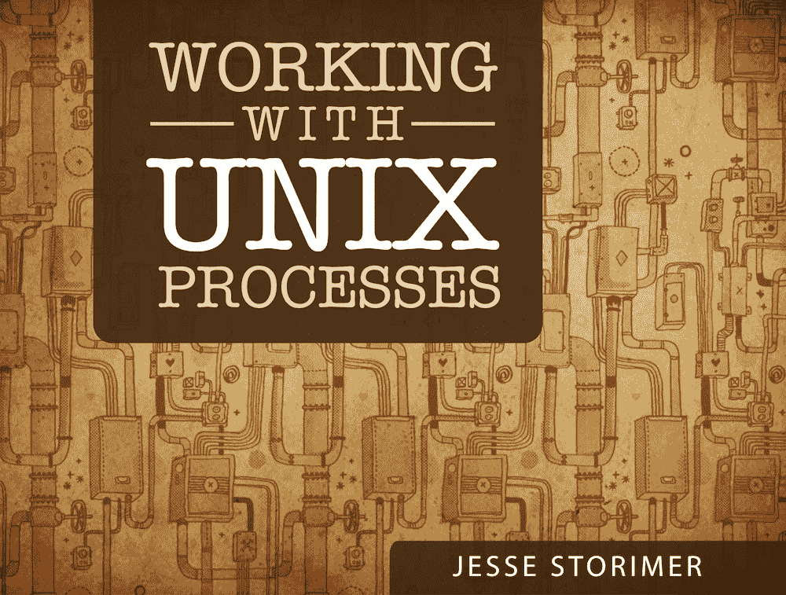

# Unix 进程实战




## 更新

* 2011 年 12 月 20 日 - 第一个发布版本
* 2011 年 12 月 21 日 - 拼写错误
* 2011 年 12 月 23 日 - `Process.setsid` 的说明
* 2011 年 12 月 27 日 - 关于 `SIGCHLD` 和并发的章节
* 2011 年 12 月 27 日 - 关于重新定义“默认”信号处理程序的说明
* 2011 年 12 月 28 日 - 拼写错误
* 2011 年 12 月 31 日 - 关于使用 `Kernel.raise` 异常出的澄清；关于在块中使用 `fork` 的章节；更多拼写错误；关于 `getsid(2)` 的说明
* 2012 年 1 月 13 日 - 改进了代码高亮。改进了电子阅读器格式。
* 2012 年 2 月 1 日 - 新封面。
* 2012 年 2 月 7 日 - 新章节：僵尸进程、环境变量、预分叉服务器、spyglass 项目。关于 MRI 中 CoW（写时复制）友好性的澄清。添加了关于 `IO.popen` 和 `Open3` 的章节。
* 2012 年 2 月 13 日 - `Process::WNOHANG` 和文件描述符关系的澄清。
* 2012 年 3 月 13 日 - 包含 TXT 格式。
* 2012 年 3 月 29 日 - 格式调整与勘误。
* 2012 年 4 月 20 日 - 新章节：ARGV 和 IPC。
* 2012 年 5 月 15 日 - 关于信号处理程序中重入性的澄清。
* 2012 年 6 月 12 日 - 关于 rlimits 的新章节；许多格式/语法更新。

## 引言

在我成长过程中，只要有机会我就会坐在电脑前。并不是因为我正在编程，而是因为我被这台神奇机器可以实现的功能所着迷。我是作为一个使用 ICQ、Winamp 和 Napster 的电脑用户长大的。

随着年龄增长，我花更多时间在电脑上玩视频游戏。起初我迷恋第一人称射击游戏，最后大部分时间都在玩实时策略游戏。然后我发现你可以在线玩这些游戏！在整个青少年时期，我都是一个“电脑虫”：`我知道如何使用电脑，但我完全不知道它们在底层是如何工作的。`

我之所以向你介绍我的背景，是因为我想让你知道我并不是一个天才。我没有在 7 岁时自学 Basic 语言编程。当我上第一门计算机编程课时，我并不是在教老师并纠正他的错误。

直到大学二级时，我才真正开始爱上编程这项活动。有些人可能会说我是一个大器晚成者，但我我觉得比你想象的要更接近常态。

虽然我是为了编程本身而热爱编程，但我仍然没有掌握计算机在底层是如何工作的。如果你当时告诉我，我所有的代码都运行在一个 `process`（进程）内部，我会用异样的眼光看着你。

幸运的是，我在本地的一家 Web 初创公司获得了一个极佳的工作机会。这让我有机会在真实的生产系统上进行一些编程。这改变了我的一切。这给了我学习事物底层工作原理的理由。

当我处理这个高流量的生产系统时，我面临着日益复杂的问题。随着我们的流量和资源需求增加，`我们必须开始查看整个技术栈来调试和修复待解决的问题`。如果仅仅关注应用代码，我们就无法获得应用程序运行的全景图。

在应用程序面前有许多层级：防火墙、负载均衡器、反向代理和 http 缓存。我们还有与应用程序并行的层级：任务队列、数据库服务器和统计收集器。每个应用程序都会由一组不同的组件组成，而这本书不会教你关于所有这些组件的知识。

本书将教你关于 Unix 进程所需的所有知识，而这`保证能提高你对应用程序中运行的任何组件的理解`。

通过调试问题，我被迫深入研究了那些使用 Unix 编程概念的 Ruby 项目。例如 `Resque` 和 `Unicorn`。这两个项目是我进入 Ruby Unix 编程世界的大门。

`在更深入地理解了它们的工作原理后，我能够更快、更透彻地诊断问题`，并调试那些仅看应用代码时完全无法理解的棘手问题。

我甚至开始利用从这些项目中中学到的技术，为我解决的问题提出新的、更快、更高效的解决方案。好了，关于我的就够了。让我们进入兔子洞吧。

## 基础

本节将提供书中用到的一些关键概念的背景。强烈建议你在进入更有实质内容的章节之前阅读这部分。

### 为什么要关注？

Unix 编程模型自 1970 年以来一直以某种形式存在。那时，Unix 在贝尔实验室被著名发明，以及 C 语言语言或框架。在之后的几十年里，Unix 因其可靠性、安全性和作为首选操作系统受了时间的考验。

Unix 编程概念和技术并不是时尚，它们不是最新的流行编程语言。这些技术超越了编程语言。无论你是用 C、C++、Ruby、Python、JavaScript、Haskell 还是[在此处插入你喜欢的语言]进行编程，这些技术都会有用。

这些东西已经存在了几十年，基本没有变化。聪明的程序员一直在使用 Unix 编程来解决困难的问题。

### 掌握力量！

我现在要警告你，书中描述的概念和技术能带给你巨大的力量。通过这种力量，你可以创建新的软件，理解现有的软件，甚至将你的职业提升到一个新的水平。

只要记住，能力越大，责任越大。继续读下去，我会告诉你一切所需的知识。

### 概述

本书不是作为参考手册来写的。它更像是一份指南。为了从中获得最大的收获，你应该按顺序阅读，因为每一章都建立在前一章的基础上。完成后，如果需要复习，可以使用章节。

本书包含了许多代码示例。我强烈建议你通过在 Ruby 解释器中实际运行它们来跟随。亲自操作代码并进行调整将有助于加深这些概念。

### 系统调用

理解系统调用首先需要对 Unix 系统的组件进行简单说明，特别是用户态（userland）与内核（kernel）。

你 Unix 系统的内核位于计算机硬件之上。它是任何与硬件交互的中间人。这包括从文件系统读取/写入、通过网络发送数据、分配内存或通过扬声器播放音频。由于其力量，程序被不允许直接访问内核。任何通信都通过系统调用完成。


用户态（Userland）是你所有程序运行的地方。你可以在用户态程序中完成很多事情，而无需调用任何系统调用：进行数学运算、字符串操作、通过逻辑语句进行流程控制。但我可以说，如果你想让你的程序做一些有趣的事情，那么你就需要通过系统调用来涉及内核。

如果你是一个 C 语言程序员，这些内容对你来说可能一种本能。系统调用是 C 语言编程的核心。

但我预计你可能和我一样，没有任何 C 语言编程经验。你是在使用高级语言学习编程的。当你学习如何将数据写入文件系统时，并没有被告知是哪些系统调用实现了这一点的。

这里的要点是：系统调用允许你的用户态程序通过内核间接地与计算机的硬件进行交互。在接下来的章节中，我们将学习常见的系统调用。

## 术语说明，`wtf(2)`

学习 Unix 编程的障碍之一在于哪里找到合适的文档。想听听惊人的事实吗？所有内容都可以通过 Unix 手册页（manpages）获取，如果你现在正在使用基于 Unix 的计算机，它已经在你的电脑里了！

如果你以前从未用过 manpages，可以尝试从终端调用 `man man` 命令开始。

很完美，对吧？好吧，也不完全。系统调用 API 的 manpages 在两种情况下是极佳的资源：

1. 你是一个 C 语言程序员，想要知道如何调用特定的系统调用，或者
2. 你正试图弄清楚某个系统调用的目的

假设我们在这里不是 C 语言程序员，所以 #1 并不好用，但 #2 非常有用。

你会在本文中看到类似 `select(2)` 这样的引用。这段文字告诉你可以在哪里找到特定系统调用的手册页。你可能知道也不知道，但 Unix manpages 有多个章节。

以下是 FreeBSD 和 Linux 系统 manpages 最常用的章节：

- 第 1 节：通用命令（General Commands）
- 第 2 节：系统调用（System Calls）
- 第 3 节：C 库函数（C Library Functions）
- 第 4 节：特殊文件（Special Files）

所以第 1 节用于通用命令（即 shell 命令）。如果我想让你参考 `find` 命令的手册页，我会这样写：`find(1)`。这告诉你在 manpages 的第 1 节中有 `find` 的手册页。

如果我想参考 `getpid` 系统调用的手册页，我会这样写：`getpid(2)`。这告诉你在 manpages 的第 2 节中有 `getpid` 的手册页。

**为什么 manpages 需要多个章节？** 因为一个命令可能出现在多个章节中，例如，既可以作为 shell 命令存在，也可以作为系统调用存在。

以 `stat(1)` 和 `stat(2)` 为例。

为了访问 manpages 的其他章节，你可以在命令行中这样指定：

```
$ man 2 getpid
$ man 3 malloc
$ man find # 等同于 man 1 find
```

这种术语命名不是为本书发明的，它是引用 manpages 时随处可见的约定（[`en.wikipedia.org/wiki/Man_page#Usage`](http://en.wikipedia.org/wiki/Man_page#Usage)）。所以现在学习它并习惯于看到它是一个好主意。

## 进程：Unix 的原子

进程是 Unix 系统的构建基块。为什么？因为**任何执行的代码都发生在进程内部**。

例如，当你从命令行启动 `ruby` 时，会为你的代码创建一个新进程。当你的代码执行完毕，该进程就会退出。

```
$ ruby -e "p Time.now"
```

运行在你的系统上的所有代码也是如此。你知道那个一直运行的 MySQL 服务器吗？它运行在自己的进程中。你现在正在使用的电子阅读器软件呢？它运行在自己的进程中。那个拼命想告诉你你有新邮件的邮件客户端？顺便说一下，你应该忽略它并继续阅读！它也运行在自己的进程中。

当你意识到一个进程可以产生并管理许多其他进程时，事情变得有趣起来。我们将在本书中介绍这一内容。

## 进程拥有 ID

运行在你系统上的每个进程都有一个唯一的进程标识符，下简称 'pid'。

`pid` 本身并不反映进程本身的任何信息，它仅仅是一个顺序数字标签。这就是内核看待你进程的方式：作为一个数字。

以下是我们如何在 Ruby 程序中检查当前的 `pid`。启动 `irb` 并尝试这样做：

```ruby
# 这一行将打印当前 ruby 进程的 pid。这可能是一个
# irb 进程、一个 rake 进程、一个 rails 服务器，或仅仅是一个普通的 ruby 脚本。
puts Process.pid
```

`pid` 是进程的一种简单、通用表示。由于它没有与进程内容的任何方面绑定，因此可以使用任何编程语言并通过简单的工具来理解它。我们将在下面看到如何使用不同的实用程序通过 `pid` 来跟踪进程细节。

### 交叉引用

为了获得全貌，我们可以使用 `ps(1)` 将我们的 `pid` 与内核看到的内容进行交叉引用。保持你的 `irb` 会话开启，在终端运行以下命令：

```bash
$ ps -p <your_pid>
```

## 进程拥有父进程

运行在你系统上的每个进程都有一个父进程。每个进程都知道其父进程标识符（下简称 'ppid'）。

在大多数情况下，给定进程的父进程是调用它的进程。例如，你是一个启动了 Terminal.app 并进入 bash 提示符的用户。由于一切都是进程，启动了一个新的 Terminal.app 进程，后者启动了一个 bash 进程。

该新 bash 进程的父进程是 Terminal.app 进程。如果你在 bash 提示符中调用 `ls(1)`，那么 `ls` 进程的父进程将是 bash 进程。你得到了结果。

由于内核只处理 pid，因此有一种方法可以获取当前父进程的 pid。这是在 Ruby 中的实现方式：

```ruby
# 注意这与获取当前进程的
# pid 只差一个字符。
puts Process.ppid
```

### 系统调用

Ruby 的 `Process.pid` 映射到 `getpid(2)`。

还有一个全局变量存储当前进程的值。你可以通过 `$$` 访问它。

Ruby 继承了它之前的语言的这种行为（perl 和 bash 都支持 `$$`），然而*我尽可能避免使用它*。完整写出 `Process.pid` 比美元符号变量更能表达你的意图，并且不太让没见过美元符号变量的人感到困惑。

### 在现实世界中

仅仅知道 pid 本身并不有用。那么它在哪里被使用呢？在现实世界中，发现 pid 的常见地方是日志文件。当你有多个进程时，必须说明哪行来自哪个进程。这通过使用 `top(1)` 或 `lsof(1)` 等命令可以实现。

```
[58550] [Spyglass::Server] 正在监听端口 4545
[58550] [Spyglass::Lookout] 接收连接
[58557] [Spyglass::Master] 已加载应用
[58557] [Spyglass::Master] 产生了 4 个工作进程。正在看护中……
[58558] [Spyglass::Worker] 接收连接
```

每行的方括号内表示该行来自哪个 pid。这是来自终端的一些输出。


在现实世界中，`ppid` 的用法并不多。但在检测守护进程（daemon processes）时它可能很重要，这一点将在后面的章节介绍。

### 系统调用

Ruby 的 `Process.ppid` 映射到 `getppid(2)`。

## 进程拥有文件描述符

就像 `pids` 代表正在运行的进程一样，文件描述符代表打开的文件。

### 一切皆文件

Unix 哲学的一部分：在 Unix 的世界里，“一切皆文件”。这意味着设备被视为文件，套接字（sockets）和管道（pipes）被视为文件，而文件也被视为文件。

由于所有这一切都被视为文件，`当我泛泛论文件时，我会使用“资源”（resource）一词`（包括设备、管道、套接字等），`当我指的是经典定义上的文件时，我会使用“文件”（file）一词`。

### 描述符代表资源

在运行的进程中打开任何资源时，都会被分配一个文件描述符编号。文件描述符**不会**在无关的进程之间共享，它们随着绑定的进程共生共灭，就像进程退出时其任何打开的资源都会关闭一样。在 fork 进程时，文件描述符的共享有特殊的语义，稍后会进行详细介绍。

在 Ruby 中，打开的资源由 `IO` 类表示。任何 `IO` 对象都可以有一个关联的文件描述符编号。使用 `IO#fileno` 来获取该编号。

```
passwd = File.open('/etc/passwd')
puts passwd.fileno
```

输出：

```
3
```

你的进程打开的任何资源都会获得一个标识它的唯一编号。这就是内核如何跟踪你的进程正在使用的任何资源的方式。

当我们打开多个资源时会发生什么？

```
passwd = File.open('/etc/passwd')
puts passwd.fileno

hosts = File.open('/etc/hosts')
puts hosts.fileno

# 关闭打开的 passwd 文件。这释放了它的文件描述符
# 供下一个打开的资源使用。
passwd.close

null = File.open('/dev/null')
puts null.fileno
```

输出：

```
3
4
3
```

这个例子中有两个关键结论。

1. 文件描述符编号被分配为最小的未未使用值。我们打开的第一个文件 `passwd` 获得了文件描述符 #3，下一个打开的文件获得了 #4，因为 #3 已经在在使用中。

2. 一旦资源被关闭，其文件描述符编号就会再次可用。当我们关闭 `passwd` 文件后，它的文件描述符编号就再次可用了。所以当我们打开 `dev/null` 的的文件时，它被分配了最小的未未使用值，即 #3。

重要的是，文件描述符只跟踪打开的资源。关闭的资源不会被赋予文件描述符编号。

回到内核的视角来看，这非常有道理。一旦资源被关闭，它就不再需要与硬件层交互，因此内核可以停止跟踪它。

根据上述内容，文件描述符有时被称为“已打开的文件描述符”（open file descriptors）。这有点误导性的称呼，因为不存在所谓的“关闭的文件描述符”。事实上，尝试从已关闭的资源读取文件描述符编号将抛出异常：

```
passwd = File.open('/etc/passwd')
puts passwd.fileno
passwd.close
puts passwd.fileno
```

输出：

```
3
-e:4:in `fileno`: closed stream (IOError)
```

你可能注意到，当我们打开一个文件并请求其文件描述符编号时，我们得到的最小值是 3。0、1 和 2 去哪里了？

### 标准流

每个 Unix 进程都带有三个打开的资源。这些是你的标准输入 (STDIN)、标准输出 (STDOUT) 和标准错误 (STDERR)资源。

这些标准资源存在有一个非常重要的原因，我们今天将其视为理所当然。STDIN 提供了一种从键盘设备或管道读取输入的通用方式，STDOUT 和 STDERR 提供了将输出写入显示器、文件、打印机等的通用方式。这是 Unix 的创新之一。

在 STDIN 存在之前，你的程序必须为其想要支持的所有键盘包含键盘驱动程序！如果它想在屏幕上打印某些内容，它必须知道如何操作实现所需的像素。所以，让我们对标准流表示感谢吧。

```
puts STDIN.fileno
puts STDOUT.fileno
puts STDERR.fileno
```

输出：

```
0
1
2
```

这就是那前 3 个文件描述符编号的去处。

### 在现实世界中

文件描述符是使用套接字、管道等进行网络编程的核心，也是任何文件系统操作的核心。

因此，它们被每个运行的进程使用，并且是你能用计算机做的大多数有趣事情的核心。你将在后面的章节或附带的 Spyglass 项目中看到更多如何使用它们的示例。

### 系统调用

Ruby 的 `IO` 类中的许多方法映射到同名的系统调用。这些包括 `open(2)`、`close(2)`、`read(2)`、`write(2)`、`pipe(2)`、`fsync(2)`、`stat(2)` 等。

## 进程拥有资源限制

在上一章中，我们查看了打开的资源由文件描述符表示的事。你可能注意到，当资源没有被关闭时，文件描述符编号会继续增加。这引出了问题：一个进程可以有多少个文件描述符？

答案取决于你的系统配置，但重要的点是`对进程施加了一些资源限制`。

### 查找限制

我们将继续讨论这个主题。使用 Ruby 我们可以直接请求允许的最大值：

```
p Process.getrlimit(:NOFILE)
```

在我的机器上，这输出为：

```
[2560,922337203685475807]
```

### 软限制与硬限制

区别是什么？很高兴你问这个。软限制并不是真正的限制。这意味着如果你超过了软限制（在本例中，通过一次性打开多于 2560 个资源），将*会*抛出异常，但你总是可以更改该限制。

注意，我的系统上关于描述符数量的硬限制是一个大得离谱的整数。打开那么多可能的吗？可能不会，在打开这么多资源之前，你就会遇到硬件限制了。

在我的系统上，那个数字实际上代表无穷大。它重复出现在常量 `Process::RLIMIT_INFINITY` 中。尝试比较这两个值以确定。所以，在我的系统上，一旦我根据需要提高了软限制，我就可以有效地打开任何我需要的数量的资源。

所以任何进程都能更改自己的软限制，但硬限制呢？通常这只能由超级用户完成。然而，如果拥有所需的权限，你的进程也能提高硬限制。如果你对在系统级上更改限制感兴趣，请从查看 `sysctl(8)` 开始。

### 提高软限制

让我们为当前进程提高软限制：

```
Process.setrlimit(:NOFILE, 4096)
p Process.getrlimit(:NOFILE)
```

输出：

```
[4096,4096]
```

你可以看到我们为打开文件的数量设置了新限制，在再次请求该限制时，硬限制和软限制都被设置了新值 4096。

我们可以可选地向 `Process.setrlimit` 传递第三个参数来指定一个新的硬限制，假设我们有权限这样做。注意，降低硬限制（正如我们在上一个代码片段中所做的那）是不可逆的：一旦它下降，它就不会再回升。

以下示例是将系统资源的软限制提高到等于硬限制（最大允许值）的常用方法。

```
Process.setrlimit(:NOFILE, Process.getrlimit(:NOFILE)[1])
```


### 超过限制

请注意，超过软限制（soft limit）将引发 `Errno::EMFILE`：

```ruby
# 将最大打开文件数设置为 3。我们知道
# 将达到上限，因为标准流占据了
# 前文件描述符。
Process.setrlimit(:NOFILE, 3)

File.open('/dev/null')
```

输出：

```
Errno::EMFILE: Too many open files - /dev/null
```

### 其他资源

可以使用相同的方法来检查和修改其他系统资源的限制。常见的限制包括：

```ruby
# 当前用户允许的最大并发进程数。
Process.getrlimit(:NPROC)

# 可以创建的最大文件大小。
Process.getrlimit(:FSIZE)

# 进程栈段的最大大小。
Process.getrlimit(:STACK)
```

请查看文档 ([`www.ruby-doc.org/core-1.9.3/Process.html#method-c-setrlimit`](http://www.ruby-doc.org/core-1.9.3/Process.html#method-c-setrlimit)) 关于 `Process.getrlimit` 获取可用选项的完整列表。

### 现实世界

对于大多数程序，修改系统资源限制并不是常见需求。但对于某些特殊工具，这非常重要。

一个用例是任何需要处理数千个并发网络连接的进程。例如 `httperf(1)` http 性能工具。诸如 `httperf --hog --server www --num-conn 5000` 的命令会要求 `httperf(1)` 创建 5000 个并发连接。显然，由于系统的默认软限制，这将会产生问题，因此 `httperf(1)` 在正确进行测试之前需要增加其软限制。

限制系统资源的另一个现实世界用例是：执行第三方代码并需要将其限制在某些约束范围内。你可以为运行该代码的进程设置限制，并撤销更改限制所需的权限，从而确保它们使用的资源不会超过你的允许范围。

### 系统调用

Ruby 的 `Process.getrlimit` 和 `Process.setrlimit` 分别映射到 `getrlimit(2)` 和 `setrlimit(2)`。

## 进程拥有环境

在此意义上，环境指的是所说的“环境变量”。环境变量是存储进程数据的键值对。

每个进程都从其父进程继承环境变量。它们由父进程设置并被其子进程继承。环境变量是进程级别的，并且对每个进程来说是全局的。

这里是在 `bash` shell 中设置环境变量、启动 Ruby 进程并读取该环境变量的简单示例。

```bash
$ MESSAGE='wing it' ruby -e "puts ENV['MESSAGE']"
```

`VAR=value` 语法是 `bash` 设置环境变量的方式。在 Ruby 中，也可以使用 `ENV` 常量来完成相同的操作。

```ruby
# 同样的操作，只是位置反过了！
ENV['MESSAGE'] = 'wing it'
system "echo $MESSAGE"
```

这两个示例都打印了：

```
wing it
```

在 `bash` 中，环境变量使用语法 `$VAR` 进行访问。从这几个示例可以看出，环境变量可以用于在运行不同语言的进程（在本例中 `bash` 和 `ruby`）之间共享状态。

### 它是一个 Hash 吗？

尽管 `ENV` 使用了哈 风格的访问 API，但它实际上并不是一个 `Hash`。例如，它实现了 `Enumerable` 和一些 `Hash` API，但并非全部。像 `merge` 这样的关键方法*并没有*实现。因此你可以执行 `ENV.has_key?` 等操作，但不要指望所有的 hash 操作都能生效。

```ruby
puts ENV['EDITOR']
puts ENV.has_key?('PATH')
puts ENV.is_a?(Hash)
```

输出：

```
vim
true
false
```

### 现实世界

在现实世界中，环境变量有许多用途。这里是 Ruby 社区中常见的工作流：

```bash
$ RAILS_ENV=production rails server
$ EDITOR=mate bundle open actionpack
$ QUEUE=default rake resque:work
```

环境变量通常被用作向命令行程序接受输入的通用方式。任何终端（Unix 或 Windows）已经支持它们，且大多数程序员对它们都很熟悉。使用环境变量的开销通常比显式解析命令行选项要小。

### 系统调用

没有用于直接操作环境变量的系统调用，但 C 库函数 `setenv(3)` 和 `getenv(3)` 完成了大部分工作。另请查看 `environ(7)` 览。

## 进程拥有参数

每个进程都可以访问一个名为 `ARGV` 的特殊数组。其他编程语言的实现可能略有不同，但每个都有称为 'argv' 的东西。

`argv` 是“argument vector”（参数向量）的缩写。换句话之：参数的向量或数组。它保存了命令行传递给当前进程的参数。这里有一个检查 `ARGV` 并传递一些简单选项的示例。

```bash
$ cat argv.rb
p ARGV
$ ruby argv.rb foo bar -va
["foo", "bar", "-va"]
```

### 它是一个数组！

与上一章不同（上一章我们学到 `ENV` 不是 `Hash`），`ARGV` 仅仅是一个 `Array`。你可以向它添加元素、删除元素、修改元素。

### 现实世界

`ARGV` 最常见的用例可能是接受文件名。有很多 Ruby 库可以处理输入。但现在你了解了 `ARGV` 的工作原理，对于简单的标志可以跳过额外的开销并手动处理。

```ruby
# 用户是否请求帮助？
ARGV.include?('--help')
# 获取 -c 选项的值
ARGV.include?('-c') && ARGV[ARGV.index('-c') + 1]
```

## 进程拥有名称

Unix 进程通信其状态的方式非常少。

程序员绕过了这个问题并发明了日志文件等工具。日志文件允许进程通过写入文件系统通信关于其状态的任何信息，但这运行在文件系统层面而不是进程固有的。

同样，进程可以使用网络打开套与其他进程通信。但再次，这运行在进程本身不同的层面。

有两个机制可以在进程层面运行并用于通信信息。一个是进程名称，另一个是退出码。

### 命名进程

系统上的每个进程都有名称。例如，当你启动一个 `irb` 会话时，该进程被命名为 'irb'。进程名称的巧妙在于它们可以在运行时更改并作为通信的方法。

在 Ruby 中，你可以通过 `$PROGRAM_NAME` 访问当前进程的名称。同样，你可以给该全局变量赋值来更改当前进程的名称。

```ruby
puts $PROGRAM_NAME

10.downto(1) do |num|
  $PROGRAM_NAME = "Process: #{num}"
  puts $PROGRAM_NAME
end
```

输出：

```
irb
Process: 10
Process: 9
Process: 8
Process: 7
Process: 6
Process: 5
Process: 4
Process: 3
Process: 2
Process: 1
```

作为一个有趣的练习，你可以启动一个 `irb` 会话，打印 pid 并更改进程名称。然后你可以使用 `ps(1)` 工具查看系统上反映的更改。


遗憾的是，这个全局变量（及其镜像 `$0`）是 Ruby 为此功能提供的唯一机制。没有更具意图表达的方法来更改当前进程的名称。

### 在现实世界中

要查看在真实项目中如何使用此功能的示例，请参阅附录中的*Resque 如何管理进程*。

## 进程具有退出状态码

当一个进程结束时，它最后一次机会在世界上留下标记：它的退出码。每个退出的进程都会带有一个数字退出码（0-255）退出，表示它是成功退出还是因错误退出。

传统上，`退出码为 0 的进程被认为是成功的`。任何其他退出码都表示错误，不同的代码指向不同的错误。

尽管传统上它们用于表示不同的错误，但它们实际上只是一个通信通道。你只需要以适合你程序的方式处理进程可能退出的不同退出码，你就脱离了这些习俗。

遵循“0 表示成功”的退出码传统通常是一个好主意，这样你的程序就能与其他 Unix 工具良好地协作。

## 如何退出进程

在 Ruby 中有几种方法可以退出进程，每种都有不同的目的。

### exit

退出进程的最简单方法是使用 `Kernel#exit`。当你的脚本在没有显式退出语句的情况下结束时，也会发生这种情况。

```
# 这将以成功状态码 (0) 退出程序。
exit
```

```
# 你可以向此方法传递自定义的退出码
exit 22
```

```
# 当调用 Kernel#exit 时，在退出之前 Ruby 会调用任何
# 由 Kernel#at_exit 定义的块。
at_exit { puts 'Last!' }
exit
```

将输出：

```
Last!
```

### exit!

`Kernel#exit!` 与 `Kernel#exit` 几乎完全相同，但有两个关键区别。第一个是它默认设置失败的状态码（1），第二个是它不会调用任何使用 `Kernel#at_exit` 定义的块。

```
# 这将以状态码 1 退出程序。
exit!
```

```ruby
# 你仍然可以传递退出码。
exit! 33
```

```ruby
# 这个块永远不会被调用。
at_exit { puts 'Silence!' }
exit!
```

### abort

`Kernel#abort` 提供了一种不成功退出进程的通用方法。`Kernel#abort` 将当前进程的退出码设置为 1。

```ruby
# 将以退出码 1 退出。
abort
```

```ruby
# 你可以向 Kernel#abort 传递消息。此消息将在进程退出前
# 输出到 STDERR。
abort "Something went horribly wrong."
```

```ruby
# 使用 Kernel#abort 时会调用 Kernel#at_exit 块。
at_exit { puts 'Last!' }
abort "Something went horribly wrong."
```

将输出：

```
Something went horribly wrong.
Last!
```

### raise

结束进程的另一种方法是未处理的异常。这是你永远不希望发生在环境中环境中，但在开发和测试环境中几乎总是会。

注意，`Kernel#raise` 与之前的方法不同，它不会立即退出进程。它只是抛出一个*可能*在栈上游被捕获的异常。如果异常在代码库的任何地方都没有被捕获，未处理的异常将导致进程退出。

以这种方式结束进程仍然会调用任何 at_exit 处理程序，并将异常消息和回溯打印到 `STDERR`。

```ruby
# 类似于 abort，未处理的异常将把退出码设置为 1。
raise 'hell'
```

## 进程可以 fork

### 使用 fork(2)吧，卢克

分叉（Forking）是 Unix 编程中最强大的概念之一。`fork(2)` 系统调用允许运行中的进程以程序方式创建新进程。这个新进程是原始进程的精确副本。

到目前为止，我们一直在讨论通过从终端启动来创建进程。我们还提到了创建其他进程的低级操作系统进程：`fork(2)` 就是它们这样做的方法。

在进行分叉时，发起 `fork(2)` 的进程被称为“父进程”，新创建的进程被称为“子进程”。

`子进程继承父进程正在使用的所有内存的副本，以及父进程的任何打开的文件描述符。` 让我们花时间从我们前三章的角度回顾子进程。

由于子进程是一个全新的进程，它拥有自己独特的 `pid`。

子进程的父进程显然是它的父进程。因此，它的 `ppid` 被设置为发起 `fork(2)` 的进程的 `pid`。

子进程继承 `fork(2)` 时父进程的任何打开的文件描述符。它被赋予与父进程相同的文件描述符数字映射。通过这种方式，两个进程可以共享打开的文件、套接字等。

子进程继承父进程主内存中所有内容的副本。通过这种方式，进程可以加载一个大型代码库，例如 Rails 应用，它占用 500MB 的主内存。然后此进程可以 fork 2 个新的子进程。这些子进程每个都有效地在内存中加载了该代码库的副本。

对 `fork` 的调用几乎立即返回，我们现在有了 3 个进程，每个都使用 500MB 内存。当你想要有程序的多个实例时，这非常完美。


对于一个拥有 4 个 CPU 的系统，如果你 `fork` 了 4 个新进程，那么每个进程都可以由一个独立的 CPU 处理，从而为你提供多核并发。

然而，并不能保证事情会并行执行。在繁忙的系统上，你的所有 4 个进程都可能由同一个 CPU 处理。

`fork(2)` 创建一个旧进程的副本的新进程。因此，如果一个进程正在使用 500MB 的主内存，当它进行 fork 之后，现在主内存中就有了 1GB。

再这样做十次，你很快就会迅速耗尽主内存。这通常被称为 `fork bomb`（fork 炸弹）。在提高并发性之前，请确保你了解其后果。

## 使用块（Block）

在上面的示例中，我们通过 if/else 结构演示了 `fork`。在 Ruby 代码中，配合块使用 `fork` 也是可能的，而且更为常见。

当你向 `fork` 方法传递一个块时，该块将在新的子进程中执行，而父进程将简单地跳过它。子进程在执行完块后会退出。它不会沿着与父进程相同的代码路径继续执行。

```
fork do
  # 这里的代码只在子进程中执行
end

# 这里的代码只在父进程中执行。
```

### 现实世界

查看附录中的任意一个或随附的 Spyglass 项目，可以看到一些使用 `fork(2)` 的真实世界示例。

### 系统调用

Ruby 的 `Kernel#fork` 映射到 `fork(2)`。

## 孤儿进程

### 失控

你可能已经注意到，在运行上一章的示例时，当涉及到子进程时，再无法像我们所习惯的那样从终端控制一切了。

当通过终端启动进程时，我们通常只有一个进程向 `STDOUT` 写入内容、接收键盘输入或监听告诉其退出的 Ctrl-C 信号。

但一旦该进程 fork 了子进程，这一切都会变得稍微困难一些。当你按下 Ctrl-C 时，哪个进程应该退出？是全部退出吗？还是只有父进程？

了解这些是有好处好处，因为创建孤儿进程实际上非常简单：

```
fork do
  5.times do
    sleep 1
    puts "I'm an orphan!"
  end
end

abort "Parent process died..."
```

如果你从终端运行此程序，你会发现由于父进程立即死亡，终端将你返回到命令提示符。在此时，它会被子进程的 `STDOUT` 覆盖！在 fork 进程时可能会发生一些奇怪的事情。

### 被遗弃的子

当父进程死亡时，子进程会发生什么？

简短的答案是：`什么`。也就是说，操作系统对待子进程的方式与其他任何进程相同。因此，当父进程死亡时，子进程会继续运行；父进程不会带上子进程一起。

### 管理孤儿进程

你还能管理孤儿进程吗？

我们在这个问题上有点操之过急，但它涉及到两个有趣的概念。

第一个是所谓的守护进程（daemon processes）。守护进程是特意被孤儿化并旨在永久运行的长持续进程。这些将在稍后的章节中详细介绍。

这里另一个有趣的点是与未附加到终端会话的进程进行通信。你可以使用称为 Unix 信号（signals）的东西来实现。这在后面的章节也有更详细的介绍。

我们将很快讨论如何正确地管理和控制子进程。

## 进程是友好的

让我们暂时离开代码，来讨论一个高层次的概念以及它在不同的 Ruby 实现中是如何处理的。

### 对 CoW 友好（CoW Friendly）

正如在 fork 章节中提到的，`fork(2)` 创建了一个作为父进程完全副本的新子进程。这包括父进程在内存中拥有的所有内容的副本。

物理复制所有数据可能会产生巨大的开销，因此现代 Unix 系统采用称为“写时复制”（copy-on-write, CoW）语义来应对这个问题。

正如你从名称中猜到的那样，CoW 将内存的实际复制延迟到需要写入它时为止。

因此，父进程和子进程实际上会共享内存中相同的物理数据，直到其中一个需要修改它，在那个时刻，内存将被复制，以保持两个进程之间的正确分离。

```
arr = [1,2,3]

fork do
  # 此时子进程已经初始化。
  # 使用 CoW，此进程不需要复制 arr 变量，
  # 因为它没有修改任何共享值，所以它可以继续从 
  # 与父进程相同的内存位置读取数据。
  p arr
end
```

```
arr = [1,2,3]

fork do
  # 此时子进程已经初始化。
  # 由于 CoWW，arr 变量还没有被复制。
  arr << 4
  # 上面行代码修改了数组，所以在在该进程
  # 修改它之前，需要为它创建一个数组
  # 的副本。父进程中的数组保持
  # 不变。
end
```

这是在使用 `fork(2)` 时的一个巨大胜利，因为它节省了资源。这意味着 `fork(2)` 是快速的，因为它不需要复制父进程的任何物理内存。这也意味着子进程只获得它们需要的数据副本，其余部分可以共享。

CoW 非常棒，但遗憾的是它`在 MRI 或 Rubinius 中不受支持`。为了让 CoW 正常工作，程序需要以对 CoW 的方式编写。也就是说，它们需要以允许 CoW 的方式管理内存。MRI 和 Rubinius 不是这样写的。

### 为什么？

MRI 的垃圾回收器使用“标记-清除”（mark-and-sweep）算法。简而言，这意味着当 GC 被调用时，它必须遍历每个对象并对其进行写入，标记它应该被垃圾回收还是不应该。这里的关键点是，每当 GC 运行时，内存中的每个对象都会被写入。

因此，在 fork 之后，第一次运行 GC 就会撤销写时复制提供的收益。

这就是为什么创建 Ruby Enterprise Edition ([`www.rubyenterpriseedition.com/`](http://www.rubyenterpriseedition.com/)) 的原因之一。`ree 对 CoW 友好`。想要深入了解这个问题以及 Ruby Enterprise Edition 如何解决它，请查看他们的 Google Tech Talk：Building a Ruby Interpreter ([`www.youtube.com/watch?v=ghLCtAwqQ`](http://www.youtube.com/watch?v=ghLCtAwqQ))。

### MRI / RBX 用户

这对其他 Ruby VM 用户意味着什么？

简单来说，fork 进程无法获得 CoW 的收益。子进程将需要调用进程内存的完整副本。

如果你正在构建深度依赖 `fork(2)` 的东西，请认真考虑 Ruby Enterprise Edition。展望未来，MRI 主分支现在有了让 GC 对 CoW 友好的补丁。因此，Ruby 2.0 版本将带有一个对 CoW 友好的 GC！


```
message = 'Good Morning'
recipient = 'tree@mybackyard.com'

fork do
  # 在这个为了意的示例中，父进程派生出一个子进程来
  # 负责将数据发送到统计收集器。与此同时，父进程
  # 继续执行它发送实际负载的工作。

  # 父进程不希望被这项任务拖慢速度，
  # 即使由于某种原因它失败了也没关系。
  StatsCollector.record message, recipient
end

# 将消息发送给接收者
```

### 进程守护 (Babysitting)

对于大多数涉及 `fork(2)` 的其他用例，你可能需要某种方法来监控你的子进程。在 Ruby 中，`Process.wait` 提供了这种技术。让我们重写上一章中那个产生孤儿进程的示例，让它的运行少一些意外。

```
fork do
  5.times do
    sleep 1
    puts "I am an orphan!"
  end
end

Process.wait
abort "Parent process died..."
```

这次的输出看起来像这样：

```
I am an orphan!
I am an orphan!
I am an orphan!
I am an orphan!
I am an orphan!
Parent process died...
```

不仅如此，在所有输出被打印之前，控制权都不会返回给终端。

那么 `Process.wait` 是做什么的？`Process.wait` 是一个阻塞调用，指示父进程在继续执行之前等待其任何一个子进程退出。

### Process.wait 及其兄弟方法 (Cousins)

我在上那句话中提到了一个关键点，`Process.wait` 会阻塞，直到它的任何一个子进程退出。如果你有一个父进程正在守护多个子进程，并且你正在使用 `Process.wait`，你需要知道是哪一个退出了。为了这一点，你可以使用返回值。

`Process.wait` 返回退出子进程的 `pid`。来看一下。

```ruby
# 我们创建了 3 个子进程。
3.times do
  fork do
    # 每个进程睡眠一个小于 5 秒的随机数。
    sleep rand(5)
  end
end

3.times do
  # 我们等待每个子进程退出，并打印返回的 pid。
  puts Process.wait
end 
```

### 与 Process.wait2 通信

等一下！`Process.wait` 还有一个兄弟方法叫做 `Process.wait2`！

为什么名字会混淆？一旦你知道 `Process.wait` 返回一个值（`pid`），而 `Process.wait2` 返回两个值（`pid`，`status`），它就合情合理了。

这个状态可以通过退出码作为进程之间的通信手段。在关于退出码的章节中，我们提到过可以使用退出码为其他进程编码信息。`Process.wait2` 让你直接访问这些信息。

从 `Process.wait2` 返回的 `status` 是 `Process::Status` 的实例。它包含了许多有用信息，用于确定进程究竟是如何退出的。

```ruby
# 我们创建了 5 个子进程。
5.times do
  fork do
    # 每个进程生成一个随机数。如果是偶数，它们以
    # 111 退出码退出，否则使用 112 退出码。
    if rand(5).even?
      exit 111
    else
      exit 112
    end
  end
end

5.times do
  # 我们等待每个子进程退出。
  pid, status = Process.wait2

  # 如果子进程以 111 退出码退出
  # 那么我们就知道它们遇到了偶数。
  if status.exitstatus == 111
    puts "#{pid} 遇到了一个偶数!"
  else
    puts "#{pid} 了一个奇数!"
  end
end
```

不需要通过文件系统或网络的进程间通信！

### 等待特定的子进程

等一下！`Process.wait` 的兄弟方法还有两个兄弟。`Process.waitpid` 和 `Process.waitpid2`。

你可能已经猜到了它们的作用。它们的功能与 `Process.wait` 和 `Process.wait2` 相同，不同在于，它们不是等待*任何*子进程退出，而是只等待由 `pid` 指定的*特定*子进程退出。

```
favourite = fork do
  exit 77
end

middle_child = fork do
  abort "I want to be waited on!"
end

pid, status = Process.waitpid2 favourite
puts status.exitstatus
```

尽管 `Process.wait` 和 `Process.waitpid` 看起来提供了不同的行为，但不要被骗了！它们实际上是相同内容的别名（alias）。两者都接受相同的参数并且行为相同。

你可以将 `pid` 传递给 `Process.wait` 以使其等待*特定*的子进程，也可以将 `-1` 作为 `pid` 传递给 `Process.waitpid` 以使其等待*任何*子进程。

`Process.wait2` 和 `Process.waitpid2` 也是如此。

就像 `Process.pid` 与 `$$` 的关系一样，我认为作为程序员，尽可能使用提供的工具来揭示我们的意图是非常重要的。尽管这些方法是相同的，但在你等待任何子进程时，应该使用 `Process.wait`，而在你等待特定进程时，应该使用 `Process.waitpid`。

### 竞态条件 (Race Conditions)

当你查看这些简单的代码示例时，你可能会开始思考竞态条件。

如果父进程处理得很慢会怎么样？让我们来看看：

```ruby
# 我们创建了两个子进程。
2.times do
  fork do
    # 进程立即退出。
    abort "Finished!"
  end
end

# 父进程等待第一个进程，然后睡眠 5 秒。
# 在期间，子进程已经退出且不再运行。
puts Process.wait
sleep 5

# 父进程再次请求等待，神奇的是，进程已经退出了。
puts Process.wait
```

你可以看到，这种技术是不存在竞态条件的。内核缓存了已退出进程的信息，因此父进程总是可以获取它。

所以即使父进程处理每个子进程很慢，它也能准备准备时获取信息。

注意，在没有子进程的情况下调用 `Process.wait` 的任何变体都会抛出 `Errno::ECHILD`。跟踪你创建了多少子进程是一个好习惯。

### 现实世界

监控子进程的思想是常见 Unix 模式的核心。这种模式有时被称为进程守护（babysitting）、主/工作模式或预派生（preforking）。

这种模式的核心在于，你有一个进程派生了多个子进程来实现并发，然后花费时间照顾它们：确保它们保持响应，并在任何一个进程退出时做出反应等。

例如，Unicorn Web 服务器 ([`unicorn.bogomips.org`](http://unicorn.bogomips.org)) 就采用了这种模式。你告诉它希望它启动多少工作进程，例如 5 个。

然后一个 `unicorn` 进程将启动并派生 5 个子进程来处理请求。父进程（或主进程）与每个子进程保持心跳，并确保所有子进程保持响应。

这种模式兼顾了并发性和可靠性。关于 Unicorn 的更多信息请参见附录。

关于该技术的替代用法，请阅读附件 Spyglass 项目中的 `Lookout` 类。

### 系统调用

Ruby 的 `Process.wait` 及其兄弟方法映射到 `waitpid(2)`。

## 僵尸进程 (Zombie Processes)

在上章开头，我们看了一个使用子进程异步处理任务的示例。我们需要回顾这个示例，并确保妥善地清理该子进程，以免它变成僵尸！

### 等待(2)的人会有好报

在上一章中，我展示了内核会缓存已退出子进程的状态。因此，即使你在子进程退出很久后才调用 `Process.wait`，它的状态仍然可用。我确定你已经闻到了这里的问题了……


内核将保留已退出子进程的状态，直到父进程使用 `Process.wait` 请求该状态。如果父进程从未请求过状态，内核就永远无法回收该状态信息。因此，创建“发后置不管”的子进程而不收集它们的状态信息，是对内核资源的糟糕利用。

如果你不打算使用 `Process.wait` 等待子进程退出（或下一章中描述的技术），那么你就需要“分离”（detach）该子进程。以下是对上一章中“发后置不管”示例的修正，以正确地分离子进程：

```
message = 'Good Morning'
recipient = 'tree@mybackyard.com'

pid = fork do
  # 在这个刻意的示例中，父进程派生了一个子进程来负责
  # 将数据发送给统计收集器。与此同时，父进程
  # 继续执行发送实际负载的工作。

  # 父进程不想被这项任务拖慢速度，
  # 即使它因为某种原因失败也无所谓。
  StatsCollector.record message, recipient
end

# 这行确保执行统计收集的进程
# 不会变成僵尸。
Process.detach(pid)
```

`Process.detach` 做了什么？它仅仅启动了一个新线程，其唯一工作是等待指定的 `pid` 的子进程退出。这确保了内核不会保留我们不需要任何状态信息。

### 僵尸进程看起来是什么样？

```
# 创建一个 1 秒后退出的子进程。
pid = fork { sleep 1 }
# 打印它的 pid。
puts pid
# 让父进程无限睡眠，以便我们可以检查
# 子进程的状态。
sleep
```

在终端中运行以下命令（使用上一个片段打印的 pid），将打印该僵尸进程的状态。状态应该显示为 'z' 或 'Z+'，意味着该进程是一个僵尸。

```
ps -ho pid,state -p [zombie process pid]
```

### 在现实世界中

注意，任何状态未被等待的死亡进程都是僵尸进程。因此，*每一个*在父进程仍然活跃时死亡的子进程都会成为僵尸，即使只是很短时间。一旦父进程从僵尸那里收集了状态，它就会有效地消失，不再消耗内核资源。

在现实世界中，以“发后置不管”的方式派生子进程且从不收集状态的情况并不常见。如果需要在后台卸载工作，通常做法是使用专门的后台队列系统。

尽管如此，有一个名为 `spawn` 的 RubyGem（[`github.com/tra/spawn`](https://github.com/tra/spawn)）提供了完全的功能。除了提供进程或线程的通用 API 外，它还确保了“发后置不管”的进程被正确分离。

### 系统调用

`Process.detach` 没有系统调用，因为它在 Ruby 中只是简单地实现为线程和 `Process.wait`。Rubinius 中的实现方式（[`github.com/rubinius/rubinius/blob/c6e8e33b37601d4a082ddcbbd60a568767074771/kernel/common/process.rb#L377-395`](https://github.com/rubinius/rubinius/blob/c6e8e33b37601d4a082ddcbbd60a568767074771/kernel/common/process.rb#L377-395)）极其简单。

## 进程可以接收信号

在上一章中，我们查看了 `Process.wait`。它为父进程监控其子进程提供了一种很好的方法。然而，这是一个阻塞调用：在子进程死亡之前，它不会返回。

忙碌的父进程怎么办？并不是每个父进程都有奢侈整天等孩子。忙碌的父进程有一个解决方案！这就是我们对 Unix 信号的介绍。

### 捕获 SIGCHLD

让我们从上一章取一个简单的示例并为忙碌的父进程重写它。

```
child_processes = 3
dead_processes = 0
# 我们派生了 3 个子进程。
child_processes.times do
  fork do
    # 它们睡眠 3 秒。
    sleep 3
  end
end

# 我们的父进程将忙于某些数学计算。
# 但仍然想知道一个孩子何时退出。

# 通过捕获 :CHLD 信号，我们的进程将在一个子进程退出
# 时收到内核的通知。
trap(:CHLD) do
  # 因为 Process.wait 会为我们排队任何可用数据，我们可以在
  # 这里请求它，因为我们知道其中一个子进程已经退出了。

  puts Process.wait
  dead_processes += 1
  # 一旦统计了所有子进程，我们就显式退出。
  exit if dead_processes == child_processes
end

# 运行它。
loop do
  (Math.sqrt(rand(44)) ** 8).floor
  sleep 1
end
```

### SIGCHLD 与并发

在继续之前，我必须提到一个注意事项。**信号传递是不可靠的**。我的意思是，如果你的代码在处理 CHLD 信号的同时另一个子进程死亡了，你*可能接收也可能不到第二个 CHLD 信号*。

这会导致上述代码片段产生不一致的结果。有时时机恰好一切运行完美，有时你会“错过”进程死亡的实例。

要正确处理 CHLD，你必须在循环中调用 `Process.wait`。由于信号可能在任何时候到达，最后一个 CHLD 信号可能会在处理器已经调用了两次 `Process.wait` 并获取了最后的可用状态之后到达。


因此，你必须在 `CHLD` 信号处理程序中处理 `Errno::ECHILD` 异常。此外，如果你不知道正在等待多少个子进程，你应该捕捉该异常并对其进行妥善处理。

### 信号入门

这是我们首次尝试 Unix 信号（Signals）。信号是异步通信。当进程接收到来自内核的信号时，它可以执行以下操作之一：

1. 忽略信号
2. 执行指定的动作
3. 执行默认动作

### 信号从何而来？

从技术上讲，信号是由内核发送的，就像手机运营商发送短信一样。但短信有原始的发送者，信号也是如此。信号通过内核作为中间人，从一个进程发送到另一个进程。

信号的原始意图是指定杀死进程的不同方式。让我们从这里开始。

让我们启动两个 Ruby 程序，并用其中一个来杀死掉另一个。

对于这些示例，我们不会使用 `irb`，因为其内部定义了自己的信号处理程序，这会干扰我们的演示。相反，我们将直接使用 `ruby` 程序本身。

尝试一下这个：在不带任何参数的情况下启动 `ruby` 程序。输入一些代码。按下 Ctrl-D。

这会执行你输入的代码然后退出。

使用上述技术启动两个 `ruby` 进程，我们将使用信号杀死其中一个。

1. 在第一个 `ruby` 会话中，执行以下代码：

```
puts Process.pid
sleep # 这样我们就有时间给它发送信号
```

2. 在第二个 `ruby` 会话中执行以下命令，用信号杀死第一个会话：

```
Process.kill(:INT, <第一个会话的 pid>)
```

因此，第二个进程向第一个进程发送了 "INT" 信号，导致其退出。"INT" 是 "INTERRUPT"（中断）的缩写。

当进程接收到此信号时，系统的默认行为是中断它正在执行的任何操作并立即退出。

### 宏观视图

下表显示了 Unix 系统上常见的支持信号。每个 Unix 进程都能响应这些信号，并且任何信号都可以发送到任何进程。

在命名信号时，名称中的 `SIG` 部分是可选的。表格中的 Action 列描述了每个信号的默认动作：

**Term**: 意味着进程将立即终止
**Core**: 意味着进程将立即终止并转储核心（堆栈跟踪）
**Ign**: 意味着进程将忽略该信号
**Stop**: 意味着进程将停止（即暂停）
**Cont**: 意味着进程将恢复（即取消暂停）

```
Signal   Value     Action   Comment
-------------------------------------------------------------------------
SIGHUP      1       Term    检测到控制终端挂断
                                        或控制进程死亡
SIGINT      2       Term    来自键盘的中断
SIGQUIT     3       Core    来自键盘的退出
SIGILL          4       Core    非法指令
SIGABRT         6       Core    来自 abort(3) 的中止信号
SIGFPE          8       Core    浮点数异常
SIGKILL         9       Term    杀死信号
SIGSEGV        11       Core    无效的内存引用
SIGPIPE        13       Term    管道破裂：向没有读者的管道写入
SIGALRM        14       Term    来自 alarm(2) 的定时器信号
SIGTERM        15       Term    终止信号
SIGUSR1     30,10,16    Term    用户自定义信号 1
SIGUSR2     31,12,17    Term    用户自定义信号 2
SIGCHLD     20,17,18    Ign     子进程停止或终止
SIGCONT     19,18,25    Cont    停止后继续
SIGSTOP     17,19,23    Stop    停止进程
SIGTSTP     18,20,24    Stop    在 tty 处输入的停止
SIGTTIN     21,21,26    Stop    后台进程的 tty 输入
SIGTTOU     22,22,27    Stop    后台进程的 tty 输出
```

信号 `SIGKILL` 和 `SIGSTOP` 无法被捕获、阻塞或忽略。

这个表看起来可能有些突如其来，但它让你对向进程发送特定信号时可能预期的情况有一个大致的了解。你可以看到，默认情况下，大多数信号都会终止进程。

注意的是 `SIGUSR1` 和 `SIGUSR2` 信号很有趣。这些信号的动作特意留给你的进程来定义。我们很快就会看到，我们可以自由地重新定义任何喜欢的信号动作，但这两个信号是供你使用的。

### 重新定义信号

让我们回到我们的两个 `ruby` 会话并玩点花。

1. 在第一个 `ruby` 会话中，使用以下代码重新定义 `INT` 信号的行为：

```
puts Process.pid
trap(:INT) { print "Na na na, you can't get me" }
sleep # 这样我们就有时间给它发送信号
```

现在我们的进程在接收到 `INT` 信号时不会退出。

2. 在第二个 `ruby` 会话中执行以下命令，注意第一个进程正在嘲讽我们！

```
Process.kill(:INT, <第一个会话的 pid>)
```

3. 你可以尝试使用 Ctrl-C 来杀死第一个会话，你会发现它的响应是一样的！

4. 但如表所示，有些信号是无法重新定义的。`SIGKILL` 将显示谁才是老大。

```
Process.kill(:KILL, <第一个会话的 pid>)
```

### 忽略信号

1. 在第一个 `ruby` 会话中使用以下代码：

```ruby
puts Process.pid
trap(:INT, "IGNORE")
sleep # 这样我们就有时间给它发送信号
```

2. 在第二个 `ruby` 会话中执行以下命令，注意第一个进程不受影响。

```
Process.kill(:INT, <第一个会话的 pid>)
```

### 信号处理程序是全局的

信号是一个强大的工具，在某些情况下非常完美。但要记住，捕捉信号就像使用全局变量，你可能会覆盖其他代码依赖的内容。与全局变量不同，信号处理程序无法命名空间。

### 友好地重新定义信号

有一种方法可以保留其他代码定义的处理器，这样你的信号处理程序就不会破坏它们。它看起来像这样：

```ruby
trap(:INT) { puts '这是第一个信号处理器' }

old_handler = trap(:INT) {
  old_handler.call
  puts '这是第二个处理器'
  exit
}
sleep # 这样我们就有时间给它发送信号
```

只需按下 Ctrl-C 查看效果。两个信号处理程序都被调用了。

现在让我们看看能否保留系统的默认行为。按下 Ctrl-C 执行以下代码。

```ruby
system_handler = trap(:INT) {
  puts '即将退出！'
  system_handler.call
}
sleep # 这样我们就有时间给它发送信号
```

:/ 所以我们无法通过这种技术保留系统的默认行为，但我们可以保留已定义的 Ruby 代码处理器。


是否决定保留之前定义的信号处理程序取决于你，只需确保你清楚自己为什么要这么做即可。如果你只是想在退出前挂载某些行为来清理资源，你可以使用 `at_exit` 钩子，我们在退出状态码的章节中提到过它。

### 你在什么时候无法接收信号？

你的进程可以随时接收信号。这就是信号的妙之处所在！它们是异步的。

你的进程可以从一个繁忙的 `for-loop` 循环被切换到信号处理器，甚至可以从长时间的 `sleep` 中取出。如果进程在处理一个信号时接收到另一个信号，甚至可以从一个信号处理器切换到另一个。但正如预期的，它始终会返回并完成所有被调用的处理器中的代码。

### 在现实世界中

通过信号，任何进程都可以与系统上的任何进程通信，只要它知道对方的 pid。这使得信号成为非常强大的通信工具。从 shell 使用 `kill(1)` 发送信号是很常见的。

在现实世界中，信号主要由服务器和守护进程等长时间运行的进程使用。在大多数情况下，发送信号的是人类用户而不是自动化程序。

例如，Unicorn Web 服务器 ([`unicorn.bogomips.org`](http://unicorn.bogomips.org)) 响应 `INT` 信号的方式是杀死所有进程并立即关闭。它响应 `USR2` 信号的方式重新执行自身来实现零停机重启。它响应 `TTIN` 信号的方式增加其正在运行的 worker 进程数量。

查看 Unicorn 附带的 SIGNALS 文件 ([`unicorn.bogomips.org/SIGNALS.html`](http://unicorn.bogomips.org/SIGNALS.html)) 获取其支持的信号完整列表以及它如何响应这些信号。

memprof 项目有一个处理信号时做一个友好公民的有趣示例 ([`github.com/ice799/memprof/blob/d4bc228aca323b58fea92dbde20c1f8ec36e5386/lib/memprof/signal.rb#L8-16`](https://github.com/ice799/memprof/blob/d4bc228aca323b58fea92dbde20c1f8ec36e5386/lib/memprof/signal.rb#L8-16))。

### 系统调用

Ruby 的 `Process.kill` 映射到 `kill(2)`，`Kernel#trap` 大致映射到 `sigaction(2)`。`signal(7)` 也很有用。

## 进程可以通信

到目前为止，我们查看了共享内存和打开资源的相关进程。但在多个进程之间通信信息又是呢？

这是称为“进程间通信”（简称 IPC）的整个领域的一部分。有许多实现 IPC 的不同方法，但我将涵盖两种常用的方法：管道（pipes）和套接字对（socket pairs）。

### 我们的管道

管道（pipe）是一个单向的数据流。换句话说，你可以打开一个管道，一个进程可以“占用”的一端，另一个进程可以“占用”另一端。然后数据就可以沿着管道传递，但只能单向。所以，如果一个进程“占用”了读取者的位置而不是写入者，它将无法向管道写入。反之亦然。

在引入多个进程之前，让我们先来看看如何创建一个管道以及我们从中得到什么：

```
reader, writer = IO.pipe #=> [#<IO:fd 5>, #<IO:fd 6>]
```

`IO.pipe` 返回一个包含两个元素的数组，这两个元素都是 `IO` 对象。Ruby 惊人的 IO 类 ([`librelist.com/browser//usp.ruby/2011/9/17/the-ruby-io-class/`](http://librelist.com/browser//usp.ruby/2011/9/17/the-ruby-io-class/)) 是 `File`、`TCPSocket`、`UDPSocket` 等类的父类。因此，所有这些资源都有共同的接口。

`IO.pipe` 返回的 `IO` 对象可以被认为是匿名文件。你基本上可以像对待 `File` 一样对待它们。你可以调用 `#read`、`#write`、`#close` 等。但此对象不会响应 `#path` 且在文件系统中没有位置。

在还没有引入多个进程的情况下演示管道通信：

```
reader, writer = IO.pipe
writer.write("Into the pipe I go...")
writer.close
puts reader.read
```

输出

```
Into the pipe I go...
```

非常简单对吧？注意到我在向管道写入后必须关闭写入者了吗？这是因为当读取者调用 `IO#read` 时，它将继续尝试读取数据直到它看到 EOF（即文件结束标记 ([`en.wikipedia.org/wiki/End-of-file`](http://en.wikipedia.org/wiki/End-of-file))）。这告诉读取者不再有更多数据可读。

只要写入者仍然开启，读取者可能会看到更多数据，所以它会等待。通过在读取之前关闭写入者会在管道上放置一个 EOF，这样读取者在获取初始数据后就会停止读取。如果你跳过关闭写入者，读取者将阻塞并无限地尝试读取。

### 管道仅限单向

```
reader, writer = IO.pipe
writer.write("Trying the reader to write")
```

输出

```
IOError: not opened for writing
from (irb):2
```

`IO.pipe` 返回的 `IO` 对象只能用于单向通信。所以读取者只能读取，写入者只能写入。

现在，让我们把多个进程引入到这个混合中。

### 共享管道

在 fork 章节中，我描述了当进程 fork 时打开资源是如何共享或复制的。管道被视为一种资源，它们拥有自己的描述符，因此与子进程共享。

这是一个使用管道在父子进程之间通信的简单示例。子进程通过向管道写入表示它完成了工作：

```
reader, writer = IO.pipe

fork do
  reader.close

  10.times do
    writer.puts "Another one dust"
  end
end

writer.close
while message = reader.gets
  $stdout.puts message
end
```

输出十次。注意，像上面一样，未使用的管道端被关闭了，以免干扰 EOF 的发送。由于涉及到两个进程，实际上多了一层。由于描述符被复制了，现在有 4 个实例。由于只有两个将用于通信，其他 2 个实例必须关闭。这就是为什么需要额外的关闭操作。

由于管道的端是 `IO` 对象，我们可以对它们调用任何 `IO` 方法，而不只是 `#read` 和 `#write`。在这个示例中，我使用了 `#puts` 和 `#gets` 来读取和写入以换行符分隔的 `String`。

### 流与消息

当我说流（stream）时，是指在管道中写入和读取数据时没有开始和结束的概念。在处理 IO 流（如管道或 TCP 套接字）时，你将数据写入流，并跟上某些协议特定的分隔符。例如，HTTP 使用一系列换行符来分隔头部和正文。

然后当从该 IO 流中读取数据时，你每次读取一个块，直到遇到分隔符停止。*这*就是为什么我在上一个示例中使用 `#puts` 和 `#gets`：它为我使用了换行符作为分隔符。

正如你可能猜到的，可以通过消息而不是流进行通信。我们无法通过管道实现，但可以通过 Unix 套接字实现。在不详细介绍的情况下，Unix 套接字是一种只能在同一物理机器上通信的套接字。因此，它比 TCP 套接字快得多，非常适合 IPC。

这里有一个我们创建了一对可以通过消息通信的 Unix 套接字的示例：

```
require 'socket'
Socket.pair(:UNIX, :DGRAM, 0) #=> [#<Socket:fd 15>, #<Socket:fd 16>]
```


这创建了一对相互连接的 UNIX 套字。这些套字使用数据报（datagrams）进行通信，而不是流（stream）。通过这种方式，你可以向一个套字写入一个*完整*的消息，并从另一个套字读取一个*完整*的消息。不需要分隔符。

这里有一个管道示例稍微复杂一点的版本，其中子进程实际上会等待父进程告诉它要做什么，然后在完成工作后向父进程报告结果：

```ruby
require 'socket'

child_socket, parent_socket = Socket.pair(:UNIX, :DGRAM, 0)
maxlen = 1000

fork do
  parent_socket.close

  4.times do
    instruction = child_socket.recv(maxlen)
    child_socket.send("#{instruction} accomplished!", 0)
  end 
end 
child_socket.close

2.times do
  parent_socket.send("Heavy lifting", 0)
end 
2.times do
  parent_socket.send("Feather lifting", 0)
end 

4.times do
  $stdout.puts parent_socket.recv(maxlen)
end 
```

输出：

```
Heavy lifting accomplished!
Heavy lifting accomplished!
Feather lifting accomplished!
Feather lifting accomplished!
```

因此，管道提供的是单向通信，而套字对提供了双向通信。父套字既可以读取子套字，也可以写入，反之亦然。

### 远程 IPC？

IPC（进程间通信）意味着运行在同一机器上的进程之间的通信。如果你感兴趣从一台机器扩展到多台机器，同时进行类似于 IPC 的操作，那么有一些东西可以研究。第一种方法就是通过 TCP 套字进行通信。对于非复杂的系统，此选项比其他选项需要更多的样板代码。其他可行的解决方案包括 RPC ([`en.wikipedia.org/wiki/Remote_procedure_call`](http://en.wikipedia.org/wiki/Remote_procedure_call))（远程过程调用）、像 ZeroMQ 这样的消息系统 ([`www.zeromq.org/`](http://www.zeromq.org/)) 或者分布式系统的通用领域 ([`en.wikipedia.org/wiki/Distributed_computing`](http://en.wikipedia.org/wiki/Distributed_computing))。

### 现实世界

管道和套字对都是进程间通信的有用抽象。它们快速且易用。它们通常用作通信通道，而不是像共享数据库或日志文件等粗暴的方法。

至于使用哪种方法：取决于你的需求。在权衡决策时，请记住管道是单向的，而套字对是对向的。

对于更深入的示例，请查看包含的 Spyglass 项目中的 `Spyglass` 类。它使用比你上面看到的代码更复杂的示例，许多子进程通过单个管道与父进程进行通信。

### 系统调用

Ruby 的 `IO.pipe` 映射到 `pipe(2)`，`Socket.pair` 映射到 `socketpair(2)`。`Socket.recv` 映射到 `recv(2)`，而 `Socket.send` 映射到 `send(2)`。

## 守护进程

守护进程是在后台运行的进程，而不是在终端用户的控制下运行。守护进程的常见例子如 Web 服务器或数据库服务器，它们将始终在后台运行以提供服务。

守护进程也是你操作系统的核心。有很多进程不断在后台运行，保持你的系统正常运行。这些是诸如 GUI 系统上的窗口服务器、打印服务或音频服务，这样你的扬声器随时准备好播放那恼人的“叮”的通知声。

### 第一个进程

有一个守护进程对你的操作系统具有特殊的特殊意义。我们在上一个章节中讨论过每个进程都有一个父进程。这对于所有进程都可能吗？系统上的第一个进程又是呢？

这是一个经典的“谁创造了创造者”的问题，它有一个简单的答案。当内核引导启动时，它会产生一个名为 `init` 的进程。该进程的 `ppid` 为 `0`，是“所有进程的祖父”。它是第一个，且没有祖先。它的 `pid` 是 `1`。

### 创建你的第一个守护进程

我们需要什么来开始？并不多。任何进程都可以变成守护进程。

让我们看看 rack 项目 ([`github.com/rack/rack`](http://github.com/rack/rack)) 作为一个示例。Rack 自带有一个 `rackup` 命令，用于使用不同的支持 Rack 的 Web 服务器提供应用程序。Web 服务器是一个永远不会结束的进程绝佳例子；只要你的应用程序处于活动状态，你需要一个监听连接的服务器。

`rackup` 命令包含一个将服务器守护化并在后台运行的选项。让我们来看看它做了什么。

### 深入研究 Rack

```ruby
def daemonize_app
  if RUBY_VERSION < "1.9"
    exit if fork
    Process.setsid
    exit if fork
    Dir.chdir "/" 
    STDIN.reopen "/dev/null"
    STDOUT.reopen "/dev/null", "a" 
    STDERR.reopen "/dev/null", "a" 
  else
    Process.daemon
  end 
end
```

这里有很多操作。让我们先跳到 `else` 块。Ruby 1.9.x 自带了一个名为 `Process.daemon` 的方法，它可以守护化当前进程。

### 逐步守护化进程

```ruby
exit if fork
```

这行代码智能地利用了 `fork` 方法的返回值。回顾分叉章节，`fork` 返回两次，一次在父进程中，一次在子进程中。在父进程中它返回子进程的 `pid`，而在子进程中它返回 `nil`。

如往常，返回值对于父进程是真，对于子进程是假。这意味着父进程将退出，而我们所知，孤儿进程会继续运行。

如果一个进程是孤儿，当你询问 `Process.ppid` 时会发生什么？

这就是 `init` 进程知识变得有用的地方。孤儿进程的 ppid 总是 `1`。这是内核可以始终活跃的进程。

在创建守护进程时，这一步是必须的，因为它导致调用此脚本的终端认为命令已完成，将控制权返回给终端并将其排除。

```ruby
Process.setsid
```

调用 `Process.setsid` 执行了三件事：

1  进程成为新会话的会话组
2  进程成为新进程组的组组
3  进程没有控制终端

为了确切理解这三件事产生了什么影响，我们需要暂时离开 Rack 示例的上下文，深入底层。

### 进程组和会话组

进程组和会话组都是关于作业控制。我所说的“作业控制”是指终端处理进程的方式。

我们从进程组开始。

每个进程都属于一个组，每个组都有唯一的整数 ID。进程组只是相关进程的集合，通常是一个父进程及其子进程。然而，你也可以通过使用 `Process.setpgrp(new_group_id)` 设置组 ID 来任意对进程分组。

查看以下代码片段的输出。

```ruby
puts Process.getpgrp
puts Process.pid
```


如果你在 `irb` 会话中运行该代码，那么这两个值将是相等。通常，进程组 ID 会与进程组组长的 `pid` 相同。进程组组长是终端命令的“源头”进程。也就是说，如果你在终端启动一个 `irb` 进程，它将成为新进程组的组长。它创建的任何子进程将成为同一个进程组的一部分。

尝试以下示例来观察进程组是如何继承的。

```
puts Process.pid
puts Process.getpgrp

fork { 
  puts Process.pid
  puts Process.getpgrp
}
```

你可以看到，尽管子进程获得了一个唯一的 `pid`，但它从父进程那里继承了组 ID。因此，这两个进程属于同一个组。

你可能还记得我们之前看过孤儿进程（Orphaned Processes）。在那个章节我说过内核不会对子进程进行特殊对待。父进程退出后，子进程将继续运行。这是父进程退出时的行为，但当父进程受终端控制并被信号杀死时，行为会有所不同。

考虑这种情况：一个 Ruby 脚本调用了一个长时间运行的 shell 命令，例如一个长时备份脚本。如果你用 `Ctrl-C` 杀死 Ruby 脚本会发生什么？

如果你尝试这样做，你会发现长时间运行的备份脚本并不是孤儿，它在父进程杀死后并没有继续运行。我们没有编写任何代码将信号从父进程转发到子进程，那么它是如何实现的呢？

终端接收信号并将其转发给前景进程组中的任何进程。在这种情况下，Ruby 脚本和长时间运行的 shell 命令都属于同一个进程组，因此它们会被同一个信号杀死。

## 会话组 (Session Groups)

会话组是更高一级的抽象，是进程组的集合。考虑以下 shell 命令：

```
git log | grep shipped | less
```

在这种情况下，每个命令将获得它自己的进程组，因为每个命令都可能创建子进程，但没有一个是另一个的子进程。尽管这些命令不属于同一个进程组，一个 `Ctrl-C` 也会杀死它们所有的。

这些命令属于同一个会话组。 shell 的每次调用都会获得它自己的会话组。一次调用可以是单个命令，也可以是由管道连接的一系列命令字符串。

就像上面的示例一样，会话组可以附加到终端。它也可以不附加到任何终端，例如守护进程（daemon）的情况。

再次，你的终端以特殊方式处理会话组：向会话头发送信号会将该信号转发给该会话中的所有进程组，而这些进程组又将其转发给这些进程组中的所有进程。层层嵌套 ;)

有一个用于获取当前会话组 ID 的系统调用 `getsid(2)`，但 Ruby 的核心库没有它的接口。使用 `Process.setsid` 会返回它创建的新会话组的 ID，如果你需要，可以存储该 ID。

回到我们的 Rack 示例，在第一行中 fork 了子进程，父进程退出。源终端识别到了退出并将控制权交给用户，但 fork 进程仍然拥有从自的组 ID 和会话 ID。此时，这个 fork 进程既不是会话头也不是组长。

因此终端仍然与我们的 fork 进程有链接，如果它向会话组发送信号，fork 进程就会收到，但我们希望完全脱离终端。

`Process.setsid` 将此 fork 进程变为新进程组和新会话组的头。请注意，`Process.setsid` 在已经是进程组头的进程中会失败，它只能从子进程中运行。

这个新的会话组没有控制终端，但技术上可以分配一个。

```
exit if fork
```

刚刚成为进程组和会话组头的 fork 进程再次进行 fork，然后退出。

这个新 fork 的进程不再是进程组头，不再是会话头。由于之前的会话头没有控制终端，且这个进程不是会话头，可以保证这个进程永远不会拥有控制终端。终端只能分配给会话头。

这番“华尔兹之舞”确保了我们的进程现在已完全脱离了控制终端，并将运行到完成。

```
Dir.chdir "/" 
```

这把当前工作目录更改为系统的根目录。这并非必须，但这是一个额外的步骤，以确保守护进程的当前工作目录在执行期间不会消失。

这避免了由于任何原因启动守护进程的目录被删除或卸载而导致的问题。

```
STDIN.reopen "/dev/null"
STDOUT.reopen "/dev/null", "a" 
STDERR.reopen "/dev/null", "a" 
```

这设置了所有标准流都指向 `/dev/null`，即被忽略。由于守护进程不再附加到终端会话，这些流本身没有任何用处。它们不能简单地关闭，因为某些程序期望它们始终可用。通过将它们重定向到 `/dev/null` 确保了它们对程序仍然可用，但没有影响。

### 在现实世界中

如所述，`rackup` 命令带有一个用于将进程守护化的命令行选项。任何流行的 Ruby Web 服务器也是如此。

如果你想深入研究守护进程的更多内部机制，你应该查看守护进程（daemon processes）。

## 启动终端进程 (Spawning Terminal Processes)

Ruby 程序中常见的交互是从程序“壳出”（shell out）来运行终端命令。这尤其发生在我编写 Ruby 脚本来组合某些命令时。有多种方法可以在 Ruby 中启动进程来运行终端命令。

在查看不同的“壳出”方法之前，让我们看看它们底层使用的机制。

### fork + exec

下面描述的所有方法都是一个主题的变体：`fork` + `exec`。

我们在之前的章节中已经很好地看了 `fork(2)`，但这是我们第一次查看 `exec(2)`。它非常简单，`exec(2)` 允许用另一个进程替换当前进程。

换句话说：`exec(2)` 允许你将当前进程转换为任何其他进程。你可以将一个 Ruby 进程转换为 Python 进程，或者 `ls(1)` 进程，或者另一个 Ruby 进程。

`exec(2)` 转换进程且不返回。一旦你将你的 Ruby 进程转换为其他内容，你就永远无法回来了。

```
exec 'ls', '--help'
```


如果你的程序依赖于 `exec(2)` 用的输出，你可以使用之前章节中学习过的工具来处理。`Process.wait` 将确保你的程序等待子进程完成它正在执行的操作，以便你可以获取结果。

请记住，`exec(2)`（默认情况下）不会关闭任何已打开的文件描述符，也不会进行任何内存清理。在某些情况下，你可以利用这一点。在其他情况下，它可能会导致资源使用出现问题。

```ruby
hosts = File.open('/etc/hosts')

exec 'python', '-c', "import os; print os.fdopen(#{hosts.fileno}).read()"
```

在这个示例中，我们启动了一个 Ruby 程序并打开了 `/etc/hosts` 文件。然后我们 `exec(2)` 一个 `python` 进程，并告诉它打开 Ruby 为打开 `/etc/hosts` 文件所接收的文件描述符。你可以看到 `python` 识别了这个文件描述符（因为它通过 `exec(2)` 共享的），并能够从中读取，而无需重新打开文件。

## `exec` 的参数

注意在上面的所有示例中，我向 `exec` 发送了一个参数数组，而不是将它们作为字符串传递？这两种参数形式之间存在微妙的区别。

向 `exec` 传递字符串，它实际上会启动一个 shell 进程并将字符串传递给 shell 进行解释。传递一个数组，它将跳过 shell 并直接将数组设置为新进程的 `ARGV`。

**通常情况下，你应该避免传递字符串，除非你确实需要。尽可能传递数组。** 传递字符串并通过 shell 运行代码可能会引发安全问题。如果涉及用户输入，他们可能直接在 shell 中注入恶意命令，从而可能获取当前进程拥有的任何权限。当你想要执行类似 `exec('ls * | awk '{print($1)}')` 这样的操作时，你必须以字符串的形式传递它。

### Kernel#system

```ruby
system('ls')
system('ls', '--help')
system('git log | tail -10')
```

`Kernel#system` 的返回值以基础的方式反映了终端命令的退出状态。如果终端命令的退出状态为 0，则它返回 `true`，否则返回 `false`。

终端命令的标准流与当前进程共享（通过 `fork(2)` 的魔法），因此来自终端命令的任何输出都应该与从当前进程看到的输出以相同的方式。

### Kernel#`

```ruby
`ls`
`ls --help`
%x[git log | tail -10]
```

`Kernel#`` 的工作方式略有不同。返回的值是收集到 `String` 中的终端程序的 `STDOUT`。

如前所述，它在底层使用了 `fork(2)`，并且对 `STDERR` 没有进行任何特殊处理，因此你可以在第二个示例中看到 `STDERR` 被打印到屏幕上，就像 `Kernel#system` 一样。

`Kernel#``` 和 `%x[]` 执行完全相同的操作。

### Process.spawn

```ruby
# 仅限 Ruby 1.9!

# 此调用将启动 'rails server' 进程，并将环境变量
# RAILS_ENV 设置为 'test'
Process.spawn({'RAILS_ENV' => 'test'}, 'rails server')

# 此调用将在 'ls --help' 程序运行期间
# 将 STDERR 与 STDOUT 合并。
Process.spawn('ls', '--help', STDERR => STDOUT)
```

`Process.spawn` 与其他不同之处在于它是非阻塞的。

如果你比较以下两个示例，你会发现 `Kernel#system` 将阻塞直到命令完成，而 `Process.spawn` 会立即返回。

```ruby
# 使用阻塞方式执行
system 'sleep 5'

# 使用非阻塞方式执行
Process.spawn 'sleep 5'

# 使用 Process.spawn 以阻塞方式
# 注意它返回子进程的 pid
pid = Process.spawn 'sleep 5'
Process.waitpid(pid)
```

此代码块中的最后一个示例是 Unix 编程灵活性的极佳例子。在之前的章节中，我们讨论了许多 `Process.wait`，但它总是在 forking 然后运行某些 Ruby 代码的上下文中。从这个示例中你可以看到，内核并不关心你在进程中做什么，它的工作方式始终如一。

所以，即使我们执行了 fork(2) 然后运行了 `sleep(1)` 程序（一个 C 程序），内核仍然知道如何等待该进程完成。不仅如此，它还能像在我们的 Ruby 程序中发生的那样，正确地返回退出状态。

所有代码对内核看起来是一样的；这使得它成为一个灵活的系统。你可以使用任何编程语言与任何其他编程语言交互，所有的都将被平等对待。

`Process.spawn` 接受许多选项，允许你控制子进程的行为。我在上面的示例中展示了一些实用的选项。请查阅官方 rdoc ([`www.ruby-doc.org/core-1.9.3/Process.html#method-c-spawn`](http://www.ruby-doc.org/core-1.9.3/Process.html#method-c-spawn)) 获取详尽列表。

### IO.popen

```ruby
# 此示例将返回一个文件描述符（IO 对象）。
# 从其读取将返回 shell 命令打印到 STDOUT 的内容。
IO.popen('ls')
```


`posix-spawn` 模拟了 `Process.spawn` API。事实上，你传递给 `Process.spawn` 的大多数选项（de-options）也可以传递给 `POSIX::Spawn.spawn`。因此，你可以继续使用相同的 API，同时享受更快、更高效进程创建带来的优势。

从基础层面来说，`posix_spawn(2)` 是 `fork(2)` 的子集。回一下 `fork(2)` 产生的新子进程的两个显著属性：1) 它的获得了父进程内存中所有内容的精确拷贝，2) 它的获得了父进程所有打开的文件描述符的拷贝。

`posix_spawn(2)` 保留了第 2 点，但没有保留第 1 点。这是两者之间的巨大差异。因此，你可以预期新创建的进程可以访问父进程打开的任何文件描述符，但它不会共享任何内存。这就是为什么 `posix_spawn(2)` 比 `fork(2)` 更快且更高效。但请记住，这也使得它的灵活性降低。

### 系统调用

Ruby 的 `Kernel#system` 映射到 `system(3)`，`Kernel#exec` 映射到 `execve(2)`，`IO.popen` 映射到 `popen(3)`，而 `posix-spawn` 使用 `posix_spawn(2)`。

## 结束

在 Unix 中处理进程涉及两件事：抽象和通信。

### 抽象

内核对其进程有着极其抽象（且简单）的。作为程序员，我们习惯于将源代码视为程序之间的区别。

我们精通许多编程语言，各自用途。我们无法在带有垃圾回收的语言中编写内存高效的代码，必须使用 `C`。但我们需要对象，让我们用 `C++`。以此类推。

但如果你询问内核，这一切看起来都是那样的。最终，我们所有的代码都被编译成内核可以理解的简单内容。当它在该层级运行时，所有进程都被同等对待。一切都会获得一个数字标识符，并获得对内核资源的平等访问权限。

这些废话的意义何在？使用 Unix 编程让你稍微拨动这些旋钮。它让你能够完成在编程语言层面无法实现的事情。

Unix 编程是与语言无关的。它让你的 `Ruby` 脚本与 `C` 程序建立接口，反之亦然。它还让你能够跨编程语言复用其概念。你通过 `Ruby` 获得的 Unix 编程技能在 `Python`、`node.js` 或 `C` 中同样适用。这些是关于通用编程的技能。

### 通信

除了创建新进程这一基本动作外，我们谈到的几乎其他一切都是关于通信的。遵循上述抽象原则，内核提供了进程间通信的非常抽象的方式。

使用信号（signals），系统上的任何两个进程都可以相互通信。通过命名你的进程，你可以与任何在命令行查看你程序的用户进行通信。使用退出码，你可以向任何监控你自身进程的进程发送成功/失败消息。

### 告别，但不是永别

结束了！恭喜你来到这里！信不否，你现在对 Unix 进程内部机制的了解比大多数程序员都要多。

既然你已经掌握了基础，就可以将你的新知识应用到你工作的任何事情上。事情对你来说将开始变得更有意义。你应用新知识越多，事情就会变得越清晰。现在没有什么能挡住。

而且我们还没有提到网络 :) 我们把那个留到另一个版本。

阅读本书末尾的附录，查看一些流行的 `Ruby` 项目以及它们如何使用 Unix 进程变得如此出色。

如果你对这本书有任何反馈、发现错误，或用你的新知识构建了酷酷的东西，我很想听听。请向 `jesse@workingwithunixprocesses.com` 发送消息。编码愉快！

## 附录：Resque 如何管理进程

本节查看了流行的 Ruby 任务队列 Resque ([`github.com/defunkt/resque#readme`](http://github.com/defunkt/resque#readme)) 如何有效管理进程。具体而言，它利用 `fork(2)` 来管理内存，而不是为了并发或速度。

### 架构

要理解为什么 Resque 这样工作，我们需要对系统如何工作有一个基本的了解。

根据 README：

> Resque 是一个基于 Redis 的库，用于创建后台任务、将这些任务放在多个队列中并在以后处理它们。

我们感兴趣的组件是 Resque worker。Resque worker 负责“稍后处理”部分。Resque worker 的工作是启动、加载你的应用程序环境，然后连接到 `Redis` 并尝试预留任何待的后台任务。当它能够预留一个这样的任务时，它就会执行该任务，然后回到步骤 1。足够简单。

对于一个非复杂规模的应用程序，一个 Resque worker 是不够的。因此，并行启动多个 Resque worker 来处理任务是非常常见的。

### 用于内存管理的 Forking

Resque worker 采用 `fork(2)` 用于内存管理目的。让我们看看相关的代码片段，然后逐行剖析。

```
if @child = fork
  srand # 重新种子
  procline "Forked #{@child} at #{Time.now.to_i}"
  Process.wait(@child)
else
  procline "Processing #{job.queue} since #{Time.now.to_i}"
  perform(job, &block)
  exit! unless @cant_fork
end
```


随后子进程将开始处理任务。这正是内存使用可能出现问题的地方。后台任务可能需要将图像文件加载到主内存中处理，或者从数据库中获取大量的 `ActiveRecord` 对象，或者任何需要使用大量主内存的操作。

一旦子进程完成任务，它就会退出，从而将其所有内存释放回操作系统（OS）进行清理。然后，原始进程就可以恢复运行，此时再次只加载应用程序环境。

因此，每当 Resque 执行完一个任务后，在内存使用方面你又回到了一个干净的状态。这意味着在正在处理任务时，内存使用可能会出现峰值，但它应该总是回到那个理想的基准线。

### GC（垃圾回收）不是为我们清理内存的吗？

嗯，是的，但它做得并不完美。只能说还可以吧。事实是，MRI 的 `GC` 很难释放那些它不再需要的内存。

当 Ruby 虚拟机启动时，内核会为它分配一段特定的主内存。当它用尽了所有已的内存时，它需要向内核请求另一块主内存。

由于 Ruby 的 `GC` 存在许多问题（天真的的方法、磁盘碎片等），虚拟机很少能将内存块释放回内核。因此，Ruby 进程的内存使用可能会随着时间推移而增长，而不是缩小。现在 Resque 的方法开始变得合理了！

如果 Resque 工作进程简单地在每个任务可用时处理它们，那么它将无法维持那种良好的内存使用基准水平。一旦它处理一个需要大量主内存的任务，这些内存就会一直被工作进程占用，直到它退出。

即使随后的任务需要的内存少得多，Ruby 也很难将这些内存还给内核。因此，工作进程不可避免地随着时间推移而变得越来越，永远不会缩小。

得益于 `fork(2)`的力量，Resque 工作进程是可靠的，在处理一定数量的任务后不需要重启。

## 录：Unicorn 如何收割工作进程

在研究 Ruby 语言中的 Unix 编程时，如果不多次提到 Unicorn Web 服务器 ([`unicorn.bogomips.org`](http://unicorn.bogomips.org)) 将是不完整的。事实上，该项目已经在书中被多次提到。

这有什么大大的？Unicorn 是一个 Web 服务器，它试图尽可能将责任推给内核。它使用了大量的 Unix 编程技术。代码库中充满了 Unix 编程技巧。

不仅如此，它还是高效且可靠的。Github 和 Shopify 等许多大型 Ruby 网站都在使用它。

关键点是，如果这本书激发了你的兴趣，并且你想学习更多关于 Ruby 中的 Unix 编程，那么你应该深入研究 Unicorn 的奥秘。这可能需要你多次进入这只神话巨兽的肚子里，但你将会获得更好的理解和新的想法。

### 收割什么？

在我们深入代码之前，我想提供一些关于 Unicorn 如何工作的背景信息。从非常高层次来说，Unicorn 是一个预叉（pre-forking）Web 服务器。

这意味着你启动它并告诉它希望拥有多少工作进程。它首先初始化网络套字并加载你的应用程序。然后它使用 `fork(2)` 创建工作进程。它使用了我们在“分叉”章节中提到的主从工作模式。

Unicorn 主进程对每个工作进程都保持心跳，并确保它们处理请求的时间不会过长。当你告诉 Unicorn 主进程退出时，会使用下面的代码。正如我们在（分叉）章节中介绍过的，如果父进程在退出之前没有杀死子进程，子进程将继续运行而不会停止。

因此，让 Unicorn 在退出前完成自我清理是非常重要的。下面的代码作为 Unicorn 退出程序的一部分被调用。在调用这段代码之前，它会向每个工作进程发送 `QUIT` 信号，指示它们优雅地退出。

下面的代码被 Unicorn 用于清理它对工作进程的内部表示，并确保它们都正常退出。

让我们深入吧。

```
# 收割所有未收割的工作进程
def reap_all_workers
  begin
    wpid, status = Process.waitpid2(-1, Process::WNOHANG)
    wpid or return
    if reexec_pid == wpid
      logger.error "reaped #{status.inspect} exec()-ed"
      self.reexec_pid = 0 
      self.pid = pid.chomp('.oldbin') if pid 
      proc_name 'master'
    else
      worker = WORKERS.delete(wpid) and worker.close rescue nil 
      m = "reaped #{status.inspect} worker=#{worker.nr rescue 'unknown'}"
      status.success? ? logger.info(m) : logger.error(m)
    end 
  rescue Errno::ECHILD
    break
  end while true
end
```

我们逐行来看：

```
begin
  ...
end while true
```

我首先想要引起你注意的事实是，在该方法的第一行开始的 `begin` 块实际上启动了一个无限循环。在 Ruby 中有其他方法可以编写无限循环，但重要的部分是要记住我们正处于一个无限循环中，因此我们需要一个硬性的 `return` 或 `break` 来结束这个方法。

```ruby
wpid, status = Process.waitpid2(-1, Process::WNOHANG)
```

这一行应该看起来有些熟悉。这一行包含了一些熟悉的参数。我们在 `Process.wait` 章节中看过 `waitpid2`，但我们没有传递 `pid` 作为第一个选项。

所以，指定有效的 `pid` 作为第一个选项会导致 `waitpid` 只等待该 `pid`。如果你传递 `-1` 给 `waitpid` 会发生什么？

传递 `-1` 等待*任何*子进程退出。事实是该方法的默认值。如果你没有指定 `pid`，它就会使用 `-1`。

```if reexec_pid == wpid
  logger.error "reaped #{status.inspect} exec()-ed"
  self.reexec_pid = 0 
  self.pid = pid.chomp('.oldbin') if pid 
  proc_name 'master'
```

我不想花太多时间谈论这部分。“reexec” 的内容涉及到 Unicorn 的内部机制，特别是它是如何处理零停机重启的。也许我可以在未来的报告涵盖这个过程。

我会引起你注意的是对 `proc_name` 的调用。这类似于 Resque 章节中的 `procline` 方法。Unicorn 也有一个更改当前进程显示名称的方法。

```
else
  worker = WORKERS.delete(wpid) and worker.close rescue nil 
```

Unicorn 在其 `WORKERS` 常量中存储了当前活跃工作进程的列表。`WORKERS` 是哈希，键是工作进程的 pid，值是 `Unicorn::Worker` 的实例。


这一行将工作进程从 Unicorn 的内部跟踪列表（`WORKERS`）中移除，并在工作实例上调用 `#close`，从而关闭它不再需要的心跳机制。

```
m = "reaped #{status.inspect} worker=#{worker.nr rescue 'unknown'}"
```

这些行根据 `Process.waitpid2` 调用返回的 `status` 构建了一条日志消息。

该字符串是通过首先检查 `status` 变量构建的。它看起来像什么样？类似于这样：

```
#<Process::Status: pid=32227,exited(0)>
# or
#<Process::Status: pid=32308,signaled(SIGINT=2)>
```

它包含了已结束进程的 `pid` 以及它结束的方式。在第一行中，进程以退出代码 0 自行退出。在第二行中，进程被信号杀死（在此例中为 `SIGINT`）。因此，像这样的一行会被添加到 Unicorn 的日志中。

日志行的第二部分 `worker.nr` 是 Unicorn 对工作进程编号的内部表示。

```
status.success? ? logger.info(m) : logger.error(m)
```

这一行获取构建好的日志消息并将其发送记录器。它使用 `status` 对象上的 `success?` 方法将此消息以 INFO 级别或 ERROR 级别进行记录。

`success?` 方法只会在一种情况下返回 `true`，即进程以退出代码 0 退出。如果它以不同的代码退出，它将返回 `false`。如果它被信号杀死，它将返回 `nil`。

```
rescue Errno::ECHILD
  break
```

这是该方法顶层 `begin` 语句的一部分。如果抛出此异常，则该方法的无限循环将 `break`（退出）并返回。

如果当前进程没有子进程，`Process.waitpid2`（或任何同类方法）将抛出 `Errno::ECHILD` 异常。如果在这种情况下发生了这种情况，意味着该方法的任务已经完成！所有子进程都已经被收割。因此，它返回了。

### 结论

如果你对这段代码感兴趣，并想学习更多关于 Ruby 中的 Unix 编程，Unicorn 是一个很棒的资源。请访问官方网站 [`unicorn.bogomips.org`](http://unicorn.bogomips.org) 并学习吧！

## 附录：预叉服务器 (Preforking Servers)

很高兴你读到了这里，因为这一章可能是整本书中最充实的一章。预叉服务器将书中解释的许多概念结合在一起，形成了一种强大且高效的方法来解决某些问题。

你很有可能用过 Phusion Passenger ([`www.modrails.com/`](http://www.modrails.com)) 或 Unicorn ([`unicorn.bogomips.org`](http://unicorn.bogomips.org))。这两个服务器以及 Spyglass（本书附带的 Web 服务器）都是预叉服务器的示例。

所有这些项目的核心都是预叉模型。关于预叉有几点使其变得与众不同，这里是 3 点：

1. 高效的内存利用。
2. 高效的负载均衡。
3. 高效的系统管理。

我们将逐一查看。

### 高效的内存利用

在关于分支（forking）的章节中，我们讨论了 `fork(2)` 如何创建一个新进程，该进程是调用（父）进程的*精确拷贝*。这包含了父进程在当时内存中拥有的任何内容。

#### 加载 Rails 应用

在我的 Macbook Pro 上，仅加载 Rails 3.1（不包含库或应用代码）大约需要 3 秒。加载 Rails 后，该进程消耗了约 70MB 的内存。

这些数字在你的机器上是否完全相同对于我们的目的并不重要。我将在接后的示例中将它们作为基准。

预叉比产生多个不相关的进程能更高效地使用内存。作为对比，这就像运行带有 10 个工作进程的 Unicorn，与运行 10 个 Mongrel 实例（一种非预叉服务器）相比。

让我们先从进程的角度回顾一下，当我们启动每种服务器的 10 个实例时会发生什么，先看 Mongrel，然后看 Unicorn。

#### 多个 Mongrels

并行启动 10 个 Mongrel 进程看起来与串行启动 10 个 Mongrel 进程差不多。

在并行启动时，所有 10 个进程都将竞争内核的资源。每个进程都会消耗资源来加载 Rails，并且每个进程都预计需要通常的 3 秒来启动。总共，那是 30 秒。此外，一旦 Rails 加载完成，每个进程将消耗 70MB 内存。总计，10 个进程将占用 700MB 内存。

预叉服务器可以做得更好。

#### 多个 Unicorn

启动 10 个 Unicorn 工作进程将使用 11 个进程。其中一个进程是主进程（master），负责看其他 10 个工作进程。

在启动 Unicorn 时，只有一个进程（即主进程）加载 Rails。不会发生内核资源的竞争。

主进程将花费通常的 3 秒来加载，而分支 10 个进程几乎是瞬时完成的。主进程将消耗 70MB 内存来加载 Rails，得益于写时拷贝（copy-on-write），子进程不会产生额外的内存开销。

事实是，分支进程需要一些时间，并且每个进程都会产生一些内存开销，但这与启动多个 Mongrels 的开销相比是微不足道的。预叉胜出。

### 高效的负载均衡

我已经强调了 `fork(2)` 创建了调用进程的*精确拷贝*。这包含了父进程打开的任何文件描述符。

#### 套接字的基础知识

高效的负载均衡很大程度上取决于套接字（sockets）的工作原理。由于我们在讨论 Web 服务器：套接字非常重要。它们是网络的核心。正如我之前暗示的：套接字和网络是一个复杂的话题，无法放入书中。但你需要理解基础的工作流才能理解后续部分。

使用套接字涉及多个步骤：1) 打开套接字并绑定唯一端口，2) 在套接字上使用 `accept(2)` 接收连接，3) 数据可以从连接读取、写入连接并最终关闭连接。套接字保持开启，但连接会被关闭。

通常这发生在同一个进程中。打开套接字，然后进程在套接字上等待连接。处理并关闭连接，然后循环开始。

预叉服务器使用不同的工作流来让内核在套接字上平衡负载。让我们看看是如何实现的。

在像 Unicorn 和 Spyglass 这样的服务器中，主进程的第一件事是打开套接字，甚至在加载 Rails 应用之前。这是供外部 客户端连接的套接字。但主进程*不接受*连接。得益于 `fork(2)` 的工作方式，当主进程分支工作进程时，每个进程都获得打开套接字的拷贝。

这就是魔法发生的地方。

每个工作进程都拥有打开套接字的精确拷贝，每个工作进程都尝试在套接字上使用 `accept(2)` 接收连接。这就是内核接管并在 10 个套接字拷贝上平衡负载的地方。它确保一个且只有一个进程可以接收每个单独的连接。即使在高负载下，内核也能确保负载均衡，且只有一个进程处理每个连接。

将此与 Mongrel 实现负载均衡的方式进行对比。


假设有 10 个不相关且不共享 socket 的进程，每个进程必须绑定到一个唯一的端口。现在，必须有一个基础设施位于所有的 Mongrel 进程之前。它必须知道每个 Mongrel 进程绑定到哪个端口，并且它必须确保每个 Mongrel 每次只处理一个连接，并确保连接得到适当的负载均衡。

再次，预派生（preforking）在简单性和资源效率方面都胜一筹。

### 高效的系统管理

这一点技术性相对较少，更多是是以人为本的。

作为一个预派生服务器的管理员，你通常只需要向主进程发送命令（通常是信号）。它将负责跟踪并向其工作进程中继消息。

在管理许多个非预派生服务器的实例时，系统管理员必须跟踪每个实例，分别对它们进行管理，并确保它们的命令得到执行。

### 预派生服务器的基本示例

以下是预派生服务器的一些非常基础的代码。它可以使用多个进程并行响应请求，并利用内核进行负载均衡。如果你想查看更复杂的预派生服务器示例，我建议查看 Spyglass 的源码（下一章）或 Unicorn 的源码。

```
require 'socket'

# 打开一个 socket。
socket = TCPServer.open('0.0.0.0', 8080)

# 预加载代码。
# require 'config/environment'

# 将任何相关信号转发给子进程。
[:INT, :QUIT].each do |signal|
  Signal.trap(signal) {
    wpids.each { |wpid| Process.kill(signal, wpid) }
  }
end

# 用于跟踪子进程的 pid。
wpids = []

5.times {
  wpids << fork do
    loop {
      connection = socket.accept
      connection.puts 'Hello Readers!'
      connection.close
    }
  end
}

Process.waitall
```

你可以使用类似 `nc(1)` 或 `telnet(1)` 的工具来运行它的效果。

```
$ nc localhost 8080
$ telnet localhost 8080
```

注意到我在代码里偷偷塞入了一个新东西吗？我们还没有见过 `Process.waitall`，它出现在上面示例代码的最后一行。

`Process.waitall` 仅仅是 `Process.wait` 的一个便利方法。它运行一个循环等待所有子进程退出，并返回一个进程状态数组。当你实际上不需要对进程状态信息做任何操作时，它非常有用，它只是等待子进程退出。

## 录：Spyglass

如果你想了解更多关于 Unix 进程的知识，那么你的下一个目标应该是包含的 Spyglass 项目。为什么呢？因为它专门为了展示 Unix 编程概念而编写。

如果你有这本书的副本但没有获得包含的代码项目，请给我发邮件，我会提供给你：jesse@workingwithunixprocesses.com。

你读到的案例研究旨在展示相同的内容，但当你初次接触 Unix 编程时，它们有时可能非常晦涩且难以阅读。Spyglass 的目的就是弥补这一差距。

### Spyglass 的架构

Spyglass 是一个 Web 服务器。它向外部打开一个 socket 并处理 Web 请求。Spyglass 解析 HTTP，符合 Rack 标准，并且非常棒。

以下是关于如何启动 Spyglass 服务器以及它在接收 HTTP 请求时会发生什么的简要总结。

### 启动 Spyglass

```
$ spyglass
$ spyglass -p other_port
$ spyglass -h # 获取帮助
```

### 请求到达之前

在启动后，控制权被传递给 `Spyglass::Lookout`。这个类**没有**预加载 Rack 应用，并且对 HTTP 一无所知，它只是等待连接。在此时，`Spyglass` 极其轻量，它仅仅是一个打开的 socket。

### 连接建立

当 `Spyglass::Lookout` 收到已建立连接时，它会派生 `Spyglass::Master` 来实际处理连接。`Spyglass::Lookout` 在派生主进程后使用 `Process.wait`，因此它会保持空闲，直到主进程退出。

`Spyglass::Master` 负责预加载 Rack 应用以及派生/照看工作进程。主进程本身并不知道任何关于 HTTP 解析或请求处理。

真正的工作在 `Spyglass::Worker` 中完成。它使用在预派生章节中概述的方法接受连接，依靠内核进行负载均衡。一旦获得连接，它就会解析 HTTP 请求，调用 Rack 应用，并将响应写入客户端。

### 场景变得安静

只要有持续的入站流量，Spyglass 就会继续作为预派生服务器运行。如果它的内部超时在没有接收到更多入站请求的情况下到期，那么主进程及其所有工作进程将退出。控制权返回给 `Spyglass::Lookout`，工作流再次开始。

### 入门

Spyglass 不是一个生产就的服务器，所以不要急于在你的项目中使用它！它是一个为了阅读而编写的代码库。它有大量的注释，并使用 `rocco` ([`rtomayko.github.com/rocco`](http://rtomayko.github.com/rocco)) 生成格式化文档。

此时最好的办法是在终端中进入随书附带的 `code` 目录，找到 Spyglass 代码库，并运行 `rake read`。这将在浏览器中打开格式化文档供你尽情阅读。

现在，去阅读代码吧！愿 `fork(2)` 与你同在！

