# Xilinx 开发环境，Ultrascale+ Linux 开发入门指南


# 第1部分：使用 Petalinux 定制 Linux

特别提醒：本教程中使用的环境搭建教程位于《Xilinx 开发环境安装教程》中的 Linux 部分，请先按照该教程搭建开发环境。

本教程参考了 Xilinx 官方教程 ug1144-petelinux-tools-reference-guide，并使用 Petalinux 构建了一个基础 Linux 系统。

# 第1.1 节：使用 Petalinux 创建项目

1) 在用户目录下，创建一个工作目录。路径中的 "~" 代表用户的家目录，等同于 /home/alinx2020

```
mkdir -p ~/peta_prj/linxBase
```

2) 将 Vivado 出的 xsa 文件拷贝到硬件文件夹。这里使用由 ps_base 编译的 xsa（本文中的程序仅作示例，其他型号请使用对应的 vivado 项目)(img/6f792577a28af84c82be0eef5006ef77_4_0.png)

3) 进入项目目录，路径中的 "~" 代表用户的家目录，等同于 /home/alinx2020

```
cd ~/peta_prj/linxBase
```

4) 设置 petalinux 环境变量，运行以下命令。环境变量仅在当前终端有效，因此后续与 petalinux 相关的命令必须在当前终端中输入

```
source /opt/pkg/petalinux/settings.sh
```

5) 创建一个名为 "petalinux" 类型为 "project" 的 petalinux 项目，使用 zynqMP 模板

```
petalinux-create -t project -n petalinux --template zynqMP
```

6) 使用以下命令进入 petalinux 目录，路径中的 "~" 代表用户的家目录，等同于 /home/alinx2020

```
cd ~/peta_prj/linxBase/petalinux
```

7) 配置 Petalinux 项目的硬件信息，硬件目录下只能有一个 xsa 文件

```
petalinux-config --get-hw-description ../hardware/
```

8) 弹出项目配置界面，如下所示。在 "Auto Config Settings" 选项中，开启 "Device tree autocfig"、kernel autocfig" 和 "u-boot autocfig"，然后点击 "Save"，最后点击 "Exit"

```
/home/alinx2020/peta_prj/linxBase/petalinux/project-spec/configs/config - misc/config
-> Auto Config
Auto Config Settings
箭头导航菜单。<Enter> 选择子菜单 ---> (或空菜单...).高亮的字母是热键。按 </> 包含，<#> 排除 <>m> 模块功能。按 </> 退出，</?> 帮助，</ 搜索。[*] 内置 []排除 <> 可模块
[*] Device tree autoc
[*] Specify a manual device tree include directory
(${STAGING_KERNEL_DIR}/include) Automatic device tree include directory (N
[*] kernel autocfig
[*] boot autocfig
```

9) 如果弹出是否保存配置界面，选择 <Yes>，
按回车

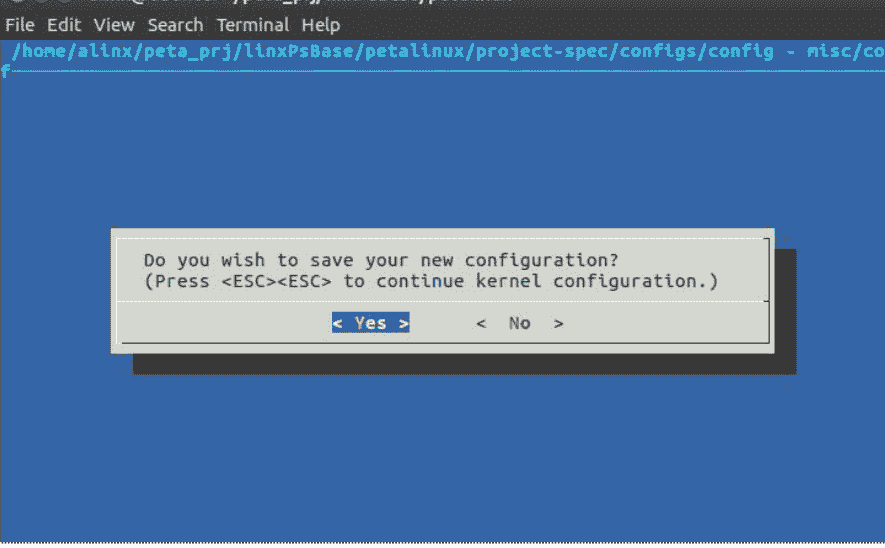

10) 等待配置完成


```bash
alinx2020@ubuntu:~/peta_prj/linxsBase/petalinux petalinux-config --get-hw-description /hardware/
[INFO] sourcing build tools
[INFO] Getting hardware description...
[INFO] Parsing design_wrapper.xsa to system
[INFO] generating kconfig for project
[INFO] menoconfig project

*** 配置结束。
*** 执行 'make' 开始构建或尝试 'make help'。
[INFO] sourcing environment
[INFO] generating u-boot configuration files, 这将在后续版本中废用
$
[INFO] generating kernel configuration files...
[INFO] generating kconfig for Rootfs
[INFO] silentconfig rootfs
[INFO] generating pintool conf
[INFO] generating user layers
[INFO] generating workspace directory
alinx2020@ubuntu:~/peta_prj/linxsBase/petalinux$
```

## 1.2 部分：修改设备树

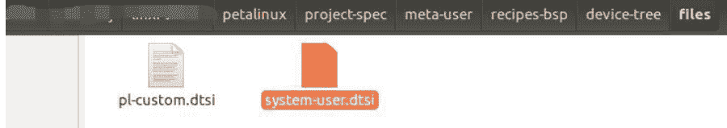

- 1) 如下修改图中 "project-spec/meta-user/recipes-bsp/device-tree/files/system-user.dtsi" 文件的内容：

```dtsi
/include/"system-conf.dtsi"
{
};

* SD */
&sdhci1 {
  disable-wp;
  no-1-8-v;
};

* USB */
&dwc3_0{
status = "okay";
dr_mode = "host";
};
```

### 2 输入开始编译的命令

```bash
petalinux-build
```

注意：此步骤必须确保 ubuntu 系统可以连接网络，petalinux 需要从 github 下载一些源码。

### 3 编译完成

```bash
alinx@ubuntu:~/meta_prj/linuxPsBase/petalinux-petalinux-build
[INFO] building project
[INFO] Starting bitbake...
[INFO] Starting bitbake petalinux-user-image
Time: 00:00:00
Loaded 340 entries from dependency cache
Time: 00:00:03
Parsed 2456 recipes from memory
Parsing 569 .bb files (2334 cached, 315 parsed, 3461 targets, 137 skipped, 0 masked, 0 errors).
Time: 00:00:08
NOTE: All tasks up to date.
Initializing tasks: 100% availability: 100% Time: 00:00:08
EXECUTING SetConsole Tasks
Time: 00:00:24
Task Summary: Attempted 3132 tasks of which 3132 didn't need to be rerun and all succeeded.
NOTE: No tasks need to be executed.
NOTE: Failed to copy build images to tftpboot dir: /tpboot
[INFO] successfully built project
alinxx@ubuntu:~/meta_prj/linuxPsBase/petalinux$
```

## 1.3 部分：生成 BOOT 文件

### 1 进入文件目录

```bash
cd ~/meta_prj/linuxPsBase/petalinux/images/linux
```

### 2 软件包，"--u-boot" 参数是需要打包和合成的内容，所有的 u-boot 依赖项将被合成，“--fpga" 指位位文件，"--force" 是强制合成并覆盖之前的合成 BOOT.BIN，请注意命令中有两个横杠。

```bash
petalinux-package --u-boot --fpga --force
```

# ALINX Ultrascale+ Linux 开发教程

```text
INFO: sourcing build tools
INFO: file not found BOOT: /home/alinx2020/jeta/jrunBase/petalinux/images/linux_ymng.elf
INFO: file not found BOOT: /home/alinx2020/jeta/jrunBase/petalinux/images/image.elf
INFO: file not found BOOT: /home/alinx2020/jeta/jrunBase/petalinux/images/design_wrapper.elf
INFO: file not found BOOT: /home/alinx2020/jeta/jrunBase/petalinux/images/linux.elf
INFO: file not found BOOT: /home/alinx2020/jeta/jrunBase/petalinux/images/system.map
INFO: file not found BOOT: /home/alinx2020/jeta/jrunBase/petalinux/images/linux.boot
INFO: Generating ramfs boot image...
**** Alinx Board V2022
** date: 2022-06-24 14:07:15
** Copyright 1998-2020 ALINX, All Rights Reserved.
[INFO] BootImage generated successfully
INFO: Binary is ready.
WARNING: Failed to access BOOT folder
WARNING: Skip file copy to BOOT folder!!
```

- 3) 在当前目录下，你可以看到新生成的 BOOT.bin 文件 (img/6f792577a28af84c82be0eef5006ef77_9_0.png)。

## 1.4 部分：运行 Linux

- 1) 将 SD 卡格式化为 FAT32。
- 2) 将 BOOT.bin、boot.scr 和 image.ub 文件拷贝到 SD 卡 (img/6f792577a28af84c82be0eef5006ef77_10_0.png)。
- 3) 将 SD 卡插入板卡。
- 4) 将板卡设置为 SD 启动模式。
- 5) 打开串口终端并开启板卡电源。
- 6) 使用用户 root 和密码 root 登录系统。因为根文件系统是默认的 RAM 类型，根文件系统无法保存文件和配置。

```text
root@petalinux
Fingerprint: sha256:66fd59e2304b6f29bd74963e89cbc074a
Starting server: inet.
Starting syslogd/klogd: done
Starting tc-agent: OK
PetaLinux2020 /dev/ttyS0
root@petalinux:~#
```

## 1.5 部分：Petalinux 流程

- 1) Petalinux 环境
  - 安装 Petalinux
  - 默认 root 文件系统，根文件系统无法保存文件和配置
  - 设置 petalinux 环境
  - 共享文件夹

- 2) 创建 Petalinux 项目
  - petalinux-create --type <CPU_TYPE> --name <PROJECT_NAME>
  - <CPU_TYPE> 可以是 zynq、microblaze；<PROJECT_NAME> 是项目名称

- 3) 硬件信息
  - 使用 cd 命令进入 petalinux 项目目录
  - 使用 petalinux-config --get-hw-description 指定包含 *.xsa 的目录

- 4) 配置 petalinux
  - 配置整个 petalinux 项目。如果需要配置以下：
    - petalinux-config -c uboot
    - petalinux-config -c kernel
    - petalinux-config -c rootfs

- 5) 编译创建系统镜像
  - petalinux-build

- 6) 手动修改 petux 配置，这些配置文件可以直接拷贝到其他项目。手动配置的文件存储在：
  <plnx-proj-root>/project-spec/meta-user 目录
  - recipes-bsp/u-boot/files/platform-top.h 修改 uboot 配置
  - recipes-bsp/device-tree/files/system-user.dtsi, recipes-bsp/device-tree/files/pl-custom.dtsi 可以修改和添加设备树
  - recipes-kernel/linux-xlnx 保存内核配置
  - project-spec/meta-user/recipes-apps 应用

- 7) 清理 petalinux
如果 petalinux 编译出现各种问题，特别是修改某些配置后无法正常编译或一直卡住，我们需要使用命令 petalinux-build -x clean 来清理之前的编译结果。

## 1.6 部分：将项目保存为模板项目

运行 "petalinux-build -x clean" 命令清理现有项目。根据下表清理文件夹：

| 文件夹或文件 | 可以删除 | 其他 |
|---|---|---|
| <基础目录> | *.xsa .gitignore | 保留 config.project |
| .petalinux/ | 删除除 metadata 以外的所有内容 | |
| .xil/ | 删除所有 | |
| components/ | 应该是空文件夹 | 空文件夹 |
| project-spec/ | yocto-layer.log | 保留 attributes |
| project-spec/configs/ | config.old, rootfs_config.old | 保留 config 和 rootfs_config |
| project-spec/hw-description/ | 删除除 metadata 以外的所有内容 | 必须保留 |


保存模板后，将新项目的 xsa 文件放入项目目录，然后使用命令 `petalinux-config --get-hw-description`。但如果需要手动修改 ddr 大小，请在 `project-spec/configs/config` 文件中修改定义。

```
# Memory Settings
# CONFIG_SUBSYSTEM_MEMORY_P5_DDR_0_BANKLESS_SELECT=y
# CONFIG_SUBSYSTEM_MEMORY_SIMPLE_SELECT is not set
# CONFIG_SUBSYSTEM_MEMORY_MANUAL_SELECT is not set
# CONFIG_SUBSYSTEM_MEMORY_P5_DDR_0_BANKLESS_SIZE=0x40000000
# CONFIG_SUBSYSTEM_MEMORY_P5_DDR_0_BANKLESS_KERNEL_BASEADDR=0x0
# CONFIG_SUBSYSTEM_MEMORY_P5_DDR_0_BANKLESS_U_BOOT_TEXTBASE_OFFSET=0x100000
# CONFIG_SUBSYSTEM_MEMORY_IF_NAME="P5_DDR_0"
```

## 第 1.7 部分：一些官方优化建议

为了通过禁用网络状态源来短编译时间，请取消选择

petalinux-config → Yocto Settings → Enable Network state feeds


# 第 2 部分：程序 hello world

## 第 2.1 部分：代码

- 1) 创建应用目录 `app_helloworld`

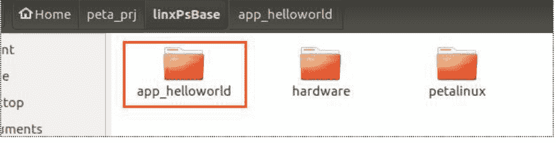

- 2) 在 `app_helloworld` 文件夹中创建一个 `main.c` 文件

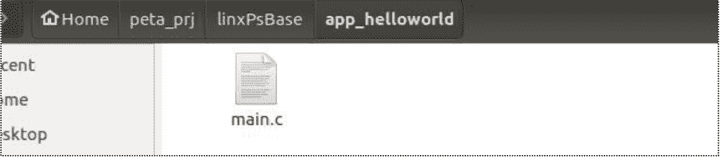

- 3) 编辑 `main.c` 文件

```c
#include <stdio.h>

int main(void)
{
    printf("hello world\r\n");
    return 0;
}
```

## 第 2.2 部分：编译主机程序

- 4) 编译程序

```bash
gcc -o helloworld main.c
```

- 5) 直接运行程序

```bash
/helloworld
```


- 6) 你可以看到打印出的信息 "hello world"，表明程序已在计算机上正确执行

## 第 2.3 部分：交叉编译 Arm 程序

程序最终需要在 FPGA 板卡上运行。我们需要选择 arm 编译器来为板卡编译程序。在这里，我们选择 Petalinux 安装自带的编译器。

- 1) 运行以下命令将 arm 编译器添加到环境变量中。该环境变量仅在当前终端有效，且必须在当前终端中完成以下命令。

```bash
source /tools/Xilinx/Vivado/2020.1/settings64.sh
```

- 2) 交叉编译器

```bash
aarch64-linux-gnu-gcc -o helloworld main.c
```

- 3) 在板卡上生成可执行程序 `helloworld`

- 4) 使用上一节中通过 petalinux 定制的 linux 系统，将可执行程序 `helloworld` 拷贝到 SD 卡中

| 电脑 > BOOT (l:) | SD卡目录 |
| :--- | :--- |
| BOOT.BIN | |
| image.ub | |

- 5) 设置板卡从 SD 卡启动并上电

- 6) 进入 linux 系统

- 7) 进入 `helloworld` 所在的目录（`sd-mmcblk1p1` 代表 SD 卡的第一个分区，`sd-mmcblk0p1` 代表第一个第一个分区）

```bash
cd /media/sd-mmcblk1p1
```

- 8) 运行程序

```bash
/helloworld
```

- 9) 你可以看到打印的消息 "hello world"，表明程序已板卡上正确执行


# 第 3 部分：控制 LED

在 linux 下编写一些简单的应用会非常容易，例如打开一个文件、写入一段数据并关闭。这完成了整个写入过程。至于这个位置是在 flash 还是硬盘，我们并不关心，这让一切变得更简单：

## 第 3.1 部分：由 Petalinux 生成的设备树

在 linux 内核中，已经包含了许多驱动。我们需要将这些驱动与 FPGA 板卡关联以生成可用设备。在我们定制 Linux 系统之前，petalinux 帮助我们生成了设备树。生成的设备树如下：

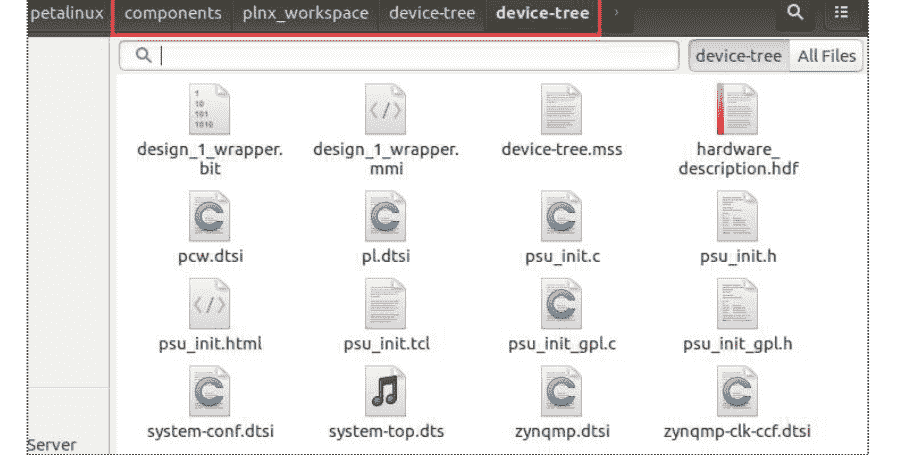

| | |
| :--- | :--- |
| design_wrapper.bit | device-tree.mss |
| hardware_description.hdf | .dt |
| psu_init.c | dtree |
| psu_init.tcl | psu_init.h |
| system-config.dtsi | psu_init_gpl.c |
| system-top.ps | zynqmp-cc.dtsi |

打开 `zynq.dtsi` 文件，ps 端的 gpio 设备树描述如下：

```dts
gpio@ff0a0000 {
    compatible = "inx,zynq-gpio";
    status = "disabled";
    gpio-cells = <2>;
    interrupt-parent = <gic>;
    interrupts = <0 16 4>;
    interrupt-controller-cells = <2>;
    reg = <0xff0a0000 0x1000>;
    power-domains = <&pd_gpio>;
};
```

## 第 3.2 部分：设备树

在目录下，用户对设备树修改是无效的。用户需要使用以下文件来修改或添加他的设备树。

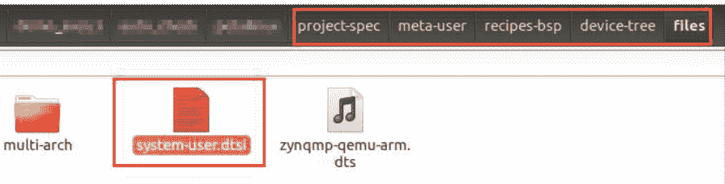

因为 ps 端的 GPIO 设备树由 petalinux 正确生成。

## 第 3.3 部分：项目创建

- 1) 参考 HelloWorld 章节，创建 `gpio_test.c` 函数并修改代码如下：

```c
#include <stdio.h>
#include <stdlib.h>
#include <unistd.h>
#include <fcntl.h>
#include <stdbool.h>

#define PS_LED_BASE 338
#define PS_LED_INDEX 40
#define PS_LED_ADDR (PS_LED_BASE+PS_LED_INDEX)

void led_ctl_init(void)
{
    int LGpioFd;
    char ICache[100];

    LGpioFd = open("/sys/class/gpio/export", O_WRONLY);
    if(LGpioFd < 0)
    {
        printf("open export fail\n");
        return;
    }
    int len = sprintf(ICache, "%d", PS_LED_ADDR);
    write(LGpioFd, ICache, len+1);
    close(LGpioFd);

    sprintf(ICache, "/sys/class/gpio/gpio%d/direction", PS_LED_ADDR);
    LGpioFd = open(ICache, O_RDWR);
    if(LGpioFd < 0)
    {
        printf("open direction fail\n");
        return;
    }
    write(LGpioFd, "out", 4);
    close(LGpioFd);
}

void led_ctl_on(bool isON)
{
    int LGpioFd;
    char ICache[100];

    sprintf(ICache, "/sys/class/gpio/gpio%d/value", PS_LED_ADDR);
    LGpioFd = open(ICache, O_RDWR);
    if (LGpioFd < 0)
    {
        printf("open value fail\n");
        return;
    }
    if(isON)
    {
        write(LGpioFd, "1", 2);
    }
    else
    {
        write(LGpioFd, "0", 2);
    }
    close(LGpioFd);
}

int main()
{
    led_ctl_init();
    printf("================ led ctrl================\n");
    while(1)
    {
        led_ctl_on(true);
        printf("on\r\n");
        usleep(500000);

        led_ctl_on(false);
        printf("off\r\n");
        usleep(500000);
    }
    return 0;
}
```


## 第 3.4 部分：运行程序

- 1) 启动并进入 FPGA 板卡的 linux 系统
2) 查看与 gpio 相关的节点如下

```bash
ls /sys/class/gpio/
```

```bash
root@petalinux:~# ls /sys/class/gpio/
export gpichip338 unexport
root@petalinux:~# _
```

- 3) 在这里，gpioxxxx 指的是一个 gpio 组，其中的引脚数量以及特定的引脚，如果用户不做其他更改，则由 vivado 项目决定。

- 4) 检查引脚标签信息以确定引脚所在的组

```bash
root@petalinux:~# ls /sys/class/gpio/
export gpichip338 unexport
root@petalinux:~# cat /sys/class/gpio/gpichip338/label
zynqmp_gpio
root@petalinux:~# _
```


这组 40 个引脚中 PS_led 引脚的偏移值，这正是我们实际上想要操作的引脚，代码中的宏定义如下：

```
#define PS_LED_BASE 338
#define PS_LED_INDEX 40
#define PS_LED_ADDR (PS_LED_BASE+PS_LED_INDEX)
```

7) 使用 nfs 挂载方法并运行程序，led 灯每秒闪烁一次

```
root@petalinux:# /mnt/gpio_test
==========start led ctrl===========
on
off
non
off
non
```

--- 
# 爱芯芯 Ultrascale+ Linux 开发基础教程
# 第 4 部分：添加启动脚本和用户文件

在之前的教程中，我们使用 petelinux 创建了 Linux。默认的根文件系统是 ramdisk 类型，且文件系统是只读的。对该目录的任何修改都会系统重启后丢失。本章描述了如何添加用户的应用程序和数据文件，并在启动后自动启动用户应用程序。

## 第 4.1 节：准备工作

选择之前创建的 petelinux 项目，并在控制终端中进入 petelinux 目录

## 第 4.2 节：自启动脚本

- 1. 输入以下命令创建一个应用模板，并创建一个名为 "autostart" 的应用

```
petalinux-create -t apps --template install --name autostart --enable
```

- 2. 进入模板目录

| meta_prj | linux_app_start | petelinux | project-spec | meta-user | recipes-apps | autostart |
| --- | --- | --- | --- | --- | --- | --- |
| | files | | autostart.bb | README | | |

- 3. 打开 files 文件夹中的 autostart 文件，这是一个脚本文件，用于打印字符串 "Hello Petelinux World"，我们将其更改为 "Hello ALINX World"，然后添加一段代码判断 SD 卡第一个分区是否存在 autostart.sh 脚本。如果存在，则运行它，用户可以根据实际需要对其进行修改，例如启动应用程序或其他初始化操作。

```
echo "Hello ALINX World"
USERHOOK_SD0=/media/mmcblkblk0p1/autostart.sh
USERHOOK_SD1=/media/mmcblkblk1p1/autostart.sh

if [ -f $USERHOOK_SD0 ]; then
    sh $USERHOOK_SD0 &
fi

if [ -f $USERHOOK_SD1 ]; then
    sh $USERHOOK_SD1 &
fi
```

- 4) 编辑后的文件 autostart.bb 内容如下，其主功能是将 autostart 复制到根文件系统的 init.d 目录，并添加 0755 权限。RDEPENDS_$(PN)_append += "bash" 意味着依赖 bash

```bash
#
# 此文件是 autostart 的 recipe。
#

SUMMARY = "Simple autostart application"
SECTION = "PETALINUX/apps"
LICENSE = "MIT"
LIC_FILES_CHKSUM =
"file://$(COMMON_LICENSE_DIR)/MIT;md5=0835ade698ecbf8506ecda2f74f302"

SRC_URI = "file://autostart \
"
S = "$(WORKDIR)"

inherit update-rc.d

INITSCRIPT_NAME = "autostart"
```

```bash
INITSCRIPT_PARAMS = "start 99 5."

do_install() {
    install -d $D(${sysconf})/init.d
    install -m 0755 $S/autostart $S(${sysconf})/init.d/autostart
}

RDEPENDS_$(_PN)_append += "bash"
```

## 5) 重新编译程序

```bash
petalinux-build
```

- 6) 打包并启动应用程序。在这里可以看到添加的脚本已经启动。你也可以在 SD 卡的第一个分区中放置 autostart 脚本。你可以享受你的 Amazon 了：

```bash
ssh -rsa AAAAB3NzaCly2EAAAAAAAQABAAABCTuWRkGrJkppopt/fQOE0hsa5JFJcf6Ee69GCVib
PhOHlMJ0A1rihXlcfI/bNTESQZE=m+zHRRTXFPYmY10QJfTraAuJ0di4yZJVs0J0DF5ucBu
mcN@petalinux:
Fingerprint: fe:c2:c5:7a:57:4a:ba07:ea:76:41:b4:b8:58:7f:e6:d6:67:8
Starting: syslog:inetd.
run/media/mmcblkp1/autostart.sh line 3: media-ctl: command not found
run/media/mmcblkp1/autostart.sh line 4: media-ctl: command not found
run/media/mmcblkp1/autostart.sh line 5: media-ctl: command not found
run/media/mmcblkp1/autostart.sh line 6: media-ctl: command not found
run/media/mmcblkp1/autostart.sh line 9: xrand: command not found


/home/alinx2020/meta_prj/linux_sdk/petalinux/project-spec/configs/rootfs_config/FP-System-Packages-Misc.gdb

使用方向键导航菜单。<Enter> 选择子菜单 ---> (或空子菜单 ...)。高亮的字母为热键。按 <Y> 包含，按 <X> 排除，按 <M> 模块化。按 <Esc><Esc> 退出，按 <?> 帮助，按 </> 搜索。图例：[*] 内置 []

```
 gdb
[ ] gdb-dev
[*] gdbserver
[ ] gdb-dbg
```

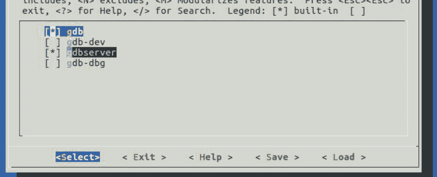

3) 检查 Petalinux 包组 (Package Groups) → packageroup-petalinux-matchbox，package-petalinux-matchbox，配置 matchbox 桌面，matchbox 是一个简单的 Linux 设备管理系统。

/home/alinx2020/meta_prj/linux_sdk/petalinux/project-spec/configs/rootfs_config/Petalinux Package Groups packageroup-petalinux-matchbox
package-petalinux-matchbox

使用方向键导航菜单。<Enter> 选择子菜单 ---> (或空子菜单 ...)。高亮的字母为热键。按 <Y> 包含，按 <X> 排除，按 <M> 模块化。按 <Esc><Esc> 退出，按 <?> 帮助，按 </> 搜索。图例：[*] 内置 []

```
[ ] packageroup-petalinux-matchbox
[ ] packageroup-petalinux-matchbox-dbg
[ ] packageroup-petalinux-matchbox-dev
```

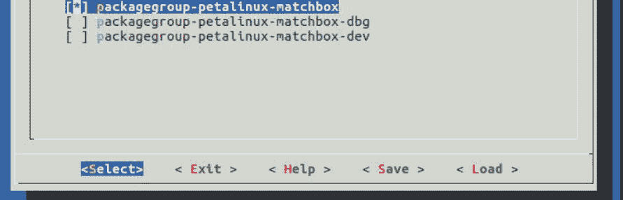

4) 检查 Petalinux 包组 (Package Groups) → packageroup-petalinux-opencv 以配置 opencv 库。这里没有勾选调试 (dbg) 和开发 (dev) 版本，这不会影响操作。勾选后，文件系统将非常大。

35 / 91 Amazon Store: https://www.amazon.com/alinx


```
/home/alinx2020/peta_prj/LinxPsBase/petalinux-sdk/project-spec/configs/rootfs_conf
- Petalinux_Package_Groups +packagegroup-petalinux-opencv
packagegroup-petalinux-opencv
```

使用方向键导航菜单 --<Enter> 选择子菜单 ---> (或空子菜单 ---)。高亮的字母为热键。按 <Y> 包含，按 <N> 排除，按 <M> 模块化。按 <Esc><Esc> 退出，按 <?> 帮助，按 </> 搜索。图例：[*] 内置 [ ] 排除 <M> 模块 <

```
[[*] packagegroup-petalinux-opencv
[ ] packagegroup-petalinux-opencv-dev
[ ] packagegroup-petalinux-opencv-dbg
```

```
<Select>  < Exit  < Help  < Save  < Load >
```

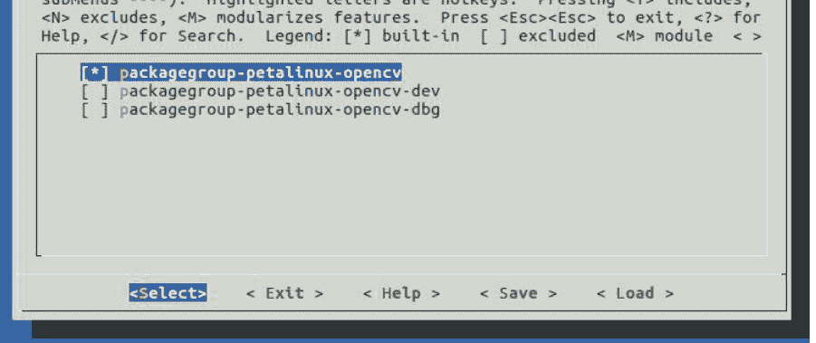

5) 检查 Petalinux 包组 (Package Groups) -> packagegroup-petalinux-qt，配置 qt 库

```
/home/alinx2020/peta_prj/LinxPsBase/petalinux-sdk/project-spec/configs/rootfs_c
-o- Petalinux_Package_Groups +packagegroup-petalinux-qt
packagegroup-petalinux-qt
```

使用方向键导航菜单 --<Enter> 选择子菜单 ---> (或空子菜单 ---)。高亮的字母为热键。按 <Y> 包含，按 <N> 排除，按 <M> 模块化。按 <Esc><Esc> 退出，按 <?> 帮助。图例：[*] 内置 [ ]

```
[[*] packagegroup-petalinux-qt
[ ] packagegroup-petalinux-qt-dev
[ ] packagegroup-petalinux-qt-dbg
[+] populate_sdk_qt5
```

```
<Select>  < Exit  < Help  < Save  < Load >
```

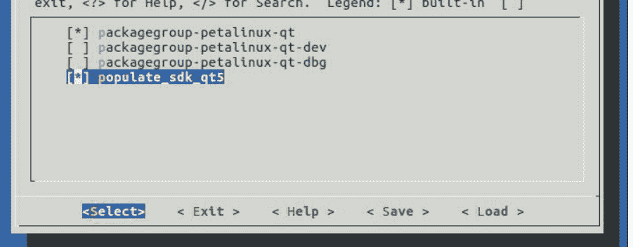

6) 检查 Petalinux 包组 (Package Groups) -> packagegroup-petalinux-v4lutils 以配置 v4l 工具。这主要是一个 Linux 上的视频配置工具，可用于视频开发。

36 / 91 Amazon Store: https://www.amazon.com/alinx


```
/home/alinx2020/peta_prj/linux.edb/petalinux/project-spec/configs/rootfs_conf-
petalux Package Groups -> packagegroup-petalinux-v4utils
packagegroup-petalinux-v4utils
使用方向键导航菜单。<Enter> 选择子菜单 --> (或空
子菜单 .... 高亮的字母为热键。按 <Y> 包含，
排除更多功能。按 <Esc> 
退出，按 <?> 帮助，/ 搜索。图例：[*] 内置 []

[*] packagegroup-petalinux-v4utils
[] packagegroup-petalinux-v4utils-dbg
[] packagegroup-petalinux-v4utils-dev

<Select>          < Exit >< Help >< Save >< Load >
```

7) 检查 Petalinux 包组 (Package Groups) -> packagegroup-petalinux-x11 以配置 x11 库

```
/home/alinx2020/eta_prj/linux/petalinux_sdk/project-spec/configs/rootfs_config-
petalux Package Groups -> packagegroup-petalinux-x11
packagegroup-petalinux-x11
使用方向键导航菜单。<Enter> 选择子菜单 --> (或空
子菜单 ....)。高亮的字母为热键。按 <Y> 包含，
<N> 排除，<M> 模块化。按 <Esc> 退出，按 <?> 帮助，
/ 搜索。图例：[*] 内置 [ ]
module
[*] packagegroup-petalinux-x11
[] packagegroup-petalinux-x11-dev
[] packagegroup-petalinux-x11-dbg
<Select>          < Exit >< Help >< Save >< Load >
```

8) 检查文件系统包 (Filesystem Packages) -> libs-alinx 以配置
GPU 库

37 / 91 Amazon Store: https://www.amazon.com/alinx


/home/alinx2020/petalinux_prj/linux_Base/petalinux_sdk/project-spec/configs/rootfs_config/
Filesystem Packages -> libs-alinx
使用方向键导航菜单。<Enter> 选择子菜单 ---> (或空
子菜单 ...) 高亮的字母为热键。按 <Y> 包含，
<X> 排除，<M> 模块化。按 <Esc><Esc> 退出，<?> 
帮助， </> 搜索。图例：[*] 内置 [ ] 排除 <M>
module
[*] alinx-linux
[*] alinx-linux-dbg
[*] alinx-linux-dev
[*]-defaults (x11)
<Select>          < Exit >< Help >< Save >< Load >

9) 编译 petalinux 项目
petalinux-build --sdk

# 第 6 部分：安装 SDK

你可以在 images/linux 目录下找到生成的 sdk.sh 文件。该文件较大且不是文本文件。它包含一个交叉编译器、各种库和头文件。它非常有用。如果你只需要做 Linux 应用，需要一个 sdk.sh 文件（注：原文为“如果你只需要做 Linux 应用，需要一个 sdk.sh 文件，这可以从 Petalinux 和 Vitis 分离”）。


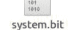


petalinux.cfg
bl31.bin
bl31.elf
BOOT.BIN
rootfs.cpio
rootfs.cpio.gz
rootfs.cpio.gz-boot
rootfs.jff
sdk.sh
system.bit
system.dtb
System.map.linux
zynqmp_fsblelf
zynqmp-qemu-arm-dt

2) 安装 sdk，它提示默认安装在 /opt/petalinux/2020.1。按回车并输入 Y 安装到默认目录。安装完成后，它提示
source /opt/petalinux/2020.1/environment-setup-arch64-xinx-linux
你可以使用 SDK

```
alinx2020@ubuntu:~/peta_prj/linux_sdk/images/linux$ ./sdk.sh
Petalinux SDK installer version 2020.1
=====================
Enter SDK 的目标目录 (默认: /opt/petalinux/2020.1):
你想将 SDK 安装到 "/opt/petalinux/2020.1"吗？继续 [Y/n]? y
[sudo] password for alinx2020:
Extracting SDK...
.. done
Setting up .. done
SDK 已设置好并可以使用。
每次在新的会话中使用 SDK 时，你都需要运行环境设置脚本 env.sh
$ /opt/petalinux/2020.1/environment-setup-arch64-xinx-linux
alinx2020@ubuntu:peta_prj/linux_sdk/images/linux $
```

3) 如果是 SD 卡根文件系统，请参考“制作 SD 卡根文件系统”来制作 SD 卡


## 第 6.3 部分：Qt Creator 交叉编译环境设置

1)  Qt Creator，如果找不到应用程序快捷方式，可以进行搜索。

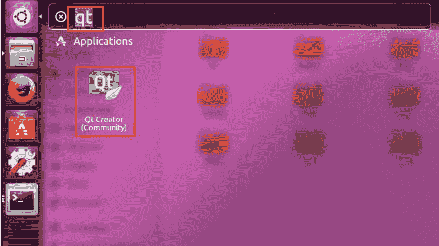

2) 点击 Tools（工具） -> Options（选项)。

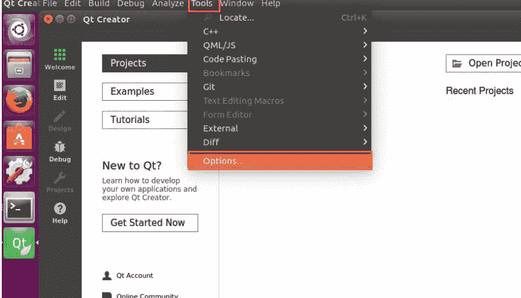

3) 在 Build & Run 选项的 Qt Versions 页面点击 "Add.."（添加..）。

4) 选择之前 SDK 编译生成的 qmake 文件，路径为：
/opt/petalinux/2020.1/sysroots/x86_64-petalinux-linux/usr/bin/qmake

5) 添加 qmake 后，保持默认名称，不要修改。

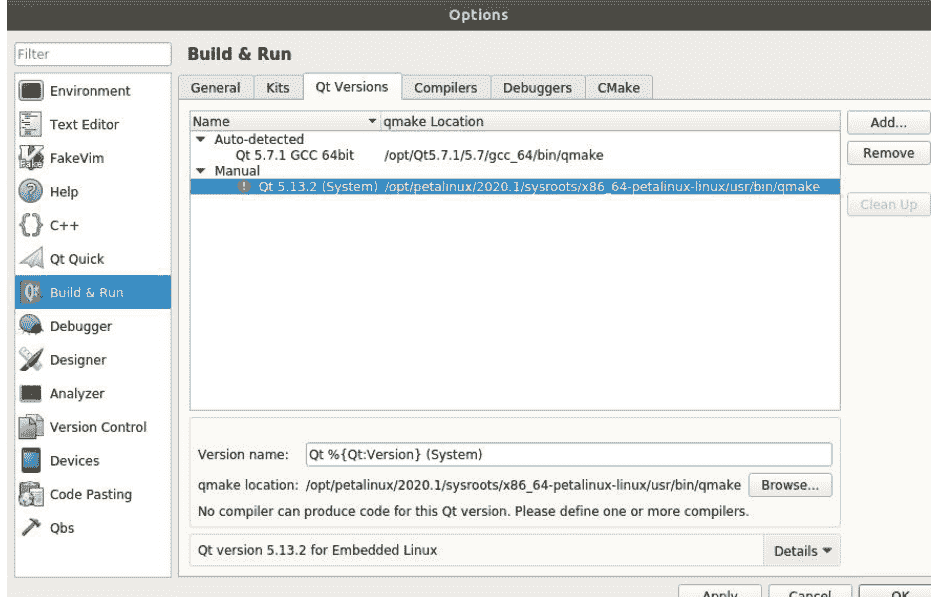

6) 在 Compilers（编译器）页面点击 "Add..",选择 GCC -> C。

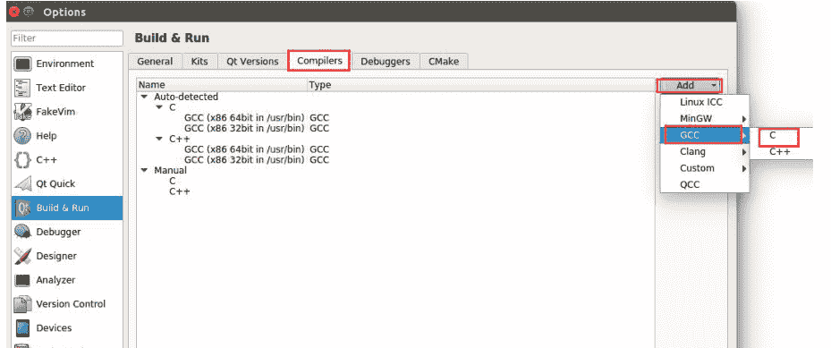

7) 将 Name 修改为 zynqMP_GCC，Compiler path 路径为 /opt/petalinux/2020.1/sysroots/x86_64-petalinux-linux/usr/bin/aarch64-xilinx-linux-aarch64-linux-gcc

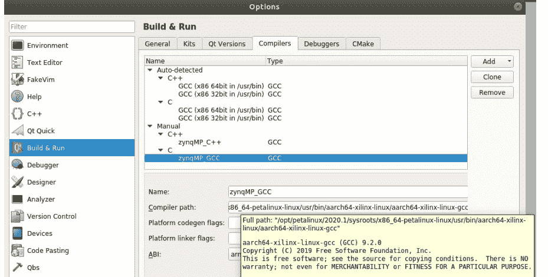

8) 在 Compilers 页面点击 "Add..",选择 GCC -> C++，将 Name 修改为 zynqMP_C++，路径选择为 /opt/petalinux/2020.1/sysroots/x86_64-petalinux-linux/usr/bin/aarch64-xilinx-linux-aarch64-linux-g++

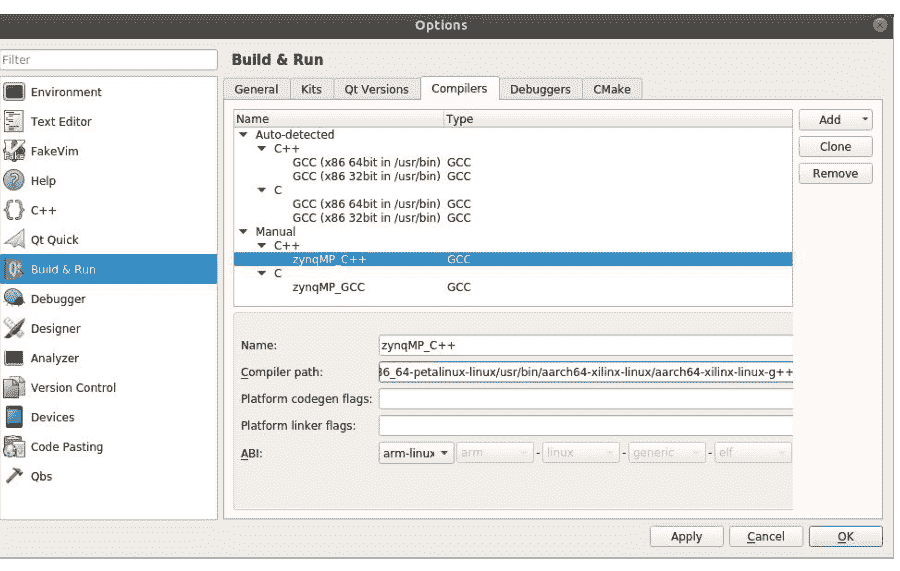

9) 点击 "Apply"（应用）更新信息。

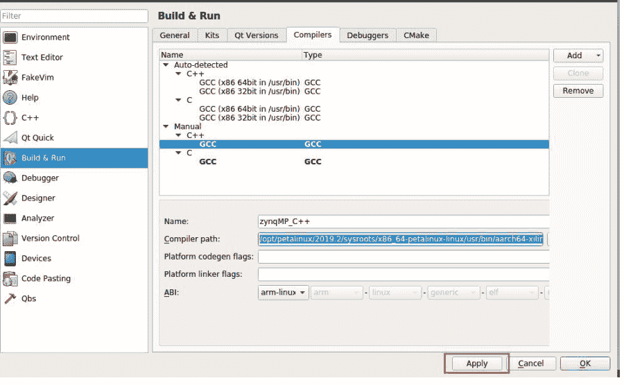

10) 选择 Debuggers（调试器），添加一个，点击 Add 添加调试器，将名称更改为 zynqMP_gdb，路径选择 /opt/petalinux/2020.1/sysroots/x86_64-petalinux-linux/usr/bin/aarch64-xilinx-linux/aarch64-xilinx-linux-gdb，点击 Apply。

11) 在 Kits（构建套）页面，点击 Add 添加新的 Kit，将 Name 修改为 zynqMP，Device type 选择 Generic Linux Device，Compiler C 选择 zynqMP_GCC，Compiler C++ 选择 zynqMP_C++，Debugger 选择 zynqMP_gdb，Qt version 选择 Qt 5.13.2 (System)。

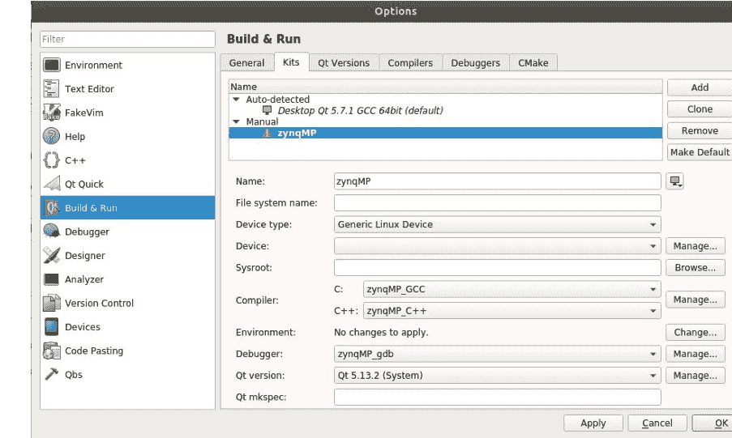

12) 点击 OK 完成 Kits 的配置。

### 6.3：创建 Qt 测试项目

1) 点击 File（文件） -> New File or Project（新建文件或项目）。

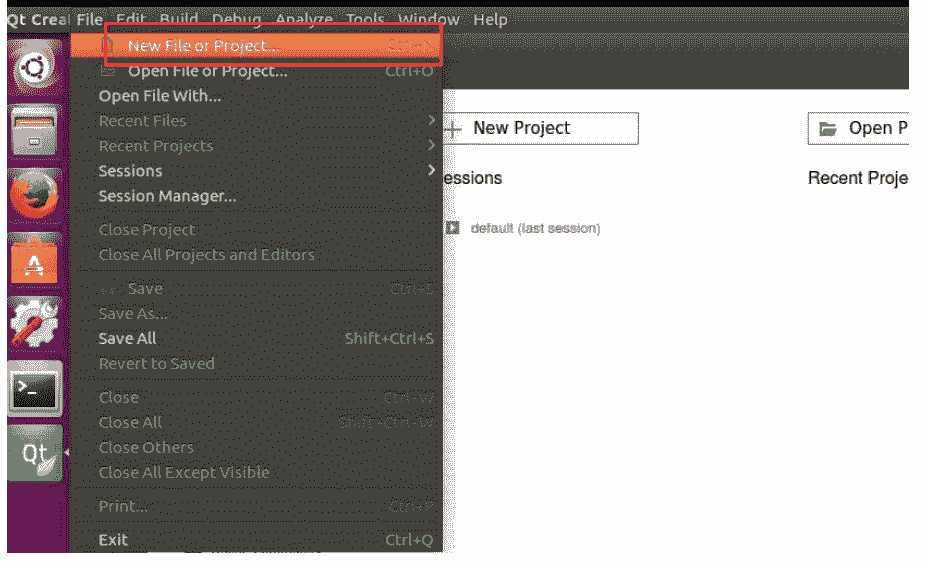

2) 选择 "Application" -> Qt Widgets 项目模板，然后点击 "Choose..."。

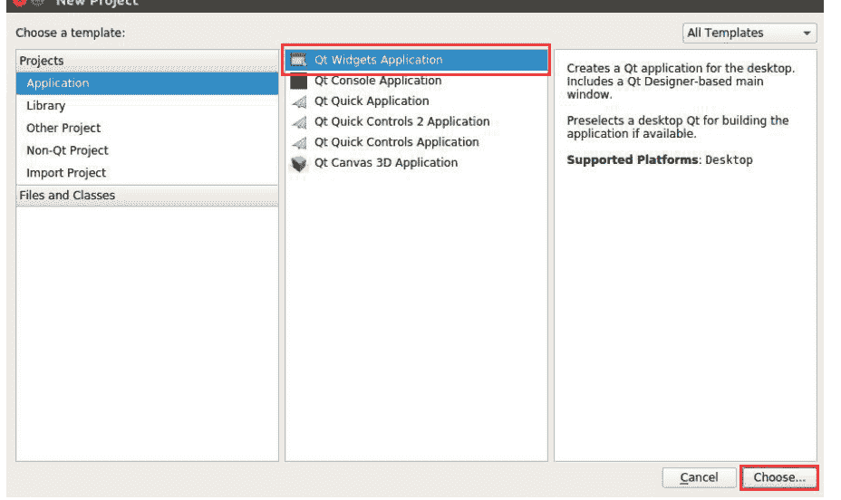

3) 将 Name更改为 qt_test，实验路径选择 /home/alinx/work。

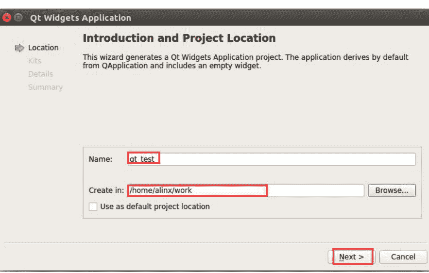

4) Kit 选择在此处的 ZYNQMP 版本。

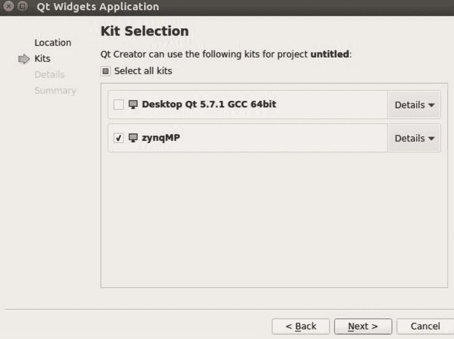

5) 点击 Next（下一步）继续。

6) 选择 Finish（完成）结束项目创建。

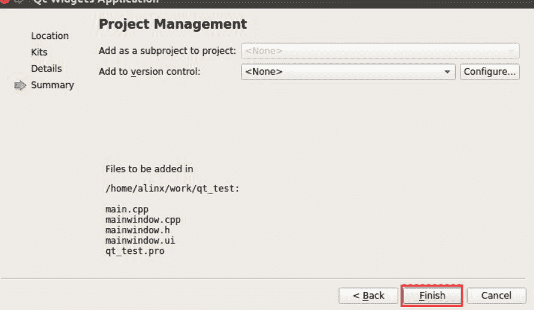

7) 双击 mainwindow.ui。

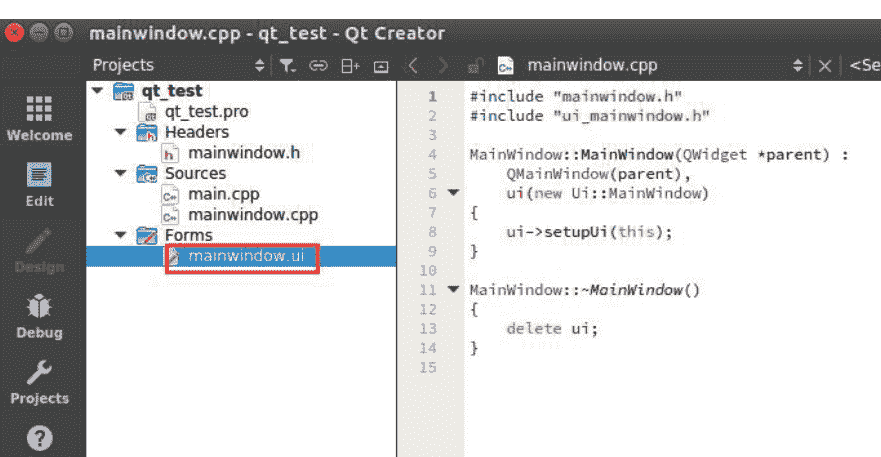

8) 将 Push 按钮拖入主界面。

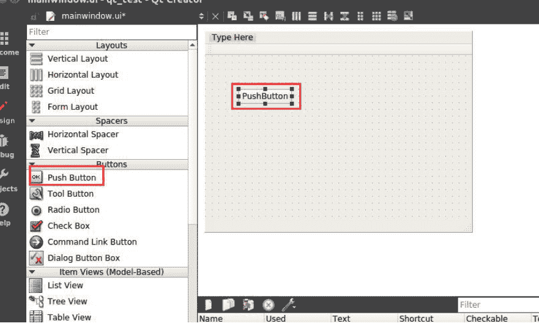

9) 双击文本部分进行修改。

10) 选择 ZYNQ Kit 并点击锤子图标进行编译。

11) 在 build-zynqMP 目录下可以看到生成的 qt_test 文件，该文件需要在 FPGA 板上运行。

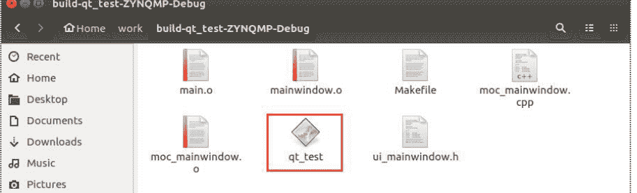

### 6.5：运行交叉编译的 Qt

1) 将之前生成的 BOOT.BIN 和 image.ub 拷贝到 sd 卡。

2) 启动 FPGA 板进入系统。

3) 为 Qt 设置环境变量（如果配置了 X11）：

```bash
export DISPLAY=:0
```

4) 运行 qt_test

```bash
/media/sdblk1/qt_test
```

5) 按 Ctrl + C 结束程序。

### 第7 部分：使用 Vitis 开发 Linux

在之前的教程中，我们使用 petalinux 构建了 Linux 系统。在本实验中，我们将创建一个 Linux 应用并在 FPGA 板上运行。此实验需要使用上述准备的 Linux 环境。

## 7.1：使用 Vitis 构建 Linux 应用

1) 在 /home/alinx/work 中创建 "linux_app" 目录作为工作空间。

2) 设置 Vivado 环境并运行 vitis。

```bash
source /tools/Xilinx/Vivado/2020.1/settings.sh
vitis
```

```
***** Vitis Environment
***** Vitis V2019.2-64-bit
** Build 20190628 on Nov 6 21:40:25 MST 2019
** Copyright 1986-2019 Xilinx, Inc. All Rights Reserved.
Launching Vitis with command '/tools/Xilinx/Vivado/2019.2/eclipse -Xmx64 -Xms64 -Xmx4G -Dorg.eclipse.core.runtime.logging.logfile=-Dosgi/configuration.area=@user.home/alinx/Vitis2019.2 -add-modules-all-UNNAMED --add-modules-dk=org.eclipse.plugins --add-opens=java.base/java.lang=ALL-NAMED --add-opens=java.base/java.util=ALL-NAMED --add-opens=java.desktop/java.util=ALL-NAMED --add-opens=java.desktop/java.awt=ALL-NAMED --add-opens=java.desktop/java.swing=ALL-NAMED --add-opens=java.desktop/java.awt=ALL-NAMED --add-opens=java.desktop/java.swing.tree=ALL-NAMED --add-opens=java.desktop/java.swing.platform=ALL-NAMED --add-opens=com.sun.sun=ALL-NAMED --add-opens=java.desktop/sun.awt.X11=ALL-NAMED
```

3) Workspace 选择 "/home/alinx/work/linux_app"。

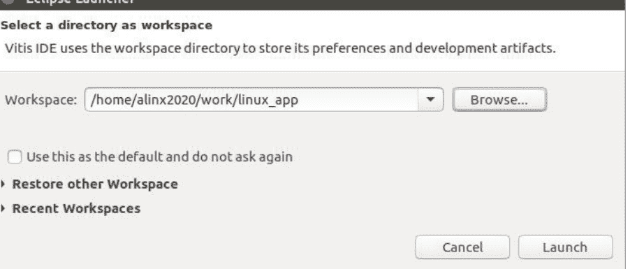

4) 点击 "Welcome" 上的 X 关闭欢迎界面。

5) 在 Explorer 的空白处右键点击 "New -> Project..."。

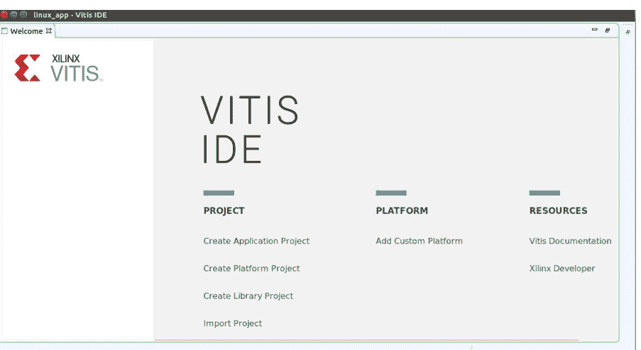

7) 填写项目名称 "hello"，在 Others 文件夹下选择项目类型 "Xilinx ARM v8 Linux Executable"，然后点击 "Finish"。

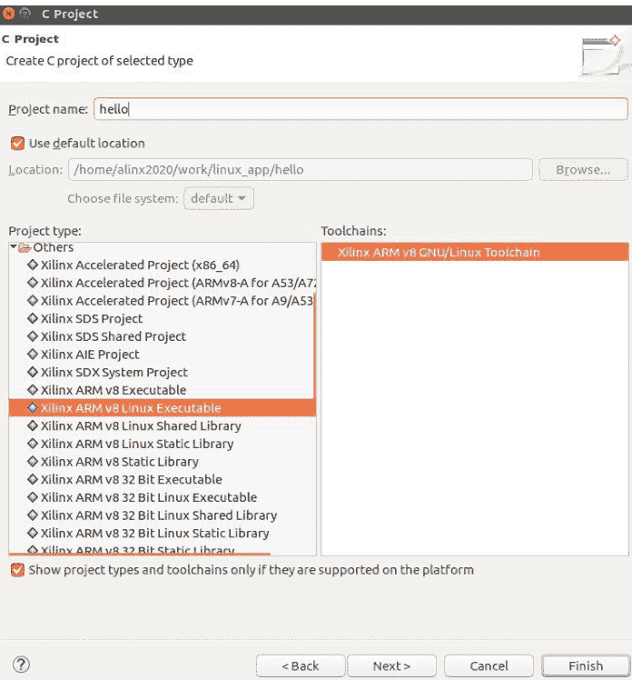

8) 如果弹出以下消息，点击 "No"。

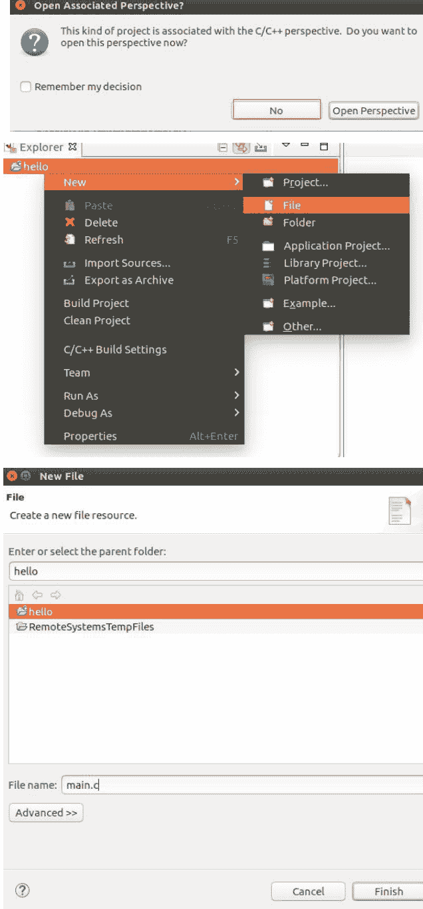


# ALINX Ultrascale+ Linux 开发基础教程

9) 编辑 main.c 文件并编写一个简单的打印

```c
#include<stdio.h>
#include<stdlib.h>
int main()
{
    printf("hello world!\n");
    return 0;
}
```

10) 编译项目

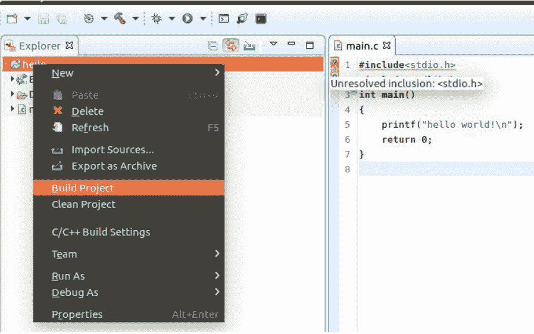

## 第 7.2 部分：通过 NFS 服务器运行（开发板已连接网线）

- 1) (PS, ETH1，路由器需要支持自动获取 IP，开启电源并挂载 Linux 宿机的 NFS。192.168.1.115 是主机地址，/home/alinx2020/work 是 NFS 目录，/mnt 是 FPGA 开发板的挂载点。此处，主机和 FPGA 开发板需要处于同一网段内（红色部分必须与你的实际情况一致）。

```bash
mount -t nfs -o nolock 192.168.1.115:/home/alinx2020/work /mnt
```

```bash
ax_Data login: root
Password:
root@ax_peta:~# mount -t nfs -o nolock 192.168.1.115:/home/alinx2020/work /mnt
root@ax_peta:~# 
```

- 2) 进入 /mnt/linux_app/hello/Debug 目录，运行 hello.elf，我们可以看到 Hello Hello World。

```bash
cd /mnt/linux_app/hello/Debug
./hello.elf
```

```bash
root_login: root
Password:
root@ax_peta:~# mount -t nfs -o nolock 192.168.1.115:/home/alinx2020/work /mnt
root@ax_peta:~# cd /mnt/linux_app/hello/Debug
root@ax_peta:~# cd /mnt/linux_app/hello/Debug# ./hello.elf
hello world!
root@ax_peta:~# /mnt/linux_app/hello/Debug# 
```

# 第 8 部分：Vitis 加速基础平台创建

注意：本教程要求熟练使用 Vivado 和 Petalinux，建议在学习过 OpenCL 和 HLS 之后尝试 Vitis 加速。

本章主要介绍如何自定义使用 PL 端 FPGA 加速的硬件和软件平台，这需要在 Vivado 项目中进行特殊处理以用于加速。加速需要具备 OpenCL 和 HLS 的知识。

## 第 8.1 部分：Vivado 硬件平台

- 1) 将不再详细解释 Vivado 项目的具体步骤，如下所示

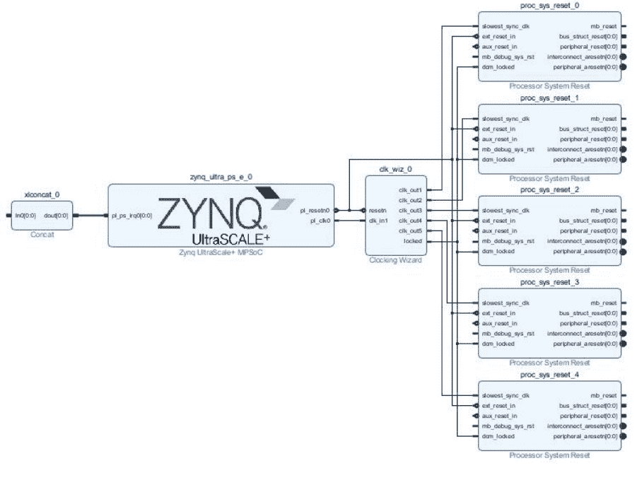

- 2) 定义平台 (PFM) 接口和属性。定义供 Vitis 使用的接口。点击 Vivado 菜单上的 Window→Platform Interface 设置平台。点击 Enable platform Interfaces 设置平台。

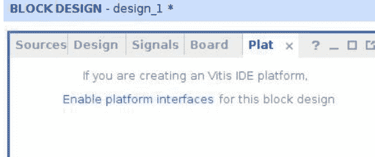

- 3) 修改开发板名称以便更容易理解 Vitis 平台。选择 Platform，将以下 Board 修改为 axu3eg

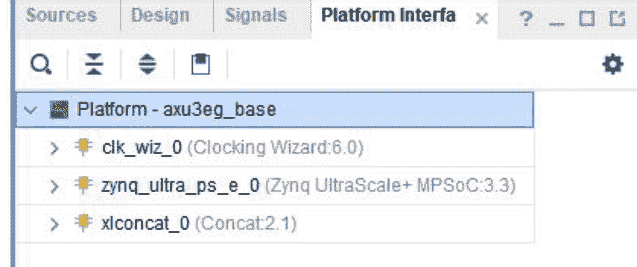
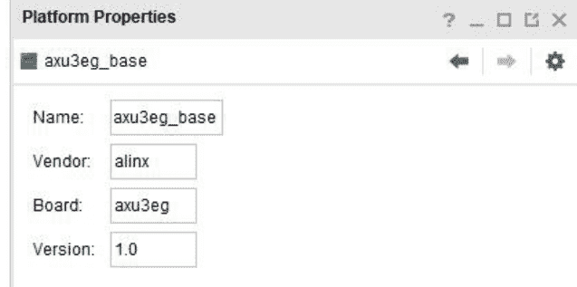

- 4) 定义可用的接口和端口。右键点击每个端口弹出菜单。你也可以双击在 Enable 和 Disable 之间切换。在 sysc_ultra_ps_0 中，将下一个接口和端口设置为 Enable（Disable 之外）AXI HPM0 FPD, AXI HPM1 FPD, AXI LPD, SXI HPC0 FPD, SXI HPC1 FPD, SXI HP0 FPD, SXI HP1 FPD, SXI HP2 FPD, SXI HP3 FPD；clk 全部使用 Enable。

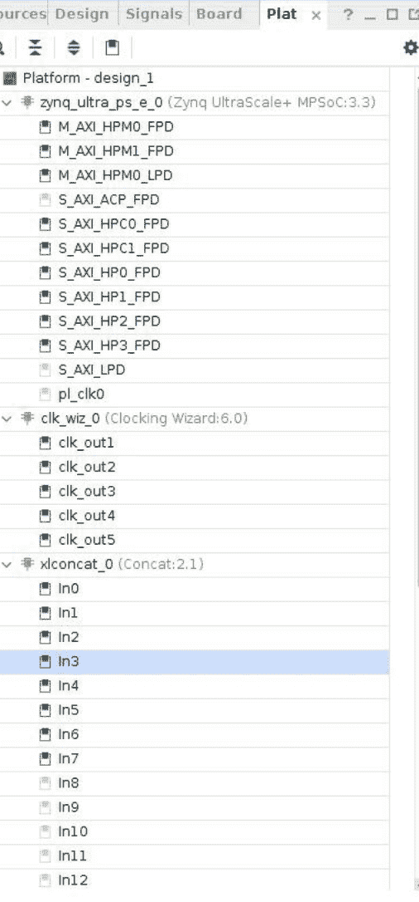

- 5) 时钟默认值。某个时钟必须设置为默认值。选择 clk 后，点击 Platform Properties 中的 Options 选项卡并选择 "default"。此外，Vitis 使用的默认时钟 ID 必须设置为 0。其他时钟从 1 开始排序，输入序列号后按 Enter 键确认。

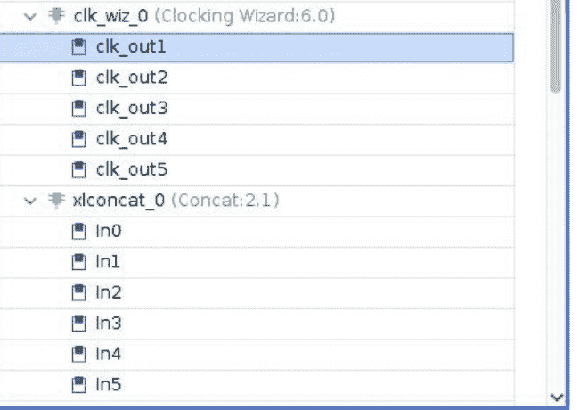

- 6) 然后编译并生成 bit 文件

- 7) XRT 环境设置，在 Tcl 控制台输入以下命令

```tcl
set_property platform.design_intent.embedded [current_project]
set_property platform.design_intent.managed [current_project]
```

## 第 8.2 部分：导出 XSA

- 8) 导出 XSA 以供 Vitis 加速。


# ALINX Ultrascale+ Linux 开发基础教程

11) 创建一个新的 pfm 文件夹用于构建 Vitis 平台层。

```bash
mkdir pfm
```

12) 将 petalinux 的 sdk 安装到 pfm 目录。sdk 的安装非常简单。
之前的教程已介绍过。

13) 创建一个 boot 文件夹，然后将 petalinux 生成的 `image.ub`、`zynqmp-fsbl.elf`、`pmufw.elf`、`bl31.elf` 和 `u-boot.elf` 拷贝到 boot 文件夹。

14) 在 boot 文件夹中创建一个 linux.bif 文件，内容如下：

```c
/* linux */
the_ROM_image:
{
[fsbl_config] a53_x64
[bootloader] zynqmp_fsbl.elf
[pmufw_image] pmufw.elf
[destination_device=pl] <bitstream>
[destination_cpu=a53-0, exception_level=el-3, trustzone] <bl31.elf>
[destination_cpu=a53-0, exception_level=el-2] <u-boot.elf>
}
```

## 第 8.3.2 部分：创建 vitis 平台

15) 进入 pfm 文件夹并启动 vitis 软件。

```bash
cd /pfm
vitis -workspace wksp1
```

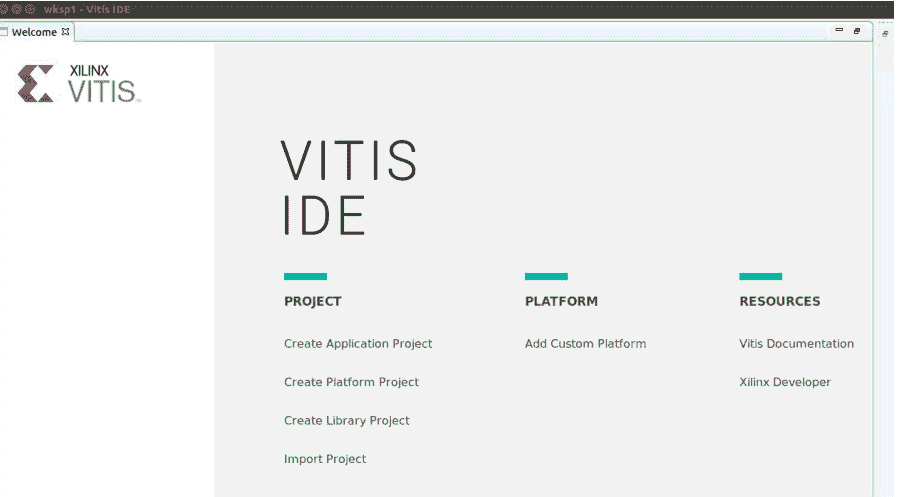

16) Vitis 启动后，选择 Create Platform Project（创建平台项目）（或从菜单选择 File→New→Platform Project），在 Project name 字段中输入 `axu3eg_base`，这与 xsa 名称一致。

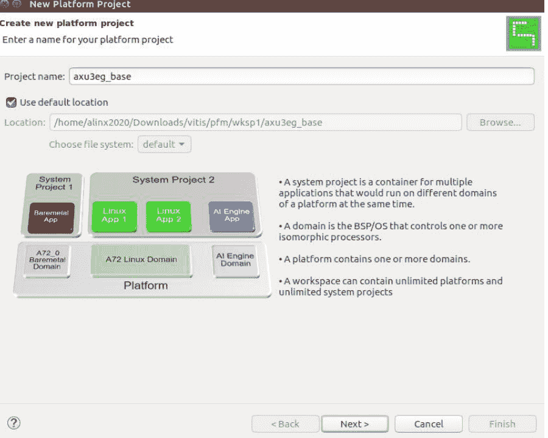

17) 接下来选择从哪里创建平台。因为它是从 XSA 生成的，请选择 Create from hardware specification (XSA)（从硬件规格创建），然后点击 Next（下一步）。

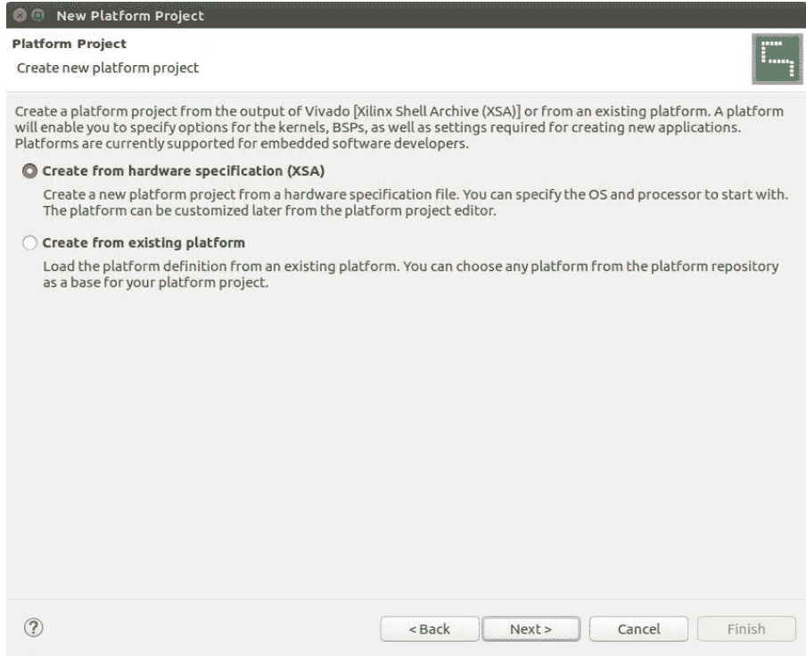

18) 指定使用 Vivado 创建的 xsa 文件，操作系统选择 Linux，处理器选择 psu_cortex53。如果其中一个符号显示为红色，没关系。设置完成后，点击 Finish（完成）。

### 新平台项目

### 平台项目规格

为新平台项目提供硬件和软件规格。

### 硬件规格

XSA 文件：/home/alinx2020/Downloads/petalinx/axu3eg_base.xsa

### 软件规格

操作系统：linux

处理器：psu_cortex53

> 注意：在平台项目中添加的 Linux 域需要更多细节才能生成平台。在生成平台之前，请在平台项目编辑器中指定缺失的细节。

## 生成启动组件

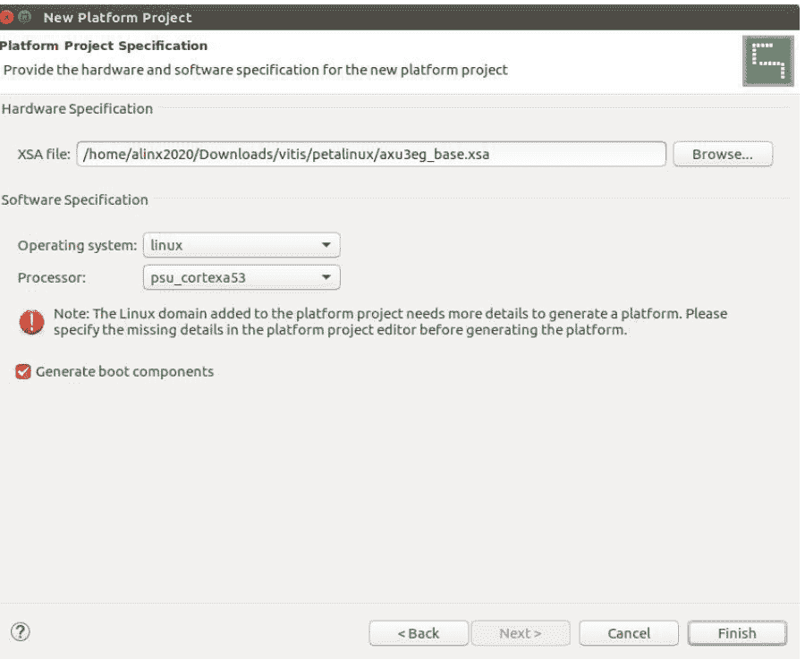

19) 窗口中有 linux、zynqmp fsbl 和 zynqmp pmuwf。对于 linux，稍后需要设置。

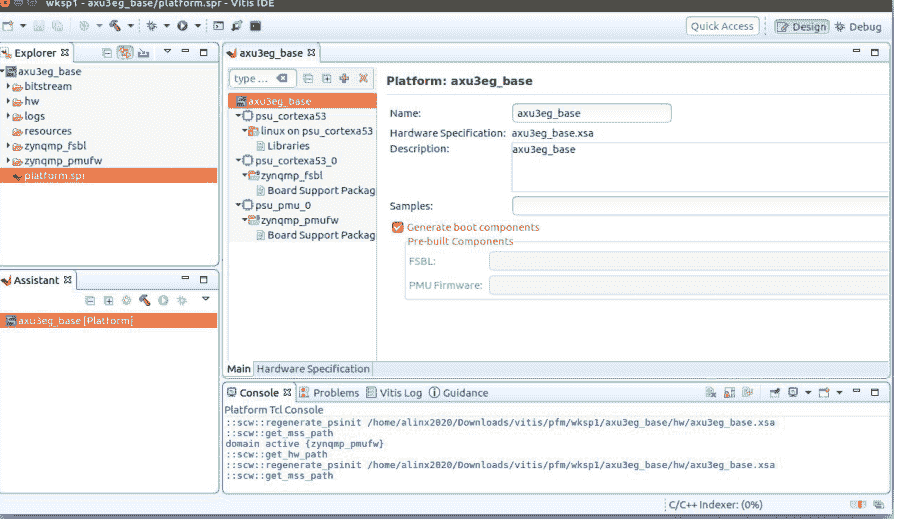

20) 在 psu_cortex53 的 linux 项的 Boot Component 中指定 bif 文件。

Directory 和 Linux image Directory 被指定为上面创建的 boot 目录。Sysroot 可以暂时不指定，如果你想指定，可以选择安装后的的 petalinux sdk root/aarch64-xilinx-linux 文件夹。点击右上角的锤子图标开始编译，并等待完成。

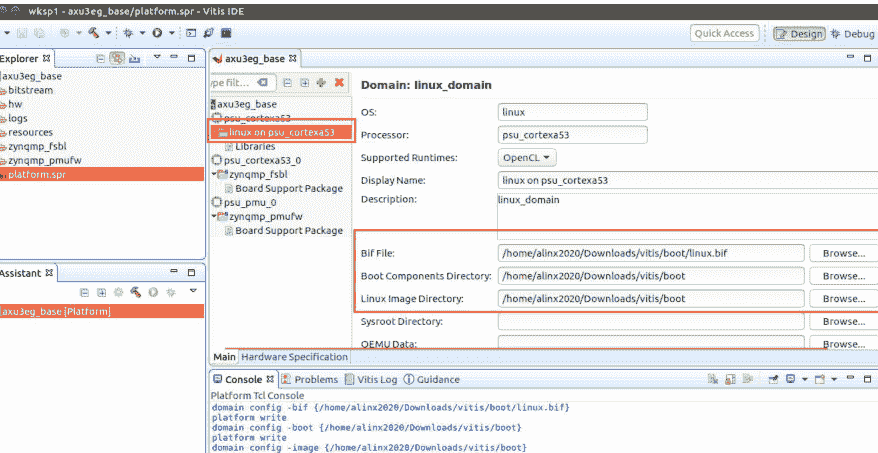

## 第 8.3.3 部分：Vitis 加速

21) 从 Vitis 菜单选择 File→New→Application Project（文件→新建→应用项目）。输入项目名称 `hello_world` 并点击 Next。

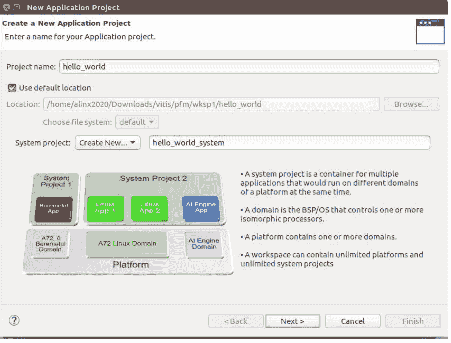

平台选择已建立的 `axu3eg_base`。

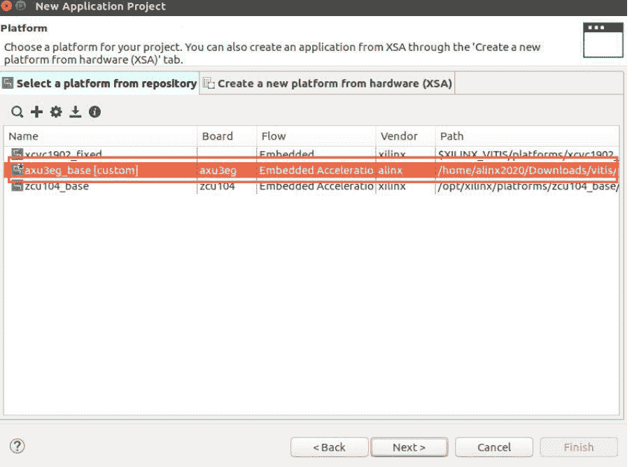

22) File system 选择 petalinux sdk 安装后的文件系统，点击 Next。

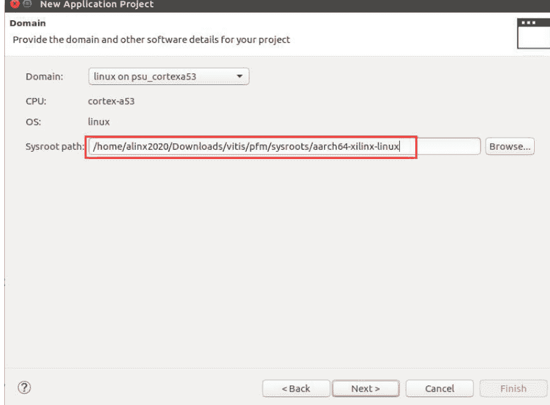

23) 选择 Hello world 作为模板。其他模板可能无法正常加速并需要修改。

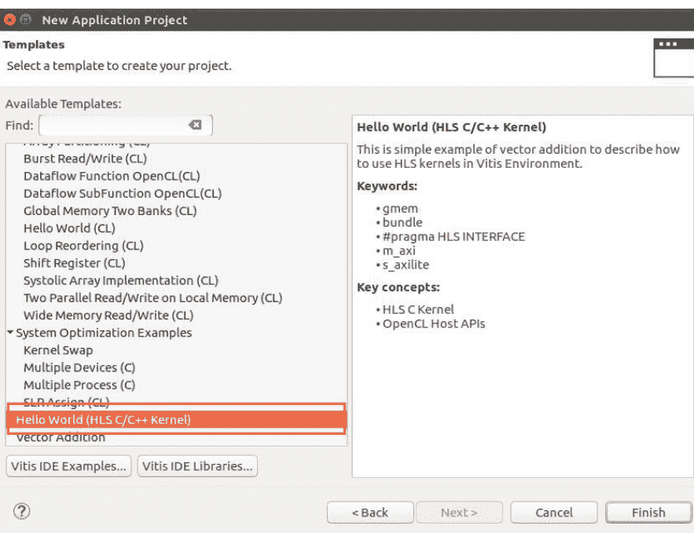

24) 在锤子图标下拉菜单中选择 Hardware（硬件），以生成在板上运行的文件，然后点击锤子进行编译。这需要很长时间并且需要超过 16G 的虚拟内存，否则会报错。

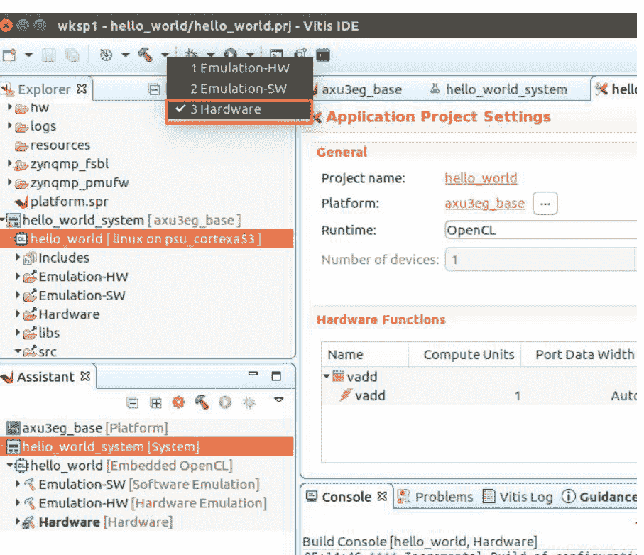 25) 编译完成后，在上述创建的 boot 目录中将 `image.ub` 等文件拷贝到板上。

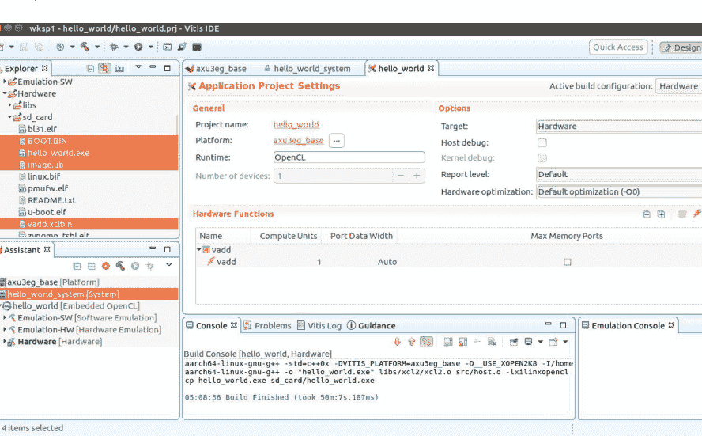 26) 在 boot 目录中将 petalinux 生成的镜像拷贝到 boot 目录。如果你想指定 Sysroot，可以选择安装后的 petalinux sdk root/aarch64-xilinx-linux 文件夹。


# ALINX Ultrascale+ Linux 开发基础教程

# 第 10 部分：从 QSPI Flash 启动 Linux

1) 使用 `petalinux-config` 命令配置 "Petalinux"


2) 在 "Subsystem AUTO Hardware Settings --->Advanced bootable images storage Settings --->boot image storage media"选项中选择 "primary flash"


3) 在 "Subsystem AUTO Hardware Settings --->Advanced bootable images storage Settings --->kernel image settings --->image storage media" 中选择 "primary flash"

```
/home/alinx/work/pet/a705_qpi/project-spec/configs/config - misc/config Sys
# ... advanced bootable images storage settings - kernel image settings
kernel image settings
```

使用方向键导航菜单，<enter> 选择子菜单 ---> (或空子菜单 ...)。高亮字母为热键。按 <Y> 包含，按 <X> 模块化功能。按 <Esc><Esc> 退出，</?> 帮助，</> 搜索。图例：[*] 内置 [


4) "Subsystem Auto Hardware Settings → Flash Settings" 可以修改 "QSPI flash partition"。

```
/home/alinx/downloads/linuxuboot_uaf/partition/project-spec/configs/config - misc/config System Configuration
# Subsystem Auto Hardware Settings - Flash Settings
Settings
使用方向键导航菜单，<enter> 选择子菜单 ---> (或空子菜单 ...)。高亮字母为热键。按 <X> 模块化功能。按 <Esc><Esc> 退出，</?> 帮助，</ 搜索。图例：[*] 排除 [ ] module
<
[*] Primary Flash (qspi_q0) ---
[*] advanced Boot Flash Configuration
*** partition 0 ***
(boot) name
(000000) size
*** partition 1 ***
(bootenv) name
( ) size
*** partition 2 ***
(kernel) name
(000000) size
*** partition 3 ***
(bootscr) name
(000000) size
*** partition 4 ***
() name

<Select> < Exit > < Help > < Save > < Load >
```

启动分区包含描述 FPGA 的 .bit 文件、u-boot、fsbl、设备树 .dtb 以及其他文件。启动分区的大小只需要大于这些文件大小之和，并且需要根据实际情况进行修改。

bootenv 分区存储 u-boot 环境变量，根据实际情况进行修改。

kernel 分区存储 image.ub。该分区比 image.ub 大，需要根据实际情况进行修改。

boot.scr 存储在 bootscr 分区中。该分区大于 boot.scr，需要根据实际情况进行修改。

另外注意，所有打包文件的总大小不能超过 flash 的大小。

- 5) 在 "Image Packaging Configuration ---> Root filesystem type" 选择中选择 "INITRAMFS"，使用 "RAM" 类型根文件系统，这样你可以轻松地打包到 "QSPI Flash" 中


- 6) 你可以在 "Firmware Version Configuration--->" 修改 "Host name"

```
/home/alinx/work/pet/a7015_qspi/project-spec/config/config misc/config Sys - Firmware Version Configuration
```

使用方向键导航菜单，<enter> 选择子菜单 ---> (或空子菜单 ...)。高亮字母为热键。按 <Y> 包含，按 <N> 排除，按 <M> 模块化功能。按 <Esc><Esc> 退出，</?> 帮助，</> 搜索。图例：[*] 内置 [


- 7) 保存配置并退出。然后使用 petalinux-config -c u-boot 来配置 u-boot

```
.config - U-Boot 2020.01 Configuration
```

使用方向键导航菜单，<enter> 选择子菜单 ---> (空子菜单 ...)。高亮字母为热键。按 <Y> 包含，按 <N> 排除，按 <M> 模块化功能。按 <Esc><Esc> 退出，</?> 帮助，</> 搜索。图例：[*] 内置 [

| Architecture select (ARM architecture) ---> |
| ARM architecture ---> |
| General setup ---> |
| Boot images ---> |
| Boot media ---> |
| Boot timing ---> |
| Enable boot before |
| 8) ARM architecture ---> 设置 boot partition 的偏移量。

- 9) 打开 project-spec/meta-user/bsp/boot.bbappend。

- 10) 保存后，使用 petalinux 编译。

- 11) 编译完成后，根据 --kernel 选项修改 kernel。

- 12) 参考 vitis 教程中的方法将 BOOT.bin 烧录到 FPGA 开发板。

- 13) 将 FPGA 开发板上的拨码开关设置为 QSPI 启动，然后打开 FPGA 开发板。

# 第 11 部分：从 EMMC 启动 Linux

EMMC 和 SD 卡类似

使用 SD 卡制作系统参考第 1 或第 5 部分。
使用 Qflash 启动系统参考第 10 部分。

## 第 11.1 部分：格式化 EMMC 并挂载

格式化 EMMC 参考第 9 部分中的 SSD 操作，mmc 设备通常为 "/dev/mmcblk"，与 SD 卡的设备名称格式相同。至于哪一个是 SD 卡，你需要自行识别。

与 SSD 的区别在于，分区完成后，SSD 使用 mkfs 命令将分区格式化为 EXT4 格式，但这里我们需要将 EMMC 格式化为 FAT32。分区完成后，执行以下操作


# ALINX Ultrascale+ Linux 开发基础教程

```
root@petalinux:~# fdisk /dev/mmblk0

Welcome to fdisk (util-linux 2.34).
Changes will remain in memory only, until you decide to write them.
Be careful before using the command.

Command (m for help): t
Selected partition 1
Hex code (t to list all codes):
0 Empty 24 NE-DOS 81 Linux / Old bnf Solaris
1 FAT16 25 Hidden NTFS 82 Linux swap / So c1 DRDOS/sec (FAT-
2 FAT32 26 Hidden NTFS 83 Linux c4 DRDOS/sec (FAT-
3 XFS 27 Partitionable 84 OS/2 or older c6 DRDOS/sec (FAT-
4 FAT16 28 Boot 85 Linux extended c7 Syrinx
5 Extended 29 Linux Boot 86 NTFS volume de c8 Monos+FS data
6 FAT16 30 87 NTFS volume db c9 CFM / CP / CMOS -
7 NTFS/exFAT 31 88 Linux deoct de e0 Dell Utility
8 AIX 32 89 Linux deoct e1 Boot
9 AIX account 33 90 Amoeba e2 DOS Access
10 OS/Boot M 34 91 Amiga EBT e3 DOS R/O
11 WFS 35 92 Linux e4 Speedsator
12 WFS FAT32 (LBA) 36 93 Linux e5 Rufus
13 WFS FAT32 (LBA) 37 94 FreeBSD f6 Linux/FAT-RISC
14 OPFS 38 95 HP Thinpro deis g7 EFI (12-16)
15 EZ-Drive 39 96 Golden HD of Su/Xe h8 Floppy
16 Hidden 40 97 Darwin UFS i9 Speedstar
17 Hidden 41 98 Darwin boot j0 DOS secondary
18 AS Smart-Sleep 42 99 BSI swap k1 VMware NTFS
19 Novell Netware 43 BSI hid l l2 VMware VMCORE
20 Novell Netware 44 Linux Linux raid boot
21 WFS FAT32 45 Android FAT32 l3 Scalable
22 WFS FAT32 46 Solaris m BBT
Hex code (type to list all codes) b
Change type of partition 'W95 FAT32' to 'W95 FAT32'.

Command (m for help): w
The partition table has been altered.
Syncing disks.
root@petalinux:~# _
```

如果你在首次尝试使用 `mkfs` 命令将分区格式化为 EXT4 并执行操作时遇到错误，请检查。

格式化完成后，确保使用 `mount` 命令查看 eMMC 的状态。如果分区未挂载，请按照路径在 NFS 上进行挂载。

## 第 11.2 节：使用 NFS 的虚拟机文件夹

我们需要在虚拟机上启动由 eMMC 引导的系统。为了方便拷贝 FPGA 开发板系统所需的系统文件。

NFS 操作参考第 7.2 节。

## 第 11.3 节：制作 EMMC 启动系统

EMMC 启动和 SD 卡启动几乎相同。只需根据 SD 启动系统修改 petalinux 中的一个设置即可。

- 1) 进入 petalinux-config
- 2) 选择 Subsystem AUTO Hardware Settings

```
misc/config System Configuration
Arrow keys navigate the menu. <enter> selects submenu (or empty
ubmenu...). Highlighted letters are hotkeys. Press <Y>
Includes, <n> excludes, <*> modular features. Press <Esc><Esc> to
exit, <?> for Help, < /> for Search

- ZYNQ Configuration
Linux Components ---

 Settings ---
Auto Settings ---
DTG Settings ---
MPMC Configuration ---
SBL Configuration ---
IBN Trusted Firmware Configuration ---
FPGA Manager ---
U-boot Configuration ---
Image Packaging Configuration ---
Firmware Version Configuration ---
(*)
<Select> < Exit > < Help > < Save >
```

- 3) 选择 SD/DIO Settings

```
system Settings Settings
Arrow keys navigate the menu. <enter> selects submenu (or empty
ubmenu...). Highlighted letters are hotkeys. Press <Y>
Includes, <n> excludes, <*> modular features. Press <Esc><Esc> to
exit, <?> for Help, < /> for Search

- Subsystem AUTO Hardware Settings
System Processor (psu_cortex53_0) ---
Memory Settings ---
Serial Settings --nEthernet Settings ---
Flash Settings ---
SD/DIO Settings ---
RTC Settings ---
[*] Advanced boot images storage settings ---
<Select> < Exit > < Help > < Save >
```

 4) 选择对应 eMMC 的 SDIO（如果不确定，请尝试）

- 5) 保存并退出配置界面，重新编译系统。

- 6) 将编译得到的图中所示的三个文件拷贝到开发板 NFS 挂载的文件夹中。

- 7) 将 FPGA 开发板系统中的这三个文件拷贝到 eMMC 挂载的目录。

- 8) 拷贝完成后，使用 `umount` 命令卸载 eMMC。

- 9) 断开开发板电源，将拨开关拨到 eMMC 启动状态，然后重新上电。

