# Linux 路由


# 商标

All terms mentioned in this book that are known to be trademarks or service marks have been appropriately capitalized. New Riders Publishing cannot attest to the accuracy of this information. Use of a term in this book should not be regarded as affecting the validity of any trademark or service mark.

# 警告与免责声明

This book is designed to provide information about Linux Routing. Every effort has been made to make this book as complete and as accurate as possible, but no warranty or fitness is implied.

The information is provided on an as-is basis. The authors and New Riders Publishing shall have neither liability nor responsibility to any person or entity with respect to any loss or damages arising from the information contained in this book or from the use of the discs or programs that may accompany it.

Publisher
David Dwyer

Associate Publisher
Stephanie Wall

Managing Editor
Kristy Knoop

Acquisitions Editor
Ann Quinn

Development Editor
Chris Zahn

Product Marketing Manager
Stephanie Layton

Publicity Manager
Susan Nixon

Copy Editor
Chrissy Andry

Indexer
Joy Dean Lee

Manufacturing Coordinator
Jim Conway

Book Designer
Louisa Klucznik

Cover Designer
Aren Howell
Brainstorm Design, Inc.

Proofreader
Stacia Mellinger

Composition
Ron Wise

**From Joe:**

This book is dedicated to all the developers and people who develop and use GNU/Linux and Free Software because they believe in working towards something that benefits everyone—not just their own bank account—

**From Dee-Ann:**

To my mom, who told me that one can never dedicate too many books to one's mother!

**From Ron:**

I would like to dedicate Linux Routing to my wife, Claudia.

# 3 边界路由协议简介

Protocols 55

Interior Gateway Protocol (IGP) 55

Exterior Gateway Protocol (EGP) 56

Border Gateway Protocol (BGP) 58

Border Gateway Multicast Protocol (BGMP) 61

Multicast Source Discovery Protocol (MSDP) 63

Summary 64

# 4 IPv4 和 IPv6 地址 65

IPv4 Addressing 65

Classless IPv4 Addressing 73

IPv6 Addressing 80

Summary 86

# II Linux 路由问题与技术

# 5 内核 2.2.x 单播守护进程内部 89

Guide to routed 89

Guide to gated 92

Summary 139

# 6 内核 2.2.x 组播守护进程内部 141

The PIM-SM Linux Daemon: pim6d 141

The DVMRP Daemon: mrouted 144

Summary 147

# 7 内核支持工具 149

PPP Overview 150

PPP for Linux 156

rip2ad 161

Summary 163


# 8 内核 2.4.x 路由守护进程 165
- 从 2.2.x 到 2.4.x 的变更 165
- 其他 Linux 2.4.x 内核网络选项 167
- 虚拟专用网络 169
- 摘要 171

# 9 命令内部 173
- ifconfig 173
- route 180
- ping 183
- 地址解析协议 (ARP) 184
- traceroute 187
- netstat 190
- tcpdump 194
- 摘要 201

# 10 规划基本路由器布局和功能 203
- 网络规划简介 203
- 通过受管路由表实现有效的路由器管理 209
- 特殊情况路由功能 213
- 摘要 217

# 11 Linux 路由基础 219
- LAN 路由基础 219
- WAN 路由基础 223
- VPN 路由基础 225
- 摘要 226

# 12 网络硬件组件、技术和解决方案 227
- 模拟通信和调制解调器 227
- 有线调制解调器 234
- 数字用户线路 236
- 使用路由器的网络数据 238
- 摘要 243

# 13 构建路由内核 245
### 为什么要构建？ 245

### 构建 Linux 内核 248

### 特殊功能发行版 254

### 摘要 257

# 14 安全和 NAT 问题 259
### 使用路由器进行数据包过滤和数据包改写 260

### IP 伪装 268

### 网络地址转换 (NAT) 270

### 摘要 272

# 15 监控、分析和控制网络流量 273
### 监控和分析工具 273

### 服务质量 (QoS) 294

### 摘要 297

# III 附录

# A Linux 路由资源 301
### Linux 路由守护进程 301

### Linux 路由和流量管理工具 302

### 相关资源 303

### 官方参考文档 304

# B Linux 硬件路由解决方案 305
### 独立 Linux 路由器 305

### 与 Linux 兼容的路由卡 306

## 索引 307

## 关于技术审校

这些审校人员为《Linux Routing》的整个开发过程贡献了他们相当丰富的实践经验。在本书撰写期间，这些敬业的专业人士对所有材料的专业内容、组织和流程进行了审阅。他们的反馈对于确保《Linux Routing》满足我们读者对最高质量技术信息的需求至关重要。

Brad Harris 已从事 IT 行业六年，起初在国防部从事生物识别模型开发工作。他继续在 DODD 从事对中高保证网络的渗透和攻击工作。他在网络协议、操作系统内部结构和各种编程语言方面拥有丰富的背景。他的专长包括安全分析、漏洞和利用的发现与创建、逆向工程以及系统和网络的安全保障。他目前是 ACS, Inc. 的高级软件工程师，专攻漏洞开发和系统/网络渗透。


Joseph Hamm 是一名自由技术顾问，拥有工程和部署基于 IP 的通信解决方案的经验。过去一年，Joseph 专注于思科 VoIP 解决方案的设计和部署，包括网络和电缆布线实施、网关配置、拨号计划构建和呼叫处理系统实施。目前，Joseph 将大部分时间花在研究和撰写关于计算平台和操作系统演变的文章上。


## 致谢

成为一名作者有很多好处，其中最不重要的就是在完成一本书时能够公开感谢你生命中重要的人。

我想感谢我的家人，因为他们...嗯，就是一个家庭。还要特别感谢 Denise Bay 及其家人，因为他们是一个很棒的“第二家庭”。

感谢所有我的朋友们，他们在听我谈论 Linux 和计算机时没有明显的无聊迹象。我非常感激！Bonnie、Suzanne、Jason、Pete、Bevin、Barb，你们都很棒。

非常感谢 Linux Magazine 的各位，Adam、Lara 和 Bob “大啤酒哥”。（你以为我会忘记？）与你们大家一起工作非常有趣。还要特别感谢 UnixReview.com 的各位，因为与你们合作很愉快。

在过去三年里，我在 GNU/Linux 社区遇到了很多对我非常重要的人。即使我不能经常见到或与你们交谈，我也很高兴自己在过去几年里有幸参与了 GNU/Linux。

我首先要感谢来自 www.stardust.com/Multicast 的 IP 多播邮件列表的成员们，在我试图熟悉 IP 多播时，他们给予了我极大的帮助。多亏了他们，我才能够涵盖协议在何时使用等一些细微差别。我还要感谢在写作开始前对我打算涵盖的内容进行同行评审的人们。他们的评论塑造了本书中很大一部分内容。

额外的感谢给予在整个项目中帮助我保持警觉的技术审校人员。他们的职责不仅是防止我出丑并把大错误印出来，而且还要确保你，读者，能够从书中的页面中获得最大的益处。

最后但并非最不重要，我要感谢我的合著者 Joe 和 Ron。在这个项目的很大一部分时间里我都病了，经过长时间的寻找，我们请来了这两位优秀的先生，以确保我不仅能按时完成这本书，而且它保持了最好的质量和对读者的实用性。这本书远远超过了其各部分的简单总和，部分归功于他们辛勤的工作。

特别感谢技术审校 Brad Harris 和 Joseph Hamm。

我们想感谢开发编辑 Chris Zahn 和收购编辑 Ann Quinn，他们在创建你正在阅读的这本书的工作中展现了专业的洞察力和勤勉。感谢 New Riders 的团队其他成员，他们也帮助使这本书成为可能——Stephanie Wall、Kristy Knoop、Chrissy Andy、Joy Dean Lee 和 Ron Wise。


## 告诉我们您的想法

作为本书的读者，您是最重要的批评者和评论者。我们重视您的意见，想知道我们做得对的地方、可以做得更好的地方、您希望我们出版的领域，以及您愿意分享给我们的任何其他智慧之言。

作为 New Riders Publishing 的副出版人，我欢迎您的评论。您可以通过传真、电子邮件或直接写信给我，让我知道您喜欢或不喜欢本书的内容——以及我们可以如何让我们的书籍更出色。

> 请注意，我无法帮助您解决与本书主题相关的技术问题，并且由于我收到的邮件量很大，可能无法回复每一条信息。

写信时，请务必包含本书的标题和作者，以及您的姓名和电话或传真号码。我会仔细审阅您的评论，并与参与本书的作者和编辑分享。

传真：317-581-4663
电子邮件：stephanie.wall@newriders.com
邮寄地址：Stephanie Wall
副出版人
New Riders Publishing
201 West 103rd Street
Indianapolis, IN 46290 USA

## 引言

在 Linux 世界中，当我们谈论路由时，通常只是指利用 route 命令来设置一些不错的、简单的数据传输信息。Linux 主机能够做得更多得多。通过适当的设置和调优，您可以为您的网络及其子网构建一个稳定且高效的路由器。《Linux Routing》为您提供了所需的背景知识和技术，以便选择合适的路由协议，选择合适的路由协议(s)、配置路由守护进程(s)、添加安全性和混淆以保护您的数据和机器、为这种特定任务的设置精细调优内核，甚至监控您的流量并调整以使其更高效。

## 书中内容？

由于许多 Linux 管理员尚未处理路由协议、多播、IPv4 的无类寻址可能性等方方面面，因此本书从对您必须在继续阅读其余内容之前理解的大量背景信息的透彻讨论开始。为此，我们将本书分为若干部分以便于导航：

- 第一部分，“路由基础”，包含第 1 章至第 4 章。
- 第二部分，“Linux 路由问题与技术”，包含第 5 章至第 15 章。
- 第三部分，“附录”，包含附录 A 和 B。

从那里开始，有趣的就是各个章节，让我们来看看。

## 第 1 章，“单播协议”

俗话说，通常最好从开头开始。单播路由协议包含仍在使用中的一些最古老的互联网协议。本章介绍了一个贯穿第一部分使用的示例网络，为您提供一个一致的框架来比较和对比这些协议的工作方式——而它们的工作方式则被详细地介绍。具体来说，它涵盖了静态路由以及以下协议：RIP 版本 1（RIP-1）、RIP 版本 2（RIP-2）和 OSPF 版本 2。

## 第 2 章，“多播协议”

并非每个人都满足于坚持使用单播。本章涵盖了最受欢迎的多播路由协议。同样，我们使用示例网络来讨论每一种的工作方式，以便您拥有一个坚实的框架来决定要实现哪一种。具体来说，本章涵盖了 RIP-2 的多播功能，以及以下多播协议：DVMRP、MOSPF、PIM-DM 和 PIM-SM。

## 第 3 章，“边界路由协议简介”

虽然前两章侧重于您在自己小世界中做的事情，但您网络与其他网络通信的方式也必须存在。没有这种方法就不会有互联网。本章重点介绍可用于 Linux 的实现中既有单播又有多播的协议。这些协议是：EGP、BGP、BGMP 和 MSDP。

## 第 4 章，“IPv4 和 IPv6 寻址”

许多 Linux 爱好者都知道 IPv4 寻址的标准内情。本章首先对那些从未学习过其数学原理、过去只使用某些固定解决方案的人进行 IPv4 子网划分的透彻介绍。然后，我们进入新领域。下一项是 IPv4 无类域间路由（CIDR），它允许您在不遵循 A、B 和 C 类边界的情况下划分您的寻址空间。

最后，是时候在过渡让您措手不及之前熟悉 IPv6 了。我们将[content]

## 告诉我们您的想法

作为本书的读者，您是最重要的批评者和评论者。我们重视您的意见，想知道我们做得对的地方、可以做得更好的地方、您希望我们出版的领域，以及您愿意分享给我们的任何其他智慧之言。

作为 New Riders Publishing 的副出版人，我欢迎您的评论。您可以通过传真、电子邮件或直接写信给我，让我知道您喜欢或不喜欢本书的内容——以及我们可以如何让我们的书籍更出色。

> 请注意，我无法帮助您解决与本书主题相关的技术问题，并且由于我收到的邮件量很大，可能无法回复每一条信息。

写信时，请务必包含本书的标题和作者，以及您的姓名和电话或传真号码。我会仔细审阅您的评论，并与参与本书的作者和编辑分享。

传真：317-581-4663
电子邮件：stephanie.wall@newriders.com
邮寄地址：Stephanie Wall
副出版人
New Riders Publishing
201 West 103rd Street
Indianapolis, IN 46290 USA

## 引言

在 Linux 世界中，当我们谈论路由时，通常只是指利用 route 命令来设置一些不错的、简单的数据传输信息。Linux 主机能够做得更多得多。通过适当的设置和调优，您可以为您的网络及其子网构建一个稳定且高效的路由器。《Linux Routing》为您提供了所需的背景知识和技术，以便选择合适的路由协议，选择合适的路由协议(s)、配置路由守护进程(s)、添加安全性和混淆以保护您的数据和机器、为这种特定任务的设置精细调优内核，甚至监控您的流量并调整以使其更高效。

## 书中内容？

由于许多 Linux 管理员尚未处理路由协议、多播、IPv4 的无类寻址可能性等方方面面，因此本书从对您必须在继续阅读其余内容之前理解的大量背景信息的透彻讨论开始。为此，我们将本书分为若干部分以便于导航：

- 第一部分，“路由基础”，包含第 1 章至第 4 章。
- 第二部分，“Linux 路由问题与技术”，包含第 5 章至第 15 章。
- 第三部分，“附录”，包含附录 A 和 B。

从那里开始，有趣的就是各个章节，让我们来看看。

## 第 1 章，“单播协议”

俗话说，通常最好从开头开始。单播路由协议包含一些仍在使用中的最古老互联网协议。本章介绍了一个贯穿第一部分使用的示例网络，为您提供一个一致的框架来比较和对比这些协议的工作方式——而它们的工作方式则被详细地介绍。具体来说，它涵盖了静态路由以及以下协议：RIP 版本 1（RIP-1）、RIP 版本 2（RIP-2）和 OSPF 版本 2。

## 第 2 章，“多播协议”

并非每个人都满足于坚持使用单播。本章涵盖了最受欢迎的多播路由协议。同样，我们使用示例网络来讨论每一种的工作方式，以便您拥有一个坚实的框架来决定要实现哪一种。具体来说，本章涵盖了 RIP-2 的多播功能，以及以下多播协议：DVMRP、MOSPF、PIM-DM 和 PIM-SM。

## 第 3 章，“边界路由协议简介”

虽然前两章侧重于您在自己小世界中做的事情，但您网络与其他网络通信的方式也必须存在。没有这种方法就不会有互联网。本章重点介绍可用于 Linux 的实现中既有单播又有多播的协议。这些协议是：EGP、BGP、BGMP 和 MSDP。

## 第 4 章，“IPv4 和 IPv6 寻址”

许多 Linux 爱好者都知道 IPv4 寻址的标准内情。本章首先对那些从未学习过其数学原理、过去只使用某些固定解决方案的人进行 IPv4 子网划分的透彻介绍。然后，我们进入新领域。下一项是 IPv4 无类域间路由（CIDR），它允许您在不遵循 A、B 和 C 类边界的情况下划分您的寻址空间。

最后，是时候在过渡让您措手不及之前熟悉 IPv6 了。我们将介绍使用这种寻址系统的基础知识，以便您知道如何识别地址类型、将 IPv6 地址分解为其十六进制组件等等。

## 第 5 章，“内核 2.2.x 单播守护进程内部”

Linux 中有相当数量的路由守护进程。如果我们要深入涵盖所有守护进程，那么整本书都会被填满。因此在本章中，我们将对老牌的 routed 和 gated 的公共版本进行详细研究。在这里，您不仅会了解这些守护进程，还会了解配置它们所需的一切知识。对于 gated 来说，这意味着您将学习如何为迄今为止学到的所有单播协议设置它。其他潜在路由守护进程的指针也包含在内。

## 第 6 章，“内核 2.2.x 多播守护进程内部”

多播数据是一种日益增长的趋势，但尚未达到其支持者希望的主流比例。本章涵盖了 Linux 可用的两种不同的多播守护进程。其中之一是 mrouted，它通常用于连接到 MBONE——多播骨干网——因为它实现了 DVMRP 协议；另一个是 pim6d，它因支持 PIM-SM 协议而被用于大多数其他多播应用。


## 第7章，“内核支持工具”

并非所有网络和单台机器都是通过以太网电缆相互连接的。有些是广域网，而其他解决方案则需要拨号网络，这更经常需要使用我们的老朋友 PPP。在本章中，你将学习该协议的方方面面以及它的功能，以及如何利用 pppd 守护进程进行 Linux PPP 连接。之后，你将学习 rip2d，该守护进程可让你为 PPP 连接添加一些基本的 RIP 路由功能。

## 第8章，“内核 2.2.x 路由守护进程”

仅凭这一本书根本无法涵盖太多工具。在本章中，我们将查看 zebra 和 iproute2 等额外工具，并从路由的角度来看内核 2.2.x 系列与 2.4.x 系列之间的差异。

## 第9章，“命令内部”

Linux 拥有一套命令，我们大多数人已经使用过它们来处理网络需求。然而，这些工具中的大多数实际上比许多人意识到的要复杂得多。本章涵盖了 arp、ifconfig、netstat、ping、route、tcpdump 和 traceroute 的详细内部结构。这些工具在你的网络和路由需求中都会为你提供良好的服务。

## 第10章，“规划基本路由器布局和功能”

这里我们真正深入到路由的“如何”方面。在实际实施之前，你需要认真思考如何使自己的路由表保持可管理，以及如何计划为整个互联网的表做出贡献。到本章结束时，你应该几乎准备好开始设置你的路由器。

## 第11章，“Linux 路由基础”

如果你拿起了这本书，你可能没有一个简单的网络设置。你有一个复杂的局域网、广域网，甚至是一个 VPN，你正试图将其作为一个单一的路由单元运行。本章探讨了如何让各种流行的网络类型无缝路由的方方面面，这有助于你的安全，因为人们意识不到这些机器并不都在同一栋建筑中。

## 第12章，“网络硬件组件、技术和解决方案”

网络——尤其是连接到互联网的网络——如果没有电信硬件就无法工作。不仅本章涵盖了各种建立连接的方法，例如通过有线调制解调器和 DSL，它还讨论了你可能用来允许远程管理网络的各种设置。此外，还讨论了用于数字数据传输的各种路由器接口类型。

## 第13章，“构建路由内核”

每当你打算将一台机器用于单一目的，甚至只是少数特定任务时，重要的是尽可能移除尽可能多的多余功能。这种关注不仅适用于程序，也适用于内核。一旦你移除了所有你知道不需要的东西，还有更多工作要做——即启用许多你原本不需要的深奥功能。本章涵盖为你的 Linux 路由器构建自定义内核。

## 第14章，“安全和 NAT 问题”

仅靠路由本身与帮助保护你的网络无关。路由器只是确保你的数据到达需要去的地方。本章涵盖了许多可用的工具，可将你的路由机器转变为网络的第一道防线，包括数据包过滤和修改、IP 伪装以及 NAT。

## 第15章，“监控、分析和控制网络流量”

在本章中，我们从实际的数据路由中退一步，查看 Linux 可用的工具，这些工具允许我们收集有关网络效率的信息并对发现的任何问题进行修正。工具包括 SNMP、MRTG 和 IPTraf，以及如何设置服务质量 QoS 规则的信息。

# 附录 A，“Linux 路由资源”

本附录旨在帮助你快速定位本书中提到的许多程序，以及我们未涉及的其他程序。还提供了指向定义各种互联网和网络协议如何工作的核心文档的指针，并提及了在你的网络追求中可能有用的各种额外资源。

由于网络世界变化如此迅速，请将这些内容视为一个起点。

# 附录 B，“Linux 硬件路由解决方案”

本附录专门介绍内部使用 Linux 的路由设备以及你可以用 Linux 使用来构建路由器的网卡。随着 Linux 市场的成熟，我们预计该列表将显著增长。


## 路由基础
- 1 单播协议
- 2 组播协议
- 3 边境路由协议简介
- 4 IPv4 和 IPv6 地址


# 1 单播协议

许多人对路由是什么以及它如何工作只有模糊的概念。当有经验的 Linux 用户或新手系统管理员想到路由时，他或她会将其视为一个黑盒子，它接收数据块，查看数据要去哪里，然后愉快地将数据发送到正确的方向。这在某种程度上并不远离真相。

路由器基本上是一个交通指挥员。当数据在 IP 网络以及许多其他类型的网络中传输时，通常有许多不同的路径可供选择。数据被打包成数据包——在 IP 网络上传输的单个数据单元。一般来说，路由器的任务是为数据包选择当前最佳路径以到达其目的地。

路由器如何做出这一决定完全取决于所使用的路由协议。每个协议都有自己跟踪可用路径以及哪些路径最有效的方法。特别是，单播路由协议会将信息直接发送给它配置为通信的其他路由器。这种协议类对于带宽非常宝贵的网络来说是一个可靠的选择。然而，你必须非常小心地确保所有路由协议都知道它们应该与哪些路由器通信。

如果你想直接了解如何设置，可以继续阅读第 10 章，“规划基本路由器布局和功能”，然后从那里开始。然而，了解协议以做出最适合你的网络需求的明智选择是很重要的。

## 示例网络

如果在理论讨论中加入一个现实世界的例子，会更容易理解。为此，我添加了一个示例网络，你可以在《Linux 路由》中反复参考。

互联网是一个巨大的 IP 网络。正如你可能已经知道的那样，此类网络上的每台机器都有自己的 IP 地址，格式为 xxx.xxx.xxx.xxx，除非使用私有寻址方案，例如 192.168.xxx.xxx 和 10.xxx.xxx.xxx。然而，整个互联网对于这里的讨论来说有点太大。相反，我将定义一个更小的网络集，以便在学习特定路由协议的工作原理时使用。然后我将在实际设置事物的章节中再次使用这个相同的示例网络。起点将是 Linux 机器“Red”，它具有私有范围 IP 地址 192.168.15.10。

当然，一台孤立的机器本身并不是一个有用或有趣的网络。也许这台 Linux 盒子位于图 1.1 中所示的混合操作系统局域网中，拥有私有 C 类地址空间 192.168.15.0。这些机器运行什么操作系统此时并不重要。许多人没有意识到，任何原生支持 TCP/IP 的操作系统（大多数现代操作系统）都可以与任何其他操作系统共享 TCP/IP 以太网连接而不会出现问题。共享数据和文件才会导致头疼。

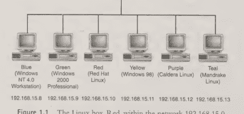

图 1.1 Linux 盒子 Red 在网络 192.168.15.0 中。

当应用程序尝试在网络内发送或检索数据时，例如当从起点 Red 向 Teal（两台 Linux 机器）发送数据时，路由协议是不必要的。同一子网或未子网划分网络中的机器使用其他技术来找到彼此。只有当你跨越该子网或未子网划分网络之外时，路由才会成为问题。

现在，要将此网络连接到更大的网络集，你在机器 Orange 上添加一张新的网卡，地址为 192.168.15.1，如图 1.2 所示。当你开始跨越从一个子网或未子网划分网络到另一个网络时，这两个独立的网络接口是绝对必要的，无论接口是物理的还是虚拟的。在这种情况下，一个（192.168.15.1）连接到互联网。另一个（192.168.15.2）连接到内部网络。

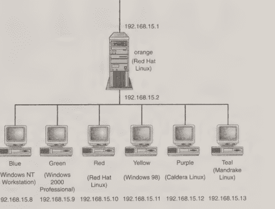

图 1.2 网络 192.168.15.0 连接到办公室中的其他网络。

这些更简单的结构将在后面的设置讨论中用到，但本书是关于使用 Linux 进行路由的，因此需要一个更大的示例——一个实际上需要路由器的示例。接下来，此局域网将连接到建筑物另一部分的机器 Emerald，如图 1.3 所示。


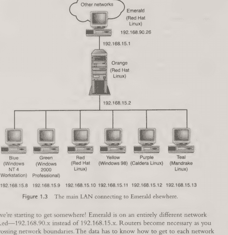

## Figure 1.3 The main LAN connecting to Emerald elsewhere.

现在我们开始有所进展了！Emerald 与 Red 处于完全不同的网络中——是 192.168.90.x 而不是 192.168.15.x。当你开始跨越网络边界时，路由器就变得必要了。数据必须知道如何到达每个网络和子网。

任何位置的整体网络可能只由一个具有内部 C 类的单一局域网组成，例如我们的 192.168.90，也可能是一组较小的网络和子网络。如果网络连接到互联网，如当今大多数网络一样，它会在某处连接到互联网服务提供商（ISP）。一个 ISP 可能有数十、数百甚至数千个网络和机器直接连接到它。其中许多网络也可能有自己的子网络，并通向更多网络，甚至可能通过备份链路连接到另一个拥有数千个网络集合的 ISP。

想象一下，你有一个数据包需要从“这里”到“那里”。数据传输的快慢无关紧要。它需要走多远的地理距离也不重要。唯一重要的是网络边界。在数据包必须从一个子网或非子网网络跨越到另一个网络的那一刻，它需要帮助来知道去哪里。

让我们看看这是如何工作的。有一天你从 Red 向另一个网络上的名为 Abacus 的机器发送数据。名称查找告诉 TCP/IP 数据包需要从 192.168.15.10（Red）到 192.169.13.9（Abacus）。你的数据包到达 192.168.90.26（Emerald），而与此数据包关联的唯一信息是它需要去 192.168.13.9。数据包本身并不知道 192.168.13 网络是否在你的网络集合中，是否连接到同一 ISP 上的其他人，是否在另一个 ISP 上，在世界上的物理位置在哪里，或在世界所有网络的整体结构中处于何处。这不是 TCP/IP 中数据包的工作。其他机器、协议和工具处理如何完成旅程。

幸运的是，Emerald 就是这些特殊工具之一——一台路由器。它使用的路由协议在此时并不重要，并且在讨论本章和下一章的路由协议时将会发生变化。无论使用何种协议，每一种协议都会决定如何为此数据包提供定制的路线图。Figure 1.4 完善了示例所需的结构，在终点站之间添加了几个中间路由器。此示例设定在一个虚构的校园中，Emerald 作为 Chem 建筑内的部门路由器，而 Abacus 作为 Math 建筑内的部门路由器。


## Figure 1.4 The path from Emerald to Abacus, with the main building routers in between.

在讨论协议的工作原理时，表 1.1 中概述的这些路由器之间的物理连接将变得很重要。

### Table 1.1 Hardware Between Each Point in the Example Network
| Start | End | Connection Type | Speed |
|---|---|---|---|
| Emerald | Hum | ISDN dual channel | 128Kbps |
| Hum | Phys | T1/DS1 full 24 channels | 1.54Mbps |
| Hum | Chem | T1/DS1 full 24 channels | 1.54Mbps |
| Hum | Arts | DSL | 3Mbps |
| Chem | Math | ISDN single channel | 64Kbps |
| Phys | Arts | T3/DS3 | 44.736Mbps |
| Arts | Math | T3/DS3 | 44.736Mbps |
| Arts | Eng | T3/DS3 | 44.736Mbps |
| Eng | Ag | T1/DS1 full 24 channels | 1.54Mbps |
| Math | Ag | T1/DS1 full 24 channels | 1.54Mbps |
| Ag | Abacus | ISDN dual channel | 128Kbps |
| Math | Abacus | modem | 56Kbps |

## Static Routing

最简单的数据路由形式是静态路由。你可能已经使用过它，即使你可能不认识这个术语。在静态路由中，你创建一个路由表，它保持不变，直到你告诉它更改。软件不会尝试确保列出的路由器保持有效，也不会监视网络拓扑的任何变化。你必须全部手工完成。

然而，静态路由仅在有限情况下有用。因为你必须手动在每个相关机器上维护单独的静态表，你可以想象在大型网络中进行任何形式的更改需要多少工作。当你时间紧迫时，例如当你试图更改表以绕过连接问题时，这个问题会变得更糟。

在 Linux 下的静态路由涉及使用 route 命令分配路由信息，并且几乎所有包含网络技能的 Linux 书籍中都会介绍。此命令在第 6 章“Inside the Multicast Kernel 2.2.x Daemons”中更深入地介绍，以及随之而来的 routed 守护进程在第 5 章“Inside the Unicast Kernel 2.2.x Daemons”中介绍。

## Routing Information Protocol Version 1 (RIP-1)

路由信息协议（RIP）是现在互联网上使用的第一个 TCP/IP 路由协议。今天有两种版本的协议可用：RIP-1 和 RIP-2。这两个版本在当今的路由方案中仍然很重要——第一个是为了向后兼容，第二个是因为其更广泛的功能范围。


## 算法

让我们先把 RIP-1 背后的算法与协议本身分开来看一会儿。RIP-1 使用距离向量算法来确定将数据包发送到何处，并且许多更新的路由协议也遵循了这一做法。具体来说，RIP-1 使用 Bellman-Ford 算法来进行计算。该算法从源位置开始，当我们忽略路由方面时，它是一个单一的点。它将源点到自身的距离指定为零。到所有其他点的距离被假定为无限。

应用的主要假设是，系统中任何一点都至少有一种方式到达源点；没有任何点完全与源点隔离。此外，通往源点的路径在到达源点时结束。它不会穿过源点，再绕行一段，然后再返回。它也不能两次经过同一路径。

该算法的目标是找到从任意单个点到源点的最短总行程距离。Bellman-Ford 以迭代方式工作。首先，查看图 1.5 中的图点（你应该能从图 1.4 中认出这些）。


图 1.5 Bellman-Ford 算法演示的图点。

该算法使用特定数量的跳数和每次跳的距离，在每次迭代中映射从远程点到源点的路径。第一次迭代的结果如图 1.6 所示。

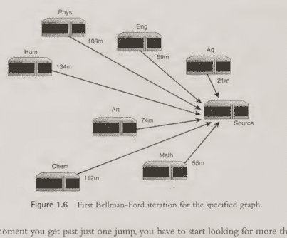

### 图 1.6 指定图的第一次 Bellman-Ford 迭代。

一旦你超过了仅一次跳数，你就必须开始寻找不仅仅是正确的迭代次数。在每种情况下，从目的点到源点的总距离必须尽可能短。随着进入两次跳数（图 1.7）、三次跳数（图 1.8）以及更多，你会细化确定从任意点到源点的最快方式的确切内容。

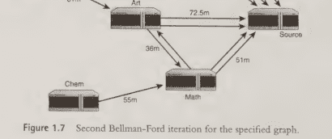

### 图 1.7 指定图的第二次 Bellman-Ford 迭代。

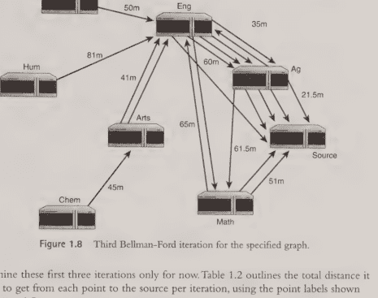

### 图 1.8 指定图的第三次 Bellman-Ford 迭代。

现在仅检查这前三次迭代。表 1.2 概述了使用图 1.5 中所示的点标签，按每次迭代从每个点到源点所需的总距离。

### 表 1.2 三次 Bellman-Ford 迭代的行程距离分解

| Point | Iteration 1 (m) | Iteration 2 (m) | Iteration 3 (m) |
|---|---|---|---|
| Ag | 21 | 95 | 147.5 |
| Eng | 59 | 56.5 | 147.5 |
| Phys | 108 | 106.5 | 106.5 |
| Hum | 134 | 133.5 | 137.5 |
| Arts | 74 | 87 | 97.5 |
| Chem | 112 | 106 | 146 |
| Math | 55 | 108.5 | 121.5 |

注意该表中结果的巨大差异。在某些情况下，最短距离是一次跳数。在其他情况下，是两次。在此示例中，没有任何点从三次迭代中受益，尽管 Phys 接近。这并非总是如此，然而。这真的取决于点的分布。完成此示例需要再进行四次迭代，总共七次，就像不计源点有七个点一样。

当然，RIP-1 从 TCP/IP 路由的角度使用此算法。当你试图从路由角度找到从“这里”到“那里”的最快方式时，距离并不是唯一需要考虑的因素。另一个重要问题是数据从一个连接旅行到另一个连接所需的时间。最短的物理距离并不总是速度最快的路线。

RIP-1 中所指的点 A 和点 B 之间的距离并不是纯粹的物理距离，而是一个权重值，定义了如果信息在两个相关点之间跳跃，信息需要多长时间。最初，所有距离都列为一。这被理解为跳数——数据必须经过的每个路由器为一次“跳”。今天使用的距离更为多样化，对于数据必须沿着非常慢的连接旅行才能到达下一个点或可能导致延迟的其他原因的情况，数字会略高。

让我们回到示例网络中的图 1.8 和表 1.1 中的数据。你可能首先要做的是浏览此表并为每个点之间旅行的距离或成本分配值。你可能得到的结果的一个例子如图 1.9 所示。


### 图 1.9 将 RIP-1 速度因子应用于示例网络。

这里有两点需要注意。首先，并不是每个点到每个点都有路径，就像在原始 Bellman-Ford 算法中那样。唯一有效的路径是存在物理连接的路径。其次，注意距离并不是完全根据速度分配的。任何至少 T1 线路速度的都得到一，从那里开始成本增加。分配距离时可以采用多种方法。这只是其中一种。


travel, from Emerald to Abacus. 使用 Bellman-Ford 算法，按跳数迭代。没有可用的单跳直连路由。也没有两跳路由，也没有三跳路由，但存在四跳路径：

- A) Emerald → Hum → Chem → Math → Abacus
- B) Emerald → Hum → Arts → Math → Abacus

还有五跳路径：

- C) Emerald → Hum → Phys → Arts → Math → Abacus
- D) Emerald → Hum → Chem → Math → Ag → Abacus

六跳路径：

- E) Emerald → Hum → Phys → Arts → Eng → Ag → Abacus
- F) Emerald → Hum → Phys → Arts → Math → Ag → Abacus
- G) Emerald → Hum → Arts → Eng → Ag → Math → Abacus

七跳路径：

- H) Emerald → Hum → Chem → Math → Arts → Eng → Ag → Abacus
- I) Emerald → Hum → Phys → Arts → Eng → Ag → Math → Abacus

最后，八跳路径：

- J) Emerald → Hum → Chem → Math → Arts → Eng → Ag → Math → Abacus

表 1.3 列出了这些路径各自的成本。可以看出，该数据包最快的路径是 B——C、E 和 F 都是不错的第二选择。请注意加权值带来的差异。如果每一次跳跃都价值为一，如最初那样，你总是会选择 A 或 B，而 A 却是数据可以传输的“距离”中第三长的。

## 表 1.3 使用 Bellman-Ford 的示例网络旅行成本

| Jump | Values | Total |
|---|---|---|
| A | 2+1+3+3 | 9 |
| B | 2+1+1+3 | 7 |
| C | 2+1+1+1+3 | 8 |
| D | 2+1+3+1+2 | 9 |
| E | 2+1+1+1+1+2 | 8 |
| F | 2+1+1+1+1+2 | 8 |
| G | 2+1+1+1+1+3 | 9 |
| H | 2+1+3+1+1+1+2 | 11 |
| I | 2+1+1+1+1+1+3 | 10 |
| J | 2+1+3+1+1+1+1+3 | 13 |

需要注意的是，使用 RIP-1 时，如果按每跳计一的规则，则跳数不能超过十五次。该协议并非设计用于承载更远距离的数据传输。我们仅在这一小示例中就触及了限制。随着某些跳的权重高于一，这里得到的最大总成本为 13。

那么你可能会想，如果它无法处理超过 15 跳或总成本值为 15 的情况，这个协议有什么用处呢？RIP-1 并非用于处理大部分互联网流量。其目的是在网络组内部工作，例如办公楼或校园等具有复杂网络结构的场所，其中 RIP-1 仅在最本地的层级存在。

RIP-1 也通常是最常见的最低公分母协议。虽然你可能没有特定理由为自己的需求使用此协议，但你可能需要你的路由器能够与使用非你主要选择的路由协议的外部路由器通信。在这些情况下，RIP-1 通常被视为一种保险政策。

运行 RIP-1 的路由器将其数据保存在路由表中。该表存储的信息包括：

- **网络网关。** 包含多个网络接口的机器（如以太网卡或在 Linux 下使用带别名的 IP），每个接口通向不同的子网或网络。
- **路由器。** 信息高速公路上的交通导向器。
- **主机。** 需要特别提及的单个机器，例如 WAN 或 VPN 中的远程机器。

路由器随后会不时向其直接邻居发送路由表的副本，并也会从邻居处接收更新。每当路由器从其邻居之一接收到更新的表时，它会计算下游应用的成本度量是否发生变化。例如，假设 Emerald 从 Hum 的路由器收到了更新。我们的路由器知道从自身到 Hum 的行程成本为二。Emerald RIP-1 工具随后将二加到刚收到的表中所有项目上，并与自身进行比较。以下列表描述了 RIP-1 路由表中实际包含的值：

- 所指的 TCP/IP 网络地址或主机 IP 地址
- 到达该地址必须经过的网关
- 到达该网关必须经过的硬件接口
- 路由成本
- 此条目上次更新的时间

如果 Emerald 和 Hum 的表中的一个或多个结果不相加，则表示度量发生了变化。从 Hum 接收到的任何新值都会被复制，加上二，然后作为新的度量值放置在 Emerald 的路由表中。

## 只能有一个

> 请注意，RIP-1 路由表中每个目标只有一个条目。RIP-1 仅存储当前最佳旅行路径；它不存储算法计算的全部结果。


Bellman-Ford 算法不必处理某些节点可能永久或暂时不可用的事实。RIP-1 则会避免在特定连接或机器宕机或被移除时，将数据包发送到死路的风险。

前面讨论的更新消息在 RIP-1 中每 30 秒发送一次。每当从某台机器收到更新时，该机器在路由表中的更新时间就会被更改。如果在 180 秒内未收到该机器的任何消息，则认为存在问题，路由器在表中被标记为不可用，其到该目的地的距离被设为 16，比最大成本高一。

## How It Works

现在，让我举一个例子。如前所述，Emerald 需要通过 Abacus 发送数据。Emerald 所知道的全部是，为了将数据发送到适当的网络（192.168.13.x），它需要通过通往路由器 Hum 的接口发送该数据。Hum 知道它将数据发送到网络 192.168.13 的最快方式是通过 Arts。Arts 知道应通过 Math 发送数据，而 Math 知道可以直接发送到 Abacus。

只要 Hum 在 180 秒内没有听到来自 Arts 路由器的消息，这一数据路径就运行良好，这相当于六次签到时间。路由器 Hum 然后将 Arts 标记为不可达，并将此信息传递给 Emerald。结果 Emerald 不知道如何向 Abacus 发送任何数据了！请记住，RIP-1 路由表中只保留从这里到那里的唯一一种方法。

这里可能发生几种不同的情况：

- 路由器 Arts 被有意移除。它发生了关键故障，且在接下来的一周内没有备用路由器可以接替其位置。

由于在 RIP-1 中消息从路由器传播到路由器可能需要很长时间，Emerald 部分的管理员明确告诉路由器 Phys，路由器 Arts 的新成本为 16，这意味着它不可用。在通常的 30 秒后，路由器 Phys 发送其更新。这些更新包括通过 Phys 可用的所有路由。

Phys 现在唯一的邻居是 Hum。Phys 向 Hum 发送它知道如何发送信息的网络列表，以及到达这些网络的成本。此列表中包括通过 Phys 到达 Arts 现在的成本为 16 个单位。路由器 Hum 知道从 Hum 到 Phys 的成本为一，因此它将两个成本相加，并将数据从 Hum 到 Arts 的成本更新为总计 17。Hum 不知道它在谈论 Arts；它只查看通过 Phys 可以最快到达的网络。Phys 并不是到达 192.168.13.x 的路径的一部分，因此 Hum 仍然不知道它有问题。Hum 却知道，它无法到达任何需要先经过 Phys 再经过 Arts 的东西。

在 180 秒未听到 Arts 的消息后，Hum 自己意识到 Arts 无法到达。它现在将自己到达 Arts 的成本更新为 16。问题在于，这是 Hum 知道到达 192.168.13.x 的唯一方式。任何来自 Emerald 且目标为 192.168.13.x 的数据都将被退回或简单地在网络问题的巨大虚空中丢失。其他所有路由器在需要通过 Arts 发送数据时，最终也会发生同样的情况。

- 路由器 Arts 被有意移除。它不会被任何其他东西替换。管理员可以访问路由器 Chem 并更新其表，以通过 Math 广告路由，从而替换通过 Arts 的无效路由。

路由器 Chem 的管理员从其路由表中移除 Arts 并重新计算距离向量。在更改后的通常 30 秒更新中，Chem 告诉其邻居——Math 和 Hum——它们可以通过它到达那些变得不可达的网络。从 Chem 通过 Math 到 Abacus 的成本为六（3+3），因此这是 Chem 在路由表中为到达 192.168.13.x 所广告的成本。Hum 知道它到达 Chem 的成本为一，因此它现在以成本七（3+3+1）向 Emerald 和 Phys 告知新的到达 192.168.13.x 的路径。此更改在网络中传播，直到一切再次完全运行。

- Arts 用于访问网络的连接暂时中断，隔离了该路由器、其自身网络上的机器以及它本应传递数据的任何网络。此连接保持中断三小时。

等到连接恢复时，所有邻居路由器早已注意到 Arts 不可用，并已将信息传递给示例网络中的所有其他路由器。当路由器 Arts 的连接恢复时，它将决定所有其他路由器也不可用。

本节后面将讨论此场景的细节。

从上面列出的场景中，至少有一个问题可能变得明显。路由器会向所有邻居发送更新，即使是刚刚收到更新的邻居。如果路由器盲目信任邻居告诉它的内容，这个问题可能会造成各种混乱。路由器可能已将另一台路由器标记为不可达，但邻居却告诉它该路由器实际上运行正常——而事实并非如此。与此同时，数据包在各处乱传并丢失，而路由器仍在争执不休。

路由协议中常用来解决此困境的一种技术是水平分割。这一补充仅使用一个常识规则：不要向你刚刚从其处听到消息的路由器发送有关该路由的更新。例如，考虑以下问题


Arts 又不可用了。在 Scenario 1 中，管理员告诉路由器 Phys Arts 已不再可访问。三十秒后，路由器 Phys 已将此数据纳入其表中，将某些网络标记为通过它不可达，并将此信息与其邻居共享，而其邻居现在仅为 Hum。

三十秒后，Hum 已将数据纳入其表中，并将某些网络标记为通过它不可达，Hum 现在通知其邻居。这将是 Phys、Emerald 和 Chem。然而，它是从 Phys 收到的消息。由于水平分割，Hum 向所有机器发送更新，但仅向 Emerald 和 Chem 发送涉及必须经过 Phys 的数据的信息。毕竟，Hum 还有其他不经过 Phys 的信息，而 Phys 必须对此保持最新。

然后，Chem 将更新告知 Math，但不向 Hum 发送与其相关的项目。从那里，Math 将新信息与 Ag 和 Abacus 共享。Abacus 将新信息告知 Ag，因为它是从 Math 而不是从 Ag 得到消息的，而 Ag 告知 Eng。图 1.10 说明了这一进展。

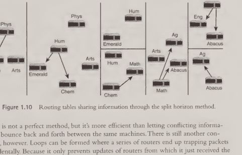

图 1.10 通过水平分割方法共享路由表信息。

这不是一个完美的方法，但它比让冲突信息在同一台机器之间来回弹跳更有效。然而，仍有另一个问题。可能会形成环路，一系列路由器会意外地困住数据包。由于它只防止从刚刚接收到更新的路由器发送更新，因此水平分割不足以处理这一事实。

RIP-1 使用水平分割与中毒逆转的组合。在某种程度上，这让我们回到了最初的做法。路由器向所有邻居发送有关所有路由的更新，甚至包括刚刚收到特定路由的邻居。不同之处在于，如果 Phys 告诉 Hum Arts 已恢复并且距离为一，Hum 然后告诉 Emerald 和 Chem Arts 可用且成本为二，但 Hum 告诉 Phys 从 Hum 通过 Phys 到达 Arts 的成本为 16。明白了吗？让我分解一下：

- 1. 路由器 Arts 的网络连接恢复。
- 2. 所有机器都已放弃路由器 Arts，而路由器 Arts 也已放弃所有其他机器。因此，路由器 Arts 不会向任何其他人发送更新，也不会有人向 Arts 发送数据。
- 3. 路由器 Phys 的管理员知道 Arts 已恢复。管理员手动将 Phys 的路由表重置为它在宕机前对 Arts 的成本（一）。
- 4. 三十秒后，路由器 Phys 向 Hum 和 Arts 发送更新。突然 Arts 看到它在世界上并不孤单，而 Hum 发现 Arts 已恢复。
- 5. 为了简化，我暂时忽略 Arts，只跟随从 Hum 开始的路径。在使用水平分割与中毒逆转的组合时，Hum 向 Emerald、Phys、Arts 和 Chem 发送下一个 30 秒更新，告诉它们可以向何处发送数据。然而，发送给 Phys 的信息与发送给其他人的不同。Hum 告诉 Phys 它可以发送数据的所有网络，包括那些经过 Phys 的网络。任何经过 Phys 的项目都被标记为成本为 16。这样做的目的是防止 Phys 和 Hum 陷入永久循环，相互发送永远无法到达目的地的 数据。
- 6. 传播以这种方式继续，直到所有路由器都更新并再次可以看到 Arts。

正如你所见，RIP-1 是一个相对基础的路由协议。它具有跟踪哪些机器可用的基本功能，但在网络经常发生变化的情况下不可靠。用于在 Linux 下实现 RIP-1 的程序是 routed。你也可以使用多协议守护进程 gated 或 zebra。有关在哪里找到这些程序以及它们如何工作，请参阅第 5 章。

## 路由信息协议版本 2 (RIP-2)

RIP 版本 2 (RIP-2) 是原始路由信息协议的更新版本。RIP-2 中有几个附加功能，使其成为许多网络管理员的更合适的路由选择，尤其是随着我们继续面临 IP 地址短缺问题。其中第一个新功能是能够添加从外部网关协议 (EGP) 获得的信息。有关从一个路由器到另一个路由器传输的数据的更多信息，请参阅第 3 章“边界路由协议简介”中的“外部网关协议”部分。


假设有一条从 Phys 路由器向上延伸的直线通往该校园整个网络的 Internet 服务提供商（ISP），如图 1.11 所示。示例网络现在神奇地改用 RIP-2 而不是 RIP-1。

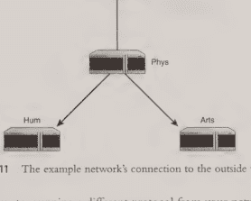

图 1.11 示例网络与外部世界的连接。

这条线路通向运行与你的网络不同协议的路由器，我称其为零号路由器。零号路由器接收来自另一路由器的信息并将其作为一个小附加信息包含在内，如图 1.12 所示。关于 EGP 可能承载的内容的更多细节将在第 3 章中提供。

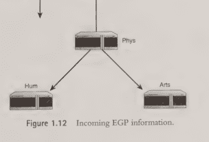

图 1.12 进入的 EGP 信息。

当这些数据到达 Phys 路由器时，RIP-2 能够接受它并将其纳入下一次 30 秒更新中，如图 1.13 所示。

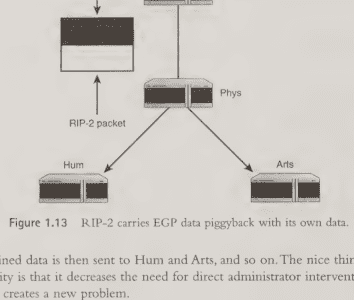

图 1.13 RIP-2 将 EGP 数据与自身数据捎带传输。

然后这些组合数据被发送到 Hum 和 Arts，以此类推。这种功能的好处是减少了对直接管理员干预的需求；然而，它也产生了一个新问题。

引入从外部来源获取并传递信息的能力为某人向路由器输入虚假信息打开了大门。预见到这一困境，RIP-2 的另一个新增功能允许使用简单的密码身份验证方案。你可以设置路由器仅接受你已提供密码的路由器的更新。

我们示例网络中的管理员相互信任。 rather than agreeing upon one password for all of their routers, they each choose one and notify the administrator of their neighbor routers in writing. 请注意，除非你使用 Pretty Good Privacy (PGP) 或 Gnome Pretty Good Privacy (GPGP) 等加密，否则电子邮件绝对不是安全的替代方案。管理员随后将美国信息交换标准代码（ASCII）密码添加到其配置文件的每个邻居中。例如，Phys 路由器将拥有 Campus、Hum 和 Arts 的密码。如果有管理员不希望接受更新信息的邻居，那么管理员只需不向该邻居的管理员提供密码即可。数据仍可从路由器传递到路由器；该功能不受影响。那个特定的邻居只是不能向路由表输入数据。

RIP-2 的另一个有趣的补充是能够向其他 RIP-2 路由器通告使用其他协议的替代路由。要利用此功能，RIP-2 必须与该其他协议在同一路由器上运行。让我们再次查看示例网络。Chem 和 Math 路由器不仅为其各自部门，而且为部门内部的组也进行了大量子网划分。因此，我们决定他们的网络需求需要比 RIP-2 更不同的路由协议。我们具体选择哪种协议现在并不重要。

如果使用的是 RIP-1，那么 Chem 和 Math 将无法再与其他路由器通信。当然，数据可以通过它们的邻居传递，但 Chem 和 Math 无法向其他路由器发送有关其之后网络的更新。RIP-2 允许这些更新无论协议如何都能发生。Math 的管理员随后在此路由器后面添加了一个新网络。管理员将有关新网络的信息添加到 Math 的路由表中。

Math 通知 Chem 变更没有任何问题。幸运的是，尽管 Chem 和 Math 使用某种未知、尚未讨论的协议，但 Arts、Abacus 和 Ag 都使用 RIP-2。更新顺利通过，最终网络中及之外的所有路由器都了解到如何到达这个新网络。

最后，使 RIP-2 进入下一代互联网的新功能是其能够携带子网掩码信息。事实上，这最初构建 RIP-1 新版本的主要原因之一。解决 IP 地址短缺的一种方案是使用可变子网掩码，而不是为整个网络使用单一掩码。原始的 RIP-1 无法理解这种设置。

正如你所见，RIP-2 是 RIP-1 的一个更复杂的版本，它能稍好地处理更新信息，并且也讲现代互联网的语言。然而，这仍然不是适用于庞大网络集的协议。它确实更适用于有限的使用。

在 Linux 下实现 RIP-2 的程序是 gated 或 zebra。这两个守护进程可以同时处理多个协议。有关在哪里找到这些程序以及它们的工作原理的更多信息，请参阅第 5 章。

## 开放最短路径优先（OSPF）

开放最短路径优先（OSPF）路由协议是一种链路状态协议。此术语指的是 OSPF 相对于 RIP-2 等协议所跟踪的信息量减少。链路状态协议使用与距离向量协议完全不同的方法来选择路由。

## 算法

链路状态协议使用一组最短路径优先（SPF）算法之一。再次，这些算法基于解决图论问题，然后应用于网络。在 OSPF 的情况下，该方法背后的算法是 Dijkstra 算法。同样，我们从一组点开始。我们将使用之前在图 1.5 中显示的同一集合。


你必须在此情况下提前明确哪些点可以从哪些点到达。我们并不是从一个理论图开始，在该图中一切都可以到达一切。你也不能单向设置此数据。某些点可能只能单向访问，而另一些点在不同方向的成本可能不同。因此，再次让我们使用图 1.9 中列出的物理连接，并像图 1.14 中那样添加一种新的加权方案——这次表示交通的两个方向。

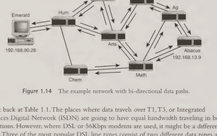

图 1.14 具有双向数据路径的示例网络。

回顾表 1.1。数据通过 T1、T3 或综合业务数字网（ISDN）传输的地方，在两个方向上的带宽是相等的。然而，使用 DSL 或 56Kbps 调制解调器时，情况可能就不同了。三种最流行的 DSL 线路类型由两条不同的数据管道组成，而第四种则有四条，如图 1.15 所示。

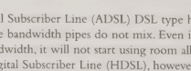

图 1.15 两种类型 DSL 连接中的数据。

非对称数字用户线路（ADSL）DSL 类型为数据传输提供了两个大小不同的管道。这些带宽管道不会混合。即使你完全填满了下载带宽，也不会开始使用分配给上传的空间。对于高密度数字用户线路（HDSL）来说，管道大小相等，只是数量为四个而不是两个。ISDN 数字用户线路（IDSL）类型是 ISDN 与 DSL 之间的混合体。虽然这里列出的其他 DSL 类型不会一直保持连接打开（它们在需要时建立连接），但 IDSL 保持连接始终打开。这种 DSL 类型也具有目前 DSL 中最长的传输范围。第四种流行的 DSL 类型是同步数字用户线路（SDSL）。这种线路类型在两个方向上具有大小相等的管道。

因此，为了使示例网络更有效，让我们说表 1.1 中列出的 DSL 项目是 ADSL。

第二个问题是 56Kbps 调制解调器。同样，这款硬件的下载和上传速度不同。你只能获得 56Kbps 的下载速度——如果你能达到这个速度的话。上传速度在许多品牌中限制为 33.6Kbps，虽然有些能够达到更高的速度，但它们通常没有相同的上传和下载速度。考虑到这些信息，从一个点到另一个点的每方向旅行成本如图所示 1.16。

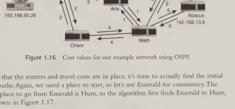

图 1.16 使用 OSPF 的示例网络成本值

现在路由器和旅行成本已经就位，是时候真正找到初始最佳路径了。同样，我们需要一个起点，所以为了保持一致，让我们使用 Emerald。从 Emerald 出发唯一能去的地方是 Hum，因此算法首先找到 Emerald 到 Hum，如图 1.17 所示。


图 1.17 OSPF 算法第一次迭代。

从 Hum 出发，除了 Emerald（你永远不会两次经过同一个点）之外，你可以去三个不同的地方：Phys、Arts 和 Chem。在这个方向上，每个点的距离分别是二、一和二。一是最短的距离；因此，到目前为止通过这些路由器的最短路径是 Emerald 到 Hum 然后到 Arts。当前路径如图所示 1.18。


图 1.18 OSPF 算法第二次迭代。较粗的线显示最快的路径。

现在我们进入下一次迭代。此迭代从 Phys、Arts 和 Chem 开始。我们不能经过已经使用过的点，所以 Phys 已被排除在最快、最短路径之外，并且不会在进一步的迭代中使用。然而，这一算法的关键在于，我们不仅仅是在寻找一条路径——我们是在寻找从 Emerald 到各处的 fastest 方式。因此，图 1.18 中用较浅线条显示的路径仍然有用。

我们仍然可以从 Arts 和 Chem 两者出发。路由器 Arts 到达尚未使用的节点 Eng 和 Math。Chem 突然也没有地方可去（见图 1.19）。


图 1.19 OSPF 算法部分第三次迭代。较粗的线显示最快的路径，直到它停滞。


请注意，从 Arts 到 Eng 以及从 Arts 到 Math 的成本处于平局。虽然这不会影响数据流向等问题，但它会导致确定中心最快路径的问题。中心路径用于确定算法运行过程中哪个路由器获得优先级。最快路径上的项目可以先进行迭代，这就是为什么某些点会导致死路的原因。

我们如何解决这个平局问题？OSPF 使用一种称为负载均衡的技术来处理此类问题。它实际上决定交替使用两条路径，以尝试获得最快可能的数据流。然而，这并不能帮助我们解决算法本身的问题。为了找到最快、最短的路径并打破平局，我们选择到达世界其他地方需要经过的路由器数量最少的点，即七个（见图 1.20）。


图 1.20 OSPF 算法完成第三次迭代。较粗的线显示了最快路径。

现在我们已经解决了这个问题，可以进入第四次迭代。从 Eng 出发唯一剩下的去处是 Ag，而从 Math 出发有 Ag 和 Abacus。再次，我们必须考虑最快的中心路径来确定会发生什么。由于 Math 是最快路径的一部分，我们先跟随它。这意味着 Math 导致 Ag 和 Abacus，而 Eng 是另一个死路。算法现在已完成其工作，如图 1.21 所示。

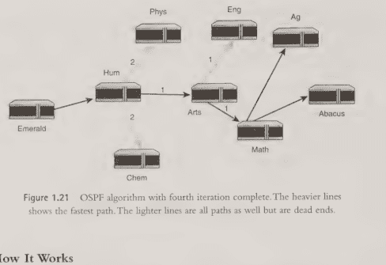

## 如何工作

现在你了解了算法的工作原理，让我们用之前使用的相同示例来应用 OSPF。该协议比 RIP-2 复杂得多，所以请期待一段有趣的旅程。再次，我们希望从 Emerald 向 Abacus 发送数据。Emerald 知道以下信息：

- 哪些接口通向其区域中的哪些路由器。OSPF 中的区域是一个独立单元。本示例网络在这种情况下是一个单一区域。路由器三，正如事实所示，是该区域的指定路由器。
- 指定路由器负责与外部世界通信。在一个区域内，每台机器都知道如何向该区域内的每个地址发送数据。然而，一旦超出当前区域，那里的路由器只能看到指定路由器，而看不到其他路由器。因此，当流量要进入区域内的一个网络时，区域外的任何路由器都会发送到指定路由器，然后指定路由器使用自己的路由表将流量发送到目的地。
- 如果你有区域，那么至少有两个。否则，就没有必要创建区域。你的所有区域的总和构成一个完整的自治系统（AS）。图 1.22 从概念上展示了这些组件如何组合在一起。请注意，路由器 Phys 在两个区域中都有边界（和接口）。记住路由器必须能够跨边界通信！此外，还将有一个路由器从 AS 与外部世界通信。


图 1.22 示例网络在其自己的区域中，与其他区域共享一个自治系统。

## 路由表大小

路由表的大小是一个非常重要的问题，无论你使用什么协议。互联网最初不必担心表的大小，因为在 20 世纪 60 年代末和 70 年代初（ARPANET 时代），连接的机器非常少。今天，当然情况不同了。

较旧的路由协议（如 RIP-1 和 RIP-2）不足以用于大规模使用的一个原因是，每个路由器必须包含针对每个现有网络和子网络的单独指令。表越大，查找数据需要去向何处所需的时间就越长。传输时间变慢，直到网络几乎无法使用。

引入更新的路由协议和分段工具，如区域、AS 等，允许管理员大幅缩小各个网络部分的路由表。然后更有知识和更强大的路由器可以处理在较小部分之间传递信息，以便最终到达目的地。


- 每个接口发送数据的成本。OSPF 并不会将这些成本视为任何形式的距离度量。它们仅被用作一种加权方法，用来判断哪些接口会产生最快的流量，哪些会减慢速度。
- 我们之前计算的*最短路径树*。Emerald 具体的树如 Figure 1.21 所示。记住，每个机器都有自己的 OSPF 树。
- 发送数据到骨干网的成本和路径。

Emerald 已经使用我们之前介绍的算法计算出到所有其他路由器的最短、最快路径。Emerald 随后不仅知道下一跳是什么，而且还知道它希望数据采取的旅程的每一步。Emerald 对数据的处理很简单，就是将其转发给路由器 Hum，后者从那里接管。

路由器 Hum 也拥有整个网络的地图，其中包含成本和双向信息。然而，它并不使用 Emerald 的最快、最短路径计算。Hum 会自行计算。我将算法部分留作练习给你，但 Hum 最终得出的结果如 Figure 1.23 所示。

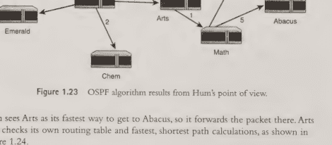

## Figure 1.23 OSPF algorithm results from Hum’s point of view.

Hum 认为 Arts 是到达 Abacus 的最快方式，因此它将数据包转发到那里。Arts 然后检查自己的路由表和最快、最短路径计算，如 Figure 1.24 所示。

## Open Shortest Path First (OSPF) 29

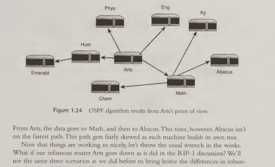

从 Arts 出发，数据会先到 Math，然后到 Abacus。然而这次，Abacus 并不在最快路径上。随着每台机器构建自己的树，这一路径变得相当扭曲。现在事情运行得如此顺利，让我们加入通常的麻烦因素。假如我们的臭名昭著的路由器 Arts 就像在 RIP-1 讨论中那样宕机了呢？我们将使用之前相同的三个场景来凸显 RIP-1 与 OSPF 之间在健壮性方面的差异：

- Scenario 1: Router Arts was intentionally removed. It had a critical failure, and there is no backup router available to take its place for a week.

运行 OSPF 的所有路由器都会定期——每隔一次 HelloInterval 设置——使用 HELLO 协议。这个独立的通信协议专门用于连接到邻居 OSPF 路由器（那些直接连接到相关路由器的路由器）并保持该连接在双向进行。HELLO 协议通过使用 HELLO 数据包来实现这一点。这些特殊数据包包含有关本路由器的介绍信息、通过其接口的旅行成本，以及它所知道的邻居名称。

Arts 的邻居（Hum、Eng 和 Math）都在愉快地发送 HELLO 数据包并轮流接收它们。然而，它们开始注意到在设定的 HelloInterval 时间内没有收到 Arts 的任何信息，而该时间是在 HELLO 数据包中公布的。如果在第一个丢失的 HELLO 数据包之后 RouterDeadInterval 时间内仍未听到 Arts 的消息，邻居们就会宣布该路由器不可用。很快，Arts 的所有邻居都会放弃 Arts。

当 Hum、Phys 和 Math 放弃路由器 Arts 时，它们各自计算出全新的、最快、最短路径树，并将这个巨大的空洞考虑在内。没有人需要告诉它们任何事情。它们可以自行完成。因此，Hum 之前显示在 Figure 1.23 中的树，现在变成了 Figure 1.25 所示的树。其他两个也计算了新的树。

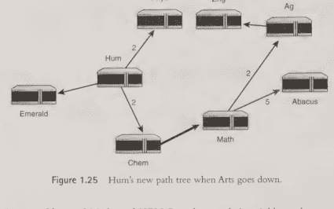

## Figure 1.25 Hum's new path tree when Arts goes down.

当 Hum、Phys 和 Math 向其邻居发送 HELLO 数据包时，那些邻居会注意到这些数据包中 Arts 的缺席。它们也会将 Arts 排除在外，并各自重建自己的树。

- Scenario 2: Router Arts was intentionally removed. It is not going to be replaced with anything else.

虽然这个例子在 RIP-1 部分是一个截然不同的问题，但在 OSPF 中并非如此。管理员无需告诉其他路由器 Arts 已消失。它们很快就会自行弄清楚并构建新的路由表，如 Scenario 1 中所述。

- Scenario 3: The connection Arts uses to access the network went down temporarily, isolating this router, the machines on its own network, and any networks that it was supposed to pass data to from everyone else. This connection stays down for three hours.

起初，这种情况的行为与 Scenario 1 相同。Arts 路由器不存在这一事实会自行在网络中传播得很好。然而，当路由器重新上线时，你会看到 RIP-1 处理该场景时的另一个巨大差异。

路由器 Arts 一重新上线，它就会广播 HELLO 数据包。所有邻居（Phys、Hum、Eng 和 Math）都会收到此广播并回应 Arts。然后，当这些邻居向其他人发送包含其邻居列表的 HELLO 数据包时，网络的更多部分会看到 Arts，依此类推。无需人工干预。


## OSPF 与认证

这里需要注意的一点是，区域内的所有路由器都使用相同的认证方案。每个区域必须在整个区域内使用相同的方案，尽管在同一个 AS 中，不同区域之间可以使用不同的级别。这是一种将网络划分为更安全和较不安全区域的便捷方法，尤其与其它安全方法结合使用时效果特别好。

OSPF IP 数据包还必须通过校验和测试，这意味着数据包包含发送时所包含的位数计数，而接收数据包的路由器会确保它具有相同数量的位。因此，如果数据包被损坏或被篡改，它将不被接受。

OSPF 实现的一个问题是，如果有人能够访问到你的路由器之间线路的连接，他们可以设置一个数据包嗅探器——一种用于查看网络中传输数据的程序——来监听发往特定地址的任何内容并实际抓取你的密码副本。即使有校验和测试，OSPF 的认证也不够复杂，无法抵御这种入侵。

如果你回顾一下图 1.23，就会看到这个整体系统由一个 AS 内的两个区域组成。这改变了我们一直在讨论的区域的动态，因此在进入更大的图景之前，让我们先讨论一下这一点。路由器 Phys 是指定路由器，也称为边界路由器，因为它在该区域和另一个区域中都有接口。这意味着路由器 Phys 被认为与该区域内的每个路由器相邻，或为邻居。每个路由器都向 Phys 发送 HELLO 数据包，而 Phys 会全部回复。这确保 Phys 始终掌握其区域内发生情况的全局视图。

现在，考虑更大的图景。图 1.26 展示了路由器 Phys 连接到的第二个区域（宿舍 [名称已缩写]，它们也在整个校园结构中联网），图 1.27 显示了路由器 East 得出的最快、最短路径树。首先，我需要在这里调整我的词汇。到目前为止，术语路由器 Phys 指的是单台机器，因为你不知道它有额外的区域接口。Phys 实际上是指直接连接到校园区域的以太网卡。East 指的是直接连接到宿舍区域的以太网卡。

每个区域的树是单独存储的，并且路由器 Phys/East 实际上为每个区域运行两份 OSPF 软件。OSPF 数据包都标有它们来自的区域 ID，因此它们不会意外地泄漏到边界之外。

### 图 1.26 AS 中的另一个区域，其中路由器 East 是路由器 Phys 上的另一个接口。

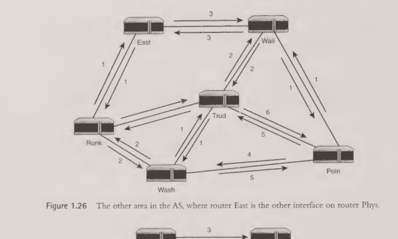

### 图 1.27 路由器 East 的 OSPF 树。


退后一步看，数据必须有一种方式进出 AS。这至少需要一个——最好是多个——AS 边界路由器。我将在这里做一个糟糕的网络管理员，在我们的图中添加一个 AS 边界路由器，如图 1.28 所示。


### 图 1.28 带有其 AS 边界路由器的完整 AS。

该 AS 边界路由器实际上将接收来自外部世界的路由通告，也将向外部世界发送路由通告。这些被称为外部链路通告。外部路由信息会通过以下两种不同类型的成本之一与 AS 中的所有路由器共享：

- Type 1. AS 外部路径算法的扩展。路径每段的成本都被精确考虑。
- Type 2. 另一种路径扩展类型，只是额外添加了成本，使得外部路径的成本始终高于任何内部路径。

需要认识到的是，Phys 和 East 并不是因为天生或注定要成为指定路由器而成为其区域的指定路由器。HELLO 协议实际上会选举指定路由器和备份指定路由器。你可以通过为路由器连接到该区域的特定接口赋予比其它接口更高的优先级来操纵选举结果。如果你有两台连接到外部世界的路由器——你应该有——那么你将另一个路由器的权重调高足够使其自动成为备份指定路由器。


每个区域在你的 AS 中的行为必须在内部保持一致。虽然我之前提到过其中一些值，但所有路由器在区域内必须相同的全部设置——或者对于区域边界路由器而言，区域内所有路由器接口必须相同的设置——如表 1.4 所示。

## Table 1.4 OSPF Router Settings that Must Be Identical with an Area

| Setting | Purpose |
|---|---|
| Area ID | 为特定区域设置 的标识值 |
| Backup Designated Router | 指向备份指定路由器的接口的 IP 地址 |
| Designated Router | 指向指定路由器的接口的 IP 地址 |
| Type | 接口指向的网络类型：广播型、非广播型、点对点型或虚拟链路 |

现在让我们再深入一点。你还需要让你的网络在内部保持一致。如果你有不止一个路由器连接到一个网络，出于冗余原因这可能是个好主意，那么连接到该网络的每个路由器都必须具有某些相同的设置。我在这里谈论的设置列在表 1.5 中。

## Table 1.5 OSPF Router Settings that Must Be Identical for Networks

| Setting | Purpose |
|---|---|
| HelloInterval | OSPF 路由器在发送下一个 HELLO 数据包之前等待的秒数 |
| Network Mask | 该网络的网络掩码，或对于未编号的点对点网络或虚拟链路为 0 |
| RouterDeadInterval | OSPF 路由器自上次 HELLO 数据包以来等待的秒数，然后才宣布某路由器死亡 |

## HELLO Packets and Network Type

臭名昭著的 OSPF HELLO 数据包的行为取决于你将其放置在何种类型的网络上。如果你选择非广播网络，那么该网络上的所有 OSPF 路由器都需要其邻居的列表以及在指定路由器选举中的排名。在其他网络类型中，这不是必要的。

再深入一点，我们就到了 OSPF 路由器的路由表。该表包含：

- 该目标可以转发信息的 IP 网络、子网和主机。
- 当目标指向网络或子网时的网络掩码，或当目标为主机时为 0xffffffff。
- 应沿此路由发送的服务类型 Type of Service。OSPF 能够根据其 TOS 设置以不同方式路由数据。
- 用于向该目标发送数据的四种路径类型之一：区域内 intra-area、区域间 inter-area、类型 1 外部或类型 2 外部。
- 发送数据到该目标的完整成本，由沿途接口成本相加得出。
- 如果路径为类型 2 外部，路由表还包含将数据发送到 AS 外部的成本。
- 如果有两条到同一目标且成本相等的路径，表实际上以单个条目存储两条路径的信息。除了标准信息外，还有用于发送数据的接口，以便下一个可以把数据传递给目标的路由器，以及该邻居的 IP 地址。如果目标位于另一个区域或 AS，则还包括数据必须经过以到达目标的路由器的路由器 ID。

最后，问题出现了，所有这些数据如何在区域之间传输，使 AS 成为一个独立的整体。正如人们所说互联网有一个骨干网，AS 也有自己的骨干网。AS 骨干网由区域边界路由器、AS 边界路由器以及根本不存在于某个区域的网络和路由器组成。它本质上是它自己的一个区域，即使它穿过其他区域。

就像脊髓一样，OSPF AS 骨干网必须完整无缺才能正常运作。当两个骨干路由器并非通过电缆直接连接时，你可以在区域边界路由器中使用虚拟链路将它们连接起来。你必须在这两个路由器中创建此链路，然后它们将假装在它们之间存在点对点连接。通过此连接的旅行成本是数据必须实际经过的真实路径的成本之和。

正如你所见，OSPF 是一个比 RIP-1 系列更先进的路由协议。它能快速高效地处理路由结构的变化并提高网络可靠性。在 Linux 下实现 OSPF 的程序是多协议守护进程 gated 或 zebra。


# 摘要

你在 Linux 中最有可能在大型、子网化或多网络环境中使用的单播路由协议是 RIP-1、RIP-2 和 OSPF。RIP-1 是至今仍在互联网上使用的最古老的 TCP/IP 路由协议之一。因此，它也是最不灵活的，真正只适用于小型网络。RIP-2 稍新且更安全，虽然它对于大型网络并没有好多少，但在许多情况下是比 RIP-1 更明智的选择。最后是更稳健的 OSPF。如果你的网络倾向于发生变化或机器经常出现故障，你最好选择这个选项。别忘了静态路由！对于非常小的局域网（大约 10 台机器）或子网，这可能就足够了。表 1.6 列出了每种协议的相关数据，可能对你感兴趣。

表 1.6 在 Linux 中实现单播路由协议的程序，以及包含重要背景信息的 RFC 文档

| Protocol | Program | RFC |
|---|---|---|
| RIP-1 | routed, gated, or zebra | 1058 |
| RIP-2 | gated or zebra | 1721 |
| OSPF | gated or zebra | 2328 |

一个阅读请求评论（RFCs）的极佳场所是 http://www.faqs.org/。如果你是一名程序员，并且发现自己在没有仔细阅读代码之前很难理解某些东西的工作原理，那么请前往 http://www.packetfactory.net/ 并查看他们的 libnet 项目的代码。其中包含处理 RIP-1 和 OSPF 的功能。


# 2

## 多播协议

多播路由协议利用多播网络将信息广播到一个 IP 地址（频道或组），任何具有多播访问权限的计算机都可以收听。当路由器支持多播协议时，它可能需要也可能不需要知道在任何给定时间谁在收听。这取决于你的多播频道覆盖范围以及你选择的协议。

本章讨论了多种常用多播路由协议的背景信息。利用这些信息，可以就你希望用于管理自己的网络需求的协议做出明智的决定。

### 路由信息协议版本 2（RIP-2）

不，你的眼睛没有欺骗你。RIP-2 同时出现在单播和多播部分。你可以配置路由器使用此路由协议偶尔向多播地址发送更新——默认情况下发送到 224.0.0.9。事实上，RIP-2 有四种设置可用于指导其在多播和其他领域的行为：

- None. Disables all RIP-1 messaging.
- RIP-1. Tells RIP-2 to behave as though it were its predecessor.
- **RIP-1 Compatibility.** Tells RIP-2 to broadcast its updates directly to the other routers, taking into account those that need RIP-1 formatted data.
- **RIP-2.** Ignores RIP-1 issues and uses multicast to send updates.

None of these options, however, actually deals with multicast data aside from the protocol's own updates.

### 多播开放最短路径优先（MOSPF）

多播开放最短路径优先（MOSPF）协议是 OSPF 的一个版本，允许在自治系统内高效路由多播数据包（以及单播数据包）。此实现合并了 OSPF 和互联网组管理协议（IGMP），后者处理多播组成员资格。更妙的是，它保留了所有最佳功能，包括使用 OSPF 身份验证方案。

MOSPF 使用与 HELLO 协议相同的来回查询方式跟踪当前是多播组成员的节点。每个 MOSPF 路由器计算自己的树。注意“树”这个复数。每个路由器为每个源/目的对计算一棵单独的树。这棵树从源开始，经过路由器，一直到包含成员的网络。

停下来想一想这可能意味着什么。如果 MOSPF 路由器预先为自治系统中所有现有的多播源和组计算树，你的 MOSPF 路由器将忙于计算，以至于无法用于引导流量。

相反，只有当多播数据实际上需要从尚不存在树的源/目的对传输时，才会计算树。由于多播旨在将数据传递给所有组成员，其数据包（数据报）在沿最短路径传输时会为每个组成员复制一份。然而，这棵树并不像 OSPF 中那样对每个路由器都是唯一的——而是树的树干位于数据来源的路由器，所有接收和转发数据的路由器都使用该相同的起点作为其树。因此，处理这些数据的所有路由器都使用相同的最短路径树，即使它们各自自行计算。

> **构建树时处理平局**
> 如果存在成本相等的路径之间的平局，则不使用负载均衡。各种 MOSPF 实现都有特定的方法来选择用于最快、最短路径树的分支。

有趣的是，你可以在 OSPF 区域内混合使用 OSPF 和 MOSPF 路由器，甚至在整个自治系统中传播它们。为此，只需要有一组连续的能够进行多播的路由器，以便数据能够到达需要去的地方即可。

用于实现 MOSPF 的程序是 mrouted。你还需要进行一些调整，以便路由器完全启用多播。请参阅第 6 章，“Inside the Multicast Kernel 2.2.x Daemons”，了解如何完成此操作。


## 距离向量多播路由协议 (DVMRP)

距离向量多播路由协议是原始 RIP-1 的子协议，仅用于单个自治系统内部。它实际上并不处理单播数据。如果你想使用 DVMRP，你还必须使用另一个协议来处理单播信息。前面讨论的所有单播协议都是可行的。

该协议仍被视为实验性的，因此在某些方面可能会发生变化。

执行以下操作以查看是否有更新版本的该即将发布的标准可用：

- 1. 前往 http://www.ietf.org/。
- 2. 按照 Internet-Drafts (I-D) 链接。
- 3. 按照 I-D 关键字搜索链接。这将允许你搜索草案，而不必浏览层级索引。
- 4. 在文本框中输入 dvmrp 然后点击 Search。结果之一的标题为 Distance Vector Multicast Routing Protocol。这就是你要找的文档。如果版本比 draft-ietf-idmr-dvmrp-v3-10.txt 更新，那么花时间查找该文档与此处讨论内容的差异是值得的。

## 算法：简介

DVMRP 以前完全由截断反向路径广播 (TRPB) 算法组成，该算法是对反向路径广播 (RPB) 算法的改进。今天，TRPB 仅用于一系列多播数据中的第一个数据包。后续数据包则利用反向路径多播 (RPM) 进行定向，RPM 是一种更精细的树构建算法，由 TRBP 和 RPB 共同发展而来。这种方法应该感觉有些熟悉，因为它包含了 RIP-1 中使用的数据路径的距离向量式构建（从协议名称中你可能已经猜到了）。事实上，该算法与你在阅读第 1 章“单播协议”时已经熟悉并喜爱的 Bellman-Ford 算法相似。它只是增强以考虑到传输多播数据与单播数据不同的独特要求。

## 缩写词的危险

如果你熟悉 Red Hat Linux 或其相关系统，你可能会立刻想到 RPM 是 Red Hat Package Manager。你甚至可能将 RPM 视为每分钟转数或另一个代表值。在本章中，每当你看到 RPM 时，我们指的是反向路径多播。由于本书是发行版中立的，你通常可以假设对 RPM 的引用都是指此含义。在不指此含义时，我们会明确说明，尽管在许多情况下上下文足以澄清用法。

## 算法：截断反向路径广播 (TRPB)

在数据传输开始之前，DVMRP 中不使用任何树构建算法。事实上，如果数据以前已发送到此多播通道，你将完全跳过此树构建过程。有关 DVMRP 在树构建后如何维护最新树的详细信息，请参阅下面的第一个“工作原理”部分。

当多播提供者开始发送数据包时，TRPB 算法开始工作。假设你正在从一台新机器使用 Emerald 作为其路由器的机器上多播广播一个广播节目。首先，你需要知道自治系统中哪些路由器支持多播数据。在示例网络中——现在为了便于查看在图 2.1 中汇总——以下路由器具有多播功能：Prime、Emerald、Chem、Math、Arts、Phys/East、Runk、Trud 和 Poin。

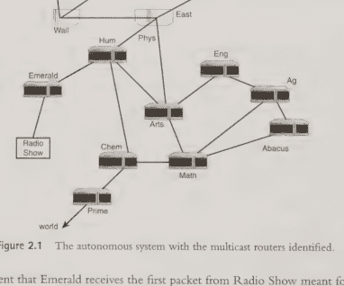

图 2.1 标识了多播路由器的自治系统。

Emerald 收到来自 Radio Show 的第一个数据包，目标为其新的多播通道的瞬间，TRBP 在 IGMP 的帮助下开始工作，IGMP 是前面讨论过的多播组管理协议。TRBP 现在将此新机器的第一个数据包传递给 emerald。Emerald 立即将数据包传递给 East 和 Chem，然后继续传递到所有多播路由器（我将在“工作原理”部分讨论它们如何在没有直接连接的情况下到达）。


当此数据包到达每个路由器时，机器会使用 IGMP 和多播频道地址来查找其哪些网络和子网络包含组成员。第一个数据包仅转发到包含组成员的网络和子网络。假设例如路由器 Math 后面的结构如图所示 2.2。

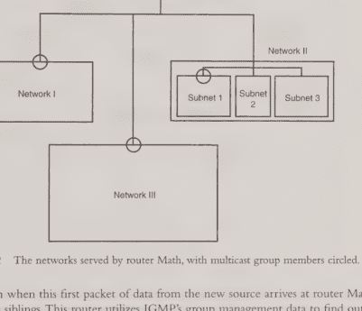

## 图 2.2 路由器 Math 所服务的网络，多播组成员用圆圈标出。

当来自新源的第一个数据包到达路由器 Math 或其兄弟路由器时，IGMP 就派上用场了。该路由器利用 IGMP 的组管理数据来查找哪些（子）网络实际包含组成员。在示例中，网络 I 和 III 至少有一个成员，因此数据包会被发送到这些网络。然而网络 II 被划分为子网，并非所有子网都包含组成员。对于 III，多播数据包仅发送到子网 1。

TRPB 树是在此决策过程中构建的。此树现在可能看起来像图 2.3 中所示的那样。记住，这是一个距离向量算法，因此到达每个数据点的路径取决于它必须行进的距离。

- 3. Poin 向 Trud 发送一个 prune。
- 4. East/Phys 向 Hum 发送一个 prune。

DVMRP 会持续检查树的 prune 消息，这些消息实际上具有指定的生命周期。每当它发现一个路由器满足下面列出的两个测试时，DVMRP 就会停止向该路由器发送此多播频道的包。

- 从其下游的所有路由器都收到了 prune 消息——正如路由器 Trud 和 Runk 的情况
- 向其自身的上游发送了自身的 prune 消息——正如路由器 Trud 的情况

因此，路由器 Trud 以及 Poin 将不再接收此频道的包，直到 prune 的生命周期结束。来自特定源并发送到特定频道、该 prune 消息所指的下一个数据包将使用 TRPB 进行广播，并且修剪过程将重新开始。

## 它是如何工作的

现在让我们更仔细地看看 DVMRP 长期如何工作。首先，所有图 2.1 中指定的 DVMRP 路由器刚刚设置完毕。它们可能已经在使用 OSPF 或 RIP-2 提供路由，但此时安装了 DVMRP，因为你决定为用户提供多播服务。

所有路由器都开始进行听起来应该很熟悉的邻居发现过程。每个路由器在启动时通过其所有支持多播的接口发送探测消息。当它们开始互相接收探测消息时，一个包含从该特定接口收到探测消息的所有邻居的列表会被包含在探测中。例如，查看 Emerald。它在其接口上发送探测消息，Hum 在特定接口上接收到其中一条消息。路由器 Hum 反过来在其每个网络接口上发送探测消息。现在它已经听到了 Emerald，它会在通过它得知 Emerald 的接口发送的任何探测消息中将 emerald 列为其识别的邻居之一。事实上，当 DVMRP 路由器第一次从一个以前从未听说过的邻居路由器收到探测时，该路由器会向新邻居发送其整个路由表。

当 Emerald 在 Hum 的列表中看到自己的名字时，它就知道自己与路由器 Hum 之间存在双向工作连接。从那时起，每 60 秒路由器就会互相发送路由表的副本，并确保它们拥有最新信息。Emerald 也现在将 Hum 添加到其发现的邻居列表中，这样当 Hum 收到下一个探测时，它就知道自己有双向连接。此过程在整个网络中进行，直到所有多播路由器都发现彼此。

DVMRP 基本上使用此过程来为多播流量维护一个集体路由表。每 10 秒，每个 DVMRP 路由器都会向每个支持多播的接口发送另一个探测。随着邻居的出现和消失，集体路由表会发生变化和改变——如果在 35 秒内未听到它们的动静。


另一个必须持续处理的难题是确保连接到同一网络的路由器不会提供重复的服务。这会浪费额外路由器的处理时间以及带宽。这就是我们回到协议名称中字母“DV”代表 Distance Vector 的事实。如果多个路由器能够将数据从传输源发送到特定网络，那么返回源路径较短的路由器将成为指定转发器——即从该源向此点发送数据的路由器。

此时仍然存在的一个问题是数据试图通过已遍历的路由器循环。当路由器选择其指定转发器时，它使用前面讨论过的毒性逆转技术。DVMRP 对毒性逆转的实现涉及发送一份路由表的副本，其中包含数据从 A 点到 B 点所需经过的跳数指标值——从路由器到其指定转发器的值设置为无穷大（32）加上实际成本。这实际上向指定转发器发出信号，使其将该路由器标记为依赖项。依赖项列表用于帮助管理修剪过程。

最终，DVMRP 为该路由器上的每个接口构建一张路由表。表中为向特定多播频道发送数据的每个源包含以下信息：

- **源的 IP 地址以及其发送数据的接口。** DVMRP 路由表条目仅包含一个源的数据。
- **该源指定的多播频道的 IP 地址。** DVMRP 路由表条目仅包含一个源向一个特定多播频道发送数据的记录。
- **此源/目的对的数据包到达的接口。** 这将是分配给该接口的 IP 地址。
- **数据从源到此接口的总成本。** 路由表中不保留逐跳的单独成本。
- **远程接口上运行的 DVMRP 的主版本和次版本。** 这可确保较新版本不会用无法利用或管理的<|message|>信息淹没较旧版本。
- **远程接口上可用的 DVMRP 功能。** 其中大多数用于向后兼容，但并非全部。
- **附加到来自远程接口的最后一次探测消息的 Generation ID。** 该识别号仅在路由器重新启动或其接口被关闭后重新启用时才会更改。它也会随每次探测消息一起传输。当 Generation ID 发生变化时，它会向邻居路由器发出信号，使其向远程接口发送一份完整的路由表副本。这样做可确保每个人始终拥有最新信息。

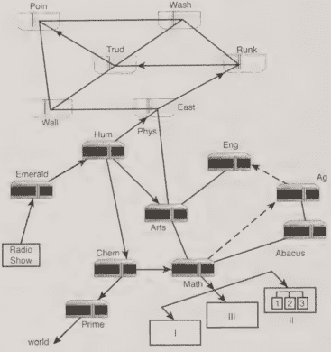

图 2.4 新的路由器树，其中粗虚线代表 IP 隧道。

- **场景 2：** Router Arts 被有意移除。它不会被任何其他设备替换。

此场景与第一个场景没有明显区别。主要区别在于 Eng 可以设置为 DVMRP，并且在拆除 Arts 之前可以先建立到 Eng 的隧道。或者，Ag 和 Eng 都可以成为 DVMRP 路由器，或者可以从其他地方铺设一条新连接。

- **场景 3：** Router Arts 用于访问网络的连接暂时中断，将该路由器、其自身网络上的机器以及它本应传递数据的任何网络与所有其他网络隔离开来。该连接中断持续三小时。

这里事情又变得有趣了。当 Arts 消失时，过程与场景 1 中将其关闭时相同。具有启发性的是当 Arts 最终重新上线，将其组成员带出隔离状态时。

在隔离期间，Arts 在其自身的路由表中停用了所有邻居。就 Arts 而言，它是存在的唯一 DVMRP 路由器。然而，DVMRP 路由器永不放弃。它会继续在每个接口上向 All-DVMRP-Routers 多播频道（224.0.0.4）发送探测，并如果有机器需要听到且无法处理多播，则也会广播，试图找到一个可以连接的邻居。Arts 重新上线后，Hum 会突然收到来自它的探测。

如果 Arts 提供给 Hum 的所有信息与之前完全相同，那么 Hum 就会重新激活通过 Arts 的路由。否则，路由表将被交换和编辑。

这里还有最后一件事需要说明。本章讨论了 DVMRP 如何使用 R.P.M 来修剪网络和路由器，使其不再出现在从特定源发送数据的列表中。然而，IGMP 处理机器不断加入和离开多播组。我们知道它们是如何被移除的，但它们离开后，又是如何被重新加入的呢？

这里使用的技术是嫁接。任何被修剪的项目都可以在任何时候重新嫁接回源/目的树。DVMRP 路由器监控组成员关系。该路由器会取消任何突然干扰刚加入组的某人接收多播数据的修剪消息。这些取消消息是 Graft 消息。当 DVMRP 路由器收到 Graft 时，它会发送回一个确认（graft ack）以防止消息重复，然后将之前被修剪的分支重新添加到树上。如果该路由器本身也被修剪出树，它会向此特定源/目的对的上游发送 Graft 请求——依此类推。

在 Linux 中实现 DVMRP 的程序是 mrouted，就像 MOSPF 一样。

请参阅第 6 章，了解如何实现此操作。

## Protocol Independent Multicast

协议无关多播（PIM）工具是一种路由协议，不受任何其他现有协议的约束。它实际上是在现有单播协议之上运行，因此不必处理任何单播数据包。相比之下，DVMRP 有时会处理单播传输，例如隧道和发送单个路由器探测。

目前有两种不同的 PIM 口味可用。每种都经过改进，以处理特定范围的组成员。具体来说，在这两种选项之间进行选择时需要问的问题是：你的组成员是稀疏分布还是密集聚集。


## 独立于协议的多播-稀疏模式 (PIM-SM)

稀疏多播网络中，不是多播组成员的机器和/或网络的数量远多于成员。组成员也可以分布在很大的地理或网络地址范围内。这里的想法是不要用大量不必要的多播流量拖慢网络结构。

## 会合点树 (RP Tree)

PIM-SM 在其即时操作中使用两组不同的树。其中第一个是会合点树 (RP tree)，也称为共享树。该树本质上是 PIM-SM 操作的主干。

在您的路由域中，每个被服务的组播组都有一个 RP 路由器。该路由器可能承载多个组的流量，事实上，通常配置为某个组播地址范围的 RP。对于每个组，都有一个以 RP 路由器为树干的路由器树，然后所有服务组成员的其他路由器作为分支，包括那些必须将信息从 RP 传递给下游路由器但自身不需要的路由器。这些路由器只要组成员在它们能够以最短路径到达 RP 的位置形成，就会简单地将自己附加上去。

构建这棵树使用什么算法？这里变得有趣了。与迄今为止讨论的不同，PIM-SM 不使用算法来生成树。它利用底层的单播路由协议来生成 RP 树，从而节省了一些开销。

## 最短路径树 (SPT)

PIM-SM 的第二棵树是从组播源开始的最短路径树 (SPT)。只有当来自该特定源的流量很大时（你设置每秒比特数 bps 来定义“很大”），这棵树才会被构建和/或使用，并且每个单独的路由器都可以决定是否加入 SPT 或留在 RPT。

如果路由器决定需要属于 SPT，它会直接向组播组的源发送 Join 消息。该消息必须沿途经过其他路由器。随着消息的传递，这些路由器也会为源的专用 SPT 添加自己的 Join 请求，如果它们尚未成为成员的话。

路由器完全成为该组 SPT 的成员后，它会向 RP 发送 Prune 消息。随着消息的传递，每个中间路由器都会检查该路由器是否是其成为 RPT 成员的唯一原因。如果是这种情况，中间路由器也会添加 Prune 消息，从而减轻了 RP 处理该组播组的负载。

最终，这次流量突发可能会减慢。当这种情况发生并且 bps 降到你定义的“很大”以下时，该过程会逆转。PIM-SM 路由器向 RP 发送 Join 消息以加入 RPT，并在其以及必要的中间节点牢固连接后，向源发送 Prune 以离开 SPT。

## 工作原理

假设路由器 Phys 和 Arts 是我们域中所有路由机器中最强大的。它们也与大多数邻居有快速连接。这些将成为很好的 RP 路由器。由于我们有许多不同的组播组在服务，我们决定在这两者之间分配 RP 职责。

在我们设置好单播协议和 PIM-SM 后，当有人使用我们网络中的一台机器加入一个组播组时，会发生以下情况：

- 1. IGMP 通知最近的指定路由器 (DR) 有一个新的该特定组成员。DR 根据情况是以下两种之一：
  - 如果这是服务该网络部分的唯一路由器，它始终是事实上的 DR。
  - 如果多个路由器服务该网络部分，将举行选举以确定哪个路由器是该网络的 DR，以避免组播数据包重复。具有最大以太网 MAC 地址的路由器接口赢得此次选举。
- 2. DR 检查其列表中该组的会合点 (RP) 路由器。
- 3. 如果 DR 尚未拥有，DR 为该组创建自己的路由表条目。
- 4. DR 将该组成员添加到组的表条目中。如果路由器已经有组成员，则不会继续执行此过程的其余部分。
- 5. 如果 DR 尚未处理该组的流量——因为这是第一个加入该组的成员——它会创建一个 Join 数据包。
- 6. DR 将最终通向会合点的接口地址添加到 Join 数据包中。
- 7. DR 通过最终通向该组 RP 路由器的接口发送 Join 数据包。
- 8. 最有可能的是，某个中间路由器接收到该数据包。该路由器将数据包刚刚到达的接口添加到 Join 数据包中，如果它尚未成为 RP 树的一部分。
- 9. 中间路由器通过最终通向 RP 的接口转发数据包。如果 Join 数据包最终到达另一个中间路由器，则重复步骤 8。
- 10. 该机器刚刚加入的组的所有流量早已通过 RP、沿 RP 树传输，最终到达新的组成员。

我知道其中一些内容是重复的，但我想确保你有机会真正让这些工作原理深入人心。切换到 SPT 的微妙之处在此示例中被省略了。然而，请记住，最终用户不会选择使用哪棵树——每个路由器会选择。这一切对新的组成员来说都是透明的。


到现在，你大概已经猜到接下来会发生什么了。我犯了把那个讨厌的路由器 Arts 设为 RP 路由器之一的错误。让我们通过以下场景看看它变得不稳定时会发生什么：

- Scenario 1: Router Arts was intentionally removed. It had a critical failure, and there is no backup router available to take its place for a week.

突然，大约一半的多播组失去了 rendezvous point 路由器。幸运的是，我在说你可以指定哪个 RP 处理哪个组时稍微撒了谎。你不必这样做。PIM-SM 路由器也可以自行选举谁将成为 RP。但首先，必须处理 Arts 在没有任何警告的情况下死亡的事实。

这里首先发生的事情是，引导路由器（有时缩写为 BSR 或 BR）停止收到来自 RP 路由器 5 的 “I’m alive” 通知。路由器会继续尝试与 Arts 通信，直到 BSR 发送出下一次更新，而这一次更新中突然不再包含指向 Arts 的指针。随后，路由器都会从它们自己的多播流量表中删除 Arts。

现在是时候看看我们在网络中设置多个 RP 的另一个原因了。你不仅可以告诉一个 RP 处理特定的多播组范围，还可以为其分配一个优先级值——数字越低，优先级越高。这意味着我们在设置 RP 时做了一件聪明的事。路由器 Arts 以最高优先级处理一半的组，而对另一半组则具有最低优先级。Phys 则相反。

现在，普通路由器对于某些组已经无处发送数据时，它们会使用哈希函数（也称为算法）。这个工具允许路由器联系所有可用的 RP，并找出哪些 RP 支持它们需要传递数据的组。当路由器发现自己需要通过 Arts 传递的数据无处可送时，它们向 Phys 发送哈希并发现它可以处理这些组。表被重建，一切又恢复正常。

- Scenario 2: Router Arts was intentionally removed. It is not going to be replaced with anything else.

也许你开始注意到一个规律——对于高级协议来说，这个场景与第一个场景没有区别。这里也是如此。

- Scenario 3: The connection Arts uses to access the network went down temporarily, isolating this router, the machines on its own network, and any networks on which it is supposed to pass data to from everyone else. This connection stays down for three hours.

这个场景的第一部分与 Scenario 1 完全相同。BSR 注意到 RP Arts 不再发送其 “I’m alive” 消息，并通知所有 PIM-SM 路由器。这些路由器从它们的表中删除 Arts，并且当它们需要向曾经由 Arts 服务的组发送数据时，它们使用哈希来发现 Phys 可以接管这些任务。

通常来说，更有趣的问题是路由器 Arts 重新上线时发生了什么。这里 PIM-SM 可以展示其灵活性。Arts 向 BSR 发送 “I’m alive” 消息，随后 BSR 将 Arts、它声称可以处理的组以及每个组的优先级添加到其 PIM-SM 表中。BSR 然后向普通 PIM-SM 路由器发送其常规更新。它们突然看到有一个路由器 Arts 可以处理它们当前使用 Phys 的某些组，并且 Arts 的优先级更高。

一个接一个地，路由器根据需要向 Arts 发送 Join 消息并向 Phys 发送 Prune 消息。生活恢复正常，管理员无需做任何事情。

在 Linux 中实现 PIM-SM 的程序是 gated。请记住，你还必须安装一个单播协议，例如 OSPF 或 RIP-2，任何 PIM 协议才能正常运行。

## Protocol Independent Multicast-Dense Mode (PIM-DM)

如果你的多播网络是密集的，那么明智的做法是使用 PIM 的这个版本。这个术语指的是在同一地理或网络地址区域内存在许多多播组成员。协议无关多播-密集模式在某种程度上是 PIM-SM 的扩展。本书后面的章节将专门讨论它与稀疏型表亲的不同之处。

PIM-DM 再次依赖于与之共享路由器的单播协议所使用的机制。树是从源头，通过路由器，到达目的地构建的，全部使用单播协议的方法。因此，在底层树构建方面没有什么可讨论的。这里的核心问题是当一个组开始发送多播流量时会发生什么。

名为 The Radio Show 的机器（参见章节 “The Algorithms: Truncated Reverse Path Broadcasting (TRPB)”）已经停机几个月了，现在你想再次运行它。与此同时，系统已更改为 PIM-DM 多播网络。当此源开始发送其多播流量时，每个 PIM-DM 路由器会自动将其发送到其他 PIM-DM 路由器，并将其发送到每个路由器所服务的网络——这是一个密集模式协议。它假设存在许多组成员。再次为每个源/通道组合创建一个单独的表。但由于这是一个 PIM 协议，所保留的所有信息都是该接口是否被使用。


一个有趣的事实是，Prune 消息是发送到指定的多播地址，而不是发送给单个路由器。发送请求的机器会标识自身以及它试图从中 Prune 自身的路由器。然后大约有三秒的延迟，让位于试图离开树的路由器下游的路由器有机会发送 Prune-Override（如果它们有组成员会因该路由器离开树而被冷落）。

在固定的间隔内，所有 Prune 都会从 PIM-DM 路由表中刷新。再次，路由器可以发送 Prune 消息以从特定的源/目的树中移除。

## PIM-DM 和特殊路由器

PIM-DM 协议通常不使用 rendezvous point 路由器或 DR。然而，IGMP 版本 1 在有多个路由器连接到同一网络或网络组的情况下需要 DR。在这些情况下，IP地址最高的路由器成为 DR。

这并不意味着 PIM-DM 允许数据包从两个不同的路由器进入网络。在这些情况下，会选择从源接收数据成本最佳的路由器来转发数据——该成本由单播协议的成本机制确定。

那么，让我们回顾一下我们最喜欢的三种场景，看看情况如何：

- Scenario 1: Router Arts was intentionally removed. It had a critical failure, and there is no backup router available to take its place for a week.

所有 PIM-DM 路由器会定期通过每个接口发送 Hello 消息。Five 的 PIM-DM 邻居（参见图 2.1），Phys 和 Math，注意到在设定的秒数（设在 Holdtime Hello 字段中）后 Arts 并未签到。它们在表中停用所有对 Arts 的引用，并且至少在短暂时间内，需要经过该路由器的数据无处可去。

在本例中 Router Arts 宕机不仅是多播路由的变更，也是单播路由的变更。底层的单播协议重建路由表，PIM-DM 利用这些表为 Arts 所服务的区域发送流量。

- Scenario 2: Router Arts was intentionally removed. It is not going to be replaced with anything else.

再次，这与 Scenario 1 的处理方式完全相同。

- Scenario 3: The connection Arts uses to access the network went down temporarily, isolating this router, the machines on its own network, and any networks that it is supposed to pass data to from everyone else. This connection stays down for three hours.

此场景的开始与 Scenario 1 完全相同。然而，当 Router Arts 重新恢复时，其邻居会突然注意到它始终通过其接口发送的 Hello 消息——尽管 Arts 也会注意到其邻居已消失。

在邻居路由器将 Arts 重新添加到源/组流量的可能路径后，如果 Arts 突然重复了另一个路由器正在向某个网络集合发送的流量，则可能会发生一系列 DR 选举。不久之后，一切都会恢复正常。

在 Linux 中实现 PIM-DM 的程序是 gated。再次记住，你也必须安装单播协议，例如 OSPF 或 RIP-2，任何 PIM 协议才能正常运行。

## Summary

你在 Linux 中最有可能使用的多播路由协议是 MOSPF、DVMRP，以及 PIM-SM 或 PIM-DM。MOSPF 在较小的多播设置中最有用，在那里你需要一个单一协议来同时处理单播和多播，而 RIP-2 处理多播数据的程度不如处理单播更新。DVMRP、PIM-SM 和 PIM-DM 都需要一个额外的单播协议配合使用。如果你多播组成员往往分布很广，你会使用 PIM-SM；如果你它们分布更密集，你会使用 PIM-DM 或 DVMRP。表 2.1 概述了 Linux 中可供你使用的多播协议以及开始所需的数据。

Table 2.1 The Programs Used to Implement Multicast Routing Protocols in Linux, and the RFC Documents That Contain Vital Background Information

| Protocol | Program | RFC or Draft |
|---|---|---|
| MOSPF | mrouted | 1585 |
| DVMRP | mrouted | draft-ietf-idmr-dvmrp-v3-10.txt |
| PIM-SM | gated | 2362 |
| PIM-DM | gated | draft-ietf-pim-v2-dm-03.txt |

See http://www.multicasttech.com/multicast_faq.html if you have questions about multicast in general.


# 3

## 边境路由协议简介

迄今为止，本书讨论的路由协议都是在特定自治系统（AS）内部使用的。这还不够，如果你的 AS 连接到互联网或其他 AS。除了为你的网络选择内部路由协议外，你还需要考虑将要使用的边境路由协议，以便让你的内部网与互联网的更广阔世界进行通信。边境协议接收在你的 AS 内传递的信息，并确定哪些部分需要与邻居共享，以及从外部世界引入相关数据。

我们将从内部和外部 TCP/IP 网关协议之间的区别开始，逐步从单播领域中最简单的方案，到更现代的解决方案，这些方案简化了单播和多播的路由过程。

## 内部网关协议（IGP）

让我们先快速回顾一下 AS 内部发生的情况并介绍一些术语。在此 AS 中我们有区域：至少一种单播路由协议，也许还有一种或多种多播协议。AS 内使用的所有路由协议都是内部网关协议（IGPs）。

邻居会发送一个 Confirm 作为响应，验证你是否正常运行并接受你的 AS 边境路由器作为邻居。然后 AS 边境路由器设置一个小型数据列表，其中包括前面列表中讨论的内容，外加以下内容：

- **分配给 Confirm 的序列号。** 所有 Confirm 数据包都包含一个序列号，就像 Request 数据包一样。
- **此 AS 边境路由器相对于该机器所处的模式。** 该路由器在任何时刻都可能处于 *active* 或 *passive* 模式。模式决定了路由器如何响应 Hello 和 Poll 消息。如果路由器处于活动状态，则每当收到 Hello 或 Poll 时，它都会以下列消息类型之一进行响应：Confirm、I-Heard-You (IHU) 或 Update。被动路由器可能会对其中之一做出响应并进入 Up 状态，这会使路由器恢复与其实体网关协议邻居的完全参与。
- **Confirm 消息到达的时间。** 这用于为三个不同变量设定零点。第一个计算下一次该机器向所讨论的 AS 边境路由器发送 Request 的时间。第二个计算机器在发送 Poll 之前等待的时间。第三个维护一个倒计时，记录自上次听到该机器以来经过了多长时间——以防它沉默太久。

你的路由器现在变为 Down 状态。此状态允许处理 Cease、Hello 和 Request 命令。这里的新命令是 Cease 和 Hello。如果 EGP 路由器从管理员收到 Stop 命令，则它会针对特定邻居进入 Cease 状态。作为对该命令的响应，机器首先进入 Cease 状态，然后向其暂时结束关系的特定邻居发送 Cease 命令。

此时可能会发生以下几种情况：

- **邻居接收到 Cease 命令。** 如果邻居正常运行良好，它会接收并理解 Cease 命令。在这种情况下，邻居会向你的 AS 边境路由器发送 Cease-ack 命令，然后变为 Idle 状态，忽略除来自特定邻居的新 Request 命令之外的任何内容。
- **Cease 命令未到达邻居。** 如果存在网络问题，或邻居已停机，Cease 命令可能会丢失在“巨大的网络位桶”中。在这种情况下，EGP AS 边境路由器仍保持在 Cease 状态。路由器将继续偶尔发送 Cease 命令，直到得到响应。管理员可以发出第二个手动 Stop 命令，以覆盖等待 Cease-ack 并立即使机器相对于该邻居进入 Idle 状态。


现在，来看 Hello 消息和 Poll 命令。当 EGP AS 边境路由器收到 Hello 消息时，它会发送回一个 I-Heard-you（IHU 或 I-H-U）消息，验证自己处于正常运行状态并且收到了 Hello 消息。接下来是 Poll。请记住，当 EGP AS 边境路由器收到 Request 命令时，它会设置向请求邻居发送 Poll 命令的频率，然后启动一个计时器，计算到下一次需要发送 Poll 命令还有多少秒。

当计时器达到间隔值时，机器会向指定的邻居发送 Poll 命令。当邻居收到 Poll 命令时，响应取决于该邻居所处的状态和模式。如果 EGP AS 边境路由器处于 Down 状态或 Passive 模式，它会忽略 Poll 命令。如果它不在此状态或模式下，邻居会用 Update 进行响应。正是这条消息传输了每个自治系统中可用网络的实际信息。Update 中包含的数据包括：

- **AS 内的所有网关。**请记住，网关是连接两个或多个网络的设备。
- **路由器在 AS 外所知道的所有网关。**这可以实现更完整的路由表，减少查询。
- **通过每个网关可用的所有网络。**AS 边境路由器的邻居需要知道将信息发送到哪里。你的路由器无需做太多“思考”，如果邻居已经知道为特定网络将数据直接发送到特定网关。
- **数据必须经过多少个路由器和网关才能从你的 AS 边境路由器到达每个特定网络。**此信息允许在 AS 内部进行最短路径计算。
- **每个邻居的当前状态。**此信息确保每个路由器都知道彼此期望接收什么样的数据。

正如你所见，EGP 有相当多的工作要做。如果没有某种方法让 AS 边境路由器共享信息，就必须有一个集中列表，说明为所有特定网络应将数据发送到何处。在 Linux 下实现此协议的程序是 gated 的单播版本。

## 边境网关协议（BGP）

EGP 的子协议是边境网关协议（BGP-4）。该协议经历了多个版本，目前最新的是 BGP-4。本章中对 BGP 的所有引用均指这个第四版。BGP-4 增加的主要问题之一是 EGP 无法处理 IP 版本 6 的某些功能，这些功能在第 4 章“IPv4 和 IPv6 地址”中有深入介绍。

BGP 是另一个你需要告诉 AS 边境路由器其邻居是谁，而它必须自行获取信息的案例。在 BGP Active 状态下，AS 边境路由器会与新邻居建立 TCP 连接。连接建立后，你的机器执行以下操作：

- **将 ConnectRetry 计时器设置为零。**该计时器通常从零计数到 120 秒。如果达到该值，AS 边境路由器会认为其 TCP 连接已丢失并尝试重新建立。
- **创建 BGP 将存储有关此新邻居的信息的框架。**该框架包括创建需要设置的所有变量。
- **将 Hold Timer 设置为四分钟。**该计时器设置系统在关闭与邻居的连接之前，在定期交换消息之间等待的时间。

之后，一系列消息在两台机器之间传递。首先，你的机器向邻居发送 OPEN 消息。该消息包含：

- **BGP 版本号。**我们这里讨论的是 BGP-4。
- **发送者的 AS 号码。**如前所述，每个自治系统都有一个由中央机构分配的唯一识别号。
- **用于 Hold Timer 的设置。**如果两个 AS 边境路由器的设置不同，它们会同意采用两者中较短的时间跨度。如果已设置的 Hold Timer 值与新选择不匹配，则会重置以匹配。
- **发送者的 IP 地址。**这也称为 BGP Identifier。

当邻居收到此消息时，它会存储所提供的信息并向你的机器返回 KEEPALIVE 消息。当 KEEPALIVE 消息到达时，Hold Timer 会重置回零。从那时起，KEEPALIVE 消息以大约最大 Hold Timer 时间三分之一的速率在双方之间传递。整个 Hold Timer 时间内未收到这些消息，会告诉机器其邻居不可用。

最后，你的 AS 边境路由器相对于该邻居变为 OpenSent 状态。这里机器等待 OPEN 消息。即使它们已建立连接，它也需要从邻居收到其中一条，因为这是获取有关该邻居基本信息的唯一方式。消息到达后，BGP AS 边境路由器会确保它可能已有的该邻居的值与 OPEN 消息中给出的一致。如果不一致，则会更新。


交换UPDATE消息。这些消息根据其用途包含不同的信息。例如，一条通告新路由的UPDATE消息包含：

- **ORIGIN类型代码。** 该代码告诉BGP它所处理的路由是在UPDATE消息来源的AS内部还是外部。AS边界路由器确实共享有关其控制之外路径以及内部路径的信息。
- **AS_PATH段类型。** 该代码指定新路由信息到达该AS边界路由器所经过的自治系统列表是按特定顺序排列还是无序。
- **该路由信息经过的AS。** AS编号的有序或无序列表。
- **本路由器必须向其发送数据以将数据包送达指定新路由的AS边界路由器的IP地址。** 这也称为下一跳属性。
- **以下IP地址部分的位数。** 由于路由是针对网络和子网进行的，而不是针对单个IP地址，因此AS边界路由器之间发送的信息是IP地址前缀的集合，或者是标识所讨论网络或子网的地址部分。
- **标识此路由所适用的网络或子网的IP前缀。** 此前缀必须结束于IP地址中的一个点。如果定义适用于192.14.14.51，并且它是一个完整的未划分子网的C类网络，则条目将是192.14.14。

每条UPDATE消息只能包含一条新路由。然而，BGP可以在同一条UPDATE消息中撤回任意多条现有路由。这些路由撤回中的每一项都包含以下信息的全部或部分：

- **被撤回路由部分的总长度。** 由于被撤回路由可以是任意长度，此项确保各部分之间不会混淆。零表示没有要移除的路由。
- **IP地址部分的位数。** 再次强调，AS边界路由器之间发送的信息是IP地址前缀的集合，或者是标识所讨论网络或子网的地址部分。
- **标识此路由所适用的网络或子网的IP前缀。** 同样，前缀必须结束于IP地址中的一个点。
- **路径属性部分的总长度。** 同样，包含此信息可避免误读数据。

BGP AS边界路由器如何决定通知邻居哪些路由？这些机器中的每台都有一个策略信息库（PIB），其中包含管理员手动设置的规则。每台机器也有一组独立的数据库，每个都有特定功能。该路由器所知的所有路由都列在其Adj-RIB-In数据库中。路由信息库（RIB）是路由表的另一个术语。BGP AS边界路由器获取其PIB，并将规则应用于Adj-RIB-In中的每条路由。符合规则的任何内容都会被复制到Adj-RIB-Out数据库。

使用PIB规则计算的一项数据是每条特定路由的偏好等级。在将这些信息整合后，BGP AS边界路由器会查看其拥有路由信息的每个目的地，并根据其PIB规则和偏好等级为每个目的地选择最佳路由。最佳路由全部存储在Loc-RIB数据库中。

还有一部分处理要做。请记住，这些数据库是时刻维护的。每次新信息进入Adj-RIB-In或Loc-RIB时，都会产生涓滴效应。Adj-RIB-Out依赖于这两个数据库，因此只要其中任何一个或两个发生变化，它就必须改变。在某些BGP实现中，Adj-RIB-Out比Loc-RIB被修剪得更多。重复路由会从该数据库版本中移除，这样数据从A点到B点只有一条路径。这确保了数据库不会变得过大或冗余。每当Adj-RIB-Out发生变化时，该变化会作为UPDATE消息发送给BGP邻居。

现在你或许明白了为什么在许多情况下BGP比EGP更受青睐。它只是一个更智能的协议，在路由调优方面有更多的内部制衡机制。Linux下实现该协议的程序是zebra和gated的单播版本。再次强调，BGP是一种单播边界协议。

## 边界网关组播协议（BGMP）

组播协议也需要AS边界路由器的关注。本节讨论边界网关组播协议，即BGMP。BGMP具备以PIM-SM风格构建组播组树的能力，在PIM-SM中，任何给定时间只有组成员属于该树。然而，这些树并非由单个路由器组成。相反，每棵树只有BGMP边界路由器作为成员。一旦这棵树建成，某些域会根据它们使用的协议，从那里构建自己的内部树。

通告特定组播通道范围可用性的组播域被视为该范围的根。请记住，每个组播通道由一个D类Internet地址组成，范围从224.0.0.0到239.255.255.255。因此，也许我们的AS拥有从231.15.19.120到231.15.19.140的组播通道范围。BGMP会将我们的AS视为该范围的根域。

当用户加入其域或AS之外的组播组时，其请求会被传递给BGMP路由器。该路由器查找负责处理包含该特定通道的根域的路由器的地址。一旦BGMP路由器知道应将请求发送到哪个域，它就会生成一条包含以下信息的BGMP UPDATE消息：

- 地址前缀。此前缀告诉BGMP所包含的网络掩码的长度。


- **地址族、协议族或协议套件——这些都指同一件事。** 该数据包 intended 要在之上传输的网络协议集合的类型。为本次讨论的目的，让我们假设你使用的是类似 Internet 的网络，并且在上面使用 TCP/IP。
- **地址。** 该 UPDATE 消息所指的多播地址。
- **网络掩码。** 包含在此 UPDATE 消息中的多播地址相关联的网络掩码。
- **JOIN 消息声明。** 此参数指定该 UPDATE 消息实际上是一条 JOIN 消息。
- **附加声明。** BGMP UPDATE 消息可以携带多种消息类型。在本例中主要属性是 JOIN。因此，该消息也可以承担 GROUP、SOURCE 或 POISON_REVERSE 的功能。在其中，你还可以嵌套更多的 JOIN、PRUNE 等。

BGMP 路由器现在在其表中查找并将此 UPDATE 消息发送给将把它带向多播根域更近一步的路由器。接收路由器查看它是否已有条目指示它将该多播组的数据转发给请求路由器。如果没有，它会创建此条目并将数据包发送给下一个最近的 BGMP 路由器。该路由器查看它是否已在将该组的数据从请求域转发。如果没有，它会创建条目以执行此操作并继续。此过程沿着树从路由器到路由器跟随，直到 UPDATE 消息到达根域。

最终，用户会离开。当用户从其域外部广播的多播频道断开连接时，BGMP 路由器会收到通知。该路由器首先查看它在其域内是否还有其他组成员。如果没有，它会生成一条 UPDATE 消息，与 JOIN 消息不同之处仅在于一个简单事实：而不是设置位来告诉 UPDATE 它携带 JOIN 信息，而是设置位告诉它此 UPDATE 消息携带 PRUNE 信息。

UPDATE 消息使用与 JOIN UPDATE 消息相同的模式沿途发送。它沿着通往根域的最短路径逐跳发送。途中的每个路由器都会查看它是否在为该多播组的其他成员提供服务。如果是，UPDATE 消息就会停止，无需继续发送。然而，如果这是唯一请求该组数据的目的地，UPDATE 消息会进一步沿树向下推进。

除了更改多播组成员身份外，BGMP 路由器还必须处理整体多播路由表中的变化。随着时间的推移，随着传输内容的退役和新参与者的出现，频道会被添加和删除。

BGMP 在很多方面与 BGP 相关，但正如你所见，它具有允许其与多播传输很好配合的特性。在 Linux 下实现此协议的程序是 zebra 和 gated 的多播版本。

## 多播源发现协议（MSDP）

另一种多播边界路由器协议是多播源发现协议（MSDP）。此特定协议只能用于连接内部也使用 PIM-SM 的域。你可能会发现，在继续之前回顾第 2 章“多播协议”中“协议无关多播-稀疏模式（PIM-SM）”部分会有所帮助。此协议也利用现有的 BGP 路由表而不是为单播数据构建自己的表。

MSDP 路由器使用 TCP 保持与其邻居或对等体持续连接的开放。KeepAlive 定时器用于检查 KeepAlive 消息是否在指定间隔内到达，尽管如果在 KeepAlive 要求内没有 Source-Active（SA）消息到达，这些消息不会被发送。如果超过间隔且未到达 KeepAlive 或 SA 消息，对等体会尝试重置 TCP 连接。

MSDP 的开发者并不觉得有必要重新发明轮子。PIM-SM 和 MSDP 利用已存在的 PIM-SM 会合点（RP）设置相互通信。每当有新源开始广播且此信息到达 RP 时，该机器会创建一条包含以下信息的 SA 消息：

- 发起广播的机器的 IP 地址
- 数据被发送到的多播频道地址
- 处理该频道的会合点的 IP 地址

此消息随后被发送到 MSDP 边界路由器。收到 SA 消息后，它会被转发给该边界路由器的所有 MSDP 邻居，除了接收到该消息的机器——这称为对等-RPF 泛洪。当每个对等体收到 SA 数据包时，它会检查其哪个邻居是该特定多播频道的 RPF 对等体。RPF 对等体是离我们称之为 SA 源的发送原始 SA 消息的 MSDP 路由器最近的 MSDP 路由器。

路由器会再次检查任何 SA 消息与 RPF 对等体，以避免环回问题。如果 SA 消息来自一台比该路由器更接近 SA 源的机器，但不是 RPF 对等体，则 SA 消息将被忽略。除此之外，MSDP 路由器会将 SA 消息发送给其所有对等体——即那些不比它更接近 SA 源的对等体。

只要还有更多 MSDP 对等体可以交谈，此过程就会在整个 Internet 上继续。每个 MSDP 对等体还必须检查它是否也是其域的 PIM-SM 会合点。如果该机器同时承担这两个用途，它会检查其自己的域成员是否已请求访问该新频道。哪怕只有一个请求，该 MSDP/PIM-SM RP 就会向该频道的 RP 发送 Join 请求。执行此操作会产生一种奇怪的情况，即该特定频道的树会伸出其本地域。

正如你所见，由于该协议能够依赖 BGP 进行路由表并依赖 PIM-SM 跟踪组成员身份，因此相当直接。实现此协议的 Linux 程序是 gated 的多播版本。


# 摘要

除了你必须为自己的自治系统或其部分考虑使用的 IGP 之外，整个网络管理员还需要查看可用的边界协议并选择最适合其特定情况的协议。本章介绍了单播边界协议 EGP 和 BGP，以及组播协议 BGMP 和 MSDP。如今大多数管理员选择 BGP 而非 EGP，仅仅因为 BGP 具有更现代化的功能，并且因此更稳健。至于在 BGMP 和 MSDP 之间选择，正确选择取决于你是否使用 PIM-SM，因为 MSDP 是为 PIM-SM 优化的。

表 3.1 概述了可供你使用的边界协议以及开始所需的数据。

表 3.1 在 Linux 中实现单播和组播边界路由协议的程序，以及包含重要背景信息的 RFC 文档

| Protocol | Program | RFC or Draft |
|---|---|---|
| EGP | gated | 904 |
| BGP | gated, zebra | 1771 |
| BGMP | gated, zebra | draft-ietf-bgmp-spec-01.txt |
| MSDP | gated | draft-ietf-msdp-spec-06.txt |


## IPv4 和 IPv6 地址

LINUX 原生使用 TCP/IP 作为其网络协议和工具套件。此规则和程序集合的一个方面是，网络上的每台机器必须根据 IP 地址方案分配一个唯一的值或地址。我们大多数人都已经意识到这一点，并且在 Internet 和私有网络空间中都有分配地址的经验。如果这对你来说是这样，那么请随意跳过本章或直接跳到标题为“无类 IPv4 地址”和“IPv6 地址”的部分。

然而，如果你从未处理过除基本静态 TCP/IP 网络和无子网划分之外的任何内容，你正在进入复杂的网络领域。让我们确保你拥有所需的所有知识。

## IPv4 地址

多年来，我们都对老牌的 IP 版本 4 感到舒适。IPv4 基于 32 位主机地址。地址首先被分解为 A、B 和 C 类，D 类保留用于组播通道。地址类决定了 IP 地址中多少位适用于网络号，多少位适用于主机号。由这些网络构成的所有子网大小相等，等等。你每学到关于 IP v4 的新东西，就能为你的网络设置增加更多复杂性。

从左侧开始，因为对某些人来说感觉更自然。第一个字节 01001101 分解如下，以两种不同的方式显示：

0x2^7 + 1x2^6 + 0x2^5 + 0x2^4 + 1x2^3 + 1x2^2 + 0x2^1 + 1x2^0 = 77
0x128 + 1x64 + 0x32 + 0x16 + 1x8 + 1x4 + 0x2 + 1x1 = 77

第二个字节 00011101 分解为：
0x128 + 0x64 + 0x32 + 1x16 + 1x8 + 1x4 + 0x2 + 1x1 = 29

第三个字节 10111001：
1x128 + 0x64 + 1x32 + 1x16 + 1x8 + 0x4 + 0x2 + 1x1 = 185

最后，第四个字节 10110110：
1x128 + 0x64 + 1x32 + 1x16 + 0x8 + 1x4 + 1x2 + 0x1 = 182

因此，此 IP 地址的十进制版本为 77.29.185.182。现在我们有了地址本身，我们想知道哪些是网络位，哪些是主机位。为此，我们必须查看标准 IP 地址类表，如表 4.1 所示。

## 表 4.1 IP 地址类范围，未移除特殊地址，网络部分以粗体显示，主机部分以非粗体显示

| Class | Start | End |
| --- | --- | --- |
|  | BINARY | DECIMAL | BINARY | DECIMAL |
| A | 00000001.00000000.00000000.00000000 | 1.0.0.0 | 01111111.00000000.00000000.00000000 | 127.0.0.0 |
| B | 10000000.00000000.00000000.00000000 | 128.0.0.0 | 10111111.11111111.00000000.00000000 | 191.255.0.0 |
| C | 11000000.00000000.00000000.00000000 | 192.0.0.0 | 11011111.11111111.11111111.00000000 | 223.255.255.0 |
| D | 11100000.00000000.00000000.00000000 | 224.0.0.0 | 11101111.11111111.11111111.11111111 | 239.255.255.255 |

这还不是全部的故事。不过，并非所有这些地址都实际可用。让我们先剔除网络地址。例如，整个网络 127.0.0.0 仅用于回环到你正在使用的同一台机器。你不能用它来到达另一台机器。没有人被分配此网络号。第一个网络 0.0.0.0 甚至未列出。它用于指向默认路由。

我们也不能使用每个类中的第一个和最后一个地址。所有可变位全部为 0 或全部为 1 的地址都保留用于特殊用途。这意味着以下地址也不可用：

- Class A. 这些已经提到过，但在此列出以便参考。0.0.0.0 和 127.0.0.0 不可用。
- Class B. 128.0.0.0 和 191.255.0.0 不可用。
- Class C. 192.0.0.0 和 223.255.255.0 不可用。


- Class D，224.0.0.0 和 239.255.255.255 是不可用的。你可能会注意到，多播类没有主机地址。根本不需要。组播完全由机器以自己的地址加入和离开的频道组成。

必须移除的另一组网络地址是合并的私有 IP 网络。这些地址专门为内部使用而保留，永远不会指向互联网上的机器。表 4.2 列出了这些地址范围。请注意，该表显示的是已被保留的整个网络。

## 表 4.2 保留的私有网络，供内联网和其他隔离网络使用

| Class | Start | End |
| --- | --- | --- |
| A | 10.0.0.0 | 10.255.255.255 |
| B | 172.16.0.0 | 172.31.255.255 |
| C | 192.168.0.0 | 192.168.255.255 |
| D | 239.0.0.0 | 239.255.255.255 |

并非只有网络地址会被从可用池中移除。还有一些主机地址也不能使用。虽然在网络讨论中，IP 地址的主机部分可以留空以隔离网络地址，但在进行主机讨论时使用真实网络号码会稍微棘手一些。因此我们将使用 x 来表示网络部分，这样我们就可以只引用主机，因为我们对主机的说法适用于所有网络。每个不可用的主机地址都有特殊用途：

- 主机地址 x.x.x.0 被保留用于指代网络本身。
- 主机地址 x.x.x.255 是广播地址，即当主机想要向所有网络成员发送数据时，TCP/IP 发送数据的“主机”。
- 相信与否，这就是全部。差不多。当我们稍后在章节“Applying IP v4 Addressing Across Subnets”中进入子网划分时，我们开始失去更多主机地址。

我们也不能忘记网络掩码，或称 netmask 的问题。当你处理的是完整网络时，网络掩码不会改变。它始终如表 4.3 所示。

## 表 4.3 每个 IP 地址类的标准网络掩码

| Class | Netmask |
| --- | --- |
| A | 255.0.0.0 |
| B | 255.255.0.0 |
| C | 255.255.255.0 |
| D | 255.255.255.255 |

正如你可能注意到的，网络掩码位在用于确定该类网络号码的每个字节中都设置为全 1。0 位置代表可用于主机和子网的位置。如常，你可以看到组播没有主机，而且你不能对单个 IP 地址进行子网划分。

## 跨子网应用 IPv4 地址

有时一个网络是不够的。你可能有一个完整的 C 类地址，但出于管理、安全、地理或其他原因，你需要将网络划分为一组子网。这样做会增加工作量。首先，你必须实际设置路由，因为你现在必须告诉每个子网如何向其他子网和外部世界发送数据。你还必须计算所有 IP 位和片段，例如新的网络掩码、新的网络地址、新的广播地址等等。

你通过将一些主机位转为网络位来将 IP 网络划分为子网。不，这不是魔术。你在更改网络掩码的协助下完成此操作。非标准于地址类的网络掩码会告诉 TCP/IP 它正在处理一个已子网划分的网络。因此，让我们看看这一切是如何完成的。

在 A 类和 B 类网络的世界里，子网划分相对简单。你可以取一个 A 类网络，例如 120.0.0.0——其网络掩码为 255.0.0.0——并简单地使用 120.1.0.0 到 120.254.0.0 作为网络地址，同时将网络掩码更改为 255.255.0.0 来将其划分为子网。看起来熟悉吗？你刚刚把你的 A 类网络变成了 254 个 B 类网络地址或子网。同样的操作也适用于 B 类网络。取 142.182.0.0，它落在 B 类范围内，因此网络掩码为 255.255.0.0。给它一个 255.255.255.0 的网络掩码并使用 142.182.1.0 到 142.182.254.0 作为网络地址，你就刚刚把你的 B 类网络变成了 254 个 C 类网络地址或子网。然而，如今有多少人真的能拥有自己的 A 类或 B 类网络来玩呢？几乎没有可能。

当你想要对 C 类网络进行子网划分时，事情变得更有趣。你不能简单地将其分解为 D 类网络；那些是单个 IP 地址。然而，我们可以通过更改网络掩码然后将可用主机拆分，使每个主机进入不同的网络来实现。你随后会占用一些主机地址作为网络号码和其他保留值。

IP v4 对 C 类地址可创建的子网有一定限制。每个子网必须大小相同，而你将网络划分成的网数由二进制数学决定。因为 C 类地址网络掩码的前三个字节固定为 255.255.255.，让我们只看最后一个字节。如常，它是八位，其中 x 为 0 或 1。你创建子网的第一个选项是将网络划分为两个。为什么？因为第一个 x 可以是 0 或 1，你只有两个选项。因此，突然间你的网络位（用 n 表示）大了一个位，而你的主机位（用 h 表示）小了一个位，你的网络字节看起来像 nnnnnnnn.nnnnnnnn.nnnnnnnn.nhhhhhhh。


将网络划分为四部分的第二次机会是因为前两个 x 可以是 00、01、10 或 11。因此现在你的网络字节为 nnnnnnnn.nnnnnnnn.nnnnnnnn.nnhhhhhh。同样，TCP/IP 通过你的子网掩码来跟踪这一点。子网掩码的最后一个字节等于其中 n 的位置值之和。因此，两个子网网络的子网掩码为 255.255.255.128。由此可知，四个子网的子网掩码为 255.255.255.192。表 4.4 概述了 C 类地址可能的 IPv4 子网及其相关值。

## 表 4.4 关于可能的 IPv4 C 类子网的相关事实，其中 n 代表网络位，h 代表主机位，x 代表网络字节

| Number | Network Bits | Binary Netmask | Decimal Netmask |
|---|---|---|---|
| 2 | nhhhhhhhh | .10000000 | 255.255.255.128 |
| 4 | nnhhhhhhh | .11000000 | 255.255.255.192 |
| 8 | nnnhhhhhh | .11100000 | 255.255.255.224 |
| 16 | nnnnhhhh | .11110000 | 255.255.255.240 |
| 32 | nnnnnnhh | .11111000 | 255.255.255.248 |
| 64 | nnnnnnnh | .11111100 | 255.255.255.252 |
| 128 | nnnnnnnh | .11111110 | 255.255.255.254 |

现在，其中一些子网大小相当不现实。我们将通过深入了解子网地址的内部结构、主机地址范围等来说明原因。让我们从两个子网的情况开始。你可以使用剩余的主机位来帮助你确定每个子网的主机号范围。在两个子网划分的情况下，n hhhhhhhh 中的 h（主机位）加起来为 127。因此子网 1 从 x.x.x.0 到 x.x.x.127，子网 2 从 x.x.x.128 到 x.x.x.255。

但事实并非如此简单。第一个和最后一个主机位始终被保留，即使在子网化网络中也是如此，因此你实际上只能为子网使用 x.x.x.1 到 x.x.x.126 和 x.x.x.128 到 x.x.x.254。现在我们必须剔除网络地址。对于子网 1 这是 x.x.x.1，对于子网 2 这是 x.x.x.128——对于整个网络它是 x.x.x.0，而整个互联网看到的也只有这个。因此你的可用主机 IP 地址现在是 x.x.x.2 到 x.x.x.126 和 x.x.x.129 到 x.x.x.254。我们现在需要子网广播地址，而不是广播到整个网络的 x.x.x.255。那些将是每个子网中的最后一个地址，x.x.x.127 和 x.x.x.254。现在我们的主机可以是 x.x.x.2 到 x.x.x.126 和 x.x.x.129 到 x.x.x.253。正如你所见，为了方便地将我们的 C 类网络划分为两个子网，我们放弃了使用四个主机 IP 地址。

当然，随着我们创建四个子网，事情变得更加复杂。nnhhhhhh 中的主机位加起来为 63，因此我们最终得到以下四个子网范围：x.x.x.0 到 x.x.x.63，x.x.x.64 到 x.x.x.127，x.x.x.128 到 x.x.x.191，以及 x.x.x.192 到 x.x.x.255。同样，我们将 x.x.x.0 和 x.x.x.255 丢失给整个网络地址和广播地址。我们还将 x.x.x.1、x.x.x.64、x.x.x.128 和 x.x.x.192 丢失给网络地址；x.x.x.63、x.x.x.127、x.x.x.191 和 x.x.x.254 丢失给广播地址。表 4.5 概述了每种子网划分可能性的地址范围以及丢失的地址。

## 表 4.5 IPv4 C 类子网中主机和特殊地址，从两个到三十二个，假设 x.x.x.0 和 x.x.x.255 始终因网络和广播地址而丢失

| Number of Networks | Network Numbers | Broadcast Addresses | Host Addresses |
|---|---|---|---|
| 2 | x.x.x.1, x.x.x.128 | x.x.x.127, x.x.x.254 | x.x.x.2 – x.x.x.126, x.x.x.129 – x.x.x.253 |
| 4 | x.x.x.1, x.x.x.64, x.x.x.128, x.x.x.192 | x.x.x.63, x.x.x.127, x.x.x.191, x.x.x.254 | x.x.x.2 – x.x.x.62, x.x.x.65 – x.x.x.126, x.x.x.129 – x.x.x.190, x.x.x.193 – x.x.x.253 |
| 8 | x.x.x.1, x.x.x.32, x.x.x.64, x.x.x.96, x.x.x.128, x.x.x.160, x.x.x.192, x.x.x.224 | x.x.x.31, x.x.x.63, x.x.x.95, x.x.x.127, x.x.x.159, x.x.x.191, x.x.x.223, x.x.x.254 | x.x.x.2 – x.x.x.30, x.x.x.33 – x.x.x.62, x.x.x.65 – x.x.x.94, x.x.x.97 – x.x.x.126, x.x.x.129 – x.x.x.158, x.x.x.161 – x.x.x.190, x.x.x.193 – x.x.x.222, x.x.x.225 – x.x.x.253 |
| 16 | x.x.x.1, x.x.x.16, x.x.x.32, x.x.x.48, x.x.x.64, x.x.x.80, x.x.x.96, x.x.x.112, x.x.x.128, x.x.x.144, x.x.x.160, x.x.x.176, x.x.x.192, x.x.x.208, x.x.x.224, x.x.x.240 | x.x.x.15, x.x.x.31, x.x.x.47, x.x.x.63, x.x.x.79, x.x.x.95, x.x.x.111, x.x.x.127, x.x.x.143, x.x.x.159, x.x.x.175, x.x.x.191, x.x.x.207, x.x.x.223, x.x.x.239, x.x.x.254 | x.x.x.2 – x.x.x.14, x.x.x.17 – x.x.x.30, x.x.x.33 – x.x.x.46, x.x.x.49 – x.x.x.62, x.x.x.65 – x.x.x.78, x.x.x.81 – x.x.x.94, x.x.x.97 – x.x.x.110, x.x.x.113 – x.x.x.126, x.x.x.129 – x.x.x.142, x.x.x.145 – x.x.x.158, x.x.x.161 – x.x.x.174, x.x.x.177 – x.x.x.190, x.x.x.193 – x.x.x.206, x.x.x.209 – x.x.x.222, x.x.x.225 – x.x.x.238, x.x.x.241 – x.x.x.253 |

continues


## 表 4.5 继续

| 网络数量 | 网络号 | 广播地址 | 主机地址 |
|---|---|---|---|
| 32 | x.x.x.1, x.x.x.8, x.x.x.16, x.x.x.24, x.x.x.32, x.x.x.40, x.x.x.48, x.x.x.56, x.x.x.64, x.x.x.72, x.x.x.80, x.x.x.88, x.x.x.96, x.x.x.104, x.x.x.112, x.x.x.120, x.x.x.128, x.x.x.136, x.x.x.144, x.x.x.152, x.x.x.160, x.x.x.168, x.x.x.176, x.x.x.184, x.x.x.192, x.x.x.200, x.x.x.208, x.x.x.216, x.x.x.224, x.x.x.232, x.x.x.240, x.x.x.248 | x.x.x.7, x.x.x.15, x.x.x.23, x.x.x.31, x.x.x.39, x.x.x.47, x.x.x.55, x.x.x.63, x.x.x.71, x.x.x.79, x.x.x.87, x.x.x.95, x.x.x.103, x.x.x.111, x.x.x.119, x.x.x.127, x.x.x.135, x.x.x.143, x.x.x.151, x.x.x.159, x.x.x.167, x.x.x.175, x.x.x.183, x.x.x.191, x.x.x.199, x.x.x.207, x.x.x.215, x.x.x.223, x.x.x.231, x.x.x.239, x.x.x.247, x.x.x.254 | x.x.x.2 - x.x.x.6, x.x.x.9 - x.x.x.14, x.x.x.17 - x.x.x.22, x.x.x.25 - x.x.x.30, x.x.x.33 - x.x.x.38, x.x.x.41 - x.x.x.46, x.x.x.49 - x.x.x.54, x.x.x.57 - x.x.x.63, x.x.x.65 - x.x.x.70, x.x.x.73 - x.x.x.78, x.x.x.81 - x.x.x.88, x.x.x.89 - x.x.x.94, x.x.x.97 - x.x.x.102, x.x.x.105 - x.x.x.110, x.x.x.113 - x.x.x.118, x.x.x.121 - x.x.x.126, x.x.x.129 - x.x.x.134, x.x.x.137 - x.x.x.142, x.x.x.145 - x.x.x.150, x.x.x.153 - x.x.x.158, x.x.x.161 - x.x.x.166, x.x.x.167 - x.x.x.174, x.x.x.177 - x.x.x.182, x.x.x.185 - x.x.x.190, x.x.x.193 - x.x.x.198, x.x.x.201 - x.x.x.206, x.x.x.209 - x.x.x.214, x.x.x.217 - x.x.x.222, x.x.x.225 - x.x.x.230, x.x.x.233 - x.x.x.238, x.x.x.241 - x.x.x.246, x.x.x.249 - x.x.x.253 |

也许在花时间查看这张表后，你可能会明白我们为什么在地址空间划分为三十二个子网时就停止了。在达到这一点时，每个子网只有五个主机地址可用，因此进一步划分只会使网络变得更小，且主机数量越来越不实用。

## IPv4 路由问题

正如我们所知，当你拥有一个大型网络时，地址空间至关重要。不仅在 IPv4 中你必须将子网划分为相同大小的块，而且更糟糕的是，你不能使用第一个和最后一个子网。因此，尽管表 4.5 中包含了两部分子网，但你甚至不能在 IPv4 中使用这些子网。所以你的四部分子网实际上只有两个。你的八个实际上只有六个。十六个是十四， 三十二个是三十。在这种情况下，通过创建更多子网，你实际上放弃的批量地址空间更少；然而，你会失去大量主机 IP 地址以换取新的网络和广播子网地址，这并不是一个有用的技巧。

需要记住的另一件事是 IPv4 路由器携带的信息。所有外部路由器知道的只是该网络的网络地址和网络掩码。当数据到达你的内部路由器时，它们就可以将信息适当地发送到正确的子网。

## 无类 IPv4 地址

虽然许多 IPv4 地址的原则在这里仍然适用，例如地址为 32 位，分成四个字节，用点分隔，但你需要熟悉的新概念是无类域间路由 CIDR。IPv4 的这一子集为我们的词汇增加了超网和可变长子网掩码 VLSM 等词。所以，系好安全带——这将是一次有趣的旅程。

## 有类与无类 IPv4 地址之间的差异

在 CIDR IPv4 中没有 A 类、B 类等等。 不，这不会导致混乱。相反，所有 xxx.xxx.xxx.xxx 十进制组合都依次带有位掩码 也称为前缀长度。虽然该项目在 IPv4 中被用作输入整个网络掩码的快捷方式，但我们选择在下一节“无类 IPv4 数学”中介绍其背后的数学，因为计算这些值是一项绝对必要的技能。凡事都有局限性。无类 IPv4 并没有让你可以随意分配地址块。我们将在下一节实际进行数学计算时更深入地探讨这个问题。

在有类 原始 IPv4 中，地址中有 32 位 8 位每字节 x 4 字节，我们使用与图 4.2 所示类似的子网结构。所有子网大小相同，并且包含在单个更大的网络内。虽然方便，但这是一个相当僵化的框架，导致主机地址大量浪费，并阻止了任何进一步的子划分。


## 无类别 IPv4 数学

正如前面所说，几乎所有 CIDR 的工作之所以能正常进行，都是因为位掩码或前缀长度的分配。位掩码的写法格式为 /xx，其中 x 只是代表数字。在 IPv4 中，只有 /8、/16 或 /24 位掩码存在。这些值对应于 IP 地址中用于网络部分的位数。因此，对于 A 类，你有 nnnnnnnn.hhhhhhhh.hhhhhhhh.hhhhhhhh，或 /8。对于 B 类，你有 nnnnnnnn.nnnnnnnn.hhhhhhhh.hhhhhhhh 或 /16，对于 C 类你有 nnnnnnnn.nnnnnnnn.nnnnnnnn.hhhhhhhh 或 /24。

无类别 IPv4 把整个地址类别的东西全部抛弃了。然而，正如你被警告的那样，仍然存在你可以做什么的限制。在这个系统中，你分配给网络的地址数量必须是 2 的幂：2、4、8、16、32、64、128、256、512，等等。请注意，这并没有说位掩码必须是 2 的幂。

我们现在谈论的是地址。
那么，你如何确定某个主机范围应使用什么位掩码呢？再一次，让我们看看 IP 地址模板 xxxxxxxx.xxxxxxxxxx.xxxxxxxxxx.xxxxxxxxxx。位掩码（网络位）和主机位必须加起来为 32，因为寻址方案中有 32 位。假设对于我们的校园设置，我们需要一个 4096 的地址块。需要 12 位来表示 4096 个唯一地址，因为 2 的 12 次方是 4096。所以，这是 12 个主机位，剩下的 20 位用于网络位。所以这个地址以 /20 结尾。网络位是什么并不重要。在 CIDR 中，机器不会从网络位中假设任何东西。我们会不断重复这一点，因为这是你必须习惯的最大变化之一。

虽然我们不能完全摆脱网络掩码，但制作它们非常容易。
让我们回到我们的 /20 网络，它看起来像 nnnnnnnn.nnnnnnnn.nnnnnnnn.hhhhhhhh。我们在第一个和第二个字节中使用了所有的网络位，所以它们都有 255 的十进制值。第三个字节只有前四个网络位在使用，它们的位位置加起来为 128 + 64 + 32 + 16，或 240。最后一个位置完全是主机位，所以是 0。这给了我们一个网络掩码 255.255.240.0。表 4.6 给出了一系列 CIDR 可能性中位掩码和网络掩码的详细信息。

### Table 4.6 The Bit Mask, Netmask, and Number of Addresses Within a Range of Classless Domain Possibilities

| 位掩码 | 网络掩码 | 主机地址 |
|---|---|---|
| /17 | 255.255.128.0 | 32,766 |
| /18 | 255.255.192.0 | 16,382 |
| /19 | 255.255.224.0 | 8,190 |
| /20 | 255.255.240.0 | 4,094 |
| /21 | 255.255.248.0 | 2,046 |
| /22 | 255.255.252.0 | 1,022 |
| /23 | 255.255.254.0 | 510 |
| /24 | 255.255.255.0 | 254 |
| /25 | 255.255.255.128 | 126 |
| /26 | 255.255.255.192 | 62 |
| /27 | 255.255.255.224 | 30 |
| /28 | 255.255.255.240 | 14 |
| /29 | 255.255.255.248 | 6 |

请注意，主机地址都是 2 的幂减 2。因为网络仍然需要一个网络地址和一个广播地址，所以这准确地表示了每个部分可获得的主机数量。

## 在子网间应用无类别 IPv4 地址

当我们开始谈论无类别网络时，子网的概念可能看起来没有多大意义，但它仍然存在。毕竟，如果我们被分配了一个地址块并且需要将其分解成更小的块会怎样？更进一步，也许我们并不希望所有的子网大小都完全相同。这里就是我们进入可变长度子网掩码（VLSMs）的领域。

在 VLSM 中，你可以对同一个整体网络应用多个子网掩码来创建不同大小的子网。我们以层次的方式进行。我们创建一个相同大小的较大子网集合，然后在需要更小网络的地方，对子网进行子网划分。我们可以根据需要一直将它们分解成更小的网络。

这里就是 *extended-network-prefix* 发挥作用的地方。让我们回到上一节讨论的那个 /20 网络。/20 是位掩码，正如我们已经讨论的那样。所以网络位和字节的结构如下：nnnnnnnn.nnnnnnnn.nnnnhhhh.hhhhhhhh。现在我们拥有这样一个庞大的地址空间——能够容纳 4,094 个主机——我们需要进一步将其分解。在我们示例网络的情况下，我们有一个巨大的自治系统用于整个大学，其中包含两个更小但仍然巨大的路由区域，一个用于校园，一个用于自治系统。

所以首先我们希望将我们的 192.168.240.0/20 网络划分为两个大的子网，各自使用一个。正如你所知，2 是 2 的 1 次方，这意味着我们只需要一个位来处理这种子网划分。我们现在需要使用一系列新的符号来帮助在地址位中保持一切清晰。n 不仅代表网络，还代表主网络——网络的位掩码部分。我们现在将 e 用于 extended-network-prefix。所以我们现在有 nnnnnnnn.nnnnnnnn.nnnnehhhh.hhhhhhhh。

我们现在只需要子网的网络地址。这实际上比你想象的要容易。第一个网络是 192.168.240.0/21，第二个是 192.168.248.0/21，如图 4.3 所示。


正如你从前几章已经知道的那样，每个建筑都有自己的路由器，因为它有自己的网络。因此，我们需要将上面的每个子网进一步划分为每个建筑的子网。让我们从校园区域开始。这里定义了七个不同的建筑。我们以后可能会添加更多。为了在位边界上划分，我们想要 2 的幂。大于七的两个最接近的 2 的幂是八和十六，虽然将 192.168.240.0/21 划分为 16 个子网以留出足够的机动空间会很不错，但这会将我们限制为每个网络仅 126 台机器（/25）而不是 254 台（/24）。我们怎么知道的？


network bits for 192.168.240.0/21 are nnnnnnnn.nnnnnnnn.nnnneeee.hhhhhhhh, and if an f is used to represent this subnet, then there are two choices:

- Eight subnets will require three more bits and give me nnnnnnnn.nnnnnnnn.nnnnefff.hhhhhhhh or /24.
- Sixteen subnets will require four more bits—including those used for the eight subnet option—and give me nnnnnnnn.nnnnnnnn.nnnnefff.fhhhhhhh or /25.

Because eight has been chosen, the first of the eight subnets is 192.168.241.0/24 (nnnnnnnn.nnnnnnn.nnnne001.hhhhhhhh)—where we already know that the third bit’s nnne is 240. The full list of eight subnets is detailed in Table 4.7.

## Table 4.7 The Eight Campus Subnets Taken from Network 192.168.240.0/21, with Only the Changing Bits Displayed

| Subnet | Bit-wise | Network |
|---|---|---|
| Ag | .nnne000.hhhhhhhh | 192.168.240.0/24 |
| Eng | .nnne001.hhhhhhhh | 192.168.241.0/24 |
| Phys | .nnne010.hhhhhhhh | 192.168.242.0/24 |
| Hum | .nnne011.hhhhhhhh | 192.168.243.0/24 |
| Arts | .nnne100.hhhhhhhh | 192.168.244.0/24 |
| Chem | .nnne101.hhhhhhhh | 192.168.245.0/24 |
| Math | .nnne110.hhhhhhhh | 192.168.246.0/24 |
| spare | .nnne111.hhhhhhhh | 192.168.247.0/24 |

In each subnet, you get 254 addresses—if this seems like a class C to you, it is; a class C is just a /24 network. From here, you can actually subnet further for different departments or whatever suits your needs.

On the dorm side there are six buildings. This means once again that if you want one subnet per building, the closest you can get is eight. The dorm network is 192.168.248.0/21. Its eight subnets are calculated exactly the same way, and the results are given in Table 4.8.

## Table 4.8 The Eight Dorm Subnets Taken from Network 192.168.248.0/21, with Only the Changing Bits Displayed

| Subnet | Bit-wise | Network |
|---|---|---|
| Runik | .nnne000.hhhhhhhh | 192.168.248.0/24 |
| East | .nnne001.hhhhhhhh | 192.168.249.0/24 |
| Trud | .nnne010.hhhhhhhh | 192.168.250.0/24 |
| Wash | .nnne011.hhhhhhhh | 192.168.251.0/24 |
| Wall | .nnne100.hhhhhhhh | 192.168.252.0/24 |
| Poin | .nnne101.hhhhhhhh | 192.168.253.0/24 |
| spare | .nnne110.hhhhhhhh | 192.168.254.0/24 |
| spare | .nnne111.hhhhhhhh | 192.168.255.0/24 |

In this case, you might decide to have a subnet for each floor in the dorm or not make any subnetworks at all. Figure 4.4 shows you what our new network-addressing scheme looks like.

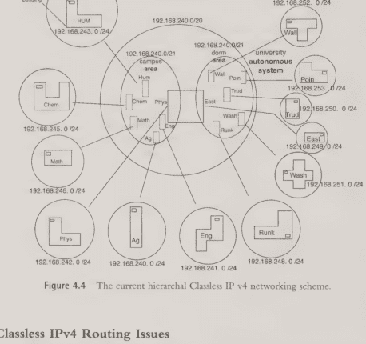

Figure 4.4 The current hierarchical Classless IP v4 networking scheme.

## Classless IPv4 Routing Issues

It might sound like Classless IP v4 puts a huge burden on the Internet's routers. Even worse, it could explode the routing tables into an unmanageable size that slows down all Internet traffic. Fortunately this is not the case. Not only does Classless IP v4 allow you to create subnets of subnets of subnets, it also allows you to hide the layers from the outside world—if you plan your network correctly. See Chapter 7, "Planning Router Layout and Function," for further information.

A well-planned VLSM setup includes route aggregation, a concept that allows you to hide subnetting from the outside world. Let me break down the VLSM subnets created in the previous section, "Applying Classless IP v4 Addressing Across Subnets," to demonstrate this concept. Each of the subnet layers was mathematically derived from

its parent layer. We started with the overall network 192.168.240.0/20. The 20-bit mask translates to nnnnnnnn.nnnnnnnn.nnnnhhhh.hhhhhhhh, where n is a network bit and h is a host bit. This means that you have access to the address range 192.168.240.0 through 192.168.255.255.

The two subnets within this network are 192.168.240.0/21 and 192.168.248.0/21. Both of these network addresses are within the main network’s address range. Therefore, no matter which subnet the traffic ultimately needs to go to, it first has to go to network 192.168.240.0/20 according to how the IP v6 routing works. No router outside the main university router (prime) needs to know that there are any subnets at all.

Our major subnets have their own address ranges. The campus subnet, 192.168.240.0/21, has the bit mask nnnnnnnn.nnnnnnnn.nnnnehhh.hhhhhhhh. This gives it the address range 192.168.240.0 through 192.168.247.255. The dorm subnet, on the other hand, is 192.168.248.0/21 and gets 192.168.248.0 through 192.168.255.255. Take a look back at Tables 4.7 and 4.8. Every network address listed there falls within one of these two major subnets’ available address ranges. Therefore, every network address in the campus and dorm buildings can be sent just to the main router, then to just the campus or dorm router, then to the appropriate building, and then directly to the correct machine.

In each case, only the router above the subnet layer needs to know that there are subnets involved at all. This is a good example of route aggregation, a term mentioned earlier. It is also the key to CIDR success. The more routing information that we can keep hidden at local levels, the smaller the overall routing tables need to be.

Routers under Classless IP v4 must carry information that IP v4 routers simply would not understand. While Classful IP v4 requires the netmask, Classless IP v4 needs the bit mask. The technique the routers use from that point is called longest match. The router looks at the address the information is trying to get to—let’s say 192.168.250.52—and looks for the entry in its routing table that is closest to this number. The best it’s going to find in a main routing table in this case is 192.168—remember that our parent network (the supernet) is 192.168.240.0/20.

Longest match isn’t well demonstrated at the beginning. Rather than sending the data to 192.168.0.0, the router trying to send the data to 192.168.250.52 will have to look up 192.168.240.0/20 in the routing tables unless all of 192.168.0.0 is owned by a single ISP that then hands out parts of the addressing to others. Let’s say that this is the case. The packet meant for 192.168.250.52 gets sent to the ISP that owns 192.168.0.0.

When the packet arrives at the ISP’s routers, they don’t see a longest match for 192.168.250.x. They do have 192.168.240.0/20 in their routing tables, however, so off the packet goes to our router Prime. Prime doesn’t have a longest match for 192.168.250.x either. However, it has in its routing tables that the network 192.168.248.0/21 exists, so now the packet is sent to router East.


现在，当路由器 East 为 192.168.250.x 查找最长匹配时，它找到了一个。那就是分配给 Trud 路由器的网络范围。数据包被发送到 Trud，后者立即知道如何将数据发送到 192.168.250.52。再次强调，这个例子不仅说明了最长匹配的概念，而且还表明我们校园外的路由器不需要多少路由表信息。只要它们能把数据送到 Prime 路由器，后者就能完成剩下的工作。

## 不理解 CIDR 的主机怎么办？

并非所有机器都能开箱即用地处理 CIDR。这包括 Linux。我们将在第 6 章“Inside The Commands”中深入介绍 route 命令，但你可能已经熟悉 route 所需的数据。该命令需要知道网络地址、网关地址、IP地址和网络掩码。它没有容纳位掩码的位置。因此，它假设每个 IP 地址都有一个类。如果使用无类 IP v4，这就行不通了。事实上，再看看其他命令以及内核吧。你会在整个过程中遇到同样的问题。

第一个内置支持无类 IP v4 的 Linux 内核系列是 2.2.x。然而，在这种情况下，无类 IP v4 模块仍被标记为实验性。如果必须让此主机能够理解无类 IP v4，请重新编译内核并附加无类 IP v4 模块，然后前往 http://www.tazenda.demon.co.uk/phil/net-tools/ 下载最新版本的 net-tools 包。此 Tarball 包含你用 Linux 进行网络所需的所有基本实用程序，并且 1.52 及更高版本增加了对无类 IP v4 的支持。安装这些程序前，请务必阅读所有 README 文件。

## IPv6 地址

我们正处于互联网的大规模变革之中。多年以来，我们中的许多人一直在努力掌握 IP 地址、子网划分等细微之处。与此同时，IP 地址空间比任何人预期的都要更早地接近耗尽。当软件和操作系统过时时，我们该怎么办？我们升级它们。对于开始显现老化迹象且无法满足时代需求的协议也是如此。无类 IPv4 有所帮助，但还不够。IP 已升级到第 6 版——也称为 IP 下一代（IPng）——伟大的迁移已经开始。

## IPv6 地址简介

IP v6 并不是建立在 IP v4 的构建块之上。相反，它是 IP 网络寻址的全新机制。地址现在长达 128 位，而不是 32 位。这为单个主机提供了更多空间。IP v6 中也不再有广播地址。相反，你可以选择单播、多播或任播。这种最后一种选项允许为同一个 IP 地址分配多个接口，并将发往该地址的数据发送到这些接口中最接近的一个。为接口分配多个地址的能力也内置于 IP v6 中。

IPv6 地址不是以 IP v4 格式显示。相反，它们被拆分为八个部分。每个部分包含两个字节——或十六位——以冒号分隔。因此，按位来看它们看起来相当可怕：
xxxxxxxxxxxxxxxxxxxxxxxxxxxxxxxxxxxxxxxxxxxxxxxxxxxxxxxxxxxxxxxx，其中“x”代表一位。按字节来看就没有那么令人望而生畏了：bb:bb:bb:bb:bb:bb:bb:bb，其中“b”代表一个字节。

事情变得更复杂的是，IP v6 地址通常不是以位和字节来讨论的。IP v6 地址以十六进制书写——基数 16，与位的基数 2 和十进制的基数 10 相比。一个字节相当于一对十六进制数，所以我们最终得到的是用占位符表示的类似以下内容：HHHH:HHHH:HHHH:HHHH:HHHH:HHHH:HHHH:HHHH，其中 H 是一个十六进制对的一半。

由于 IP v6 的世界与 IP v4 截然不同，让我们花点时间回顾一下一些 IP v4 时不需要查看的基础知识。这些问题围绕着特殊数字、所有接口必须拥有的地址类型以及如何识别不同地址类型。 本章不会涉及如何书写 IP v6 地址的许多简写方法。有关此方面的更多信息，请参阅 RFC 2373。

IP v6 中也有一些特殊的主机地址，就像 IP v4 中一样。其中之一是回环地址，0:0:0:0:0:0:0:1，它相当于 IP v4 的 127.0.0.1——你也可以使用简写技术将 IP v6 回环地址写成 ::1。另一个是未指定地址，0:0:0:0:0:0:0:0，当尚未给出地址时使用。

然而，IP v6 还有一些用于更广泛用途的特殊地址。有标记重要地址的前缀，称为格式前缀。其中许多已被保留但尚未有特定功能——有关该集合，请参阅 RFC 2373 第 2.4 节。表 4.9 列出了那些已被分配含义的地址。

### Table 4.9 IPv6 Reserved Prefixes That Have an Assigned Purpose

| Decimal Prefix | Hexadecimal Prefix | Reserved Purpose |
|---|---|---|
| 00000000 | 00 | Not used. |
| 00000010 | 02 | For use by the Network Service Access Point (NSAP)—if you’re interested in learning more about NSAP, see RFC 1706. |
| 00000100 | 04 | For use by Internet Package eXchange (IPX), a Novell networking protocol. |
| 00100000 | 40 | For use by the new Unicast aggregation features available in IP v6—see RFC 2374. |


| 表 4.9 继续 |
| 十进制前缀 | 十六进制前缀 | 保留用途 |
| 11111110 10 | FE8+ | 用于路由器等链路项目的本地使用。 |
| 11111110 11 | FEC+ | 用于站点内部的本地使用。 |
| 11111111 | FF | 用于多播寻址。 |

## 十六进制数学简介

请注意，他们在表 4.9 中同时给出了二进制和十六进制（hex）值。让我们看看如何在两者之间转换，因为你需要在这方面有坚实的基础来处理 IPv6。处理 hex 时需要记住的事情是

- 十六进制数学是基数 16，而二进制是基数 2，十进制是基数 10。
- 十六进制中可用的数字是 0-9 然后是 A-F，而二进制的选择只有 0 或 1，十进制是 0 到 9。
- 在我们的例子中，最容易将十六进制值视为四位，或半个字节。
- 十六进制值通常不是单独讨论的，所以我们将讨论一对十六进制值，这意味着一个完整的字节。

那么让我们看看表 4.9 中的数字是如何得到的。第一个很简单：00000000 是十进制 0，十六进制为 0000。对于第二个，我们从 00000010 二进制开始。要将其转换为十进制，我们使用本节中讨论的公式，“IPv4 数学回顾”：0x127 + 0x64 + 0x32 + 0x16 + 0x8 + 0x4 + 1x2 + 0x1 = 2

但让我们直接从二进制转换为十六进制。我们在这个单字节中有两个十六进制数字，所以我们实际上是在看 0000 和 0010。第一个，0000 二进制，直接变成 0 十六进制。对于第二个我们需要做一点点数学。在这种情况下，我们将使用：0x8 + 0x4 + 1x2 + 0x0 = 2 所以，最终我们得到 02 作为这一对。对于其余部分我们有：

00000100 = 0000 0100 = 0 | 0x8 + 1x4 + 0x2 + 0x1 = 04

00100000 = 0010 0000 = 0x8 + 1x4 + 0x2 + 0x1 | 0 = 40

11111110 10 = 1111 1110 10 = 1x8 + 1x4 + 1x2 + 1x1 | 1x8 + 1x4 + 1x2 + 0x1 | 1x8 + 0x4 + ?2x + ?x1 = (15 十进制)(14 十进制)8 = FE8+

11111110 11 = 1111 1110 11 = 1x8 + 1x4 + 1x2 + 1x1 | 1x8 + 1x4 + 1x2 + 0x1 | 1x8 + 1x4 + ?x2 + ?x1 = (15 十进制)(14 十进制) (12 十进制)? = FEC+

11111111 = 1111 1111 = 1x8 + 1x4 + 1x2 + 1x1 | 1x8 + 1x4 + 1x2 + 1x1 = (15 十进制)(15 十进制) = FF

加号——那些紧挨着数字的，而不是用于加法的——代表什么？你必须有四个字节才能构成一个十六进制对。缺失的位将决定最终的十六进制数字是什么。所以 8+ 实际上是 8 + ?x2 + ?x1 来给出实际的十六进制数字。

## 读取 IPv6 地址

我们大多数人现在可以在睡梦中读出一个分类的 IPv4 地址。有时当第一个字节接近边界时，有必要查阅 A、B 和 C 类之间的边界，但通常来说，这通常是显而易见的。那些从事分类 IPv4 多播的人知道，任何 D 类 IP 地址都是一个多播通道。转向无分类 IPv4 也不是很大的变化。大多数人已经熟悉位掩码的基础知识，所以即使这部分也不是太痛苦。

读取 IPv6 地址与读取 IPv4 地址有几分相似：

- 前缀——开头的位——决定了你谈论的是什么类型的地址。（你可能已经从上一节关于保留前缀的讨论中猜到了这一点。）
- 仍然有位掩码表示法可用。

要读取 IPv6 地址，请从左到右工作。你会很高兴地看到，在 IPv6 中区分多播和单播地址要容易得多。如果地址以 FE 开头，你正在查看的是一个多播地址。其他任何东西都是单播或任播。这两种寻址指定——单播和任播——乍一看看起来相同。

让我们专注于单播地址，因为它们更常用。单播地址类型的可能性在表 4.9 中有详细说明，但这里是快速列出（加上一个表中没有的额外类型）：可聚合、IPX、链路本地、NSAP、站点本地，以及——新的一种——IPv4 兼容。一般来说，主机会真的不知道这些区别。路由器必须知道，以便将数据从一个地方定向到另一个地方。

RFC 2374 中为可聚合全局单播地址制定的 IPv6 规则是

- 前三个位表达初始前缀。此前缀来自表 4.9，对于单播通常为 001。还需要一个额外的位来完成第一个十六进制数字。


每台主机上使用 IPv6 的每个接口都必须有一个链路本地地址。此标识符用于在主机与其他实体之间传输信息，通常是路由器，或用于从路由器自动获取接口的全局地址信息。你可以通过其前 10 位来识别链路本地地址，如表 4.9 所示：1111111010。除路由器和主机之外，其他机器无需知道链路本地地址。

站点本地地址的覆盖范围更广。主机上的每个接口都会有一个，并且该值可被网络中的任何机器使用，包括子网。然而，路由器不会向外部世界通告站点本地地址。再一次，它仅用于内部使用。你可以通过其前 10 位来识别站点本地地址，和往常一样：1111110011。

你甚至可能会看到以明显是 IPv4 地址结尾的 IPv6 地址。IPv6 确实内置了一种搭载 IPv4 数据的机制，这使得互联网上的相关人员能够在不造成不必要困难的情况下，缓慢地从 IPv4 迁移到 IPv6。

## IPv6 路由问题

关于 IPv6 路由问题的一个好消息是，这种新的寻址方案可以在我们熟悉的相同路由协议中工作：RIP-2、OSPF 等等。IPv6 路由有一些新功能，确实让管理员的生活变得更有趣。其中大多数功能允许你对数据的处理拥有比在 IPv4 中更精细的控制。

IPv6 数据包包含一个用于路由指令的特殊头部，而 IPv4 数据包则没有。例如，每个数据包可能包含它从一个点到另一个点途经的每个路由器的信息。如果需要，该信息实际上可以被反向使用，以将数据沿原路返回。这种功能实际上可以用于追踪移动网络用户在登录时的位置——有些人会喜欢这一点，而另一些人则会非常不舒服。

最好的新功能之一，毫无疑问，是 IPv6 路由器能够自动配置接口地址信息的能力。一旦主机知道接口的链路本地标识符，该主机就会发送包含该信息的 Internet 控制报文协议 for IPv6（ICMPv6）邻居请求。如果没有其他主机回应声称它已经拥有该地址，则该机器会发送 ICMPv6 路由器请求消息以找到其路由器。当网络的路由器回应时，它会包含网络的 IPv6 全局前缀。

从这里开始，主机使用接口 ID 完全自行构建接口的全局 IPv6 地址。如果由于某种原因另一个接口声称已经拥有原始的链路本地标识符，那么你将不得不手工配置该接口。

# 摘要

你在本章中学到了很多。希望到现在为止，你的脑袋不会被三种不同进制的数字弄得晕头转向。重要的是，在这里，你现在已经了解了当前使用的全部三种寻址方案，并且准备好根据你的情况使用合适的方案——更不用说你为 CIDR 和 IPv6 的持续迁移做好了更充分的准备。

# II

## Linux 路由问题和技术

- 5 Inside the Unicast Kernel 2.2.x Daemons
- 6 Inside the Multicast Kernel 2.2.x Daemons
- 7 Kernel Support Tools
- 8 Kernel 2.4.x Routing Daemons
- 9 Inside the Commands
- 10 Planning Basic Router Layout and Function
- 11 Linux Routing Basics
- 12 Network Hardware Components, Technology, and Solutions
- 13 Building a Routing Kernel
- 14 Security and NAT Issues
- 15 Monitoring, Analyzing, and Controlling Network Traffic


## Inside The Unicast Kernel 2.2.x Daemons

有许多守护进程可用于满足你的 Linux 路由需求，每个守护进程都有丰富的特性。由于不可能将所有这些都融入本书示例的上下文中，本章为你可以选择的几个守护进程提供了一个集中资源，以便我们在后面的章节中跳过基础知识，直接进入正题。因此，让我们来看看在 Linux 内核 2.2.x 系列下用于管理单播路由的路由守护进程。

### Guide to routed

随 Linux 内核系列 2.2.x 默认提供的 routed——尽管通常不会默认安装——仅处理单播 IPv4。如果你打算在 IPv4 环境中使用 RIP，这就是你唯一需要的版本。请注意，在该工具自己的手册的 BUGS 部分中，它写道如下：“routed 的价值值得怀疑。考虑使用 gated(8) 或 zebra(8)。” 像往常一样，这是一个选择合适工具的问题。有时 routed 就是你所需要的一切。


## How routed Works

routed 路由守护进程通常在启动时启动——你需要确保它在你用作路由器的 Linux 机器上已设置为这样做。 在确定哪些网络接口处于活动状态后，路由器会查看它需要处理的接口数量。 如果多于一个，routed 会确定它需要处理多个内部网络，而不是仅一个接口所需的单个内部网络。

此时，routed 会查看每个接口以了解它们支持哪些类型的包。 在这种情况下，唯一有意义的两种包类型是单播和广播。 如果接口只能处理单播数据，路由器会通过它向其 /etc/hosts 文件中定义的机器发送请求包。 然而，广播包是首选方案。 如果接口可以处理广播包，请求包将作为广播消息发送——这意味着它会发送到网络的广播 IP 地址，所有能够接收广播流量的机器都会接收到它。

发送请求后，routed 进入监听循环。 此时守护进程可接收两种类型的包：请求和响应。 请求包告诉 routed 使用以下信息为每个路由构建其路由表内容的列表：

- 此表项所指的网络或主机 IP 地址。
- 此网络的网络掩码。
- 沿此特定路由发送数据的 RIP 成本（有关更多信息，请参阅第 1 章“Unicast Protocols”）。

完成列表后，它会以响应包的形式返回给发送请求的机器。

然而，当 routed 从另一台机器接收到响应包时，它必须进行一些包处理。

如果任何表项的最后更改时间推进到 180 秒，routed 会将该路由的成本设置为十六——你可能记得这在 RIP 中使路由无效——并将其标记为删除。 该条目并不会立即被移除，直到它以这种方式被标记 60 秒后才会移除，这相当于路由器向其邻居发送两次路由表。 在这 60 秒后，如果没有新的响应包提供此路由处于活动状态的信息，它将被从此路由器的表中删除。 然后路由器必须从可用的路由中选择另一条从自身到指定目的地的有效路由。

## Configuring routed

routed RIP 路由守护进程利用前面章节“How routed Works”中描述的方法构建自己的路由表，因此你无需使用默认列表启动它。 然而，如果你有一些需要定义为主动或被动的网关，可以创建一个文件。 主动网关能够响应路由查询；被动网关则不能。 这就是两者之间的“简单”区别。

由于被动路由器不会响应请求包，如果没有明确告知，routed 将永远无法得知它。 要输入此信息，首先以 root 身份创建文件 /etc/gateways。 然后你必须以以下格式为每个被动网关添加一行：address name gateway cost passive

除最后一项外，此行代码中的所有内容都必须替换为适当的值：

- address. 此条目所指的主机或网络的 IP 地址。
- name. /etc/hosts 中设置的主机名、/etc/networks 中设置的网络名称，或机器的完整名称，格式为 host.domain.extension。


- **gateway.** 必须经过的网关的名称或 IP 地址，才能到达 *address*。
- **cost.** 通过此网关的 RIP 成本，根据第 1 章中讨论的规则确定。

被动网关信息在启动时加载——当 *routed* 启动时加载。除非重新启动路由守护进程，否则不会重新加载。

## Running routed

如前所述，*routed* 守护进程应设置为在启动时启动。你可以通过诸如 rc.local 之类 的文件来完成此操作，或者通过为需要路由守护进程的运行级别添加初始化脚本指针。在任何一种情况下，都有可用的标志，以便你可以指定此程序应如何运行的特定细节。表 5.1 列出了选项及其功能。

Table 5.1 Flags and Options Available for the IPv4 Version of routed

| Option | Result |
|---|---|
| -d | 保存详细的调试信息。 |
| -g | 设置默认路由，例如 -g 192.168.52.1。通常用于指向外部目标，routed 可能无法自行找到，例如 Internet 或使用其他协议的路由器。 |
| -s | 即使只有一个网络接口，也提供路由信息，而这通常会告诉 routed 它不是互联网路由器。 |
| -q | 即使有多个网络接口，也不会提供路由信息。 |
| -t | 通过终端链接运行 routed，因此数据包信息会显示在 STDOUT 上，并且可以使用 Ctrl-C 终止该进程。用于测试目的。 |
| filename | 如果你在行尾加上文件名，则该文件将用于记录 routed 的行为。 |

## Guide to gated

你在前几章中听说过的另一个程序是 gated。实际上这个程序有三个不同的版本。你可以利用 gated 用于单播或多播用途，用于 IPv4 或 IPv6，或你所需的任何组合——只需确保你为每个版本使用正确的版本（见表 5.2）。此路由守护进程随许多版本的 Linux 一起提供，尽管它可能在第二张磁盘上或在补充材料中。如果这是你决定使用的守护进程并且你没有它，想要最新版本，或需要发行版随附的版本中没有的功能，请前往 www.gated.org 或 www.gated.merit.edu 获取它们。

### Table 5.2 Versions of gated and Their Capabilities

| Version | Enables |
|---|---|
| gated-ipv6 | 静态 IPv6 路由、RIPng 和 BGP4MP。 |
| gated-multicast | IGMP、MP-BGP、MSDP（检查此实现是否完整）、DVMRP、PIM-SM 和 PIM-DM。 |
| gated-public | EGP、BGP、RIP-1、RIP-2 和 OSPF。公共版本是稍旧但非常稳定的版本。 |
| gated-unicast | EGP、BGP、RIP-1、RIP-2、OSPF 和 中间系统到中间系统（IS-IS）。 |

公共版本是稍旧但非常稳定的版本。单播、多播和 IPv6 版本都是更新的版本，也可通过主站点获得。可以访问公共版本的源代码，但除非你获得许可证，否则无法访问更新版本的源代码——如果你需要源代码访问权限，zebra（http://www.zebra.org）守护进程可能更适合你。

本章我们将重点关注公共版本。

## How Public gated Works

像大多数路由守护进程一样，gated 路由守护进程通常在启动时启动——你需要确保它已设置为在用作路由器的 Linux 盒子上这样做。有关使用 gdc 程序与守护进程交互而不是直接手动启动它的想法，请参阅“Running Public gated”部分。

当 gated 启动时，它首先确定其数组和其他数据结构在内存中需要多少空间。在知道所需空间后，gated 会被分配一个虚拟机，该虚拟机具有 32 位地址空间，位于 RAM 或硬盘上（这是 Linux 处理所有进程的方式）。然后守护进程为其保留一个空间部分来保存信息，然后清除已存储在那里的任何内容——该过程称为初始化内存。之后，它为其将用于跟踪其状态并执行其他功能的每个线程保留另一个空间部分。然后 gated 为其需要快速访问的数据结构（如路由表）创建内存框架。

在整个框架就位后，gated 将内核的路由表读入其自己的 RAM——除非特别指示或重新启动，否则它不会再次执行此操作。然后它找到此特定机器上的接口，并记录它们的地址以及它们当前是启动还是关闭。


事物程序必须在两者之间切换执行——必须进行初始化。受控守护进程首先为每个线程的所有全局变量设置值。然后它将配置文件 /etc/gated.conf 读入内存。由于 gated 是模块化的，它不会加载运行其支持的每个协议的能力。相反，它会在 /etc/gated.conf 中查找已启用的协议，并为每个协议设置运行框架，包括加载适当的代码模块。

当你配置 gated 的行为时，你要做的一件事是设置它从外部源导入路由的规则。在这一点上，这些规则被加载到内存中。之后，gated 加载你希望它处理向其他路由器和协议导出路由的规则。

此时所有初始化都已完成。gated 守护进程进入程序员所称的 forever loop，这意味着它进入实际运行状态——并且它将一直保持在那里，直到你告诉它做其他事情。它首先设置不同协议行为所需的所有计时器。然后守护进程查看 gated 感兴趣的套接字，即程序之间传输信息的文件，并从中加载任何相关数据。如果有任何由此产生的任务需要运行，它们将被排队以便在轮到它们时开始。

最后，gated 运行在前台和后台发生的任务。前台任务对管理员可见，并且是只需要运行一次的项目。它们通常是协议模块发出的请求，以便在有 CPU 时间时处理某事。相比之下，后台任务是隐藏的，可能会不断运行或按固定间隔运行。

## 配置公共 gated

gated 配置文件是 gated.conf。此文件中的语句可以跨越一个或多行，因此以分号 (;) 终止。这里你还会遇到两种不同的注释。一种是标准的井号 (#)，它注释掉整行。另一种是类似 C 的配对：/* 开始注释，*/ 结束注释。现在，基础知识讲完后，让我们看看这个文件是如何构建的。

需要牢记的最重要事情之一是语句类型顺序。有许多主要语句类型必须按正确顺序使用，还有两种额外的语句类型可以根据需要随意散布在各处。语句类型及其内部的项目在表 5.3 中简要定义，供参考。

## 表 5.3 gated.conf 可用的语句类型，按顺序要求排序

| Type | Order | Statements |
|---|---|---|
| options | First | options |
| definition | Second | autonomoussystem, martians, routerid |
| control | Third | aggregate, export, generate, import |
| directives | Third | \directory, \include |
| interfaces | Third | interfaces |
| protocol | Third | bgp, egp, icmp, isis, kernel, ospf, redirect, rip, snmp |
| static | Third | static |
| trace | Third | traceoptions |

## The options Statement

典型的 gated.conf 文件以 options 语句开始，该语句设置适用于其后所有内容的全局值。如果你不需要，可以完全没有 options 语句。这些项目在整体语句中不需要任何特定顺序。

## 表 5.4 gated.conf options 语句中可用的值

| Option | Purpose | Format | Value(s) |
|---|---|---|---|
| mark | 每隔指定间隔向 gated 日志文件写入时间戳。 | mark time | 时间戳之间等待的秒数。 |
| noresolv | 指定不尝试将 IP 地址转换为 host.domain.extension。 | noresolv | N/A |
| nosend | 指定不发送数据包。仅监听网络流量。仅用于避免 RIP 流量。 | nosend | N/A |
| syslog | 设置 gated 应通过 syslog 记录的数据量。有两种不同的语法选项。第一种仅记录所列级别，第二种记录从最低到指定级别的所有级别。 | syslog level
syslog upto level | 日志级别，从最少到最严重列出：debug, info, notice, warning, err, crit, alert, 和 emerg。你决定记录的级别越低，生成的数据就越多。 |


# 第 5 章 Inside The Unicast Kernel 2.2.x Daemons

gated 选项语句的写法格式如下：

```
options
setting1
...
settingN
;
```

## The interfaces Statement

在设置（或不设置）全局选项之后，就该告诉 gated 这台机器上可用的网络接口了。完成此操作涉及一组嵌套语句，用于其余所有接口配置，具体方式如下：

```
interfaces {
statement1
settings
...
statementN
settings
}
```

在 interfaces 语句中，你可以使用三种类型的语句：options、interface 和 define。虽然这三种语句的使用顺序没有严格要求，但最好还是按照我们这里列出的顺序来。第一个，同样是 options。这与全局选项不同，而是针对所有接口的本地选项集——看起来像是全局接口选项。这里有两个选择，如表 5.5 所示。

### Table 5.5 Values Available in the gated.conf options Portion of the interfaces Statement

| Option | Purpose | Format | Value(s) |
|--------|---------|--------|----------|
| scaninterval | 设置 gated 检查内核文件以查找新接口或已移除接口的频率。默认是每 15 秒检查一次。 | scaninterval time | 两次检查之间等待的秒数。 |
| strictinterfaces | 设置当 gated 发现一个在启动后添加但未在配置文件中明确定义的接口时 gated 的行为。默认是报错但继续运行。如果包含此选项，在此情况下 gated 将会崩溃。 | strictinterfaces | N/A |

接下来在 interfaces 语句中是 一个或多个 interface 语句。是的，这可能会让人感到困惑。请务必仔细核对，不要把这两项弄反。你可以把多个接口配置在同一个语句中，也可以根据需要拆分，让它们具有不同的设置。interface 语句本身的格式为 interface list，其中 list 是你希望用这组特定设置进行配置的每个接口所属的一系列 IP 地址。可以在 interface 语句中配置的项目列在表 5.6 中。

### Table 5.6 Values Available in the gated.conf interface Portion of the interfaces Statement

| Option | Purpose | Format | Value(s) |
|--------|---------|--------|----------|
| down preference | 设置偏好值——当 gated 将接口标记为可能出现故障时，该接口的受青睐程度或不受青睐程度。 | down preference value | 整数值越高，gated 选择该接口的可能性越低。默认是 120。 |
| passive | 阻止 gated 将此接口更改为 down preference 值。 | passive | N/A |
| preference | 设置偏好值——当 gated 将接口标记为正常工作时，该接口的受青睐程度或不受青睐程度。 | `preference value` | 值越低，gated 使用该接口的可能性越大。默认是 0。 |
| simplex | 阻止接口听到自己的广播包，因此无法使用它们来确定其是否正常工作。 | `simplex` | N/A |

最后，在 interfaces 语句中还有 define 语句。如果你之前在 interfaces 选项语句中设置了 strictinterfaces，就需要包含此项。对于 gated 需要使用但在路由守护进程启动时可能尚未运行的每个接口，你都需要创建一个 define 语句，告诉 strictinterfaces 该接口可以被添加到路由表中。define 语句本身的使用格式为 define address，其中 address 是该接口的 IP 地址。表 5.7 列出了 define 中可用的选项。

### Table 5.7 Values Available in the gated.conf define Portion of the interfaces Statement

| Option | Purpose | Format | Value(s) |
|--------|---------|--------|----------|
| broadcast | 告诉 gated 接口可以处理广播消息——以太网卡和令牌环卡都可以做到——以及使用哪个地址。 | `broadcast address` | 该接口可访问的广播 IP 地址。 |
| multicast | 告诉 gated 接口可以处理多播流量。 | `multicast` | N/A |


## 表 5.7 继续

| 选项 | 目的 | 格式 | 值 |
|---|---|---|---|
| netmask | 告诉 gated 该接口对 IPv4 应用的网络掩码适用于此接口。 如果设置了 pointopoint 则无效。 | netmask address | 接口的网络掩码。 |
| pointopoint | 告诉 gated 该接口是调制解调器或其他使用 SLIP 或 PPP 的设备。 | pointopoint address | 该接口的本地地址。 在这种情况下，define 地址必须引用接口的远程地址。 |

因此，既然你可能对典型的 interfaces 语句可能是什么样子感到有点困惑，这里有一个更详细的示例：

```
interfaces {
    options
        strictinterfaces
    ;
    interface 192.168.232.*
        simplex
    ;
    interface 192.168.251.*
        simplex
        passive
    ;
    define 192.168.232.*
        broadcast 192.168.232.255
        netmask 255.255.255.0
    ;
    define 192.168.251.*
        broadcast 192.168.251.255
        netmask 255.255.255.127
    ;
}
```

请注意，并非所有的 IP 信息都严格以 IP 地址的形式出现。 你可以使用几种不同的格式：

- all. 词 all 与仅使用通配符 * 相同。
- xxx.xxx.xxx.xxx. 完整 IP 地址。
- xxx.xxx.xxx.*, xxx.xxx.*, xxx.*. 以通配符结尾的部分 IP 地址。

对于网络部分，你指定所讨论网络的 IP 信息。 在这种情况下，规则要么是关键字 exact，要么是关键字 refines。 这两个关键字决定网络信息如何被解释。 exact 告诉 gated 严格按整体网络解释 martians 语句中的网络信息，忽略不在类边界上的网络掩码，因此忽略子网。 主机也被忽略。 然而，如果你对规则使用 refines，则会利用掩码和主机信息——不过在这种情况下掩码被隐含为类掩码。

这种格式的更复杂版本如下：

```
martians {
    network mask mask rules;
}
```

这里，rules 的 refines 选项更有意义。 mask 项指的是网络掩码。 更精细的版本如下：

```
martians {
    network masklen bit_mask rules;
}
```

你可能还记得第 4 章“IPv4 和 IPv6 地址”中，在“IPv6 数学”部分开头介绍过位掩码。 A 类位掩码是 /8，B 类是 /16，C 类是 /24。 从那里开始，子网和 IPv6 的位掩码变得更复杂。 就是这个值填入位掩码槽位。

martians 语句不一定只有一行 你可以在语句中混合使用这里看到的所有网络定义。 还有一个你可以使用的项目：你可以使用 allow 选项在这些项目的末尾将被屏蔽范围内的特定地址或范围设为有效。 例如，以下忽略来自整个 B 类 192.168.0.0 的路由信息，除了特别来自 C 类子网 192.168.10.0：

```
martians {
    192.168.0.0 exact;
    192.168.10.0 mask 255.255.255.0 refines allow;
}
```

## RIP 配置

每个路由协议必须在 gated 中单独配置。 让我们从最老且最简单的开始：RIP。 无论你是否希望此路由器能够与 RIP-1 或 RIP-2 路由器通信，都应以以下内容开始 RIP 配置部分：

```
rip status
```

status 条目可以是以下之一：

- no; 不处理 RIP 流量。
- off; 不处理 RIP 流量。
- on { 处理 RIP 流量。
- yes { 处理 RIP 流量。

设置此信息之外的内容并不是强制性的。 你可以在 on 或 yes 的情况下有以下内容：
rip on;

然而，使用大括号构建语句可以让你更好地控制 gated 如何处理 RIP。 rip 语句中可用的选项在表 5.9 中列出。

## 表 5.9 gated.conf rip 语句中可用的选项

| 选项 | 目的 | 格式 | 值 |
|---|---|---|---|
| broadcast | 设置 gated 即使机器中只有一个活动接口也广播 RIP 数据包。 | broadcast; | N/A |
| defaultmetric | 设置从其他协议学习到的路由的默认 RIP 成本。 | defaultmetric cost; | 要使用的 RIP 成本。 默认值为 16，表示路由不可用。 |
| interface | 设置特定接口对 RIP 的行为。 该项目将在本章中更详细地介绍。 | interface list value1 ... valueN; | 在这种情况下，值是另一组选项，list 指的是此规则涵盖的特定接口。 值在表 5.10 中单独介绍。 对于 list，如果你想匹配所有内容，使用 all；匹配完整 IP 地址使用格式 xxx.xxx.xxx.xxx；匹配部分 IP 地址使用格式 xxx.xxx.xxx.*, xxx.xxx.*, xxx.*, 或 *；使用通配符设备名使用 eth*；或使用设备全名如 eth0。 |


## 表 5.9 继续

| Option | Purpose | Format | Value(s) |
|--------|---------|--------|----------|
| no broadcast | 设置 gated 即使该机器中有多个活动接口也不广播 RIP 数据包。 | N/A | N/A |
| nocheckzero | 设置 gated 不拒绝具有非空保留字段的 RIP-1 数据包。 | N/A | N/A |
| preference | 设置 gated 通过 RIP 学习到的路由的优先级级别（与其它路由相比）。优先级级别会替换 value 中的值。默认值为 100。在 gated 的情况下，优先级越低，该路由被使用的可能性越大。 | preference value; | 100 |
| query authentication | 设置 gated 对来自非路由器的 RIP-2 查询是否严格。 此选项的值为以下之一：none（默认）、simple 或 md5（充其量也不比使用密码好多少）。 如果你选择最后两种之一，你还必须在分号前加上密码。 | authentication value; | none, simple, or md5 |
| Sourcegateways | 设置 gated 应向哪些路由器发送单播数据而不是广播。 machines 值由一个或多个空格分隔的 IP 地址组成。 | sourcegateways machines; |  |
| Traceoptions | 设置 gated 记录什么跟踪日志。 settings 值可以由通用协议 gated 跟踪选项和 RIP 特定 gated 跟踪选项组成。这两个选项集在表 5.11 和 5.12 中介绍。 | traceoptions settings; |  |

## 表 5.9 继续

| Option | Purpose | Format | Value(s) |
|---|---|---|---|
| Trustedgateways | 设置 gated 接受 RIP 更新的路由器。 | trustedgateways machines; | machines 值由一个或多个空格分隔的 IP 地址组成。 |

正如你所见，gated 的 RIP 设置可能变得相当复杂。其中两个选项无法以表格形式快速解释。这就是 interface 选项（与 interfaces 语句中的 interfaces 选项不同）以及本节讨论的两种跟踪选项。

在 rip 语句下，interface 选项采用以下形式：

```
rip on {
  options
  interface list
  settings
  ;
  options
};
```

构建列表遵循“接口语句”一节中接口覆盖部分给出的相同规则。rip 版本的 interface 可用选项列在表 5.10 中。请记住，这些项目是相对于该节中指定的网络接口而言的。如果需要各种网络连接具有不同的设置，可以有多个 interface 语句。

## 表 5.10 gated.conf rip interface 语句中可用的选项

| Option | Purpose | Format | Value(s) |
|---|---|---|---|
| authentication | 设置用于路由器连接的一个或两种形式的身份验证。仅用于 RIP-2。 | which authentication rule | which 值为空白表示你想使用 primary 或 secondary。 rule 值是 none、md5 或 simple 之一。对于 md5 和 simple，你必须在 rule 后面加上密码。 |
| broadcast | 设置 gated 将与 RIP-1 路由器兼容的 RIP-2 数据作为广播数据包发送给 RIP-1 路由器。 | broadcast | N/A |

## 表 5.10 继续

| Option | Purpose | Format | Value(s) |
|--------|---------|--------|---------|
| metricin | 设置向此接口发送 RIP-1 或 RIP-2 流量的 RIP 成本。 | metricin cost | 如果你希望路由保留在表中，则为 1 到 15 之间的整数；如果希望禁用通过此接口发现的任何路由，则为 16。默认值为 1。 |
| metricout | 设置从接口发送 RIP-1 或 RIP-2 流量的 RIP 成本。 | metricout cost | 如果你希望路由保留在表中，则为 1 到 15 之间的整数；如果希望禁用通过此接口发现的任何路由，则为 16。默认值为 1。 |
| multicast | 设置 gated 通过组播数据包与其他 RIP-2 路由器通信。 | multicast; | N/A |
| noripin | 设置 gated 应忽略到达接口的 RIP 数据包。 | noripin; | N/A |
| noripout | 设置 gated 不应从接口发送 RIP 信息。 | noripout; | N/A |
| ripin | 表示接受通过指定接口的 RIP 流量。默认。 | ripin; | N/A |
| ripout | 指定通过指定接口发送 RIP 流量。默认。 | ripout; | N/A |
| version 1 | 设置 gated 通过指定接口发送 RIP-1 数据包。 | version 1; | N/A |
| version 2 | 设置 gated 通过指定接口发送 RIP-2 数据包。 | version 2; | N/A |


另一个难以界定的语句是 traceoptions。造成这种别扭的原因之一是存在两组可用的值：一组适用于整个 gated（见表 5.11），另一组仅适用于 RIP 流量（见表 5.12）。还有全局跟踪选项可用，但在 rip 等特定协议语句中没有意义。

## 表 5.11 gated 中适用于所有协议的跟踪选项——尽管其中一些对特定协议毫无意义

| Option | Purpose |
|---|---|
| all | 要为此协议语句启用本表中每个选项。如果某个选项对协议毫无意义，则会被忽略。 |
| general | 要启用 normal 和 route 选项。 |
| normal | 记录常规协议活动以及异常情况。 |
| policy | 记录导入和导出路由的策略信息。 |
| route | 记录路由表更改。 |
| state | 对于使用各种路由器状态的协议（RIP 不是其中之一），记录这些状态更改的信息。 |
| task | 记录此协议对接口使用和处理器使用的信息。 |
| timer | 记录此协议的计时器使用情况。 |

## 表 5.12 gated 特有的 RIP 跟踪选项

| Option | Purpose |
|---|---|
| other | 记录未被其他选项指定的数据包。 |
| packets | 记录所有 RIP 数据包。 |
| request | 记录 RIP 信息请求数据包。 |
| response | 记录包含 RIP 信息的数据包。 |

## 开放最短路径优先（OSPF）配置

最受欢迎的内部单播路由协议之一是 OSPF。正如你在第 1 章中可能记得的那样，该协议包含指定路由器和路由区域等功能。由于这种复杂程度，OSPF 涉及更长的配置代码集。所以让我们开始吧。

你以以下内容开始 OSPF 配置语句：

```
ospf status
```

ospf 的 status 条目具有与 rip 语句相同的选项：

+   - no; 不处理 OSPF 流量。
+   - off; 不处理 OSPF 流量。
+   - on { 处理 OSPF 流量。
+   - yes { 处理 OSPF 流量。

通常，ospf 中的第一个子语句是 defaults，因此语句的开头通常如下所示：

```
ospf on {
    defaults {
```

defaults 语句中可用的项目列在表 5.13 中。

## 表 5.13 gated ospf 语句的 defaults 部分中可用的选项

| Option | Purpose | Format | Value(s) |
|---|---|---|---|
| cost | 设置从 gated 路由表获取的、未通过 OSPF 学习到的路由的成本值。 | cost value; | 一个整数，指定要添加到路由成本中的值。默认值为 1。 |
| ospfarea | 告诉 gated 所有接口都在同一个 OSPF 区域内。 | ospfarea location; | location 值可以是 backbone 或你分配给此特定区域的 ID。OSPF 规定区域 ID 为 0 为骨干网，其他区域 ID 必须为 32 位数字。可以利用格式为 xxx.xxx.xxx.xxx 的 IP 地址或网络号作为区域 ID。 |
| preference | 设置 gated 对从 OSPF 学习到的路由相对于其他协议的偏好程度。 | preference value; | 值是 0 到 255 之间的数字，值越低偏好越高。OSPF 路由的默认偏好为 10。 |
| router-prio | 允许此路由器参与 OSPF 指定路由器选举。 | router-prio; | N/A |
| tag | 允许你为此路由器通过 OSPF 源发的数据分配标签。 | tag valueL; or tag as valueS; | 这里的两个值是长值（valueL）和短值（valueS）。长值可以为 32 位，而短值必须仅为 12 位，因为你的 AS 号也包含在内。 |
| type | 允许你指定你的 AS 是类型 1 还是 2，如第 1 章 OSPF  coverage 中“工作原理”部分所述。 | type num; | 1 或 2。 |

## 表 5.13 继续

| Option | Purpose | Format | Value(s) |
|---|---|---|---|
| tag | 允许你为此路由器通过 OSPF 源发的数据分配标签。 | tag valueL; or tag as valueS; | 这里的两个值是长值（valueL）和短值（valueS）。长值可以为 32 位，而短值必须仅为 12 位，因为你的 AS 号也包含在内。 |
| type | 允许你指定你的 AS 是类型 1 还是 2，如第 1 章 OSPF  coverage 中“工作原理”部分所述。 | type num; | 1 或 2。 |

设置 defaults 后，你可以关闭 defaults 语句，然后继续进行 ospf 语句的主要部分，如下所示：

```
ospf on {
    defaults {
        option1;
        ...
        optionN;
    };
}
```

ospf 的主要选项列在表 5.14 中。

## 表 5.14 gated 的 ospf 语句中可用的选项

| Option | Purpose | Format | Value(s) |
|---|---|---|---|
| backbone area | 设置 OSPF 骨干网而不是特定区域。 | backbone area value { option1; ... optionN; }; | value 是分配给骨干区域的编号。有关此复杂语句的进一步解释，请参阅章节正文。其选项在表 5.15 中定义。 |


# 表 5.14 继续

| Option | Purpose | Format | Value(s) |
|---|---|---|---|
| exportinterval | 设置在发送关于外部系统的 OSPF 更新之间门控等待的时间长短。 | exportinterval time; | 广播之间的秒数。默认值为 1。 |
| exportlimit | 设置 gated 在一次 OSPF 更新中一次发送的路由数量。 | exportlimit number; | 路由数量。默认值为 100。 |
| monitorauthkey | 设置用于使用 ospf_monitor 工具检查您的 OSPF 路由行为的密码。 | monitorauthkey value; | 要使用的密码。默认情况下，没有密码。 |
| traceoptions | 设置 gated 记录 OSPF 交互的方式。 | traceoptions options; | 可用于所有协议的选项列在表 5.11 中，而专门在 ospf 语句中可用的选项列在表 5.16 中。 |

ospf 中的另一个复杂的子语句是 backbone 语句。如果您有不止一个区域，则必须设置您的 OSPF 骨干，因为骨干承载区域间通信。按照之前的格式示例，让我们在此基础上添加：

```
ospf on {
    defaults {
        option1;
        ...
        optionN;
    };
    statement1;
    ...
    statementN;
    backbone area value {
        option1;
        ...
        optionN;
    };
};
```

如表 5.14 中所述，value 是您分配给用作 AS 骨干的区域的区域编号。在 backbone area 语句内，有一小组选项可供您设置，以定义此骨干与 AS 其余部分如何交互。这些选项在表 5.15 中概述。

# 表 5.15 gated 中 ospf 语句的 backbone area 子语句中可用的选项

| Option | Purpose | Format | Value(s) |
|---|---|---|---|
| authtype | 设置 OSPF 骨干区域中使用的身份验证类型。 | authtype type; | type 有四个潜在值。如果您不想使用身份验证方案，请使用 none；如果您想使用密码，请使用 simple。 |
| networks | 设置此 OSPF 区域的边界。 | networks {<br>rule1;<br>...<br>ruleN;<br>}; | 在 networks 语句中指定规则有几种不同的方法。所有这些都应该很熟悉。您可以仅有一个网络号，例如 192.168.15.0; 一个网络号后跟单词 mask 然后是网络掩码，例如 192.168.15.0 mask 255.255.255.0; 一个网络号后跟单词 masklen 然后是位掩码，例如 192.168.15.0 masklen 24; 或者甚至只是一个前面带有单词 host 的单个主机 IP 地址，如 host 192.168.15.5; 在 OSPF 的每个这些语句的末尾，您可以添加单词 restrict，如果您不希望特定项目在该 OSPF 区域之外被通告。 |

# 表 5.15 继续

| Option | Purpose | Format | Value(s) |
|---|---|---|---|
| stub | 指定该区域只有路由器进出。 | stub; or stub cost cost; | cost 是将数据通过此路由器发送到该区域的 OSPF 成本。 |
| stubhosts | 指定您希望在 stub 内通告到该区域之外的主机。 | stubhosts { address cost cost; ... address cost cost; }; | 每个 address 是您定义的接口的主机 IP 地址，每个 cost 是通过该地址发送数据的 OSPF 成本。 |

# 表 5.16 gated 中可用的 OSPF 特定 traceoptions 语句

| Option | Purpose |
|---|---|
| ack | 记录 OSPF ack 数据包。 |
| dd | 记录 OSPF 数据库描述数据包。 |
| hello | 记录 OSPF HELLO 数据包。 |
| lsabuild | 记录 OSPF 链路状态通告创建活动。 |
| lsu | 记录 OSPF 链路状态更新数据包。 |
| request | 记录 OSPF 链路状态请求数据包。 |
| spf | 记录 OSPF 最短路径优先计算。 |

## EGP 配置

如果您需要与您自己的网络之外的网络交换路由信息，您将需要使用其中一种边界路由协议。一种选择是 EGP，正如您在第 3 章“边界路由协议简介”中所学到的。幸运的是 gated 也能很好地处理这项工作以及内部路由。只要确保仅在您的外部边界路由器上设置此方面即可。

鉴于我们已经两次介绍了这些协议配置语句的通用开头，我们将 EGP 设置语句直接从您如果打算激活 EGP 时会使用的内容开始：

egp on {

egp 配置部分中可供您使用的语句在表 5.17 中概述。如往常一样，其中一些过于复杂，无法在一张表中完全探索。具体来说，group 及其 neighbor 子语句在表中仅以简化方式介绍。


## 表 5.17 gated 中 egp 语句内可用的选项

| 选项 | 用途 | 格式 | 值 |
|---|---|---|---|
| defaultmetric | 设置此边界路由器通告给邻居的路由分配的 EGP 成本。 | defaultmetric cost; | 一个介于 1 到 255 之间的整数。如果将成本设为 255，一些边界路由器可能会认为你的网络不可达，所以请注意。 |
| group | 告诉 gated 其 EGP 邻居是谁以及如何与它们交互。 | group options { neighbor settings; }; | 所示格式是 group 语句的非常简化的版本，其在章节中会更详细地介绍。 |
| packetsize | 设置 EGP 预期从邻居接收的数据包初始大小。 | packetsize value; | 该值是 gated 预期从 EGP 邻居接收的字节数。如果数据包大于此值，它将被截断因此丢弃。但是，当这种情况发生时，值会自动增加，以在下次足够接收此大小的数据包。默认值为 8192 字节。 |
| preference | 设置此边界路由器对从 RIP 学到的路由的重要性。 | preference value; | 值越低，RIP 路由越重要。默认值为 200。 |
| traceoptions | 如常，设置 gated 的 EGP 部分如何记录数据。 | traceoptions settings; | 可用于所有协议的选项列在表 5.11 中，而专门在 egp 语句中可用的选项列在表 5.18 中。 |

如表 5.17 所示，gated 中可用的 egp 选项在表 5.18 中介绍。

## 表 5.18 gated 中可用的 EGP 特定 traceoptions 语句

| 选项 | 用途 |
|---|---|
| acquire | 记录用于启动和结束 EGP 会话的 ACQUIRE 和 CEASE 数据包。 |
| hello | 记录用于监控 EGP 邻居的 HELLO 和 I-HEARD-U 数据包。 |
| packets | 记录所有 EGP 数据包。 |
| update | 记录 EGP 中用于请求和接收路由表更新的 POLL 和 UPDATE 数据包。 |

group 语句有很多可能性。要定义自治系统中的 EGP 邻居，你可以从以下类似的简单内容开始（你可能有不止一个，因为有多种方式将数据发送进出你的 AS，或者你需要这些边界路由器允许使用不同协议的内部网络相互通信）：

```
group options {
```

group 语句本身有两个可用选项：

- maxup number. 设置 gated 需要连接的 EGP 邻居数量——尤其在你不需要此路由器一定连接到所有其他 EGP 路由器时很有用。
- peersas number. 告诉 gated 它所属的 AS 号码。

在大括号内部才是真正工作的开始。在这里你必须设置一系列 neighbor 语句，每个语句专门定义你 AS 中其他 EGP 路由器中的一个。你必须在这里定义所有——如果你使用 gated 作为所有 EGP 路由器，这很方便，因为你可以将此部分复制到其他机器并做一些调整。因此初始语句看起来像：

```
group options {
    neighbor machine1
        option1
        ...
        optionN
    ;
    ...
    neighbor machineN
        option1
        ...
        optionN
    ;
};
```

## 表 5.19 继续

| 选项 | 用途 | 格式 | 值 |
|---|---|---|---|
| minpoll | 设置 gated 在向其邻居轮询之间等待的时间。 | minpoll value; | 该值是 gated 在发送每次轮询以确保其邻居仍然存活之前等待的秒数。在给定值内三次传输均无答复后，邻居将被标记为不可达，其路由将被从此机器的路由表中移除。默认值为 120 秒。 |
| nogendefault | 告诉 gated 不要生成默认路由。 | nogendefault; | N/A |
| preference | 设置 gated 的 EGP 实现如何看待从此邻居学习到的路由与其他路由相比的重要性。 | preference value; | 值越低，从此邻居学习到的路由越重要。 |
| preference2 | preference 的平局打破子集。 | preference2 value; | 再一次，值越低，从此邻居获得的路由被选中的可能性越大。默认值为 0。 |
| traceoptions | 设置 gated 如何为此特定 EGP 邻居记录数据。 | traceoptions settings; | 可用于所有协议的选项列在表 5.11 中，而专门在 egp 语句中可用的选项列在表 5.18 中。 |
| ttl | 你通常不需要此项。它用于覆盖默认的 IP 生存时间设置。 | ttl value; | 如果 EGP 邻居忽略来自此路由器的包，尝试将值设为 2 而不是默认的 1。 |


需要注意的是，你在这里看到的是同一设置的层层叠加。例如，有多个地方可以设置 traceoptions。最本地化的该设置版本会生效。如果你为特定邻居设置了 traceoptions，那么即使整体 egp 语句说得不同，也会使用该设置。

## BGP 配置

另一种潜在的边界路由协议恰当地命名为边界网关协议（BGP），你应该在第 3 章中熟悉它。如果你宁愿运行 BGP 边界路由器而不是 EGP，gated 仍然可以胜任。你通过创建以以下内容开头的 bgp 语句来激活此功能：

`bgp on {`

bgp 语句中可用的主要子语句在表 5.20 中列出。你会注意到，设置中的主要内容并不是这组语句，而是子语句中的子语句。

### 表 5.20 gated 中 bgp 语句内可用的选项

| Option | Purpose | Format | Value(s) |
|---|---|---|---|
| defaultmetric | Sets the BGP cost assigned to routes this border router advertises to neighbors. | defaultmetric cost; | An optional value that can add a cost to routes advertised from this border router. |
| group type | Enables you to create a group of like BGP peers. Use more than one group type statement to make more than one grouping. | group type details { allow { options }; peer options; } | This is a very simplified version of what a group type statement looks like. See the chapter text for a more detailed discussion. |
| preference | Sets how important gated sees routes learned from RIP. | preference value; | The lower the value, the more important these routes are to gated when utilizing BGP. Default is 170. |
| traceoptions | Sets how gated logs data for this specific BGP router. | traceoptions settings; | Options available to all protocols are listed in Table 5.11, and options available specifically in the bgp statement are listed in Table 5.21. |

### 表 5.21 gated 中 BGP 特定的 traceoptions 语句

| Option | Purpose |
|---|---|
| keepalive | To log BGP KEEPALIVE packets. |
| open | To log BGP OPEN packets. |
| packets | To log all BGP packets. |
| update | To log BGP UPDATE packets. |

bgp 中最复杂的语句是 group type。让我们一步步拼凑它。该语句开始时如你所料：

group type

在此之后，根据你尝试连接的机器的性质，有五种不同的继续方式：

- external peers. Defines a group of BGP routers outside the autonomous system.
- igp peers. Defines a group of routers within your autonomous system that are not border routers but that BGP needs to exchange information with.
- internal peers. Defines a group of routers within your autonomous system that do not utilize an IP-based routing protocol.
- routing peers. Defines a group of BGP routers within your autonomous system used with your internal routers to resolve address forwarding.
- test peers. Defines a test BGP router that you can use to make sure information is propagating properly.

因此，根据你当前设置哪种类型的组，你以以下其中一行开始你的语句：

```
group type external peers
group type igp peers
group type internal peers
group type routing peers
group type test peers
```

这里使用“begin”这个词，因为你还没有完成初始行。无论你选择其中哪一个，下一个项目都是此特定组所属的 AS 号。因此现在你有：

group type gtype peers as

如果你设置的是 external、internal 或 test 组，第一行就完成了。对于 routing 或 test 组，你需要添加两个新项目。你从以下开始：

group type gtype peers as proto

在 interface 术语之后，包含你希望被视为外部的特定内部接口的 IP 信息。

此时你需要开始 group type 子语句，你可以通过添加一个大括号来做到这一点，这样你可能现在有：

```
group type external peers as
{
```

实际上 group type 子语句内只有两个子句：allow 和 peer。你必须包含这两项才能正确设置 bgp group type。allow 子句被插入到子语句中如下：

```
group type blahblahblah
{
    allow
    {
```

allow 子句中的每个选项都涉及识别属于此特定 group type 的主机和网络。我们已经多次介绍过为 gated 指定机器的各种方法，所以我们将用每种可能格式的一种来填充 allow 子句，给出：

```
group type blahblahblah
{
    allow
    {
        '192.168.15.0
        192.168.15.0 mask 255.255.255.0
        192.168.15.0 masklen 24
        all
        host 192.168.15.5
    };
```

group type 子语句中的下一个子句是 peer，如下添加：

```
group type blahblahblah
{
    allow
    {
        192.168.15.0
        192.168.15.0 mask 255.255.255.0
        192.168.15.0 masklen 24
        all
        host 192.168.15.5
    };
    peer hostIP
        option1
        ...
        optionN;
```

peer 子句内可用的大量选项在表 5.22 中列出。你会从 gated.conf 的其他部分认出其中许多。


## 表 5.22 egp 组类型子语句中 gated 的 peer 子句可用选项

| Option | Purpose | Format | Value(s) |
|---|---|---|---|
| analretentive | 告诉 gated 对其通常忽略的事件发出警告，例如重复的更新数据包。 | analretentive | N/A |
| gateway | 告诉 gated BGP 邻居未直接连接，并通过另一台路由器发送数据以与邻居通信。 | gateway IP | 需要充当中介的接口的 IP 地址。 |
| holdtime | 设置 gated 在断开与 BGP 邻居连接之前等待生命证明的时间长度。 | holdtime value; | 等待的秒数，从 0 到 3。 |
| indelay | 设置路由必须以相同方式通告的时间长度，然后 gated 才会将其添加到其 BGP 路由表中。 | indelay value; | 等待的秒数。默认值为 0。 |
| keep all | 告诉 gated 即使这些路由具有您的 AS 号，也将其路由放入其 BGP 路由表中。 | keep all; | N/A |
| keepalivesalways | 告诉 gated 即使其 BGP 邻居应假定 UPDATE 已足够时，也发送 keepalive 消息。 | keepalivesalways; | N/A |

## 表 5.22 继续

| Option | Purpose | Format | Value(s) |
|---|---|---|---|
| lcaddr | 告诉 gated 连接到此 BGP 邻居时使用哪个接口。 | lcaddr IP; | IP 的规则因所使用的组类型而异。外部类型需要与对等体或其指定网关相同的网络上的地址。对于任何其他类型，网络信息无关紧要。 |
| localas | 告诉 gated 哪个 AS 由此 BGP 路由器处理。 | localas AS; | 此边界路由器管辖的 AS 号。默认值为全局 autonomoussystem 选项中设置的值。 |
| logupdown | 每次 gated 的 BGP 功能进入 ESTABLISHED 状态或离开该状态时，都添加日志文件条目。 | logupdown; | N/A |
| metricout | 设置分配给发送到此邻居的路由的 BGP 成本。 | metricout cost; | 通过此邻居发送数据的 BGP 成本。 |
| noaggregatorid | 防止 gated 在路由数据包中包含路由器 ID 信息到此邻居，因此这些路由无法聚合为更大的语句。 | noaggregatorid; | N/A |
| noauthcheck | 告诉 gated 忽略传入 BGP 数据包的身份验证部分。此部分由 gated 设置为完全开启，但并非所有 gated 实现都如此。 | noauthcheck; | N/A |

## 表 5.22 继续

| Option | Purpose | Format | Value(s) |
|---|---|---|---|
| outdelay | 设置路由必须在路由表中保持相同的时间长度，然后 gated 才会向其邻居通告它。 | outdelay value; | 等待的秒数。默认值为 0。 |
| passive | 告诉 gated 此 BGP 路由器不应响应其他 BGP 路由器的 OPEN 数据包，但可以发送自己的数据包。 | passive; | N/A |
| preference | 设置 gated 的 BGP 实现如何将从此邻居学习到的路由与其他路由进行比较。 | preference value; | 值越低，从此邻居学习到的路由越重要。 |
| preference2 | preference 的平局打破子集。 | preference2 value; | 再次，值越低，从此邻居获得的路由被选中的可能性就越大。默认值为 0。 |
| ttl | 您通常不需要此项。它用于覆盖默认的 IP 生存时间设置。 | ttl value; | 如果 BGP 邻居忽略来自此路由器的包，请尝试将值设置为 2 而不是默认的 1。 |
| traceoptions | 设置 gated 为此特定 BGP 对等体记录数据的设置。 | traceoptions settings; | 可用于所有协议的选项列在表 5.11 中，而专门在 peer 和组类型语句中可用的选项列在表 5.21 中。 |
| version | 告诉 gated 使用哪个 BGP 版本。 | version value; | 有三种受支持的 BGP 版本：2、3 和 4。默认值为 4。 |

## IS-IS 协议

gated 支持一种协议未在任何细节中介绍，但如果您需要它，您应该知道。它是中间系统-中间系统 IS-IS 协议。这种路由协议用于内部使用，在许多种类的网络硬件和软件上运行各种子网的情况下。

IS-IS 是一种无连接协议，这意味着它不会与交换信息的机器保持开放连接——使其更像 UDP 而不是 TCP；以便给您一个参考点。如果您认为您可能需要使用此协议，您可以从 RFC 1142 开始了解更多关于它的信息，或者最好是 ISO DP 10589 父文档。

## 配置 SNMP 交互

让我们转换一下思路，离开路由协议，来看一下简单网络管理协议 SNMP。管理员使用此工具来帮助管理大型计算机网络。gated 守护进程实际上并不运行 SNMP 协议，但它确实允许您的 Linux 或其他路由器在您将其用作网络管理解决方案的一部分时与 SNMP 接口。有关 SNMP 本身的更多信息，请参阅 RFC 1157。

SNMP 交互的配置语句实际上相当简短。它以可预测的方式开始：

```
snmp on {
```

在括号内，只有三个选项可用：

- debug;: 如果您在 Linux 机器上的 SNMP 守护进程遇到问题，请添加此行以激活调试功能。
- port value;: 如果您正在运行 SNMP 但将其设置为使用非默认端口 167 的端口，请使用此语句告诉 gated。
- traceoptions options. 像往常一样，您使用此语句来配置日志记录。您可以使用表 5.11 中可用的所有项目，以及表 5.23 中列出的项目。

## 表 5.23 gated SNMP 设置的 traceoptions 部分可用选项

| Option | Purpose |
| --- | --- |
| receive | 记录来自 Linux SNMP 守护进程的 SNMP 请求，以及发送给它们的响应。 |
| register | 记录创建新变量的 SNMP 请求。 |
| resolve | 记录对变量内容的 SNMP 请求。 |
| trap | 记录 SNMP trap 消息。 |


## 配置静态路由

虽然大多数 Linux 用户都知道如何使用标准路由命令为其单台机器上的静态路由进行配置，但最好也确保将静态信息提供给 gated。这样做可以让你的网络更高效，减少单个主机需要进行的查找次数。

你以以下方式开始一个静态路由语句（gated.conf 文件中可以有多个）：
```
static {
```

请注意，这里没有 on 或 off。静态路由本质上始终可用。静态语句内部没有很长的选项列表。相反，你可以使用很多格式变体以及一些选项。可用子语句类型以以下其中一个较为熟悉的序列开头：

- default gateway gateIP. 通知 gated 一个特定的接口，其 IP 地址填入 gateIP，是发送数据的默认接口。
- host hostIP gateway gateIP. 通知 gated 目标主机 IP 地址为 hostIP 的流量应通过 gateIP 指定的接口传输。
- netIP mask netmask gateway gateIP. 通知 gated 目标网络为 netIP 且由 netmask 部分中的 netmask 进一步限定的流量应通过 gateIP 指定的接口传输。
- netIP masklen len gateway gateIP. 通知 gated 目标网络为 netIP 且由 len 部分中的掩码长度进一步限定的流量应通过 gateIP 指定的接口传输。
- netIP mask netmask interface interface. 通知 gated 目标网络为 netIP 且由 netmask 部分中的 netmask 进一步限定的流量应到 interface 指定的接口。
- netIP masklen len interface interface. 通知 gated 目标网络为 netIP 且由 len 部分中的掩码长度进一步限定的流量应到 interface 指定的接口。
- netIP interface interface. 通知 gated 目标网络为 netIP 的流量应到 interface 指定的接口。
- interface interface. 设置 gated 用于路由流量的默认接口。

网关语句专门用于当你想通过特定接口发送数据以到达特定目标时。另一方面，如果你有主机或路由器共享单个接口但假装拥有不同的 IP 地址，则需要使用 interface 语句。

## 表 5.24 继续

| Option | Purpose | Format | Value(s) |
|---|---|---|---|
| retain | Do not erase this route from the kernel's route forwarding tables during shutdown. | retain | N/A |

## 配置路由导入

你的路由器不仅向 Internet 或外部网络通告你的网络信息。它们还从外部接收通告，其中包含用于引导数据包在各处传输的重要数据。这些数据并非盲目地收集到 gated 的路由表中。你必须为每个 gated 路由器设置路由导入操作的规则。

gated.conf 文件允许你为每种协议类型设置不同的规则。它们按在第 1 章和第 3 章中介绍的顺序在此介绍。这意味着第一个关注点是如何设置 RIP 路由的导入方式。

你以以下格式开始 RIP 导入语句：
```
import proto rip
```

从这里开始，你可能会使用以下结构阻止从其他路由器导入路由：

- restrict; 不在路由表中安装任何匹配的 RIP 路由。
- interface ilist restrict; 不在路由表中安装任何与 ilist 匹配的 RIP 路由。要构建 ilist：使用 all 匹配所有内容；格式 xxx.xxx.xxx.xxx 匹配完整的 IP 地址；格式 xxx.xxx.xxx.*、xxx.xxx.* 或 xxx.* 匹配部分 IP 地址；eth* 使用通配符设备名；或使用设备的全名如 eth0。
- gateway glist restrict; 不在路由表中安装任何与 glist 匹配的 RIP 路由。要构建 glist，使用前面讨论的相同规则，但将其应用于匹配数据包将通过的网关，而不是它们最初发送的接口。

或者，你也可以以类似的方式指示 gated 导入路由。再一次，它从以下开始：
```
import proto rip
```

在此之后你有两个选项之一：

- interface ilist. 在路由表中安装与 ilist 匹配的 RIP 路由。
- gateway glist. 在路由表中安装任何与 glist 匹配的 RIP 路由。


随后，你可能已经有了以下两行之一：
import proto rip interface ilist
import proto rip gateway glist

接下来你可以选择是否添加 preference value，即用于指定与给定规则匹配的 RIP 路由相对于其替代路由的优先级。默认值为 100。因此现在你可能有以下四种语句之一：

```
import proto rip interface ilist
import proto rip gateway glist
import proto rip interface ilist preference value
import proto rip gateway glist preference value
```

无论你选择哪一种，你现在都在行尾添加一个左大括号（{），并换到下一行。这行新代码以指定主机或网络的标准方式之一开头，将通过重复前面给出的示例格式来说明：

```
192.168.15.0
192.168.15.0 mask 255.255.255.0
192.168.15.0 masklen 24
all
host 192.168.15.5
```

在以上结构之一开始该行后，你可能只以分号结束它，或者你可以继续以下其中一种附加项：

+   - restrict; 不导入符合此规则的路由。
+   - preference value; 导入符合此规则的路由并为其分配指定的 preference 值。

最后，在语句的最底部，添加：
;

根据需要构建尽可能多的这些 RIP 规则。你可以在大括号之间放置多个语句，只要每个语句都是针对同一组接口或网关。如果要为其他接口或网关设置其他规则，则需要构建一个全新的语句。

## 处理重定向路由

互联网上最简单的协议是互联网控制消息协议（ICMP）。该协议发送包含单个命令的报文。例如，报文可能包含 echo 命令，这意味着它是 ping 报文，接收方机器会发送回响应，让发送方了解数据到达接收方并返回所需的时间。ICMP 报文可能包含的另一个命令是 redirect。

在某些时候，由于临时原因，非默认路由器突然成为向特定机器发送数据的更好选择——通常是由于网络空间重叠或同一硬件上运行多个子网的原因。在这种情况下，会向默认路由器发送 ICMP 重定向消息，告诉它所有发往目标的流量应通过此其他路由器而不是原始默认路由器。原始路由器、目标路由器和目标机器全部收到通知后，数据即可高效传输。

重定向通常设置较短的生存时间。gated 中的重定向路由表条目通常仅持续三分钟。

现在你需要告诉 gated 如何处理来自 OSPF 的传入路由数据。首先要理解的是，gated 对其在区域和自治系统内，即 AS 内从 OSPF 导入的路由没有任何控制权。但是，你可以控制从 AS 外部导入的信息。你从以下语句开始：

```
import proto ospfase
```

之后，你可能想要在后面添加 tag value，也可能不添加。OSPF 标签由源路由器的 ID 加上校验和值组成，该校验和有助于确保数据包内容在传输过程中未被损坏。因此，如果你想监视来自另一个 AS 内特定路由器的路由更新，请在你的 ospfase 语句末尾添加此项。

如果你想使用此规则阻止任何外部 AS OSPF 路由被导入，则只需以 restrict; 结束此语句，例如：

```
import proto ospfase restrict;
```

但是，如果你想使用此规则启用特定集合的外部 AS OSPF 路由被导入，则需要继续更长的语句。首先，如果你不希望从外部自治系统学习到的 OSPF 路由的 preference 为 150，请通过添加 preference value 来继续语句。此时，你以大括号开始一个子句：


在指定了此规则适用的网络、主机等之后，你可以添加 `restrict` 关键字以阻止导入这些特定路由，或添加 preference 值——其中默认的 preference 仍为 150。最终格式看起来类似如下：

```
import proto ospfase
    options {
        192.168.15.* preference 200;
    };
```

现在我们继续介绍如何告诉 gated 处理通过 EGP 和 BGP 广告的路由。如往常一样，有多种方法可以实现此目的。你从现在已熟悉的以下语句开始：

```
import proto
```

如果你要配置 EGP 路由导入，则继续写为：

```
import proto egp autonomoussystem
```

接下来添加要此规则适用的自治系统的 AS 号码。之后，如果你不想将通过 EGP 从该 AS 学习到的路由保存到路由表中，则将短语补全如下：

```
import proto egp autonomoussystem value restrict;
```

如果你想允许与此规则匹配的项目进行路由，则你有选择。你可以在 autonomoussystem value 条目之后添加 preference value 短语，或保留 EGP 默认的 200 preference。然后，将语句扩展为熟悉的格式：

```
import proto egp autonomoussystem value
preference value {
```

此语句以通常的方式结束。在大括号内，你定义要规则适用的网络、主机等，然后以以下其中之一结束语句：`restrict` 关键字、`preference value` 短语，或两者都不写。最终，你会得到类似如下的内容：

```
import proto egp autonomoussystem value
preference value {
    all;
};
```

你可以使用与 EGP 完全相同的格式用于 BGP；你只需将 egp 替换为 bgp 即可。然而，BGP 包含一些额外功能。另一种 BGP 配置语句类型允许你告诉 gated 如何处理将更广泛的路由协议数据导入其路由表。此语句类型以以下内容开始：

```
import proto bgp aspah value
origin type
```

value 变量包含一个正则表达式，其中包含此规则适用的自治系统列表。在这种情况下，我们并不是在寻找数据直接来自哪个 AS——尽管此信息也可以包含在这里。相反，value 包含数据可能经过的 AS 号码。

选择要放在 type 变量位置的内容则相对简单。

以下设置可用：

- blank. 你可以在此处完全不填写任何内容。
- any. 设置此规则适用于无论来自哪个协议组的路由。
- egp. 此规则指的是外部网关协议，或 EGP。
- igp. 此规则指的是内部网关协议，或 IGP。
- incomplete. 此规则指的是给定数据不完整的路由。

你实际上可以根据需要同时使用一个或多个 egp、igp 和 incomplete。

在下一行，如果你想阻止导入定义的路由，则需要以下内容来完成规则：

```
restrict;
```

还有此语句的另一种格式，允许你不仅设置协议类型，还设置规则应适用的路由数据。它以我们刚刚介绍的内容开始：

```
import proto bgp aspah value
origin type
```

现在决定你是想使用 BGP 默认的 170 preference，还是从下一行开始写：

```
preference value {
```

即使你不设置 preference，也需要大括号。继续到下一行并使用通常的格式设置要导入的路由列表。对于这些路由中的每一个，从定义要规则适用的地址的 data 开始该行，因此你可能会从下一行开始写：

```
host 192.168.15.5
```

然后，通过以下其中之一结束该行来设置是否要将此路由保存到路由表中：

```
host 192.168.15.5;
host 192.168.15.5 preference value;
```

或者，使用以下内容告诉 gated 此项目指向不应保存到路由表的数据：

```
host 192.168.15.5 restrict;
```

在为此规则输入所有地址行后，使用以下内容关闭它：

```
};
```

## 配置路由导出

如果互联网上的其他部分要知道如何到达你，gated 或其他边界路由器必须导出信息以进入他人的路由表。这并不意味着你必须让所有人知道你每台机器的详细信息。至少，外界必须知道如何到达你的网络网关。就像 import 语句一样，export 语句允许对每个路由协议应用特定规则。


照例，我们先从 RIP 开始。有两种方式可以指定一个 RIP 导出语句，这取决于如何将网关共享数据与外部 RIP 路由器共享，但两者都以以下内容开头：

```
export proto rip
```

如果你想改用此规则来设置 gated 如何导出从 RIP 学习到的路由，则将第一行改为：

```
proto rip
```

第二行在构建哪种类型的 RIP 导出语句时都是相同的。如果你想指定此规则适用的地址集合，你可以在此行放置两种不同的项目中选择其一：

```
interface ilist
gateway glist
```

你实际上根本不需要在此处放置任何内容。如果你不需要刚才介绍的第二行项目，则忽略它们，并将第二行视为第三行。要设置此规则以便告诉 gated 不导出匹配的数据，请以以下内容结束该语句：

```
restrict;
```

否则，如果你想让此规则设置可通过 RIP 导出的数据，请决定是否要为数据从此边界路由器到其邻居的跳数分配一个 RIP 成本。如果要这样做，则下一行应为：

```
metric value {
```

如果你不想应用成本，则省略 metric value 仅使用大括号。在下一行以及之后的任意多行中，使用以下结构：

```
elist;
```

所有列表值都以相同的格式构建。只是你所表示的内容不同。ilist 指的是此路由器上此规则所指的特定接口。glist 适用于此导出规则所指的外部网关。最后，elist 是一组值，用于指定哪些路由——网络、主机、网络掩码等——符合此规则。

如果你不确定，可以不用这两种类型。最后，关于第一行，如果你想将此规则限制为特定 AS 内的 OSPF 路由器，请在末尾添加以下内容：

    tag asnumber

现在你以以下其中一种结构结束该行，两者都应该很熟悉。如果你想让规则拒绝导出匹配的路由，使用此结构：

    restrict;

或者，如果你想使用此规则允许导出，其中 metric 项目及其值是可选的，使用此结构：

    metric value {
        elist;
        ...
        evalueN;
    };

然后是导出 OSPF 学习到的路由的情况。你以以下两行之一开始这些语句：

    proto ospf
    proto ospfase

如果你不想导出任何匹配此规则的内容，仅以以下内容结束该语句：

    restrict;

否则，如果你想为导出的 OSPF 或 OSPFASE 路由添加成本度量，然后以 metric value { 结束此行（即使 metric value 不存在，大括号也必须在）。然后，移动到下一行并添加一系列行中定义要应用此规则的特定路由的第一行。这些行中的每一行都以通常的网络和主机定义项开头，然后以 restrict; 或 metric value; 结尾——或不写以使用默认成本。语句完成后，使用 }; 关闭它。一个你可能得到的示例是：

    proto ospfase {
        192.168.15.*;
        host 192.168.15.2 metric 300;
        host 192.168.15.9 restrict;
    };

现在我们可以继续导出 EGP 和 BGP 的规则。在这种情况下，egp 和 bgp 在将这些项目插入格式时是可以互换的。我们将使用 _gp 作为示例。首先我们来看如何设置规则以将数据导出到来自其他自治系统的 EGP 或 BGP。如果不想向外部 EGP 或 BGP 路由器导出任何内容，使用以下规则：

    export proto _gp as asnum
        restrict;

如果你想要更精细的控制，以便可以明确列出应导出到 EGP 或 BGP 的路由，则使用以下格式：

```
export proto _gp as asnum
metric value {
  elist1;
  ...
  elistN;
};
```

metric value 子句通常是可选的，因为你可以将其留给默认值。你还需要规则来处理如何导出从 BGP 或 EGP 学习到的路由。要防止这些路由发出，使用以下结构：

```
proto _gp autonomous system asnum
restrict;
```

要单独控制哪些路由导出，哪些不导出，使用以下结构：

```
proto _gp autonomous system asnum
metric value {
  route1;
  ...
  routeN;
};
```

同样，metric value 子句是可选的。在每条路由行的末尾，你可以有 metric value 或 restrict。正如你现在可以看出，尽管协议之间有些细节不同，但语句的结构基本相同。

你也可以使用 export 设置一些额外的情况。你不必完全按照协议进行。事实上，你网络上的并非每条路由都是通过协议学习到的。要根据特定接口应用路由，请从以下内容开始：

```
proto
```

在 proto 之后，你有三种选择之一：

- direct. 指此路由器上的接口。
- kernel. 指使用 route 命令安装的数据。
- static. 指使用 gated 的 static 语句安装的数据。

所以现在假设你有：

```
proto static
```

在此之后，换到下一行。你可能会在此放置以下结构：

```
interface ilist
```

仅在你希望此规则特定于一个或多个特定接口时添加此项。在下一行（或如果未使用 interface 子句则在此行）放置 restrict; 以结束语句，如果你希望此规则阻止导出。否则，你可能希望下一行为：

```
metric value {
```


即使你不使用 metric 子句，你也需要打开的大括号。现在换到下一行。你从指定所指的确切路由的信息开始这一行。如常，你可以在此格式中使用多行：

```
route1;
...
routeN;
};
```

如果你不想使用默认的 metric，每个行尾（在分号之前）通常有两个选项：

- metric value. 为使用此接口设置成本，而不是使用默认成本：直连为 0，kernel 为 40，static 为 60。
- restrict. 不允许将匹配此规则的路由导出。

## 配置路由聚合

正如我们在第 4 章中所讨论的，你可以将网络地址向外部世界通告，就好像它是一个单一整体实体，而实际上它被分解为带有子网或 IPv6 的更小网络。只要 gated，你的路由器，理解数据到达整体网络后该发送到哪里，一切都会正常工作。

你可以用以下其中一行代码开始一个路由聚合段：

```
aggregate default
aggregate networkIP
aggregate networkIP mask netmask
aggregate networkIP masklen bitmask
```

到此时，你应该已经熟悉 networkIP、netmask 和 bitmask 这些术语。第二行也有一些你可能使用的组合：

```
{
preference value {
brief {
preference value brief {
```

- static. 此规则适用于使用 static gated 语句分配的路由。
- value. 此规则适用于 gated 支持的指定路由协议之一。

在 proto 之后可放置的另一项（是否带上前面列表中看到的内容）是以下其中一个选项：

- as asnum. 此规则适用于指定的自治系统。
- as asregexp. 此规则适用于匹配正则表达式的自治系统。
- tag value. 此规则适用于具有指定标签的路由。

现在是你决定此规则要去向何处的时候。如果它仅用于阻止单一聚合，就以以下内容结束它：

```
restrict;
```

然而，如果你想根据你正在查看的网络和主机构建一系列规则，那么你接下来必须决定是否要使用默认的 aggregate preference 值 130，或者是否要为此规则作为整体新默认值而更改它。如果你要更改，从下一行开始：

```
preference value {
preference value
```

如果不更改，就在这一行使用大括号。在下一行，你使用非常熟悉的格式：

```
route1;
routeN;
```

```
};
```

如常，对于每个路由，你可以在末尾添加 restrict 或 preference value。在整体 aggregate 语句内根据需要构建尽可能多的 proto 语句，然后以以下内容结束全部：

```
};
```

## 运行公共 gated

幸运的是，处理 gated 最复杂的部分是配置。在你准备好实际运行守护进程时，是时候确保路由器按预期工作了。只有这样你才能最终休息。我在此推荐的是在命令行手动输入内容并记录哪些有效哪些无效。一旦你知道运行 gated 所需的确切格式，就将命令添加到 /etc/rc.local 或根据你偏好启动网络服务的方式添加到守护进程 init 脚本中。

作为一般规则，此时你通常不会直接与 gated 工作。该守护进程的伴随程序之一是 gdc，即 gated 控制器。即使你已经安装了 gated，你可能也没有 gdc。似乎某些发行版并未将 gdc 作为 gated 包的一部分，甚至不是单独的包。然而，gdc 确实随主要 gated 公共源码提供，你可以通过访问 www.gated.org 获取。

## 启动 gdc

gdc 程序本身并不持续运行。每次你想使用它时，都必须使用必要的标志和命令。标志列在表 5.25 中。一旦你输入了 gdc 及其标志，就添加以下各节中指定的命令。这使你能够在不实际触及守护进程本身的情况下操纵 gated。这样做可以节省日后大量的焦虑和痛苦。

| Table 5.25 Command-Line Switches Available When Starting gdc |
|---|---|---|---|
| Flag | Purpose | Format | Value(s) |
| -c | Sets the maximum allowed size of a gated coredump—only when gated is started using gdc. | -c size | Size in bytes. |
| -f | Sets the maximum allowed size of a gated state dump file—only when gated is started using gdc. | -f size | Size in bytes. |
| -m | Sets the maximum allowed data segment size for gated—only when gated is started using gdc. | -m size | Size in bytes. |
| -n | Sets gated to not alter the kernel forwarding table. | -n | N/A |
| -q | Sets gated to run in quiet mode, sending nothing to STDOUT. Error messages are logged according to settings in syslog.conf. | -q | N/A |


表 5.25 继续

| 标志 | 用途 | 格式 | 值 |
|------|---------|--------|----------|
| -s | 设置 gated 的最大允许堆栈大小——仅当 gated 使用 gdc 启动时。 | -s size | 字节大小。 |
| -t | 设置 gdc 在等待 gated 完成某些任务时的耐心程度。 | -t time | gdc 应等待 gated 完成指令的秒数。默认值为 10。 |

项目 -c、-f、-m 和 -s 主要用于修复 gated 在尝试运行时因空间不足而出现的问题。

## 测试 gated.conf

在你完成 gated 的配置后，你可能首先想要做的事情之一就是利用 gdc 检查 /etc/gated.conf 是否存在语法错误和其他相关问题。你可以通过表 5.26 中列出的命令来实现这一点。需要记住的一点是，这个路由守护进程实际上在存储中保留了 gated.conf 的多个版本。第一次使用 gated 时，它会加载你的原始 gated.conf。之后请确保使用正确的文件——不要在更改配置设置时直接删除 gated.conf，也不要直接在 gated.conf 上进行操作。本章中“Manipulating gated”部分对此有更详细的说明。

表 5.26 通过 gdc 可用的 gated 测试命令

| 命令 | 用途 |
|---------|---------|
| checkconf | 指示 gdc 检查 /etc/gated.conf 是否存在语法错误。 |
| checknew | 指示 gdc 检查 /etc/gated.conf+ 是否存在语法错误。配置文件轮换——/etc/gated.conf+ 的创建——在“Manipulating gated”部分中有介绍。 |
| COREDUMP | 指示 gdc 将 gated 内存的全部内容复制到一个文件中，然后关闭 gated。 |
| dump | 指示 gdc 要求 gated 将其当前设置和其他信息的快照保存到文件 /usr/tmp/gated.dump。 |
| interface | 指示 gdc 指示 gated 立即检查所有直接连接的网络接口的状态——截至本文撰写时通常为以太网卡。 |
| rmcore | 指示 gdc 删除最新的 gated 核心转储文件。 |
| rmdump | 指示 gdc 删除最新的 gated 状态转储文件。 |

## 表 5.26 继续

| 命令 | 用途 |
|---|---|
| reparse | 指示 gdc 删除包含 gated.conf 语法错误列表的最新文件。 |
| running | 指示 gdc 确定 gated 当前是否正在运行。 |
| toggletrace | 指示 gdc 打开或关闭 gated 行为跟踪功能。 |

## 鸟和斑马路由守护进程

路由守护进程如此复杂，以至于如果我们要删减大量更有用的信息，就不可能在本书中涵盖你可能想要使用的所有守护进程。其中一个被删减了深入介绍的守护进程是 BIRD Internet Routing Daemon，即 bird (http://bird.network.cz/)。该守护进程能够支持 IPv4 和 IPv6 静态路由以及 RIP、OSPF 和 BGP 协议。它还提供路由过滤工具。

另一个同样受欢迎但未被收录的守护进程是 GNU 的 zebra (http://www.zebra.org/)。它也支持 IPv4 和 IPv6、RIP-1、RIP-2、OSPF 和 BGP。好的是，这两个守护进程也是开源的，并在 Linux 下经过测试。这为你提供了广泛的选择。

## 操作 gated

gdc 处理器还有许多其他功能，可帮助你启动和停止 gated 守护进程，以及更改其行为甚至更新其当前数据。这些命令在表 5.27 中概述。需要理解的重要一点是，在你至少更新一次设置后，gated 会维护其配置文件 /etc/gated.conf 的三个副本。这些副本包括：

- /etc/gated.conf+。你希望 gated 加载的新配置文件。
- /etc/gated.conf。gated 当前使用的配置文件。
- /etc/gated.conf-。你上次使用的 gated 配置文件。

## 表 5.27 通过 gdc 可用的 gated 操作命令

| 命令 | 用途 |
|---|---|
| backout | 如果 /etc/gated.conf- 为空或不存在，或者已存在 /etc/gated.conf+ 文件，则此命令不执行任何操作。否则，此命令会“回退”配置文件的版本，将 /etc/gated.conf 移动到 /etc/gated.conf+，将 /etc/gated.conf- 移动到 /etc/gated.conf，然后加载旧的配置文件。 |


## 表 5.27 继续

| 命令 | 目的 |
|---|---|
| BACKOUT | 如果 `/etc/gated.conf-` 为空或不存在，此命令不执行任何操作。否则，此命令会“备份”配置文件的过程，将 `/etc/gated.conf` 移动到 `/etc/gated.conf+`，将 `/etc/gated.conf-` 移动到 `/etc/gated.conf`，然后加载较旧的配置文件。 |
| createconf | 如果 `/etc/gated.conf+` 存在，此命令不执行任何操作。否则，gdc 创建空文件 `/etc/gated.conf+` 并将其所有者设为用户 root，组设为 gdmaint，权限为 664。 |
| KILL | 告诉 gdc 对 gated 执行 kill -9。 |
| modeconf | 告诉 gdc 将所有 gated 配置文件的所有者设为用户 root，组设为 gdmaint，权限为 664。 |
| newconf | 如果 `/etc/gated.conf` 不存在，此命令不执行任何操作。否则，此命令会用当前的 `/etc/gated.conf` 覆盖已存在的 `/etc/gated.conf-`，然后将 `/etc/gated.conf+` 移动到 `/etc/gated.conf`。 |
| reconfig | 告诉 gdc 让 gated 加载当前的 `/etc/gated.conf` 并相应地更改其设置。 |
| restart | 告诉 gdc 如果 gated 进程已在运行则停止它，然后启动新的 gated 进程。如果 gated 尚未运行，此命令仍会调用 start。 |
| start | 如果 gated 已在运行，此命令会报错退出。否则，它会告诉 gdc 运行 gated 程序，然后等待适当秒数（默认为 10 秒，参见表 5.25）后，如果守护进程未正常启动则报错退出。 |
| stop | 如果 gated 未在运行，此命令会报错退出。否则，告诉 gdc 向 gated 发送关闭命令，然后等待适当秒数（默认为 10 秒，参见表 5.25）。如果 gated 在此等待期内未正常退出，gdc 会再次发送相同的关闭命令并再次等待。如果之后 gated 仍未成功退出，则 gdc 会发送相当于 kill -9 的命令以强制执行。 |
| term | 告诉 gdc 指示 gated 逐一关闭其每个协议然后退出。如果 gated 无法关闭且你第二次发出 term，gdc 会发送相当于 kill -9 的命令以强制执行。 |
| version | 如果 gated 正在运行，此命令会失败。否则，这会告诉 gdc 显示当前使用的 gated 版本信息。 |

# 摘要

好了，就这些。本章涵盖了有关利用公共 gated 路由守护进程你可能想要知道的一切。此工具以及其他工具如 zebra (http://www.zebra.org/)，让你能够在很大程度上控制路由器的行为，包括能够坐下来只配置一些基本设置而不必处理高级问题，如果你不需要的话。

现在我们已经熟悉了其中一个流行的单播路由守护进程，在第 6 章“Inside The Multicast Kernel 2.2.x Daemons”中，我们将处理 2.2.x 内核系列中使用的一些组播路由守护进程。


## Inside the Multicast Kernel
2.2.x Daemons

如果你想要提供组播服务甚至只是接收它们，你需要建立路由基础设施来引导组播数据包。在 Linux 下有许多守护进程可用于此目的。我们在这里选择介绍的是一对守护进程，每个守护进程在 Linux 组播路由世界中都有特定用途。它们是用于协议无关组播稀疏模式（PIM-SM）的 pim d 以及用于距离矢量组播路由协议（DVMRP）的 mrouted。

## The PIM-SM Linux Daemon: pim d

为了你的 PIM-SM 路由需求，我们选择介绍 pim d (ftp://catarina.usc.edu/pub/pim/pimd/)。正如你将在本章的侧边栏中了解到的那样，在 Linux 下你还有其他选择，但这里介绍这个最有意义。pim d 是一个单一用途、单一协议的守护进程。在看到第 5 章“Inside the Unicast Kernel 2.2.x Daemons”中公共 gated 配置的复杂性后，你可能会发现这一事实是一种福音。

PIM-SM 似乎注定会成为组播社区中的最爱。它是一种开销低的协议，并且能高效地引导流量，尤其是在稀疏模式情况下，即收听特定组播频道的人位于网络上分布广泛的机器上（而不是在近距离范围内）。


## 使用 Multicast gated 进行多协议、多播路由

> 多播版本的 gated (www.gated.org) 在单个程序中处理 PIM-SM、协议无关多播-密集模式 (PIM-DM)、DVMRP 和多播源发现协议 (MSDP)。它没有在本章中介绍，因为它不是自由可用的，但对于许多人来说，这个程序物有所值。尤其是当你需要运行一个以上的多播程序时，你可能只需要这样做。原因在“ DVMRP Linux 守护进程：mrouted ”一节中有讨论。

## 配置 pimd

由于 pimd 是一个单功能守护进程，其配置实际上并不复杂——至少与 gated 这样的大型工具相比是如此。配置数据保存在文件 /etc/pimd.conf 中。虽然语句的顺序不必严格遵循下面即将介绍的内容，但我将带你了解你可能想要添加到此文件中的内容。

/etc/pimd.conf 文件以以下语句开始：
default_source_preference value

路由器会举行选举来确定哪个成为站点的上游路由器。由于 pimd 是一个如此专注的工具，你通常不希望它胜过更通用的工具。在此处使用 101 的值是确保 gated 和其他路由工具将赢得选举并让 pimd 处理其 PIM-SM 的最低值。下一行是
default_source_metric value

此项设置通过此路由器的传输成本。你只希望 PIM-SM 数据发送到此守护进程；因此，再次建议使用高值以防止意外使用。首选默认值是 1024。

尽管你可以交换前两个语句的顺序，但在设置 default_source_metric 之后，你必须有下一个语句。此项以开头
phyint interface

phyint 指物理接口。你用 Interface 填入对以太网卡或其他网络接口的引用，用设备的 IP 地址或名称（例如，eth0）来告诉 pimd。如果你只想使用默认值激活此接口，则无需在该行上添加其他内容。然而，你可以添加一些额外的项。这些项按你需要使用的顺序如下：

- disable 不要通过此接口发送 PIM-SM 流量，也不要从此接口侦听 PIM-SM 流量。
- preference pref。此接口在选举中的价值。如果未分配，则将具有 default_source_preference。
- metric cost。通过此接口发送数据的成本。如果未分配，则将具有 default_source_metric。

为此路由器上的每个接口添加一行 phyint。如果不这样做，pimd 将简单地假设你希望它使用机器上的所有接口并使用默认值。如果你为一个或多个接口设置 phyint 但不是全部，缺失的接口将被分配默认值。在此之后，从下一行开始 cand_rp

cand_rp 指候选汇聚点 (CRP)。此语句指定此机器上的哪个接口应包含在 RP 选举中。可供选择的附加选项按使用顺序列出如下：

- ipaddr。默认值为最大的已激活 IP 地址。如果你不想使用该接口，请将要使用的接口的 IP 地址添加为下一个项。
- time value。两次广告此 CRP 之间等待的秒数。默认值是 60 秒。
- priority num。此 CRP 相对于其他 CRP 的重要性。此处的值越低，CRP 越重要。

下一行以 cand_bootstrap_router 开始

在这里，你提供此机器作为候选引导路由器 (CBSR) 广告自己的信息。如果需要，在 cand_bootstrap_router 之后添加 ipaddr 和/或 priority 项，如前所述定义。接下来是一系列以 group_prefix 开始的语句

每个 group_prefix 语句概述了 CRP 如果赢得选举，将向其他路由器通告的多播地址集合。你可能在此处包含的两项按顺序列出如下：

- groupaddr。此路由器将处理的特定 IP 或网络范围。请记住，单个多播网络写成单个 IP 地址。
- masklen len。掩码占用的 IP 地址段数。请记住，多播地址是 D 类，其网络掩码为 255.255.255.255，这意味着其长度为 4。

之后是 switch_data_threshold rvalue interval ivalue

此语句定义了传输速率触发从共享树切换到 RP 树的阈值；以 switch_register_threshold 开始的行以相同格式做相反操作。（有关两种 PIM-SM 树的更多详细信息，请参阅第 2 章“多播协议”。）无论你选择哪一个，rvalue 代表以位/秒为单位的传输速率，而 ivalue 设置以秒为单位采样速率的频率——建议最小值为五秒。pimd 程序员建议在两个语句中 ivalue 相同。


例如，我可能会得到以下内容（这些是真实的 IP 地址；请勿将其用于实际测试目的）：

```
default_source_preference 105
```

```
phyint 199.60.103.90 disable
phyint 199.60.103.91 preference 1029
phyint 199.60.103.92 preference 1024
cand_rp 199.60.103.91
cand_bootstrap_router 199.60.103.92
group_prefix 199.60.103.0 masklen 4
switch_data_threshold rate 60000 interval 10
switch_register_threshold rate 60000 interval 10
```

## 运行 pim d

配置完配置文件后，你就可以实际运行 PIM-SM 守护进程 pim d 了。像往常一样，我们建议你先手动运行它进行测试，然后再将该守护进程连同其所需的启动标志一起添加到系统的启动脚本中。

运行此守护进程的格式为

```
pimd -c file -d level1,...levelN
```

这两个标志及其值都是可选的：

- **-c file.** 使用指定的配置文件，而不是默认的 /etc/pimd.conf。
- **-d level1,...levelN.** 指定运行此守护进程时使用的调试级别。输入 pimd -h 可查看这些级别的完整列表。

## DVMRP 守护进程：mrouted

为了你的 DVMRP 路由乐趣，我们选择介绍 mrouted（ftp://parcftp.xerox.com/pub/net_research/ipmulti/）。再次强调，这并不是唯一可用的工具，但我们选择介绍它，因为它功能单一且可自由获取，就像 pim d 一样。有关其他 DVMRP 选项，请参阅章节侧边栏。

多播社区发现 DVMRP 并不能完全满足其内部使用的需求。主要问题是该协议在重负载下表现不佳，而 PIM-SM 则具有很强的可扩展性。如今，该协议在将你的网络连接到 MBONE（http://www.live.com/mbone/）时发挥作用，后者专门使用 DVMRP。

## 使用 zebra 进行多协议多播路由

GNU 的 zebra 也是在单播和多播世界中都很有用的另一个守护进程。对于单播，该守护进程处理 BGP4、OSPF、RIP-1、RIP-2 等。然而，在这种情况下，多播功能尚未添加到主 zebra 版本中。你可以在 http://www.zebra.org 上了解其进展。

## 配置 mrouted

再次，我们处理的是一个单一功能的守护进程。这使我们受益于相当直接的配置过程。mrouted 的配置文件为 /etc/mrouted.conf。其中一些设置必须按特定顺序呈现。本章会在需要时明确说明。其余部分顺序无关紧要；因此，如果你没有看到关于顺序的说明，选项的呈现顺序就是它们通常使用的顺序。

mrouted 配置文件通常以一个或多个 name 语句选项开头。你以以下格式使用此命令

```
name boundaryname boundaryaddr/masklen
```

这三个变量为

- boundaryname。你为想要设置规则的特定地址集合分配的名称。
- boundaryaddr。你命名的网络或子网地址。
- masklen。你命名的网络或子网的网络掩码开头部分的二进制 1 的数量。

通常，下一个行涉及 cache_lifetime 选项。它以以下格式使用

```
cache_lifetime seconds
```

seconds 设置通过 DVMRP 学习到的信息在内核中存储的时间。默认值为 300，指南规定应将其保持在 5 分钟（300 秒）到 1 天（86,400 秒）之间。此语句之后通常会出现以下两行之一：

```
pruning on
pruning off
```

IPaddr 告诉 phyint 你指的是哪个物理接口，可以是 IP 地址或接口名称，例如 eth0。之后，你可以添加一系列选项以满足你的需求：

- **disable**。指示不通过此接口路由任何 DVMRP 流量。
- **metric metric**。从多播源向此接口发送数据的成本。对于接口有效，metric 应低于 31。通常建议使用 1。
- **threshold threshold**。数据包必须具有的最小互联网协议（IP）生存时间设置，mrouted 才会将此数据包发送到接口。此值以秒为单位。
- **rate_limit rate_limit**。如果要限制，则此接口将接受的多播流量的速率，以 Kbits/秒为单位。
- **boundary boundaryname**。将此规则集应用于先前使用 name 语句定义的网络块。你可以有多个此选项。
- **boundary boundaryadd/masklen**。将此规则集应用于由这些变量指定的网络块，其用法与在 name 语句中使用的方式相同。你可以有多个此选项。
- **altnet subnet/masklen**。如果相关接口通向多个子网，你可以使用此选项来细化数据路径。subnet 指的是你想要设置的特定子网的网络地址，masklen 与 name 语句中的定义相同。你可以有多个此选项。
- **altnet subnet**。如果相关接口通向多个子网，你可以使用此选项来细化数据路径。subnet 指的是你想要设置的子网的网络地址，并假定不需要网络掩码。你可以有多个此选项。

现在我们终于遇到了一个顺序问题。这里的最后一种可能性是 tunnel 语句，你可以利用它在仅支持单播的网络空间中设置一种单播方法，通过该方法将你的多播数据从一台 mrouted 机器传输到另一台。你必须在物理接口之后定义你的隧道。此项的基本格式为 tunnel local remote

顾名思义，local 指的是开始隧道的已连接接口——可以是 IP 地址或设备名称——remote 指的是另一端用于接收数据的接口的 IP 地址。所有附加选项都与 phyint 中可用的选项相同：metric、threshold、rate_limit、boundary boundaryname 和 boundary boundaryadd/masklen。请参阅之前的项目符号列表，了解这些选项的定义以及如何设置它们。

例如，我可能会将我的配置文件设置得尽可能接近 PIM-SM 配置文件，如下所示：

```
name multi 199.60.103.0/32
cache_lifetime 21600
```


```
pruning on
phyint 199.60.103.90 disable
phyint 199.60.103.91 rate_limit 60 threshold 10 \
preference 1029 boundary multi
phyint 199.60.103.92 rate_limit 60 threshold 10 \
preference 1024 boundary multi
tunnel 199.60.103.92 216.17.105.9 rate_limit 60 \
threshold 10 preference 1024 boundary multi
```

## 运行 mrouted

在你设置好配置文件后，你就可以运行 DVMRP 守护进程 mrouted 了。通常的建议适用，例如设置守护进程在启动和关机时自动启动和停止，但不要在你第一次手动运行它以确定哪种标志和设置组合最适合你的需求之前就这样做。运行此守护进程的格式为

```
mrouted flags
```

是的，就是这样。可用标志有

- -p. 禁用树剪枝。
- -c file. 使用指定的配置文件。务必在 file 中包含路径。
- -d. 进入调试级别 2。调试级别在表 6.1 中概述。
- -d level. 进入指定的调试级别。

## 表 6.1 mrouted 可用的调试级别

| Level | Description |
| --- | --- |
| 1 | 将所有 syslogd 消息发送到 STDERR。 |
| 2 | 级别 1 加上将所有标记为“重要”的消息发送到 STDERR。 |
| 3 | 级别 2 加上将记录每个数据包到达和离开的消息发送到 STDERR。 |

# 摘要

在多播守护进程世界中，你有多种选择。如果要设置大规模或内部多播，通常你会希望使用 PIM-SM 来承载你的流量——如果你的本地设置非常密集，甚至可以使用 PIM-DM。设置 PIM-SM 的一种简单方法是使用 pim6d，这是一个不错的单功能守护进程。另一方面，如果你需要连接到 mbone，你必须使用 DVMRP，而 mrouted 就是为此而生。你也可以选择诸如获取对 multicast gated 的访问权限、在可用时使用 zebra 的多播组件，或尝试随着多播获得发展而必然出现的其他附加选项。考虑到单播数据（如互联网广播）消耗的带宽之多，那些日子为期不远。


## 内核支持工具

本章将介绍 Linux 的两个支持守护进程：pppd 和 rip2ad。

pppd 是点对点协议（PPP）守护进程，为 Linux 内核和 Linux 网络进程提供 PPP 支持。pppd 为用户提供透明接口；也就是说，网络实用程序和应用程序可以在无需了解点对点协议或 pppd 的情况下使用。

pppd 是适用于 UNIX 和 Linux 操作系统的广泛部署的点对点守护进程。大多数 Linux 版本都使用此版本的 pppd，2.4.1 版是该发行版的最新版本。在介绍 pppd 之前，将先介绍 PPP 的概述和一些设计考虑。

rip2ad 是一个实用程序，允许在不运行完整的路由守护进程的情况下通过接口发送路由信息协议（RIP）通告。rip2ad 是 Linux 路由器上的理想工具，该路由器充当边缘设备，进而充当 RIP 系统的网关，但不需要在本地系统上使用 RIP 的复杂性。

我们将从 PPP 的概述开始，然后介绍 Linux 的 PPP 和 rip2ad。

## PPP 概述

PPP 是为串行连接协议设计的，已成为拨号和租用（固定）线路连接的互联网标准。PPP 的开放标准鼓励供应商广泛支持，并且使用串行链路连接到互联网导致该协议得到广泛接受——几乎没有互操作性问题。PPP 定义于 RFC 1661，“点对点协议（PPP）”。

PPP 的格式简单明了，利用了高层数据链路控制（HDLC）协议，并增加了由一个包含数据包大小的字段和协议字段组成的 PPP 头，协议字段定义了正在传输的数据包的类型或协议。PPP 支持数百种协议。表 7.1 总结了企业环境中常见的类型。

### 表 7.1 PPP 支持的常见协议

| Value | Protocol |
|-------|----------|
| 0x0021 | IP |
| 0x002D | Van Jacobson 压缩 IP |
| 0x002F | Van Jacobson 未压缩 IP |
| 0x003D | PPP 多链路协议（MP） |
| 0x8021 | PPP 互联网协议控制协议（IPCP） |
| 0xC021 | 链路控制协议（LCP） |
| 0xC023 | 密码认证协议（PAP） |
| 0xC223 | 挑战握手认证协议（CHAP） |

## PPP 的逻辑视图

PPP 不仅仅是链路上的数据包封装；PPP 堆栈必须在 PPP 会话的整个生命周期内支持特定功能。RFC 1661 以阶段的形式定义了此功能，如图 7.1 所示。

## 链路死亡阶段

链路死亡阶段是在 PPP 会话之前和之后进入的阶段。当由稍后介绍的链路控制协议（LCP）触发离开此阶段时，PPP 将进入链路建立阶段。


## 链路建立阶段

LCP 提供了链路建立阶段。连接使用最少的配置选项建立以使链路启动。在此过程中，双方均不知道对方支持的具体选项——除身份验证协议选择外。如果在链路建立阶段确定了身份验证，则身份验证的类型将在链路建立阶段确定。

LCP 在 RFC 1661 中定义，并在 RFC 1570 “PPP LCP Extensions” 中增加了一些功能。LCP 数据包由 LCP 头部和数据组成，并封装在 PPP 数据包中，如图 7.2 所示。


LCP 头部包含一个 LCP 代码，用于标识消息类型，这可能是对特定选项请求的拒绝。LCP 代码列在表 7.2 中。

### 表 7.2 LCP 协议代码

| Value | Message |
| --- | --- |
| 1 | Configure-Request |
| 2 | Configure-Ack |
| 3 | Configure-Nak |
| 4 | Configure-Reject |
| 5 | Terminate-Request |
| 6 | Terminate-Ack |
| 7 | Code-Reject |
| 8 | Protocol-Reject |
| 9 | Echo-Request |
| 10 | Echo-Reply |
| 11 | Discard-Request |

数据字段由 LCP 代码决定。这意味着每个消息都有一个特定的数据或有效载荷部分，与消息相匹配。

在链路建立阶段被双方接受后，进入身份验证阶段。

## 身份验证阶段

在接受任何选项参数之前，节点可以相互进行身份验证。虽然不是必需的，但没有不使用身份验证的好理由。除非认为其他形式的身份验证已足够，例如呼叫者 ID。一旦双方对所需的身份验证感到满意，就会进入网络层协议阶段。 （大多数站点仅让中央远程访问服务器对远程站点进行身份验证；但是，无论哪个节点启动了会话，身份验证都可以在两个方向上得到支持。）

PPP 支持两种身份验证方法：密码身份验证协议（PAP）和挑战握手身份验证协议（CHAP）。

PAP 是一种简单的用户名和密码机制，其中节点以明文发送用户名和密码。用户名和密码由远程节点接受或拒绝。

CHAP 使用更复杂的 3 路握手，而不发送明文用户名或响应：挑战、响应和确认。

希望对远程主机进行身份验证的节点将发送一个基于秘密阶段的挑战，该秘密阶段为其自身所知，并且也应为远程节点所知。远程节点使用挑战和秘密阶段与哈希函数计算响应。然后发送响应，节点检查响应以确保其与自身计算的响应相同，如果匹配，则确认身份验证并允许连接继续。

与 PAP 不同，CHAP 从不发送秘密阶段，甚至不是加密形式。

## 网络层协议阶段

网络控制协议（NCP）确定所支持协议的适当选项。节点支持的每个协议都将为特定协议提供一个 NCP。此外，这些 NCP 可以并行运行。例如，IP 和 IPX 选项可以同时协商。在此阶段，如果已协商特定协议，则可以传递第 3 层流量。

对于 PPP 上的 IP，RFC 1172，“The PPP Internet Protocol Control Protocol (IPCP)” 定义了 IP NCP 的标准。

IPCP 使用 LCP 数据包格式。但是，只有 1 到 7 的代码，如表 7.3 所示才是有效的。

### 表 7.3 IPCP 协议代码

| Value | Message |
| --- | --- |
| 1 | Configure-Request |
| 2 | Configure-Ack |
| 3 | Configure-Nak |
| 4 | Configure-Reject |
| 5 | Terminate-Request |
| 6 | Terminate-Ack |
| 7 | Code-Reject |

为了区分 IPCP 数据包和 LCP，PPP 头部中的协议字段设置为 0x8021。

除了确定链路上是否支持 IP 外，网络层协议阶段还使用 IPCP 的具体内容来确定链路的本地 IP 地址以及是否应使用压缩。

尽管 IP 地址不得使用 IPCP 确定，但大多数 PPP 实现允许管理员确定所需的 IP 地址。大多数站点要求中央远程访问服务器提供 IP 地址以确保网络内的正确路由。

## 链路终止阶段

在理想条件下，链路终止阶段使用 PPP 终止数据包端到端地发出信号；但是，链路终止阶段也可能由载波丢失或系统管理员立即关闭引起。

值得注意的是，虽然状态看起来非常顺序，但可以在会话的“中间”进入一个状态，即在网络层协议状态期间。例如，在已经通过身份验证一次后，可以再次请求身份验证。这由图 7.1 中指向各种状态的箭头表示。


用户倾向于将 PPP 视为一种客户端-服务器协议，因为它经常被用来将远程资源（例如一台 PC）连接到中央办公室（网络接入服务器）。然而，该协议，至少在标准定义中，是一种对等协议，双方都可以拥有所有选项。但尽管有此支持，典型的安装通常仍会实现客户端-服务器类型的架构。例如，前面提到的远程 PC 会向中央资源进行身份验证，但中央网络附加存储（NAS）不会向 PC 进行身份验证，尽管协议支持该选项。此外，某些 PPP 实现在“客户端”侧不会支持双向功能。微软 Windows 拨号网络在拨号连接到远程站点时不验证对等方就是此类实现的例子。

## PPP 的高级用途

除了普通的拨号接入外，PPP 还有许多高级用途，可提供额外的网络功能或为网络问题提供解决方案。这些应用与 PPP 在标准层面并不相互依赖，但许多厂商将这些功能与 PPP 紧密绑定，以至于它们通常仅在 PPP 下支持或需要 PPP 才能发挥全部功能。

## 租用/固定线路

PPP 为不同厂商产品之间的租用线路提供了良好的互操作性。HDLC 由于厂商互操作性问题并未被证明成功。（与 PPP 不同，HDLC 不提供协议协商。）

## PPP over ISDN

综合业务数字网（ISDN）在欧洲变得非常流行，而 ISDN4Linux（http://www.isdn4linux.de/）在运行 PPP over ISDN 连接方面变得相当流行。ISDN 具有非常快速的呼叫设置，因此非常适合额外的功能，例如来电显示、来电显示回叫，以及下一节中涵盖的一些特定应用。

## 按需拨号

当拨号连接，例如异步（调制解调器）或 ISDN 连接，用于提供通往另一网络或互联网的网关时，建立连接的路由器必须发起连接。发起通常由发往 PPP 接口的流量创建。除了这种基本的网关功能外，按需拨号通常还被构建以提供额外的功能，例如拨号备份和按需带宽。

## 拨号备份

拨号备份基于网络故障提供到网络的备用路由。网络故障可以根据接口状态或网络协议报告的条件来确定，例如网络故障。虽然不是必需的，但拨号备份通常用于备份租用线路连接。

请考虑图 7.3。Linux 路由器“sleepy”通过一条提供 256Kbps 带宽（无压缩）的分段 T1 线路连接到路由器“tired”，用于专用连接。


图 7.3 拨号备份网络。

如图 7.4 所示，租用线路已失效。备份连接已激活，在站点之间提供持续的连通性。

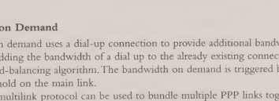

图 7.4 故障时的拨号备份网络。

## 按需带宽

按需带宽使用拨号连接通过负载均衡算法将拨号的带宽添加到已有的连接中，从而为网络提供额外的带宽。按需带宽由主链路上的利用率阈值触发。

PPP 多链路协议可用于将多个 PPP 链路捆绑在一起，并在 RFC 1990《PPP 多链路协议（MP）》中定义。

## PPP for Linux

Linux 的 pppd 可在 ftp://cs.anu.edu.au/pub/software/ppp/ 获取。

Linux 内核源代码（2.2 和 2.4）具有内核支持所需的驱动程序，而 PPP 包包含用户守护进程、补充程序、文档和示例配置文件。（如果需要 MP 支持，则还需要内核 2.4。）

大多数 Linux 发行版直接提供 PPP 支持，或通常可通过包管理器或系统管理员工具轻松添加；然而，了解标准 pppd 包的工作方式很重要，因为它是大多数发行版的基础。对该包的理解将有助于排除网络问题以及大多数发行版中流行的 pppd 包装器。

如果需要编译内核，则应激活串行和 PPP 支持。

## 编译

在 Linux 下编译 pppd 非常简单：

- 将从 ftp://cs.anu.edu.au/pub/software/ppp/ 下载的 ppp 发行版放置到诸如 /usr/src/ 之类的源目录中。
- 解压归档文件：

```
[root@lefty src]# gunzip ppp-2.4.1.tar.gz
```

然后解包 tarball：

```
[root@lefty src]# tar xvf ppp-2.4.1.tar
```

这将创建源目录结构 ppp-2.4.1。进入目录以编译源代码并安装 pppd：

```
[root@lefty src]# cd /usr/src/ppp-2.4.1
```

执行 configure 脚本：

```
[root@lefty ppp-2.4.1]# ./configure
```

然后运行 make：

```
[root@lefty ppp-2.4.1]# make
```

最后，使用 make install 安装发行版：

```
[root@lefty ppp-2.4.1]# make install
```

## 文件位置和配置

安装将把文件安装到两个目录：/usr/sbin/ 和 /etc/ppp/。

存储在 /usr/sbin/ 中的文件是 pppd，即 PPP 守护进程；pppdump，一个数据包转储实用程序；以及 pppstats，一个报告给定 PPP 接口统计信息的实用程序。


安装时存储在 /etc/ppp/ 中的文件有 chap-secrets 和 pap-secrets，其中包含用户和身份验证信息；ip-up 和 ip-down，它们是接口脚本；以及 options，它定义了 pppd 的行为。pppd 支持 100 多个选项，保证与几乎任何 PPP 实现的互操作性。值得庆幸的是，大多数当前一代的 PPP 都支持标准要求，即选项需要协商。因此许多选项并非必需。然而，一些更常见的选项在表 7.4 中给出。

## 表 7.4 pppd 选项

| Option | Description |
|---|---|
| auth | 要求对端进行身份验证。如果 Linux 节点已定义默认路由，则假定 auth 参数或“default”。如果 Linux 节点没有默认路由并且未指定 auth 或 noauth，pppd 将不要求身份验证；但对端必须具有 Linux 节点当前没有路由条目的网络中的 IP 地址。 |
| call name | 告诉 pppd 从 /etc/ppp/peers/name 读取其选项。这对于支持连接到多个站点非常有用。 |
| connect script | 指示 pppd 使用给定的脚本（或可执行文件）与串行端口和调制解调器通信。 |
| crtscts | no crtscts | 打开和关闭硬件流控制。如果未指定，则不会更改流控制。 |
| defaultroute | 导致节点为远程对端创建默认路由条目。当连接至 Internet 或作为 LAN 连接到中央远程访问服务器的最后手段路由时，这通常是期望的行为。 |
| file file | 指示 pppd 从 file 读取配置参数。参数在文本文件中每行输入一个。 |
| lock | 指示 pppd 锁定串行端口以供其独占使用。 |
| Local IP:Remote IP | 本地和远程 PPP 接口可以通过在两个地址之间放置冒号 (:) 来指定。 |
| debug | 向 syslog 设施打开额外的调试信息。 |

### 表 7.4 继续

| Option | Description |
|---|---|
| demand | 指示 pppd 以按需拨号方式运行。如果发送了到远程站点的流量，pppd 将自动在无需用户交互的情况下启动连接。这是网络网关的期望行为。 |
| require-chap | require pap | 要求对端使用指定的选项进行身份验证。 |

## 运行 pppd

pppd 可用于启动到远程站点的连接或等待来自远程站点的连接。当 pppd 用于连接到远程站点时，称为客户端操作，而当用于侦听连接时，则称为服务器。 （请记住，这种客户端/服务器模型源于客户端发起会话的想法；从协议角度来看，两个节点是对等节点，而不是客户端和服务器。）

要使用 pppd 启动 PPP 连接，必须知道并输入多个配置选项到 pppd 配置文件中。以下示例是连接到 ISP 时典型的示例。

所需配置信息是 PAP 用户名和密码或 CHAP 主机名和密码、接入电话号码、IP地址是动态分配还是静态分配，以及调制解调器连接的串行端口。

假设以下配置信息：

- PAP username: customer1
- PAP password: customerpassword
- Access telephone number: 800-555-5555
- IP address: assigned dynamically
- Serial port: /dev/ttyS0

此信息现在必须输入到适当的文件中。由于此配置使用 PAP 身份验证，/etc/ppp/pap-secrets 将具有以下条目：

```
#Secrets for authentication using PAP
# client    server    secret    IP addresses
customer1   isp   customerpassword
```

pppd 不提供直接拨号支持，因此需要额外的程序来进行拨号。chat 程序通常用于此目的。chat 程序使用 chat 脚本，在过去，对于在启动 PPP 之前需要启动登录会话的远程访问服务器而言，它发挥了非常重要的作用。如今这已不再是大多数远程访问服务的情况——大多数服务现在可以在调制解调器摘机后立即启动 PPP。

如今，对于大多数 ISP 和企业连接，chat 程序只需向调制解调器发送任何需要的初始化字符串和拨号命令即可。chat 设置将通过 connect 参数指定。connect 参数和一些其他关键参数包含在 /etc/ppp/options 文件中：

```
lock
debug
/dev/ttyS0
crtscts
defaultroute
connect '/usr/sbin/chat -v "" ATZ OK ATDT 8005555555'
```

这些选项已在表 7.4 中介绍过，但简而言之，选项文件已定义 pppd 需要锁定串行端口（lock 选项）、记录额外的调试信息（debug）、使用串行端口 /dev/ttyS0、打开硬件流控制（crtscts）、为对端创建默认路由，然后使用给定的 chat 命令进行连接。

然后可以通过简单地启动 pppd 来启动到 ISP 的连接：
[root@lefty /root]# pppd

pppd 的问题通常与调制解调器或身份验证有关。检查问题的第一个地方是 /var/log/messages 文件。例如，以下条目：

```
Jun 3 09:08:45 lefty pppd[11857]: pppd 2.4.1 started by root, uid 0
Jun 3 09:08:45 lefty pppd[11857]: Removed stale lock on ttyS0 (pid 11850)
Jun 3 09:08:46 lefty chat[11858]: expect ( )
Jun 3 09:09:31 lefty chat[11858]: alarm
Jun 3 09:09:31 lefty chat[11858]: Failed
Jun 3 09:09:31 lefty pppd[11857]: Connect script failed
Jun 3 09:09:32 lefty pppd[11857]: Exit.
```

这意味着 chat 脚本失败，这可能是由拼写错误或在这种情况下调制解调器未响应引起的。

测试调制解调器最简单的方法是直接运行 chat 脚本并提高音量以从脚本接收音频反馈：

```
/usr/sbin/chat -v "" ATZ OK AT&L2M2 ATDT 8005555555
```

在身份验证问题方面，如果 Linux 路由器未通过远程站点身份验证，它将记录“Failed to authenticate ourselves to peer。”如果远程站点未通过 Linux 节点身份验证，则 Linux 将报告“Authentication failed。”


## 其他网络服务注意事项

对于作为网关的 Linux 路由器，网络设计师必须确定在网关上应运行哪些额外服务。额外服务的选择基于需求、成本和管理。

### 电子邮件

邮件服务通常在 Linux 网关上运行，以提供邮件投递，尤其面向互联网。

Linux 在处理邮件服务方面做得非常出色，这可能成为企业邮件系统的理想解决方案。

面向互联网的网关应谨慎考虑。将邮件服务器放置在 pppd 服务器上，如果网关被攻破，邮件服务器就会暴露。

### 域名服务 (DNS)

DNS 通常是与 pppd 在同一网关上运行的良好候选服务。与邮件服务器一样，DNS 服务器（通常是 BIND）也容易受到攻击；然而，DNS 被认为的风险不如电子邮件，原因有几个：它对黑客来说吸引力较小，传统上漏洞比邮件服务器少（尽管随着邮件服务器不断加固，这一趋势正在减弱），并且通常只会导致拒绝服务，而不是对资源的威胁。

以仅缓存模式运行的 DNS 服务器对企业和互联网网关都很有用。仅缓存服务器只是缓存所有请求条目以供以后使用。这为下一次请求特定主机名的用户节省了查询时间，并减少了网关 WAN 链路上的额外流量。

对于企业网关，值得考虑将内部域名也加载到名称服务器上。这允许名称服务器解析在本地进行，而不是将请求发送到 WAN 链路。名称服务器按定时方式拉取区域会产生少量额外负载，但负载通常很小，如果需要超过几个内部名称解析请求，这种权衡往往是值得的。

放置 DNS 服务器确实存在风险；与电子邮件一样，应谨慎考虑以确保获得的优势值得冒此风险。

### Web 缓存

Web 缓存与 DNS 类似，可能被考虑用于互联网和企业连接。在最佳情况下，在大型站点中访问过的页面可以预期达到 5%-10% 的命中率。许多当前 Web 缓存解决方案允许预定义站点被缓存以及常用页面被“镜像”，这对于存储企业内联网站的本地副本非常有效。

### rip2ad

rip2ad 由 Andrea Beck 编写，是一个 RIP 版本 2 广播（实际上是组播）实用程序，可在 http://www.ibh.de/~beck/stuff/ripper/ 获取。rip2ad 提供了 RIP 广告功能，而无需运行完整的路由守护进程或在本地网络上支持 RIP。过去，这种功能通常由 beastd 提供；然而，beastd 已不再维护且不支持 RIP-2。

### rip2ad 示例

考虑图 7.5 中的网络。名为 “ritz” 的 Linux 路由器需要告诉企业路由器 “gate” 关于本地网络 192.168.0.0/24、192.168.1.0/24、192.168.2.0/24 和 192.168.3.0/24，这些网络可以汇总为 192.168.0.0/22。

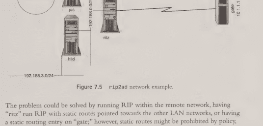

该问题可以通过在远程网络内运行 RIP、让 “ritz” 运行 RIP 并将静态路由指向其他 LAN 网络，或在 “gate” 上设置静态路由条目来解决；然而，静态路由可能因策略而被禁止，其缺点是 “gate” 会始终进一步通告该路由，即使由于中断导致链路不可用时也是如此。

在 “ritz” 上运行路由协议守护进程是过度设计，但路由器 “ritz” 可以使用 rip2ad 来告诉企业路由器 “gate” 关于这些网络，而无需在自身、“jos” 或 “hild” 上运行 RIP。

### 编译和安装 rip2ad

rip2ad 可以通过一行命令轻松编译：

```
[root@lefty ripper]# gcc rip2ad.c -o rip2ad
```

然后可以将 rip2ad 可执行文件放置在适当的位置，例如 /usr/local/sbin/：

```
[root@lefty ripper]# cp rip2ad /usr/local/sbin/
```

rip2ad 仅使用命令行参数即可使用，但 -f 参数允许指定文件名，这使得使用起来更方便。

对于图 7.5 所示的网络，以下 /etc/riptable 被输入：

```
192.168.0.0 255.255.255.0 0 1
192.168.1.0 255.255.255.0 0 1
192.168.2.0 255.255.255.0 0 1
192.168.3.0 255.255.255.0 0 1
```

该表由网络地址、网络掩码、通告路由的 IP 地址和度量值组成。在此特定示例中，IP 地址字段中的 0 告诉 rip2ad 使用本地 IP 地址，对于本示例来说是可以的——'gate' 不需要知道更具体的任何信息。

为了让 rip2ad 每 30 秒通告这些路由，我们使用

```
[root@lefty ripper]# rip2ad -f /etc/riptable -c 30 &
```

如果使用 tcpdump 检查数据包，通告将发送到 RIP-2 组播地址：

```
[root@lefty ripper]# tcpdump
Kernel filter, protocol ALL, datagram packet socket
tcpdump: listening on all devices
09:33:38.311593 eth0 > 224.0.0.9: route: rip-resp 4:
{192.168.0.0/255.255.255.0}(1) {192.168.1.0/255.255.255.0}(1)
{192.168.2.0/255.255.255.0}(1) {192.168.3.0/255.255.255.0}(1) [ttl 1]
1 packets received by filter
```


如前所述，网络可以汇总为 192.168.0.0/22（netmask = 255.255.252.0），因此可以使用以下 /etc/riptable：

```
192.168.0.0 255.255.252.0 0 1
```

如果 rip2ad 使用新的 /etc/riptable 再次启动：

```
[root@lefty ripper]# rip2ad -f /etc/riptable -c 30 -d 10.1.1.1 &
```

那么 tcpdump 将显示新的路由正在被通告：

```
[root@lefty ripper]# tcpdump -n host 192.168.1.1
09:49:32.124445 eth0 > 192.168.1.254.route > 10.1.1.1.route: rip-resp 1:
{192.168.0.0/255.255.252.0}(1)
```

## Summary

本章提供了 PPP 的技术概述，PPP 是点对点连接的首选协议。我们还介绍了 Linux PPP 守护进程 pppd 及其配置。此外还介绍了 rip2ad，它非常适合提供 RIP 网关功能，而无需完整路由守护进程的复杂性。


## Kernel 2.4.x Routing Daemons

在本章中，我们将研究 2.4.x 内核系列中的一些变化以及它们如何影响路由服务。我们还将查看一些您可能想要用来配置 Linux 路由器的工具。

## Changes from 2.2.x to 2.4.x

从 2.2.x 系列内核到 2.4.x 系列内核最大的变化，至少就网络而言，是从 ipchains 迁移到 Netfilter 架构。Netfilter 促进了新级别的服务，包括有状态数据包过滤和更好的 NAT。

Netfilter 的引入使 Linux 能够通过 Linux 盒子处理一些更复杂的路由。对于 Linux 新手来说，这是一个巨大的好处，几乎没有缺点。对于经验丰富的 Linux 管理员来说，这意味着学习（再次）管理数据包过滤和 NAT 的新工具集。当然，乐观主义者会简单地将其视为工作保障和扩展当前技能的有趣练习。

对数据包的有状态检查提高了安全性和效率。它也在某种程度上增加了配置的复杂性；但对于你将拥有的功能来说，这是一个非常公平的权衡。

在 2.2.x 系列内核中，源 NAT（SNAT）、目标 NAT（DNAT）和重定向甚至都不是选项。然而，Netfilter 使配置这些类型的 NAT 相对轻松，并极大地改善了 Linux 的路由能力。

## More on Netfilter

Netfilter/iptables 也用于 IP 伪装和设置防火墙。第 14 章“Security and NAT Issues”将指导你使用 Netfilter/iptables 设置 IP 伪装、防火墙规则和 NAT。

## Enabling ipwadm and ipchains Support

尽管我们在第 13 章“Building a Routing Kernel”中更详细地介绍了内核配置，但我们想在这里介绍迁移你的 ipwadm 或 ipchains 设置。

我们认为 iptables 是设置防火墙和 NAT 的更好工具；但为了便于迁移，2.4.x 内核为 ipwadm 和 ipchains 提供了兼容性模块。

编译新内核时，请确保启用对开发驱动程序和代码的支持。使用 menuconfig 或 xconfig 时，你将在菜单项 Code Maturity Level Options 下找到此选项。此菜单项下唯一的选项是 Prompt For Development and/or Incomplete Code/Drivers。继续为此选项选择 y。

在 Networking Options 菜单中，你需要启用 IP: Netfilter Configuration。在 2.4.x 内核系列中，ipchains 和 ipwadm 支持运行在 Netfilter 框架之上。

你可以使用 iptables、ipchains 或 ipwadm，但不能同时使用它们。你必须禁用 IP: Netfilter Configuration 下的所有其他选项，或仅将它们作为模块启用，才能启用 ipchains 或 ipwadm。你可以为全部三个编译模块支持，如果你愿意的话，但最好坚持使用一个，如果你决定迁移到 iptables，则重新编译。

就这样。编译内核后，你可以使用任一模块继续支持你的旧设置，直到你准备好迁移到 iptables。

> Note: Development and Incomplete Code/Drivers
> 不用担心！选择此选项不会使你的内核不稳定；它只是允许你选择尚未被视为“稳定”的功能或驱动程序。在许多情况下，你会发现所谓的“不稳定”功能相当可靠，通常比一些商业发布软件更可靠。大多数自由软件或开源项目的“稳定”标准在许多情况下比商业软件高得多。然而，你会发现“不稳定”的代码或驱动程序通常功能不完整。


## 其他网络 Linux 2.4.x 内核选项

如果你编译过几个 2.2.x 内核，你会注意到并没有太多变化。以太网桥接不再被视为实验性功能，并且一些选项已被移动或完全删除；但就整体而言，网络方面并没有任何激进的变化。

### ATM 支持

一个值得注意的新增功能是 ATM（异步传输模式）支持，目前处于实验模式。实际上，ATM 在撰写本文时对一些人来说仍然难以运行，处于 Alpha 或 pre-Alpha 开发阶段。如果你打算将你的 Linux 路由器用作边缘路由器，你将希望启用此选项。要使用 ATM，你需要几个用户空间程序，可以在 Linux 主页的 ATM 部分找到，网址为 http://icawww1.epfl.ch/linux-atm/。在启动过程中，ATM 上的 Linux 邮件列表也可能很有用。

### 显式拥塞通知支持

TCP 显式拥塞通知支持选项允许路由器通知客户端网络拥塞情况。不幸的是，并非所有互联网上的防火墙/路由器都理解此功能。最好暂时禁用此功能，因为它可能会导致头痛，当你的用户无法连接到拒绝来自启用了 ECN 的客户端连接的站点时。

也可以编译此选项的支持，但通过发出以下命令将其关闭

```
echo 0 > /proc/sys/net/ipv4/tcp_ecn
```

这可能是最好的方案，因为它允许你在 ECN 支持改善时无需重新编译内核即可打开该功能。很可能在可预见的未来会有一些站点对该选项做出“破坏性”反应。

### WAN 接口

2.4.x 内核支持更广泛的 WAN 接口。你需要显式启用 WAN 接口支持，然后查找你的设备。万幸的是，你将能够检查你的 WAN 卡是否有 Linux 支持，然后购买合适的设备，而不是希望在尝试 Linux 时你的设备得到支持。

> 注意：位置奇特的选项
> 据我们所知，这与路由或网络关系不大，但光纤通道驱动程序支持的选项可以在配置内核时在网络设备支持菜单中找到。光纤通道是一种旨在取代 SCSI 的技术，但与网络没有直接关系（据我们所知）。我们主要提到这一点是为了让用户不会疑惑是否应该启用它。除非你使用光纤通道设备，否则只需选择 n。

有一些高速网络设备通过光纤或铜缆运行，具体来说是光纤分布式数据接口（FDDI）和高性能并行接口（HIPPI）。这些选项也位于网络设备支持菜单中，如果你要使用这些技术，请确保在内核中启用对它们的支持。

### 无线局域网

尽管无线局域网设备仍然有点昂贵，但很高兴知道它得到了支持。2.4.x 内核增加了无线局域网支持以及对若干 Aironet 卡/适配器、AT&T/Lucent WaveLAN 和 Metricom 的 starmode 无线电 IP 的支持。如果你使用的是带无线支持的个人计算机存储卡国际协会（PCMCIA）卡，你可能还需要启用对特定 PCMCIA 设备的支持以及对 PCMCIA 本身的支持。

在大多数情况下，你可以对无线局域网支持说不。然而，如果你有特殊需求需要在局域网上实现移动性，或只是想在笔记本上在家中随意冲浪，这就是最佳选择。

### USB 支持

2.4.x 内核系列增加了对许多以前不受支持的 USB 设备的支持。这包括 USB 调制解调器、以太网设备和其他网络设备。这些设备将来会成为你 Linux 工具箱的极佳补充，但现在我们建议坚持使用 PCI 或 PCMCIA 以太网卡和“传统”设备，除非你有充分的理由涉足 USB 设备。大多数 USB 网络设备仍处于实验阶段；并且鉴于产品生命周期如此，到它们得到完全支持时，这些设备本身很可能已被新一代设备取代。除非制造商直接支持 Linux，否则在短期内你最好避免使用 USB。（请注意，我们在 2001 年夏季撰写此文。到你阅读本文时，情况可能已发生巨大变化。）


## 虚拟专用网络

Linux 还可以实现的其他高级功能之一是虚拟专用网络（VPN）。随着信息技术中安全问题日益突出，VPN 变得越来越受欢迎。

在本节中，我们将介绍一种适用于 Linux 的流行 VPN 解决方案，并讨论其中一种更受欢迎的商业替代方案。

### PoPToP

如果你想在 Linux 上通过 PPTP 设置 VPN，应该查看的工具之一是 PoPToP。PoPToP 是 Linux 的 PPTP 实现，并且有适用于 Solaris、OpenBSD 和 FreeBSD 的移植版本——如果你恰好在 Linux 之外还使用这些操作系统的工作环境中，这可能会引起你的兴趣。

由于许多商业环境都是 Linux 服务器和工作站与 Windows 客户端的混合，PoPToP 支持 Windows 客户端以及 Linux。迄今为止，PoPToP 支持 Windows 95、98、NT 和 2000。价格也很合适，因为 PoPToP 采用 GNU 通用公共许可证授权——因此无需担心许可费用。

### 获取代码

截至本文撰写时，PoPToP 最新的稳定版本是 1.0.1。还有一个包含更多前沿功能的非稳定版本可用，但我们建议你坚持使用稳定代码，除非你迫切需要在开发版本中使用某个功能，或者你想协助查找错误并贡献代码。

你可以在 http://poptop.1ineo.com/ 找到 PoPToP。

在该网站上你会找到适用于 Linux、Solaris 和其他操作系统的源代码。

如果你的发行版使用 RPM，还提供了编译好的 i386 RPM 包和源 RPM 包。如果将从 Windows 客户端连接，你需要获取一些补丁。要启用 Microsoft 加密（MPPE）或 Microsoft 认证（MSCHAPv2），你需要下载并安装相应的补丁，这些补丁也可在网站上获得。

### 安装 PoPToP

在本节中，我们将向你展示如何从源代码在 Linux 上安装 PoPToP。获取 PoPToP 代码后，将其复制到 /tmp 或 /usr/local/src 目录，具体取决于你的个人偏好。

确保以 root 身份登录，解压缩你获取的 tarball，然后 cd 到新目录。然后运行

```
./configure
make
make install
```

假设没有编译错误，你现在应该在 /usr/local/bin 中拥有 PoPToP 二进制文件。你也需要以 root 身份启动 PPTP 守护进程 pptpd。

### 配置和调试 PoPToP

编译并安装一切之后，你需要编辑三个文件来为你的安装进行调整。这些文件是 /etc/pptpd.conf、/etc/ppp/chap-secrets 和 /etc/ppp/options。

/etc/ppp/chap-secrets 是一个文本文件，其中包含用户名、密码、服务器名以及它们可以连接的合法 IP 地址。你需要向此文件添加一个或多个用户，以便他们可以连接到服务器。

源代码下载中包含了一个示例 /etc/pptpd.conf 文件，你可以根据自己的喜好进行自定义。你将使用此文件设置本地和远程 IP 地址、客户端可以连接的速度、守护进程将监听的端口以及调试级别。确保在启动 pptpd 后重新启动 syslogd 以启用日志记录。

最后，你需要编辑随源代码分发提供的 /etc/ppp/options，以反映 /etc/ppp/chap-secrets 中的选项。

如果你在设置 PoPToP 时遇到任何问题，可以查看 PoPToP 网站以获取故障排除提示或针对特定客户端的变通方法。目前有几个针对各种 Windows 客户端的 HOWTO 和设置指南。

### 商业 VPN 解决方案

如果你正在寻找一种快速简便的路由和 VPN 解决方案，有一些商业解决方案可供选择，你可能会发现它们更容易设置。

其中大多数基于开源和自由软件工具，但包含更精美的配置工具。还有一些基于 Linux 的硬件解决方案，你可能会发现它们是思科路由器的有趣替代品。

### NetMAX VPN Server

一个出色的商业产品是 NetMAX VPN Server。它是一个定制的 Linux 发行版，带有基于 Web 的设置工具，可让你快速轻松地设置 IPSec VPN 解决方案。它还包含 Windows 客户端软件，因此你可以轻松设置客户端以连接到你的 VPN。然而，缺点是 NetMAX 解决方案确实带有按客户端和按服务器的许可费用。法律上，你不能购买一份 NetMAX VPN 服务器并安装在多台机器上，或将客户端软件安装在无限数量的机器上。此外没有 Linux 客户端软件，因此如果你的部分移动用户使用 Linux 机器，你仍需要手动配置这些客户端。

另一方面，NetMAX 软件非常易于使用，并且与其它专有解决方案相比价格相当合理。如果你要设置多个 VPN——或只是急需设置一个——可能值得研究一下。


## Summary

在本章中，我们快速浏览了影响 Linux 2.4.x 系列中路由/网络的一些变化。特殊情况太多，无法全面涵盖每个场景，但我们希望这能让你对“新”内核的预期有一个大致的了解。

在编译新内核时，请务必阅读第 13 章“Building a Routing Kernel”，该章详细概述了编译 Linux 内核的过程。

我们还查看了一些 Linux 的“高级”路由工具以及设置基本 VPN。虽然绝非对 VPN 的详尽介绍，但如果您决定在 Linux 路由器上实现 VPN，这应该能帮助您入门。


# 9

## Inside the Commands

LINUX 提供了一系列 NETWORKING 命令来支持网络故障排除、IP 配置和路由任务。本章涵盖 ifconfig、route、ping、traceroute、arp、netstat 和 tcpdump。除了 tcpdump 之外，这些命令很可能会随大多数 Linux 发行版的标准安装一起提供。这些命令（再次除外 tcpdump）源自早期版本的 BSD 和 AT&T 的 System V 命令。

## ifconfig

ifconfig 是用于将接口投入服务并指定第 1 层到第 3 层属性的命令，例如媒体类型、速度和网络地址。（第 1 层涵盖网络的物理方面，例如双绞线或同轴电缆，第 2 层涵盖数据层，包括媒体相关网络，例如以太网帧和以太网网络中的媒体访问控制。）ifconfig 通常位于 /sbin/ 目录中，但非 root 用户也可以运行该程序。然而，只有 root 才能进行配置更改。在大多数 Linux 版本中，ifconfig 命令由 net-tools 分发提供，可在 http://www.tazenda.demon.co.uk/phil/net-tools/ 获取。

除了接口配置之外，ifconfig 还用于报告接口状态；因此，ifconfig 的功能可以分为两个部分：接口报告和接口配置。

### Interface Reporting

最常见的是 ifconfig 用于接口报告，以协助网络故障排除。

不带任何参数的基本命令非常有用：

```
[root@lefty /sbin]# /sbin/ifconfig
et0      Link encap:Ethernet  HWaddr 00:E9:29:4B:AC:0C
          inet addr:192.168.1.254  Bcast:192.168.1.255  Mask:255.255.255.0
          UP BROADCAST RUNNING MULTICAST  MTU:1500  Metric:1
          RX packets:9833  errors:0  dropped:0  overruns:0  frame:0
          TX packets:10195 errors:0  dropped:0  overruns:0  carrier:0
          collisions:306  txqueuelen:100 
          Interrupt:10  Base address:0xb800

lo        Link encap:Local Loopback
          inet addr:127.0.0.1  Mask:255.0.0.0
          UP LOOPBACK RUNNING  MTU:3924  Metric:1
          RX packets:18  errors:0  dropped:0  overruns:0  frame:0
          TX packets:18  errors:0  dropped:0  overruns:0  carrier:0
          collisions:0  txqueuelen:0
```

ifconfig 已报告内核识别并配置为使用的所有接口。（Linux ifconfig 与其他版本的 UNIX 不同，不需要额外参数即可查看所有接口。）在 eth0 上，我们可以很容易地确定接口基于接口名称（eth0）、Link encap:Ethernet 以及 6 字节（48 位）地址是以太网。下一行报告了 IP 地址以及使用的广播地址和网络掩码。

第三行报告接口当前正在运行（UP），这意味着它可以发送和响应网络流量。它以广播方式运行（以太网的标准），并且还配置为侦听多播流量。多播配置是必需的，以允许内核和 RIP-2 等用户应用程序检查多播流量，因为 RIP-2 使用 RIP 多播地址 224.0.0.9。

最大传输单元（MTU）为 1500 字节，这是以太网帧的标准长度，ifconfig 已报告这是内核配置的大小。正如名称最大传输单元所暗示的那样，这是将从该接口传输的最大数据包大小。如果管理员手动降低 MTU 的大小，它只会影响传出数据包，这意味着系统仍会识别在拓扑支持的最大 MTU 范围内的传入数据包。常见的 MTU 大小如表 9.1 所示。


## 表 9.1 网络拓扑和最大传输单元

| Topology | MTU |
|---|---|
| Ethernet | 1500 |
| Fiber Distributed Data Interface (FDDI) | 4352 |
| Point-to-Point (PPP) | 1500 |
| Serial Line IP (slip) | 1006 |
| Token Ring | 4464 |

第 4 行到第 6 行报告了对排查网络问题非常有用的流量统计信息。在这里，根据流量来看碰撞数量似乎很高，这可能意味着 Linux 路由器与以太网交换机之间存在半双工和全双工端口不匹配。最后一行报告了网络接口卡为低级设备驱动程序支持所使用的资源。此特定 NIC 使用中断 10 与 CPU 通信，并具有从 0xb800 开始的内存段。

由于以太网的流行，上面描述的 ifconfig 输出在大多数企业网络中非常典型，但对 Linux 支持的其他硬件进行更仔细的检查显示了 Linux 对网络拓扑的广泛支持。

## 硬件类型

表 9.2 列出了 Linux 操作系统支持的硬件类型。

## 表 9.2 Linux 和 ifconfig 支持的网络媒体（硬件）类型

| Media | hwtype abbreviation |
|---|---|
| Adaptive Serial Line IP | Adaptive |
| Amateur NET/ROM | netrom |
| Amateur ROSE | rose |
| Amateur X.25 | ax25 |
| ARCnet | arcnet |
| Ash | ash |
| Cisco HDLC | hdlc |
| Compressed Serial Line IP | cslip |
| Compressed Serial Line IP 6 bit | cslip6 |
| Econet | Ec |
| Ethernet | ether |
| Fiber Distributed Data Interface | fddi |
| Frame Relay Access Device | frad |
| Frame Relay DLCI | dlci |
| High-Performance Parallel Interface | hippi |
| IP in IP Tunneling | tunnel |
| IPv6 in IPv4 Tunneling | sit |
| IrLAP | irda |
| LAPB | lapb |
| Local Loopback | loop |
| Point-to-Point Protocol | ppp |
| Serial Line IP | slip |
| Serial Line IP 6 bit | slip6 |
| Token Ring | tr |

接下来将更详细地介绍更常见的接口。

### 串行线路 IP—slip

slip（参见 RFC 1055，“通过串行线路传输 IP 数据报的非标准：Slip”）是一种串行面向连接的协议，在大多数网络中已被 PPP 取代。Linux 支持的 slip 变体包括 cslip，它是一种基于 RFC 1144 “低速串行链路的 TCP/IP 标头”中描述的压缩技术压缩的串行线路 IP，也称为作者姓名：Van Jacobson 压缩。另一个变体是 slip6 以及 slip6 的压缩版本，恰当地命名为 cslip6。

### 点对点协议（PPP）

PPP 是串行链路连接的事实标准，并已扩展到其他网络拓扑，包括 SONET 上的 IP。PPP（在第 7 章“内核支持工具”中进行了全面介绍）。

### IP over IP 隧道（IPIP）

IP over IP 隧道通常用于通过 transit 网络连接自治网络。IP over IP 也可用于创建虚拟专用网络（VPN）。

### 逻辑环回设备—Loop

环回接口的存在是为了允许需要网络连接的应用程序与驻留在本地主机上的服务通信，而无需或通过物理接口。

### 令牌环（TR）—（IEEE 802.5）

令牌环以 4 或 16Mbps 速率运行，其早期优势在于不依赖于广播域。这一优势已被以太网速度的提升和以太网交换技术所克服。然而，令牌环在许多组织中仍然得到支持——尤其是银行和金融机构等行业，IBM 在这些行业中渗透很强。（IBM 销售了大量令牌环，因为其早期的大型机不支持以太网。）

回到前面列出的 ifconfig 输出，注意到 IP 地址是 IP 版本 4。除了 IPv4，Linux 还支持其他协议及其寻址。一些更流行的协议及其 ifconfig 对应的输出显示在表 9.3 中。

## 表 9.3 Linux 和 ifconfig 支持的协议

| Protocol | ifconfig abbreviation | Reference |
|---|---|---|
| IPv6 | inet6 | RFC 2373, "IP Version 6 Addressing Architecture" |
| Amateur [radio] X.25 | ax25 | AX.25 Amateur Packet-Radio Link Layer Protocol Version 2.2, November 1997 http://www.tapr.org/tapr/html/Fax25.html |
| Internetwork Packet Exchange | ipx | Novell http://www.novell.com/ |
| AppleTalk Datagram Delivery Protocol | ddp | "Inside Macintosh" by Apple Computers http://developer.apple.com/techpubs/mac/Networking/OT-Networking/WOT-66.html |

## 使用 ifconfig 进行配置

ifconfig 也用于配置 Linux 网络接口。大多数 Linux 发行版都有基于文本或 X Windows 的包装器，用于最初填充 Linux 在启动期间使用的配置表，然后使用 ifconfig 命令来配置网络接口以供使用。这里介绍的命令会对网络配置产生即时效果；然而，仍然有必要对配置和网络启动脚本进行适当的更改，这里不涉及。由于使用 ifconfig 命令进行的配置更改是即时的，因此该命令可能会中断甚至停止到 Linux 节点和来自 Linux 节点的网络流量。

### 启动和关闭接口

使用 ifconfig 进行的最基本也是最有用的配置命令可能是关闭和启动接口。这可以在软件升级期间确保不建立网络连接时执行。当怀疑 NIC 出现问题时，这也是经常采取的第一步。要关闭 eth0，请使用

```
[root@fty /root]#ifconfig eth0 down
```


要将以太网网卡恢复服务，请使用
root@lefty /root# ifconfig eth0 up

## 更改 IP 地址

要更改节点的 IP 地址，也使用 ifconfig。 （请记住，可能还需要使用 route 命令更改网关地址。）下面的 ifconfig 命令将 IP 地址更改为 192.168.1.253：
root@lefty /root# ifconfig eth0 192.168.1.253

并且要更改 IP 地址和网络掩码：
root@lefty /root# ifconfig eth0 192.168.1.253 netmask 255.255.255.248

## 多个 IP 地址

当需要将多个 IP 地址分配给一个接口时，例如当 Linux 用于支持多个 Web 服务器时，也使用 ifconfig 将额外的 IP 地址添加到接口。必须配置逻辑接口才能被内核识别，以便将 IP 地址分配给它。这种逻辑接口通常称为虚拟或别名接口。Linux 对逻辑接口的命名约定是接口名称后跟冒号和逻辑接口编号。例如，eth0 上的第一个本地接口名称将为 eth0:1。

用于分配接口的 ifconfig 看起来并没有什么不同，只是它使用逻辑接口名称：
root@lefty /root# ifconfig eth0:1 192.168.1.250 netmask 255.255.255.0

这将把 192.168.1.250 分配给网络接口 eth0:1 并启动该接口。

```
[root@lefty /root]# ifconfig
eth0
Link encap:Ethernet HWaddr 00:50:29:4B:AC:0C
inet addr:192.168.1.254 Bcast:192.168.1.255 Mask:255.255.255.0
UP BROADCAST RUNNING MULTICAST MTU:1500 Metric:1
RX packets:169 errors:0 dropped:0 overruns:0 frame:0
TX packets:125 errors:0 dropped:0 overruns:0 carrier:0
collisions:0 txqueuelen:100
Interrupt:10 Base address:0x8000

eth0:1
Link encap:Ethernet HWaddr 00:50:29:4B:AC:0C
inet addr:192.168.1.250 Bcast:192.168.1.255 Mask:255.255.255.0
UP BROADCAST RUNNING MULTICAST MTU:1500 Metric:1
Interrupt:10 Base address:0x8000

lo
Link encap:Local Loopback
inet addr:127.0.0.1 Mask:255.0.0.0
UP LOOPBACK RUNNING MTU:3924 Metric:1
RX packets:18 errors:0 dropped:0 overruns:0 frame:0
TX packets:18 errors:0 dropped:0 overruns:0 carrier:0
collisions:0 txqueuelen:0
```

在 Linux 下使用逻辑接口时，有几件事需要注意。从 ifconfig 输出可以明显看出，统计信息都报告在全局接口下，本例中为 eth0。

逻辑接口也会随主接口一起关闭，这意味着 ifconfig eth0 down 也会关闭 eth0:1。

与分配给它们的物理接口不同，逻辑接口在关闭时不会保留在 ifconfig 列表中，因此 ifconfig eth0:1 down（或甚至如前一段所述的 eth0）将删除逻辑设备。结果，下一次 ifconfig 将不再显示 eth0:1 作为接口。

## 指定媒体类型

以太网可以支持需要特定物理接口和属性的多种媒体类型。示例包括 10base2，即使用同轴电缆和英国海军连接器（BNC）的 10Mbps 以太网；以及 10baseT，即使用 RJ-45 连接器的双绞线上的 10Mbps 以太网。Linux 支持的各种以太网媒体和接口如表 9.4 所示。某些驱动程序开发可能未包含特定卡的所有媒体类型，或者开发人员可能选择了另一种方法（例如向内核传递参数）来激活卡上的媒体，或者可能将媒体支持硬编码到驱动程序中。

表 9.4 以太网媒体和连接器支持

| Name | Speed | Media | Connector |
|------|-------|-------|-----------|
| 10base2 | 10 Mbps | Thin Coaxial | BNC |
| 10base5 | 10 Mbps | Thick Coaxial | Attachment Unit Interface (AUI) connected to the Media Access Unit (MAU) |
| 10baseT | 10 Mbps | Twisted Pair | RJ-45 |
| 100baseT | 100 Mbps | Twisted Pair | RJ-45 |

通常没有必要指定媒体，因为大多数现代卡和支持多种接口的驱动程序会在启动时检测已连接的媒体并做出正确的分配；但是，有一些例外。

假设一张卡同时支持 RJ-45 连接和 AUI，并且你认为卡未使用 RJ-45 连接（因为没有链路指示灯）。要告诉驱动程序使用 RJ-45 10baseT 连接，将使用以下 ifconfig：

```
[root@lefty /root]# ifconfig eth0 media 10baseT
```

要告诉驱动程序使用 100Mbps 访问，可以使用 media 参数的 100baseT 选项。并非所有卡都支持这种类型的配置，因此请参考特定网络接口卡和驱动程序的文档。


这里并未涵盖 ifconfig 的所有参数，因为它们的用途很少用到，但快速浏览一下至少能让你在需要时有所了解。

使用 `-allmulti` 可以停用多播功能；通常对于 Linux 路由器，应保持该功能开启。

`promisc` 参数可以将接口切换到混杂模式，而 `-promisc` 则将其关闭。通常这仅对开发人员有用。本章介绍的包括 tcpdump 在内的大多数嗅探器，都会正确地为接口激活和停用混杂模式。如果 `promisc` 被激活，请记得将其关闭，因为性能会受到影响。

`metric` 参数在理论上允许特定接口在置于同一网络时拥有更高优先级。这种支持在虚拟接口的情况下依赖于强大的驱动程序支持，在路由守护进程的情况下则依赖于强大的路由协议支持。

`mtu` 参数允许管理员更改 MTU 的大小。时不时会有论文讨论通过调整各种操作系统上的 MTU 来提高性能，但在 Linux 路由器上，该参数唯一可能的实际用途，是在一个因多种介质类型而产生 MTU 发现问题的网络中强制兼容。一个例子是将令牌环网的 MTU 设置为以太网大小，以绕过不支持正确分片、或在数据包设置了不分片（DF）位时不回送“请分片”消息的路由器。

`broadcast` 参数允许指定一个不同于由接口 IP 地址和网络掩码确定的广播地址。这主要是出于历史原因；早期版本的 BSD 实际上使用网络地址（全零）作为广播地址。此外，某些 IP over ATM 实现也使用全零地址进行广播。

## route 命令

`route` 命令是用于访问 Linux 内核路由表的接口。`route` 命令以三种模式运行：显示、添加和删除。当用于从路由表添加或删除路由时，其用途通常仅限于添加和移除静态路由条目。

## 使用 route 显示路由信息

当不附带任何参数使用 `route` 时，`route` 命令会将路由表打印到 stdout：

```
[root@lefty /root]# route
Kernel IP routing table
Destination     Gateway         Genmask         Flags Metric Ref    Use Iface
Lefty           *               255.255.255.255 UH    0      0        0 eth0
192.168.1.0     *               255.255.255.0   U     0      0        0 eth0
127.0.0.0       *               255.0.0.0       U     0      0        0 lo
default         192.168.1.1     0.0.0.0         UG    0      0        0 eth0
```

Destination（目标）列与 Genmask（即目标网络的网络掩码）结合，标识要路由的网络条目。Gateway（网关）列标识用于特定网络的网关，前提是 Flags 列中设置了 G（网关）标志。Flags 列告知管理员内核将如何解释该路由条目。表 9.5 总结了各种标志及其含义。

### 表 9.5 route 标志

| 标志 | 描述 |
|------|-------------|
| I | 拒绝此网络的学习路由。 |
| A | 由 addrconf（一种 IPv6 地址配置协议）添加的路由。(http://www.ietf.cnri.reston.va.us/proceedings/95apr/charters/addrconf-charter.html) |
| C | 缓存条目。 |
| D | 由路由守护进程（D）或 ICMP 重定向创建的路由。 |
| G | 对于发往路由条目中标识的网络的数据流量，使用 Gateway 列中标识的网关（G）。 |
| M | 路由已被路由守护进程或 ICMP 重定向修改（M）。 |
| R | 恢复路由以允许对此特定路由条目进行路由更新。 |
| U | 网络路由已创建（up），内核将使用它来做出路由决策。 |

不带任何参数的 `route` 命令等同于本章后面介绍的 `netstat -r` 命令。

### -C

`-C` 选项显示路由条目的缓存统计信息以及直连主机。带 `-C` 的 `route` 命令的输出还会显示触发路由查找的源地址和目标地址。`-C` 参数用于查看路由条目是否处于活动状态并被使用。下面是 `route -C` 实际运行的示例：

```
[root@lefty /root]# route -C
Kernel IP routing cache
Source      Destination     Gateway         Flags Metric Ref    Use Iface
lefty       host4.some.com  192.168.1.1     0     0      10    eth0
lefty       192.168.1.102   192.168.1.102   0     2      4     eth0
lefty       host4.some.com  192.168.1.1     0     0      10    eth0
```


**-n**

-n 选项用于关闭名称解析，这样使用 route 命令打印的所有条目都会以 IP 地址而非主机名显示。

**-v**

-v 选项最初用于 route 命令以提供附加信息——最显著的是路由条目的网络掩码，然而当前版本的 route 命令无需 -v 也能提供这些附加信息。此处介绍它仅作参考，以防你使用的是较旧版本的 Linux 或 route 命令。

**-V**

-V 选项显示 route 的版本，以及 net-tools 的版本和所支持的协议：

```
[root@lefty /root]# route -V
net-tools 1.54
route 1.96 (1999-01-01)
+NEW_ADDR +RTF_IRTT +RTF_REJECT +I18N
AF: (inet) +UNIX +INET +INET6 +AX25 +NETROM +ATALK +ECONET +ROSE
HW: +ETHER +ARC +SLIP +PPP +TUNNEL +TR +AX25 +NETROM +FR +ROSE +ASH +SIT
+FDDI +HIPPI +HDLC/LAPB
```

## 使用 *route* 添加路由条目

route 命令的真正强大之处在于添加静态路由，这些路由会影响本地节点上的路由选择；如果该本地节点上运行着路由守护进程，还会影响自治系统内的流量。

### 添加网络路由

用于添加路由的 route 命令采用以下格式：

```
route add -net destination netmask gw gateway address
```

例如，要将所有发往 10.1.1.0/24 的流量路由到位于 192.168.1.253 的路由器，可以使用：

```
[root@lefty /root]# route add -net 10.1.1.0 netmask 255.255.255.0 gw 192.168.1.253
```

若要为特定主机添加路由条目，可使用 -host 参数，且该路由条目不需要 netmask 参数。要为 192.168.1.200 添加一条经 192.168.1.1 的路由，route 命令如下所示：

```
[root@lefty /root]# route add -host 192.168.1.200 gw 192.168.1.1
```

随后，当不带任何参数输入 route 命令时，所创建的路由条目将显示如下：

```
[root@lefty /root]# route
Kernel IP routing table
```

| 目标 | 网关 | 网络掩码 | 标志 | 度量 | 引用 | 使用 | 接口 |
| --- | --- | --- | --- | --- | --- | --- | --- |
| 192.168.1.200 | 192.168.1.1 | 255.255.255.255 | UGH | 0 | 0 | 0 | eth0 |

对于 PPP 网络，有时需要或更倾向于将路由指向网络接口，而非网关地址。这样做可以在不为串行连接使用 IP 转接网络的情况下节省 IP 地址，也可以在采用非广播网络时创建路由。下面是一个示例，但该主题将在第 7 章“内核支持工具”中更全面地讨论。

```
[root@lefty /root]# route add -net 10.10.10.0 netmask 255.255.255.0 ppp0
```

## ping

ping 是一种网络故障排查工具，用于报告远程节点是否可达。ping 向远程节点发送 ICMP 回显请求，远程节点应回应 ICMP 回显应答。由于 ping 和 ICMP 可以非常有效地用于绘制网络拓扑，许多网络数据包过滤器和防火墙被配置为丢弃 ICMP 数据包，以提供更严格的安全保障。

除了检查节点是否响应（或其他简单的连通性问题）之外，ping 还可用于排查其他与网络相关的问题。本节介绍 ping 的一些较高级且文档记录较少的参数。这些参数基于 Alexey Kuznetsov 编写的 iputils 软件包中的 ping 命令，该软件包可在 ftp://ftp.sunet.se/pub/Linux/ip-routing/ 获取。大多数 Linux 版本都自带了 iputils。

### -d

要查看 ping 命令提供的额外调试信息，可以使用 -d 参数。它会让 ping 报告通常看不到的额外消息，例如 ICMP 网络不可达消息。这些额外信息通常有助于深入了解导致 ping 失败的网络状况。

### -f 泛洪

-f 参数应谨慎使用，因为它会使 Linux 尽可能多地发送 ICMP 回显请求，这在高负载网络上可能会迅速引发网络问题。该参数可用于产生模拟拥塞网络的负载，或为目标机器施加额外负载。

### -i 间隔

ping 的正常操作是在发送下一个 ICMP 回显请求之前等待一秒。通过使用 -i 间隔（以秒为单位），可以让 ping 在发送下一个回显请求前等待更长的时间。这在网络脚本中非常有用，因为在这些脚本中测试网络连通性很重要，但同时又需要脚本尽可能对网络友好。


## -s 数据包大小

`-s` 参数可用于发送比标准 64 字节数据包更小或更大的 ICMP 数据包。该选项与 tcpdump（后续会介绍）结合使用，可以判断 IP 数据报是否被分片，这在包含多种网络拓扑的网络中很常见。

## -I 接口 IP 地址

`-I` 参数强制 ICMP 回显请求从指定接口发出，这对于存在多条到达目的地的路由的多宿主主机非常有用。

## 地址解析协议（ARP）

地址解析协议（ARP）将第 3 层的 IP 地址映射到第 2 层的 MAC 地址。理解 ARP 的使用时机和工作方式，对于充分利用 `arp` 命令至关重要。每当某个节点希望向特定 IP 地址发送流量时，它会使用自身的 IP 地址和子网掩码来判断目的地是否位于直接连接的网络上。如果目的地址不是直接连接的，则会查询路由表。假设存在到达目的网络的路由（默认路由可以包含目的网络），主机随后会确定该路由条目的网关。确定网关后，主机会在适当的网络接口上广播一个以网关（路由器）地址为目标的 ARP `who-has` 请求，网关会以其 MAC 地址作为响应。然后主机会将发往目的地的流量引导至网关的 MAC 地址。

Linux 访问 ARP 表的工具是 `arp` 命令。与 `ifconfig` 命令一样，`arp` 也包含在 net-tools 发行版中，可从 http://www.tazenda.demon.co.uk/phil/net-tools/ 获取。

与 `ifconfig` 类似，`arp` 不带任何参数时也非常有用：

```
[root@lefty /root]# arp
Address              HWtype  HWaddress           Flags Mask    Iface
192.168.1.1          ether   00:20:78:CF:3D:66   C              eth0
speedy               ether   00:40:00:08:6A:72   C              eth0
```

输出内容包括第 3 层（IP）地址、网络接口类型（HWtype）、MAC 地址（HWaddress）以及学习到该 MAC 地址的接口。Mask 在早期版本的 Linux 中使用过，但现在已不再使用。Flags 条目中的 `C` 表示该条目已完成——也就是说，IP 地址已被学习到。

`arp` 的输出并非完全一致：不完整的条目实际上会显示为 `(incomplete)` 条目，而不是在 ARP 表的 Flags 列中做任何标记：

```
[root@lefty /root]# arp
Address              HWtype  HWaddress           Flags Mask    Iface
192.168.1.5          (incomplete)                            eth0
192.168.1.1          ether   00:20:78:CF:3D:66   C              eth0
speedy               ether   00:40:00:08:6A:72   C              eth0
```

`arp` 支持许多参数来辅助网络故障排查。

## -a 主机

`-a host` 参数将 `arp` 命令的输出过滤到所涉及的特定主机。

该主机可以是特定节点的主机名，也可以是节点的 IP 地址。

以下显示分配给 192.168.1.100 的 MAC 地址：

```
[root@lefty /root]# arp -a 192.168.1.100
Address       HWtype  HWaddress     Flags Mask Iface
192.168.1.100 ether   00:20:58:CC:66:3D C       eth0
```

将 `-a host` 与下一节讨论的 `-d` 选项结合使用，在同一网络的多个 Linux 节点上运行，可以帮助快速识别配置了相同 IP 地址的两台主机——IP 地址相同，但 MAC 地址不同。

## -H 硬件类型

`-H` 参数指定只打印特定接口类型的 ARP 条目。例如，要打印所有以太网条目，可使用：

```
[root@lefty /root]# arp -H ether
Address       HWtype  HWaddress     Flags Mask Iface
192.168.1.1   ether   00:20:78:CF:30:66 C       eth0
speedy        ether   00:40:D0:08:6A:72 C       eth0
```

或者查看任何令牌环网条目：

```
[root@lefty net]# arp -H tr
arp: in 2 entries no match found.
```

`arp` 命令支持的介质（硬件）类型如表 9.6 所示。

### 表 9.6 Linux `arp` 命令支持的网络介质类型

| 介质 | 硬件类型缩写 |
|---|---|
| 自适应串行线路 IP | Adaptive |
| 业余无线电 NET/ROM | Netrom |
| 业余无线电 ROSE | rose |
| 业余无线电 X.25 | ax25 |
| ARCnet | arcnet |
| Ash | ash |
| Cisco HDLC | hdlc |
| 压缩串行线路 IP | cslip |
| 压缩串行线路 IP（6 位） | cslip6 |
| Econet | ec |
| 以太网 | ether |
| 光纤分布式数据接口 | fddi |


# 表 9.6 继续

| Media | Hardware Types Abbreviations |
|---|---|
| Frame Relay Access Device | frad |
| Frame Relay DLCI | dlci |
| High-Performance Parallel Interface | hppi |
| IP in IP Tunneling | tunnel |
| IPv6 in IPv4 Tunneling | sit |
| IrLAP | irda |
| LAPB | lapb |
| Local Loopback | loop |
| Point-to-Point Protocol | ppp |
| Serial Line IP | slip |
| Serial Line IP 6 bit | slip6 |
| Token Ring | tr |

## -i 接口

arp 还可以使用 -i 参数显示特定接口的所有条目。要查看 righty 的第二块接口卡上学习到的所有 ARP 条目，应使用以下 arp 命令：

```
[root@righty /root]# arp -i eth1
Address       HWtype  HWaddress     Flags Mask Iface
10.1.1.4      ether   00:40:68:0F:33:22  C       eth1
blue          ether   00:40:D7:08:6A:52  C       eth1
```

## -n

-n 会关闭 arp 命令的名称解析功能，使 IP 地址不会被解析为主机名。请注意不带 -n 的 arp 命令：

```
[root@lefty /root]# arp
Address       HWtype  HWaddress     Flags Mask Iface
192.168.1.1   ether   00:20:78:CF:3D:66  C       eth0
speedy        ether   00:40:D0:08:6A:72  C       eth0
```

speedy 的 IP 地址正在被解析，arp 打印的是 speedy 而不是 IP 地址。以下是关闭名称解析后的同一 arp 表：

```
[root@lefty /root]# arp -n
Address       HWtype  HWaddress     Flags Mask Iface
192.168.1.1   ether   00:20:78:CF:3D:66  C       eth0
192.168.1.101 ether   00:40:D0:08:6A:72  C       eth0
```

## -d Host

有时有必要删除主机的 arp 条目以排查网络问题，例如地址解析未正确工作的情况，如两个节点配置了相同的 IP 地址，或网络接口卡似乎行为异常。-d 条目可用于删除特定条目。-d 后跟主机，可以是节点的 IP 地址或主机名。要从 arp 缓存中删除 speedy 的 MAC 地址，输入如下内容：

```
[root@lefty /root]# arp -d speedy
```

要查看其是否已被删除：

```
[root@lefty /root]# arp
Address          HWtype  HWaddress       Flags Mask Iface
192.168.1.1      ether   00:20:78:CF:30:66 C       eth0
```

在排查 ARP 相关问题时，通常需要清空完整的 ARP 缓存。以下脚本 darpcache 使用 -d 参数解析缓存并删除所有条目：

```
#!/bin/bash
# darpcache
# This script deletes all arp entries from the arp cache

for host in `arp -n | awk '{print $1}' | grep -v Address`
do
    echo "Deleted entry for host: $host"
    arp -d $host*
done
```

其输出看起来类似如下：

```
[root@lefty /root]# ./darpcache
Deleted entry for host: 192.168.1.1
Deleted entry for host: 192.168.1.101
```

一个相关的协议 RARP 与 ARP 工作方式类似；然而其目的是允许主机通过广播其 MAC 地址作为 RARP 请求来确定其 IP 地址。然后节点会以映射的 IP 地址进行响应。RARP 协议几乎已被动态主机控制协议 DHCP 取代，原因有几个，包括 RARP 倾向于在特定节点上静态映射，而 DHCP 能够提供超出 IP 地址之外的额外信息，包括 DNS 配置如名称服务器和域名后缀。DHCP 也在非 UNIX 系统上得到广泛支持。

RARP 支持必须在 Linux 内核中配置，并且 RARP 表使用 rarp 命令进行管理。

## traceroute

traceroute 可能仅次于 ping 命令，是使用最频繁的网络故障排除工具。traceroute 显示源主机与目标主机之间的路径，即执行命令的 Linux 节点与目标之间的路径。

traceroute 与 ping 不同，不依赖于路径上的路由器对特定路径的响应，而是组装一个带有目标地址的 UDP 数据包，但将第一个发送数据包的生存时间位设置为 1。traceroute 然后发送数据包，前往目标的第一个路由器接受数据包并递减生存时间。由于生存时间为 1，生存时间现在变为零，这会触发路径中的第一个路由器发送回 ICMP 超时消息并丢弃数据包。traceroute 为用户打印 ICMP 消息的源地址，增加其内部计数器以设置生存时间，并发送第二个数据包。

第一个路由器将生存时间从 2 递减到 1，第二个路由器将生存时间从 1 递减到零并返回 ICMP 消息计时器超时。traceroute 然后根据 ICMP 消息的源地址打印第二个路由器的 IP 地址，并继续到最终目标。最终目标没有监听该端口的服务，因此返回 ICMP 端口不可达。当 traceroute 收到此消息时，它会打印最终地址并退出。

现在 traceroute 已被解释，仔细查看 traceroute 的选项将显示 traceroute 的一些更高级用法。

## -d

要打开 traceroute 的额外调试信息，请使用 -d 参数。额外的信息，尤其是如果适用于内部管理控制下的网络，可能有助于确定网络问题。例如，使用 -d 选项的以下输出意味着可能存在路由问题，网络不可达，或网络应可达的接口问题：

```
[root@lefty /root]# traceroute -d host.anydomain.com
traceroute to host.anydomain.com (192.168.100.100), 30 hops max, 38 byte packets
 1 traceroute: sendto: Network is unreachable
 1 traceroute: wrote host.anydomain.com 38 chars, ret=-1
```

## -f ttl

-f 参数后跟生存时间告诉 traceroute 从 ttl 开始生存时间计数器，有效地不报告 ttl -1 跳。这在 traceroute 穿过不会响应 traceroute 但会允许请求通过的防火墙时很有用。当已知前几个跳时也很有用。


## -F

不分割（-F）选项指示 traceroute 设置不分片位，这样如果 UDP 数据包会被转发到 MTU 大于 traceroute 所发送数据包的接口时，路径上的任何路由器都不应转发该 UDP 数据包。这对于排查与 MTU 或 MTU 发现相关的问题非常有用。

## -i 接口

在多宿主系统上，有时需要指定使用哪个接口来执行 traceroute 命令。通过使用 -i 参数，traceroute 将使用指定的接口——因此也就是该指定接口的 IP 地址——作为 traceroute 的源地址。

## -I

如前所述，traceroute 使用发往高端口的 UDP 数据包；但是，-I 告诉 traceroute 使用 ICMP 回显请求数据包而不是 UDP。如果防火墙不允许 UDP 但允许 ICMP 回显请求，这可能很有用。这也使 traceroute 的功能更类似于 Microsoft 版本的 tracert，后者是在 Microsoft Windows 上发挥与 traceroute 相同作用的工具。

除了使用 ICMP 数据包之外，traceroute 的功能完全相同——TTL 仍然被适当设置，以确保中间路由器产生相同的行为。一个关键区别在于最终目的地——它可能实际上会用回显应答来回应回显请求。

## -n

-n 参数关闭 traceroute 的名称解析。通常这用于加快 traceroute 的运行速度——尤其是在由于所分析的网络问题而导致名称服务器不可达时。通过使用 -n，沿途的每一跳都不必进行查找，因此用户无需等待 traceroute 的解析超时后再继续。

## -m 最大跳数

-m 选项告诉 traceroute 在达到最大跳数后停止：

```
[root@lefty /root]# traceroute -m 3 host.somedomain.com (192.168.50.50), 3 hops max, 38 byte packets
1 gw4.isp1.net (192.168.14.2) 39.331 ms 33.990 ms 51.079 ms
2 router3.isp2.net (10.1.1.254) 25.888 ms 31.675 ms 25.998 ms
router5.isp2.net (10.5.5.254) 25.296 ms 26.012 ms 26.335 ms
```

-m 可以与 -f 结合使用，以进一步限制输出和报告的路由器：

```
[root@lefty /root]# traceroute -f 2 -m 3 host.somedomain.com
traceroute to host.somedomain.com (192.168.50.50), 3 hops max, 38 byte packets
 2 router3.isp2.net(10.1.1.254) 22.868 ms 32.675 ms 27.887 ms
 3 router5.isp2.net(10.5.5.254) 25.186 ms 26.122 ms 26.322 ms
```

后文将介绍的 tcpdump 会在 traceroute 执行期间给出完整的分解信息。

## -t tos

-t tos 参数允许在 IP 数据包中指定服务类型位。随着语音分组技术的兴起，这个参数越来越流行。许多语音部署依赖 tos 位，或者更具体地说，依赖这些位的 DIFFSERV 实现，来确保带宽需求得到满足。然而，在这些下一代网络之外，-t 参数的用途非常有限。

## traceroute 注意事项

traceroute 是一个非常实用的工具，可以用来快速定位网络故障点；然而，鉴于其行为可能受到网络状况的影响，不应完全依赖它。以下是一些需要注意的事项。

### 非对称路由

大多数复杂网络包含到目的地的多条路由；因此某些网络状况（对等策略、非对称网络故障、路由抖动或简单的老式错误配置）会导致返回给 traceroute 的 ICMP 报文与最初的 UDP 数据包所经过的路径不同，从而该报文可能永远不会返回给 traceroute。

### 网络安全

如果在安全区域中使用 traceroute，UDP 流量可能不被允许通过防火墙，因为 UDP 常常不受欢迎（这是有充分理由的）。即使允许 UDP 通过，如果防火墙被配置为只允许特定流量通过，特定的数据包也可能不被允许。

## netstat

netstat，是网络统计（network statistics）的缩写，是一个用于显示本地节点网络信息的命令。netstat 最常见的用途是显示路由表：

```
[root@lefty /root]# netstat -r
Kernel IP routing table
Destination     Gateway         Genmask         Flags MSS Window  irtt Iface
lefty           *               255.255.255.255 UH    0     0         0 eth0
192.168.1.0     *               255.255.255.0   U     0     0         0 eth0
127.0.0.0       *               255.0.0.0       U     0     0         0 lo
default         192.168.1.1     0.0.0.0         UG    0     0         0 eth0
```


netstat 的用途远不止于简单地打印路由表。事实上，netstat 大部分输出显示的是本地节点上的网络连接。

## -a

-a 或 “all” 参数告诉 netstat 打印本地节点上所有打开的套接字。这包括从本地节点发起的任何连接或监听特定端口的守护进程。

```
[root@lefty /root]# netstat -a
Active Internet connections (servers and established)
Proto Recv-Q Send-Q Local Address          Foreign Address        State
tcp        0      0  lefty:telnet       192.168.1.102:1062      ESTABLISHED
tcp        0      0  *:www              *:*                    LISTEN
tcp        0      0  *:smtp             *:*                    LISTEN
tcp        0      0  *:printer          *:*                    LISTEN
tcp        0      0  *:linuxconf        *:*                    LISTEN
tcp        0      0  *:finger           *:*                    LISTEN
tcp        0      0  *:login            *:*                    LISTEN
tcp        0      0  *:shell            *:*                    LISTEN
tcp        0      0  *:telnet           *:*                    LISTEN
tcp        0      0  *:ftp              *:*                    LISTEN
tcp        0      0  *:auth             *:*                    LISTEN
tcp        0      0  *:980              *:*                    LISTEN
tcp        0      0  *:1024             *:*                    LISTEN
tcp        0      0  *:sunrpc           *:*                    LISTEN
udp        0      0  *:ntalk            *:*
udp        0      0  *:talk             *:*
udp        0      0  *:978              *:*
udp        0      0  *:1024             *:*
udp        0      0  *:sunrpc           *:*
raw        0      0  *:icmp             *:*                    7
raw        0      0  *:tcp              *:*                    7
Active UNIX domain sockets (servers and established)
Proto RefCnt Flags       Type       State       I-Node Path
unix  0      [ ACC ]     STREAM     LISTENING   474  /dev/printer
unix  0      [ ACC ]     STREAM     LISTENING   573  /tmp/.font-unix/fs-1
unix  7      [ ]         DGRAM                 380  /dev/log
unix  0      [ ACC ]     STREAM     LISTENING   531  /dev/gpmctl
unix  0      [ ]         DGRAM                 13679
unix  0      [ ]         DGRAM                 843
unix  0      [ ]         DGRAM                 576
unix  0      [ ]         DGRAM                 518
unix  0      [ ]         DGRAM                 468
unix  0      [ ]         DGRAM                 402
unix  0      [ ]         DGRAM                 390
```

netstat -a 输出的第 3 行是列标题。第一列 proto 决定了监听在特定端口上的协议。proto 实际上是用于访问端口的套接字方法，将是 tcp、udp 或 raw。Recv-Q 是内核已接收但尚未被监听该端口的守护进程读取的数据包数量。Send-Q 是远程主机尚未确认的数据包数量。

Local Address 由本地节点的 IP 地址和端口的逻辑名称组成。在前面的示例中，第一项显示连接是一个 telnet 会话。如果 IP 地址显示为 \*，则表示守护进程正在监听所有连接的接口，这意味着守护进程处于监听模式。

Foreign Address 由远程节点的 IP 地址和它所连接的端口组成。在前面给出的 telnet 条目中，远程主机是使用端口 23 的 telnet 协议的客户端。 （本地节点正在运行端口 23 上的 telnet 守护进程。）

State 列仅适用于 TCP 连接，并报告连接所处的状态：CLOSING、CLOSED、CLOSE_WAIT、ESTABLISHED、FIN_WAIT1、FIN_WAIT2、LAST_ACK、LISTEN、SYN_SENT、SYN_RECV、TIME_WAIT。

使用 -a 参数，netstat 会显示第二个表，其中包含 UNIX 域套接字连接，这些连接是通过设备驱动程序直接访问，而不是通过监听守护进程。

要确定 Linux 节点上正在监听哪些端口，请使用 -l 参数。输出与 -a 类似，只是不会显示用户发起的外出连接。

-p 选项将显示哪些进程拥有或正在监听特定端口。此参数与 -l 结合使用，就像一个网络感知的 ps 命令：

```
[root@lefty /root] netstat -p

(Not all processes could be identified, non-owned process info will not be shown, you would have to be root to see it all.)

Active Internet connections (only servers)

Proto Recv-Q Send-Q Local Address Foreign Address State
tcp 0 0 *:* *:* LISTEN
tcp 0 0 *:* *:* LISTEN
tcp 0 0 *:* *:* LISTEN 682/httpd
tcp 0 0 *:* *:* LISTEN 571/sendmail: accept
tcp 0 0 *:* *:* LISTEN
tcp 0 0 *:* *:* LISTEN 527/lpd
tcp 0 0 *:* *:* LISTEN
tcp 0 0 *:* *:* LISTEN 513/inetd
```


tcp       0      0 *:finger                 *:*                     LISTEN
513/inetd
tcp       0      0 *:login                  *:*                     LISTEN
513/inetd
tcp       0      0 *:shell                  *:*                     LISTEN
513/inetd
tcp       0      0 *:telnet                 *:*                     LISTEN
513/inetd
tcp       0      0 *:ftp                    *:*                     LISTEN
513/inetd
tcp       0      0 *:auth                   *:*                     LISTEN
tcp       0      0 *:978                    *:*                     LISTEN
375/rpc.statd
tcp       0      0 *:1024                   *:*                     LISTEN
.
tcp       0      0 *:sunrpc                 *:*                     LISTEN
350/portmap
udp       0      0 *:ntalk                  *:*                     
513/inetd
udp       0      0 *:talk                   *:*                     
513/inetd
udp       0      0 *:976                    *:*                     
375/rpc.statd
udp       0      0 *:1024                   *:*                     
.
udp       0      0 *:sunrpc                 *:*                     
350/portmap
raw       0      0 *:icmp                   *:*                     7
.
raw       0      0 *:tcp                    *:*                     7

Active UNIX domain sockets (only servers)
Proto RefCnt Flags       Type    State       I-Node PID/Program name    Path
unix  0    [ ACC ]     STREAM  LISTENING   470    527/lpd              /dev/printer
unix  0    [ ACC ]     STREAM  LISTENING   570    645/xfs              /tmp/.font-unix/fs-1
unix  0    [ ACC ]     STREAM  LISTENING   527    586/gpm               /dev/gpmctl

netstat 还有一些使用较少的参数，但它们使用很少且经常与已显示的信息重叠。因此，这里没有涵盖它们。

## tcpdump

本章迄今为止介绍的所有工具很可能包含在您选择的任何 Linux 发行版中。tcpdump 虽然非常流行，但可能未包含在内，但应在系统安装后首先安装。tcpdump 可在 http://www.tcpdump.org/ 获取，并需要 libpcap 才能运行，libpcap 也可在 http://www.tcpdump.org 获取。tcpdump 是一款占用空间小的协议分析器，应部署在作为路由器或执行其他集中式服务的任何 Linux 主机上，以便在需要时能够不频繁但及时地进行故障排除。

> 路由器上的嗅探器
> 一些安全专业人士对在路由器上放置嗅探器的做法持否定态度，因为一旦路由器被攻破，嗅探器将为进一步入侵提供便捷手段。当然，一旦路由器被攻破，黑客也可以安装嗅探器。无论如何，在路由器上放置嗅探器之前，请考虑您的安全需求和要求。

如果 tcpdump 启动时不带任何命令行参数，它会将所有连接的接口置于混杂模式，并将 Linux 节点看到的所有数据包转储到 stdout，通常是终端。除了快速查看以确保节点正在接收网络流量外，无参数的 tcpdump 通常会产生太多输出而几乎无用；并且由于输出到 stdout，输出存储仅限于终端的缓冲区。tcpdump 配合正确的参数，可以将屏幕上的网络流量转换为可分析的有用数据块，并经常能导致问题得到解决。

### -I Interface

要限制 tcpdump 匹配的数据包，-I interface 可用于告诉 tcpdump 仅检查来自特定接口的数据包。例如，要仅检查 eth1 上的数据包，请使用：

```
[root@lefty /root]# tcpdump -i eth1
Kernel filter, protocol ALL, datagram packet socket
tcpdump: listening on eth1
```

在检查 tcpdump 参数和输出之前，让我们先拆解 tcpdump 输出的基本行：

```
11:22:53.138977 < 192.168.1.101.1041 > 192.168.1.254.telnet: . 0:9(0) ack 288 win
=>7479 (DF)
```

tcpdump 输出中的第一个字段是时间戳，并在秒数后添加了额外的序列号。时间戳之后是 > 符号，表示相对于运行 tcpdump 的 Linux 节点的数据包方向。 < 表示入站，> 表示出站。接下来是数据包的源地址，后跟端口号（1041）。 > 是源地址和


destination. 目标后面跟着端口号（此处为 telnet）xxxx，后面跟着窗口大小。 (DF) 表示不分片位已设置，因此源和目标之间的路由器在传输过程中不应将 IP 数据报分片为更小的帧。

## -n

与 arp -n 参数类似，tcpdump 也使用 -n 来不对名称进行名称解析。一般来说，应该使用 -n，因为使用名称解析会在 tcpdump 尝试解析正在检查的 IP 地址时对节点和网络造成额外负载。以下是使用 -i 与 -n 参数的示例。

```
[root@lefty /root]# tcpdump -i eth0 -n
Kernel filter, protocol ALL, datagram packet socket
tcpdump: listening on eth0
11:22:52.793192 > 192.168.1.101.1041 > 192.168.1.254.telnet: . 3786648:3768648(0) ack 257256729 win 7766 (DF)
11:22:52.793231 > 192.168.1.254.telnet > 192.168.1.101.1041: P 1:82(81) ack 0 win 32120 (DF)
11:22:52.939102 < 192.168.1.101.1041 > 192.168.1.254.telnet: . 0:0(0) ack 82 win 32120 (DF)
11:22:52.939142 > 192.168.1.254.telnet > 192.168.1.101.1041: P 82:288(206) ack 0 win 32120 (DF)
11:22:53.138977 < 192.168.1.101.1041 > 192.168.1.254.telnet: . 0:0(0) ack 288 win 7479 (DF)
11:22:53.139013 > 192.168.1.254.telnet > 192.168.1.101.1041: P 288:477(189) ack 0 win 32120 (DF)
6 packets received by filter
```

## -q

-q，或静默模式，告诉 tcpdump 只打印第 4 层（tcp、udp 或 ICMP）协议和端口号或名称。以下是 tcp（telnet）示例：

```
[root@lefty /root]# tcpdump -i eth0 -nq
Kernel filter, protocol ALL, datagram packet socket
tcpdump: listening on eth0
11:26:39.114679 < 192.168.1.101.1041 > 192.168.1.254.telnet: tcp 0 (DF)
11:26:39.114780 > 192.168.1.254.telnet > 192.168.1.101.1041: tcp 81 (DF)
11:26:39.314634 < 192.168.1.101.1041 > 192.168.1.254.telnet: tcp 0 (DF)
11:26:39.314674 > 192.168.1.254.telnet > 192.168.1.101.1041: tcp 147 (DF)
4 packets received by filter
```

以下是使用 -q 附加其他参数的 ICMP（ping）示例：

```
[root@lefty /root]# tcpdump -i eth0 -nq
Kernel filter, protocol ALL, datagram packet socket
tcpdump: listening on eth0
11:27:59.459664 < 192.168.1.101 > 192.168.1.254: icmp: echo request
11:27:59.459708 > 192.168.1.254 > 192.168.1.101: icmp: echo reply
2 packets received by filter
```

## -t

-t 参数指示 tcpdump 不在其输出上打印时间戳。

## -x

-x 参数将导致 tcpdump 以十六进制打印数据包。

## -w Filename

当需要保存 tcpdump 输出时，-w 可用于以 libpcap 格式保存文件，这可以节省空间，并且将文件置于可被许多其他网络分析器读取的格式。tcpdump 创建的文件会迅速增长，因此在保存文件时应密切监控磁盘空间。

## -r Filename

使用 -w 选项创建的文件可以被 tcpdump 读取，并且可以对数据包进行进一步分析。如果原始 tcpdump 是没有过滤器的 tcpdump -w，那么 tcpdump -r 可以使用过滤器来将输出细化为所需的内容：

```
tcpdump -r savedfile -n host 192.168.1.101
11:39:52.498409 eth0 > 192.168.1.101.1041 > 192.168.1.254.telnet: . 3768803:3768803(0) ack 2572567146 win 7781 (DF)
11:39:52.498518 eth0 > 192.168.1.254.telnet > 192.168.1.101.1041: P 1:89(88) ack 0 win 32120 (DF)
11:39:52.698395 eth0 > 192.168.1.101.1041 > 192.168.1.254.telnet: . 0:0(0) ack 89 win 7689 (DF)
```

## -v

-v（verbose，即详细）告诉 tcpdump 打印生存时间信息以及服务类型。注意以下使用 -v 参数的输出与 -r 示例中没有 -v 的相同命令之间的区别；

```
[root@lefty /root]# tcpdump -r savedfile -n -v host 192.168.1.101
11:39:52.498409 eth0 > 192.168.1.101.1041 > 192.168.1.254.telnet: . 3768803:3768803(0) ack 2572567146 win 7781 (DF) (ttl 128, id 37383)
11:39:52.498518 eth0 > 192.168.1.254.telnet > 192.168.1.101.1041: P 1:89(88) ack 0 win 32120 (DF) (ttl 64, id 21483)
11:39:52.698395 eth0 > 192.168.1.101.1041 > 192.168.1.254.telnet: . 0:0(0) ack 89 win 7689 (DF) (ttl 128, id 37639)
```

## tcpdump Expressions

tcpdump 使用表达式的概念来定义要显示哪些数据包。表达式跟在传递给 tcpdump 的任何命令行参数之后。表达式由限定符后跟 ID 组成。


限定符可以是 IP 类型（主机、网络或端口）、方向（源或目标）或协议。这可能看起来非常令人困惑，但几个示例将极大地阐明 tcpdump 的用法。如果你检查最后一个 tcpdump 输出，你会注意到 tcpdump 已经使用了表达式 host 192.168.1.101，它告诉 tcpdump 打印所有在源字段或目标字段中具有地址 192.168.1.101 的数据包。

要告诉 tcpdump 只打印来自 192.168.1.254 的数据包，可以使用 src 限定符：

```
tcpdump -n -v src 192.168.1.254
```

或者只显示发送到 192.168.1.254 的数据包：

```
tcpdump -n -v dst 192.168.1.254
```

为了进一步限制输出，使其不仅目标为 192.168.1.101，而且仅限于 DNS（UDP 或 TCP 端口 53），可以使用以下命令：

```
tcpdump -n -v dst 192.168.1.254 and port 53
```

tcpdump 不需要整数端口号，但可以解释由互联网号码分配局（http://www.isi.edu/in-notes/iana/assignments/port-numbers）定义的服务（协议）逻辑名称。表 9.7 列出了一些常见服务。位于 Linux（和 UNIX）主机上的 /etc/services 文件也列出了端口及其逻辑名称。

## 表 9.7 常见协议、端口和逻辑名称

| 应用 | 应用协议 | 第 4 层协议 | 端口（分配号） | tcpdump 逻辑端口名称 |
|---|---|---|---|---|
| 电子邮件 | 简单邮件传输协议（SMTP） | TCP | 25 | smtp |
| 电子邮件 | 邮局协议版本 3 | TCP | 110 | pop-3 |
| 文件下载 | 文件传输协议（ftp） | UDP | 20（数据） | ftp |
|  |  | UDP | 21（命令） | ftp-data |
| 名称解析 | 域名系统 | TCP/UDP | 53 | domain |
| 名称解析（Microsoft） | NetBios | UDP | 137 | netbios-ns |
|  |  | TCP | 137 |  |

## 表 9.7（续）

| 应用 | 应用协议 | 第 4 层协议 | 端口（分配号） | tcpdump 逻辑端口名称 |
|---|---|---|---|---|
| 网络管理 | 简单网络管理协议（snmp） | UDP | 161 | snmp |
|  |  | UDP | 162（陷阱） | snmp-trap |
| 网络时间 | 网络时间协议（ntp） | UDP | 123 | ntp |
|  |  | TCP（很少实现） |  |  |
| 远程访问 | Telnet | TCP | 23 | telnet |
| 路由协议 | 边界网关协议 | UDP | 179 | bgp |
|  |  | TCP | 179 |  |
| 系统日志 | syslog | UDP | 514 | syslog |
| 万维网 | 超文本传输协议（http） | TCP | 80 | www |
|  |  | UDP（很少实现） | 80 |  |

这意味着上述命令：

```
tcpdump -n -v dst 192.168.1.101 and port 53
```

也可以输入为

```
tcpdump -n -v dst 192.168.1.101 and port domain
```

如果运行此命令，并且有人尝试联系 http://www.newriders.com/ 上的 Web 服务器，则会打印出名称解析尝试：

```
[root@lefty /root]# tcpdump -n -v dst 192.168.1.254 and port domain
Kernel filter, protocol ALL, datagram packet socket
tcpdump: listening on all devices
10:36:31.504218 eth0 < 10.1.1.1.domain > 192.168.1.254.1026: 1552 2/12/12
www.newriders.com, CNME newriders.com., newriders.com. A 63.69.119.220 (465) (DF)
(ttl 250, id 31408)
```

除了这个修饰符之外，tcpdump 还支持修饰符 not 和 or。not 修饰符的一个非常有用的应用是，不打印通过远程访问会话到 Linux 节点所产生的数据包。假设使用 telnet，下面的 tcpdump 将打印出进出该主机的所有数据包，但 telnet 除外：

```
tcpdump host 192.168.1.254 and not port 23
```

使用 and、or 和 not 以及表 9.8 中显示的常见表达式，可以排查大多数网络问题，并精确筛选出需要分析的内容。

## 表 9.8 tcpdump 表达式

| dst host | host | tcpdump 检查 IP 数据包并确定是否存在匹配。 | 主机是被监控节点的 IP 地址或名称。如果名称解析为多个 IP 地址，tcpdump 会检查每个地址。 |
| dst host | host | 同上。 | 同上。 |
| src host | host | 检查源位以确定匹配。 | |
| src host | host | 检查源位以确定匹配。 | |
| host | host | tcpdump 检查源位和目标位。 | |
| ip | arp | host | tcpdump 确定数据包是否为 IP、ARP 或 RARP 类型，以及源位或目标位是否与主机匹配。 | |
| ip | arp | | rarp host | |
| gateway | host | tcpdump 检查数据包的 MAC 地址 | |
| dst | src | net | tcpdump 检查目标位或源位（取决于 dst 或 src），并确定地址是否在 net 定义的地址范围内。 | net 可以是在 /etc/networks 中定义的网络，也可以是网络地址（如 192.168.1.0），或者是使用前缀表示法的网络掩码：192.168.1.0/24。 |
| net | net | tcpdump 确定源或目标是否落在 net 定义的地址范围内。 | |


| [tcp | udp] port | 判断 TCP 或 UDP 目标端口号是否等于 port。如果指定了 {tcp | udp} 中的 tcp 或 udp，则匹配将检查指定的协议。 | port 可以是整数或逻辑名称。参见表 9.8。 |
| [tcp | udp] src port | 判断 TCP 或 UDP 目标端口号是否等于 port。如果指定了 tcp 或 udp，则匹配将包含协议。 |  |
| [tcp | udp] port port | 判断 TCP 或 UDP 端口源端口或目标端口是否等于 port。如果包含 tcp 或 udp，则匹配将包含协议。 |  |
| ip broadcast | 判断目标地址是否设置为全 1 或零。 | 使用网络掩码来确定适当的广播地址。 |

## tcpdump 示例

如 traceroute 部分所述，traceroute 命令值得更仔细地研究，而 tcpdump 是查看命令实际运行的完美工具。对于此示例假设三个节点：源 (192.168.1.254)、第一个路由器 (10.1.1.254) 和最终目标路由器 (10.2.2.254)。

对于此示例，我们将使用 ICMP 而不是 UDP 将 traceroute 发送到目标路由器：

```
[root@lefty /root]# traceroute -In 10.2.2.254
```

为了捕获输出，我们将关闭名称解析以避免进一步的流量产生并打开详细标志。下面是 traceroute 命令的输出，输出行已编号以便易于参考。

```
[root@lefty /root]# tcpdump -nv
1 11:56:57.885796 eth0 > 192.168.1.254 > 10.2.2.254: icmp: echo request [ttl 1]
[ id 34072]
2 11:56:57.949353 eth0 < 10.1.1.254 > 192.168.1.254: icmp: time exceeded in-
transit (ttl 64, id 11798)
3 11:56:57.949736 eth0 > 192.168.1.254 > 10.2.2.254: icmp: echo request [ttl 1]
[ id 34073]
4 11:56:57.984039 eth0 < 10.1.1.254 > 192.168.1.254: icmp: time exceeded in-
transit (ttl 64, id 11804)
5 11:56:57.984272 eth0 > 192.168.1.254 > 10.2.2.254: icmp: echo request [ttl 1]
[ id 34074]
6 11:56:58.017169 eth0 < 10.1.1.254 > 192.168.1.254: icmp: time exceeded in-
transit (ttl 64, id 11818)
7 11:56:58.017459 eth0 > 192.168.1.254 > 10.2.2.254: icmp: echo request (ttl 2,
[ id 34075]
8 11:56:58.043489 eth0 < 10.2.2.254 > 192.168.1.254: icmp: echo reply (ttl 254,
[ id 34075]
9 11:56:58.043740 eth0 > 192.168.1.254 > 10.2.2.254: icmp: echo request (ttl 2,
[ id 34076]
10 11:56:58.068649 eth0 < 10.2.2.254 > 192.168.1.254: icmp: echo reply (ttl 254,
[ id 34076]
11 11:56:58.068873 eth0 > 192.168.1.254 > 10.2.2.254: icmp: echo request (ttl 2,
[ id 34077]
12 11:56:58.094390 eth0 < 10.2.2.254 > 192.168.1.254: icmp: echo reply (ttl 254,
[ id 34077]
34 packets received by filter
```

正如第 1 行所示，lefty (192.168.1.254) 已发送出三个 ttl 设置为 1 的 echo 请求到目标 10.2.2.254。第一个路由器 10.1.1.254 将 ttl 递减到 0，然后向每个 echo 请求发送回 ICMP: time exceeded 消息，如第 2、4 和 6 行所示。traceroute 然后将 ttl 增加到 2，这使得它到达目的地，目的地然后回复 (第 8、10 和 12 行)。

## 总结

在本章中，介绍了用于显示和配置 Linux 节点的 Linux 命令。介绍了 ifconfig、route、ping、traceroute、arp、netstat 和 tcpdump 的常见用途。ifconfig 用于配置并显示网络接口卡的配置选项。route 用于在 Linux 节点上添加和显示路由条目。

ping 和 traceroute 是用于确定和定位网络连接问题的故障排除工具。最后，tcpdump 是一个通用、免费的协议分析器，可用于 Linux，强烈推荐用于 Linux 网络节点。


# 10

## 规划基本路由器布局和功能

现在我们已经涵盖了一些基础知识，是时候做一些规划了。具体来说，你需要规划你的路由器将如何融入你的整体网络方案。如果你从零开始，那么是时候设计一个网络方案，以便你可以将路由器或多台路由器纳入该计划。

### 网络规划简介

网络规划并不是一门硬性科学。关于规划网络的理论与网络管理员一样多——也许更多，如果你计算了具有多重人格的管理员。

我们将尝试提供一些指导，帮助你规划路由器设置在整个网络中的位置，但它们应被视为仅是指导。每个情况都是独特的，你必须决定什么最适合你。换句话说，你的里程数可能会有所不同。

### 需要考虑的事情

在本节中，我们将尝试涵盖网络规划最重要的方面，以便你可以涵盖所有基础。有些类别略有重叠。我们希望本节能为你在规划网络或将 Linux 路由器集成到现有网络时提供一些有用的指导。


## 目标

规划网络时首先要考虑的事情（以及你的路由器在该计划中的位置）是你对网络的整体目标。

你只是在设计一个小型家庭局域网，打算让两三台电脑共享拨号连接、DSL 或线缆调制解调器吗？还是这将是一个广域网，连接三个不同州的局域网，并为公司分布各地的远程办公室和从酒店房间拨号上网查收邮件、传输销售数据的“公路勇士”提供 VPN？

如你所见，对这些问题的回答将开始塑造你的规划，并决定你需要支持的协议类型以及为之配备的硬件。（这也决定了哪些章节你需要通读，哪些章节——如果有的话——可以略读！）

## 资源

下一个问题是：你有什么资源可以依靠？这将清楚地展示你在实现目标时拥有什么可用之物，以及在为未来扩展和冗余配置方面你可以多激进。

例如，你有能力部署冗余系统吗？对于企业级环境，我们强烈建议你花时间为每个关键任务系统构建备份系统。如果你的小型远程办公室没有专职技术人员，这一点尤其重要。万一发生硬件故障，你只需让人把故障或失效的系统换成备份，就能主动将停机时间从数小时或数天缩短到几分钟。几乎任何人都能经过培训学会更换标准系统。

## 关于可靠性的一点说明

我们并不是想传达 Linux 不可靠的信息。恰恰相反……很多人的 Linux 系统正常运行时间以年计。没错，就是按年算。然而，你可能会用带有机械部件的标准 PC 组件来构建系统，而最终这些部件都会出故障。请注意，我们不是说它们“可能”会坏——它们一定会坏。只是时间问题而已，以及当它发生时你准备得如何。

你可以通过购买优质组件来在一定程度上保护自己，但即便是最好的产品也可能遭遇意外故障。即便是劳斯莱斯也会爆胎。

另一个问题是：你是要购买新系统，还是打算翻遍公司的电脑“废料场”拼凑零件来打造你即将上线的路由器？如果你的需求不大，那么回收旧硬件并改用 Linux 重新利用它，是很有价值的。实际上，我们相当喜欢 Linux 能让你重新利用那些原本可能被扔进废品堆的硬件这一事实。

也许你的情况允许你购买一台新系统来构建路由器，但你可以用旧零件搭建一套备用系统，以便在主系统故障时临时顶上。

## 预算问题

在理想情况下，你拥有无限的支出权限，不必为硬件采购辩解，而且你的预算堪比比尔·盖茨的年收入。当然，在理想情况下，你财务独立，纯粹为了乐趣而搭建 Linux 路由器。

但更可能的是，你只有一笔固定的资金和固定的时间用于路由项目。不要在前期的硬件或时间上吝啬，结果之后被迫花更多钱，甚至更糟，花费更多时间来修复本可以在前期解决的问题。

## 增长

在可预见的未来，你的网络会增长（或缩减！）吗？如果你有合理理由预期网络将在未来六个月到一年内显著增长，你或许应该按增长已经发生来规划你的路由器。

例如，如果你知道公司计划在几个月内开设第一家远程办公室，那么现在就是开始规划广域网并为远程办公室设备做预算的时候。如果你能提前数周或数月设置并测试设备，然后在员工开始出现在新办公室的前一天直接插上使用，生活会轻松得多。

## 与 ISP 和电话公司打交道

当你满怀期待地到达新办公室准备开工，却发现本该一周前就装好的 T1 线路还要再等一个月，那简直是噩梦。更糟糕的是，20 名员工试图共享拨号连接来收发邮件并在远程服务器上工作时会发生什么。

这种情况确实会发生，尤其是当管理员认为他们能像安装住宅电话服务一样快地在一个地点装好 T1 线路时。至少提前一个月订购你的连接线路，并在开通日期前至少一周确认订单。也不要安排与工人到达并期望开工的同一天进行安装。那是灾难的配方。

如果你读到这，难以置信地摇头，觉得我们竟然有必要指出这些事，那你很幸运。我们中的一些人曾与那些不理解预规划在与电话公司打交道时重要性的管理员和 CTO 共事过——并且活着讲出了这个故事。


## 安全规划

安全是规划网络和路由器配置时的主要关注点。你需要问自己在规划时需要多么偏执，以及可以采取哪些步骤来确保网络的最大安全性。

请注意，我们没有说“问问自己是否需要偏执”，因为一点偏执对于保护你的数据绝对是必要的。即使你只是在规划家庭网络，很可能你的电脑上存储着你不希望全世界都能访问的数据。当为企业网络规划时，安全绝对至关重要，因为黑客可能会试图窃取信用卡信息，或竞争对手可能会试图发现公司机密。（如果上市公司无法证明在计算机安全方面尽到了应有的注意义务，也可能使自己面临诉讼。）

学校和大学的管理员需要特别警惕——没有比才华横溢且有太多空闲时间的计算机极客更大的安全风险了。我们真希望当我们建议安全是一个主要问题时，我们是在夸大其词。

还请记住，安全不仅仅是“我们对抗他们”的问题。有时也是“我们对抗我们”。虽然希望公司的员工不会做任何恶意行为，而且这可能为真，但你不能基于这种假设行事。攻击是有程度之分的。例如，虽然也许你的同事永远不会对你的系统造成损害或试图“入侵”你的服务器，但他们可能会倾向于浏览你的人事部门系统，以了解公司里其他人赚多少钱。或者他们可能想阅读老板的电子邮件，看看自己是否被提及，反之亦然。

通过在办公室内部署部门之间的子网，如果有必要，可以切断部门之间的不必要流量。如果你将在网络内部与其他公司合作，你将需要研究如何设置你的企业网以及配置 DMZ。如果预算允许，请一位安全顾问来帮助评估你的安全措施，甚至帮助规划和实施网络安全，可能是一个好主意。即使是最有才华的系统管理员，也可能缺乏他们所需的安全背景或深入理解。无论你的安全需求如何，主动规划总比被动应对要好。

## 管理便捷性

另一个需要考虑的是网络管理的便捷性。你能为自己和其他管理员或网络人员做些什么让生活更轻松？在规划网络时无论你决定了什么策略，你都希望将其写下来并定期回顾，以查看其有效性。（好吧，家庭网络没那么必要。我们希望你没有觉得有必要向罗伯特和孩子们分发打印的网络策略。如果你开始考虑给狗分配自己的子网，就该放下这本书，慢慢后退，然后花点时间待在“大蓝房间”里。）

对于大型网络，你可能希望规划得可以把子网的管理权限委托给其他管理员，并将工作量平均分配——或按部门或其他能让事情保持理智的方案。

你还希望尽可能自动化，并设置通知系统以提醒你网络中的任何故障。这就把我们带回了冗余。拥有冗余系统可以将情况从“立刻放下手头一切的”紧急情况，降低为“有空时再修复”的情况。

## 路由器选择、放置和功能

在你着手实际构建 Linux 路由器之前，你需要决定你的路由器或路由器需要什么功能。你将只设置一个普通的路由器，还是还需要 VPN 或企业网配置？这些任务应该合并还是部署在不同的机器上？

## 协议混搭

> 考虑到你已经购买了本书并读到这里，我们假设你已经决定继续使用 Linux 来满足至少部分路由需求。
> 
> 没有理由你不能利用 Linux 来完成某些路由任务，同时使用 Cisco 或其他专有路由器来完成其他任务。然而，我们无法开始涵盖使用 Linux 路由器与任何/所有其他潜在路由器硬件和/或软件的所有可能性。简而言之，Linux 与其他操作系统和网络设备配合良好且兼容。如果你想混搭，你几乎不会遇到让 Linux 配合的困难。

## 边缘与接入

当我们谈论边缘路由器时，我们并不是指 U2 的吉他手。“边缘路由器”一词指的是用于在一条或多条局域网与异步传输模式（ATM）网络或帧中继之间路由数据包的特定路由器。Linux 上的 ATM 支持还不如其他一些网络形式成熟。你需要做一些研究，以确保你想要使用的设备在 Linux 下得到支持，并在计划使用 Linux 路由器作为边缘路由器时预留额外的时间来解决出现的各种问题。

## 安全区域（DMZ 和企业网）

在本节中，我们将触及一些非常专业的情况，这些情况在你规划网络时会带来安全和配置挑战。自然地，你的路由器在处理这些挑战时将发挥重要作用。

我们已经提到过使用子网作为整体安全策略的一部分。在某些情况下，你可能希望将网络或其部分扩展到其他公司。也许你有一个供应商访问数据库以加快供应链，或者你自动与分销商共享产品信息，他们只需从你的数据库中提取数据并创建你的产品的动态目录。


您可能希望允许贵公司的开发人员与其他公司的开发人员合作开展一个项目，这就需要相互访问对方的网络。

向其他公司开放您的网络会创造新的机遇，并使业务开展比以往任何时候都更快。同时，这也给系统管理员和网络专业人士带来了新的、有趣的安全难题，或者至少是安全方面的顾虑。

## 什么是 DMZ？

极客们确实很喜欢给事物起三字母缩写（TLA），但对于 DMZ 而言，网络极客们只是借用了一个已有的术语。DMZ 是“非军事区”（demilitarized zone）的缩写，该词在朝鲜战争期间开始使用。

在网络术语中，DMZ 通常是一台充当路由器和内部网络之间缓冲区的主机。它为任何试图入侵您网络的人设置了额外的障碍，因为即使他们成功突破了路由器/防火墙的安全防护，在真正进入您的网络之前，还必须再突破另一台主机。

特别谨慎的管理员不仅会维护一个 DMZ，还会设置一个“蜜罐”。蜜罐是一台故意被设置成容易被入侵者发现的计算机，通常含有一个或多个故意的安全漏洞，从而引诱破解者将其视为容易的目标，把他们从关键机器上引开。蜜罐通常还配备入侵检测系统，这样管理员就能在网络受到不必要的关注时及时得知。运气好的话，蜜罐还能让熟练的管理员追踪到攻击者，以便识别他们并可能对其提起诉讼。虽然这有点偏离主题，但我们认为值得一提。

## 单一用途或多用途路由器

单一用途路由器就是如此——只处理路由功能的路由器。曾几何时，是否允许路由器处理其他任务几乎是个无关紧要的问题。路由器是功能范围有限的硬件设备，您购买的路由器只负责路由，仅此而已。

对于 Linux 来说，路由只是其中一小部分功能。您可以设想在一台机器上同时处理文件、打印、Web 服务，同时还充当防火墙和路由器。如果您是在宿舍里使用 Linux 计算机的大学生，这种做法或许可以接受。

另一方面，我们认为在生产环境中最好尽可能地将功能分离。Linux 能够执行如此多不同的任务，这很棒，我们毫不犹豫地推荐使用 Linux 来完成所有这些任务——只是不建议在同一台机器上完成！

例如，设置一台同时充当防火墙的路由器很有吸引力，许多网络也是这么配置的。然而，如果预算允许，我们建议设置一台专用的路由器，再设置另一台专用的防火墙。这并不是说您不应该在路由器本身上配置防火墙，而是说我们也建议另外配置一台经过加固的独立防火墙。

例如，可以在一台机器上使用三张网卡，并通过软件配置所有内容来设置 DMZ。这对于非常小的网络或安全需求极低的网络来说是可以的。但对于大多数场景，我们不推荐这样做。硬件（相对）便宜，Linux 免费，而遭到入侵后的恢复成本却很高。这笔账您自己算。

## 通过管理路由表实现高效的路由器管理

许多组织面临的挑战之一是如何有效管理路由器，尤其是路由表的规模。

由于许多网络变更需要快速及时地支持企业运营，网络配置，尤其是网络路由表，往往变得低效。随着路由表规模的增长，以及为了满足需求而创建网络时缺乏对长期影响的充分考虑，多次变更会对网络效率产生不利影响，也会给网络管理员带来额外的复杂性。

有几种策略，既有操作层面的也有技术层面的，可以确保路由配置保持有序，并确保路由表不会变得超出必要的大小。

## 影响路由器配置效率的操作性考量

网络管理员采用良好的操作实践是确保网络平稳运行和路由器优化配置的最佳方法。

## 软件控制和版本依赖要求

无论使用哪种平台，路由器都会发布新版本的软件，Linux 也不例外（有些版本甚至每周或每天发布）。较新的版本通常会修复错误并添加新功能；然而，较新的软件也可能带来新的错误和互操作性问题。因此，重要的是不要陷入“只要有更新就升级”的策略。

应跟踪新软件，并且在阅读发布说明时始终牢记以下几点：

- 它是否修复了组织当前遇到的问题？
- 它是否指出了与我们环境相关但我们尚未意识到的问题？


- 它是否增加了组织现在或近期需要的功能？
- 它是否修复了任何安全漏洞？
- 它是否显著提升了性能？

如果你对以上任何一个问题的回答是“是”，那么就应考虑为你的路由器系统进行软件升级。

如果你确定该软件值得考虑升级，你应调查在你的环境中是否存在已知的与设备互操作性问题。当前软件的互操作性问题也应被调查，因为升级通常必须分阶段进行。

## 路由器效率的技术考虑

有效路由器效率最常见技术考虑是路由表，或更具体地说，路由表大小。最小化的路由表确保路由决策的效率，因为较小的路由表加快路由决策。最小化的路由表也确保管理的效率，因为较小的路由表更容易被网络管理员排查。

## 静态路由网络中的路由表

使用静态路由的网络在网络初期阶段往往是非常高效的网络，但随着对特定网络需求的更改而进行更改而不考虑完整网络时，往往会变得低效。以下提示在应用于完整网络时，将确保网络表保持支持网络所需的最小大小。

## 有效使用默认路由

默认路由的使用可能是经验丰富和缺乏经验的网络管理员中最被低估的功能。虽然人们普遍理解默认路由是最后的路由选择，但许多管理员在新网络投入服务时习惯于在所有路由器上创建路由。这在大多数基于静态路由的网络中通常是不必要的，因为它们简单且倾向于向网络核心或中央路由器路由，而新网络的补丁就在那里。

考虑图 10.1 中的网络。当网络 10.1.40.0/24 上线时，许多网络管理员倾向于在站点 B、C 和 D 创建 10.1.40.0/24 的路由条目。然而，因为站点 B、C 和 D 必须使用站点 A 作为传输到 10.1.40.0/24 的通道，并且已存在默认路由，添加 10.1.40.0/24 的路由条目是不必要的路由条目。

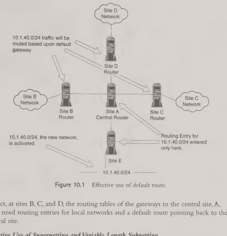

## 图 10.1 默认路由的有效使用。

事实上，在站点 B、C 和 D，通往中央站点 A 的网关的路由表中，只需要本地网络的路由条目和指向中央站点的默认路由。

## 有效使用超网和可变长子网掩码

在远程站点也拥有到 Internet 的网关的网络中，如图 10.2 所示，当新网络 10.128.1.0/24 投入服务时，不能使用默认网关。然而，因为网络管理员选择使用 RFC 1918 地址范围 10.0.0.0/8 用于完整网络，站点 B 网关的超网 10.0.0.0/8 的路由条目包含了新网络 10.128.1.0/24。

此外，站点 A 对网络 10.128.0.0/24 的路由条目可以更改为超网以包含新网络 10.128.1.0/24。新的超网路由条目将是 10.128.0.0/23，这在站点 A 为站点 B 节省了一个路由条目。

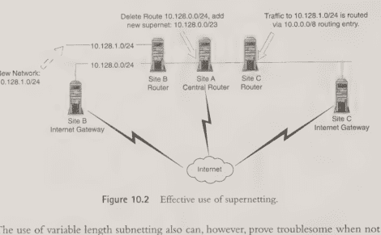

## 图 10.2 超网的有效使用。

可变长子网掩码的使用也可以证明在未有效使用时是麻烦的。

## 避免可变长子网掩码的无效使用

可变长子网掩码可用于以最小 IP 地址用于每个网络的方式管理 IP 地址空间；然而，在网络中使用多个网络掩码，这通常会给网络增加不必要的复杂性。

在静态路由网络中，通常不需要超过一到两个网络掩码：一个网络掩码，通常为本地局域网的 255.255.255.0，以及通常为点对点链路的转接网络的 255.255.255.252。然而，即使为转接网络使用单独的网络掩码也不是必要的，因为 10.0.0.0/8 为大多数网络提供了足够的地址空间——尤其是任何使用静态路由的网络。

## 转接网络的通用使用

无论为转接网络使用哪种网络掩码，都应通用使用。此外，大多数路由器支持点对点链路的无编号接口的概念。这意味着两个站点之间的链路不会为链路接收 IP 地址。如果使用无编号接口，也应尽可能通用使用。

## 动态路由网络中的路由表

与静态路由网络一样，避免可变长子网掩码的无效使用。支持众多子网掩码会增加动态环境的复杂性，因为这些网络已经倾向于比其静态路由对应网络更大。转接网络也应使用前面为静态路由网络所涵盖的相同准则。


# 路由汇总

路由汇总执行的功能与静态路由超网类似——它将多个子网路由合并为一个条目。路由汇总更为灵活，因为路由协议仍可通过路由通告感知特定的网络中断。

图 10.3 显示路由器 A 已通过接口 A1 对 10.0.0.0/8 使用了路由汇总。 （假设权重相等，网络也可以通过 A2 进行汇总，但由于它是额外的一跳，直到发生故障时才会被使用。）路由器 B 也可以汇总该路由。

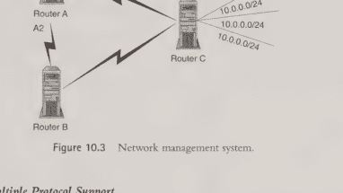

图 10.3 网络管理系统。

## 避免多协议支持

在同一网络上支持多个动态路由协议应予以避免。 多协议支持通常是企业收购或从旧的基于度量的协议升级到链路状态协议（如开放最短路径优先 OSPF）失败的结果。

支持多个协议不仅需要了解所涉及的协议，还需要了解它们在同时支持两种协议的路由器上的互操作方式，这通常是厂商特定的。 必须了解在同时支持两种协议的路由器上哪个协议具有优先级，哪些条目会被“另一个”协议进一步传播，以及如何排查两种协议的交互。

## 特殊情况路由功能

如第 7 章“内核支持工具”所述，向 Internet 网关添加额外功能可以为 Linux 路由器增加额外价值，事实上，这通常使 Linux 在作为 Internet 访问网关时优于传统路由器。

## IPv6 支持

在规划和部署网络时，还会出现一些额外的考虑或特殊情况，您应该注意：

第 4 章“IPv4 和 IPv6 地址”涵盖了网络寻址的内部机制。 选择支持 IPv6 的组织将需要分阶段的方法来同时支持两种版本的 Internet 协议。

RFC 1933“IPv6 主机和路由器的过渡机制”定义了两种过渡到 IPv6 的方法：双 IP 层和 IPv6 over IPv4 隧道。

双 IP 层与支持多协议的双栈非常相似。 例如，在 Novell 在 1990 年代流行的时期，许多工作站和 PC 同时支持 IP 和 Novell 的 IPX。

双栈是一种基于主机的解决方案，即主机可以与 IPv6 和 IPv4 节点通信，从而提供非常广泛的互操作能力。

许多组织希望部署特定的 IPv6 网络，而不是采用双栈方法。 因此，RFC 1933 还定义了在 IPv4 网络上隧道传输 IPv6。 IPv6 over IPv4 的隧道传输与其它隧道技术类似。 隧道的一个示例如图 10.4 所示。

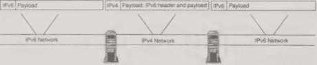

图 10.4 IPv6 over IPv4。

节点 A 和 B 均具有 IPv6 和 IPv4 接口。 对于从 A 流向 B 的流量，A 将在接口 A1 上接收到的 IPv6 数据包封装到一个版本 4 数据包中，并通过接口 A2 路由出去。 然后路由器 B 在接口 B1 上接收 IPv4 数据包，从数据包中剥离 IPv4 头部，并通过接口 B2 以 IPv6 数据包的形式路由出去。

## 多归属

对于大多数系统管理员而言，多归属描述的是将主机或网络连接到多个网络。 路由器按定义是多归属的。 在本章中，多归属是指实际上通过至少 2 个上游提供商连接到 Internet。

## 管理考虑

Internet 服务提供商对多归属的政策差异很大——从对您如何实现多归属几乎不关心（这些 ISP 倾向于在网络边缘强烈使用过滤，以确保您的网络不会影响核心网络）到非常详细的 dos 和 don’ts 列表。 本章涵盖了多归属的技术方面，但请务必咨询所选 ISP 的政策和建议。

## 简单多归属

最简单的多归属形式如图 10.5 所示。

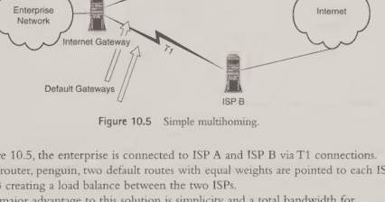

图 10.5 简单多归属。

在图 10.5 中，企业通过 T1 连接连接到 ISP A 和 ISP B。 在路由器 penguin 上，指向 ISP A 和 B 的两个权重相等的默认路由创建了在两个 ISP 之间的负载均衡。 该解决方案的主要优点是简单性以及 Internet 连接的总带宽为 3Mbps。 该解决方案的主要缺点是，50% 的目标为 ISP A 的外包服务（如 W.W.W、DNS 或甚至电子邮件）的流量将通过 ISP B。 可以输入 ISP 网络的静态路由以创建混合简单多归属网络； 然而，ISP 也有许多客户，其流量应通过特定链路（假设链路处于服务状态）。 因此，通常需要更有效的方法。

## BGP 多归属

通过使用 BGP 与两个提供商，边缘路由器可以确定到两个 ISP 提供商客户的最佳路径。 这可以通过几种方式实现。 如果提供商仅向客户通告客户网络，则直接的 BGP 实现很简单。 如果提供商通告所有路由，则需要在提供商网络边缘或客户现场实施过滤机制。


过滤优于简单地为提供商的网络添加条目，因为添加条目没有考虑到故障。考虑图 10.6 所示的网络。使用静态条目，连接将失败，因为所有流量都通过链路 A1 发送出去。然而，如果路由器 A 通过路由更新得知故障，则路由器将使用链路 A2，流量将通过 ISP B 到达。

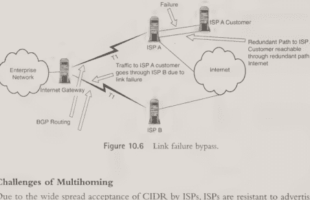

图 10.6 链路故障旁路。

## 多归属的挑战

由于 ISP 广泛接受 CIDR，ISP 不愿意在其 CIDR 域之外发布网络。多归属本质上会造成 ISP 需要在其网络内发布另一提供商的 CIDR 部分的情况。即使 ISP 愿意在其域内发布另一提供商地址空间的路由，域外的路由器也不会知道两个 ISP 都有通往该网络的路径。

由于大量利用伪造地址的互联网攻击，ISP 还会过滤掉源地址不属于其 CIDR 的数据包。这在为多归属设计接入网络时也必须考虑。

NAT 可用于确保通过特定 ISP 的所有数据包都使用该 ISP 分配的地址空间作为源地址。这会增加网络的复杂性；然而，大多数网络已经使用 NAT，因此这取决于具体网络需求和实现会增加多少额外复杂性。

# 摘要

本章介绍了从连通性到安全性的路由设置规划的一些基本考虑。虽然这不是路由器规划的具体蓝图，但它很好地概述了路由器规划所需的考虑因素。

本章还介绍了确保路由表大小有效的实践、特殊情况路由功能（如 IPv6 支持）以及通过多归属连接到两个或多个 ISP 的方法。


# 11 Linux 路由基础

正如标题所暗示的，本章中，我们将看一下 Linux 路由的一些基础知识。我们还将讨论常见网络配置的一些基础知识。这包括对网络进行预规划。正如你将看到的，理论上听起来比实践中困难得多。

### LAN 路由基础

在本节中，我们将了解网络管理员设置局域网需要知道的内容。如今使用 Linux 设置 LAN 非常简单。我们可以回忆起工具还不像今天这样成熟的时期，但 Linux 在过去三四年里取得了长足的进步。Linux 一直在网络方面表现非常出色，但设置和配置工具随着时间的推移变得更好。

然而，Linux 的路由功能在 2.4.x 内核系列中真正脱颖而出。更高级的功能对于简单的 LAN 来说并不是必需的，尽管你可能会发现 Netfilter 框架在某些方面让生活变得轻松得多。

### 设置单部分 LAN

设置单部分 LAN 非常容易，无论你是在一台计算机和互联网之间有一个路由器/网关，还是在 100 台计算机和互联网之间有一个路由器/网关。只要你不想将 LAN 分成子网，那么无论路由器后面有多少客户端，你的配置都是一样的。

对于简单的 LAN，你所需要做的就是设置一个带有 IP Masquerading 或可能的 NAT 的盒子。有关 IP Masquerading 和 NAT 之间差异的完整讨论，请参阅第 14 章“安全和 NAT 问题”。

对于使用单个路由器/网关通过 IP Masquerading 的简单单部分 LAN，设置起来几乎没有什么可做的。只需设置 IP Masq 和 IP 转发即可；内核会自动完成其余工作。同样，所有内容都在第 14 章中介绍。

### 静态或动态 IP 地址

你必须处理的第一个问题之一是为你的主机设置静态 IP 还是动态 IP。如果你的 LAN 非常小，少于 20 台计算机，那么使用静态 IP 地址不会太麻烦。只要网络上的主机数量不太多，使用静态 IP 比设置 DHCP 更容易。如果你能记住网络中每台计算机的名称和 IP 地址，就没有理由去折腾 DHCP。

另一方面，如果你发现自己定期向网络添加新主机或拥有超过 20 到 30 台机器，你可能通过配置 DHCP 服务器来节省一些麻烦。这在设置新机器的人多于一个时尤其如此。墨菲定律会在多个人同时分配静态 IP 时抬头。你可以使用路由器作为 DHCP 服务器，也可以使用一台旧的 486 或 Pentium 计算机专门用于提供 DHCP 服务。

一些应用程序使用 IP 地址进行身份验证。NFS、打印、邮件传输和 NAT 就是几个例子。如果 DHCP 配置不当，可能会导致打印、文件共享和其他任务出现严重问题。

你可以混合搭配。例如，如果你有几个远程办公人员偶尔会来办公室，你可以为“访客”计算机设置 DHCP，而网络上的其他主机使用静态 IP。事实上，在几乎任何办公环境中，为偶尔来访需要插上笔记本电脑检查电子邮件等的访客做好计划都是个好主意。

在客户端计算机上设置 DHCP 非常统一，无论你使用的是 Linux、Windows、MacOS 还是 BSD 中的一种。我们在这里不会详细介绍 DHCP 服务器或客户端的设置，因为大多数发行版都提供了自己的配置 DHCP 服务的接口。简而言之，这相对容易。


DHCP 的另一个好处是你可以“回收”IP 地址。我们的意思是，通过要求机器“租用”IP 地址，并在设定时间后将其放回地址池，你可以利用 DHCP 最大化可用 IP 地址的利用。这样，当来访的管理员在办公室插上笔记本电脑并使用一个 IP 地址时，该地址会在他们离开后被回收，供另一台机器使用。

## 别让你的路由器成为移动靶标

> 以防这一点不够明显：你并不希望动态分配路由器的 IP 地址。例如，如果你打算使用一个私有 C 类网络，请给路由器分配一个如 192.168.1.1 的 IP 地址——一个在设置新主机时容易记住的地址。路由器、防火墙、邮件服务器或 NFS 服务器等设备，基本上应当始终拥有相同的 IP 地址。

## 使用子网设置局域网

如果你在局域网中处理子网，事情会变得稍微复杂一些，但别担心——其实也没那么糟。

鉴于我们已经在第 4 章“IPv4 和 IPv6 寻址”中详细讨论了子网掩码运算的繁琐细节，这里就不再让你费神了。（好吧，其实没那么难，但任何带点数学味儿的东西都会让我们有些人头晕……）

不过，我们将会介绍固定大小子网与可变大小子网之间的区别，以及你可能希望在局域网中使用子网的原因。如果你对 IP 编址方案还没有扎实掌握，那么绝对值得先通读第 4 章。

> IPv6
> 由于 IPv6 目前极少被部署，我们在这里不会花时间讨论 IPv6 子网划分。考虑到 IPv6 地址数量极其丰富，即便 IPv6 将来得到普遍使用，可能也永远没有必要考虑对 IPv6 地址进行子网划分。

## 为什么划分子网？

创建子网的原因有很多。一般来说，网络上的子网之所以存在，是由于物理和地理上的布局安排，目的是隔离内部网络或充分利用 IP 地址方案。

我们已经在本书前面部分介绍了网络物理和地理布局；不过，出于安全目的而隔离网络则是个新话题。保护内部数据与防范外部威胁同样重要。你不会把人事部门的员工档案不锁起来放在公共走廊里吧？当然不会。所以，有时隔离你的

## 可变大小子网

当你需要将一个地址范围划分为不同大小的子网时，就会使用可变大小子网。例如，在前面的例子中，我们将一个 C 类 IP 范围分成了八个等大小的子网——也就是说，每个子网拥有相同数量的 IP 地址。但是，如果 IT 部门的子网需要比财务部门的子网更多的 IP 地址，该怎么办呢？IT 部门有那么多额外的服务器、工作站等等，而财务部门只有三个人。

在这种情况下，你可以根据每个网络所需的主机数量，为每个子网分配不同的子网掩码。子网号也会随之变化，以给主机提供或多或少的必要空间。

## 末梢网络

当创建两个可变大小子网时，主机数量较少的那个子网被称为“末梢网络”。

## WAN 路由基础

可以想象，设置广域网比设置局域网要棘手一些。一方面，当你搭建局域网时，一切都或多或少在你的掌控之中。（当然，除非墨菲定律作祟。）而在构建广域网时，会有一些你无法控制的因素。

## 选择外部连接类型

设置广域网时，你应当尽量选择符合带宽、正常运行时间需求以及预算的连接类型。

在某些情况下，你可选的方案可能是事先被决定好的。根据你尝试建立连接的所在地点，你也许有机会从拨号、DSL、ISDN、电缆调制解调器、T1、高速卫星天线或信鸽中选择。在另一些情况下，你的选择可能仅限于一两种连接类型。


第12章“网络硬件组件、技术与解决方案”详细介绍了硬件类型，并讨论了如何处理你所拥有的各种连接类型。

## WANPIPE

Linux 下的一种 WAN 软件包是 WANPIPE 软件包。要使用该软件包，你需要一块受支持的卡，并且还需要在 Linux 内核中编译对 WAN 路由器和 WAN 接口的支持。（有关内核编译的详细步骤，请参阅第13章“构建路由内核”。）

如果你需要 WANPIPE 软件包，可以从 Sangoma FTP 服务器 ftp://ftp.sangoma.com/linux/current_wanpipe/ 下载。该目录中还包含一个 README 文件，其中可能含有比我们写作时更新的信息。按照 README.install 中的说明操作，就应该可以准备好了。如果你是 Debian GNU/Linux 用户，那就更简单了。只需运行：

```
apt-get update
apt-get install wanpipe
```

以 root 身份运行，apt-get 会自动为你下载并安装该软件包，前提是你在 /etc/apt/sources.list 中配置了有效的软件包下载源。请注意，Debian GNU/Linux “稳定版”发行版中的软件包通常不是最新的，因此如果你需要全新的功能，可能需要安装 testing 或 unstable 版本。

wanpipe 程序会调用 wanconfig 程序，后者会加载一个包含适合你的 WAN 卡选项的配置文件。/etc/wanpipe/wanpipe1.conf 配置文件是指向 /etc/wanpipe/router.conf 文件的符号链接，该文件包含有关你的 WAN 设备（一个或多个）的所有信息、WAN 接口的定义，以及硬件和物理接口部分。

wanpipe 的用法非常简单；唯一困难的事情可能是正确设置配置文件。由于配置文件的选项太多，这里我们不打算深入探讨。不过，Sangoma 的人员维护着一个 WANPIPE 邮件列表，如果你加入该列表并详细说明你的设置，列表中的某人很可能能够为你提供所需的信息。

在配置文件设置完成后，要启动你的 WAN 设备，只需执行以下命令：

```
wanpipe start
```

这将启动配置文件中列出的所有设备。如果你需要关闭 WAN 接口，则使用：

```
wanpipe stop
```

你可能已经猜到，也可以使用以下命令来停止或启动单个设备：

```
wanpipe start | stop wanpipe#
```

其中“#”是接口的编号。设备编号从 1 开始，最多允许 16 个设备，在正常情况下这应该绰绰有余。

## VPN 路由基础

通常，VPN 是通过防火墙而不是路由器来设置的。但是，由于我们使用 Linux，我们可以灵活地将两者结合起来。或者，你仍然可以使用 Linux 作为路由器和防火墙/VPN，但为了安全起见，将它们构建在独立的机器上。无论你想怎么做，Linux 都足够灵活。

VPN 是昂贵的专用租用线路的替代方案，这些线路对其他网络流量是封闭的。通过利用互联网作为网络之间的桥梁，公司可以节省大量资金，并且通过使用 VPN 仍然可以保持安全。

## 关于 VPN 的更多内容

你可能已经知道，VPN 代表虚拟专用网络。由于互联网极其不安全，你不会希望以未加密的方式在互联网上传输任何重要数据。对于从事商务活动的人来说，我们有 HTTPS。对于只想运行 shell 或 X 会话的人来说，有 SSH。但是，如果你想安全地将两个相距遥远的网络连接起来，并通过互联网共享所有公共资源，那该怎么办？这就是 VPN 的用武之地。

最常用于描述安全连接两个网络的方法的比喻是“隧道”。你可以将两个网络之间发生的通信想象成处于几层外层涂层之内。你仍然使用 TCP/IP 传输数据，但传输的不是未加密的数据，而是加密的数据，这样即使潜在的攻击者能够截获你的数据包——这是你在不安全的共享网络上无法控制的事情——他们也不应该能够理解数据包本身。你的数据（理论上）不会受到窥探，你的网络也不会受到入侵者的侵害。

因此，即使传输发生在公共网络上，它也被认为是专用网络。它并不总是像 WAN 那样方便，但在预算和资源限制使 WAN 不切实际，或者时间和移动性成为因素的情况下，VPN 可以证明是非常有用的替代方案。例如，你可能希望实施 VPN，以便在贸易展会上进行销售时，让基于 Linux 的销售点终端通过拨号方式与公司的中央信用卡处理机交互。


VPN 最常见的协议之一是点对点隧道协议。顾名思义，PPTP 基于点对点协议。Linux 上有几种可与 Windows（当然还有 Linux！）等其他操作系统互操作的 PPTP 实现，你可以利用它们来创建自己的 VPN。我们在第 8 章“Kernel 2.4.x Routing Daemons”中对 VPN 进行了广泛的介绍。

## Summary

在本章中，我们介绍了在正常情况下将 Linux 用作路由器的一些基础知识。在大多数情况下，将 Linux 用作普通 LAN 和 WAN 情况下的路由器易如反掌，因为大部分工作都由内核和软件自动完成。

Linux 在网络方面表现出色，因此即使你的其余 LAN 或 WAN 由 Windows、Mac 或其他类型的机器组成，选择 Linux 作为网络的粘合剂也几乎是理所当然的。Linux 有点像是操作系统的伟大“统一者”。

在后面的章节中，我们将更详细地介绍更困难的路由任务，例如负载均衡和 VPN，这些任务过去曾是昂贵硬件路由器的专属领域。


## Network Hardware Components, Technology, and Solutions

NETWORKS、INTERNETWORKS 和 INTERNET 都由主机、节点、路由器和电信设施组成。本章考察了构成大多数网络构建框架的电信技术。电信设施和基础设施传统上由 AT&T 拥有和运营，该公司被美国政府拆分（拆分后的部分被称为“Baby Bells”）。在本章中，电话公司或 telco 一词被宽泛地用于指提供本章所述服务的任何组织。

### Analog Communications and Modems

调制解调器是远程用户和家庭用户连接到企业网络和互联网最常见的方法。调制解调器将 PC 的数字信号调制成可通过电话线发送的模拟信号。调制解调器还将从电话网络接收的模拟信号解调为计算机可以理解的数字信号。

在理想情况下，调制解调器提供的连接速度最高可达 56kbps，但典型速度为 33.6 至 44kbps。56kbps 标准需要非常干净的连接（干扰非常少）并且仅进行一次模拟到数字转换。由于美国的电力法规，最大下载速度为 53kbps，上传速度为 33kbps。

调制解调器的使用造成了一个常见的误解，即电话网络是模拟的，因为调制解调器将计算机的数字信号转换为模拟信号。事实并非如此。从客户 premises 到电话公司的铜线上发送的模拟信号被转换为数字 64kbps 信号。

该 64kbps 信号被称为 DS0，然后与另外 23 个 DS0 组合（复用）成 1.54Mbps 的 DS1。DS1 通常被称为 T1 或“中继”。T1 通常与其他流量复用，通过 DS3/T3（672 个 DS0）或更高连接进行传输。图 12.1 显示了两个调制解调器之间连接的工作方式。这种网络在 1980 年代常与电子公告板系统一起使用，也是 Fido 等全球存储转发型网络的基础。调制解调器到调制解调器的连接很少使用，除非是由系统管理员使用；然而，即使是这种调制解调器到调制解调器的通信应用，通常也是终端服务器的第二选择。终端服务器将在本章后面的“Terminal Servers”部分介绍。

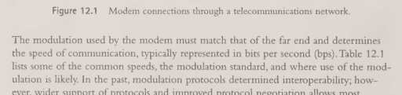

调制解调器使用的调制必须与远端匹配，并决定通信速度，通常以每秒位数（bps）表示。表 12.1 列出了一些常见速度、调制标准以及调制的使用可能区域。过去，调制协议决定了互操作性；然而，随着协议支持的扩展和改进的协议协商，大多数调制解调器可以使用通用协议。此外，后面将介绍的远程访问服务器也支持广泛的调制协议和纠错协议。

### Table 12.1 Common Modem Speeds, Standards Body, and Deployment Area

| 调制解调器速度 | 标准机构 | 部署区域 |
|---|---|---|
| 300 | Bell 103 | US |
|  | CCITT V.21 | Outside the US |
| 1200 | Bell 212A | US |
|  | CCITT V.22 | Outside the US |
|  | CCITT V.23 | Europe |
| 2400 | CCITT V.22bis | International |
| 9600 | CCITT V.32 | International |


| 调制解调器速度 | 标准制定机构 | 部署区域 |
|---|---|---|
| 14400 | CCITT V.32bis | 国际 |
| 28,800 | CCITT V.34 | 国际 |
| 33,600 | CCITT V.34 | 国际 |
| 56,000* | ITU V.90 | 国际 |

*这是最大下载速度（实际限制为53kbps）。上传速度通常为33kbps。

## 内置或外置调制解调器

内置调制解调器在PC分销商中非常流行；内置调制解调器的价格通常比外置调制解调器便宜50%，因为调制解调器制造商无需为FCC屏蔽要求提供外壳（PC外壳可满足此要求），也无需提供电源（PC提供电压）。内置调制解调器的主要缺点是缺少可用于故障排除的状态指示灯。此外，内置调制解调器不易在两台PC之间移动使用。

进入内置调制解调器市场相对较晚的是所谓的WinModem。WinModem依赖PC的内部CPU来提供通常由调制解调器硬件提供的绝大部分逻辑功能，包括纠错和流控制，这意味着WinModem对系统性能的影响通常比普通内置调制解调器更大。此外，这些调制解调器通常只能用于Windows操作系统，我们不建议使用它们。然而，目前有相当多的开发工作致力于在Linux上支持WinModem。有关最新开发进展，请访问LinModem网站：http://www.linmodems.org/。

WinModem基于早期厂商类似工程的尝试；然而，Windows更普遍的支持可能会确保这些调制解调器取得一定成功。

内置调制解调器有ISA 16位接口和PCI 32位接口两种。ISA调制解调器在Linux下得到广泛支持；而PCI（非WinModem）调制解调器则取决于所使用的具体型号。2.4内核提供了更广泛的PCI支持，但在购买PCI调制解调器之前，建议先在USENET上发帖以了解最新的开发情况。

外置调制解调器通过DB-25或DB-9连接器连接到PC的串行端口。DB-25和DB-9连接器如图12.2所示，调制解调器端口的引脚排列如表12.2和表12.3所示。大多数调制解调器使用母头连接器。

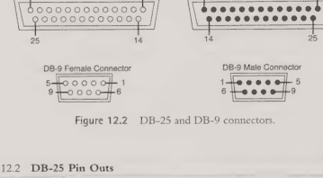

## 图12.2 DB-25和DB-9连接器

## 表12.2 DB-25引脚排列

| 引脚 | 说明 |
| --- | ----------- |
| 1 | 保护接地 |
| 2 | 发送数据（TD） |
| 3 | 接收数据（RD） |
| 4 | 请求发送（RTS） |
| 5 | 允许发送（CTS） |
| 6 | 数据设备就绪（DSR） |
| 7 | 信号地 |
| 8 | 主载波检测（CD） |
| 20 | 数据终端就绪（DTR） |
| 22 | 振铃指示（RI） |

## 表12.3 DB-9引脚排列

| 引脚 | 说明 |
| --- | ----------- |
| 1 | 载波检测（CD） |
| 2 | 接收数据（RD） |
| 3 | 发送数据（TD） |
| 5 | 信号地 |
| 6 | 数据设备就绪（DSR） |
| 7 | 请求发送（RTS） |
| 8 | 允许发送（CTS） |

无论调制解调器是内置还是外置，它都会使用通用异步收发器（UART）。过去，确保串行卡或内置调制解调器配备16550 UART非常重要，这是对早期8250 UART的改进。16550具有16字节缓冲区，比8250多存储15字节。这使其在多任务环境中运行更平稳，体验更流畅。确保具备16550已不再像过去那样重要——串行卡和调制解调器制造商现在至少使用16550或兼容的UART。

## Hayes AT命令

使用调制解调器与其他系统通信时，还必须配备通信软件。早期的调制解调器厂商附带的终端软件可以使用专有协议与厂商的软件进行通信。Hayes Microcomputer创建了一套命令集，其中所有命令都以助记符AT开头，后跟调制解调器命令。Hayes命令语言后来被称为AT命令集，许多厂商模仿该命令集，形成了事实上的标准——Hayes兼容。目前市场上几乎所有调制解调器都是Hayes兼容的。

AT命令用于与调制解调器进行的所有通信，其功能范围从拨号命令、硬件流控制，到拨号前等待拨号音等。调制解调器的特殊功能也可以通过使用寄存器来调用，而无需修改AT命令集。寄存器类似于其他语言中的变量，区别在于寄存器存储在非易失性存储器中，并且在调制解调器复位后仍然保留。

大多数通信软件都预配置了经过优化的AT命令文档；然而，AT命令在排除通信问题时可能很有帮助。表12.4列出了一些更有用的命令。请记住，所有命令都以AT开头，后面才是表中显示的命令。

### 表12.4 常用Hayes AT命令

| 命令 | 含义 |
|---|---|
| A | 应答来电。 |
| D nnn-nnn-nnnn | 拨打电话号码nnn-nnn-nnnn。D命令还接受附加参数，其中P和T是最常见的，分别用于脉冲拨号和音频拨号。DL用于重拨上次号码。 |
| En | 向终端程序回显，如果n=0则关闭本地回显，如果n=1则开启回显。 |
| H | 挂断当前连接。 |
| Xn | 扩展错误代码处理。X3对于忽略拨号音要求非常有用，例如当调制解调器通过专用交换机（PBX）时可能需要。 |
| Z | 复位调制解调器。 |


## 终端通信软件

网络应用已经使得大多数用户不再需要通信软件；然而，系统管理员常常需要终端软件来连接PC、调制解调器、路由器和其他网络设备的控制台。大多数Linux发行版都包含通信应用程序minicom，它看起来类似于早期的DOS应用程序Telix。不过，有许多Linux通信软件包可供选择，其中Seyon和pcomm也是常用的。IBLIO Linux 档案库在 http://www.ibiblio.org/pub/Linux/apps/serialcomm/ 维护着 Linux 通信程序列表。

## 模拟通信的其他用途

本章剩余部分将介绍基于数字的通信；然而，我们应该指出模拟通信仍然提供的一些重要角色。虽然调制解调器作为单个硬件不一定用于这些应用，但调制解调器中存在的技术被用于终端服务器和远程访问服务器。

## 终端服务器

调制解调器到调制解调器的连接很少使用，除非是网络管理员需要连接到具有专用调制解调器进行远程管理的远程系统。（大多数来自调制解调器的远程连接都连接到远程访问服务器，我们稍后将介绍。）

然而，即使是这种调制解调器到调制解调器的应用也正在被终端服务器取代。终端服务器是一种特殊用途的远程访问设备，具有多个串行端口，可以直接端接到需要远程管理的系统上，甚至还可以连接调制解调器以进行拨号连接。例如，图12.3所示的终端服务器可以用于访问Linux系统rightly。在不确定故障是由系统还是网络引起的情况下，这是理想的选择。在这种特殊情况下，管理员有一种“带外”方法来访问rightly，可以telnet到终端服务器，然后通过串行连接访问rightly。如果由于Linux服务器常见的网络故障而无法telnet到终端服务器，管理员还可以拨号进入终端服务器，然后通过终端服务器访问Linux服务器。

终端服务器与专用调制解调器相比的主要优势是资源整合和安全的中心点，这避免了员工“忘记”连接到网络的调制解调器而留下的后门。管理通常也更容易，因为终端服务器连接可以利用大多数路由器上的控制台连接和UNIX主机上的简单串行连接；这意味着不需要特定于供应商的调制解调器配置要求。

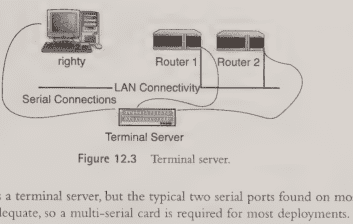

## 图12.3 终端服务器。

Linux可以充当终端服务器，但大多数PC硬件上典型的两个串行端口是不够的，因此大多数部署需要多串口卡。（Linux终端服务器项目 [http://www.ltsp.org/index.php] 不应与基于Linux的终端服务器混淆，该项目涉及使用无盘Linux工作站。）

## 远程访问服务器/网络访问服务器

远程访问服务器，也称为网络访问服务器，顾名思义，为远程用户提供对网络的访问。远程访问通过拨号连接（如异步调制解调器或ISDN）提供。图12.4显示了一个典型的企业远程访问服务器，带有一条T1提供24个拨入信道用于访问。

远程访问服务器可以通过主速率接口提供模拟以及综合业务数字网（ISDN）访问，这将在后面讨论。


## 图12.4 企业远程访问服务器。

远程访问服务器支持多种协议，IP是最受欢迎的，尽管IPX也存在于传统的Novell环境中。虽然远程访问服务器提供协议、接口和安全策略，但远程访问服务器通常不在本地存储用户特定信息，而是通过远程访问服务器协议（如RFC 2058中定义的远程认证拨号用户服务（RADIUS））确定用户特定信息，例如认证、数据包过滤和用户可用的协议。Linux是理想的RADIUS服务器。表12.5列出了一些在Linux上运行的RADIUS服务器。

## 表12.5 用于Linux的RADIUS

| RADIUS | 组织 | 来源 |
|---|---|---|
| Ascend RADIUS 版本 970224 | 朗讯 | ftp://ftp.ascend.com/pub/Software-Releases/Radius |
| Cistron Radius Server 版本 1.6.4 | Cistron电信 | http://www.radius.cistron.nl/ |
| Livingston Radius Server | 朗讯 | http://www.livingston.com:80/tech/docs/radius/ftp://ftp.livingston.com/pub/radius/ |

本节涵盖了传统的远程访问，但最近宽带服务（如有线调制解调器和数字用户线（DSL））为个人和商业用户开辟了新的机会。有线调制解调器和DSL将在接下来的两节中介绍。

## 有线调制解调器

有线电视网络，除了公共交换电话网络之外，可能是家庭用户最常用的网络。这一市场特性与创建宽带有线网络的基础设施相结合，是数据网络应用的绝佳组合。

有线调制解调器是通过有线电视提供商的网络连接到互联网的硬件。传统有线网络本质上是单向的，而数据网络是双向的；然而，有线电视提供商长期以来一直需要传输上行信息的能力，以提供基于传统有线电视技术的附加服务，例如按次付费观看。设计用于提供这种上行信道的带宽和技术是有线网络能够提供


上行数据路径。（并非每个电缆系统都具备向上游传输数据的技术，这一点不应被视为无关紧要——许多电缆网络都需要升级才能提供电缆网络服务。）图12.5展示了一个基于电缆调制解调器的网络。

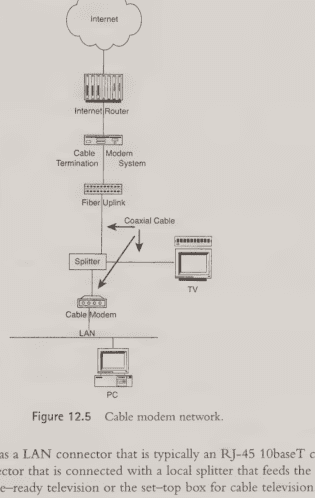

## 图12.5 电缆调制解调器网络。

电缆调制解调器有一个LAN连接器，通常是RJ-45 10baseT连接器，还有一个“WAN”连接器，该连接器与本地分路器相连，分路器为电缆调制解调器和可接收有线电视的电视机或有线电视机顶盒提供信号。分路器负责在电缆调制解调器和电缆调制解调器终端系统（CMTS）之间传输6Mhz下行和2Mhz上行信号。

电缆的6Mhz下行信道可提供高达56Mbps的速率。需要注意的是，尽管到CMTS是共享介质，但电缆调制解调器之间并不直接通信——流量必须首先经过CMTS。还要注意，CMTS不提供IP路由能力。2Mhz上行信道提供高达3Mbps的带宽。

尽管电缆调制解调器使用共享总线，但可用的带宽、消费者对有线电视的接受度，以及DSL等其他技术的不可用性，将确保电缆调制解调器继续存在。

## 数字用户线

DSL与模拟服务不同，它不提供数模转换，而是充当数字信号的接口，该数字信号在与电话模拟线路相同的用户线上传输。虽然面向客户场所的数字通信对企业客户来说很常见，但面向私人客户的“最后一英里”传统上一直是模拟的；然而，随着DSL的出现，这种情况正在改变。尽管非对称DSL（ADSL）是部署最广泛的DSL，但本文也会简要介绍一些较为常见的DSL服务。

## 高数据率数字用户线（HDSL）

HDSL是T1（在欧洲为E1）的替代方案，允许使用铜线而无需T1所需的中继器。HDSL支持长达12,000英尺的距离。（对于T1，通常每隔6,000英尺就需要一个中继器。）HDSL使用四根线进行传输。

## HDSL-II

HDSL-II是HDSL的下一代产品，提供与HDSL相同的速率，但只需一对线。单对线需要的连接更少，而且许多设施中通常已经预置了单对线。

## 单线数字用户线（SDSL）

SDSL与HDSL和HDSL-II一样，以T1速率运行；然而，它只使用一对线。使用两根线确实限制了SDSL的工作距离，其距离范围为10,000到11,000英尺。

## 非对称数字用户线（ADSL）

顾名思义，ADSL不像HDSL和SDSL那样在双向提供相同的速率，而是提供比上行更高的下行带宽，这使其非常适合互联网接入，因为用户下载的信息量远大于上传的信息量。“上传”的数据通常只是对下行流量的确认。

如前所述，ADSL是最流行的DSL形式，通常用于家庭和小型办公用户。此外，当人们首次提到DSL时，大多数消费者通常指的就是ADSL。

ADSL在长达9,000英尺的距离内可提供高达8.44Mbps的带宽。然而，速率供应因服务提供商而异，并非统一部署。

图12.6展示了大多数服务提供商提供ADSL的方式。接下来将考察构成ADSL部署的各种要素。

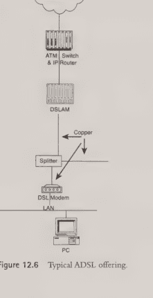

图12.6 典型的ADSL提供方式。

## DSL调制解调器

DSL调制解调器位于用户所在地——通常是住宅——电信技术人员称之为用户驻地设备（CPE）。DSL调制解调器提供一个LAN接口，提供10Mbps以太网连接，以及一个连接到分路器的WAN接口，分路器已将较低的4khz频段分离给电话。


## 数字用户线接入复用器（DSLAM）

DSLAM将来自不同DSL用户的信号复用后送入提供商的网络。当前一代的DSLAM为服务提供商网络提供异步传输模式（ATM）接口。早期实现通常是帧中继接口（稍后介绍）。一些DSL支持者预计IP将成为下一代DSLAM的首选接口，但市场现实和当前部署情况很可能会促使供应商提供多种接口，让服务提供商来选择。

## 使用路由器进行数据联网

在最近几年宽带技术推动之前，路由器是用于连接需要多用户支持的远程站点的最常见硬件。路由器以其第三层路由能力和多种物理接口支持而闻名。

本书详细介绍了使用Linux进行路由。然而，接下来的大部分内容涵盖了可用于Linux和基于硬件的路由器的接口。

硬件路由器相对于基于主机的解决方案（如Linux）的主要优势之一在于其简单性和专用操作系统。使用通用操作系统时，其他某个服务可能会影响路由功能。例如，内核可能错误地编译了一个不需要的、有缺陷的IPX协议栈。此外，还存在因为“这台机器能办到”而激活额外服务的倾向。

此外，许多硬件路由器（如Linux路由器）提供安全功能，例如数据包过滤、网络地址转换，以及额外的网络功能，例如在帧中继网络中充当帧中继接入设备。在高端领域，核心路由器处理数据包的能力也远超PC主板……路由器的背板经过优化，可以快速路由数据包。

此外，硬件路由器通常支持更广泛的网络接口，如前所述。

由于这些原因，在大多数环境中都可能需要与路由器交互……至少ISP提供的互联网接入路由器很可能是硬件路由器。因此，我们将介绍企业网络中使用的一些更常见的设施。

## T1与E1

如调制解调器部分所述，T1是1.54Mbps的数字设施，是语音网络的标准。其成熟的技术在用户驻地证明了其有效性，并已成为窄带数字通信的标准，只是有可能被当前宽带技术所取代。HDSL是自然的替代品，在某些市场上正被作为T1的替代品用于企业连接进行推广。

T1是一种1.544Mbps的链路，由24个64kbps信道组成，这些信道被称为DS0。

由于T1的费用昂贵，美国电信运营商提供了基于n×DS0的部分T1服务，该服务在互联网连接和需要点对点连接的网络中非常受欢迎。T1或部分T1被称为租用线路或永久连接，因为无需拨号或信令——连接始终在线。

E1是欧洲（及世界其他地区）的数字设施，运行速率为2.048Mbps。它提供32个DS0信道。

要使用T1，通信的两台路由器必须使用相同的协议进行通信。点对点协议（PPP）（见第10章“规划路由器布局和功能”）是首选，并提供很好的互操作性；然而，与HDLC协议也有一定的互操作性，如果使用相同类型的路由器，则可以使用供应商特定的HDLC。

当需要超过T1或E1的带宽时，下一种可用的设施是DS3，其提供44.736Mbps的速率。E3为34.368Mbps，通常无法接入用户驻地。大多数网络升级无法证明这种费用和指数级增长是合理的；因此，会选择多条T1连接。

当与同一站点使用多条连接时，必须使用允许将两条链路视为一条链路的协议。一些路由器允许连接使用负载均衡，这意味着每个到达的帧都通过上一个帧未发送的连接进行发送（如图12.7所示）。

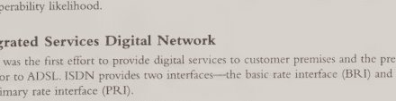

图12.7 负载均衡。

RFC 1717中定义的PPP多链路协议也可用于将多条连接合并为一条逻辑连接，并且具有增加互操作可能性的额外优势。

## 综合业务数字网

ISDN是为用户驻地提供数字服务的首次尝试，也是ADSL的前身。ISDN提供两种接口——基本速率接口（BRI）和主速率接口（PRI）。


BRI 为负载提供两个 64kbps 的信道，以及一个 16kbps 的信令信道。两个负载或承载信道被称为 B 信道，信令信道被称为 D 信道。PRI 为 T1 提供 24 个信道（E1 为 32 个）。PRI 最流行的用途是专用分支交换机（PBX），或企业电话交换机，提供语音邮件和快速拨号等功能。PRI 对于远程访问服务也很受欢迎。BRI 接口在欧洲得到广泛使用，但在美国，尤其是语音用途方面，并未得到广泛部署。

## ISDN 用途

BRI 对于数据网络有一些有趣的应用，例如按需拨号网络、按需带宽和拨号备份。

由于 ISDN 是数字的，连接所需的信令与调制解调器不同，非常快速。这一事实，加上负载总带宽为 128kbps，为网络设计人员在网络设计中提供了额外的灵活性。

按需拨号网络避免了使用专线，并且对用户或应用程序是透明的。通过 ISDN 连接两个站点，当检测到通往远端的流量时，可以拨号一个或两个 B 信道，并在一定时间不活动后拆除信道。ISDN 和按需拨号网络在分段 T1 服务不可用的地区（主要是欧洲）或 ISDN 成本低于分段 T1 的地区很受欢迎。大多数服务提供商按使用量计费 ISDN，因此在许多情况下该应用受到限制。

ISDN 还可用于在高峰利用率期间创建额外带宽。例如，可以配置路由器在利用率达到 98% 后建立一个信道，并在利用率回落至 95% 以下后应将其关闭。“主”信道可以是租赁设施或 ISDN 信道。

在北美，ISDN 最流行的用途可能是拨号备份。当确定网络故障时，路由器将使用 ISDN 连接连接到远程站点。网络故障可根据专线上信号丢失或网络事件（例如网络路由更新宣布路由不可用）来确定。

## 帧中继

数据通信中租赁线路的主要缺点是每条租赁线路都需要一个接口。考虑图 12.8 所示的网络。有一个中心站点和四个远程站点。使用租赁线路时，中心路由器需要使用四个物理接口来连接四个远程站点。

此外，每个远程站点必须通过中心站点路由流量才能与其他远程站点通信，或者必须在两个远程站点之间激活额外的租赁线路。这意味着对于一个 4 节点网络，完全网状网络需要 10 个连接。

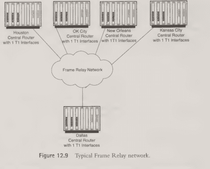

图 12.9 典型的帧中继网络。

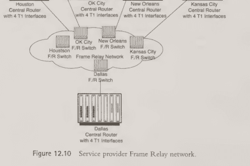

图 12.10 服务提供商帧中继网络。

Linux 的帧中继开发并不多；然而，重要的是要知道该技术存在并且在许多广域网环境中发挥着非常重要的作用。每当需要多站点连接时，都应考虑帧中继。

## 总结

在本章中，我们研究了数据网络所建立的电信设施。已涵盖模拟、数字（T1/E1）、DSL、电缆和帧中继。


# 13

## 构建路由内核

GNU/Linux 操作系统的主要卖点之一是能够按需重新编译 Linux 内核。添加所需功能或剔除不需要的部分的能力是 Linux 被广泛采用的关键原因之一。系统管理员、软件供应商和高级用户在 Linux 上拥有的灵活性是他们在专有操作系统或硬件路由设备上所不具备的。

## 为什么要构建？

如果你获得其中一种典型的 Linux 发行版，很可能你可以在无需重新编译的情况下启用一些路由功能。如果路由只是你使用 Linux 的任务之一之一，使用预编译内核可能是最好的方法。然而，如果你只做路由，你也会被许多增加内核大小的功能所困扰，而这些功能在仅用于路由功能的系统上是不需要的——也不想要的。

例如，大多数预编译内核都带有对声音、CSLIP、点对点协议（PPP）、RAID 控制器以及其他你不需要的协议和设备的支持。（例如，很少有路由器需要声卡。）


在本章中，我们将探讨如何定制 Linux 内核以用于路由器，以及一些专门为路由而创建的专用 Linux 发行版。

你可能会想，如果 Linux 内核已经具备了你需要的功能，是否还值得费劲去重新编译它。答案几乎是肯定的。大多数商业 Linux 发行版的内核几乎都是“一刀切”式的。它们把能加的都加进去了，因为这是确保大多数用户能够安装 Linux 并立即运行起来的最佳方式。这种方法对于快速安装系统来说很棒，但在优化和安全性方面却有所欠缺。

即使是本章后面将要讨论的专用路由发行版，最终也需要对内核进行修补以进行升级或安全更新。好在 Linux 与思科或其他路由硬件中使用的专有操作系统（OS）不同，它可以轻松修改以满足你的需求。

## 升级与灵活性

公平地说，思科路由器和其他路由设备通常可以在发现安全漏洞或存在某种错误时进行升级。然而，它们不允许 Linux 所拥有的那种灵活性和同等程度的定制化。Linux 路由器通常比传统路由器功能更多，而且成本更低。

## 更小更快

定制内核以满足你的需求（且仅是你的需求）最明显的好处是，你将得到一个占用更少内存且性能更好的内核。

诚然，如今这个问题不像几年前那么令人担忧——标准 Intel 硬件在单处理器机器上已达到 1.5GHz 的速度，而内存价格也低于每兆字节 1.00 美元。在某些情况下，管理员可以直接购买一台新的白牌计算机，并将其设置为 Linux 路由器，而无需担心成本。然而，Linux 路由器通常是公司“废件堆”里的翻新计算机，没有新计算机那么强劲。没关系；你可以把硬件预算省下来用于其他方面，并让那台已积满灰尘的旧奔腾“经典”机型再多服役几年。

然而，Linux 内核并不是让标准发行版“瘦身”的唯一地方。假设你是从零开始安装系统，你会希望安装最少量的软件包，并注意不要包含不必要的软件。

## 专用功能

为大多数发行版编译的“标准”内核不会包含诸如 Netlink 套接字或反向 ARP 等选项，但你很可能希望在 Linux 路由器上使用这些功能。因此，获得这些功能的唯一方法就是重新编译内核以支持这些特性。（既然要这么做，正好可以顺便去掉不必要的功能和对未使用设备的支持。）这可能是人们编译自己内核的最常见原因，此外还有升级和安全修复。

如果你想启用 IPv6 协议（或者想支持桥接、X.25 分组层或任何较少使用的协议），你几乎肯定需要重新编译内核。这再次表明，Linux 对这些协议的支持真正体现了开源操作系统的强大之处。一般来说，像微软、Sun 或 Novell 这样的商业实体只是决定他们要支持哪些协议，仅此而已。最常见的选项会得到支持，而任何使用“异类”或遗留系统的客户都将被冷落。

另一方面，Linux 或其他内核开发者可能决定不支持某种协议 X，但这并不妨碍其他人开发补丁或模块来支持自己的协议，并将其提交给内核团队。

## 专用硬件

一般来说，内核在编译时会支持最常见的硬件。如果你有特殊的控制器卡或设备，它们虽然受 Linux 内核支持，但因足够特殊或罕见而未被包含在默认内核中，那么你需要能够重新编译内核以支持这些设备。

另一种相当常见的情况是，将最新的补丁或“实验性”代码添加到内核中，以支持相对较新的设备或尚未被判定为稳定的设备。例如，在 2.4.3 Linux 内核中，Netfilter 和 IP Tables 的若干模块仍被视为实验性的，但许多用户可能希望测试并可能部署这些代码，而不是等待它们变得“稳定”。

广域网（WAN）路由器卡是“专用”硬件的典型例子。普通用户不会在工作站或 Web 服务器上需要 WAN 路由器，但 Linux 确实支持多种此类网卡，并且能够通过 X.25 或帧中继执行 WAN 路由。

在规划你的路由器时，务必确保你想使用的硬件在 Linux 下受支持。Linux 下的硬件支持并不总是有保证的，不过网络硬件——尤其是高端硬件——通常确实有支持。如果你不确定，可以在互联网上使用产品名称和“Linux”进行 Google 搜索。一百次里有九十八次，这会从某个 Linux 邮件列表返回有用的结果。你也可以尝试你的 Linux 发行版的邮件列表存档，如果其他方法都失败，可以向该列表发帖。（除非你喜欢穿石棉内裤，否则在发帖之前一定要先搜索。这不仅是一种良好的网络礼仪，还能避免你被那些在同一周内已经看到同样问题被问 30 次的人猛烈抨击。）

## 安全与缺陷修复

如果你没有什么特殊情况下的硬件需要考虑，而且调整过的内核所带来的额外性能并不足以让你觉得值得学习“自己动手”的话，那么你可能要把安全性和缺陷修复当作学习如何修补和重新编译内核的理由。


无论你使用的发行版是何时构建的，很可能已经有针对它的错误修复和安全补丁发布。内核开发团队可能不会急于发布主要版本，但次要版本会以相当规律的间隔发布。这些修订版通常包含重要的安全更新和错误修复。即使你在设置路由器时使用的是最新版本的内核，很可能在六个月内就会有包含关键错误修复或安全补丁的新版本发布。

此外，根据你的多疑程度，你可能希望禁用可加载内核模块。这可以防止已获得系统访问权限的入侵者加载内核模块，从而帮助他们掩盖踪迹或执行其他不受欢迎的活动。诚然，如果有人破解了你的路由器并获得了根访问权限，无论如何你都会遇到问题。然而，限制潜在损害是系统安全的标志之一。这还可以防止破解者卸载任何内核安全功能，因为这些功能已被编译为内核的一部分，而不是作为模块。

## 附加安全

如果你打算不辞辛劳地编译一个静态内核，请务必删除内核源代码和配置文件，这样即使破解者真的访问了你的系统，也无法猜测你已经编译了什么。

## 构建 Linux 内核

既然我们已经讨论了“为什么”，现在是时候卷起袖子实际编译一个内核了。如果你以前没有做过，最好在测试机器上进行，或者备份旧内核以防万一。如果你使用 LILO 来引导你的 Linux 机器，请在编译新内核之前复制一份 Linux 内核，并在你的 /etc/lilo.conf 中为旧内核添加一个新条目。它应该看起来像这样：

```
root=/dev/hda2
boot=/dev/hda
install=/boot/boot.b
map=/boot/map
vga=normal
timeout=50
prompt
default=Linux
lba32

image=/vmlinuz
label=Linux
read-only
initrd=/boot/root.bin
root=/dev/hda2
```

```
image=/vmlinuz.old
label=Old_Kernel
read-only
optional
root=/dev/hda2
```

然后只需运行 lilo，如果在编译新内核时出错，你就能有一个可用的内核作为后备。

在撰写本文时，Linux 内核的当前版本是 2.4.3，但大多数 Linux 用户仍在生产机器上使用 2.2.x 内核系列。虽然 2.4.x 内核系列有许多新功能和对旧功能的改进，但 2.4.x 内核成为主流还需要一段时间。在商业 Linux 发行版中，只有 SuSE、Red Hat 和 Linux-Mandrake 发布了带有 2.4 内核的发行版，并且它们都将 2.2 内核作为一个选项提供。

在本节中，我们将逐步介绍如何获取 Linux 内核源代码，并使用 Menuconfig 工具编译 2.4.x 内核。虽然 2.2.x 和 2.4.x 内核的一些选项有所不同，但过程是相同的。如果你以前从未做过，这可能听起来令人生畏，但实际上相当简单。

> 2.0.x Linux 内核系列
> 
> 2.0.x 系列的最终版本于 2001 年 2 月发布，版本号为 2.0.39。对于那些不关注内核开发的人来说，惯例是在当前内核继续开发的同时，维护内核的最后一个稳定版本。虽然许多 Linux 用户热衷于使用尖端技术，但同样多的管理员对在生产机器上进行重大更改持谨慎态度，通常会等待一个令人信服的理由才升级。
> 
> 如果你有任何路由器或系统当前运行 2.0.x 系列内核，如果可能的话，最好升级到 2.2.x 系列。

## 选择内核

如果你没有被锁定在 2.2.x 或 2.4.x 系列中，你需要决定围绕哪个系列来构建你的路由器。显然，2.2.x 系列经过了更彻底的测试，也更加成熟。另一方面，2.4.x 系列拥有大量性能提升和新功能，可能很有吸引力。如果你不是按顺序阅读本书，你可能想回头复习一下专注于内核守护进程的章节，以及第 14 章“安全与 NAT 问题”，该章涵盖了 2.2 和 2.4 的路由“基础”。

在所有条件相同的情况下，将时间和精力投入到最新的内核系列可能更有意义。虽然 2.4 内核不如 2.2 系列成熟，但它将在未来获得最集中的开发努力，并且已经具有显著的性能提升和更先进的网络功能。

最后，如果你不确定，尝试两种内核也无妨。毕竟它是自由软件。如果可能，花几天时间专门试验设置你的路由器并测试不同的配置。


## 从 2.2.x 升级到 2.4.x

从 2.2.x 系列升级到 2.4.x 系列并不困难，但在实际编译内核之前，你需要做一些准备工作。有一些支持程序和库需要升级到最新版本。最新要求可在 /usr/src/linux/Documentation/Changes 文件中找到。至少你需要升级 GNU C、GNU Make、binutils、modutils 和 e2fsprogs——除非你已经在使用最新版本。

## 获取源代码

首先要做的是获取 Linux 内核的源代码。大多数发行版在打包出售时都会包含当时最新的内核源代码，但等它落到你的硬盘上时，很可能已经落后几个版本了。

要获取任一内核系列的最新内核源码，请访问 Linux Kernel Archives：http://www.kernel.org/。内核档案网站拥有庞大的镜像系统，从镜像获取源码可能比从主站下载更快。最好找到离你最近的镜像，并将其加入书签以便日后使用。自己编译内核会上瘾，所以你会经常想访问。

内核源码有 gzip 或 bzip2 两种格式。bzip2 格式能让压缩包体积减少好几 MB，但并非每个发行版都默认提供 bzip2 工具。不过，获取 bzip2 工具还是值得的，因为有些项目只提供 bzip2 压缩文件。例如，Netfilter 项目只以 bzip2 压缩包形式提供其用户空间工具。

## 获取 Bzip2

Bzip2 比 GNU Gzip 更快，而且通常能提供更好的压缩。因为你很可能反正需要用它来解压各种项目文件，所以不妨试试。Bzip2 主页和源代码可以在 http://sources.redhat.com/bzip2/ 找到。

下载内核源码后，将其复制到 /usr/src/。你需要以 root 用户登录才能执行此操作，以及编译和安装内核。在解压内核源码之前，在 /usr/src/ 目录中运行 ls -l，查看是否已经存在 linux 目录或符号链接。删除该符号链接或目录，然后执行 tar -zxvf linux-2.x.x.tar.gz 来解压 tar 并经过 gzip 压缩的文件。如果你下载的是 bzip2 压缩的内核源码，请运行 bzip2 -d linux-2.x.x.tar.bz2 和 tar -xvf linux-2.x.x.tar。

源码解压后，进入 linux 目录。为了确保一切设置正确，运行 make mrproper 命令：

```
$ cd linux
$ make mrproper
```

然后，接下来的步骤就一切配置正确了。

现在到了最有趣的部分：选择自定义内核的组件。你可以选择运行 make config、make menuconfig 或 make xconfig。运行 make config 会逐个遍历所有可能的内核选项，并提示你选择 Yes、No 或（有时）Module。这个过程可能又长又枯燥，因为你几乎每个内核配置选项都会被提示一次，而且无法在问题之间切换。

make menuconfig 选项会在控制台上启动一个基于 ncurses 的菜单系统，使你能够配置各种内核选项。如果你在这台机器上运行 X，可以使用 make xconfig，它会启动一个基于 Tcl/Tk 的菜单界面。大多数情况下，make menuconfig 是最佳选择，因为大多数 Linux 路由器不会安装 XFree86。

在执行这一步之前，请确保你知道需要支持哪些硬件。如果支持了所有需要的路由选项，却没有你的以太网卡或 WAN 卡的支持，那将毫无用处！在不打开机箱的情况下找出计算机里有哪些硬件的方法之一，是使用 cat 命令查看 /proc 中的特殊文件。例如，cat /proc/pci | less 会输出包含所有 PCI 设备名称的信息。运行 cat /proc/dma 会显示所有工业标准架构（ISA）设备——如果你还在使用这些设备的话。关于 SCSI 设备的信息可以通过运行 cat /proc/scsi 等方式查看。

以下是 cat /proc/pci 输出的片段。如你所见，这台机器有一块使用 LiteOn 芯片的以太网卡。

```
PCI devices found:
Bus 0, device 13, function 0:
Ethernet controller: LiteOn LNE100TX (rev 32).
Medium devsel. Fast back-to-back capable. IRQ 9. Master Capable.
Latency=32.
I/O at 0x8000 [0x8001].
Non-prefetchable 32 bit memory at 0xdd00000 [0xdd00000].
```

如果你安装的发行版会自动检测硬件，它很可能已经检测到你的所有以太网卡等设备。在这种情况下，你可以运行 lsmod 查看哪些内核模块已经加载。有了这些信息，你应该就能确定哪些以太网卡和其他设备应编译进内核，或作为模块编译。

## 常备额外网卡

顺便说一句，比较好的做法是编译对最常见以太网卡的支持，或确保手头常备一批同品牌的额外网卡。以太网卡时不时会坏掉，而只需关机并换上一块能正常工作的网卡，比重新编译内核以支持新网卡要快得多。如果你还使用其他专用 WAN 卡之类的设备，最好在附近准备一个备用件以应对紧急情况。备用硬件的成本对预算的压力，远小于因硬件故障而停机一两天的计划外损失。


## 配置你的内核

配置内核时，选项的数量乍一看可能会让人感到不知所措。然而，对于一台路由机器来说，你需要关心的功能和设备只有相当小的一部分；其余的都可以安全地禁用。例如，你几乎肯定不需要在路由机器上支持电话或业余无线电。

在本节中，我们将介绍你需要处理的选项。我们专门讨论的是 2.4 内核，但其中大多数选项也适用于 2.2.x 内核系列。

顺便说一下，值得注意的是，到你阅读本文时，内核中可能已经有了额外的硬件支持或功能。在撰写本文时，我们不知道内核有任何计划中的新增内容，但这并不意味着它不太可能。

## 代码成熟度级别选项

Linux 内核中许多新的网络功能仍被视为“实验性”。选择提示开发和/或不完整代码/驱动程序选项只会让你在配置其余内核时有选择这些选项的机会。选择此选项本身不会向你的内核添加任何“实验性”代码，也不会使其不稳定，或增加编译后内核的大小。最好还是对该选项说“是”。

## 处理器类型和特性

此选项主要针对基于 Intel 的硬件。你可以选择路由器中使用的处理器类型，以优化内核以适应该机器。请注意，如果你为特定处理器编译内核，例如“PPro/6x86MX 处理器系列”，它可能无法在其他处理器上启动。如果你选择此选项，你可能希望编译一个“通用”内核并使用相同的选项，以防日后需要更换机器的主板和处理器。

如果路由机器是双处理器机器，你还需要在内核中启用对称多处理（SMP）支持

数学仿真和 MTRR（内存类型范围寄存器）支持对于路由机器来说并不必要。任何较新的 CPU（486 及以上）都已内置数学协处理器，不需要数学仿真。

## 可加载模块支持

顾名思义，选择此选项将允许你将模块支持编译到内核中。自然地，出于明显的原因，此选项是内核中不能作为模块提供的选项之一。

# 构建 Linux 内核 253

很可能你会想要启用此选项。设置所有模块符号的版本信息将允许你使用之前编译的模块。例如，如果你编译内核版本 2.4.3，然后稍后编译 2.4.4，你仍然可以使用与之前内核一起工作的模块。如果你使用从非内核源编译的模块，你肯定需要启用此选项。

内核模块加载器允许内核在模块可用时自动加载模块。

如果你将使用 iptables，你将希望启用此选项。

## 通用设置

此菜单项包括网络支持，必须启用。对于内核配置的这一部分，你大部分可以接受默认选择。

## 网络选项

内核配置的这一部分中有令人眼花缭乱的选择。根据你将要工作的网络，以及路由器将处理的功能，你可能想要启用 IPX、AppleTalk 或其他网络协议。这是内核中包含 Linux 处理的所有可能路由功能的区域。实验性协议或功能都已明确标记，但如果你需要该功能，你可能希望尝试它们。

在复制内核后，运行 lilo。要尝试你的新内核，你需要重新启动机器。再次确保你有备份内核，以防万一。恭喜，你现在拥有一个定制的 Linux 内核！

## 特殊功能发行版

除了 Red Hat、Slackware、SuSE 或 Debian GNU/Linux 等众多通用发行版外，还有数百个专用 Linux 发行版。

一些发行版，例如 EnGarde Linux 或 Immunix，专注于安全，而其他发行版则专注于更小、更特殊的需要，例如 Beowulf 集群或“实时”调度。在设置路由器时，特别值得关注的是利用 Linux 网络优势并添加简化配置选项的 Linux 路由发行版。

在本节中，我们重点介绍了一些专门设计用于驱动路由器的发行版。这绝不是一个全面的列表；它只是对一些最受欢迎的路由发行版的一个概览。

> **Herding Cats**
> 
> 提供所有 Linux 发行版——甚至所有专注于特定任务的发行版——的完整和全面的列表可能是不可行的。
> 
> 目前可能至少有上百个通用和专用的英语发行版在流通，流行程度各不相同。很难猜测所有语言中可用的发行版有多少。

## Linux 路由器项目

Linux 路由器项目不出所料，是一个创建专门用于路由的 Linux 发行版的项目。

该项目产生了一个可容纳在单个软盘上的 Linux 发行版，他们称之为“微型发行版”。他们能够将多少内容装入一个标准的 1.44MB 软盘上真是令人惊讶。虽然它包装得很小，但 LRP 却威力十足。据 Linux 路由器项目网站称，LRP（Linux 路由器项目）发行版可用于制作从简单的 Linux 路由器到路由器/交换机、T1 网桥、辅助 DNS 服务器和 WAN 路由器等任何东西。

目前 LRP 带有对 2.0 和 2.2 内核的支持。还有一些额外的软件包可以为 Linux 路由器项目发行版下载，使其超越单个软盘，例如 Perl、Python、BIND 和 Wanpipe。此外，还有许多其他自定义发行版以 LRP 为起点，创建了自己的路由或网络发行版。

如果你想尝试一个微型发行版来构建你的 Linux 路由器，你可能想从 Linux 路由器项目开始。该项目的首页位于 http://www.linuxrouter.org。


## ZipSlack

ZipSlack 发行版，顾名思义，是基于 Slackware Linux 的，并且可以装在一张 Iomega Zip 磁盘上。实际上，它可以装在任何具有 100MB 或更大空间的 FAT 或 FAT32 分区上，但它在具有可启动 Zip 驱动器的系统上最受欢迎。

ZipSlack 主要面向那些想尝试 Linux 但不想重新分区其驱动器的用户。然而，对于需求适中的网络来说，配备奔腾或更高处理器、32MB 内存和 Zip 驱动器的 PC 可以利用 ZipSlack 成为出色的路由器和防火墙。

ZipSlack 发行版可以在 Slackware Linux 主页 http://www.slackware.com/ 上找到。

## Embedded Linux

未来最重要的计算市场之一将是嵌入式市场。这涵盖了从 Palm Pilot 等 PDA 到汽车、冰箱、音响、电视机顶盒以及大量其他设备中的嵌入式计算功能的一切。Linux 在 1999 年在商业嵌入式市场几乎无人知晓，但在 2000 年获得了嵌入式设备市场的大部分份额。

路由器当然传统上是嵌入式设备。Linux 开辟了使用传统 PC 硬件作为路由器的可能性，并在路由设备市场也取得了进展。

但不仅仅是路由器。Linux 正在为 PDA、具有自带 Web 服务器的网络摄像机、网络附加存储 NAS 设备等开发。IBM 甚至开发了一款运行 Linux 的手表！它没有劳力士那么时尚，但功能肯定多得多。

## What is Embedded Linux?

嵌入式 Linux 是一个相当宽泛的术语，用来描述各种各样的 Linux 解决方案。基本上，所谓的嵌入式设备通常是需要将操作系统“嵌入”到 ROM 芯片上的硬件。与 PC、服务器和工作站不同，这些设备不易修改，并且设计用于处理有限范围的功能。

专有操作系统，如 Wind River 或 Cisco 生产的系统，长期以来在这些设备中占据主导地位。然而，一些公司寻找更灵活、更开放的解决方案，发现 Linux 正合适。

## Non-Intel Hardware

Linus Torvalds 开始开发 Linux 的原因之一是为了学习 Intel 386 处理器。最初，根本没有考虑代码的可移植性，也没有可能 Linux 未来会在 386 以外的任何东西上运行的想法。

大多数在工作站或服务器上运行 Linux 的人仍然使用基于 Intel 的硬件，即 Linux 最初移植到的平台。然而，Linux 现在可以在 PowerPC、Alpha、SPARC 和 UltraSPARC、PA-RISC、StrongARM、MIPS 以及许多其他处理器上运行。

Linux 现在可以从手持计算机扩展到 64 位多处理器机器。如前所述，IBM 甚至开发了一款运行 Linux 的手表！

## Network Processors

网络硬件世界最近的一个新增内容是网络处理器。基本上，网络处理器就像任何其他 CPU 一样，但它针对网络功能进行了优化。过去，像 Cisco 这样的公司会为其路由器开发自己的专有处理器。与 Intel 的 x86 系列不同，公司没有像 PC 制造商那样通用的通用处理器用于网络设备。

任何想要制造路由器产品的公司在进入市场时都会面临双重打击。它必须许可或开发路由器自己的操作系统，而且还必须为机器开发自己的处理器。可以想象，这造成了进入市场的相当高的壁垒，这也是 Cisco 取得如此成功的原因之一。

现在像 Intel、Motorola、IBM 和 Lucent 这样的公司开始制造针对网络优化的“通用”CPU。这意味着想要进入网络设备市场的初创公司或现有公司可以从这些公司之一购买“现成”的处理器，而无需自行开发的成本。

现在有了功能强大的网络协议栈的自由软件操作系统，这变得特别有吸引力。公司可以轻松进入利润丰厚的网络设备市场，入门成本大大降低，许多公司已经推出了基于 Linux 的网络设备，用于防火墙漫步、路由以及许多其他任务。

## Lineo SecureEdge

Lineo, Inc. 最初是 Caldera Systems 的一个部门，该公司由前 Novell 员工组建，提供基于 Linux 的解决方案。

Lineo 现在是一家专注于嵌入式系统、实时操作系统和高可用性解决方案的公司。他们提供多个基于 Linux 的解决方案，包括 Embeddix 和 uClinux 发行版。

SecureEdge 是一款可定制的网络产品，利用 uClinux 发行版，可以配置为用作路由器、防火墙甚至功能齐全的 Web 服务器。该设备只是嵌入式 Linux 在商业环境中可用于的一个例子。

## Hard Hat Linux

MontaVista 软件提供了一系列基于其 Hard Hat Linux 发行版的产品。Hard Hat Linux 是一个嵌入式发行版，可在多种处理器架构上运行，包括 Intel 的网络处理器。


# 14

## 安全与NAT问题

本章我们将简要审视配置自己的Linux路由器所涉及的安全问题，以及如何利用路由器提升整体网络安全。这个话题相当宽泛，因此本章主要作为概述，而非深入研究。本章中的一些概念会稍微超出路由的范畴，包括使用`ipchains`和Netfilter创建防火墙的一些基础知识。

使用Linux作为路由器的一个好处是，你还能启用一些在路由器中通常找不到的其他网络功能。然而，这确实也让Linux路由器这一话题变得稍微复杂一些。本章我们将涉及几个足以用整本书来阐述的主题。我们会尽量给出一个完整的概述，同时不偏离当前主题太远。例如，如果你需要搭建一个特别复杂且全面的防火墙，不妨查阅一些关于Linux防火墙的书籍。

不言而喻，计算机安全领域的变化非常迅速。虽然我们将尝试在本章中提出一些有助于你树立安全意识的指导原则，但你的路由器只是网络安全的一个组成部分。每天都有新的攻击被发现，补丁通常也会以同样的速度发布。

无论你决定使用哪种Linux发行版作为路由器，都要确保该发行版在通告和处理安全问题上做得很好。例如，大多数Linux发行版都维护着一个安全通告邮件列表，并有基于网络的安全通告存档。每当发现安全漏洞时，他们会发送通告，说明如何修复问题（通常使用更新版本的软件包），或者在软件包没有可用修复时如何将风险降到最低。

如果你的路由器是专用机器，只开启了最少量的服务，那么你的风险敞口本就有限。你或许还想安装Linux入侵检测系统（`LIDS`）或其他入侵检测系统以防万一，并且至少每月对路由器进行一次全面的安全审计——即使没有安全通告，一切看起来正常。

同样不言而喻的是，路由器的远程管理应仅使用加密通信，如安全外壳（`SSH`）。通过Telnet传输密码和用户名确实是一个非常糟糕的主意。

### SSH漏洞

最近人们才意识到，即使是`SSH`协议的一些实现也并非完全免受数据包嗅探。长期以来人们一直认为，即使`SSH`加密通信被嗅探，加密也会阻止潜在攻击者从嗅探到的数据包中获取任何有用信息。

`SSH-1`和`SSH-2`可能会泄露密码和用户名的长度，甚至可能泄露shell命令的长度或所使用的实际命令名称。虽然黑客极不可能从会话中获取实际密码，但这确实使暴力破解密码程序变得更加容易，因为攻击者掌握了密码的实际长度。

`OpenSSH`是`SSH`的一种实现，可能是Linux社区中最流行的，它在2.5.2版本中解决了这一漏洞。如果你使用的是2.5.2之前的版本，应立即升级。

### 路由器的数据包过滤与数据包修改

除了使用Linux机器执行路由任务外，你可能还想对其进行设置，以执行其他类型的数据包过滤。本节我们将介绍两个软件包：`ipchains`软件包和`Netfilter/iptables`。

`ipchains`软件包比`Netfilter/iptables`稍显局限一些，但如果你使用的是2.2.x系列内核，那么你只能使用`ipchains`——至少在没有人在2.2.x上进行反向移植之前。如果你已经精通编写`ipchains`规则，但想升级到2.4.x系列，你会很高兴地知道2.4.x有对应的`ipchains`兼容模块。


## 什么是包过滤？

如你所知，所有这些网络和路由功能都依赖于将信息分解并以数据包的形式传输，到达目的地后再重新组装。

不同的协议，如 HTTP、FTP、SSH、Telnet 等，都有各自独特的包头，以便客户端和服务器计算机（或运行 Napster 等程序的对等计算机）能够区分数据包的用途并正确处理它们。

怀有恶意的人也可能试图以某种方式“欺骗”数据包，或试图嗅探数据包，并从这些数据包中拼凑出可能使黑客成功攻击计算机的信息。黑客还可能试图通过用特定类型的数据包使计算机过载，或发送能让目标计算机混乱的数据包，来执行拒绝服务（DoS）攻击或分布式拒绝服务（DDoS）攻击。

那么，包过滤就是检查通过计算机的数据包，然后根据协议、端口、源和/或目标 IP 地址等因素决定如何处理它们，并可能检查数据包的包头，以确保它们不是数据包分片或在其他方面有害。

通过包过滤，可以阻止特定类型的数据包或屏蔽常用端口，从而拒绝某些类型的入站或出站（或两者）连接。例如，如果你想禁止邮件从外部机器传输到网络内的机器，你需要禁用从网络外部到路由器/防火墙后面任何计算机的 25 号端口的入站连接。如果你运行的邮件服务器仅设计为允许从内部网络发送邮件，这一点尤其重要，因为许多垃圾邮件发送者会试图寻找配置不当的邮件服务器，将其用作开放中继来发送垃圾邮件。

你可能还想通过包过滤来实现负载均衡。例如，假设你有一个高流量网站，并且希望将网站负载分散到多台服务器上。在这种情况下，你可以使用 NAT 来平衡服务器之间的负载。

任何配置得当的 Linux 机器都可以执行包过滤，但对于任何通过路由器/防火墙连接到互联网的网络，花时间配置一台机器（很可能是你的路由器）来过滤所有进出数据包要容易得多。然而，如果你使用 Linux 工作站直接连接到互联网，你可能需要在该机器上配置至少一个最小防火墙，以保护你的数据免受潜在黑客的攻击。

## 什么是包改写？

这听起来可能很痛苦，但事实并非如此。完全明确地说，被改写的数据包也是被过滤的数据包，但它还是在某种程度上被重写的数据包。

## ipchains 简介

自 1.1 内核系列以来，Linux 内核的每次重大迭代都会带来新的包过滤机制。2.0 系列使用 ipfwadm 程序来控制内核中的过滤规则；2.2 系列引入了 ipchains 程序，它通常被认为是对 ipfwadm 的改进。目前，这是使用最广泛的程序。

大多数 Linux 机器仍在运行 2.2.x 系列的 Linux 内核，不过随着 2.4.x 系列越来越成熟，管理员们将逐渐感到放心，从而将他们的服务器迁移到 2.4.x 系列。（仍然有相当多的服务器运行 2.0.x 系列，尽管该内核系列不再进行积极开发，管理员也被鼓励迁移到 2.2.x 或 2.4.x 系列。）

## 使用 ipchains

要使用 ipchains，你需要在内核中启用支持，并编译用户空间程序。与几乎所有商业 Linux 发行版一样，这些通常已经完成了。如果你以前从未编译过 Linux 内核，可以参考第 13 章“构建路由内核”。

## 关于“用户空间”的一点说明

因为我们在本章中多次使用了“用户空间”这个术语，我们想到这可能会让那些不是长期使用 Linux 的用户和开发者感到困惑。

内核开发者将人们实际使用和交互的程序称为“用户空间”代码。本质上，用户空间程序是那些真正让你完成有用工作的程序，而 Linux 内核则在后台默默运行，不为人知，也得不到应有的赞赏，除非出了什么问题。

当用户空间代码和内核功能具有相同的名称时（如 ipchains 和 iptables 的情况），可能会让 Linux 新手感到有些困惑。

如果你没有 ipchains，或者想确认是否拥有最新版本，你可以在 http://netfilter.gnumonks.org/ipchains/ 找到代码和 HOWTO 文档。

自从 2.4.x 内核发布以来，ipchains 的开发似乎明显放缓。撰写本文时，ipchains 的最新版本是 2000 年 10 月 5 日发布的 1.3.10。

## ipchains 语法

自然，要修改内核设置，你需要以 root 身份登录。我们强烈建议，如果你正在试验 ipchains，请使用一台对你公司网络运营不关键的机器——或者至少等到下班后，那时一个小错误不会招致全体员工和老板的愤怒。如果你的公司规模足够大，需要安排两班或更多班次，这会使下班后工作变得极其不便或不可能，那么它也应该有能力购置几台测试机器。


ipchains 的语法相当简单。基本命令语法为 ipchains [-action] chainname [options]。使用 ipchains 命令可以在内核中创建、修改或删除规则链。规则可能会变得有些复杂，但它们是由简单规则组合而成的。

演示 ipchains 最简单的方式是举一个简单的例子。在处理你的链之前，你可能想查看已加载了哪些链，所以运行 ipchains -L 查看已有哪些规则。如果尚未设置任何规则，应该会看到类似如下的输出：

```
root@host:/ > ipchains -L
Chain input (policy ACCEPT):
Chain forward (policy ACCEPT):
Chain output (policy ACCEPT):
```

默认情况下，ipchains -L 会列出所有规则。如果你想指定某个链，可以使用类似下面的命令：

```
root@host:/ > ipchains -L input
Chain input (policy ACCEPT):
```

## 向链中添加规则

默认存在三条链：input、forward 和 output。你大概不会感到意外：input 链处理传入的数据包，输出链处理传出的数据包，forward 链处理到达路由器/防火墙但目标是转发到其他主机的数据包。

向链中添加规则的语法很简单：ipchains [-A] chainname options。如果你特别喜欢打字，也可以用 [-append] 代替 [-A]。记住，必须先将链创建出来，才能向其中添加规则。如果你指定了一个不存在的链，只会收到一条错误消息。

举例来说，假设你想默认拒绝所有传入的数据包，然后允许一些特定的流量。第一步是定义一条默认规则，如下所示：

```
root@host:/ >ipchains -P input REJECT
```

这将创建一条默认规则，拒绝所有传入的数据包。这样做有点极端，所以让我们添加一条规则，允许部分流量通过，如下所示：

```
root@host:/ >ipchains -A input -i eth0 -s 10.0.0.0/24 -j ACCEPT
```

-s 10.0.0.0/24 参数告诉 ipchains 接受（-j ACCEPT）来自内部（10.0.0.0）网络、子网掩码为 255.255.255.0、发往任意目的地的所有传入数据包。如果你愿意，也可以使用 -d 选项指定目标地址。有时，明确哪些 IP 地址不应匹配某条规则会更容易。在这种情况下，可以使用 -s ! 10.0.0.0/24，即使用“!”表达式。

-j 选项告诉 ipchains “跳转”到某条规则，基本上就是针对匹配该规则的任何数据包做出一项决定。在本例中，我们是在告诉 ipchains 接受这些数据包。顺带一提，对于匹配给定规则的目标数据包，你可以选择 ACCEPT、DENY、REJECT、MASQ、REDIRECT 或 RETURN。完整细节请参阅 ipchains 手册页。

## 链名称与大小写敏感

值得指出的是，规则链或表的名称是大小写敏感的，这与 *NIX 世界中的大多数事物一样。在使用 2.2.x 系列时，默认链是 “input、forward、output”。在使用 2.4.x 系列时，默认链变为 “INPUT、FORWARD、OUTPUT”。

## 刷新链

如果你为一条链创建了一组规则，现在想清除它们，只需使用 -F 选项“刷新”该链。例如，如果你想清除所有 input 规则，可以输入 ipchains -F input。

这将完全重置规则链。但是，如果你只想从链中删除一条规则，则应改用 -D（drop）选项。每条链中的规则都带有编号，因此如果你想删除链中的第一条规则，可以执行 ipchains -D input 1。记住，要检查已设置的规则，可以使用 ipchains -L 或 ipchains -L chainname。

## 从 1 开始计数

刚接触 Linux 和/或编程的人，可能会觉得从 1 开始编号的做法相当直白。然而，对于与 Linux 内核内部相关的事物，编号方案从 1 开始并不常见。通常任何编号方案都是从 0 开始依次递增。例如，如果你有一个多处理器系统，它们会被编号为 CPU0、CPU1，依此类推。

## 保存和恢复配置

在摆弄了一整天 ipchains 之后，你终于得到了完全想要的配置。恭喜！现在该确保在需要重启或系统断电时，能够恢复你的黄金配置。记住，你用 ipchains 设置的规则不会永久生效；每次计算机重启后都需要重新恢复。

不过这非常简单。ipchains 的作者附带了两个脚本：ipchains-save 和 ipchains-restore，让你的生活轻松很多。当你的配置完全符合心意时，运行 ipchains-save > router_config。这会将当前规则保存到一个名为 router_config 的文件中，你可以通过 ipchains-restore router_config 重新加载它。

## 更多关于 ipchains 的内容

虽然这并不是对 ipchains 的详尽介绍，但应该足以让你入门。如果你有兴趣进行全面的防火墙设置，可能想看看 Robert L. Ziegler 所著的《Linux 防火墙》，该书同样由 New Riders 出版。（没错，即使这本书不是 New Riders 出版的，我们也会推荐……这只是个巧合。）书中非常详细地介绍了如何使用 ipchains 创建防火墙。


## Netfilter 和 iptables 简介

Netfilter 与 iptables 之间的区别似乎被混淆得相当严重。实际上，Netfilter 是 Linux 内核网络协议栈中的一组“钩子”，允许各种模块与网络数据包协同工作。当数据包在栈中传输时，Netfilter 可以允许模块丢弃数据包、转发它、将其排队供内核外的程序处理，或以某种方式更改它。

iptables 程序是一个用户空间程序，用于向网络表添加规则。从技术上讲，使用除 iptables 之外的程序与 Netfilter 框架交互应该是可行的。

Netfilter 框架和 iptables 是 ipchains 的直接后继者，这意味着 iptables 与 ipchains 有很多共同之处。在很大程度上，它们共享相同的语法和选项，只有一些细微的改动。

Netfilter 不仅仅是 iptables 的另一个名称。Netfilter 还支持 NAT、用于向后兼容的 ipchains 和 ipwadm 模块以及连接跟踪系统。

## 2.2.x 与 2.4.x 之间的差异

从你的角度来看，2.2.x 系列和 2.4.x 系列之间数据包过滤、IP 伪装和 NAT 发生了多少变化取决于你的观点。内部发生了相当多的变化，并且增加了新的功能，允许有状态过滤和其他功能，使 Linux 成为路由方面不可忽视的力量。

然而，ipchains 和 iptables 语法之间的差异并不太剧烈。有些变化，但任何做过 ipchains 工作的人都应该能够轻松掌握 iptables。

## 使用 iptables

与 ipchains 一样，你需要拥有适当的内核模块已编译/启用，并且也安装了 iptables 程序。如果没有 iptables，你可以从 Netfilter 项目主页 http://netfilter.gnumonks.org 下载它。

## 最新版本

即使你的发行版已预装 iptables，你也应该检查一下是否拥有最新版本。截至本文撰写时，当前版本是 1.2.2。如果你拥有的版本早于 1.2.1a，你的版本在 ip_conntrack_ftp 模块中存在安全漏洞。很难过分强调保持像 iptables 这样工具的最新版本的重要性。有时更新是为了修复小错误或添加功能，但许多更新与安全相关或解决可能在以后引起问题的严重错误。每月花几个小时检查和安装更新可能会为你节省几天清理黑客后的时间——或者在脚本小子“接管”你的系统后，节省数周寻找新工作的痛苦。

## iptables 语法

你读过关于 ipchains 的章节吗？好吧，如果你读过，那么你对使用 iptables 已经有很好的感觉了。你使用 iptables 来向 Linux 内核中 IP 数据包过滤规则的表中添加、修改或刷新规则。

### 链、规则、表……这里发生了什么？

如果不知道发生了什么，关于规则、链和表的讨论可能会让人有点困惑。实际上，即使你知道发生了什么，有时也会有点模糊。

从最小的构建块开始，规则是描述匹配数据包的标准以及对该数据包应采取的操作的方式。如果数据包匹配，它就符合一条规则。匹配一条或多条规则的数据包称为目标。

链是一组匹配一组数据包或目标的规则。最后，表是一组链的集合。在 2.4.x 内核中，你默认拥有包含 INPUT、OUTPUT 和 FORWARD 链的 filter 表，nat 和 mangle。

### 检查链

在向链添加任何规则之前，先查看现有链，看看是否已有规则潜伏其中，这可能是一个好主意。即使你没有使用 iptables，一些发行版也可能在启动文件中加入几条规则。

要查看现有规则，输入：

```
iptables -L
```

你应该会看到类似这样的内容：

```
root@host: >
Chain INPUT (policy ACCEPT)
target  prot opt source      destination
Chain FORWARD (policy
ACCEPT)
target  prot opt source      destination
Chain OUTPUT (policy
ACCEPT)
target  prot opt source      destination
```

即使目前没有规则，你也会注意到 iptables 的输出比 ipchains 更详细。

在你向某些现有链添加规则或添加自己的链后，你可能只想查看该链。在这种情况下，只需指定你想要查看的链的名称，如下所示：

```
root@host: >iptables -L CHAINNAME
```

### 向链添加规则

要向现有链之一添加规则，你将使用追加 (-A) 命令并指定要追加规则的链。你还需要指定源 (-s)、目标 (-d)、协议 (-p) 以及对目标数据包要采取的操作 (-j)。


所有这些说起来容易做起来难。为了说明，这里有一个简单的例子，它将阻止任何来自本地网络之外的 telnet 连接：

```
root@host:> iptables -A INPUT -s ! 10.0.0.0 -p tcp --destination-port telnet -j REJECT
```

这个例子将拒绝 (-j REJECT) 任何尝试建立 telnet 连接的数据包，除非它们是从本地网络内部发起的。因为无论如何现在使用 telnet 都不是一个好主意，你也可以使用以下命令阻止用户进行外发 telnet 连接：

```
root@host:> iptables -A OUTPUT -p tcp --destination-port telnet -j REJECT
```

## 创建一个新链

如果你想指定一个除 INPUT、OUTPUT 或 FORWARD 之外的链，你可以创建一个自定义链。这很简单——只需决定你想为新链使用的名称（最多 31 个字符）并使用新链 (-N) 选项。

```
root@host:> iptables -N NEW_CHAIN_NAME
```

现在如果你运行 iptables -L 命令，你会看到类似这样的内容：

```
root@aesir:~ > iptables -L
Chain INPUT (policy ACCEPT)
 target     prot opt source               destination
Chain FORWARD (policy ACCEPT)
 target     prot opt source               destination
Chain OUTPUT (policy ACCEPT)
 target     prot opt source               destination
Chain NEW_CHAIN_NAME (0 references)
 target     prot opt source               destination
```

正如你所见，当你创建一个新链时，它没有任何默认规则，不像默认链那样。

## 刷新规则

与 iptables 一样，刷新一个链需要使用 -F。例如，要刷新 OUTPUT 链，你需要输入 iptables -F OUTPUT。这将清除该链中设置的所有规则。

## 关于 iptables 的更多信息

这已经是对 iptables 的一个相当快速的概述。如果你想了解更多，man 手册包含了关于 iptables 使用的相当详尽的描述。Netfilter 主页上也有 Netfilter 主要作者 Rusty Russell 编写的几篇写得很好的 HOWTO。即使你不打算大量使用 Netfilter 或 iptables，它们也值得阅读。你怎么能错过由一位作者编写的文档，他说

> 我的宠物仓鼠穿着企鹅套装出现在我的梦里，告诉我要为随机的事情写文档并加入大量粗话。"（我们还没有找到任何粗话，但它们写得非常好，在某些地方还很有趣。）你可以在“Rusty’s Remarkably Unreliable Guides”（http://netfilter.samba.org/unreliable-guides/）下找到它们。

## IP 地址伪装

在许多情况下，你会希望使用路由器来执行 IP 地址伪装。通常 IP 地址伪装用于将使用“非法”IP地址的私有网络连接到外部世界。当你的位置仅通过拨号线路、DSL、电缆调制解调器或类似方式拥有一个公共 IP 地址时，这尤其正确。

通过具有直接连接到网络的接口的机器路由的一个或多个计算机的所有流量，看起来都仅通过该机器发出。其实际结果当然是，许多计算机可以共享一个到互联网的连接。这更便宜并且造成的安全风险更小。假设你有一台位于路由器/防火墙后面的计算机，上面存有你所有的信用卡号码和格里泽尔达阿姨举世闻名、顶级机密的巧克力 chip 饼干配方。在邪恶的黑客能够掠夺你的宝贵信息之前，他们必须先突破防火墙/路由器，然后弄清楚你的内部网络，然后再突破你在内部主机上的任何安全措施。

由于 Linux 内核在幕后做了一些相当复杂的事情，人们经常认为设置 IP 地址伪装会是一个漫长而痛苦的过程。在本节中，我们将向你展示如何以几个简单的步骤设置 IP 地址伪装，这样你就可以继续做重要的事情，比如再一次浏览 User Friendly Archives。

## 使用 ipchains 快速而简陋的 IP 地址伪装

使用 ipchains 设置 IP 地址伪装可以迅速完成，前提是你已经启用并编译了所有内容。（并且，自然地，你有两个接口——一个与你的局域网接口，另一个与你的连接接口。）

要使 IP 地址伪装工作，你需要启用 IP 转发。同样，这比听起来容易。只需输入：

```
echo 1 > /proc/sys/net/ipv4/ip_forward
```

如果你正确输入，它不会返回任何结果。为了确保你已启用 IP 转发，输入：

```
cat /proc/sys/net/ipv4/ip_forward
```

它应该返回结果 "1"，这在这种情况下是内核术语，表示“真”或“是的，老板，我现在会转发数据包了！”


我们还没完全完成。接下来我们需要启用一条规则来允许在转发链中进行转发。默认情况下我们并不希望允许任意数据包被转发，因此我们将设置一条不允许转发的规则。

```
ipchains -P forward DENY
```

这将禁止通过你的路由器/防火墙的数据包转发。但我们希望允许一些转发，具体来说是通过连接到网络的接口。第二块以太网接口通常用于外部连接，因此我们将以 eth1 为例。

```
ipchains -A forward -i eth1 -j MASQ
```

快速执行一次 ipchains -L forward 来确保一切都已正确输入，然后你就可以开始使用了。这就是使用 ipchains 设置简单 IP 伪装的全部内容。当然，你可能还想设置一些防火墙规则来阻止恶意的破解尝试，但我们就留给你自行调味了。

## 使用 iptables 快速简便的 IP 伪装

在 2.4.x 系列中，IP 伪装并没有困难多少。然而，IP 伪装已从转发链移到了 nat 链。这是有道理的，因为 IP 伪装实际上只是简化的网络地址转换。

要使用 iptables 设置 IP 伪装，你还需要确保已加载 iptables_nat 模块。温馨提醒——你需要以 root 身份登录才能执行此操作。要加载模块，请使用 modprobe 命令。

```
modprobe iptables_nat
```

确保将 nat 链添加到内核表中。

```
iptables -N nat
```

只要操作成功，内核就不会返回任何消息，因此如果你想真正确认是否成功，可以使用 lsmod 来检查已加载了哪些内核模块。

就像在 2.2.x 内核中一样，我们需要启用 IP 转发，如下所示：

```
echo 1 > /proc/sys/net/ipv4/ip_forward
```

现在我们可以使用 iptables 在 nat 链中设置适当的规则来执行 IP 伪装。

```
iptables -t nat -A POSTROUTING -o eth1 -j MASQUERADE
```

这里的主要区别在于，Netfilter 框架处理数据包的方式与 2.2.x 内核不同。基本上，此操作将在对数据包执行所有其他（潜在）操作之后进行。这是有道理的，因为在数据包被转发后对其进行处理是相当困难的。

## 网络地址转换（NAT）

我们已经看过一种形式的 NAT，即 IP 伪装。这是 NAT 最简单的形式，可以处理你只是想用一个连接为多台计算机提供服务的大量情况。

现在我们将快速了解一下如何进行完整的 NAT，以防你有更复杂的设置需要它。

### NAT 和 IP 伪装有什么区别？

对于普通观察者来说，NAT 和 IP 伪装之间可能会有些混淆。然而，有一些明显的区别可以帮助你知道应该使用哪一个。

实际上，IP 伪装是一种 NAT 的形式。在某些情况下，你有一组计算机希望共享一个公共 IP 地址。在这种情况下，你会想要使用 IP 伪装让这些计算机共享那个宝贵的 IP 地址。这基本上是 NAT 的精简版。

另一方面，假设你有多个有效 IP，但它们是动态 IP 地址。在这种情况下，你可以在路由器上使用 NAT，让每台计算机使用其中一个公共 IP 地址，而无需实际直接连接到互联网，也无需在主机级别配置动态 IP。每台机器都可以拥有自己的内部网络静态 IP，同时使用 NAT 拥有自己的公共 IP 地址。

在大多数场景中，你可以使用 IP 伪装即可。然而，如果你需要 NAT 的完整功能，你随时可以使用。

### 使用 iptables 设置 NAT

正如 IP 伪装部分前面提到的，你需要加载 iptables_nat 模块。

### 关于模块名称的快速说明

> 如果你曾经翻阅过模块存储的目录，或在计算机启动时观察过，你可能已经注意到所有模块都以 .o 扩展名结尾。例如，iptables_nat 模块的文件名实际上是 iptables_nat.o。然而，你只需要告诉 modprobe 或 insmod 加载 iptables_nat。我们提到这一点是因为，有时人们会感到困惑，尝试加载 iptables_nat.o，然后在程序说“找不到模块 iptables_nat.o”时感到沮丧，尽管他们知道自己拥有该模块。这是一个容易犯的错误，我们偶尔会在新闻组上看到，所以我们想提一下。


## 源网络地址转换（Source NAT）

我们将讨论的第一种 NAT 类型是源网络地址转换，也就是在数据包发送到外部网络之前修改其源地址。如果你已经阅读过本章前面的 IP 伪装（IP Masquerading）一节，那么你已经对源 NAT 有了初步了解。

IP 伪装是一种受限的源 NAT，它将多个地址映射到一个地址。也可以将源地址一对一地映射到公共地址，或者映射到多个源地址中的一个。

假设你有一个从 1.2.3.4 到 1.2.3.10 的公共 IP 地址段（是的，我们知道这些地址不合法），并且希望让路由器能够将源地址修改为这些地址之一。请注意，这会在所有其他数据包处理之后进行，因此数据包在内核中遍历的最后一步就是修改其源地址。

要实现源 NAT，你需要指定一个数据包，然后跳转到规则的目标——在本例中就是源 NAT（`-j SNAT`）。命令如下所示：

```
iptables -t nat -A POSTROUTING -o eth1 -j SNAT --to 1.2.3.4-1.2.3.10
```

在指定想要使用的地址范围时，只需使用破折号来表示范围，如下所示：`--to 1.2.3.4-1.2.3.10`。是不是很简单？

## 目标网络地址转换（Destination NAT）

与之相反的是目标网络地址转换，即重写传入数据包的目的地址。这一操作在所有其他数据包处理之前完成，这样你就可以根据内部主机设置规则，并且经过 DNAT 的传入数据包也能匹配正确的规则。

要执行目标 NAT，你需要设置规则来匹配传入的数据包并重写它们，使其能够按照你的意愿传输到指定位置。下面是一个简单的例子：

```
iptables -t nat -A PREROUTING -i eth0 -j DNAT --to 10.0.0.4-10.0.0.14
```

这会将通过第一个以太网接口进入的数据包重写到 IP 地址为 10.0.0.4 至 10.0.0.14 的某台内部机器上。

你也可以设置规则来匹配传入端口，例如，如果只想对传入的 HTTP 请求执行 DNAT，可以设置一条匹配目标端口为 80 的传入数据包的规则。

```
iptables -P ACCEPT nat
iptables -t nat -A PREROUTING -i eth0 -p tcp --destination-port 80 -j DNAT --to 10.0.0.13
```

假设 10.0.0.13 是位于路由器/防火墙后面的 Web 服务器，那么所有 HTTP 请求都会被发送到该服务器。这一机制也可以用来将 HTTP 请求定向到一台机器，将 HTTPS 请求定向到另一台机器，以此类推。这样你就可以在多台机器之间分布服务，而外部世界可以与它们无缝交互。

## 总结

在本章中，我们探讨了几种可用于增强网络安全、以及在 2.2.x 和 2.4.x 系列 Linux 内核中执行各类数据包过滤和处理（packet filtering and mangling）的工具。


# 15
监控、分析和控制网络流量

本章涵盖 Linux 网络操作系统提供的监控、分析和服务质量（QoS）支持。本章讨论的工具均为开源软件，Linux 网络管理员可以免费使用。大多数可用于网络监控的工具都支持各种节点类型，从 Linux 服务器和路由器到高端核心路由器和交换机。

## 监控与分析工具

Linux 与大多数 Unix 版本一样，以其全面完善的实时故障排除和监控命令集而闻名。结合第 7 章“内核支持工具”中介绍的命令，再配合本章介绍的网络分析工具，你将能够更好地管理网络。

网络监控和分析工具不仅应对网络管理员有用，也应对网络运维中心的技术人员和管理人员有用。

## 简单网络管理协议概述（SNMP）

SNMP 旨在提供一种开放的协议和手段，用于配置、管理和监控网络节点。SNMP 通常泛指三种常用的版本：1、2 和 3。版本 1 和 2 得到了广泛支持，版本 3 的支持也在不断增加。1999 年 3 月，SNMP 互联网工程任务组（IETF）将版本 3 批准为草案标准。

## SNMP 拓扑

SNMP 定义了一种称为网络管理系统的拓扑结构。网络管理系统包括与网络管理工作站和网络节点交互的管理器。管理系统用于管理和监控被称为被管设备（managed devices）的节点。

被管设备包括 SNMP 应用程序栈、SNMP 术语中的代理（agent，充当被管设备对象的接口）以及协议栈中的 UDP 和 IP 层。图 15.1 显示了网络管理系统的逻辑视图。

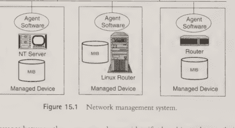

图 15.1 网络管理系统。

管理器与代理之间的 SNMP 消息使用管理信息库（MIB）来标识正在被管理的对象，当前使用最广泛的 MIB 是版本 2，也称为 MIB-II。它定义于 RFC 1213 中。


“用于基于 TCP/IP 的互联网网络管理的管理信息库：MIB-II。” MIB 是一种树状结构，用于标识网络节点正在使用的数据（统计信息、计数器、接口状态等）。图 15.2 展示了 MIB-II 的 MIB 树。

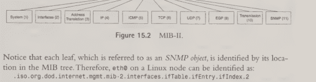

请注意，每个叶节点（称为 SNMP 对象）通过其在 MIB 树中的位置来标识。因此，Linux 节点上的 eth0 可以被标识为： .iso.org.dod.internet.mgmt.mib-2.interfaces.ifTable.ifEntry.ifIndex.2

eth0 也可以使用与刚才列出的对象 ID 等价的对象 ID 来标识。这里使用对象 ID 显示了树的一部分： .1.3.6.1.2.1.2.ifTable.ifEntry.ifIndex.2

当使用 MIB-II 时，大多数 SNMP 软件包只允许用户指定 MIB-II 树内的路径，因此： .iso.org.dod.internet.mgmt.mib-2.interfaces.eth0 也可以被标识为： interfaces.ifTable.ifEntry.ifIndex.2

## SNMP 通信

SNMP 定义了五种在管理器和代理之间进行通信的消息类型：get、get next、set、response 和 trap。

GET、GET NEXT 和 SET 命令均由管理器向代理发出。GET 命令用于轮询代理 MIB 结构中特定对象的特定值。GET NEXT 命令用于指示代理轮询 MIB 结构中的下一个值。SET 命令由管理器使用，用于告知代理将特定对象的值设置为管理器发送的值。

RESPONSE 消息是代理发出的通信消息，作为对 GET、GET NEXT 和 SET 命令的响应。

TRAP 消息是唯一由代理发起的 SNMP 消息，用于向管理器发送告警消息。例如，如果接口失去物理连接，代理通常会发送一条 TRAP 消息，其中带有相应的对象标识符（OID）。

下一节将介绍如何使用 Linux 命令行工具来使用这些命令。

## SNMP 认证

由于 SNMP 可用于监控和管理网络节点，因此需要某种安全手段来确保网络节点不容易受到攻击。

SNMP 定义了两种安全访问级别：public 和 private。public 级别授予对节点的只读访问权限，private 级别则授予对节点的完全控制权限（读和写）。不幸的是，这些级别的访问信息以明文形式传输。

## SNMP 安全

互联网工程任务组（IETF）确实试图通过协议第 2 版来提高 SNMP 的安全性，但成员们无法就安全需求达成一致，这导致了第 2 版产生了两个分支，部分安全需求留待后续创建：V2u 和 V2c。第 3 版工作组正试图通过标准跟踪规范来修复这一弱点（参见 http://www.ietf.org/html.charters/snmpv3-charter.html）。

## Linux 上的 SNMP

Linux 的 SNMP 以前由两个软件包支持：ucd-snmp 和 CMU SNMP 项目。尽管这两个软件包在互联网上仍然可用，但 Linux 的 SNMP 开发已转移到 NET-SNMP 软件包。

## NET-SNMP

可在 http://net-snmp.sourceforge.net/ 获取的 NET-SNMP 软件包就是早先称为 ucd-snmp 的 SNMP 软件包。当前发行版 4.2.1 仍然被称为 ucd-snmp 软件包，但未来的所有发行版都将使用新名称。NET-SNMP 软件包为 Linux 提供了 SNMP 代理、SNMP 库，以及用于发出 SNMP 命令和陷阱的 SNMP 命令行工具。

除了支持标准 MIB-II 之外，NET-SNMP 代理还直接支持监控磁盘使用情况，并提供支持以确保进程正在运行。当磁盘使用量变低或某个特定进程停止执行时，代理将向管理站发送陷阱。代理还可以利用脚本为陷阱功能增加更多能力。

下一节简要介绍 NET-SNMP 的安装。

## 安装

要安装 NET-SNMP 发行版，请从 http://net-snmp.sourceforge.net/ 的下载部分所指位置下载当前版本的软件包。在本书出版时，4.2.1 是当前版本。将下载的发行版放在 Linux 系统中用于保存源文件的适当位置。本示例使用 /usr/src/。

安装应以 root 用户身份执行。


解压 tarball 分发包：
[root@lefty src]# gunzip ucd-snmp-4.2.1.tar.gz

然后解包 tarball：
[root@lefty src]# tar xvf ucd-snmp-4.2.1.tar

现在进入解包分发包后创建的目录：
[root@lefty src]# cd ucd-snmp-4.2.1

至少，阅读 README 和 INSTALL 文件，了解安装程序是否有最后时刻的更改。FAQ 和 NEWS 文件也值得一看。

执行 configure 脚本，它将查询你的系统以获取各种设置——例如使用哪个 C 编译器，存在哪些库等等：
[root@lefty ucd-snmp-4.2.1]# ./configure

configure 脚本还会提示输入 SNMP 代理的联系人姓名。这是 Linux 节点在代理运行后一旦通过 SNMP 被查询时将返回的信息。

在提示联系人姓名后，configure 脚本将提示输入 Linux 节点的地理位置，然后是日志目录位置，可以自定义（或使用默认的 /var/log/snmpd.log）。

最后，configure 脚本将提示输入配置目录。/var/ucd 是默认位置。

此时 configure 脚本将创建 makefile，以便可以运行 make 命令：
[root@lefty ucd-snmp-4.2.1]# make

为确保权限设置正确，执行：
[root@lefty ucd-snmp-4.2.1]# umask 022

然后让 make 将分发包安装到适当的位置：
[root@lefty ucd-snmp-4.2.1]# make install

这将把分发包安装到 /usr/local/ 目录结构中。本章使用的是 RedHat 6.1 进行安装；然而，安装说明适用于大多数当前发行版。RedHat 的 root 账户在其路径中包含 /usr/local/bin/ 和 /usr/local/sbin/，因此如果你的发行版在路径中没有这些目录，有三种变通方法：

- 将 /usr/local/bin/ 和 /usr/local/sbin/ 添加到 root 账户。这可能并不理想，具体取决于这些目录中还有哪些其他程序以及该机器和目录内的安全性有多严格。
- 使用绝对路径名执行程序。对于某些高级功能，这可能需要额外的参数来告诉特定的 SNMP 程序在哪里找到特定的程序。
- 将 NET-SNMP 包安装在其自己的目录中并相应地设置路径。

退出 root 账户并重新登录。 （这将使 root 的 umask 设置恢复到原始设置。）然后再次以 root 身份登录。

如果需要 SNMPv3 支持，则需要安装 OpenSSL（http://www.openssl.org/），如果尚未安装的话。

NET-SNMP 代理作为守护进程运行，名称恰当地命名为 snmpd。snmpd 使用配置文件来确定社区访问字符串和 trap 设置，这是 snmp 代理所期望的。此外，snmpd 还允许高级配置设置，例如将特定社区字符串限制为特定对象标识，并将管理器查询限制为特定 IP 地址。

在启动 snmpd 之前，创建 snmpd 配置文件：/usr/local/share/snmp/snmpd.conf，内容如下：

```
#
# snmpd.conf
# example
#
# Access Control Setup
# rwcommunity: a SNMPv1/SNMPv2c read-write access community name
# arguments: community [default|hostname|network/bits] [oid]

rwcommunity fullaccess

# rocommunity: a SNMPv1/SNMPv2c read-only access community name
# arguments: community [default|hostname|network/bits] [oid]

rocommunity readaccess
```

这是一个简单直接的 snmpd.conf 文件，仅定义了社区字符串。NET-SNMP 使用字段名 rwcommunity 作为私有社区字符串，在此示例中定义为 fullaccess。

rocommunity 是公共只读社区字符串，在此示例中定义为 readaccess。

如果在未定义社区字符串的情况下启动 snmpd，那么任何人都可以通过 snmp 查询该机器，使其容易受到攻击。

现在可以启动 snmpd 了：
[root@lefty /root]# snmpd

假设一切顺利，守护进程应启动并开始监听请求。守护进程还将在日志文件中创建条目：
[root@lefty /root]# cat /var/log/snmpd.log
UCD-SNMP version 4.2.1

为了更深入地了解代理的工作原理，我们将查看随 NET-SNMP 提供的 snmp 工具。命令行工具不是典型管理器，而是提供管理器支持的特定消息的功能：GET、GET NEXT 和 SET。


## NET-SNMP 管理员命令

NET-SNMP 命令行工具是 snmpget、snmpgetnext 和 snmpset，分别对应 GET、GET NEXT 和 SET。这些命令对于网络故障排除、网络管理系统故障排除以及更好地理解 SNMP 非常有用。此外，还有 snmpwalk 命令，它使用 GET NEXT 消息检索特定对象标识下的所有变量。以下示例使用随软件包安装并在之前启动的 snmpd 守护进程配合 NET-SNMP 工具。

- snmpget agent communitystring object-id。snmpget 命令将使用指定的 community string 查询指定 agent 的特定 object-id。（对于早期版本的命令行工具用户，请注意格式 community, string@agent 已不再使用。）

要获取系统运行时间，可以使用 snmpget：

```
[root@lefty /root]# snmpget 192.168.1.254 readaccess system.sysUpTime.0
system.sysUpTime.0 = Timeticks: (76980) 0:12:49.80
```

snmpd agent 支持大部分完整的 MIB-II 标准，因此可以收集各种有用的信息以供后续分析或用于检查系统。

例如，icmp 分支跟踪 icmp 流量。因此，要确定主机接收了多少个 ping（使用 ICMP-echo），可以使用以下命令：

```
[root@lefty /root]# snmpget 192.168.1.254 readaccess icmp.icmpInEchos.0
icmp.icmpInEchos.0 = Counter32: 43
```

这表明系统已接收 43 个 ping 数据包。

虽然 snmpget 不能替代设计良好的网络管理系统，但它为现有网络管理系统增加了大量分析能力，同时也为监控系统活动的现有自动化工具增加了灵活性。

- snmpgetnext agent communitystring object-id。snmpgetnext 可用于获取 MIB 树中的下一个对象，如下所示：

```
[root@lefty /root]# snmpgetnext 192.168.1.254 readaccess icmp.icmpInEchos.0
icmp.icmpInEchoReps.0 = Counter32: 3
```

这返回系统接收到的 ICMP 回显响应数量。snmpgetnext 的功能仅限于下一项；而 snmpwalk 则更有用。

- snmpwalk agent communitystring object-id。snmpwalk 将使用 SNMP GET NEXT 命令，直到检索到当前对象标识符下的所有变量为止。这对于创建表或在不确定确切名称时查找特定对象标识符非常有用。例如，以下

snmpwalk 报告维护的所有 icmp 信息：

```
[root@lefty /root]# snmpwalk 192.168.1.254 readaccess icmp
icmp.icmpInMsgs.0 = Counter32: 12
icmp.icmpInErrors.0 = Counter32: 0
icmp.icmpInDestUnreachs.0 = Counter32: 6
icmp.icmpInTimeExcds.0 = Counter32: 0
icmp.icmpInParmProbs.0 = Counter32: 0
icmp.icmpInSrcQuenchs.0 = Counter32: 0
icmp.icmpInRedirects.0 = Counter32: 0
icmp.icmpInEchos.0 = Counter32: 3
icmp.icmpInEchoReps.0 = Counter32: 3
icmp.icmpInTimestamps.0 = Counter32: 0
icmp.icmpInTimestampReps.0 = Counter32: 0
icmp.icmpInAddrMasks.0 = Counter32: 0
icmp.icmpInAddrMaskReps.0 = Counter32: 0
icmp.icmpOutMsgs.0 = Counter32: 9
icmp.icmpOutErrors.0 = Counter32: 0
icmp.icmpOutDestUnreachs.0 = Counter32: 6
icmp.icmpOutTimeExcds.0 = Counter32: 0
icmp.icmpOutParmProbs.0 = Counter32: 0
icmp.icmpOutSrcQuenchs.0 = Counter32: 0
icmp.icmpOutRedirects.0 = Counter32: 0
icmp.icmpOutEchos.0 = Counter32: 0
icmp.icmpOutEchoReps.0 = Counter32: 3
icmp.icmpOutTimestamps.0 = Counter32: 0
icmp.icmpOutTimestampReps.0 = Counter32: 0
icmp.icmpOutAddrMasks.0 = Counter32: 0
icmp.icmpOutAddrMaskReps.0 = Counter32: 0
```

以下是显示构成 IP 路由表的所有数据的 snmpwalk：

```
[root@lefty /root]# snmpwalk 192.168.1.254 'readaccess ip.ipRouteTable'
ip.ipRouteTable.ipRouteEntry.ipRouteDest.0.0.0.0 = IpAddress: 0.0.0.0
ip.ipRouteTable.ipRouteEntry.ipRouteDest.127.0.0.0 = IpAddress: 127.0.0.0
ip.ipRouteTable.ipRouteEntry.ipRouteDest.192.168.1.0 = IpAddress: 192.168.1.0
ip.ipRouteTable.ipRouteEntry.ipRouteDest.192.168.1.254 = IpAddress: 192.168.1.254
ip.ipRouteTable.ipRouteEntry.ipRouteIfIndex.0.0.0.0 = 2
ip.ipRouteTable.ipRouteEntry.ipRouteIfIndex.127.0.0.0 = 3
ip.ipRouteTable.ipRouteEntry.ipRouteIfIndex.192.168.1.0 = 2
ip.ipRouteTable.ipRouteEntry.ipRouteIfIndex.192.168.1.254 = 2
ip.ipRouteTable.ipRouteEntry.ipRouteMetric.0.0.0.0 = 1
ip.ipRouteTable.ipRouteEntry.ipRouteMetric.127.0.0.0 = 0
ip.ipRouteTable.ipRouteEntry.ipRouteMetric.192.168.1.0 = 0
ip.ipRouteTable.ipRouteEntry.ipRouteMetric.192.168.1.254 = 0
ip.ipRouteTable.ipRouteEntry.ipRouteNextHop.0.0.0.0 = IpAddress: 192.168.1.1
ip.ipRouteTable.ipRouteEntry.ipRouteNextHop.127.0.0.0 = IpAddress: 0.0.0.0
ip.ipRouteTable.ipRouteEntry.ipRouteNextHop.192.168.1.0 = IpAddress: 0.0.0.0
ip.ipRouteTable.ipRouteEntry.ipRouteNextHop.192.168.1.254 = IpAddress: 0.0.0.0
ip.ipRouteTable.ipRouteEntry.ipRouteType.0.0.0.0 = indirect(4)
ip.ipRouteTable.ipRouteEntry.ipRouteType.127.0.0.0 = direct(3)
ip.ipRouteTable.ipRouteEntry.ipRouteType.192.168.1.0 = direct(3)
ip.ipRouteTable.ipRouteEntry.ipRouteType.192.168.1.254 = direct(3)
ip.ipRouteTable.ipRouteEntry.ipRouteProto.0.0.0.0 = local(2)
ip.ipRouteTable.ipRouteEntry.ipRouteProto.127.0.0.0 = local(2)
ip.ipRouteTable.ipRouteEntry.ipRouteProto.192.168.1.0 = local(2)
ip.ipRouteTable.ipRouteEntry.ipRouteProto.192.168.1.254 = local(2)
```


ip.ipRouteTable.ipRouteEntry.ipRouteMask.0.0.0.0 = IPAddress: 0.0.0.0
ip.ipRouteTable.ipRouteEntry.ipRouteMask.127.0.0.0 = IPAddress: 255.0.0.0
ip.ipRouteTable.ipRouteEntry.ipRouteMask.192.168.1.0 = IPAddress: 255.255.255.0
ip.ipRouteTable.ipRouteEntry.ipRouteMask.192.168.1.254 = IPAddress: 255.255.255.255

ip.ipRouteTable.ipRouteEntry.ipRouteInfo.0.0.0.0 = OID: .ccitt.zeroDotZero
ip.ipRouteTable.ipRouteEntry.ipRouteInfo.127.0.0.0 = OID: .ccitt.zeroDotZero
ip.ipRouteTable.ipRouteEntry.ipRouteInfo.192.168.1.0 = OID: .ccitt.zeroDotZero
ip.ipRouteTable.ipRouteEntry.ipRouteInfo.192.168.1.254 = OID: .ccitt.zeroDotZero
[root@lefty /root]# snmpwalk 192.168.1.254 readaccess ip.ipRouteTable
ip.ipRouteTable.ipRouteEntry.ipRouteDest.0.0.0.0 = IPAddress: 0.0.0.0
ip.ipRouteTable.ipRouteEntry.ipRouteDest.127.0.0.0 = IPAddress: 127.0.0.0
ip.ipRouteTable.ipRouteEntry.ipRouteDest.192.168.1.0 = IPAddress: 192.168.1.0
ip.ipRouteTable.ipRouteEntry.ipRouteDest.192.168.1.254 = IPAddress: 192.168.1.254
ip.ipRouteTable.ipRouteEntry.ipRouteIfIndex.0.0.0.0 = 2
ip.ipRouteTable.ipRouteEntry.ipRouteIfIndex.127.0.0.0 = 3
ip.ipRouteTable.ipRouteEntry.ipRouteIfIndex.192.168.1.0 = 2
ip.ipRouteTable.ipRouteEntry.ipRouteIfIndex.192.168.1.254 = 2
ip.ipRouteTable.ipRouteEntry.ipRouteMetric1.0.0.0.0 = 1
ip.ipRouteTable.ipRouteEntry.ipRouteMetric1.127.0.0.0 = 0
ip.ipRouteTable.ipRouteEntry.ipRouteMetric1.192.168.1.0 = 0
ip.ipRouteTable.ipRouteEntry.ipRouteMetric1.192.168.1.254 = 0
ip.ipRouteTable.ipRouteEntry.ipRouteNextHop.0.0.0.0 = IPAddress: 192.168.1.1
ip.ipRouteTable.ipRouteEntry.ipRouteNextHop.127.0.0.0 = IPAddress: 0.0.0.0
ip.ipRouteTable.ipRouteEntry.ipRouteNextHop.192.168.1.0 = IPAddress: 0.0.0.0
ip.ipRouteTable.ipRouteEntry.ipRouteNextHop.192.168.1.254 = IPAddress: 0.0.0.0
ip.ipRouteTable.ipRouteEntry.ipRouteType.0.0.0.0 = indirect(4)
ip.ipRouteTable.ipRouteEntry.ipRouteType.127.0.0.0 = direct(3)
ip.ipRouteTable.ipRouteEntry.ipRouteType.192.168.1.0 = direct(3)
ip.ipRouteTable.ipRouteEntry.ipRouteType.192.168.1.254 = direct(3)
ip.ipRouteTable.ipRouteEntry.ipRouteProto.0.0.0.0 = local(2)
ip.ipRouteTable.ipRouteEntry.ipRouteProto.127.0.0.0 = local(2)
ip.ipRouteTable.ipRouteEntry.ipRouteProto.192.168.1.0 = local(2)
ip.ipRouteTable.ipRouteEntry.ipRouteProto.192.168.1.254 = local(2)
ip.ipRouteTable.ipRouteEntry.ipRouteMask.0.0.0.0 = IPAddress: 0.0.0.0
ip.ipRouteTable.ipRouteEntry.ipRouteMask.127.0.0.0 = IPAddress: 255.0.0.0
ip.ipRouteTable.ipRouteEntry.ipRouteMask.192.168.1.0 = IPAddress: 255.255.255.0
ip.ipRouteTable.ipRouteEntry.ipRouteMask.192.168.1.254 = IPAddress: 255.255.255.255

ip.ipRouteTable.ipRouteEntry.ipRouteInfo.0.0.0.0 = OID: .ccitt.zeroDotZero
ip.ipRouteTable.ipRouteEntry.ipRouteInfo.127.0.0.0 = OID: .ccitt.zeroDotZero
ip.ipRouteTable.ipRouteEntry.ipRouteInfo.192.168.1.0 = OID: .ccitt.zeroDotZero
ip.ipRouteTable.ipRouteEntry.ipRouteInfo.192.168.1.254 = OID: .ccitt.zeroDotZero

snmp set private community string object-id type value. The snmp set uses the SNMP SET message to set objects values to a particular value. For example, to change the system contact, the following snmpset command can be used:
[root@lefty apps]# snmpset 192.168.1.254 fullaccess system.sysContact.0 s root@testme.net

In the preceding example, the s is the type of value being assigned, which must match the type supported by the object. The s stands for "string." The types supported by the snmpset command are listed in Table 15.1.

## Table 15.1 snmpset Type Abbreviations and Meanings

| Type Abbreviation | Meaning |
|---|---|
| a | IP Address in xxx.xxx.xxx.xxx format |
| b | Bits |
| d | Decimal |
| i | Integer |
| n | Null Object |
| o | Object Identifier |
| s | String |
| t | Time Ticks |
| u | Unsigned |
| x | Hexadecimal |

The snmpset command requires "private" access to the SNMP agent because actual configuration is being changed. Although a change has been accepted by an SNMP agent, the change may not be saved across a reboot. For example, the NET-SNMP package, like many Unix SNMP packages, has very little support for making permanent changes via SNMP. The previous example showing the change of system contact will be lost during the next restart of snmpd or a system reboot. Router and other network elements' support of SNMP support varies, so a thorough investigation and testing on a nonproduction system is highly recommended.

## Multi-Router Traffic Grapher (MRTG)

MRTG is likely the most popular open source network analysis tool. MRTG uses SNMP get commands to query a router's interfaces traffic statistics. The results of the get command are then recorded, and the traffic statistics are used to graph the network statistics, which will show trends such as high and low utilization periods, averages, and changes in network patterns.

Specifically, MRTG measures the number of packets sent in and out of an interface, the average number of in and out packets, and the current in and out packets.

MRTG is available for most versions of Unix including Linux. (There is also a Windows version.) MRTG is available at http://www.mrtg.org/, which is a pointer to the original MRTG site at http://people.ee.ethz.ch/~oetiker/webtools/mrtg/. MRTG makes use of the NET-SNMP package covered in the previous section, so NET-SNMP should be installed and configured before installing MRTG.


MRTG 的部分是用 Perl 编写的，因此系统上也必须安装 Perl。建议使用 5.05 或更高版本。MRTG 正常运行还需要几个图形库，但它们的安装超出了本章的范围。请参考 doc/unix-guide.txt 文档（稍后会提到的 MRTG 源代码目录中）以了解确切要求。

## MRTG 安装

MRTG 应从 http://people.ee.ethz.ch/~oetiker/webtools/mrtg/pub/ 下载并放置在适当的目录中。在此示例中，使用 /usr/src。出版时 MRTG 的当前版本为 2.9.12，此处使用该版本。

下载 MRTG 包后，按以下步骤操作。

- 1. 以 root 身份登录并进入下载包的目录：
  `[root@lefty /root]# cd /usr/src`

- 2. 解压发行版：
  `[root@lefty src]# gunzip mrtg-2.9.12.tar.gz`

- 4. 解包 tarball：
  `tar xvf mrtg-2.9.12.tar`

- 5. 这将创建 MRTG 源代码树。进入源代码树：
  `[root@lefty src]# cd mrtg-2.9.12`

- 6. 执行 configure 脚本：
  `[root@lefty mrtg-2.9.12]# ./configure`

- 7. 执行 make 命令：
  `[root@lefty mrtg-2.9.12]# make`

- 8. 最后，执行 make install：
  `[root@lefty mrtg-2.9.12]# make install`

这将创建安装目录结构 /usr/local/mrtg-2/，并将所有二进制文件和适当的文件移动到该目录中。进入目录结构：
`[root@lefty mrtg-2.9.12]# cd /usr/local/mrtg-2/`

MRTG 需要一个可被 Web 服务器访问的目录。Linux 上 Apache Web 服务器的 HTML 文档常见目录位置为 /home/httpd/html/，因此 MRTG 文件可以放置在子目录中：
`[root@lefty mrtg-2]# mkdir /home/httpd/html/mrtg`

请确保根据 Web 服务器的配置使用适当的目录。还应为 MRTG 创建一个配置目录：
`[root@lefty mrtg-2]# mkdir cfg`

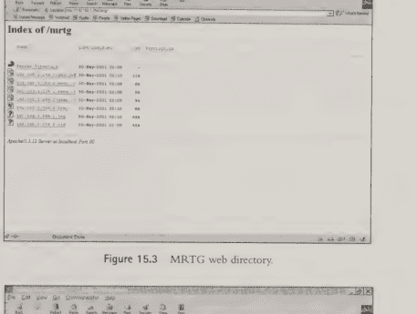

图 15.3 MRTG Web 目录。


图 15.4 MRTG 接口统计。

现在系统必须配置为定期运行 mrtg。使用 crontab 的 -e 选项使 mrtg 每五分钟运行一次：

```
[root@lefty mrtg-2]# crontab -e
```

并添加以下条目：

```
0,5,10,15,20,25,30,35,40,45,50,55 * * * * /usr/local/mrtg-2/bin/mrtg
/usr/local/mrtg-2/cfg/mrtg.cfg
```

可以使用以下命令将额外的路由器和节点添加到 mrtg.cfg 中：

```
[root@lefty mrtg-2]# bin/cfgmaker --global 'WorkDir: /home/http/html/mrtg' readaccess@192.168.1.254 >>/usr/local/mrtg-2/cfg/mrtg.cfg
```

如前所述，数据仍处于某种原始格式。MRTG 包含一个名为 indexmaker 的工具，可创建指向所有被监控节点的索引页面。要为此示例创建索引，使用以下命令：

```
[root@lefty mrtg-2]# bin/indexmaker /usr/local/mrtg-2/cfg/mrtg.cfg
> /home/http/html/mrtg/index.html
```

## index.html 文件的权限和所有权问题

index.html 文件的权限和所有权可能需要手动设置，以便 Web 服务器进程的所有者可以读取该文件。

这将创建 index.html，其中包含指向所有节点 via 图形摘要的 URL——如图 15.5 所示。


图 15.5 带有索引页面的 MRTG。

使用 cfgmaker 添加新节点后，请确保再次运行 indexmaker。MRTG 配置好要监控的节点并有足够时间收集统计信息后，索引页面将类似于图 15.6。


## IPTraf

IPTraf 是一种网络监控工具，侧重于实时监控网络流量。与 tcpdump 等嗅探器不同，IPTraf 报告的是 Linux 网络驱动程序所看到的流量的统计信息。与嗅探器一样，IPTraf 需要将接口置于混杂模式；因此，程序应以 root 用户身份运行。

IPTraf 的安装非常简单直接，包括解压、解包和运行设置脚本，因此此处不予介绍。

IPTraf 安装到 /usr/local/bin/ 目录，因此如果 /usr/local/bin/ 不在你的路径中，则需要执行完整文件名 /usr/local/bin/iptraf 来启动程序。


## 使用 IPTraf

IPTraf 是菜单驱动的；因此，它几乎立即对大多数网络管理员证明了其价值。图 15.7 显示了 IPTraf 的主菜单。可以使用光标键在窗口中导航，或者每个菜单也有一个与其关联的快捷键（高亮显示）。

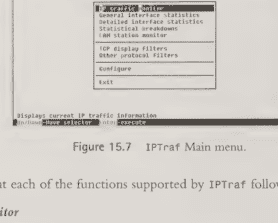

图 15.7 IPTraf 主菜单。

下面将更详细地介绍 IPTraf 支持的每个功能。

## IP 流量监视器

IP 流量监视器允许监视特定接口或 Linux 内核识别的所有接口上的 IP 流量。图 15.8 显示了 IP 流量监视器的示例。


图 15.8 IP 流量监视器屏幕。

IP 流量监视器的顶部部分报告 TCP 连接。图 15.8 显示了 192.168.1.254 与 192.168.1.101 之间端口 23 的 telnet 连接。IPTraf 输出还显示站点 192.168.1.254 已通过 TCP 连接发送了 372 个数据包，而 192.168.1.101 已发送 366 个。

标志列报告最后一个 TCP 数据包中标志的设置方式，如 RFC 793《传输控制 Darpa Internet Program Protocol Specification》中所定义。表 15.2 总结了 TCP 标志。

| Table 15.2 IP Traffic Monitor TCP Flags |
|---|---|---|
| IP Traffic Monitor Abbreviation | TCP Abbreviation | Meaning |
| A | ACK | Acknowledgment |
| P | PSH | Push all data to queue |
| U | URG | Packet is marked urgent |
| S | SYN | Synchronization during handshaking. |

IPTraf 还会使用 RST 报告重置，使用 DONE 报告未确认的 FIN，并使用 CLOSED 报告正常关闭的连接。每个连接的数据包和窗口大小也可以通过按 m（more）键查看。

IP 流量监视器中的底部窗口显示最近的非 TCP 流量。在图 15.8 中，这是 ICMP-echo 请求（pings）和地址解析协议（ARP）请求。

屏幕底部包含两行。第一行是 IP、TCP、UDP、ICMP 和非 IP 流量的数据包计数的实时视图。

第二行是 IP 流量监视器的菜单。上下箭头可让您在信息超过一屏时滚动浏览。w 键在顶部的 TCP 窗口和底部的其他所有流量窗口之间切换。

如前所述，m 键将报告 TCP 连接的数据包和窗口大小。

s 键允许按数据包或字节数对 TCP 连接进行排序，这将导致相同的排序；但是该命令很有用，因为 IP 流量监视器不会实时排序。使用排序命令，流量最多的连接将“浮动”到列表顶部。

x 键用于返回到 IPTraf 的主窗口。

## 通用接口统计

通用接口统计屏幕提供了所有接口流量的简单细分，如图 15.9 所示。计数器包括 IP 数据包、非 IP（如 IPX）和不良 IP，即可以通过 IP 头识别的数据包，但头中某些内容不符合 IP 协议。

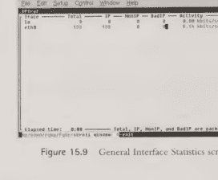

图 15.9 通用接口统计屏幕。

## 特定接口统计

特定接口统计允许管理员检查与特定配置接口相关的 IP 统计信息。图 15.10 显示了 eth0 的统计信息。

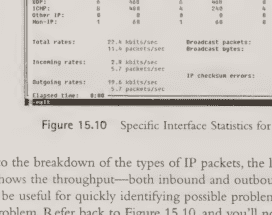

图 15.10 eth0 的特定接口统计。

除了 IP 数据包类型的细分外，屏幕的下半部分还显示了吞吐量——入站和出站。特定接口统计对于在排除网络问题时快速识别可能的问题非常有用。参考图 15.10，您会注意到与数据包总数相比，ICMP 数据包的数量非常高。这是 ping 洪水造成的。

## 统计细分

统计细分屏幕报告按两个标准接收的数据包数量，即特定接口上的数据包大小或特定接口的 TCP/UDP 端口。按数据包大小的统计细分显示在图 15.11 中，按 TCP/UDP 端口显示在图 15.12 中。

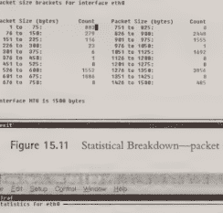

图 15.11 统计细分—数据包大小。

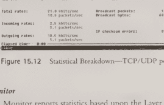

图 15.12 统计细分—TCP/UDP 端口。

## LAN 站点监视器

LAN 站点监视器根据第 2 层地址，或以以太网为例的 MAC 地址报告统计信息。它的用途有限，但可以与其他工具（如嗅探器）结合使用以定位第 2 层相关问题。LAN 站点监视器显示在图 15.13 中。


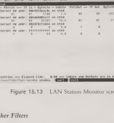

## TCP 过滤器和其他过滤器

在检查统计信息时，通常需要只检查特定流量。TCP 过滤器和其它过滤器菜单允许您定义应显示或不应显示的流量。TCP 过滤器仅适用于 TCP 流量。如果需要过滤其他类型的流量，则应选择“其他过滤器”选项。

创建过滤器非常简单——只需几个必要的步骤。

选择 TCP 过滤器后，选择“定义新过滤器”，这将提示输入过滤器的描述，如图 15.14 所示。将“Telnet Traffic Only”输入到描述中。

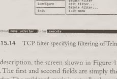

输入描述后，将显示如图 15.15 所示的屏幕，提示输入 IP 地址和端口。第一个和第二个字段只是源地址和目的地址的顺序可以互换。通配符掩码实际上是网络掩码，它将决定范围内包含多少个地址。

由于我们仅过滤 telnet，因此在地址和通配符字段中输入 0.0.0.0。Telnet 的端口号 23 输入到“端口号”字段中。请务必使用 Tab 键在字段之间移动——Enter 键将创建该条目。

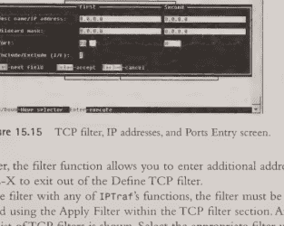

图 15.15 TCP 过滤器、IP地址和端口输入屏幕。

按下 Enter 后，过滤器功能允许您输入额外的地址和端口。按 CTRL-X 退出“定义 TCP 过滤器”。

在使用过滤器与 IPTraf 的任何功能之前，必须先应用该过滤器。过滤器通过 TCP 过滤器部分中的“应用过滤器”来应用。选择“应用过滤器”后，将显示 TCP 过滤器列表。使用光标键选择适当的过滤器并在正确条目上按下 Return。退出 TCP 过滤器部分，然后选择应与过滤器一起使用的适当 IPTraf 功能。图 15.16 显示了过滤器与 IP 流量监视器一起使用。

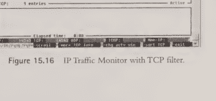

图 15.16 带 TCP 过滤器的 IP 流量监视器。

如果所检查的协议不是 TCP，则应在主菜单中选择“其他过滤器”项目。其他过滤器的创建方式与 TCP 类似，并遵循相同的地址和端口使用准则。

除了涵盖网络资源的监控和分析外，我们还需要更进一步，解决服务质量问题。下一节将讨论这一主题。

## 服务质量 QoS

数据网络中的带宽虽然是有限资源，但通常以尽力而为的方式设计和使用：任何重传在最佳情况下由应用程序处理，或在 TCP 的情况下由协议本身处理。然而，互联网的商业化和需要近实时网络支持的应用推动了对优于尽力而为的带宽保证的需求。

例如，许多组织要求传入的 Web 请求优先于大多数其他流量——访问网站的潜在客户不应因可以等待而不影响应用的电子邮件而导致与 Web 服务器的连接“缓慢”。

另一个需要优于尽力而为路由的应用是语音应用。语音技术和整个融合市场对 IP 技术支持改进的 QoS 提出了额外压力。

用于对 IP 流量应用策略的四种常见方法为：源和/或目的地址、源或目的端口、IP 地址中的服务位，以及三种方法的混合。当使用 IP 地址中的位时，如果使用 RFC 791 中描述的方法，或 RFC 1349 中修改原始 RFC 791 规范的方法，则这些位称为服务类型位。如果使用差异化服务工作组描述的方法使用这些位 http://www.ietf.org/html.charters/diffserv-charter.html，则这些位称为 DS 位。

如果使用 IP 地址、UDP 或 TCP 端口，则流量监管称为服务等级。一些 QoS 监管实现还允许基于接口的策略，这也属于服务等级。

## 服务类型：RFC 791 和 795

IP 提供流量的原始方法是 IP 头中的 IP 服务类型 TOS 字段，该字段在 RFC 791《Internet Protocol Darpa Internet Program Protocol Specification》和 RFC 795《Service Mappings》中有所说明。

TOS 字段为 8 位，由定义优先级的三位、延迟一位、吞吐量一位和可靠性一位组成。剩余的两位保留供将来使用，设为零。


## TOS 在 Linux 中的支持

Linux 支持使用过滤在所有三种数据包过滤方法下设置 TOS 位：ipfwadm、ipchains 和 netfilter。

此外，Linux 还可以在请求的一种服务类型不应被转发时使用适当的 ICMP 错误消息——针对指定 IP 服务类型的网络不可达，以及针对指定 IP 服务类型的目标主机不可达。然而，其使用可能最好仅限于同一自治系统内，因为许多网络会过滤掉许多 ICMP 消息类型。（某些组织专门过滤 ICMP。）

## 设置 TOS 位的示例

在 Linux 上实现 TOS 的复杂程度取决于核心网络所需的网络设计和工程，这会因支持的系统和复杂程度而异。安装了支持配置 TOS 的软件包（如 ipfwadm、ipchains 或 netfilter）后，配置 Linux 在经过 Linux 路由器的包上设置 TOS 非常简单。

### 使用 ipchains 的示例

在 QoS 部分开头提到了对 Web 流量给予优先权，因此以下是使用 ipchains 为 Web 流量设置 IP TOS 的示例：

```
/sbin/ipchains -A output -p tcp -d 0/0 80 -j 0x10
```

表 15.3 列出了基于 RFC 1349《Internet 协议套件中的服务类型》（第 4 段）的各种值和服务类型。Linux 实现还包括在分配给 TOS 的四位之后必须为零的位，总共五位。这可能是 Linux 管理员在将支持 TOS 的 Linux 路由器集成到现有网络时遇到的最常见错误和故障排除任务之一。

作为另一个示例，另一方面 ftp 可能更需要强调可靠性，因此以下 ipchains 命令更适合 ftp。

```
/sbin/ipchains -A output -p tcp -d 0/0 21 -j 0x04
```

在表 15.3 中，各种服务的助记符也已定义。可以使用助记符代替十六进制。例如，此 ipchains 命令与前一个命令的解释相同。

```
/sbin/ipchains -A output -p tcp -d 0/0 21 -j Maximize-Reliability
```

## 表 15.3 RFC 1349 TOS 设置

| Mnemonic | Hex Value | Binary Value from RFC 1349 | Binary Plus Must Be Zero Bit | Decimal |
|---|---|---|---|---|
| Normal-Service | 0x00 | 0000 | 00000 | 0 |
| Minimize-Cost | 0x02 | 0001 | 00010 | 2 |
| Maximize-Reliability | 0x04 | 0010 | 00100 | 4 |
| Maximize-Throughput | 0x08 | 0100 | 01000 | 8 |
| Minimize-Delay | 0x10 | 1000 | 10000 | 16 |

ipchains 还可以检查 TOS 位以确定数据包过滤器应将 TOS 位映射为什么。用于匹配此项的参数是 -m 参数：

```
/sbin/ipchains -A output -p tcp -d 0/0 21 -m 0x02 -j Maximize-Reliability
/sbin/ipchains -A output -p tcp -d 0/0 21 -m 0x02 -j Maximize-Reliability
```

如果 ftp 会话连接到 Linux 节点并且 TOS 位设置为 0000 或 0001（请记住 0001 + 0 二进制必须为零位。），TOS 将更改为 0x04。如果 TOS 位具有 0x08 或 0x10 值，则这些规则不会对数据包进行任何更改。

## DIFFSERV

如前所述，DIFFSERV 是 IETF 当前为改善 IP 网络服务质量而进行的努力之一——通过为 TOS 位的解释添加新定义。DIFFSERV 的基础工作已添加到 2.4 内核中，但有效使用 DIFFSERV 的应用程序仍在开发中，文档也非常稀少。然而，DIFFSERV 的进一步开发很可能进行，（请查看 http://diffserv.sourceforge.net/），因此 Linux DIFFSERV 可能是了解新发展的最佳场所，以及订阅涵盖 Linux DIFFSERV 实现的邮件列表。

当然 Linux 可以作为 DIFFSERV 域的边缘设备并根据 DIFFSERV 接入路由器期望看到的位设置 TOS 位，它将其解释为 DS 位。


## 总结

本章涵盖了两个非常重要的主题：网络分析和服务质量。首先介绍了几个网络分析工具（NET-SNMP、MRTG 和 IPTraf），这些工具在网络支持和分析中应发挥非常重要的作用。

网络分析可以透视网络内部，帮助确定网络当前的表现以及未来可能的表现。提供 QoS 目前是网络中最具挑战性的方面之一，需要同时进行分析并理解这里所介绍的 QoS 概念。

# III
附录

- **A** Linux 路由资源
- **B** Linux 硬件路由解决方案

## Linux 路由资源

本附录为 Linux 管理员提供了许多路由资源的指引。虽然我们特别小心地选择了大多稳定的链接，但请记住 URL 是临时性的。

### Linux 路由守护进程

我们在本书中讨论了许多路由守护进程，还有一些因篇幅原因未能涵盖。表 A.1 列出了我们能够为 Linux 用户整理的最完整的多协议路由守护进程列表，按主页排列。此表的图例如下：

- y. 该功能在此程序的至少一个版本中得到支持。
- n. 该功能在此程序的任何版本中都不受支持。
- p. 该功能可能尚未实现，也可能已经实现，但目前仍在开发中。

与往常一样，这里的重点专门针对互联网协议（IP）。

### 表 A.1 多协议 Linux 路由守护进程及其功能定位

| 名称 | 主页 | 单播 | 多播 | IPv4 | IPv6 |
|---|---|---|---|---|---|
| bird | http://bird.network.cz/ | y | n | y | y |
| gated | http://www.gated.org/ | y | y | y | y |
| mrdt | http://www.mrdt.net/ | y | y | y | y |
| zebra | http://www.zebra.org/ | y | p | y | y |

表 A.2 包含了我们能够整理的最完整的单协议 Linux 路由守护进程列表。

### 表 A.2 单协议 Linux 路由守护进程及其功能定位

| 名称 | 主页 | 协议 |
|---|---|---|
| mrouted | ftp://parcftp.xerox.com/pub/net-research/ipmulti/ | DVMRP |
| pim6d | ftp://catarina.usc.edu/pub/pim/pimd/ | PIM-SM |
| pim6d-dense | http://antc.uoregon.edu/PIMDM/pimd-dense.html | PIM-DM |
| routed | 随所有主流 Linux 发行版提供。 | RIP-2 |

### Linux 路由和流量管理工具

网络管理员似乎总是知道又多一个统计数据，用以帮助确定网络连接的成本和使用效率数据、数据安全性等。Linux 世界有大量的网络工具。具体来说，本节重点介绍与路由结合使用的工具。

表 A.3 包含我们认为在您尽可能高效地实现工作自动化过程中可能会有用的程序列表。

### 表 A.3 与路由结合使用的 Linux 工具

| 名称 | 主页 | 描述 |
|---|---|---|
| CIPE | http://sites.inka.de/sites/bigred/devel/cipe.html | 加密 IP 封装（CIPE）项目正在致力于开发能够加密 IP 数据包以传输到特定目的地的路由器。 |
| Edge Fireplug | http://edge.fireplug.net/ | 专用 Linux 发行版，可将机器基本上转变为网络路由和防火墙设备。 |
| heartbeat | http://www.linux-ha.org/download/ | 监控工具，用于根据可用性动态切换网络信息。 |
| IPTraf | http://cebu.mozcom.com/riker/iptraf/index.html | IP 流量监控和统计信息生成器。 |
| lcrzoex | http://www.laurentconstantin.com/us/lcrzo/lcrzoex/ | 网络测试工具包。 |
| Linux Router Project | http://www.linuxrouter.org/ | 一个适合放在单张软盘上的 Linux 微发行版，启动并配置后可将机器变成路由器。 |
| MRTG | http://people.ee.ethz.ch/~oetiker/webtools/mrtg/ | 多路由器流量图形器（MRTG）可实时累积和分析数据，以向您展示网络性能数据。 |
| VisualRoute | http://www.visualware.com/visualroute/index.html | 图形化增强的 traceroute 实用工具。 |

### 相关资源

路由只是 TCP/IP 网络难题中的一块。还有许多其他方面您可能并不完全熟悉。表 A.4 列出了其中许多网络问题和难点的资源指引。

### 表 A.4 TCP/IP 网络问题资源
| 名称 | 主页 | 描述 |
|---|---|---|
| IETF Home | http://www.ietf.org/ | 互联网工程任务组（IETF）的所有工作组及其正在最终确定的协议的存储库。 |
| RFC Repository | http://www.faqs.org/rfcs | 可搜索的“请求评论（RFC）”存储库。 |
| Stardust | http://www.stardust.com/ | Stardust.com 提供了一系列与路由相关技术的频道，例如多播、服务质量、无线和 IPv6。 |
| Types of DSL | http://www.efficient.com/tic/dslt ypes.html | Efficient Networks 对现存的各类数字用户线路（DSL）的详细分类。 |
| USAGI Project | http://www.linux-ipv6.org/ | Linux IPv6 开发新闻和工具。 |


# 官方参考文档

本书各处列出了许多参考文档，还有许多在章节中未提及但对处理 Linux 路由和复杂网络的人有用的文档。表 A.5 包含了你在研究中可能会用到的 RFC 和 Internet 草案的列表。

表 A.5 你可能会觉得有用的官方文档

| 文档定义 | 位置 |
|---|---|
| 分配的网络号码 | http://www.landfield.com/rfcs/rfc778.html |
| 边境网关协议 (BGP) | http://www.faqs.org/rfcs/rfc1105.html |
| 边境网关协议 4 (BGP-4) | http://www.faqs.org/rfcs/rfc1771.html |
| 距离矢量多播路由协议 (DVMRP) | http://search.ietf.org/internet-drafts/draft-ietf-idmr-dvmrp-v3.10.txt |
| 外部网关协议 (EGP) | http://www.faqs.org/rfcs/rfc904.html |
| 互联网协议 (IP) 版本 4 | http://www.faqs.org/rfcs/rfc760.html |
| 互联网协议 (IP) 版本 6 | http://www.faqs.org/rfcs/rfc2373.html |
| 开放最短路径优先版本 2 (OSPF-2) | http://www.faqs.org/rfcs/rfc1247.html |
| 协议无关多播稀疏模式 (PIM-SM) | http://www.faqs.org/rfcs/rfc2362.html |
| 路由信息协议 (RIP) | http://www.faqs.org/rfcs/rfc1058.html |
| RIP 版本 2 (RIP-2) | http://www.faqs.org/rfcs/rfc1723.html |
| 简单网络管理 | http://www.faqs.org/rfcs/rfc1157.html |
| 传输控制协议 (TCP) | http://www.faqs.org/rfcs/rfc761.html |

这里给出的许多位置并不是查看文档的唯一地方。尤其是 RFC，它们在整个互联网的许多地方都有存储。


# B

# Linux 硬件路由解决方案

并非每个人都有时间实现自定义路由解决方案——你也不应该被迫这样做。本附录专门介绍商业 Linux 路由解决方案。当然，市场上有很多不运行在 Linux 上的产品，但我们假设如果你买了这本书，你希望首先专门了解企鹅的实力。我们提供了一份独立 Linux 路由解决方案的列表，随后是一份可用于实现路由的卡片列表。

收录在本章中并不代表作者或 New Riders Publishing 的认可。

# 独立 Linux 路由器

与其评论可能来去匆匆的产品线，我们在这里构建了一组指向目前提供 Linux 路由器一体机的公司的指针。你可能会注意到，并非所有这些公司都在北美。Linux 是一个美妙的跨大陆现象；请注意，我们可能遗漏了一些公司，因为它们的网站不是我们能读懂或至少浏览的语言。

这些公司提供基于 Linux 或与 Linux 兼容的路由硬件：

- http://www.rocksolidbox.de/
- http://www.cyclades.com/
- http://www.imagestream-is.com/
- http://www.wholelinux.com/
- http://www.datapro.net/
- http://www.digi.com/
- http://www.equinox.com/
- http://www.stallion.com/
- http://www.eicon.com/
- http://www.emacinc.com/

# 与 Linux 配合使用的路由卡

另一个感兴趣的领域是可以插入 Linux 主机以提供 WAN 接口并在某些情况下提供路由处理的卡片。如果你必须拥有一台具有多项功能的服务器，这是一种减轻负载的方法。路由卡可以承担自己的工作负载，让主主板处理防火墙以及该主机处理的任何其他任务。

提供与 Linux 配合使用的路由卡的厂商有：

- http://www.sangoma.com/
- http://www.cyclades.com/
- http://www.eicon.com/
- http://www.stallion.com/
- http://www.LanMedia.com/
- http://www.gcom.com/
- http://www.imagestream-is.com/
- http://www.stinc.com/

# 索引

# 符号

2.0.x 系列 Linux 内核，升级，249

2.2.x 系列 Linux 内核 版本比较，249，265 单播路由守护进程，89

2.4.x 系列 Linux 内核 ATM 支持，167 构建路由内核，选择版本，249 从 2.2.x 系列的变化，165-167 版本比较，249，265 USB、WAN 和无线局域网的接口支持，168 关于网络拥塞的通知，167 从 2.2.x 系列升级，250

# A

活动网关，routed 守护进程，91-92

自适应串行线路 IP arp 命令，185 ifconfig 命令，175

业余 NET/ROM arp 命令，185 ifconfig 命令，175

业余 ROSE arp 命令，185 ifconfig 命令，175

业余 X.25 arp 命令，185 ifconfig 命令，175

业余 [无线电] X.25，由 Linux/ifconfig 命令支持，177

模拟通信 远程访问服务器，233 RADIUS 服务器，234 信号，227-228 bps 速度，228-229 终端服务器，232-233

分析网络。参见网络分析

任播地址，IPv6，80


AS（自治系统）
使用边界路由协议连接到其他 AS 或 Internet，55
DVMP
RPM 算法，42-43
TRPB 算法，40
OSPF，26-27，31-34
主干网，35

Ascend RADIUS 版本 970224，234

Ash
arp 命令，185
ifconfig 命令，175

分配的网络号码，304

非对称数字用户线路（ADSL），236-237

异步数字用户线路（ADSL），OSPF，22-23

AT 命令集，231

AT&T/Lucent Wave LAN，2.4.x 系列 Linux 内核支持，168

ATM（异步传输模式）
2.4.x 系列 Linux 内核支持，167
具有 LAN 的边缘路由器，207

AUI 连接器，
ifconfig 命令/Linux 支持，179

认证
OSPF，31
PPP 认证阶段，152
SNMP，276

自治系统（AS）
使用边界路由协议连接到其他 AS 或 Internet，55
DVMP
RPM 算法，42-43
TRPB 算法，40
OSPF，26-27，31-34
主干网，35

# B

主干网，AS（自治系统），35

后台任务，gated 守护进程，94

按需带宽，PPP 支持，155

基本速率接口（BRI），ISDN，239-240

Bellman-Ford 算法，9-11
应用于示例网络，12-15
类似于反向路径多播算法，39

Beowulf Linux 发行版，254

BGMP（边界网关多播协议）
基础，61-62
Linux 程序/守护进程，62

BGP（边界网关协议）
gated 守护进程，116-121
路由导出，131-133
路由导入，128-129
多归属，215-216
官方文档，304

BGP 标识符，59

BGP-4（边界网关协议），版本 4
基础，58-61
Linux 程序/守护进程，61
官方文档，304

二进制格式，IPv4 地址，66-67

bird 守护进程，137，302

位掩码，IPv4（CIDR）地址，73-74
可能地址，75-78
路由，78-80

每秒位数（bps），调制解调器速度，228-229

BNC 连接器，
ifconfig 命令/Linux 支持，179

引导路由器（BSRs），50-51

边界网关多播协议（BGMP）
基础，61-62
Linux 程序/守护进程，62

边界网关协议（BGP）
gated 守护进程，116-121
路由导出，131-133
路由导入，128-129
多归属，215-216
官方文档，304

## 边界网关协议，版本 4（BGP-4）

基础，58-61
Linux 程序/守护进程，61
官方文档，304

## 边界路由协议

BGPMP
基础，61-62
Linux 程序/守护进程，62
官方文档，304

BGP-4
基础，58-61
Linux 程序/守护进程，61
官方文档，304
连接到其他 AS 或 Internet，55

EGP
基础，56-58
Linux 程序/守护进程，58
官方文档，304

IGP 基础，55-56

MSDP
基础，63
Linux 程序/守护进程，63

## bps（每秒位数），调制解调器速度，228-229

## BRI（基本速率接口），ISDN，239-240

## 广播地址，IPv4

C 类子网，70-72
不可用主机地址，68

## BSRs（引导路由器），50-51

bzip2 压缩工具，250

## C

## 电缆调制解调器，234-236

## 挑战握手认证协议（CHAP）

PPP 支持，150-152

## CIDR（无类别域间路由）IPv4。另见 IPv4

分配地址，74-75
子网，75-78
主机问题，80
路由，78-80
与分类 IPv4 对比，73-74

## CIPE（加密 IP 封装），302

## Cisco HDLC

arp 命令，185
ifconfig 命令，175

## Cisco 路由器，升级系统，246

## Cistron Radius Server 版本 1.6.4，234

## 服务质量 IP 流量整形，294

## 类（IP 地址）。另见无类别域间路由（CIDR）IPv4

IPv4（CIDR）与无类别 IPv6 对比，73-74
IPv4 网掩码，68-69
网络和主机部分，67
保留私有网络地址，68
子网划分，IPv4
C 类，69-72
A 类和 B 类，69
不可用网络地址，67-68

## 无类别域间路由（CIDR）IPv4。另见 IPv4

分配地址，74-75
子网，75-78
主机问题，80
路由，78-80
与分类 IPv4 对比，73-74

## CMU SNMP 项目，276

## 商业 Linux 路由解决方案，网站列表

路由器，305-306
路由卡，306

## 压缩串行线路 IP（cslip）

arp 命令，185
ifconfig 命令，175-176

## 压缩串行线路 IP 6 位（cslip6）

arp 命令，185
ifconfig 命令，175-176

压缩工具，250

无连接协议，122

控制语句，gated 守护进程，95

CPE（用户 premises 设备），DSL 调制解调器，237

## 加密 IP 封装（CIPE），302


## D

cslip (Compressed Serial Line IP)
arp 命令，185
ifconfig 命令，175-176

cslip6 (Compressed Serial Line IP 6 bit)
arp 命令，185
ifconfig 命令，175-176

数据报，MOSPF，38

DB-25 和 DB 9 连接器，外置调制解调器，229-230

DDoS（分布式拒绝服务）攻击，261

DDP（数据报传递协议），AppleTalk，由 Linux /ifconfig 命令支持，177

Debian GNU/Linux 发行版，254

十进制格式，IPv4 地址，66-67

定义语句，gated 守护进程，95，100-101

拒绝服务攻击（DoS），261

密集模式组播路由协议，PIM-DM，51-53
Linux 程序/守护进程，53

指定转发器，DVMRP，44

指定路由器（DRs）
OSPF 26
PIM-DM，52
PIM-SM，49

目标 NAT，271-272

拨号备份，PPP 支持，155

拨号连接，PPP 支持，154

差异化服务（DS）位，294
DIFFSERV，296

数字通信
有线调制解调器，234-236
DSL，236
ADSL，236-237
DSLAM，238
HDSL-II，236
HDSL，236

调制解调器，237
SDSL，236

帧中继网络，240-243

ISDN
基础，239-240
用户，240

数字信号，调制解调器
电信基础，227-228
bps 速度，228-229

数字用户线接入复用器（DSLAM），238

数字用户线（DSL），236
ADSL，236-237
DSLAM，238
HDSL-II，236
HDSL，236
调制解调器，237
TCP/IP 网络问题资源，303
SDSL，236
类型，22-23

Dijkstra 算法，OSPF，21-29

指令语句，gated 守护进程，95

距离向量算法，9-11
应用于示例网络，12-15

距离向量组播路由协议（DVMRP），43-47
算法，39
RPM，42-43
TRPB，40-42
基础，39
Linux 程序/守护进程，47
mrouted 守护进程
基础，144
配置，145-146
运行，147
官方文档，304
路由表，44

分布式拒绝服务攻击（DDoS），261

发行版（Linux）
Red Hat，RPM 缩写混淆，39
特殊功能，254
嵌入式 Linux，255-256
Hard Hat，256-257
Linux SecureEdge，256

Linux Router Project，254

非 Intel 处理器，255-256

uClinux，257

ZipSlack，255

DMZ，定义，208

域名服务（DNS），pppd 守护进程，160

DoS（拒绝服务）攻击，261

DRs（指定路由器）

PIM-DM，52

PIM-SM，49

DS（差异化服务）位，294

DIFFSERV，296

DSLAM（数字用户线接入复用器），238

DSL（数字用户线），236

ADSL，236-237

DSLAM，238

HDSL-II，236

HDSL，236

调制解调器，237

TCP/IP 网络问题资源，303

SDSL，236

类型，22-23

DVMRP（距离向量组播路由协议），43-47

E1 路由器，238-239

Econet

arp 命令，185

ifconfig 命令，175

边缘路由器，207

EGP（外部网关协议）

基础，56-58

gated 守护进程，111-116

路由导出，131-133

路由导入，128-129

Linux 程序/守护进程，58

官方文档，304

与 RIP-2 的关系，18-20

电子邮件，pppd 守护进程，1，60

嵌入式 Linux，255-256

Embeddix 发行版，256

封装，CIPE，302

加密，260

EnGarde Linux 发行版，254

以太网拓扑

arp 命令，185

ifconfig 命令，175

支持的连接器，179-180

显式拥塞通知支持选项，2.4.x 系列 Linux 内核，167

表达式，tcpdump 命令，196-199

扩展网络前缀，76

外部网关协议（EGP）

基础，56-58

gated 守护进程，111-116

路由导出，131-133

路由导入，128-129

Linux 程序/守护进程，58

官方文档，304

与 RIP-2 的关系，18-20

外置调制解调器，229

DB-25 和 DB-9 连接器，229-230

UART，230

## F

FDDI（光纤分布式数据接口）
arp 命令，185
ifconfig 命令，175

光纤通道驱动，2.4.x 系列
Linux 内核支持，168

防火墙，EdgeFirePlug，302

前台任务，gated 守护进程，94

无限循环，gated 守护进程，94

格式前缀，IPv6，81-82

帧中继接入设备
arp 命令，186
ifconfig 命令，175

帧中继 DLCI
arp 命令，186
ifconfig 命令，175

帧中继网络，240-243

## G

gated 守护进程，92，302
基础，93-94
配置
路由汇总，133-134
路由导出，129
路由导入，125-129
静态路由，123-125
配置，94

gdc 程序
操作命令，137-138
启动，135-136
测试 gated.conf，136-137

OSPF 35
协议配置
BGP，116-121
EGP，111-116
IS-IS，122
OSPF，106-111
RIP 和 RIP-2，101-106
SNMP，122

RIP，18
RIP-2，21

语句
控制，95
定义，95，100-101
指令，95
接口，95-100
选项，95-96
协议，95
静态，95
跟踪，95

版本和协议，93

gated 程序
BGMP，62
BGP-4，61
EGP 58
处理组播协议，142
MSDP 63
PIM-DM，53
PIM-SM，51

网关协议
BGMP
基础，61-62
Linux 程序/守护进程，62
BGP
gated 守护进程，116-121
gated 守护进程，路由导出，131-133
gated 守护进程，路由导入，128-129
多归属，215-216
官方文档，304
BGP Identifier，59
BGP-4
基础，58-61
Linux 程序/守护进程，61
官方文档，304
EGP
基础，56-58
gated 守护进程，111-116，128-133
Linux 程序/守护进程，58
官方文档，304
与 RIP-2 的关系，18-20
IGP
基础，55-56
MSDP
基础，63
Linux 程序/守护进程，63

网关
活动或被动，routed 守护进程，91-92
定义，14


gdc 程序
- 操作命令，137-138
- 启动，135-136
- 测试 gated.conf，136-137

## 通用路由封装（GRE），45

嫁接
- DVMP.RP，47
- PIM-DM，51

## GRE（通用路由封装），45

gzip 压缩工具，250

## H

## Hard Hat Linux 发行版，256-257

硬件
- arp 命令，185-186
- 构建路由内核，247
- 硬件注意事项，251
- 选择组件，251
- 网络路由器规划，204-205
- Linux/ifconfig 命令支持，175-176
- 路由解决方案，T1 和 E1，238-239
- 路由解决方案，第三方网站，305-306

哈希函数，50

Hayes 兼容调制解调器，AT 命令集，231

## HDLC（高级数据链路控制）协议，PPP，150

## HIPPI（高性能并行接口）
- 2.4.x 系列 Linux 内核支持，168
- arp 命令，186
- ifconfig 命令，175

蜜罐，208

主机地址
- 定义，14
- IPv4，67
- 子网，69-72
- 不可用的地址，68

IPv4（CIDR）
- 可能的地址，75
- 子网，75-78
- 故障排除，80

## I

## IANA（互联网号码分配机构），IPv6 地址，84

## IBLIO Linux 归档，通信程序，232

## ICMP（互联网控制报文协议）
- IPv6，85
- 重定向路由，127

## IDSL（ISDN 数字用户线路）混合，OSPF，23

## IEEE（电气与电子工程师协会），IPv6 寻址，84

IGMP（互联网组管理协议），MOSPF，38
IGP（内部网关协议），基础知识，55-56
Immunix Linux 发行版，254
初始化内存，gated 守护进程，93
电气与电子工程师协会（IEEE），IPv6 寻址，84
综合业务数字网（ISDN）
- 基础知识，239-240
- OSPE，22
- PPP 支持，154
- 用途，240
Intel 处理器，非 Intel 处理器上的 Linux，255-256
interfaces 语句，gated 守护进程，95-96、99-100
- 定义部分，98-99
- 接口部分，97-98
- 选项部分，96-97
内部网关协议（IGP），基础知识，55-56
中间系统到中间系统（IS-IS）协议，gated 守护进程，122
内置调制解调器，229
- UART，230
互联网号码分配机构（IANA），IPv6 地址，84
互联网控制报文协议（ICMP）
- IPv6，85
- 重定向路由，127
互联网工程任务组（IETF）
- DIFFSERV，296
- SNMP 安全，276
互联网组管理协议（IGMP），MOSPF，38
网间分组交换（IPX），Linux/ifconfig 命令支持，177
入侵检测系统，260
IP（互联网协议），PPP 支持，150
IP 寻址
- IPv4，65
- 二进制格式，66-67
- 十进制格式，66-67
- 网络和主机部分，67
- 官方文档，304
- routed 守护进程标志/选项，92
- 路由器规划，214
- 路由，73
- 标准子网掩码，68-69
- 子网，C 类，69-72
- 子网，A 类和 B 类，69
- 不可用的主机地址，68
- 不可用的网络地址，67-68
IPv4（CIDR）
- 分配地址，74-75
- 跨子网分配地址，75-78
- 有类 IPv4 与无类 IPv4，73-74
- 主机问题，80
- 路由，78-80
IPv6
- 基础知识，80-81
- 十六进制运算，82-83
- 官方文档，304
- 解读地址，83-85
- 保留前缀，81-82
- 路由，85
ifconfig 命令
- 地址，分配多个，178-179
- 地址，更改，178
- 使用 ARP 将第 3 层地址映射到第 2 层地址，184
LAN（局域网）
- 单网段 LAN 的静态或动态，220-221
- 子网划分，221-223
IP 封装隧道（IP-IP），45
- arp 命令，186
- ifconfig 命令，175-176
IP 伪装
- 基础知识，268
- ipchains，268-269
- iptables，269
- 与 NAT 的对比，270
IPv4，65
- 地址格式
  - 二进制，66-67
  - 十进制，66-67

## IPv4（CIDR）
- 分配地址，74-75
- 子网，75-78
- 主机问题，80
- 路由，78-80
- 与有类 IPv4 的对比，73-74

## IPv6
- gated 守护进程版本，93
IP 寻址
- 基础知识，80-81
- 十六进制运算，82-83
- 官方文档，304
- 解读地址，83-85
- 保留前缀，81-82
- 路由，85
- 子网划分，221
- Linux/ifconfig 命令支持，177
- USAGI 项目，303

## IPv4 隧道中的 IPv6
- arp 命令，186
- ifconfig 命令，176

## ipchains 守护进程，262、295-296
- 链
  - 添加规则，263-264
  - 清除，264
- 启用支持，166-167
- IP 伪装，268-269
- 迁移到 Netfilter，165
- 保存/恢复配置，264
- LAN 上的子网划分，222
- 语法，262-263
- 使用，262
- 与 iptables 的对比，265

## IPCP（PPP 互联网协议控制协议），PPP 支持，150
- 协议代码，153

## ipfwadm 程序，262、295
- 启用支持，166-167

## iptables 守护进程，265
- 链
  - 添加规则，266-267
  - 创建新链，267
  - 检查，266
- 清除规则，267
- IP 伪装，269
- NaT，270
- LAN 上的子网划分，222
- 语法，266
- 与 ipchains 和 ipfwadm 一起使用，166
- 版本，265

## iptables_nat 模块，270

## IPTraf
- 功能
  - 常规接口统计信息，289-290
  - IP 流量监视器，288-289
  - LAN 工作站监视器，291-292
  - 特定接口统计信息，290
  - 统计细分，291
  - TCP 过滤器/其他过滤器，292-294
- 安装，287

iputils 工具集，183

## IPX（网间分组交换），Linux/ifconfig 命令支持，177

## IP-IP（IP 封装隧道）
- arp 命令，186
- ifconfig 命令，175-176

## IrLAP
- arp 命令，186
- ifconfig 命令，176

## IS-IS（中间系统到中间系统）协议，gated 守护进程，122

ISA 16 位接口，内置调制解调器，229

## ISDN 数字用户线路（IDSL）混合，OSPF，23

## ISDN（综合业务数字网）
- 基础知识，239-240
- OSPF，22
- PPP 支持，154
- 用途，240


# J-K

内核模块加载器，253

# kernels (routing)

- 2.0.x 版本，249
- 2.2.x 与 2.4.x 系列比较，265
- 2.2.x 守护进程，单播路由，89
- 2.4.x Linux 系列
- ATM 支持，167
- 相对于 2.2.x 系列的更改，165-167
- 接口支持，168
- 网络拥塞通知，167
- 从 2.2.x 系列升级，250
- 构建
- 基础，248-249
- 版本比较，249
- 下载源代码，250
- 选择组件，251
- 选择版本，249
- 与典型发行版的构建对比，245-246
- 调试，247-248
- 内存和性能，246
- 安全，247-248
- 专用硬件，247
- 专用选项，246-247
- 编译，253-254
- 配置，252
- 内核，252
- 代码成熟度级别选项，252
- 可加载模块支持，252-253
- 网络设备支持，253
- 网络选项，253
- 处理器类型，252
- 可用版本，249

# L

# LANs (local-area networks)

- 带有 ATM 的边缘路由器，207
- 路由器设置
- 单部分，220-221
- 子网，221-223
- 无线，2.4.x 系列 Linux 内核支持，168

# LAPB

- arp 命令，186
- ifconfig 命令，176

- LCP (Link Control Protocol)，PPP 支持，150
- LCP (链路控制协议)，PPP 链路建立阶段，150-151
- 协议代码，151-152
- lcrzoenetwork 测试工具包，303
- 租用线路，PPP 支持，154
- LIDS (Linux 入侵检测系统)，260
- lilo 命令，254
- Lineo SecureEdge，256
- Link Control Protocol (LCP)，PPP 支持，150
- Link Control Protocol (LCP)，PPP，链路建立阶段，150-151
- 协议代码，151-152
- 链路死亡阶段，PPP，150
- 链路建立阶段，PPP，151-152
- 链路终止阶段，PPP，153-154
- 链路本地 IP 地址，IPv6，84-85
- LinModem，229
- Linux 发行版
- Red Hat，RPM 缩写混淆，39
- 特殊功能，254
- 嵌入式 Linux，255-256
- Hard Hat，256-257
- Lineo SecureEdge，256
- Linux Router Project，254
- 非 Intel 处理器，255-256
- uClinux，257
- ZipSlack，255
- Linux 入侵检测系统 (LIDS)，260
- Linux 内核，pppd 守护进程，156
- 编译/安装，156
- 配置，156-157
- DNS，160
- 电子邮件，160
- 选项，157-158
- 运行，158-159
- Web 缓存，160
- Linux Router Project，254，303
- Livingston Radius Server，234

负载均衡，239
OSPF 25

# Local Loopback

arp 命令，186
ifconfig 命令，176

# local-area networks (LANs)

带有 ATM 的边缘路由器，207
路由器设置
单部分，220-221
子网，221-223
无线，2.4.x 系列 Linux 内核支持，168

最长匹配，79

环回地址，IPv6，81

# M

# MAC (Media Access Control) addresses

IPv6，84

make bzImage 命令，253
make config 命令，251
make dep 命令，253
make menuconfig 命令，251
make modules 命令，253
make modules_install 命令，253
make xconfig 命令，251

管理信息库，版本 2 (MIB-II)，274-275
NET-SNMP 支持，276

管理网络。参见 network management

# Memory Type Range Register (MTRR) support, routing kernels, 252

# menuconfig, compiling new kernels, 166

Metricom's starmode radio IP，2.4.x 系列 Linux 内核支持，168

# MIB-II (management information base, version 2)，274-275

NET-SNMP 支持，276

minicom 程序，232

MMU (Memory Management Unit) 支持，uClinux 发行版，257

# modems

电缆，234-236
DSL，237
外部，229
DB-25 和 DB-9 连接器，229-230
Hayes 兼容 AT 命令集，231
内部，229
电信基础，227-228
bps 速度，228-229
UARTs，230

监控工具。参见 network analysis

# MOSPF (Multicast Open Shortest Path First)，38

Linux 程序/守护进程，38

# MP (PPP Multilink Protocol)

# MTRR (Memory Type Range Register) support, routing kernels, 252

# MTUs (maximum transmission units)，ifconfig 命令，174-175

# Multi Router Traffic Grapher (MRTG)
基础，282-283
配置，284-287
安装，283

# multi-protocol routing daemons
bird，302
gated，302
mrt，302
zebra，302

# multicast addresses，IPv6，80

# Multicast Open Shortest Path First (MOSPF)，38
Linux 程序/守护进程，38

# multicast routing protocols
边界协议
BGMP 61-62
MSDP 63
DVMRP，43-45，47
算法，39
基础，39
Linux 程序/守护进程，47
mrouted 守护进程，144-147
官方文档，304
路由表，44
RPM 算法，42-43
TRPB 算法，40-42
gated 程序，142
MOSPF，38
Linux 程序/守护进程，38
PIM，47
PIM-DM，51-53
Linux 程序/守护进程，53
PIM-SM
Linux 程序/守护进程，51
pimd 守护进程，141-144
Rendezvous Point 树，48-51
最短路径树，48-51
RIP-2，37-38
zebra 守护进程，145

# Multicast Source Discovery Protocol (MSDP)
基础，63
Linux 程序/守护进程，63

# multicast version，gated 守护进程，93

# multihoming，214
管理问题，215
BGP，215-216
安全问题，216
单一，215

# N

# nailed lines，PPP 支持，154

# NAT (Network Address Translation)
目标 NAT，271-272
iptables，270
源 NAT，271
与 IP Masquerading 对比，270

# NCP (network layer protocol)，PPP 阶段，152-153

# NET-SNMP package，276
基础，276
命令，279-282
安装/配置，276-278

# Netfilter packet filtering，265-267，295
ipchains 和 ipwadm 支持，166
从 ipchains 迁移，165

# netmasks，IPv4 (CIDR) 地址，75
IPv4，68-69
可能地址，75

# NetMAX VPN Server，170

# netstat 命令
基础，190-191
选项
确定监听者，192
确定端口所有者，192-193
打印本地节点打开套接字，191-192

# network access servers。参见 remote access servers

# Network Address Translation (NAT)
目标 NAT，271-272
iptables，270
源 NAT，271
与 IP Masquerading 对比，270

# network analysis
heartbeat v/b network analysis，L2
heartbeat，297
IPTraf
通用接口统计，289-290
安装，287
IP 流量监控，288-289


LAN 站点监控，291-292
特定接口统计，290
统计分解，291
TCP 过滤器 / 其他过滤器，292-294
MRTG
基础，282-283
配置，284-287
安装，283
SNMP
Linux NET-SNMP 包，276-282
Linux 包，276
消息类型/命令，275
安全级别，276
拓扑，274-275
网络网关，定义，14
网络层协议 (NCP)，PPP 阶段，152-153
网络管理
QoS，294
路由器，软件版本问题，209-210
路由表
动态网络，212-213
大小，210
静态网络，210-212
SNMP
Linux NET-SNMP 包，276-282
Linux 包，276
消息类型/命令，275
官方文档，304
安全级别，276
拓扑，274-275
网络处理器，256
网络路由器规划
管理，206-207
预算，205
目标，204
增长潜力，205
IPv6 支持，214
多归属
管理问题，215
BGP 215-216
安全问题，216
单一，215
资源，204-205
路由器
边缘，207
混合系统，207
选择/放置，207
单一或多用途，208-209
安全，206-208
DMZ，208
蜜罐，208
网络命令
arp，184
删除主机的 arp 条目，187
禁用名称解析，186
显示接口条目，186
硬件类型参数，185-186
主机参数，185
ifconfig
接口配置，173-174，177-179
接口报告，174
Linux 支持的硬件类型，175-176
Linux 支持的协议，177
网络拓扑/MTU，174-175
支持多种媒体类型，179-180
netstat
基础，190-191
确定监听者，192
确定端口所有者，192-193
打印本地节点开放套接字，191-192
ping，183
更改数据包大小，184
显示调试信息，183
延长 ICMP 回显间隔，183
使用 ICMP 回显泛洪，183
强制 ICMP 回显请求，184
route
添加路由条目，182-183
缓存统计，181
显示路由信息，180-181
显示版本，182
名称解析已禁用，182
选项，181
提供额外信息，182
tcpdump
基础，194
创建可读文件，196
指定要检查的数据包，194-195
禁用名称解析，195
禁用打印时间戳，196
示例，200-201
表达式，196-199
协议的端口，197

## O
端口，逻辑名称，197
打印第 4 层协议/端口，195
以十六进制打印数据包，196
打印生存时间信息和服务类型，196
以 libpcap 格式保存文件，196

traceroute
基础，187-188
禁用名称解析，189
启用调试，188
启用不分片选项，189
启用 tos 位，190
开始生存时间计数器，188
在最大跳数后停止，189-190
使用 ICMP 回显请求数据包，189
可变网络条件，190

单部分 LAN 设置，220
静态或动态 IP 地址，220-221
开放最短路径优先 (OSPF)，26-34
算法，21-26，28-29，33
认证，31
gated 守护进程，106-111
路由导出，131
路由导入，127-128
Linux 程序/守护进程，35
MOSPF，38
官方文档，304
路由器设置，34
路由表，35
区域间漫游，35
OpenSSH (Secure Shell)，260

## P
数据包过滤
基础，261
ipchains，262
向链添加规则，263-264
刷新链，264
保存/恢复配置，264
语法，262-263
使用，262
与 iptables 对比，265

iptables，265
向链添加规则，266-267
创建新链，267
刷新规则，267
检查链，266
语法，266
版本，265
Netfilter，265，267
术语定义，266

数据包改写，261
PAP (密码认证协议)，PPP 支持，150，152
被动网关，routed 守护进程，91-92
密码认证协议 (PAP)，PPP 支持，150，152
PCI 32 位接口，内部调制解调器，229
PCMCIA (个人计算机存储卡国际协会) 卡，2.4.x 系列 Linux 内核支持，168
pcomm 通信程序，232
peer-RPF 泛洪，MSDP，63
性能分析。参见网络分析，297
个人计算机存储卡国际协会 (PCMCIA) 卡，2.4.x 系列 Linux 内核支持，168
PIB (策略信息库)，BGP-4，60-61
PIM (协议无关组播)，47
PIM-DM (协议无关组播-密集模式)，51-53
Linux 程序/守护进程，53
PIM-SM (协议无关组播-稀疏模式)
Linux 程序/守护进程，51
pimd 守护进程
基础，141
配置，142-144
运行，144
树
汇聚点，48-51，63
最短路径，48-51


pimd 守护进程，302
基础，141
配置，142-144
运行，144

pimd-dense 守护进程，302

ping 命令，183
更改数据包大小，184
显示调试信息，183
延长 ICMP 回显间隔，183
使用 ICMP 回显泛洪，183
强制 ICMP 回显请求，184

点对点协议（PPP），239
高级用法
按需带宽，153
拨号备份，155
按需拨号连接，154
ISDN，154
租用/固定线路，154
arp 命令，186
基础，150
ifconfig 命令，176
阶段，150-151
认证阶段，152
链路死亡阶段，150
链路建立阶段，151-152
链路终止阶段，153-154
网络层协议（NCP）阶段，152-153
pppd 守护进程，156
编译/安装，156
配置，156-157
DNS，160
电子邮件，160
选项，157-158
运行，158-159
Web 缓存，160
支持的协议，150

点对点协议多链路（PPP 多链路），239

中毒反向，路由协议，17-18

策略信息库（PIB），BGP-4，60-61

PoPtoP（VPN over PPTP），169，226
配置/调试，170
下载代码，169
安装，169-170

PPP（点对点协议），239
高级用法
按需带宽，155
拨号备份，155
按需拨号连接，154
ISDN，154
租用/固定线路，154
arp 命令，186
基础，150
ifconfig 命令，175-176
阶段，150-151
认证阶段，152
链路死亡阶段，150
链路建立阶段，151-152
链路终止阶段，153-154
网络层协议（NCP）阶段，152-153
pppd 守护进程，156
编译/安装，156
配置，156-157
DNS，160
电子邮件，160
选项，157-158
运行，158-159
Web 缓存，160
支持的协议，150

PPP 互联网协议控制协议（IPCP），PPP 支持，150
协议代码，153

PPP 多链路协议（MP），239
捆绑多个 PPP 链路，155
PPP 支持，150

pppd 守护进程，156
编译/安装，156
配置，156-157
DNS，160
电子邮件，160
选项，157-158
运行，158-159
Web 缓存，160

前缀长度。参见 位掩码，IPv4（CIDR）地址

用户 premises 设备（CPE），DSL 调制解调器，237

PRI（主速率接口），ISDN，239-240

主速率接口（PRI），ISDN，239-240

## Q-R

私有网络 IP 地址，68

协议无关组播（PIM），47

协议无关组播-密集模式（PIM-DM），51-53
Linux 程序/守护进程，53

协议无关组播-稀疏模式（PIM-SM）
Linux 程序/守护进程，51
pimd 守护进程
基础，141
配置，142-144
运行，144
树
汇聚点，48-51，63
最短路径，48-51

协议语句，gated 守护进程，95

修剪
PIM-DM，51
RPM 算法，42-44
嫁接，47

公共版本，gated 守护进程，93
基础，93-94
配置
路由汇总，133-134
路由导出，129-133
路由导入，125-129
静态路由，123-125
配置，94

gdc 编程命令，137-138
操作
启动，135-136
测试 gated.conf，136-137

协议配置
BGP，116-118，120-121
EGP，111-116
IS-IS，122
OSPF，106-111
RIP 和 RIP-2，101-106
SNMP，122

QoS（服务质量），294

RADIUS（远程访问拨号用户服务），Linux 服务器，234

RARP（逆地址解析协议），187

Red Hat Linux 发行版，254
RPM 缩写混淆，39

重定向路由，127

远程访问服务器，233
RADIUS 服务器，234

远程访问拨号用户服务（RADIUS），Linux 服务器，234

汇聚点树（RPs），48-51
MSDP，63

保留前缀，IPv6，81-82

保留私有网络 IP 地址，68

逆地址解析协议（RARP），187

反向路径广播（RPB）算法，39

反向路径多播（RPM）算法，39，42-43
与 Red Hat Linux 缩写混淆，39

RIB（路由信息库），BGP，61
BGP-4，60

RIB（路由信息库），BGP-4，60

RIP-1（路由信息协议，版本 1），8
算法，9-11
应用于示例网络，12-15
gated 守护进程，101-106
路由导出，129-131
路由导入，125-126
Linux 程序/守护进程，18
官方文档，304
路由表，14-18

语句
控制，95
定义，95，100-101
指令，95
接口，95-100
选项，95-96
协议，95
静态，95
跟踪，95


## RIP-2（路由信息协议，版本 2），18
- 示例网络，19-20
- 广告替代路由/协议，21
- 携带子网掩码信息，21
- gated 守护进程，101-106
- 路由导出，129-131
- 路由导入，125-126
- Linux 程序/守护进程，21
- 多播设置，37-38
- rip2ad 守护进程，161
- 编译/安装，162-163
- 官方文档，304

## rip2ad 守护进程，161
- 编译/安装，162-163

## RJ-45 连接器，ifconfig 命令/Linux 支持，179

## 路由聚合，78
- gated 守护进程配置，133-134

## route 命令，8
- 添加路由条目，182-183
- 缓存统计，181
- 显示路由信息，180-181
- 显示版本，182
- 禁用名称解析，182
- 选项，181
- 提供额外信息，182

## route exports，gated 守护进程配置
- BGP 131-133
- EGP 131-133
- OSPF 131
- RIP 129-131

## route imports，gated 守护进程配置

## 路由器管理
- 路由器，软件版本问题，209-210

## 路由表
- 动态网络，212-213
- 大小，210
- 静态网络，210-212

## 路由器规划
- 管理，206-207
- 预算，205
- 目标，204
- 增长潜力，205
- IPv6 支持，214
- 多归属，214
- 管理问题，215
- 安全问题，216
- 单个，215-216
- 资源，204-205

## 路由器
- 边缘，207
- 混合系统，207
- 选择/放置，207
- 单一或多用途，208-209
- 安全，206-208
- DMZ，208
- 蜜罐，208

## 路由器设置
- LANs
- 一部分，220-221
- 子网，221-223
- VPNs，基础，225
- WANs
- 外部连接类型，223-224
- WANPIPE 软件包，224-225

## 路由器，238
- 定义，3
- IP Masquerading
- 基础，268
- ipchains，268-269
- iptables，269
- 与 NAT 对比，270

sleepy，155
T1 和 E1，238-239

## 路由信息库（RIB），BGP，61

## 路由信息库（RIB），BGP-4，60

## 路由信息协议，版本 1（RIP-1），8
- 算法，9-11
- 应用于示例网络，12-15
- gated 守护进程，101-106
- 路由导出，129-131
- 路由导入，125-126
- Linux 程序/守护进程，18
- 官方文档，304
- 路由表，14-18

## 路由信息协议，版本 2（RIP-2），18
- 示例网络，19-20
- 广告替代路由/协议，21
- 携带子网掩码信息，21
- gated 守护进程，101-106
- 路由导出，129-131
- 路由导入，125-126
- Linux 程序/守护进程，21
- 多播设置，37-38
- 官方文档，304
- rip2d 守护进程，161
- 编译/安装，162-163

## 路由内核
- 构建
- 基础，248-249
- 版本比较，249
- 下载源代码，250
- 选择组件，251
- 选择版本，249
- 构建与典型发行版对比，245-246
- 调试，247-248
- 内存和性能，246
- 安全，247-248
- 专用硬件，247
- 专用选项，246-247
- 编译，253-254
- 配置
- 基础，252
- 代码成熟度级别选项，252
- 可加载模块支持，252-253
- 网络设备支持，253
- 网络选项，253
- 处理器类型，252
- Linux 路由器项目，254

## 第三方路由解决方案，列表
- 网站
- 路由器，305-306
- 路由卡，306

## 路由表
- BGP 60-61
- 定义，14
- DVMMRP，44-45
- EGP，58
- 网络管理，209
- 动态网络，212-213
- 大小，210
- 静态网络，210-212
- OSPF，27，35
- RIP
- 示例网络，14-18
- 毒性逆转，17-18
- 分裂视界，16-17

## 路由工具
- CIPE，302
- lcroez 网络测试工具包，303
- Linux 路由器项目，303
- MTRG，303
- Visual Route，303

## RP 树（Rendezvous Point 树），48-51
MSDP，63

## RPB（反向路径广播）算法，39

## RPM（反向路径多播）算法，39，42-43
与 Red Hat Linux 缩写混淆，39

## S

## SDSLs（单线数字用户线路），236
OSPF 混合，23

## 安全 Shell（SSH），260
- OpenSSH，260
- 弱点，260

## SecureEdge（Lineo），256


安全
- 公告邮件列表，260
- 构建路由内核，247-248
- 加密，260
- 入侵检测系统，260
- IP 伪装
  - 基础知识，268
  - ipchains，268-269
  - iptables，269
  - 与 NAT 的对比，270
- 多宿主问题，216
- NAT
  - 目标 NAT，271-272
  - iptables，270
  - 源 NAT，271
- 网络路由器规划，206-208
  - DMZ，208
  - 蜜罐，208
- 数据包过滤
  - 基础知识，261
  - ipchains，262-265
  - iptables，265-268
  - Netfilter，267
- SNMP 级别，276
- SSH，260
  - OpenSSH，260
  - 弱点，260
- 串行线路 IP（slip）
  - arp 命令，186
  - ifconfig 命令，175-176
- 串行线路 IP 6 位（slip6）
  - arp 命令，186
  - ifconfig 命令，176
- Seyon 通信程序，232
- 共享树。参见会合点树，48
- 最短路径树（PIM-SM），48-51
- OSPF，28-31
- 简单网络管理协议（SNMP）
  - gated 守护进程，122
  - Linux NET-SNMP 软件包
    - 基础知识，276
    - 命令，279-282
    - 安装/配置，276-278
    - Linux 软件包，276
  - 消息类型/命令，275
  - 官方文档，304
  - 安全级别，276
  - 拓扑，274-275
- 单多宿主，215
- 单线数字用户线路（SDSLs），236
- 单进程路由守护进程
  - mrouted，302
  - pimd，302
  - pimd-dense，302
  - routed，302
- 单一大小子网，LAN 路由器设置，222
- 站点本地 IP 地址，IPv6，84-85
- Slackware Linux 发行版，254
  - ZipSlack，255
- 休眠路由器，155
- slip（串行线路 IP）
  - arp 命令，186
  - ifconfig 命令，175-176
- slip6（串行线路 IP 6 位）
  - arp 命令，186
  - ifconfig 命令，176
- SMP（对称多处理）支持，路由内核，252
- 嗅探数据包，261
- SNMP（简单网络管理协议）
  - gated 守护进程，122
  - Linux NET-SNMP 软件包
    - 基础知识，276
    - 命令，279-282
    - 安装/配置，276-278
    - Linux 软件包，276
  - 消息类型/命令，275
  - 官方文档，304
  - 安全级别，276
  - 拓扑，274-275
- snmpd 守护进程，278-279
- snmpget NET-SNMP 命令行工具，279
- snmpgetnext NET-SNMP 命令行工具，279
- snmpset NET-SNMP 命令行工具，279，281-282
- snmpwalk NET-SNMP 命令行工具，279

## 源 NAT，271

稀疏组播路由协议，PIM-SM

pimd 守护进程，141-144

会合点树，48-51

最短路径树，48-51

## 水平分割，路由协议，16-17

毒性逆转，17-18

## 欺骗数据包，261

## SPT（最短路径树），48-51

## SSH（安全外壳），260

OpenSSH，260

弱点，260

## 独立 Linux 路由解决方案，网站列表

路由器，305-306

路由卡，306

## Stardust 网站，TCP/IP 网络问题资源，303

## 语句，gated 守护进程

控制，95

定义，95，100-101

指令，95

接口，95-100

选项，95-96

## IPv4（CIDR），75-78

路由，78-80

## IPv6，221

## LAN 路由器设置，221

LAN 路由器设置，221-222

单一大小，222

可变大小，223

路由表，211-212

## 超网，路由表，211-212

## SuSE Linux 发行版，254

## 对称多处理（SMP）支持，路由内核，252

## T

## T1 路由器，238-239

## 表（路由）

定义，14

DVMRP，44-45

## TCP/IP，4

## tcpdump 命令

基础知识，194

禁用名称解析，195

禁用打印时间戳，196

打印第 4 层协议/端口，195

以十六进制打印数据包，196

打印生存时间信息和服务类型，196

以 libpcap 格式保存文件，196

协议的端口，197

端口，逻辑名称，197-198

## 电信

调制解调器

基础知识，227-228

bps 速度，228-229

Hayes 兼容 AT 命令集，231

内置和外置，229-230

远程访问服务器，233

RADIUS 服务器，234

终端通信程序，232

终端服务器，232-233

## 终端通信程序，232

终端服务器，232-233

## 第三方 Linux 路由解决方案，网站列表

路由器，305-306

路由卡，306

## 令牌环拓扑

arp 命令，186

ifconfig 命令，175-176

## TOS（服务类型）位，294

Linux 支持，295

DIFFSERV，296

ipchains 数据包过滤，295-296

## 跟踪语句，gated 守护进程，95

## traceroute 命令

基础知识，187-188

## 传输控制协议/互联网协议（TCP/IP），4

显式拥塞通知

支持选项，2.4.x 系列 Linux 内核，167

官方文档，304

网络问题资源

IETF 工作组，303

RFC 仓库，303

标准，303

USAGI 项目，303

## TRPB（截断反向路径广播）算法，39-42

## 服务类型（TOS）位，294

Linux 支持，295

## U

## UART（通用异步收发器），230

ucd-snmp 软件包，276

uClinux 发行版，256-257

单播地址，IPv6，80

## 单播路由协议

边界协议，56

BGP-4，58-61

EGP，56-58

定义，3

OSPF，26-34

算法，21，29-33

认证，31

Linux 程序/守护进程，35

路由器设置，34

路由表，35


通用异步收发传输器（UARTs），230

通用串行总线（USBs），2.4.x 系列 Linux 内核支持，168

USAGI 项目，303

## V

Van Jacobson 压缩和非压缩 IP，PPP 支持，150

可变长子网掩码（VLSMs），75，78

可变长子网划分
- LAN 路由器设置，223
-  stub 网络，223
- 路由表，211-212

虚拟链路，OSPF，35

虚拟专用网络（VPNs）
- NetMax VPN 服务器，170
- PoPToP，169-170，226
- 路由器设置基础，225

VLSMs（可变长子网掩码），75，78

VPNs（虚拟专用网络）
- NetMax VPN 服务器，170
- PoPToP，169-170，226
- 路由器设置基础，225

## W

WANPIPE 软件包，224-225

广域网（WANs）
- 2.4.x 系列 Linux 内核支持，168
- 构建路由器内核，247
- 路由器设置
  - 外部连接类型，223-224
  - WANPIPE 软件包，224-225

WaveLAN（AT&T/Lucent），2.4.x 系列 Linux 内核支持，168

web 缓存，pppd 守护进程，160

广域网（WANs）
- 2.4.x 系列 Linux 内核支持，168
- 构建路由器内核，247
- 路由器设置
  - 外部连接类型，223-224
  - WANPIPE 软件包，224-225

WinModems，229
WinModems on Linux。参见 LinModem

无线局域网（local-area networks），2.4.x 系列 Linux 内核支持，168

## X-Y-Z

xconfig，编译新内核，166

zebra 守护进程，137，302
- BGP，62
- BGP-4，61
- 处理多播和单播协议，145
- OSPF，35
- RIP，18
- RIP-2，21

ZipSlack Linux 发行版，255

## 如何联系我们

## 访问我们的网站

WWW.NEWRIDERS.COM

在我们的网站上，您可以找到有关我们其他书籍、作者、目录和书籍勘误的信息。您还将找到有关书籍注册以及如何在国内外购买我们的书籍的信息。

## 通过电子邮件联系我们

联系我们：nrfeedback@newriders.com

- 如果您对本书有评论或问题
- 如果您发现本书中的错误
- 如果您有书稿提案要提交或有兴趣为 New Riders 撰稿
- 如果您是计算机主题或技术的专家，有兴趣担任技术编辑审查手稿的技术准确性

联系我们：nreducation@newriders.com

- 如果您是教育机构的讲师，想预览 New Riders 书籍用于课堂教学。电子邮件应包括您的姓名、职称、学校、部门、地址、电话号码、办公日/时间、使用的教材、注册人数，以及您对桌上/审查副本和/或额外信息的要求。

联系我们：nrmedia@newriders.com

- 如果您是媒体成员，有兴趣评阅 New Riders 书籍的副本。请发送您的姓名、邮寄地址和电子邮件地址，以及您所在的出版物或网站名称。

## 批量购买/企业销售

如果您有兴趣购买 10 本或以上某本书，或希望为您的公司设置直接从出版商以大幅折扣购买的账户，请致电 800-382-3419 或将您的联系信息发送至 corpsales@pearsontechgroup.com 电子邮件。销售代表将与您联系提供更多信息。

## 写信给我们

New Riders Publishing
201 W. 103rd St.
Indianapolis, IN 46290-1097

## 电话/传真

免费电话（800）571-5840
美国境外（317）581-3500
请询问 New Riders
传真：（317）581-4663


## Inside Linux

Michael Tobler

凭借对安装过程、编辑和排版、图形用户界面、编程系统管理以及管理 Internet 站点的深入介绍，Inside Linux 是新接触 Linux 的“聪明用户”唯一需要的书籍。本书指导用户在所有 Linux 发行版上达到高水平熟练度，并帮助他们完成关键的系统管理任务。

ISBN：0735709408
800 页
US$39.99


## Networking Linux: A Practical Guide to TCP/IP

Pat Eyler

本书超越了概念性介绍，逐步展示了 Linux TCP/IP 实现所需的必备知识。非常适合需要平台特定指南以提高知识和整体效率的程序员和网络管理员。

ISBN：0735710317
400 页
US$39.99


## Embedded Linux

John Lombardo

Embedded Linux 为读者提供设计、开发和调试嵌入式 Linux 设备的所需信息。它探讨了 Linux 为什么是嵌入式应用的绝佳选择，以及在选择硬件时应注意什么。

ISBN：073570998X
200 页
US$34.99


## Advanced Linux Programming

CodeSourcery, LLC

由开源社区最受认可的领导者撰写的 Linux 编程深入指南。本书是 Linux 程序员的理想参考，他们在 C 编程语言方面具有合理的技能，并且需要一本涵盖 Linux C 库（glibc）的书籍。

ISBN：0735710430
400 页
US$45.00


## Linux Firewalls

Robert Ziegler

连接 Internet 的 Linux 机器处于高风险状态。本书详细介绍了家庭或小型至中型非企业业务可能采取的安全步骤，以保护自己免受潜在远程攻击者的侵害。与第一版一样，本书将提供对安全措施需求的描述以及基于最新可用技术的解决方案。

ISBN：0735710996
640 页
US$49.99


## MySQL: Building User Interfaces

Matthew Stucky

作为 MySQL 的配套书籍，本书教您如何为任何企业提供稳健高效的数据库解决方案的决策。作者从与不同规模和需求的公司合作的经验中提供了宝贵的见解。这是唯一一本涵盖 GTK+ 和数据库可访问性的书籍。

ISBN：073571049X
656 页
US$49.99


## 来自你熟知且信赖的专家的解决方案。

New Riders 已与 InformIT.com 携手合作，将技术信息带到你的桌面。

依托 New Riders 的作者和评审专家的力量，InformIT.com 围绕你感兴趣的主题提供额外的信息，这些免费而深入的内容是你在别处找不到的。

- 随时掌握你需要的技能
- 获取业内顶尖人才的智慧资源
- 借助 InformIT 的丰富资料库或在线专家，在你需要时获得解答
- 超越 New Riders 书籍的既有内容，进一步拓展你的知识

作为 InformIT 的合作伙伴，New Riders 已在线分享了作者们的智慧与知识。访问 InformIT.com，看看你错过了什么。

专家通道。免费内容。

你早已知道，New Riders 为你呈现的是真正重要的声音。

但这意味着什么？这意味着 New Riders 为你带来的这些声音，会挑战你的固有假设，将你的才华提升到新的高度，或仅仅是帮助你更好地理解我们都在其中探索前行的复杂技术世界。

## 访问 www.newriders.com，你会发现：

- 此前未公开的章节
- 样章与节选
- 作者简介
- 竞赛活动
- 最新行业活动资讯
- 书评
- 特别优惠
- 如何加入我们用户组计划的相关信息
- 可提交个人杰作的灵感画廊
- 让你的声音被倾听的途径


## 制作说明

本书封面上的图案是斯内克河（Snake River）。斯内克河是哥伦比亚河最大的支流，也是美国太平洋西北地区最重要的河流之一。斯内克河发源于怀俄明州黄石国家公园东南角附近的大陆分水岭山区，向南流经大蒂顿国家公园中蒂顿山脉东麓的杰克逊湖。在格雷斯河河口附近转向西北，穿过帕利塞兹水库进入爱达荷州。在黑斯附近，河流离开山区，横穿爱达荷州南部广阔的斯内克河平原——该地区覆盖着熔岩层。在爱达荷州西部边缘，博伊西河汇入其中。河流转而向北，构成俄勒冈州与爱达荷州之间 216 英里（348 公里）的边界。又自俄勒冈州东北角起构成华盛顿州与爱达荷州之间的边界，直至爱达荷州刘易斯顿，随后转向西，在华盛顿州帕斯科市以南汇入哥伦比亚河，全长 1,040 英里（1,670 公里）。来自怀俄明、犹他、内华达、爱达荷、俄勒冈和华盛顿各州的径流在斯内克河汇集，其流域面积达 109,000 平方英里（282,000 平方公里）。河流从海拔 10,000 英尺（3,000 米）处一路降至 300 英尺（90 米）。以上信息取自 www.britannica.com。

本书的撰写与编辑同时使用了 Microsoft Word 和 XML/DocBook。DocBook 中的 XML 通过 Jade 样式表导出为富文本格式，再导入 Word。全书在 QuarkXpress 中排版。正文使用的字体是 Bembo 和 MCPDigital。本书由密苏里州欧文斯维尔的 VonHoffmann Graphics 公司采用 50 磅 Husky Offset 光面纸印刷。印前工序采用 PostScript 计算机直接制版技术（无胶片流程）。封面由印第安纳州特雷霍特的 Moore Langen Printing 公司印刷，使用单面涂布的 12pt 卡纸。

## Linux Routing 网站

Linux Routing 网站包含本书的书评和勘误，以及因纸质书页篇幅所限而无法收录的原创文章。该网站还提供指向其他 Linux 路由资源和软件的链接，并设有论坛，供 Linux Routing 的读者交流各自的实践经验。

## 其他网络资源：

- http://www.gated.org/
- http://www.zebra.org/
- http://www.linuxrouter.org/
- http://www.faqs.org/rfcs
- http://www.stardust.com/
- http://www.ietf.org/
- http://www.linux-ipv6.org/
- http://www.linux-ha.org/download


## Linux® 路由

Linux 路由是一本教程参考书，面向有经验的 Linux 用户和管理员，以及希望设置路由器而不是使用 Linux 提供的简单网关的普通网络管理员。本书将为您奠定扎实的路由协议和可用工具基础，使您能够选择最适合自己网络的解决方案。

承接大多数 Linux 书籍未尽之处，Linux 路由将让您熟悉高级 Linux 网络工具、常用路由协议，以及在各种情况下在 Linux 机器上实现路由器的具体实践。换言之，您将获得所需的背景知识，并在实际应用场景中加以运用。

Joe "Zonker" Brockmeier 自 1996 年开始使用 Linux，撰写并参与编写了多本关于 Linux 和开源技术的书籍。他是《Linux Magazine》和 UnixReview.com 的特约编辑。

Dee-Ann LeBlanc 自 1994 年起接触 Linux。通过教学，她深刻理解了普通 Linux 用户和管理员所掌握的技能，并乐于帮助人们提升到更高知识水平。

Ronald W. McCarty, Jr. 自 1994 年起接触 Linux，当时他对该操作系统的初次体验促使他立即用 Linux 替换了机构中基于 Intel 的 AT&T System V 系统。罗纳德曾将 Linux 系统部署为路由器、防火墙和网络服务器。

### 如果你正在寻找使用 Linux 的路由解决方案，本书将帮助你：

- 配置 gated，一个复杂但功能丰富的路由守护进程
- 利用无类 IPv4
- 理解 IPv6 的基础知识
- 为局域网、广域网和 VPN 生成路由解决方案
- 发现 Linux 提供的丰富多样的网络和路由工具
- 学习研究和优化你的网络流量
- 了解可用的各种单播、多播和外部路由协议
- 寻找其他第三方 Linux 路由解决方案
- 利用三代 Linux 内核的流量监控和基本安全功能


