# Linux 内核：开发过程详解（Linux 内核设计与实现完整指南）

一部关于 Linux 内核设计与实现的详尽指南

## 开发者库 (Developer's Library)

为编程专业人员提供的核心参考资料

“开发者库”系列书籍旨在为执业程序员提供关于其日常工作中使用的编程语言和技术的独特、高质量的参考资料和教程。

“开发者库”中的所有书籍均由专家级的技术从业者编写，他们尤其擅长以对其他程序员有用且易于理解的方式组织和呈现信息。

关键书目包括其主题领域内一些最优秀、最受赞誉的书籍：

- **PHP & MySQL Web Development**

  Luke Welling & Laura Thomson

  ISBN 978-0-672-32916-6

- **MySQL**

  Paul DuBois

  ISBN-13: 978-0-672-32938-8

- **Linux Kernel Development**（Linux 内核开发）

  Robert Love

  ISBN-13: 978-0-672-32946-3

- **Python Essential Reference**

  David Beazley

  ISBN-13: 978-0-672-32978-6

- **Programming in Objective-C 2.0**

  Stephen G. Kochan

  ISBN-13: 978-0-672-32978-6

- **PostgreSQL**

  Korry Douglas

  ISBN-13: 978-0-672-33015-5

“开发者库”系列书籍在大多数零售店和在线书店均有销售，也可通过 Safari Books Online (`safari.informit.com`) 订阅。

`www.it-ebooks.info`

***

*致 Doris 和 Helen。*

***

## 前言

随着 Linux 内核及其应用程序被更广泛地使用，我们看到越来越多的系统软件开发人员希望参与到 Linux 的开发和维护中。其中一些工程师纯粹是出于个人兴趣，一些在 Linux 公司工作，一些在硬件制造商工作，还有一些参与了内部开发项目。

但他们都面临着一个共同的问题：内核的学习曲线正变得越来越长且越发陡峭。系统变得日益复杂且规模庞大。随着时间的推移，内核开发团队的现有成员对内核内部机制有了更深、更广的了解，这扩大了他们与新来者之间的差距。

我认为 Linux 源码库可接近性的下降已经成为了影响内核质量的一个问题，并且随着时间的推移会变得更加严重。那些关心 Linux 的人显然有兴趣增加能够为内核做出贡献的开发人员数量。

解决这个问题的一个方法是保持代码的整洁：合理的接口、一致的布局、“只做一件事并把它做好”等等。这是 Linus Torvalds 的解决方案。

而我建议的方法是对代码 liberally（慷慨地）地应用注释：让读者能够通过文字理解编码者在当时想要实现的意图。（识别意图与实现之间差异的过程被称为调试。如果意图未知，这将很难实现。）

但即使是代码注释也无法提供关于一个主要子系统旨在做什么，以及其开发人员是如何着手实现的宏观视角。而这种理解的起点，正是文字记录最能发挥作用的地方。

Robert Love 的贡献提供了一种手段，使经验丰富的开发人员能够获得关于内核子系统应该提供哪些服务以及如何提供这些服务的核心视图。对于许多人来说，这已经足够了：包括好奇者、应用程序开发人员、希望评估内核设计的人以及其他人。

但这本书也是一块垫脚石，旨在将有志于成为内核开发人员的人带向下一个阶段，即通过对内核进行修改以实现某个定义的目标。我鼓励有志于此的开发人员亲自动手尝试：理解内核某个部分的最佳方式就是对其进行修改。进行修改会迫使开发人员达到一种仅仅通过阅读代码无法获得的理解深度。认真的内核开发人员会加入开发邮件列表并与其他开发人员互动。这种互动是内核贡献者学习并保持同步的主要手段。Robert 很好地介绍了内核生活中这一重要部分的机制和文化。

请享受并从 Robert 的书中学习。如果你决定采取下一步行动并成为内核开发社区的一员，请提前认为你已被欢迎。我们根据人们贡献的有用程度来评价和衡量他们，当你为 Linux 做出贡献时，你深知你的工作虽然微小，但能立即让数千万甚至数亿人受益。这是一项极其愉悦的特权和责任。

Andrew Morton

## 前言

当有人第一次建议我将关于 Linux 内核的经验转化为一本书时，我犹豫了。什么样的书才能在同类主题中脱颖而出？除非我能做出一些特别的东西，一部顶尖的作品，否则我不感兴趣。

我意识到我可以为这个主题提供一种独特的方法。我的工作是钻研内核。我的爱好是钻研内核。我的热爱是钻研内核。多年来，我积累了许多有趣的轶事和内部技巧。凭借这些经验，我可以写一本关于如何钻研内核，以及——同样重要地——如何*不要*钻研内核的书。首先且最重要的是，这是一本关于 Linux 内核设计与实现的书。然而，本书的方法与潜在的竞争对手不同，其信息的呈现侧重于学习足够的知识以实际完成工作——并正确地完成工作。我是一个务实的工程师，这是一本实用的书。它应该是有趣的、易读的且有用的。

我希望读者在读完这本书后，能对 Linux 内核的规则（无论是成文的还是不成文的）有更好的理解。我希望你在读完本书并研读内核源代码后，能够直接上手，开始编写有用、正确且简洁的内核代码。当然，你也可以纯粹为了乐趣而阅读本书。

那是第一版。时光流逝，现在我们再次重返战场。第三版在第一版和第二版的基础上提供了很多改进：深度的润色与修订、更新，以及许多新鲜的章节和全新的篇章。本版纳入了自第二版以来内核的变化。然而，更重要的是，Linux 内核社区决定在近期到中期内不推进 2.7 开发内核。¹ 相反，内核开发者计划继续开发并稳定 2.6 系列。这个决定产生了许多影响，但与本书相关的一点是，一本关于 2.6 Linux 内核的当代书籍将具有相当强的生命力。随着 Linux 内核的成熟，内核的一个快照在未来很长一段时间内保持代表性的可能性更大。本书充当了内核的权威文档，在记录它时既兼顾对其历史的理解，又着眼于未来。

## 如何使用本书

在内核中开发代码不需要天才、魔法，也不需要像 Unix 黑客那样蓄起浓密的胡须。内核虽然有一些有趣的独特规则，但与任何其他大型软件工程相比并没有太大区别。你需要掌握许多细节——就像任何大项目一样——但这些差异是量变而非质变。

¹ 这一决定是在 2004 年夏天于加拿大渥太华举行的年度 Linux 内核开发者峰会上做出的。作者作为受邀嘉宾出席了会议。

利用源代码至关重要。Linux 系统源代码的公开可用是一份罕见的礼物，你绝不能将其视为理所当然。然而，`仅仅`阅读源代码是不够的。你需要深入其中并修改一些代码。发现一个 bug 并修复它。改进你硬件的驱动程序。添加一些新功能，即使是微不足道的。找到一个痛点并解决它！只有当你`编写`代码时，一切才会豁然开朗。

## 内核版本

本书基于 2.6 Linux 内核系列。除了历史相关性外，它不涵盖旧版本的内核。例如，我们会讨论某些子系统在 2.4 Linux 内核系列中是如何实现的，因为它们更简单的实现方式有助于教学。具体而言，本书的更新截止到 Linux 内核 2.6.34 版本。虽然内核是一个不断变动的目标，没有任何努力能希望以永恒的方式捕捉如此动态的猛兽，但我的意图是让本书对于旧版本和新版本内核的开发者及用户都具有参考价值。

虽然本书讨论的是 2.6.34 内核，但我已努力确保相关资料在 2.6.32 内核上同样事实正确。后者被各大 Linux 发行版认可为“企业级”内核，这确保了我们在未来许多年内仍将在生产系统和活跃开发中看到它。（2.6.9、2.6.18 和 2.6.27 也是类似的“长期”版本。）

## 读者对象

本书面向对理解 Linux 内核感兴趣的 Linux 开发者和用户。它不是对内核源代码的逐行注释，也不是驱动开发指南或内核 API 参考手册。相反，本书的目标是提供足够的关于 Linux 内核设计与实现的信息，使一名足够资深的程序员能够开始在内核中开发代码。内核开发可以非常有趣且富有成就感，我想尽可能便捷地将读者带入那个世界。然而，本书在讨论理论与应用的同时，应该能吸引学术派和实践派的读者。我一直认为，只有理解理论才能理解应用，但我尝试在本作中平衡两者。我希望，无论你理解 Linux 内核的动机是什么，本书都能为你的需求提供充足的设计与实现解释。

因此，本书既涵盖了内核核心系统的使用，也涵盖了它们的设计与实现。我认为这一点很重要，值得讨论一下。一个很好的例子是第 8 章“下半部与延迟工作”，该章涵盖了设备驱动程序中被称为“下半部”的组件。在该章中，我既讨论了内核下半部机制的设计与实现（核心内核开发者或学者可能会感兴趣），也讨论了如何实际使用导出的接口来实现你自己的下半部（设备驱动开发者或业余黑客可能会觉得相关）。我相信所有群体都能从这两方面的讨论中获益。核心内核开发者显然需要理解内核的内部运作，同时也应该很好地了解接口是如何被实际使用的。与此同时，设备驱动编写者可以从对接口背后的实现有良好理解中获益。

这类似于学习某个库的 API 与研究该库的实际实现。乍一看，应用程序程序员只需要理解 API——通常人们被教导将接口视为黑盒。同样地，库开发者只关心库的设计与实现。然而，我认为双方都应该投入时间学习另一半。一个更好地理解底层操作系统的应用程序程序员可以更充分地利用它。同样，库开发者不应与使用该库的应用程序的现实和实用性脱节。因此，我讨论内核子系统的设计与使用，不仅希望本书对任何一方都有用，更希望整本书对双方都有用。

我假设读者精通 C 语言并熟悉 Linux 系统。具有操作系统设计和相关计算机科学课题的经验是有益的，但我会尽可能解释相关概念——如果仍然不足，参考文献部分包含了一些关于操作系统设计的优秀书籍。

如果配合一本理论入门书，本书适合作为介绍操作系统设计的本科课程的实践教材。在高级本科课程或研究生课程中，本书在没有辅助资料的情况下也能发挥良好作用。

## 第三版致谢

像大多数作者一样，我不是在洞穴里写这本书的，这是一件好事，因为洞穴里有熊。因此，许多人的心血促成了这部手稿的完成。虽然任何名单都不可能完整，但我由衷地感谢许多提供鼓励、知识和建设性批评的朋友和同事的帮助。

> 首先，我要感谢 Addison-Wesley 和 Pearson 的团队，他们为了让这本书变得更好而长期艰苦地工作，特别是 Mark Taber，他主导了第三版从构思到最终产品的全过程；开发编辑 Michael Thurston，以及项目编辑 Tonya Simpson。

特别感谢本版的技术编辑 Robert P. J. Day。他的洞察力、经验和修正极大地提升了本书。尽管他付出了卓越的努力，但任何遗留的错误仍由我本人承担。我对 Adam Belay、Zack Brown、Martin Pool 和 Chris Rivera 同样心存感激，他们在第一版和第二版中出色的技术编辑工作至今依然熠熠生辉。

许多同行内核开发者回答了问题，提供了支持，或者仅仅是编写了足够有趣、足以支撑起一本书的代码。他们包括 Andrea Arcangeli, Alan Cox, Greg Kroah-Hartman, Dave Miller, Patrick Mochel, Andrew Morton, Nick Piggin 和 Linus Torvalds。

非常感谢我在 Google 的同事们，他们是我曾有幸共事过的最富有创造力和才智的团队。如果我把所有人的名字都列出来，将填满这些页面，但我想特别提到 Alan Blount, Jay Crim, Chris Danis, Chris DiBona, Eric Flatt, Mike Lockwood, San Mehat, Brian Rogan, Brian Swetland, Jon Trowbridge 和 Steve Vinter，感谢他们的友谊、知识和支持。

向 Paul Amici, Mikey Babbitt, Keith Barbag, Jacob Berkman, Nat Friedman, Dustin Hall, Joyce Hawkins, Miguel de Icaza, Jimmy Krehl, Doris Love, Linda Love, Brette Luck, Randy O'Dowd, Sal Ribaudo 及其母亲, Chris Rivera, Carolyn Rodon, Joey Shaw, Sarah Stewart, Jeremy VanDoren 及其家人, Luis Villa, Steve Weisberg 及其家人, 以及 Helen Whisnant 表示敬意和爱。

最后，感谢我的父母给予我如此之多，尤其是给我一对比例匀称的耳朵。祝大家 Hacking 愉快！

Robert Love

波士顿

## 关于作者

**Robert Love** 是一名开源程序员、演讲者和作者，使用并贡献 Linux 已超过 15 年。Robert 目前是 Google 的高级软件工程师，曾是开发 Android 移动平台内核的团队成员。在加入 Google 之前，他是 Novell 的 Linux 桌面首席架构师。在 Novell 之前，他是 MontaVista Software 和 Ximian 的内核工程师。

Robert 的内核项目包括抢占式内核、进程调度器、内核事件层、`inotify`、VM（虚拟内存）增强以及多个设备驱动程序。

Robert 就 Linux 内核发表了众多演讲并撰写了多篇文章。他是 *Linux Journal* 的特约编辑。他的其他著作还包括 *Linux System Programming* 和 *Linux in a Nutshell*。

Robert 在佛罗里达大学获得了数学学士学位和计算机科学学士学位。他居住在波士顿。

## 第 1 章：Linux 内核简介

本章将介绍 Linux 内核和 Linux 操作系统，并将它们置于 Unix 的历史背景中。如今，Unix 是一个操作系统家族，它们实现了类似的应用程序编程接口（API）并围绕共享的设计决策构建。但 Unix 也是一个具体的操作系统，首次构建于 40 多年前。要理解 Linux，我们必须首先讨论第一个 Unix 系统。

### Unix 历史

经过四十年的使用，计算机科学家仍然将 Unix 操作系统视为现存最强大且最优雅的系统之一。自 1969 年 Unix 诞生以来，这个由 Dennis Ritchie 和 Ken Thompson 构思的产物已成为传奇，其设计经受住了时间的考验，几乎没有留下任何瑕疵。

Unix 衍生自 Multics，这是一个贝尔实验室参与的一个失败的多用户操作系统项目。随着 Multics 项目的终止，贝尔实验室计算机科学研究中心的成员发现自己缺乏一个功能强大的交互式操作系统。1969 年夏天，贝尔实验室的程序员勾勒出了一个文件系统设计，最终演变成了 Unix。为了测试其设计，Thompson 在一台闲置的 PDP-7 上实现了这个新系统。1971 年，Unix 被移植到 PDP-11，1973 年，该操作系统用 C 语言重写——这在当时是一个前所未有的举措，但它为未来的可移植性铺平了道路。第一个在贝尔实验室之外被广泛使用的 Unix 是 Unix System 第六版，通常被称为 V6。

其他公司将 Unix 移植到新机器上。伴随着这些移植工作，相关的增强功能导致该操作系统出现了多个变体。1977 年，贝尔实验室将这些变体合并为一个单一系统，即 Unix System III；1982 年，AT&T 发布了 System V。¹

> ¹ 那 System IV 呢？它是一个内部开发版本。

Unix 设计的简洁性，加上它随源代码一起分发，促使外部组织开展了进一步的开发。其中最具影响力的贡献者是加州大学伯克利分校。来自伯克利的 Unix 变体被称为伯克利软件发行版，即 BSD。伯克利在 1977 年发布的第一个版本 1BSD 是在贝尔实验室 Unix 之上的补丁集和附加软件。1978 年的 2BSD 延续了这一趋势，增加了 `csh` 和 `vi` 工具，这些工具至今仍存在于 Unix 系统中。第一个独立的伯克利 Unix 是 1979 年的 3BSD。它在已经令人印象深刻的功能列表中增加了虚拟内存（VM）。随后是 4BSD 系列发布，包括 4.0BSD, 4.1BSD, 4.2BSD, 4.3BSD。这些版本的 Unix 增加了作业控制、请求分页（demand paging）和 TCP/IP。1994 年，该大学发布了最后一个官方的伯克利 Unix 4.4BSD，其特点是重写了 VM 子系统。如今，得益于 BSD 的宽松许可，BSD 的开发在 Darwin, FreeBSD, NetBSD 和 OpenBSD 系统中继续进行。

在 20 世纪 80 年代和 90 年代，多家工作站和服务器公司推出了自己的商业版本 Unix。这些系统基于 AT&T 或伯克利的发布版，并支持为其特定硬件架构开发的高端功能。这些系统包括 Digital 的 Tru64, Hewlett Packard 的 HP-UX, IBM 的 AIX, Sequent 的 DYNIX/ptx, SGI 的 IRIX, 以及 Sun 的 Solaris & SunOS。

Unix 系统最初优雅的设计，加上随后的多年创新和演进改进，造就了一个强大、健壮且稳定的操作系统。Unix 的几个特性是其力量的核心。首先，Unix 很简洁：某些操作系统实现了数千个系统调用且设计目标不明确，而 Unix 系统仅实现了数百个系统调用，且设计直接，甚至可以说非常基础。其次，在 Unix 中，*一切皆文件*。² 这将数据和设备的操纵简化为一组核心系统调用：`open()`, `read()`, `write()`, `lseek()` 和 `close()`。第三，Unix 内核和相关的系统实用程序是用 C 语言编写的——这一特性赋予了 Unix 惊人的可移植性，使其能适配多种硬件架构，并让广大开发人员能够接触。第四，Unix 具有快速的进程创建时间和独特的 `fork()` 系统调用。最后，Unix 提供了简单而健壮的进程间通信（IPC）原语，结合快速的进程创建时间，使得创建 *只做一件事并把它做好* 的简单程序成为可能。这些单一目的的程序可以串联起来完成复杂度日益增加的任务。因此，Unix 系统表现出清晰的分层，策略（policy）与机制（mechanism）之间有很强的分离。


如今，Unix 是一个现代操作系统，支持抢占式多任务、多线程、虚拟内存、请求分页、带请求加载的共享库以及 TCP/IP 网络。许多 Unix 变体可以扩展到数百个处理器，而其他 Unix 系统则运行在小型嵌入式设备上。虽然 Unix 不再是一个研究项目，但 Unix 系统在保持实用和通用操作系统的同时，继续从操作系统设计的进步中受益。

> ² 嗯，好吧，并非所有东西——但很多东西被表示为文件。套接字（Sockets）是一个显著的例外。一些近期的尝试，例如贝尔实验室的 Unix 后继者 `Plan9`，将系统的几乎所有方面都实现为文件。

Unix 的成功归功于其设计的简洁与优雅。它今天的强度源于 Dennis Ritchie、Ken Thompson 和其他早期开发者所做的初始决定：这些选择赋予了 Unix 在不牺牲自身原则的情况下演进的能力。

## Linus 的出现：Linux 简介

Linus Torvalds 在 1991 年开发了 Linux 的第一个版本，作为运行在 Intel 80386 微处理器计算机上的操作系统，当时这是一款新型且先进的处理器。当时还是赫尔辛基大学学生的 Linus 对缺乏一个强大且免费的 Unix 系统感到困扰。当时占据主导地位的个人电脑 OS——微软的 DOS，对 Torvalds 来说除了玩*波斯王子*之外几乎没什么用处。Linus 确实使用过 Minix（一个作为教学辅助工具创建的低成本 Unix），但由于无法轻松地对系统源代码进行修改和分发（受限于 Minix 的许可），以及对 Minix 作者所做设计决定的不满，他感到很沮丧。

为了应对困境，Linus 做了任何一个普通大学生都会做的事：他决定编写自己的操作系统。Linus 首先编写了一个简单的终端模拟器，用它连接到学校中更大的 Unix 系统。在一个学年的时间里，他的终端模拟器不断演进和改进。不久，Linus 就拥有了一个虽不成熟但功能完备的 Unix。他在 1991 年底将早期版本发布到了互联网上。

Linux 的使用迅速普及，早期的 Linux 发行版很快获得了许多用户。然而，对其最初成功更重要的是，Linux 迅速吸引了许多开发者——这些黑客在添加、修改和改进代码。由于其许可条款，Linux 迅速演变成一个由多人共同开发的协作项目。

快进到现在。如今，Linux 是一个成熟的操作系统，同样运行在 Alpha、ARM、PowerPC、SPARC、x86-64 以及许多其他架构上。它运行在从小到手表的设备，到大到填满房间的超级计算机集群的系统中。Linux 为最小的消费电子产品和最大的数据中心提供动力。如今，商业对 Linux 的兴趣非常浓厚。无论是像 Red Hat 这样新兴的 Linux 专门公司，还是像 IBM 这样的现有巨头，都在为嵌入式、移动、桌面和服务器需求提供基于 Linux 的解决方案。

Linux 是一个类 Unix（Unix-like）系统，但它不是 Unix。也就是说，虽然 Linux 借鉴了 Unix 的许多想法并实现了 Unix API（由 POSIX 和单一 Unix 规范定义），但它不像其他 Unix 系统那样是 Unix 源代码的直接后裔。在需要的地方，它偏离了其他实现的路径，但它并未放弃 Unix 的通用设计目标，也没有破坏标准化的应用程序接口。

Linux 最有趣的特性之一就是它不是一个商业产品；相反，它是一个通过互联网开发的协作项目。尽管 Linus 仍然是 Linux 的创建者和内核的维护者，但开发进度是通过一个松散的开发者群体持续推进的。任何人都可以为 Linux 做出贡献。Linux 内核与该系统的许多部分一样，属于免费或开源软件。³ 具体而言，Linux 内核根据 GNU 通用公共许可证（GPL）2.0 版本授权。因此，您可以自由地下载源代码并进行任何想要的修改。唯一的注意事项是，如果您分发您的修改版本，您必须继续向接收者提供您所享有的相同权利，包括提供源代码。⁴

对于不同的人来说，Linux 意味着不同的东西。Linux 系统的基础部分包括内核、C 库、工具链和基础系统实用程序，例如登录进程和 shell。Linux 系统还可以包含一个现代的 X Window 系统实现，包括一个功能齐全的桌面环境，例如 GNOME。目前存在成千上万个针对 Linux 的免费和商业应用程序。在本书中，当我提到 Linux 时，通常是指 Linux 内核。在含义模糊的地方，我会尝试明确指出我是指作为完整系统的 Linux 还是仅指内核本身。严格来说，Linux 一词仅指内核。

## 操作系统与内核概述

由于现代商业操作系统功能集的不断增加及其糟糕的设计，关于究竟什么是操作系统的定义并不统一。许多用户将他们在屏幕上看到的一切都认为是操作系统。从技术上讲，以及在本书中，操作系统被认为是负责基础使用和管理的系统部分。这包括内核和设备驱动程序、引导加载程序（boot loader）、命令 shell 或其他用户界面，以及基础文件和系统实用程序。它是您需要的东西——而不是 Web 浏览器或音乐播放器。而系统一词则是指操作系统以及运行在其之上的所有应用程序。

当然，本书的主题是内核。如果说用户界面是操作系统的最外层，那么内核就是最内层。它是核心内部结构；是为系统所有其他部分提供基础服务、管理硬件并分配系统资源的软件。内核有时被称为操作系统的监督程序（supervisor）、核心（core）或内部结构（internals）。内核的典型组件包括用于处理中断请求的中断处理程序、用于在多个进程之间共享处理器时间的调度器、用于管理进程地址空间的内存管理系统，以及网络和进程间通信等系统服务。

> 我将关于“免费”与“开源”的争论留给您自行研究。请参阅 `http://www.fsf.org` 和 `http://www.opensource.org`。

> 您应该阅读 GNU GPL 2.0 版本。在您的内核源码树的 `COPYING` 文件中有一份副本。您也可以在 `http://www.fsf.org` 在线找到它。请注意，GNU GPL 的最新版本是 3.0；内核开发者决定继续使用 2.0 版本。

在具有保护内存管理单元的现代系统中，与普通用户应用程序相比，内核通常驻留在更高的系统状态中。这包括一个受保护的内存空间和对硬件的完全访问权限。这种系统状态和内存空间被统称为内核空间（kernel-space）。相反，用户应用程序在用户空间（user-space）中执行。它们只能看到机器可用资源的一个子集，并且不能执行某些系统功能、直接访问硬件、访问内核分配给它们之外的内存或进行其他违规操作。在执行内核代码时，系统处于内核空间并在内核模式下执行。在运行常规进程时，系统处于用户空间并在用户模式下执行。

在系统上运行的应用程序通过系统调用与内核通信（见图 1.1）。应用程序通常调用库函数（例如 C 库），而库函数进而依赖系统调用接口来指示内核代表应用程序执行任务。一些库调用提供了系统调用中没有的许多功能，因此，调用内核只是一个较大函数中的一个步骤。例如，考虑熟悉的 `printf()` 函数。它提供了数据的格式化和缓冲；在其工作中，只有调用 `write()` 将数据写入控制台这一步是涉及内核的。相反，某些库调用与内核之间是一对一的关系。例如，`open()` 库函数除了调用 `open()` 系统调用之外几乎不做其他事情。还有一些 C 库函数（例如 `strcpy()`），（希望）完全不需要直接使用内核。当应用程序执行系统调用时，我们说内核代表该应用程序在执行。此外，该应用程序被认为是在内核空间中执行系统调用，而内核则在进程上下文（process context）中运行。这种关系——即应用程序通过系统调用接口调用内核——是应用程序完成工作的基本方式。

内核还管理系统的硬件。几乎所有架构（包括 Linux 支持的所有系统）都提供了中断（interrupts）的概念。当硬件想要与系统通信时，它会发出一个中断，这在字面上地中断了处理器，进而中断了内核。一个数字用于标识中断，内核使用这个数字来执行特定的中断处理程序，以处理并响应该中断。例如，当您打字时，键盘控制器会发出一个中断，让系统知道键盘缓冲区中有新数据。内核记录传入中断的中断号，并执行正确的中断处理程序。中断处理程序处理键盘数据，并告知键盘控制器它可以准备接收更多数据。为了提供同步，内核可以禁用中断——可以是所有中断，也可以仅是某个特定的中断号。在包括 Linux 在内的许多操作系统中，中断处理程序不在进程上下文中运行。相反，它们运行在一种特殊的中断上下文（interrupt context）中，不与任何进程相关联。这种特殊上下文存在的唯一目的就是让中断处理程序能够快速响应中断，然后退出。

这些上下文代表了内核活动的广度。事实上，在 Linux 中，我们可以概括为每个处理器在任何给定时刻恰好在做以下三件事之一：

- 在用户空间，在一个进程中执行用户代码。
- 在内核空间，在进程上下文中，代表特定进程执行。
- 在内核空间，在中断上下文中，不与进程相关联，处理一个中断。

这个列表是全面的。即使是极端情况也符合这三种活动之一：例如，在空闲时，实际上是内核在内核的进程上下文中执行一个空闲进程（idle process）。

**图 1.1** 应用程序、内核与硬件之间的关系。

## Linux 与经典 Unix 内核之比较

由于共同的祖先和相同的 API，现代 Unix 内核共享各种设计特征。（关于经典 Unix 内核设计的书籍，请参阅我的参考文献部分。）除少数例外，Unix 内核通常是一个单体静态二进制文件。也就是说，它作为一个单一的、巨大的可执行镜像存在，运行在单一的地址空间中。Unix 系统通常需要一个具有分页内存管理单元（MMU）的系统；该硬件使系统能够强制执行内存保护，并为每个进程提供唯一的虚拟地址空间。历史上 Linux 曾要求必须有 MMU，但是某些特殊版本实际上可以在没有 MMU 的情况下运行。这是一个很棒的特性，使得 Linux 能够运行在非常小的无 MMU 嵌入式系统中，但其他一些特性则更多是学术性的而非实用性的——即便如今简单的嵌入式系统也倾向于拥有内存管理单元等先进特性。在本书中，我们专注于基于 MMU 的系统。

## 宏内核与微内核设计

我们可以将内核分为两大设计流派：宏内核（monolithic kernel）和微内核（microkernel）。（第三个阵营外内核 exokernel 主要存在于研究系统中。）

宏内核是两者中较简单的设计，直到 20 世纪 80 年代，所有内核都以此方式设计。宏内核完全实现为运行在单个地址空间中的单个进程。因此，此类内核在磁盘上通常以单个静态二进制文件的形式存在。所有内核服务都存在于巨大的内核地址空间中并在此执行。内核内部的通信非常简单，因为所有内容都以内核模式运行在同一个地址空间中：内核可以直接调用函数，就像用户空间应用程序那样。该模型的支持者认为宏内核方法具有简洁性和高性能。大多数 Unix 系统在设计上都是宏内核。

另一方面，微内核并非实现为单个大型进程。相反，内核的功能被分解为独立的进程，通常称为服务器（servers）。理想情况下，只有绝对需要此类权限的服务器才运行在特权执行模式中。其余的服务器运行在用户空间。不过，所有服务器都被分隔在不同的地址空间中。因此，宏内核中的直接函数调用在这里是不可能的。相反，微内核通过消息传递进行通信：系统中内置了一种进程间通信（IPC）机制，各种服务器通过 IPC 机制发送消息来相互通信并调用彼此的“服务”。各种服务器的分离防止了一个服务器的故障导致另一个服务器崩溃。同样，系统的模块化使得一个服务器可以被另一个服务器替换。

然而，由于 IPC 机制比简单的函数调用涉及多得多的开销，并且通常涉及从内核空间到用户空间（或反之）的上下文切换，消息传递带来了宏内核简单函数调用所没有的延迟和吞吐量问题。因此，目前所有实际的基于微内核的系统都将大多数或全部服务器置于内核空间，以消除频繁上下文切换的开销，并可能实现直接函数调用。Windows NT 内核（Windows XP、Vista 和 7 基于此内核）和 Mach（Mac OS X 的部分内容基于此内核）是微内核的例子。在最新迭代中，Windows NT 和 Mac OS X 都没有在用户空间运行任何微内核服务器，这完全违背了微内核设计的初衷。

Linux 是一个宏内核；也就是说，Linux 内核完全在内核模式的单个地址空间中执行。然而，Linux 借鉴了微内核的许多优点：Linux 拥有模块化设计、能够抢占自身（称为内核抢占）、支持内核线程，以及能够将独立的二进制文件（内核模块）动态加载到内核镜像中的能力。相反，Linux 没有那些困扰微内核设计的性能损耗特性：所有内容都运行在内核模式下，采用直接函数调用——而非消息传递——作为通信方式。尽管如此，Linux 依然是模块化的、支持线程的，且内核本身是可调度的。实用主义再次获胜。

# 第 1 章 Linux 内核简介

随着 Linus 和其他内核开发者的贡献，他们决定如何在不忽视其 Unix 根源（更重要的是 Unix API）的情况下更好地推进 Linux 的发展。因此，由于 Linux 并非基于任何特定的 Unix 变体，Linus 及其团队可以为任何给定问题挑选并选择最佳解决方案——或者有时，发明新的解决方案！Linux 内核与经典 Unix 系统之间存在一些显著差异：

- Linux 支持内核模块的动态加载。虽然 Linux 内核是宏内核，但它可以根据需要动态加载和卸载内核代码。
- Linux 具有对称多处理（SMP）支持。虽然大多数商业 Unix 变体现在都支持 SMP，但大多数传统的 Unix 实现并不支持。
- Linux 内核是可抢占的。与传统的 Unix 变体不同，Linux 内核甚至可以在内核中执行任务时抢占该任务。在其他商业 Unix 实现中，Solaris 和 IRIX 具有可抢占内核，但大多数 Unix 内核是不可抢占的。
- Linux 在线程支持上采取了一种有趣的方法：它不区分线程和普通进程。对于内核来说，所有进程都是一样的——只不过有些进程恰好共享资源。
- Linux 提供了一个面向对象的设备模型，包含设备类、热插拔事件和用户空间设备文件系统（sysfs）。
- Linux 忽略了一些内核开发者认为设计糟糕的常见 Unix 特性（如 STREAMS），或者那些无法简洁实现的标准。
- Linux 在任何意义上都是自由的。Linux 实现的功能集是 Linux 开放开发模式自由度的结果。如果一个特性没有价值或考虑不周，Linux 开发者没有义务去实现它。相反，Linux 对更改采取了一种精英主义态度：修改必须解决具体的现实世界问题，源自简洁的设计，并具有稳健的实现。因此，一些其他现代 Unix 变体中更像是营销卖点或一次性需求的特性（如可分页内核内存）未被考虑。

然而，尽管存在这些差异，Linux 仍然是一个具有浓厚 Unix 传承的操作系统。

## Linux 内核版本

Linux 内核分为两种口味：稳定版（stable）和开发版（development）。稳定内核是生产级发行版，适用于广泛部署。新稳定内核版本的发布通常仅为了提供错误修复或新驱动程序。另一方面，开发内核经历快速变化，（几乎）任何尝试都被允许。随着开发者尝试新方案，内核代码库经常发生剧烈的变化。

Linux 内核通过简单的命名方案来区分稳定内核和开发内核（见图 1.2）。由点分隔的三到四个数字代表 Linux 内核版本。第一个数值是主版本号，第二个是次版本号，第三个是修订号。可选的第四个数值是稳定版本号。次版本号还决定了内核是稳定版还是开发版：偶数是稳定版，奇数是开发版。例如，内核版本 `2.6.30.1` 表示一个稳定内核。该内核的主版本号为 2，次版本号为 6，修订号为 30，稳定版本号为 1。前两个数值描述了“内核系列”——在本例中，即 2.6 内核系列。

## 图 1.2 内核版本命名约定

开发内核经历一系列阶段。最初，内核开发者开发新特性，随之而来的往往是混乱。随着时间推移，内核逐渐成熟，最终宣布进入特性冻结期（feature freeze）。此时，Linus 将不再接受新特性。然而，对现有特性的完善工作可以继续。在 Linus 认为内核基本稳定后，代码冻结（code freeze）开始生效。此时，仅接受错误修复。此后不久（希望如此），Linus 会发布新稳定系列的第一版本。例如，开发系列 1.3 稳定后变为 2.0，2.5 稳定后变为 2.6。

在给定系列中，Linus 定期发布新内核，每个版本获得一个新的修订号。例如，2.6 内核系列的第一版本是 2.6.0。下一个是 2.6.1。这些修订版包含错误修复、新驱动程序和新特性，但两个修订版之间（例如 2.6.3 和 2.6.4）的差异很小。

这就是直到 2004 年之前开发进展的方式。在一次仅限邀请的内核开发者峰会上，聚集的内核开发者决定延长 2.6 内核系列，并推迟引入 2.7 开发系列。其理由是 2.6 内核得到了广泛认可，且足够稳定成熟，无需引入新的不稳定性特性。事实证明这一决定是明智的，因为随后的几年表明 2.6 是一个成熟且强大的内核。在撰写本文时，2.7 开发系列尚未被列入计划，且似乎不太可能出现。相反，每个 2.6 修订版的开发周期变得更长，每次发布都包含一个微型开发系列。Linus 的副手 Andrew Morton 将他的 2.6-mm 树（曾经是内存管理相关更改的测试场）改造为了一个通用测试平台。不稳定性变更会流入 2.6-mm，并在成熟后进入 2.6 小型开发系列之一。因此，在过去的几年里，每个 2.6 版本（例如 2.6.29）都需要几个月的时间，并且比其前身有显著的改进。这种“小型开发系列”已被证明相当成功，在引入新功能的同时保持了高水平的稳定性，并且在不久的将来似乎不太可能改变。事实上，内核开发者的共识是，这种新的发布流程将无限期地持续下去。

为了弥补发布频率的降低，内核开发者引入了前述的稳定发布（stable release）。该发布（2.6.32.8 中的 8）包含关键的缺陷修复，这些修复通常是从开发中的内核（在本例中为 2.6.33）反向移植（back-ported）而来的。通过这种方式，之前的发布版本能够继续获得专注于稳定化的关注。

## Linux 内核开发社区


当你开始为 Linux 内核开发代码时，你就成为了全球内核开发社区的一部分。该社区的主要论坛是 *Linux 内核邮件列表*（通常简称为 *lkml*）。订阅信息可在 `http://vger.kernel.org` 获取。请注意，这是一个流量巨大的列表，每天有数百条消息，而且其他读者（包括 Linus 在内的所有核心内核开发者）并不愿意处理毫无意义的废话。然而，该列表在开发过程中是一个无价的助手，因为你可以在那里找到测试人员、获得同行评审并提出问题。

后面的章节将提供内核开发过程的概述，以及关于如何成功参与内核开发社区的更详细描述。不过与此同时，在 Linux 内核邮件列表上潜水（默默阅读）是你能找到的对本书最好的补充。

## 在我们开始之前

本书是关于 Linux 内核的：它的目标、实现这些目标的设计，以及将该设计具体化的实现。本书采取实用主义方法，在解释一切如何运作时，在理论与实践之间寻求中庸之道。我的目标是让你以内部人士的视角来欣赏并理解 Linux 内核的设计与实现。这种方法，结合一些个人轶事和内核黑客技巧，应该能确保无论你是希望开发核心内核代码、新的设备驱动程序，还是仅仅想更好地理解 Linux 操作系统，本书都能让你快速上手。

在阅读本书时，你应该能够访问 Linux 系统和内核源码。理想情况下，到目前为止，你已经是一名 Linux 用户，并且对源码进行了探索和尝试，但需要一些帮助将这一切串联起来。反之，你可能从未用过 Linux，只是出于好奇想学习内核的设计。然而，如果你渴望编写自己的代码，那么源码是无可替代的。源码是 *免费* 提供的；请使用它！

哦，最重要的是，*祝你玩得开心*！

## 内核入门

在本章中，我们将介绍 Linux 内核的一些基础知识：从哪里获取源码、如何编译以及如何安装新内核。然后，我们将讨论内核与用户空间程序之间的区别，以及内核中常用的编程结构。尽管内核在许多方面确实具有独特性，但归根结底，它与其他大型软件项目并没有太大区别。

### 获取内核源码

当前的 Linux 源码始终可以通过完整的 *tarball*（使用 *tar* 命令创建的归档文件）和增量补丁从 Linux 内核官方主页 `http://www.kernel.org` 获取。

除非你有特定理由需要使用旧版本的 Linux 源码，否则你 *始终* 需要最新的代码。`kernel.org` 的仓库就是获取代码的地方，同时还能获得来自许多领先内核开发者的额外补丁。

### 使用 Git

在过去的几年里，在 Linus 本人的带领下，内核黑客们开始使用一种新的版本控制系统来管理 Linux 内核源码。Linux 考虑到速度，创建了这个名为 Git 的系统。与 *CVS* 等传统系统不同，Git 是分布式的，因此其用法和工作流程对许多开发者来说很陌生。我强烈建议使用 Git 来下载和管理 Linux 内核源码。

你可以使用 Git 来获取 Linus 树中最新“推送”版本的副本：

```
$ git clone git://git.kernel.org/pub/scm/linux/kernel/git/torvalds/linux-2.6.git
```

检出（checked out）后，你可以将你的树更新到 Linus 的最新版本：

```
$ git pull
```

通过这两个命令，你可以获取并随后保持与官方内核树同步。关于如何提交和管理你自己的更改，请参阅第 20 章“补丁、黑客行为与社区”。关于 Git 的完整讨论超出了本书的范围；许多在线资源提供了优秀的指南。

### 安装内核源码

内核 tarball 以 GNU zip (gzip) 和 bzip2 两种格式分发。Bzip2 是默认且首选的格式，因为它通常比 gzip 的压缩率高得多。bzip2 格式的 Linux 内核 tarball 命名为 `linux-x.y.z.tar.bz2`，其中 `x.y.z` 是该特定内核源码发布的版本号。下载源码后，解压和解包非常简单。如果你的 tarball 是用 bzip2 压缩的，请运行：

```
$ tar xvjf linux-x.y.z.tar.bz2
```

如果它是用 GNU zip 压缩的，请运行：

```
$ tar xvzf linux-x.y.z.tar.gz
```

这会将源码解压并解包到 `linux-x.y.z` 目录中。如果你使用 git 来获取和管理内核源码，则不需要下载 tarball。只需运行上述的 *git clone* 命令，git 就会下载并解包最新的源码。

#### 源码的安装与开发位置

内核源码通常安装在 `/usr/src/linux`。你不应该使用这个源码树进行开发，因为编译你的 C 库时所对应的内核版本通常链接到这个树。此外，你不需要 root 权限来对内核进行修改——相反，请在你的家目录（home directory）中工作，并且仅在安装新内核时使用 root。即使在安装新内核时，`/usr/src/linux` 也应该保持原样。

### 使用补丁

在整个 Linux 内核社区中，补丁（patches）是沟通的 *通用语言（lingua franca）*。你将通过补丁分发你的代码更改，并以补丁的形式接收他人的代码。*增量* 补丁提供了一种从一个内核树迁移到下一个内核树的简便方法。你不需要下载每个巨大的内核源码 tarball，而只需应用一个增量补丁即可从一个版本升级到下一个版本。这为每个人节省了带宽，为你节省了时间。要应用增量补丁，请在你的内核源码树 *内部* 运行：

```
$ patch -p1 < ../patch-x.y.z
```

通常，针对特定内核版本的补丁是基于前一个版本应用的。关于生成和应用补丁的详细讨论将在后面的章节中深入展开。

### 内核源码树

内核源码树被分为许多目录，其中大多数目录包含更多子目录。源码树根目录下的目录及其描述列在表 2.1 中。

**表 2.1 内核源码树根目录下的目录**

| 目录 | 描述 |
|---|---|
| arch | 特定架构的源码 |
| block | 块 I/O 层 |
| crypto | 加密 API |
| Documentation | 内核源码文档 |
| drivers | 设备驱动程序 |
| firmware | 使用某些驱动程序所需的设备固件 |
| fs | VFS 和各个文件系统 |
| include | 内核头文件 |
| init | 内核启动与初始化 |
| ipc | 进程间通信代码 |
| kernel | 核心子系统，如调度器 |
| lib | 辅助例程 |
| mm | 内存管理子系统和 VM |
| net | 网络子系统 |
| samples | 示例演示代码 |
| scripts | 用于构建内核的脚本 |
| security | Linux 安全模块 |
| sound | 声音子系统 |
| usr | 早期用户空间代码（称为 initramfs） |
| tools | 有助于开发 Linux 的工具 |
| virt | 虚拟化基础设施 |

源码树根目录下的几个文件值得提及。`COPYING` 文件是内核许可证（GNU GPL v2）。`CREDITS` 是在内核中贡献了大量代码的开发人员名单。`MAINTAINERS` 列出了维护内核子系统和驱动程序的人员姓名。`Makefile` 是基础内核 Makefile。

### 构建内核

构建内核很简单。它出奇地比编译和安装其他系统级组件（如 `glibc`）要简单。2.6 内核系列引入了一套新的配置和构建系统，使得这项工作变得更加简单，是对早期版本的欢迎改进。

#### 配置内核

由于 Linux 源代码是公开的，因此在编译之前，你可以对其进行配置和定制。事实上，你可以只为内核编译你需要的特定功能和驱动程序的支持。配置内核是构建内核之前的必要步骤。由于内核提供了无数的功能并支持各种硬件，因此有大量内容需要配置。内核配置由配置选项控制，这些选项以 `CONFIG_` 为前缀，形式为 `CONFIG_FEATURE`。例如，对称多处理 (SMP) 由配置选项 `CONFIG_SMP` 控制。如果设置此选项，则启用 SMP；如果未设置，则禁用 SMP。配置选项既用于决定构建哪些文件，也用于通过预处理器指令操纵代码。

控制构建过程的配置选项要么是布尔值 (Boolean)，要么是三态值 (tristate)。布尔选项只有“是”或“否”。内核功能（如 `CONFIG_PREEMPT`）通常是布尔值。三态选项可以是“是”、“否”或“模块 (module)”。“模块”设置表示该配置选项已设置，但将作为模块（即一个单独的动态可加载对象）进行编译。在三态选项中，“是”明确意味着将代码编译进主内核镜像中，而不是作为模块。驱动程序通常由三态选项表示。

配置选项也可以是字符串或整数。这些选项不控制构建过程，而是指定内核源码可以通过预处理器宏访问的值。例如，一个配置选项可以指定静态分配数组的大小。

厂商内核（如 Canonical 为 Ubuntu 提供的，或 Red Hat 为 Fedora 提供的）作为发行版的一部分被预先编译。这类内核通常启用了一组常用的内核功能，并将几乎所有驱动程序编译为模块。这提供了一个强大的基础内核，通过独立的模块支持广泛的硬件。无论好坏，作为一名内核黑客，你需要编译自己的内核，并自行学习需要包含哪些模块。

庆幸的是，内核提供了多种工具来简化配置。最简单的工具是一个基于文本的命令行实用程序：

```
$ make config
```

该实用程序会逐一遍历每个选项，并要求用户交互式地选择“是”、“否”或（对于三态选项）“模块”。由于这非常耗时，除非你是按小时计费的，否则你应该使用基于 ncurses 的图形化实用程序：

```
$ make menuconfig
```

或者基于 gtk+ 的图形化实用程序：

```
$ make gconfig
```

这三个实用程序将各种配置选项分为若干类别，例如“处理器类型和特性 (Processor Type and Features)”。你可以在类别之间移动，查看内核选项，当然也可以更改它们的值。

此命令将根据你架构的默认值创建配置：

```
$ make defconfig
```

虽然这些默认值在某种程度上是随意的（在 i386 上，传闻它们是 Linus 的配置！），但如果你从未配置过内核，它们提供了一个很好的起点。为了快速上手，运行此命令，然后回头确保你的硬件配置选项已启用。

配置选项存储在内核源码树根目录下名为 `.config` 的文件中。你可能会发现直接编辑此文件更容易（大多数内核开发人员也是这么做的）。搜索并更改配置选项的值相当简单。在对配置文件进行更改后，或者在新的内核树上使用现有的配置文件时，你可以验证并更新配置：

```
$ make oldconfig
```

在构建内核之前，你应该始终运行此命令。

配置选项 `CONFIG_IKCONFIG_PROC` 会将完整的内核配置文件（压缩后）放置在 `/proc/config.gz`。这使得在构建新内核时可以轻松克隆当前的配置。如果你的当前内核启用了此选项，你可以将配置从 `/proc` 复制出来，并用它来构建新内核：

```
$ zcat /proc/config.gz > .config
$ make oldconfig
```

无论你用什么方法设置内核配置，之后你都可以通过单个命令来构建它：

```
$ make
```

与 2.6 之前的内核不同，你不再需要在构建内核之前运行 `make dep`——依赖树会自动维护。你也不需要像旧版本那样指定特定的构建类型（如 `bzImage`）或单独构建模块。默认的 `Makefile` 规则将处理所有事情。

#### 减少构建噪声

一个减少构建噪声但仍能看到警告和错误的技巧，是将 `make` 的输出重定向：

```
$ make > ../detritus
```

如果你需要查看构建输出，可以阅读该文件。然而，由于警告和错误是输出到标准错误流 (standard error) 的，所以通常不需要这样做。事实上，我直接这样做：

```
$ make > /dev/null
```

这会将所有无用的输出重定向到那个巨大的、令人不安的、有去无回的深渊 `/dev/null`。

#### 启动多个构建任务

`make` 程序提供了一项功能，可以将构建过程拆分为若干个并行任务。每个任务随后分别且并发地运行，在多处理系统中可显著提高构建速度。它还提高了处理器的利用率，因为构建大型源码树的时间中包含了大量的 I/O 等待时间（进程在等待 I/O 请求完成时处于空闲状态）。

默认情况下，`make` 仅启动单个任务，因为 `Makefile` 经常包含错误的依赖信息。如果依赖关系不正确，多个任务可能会互相干扰，导致构建过程中出现错误。内核的 `Makefile` 具有正确的依赖信息，因此启动多个任务不会导致失败。要使用多个 `make` 任务构建内核，请使用：

```
$ make -jn
```

这里，`n` 是要启动的任务数量。通常的做法是每个处理器启动一到两个任务。例如，在一台 16 核机器上，你可以执行：

```
$ make -j32 > /dev/null
```

使用像优秀的 `distcc` 或 `ccache` 这样的工具也可以极大地缩短内核构建时间。

#### 安装新内核

内核构建完成后，你需要安装它。安装方式取决于架构和引导加载程序 (boot loader)——请参阅你的引导加载程序指南，了解将内核镜像复制到哪里以及如何设置引导。请务必保留一个或两个已知安全的内核，以防新内核出现问题！

例如，在运行 grub 的 x86 系统上，你可以将 `arch/i386/boot/bzImage` 复制到 `/boot`，将其命名为类似 `vmlinuz-version` 的名称，并编辑 `/boot/grub/grub.conf`，为新内核添加一个新条目。

使用 LILO 引导的系统则需编辑 `/etc/lilo.conf` 然后重新运行 `lilo`。

庆幸的是，模块的安装是自动的且独立于架构的。以 root 身份，只需运行：

```
$ make modules_install
```

这将把所有编译好的模块安装到 `/lib/modules` 下正确的目录中。

构建过程还会在内核源码树根目录下创建 `System.map` 文件。它包含一个符号查找表，将内核符号映射到它们的起始地址。这在调试期间用于将内存地址转换为函数名和变量名。

### 一个性质截然不同的猛兽

与普通的用户空间应用程序相比，Linux 内核具有几个独特的属性。虽然这些差异并不一定使内核代码的开发比用户空间代码更难，但它们确实使开发方式截然不同。

这些特性使内核成为了一个“性质截然不同的猛兽”。一些常规规则被打破了，而另一些规则则是全新的。虽然有些差异很明显（我们都知道内核可以随心所欲地做任何事情），但有些则不那么明显。其中最重要的差异包括：

- 内核既无法访问 C 库，也无法访问标准 C 头文件。
- 内核是用 GNU C 编写的。
- 内核缺乏提供给用户空间的内存保护。
- 内核无法轻易执行浮点运算。
- 内核拥有一个每个进程固定大小的小栈。
- 由于内核具有异步中断、是可抢占的且支持 SMP，因此同步和并发是内核内部的主要关注点。
- 可移植性至关重要。

让我们简要看看这些问题，因为所有内核开发人员必须将它们牢记在心。

#### 没有 libc 或标准头文件

与用户空间应用程序不同，内核没有链接到标准 C 库——或者事实上没有链接到任何其他库。这样做有多种原因，包括“鸡生蛋蛋生鸡”的局面，但主要原因是速度和体积。完整的 C 库——甚至是一个相当的子集——对于内核来说都太庞大且效率太低。

不要担心：许多常用的 `libc` 函数在内核内部实现了。例如，常见的字符串处理函数在 `lib/string.c` 中。只需包含头文件 `<linux/string.h>` 即可使用。

#### 头文件

在本书中提到头文件时，我指的是内核源码树的一部分的内核头文件。内核源文件不能包含外部头文件，就像它们不能使用外部库一样。

基础文件位于内核源码树根目录的 `include/` 目录中。例如，头文件 `<linux/inotify.h>` 位于源码树的 `include/linux/inotify.h`。

一组特定于架构的头文件位于内核源码树的 `arch/<architecture>/include/asm` 中。例如，如果为 x86 架构编译，你的特定架构头文件位于 `arch/x86/include/asm`。源代码通过 `asm/` 前缀包含这些头文件，例如 `<asm/ioctl.h>`。

在缺失的函数中，最熟悉的是 `printf()`。内核无法访问 `printf()`，但它提供了 `printk()`，其工作方式与其亲戚几乎相同。`printk()` 函数将格式化字符串复制到内核日志缓冲区中，该缓冲区通常由 `syslog` 程序读取。其用法与 `printf()` 类似：

```c
printf("Hello world! A string '%s' and an integer '%d'\n", str, i);
```

`printf()` 和 `printk()` 之间一个显著的区别是，`printk()` 允许你指定一个优先级标志。这个标志被 `syslogd` 用于决定在何处显示内核消息。以下是这些优先级的一个示例：

```c
printf(KERN_ERR "this is an error!\n");
```

请注意，`KERN_ERR` 和打印的消息之间没有逗号。这是有意为之的；优先级标志是一个预处理器定义（preprocessor-define），代表一个字符串字面量，在编译期间会被连接到打印的消息上。本书全程使用 `printf()`。

#### GNU C

就像任何自尊的 Unix 内核一样，Linux 内核是用 C 语言编写的。或许令人惊讶的是，内核并不是用严格的 ANSI C 编写的。相反，在适用之处，内核开发人员利用了 `gcc` 中提供的各种语言扩展（`gcc` 即 GNU 编译器套装，其中包含用于编译内核以及 Linux 系统上大多数用 C 编写的程序的 C 编译器）。


内核开发人员同时使用 ISO C99¹ 和 GNU C 对 C 语言的扩展。这些更改将 Linux 内核与`gcc`绑定在一起，不过最近另一个编译器——Intel C 编译器——已经足够支持许多`gcc`特性，因此它也可以编译 Linux 内核。支持的最早`gcc`版本是 3.2；建议使用`gcc` 4.4 或更高版本。内核使用的 ISO C99 扩展并无特殊之处，且由于 C99 是 C 语言的正式修订版，它们正缓慢地出现在许多其他代码中。而那些与标准 ANSI C 偏差较大且较为陌生的部分则是 GNU C 提供的。让我们来看看你在内核中会见到的一些较为有趣的扩展；这些更改将内核代码与你可能熟悉的其他项目区分开来。

### 内联函数（Inline Functions）

C99 和 GNU C 都支持内联函数。顾名思义，内联函数被直接插入到每个函数调用点。这消除了函数调用和返回（寄存器的保存与恢复）的开销，并允许潜在的更大优化，因为编译器可以将调用者和被调用函数作为一个整体进行优化。作为代价（天下没有免费的午餐），代码体积会增加，因为函数的内容被复制到所有调用者中，这增加了内存消耗和指令缓存占用。内核开发人员将内联函数用于小型且对时间要求极其关键的函数。

¹ ISO C99 是 ISO C 标准的最新主要修订版本。C99 对之前的主要修订版 ISO C90 进行了大量增强，包括指定初始化器（designated initializers）、可变长度数组、C++ 风格的注释，以及`long long`和`complex`类型。然而，Linux 内核仅采用了 C99 特性的一个子集。

不建议将大型函数设为内联，尤其是那些被多次使用或并非极其时间敏感的函数。

当`static`和`inline`关键字被用作函数定义的一部分时，即声明了一个内联函数。例如：

```c
static inline void wolf(unsigned long tail_size)
```

函数声明必须在任何使用之前出现，否则编译器无法将该函数内联。通常的做法是将内联函数放在头文件中。因为它们被标记为`static`，所以不会创建导出函数。如果一个内联函数仅被一个文件使用，则可以将其放置在该文件的顶部。

在内核中，出于类型安全和可读性的考虑，使用内联函数比使用复杂的宏更受欢迎。

### 内联汇编（Inline Assembly）

`gcc` C 编译器允许在普通的 C 函数中嵌入汇编指令。当然，这项特性仅用于内核中那些针对特定系统架构而唯一的部件。

`asm()`编译器指令用于内联汇编代码。例如，这个内联汇编指令执行 x86 处理器的`rdtsc`指令，该指令返回时间戳（tsc）寄存器的值：

```c
unsigned int low, high;
asm volatile("rdtsc" : "=a" (low), "=d" (high));
/* low 和 high 现在包含 64 位 tsc 的低 32 位和高 32 位 */
```

Linux 内核是用 C 和汇编混合编写的，汇编被限定在低层架构和快速路径（fast path）代码中。绝大多数内核代码是用纯 C 语言编写的。

### 分支注解（Branch Annotation）

`gcc` C 编译器有一个内置指令，可以将条件分支优化为“极有可能执行”或“极不可能执行”。编译器使用该指令来适当地优化分支。内核将该指令封装在易于使用的宏`likely()`和`unlikely()`中。

例如，考虑如下的`if`语句：

```c
if (error) {
    /* ... */
}
```

若要将此分支标记为极不可能执行（即，可能不执行）：

```c
/* 我们预测 'error' 几乎总是零 ... */
if (unlikely(error)) {
    /* ... */
}
```

反之，若要将分支标记为极有可能执行：

```c
/* 我们预测 'success' 几乎总是非零 ... */
if (likely(success)) {
    /* ... */
}
```

你应当仅在分支方向 *a priori*（先验地）极其明确，或者当你希望以牺牲另一种情况为代价来优化特定情况时，才使用这些指令。这是一个关键点：当分支被正确标记时，这些指令会带来性能提升，但如果标记错误，则会导致性能*下降*。如示例所示，`unlikely()`和`likely()`的常见用途是处理错误条件。正如你所预料的，`unlikely()`在内核中被使用得更多，因为`if`语句往往指示的是一种特殊情况。

### 无内存保护

当用户空间应用程序尝试非法内存访问时，内核可以捕获该错误，发送`SIGSEGV`信号并杀死进程。然而，如果内核尝试非法内存访问，结果则不那么受控。（毕竟，谁来监督内核呢？）内核中的内存违规会导致*oops*，这是一种严重的内核错误。不用多说，你绝对不能非法访问内存，例如解引用一个`NULL`指针——但在内核中，代价要高得多！

此外，内核内存是不可分页的。因此，你消耗的每一个字节内存都会减少一个可用物理内存字节。下次当你需要给内核添加*又一个功能*时，请记住这一点！

### 无（简便的）浮点数使用

当用户空间进程使用浮点指令时，内核管理从整数模式到浮点模式的转换。内核在使用浮点指令时需要执行的操作因架构而异，但通常内核会捕获一个陷阱（trap），然后启动从整数到浮点模式的转换。

与用户空间不同，内核没有无缝支持浮点的奢侈，因为它无法轻易地对自己进行陷阱捕获。在内核内部使用浮点数需要手动保存和恢复浮点寄存器，以及完成其他可能的繁琐工作。简而言之：*不要这样做！*除极少数情况外，内核中没有浮点运算。

### 小型、固定大小的栈

用户空间可以随意在栈上静态分配许多变量，包括巨大的结构体和拥有数千个元素的数组。这种行为是合法的，因为用户空间拥有一个可以动态增长的大栈。（在较早、较简单的操作系统——比如 DOS——上的开发人员可能还记得，当时即使是用户空间也有固定大小的栈。）

内核栈既不大也不动态；它是小型且固定大小的。内核栈的确切大小随架构而异。在 x86 上，栈大小在编译时可配置，可以是 4KB 或 8KB。从历史上看，内核栈为两个页面，这通常意味着在 32 位架构上为 8KB，在 64 位架构上为 16KB——这个大小是固定且绝对的。每个进程拥有自己的栈。

内核栈将在后续章节中进行更详细的讨论。

### 同步与并发（Synchronization and Concurrency）

内核容易受到竞态条件（race conditions）的影响。与单线程用户空间应用程序不同，内核的许多属性允许并发访问共享资源，因此需要同步以防止竞态。具体而言：

- Linux 是一个抢占式多任务操作系统。进程根据内核进程调度程序的意愿被调度和重新调度。内核必须在这些任务之间进行同步。
- Linux 支持对称多处理（SMP）。因此，如果没有适当的保护，在两个或多个处理器上同时执行的内核代码可能会并发访问同一资源。
- 中断相对于当前执行的代码是异步发生的。因此，如果没有适当的保护，中断可能在访问资源的中间发生，随后中断处理程序可能会访问同一资源。
- Linux 内核是可抢占的。因此，如果没有保护，内核代码可能会被抢占，转而执行随后访问同一资源的不同代码。

解决竞态条件的典型方案包括自旋锁（spinlocks）和信号量（semaphores）。后续章节将对同步和并发进行详尽讨论。

### 可移植性的重要性

虽然用户空间应用程序不*必须*追求可移植性，但 Linux 是一个可移植的操作系统，并且应该保持这一点。这意味着与架构无关的 C 代码必须能在广泛的系统上正确编译和运行，而与架构相关的代码必须正确地隔离在内核源码树的系统特定目录中。

遵循一些简单的规则——例如保持端序中立（endian neutral）、确保 64 位兼容（64-bit clean）、不要假设字长或页面大小等等——会大有帮助。可移植性将在后续章节中深入讨论。

## 结论

诚然，内核具有独特的特质。它执行自己的规则，且由于负责管理整个系统，其风险显然更高。即便如此，Linux 内核的复杂性和准入门槛在本质上与任何其他大型软件并没有太大区别。

## 第 2 章 开始接触内核

ware 项目。在 Linux 开发之路上，最重要的一步就是意识到内核并不是什么可怕的东西。陌生，当然；但不可逾越？绝非如此。

本章和前一章为本书后续章节涵盖的主题奠定了基础。在随后的每一章中，我们将探讨一个具体的内核概念或子系统。在此过程中，阅读和修改内核源码至关重要。只有通过实际阅读和实验代码，你才能真正理解它。源码是开源免费的——请充分利用！

## 第 3 章 进程管理

本章介绍了进程的概念，它是 Unix 操作系统中最基本的抽象之一。本章定义了进程以及线程等相关概念，然后讨论 Linux 内核如何管理每个进程：它们在内核中如何被枚举，如何被创建，以及最终如何死亡。由于运行用户应用程序是我们拥有操作系统的原因，因此进程管理是任何操作系统内核（包括 Linux）的关键部分。

### 进程

*进程*是一个处于执行状态的程序（存储在某些介质上的目标代码）。然而，进程不仅仅是正在执行的程序代码（在 Unix 中通常称为*文本段*）。它们还包括一组资源，例如打开的文件和待处理的信号、内核内部数据、处理器状态、具有一个或多个内存映射的内存地址空间、一个或多个*执行线程*以及包含全局变量的*数据段*。实际上，进程是运行程序代码的生动结果。内核需要高效且瞬时地管理所有这些细节。

执行*线程*（通常简称为*线程*）是进程内部活动的对象。每个线程包含一个唯一的程序计数器、进程栈和一组处理器寄存器。内核调度的是单个线程而非进程。在传统的 Unix 系统中，每个进程由一个线程组成。然而在现代系统中，多线程程序（由一个以上线程组成）非常普遍。正如你稍后将看到的，Linux 对线程有一种独特的实现：它不区分线程和进程。对于 Linux 来说，线程只是一种特殊的进程。

在现代操作系统上，进程提供了两种虚拟化：虚拟处理器和虚拟内存。虚拟处理器给进程一种它独占系统的错觉，尽管它可能与数百个其他进程共享处理器。第 4 章“进程调度”将讨论这种虚拟化。虚拟内存允许进程像它独占系统所有内存一样去分配和管理内存。虚拟内存将在第 12 章“内存管理”中讨论。

有趣的是，请注意线程共享虚拟内存抽象，而每个线程则获得自己的虚拟处理器。

程序本身不是进程；进程是一个*活跃的*程序及相关资源。事实上，可以存在两个或多个执行*同一个*程序的进程。事实上，可以存在两个或多个共享各种资源（如打开的文件或地址空间）的进程。

一个进程在被创建时（不出所料）开始其生命周期。在 Linux 中，这通过`fork()`系统调用实现，该调用通过复制一个现有进程来创建一个新进程。调用`fork()`的进程是*父进程*，而新进程是*子进程*。父进程恢复执行，子进程在相同位置开始执行：即`fork()`调用返回的地方。`fork()`系统调用从内核返回两次：一次在父进程中，另一次在新生儿子进程中。

通常，在 fork 之后，人们希望执行一个全新的、不同的程序。`exec()`系列函数调用会创建一个新的地址空间并将一个新程序加载其中。在当代 Linux 内核中，`fork()`实际上是通过`clone()`系统调用实现的，这将在接下来的章节中讨论。

最后，程序通过`exit()`系统调用退出。该函数终止进程并释放其所有资源。父进程可以通过`wait4()`¹系统调用查询已终止子进程的状态，该调用允许进程等待特定进程的终止。当进程退出时，它会被置于一种特殊的僵尸状态，代表已终止的进程，直到父进程调用`wait()`或`waitpid()`。

> **注意**
>
> 进程的另一个名称是*任务*（task）。Linux 内核内部将进程称为任务。在本书中，我交替使用这两个术语，不过当我提到*任务*时，我通常是从内核的角度来看待进程。

### 进程描述符与任务结构

内核将进程列表存储在一个名为*任务列表*²的循环双向链表中。任务列表中的每个元素都是一个`type struct task_struct`的**进程描述符**，它定义在`<linux/sched.h>`中。进程描述符包含关于特定进程的所有信息。

`task_struct`是一个相对较大的数据结构，在 32 位机器上约为 1.7 KB。然而，考虑到该结构包含了内核拥有且需要的所有关于进程的信息，这个尺寸其实相当小。进程描述符包含描述执行程序的各种数据——打开的文件、进程的地址空间、待处理的信号、进程的状态等等（见图 3.1）。

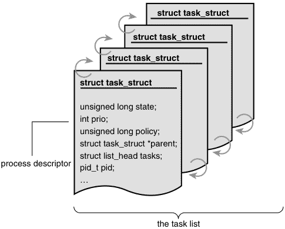

**图 3.1** 进程描述符和任务列表。

---

¹ 内核实现了`wait4()`系统调用。Linux 系统通过 C 库通常提供`wait()`、`waitpid()`、`wait3()`和`wait4()`函数。所有这些函数都返回关于已终止进程的状态，尽管语义略有不同。

² 一些关于操作系统设计的教材将此列表称为任务数组（task array）。因为 Linux 的实现是链表而非静态数组，所以在 Linux 中它被称为任务列表。

### 分配进程描述符

`task_struct`结构是通过 slab 分配器分配的，以提供对象复用和缓存着色（见第 12 章）。在 2.6 内核系列之前，`struct task_struct`存储在每个进程内核栈的末尾。这使得寄存器较少的架构（如 x86）可以通过栈指针计算出进程描述符的位置，而无需使用额外的寄存器来存储位置。随着进程描述符现在通过 slab 分配器动态创建，一个新结构`struct thread_info`被创建，它再次位于栈底（对于向下增长的栈）或栈顶（对于向上增长的栈）。³ 见图 3.2。

`thread_info`结构在 x86 的`<asm/thread_info.h>`中定义如下：

```c
struct thread_info {
    struct task_struct    *task;
    struct exec_domain    *exec_domain;
    __u32                  flags;
    __u32                  status;
    __u32                  cpu;
    int                    preempt_count;
    mm_segment_t          addr_limit;
    struct restart_block   restart_block;
    void                  *sysenter_return;
    int                    uaccess_err;
};
```

> ³ 创建`struct thread_info`不仅仅是因为寄存器受限的架构。新结构还使得在汇编代码中使用其值的偏移量计算变得相当简单。

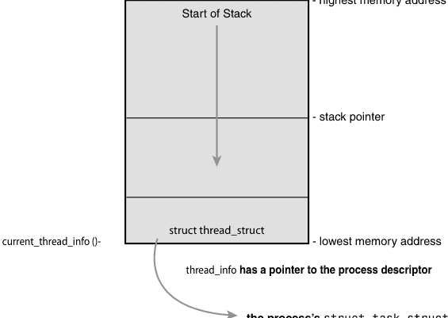

每个任务的`thread_info`结构都分配在其栈的末尾。该结构中的`task`元素是一个指向该任务实际`task_struct`的指针。

### 存储进程描述符

系统通过一个唯一的进程标识值或 PID 来识别进程。PID 是由不透明类型⁴ `pid_t`表示的数值，通常是一个`int`。然而，由于与早期 Unix 和 Linux 版本的向后兼容性，默认最大值仅为 32,768（即`short int`的大小），尽管该值可以选择性地增加到 400 万（这在`<linux/threads.h>`中控制）。内核将此值作为`pid`存储在每个进程描述符内部。

这个最大值非常重要，因为它本质上是系统中可以并发存在的最大进程数。虽然 32,768 对于桌面系统可能足够，但大型服务器可能需要更多进程。此外，该值越低，数值越快地回卷（wrap around），从而破坏了“较高”这一有用概念的……

---

⁴ 不透明类型（opaque type）是指物理表示未知或不重要的数据类型。

数值越大表示进程运行越晚。如果系统愿意破坏与旧应用程序的兼容性，管理员可以通过`/proc/sys/kernel/pid_max`增加最大值。

在内核内部，任务通常通过指向其`task_struct`结构的指针直接引用。事实上，大多数处理进程的内核代码都直接操作`struct task_struct`。因此，能够快速查找当前执行任务的进程描述符是非常有用的，这通过`current`宏来实现。该宏必须由每个架构独立实现。某些架构将当前运行进程的`task_struct`结构指针保存在寄存器中，从而实现高效访问。其他架构，如 x86（由于可用寄存器较少），则利用`struct thread_info`存储在内核栈上的特性，来计算`thread_info`的位置，进而找到`task_struct`。

在 x86 上，`current`通过掩盖栈指针的低 13 位来获取`thread_info`结构。这由`current_thread_info()`函数完成。汇编代码如下：

```
movl $-8192, %eax
andl %esp, %eax
```

这假设栈大小为 8KB。当启用 4KB 栈时，则使用 4096 代替 8192。

最后，`current`解引用`thread_info`的`task`成员以返回`task_struct`：

```
current_thread_info()->task;
```

将此方法与 PowerPC（IBM 的现代 RISC 微处理器）采取的方法进行对比，后者将当前的`task_struct`存储在寄存器中。因此，PPC 上的`current`仅返回存储在寄存器 r2 中的值。PPC 能够采用这种方法是因为与 x86 不同，它拥有充足的寄存器。由于访问进程描述符是一项常见且重要的工作，PPC 内核开发人员认为为此任务分配一个寄存器是值得的。

### 进程状态


进程描述符的`state`字段描述了进程的当前状况（见图 3.3）。系统中的每个进程恰好处于五种不同状态之一。该值由五个标志之一表示：

- **TASK_RUNNING**——进程可运行；它要么当前正在运行，要么在运行队列中等待运行（运行队列在第 4 章中讨论）。这是在用户空间执行的进程唯一可能的状态；它也适用于在内核空间中积极运行的进程。
- **TASK_INTERRUPTIBLE**——进程处于睡眠状态（即被阻塞），等待某个条件成立。当该条件成立时，内核将进程状态设置为`TASK_RUNNING`。如果进程收到信号，它也会提前唤醒并变为可运行状态。
- **TASK_UNINTERRUPTIBLE**——此状态与`TASK_INTERRUPTIBLE`相同，不同之处在于它在收到信号时不会唤醒并变为可运行状态。这用于进程必须在不被中断的情况下等待，或者预期事件会很快发生的情况。由于任务在此状态下不响应信号，因此`TASK_UNINTERRUPTIBLE`的使用频率低于`TASK_INTERRUPTIBLE`。⁵
- **TASK_TRACED**——进程正被另一个进程（如调试器）通过`ptrace`追踪。
- **TASK_STOPPED**——进程执行已停止；任务既不在运行，也不具备运行条件。这发生在任务收到`SIGSTOP`、`SIGTSTP`、`SIGTTIN`或`SIGTTOU`信号，或者在被调试时收到任何信号的情况下。

⁵ 这就是为什么你在`ps(1)`中会看到那些令人头疼的、状态为 D 且无法杀掉的进程。因为任务不响应信号，你无法向其发送`SIGKILL`信号。此外，即使你能终止该任务，这也不明智，因为任务可能正处于一项重要操作的中途，并可能持有某个信号量。

### 操作当前进程状态

内核代码经常需要更改进程状态。首选机制是使用：

```c
set_task_state(task, state);        /* 将任务 'task' 设置为状态 'state' */
```

该函数将给定的任务设置为给定的状态。如果适用，它还会提供一个内存屏障以强制其他处理器上的排序。（这仅在 SMP 系统上需要。）否则，它等同于：

```c
task->state = state;
```

`set_current_state(state)`方法与`set_task_state(current, state)`同义。有关这些及相关函数的实现，请参阅`<linux/sched.h>`。

### 进程上下文

进程最关键的部分之一是执行的程序代码。这段代码从*可执行文件*中读取，并在程序的地址空间内执行。正常的程序执行发生在*用户空间*。当程序执行系统调用（见第 5 章“系统调用”）或触发异常时，它进入*内核空间*。此时，内核被认为是在“代表进程执行”，处于*进程上下文*中。在进程上下文中，`current`宏是有效的。⁶ 退出内核后，进程恢复在用户空间执行，除非在此期间有更高优先级的进程变为可运行状态，在这种情况下，将调用调度程序来选择该高优先级进程。

系统调用和异常处理程序是进入内核的定义良好的接口。进程只能通过这些接口之一开始在内核空间执行——*所有对内核的访问都必须通过这些接口*。

⁶ 除进程上下文外，还有中断上下文，我们将在第 7 章“中断和中断处理程序”中讨论。在中断上下文中，系统不是代表某个进程运行，而是在执行中断处理程序。没有进程与中断处理程序绑定。

### 进程家族树

Unix 系统中的进程之间存在明显的层次结构，Linux 也不例外。所有进程都是`init`进程的后代，其 PID 为 1。内核在启动过程的最后一步启动`init`。`init`进程随后读取系统的`initscripts`并执行更多程序，最终完成启动过程。

系统中的每个进程恰好有一个父进程。同样，每个进程有零个或多个子进程。所有直接隶属于同一个父进程的进程被称为*兄弟进程*。进程之间的关系存储在进程描述符中。每个`task_struct`都有一个指向父进程`task_struct`的指针（名为`parent`）和一个子进程列表（名为`children`）。因此，给定当前进程，可以使用以下代码获取其父进程的进程描述符：

```c
struct task_struct *my_parent = current->parent;
```

同样，可以通过以下方式遍历进程的子进程：

```c
struct task_struct *task;
struct list_head *list;

list_for_each(list, &current->children) {
    task = list_entry(list, struct task_struct, sibling);
    /* task 现在指向 current 的一个子进程 */
}
```

`init`任务的进程描述符被静态分配为`init_task`。证明所有进程之间关系的一个很好例子是，这段代码将始终成功：

```c
struct task_struct *task;

for (task = current; task != &init_task; task = task->parent)
    ;
/* task 现在指向 init */
```

事实上，你可以从系统中的任何一个进程追踪进程层次结构到达任何其他进程。然而，通常我们只需要遍历系统中的所有进程。这很容易，因为任务列表是一个循环双向链表。给定任何有效任务，要获取列表中的下一个任务，请使用：

```c
list_entry(task->tasks.next, struct task_struct, tasks)
```

获取前一个任务的方式相同：

```c
list_entry(task->tasks.prev, struct task_struct, tasks)
```

这两个例程分别由宏`next_task(task)`和`prev_task(task)`提供。最后，提供了`each_process(task)`宏，用于遍历整个任务列表。每次迭代时，`task`指向列表中的下一个任务：

```c
struct task_struct *task;

for_each_process(task) {
    /* 这将毫无意义地打印每个任务的名称和 PID */
    printk("%s[%d]\n", task->comm, task->pid);
}
```

**注意**

在拥有大量进程的系统中遍历每个任务开销很大；代码在执行此操作前应有充分的理由（且没有其他替代方案）。

### 进程创建

Unix 中的进程创建非常独特。大多数操作系统实现一种 *spawn*（生成）机制，在新的地址空间中创建新进程，读取可执行文件并开始执行。Unix 采取了一种不寻常的方法，将这些步骤分为两个截然不同的函数：`fork()`和`exec()`。⁷ 前者`fork()`创建一个子进程，该子进程是当前任务的副本。它与父进程的不同之处仅在于其 PID（唯一的）、PPID（父进程 PID，设置为原进程）以及某些不被继承的资源和统计信息（如待处理信号）。第二个函数`exec()`将新的可执行文件加载到地址空间并开始执行。`fork()`紧随`exec()`的组合类似于大多数操作系统提供的单一函数。

### 写时复制

传统上，在执行`fork()`时，父进程拥有的所有资源都会被复制，并将副本交给子进程。这种方法过于简单且低效，因为它复制了许多原本可以共享的数据。更糟糕的是，如果新进程立即执行一个新镜像，那么所有的复制工作都将白费。在 Linux 中，`fork()`是通过使用写时复制（copy-on-write）页面实现的。*写时复制*（或 *COW*）是一种延迟或完全防止数据复制的技术。父进程和子进程可以共享一个副本，而不是复制进程地址空间。

然而，数据被标记为：如果被写入，则创建副本，每个进程获得一个唯一的副本。因此，资源的复制仅在写入时发生；在此之前，它们是只读共享的。这种技术将地址空间中每个页面的复制延迟到实际写入时。在页面从未被写入的情况下（例如，在`fork()`之后立即调用`exec()`），它们永远不需要被复制。

`fork()`产生的唯一开销是父进程页表的复制以及为子进程创建唯一的进程描述符。在进程分叉后立即执行新可执行镜像的常见情况下，这种优化防止了大量数据的浪费复制（地址空间很容易达到数十兆字节）。这是一个重要的优化，因为 Unix 哲学鼓励快速的进程执行。

> **7** *这里所说的`exec()`指的是`exec()`函数族中的任何成员。内核实现了`execve()`系统调用，其上实现了`execlp()`、`execle()`、`execv()`和`execvp()`。*

### Forking

Linux 通过`clone()`系统调用实现`fork()`。该调用接收一系列标志，用于指定父进程和子进程应共享哪些资源（如果有）。（关于标志的更多信息，请参阅本章后面的“Linux 线程实现”部分。）`fork()`、`vfork()`和`__clone()`库调用都使用必要的标志调用`clone()`系统调用。而`clone()`系统调用又会调用`do_fork()`。

Forking 的大部分工作由`do_fork()`处理，它定义在`kernel/fork.c`中。该函数调用`copy_process()`然后启动进程运行。有趣的工作是由`copy_process()`完成的：

1. 它调用`dup_task_struct()`，为新进程创建新的内核栈、`thread_info`结构和`task_struct`。新值与当前任务的值相同。此时，子进程和父进程的描述符是相同的。
2. 然后它检查新子进程是否会超过当前用户进程数的资源限制。
3. 子进程需要与父进程区分开来。进程描述符的各个成员被清除或设置为初始值。不被继承的进程描述符成员主要是统计信息。`task_struct`中的大部分值保持不变。
4. 子进程的状态被设置为`TASK_UNINTERRUPTIBLE`，以确保它暂时不运行。
5. `copy_process()`调用`copy_flags()`来更新`task_struct`的`flags`成员。表示任务是否使用超级用户权限的`PF_SUPERPRIV`标志被清除。表示进程尚未调用`exec()`的`PF_FORKNOEXEC`标志被设置。
6. 它调用`alloc_pid()`为新任务分配一个可用的 PID。
7. 根据传递给`clone()`的标志，`copy_process()`要么复制，要么共享打开文件、文件系统信息、信号处理程序、进程地址空间和命名空间。这些资源通常在给定进程的线程之间共享；否则它们是唯一的，因此在这里被复制。
8. 最后，`copy_process()`进行清理并向调用者返回指向新子进程的指针。

回到`do_fork()`中，如果`copy_process()`成功返回，新子进程将被唤醒并运行。内核特意让子进程先运行。⁸ 在子进程简单地立即调用`exec()`的常见情况下，这消除了如果父进程先运行并开始写入地址空间而产生的任何写时复制开销。

> ⁸ 虽然目标是让子进程先运行，但目前这并未正确发挥作用。

### vfork()

`vfork()`系统调用的效果与`fork()`相同，不同之处在于父进程的页表项不会被复制。相反，子进程在父进程的地址空间中作为唯一的线程执行，父进程被阻塞，直到子进程调用`exec()`或退出。子进程 *不允许* 写入地址空间。在 3BSD 引入该调用的旧时代，这是一个受欢迎的优化，因为当时还没有使用写时复制页面来实现`fork()`。如今，有了写时复制和“子进程先运行”的语义，`vfork()`唯一的优势是不复制父进程的页表项。如果 Linux 某天实现了写时复制页表项，那么`vfork()`将不再有任何优势。⁹ 由于`vfork()`的语义很棘手（例如，如果`exec()`失败会发生什么？），理想情况下系统不需要`vfork()`，内核也不应实现它。完全可以将`vfork()`实现为普通的`fork()`——这就是 Linux 在 2.2 版本之前所做的。

`vfork()`系统调用通过传递给`clone()`系统调用的特殊标志来实现：

1. 在`copy_process()`中，`task_struct`成员`vfork_done`被设置为 NULL。
2. 在`do_fork()`中，如果给出了特殊标志，`vfork_done`将指向一个特定地址。
3. 子进程首次运行后，父进程不再返回，而是等待子进程通过`vfork_done`指针发出信号。
4. 在`mm_release()`函数（用于任务退出内存地址空间时）中，会检查`vfork_done`是否为 NULL。如果不是，则向父进程发出信号。
5. 回到`do_fork()`，父进程被唤醒并返回。

如果一切按计划进行，子进程现在在新的地址空间中执行，而父进程再次在其原始地址空间中执行。开销较低，但实现并不优雅。

### The Linux Implementation of Threads（Linux 线程实现）

线程是一种流行的现代编程抽象。它们在共享内存地址空间的同一个程序中提供多个执行线程。它们还可以共享打开文件和其他资源。线程实现了 *并发编程*，并且在多处理器系统上实现了真正的 *并行性*。

Linux 对线程有独特的实现。对于 Linux 内核来说，没有“线程”的概念。Linux 将所有线程实现为标准进程。Linux 内核不提供任何特殊的调度语义或数据结构来表示线程。相反，线程仅仅是一个与其他进程共享某些资源的进程。每个线程都有一个唯一的`task_struct`，在内核看来就是一个普通进程——线程只是恰好与其他进程共享资源（例如地址空间）。

> ⁹ 已有补丁可将此功能添加到 Linux 中。随着时间的推移，此功能很可能会进入 Linux 主线内核。

这种线程处理方法与 Microsoft Windows 或 Sun Solaris 等操作系统截然不同，后者对线程有显式的内核支持（有时称线程为轻量级进程）。“轻量级进程”这个名称概括了 Linux 与其他系统在哲学上的差异。对于其他操作系统，线程是一种抽象，旨在提供比沉重的进程更轻、更快的执行单元。而对于 Linux，线程仅仅是一种在进程（本身已经相当轻量）之间共享资源的方式。¹⁰ 例如，假设你有一个由四个线程组成的进程。在具有显式线程支持的系统上，可能存在一个进程描述符，它依次指向四个不同的线程。进程描述符描述共享资源，如地址空间或打开文件。然后，线程描述它们独有的资源。相反，在 Linux 中，简单地存在四个进程，因此有四个正常的`task_struct`结构。这四个进程被设置为共享某些资源。结果非常优雅。

### 创建线程

线程的创建方式与普通任务相同，不同之处在于传递给`clone()`系统调用的标志对应于要共享的特定资源：

```
clone(CLONE_VM | CLONE_FS | CLONE_FILES | CLONE_SIGHAND, 0);
```

上述代码产生的结果与普通`fork()`相同，除了地址空间、文件系统资源、文件描述符和信号处理程序是共享的。换句话说，新任务及其父进程就是人们常说的“线程”。

相比之下，一个普通的`fork()`可以实现为：

```
clone(SIGCHLD, 0);
```

而`vfork()`实现为：

```
clone(CLONE_VFORK | CLONE_VM | SIGCHLD, 0);
```

提供给`clone()`的标志有助于指定新进程的行为，并详细说明父进程和子进程将共享哪些资源。表 3.1 列出了定义在`<linux/sched.h>`中的 clone 标志及其效果。

例如，对比 Linux 中的进程创建时间与这些其他操作系统中的进程（甚至是线程！）创建时间。结果对 Linux 非常有利。

| 标志 | 含义 |
|------|---------|
| CLONE_FILES | 父进程和子进程共享打开的文件。 |
| CLONE_FS | 父进程和子进程共享文件系统信息。 |
| CLONE_IDLETASK | 将 PID 设置为零（仅由空闲任务使用）。 |
| CLONE_NEWNS | 为子进程创建新的命名空间。 |
| CLONE_PARENT | 子进程具有与其父进程相同的父进程。 |
| CLONE_PTRACE | 继续追踪子进程。 |
| CLONE_SETTID | 将 TID 写回用户空间。 |
| CLONE_SETTLS | 为子进程创建新的 TLS。 |
| CLONE_SIGHAND | 父进程和子进程共享信号处理程序和阻塞信号。 |
| CLONE_SYSVSEM | 父进程和子进程共享 System V SEM_UNDO 语义。 |
| CLONE_THREAD | 父进程和子进程在同一个线程组中。 |
| CLONE_VFORK | 使用了`vfork()`，父进程将睡眠直到被子进程唤醒。 |
| CLONE_UNTRACED | 不允许追踪进程强制在子进程上使用`CLONE_PTRACE`。 |
| CLONE_STOP | 以`TASK_STOPPED`状态启动进程。 |
| CLONE_SETTLS | 为子进程创建新的 TLS（线程本地存储）。 |
| CLONE_CHILD_CLEARTID | 清除子进程中的 TID。 |
| CLONE_CHILD_SETTID | 设置子进程中的 TID。 |
| CLONE_PARENT_SETTID | 设置父进程中的 TID。 |
| CLONE_VM | 父进程和子进程共享地址空间。 |

### 内核线程

内核在后台执行某些操作通常是非常有用的。内核通过*内核线程*来实现这一点——即仅存在于内核空间中的标准进程。内核线程与普通进程的主要区别在于，内核线程没有地址空间。（它们指向地址空间的`mm`指针为`NULL`。）它们仅在内核空间运行，不会上下文切换到用户空间。不过，内核线程与普通进程一样，是可调度且可抢占的。


Linux 将若干任务委派给内核线程，最显著的是 `flush` 任务和 `ksoftirqd` 任务。你可以通过运行 `ps -eF` 命令在 Linux 系统上看到内核线程。数量非常多！内核线程在系统启动时由其他内核线程创建。事实上，内核线程只能由另一个内核线程创建。内核通过将所有新内核线程从 `kthread_add` 内核进程 `fork` 出来来自动处理此过程。在 `<linux/kthread.h>` 中声明的、用于从现有线程生成新内核线程的接口是：

```c
struct task_struct *kthread_create(int (*threadfn)(void *data),
				 void *data,
				 const char namefmt[],
				 ...)
```

新任务由 `kthread` 内核进程通过 `clone()` 系统调用创建。新进程将运行 `threadfn` 函数，并接收 `data` 参数。进程将被命名为 `namefmt`，它在可变参数列表中接收 `printf` 风格的格式化参数。进程在不可运行状态下被创建；直到通过 `wake_up_process()` 显式唤醒后才会开始运行。可以通过一个单一函数 `kthread_run()` 创建进程并使其可运行：

```c
struct task_struct *kthread_run(int (*threadfn)(void *data),
				 void *data,
				 const char namefmt[],
				 ...)
```

这个例程实现为一个宏，它简单地调用了 `kthread_create()` 和 `wake_up_process()`：

```c
#define kthread_run(threadfn, data, namefmt, ...)             \
({                                                                 \
    struct task_struct *k;                                         \
                                                                    \
    k = kthread_create(threadfn, data, namefmt, ## __VA_ARGS__);   \
    if (!IS_ERR(k))                                                 \
        wake_up_process(k);                                        \
                                                                    \
    k;                                                              \
})
```

内核线程一旦启动，将一直存在，直到它调用 `do_exit()`，或者内核的另一部分调用 `kthread_stop()` 并传入 `kthread_create()` 返回的 `task_struct` 结构体地址：

```c
int kthread_stop(struct task_struct *k)
```

我们将在后续章节中更详细地讨论具体的内核线程。

### 进程终止

虽然很遗憾，但进程最终必须死亡。当一个进程终止时，内核会释放该进程拥有的资源，并通知子进程的父进程其已死亡。

通常，进程的销毁是自发引起的。当进程调用 `exit()` 系统调用时就会发生，要么是在准备终止时显式调用，要么是在任何程序的 `main` 子例程返回时隐式调用。（也就是说，C 编译器在 `main()` 返回之后放置了一个对 `exit()` 的调用。）进程也可能非自愿终止。这种情况发生在进程接收到它无法处理或忽略的信号或异常时。无论进程如何终止，大部分工作都由定义在 `kernel/exit.c` 中的 `do_exit()` 处理，它完成了一系列杂活：

1. 它将 `task_struct` 的 `flags` 成员中的 `PF_EXITING` 标志设为 1。
2. 它调用 `del_timer_sync()` 来移除所有内核定时器。返回时，保证没有任何定时器在队列中，也没有定时器处理程序在运行。
3. 如果启用了 BSD 进程会计，`do_exit()` 将调用 `acct_update_integrals()` 来写出会计信息。
4. 它调用 `exit_mm()` 来释放该进程持有的 `mm_struct`。如果没有其他进程使用该地址空间（即地址空间未被共享），内核随后将其销毁。
5. 它调用 `exit_sem()`。如果进程在队列中等待 IPC 信号量，则在此处将其出队。
6. 然后它调用 `exit_files()` 和 `exit_fs()`，分别递减与文件描述符和文件系统数据相关对象的引用计数。如果任何一个引用计数达到零，则该对象不再被任何进程使用，并被销毁。
7. 它将任务的退出码（存储在 `task_struct` 的 `exit_code` 成员中）设置为由 `exit()` 或强制终止的内核机制提供的代码。退出码存储在这里，以便父进程可选地检索。
8. 它调用 `exit_notify()` 向任务的父进程发送信号，将任务的任何子进程重新指派（reparent）给其线程组中的另一个线程或 `init` 进程，并将任务的退出状态（存储在 `task_struct` 结构体的 `exit_state` 中）设置为 `EXIT_ZOMBIE`。
9. `do_exit()` 调用 `schedule()` 切换到新进程（见第 4 章）。因为该进程现在不可调度，这是该任务将执行的最后一段代码。`do_exit()` 永远不会返回。

此时，所有与该任务相关联的对象（假设该任务是唯一用户）都被释放。任务不再可运行（且不再拥有运行所需的地址空间），且处于 `EXIT_ZOMBIE` 退出状态。它唯一占据的内存是其内核栈、`thread_info` 结构和 `task_struct` 结构。任务存在的唯一目的就是向其父进程提供信息。在父进程检索到信息或通知内核其不再感兴趣后，进程持有的剩余内存将被释放并返回系统使用。

### 移除进程描述符

在 `do_exit()` 完成后，终止进程的进程描述符仍然存在，但进程已成为僵尸进程且无法运行。如前所述，这使得系统能够在子进程终止后获取其信息。因此，清理进程及其移除进程描述符这两个行为是分开的。在父进程获取了其终止子进程的信息，或向内核表明不在意之后，子进程的 `task_struct` 将被释放。

`wait()` 系列函数是通过一个单一（且复杂）的系统调用 `wait4()` 实现的。标准行为是挂起调用任务的执行，直到其一个子进程退出，此时函数返回退出子进程的 PID。此外，函数还提供一个指针，在返回时持有终止子进程的退出码。

当最终需要释放进程描述符时，会调用 `release_task()`。它执行以下操作：

1. 它调用 `__exit_signal()`，后者调用 `__unhash_process()`，而后者又调用 `detach_pid()` 将进程从 `pidhash` 中移除，并从任务列表中移除。
2. `__exit_signal()` 释放现已死亡进程使用的任何剩余资源，并完成统计和簿记工作。
3. 如果该任务是线程组的最后一个成员，且组长是僵尸进程，则 `release_task()` 会通知僵尸组长的父进程。
4. `release_task()` 调用 `put_task_struct()` 来释放包含进程内核栈和 `thread_info` 结构的页面，并释放包含 `task_struct` 的 slab 缓存。

此时，进程描述符和所有仅属于该进程的资源均已被释放。

### 无父进程任务的困境

如果父进程在子进程之前退出，必须存在某种机制将任何子任务*重新指派*（reparent）给一个新进程，否则无父进程的终止进程将永远保持僵尸状态，浪费系统内存。解决方案是在退出时将任务的子进程重新指派给当前线程组中的另一个进程，如果失败，则指派给 `init` 进程。`do_exit()` 调用 `exit_notify()`，后者调用 `forget_original_parent()`，而后者又调用 `find_new_reaper()` 来执行重新指派：

```c
static struct task_struct *find_new_reaper(struct task_struct *father)
{
    struct pid_namespace *pid_ns = task_active_pid_ns(father);
    struct task_struct *thread;

    thread = father;
    while_each_thread(father, thread) {
        if (thread->flags & PF_EXITING)
            continue;
        if (unlikely(pid_ns->child_reaper == father))
```

```c
pid_ns->child_reaper = thread;
return thread;
}

if (unlikely(pid_ns->child_reaper == father)) {
	write_unlock_irq(&tasklist_lock);
	if (unlikely(pid_ns == &init_pid_ns))
		panic("Attempted to kill init!");

	zap_pid_ns_processes(pid_ns);
	write_lock_irq(&tasklist_lock);
	/*
	 * We can not clear ->child_reaper or leave it alone.
	 * There may by stealth EXIT_DEAD tasks on ->children,
	 * forget_original_parent() must move them somewhere.
	 */
	pid_ns->child_reaper = init_pid_ns.child_reaper;
}
return pid_ns->child_reaper;
}
```

这段代码尝试在进程的线程组中查找并返回另一个任务。如果线程组中没有其他任务，它将查找并返回 `init` 进程。现在已经为子进程找到了合适的新父进程，需要定位每个子进程并将其重新父化（reparent）给 reaper：

```c
reaper = find_new_reaper(father);
list_for_each_entry_safe(p, n, &father->children, sibling) {
	p->real_parent = reaper;
	if (p->parent == father) {
		BUG_ON(p->ptrace);
		p->parent = p->real_parent;
	}
	reparent_thread(p, father);
}
```

随后调用 `ptrace_exit_finish()` 对一个被 `ptraced` 的子进程列表执行相同的重新父化操作：

```c
void exit_ptrace(struct task_struct *tracer)
{
	struct task_struct *p, *n;
	LIST_HEAD(ptrace_dead);

	write_lock_irq(&tasklist_lock);
	list_for_each_entry_safe(p, n, &tracer->ptraced, ptrace_entry) {
		if (__ptrace_detach(tracer, p))
			list_add(&p->ptrace_entry, &ptrace_dead);
	}

	write_unlock_irq(&tasklist_lock);

	BUG_ON(!list_empty(&tracer->ptraced));

	list_for_each_entry_safe(p, n, &ptrace_dead, ptrace_entry) {
		list_del_init(&p->ptrace_entry);
		release_task(p);
	}
}
```

同时维护子进程列表和 `ptraced` 列表的理由很有意思；这是 2.6 内核中的一个新特性。当一个任务被 `ptraced` 时，它会被临时重新父化到调试进程。然而，当该任务的父进程退出时，它必须与其其他兄弟进程一起被重新父化。在之前的内核中，这导致需要遍历系统中的每个进程来寻找子进程。解决方案很简单，即为进程被 `ptraced` 的子进程维护一个单独的列表——将寻找子进程的范围从全系统进程缩减为两个相对较小的列表。

随着进程成功完成重新父化，不再有产生孤儿僵尸进程的风险。`init` 进程会定期对其子进程调用 `wait()`，清理分配给它的任何僵尸进程。

## 结论

在本章中，我们探讨了操作系统中关于*进程*的核心抽象。我们讨论了进程的通用特性、其重要性，以及进程与线程之间的关系。随后，我们讨论了 Linux 如何存储和表示进程（通过 `task_struct` 和 `thread_info`）、进程如何创建（通过 `fork()` 以及最终的 `clone()`）、新的可执行映像如何加载到地址空间（通过 `exec()` 系列系统调用）、进程的层级结构、父进程如何获取已故子进程的信息（通过 `wait()` 系列系统调用），以及进程最终如何死亡（通过 `exit()` 强制或主动退出）。进程是一个基础且至关重要的抽象，是每个现代操作系统的核心，也是我们之所以需要操作系统（为了运行程序）的根本原因。

下一章将讨论进程调度，这是内核决定哪些进程运行、何时运行以及按什么顺序运行的精妙且有趣的方式。

# 4 进程调度

前一章讨论了*进程*，即活动程序代码的操作系统抽象。本章讨论*进程调度器*，即让这些进程投入工作的内核子系统。

进程调度器决定哪个进程运行、何时运行以及运行多久。进程调度器（通常简称为*调度器*）在系统中的可运行进程之间分配有限的处理器时间资源。调度器是像 Linux 这样的多任务操作系统的基础。通过决定下一个运行哪个进程，调度器负责最大化地利用系统资源，并给用户一种多个进程在同时执行的印象。

调度器的核心思想很简单。为了最大限度地利用处理器时间，只要有*可运行*的进程，就应该始终有一个进程在运行。如果系统中的可运行进程数量超过了处理器数量，那么在给定时刻，某些进程将无法运行。这些进程处于*等待运行*状态。在给定的一组可运行进程中决定下一个运行哪个进程，是调度器必须做出的根本决定。

## 多任务

*多任务*操作系统是指能够同时交替执行多个进程的操作系统。在单处理器机器上，这产生了一种多个进程并发运行的错觉。在多处理器机器上，这种功能使进程能够真正地在不同的处理器上并发（并行）运行。无论哪种类型的机器，它还允许许多进程*阻塞*或*睡眠*，直到有工作可做时才实际执行。这些进程虽然在内存中，但并非*可运行*状态。相反，这类进程利用内核等待某些事件（键盘输入、网络数据、时间流逝等）的发生。因此，一个现代 Linux 系统内存中可能有很多进程，但可能只有一个处于可运行状态。

多任务操作系统分为两种类型：*协作式多任务*和*抢占式多任务*。Linux 与所有 Unix 变体及大多数现代操作系统一样，实现的是抢占式多任务。在抢占式多任务中，调度器决定进程何时停止运行以及新进程何时开始运行。这种非自愿挂起运行进程的行为被称为*抢占*。进程在被抢占前运行的时间通常是预先确定的，被称为进程的*时间片*。时间片实际上给了每个可运行进程一*片*处理器时间。通过管理时间片，调度器能够为系统做出全局调度决策。它还防止任何单个进程垄断处理器。在许多现代操作系统中，时间片是根据进程行为和可配置的系统策略动态计算的。正如我们将看到的，Linux 独特的“公平”调度器并不采用*本身*意义上的时间片，这产生了一些有趣的效果。

相反，在*协作式多任务*中，进程除非自愿决定停止，否则不会停止运行。进程自愿挂起自身行为被称为*出让*（yielding）。理想情况下，进程会经常出让，让每个可运行进程都能获得相当一部分处理器时间，但操作系统无法强制执行这一点。这种方法的缺陷显而易见：调度器无法就进程运行多长时间做出全局决策；进程可能会垄断处理器的时间超过用户的预期；而一个永远不出让的死锁进程可能会导致整个系统崩溃。幸运的是，过去二十年设计的大多数操作系统都采用了抢占式多任务，其中 Mac OS 9（及更早版本）和 Windows 3.1（及更早版本）是最显著（且令人尴尬）的例外。当然，Unix 从诞生之日起就采用了抢占式多任务。

## Linux 的进程调度器

从 1991 年的 Linux 第一个版本到 2.4 内核系列，Linux 调度器的设计非常简单，甚至可以说很平庸。它易于理解，但在面对大量可运行进程或大量处理器时，扩展性较差。

为了应对这一问题，在 2.5 内核开发系列期间，Linux 内核对调度器进行了全面重构。一个新的调度器出现，因其算法特性而通常被称为 `O(1)` 调度器¹，它解决了之前 Linux 调度器的缺陷，并引入了强大的新特性和性能特点。通过引入一个用于时间片计算的常数时间算法和每个处理器独立的运行队列，它纠正了早期调度器的设计限制。

`O(1)` 调度器的表现非常出色，随着 Linux 支持拥有数十个甚至数百个处理器的强大“硬件”，它能够轻松地扩展。然而，随着时间的推移，人们发现 `O(1)` 调度器在处理调度延迟敏感型应用时存在几个病态的缺陷。这些被称为*交互式进程*的应用包括任何用户与之交互的程序。因此，虽然 `O(1)` 调度器对于缺乏交互式进程的大型服务器工作负载非常理想，但在交互式应用是*存在意义*的桌面系统上，其表现不尽如人意。从早期开始……


> ¹ *O(1)* 是大 O 表示法的一个例子。简单来说，这意味着无论输入规模如何，调度器都能在常数时间内完成工作。关于大 O 表示法的完整解释请参阅第 6 章 *“内核数据结构”*。

在 2.6 内核系列中，开发者引入了新的进程调度器，旨在提高 `O(1)` 调度器的交互性能。其中最著名的是 Rotating Staircase Deadline 调度器，它将借鉴自排队论的公平调度概念引入到了 Linux 的进程调度器中。这一概念为 `O(1)` 调度器最终在内核版本 2.6.23 中被完全公平调度器（Completely Fair Scheduler，简称 CFS）取代提供了灵感。

本章将讨论调度器设计的 fundamentals 以及它们如何应用于 CFS 及其目标、设计、实现、算法和相关系统调用。我们还将讨论 `O(1)` 调度器，因为它的实现是一个更“经典”经典的 Unix 进程调度器模型。

## 策略 (Policy)

策略是调度器的行为，决定了什么时间运行什么。调度器的策略通常决定了系统的整体感受，并负责优化处理器时间的利用率。因此，它非常重要。

### I/O 密集型与处理器密集型进程

进程可以分为 I/O 密集型（I/O-bound）或处理器密集型（processor-bound）。前者的特点是大部分时间用于提交和等待 I/O 请求。因此，此类进程的可运行时间很短，因为它们最终会阻塞以等待更多 I/O。（这里所说的 I/O 指的是任何类型的可阻塞资源，如键盘输入或网络 I/O，而不仅仅是磁盘 I/O。）例如，大多数图形用户界面 (GUI) 应用程序都是 I/O 密集型的，即使它们从未读写磁盘，因为它们大部分时间都在等待用户通过键盘和鼠标进行交互。

相反，处理器密集型进程的大部分时间都在执行代码。它们倾向于运行直到被抢占，因为它们并不经常在 I/O 请求上阻塞。然而，由于它们不是由 I/O 驱动的，系统响应并不要求调度器频繁运行它们。因此，针对处理器密集型进程的调度策略倾向于较低的运行频率，但单次运行时间较长。处理器密集型进程的极致例子是执行死循环的进程。更常见的例子包括执行大量数学计算的程序，如 `ssh-keygen` 或 MATLAB。

当然，这些分类并非互斥。进程可以同时表现出两种行为：例如，X Window 服务器既是处理器密集型也是 I/O 密集型。其他进程可能是 I/O 密集型的，但会进入一段时间的剧烈处理器活动期。一个很好的例子是文字处理器，它平时处于等待按键状态，但在任何时刻都可能因为快速进行拼写检查或宏计算而占满处理器。

系统中的调度策略必须尝试满足两个相互冲突的目标：快速的进程响应时间（低延迟）和最大化的系统利用率（高吞吐量）。为了满足这些矛盾的需求，调度器通常采用复杂的算法来确定最值得运行的进程，同时不损害对其他低优先级进程的公平性。Unix 系统中的调度策略倾向于显式地偏好 I/O 密集型进程，从而提供良好的进程响应时间。Linux 旨在提供良好的交互响应和桌面性能，因此优化了进程响应（低延迟），从而在处理器密集型进程之上偏好 I/O 密集型进程。正如我们将看到的，这是通过一种创造性的方式完成的，且不会忽略处理器密集型进程。

### 进程优先级

一种常见的调度算法类型是*基于优先级的调度*。其目标是根据进程的价值和对处理器时间的需要对其进行排序。一个通用想法（虽然在 Linux 上并非完全如此实现）是：高优先级进程在低优先级进程之前运行，而优先级相同的进程则采用*轮转调度*（round-robin，一个接一个循环执行）。在某些系统中，高优先级进程还会获得更长的时间片。拥有剩余时间片且优先级最高的就绪进程始终运行。用户和系统都可以设置进程的优先级，以影响系统的调度行为。

Linux 内核实现了两个独立的优先级范围。第一个是 *nice* 值，一个从 −20 到 +19 的数字，默认值为 0。较大的 nice 值对应较低的优先级——这意味着你对系统上的其他进程表现得更“友好（nice）”。与较高的 nice 值（较低优先级）进程相比，较低 nice 值（较高优先级）的进程会获得更高比例的系统处理器时间。Nice 值是所有 Unix 系统中使用的标准优先级范围，尽管不同的 Unix 系统应用它们的方式不同，这反映了它们各自的调度算法。在其他基于 Unix 的系统（如 Mac OS X）中，nice 值是对分配给进程的*绝对*时间片的控制；而在 Linux 中，它是对时间片*比例*的控制。你可以使用命令 `ps -el` 查看系统中的进程列表及其相应的 nice 值（在标记为 *NI* 的列下）。

第二个范围是*实时优先级*。其值是可配置的，但默认范围是从 0 到 99（包含）。与 nice 值相反，较高的实时优先级值对应更高的优先级。所有实时进程的优先级都高于普通进程；也就是说，实时优先级和 nice 值处于不相交的数值空间。Linux 根据相关的 Unix 标准（特别是 POSIX.1b）实现了实时优先级。所有现代 Unix 系统都实现了类似的方案。你可以使用以下命令查看系统中的进程列表及其相应的实时优先级（在标记为 *RTPRIO* 的列下）：

```
ps -eo state,uid,pid,ppid,rtprio,time,comm.
```

值为 “-” 表示该进程不是实时进程。

### 时间片 (Timeslice)

时间片是一个数值，代表一个任务在被抢占前可以运行多长时间。调度策略必须规定一个默认时间片，这并不是一件简单的事。时间片太长会导致系统交互性能变差；系统将不再感觉应用程序是在并发执行的。时间片太短则会导致大量处理器时间浪费在进程切换的开销上，因为系统很大一部分时间被用于从一个短时间片进程切换到下一个进程。此外，I/O 密集型与处理器密集型进程的冲突目标再次出现：I/O 密集型进程不需要更长的时间片（尽管它们希望运行得频繁），而处理器密集型进程则渴望长的时间片（以保持其缓存的热度）。

基于这个论点，似乎任何长的时间片都会导致糟糕的交互性能。在许多操作系统中，人们对此深信不疑，因此默认时间片相当低——例如 10 毫秒。然而，Linux 的 CFS 调度器并不直接给进程分配时间片。相反，CFS 采用了一种新颖的方法，给进程分配处理器的一个比例。因此，在 Linux 上，进程获得处理器时间的多少是系统负载的函数。这个分配的比例进一步受到每个进程 nice 值的影响。Nice 值起到了权重的作用，改变了每个进程接收处理器时间的比例。具有较高 nice 值（较低优先级）的进程获得的是减量权重，使它们获得较小的处理器比例；具有较低 nice 值（较高优先级）的进程获得的是增量权重，使它们获得较大的处理器比例。

如前所述，Linux 操作系统是抢占式的。当一个进程进入就绪状态时，它就具备了运行资格。在大多数操作系统中，该进程是否立即运行并抢占当前运行的进程，取决于进程的优先级和可用时间片。在 Linux 新的 CFS 调度器下，这个决定取决于新就绪的进程已经消耗了多少比例的处理器。如果它消耗的处理器比例低于当前执行的进程，它将立即运行并抢占当前进程。否则，它将被计划在稍后时间运行。

### 调度策略在实际中的应用

假设一个系统有两个就绪任务：一个文本编辑器和一个视频编码器。文本编辑器是 I/O 密集型的，因为它几乎所有时间都在等待用户按键。（无论用户打字有多快，都没有那么快。）尽管如此，当文本编辑器接收到按键时，用户期望编辑器立即响应。相反，视频编码器是处理器密集型的。除了从磁盘读取原始数据流之外...

> 时间片在其他系统中有时被称为 quantum 或 processor slice。Linux 称其为 timeslice，因此你也应该这样称呼。

随后在写入结果视频时，编码器会将所有时间用于将视频编解码器应用于原始数据，很容易就消耗掉 100% 的处理器资源。视频编码器在运行时没有任何强的时间约束——如果它是现在开始运行还是半秒后开始运行，用户无法察觉，也不会在意。当然，完成得越快越好，但延迟并不是首要考虑的问题。

在这种情况下，理想的调度程序应该给予文本编辑器比视频编码器更高比例的可用处理器资源，因为文本编辑器是交互式的。对于文本编辑器，我们有两个目标。首先，我们希望它有大量的处理器时间可用；这不是因为它需要很多处理器资源（它并不需要），而是因为我们希望在它需要处理器时间的那一刻，始终有资源可用。其次，我们希望文本编辑器在唤醒时（例如，当用户按下键时）能够立即抢占视频编码器。这可以确保文本编辑器具有良好的*交互*性能，并能迅速响应用户输入。在大多数操作系统中，这些目标是通过赋予文本编辑器比视频编码器更高的优先级和更大的时间片（timeslice）来实现的（如果实现了的话）。高级操作系统通过检测文本编辑器是交互式的来自动完成此操作。Linux 同样实现了这些目标，但采用了不同的手段。Linux 并不是为文本编辑器分配特定的优先级和时间片，而是保证文本编辑器获得处理器的一个特定比例。如果视频编码器和文本编辑器是仅有的运行进程，且两者处于相同的 nice 级别，那么这个比例将是 50%——每个进程都被保证获得一半的处理器时间。由于文本编辑器大部分时间处于阻塞状态阻塞，等待用户的按键输入，它所使用的处理器资源远不到 50%。相反，视频编码器可以自由地使用*超过*其分配的 50% 的资源，从而使其能够快速完成编码。

关键的概念在于当文本编辑器唤醒时会发生什么。我们的首要目标是确保它在用户输入时立即运行。在这种情况下，当编辑器唤醒时，CFS 注意到它被分配了 50% 的处理器资源，但实际使用的资源要少得多。具体来说，CFS 确定文本编辑器的运行时间*少于*视频编码器。为了尝试给所有进程一个*公平的份额*（fair share），它随后抢占视频编码器，允许文本编辑器运行。文本编辑器运行，迅速处理用户的按键按下，然后再次进入睡眠状态，等待进一步的输入。由于文本编辑器尚未消耗其分配的 50%，我们继续以此方式运行，CFS 始终在文本编辑器想要运行时允许其运行，而视频编码器在其余时间运行。

## Linux 调度算法

在前面的章节中，我们抽象地讨论了进程调度，仅偶尔提到 Linux 如何将给定概念应用于现实。现在调度基础已经建立，我们可以深入探讨 Linux 的进程调度程序。

### 调度类 (Scheduler Classes)

Linux 调度程序是模块化的，允许不同的算法调度不同类型的进程。这种模块化被称为*调度类*（scheduler classes）。调度类允许不同的、可插拔的算法共存，调度它们各自类型的进程。每个调度类都有一个优先级。定义在 `kernel/sched.c` 中的基础调度代码会按照优先级顺序遍历每个调度类。拥有可运行进程且优先级最高的调度类将胜出，从而决定下一个运行的进程。

完全公平调度器 (CFS) 是为普通进程注册的调度类，在 Linux 中称为 `SCHED_NORMAL`（在 POSIX 中称为 `SCHED_OTHER`）。CFS 定义在 `kernel/sched_fair.c` 中。本节的其余部分将讨论 CFS 算法，这与 2.6.23 之后的所有 Linux 内核都相关。我们将在后面的章节中讨论实时进程的调度类。

## Unix 系统中的进程调度

要讨论公平调度，我们必须首先描述传统 Unix 系统如何调度进程。如前所述，现代进程调度程序有两个通用概念：进程优先级和时间片。时间片是指进程运行的时长；进程启动时具有一些默认的时间片。优先级较高的进程运行频率更高，并且（在许多系统中）获得更高的时间片。在 Unix 中，优先级以 nice 值的形式导出到用户空间。这听起来很简单，但在实践中会导致几个病态问题，我们现在对其进行讨论。

首先，将 nice 值映射到时间片需要决定为每个 nice 值分配什么样的绝对时间片。这会导致次优的切换行为。例如，假设我们将默认 nice 值（0）的进程分配 100 毫秒的时间片，将最高 nice 值（+20，最低优先级）的进程分配 5 毫秒的时间片。进一步假设这两类进程各有一个处于可运行状态。那么，我们的默认优先级进程将获得处理器的 20/21（105 毫秒中的 100 毫秒），而低优先级进程获得处理器的 1/21（105 毫秒中的 5 毫秒）。在这个例子中我们可以使用任何数字，但既然是我们选择的，我们就假设这个分配是最优的。现在，如果我们恰好运行两个低优先级进程会发生什么？我们期望它们各获得 50% 的处理器资源，事实也的确如此。但它们每次只能享受 5 毫秒的处理器时间（每 10 毫秒中各 5 毫秒）！也就是说，我们不再是每 105 毫秒进行两次上下文切换，而是每 10 毫秒就进行两次上下文切换。相反，如果我们有两个普通优先级进程，每个进程同样获得正确 50% 的处理器资源，但是以 100 毫秒为增量。这些时间片分配都不一定是理想的；每一个都仅仅是给定的 nice 值到时间片映射与特定的可运行进程优先级组合的副产品。事实上，考虑到高 nice 值（低优先级）进程往往是后台处理器密集型任务，而普通优先级进程往往是前台用户任务，这种时间片分配正好与理想状态*相反*！

第二个问题涉及相对 nice 值，以及同样是 nice 值到时间片的映射。假设我们有两个进程，它们的 nice 值仅相差 1。首先，假设它们的 nice 值分别为 0 和 1。这可能会映射（且实际上在 `O(1)` 调度器中确实如此）到分别为 100 和 95 毫秒的时间片。这两个值几乎相同，因此这里单个 nice 值的差异很小。现在，相反地，假设我们的两个进程 nice 值分别为 18 和 19。这现在映射到分别为 10 和 5 毫秒的时间片——前者获得的处理时间是后者的两倍！因为 nice 值最常用于相对术语（因为系统调用接受的是增量而非绝对值），这种行为意味着“将进程的 nice 值降低 1”所产生的影响，取决于起始的 nice 值而大相径庭。

第三，如果执行 nice 值到时间片的映射，我们需要能够分配绝对时间片。这个绝对值必须用内核可以衡量的术语来衡量。在大多数操作系统中，这意味着时间片必须是定时器滴答（timer tick）的某个整数倍。（关于时间的讨论请参阅第 11 章“定时器与时间管理”。）这引入了几个问题。首先，最小时间片的底线是定时器滴答的周期，这可能高达 10 毫秒，也可能低至 1 毫秒。其次，系统定时器限制了两个时间片之间的差异；连续的 nice 值映射的时间片差异可能高达 10 毫秒，或低至 1 毫秒。最后，时间片随不同的定时器滴答而变化。（如果本段关于定时器滴答的讨论令你感到陌生，请在阅读第 11 章后再重新阅读。这只是 CFS 背后的一个动机。）

第四个也是最后一个问题涉及在希望针对交互式任务进行优化的基于优先级的调度程序中如何处理进程唤醒。在这样的系统中，你可能希望通过允许刚刚唤醒的任务立即运行（即使其时间片已过期）来给予它们优先级提升。虽然这在许多（如果不是大多数）情况下能提高交互性能，但它也给病态情况留下了空间，即某些睡眠/唤醒用例可以通过操纵调度程序，以牺牲系统其他部分为代价，使某个进程获得不公平的处理器时间。

通过对老派 Unix 调度程序进行实质性但非范式转移的修改，大多数这些问题都是可以解决的。例如，将 nice 值改为几何增长而非算术累加可以解决第二个问题。而使用与定时器滴答解耦的度量方式将 nice 值映射到时间片可以解决第三个问题。但这些解决方案掩盖了真正的问题，即分配绝对时间片会产生恒定的切换率但可变的公平性。CFS 采取的方法是对时间片分配的一次激进的（对于进程调度程序而言）重新思考：完全取消时间片，并为每个进程分配处理器的一个比例。因此，CFS 实现了恒定的公平性，但具有可变的切换率。

## 公平调度

CFS 基于一个简单的概念：将进程调度建模为系统拥有一个理想的、完美的并发处理器。在这样的系统中，每个进程将获得 1/n 的处理器时间，其中 n 是可运行进程的数量，并且我们以无限小的时间段对它们进行调度，这样在任何可衡量的周期内，我们运行所有 n 个进程的时间都相同。举个例子，假设我们有两个进程。在标准 Unix 模型中，我们可能会运行一个进程 5 毫秒，然后运行另一个进程 5 毫秒。在运行时，每个进程将获得 100% 的处理器资源。在一个理想的、完美的并发处理器中，我们将同时运行这两个进程 10 毫秒，每个进程使用 50% 的功率。后者这种模型被称为完美并发（perfect multitasking）。

当然，这样的模型是不切实际的，因为在单个处理器上不可能*字面上*同时运行多个进程。此外，以无穷小的时间段运行进程也是低效的。也就是说，抢占一个进程以运行另一个进程存在*切换成本*：例如，交换进程的开销以及对缓存的影响。因此，尽管我们希望进程运行的时间段尽可能短，但 CFS 会考虑到这样做带来的开销和性能损失。相反，CFS 将以轮询（round-robin）的方式让每个进程运行一段时间，并选择运行时间最少的进程作为下一个运行目标。CFS 并非为每个进程分配一个时间片，而是将进程应运行的时间计算为可运行进程总数的一个函数。CFS 不使用 nice 值来计算时间片，而是使用 nice 值来*权重化*进程应获得的处理器比例：较高值（较低优先级）的进程相对于默认 nice 值获得较小的权重，而较低值（较高优先级）的进程获得较大的权重。

然后，每个进程运行的“时间片”与其权重除以所有可运行线程的总权重的比例成正比。为了计算实际的时间片，CFS 为其在完美多任务环境下对“无穷小”调度时间的近似设定了一个目标。这个目标被称为*目标延迟*（targeted latency）。较小的目标会带来更好的交互性和更接近完美多任务的近似，但代价是更高的切换成本，从而导致整体吞吐量下降。假设目标延迟为 20 毫秒，且我们有两个优先级相同的可运行任务。*无论这些任务的优先级如何*，每个任务在被抢占以运行另一个任务之前将运行 10 毫秒。如果我们有四个优先级相同的任务，每个将运行 5 毫秒。如果有 20 个任务，每个将运行 1 毫秒。

请注意，随着可运行任务数量趋于无穷大，分配的处理器比例和指定的时间片将趋于零。由于这最终会导致不可接受的切换成本，CFS 为每个进程分配的时间片设定了一个下限。这个下限被称为*最小粒度*（minimum granularity）。默认值为 1 毫秒。因此，即使可运行进程的数量趋于无穷大，每个进程也将至少运行 1 毫秒，以确保产生的切换成本有一个上限。（敏锐的读者会注意到，当进程数量增加到计算出的比例被最小粒度截断时，CFS 就不再是绝对公平的。确实如此。虽然存在改进这种公平性的公平队列修改方案，但 CFS 在设计时明确地做了这种权衡。在只有少数几个可运行进程的常见情况下，CFS 是绝对公平的。）


现在，让我们再次考虑两个可运行进程的情况，但这次它们的 `nice` 值不同——假设一个具有默认 `nice` 值（0），另一个 `nice` 值为 5。这些 `nice` 值具有不同的权重，因此我们的两个进程获得的处理器时间比例不同。在这种情况下，`nice`-5 进程的权重计算结果大约会有 1/3 的惩罚。如果我们的目标延迟仍然是 20 毫秒，那么这两个进程将分别获得 15 毫秒和 5 毫秒的处理器时间。假设我们的两个可运行进程的 `nice` 值改为 10 和 15。分配的时间片会是多少？仍然是分别 15 和 5 毫秒！绝对 `nice` 值不再影响调度决定；只有相对值会影响分配的处理器时间比例。

总的来说，任何进程获得的处理器时间比例仅由它与其他可运行进程之间 `nice` 值的相对差异决定。`nice` 值产生的是几何差异，而不是对时间片的加法增加。分配给任何 `nice` 值的绝对时间片不是一个绝对数值，而是处理器的一个给定比例。CFS 被称为*公平*调度器，因为它给每个进程分配了公平的份额——即处理器时间的比例。如前所述，请注意 CFS 并非完美公平，因为它只是近似于完美多任务，但对于 *n* 个可运行进程，它*能够*在不公平性上为延迟设定一个下限 *n*。

## Linux 调度实现

在讨论了 CFS 的动机和逻辑之后，我们现在可以探讨 CFS 的实际实现，它位于`kernel/sched_fair.c`中。具体来说，我们将讨论 CFS 的四个组成部分：

- 时间统计 (Time Accounting)
- 进程选择 (Process Selection)
- 调度器入口点 (The Scheduler Entry Point)
- 休眠与唤醒 (Sleeping and Waking Up)

## 时间统计

所有进程调度器都必须统计进程运行的时间。正如前面讨论的，大多数 Unix 系统通过为每个进程分配一个时间片来实现。在系统时钟的每次滴答（tick）时，时间片会减去一个滴答周期。当时间片达到零时，该进程被抢占，由另一个具有非零时间片的可运行进程接管。

## 调度实体结构

CFS 没有时间片的概念，但它仍然必须记录每个进程运行的时间，因为它需要确保每个进程仅运行其公平份额的处理器时间。CFS 使用定义在`<linux/sched.h>`中的*调度实体*结构`struct sched_entity`来跟踪进程统计信息：

```c
struct sched_entity {
    struct load_weight    load;
    struct rb_node        run_node;
    struct list_head      group_node;
    unsigned int          on_rq;
    u64                   exec_start;
    u64                   sum_exec_runtime;
    u64                   vruntime;
    u64                   prev_sum_exec_runtime;
    u64                   last_wakeup;
    u64                   avg_overlap;
    u64                   nr_migrations;
    u64                   start_runtime;
    u64                   avg_wakeup;

    /* many stat variables elided, enabled only if CONFIG_SCHEDSTATS is set */
};
```

调度实体结构被嵌入在*进程描述符*`struct task_struct`中，作为一个名为`se`的成员变量。我们在第 3 章“进程管理”中讨论过进程描述符。

## 虚拟运行时间

`vruntime`变量存储进程的*虚拟运行时间*，即由可运行进程数量归一化（或权重化）后的实际运行时间（运行所花费的时间量）。虚拟运行时间的单位是纳秒，因此`vruntime`与定时器滴答解耦。虚拟运行时间用于帮助我们近似 CFS 建模的“理想多任务处理器”。在这样一个理想的处理器上，我们不需要`vruntime`，因为所有可运行进程都会完美地多任务运行。也就是说，在理想处理器上，所有相同优先级的进程的虚拟运行时间将是相同的——所有任务都获得了相等且公平的处理器份额。由于处理器无法实现完美的多任务运行，且我们必须依次运行每个进程，因此 CFS 使用`vruntime`来统计进程运行了多久，从而决定它还应该运行多久。

```c
static void update_curr(struct cfs_rq *cfs_rq)
{
    struct sched_entity *curr = cfs_rq->curr;
    u64 now = rq_of(cfs_rq)->clock;
    unsigned long delta_exec;

    if (unlikely(!curr))
        return;

    /*
     * Get the amount of time the current task was running
     * since the last time we changed load (this cannot
     * overflow on 32 bits):
     */
    delta_exec = (unsigned long)(now - curr->exec_start);
    if (!delta_exec)
        return;

    __update_curr(cfs_rq, curr, delta_exec);
    curr->exec_start = now;

    if (entity_is_task(curr)) {
        struct task_struct *curtask = task_of(curr);
        
        trace_sched_stat_runtime(curtask, delta_exec, curr->vruntime);
        cpuacct_charge(curtask, delta_exec);
        account_group_exec_runtime(curtask, delta_exec);
    }
}
```

`update_curr()`计算当前进程的执行时间，并将该值存储在`delta_exec`中。然后它将该运行时间传递给`__update_curr()`，后者根据可运行进程的数量对时间进行权重化。随后，当前进程的`vruntime`将增加这个权重值：

```c
/*
 * Update the current task's runtime statistics. Skip current tasks that
 * are not in our scheduling class.
 */
static inline void
__update_curr(struct cfs_rq *cfs_rq, struct sched_entity *curr,
              unsigned long delta_exec)
{
        unsigned long delta_exec_weighted;

        schedstat_set(curr->exec_max, max((u64)delta_exec, curr->exec_max));

        curr->sum_exec_runtime += delta_exec;
        schedstat_add(cfs_rq, exec_clock, delta_exec);
        delta_exec_weighted = calc_delta_fair(delta_exec, curr);

        curr->vruntime += delta_exec_weighted;
        update_min_vruntime(cfs_rq);
}
```

`update_curr()`由系统定时器定期调用，并在进程变为可运行状态或阻塞（变为不可运行状态）时调用。通过这种方式，`vruntime`成为了衡量给定进程运行时间的准确指标，也是指示哪个进程应该下一个运行的标志。

## 进程选择

在上一节中，我们讨论了在理想的、完美多任务处理器上，所有可运行进程的`vruntime`将是相同的。在现实中，我们无法实现完美的多任务处理，因此 CFS 尝试通过一个简单的规则来平衡进程的虚拟运行时间：当 CFS 在决定下一个运行哪个进程时，它会选择`vruntime`最小的进程。事实上，这就是 CFS 调度算法的核心：选择`vruntime`最小的任务。就这么简单！本小节的其余部分将描述如何实现对`vruntime`最小进程的选择。

CFS 使用红黑树来管理可运行进程列表，以便高效地找到`vruntime`最小的进程。红黑树（在 Linux 中被称为`rbtree`）是一种自平衡二叉搜索树。我们将在第 6 章中详细讨论通用的自平衡二叉搜索树以及具体的红黑树。目前，如果您不熟悉，只需知道红黑树是一种存储任意数据节点的数据结构，每个节点由一个特定的键（key）标识，并且它们能够高效地搜索给定键的节点。（具体而言，获取由给定键标识的节点所需的时间与树中总节点数的对数成正比。）

## 选择下一个任务

让我们首先假设我们有一个红黑树，其中填充了系统中每一个可运行进程，且每个节点的键就是该可运行进程的虚拟运行时间（virtual runtime）。我们稍后将讨论如何构建这棵树，但现在先假设它已经存在。在这棵树中，CFS 想要下一个运行的进程（即`vruntime`最小的进程）就是树中最左侧的节点。也就是说，如果你从根节点开始，一直沿着左子节点向下移动，直到到达叶子节点，你就会找到`vruntime`最小的进程。（同样，如果您不熟悉二叉搜索树，不必担心，只需知道这个过程是非常高效的。）因此，CFS 的进程选择算法可以总结为“运行由`rbtree`中最左侧节点所代表的进程”。执行此选择操作的函数是`__pick_next_entity()`，定义在`kernel/sched_fair.c`中：

```c
static struct sched_entity *__pick_next_entity(struct cfs_rq *cfs_rq)
{
        struct rb_node *left = cfs_rq->rb_leftmost;

        if (!left)
                return NULL;

        return rb_entry(left, struct sched_entity, run_node);
}
```

请注意，`__pick_next_entity()`实际上并没有遍历树来寻找最左侧节点，因为该值被`rb_leftmost`缓存了。虽然遍历树寻找最左侧节点也很高效——时间复杂度为 O(树的高度)，对于平衡树而言，N 个节点的时间复杂度为 O(log N)——但缓存最左侧节点会更加简单。该函数的返回值就是 CFS 下一个运行的进程。如果函数返回 NULL，则表示没有最左侧节点，因此树中没有节点。在这种情况下，没有可运行的进程，CFS 将调度空闲任务（idle task）。

## 将进程添加到树中

现在让我们来看看 CFS 如何将进程添加到`rbtree`中并缓存最左侧节点。这种情况发生在进程变为可运行状态（唤醒）或通过`fork()`首次创建时，正如第 3 章中所讨论的那样。将进程添加到树中是通过`enqueue_entity()`实现的：

```c
static void
enqueue_entity(struct cfs_rq *cfs_rq, struct sched_entity *se, int flags)
{
    /*
     * Update the normalized vruntime before updating min_vruntime
     * through calling update_curr().
     */
    if ((!(flags & ENQUEUE_WAKEUP) || (flags & ENQUEUE_MIGRATE)))
        se->vruntime += cfs_rq->min_vruntime;

    /*
     * Update run-time statistics of the `current'.
     */
    update_curr(cfs_rq);
    account_entity_enqueue(cfs_rq, se);

    if (flags & ENQUEUE_WAKEUP) {
        place_entity(cfs_rq, se, 0);
        enqueue_sleeper(cfs_rq, se);
    }

    update_stats_enqueue(cfs_rq, se);
    check_spread(cfs_rq, se);
    if (se != cfs_rq->curr)
        __enqueue_entity(cfs_rq, se);
}
```

该函数更新运行时间和其他统计数据，然后调用`__enqueue_entity()`来执行将条目插入红黑树的实际繁重工作：

```c
/*
 * Enqueue an entity into the rb-tree:
 */
static void __enqueue_entity(struct cfs_rq *cfs_rq, struct sched_entity *se)
{
    struct rb_node **link = &cfs_rq->tasks_timeline.rb_node;
    struct rb_node *parent = NULL;
    struct sched_entity *entry;
    s64 key = entity_key(cfs_rq, se);
    int leftmost = 1;

    /*
     * Find the right place in the rbtree:
     */
    while (*link) {
        parent = *link;
        entry = rb_entry(parent, struct sched_entity, run_node);
        /*
         * We dont care about collisions. Nodes with
         * the same key stay together.
         */
        if (key < entry_key(cfs_rq, entry)) {
            link = &parent->rb_left;
        } else {
            link = &parent->rb_right;
            leftmost = 0;
        }
    }

    /*
     * Maintain a cache of leftmost tree entries (it is frequently
     * used):
     */
    if (leftmost)
        cfs_rq->rb_leftmost = &se->run_node;

    rb_link_node(&se->run_node, parent, link);
    rb_insert_color(&se->run_node, &cfs_rq->tasks_timeline);
}
```

让我们分析这个函数。`while()`循环的体部分遍历树以寻找匹配的键，即被插入进程的`vruntime`。根据平衡树的规则，如果键小于当前节点的键，则移至左子节点；如果键更大，则移至右子节点。如果它哪怕一次向右移动，它就知道被插入的进程不可能是新的最左侧节点，于是将`leftmost`设置为 0。如果它一直向左移动，`leftmost`则保持为 1，此时我们得到了一个新的最左侧节点，可以通过将`rb_leftmost`设置为被插入的进程来更新缓存。当我们将自身与一个在移动方向上没有子节点的节点进行比较时，循环终止；此时`link`为 NULL 且循环结束。退出循环后，函数对父节点调用`rb_link_node()`，使被插入的进程成为新的子节点。`rb_insert_color()`函数则更新树的自平衡属性；我们将在第 6 章讨论着色问题。

## 从树中移除进程

最后，让我们看看 CFS 如何从红黑树中移除进程。这发生在进程阻塞（变为不可运行）或终止（停止存在）时：


```c
static void
dequeue_entity(struct cfs_rq *cfs_rq, struct sched_entity *se, int sleep)
{
        /*
         * Update run-time statistics of the `current'.
         */
        update_curr(cfs_rq);

        update_stats_dequeue(cfs_rq, se);
        clear_buddies(cfs_rq, se);

        if (se != cfs_rq->curr)
                __dequeue_entity(cfs_rq, se);
        account_entity_dequeue(cfs_rq, se);
        update_min_vruntime(cfs_rq);

        /*
         * Normalize the entity after updating the min_vruntime because the
         * update can refer to the ->curr item and we need to reflect this
         * movement in our normalized position.
         */
        if (!sleep)
                se->vruntime -= cfs_rq->min_vruntime;
}
```

与将进程添加到红黑树一样，实际工作是由辅助函数`__dequeue_entity()`完成的：

```c
static void __dequeue_entity(struct cfs_rq *cfs_rq, struct sched_entity *se)
{
        if (cfs_rq->rb_leftmost == &se->run_node) {
                struct rb_node *next_node;

                next_node = rb_next(&se->run_node);
                cfs_rq->rb_leftmost = next_node;
        }

        rb_erase(&se->run_node, &cfs_rq->tasks_timeline);
}
```

从树中移除进程要简单得多，因为`rbtree`实现提供了执行所有工作的`rb_erase()`函数。该函数的其余部分用于更新`rb_leftmost`缓存。如果待移除的进程是最左侧节点，函数将调用`rb_next()`来寻找中序遍历中的下一个节点。当当前最左侧节点被移除后，这个节点将成为新的最左侧节点。

## 调度器入口点

进程调度的主要入口点是定义在`kernel/sched.c`中的`schedule()`函数。内核的其他部分使用该函数来调用进程调度器，决定运行哪个进程并执行它。`schedule()`对于调度类（scheduler classes）是通用的。也就是说，它会寻找具有可运行进程的最高优先级调度类，并询问它接下来运行什么。因此，`schedule()`非常简单也就不足为奇了。该函数中唯一重要的部分（其他部分由于太简单而无需在此复现）是它对`pick_next_task()`的调用，后者同样定义在`kernel/sched.c`中。`pick_next_task()`函数会遍历每个调度类（从最高优先级开始），并选择最高优先级类中的最高优先级进程：

```c
/*
 * Pick up the highest-prio task:
 */
static inline struct task_struct *
pick_next_task(struct rq *rq)
{
    const struct sched_class *class;
    struct task_struct *p;
    
    /*
     * Optimization: we know that if all tasks are in
     * the fair class we can call that function directly:
     */
    if (likely(rq->nr_running == rq->cfs.nr_running)) {
        p = fair_sched_class.pick_next_task(rq);
        if (likely(p))
            return p;
    }
    
    class = sched_class_highest;
    for ( ; ; ) {
        p = class->pick_next_task(rq);
        if (p)
            return p;
        /*
         * Will never be NULL as the idle class always
         * returns a non-NULL p:
         */
        class = class->next;
    }
}
```

请注意函数开头的优化。由于 CFS 是普通进程的调度类，且大多数系统主要运行的是普通进程，因此这里有一个简单的技巧：如果可运行进程的数量等于 CFS 可运行进程的数量（这表明所有可运行进程都由 CFS 提供），则快速选择下一个由 CFS 提供的进程。

该函数的核心是一个`for()`循环，它按照优先级顺序迭代每个调度类，从优先级最高的类开始。每个类都实现了`pick_next_task()`函数，该函数返回其下一个可运行进程的指针；如果没有，则返回`NULL`。第一个返回非`NULL`值的类即选出了下一个可运行进程。CFS 对`pick_next_task()`的实现调用了`pick_next_entity()`，而后者又调用了我们在前一节中讨论的`__pick_next_entity()`函数。

## 休眠与唤醒

处于休眠（阻塞）状态的任务处于一种特殊的不可运行状态。这一点至关重要，因为如果没有这种特殊状态，调度程序可能会选择那些不想运行的任务，或者更糟糕的是，休眠必须通过忙等待（busy looping）来实现。任务休眠的原因有很多，但总是在等待某个事件。该事件可以是指定的时间量、来自文件 I/O 的更多数据，或者是另一个硬件事件。当任务尝试在内核中获取一个有竞争的信号量时，也可能会被动进入休眠状态（这在第 9 章“内核同步简介”中讨论）。休眠的一个常见原因是文件 I/O——例如，任务对文件发出了`read()`请求，需要从磁盘中读取数据。另一个例子是，任务可能在等待键盘输入。无论情况如何，内核的行为是一样的：任务将自己标记为休眠，将自己放入等待队列，将自己从可运行任务的红黑树中移除，并调用`schedule()`来选择一个新的进程执行。重新唤醒则是其逆过程：任务被设置为可运行，从等待队列中移除，并重新添加到红黑树中。

正如前一章所讨论的，与休眠相关的有两种状态：`TASK_INTERRUPTIBLE`和`TASK_UNINTERRUPTIBLE`。它们的区别仅在于：处于`TASK_UNINTERRUPTIBLE`状态的任务会忽略信号，而处于`TASK_INTERRUPTIBLE`状态的任务在收到信号时会提前唤醒并响应。两类休眠任务都位于等待队列上，等待事件发生，且均不可运行。

## 等待队列

休眠是通过等待队列处理的。等待队列是一个简单的进程列表，其中的进程都在等待某个事件发生。在内核中，等待队列由`wake_queue_head_t`表示。等待队列可以通过`DECLARE_WAITQUEUE()`静态创建，或通过`init_waitqueue_head()`动态创建。进程将自己放入等待队列并标记为不可运行。当与等待队列相关的事件发生时，队列中的进程被唤醒。正确实现休眠和唤醒对于避免竞态条件至关重要。

过去曾广泛使用一些简单的休眠接口。然而，这些接口存在竞态：任务有可能在条件变为真*之后*才进入休眠。在这种情况下，任务可能会无限期地休眠。因此，内核中推荐的休眠方法稍微复杂一些：

```c
/* 'q' 是我们希望在其上休眠的等待队列 */
DEFINE_WAIT(wait);

add_wait_queue(q, &wait);
while (!condition) {      /* condition 是我们要等待的事件 */
    prepare_to_wait(&q, &wait, TASK_INTERRUPTIBLE);
    if (signal_pending(current))
        /* 处理信号 */
    schedule();
}
finish_wait(&q, &wait);
```

任务执行以下步骤将自己添加到等待队列：

1. 通过宏`DEFINE_WAIT()`创建一个等待队列条目。

2. 通过`add_wait_queue()`将自己添加到等待队列。当等待的条件发生时，该等待队列会唤醒进程。当然，其他地方需要有代码在事件实际发生时对队列调用`wake_up()`。

3. 调用`prepare_to_wait()`将进程状态更改为`TASK_INTERRUPTIBLE`或`TASK_UNINTERRUPTIBLE`。如果必要，该函数还会将任务重新添加到等待队列中，这在循环的后续迭代中是需要的。

4. 如果状态被设置为`TASK_INTERRUPTIBLE`，信号会唤醒进程。这被称为*虚假唤醒*（spurious wake up，即非由事件发生引起的唤醒）。因此需要检查并处理信号。

5. 当任务唤醒时，它再次检查条件是否为真。如果是，则退出循环。否则，再次调用`schedule()`并重复此过程。

6. 现在条件为真，任务将自己设置为`TASK_RUNNING`状态，并通过`finish_wait()`将自己从等待队列中移除。

如果条件在任务进入休眠之前就发生了，循环将终止，任务不会错误地进入休眠。请注意，内核代码通常需要在循环体中执行各种其他任务。例如，在调用`schedule()`之前可能需要释放锁，在调用之后重新获取锁，或者响应其他事件。

`fs/notify/inotify/inotify_user.c`中的`inotify_read()`函数（处理从 inotify 文件描述符读取数据）是一个使用等待队列的直观示例：

```c
static ssize_t inotify_read(struct file *file, char __user *buf,
                      size_t count, loff_t *pos)
{
    struct fsnotify_group *group;
    struct fsnotify_event *kevent;
    char __user *start;
    int ret;
    DEFINE_WAIT(wait);

    start = buf;
    group = file->private_data;

    while (1) {
        prepare_to_wait(&group->notification_waitq,
                    &wait,
                    TASK_INTERRUPTIBLE);

        mutex_lock(&group->notification_mutex);
        kevent = get_one_event(group, count);
        mutex_unlock(&group->notification_mutex);

        if (kevent) {
            ret = PTR_ERR(kevent);
            if (IS_ERR(kevent))
                break;
            ret = copy_event_to_user(group, kevent, buf);
            fsnotify_put_event(kevent);
            if (ret < 0)
                break;
            buf += ret;
            count -= ret;
            continue;
        }

        ret = -EAGAIN;
        if (file->f_flags & O_NONBLOCK)
            break;
        ret = -EINTR;
        if (signal_pending(current))
            break;

        if (start != buf)
            break;

        schedule();
    }
    finish_wait(&group->notification_waitq, &wait);

    if (start != buf && ret != -EFAULT)
        ret = buf - start;
    return ret;
}
```

该函数遵循我们示例中定义的模式。主要区别在于它在`while()`循环体中检查条件，而不是在`while()`语句本身中检查。这是因为检查条件比较复杂，需要获取锁。循环通过`break`终止。

## 唤醒

唤醒是通过`wake_up()`处理的，它会唤醒在给定等待队列上等待的所有任务。它会调用`try_to_wake_up()`，该函数将任务状态设置为`TASK_RUNNING`，调用`enqueue_task()`将任务添加到红黑树中，并且如果被唤醒任务的优先级高于当前任务的优先级，则设置`need_resched`。导致事件发生的代码通常会自行调用`wake_up()`。例如，当硬盘数据到达时，VFS 会在持有等待该数据的进程的等待队列上调用`wake_up()`。

关于休眠的一个重要提示是存在虚假唤醒。仅仅因为任务被唤醒，并不意味着任务等待的事件已经发生；休眠应该始终在循环中处理，以确保任务等待的条件确实已经发生。图 4.1 描述了各调度状态之间的关系。

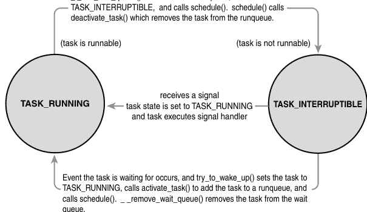

图 4.1 休眠与唤醒。

## 抢占与上下文切换

上下文切换（即从一个可运行任务切换到另一个任务）由定义在`kernel/sched.c`中的`context_switch()`函数处理。当一个新的进程被选中运行时，`schedule()`会调用它。它主要完成两项基本工作：

- 调用在`<asm/mmu_context.h>`中声明的`switch_mm()`，将虚拟内存映射从前一个进程切换到新进程。

- 调用在`<asm/system.h>`中声明的`switch_to()`，将处理器状态从前一个进程切换到当前进程。这涉及保存和恢复栈信息、处理器寄存器以及任何必须按进程维度管理和恢复的架构特定状态。

然而，内核必须知道何时调用`schedule()`。如果仅在代码显式调用时才执行`schedule()`，用户空间程序可能会无限期地运行。为此，内核提供了`need_resched`标志，用于表示是否应当进行重新调度（见表 4.1）。当进程应当被抢占时，`scheduler_tick()`会设置此标志；当优先级高于当前运行进程的进程被唤醒时，`try_to_wake_up()`会设置此标志。内核检查该标志，发现其被设置后，调用`schedule()`以切换到新进程。该标志向内核传递了一个信号：调度器应尽快被调用，因为另一个进程更值得运行。

表 4.1 访问和操作`need_resched`的函数

| 函数 | 用途 |
| --- | --- |
| `set_tsk_need_resched()` | 设置给定进程中的`need_resched`标志。 |
| `clear_tsk_need_resched()` | 清除给定进程中的`need_resched`标志。 |
| `need_resched()` | 测试`need_resched`标志的值；如果被设置则返回 true，否则返回 false。 |

在返回用户空间或从中断返回时，内核会检查`need_resched`标志。如果该标志被设置，内核在继续执行前将调用调度器。

该标志是针对每个进程的（per-process），而非简单的全局变量，因为访问进程描述符中的值（得益于`current`的速度以及其极高的缓存命中率）比访问全局变量更快。从历史上看，在 2.2 内核之前，该标志是全局的。在 2.2 和 2.4 版本中，该标志是`task_struct`内部的一个`int`。在 2.6 版本中，它被移到了`thread_info`结构体内部一个特殊标志变量的单个位中。

## 用户抢占

用户抢占发生在内核即将返回用户空间且`need_resched`被设置时，从而导致调度器被调用。如果内核正在返回用户空间，它知道自己处于一个安全的静止状态。换句话说，如果继续执行当前任务是安全的，那么选择一个新任务来执行同样也是安全的。因此，每当内核准备从中断返回或在系统调用之后返回用户空间时，都会检查`need_resched`的值。如果它被设置，调度器将被调用以选择一个新（更合适）的进程来执行。中断返回和系统调用返回这两条路径都依赖于硬件架构，且通常在`entry.S`中用汇编语言实现（该文件除内核入口代码外，还包含内核出口代码）。

简而言之，用户抢占可能发生在：

- 从系统调用返回用户空间时

- 从中断处理程序返回用户空间时


## 内核抢占

与大多数其他 Unix 变体和许多其他操作系统不同，Linux 内核是一个完全可抢占的内核。在非抢占式内核中，内核代码一直运行直到完成。也就是说，当任务处于内核态时，调度器无法对其重新调度——内核代码是以协作方式而非抢占方式调度的。内核代码运行直到其结束（返回用户空间）或显式阻塞。然而，在 2.6 内核中，Linux 内核变得可抢占：现在可以在任何时间点抢占一个任务，只要内核处于可以安全地重新调度的状态。

那么，什么时候重新调度才是安全的？只要任务在内核中运行且不持有锁，内核就可以抢占它。也就是说，锁被用作不可抢占区域的标记。由于内核是 SMP（对称多处理）安全的，如果没有持有锁，当前代码就是可重入的且可以被抢占。

支持内核抢占的第一项改动是在每个进程的`thread_info`中增加了一个抢占计数器`preempt_count`。该计数器初始值为零，每获取一个锁就增加一次，每释放一个锁就减少一次。当计数器为零时，内核是可抢占的。从中断返回时，如果返回到内核空间，内核会检查`need_resched`和`preempt_count`的值。如果`need_resched`被设置且`preempt_count`为零，则说明有一个更重要的任务可运行，且抢占是安全的。因此，调度器被调用。如果`preempt_count`非零，则表示持有锁，重新调度是不安全的。在这种情况下，中断将像往常一样返回到当前执行的任务。当当前任务持有所有锁都释放后，`preempt_count`回到零。此时，解锁代码会检查`need_resched`是否被设置。如果设置，则调用调度器。在内核代码中，有时需要启用或禁用内核抢占，这将在第 9 章中讨论。

内核抢占也可以显式发生，即当内核中的任务阻塞或显式调用`schedule()`时。这种形式的内核抢占一直受到支持，因为不需要额外的逻辑来确保内核处于可安全抢占的状态。它假设显式调用`schedule()`的代码知道此时重新调度是安全的。

内核抢占可能发生在：

- 中断处理程序退出，在返回内核空间之前
- 内核代码重新变为可抢占时
- 内核中的任务显式调用`schedule()`时
- 内核中的任务阻塞时（这会导致调用`schedule()`）

## 实时调度策略

Linux 提供了两种实时调度策略：`SCHED_FIFO`和`SCHED_RR`。普通的（非实时）调度策略是`SCHED_NORMAL`。通过调度类框架，这些实时策略不由完全公平调度器（CFS）管理，而是由定义在`kernel/sched_rt.c`中的一个特殊的实时调度器管理。本节其余部分将讨论实时调度策略和算法。

`SCHED_FIFO`实现了一种简单的先进先出（First-In, First-Out）调度算法，没有时间片。一个可运行的`SCHED_FIFO`任务总是优先于任何`SCHED_NORMAL`任务被调度。当一个`SCHED_FIFO`任务变为可运行时，它将继续运行直到其阻塞或显式出让处理器；它没有时间片，可以无限期运行。只有优先级更高的`SCHED_FIFO`或`SCHED_RR`任务才能抢占`SCHED_FIFO`任务。两个或多个具有相同优先级的`SCHED_FIFO`任务以轮询（round-robin）方式运行，但同样只有在它们显式选择出让时才会交出处理器。如果一个`SCHED_FIFO`任务可运行，所有较低优先级的任务在它变为不可运行之前都无法运行。

`SCHED_RR`与`SCHED_FIFO`相同，唯一区别是每个进程只能运行到耗尽预定的时间片为止。也就是说，`SCHED_RR`是带有时间片的`SCHED_FIFO`——它是一种实时轮询调度算法。当一个`SCHED_RR`任务耗尽时间片时，同一优先级的其他实时进程将按轮询方式调度。时间片仅用于允许相同优先级进程之间的重新调度。与`SCHED_FIFO`一样，高优先级进程总是立即抢占低优先级进程，而低优先级进程永远无法抢占`SCHED_RR`任务，即使后者的时间片已耗尽。

两种实时调度策略都实现了静态优先级。内核不对实时任务计算动态优先级值。这确保了给定优先级的实时进程总是能抢占较低优先级的进程。

Linux 中的实时调度策略提供的是软实时行为。*软实时*（Soft real-time）是指内核尝试在时间截止日期内调度应用程序，但内核并不保证始终能实现这些目标。相反，*硬实时*（hard real-time）系统保证在一定的限制内满足任何调度要求。Linux 不保证实时任务的调度能力。尽管没有一个能保证硬实时行为的设计，但 Linux 的实时调度性能相当出色。2.6 Linux 内核能够满足严格的时间要求。

实时优先级范围从 0 到`MAX_RT_PRIO`减 1（包含边界）。默认情况下，`MAX_RT_PRIO`为 100——因此，默认的实时优先级范围是 0 到 99。这个优先级空间与`SCHED_NORMAL`任务的 nice 值共享：它们使用从`MAX_RT_PRIO`到 (`MAX_RT_RT_PRIO` + 40) 的空间。默认情况下，这意味着 -20 到 +19 的 nice 范围直接映射到 100 到 139 的优先级空间。

## 与调度器相关的系统调用

Linux 提供了一组用于管理调度器参数的系统调用。这些系统调用允许操作进程优先级、调度策略和处理器亲和性，并提供了一种显式机制来将处理器*出让*（yield）给其他任务。

各种书籍——以及您友好的系统帮助页（man pages）——都提供了这些系统调用的参考（它们在 C 库中实现，没有太多包装——只是直接调用系统调用）。表 4.2 列出了这些系统调用并提供了简要描述。关于系统调用在内核中是如何实现的，将在第 5 章“系统调用”中讨论。

表 4.2 与调度器相关的系统调用

| 系统调用 | 描述 |
| --- | --- |
| `nice()` | 设置进程的 nice 值 |
| `sched_setscheduler()` | 设置进程的调度策略 |
| `sched_getscheduler()` | 获取进程的调度策略 |
| `sched_setparam()` | 设置进程的实时优先级 |
| `sched_getparam()` | 获取进程的实时优先级 |
| `sched_get_priority_max()` | 获取最高实时优先级 |
| `sched_get_priority_min()` | 获取最低实时优先级 |
| `sched_rr_get_interval()` | 获取进程的时间片值 |
| `sched_setaffinity()` | 设置进程的处理器亲和性 |
| `sched_getaffinity()` | 获取进程的处理器亲和性 |
| `sched_yield()` | 暂时出让处理器 |

### 调度策略及优先级相关系统调用

`sched_setscheduler()`和`sched_getscheduler()`系统调用分别用于设置和获取给定进程的调度策略和实时优先级。它们的实现与大多数系统调用一样，涉及大量的参数检查、设置和清理。然而，核心工作仅仅是读取或写入进程`task_struct`中的`policy`和`rt_priority`值。

`sched_setparam()`和`sched_getparam()`系统调用用于设置和获取进程的实时优先级。这些调用仅将`rt_priority`编码在一个特殊的`sched_param`结构体中。`sched_get_priority_max()`和`sched_get_priority_min()`调用分别返回给定调度策略的最高和最低优先级。实时策略的最高优先级为`MAX_USER_RT_PRIO`减 1；最低优先级为 1。

对于普通任务，`nice()`函数将给定进程的静态优先级增加指定数值。只有 root 用户可以提供负值，从而降低 nice 值并提高优先级。`nice()`函数调用内核的`set_user_nice()`函数，后者根据情况设置任务`task_struct`中的`static_prio`和`prio`值。

### 处理器亲和性系统调用

Linux 调度器强制执行硬处理器亲和性。也就是说，尽管它通过尝试将进程保持在同一个处理器上来提供软亲和性或自然亲和性，但调度器还允许用户声明：“无论如何，这个任务必须留在可用处理器的这个子集上。”这种硬亲和性在任务的`task_struct`中以`cpus_allowed`位掩码的形式存储。该位掩码在系统中每个可能的处理器上包含一个位。默认情况下，所有位都被设置，因此进程潜在地可以在任何处理器上运行。然而，用户可以通过`sched_setaffinity()`提供一个包含一个或多个位任意组合的不同位掩码。同样，`sched_getaffinity()`调用会返回当前的`cpus_allowed`位掩码。

内核以简单的方式强制执行硬亲和性。首先，当进程最初创建时，它继承其父进程的亲和性掩码。因为父进程运行在允许的处理器上，所以子进程也运行在允许的处理器上。其次，当处理器的亲和性发生变化时，内核使用*迁移线程*（migration threads）将任务推送到合法的处理器上。最后，负载均衡器仅将任务拉取到允许的处理器上。因此，进程永远只在进程描述符`cpus_allowed`字段中相应位被设置的处理器上运行。

### 出让处理器时间

Linux 提供了`sched_yield()`系统调用，作为进程显式地将处理器出让给其他等待进程的机制。其工作原理是将进程从活动数组（active array，因为它当前正在运行，所以在此数组中）中移除，并将其插入到过期数组（expired array）中。这不仅产生了抢占该进程并将其置于其优先级列表末尾的效果，而且还将其放入了过期列表——保证它在一段时间内不会运行。由于实时任务永不过期，它们是一个特例。因此，它们仅被移动到其优先级列表的末尾（而不会被插入到过期数组中）。在早期的 Linux 版本中，`sched_yield()`调用的语义完全不同；在最好的情况下，任务仅被移动到其优先级列表的末尾。这种出让往往持续时间不长。如今，应用程序甚至内核代码在调用`sched_yield()`之前，应确定它们确实想要放弃处理器。

为了方便，内核代码可以调用`yield()`，它会确保任务状态为`TASK_RUNNING`然后调用`sched_yield()`。用户空间应用程序则使用`sched_yield()`系统调用。

## 结论

进程调度器是任何内核的重要组成部分，因为运行进程（至少对我们大多数人来说）是使用计算机的初衷。然而，权衡进程调度的需求并非易事：大量的可运行进程、可扩展性问题、延迟与吞吐量之间的权衡，以及各种工作负载的需求，使得很难实现一种通用的算法。然而，Linux 内核新的 CFS 进程调度器通过一种新颖且有趣的方法，接近于满足所有参与者的需求，并为大多数用例提供了一个具有良好可扩展性的最佳解决方案。

前一章涵盖了进程管理。本章探讨了进程调度背后的理论，以及当前 Linux 内核使用的具体实现、算法和接口。下一章将介绍内核向运行进程提供的主要接口：系统调用。

## 5 系统调用

在任何现代操作系统中，内核都提供了一组接口，使得运行在*用户空间*（user-space）的进程可以与系统交互。这些接口为应用程序提供了受控的硬件访问权限、创建新进程并与现有进程通信的机制，以及请求其他操作系统资源的能力。这些接口充当应用程序与*内核*（kernel）之间的信使，应用程序发出各种请求，而*内核*负责执行这些请求（或返回错误）。这些接口的存在，以及应用程序不能随意直接执行任何操作的事实，是提供稳定系统的关键。

## 与内核通信

*系统调用*（System calls）在硬件和*用户空间*进程之间提供了一个层。这一层主要服务于三个目的。首先，它为*用户空间*提供了一个抽象的硬件接口。例如，在读写文件时，应用程序不关心磁盘的类型、介质，甚至不关心文件所在的文件系统类型。其次，系统调用确保了系统的安全性和稳定性。由于*内核*在系统资源和*用户空间*之间充当中间人，*内核*可以根据权限、用户和其他标准来仲裁访问。例如，这种仲裁可以防止应用程序错误地使用硬件、窃取其他进程的资源或以其他方式对系统造成损害。最后，在*用户空间*和系统其余部分之间建立一个统一的公共层，允许为进程提供虚拟化系统（详见第 3 章“进程管理”）。如果应用程序可以在*内核*不知情的情况下随意访问系统资源，那么实现多任务处理和虚拟内存几乎是不可能的，更不用说在保证稳定性和安全性的情况下实现了。在 Linux 中，*系统调用*是*用户空间*与*内核*交互的唯一手段；除了异常（exceptions）和陷阱（traps）之外，它们是进入*内核*的唯一合法入口点。事实上，其他接口（如设备文件或`/proc`）最终也是通过*系统调用*访问的。有趣的是，*Linux*实现的系统调用比大多数系统要少得多。

本章将探讨 Linux 中系统调用的作用及其实现。

## API、POSIX 和 C 库

通常，应用程序是针对在用户空间实现的应用程序编程接口（API）进行编程的，而不是直接调用系统调用。这一点非常重要，因为应用程序使用的接口与内核提供的实际接口之间不需要有直接的对应关系。API 定义了一组由应用程序使用的编程接口。这些接口可以实现为一个系统调用，可以通过多个系统调用实现，或者完全不需要使用系统调用来实现。同一个 API 可以存在于多个系统中，并为应用程序提供相同的接口，而 API 本身的实现可能因系统而异。图 5.1 举例说明了 POSIX API、C 库和系统调用之间的关系。

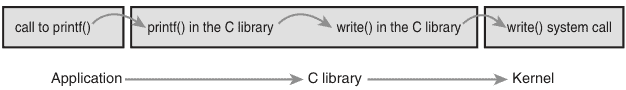

图 5.1 调用`printf()`时，应用程序、C 库和内核之间的关系。

Unix 世界中最常见的应用程序编程接口之一是基于 POSIX 标准的。从技术上讲，POSIX 由来自 IEEE² 的一系列标准组成，旨在提供一个大致基于 Unix 的可移植操作系统标准。Linux 在适用之处力求符合 POSIX 和 SUSv3 标准。

POSIX 是 API 与系统调用之间关系的绝佳示例。在大多数 Unix 系统上，POSIX 定义的 API 调用与系统调用之间存在强相关性。事实上，创建 POSIX 标准的目的就是为了模仿早期 Unix 系统提供的接口。另一方面，一些相当不“Unix”的系统（例如 Microsoft Windows）也提供了 POSIX 兼容库。

¹ x86 上大约有 335 个系统调用。（每个架构都被允许定义唯一的系统调用。）虽然并非所有操作系统都公布其准确的系统调用，但据估计，某些操作系统拥有超过一千个。在本书的上一个版本中，x86 仅有 250 个系统调用。

² IEEE (eye-triple-E) 是电气电子工程师学会。它是一个涉及众多技术领域的非营利专业协会，负责许多重要标准，例如 POSIX。欲了解更多信息，请访问 http://www.ieee.org。

Linux 的系统调用接口与大多数 Unix 系统一样，部分由 C 库提供。C 库实现了 Unix 系统上的主要 API，包括标准 C 库和系统调用接口。所有 C 程序都使用 C 库，并且由于 C 语言的特性，其他编程语言很容易对其进行封装以在自己的程序中使用。此外，C 库还提供了大部分 POSIX API。

从应用程序开发者的角度来看，系统调用是不相关的；开发者关心的是 API。相反，内核只关心系统调用；哪些库调用和应用程序使用了这些系统调用，内核并不关心。尽管如此，内核跟踪系统调用的潜在用途并尽可能保持系统调用的通用性和灵活性依然很重要。

一个关于 Unix 接口的迷因（meme）是“提供机制，而非策略”。换句话说，Unix 系统调用的存在是为了在抽象地提供某种特定功能。而该功能被使用的方式则不属于内核管辖的范围。

## Syscalls

系统调用（在 Linux 中通常称为 *syscalls*）通常通过 C 库中定义的函数调用来访问。它们可以定义零个、一个或多个参数（输入），并可能导致一个或多个副作用³，例如写入文件或将某些数据复制到提供的指针中。系统调用还提供一个`long`⁴类型的返回值，用于表示成功或错误——通常（但并非总是）负返回值表示错误。零返回值通常（同样并非总是）表示成功。当系统调用返回错误时，C 库会将一个特殊的错误代码写入全局变量`errno`中。该变量可以通过`perror()`等库函数转换为人类可读的错误信息。

最后，系统调用具有定义好的行为。例如，系统调用`getpid()`被定义为返回一个整数，即当前进程的 PID。该 syscall 在内核中的实现很简单：

```c
SYSCALL_DEFINE0(getpid)
{
    return task_tgid_vnr(current); // returns current->tgid
}
```

请注意，定义中并未提及实现细节。内核必须提供系统调用的预期行为，但只要结果正确，它可以随意选择任何实现方式。当然，这个系统调用极其简单，没有太多其他的实现方式。⁵

`SYSCALL_DEFINE0`仅仅是一个宏，用于定义一个没有参数（因此是 0）的系统调用。展开后的代码如下所示：

```c
asmlinkage long sys_getpid(void)
```

让我们来看看系统调用是如何定义的。首先，注意函数定义上的`asmlinkage`修饰符。这是一个指令，告知编译器仅在栈（stack）中查找该函数的参数。这是所有系统调用必须具备的修饰符。其次，函数返回一个`long`。为了保证 32 位和 64 位系统之间的兼容性，在用户空间定义为返回`int`的系统调用在内核中返回`long`。第三，请注意`getpid()`系统调用在内核中被定义为`sys_getpid()`。这是 Linux 中所有系统调用的命名约定：系统调用`bar()`在内核中实现为函数`sys_bar()`。

### 系统调用号

在 Linux 中，每个系统调用都被分配一个 syscall 编号。这是一个唯一的数字，用于引用特定的系统调用。当用户空间进程执行系统调用时，syscall 编号用于标识执行的是哪个 syscall；进程并不通过名称来引用 syscall。


`syscall` 编号非常重要；一旦分配，就不能更改，否则已编译的应用程序将会崩溃。同样，如果一个系统调用被删除，其系统调用号不能被回收，否则之前编译的代码在尝试调用一个系统调用时，实际上可能会调用另一个。Linux 提供了一个“未实现”的系统调用 `sys_ni_syscall()`，它除了返回 `-ENOSYS`（对应于无效系统调用的错误）之外什么也不做。该函数用于在极少数 syscall 被删除或变得不可用的情况下“填补漏洞”。

内核在系统调用表 `sys_call_table` 中保存所有已注册系统调用的列表。该表依赖于架构；在 x86-64 上，它定义在 `arch/i386/kernel/syscall_64.c` 中。该表将每个有效的 `syscall` 分配给一个唯一的 `syscall` 编号。

## 系统调用性能

Linux 中的系统调用比许多其他操作系统更快。部分原因是 Linux 快速的上下文切换时间；进入和退出内核是一个精简且简单的过程。另一个因素是系统调用处理程序以及单个系统调用本身的简洁性。

> ⁵ 你可能会好奇为什么 `getpid()` 返回的是 `tgid`（线程组 ID）？在普通进程中，TGID 等于 PID。在线程中，一个线程组内的所有线程具有相同的 TGID。这使得线程调用 `getpid()` 时能获得相同的 PID。

## 系统调用处理程序

用户空间应用程序无法直接执行内核代码。它们不能简单地调用存在于内核空间中的方法，因为内核存在于受保护的内存空间中。如果应用程序可以直接读写内核的地址空间，系统的安全性和稳定性将荡然无存。

相反，用户空间应用程序必须以某种方式向内核发出信号，表明它们想要执行系统调用，并让系统切换到内核模式，这样内核就可以代表应用程序在内核空间中执行该系统调用。

向内核发送信号的机制是软件中断：引发一个异常，系统将切换到内核模式并执行异常处理程序。在这种情况下，异常处理程序实际上就是系统调用处理程序。x86 上定义的软件中断是中断号 128，通过 `int $0x80` 指令触发。它会触发切换到内核模式并执行异常向量 `128`，即系统调用处理程序。该系统调用处理程序就是命名恰当的 `system_call()` 函数。它依赖于架构；在 x86-64 上，它在 `entry_64.S` 中用汇编语言实现⁶。

最近，x86 处理器增加了一项名为 `sysenter` 的功能。与使用 `int` 中断指令相比，该功能提供了一种更快、更专门的方式来陷入内核以执行系统调用。内核很快就增加了对该功能的支持。然而，无论系统调用处理程序如何被调用，核心概念都是用户空间通过某种方式引发异常或陷阱（trap）以进入内核。

## 指定正确的系统调用

仅仅进入内核空间是不够的，因为存在多个系统调用，且它们进入内核的方式相同。因此，必须将系统调用号传递到内核中。在 x86 上，`syscall` 编号通过 `eax` 寄存器传递给内核。在引发内核陷阱之前，用户空间将所需系统调用对应的编号放入 `eax` 中。然后，系统调用处理程序从 `eax` 中读取该值。其他架构也采取类似操作。

`system_call()` 函数通过将给定的系统调用号与 `NR_syscalls` 进行比较来检查其有效性。如果它大于或等于 `NR_syscalls`，函数返回 `-ENOSYS`。否则，调用指定的系统调用：

```asm
call *sys_call_table(,%rax,8)
```

由于系统调用表中的每个元素都是 64 位（8 字节），内核将给定的系统调用号乘以 8，以到达其在系统调用表中的位置。在 x86-32 上，代码类似，只是将 8 替换为 4。参见图 5.2。

³ 注意这里的“可能”。虽然几乎所有系统调用都有副作用（即导致系统状态的某种变化），但少数 syscall（如 `getpid()`）仅从内核返回一些数据。

⁴ 使用 `long` 类型是为了与 64 位架构兼容。

⁶ 以下关于系统调用处理程序的描述大部分基于 x86 版本。它们都非常相似。

图 5.2 调用系统调用处理程序并执行系统调用。

## 参数传递

除了系统调用号之外，大多数系统调用还需要向其传递一个或多个参数。用户空间必须在陷阱（trap）期间以某种方式将参数传递给内核。最简单的方法是通过与传递系统调用号相同的方式：将参数存储在寄存器中。在 x86-32 上，寄存器 `ebx`、`ecx`、`edx`、`esi` 和 `edi` 依次包含前五个参数。在极少数出现六个或更多参数的情况下，将使用单个寄存器来保存指向用户空间的指针，所有参数都存储在该空间中。

返回值同样通过寄存器发送到用户空间。在 x86 上，它被写入 `eax` 寄存器。

## 系统调用实现

Linux 中系统调用的实际实现不需要关注系统调用处理程序的行为。因此，向 Linux 添加一个新的系统调用相对容易。困难的工作在于设计和实现该系统调用；将其注册到内核则很简单。让我们来看看为 Linux 编写新系统调用的具体步骤。

## 实现系统调用

实现系统调用的第一步是定义其目的。它将做什么？每个系统调用应该有且仅有一个目的。在 Linux 中，不鼓励使用多路复用系统调用（即根据标志参数执行完全不同操作的单个系统调用）。将 `ioctl()` 视为一个“反面教材”。

新系统调用的参数、返回值和错误代码是什么？系统调用应该具有简洁且简单的接口，且参数数量尽可能少。系统调用的语义和行为至关重要；它们不能改变，因为现有应用程序将依赖于它们。要具有前瞻性；考虑该函数随着时间的推移可能会如何变化。能否在你的系统调用中添加新功能，还是任何更改都需要一个全新的函数？你是否能在不破坏向后兼容性的情况下轻松修复 Bug？许多系统调用提供了一个标志参数来解决前向兼容性问题。该标志不是用于在单个系统调用中复用不同的行为（如前所述，这是不可接受的），而是用于在不破坏向后兼容性或无需添加新系统调用的情况下，启用新功能和选项。

在设计接口时着眼于未来非常重要。你是否在不必要地限制该函数？设计系统调用时应尽可能通用。不要假设它今天的用途与明天的用途相同。系统调用的目的是恒定的，但其用途可能会改变。该系统调用是否具有可移植性？不要对架构的字长或字节序做假设。第 19 章“可移植性”讨论了这些问题。确保你没有做出在未来会导致系统调用崩溃的糟糕假设。记住 Unix 的格言：“提供机制，而非策略。”

当你编写系统调用时，你需要意识到可移植性和鲁棒性的必要性，不仅是现在，而且是在未来。基础的 Unix 系统调用经受住了时间的考验；其中大多数在今天仍然像 30 年前一样有用且适用！

### 验证参数

系统调用必须仔细验证其所有参数，以确保它们是有效且合法的。系统调用在内核空间运行，如果用户可以毫无限制地将无效输入传递给内核，系统的安全性和稳定性将受到影响。

例如，文件 I/O 系统调用必须检查文件描述符是否有效。与进程相关的函数必须检查提供的 PID 是否有效。必须检查每个参数，以确保它不仅有效且合法，而且是正确的。进程绝不能请求内核访问该进程没有权限访问的资源。

最重要的检查之一是用户提供的任何指针的有效性。想象一下，如果一个进程可以将任何指针未经检查地传递到内核中，甚至传递一个它没有读取权限的指针！那么进程就可以诱骗内核复制它没有访问权限的数据，例如属于另一个进程的数据或被映射为不可读的数据。在遵循指针进入用户空间之前，系统必须确保：

- 指针指向用户空间的一块内存区域。进程绝不能诱骗内核代表其读取内核空间中的数据。
- 指针指向进程地址空间内的一块内存区域。进程绝不能诱骗内核读取他人的数据。
- 如果是读取，内存必须被标记为可读。如果是写入，内存必须被标记为可写。如果是执行，内存必须被标记为可执行。进程绝不能绕过内存访问限制。

内核提供了两种方法来执行必要的检查以及在用户空间之间进行所需的数据复制。请注意，内核代码绝对不能盲目地遵循指针进入用户空间！必须始终使用这两种方法之一。

对于写入用户空间，提供了 `copy_to_user()` 方法。它接收三个参数。第一个是进程地址空间中的目标内存地址。第二个是内核空间中的源指针。最后一个参数是要复制数据的字节数。

对于从用户空间读取，`copy_from_user()` 方法与 `copy_to_user()` 类似。该函数将第三个参数指定的字节数从第二个参数读取到第一个参数中。

这两个函数在出错时都会返回未能复制的字节数。成功时返回零。在这种错误情况下，系统调用标准地返回 `-EFAULT`。

让我们考虑一个同时使用 `copy_from_user()` 和 `copy_to_user()` 的示例系统调用。这个名为 `silly_copy()` 的系统调用完全没有实际价值；它将数据从第一个参数复制到第二个参数。这是次优的，因为它涉及一次冗余的中间复制到内核空间，且没有任何收益。但它有助于阐明该观点。

```c
/*
 * silly_copy - pointless syscall that copies the len bytes from
 * 'src' to 'dst' using the kernel as an intermediary in the copy.
 * Inteded as an example of copying to and from the kernel.
 */
SYSCALL_DEFINE3(silly_copy,
                unsigned long *, src,
                unsigned long *, dst,
                unsigned long len)
{
    unsigned long buf;

    /* copy src, which is in the user's address space, into buf */
    if (copy_from_user(&buf, src, len))
        return -EFAULT;

    /* copy buf into dst, which is in the user's address space */
    if (copy_to_user(dst, &buf, len))
        return -EFAULT;

    /* return amount of data copied */
    return len;
}
```

`copy_to_user()` 和 `copy_from_user()` 都可能会阻塞。例如，如果包含用户数据的页面不在物理内存中而被交换到了磁盘上，就会发生这种情况。在这种情况下，进程将进入睡眠状态，直到页错误处理程序能将该页面从磁盘的交换文件中带回物理内存。

最后一项可能的检查是有效权限。在旧版本的 Linux 中，需要 root 权限的系统调用标准做法是使用 `user()`。该函数仅检查用户是否为 root；现在这已被移除，取而代之的是一个更细粒度的“能力（capabilities）”系统。新系统能够对特定资源进行特定的访问检查。调用 `capable()` 并传递一个有效的能力标志，如果调用者拥有指定的权限则返回非零值，否则返回零。例如，`capable(CAP_SYS_NICE)` 检查调用者是否有能力修改其他进程的 nice 值。默认情况下，超级用户拥有所有能力，而非 root 用户则没有。例如，这里是 `reboot()` 系统调用。请注意它的第一步是确保调用进程具有 `CAP_SYS_REBOOT` 权限。如果删除那个条件语句，任何进程都可以重启系统。

```c
SYSCALL_DEFINE4(reboot,
                int, magic1,
                int, magic2,
                unsigned int, cmd,
                void __user *, arg)
{
    char buffer[256];
    
    /* We only trust the superuser with rebooting the system. */
    if (!capable(CAP_SYS_BOOT))
        return -EPERM;
    
    /* For safety, we require "magic" arguments. */
    if (magic1 != LINUX_REBOOT_MAGIC1 ||
        (magic2 != LINUX_REBOOT_MAGIC2 &&
         magic2 != LINUX_REBOOT_MAGIC2A &&
         magic2 != LINUX_REBOOT_MAGIC2B &&
         magic2 != LINUX_REBOOT_MAGIC2C))
        return -EINVAL;
    
    /* Instead of trying to make the power_off code look like
     * halt when pm_power_off is not set do it the easy way.
     */
    if ((cmd == LINUX_REBOOT_CMD_POWER_OFF) && !pm_power_off)
        cmd = LINUX_REBOOT_CMD_HALT;
    
    lock_kernel();
    switch (cmd) {
    case LINUX_REBOOT_CMD_RESTART:
        kernel_restart(NULL);
        break;
    
    case LINUX_REBOOT_CMD_CAD_ON:
        C_A_D = 1;
        break;
```

```c
case LINUX_REBOOT_CMD_CAD_OFF:
    C_A_D = 0;
    break;

case LINUX_REBOOT_CMD_HALT:
    kernel_halt();
    unlock_kernel();
    do_exit(0);
    break;

case LINUX_REBOOT_CMD_POWER_OFF:
    kernel_power_off();
    unlock_kernel();
    do_exit(0);
    break;

case LINUX_REBOOT_CMD_RESTART2:
    if (strncpy_from_user(&buffer[0], arg, sizeof(buffer) - 1) < 0) {
        unlock_kernel();
        return -EFAULT;
    }
    buffer[sizeof(buffer) - 1] = '\0';

    kernel_restart(buffer);
    break;

default:
    unlock_kernel();
    return -EINVAL;
}
unlock_kernel();
return 0;
```

请参阅 `<linux/capability.h>` 以获取所有能力（capabilities）及其所包含权利的列表。

## 系统调用上下文

正如第 3 章中所讨论的，内核在执行系统调用期间处于进程上下文（process context）中。`current` 指针指向当前任务，即发出系统调用的进程。

在进程上下文中，内核能够睡眠（例如，如果系统调用在某个调用上阻塞或显式调用 `schedule()`）并且是完全可抢占的。这两点非常重要。首先，能够睡眠意味着系统调用可以使用内核的大部分功能。正如我们在第 7 章“中断与中断处理程序”中将看到的，睡眠能力大大简化了内核编程。⁷ 进程上下文可抢占这一事实意味着，与用户空间一样，当前任务可能会被另一个任务抢占。由于新任务随后可能会执行相同的系统调用，因此必须小心确保系统调用是可重入的。当然，这也是对称多处理（SMP）所带来的同样问题。关于同步重入性的内容将在第 9 章“内核同步简介”和第 10 章“内核同步方法”中介绍。

当系统调用返回时，控制权回到 `system_call()`，它最终会切换到用户空间并继续执行用户进程。

## 绑定系统调用的最后步骤

系统调用编写完成后，将其注册为正式系统调用就非常简单了：

1. 在系统调用表的末尾添加一个条目。这需要为每个支持该系统调用的架构执行（对于大多数调用，是指所有架构）。系统调用在表中的位置（从 0 开始）就是它的系统调用号。例如，列表中的第十个条目被分配为系统调用号 9。
2. 为每个支持的架构在 `<asm/unistd.h>` 中定义该系统调用号。
3. 将系统调用编译进内核镜像中（而不是编译为模块）。这可以简单地将系统调用放在 `kernel/` 目录下的相关文件中，例如存放各种杂项系统调用的 `sys.c`。

我们通过一个虚构的系统调用 `foo()` 来详细查看这些步骤。首先，我们想将 `sys_foo()` 添加到系统调用表中。对于大多数架构，该表位于 `entry.S` 中，外观如下：

```asm
ENTRY(sys_call_table)
    .long sys_restart_syscall   /* 0 */
    .long sys_exit
    .long sys_fork
    .long sys_read
    .long sys_write
    .long sys_open             /* 5 */

    ...

    .long sys_eventfd2
    .long sys_epoll_create1
    .long sys_dup3              /* 330 */
```

> ⁷ 中断处理程序不能睡眠，因此它们能做的事情比在进程上下文中运行的系统调用要受限得多。

```asm
.long sys_pipe2
.long sys_inotify_init1
.long sys_preadv
.long sys_pwritev
.long sys_rt_tsiggueueinfo    /* 335 */
.long sys_perf_event_open
.long sys_recvmmsg
```


随后将新的系统调用附加到此列表的末尾：

```
.long sys_foo
```

虽然没有明确指定，但该系统调用随后会被赋予下一个连续的系统调用号——在本例中为 338。对于你想要支持的每个架构，都必须将该系统调用添加到该架构的系统调用表中。系统调用在不同架构下不需要接收相同的调用号，因为系统调用号是该架构唯一 ABI 的一部分。通常，你会希望让每个架构都能使用该系统调用。注意每五个条目在注释中放置一个数字的惯例；这使得查找哪个系统调用被分配了哪个数字变得非常容易。

接下来，将系统调用号添加到 `<asm/unistd.h>` 中，目前的样式大致如下：

```
/*
 * This file contains the system call numbers.
 */

#define __NR_restart_syscall    0
#define __NR_exit               1
#define __NR_fork               2
#define __NR_read               3
#define __NR_write              4
#define __NR_open               5

...

#define __NR_signalfd           327
#define __NR_eventfd2           328
#define __NR_epoll_create1      329
#define __NR_dup3               330
#define __NR_pipe2              331
#define __NR_inotify_init1      332
#define __NR_preadv             333
#define __NR_pwritev            334
#define __NR_rt_tsiggueueinfo   335
#define __NR_perf_event_open    336
#define __NR_recvmmsg           337
```

然后在列表末尾添加以下内容：

```
#define __NR_foo                338
```

最后，实现实际的 `foo()` 系统调用。因为系统调用必须在所有配置中被编译进核心内核镜像，所以在本例中我们将其定义在 `kernel/sys.c` 中。你应该将其放在函数最相关的地方；例如，如果函数与调度相关，你可以将其定义在 `kernel/sched.c` 中。

```c
#include <asm/page.h>

/*
 * sys_foo - 每个人最喜欢的系统调用。
 *
 * 返回每个进程内核栈的大小。
 */
asmlinkage long sys_foo(void)
{
	return THREAD_SIZE;
}
```

就这样！启动这个内核，用户空间就可以调用 `foo()` 系统调用了。

## 从用户空间访问系统调用

通常，C 库为系统调用提供支持。用户应用程序可以从标准头文件中引入函数原型，并与 C 库链接以使用你的系统调用（或者使用进而调用你的系统调用的库例程）。然而，如果你刚刚写完这个系统调用，glibc 几乎不可能已经支持它！

幸好，Linux 提供了一组宏来封装对系统调用的访问。它负责设置寄存器内容并发出陷阱（trap）指令。这些宏被命名为 `_syscallN()`，其中 *n* 在 0 到 6 之间。该数字对应于传递给系统调用的参数数量，因为宏需要知道预期多少个参数，从而将其压入寄存器。例如，考虑定义为如下形式的 `open()` 系统调用：

```c
long open(const char *filename, int flags, int mode)
```

在没有显式库支持的情况下，使用此系统调用的系统调用宏将是：

```c
#define __NR_open 5
_syscall3(long, open, const char *, filename, int, flags, int, mode)
```

然后，应用程序就可以直接调用 `open()`。

对于每个宏，有 $2 + 2 \times n$ 个参数。第一个参数对应于系统调用的返回类型。第二个是系统调用的名称。接下来是系统调用中每个参数的类型和名称，顺序一致。`__NR_open` 定义在 `<asm/unistd.h>` 中，它是系统调用号。`_syscall3` 宏展开为一个带有内联汇编的 C 函数；该汇编执行前一节讨论的步骤，将系统调用号和参数压入正确的寄存器，并发出软件中断以陷入内核。在应用程序中放置此宏即可使用 `open()` 系统调用。

让我们编写一个宏来使用我们精彩的新 `foo()` 系统调用，然后写一些测试代码来展示我们的成果。

```c
#define __NR_foo 283
__syscall0(long, foo)

int main ()
{
    long stack_size;

    stack_size = foo ();
    printf ("The kernel stack size is %ld\n", stack_size);

    return 0;
}
```

## 为什么不要实现系统调用

前几节展示了实现一个新的系统调用很简单，但这绝不应该鼓励你去这么做。事实上，在添加新系统调用时应保持谨慎和克制。通常，有比提供新系统调用更可行的替代方案。让我们来看看其优缺点和替代方案。

将新接口实现为系统调用的优点如下：

- 系统调用实现简单，易于使用。

- Linux 上的系统调用性能很快。

缺点：

- 你需要一个系统调用号，这需要被官方正式分配给你。

- 一旦系统调用进入稳定版本的内核，它就被“刻在石头上”了。如果不破坏用户空间应用程序，接口就无法更改。

- 每个架构都需要单独注册并支持该系统调用。

- 系统调用不易在脚本中使用，且无法直接从文件系统访问。

- 因为需要分配的系统调用号，在主内核树之外维护和使用系统调用很困难。

- 对于简单的信息交换，系统调用过于冗余（overkill）。

替代方案：

- 实现一个设备节点，并对其进行 `read()` 和 `write()` 操作。使用 `ioctl()` 来操纵特定设置或检索特定信息。

- 某些接口，例如*信号量（semaphores）*，可以被表示为文件描述符并以此方式进行操作。

- 将信息作为文件添加到 *sysfs* 的相应位置。

对于许多接口，系统调用是正确答案。然而，Linux 试图避免简单地避免为每一个出现的新抽象而增加一个系统调用。其结果是得到了一个极其简洁的系统调用层，很少有令人遗憾或被废弃（不再使用或支持的接口）的情况。新系统调用增加速度缓慢，这标志着 Linux 是一个相对稳定且功能完备的操作系统。

## 结论

在本章中，我们讨论了什么是系统调用，以及它们如何与库调用和应用程序编程接口 (API) 关联。然后，我们研究了 Linux 内核如何实现系统调用，以及执行系统调用所需的事件链：陷入（trapping）内核、传递系统调用号及任何参数、执行正确的系统调用函数，以及携带系统调用的返回值返回用户空间。

随后，我们介绍了如何添加系统调用，并提供了一个在用户空间使用新系统调用的简单示例。整个过程非常简单！正如添加新系统调用的简洁性所表明的那样，所有的工作都在系统调用的具体实现中。本书的其余部分将讨论编写行为良好、高效且安全的系统调用所需的概念和内核接口。

最后，我们通过讨论实现系统调用的优缺点，以及一个关于替代新增系统调用方案的简短列表来结束本章。

## 内核数据结构

本章介绍了几个用于 Linux 内核代码的内置数据结构。与任何大型软件项目一样，Linux 内核提供这些通用数据结构和原语以鼓励代码复用。内核开发人员应尽可能使用这些数据结构，而不要“自行开发”解决方案。在接下来的章节中，我们将涵盖这些通用数据结构中最有用的部分，具体包括：

- 链表 (Linked lists)

- 队列 (Queues)

- 映射 (Maps)

- 二叉树 (Binary trees)

我们在本章结束时将讨论算法复杂度，即算法和数据结构扩展以支持更大输入的难易程度。

## 链表

链表是 Linux 内核中最简单且最常见的数据结构。链表是一种允许存储和操作可变数量元素（称为链表的节点）的数据结构。与静态数组不同，链表中的元素是动态创建并插入到链表中的。这使得管理在编译时未知数量的元素成为可能。由于元素在不同时间被创建，它们不一定占据内存中的连续区域。因此，元素需要被链接在一起；因此，链表中的每个元素都包含一个指向下一个元素的指针。当元素被添加到链表或从链表中删除时，只需调整指向下一个节点的指针即可。

### 单向链表和双向链表

代表这种链表的最简单数据结构可能类似于以下内容：

```c
/* an element in a linked list */
struct list_element {
    void    *data;            /* the payload */
    struct list_element *next;   /* pointer to the next element */
};
```

图 6.1 是一个链表。


**图 6.1** 一个单向链表。

在某些链表中，每个元素还包含一个指向*前一个*元素的指针。这些链表被称为*双向链表*，因为它们在向前和向后方向上都进行了链接。像图 6.1 中那样没有指向前一个元素指针的链表被称为*单向链表*。

代表双向链表的数据结构看起来类似于这样：

```c
/* an element in a linked list */
struct list_element {
    void    *data;            /* the payload */
    struct list_element *next;   /* pointer to the next element */
    struct list_element *prev;   /* pointer to the previous element */
};
```

图 6.2 是一个双向链表。

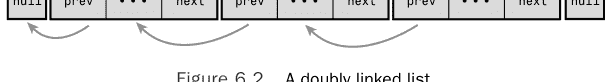

**图 6.2** 一个双向链表。

### 循环链表

通常，由于链表中的最后一个元素没有下一个元素，它被设置为指向一个特殊值（例如 `NULL`），以表示它是链表中的最后一个元素。在某些链表中，最后一个元素*并不*指向特殊值。相反，它指向第一个值。这种链表被称为*循环链表*，因为链表是循环的。循环链表可以分为双向和单向两种版本。在循环双向链表中，第一个节点的“前一个”指针指向最后一个节点。图 6.3 和 6.4 分别是单向循环链表和双向循环链表。

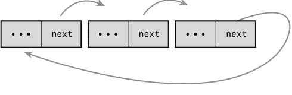

图 6.3 一个单向循环链表。

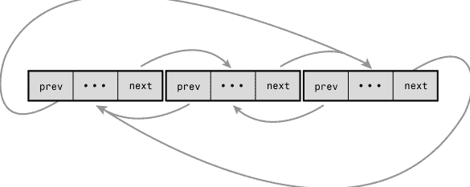

图 6.4 一个双向循环链表。

虽然 Linux 内核的链表实现非常独特，但它在本质上是一个*循环双向链表*。使用这种类型的链表可以提供最大的灵活性。

### 在链表中移动

在链表中的移动是线性发生的。你访问一个元素，跟随 `next` 指针，然后访问下一个元素。如此循环往复。这是在链表中移动最简单的方法，也是链表最擅长的应用场景。对于随机访问是重要操作的使用场景，链表并不适用。相反，当你需要遍历整个列表且需要动态添加和删除元素时，请使用链表。

在链表实现中，第一个元素通常由一个特殊的指针——称为*头指针（head）*——来表示，以便轻松访问链表的“起始”位置。在非循环链表中，最后一个元素通过其 `next` 指针为 `NULL` 来界定。在循环链表中，最后一个元素通过其指向头元素来界定。因此，遍历链表是从第一个到最后一个元素的线性过程。在双向链表中，移动也可以反向进行，即从最后一个元素线性移动到第一个元素。当然，给定链表中的某个特定元素，你也可以向后或向前迭代任意数量的元素，而无需遍历整个链表。

### Linux 内核的实现

与大多数链表实现（包括前几节描述的通用方法）相比，Linux 内核的实现非常独特。回顾之前的讨论，维护链表中的数据（或一组数据，如 struct）是通过在数据中添加一个 `next`（可能还有 `prev`）节点指针来实现的。例如，假设我们有一个 `fox` 结构体来描述犬科成员：

```c
struct fox {
    unsigned long tail_length;  /* length in centimeters of tail */
    unsigned long weight;       /* weight in kilograms */
    bool           is_fantastic;/* is this fox fantastic? */
};
```

将此结构存储在链表中的常见模式是将链表指针嵌入到结构体中。例如：

```c
struct fox {
    unsigned long tail_length;  /* length in centimeters of tail */
    unsigned long weight;       /* weight in kilograms */
    bool           is_fantastic;/* is this fox fantastic? */
    struct fox    *next;        /* next fox in linked list */
    struct fox    *prev;        /* previous fox in linked list */
};
```

Linux 内核的方法则不同。Linux 的方法不是将结构体转化为链表，而是在结构体中嵌入一个链表节点！

### 链表结构

在过去，内核中有多种链表的实现。为了消除重复代码，需要一个统一且强大的链表实现。在 2.1 内核开发系列期间，正式的内核链表实现被引入。现在所有现有的链表使用都采用该正式实现；不要重复造轮子！

链表代码声明在头文件 `<linux/list.h>` 中，其数据结构非常简单：

```c
struct list_head {
    struct list_head *next;
    struct list_head *prev;
};
```

`next` 指针指向下一个列表节点，`prev` 指针指向前一个列表节点。然而，表面上看，这并没有特别大的用处。一个由链表节点组成的巨大链表...能有什么价值？其效用在于 `list_head` 结构体的使用方式：

```c
struct fox {
    unsigned long    tail_length;  /* 尾巴长度，单位为厘米 */
    unsigned long    weight;       /* 重量，单位为公斤 */
    bool             is_fantastic; /* 这只狐狸是否很神奇？ */
    struct list_head list;          /* 所有 fox 结构体的链表 */
};
```

通过这种方式，`fox` 中的 `list.next` 指向下一个元素，而 `fox` 中的 `list.prev` 指向前一个元素。现在这已经开始变得有用，但接下来的部分会更精彩。内核提供了一系列用于操作链表的例程。例如，`list_add()` 方法将一个新节点添加到现有的链表中。然而，这些方法是通用的：它们仅接收 `list_head` 结构体。通过使用 `container_of()` 宏，我们可以轻松地找到包含任何给定成员变量的父结构体。这是因为在 C 语言中，给定变量在结构体中的偏移量在编译时由 ABI 固定。

```c
#define container_of(ptr, type, member) ({\
    const typeof( ((type *)0)->member ) *__mptr = (ptr);     \
    (type *)( (char *)__mptr - offsetof(type,member) );})
```

利用 `container_of()`，我们可以定义一个简单的函数来返回包含任何 `list_head` 的父结构体：

```c
#define list_entry(ptr, type, member) \
    container_of(ptr, type, member)
```

凭借 `list_entry()`，内核提供了创建、操作以及管理链表的例程——而无需了解 `list_head` 所在的结构体具体是什么。

## 定义链表

如前所示，`list_head` 本身是没有价值的；它通常被嵌入在您自己的结构体中：

```c
struct fox {
    unsigned long    tail_length;  /* 尾巴长度，单位为厘米 */
    unsigned long    weight;       /* 重量，单位为公斤 */
    bool             is_fantastic; /* 这只狐狸是否很神奇？ */
    struct list_head list;          /* 所有 fox 结构体的链表 */
};
```

链表在被使用之前需要初始化。由于大多数元素是动态创建的（这可能就是您需要链表的原因），初始化链表最常见的方法是在运行时进行：

```c
struct fox *red_fox;
red_fox = kmalloc(sizeof(*red_fox), GFP_KERNEL);
red_fox->tail_length = 40;
red_fox->weight = 6;
red_fox->is_fantastic = false;
INIT_LIST_HEAD(&red_fox->list);
```


如果结构体是在编译时静态创建的，并且您拥有对它的直接引用，您可以简单地这样做：

```c
struct fox red_fox = {
    .tail_length = 40,
    .weight = 6,
    .list = LIST_HEAD_INIT(red_fox.list),
};
```

## 链表头 (List Heads)

前一节展示了如何轻松地将一个现有结构体（例如我们的 `struct fox` 示例）转换为链表。通过简单的代码更改，我们的结构体现在可以由内核的链表例程来管理了。但在使用这些例程之前，我们需要一个规范的指针来指代整个链表——即头指针（head pointer）。

内核链表实现的一个巧妙之处在于，我们的狐狸节点是不可区分的。每个节点都包含一个 `list_head`，我们可以从任何一个节点迭代到下一个，直到遍历完所有节点。这种方法很优雅，但通常您会想要一个特殊的指针来指代您的链表，而该指针本身不是一个链表节点。有趣的是，这个特殊的节点实际上就是一个普通的 `list_head`：

```c
static LIST_HEAD(fox_list);
```

这定义并初始化了一个名为 `fox_list` 的 `list_head`。大多数链表例程接收一个或两个参数：头节点，或者头节点加上一个实际的链表节点。让我们来看看这些例程。

## 操作链表

内核提供了一系列用于操作链表的函数。它们都接收一个或多个 `list_head` 结构体的指针。这些函数在通用 C 中实现为内联函数，可以在 `<linux/list.h>` 中找到。

有趣的是，所有这些函数的时间复杂度都是 O(1)。¹ 这意味着无论链表的大小或任何其他输入如何，它们都在恒定时间内执行。例如，无论链表有 3 个还是 3,000 个条目，向链表添加或删除一个条目的时间都是相同的。这或许并不令人惊讶，但仍然值得了解。

### 向链表添加节点

向链表添加节点：

```c
list_add(struct list_head *new, struct list_head *head)
```

> ¹ 请参阅本章稍后的“算法复杂度”部分，以了解关于 O(1) 的讨论。

此函数将新节点添加到给定链表的 *head* 节点**之后**。由于链表是循环的，且通常没有“第一个”或“最后一个”节点的概念，您可以传递任何元素作为 *head*。但是，如果您传递的是“最后一个”元素，此函数可用于实现栈。

回到我们的狐狸示例，假设我们有一个新的 `struct fox` 想要添加到 `fox_list` 链表中。我们将这样做：

```c
list_add(&f->list, &fox_list);
```

将节点添加到链表末尾：

```c
list_add_tail(struct list_head *new, struct list_head *head)
```

此函数将新节点添加到给定链表的 *head* 节点**之前**。与 `list_add()` 一样，由于链表是循环的，您通常可以传递任何元素作为 *head*。但是，如果您传递的是“第一个”元素，此函数可用于实现队列。

### 从链表删除节点

在向链表添加节点之后，删除节点是下一个最重要的操作。要从链表删除节点，请使用 `list_del()`：

```c
list_del(struct list_head *entry)
```

此函数将 *entry* 从链表中移除。请注意，它不会释放属于 *entry* 或其嵌入的数据结构的任何内存；此函数仅仅是将元素从链表中移除。调用此函数后，您通常需要销毁您的数据结构及其内部的 `list_head`。

例如，要删除之前添加到 `fox_list` 的狐狸节点：

```c
list_del(&f->list);
```

请注意，该函数不接收 `fox_list` 作为输入。它仅接收一个特定的节点，并修改前一个和后一个节点的指针，使得给定节点不再是链表的一部分。其实现具有启发意义：

```c
static inline void __list_del(struct list_head *prev, struct list_head *next)
{
    next->prev = prev;
    prev->next = next;
}

static inline void list_del(struct list_head *entry)
{
    __list_del(entry->prev, entry->next);
}
```

要从链表中删除节点并重新初始化它，内核提供了 `list_del_init()`：

```c
list_del_init(struct list_head *entry)
```

此函数的行为与 `list_del()` 相同，不同之处在于它还会重新初始化给定的 `list_head`，理由是您不再希望该条目在链表中，但您可以重复使用数据结构本身。

### 移动和拼接链表节点

将节点从一个链表移动到另一个链表：

```c
list_move(struct list_head *list, struct list_head *head)
```

此函数将链表条目从其所在的链表中移除，并将其添加到给定链表的 head 元素之后。

将节点从一个链表移动到另一个链表的末尾：

```c
list_move_tail(struct list_head *list, struct list_head *head)
```

此函数的作用与 `list_move()` 相同，但将链表元素插入到 head 条目之前。

检查链表是否为空：

```c
list_empty(struct list_head *head)
```

如果给定链表为空，则返回非零值；否则返回零。

将两个不相连的链表拼接在一起：

```c
list_splice(struct list_head *list, struct list_head *head)
```

此函数通过将 `list` 指向的链表插入到给定链表的 head 元素之后，将两个链表拼接在一起。

将两个不相连的链表拼接在一起并重新初始化原链表：

```c
list_splice_init(struct list_head *list, struct list_head *head)
```

此函数的作用与 `list_splice()` 相同，不同之处在于被清空的 `list` 所指向的链表会被重新初始化。

### 节省几次解引用

> 如果您恰好已经拥有 `next` 和 `prev` 指针，您可以通过直接调用内部链表函数来节省几个 CPU 周期（具体来说是获取指针的解引用操作）。之前讨论的每个函数实际上除了查找 `next` 和 `prev` 指针然后调用内部函数之外，什么都不做。内部函数通常与它们的封装函数同名，只不过带有双下划线前缀。例如，与其调用 `list_del(list)`，您可以调用 `__list_del(prev, next)`。这仅在 next 和 previous 指针已经解引用的情况下才有用。否则，您只是在写丑陋的代码。请参阅头文件 `<linux/list.h>` 以获取确切的接口。

## 遍历链表

现在你已经知道如何在内核中声明、初始化和操作链表了。这固然很好，但如果你没有办法访问你的数据，这一切都没有意义！链表只是持有重要数据的容器；你需要一种方法通过列表来移动并访问包含数据的实际结构。内核（谢天谢地）提供了一套很好的接口来遍历链表并引用包含它们的数据结构。

请注意，与列表操作例程不同，遍历整个链表显然是一个 `O(n)` 操作，其中 `n` 是列表中的项数。

## 基础方法

遍历列表最基本的方法是使用 `list_for_each()` 宏。该宏接收两个参数，均为 `list_head` 结构。第一个是指向当前项的指针；它是一个你必须提供的临时变量。第二个是作为你要遍历的列表头节点的 `list_head`（参见之前的“列表头”章节）。在每次循环迭代中，第一个参数指向列表中的下一项，直到访问完所有项。用法如下：

```c
struct list_head *p;

list_for_each(p, fox_list) {
    /* p 指向列表中的一项 */
}
```

嗯，这依然没什么用！指向列表结构的指针通常没有太大价值；我们需要的是指向包含 `list_head` 的结构的指针。例如，在之前的 `fox` 结构示例中，我们需要的是每个 `fox` 的指针，而不是结构中 `list` 成员的指针。我们可以使用之前讨论过的 `list_entry()` 宏来检索包含给定 `list_head` 的结构。例如：

```c
struct list_head *p;
struct fox *f;

list_for_each(p, &fox_list) {
    /* f 指向嵌入了列表的结构 */
    f = list_entry(p, struct fox, list);
}
```

## 实用方法

之前的方法虽然阐明了 `list_head` 节点的工作原理，但代码不够直观且不优雅。因此，大多数内核代码使用 `list_for_each_entry()` 宏来遍历链表。该宏处理了 `list_entry()` 执行的工作，使列表迭代变得简单：

```c
list_for_each_entry(pos, head, member)
```

这里，`pos` 是指向包含 `list_head` 节点的对象的指针。你可以将其视为 `list_entry()` 的返回值。`head` 是指向你想要开始迭代的 `list_head` 头节点的指针——在之前的示例中，`fox_list.member` 是 `pos` 中 `list_head` 结构的变量名（即示例中的 `list`）。这听起来可能很令人困惑，但使用起来很简单。以下是我们如何重写之前的 `list_for_each()` 来迭代每个 fox 节点：

```c
struct fox *f;

list_for_each_entry(f, &fox_list, list) {
    /* 每次迭代中，'f' 指向下一个 fox 结构 ... */
}
```

现在让我们看一个来自 `inotify`（内核的文件系统通知系统）的真实示例：

```c
static struct inotify_watch *inode_find_handle(struct inode *inode,
                                               struct inotify_handle *ih)
{
    struct inotify_watch *watch;

    list_for_each_entry(watch, &inode->inotify_watches, i_list) {
        if (watch->ih == ih)
            return watch;
    }

    return NULL;
}
```

该函数遍历 `inode->inotify_watches` 列表中的所有项。每项的类型为 `struct inotify_watch`，且该结构中的 `list_head` 名称为 `i_list`。在每次循环迭代中，`watch` 指向列表中的一个新节点。这个简单函数的目的是在提供的 `inode` 结构中的 `inotify_watches` 列表中搜索，以找到一个其 `inotify_handle` 与提供的句柄匹配的 `inotify_watch` 项。

## 反向遍历列表

`list_for_each_entry_reverse()` 宏的工作方式与 `list_for_each_entry()` 完全相同，不同之处在于它反向遍历列表。也就是说，它不是沿着 next 指针向前遍历，而是沿着 prev 指针向后遍历。用法与 `list_for_each_entry()` 相同：

```c
list_for_each_entry_reverse(pos, head, member)
```

只有少数原因需要选择反向遍历列表。一是性能：如果你知道要搜索的项目很可能在搜索起始节点的**后面**，你可以尝试反向移动以期望更快地找到它。第二个原因是排序很重要。例如，如果你将链表用作栈，你可以从尾部反向遍历列表，以实现*后进先出 (LIFO)* 顺序。如果你没有明确的理由反向遍历列表，请不要这样做——直接使用 `list_for_each_entry()` 即可。

## 边删除边遍历

如果你在遍历时需要从列表中删除项，标准的列表迭代方法是不合适的。标准方法依赖于列表项在迭代过程中不会发生改变的事实，因此如果在循环体中删除了当前项，随后的迭代将无法前进到下一个（或前一个）指针。这是循环中的一种常见模式，程序员通过在潜在的删除操作*之前*将下一个（或前一个）指针存储在临时变量中来解决。Linux 内核提供了一个例程来为你处理这种情况：

```c
list_for_each_entry_safe(pos, next, head, member)
```

你以与 `list_for_each_entry()` 相同的方式使用此版本，不同之处在于你需要提供 `next` 指针，其类型与 `pos` 相同。`list_for_each_entry_safe()` 宏使用 `next` 指针来存储列表中的下一项，从而使得删除当前项变得安全。让我们再看一个 inotify 中的示例：

```c
void inotify_inode_is_dead(struct inode *inode)
{
    struct inotify_watch *watch, *next;

    mutex_lock(&inode->inotify_mutex);
    list_for_each_entry_safe(watch, next, &inode->inotify_watches, i_list) {
        struct inotify_handle *ih = watch->ih;
        mutex_lock(&ih->mutex);
        inotify_remove_watch_locked(ih, watch); /* 删除 watch */
        mutex_unlock(&ih->mutex);
    }
    mutex_unlock(&inode->inotify_mutex);
}
```

该函数遍历并删除 `inotify_watches` 列表中的所有项。如果使用标准的 `list_for_each_entry()`，这段代码将引入 use-after-free 漏洞，因为移动到列表中的下一项需要访问已被销毁的 `watch`。

如果你需要反向遍历链表并可能删除元素，内核提供了 `list_for_each_entry_safe_reverse()`：

```c
list_for_each_entry_safe_reverse(pos, n, head, member)
```

用法与 `list_for_each_entry_safe()` 相同。

> **你可能仍然需要锁！**
>
> `list_for_each_entry()` 的“安全”变体*仅*保护你在循环体*内部*从列表中删除项。如果其他代码有可能并发删除项——或任何其他形式的并发列表操作——你需要正确地对列表访问进行加锁。
>
> 关于同步和锁定的讨论，请参阅第 9 章“内核同步简介”和第 10 章“内核同步方法”。

## 其他链表方法

Linux 提供了无数其他列表方法，几乎实现了所有能想象到的访问和操作链表的方式。所有这些方法都定义在头文件 `<linux/list.h>` 中。

## 队列

任何操作系统内核中一个常见的编程模式是*生产者和消费者*。在这种模式中，生产者创建数据（例如，等待读取的错误消息或等待处理的网络数据包），而消费者则依次读取、处理或以其他方式*消费*这些数据。实现此模式最简单的方法通常是使用*队列*。生产者将数据推入队列，消费者将数据从队列中取出。消费者按照数据入队的顺序检索数据。也就是说，第一个进入队列的数据是第一个离开队列的数据。因此，队列也被称为 *FIFOs*，即*先进先出 (first-in, first-out)* 的缩写。标准队列的示例请参见图 6.5。

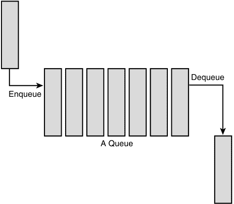

图 6.5 队列 (FIFO)。

Linux 内核的通用队列实现被称为 kfifo，它在 `kernel/kfifo.c` 中实现，并在 `<linux/kfifo.h>` 中声明。本节讨论的是 2.6.33 版本更新后的 API。在 2.6.33 之前的内核版本中，用法略有不同——在编写代码前请仔细检查 `<linux/kfifo.h>`。

## kfifo

Linux 的 kfifo 的工作方式与大多数其他队列抽象类似，提供了两种主要操作：入队（不幸地被命名为 `in`）和出队（`out`）。kfifo 对象维护了两个指向队列的偏移量：一个 `in` 偏移量和一个 `out` 偏移量。`in` 偏移量是队列中下一次入队将发生的位置。`out` 偏移量是队列中下一次出队将发生的位置。`out` 偏移量始终小于或等于 `in` 偏移量。如果 `out` 偏移量大于 `in` 偏移量则没有意义；否则，你可能会出队尚未入队的数据。

入队（`in`）操作将数据复制到队列中，从 `in` 偏移量开始。完成后，`in` 偏移量将根据入队的数据量递增。出队（`out`）操作将数据从队列中复制出来，从 `out` 偏移量开始。完成后，`out` 偏移量将根据出队的数据量递增。当 `out` 偏移量等于 `in` 偏移量时，队列为空：在更多数据入队之前，无法再进行出队操作。当 `in` 偏移量等于队列长度时，在队列重置之前，无法再进行入队操作。

## 创建队列

要使用 kfifo，你必须首先定义并初始化它。与大多数内核对象一样，你可以动态地或静态地完成此操作。最常用的方法是动态创建：

```c
int kfifo_alloc(struct kfifo *fifo, unsigned int size, gfp_t gfp_mask);
```


该函数创建并初始化一个队列大小为 `size` 字节的 kfifo。内核使用 GFP 掩码 `gfp_mask` 来分配队列。（我们在第 12 章“内存管理”中讨论内存分配。）成功时，`kfifo_alloc()` 返回零；出错时返回一个负的错误代码。以下是一个简单的示例：

```c
struct kfifo fifo;
int ret;

ret = kfifo_alloc(&fifo, PAGE_SIZE, GFP_KERNEL);
if (ret)
    return ret;

/* 'fifo' 现在代表一个大小为 PAGE_SIZE 的队列 ... */
```

如果你想自行分配缓冲区，可以使用：

```c
void kfifo_init(struct kfifo *fifo, void *buffer, unsigned int size);
```

该函数创建并初始化一个 kfifo，它将使用 `buffer` 指向的 `size` 字节内存作为其队列。对于 `kfifo_alloc()` 和 `kfifo_init()`，`size` 必须是 2 的幂。

静态声明 kfifo 更简单，但较少见：

```c
DECLARE_KFIFO(name, size);
INIT_KFIFO(name);
```

这将创建一个名为 `name` 的静态 kfifo，队列大小为 `size` 字节。同样，`size` 必须是 2 的幂。

## 入队数据

当你的 kfifo 创建并初始化后，通过 `kfifo_in()` 函数将数据入队：

```c
unsigned int kfifo_in(struct kfifo *fifo, const void *from, unsigned int len);
```

该函数将从 `from` 开始的 `len` 字节数据复制到由 `fifo` 表示的队列中。成功时，它返回入队的字节数。如果队列中的空闲空间少于 `len` 字节，该函数仅复制可用字节数。因此，返回值可能小于 `len`，如果没有任何数据被复制，则可能为零。

## 出队数据

当你使用 `kfifo_in()` 向队列添加数据后，可以使用 `kfifo_out()` 将其移除：

```c
unsigned int kfifo_out(struct kfifo *fifo, void *to, unsigned int len);
```

该函数最多将 `len` 字节的数据从 `fifo` 指向的队列复制到 `to` 指向的缓冲区。成功时，函数返回复制的字节数。如果队列中的数据少于 `len` 字节，函数复制的量将少于请求量。

一旦出队，数据将不再能从队列中访问。这是队列的正常用法，但如果你想在不移除的情况下“窥视”队列中的数据，可以使用 `kfifo_out_peek()`：

```c
unsigned int kfifo_out_peek(struct kfifo *fifo, void *to, unsigned int len,
                unsigned offset);
```

其工作方式与 `kfifo_out()` 相同，不同之处在于 `out` 偏移量不会递增，因此出队的数据在随后的 `kfifo_out()` 调用中仍然可用。参数 `offset` 指定队列中的索引；指定零则像 `kfifo_out()` 一样从队列头部读取。

## 获取队列大小

要获取用于存储 kfifo 队列的缓冲区的总字节数，请调用 `kfifo_size()`：

```c
static inline unsigned int kfifo_size(struct kfifo *fifo);
```

在另一个糟糕的内核命名示例中，使用 `kfifo_len()` 来获取 kfifo 中已入队的字节数：

```c
static inline unsigned int kfifo_len(struct kfifo *fifo);
```

要找出 kfifo 中可用于写入的字节数，请调用 `kfifo_avail()`：

```c
static inline unsigned int kfifo_avail(struct kfifo *fifo);
```

最后，如果给定的 kfifo 分别为空或满，`kfifo_is_empty()` 和 `kfifo_is_full()` 返回非零值，否则返回零：

```c
static inline int kfifo_is_empty(struct kfifo *fifo);
static inline int kfifo_is_full(struct kfifo *fifo);
```

## 重置和销毁队列

要重置 kfifo（丢弃队列中的所有内容），请调用 `kfifo_reset()`：

```c
static inline void kfifo_reset(struct kfifo *fifo);
```

要销毁使用 `kfifo_alloc()` 分配的 kfifo，请调用 `kfifo_free()`：

```c
void kfifo_free(struct kfifo *fifo);
```

如果你使用 `kfifo_init()` 创建了 kfifo，则有责任释放相关的缓冲区。如何释放取决于你是如何创建它的。请参阅第 12 章关于分配和释放动态内存的讨论。

## 队列使用示例

掌握了这些接口后，让我们来看一个使用 kfifo 的简单示例。假设我们创建了一个由 `fifo` 指向且队列大小为 8KB 的 kfifo。现在我们可以将数据入队。在本例中，我们入队简单的整数。在你的代码中，你可能会入队更复杂、特定于任务的结构体。通过在这个例子中使用整数，让我们看看 kfifo 具体是如何工作的：

```c
unsigned int i;
/* 将 [0, 32) 入队到名为 'fifo' 的 kfifo 中 */
for (i = 0; i < 32; i++)
    kfifo_in(fifo, &i, sizeof(i));
```

名为 `fifo` 的 kfifo 现在包含从 0 到 31（含）的整数。我们可以窥视队列中的第一个项目并验证它是否为 0：

```c
unsigned int val;
int ret;

ret = kfifo_out_peek(fifo, &val, sizeof(val), 0);
if (ret != sizeof(val))
    return -EINVAL;

printk(KERN_INFO "%u\n", val); /* 应该打印 0 */
```

要出队并打印 kfifo 中的所有项目，我们可以使用 `kfifo_out()`：

```c
/* 当队列中有数据时 ... */
while (kfifo_avail(fifo)) {
    unsigned int val;
    int ret;

    /* ... 一次读取一个整数 */
    ret = kfifo_out(fifo, &val, sizeof(val));
    if (ret != sizeof(val))
        return -EINVAL;

    printk(KERN_INFO "%u\n", val);
}
```

这将依次打印 0 到 31（含）。（如果这段代码反向打印数字，从 31 到 0，那么我们就拥有的是一个栈，而不是一个队列。）

## 映射（Maps）

映射（Map），也称为关联数组，是一组唯一键的集合，其中每个键都与一个特定的值相关联。键及其值之间的关系称为映射。映射至少支持三种操作：

- 添加（键，值）
- 删除（键）
- 值 = 查找（键）

虽然哈希表是一种映射，但并非所有映射都是通过哈希实现的。映射也可以使用自平衡二叉搜索树来存储数据，而不是哈希表。虽然哈希在平均情况下的渐进复杂度更好（见本章后面关于“算法复杂度”的章节），但二叉搜索树在最坏情况下的表现更好（对数级对比线性级）。二叉搜索树还支持顺序保留，允许用户高效地按排序顺序遍历整个集合。最后，二叉搜索树不需要哈希函数；相反，只要能定义 `<=` 运算符，任何键类型都是合适的。

虽然它是所有将键映射到值的集合的通用术语，但 maps 这个名称通常特指使用二叉搜索树而非哈希表实现的关联数组。例如，C++ STL 容器 `std::map` 是使用自平衡二叉搜索树（或类似数据结构）实现的，因为它提供了能够对集合进行中序遍历的能力。

Linux 内核提供了一种简单高效的映射数据结构，但它不是通用的映射。相反，它是为一种特定用例设计的：将一个唯一的标识符（UID）映射到指针。除了提供三种主要的映射操作外，Linux 的实现还在 add 操作之上叠加了一个 allocate 操作。这个 allocate 操作不仅将 UID/值对添加到映射中，还会生成该 UID。

`idr` 数据结构用于将用户空间 UID（例如 inotify 监视描述符或 POSIX 定时器 ID）映射到其关联的内核数据结构（例如分别对应的 `inotify_watch` 或 `k_timer` 结构）。遵循 Linux 内核那种晦涩、令人困惑的命名方案，这个映射被命名为 `idr`。

## 初始化 idr

设置 `idr` 非常简单。首先，你静态定义或动态分配一个 `idr` 结构，然后调用 `idr_init()`：

```c
void idr_init(struct idr *idp);
```

例如：

```c
struct idr id_huh; /* 静态定义 idr 结构 */
idr_init(&id_huh); /* 初始化提供的 idr 结构 */
```

## 分配新的 UID

一旦设置好 `idr`，你就可以分配一个新的 UID，这是一个分两步走的过程。首先，你告知 `idr` 你想要分配一个新 UID，允许它在必要时调整底层树的大小。然后，通过第二次调用，你实际请求该新 UID。这种复杂性的存在是为了让你在不需要锁的情况下执行初始的大小调整（这可能涉及内存分配）。我们在第 12 章讨论内存分配，在第 9 章和第 10 章讨论锁。现在，让我们专注于使用 `idr`，暂不考虑如何处理锁。

第一个用于调整底层树大小的函数是 `idr_pre_get()`：

```c
int idr_pre_get(struct idr *idp, gfp_t gfp_mask);
```

如果为了完成新的 UID 分配而有必要，该函数将调整 `idp` 所指向的 `idr` 的大小。如果需要调整大小，内存分配将使用 GFP 标志 `gfp_mask`（GFP 标志在第 12 章中讨论）。你不需要对该调用进行并发访问同步。与内核中几乎所有其他函数相反，`idr_pre_get()` 在成功时返回 1，在出错时返回 0——请务必小心！

第二个用于实际获取新 UID 并将其添加到 `idr` 中的函数是 `idr_get_new()`：

```c
int idr_get_new(struct idr *idp, void *ptr, int *id);
```

该函数使用 `idp` 指向的 `idr` 来分配一个新 UID 并将其与指针 `ptr` 关联。成功时，函数返回 0 并在 `id` 中存储新 UID。出错时，它返回一个非零错误代码：如果你需要（再次）调用 `idr_pre_get()`，则返回 `-EAGAIN`；如果 `idr` 已满，则返回 `-ENOSPC`。

让我们来看一个完整的示例：

```c
int id;

do {
    if (!idr_pre_get(&idr_huh, GFP_KERNEL))
        return -ENOSPC;
    ret = idr_get_new(&idr_huh, ptr, &id);
} while (ret == -EAGAIN);
```

如果成功，这段代码将获得一个新 UID（存储在整数 `id` 中），并将该 UID 映射到 `ptr`（我们在代码片段中未定义 `ptr`）。

```c
int idr_get_new_above(struct idr *idp, void *ptr, int starting_id, int *id);
```

该函数的工作方式与 `idr_get_new()` 相同，不同之处在于新 UID 保证等于或大于 `starting_id`。使用这个函数变体可以让 `idr` 用户确保 UID 永远不会被重复使用，从而使该值不仅在当前分配的 ID 中唯一，而且在整个系统的运行期间唯一。这段代码片段与之前的示例相同，不同之处在于我们请求严格递增的 UID 值：

```c
int id;

do {
    if (!idr_pre_get(&idr_huh, GFP_KERNEL))
        return -ENOSPC;
    ret = idr_get_new_above(&idr_huh, ptr, next_id, &id);
} while (ret == -EAGAIN);

if (!ret)
    next_id = id + 1;
```

## 查找 UID

当我们在 `idr` 中分配了若干个 UID 后，我们可以对其进行查找：调用者提供 UID，`idr` 返回关联的指针。这通过 `idr_find()` 函数实现，其方式比分配新 UID 要简单得多：

```c
void *idr_find(struct idr *idp, int id);
```

成功调用此函数将返回 `idp` 指向的 `idr` 中与 UID `id` 关联的指针。出错时，函数返回 `NULL`。注意，如果你使用 `idr_get_new()` 或 `idr_get_new_above()` 将 `NULL` 映射到了某个 UID，该函数将成功返回 `NULL`，导致你无法区分成功和失败。因此，你不应该将 UID 映射到 `NULL`。

用法很简单：

```c
struct my_struct *ptr = idr_find(&idr_huh, id);
if (!ptr)
    return -EINVAL;  /* 错误 */
```

## 移除 UID

要从 `idr` 中移除一个 UID，请使用 `idr_remove()`：

```c
void idr_remove(struct idr *idp, int id);
```

成功调用 `idr_remove()` 会将 UID `id` 从 `idp` 指向的 `idr` 中移除。遗憾的是，`idr_remove()` 没有办法表示错误（例如，如果 `id` 不在 `idp` 中）。

## 销毁 idr

销毁 `idr` 是一个简单的操作，通过 `idr_destroy()` 函数完成：

```c
void idr_destroy(struct idr *idp);
```

成功调用 `idr_destroy()` 仅释放与 `idp` 指向的 `idr` 关联的未使用内存。它不会释放当前被分配的 UID 所使用的任何内存。通常，内核代码直到关闭或卸载时才会销毁其 `idr` 设施，且直到不再有用户（因此不再有 UID）才会卸载。但为了强制移除所有 UID，你可以调用 `idr_remove_all()`：

```c
void idr_remove_all(struct idr *idp);
```

你应该在调用 `idr_destroy()` 之前对 `idp` 指向的 `idr` 调用 `idr_remove_all()`，以确保所有 `idr` 内存都被释放。

## 二叉树

树是一种提供分层树状数据结构的数据结构。在数学上，它是一个无环的、连通的、有向图，其中每个顶点（称为节点）具有零个或多个出边和零个或一个入边。二叉树是一种节点最多有两个出边的树——也就是说，节点具有零个、一个或两个子节点的树。示例二叉树请参见图 6.6。

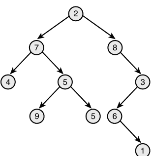

图 6.6 二叉树。

## 二叉搜索树

二叉搜索树（通常缩写为 `BST`）是一种对其节点施加了特定顺序的二叉树。这种顺序通常通过以下归纳法定义：

- 根节点的左子树仅包含值小于根节点的节点。
- 根节点的右子树仅包含值大于根节点的节点。
- 所有子树也必须是二叉搜索树。

因此，二叉搜索树是一种所有节点都被排序的二叉树，使得左子节点的值小于其父节点，右子节点的值大于其父节点。因此，搜索给定节点和中序遍历都非常高效（分别为对数级和线性级）。示例二叉搜索树请参见图 6.7。

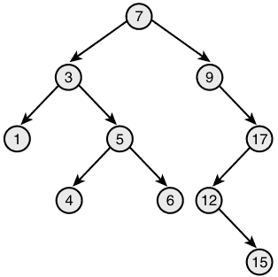

图 6.7 二叉搜索树（BST）。

## 自平衡二叉搜索树

节点的深度是通过它距离根节点有多少个父节点来衡量的。位于树“底部”的节点（即没有子节点的节点）被称为叶子节点。树的高度是树中深度最大的节点的深度。平衡二叉搜索树是一种所有叶子节点的深度相差最多为 1 的二叉搜索树（见图 6.8）。自平衡二叉搜索树是一种在正常操作过程中尝试保持（半）平衡的二叉搜索树。

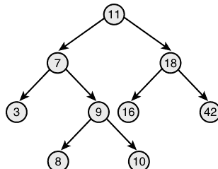

图 6.8 平衡二叉搜索树。

## 红黑树

红黑树是一种自平衡二叉搜索树。Linux 的主要二叉树数据结构就是红黑树。红黑树具有特殊的颜色属性，要么是红色，要么是黑色。红黑树通过强制执行以下六个属性来保持半平衡：

1. 所有节点要么是红色，要么是黑色。
2. 叶子节点是黑色的。
3. 叶子节点不包含数据。
4. 所有非叶子节点有两个子节点。
5. 如果一个节点是红色的，那么它的两个子节点都必须是黑色的。
6. 从一个节点到其任意叶子节点的路径上包含的黑色节点数量，与到其任何其他叶子节点的最短路径上的黑色节点数量相同。


综合来看，这些属性确保了最深的叶子节点的深度不超过最浅叶子节点深度的两倍。因此，树始终是半平衡的。为什么这是正确的，原因出奇地简单。首先，根据属性五，红色节点不能是另一个红色节点的子节点或父节点。根据属性六，通过树到达其叶子节点的所有路径具有相同数量的黑色节点。通过树的最长路径在红色和黑色节点之间交替。因此，必须具有相同数量黑色节点的最短路径仅包含黑色节点。因此，从根到叶子的最长路径不超过从根到任何其他叶子的最短路径的两倍。

如果插入和删除操作能够强制执行这六个属性，那么树将保持半平衡状态。现在，要求插入和删除操作必须维护这些特定的属性似乎有点奇怪。为什么不实现一些能够强制执行其他更简单的规则、且同样能产生平衡树的操作呢？事实证明，这些属性相对容易强制执行（尽管实现起来很复杂），这使得插入和删除能够在没有沉重额外开销的情况下保证一棵半平衡树。

描述插入和删除如何强制执行这些规则超出了本书的范围。虽然规则简单，但实现较为复杂。任何优秀的本科级数据结构教科书都应该对此有详尽的论述。

## rbtrees

Linux 对红黑树的实现被称为 `rbtrees`。它们定义在 `lib/rbtree.c` 中，并在 `<linux/rbtree.h>` 中声明。除了优化部分外：

```c
struct rb_root root = RB_ROOT;
```

`rbtree` 中的单个节点由 `rb_node` 结构体表示。给定一个 `rb_node`，我们可以通过追踪同名节点的指针来移动到其左子节点或右子节点。

`rbtree` 的实现没有提供搜索和插入例程。期望 `rbtrees` 的使用者自行定义这些例程。这是因为 C 语言并不擅长泛型编程，Linux 内核开发者认为实现搜索和插入最有效的方法是要求每个用户手动实现，使用提供的 `rbtree` 辅助函数，但使用他们自己的比较运算符。

演示搜索和插入的最佳方式是展示一个实际案例。首先，让我们看看搜索。以下函数实现了在 Linux 页缓存（page cache）中搜索文件的某个块（由 `inode` 和偏移量对表示）。每个 `inode` 都有自己的 `rbtree`，以文件中的页偏移量作为键。因此，该函数在给定 `inode` 的 `rbtree` 中搜索匹配的偏移量值：

```c
struct page * rb_search_page_cache(struct inode *inode,
            unsigned long offset)
{
    struct rb_node *n = inode->i_rb_page_cache.rb_node;
    
    while (n) {
        struct page *page = rb_entry(n, struct page, rb_page_cache);
        if (offset < page->offset)
            n = n->rb_left;
        else if (offset > page->offset)
            n = n->rb_right;
        else
            return page;
    }
    return NULL;
}
```

在这个例子中，`while` 循环遍历 `rbtree`，根据给定偏移量的方向必要时向左或向右子节点遍历。`if` 和 `else` 语句实现了 `rbtree` 的比较函数，从而强制执行树的排序。如果循环找到了一个偏移量匹配的节点，则搜索完成，函数返回相关的 `page` 结构体。如果循环到达 `rbtree` 的末尾仍未找到匹配项，则树中不存在该项，函数返回 `NULL`。

插入操作更为复杂，因为它同时实现了搜索和插入逻辑。下面的函数虽然不简单，但如果你需要实现自己的插入例程，这是一个很好的指南：

```c
struct page * rb_insert_page_cache(struct inode *inode,
                                   unsigned long offset,
                                   struct rb_node *node)
{
    struct rb_node **p = &inode->i_rb_page_cache.rb_node;
    struct rb_node *parent = NULL;
    struct page *page;

    while (*p) {
        parent = *p;
        page = rb_entry(parent, struct page, rb_page_cache);

        if (offset < page->offset)
            p = &(*p)->rb_left;
        else if (offset > page->offset)
            p = &(*p)->rb_right;
        else
            return page;
    }

    rb_link_node(node, parent, p);
    rb_insert_color(node, &inode->i_rb_page_cache);

    return NULL;
}
```

与搜索函数一样，`while` 循环在树中迭代，向提供的偏移量方向移动。然而，与搜索不同的是，该函数希望*不*找到匹配的偏移量，而是到达作为新偏移量正确插入点的叶子节点。当找到插入点时，调用 `rb_link_node()` 将新节点插入到给定位置。然后调用 `rb_insert_color()` 来执行复杂的重新平衡操作。如果页面被添加到页缓存中，函数返回 `NULL`；如果页面已在缓存中，则返回现有页面结构体的地址。

## 何时使用什么数据结构

到目前为止，我们讨论了 Linux 中最重要的四种数据结构：链表、队列、映射（`maps`）和红黑树。在本节中，我们将提供一些技巧，帮助你在自己的代码中决定使用哪种数据结构。

- 如果你的主要访问方式是遍历所有数据，请使用链表。直观地说，在访问每个元素时，没有任何数据结构能提供优于线性复杂度的性能，因此你应该为这项简单的任务选择最简单的数据结构。此外，在性能不重要、需要存储相对较少项目或需要与使用链表的其他内核代码对接时，也可考虑使用链表。

- 如果你的代码遵循生产者/消费者模式，请使用队列，尤其是当你想要（或能够接受）固定大小的缓冲区时。队列使得添加和删除项目简单且高效，并提供了先进先出（FIFO）语义，这也是大多数生产者/消费者用例的需求。另一方面，如果你需要存储数量未知且可能非常多的项目，链表可能更有意义，因为你可以动态地向列表中添加任意数量的项目。

- 如果你需要将 UID 映射到某个对象，请使用映射（`map`）。映射使此类映射简单高效，并且它们还会为你维护和分配 UID。然而，Linux 的 `map` 接口专门用于 UID 到指针的映射，对于其他用途并不适用。如果你处理的是分发给用户空间的描述符，请考虑此选项。

- 如果你需要存储大量数据并高效地进行查找，请考虑红黑树。红黑树支持在对数时间内进行搜索，同时仍提供高效的线性时间中序遍历。虽然实现起来比其他数据结构复杂，但其内存占用并没有显著增加。如果你不需要执行许多对时间至关重要的查找操作，红黑树可能不是最佳选择。在这种情况下，优先选择链表。

这些数据结构都不符合你的需求？内核还实现了一些较少使用的数据结构，可能会满足你的需求，例如基数树（`radix trees`，一种前缀树/trie）和位图（`bitmaps`）。只有在穷尽了所有内核提供的解决方案之后，你才应该考虑“自行实现”数据结构。一种经常在单个源文件中实现的常见数据结构是哈希表。因为哈希表不过是一些桶和一个哈希函数，而哈希函数对于每个用例都非常具体，因此在 C 这种非泛型编程语言中提供一个内核范围的通用解决方案价值不大。

## 算法复杂度

在计算机科学及其相关学科中，定量地表达算法的算法复杂度（或可扩展性）通常很有用。表示可扩展性的方法有很多种。一种常用的技术是研究算法的渐近行为（asymptotic behavior）。这是指当输入规模变得极大并趋向于无穷大时，算法的行为。渐近行为展示了随着输入规模的增大，算法的扩展性能如何。研究算法的可扩展性（即输入规模增加时其性能如何）使我们能够根据基准对算法进行建模，并更好地理解其行为。

## 算法

算法是一系列指令，可能包含一个或多个输入，并最终产生一个结果或输出。例如，统计房间内人数的步骤就是一个算法，其中人数是输入，计数结果是输出。在 Linux 内核中，页面置换（page eviction）和进程调度器都是算法的例子。从数学上讲，算法就像一个函数（或者至少你可以将其建模为一个函数）。例如，如果你将人数统计算法称为 `f`，将要统计的人数称为 `x`，你可以写成：

```
y = f(x)     人数统计函数
```

其中 `y` 是统计 `x` 个人所需的时间。

## 大 O 表示法

一种有用的渐近表示法是上界（upper bound），它是一个函数，在经过初始点之后，其值始终大于你正在研究的函数值。也就是说，上界的增长速度与该函数一样快或更快。一种特殊的表示法——大 O（读作 Big Oh）表示法，被用来描述这种增长。它写作 `f(x)` 是 `O(g(x))`，读作 `f` 是 `g` 的大 O。其正式数学定义为：

如果 `f(x)` 是 `O(g(x))`，那么

`∃ c, x'` 使得 `f(x) ≤ c · g(x), ∀ x > x'`

用英文（中文）来说，只要输入 `x` 大于某个初始值 `x'`，完成 `f(x)` 所需的时间总是小于或等于完成 `g(x)` 所需的时间乘以某个任意常数。

本质上，你是在寻找一个行为与该算法一样糟糕或更糟糕的函数。然后你可以查看该函数在输入规模很大时的结果，从而了解算法的界限。

## 大 Theta 表示法

当大多数人谈论大 O 表示法时，他们更准确地是指唐纳德·克努斯（Donald Knuth）所描述的大 Theta 表示法。从技术上讲，大 O 表示法是指一个上界

# 第 6 章 内核数据结构

界限。例如，`7` 是 `6` 的一个上界；`9`、`12` 和 `65` 也是。随后，当大多数人讨论函数增长时，他们讨论的是最小上界，或者是一个同时模拟上界和下界的函数。² 算法分析领域的奠基人 Knuth 教授将其描述为 `Θ` 符号（big-theta notation），并给出了以下定义：

如果 `f(x)` 是 `g(x)` 的 `Θ`，那么 `g(x)` 既是 `f(x)` 的上界也是下界。

那么，你可以说 `f(x)` 的阶数为 `g(x)`。算法的阶数（或 `Θ`）是理解内核算法最重要的数学工具之一。

因此，当人们提到大 O 符号（big-o notation）时，他们通常是指最小的那个大 O，即 `Θ`。除非你想让 Knuth 教授感到非常高兴，否则你真的不必过于担心这个区别。

### 时间复杂度

考虑一个最简单的例子：统计房间里的人数。假设你每秒钟能数一个人。那么，如果房间里有 `7` 个人，就需要 `7` 秒钟数完。更一般地，给定 `n` 个人，需要 `n` 秒钟才能数完所有人。因此，你可以说这个算法是 `O(n)`。如果任务是在房间里的每个人面前跳舞呢？因为无论房间里有 `5` 个人还是 `5,000` 个人，跳舞所需的时间都是一样的，所以这个任务是 `O(1)`。其他常见的复杂度请参见表 6.1。

表 6.1 常见时间复杂度值表

| `O(g(x))` | 名称 |
|-----------|------|
| `1` | 常数（完美的可扩展性） |
| `log n` | 对数 |
| `n` | 线性 |
| `n^2` | 平方 |
| `n^3` | 立方 |
| `2^n` | 指数 |
| `n!` | 阶乘 |

> ² 如果你好奇的话，下界是由 `Ω` 符号（big-omega notation）模拟的。其定义与大 O 相同，只不过 `g(x)` 始终小于或等于 `f(x)`，而不是大于或等于。`Ω` 符号不如大 O 实用，因为寻找比你的函数更小的函数很少能指示出行为特征。

将房间里的每个人介绍给其他所有人的复杂度是多少？什么样的函数可以模拟这个算法？如果介绍每个人需要 `30` 秒，那么 `10` 个人互相介绍需要多长时间？`100` 个人互相介绍又需要多久？理解一个算法在面对越来越多的人员时如何表现，是确定给定任务的最佳算法的关键组成部分。

当然，明智的做法是避免使用 `O(n!)` 或 `O(2^n)` 这样的复杂度。同样，将 `O(n)` 算法替换为功能等效的 `O(log n)` 算法通常是一种改进。然而，情况并非总是如此，不应仅根据大 O 符号就盲目假设。回想一下，在 `O(g(x))` 中，有一个常数 `c` 与 `g(x)` 相乘。因此，一个 `O(1)` 算法可能需要 `3` 小时才能完成。诚然，无论输入规模多大，它始终是 `3` 小时，但与输入较少的 `O(n)` 算法相比，这仍然是很长的时间。在比较算法时，应始终考虑典型的输入规模。

倾向于使用复杂度较低的算法，但要记住算法的开销与典型输入规模的关系。不要盲目优化到你永远不需要支持的可扩展性水平！

## 本章小结

在本章中，我们讨论了 Linux 内核开发人员用于实现从进程调度程序到设备驱动程序的许多通用数据结构。在我们继续学习 Linux 内核的过程中，你会发现这些数据结构非常有用。在编写自己的内核代码时，请始终复用现有的内核基础设施，不要重复造轮子。

我们还涵盖了算法复杂度以及测量和表达复杂度的工具，其中最著名的是大 O 符号。在本书和 Linux 内核中，大 O 符号是一个重要概念，用于衡量算法和内核组件在面对大量用户、进程、处理器、网络连接和其他不断增加的输入时的扩展能力。

## 中断与中断处理程序

任何操作系统内核的核心职责之一就是管理连接到机器的硬件——硬盘和蓝光光盘、键盘和鼠标、3D 处理器和无线电模块。为了履行这一职责，内核需要与机器的各个设备进行通信。鉴于处理器的速度可能比它们通信的硬件快几个数量级，内核发出请求并等待明显较慢的硬件响应并不是理想的选择。相反，由于硬件响应相对缓慢，内核必须能够自由地去处理其他工作，仅在硬件实际完成工作后才处理该硬件。

处理器如何在不影响机器整体性能的情况下与硬件协作？这个问题的一个答案是*轮询（polling）*。内核可以定期检查系统中硬件的状态并做出相应响应。然而，轮询会带来开销，因为无论硬件是否处于活动或就绪状态，它都必须重复发生。一个更好的解决方案是提供一种机制，让硬件在需要关注时向内核发出信号。这种机制被称为*中断（interrupt）*。在本章中，我们将讨论中断以及内核如何通过名为*中断处理程序（interrupt handlers）*的特殊函数来响应它们。

## 中断

中断允许硬件向处理器发出信号。例如，当你打字时，键盘控制器（管理键盘的硬件设备）向处理器发出电信号，以提醒操作系统有新的按键可用。这些电信号就是中断。处理器接收到中断并向操作系统发出信号，使操作系统能够对新数据做出响应。硬件设备产生中断相对于处理器时钟是异步的——它们可能在任何时间发生。因此，内核可以在任何时间被中断以处理中断。

中断在物理上是由来自硬件设备的电子信号产生，并定向到中断控制器上的输入引脚的。中断控制器是一个简单的芯片，它将多个中断线复用到单条通往处理器的线路中。收到中断后，中断控制器向处理器发送信号。处理器检测到该信号并中断当前执行以处理该中断。随后，处理器可以通知操作系统已发生中断，操作系统则可以地处理该中断。

不同的设备可以通过与每个中断相关联的唯一值来关联不同的中断。这样，来自键盘的中断就与来自硬盘的中断区分开来。这使得操作系统能够区分不同的中断，并知道哪个硬件设备触发了哪个中断。相应地，操作系统可以使用对应的处理程序来服务每个中断。

这些中断值通常被称为*中断请求（IRQ）*线。每条 IRQ 线都被分配一个数值——例如，在经典 PC 上，IRQ `0` 是定时器中断，IRQ `1` 是键盘中断。然而，并非所有的中断号都定义得如此死板。例如，与 PCI 总线上的设备相关联的中断通常是动态分配的。其他非 PC 架构对中断值的动态分配也类似。重要的概念是，一个特定的中断与一个特定的设备相关联，且内核知道这一点。硬件随后通过发出中断来引起内核的注意：*嘿，我有新的按键在等待！快来读取并处理这些家伙！*

> **异常（Exceptions）**
>
> 在操作系统教材中，*异常*经常与中断一起讨论。与中断不同，异常相对于处理器时钟是同步发生的。事实上，它们通常被称为*同步中断*。异常是由处理器在执行指令时产生的，要么是为了响应编程错误（例如，除以零），要么是为了响应必须由内核处理的异常情况（例如，缺页异常）。
>
> 由于许多处理器架构处理异常的方式与处理中断类似，因此处理这两者的内核基础设施也非常相似。本章中关于中断（由硬件产生的不对称中断）的大部分讨论同样适用于异常（由处理器产生的同步中断）。
>
> 你已经熟悉了一种异常：在上一章中，你看到了 *x86* 架构上的系统调用是如何通过发出软件中断来实现的，该中断陷入内核并导致执行一个特殊的系统调用处理程序。你会发现，中断的工作方式与之类似，只不过是由硬件而非软件发出。

#### 中断处理程序

内核为了响应特定中断而运行的函数被称为*中断处理程序（interrupt handler）*或*中断服务例程（ISR）*。每个产生中断的设备都有一个相关联的中断处理程序。例如，一个函数处理来自系统定时器的中断，而另一个函数处理由键盘产生的中断。设备的中断处理程序是该设备*驱动程序（driver）*的一部分——即管理该设备的内核代码。

在 Linux 中，中断处理程序是普通的 C 函数。它们符合一个特定的原型，这使得内核能够以标准方式传递处理程序信息，但在其他方面它们是普通的函数。中断处理程序与其他内核函数的区别在于，内核在响应中断时调用它们，并且它们运行在一种被称为中断上下文（在本章后面讨论）的特殊上下文中。这种特殊的上下文有时被称为*原子上下文*，因为正如我们将看到的，在此上下文中执行的代码无法阻塞。在本书中，我们将使用“中断上下文”这个术语。


由于中断可能在任何时间发生，因此中断处理程序反过来也可以在任何时间被执行。处理程序必须快速运行，以便尽快恢复被中断代码的执行。因此，对于硬件而言，操作系统毫无延迟地处理中断至关重要；而对于系统的其余部分而言，中断处理程序的执行时间越短越重要。

最起码，中断处理程序的任务是向硬件确认已收到中断：*嘿，硬件，我听到你了；现在回去工作吧！* 然而，中断处理程序通常有大量工作需要执行。例如，考虑网络设备的中断处理程序。除了响应硬件，中断处理程序还需要将网络数据包从硬件复制到内存中，对其进行处理，并将数据包推送到相应的协议栈或应用程序。显然，这可能涉及大量工作，尤其是对于如今的千兆和万兆以太网卡来说。

## 上半部与下半部

这两个目标——中断处理程序既要执行快速*且*要完成大量工作——显然是相互冲突的。由于这些相互竞争的目标，中断处理被分为两个部分，或者说两个“半部”。中断处理程序本身就是*上半部*。上半部在收到中断后立即运行，并且仅执行时间关键性的工作，例如确认收到中断或重置硬件。可以稍后执行的工作则被推迟到*下半部*。下半部将在未来的某个更方便的时间运行，此时所有中断均已启用。Linux 提供了多种实现下半部的机制，它们将在第 8 章*“下半部与延迟工作”*中讨论。

让我们通过一个上半部/下半部二分法的例子来看看，对象还是我们的老朋友——网络卡。当网络卡从网络接收到数据包时，它们需要通知内核数据可用。它们希望且需要立即执行此操作，以优化网络吞吐量和延迟并避免超时。因此，它们立即发出一个中断：*嘿，内核，我这里有一些新鲜的数据包！* 内核通过执行网络卡注册的中断处理程序来响应。

中断程序运行，向硬件确认，将新的网络数据包复制到主内存中，并为网络卡准备接收更多数据包。这些工作是重要、时间关键且与硬件相关的。内核通常需要快速地将网络数据包复制到主内存中，因为网络卡上的网络数据缓冲区大小固定且微小，尤其是与主内存相比。复制数据包的延迟可能会导致缓冲区溢出，传入的数据包会淹没网络卡的缓冲区，从而导致数据包丢失。在网络数据安全地进入主内存后，中断的任务就完成了，它可以将系统的控制权交还给产生中断时被中断的任何代码。数据包的其余处理和操作将在稍后的下半部中进行。在本章中，我们研究上半部；在下一章中，我们研究下半部。

## 注册中断处理程序

中断处理程序由管理硬件的驱动程序负责。每个设备有一个相关的驱动程序，如果该设备使用中断（大多数设备都使用），那么该驱动程序必须注册一个中断处理程序。

驱动程序可以使用 `request_irq()` 函数注册中断处理程序并启用给定的中断线进行处理，该函数在 `<linux/interrupt.h>` 中声明：

```c
/* request_irq: allocate a given interrupt line */
int request_irq(unsigned int irq,
               irq_handler_t handler,
               unsigned long flags,
               const char *name,
               void *dev);
```

第一个参数 `irq` 指定要分配的中断号。对于某些设备，例如系统定时器或键盘等传统 PC 设备，该值通常是硬编码的。对于大多数其他设备，它是通过编程方式探测或动态确定的。

第二个参数 `handler` 是一个函数指针，指向处理该中断的实际中断处理程序。每当操作系统收到该中断时，就会调用此函数。

```c
typedef irqreturn_t (*irq_handler_t) (int, void *);
```

请注意处理函数特定的原型：它接受两个参数，并具有 `irqreturn_t` 类型的返回值。此函数将在本章后面讨论。

## 中断处理程序标志

第三个参数 `flags` 可以是零，也可以是 `<linux/interrupt.h>` 中定义的一个或多个标志的位掩码。在这些标志中，最重要的是：

- **IRQF_DISABLED**——设置此标志后，它指示内核在执行此中断处理程序时禁用所有中断。如果不设置，中断处理程序在运行时除了自身以外，其他所有中断均启用。大多数中断处理程序不设置此标志，因为禁用所有中断是不良做法。它的用途保留给执行快速且对性能敏感的中断。该标志是 `SA_INTERRUPT` 标志的当前体现，后者在过去用于区分“快速”和“慢速”中断。

- **IRQF_SAMPLE_RANDOM**—此标志指定由该设备生成的中断应贡献给内核熵池。内核熵池提供源自各种随机事件的真正随机数。如果指定此标志，来自该设备的中断时间将被作为熵喂给熵池。如果您的设备以可预测的速率发出中断（例如系统定时器）或可能受到外部攻击者的影响（例如网络设备），请不要设置此标志。另一方面，大多数其他硬件在不确定时间产生中断，因此是很好的熵源。

- **IRQF_TIMER**—此标志指定该处理程序处理系统定时器的中断。

- **IRQF_SHARED**—此标志指定中断线可以在多个中断处理程序之间共享。在给定线上注册的每个处理程序必须指定此标志；否则，每条线只能存在一个处理程序。关于共享处理程序的更多信息将在接下来的章节中提供。

第四个参数 `name` 是与中断相关的设备的 ASCII 文本表示。例如，PC 上键盘中断的此值为 `keyboard`。这些文本名称被 `/proc/irq` 和 `/proc/interrupts` 用于与用户通信，稍后将对此进行讨论。

第五个参数 `dev` 用于共享中断线。当中断处理程序被释放（稍后讨论）时，`dev` 提供一个唯一的 cookie，以便仅从中断线中移除所需的中断处理程序。如果没有这个参数，内核将无法知道在给定的中断线上应该移除*哪个*处理程序。如果该线不是共享的，您可以传递 `NULL`，但如果您的中断线是共享的，您必须传递一个唯一的 cookie。（除非您的设备非常古老且运行在 ISA 总线上，否则很有可能它必须支持共享。）这个指针在每次调用时也会被传递给中断处理程序。一种常见的做法是传递驱动程序的设备结构体：这个指针是唯一的，在处理程序中使用可能会很有用。

成功时，`request_irq()` 返回零。非零值表示错误，在这种情况下，指定的中断处理程序未被注册。一个常见的错误是 `-EBUSY`，它表示给定的中断线已被占用（且当前用户或您没有指定 `IRQF_SHARED`）。

请注意，`request_irq()` 可能会休眠，因此不能在中断上下文或其他代码不能阻塞的情况下调用。在不安全休眠的情况下调用 `request_irq()` 是一个常见的错误。这部分原因是由于 `request_irq()` *为什么* 会阻塞：这确实不那么直观。在注册时，`/proc/irq` 中会创建一个与该中断相对应的条目。`proc_mkdir()` 函数创建新的 procfs 条目。该函数调用 `proc_create()` 来设置新的 procfs 条目，而 `proc_create()` 又调用 `kmalloc()` 来分配内存。正如您将在第 12 章“内存管理”中看到的，`kmalloc()` 可能会休眠。所以，原因就在这里！

## 一个中断示例

在驱动程序中，请求中断线并安装处理程序是通过 `request_irq()` 完成的：

```c
if (request_irq(irqn, my_interrupt, IRQF_SHARED, "my_device", my_dev)) {
    printk(KERN_ERR "my_device: cannot register IRQ %d\n", irqn);
    return -EIO;
}
```

在这个示例中，`irq` 是请求的中断线；`my_interrupt` 是处理函数；我们通过 `flags` 指定该线可以被共享；设备名为 `my_device`；并且为 `dev` 传递了 `my_dev`。如果失败，代码将打印错误并返回。如果调用返回零，则表示处理函数已成功安装。从此刻起，处理函数将在响应中断时被调用。重要的是按照正确的顺序初始化硬件并注册中断处理函数，以防止中断处理函数在设备完全初始化之前运行。

## 释放中断处理函数

当你的驱动程序卸载时，你需要注销中断处理函数，并可能需要禁用中断线。为此，请调用：

```c
void free_irq(unsigned int irq, void *dev)
```

如果指定的中断线不是共享的，该函数将移除处理函数并禁用该线。如果中断线是共享的，则移除通过 `dev` 标识的处理函数，但只有在最后一个处理函数被移除时，中断线才会被禁用。现在你应该明白为什么唯一的 `dev` 非常重要了。在共享中断线的情况下，需要一个唯一的 cookie 来区分单条线上可能存在的多个处理函数，并使 `free_irq()` 能够仅移除正确的处理函数。在任何情况下（无论是否共享），如果 `dev` 非空，它必须与目标处理函数匹配。对 `free_irq()` 的调用必须在进程上下文中进行。

表 7.1 回顾了注册和注销中断处理函数的函数。

**表 7.1** *中断注册方法*

| 函数 | 描述 |
|----------|-------------|
| `request_irq()` | 在给定的中断线上注册给定的中断处理函数。 |
| `free_irq()` | 注销给定的中断处理函数；如果该线上没有剩余的处理函数，则禁用该中断线。 |

## 编写中断处理函数

以下是一个中断处理函数的声明：

```c
static irqreturn_t intr_handler(int irq, void *dev)
```

请注意，此声明与传递给 `request_irq()` 的处理函数参数原型相匹配。第一个参数 `irq` 是该处理函数所服务的中断线的数值。该值被传递到处理函数中，但并不经常使用，除了在打印日志消息时。在 Linux 内核 2.0 版本之前，没有 `dev` 参数，因此 `irq` 被用来区分使用相同处理函数、相同驱动程序（因此也是相同中断处理函数）的多个设备。举个例子，考虑一台拥有多个相同类型硬盘控制器的计算机。

第二个参数 `dev` 是一个通用指针，指向在注册中断处理函数时传递给 `request_irq()` 的同一个 `dev`。如果这个值是唯一的（这是支持共享的必要条件），它可以作为 cookie 来区分可能使用相同中断处理函数的多个设备。`dev` 也可以指向一个对中断处理函数有用的结构体。由于 `device` 结构体对每个设备都是唯一的，且在处理函数内部可能会很有用，因此通常将它传递给 `dev`。

中断处理函数的返回值是特殊类型 `irqreturn_t`。一个中断处理函数可以返回两个特殊值：`IRQ_NONE` 或 `IRQ_HANDLED`。当中断处理函数检测到一次中断，但其设备并非该中断的发起者时，返回前者。如果中断处理函数被正确调用，且其设备确实引起了中断，则返回后者。或者，可以使用 `IRQ_RETVAL(val)`。如果 `val` 为非零，该宏返回 `IRQ_HANDLED`；否则，该宏返回 `IRQ_NONE`。这些特殊值用于让内核知道设备是否在发出伪中断（即未请求的中断）。如果给定中断线上的所有中断处理函数都返回 `IRQ_NONE`，内核就可以检测到该问题。注意这个奇怪的返回类型 `irqreturn_t`，它实际上就是一个 `int`。这个值提供了与早期内核的向后兼容性，因为早期内核没有这个特性；在 2.6 版本之前，中断处理函数返回 `void`。驱动程序只需将 `irqreturn_t` `typedef` 为 `void`，并将不同的返回值定义为空操作（no-ops），就可以在 2.4 版本中无需进一步修改地工作。中断处理函数通常被标记为 `static`，因为它永远不会被另一个文件直接调用。

中断处理函数的作用完全取决于设备及其发出中断的原因。最起码，大多数中断处理函数需要向设备提供确认，告知其已收到中断。更复杂的设备还需要在中断处理函数中额外发送和接收数据，并执行扩展工作。如前所述，扩展工作应尽可能地推送到下半部（bottom half）处理函数中，这将在下一章中讨论。

## 可重入性与中断处理函数

Linux 中的中断处理函数不需要是可重入的。当某个中断处理函数正在执行时，所有处理器上的相应中断线都会被屏蔽，从而防止接收到同一线上的另一个中断。通常所有其他中断都是开启的，因此其他中断可以得到服务，但当前线始终是被禁用的。因此，同一个中断处理函数永远不会被并发调用来处理嵌套中断。这大大简化了中断处理函数的编写。

## 共享处理函数

共享处理函数的注册和执行与非共享处理函数非常相似。主要有以下三点不同：

- 必须在传递给 `request_irq()` 的 `flags` 参数中设置 `IRQF_SHARED` 标志。

- `dev` 参数对于每个注册的处理函数必须是唯一的。指向任何设备特定结构体的指针即可；常见的选择是 `device` 结构体，因为它既唯一又对处理函数潜在有用。对于共享处理函数，你不能传递 `NULL`！

- 中断处理函数必须能够区分其设备是否真的产生了中断。这既需要硬件支持，也需要在中断处理函数中实现相关逻辑。如果硬件不提供此功能，中断处理函数将无法知道是其关联设备还是共享该线的其他设备引起了中断。

所有共享中断线的驱动程序必须满足上述要求。如果任何一个设备不能公平地共享，那么所有设备都不能共享该线。当调用 `request_irq()` 并指定 `IRQF_SHARED` 时，仅在中断线当前未注册，或者该线上所有已注册的处理函数也都指定了 `IRQF_SHARED` 时，调用才会成功。不过，共享处理函数可以混合使用 `IRQF_DISABLED`。

当内核接收到中断时，它会按顺序调用该线上注册的每个处理函数。因此，处理函数能够区分它是否产生了给定的中断至关重要。如果其关联设备没有产生中断，处理函数必须迅速退出。这要求硬件设备具有状态寄存器（或类似机制）供处理函数检查。大多数硬件确实具有此类功能。

## 一个真实的中断处理函数

让我们看看一个真实的中断处理函数，来自实时时钟 (RTC) 驱动程序，位于 `drivers/char/rtc.c`。许多机器（包括 PC）中都有 RTC。它是一个独立于系统定时器的设备，用于设置系统时钟、提供闹钟或提供周期性定时器。在大多数架构上，系统时钟是通过将所需时间写入特定寄存器或 I/O 范围来设置的。任何闹钟或周期性定时器功能通常通过中断实现。该中断相当于现实世界中的时钟闹钟：接收到中断类似于闹钟响起。

当 RTC 驱动加载时，会调用 `rtc_init()` 函数来初始化驱动。它的职责之一是注册中断处理函数：

```c
/* register rtc_interrupt on rtc_irq */
if (request_irq(rtc_irq, rtc_interrupt, IRQF_SHARED, "rtc", (void *)&rtc_port)) {
    printk(KERN_ERR "rtc: cannot register IRQ %d\n", rtc_irq);
    return -EIO;
}
```

在这个示例中，中断线存储在 `rtc_irq` 中。该变量被设置为给定架构的 RTC 中断。在 PC 上，RTC 位于 IRQ 8。第二个参数是中断处理函数 `rtc_interrupt`，得益于 `IRQF_SHARED` 标志，它愿意与其他处理函数共享中断线。从第四个参数可以看出，驱动程序名称为 `rtc`。因为该设备共享中断线，所以它为 `dev` 传递了一个唯一的设备特定值。

最后是处理函数本身：

```c
static irqreturn_t rtc_interrupt(int irq, void *dev)
{
	/*
	 * Can be an alarm interrupt, update complete interrupt,
	 * or a periodic interrupt. We store the status in the
	 * low byte and the number of interrupts received since
	 * the last read in the remainder of rtc_irq_data.
	 */

	spin_lock(&rtc_lock);

	rtc_irq_data += 0x100;
	rtc_irq_data &= ~0xff;
	rtc_irq_data |= (CMOS_READ(RTC_INTR_FLAGS) & 0xF0);

	if (rtc_status & RTC_TIMER_ON)
		mod_timer(&rtc_irq_timer, jiffies + HZ/rtc_freq + 2*HZ/100);

	spin_unlock(&rtc_lock);

	/*
	 * Now do the rest of the actions
	 */
	spin_lock(&rtc_task_lock);
	if (rtc_callback)
		rtc_callback->func(rtc_callback->private_data);
	spin_unlock(&rtc_task_lock);
	wake_up_interruptible(&rtc_wait);

	kill_fasync(&rtc_async_queue, SIGIO, POLL_IN);

	return IRQ_HANDLED;
}
```

每当机器接收到 RTC 中断时，就会调用此函数。首先，请注意自旋锁的调用：第一组确保在 SMP 机器上 `rtc_irq_data` 不会被另一个处理器并发访问，第二组则起到同样的保护 `rtc_callback` 的作用。锁在第 10 章“内核同步方法”中讨论。

`rtc_irq_data` 变量是一个 `unsigned long` 类型，用于存储有关 RTC 的信息，并在每次中断时更新以反映中断状态。

接下来，如果设置了 RTC 周期性定时器，则通过 `mod_timer()` 对其进行更新。定时器在第 11 章“定时器与时间管理”中讨论。

在注释 “now do the rest of the actions” 下的最后一组代码执行一个可能的预设回调函数。RTC 驱动允许注册一个回调函数，并在每次 RTC 中断时执行。


最后，该函数返回`IRQ_HANDLED`以表示它正确处理了该设备。由于中断处理程序不支持共享，且 RTC 没有检测伪中断的机制，因此该处理程序始终返回`IRQ_HANDLED`。

## 中断上下文

在执行中断处理程序时，内核处于*中断上下文*（interrupt context）。回想一下，进程上下文（process context）是内核代表某个进程执行时的操作模式——例如，执行系统调用或运行内核线程。在进程上下文中，`current`宏指向相关的任务。此外，由于进程在进程上下文中与内核耦合，进程上下文可以休眠或以其他方式调用调度程序。

另一方面，中断上下文不与任何进程相关联。`current`宏在此并不相关（尽管它指向被中断的进程）。由于没有支撑进程，中断上下文不能休眠——否则它如何重新调度？因此，你不能在中断上下文中调用某些函数。如果一个函数会休眠，你就不能在中断处理程序中使用它——这限制了中断处理程序可以调用的函数。

中断上下文是对时间敏感的，因为中断处理程序会中断其他代码。代码应当简洁高效。虽然可以使用忙循环，但不鼓励这样做。这是一个关键点：请始终记住，你的中断处理程序中断了其他代码（甚至可能是另一条线上的另一个中断处理程序！）。由于这种异步特性，所有中断处理程序必须尽可能快速且简单。应尽可能将工作从中断处理程序中移出，并在运行时间更方便的下半部（bottom half）中执行。

中断处理程序栈的设置是一个配置选项。从历史上看，中断处理程序没有自己的栈。相反，它们会共享被中断进程的栈。¹ 内核栈的大小为两个页面；通常在 32 位架构上为 8KB，在 64 位架构上为 16KB。因为在这种设置下中断处理程序共享栈，它们在分配数据时必须极其节俭。当然，内核栈本身就很有限，因此所有内核代码都应谨慎对待。

在 2.6 内核开发早期，增加了一个选项将栈大小从两个页面减少到一个，在 32 位系统上仅提供 4KB 的栈。这减轻了内存压力，因为之前系统中的每个进程都需要两个页面的连续、不可交换的内核内存。为了应对减小的栈大小，中断处理程序被赋予了自己的栈，每个处理器一个栈，大小为一个页面。这个栈被称为*中断栈*（interrupt stack）。虽然中断栈的总大小只有原来共享栈的一半，但可用的平均栈空间更大，因为中断处理程序可以独享整个页面的内存。

¹ *进程总是在运行的。当没有其他可调度任务时，运行空闲任务（idle task）。*

你的中断处理程序不应关心使用的是哪种栈设置，也不应关心内核栈的大小。请始终使用绝对最小量的栈空间。

## 实现中断处理程序

并不奇怪，Linux 中中断处理系统的实现是依赖于架构的。具体的实现取决于处理器、所使用的中断控制器类型以及架构和机器的设计。

图 7.1 是中断经过硬件和内核路径的图示。

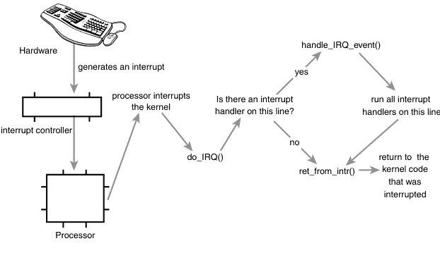

> **图 7.1** 中断从硬件经过内核的路径。

设备通过其总线向中断控制器发送电信号来发出中断。如果中断线已启用（它们可以被屏蔽），中断控制器将中断发送给处理器。在大多数架构中，这是通过发送到处理器特殊引脚的电信号完成的。除非处理器禁用了中断（这种情况也可能发生），否则处理器会立即停止当前操作，禁用中断系统，跳转到内存中的预定义位置并执行那里的代码。这个预定义点由内核设置，是中断处理程序的*入口点*（entry point）。

中断在内核中的旅程从这个预定义入口点开始，就像系统调用通过预定义的异常处理程序进入内核一样。对于每条中断线，处理器会跳转到内存中的唯一位置并执行那里的代码。通过这种方式，内核知道进入中断的 IRQ 编号。初始入口点只需保存该值，并将当前寄存器值（属于被中断任务）存储在栈上；然后内核调用`do_IRQ()`。从这里开始，大部分中断处理代码是用 C 语言编写的；然而，它仍然依赖于架构。

`do_IRQ()`函数定义为：

```c
unsigned int do_IRQ(struct pt_regs regs)
```

由于 C 调用约定将函数参数放在栈顶，`pt_regs`结构体包含了之前在汇编入口例程中保存的初始寄存器值。由于中断值也被保存了，`do_IRQ()`可以将其提取出来。计算出中断线后，`do_IRQ()`会确认收到中断并禁用该线上的中断传递。在普通的 PC 机上，这些操作由`mask_and_ack_8259A()`处理。

接下来，`do_IRQ()`确保该线上注册了有效的处理程序，且该处理程序已启用且当前未在执行。如果是这样，它将调用定义在`kernel/irq/handler.c`中的`handle_IRQ_event()`，以运行该线安装的中断处理程序。

```c
/**
 * handle_IRQ_event - irq action chain handler
 * @irq:         the interrupt number
 * @action:      the interrupt action chain for this irq
 *
 * Handles the action chain of an irq event
 */
irqreturn_t handle_IRQ_event(unsigned int irq, struct irqaction *action)
{
    irqreturn_t ret, retval = IRQ_NONE;
    unsigned int status = 0;

    if (!(action->flags & IRQF_DISABLED))
        local_irq_enable_inhardirq();

    do {
        trace_irq_handler_entry(irq, action);
        ret = action->handler(irq, action->dev_id);
        trace_irq_handler_exit(irq, action, ret);

    switch (ret) {
    case IRQ_WAKE_THREAD:
        /*
         * Set result to handled so the spurious check
         * does not trigger.
         */
        ret = IRQ_HANDLED;
        break;

        /*
         * Catch drivers which return WAKE_THREAD but
         * did not set up a thread function
         */
        if (unlikely(!action->thread_fn)) {
```

```c
						warn_no_thread(irq, action);
						break;
				}

				/*
				 * Wake up the handler thread for this
				 * action. In case the thread crashed and was
				 * killed we just pretend that we handled the
				 * interrupt. The hardirq handler above has
				 * disabled the device interrupt, so no irq
				 * storm is lurking.
				 */
				if (likely(!test_bit(IRQTF_DIED,
					    action->thread_flags))) {
					set_bit(IRQTF_RUNTHREAD, action->thread_flags);
					wake_up_process(action->thread);
				}

				/* Fall through to add to randomness */
			case IRQ_HANDLED:
				status |= action->flags;
				break;

			default:
				break;
			}

			retval |= ret;
			action = action->next;
		} while (action);

		if (status & IRQF_SAMPLE_RANDOM)
			add_interrupt_randomness(irq);
		local_irq_disable();
		return retval;
```

首先，由于处理器禁用了中断，除非在注册处理程序时指定了`IRQF_DISABLED`，否则中断将被重新开启。回想一下，`IRQF_DISABLED`指定了处理程序必须在中断禁用状态下运行。接着，每个潜在的处理程序在循环中被执行。如果该中断线不是共享的，循环在第一次迭代后终止。否则，所有处理程序都将被执行。之后，如果在注册期间指定了`IRQF_SAMPLE_RANDOM`，则调用`add_interrupt_randomness()`。该函数利用中断的定时信息为随机数生成器产生熵。最后，中断再次被禁用（`do_IRQ()`期望中断仍然关闭），函数返回。回到`do_IRQ()`中，该函数进行清理并返回到初始入口点，然后跳转到`ret_from_intr()`。

`ret_from_intr()`例程与初始入口代码一样，是用汇编语言编写的。该例程检查是否有待处理的重新调度（回想第 4 章“进程调度”，这意味着`need_resched`被设置了）。如果有一个待处理的重新调度，且内核正返回到用户空间（即中断中断了一个用户进程），则调用`schedule()`。如果内核正返回到内核空间（即中断中断了内核本身），则仅在`preempt_count`为零时才调用`schedule()`。否则，抢占内核是不安全的。在`schedule()`返回之后，或者如果没有待处理的工作，则恢复初始寄存器，内核恢复被中断的任何操作。

在 x86 上，初始汇编例程位于`arch/x86/kernel/entry_64.S`（32 位 x86 为`entry_32.S`），C 语言方法位于`arch/x86/kernel/irq.c`。其他支持的架构也类似。

## /proc/interrupts

*Procfs*是一个仅存在于内核内存中的虚拟文件系统，通常挂载在`/proc`。在 procfs 中读取或写入文件会调用内核函数，这些函数模拟从真实文件中读取或写入。一个相关的例子是`/proc/interrupts`文件，其中填充了与系统中中断相关的统计信息。以下是一个单处理器 PC 的示例输出：

```
           CPU0
   0:     3602371   XT-PIC   timer
   1:      3048     XT-PIC   i8042
   2:          0     XT-PIC   cascade
   4:    2689466      XT-PIC  uhci-hcd, eth0
   5:          0      XT-PIC  EMU10K1
  12:     85077       XT-PIC  uhci-hcd
  15:     24571      XT-PIC   aic7xxx
NMI:          0
LOC:    3602236
ERR:          0
```

第一列是中断线。在这个系统中，存在编号为 0-2, 4, 5, 12 和 15 的中断。未显示的中断线未安装处理程序。第二列是接收到的中断次数计数器。系统中每个处理器都有一列，但该机器只有一个处理器。如你所见，定时器中断接收到了 3,602,371 次中断²，而声卡 (EMU10K1) 没有收到任何中断（这表明自机器启动以来它尚未被使用）。第三列是处理该中断的中断控制器。XT-PIC 对应于标准的 PC 可编程中断控制器。在具有 I/O APIC 的系统中，大多数中断会将其中断控制器列为 IO-APIC-level 或 IO-APIC-edge。最后，最后一列是与此中断关联的设备。该名称由之前讨论过的`request_irq()`的`devname`参数提供。如果中断是共享的（如本例中中断号 4 的情况），则会列出在该中断线上注册的所有设备。

> ² 作为一个练习，在阅读完第 11 章后，已知定时器中断发生的次数，你能告诉系统已经运行了多久（以*HZ*为单位）吗？

对于好奇的人来说，`procfs`代码主要位于`fs/proc`。提供`/proc/interrupts`的函数不出所料地与架构相关，名为`show_interrupts()`。

## 中断控制

Linux 内核实现了一组用于操作机器中断状态的接口。这些接口允许你禁用当前处理器的中断系统，或者掩蔽整个机器的一条中断线。这些例程全部与架构相关，可以在`<asm/system.h>`和`<asm/irq.h>`中找到。请参阅本章后面的表 7.2 以获取接口的完整列表。

控制中断系统的原因通常归结为需要提供同步。通过禁用中断，你可以保证中断处理程序不会抢占当前代码。此外，禁用中断也会禁用内核抢占。然而，无论是禁用中断传递还是禁用内核抢占，都不能防止来自另一个处理器的并发访问。因为 Linux 支持多处理器，内核代码通常需要获取某种锁以防止另一个处理器同时访问共享数据。这些锁通常与禁用本地中断结合使用。锁提供了针对另一个处理器并发访问的保护，而禁用中断则提供了针对可能的中断处理程序的并发访问保护。第 9 章和第 10 章讨论了同步的各种问题及其解决方案。尽管如此，理解内核中断控制接口仍然很重要。

## 禁用与启用中断

要在当前处理器（且*仅*为当前处理器）本地禁用中断，然后在稍后重新启用它们，请执行以下操作：

```c
local_irq_disable();
/* 中断被禁用 .. */
local_irq_enable();
```

这些函数通常实现为单个汇编操作。（当然，这取决于架构。）事实上，在`x86`上，`local_irq_disable()`是简单的`cli`指令，而`local_irq_enable()`是简单的`sti`指令。`cli`和`sti`分别是清除和设置“允许中断”标志的汇编调用。换句话说，它们禁用和启用发出指令处理器的中断传递。

如果在调用`local_irq_disable()`之前中断已经禁用，那么该例程是非常危险的。相应的`local_irq_enable()`调用会无条件地启用中断，尽管它们最初是关闭的。相反，需要一种机制将中断恢复到之前的状态。这是一个常见的问题，因为内核中的给定代码路径可能会在启用或不启用中断的情况下被到达，这取决于调用链。例如，假设之前的代码片段是一个较大函数的一部分。假设该函数被另外两个函数调用，一个禁用了中断，另一个没有。由于随着内核规模和复杂性的增加，很难知道所有通往某个函数的代码路径，因此在禁用中断系统之前保存其状态要安全得多。然后，当你准备重新启用中断时，只需将它们恢复到原始状态：

```c
unsigned long flags;
local_irq_save(flags);      /* 中断现在被禁用 */
/* ... */
local_irq_restore(flags);  /* 中断恢复到之前的状态 */
```

请注意，这些方法至少部分地通过宏实现，因此`flags`参数（必须定义为`unsigned long`）看似是通过值传递的。该参数包含特定于架构的、包含中断系统状态的数据。因为至少有一个支持的架构将栈信息合并到该值中（咳，SPARC），所以`flags`不能被传递给另一个函数（具体来说，它必须保持在同一个栈帧中）。因此，保存中断和恢复中断的调用必须发生在同一个函数中。

所有上述函数都可以从中断上下文和进程上下文调用。

## 不再有全局 cli()

内核以前提供了一种在系统*所有*处理器上禁用中断的方法。此外，如果另一个处理器调用此方法，它必须等待中断启用后才能继续。这个函数名为`cli()`，相应的启用调用名为`sti()`——尽管存在于所有架构中，但非常以 x86 为中心。这些接口在 2.5 版本期间被废弃，因此现在所有中断同步必须使用本地中断控制和自旋锁的组合（在第 9 章“内核同步简介”中讨论）。这意味着之前只需要全局禁用中断即可确保共享数据互斥访问的代码，现在需要做更多工作。

以前，驱动程序编写者可以假设在中断处理程序以及任何访问共享数据的地方使用`cli()`就能提供互斥。`cli()`调用将确保没有其他中断处理程序（以及他们的特定处理程序）运行。此外，如果另一个处理器进入`cli()`保护区域，它将不会继续，直到原始处理器通过调用`sti()`退出其`cli()`保护区域。

移除全局`cli()`有几个优点。首先，它强制驱动程序编写者实现真正的锁。具有特定目的的细粒度锁比全局锁（`cli()`实际上就是全局锁）更快。其次，移除操作精简了中断系统中的大量代码并删除了更多冗余。结果是系统更简单且更容易理解。

## 禁用特定的中断线

在上一节中，我们研究了禁用整个处理器所有中断传递的函数。在某些情况下，禁用*整个*系统的*特定*中断线会非常有用。这被称为中断线的*屏蔽（masking out）*。例如，你可能希望在操作某个设备的状态之前，禁用该设备的中断传递。Linux 为此任务提供了四个接口：

```c
void disable_irq(unsigned int irq);
void disable_irq_nosync(unsigned int irq);
void enable_irq(unsigned int irq);
void synchronize_irq(unsigned int irq);
```


前两个函数在中断控制器中禁用给定的中断线。这将禁用将该中断传递给系统中的所有处理器。此外，`disable_irq()` 函数在任何当前执行的处理程序完成之前不会返回。因此，调用者不仅可以确保给定线路上不会传递新的中断，还可以确保任何已经在执行的处理程序已经退出。而 `disable_irq_nosync()` 函数则不会等待当前处理程序完成。

`synchronize_irq()` 函数在返回之前，会等待一个特定的中断处理程序（如果它正在执行）退出。

这些函数的调用是嵌套的。对于给定中断线上的每次 `disable_irq()` 或 `disable_irq_nosync()` 调用，都需要一次相应的 `enable_irq()` 调用。只有在最后一次调用 `enable_irq()` 时，中断线才会被真正启用。例如，如果 `disable_irq()` 被调用了两次，那么直到第二次调用 `enable_irq()` 时，中断线才会被真正重新启用。

这三个函数都可以在中断上下文或进程上下文中调用，且不会睡眠。如果在中断上下文中调用，请小心！例如，你不希望在处理某个中断线的同时启用它。（回想一下，处理程序在被服务期间，其中断线是被屏蔽的。）

禁用多个中断处理程序共用的一条中断线是非常鲁莽的。禁用该线会禁用该线上所有设备的中断传递。因此，新设备的驱动程序倾向于不使用这些接口。由于 PCI 设备根据规范必须支持中断线共享，因此它们根本不应该使用这些接口。因此，`disable_irq()` 及其相关函数更多地出现在旧版遗留设备的驱动程序中，例如 PC 并口。

> ³ 许多旧设备，尤其是 ISA 设备，没有提供获取其是否产生中断的方法。因此，ISA 设备的中断线通常无法共享。由于 PCI 规范强制要求共享中断，现代基于 PCI 的设备支持中断共享。在现代计算机中，几乎所有中断线都可以共享。

## 中断系统的状态

了解中断系统的状态（例如，中断是启用还是禁用）或者你当前是否在中断上下文中执行，通常是非常有用的。

定义在 `<asm/system.h>` 中的宏 `irqs_disabled()` 如果本地处理器的中断系统被禁用，则返回非零值。否则，它返回零。

定义在 `<linux/hardirq.h>` 中的两个宏提供了检查内核当前上下文的接口。它们分别是：

```c
in_interrupt()
in_irq()
```

最有用的是第一个：如果内核正在执行任何类型的中断处理（包括执行中断处理程序或底半部处理程序），它将返回非零值。而 `in_irq()` 宏仅在内核专门执行中断处理程序时才返回非零值。

更常见的情况是，你想检查是否处于进程上下文。也就是说，你想确保你不在中断上下文中。这种情况经常发生，因为代码想要执行一些只能在进程上下文中完成的操作，例如睡眠。如果 `in_interrupt()` 返回零，则内核处于进程上下文。

是的，这些名称很令人困惑，且几乎没有传达出它们的含义。表 7.2 是中断控制方法及其描述的摘要。

### 表 7.2 中断控制方法

| 函数 | 描述 |
| :--- | :--- |
| `local_irq_disable()` | 禁用本地中断传递 |
| `local_irq_enable()` | 启用本地中断传递 |
| `local_irq_save()` | 保存本地中断传递的当前状态，然后禁用它 |
| `local_irq_restore()` | 将本地中断传递恢复到给定状态 |
| `disable_irq()` | 禁用给定的中断线，并在返回前确保该线上没有处理程序在执行 |
| `disable_irq_nosync()` | 禁用给定的中断线 |
| `enable_irq()` | 启用给定的中断线 |
| `irqs_disabled()` | 如果本地中断传递被禁用，则返回非零值；否则返回零 |
| `in_interrupt()` | 如果在中断上下文中返回非零值，如果在进程上下文中返回零 |
| `in_irq()` | 如果当前正在执行中断处理程序则返回非零值，否则返回零 |

## 本章小结

本章研究了中断，这是一种设备用来异步向处理器发送信号的硬件资源。实际上，硬件使用中断来中断操作系统的运行。

大多数现代硬件使用中断与操作系统通信。管理特定硬件的设备驱动程序会注册一个中断处理程序，以响应并处理来自其相关硬件发出的中断。在中断中执行的工作包括响应并重置硬件、在设备与主内存之间复制数据、处理硬件请求以及发送新的硬件请求。

内核提供了注册和注销中断处理程序、禁用中断、屏蔽中断线以及检查中断系统状态的接口。表 7.2 概述了其中许多函数。

由于中断会中断其他正在执行的代码（进程、内核本身，甚至其他中断处理程序），因此它们必须快速执行。然而，通常有大量工作需要完成。为了在大量工作与快速执行的需求之间取得平衡，内核将处理中断的工作分为两半。中断处理程序（顶半部）在本章中进行了讨论。下一章将讨论底半部。

## 底半部与延迟工作

前一章讨论了中断处理程序，这是内核处理硬件中断的机制。中断处理程序是任何操作系统的重要且必需的部分。然而，由于各种限制，中断处理程序只能构成任何中断处理方案的第一部分。这些限制包括：

- 中断处理程序异步运行，因此会中断其他潜在的重要代码，包括其他中断处理程序。因此，为了避免中断代码停顿太久，中断处理程序需要尽可能快地运行。
- 在最好情况下（如果未设置 `IRQF_DISABLED`），中断处理程序在当前中断级别被禁用时运行；在最坏情况下（如果设置了 `IRQF_DISABLED`），当前处理器上的所有中断都被禁用。由于禁用中断会阻止硬件与操作系统的通信，因此中断处理程序需要尽可能快地运行。
- 由于处理硬件，中断处理程序通常对时间非常敏感。
- 中断处理程序不在进程上下文中运行；因此，它们不能阻塞。这限制了它们能做的事情。

现在应该很明显，中断处理程序只是管理硬件中断方案的一部分。操作系统确实需要一种快速、异步且简单的机制来立即响应硬件并执行任何时间敏感的操作。中断处理程序很好地实现了这一功能；但其他次要的工作可以而且应该推迟到以后启用中断时再执行。

因此，管理中断被分为两部分，或称为两个“半部”。第一部分是中断处理程序（顶半部），由内核异步执行，以立即响应硬件中断，正如前一章所讨论的。本章将研究中断方案的第二部分：底半部。

## 下半部（Bottom Halves）

下半部的工作是对中断处理程序未完成的任何与中断相关的工作进行处理。在理想情况下，这几乎涵盖了所有工作，因为你希望中断处理程序执行的工作尽可能少（从而尽可能快）。通过将尽可能多的工作卸载到下半部，中断处理程序可以尽快将系统的控制权返回给被中断的任务。

尽管如此，中断处理程序必须执行部分工作。例如，中断处理程序几乎肯定需要向硬件确认已收到中断。它可能需要将数据复制到硬件或从硬件复制数据。这项工作是对时间敏感的，因此在中断处理程序中执行它是合理的。

除此之外的几乎任何工作都可以交给下半部执行。例如，如果你在上半部将数据从硬件复制到内存中，那么在下半部对其进行处理显然是有意义的。不幸的是，关于哪些工作在何处执行并没有硬性规定——这个决定完全由设备驱动程序的作者决定。虽然没有哪种安排是非法的，但某种安排肯定可能是次优的。请记住，中断处理程序是异步运行的，且至少当前的中断线是被禁用的。尽量缩短它们的执行时间至关重要。虽然不总是能明确如何划分上半部和下半部的工作，但有几条有用的建议可以参考：

- 如果工作是对时间敏感的，请在中断处理程序中执行。
- 如果工作是为了确保另一个中断（尤其是同一个中断）不会中断它，请在中断处理程序中执行。
- 如果工作与硬件相关，请在中断处理程序中执行。
- 对于所有其他工作，考虑在下半部执行。

在尝试编写自己的设备驱动程序时，参考其他中断处理程序及其对应的下半部会有所帮助。在决定如何划分上半部和下半部的中断处理工作时，问问自己什么必须在上半部，什么可以在下半部。通常，中断处理程序执行得越快越好。

## 为什么需要下半部？

理解为什么要延迟工作以及具体何时延迟至关重要。你需要限制在中断处理程序中执行的工作量，因为中断处理程序在所有处理器上都禁用了当前的中断线。更糟糕的是，使用 `IRQF_DISABLED` 注册的处理程序在本地处理器上禁用了所有中断线，并且在所有处理器上禁用了当前中断线。为了系统的响应速度和性能，尽量减少中断禁用状态下的时间非常重要。再加上中断处理程序相对于其他代码（甚至是其他中断处理程序）是异步运行的，显而易见，你应该致力于尽量缩短中断处理程序的运行时间。处理传入的网络流量不应阻止内核接收击键。解决方案是将部分工作延迟到以后执行。

但“以后”是什么时候？需要意识到的是，以后通常仅仅意味着现在不执行。下半部的目的不是在未来的某个特定时间点执行工作，而仅仅是将工作推迟到未来系统较空闲且中断再次启用时的任何时间点。通常，下半部在中断返回后立即运行。关键在于它们是在所有中断都启用的情况下运行的。

Linux 并不是唯一将硬件中断处理分为两个部分的系统；大多数操作系统都这样做。上半部快速且简单，在部分或所有中断禁用的情况下运行。下半部（无论如何实现）稍后在所有中断启用的情况下运行。这种设计通过尽可能缩短禁用中断的时间，将系统延迟保持在较低水平。

## 下半部的世界

与完全通过中断处理程序实现的上半部不同，实现下半部有多种机制。这些机制是不同的接口和子系统，使你能够实现下半部。前一章只讨论了实现中断处理程序的一种方法，而本章将探讨实现下半部的多种方法。在 Linux 的历史进程中，出现过许多下半部机制。令人困惑的是，其中一些机制的名字非常相似，甚至很愚蠢。看来需要一种特殊的程序员才能给下半部命名。

本章将讨论 2.6 版本中存在的下半部机制的设计和实现。我们还将讨论如何在编写的内核代码中使用它们。那些古老但早已被移除的下半部机制在历史上具有重要意义，因此在相关时会提及。

## 原始的“Bottom Half”

在初期，Linux 仅提供“bottom half”来实现下半部。这个名字在当时是合乎逻辑的，因为那是延迟工作的唯一手段。该基础设施也被称为 `BH`，为了避免与通用术语 bottom half 混淆，我们将称之为 `BH`。`BH` 接口非常简单，就像那个好时光里的大多数东西一样。它为整个系统提供了一个静态创建的包含 32 个下半部的列表。上半部可以通过设置 32 位整数中的一个位来标记下半部是否运行。每个 `BH` 都是全局同步的。即使在不同的处理器上，也没有两个 `BH` 能同时运行。这很容易使用，但缺乏灵活性；方法简单，但成为了瓶颈。

## 任务队列（Task Queues）

后来，内核开发人员引入了任务队列，既作为一种延迟工作的方法，也作为 `BH` 机制的替代方案。内核定义了一组队列。每个队列包含一个待调用函数的链表。排队的函数在特定时间运行，具体取决于它们位于哪个队列中。驱动程序可以在相应的队列中注册它们的下半部。这种方式运行得相当不错，但对于完全取代 `BH` 接口来说仍然太不灵活。对于性能至关重要的子系统（如网络），它也不够轻量。

## Softirqs 和 Tasklets

在 2.3 开发系列中，内核开发人员引入了 `softirqs` 和 `tasklets`。除了与现有驱动程序的兼容性之外，`softirqs` 和 `tasklets` 可以完全取代 `BH` 接口。¹ `Softirqs` 是一组静态定义的下半部，可以在任何处理器上同时运行；甚至两个相同类型的 `softirq` 也可以并发运行。`Tasklets`（这个名字糟糕且令人困惑²）是构建在 `softirqs` 之上的灵活的、动态创建的下半部。两个不同的 `tasklet` 可以在不同的处理器上并发运行，但两个相同类型的 `tasklet` 不能同时运行。因此，`tasklets` 在性能和易用性之间取得了很好的平衡。对于大多数下半部处理，`tasklet` 就足够了。当性能至关重要（如网络处理）时，`softirqs` 非常有用。然而，使用 `softirqs` 需要更加小心，因为两个相同的 `softirq` 可能会同时运行。此外，`softirqs` 必须在编译时静态注册。相反，代码可以动态注册 `tasklets`。

为了进一步增加混乱，有些人将所有下半部统称为软件中断或 `softirqs`。换句话说，他们将 `softirq` 机制和广义上的下半部都称为 `softirqs`。请忽略这些人。他们和给 `BH` 以及 `tasklet` 机制命名的人是一伙的。

在开发 2.5 内核期间，`BH` 接口终于被抛弃了，因为所有 `BH` 用户都转换到了其他下半部接口。此外，任务队列接口被工作队列（work queue）接口所取代。工作队列是一种简单且有用的方法，用于将工作排队以便稍后在进程上下文中执行。我们稍后会讨论它们。

因此，如今 2.6 内核中有三种下半部机制：`softirqs`、`tasklets` 和工作队列。旧的 `BH` 和任务队列接口已成为记忆。

## 内核定时器（Kernel Timers）

另一种延迟工作的机制是内核定时器。与本章目前讨论的机制不同，定时器将工作延迟一段指定的时间。也就是说，虽然本章讨论的工具用于将工作延迟到现在以外的任何时间，但你使用定时器是将工作延迟到至少经过一段特定时间之后。

因此，定时器的用途与本章讨论的通用机制不同。关于定时器的详细讨论见第 11 章“定时器与时间管理”。

***

¹ 将 `BH` 转换为 `softirqs` 或 `tasklets` 并非易事，因为 `BH` 是全局同步的，因此假设在执行期间没有其他 `BH` 在运行。不过，这种转换最终在 2.5 版本中完成了。

² 它们与“任务（tasks）”没有任何关系。可以将 `tasklet` 视为一个简单且易于使用的 `softirq`。

## 消除混淆

这部分内容确实非常令人困惑，但实际上它仅仅涉及命名问题。让我们再次回顾一遍。

*Bottom half*（下半部）是一个通用的操作系统术语，指中断处理中延迟执行的部分，之所以这样命名，是因为它代表了中断处理方案的第二部分，即“底部”。在 Linux 中，该术语目前也具有这个含义。内核中所有延迟执行工作的机制都被称为“下半部”。一些人还会将所有下半部混淆地称为“softirqs”地称呼。

Bottom half 还指 Linux 中最初的延迟工作机制。该机制也被称为 `BH`，因此我们现在用这个名称来称呼它，而将前者作为通用描述。`BH` 机制在一段时间前已被弃用，并在 2.5 开发内核系列中被完全移除。

目前，存在三种延迟工作的方法：`softirqs`、`tasklets` 和 work queues（工作队列）。`Tasklets` 构建在 `softirqs` 之上，而 work queues 是一个独立的子系统。表 8.1 展示了下半部的发展历史。

### 表 8.1 下半部状态

| 下半部 | 状态 |
| --- | --- |
| `BH` | 在 2.5 中移除 |
| Task queues | 在 2.5 中移除 |
| `Softirq` | 2.3 起可用 |
| `Tasklet` | 2.3 起可用 |
| Work queues | 2.5 起可用 |

在解决了命名混淆之后，让我们来看看具体的机制。

## Softirqs

讨论实际的下半部方法，首先要从 `softirqs` 开始。`softirqs` 很少被直接使用；`tasklets` 是一种更常见的下半部形式。尽管如此，由于 `tasklets` 构建在 `softirqs` 之上，我们先介绍它们。`softirq` 代码位于内核源码树的 `kernel/softirq.c` 文件中。

### 实现 Softirqs

`Softirqs` 在编译时静态分配。与 `tasklets` 不同，你不能动态地注册和销毁 `softirqs`。`Softirqs` 由 `softirq_action` 结构体表示，该结构体定义在 `<linux/interrupt.h>` 中：

```c
struct softirq_action {
    void (*action)(struct softirq_action *);
};
```

在 `kernel/softirq.c` 中声明了一个该结构体的 32 项数组：

```c
static struct softirq_action softirq_vec[NR_SOFTIRQS];
```

每个注册的 `softirq` 占用数组中的一个条目。因此，共有 `NR_SOFTIRQS` 个注册的 `softirqs`。注册的 `softirqs` 数量在编译时静态确定，不能动态更改。内核强制限制最多注册 32 个 `softirqs`；但在当前内核中，仅存在 9 个。³

### Softirq 处理函数

`softirq` 处理函数 `action` 的原型如下：

```c
void softirq_handler(struct softirq_action *)
```

当内核运行 `softirq` 处理函数时，它会执行此 `action` 函数，并将指向相应 `softirq_action` 结构体的指针作为其唯一的参数。例如，如果 `my_softirq` 指向 `softirq_vec` 数组中的一个条目，内核将按如下方式调用 `softirq` 处理函数：

```c
my_softirq->action(my_softirq);
```

内核将整个结构体传递给 `softirq` 处理函数看起来有点奇怪。这个技巧使得未来可以在不要求修改每个 `softirq` 处理函数的情况下，向结构体中添加新成员。

一个 `softirq` 永远不会抢占另一个 `softirq`。唯一能抢占 `softirq` 的事件是中断处理函数。然而，另一个 `softirq`（甚至是同一个）可以在另一个处理器上运行。

### 执行 Softirqs

一个注册的 `softirq` 在执行前必须被标记。这被称为触发 `softirq`（raising the `softirq`）。通常，中断处理函数在返回前会将其 `softirq` 标记为待执行。然后，在合适的时间，`softirq` 开始运行。内核在以下位置检查并执行待处理的 `softirqs`：

- 从硬件中断代码路径返回时。
- 在 `ksoftirqd` 内核线程中。
- 在任何显式检查并执行待处理 `softirqs` 的代码中，例如网络子系统。


无论调用方法如何，softirq 的执行都发生在`__do_softirq()`中，而该函数由`do_softirq()`调用。这个函数非常简单。如果存在待处理的 softirqs，`__do_softirq()`会遍历每一个，并调用其处理函数。让我们来看看`__do_softirq()`重要部分的简化变体：

```c
u32 pending;

pending = local_softirq_pending();
if (pending) {
    struct softirq_action *h;
    
    /* 重置待处理掩码 */
    set_softirq_pending(0);
    
    h = softirq_vec;
    do {
        if (pending & 1)
            h->action(h);
        h++;
        pending >>= 1;
    } while (pending);
}
```

这段代码片段是 softirq 处理的核心。它检查并执行任何待处理的 softirqs。具体来说：

1. 它将局部变量`pending`设置为`local_softirq_pending()`宏返回的值。这是一个 32 位的待处理 softirqs 掩码——如果第 n 位被置位，则第 n 个 softirq 处于待处理状态。

2. 既然 softirqs 的待处理掩码已保存，它便清除实际的掩码。⁴

3. 指针`h`被设置为`softirq_vec`的第一个条目。

4. 如果`pending`的第一位被置位，则调用`h->action(h)`。

5. 指针`h`加 1，使其现在指向`softirq_vec`数组的第二个条目。

6. 掩码`pending`右移一位。这将丢弃第一位，并将所有其他位向右移动一位。因此，第二位现在变成了第一位（依此类推）。

7. 指针`h`现在指向数组的第二个条目，且`pending`掩码现在将第二位作为第一位。重复上述步骤。

8. 继续重复直到`pending`为零，此时不再有待处理的 softirqs，工作完成。注意，这个检查足以确保`h`始终指向`softirq_vec`中的有效条目，因为`pending`最多有 32 个置位，因此该循环最多执行 32 次。

> ⁴ 这实际上是在禁用局部中断的情况下发生的，但在该简化示例中被省略了。如果中断没有被禁用，在保存掩码和清除掩码之间的时间间隔内，可能会触发一个 softirq（从而使其处于待处理状态）。这将导致错误地清除一个待处理位。

大多数驱动程序使用 tasklets 或 work queues 作为其下半部。正如接下来的章节所解释的，Tasklets 是基于 softirqs 构建的。

### 使用 Softirqs

Softirqs 预留给系统中时间最关键、最重要的下半部处理。目前，只有两个子系统——网络和块设备——直接使用 softirqs。此外，内核定时器和 tasklets 也是构建在 softirqs 之上的。如果你要添加一个新的 softirq，通常应该问问自己为什么使用 tasklet 是不够的。Tasklets 是动态创建的，由于其锁要求较低，使用起来更简单，而且性能依然非常出色。尽管如此，对于能够以高效方式自行实现锁的时间关键型应用，softirqs 可能是正确的解决方案。

### 分配索引

你通过`<linux/interrupt.h>`中的一个枚举在编译时静态声明 softirqs。内核将这个从零开始的索引作为相对优先级。数值优先级最低的 softirqs 在数值优先级较高的 softirqs 之前执行。

创建一个新的 softirq 包括向该枚举中添加一个新条目。在添加新 softirq 时，你可能不想像在其他地方那样简单地将条目添加到列表末尾。相反，你需要根据你想赋予它的优先级来插入新条目。按照惯例，`HI_SOFTIRQ`始终是第一个条目，而`RCU_SOFTIRQ`始终是最后一个条目。一个新条目可能应该放在`BLOCK_SOFTIRQ`和`TASKLET_SOFTIRQ`之间。表 8.2 包含了现有 softirq 类型的列表。

表 8.2 Softirq 类型

| Softirq | 优先级 | Softirq 描述 |
|---------|----------|---------------------|
| HI_SOFTIRQ | 0 | 高优先级 tasklets |
| TIMER_SOFTIRQ | 1 | 定时器 |
| NET_TX_SOFTIRQ | 2 | 发送网络包 |
| NET_RX_SOFTIRQ | 3 | 接收网络包 |
| BLOCK_SOFTIRQ | 4 | 块设备 |
| TASKLET_SOFTIRQ | 5 | 普通优先级 tasklets |
| SCHED_SOFTIRQ | 6 | 调度器 |
| HRTIMER_SOFTIRQ | 7 | 高分辨率定时器 |
| RCU_SOFTIRQ | 8 | RCU 锁 |

## 注册你的处理程序

接下来，softirq 处理程序在运行时通过`open_softirq()`进行注册，该函数接收两个参数：softirq 的索引及其处理函数。例如，网络子系统在`net/core/dev.c`中像这样注册其 softirqs：

```c
open_softirq(NET_TX_SOFTIRQ, net_tx_action);
open_softirq(NET_RX_SOFTIRQ, net_rx_action);
```

softirq 处理程序在中断启用状态下运行，且不能睡眠。当一个处理程序运行时，当前处理器上的 softirqs 会被禁用。然而，另一个处理器可以执行其他的 softirqs。如果在执行过程中同一个 softirq 再次被触发，另一个处理器可以同时运行它。这意味着任何共享数据——即使是仅在 softirq 处理程序内部使用的全局数据——都需要适当的锁（将在接下来的两章中讨论）。这是一个关键点，也是通常首选 tasklets 的原因。简单地防止你的 softirqs 并发运行并不是理想的。如果一个 softirq 获取了锁以防止另一个实例同时运行，那么就没有理由使用 softirq 了。因此，大多数 softirq 处理程序采用每处理器数据（per-processor data，即每个处理器唯一的数据，因此不需要加锁）和其他技巧来避免显式加锁，从而提供出色的可扩展性。

softirqs 的存在意义（raison d'être）是可扩展性。如果你不需要扩展到无限数量的处理器，那么请使用 tasklet。Tasklets 本质上是 softirqs，但同一个处理程序的多个实例不能在多个处理器上并发运行。

## 触发你的 Softirq

在处理程序被添加到`enum`列表并通过`open_softirq()`注册后，它就准备好运行了。为了将其标记为待处理（pending），以便在下一次调用`do_softirq()`时运行，请调用`raise_softirq()`。例如，网络子系统会调用：

```c
raise_softirq(NET_TX_SOFTIRQ);
```

这将触发`NET_TX_SOFTIRQ` softirq。其处理程序`net_tx_action()`将在内核下次执行 softirqs 时运行。该函数在实际触发 softirq 之前会禁用中断，然后将其恢复到之前的状态。如果中断已经关闭，可以使用`raise_softirq_irqoff()`函数作为一项小优化。例如：

```c
/*
 * interrupts must already be off!
 */
raise_softirq_irqoff(NET_TX_SOFTIRQ);
```

softirqs 最常在中断处理程序内部被触发。在中断处理程序的情况下，中断处理程序执行基本的硬件相关工作，触发 softirq，然后退出。在处理中断时，内核调用`do_softirq()`。随后 softirq 运行，并从中断处理程序停止的地方接手。在这个例子中，“上半部（top half）”和“下半部（bottom half）”的命名就很好理解了。

## Tasklets

Tasklets 是一种构建在 softirqs 之上的下半部机制。如前所述，它们与“任务（tasks）”没有任何关系。Tasklets 在性质和行为上与 softirqs 相似；然而，它们具有更简单的接口和更宽松的加锁规则。

作为设备驱动程序作者，决定使用 softirqs 还是 tasklets 很简单：你几乎总是想使用 tasklets。正如我们在前一节看到的，使用 softirqs 的用户几乎可以一只手数过来。softirqs 仅用于高频且高度线程化的场景。另一方面，tasklets 的使用更为广泛。对于绝大多数情况，tasklets 运行良好且非常易于使用。

## 实现 Tasklets

因为 tasklets 是在 softirqs 之上实现的，所以它们本身就是 softirqs。如前讨论，tasklets 由两个 softirqs 表示：`HI_SOFTIRQ`和`TASKLET_SOFTIRQ`。这两类唯一的区别是，基于`HI_SOFTIRQ`的 tasklets 在基于`TASKLET_SOFTIRQ`的 tasklets 之前运行。

## Tasklet 结构体

Tasklets 由`tasklet_struct`结构体表示。每个结构体代表一个唯一的 tasklet。该结构体在`<linux/interrupt.h>`中定义：

```c
struct tasklet_struct {
    struct tasklet_struct *next;  /* next tasklet in the list */
    unsigned long state;         /* state of the tasklet */
    atomic_t count;              /* reference counter */
    void (*func)(unsigned long); /* tasklet handler function */
    unsigned long data;          /* argument to the tasklet function */
};
```

`func`成员是 tasklet 处理程序（相当于 softirq 的`action`），并接收`data`作为其唯一参数。

`state`成员的值为 0、`TASKLET_STATE_SCHED`或`TASKLET_STATE_RUN`。`TASKLET_STATE_SCHED`表示一个被调度运行的 tasklet，而`TASKLET_STATE_RUN`表示一个正在运行的 tasklet。作为一项优化，`TASKLET_STATE_RUN`仅在多处理器机器上使用，因为单处理器机器总是知道 tasklet 是否在运行（它要么是当前正在执行的代码，要么不是）。

`count`字段用作 tasklet 的引用计数。如果它非零，则 tasklet 被禁用且不能运行；如果它是零，则 tasklet 已启用，且在被标记为待处理时可以运行。

## 调度 Tasklets

被调度的 tasklets（相当于被触发的`softirqs`）存储在两个每处理器结构中：`tasklet_vec`（用于普通 tasklets）和`tasklet_hi_vec`（用于高优先级 tasklets）。这两个结构都是`tasklet_struct`结构体的链表。列表中的每个`tasklet_struct`结构体代表一个不同的 tasklet。

Tasklets 通过`tasklet_schedule()`和`tasklet_hi_schedule()`函数进行调度，这两个函数接收一个指向 tasklet 的`tasklet_struct`的指针作为唯一参数。每个函数确保提供的 tasklet 尚未被调度，然后根据情况调用`__tasklet_schedule()`和`__tasklet_hi_schedule()`。这两个函数非常相似（区别在于一个使用`TASKLET_SOFTIRQ`，另一个使用`HI_SOFTIRQ`）。编写和使用 tasklets 将在下一节讨论。现在，让我们看看`tasklet_schedule()`执行的步骤：

1. 检查 tasklet 的状态是否为`TASKLET_STATE_SCHED`。如果是，则该 tasklet 已经调度运行，函数可以立即返回。

2. 调用`__tasklet_schedule()`。

3. 保存中断系统的状态，然后禁用本地中断。这确保了在`tasklet_schedule()`操作 tasklets 时，该处理器上的任何内容都不会干扰 tasklet 代码。

4. 将要调度的 tasklet 添加到`tasklet_vec`或`tasklet_hi_vec`链表的头部，该链表在系统中的每个处理器上都是唯一的。

5. 触发`TASKLET_SOFTIRQ`或`HI_SOFTIRQ` softirq，以便`do_softirq()`在不久的将来执行此 tasklet。

6. 将中断恢复到之前的状态并返回。

在接下来的最早机会，`do_softirq()`会像前一节讨论的那样运行。因为大多数 tasklets 和 softirqs 在中断处理程序中被标记为待处理，所以`do_softirq()`最有可能在最后一个中断返回时运行。由于`TASKLET_SOFTIRQ`或`HI_SOFTIRQ`现在已被触发，`do_softirq()`将执行相关的处理程序。这些处理程序`tasklet_action()`和`tasklet_hi_action()`是 tasklet 处理的核心。让我们看看这些处理程序执行的步骤：

1. 禁用本地中断分发（无需先保存其状态，因为这里的代码总是作为 softirq 处理程序被调用，且中断总是启用的），并获取该处理器的`tasklet_vec`或`tasklet_hi_vec`列表。

2. 通过将其设置为`NULL`来清除该处理器的列表。

3. 启用本地中断分发。同样，无需将它们恢复到之前的状态，因为该函数知道它们最初总是启用的。

4. 循环遍历获取的列表中每个待处理的 tasklet。

5. 如果这是一台多处理器机器，通过检查`TASKLET_STATE_RUN`标志来检查该 tasklet 是否在另一个处理器上运行。如果当前正在运行，则现在不执行它，并跳到下一个待处理的 tasklet。（记住，给定类型的 tasklet 只能有一个实例并发运行。）

6. 如果 tasklet 当前未运行，则设置`TASKLET_STATE_RUN`标志，以便另一个处理器不会运行它。

7. 检查计数（count）值是否为零，以确保 tasklet 没有被禁用。如果 tasklet 被禁用，则跳过它并进入下一个待处理的 tasklet。

8. 现在我们知道该 tasklet 没有在其他地方运行，已被标记为运行（因此不会在其他地方开始运行），且计数值为零。运行 tasklet 处理程序。

9. 在 tasklet 运行后，清除 tasklet 状态字段中的`TASKLET_STATE_RUN`标志。

10. 对下一个待处理的 tasklet 重复此操作，直到没有更多调度运行的 tasklets。

tasklets 的实现简单但相当巧妙。如你所见，所有 tasklets 都复用在两个 softirqs（`HI_SOFTIRQ`和`TASKLET_SOFTIRQ`）之上。当一个 tasklet 被调度时，内核触发其中一个 softirq。这些 softirqs 进而由特殊函数处理，然后运行任何被调度的 tasklets。这些特殊函数确保给定类型的 tasklet 在同一时间只有一个在运行（但不同的 tasklets 可以同时运行）。所有这些复杂性都被隐藏在一个简洁简单的接口之后。

## 使用 Tasklets

在大多数情况下，tasklets 是为普通硬件设备实现下半部的首选机制。Tasklets 是动态创建的，易于使用且快速。此外，尽管它们的名字让人感到极其困惑，但你慢慢会习惯它的：还挺可爱的。

## 声明你的 Tasklet

你可以静态或动态地创建 tasklets。选择哪个选项取决于你是否拥有（或想要）对 tasklet 的直接或间接引用。如果你打算静态创建 tasklet（从而拥有对它的直接引用），请使用`<linux/interrupt.h>`中的两个宏之一：

```c
DECLARE_TASKLET(name, func, data)
DECLARE_TASKLET_DISABLED(name, func, data);
```

这两个宏都会静态创建一个具有给定名称的`struct tasklet_struct`。当 tasklet 被调度时，给定的函数`func`将被执行并传递参数`data`。这两个宏之间的区别在于初始引用计数。第一个宏创建的 tasklet 计数为零，并且 tasklet 是启用状态。第二个宏将计数设置为 1，并且 tasklet 是禁用状态。例如：

```c
DECLARE_TASKLET(my_tasklet, my_tasklet_handler, dev);
```

这一行等同于：

```c
struct tasklet_struct my_tasklet = { NULL, 0, ATOMIC_INIT(0),
    my_tasklet_handler, dev };
```

这创建了一个名为`my_tasklet`的已启用 tasklet，并以`tasklet_handler`作为其处理函数。当处理函数执行时，`dev`的值将被传递给它。

若要通过一个动态创建的`struct tasklet_struct`实例`t`的间接引用（指针）来初始化 tasklet，请调用`tasklet_init()`：


```c
tasklet_init(t, tasklet_handler, dev);  /* 动态初始化，而非静态初始化 */
```

## 编写 Tasklet 处理函数

Tasklet 处理函数必须符合正确的原型：

```c
void tasklet_handler(unsigned long data)
```

与 softirqs 一样，tasklets 不能睡眠。这意味着你不能在 tasklet 中使用信号量或其他阻塞函数。Tasklets 还在所有中断都启用的情况下运行，因此如果你的 tasklet 与中断处理函数共享数据，你必须采取预防措施（例如，禁用中断并获取锁）。然而，与 softirqs 不同的是，两个相同的 tasklets 永远不会并发运行——尽管两个不同的 tasklets 可以在两个不同的处理器上同时运行。如果你的 tasklet 与另一个 tasklet 或 softirq 共享数据，你需要使用适当的锁（参见第 9 章“内核同步简介”和第 10 章“内核同步方法”）。

## 调度 Tasklet

要调度一个 tasklet 执行，需调用`tasklet_schedule()`并传递相关`tasklet_struct`的指针：

```c
tasklet_schedule(&my_tasklet);      /* 将 my_tasklet 标记为待处理 */
```

Tasklet 被调度后，会在不久的将来某个时间运行一次。如果在它有机会运行之前再次调度同一个 tasklet，它仍然只运行一次。如果它已经在运行（例如在另一个处理器上），则该 tasklet 会被重新调度并再次运行。作为一种优化，tasklet 总是运行在调度它的处理器上——希望这样能更好地利用处理器的缓存。

`tasklet_enable()`启用 tasklet。在使用`DECLARE_TASKLET_DISABLED()`创建的 tasklet 之前，也必须调用此函数。例如：

```c
tasklet_disable(&my_tasklet);   /* tasklet 现在被禁用了 */
```

```c
/* 现在我们可以执行某些操作，因为知道 tasklet 无法运行... */
```

```c
tasklet_enable(&my_tasklet);   /* tasklet 现在被启用了 */
```

你可以通过`tasklet_kill()`将 tasklet 从待处理队列中移除。该函数接收一个指向 tasklet 的`tasklet_struct`的指针作为唯一参数。在处理经常自我重新调度的 tasklet 时，从队列中移除已调度的 tasklet 非常有用。该函数首先等待 tasklet 执行完毕，然后将其从队列中移除。当然，没有什么能阻止其他代码重新调度该 tasklet。此函数不能在中断上下文中调用，因为它会睡眠。

## ksoftirqd

Softirq（以及由此衍生的 tasklet）的处理由一组每处理器内核线程辅助完成。当系统被 softirqs 淹没时，这些内核线程有助于处理 softirqs。由于 tasklets 是使用 softirqs 实现的，因此以下讨论同样适用于 softirqs 和 tasklets。为了简便，我们将主要提到 softirqs。

如前所述，内核在许多地方处理 softirqs，最常见的是在中断处理返回时。Softirqs 可能会以极高的频率被触发（例如在沉重的网络流量期间）。此外，softirq 函数可以重新激活自身。也就是说，在运行期间，一个 softirq 可以触发自身以便再次运行（例如，网络子系统的 softirq 会触发自身）。softirqs 的高频触发结合其将自身重新标记为激活的能力，可能导致用户空间程序被剥夺处理器时间。然而，不能及时处理重新激活的 softirqs 也是不可接受的。在 softirqs 最初设计时，这造成了一个需要解决的困境，而两种显而易见的解决方案都不是完美的。首先，让我们看看这两种方案。

第一种方案是简单地在 softirqs 到来时持续处理，并在返回前重新检查并处理所有待处理的 softirqs。这确保了内核能够及时处理 softirqs，最重要的是，任何重新激活的 softirqs 也能立即得到处理。问题在于高负载环境下，会发生许多不断自我重新激活的 softirqs。内核可能会不断地服务于 softirqs 而无法完成其他太多工作。用户空间被忽略——事实上，除了 softirqs 和中断处理程序之外没有任何东西在运行，反过来，系统的用户会对此感到愤怒。如果系统从未处于剧烈负载下，这种方法可能运行良好；但如果系统经历中等程度的中断级别，这种方案是不可接受的。用户空间不能在很长一段时间内被剥夺资源。

第二种方案是*不*处理重新激活的 softirqs。在中断返回时，内核仅查看所有待处理的 softirqs 并照常执行。然而，如果任何 softirqs 重新激活自身，它们将直到内核*下一次*处理待处理 softirqs 时才会运行。这很可能要等到下一次中断发生，这意味着在任何新（或重新激活）的 softirqs 执行之前可能会经过很长时间。更糟糕的是，在一个 otherwise 空闲的系统上，立即处理 softirqs 是有益的。遗憾的是，这种方法忽略了哪些进程是可运行的。因此，虽然这种方法防止了用户空间的饥饿，但它导致了 softirqs 的饥饿，且未能充分利用空闲系统。

在设计 softirqs 时，内核开发人员意识到需要某种折中方案。最终在内核中实现的方案是*不*立即处理重新激活的 softirqs。相反，如果 softirqs 的数量过多，内核会唤醒一组内核线程来处理负载。这些内核线程以最低可能的优先级运行（nice 值为 19），这确保了它们不会取代任何重要任务运行。这种妥协防止了沉重的 softirq 活动完全剥夺用户空间的处理器时间。相反，它也确保了“过多”的 softirqs 最终能够运行。最后，该方案还有一个优点，即在空闲系统上，softirqs 能被相当快地处理，因为内核线程会立即被调度。

每个处理器有一个线程。线程分别命名为`ksoftirqd/n`，其中`n`是处理器编号。在双处理器系统上，你会有`ksoftirqd/0`和`ksoftirqd/1`。每个处理器上都有一个线程，确保了如果有空闲处理器，它总能服务于 softirqs。线程初始化后，它们运行一个类似于下面的紧凑循环：

```c
for (;;) {
    if (!softirq_pending(cpu))
        schedule();

    set_current_state(TASK_RUNNING);

    while (softirq_pending(cpu)) {
        do_softirq();
        if (need_resched())
            schedule();
    }

    set_current_state(TASK_INTERRUPTIBLE);
}
```

如果任何 softirqs 处于待处理状态（由`softirq_pending()`报告），**ksoftirq**会调用`do_softirq()`来处理它们。请注意，它会重复执行此操作以处理任何重新激活的 softirqs。每次迭代后，如果需要，将调用`schedule()`以允许更重要的进程运行。在所有处理完成后，内核线程将自身设置为`TASK_INTERRUPTIBLE`并调用调度程序来选择一个新的可运行进程。

每当`do_softirq()`检测到执行中的内核线程重新激活自身时，softirq 内核线程就会被唤醒。

## 旧的 BH 机制

尽管旧的 BH 接口在 2.6 版本中已经不复存在（谢天谢地），但它曾存在了*很长一段时间*——从内核的最早版本开始。由于它具有极强的生命力，它无疑承载了一些具有历史意义的内容，值得我们花时间了解。虽然本节简短的内容实际上与 2.6 版本无关，但其历史非常重要。

BH 接口非常古老，这一点在设计上很明显。每个 BH 必须静态定义，且最多只能有 32 个。因为处理程序必须全部在编译时定义，所以模块无法直接使用 BH 接口。不过，它们可以“搭便车”使用现有的 BH。随着时间的推移，这种静态要求和最多 32 个底半部的限制成了限制其使用的主要障碍。

所有 BH 处理程序都是严格串行化的——没有任何两个 BH 处理程序（即使是不同类型的）可以并发运行。这使得同步变得简单，但不利于多处理器扩展。在大型 SMP 机器上的性能不尽如人意。使用 BH 接口的驱动程序无法很好地扩展到多个处理器，尤其是网络层受影响严重。

除了这些特性外，BH 机制与 tasklets 类似。事实上，2.4 版本中的 BH 接口就是基于 tasklets 实现的。32 个可能的底半部由`<linux/interrupt.h>`中定义的常量表示。为了将某个 BH 标记为待处理，需要调用`mark_bh()`函数并传入该 BH 的编号。在 2.4 版本中，这进而会调度 BH tasklet`bh_action()`运行。在 2.4 内核之前，BH 机制是独立实现的，不依赖于任何更低层级的底半部机制，这与如今 softirqs 的实现方式很像。

由于这种底半部形式的缺陷，内核开发人员引入了任务队列（task queues）来取代底半部。虽然任务队列赢得了许多新用户，但从未真正实现这一目标。在 2.3 版本中，引入了 softirq 和 tasklet 机制以终结 BH。BH 机制被重新实现为基于 tasklets。不幸的是，由于新接口固有的串行化程度较低，将底半部从 BH 接口迁移到 tasklets 或 softirqs 变得非常复杂。⁶ 然而，在 2.5 版本期间，当计时器和 SCSI（最后的 BH 用户）最终迁移到 softirqs 时，这种转换得以完成。内核开发人员随即删除了 BH 接口。永别了，BH！

> ⁶ 也就是说，较弱的串行化有利于性能，但编程难度更高。例如，将 BH 转换为 tasklet 需要仔细思考：这段代码在与其他任何 tasklet 同时运行时是否安全？然而，最终完成转换后，性能的提升证明这一切都是值得的。

## 工作队列 (Work Queues)

工作队列是我们目前看到的另一种递延工作的形式。工作队列将工作递延到内核线程中——这种底半部始终在进程上下文中运行。因此，递延到工作队列的代码具有进程上下文的所有常规优势。最重要的是，工作队列是可调度的，因此可以睡眠。

通常，在工作队列和 softirqs/tasklets 之间做出选择很容易。如果递延工作需要睡眠，则使用工作队列；如果不需要睡眠，则使用 softirqs 或 tasklets。事实上，工作队列的通常替代方案是内核线程。因为内核开发人员不鼓励创建新的内核线程（在某些环境下，这甚至被视为一种可处罚的过错），因此工作队列被强烈推荐。而且它们*非常*易于使用。

如果你需要一个可调度的实体来执行底半部处理，你就需要工作队列。它们是唯一在进程上下文中运行的底半部机制，因此也是唯一能睡眠的机制。这意味着它们适用于需要分配大量内存、获取信号量或执行块 I/O 的场景。如果你不需要内核线程来处理递延工作，可以考虑使用 tasklet。

## 实现工作队列

在最基本的形式中，工作队列子系统是一个用于创建内核线程以处理来自其他地方排队工作的接口。这些内核线程被称为*工作者线程 (worker threads)*。工作队列允许你的驱动程序创建特殊的工作者线程来处理递延工作。不过，工作队列子系统实现并提供了一个默认的工作者线程来处理工作。因此，在最常见的情况下，工作队列是一个将工作递延到通用内核线程的简单接口。

默认的工作者线程被命名为`events/n`，其中 n 是处理器编号；每个处理器有一个。例如，在单处理器系统上有一个线程`events/0`。双处理器系统则会额外有一个`events/1`线程。默认工作者线程处理来自多个位置的递延工作。内核中的许多驱动程序将其底半部工作递延到默认线程。除非驱动程序或子系统有强烈的需求创建自己的线程，否则优先选择默认线程。

然而，没有什么能阻止代码创建自己的工作者线程。如果你在工作者线程中执行大量处理，这可能会很有优势。计算密集型且对性能至关重要的工作可能会从拥有独立线程中受益。这也能减轻默认线程的负担，防止其他排队的工作被“饿死”。

## 表示线程的数据结构

工作者线程由`workqueue_struct`结构体表示：

```c
/*
 * The externally visible workqueue abstraction is an array of
 * per-CPU workqueues:
 */
struct workqueue_struct {
    struct cpu_workqueue_struct cpu_wq[NR_CPUS];
    struct list_head list;
    const char *name;
    int singlethread;
    int freezeable;
    int rt;
};
```

这个定义在 kernel/workqueue.c 中的结构体包含一个`struct cpu_workqueue_struct`数组，系统中每个可能的处理器对应一个。因为工作者线程存在于系统的每个处理器上，所以对于一台给定机器上的每个处理器，每个工作者线程都有一个这样的结构体。`cpu_workqueue_struct`是核心数据结构，同样定义在 kernel/workqueue.c 中：

```c
struct cpu_workqueue_struct {
    spinlock_t lock;            /* lock protecting this structure */
    
    struct list_head worklist;  /* list of work */
    wait_queue_head_t more_work;
    struct work_struct *current_struct;
    
    struct workqueue_struct *wq; /* associated workqueue_struct */
    task_t *thread;             /* associated thread */
};
```

请注意，每种类型的工作者线程都关联一个`workqueue_struct`。在其内部，每个线程（以及每个处理器）都有一个`cpu_workqueue_struct`，因为每个处理器上都有一个工作者线程。

## 表示工作的数据结构

所有工作者线程都实现为运行`worker_thread()`函数的普通内核线程。在初始设置之后，该函数进入一个无限循环并进入睡眠状态。当工作被排队时，线程被唤醒并处理该工作。当没有剩余工作可处理时，它再次进入睡眠。

工作由`work_struct`结构体表示，定义在`<linux/workqueue.h>`中：

```c
struct work_struct {
    atomic_long_t data;
    struct list_head entry;
    work_func_t func;
};
```

这些结构体被串联成一个链表，每个处理器上的每种队列类型对应一个。例如，每个处理器上为通用线程维护着一个递延工作链表。当工作者线程唤醒时，它会运行其链表中的所有工作。随着工作的完成，它将相应的`work_struct`条目从链表中删除。当链表为空时，它再次进入睡眠。

让我们来看一下简化后的`worker_thread()`核心部分：

```c
for (;;) {
    prepare_to_wait(&cwq->more_work, &wait, TASK_INTERRUPTIBLE);
    if (list_empty(&cwq->worklist))
        schedule();
    finish_wait(&cwq->more_work, &wait);
    run_workqueue(cwq);
}
```

该函数在无限循环中执行以下操作：

- 1. 线程将自己标记为睡眠状态（任务状态被设置为`TASK_INTERRUPTIBLE`）并将其添加到等待队列中。

- 2. 如果工作的链表为空，线程调用`schedule()`并进入睡眠。

- 3. 如果链表不为空，线程不进入睡眠。相反，它将自己标记为`TASK_RUNNING`并从等待队列中移除。

- 4. 如果链表非空，线程调用`run_workqueue()`来执行递延工作。

随后，`run_workqueue()`函数实际执行递延工作：

```c
while (!list_empty(&cwq->worklist)) {
    struct work_struct *work;
    work_func_t f;
    void *data;

    work = list_entry(cwq->worklist.next, struct work_struct, entry);
    f = work->func;
    list_del_init(cwq->worklist.next);
    work_clear_pending(work);
    f(work);
}
```

该函数遍历待处理工作链表中的每个条目，并执行链表中每个条目在`workqueue_struct`中的`func`成员：

- 1. 当链表不为空时，它获取链表中的下一个条目。

- 2. 它检索应被调用的函数`func`及其参数`data`。

- 3. 它将此条目从链表中删除，并清除结构体本身中的待处理（pending）位。

# 第 8 章 下半部与延迟工作

- 4. 它调用该函数。

- 5. 重复。

### 工作队列实现总结

不同数据结构之间的关系确实有些复杂。图 8.1 提供了一个图形示例，应该能将这一切理清。

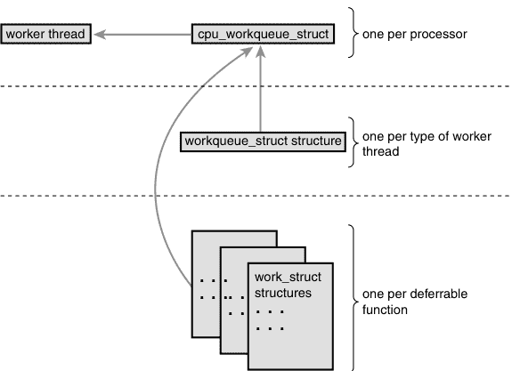

**图 8.1** 工作（work）、工作队列（work queues）与工作线程（worker threads）之间的关系。


在最高层级，是工作线程。可以有多种类型的工作线程；对于给定的类型，每个处理器都有一个工作线程。内核的部分组件可以根据需要创建工作线程。默认情况下，存在 `events` 工作线程。每个工作线程由 `cpu_workqueue_struct` 结构体表示。`workqueue_struct` 结构体则表示给定类型的所有工作线程。

例如，假设除了通用的 `events` 工作类型外，你还创建了一个 `falcon` 工作类型。同时，假设你有一台四处理器计算机。那么就会有四个 `events` 线程（因此有四个 `cpu_workqueue_struct` 结构体）和四个 `falcon` 线程（因此又有四个 `cpu_workqueue_struct` 结构体）。对于 `events` 类型有一个 `workqueue_struct`，对于 `falcon` 类型也有一个。

现在，让我们从最低层级入手，即从“工作”（work）开始。你的驱动程序创建了一些希望延迟到以后执行的工作。`work_struct` 结构体代表这项工作。除此之外，该结构体包含一个指向处理延迟工作的函数的指针。工作被提交给特定的工作线程——在本例中，是一个特定的 `falcon` 线程。随后，工作线程被唤醒并执行排队的工作。

大多数驱动程序使用名为 `events` 的现有默认工作线程。它们简单易用。然而，在一些更严肃的场景下，需要自定义工作线程。例如，XFS 文件系统就创建了两种新类型的工作线程。

## 使用工作队列

使用工作队列很简单。我们先介绍默认的 `events` 队列，然后讨论如何创建新的工作线程。

### 创建工作

第一步是实际创建一些需要延迟的工作。若要在运行时静态创建结构，请使用 `DECLARE_WORK`：

```c
DECLARE_WORK(name, void (*func)(void *), void *data);
```

这会静态创建一个名为 `name` 的 `work_struct` 结构体，其处理函数为 `func`，参数为 `data`。

或者，你可以通过指针在运行时创建工作：

```c
INIT_WORK(struct work_struct *work, void (*func)(void *), void *data);
```

这会动态初始化由 `work` 指向的工作队列，其处理函数为 `func`，参数为 `data`。

### 你的工作队列处理函数

工作队列处理函数的原型为：

```c
void work_handler(void *data)
```

工作线程执行此函数，因此该函数在进程上下文中运行。默认情况下，中断是开启的，且未持有任何锁。如果需要，该函数可以睡眠。请注意，尽管在进程上下文中运行，工作处理函数不能访问用户空间内存，因为内核线程没有关联的用户空间内存映射。只有当内核代表用户空间进程运行时（例如执行系统调用时），才能访问用户内存，此时用户内存才会被映射进来。

工作队列之间或其他内核部分之间的锁处理与任何其他进程上下文代码相同。这使得编写工作处理函数变得简单得多。接下来的两章将讨论锁。

### 调度工作

工作创建完成后，我们可以对其进行调度。要将给定的工作处理函数加入默认的 `events` 工作线程队列，只需调用：

```c
schedule_work(&work);
```

工作会被立即调度，并在当前处理器的 `events` 工作线程唤醒后尽快运行。

有时你可能不希望工作立即执行，而是在一段时间延迟后执行。在这种情况下，你可以调度工作在未来的某个给定时间执行：

```c
schedule_delayed_work(&work, delay);
```

在这种情况下，由 `&work` 表示的 `work_struct` 将在未来至少 `delay` 个时钟嘀嗒（timer ticks）后执行。使用嘀嗒作为时间单位将在第 10 章中介绍。

### 刷新工作

排队的工作在工作线程下次唤醒时执行。有时，你需要确保某批工作在继续执行前已完成。这对于模块尤为重要，模块在卸载前几乎肯定需要调用此函数。内核中的其他地方可能也需要确保没有待处理的工作，以防止竞态条件。

针对这些需求，有一个函数用于刷新给定的工作队列：

```c
void flush_scheduled_work(void);
```

该函数在返回前会等待队列中的所有条目执行完毕。在等待任何待处理工作执行期间，该函数会睡眠。因此，你只能在进程上下文中调用它。

请注意，此函数不会取消任何延迟工作。也就是说，任何通过 `schedule_delayed_work()` 调度且延迟时间尚未到期的工作，都不会通过 `flush_scheduled_work()` 被刷新。要取消延迟工作，请调用：

```c
int cancel_delayed_work(struct work_struct *work);
```

此函数会取消与给定 `work_struct` 相关联的待处理工作（如果有）。

### 创建新工作队列

如果默认队列无法满足你的需求，你可以创建一个新的工作队列及相应的工作线程。由于这会为每个处理器创建一个工作线程，因此只有在你的代码需要一组独立线程带来的性能提升时，才应创建唯一的工作队列。

```c
struct workqueue_struct *create_workqueue(const char *name);
```

参数 `name` 用于给内核线程命名。例如，默认的 `events` 队列是通过以下方式创建的：

```c
struct workqueue_struct *keventd_wq;
keventd_wq = create_workqueue("events");
```

此函数会创建*所有*工作线程（系统中每个处理器一个），并准备好处理工作。

无论队列类型如何，创建工作的方式都是相同的。工作创建后，以下函数与 `schedule_work()` 和 `schedule_delayed_work()` 类似，不同之处在于它们作用于给定的工作队列，而不是默认的 `events` 队列。

```c
int queue_work(struct workqueue_struct *wq, struct work_struct *work)
```

```c
int queue_delayed_work(struct workqueue_struct *wq,
                         struct work_struct *work,
                         unsigned long delay)
```

最后，你可以通过调用以下函数来刷新等待队列：

```c
flush_workqueue(struct workqueue_struct *wq)
```

如前所述，此函数的工作方式与 `flush_scheduled_work()` 完全相同，不同之处在于它在返回前等待给定的队列清空。

## 旧的任务队列机制

就像为 softirqs 和 tasklets 让路的 BH 接口一样，工作队列接口是从任务队列接口的缺陷中演变而来的。任务队列接口（在内核中通常简称为 `tq`），与 tasklets 一样，与进程意义上的任务无关。任务队列接口的用户在 2.5 开发内核期间被分成了两半。一半的用户转换到了 tasklets，而另一半则继续使用任务队列接口。任务队列接口的剩余部分随后成为了工作队列接口。简要回顾存在了一段时间的任务队列，是一次有益的历史练习。

任务队列通过定义一组队列来工作。这些队列有名称，例如调度队列（scheduler queue）、立即队列（immediate queue）或定时器队列（timer queue）。每个队列在内核的特定点运行。一个名为 `keventd` 的内核线程运行与调度队列相关的工作。这是完整工作队列接口的前身。定时器队列在系统定时器的每个嘀嗒运行，而立即队列在少数几个不同的地方运行，以确保它能“立即”运行（*真是个 hack!*）。此外还有其他队列，你也可以动态创建新队列。

这一切听起来可能很有用，但现实是任务队列接口一团糟。所有的队列基本上都是随意的抽象，散落在内核各处，就像被抛在空中落在哪里就留在哪里一样。唯一有意义的队列是调度队列，它是将工作延迟到进程上下文的唯一途径。

任务队列的另一个优点是其极其简单的接口。尽管有无数的队列以及关于何时运行的随意规则，但接口尽可能简单。但也就这样了——任务队列的其余部分必须被舍弃。

> 下半部的命名显然是一个为了迷惑新内核开发者的阴谋。说真的，这些名字太糟糕了。

各种任务队列（task queue）的用户已被转换为其他底半部机制。其中大多数切换到了 tasklet。调度队列的用户则保留了下来。最终，`keventd` 代码被泛化为我们今天所拥有的优秀的工作队列（work queue）机制，而任务队列终于从内核中被彻底移除。

## 我应该使用哪个底半部？

决定使用哪个底半部非常重要。在当前的 2.6 内核中，你有三种选择：softirqs、tasklets 和工作队列。Tasklets 构建在 softirqs 之上，因此两者非常相似。工作队列机制则完全不同，它是构建在内核线程之上的。

从设计上讲，softirqs 提供的序列化程度最低。这要求 softirq 处理程序采取额外步骤来确保共享数据的安全，因为两个或更多相同类型的 softirq 可能会在不同的处理器上并发运行。如果相关代码已经高度线程化（例如在充斥着每处理器变量的网络子系统中），那么 softirqs 是一个很好的选择。对于对时间敏感且高频使用的场景，它们绝对是最快的一种替代方案。

如果代码没有进行精细的线程化，那么 tasklets 更有意义。它们具有更简单的接口，并且由于两个相同类型的 tasklet 可能不会并发运行，因此更容易实现。Tasklets 实际上是不并发运行的 softirqs。驱动程序开发人员应始终选择 tasklets 而非 softirqs，除非准备使用每处理器变量或类似的技巧来确保 softirq 能够在多个处理器上安全地并发运行。

如果你的延迟工作需要在 *进程上下文* 中运行，那么在三种选择中，你唯一的选择就是工作队列。如果进程上下文不是必须的——具体来说，如果你不需要 *睡眠*——那么 softirqs 或 tasklets 也许更合适。工作队列的开销最高，因为它们涉及内核线程，从而涉及上下文切换。这并不是说它们效率低，但在每秒触发数千次中断的情况下（如网络子系统可能经历的情况），其他方法更有意义。然而，对于大多数情况，工作队列已经足够。

在易用性方面，工作队列占据首位。使用默认的 `events` 队列就像小孩子玩游戏一样简单。其次是 tasklets，它们同样具有简单的接口。最后是 softirqs，它们需要静态创建，并且在实现时需要深思熟虑。

表 8.3 是这三种底半部接口的对比。

### 表 8.3 底半部对比

| 底半部 | 上下文 | 固有序列化 |
|-------------|---------|------------------------|
| Softirq | 中断 | 无 |
| Tasklet | 中断 | 针对同一个 tasklet |
| 工作队列 | 进程 | 无（作为进程上下文调度） |

简而言之，普通驱动编写者有两个选择。首先，你是否需要一个可调度实体来执行你的延迟工作——从根本上说，你是否因为任何原因需要睡眠？如果是，那么工作队列是你唯一的选择。否则，优先选择 tasklets。只有当可扩展性成为问题时，才研究 softirqs。

## 底半部之间的锁

我们还没有讨论锁，这是一个非常有趣且广泛的话题，以至于我们将接下来的两章专门用于讨论它。尽管如此，你需要明白，在使用底半部时，即使在单处理器机器上，保护共享数据免受并发访问也至关重要。记住，底半部几乎可以在任何时刻运行。如果你对锁的概念感到陌生，建议在阅读完接下来的两章后再回到本节。

Tasklets 的好处之一是它们相对于自身是序列化的：同一个 tasklet 不会并发运行，即使在两个不同的处理器上也是如此。这意味着你不必担心 tasklet 内部的并发问题。Tasklet 之间的并发（即两个不同的 tasklet 共享相同数据）则需要适当的锁。

由于 softirqs 不提供任何序列化，甚至同一个 softirq 的两个实例也可能同时运行，因此所有共享数据都需要适当的锁。

如果进程上下文代码和底半部共享数据，你需要在访问数据前禁用底半部处理并获取锁。两者兼顾可以确保本地和 SMP 保护，并防止死锁。

如果中断上下文代码和底半部共享数据，你需要在访问数据前禁用中断并获取锁。这同样能确保本地和 SMP 保护并防止死锁。

工作队列中的任何共享数据同样需要锁。由于工作队列在进程上下文中运行，其锁定问题与普通内核代码没有区别。

第 9 章《内核同步简介》提供了关于并发问题的背景知识，第 10 章涵盖了内核锁定原语。这两章将讲解如何保护底半部使用的数据。

## 禁用底半部

通常，仅禁用底半部是不够的。更多时候，为了安全地保护共享数据，你需要获取锁 *并且* 禁用底半部。这类方法（你可能会在驱动程序中使用）在第 10 章中有所讨论。然而，如果你在编写内核核心代码，可能只需要禁用底半部。

要禁用所有底半部处理（具体来说，所有 softirqs 以及由此产生的所有 tasklets），请调用 `local_bh_disable()`。要启用底半部处理，请调用 `local_bh_enable()`。是的，这个函数命名有误；当 BH 接口让位于 softirqs 时，没有人费心去更改这个名字。表 8.4 是这些函数的摘要。

| 方法 | 描述 |
| :--- | :--- |
| `void local_bh_disable()` | 禁用本地处理器上的 softirq 和 tasklet 处理 |
| `void local_bh_enable()` | 启用本地处理器上的 softirq 和 tasklet 处理 |

这些调用可以嵌套——只有最后一次调用 `local_bh_enable()` 才会真正启用底半部。例如，第一次调用 `local_bh_disable()` 时，本地 softirq 处理被禁用。如果 `local_bh_disable()` 再被调用三次，本地处理仍然保持禁用状态。直到第四次调用 `local_bh_enable()`，处理才会被重新启用。

这些函数通过 `preempt_count`（有趣的是，这与内核抢占使用的计数器相同）维护一个每任务计数器来实现这一点。⁸ 当计数器归零时，底半部处理成为可能。由于底半部之前被禁用，`local_bh_enable()` 还会检查是否有任何待处理的底半部并执行它们。

这些函数在每个支持的架构中都是唯一的，通常在 `<asm/softirq.h>` 中写成复杂的宏。为了满足好奇心，以下是接近 C 语言的表示形式：

```c
/*
 * disable local bottom halves by incrementing the preempt_count
 */
void local_bh_disable(void)
{
    struct thread_info *t = current_thread_info();

    t->preempt_count += SOFTIRQ_OFFSET;
}
```

```c
/*
 * decrement the preempt_count – this will 'automatically' enable
 * bottom halves if the count returns to zero
 *
 * optionally run any bottom halves that are pending
 */
void local_bh_enable(void)
{
    struct thread_info *t = current_thread_info();

    t->preempt_count -= SOFTIRQ_OFFSET;

    /*
     * is preempt_count zero and are any bottom halves pending?
     * if so, run them
     */
    if (unlikely(!t->preempt_count && softirq_pending(smp_processor_id())))
            do_softirq();
}
```

> ⁸ 该计数器同时被中断和底半部子系统使用。因此，在 Linux 中，单个每任务计数器代表了一个任务的原子性。这在调试“在原子上下文中睡眠”（sleeping-while-atomic）等 Bug 时非常有用。

这些调用不会禁用工作队列的执行。因为工作队列在进程上下文中运行，不存在异步执行的问题，因此无需禁用它们。然而，由于 softirqs 和 tasklets 可能会异步发生（例如在处理中断返回时），内核代码可能需要禁用它们。另一方面，对于工作队列，保护共享数据的方式与在任何进程上下文中相同。第 8 章和第 9 章给出了详细信息。

## 结论

在本章中，我们涵盖了 Linux 内核中用于延迟工作的三种机制：softirqs、tasklets 和工作队列。我们研究了它们的设计和实现。我们讨论了如何在自己的代码中使用它们，并吐槽了它们糟糕的命名。为了历史完整性，我们还回顾了先前 Linux 内核版本中存在的底半部机制：BH 和任务队列。

我们在本章中大量讨论了同步和并发，因为这些话题与底半部密切相关。我们甚至以讨论出于并发保护目的而禁用底半部作为本章的结尾。现在是时候深入研究这些话题了。第 9 章将抽象地讨论内核同步和并发，为理解问题的核心提供基础。第 10 章将讨论我们心爱的内核为解决这些问题而提供的具体接口。有了接下来的两章武装，你将能够游刃有余地处理这些问题。

# 第 9 章 内核同步简介

在共享内存应用程序中，开发人员必须确保共享资源受到保护，防止并发访问。内核也不例外。共享资源需要防止并发访问，因为如果多个执行线程¹ 同时访问和操作数据，这些线程可能会覆盖彼此的更改，或者在数据处于不一致状态时访问该数据。对共享数据的并发访问是导致不稳定的根源，且通常难以追踪和调试——因此在开始时就将其处理正确至关重要。


妥善保护共享资源可能很困难。多年前，在 Linux 支持对称多处理（SMP）之前，防止数据的并发访问非常简单。由于仅支持单个处理器，数据产生并发访问的唯一方式是发生中断，或者内核代码显式地重新调度并启用另一个任务运行。在早期的内核中，开发工作非常简单。

那些美好的日子已经结束了。对称多处理支持在 2.0 内核中引入，并从此不断增强。多处理支持意味着内核代码可以同时在两个或更多处理器上运行。因此，如果没有保护，运行在两个不同处理器上的内核代码可能会在完全相同的时间同时访问共享数据。随着 2.6 内核的引入，Linux 内核成为了可抢占的。这意味着（同样在缺乏保护的情况下），调度程序几乎可以在任何点抢占内核代码并重新调度另一个任务。如今，许多场景会导致内核内部出现并发，而这些场景都需要保护。

¹ *执行线程（threads of execution）*一词是指任何执行代码的实例。这包括，例如，内核中的一个任务、一个中断处理程序、一个下半部（bottom half）或一个内核线程。本章可能会将执行线程简称为*线程*。请记住，这个术语描述的是任何正在执行的代码。

本章将抽象地讨论并发和同步问题，因为这些问题存在于任何操作系统内核中。下一章将详细介绍 Linux 内核为解决同步问题和防止竞态条件而提供的具体机制和接口。

## 临界区域与竞态条件

访问和操作共享数据的代码路径被称为*临界区域*（*critical regions*，也称为*临界区* $\text{critical sections}$）。通常情况下，多个执行线程同时访问同一资源是不安全的。为了防止在临界区域内发生并发访问，程序员必须确保代码*原子地（atomically）*执行——也就是说，操作在没有中断的情况下完成，就像整个临界区域是一条不可分割的指令一样。如果两个执行线程有可能同时在同一个临界区域内执行，那么这就是一个 Bug。当这种情况发生时，我们称之为*竞态条件*（*race condition*），之所以这样命名是因为线程在“竞赛”谁先到达那里。请注意，代码中的竞态条件可能表现得非常罕见——调试竞态条件通常很困难，因为它们不容易复现。确保防止不安全的并发并确保竞态条件不会发生，这被称为*同步*（*synchronization*）。

### 为什么我们需要保护？

为了更好地理解同步的必要性，让我们看看竞态条件的普遍性。首先来看一个现实世界的案例：ATM（自动柜员机，在美国境外被称为现金机、cashpoint 或 ABM）。

现金机最常见的功能之一是从个人的银行账户中取款。一个人走到机器前，插入 ATM 卡，输入 PIN 码，选择*取款*，输入金额，点击确定，取走钱，然后把它寄给我。

在用户要求特定金额的钱后，现金机需要确保该用户的账户中确实存在这笔钱。如果钱存在，它 then 需要从可用总资金中扣除取款金额。实现此功能的代码看起来像这样：

```c
int total = get_total_from_account();    /* 账户中的总资金 */
int withdrawal = get_withdrawal_amount(); /* 用户请求取款的金额 */

/* 检查用户账户中是否有足够的资金 */
if (total < withdrawal) {
    error("You do not have that much money!")
    return -1;
}

/* 没问题，用户有足够的钱：从总额中扣除取款金额 */
total -= withdrawal;
update_total_funds(total);

/* 给用户钱 */
spit_out_money(withdrawal);
```

现在，假设用户的资金在同一时间发生了另一次扣款。这次同步扣款*如何*发生并不重要：假设用户的配偶在另一台 ATM 机上发起另一次取款，或者一名收款人正从该账户中电子转账，或者银行正从账户中扣除手续费（正如如今的银行经常做的那样）。任何这些场景都符合我们的示例。

两个执行取款操作的系统都会有与我们刚才看到的类似的代码：首先检查扣款是否可行，然后计算新的总资金，最后执行实际扣款。现在我们假设一些数字。假设第一次扣款是从 ATM 机取款 100 美元，第二次扣款是银行收取 10 美元的手续费（因为客户走进银行办理）。假设客户在银行共有 105 美元。显然，在不导致账户透支的情况下，这两笔交易中*必然*有一笔无法正确完成。

你预期的结果应该是这样的：手续费交易先发生。10 美元少于 105 美元，所以从 105 中减去 10 得到新总额 95，银行赚到了 10 美元。然后 ATM 取款请求到来，因为 95 美元少于 100 美元，所以取款失败。

但在竞态条件下，情况可能会变得有趣得多。假设两笔交易大约在同一时间启动。两笔交易都验证了资金充足：105 美元都多于 100 美元和 10 美元，所以一切正常。然后取款进程从 105 美元中减去 100 美元，得到 5 美元。随后手续费交易执行同样的操作，从 105 美元中减去 10 美元，得到 95 美元。接着取款进程将用户的新可用总资金更新为 5 美元。现在手续费交易也更新了新总额，结果变成了 95 美元。白捡的钱！

显然，金融机构必须确保这种情况永远不会发生。他们必须在某些操作期间锁定账户，使每笔交易相对于任何其他交易都是原子的。此类交易必须完整地、无中断地发生，或者根本不发生。

### 单变量

现在，让我们看一个具体的计算示例。考虑一个简单的共享资源——一个全局整数，以及一个简单的临界区域——仅仅是对其进行递增的操作：

`i++;`

这在计算机处理器的机器指令中可能会翻译成类似于以下内容：

- 获取 `i` 的当前值并将其复制到寄存器中
- 将寄存器中存储的值加 1
- 将 `i` 的新值写回内存

现在，假设有两个执行线程都进入这个临界区域，且 `i` 的初始值为 7。预期的结果类似于以下内容（每行代表一个时间单位）：

| 线程 1 | 线程 2 |
| :--- | :--- |
| 获取 `i` (7) | — |
| 递增 `i` (7 -> 8) | — |
| 写回 `i` (8) | — |
| — | 获取 `i` (8) |
| — | 递增 `i` (8 -> 9) |
| — | 写回 `i` (9) |

正如预期的，7 递增两次是 9。然而，另一种可能的结果如下：

| 线程 1 | 线程 2 |
| :--- | :--- |
| 获取 `i` (7) | 获取 `i` (7) |
| 递增 `i` (7 -> 8) | — |
| — | 递增 `i` (7 -> 8) |
| 写回 `i` (8) | — |
| — | 写回 `i` (8) |

如果两个执行线程在 `i` 递增之前都读取了其初始值，那么两个线程都会递增并保存相同的值。结果是，变量 `i` 包含的值为 8，而实际上它现在应该包含 9。这是临界区域最简单的例子之一。庆幸的是，解决方案同样简单：我们只需要一种方法来将这些操作作为一个不可分割的步骤来执行。大多数处理器提供了一条指令，可以原子地读取、递增并写回单个变量。使用这种*原子*指令，唯一可能的结果是：

| 线程 1 | 线程 2 |
| :--- | :--- |
| 递增并存储 `i` (7 -> 8) | — |
| — | 递增并存储 `i` (8 -> 9) |

或者反之：

| 线程 1 | 线程 2 |
| :--- | :--- |
| — | 递增并存储 (7 -> 8) |
| 递增并存储 (8 -> 9) | — |

这两个原子操作绝不可能交织执行。处理器会在物理层面确保这一点。使用这样的指令可以缓解该问题。内核提供了一组实现这些原子指令的接口，我们将在下一章中讨论。

## 锁（Locking）

现在，让我们考虑一个更复杂的竞态条件，这需要一个更复杂的解决方案。假设你有一个需要被服务的请求队列。在本示例中，我们假设其实现是一个链表，其中每个节点代表一个请求。有两个函数操作该队列：一个函数将新请求添加到队列尾部，另一个函数从队列头部移除一个请求并对其进行处理。内核的各个部分都会调用这两个函数；因此，请求在不断地被添加、移除和处理。操作请求队列显然需要多条指令。如果一个线程试图读取队列，而另一个线程正处于操作队列的过程中，读取线程将发现队列处于不一致的状态。显而易见，如果对队列的访问可以并发发生，将会造成怎样的破坏。通常，当共享资源是一个复杂的数据结构时，竞态条件的结果就是数据结构的损坏。

之前的场景在起初可能没有一个清晰的解决方案。你如何防止一个处理器在另一个处理器更新队列时读取它？虽然对于特定的架构来说，实现简单的原子指令（如算术运算和比较）是可行的，但要求架构提供指令来支持前述示例中那种大小不定的临界区则是荒谬的。我们需要的是一种方法，确保一次只有一个线程能操作该数据结构——一种在另一个执行线程处于标记区域时，防止访问该资源的机制。

锁（Lock）提供了这样一种机制；它的工作方式非常像门上的锁。将门后的房间想象成临界区。在房间里，在给定时间内只能存在一个执行线程。当一个线程进入房间时，它会把门锁上。当线程完成对共享数据的操作后，它离开房间并解锁。如果另一个线程到达门口时门锁着，它必须等待内部的线程退出房间并解锁后才能进入。线程持有锁，而锁保护数据。

在之前的请求队列示例中，可以使用一把锁来保护队列。每当有新请求需要添加到队列时，线程会先获取锁，然后才能安全地将请求添加到队列中，最后释放锁。当线程想要从队列中移除请求时，它同样需要获取锁，然后读取该请求并将其从队列中移除，最后释放锁。任何其他对队列的访问都需要类似地获取锁。因为锁在同一时间只能被一个线程持有，所以一次只能有一个线程操作队列。如果一个线程在另一个线程已经更新队列时到来，第二个线程必须等待第一个线程释放锁后才能继续。锁防止了并发，并保护队列免受竞态条件的影响。

任何访问队列的代码首先都需要获取相关的锁。如果另一个执行线程到来，锁会阻止并发：

| 线程 1 | 线程 2 |
| :--- | :--- |
| 尝试锁定队列 | 尝试锁定队列 |
| 成功：获取锁 | 失败：等待中... |
| 访问队列... | 等待中... |
| 解锁队列 | 等待中... |
| ... | 成功：获取锁 |
| | 访问队列... |
| | 解锁队列 |

请注意，锁是*建议性的且自愿的*。锁完全是一种编程构建，程序员必须主动利用它。没有什么能阻止你编写在没有适当锁的情况下操作那个虚拟队列的代码。当然，这种做法最终会导致竞态条件和数据损坏。

锁有各种形式和规模——仅 Linux 就实现了多种不同的锁定机制。各种机制之间最显著的区别在于当锁不可用（因为另一个线程已经持有它）时的行为——某些锁变体采用*忙等待*²，而其他锁则将当前任务置于睡眠状态，直到锁可用为止。下一章将讨论 Linux 中不同锁的行为及其接口。

敏锐的读者现在可能在惊呼：锁并没有解决问题；它只是将临界区缩小到了仅包含加锁和解锁的代码：虽然可能小得多，但仍然存在潜在的竞态！幸运的是，锁是通过原子操作实现的，这确保了不存在竞态。单条指令可以验证密钥是否被占用，如果没有，则将其夺取。具体的实现方式取决于架构，但几乎所有处理器都实现了一个原子的*测试并设置（test and set）*指令，它测试一个整数的值，并且仅在该值为零时将其设置为新值。零值意味着未锁定。在流行的 x86 架构上，锁是通过一个类似的指令实现的，称为*比较并交换（compare and exchange）*。

> ² 即在紧凑的循环中自旋，一遍又一遍地检查锁的状态，等待锁可用。

## 并发的原因

在用户空间中，同步的需求源于程序是由调度器根据其意愿抢占式调度的。因为进程可以在任何时间被抢占，另一个进程可以被调度到处理器上，所以一个进程在访问临界区的过程中可能会被强制抢占。如果新调度的进程随后进入同一个临界区（例如，两个进程操作同一个共享内存或写入同一个文件描述符），就可能发生竞态。同样的问题也可能发生在多个共享文件的单线程进程之间，或者在包含信号的单个程序内部，因为信号可以异步发生。这种类型的并发——即两件事实际上并非在同一时间发生，但交织在一起以至于效果相同——被称为*伪并发（pseudo-concurrency）*。

如果你拥有一台对称多处理（SMP）机器，两个进程实际上可以在完全相同的时间执行在同一个临界区内。这被称为*真并发（true concurrency）*。虽然真并发与伪并发的原因和语义不同，但它们都会导致相同的竞态条件，并需要相同类型的保护。

内核有类似的并发原因：

- **中断**——中断几乎可以在任何时间异步发生，中断当前正在执行的代码。
- **软中断（Softirqs）和 tasklets**——内核几乎可以在任何时间触发或调度软中断或 tasklet，中断当前正在执行的代码。
- **内核抢占**——因为内核是抢占式的，内核中的一个任务可以抢占另一个任务。
- **睡眠以及与用户空间的同步**——内核中的一个任务可以睡眠，从而调用调度器，导致一个新进程运行。
- **对称多处理**——两个或更多处理器可以在完全相同的时间执行内核代码。

内核开发人员需要理解并应对这些并发原因。如果在操作资源的中间发生了中断，且中断处理程序能够访问同一个资源，那么这就是一个重大 Bug。同样，如果内核代码在访问共享资源时是可抢占的，这也是一个 Bug。同样地，如果内核代码在临界区中间进入睡眠，这也是一个 Bug。最后，两个处理器绝对不能同时访问同一块数据。只要清晰地了解哪些数据需要保护，提供锁定机制以保持系统稳定并不难。相反，困难的部分在于识别这些情况并意识到为了防止并发，你需要某种形式的保护。

让我们再次强调这一点，因为这很重要。在代码中实现实际的锁定以保护共享数据并不困难，尤其是在开发设计阶段早期完成时。棘手的部分是识别实际的共享数据和相应的临界区。这就是为什么从一开始就将锁定设计到代码中，而不是作为事后补救，具有至关重要的意义。这可能会变得很困难...

在 *ex post*（事后）中，识别关键区域并将锁机制追溯到现有代码中。由此产生的代码通常也不够美观。从中可以吸取的教训是，*务必*从一开始就在代码中设计适当的锁。

能够安全地防止中断处理程序并发访问的代码被称为 *中断安全*（interrupt-safe）。能够安全地防止对称多处理（SMP）机器上并发访问的代码被称为 *SMP 安全*（SMP-safe）。安全地防止内核抢占并发访问的代码被称为 *抢占安全*（preempt-safe）。³ 在所有这些情况下，用于提供同步和防止竞态条件的实际机制将在下一章中讨论。

## 明确保护对象

识别具体哪些数据需要保护至关重要。因为任何可以被并发访问的数据几乎肯定都需要保护，因此通常更容易识别哪些数据 *不需要* 保护，然后以此类推。显然，任何仅属于某个特定执行线程的局部数据都不需要保护，因为只有该线程能访问该数据。例如，局部自动变量（以及地址仅存储在栈上的动态分配数据结构）不需要任何形式的锁，因为它们仅存在于执行线程的栈中。同样，仅由特定任务访问的数据也不需要加锁（因为一个进程一次只能在一个处理器上执行）。

*什么* 需要加锁？大多数全局内核数据结构都需要。一个简单的经验法则是：如果另一个执行线程可以访问该数据，则该数据需要某种形式的锁；如果任何人能看到它，就给它加锁。记住要锁的是 *数据*，而不是 *代码*。

### 配置选项：SMP 与 UP

由于 Linux 内核在编译时是可配置的，因此可以针对特定的机器量身定制内核。最重要的是，`CONFIG_SMP` 配置选项控制内核是否支持 SMP。在单处理器（UP）机器上，许多锁定问题会消失；因此，当未设置 `CONFIG_SMP` 时，不必要的代码不会被编译到内核镜像中。例如，这种配置使单处理器机器能够免去自旋锁（spin locks）的开销。同样的技巧也适用于 `CONFIG_PREEMPT`（启用内核抢占的配置选项）。这是一个极佳的设计决定——内核维护一个整洁的源代码库，并根据需要使用各种锁定机制。不同架构上 `CONFIG_SMP` 和 `CONFIG_PREEMPT` 的不同组合会编译入不同的锁支持。

在编写代码时，请为最悲观的情况（即支持内核抢占的 SMP）提供适当的保护，这样所有场景都将被覆盖。

³ 你还会发现，除少数例外，SMP 安全通常意味着抢占安全。

每当你编写内核代码时，都应该问自己以下问题：

- 数据是否是全局的？除当前线程外的其他执行线程能否访问它？
- 数据是否在进程上下文和中断上下文之间共享？它是否在两个不同的中断处理程序之间共享？
- 如果一个进程在访问此数据时被抢占，新调度执行的进程能否访问相同的数据？
- 当前进程是否会在任何地方睡眠（阻塞）？如果会，共享数据将处于什么状态？
- 什么能防止数据在我使用时被释放？
- 如果此函数在另一个处理器上再次被调用会发生什么？
- 基于上述几点，我将如何确保我的代码在并发环境下是安全的？

简而言之，内核中几乎所有全局和共享的数据都需要某种形式的同步方法，这些方法将在下一章讨论。

## 死锁

*死锁*（deadlock）是一种涉及一个或多个执行线程和一个或多个资源的情况，在这种情况下，每个线程都在等待其中一个资源，但所有资源都已被占用。线程都在互相等待，但它们永远无法释放自己已经持有的资源。因此，没有任何线程能够继续执行，从而导致死锁。

一个很好的类比是四路停车标志路口。如果路口处的每辆车都决定在出发前等待其他车，那么没有车能前进，我们就陷入了交通死锁。

死锁最简单的例子是自死锁：¹ 如果一个执行线程尝试获取它已经持有的锁，它必须等待该锁被释放。但它永远不会释放该锁，因为它正忙于等待该锁，结果就是死锁：

```
acquire lock
acquire lock, again
wait for lock to become available
...
```

⁴ 一些内核通过提供递归锁（recursive locks）来防止这类死锁。递归锁允许单个执行线程多次获取。幸运的是，Linux 不提供递归锁。这被广泛认为是一件好事。虽然递归锁可能会缓解自死锁问题，但它们很容易导致松散的锁定语义。

同样地，考虑 *n* 个线程和 *n* 把锁。如果每个线程都持有一把另一个线程想要的锁，所有线程在等待各自的锁可用时都会被阻塞。最常见的例子是两个线程和两把锁，这通常被称为 *致命拥抱*（deadly embrace）或 *ABBA 死锁*：

| 线程 1 | 线程 2 |
| :--- | :--- |
| `acquire lock A` | `acquire lock B` |


每个线程都在等待另一个，且没有任何一个线程会释放其原始锁；因此，没有任何锁会变得可用。

防止死锁场景至关重要。虽然很难证明代码完全没有死锁，但你可以编写无死锁的代码。几个简单的规则大有裨益：

- 实现锁排序（lock ordering）。嵌套锁*必须始终*按照相同的顺序获取。这可以防止致命拥抱死锁。记录锁排序，以便他人遵循。
- 防止饥饿（starvation）。问问自己：*这段代码总是能运行完吗？如果`foo`没有发生，`bar`是否会永远等待？*
- 不要重复获取同一把锁。
- 追求简单设计。锁定方案的复杂性会诱发死锁。

第一点最重要，值得强调。如果同时获取两把或更多锁，它们*必须始终*按相同的顺序获取。假设你有`cat`、`dog`和`fox`三把锁，分别保护同名的数据结构。现在假设你有一个函数需要同时对这三个数据结构进行操作——也许是为了在它们之间复制数据。无论如何，数据结构都需要加锁以确保安全访问。如果一个函数按照`cat` $\rightarrow$ `dog` $\rightarrow$ `fox`的顺序获取锁，那么*每一个*其他函数也必须按照这个相同的顺序获取这些锁（或其子集）。例如，先获取`fox`锁然后再获取`dog`锁就可能导致死锁（因此是一个 bug），因为`dog`锁必须始终在`fox`锁之前获取。以下是一个会导致死锁的示例：

| 线程 1 | 线程 2 |
| :--- | :--- |
| `acquire lock cat` | `acquire lock fox` |
| `acquire lock dog` | `try to acquire lock dog` |
| `try to acquire lock fox` | `wait for lock dog` |
| `wait for lock fox` | — |

线程 1 在等待线程 2 持有的`fox`锁，而线程 2 在等待线程 1 持有的`dog`锁。两者都永远不释放自己的锁，因此双方永远等待——砰，死锁。如果锁总是按相同顺序获取，这种死锁就不可能发生。

每当锁嵌套在其他锁中时，必须遵守特定的顺序。将排序写在锁上方的注释中是一个好习惯。如下所示是一个不错的做法：

```
/*
 * cat_lock – locks access to the cat structure
 * always obtain before the dog lock!
 */
```

就死锁而言，解锁的顺序并不重要，尽管常见的做法是按照与获取顺序相反的顺序释放锁。

防止死锁很重要。Linux 内核提供了一些基础的调试设施，用于检测运行中内核的死锁场景。这些特性将在下一章讨论。

## 争用与可扩展性

锁争用（lock contention），或简称为争用，是指一把锁当前正在被使用，但另一个线程正尝试获取它。高争用的锁通常有大量线程在等待获取。高争用可能是因为锁被频繁获取、获取后持有时间过长，或者两者兼有。由于锁的作用是将对资源的访问序列化，因此锁会降低系统性能也就不足为奇了。一个高争用的锁可能成为系统的瓶颈，迅速限制其性能。当然，锁也是为了防止系统崩溃，因此解决高争用的方案必须继续提供必要的并发保护。

*可扩展性（Scalability）是衡量系统扩展能力的指标。在操作系统中，我们讨论面对大量进程、大量处理器或大量内存时的可扩展性。我们可以讨论与计算机中几乎任何可以量化的组件相关的可扩展性。理想情况下，处理器数量翻倍应该导致系统处理器性能翻倍。当然，实际情况并非如此。*

自从 2.0 内核引入多处理支持以来，Linux 在大量处理器上的可扩展性得到了显著提高。在 Linux 多处理支持的早期，内核一次只能执行一个任务。在 2.2 版本期间，随着锁定机制变得更细粒度，这一限制被取消了。从 2.4 版本起，内核锁定变得更加细粒度。今天，在 2.6 Linux 内核中，内核锁定非常细粒度，可扩展性良好。

锁定粒度（granularity of locking）是对锁所保护的数据大小或数量的描述。粗粒度锁保护大量数据——例如，整个子系统。细粒度锁保护少量数据——例如，单个变量。

# 第 9 章 内核同步简介

系统的这一组数据结构。另一方面，非常细粒度的锁保护少量数据——例如，一个较大结构中的单个元素。实际上，大多数锁处于这两个极端之间，既不保护整个子系统，也不保护也不保护单个元素，而是可能保护单个结构或一组结构列表。大多数锁在开始时都相当粗粒度，随着锁竞争被证明成为一个问题，它们会被修改为更细的粒度。

演进到更细粒度锁的一个例子是第 4 章“进程调度”中讨论的调度器运行队列（runqueues）。在 2.4 及之前的内核中，调度器只有一个运行队列。（回想一下，运行队列是可运行进程的列表。）在 2.6 系列早期，*O(1)* 调度器引入了每处理器运行队列，每个队列都有一个唯一的锁。锁机制从单个全局锁演变为每个处理器独立的锁。这是一次重要的优化，因为在大型机器上运行队列锁的竞争非常激烈，实际上将整个调度过程序列化，一次只能由一个处理器在调度器中执行。在 2.6 系列的后期，*CFS 调度器*进一步提高了可扩展性。

通常，这种可扩展性的提升是一件好事，因为它提高了 Linux 在更大、更强大的系统上的性能。然而，盲目的可扩展性“改进”可能会导致在较小的 SMP 和 UP 机器上性能下降，因为较小的机器可能不需要如此细粒度的锁，但仍然需要承受增加的复杂性和开销。

考虑一个链表。初始的锁定方案会为整个链表提供一个单一的锁。随着时间的推移，这个单锁在频繁访问该链表的大型多处理器机器上可能会被证明是可扩展性的瓶颈。作为响应，这个单锁可以被分解为链表中每个节点一个锁。对于你想要读取或写入的每个节点，你获取该节点唯一的锁。现在，只有当多个处理器访问同一个节点时才会发生锁竞争。然而，如果仍然存在锁竞争怎么办？你为每个节点中的每个元素提供一个锁吗？为每个元素的每一位提供一个锁吗？答案是*不*。虽然这种细粒度锁可能会确保在大型 SMP 机器上具有出色的可扩展性，但它在双处理器机器上的表现如何？如果双处理器机器本身就没有明显的锁竞争，那么所有这些额外锁的开销就是浪费的。

尽管如此，可扩展性仍然是一个重要的考虑因素。从一开始就将锁设计为可良好扩展是非常重要的。主要资源的粗粒度锁即使在小型机器上也很容易成为瓶颈。太粗的锁和太细的锁之间有一条细线。如果锁竞争激烈，太粗的锁会导致可扩展性差；而如果锁竞争很少，太细的锁则会导致浪费开销。两种情况都等同于性能低下。*从简单开始，仅在需要时增加复杂度。简单是关键。*

## 结论

使你的代码 SMP 安全并不是在事后可以添加的东西。正确的同步——无死锁、可扩展且简洁的锁定——需要从始至终的设计决策。每当你编写内核代码时，无论是新的系统调用还是重写的驱动程序，保护数据免受并发访问都应该是首要关注点。

为每种场景（SMP、内核抢占等）提供充分的保护，这样就可以放心，数据在任何给定的机器和配置上都是安全的。下一章将讨论具体如何实现这一点。

既然我们已经掌握了同步、并发和锁定的基础知识和理论，现在让我们深入研究 Linux 内核提供的实际工具，以确保你的代码没有竞态条件且无死锁。

# 第 10 章 内核同步方法

前一章讨论了竞态条件的来源和解决方案。庆幸的是，Linux 内核提供了一系列的同步方法。Linux 内核的同步方法使开发人员能够编写高效且无竞态的代码。本章将讨论这些方法及其接口、行为和使用。

## 原子操作

我们从原子操作开始讨论同步方法，因为它们是构建其他同步方法的基础。*原子操作（Atomic operations）*提供的指令能够*原子地*执行——即不被中断。正如原子最初被认为是不分子的微粒一样，原子操作是不分拆的指令。例如，如前一章所述，原子递增可以在单个不可分且不可中断的步骤中读取变量并将其增加 1。回想一下我们在前一章讨论的整数递增中的简单竞态：

| 线程 1 | 线程 2 |
| :--- | :--- |
| 获取 i(7) | 获取 i(7) |
| 递增 i(7 -> 8) | — |
| — | 递增 i(7 -> 8) |
| 写回 i(8) | — |
| — | 写回 i(8) |

使用原子操作符，这种竞态不会——事实上，不可能——发生。相反，结果总是以下情况之一：

| 线程 1 | 线程 2 |
| :--- | :--- |
| 获取、递增并存储 i (7 -> 8) | — |
| — | 获取、递增并存储 i (8 -> 9) |

或者

| 线程 1 | 线程 2 |
| :--- | :--- |
| — | 获取、递增并存储 i (7 -> 8) |
| 获取、递增并存储 i (8 -> 9) | — |

最终值始终为 9，这是正确的。两个原子操作绝不可能在同一个变量上并发发生。因此，递增操作不可能产生竞态。

内核为原子操作提供了两套接口——一套操作整数，另一套操作单个位。这些接口在 Linux 支持的每个架构上都有实现。大多数架构包含提供简单算术操作原子版本的指令。其他缺乏直接原子操作的架构则提供一种锁定内存总线以执行单次操作的操作，从而保证另一个影响内存的操作不能同时发生。

### 原子整数操作

原子整数方法操作一种特殊的数据类型`atomic_t`。使用这种特殊类型而不是让函数直接在 C 语言的`int`类型上工作，有几个原因。首先，让原子函数仅接受`atomic_t`类型可确保原子操作仅与这些特殊类型一起使用。同样，它还确保数据类型不会被传递给任何非原子函数。事实上，如果原子操作在数据上不被一致地使用，那么它们能有什么用处呢？其次，使用`atomic_t`可确保编译器不会（错误但巧妙地）优化对值的访问——原子操作必须接收正确的内存地址而非别名，这一点至关重要。最后，使用`atomic_t`可以隐藏其实现中任何特定于架构的差异。`atomic_t`类型定义在`<linux/types.h>`中：

```c
typedef struct {
    volatile int counter;
} atomic_t;
```

尽管它是一个整数，因此在 Linux 支持的所有机器上都是 32 位的，但开发人员及其代码曾经必须假设`atomic_t`的大小不超过 24 位。Linux 中的 SPARC 端口对原子操作有一种奇怪的实现：锁被嵌入在 32 位整数的低 8 位中（见图 10.1）。由于 SPARC 架构在指令级缺乏适当支持，该锁用于保护对原子类型的并发访问。因此，在 SPARC 机器上只有 24 个可用位。虽然假设完整 32 位范围存在的代码在其他机器上可以工作，但在 SPARC 机器上会以奇怪且微妙的方式失败——这太糟糕了。最近，通过巧妙的技巧，SPARC 能够提供一个完全可用的 32 位`atomic_t`，这一限制已不复存在。

**图 10.1** SPARC 上 32 位`atomic_t`的旧布局。

使用原子整数操作所需的声明位于`<asm/atomic.h>`中。某些架构提供了该架构特有的额外方法，但所有架构至少都提供一套在整个内核中使用的最小操作集。当你编写内核代码时，可以确保这些操作在所有架构上都被正确实现。

定义`atomic_t`采用通常的方式。可选地，你可以将其设置为初始值：

```c
atomic_t v;				/* 定义 v */
atomic_t u = ATOMIC_INIT(0);	/* 定义 u 并将其初始化为零 */
```

操作都非常简单：

- `atomic_set(&v, 4);		/* v = 4 (原子地) */`
- `atomic_add(2, &v);	/* v = v + 2 = 6 (原子地) */`
- `atomic_inc(&v);		/* v = v + 1 = 7 (原子地) */`

如果你需要将`atomic_t`转换为`int`，请使用`atomic_read()`：

```c
printf("%d\n", atomic_read(&v));	/* 将打印 "7" */
```

原子整数操作的一个常见用途是实现计数器。使用复杂的锁定方案来保护单个计数器是大材小用，因此开发人员改用`atomic_inc()`和`atomic_dec()`，它们的开销要轻得多。

原子整数操作符的另一个用途是原子地执行操作并测试结果。一个常见的例子是原子递减并测试：

```c
int atomic_dec_and_test(atomic_t *v)
```

该函数将给定的原子值减 1。如果结果为零，则返回 true；否则返回 false。标准原子整数操作（在所有架构上都能找到的操作）的完整列表见表 10.1。在特定架构上实现的所有操作都可以在`<asm/atomic.h>`中找到。

表 10.1 原子整数方法

| 原子整数操作 | 描述 |
| --- | --- |
| `ATOMIC_INIT(int i)` | 在声明时，初始化为`i`。 |
| `int atomic_read(atomic_t *v)` | 原子地读取`v`的整数值。 |
| `void atomic_set(atomic_t *v, int i)` | 原子地将`v`设置为等于`i`。 |
| `void atomic_add(int i, atomic_t *v)` | 原子地将`i`加到`v`中。 |
| `void atomic_sub(int i, atomic_t *v)` | 原子地从`v`中减去`i`。 |
| `void atomic_inc(atomic_t *v)` | 原子地将`v`加 1。 |
| `void atomic_dec(atomic_t *v)` | 原子地将`v`减 1。 |
| `int atomic_sub_and_test(int i, atomic_t *v)` | 原子地从`v`中减去`i`，如果结果为零则返回 true；否则返回 false。 |
| `int atomic_add_negative(int i, atomic_t *v)` | 原子地将`i`加到`v`中，如果结果为负则返回 true；否则返回 false。 |
| `int atomic_add_return(int i, atomic_t *v)` | 原子地将`i`加到`v`中并返回结果。 |
| `int atomic_sub_return(int i, atomic_t *v)` | 原子地从`v`中减去`i`并返回结果。 |
| `int atomic_inc_return(int i, atomic_t *v)` | 原子地将`v`加 1 并返回结果。 |
| `int atomic_dec_return(int i, atomic_t *v)` | 原子地将`v`减 1 并返回结果。 |
| `int atomic_dec_and_test(atomic_t *v)` | 原子地将`v`减 1，如果结果为零则返回 true；否则返回 false。 |
| `int atomic_inc_and_test(atomic_t *v)` | 原子地将`v`加 1，如果结果为零则返回 true；否则返回 false。 |

原子操作通常使用内联汇编实现为内联函数。在某个函数本身就具有原子性的情况下，该函数通常只是一个宏。例如，在大多数架构上，字大小（word-sized）的读取始终是原子的。也就是说，对单个字的读取不能在对该字的写入过程中完成。读取总是返回处于一致状态的字，要么是在写入完成之前，要么是在写入完成之后，但绝不会在写入过程中。因此，`atomic_read()`通常只是一个返回`atomic_t`整数值的宏：

```c
/**
 * atomic_read - read atomic variable
 * @v: pointer of type atomic_t
 *
 * Atomically reads the value of @v.
 */
static inline int atomic_read(const atomic_t *v)
{
    return v->counter;
}
```

## 原子性与顺序性（Atomicity Versus Ordering）

前文关于原子读取的讨论引发了对原子性（atomicity）和顺序性（ordering）之间区别的讨论。如前所述，字大小的读取总是原子地发生的。它永远不会与对同一字的写入交织；读取总是返回处于一致状态的字——可能是在写入完成之前，也可能是在之后，但绝不会是在写入过程中。例如，如果一个整数初始值为 42，然后被设置为 365，那么对该整数的读取总是返回 42 或 365，而绝不会是这两个值的某种混合。我们将此称为*原子性*。

然而，你的代码可能具有比这更严格的要求：也许你要求读取必须始终发生在待处理的写入*之前*。这种要求*不是*原子性，而是*顺序性*。原子性确保指令在没有干扰的情况下发生，并且要么全部完成，要么完全不执行。而顺序性则确保两个或多个指令之间预期的相对顺序——即使它们在不同的执行线程甚至不同的处理器上执行——能够得以保持。

本节讨论的原子操作仅保证原子性。顺序性是通过*屏障操作（barrier operations）*来强制执行的，我们将在本章稍后部分讨论。

在代码中，通常首选原子操作而非更复杂的锁定机制。在大多数架构上，一两次原子操作产生的开销和缓存行颠簸（cache-line thrashing）比复杂的同步方法要少。不过，与任何对性能敏感的代码一样，测试多种方法总是明智的。

## 64 位原子操作


随着 64 位架构的日益普及，Linux 内核开发者为 32 位的 `atomic_t` 类型增加了一个 64 位变体 `atomic64_t` 也就不足为奇了。为了可移植性，`atomic_t` 的大小在不同架构之间不能改变，因此即使在 64 位架构上，`atomic_t` 依然是 32 位的。相反，`atomic64_t` 类型提供了一个 64 位的原子整数，其功能与其 32 位兄弟完全相同。使用方法完全一致，唯一的区别是整数的可使用范围是 64 位而非 32 位。几乎所有经典的 32 位原子操作都有 64 位变体实现；它们的前缀由 `atomic` 改为 `atomic64`。表 10.2 是标准操作的完整列表；某些架构实现了更多操作，但它们不具备可移植性。与 `atomic_t` 一样，`atomic64_t` 类型只是一个简单的整数包装，这里的类型是 `long`：

```c
typedef struct {
    volatile long counter;
} atomic64_t;
```

## 表 10.2 原子整数方法

| 原子整数操作 | 描述 |
|---|---|
| `ATOMIC64_INIT(long i)` | 在声明时，初始化为 `i`。 |
| `long atomic64_read(atomic64_t *v)` | 原子地读取 `v` 的整数值。 |
| `void atomic64_set(atomic64_t *v, int i)` | 原子地将 `v` 设置为等于 `i`。 |
| `void atomic64_add(int i, atomic64_t *v)` | 原子地将 `i` 加到 `v` 中。 |
| `void atomic64_sub(int i, atomic64_t *v)` | 原子地从 `v` 中减去 `i`。 |
| `void atomic64_inc(atomic64_t *v)` | 原子地将 `v` 加 1。 |
| `void atomic64_dec(atomic64_t *v)` | 原子地将 `v` 减 1。 |
| `int atomic64_sub_and_test(int i, atomic64_t *v)` | 原子地从 `v` 中减去 `i`，如果结果为零则返回 `true`；否则返回 `false`。 |
| `int atomic64_add_negative(int i, atomic64_t *v)` | 原子地将 `i` 加到 `v` 中，如果结果为负则返回 `true`；否则返回 `false`。 |
| `long atomic64_add_return(int i, atomic64_t *v)` | 原子地将 `i` 加到 `v` 中并返回结果。 |
| `long atomic64_sub_return(int i, atomic64_t *v)` | 原子地从 `v` 中减去 `i` 并返回结果。 |
| `long atomic64_inc_return(int i, atomic64_t *v)` | 原子地将 `v` 加 1 并返回结果。 |
| `long atomic64_dec_return(int i, atomic64_t *v)` | 原子地将 `v` 减 1 并返回结果。 |
| `int atomic64_dec_and_test(atomic64_t *v)` | 原子地将 `v` 减 1，如果结果为零则返回 `true`；否则返回 `false`。 |
| `int atomic64_inc_and_test(atomic64_t *v)` | 原子地将 `v` 加 1，如果结果为零则返回 `true`；否则返回 `false`。 |

所有 64 位架构都提供了 `atomic64_t` 及其一套算术函数。然而，大多数 32 位架构不支持 `atomic64_t`——x86-32 是一个显著的例外。为了在所有 Linux 支持的架构之间保持可移植性，开发者应使用 32 位的 `atomic_t` 类型。64 位的 `atomic64_t` 仅预留给既是架构特定又需要 64 位的代码。

## 原子位操作

除了原子整数操作外，内核还提供了一组在位级（bit level）操作的函数。不出所料，它们是架构特定的，并定义在 `<asm/bitops.h>` 中。

令人惊讶的是，这些位函数操作的是通用内存地址。参数是一个指针和一个位编号。位 0 是给定地址的最低有效位。在 32 位机器上，位 31 是最高有效位，位 32 是下一个字的最低有效位。对提供的位编号没有限制；不过，大多数函数调用会提供一个字，因此在 32 位机器上位编号在 0 到 31 之间，在 64 位机器上在 0 到 63 之间。

由于这些函数操作的是通用指针，因此没有类似于原子整数的 `atomic_t` 类型。相反，你可以操作任何你想要的数据指针。请看下面的示例：

```c
unsigned long word = 0;

set_bit(0, &word);       /* bit zero is now set (atomically) */
set_bit(1, &word);       /* bit one is now set (atomically) */
printk("%ul\n", word);    /* will print "3" */
clear_bit(1, &word);    /* bit one is now unset (atomically) */
change_bit(0, &word);    /* bit zero is flipped; now it is unset (atomically) */

/* atomically sets bit zero and returns the previous value (zero) */
if (test_and_set_bit(0, &word)) {
    /* never true ... */
}

/* the following is legal; you can mix atomic bit instructions with normal C */
word = 7;
```

标准原子位操作的列表如表 10.3 所示。

### 表 10.3 原子位操作方法

| 原子位操作 | 描述 |
|---|---|
| `void set_bit(int nr, void *addr)` | 原子地设置从 `addr` 开始的第 `nr` 位。 |
| `void clear_bit(int nr, void *addr)` | 原子地清除从 `addr` 开始的第 `nr` 位。 |
| `void change_bit(int nr, void *addr)` | 原子地翻转从 `addr` 开始的第 `nr` 位的值。 |
| `int test_and_set_bit(int nr, void *addr)` | 原子地设置从 `addr` 开始的第 `nr` 位并返回其之前的值。 |
| `int test_and_clear_bit(int nr, void *addr)` | 原子地清除从 `addr` 开始的第 `nr` 位并返回其之前的值。 |
| `int test_and_change_bit(int nr, void *addr)` | 原子地翻转从 `addr` 开始的第 `nr` 位并返回其之前的值。 |
| `int test_bit(int nr, void *addr)` | 原子地返回从 `addr` 开始的第 `nr` 位的值。 |

为了方便，所有位操作函数都提供了非原子版本。它们的行为与对应的原子版本完全一致，不同之处在于它们不保证原子性，且其名称以双下划线开头。例如，`test_bit()` 的非原子形式是 `__test_bit()`。如果你不需要原子性（例如，因为已经有锁保护你的数据），这些非原子版本的位操作函数可能会更快。

## 究竟什么是非原子位操作？

乍一看，非原子位操作的概念可能毫无意义。因为只涉及单个位，因此不存在不一致的可能性。如果其中一个操作成功了，还有什么需要担心的？当然，*顺序（ordering）*可能很重要，但我们这里讨论的是*原子性（atomicity）*。归根结底，只要该位具有任何一条指令提供的值，我们就应该没问题，对吧？

让我们回顾一下原子性的含义。原子性要求指令要么完整且不间断地执行成功，要么完全不执行。因此，如果你发出两个原子位操作，你期望这两个操作都成功。在两个操作都完成后，该位需要具有第二个操作指定的值。然而，在最终操作之前的某个时间点，该位需要持有第一个操作指定的值。更普遍地说，真正的原子性要求所有中间状态都能被正确地实现。

例如，假设你发出了两个原子位操作：先设置该位，然后清除该位。如果没有原子操作，该位最终可能会被清除，但它可能*从未*被设置过。设置操作可能与清除操作同时发生并失败。清除操作会成功，该位将如预期地呈现为清除状态。然而，使用原子操作，设置操作将实际发生——在某个时间点，读取将显示该位被设置——然后清除操作执行，该位变为 0。

这种行为可能非常重要，尤其是在涉及到顺序或处理硬件寄存器时。

内核还提供了从给定地址开始查找第一个被设置（或未设置）位的例程：

```c
int find_first_bit(unsigned long *addr, unsigned int size)
int find_first_zero_bit(unsigned long *addr, unsigned int size)
```

这两个函数都将一个指针作为第一个参数，将要搜索的位总数作为第二个参数。它们分别返回第一个被设置位或第一个未设置位的位号。如果你的代码仅搜索一个字（word），那么 `ffs()` 和 `ffz()` 例程（它们接受一个要搜索的字作为单一参数）是最优选择。

与原子整数操作不同，代码通常没有选择是否使用位操作——它们是设置特定位的唯一可移植方式。唯一的问题是使用原子变体还是非原子变体。如果你的代码天生免于竞态条件，你可以使用非原子版本，根据体系结构的不同，它们可能会更快。

## 自旋锁（Spin Locks）

虽然如果每个临界区都只包含像递增变量这样简单的代码会很美好，但现实要残酷得多。在现实生活中，临界区可能跨越多个函数。例如，通常需要将数据从一个结构中移除，进行格式化和解析，然后添加到另一个结构中。整个操作必须原子地发生；在更新完成之前，其他代码不能读取或写入任何一个结构。由于简单的原子操作显然无法在如此复杂的场景中提供所需的保护，因此需要一种更通用的同步方法：锁。

Linux 内核中最常见的锁是**自旋锁**。自旋锁是一种最多只能被一个执行线程持有的锁。如果一个执行线程尝试获取一个已被持有的自旋锁（这种情况称为**竞争/contended**），该线程将进入忙循环——**自旋（spin）**——等待锁可用。如果锁没有被竞争，线程可以立即获取锁并继续。自旋防止了在任何时间点有超过一个执行线程进入临界区。同一个锁可以在多个位置使用，因此，例如对给定数据结构的所有访问都可以被保护并同步。

回到上一章关于门和钥匙的类比，自旋锁类似于坐在门外，等待里面的人出来把钥匙交给你。如果你到达门口且里面没人，你可以抓起钥匙进入房间。如果你到达门口且有人在里面，你必须在外面等待钥匙，实际上是重复检查钥匙是否存在。当房间被腾空时，你可以抓起钥匙进去。多亏了钥匙（即自旋锁），同一时间只允许一个人（即执行线程）进入房间（即临界区）。

一个重要的事实是，被竞争的自旋锁会导致线程在等待锁可用时自旋（本质上是浪费处理器时间）。这种行为正是自旋锁的设计核心。长时间持有自旋锁是不明智的。这就是自旋锁的本质：一种轻量级的单持有者锁，应当在短时间内持有。当锁被竞争时的另一种行为是将当前线程置于睡眠状态，并在锁可用时将其唤醒。这样处理器就可以离开去执行其他代码。这会产生一定的开销——最显著的是在阻塞线程的切换出和切换回所需的两次上下文切换，这显然比实现自旋锁的寥寥几行代码要多得多。因此，持有自旋锁的时间最好少于两次上下文切换的时间。因为我们大多数人有比测量上下文切换更重要的事情要做，所以请尽量尽可能短地持有锁。¹ 在本章后面，我们将讨论*信号量（semaphores）*，它提供的一种锁在竞争时会让等待线程睡眠而非自旋。

### 自旋锁方法

自旋锁依赖于体系结构并用汇编语言实现。体系结构相关的代码定义在 `<asm/spinlock.h>` 中。实际可用的接口定义在 `<linux/spinlock.h>` 中。自旋锁的基本用法是：

```c
DEFINE_SPINLOCK(mr_lock);
```

> ¹ 这一点在内核现在支持抢占的情况下尤为重要。持有锁的时间等同于系统的调度延迟。

```c
spin_lock(&mr_lock);
/* 临界区 ... */
spin_unlock(&mr_lock);
```

该锁最多只能由一个执行线程同时持有。因此，一次只允许一个线程进入临界区。这为多处理器机器上的并发提供了所需的保护。在单处理器机器上，这些锁在编译时会被删除而不存在；它们仅仅作为禁用和启用内核抢占的标记。如果内核抢占被关闭，这些锁会被完全编译掉。

> **警告：自旋锁不是递归的！**
>
> 与其他操作系统和线程库中的自旋锁实现不同，Linux 内核的自旋锁不是递归的。这意味着如果你尝试获取一个已经持有的锁，你将自旋，等待你自己释放该锁。但因为你正忙于自旋，你永远不会释放锁，从而导致死锁。请务必小心！

自旋锁可以用在中断处理程序中，而信号量不能使用，因为信号量会进入睡眠。如果在中断处理程序中使用锁，在获取锁之前还必须禁用本地中断（当前处理器上的中断请求）。否则，中断处理程序可能会在持有锁时中断内核代码，并尝试重新获取该锁。中断处理程序会自旋，等待锁可用。然而，锁持有者直到中断处理程序完成之前都不会运行。这就是前一章讨论的双重获取死锁（double-acquire deadlock）的一个例子。请注意，你只需要在*当前处理器*上禁用中断。如果中断发生在不同的处理器上，并且它在同一个锁上自旋，它并不会阻止锁持有者（位于不同处理器上）最终释放锁。

内核提供了一个便捷的接口，可以同时禁用中断并获取锁。用法如下：

```c
DEFINE_SPINLOCK(mr_lock);
unsigned long flags;

spin_lock_irqsave(&mr_lock, flags);
/* 临界区 ... */
spin_unlock_irqrestore(&mr_lock, flags);
```

`spin_lock_irqsave()` 例程保存当前的中断状态，在本地禁用中断，然后获取给定的锁。相反，`spin_unlock_irqrestore()` 解锁给定的锁并将中断恢复到之前的状态。这样，如果中断最初是被禁用的，你的代码就不会错误地启用它们，而是保持禁用状态。注意 `flags` 变量看起来是通过值传递的，这是因为锁例程部分是以宏的形式实现的。

在单处理器系统上，之前的示例仍然必须禁用中断，以防止中断处理程序访问共享数据，但锁机制会被编译掉。加锁和解锁操作也会分别禁用和启用内核抢占。

## 我该锁什么？

每个锁都必须与其锁定的对象清晰地关联起来，这一点至关重要。更重要的是，你应该保护的是*数据*而不是*代码*。尽管本章的示例在解释保护临界区的重要性，但真正需要保护的是内部的实际数据，而不是代码。

大原则：仅仅包裹代码区域的锁难以理解且容易产生竞态条件。锁数据，而不是锁代码。

与其锁代码，不如始终将你的共享数据与一个特定的锁相关联。例如，*“`struct foo` 由 `foo_lock` 锁定。”* 每当你访问共享数据时，请确保它是安全的。这通常意味着在操作数据之前获取相应的锁，并在完成后释放该锁。

如果你在事先就确定中断最初是开启的，那么没有必要恢复其之前的状态。你可以在解锁时无条件地启用它们。在这种情况下，`spin_lock_irq()` 和 `spin_unlock_irq()` 是最优选择：

```c
DEFINE_SPINLOCK(mr_lock);
```

```c
spin_lock_irq(&mr_lock);
/* critical section ... */
spin_unlock_irq(&mr_lock);
```

随着内核规模和复杂性的增加，越来越难以确保内核中任何给定代码路径上的中断始终是开启的。因此，不推荐使用 `spin_lock_irq()`。如果你确实使用了它，你最好能确定中断最初是开启的，否则当人们期望中断关闭却发现它们开启时，会感到非常困扰！

## 调试自旋锁

配置选项 `CONFIG_DEBUG_SPINLOCK` 在自旋锁代码中启用了一系列调试检查。例如，开启此选项后，自旋锁代码会检查是否使用了未初始化的自旋锁，以及是否解锁了一个尚未锁定的锁。在测试代码时，你应该始终在启用自旋锁调试的情况下运行。如需对锁的生命周期进行进一步调试，请启用 `CONFIG_DEBUG_LOCK_ALLOC`。

## 其他自旋锁方法

你可以使用 `spin_lock_init()` 方法来初始化一个动态创建的自旋锁（一个你没有直接引用而只有指针的 `spinlock_t`）。

`spin_trylock()` 方法尝试获取给定的自旋锁。如果锁被占用，该函数会立即返回 0，而不是自旋等待锁被释放。如果成功获取锁，则返回非零值。类似地，如果给定的锁当前已被获取，`spin_is_locked()` 返回非零值；否则返回 0。在这两种情况下，`spin_is_locked()` 都不会实际获取锁。²

表 10.4 显示了标准自旋锁方法的完整列表。

### 表 10.4 自旋锁方法

| 方法 | 描述 |
|---|---|
| `spin_lock()` | 获取给定的锁 |
| `spin_lock_irq()` | 禁用本地中断并获取给定的锁 |
| `spin_lock_irqsave()` | 保存本地中断的当前状态，禁用本地中断，并获取给定的锁 |
| `spin_unlock()` | 释放给定的锁 |
| `spin_unlock_irq()` | 释放给定的锁并启用本地中断 |
| `spin_unlock_irqrestore()` | 释放给定的锁并将本地中断恢复到给定的前一状态 |


| `spin_lock_init()` | 动态初始化给定的 `spinlock_t` |

| `spin_trylock()` | 尝试获取给定的锁；如果不可用，则返回 0（成功则返回非零值） |

| `spin_is_locked()` | 如果给定的锁当前已被获取，则返回非零值，否则返回 0 |

## 自旋锁与底半部

正如第 8 章“底半部与延迟工作”中所讨论的，在处理底半部时必须采取某些锁定预防措施。`spin_lock_bh()` 函数获取给定的锁并禁用所有底半部。`spin_unlock_bh()` 函数执行相反的操作。

因为底半部可能会抢占进程上下文代码，如果数据在底半部和进程上下文之间共享，你必须在进程上下文中使用锁和禁用底半部来共同保护该数据。同样地，因为中断处理程序可能会抢占底半部，如果数据在中断处理程序和底半部之间共享，你必须同时获取相应的锁并禁用中断。

> ² 使用这两个函数可能会导致代码变得复杂。你不应该频繁地检查自旋锁的值——你的代码要么应该始终自行获取锁，要么应该始终在已持有锁的情况下被调用。不过，确实存在一些合理的用途，因此提供了这些接口。

请记住，两个相同类型的 tasklet 永远不会同时运行。因此，没有必要保护仅在单一类型 tasklet 内部使用的数据。然而，如果数据在两个不同类型的 tasklet 之间共享，你在底半部访问数据之前必须获取一个普通的自旋锁。你不需要禁用底半部，因为 tasklet 永远不会抢占同一处理器上另一个正在运行的 tasklet。

对于 softirq，无论是否为相同的 softirq 类型，如果数据被 softirq 共享，就必须用锁来保护。请记住，softirq（即使是两个相同类型的）可能会在系统的多个处理器上同时运行。然而，softirq 永远不会抢占在同一处理器上运行的另一个 softirq，因此不需要禁用底半部。

## 读写自旋锁

有时，锁的使用可以清晰地分为读取路径和写入路径。例如，考虑一个既需要更新又需要搜索的列表。当列表被更新（写入）时，重要的是没有其他执行线程同时向列表写入或从列表读取。写入要求互斥。另一方面，当列表被搜索（读取）时，唯一重要的是没有其他内容向列表写入。只要没有写入者，多个并发读取者是安全的。任务列表的访问模式（在第 3 章“进程管理”中讨论）符合这一描述。不出所料，读写自旋锁被用于保护任务列表。

当数据结构被整齐地分为读者/写者或消费者/生产者使用模式时，使用提供类似语义的锁定机制是有意义的。为了满足这一用途，Linux 内核提供了读写自旋锁。读写自旋锁提供了锁的独立读者和写者变体。一个或多个读者可以同时持有读者锁。相反，写者锁最多只能由一个写者持有，且不能有并发读者。读写锁有时被称为*共享/独占锁*或*并发/独占锁*，因为该锁具有共享（针对读者）和独占（针对写者）两种形式。

用法与自旋锁类似。读写自旋锁通过以下方式初始化：

```c
DEFINE_RWLOCK(mr_rwlock);
```

然后，在读取代码路径中：

```c
read_lock(&mr_rwlock);
/* critical section (read only) ... */
read_unlock(&mr_rwlock);
```

最后，在写入代码路径中：

```c
write_lock(&mr_rwlock);
/* critical section (read and write) ... */
write_unlock(&mr_rwlock);
```

通常，读者和写者处于完全不同的代码路径中，如本例所示。

请注意，你不能将读锁“升级”为写锁。例如，考虑这段代码片段：

```c
read_lock(&mr_rwlock);
write_lock(&mr_rwlock);
```

像这样执行这两个函数会导致死锁，因为写锁会自旋等待所有读者释放共享锁——包括你自己。如果你需要写入，请从一开始就获取写锁。如果你无法清晰区分读者和写者，这可能表明你不需要使用读写锁。在这种情况下，普通的自旋锁是最优的。

多个读者获取同一个锁是安全的。事实上，同一个线程递归地获取同一个读锁也是安全的。这带来了一个实用且常见的优化。如果你在中断处理程序中只有读者而没有写者，你可以混合使用“禁用中断”的锁。你可以使用 `read_lock()` 而不是 `read_lock_irqsave()` 来进行读者保护。但你仍然需要像 `write_lock_irqsave()` 那样为写入访问禁用中断，否则中断中的读者可能会在持有的写锁上发生死锁。详见表 10.5 读写自旋锁方法的完整列表。

**表 10.5 读写自旋锁方法**

| 方法 | 描述 |

|--------|-------------|

| `read_lock()` | 以读取方式获取给定的锁 |

| `read_lock_irq()` | 禁用本地中断并以读取方式获取给定的锁 |

| `read_lock_irqsave()` | 保存本地中断的当前状态，禁用本地中断，并以读取方式获取给定的锁 |

| `read_unlock()` | 释放给定的读取锁 |

| `read_unlock_irq()` | 释放给定的锁并启用本地中断 |

| `read_unlock_irqrestore()` | 释放给定的锁并将本地中断恢复到给定的前一状态 |

| `write_lock()` | 以写入方式获取给定的锁 |

| `write_lock_irq()` | 禁用本地中断并以写入方式获取给定的锁 |

| `write_lock_irqsave()` | 保存本地中断的当前状态，禁用本地中断，并以写入方式获取给定的锁 |

| `write_unlock()` | 释放给定的锁 |

| `write_unlock_irq()` | 释放给定的锁并启用本地中断 |

## 表 10.5 读写自旋锁方法（接上表）

| 方法 | 描述 |

| --- | --- |

| `write_unlock_irqrestore()` | 释放给定的锁，并将本地中断恢复到给定的先前状态 |

| `write_trylock()` | 尝试获取给定的写锁；如果不可用，则返回非零值 |

| `rwlock_init()` | 初始化给定的 `rwlock_t` |

在使用 Linux 读写自旋锁时，一个最终且重要的考虑因素是它们**倾向于读者而非写者**。如果读锁被持有且写者正在等待独占访问，那么尝试获取锁的读者将继续成功。直到所有读者都释放锁，处于自旋状态的写者才能获取锁。因此，足够数量的读者可能会导致等待中的写者处于饥饿状态。在设计锁机制时，必须牢记这一点。有时这种行为是有益的，而有时则是灾难性的。

自旋锁提供了一种快速且简单的锁。对于持有时间短且不能休眠的代码（例如中断处理程序），自旋行为是最优的。在睡眠时间可能较长，或者你可能需要在持有锁*期间*休眠的情况下，信号量（semaphore）是一个解决方案。

## 信号量

Linux 中的信号量是睡眠锁。当一个任务尝试获取一个不可用的信号量时，信号量会将该任务放入等待队列并使其进入睡眠状态。随后，处理器可以自由地执行其他代码。当信号量变得可用时，等待队列中的一个任务会被唤醒，从而可以获取该信号量。

让我们回到门和钥匙的类比。当一个人走到门前时，他可以拿到钥匙进入房间。巨大的区别在于，当另一个人走到门前而钥匙不可用时会发生什么。在这种情况下，这个人不会自旋，而是将自己的名字写在列表上并领取一个号码。当房间里的人离开时，他会检查门上的列表。如果列表上有人的名字，他会走到第一个名字的人面前，在他胸口俏皮地捅一下，将其唤醒并允许其进入房间。通过这种方式，钥匙（即：信号量）继续确保一次只有一个（即：执行线程）在房间（即：临界区）内。这比自旋锁提供了更好的处理器利用率，因为没有时间浪费在忙等待循环上，但信号量的开销比自旋锁大得多。生活总是权衡（trade-off）的艺术。

你可以从信号量的睡眠行为中得出一些有趣的结论：

- 因为竞争任务在等待锁可用时会休眠，因此信号量非常适合持有时间较长的锁。

- 相反，信号量对于持有时间短的锁并非最优，因为休眠、维护等待队列以及重新唤醒的开销很容易超过锁的总持有时间。

- 因为执行线程在锁竞争时会休眠，所以信号量只能在进程上下文中获取，因为中断上下文是不可调度的。

- 你可以在持有信号量时休眠（尽管你可能不想这么做），因为当另一个进程获取同一个信号量时，你不会发生死锁（它只会进入睡眠，并最终让你继续执行）。

- 你不能在获取信号量的同时持有自旋锁，因为你在等待信号量时可能需要休眠，而持有自旋锁时是不允许休眠的。

这些事实凸显了信号量与自旋锁的不同用途。在大多数使用信号量的场景中，对于使用哪种锁几乎没有选择。如果你的代码需要休眠（在与用户空间同步时经常如此），信号量是唯一的解决方案。使用信号量通常更容易（即便不是必须），因为它们提供了休眠的灵活性。当你确实有选择时，信号量和自旋锁之间的决定应基于锁的持有时间。理想情况下，所有锁的持有时间应尽可能短。然而，对于信号量，较长的持有时间更容易被接受。此外，与自旋锁不同，信号量不会禁用内核抢占，因此持有信号量的代码可以被抢占。这意味着信号量不会对调度延迟产生不利影响。

## 计数信号量与二进制信号量

信号量最后一个有用的特性是它们可以允许任意数量的并发锁持有者。自旋锁一次最多允许一个任务持有锁，而信号量允许的并发持有者数量可以在声明时设置。这个值被称为*使用计数（usage count）*或简称*计数（count）*。最常见的值是像自旋锁一样，一次只允许一个锁持有者。在这种情况下，计数等于 1，该信号量被称为*二进制信号量*（因为它要么被一个任务持有，要么完全不被持有）或*互斥锁（mutex）*（因为它强制执行互斥）。或者，计数可以初始化为一个大于 1 的非零值。在这种情况下，该信号量被称为*计数信号量*，它允许一次最多有*count*个锁持有者。计数信号量不用于强制执行互斥，因为它们允许多个执行线程同时进入临界区。相反，它们被用于在某些代码中执行限制。它们在内核中并不常用。如果你使用信号量，几乎可以肯定你想使用互斥锁（计数为 1 的信号量）。

信号量由 Edsger Wybe Dijkstra³ 在 1968 年正式提出，作为一种通用的锁定机制。信号量支持两个原子操作 `P()` 和 `V()`，分别以荷兰语单词*Proberen*（测试，字面意思是探测）和*Verhogen*（增加）命名。后来的系统将这些方法分别称为 `down()` 和 `up()`，Linux 也是如此。`down()` 方法通过将计数减 1 来获取信号量。如果新计数大于或等于零，则获取锁，任务可以进入临界区。如果计数为负，任务被放入等待队列，进程则转而执行其他任务。这些名称被用作动词：你*down*一个信号量来获取它。`up()` 方法用于在完成临界区后释放信号量。这被称为*upping*信号量。该方法增加计数值；如果信号量的等待队列不为空，则唤醒其中一个等待任务并允许其获取信号量。

### 创建和初始化信号量

信号量的实现依赖于架构，定义在 `<asm/semaphore.h>` 中。`struct semaphore` 类型代表信号量。静态声明的信号量通过以下方式创建，其中 `name` 是变量名，`count` 是信号量的使用计数：

```c
struct semaphore name;
sema_init(&name, count);
```

作为创建更常用的互斥锁的快捷方式，可以使用以下代码，同样 `name` 是二进制信号量的变量名：

```c
static DECLARE_MUTEX(name);
```

更常见的情况是动态创建信号量，通常作为更大结构体的一部分。在这种情况下，要初始化一个你仅持有间接指针引用的动态创建信号量，只需调用 `sema_init()`，其中 `sem` 是指针，`count` 是信号量的使用计数：

```c
sema_init(sem, count);
```

同样，要初始化一个动态创建的互斥锁，可以使用：

```c
init_MUTEX(sem);
```

> ³ Dijkstra 博士 (1930–2002) 是计算机科学家（承认其历史较为短暂）中最杰出的科学家之一。他的众多贡献包括操作系统设计、算法理论和信号量概念。他出生于荷兰鹿特丹，在德克萨斯大学任教 15 年。不过，他可能不会对 Linux 内核中大量使用 GOTO 语句感到满意。

我不知道为什么 `init_MUTEX()` 中的 "mutex" 是大写的，或者为什么这里的 "init" 在前而在 `sema_init()` 中在后。我怀疑在读完第 8 章后，这种不一致性就不那么令人惊讶了。

### 使用信号量

`down_interruptible()` 函数尝试获取给定的信号量。如果信号量不可用，它将调用进程置于 `TASK_INTERRUPTIBLE` 状态休眠。回想第 3 章，这种进程状态意味着任务可以通过信号被唤醒，这通常是一件好事。如果任务在等待信号量时收到信号，它会被唤醒，并且 `down_interruptible()` 返回 `-EINTR`。或者，`down()` 函数在休眠时将任务置于 `TASK_UNINTERRUPTIBLE` 状态。你很可能不希望这样，因为等待信号量的进程不会响应信号。因此，使用 `down_interruptible()` 比 `down()` 常见得多（且更正确）。是的，再次强调，命名并不理想。

你可以使用 `down_trylock()` 在不阻塞的情况下尝试获取给定的信号量。如果信号量已被持有，该函数立即返回非零值。否则，它返回零，表示你成功持有了锁。

要释放给定的信号量，请调用 `up()`。看这个例子：

```c
/* 定义并声明一个名为 mr_sem 的信号量，计数为 1 */
static DECLARE_MUTEX(mr_sem);

/* 尝试获取信号量 ... */
if (down_interruptible(&mr_sem)) {
    /* 收到信号，未能获取信号量 ... */
}

/* 临界区 ... */

/* 释放给定的信号量 */
up(&mr_sem);
```

信号量方法的完整列表见表 10.6。

**表 10.6 信号量方法**

| 方法 | 描述 |

|--------|-------------|

| `sema_init(struct semaphore *, int)` | 将动态创建的信号量初始化为给定的计数 |

| `init_MUTEX(struct semaphore *)` | 将动态创建的信号量初始化为计数 1 |

| `init_MUTEX_LOCKED(struct semaphore *)` | 将动态创建的信号量初始化为计数 0（因此初始状态为锁定） |

| 方法 | 描述 |

|---------|-------------|

| `down_interruptible(struct semaphore *)` | 尝试获取给定的信号量，如果存在竞争则进入可中断睡眠 |

| `down(struct semaphore *)` | 尝试获取给定的信号量，如果存在竞争则进入不可中断睡眠 |

| `down_trylock(struct semaphore *)` | 尝试获取给定的信号量，如果存在竞争则立即返回非零值 |

| `up(struct semaphore *)` | 释放给定的信号量并唤醒一个等待任务（如果有） |

## 读写信号量

信号量和自旋锁一样，也提供读写版本。读写信号量优于标准信号量的场景，与读写自旋锁优于标准自旋锁的场景相同。

读写信号量由 `struct rw_semaphore` 类型表示，该类型定义在 `<linux/rwsem.h>` 中。静态声明的读写信号量通过以下方式创建，其中 `name` 是新信号量的声明名称：

```c
static DECLARE_RWSEM(name);
```

动态创建的读写信号量通过以下方式初始化：

```c
init_rwsem(struct rw_semaphore *sem)
```

所有读写信号量都是互斥锁——也就是说，它们的使用计数为 1——尽管它们仅对写者强制执行互斥，而不对读者如此。只要没有写者，任意数量的读者都可以并发持有读锁。反之，只有唯一的写者（且没有读者）才能获取锁的写版本。所有读写锁都使用不可中断睡眠，因此每个 `down()` 只有一个版本。例如：

```c
static DECLARE_RWSEM(mr_rwsem);
```

```c
/* 尝试获取用于读取的信号量 ... */
down_read(&mr_rwsem);

/* 临界区（只读） ... */

/* 释放信号量 */
up_read(&mr_rwsem);
```

```c
/* ... */

/* 尝试获取用于写入的信号量 ... */
down_write(&mr_rwsem);

/* 临界区（读写） ... */

/* 释放信号量 */
up_write(&mr_rwsem);
```

与信号量类似，系统提供了 `down_read_trylock()` 和 `down_write_trylock()` 的实现。每个函数有一个参数：指向读写信号量的指针。如果成功获取锁则返回非零值，如果当前存在竞争则返回零。请注意：出于某些并不太合理的理由，这与普通信号量的行为相反！

读写信号量有一种其自旋锁亲戚所没有的独特方法：`downgrade_write()`。该函数能将已获取的写锁原子地转换为读锁。

读写信号量（以及相同性质的自旋锁）不应被使用，除非你的代码中写路径和读路径之间存在明确的分离。支持读写机制是有成本的，只有当你的代码自然地沿着读者/写者边界划分时，这样做才值得。

## 互斥锁 (Mutexes)


直到最近，内核中唯一的睡眠锁还是信号量。大多数信号量的使用者将信号量实例化为*计数*为 1 的状态，并将其视为*互斥锁*（即自旋锁的睡眠版本）。不幸的是，信号量相当通用，没有施加太多的使用限制。这使得它们在一些晦涩的场景（如内核与用户空间之间复杂的交互）中管理排他性访问非常有用。但这也意味着实现简单的锁定变得更加困难，且由于缺乏强制规则，任何形式的自动化调试或约束执行都变得不可能。为了寻求一种更简单的睡眠锁，内核开发者引入了`mutex`。是的，正如你现在已经习惯的那样，这是一个令人困惑的名称。让我们澄清一下。“mutex”这个术语是一个通用名称，指代任何强制执行互斥的睡眠锁，例如使用计数为 1 的信号量。在最近的 Linux 内核中，专有名词 “mutex” 现在也是一种实现互斥的特定类型的睡眠锁。也就是说，一个`mutex`就是一个互斥锁。

互斥锁由`struct mutex`表示。它的行为类似于计数为 1 的信号量，但它具有更简单的接口、更高效的性能，以及对其使用的额外约束。要静态定义一个互斥锁，你可以这样做：

```
DEFINE_MUTEX(name);
```

要动态初始化一个互斥锁，调用：

```
mutex_init(&mutex);
```

锁定和解锁互斥锁很简单：

```
mutex_lock(&mutex);
/* 临界区 ... */
mutex_unlock(&mutex);
```

就这样！比信号量更简单，且无需管理使用计数。表 10.7 列出了基础的互斥锁方法。

### 表 10.7 互斥锁方法

| 方法 | 描述 |
|--------|-------------|
| `mutex_lock(struct mutex *)` | 锁定给定的互斥锁；如果锁不可用则睡眠 |
| `mutex_unlock(struct mutex *)` | 解锁给定的互斥锁 |
| `mutex_trylock(struct mutex *)` | 尝试获取给定的互斥锁；成功获取锁则返回 1，否则返回 0 |
| `mutex_is_locked(struct mutex *)` | 如果锁被锁定则返回 1，否则返回 0 |

互斥锁的简单性和高效性源于它在信号量要求之上，对其用户施加的额外约束。不同于信号量（信号量根据 Dijkstra 的原始设计实现了最基础的行为），互斥锁具有更严格、更窄的使用场景：

- 一次只能有一个任务持有互斥锁。也就是说，互斥锁的使用计数始终为 1。
- 谁锁定了互斥锁，谁就必须解锁它。也就是说，你不能在一个上下文中锁定互斥锁，然后在另一个上下文中解锁它。这意味着互斥锁不适用于内核与用户空间之间更复杂的同步。不过，大多数使用场景都在同一个上下文中完成锁定和解锁。
- 不允许递归锁定和解锁。也就是说，你不能递归地获取同一个互斥锁，也不能解锁一个未锁定的互斥锁。
- 进程在持有互斥锁时不能退出。
- 中断处理程序或下半部不能获取互斥锁，即使使用`mutex_trylock()`也不行。
- 互斥锁只能通过官方 API 管理：必须通过本节描述的方法进行初始化，不能被复制、手动初始化或重新初始化。

新`struct mutex`最有用的方面或许在于，通过一种特殊的调试模式，内核可以以编程方式检查这些约束的违例并发出警告。当内核配置选项`CONFIG_DEBUG_MUTEXES`开启时，大量的调试检查将确保这些（以及其他）约束始终得到遵守。这使你和其他互斥锁使用者能够保证一种规范且简单的使用模式。

## 信号量与互斥锁之比较

互斥锁和信号量很相似。在内核中同时拥有两者会令人困惑。幸运的是，决定使用哪个的公式非常简单：除非互斥锁的额外约束阻止你使用它，否则请优先选择新的互斥锁类型而非信号量。在编写新代码时，只有特定的、通常是低级别的用途才需要信号量。请从互斥锁开始，只有当你遇到其约束且没有其他替代方案时，才转向信号量。

## 自旋锁与互斥锁之比较

知道何时使用自旋锁而非互斥锁（或信号量）对于编写最优代码至关重要。但在许多情况下，并没有太多选择。只有自旋锁可以用在中断上下文中，而只有互斥锁可以在任务睡眠时持有。表 10.8 回顾了决定使用哪种锁的要求。

### 表 10.8 使用指南：自旋锁与信号量（互斥锁）

| 要求 | 推荐的锁 |
|------------|------------------|
| 低开销锁定 | 优先选择自旋锁。 |
| 锁持有时间短 | 优先选择自旋锁。 |
| 锁持有时间长 | 优先选择互斥锁。 |
| 需要从中断上下文锁定 | 必须使用自旋锁。 |
| 持锁时需要睡眠 | 必须使用互斥锁。 |

## 完成变量 (Completion Variables)

当一个任务需要向另一个任务发出某个事件已发生的信号时，使用完成变量是内核中两个任务之间进行同步的一种简单方法。一个任务在完成变量上等待，而另一个任务执行某些工作。当另一个任务完成工作后，它使用完成变量唤醒任何等待的任务。如果你觉得这听起来像信号量，那么你是对的——其理念基本相同。事实上，完成变量仅仅是为一个原本可以用信号量解决的问题提供了一个简单的解决方案。例如，`vfork()`系统调用使用完成变量在子进程执行（exec）或退出（exit）时唤醒父进程。

完成变量由`struct completion`类型表示，定义在`<linux/completion.h>`中。静态创建的完成变量通过以下方式创建并初始化：

```
DECLARE_COMPLETION(mr_comp);
```

动态创建的完成变量通过`init_completion()`进行初始化。在给定的完成变量上，任务可以通过调用`wait_for_completion()`进行等待。当事件发生后，调用`complete()`会发出信号，唤醒所有等待的任务。表 10.9 列出了完成变量的方法。

**表 10.9 完成变量方法**

| 方法 | 描述 |
| :--- | :--- |
| `init_completion(struct completion *)` | 初始化给定的动态创建的完成变量 |
| `wait_for_completion(struct completion *)` | 等待给定的完成变量被发出信号 |
| `complete(struct completion *)` | 发出信号唤醒所有等待的任务 |

关于完成变量的示例用法，请参阅`kernel/sched.c`和`kernel/fork.c`。一种常见的用法是将完成变量动态创建为数据结构的成员。等待该数据结构初始化的内核代码会调用`wait_for_completion()`。当初始化完成后，通过调用`complete()`唤醒等待的任务。

## BKL：大内核锁

欢迎来到内核中被冷落的“弃子”。大内核锁（Big Kernel Lock，BKL）是一个全局自旋锁，其创建是为了简化从 Linux 原始的 SMP 实现向细粒度锁的过渡。BKL 具有一些有趣的特性：

- 你可以在持有 BKL 时可以睡眠。当任务被取消调度时，锁会被自动释放；当任务被重新调度时，锁会被重新获取。当然，这并不意味着持有 BKL 时睡眠*总是*安全的，而仅仅是指你*可以*这样做且不会导致死锁。
- BKL 是一个递归锁。单个进程可以多次获取该锁而不会像使用自旋锁那样导致死锁。
- 你只能在进程上下文中运行 BKL。与自旋锁不同，你不能在中断上下文中获取 BKL。
- 禁止 BKL 的新用户。随着每个内核版本的发布，依赖 BKL 的驱动程序和子系统越来越少。

这些特性有助于简化从内核 2.0 版本到 2.2 版本的过渡。当内核 2.0 版本引入 SMP 支持时，一次只能有一个任务在内核中运行。当然，现在内核已经实现了非常精细的线程化，我们已经走过了很长一段路。2.2 版本的一个目标是允许多个处理器在内核中并发执行。引入 BKL 是为了帮助过渡到更细粒度的锁。它在当时是一个巨大的助力，但现在它成了可扩展性的负担。

不鼓励使用 BKL。事实上，新代码绝不应引入使用 BKL 的锁。然而，在内核的部分区域中，该锁仍被相当广泛地使用。因此，理解 BKL 及其接口非常重要。BKL 的行为类似于自旋锁，并增加了前述的特性。函数`lock_kernel()`获取锁，函数`unlock_kernel()`释放锁。单个执行线程可能会递归地获取锁，但随后必须调用相同次数的`unlock_kernel()`才能释放锁。在最后一次解锁调用时，锁将被释放。如果当前持有该锁，函数`kernel_locked()`返回非零值；否则返回零。这些接口在`<linux/smp_lock.h>`中声明。以下是示例用法：

```c
lock_kernel();
/*
 * 临界区，与所有其他 BKL 用户同步...
 * 注意，你可以在这里安全地睡眠，锁将被透明地
 * 释放。当你重新调度时，锁将被透明地
 * 重新获取。这意味着你不会死锁，但如果你
 * 需要锁来保护此处的数据，你仍然不希望睡眠！
 */
unlock_kernel();
```

在持有 BKL 时，它还会禁用内核抢占。在 UP（单处理器）内核上，BKL 代码实际上不执行任何物理锁定。表 10.10 完整列出了 BKL 函数。

**表 10.10 BKL 方法**

| 函数 | 描述 |
| :--- | :--- |
| `lock_kernel()` | 获取 BKL。 |
| `unlock_kernel()` | 释放 BKL。 |
| `kernel_locked()` | 如果持有锁则返回非零值，否则返回零。（UP 始终返回非零值。） |

关于 BKL 的主要问题之一是确定该锁保护的是什么。BKL 经常被表面地与代码相关联（例如，“它同步`foo()`的调用者”），而不是与数据相关联（“它保护`foo`结构体”）。这使得用自旋锁替换 BKL 的使用变得困难，因为很难确定究竟锁住了什么。而确定所有 BKL 用户之间的关系，使得替换工作变得更加困难。

## 顺序锁

顺序锁（Sequential Lock，通常简称为 seq lock）是 2.6 内核中引入的一种较新型的锁。它为读写共享数据提供了一种简单的机制。它的工作原理是维护一个序列计数器。每当相关数据被写入时，会获取一个锁并递增序列号。在读取数据之前和之后，都会读取序列号。如果两个值相同，说明在读取过程中没有开始写入。此外，如果值是偶数，说明没有写入正在进行。（获取写锁使值变为奇数，而释放锁使其变为偶数，因为锁从零开始。）

定义一个 seq lock：

```c
seq_lock_t mr_seq_lock = DEFINE_SEQLOCK(mr_seq_lock);
```

写路径如下：

```c
write_seqlock(&mr_seq_lock);
/* 获取写锁... */
write_sequnlock(&mr_seq_lock);
```

这看起来像普通的自旋锁代码。而读路径则大不相同，显得比较奇怪：

```c
unsigned long seq;
do {
    seq = read_seqbegin(&mr_seq_lock);
    /* 在此处读取数据 ... */
} while (read_seqretry(&mr_seq_lock, seq));
```

Seq lock 适用于为拥有大量读者和少量写者的场景提供轻量级且可扩展的锁。然而，Seq lock 倾向于写者而非读者。只要没有其他写者，获取写锁总是会成功。读者不会影响写锁，这与读写自旋锁和信号量的情况不同。此外，待处理的写者会导致读锁（如前例）不断重复，直到不再有写者持有锁为止。

当你的锁定需求满足以下大部分或全部要求时，Seq lock 是理想的选择：

- 你的数据有大量的读者。
- 你的数据有极少的写者。
- 虽然写者数量少，但你希望写者优先于读者，绝不允许读者使写者饥饿。
- 你的数据很简单，例如一个简单的结构体，甚至是一个由于某种原因无法原子化的单个整数。

Seq lock 的一个重要用户是`jiffies`，这个变量存储了 Linux 机器的运行时间（参见第 11 章“定时器和时间管理”）。`Jiffies`存储自机器启动以来时钟滴答次数的 64 位计数。在无法原子化读取完整 64 位`jiffies_64`变量的机器上，`get_jiffies_64()`使用 seq lock 实现：

```c
u64 get_jiffies_64(void)
{
    unsigned long seq;
    u64 ret;

    do {
        seq = read_seqbegin(&xtime_lock);
        ret = jiffies_64;
    } while (read_seqretry(&xtime_lock, seq));
    return ret;
}
```

相应地，在定时器中断期间更新`jiffies`会获取 seq lock 的写变体：

```c
write_seq_lock(&xtime_lock);
jiffies_64 += 1;
write_sequnlock(&xtime_lock);
```

关于`jiffies`和内核时间管理的更深入讨论，请参阅第 11 章以及内核源码树中的`kernel/timer.c`和`kernel/time/tick-common.c`文件。

## 禁用抢占

由于内核是可抢占的，内核中的进程可以在任何瞬间停止运行，以便更高优先级的进程运行。这意味着一个任务可能会在与被抢占任务相同的临界区中开始运行。为了防止这种情况，内核抢占代码使用自旋锁作为非抢占区域的标记。如果持有自旋锁，内核则不可抢占。由于内核抢占与 SMP 的并发问题相同，且内核已经是 SMP 安全的，因此这一简单的改变也使内核成为了抢占安全的。

或者说，我们希望如此。在现实中，某些情况不需要自旋锁，但确实需要禁用内核抢占。最常见的情况是每处理器（per-processor）数据。如果数据对每个处理器都是唯一的，可能不需要用锁来保护它，因为只有该处理器能访问该数据。如果没有持有自旋锁，内核就是可抢占的，那么一个新调度的任务就有可能访问同一个变量，如下所示：

- 任务 A 操作每处理器变量`foo`，该变量不受锁保护
- 任务 A 被抢占
- 任务 B 被调度
- 任务 B 操作变量`foo`
- 任务 B 完成

# 第 10 章 内核同步方法

```
task A is rescheduled
task A continues manipulating variable foo
```

因此，即使是在单处理器计算机上，变量也可能被多个进程伪并发地访问。通常，这个变量需要一个自旋锁（以防止在多处理器机器上出现真正的并发）。然而，如果这是一个每处理器变量（per-processor variable），则可能不需要锁。

为了解决这个问题，可以通过`preempt_disable()`禁用内核抢占先。该调用是可嵌套的；你可以调用任意次数。每次调用都需要一个相应的`preempt_enable()`调用。最后一次相应的`preempt_enable()`调用将重新启用抢占。例如：

```c
preempt_disable();
/* 抢占被禁用 ... */
preempt_enable();
```

抢占计数器存储了持有锁的数量和`preempt_disable()`调用的次数。如果该数值为零，则内核是可抢占的。如果该值等于或大于 1，则内核不可抢占。这个计数非常有用——它是进行原子性和睡眠调试的一种极佳方式。函数`preempt_count()`返回该值。内核抢占相关函数的列表请参见表 10.11。

**表 10.11 内核抢占相关方法**

| 函数 | 描述 |
| :--- | :--- |
| `preempt_disable()` | 通过增加抢占计数器来禁用内核抢占 |
| `preempt_enable()` | 减少抢占计数器，如果计数器此时为零，则检查并处理任何待处理的重新调度 |
| `preempt_enable_no_resched()` | 启用内核抢占，但不检查任何待处理的重新调度 |
| `preempt_count()` | 返回抢占计数 |

作为处理每处理器数据问题的一种更简洁的解决方案，你可以通过`get_cpu()`获取处理器编号（该编号通常用于索引每处理器数据）。该函数在返回当前处理器编号之前会禁用内核抢占：

```c
int cpu;
/* 禁用内核抢占并将 "cpu" 设置为当前处理器 */
cpu = get_cpu();
/* 操作每处理器数据 ... */
put_cpu(); /* 重新启用内核抢占，"cpu" 可能会改变，因此不再有效 */
```

## 顺序与屏障

在处理多个处理器之间或与硬件设备之间的同步时，有时要求内存读取（load）和内存写入（store）必须按照程序代码中指定的顺序发出。在与硬件通信时，通常需要确保某个特定的读取操作在另一个读取或写入操作之前发生。此外，在对称多处理（SMP）系统中，写入操作按照代码发出的顺序出现可能非常重要（通常是为了确保随后的读取能以相同的顺序看到数据）。使这些问题复杂化的是，编译器和处理器为了性能原因，都可能会对读取和写入进行重排序⁴。幸运的是，所有会对读取或写入进行重排序的处理器都提供了机器指令来强制执行顺序要求。同时也可以指示编译器不要在给定点周围重排序指令。这些指令被称为*屏障（barriers）*。

本质上，在某些处理器上，以下代码可能会允许处理器在将新值存储在`a`之前，先将新值存储在`b`中：

```c
a = 1;
b = 2;
```

编译器和处理器都认为`a`和`b`之间没有关系。编译器会在编译时进行这种重排序；这种重排序是静态的，生成的对象代码将简单地在设置`a`之前设置`b`。然而，处理器在执行过程中可以通过以其认为最佳的任何顺序获取和调度看似不相关的指令，从而动态地执行重排序。在绝大多数情况下，这种重排序是最优的，因为`a`和`b`之间没有明显的关系。不过，有时程序员最清楚情况。

虽然之前的示例可能会被重排序，但处理器永远不会重排序如下的写入操作，因为`a`和`b`之间显然存在数据依赖关系：

```c
a = 1;
b = a;
```


然而，编译器和处理器都不知道其他上下文中的代码。偶尔，写入操作必须以你预期的特定顺序被其他代码和外部世界看到，这一点至关重要。硬件设备经常如此，在多处理器机器上也很常见。

⁴ Intel x86 处理器永远不会重排序写入。也就是说，它们不做乱序存储。但其他处理器会。

`rmb()` 方法提供了一个读内存屏障。它确保没有加载操作会被重排序到 `rmb()` 调用两侧。也就是说，调用之前的加载操作不会被重排序到调用之后，调用之后的加载操作也不会被重排序到调用之前。

`wmb()` 方法提供了一个写屏障。它的工作方式与 `rmb()` 相同，但针对的是存储（store）而非加载（load）——它确保没有存储操作被重排序到屏障两侧。

`mb()` 调用同时提供读屏障和写屏障。没有任何加载 *或* 存储操作会被重排序到 `mb()` 调用两侧。提供此函数是因为单条指令（通常是与 `rmb()` 相同的指令）可以同时提供加载和存储屏障。

`rmb()` 的一个变体 `read_barrier_depends()` 提供了一个读屏障，但 *仅针对后续加载所依赖的加载操作*。所有在屏障之前的读取都被保证在任何依赖于这些读取的屏障之后读取之前完成。明白了吗？基本上，它强制执行一个读屏障，类似于 `rmb()`，但仅针对某些读取——即那些相互依赖的读取。在某些架构上，`read_barrier_depends()` 比 `rmb()` 快得多，因为它不需要执行，因此是一个 *空操作（noop）*。

让我们考虑一个使用 `mb()` 和 `rmb()` 的例子。`a` 的初始值为 1，`b` 的初始值为 2。

| 线程 1 | 线程 2 |
| :--- | :--- |
| `a = 3;` | — |
| `mb();` | — |
| `b = 4;` | `c = b;` |
| — | `rmb();` |
| — | `d = a;` |

如果不使用内存屏障，在某些处理器上，可能会出现 `c` 接收到 `b` 的 *新* 值，而 `d` 接收到 `a` 的 *旧* 值的情况。例如，`c` 可能等于 4（符合预期），但 `d` 可能等于 1（不符合预期）。使用 `mb()` 确保了 `a` 和 `b` 按预期顺序写入，而 `rmb()` 确保了 `c` 和 `d` 按预期顺序读取。

这种重排序之所以发生，是因为现代处理器为了优化流水线的使用，会乱序调度和提交指令。在前一个示例中，最终可能会发生的是与加载 `b` 和 `a` 相关的指令乱序执行。`rmb()` 和 `wmb()` 函数对应的指令分别告知处理器在继续之前提交所有待处理的加载或存储指令。

让我们看一个类似的例子，但这次使用 `read_barrier_depends()` 代替 `rmb()`。在这个例子中，初始时 `a` 为 1，`b` 为 2，`p` 为 `&b`。

```
Thread 1          Thread 2
----------------  -------------
a = 3;            —
mb();             —
p = &a;           pp = p;
—                 read_barrier_depends();
—                 b = *pp;
```

同样，如果没有内存屏障，可能会在 `pp` 被设置为 `p` 之前，`b` 就被设置为 `pp`。然而，`read_barrier_depends()` 提供了足够的屏障，因为对 `*pp` 的加载依赖于对 `p` 的加载。在这里使用 `rmb()` 也是足够的，但由于读取操作具有数据依赖性，我们可以使用潜在速度更快的 `read_barrier_depends()`。请注意，无论哪种情况，左侧线程都需要 `mb()` 来强制执行预期的加载/存储顺序。

宏 `smp_rmb()`、`smp_wmb()`、`smp_mb()` 和 `smp_read_barrier_depends()` 提供了一项有用的优化。在 SMP 内核中，它们被定义为普通的内存屏障，而在 UP 内核中，它们仅被定义为编译器屏障。当顺序约束仅针对 SMP 系统时，可以使用这些 SMP 变体。

`barrier()` 方法防止编译器在调用两侧优化加载或存储。编译器知道不要以会改变 C 代码效果和现有数据依赖关系的方式重新排列存储和加载。然而，它并不了解当前上下文之外可能发生的事件。例如，编译器无法知道可能会读取你正在写入的相同数据的中断。因此，你可能希望确保在加载之前发出存储操作。之前的内存屏障同样起到了编译器屏障的作用，但编译器屏障比内存屏障轻量得多。事实上，编译器屏障几乎是免费的，因为它仅仅是防止编译器可能进行的重新排列。

表 10.12 列出了 Linux 内核中所有架构提供的内存和编译器屏障方法的完整列表。

**表 10.12 内存和编译器屏障方法**

| 屏障 | 描述 |
| :--- | :--- |
| `rmb()` | 防止加载操作在屏障两侧被重排序 |
| `read_barrier_depends()` | 防止具有数据依赖性的加载操作在屏障两侧被重排序 |
| `wmb()` | 防止存储操作在屏障两侧被重排序 |
| `mb()` | 防止加载或存储操作在屏障两侧被重排序 |

表 10.12 内存和编译器屏障方法

| 屏障 | 描述 |
|---------|-------------|
| `smp_rmb()` | 在 SMP 上提供 `rmb()`，在 UP 上提供 `barrier()` |
| `smp_read_barrier_depends()` | 在 SMP 上提供 `read_barrier_depends()`，在 UP 上提供 `barrier()` |
| `smp_wmb()` | 在 SMP 上提供 `wmb()`，在 UP 上提供 `barrier()` |
| `smp_mb()` | 在 SMP 上提供 `mb()`，在 UP 上提供 `barrier()` |
| `barrier()` | 防止编译器在屏障两端优化存储或加载操作 |

请注意，屏障的实际效果因架构而异。例如，如果一台机器不执行乱序存储（例如，Intel x86 处理器就不执行），那么 `wmb()` 将不执行任何操作。你可以针对最坏情况（即排序最弱的处理器）使用相应的内存屏障，这样你的代码在你的架构上将能获得最优编译。

## 结论

本章将上一章的概念和理论应用于帮助你理解 Linux 内核为强制执行同步和并发而提供的实际方法。我们从最简单的同步保证方法——原子操作开始。然后我们研究了内核中最常见的锁——自旋锁，它提供了一种轻量级的单持有者锁，在发生竞争时进行忙等待。接下来，我们讨论了信号量（一种睡眠锁）及其更通用（且更常用）的近亲——互斥锁（mutex）。在互斥锁之后，我们研究了较少见且更专业的锁原语，如完成变量（completion variables）和顺序锁（seq locks）。我们嘲讽了 BKL，研究了抢占禁用，并处理了屏障。这是一段精彩的旅程。

凭借本章提供的同步方法武器库，你现在可以编写能够防止竞态条件、确保正确同步并在多处理器机器上正确运行的内核代码了。

# 11 定时器与时间管理

时间的流逝对内核至关重要。大量内核函数是*时间驱动*的，而不是*事件驱动*的*。¹ 其中一些函数是周期性的，例如平衡调度器的运行队列或刷新屏幕。它们按固定计划发生，例如每秒 100 次。内核会在未来的相对时间调度其他函数，例如延迟磁盘 I/O。例如，内核可能会将工作调度在从现在起 500 毫秒后执行。最后，内核还必须管理系统运行时间和当前日期和时间。

请注意*相对*时间和*绝对*时间之间的区别。为 5 秒后的未来调度一个事件不需要*绝对*时间的概念——只需要*相对*时间（例如，从现在起 5 秒）。相反，管理当前的时间点需要内核不仅理解时间的流逝，还需要对其进行某种绝对测量。这两个概念对于时间管理都至关重要。

此外，处理周期性事件和内核调度在未来固定时间点发生的事件的实现方式有所不同。周期性发生的事件（例如每 10 毫秒一次）由*系统定时器*驱动。系统定时器是一个可编程的硬件设备，以固定频率发出中断。该定时器的中断处理程序（称为*定时器中断*）更新系统时间并执行周期性工作。系统定时器及其定时器中断是 Linux 的核心，也是本章的一个重点。

本章的另一个重点是*动态定时器*，这是一种用于调度在指定时间流逝后运行一次的事件的机制。例如，软盘设备驱动程序使用定时器在指定的不活动时间段后关闭软盘驱动器电机。内核可以动态地创建和销毁定时器。本章涵盖了动态定时器的内核实现，以及在代码中使用它们时可用的接口。

> ¹ 更准确地说，时间驱动事件也是事件驱动的——这里的事件就是时间的流逝。然而，在本章中，我们单独列出时间驱动事件，是因为它们在内核中的频率之高且重要性之大。

## 内核的时间概念

当然，对于计算机来说，*时间*的概念有些模糊。事实上，内核必须与系统硬件协作来理解和管理时间。硬件提供了一个系统定时器，内核用它来衡量时间的流逝。这个系统定时器基于电子时间源工作，例如数字时钟或处理器的频率。系统定时器在预编程的频率下触发（通常称为*命中*或*弹出*），该频率称为*滴答率（tick rate）*。当系统定时器触发时，它会发出一个中断，内核通过一个特殊的中断处理程序来处理该中断。

因为内核知道预编程的滴答率，所以它知道任何两个连续定时器中断之间的时间间隔。这个周期被称为一个*滴答（tick）*，等于 `1/(tick rate)` 秒。这就是内核跟踪墙上时间（wall time）和系统运行时间的方法。墙上时间——即实际的当天时间——对用户空间应用程序很重要。内核跟踪它仅仅是因为内核控制着定时器中断。一组系统调用将日期和当天时间提供给用户空间。系统运行时间——即自系统启动以来的相对时间——对内核空间和用户空间都很有用。很多代码必须意识到*时间的流逝*。两次运行时间读取值（现在和当时）之间的差值就是这种相对性的简单衡量。

定时器中断对于操作系统的管理非常重要。大量的内核函数依赖于时间的流逝而存在。由定时器中断周期性执行的部分工作包括：

- 更新系统运行时间
- 更新当天时间
- 在 SMP 系统上，确保调度器运行队列是平衡的，如果不平衡，则对其进行平衡（如**第 4 章**“进程调度”中所讨论的）
- 运行任何已过期的动态定时器
- 更新资源使用情况和处理器时间统计数据

其中一些工作在*每次*定时器中断时发生——也就是说，工作是以滴答率的频率执行的。其他函数周期性地执行，但仅在每 *n* 次定时器中断时执行。也就是说，这些函数以滴答率的某个分数发生。 “定时器中断处理程序”部分将研究定时器中断处理程序。

## 滴答率：HZ

系统定时器的频率（滴答率）在系统启动时基于一个静态处理器定义 **HZ** 进行编程。**HZ** 的值因支持的架构而异。在某些支持的架构上，它甚至在不同机器类型之间也不同。

内核在 `<asm/param.h>` 中定义该值。滴答率的频率为 **HZ** 赫兹，周期为 `1/HZ` 秒。例如，默认情况下 x86 架构将 **HZ** 定义为 100。因此，i386 上的定时器中断频率为 100Hz，每秒发生 100 次（每百分之一秒一次，即每 10 毫秒一次）。HZ 的其他常见值为 250 和 1000，分别对应 4ms 和 1ms 的周期。表 11.1 是支持的架构及其定义滴答率的完整列表。

**表 11.1 定时器中断的频率**

| 架构 | 频率 (单位: 赫兹) |
|---------------|------------------------|
| Alpha | 1024 |
| Arm | 100 |
| avr32 | 100 |
| Blackfin | 100 |
| Cris | 100 |
| h8300 | 100 |
| ia64 | 1024 |
| m32r | 100 |
| m68k | 100 |
| m68knommu | 50, 100, 或 1000 |
| Microblaze | 100 |
| Mips | 100 |
| mn10300 | 100 |
| parisc | 100 |
| powerpc | 100 |
| Score | 100 |
| s390 | 100 |
| Sh | 100 |
| sparc | 100 |
| Um | 100 |
| x86 | 100 |

在编写内核代码时，永远不要假设 HZ 具有某个给定值。如今这已不再是常见的错误，因为如此多的架构具有不同的滴答率。然而在过去，Alpha 是唯一一个滴答率不等于 100Hz 的架构，因此经常看到代码在应该使用 HZ 值的地方错误地硬编码了 100。稍后将展示在内核代码中使用 HZ 的示例。

定时器中断的频率非常重要。正如你已经看到的，定时器中断执行了大量工作。事实上，内核关于时间的整个概念都源自于系统定时器的周期性。选择一个正确的值，就像经营一段成功的关系一样，关键在于折中。

## 理想的 Hz 值

从 Linux 的初始版本开始，i386 架构的定时器中断频率为 100 Hz。然而，在 2.5 开发系列期间，该频率被提高到了 1000 Hz，并且（像这类事情一样）引起了争议。虽然目前频率又回到了 100 Hz，但它现在变成了一个配置选项，允许用户编译一个具有自定义 Hz 值的内核。由于系统中很大一部分功能依赖于定时器中断，改变其频率会对系统产生相当大的影响。当然，较大的 Hz 值与较小的 Hz 值各有优劣。

提高 tick 率意味着定时器中断运行得更频繁。因此，它执行的工作也会更频繁。这带来了以下好处：

- 定时器中断具有更高的分辨率，因此所有定时事件都具有更高的分辨率。
- 定时事件的准确性有所提高。

分辨率的提升倍数与 tick 率的提升倍数相同。例如，当 **Hz=100** 时，定时器的粒度为 10 毫秒。换句话说，所有周期性事件都沿着定时器中断的 10 毫秒周期发生，且无法保证更高的精度²。然而，在 **Hz=1000** 时，分辨率为 1 毫秒——精细了 10 倍。虽然内核代码可以创建具有 1 毫秒分辨率的定时器，但在 **Hz=100** 的情况下，无法保证其精度足以在优于 10 毫秒的间隔内执行定时器。

同样，准确性也以同样的方式提高。假设内核在随机时间启动定时器，由于定时器可能在任何时间到期，但仅在定时器中断发生时才被执行，因此平均定时误差为定时器中断周期的一半。例如，在 Hz=100 时，平均事件与预期时间的偏差为 +/- 5 毫秒。因此，平均误差为 5 毫秒。而在 Hz=1000 时，平均误差降至 0.5 毫秒——提升了十倍。

## 较大 Hz 的优势

这种更高的分辨率和更好的准确性带来了多方面的优势：

- 内核定时器以更精细的分辨率和更高的准确性执行。（这带来了大量改进，其中一项如下所示。）
- 像 `poll()` 和 `select()` 这样可选使用超时值的系统调用，其执行精度得到了提高。
- 资源使用量或系统运行时间等测量值的记录分辨率更高。
- 进程抢占发生得更准确。

² 我们在这里使用的“精度”（precision）是指计算机含义上的，而非科学含义上的。科学中的精度是对可重复性的统计测量。在计算机中，精度是指用于表示某个数值的有效数字位数。

一些最容易察觉的性能提升来自于 `poll()` 和 `select()` 超时精度的提高。这种提升可能非常显著；一个大量使用这些系统调用的应用程序可能会在等待定时器中断时浪费大量时间，而实际上超时其实已经到期了。请记住，平均误差（即潜在的浪费时间）是定时器中断周期的一半。

提高 tick 率的另一个好处是进程抢占的准确性更高，从而降低了调度延迟。回顾第 4 章，定时器中断负责递减运行进程的时间片计数。当计数达到零时，`need_resched` 被设置，内核尽快运行调度程序。现在假设一个给定进程正在运行且还剩 2 毫秒时间片。在 2 毫秒后，调度程序应该抢占该运行进程并开始执行一个新进程。不幸的是，这个事件直到下一个定时器中断才会发生，而下一个中断可能不在 2 毫秒后。最糟糕的情况下，下一个定时器中断可能在 1/HZ 秒之后！在 HZ=100 时，一个进程可能会多获得近 10 毫秒的运行时间。当然，这在整体上是平衡的，公平性得到了维持，因为所有任务在调度中面临相同的不精确性——但这并不是问题的核心。问题在于延迟抢占所产生的延迟。如果待调度任务有时间敏感的操作（例如填充音频缓冲区），那么这种延迟可能是不可接受的。将 tick 率提高到 1000Hz 可将最坏情况下的调度超限降低到仅 1 毫秒，平均情况下的超限降低到仅 0.5 毫秒。

## 较大 HZ 的劣势

既然如此，提高 tick 率必然会有某些缺点，否则它一开始就会被设为 1000Hz（甚至更高）。确实，有一个重大问题：较高的 tick 率意味着更频繁的定时器中断，这意味着更高的开销，因为处理器必须花费更多时间执行定时器中断处理程序。tick 率越高，处理器执行定时器中断的时间就越多。这不仅导致可用于其他工作的处理器时间减少，还会导致处理器缓存更频繁地刷新（thrashing）并增加功耗。关于开销影响的问题尚有争议。从 HZ=100 迁移到 HZ=1000 显然带来了十倍的开销。然而，最初的开销到底有多大？最终的共识是，至少在现代系统上，HZ=1000 不会产生不可接受的开销，而且转向 1000Hz 定时器并没有过多地损害性能。尽管如此，在 2.6 版本中，仍然可以编译一个具有不同 `HZ` 值的内核。³

## 无 tick 操作系统（Tickless OS）

你可能会好奇，操作系统是否真的需要一个固定的定时器中断。虽然 40 年来这一直是常态，几乎所有通用操作系统都采用了与本章描述的系统类似的定时器中断，但 Linux 内核支持一种称为 *无 tick 运行（tickless operation）* 的选项。当内核在设置了 `CONFIG_HZ` 配置选项的情况下构建时，系统会根据待处理的定时器动态地调度定时器中断。定时器中断不再是每隔（例如）1ms 触发一次，而是根据需要动态地调度和重新调度。如果下一个定时器被设置为在 3ms 后触发，那么定时器中断将在 3ms 后触发。之后，如果没有工作需要处理 50ms，内核会将中断重新调度在 50ms 后触发。


开销的降低固然受欢迎，但真正的收益在于节能，尤其是在空闲系统中。在标准的基于 `tick` 的系统中，即使在空闲期间，内核也需要处理定时器中断。在无 `tick` 系统中，空闲时刻不会被不必要的时间中断所打断，从而降低了系统功耗。无论空闲期是 200 毫秒还是 200 秒，随着时间的推移，这些收益会累积成可感知的节能效果。

## Jiffies

全局变量 `jiffies` 保存了自系统启动以来发生的 `tick` 数。在启动时，内核将该变量初始化为零，并在每次定时器中断期间将其递增 1。因此，因为一秒钟有 `HZ` 次定时器中断，所以一秒钟有 `HZ` 个 `jiffies`。因此，系统运行时间为 `jiffies`/`HZ` 秒。实际情况稍微复杂一点：内核将 `jiffies` 初始化为一个特殊的初始值，导致该变量更频繁地溢出，从而捕捉 Bug。当需要获取 `jiffies` 的实际值时，会先减去这个“偏移量”。

### Jiffy 的词源

`jiffy` 这个术语的起源尚不明确。像 `in a jiffy`（很快/马上）这样的短语被认为起源于 18 世纪的英国。在俗语中，`jiffy` 指一段不确定但很短的时间。

在科学应用中，`jiffy` 代表各种时间间隔，最常见的是 10ms。在物理学中，`jiffy` 有时用来指光传播特定距离（通常是一英尺、一厘米或跨越一个核子）所需的时间。

在计算机工程中，`jiffy` 通常是指两个连续时钟周期之间的时间。在电气工程中，`jiffy` 是完成一个交流电（AC）周期所需的时间。在美国，这是 1/60 秒。

³ 然而，由于架构和 NTP 相关问题，*并非任何 `HZ` 值都是可接受的*。在 x86 上，100、500 和 1000 都能正常工作。

> 在操作系统中，尤其是 Unix，`jiffy` 是两次连续时钟滴答（`clock tick`）之间的时间间隔的时间。历史上，这个时间是 10ms。然而，正如我们在本章中所见，Linux 中的 `jiffy` 可以有多种不同的值。

`jiffies` 变量在 `<linux/jiffies.h>` 中被声明为：

```c
extern unsigned long volatile jiffies;
```

在下一节中，我们将查看它的实际定义，该定义有些奇特。现在，让我们先看一些内核代码示例。以下表达式将秒转换为 `jiffies` 单位：

```c
(seconds * HZ)
```

同样，这个表达式将 `jiffies` 转换为秒：

```c
(jiffies / HZ)
```

前者（将秒转换为滴答）更为常见。例如，代码经常需要为未来的某个时间点设置一个值，例如：

```c
unsigned long time_stamp = jiffies;     /* 现在 */
unsigned long next_tick = jiffies + 1;  /* 从现在起一个滴答后 */
unsigned long later = jiffies + 5*HZ;   /* 从现在起五秒后 */
unsigned long fraction = jiffies + HZ / 10;  /* 从现在起十分之一秒后 */
```

将滴答转换为秒通常仅用于与用户空间通信，因为内核本身很少关心任何形式的绝对时间。

请注意，`jiffies` 变量的原型是 `unsigned long`，将其存储在任何其他类型中都是不正确的。

## Jiffies 的内部表示

`jiffies` 变量一直是一个 `unsigned long`，因此在 32 位架构上大小为 32 位，在 64 位架构上为 64 位。在滴答率为 100 的情况下，32 位的 `jiffies` 变量大约在 497 天后会发生溢出。然而，如果 `HZ` 增加到 1000，那么溢出将在短短 49.7 天内发生！如果在所有架构上都将 `jiffies` 存储在 64 位变量中，那么对于任何合理的 `HZ` 值，`jiffies` 变量在任何人的有生之年都不会溢出。

出于性能和历史原因——主要是为了兼容现有的内核代码——内核开发人员希望保持 `jiffies` 为 `unsigned long`。一些巧妙的思考和少许链接器技巧解决了这个问题。

正如你之前看到的，`jiffies` 被定义为一个 `unsigned long`：

```c
extern unsigned long volatile jiffies;
```

在 `<linux/jiffies.h>` 中还定义了第二个变量：

```c
extern u64 jiffies_64;
```

用于链接主内核镜像的 `ld()` 脚本（在 x86 上为 `arch/x86/kernel/vmlinux.lds.S`）随后将 `jiffies` 变量*覆盖*在 `jiffies_64` 变量的起始位置上：

```c
jiffies = jiffies_64;
```

因此，`jiffies` 是完整的 64 位 `jiffies_64` 变量的低 32 位。代码可以像以前一样继续访问 `jiffies` 变量。因为大多数代码使用 `jiffies` 仅仅是为了测量时间间隔，所以大多数代码只关心低 32 位。然而，时间管理代码使用全部 64 位，从而防止了完整 64 位值的溢出。图 11.1 显示了 `jiffies` 和 `jiffies_64` 的布局。

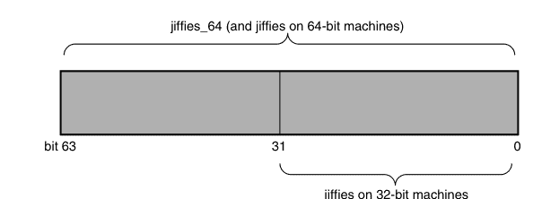

**图 11.1** `jiffies` 和 `jiffies_64` 的布局。

访问 `jiffies` 的代码只需读取 `jiffies_64` 的低 32 位。函数 `get_jiffies_64()` 可用于读取完整的 64 位值。⁴ 这种需求很少见；因此，大多数代码只需继续通过 `jiffies` 变量直接读取低 32 位。

在 64 位架构上，`jiffies_64` 和 `jiffies` 指向同一个对象。代码既可以读取 `jiffies`，也可以调用 `get_jiffies_64()`，因为这两个操作的效果相同。

## Jiffies 环绕（Wraparound）

`jiffies` 变量像任何 C 语言整数一样，当其值增加到超过最大存储限制时，会发生*溢出*。对于 32 位无符号整数，最大值是 $2^{32} - 1$。因此，在滴答计数溢出之前，可能会发生 4294967295 次定时器滴答。当滴答计数等于该最大值并递增时，它会环绕回零。

看一个环绕的示例：

```c
unsigned long timeout = jiffies + HZ/2;		/* 0.5s 后超时 */
```

⁴ 需要一个特殊函数，是因为 32 位架构不能原子地访问 64 位值中的两个 32 位字。该特殊函数在读取前通过 `xtime_lock` 锁锁定 `jiffies` 计数。

```c
/* 执行一些工作 ... */

/* 然后查看是否耗时太久 */
if (timeout > jiffies) {
					/* 我们没有超时，很好 ... */
} else {
					/* 我们超时了，出错 ... */
}
```

这段代码片段的意图是为未来的某个时间设置超时——在本例中是从现在起半秒钟。然后代码继续执行某些工作，大概是操作硬件并等待响应。完成后，如果整个过程花费的时间超过了超时时间，代码将相应地处理错误。

这里存在多个潜在的溢出问题，但让我们研究其中一个：考虑如果在设置 `timeout` 后 `jiffies` 环绕回零会发生什么。那么第一个条件判断将会失败，因为尽管逻辑上 `jiffies` 应该更大，但其值却比 `timeout` 小。从概念上讲，`jiffies` 的值应该是一个更大的数——比 `timeout` 大。然而，由于它超过了最大值而溢出，它现在变成了一个小值——可能仅比零多几个滴答。由于环绕，`if` 语句的结果被反转了。糟糕！

庆幸的是，内核提供了四个宏用于比较滴答计数，这些宏能正确处理滴答计数的环绕。它们位于 `<linux/jiffies.h>` 中。这里列出的是这些宏的简化版本：

```c
#define time_after(unknown, known) ((long)(known) - (long)(unknown) < 0)
#define time_before(unknown, known) ((long)(unknown) - (long)(known) < 0)
#define time_after_eq(unknown, known) ((long)(unknown) - (long)(known) >= 0)
#define time_before_eq(unknown, known) ((long)(known) - (long)(unknown) >= 0)
```

`unknown` 参数通常是 `jiffies`，`known` 参数是你想要比较的值。

`time_after(unknown, known)` 宏如果在 `unknown` 时间在 `known` 时间之后，则返回 true；否则返回 false。`time_before(unknown, known)` 宏如果在 `unknown` 时间在 `known` 时间之前，则返回 true；否则返回 false。最后两个宏的功能与前两个完全相同，不同之处在于如果参数相等，它们也会返回 true。

之前示例的定时器环绕安全版本如下所示：

```c
unsigned long timeout = jiffies + HZ/2;						/* 0.5s 后超时 */

/* ... */
if (time_before(jiffies, timeout)) {
						/* 我们没有超时，很好 ... */
} else {
						/* 我们超时了，出错 ... */
}
```

如果你好奇为什么这些宏能防止环绕带来的错误，可以尝试为这两个参数输入各种值。然后假设其中一个参数环绕到了零，看看会发生什么。

## 用户空间与 HZ

在 2.6 之前的内核中，更改 `HZ` 的值会导致用户空间出现异常。这是因为导出到用户空间的值是以“每秒滴答数”为单位的。随着这些接口变得永久化，应用程序开始依赖于 `HZ` 的特定值。因此，更改 `HZ` 会将各种导出值按某个常数缩放——而用户空间对此并不知情！当实际运行时间为 2 小时时，系统显示的运行时间可能是 20 小时！

为了防止此类问题，内核需要缩放所有导出的 `jiffies` 值。它是通过定义 `USER_HZ` 来实现的，`USER_HZ` 是用户空间所期望的 `HZ` 值。在 x86 上，由于 `HZ` 历史上是 100，因此 `USER_HZ` 也是 100。定义在 `kernel/time.c` 中的函数 `jiffies_to_clock_t()` 随后用于将以 `HZ` 为单位的滴答计数缩放为以 `USER_HZ` 为单位的滴答计数。所使用的表达式取决于 `USER_HZ` 和 `HZ` 是否为彼此的整数倍，以及 `USER_HZ` 是否小于或等于 `HZ`。如果这两个条件都成立（对于大多数系统通常如此），则表达式非常简单：

```c
return x / (HZ / USER_HZ);
```

如果这些值不是整数倍，则使用更复杂的算法。

最后，提供了 `jiffies_64_to_clock_t()` 函数，用于将 64 位 `jiffies` 值从 `HZ` 单位转换为 `USER_HZ` 单位。

这些函数在任何需要将每秒滴答数导出到用户空间的地方都会被使用。以下是一个示例：

```c
unsigned long start;
unsigned long total_time;

start = jiffies;
/* 执行一些工作 ... */
total_time = jiffies - start;
printk("That took %lu ticks\n", jiffies_to_clock_t(total_time));
```

用户空间期望接收到的值就像 `HZ`=`USER_HZ` 一样。如果它们不等价，该宏会根据需要进行缩放，这样每个人都满意了。当然，这个例子很傻：将消息以秒而非滴答打印出来更有意义。例如：

```c
printk("That took %lu seconds\n", total_time / HZ);
```

## 硬件时钟与定时器

架构提供了两种硬件设备来辅助计时：我们一直在讨论的系统定时器，以及实时时钟（RTC）。这些设备的实际行为和实现因机器而异，但其总体目的和设计在每个机器上基本相同。

## 实时时钟

实时时钟（RTC）提供了一个用于存储系统时间的非易失性设备。即使在系统关闭时，RTC 也能通过系统板上通常包含的一块小电池继续追踪时间。在 PC 架构中，RTC 和 CMOS 是集成在一起的，单块电池既能维持 RTC 运行，又能保存 BIOS 设置。

在启动时，内核读取 RTC 并将其用于初始化墙上时间（`wall time`），该时间存储在 `xtime` 变量中。内核通常不会再次读取该值；然而，一些受支持的架构（如 x86）会定期将当前的墙上时间保存回 RTC。尽管如此，实时时钟的主要重要性仅体现在启动期间，即 `xtime` 变量被初始化的时候。

## 系统定时器

系统定时器在内核的时间保持中扮演着重要得多（且更频繁）的角色。无论采用何种架构，系统定时器的核心理念都是相同的——提供一种机制以周期性地驱动中断。一些架构通过一个以可编程频率振荡的电子时钟来实现这一点。其他系统则提供一个递减计数器：计数器被设置为某个初始值，并以固定速率递减，直到计数器达到零。当计数器归零时，触发一次中断。无论哪种方式，效果都是一样的。

在 x86 上，主要的系统定时器是可编程中断定时器（PIT）。PIT 存在于所有 PC 机上，并且自 DOS 时代起就一直驱动着中断。内核在启动时对 PIT 进行编程，以 `HZ` 频率驱动系统定时器中断（中断 0）。它是一个功能有限的简单设备，但足以完成工作。其他 x86 时间源还包括本地 APIC 定时器和处理器的时戳计数器（TSC）。

## 定时器中断处理程序

现在我们已经了解了 `HZ`、`jiffies` 以及系统定时器的作用，让我们来看看定时器中断处理程序的实际实现。定时器中断被分为两个部分：一个架构相关（`architecture-dependent`）例程和一个架构无关（`architecture-independent`）例程。

架构相关例程被注册为系统定时器的中断处理程序，因此在定时器中断发生时运行。当然，其具体工作取决于给定的架构，但大多数处理程序至少执行以下工作：

- 获取 `xtime_lock` 锁，该锁保护对 `jiffies_64` 和墙上时间值 `xtime` 的访问。

- 根据需要确认或重置系统定时器。

- 定期将更新后的墙上时间保存到实时时钟中。

- 调用架构无关的定时器例程 `tick_periodic()`。

架构无关例程 `tick_periodic()` 执行的工作要多得多：

- 将 `jiffies_64` 计数增加 1。（这在 32 位架构上也是安全的，因为之前已经获取了 `xtime_lock` 锁。）

- 更新当前运行进程的资源使用情况，例如消耗的系统时间和用户时间。

- 运行任何已过期的动态定时器（将在接下来的章节中讨论）。

- 执行 `scheduler_tick()`，如第 4 章所述。

- 更新存储在 `xtime` 中的墙上时间。

- 计算著名的负载平均值（`load average`）。

该例程很简单，因为大多数工作由其他函数处理：

```c
static void tick_periodic(int cpu)
{
    if (tick_do_timer_cpu == cpu) {
        write_seqlock(&xtime_lock);

        /* Keep track of the next tick event */
        tick_next_period = ktime_add(tick_next_period, tick_period);

        do_timer(1);
        write_sequnlock(&xtime_lock);
    }

    update_process_times(user_mode(get_irq_regs()));
    profile_tick(CPU_PROFILING);
}
```

大部分重要工作在 `do_timer()` 和 `update_process_times()` 中启用。前者负责实际执行 `jiffies_64` 的递增：

```c
void do_timer(unsigned long ticks)
{
    jiffies_64 += ticks;
    update_wall_time();
    calc_global_load();
}
```

`update_wall_time()` 函数顾名思义，根据流逝的 `tick` 数更新墙上时间，而 `calc_global_load()` 则更新系统的负载平均值统计数据。

当 `do_timer()` 最终返回时，调用 `update_process_times()` 来更新一个 `tick` 流逝后的各种统计数据，并通过 `user_tick` 记录该 `tick` 发生在用户空间还是内核空间：

```c
void update_process_times(int user_tick)
{
    struct task_struct *p = current;
    int cpu = smp_processor_id();

    /* Note: this timer irq context must be accounted for as well. */
    account_process_tick(p, user_tick);
    run_local_timers();
    rcu_check_callbacks(cpu, user_tick);
    printk_tick();
    scheduler_tick();
    run_posix_cpu_timers(p);
}
```

回顾 `tick_periodic()`，`user_tick` 的值是通过查看系统寄存器来设置的：

```c
update_process_times(user_mode(get_irq_regs()));
```


`account_process_tick()` 函数执行进程时间的实际更新：

```c
void account_process_tick(struct task_struct *p, int user_tick)
{
    cputime_t one_jiffy_scaled = cputime_to_scaled(cputime_one_jiffy);
    struct rq *rq = this_rq();

    if (user_tick)
        account_user_time(p, cputime_one_jiffy, one_jiffy_scaled);
    else if ((p != rq->idle) || (irq_count() != HARDIRQ_OFFSET))
        account_system_time(p, HARDIRQ_OFFSET, cputime_one_jiffy,
            one_jiffy_scaled);
    else
        account_idle_time(cputime_one_jiffy);
}
```

你可能会意识到，这种方法意味着内核将进程在定时器中断发生时处理器所处的模式，视为该进程在*整个*前一个 tick 期间运行的模式。实际上，在最后一个 tick 期间，进程可能已经多次进入和退出内核模式。事实上，最后一个 tick 期间运行的可能甚至不仅仅是一个进程！这种粗粒度的进程核算方式是经典的 Unix 做法，在没有更复杂的核算机制的情况下，这是内核能提供的最佳方案。这也是采用更高 tick 频率的另一个原因。

接下来，`run_local_timers()` 函数标记一个软中断（见第 8 章“下半部和延迟工作”），以处理任何过期定时器的执行。定时器将在接下来的“定时器”章节中详细介绍。

最后，`scheduler_tick()` 函数递减当前运行进程的时间片，并在需要时设置 `need_resched`。在 SMP 机器上，它还会根据需要平衡每个处理器的运行队列。这将在第 4 章中讨论。

`tick_periodic()` 函数返回到原始的架构相关中断处理程序，该程序执行任何需要的清理工作，释放 `xtime_lock` 锁，最后返回。

所有这些每 `1/HZ` 秒发生一次。在 x86 机器上，这可能意味着每秒 *100* 次或 *1,000* 次！

## 当天时间

当前的当天时间（墙上时间）定义在 `kernel/time/timekeeping.c` 中：

```c
struct timespec xtime;
```

`timespec` 数据结构在 `<linux/time.h>` 中定义为：

```c
struct timespec {
	__kernel_time_t tv_sec;		/* seconds */
	long tv_nsec;			/* nanoseconds */
};
```

`xtime.tv_sec` 的值存储自 1970 年 1 月 1 日（UTC）以来流逝的秒数。这个日期被称为*纪元*（epoch）。大多数 Unix 系统将当前墙上时间的概念基于这个纪元。`xtime.tv_nsec` 的值存储在最后一秒中流逝的纳秒数。

读取或写入 `xtime` 变量需要 `xtime_lock` 锁，这*不是*一个普通的自旋锁，而是一个*顺序锁*（seqlock）。第 10 章“内核同步方法”讨论了顺序锁。

更新 `xtime` 需要写顺序锁：

```c
write_seqlock(&xtime_lock);
/* update xtime ... */
write_sequnlock(&xtime_lock);
```

读取 `xtime` 需要使用 `read_seqbegin()` 和 `read_seqretry()` 函数：

```c
unsigned long seq;
do {
	unsigned long lost;
	seq = read_seqbegin(&xtime_lock);

	usec = timer->get_offset();
	lost = jiffies - wall_jiffies;
	if (lost)
		usec += lost * (1000000 / HZ);
	sec = xtime.tv_sec;
```

```c
usec += (xtime.tv_nsec / 1000);
} while (read_segretry(&xtime_lock, seq));
```

这个循环会重复执行，直到读取者确定在读取数据期间没有发生写操作。如果在循环期间发生了定时器中断并更新了 `xtime`，则返回的序列号将失效，循环随之重复。

用于检索墙上时间（wall time）的主要用户空间接口是 `gettimeofday()`，它在 `kernel/time.c` 中被实现为 `sys_gettimeofday()`：

```c
asmlinkage long sys_gettimeofday(struct timeval *tv, struct timezone *tz)
{
    if (likely(tv)) {
        struct timeval ktv;
        do_gettimeofday(&ktv);
        if (copy_to_user(tv, &ktv, sizeof(ktv)))
            return -EFAULT;
    }
    if (unlikely(tz)) {
        if (copy_to_user(tz, &sys_tz, sizeof(sys_tz)))
            return -EFAULT;
    }
    return 0;
}
```

如果用户提供了非 NULL 的 `tv` 值，则调用与架构相关的 `do_gettimeofday()`。该函数主要执行前面讨论过的 `xtime` 读取循环。同样，如果 `tz` 非 NULL，则将系统时区（存储在 `sys_tz` 中）返回给用户。如果在将墙上时间或时区复制回用户空间时出现错误，函数返回 `-EFAULT`。否则，返回 0 表示成功。

内核还实现了 `time()` 系统调用，但 `gettimeofday()` 在很大程度上取代了它。C 库还提供了其他与墙上时间相关的库调用，例如 `ftime()` 和 `ctime()`。

`settimeofday()` 系统调用将墙上时间设置为指定值。它需要 `CAP_SYS_TIME` 权限。

除了更新 `xtime` 之外，内核对当前墙上时间的利用频率远低于用户空间。一个显著的例外是在文件系统代码中，它在 inode 中存储各种时间戳（访问时间、修改时间等）。

> 然而，某些架构没有实现 `sys_time()`，而是规定在 C 库中通过使用 `gettimeofday()` 来模拟。

## 定时器

定时器——有时被称为*动态定时器*或*内核定时器*——对于管理内核代码中的时间流至关重要。内核代码经常需要延迟执行某个函数直到稍后的时间。在之前的章节中，我们研究了使用底半机制，它们非常适合将工作推迟到以后执行。不幸的是，“以后”的定义有意地非常模糊。底半机制的目的与其说是*延迟工作*，不如说是*现在不做这项工作*。我们需要的是一个能将工作延迟指定时间量的工具——绝对不能少于该时间，且希望不要长太多。解决方案就是内核定时器。

定时器易于使用。你只需进行一些初始设置，指定过期时间，指定在过期时执行的函数，然后激活定时器。指定的函数将在定时器过期后运行。定时器*不是循环的*。定时器在过期后会被销毁。这就是*动态命名*的原因之一：定时器不断地被创建和销毁，且定时器的数量没有限制。定时器在整个内核中被广泛使用。

## 使用定时器

定时器由 `struct timer_list` 表示，定义在 `<linux/timer.h>` 中：

```c
struct timer_list {
    struct list_head entry;         /* 定时器链表中的条目 */
    unsigned long expires;          /* 过期值，单位为 jiffies */
    void (*function)(unsigned long); /* 定时器处理函数 */
    unsigned long data;             /* 传递给处理函数的唯一参数 */
    struct tvec_t_base_s *base;     /* 内部定时器字段，请勿触碰 */
};
```

幸运的是，使用定时器并不需要深入理解这个数据结构。为了保持代码在面对变更时的前向兼容性，不建议直接操作该结构体。内核提供了一系列定时器相关接口，使定时器管理变得简单。所有内容都声明在 `<linux/timer.h>` 中。大部分实际实现位于 `kernel/timer.c`。

创建定时器的第一步是定义它：

```c
struct timer_list my_timer;
```

接下来，必须初始化定时器的内部值。这通过一个辅助函数完成，且必须在对定时器调用*任何*定时器管理函数之前完成：

```c
init_timer(&my_timer);
```

现在，根据需要填写其余的值：

```c
my_timer.expires = jiffies + delay;    /* 定时器在 delay 个 tick 后过期 */
my_timer.data = 0;                     /* 将 0 传递给定时器处理函数 */
my_timer.function = my_function;       /* 定时器过期时运行的函数 */
```

`my_timer.expires` 的值指定了以绝对 tick 为单位的超时值。当当前的 jiffies 计数等于或大于 `my_timer.expires` 时，处理函数 `my_timer.function` 将带着唯一参数 `my_timer.data` 运行。从 `timer_list` 的定义可以看出，该函数必须符合以下原型：

```c
void my_timer_function(unsigned long data);
```

`data` 参数允许你为多个定时器注册同一个处理函数，并通过该参数来区分它们。如果你不需要该参数，只需传递 0（或任何其他值）即可。

最后，激活定时器：

```c
add_timer(&my_timer);
```

这样，定时器就开始运行了！注意过期值的重要性。当当前 tick 计数*等于或大于*指定的过期时间时，内核运行定时器处理函数。虽然内核保证在定时器过期*之前*不会运行任何处理函数，但运行定时器时可能会有延迟。通常，定时器在接近其过期时间时运行；然而，它们可能会被延迟到过期后的第一个定时器 tick。因此，定时器不能用于实现任何形式的硬实时处理。

有时你可能需要修改一个已经激活的定时器的过期时间。内核实现了一个函数 `mod_timer()`，用于更改给定定时器的过期时间：

```c
mod_timer(&my_timer, jiffies + new_delay);  /* 新的过期时间 */
```

`mod_timer()` 也可以操作已初始化但未激活的定时器。如果定时器处于未激活状态，`mod_timer()` 会将其激活。如果定时器之前未激活，函数返回 0；如果之前已激活，则返回 1。无论哪种情况，在从 `mod_timer()` 返回后，定时器都将被激活并设置为新的过期时间。

如果你需要在定时器过期前将其停用，请使用 `del_timer()` 函数：

```c
del_timer(&my_timer);
```

该函数对激活和未激活的定时器都有效。如果定时器已经处于未激活状态，函数返回 0；否则返回 1。请注意，对于已经过期的定时器，你*不需要*调用此函数，因为它们会自动停用。

在删除定时器时，存在一个必须防范的潜在竞态条件。当 `del_timer()` 返回时，它仅保证定时器不再激活（即未来不会被执行）。然而，在多处理器机器上，定时器处理函数可能已经在另一个处理器上执行。为了停用定时器并等待可能正在执行的处理函数退出，请使用 `del_timer_sync()`：

```c
del_timer_sync(&my_timer);
```

与 `del_timer()` 不同，`del_timer_sync()` 不能在中断上下文中调用。

### 定时器竞态条件

由于定时器相对于当前执行的代码是异步运行的，因此存在几种潜在的竞态条件。首先，永远不要用以下方式来替代简单的 `mod_timer()`，因为这在多处理器机器上是不安全的：

```c
del_timer(my_timer);
my_timer->expires = jiffies + new_delay;
add_timer(my_timer);
```

其次，在几乎所有情况下，你应该使用 `del_timer_sync()` 而不是 `del_timer()`。否则，你无法假设定时器当前没有在运行，而这正是你调用该函数的原因！想象一下，如果在删除定时器后，代码继续释放或以其他方式操作定时器处理函数所使用的资源会发生什么。因此，同步版本是首选。

最后，你必须确保保护定时器处理函数中使用的任何共享数据。内核异步地运行该函数。定时器相关数据的保护应参考第 8 章和第 9 章“内核同步简介”中的讨论。

### 定时器实现

内核在定时器中断完成之后，以 softirq 的形式在底半上下文中执行定时器。定时器中断处理程序运行 `update_process_times()`，后者会调用 `run_local_timers()`：

```c
void run_local_timers(void)
{
    hrtimer_run_queues();
    raise_softirq(TIMER_SOFTIRQ);   /* 触发定时器 softirq */
    softlockup_tick();
}
```

`TIMER_SOFTIRQ` softirq 由 `run_timer_softirq()` 处理。该函数运行当前处理器上所有已过期的定时器（如果有）。

定时器存储在一个链表中。然而，如果内核不断遍历整个链表寻找过期定时器，或者保持链表按过期值排序（这将导致定时器的插入和删除变得昂贵），那么处理起来会非常笨拙。相反，内核根据过期值将定时器分为五个组。随着过期时间的临近，定时器会在各组之间向下移动。这种分区确保了在大多数执行定时器 softirq 的情况下，内核只需花费很少的工作量就能找到过期的定时器。因此，定时器管理代码是非常高效的。

## 延迟执行

通常，内核代码（尤其是驱动程序）需要一种在不使用定时器或底半机制的情况下延迟执行一段时间的方法。这通常是为了给硬件留出足够的时间来完成给定的任务。这种延迟时间通常非常短。例如，网卡的规范可能会列出更改以太网模式的时间为两微秒。在设置所需速度后，驱动程序应至少等待这两微秒后再继续。

根据延迟的语义，内核提供了多种解决方案。这些方案具有不同的特性。有些方案在延迟时会占用处理器，实际上阻止了任何实际工作的完成。其他方案则不占用处理器，但不能保证你的代码会恰好在所需的时间恢复执行。

### 忙循环 (Busy Looping)

最简单的实现方案（尽管很少是最佳方案）是忙等待或忙循环。这种技术仅在你想延迟的时间是时钟滴答率（tick rate）的整数倍，或者精度不重要时才有效。

其思想很简单：在一个循环中旋转，直到经过所需数量的时钟滴答。例如：

```c
unsigned long timeout = jiffies + 10;          /* 十个 tick */

while (time_before(jiffies, timeout))
    ;
```

循环会一直持续，直到 `jiffies` 大于延迟值，这仅在 10 个时钟滴答过后才会发生。在 HZ 等于 1,000 的 x86 平台上，这将导致 10 毫秒的等待。同理：

```c
unsigned long delay = jiffies + 2*HZ;            /* 两秒 */

while (time_before(jiffies, delay))
    ;
```

这将一直旋转直到 2*HZ 个时钟滴答过去，无论时钟频率如何，这始终是两秒钟。

这种方法对系统的其他部分并不友好。当你的代码在等待时，处理器被绑定在一个愚蠢的循环中旋转——没有完成任何有用的工作！你很少会想采用这种“无脑”的方法，这里展示它是因为它是一种简单明了的延迟执行方法。你可能在别人的某些不那么优雅的代码中遇到它。

> 实际上，没有任何方法能保证延迟时间恰好是请求的时间。不过，有些方法非常接近，并且它们都承诺至少等待所需的时间。有些则会等待更久。

一个更好的解决方案是重新调度你的进程，以便在你的代码等待时允许处理器完成其他工作：

```c
unsigned long delay = jiffies + 5*HZ;

while (time_before(jiffies, delay))
    cond_resched();
```

调用 `cond_resched()` 会调度一个新进程，但仅在 `need_resched` 被设置时才执行。换句话说，这种方案仅在有更重要的任务需要运行时才条件性地调用调度程序。请注意，因为这种方法调用了调度程序，你不能在中断处理程序中使用它——只能在进程上下文中。所有这些方法最好在进程上下中使用，因为中断处理程序应尽可能快地执行。（而忙循环对于实现这个目标毫无帮助！）此外，如果可能的话，任何形式的延迟执行都不应该在持有锁或禁用中断时发生。

C 语言爱好者可能会好奇，之前的循环能工作的保证是什么。C 编译器通常可以自由地仅执行一次给定的加载操作。通常，无法保证循环条件语句中的 `jiffies` 变量在每次循环迭代时都会被重新加载。然而，内核要求每次迭代都重新读取 `jiffies`，因为该值在其他地方（在定时器中断中）被递增。事实上，这就是为什么该变量在 `<linux/jiffies.h>` 中被标记为 `volatile`。`volatile` 关键字指示编译器在每次访问时都从主内存重新加载变量，绝不在寄存器中为变量值创建别名，从而保证之前的循环能按预期完成。


### 短延迟（Small Delays）

有时，内核代码（同样通常是驱动程序）需要较短（小于一个时钟滴答）且相当精确的延迟。这通常是为了与硬件同步，硬件通常会列出某项活动完成所需的最小时间——通常小于一毫秒。对于如此短的等待，不可能像之前的示例那样使用基于`jiffies`的延迟。如果定时器中断为 100Hz，时钟滴答将是相当大的 10 毫秒！即使定时器中断为 1,000Hz，时钟滴答仍为 1 毫秒。因此，对于更小、更精确的延迟，显然需要另一种解决方案。

庆幸的是，内核提供了三个用于微秒、纳秒和毫秒延迟的函数，定义在`<linux/delay.h>`和`<asm/delay.h>`中，它们不使用 jiffies：

```c
void udelay(unsigned long usecs)
void ndelay(unsigned long nsecs)
void mdelay(unsigned long msecs)
```

前一个函数通过忙循环延迟指定数量的微秒。后一个函数延迟指定数量的毫秒。

回顾一下，一秒等于 1,000 毫秒，等于 1,000,000 微秒。用法很简单：

```c
udelay(150);		/* 延迟 150 µs */
```

`udelay()`函数实现为一个循环，它知道在给定时间段内可以执行多少次迭代。然后`mdelay()`函数基于`udelay()`实现。由于内核知道处理器在一秒内可以完成多少次循环（参见关于 BogoMIPS 的侧栏），`udelay()`函数只需将该值缩放到给定延迟所需的正确循环迭代次数即可。

#### 我的 BogoMIPS 比你的大！

> BogoMIPS 的值一直是困惑和幽默的来源。实际上，BogoMIPS 的计算与计算机的性能关系不大，主要仅用于`udelay()`和`mdelay()`函数。它的名字是*bogus*（即伪造的）和 *MIPS*（每秒百万条指令）的缩写。每个人都熟悉类似于以下内容的启动消息（这是一个 2.4GHz 7300 系列 Intel Xeon 处理器）：
>
> ```text
> Detected 2400.131 MHz processor.
> Calibrating delay loop.... 4799.56 BogoMIPS
> ```
>
> BogoMIPS 值是处理器在给定时间内可以执行的忙循环迭代次数。实际上，BogoMIPS 是衡量处理器“无所事事”速度的指标！该值存储在`loops_per_jiffy`变量中，可以通过`/proc/cpuinfo`读取。延迟循环函数使用`loops_per_jiffy`值来（相当精确地）计算为了提供所需的延迟需要执行多少次忙循环迭代。
>
> 内核在启动时通过`init/main.c`中的`calibrate_delay()`计算`loops_per_jiffy`。

`udelay()`函数应仅用于短延迟，因为在高速机器上较大的延迟可能会导致溢出。作为一条准则，不要将`udelay()`用于持续时间超过一毫秒的延迟。对于更长时间，`mdelay()`可以正常工作。与其他延迟执行的忙等待方案一样，除非绝对必要，否则不应使用这两个函数（尤其是`mdelay()`，因为它用于较长延迟）。请记住，在持有锁或禁用中断时进行忙循环是不礼貌的，因为系统响应和性能将受到不利影响。然而，如果你需要精确的延迟，这些调用是你的最佳选择。这些忙等待函数的典型用途是延迟很短的时间，通常在微秒范围内。

### `schedule_timeout()`

一种更优的延迟执行方法是使用`schedule_timeout()`。该调用使你的任务进入睡眠状态，直到至少经过指定的时间。不能保证睡眠时长*恰好*是指定的时间——只能保证时长至少与指定时间一样长。当指定时间结束时，内核会唤醒该任务并将其重新放入运行队列。用法很简单：

```c
/* 将任务状态设置为可中断睡眠 */
set_current_state(TASK_INTERRUPTIBLE);

/* 小睡一会儿并在 "s" 秒后醒来 */
schedule_timeout(s * HZ);
```

唯一的参数是所需的相对超时时间，单位为 jiffies。此示例将任务设置为可中断睡眠`s`秒。因为任务被标记为`TASK_INTERRUPTIBLE`，如果它收到信号，会提前醒来。如果代码不想处理信号，可以使用`TASK_UNINTERRUPTIBLE`代替。在调用`schedule_timeout()`之前，任务必须处于这两个状态之一，否则任务将不会进入睡眠。

请注意，因为`schedule_timeout()`调用了调度程序，调用它的代码必须能够睡眠。关于原子性和睡眠的讨论请参阅第 8 章和第 9 章。简而言之，你必须处于进程上下文中，且不能持有锁。

#### `schedule_timeout()`的实现

`schedule_timeout()`函数相当直接。事实上，它是内核定时器的一个简单应用，让我们来看看：

```c
signed long schedule_timeout(signed long timeout)
{
	timer_t timer;
	unsigned long expire;


	switch (timeout)
	{
	case MAX_SCHEDULE_TIMEOUT:
		schedule();
		goto out;
	default:
		if (timeout < 0)
		{
			printk(KERN_ERR "schedule_timeout: wrong timeout "
				"value %lx from %p\n", timeout,
				__builtin_return_address(0));
			current->state = TASK_RUNNING;
			goto out;
		}
	}

	expire = timeout + jiffies;

	init_timer(&timer);
```

```c
timer.expires = expire;
timer.data = (unsigned long) current;
timer.function = process_timeout;

add_timer(&timer);
schedule();
del_timer_sync(&timer);

timeout = expire - jiffies;

out:
    return timeout < 0 ? 0 : timeout;
}
```

该函数创建了一个名为`timer`的定时器，并将其设置为在未来的`timeout`个时钟滴答后到期。它设置定时器在到期时执行`process_timeout()`函数。随后它启用该定时器并调用`schedule()`。由于该任务假设已被标记为`TASK_INTERRUPTIBLE`或`TASK_UNINTERRUPTIBLE`，调度程序*不会*运行该任务，而是选择一个新任务。

当定时器到期时，它会运行`process_timeout()`：

```c
void process_timeout(unsigned long data)
{
    wake_up_process((task_t *) data);
}
```

此函数将任务设置为`TASK_RUNNING`状态，并将其重新放回运行队列中。

当任务重新调度时，它会返回到`schedule_timeout()`中上次离开的地方（即调用`schedule()`之后）。如果任务被提前唤醒（例如接收到了信号），则定时器将被销毁。随后函数返回睡眠的时间。

`switch()`语句中的代码用于处理特殊情况，不属于该函数的通用用法。`MAX_SCHEDULE_TIMEOUT`检查允许任务无限期睡眠。在这种情况下，不会设置定时器（因为睡眠时长没有上限），并立即调用调度程序。如果你这样做，必须有另一种方法来唤醒你的任务！

## 在等待队列上睡眠（带超时）

第 4 章探讨了内核中的进程上下文代码如何将自身放入等待队列以等待特定事件，然后调用调度程序来选择新任务。在其他地方，当事件最终发生时，会调用`wake_up()`，在等待队列上睡眠的任务将被唤醒并可以继续运行。

有时，我们希望等待一个特定事件*或者*等待指定的时间流逝——以先到者为准。在这些情况下，代码在将自身放入等待队列后，可以简单地调用`schedule_timeout()`而不是`schedule()`。当所需事件发生或指定时间流逝时，任务会被唤醒。代码需要检查唤醒的*原因*——可能是因为事件发生、时间流逝或接收到了信号——并采取相应的后续操作。

## 本章小结

在本章中，我们研究了内核的时间概念，以及墙上时间（wall time）和运行时间（uptime）是如何管理的。我们对比了相对时间与绝对时间，以及绝对事件与周期性事件。随后我们涵盖了定时器中断、时钟滴答、`Hz`和`jiffies`等时间概念。

我们研究了定时器的实现以及如何在自己的内核代码中使用它们。我们在本章最后概述了开发人员可以用来记录时间的其他方法。

你编写的大部分内核代码都需要对时间和时间的流逝有一定了解。极大概率——尤其是如果你在开发驱动程序时——你需要处理内核定时器。阅读本章不仅是为了消磨时间。

## 内存管理

内核内部的内存分配并不像内核外部那样简单。简单来说，内核缺乏用户空间所享有的奢侈条件。与用户空间不同，内核并不总是具备轻松分配内存的能力。例如，内核无法轻松处理内存分配错误，且内核通常不能睡眠。由于这些限制以及对轻量级内存分配方案的需求，在内核中获取内存比在用户空间中更复杂。这并不是说从程序员的角度来看，内核内存分配很困难——而只是有所不同。

本章讨论了在内核内部获取内存的方法。但在深入研究实际的分配接口之前，你需要了解内核如何处理内存。

## 页（Pages）

内核将物理页（physical pages）视为内存管理的基本单位。尽管处理器的最小可寻址单位是字节或字，但内存管理单元（MMU，管理内存并执行虚拟地址到物理地址转换的硬件）通常以页为单位进行处理。因此，MMU 以页大小的粒度维护系统的页表（这就是其名称的由来）。就虚拟内存而言，页是最小的有意义单位。

正如你在第 19 章“可移植性”中看到的，每种架构定义自己的页大小。许多架构甚至支持多种页大小。大多数 32 位架构拥有 4KB 的页，而大多数 64 位架构拥有 8KB 的页。这意味着在一台拥有 4KB 页和 1GB 内存的机器上，物理内存被分为 262,144 个不同的页。

内核使用一个`struct page`结构体来表示系统中的*每一个*物理页。该结构定义在`<linux/mm_types.h>`中。为了简化讨论，我简化了定义，移除了两个在讨论基础知识时没有帮助且令人困惑的联合体（unions）：

```c
struct page {
    unsigned long        flags;
    atomic_t             _count;
    atomic_t             _mapcount;
    unsigned long        private;
    struct address_space *mapping;
    pgoff_t              index;
    struct list_head     lru;
    void                *virtual;
};
```

让我们看看重要的字段。`flags`字段存储页的状态。这些标志包括该页是否为脏页，或者是否被锁定在内存中。位标志代表各种值，因此至少可以同时使用 32 个不同的标志。标志值定义在`<linux/page-flags.h>`中。

`_count`字段存储页的使用计数——也就是说，有多少个引用指向该页。当此计数达到 -1 时，表示没有人使用该页，它可以用于新的分配。内核代码不应直接检查此字段，而应使用`page_count()`函数，该函数仅接收一个`page`结构体作为参数。虽然在内部，当页为空闲时`_count`为 -1，但`page_count()`返回 0 表示空闲，返回正非零整数表示页正在使用中。一个页可以被页缓存使用（在这种情况下，`mapping`字段指向与该页关联的`address_space`对象），作为`private`数据（由`private`指向），或者作为进程页表中的一个映射。

`virtual`字段是该页的虚拟地址。通常，这仅仅是该页在虚拟内存中的地址。某些内存（称为高端内存 high memory）没有永久映射到`kernel`的地址空间中。在这种情况下，此字段为`NULL`，且该页在需要时必须动态映射。我们稍后将讨论高端内存。

需要理解的关键点是，`page`结构体与物理页相关联，而不是虚拟页。因此，该结构体描述的内容在某种程度上是瞬时的。即使页中包含的数据继续存在，由于交换（swapping）等原因，它并不总是与同一个`page`结构体相关联。`kernel`使用这个数据结构来描述关联的物理页。该数据结构的目标是描述物理内存，而不是其中包含的数据。

`kernel`使用此结构来跟踪系统中的所有页，因为`kernel`需要知道一个页是否为空闲（即该页是否未被分配）。如果页不为空闲，`kernel`需要知道谁拥有该页。可能的拥有者包括用户空间进程、动态分配的内核数据、静态内核代码、页缓存等等。

开发人员经常会对系统中每个物理页都分配一个此类结构体实例感到惊讶。他们会想：“浪费了多少内存！”让我们来看看所有这些页的空间消耗究竟有多严重（或多轻微）。假设`struct page`消耗 40 字节内存，系统拥有 8KB 的物理页，且系统有 4GB 物理内存。在这种情况下，系统大约有 524,288 个页和页结构体。页结构体消耗 20MB：这个数字可能大得令人惊讶。

从绝对数值来看，但这仅占系统 4GB 内存的极小一部分——对于管理系统中所有的物理页来说，这个成本并不算太高。

## 内存区域（Zones）

由于硬件限制，内核不能将所有页面视为完全相同。某些页面由于其在内存中的物理地址原因，无法用于某些特定任务。基于这一限制，内核将页面划分为不同的*区域（zones）*。内核利用这些区域将具有相似属性的页面分组。具体来说，Linux 必须处理硬件在内存寻址方面的两个缺陷：

- 某些硬件设备只能对特定的内存地址执行 DMA（直接内存访问）。
- 某些架构能够物理寻址的内存量大于其能够虚拟寻址的量。因此，部分内存无法永久映射到内核地址空间中。

基于这些约束，Linux 设有四个主要的内存区域：

- `ZONE_DMA`——该区域包含可以进行 DMA 的页面。
- `ZONE_DMA32`—与`ZONE_DMA`类似，该区域包含可以进行 DMA 的页面。与`ZONE_DMA`不同的是，这些页面仅能由 32 位设备访问。在某些架构上，该区域是内存中较大的一个子集。
- `ZONE_NORMAL`—该区域包含普通的、常规映射的页面。
- `ZONE_HIGHMEM`—该区域包含“高端内存（high memory）”，即未永久映射到内核地址空间的页面。

这些区域以及另外两个不太重要的区域在`<linux/mmzone.h>`中定义。

内存区域的实际用途和布局取决于具体架构。例如，某些架构在对任何内存地址执行 DMA 时都没有问题。在这些架构中，`ZONE_DMA`为空，而`ZONE_NORMAL`则被用于所有用途的分配。相反，在 x86 架构上，ISA 设备无法在整个 32 位地址空间¹中执行 DMA，因为 ISA 设备只能访问物理内存的前 16MB。因此，x86 上的`ZONE_DMA`由 0MB–16MB 范围内的所有内存组成。

`ZONE_HIGHMEM`的工作方式与之类似。一种架构能够直接映射和不能直接映射的内容各不相同。在 32 位 x86 系统上，`ZONE_HIGHMEM`是物理 896MB 标记之上的所有内存。在其他架构上，`ZONE_HIGHMEM`为空，因为所有内存都被直接映射。`ZONE_HIGHMEM`中包含的内存被称为*高端内存（high memory）*²。系统内存的其余部分被称为*低端内存（low memory）*。

`ZONE_NORMAL`往往是前两个区域领取其必需份额后剩余的部分。例如在 x86 上，`ZONE_NORMAL`是从 16MB 到 896MB 的所有物理内存。在其他（更幸运的）架构上，`ZONE_NORMAL`是所有可用内存。表 12.1 列出了 x86-32 上的每个区域及其消耗的页面。

**表 12.1 x86-32 上的内存区域**

| 区域 | 描述 | 物理内存 |
|:-----|:-------------|:------------------|
| `ZONE_DMA` | 可进行 DMA 的页面 | < 16MB |
| `ZONE_NORMAL` | 常规可寻址页面 | 16-896MB |
| `ZONE_HIGHMEM` | 动态映射页面 | > 896MB |

Linux 将系统页面划分为区域，是为了建立一个内存池，以便根据需要满足分配请求。例如，拥有`ZONE_DMA`池使内核能够满足 DMA 所需的内存分配。如果需要此类内存，内核只需从`ZONE_DMA`中提取所需数量的页面即可。请注意，这些区域并没有物理上的关联，而仅仅是内核用来追踪页面的逻辑分组。

虽然某些分配可能要求来自特定区域的页面，但其他分配可能会从多个区域提取。例如，尽管 DMA 可用内存的分配必须源自`ZONE_DMA`，但普通分配可以来自`ZONE_DMA`或`ZONE_NORMAL`，但不能同时跨区；分配不能跨越区域边界。当然，内核倾向于从常规区域满足普通分配，以便为确实需要`ZONE_DMA`的分配预留页面。但如果情况紧急（例如内存不足），内核可以从任何可用且合适的区域中提取页面。

并非所有架构都定义了所有区域。例如，像 Intel x86-64 这样的 64 位架构可以完全映射并处理 64 位内存。因此，x86-64 没有`ZONE_HIGHMEM`，所有物理内存都包含在`ZONE_DMA`和`ZONE_NORMAL`之中。


每个区域由`struct zone`表示，该结构定义在`<linux/mmzone.h>`中：

```c
struct zone {
    unsigned long           watermark[NR_WMARK];
    unsigned long           lowmem_reserve[MAX_NR_ZONES];
    struct per_cpu_pageset  pageset[NR_CPUS];
    spinlock_t              lock;
    struct free_area        free_area[MAX_ORDER];
    spinlock_t              lru_lock;
    struct zone_lru {
        struct list_head     list;
        unsigned long        nr_saved_scan;
    } lru[NR_LRU_LISTS];
    struct zone_reclaim_stat reclaim_stat;
    unsigned long           pages_scanned;
    unsigned long           flags;
    atomic_long_t            vm_stat[NR_VM_ZONE_STAT_ITEMS];
    int                      prev_priority;
    unsigned                inactive_ratio;
    wait_queue_head_t       *wait_table;
    unsigned long           wait_table_hash_nr_entries;
    unsigned long           wait_table_bits;
    struct pglist_data      *zone_pgdat;
    unsigned long           zone_start_pfn;
    unsigned long           spanned_pages;
    unsigned long           present_pages;
    const char              *name;
};
```

这个结构很大，但系统中只有三个区域，因此只有三个这样的结构。让我们看看更重要的字段。

`lock`字段是一个自旋锁，用于保护结构体免受并发访问。请注意，它仅保护结构体本身，而不保护驻留在该区域中的所有页面。特定的锁并不保护单个页面，尽管内核的部分代码可能会锁定恰好驻留在这些页面中的数据。

`watermark`数组持有该区域的最小值、低值和高值水位线。内核使用水位线为每个区域合适的内存消耗设置基准，并根据水位线相对于空闲内存的变化来调整其回收积极程度。

令人惊讶的是，`name`字段是一个以`NULL`结尾的字符串，代表该区域的名称。内核在引导期间在`mm/page_alloc.c`中初始化此值，三个区域被分别命名为DMA、Normal和HighMem。

## 获取页面

现在我们已经了解了内核如何通过页面、区域等来管理内存，让我们来看看内核为了实现内存分配和释放而提供的接口。

内核提供了一种请求内存的底层机制，以及几个用于访问它的接口。所有这些接口都以页大小为粒度分配内存，并声明在`<linux/gfp.h>`中。核心函数是：

```c
struct page * alloc_pages(gfp_t gfp_mask, unsigned int order)
```

该函数分配$2^{order}$（即$1 << order$）个连续的物理页，并返回指向第一个页面的页面结构体指针；出错时返回NULL。我们将在后面的章节中讨论`gfp_t`类型和`gfp_mask`参数。你可以使用以下函数将给定的页面转换为其逻辑地址：

```c
void * page_address(struct page *page)
```

该函数返回一个指针，指向给定物理页面当前所在的逻辑地址。如果你不需要实际的`struct page`，可以调用：

```c
unsigned long __get_free_pages(gfp_t gfp_mask, unsigned int order)
```

此函数的工作方式与`alloc_pages()`相同，不同之处在于它直接返回请求的首个页面的逻辑地址。由于页面是连续的，其他页面紧随其后。

如果你只需要一个页面，系统实现了两个封装函数以减少输入量：

```c
struct page * alloc_page(gfp_t gfp_mask)
unsigned long __get_free_page(gfp_t gfp_mask)
```

这些函数的工作方式与其同类函数相同，但在调用时将order传递为零（$2^0 = 1$个页面）。

## 获取清零页面

如果你需要返回的页面被填充为零，请使用以下函数：

```c
unsigned long get_zeroed_page(unsigned int gfp_mask)
```

该函数的工作方式与`__get_free_page()`相同，不同之处在于分配的页面随后会被填充为零——每个字节的每个位都被清除。这对于交给用户空间的页面非常有用，因为分配页面中的随机垃圾数据并非那么随机，它可能包含敏感数据。所有数据在返回给用户空间之前必须清零或以其他方式清理，以确保系统安全性不受影响。表12.2列出了所有底层页面分配方法。

**表12.2 底层页面分配方法**

| 函数 | 描述 |
|:---|:---|
| `alloc_page(gfp_mask)` | 分配单个页面并返回指向其页面结构体的指针 |
| `alloc_pages(gfp_mask, order)` | 分配$2^{order}$个页面并返回指向第一个页面结构体的指针 |
| `__get_free_page(gfp_mask)` | 分配单个页面并返回指向其逻辑地址的指针 |
| `__get_free_pages(gfp_mask, order)` | 分配$2^{order}$个页面并返回指向第一个页面逻辑地址的指针 |

***

¹ 类似地，一些有缺陷的PCI设备只能在24位地址空间中执行DMA。

² Linux的高端内存与DOS中的高端内存无关，后者是为了解决DOS和x86“实模式”处理器状态的限制而设计的。

| 标志 | 描述 |
|------|-------------|
| `get_zeroed_page(gfp_mask)` | 分配单个页面，将其内容清零并返回其逻辑地址的指针 |

## 释放页面

有一组函数允许你在不再需要已分配的页面时将其释放：

```c
void __free_pages(struct page *page, unsigned int order)
void free_pages(unsigned long addr, unsigned int order)
void free_page(unsigned long addr)
```

你必须小心，只能释放你所分配的页面。传递错误的`struct page`或地址，或者不正确的`order`（阶数），可能会导致内存损坏。请记住，内核信任自身。与用户空间不同，如果你要求内核这样做，它会很“乐意”地让自己崩溃。

让我们来看一个例子。这里，我们想要分配8个页面：

```c
unsigned long page;
```

```c
page = __get_free_pages(GFP_KERNEL, 3);
if (!page) {
    /* 内存不足：你必须处理这个错误！ */
    return -ENOMEM;
}
```

`page`现在是8个连续页面的第一个页面的地址...

当我们使用完毕后，在这里释放这8个页面：

```c
free_pages(page, 3);
```

```c
/*
 * 我们的页面现在已释放，我们
 * 不应再访问存储在 'page' 中的地址
 */
```

`GFP_KERNEL`参数是一个`gfp_mask`标志的示例。稍后将对其进行讨论。

请注意调用`__get_free_pages()`后的错误检查。内核分配可能会失败，你的代码必须检查并处理此类错误。这可能意味着要撤销你到目前为止所做的一切。因此，在例程开始时分配内存通常更有意义，这样更容易处理错误。否则，当你尝试分配内存时，可能很难退出。

当你需要物理连续的、页面大小的内存块时，这些底层页面函数非常有用，尤其是当你正好需要一个或两个页面时。对于更通用的字节级分配，内核提供了`kmalloc()`。

## kmalloc()

`kmalloc()`函数的操作与用户空间中熟悉的`malloc()`例程类似，唯一的区别是多了`flags`参数。`kmalloc()`函数是一个简单的接口，用于以字节为单位获取内核内存。如果你需要完整的页面，之前讨论的接口可能是更好的选择。然而，对于大多数内核分配，`kmalloc()`是首选接口。

该函数在`<linux/slab.h>`中声明：

```c
void * kmalloc(size_t size, gfp_t flags)
```

该函数返回一个指针，指向一个长度*至少*为`size`字节的内存区域。分配的内存区域在物理上是连续的。出错时，它返回`NULL`。除非可用内存不足，否则内核分配总是成功的。因此，在所有对`kmalloc()`的调用之后，你必须检查`NULL`并适当处理错误。

让我们来看一个例子。假设你需要为一个虚拟的`dog`结构体动态分配足够的空间：

```c
struct dog *p;
p = kmalloc(sizeof(struct dog), GFP_KERNEL);
if (!p)
    /* 处理错误 ... */
```

如果`kmalloc()`调用成功，`p`现在指向一个至少为请求大小的内存块。`GFP_KERNEL`标志指定了内存分配器在尝试获取内存以返回给`kmalloc()`调用者时的行为。

## gfp_mask标志

你已经在底层页面分配函数和`kmalloc()`中看到了各种分配器标志的示例。现在是深入讨论这些标志的时候了。标志由`gfp_t`类型表示，该类型在`<linux/types.h>`中定义为无符号`int`。`gfp`代表`__get_free_pages()`，即我们之前讨论的内存分配例程之一。

这些标志分为三类：动作修饰符（action modifiers）、区域修饰符（zone modifiers）和类型（types）。动作修饰符指定内核*应该如何*分配请求的内存。在某些情况下，只能使用某些方法来分配内存。例如，中断处理程序在分配内存的过程中必须指示内核不要睡眠（因为中断处理程序不能重新调度）。

区域修饰符指定从哪里分配内存。正如你在本章前面看到的那样，内核将物理内存分为多个区域（zone），每个区域服务于不同的目的。区域修饰符指定从这些区域中的哪一个进行分配。

类型标志指定了某种类型的内存分配所需的动作和区域修饰符的组合。类型标志简化了多个修饰符的指定；你无需提供动作和区域修饰符的组合，而只需指定一个类型标志。`GFP_KERNEL`就是一个类型标志，用于内核中进程上下文的代码。让我们来看看这些标志。

### 动作修饰符

所有标志（包括动作修饰符）都在`<linux/gfp.h>`中声明。不过，`<linux/slab.h>`文件包含了这个头文件，所以你通常不需要直接包含它。实际上，你通常只使用稍后讨论的类型修饰符。尽管如此，了解这些单个标志是有好处的。表12.3是动作修饰符的列表。

**表12.3 动作修饰符**

| 标志 | 描述 |
| --- | --- |
| `__GFP_WAIT` | 分配器可以睡眠。 |
| `__GFP_HIGH` | 分配器可以访问紧急池。 |
| `__GFP_IO` | 分配器可以启动磁盘I/O。 |
| `__GFP_FS` | 分配器可以启动文件系统I/O。 |
| `__GFP_COLD` | 分配器应使用缓存冷页面。 |
| `__GFP_NOWARN` | 分配器不打印失败警告。 |
| `__GFP_REPEAT` | 如果分配失败，分配器会重复分配，但分配仍有可能失败。 |
| `__GFP_NOFAIL` | 分配器无限次重复分配。分配不能失败。 |
| `__GFP_NORETRY` | 如果分配失败，分配器绝不重试。 |
| `__GFP_NOMEMALLOC` | 分配器不回退到备用内存。 |
| `__GFP_HARDWALL` | 分配器强制执行“hardwall”cpuset边界。 |
| `__GFP_RECLAIMABLE` | 分配器将页面标记为可回收。 |
| `__GFP_COMP` | 分配器添加复合页面元数据（由`hugetlb`代码内部使用）。 |

这些分配标志可以共同指定。例如：

```c
ptr = kmalloc(size, __GFP_WAIT | __GFP_IO | __GFP_FS);
```

此调用指示页面分配器（最终是`alloc_pages()`），如果需要，分配过程可以阻塞、执行I/O并执行文件系统操作。这使得内核在寻找可用内存以满足分配时具有极大的自由度。

大多数分配都指定这些修饰符，但它们是通过我们稍后讨论的类型标志间接实现的。别担心——你不需要在每次分配内存时都去研究应该使用这些奇怪标志中的哪一个！

### 区域修饰符

区域修饰符指定分配应源自哪个内存区域。通常，分配可以从任何区域完成。然而，内核倾向于使用`ZONE_NORMAL`，以确保其他区域在需要时有空闲页面。

只有三个区域修饰符，因为除了`ZONE_NORMAL`（默认分配源）之外只有三个区域。表12.4是区域修饰符的列表。

**表12.4 区域修饰符**

| 标志 | 描述 |
| --- | --- |
| `__GFP_DMA` | 仅从`ZONE_DMA`分配 |
| `__GFP_DMA32` | 仅从`ZONE_DMA32`分配 |
| `__GFP_HIGHMEM` | 从`ZONE_HIGHMEM`或`ZONE_NORMAL`分配 |

指定这三个标志之一会修改内核尝试满足分配的区域。`__GFP_DMA`标志强制内核从`ZONE_DMA`满足请求。这个标志的意思是：*我绝对需要可以进行DMA的内存*。相反，`__GFP_HIGHMEM`标志指示分配器从`ZONE_NORMAL`或（优先）`ZONE_HIGHMEM`满足请求。这个标志的意思是：*我可以使用高端内存，所以如果方便的话请给我一些，但普通内存也可以*。如果没有指定这两个标志，内核将从`ZONE_DMA`或`ZONE_NORMAL`完成分配，并强烈倾向于从`ZONE_NORMAL`分配。

你不能在`__get_free_pages()`或`kmalloc()`中指定`__GFP_HIGHMEM`。因为这两者返回的都是逻辑地址而非页面结构，这些函数可能会分配目前未映射在内核虚拟地址空间中的内存，因此没有逻辑地址。只有`alloc_pages()`能分配高端内存。然而，你的大多数分配不会指定区域修饰符，因为`ZONE_NORMAL`就足够了。

## 类型标志 (Type Flags)

类型标志指定了完成特定类型事务所需的动作和区域修饰符。因此，内核代码倾向于使用正确的类型标志，而不在其中指定可能需要的无数其他标志。这样做既简单又不容易出错。表12.5是类型标志列表，表12.6显示了每个类型标志关联的修饰符。

**表12.5 类型标志**

| 标志 | 描述 |
|------|-------------|
| `GFP_ATOMIC` | 分配具有高优先级且必须不能睡眠。此标志用于中断处理程序、底半部、持有自旋锁期间以及其他不能睡眠的情况。 |
| `GFP_NOWAIT` | 与`GFP_ATOMIC`类似，但调用不会回退到紧急内存池。这增加了内存分配失败的可能性。 |
| `GFP_NOIO` | 此分配可以阻塞，但不得启动磁盘I/O。在不能引起更多磁盘I/O的块I/O代码中使用此标志，否则可能会导致一些令人不快的递归。 |
| `GFP_NOFS` | 此分配可以阻塞，并且在必要时可以启动磁盘I/O，但它不会启动文件系统操作。在不能启动另一个文件系统操作的文件系统代码中使用此标志。 |
| `GFP_KERNEL` | 这是一个普通分配，可能会阻塞。在可以安全睡眠的进程上下文代码中使用此标志。内核将采取任何必要措施来获取调用者请求的内存。此标志应作为你的默认选择。 |
| `GFP_USER` | 这是一个普通分配，可能会阻塞。此标志用于为用户空间进程分配内存。 |
| `GFP_HIGHUSER` | 这是一个来自`ZONE_HIGHMEM`的分配，可能会阻塞。此标志用于为用户空间进程分配内存。 |
| `GFP_DMA` | 这是一个来自`ZONE_DMA`的分配。需要DMA可用内存的设备驱动程序使用此标志，通常与上述标志之一结合使用。 |

**表12.6 每个类型标志背后的修饰符**

| 标志 | 修饰符标志 |
|------|----------------|
| `GFP_ATOMIC` | `__GFP_HIGH` |
| `GFP_NOWAIT` | 0 |
| `GFP_NOIO` | `__GFP_WAIT` |
| `GFP_NOFS` | `__GFP_WAIT` \| `__GFP_IO` |
| `GFP_KERNEL` | `__GFP_WAIT` \| `__GFP_IO` \| `__GFP_FS` |
| `GFP_USER` | `__GFP_WAIT` \| `__GFP_IO` \| `__GFP_FS` |


| GFP_HIGHUSER | `__GFP_WAIT` \| `__GFP_IO` \| `__GFP_FS` \| `__GFP_HIGHMEM` |
| GFP_DMA | `__GFP_DMA` |

让我们来看看常用的标志，以及你何时以及为什么可能需要它们。内核中绝大多数的分配都使用 `GFP_KERNEL` 标志。由此产生的分配是普通优先级的分配，可能会睡眠。因为调用可能会阻塞，所以此标志只能在可以安全重新调度的进程上下文中执行（也就是说，没有持有锁等）。由于此标志不对内核如何获取请求内存做任何限制，因此内存分配成功的概率很高。

光谱的另一极端是 `GFP_ATOMIC` 标志。由于此标志指定了不能睡眠的内存分配，因此它在为调用者获取内存方面具有限制性。如果没有足够大的连续内存块可用，内核不太可能释放内存，因为它不能让调用者睡眠。相反，`GFP_KERNEL` 分配可以让调用者睡眠，以便将不活跃的页面交换到磁盘、将脏页刷新到磁盘等等。因为 `GFP_ATOMIC` 不能执行任何这些操作，所以与 `GFP_KERNEL` 分配相比，它的成功机会较低（至少在内存不足时）。尽管如此，当当前代码不能睡眠（例如在中断处理程序、softirqs 和 tasklets 中）时，`GFP_ATOMIC` 标志是唯一的选择。

在这两个标志之间的是 `GFP_NOIO` 和 `GFP_NOFS`。使用这些标志发起的分配可能会阻塞，但它们会避免执行某些其他操作。`GFP_NOIO` 分配不会启动任何磁盘 I/O 来满足请求。另一方面，`GFP_NOFS` 可能会启动磁盘 I/O，但不会启动文件系统 I/O。为什么你可能需要这些标志？它们分别在某些底层的块 I/O 或文件系统代码中需要。想象一下，如果文件系统代码中的一条常见路径在分配内存时*没有*使用 `GFP_NOFS` 标志。这次分配可能会导致*更多*的文件系统操作，进而产生其他分配，从而导致更多的文件系统操作！这可能会无限循环。这种调用分配器的代码必须确保分配器也不会执行它，否则分配可能会导致死锁。不出所料，内核仅在少数几个地方使用这两个标志。

`GFP_DMA` 标志用于指定分配器必须从 `ZONE_DMA` 满足请求。此标志被设备驱动程序使用，因为它们的设备需要 DMA 可用内存。通常，你会将此标志与 `GFP_ATOMIC` 或 `GFP_KERNEL` 标志结合使用。

在你编写的绝大多数代码中，你会使用 `GFP_KERNEL` 或 `GFP_ATOMIC`。表 12.7 列出了常见情况及其应使用的标志。无论分配类型如何，你都必须检查并处理失败情况。

表 12.7 何时使用哪个标志

| 情况 | 解决方案 |
|---|---|
| 进程上下文，可以睡眠 | 使用 `GFP_KERNEL`。 |
| 进程上下文，不能睡眠 | 使用 `GFP_ATOMIC`，或者在较早或较晚可以睡眠的时间点使用 `GFP_KERNEL` 进行分配。 |
| 中断处理程序 | 使用 `GFP_ATOMIC`。 |
| Softirq | 使用 `GFP_ATOMIC`。 |
| Tasklet | 使用 `GFP_ATOMIC`。 |
| 需要 DMA 可用内存，可以睡眠 | 使用 (`GFP_DMA` \| `GFP_KERNEL`)。 |
| 需要 DMA 可用内存，不能睡眠 | 使用 (`GFP_DMA` \| `GFP_ATOMIC`)，或者在较早可以睡眠的时间点进行分配。 |

## kfree()

`kmalloc()` 的对应函数是 `kfree()`，它在 `<linux/slab.h>` 中声明：

```c
void kfree(const void *ptr)
```

`kfree()` 方法释放之前用 `kmalloc()` 分配的内存块。不要对之前未使用 `kmalloc()` 分配的内存或已经释放的内存调用此函数。这样做是一个 bug，会导致错误行为，例如释放属于内核其他部分的内存。与用户空间一样，请务必小心地平衡分配与释放，以防止内存泄漏和其他 bug。

注意，调用 `kfree(NULL)` 是经过明确检查的，且是安全的。

让我们看一个在中断处理程序中分配内存的示例。在这个示例中，一个中断处理程序想要分配一个缓冲区来保存接收到的数据。预处理器宏 `BUF_SIZE` 是所需缓冲区的字节大小，假设它比几个字节要大。

```c
char *buf;

buf = kmalloc(BUF_SIZE, GFP_ATOMIC);
if (!buf)
    /* 内存分配错误 ! */
```

稍后，当你不再需要该内存时，不要忘记释放它：

```c
kfree(buf);
```

## vmalloc()

`vmalloc()` 函数的工作方式与 `kmalloc()` 类似，不同之处在于它分配的内存仅在虚拟上连续，而不一定是物理上连续的。这就是用户空间分配函数的工作方式：`malloc()` 返回的页面在处理器的虚拟地址空间内是连续的，但不能保证它们在物理 RAM 中实际上是连续的。`kmalloc()` 函数保证页面是物理连续的（且虚拟连续）。`vmalloc()` 函数仅确保页面在虚拟地址空间内连续。它通过分配潜在的非连续物理内存块，并“修正”页表将内存映射到逻辑地址空间的连续块来实现这一点。

在大多数情况下，只有硬件设备需要物理连续的内存分配。在许多架构中，硬件设备位于内存管理单元 (MMU) 的另一侧，因此不理解虚拟地址。因此，硬件设备操作的任何内存区域必须以物理连续块的形式存在，而不仅仅是虚拟连续块。仅由软件使用的内存块（例如进程相关缓冲区）使用仅虚拟连续的内存即可。在编程时，你永远无法察觉到区别。所有内存对内核来说在逻辑上都是连续的。

尽管物理连续内存仅在某些情况下需要，但大多数内核代码仍使用 `kmalloc()` 而非 `vmalloc()` 来获取内存。这主要是为了性能。`vmalloc()` 函数为了使非物理连续页面在虚拟地址空间中连续，必须专门设置页表项。更糟糕的是，通过 `vmalloc()` 获取的页面必须由其各自的页面进行映射（因为它们物理上不连续），这导致比使用直接映射内存时产生大得多的 TLB⁴ 抖动。基于这些顾虑，`vmalloc()` 仅在绝对必要时使用——通常是为了获取大块内存区域。例如，当模块动态插入内核时，它们被加载到通过 `vmalloc()` 创建的内存中。

`vmalloc()` 函数在 `<linux/vmalloc.h>` 中声明，并在 `mm/vmalloc.c` 中定义。其用法与用户空间的 `malloc()` 相同：

```c
void * vmalloc(unsigned long size)
```

⁴ TLB (translation lookaside buffer，转换后备缓冲区) 是大多数架构使用的一种硬件缓存，用于缓存虚拟地址到物理地址的映射。这大大提高了系统的性能，因为大多数内存访问都是通过虚拟寻址完成的。

该函数返回一个指向至少 size 字节虚拟连续内存的指针。如果出错，函数返回 NULL。该函数可能会进入睡眠状态，因此不能在中断上下文或其他不允许阻塞的情况下调用。

要释放通过 `vmalloc()` 获取的内存分配，请使用：

```c
void vfree(const void *addr)
```

该函数释放从 addr 开始且此前通过 `vmalloc()` 分配的内存块。该函数同样可能会进入睡眠状态，因此不能在中断上下文中调用。它没有返回值。

这些函数的使用方法很简单：

```c
char *buf;

buf = vmalloc(16 * PAGE_SIZE); /* 获取 16 个页面 */
if (!buf)
     /* 错误！内存分配失败 */

/*
 * buf 现在指向一个至少 16*PAGE_SIZE 字节
 * 的虚拟连续内存块
 */

After you finish with the memory, make sure to free it by using
vfree(buf);
```

## Slab 层

分配和释放数据结构是任何内核中最常见的操作之一。为了方便数据的频繁分配和释放，程序员经常引入空闲列表（free lists）。空闲列表包含一组可用的、已经分配的数据结构。当代码需要一个数据结构的新实例时，它可以从空闲列表中获取其中一个结构，而不是分配足够的内存并为该数据结构进行初始化。随后，当该数据结构不再需要时，它被返回到空闲列表中而不是被释放。在这个意义上，空闲列表充当了对象缓存，缓存了一种频繁使用的对象类型。

内核中使用空闲列表的一个主要问题是缺乏全局控制。当可用内存较低时，内核没有办法通知每个空闲列表缩小其缓存大小以释放内存。内核完全不了解这些随机分布的空闲列表。为了弥补这一缺陷并统一代码，Linux 内核提供了 slab 层（也称为 slab 分配器）。slab 层充当一个通用的数据结构缓存层。

slab 分配器的概念最早在 Sun Microsystems 的 SunOS 5.4 操作系统中实现。Linux 的数据结构缓存层采用了相同的名称和基本设计。

- 频繁使用的数据结构往往被频繁地分配和释放，因此应对其进行缓存。
- 频繁的分配和释放会导致内存碎片（无法找到大块连续的可用内存）。为了防止这种情况，缓存的空闲列表被连续排列。由于释放的数据结构会返回到空闲列表中，因此不会产生碎片。
- 在频繁的分配和释放过程中，空闲列表提供了更好的性能，因为释放的对象可以立即被下一次分配所使用。
- 如果分配器能够意识到对象大小、页面大小和总缓存大小等概念，它可以做出更智能的决策。
- 如果缓存的一部分被设计为每处理器（per-processor）独立且唯一，那么分配和释放操作可以在没有 SMP 锁的情况下执行。
- 如果分配器具备 NUMA 感知能力，它可以从与请求者相同的内存节点分配内存。
- 存储的对象可以使用“着色”（colored）技术，以防止多个对象映射到相同的缓存行（cache lines）。

Linux 中的 slab 层在设计和实现时考虑了这些前提。

## Slab 层的设计

slab 层将不同的对象分为称为缓存（caches）的组，每组存储一种不同类型的对象。每种对象类型对应一个缓存。例如，一个缓存用于进程描述符（`task_struct` 结构的空闲列表），而另一个缓存用于 inode 对象（`struct inode`）。有趣的是，`kmalloc()` 接口就是构建在 slab 层之上的，它使用了一组通用缓存。

缓存随后被进一步划分为 slab（因此该子系统被命名为 slab）。slab 由一个或多个物理连续的页面组成。通常，slab 仅由单个页面组成。每个缓存可以包含多个 slab。

每个 slab 包含一定数量的对象，这些对象就是被缓存的数据结构。每个 slab 处于三种状态之一：满（full）、部分满（partial）或空（empty）。满的 slab 没有空闲对象（slab 中的所有对象都已分配）。空的 slab 没有已分配对象（slab 中的所有对象都是空闲的）。部分满的 slab 包含一些已分配对象和一些空闲对象。当内核的某个部分请求一个新对象时，如果存在部分满的 slab，则从其中满足请求；否则，从空的 slab 中满足请求。如果没有空的 slab，则创建一个。显然，满的 slab 永远无法满足请求，因为它没有任何空闲对象。这种策略减少了碎片。

让我们以 `inode` 结构为例，它是磁盘 inode 的内存表示（参见第 13 章“虚拟文件系统”）。这些结构被频繁地创建和销毁，因此使用 slab 分配器来管理它们是有意义的。因此，`struct inode` 从 `inode_cachep` 缓存中分配（这种命名约定是标准做法）。该缓存由一个或多个 slab 组成——由于对象数量很多，可能会有大量的 slab。每个 slab 包含尽可能多的 `struct inode` 对象。当内核请求一个新的 `inode` 结构时，内核从部分满的 slab（如果没有部分满的 slab，则从空的 slab）中返回一个已经分配但未使用的结构的指针。当内核完成使用 `inode` 对象后，slab 分配器将该对象标记为空闲。图 12.1 展示了缓存、slab 和对象之间的关系。

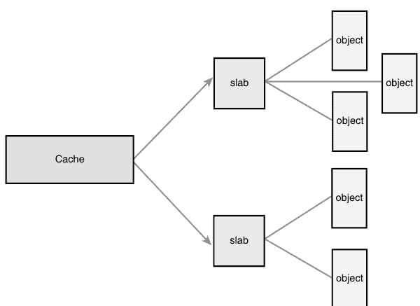

图 12.1 缓存、slab 和对象之间的关系。

每个缓存由一个 `kmem_cache` 结构表示。该结构包含三个列表——`slabs_full`、`slabs_partial` 和 `slabs_empty`——存储在 `mm/slab.c` 中定义的 `kmem_list3` 结构内。这些列表包含了与该缓存相关的所有 slab。一个 slab 描述符 `struct slab` 代表每个 slab：

```c
struct slab {
    struct list_head    list;        /* 满、部分满或空列表 */
    unsigned long       colouroff;   /* slab 着色的偏移量 */
    void                *s_mem;      /* slab 中的第一个对象 */
    unsigned int        inuse;       /* slab 中已分配的对象数 */
    kmem_bufctl_t       free;        /* 第一个空闲对象（如果有） */
};
```

slab 描述符要么在 slab 之外的通用缓存中分配，要么在 slab 自身的开头分配。如果 slab 的总大小足够小，或者内部 slab 空间足以容纳描述符，则描述符存储在 slab 内部。

slab 分配器通过 `__get_free_pages()` 与底层内核页面分配器接口来创建新 slab：

```c
static void *kmem_getpages(struct kmem_cache *cachep, gfp_t flags, int nodeid)
{
    struct page *page;
    void *addr;
    int i;

    flags |= cachep->gfpflags;
    if (likely(nodeid == -1)) {
        addr = (void*)__get_free_pages(flags, cachep->gfporder);
        if (!addr)
            return NULL;
        page = virt_to_page(addr);
    } else {
        page = alloc_pages_node(nodeid, flags, cachep->gfporder);
        if (!page)
            return NULL;
        addr = page_address(page);
    }

    i = (1 << cachep->gfporder);
    if (cachep->flags & SLAB_RECLAIM_ACCOUNT)
        atomic_add(i, &slab_reclaim_pages);
    add_page_state(nr_slab, i);
    while (i--) {
        SetPageSlab(page);
        page++;
    }
    return addr;
}
```

该函数使用 `__get_free_pages()` 来分配足以容纳缓存的内存。该函数的第一个参数指向需要更多页面的特定缓存。第二个参数是指向传递给 `__get_free_pages()` 的标志（flags）。注意这个值是如何与另一个值进行按位或（OR）运算的，这为标志参数添加了缓存所需的默认标志。分配的 2 的幂次方大小存储在 `cachep->gfporder` 中。前述函数比预想的要复杂一些，是因为其中包含使分配器具备 NUMA 感知能力的代码。当 `nodeid` 不为 -1 时，分配器会尝试从发起请求的同一个内存节点进行分配。

请求了分配。这在 NUMA 系统上提供了更好的性能，因为在 NUMA 系统中，访问本节点之外的内存会导致性能下降。

出于教学目的，我们可以忽略 NUMA 感知代码，编写一个简单的 `kmem_getpages()`：

```c
static inline void * kmem_getpages(struct kmem_cache *cachep, gfp_t flags)
{
    void *addr;

    flags |= cachep->gfpflags;
    addr = (void*) __get_free_pages(flags, cachep->gfporder);

    return addr;
}
```

内存随后由 `kmem_freepages()` 释放，该函数对给定缓存的页面调用 `free_pages()`。当然，slab 层的目的就是避免频繁地分配和释放页面。相应地，slab 层仅在给定缓存中不存在任何部分使用（partial）或空闲（empty）的 slab 时，才会调用页面分配函数。释放函数仅在可用内存降低且系统尝试释放内存，或者当缓存被显式销毁时才被调用。

slab 层通过一个简单的接口按缓存（per-cache）进行管理，该接口被导出到整个内核。该接口允许创建和销毁新缓存，以及在缓存中分配和释放对象。缓存及其内部 slab 的复杂管理完全由 slab 层的内部机制处理。在你创建缓存后，slab 层就像一个针对特定类型对象的专用分配器一样工作。

## Slab 分配器接口

通过以下方式创建新缓存：

```c
struct kmem_cache * kmem_cache_create(const char *name,
    size_t size,
    size_t align,
    unsigned long flags,
    void (*ctor)(void *));
```


第一个参数是一个存储缓存名称的字符串。第二个参数是缓存中每个元素的大小。第三个参数是 slab 内第一个对象的偏移量。这样做是为了确保页面内的特定对齐。通常，零就足够了，这将产生标准对齐。`flags` 参数指定控制缓存行为的可选设置。它可以为零（表示没有特殊行为），或者是一个或多个以下标志通过按位或（OR）组合在一起：

- `SLAB_HWCACHE_ALIGN`——该标志指示 slab 层将 slab 中的每个对象与缓存行（cache line）对齐。这可以防止“伪共享”（false sharing，即两个或多个对象虽然在内存中地址不同，但映射到同一个缓存行）。这提高了性能，但代价是增加了内存占用，因为更严格的对齐会导致产生更多的浪费空隙空间。内存消耗增加的幅度取决于对象的大小以及它们与系统缓存行的自然对齐方式。对于性能关键代码中经常使用的缓存，设置此选项是一个好主意；否则，请慎重考虑。

- `SLAB_POISON`——该标志导致 slab 层用一个已知值（`a5a5a5a5`）填充 slab。这被称为中毒（poisoning），对于捕获对未初始化内存的访问非常有用。

- `SLAB_RED_ZONE`——该标志导致 slab 层在分配的内存周围插入“红区（red zones）”，以帮助检测缓冲区溢出。

- `SLAB_PANIC`——该标志导致 slab 层在分配失败时触发 panic。当分配绝对不能失败时，此标志非常有用，例如在启动期间分配 VMA 结构缓存（参见第 15 章“进程地址空间”）。

- `SLAB_CACHE_DMA`——该标志指示 slab 层在可进行 DMA 的内存中分配每个 slab。如果分配的对象用于 DMA 且必须驻留在 `ZONE_DMA` 中，则需要此标志。否则，你不需要此选项，也不应设置它。

最后一个参数 `ctor` 是缓存的构造函数。每当新页面被添加到缓存时，都会调用该构造函数。在实践中，Linux 内核中的缓存并不经常使用构造函数。事实上，曾经还有一个析构函数参数，但因为它没有被任何内核代码使用而被删除了。你可以为该参数传递 `NULL`。

成功时，`kmem_cache_create()` 返回一个指向所创建缓存的指针。否则，它返回 `NULL`。由于该函数可能会睡眠，因此不得在中断上下文中调用。

要销毁缓存，请调用：

```c
int kmem_cache_destroy(struct kmem_cache *cachep);
```

顾名思义，此函数销毁给定的缓存。它通常在创建了自有缓存的模块的关闭代码中被调用。由于它可能会睡眠，因此不得在中断上下文中调用。该函数的调用者在调用此函数前必须确保满足两个条件：

- 缓存中的所有 slab 均为空。事实上，如果其中一个 slab 中的对象仍然被分配并使用，缓存如何能被销毁？
- 在调用 `kmem_cache_destroy()` 期间（以及之后）没有任何人访问该缓存。调用者必须确保这种同步。

成功时，函数返回零；否则返回非零值。

## 从缓存中分配

缓存创建后，可以通过以下方式从缓存中获取对象：

```c
void * kmem_cache_alloc(struct kmem_cache *cachep, gfp_t flags)
```

该函数返回一个指向给定缓存中对象的指针。如果缓存的任何 slab 中都没有空闲对象，且 slab 层必须通过 `kmem_getpages()` 获取新页面，则 `flags` 的值将被传递给 `__get_free_pages()`。这些就是我们之前看过的标志。你可能需要 `GFP_KERNEL` 或 `GFP_ATOMIC`。

要稍后释放对象并将其返回到原 slab，请使用该函数：

```c
void kmem_cache_free(struct kmem_cache *cachep, void *objp)
```

这会将 `cachep` 中的对象 `objp` 标记为空闲。

## 使用 Slab 分配器的示例

让我们看一个使用 `task_struct` 结构（进程描述符）的实际例子。这段代码（形式上略复杂一些）位于 `kernel/fork.c` 中。

首先，内核有一个全局变量，存储指向 `task_struct` 缓存的指针：

```c
struct kmem_cache *task_struct_cache;
```

在内核初始化期间，在 `kernel/fork.c` 定义的 `fork_init()` 中，缓存被创建：

```c
task_struct_cachep = kmem_cache_create("task_struct",
    sizeof(struct task_struct),
    ARCH_MIN_TASKALIGN,
    SLAB_PANIC | SLAB_NOTRACK,
    NULL);
```

这创建了一个名为 `task_struct` 的缓存，用于存储 `struct task_struct` 类型的对象。对象在 slab 内部以 `ARCH_MIN_TASKALIGN` 字节的偏移量创建。这个预处理器定义是一个架构相关的值。它通常被定义为 `L1_CACHE_BYTES`——L1 缓存的字节大小。这里没有构造函数。注意，这里没有检查返回值是否为 `NULL`（代表失败），因为提供了 `SLAB_PANIC` 标志。如果分配失败，slab 分配器将调用 `panic()`。如果你不提供这个标志，你就必须检查返回值！这里使用 `SLAB_PANIC` 标志是因为这是系统运行所必需的缓存（如果没有进程描述符，机器就没什么用了）。

每次进程调用 `fork()` 时，必须创建一个新的进程描述符（回顾第 3 章“进程管理”）。这在 `dup_task_struct()` 中完成，而 `dup_task_struct()` 是由 `do_fork()` 调用的：

```c
struct task_struct *tsk;

tsk = kmem_cache_alloc(task_struct_cachep, GFP_KERNEL);
if (!tsk)
    return NULL;
```

当一个任务死亡且没有等待它的子进程时，其进程描述符将被释放并返回到 `task_struct_cachep` slab 缓存中。这在 `free_task_struct()` 中完成（其中 `task` 是正在退出的任务）：

```c
kmem_cache_free(task_struct_cachep, tsk);
```

由于进程描述符是内核核心的一部分且始终需要，因此 `task_struct_cachep` 缓存永远不会被销毁。但如果需要销毁，你可以通过以下方式进行：

```c
int err;
err = kmem_cache_destroy(task_struct_cachep);
if (err)
    /* 销毁缓存出错 */
```

很简单吧？slab 层处理了所有低级别的对齐、着色（coloring）、分配、释放以及在低内存情况下的回收。如果你经常创建许多相同类型的对象，请考虑使用 slab 缓存。绝对不要实现你自己的空闲列表（free list）！

## 在栈上进行静态分配

在用户空间，像之前讨论的一些示例中的分配可以发生在栈上，因为我们预先知道分配的大小。用户空间享有大型动态增长栈的奢侈，而内核则没有这种奢侈——内核的栈很小且是固定大小的。当每个进程被分配一个小的固定栈时，内存消耗被最小化，且内核无需承担栈管理代码的负担。

每个进程内核栈的大小取决于架构和编译时选项。历史上，内核栈每个进程占用两个页面。对于 32 位架构，这通常是 8KB，对于 64 位架构是 16KB，因为它们通常分别具有 4KB 和 8KB 的页面。

### 单页内核栈

然而，在 2.6 内核系列的早期，引入了一个迁移到单页内核栈的选项。启用后，每个进程仅获得一个页面——32 位架构上为 4KB，64 位架构上为 8KB。这样做出于两个原因。首先，它降低了每个进程的内存消耗。其次，也是最重要的一点是，随着运行时间的增加，寻找两个物理连续的未分配页面变得越来越困难。物理内存变得碎片化，而分配一个新进程所产生的 VM 压力代价很高。

还有一个复杂情况。请跟紧我的思路：我们几乎已经掌握了关于内核栈的所有知识宇宙。现在，每个进程的整个调用链必须适应其内核栈。然而，在历史上，中断处理程序也使用了被中断进程的内核栈，因此它们也必须适应。这种方式高效且简单，但它给本就贫乏的内核栈带来了更严苛的限制。当栈缩减到仅剩一个页面时，中断处理程序已经无法容纳。

为了解决这个问题，内核开发者实现了一项新特性：中断栈（interrupt stacks）。中断栈为每个处理器提供了一个单一的栈，用于中断处理程序。开启此选项后，中断处理程序不再共享被中断进程的内核栈，而是使用它们自己的栈。这在每个处理器上仅消耗一个页面。

总而言之，根据编译时配置选项，内核栈的大小为一页或两页。因此，栈的范围在 4KB 到 16KB 之间。从历史上看，中断处理程序共享被中断进程的栈。当启用单页栈时，中断处理程序将被分配自己的栈。在任何情况下，显然都不允许无限制的递归和 `alloca()`。

好了，明白了吗？

## 栈上的公平竞争

在任何给定的函数中，必须将栈的使用量保持在最低限度。虽然没有绝对的死板规定，但你应该将某个函数中所有局部（即自动）变量的总和控制在最多几百字节。在栈上进行大规模的静态分配（例如大型数组或结构体）是非常危险的。除此之外，内核中的栈分配与用户空间相同。栈溢出在静默中发生，且无疑会导致问题。由于内核不尝试管理栈，当栈溢出时，多余的数据将直接覆盖栈尾存在的任何内容。首先被“吃掉”的是 `thread_info` 结构体（回顾第 3 章，该结构体被分配在每个进程内核栈的末尾）。在栈之外，可能潜伏着任何内核数据。最理想的情况是，栈溢出时机器崩溃；最糟糕的情况是，溢出会在静默中损坏数据。

因此，对于任何大内存分配，明智之举是使用动态分配方案，例如本章之前讨论过的方案。

## 高端内存映射

根据定义，高端内存（high memory）中的页面可能不会永久映射到内核的地址空间。因此，通过带有 `__GFP_HIGHMEM` 标志的 `alloc_pages()` 获取的页面可能没有逻辑地址。

在 x86 架构上，所有超过 896MB 标记的物理内存都是高端内存，并且不会永久或自动映射到内核地址空间，尽管 x86 处理器能够物理寻址高达 4GB（支持 PAE⁶ 时为 64GB）的物理内存。在分配之后，这些页面必须被映射到内核的逻辑地址空间。在 x86 上，高端内存页面被映射在 3GB 到 4GB 标记之间。

⁶ PAE 代表物理地址扩展（Physical Address Extension）。它是 x86 处理器的特性，使其能够物理寻址 36 位（64GB）内存，尽管它只有 32 位虚拟地址空间。

### 永久映射

要将给定的 `page` 结构映射到内核地址空间，请使用在 `<linux/highmem.h>` 中声明的此函数：

```c
void *kmap(struct page *page)
```

此函数适用于高端或低端内存。如果 `page` 结构属于低端内存中的页面，则直接返回该页面的虚拟地址。如果页面位于高端内存中，则创建永久映射并返回地址。该函数可能会睡眠，因此 `kmap()` 仅在进程上下文中工作。

由于永久映射的数量有限（否则我们就不至于陷入这种困境，可以直接将所有内存永久映射），高端内存在不再需要时应被取消映射。这通过以下函数完成，它会取消映射给定的 `page`：

```c
void kunmap(struct page *page)
```

### 临时映射

在必须创建映射但当前上下文不能睡眠的情况下，内核提供了临时映射（也称为原子映射）。这是一组预留映射，可以持有临时映射。内核可以将高端内存页原子地映射到这些预留映射中的一个。因此，临时映射可用于不能睡眠的地方（如中断处理程序），因为获取映射永远不会阻塞。

设置临时映射是通过以下方式完成的：

```c
void *kmap_atomic(struct page *page, enum km_type type)
```

`type` 参数是以下枚举之一，用于描述临时映射的用途。它们定义在 `<asm-generic/kmap_types.h>` 中：

```c
enum km_type {
    KM_BOUNCE_READ,
    KM_SKB_SUNRPC_DATA,
    KM_SKB_DATA_SOFTIRQ,
    KM_USER0,
    KM_USER1,
    KM_BIO_SRC_IRQ,
    KM_BIO_DST_IRQ,
    KM_PTE0,
    KM_PTE1,
    KM_PTE2,
    KM_IRQ0,
    KM_IRQ1,
    KM_SOFTIRQ0,
    KM_SOFTIRQ1,
    KM_SYNC_ICACHE,
    KM_SYNC_DCACHE,
    KM_UML_USERCOPY,
    KM_IRQ_PTE,
    KM_NMI,
    KM_NMI_PTE,
    KM_TYPE_NR
};
```

该函数不会阻塞，因此可用于中断上下文和其他不能重新调度的场所。它还会禁用内核抢占，这是必要的，因为映射对每个处理器都是唯一的（而且重新调度可能会改变哪个任务在哪个处理器上运行）。

撤销映射是通过以下方式完成的：

```c
void kunmap_atomic(void *kvaddrr, enum km_type type)
```

此函数同样不会阻塞。在许多架构中，除了启用内核抢占之外，它几乎不执行任何操作，因为临时映射仅在下一个临时映射出现前有效。因此，内核可以直接“忘记” `kmap_atomic()` 的映射，而 `kunmap_atomic()` 不需要做任何特殊处理。接下来的原子映射将直接覆盖前一个。

## 每 CPU 分配（Per-CPU Allocations）

现代支持 SMP 的操作系统广泛使用每 CPU 数据（per-CPU data）——即对给定处理器唯一的数据。通常，每 CPU 数据存储在一个数组中。数组中的每个项对应于系统中的一个可能处理器。当前处理器编号作为该数组的索引，这就是 2.4 内核处理每 CPU 数据的方式。这种方法没有问题，因此许多 2.6 内核代码仍在使用它。你声明数据的方式为：

```c
unsigned long my_percpu[NR_CPUS];
```

然后你访问它：

```c
int cpu;

cpu = get_cpu();    /* 获取当前处理器并禁用内核抢占 */
my_percpu[cpu]++;  /* ... 或其他操作 */
printk("my_percpu on cpu=%d is %lu\n", cpu, my_percpu[cpu]);
put_cpu();          /* 启用内核抢占 */
```

注意，不需要锁，因为这些数据对当前处理器是唯一的。如果没有其他处理器触碰该数据，则不存在并发问题，当前处理器可以安全地在没有锁的情况下访问数据。

内核抢占是每 CPU 数据唯一需要担心的点。内核抢占带来了两个问题，列举如下：

- 如果你的代码被抢占并在另一个处理器上重新调度，`cpu` 变量将失效，因为它指向了错误的处理器。（通常，在获取当前处理器后，代码不能睡眠。）
- 如果另一个任务抢占了你的代码，它可以并发地在同一个处理器上访问 `my_percpu`，这是一个竞态条件。

然而，所有的担忧都是多余的，因为 `get_cpu()` 调用在返回当前处理器编号的同时，还禁用了内核抢占。对应的 `put_cpu()` 调用则启用内核抢占。请注意，如果你使用 `smp_processor_id()` 调用来获取当前处理器编号，内核抢占不会被禁用；请始终使用上述方法以保持安全。

## 新的 percpu 接口

2.6 内核引入了一个名为 `percpu` 的新接口，用于创建和操作每 CPU 数据。该接口对之前的示例进行了泛化。通过这种新方法，每 CPU 数据的创建和操作得到了简化。

之前讨论的创建和访问每 CPU 数据的方法仍然有效且被接受。然而，这个新接口是为了满足在大型对称多处理计算机上，需要一种更简单、更强大的每 CPU 数据操作方法而产生的。

头文件 `<linux/percpu.h>` 声明了所有例程。你可以在那里、`mm/slab.c` 以及 `<asm/percpu.h>` 中找到实际的定义。

### 编译时每 CPU 数据

在编译时定义一个每 CPU 变量非常简单：

```c
DEFINE_PER_CPU(type, name);
```

这会为系统上的每个处理器创建一个类型为 `type`、名称为 `name` 的变量实例。如果你需要在其他地方声明该变量以避免编译警告，那么以下宏将是你的好帮手：

```c
DECLARE_PER_CPU(type, name);
```

你可以使用 `get_cpu_var()` 和 `put_cpu_var()` 例程来操作这些变量。调用 `get_cpu_var()` 将返回当前处理器上给定变量的左值。它还会禁用抢占，而 `put_cpu_var()` 则相应地启用抢占。

```c
get_cpu_var(name)++;         /* 增加此处理器上的 name */
put_cpu_var(name);           /* 完成；启用内核抢占 */
```

你也可以获取另一个处理器的 per-CPU 数据的值：

```c
per_cpu(name, cpu)++;  /* 增加给定处理器上的 name 的值 */
```

使用这种方法时需要小心，因为 `per_cpu()` 既不会禁用内核抢占，也不会提供任何形式的锁定机制。per-CPU 数据的无锁特性仅在当前处理器是该数据的唯一操作者时才存在。如果其他处理器触碰了其他处理器的数据，你就需要锁。请务必小心。第 9 章“内核同步简介”和第 10 章“内核同步方法”讨论了锁定问题。

另一个微妙的注意点：这些编译时 per-CPU 示例不适用于模块，因为链接器实际上将它们创建在一个唯一的可执行节中（对于好奇的人来说，是 `.data.percpu`）。如果你需要从模块访问 per-CPU 数据，或者需要动态创建此类数据，那是可以实现的。


# 运行时 Per-CPU 数据

内核实现了一个类似于`kmalloc()`的动态分配器，用于创建 per-CPU 数据。该例程为系统中的每个处理器创建请求内存的一个实例。原型位于`<linux/percpu.h>`中：

```c
void *alloc_percpu(type);  /* 一个宏 */
void *__alloc_percpu(size_t size, size_t align);
void free_percpu(const void *);
```

`alloc_percpu()`宏为系统中的每个处理器分配一个给定类型对象的实例。它是对`__alloc_percpu()`的封装，后者将要分配的实际字节数和对齐字节数作为参数。`alloc_percpu()`宏将分配对齐在给定类型的自然对齐字节边界上。这种对齐是通常的行为。例如：

```c
struct rabid_cheetah *ptr = alloc_percpu(struct rabid_cheetah);
```

与以下代码相同：

```c
struct rabid_cheetah *ptr = __alloc_percpu(sizeof (struct rabid_cheetah),
                       __alignof__ (struct rabid_cheetah));
```

`__alignof__`结构是 gcc 的一个特性，它返回给定类型或左值所需的（或者在没有对齐要求的奇异架构中是推荐的）对齐字节数。其语法与`sizeof`相同。例如，以下代码在 x86 上将返回 4：

```c
__alignof__ (unsigned long)
```

当给定一个左值时，返回值是该左值可能具有的最大对齐值。例如，由于结构体对齐要求，结构体内部的左值可能比在结构体外部创建的同类型实例具有更高的对齐要求。关于对齐的问题在第 19 章中进一步讨论。

相应的`free_percpu()`调用将释放所有处理器上的给定数据。

调用`alloc_percpu()`或`__alloc_percpu()`返回一个指针，用于间接引用动态创建的 per-CPU 数据。内核提供了两个宏来简化这一操作：

```c
get_cpu_var(ptr); /* 返回一个指向当前处理器 ptr 副本的 void 指针 */
put_cpu_var(ptr); /* 完成；启用内核抢占 */
```

`get_cpu_var()`宏返回一个指向当前处理器数据特定实例的指针。它还会禁用内核抢占，随后通过调用`put_cpu_var()`来重新启用。

让我们看一个使用这些函数的完整示例。当然，这个例子有点傻，因为通常你会分配一次内存（可能在某个初始化函数中），在多处使用它，然后释放一次（可能在某个关闭函数中）。尽管如此，这个例子应该能让用法变得很清晰：

```c
void *percpu_ptr;
unsigned long *foo;

percpu_ptr = alloc_percpu(unsigned long);
if (!percpu_ptr)
    /* 内存分配错误 .. */

foo = get_cpu_var(percpu_ptr);
/* 操作 foo .. */
put_cpu_var(percpu_ptr);
```

# 使用 Per-CPU 数据的原因

使用 per-CPU 数据有几个好处。首先是减少了锁定需求。取决于处理器访问 per-CPU 数据的语义，你可能完全不需要任何锁定。请记住，“*只有本处理器访问此数据*”的规则仅仅是一种编程约定。你需要确保本地处理器仅访问其唯一的数据。没有什么能阻止你“作弊”。

其次，per-CPU 数据大大减少了缓存失效。这种情况发生在处理器尝试保持其缓存同步时。如果一个处理器操作存储在另一个处理器缓存中的数据，那么那个处理器必须刷新或以其他方式更新其缓存。持续的缓存失效被称为*缓存颠簸（thrashing the cache）*，会对系统性能造成严重破坏。per-CPU 数据的使用将缓存效应降至最低，因为处理器在理想情况下仅访问自己的数据。`percpu`接口将所有数据进行缓存对齐，以确保访问一个处理器的数据不会将同一缓存行上的另一个处理器的数据带入。

因此，使用 per-CPU 数据通常可以消除（或至少最小化）对锁的需求。使用 per-CPU 数据的唯一安全要求是禁用内核抢占，这比锁定要便宜得多，而且接口会自动处理。per-CPU 数据可以安全地在中断或进程上下文中运行。但请注意，你不能在访问 per-CPU 数据的过程中休眠（否则你可能会在不同的处理器上唤醒）。

目前没有人被强制要求使用新的 per-CPU 接口。手动操作（使用最初讨论的数组）也是可以的，只要你禁用了内核抢占。然而，新接口使用起来简单得多，并且未来可能会获得额外的优化。如果你决定在内核代码中使用 per-CPU 数据，请考虑使用新接口。一个*反对*使用它的注意事项是，它不与早期的内核向后兼容。

# 选择分配方法

由于存在无数的分配方法和手段，在内核中如何获取内存并不总是显而易见的——但这确实至关重要！如果你需要连续的物理页，请使用低级页面分配器或`kmalloc()`。这是在内核内部分配内存的标准方式，而且极有可能是你分配大部分内存的方式。回想一下，传递给这些函数最常见的两个标志是`GFP_ATOMIC`和`GFP_KERNEL`。指定`GFP_ATOMIC`标志以执行高优先级且不会休眠的分配。这是中断处理程序和其他不能休眠的代码段的要求。可以休眠的代码（例如不持有自旋锁的进程上下文代码）应使用`GFP_KERNEL`。该标志指定在需要时可以休眠以获得请求内存的分配。

如果你想从高内存（high memory）分配，请使用`alloc_pages()`。`alloc_pages()`函数返回一个`struct page`而不是指向逻辑地址的指针。因为高内存可能没有被映射，访问它的唯一方法可能是通过相应的`struct page`结构。要获取实际指针，请使用`kmap()`将高内存映射到内核的逻辑地址空间。

如果你不需要物理连续页——只需要虚拟连续页——请使用`vmalloc()`，但请记住`vmalloc()`相比`kmalloc()`会有轻微的性能损失。`vmalloc()`函数分配的内核内存是虚拟连续的，但就其本身而言并非物理连续。它实现这一功能的方式与用户空间分配非常相似，即将物理内存块映射到连续的逻辑地址空间。

如果你在创建和销毁许多大型数据结构，请考虑设置一个 slab 缓存。slab 层维护一个每处理器对象缓存（一个空闲列表），这可能会大大提高对象的分配和释放性能。slab 层为你存储一个已分配对象的缓存，而不是频繁地分配和释放内存。当你需要一块新内存来存放数据结构时，slab 层通常不需要分配更多内存，而可以直接从缓存中返回一个对象。

# 结论

在本章中，我们研究了 Linux 内核如何管理内存。我们查看了内存的各种单位和分类，包括字节、页（pages）和区（zones）。（第 15 章将探讨第四种分类：进程地址空间。）随后，我们讨论了获取内存的各种机制，包括页分配器（page allocator）和 slab 分配器（slab allocator）。在内核内部获取内存并不总是那么简单，因为你必须小心确保分配过程符合特定的内核条件，例如不能阻塞或不能访问文件系统。为此，我们讨论了`gfp`标志以及每个标志的各种用例和要求。在内核中获取内存的相对难度是内核开发与用户空间开发之间最大的区别之一。虽然本章的大部分内容讨论了用于获取内存的一系列接口，但现在你应该也理解了*为什么*内核中的内存分配如此困难。

在掌握了本章内容之后，下一章将讨论虚拟文件系统（VFS），它是负责管理文件系统并为用户空间应用程序提供统一、一致的文件 API 的内核子系统。继续前进！

# 虚拟文件系统

*虚拟文件系统*（有时称为 *Virtual File Switch*，更常见的简称为 *VFS*）是内核的一个子系统，它实现了提供给用户空间程序的与文件和文件系统相关的接口。所有文件系统都依赖 VFS 来实现不仅能共存，而且能互操作。这使得程序能够使用标准的 Unix 系统调用来读写不同的文件系统，甚至是存储在不同介质上的文件系统，如图 13.1 所示。

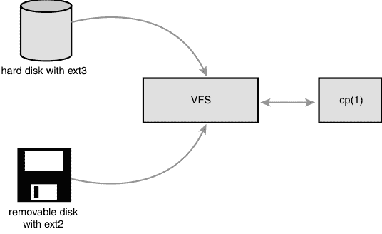

**图 13.1** VFS 在实际运行中：使用`cp(1)`工具将数据从挂载为 ext3 的硬盘移动到挂载为 ext2 的可移动磁盘。两种不同的文件系统，两种不同的介质，一个 VFS。

# 通用文件系统接口

VFS 就像胶水一样，使得`open()`、`read()`和`write()`等系统调用无论在何种文件系统或底层物理介质上都能正常工作。如今，这听起来可能并不新鲜——我们长期以来一直将此功能视为理所当然——但让这类通用系统调用能够跨越许多不同的文件系统和多样化的介质运行是一项并非易事。更重要的是，这些系统调用可以工作在这些不同的文件系统和介质*之间*——我们可以使用标准的系统调用将文件从一个文件系统复制或移动到另一个文件系统。在早期的操作系统（如 DOS）中，这永远无法实现；任何对非原生文件系统的访问都需要特殊工具。正因为现代操作系统（如 Linux）通过虚拟接口将对文件系统的访问进行了抽象，这种互操作性和通用访问才成为可能。

新的文件系统和新类型的存储介质可以被引入 Linux，而程序无需重写甚至无需重新编译。在本章中，我们将讨论 VFS，它提供了允许无数文件系统表现得像一个整体的抽象。在下一章中，我们将讨论块 I/O 层，它支持各种存储设备——从 CD、蓝光光盘到硬盘和 CompactFlash。VFS 和块 I/O 层共同提供了抽象、接口和胶水，允许用户空间程序发出通用系统调用，通过统一的命名策略在任何文件系统（且该文件系统本身存在于任何存储介质上）上访问文件。

# 文件系统抽象层

之所以能够为任何类型的文件系统提供如此通用的接口，是因为内核在其底层文件系统接口周围实现了一个抽象层。这个抽象层使 Linux 能够支持不同的文件系统，即使它们在支持的功能或行为上有所不同。这是可能的，因为 VFS 提供了一个通用的文件模型，可以代表任何文件系统的通用功能集和行为。当然，它偏向于 Unix 风格的文件系统。（在本章稍后部分，你会看到什么构成了 Unix 风格的文件系统。）无论如何，Linux 仍然支持截然不同的文件系统类型，从 DOS 的 FAT 到 Windows 的 NTFS，以及许多 Unix 风格和 Linux 特有的文件系统。

抽象层的工作方式是通过定义所有文件系统都支持的基本概念接口和数据结构。文件系统将它们对概念的看法（例如 *“这就是我打开文件的方式”* 和 *“这就是我对目录的定义”*）塑造得与 VFS 的预期相匹配。实际的文件系统代码隐藏了实现细节。然而，对于 VFS 层和内核的其他部分来说，每个文件系统看起来都是一样的。它们都支持文件和目录等概念，并且都支持创建和删除文件等操作。

其结果是一个通用的抽象层，使内核能够简单且干净地支持多种类型的文件系统。文件系统被编程为提供 VFS 预期的抽象接口和数据结构；相应地，内核可以轻松地与任何文件系统协作，且导出的用户空间接口在任何文件系统上都能无缝工作。

事实上，除了文件系统本身之外，内核中没有任何部分需要了解文件系统的底层细节。例如，考虑一个简单的用户空间程序执行：

```
ret = write(fd, buf, len);
```

这个系统调用将`buf`所指向的`len`个字节写入由文件描述符`fd`表示的文件当前位置。该系统调用首先由一个通用的`sys_write()`系统调用处理，该调用决定了`fd`所在文件系统的实际文件写入方法。随后，通用写入系统调用调用该方法（该方法是文件系统实现的一部分），将数据写入介质（或该文件系统在写入时执行的任何操作）。图 13.2 展示了从用户空间的`write()`调用到数据到达物理介质的流程。系统调用的一个方面是通用的 VFS 接口，为用户空间提供前端；系统调用的另一个方面是文件系统特定的后端，处理实现细节。本章的其余部分将探讨 VFS 如何实现这种抽象并提供其接口。

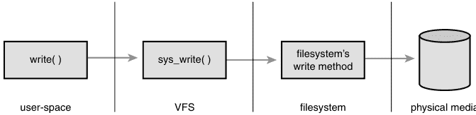

**图 13.2** 数据的流动：从用户空间发出`write()`调用，通过 VFS 的通用系统调用，进入文件系统的特定写入方法，最后到达物理介质。

# Unix 文件系统

从历史上看，Unix 提供了四种基本的文件系统相关抽象：文件（files）、目录项（directory entries）、索引节点（inodes）和挂载点（mount points）。

*文件系统*是一种遵循特定结构的层次化数据存储。文件系统包含文件、目录和相关的控制信息。在文件系统上执行的典型操作有创建、删除和挂载。在 Unix 中，文件系统被挂载在一个全局层次结构（称为 *命名空间*¹）的特定挂载点上。这使得所有挂载的文件系统都显示在单棵树的条目中。将这种单一的、统一的树与 DOS 和 Windows 的行为进行对比，后者将文件命名空间拆分为驱动器盘符（如`C:`）。这将命名空间拆分到了设备和分区边界之间，将硬件细节“泄露”到了文件系统抽象中。由于这种界限可能是随意且甚至令用户困惑的，因此它不如 Unix 的统一命名空间。

*文件*是一个有序的字节串。第一个字节标志文件的开始，最后一个字节标志文件的结束。每个文件都被分配一个人类可读的名称，以便系统和用户进行识别。典型的文件操作有读取、写入，

---

¹ 最近，Linux 将此层次结构变为每进程独立，为每个进程提供唯一的命名空间。由于每个进程继承其父进程的命名空间（除非你另有规定），因此表面上看起来像是一个全局命名空间。

# 第 13 章 虚拟文件系统

创建和删除。Unix 的文件概念与面向记录的文件系统（例如 OpenVMS 的 Files-11）形成了鲜明对比。面向记录的文件系统提供了比 Unix 简单的字节流抽象更丰富、更结构化的文件表示，但代价是牺牲了简单性和灵活性。

文件被组织在目录中。目录类似于文件夹，通常包含相关文件。目录还可以包含其他目录，称为子目录。通过这种方式，目录可以嵌套以形成路径。路径的每个组件被称为目录项。路径示例为`/home/wolfman/butter`——根目录`/`，目录`home`和`wolfman`，以及文件`butter`都是目录项，称为 dentries。在 Unix 中，目录实际上就是普通文件，只是其中列出了包含的文件。因为对于 VFS 来说目录也是一个文件，所以对文件执行的相同操作也可以在目录上执行。

Unix 系统将文件的概念与其相关的任何信息（如访问权限、大小、所有者、创建时间等）分离开来。这些信息有时被称为文件元数据（即关于文件数据的数据），并存储在与文件分离的数据结构中，称为 inode。这个名字是 index node（索引节点）的缩写，尽管如今 inode 这个术语已经变得非常普遍。

所有这些信息与文件系统自身的控制信息绑定在一起，后者存储在超级块（superblock）中。超级块是一个包含整个文件系统信息的数据结构。有时，这些集合数据被称为文件系统元数据。文件系统元数据包括关于单个文件和整个文件系统的信息。

传统上，Unix 文件系统将这些概念实现为其物理磁盘布局的一部分。例如，文件信息作为 inode 存储在磁盘的独立块中；目录是文件；控制信息集中存储在超级块中，依此类推。Unix 的文件概念被物理地映射到存储介质上。Linux VFS 旨在与理解并实现此类概念的文件系统协作。非 Unix 文件系统（如 FAT 或 NTFS）在 Linux 中仍然可以工作，但它们的文件系统代码必须提供这些概念的表象。例如，即使某个文件系统不支持独立的 inode，它也必须在内存中组装 inode 数据结构，就好像它支持一样。或者，如果一个文件系统将目录视为特殊对象，那么对于 VFS 来说，它们必须将目录表示为普通文件。通常，这涉及非 Unix 文件系统为了适应 Unix 范式和 VFS 要求而进行的实时特殊处理。不过，此类文件系统仍然可以运行，且开销在合理范围内。

# VFS 对象及其数据结构

VFS 是面向对象的。一组数据结构代表了通用的文件模型。这些数据结构类似于对象。由于内核严格使用 C 语言编写，无法直接受益于支持面向对象范式的语言，因此这些数据结构被表示为 C 结构体。结构体中既包含数据，也包含指向文件系统实现函数的指针，这些函数用于操作该数据。

VFS 的四种主要对象类型是：

- 超级块（superblock）对象，代表一个特定的已挂载文件系统。
- inode 对象，代表一个特定的文件。
- dentry 对象，代表一个目录项，即路径中的单个组件。
- 文件（file）对象，代表一个与进程相关联的打开文件。

请注意，因为 VFS 将目录视为普通文件，所以没有特定的目录对象。回顾本章前面提到的，dentry 代表路径中的一个组件，其中可能包含一个常规文件。换句话说，dentry 不等同于目录，但目录只是另一种文件。明白了吗？

每个主要对象中都包含一个操作对象。这些对象描述了内核针对主要对象调用的方法：

- `super_operations`对象，包含内核可以在特定文件系统上调用的方法，例如`write_inode()`和`sync_fs()`。
- `inode_operations`对象，包含内核可以在特定文件上调用的方法，例如`create()`和`link()`。
- `dentry_operations`对象，包含内核可以在特定目录项上调用的方法，例如`d_compare()`和`d_delete()`。
- `file_operations`对象，包含进程可以在打开文件上调用的方法，例如`read()`和`write()`。

操作对象被实现为一组指针结构，指向操作父对象的函数。对于许多方法，如果基本功能足够，对象可以继承一个通用函数。否则，特定文件系统的具体实例会用其自身文件系统特有的方法来填充这些指针。


人们经常忽视这一点，甚至否认这一点，但内核中有很多面向对象编程的例子。虽然内核开发人员可能会避开 `C++` 和其他显式面向对象的语言，但以对象的方式思考通常很有用。VFS 是一个很好的例子，展示了如何在缺乏任何 OOP 结构的 C 语言中实现简洁高效的 OOP。

再次注意，*对象* 指的是结构体——而不是像 `C++` 或 `Java` 中的显式类类型。然而，这些结构体代表了对象的特定实例、其相关数据以及操作它们自身的方法。它们在很大程度上就是对象。

VFS 非常依赖结构体，它由比前述主要对象更多的结构体组成。每个注册的文件系统由一个 `file_system_type` 结构体表示。该对象描述了文件系统及其能力。此外，每个挂载点由 `vfsmount` 结构体表示。该结构体包含有关挂载点的信息，例如其位置和挂载标志。

最后，两个每个进程独有的结构体描述了与进程相关的文件系统和文件。它们分别是 `fs_struct` 结构体和 `file` 结构体。

本章的其余部分将讨论这些对象以及它们在实现 VFS 层中所扮演的角色。

## 超级块对象

超级块对象由每个文件系统实现，用于存储描述该特定文件系统的信息。此对象通常对应于存储在磁盘特殊扇区上的 *文件系统超级块* 或 *文件系统控制块*（因此得名）。非基于磁盘的文件系统（例如基于虚拟内存的文件系统 `sysfs`）会实时生成超级块并将其存储在内存中。

超级块对象由 `struct super_block` 表示，定义在 `<linux/fs.h>` 中。以下是其外观及其各条目的注释：

```c
struct super_block {
    struct list_head        s_list;               /* list of all superblocks */
    dev_t                   s_dev;                /* identifier */
    unsigned long           s_blocksize;          /* block size in bytes */
    unsigned char           s_blocksize_bits;     /* block size in bits */
    unsigned char           s_dirt;               /* dirty flag */
    unsigned long long      s_maxbytes;           /* max file size */
    struct file_system_type *s_type;              /* filesystem type */
    struct super_operations *s_op;                /* superblock methods */
    struct dquot_operations *dq_op;               /* quota methods */
    struct quotactl_ops     *s_qcop;              /* quota control methods */
    struct export_operations *s_export_op;        /* export methods */
    unsigned long           s_flags;              /* mount flags */
    unsigned long           s_magic;              /* filesystem's magic number */
    struct dentry           *s_root;              /* directory mount point */
    struct rw_semaphore     s_umount;             /* unmount semaphore */
    struct semaphore        s_lock;               /* superblock semaphore */
    int                     s_count;              /* superblock ref count */
    int                     s_need_sync;          /* not-yet-synced flag */
    atomic_t                s_active;             /* active reference count */
    void                    *s_security;          /* security module */
    struct xattr_handler    **s_xatt;              /* extended attribute handlers */
};
```

```c
struct list_head        s_inodes;             /* inode 列表 */
struct list_head        s_dirty;              /* 脏 inode 列表 */
struct list_head        s_io;                 /* 写回列表 */
struct list_head        s_more_io;            /* 更多写回列表 */
struct hlist_head       s_anon;               /* 匿名 dentry */
struct list_head        s_files;              /* 已分配文件列表 */
struct list_head        s_dentry_lru;         /* 未使用 dentry 列表 */
int                     s_nr_dentry_unused;   /* 列表中的 dentry 数量 */
struct block_device    *s_bdev;               /* 关联的块设备 */
struct mtd_info         *s_mtd;               /* 内存盘信息 */
struct list_head        s_instances;          /* 该文件系统的实例 */
struct quota_info       s_dquot;              /* 配额特定选项 */
int                     s_frozen;              /* 冻结状态 */
wait_queue_head_t       s_wait_unfrozen;      /* 冻结时的等待队列 */
char                    s_id[32];              /* 文本名称 */
void                    *s_fs_info;            /* 文件系统特定信息 */
fmode_t                 s_mode;                /* 挂载权限 */
struct semaphore        s_vfs_rename_sem;      /* 重命名信号量 */
u32                     s_time_gran;           /* 时间戳粒度 */
char                    *s_subtype;            /* 子类型名称 */
char                    *s_options;            /* 保存的挂载选项 */
};
```

创建、管理和销毁超级块（superblock）对象的代码位于 `fs/super.c` 中。超级块对象通过 `alloc_super()` 函数创建并初始化。当文件系统被挂载时，它会调用此函数，从磁盘读取其超级块，并填充其超级块对象。

## 超级块操作

超级块对象中最重要的项是 `s_op`，它是一个指向超级块操作表的指针。超级块操作表由 `struct super_operations` 表示，定义在 `<linux/fs.h>` 中。其结构如下：

```c
struct super_operations {
    struct inode *(*alloc_inode)(struct super_block *sb);
    void (*destroy_inode)(struct inode *);
    void (*dirty_inode) (struct inode *);
    int (*write_inode) (struct inode *, int);
    void (*drop_inode) (struct inode *);
    void (*delete_inode) (struct inode *);
    void (*put_super) (struct super_block *);
    void (*write_super) (struct super_block *);
    int (*sync_fs)(struct super_block *sb, int wait);
    int (*freeze_fs) (struct super_block *);
    int (*unfreeze_fs) (struct super_block *);
    int (*statfs) (struct dentry *, struct kstatfs *);
    int (*remount_fs) (struct super_block *, int *, char *);
    void (*clear_inode) (struct inode *);
    void (*umount_begin) (struct super_block *);
    int (*show_options)(struct seq_file *, struct vfsmount *);
    int (*show_stats)(struct seq_file *, struct vfsmount *);
    ssize_t (*quota_read)(struct super_block *, int, char *, size_t, loff_t);
    ssize_t (*quota_write)(struct super_block *, int, const char *, size_t, loff_t);
    int (*bdev_try_to_free_page)(struct super_block*, struct page*, gfp_t);
};
```

该结构中的每一项都是一个指向函数的指针，这些函数作用于超级块对象。超级块操作在文件系统及其 inode 上执行底层操作。

当文件系统需要对其超级块执行操作时，它会通过超级块对象的指针找到所需的方法。例如，如果文件系统想要写入其超级块，它将调用：

```c
sb->s_op->write_super(sb);
```

在此调用中，`sb` 是指向文件系统超级块的指针。通过该指针进入 `s_op` 即可获得超级块操作表，并最终找到所需的 `write_super()` 函数并将其调用。请注意，尽管 `write_super()` 方法与某个超级块相关联，但调用时必须传递一个超级块。这是因为 C 语言缺乏面向对象支持。在 C++ 中，如下调用就足够了：

```cpp
sb.write_super();
```

在 C 语言中，方法无法轻松获取其父对象，因此你必须将其传递进去。

让我们来看看 `super_operations` 中定义的一些超级块操作：

- `struct inode * alloc_inode(struct super_block *sb)`

  在给定的超级块下创建并初始化一个新的 inode 对象。

- `void destroy_inode(struct inode *inode)`

  释放给定的 inode。

- `void dirty_inode(struct inode *inode)`

  当 inode 被标记为脏（被修改）时，由 VFS 调用。诸如 ext3 和 ext4 等日志文件系统使用此函数来执行日志更新。

- `void write_inode(struct inode *inode, int wait)`

  将给定的 inode 写入磁盘。`wait` 参数指定操作是否应该是同步的。

- `void drop_inode(struct inode *inode)`

  当 inode 的最后一个引用被释放时，由 VFS 调用。普通的 Unix 文件系统不定义此函数，在这种情况下，VFS 直接删除该 inode。

- `void delete_inode(struct inode *inode)`

  从磁盘中删除给定的 inode。

- `void put_super(struct super_block *sb)`

  在卸载时由 VFS 调用，以释放给定的超级块对象。调用者必须持有 `s_lock` 锁。

- `void write_super(struct super_block *sb)`

  使用指定的超级块更新磁盘上的超级块。VFS 使用此函数将内存中修改后的超级块与磁盘同步。调用者必须持有 `s_lock` 锁。

- `int sync_fs(struct super_block *sb, int wait)`

  将文件系统元数据与磁盘上的文件系统同步。`wait` 参数指定操作是否同步。

- `void write_super_lockfs(struct super_block *sb)`

  防止对文件系统进行更改，然后使用指定的超级块更新磁盘上的超级块。目前由 LVM（逻辑卷管理器）使用。

- `void unlockfs(struct super_block *sb)`

  解锁由 `write_super_lockfs()` 锁定的文件系统更改限制。

- `int statfs(struct super_block *sb, struct statfs *statfs)`

  由 VFS 调用以获取文件系统统计信息。与给定文件系统相关的统计信息被放置在 `statfs` 中。

- `int remount_fs(struct super_block *sb, int *flags, char *data)`

  当文件系统使用新的挂载选项重新挂载时，由 VFS 调用。调用者必须持有 `s_lock` 锁。

- `void clear_inode(struct inode *inode)`

  由 VFS 调用以释放 inode 并清除包含相关数据的所有页面。

- `void umount_begin(struct super_block *sb)`

  由 VFS 调用以中断挂载操作。它被 NFS 等网络文件系统使用。

所有这些函数都由 VFS 在进程上下文中调用。除 `dirty_inode()` 外，所有函数在需要时都可以阻塞。

其中一些函数是可选的；具体的文件系统可以将超级块操作结构中的相应值设置为 `NULL`。如果关联的指针为 `NULL`，VFS 将根据操作的不同，要么调用通用函数，要么不执行任何操作。

## Inode 对象

inode 对象代表了内核操作文件或目录所需的所有信息。对于 Unix 风格的文件系统，这些信息直接从磁盘上的 inode 中读取。然而，如果文件系统没有 inode，它必须从磁盘上存储该信息的任何位置获取。没有 inode 的文件系统通常将文件特定信息作为文件的一部分存储；与 Unix 风格的文件系统不同，它们不将文件数据与其控制信息分开。一些现代文件系统两者都不采取，而是将文件元数据存储在磁盘数据库中。无论情况如何，inode 对象都会以适用于该文件系统的方式在内存中构建。

inode 对象由 `struct inode` 表示，定义在 `<linux/fs.h>` 中。结构如下，注释描述了每个条目：


```c
struct inode {
    struct hlist_node        i_hash;            /* 哈希列表 */
    struct list_head         i_list;            /* inode 列表 */
    struct list_head         i_sb_list;          /* 超级块列表 */
    struct list_head         i_dentry;           /* dentry 列表 */
    unsigned long            i_ino;              /* inode 编号 */
    atomic_t                 i_count;            /* 引用计数器 */
    unsigned int             i_nlink;            /* 硬链接数量 */
    uid_t                    i_uid;              /* 所有者用户 ID */
    gid_t                    i_gid;              /* 所有者组 ID */
    kdev_t                   i_rdev;             /* 真实设备节点 */
    u64                      i_version;          /* 版本号 */
    loff_t                   i_size;             /* 文件大小（字节） */
    seqcount_t               i_size_seqcount;    /* i_size 的序列化器 */
    struct timespec          i_atime;            /* 最后访问时间 */
    struct timespec          i_mtime;            /* 最后修改时间 */
    struct timespec          i_ctime;            /* 最后状态改变时间 */
    unsigned int             i_blkbits;          /* 块大小（位数） */
    blkcnt_t                 i_blocks;           /* 文件大小（块数） */
    unsigned short           i_bytes;            /* 消耗的字节数 */
    umode_t                  i_mode;             /* 访问权限 */
    spinlock_t               i_lock;             /* 自旋锁 */
    struct rw_semaphore      i_alloc_sem;        /* 嵌套在 i_sem 内部 */
    struct semaphore         i_sem;              /* inode 信号量 */
    struct inode_operations  *i_op;              /* inode 操作表 */
    struct file_operations   *i_fop;             /* 默认 inode 操作 */
    struct super_block       *i_sb;              /* 关联的超级块 */
    struct file_lock         *i_flock;           /* 文件锁列表 */
    struct address_space     *i_mapping;         /* 关联的映射 */
    struct address_space     i_data;             /* 设备的映射 */
    struct dquot             *i_dquot[MAXQUOTAS]; /* inode 的磁盘配额 */
    struct list_head         i_devices;          /* 块设备列表 */
    union {
```

```c
struct pipe_inode_info  *i_pipe;           /* pipe information */
struct block_device     *i_bdev;           /* block device driver */
struct cdev              *i_cdev;          /* character device driver */
};
unsigned long            i_dnotify_mask;    /* directory notify mask */
struct dnotify_struct   *i_dnotify;         /* dnotify */
struct list_head         inotify_watches;   /* inotify watches */
struct mutex             inotify_mutex;     /* protects inotify_watches */
unsigned long            i_state;           /* state flags */
unsigned long            dirtied_when;      /* first dirtying time */
unsigned int             i_flags;           /* filesystem flags */
atomic_t                 i_writecount;      /* count of writers */
void                     *i_security;       /* security module */
void                     *i_private;        /* fs private pointer */
};
```

`inode` 代表文件系统上的每个文件，但 inode 对象仅在访问文件时才在内存中构建。这包括特殊文件，如设备文件或管道。因此，`struct inode` 中的某些条目与这些特殊文件相关。例如，`i_pipe` 条目指向一个命名管道数据结构，`i_bdev` 指向一个块设备结构，而 `i_cdev` 指向一个字符设备结构。这三个指针存储在一个联合体（union）中，因为一个给定的 inode 在同一时间只能代表其中之一（或者一个都不代表）。

可能会出现某个文件系统不支持 inode 对象中所表示的某个属性的情况。例如，某些文件系统可能不记录访问时间戳。在这种情况下，文件系统可以根据其认为合适的方式来实现该功能；它可以为 `i_atime` 存储零，使 `i_atime` 等于 `i_mtime`，在内存中更新 `i_atime` 但永不将其刷回磁盘，或者文件系统实现者决定的任何其他方式。

## Inode 操作

与超级块（superblock）操作一样，`inode_operations` 成员非常重要。它描述了文件系统实现的、可由 VFS 在 inode 上调用的函数。与超级块类似，inode 操作通过以下方式调用：

```c
i->i_op->truncate(i)
```

在这个调用中，`i` 是对特定 inode 的引用。在这种情况下，将在 `i` 所在的文件系统上定义的 `truncate()` 操作作用于该给定的 inode。`inode_operations` 结构定义在 `<linux/fs.h>` 中：

```c
struct inode_operations {
  int (*create) (struct inode *,struct dentry *,int, struct nameidata *);
  struct dentry * (*lookup) (struct inode *,struct dentry *, struct nameidata *);
  int (*link) (struct dentry *,struct inode *,struct dentry *);
  int (*unlink) (struct inode *,struct dentry *);
  int (*symlink) (struct inode *,struct dentry *,const char *);
  int (*mkdir) (struct inode *,struct dentry *,int);
  int (*rmdir) (struct inode *,struct dentry *);
  int (*mknod) (struct inode *,struct dentry *,int,dev_t);
  int (*rename) (struct inode *, struct dentry *,
    struct inode *, struct dentry *);
  int (*readlink) (struct dentry *, char __user *,int);
  void * (*follow_link) (struct dentry *, struct nameidata *);
  void (*put_link) (struct dentry *, struct nameidata *, void *);
  void (*truncate) (struct inode *);
  int (*permission) (struct inode *, int);
  int (*setattr) (struct dentry *, struct iattr *);
  int (*getattr) (struct vfsmount *mnt, struct dentry *, struct kstat *);
  int (*setxattr) (struct dentry *, const char *,const void *,size_t,int);
  ssize_t (*getxattr) (struct dentry *, const char *, void *, size_t);
  ssize_t (*listxattr) (struct dentry *, char *, size_t);
  int (*removexattr) (struct dentry *, const char *);
  void (*truncate_range)(struct inode *, loff_t, loff_t);
  long (*fallocate)(struct inode *inode, int mode, loff_t offset,
    loff_t len);
  int (*fiemap)(struct inode *, struct fiemap_extent_info *, u64 start,
    u64 len);
};
```

以下接口构成了 VFS 可能会在给定 inode 上执行，或要求特定文件系统执行的各种函数：

- `int create(struct inode *dir, struct dentry *dentry, int mode)`

  VFS 从 `create()` 和 `open()` 系统调用中调用此函数，以创建与给定 dentry 对象相关联的、具有指定初始访问模式的新 inode。

- `struct dentry * lookup(struct inode *dir, struct dentry *dentry)`

  此函数在目录中搜索与给定 dentry 中指定的文件名相对应的 inode。

- `int link(struct dentry *old_dentry, struct inode *dir, struct dentry *dentry)`

  由 `link()` 系统调用调用，用于在目录 `dir` 中为文件 `old_dentry` 创建一个名为 `dentry` 的硬链接。

- `int unlink(struct inode *dir, struct dentry *dentry)`

  从 `unlink()` 系统调用中调用，用于从目录 `dir` 中移除由目录项 `dentry` 指定的 inode。

- ```c
  int symlink(struct inode *dir,
              struct dentry *dentry,
              const char *symname)
  ```

  从 `symlink()` 系统调用中调用，用于在目录 `dir` 中创建名为 `symname` 的符号链接，指向由 `dentry` 表示的文件。

- ```c
  int mkdir(struct inode *dir,
            struct dentry *dentry,
            int mode)
  ```

  从 `mkdir()` 系统调用中调用，以给定的初始模式创建新目录。

- ```c
  int rmdir(struct inode *dir,
            struct dentry *dentry)
  ```

  由 `rmdir()` 系统调用调用，用于从目录 `dir` 中移除由 `dentry` 引用的目录。

- ```c
  int mknod(struct inode *dir,
            struct dentry *dentry,
            int mode, dev_t rdev)
  ```

  由 `mknod()` 系统调用调用，用于创建特殊文件（设备文件、命名管道或套接字）。该文件由设备 `rdev` 和目录 `dir` 中的目录项 `dentry` 引用。初始权限通过 `mode` 给定。

- ```c
  int rename(struct inode *old_dir,
             struct dentry *old_dentry,
             struct inode *new_dir,
             struct dentry *new_dentry)
  ```

  由 VFS 调用，将 `old_dentry` 指定的文件从 `old_dir` 目录移动到 `new_dir` 目录，并使用 `new_dentry` 指定的文件名。

- ```c
  int readlink(struct dentry *dentry,
               char *buffer, int buflen)
  ```

  由 `readlink()` 系统调用调用，将与 `dentry` 指定的符号链接相关联的完整路径中最多 `buflen` 个字节复制到指定的缓冲区中。

- ```c
  int follow_link(struct dentry *dentry,
                  struct nameidata *nd)
  ```

  由 VFS 调用，将符号链接转换为它所指向的 inode。对 `dentry` 指向的链接进行转换，并将结果存储在 `nd` 指向的 `nameidata` 结构中。

- ```c
  int put_link(struct dentry *dentry,
               struct nameidata *nd)
  ```

  由 VFS 调用，用于在调用 `follow_link()` 之后进行清理。

- `void truncate(struct inode *inode)`

  由 VFS 调用以修改给定文件的大小。在调用之前，inode 的 `i_size` 字段必须设置为所需的新大小。

- `int permission(struct inode *inode, int mask)`

  检查 `inode` 引用的文件是否允许指定的访问模式。如果允许访问，此函数返回零，否则返回负的错误代码。大多数文件系统将此字段设置为 `NULL` 并使用通用 VFS 方法，该方法仅将 inode 对象中的模式位与给定的掩码进行比较。更复杂的文件系统（例如支持访问控制列表 ACL 的文件系统）具有特定的 `permission()` 方法。

- ```c
  int setattr(struct dentry *dentry,
              struct iattr *attr)
  ```

  从 `notify_change()` 调用，用于在 inode 被修改后通知“变更事件”。

- ```c
  int getattr(struct vfsmount *mnt,
              struct dentry *dentry,
              struct kstat *stat)
  ```

  当 VFS 意识到 inode 需要从磁盘刷新时调用。扩展属性允许将键/值对与文件相关联。

- ```c
  int setxattr(struct dentry *dentry,
               const char *name,
               const void *value,
               size_t size, int flags)
  ```

  由 VFS 使用，将 `dentry` 引用的文件上的扩展属性 `name` 设置为值 `value`。


```c
ssize_t getxattr(struct dentry *dentry,
                 const char *name,
                 void *value, size_t size)
```

由 VFS 使用，将指定文件的扩展属性 `name` 的值复制到 `value` 中。

```c
ssize_t listxattr(struct dentry *dentry,
                  char *list, size_t size)
```

将指定文件的所有属性列表复制到缓冲区 `list` 中。

```c
int removexattr(struct dentry *dentry,
                const char *name)
```

从给定文件中移除给定的属性。

## Dentry 对象

如前所述，VFS 将目录视为一种文件。在路径 `/bin/vi` 中，`bin` 和 `vi` 都是文件——`bin` 是特殊的目录文件，而 `vi` 是一个普通文件。每个这样的组件都由一个 inode 对象表示。尽管这种统一化非常有用，但 VFS 经常需要执行目录特定的操作，例如路径名查找。路径名查找涉及翻译路径的每个组件，确保其有效，并沿着它找到下一个组件。

为了方便地实现这一点，VFS 采用了目录项（dentry, directory entry）的概念。dentry 是路径中的一个特定组件。使用之前的示例，`/`、`bin` 和 `vi` 都是 dentry 对象。前两个是目录，最后一个是普通文件。这是一个重点：Dentry 对象是路径中的所有组件，包括文件。解析路径并遍历其组件是一项艰巨的任务，既耗时又涉及大量的字符串操作，而字符串操作的执行成本高且编码繁琐。dentry 对象使整个过程变得更加简单。

Dentries 还可能包含挂载点。在路径 `/mnt/cdrom/foo` 中，组件 `/`、`mnt`、`cdrom` 和 `foo` 都是 dentry 对象。VFS 在执行目录操作时，会根据需要动态（on-the-fly）构建 dentry 对象。

Dentry 对象由 `struct dentry` 表示，定义在 `<linux/dcache.h>` 中。以下是该结构体及其成员的注释：

```c
struct dentry {
    atomic_t             d_count;           /* usage count */
    unsigned int         d_flags;           /* dentry flags */
    spinlock_t           d_lock;            /* per-dentry lock */
    int                  d_mounted;         /* is this a mount point? */
    struct inode         *d_inode;          /* associated inode */
    struct hlist_node    d_hash;            /* list of hash table entries */
    struct dentry        *d_parent;         /* dentry object of parent */
    struct qstr          d_name;            /* dentry name */
    struct list_head     d_lru;             /* unused list */
    union {
        struct list_head d_child;           /* list of dentries within */
        struct rcu_head  d_rcu;             /* RCU locking */
    } d_u;
    struct list_head     d_subdirs;         /* subdirectories */
    struct list_head     d_alias;           /* list of alias inodes */
    unsigned long        d_time;            /* revalidate time */
    struct dentry_operations *d_op;         /* dentry operations table */
    struct super_block   *d_sb;             /* superblock of file */
    void                 *d_fsdata;         /* filesystem-specific data */
    unsigned char        d_iname[DNAME_INLINE_LEN_MIN]; /* short name */
};
```

与前两个对象不同，dentry 对象不对应任何磁盘上的数据结构。VFS 根据路径名的字符串表示形式动态创建它。由于 dentry 对象没有物理存储在磁盘上，因此 `struct dentry` 中没有标志来指定该对象是否被修改（即它是否为脏数据并需要写回磁盘）。

## Dentry 状态

一个有效的 dentry 对象可能处于三种状态之一：已使用（used）、未使用（unused）或负值（negative）。

已使用的 dentry 对应于一个有效的 inode（`d_inode` 指向关联的 inode），并表明该对象有一个或多个用户（`d_count` 为正）。已使用的 dentry 正被 VFS 使用并指向有效数据，因此不能被丢弃。

未使用的 dentry 对应于一个有效的 inode（`d_inode` 指向一个 inode），但 VFS 当前未使用该 dentry 对象（`d_count` 为零）。由于 dentry 对象仍指向一个有效对象，因此该 dentry 被保留（缓存）以备后用。因为 dentry 没有被过早销毁，如果将来需要它，则无需重新创建，路径名查找的完成速度会比没有缓存 dentry 时更快。然而，如果需要回收内存，由于它不在活跃使用中，该 dentry 可以被丢弃。

负值 dentry 不与有效的 inode 关联（`d_inode` 为 `NULL`），因为要么 inode 已被删除，要么路径名从一开始就是错误的。不过，该 dentry 仍被保留，以便未来的查找能快速解析。例如，考虑一个持续尝试打开并读取一个不存在的配置文件的守护进程。`open()` 系统调用会不断返回 `ENOENT`，但在返回之前，内核必须构建路径、遍历磁盘目录结构并验证文件的不存在。由于即使是这种失败的查找也很昂贵，因此缓存“负值”结果是有价值的。虽然负值 dentry 很有用，但如果内存紧张，它可以被销毁，因为实际上没有任何东西在使用它。

dentry 对象还可以被释放，存在于 slab 对象缓存中，如前一章所述。在这种情况下，任何 VFS 或文件系统代码中都没有对该 dentry 对象的有效引用。

## Dentry 缓存

在 VFS 层费力地将路径名中的每个元素解析为 dentry 对象并到达路径末尾后，如果丢弃所有这些工作将是非常浪费的。因此，内核将 dentry 对象缓存起来，称为 dentry 缓存，简称为 *dcache*。

dentry 缓存由三部分组成：

- “已使用” dentry 的列表，通过 inode 对象的 `i_dentry` 字段与关联的 inode 链接。由于一个给定的 inode 可以有多个链接，因此可能存在多个 dentry 对象；因此这里使用一个列表。

- 一个包含未使用和负值 dentry 对象的双向链表，采用“最近最少使用”（LRU）策略。新条目插入在表头，因此靠近表头的条目比靠近表尾的条目更新。当内核必须删除条目以回收内存时，会从表尾删除；那些是最旧的，且据推测在不久的将来被使用的可能性最小。

- 一个哈希表和哈希函数，用于将给定的路径快速解析为关联的 dentry 对象。

哈希表由 `dentry_hashtable` 数组表示。每个元素都是一个指向具有相同哈希值的 dentry 列表的指针。该数组的大小取决于系统中的物理内存量。

实际的哈希值由 `d_hash()` 决定。这使得文件系统能够提供唯一的哈希函数。

哈希表查找通过 `d_lookup()` 执行。如果在 dcache 中找到匹配的 dentry 对象，则将其返回。失败时返回 `NULL`。

举个例子，假设你正在编辑主目录中的一个源文件，`/home/dracula/src/the_sun_sucks.c`。每次访问该文件（例如，当你首次打开它，随后保存它，编译它等）时，VFS 必须遵循每个目录项来解析完整路径：`/`, `home`, `dracula`, `src`，以及最后的 `the_sun_sucks.c`。为了避免每次访问该路径名时都进行这种耗时操作，VFS 可以首先尝试在 dentry 缓存中查找路径名。如果查找成功，无需费力即可获得所需的最终 dentry 对象。相反，如果 dentry 不在 dentry 缓存中，VFS 必须通过遍历文件系统的每个路径组件来手动解析路径。任务完成后，内核将 dentry 对象添加到 dcache 中，以加速未来的任何查找。

dcache 还为 inode 缓存（*icache*）提供了前端。与 dentry 对象关联的 inode 对象不会被释放，因为 dentry 对 inode 维持着正的使用计数。这使得 dentry 对象能够将 inode 固定在内存中。只要 dentry 被缓存，相应的 inode 也会被缓存。因此，当路径名查找从缓存中成功完成时（如前例所示），关联的 inode 已经缓存在内存中了。

缓存 dentry 和 inode 是有益的，因为文件访问表现出空间局部性和时间局部性。文件访问的时间局部性体现在程序倾向于反复访问相同的文件。因此，当访问某个文件时，缓存关联的 dentry 和 inode 在不久的将来产生缓存命中率的可能性很高。文件访问的空间局部性体现在程序倾向于访问同一目录下的多个文件。因此，缓存一个文件的目录项在接下来操作相关文件时，有很高的概率产生缓存命中。

## Dentry 操作

`dentry_operations` 结构体规定了 VFS 在给定文件系统的目录项（directory entries）上调用的方法。

`dentry_operations` 结构体定义在 `<linux/dcache.h>` 中：

```c
struct dentry_operations {
    int (*d_revalidate) (struct dentry *, struct nameidata *);
    int (*d_hash) (struct dentry *, struct gstr *);
    int (*d_compare) (struct dentry *, struct gstr *, struct gstr *);
    int (*d_delete) (struct dentry *);
    void (*d_release) (struct dentry *);
    void (*d_iput) (struct dentry *, struct inode *);
    char *(*d_dname) (struct dentry *, char *, int);
};
```

具体方法如下：

- **`int d_revalidate(struct dentry *dentry, struct nameidata *)`**

  确定给定的 dentry 对象是否有效。每当 VFS 准备从 dcache 中使用一个 dentry 时，都会调用此函数。大多数文件系统将此方法设置为 `NULL`，因为它们在 dcache 中的 dentry 对象始终有效。

- **`int d_hash(struct dentry *dentry, struct gstr *name)`**

  根据给定的 dentry 创建一个哈希值。每当 VFS 将 dentry 添加到哈希表时，都会调用此函数。

- **`int d_compare(struct dentry *dentry, struct gstr *name1, struct gstr *name2)`**

  由 VFS 调用以比较两个文件名 `name1` 和 `name2`。大多数文件系统使用 VFS 的默认实现，即简单的字符串比较。对于某些文件系统（如 FAT），简单的字符串比较是不够的。FAT 文件系统不区分大小写，因此需要实现一个忽略大小写的比较函数。此函数需要 `dcache_lock`。

- **`int d_delete(struct dentry *dentry)`**

  当指定 dentry 对象的 `d_count` 达到零时，由 VFS 调用。此函数需要 `dcache_lock` 和 dentry 的 `d_lock`。

- **`void d_release(struct dentry *dentry)`**

  当指定 dentry 将被释放时，由 VFS 调用。默认函数不执行任何操作。

- **`void d_iput(struct dentry *dentry, struct inode *inode)`**

  当 dentry 对象失去其关联的 inode 时（例如，由于该项从磁盘中被删除），由 VFS 调用。默认情况下，VFS 简单地调用 `iput()` 函数来释放 inode。如果文件系统重写此函数，除了执行文件系统特定的工作外，还必须调用 `iput()`。

## 文件对象

我们要查看的最后一个主要 VFS 对象是文件对象（file object）。文件对象用于表示由进程打开的文件。当我们从用户空间的视角思考 VFS 时，最先想到的就是文件对象。进程直接处理的是文件，而不是超级块（superblocks）、inode 或 dentry。因此，文件对象中的信息是最熟悉的（如访问模式和当前偏移量等数据），而且文件操作也是常见的系统调用，如 `read()` 和 `write()`。

文件对象是打开文件的内存表示。该对象（而非物理文件）在响应 `open()` 系统调用时创建，在响应 `close()` 系统调用时销毁。所有这些与文件相关的调用实际上都是在文件操作表中定义的方法。由于多个进程可以同时打开并操作同一个文件，因此同一个文件可能存在多个文件对象。文件对象仅代表一个进程对打开文件的视图。该对象指向实际代表该打开文件的 dentry（而 dentry 又指向 inode）。当然，inode 和 dentry 对象是唯一的。

文件对象由 `struct file` 表示，定义在 `<linux/fs.h>` 中。让我们来看看这个结构体，再次添加注释来描述每个条目：

```c
struct file {
    union {
        struct list_head  fu_list;      /* 文件对象列表 */
        struct rcu_head   fu_rcuhead;   /* 释放后的 RCU 列表 */
    } f_u;
    struct path            f_path;     /* 包含 dentry */
    struct file_operations *f_op;      /* 文件操作表 */
    spinlock_t             f_lock;     /* 每个文件结构体的锁 */
    atomic_t               f_count;    /* 文件对象的引用计数 */
    unsigned int           f_flags;    /* open 时指定的标志 */
    mode_t                 f_mode;     /* 文件访问模式 */
    loff_t                 f_pos;      /* 文件偏移量（文件指针） */
    struct fown_struct     f_owner;    /* 用于信号的所有者数据 */
    const struct cred      *f_cred;    /* 文件凭据 */
    struct file_ra_state   f_ra;       /* 预读状态 */
    u64                    f_version;  /* 版本号 */
    void                   *f_security; /* 安全模块 */
    void                   *private_data; /* tty 驱动钩子 */
    struct list_head       f_ep_links; /* epoll 链接列表 */
    spinlock_t             f_ep_lock;  /* epoll 锁 */
    struct address_space   *f_mapping; /* 页缓存映射 */
    unsigned long          f_mnt_write_state; /* 调试状态 */
};
```

与 dentry 对象类似，文件对象实际上并不对应于任何磁盘上的数据。因此，对象中没有标志位来表示该对象是否为脏（dirty）以及是否需要写回磁盘。文件对象通过 `f_dentry` 指针指向其关联的 dentry 对象。dentry 进而指向关联的 inode，而 inode 则反映了文件本身是否为脏。

# 第 13 章 虚拟文件系统

## 文件操作

与所有其他 VFS 对象一样，文件操作表非常重要。与 `struct file` 关联的操作就是构成标准 Unix 系统调用基础的那些常见的系统调用。


文件对象方法在 `file_operations` 中指定，定义在 `<linux/fs.h>` 中：

```c
struct file_operations {
    struct module *owner;
    loff_t (*llseek) (struct file *, loff_t, int);
    ssize_t (*read) (struct file *, char __user *, size_t, loff_t *);
    ssize_t (*write) (struct file *, const char __user *, size_t, loff_t *);
    ssize_t (*aio_read) (struct kiocb *, const struct iovec *,
                         unsigned long, loff_t);
    ssize_t (*aio_write) (struct kiocb *, const struct iovec *,
                          unsigned long, loff_t);
    int (*readdir) (struct file *, void *, filldir_t);
    unsigned int (*poll) (struct file *, struct poll_table_struct *);
    int (*ioctl) (struct inode *, struct file *, unsigned int,
                  unsigned long);
    long (*unlocked_ioctl) (struct file *, unsigned int, unsigned long);
    long (*compat_ioctl) (struct file *, unsigned int, unsigned long);
    int (*mmap) (struct file *, struct vm_area_struct *);
    int (*open) (struct inode *, struct file *);
    int (*flush) (struct file *, fl_owner_t id);
    int (*release) (struct inode *, struct file *);
    int (*fsync) (struct file *, struct dentry *, int datasync);
    int (*aio_fsync) (struct kiocb *, int datasync);
    int (*fasync) (int, struct file *, int);
    int (*lock) (struct file *, int, struct file_lock *);
    ssize_t (*sendpage) (struct file *, struct page *,
                         int, size_t, loff_t *, int);
    unsigned long (*get_unmapped_area) (struct file *,
                                        unsigned long,
                                        unsigned long,
                                        unsigned long);

    int (*check_flags) (int);
    int (*flock) (struct file *, int, struct file_lock *);
    ssize_t (*splice_write) (struct pipe_inode_info *,
                         struct file *,
                         loff_t *,
                         size_t,
                         unsigned int);
    ssize_t (*splice_read) (struct file *,
                        loff_t *,
                        struct pipe_inode_info *,
                        size_t,
                        unsigned int);
    int (*setlease) (struct file *, long, struct file_lock **);
};
```

文件系统可以为这些操作中的每一项实现独特的功能，或者如果存在通用方法，也可以使用通用方法。通用方法在基于 Unix 的普通文件系统上通常运行良好。文件系统没有义务实现所有这些方法（尽管不实现基础方法是很愚蠢的），如果不需要，只需将方法设置为 `NULL` 即可。

以下是具体操作：

- `loff_t llseek(struct file *file, loff_t offset, int origin)`

  将文件指针更新到给定的偏移量。它通过 `llseek()` 系统调用被调用。

- `ssize_t read(struct file *file, char *buf, size_t count, loff_t *offset)`

  从给定文件的 `offset` 位置读取 `count` 个字节到 `buf` 中。然后更新文件指针。此函数由 `read()` 系统调用调用。

- `ssize_t aio_read(struct kiocb *iocb, char *buf, size_t count, loff_t offset)`

  开始将 `iocb` 所描述文件的 `count` 个字节异步读取到 `buf` 中。此函数由 `aio_read()` 系统调用调用。

- `ssize_t write(struct file *file, const char *buf, size_t count, loff_t *offset)`

  将 `buf` 中的 `count` 个字节写入给定文件的 `offset` 位置。然后更新文件指针。此函数由 `write()` 系统调用调用。

# 第 13 章 虚拟文件系统

- ```c
  ssize_t aio_write(struct kiocb *iocb,
  		     const char *buf,
  		     size_t count, loff_t offset)
  ```

  开始将 `buf` 中的 `count` 字节异步写入由 `iocb` 描述的文件中。此函数由 `aio_write()` 系统调用调用。

- ```c
  int readdir(struct file *file, void *dirent,
  	    filldir_t filldir)
  ```

  返回目录列表中的下一个目录。此函数由 `readdir()` 系统调用调用。

- ```c
  unsigned int poll(struct file *file,
  		 struct poll_table_struct *poll_table)
  ```

  休眠并等待给定文件的活动。它由 `poll()` 系统调用调用。

- ```c
  int ioctl(struct inode *inode,
  	  struct file *file,
  	  unsigned int cmd,
  	  unsigned long arg)
  ```

  向设备发送一个命令和参数对。当文件是一个打开的设备节点时使用。此函数由 `ioctl()` 系统调用调用。调用者必须持有 BKL（大内核锁）。

- ```c
  int unlocked_ioctl(struct file *file,
  		     unsigned int cmd,
  		     unsigned long arg)
  ```

  实现与 `ioctl()` 相同的功能，但无需持有 BKL。当用户空间调用 `ioctl()` 系统调用时，如果存在 `unlocked_ioctl()`，VFS 将调用它来替代 `ioctl()`。因此，文件系统只需要实现其中一个，建议实现 `unlocked_ioctl()`。

- ```c
  int compat_ioctl(struct file *file,
  		 unsigned int cmd,
  		 unsigned long arg)
  ```

  为 32 位系统上的 32 位应用程序实现一个可移植的 `ioctl()` 变体。该函数旨在即使在 64 位架构上也能保证 32 位安全，并执行必要的尺寸转换。新驱动程序在设计 `ioctl` 命令时应确保所有命令都是可移植的，从而使 `compat_ioctl()` 和 `unlocked_ioctl()` 指向同一个函数。与 `unlocked_ioctl()` 一样，`compat_ioctl()` 不持有 BKL。

- ```c
  int mmap(struct file *file,
  	 struct vm_area_struct *vma)
  ```

  将给定文件内存映射到给定的地址空间，由 `mmap()` 系统调用调用。

- ```c
  int open(struct inode *inode,
    struct file *file)
  ```

  创建一个新的文件对象并将其链接到相应的 inode 对象。它由 `open()` 系统调用调用。

- ```c
  int flush(struct file *file)
  ```

  每当打开文件的引用计数减少时，由 VFS 调用。其具体用途取决于文件系统。

- ```c
  int release(struct inode *inode,
    struct file *file)
  ```

  当对文件的最后一个剩余引用被销毁时（例如，最后一个共享文件描述符的进程调用 `close()` 或退出时），由 VFS 调用。其具体用途取决于文件系统。

- ```c
  int fsync(struct file *file,
    struct dentry *dentry,
    int datasync)
  ```

  由 `fsync()` 系统调用调用，将文件的所有缓存数据写入磁盘。

- ```c
  int aio_fsync(struct kiocb *iocb,
    int datasync)
  ```

  由 `aio_fsync()` 系统调用调用，将与 `iocb` 关联的文件的所有缓存数据写入磁盘。

- ```c
  int fsync(int fd, struct file *file, int on)
  ```

  启用或禁用异步 I/O 的信号通知。

- ```c
  int lock(struct file *file, int cmd,
    struct file_lock *lock)
  ```

  操作给定文件上的文件锁。

- ```c
  ssize_t readv(struct file *file,
    const struct iovec *vector,
    unsigned long count,
    loff_t *offset)
  ```

  由 `readv()` 系统调用调用，从给定文件读取数据并将结果放入由 `vector` 描述的 `count` 个缓冲区中。随后文件偏移量递增。

- ```c
  ssize_t writev(struct file *file,
    const struct iovec *vector,
    unsigned long count,
    loff_t *offset)
  ```

  由 `writev()` 系统调用调用，将 `vector` 描述的 `count` 个缓冲区中的数据写入由 `file` 指定的文件中。随后文件偏移量递增。

- ```c
  ssize_t sendfile(struct file *file,
    loff_t *offset,
    size_t size,
    read_actor_t actor,
    void *target)
  ```

  由 `sendfile()` 系统调用调用，将数据从一个文件复制到另一个文件。它完全在内核中执行复制，避免了冗余的拷贝到用户空间。

- ```c
  ssize_t sendpage(struct file *file,
    struct page *page,
    int offset, size_t size,
    loff_t *pos, int more)
  ```

  用于将数据从一个文件发送到另一个文件。

- ```c
  unsigned long get_unmapped_area(struct file *file,
    unsigned long addr,
    unsigned long len,
    unsigned long offset,
    unsigned long flags)
  ```

  获取未使用的地址空间以映射给定文件。

- ```c
  int check_flags(int flags)
  ```

  用于在给出 `SETFL` 命令时，检查传递给 `fcntl()` 系统调用的标志（flags）是否有效。与许多 VFS 操作一样，文件系统不需要实现 `check_flags()`；目前只有 NFS 实现了它。该函数允许文件系统限制那些原本由通用 `fcntl()` 函数启用的无效 `SETFL` 标志。在 NFS 的情况下，不支持将 `O_APPEND` 和 `O_DIRECT` 结合使用。

- ```c
  int flock(struct file *filp,
    int cmd,
    struct file_lock *fl)
  ```

  用于实现 `flock()` 系统调用，该调用提供建议锁（advisory locking）。

## 如此之多的 ioctls！

不久前，还只有一个 `ioctl` 方法。而今天，有三种方法。`unlocked_ioctl()` 与 `ioctl()` 相同，唯一的区别是它在调用时没有大内核锁（BKL）。因此，确保适当同步的任务落在该函数的编写者身上。由于 BKL 是一个粗粒度且低效的锁，驱动程序应该实现 `unlocked_ioctl()` 而不是 `ioctl()`。

`compat_ioctl()` 同样在没有 BKL 的情况下被调用，但其目的是为 64 位系统提供一个 32 位兼容的 `ioctl` 方法。如何实现它取决于你现有的 `ioctl` 命令。对于使用隐式尺寸类型（如 `long`）的旧驱动程序，应实现一个能与 32 位应用程序适当协作的 `compat_ioctl()` 方法。这通常意味着将 32 位值转换为 64 位内核的相应类型。而那些能够从零开始设计 `ioctl` 命令的新驱动程序，应确保所有参数和数据都具有显式尺寸，从而保证在 32 位系统上的 32 位应用、64 位系统上的 32 位应用以及 64 位系统上的 64 位应用中都是安全的。这样，这些驱动程序就可以将 `compat_ioctl()` 函数指针指向与 `unlocked_ioctl()` 相同的函数。

## 与文件系统相关的数据结构

除了基础的 VFS 对象外，内核还使用其他标准数据结构来管理与文件系统相关的数据。第一个对象用于描述文件系统的特定变体，例如 ext3、ext4 或 UDF。第二个数据结构描述一个文件系统的已挂载实例。

由于 Linux 支持如此多不同的文件系统，内核必须有一个特殊的结构来描述每个文件系统的能力和行为。定义在 `<linux/fs.h>` 中的 `file_system_type` 结构就实现了这一点：


```c
struct file_system_type {
	const char		*name;		/* filesystem's name */
	int			fs_flags;	/* filesystem type flags */
	/* the following is used to read the superblock off the disk */
	struct super_block	*(*get_sb) (struct file_system_type *, int,
					 char *, void *);
	/* the following is used to terminate access to the superblock */
	void			(*kill_sb) (struct super_block *);
	struct module		*owner;		/* module owning the filesystem */
	struct file_system_type	*next;		/* next file_system_type in list */
	struct list_head	fs_supers;	/* list of superblock objects */
	/* the remaining fields are used for runtime lock validation */
	struct lock_class_key	s_lock_key;
	struct lock_class_key	s_umount_key;
	struct lock_class_key	i_lock_key;
	struct lock_class_key	i_mutex_key;
	struct lock_class_key	i_mutex_dir_key;
	struct lock_class_key	i_alloc_sem_key;
};
```

`get_sb()` 函数在文件系统加载时从磁盘读取超级块（superblock）并填充超级块对象。其余函数描述了文件系统的属性。

无论系统中挂载了多少个该文件系统的实例，或者该文件系统是否被挂载，每个文件系统只有一个 `file_system_type`。

当文件系统真正被挂载时，事情变得更有趣，此时会创建 `vfsmount` 结构。该结构代表文件系统的一个特定实例——换句话说，就是一个挂载点。

`vfsmount` 结构定义在 `<linux/mount.h>` 中。如下所示：

```c
struct vfsmount {
	struct list_head	mnt_hash;	/* hash table list */
};
```

```c
struct vfsmount       *mnt_parent;       /* parent filesystem */
struct dentry         *mnt_mountpoint;   /* dentry of this mount point */
struct dentry         *mnt_root;         /* dentry of root of this fs */
struct super_block    *mnt_sb;           /* superblock of this filesystem */
struct list_head      mnt_mounts;        /* list of children */
struct list_head      mnt_child;         /* list of children */
int                   mnt_flags;         /* mount flags */
char                  *mnt_devname;      /* device file name */
struct list_head      mnt_list;          /* list of descriptors */
struct list_head      mnt_expire;        /* entry in expiry list */
struct list_head      mnt_share;         /* entry in shared mounts list */
struct list_head      mnt_slave_list;    /* list of slave mounts */
struct list_head      mnt_slave;         /* entry in slave list */
struct vfsmount       *mnt_master;       /* slave's master */
struct mnt_namespace  *mnt_namespace;    /* associated namespace */
int                   mnt_id;            /* mount identifier */
int                   mnt_group_id;      /* peer group identifier */
atomic_t              mnt_count;         /* usage count */
int                   mnt_expiry_mark;   /* is marked for expiration */
int                   mnt_pinned;        /* pinned count */
int                   mnt_ghosts;        /* ghosts count */
atomic_t              __mnt_writers;     /* writers count */
};
```

维护所有挂载点列表的复杂之处在于文件系统与所有其他挂载点之间的关系。`vfsmount` 中的各种链表用于跟踪这些信息。

`vfsmount` 结构体还通过 `mnt_flags` 字段存储挂载时指定的标志（如果有）。表 13.1 列出了标准挂载标志。

**表 13.1 标准挂载标志**

| 标志 | 描述 |
|------|-------------|
| `MNT_NOSUID` | 禁止该文件系统上的二进制文件设置 setuid 和 setgid 标志 |
| `MNT_NODEV` | 禁止访问该文件系统上的设备文件 |
| `MNT_NOEXEC` | 禁止在该文件系统上执行二进制文件 |

这些标志在管理员不信任的可移动设备上非常有用。它们定义在 `<linux/mount.h>` 中，同时还定义了其他较少使用的标志。

## 与进程相关的数据结构

系统中的每个进程都有自己的打开文件列表、根文件系统、当前工作目录、挂载点等。有三个数据结构将 VFS 层与系统中的进程联系在一起：`files_struct`、`fs_struct` 和 `namespace`。

`files_struct` 定义在 `<linux/fdtable.h>` 中。该表的地址由进程描述符中的 `files` 条目指向。所有关于打开文件和文件描述符的进程相关信息都包含其中。其定义及注释如下：

```c
struct files_struct {
        atomic_t                    count;              /* usage count */
        struct fdtable              *fdt;               /* pointer to other fd table */
        struct fdtable              fdtab;              /* base fd table */
        spinlock_t                  file_lock;          /* per-file lock */
        int                         next_fd;            /* cache of next available fd */
        struct embedded_fd_set      close_on_exec_init; /* list of close-on-exec fds */
        struct embedded_fd_set      open_fds_init;      /* list of open fds */
        struct file                 *fd_array[NR_OPEN_DEFAULT]; /* base files array */
};
```

数组 `fd_array` 指向打开文件对象的列表。由于 `NR_OPEN_DEFAULT` 等于 `BITS_PER_LONG`（在 64 位架构上为 64），因此它包含 64 个文件对象的空间。如果进程打开的文件对象超过 64 个，内核会分配一个新数组，并将 `fdt` 指针指向它。通过这种方式，访问合理数量的文件对象速度很快，因为它发生在静态数组中。如果进程打开了异常数量的文件，内核可以创建新数组。如果系统中大多数进程打开的文件超过 64 个，管理员可以通过增加预处理器宏 `NR_OPEN_DEFAULT` 以获得最佳性能。

第二个与进程相关的结构是 `fs_struct`，它包含与进程相关的文件系统信息，由进程描述符中的 `fs` 字段指向。该结构定义在 `<linux/fs_struct.h>` 中。其定义及注释如下：

```c
struct fs_struct {
    int             users;              /* user count */
    rwlock_t        lock;               /* per-structure lock */
    int             umask;               /* umask */
    int             in_exec;            /* currently executing a file */
    struct path     root;               /* root directory */
    struct path     pwd;                /* current working directory */
};
```

该结构持有当前进程的当前工作目录 (`pwd`) 和根目录。

第三个也是最后一个结构是 `mnt_namespace` 结构，它定义在 `<linux/mnt_namespace.h>` 中，由进程描述符中的 `mnt_namespace` 字段指向。进程级命名空间是在 Linux 2.4 内核中引入的。它们使每个进程能够对系统上挂载的文件系统拥有唯一的视图——不仅是唯一的根目录，而且是完全唯一的文件系统层级结构。该结构及其注释如下：

```c
struct mnt_namespace {
        atomic_t                    count; /* usage count */
        struct vfsmount              *root; /* root directory */
        struct list_head            list;   /* list of mount points */
        wait_queue_head_t           poll;   /* polling waitqueue */
        int                         event;  /* event count */
};
```

`list` 成员指定了一个双向链表，包含构成该命名空间的所有已挂载文件系统。

这些数据结构都从每个进程描述符链接。对于大多数进程，进程描述符指向唯一的 `files_struct` 和 `fs_struct` 结构。然而，对于使用克隆标志 `CLONE_FILES` 或 `CLONE_FS` 创建的进程，这些结构是共享的。因此，多个进程描述符可能会指向同一个 `files_struct` 或 `fs_struct` 结构。每个结构中的 `count` 成员提供了一个引用计数，以防止在进程仍在使用该结构时将其销毁。

命名空间结构的工作方式则相反。默认情况下，所有进程共享同一个命名空间（也就是说，它们从同一个挂载表看到相同的文件系统层级结构）。只有在调用 `clone()` 时指定 `CLONE_NEWNS` 标志，进程才会获得一个唯一的命名空间结构副本。由于大多数进程不提供此标志，所有进程都继承其父进程的命名空间。因此，在许多系统中只有一个命名空间，尽管只需一个 `CLONE_NEWNS` 标志即可开启此功能。

## 结论

Linux 支持广泛的文件系统，从原生文件系统（如 ext3 和 ext4）到网络文件系统（如 NFS 和 Coda）——仅在官方内核中就有 60 多个文件系统。VFS 层为这些截然不同的文件系统提供了实现框架以及与标准系统调用交互的接口。因此，VFS 层既使得在 Linux 中实现新文件系统变得简洁，又使这些文件系统能够通过标准 Unix 系统调用自动互操作。

本章描述了 VFS 的目的，并讨论了其各种数据结构，包括至关重要的 inode、dentry 和 superblock 对象。第 14 章“块 I/O 层”将讨论数据在物理上是如何进入文件系统的。

***

线程通常指定 `CLONE_FILES` 和 `CLONE_FS`，因此它们之间共享单个 `files_struct` 和 `fs_struct`。而普通进程不指定这些标志，因此拥有各自的文件系统信息和打开文件表。

## 块 I/O 层

块设备是指能够以随机（即不一定是顺序）方式访问固定大小数据块的硬件设备。这些固定大小的数据块被称为“块”（blocks）。最常见的块设备是硬盘，但还存在许多其他块设备，如软盘驱动器、蓝光阅读器和闪存。请注意，这些都是你可以挂载文件系统的设备——文件系统是块设备的通用语言。

另一种基础设备类型是字符设备。字符设备（或 char 设备）被访问方式是作为顺序数据流，一个字节接一个字节地访问。字符设备的例子包括串口和键盘。如果硬件设备被作为数据流访问，它就被实现为字符设备。另一方面，如果设备是随机访问（非顺序访问）的，它就是一个块设备。

其区别在于设备是否随机访问数据——换句话说，设备是否能从一个位置 seek 到另一个位置。以键盘为例，作为驱动程序，键盘提供的是一个数据流。如果你输入 wolf，键盘驱动程序会按照这个精确的顺序返回包含这四个字母的数据流。乱序读取这些字母，或者读取流中除下一个以外的任何字母，都没有意义。因此，键盘驱动程序是一个字符设备；该设备提供了用户在键盘上输入的字符流。从键盘读取会依次返回 w，然后是 o，然后是 l，最后是 f。当没有按键等待时，流为空。相反，硬盘则完全不同。硬盘驱动程序可能会请求读取一个任意块的内容，然后读取另一个不同块的内容；这些块不需要是连续的。硬盘的数据是随机访问而非流式访问的；因此，硬盘是一个块设备。

在内核中管理块设备比管理字符设备需要更多的细心、准备和工作。字符设备只有一个位置——当前位置——而块设备必须能够在中介设备的任何位置之间前后导航。事实上，内核不需要为字符设备管理提供整个专门的子系统，但块设备恰恰拥有这样一个子系统。这种子系统的必要性部分源于块设备的复杂性。然而，提供如此广泛支持的一个重要原因是块设备对性能非常敏感；充分挖掘硬盘的每一分性能，比压榨键盘额外 1% 的速度要重要得多。此外，正如你将看到的，块设备的复杂性为这类优化提供了大量空间。本章的主题是内核如何管理块设备及其请求。内核的这部分被称为 *块* I/O 层。有趣的是，重构块 I/O 层是 2.5 开发内核的主要目标。本章涵盖了 2.6 内核中全新的块 I/O 层。

## 块设备的解剖

块设备上最小的可寻址单位是 *扇区*（sector）。扇区的大小通常是 2 的幂，其中 512 字节是最常见的大小。扇区大小是设备的物理属性，且扇区是所有块设备的基本单位——设备无法寻址或操作小于扇区的单位，尽管许多块设备可以一次操作多个扇区。大多数块设备的扇区为 512 字节，尽管其他尺寸也很常见。例如，许多 CD-ROM 盘的扇区为 2 KB。

软件有不同的目标，因此它设定了自己的最小逻辑可寻址单位，即 *块*（block）。块是文件系统的抽象——文件系统只能以块的倍数进行访问。虽然物理设备在扇区级别可寻址，但内核所有的磁盘操作都是以块为单位执行的。由于设备的最小可寻址单位是扇区，因此块的大小不能小于扇区，并且必须是扇区的倍数。此外，内核（与硬件和扇区一样）要求块必须是 2 的幂。内核还要求块的大小不能超过页大小（参见第 12 章“内存管理”和第 19 章“可移植性”）。¹ 因此，块大小是扇区大小的 2 的幂倍数，且不大于页大小。常见的块大小为 512 字节、1 KB 和 4 KB。

有些令人困惑的是，有些人对扇区和块使用不同的称呼。扇区（设备最小的可寻址单位）有时被称为“硬扇区”或“设备块”。同时，块（文件系统最小的可寻址单位）有时被称为“文件系统块”或“I/O 块”。本章将继续使用 *扇区* 和 *块* 这两个概念，但你应该记住这些其他术语。图 14.1 是扇区与缓冲区之间关系的示意图。

其他术语（至少对于硬盘而言）也很常见——例如 *簇*（clusters）、*柱面*（cylinders）和 *磁头*（heads）。这些概念仅适用于某些特定的块设备，并且在很大程度上对用户空间软件是不可见的。扇区对内核之所以重要，是因为所有设备 I/O 必须以扇区为单位完成。相应地，内核使用的高层概念——块——是构建在扇区之上的。

> ¹ 这是一个人为的限制，未来可能会取消。然而，强制块保持等于或小于页大小可以简化内核。

**图 14.1** 扇区与块的关系。


# 缓冲区与缓冲区头

当一个块存储在内存中时（例如，在读取之后或等待写入时），它被存储在一个*缓冲区*（buffer）中。每个缓冲区恰好与一个块相关联。缓冲区作为在内存中代表磁盘块的对象。回想一下，一个块由一个或多个扇区组成，但其大小不超过一个页。因此，单个页可以在内存中持有一个或多个块。由于内核需要一些相关的控制信息来伴随数据（例如该缓冲区来自哪个块设备以及哪个具体块），因此每个缓冲区都关联一个描述符。该描述符被称为*缓冲区头*（buffer head），类型为`struct buffer_head`。`buffer_head`结构体包含了内核操作缓冲区所需的所有信息，定义在`<linux/buffer_head.h>`中。

查看这个结构体及其字段描述注释：

```c
struct buffer_head {
    unsigned long b_state;        /* buffer state flags */
    struct buffer_head *b_this_page; /* list of page's buffers */
    struct page *b_page;          /* associated page */
    sector_t b_blocknr;           /* starting block number */
    size_t b_size;                /* size of mapping */
    char *b_data;                 /* pointer to data within the page */
    struct block_device *b_bdev;  /* associated block device */
    bh_end_io_t *b_end_io;        /* I/O completion */
    void *b_private;              /* reserved for b_end_io */
    struct list_head b_assoc_buffers;  /* associated mappings */
    struct address_space *b_assoc_map; /* associated address space */
    atomic_t b_count;             /* use count */
};
```

`b_state`字段指定了这个特定缓冲区的状态。它可以是表 14.1 中的一个或多个标志。合法的标志存储在`bh_state_bits`枚举中，定义在`<linux/buffer_head.h>`中。

**表 14.1 bh_state 标志**

| 状态标志 | 含义 |
|-------------|--------------|
| `BH_Uptodate` | 缓冲区包含有效数据。 |
| `BH_Dirty` | 缓冲区为脏。（缓冲区内容比磁盘上的块内容更新，因此缓冲区最终必须写回磁盘。） |
| `BH_Lock` | 缓冲区正在进行磁盘 I/O，已锁定以防止并发访问。 |
| `BH_Req` | 缓冲区参与了一个 I/O 请求。 |
| `BH_Mapped` | 缓冲区是一个映射到磁盘块的有效缓冲区。 |
| `BH_New` | 缓冲区是通过`get_block()`新映射的，尚未被访问。 |
| `BH_Async_Read` | 缓冲区正在通过`end_buffer_async_read()`进行异步读取 I/O。 |
| `BH_Async_Write` | 缓冲区正在通过`end_buffer_async_write()`进行异步写入 I/O。 |
| `BH_Delay` | 缓冲区尚未关联磁盘块（延迟分配）。 |
| `BH_Boundary` | 缓冲区构成了连续块的边界——下一个块是不连续的。 |
| `BH_Write_EIO` | 缓冲区在写入时发生了 I/O 错误。 |
| `BH_Ordered` | 有序写入。 |
| `BH_Eopnotsupp` | 缓冲区发生了“不支持”错误。 |
| `BH_Unwritten` | 磁盘上已为缓冲区分配空间，但实际数据尚未写出。 |
| `BH_Quiet` | 抑制该缓冲区的错误报告。 |

`bh_state_bits`枚举在列表的最后一个值中包含一个`BH_PrivateStart`标志。这不是一个有效的状态标志，而是对应于其他代码可以使用的第一个可用位。所有等于或大于`BH_PrivateStart`的位值均不被块 I/O 层本身使用，因此这些位可以安全地使用。

由希望在`b_state`字段中存储信息的单个驱动程序使用。驱动程序可以基于此标志来确定其内部标志的位值，并放心其不会侵占块 I/O 层使用的官方位。

`b_count`字段是缓冲区的使用计数。该值通过两个内联函数进行递增和递减，这两个函数均定义在`<linux/buffer_head.h>`中：

```c
static inline void get_bh(struct buffer_head *bh)
{
    atomic_inc(&bh->b_count);
}
```

```c
static inline void put_bh(struct buffer_head *bh)
{
    atomic_dec(&bh->b_count);
}
```

在操作 buffer head 之前，必须通过`get_bh()`增加其引用计数，以确保 buffer head 不会在你操作时被释放。完成 buffer head 的操作后，通过`put_bh()`递减引用计数。

给定缓冲区对应的磁盘物理块是`b_bdev`所描述的块设备上的第`b_blocknr`个逻辑块。

给定缓冲区对应的内存物理页是由`b_page`指向的页。更具体地说，`b_data`是直接指向该块（存在于`b_page`中的某个位置）的指针，其长度为`b_size`字节。因此，该块在内存中的位置从地址`b_data`开始，到地址`(b_data + b_size)`结束。

buffer head 的目的是描述这种磁盘块与物理内存缓冲区（特定页上的一段字节序列）之间的映射。作为这种缓冲区到块映射的描述符，是该数据结构在内核中的唯一角色。

在 2.6 内核之前，buffer head 是一个重要得多的数据结构：它是内核中 I/O 的单位。buffer head 不仅描述了磁盘块到物理页的映射，还充当所有块 I/O 所使用的容器。这带来了两个主要问题。首先，buffer head 是一个庞大且笨重的数据结构（如今已缩小了一些），且以 buffer head 为单位操纵数据既不简洁也不简单。相反，内核更倾向于以页（page）为单位工作，页更加简单且能提供更高的性能。为每个单独的缓冲区（可能比一个页小）描述一个巨大的 buffer head 是低效的。因此，在 2.6 内核中，大量工作致力于使内核直接与页和地址空间（address spaces）工作，而不是缓冲区。其中部分工作在第 16 章“页缓存与页回写”中讨论，该章探讨了`address_space`结构和`pdflush`守护进程。

buffer head 的第二个问题是它们仅描述单个缓冲区。当用作所有 I/O 操作的容器时，buffer head 迫使内核将潜在的大块 I/O 操作（例如写入）分解为多个`buffer_head`结构。这导致了不必要的开销和空间消耗。因此，2.5 开发内核的主要目标是引入一种新的、灵活且轻量级的块 I/O 操作容器。结果就是`bio`结构，将在下一节中讨论。

# bio 结构

内核中块 I/O 的基本容器是`bio`结构，定义在`<linux/bio.h>`中。该结构将处于传输中（活跃）的块 I/O 操作表示为一段段段（segments）的列表。一个段是内存中连续的一块缓冲区。因此，单个缓冲区不需要在内存中连续。通过允许分块描述缓冲区，`bio`结构使得内核能够执行来自内存中多个位置的、即使是单个缓冲区的块 I/O 操作。这种矢量 I/O 被称为散集 I/O（scatter-gather I/O）。

以下是定义在`<linux/bio.h>`中的`struct bio`，并为每个字段添加了注释：

```c
struct bio {
    sector_t            bi_sector;        /* 磁盘上的相关扇区 */
    struct bio           *bi_next;           /* 请求列表 */
    struct block_device *bi_bdev;           /* 相关块设备 */
    unsigned long       bi_flags;           /* 状态和命令标志 */
    unsigned long       bi_rw;              /* 读或写？ */
    unsigned short      bi_vcnt;            /* bio_vec 的数量 */
    unsigned short      bi_idx;             /* bi_io_vec 中的当前索引 */
    unsigned short      bi_phys_segments;   /* 段的数量 */
    unsigned int        bi_size;            /* I/O 计数 */
    unsigned int        bi_seg_front_size;  /* 第一段的大小 */
    unsigned int        bi_seg_back_size;   /* 最后一段的大小 */
    unsigned int        bi_max_vecs;         /* 可能的最大 bio_vecs 数量 */
    unsigned int        bi_comp_cpu;         /* 完成操作的 CPU */
    atomic_t            bi_cnt;              /* 使用计数器 */
    struct bio_vec      *bi_io_vec;          /* bio_vec 列表 */
    bio_end_io_t         *bi_end_io;         /* I/O 完成方法 */
    void                 *bi_private;        /* 所有者私有方法 */
    bio_destructor_t     *bi_destructor;     /* 析构方法 */
    struct bio_vec       bi_inline_vecs[0];  /* 内联 bio 向量 */
};
```

`bio`结构的主要目的是表示一个传输中的块 I/O 操作。为此，结构中的大多数字段都与管理相关。最重要的字段是`bi_io_vec`、`bi_vcnt`和`bi_idx`。图 14.2 显示了`bio`结构及其相关结构之间的关系。

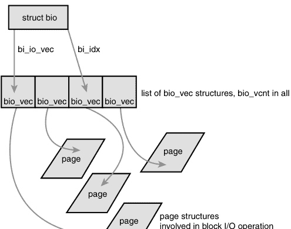

图 14.2 **struct bio**、**struct bio_vec** 和 **struct page** 之间的关系。

## I/O 向量

`bi_io_vec`字段指向一个`bio_vec`结构数组。这些结构被用作此特定块 I/O 操作中单个段的列表。每个`bio_vec`被视为一个`<page, offset, len>`形式的向量，描述一个特定的段：它所在的物理页、块在页中的偏移位置，以及从给定偏移开始的块长度。这些向量的完整数组描述了整个缓冲区。`bio_vec`结构定义在`<linux/bio.h>`中：

```c
struct bio_vec {
	/* 指向此缓冲区所在的物理页的指针 */
	struct page	*bv_page;

	/* 此缓冲区的长度（字节） */
	unsigned int	bv_len;

	/* 缓冲区在页内的字节偏移量 */
	unsigned int	bv_offset;
};
```

在每个给定的块 I/O 操作中，以`bi_io_vec`开始的`bio_vec`数组中有`bi_vcnt`个向量。随着块 I/O 操作的执行，`bi_idx`字段用于指向数组中的当前索引。

总之，每个块 I/O 请求由一个`bio`结构表示。每个请求由一个或多个块组成，这些块存储在`bio_vec`结构数组中。这些结构充当向量，描述每个段在内存物理页中的位置。I/O 操作中的第一个段由`bio_vec`指向。每个后续段紧跟在第一个之后，列表中总共有`bi_vcnt`个段。随着块 I/O 层提交请求中的段，`bi_idx`字段会更新以指向当前段。

`bi_idx`字段用于指向列表中的当前`bio_vec`，这有助于块 I/O 层跟踪部分完成的块 I/O 操作。然而，一个更重要的用途是允许拆分`bio`结构。凭借这一特性，实现冗余磁盘阵列（RAID，一种允许单个卷跨越多个磁盘以提高性能和可靠性的硬盘设置）的驱动程序可以将一个最初打算用于单个设备的`bio`结构拆分到 RAID 阵列中的多个硬盘之间。RAID 驱动程序唯一需要做的是复制`bio`结构并更新`bi_idx`字段，以指向单个驱动程序应开始操作的位置。

`bio`结构在`bi_cnt`字段中维护一个使用计数。当此字段达到零时，结构被销毁，且支撑内存被释放。以下两个函数为你管理使用计数器：

```c
void bio_get(struct bio *bio)
void bio_put(struct bio *bio)
```

前者增加使用计数，而后者递减使用计数（如果计数达到零，则销毁`bio`结构）。在操作一个传输中的`bio`结构之前，请务必增加其使用计数，以确保它不会在操作过程中完成并被释放。操作完成后，相应地递减使用计数。

最后，`bi_private`字段是为结构的拥有者（即创建者）提供的私有字段。原则上，只有当你分配了该`bio`结构时，才能读取或写入此字段。

# 旧版与新版之比

buffer head 与新`bio`结构之间的区别至关重要。`bio`结构表示一个 I/O 操作，其中可能包含内存中的一个或多个页。另一方面，`buffer_head`结构表示单个缓冲区，描述磁盘上的单个块。由于 buffer head 绑定在单个页中的单个磁盘块上，导致 buffer head 不必要地将请求分解为块大小的碎片，然后再将其重新组装。由于`bio`结构是轻量级的，它可以描述不连续的块，且不会不必要地拆分 I/O 操作。

从`struct buffer_head`切换到`struct bio`还带来了其他好处：

- `bio`结构可以轻松表示高端内存（high memory），因为`struct bio`仅处理物理页而非直接指针。
- `bio`结构可以同时表示普通页 I/O 和直接 I/O（不经过页缓存的 I/O 操作——详见第 16 章“页缓存与页回写”中关于页缓存的讨论）。
- `bio`结构使得执行离散-聚集（向量化）块 I/O 操作变得简单，这些操作涉及的数据源自多个物理页。
- `bio`结构比 buffer head 轻量得多，因为它仅包含表示块 I/O 操作所需的最小信息，而不包含与缓冲区本身相关的冗余信息。

然而，buffer head 的概念仍然是必需的；buffer head 起到描述符的作用，将磁盘块映射到页。`bio`结构不包含任何关于缓冲区状态的信息——它仅仅是一个向量数组，描述了单次块 I/O 操作的一个或多个数据段，以及相关信息。在目前的设置中，`buffer_head`结构仍被用于包含缓冲区信息，而`bio`结构则描述在途（in-flight）的 I/O。将这两种结构分开，可以使每种结构尽可能地保持精简。

# 请求队列

块设备维护请求队列以存储其待处理的块 I/O 请求。请求队列由`request_queue`结构表示，并定义在`<linux/blkdev.h>`中。请求队列包含一个请求的双向链表以及相关的控制信息。请求由内核中的高层代码（如文件系统）添加到队列中。只要请求队列不为空，与该队列关联的块设备驱动程序就会从队列头部获取请求，并将其提交给其关联的块设备。队列请求列表中的每个项目都是一个单一的请求，类型为`struct request`。

队列中的单个请求由`struct request`表示，该结构同样定义在`<linux/blkdev.h>`中。每个请求可以由多个`bio`结构组成，因为单个请求可以操作多个连续的磁盘块。请注意，虽然磁盘上的块必须是相邻的，但内存中的块不需要；每个`bio`结构可以描述多个段（回顾一下，段是内存中块的连续块），且一个请求可以由多个`bio`结构组成。

# I/O 调度器

如果仅仅按照内核发出请求的顺序，并在发出后立即将请求发送到块设备，会导致性能低下。现代计算机中最慢的操作之一就是磁盘寻道。每次寻道——将硬盘磁头定位到特定块的位置——都需要耗费数毫秒。最大限度地减少寻道对系统性能至关重要。

因此，内核不会按照接收块 I/O 请求的顺序或在接收到后立即将其发出到磁盘。相反，它会执行称为“合并（merging）”和“排序（sorting）”的操作，以大幅提高整个系统的性能。² 执行这些操作的内核子系统被称为*I/O 调度器*。


*I/O 调度器*将磁盘 I/O 资源分配给系统中待处理的块 I/O 请求。它通过对请求队列中待处理请求的合并和排序来实现这一点。不要将*I/O 调度器*与进程调度器（见第 4 章“进程调度”）混淆，后者是将处理器资源分配给系统中的进程。这两个子系统的本质相似但并不相同。进程调度器和*I/O 调度器*都是在多个对象之间虚拟化一种资源。在进程调度器的情况下，处理器被虚拟化并由系统中的进程共享。这提供了多任务和分时操作系统（如任何*Unix*）中固有的虚拟化错觉。另一方面，*I/O 调度器*在多个未完成的块请求之间虚拟化块设备。这样做是为了最大限度地减少磁盘寻道并确保最佳的磁盘性能。

## I/O 调度器的工作

*I/O 调度器*通过管理块设备的请求队列来工作。它决定队列中请求的顺序以及每个请求被分派到块设备的时间。它管理请求队列的目标是减少寻道，从而获得更高的*全局吞吐量*。这里的“全局”限定词很重要。*I/O 调度器*非常坦率地通过牺牲某些请求的公平性，来提高系统的*整体*性能。

I/O 调度器执行两种主要操作以最大限度地减少寻道：合并和排序。合并是将两个或多个请求合并为一个。考虑一个由文件系统提交到队列的示例请求——比如，从文件中读取一段数据。（当然，此时所有操作都是基于扇区和块而非文件进行的，但假设请求的块源自文件的一段。）如果队列中已经存在一个读取磁盘上相邻扇区的请求（例如，同一文件的更早一段），则这两个请求可以合并为一个操作一个或多个相邻磁盘扇区的单一请求。通过合并请求，*I/O 调度器*将多个请求的开销降低到单个请求。更重要的是，只需向磁盘发出单个命令，且在处理多个请求时无需寻道。因此，合并请求降低了开销并最大限度地减少了寻道。

现在，假设你的虚拟读取请求被提交到请求队列，但没有读取相邻扇区的请求。因此，你无法将此请求与任何其他请求合并。此时，你可以简单地将此请求放在队列尾部。但是，如果磁盘上有其他请求指向相似的位置怎么办？将这个新请求插入到队列中靠近操作物理相邻扇区的其他请求的位置，难道不是更有意义吗？事实上，I/O 调度器正是这么做的。整个请求队列保持按扇区排序，这样队列中的所有寻道活动（尽可能地）顺序地经过硬盘扇区。目标不仅是最小化每一次单独的寻道，而是通过让磁盘磁头沿直线移动来最小化所有寻道。这类似于电梯采用的算法——电梯不会在楼层之间剧烈地跳跃，而是尝试在单一方向上优雅地移动。当到达一个方向的最后一层时，电梯可以掉头向另一个方向移动。由于这种相似性，I/O 调度器（有时仅指其排序算法）被称为*电梯 (elevators)*。

> ² 这一点必须强调。如果没有这些特性，或者这些特性实现得不好，即使只有适量的块 I/O 操作，系统的性能也会很差。

## Linus 电梯

现在让我们看看一些真实的 I/O 调度器。第一个 I/O 调度器被称为*Linus 电梯*。（是的，Linus 有一个以他命名电梯！）它是 2.4 版本中的默认 I/O 调度器。在 2.6 版本中，它被我们接下来要看的 I/O 调度器所取代——然而，因为这个电梯比随后的调度器更简单，同时执行许多相同的功能，它是一个极佳的入门介绍。

Linus 电梯同时执行合并和排序。当请求被添加到队列时，它首先与每个其他待处理请求进行比对，看它是否是可能的合并候选者。Linus 电梯 I/O 调度器执行*前向合并*和*后向合并*。执行的合并类型取决于现有相邻请求的位置。如果新请求紧接着一个现有请求，则进行前向合并。相反，如果新请求在现有请求之前，则进行后向合并。由于文件的布局方式（通常由扇区号递增）以及典型工作负载中执行的 I/O 操作（数据通常从头读到尾，而不是反向读取），前向合并相比后向合并较为罕见。尽管如此，Linus 电梯仍会检查并执行这两种类型的合并。

如果合并尝试失败，则在队列中寻找可能的插入点（即新请求在扇区顺序上刚好位于现有请求之间的一个位置）。如果找到了，新请求将被插入该处。如果找不到合适的位置，请求将被添加到队列尾部。此外，如果在队列中发现一个比预定义阈值更旧的现有请求，即使新请求可以在其他地方排序插入，它也会被添加到队列尾部。这防止了许多指向磁盘附近位置的请求无限期地导致指向磁盘其他位置的请求饥饿。不幸的是，这种“年龄”检查效率不高。它并没有真正尝试在给定时间范围内服务请求；它仅仅是在适当的延迟后停止请求的插入排序。这改善了延迟，但仍可能导致请求饥饿，而这正是 2.4 I/O 调度器亟需解决的大问题。

总之，当一个请求被添加到队列时，可能会发生四种操作。顺序如下：

1. 如果队列中存在一个指向相邻磁盘扇区的请求，则现有请求与新请求合并为一个单一请求。
2. 如果队列中的某个请求足够旧，新请求将被插入到队列尾部，以防止其他更旧的请求发生饥饿。
3. 如果队列中存在一个在扇区位置上合适的插入点，新请求将被插入其中。这使得队列能够根据磁盘上的物理位置保持排序。
4. 最后，如果没有这样一个合适的插入点，请求将被插入到队列尾部。

Linus 电梯算法在`block/elevator.c`中实现。

## Deadline I/O 调度器

Deadline I/O 调度器旨在防止由 Linus 电梯算法引起的饥饿问题。为了尽量减少寻道，对磁盘某个区域的大量磁盘 I/O 操作可能会无限期地导致对磁盘另一个部分的请求操作发生饥饿。事实上，一系列指向磁盘相同区域的请求可能会导致其他遥远位置的请求永远无法得到服务。这种饥饿是不公平的。

更糟糕的是，请求饥饿的普遍问题引入了一个具体的问题实例，即*写饥饿读（writes starving reads）*。写操作通常可以在内核处理到它们时随时提交到磁盘，对于提交应用程序来说是完全异步的。而读操作则截然不同。通常，当应用程序提交一个读请求时，应用程序会阻塞直到该请求被满足。也就是说，读请求相对于提交应用程序是同步发生的。虽然系统响应在很大程度上不受写延迟（提交写请求所需的时间）的影响，但读延迟（提交读请求所需的时间）至关重要。写延迟对应用程序性能几乎没有影响，³ 但应用程序必须在原地等待每个读请求的完成。因此，读延迟对于系统的性能至关重要。

更复杂的是，读请求往往相互依赖。例如，考虑读取大量文件的情况。每次读取都以小的缓冲块形式进行。在之前的块从磁盘读取完成并返回给应用程序之前，应用程序不会开始读取下一个块（或者下一个文件）。更糟糕的是，读写操作都需要读取各种元数据，例如 inode。从磁盘读取这些块进一步使 I/O 串行化。因此，如果每个读请求都被单独导致饥饿，此类应用程序的总延迟会不断累积并变得巨大。Deadline I/O 调度器意识到读请求的异步性和相互依赖性使得读延迟对系统性能的影响要强得多，因此它实现了若干特性，以确保尽可能减少一般的请求饥饿，特别是读饥饿。

> ³ 然而，我们仍然不想无限期地延迟写请求，因为内核希望确保数据最终被写入磁盘，以防止内存缓冲区增长得太大或过旧。

请注意，减少请求饥饿是以牺牲全局吞吐量为代价的。即使是 Linus 电梯算法也做了这种妥协，尽管程度要轻得多。如果 Linus 电梯算法*总是*按扇区将请求插入队列，且从不检查旧请求并退回到尾部插入，那么它可以通过进一步最大限度地减少寻道来提供更好的整体吞吐量。虽然减少寻道很重要，但无限期的饥饿同样不可接受。因此，Deadline I/O 调度器在努力限制饥饿的同时，仍致力于提供良好的全局吞吐量。毫无疑问：在提供请求公平性的同时最大化全局吞吐量是一项艰巨的任务。

在 Deadline I/O 调度器中，每个请求都关联一个过期时间。默认情况下，读请求的过期时间为未来 500 毫秒，写请求的过期时间为未来 5 秒。Deadline I/O 调度器的运作方式与 Linus 电梯算法类似，它维护一个按磁盘物理位置排序的请求队列。它将此队列称为*排序队列（sorted queue）*。当一个新请求被提交到排序队列时，Deadline I/O 调度器像 Linus 电梯算法一样执行合并和插入。⁴ 然而，Deadline I/O 调度器还将请求插入到第二个取决于请求类型的队列中。读请求被排序到一个特殊的读 FIFO 队列中，写请求被插入到一个特殊的写 FIFO 队列中。虽然普通队列按磁盘扇区排序，但这些队列保持 FIFO（先进先出）。（实际上，它们是按时间排序的。）因此，新请求总是被添加到队列尾部。在正常运行下，Deadline I/O 调度器将请求从排序队列的头部拉取到调度队列（dispatch queue）中。调度队列随后被交给磁盘驱动器。这实现了最小的寻道。

如果写 FIFO 队列或读 FIFO 队列头部的请求过期（即当前时间大于与该请求关联的过期时间），Deadline I/O 调度器随后开始服务来自 FIFO 队列的请求。通过这种方式，Deadline I/O 调度器试图确保没有请求的待处理时间超过其过期时间。参见图 14.3。

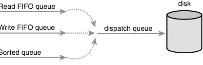

*图 14.3 Deadline I/O 调度器的三个队列。*

请注意，Deadline I/O 调度器并不对请求延迟做出任何严格保证。但它能够大致在请求过期时或之前提交请求。这防止了请求饥饿。由于读请求被赋予的过期值明显小于写请求，Deadline I/O 调度器还致力于确保写请求不会导致读请求饥饿。这种对读请求的偏好最小化了读延迟。

> ⁴ 然而，在 Deadline I/O 调度器中，执行前向合并（front merging）是可选的。这并不总是值得费力去做，因为许多工作负载中很少有可以进行前向合并的请求。

```
block/deadline-iosched.c
```

## Anticipatory I/O 调度器

虽然 Deadline I/O 调度器在最小化读延迟方面表现出色，但这是以牺牲全局吞吐量为代价的。考虑一个处于高写活动状态的系统。每当提交一个读请求时，I/O 调度器都会迅速地去处理该读请求。这导致磁盘寻道到读取位置，执行读取操作，然后再次寻道回来继续进行中的写操作，为每个读请求重复这一小场“闹剧”。对读请求的偏好是好事，但由此产生的一对寻道（一次到读请求位置，另一次回到正在进行的写操作）对全局磁盘吞吐量是有害的。Anticipatory I/O 调度器旨在继续提供出色的读延迟，同时提供出色的全局吞吐量。

首先，Anticipatory I/O 调度器以 Deadline I/O 调度器为基础。因此，它并非完全不同。Anticipatory I/O 调度器实现了三个队列（外加调度队列）以及每个请求的过期时间，就像 Deadline I/O 调度器一样。主要的改变是增加了一个*预测启发式（anticipation heuristic）*。

Anticipatory I/O 调度器试图最小化在其他磁盘 I/O 活动期间发出读请求所伴随的“寻道风暴”。当发出读请求时，它会在通常的过期周期内像往常一样被处理。然而，在请求提交后，Anticipatory I/O 调度器不会立即寻道回来处理其他请求。相反，它会在几毫秒内绝对不做任何事情。（实际值是可配置的；默认值为 6 毫秒。）在这几毫秒内，应用程序很有可能会提交另一个读请求。任何发往磁盘相邻区域的请求都会立即被处理。在等待期过后，Anticipatory I/O 调度器会寻道回到之前离开的位置，并继续处理之前的请求。

值得注意的是，如果能够即使只减少少部分因处理读请求而产生的来回寻道，那么在*预测*更多请求上花费的这几毫秒是非常值得的。如果在等待期内发出了相邻的 I/O 请求，I/O 调度器就节省了一对寻道。随着越来越多的读取请求发往磁盘的同一区域，更多的寻道将被避免。

当然，如果在等待期内没有发生任何活动，Anticipatory I/O 调度器就“输了”，浪费了几毫秒。从 Anticipatory I/O 调度器中获取最大收益的关键在于正确预测应用程序和文件系统的行为。这是通过一组统计数据和相关的启发式算法实现的。Anticipatory I/O 调度器跟踪与块 I/O 习惯相关的每个进程的统计数据，希望能通过正确地预测应用程序的操作。只要正确预测的百分比足够高，Anticipatory I/O 调度器就可以大大减少为了服务读请求而进行寻道带来的开销，同时仍能提供系统响应所需的对这些请求的关注。这使得 Anticipatory I/O 调度器能够在最小化读延迟的同时，尽可能减少寻道的次数和持续时间。从而实现低系统延迟和高系统吞吐量。

Anticipatory I/O 调度器位于内核源码树的`block/as-iosched.c`文件中。它在大多数工作负载下表现良好。它非常适合服务器，尽管在某些不常见但关键的、涉及频繁寻道数据库的工作负载上表现较差。

## Complete Fair Queuing I/O 调度器

Complete Fair Queuing (CFQ) I/O 调度器是一款为特定工作负载设计的 I/O 调度器，但在实践中，它实际上在多种工作负载下都能提供良好的性能。然而，它与前面介绍的 I/O 调度器有本质的区别。

CFQ I/O 调度器根据发起 I/O 请求的进程，将传入的 I/O 请求分配到特定的队列中。例如，来自进程 foo 的 I/O 请求进入 foo 的队列，来自进程 bar 的 I/O 请求进入 bar 的队列。在每个队列内部，请求与相邻请求合并并进行插入排序。因此，这些队列像其他 I/O 调度器的队列一样，保持按扇区排序。CFQ I/O 调度器的不同之处在于，每个提交 I/O 的进程都有一个队列。

然后，CFQ I/O 调度器以轮询方式服务这些队列，从每个队列中取出可配置数量的请求（默认四个），然后继续处理下一个队列。这在进程级别提供了公平性，确保每个进程都能获得公平的磁盘带宽份额。其预期工作负载是多媒体，在这种场景下，这种公平算法可以保证例如音频播放器能够始终及时地从磁盘填充其音频缓冲区。但在实践中，CFQ I/O 调度器在许多场景下都表现良好。

Complete Fair Queuing I/O 调度器位于`block/cfg-iosched.c`。它被推荐用于桌面工作负载，尽管在几乎所有没有病态极端情况的工作负载中，它的表现都相当不错。它现在是 Linux 的默认 I/O 调度器。

## Noop I/O 调度器

第四个也是最后一个 I/O 调度器是 Noop I/O 调度器，之所以这样命名是因为它基本上是一个 noop（空操作）——它不做太多事情。Noop I/O 调度器不执行排序，也不执行任何其他形式的防止寻道操作。相应地，它不需要像前三个 I/O 调度器那样实现任何旨在最小化请求延迟的精巧算法。

不过，Noop I/O 调度器确实会执行合并，这是它唯一的工作。当一个新请求被提交到队列时，它会与任何相邻请求合并。除了这个操作之外，Noop I/O 调度器真的是一个 noop，仅以近似 FIFO（先进先出）的顺序维护请求队列，块设备驱动程序从中取出请求。

Noop I/O 调度器如此“偷懒”是有原因的。它是为真正的随机访问块设备（如闪存卡）设计的。如果一个块设备与“寻道”相关的开销很小或几乎没有，那么就没有必要对传入请求进行插入排序，此时 Noop I/O 调度器就是理想的选择。

Noop I/O 调度器位于`block/noop-iosched.c`。它仅适用于随机访问设备。

## I/O 调度器选择

你现在已经看到了 2.6 内核中的四种不同的 I/O 调度器。每一种 I/O 调度器都可以被启用并编译进内核。默认情况下，块设备使用 Complete Fair Queuing I/O 调度器。这可以通过内核命令行在启动时的选项`elevator=foo`来覆盖，其中`foo`是一个有效且已启用的 I/O 调度器。参见表 14.2。

表 14.2 传递给 elevator 选项的参数

| 参数 | I/O 调度器 |
|-----------|---------------|
| as | Anticipatory |
| cfq | Complete Fair Queuing |
| deadline | Deadline |
| noop | Noop |

例如，内核命令行选项`elevator=as`将为所有块设备启用 Anticipatory I/O 调度器，从而覆盖默认的 Complete Fair Queuing 调度器。

## 结论

在本章中，我们讨论了块设备的基础知识，并研究了块 I/O 层使用的数据结构：代表在途 I/O 的`bio`；代表块到页映射的`buffer_head`；以及代表特定 I/O 请求的`request`结构。我们跟踪了 I/O 请求短暂但重要的生命周期，其终点是 I/O 调度器。我们讨论了 I/O 调度涉及的困境，并回顾了当前 Linux 内核中的四种 I/O 调度器，以及 2.4 版本中旧的 Linus Elevator。

接下来，我们将处理进程地址空间。

## 进程地址空间

第 12 章“内存管理”研究了内核如何管理物理内存。除了管理自身内存外，内核还必须管理用户空间进程的内存。这种内存被称为*进程地址空间*，它是系统中每个用户空间进程被分配的内存的表示。Linux 是一个虚拟内存操作系统，因此内存资源在系统进程之间是虚拟化的。单个进程看待内存的方式就像作它独自拥有对系统物理内存的完全访问权一样。更重要的是，即使是单个进程的地址空间也可以比物理内存大得多。本章讨论内核如何管理进程地址空间。

## 地址空间

进程地址空间由进程可寻址的虚拟内存以及进程被允许使用的虚拟内存中的地址组成。每个进程被赋予一个*平坦的 32-bit*或 64-bit 地址空间，大小取决于架构。*平坦（flat）*一词表示地址空间存在于单个范围内。（例如，32 位地址空间从地址 0 延伸到 4294967295。）一些操作系统提供*分段地址空间*，其地址不位于单个线性范围内，而是分布在多个段中。现代虚拟内存操作系统通常采用平坦内存模型而非分段模型。通常，这个平坦地址空间对每个进程是唯一的。一个进程地址空间中的内存地址与另一个进程地址空间中的同一个内存地址完全无关。两个进程可以在各自地址空间的相同地址处拥有不同的数据。或者，进程可以选择与其他进程共享其地址空间。我们称这些进程为线程。

内存地址在地址空间中被赋予一个值，例如`4021f000`。这个特定值标识了进程 32 位地址空间中的一个特定字节。虽然一个进程可以寻址高达 4GB 的内存（使用 32 位地址空间），但它没有权限访问其中的所有部分。地址空间中有趣的部分是进程有权访问的内存地址区间，例如`08048000-0804c000`。


这些合法地址的区间被称为*内存区域（memory areas）*。进程可以通过内核动态地向其地址空间添加和删除内存区域。

进程只能访问有效内存区域中的内存地址。内存区域具有相关的权限，如可读、可写和可执行，相关进程必须遵守这些权限。如果进程访问了不在有效内存区域中的内存地址，或者以无效方式访问有效区域，内核将杀死该进程并抛出可怕的 "Segmentation Fault"（段错误）消息。

内存区域可以包含各种内容，例如：

- 可执行文件代码的内存映射，称为*代码段（text section）*。
- 可执行文件已初始化全局变量的内存映射，称为*数据段（data section）*。
- 包含未初始化全局变量的零页（一个全部由零组成的页，用于此类目的）的内存映射，称为*bss 段（bss section）*。[^1]
- 用于进程用户空间栈的零页内存映射。（不要将其与进程的内核栈混淆，后者是独立的，由内核维护和使用。）
- 每个加载到进程地址空间的共享库（如 C 库和动态链接器）的额外代码段、数据段和 bss 段。
- 任何内存映射文件。
- 任何共享内存段。
- 任何匿名内存映射，例如与 `malloc()` 相关的映射。[^2]

进程地址空间中的所有有效地址恰好存在于一个区域中；内存区域不重叠。正如你所见，运行进程中的每个不同内存块都有一个单独的内存区域：栈、对象代码、全局变量、映射文件等等。

## 内存描述符

内核使用一个称为*内存描述符（memory descriptor）*的数据结构来表示进程的地址空间。该结构包含与进程地址空间相关的所有信息。内存描述符由 `struct mm_struct` 表示，定义在 `<linux/mm_types.h>`。让我们来看看内存描述符，并添加了描述每个字段的注释：

```c
struct mm_struct {
    struct vm_area_struct *mmap;                    /* 内存区域列表 */
    struct rb_root mm_rb;                          /* VMA 红黑树 */
    struct vm_area_struct *mmap_cache;             /* 最近使用的内存区域 */
    unsigned long free_area_cache;                 /* 第一个地址空间空洞 */
    pgd_t *pgd;                                     /* 全局页目录 */
    atomic_t mm_users;                              /* 地址空间用户数 */
    atomic_t mm_count;                              /* 主使用计数器 */
    int map_count;                                  /* 内存区域数量 */
    struct rw_semaphore mmap_sem;                   /* 内存区域信号量 */
    spinlock_t page_table_lock;                     /* 页表锁 */
    struct list_head mmlist;                        /* 所有 mm_struct 的列表 */
    unsigned long start_code;                       /* 代码段起始地址 */
    unsigned long end_code;                         /* 代码段结束地址 */
    unsigned long start_data;                       /* 数据段起始地址 */
    unsigned long end_data;                         /* 数据段结束地址 */
    unsigned long start_brk;                        /* 堆起始地址 */
    unsigned long brk;                              /* 堆结束地址 */
    unsigned long start_stack;                        /* 栈起始地址 */
    unsigned long arg_start;                        /* 参数起始地址 */
    unsigned long arg_end;                          /* 参数结束地址 */
    unsigned long env_start;                         /* 环境变量起始地址 */
    unsigned long env_end;                          /* 环境变量结束地址 */
    unsigned long rss;                              /* 已分配的页数 */
    unsigned long total_vm;                          /* 页总数 */
    unsigned long locked_vm;                        /* 已锁定页数 */
    unsigned long saved_auxv[AT_VECTOR_SIZE];        /* 保存的 auxv */
    cpumask_t cpu_vm_mask;                          /* 延迟 TLB 切换掩码 */
    mm_context_t context;                           /* 架构特定数据 */
    unsigned long flags;                            /* 状态标志 */
    int core_waiters;                               /* 线程核心转储等待者 */
    struct core_state *core_state;                  /* 核心转储支持 */
    spinlock_t ioctx_lock;                          /* AIO I/O 列表锁 */
    struct hlist_head ioctlx_list;                  /* AIO I/O 列表 */
};
```

`mm_users` 字段是使用该地址空间的进程数量。例如，如果有两个线程共享该地址空间，则 `mm_users` 等于 2。`mm_count` 字段是 `mm_struct` 的主引用计数。所有 `mm_users` 合计相当于 `mm_count` 的一次递增。因此，在之前的例子中，`mm_count` 仅为 1。如果九个线程共享一个地址空间，`mm_users` 将为 9，但 `mm_count` 仍然只有 1。只有当 `mm_users` 达到零（即所有使用该地址空间的线程都退出）时，`mm_count` 才会递减。当 `mm_count` 最终达到零时，表示不再有对该 `mm_struct` 的引用，它将被释放。当内核在地址空间上进行操作并需要增加其相关的引用计数时，内核会递增 `mm_count`。拥有两个计数器使内核能够区分主使用计数器（`mm_count`）和使用该地址空间的进程数量（`mm_users`）。

`mmap` 和 `mm_rb` 字段是不同的数据结构，但包含相同的内容：该地址空间中的所有内存区域。前者将它们存储在链表中，而后者将它们存储在红黑树中。红黑树是一种二叉树；与所有二叉树一样，搜索给定元素的操作复杂度为 **O(log n)**。关于红黑树的进一步讨论，请参阅本章后面的"内存区域的列表与树"。

虽然内核通常会避免使用两种数据结构来组织相同数据的额外开销，但这里的冗余却非常有用。`mmap` 数据结构作为链表，允许简单高效地遍历所有元素。另一方面，`mm_rb` 数据结构作为红黑树，更适合搜索给定元素。内存区域将在本章后面详细讨论。内核并没有复制 `mm_struct` 结构，而只是复制了包含的对象。将链表覆盖在树上，并同时使用两者来访问同一组数据，有时被称为"线索树"（threaded tree）。

所有的 `mm_struct` 结构通过 `mmlist` 字段串联在一个双向链表中。列表中的初始元素是 `init_mm` 内存描述符，它描述了 init 进程的地址空间。该列表通过定义在 `kernel/fork.c` 中的 `mmlist_lock` 来防止并发访问。

## 分配内存描述符

与给定任务相关的内存描述符存储在任务进程描述符的 `mm` 字段中。（进程描述符由定义在 `<linux/sched.h>` 中的 `task_struct` 结构表示。）因此，`current->mm` 是当前进程的内存描述符。`copy_mm()` 函数在 `fork()` 期间将父进程的内存描述符复制给其子进程。`mm_struct` 结构通过 `kernel/fork.c` 中的 `allocate_mm()` 宏从 `mm_cachep` slab 缓存中分配。通常，每个进程都会获得一个唯一的 `mm_struct`，从而拥有一个唯一的进程地址空间。

进程可以通过向 `clone()` 传递 `CLONE_VM` 标志来选择与子进程共享地址空间。此时，该进程被称为*线程*。回想第 3 章"进程管理"，这本质上是 Linux 中普通进程与所谓线程之间的*唯一区别*；除此之外，Linux 内核并不区分两者。对于内核来说，线程只是共享某些资源的普通进程。

在指定了 `CLONE_VM` 的情况下，不会调用 `allocate_mm()`，进程的 `mm` 字段通过 `copy_mm()` 中的以下逻辑被设置为指向其父进程的内存描述符：

```c
if (clone_flags & CLONE_VM) {
    /*
     * current 是父进程，
     * tsk 是 fork() 期间的子进程
     */
    atomic_inc(&current->mm->mm_users);
    tsk->mm = current->mm;
}
```

## 销毁内存描述符

当与特定地址空间关联的进程退出时，会调用定义在 `kernel/exit.c` 中的 `exit_mm()` 函数。该函数执行一些清理工作并更新某些统计信息。然后它调用 `mmput()`，该函数递减内存描述符的 `mm_users` 用户计数器。如果用户计数达到零，则调用 `mm_drop()` 来递减 `mm_count` 使用计数器。如果该计数器最终为零，则调用 `free_mm()` 宏，通过 `kmem_cache_free()` 将 `mm_struct` 返回到 `mm_cachep` slab 缓存中，因为内存描述符不再有任何用户。

## mm_struct 与内核线程

内核线程没有进程地址空间，因此没有关联的内存描述符。因此，内核线程进程描述符中的 `mm` 字段为 NULL。这就是内核线程的定义——没有用户上下文的进程。

缺乏地址空间是没有问题的，因为内核线程永远不会访问任何用户空间内存。（它们会访问谁的内存呢？）由于内核线程在用户空间中没有任何页面，它们不需要自己的内存描述符和页表。（页表将在本章后面讨论。）尽管如此，内核线程即使在访问内核内存时，也需要一些数据（如页表）。为了向内核线程提供所需数据，而又不浪费内存去创建内存描述符和页表，也不在内核线程开始运行时浪费处理器周期去切换到新地址空间，内核线程会使用之前运行的任何任务的内存描述符。

每当进程被调度时，由进程 `mm` 字段引用的进程地址空间将被加载。然后，进程描述符中的 `active_mm` 字段会被更新，以引用新的地址空间。内核线程没有地址空间且 `mm` 为 NULL。因此，当内核线程被调度时，内核注意到 `mm` 为 NULL，于是保持之前进程的地址空间加载状态。随后，内核更新内核线程进程描述符的 `active_mm` 字段，以引用之前进程的内存描述符。内核线程随后可以根据需要使用之前进程的页表。由于内核线程不访问用户空间内存，它们仅利用地址空间中关于内核内存的信息，而这部分信息对于所有进程都是相同的。

## 虚拟内存区域

内存区域结构 `vm_area_struct` 代表内存区域。它定义在 `<linux/mm_types.h>` 中。在 Linux 内核中，内存区域通常被称为*虚拟内存区域*（简称 *VMAs*）。

# 第 15 章 进程地址空间

`vm_area_struct` 结构体描述了给定地址空间中一个连续区间内的单个内存区域。内核将每个内存区域视为一个唯一的内存对象。每个内存区域都具有某些属性，例如权限和一组相关的操作。通过这种方式，每个 VMA 结构可以代表不同类型的内存区域——例如，内存映射文件或进程的用户空间栈。这类似于 VFS 层所采用的面向对象方法（见第 13 章）。下面是该结构体，并附带描述每个字段的注释：

```c
struct vm_area_struct {
    struct mm_struct         *vm_mm;        /* 关联的 mm_struct */
    unsigned long            vm_start;     /* VMA 开始地址，包含 */
    unsigned long            vm_end;       /* VMA 结束地址，不包含 */
    struct vm_area_struct   *vm_next;      /* VMA 链表 */
    pgprot_t                 vm_page_prot; /* 访问权限 */
    unsigned long            vm_flags;     /* 标志 */
    struct rb_node           vm_rb;        /* VMA 在红黑树中的节点 */
    union {                  /* 指向 address_space->i_mmap 或 i_mmap_nonlinear 的链接 */
        struct {
            struct list_head        list;
            void                    *parent;
            struct vm_area_struct  *head;
        } vm_set;
        struct prio_tree_node  prio_tree_node;
    } shared;
    struct list_head         anon_vma_node;    /* anon_vma 条目 */
    struct anon_vma          *anon_vma;        /* 匿名 VMA 对象 */
    struct vm_operations_struct *vm_ops;       /* 关联的操作 */
    unsigned long            vm_pgoff;         /* 文件内的偏移量 */
    struct file              *vm_file;         /* 映射的文件（如果有） */
    void                     *vm_private_data; /* 私有数据 */
};
```

回想一下，每个内存描述符都与进程地址空间中的一个唯一区间相关联。`vm_start` 字段是该区间的起始（最低）地址，而 `vm_end` 字段是该区间最后一个（最高）地址之后的第一个字节。也就是说，`vm_start` 是内存区间的闭起始端，而 `vm_end` 是开结束端。因此，`vm_end - vm_start` 是内存区域的字节长度，该区域存在于区间 [vm_start, vm_end) 之内。同一地址空间中不同内存区域的区间不能重叠。

`vm_mm` 字段指向该 VMA 关联的 `mm_struct`。请注意，每个 VMA 对于与其关联的 `mm_struct` 都是唯一的。因此，即使两个独立的进程将同一个文件映射到各自的地址空间中，每个进程也拥有一个唯一的 `vm_area_struct` 来标识其唯一的内存区域。相反，共享同一个地址空间的两个线程也共享其中的所有 `vm_area_struct` 结构。

### VMA 标志

`vm_flags` 字段包含定义在 `<linux/mm.h>` 中的位标志，这些标志指定了内存区域中所包含页面的行为并提供相关信息。与特定物理页面关联的权限不同，VMA 标志指定的是由内核负责的行为，而非硬件。此外，`vm_flags` 包含的是与内存区域中每个页面或整个内存区域相关的信息，而不是特定于单个页面的信息。表 15.1 列出了可能的 `vm_flags` 值。

**表 15.1 vm_flags**

| 标志 | 对 VMA 及其页面的影响 |
|------|----------------------------------|
| VM_READ | 页面可读。 |
| VM_WRITE | 页面可写。 |
| VM_EXEC | 页面可执行。 |

[^1]: "BSS"一词具有历史含义。它代表 block started by symbol。未初始化变量不存储在可执行对象中，因为它们没有关联的值。但 C 标准规定未初始化的全局变量被分配某些默认值（基本上全部为零），因此内核将变量（无值）从可执行文件加载到内存中，并将零页映射到该区域，从而使变量具有零值，而无需在对象文件中通过显式初始化浪费空间。

[^2]: 新版本的 glibc 除了使用 `brk()` 之外，还通过 `mmap()` 实现 `malloc()`。


| `VM_SHARED` | 页面是共享的。 |
| `VM_MAYREAD` | 可以设置 `VM_READ` 标志。 |
| `VM_MAYWRITE` | 可以设置 `VM_WRITE` 标志。 |
| `VM_MAYEXEC` | 可以设置 `VM_EXEC` 标志。 |
| `VM_MAYSHARE` | 可以设置 `VM_SHARE` 标志。 |
| `VM_GROWSDOWN` | 该区域可以向下增长。 |
| `VM_GROWSUP` | 该区域可以向上增长。 |
| `VM_SHM` | 该区域用于共享内存。 |
| `VM_DENYWRITE` | 该区域映射了一个不可写文件。 |
| `VM_EXECUTABLE` | 该区域映射了一个可执行文件。 |
| `VM_LOCKED` | 此区域中的页面被锁定。 |
| `VM_IO` | 该区域映射设备的 I/O 空间。 |
| `VM_SEQ_READ` | 页面似乎被顺序访问。 |
| `VM_RAND_READ` | 页面似乎被随机访问。 |
| `VM_DONTCOPY` | 此区域在 `fork()` 时不得被复制。 |
| `VM_DONTEXPAND` | 此区域不能通过 `mremap()` 增长。 |
| `VM_RESERVED` | 此区域不得被交换出。 |
| `VM_ACCOUNT` | 此区域是一个被计费的 VM 对象。 |
| `VM_HUGETLB` | 此区域使用 `hugetlb` 页面。 |
| `VM_NONLINEAR` | 此区域是一个非线性映射。 |

让我们深入探讨一些更重要且有趣的标志。`VM_READ`、`VM_WRITE` 和 `VM_EXEC` 标志指定了该特定内存区域中页面的常规读、写和执行权限。它们根据需要组合在一起，形成访问此 VMA 的进程必须遵守的适当访问权限。例如，进程的对象代码可能被映射为 `VM_READ` 和 `VM_EXEC` 但没有 `VM_WRITE`。另一方面，可执行对象的数据段会被映射为 `VM_READ` 和 `VM_WRITE`，但 `VM_EXEC` 则没有意义。同时，只读的内存映射数据文件将仅被映射为 `VM_READ` 标志。

`VM_SHARED` 标志指定内存区域是否包含一个在多个进程之间共享的映射。如果设置了该标志，直观上称为共享映射。如果未设置该标志，则只有一个进程可以查看此特定映射，这被称为私有映射。

`VM_IO` 标志指定该内存区域是一个设备 I/O 空间的映射。当在 I/O 空间上调用 `mmap()` 时，此字段通常由设备驱动程序设置。它还指定了该内存区域不得包含在任何进程的核心转储（core dump）中。`VM_RESERVED` 标志指定该内存区域不得被交换出，它同样被设备驱动程序映射所使用。

`VM_SEQ_READ` 标志向内核提供一个提示，表明应用程序正在对此映射执行顺序（即线性且连续）读取。随后内核可以选择增加对支撑文件的预读（read-ahead）。`VM_RAND_READ` 标志则指定完全相反的情况：应用程序正在对此映射执行相对随机（即非顺序）读取。随后内核可以选择减少或完全禁用对支撑文件的预读。这些标志分别通过 `madvise()` 系统调用配合 `MADV_SEQUENTIAL` 和 `MADV_RANDOM` 标志来设置。预读是指在请求的数据之前顺序读取数据的行为，希望这些额外的数据很快会被用到。如果应用程序是顺序读取数据的，这种行为是有益的。然而，如果数据访问模式是随机的，预读则没有效果。

## VMA 操作

`vm_area_struct` 结构体中的 `vm_ops` 字段指向与给定内存区域关联的操作表，内核可以调用这些操作来操纵 VMA。`vm_area_struct` 作为一个通用对象来表示任何类型的内存区域，而操作表则描述了可以操作该对象特定实例的具体方法。

操作表由 `struct vm_operations_struct` 表示，定义在 `<linux/mm.h>` 中：

```c
struct vm_operations_struct {
    void (*open) (struct vm_area_struct *);
    void (*close) (struct vm_area_struct *);
    int (*fault) (struct vm_area_struct *, struct vm_fault *);
    int (*page_mkwrite) (struct vm_area_struct *vma, struct vm_fault *vmf);
    int (*access) (struct vm_area_struct *, unsigned long ,
        void *, int, int);
};
```

以下是每个具体方法的描述：

`void open(struct vm_area_struct *area)`

当给定的内存区域被添加到地址空间时，调用此函数。

`void close(struct vm_area_struct *area)`

当给定的内存区域从地址空间中移除时，调用此函数。

`int fault(struct vm_area_struct *area, struct vm_fault *vmf)`

当访问一个不在物理内存中的页面时，由缺页异常处理程序调用此函数。

`int page_mkwrite(struct vm_area_struct *area, struct vm_fault *vmf)`

当一个只读页面被设置为可写时，由缺页异常处理程序调用此函数。

`int access(struct vm_area_struct *vma, unsigned long address, void *buf, int len, int write)`

当 `get_user_pages()` 失败时，由 `access_process_vm()` 调用此函数。

## 内存区域的链表与树

如前所述，内存区域通过内存描述符的 `mmap` 和 `mm_rb` 字段进行访问。这两个数据结构独立地指向所有与内存描述符关联的内存区域对象。事实上，它们都包含指向相同 `vm_area_struct` 结构的指针，只是表示方式不同。

第一个字段 `mmap` 将所有内存区域对象连接在一个单向链表中。每个 `vm_area_struct` 结构通过其 `vm_next` 字段链接到链表中。区域按地址升序排列。第一个内存区域是 `mmap` 所指向的 `vm_area_struct` 结构。最后一个结构指向 `NULL`。

第二个字段 `mm_rb` 将所有内存区域对象连接在一棵红黑树中。红黑树的根是 `mm_rb`，此地址空间中的每个 `vm_area_struct` 结构通过其 `vm_rb` 字段链接到树中。

红黑树是一种平衡二叉树。红黑树中的每个元素称为一个节点。初始节点称为树的根。大多数节点有两个子节点：一个左子节点和一个右子节点。某些节点只有一个子节点，而最后的节点（称为叶子）没有子节点。对于任何节点，左侧的元素值较小，而右侧的元素值较大。此外，每个节点根据两条规则被分配一种颜色（红色或黑色，这也是该树名称的由来）：红色节点的子节点必须是黑色的，且从某个节点到叶子的每条路径必须包含相同数量的黑色节点。根节点总是红色的。在树中进行搜索、插入和删除的操作复杂度为 $O(\log(n))$。

当需要遍历每个节点时，使用链表。当在地址空间中定位特定内存区域时，使用红黑树。通过这种方式，内核使用冗余的数据结构，以确保无论对内存区域执行何种操作，都能提供最优的性能。

## 现实生活中的内存区域

让我们来看一个特定进程的地址空间及其内部的内存区域。这项任务使用了非常有用的 `/proc` 文件系统和 `pmap(1)` 工具。示例是一个简单的用户空间程序，除了作为一个示例之外，它完全没有任何实际价值：

```c
int main(int argc, char *argv[])
{
    return 0;
}
```

注意该进程地址空间中的几个内存区域。首先，你知道存在代码段（text section）、数据段（data section）和 bss 段。假设该进程与 C 库动态链接，那么对于 `libc.so` 和 `ld.so` 同样存在这三个内存区域。最后，还有进程的栈（stack）。

`/proc/<pid>/maps` 的输出列出了该进程地址空间中的内存区域：

```
rlove@wolf:~$ cat /proc/1426/maps
00e80000-00faf000 r-xp 00000000 03:01 208530    /lib/tls/libc-2.5.1.so
00faf000-00fb2000 rw-p 0012f000 03:01 208530    /lib/tls/libc-2.5.1.so
00fb2000-00fb4000 rw-p 00000000 00:00 0
08048000-08049000 r-xp 00000000 03:03 439029    /home/rlove/src/example
08049000-0804a000 rw-p 00000000 03:03 439029    /home/rlove/src/example
40000000-40015000 r-xp 00000000 03:01 80276    /lib/ld-2.5.1.so
40015000-40016000 rw-p 00015000 03:01 80276    /lib/ld-2.5.1.so
4001e00-4001f000 rw-p 00000000 00:00 0
bffff000-c0000000 rwxp ffffffff 00:00 0
```

数据的格式为：

`start-end    permission    offset    major:minor    inode    file`

`pmap(1)` 工具³ 以一种更易读的方式格式化了这些信息：

```
rlove@wolf:~$ pmap 1426
example[1426]
00e80000 (1212 KB)     r-xp (03:01 208530)   /lib/tls/libc-2.5.1.so
00faf000 (12 KB)      rw-p (03:01 208530)   /lib/tls/libc-2.5.1.so
00fb2000 (8 KB)       rw-p (00:00 0)
08048000 (4 KB)       r-xp (03:03 439029)   /home/rlove/src/example
08049000 (4 KB)        rw-p (03:03 439029)    /home/rlove/src/example
40000000 (84 KB)       r-xp (03:01 80276)     /lib/ld-2.5.1.so
40015000 (4 KB)        rw-p (03:01 80276)     /lib/ld-2.5.1.so
4001e000 (4 KB)        rw-p (00:00 0)         
bfffe000 (8 KB)        rwxp (00:00 0)         [ stack ]
mapped: 1340 KB        writable/private: 40 KB    shared: 0 KB
```

> ³ `pmap(1)` 工具显示进程内存区域的格式化列表。它比 `/proc` 的输出更易读，但包含的信息相同。它存在于较新版本的 `procps` 软件包中。

前三行是 C 库 `libc.so` 的代码段、数据段和 bss 段。接下来的两行是我们可执行对象的代码段和数据段。随后的三行是动态链接器 `ld.so` 的代码段、数据段和 bss 段。最后一行是进程的栈。

注意代码段全部是可读和可执行的，这符合对对象代码的预期。另一方面，数据段和 bss（两者都包含全局变量）被标记为可读和可写，但不可执行。栈自然是可读、可写且可执行的——否则就没有什么用了。

整个地址空间占用约 1340KB，但其中只有 40KB 是可写且私有的。如果内存区域是共享的或不可写的，内核在内存中仅保留一份备份文件。对于共享映射，这似乎是常识，但不可写的情况可能会让人感到意外。如果你考虑到不可写映射永远不会被更改（映射仅被读取），那么将映像仅加载一次到内存中显然是安全的。因此，C 库在物理内存中仅需占用 1212KB，而不是 1212KB 乘以每个使用该库的进程。由于该进程可以访问约 1340KB 的数据和代码，但仅消耗约 40KB 的物理内存，因此此类共享带来的空间节省是非常巨大的。

注意那些在设备 `00:00` 上没有映射文件且 inode 为零的内存区域。这就是零页（zero page），它是一个全部由零组成的映射。通过将零页映射到可写内存区域，该区域实际上被“初始化”为全零。这一点很重要，因为它提供了一个零值内存区域，这也是 bss 段所期望的。由于该映射不是共享的，一旦进程向此数据写入，就会创建一个副本（类似于写时复制 copy-on-write），随后值从零开始更新。

与进程关联的每个内存区域都对应一个 `vm_area_struct` 结构。因为该进程不是线程，所以它拥有一个唯一的 `mm_struct` 结构，该结构由其 `task_struct` 引用。

## 操作内存区域

内核经常需要对内存区域执行操作，例如检查给定地址是否存在于给定的 VMA 中。这些操作非常频繁，并构成了 `mmap()` 例程的基础（将在下一节中介绍）。为了辅助这些工作，定义了一些辅助函数。

这些函数都声明在 `<linux/mm.h>` 中。

### find_vma()

内核提供了 `find_vma()`，用于搜索包含给定内存地址的 VMA。它定义在 `mm/mmap.c` 中：

```c
struct vm_area_struct * find_vma(struct mm_struct *mm, unsigned long addr);
```

该函数在给定的地址空间中搜索第一个 `vm_end` 字段大于 `addr` 的内存区域。换句话说，该函数寻找第一个包含 `addr` 或起始地址大于 `addr` 的内存区域。如果没有这样的内存区域，函数返回 NULL。否则，返回指向 `vm_area_struct` 结构的指针。请注意，由于返回的 VMA 可能起始于大于 `addr` 的地址，因此给定地址不一定位于返回的 VMA 内部。`find_vma()` 函数的结果被缓存在内存描述符的 `mmap_cache` 字段中。由于对一个 VMA 的操作之后很可能会紧跟对同一个 VMA 的更多操作，因此缓存结果具有相当高的命中率（实践中约为 30-40%）。检查缓存结果速度很快。如果给定地址*不在*缓存中，则必须搜索与该内存描述符关联的内存区域以进行匹配。这是通过红黑树完成的：

```c
struct vm_area_struct * find_vma(struct mm_struct *mm, unsigned long addr)
{
	struct vm_area_struct *vma = NULL;

	if (mm) {
		vma = mm->mmap_cache;
		if (!(vma && vma->vm_end > addr && vma->vm_start <= addr)) {
			struct rb_node *rb_node;

			rb_node = mm->mm_rb.rb_node;
			vma = NULL;
			while (rb_node) {
				struct vm_area_struct * vma_tmp;

				vma_tmp = rb_entry(rb_node,
						 struct vm_area_struct, vm_rb);
				if (vma_tmp->vm_end > addr) {
					vma = vma_tmp;
					if (vma_tmp->vm_start <= addr)
						break;
					rb_node = rb_node->rb_left;
				} else
					rb_node = rb_node->rb_right;
			}
		}
	}
	if (vma)
		mm->mmap_cache = vma;

	return vma;
}
```

对 `mmap_cache` 的初始检查是为了测试缓存的 VMA 是否包含目标地址。请注意，仅仅检查 VMA 的 `vm_end` 字段是否大于 `addr` 并不能确保这是第一个大于 `addr` 的 VMA。因此，为了使缓存在这里有用，给定的 `addr` 必须位于该 VMA 中——庆幸的是，这恰恰是对同一个 VMA 进行连续操作时会出现的场景。

如果缓存不包含目标 VMA，函数必须搜索红黑树。如果当前 VMA 的 `vm_end` 大于 `addr`，函数则沿左子树向下搜索；否则，沿右子树向下搜索。一旦找到包含 `addr` 的 VMA，函数立即终止。如果没有找到这样的 VMA，函数将继续遍历树，并返回它找到的第一个起始地址在 `addr` 之后的 VMA。如果始终没有找到 VMA，则返回 NULL。

### find_vma_prev()

`find_vma_prev()` 函数的工作方式与 `find_vma()` 相同，但它还会返回 `addr` 之前的最后一个 VMA。该函数同样定义在 `mm/mmap.c` 中，并声明在 `<linux/mm.h>` 中：

```c
struct vm_area_struct * find_vma_prev(struct mm_struct *mm, unsigned long addr,
                                       struct vm_area_struct **pprev);
```

`pprev` 参数存储了一个指向 `addr` 之前的 VMA 的指针。

### find_vma_intersection()

`find_vma_intersection()` 函数返回第一个与给定地址区间重叠的 VMA。由于它是内联函数，因此定义在 `<linux/mm.h>` 中：


```c
static inline struct vm_area_struct *
find_vma_intersection(struct mm_struct *mm,
                      unsigned long start_addr,
                      unsigned long end_addr)
{
    struct vm_area_struct *vma;

    vma = find_vma(mm, start_addr);
    if (vma && end_addr <= vma->vm_start)
        vma = NULL;
    return vma;
}
```

第一个参数是要搜索的地址空间，`start_addr` 是区间的起始地址，`end_addr` 是区间的结束地址。

显然，如果 `find_vma()` 返回 NULL，那么 `find_vma_intersection()` 也会如此。然而，如果 `find_vma()` 返回一个有效的 VMA，只有在它没有在给定地址范围的末尾之后开始时，`find_vma_intersection()` 才会返回同一个 VMA。如果返回的内存区域确实在给定地址范围的末尾之后开始，该函数将返回 NULL。

## `mmap()` 和 `do_mmap()`：创建地址区间

内核使用 `do_mmap()` 函数来创建一个新的线性地址区间。说这个函数创建了一个新的 VMA 在技术上是不准确的，因为如果创建的地址区间与现有的地址区间相邻，且它们具有相同的权限，这两个区间将被合并为一个。如果无法合并，则会创建一个新的 VMA。无论如何，`do_mmap()` 都是用于向进程地址空间添加地址区间的函数——无论这意味着扩展现有内存区域还是创建新区域。

`do_mmap()` 函数在 `<linux/mm.h>` 中声明：

```c
unsigned long do_mmap(struct file *file, unsigned long addr,
                      unsigned long len, unsigned long prot,
                      unsigned long flag, unsigned long offset)
```

该函数将 `file` 指定的文件在偏移量 `offset` 处映射，长度为 `len`。`file` 参数可以为 NULL，`offset` 可以为零，在这种情况下，映射将没有文件的支撑。这种情况被称为*匿名映射*（anonymous mapping）。如果提供了文件和偏移量，则该映射称为*文件支撑映射*（file-backed mapping）。

`addr` 参数可选地指定开始搜索空闲区间的初始地址。

`prot` 参数指定内存区域中页面的访问权限。可能的权限标志在 `<asm/mman.h>` 中定义，并且对于每个支持的架构都是唯一的，尽管在实践中，每个架构都定义了表 15.2 中列出的标志。

### 表 15.2 页面保护标志

| 标志 | 对新区间中页面的影响 |
|---|---|
| `PROT_READ` | 对应于 `VM_READ` |
| `PROT_WRITE` | 对应于 `VM_WRITE` |
| `PROT_EXEC` | 对应于 `VM_EXEC` |
| `PROT_NONE` | 无法访问页面 |

`flags` 参数指定与剩余 VMA 标志相对应的标志。这些标志指定映射的类型并改变其行为。它们同样定义在 `<asm/mman.h>` 中。见表 15.3。

### 表 15.3 映射类型标志

| 标志 | 对新区间的影响 |
|---|---|
| `MAP_SHARED` | 映射可以被共享。 |
| `MAP_PRIVATE` | 映射不能被共享。 |
| `MAP_FIXED` | 新区间必须从给定的地址 `addr` 开始。 |
| `MAP_ANONYMOUS` | 映射不是文件支撑的，而是匿名的。 |
| `MAP_GROWSDOWN` | 对应于 `VM_GROWSDOWN`。 |
| `MAP_DENYWRITE` | 对应于 `VM_DENYWRITE`。 |
| `MAP_EXECUTABLE` | 对应于 `VM_EXECUTABLE`。 |
| `MAP_LOCKED` | 对应于 `VM_LOCKED`。 |
| `MAP_NORESERVE` | 不需要为映射预留空间。 |
| `MAP_POPULATE` | 填充（预加载）页表。 |
| `MAP_NONBLOCK` | I/O 操作不阻塞。 |

如果任何参数无效，`do_mmap()` 将返回一个负值。否则，将在虚拟内存中定位一个合适的区间。如果可能，该区间将与相邻的内存区域合并。否则，将从 `vm_area_cachep` slab 缓存中分配一个新的 `vm_area_struct` 结构，并通过 `vma_link()` 函数将新内存区域添加到地址空间的内存区域链表和红黑树中。接下来，更新内存描述符中的总 `vm` 字段。最后，函数返回新创建的地址区间的初始地址。

`do_mmap()` 的功能通过 `mmap()` 系统调用导出到用户空间。`mmap()` 系统调用定义为：

```c
void *mmap2(void *start,
            size_t length,
            int prot,
            int flags,
            int fd,
            off_t pgoff)
```

这个系统调用被命名为 `mmap2()`，因为它是 `mmap()` 的第二个变体。原始的 `mmap()` 使用以字节为单位的偏移量作为最后一个参数；当前的 `mmap2()` 接收以页为单位的偏移量。这使得能够映射具有更大偏移量的大文件。POSIX 指定的原始 `mmap()` 在 C 库中以 `mmap()` 形式可用，但在内核本身中已不再实现，而新版本则以 `mmap2()` 形式可用。这两个库调用都使用 `mmap2()` 系统调用，其中原始的 `mmap()` 将偏移量从字节转换为页。

## `munmap()` 和 `do_munmap()`：移除地址区间

`do_munmap()` 函数从指定的进程地址空间中移除一个地址区间。该函数在 `<linux/mm.h>` 中声明：

```c
int do_munmap(struct mm_struct *mm, unsigned long start, size_t len)
```

第一个参数指定地址空间，从中移除从地址 `start` 开始、长度为 `len` 字节的区间。成功时返回零，否则返回负的错误代码。

`munmap()` 系统调用被导出到用户空间，以便进程能够从其地址空间中移除地址区间；它是 `mmap()` 系统调用的补充：

```c
int munmap(void *start, size_t length)
```

该系统调用定义在 `mm/mm.c` 中，充当 `do_munmap()` 的简单封装：

```c
asmlinkage long sys_munmap(unsigned long addr, size_t len)
{
    int ret;
    struct mm_struct *mm;

    mm = current->mm;
    down_write(&mm->mmap_sem);
    ret = do_munmap(mm, addr, len);
    up_write(&mm->mmap_sem);
    return ret;
}
```

## 页表

虽然应用程序操作的是映射到物理地址的虚拟内存，但处理器直接在这些物理地址上操作。因此，当应用程序访问虚拟内存地址时，必须首先将其转换为物理地址，处理器才能处理该请求。执行此查找是通过页表完成的。页表的工作原理是将虚拟地址分成块。每个块被用作进入表的索引。表指向另一个表或相关的物理页。

在 Linux 中，页表由三级组成。多级结构使得即使在 64 位机器上也能实现稀疏填充的地址空间。如果页表被实现为单个静态数组，那么即使在 32 位架构上，其大小也将是巨大的。Linux 即使在硬件不支持三级的架构上也使用三级页表。（例如，某些硬件仅使用两级或在硬件中实现哈希。）使用三级是一种“最大公约数”——实现较简单的架构可以通过编译器优化，根据需要简化内核页表。

顶层页表是页全局目录（PGD），它由 `pgd_t` 类型数组组成。在大多数架构上，`pgd_t` 类型是 `unsigned long`。PGD 中的项指向第二级目录 PMD 中的项。

第二级页表是页中间目录（PMD），它是 `pmd_t` 类型的数组。PMD 中的项指向 PTE 中的项。

最后一级简单地被称为页表，由 `pte_t` 类型的页表项组成。页表项指向物理页。

在大多数架构中，页表查找（至少在一定程度上）由硬件处理。在正常运行期间，硬件可以承担使用页表的大部分职责。然而，内核必须进行相应的设置，使硬件能够正常工作。图 15.1 展示了使用页表进行虚拟地址到物理地址查找的流程。

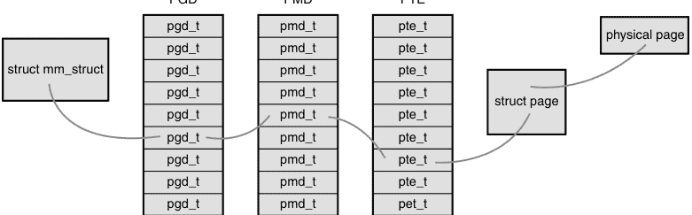

*图 15.1 虚拟到物理地址的查找。*

每个进程都有自己的页表（当然，线程共享它们）。内存描述符的 `pgd` 字段指向进程的页全局目录。操纵和遍历页表需要 `page_table_lock`，该锁位于相关的内存描述符内部。

页表数据结构非常依赖于架构，因此定义在 `<asm/page.h>` 中。

由于几乎每次对虚拟内存页的访问都必须解析为其在物理内存中对应的地址，因此页表的性能至关重要。遗憾的是，在内存中查找所有这些地址的速度有限。为了提高效率，大多数处理器实现了一个*转换后备缓冲区*（translation lookaside buffer），简称 *TLB*。

它充当虚拟地址到物理地址映射的硬件缓存。在访问虚拟地址时，处理器首先检查该映射是否被缓存在 TLB 中。如果命中（hit），则立即返回物理地址。否则，如果未命中（miss），则查询页表以获取相应的物理地址。

尽管如此，页表管理仍然是内核中至关重要且不断演进的部分。2.6 版本在此领域的变更包括从高内存（high memory）中分配部分页表。未来的可能性包括具有写时复制（copy-on-write）语义的共享页表。在这种方案中，页表将在 `fork()` 之后在父进程和子进程之间共享。当父进程或子进程尝试修改特定的页表项时，会创建一个副本，两个进程将不再共享该项。共享页表将消除在 `fork()` 时复制页表项的开销。

## 结论

在这个充满悬念的章节中，我们探讨了提供给每个进程的虚拟内存抽象。我们研究了内核如何表示进程地址空间（通过 `struct mm_struct`）以及内核如何表示该空间内的内存区域（`struct vm_area_struct`）。我们介绍了内核如何创建（通过 `mmap()`）和销毁（通过 `munmap()`）这些内存区域。最后，我们介绍了页表。由于 Linux 是一个基于虚拟内存的操作系统，这些概念对其运行和进程模型至关重要。

下一章将介绍页缓存（page cache），这是一种用于完成所有页 I/O 的通用内存数据缓存，以及内核如何执行基于页的数据回写（writeback）。

## 页缓存与页回写

Linux 内核实现了一个名为*页缓存（page cache）*的磁盘缓存。该缓存的目标是通过将原本需要磁盘访问的数据存储在物理内存中，从而最大限度地减少磁盘 I/O。本章讨论页缓存，以及将页缓存中的更改传播回磁盘的过程，这个过程被称为*页回写（page writeback）*。

两个因素共同作用，使磁盘缓存成为任何现代操作系统的关键组件。首先，磁盘访问速度比内存访问慢几个数量级——毫秒级对比纳秒级。从内存而非磁盘访问数据要快得多，而从处理器的 L1 或 L2 缓存中访问数据则更快。其次，一次被访问的数据在不久的将来很有可能再次被访问。这一原则——即对特定数据的访问倾向于在时间上聚集——被称为*时间局部性（temporal locality）*，它确保了如果数据在首次访问时被缓存，那么在不久的将来产生缓存命中（访问缓存中的数据）的概率很高。鉴于内存比磁盘快得多，加上“用过一次的数据可能被使用第二次”的事实，磁盘的内存缓存带来了巨大的性能提升。

## 缓存方法

页缓存由 RAM 中的物理页组成，其内容与磁盘上的物理块相对应。页缓存的大小是动态的；它可以增长以消耗任何空闲内存，也可以收缩以缓解内存压力。我们将被缓存的存储设备称为*后备存储（backing store）*，因为磁盘作为任何缓存数据的权威版本来源，支撑在缓存之后。每当内核开始读取操作时——例如，当进程发出 `read()` 系统调用时——它首先检查所需数据是否在页缓存中。如果在，内核可以放弃访问磁盘，直接从 RAM 中读取数据。这被称为*缓存命中（cache hit）*。如果数据不在缓存中，称为*缓存未命中（cache miss）*，内核必须调度块 I/O 操作将数据从磁盘读取出来。数据从磁盘读取后，内核会将数据填充到页缓存中，以便随后的任何读取操作都可以直接从缓存中进行。不需要缓存整个文件；页缓存可以完整地持有某些文件，而对其他文件仅存储一两个页面。缓存什么取决于访问了什么。

## 写缓存

上述内容解释了数据如何通过读取操作进入页缓存，但当进程写入磁盘（例如通过 `write()` 系统调用）时会发生什么？一般来说，缓存可以实现三种不同的策略之一。在第一种策略*无写（no-write）*中，缓存根本不缓存写操作。针对存储在缓存中的数据的写操作将直接写入磁盘，从而使缓存的数据失效，并在随后的任何读取操作中需要再次从磁盘读取。缓存很少采用这种策略，因为它不仅无法缓存写操作，而且由于使缓存失效而使其成本高昂。

在第二种策略中，写操作会自动更新内存缓存和磁盘文件。这种方法被称为*写穿缓存（write-through cache）*，因为写操作立即穿过缓存到达磁盘。这种方法的优点是能够保持缓存的一致性——使后备存储同步且有效——而无需使其失效。它而且简单。

Linux 采用的第三种策略称为*回写（write-back）*。¹ 在回写缓存中，进程直接将写操作执行到页缓存中。后备存储不会立即或直接更新。相反，页缓存中被写入的页面被标记为*脏（dirty）*并被添加到*脏列表（dirty list）*中。定期，脏列表中的页面通过一个称为*回写（writeback）*的过程被写回磁盘，使磁盘副本与内存缓存保持一致。然后，这些页面被标记为不再是脏页。“脏”这个词可能会引起混淆，因为实际“脏”的不是页缓存中的数据（它是最新的），而是磁盘上的数据（它是过时的）。一个更好的术语应该是*未同步（unsynchronized）*。尽管如此，我们仍然说缓存内容是脏的，而不是无效的磁盘内容。回写通常被认为优于写穿策略，因为通过延迟写入磁盘，可以将写入操作合并并在稍后时间批量执行。缺点是复杂性。

## 缓存淘汰

缓存的最后一部分是从缓存中删除数据的过程，目的是为更相关的缓存项腾出空间，或者缩小缓存以释放更多 RAM 用于其他用途。这个过程以及决定删除什么的策略被称为*缓存淘汰（cache eviction）*。Linux 的缓存淘汰通过选择*干净（clean）*（非脏）页面并简单地将它们替换为其他内容来工作。如果缓存中没有足够的干净页，内核会强制执行回写以提供更多干净页。难点在于决定淘汰*什么*。理想的淘汰策略是淘汰未来最不可能被使用的页面。当然，知道哪些页面可能会被访问需要预知未来，这就是为什么这种充满希望的策略通常被称为“先知算法”。这样的策略是理想的，但无法实现。

---

¹ 一些书籍或操作系统将这种策略称为 copy-back 或 write-behind 缓存。这三个名称是同义词。Linux 和其他 Unix 系统使用名词 "write-back" 指代缓存策略，使用动词 "writeback" 指代将缓存数据写回后备存储的行为。本书遵循这一用法。

## 最近最少使用

缓存淘汰策略试图利用它们能获取的信息来近似先知算法。其中一个较为成功的算法，特别是对于通用页缓存而言，被称为*最近最少使用*，或 `LRU`。`LRU` 淘汰策略需要跟踪每个页面的访问时间（或者至少按访问时间对页面列表进行排序），并淘汰时间戳最旧的页面（或排序列表开头的页面）。该策略效果良好，因为缓存数据闲置的时间越长，在不久的将来被访问的可能性就越小。“最近最少使用”是对“最可能被使用”的一个极佳近似。然而，`LRU` 策略的一个特定失效场景是，许多文件被访问一次后就再也不被访问。因此，将它们放在 `LRU` 列表的顶部并非最优。当然，像之前一样，内核无法预知一个文件是否只会被访问一次。但它确实知道该文件在过去被访问了多少次。

## 双列表策略

因此，Linux 实现了一个修改版的 `LRU`，称为*双列表策略（two-list strategy）*。Linux 不再维护一个 `LRU` 列表，而是维护两个列表：*活动列表（active list）*和*非活动列表（inactive list）*。活动列表中的页面被认为是“热”的，且不可被淘汰。非活动列表中的页面可用于缓存淘汰。只有当页面在已经存在于非活动列表中时被访问，才会被放入活动列表。两个列表都以伪 `LRU` 的方式维护：元素像队列一样从尾部添加，从头部移除。两个列表保持平衡：如果活动列表比非活动列表大得多，活动列表头部的元素将被移回非活动列表，使其可被淘汰。双列表策略解决了经典 `LRU` 中“仅使用一次”的失效问题，并且使简单的伪 `LRU` 语义能够高效运行。这种双列表方法也被称为 `LRU/2`；它可以被泛化为 n-列表，称为 `LRU/n`。


现在我们知道了页缓存是如何填充的（通过读写），在面对写入时如何同步（通过回写），以及旧数据如何被淘汰以给新数据让路（通过双列表策略）。现在让我们考虑一个真实场景，看看页缓存如何使系统受益。假设你正在处理一个大型软件项目——也许是 Linux 内核——并且打开了许多源文件。当你打开并阅读源代码时，文件被存储在页缓存中。由于数据被缓存，在文件之间跳转是瞬间完成的。当你编辑文件时，保存似乎也是瞬间完成的，因为写入只需要进入内存，而不需要进入磁盘。当你编译项目时，缓存的文件使得编译过程所需的磁盘访问大大减少，因此速度快得多。如果整个源码树太大而无法全部放入内存，其中一部分必须被驱逐——由于采用了双列表策略，任何被驱逐的文件都将位于非活跃列表之外（inactive list），并且很可能不是你正在直接编辑的源文件。随后，希望在你没有进行编译时，内核会执行页面回写（page writeback），并将你所做的任何更改更新到磁盘上的源文件副本中。这种缓存机制显著提升了系统性能。为了观察这种差异，你可以对比一下在“冷缓存”（例如，刚刚重启后）和“热缓存”状态下，编译大型软件项目分别需要多长时间。

## Linux 页缓存 (The Linux Page Cache)

页缓存（page cache），顾名思义，是 RAM 中页面的缓存。这些页面源自对常规文件系统文件、块设备文件和内存映射文件的读取与写入。通过这种方式，页缓存包含了最近访问的文件块。在执行页面 I/O 操作（如`read()`）期间，内核会检查数据是否驻留在页缓存中。如果数据在页缓存中，内核可以快速地从内存中返回请求的页面，而无需从相对较慢的磁盘上读取数据。在本章的其余部分，我们将探讨维护 Linux 页缓存的数据结构和内核设施。

## address_space 对象

页缓存中的一个页面可能由多个不连续的物理磁盘块组成。由于构成每个页面的块具有这种不连续的布局，检查页缓存以确定某些数据是否已被缓存变得十分困难。因此，无法仅使用设备名称和块号来索引页缓存中的数据，尽管那将是最简单的解决方案。

此外，Linux 页缓存能够缓存的页面类型非常通用。事实上，在 System V Release 4 中引入的原始页缓存仅缓存文件系统数据。因此，SVR4 页缓存使用其等同于`inode`的对象（称为`struct vnode`）来管理页缓存。而 Linux 页缓存旨在缓存*任何*基于页面的对象，其中包括多种形式的文件和内存映射。

虽然 Linux 页缓存可以通过扩展`inode`结构（在第 13 章“虚拟文件系统”中讨论）来支持页面 I/O 操作，但这种选择会将页缓存限制在文件范围内。为了维护一个通用的页缓存——一个不绑定于物理文件或 inode 结构的缓存——Linux 页缓存使用一个新的对象来管理缓存项和页面 I/O 操作。这个对象就是`address_space`结构。

可以将`address_space`视为第 15 章“进程地址空间”中引入的虚拟`vm_area_struct`的物理对应物。虽然一个文件可能由 10 个`vm_area_struct`结构表示（例如，五个进程 each `mmap()` 它两次），但该文件只有一个`address_space`结构——正如一个文件可能拥有许多虚拟地址，但在物理内存中仅存在一份一样。与 Linux 内核中的许多其他命名一样，`address_space`的命名有误。一个更好的名称也许是`page_cache_entity`或`physical_pages_of_a_file`。

`address_space`结构定义在`<linux/fs.h>`中：

```c
struct address_space {
    struct inode            *host;              /* owning inode */
    struct radix_tree_root  page_tree;          /* radix tree of all pages */
    spinlock_t               tree_lock;          /* page_tree lock */
    unsigned int             i_mmap_writable;    /* VM_SHARED ma count */
    struct prio_tree_root    i_mmap;             /* list of all mappings */
    struct list_head         i_mmap_nonlinear;   /* VM_NONLINEAR ma list */
    spinlock_t               i_mmap_lock;        /* i_mmap lock */
    atomic_t                 truncate_count;     /* truncate re count */
    unsigned long            nrpages;            /* total number of pages */
    pgoff_t                  writeback_index;    /* writeback start offset */
    struct address_space_operations *a_ops;     /* operations table */
    unsigned long            flags;              /* gfp_mask and error flags */
    struct backing_dev_info  *backing_dev_info;  /* read-ahead information */
    spinlock_t               private_lock;      /* private lock */
    struct list_head         private_list;      /* private list */
    struct address_space     *assoc_mapping;    /* associated buffers */
};
```

`i_mmap`字段是该地址空间中所有共享和私有映射的优先级搜索树（priority search tree）。优先级搜索树是堆（heaps）和基数树（radix trees）的一种巧妙结合。回想之前提到的，虽然一个缓存文件与一个`address_space`结构相关联，但它可以拥有许多`vm_area_struct`结构——这是一个从物理页面到多个虚拟页面的一个到多映射。`i_mmap`字段允许内核高效地找到与该缓存文件相关联的映射。

地址空间中总共有`nrpages`个页面。

`address_space`与某个内核对象相关联。通常，这是一个 inode。如果是这样，`host`字段指向关联的 inode。如果关联对象不是 inode（例如，`address_space`与 swapper 相关联），则`host`字段为 NULL。

## address_space 操作 (address_space Operations)

`a_ops`字段指向地址空间操作表，其方式与 VFS 对象及其操作表相同。操作表由`struct address_space_operations`表示，同样定义在`<linux/fs.h>`中：

```c
struct address_space_operations {
    int (*writepage)(struct page *, struct writeback_control *);
    int (*readpage) (struct file *, struct page *);
    int (*sync_page) (struct page *);
    int (*writepages) (struct address_space *,
               struct writeback_control *);
    int (*set_page_dirty) (struct page *);
    int (*readpages) (struct file *, struct address_space *,
              struct list_head *, unsigned);
    int (*write_begin)(struct file *, struct address_space *mapping,
               loff_t pos, unsigned len, unsigned flags,
               struct page **pagep, void **fsdata);
    int (*write_end)(struct file *, struct address_space *mapping,
              loff_t pos, unsigned len, unsigned copied,
              struct page *page, void *fsdata);
    sector_t (*bmap) (struct address_space *, sector_t);
    int (*invalidatepage) (struct page *, unsigned long);
    int (*releasepage) (struct page *, int);
    int (*direct_IO) (int, struct kiocb *, const struct iovec *,
              loff_t, unsigned long);
    int (*get_xip_mem) (struct address_space *, pgoff_t, int,
                void **, unsigned long *);
    int (*migratepage) (struct address_space *,
                struct page *, struct page *);
    int (*launder_page) (struct page *);
    int (*is_partially_uptodate) (struct page *,
                    read_descriptor_t *,
                    unsigned long);
    int (*error_remove_page) (struct address_space *,
                  struct page *);
};
```

这些函数指针指向为该缓存对象实现页面 I/O 的函数。每个后端存储（backing store）通过其自己的`address_space_operations`描述它如何与页缓存交互。例如，ext3 文件系统在`fs/ext3/inode.c`中定义了其操作。因此，这些函数负责管理页缓存，包括最常见的操作：将页面读入缓存以及更新缓存中的数据。因此，`readpage()`和`writepage()`方法是最重要的。让我们来看看具体步骤

涉及其中的每一个步骤，从页面读取操作开始。首先，Linux 内核尝试在页缓存（page cache）中查找请求的数据。`find_get_page()`方法被用于执行此检查；它接收一个`address_space`和页面偏移量。这些值用于在页缓存中搜索所需的数据：

```
page = find_get_page(mapping, index);
```

这里，`mapping`是给定的`address_space`，`index`是文件中所需的页偏移量。（是的，将`address_space`结构体命名为`mapping`进一步增加了命名上的混乱。为了保持一致性，我沿用了内核的命名，但我并不认同这种做法。）如果页面不存在于缓存中，`find_get_page()`返回 NULL，随后会分配一个新页面并将其添加到页缓存中：

```
struct page *page;
int error;

/* allocate the page ... */
page = page_cache_alloc_cold(mapping);
if (!page)
	/* error allocating memory */

/* ... and then add it to the page cache */
error = add_to_page_cache_lru(page, mapping, index, GFP_KERNEL);
if (error)
	/* error adding page to page cache */
```

最后，请求的数据可以从磁盘读取，添加到页缓存中，并返回给用户：

```
error = mapping->a_ops->readpage(file, page);
```

写操作则略有不同。对于文件映射，每当页面被修改时，VM 简单地调用：

```
SetPageDirty(page);
```

内核随后通过`writepage()`方法将页面写回。针对特定文件的写操作则更为复杂。`mm/filemap.c`中的通用写路径执行以下步骤：

```
page = __grab_cache_page(mapping, index, &cached_page, &lru_pvec);

status = a_ops->prepare_write(file, page, offset, offset+bytes);

page_fault = filemap_copy_from_user(page, offset, buf, bytes);

status = a_ops->commit_write(file, page, offset, offset+bytes);
```


首先，在页缓存中搜索所需页面。如果不在缓存中，则分配并添加一个条目。接下来，内核设置写请求，并将数据从用户空间复制到内核缓冲区。最后，将数据写入磁盘。

由于之前的步骤在所有页面 I/O 操作期间都会执行，因此所有页面 I/O 都保证会经过页缓存。因此，内核尝试通过页缓存满足所有读取请求。如果失败，则将页面从磁盘读入并添加到页缓存中。对于写操作，页缓存充当写的暂存地。因此，所有被写入的页面也会被添加到页缓存中。

## 基数树（Radix Tree）

由于内核在启动任何页面 I/O 之前必须检查页缓存中是否存在该页面，因此这种检查必须足够快。否则，搜索和检查页缓存的开销可能会抵消缓存可能提供的任何好处。（至少在缓存命中率较低的情况下——开销必须极其糟糕才会抵消掉从内存而非磁盘检索数据的优势。）

正如你在前一节中看到的，页缓存是通过`address_space`对象加上一个偏移值来搜索的。每个`address_space`都有一个存储为`page_tree`的唯一基数树。基数树是一种二叉树。基数树使得在仅给定文件偏移量的情况下能够快速搜索所需页面。像`find_get_page()`这样的页缓存搜索函数会调用`radix_tree_lookup()`，后者在给定的树中搜索给定的对象。

核心基数树代码以通用形式提供在`lib/radix-tree.c`中。基数树的用户需要包含`<linux/radix-tree.h>`。

## 旧的页面哈希表

在 2.6 内核之前，页缓存不是通过基数树搜索的。相反，系统维护了一个涵盖所有页面的全局哈希表。该哈希表返回一个双向链表，其中包含所有哈希到相同给定值的条目。如果所需页面在缓存中，链表中的一个项就是相应的页面。否则，该页面不在页缓存中，哈希函数返回`NULL`。

全局哈希存在四个主要问题：

- 单个全局锁保护该哈希表。即使在规模中等的机器上，锁竞争也相当激烈，导致性能下降。
- 哈希表比实际需要的大，因为它包含了页缓存中的所有页面，而实际上只有与当前文件相关的页面才是相关的。
- 当哈希查找失败时（即给定页面不在页缓存中），性能低于预期，尤其是因为必须遍历给定哈希值的链表。
- 哈希表比其他可能的解决方案消耗更多内存。

2.6 中引入的基于基数树的页缓存解决了这些问题。

## 缓冲区缓存（Buffer Cache）

单个磁盘块也通过块 I/O 缓冲区与页缓存相结合。回顾第 14 章“块 I/O 层”，缓冲区（buffer）是单个物理磁盘块在内存中的表示。缓冲区充当描述符，将内存中的页面映射到磁盘块；因此，页缓存通过缓存磁盘块以及暂存块 I/O 操作直到稍后执行，在块 I/O 操作期间同样减少了磁盘访问。这种缓存通常被称为*缓冲区缓存*，尽管在实现上它不是一个独立的缓存，而是页缓存的一部分。

块 I/O 操作一次处理一个磁盘块。一个常见的块 I/O 操作是读取和写入 inode。内核提供了`bread()`函数来执行从磁盘读取单个块的低级读取。通过缓冲区，磁盘块被映射到其关联的内存页面中，并缓存到页缓存中。

缓冲区缓存和页面缓存并不总是统一的；将其统一是 Linux 2.4 内核的一个主要特性。在早期的内核中，存在两个独立的磁盘缓存：页缓存和缓冲区缓存。前者缓存页面，后者缓存缓冲区。这两个缓存没有统一：一个磁盘块可能同时存在于这两个缓存中。这导致了同步两个缓存副本的重复劳动，以及重复缓存项导致的内存浪费。如今，我们只有一个磁盘缓存：页缓存。不过，内核仍然需要使用缓冲区来在内存中表示磁盘块。方便的是，缓冲区描述了块到页面的映射，而该页面正处于页缓存中。

## 刷新线程（Flusher Threads）

写操作在页缓存中被延迟执行。当页缓存中的数据比后备存储（backing store）上的数据更新时，我们将该数据称为*脏数据（dirty）*。积压在内存中的脏页最终需要写回到磁盘。脏页回写发生在三种情况：

- 当空闲内存下降到指定阈值以下时，内核将脏数据写回磁盘以释放内存，因为只有干净的（非脏）内存可用于驱逐。当内存干净时，内核可以将数据从缓存中驱逐，然后缩小缓存，从而释放更多内存。
- 当脏数据的存留时间超过特定阈值时，足够旧的数据将被写回磁盘，以确保脏数据不会无限期地保持脏状态。
- 当用户进程调用`sync()`和`fsync()`系统调用时，内核执行按需回写。

这三个任务的目标相当不同。事实上，在旧内核中由两个独立的内核线程执行此工作（见下一节）。但在 2.6 中，一组⁵ 内核线程（即刷新线程）执行所有这三项工作。

首先，当系统中的空闲内存下降到指定水平以下时，刷新线程需要将脏数据刷回磁盘。这种后台回写的目的是在可用物理内存较低时，回收被脏页占用的内存。开始此过程的内存级别由`dirty_background_ratio` sysctl 配置。当空闲内存低于此阈值时，内核调用`wakeup_flusher_threads()`来唤醒一个或多个刷新线程，并让它们运行`bdi_writeback_all()`函数开始脏页回写。该函数接收一个参数，即尝试回写的页面数量。函数将持续写出数据，直到满足以下两个条件：

- 已写出的页面数量达到了指定的最小值。
- 空闲内存量高于`dirty_background_ratio`阈值。

这些条件确保了刷新线程能够尽其职责缓解低内存状况。只有在刷新线程写回了*所有*脏页且没有其他工作可做时，回写才会在满足这些条件之前停止。

对于第二个目标，刷新线程会定期唤醒（与低内存状况无关）并写出旧的脏页。这样做是为了确保没有脏页在内存中无限期停留。在系统故障期间，由于内存是易失性的，尚未写入磁盘的内存脏页将会丢失。因此，定期将页缓存与磁盘同步至关重要。在系统启动时，会初始化一个定时器来唤醒刷新线程并运行`wb_writeback()`函数。该函数随后会写回所有修改时间超过`dirty_expire_interval`毫秒的数据。然后定时器被重新初始化，在`dirty_writeback_interval`毫秒后再次到期。通过这种方式，刷新线程定期唤醒并将所有超过指定限制的脏页写入磁盘。

系统管理员可以在`/proc/sys/vm`中或通过 sysctl 设置这些值。表 16.1 列出了这些变量。

**表 16.1 页面回写设置**

| 变量 | 描述 |
| :--- | :--- |
| `dirty_background_ratio` | 占总内存的百分比，达到此页面数量时，刷新线程开始回写脏数据。 |
| `dirty_expire_interval` | 以毫秒为单位，数据必须达到多少时长，在刷新线程下次唤醒执行定期回写时才被写出。 |
| `dirty_ratio` | 占总内存的百分比，进程在开始回写脏数据前生成的页面数量。 |
| `dirty_writeback_interval` | 以毫秒为单位，刷新线程应多久唤醒一次将数据写回磁盘。 |
| `laptop_mode` | 控制*笔记本模式*的布尔值。见下一节。 |

***

⁵ “gang”一词在计算机科学中通常用来表示一组可以并行操作的事物。

刷新线程（flusher code）位于`mm/page-writeback.c`和`mm/backing-dev.c`中，而回写机制（writeback mechanism）则位于`fs/fs-writeback.c`中。

## 笔记本模式

*笔记本模式（Laptop mode）*是一种特殊的页面回写策略，旨在通过最大限度地减少硬盘活动并使硬盘尽可能长时间地保持停转，从而优化电池寿命。它可以通过`/proc/sys/vm/laptop_mode`进行配置。默认情况下，该文件包含 0，即笔记本模式被禁用。向该文件写入 1 即可启用笔记本模式。

笔记本模式对页面回写行为做了一项单一的修改。除了在脏页过旧时执行回写外，刷新线程还会“顺带”利用任何其他物理磁盘 I/O 机会，将*所有*脏缓冲区刷新到磁盘。通过这种方式，页面回写利用了磁盘刚刚启动的机会，确保之后不会再次导致磁盘启动。

当`dirty_expire_interval`和`dirty_writeback_interval`被设置为较大的值（例如 10 分钟）时，这种行为变更最为有效。由于回写被大幅延迟，磁盘启动频率降低，而一旦启动，笔记本模式可确保该机会被充分利用。由于关闭磁盘驱动器是节能的重要来源，笔记本模式可以显著提高笔记本电脑在电池供电下的续航时间。其缺点是，系统崩溃或其他故障可能会导致大量数据丢失。

许多 Linux 发行版在切换电池供电和交流电时，会自动启用或禁用笔记本模式，并修改其他回写可调参数。这使得机器在电池供电时能从笔记本模式中受益，并在接通交流电时自动恢复到正常的页面回写行为。

## 历史：`bdflush`、`kupdated` 和 `pdflush`

在 2.6 内核之前，刷新线程的工作由另外两个内核线程承担：*bdflush*和*kupdated*。

`bdflush`内核线程在可用内存较低时执行脏页的后台回写。它维护了一套阈值（类似于现在的刷新线程），每当空闲内存低于这些阈值时，就会通过`kupdate_bdflush()`唤醒`bdflush`。

`bdflush`与当前的刷新线程之间有两个主要区别。第一个区别（将在下一节讨论）是，始终只有一个`bdflush`守护进程，而刷新线程的数量是磁盘主轴数量的函数。第二个区别是`bdflush`是基于缓冲区的（buffer-based）；它回写的是脏缓冲区。相反，刷新线程是基于页面的（page-based）；它们回写的是整个页面。当然，页面可以对应于缓冲区，但实际的 I/O 单位是一个完整的页面而非单个缓冲区。这很有利，因为管理页面比管理缓冲区更容易，因为页面是一个更通用且常见的单位。

由于`bdflush`仅在内存不足或缓冲区数量过多时才刷新缓冲区，因此引入了`kupdated`线程来定期回写脏页。它的作用与`wb_writeback()`函数相同。

在 2.6 内核中，`bdflush`和`kupdated`让位于*pdflush*线程。`pdflush`是*page dirty flush*的缩写（又是这类容易混淆的名称），其运行方式与今天的刷新线程类似。主要区别在于`pdflush`线程的数量是动态的，默认在 2 到 8 个之间，具体取决于系统的 I/O 负载。`pdflush`线程不与任何特定磁盘相关联，而是对系统中的所有磁盘全局可见。这简化了实现，但缺点是`pdflush`很容易在拥塞的磁盘上卡住，而现代硬件很容易引发拥塞。转向按主轴（per-spindle）刷新使得 I/O 能够同步执行，简化了拥塞逻辑并提高了性能。刷新线程在 2.6.32 内核中取代了`pdflush`线程。按主轴刷新是主要区别；本节其余内容同样适用于`pdflush`以及任何 2.6 内核。

## 利用多线程避免拥塞

`bdflush`方案的一个主要缺陷是它仅由一个线程组成。这导致在大量页面回写期间可能会出现拥塞，此时单个`bdflush`线程可能会阻塞在单个拥塞的设备队列（等待提交到磁盘的 I/O 请求列表）上，而其他设备队列则相对闲置。如果系统拥有多个磁盘和相应的处理能力，内核应当让每个磁盘都保持繁忙。不幸的是，即使有大量数据需要回写，`bdflush`仍可能卡在处理单个队列上，而无法使所有磁盘饱和。这是因为磁盘的吞吐量是一个有限的——且不幸的是相对较小的——数值。如果只有一个线程执行页面回写，由于磁盘吞吐量是极大的限制因素，该线程很容易在单个磁盘上等待很长时间。为了缓解这个问题，内核需要对页面回写进行多线程化。通过这种方式，任何单个设备队列都不会成为瓶颈。

2.6 内核通过允许存在多个刷新线程解决了这个问题。每个线程独立地将脏页刷新到磁盘，允许不同的刷新线程专注于不同的设备队列。在`pdflush`线程模式下，线程数量是动态的，每个线程尝试通过从每个超级块（per-superblock）的脏列表中抓取数据并将其回写到磁盘来保持繁忙。`pdflush`方法防止了单个繁忙磁盘导致其他磁盘饥饿。这很好，但如果每个`pdflush`线程都卡在同一个拥塞队列的写入上怎么办？在这种情况下，多个`pdflush`线程的性能将不会比单个线程有所提升，而内存消耗却会显著增加。为了减轻这种影响，`pdflush`线程采用了拥塞避免机制：它们积极尝试回写那些队列未拥塞的页面。结果，`pdflush`线程分散了工作，避免仅仅猛攻同一个繁忙设备。

这种方法效果相当不错，但拥塞避免并不完美。在现代系统中，拥塞很容易产生，因为 I/O 总线技术提升的速度慢于计算机的其他部分——处理器根据摩尔定律不断加速，但硬盘比二十年前仅快了那么一点点。此外，除了`pdflush`之外，I/O 系统的其他部分都没有采用拥塞避免机制。因此，在某些情况下，`pdflush`避免在特定磁盘上回写的时间可能会远超预期。在`2.6.32`引入的当前刷新线程模型中，线程与块设备相关联，因此每个线程从其对应的块设备脏列表中抓取数据并回写到其磁盘。因此，回写是同步的，并且由于每个磁盘对应一个线程，不再需要复杂的拥塞避免机制。这种方法提高了公平性并降低了饥饿风险。

得益于页面回写的改进（从引入`pdflush`开始，到随后的刷新线程），`2.6`内核能够比任何早先的内核使更多数量的磁盘保持饱和。在面对繁重活动时，刷新线程可以在多个磁盘上维持高吞吐量。

## 总结

本章探讨了 Linux 的页面缓存（page cache）和页面回写（page writeback）。我们看到了内核如何通过页面缓存执行所有页面 I/O，以及页面缓存如何通过在内存中存储数据，通过减少磁盘 I/O 量来显著提高系统性能。我们讨论了写操作如何通过一种称为“回写缓存”的过程在页面缓存中维护，该过程将页面在内存中保持为“脏”状态，并延迟将数据写回磁盘。内核线程组成的刷新“帮”负责处理最终的页面回写。

在过去的几章中，我们对内存和文件系统管理建立了深刻的理解。现在，让我们转向设备驱动程序和模块的话题，看看 Linux 内核如何为内核代码的运行时插入和移除提供模块化且动态的基础设施。

## 设备与模块

在本章中，我们将讨论与设备驱动程序和设备管理相关的四个内核组件：

- 设备类型——所有 Unix 系统中用于统一通用设备行为的分类
- 模块——Linux 内核根据需要加载和卸载对象代码的机制
- 内核对象——为内核数据结构添加简单的面向对象行为和父/子关系的支持
- Sysfs——系统设备树的文件系统表示

## 设备类型

在 Linux 中，与所有 Unix 系统一样，设备被分为三种类型之一：

- 块设备
- 字符设备
- 网络设备

块设备通常简写为*blkdevs*，可以在设备指定的块（称为*blocks*）中进行寻址，并且通常支持*seeking*（数据的随机访问）。块设备的示例包括硬盘、蓝光光盘以及闪存等存储设备。块设备通过一个名为*块设备节点*的特殊文件进行访问，并且通常被挂载为文件系统。我们将在第 13 章“虚拟文件系统”中讨论文件系统，在第 14 章“块 I/O 层”中讨论块设备。

字符设备通常简写为*cdevs*，通常不可寻址，仅以流的形式提供对数据的访问，通常是字符（字节）流。字符设备的示例包括键盘、鼠标、打印机和大多数伪设备。字符设备通过一个名为*字符设备节点*的特殊文件进行访问。与块设备不同，应用程序直接通过设备节点与字符设备交互。

由于最常见的网络设备类型是以太网，因此网络设备有时被称为`Ethernet`设备。

Linux 还提供了少量其他设备类型，但它们专注于单一任务且并不常见。一个例外是*杂项设备*（通常简写为*miscdevs*），它们实际上是字符设备的简化形式。杂项设备允许设备驱动程序作者轻松地表示简单设备，以牺牲功能为代价换取通用的基础设施。

并非所有设备驱动程序都代表物理设备。一些设备驱动程序是*虚拟的*，提供对内核功能的访问。我们称这些为*伪设备*；其中最常见的一些包括*内核随机数生成器*（可通过`/dev/random`和`/dev/urandom`访问）、空设备（可通过`/dev/null`访问）、*零设备*（可通过`/dev/zero`访问）、*满设备*（可通过`/dev/full`访问）以及*内存设备*（可通过`/dev/mem`访问）。然而，大多数设备驱动程序代表物理硬件。

## 模块

尽管 Linux 内核在某种意义上是“单体”的（即整个内核运行在单个地址空间中），但它是模块化的，支持在运行时动态地向自身插入和删除代码。相关的子程序、数据以及入口点和出口点被分组在一个单一的二进制镜像中，这种可加载的内核对象被称为*模块*。对模块的支持允许系统仅拥有一个极小的基础内核镜像，而可选的功能和驱动程序通过可加载的独立对象提供。模块还允许删除和重新加载内核代码，方便调试，并允许根据新设备的热插拔需求按需加载新驱动程序。

本章将探讨内核模块背后的奥秘，以及你如何编写自己的模块。

### Hello, World!

与内核核心子系统的开发（这是到目前为止讨论的大部分内容）不同，模块开发更像是在编写一个新的应用程序，至少在模块具有入口点和出口点且存在于独立文件中的意义上是如此。

虽然这可能很陈词滥调，但如果有机会写一个*Hello, World!*的机会却不抓住它，那将是一种损失。这是一个*Hello, World!*内核模块：

```c
/*
 * hello.c - The Hello, World! Kernel Module
 */

#include <linux/init.h>
#include <linux/module.h>
#include <linux/kernel.h>

/*
 * hello_init - the init function, called when the module is loaded.
 * Returns zero if successfully loaded, nonzero otherwise.
 */

static int hello_init(void)
{
        printk(KERN_ALERT "I bear a charmed life.\n");
        return 0;
}

/*
 * hello_exit - the exit function, called when the module is removed.
 */

static void hello_exit(void)
{
```


```
printk(KERN_ALERT "Out, out, brief candle!\n");
}

module_init(hello_init);
module_exit(hello_exit);
MODULE_LICENSE("GPL");
MODULE_AUTHOR("Shakespeare");
MODULE_DESCRIPTION("A Hello, World Module");
```

这是一个尽可能简单的内核模块。`hello_init()` 函数通过 `module_init()` 被注册为该模块的入口点。当模块被加载时，内核会调用 `hello_init()`。对 `module_init()` 的调用实际上不是一个函数调用，而是一个宏，它将唯一的参数指定为该模块的初始化函数。所有初始化函数必须具有以下形式：

```c
int my_init(void);
```

由于初始化函数通常不被外部代码直接调用，因此你不需要将该函数导出到文件级范围之外，可以将其标记为 `static`。

初始化函数返回一个 `int`。如果初始化（或你的初始化函数所做的任何操作）成功，函数必须返回零。如果失败，函数必须撤销任何已完成的初始化并返回非零值。

这个初始化函数仅仅打印一条简单的消息并返回零。在实际的模块中，初始化函数会注册资源、初始化硬件、分配数据结构等等。如果这个文件被静态编译到内核镜像中，初始化函数将被存储在内核镜像中并在内核启动时运行。

`module_exit()` 函数注册模块的出口点。在本例中，我们注册了 `hello_exit()` 函数。当模块从内存中移除时，内核会调用出口点。出口函数在返回前可能会释放资源、关闭并重置硬件，以及执行其他清理工作。简单来说，出口函数负责撤销 `init` 函数和模块生命周期内所做的一切——本质上是在模块退出后进行清理。出口函数返回后，模块被卸载。

出口函数必须具有以下形式：

```c
void my_exit(void);
```

与 `init` 函数一样，你可能希望将其标记为 `static`。

如果这个文件被编译到静态内核镜像中，出口函数将*不会*被包含在内，也*永远不会*被调用，因为如果它不是一个模块，代码就永远无法从内存中移除。

`MODULE_LICENSE()` 宏指定了该文件的版权许可。将非 GPL 模块加载到内存中会导致内核中的 tainted（污染）标志被设置。版权许可有两个目的。首先，它是用于提供信息的；当 oops 中设置了 tainted 标志时，许多内核开发者会对 Bug 报告的信任度降低，因为他们认为内核中加载了一个仅提供二进制文件的模块（即他们无法调试的模块）。其次，非 GPL 模块不能调用仅限 GPL 的符号。我们将在本章后面的“导出符号”部分讨论仅限 GPL 的符号。

最后，`MODULE_AUTHOR()` 和 `MODULE_DESCRIPTION()` 宏分别提供模块的作者和模块的简短描述。这些宏的值完全是信息性的。

## 构建模块

在 2.6 内核中，得益于新的 *kbuild* 构建系统，构建模块比之前的版本更容易。构建模块时的第一个决定是决定模块源码存放在哪里。你可以将模块源码添加到内核源码本身中，无论是通过补丁还是最终将代码合并到官方树中。或者，你可以在源码树之外维护和构建你的模块源码。

### 存放在源码树中

理想情况下，你的模块是 Linux 的正式组成部分，因此存放在内核源码树中。将你的工作纳入内核本身最初可能需要更多工作，但这是首选路径，因为当你的代码在 Linux 内核中时，整个内核社区都可以帮助维护和调试它。

当你决定将模块放在内核源码树中时，下一步是决定模块存放在树中的*哪个位置*。驱动程序存储在内核源码树根目录下 `drivers/` 目录的子目录中。在 `drivers/` 内部，驱动程序根据类、类型和具体设备进一步组织。例如，字符设备驱动程序位于 `drivers/char/`，块设备驱动程序位于 `drivers/block/`，USB 设备驱动程序位于 `drivers/usb/`。这些规则是灵活的，因为许多设备属于多个类别——例如，许多 USB 设备也是字符设备，但它们驻留在 `drivers/usb/` 而不是 `drivers/char/`。尽管有这些复杂之处，但一旦你熟悉之后，这种组织方式是非常易懂且具有描述性的。

假设你有一个字符设备，并希望将其存储在 `drivers/char/` 中。该目录下有许多 C 源文件和少量的其他目录。只有一两个源文件的驱动程序可以直接将源文件放在此目录中。具有多个源文件或其他随附数据的驱动程序则可以创建一个新的子目录。这并没有死板的规定。假设你想创建自己的子目录。我们进一步假设你的驱动程序是为一个带有计算机接口的钓鱼竿（Fish Master XL 3000）设计的，因此你需要在 `drivers/char/` 内部创建一个 `fishing` 子目录。

接下来，你需要向 `drivers/char/` 中的 Makefile 添加一行。因此，你编辑 `drivers/char/Makefile` 并添加：

```makefile
obj-m += fishing/
```

这会导致构建系统在编译模块时，每次都进入 `fishing/` 子目录。更常见的情况是，你的驱动程序编译取决于一个特定的配置选项；例如，可能是 `CONFIG_FISHING_POLE`（关于如何添加新配置选项，请参阅本章稍后出现的“管理配置选项”节）。在这种情况下，你应该添加以下行：

```makefile
obj-$(CONFIG_FISHING_POLE) += fishing/
```

最后，在 `drivers/char/fishing/` 内部，你添加一个包含以下行的新 Makefile：

```makefile
obj-m += fishing.o
```

现在，构建系统进入 `fishing/` 并从 `fishing.c` 构建模块 `fishing.ko`。是的，令人困惑的是，你写的是 `.o` 扩展名，但模块被编译为 `.ko`。和之前一样，你的钓鱼竿驱动程序的编译更有可能取决于一个配置选项。因此，你可能想写成：

```makefile
obj-$(CONFIG_FISHING_POLE) += fishing.o
```

有一天，你的钓鱼竿驱动程序可能会变得非常复杂——钓鱼线测试的自动检测就是最新的“必备功能”！——以至于它扩展到占用多个源文件。没问题，钓鱼客们！你只需将 Makefile 修改为如下内容：

```makefile
obj-$(CONFIG_FISHING_POLE) += fishing.o
fishing-objs := fishing-main.o fishing-line.o
```

现在，只要设置了 `CONFIG_FISHING_POLE`，`fishing-main.c` 和 `fishing-line.c` 就会被编译并链接到 `fishing.ko` 中。

最后，你可能需要在构建过程中，仅为你的文件向 C 编译器传递额外的编译标志。为此，只需在 Makefile 中添加如下一行：

```makefile
EXTRA_CFLAGS += -DTITANIUM_POLE
```

如果你选择将源文件放在 `drivers/char/` 中而没有创建新子目录，你只需将上述行（即你放在 `drivers/char/fishing/` Makefile 中的内容）放入 `drivers/char/Makefile` 中即可。

要进行编译，照常运行内核构建过程。如果你的模块构建取决于一个配置选项（如 `CONFIG_FISHING_POLE`），请在开始前确保该选项已启用。

## 外部构建（Living Externally）

如果你更喜欢在内核源码树之外维护和构建你的模块，像个“局外人”一样生活，只需在自己的源码目录中创建一个包含这一行的 Makefile：

```makefile
obj-m := fishing.o
```

这将把 `fishing.c` 编译成 `fishing.ko`。如果你的源码跨越多个文件，两行就足够了：

```makefile
obj-m := fishing.o
fishing-objs := fishing-main.o fishing-line.o
```

这个示例将 `fishing-main.c` 和 `fishing-line.c` 编译成 `fishing.ko`。

外部构建的主要区别在于构建过程。因为你的模块位于内核树之外，你需要指示 `make` 如何找到内核源码文件和基础 Makefile。这也很简单：

```bash
make -C /kernel/source/location SUBDIRS=$PWD modules
```

在这个示例中，`/kernel/source/location` 是你配置好的内核源码树的位置。请记住，你不应该将内核源码树的工作副本存储在 `/usr/src/linux` 中，而应该存储在主目录中某个容易访问的其他位置。

## 安装模块

编译后的模块被安装到 `/lib/modules/version/kernel/` 中，其中 `kernel/` 下的每个目录都对应于模块在内核源码树中的位置。例如，对于 2.6.34 版本的内核，如果你将钓鱼竿模块直接放在 `drivers/char/` 中，编译后的模块将位于 `/lib/modules/2.6.34/kernel/drivers/char/fishing.ko`。

以下构建命令用于将编译后的模块安装到正确的位置：

```bash
make modules_install
```

此命令需要以 root 身份运行。

## 生成模块依赖关系

Linux 模块实用程序能够理解依赖关系。这意味着模块 `chum` 可以依赖于模块 `bait`，当你加载 `chum` 模块时，模块加载器会自动加载 `bait` 模块。这种依赖信息必须被生成。大多数 Linux 发行版会自动生成该映射并在每次启动时保持更新。要构建模块依赖信息，只需以 root 身份运行：

```bash
depmod
```

要执行快速更新（仅重建比依赖信息更新的模块的信息），请以 root 身份运行：

```bash
depmod -A
```

模块依赖信息存储在以下文件中：

```
/lib/modules/*version*/modules.dep
```

## 加载模块

加载模块最简单的方法是通过 `insmod`。这个实用程序非常基础，它只是请求内核加载你指定的模块。`insmod` 程序不执行任何依赖解析或高级错误检查。其用法极其简单。以 root 身份运行此命令：

```bash
insmod module.ko
```

这里，`module.ko` 是你想要加载的模块的文件名。要加载钓鱼竿模块，你将以 root 身份运行此命令：

```bash
insmod fishing.ko
```

同样地，要移除模块，可以使用 `rmmod` 实用程序。以 root 身份运行以下命令，其中 *module* 是一个已加载模块的名称：

```bash
rmmod module
```

例如，此命令移除钓鱼竿模块：

```bash
rmmod fishing
```

然而，这些实用程序并不智能。`modprobe` 实用程序提供了依赖解析、错误检查和报告、可配置行为以及更多高级功能。强烈建议使用它。

要通过 `modprobe` 将模块插入内核，请以 root 身份运行：

```bash
modprobe module [ module parameters ]
```

这里，*module* 是要加载的模块名称。随后的任何参数都被视为在加载时传递给模块的参数。关于模块参数的讨论，请参阅“模块参数”节。

`modprobe` 命令不仅尝试加载请求的模块，还尝试加载该模块所依赖的所有模块。因此，它是加载内核模块的首选机制。

`modprobe` 命令也可用于从内核中移除模块。要移除模块，请以 root 身份运行：

```bash
modprobe -r modules
```

这里，*modules* 指定要移除的一个或多个模块。与 `rmmod` 不同，如果给定模块所依赖的任何模块不再被使用，`modprobe` 也会将它们移除。Linux 手册页的第 8 节提供了关于其其他较少使用选项的参考。

## 管理配置选项

本章的前一节讨论了仅在设置了 `CONFIG_FISHING_POLE` 配置选项时才编译钓鱼竿模块。之前的章节也讨论过配置选项，但现在让我们继续以钓鱼竿设备驱动程序为例，看看如何实际添加一个新选项。

得益于 2.6 内核中的新 “kbuild” 系统，添加新配置选项变得很简单。你唯一需要做的就是向负责内核源码树适用分支的 Kconfig 文件中添加一个条目。对于驱动程序，这通常是源文件所在的目录。如果钓鱼竿驱动程序位于 `drivers/char/` 中，则使用 `drivers/char/Kconfig`。

如果你*创建*了一个新子目录并希望在那里放置一个新的 Kconfig 文件，你需要从现有的 Kconfig 中引用它。你可以通过在现有 Kconfig 文件中添加如下一行来实现：

```
source "drivers/char/fishing/Kconfig"
```

在这个示例中，你会将此行添加到 `drivers/char/Kconfig`。

Kconfig 中的条目很容易添加。我们的钓鱼竿模块看起来像这样：

```
config FISHING_POLE
    tristate "Fish Master 3000 support"
    default n
    help
    If you say Y here, support for the Fish Master 3000 with computer
    interface will be compiled into the kernel and accessible via a
    device node. You can also say M here and the driver will be built as a
    module named fishing.ko.
    If unsure, say N.
```

第一行定义了该条目代表哪个配置选项。请注意，`CONFIG_` 前缀是默认的，*不需要*写出。

第二行声明该选项是一个 *tristate*，这意味着它可以被编译进内核 (Y)、编译为模块 (M) 或完全不编译 (N)。如果要移除编译为模块的选项——例如，如果该选项代表一个功能而非设备驱动程序——请使用 `bool` 指令代替 `tristate`。指令后的引号文本提供了该选项在各种配置实用程序中的名称。

第三行指定该选项的默认值，此处为不编译 (`n`)。你也可以将其指定为编译进内核 (`y`) 或编译为模块 (`m`)。对于设备驱动程序，默认值通常是不编译 (`n`)。

`help` 指令表示后续缩进的其余部分是该条目的帮助文本。各种配置工具可以在请求时显示此文本。由于这段文本是面向构建自定义内核的开发者的，因此它可以写得简洁且具有技术性。最终用户通常不构建内核，而且如果他们这样做，推测他们也能理解配置帮助。

此外还有其他选项。`depends` 指令指定了在设置此选项之前必须设置的选项。如果依赖项未满足，则该选项被禁用。例如，如果你在 Kconfig 条目中添加以下指令，那么直到 `CONFIG_FISH_TANK` 选项被启用之前，该设备驱动程序都不能被启用（Y 或 m）：

```
depends on FISH_TANK
```

`select` 指令类似于 `depends`，不同之处在于如果我们的选项被选中，它会强制启用给定的选项。`select` 指令的使用频率不应像 `depends` 那么高，因为它会自动启用其他配置选项。以下行在 `CONFIG_FISHING_POLE` 被启用时，会同时启用 `CONFIG_BAIT`：

```
select BAIT
```

对于 `select` 和 `depends`，你可以通过 `&&` 请求多个选项。对于 `depends`，你还可以通过在选项前加上感叹号来指定某个选项不被启用。例如：

```
depends on EXAMPLE_DRIVERS && !NO_FISHING_ALLOWED
```

这一行指定了该驱动程序依赖于 `CONFIG_EXAMPLE_DRIVERS` 被设置且 `CONFIG_NO_FISHING_ALLOWED` 未被设置。

`tristate` 和 `bool` 选项后面可以跟 `if` 指令，这使得整个选项依赖于另一个配置选项。如果条件不满足，该配置选项不仅会被禁用，而且不会出现在配置工具中。例如，此指令指示配置系统仅在 `CONFIG_OCEAN` 被设置时才显示一个选项。在这里，深海模式（deep sea mode）仅在 `CONFIG_OCEAN` 启用时可用：

```
bool "Deep Sea Mode" if OCEAN
```


`if` 指令也可以跟在 `default` 指令之后，仅在满足条件时强制执行默认值。

配置系统导出了一些元选项以帮助简化配置。仅在用户指定他们希望看到旨在禁用关键功能的选项（推测是为了在嵌入式系统上节省宝贵的内存）时，`CONFIG_EMBEDDED` 选项才会被启用。`CONFIG_BROKEN_ON_SMP` 选项用于指定一个非 SMP 安全的驱动程序。通常此选项不被设置，强制用户显式承认其损坏状态。当然，新驱动程序不应使用此标志。`CONFIG_DEBUG_KERNEL` 选项允许选择与调试相关的选项。最后，`CONFIG_EXPERIMENTAL` 选项用于标记实验性或处于 beta 质量的选项。该选项默认为关闭，再次强制用户在启用你的驱动程序之前显式承认风险。

## 模块参数

Linux 内核提供了一个简单的框架，使驱动程序能够声明参数，用户可以在启动或加载模块时指定这些参数，然后这些参数在驱动程序中作为全局变量公开。这些模块参数也会出现在 sysfs 中（见本章后面）。因此，创建和管理可以通过多种便捷方式指定的模块参数变得非常简单。

定义模块参数是通过宏 `module_param()` 完成的：

```c
module_param(name, type, perm);
```

这里，`name` 是公开给用户的参数名称，也是模块内部持有该参数的变量名称。`type` 参数持有参数的数据类型；它是 `byte`、`short`、`ushort`、`int`、`uint`、`long`、`ulong`、`charp`、`bool` 或 `invbool` 之一。这些类型分别是：字节、短整型、无符号短整型、整型、无符号整型、长整型、无符号长整型、指向 `char` 的指针、布尔值，以及一个值与用户指定值相反的布尔值。`byte` 类型存储在一个单一的 `char` 中，布尔类型存储在 `int` 类型的变量中。其余的则存储在相应的 C 语言原生类型中。最后，`perm` 参数指定 sysfs 中相应文件的权限。权限可以用通常的八进制格式指定，例如 `0644`（所有者可读写，组可读，其他所有人可读），或者通过将通常的 `S_Ifoo` 定义进行按位或运算，例如 `S_IRUGO | S_IWUSR`（所有人可读；用户也可写）。值为零则完全禁用 sysfs 条目。

该宏不会为你声明变量。你必须在调用宏 *之前* 完成声明。因此，典型的用法可能类似于：

```c
/* 控制鱼竿上是否允许使用活饵的模块参数 */
static int allow_live_bait = 1;                    /* 默认为开启 */
module_param(allow_live_bait, bool, 0644);          /* 布尔类型 */
```

这段代码应位于模块源文件的最外层作用域。换句话说，`allow_live_bait` 对该文件是全局的。

内部变量的名称可以与外部参数不同。这可以通过 `module_param_named()` 实现：

```c
module_param_named(name, variable, type, perm);
```

这里，`name` 是外部可见的参数名称，而 `variable` 是内部全局变量的名称。例如：

```c
static unsigned int max_test = DEFAULT_MAX_LINE_TEST;
module_param_named(maximum_line_test, max_test, int, 0);
```

通常，你会使用 `char*` 类型来定义一个接收字符串的模块参数。内核将用户提供的字符串复制到内存中，并将你的变量指向该字符串。例如：

```c
static char *name;
module_param(name, charp, 0);
```

如果需要，也可以让内核将字符串直接复制到你提供的字符数组中。这通过 `module_param_string()` 实现：

```c
module_param_string(name, string, len, perm);
```

这里，`name` 是外部参数名称，`string` 是内部变量名称，`len` 是由 `string` 命名的缓冲区的长度（或更小的尺寸，但这没有太大意义），`perm` 是 sysfs 权限（或零以完全禁用 sysfs 条目）。例如：

```c
static char species[BUF_LEN];
module_param_string(specifies, species, BUF_LEN, 0);
```

你可以通过 `module_param_array()` 接收存储在 C 数组中的以逗号分隔的参数列表：

```c
module_param_array(name, type, nump, perm);
```

这里，`name` 同样是外部参数和内部变量名称，`type` 是数据类型，`perm` 是 sysfs 权限。新参数 `nump` 是一个指向整型的指针，内核在此存储存入数组的条目数量。请注意，`name` 指向的数组必须是静态分配的。内核在编译时确定数组的大小并确保不会导致越界。使用非常简单，例如：

```c
static int fish[MAX_FISH];
static int nr_fish;
module_param_array(fish, int, &nr_fish, 0444);
```

你可以使用 `module_param_array_named()` 将内部数组命名为与外部参数不同的名称：

```c
module_param_array_named(name, array, type, nump, perm);
```

其参数与其它宏相同。

最后，你可以使用 `MODULE_PARM_DESC()` 为你的参数编写文档：

```c
static unsigned short size = 1;
module_param(size, ushort, 0644);
MODULE_PARM_DESC(size, "The size in inches of the fishing pole.");
```

所有这些宏都需要包含 `<linux/module.h>`。

## 导出符号

当模块加载时，它们被动态链接到内核中。与用户空间一样，动态链接的二进制文件只能调用显式导出供使用的外部函数。在内核中，这通过名为 `EXPORT_SYMBOL()` 和 `EXPORT_SYMBOL_GPL()` 的特殊指令来处理。

导出的函数可供模块使用。未导出的函数不能从模块中调用。对于模块来说，链接和调用规则比内核核心镜像中的代码要严格得多。核心代码可以调用内核中任何非静态接口，因为所有核心源文件都被链接到单个基础镜像中。当然，导出的符号也必须是非静态的。这组导出的内核符号被称为 *导出内核接口*。

导出符号很简单。在函数声明之后，通常紧随一个 `EXPORT_SYMBOL()`。例如：

```c
/*
 * get_pirate_beard_color - 返回当前海盗胡须的颜色。
 * @pirate 是指向海盗结构的指针
 * 颜色在 <linux/beard_colors.h> 中定义。
 */
int get_pirate_beard_color(struct pirate *p)
{
        return p->beard.color;
}
EXPORT_SYMBOL(get_pirate_beard_color);
```

假设 `get_pirate_beard_color()` 也在一个可访问的头文件中声明，那么任何模块现在都可以访问它。

一些开发者希望他们的接口仅对符合 GPL 协议的模块可见。内核链接器通过使用 `MODULE_LICENSE()` 指令来强制执行此限制。如果你希望之前的函数仅对标记为 GPL 许可的模块可见，请改用：

```c
EXPORT_SYMBOL_GPL(get_pirate_beard_color);
```

如果你的代码可以配置为模块，你必须确保当它被编译为模块时，它所使用的所有接口都被导出了。否则会导致链接错误（以及模块损坏）。

## 设备模型

Linux 2.6 内核的一个重大新特性是增加了统一的 *设备模型*。设备模型提供了一种单一的机制来表示设备并描述它们在系统中的拓扑结构。这样一个系统提供了多项好处：

- 减少代码重复
- 提供公共设施（如引用计数）的机制
- 能够枚举系统中的所有设备，查看其状态，并查看它们连接到哪个总线
- 能够生成系统整个设备结构的完整且有效的树，包括所有总线和互连
- 能够将设备与其驱动程序相互链接
- 能够根据设备的类别（如输入设备）对其进行分类，而无需理解物理设备拓扑
- 能够从叶子节点向上遍历设备树直到根节点，从而按正确的顺序关闭设备电源

设备模型的最初动力就在于最后一点：提供一个准确的设备树以方便电源管理。为了在内核中实现设备级的电源管理，你需要构建一棵代表系统中设备拓扑的树：例如，哪个驱动器连接到哪个控制器，哪个设备连接到哪个总线。在关闭电源时，内核必须在关闭高层节点之前，先关闭树的底层（叶子）节点。例如，内核需要在关闭 USB 控制器之前关闭 USB 鼠标，并且必须在关闭 PCI 总线之前关闭 USB 控制器。为了在整个系统中准确且高效地完成此操作，内核需要一棵设备树。

## Kobjects

设备模型的核心是 *kobject*（*kernel object* 的缩写，即内核对象），它由 `struct kobject` 表示，并在 `<linux/kobject.h>` 中定义。kobject 类似于 C# 或 Java 等面向对象语言中的 `Object` 类。它提供了基础设施，如引用计数、名称和父指针，从而能够创建对象层次结构。

话不多说，直接看代码：

```c
struct kobject {
    const char         *name;
    struct list_head   entry;
    struct kobject     *parent;
    struct kset        *kset;
    struct kobj_type    *ktype;
    struct sysfs_dirent *sd;
    struct kref        kref;
    unsigned int        state_initialized:1;
    unsigned int        state_in_sysfs:1;
    unsigned int        state_add_uevent_sent:1;
    unsigned int        state_remove_uevent_sent:1;
    unsigned int        uevent_suppress:1;
};
```

`name` 指针指向该 kobject 的名称。

父指针指向该 kobject 的父对象。通过这种方式，kobject 在内核中构建起对象层次结构，并能够表达多个对象之间的关系。正如你将看到的，sysfs 实际上就是这样一个东西：它是内核内部 kobject 对象层次结构在用户空间文件系统中的表现形式。

`sd` 指针指向一个 `sysfs_dirent` 结构，该结构代表 sysfs 中的这个 kobject。在这个结构内部是一个 inode 结构，代表 sysfs 文件系统中的该 kobject。

`kref` 结构提供引用计数。`ktype` 和 `kset` 结构用于描述和分组 kobject。我们将在接下来的两个小节中讨论它们。

kobject 通常被嵌入在其他结构中，它们本身通常没什么意义。相反，一个更重要的结构，例如在 `<linux/cdev.h>` 中定义的 `struct cdev`，拥有一个 `kobj` 成员：

```c
/* cdev structure - object representing a character device */
struct cdev {
    struct kobject        kobj;
    struct module         *owner;
    const struct file_operations *ops;
    struct list_head      list;
    dev_t                 dev;
    unsigned int          count;
};
```

当 kobject 嵌入在其他结构中时，这些结构就获得了 kobject 提供的标准化功能。最重要的是，结构中嵌入的 kobject 现在使得该结构能够成为对象层次结构的一部分。例如，`cdev` 结构可以通过父指针 `cdev->kobj.parent` 和列表 `cdev->kobj.entry` 在对象层次结构中呈现。

## Ktypes

kobject 与一个特定的类型相关联，称为 `ktype`（*kernel object type* 的缩写）。ktype 由 `struct kobj_type` 表示，并在 `<linux/kobject.h>` 中定义：

```c
struct kobj_type {
    void (*release)(struct kobj *);
    const struct sysfs_ops  *sysfs_ops;
    struct attribute      **default_attrs;
};
```

ktype 的工作很简单，即为一组 kobject 描述默认行为。与其让每个 kobject 定义自己的行为，不如将行为存储在 ktype 中，相同“类型”的 kobject 指向同一个 `ktype` 结构，从而共享相同的行为。

`release` 指针指向当 kobject 的引用计数达到零时被调用的析构函数。该函数负责释放与此 kobject 关联的任何内存并进行清理。

`sysfs_ops` 变量指向一个 `sysfs_ops` 结构。该结构描述了 sysfs 文件在读取和写入时的行为。这在“向 sysfs 添加文件”一节中会有更详细的介绍。

最后，`default_attrs` 指向一个 `attribute` 结构数组。这些结构定义了与此 kobject 关联的默认 `attributes`（属性）。属性代表与给定对象相关的特性。如果此 kobject 被导出到 sysfs，这些属性将作为文件导出。数组的最后一项必须为 `NULL`。

## Ksets

*Ksets*（*kernel object sets* 的缩写，即内核对象集）是 kobject 的聚合集合。kset 作为一组内核对象的基类容器，将相关的 kobject（例如“所有块设备”）收集在同一个地方。kset 听起来可能与 ktype 相似，从而引发疑问：“为什么两者都要有？”kset 将相关的内核对象分组在一起，而 ktype 则使内核对象（无论功能是否相关）能够共享通用操作。保留这种区别是为了允许具有相同 ktype 的 kobject 被分到不同的 kset 中。也就是说，在 Linux 内核中，ktype 只有少数几个，但 kset 却有很多。

`kset` 指针指向 kobject 关联的 kset。kset 由 `kset` 结构表示，该结构在 `<linux/kobject.h>` 中声明：

```c
struct kset {
    struct list_head    list;
    spinlock_t          list_lock;
    struct kobject      kobj;
    struct kset_uevent_ops *uevent_ops;
};
```


在这个结构中，`list` 是该 kset 中所有 kobject 的链表，`list_lock` 是保护该链表项的自旋锁（有关自旋锁的讨论请参阅第 10 章“内核同步方法”），`kobj` 是代表该集合基类的 kobject，而 `uevent_ops` 指向一个描述该 kset 中 kobject 热插拔行为的结构。Uevent（*user events* 的缩写，即用户事件）是一种向用户空间传递关于系统设备热插拔和热移除信息的机制。

## Kobjects、Ktypes 和 Ksets 的相互关系

到目前为止讨论的这几个结构之所以令人困惑，并不是因为数量多（只有三个）或复杂度高（它们都相当简单），而是因为它们互相关联。在 kobject 的世界里，很难在不讨论其他结构的情况下讨论其中一个。然而，在涵盖了每个结构的基础知识后，你可以对它们的关系建立牢固的理解。

核心对象是 kobject，由 `struct kobject` 表示。kobject 为内核数据结构引入了基础的对象属性——如引用计数、父子关系和命名。`kobject` 结构以一种标准统一的方式提供这些功能。kobject 本身并没有特别大的用处，相反，kobject 通常被嵌入在其他数据结构中，从而赋予包含它们的结构以 kobject 的特性。

kobject 与一个特定的 ktype 相关联，ktype 由 `struct kobj_type` 表示，并由 kobject 内部的 `ktype` 变量指向。ktype 定义了相关 kobject 的一些默认属性：析构行为、sysfs 行为和默认属性。ktype 这个结构命名并不太恰当；不要把 ktype 看作一种分组，而应将其看作一套共享的操作。

然后，kobject 被分组到名为 kset 的集合中，由 `struct kset` 表示。集合提供两个功能。首先，它们嵌入的 kobject 作为一组 kobject 的基类。其次，kset 将相关的 kobject 聚合在一起。在 sysfs 中，kobject 是文件系统中的单个目录。相关的目录——例如，某个给定目录的所有子目录——可能处于同一个 kset 中。

图 17.1 描绘了这些数据结构之间的关系。

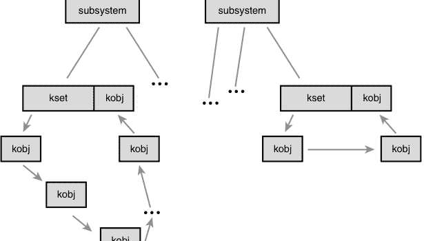

## 管理和操作 Kobjects

在了解了 kobject 及其伙伴的基础内部机制之后，现在来看看用于管理和操作 kobject 的导出接口。大多数时候，驱动程序编写者不需要直接处理 kobject。相反，kobject 被嵌入在某些特定类别的结构中（如你看到的字符设备结构），并由相关的驱动子系统在“幕后”管理。尽管如此，kobject 并非旨在永远隐藏，它们可能会渗透到驱动程序代码中，或者你可能会对驱动子系统本身进行修改。

使用 kobject 的第一步是声明并初始化它。kobject 通过 `kobject_init` 函数进行初始化，该函数在 `<linux/kobject.h>` 中声明：

```c
void kobject_init(struct kobject *kobj, struct kobj_type *ktype);
```

该函数的第一参数是要初始化的 kobject。在调用此函数之前，kobject 必须被清零。这通常发生在嵌入该 kobject 的更大函数的初始化过程中。如果没有，简单的 `memset()` 调用即可完成：

```c
memset(kobj, 0, sizeof (*kobj));
```

在清零之后初始化 `parent` 和 `kset` 是安全的。例如：

```c
struct kobject *kobj;
```

```c
kobj = kmalloc(sizeof (*kobj), GFP_KERNEL);

if (!kobj)
    return -ENOMEM;

memset(kobj, 0, sizeof (*kobj));

kobj->kset = my_kset;

kobject_init(kobj, my_ktype);
```

这一系列多步操作由 `kobject_create()` 自动处理，该函数会返回一个新分配的 kobject：

```c
struct kobject *kobject_create(void);
```

使用方法很简单：

```c
struct kobject *kobj;
```

```c
kobj = kobject_create();

if (!kobj)
    return -ENOMEM;
```

大多数 kobject 的使用应当倾向于使用 `kobject_create()` 或相关的辅助函数，而不是直接操作结构体。

## 引用计数

kobject 提供的核心特性之一是统一的引用计数系统。初始化后，kobject 的引用计数被设置为 1。只要引用计数非零，该对象就继续存在于内存中，此时称该对象被*钉住（pinned）*。任何持有该对象引用的代码首先会增加引用计数。当代码使用完该对象时，引用计数随之减少。增加引用计数被称为*获取（getting）*对象的引用，而减少引用计数则被称为*释放（putting）*对象的引用。当引用计数达到零时，该对象可以被销毁，所有相关内存被释放。

### 增加和减少引用计数

增加引用计数是通过 `kobject_get()` 完成的，该函数定义在 `<linux/kobject.h>` 中：

```c
struct kobject *kobject_get(struct kobject *kobj);
```

该函数返回指向 kobject 的指针，失败时返回 `NULL`。

减少引用计数是通过 `kobject_put()` 完成的，同样定义在 `<linux/kobject.h>` 中：

```c
void kobject_put(struct kobject *kobj);
```

如果提供的 kobject 引用计数达到零，则调用与该 kobject 关联的 ktype 所指向的 `release` 函数，释放所有相关内存，随后该对象不再有效。

### Krefs

在内部，kobject 的引用计数是由 `kref` 结构体提供的，该结构体定义在 `<linux/kref.h>` 中：

```c
struct kref {
    atomic_t refcount;
};
```

唯一的成员是一个用于保存引用计数的原子变量。使用结构体仅仅是为了提供类型检查。在使用 kref 之前，必须通过 `kref_init()` 对其进行初始化：

```c
void kref_init(struct kref *kref)
{
    atomic_set(&kref->refcount, 1);
}
```

如你所见，该函数仅仅将内部的 `atomic_t` 初始化为 1。因此，kref 在初始化后立即以引用计数 1 被钉住；这与 kobject 的行为一致。

要获取 kref 的引用，请使用 `kref_get()`，定义在 `<linux/kref.h>` 中：

```c
void kref_get(struct kref *kref)
{
    WARN_ON(!atomic_read(&kref->refcount));
    atomic_inc(&kref->refcount);
}
```

该函数增加引用计数，没有返回值。要释放 kref 的引用，请使用 `kref_put()`，定义在 `<linux/kref.h>` 中：

```c
int kref_put(struct kref *kref, void (*release)(struct kref *kref))
{
    WARN_ON(release == NULL);
    WARN_ON(release == (void (*)(struct kref *))kfree);

    if (atomic_dec_and_test(&kref->refcount)) {
        release(kref);
        return 1;
    }

    return 0;
}
```

该函数将引用计数减 1，如果计数变为零，则调用提供的 `release()` 函数。正如那个令人不安的 `WARN_ON()` 语句所指出的，提供的 `release()` 函数不能简单地是 `kfree()`，而必须是一个专门的函数，该函数仅接受 `struct kref` 作为参数且没有返回值。除非释放的引用是该对象的最后一个引用（此时返回 1），否则该函数返回 0。通常，`kref_put()` 的调用者并不关心返回值。

内核开发者被鼓励使用 kref 类型及其辅助函数来提供一种通用且经证明正确的内核引用计数机制，而不是在内核代码中通过 `atomic_t` 类型和简单的“get”与“put”包装函数来实现自己的引用计数。

所有这些函数都定义在 `lib/kref.c` 中，并声明在 `<linux/kref.h>` 中。

## sysfs

*sysfs 文件系统* 是一个内存虚拟文件系统，它提供了 kobject 层级结构的视图。它允许用户将系统的设备拓扑结构视为一个简单的文件系统。通过属性（attributes），kobject 可以导出文件，使得内核变量可以被读取，且在可选情况下可以被写入。

虽然设备模型最初的目的是出于电源管理原因提供设备拓扑，但其一个衍生产品就是 sysfs。为了方便调试，设备模型的开发者决定将该树结构导出为文件系统。这很快被证明是非常有用的，起初它是为了替代之前位于 `/proc` 中的设备相关文件，后来它成为了观察系统对象层级结构的强大视图。事实上，*sysfs*（最初名为 *driverfs*）早于 kobject 出现。最终 sysfs 证明了一个新的对象模型将大有裨益，于是 kobject 应运而生。如今，每个搭载 2.6 内核的系统都有 sysfs。大多数系统将其挂载在 `/sys`。

sysfs 背后的魔力仅仅是通过每个 kobject 内部的 `dentry` 成员将 kobject 与目录项绑定。回顾第 12 章，`dentry` 结构体代表目录项。通过将 kobject 链接到 dentry，kobject 就可以轻松地映射到目录。将 kobject 导出为文件系统现在就像在内存中构建一棵 dentry 树一样简单。但等等！kobject 已经形成了一棵树，即我们心爱的设备模型。既然 kobject 映射到 dentry，且对象层级已经形成了一棵内存树，那么 sysfs 的实现就变得极其简单。

图 17.2 是挂载在 `/sys` 下的 sysfs 文件系统的部分视图。

```text
-- block
  |-- loop0 -> ../devices/virtual/block/loop0
  |-- md0 -> ../devices/virtual/block/md0
  |-- nbd0 -> ../devices/virtual/block/nbd0
  |-- ram0 -> ../devices/virtual/block/ram0
  |-- xvda -> ../devices/vbd-51712/block/xvda
-- bus
  |-- platform
  |-- serio
-- class
  |-- bdi
  |-- block
  |-- input
  |-- mem
  |-- misc
  |-- net
  |-- ppp
  |-- rtc
  |-- tty
  |-- vc
  |-- vtconsole
-- dev
  |-- block
  |-- char
-- devices
  |-- console-0
  |-- platform
  |-- system
  |-- vbd-51712
  |-- vbd-51728
  |-- vif-0
  |-- virtual
-- firmware
-- fs
  |-- ecryptfs
  |-- ext4
  |-- fuse
  |-- gfs2
-- kernel
  |-- config
  |-- dlm
  |-- mm
  |-- notes
  |-- uevent_helper
  |-- uevent_seqnum
  |-- uids
-- module
  |-- ext4
  |-- i8042
  |-- kernel
  |-- keyboard
  |-- mousedev
  |-- nbd
  |-- printk
  |-- psmouse
  |-- sch_htb
  |-- tcp_cubic
  |-- vt
  |-- xt_recent
```

**图 17.2** `/sys` 树的部分视图。

sysfs 的根目录至少包含 10 个目录：`block`、`bus`、`class`、`dev`、`devices`、`firmware`、`fs`、`kernel`、`module` 和 `power`。`block` 目录为系统中注册的每个块设备包含一个目录。而这些目录中又包含该块设备上的任何分区。`bus` 目录提供了系统总线的视图。`class` 目录包含按高级功能组织的系统设备视图。`dev` 目录是注册设备节点的视图。`devices` 目录是系统设备拓扑的视图，它直接映射到内核内部设备结构的层级。`firmware` 目录包含一个特定于系统的低级子系统树，如 ACPI、EDD、EFI 等。`fs` 目录包含注册文件系统的视图。`kernel` 目录包含内核配置选项和状态信息，而 `modules` 目录包含系统已加载模块的视图。`power` 目录包含全系统电源管理数据。并非所有系统都拥有所有这些目录，而有些系统则拥有这里未提到的目录。

最重要的目录是 `devices`，它将设备模型向外界导出。其目录结构就是系统的实际设备拓扑。其他目录中的许多数据仅仅是 `devices` 目录中数据的另一种组织方式。例如，`/sys/class/net/` 按注册网络接口这一高级概念组织设备。该目录下可能有一个 `eth0` 子目录，其中包含一个指向 `devices` 中实际设备目录的 `device` 符号链接。

试着查看你能够访问的 Linux 系统上的 `/sys`。这种对系统设备的精确观察非常精妙，而且观察 `class` 中的高级概念、`devices` 中的低级物理设备以及 `bus` 中的实际驱动程序之间的互连非常有启发性。当你意识到这些数据是“免费”提供的——它是内核维护设备层级的副作用，并且就是内核内部维护的系统表示形式时，整个体验将更加令人兴奋。¹

### 向 sysfs 添加和删除 kobjects

初始化后的 kobject 不会自动导出到 sysfs。要将 kobject 表示在 sysfs 中，请使用 `kobject_add()`：

```c
int kobject_add(struct kobject *kobj, struct kobject *parent,
                const char *fmt, ...);
```

给定 kobject 在 sysfs 中的位置取决于它在对象层级中的位置。如果 kobject 的 `parent` 指针已设置，则该 kobject 映射到 sysfs 中其父目录下的一个子目录。如果 `parent` 指针未设置，则该 kobject 映射到 `kset->kobj`。如果在给定的 kobject 中，父对象（parent）和 kset 字段均未设置，则认为该 kobject 没有父对象，并将其映射到 sysfs 中的根级目录。在大多数用例中，在调用 `kobject_add()` 之前，应该适当设置 `parent` 或 `kset` 其中之一或两者。无论如何，代表该 kobject 的 sysfs 目录名称由 `fmt` 提供，`fmt` 接受一个 `printf()` 风格的格式化字符串。

辅助函数 `kobject_create_and_add()` 将 `kobject_create()` 和 `kobject_add()` 的工作合并为一个函数：

```c
struct kobject *kobject_create_and_add(const char *name,
                                       struct kobject *parent);
```

---

¹ 如果你觉得 sysfs 很有趣，你可能也会对 HAL（硬件抽象层）感兴趣，可以在 <http://www.freedesktop.org/wiki/Software/hal> 找到。HAL 基于 sysfs 中的数据构建了一个内存数据库，将类（class）、设备（device）和驱动程序（driver）的概念链接在一起。基于这些数据，HAL 提供了一个丰富的 API，从而实现了更智能、更具硬件感知能力的应用程序。

# 第 17 章 设备与模块


请注意，`kobject_create_and_add()` 通过直接指针 `name` 接收 kobject 目录的名称，而 `kobject_add()` 则使用 `printf()` 风格的格式化。

通过 `kobject_del()` 可以删除 kobject 在 sysfs 中的表示：

```c
void kobject_del(struct kobject *kobj);
```

所有这些函数都定义在 `lib/kobject.c` 中，并在 `<linux/kobject.h>` 中声明。

## 向 sysfs 添加文件

Kobject 映射到目录，并且完整的对象层次结构能够很好地映射到完整的 sysfs 目录结构，但文件怎么处理呢？如果没有提供实际数据的文件，sysfs 就仅仅是一棵漂亮的树而已。

## 默认属性

通过 kobject 和 kset 中的 ktype 字段提供一组默认文件。因此，所有相同类型的 kobject 在其 sysfs 目录中都具有相同的一组默认文件。`kobj_type` 结构包含一个成员 `default_attrs`，它是一个属性结构体数组。属性将内核数据映射到 sysfs 中的文件。

属性结构定义在 `<linux/sysfs.h>` 中：

```c
/* attribute structure - attributes map kernel data to a sysfs file */

struct attribute {
    const char    *name;     /* attribute's name */
    struct module *owner;    /* owning module, if any */
    mode_t        mode;      /* permissions */
};
```

`name` 成员提供属性的名称。这将是 sysfs 中生成的文件的文件名。`owner` 成员指向一个代表所有权模块的模块结构（如果有）。如果某个模块并不拥有此属性，则该字段为 NULL。`mode` 成员是一个 `mode_t` 类型，用于指定 sysfs 中文件的权限。对于只读属性，如果它们是对所有人可读的，可能希望将其设置为 `S_IRUGO`；如果仅对所有者可读，则设置为 `S_IRUGO`（此处原文如此，通常应为 `S_IRUSR`）。对于可写属性，可能希望将 mode 设置为 `S_IRUGO | S_IWUSR`。sysfs 中的所有文件和目录都由 uid 0 和 gid 0 所有。

虽然 `default_attrs` 列出了默认属性，但 `sysfs_ops` 描述了如何使用它们。`sysfs_ops` 成员是一个指向同名结构的指针，该结构定义在 `<linux/sysfs.h>` 中：

```c
struct sysfs_ops {
    /* method invoked on read of a sysfs file */
    ssize_t (*show)(struct kobj *kobj,
                    struct attribute *attr,
                    char *buffer);

    /* method invoked on write of a sysfs file */
    ssize_t (*store)(struct kobj *kobj,
                     struct attribute *attr,
                     const char *buffer,
                     size_t size);
};
```

当从用户空间读取 sysfs 条目时，会调用 `show()` 方法。它必须将 `attr` 给出的属性值复制到 `buffer` 提供的缓冲区中。缓冲区长度为 `PAGE_SIZE` 字节；在 x86 平台上，`PAGE_SIZE` 为 4096 字节。成功时，函数应返回实际写入 `buffer` 的数据字节数；失败时，返回一个负的错误码。

在写入时调用 `store()` 方法。它必须将 `buffer` 中的 `size` 字节数据读取到由属性 `attr` 代表的变量中。缓冲区的大小始终为 `PAGE_SIZE` 或更小。成功时，函数应返回从 `buffer` 读取的数据字节数；失败时，返回一个负的错误码。

由于这单一组函数必须处理所有属性的文件 I/O 请求，因此它们通常需要维护某种通用映射，以调用针对每个属性的特定处理程序。

## 创建新属性

通常，与 kobject 关联的 ktype 提供的默认属性就足够了。事实上，ktype 的目的就是为 kobject 提供通用操作。在 kobject 之间共享 ktype 不仅简化了编程，而且实现了代码整合，并使相关对象的 sysfs 目录具有统一的外观和感觉。

尽管如此，某些特定的 kobject 实例有时是特殊的。它希望甚至需要自己的属性——也许是为了提供不被通用 ktype 共享的数据或功能。为此，内核提供了 `sysfs_create_file()` 接口，用于在默认集之上添加新属性：

```c
int sysfs_create_file(struct kobject *kobj, const struct attribute *attr);
```

该函数将 `attr` 指向的 `attribute` 结构与 `kobj` 指向的 kobject 相关联。在调用之前，应填好给定的属性。成功时该函数返回零，否则返回负的错误码。

请注意，将调用 kobject 的 ktype 中指定的 `sysfs_ops` 来处理这个新属性。现有的默认 `show()` 和 `store()` 方法必须能够处理新创建的属性。

除了创建实际文件外，还可以创建符号链接。在 sysfs 中创建符号链接很简单：

```c
int sysfs_create_link(struct kobject *kobj, struct kobject *target, char *name);
```

该函数在由 `kobj` 映射的目录中创建一个名为 `name` 的链接，指向由 `target` 映射的目录。成功时该函数返回零，否则返回负的错误码。

## 销毁属性

删除属性通过 `sysfs_remove_file()` 处理：

```c
void sysfs_remove_file(struct kobject *kobj, const struct attribute *attr);
```

调用返回后，给定的属性不再出现在给定的 kobject 目录中。

使用 `sysfs_create_link()` 创建的符号链接可以使用 `sysfs_remove_link()` 删除：

```c
void sysfs_remove_link(struct kobject *kobj, char *name);
```

返回后，由 `kobj` 映射的目录中的符号链接 `name` 被删除。

这四个函数均在 `<linux/kobject.h>` 中声明。`sysfs_create_file()` 和 `sysfs_remove_file()` 函数定义在 `fs/sysfs/file.c` 中。`sysfs_create_link()` 和 `sysfs_remove_link()` 函数定义在 `fs/sysfs/symlink.c` 中。

## sysfs 约定

sysfs 文件系统目前是实现以前预留给设备节点 `ioctl()` 调用或 `procfs` 文件系统功能的场所。内核开发人员现在不再使用这些过时的内核接口，而是在相应的目录中将此类功能实现为 sysfs 属性。例如，与其在设备节点上增加一个新的 `ioctl()`，不如在驱动程序的 sysfs 目录中添加一个 sysfs 属性。这种方法避免了不安全地使用模糊的 `ioctl()` 参数以及 `/proc` 那种杂乱无章的状态。

然而，为了保持 sysfs 的整洁和直观，开发人员必须遵循某些约定。首先，sysfs 属性每个文件应导出一个值。值应基于文本并映射到简单的 C 类型。目标是避免当前 `/proc` 中那种高度结构化或高度杂乱的数据表示。每个文件提供一个值使得从命令行进行读写变得简单，并允许 C 程序轻松地将内核数据从 sysfs “吸入”到它们自己的变量中。在“每个文件一个值”的规则导致数据表示效率低下时，可以在一个文件中放置多个相同类型的值。适当地区分它们；简单的空格可能最合理。最终，将 sysfs 属性视为映射到单个内核变量（通常确实如此），并记住用户空间（尤其是 shell）操作的便捷性。

其次，在 sysfs 中以整洁的层次结构组织数据。正确设置 kobject 的父对象，使其能直观地映射到 sysfs 树中。将属性与正确的 kobject 相关联，并记住 kobject 层次结构不仅存在于内核中，还作为导出树存在于用户空间中。保持 sysfs 树的有序和层次化。

最后，记住 sysfs 提供的是一种内核到用户的服务，因此它是一种用户空间 ABI。用户程序可以依赖 sysfs 目录和文件的存在、位置、值和行为。不鼓励以任何方式更改现有文件，而修改给定属性的行为但保留其名称和位置，无疑是在给自己找麻烦。

这些简单的约定应该能使 sysfs 为用户空间提供一个丰富且直观的接口。正确使用 sysfs，用户空间开发人员就可以拥有一个简单、整洁，但功能强大且直观的内核接口。

## 内核事件层

内核事件层（Kernel Event Layer）在 kobject 之上实现了一个内核到用户的通知系统。在 2.6.0 版本发布后，人们意识到需要一种将事件从内核推送到用户空间的机制，特别是对于需要更集成和异步系统的桌面系统。其想法是让内核将事件沿着堆栈向上推送：硬盘满了！处理器过热！分区已挂载！

事件层的早期修订版本更迭频繁，不久之后，整个机制与 kobject 和 sysfs 紧密结合。结果证明，这种方式非常巧妙。内核事件层将事件建模为从对象（具体来说是 kobject）发出的信号。因为 kobject 映射到 sysfs 路径，所以每个事件的源是一个 sysfs 路径。如果相关事件与你的第一块硬盘有关，那么 `/sys/block/hda` 就是源地址。在内核内部，我们将该事件建模为源自背后的 kobject。

每个事件都被赋予一个代表信号的动词或动作字符串。这些字符串是诸如 `modified`（已修改）或 `unmounted`（已卸载）之类的术语，用于描述发生了什么。

最后，每个事件都有一个可选的负载（payload）。内核事件层并没有向用户空间传递一个提供负载的任意字符串，而是将负载表示为 sysfs 属性。

在内部，内核事件通过 netlink 从内核空间传送到用户空间。Netlink 是一个高速多播套接字，用于传输网络信息。使用 netlink 意味着在用户空间获取内核事件就像在套接字上阻塞一样简单。其意图是让用户空间实现一个系统守护进程，监听该套接字，处理任何读取到的事件，并将事件沿系统堆栈向上传输。对于这样一个用户空间守护进程的一个可能方案是将事件与 D-BUS 绑定，² 其中

> ² 关于 D-BUS 的更多信息可见 <http://dbus.freedesktop.org/>。

# 第 17 章 设备与模块

已经实现了一个系统范围的消息总线。通过这种方式，内核可以像系统中的任何其他组件一样发送信号。

要从内核代码向用户空间发送事件，请使用 `kobject_uevent()`：

```c
int kobject_uevent(struct kobject *kobj, enum kobject_action action);
```


第一个参数指定发送此信号的 `kobject`。实际的内核事件包含该 `kobject` 映射的 sysfs 路径。

第二个参数指定描述此信号的*动作（action）*或*动词（verb）*。实际的内核事件包含一个映射到提供的 `enum kobject_action` 值的字符串。该函数没有直接提供字符串，而是使用枚举来鼓励值的复用，提供类型安全，并防止拼写错误和其他失误。这些枚举定义在 `<linux/kobject.h>` 中，形式为 `KOBJ_*foo*`。当前的值包括 `KOBJ_MOVE`、`KOBJ_ONLINE`、`KOBJ_OFFLINE`、`KOBJ_ADD`、`KOBJ_REMOVE` 和 `KOBJ_CHANGE`。这些值分别映射到字符串 "move"、"online"、"offline"、"add"、"remove" 和 "change"。只要现有值不足以满足需求，添加新的动作值是允许的。

使用 `kobject` 和属性不仅鼓励创建能够很好地融入 sysfs 世界的事件，还鼓励创建新的 `kobject` 和属性来表示尚未通过 sysfs 暴露的对象和数据。

此函数及其相关函数定义在 `lib/kobject_uevent.c` 中，并在 `<linux/kobject.h>` 中声明。

## 本章小结

在本章中，我们研究了用于实现设备驱动程序和管理设备树的内核功能，包括模块、`kobject`（以及相关的 `kset` 和 `ktype`）和 sysfs。这些功能对于设备驱动程序作者至关重要，因为它们能够编写模块化、先进的驱动程序。

在最后三章中，我们将讨论重点从具体的 Linux 内核子系统转向一般的内核问题，下一章将从 Linux 内核调试开始探讨。

## 调试

内核开发与用户空间开发的一个不同之处在于调试的艰辛程度。相对于用户空间，调试*内核*非常困难。更复杂的是，风险要高得多。*内核*中的一个故障可能会导致整个系统崩溃。

成功调试*内核*——以及最终在整个*内核*开发中获得成功——在很大程度上取决于你对操作系统的经验和理解。当然，外貌和魅力也有帮助，但要成功调试*内核*问题，你必须理解*内核*。本章将探讨调试*内核*的方法。

## 入门

内核调试通常是一项漫长且令人抓狂的工作。有些 Bug 困扰了整个*内核*开发社区数月之久。幸运的是，对于每一个这样的艰巨问题，都有许多简单的 Bug 以及同样简单的修复方法。运气好的话，你遇到的所有 Bug 都会保持简单且琐碎。然而，在你开始调查之前，你无法得知这一点。为此，你需要：

- 一个 Bug。这听起来可能很傻，但你需要一个定义明确且具体的 Bug。如果它能够可靠地重现（至少对某个人而言），会有所帮助，但不幸的是，Bug 并不总是表现良好或定义明确。
- 一个 Bug 存在的*内核*版本。知道 Bug *首次*出现的位置更好。如果你还不知道，本章可以教你一个快速确定它的技巧。
- 对相关*内核*代码的了解或运气。调试*内核*很棘手，你对周围代码的理解越深，效果就越好。

本章的大部分技术都假设你可以可靠地重现 Bug。调试的成功取决于你复制问题（duplicate the problem）的能力。如果你不能重现，修复 Bug 就仅限于将问题概念化并在代码中寻找缺陷。这种情况确实经常发生，但如果你能重现问题，成功的机会显然要大得多。

有些人无法重现 Bug，这看起来可能很奇怪。在用户空间程序中，Bug 通常非常直接。例如，*执行 foo 会导致我的应用程序产生核心转储（dump core）*。而内核中的 Bug 通常模糊得多。内核、用户空间和硬件之间的交互往往非常微妙。竞态条件可能在算法运行一百万次迭代中才出现一次。设计不良甚至编译错误的代码可能会在某些系统上表现尚可，但在其他系统上表现糟糕。在某些随机机器上，通过某些特定的配置，在某些奇特的负载下，触发一个平时看不见的 Bug 是很常见的。在处理 Bug 时，你拥有的信息越多越好。很多时候，如果你能可靠地重现 Bug，你就已经成功了一半以上。

## 内核中的 Bug

内核中的 Bug 种类繁多。它们产生的原因不计其数，表现形式也同样多样。Bug 的范围从明显的代码错误（例如，没有在正确的位置存储正确的值）到同步错误（没有正确地锁定共享变量），再到硬件管理错误（向错误的控制寄存器发送了错误的指令）。它们表现为从性能低下、行为异常、数据损坏到系统死锁的各种情况。

通常，从代码中的错误到用户观察到的错误之间存在一条长长的事件链。例如，一个没有引用计数的共享结构可能会导致竞态条件。由于缺乏正确的计数，一个进程可能会释放该结构，而另一个进程仍想使用它。随后，第二个进程可能会通过一个现在已失效的指针尝试使用不再存在的结构。这可能会导致 `NULL` 指针解引用、读取垃圾数据，或者根本没有任何坏事发生（如果数据尚未被覆盖）。`NULL` 指针解引用会导致 oops，而垃圾数据会导致损坏（然后引发行为异常或 oops）。用户报告 oops 或行为异常。内核开发者必须然后从错误反向推导，发现数据在被释放后被访问了，存在竞态条件，而解决方法是对共享结构添加正确的引用计数。

调试内核听起来可能很困难，但实际上，内核与任何其他大型软件项目没什么两样。内核确实有一些独特的问题，例如时间限制和竞态条件，这是允许内核内部存在多个执行线程的结果。

## 通过打印调试

内核打印函数 `printk()` 的行为几乎与 C 库的 `printf()` 函数相同。事实上，在整本书中，我们几乎没有提到两者的实际区别。对于大多数用途来说，这没有问题；`printk()` 只是内核格式化打印函数的名称。不过，它确实有一些特殊功能。

#### 鲁棒性

`printk()` 的一个很容易被忽视的特性是它的鲁棒性。`printk()` 函数几乎可以在内核中的任何位置、任何时间被调用。它可以在中断上下文或进程上下文中被调用。它可以在持有任何锁的情况下被调用。它可以在多个处理器上同时被调用，且不需要调用者持有锁。

它是一个非常有韧性的函数。这一点很重要，因为 `printk()` 的实用性就在于它永远在那里且始终有效。

`printk()` 的鲁棒性并非毫无破绽。在内核启动过程中的某个时间点之前，即控制台初始化之前，它是不可用的。事实上，如果控制台没有初始化，输出应该发往何处？除非你在启动过程的早期调试问题（例如，在执行架构特定初始化的 `setup_arch()` 中），否则这通常不是问题。这种调试本身就是一个挑战，而缺乏任何形式的打印方法只会让问题更加复杂。

虽然有些希望，但不多。核心架构黑客会使用能够工作的硬件（比如串口）与外界通信。这对大多数人来说并不有趣。解决方案是一个可以在启动过程早期向控制台输出的 `printk()` 变体：`early_printk()`。其行为与 `printk()` 相同，只是名称及其提前工作的能力发生了变化。然而，这不是一个可移植的解决方案，因为并非所有支持的架构都实现了该方法。但如果你的架构实现了它，这可能是你最好的希望——包括 x86 在内的大多数架构都实现了。

除非你需要并在启动过程早期向控制台写入，否则你可以依赖 `printk()` 始终有效。

#### 日志级别（Loglevels）

`printk()` 和 `printf()` 在使用上的主要区别在于前者能够指定日志级别。内核使用日志级别来决定是否将消息打印到控制台。内核会将日志级别低于指定值的所有消息显示在控制台上。

你这样指定日志级别：

```c
printk(KERN_WARNING "This is a warning!\n");
printk(KERN_DEBUG "This is a debug notice!\n");
printk("I did not specify a loglevel!\n");
```

`KERN_WARNING` 和 `KERN_DEBUG` 字符串是 `<linux/kernel.h>` 中简单的定义。它们会被展开为类似 "<4>" 或 "<7>" 的字符串，并拼接在 `printk()` 消息的前面。然后，内核根据此指定的日志级别和当前的控制台日志级别 `console_loglevel` 来决定哪些消息打印在控制台上。表 18.1 列出了所有可用的日志级别。

| 日志级别 | 描述 |
|----------|-------------|
| `KERN_EMERG` | 紧急情况；系统可能已经崩溃。 |
| `KERN_ALERT` | 需要立即关注的问题。 |
| `KERN_CRIT` | 临界情况。 |
| `KERN_ERR` | 错误。 |
| `KERN_WARNING` | 警告。 |
| `KERN_NOTICE` | 正常但可能值得注意的情况。 |
| `KERN_INFO` | 信息性消息。 |
| `KERN_DEBUG` | 调试消息——通常是多余的。 |

如果你没有指定日志级别，它将默认为 `DEFAULT_MESSAGE_LOGLEVEL`，当前值为 `KERN_WARNING`。由于这个值可能会改变，你应当始终为你的消息指定一个日志级别。

内核将最重要的日志级别 `KERN_EMERG` 定义为 `<0>`，并将最不关键的日志级别 `KERN_DEBUG` 定义为 `<7>`。例如，在预处理器处理之后，之前的示例类似于以下内容：

```c
printk("<4>This is a warning!\n");
printk("<7>This is a debug notice!\n");
printk("<4>did not specify a loglevel!\n");
```

关于 `printk()` 日志级别的使用方式取决于你。当然，你打算保留的常规消息应该具有适当的日志级别。但在尝试解决问题时随处散布的调试消息——承认吧，我们都这么干，而且很有效——可以使用任何你想要的日志级别。一种选择是保持默认的控制台日志级别不变，并将所有调试消息设为 `KERN_CRIT` 或类似级别。相反，你也可以将调试消息设为 `KERN_DEBUG` 并更改控制台日志级别。每种方法各有优劣，由你决定。

## 日志缓冲区 (The Log Buffer)

内核消息存储在一个大小为 `LOG_BUF_LEN` 的循环缓冲区中。该大小在编译时可通过 `CONFIG_LOG_BUF_SHIFT` 选项进行配置。单处理器机器的默认值为 16KB。换句话说，内核可以同时存储 16KB 的内核消息。如果消息队列达到最大值且再次调用 `printk()`，新消息将覆盖最旧的消息。该日志缓冲区被称为*循环*缓冲区，是因为其读写操作是以循环模式进行的。

使用循环缓冲区有多个优点。由于可以同时向循环缓冲区写入和从中读取，即使是在中断上下文中也可以轻松使用 `printk()`。

此外，它使日志维护变得简单。如果消息过多，新消息只需覆盖旧消息即可。如果某个问题导致产生大量消息，日志只需自我覆盖，而不会无限制地消耗内存。循环缓冲区的唯一缺点——可能会丢失消息——为了获得它所提供的简洁性和鲁棒性，这是一个很小的代价。

## syslogd 和 klogd

在标准的 Linux 系统中，用户空间的 `klogd` 守护进程从日志缓冲区检索内核消息，并通过 `syslogd` 守护进程将它们馈送到系统日志文件中。为了读取日志，`klog` 程序既可以读取 `/proc/kmsg` 文件，也可以调用 `syslog()` 系统调用。默认情况下，它使用 `/proc` 方式。在任何一种情况下，`klogd` 都会阻塞，直到有新的内核消息可读。然后它会唤醒，读取所有新消息并对其进行处理。默认情况下，它将消息发送给 `syslogd` 守护进程。

`syslogd` 守护进程将其接收到的所有消息追加到一个文件中，默认路径为 `/var/log/messages`。该文件可通过 `/etc/syslog.conf` 进行配置。

你可以通过在启动 `klogd` 时指定 `-c` 标志，使其在加载时更改控制台日志级别。

## printf() 与 printk() 的混淆

当你刚开始开发内核代码时，很可能会经常将 `printf()` 和 `printk()` 搞混。这种混淆是很自然的，因为你无法否认在用户空间开发中多年重复使用 `printf()` 的习惯。运气好的话，这个错误不会持续太久，因为重复出现的链接错误最终会变得相当烦人。

有一天，你可能会发现自己在用户空间代码中误用了 `printk()` 而不是 `printf()`。当那天到来时，你可以说你是一个真正的内核黑客了。

## Oops

*oops* 是内核向用户传达发生了严重问题的常用方式。因为内核是整个系统的监督者，它不能像用户空间出错时那样简单地自我修复或自我终止。相反，内核会发出一个 oops。这包括向控制台打印错误消息、转储寄存器内容并提供回溯（back trace）。内核中的故障很难管理，因此内核必须经过许多复杂步骤才能发出 oops 并进行自我清理。通常，在 oops 发生后，内核处于一种不一致的状态。例如，在 oops 发生时，内核可能正处于处理重要数据的过程中。它可能持有某个锁，或者正处于与硬件通信的过程中。内核必须优雅地退出当前上下文并尝试恢复对系统的控制。在许多情况下，这是不可能的。如果 oops 发生在中断上下文中，内核无法继续运行，从而导致 panic。panic 会导致系统立即停止运行。如果 oops 发生在空闲任务（pid zero）或初始化任务（pid 0）中，结果同样是 panic，因为内核在没有这些重要进程的情况下无法继续运行。然而，如果 oops 发生在任何其他进程中，内核将杀死该进程并尝试继续执行。

oops 可能会由于多种原因发生，包括内存访问违规或非法指令。作为一名内核开发者，你经常会处理（并且毫无疑问地会引起）oops。

以下是一个来自 PPC 机器的 oops 示例，发生在 tulip 网络接口卡的定时器处理程序中：

```
Oops: Exception in kernel mode, sig: 4
Unable to handle kernel NULL pointer dereference at virtual address 00000001
NIP: C013A7F0 LR: C013A7F0 SP: 0 C0685E00 REGS: c0905d10 TRAP: 0700
Not tainted
MSR: 00089037 EE: 1 PR: 0 FP: 0 ME: 1 IR/DR: 11
TASK = c0712530[0] 'swapper' Last syscall: 120
GPR00: C013A7C0 C0295ED0 C0021530 00000002 00000001 C038B0B8 C0291B80 C02D0000
GPR08: 00000120 00000000 00000000 00000000 C0292AA8 4020A088 00000000 00000000
GPR16: 00000000 00000000 00000000 00000000 00000000 00000000 00000000 00000000
GPR24: 00000000 00000000 00000000 00000102 C3F70C00 00000032 FFFFFFFF C3F71C0
Call trace:
[0013ab30] tulip_timer+0x128/0x1c4
[0020744] run_timer_softirq+0x10c/0x164
[001b864] do_softirq+0x88/0x104
[0007e80] timer_interrupt+0x284/0x298
[00033c4] ret_from_except+0x0/0x34
[0007b84] default_idle+0x20/0x60
[0007bF8] cpu_idle+0x34/0x38
[0003ae8] rest_init+0x24/0x34
```

PC 用户可能会对寄存器的数量感到惊讶（竟然有 32 个！）。在 x86-32 上的 oops（你可能更熟悉）要简单一些。然而，关键信息在所有架构中都是相同的：寄存器内容和回溯。

回溯显示了导致问题的确切函数调用链。在这种情况下，你可以看到具体发生了什么：机器处于空闲状态并在循环执行空闲循环 `cpu_idle()`，而 `cpu_idle()` 又调用 `default_idle()`。随后发生了定时器中断，导致处理定时器。执行了一个定时器处理程序 `tulip_timer()` 函数，该函数执行了空指针解引用。你甚至可以使用偏移量（函数右侧如 `0x128/0x1c4` 的数字）来找到具体出错的代码行。

寄存器内容同样有用，尽管不那么常用。通过一份反汇编后的函数副本，寄存器值可以帮助你还原导致问题的确切事件。在寄存器中看到一个意外的值可能会揭示问题的根源。在这种情况下，你可以看到哪些寄存器持有 NULL（全零值），并发现函数中的哪个变量具有意外的值。在这种情况下，问题通常是一个竞态条件——在本例中，发生在定时器和该网卡的某个其他部分之间。调试竞态条件始终是一个挑战。

## ksymoops

之前的 oops 被称为“已解码”，因为内存地址已被转换为它们所代表的函数。这里显示的是之前 oops 的未解码版本：

```
NIP: C013A7F0 LR: C013A7F0 SP: C0685E00 REGS: c0905d10 TRAP: 0700
Not tainted
MSR: 00089037 EE: 1 PF: 0 FF: 0 ME: 1 IR/DR: 11
TASK = c0112530[0] 'swapper' Last syscall: 120
GPR0: C0013A70 C0295E00 C0023150 00000002 C0000000 00308C08 C0291B80 C02D0000
GPR0: 00008120 00000000 00000000 00292AA0 0020A080 00000000 00000000 00000000
GPR16: 00000000 00000000 00000000 00020AA0 0020A080 00000000 00000000 00000000
GPR24: 00000000 00000005 00000000 00000000 0001032 C3F7C000 00000032 FFFFFF C3F7C1C0
```


Call trace: `[c013ab30] [c0020744] [c001b864] [c0007e80] [c0061c4] [c0007b84] [c0007bf8] [c0003ae8]`

回溯中的地址需要转换为符号名称。这通过 `ksymoops` 命令结合内核编译期间生成的 `System.map` 来完成。如果你使用了模块，还需要一些模块信息。`ksymoops` 会尝试解析大部分此类信息，因此你通常可以通过以下方式调用它：

```
ksymoops saved_oops.txt
```

然后程序会输出该 oops 的解码版本。如果 `ksymoops` 使用的默认信息不理想，或者你想提供信息的替代路径，该程序支持各种选项。`ksymoops` 的手册页包含大量信息，建议在使用前阅读。`ksymoops` 程序很可能随你的发行版一起提供。

## kallsyms

庆幸的是，处理 `ksymoops` 已不再是必须的。这是一个重大进步，因为虽然开发者在使用它时可能没太大问题，但最终用户经常会匹配错误的 `System.map` 文件，或者完全无法解码 oops。

2.5 开发内核引入了 `kallsyms` 功能，可通过 `CONFIG_KALLSYMS` 配置选项启用。该选项在内核中存储映射到内核镜像的函数地址的符号名称，以便内核能够打印解码后的回溯。因此，解码 oops 不再需要 `System.map` 或 `ksymoops`。缺点是内核大小会略微增加，因为地址到符号的映射必须驻留在永久映射的内核内存中。然而，无论是在开发阶段还是部署阶段，这种内存开销都是值得的。配置选项 `CONFIG_KALLSYMS_ALL` 还会额外存储所有符号（而不仅仅是函数）的符号名称。这通常仅由专门的调试器需要。

`CONFIG_KALLSYMS_EXTRA_PASS` 选项会导致内核构建过程对内核的对象代码进行第二次扫描。它仅在调试 `kallsyms` 本身时才有用。

## 内核调试选项

在编译期间，你可以设置多个配置选项来辅助调试和测试内核代码。这些选项位于内核配置编辑器的“Kernel Hacking”菜单中。它们都依赖于 `CONFIG_DEBUG_KERNEL`。在对内核进行 hacking 时，建议在实际可行的情况下启用尽可能多的此类选项。

其中一些选项非常有用，例如启用 slab 层调试、高内存调试、I/O 映射调试、自旋锁调试以及栈溢出检查。然而，最有用设置之一是自旋锁内睡眠检查（sleep-inside-spinlock checking），它的功能实际上要强大得多。

从 2.5 版本开始，内核拥有一套出色的基础设施，用于检测各种原子性违规。回顾第 9 章“内核同步简介”，“原子”是指某事物在执行过程中不被分割的能力；代码要么在没有确定中断的情况下完成，要么完全不完成。持有自旋锁或禁用内核抢占的代码是原子的。原子状态下的代码不能睡眠——在持有锁时睡眠是导致死锁的根源。

得益于内核抢占，内核拥有一个中央原子计数器。内核可以被设置为：如果一个任务在原子状态下睡眠，甚至执行了可能导致睡眠的操作，内核将打印一条警告并提供回溯轨迹（back trace）。可检测到的潜在 Bug 包括在持有锁时调用 `schedule()`，在持有锁时发起阻塞式内存分配，或者在持有 per-CPU 数据引用时睡眠。这套调试基础设施能捕捉到大量 Bug，强烈建议使用。

以下选项能最有效地利用此特性：

```
CONFIG_PREEMPT=y
CONFIG_DEBUG_KERNEL=y
CONFIG_KALLSYMS=y
CONFIG_DEBUG_SPINLOCK_SLEEP=y
```

## 断言 Bug 和转储信息

许多内核例程可以方便地标记 Bug、提供断言并转储信息。最常见的两个是 `BUG()` 和 `BUG_ON()`。当被调用时，它们会触发一次 oops，从而导致栈轨迹和错误信息被转储到内核。这些语句为何会导致 oops 取决于架构。大多数架构将 `BUG()` 和 `BUG_ON()` 定义为非法指令，从而产生预期的 oops。你通常将这些例程用作断言，以标记不应该发生的情况：

```c
if (bad_thing)
    BUG();
```

或者更好的做法是：

```c
BUG_ON(bad_thing);
```

大多数内核开发人员认为，与 `BUG()` 相比，`BUG_ON()` 更易读且更具自文档化。此外，`BUG_ON()` 将其断言包裹在一个 `unlikely()` 语句中。请注意，一些开发人员讨论过通过选项在编译时去掉 `BUG_ON()` 语句，以节省嵌入式内核的空间。这意味着你在 `BUG_ON()` 内部的断言不应具有任何副作用。宏 `BUILD_BUG_ON()` 具有相同的目的，但它在编译时执行。如果在编译时提供的语句评估为真，编译将报错终止。

更严重的错误通过 `panic()` 信号发出。调用 `panic()` 会打印一条错误消息，然后停止内核运行。显然，你只希望在最糟糕的情况下使用它：

```c
if (terrible_thing)
    panic("terrible_thing is %d\n", terrible_thing);
```

有时，你只需要向控制台输出一个简单的栈轨迹来辅助调试。在这种情况下，可以使用 `dump_stack()`。它简单地将寄存器内容和函数回溯轨迹转储到控制台：

```c
if (!debug_check()) {
    printk(KERN_DEBUG "provide some information...\n");
    dump_stack();
}
```

## 魔术 SysRq 键

一个可能的救命稻草是魔术 `SysRq` 键，它通过 `CONFIG_MAGIC_SYSRQ` 配置选项启用。`SysRq`（系统请求）键是大多数键盘上的标准键。在 i386 和 PPC 上，可以通过 Alt+PrintScreen 访问。当此配置选项启用时，特殊的组合键允许你与内核通信，无论内核当时正在执行什么操作。这使你在面对系统崩溃时能够执行一些有用的任务。

除了配置选项外，还有一个 sysctl 接口可以切换此功能的开启或关闭。要开启它：

```bash
echo 1 > /proc/sys/kernel/sysrq
```

在控制台上，你可以按下 SysRq-h 来查看可用选项列表。`SysRq-s` 将脏缓冲区同步到磁盘，`SysRq-u` 卸载所有文件系统，`SysRq-b` 重启机器。依次执行这三个组合键比直接按下机器复位开关是重启崩溃机器更安全的方式。

如果机器严重锁死，它可能不会响应任何魔术 `SysRq` 组合键，或者无法完成给定的命令。但运气好的话，这些选项可能会挽救你的数据或辅助调试。表 18.2 列出了支持的 `SysRq` 命令。

### 表 18.2 支持的 SysRq 命令

| 按键命令 | 描述 |
|---|---|
| SysRq-b | 重启机器 |
| SysRq-e | 向除 init 以外的所有进程发送 SIGTERM |
| SysRq-h | 在控制台显示 SysRq 帮助 |
| SysRq-i | 向除 init 以外的所有进程发送 SIGKILL |
| SysRq-k | 安全访问键：杀死此控制台上的所有程序 |
| SysRq-l | 向包括 init 在内的所有进程发送 SIGKILL |
| SysRq-m | 将内存信息转储到控制台 |
| SysRq-o | 关闭机器 |
| SysRq-p | 将寄存器转储到控制台 |
| SysRq-r | 关闭键盘原始模式 |
| SysRq-s | 将所有已挂载的文件系统同步到磁盘 |
| SysRq-t | 将任务信息转储到控制台 |
| SysRq-u | 卸载所有已挂载的文件系统 |

内核源码树中的 `Documentation/sysrq.txt` 文件包含更多信息。实际实现位于 `drivers/char/sysrq.c`。魔术 SysRq 键是辅助调试或挽救崩溃系统的重要工具。然而，由于它为控制台上的任何用户提供了强大的能力，因此在重要机器上应谨慎使用。但对于你的开发机来说，它是一个极大的帮助。

## 内核调试器的传奇

许多内核开发人员长期以来一直要求拥有一个内核内调试器。不幸的是，Linus 不希望在他的内核中加入调试器。他认为调试器会导致被误导的开发人员做出糟糕的修复。没有人能反驳他的逻辑——基于对代码真实理解而得出的修复肯定更有可能正确。尽管如此，大量内核开发人员仍然希望有一个官方的内核内调试器。由于这在短期内不太可能实现，出现了一些为标准 Linux 内核添加内核调试支持的补丁。尽管这些是外部非官方补丁，但这些工具的功能相当完备且强大。不过，在深入研究这些解决方案之前，最好看看标准 Linux 调试器 `gdb` 能为你提供多少帮助。

### gdb

你可以使用标准 GNU 调试器来窥视运行中的内核。在内核上启动调试器与调试一个运行中的进程基本相同：

```bash
gdb vmlinux /proc/kcore
```

`vmlinux` 文件是存储在构建目录根目录下的未压缩内核镜像，而不是压缩的 `zImage` 或 `bzImage`。

可选的 `/proc/kcore` 参数充当核心文件（core file），让 `gdb` 能够实际窥视运行中内核的内存。你需要 root 权限才能读取它。

你可以使用几乎任何 `gdb` 命令来读取信息。例如，打印变量的值：

```
p global_variable
```

反汇编一个函数：

```
disassemble function
```

如果你在编译内核时使用了 `-g` 标志（在内核 Makefile 的 `CFLAGS` 变量中添加 `-g`），`gdb` 可以提供更多信息。例如，你可以转储结构体的内容并跟踪指针。但这样会导致生成的内核体积大得多，因此不要在常规编译中包含调试信息。

不幸的是，这几乎就是 `gdb` 能做的一切。它无法以任何方式修改内核数据，无法在内核代码中单步执行，也无法设置断点。无法修改内核数据结构是一个巨大的缺陷。虽然它偶尔反汇编函数无疑是有用的，但如果它能修改数据，将会有用得多。

### kgdb

`kgdb` 是一个补丁，它允许 `gdb` 通过串口远程完整地调试内核。它需要两台计算机。第一台运行经过 `kgdb` 补丁修改的内核。第二台通过串口（用空调制解调器电缆连接两台机器）使用 `gdb` 对第一台进行调试。有了 `kgdb`，`gdb` 的所有功能集都可用了：读取和写入任何变量、设置断点、设置观察点、单步执行等等！特殊版本的 `kgdb` 甚至允许执行函数。

设置 `kgdb` 和串口线比较棘手，但一旦完成，调试就变得简单了。该补丁在 `documentation/` 中安装了大量文档——请查阅。不同的人为不同的架构和内核版本维护 `kgdb` 补丁。在网上搜索是寻找特定内核补丁的最佳选择。

## 对系统进行试探和探测

随着你在内核调试方面经验的增加，你会掌握一些小技巧，帮助你试探并探测内核以寻找答案。由于内核调试可能相当具有挑战性，每一个小技巧都大有帮助。让我们来看看其中几个。

### 将 UID 作为条件

如果你开发的代码与进程相关，有时你可以在不破坏现有代码的情况下开发替代实现。如果你正在重写一个重要的系统调用，并且希望拥有一个功能完整的系统来进行调试，这有时会很有帮助。

例如，假设你正在重写 `fork()` 算法以利用一项令人兴奋的新特性。除非你第一次尝试就完全正确，否则调试该系统将并不容易：一个无法正常工作的 `fork()` 系统调用必然会导致整个系统无法运行。但一如既往，希望总是在的。

通常，保留原有的算法并在此基础上并行构建你的替代方案是安全的。你可以使用用户 ID (UID) 作为条件来决定使用哪个算法：

```c
if (current->uid != 7777) {
    /* 旧算法 ... */
} else {
    /* 新算法 ... */
}
```

除了 UID 为 7777 的用户外，所有用户都将使用旧算法。你可以创建一个 UID 为 7777 的特殊用户来测试新算法。这使得测试关键的进程相关代码变得简单得多。

## 使用条件变量

如果相关代码不在进程上下文中，或者你想要一种更全局的方法来控制该特性，你可以使用条件变量。这种方法比使用 UID 更加简单。只需创建一个全局变量，并在代码中使用它作为条件检查。如果变量为零，则走一条代码路径；如果非零，则走另一条。该变量可以通过你导出的接口或通过调试器的 poke 操作来设置。

## 使用统计数据

有时你想了解特定事件发生的频率。有时你想比较多个事件并生成一些比例进行对比。你可以通过创建统计数据和一种导出其值的机制轻松实现这一点。

例如，假设你想查看 `foo` 和 `bar` 的出现情况。在一个文件中（理想情况下是这些事件发生的文件中），声明两个全局变量：

```c
unsigned long foo_stat = 0;
unsigned long bar_stat = 0;
```

每当这些事件发生时，增加相应的变量。然后按照你认为合适的方式导出数据。例如，你可以在 `/proc` 中创建一个包含这些值的文件，或者编写一个系统调用。或者，简单地通过调试器读取它们。

注意，这种方法并非特别 SMP 安全。理想情况下，你应该使用原子操作。然而，对于简单的单次调试统计，通常不需要这种保护。

## 对调试进行速率和出现次数限制

通常，你希望在某个区域放置一些调试检查（以及相应的打印语句）以嗅探问题。然而，在内核中，某些函数每秒钟被调用的次数可能很多次。如果你在这样的函数中放入 `printk()` 调用，系统将被大量的调试输出淹没，并迅速变得无法使用。

有两种相对简单的技巧可以防止这个问题。第一种是*速率限制（rate limiting）*，当你想要观察事件的进展，但该事件发生相当频繁时非常有用。为了防止调试输出泛滥，你每秒仅打印几次调试消息（或执行任何你需要的操作）。例如：

```c
static unsigned long prev_jiffy = jiffies;  /* 速率限制 */
if (time_after(jiffies, prev_jiffy + 2*HZ)) {
    prev_jiffy = jiffies;
    printk(KERN_ERR "blah blah blah\n");
}
```

在这个例子中，调试消息最多每 2 秒打印一次。这防止了控制台上出现信息泛滥，使计算机保持可用。根据你的需求，你可能需要将速率限制调大或调小。

如果你仅使用 `printk()`，可以使用一个特殊函数来限制 `printk()` 调用的速率：

```c
if (error && printk_ratelimit())
    printk(KERN_DEBUG "error=%d\n", error);
```

如果速率限制生效，`printk_ratelimit()` 函数返回零，否则返回非零值。默认情况下，该函数每 5 秒仅允许一条消息，但在强制执行该上限之前允许最多 10 条消息的初始爆发。这些参数可以通过 `printk_ratelimit` 和 `printk_ratelimit_burst` sysctl 分别进行调整。

另一种棘手的情况是你试图确定代码路径是否以某种特定方式被执行。与之前的示例不同，你不需要实时通知。如果这种情况一旦被触发就会被触发很多次，那么它就尤其棘手。这里的解决方案不是对调试进行速率限制，而是*出现次数限制（occurrence limit）*：

```c
static unsigned long limit = 0;
if (limit < 5) {
    limit++;
    printk(KERN_ERR "blah blah blah\n");
}
```


这个示例将调试输出上限设为 5 次。在五条此类消息之后，条件将始终为假。

在这两个示例中，变量应如所示设置为 `static` 且局部于函数。这使得变量的值在函数调用之间能够持久存在。

这两个示例都不是 SMP 或抢占安全的，尽管快速切换到原子操作可以使它们变得安全。对于临时调试检查，你通常不需要如此吹毛求疵。

## 通过二分法寻找罪魁祸首的变更

了解 Bug 何时被引入内核源码通常是非常有用的。如果你知道 Bug 出现在 2.6.33 版本中，但没有出现在 2.4.29 中，那么你就对导致 Bug 的变更有了清晰的认识。Bug 修复通常就像撤销或修复那个糟糕的变更一样简单。

然而，很多时候你不知道哪个内核版本引入了 Bug。你知道 Bug 在*当前*内核中，但它似乎一直就在当前内核中！通过一点努力，你可以找到那个有问题的变更。一旦掌握了变更，Bug 的修复通常就在眼前。

首先，你需要一个可靠的可复现问题——最好是一个在启动后能立即验证的 Bug。接着，你需要一个已知的正常内核。你可能已经知道一个。例如，如果你知道几个月前的内核可以正常工作，就获取那个时期的内核。如果你错了，就尝试更早的发布版本。找到一个没有该 Bug 的内核应该不难。

接下来，你需要一个已知的故障内核。为了方便起见，从你目前拥有的最早出现该 Bug 的内核开始。

现在，你从已知故障内核向已知正常内核开始二分搜索。让我们看一个例子。假设最新的已知正常内核是 2.6.11，最早的已知故障内核是 2.6.20。首先选择中间的一个内核，例如 2.6.15。测试 2.6.15 是否有 Bug。如果 2.6.15 正常工作，那么你就知道问题始于之后的某个内核，因此尝试 2.6.15 和 2.6.20 之间的一个内核——比如 2.6.17。另一方面，如果 2.6.15 不正常，你知道问题在更早的内核中，因此你可以尝试 2.6.13。以此类推，循环往复。

最终，你应该将问题缩小到两个连续发布的内核——其中一个有 Bug，另一个没有。这样你就能清晰地看到导致 Bug 的变更。这种方法比检查每一个内核要高效得多！

## 使用 Git 进行二分搜索

Git 源码管理工具提供了一种执行二分搜索的有用机制。如果你使用 git 来控制你的 Linux 源码树副本，它可以自动执行二分搜索过程。此外，git 工具在*修订版本级别（revision level）*执行二分搜索，实际上能精准地定位到引入 Bug 的具体提交（commit）。与许多 git 相关任务不同，使用 git 进行二分搜索并不困难。首先，告诉 git 你要开始二分搜索：

```bash
$ git bisect start
```

然后向 git 提供最早的故障修订版本：

```bash
$ git bisect bad <revision>
```

如果最新的内核版本就是你已知最早的故障版本，则无需提供修订版本号：

```bash
$ git bisect bad
```

然后向 git 提供最新的正常工作修订版本：

```bash
$ git bisect good v2.6.28
```

随后，Git 会自动检出 Linux 源码树，在提供的故障修订版本和正常修订版本之间进行二分。然后你编译、运行并测试该修订版本。如果它工作正常，运行：

```bash
$ git bisect good
```

如果它不工作——也就是说，给定的内核修订版本出现了该 Bug——则运行：

```bash
$ git bisect bad
```

每次执行命令，git 都会再次基于修订版本对树进行二分，根据需要返回下一个二分点。重复此过程，直到无法再进行二分。Git 随后会打印出有问题的修订版本号。

这可能是一个漫长的过程，但 git 确实使其变得简单。如果你认为你知道 Bug 的来源——例如，它显然在 x86 特有的启动代码中——你可以指示 git 仅在涉及指定目录列表的提交中进行二分：

```bash
$ git bisect start -- arch/x86
```


## 当所有方法都失效时：社区

也许你已经尝试了所有能想到的方法。你在键盘前辛苦地工作了无数个小时——事实上，可能是无数天——但解决方案仍然难以捉摸。如果 Bug 存在于主流 Linux 内核中，你总是可以寻求内核社区中其他开发者的帮助。

向内核邮件列表发送一封简短但完整的电子邮件，描述 Bug 以及你的发现，可能有助于找到解决方案。毕竟，没有人喜欢 Bug。

第 20 章“补丁、黑客与社区”专门讨论了社区及其主要论坛——Linux 内核邮件列表（LKML）。

## 结论

本章涵盖了内核调试，即确定实现与意图*为何*不一致的过程。我们研究了几种技术，从内置的内核调试基础设施到调试器，从日志记录到使用 `git` 进行二分搜索。由于调试 Linux 内核可能比调试用户空间应用程序困难得多，因此本章的内容对于任何打算实际编写内核代码的人来说都至关重要。

在下一章中，我们将涵盖另一个通用主题：Linux 内核的可移植性。继续前行！

# 19 可移植性

Linux 是一个*可移植的*操作系统，支持广泛的计算机架构。*可移植性*是指代码从一种系统架构迁移到另一种架构的难易程度（如果能够迁移的话）。我们知道 Linux 是可移植的，因为它已经被*移植到了各种系统中*。但这种可移植性并非一夜之间实现的——它需要勤奋以及在编写代码时始终关注可移植性。因此，相对而言，现在在某个新系统上启动 Linux 变得更加容易。本章讨论如何编写可移植代码——在编写内核核心代码和设备驱动程序时需要牢记的问题。

## 可移植操作系统

某些操作系统的设计将可移植性作为主要特性。尽可能少地编写机器相关代码。汇编语言被减至最少，接口和功能足够通用且抽象，以便能够在广泛的架构上运行。显而易见的好处是支持新架构相对容易。在某些情况下，高度可移植且简单的操作系统只需几百行特有代码即可迁移到新架构。缺点是不支持架构特定的特性，且代码无法针对特定机器进行手工优化。在这种设计选择中，用最优代码换取了可移植代码。高度可移植操作系统的例子包括 Minix、NetBSD 和许多学术系统。

处于对立面的是那些为了高度定制的最优代码而放弃所有可移植性的操作系统。尽可能地使用汇编语言编写代码，或专门为特定架构设计。内核功能围绕特定架构的天然特性而设计。因此，将该操作系统迁移到新架构相当于从头开始重写内核，而且即使可行，该操作系统也可能不适合在其他架构上使用。在这种设计决策中，用可移植代码换取了最优代码。这类系统通常比可移植系统更难维护。当然，这些系统不一定比可移植系统更高效；然而，它们愿意忽略可移植性，从而实现了不妥协的设计。Microsoft DOS 和 Windows 95 就是这种设计决策的两个例子。

Linux 在可移植性方面采取了折中路线。在实际可行的情况下，接口和核心代码是与架构无关的 C 代码。然而，在性能至关重要的地方，内核功能会针对每种架构进行调优。例如，许多快速路径（fast-path）和底层代码是依赖于架构的，且通常用汇编语言编写。这种方法使 Linux 能够在不进行过于昂贵优化的情况下保持可移植性。在可移植性会阻碍性能的地方，通常性能优先。否则，代码将保持可移植。

通常，导出的内核接口与架构无关。如果函数的任何部分需要针对每个支持的架构进行唯一实现（无论是出于性能原因还是必要性），该代码将在单独的函数中实现并在需要时调用。然后，每个支持的架构实现其架构特定函数，并将其链接到内核镜像中。

一个很好的例子是调度器。调度器的大大部分是用与架构无关的 C 语言编写的，位于 `kernel/sched.c` 中。调度器的少数任务，如切换处理器状态或交换地址空间，是依赖于架构的。因此，用于从一个进程切换到另一个进程的 C 方法 `context_switch()` 会分别调用 `switch_to()` 和 `switch_mm()` 方法，以切换处理器状态和切换地址空间。

`switch_to()` 和 `switch_mm()` 的代码由 Linux 支持的每个架构独立实现。当 Linux 被移植到新架构时，新架构必须为这些函数提供实现。

架构特定文件位于 `arch/architecture/` 中，其中 architecture 是代表 Linux 中每个架构的短名称。例如，Intel x86 架构的短名称为 x86。（该架构同时支持 x86-32 和 x86-64。）这些机器的架构特定文件位于 `arch/x86` 中。2.6 内核系列支持的架构有 `alpha`、`arm`、`avr32`、`blackfin`、`cris`、`frv`、`h8300`、`ia64`、`m32r`、`m68k`、`m68knommu`、`mips`、`mn10300`、`parisc`、`powerpc`、`s390`、`sh`、`sparc`、`um`、`x86` 和 `xtensa`。这些架构的更完整列表在本章后面的表 19.1 中。

## Linux 可移植性历史

当 Linus 第一次将 Linux 推向这个毫无防备的世界时，它仅在 Intel i386 机器上运行。虽然该操作系统相当通用且编写良好，但可移植性并不是一个主要关注点。事实上，Linus 甚至一度暗示 Linux 永远不会在 i386 架构以外的任何设备上运行！然而，在 1993 年，将 Linux 移植到 Digital Alpha 架构的工作开始了。Digital Alpha 是一种现代的高性能基于 RISC 的架构，具有 64 位内存寻址。这与 Linux 最初的 i386 形成了鲜明对比。尽管如此，Linux 移植到 Alpha 的初始工作大约花了一年时间，Alpha 成为了 x86 之后第一个被正式支持的架构。这次移植可能相当困难，因为它面临着作为第一个移植对象的不愉快挑战。内核开发者并没有简单地将对 Alpha 的支持嫁接到内核上，而是在需要时考虑到可移植性而重写了部分内核代码。¹ 虽然这增加了整体工作量，但结果更加干净，使得未来的移植变得更加容易。

虽然 Linux 的最初版本仅支持 Intel i386 架构，但 1.2 内核系列增加了对 Digital Alpha、MIPS 和 SPARC 的支持——尽管支持程度在某种程度上是实验性的。

随着 2.0 内核的发布，Linux 正式增加了对 Motorola 68k 和 PowerPC 的支持。此外，之前在 1.2 中支持的架构被标记为正式且稳定。

2.2 内核系列通过增加 ARM、IBM S/390 和 UltraSPARC 带来了更多的架构支持。几年后，2.4 将支持的架构数量几乎翻了一番，达到了 15 个，增加了对 CRIS、IA-64、64 位 MIPS、HP PA-RISC、64 位 IBM S/390 和 Hitachi SH 的支持。

目前的 2.6 内核通过增加 AVR、FR-V、无 MMU 的 Motorola 68k、M32xxx、H8/300、IBM POWER、Xtensa 以及一个在 Linux 下虚拟机中运行的内核版本（称为 Usermode Linux），将支持的架构数量增加到了 21 个。

这些架构中的每一个都支持各种芯片和机器类型。一些支持的架构（如 ARM 和 PowerPC）各自支持许多不同的芯片和机器类型。其他架构（如 x86 和 SPARC）则同时支持其处理器的 32 位和 64 位变体。因此，虽然 Linux 在 21 个大类架构下运行，但它运行在更多的机器上！

## 字长与数据类型

*字*（word）是机器一次能够处理的数据量。这符合文档类比，其中*字符*（通常为 8 位）和*页*（包含许多字，通常为 4KB 或 8KB）作为数据的其他衡量标准。一个字是整数个比特——例如 1、2、4 或 8 个。当人们谈论一台机器的“n 位”时，他们通常是指机器的*字长*。例如，当人们说 Intel i7 是一款 64 位芯片时，他们是指其字长为 64 位，即 8 个字节。

处理器的通用寄存器（GPRs）的大小等于其字长。给定架构中组件的宽度（例如内存总线）通常至少与字长一样宽。通常，至少在 Linux 支持的架构中，虚拟内存地址空间等于字长，尽管物理地址空间有时较小。因此，指针的大小等于字长。此外，C 类型 `long` 的大小等于字长，而……

> ¹ 这是 Linux 内核开发中的常见现象。如果一件事情要做，就必须把它做好。内核开发者并不反感为了追求完美而重写大量代码。

`int` 类型的长度有时小于字长（word size）。例如，Alpha 架构具有 64 位的字长。因此，寄存器、指针以及 `long` 类型均为 64 位。然而，`int` 类型的长度为 32 位。Alpha 每次可以访问和操作 64 字节（一个字）的 64 位数据。

## 字、双字与混淆

一些操作系统和处理器并不将标准数据大小称为*字*（word）。相反，字是基于历史原因或随意命名决策而确定的一种固定大小。例如，某些操作系统可能会将数据大小划分为字节（8 位）、字（16 位）、双字（32 位）和四字（64 位），尽管该系统本身可能是 32 位的。基于 Windows NT 的系统（如 Windows 7）就采用了这种命名方案。在本书中——以及在一般的 Linux 环境中——*字*是指之前讨论过的处理器的标准数据大小。

Linux 下支持的每种架构都在 `<asm/types.h>` 中将 `BITS_PER_LONG` 定义为 C 语言 `long` 类型的长度，这也就是系统的字长。所有支持的架构及其字长的完整列表见表 19.1。

### 表 19.1 支持的 Linux 架构

| 架构 | 描述 | 字长 |
| :--- | :--- | :--- |
| `alpha` | Digital Alpha | 64 bits |
| `arm` | ARM and StrongARM | 32 bits |
| `avr` | AVR | 32 bits |
| `blackfin` | Blackfin | 32 bits |
| `cris` | CRIS | 32 bits |
| `frv` | FR-V | 32 bits |
| `h8300` | H8/300 | 32 bits |
| `ia64` | IA-64 | 64 bits |
| `m32r` | M32xx | 32 bits |
| `m68k` | Motorola 68k | 32 bits |
| `m68knommu` | m68k without MMU | 32 bits |
| `mips` | MIPS | 32 and 64 bits |
| `parisc` | HP PA-RISC | 32 and 64 bits |
| `powerpc` | PowerPC | 32 and 64 bits |
| `s390` | IBM S/390 | 32 and 64 bits |
| `Sh` | Hitachi SH | 32 bits |
| `Sparc` | SPARC | 32 and 64 bits |
| `Um` | Usermode Linux | 32 and 64 bits |
| `x86` | x86-32 and x86-64 | 32 and 64 bits |
| `xtensa` | Xtensa | 32 bits |

传统上，Linux 为给定架构的 32 位和 64 位变体分别实现。例如，在 2.6 内核系列的早期，同时存在 `i386 & x86-64`、`mips & mips64` 以及 `ppc & ppc64` 架构。现在，一项工作已经完成，将这些架构统一到了 `arch/` 下的一个单一目录中，能够通过单一的代码库同时支持 32 位和 64 位。

C 标准明确将标准变量类型的大小交由具体实现来决定。这种标准 C 类型在不同架构之间的不确定性既是优点也是缺点。从积极方面看，标准类型可以利用各种架构的字长，且类型无需显式指定大小。C 语言 `long` 类型的长度保证是机器的字长。然而，从消极方面看，代码不能假设标准 C 类型具有任何特定的大小。此外，没有人能保证 `int` 的大小与 `long` 相同。

情况变得更加混乱是因为用户空间和内核空间中的类型之间不需要存在某种关系。`sparc64` 架构提供 32 位用户空间；因此，指针以及 `int` 和 `long` 类型均为 32 位。但在内核空间中，`sparc64` 的 `int` 类型是 32 位，而指针和 `long` 类型是 64 位。不过，这并非普遍现象。

需要牢记的一些规则：

- 根据 ANSI C 标准的规定，`char` 始终为 1 字节。
- 虽然没有规则规定 `int` 类型必须是 32 位，但在 Linux 所有当前支持的架构中它都是 32 位。
- `short` 类型同样如此，在所有当前架构中均为 16 位，尽管没有规则明确声明这一点。
- 永远不要假设指针或 `long` 的大小，因为在 Linux 当前支持的机器上，它们可能是 32 位或 64 位。
- 由于 `long` 的大小在不同架构上有所不同，*绝不要* 假设 `sizeof(int)` 等于 `sizeof(long)`。
- 同样，不要假设指针和 `int` 的大小相同。

操作系统使用一种简单的助记符来描述其类型的尺寸。例如，64 位 Windows 被称为 `LLP64`，这意味着 `long` 和指针类型是 64 位。64 位 Linux 系统是 *LP64*：`long` 和指针类型是 64 位。32 位 Linux 系统是 *ILP32*：`int`、`long` 和指针类型全部是 32 位。这个助记符对于快速了解操作系统如何实现其字长非常有用，因为这种选择涉及一种权衡。

考虑 ILP64、LP64 和 LLP64。在 ILP64 中，`int`、`long` 和指针类型的大小全部为 64 位。这使得编程更容易，因为主要的 C 类型大小相同（整数和指针之间的大小不匹配是常见的编程错误源），但缺点是常用的整数类型比通常需要的要长得多。在 LP64 中，程序员可以使用不同大小的整数类型，但必须意识到 `int` 类型的大小比指针小。而在 LLP64 中，程序员不得不面对 `int` 和 `long` 类型大小相同的情况，并且还要担心所有整数与指针之间的大小不匹配。大多数程序员非常倾向于 LP64，这也是 Linux 所采用的模型。

## 不透明类型

不透明数据类型（Opaque data types）不公开其内部格式或结构。它们在 C 语言中几乎可以被视为“黑盒”。语言本身对这类类型的支持不多。相反，开发人员声明一个 `typedef`，将其称为不透明类型，并希望没有人将其强制转换回标准 C 类型。通常，你只能使用开发人员创建的一组特殊接口。一个例子是 `pid_t` 类型，它存储进程标识号。该类型的实际大小并未公开——尽管任何人都可以通过“作弊”偷看发现它其实是一个 `int`。如果没有代码显式地使用该类型的大小，那么在更改它时就不会有太大麻烦。事实上，情况曾是如此：在较旧的 Unix 系统中，`pid_t` 被声明为 `short`。

另一个不透明类型的例子是 `atomic_t`。正如第 10 章“内核同步方法”中所讨论的，该类型持有一个可以原子地操作的整数值。虽然这个类型实际上是一个 `int`，但使用不透明类型有助于确保该数据仅在特殊的原子操作函数中使用。不透明类型还有助于隐藏 `atomic_t` 的可用大小，由于 32 位 SPARC 的架构限制，它并不总是完整的 32 位。

内核中不透明类型的其他示例包括 `dev_t`、`gid_t` 和 `uid_t`。处理不透明类型时请牢记以下规则：

- 不要假设该类型的大小。它在某些系统上可能是 32 位，在其他系统上可能是 64 位。此外，内核开发人员可以随时间推移更改其大小。
- 不要将该类型转换回标准 C 类型。
- 保持对大小的不可知性（size agnostic）。编写代码时，确保类型的实际存储和格式可以发生变化。

## 特殊类型

内核中的某些数据虽然没有用不透明类型表示，但需要特定的数据类型。一个例子是中断控制中使用的 `flags` 参数，它应该始终存储在 `unsigned long` 中。

在存储和操作特定数据时，务必仔细关注并使用代表该类型的具体数据类型。一个常见的错误是将此类值存储在另一种类型中（例如 `unsigned int`）。虽然这在 32 位架构上不会产生问题，但在 64 位机器上会出现麻烦。

## 显式大小类型

作为程序员，你经常需要在代码中使用显式大小的数据。这通常是为了匹配外部要求，例如硬件、网络或二进制文件施加的限制。例如，声卡可能有一个 32 位寄存器，网络数据包可能有一个 16 位字段，或者可执行文件可能有一个 8 位 cookie。在这种情况下，代表数据的数据类型必须*恰好*是正确的大小。

内核在 `<asm/types.h>` 中定义了这些显式大小的数据类型，而该文件被 `<linux/types.h>` 包含。表 19.2 是完整列表。

### 表 19.2 显式大小类型

| 类型 | 描述 |
| :--- | :--- |
| `s8` | 有符号字节 |
| `u8` | 无符号字节 |
| `s16` | 有符号 16 位整数 |
| `u16` | 无符号 16 位整数 |
| `s32` | 有符号 32 位整数 |
| `u32` | 无符号 32 位整数 |
| `s64` | 有符号 64 位整数 |
| `u64` | 无符号 64 位整数 |

有符号变体很少使用。这些显式类型仅仅是标准 C 类型的 `typedefs`。在 64 位机器上，它们可能看起来像这样：

```c
typedef signed char s8;

typedef unsigned char u8;

typedef signed short s16;

typedef unsigned short u16;

typedef signed int s32;

typedef unsigned int u32;

typedef signed long s64;

typedef unsigned long u64;
```

然而，在 32 位机器上，它们可能会定义如下：

```c
typedef signed char s8;

typedef unsigned char u8;

typedef signed short s16;

typedef unsigned short u16;

typedef signed int s32;

typedef unsigned int u32;

typedef signed long long s64;
```


`typedef unsigned long long u64;`

这些类型只能在内核内部使用，且用于永远不会公开给用户空间的代码中（例如，不能用于头文件中用户可见的结构体内部）。这是出于命名空间的考虑。内核还定义了这些类型的用户可见变体，它们简单地在相同类型前加上两个下划线前缀。例如，可以安全地导出到用户空间的无符号 32 位整数类型是`__u32`。这个类型与`u32`相同，唯一的区别是名称。在内核内部你可以使用任何一个名称，但如果该类型是对用户可见的，则必须使用带下划线前缀的版本，以防止污染用户空间的命名空间。

## 字符的符号性 (Signedness of Chars)

C 标准规定`char`数据类型可以是带符号的（signed）或无符号的（unsigned）。由编译器、处理器或两者共同决定`char`类型的合适默认值。

在大多数架构上，`char`默认是有符号的，因此其范围从 -128 到 127。在其他少数架构上（如 ARM），`char`默认是无符号的，范围从 0 到 255。

例如，在`char`默认无符号的系统上，以下代码最终会在`i`中存储 255 而不是 -1：

```c
char i = -1;
```

在其他`char`默认有符号的机器上，这段代码会正确地在`i`中存储 -1。如果程序员的意图是存储 -1，之前的代码应该是：

```c
signed char i = -1;
```

而如果程序员确实打算存储 255，代码应该是：

```c
unsigned char i = 255;
```

如果你在代码中使用`char`，请假设它*既可能是 signed char 也可能是 unsigned char*。如果你需要它明确地是其中一种，请就那样声明。

## 数据对齐 (Data Alignment)

对齐是指一块数据在内存中的位置。如果一个变量存在于其大小倍数的内存地址上，则该变量是自然对齐的。例如，如果一个 32 位类型位于 4 的倍数地址（即其最低 2 位为零），则它是自然对齐的。因此，大小为 $2^n$ 字节的数据类型必须使其地址的 $n$ 个最低有效位设置为零。

某些架构对数据的对齐要求非常严格。在某些系统（通常是基于 RISC 的系统）上，加载未对齐的数据会导致处理器陷阱（一个被处理的错误）。在其他系统上，访问未对齐的数据可以工作，但会导致性能下降。在编写可移植代码时，必须避免对齐问题，所有类型都应该是自然对齐的。

## 避免对齐问题

编译器通常通过将所有数据类型自然对齐来防止对齐问题。事实上，对齐问题通常不是内核开发者的主要关注点——gcc 开发者已经考虑过了，因此其他程序员无需担心。然而，当程序员过度操作指针并访问编译器预期环境之外的数据时，问题就会出现。

使用一个更大对齐要求的重新转换指针去访问一个对齐地址，会导致对齐问题（无论这在特定架构中意味着什么）。也就是说，这样做是很糟糕的：

```c
char wolf[] = "Like a wolf";
char *p = &wolf[1];
unsigned long l = *(unsigned long *p);
```

这个例子将一个指向`char`的指针视为指向`unsigned long`的指针，这可能会导致 32 位或 64 位的`unsigned long`值从一个不是 4 或 8 倍数的地址加载。

这种复杂的访问方式看起来可能很晦涩，通常确实如此。尽管如此，它还是会出现，所以请小心。现实世界的例子通常不会这么明显或复杂。

## 非标准类型的对齐

如前所述，标准数据类型的对齐地址是该数据类型大小的倍数。非标准（复杂）C 类型遵循以下对齐规则：

- 数组的对齐方式是基类型的对齐方式；因此，每个元素都能进一步正确对齐。
- 联合体（union）的对齐方式是其包含的最大类型的对齐方式。
- 结构体（structure）的对齐方式是确保该结构体数组的每个元素都能正确对齐。

结构体还会引入填充（padding），这带来了其他问题。

## 结构体填充 (Structure Padding)

结构体通过填充来确保其每个元素都是自然对齐的。这保证了当处理器访问结构体中的给定元素时，该元素是对齐的。例如，考虑一个 32 位机器上的这个结构体：

```c
struct animal_struct {
    char dog;            /* 1 字节 */
    unsigned long cat;   /* 4 字节 */
    unsigned short pig;  /* 2 字节 */
    char fox;            /* 1 字节 */
};
```

结构体在内存中的布局并非完全如此，因为成员的自然对齐不足。相反，编译器创建的结构体在内存中类似于以下形式：

```c
struct animal_struct {
    char dog;            /* 1 字节 */
    u8 __pad0[3];       /* 3 字节 */
    unsigned long cat;   /* 4 字节 */
    unsigned short pig;  /* 2 字节 */
    char fox;            /* 1 字节 */
    u8 __pad1;          /* 1 字节 */
};
```

填充变量的存在是为了确保正确的自然对齐。第一个填充提供了 3 字节的浪费空间，以便将`cat`放置在 4 字节边界上。这自动对齐了其余类型，因为它们都比`cat`小。第二个也是最后一个填充是为了填充结构体的大小。这个额外的字节确保结构体的大小是 4 的倍数，从而使该结构体数组的每个成员都是自然对齐的。

请注意，在大多数 32 位机器上，`sizeof(animal_struct)`对这两个结构体都返回 12。C 编译器会自动添加这种填充以确保正确对齐。你经常可以通过重新排列结构体中成员的顺序来消除对填充的需求。这样你就能获得正确对齐的数据而无需填充，从而减小结构体的大小：

```c
struct animal_struct {
    unsigned long cat;   /* 4 字节 */
    unsigned short pig;  /* 2 字节 */
    char dog;            /* 1 字节 */
    char fox;            /* 1 字节 */
};
```

这个结构体的大小仅为 8 字节。然而，重新排列结构体定义并不总是可行。例如，如果这个结构体是作为标准的一部分指定的，或者已经在现有代码中使用，其顺序就是固定不变的，尽管此类要求在内核中（缺乏正式 ABI）比在用户空间中少见。通常，出于其他原因（例如，为了优化缓存行为而最佳地布局变量），你可能希望使用特定的顺序。请注意，ANSI C 规定编译器绝不能更改结构体中成员的顺序——这始终由你（程序员）决定。

> † 如果编译器可以随意更改结构体中项目的顺序，那么任何使用该结构体的现有代码都将崩溃。在 C 语言中，函数仅通过在结构体基地址上加上偏移量来计算结构体中变量的位置。

不过，编译器可以帮你：`-Wpadded`标志会指示 gcc 在向结构体添加填充时产生警告。

内核开发者在整体使用结构体时（即通过网络发送结构体或将结构体直接保存到磁盘时）需要意识到结构体填充，因为不同架构之间所需的填充可能不同。这就是 C 语言没有原生结构体比较运算符的原因之一。结构体中的填充可能包含随机乱码，无法对两个结构体进行逐字节比较。C 语言的设计者（正确地）认为，最好的做法是由程序员根据具体情况编写唯一的比较函数，利用结构体的布局。

## 字节序 (Byte Order)

字节序是指一个字（word）内部字节的排列顺序。处理器对一个字中的字节进行编号，使得最低有效位可以是该字中的第一个（最左侧）或最后一个（最右侧）值。如果最高有效字节首先被编码，其余字节的重要性递减，则称该字节序为**大端（big-endian）**。如果最低有效字节首先被编码，其余字节的重要性递增，则称该字节序为**小端（little-endian）**。

在编写内核代码时，绝不要假设任何给定的字节序（当然，除非你是在为特定架构编写代码）。Linux 内核支持两种字节序的机器——包括在启动时可以选择其中任何一种排序的机器——通用代码必须与两者兼容。

图 19.1 是大端字节序的示例。图 19.2 是小端字节序的示例。

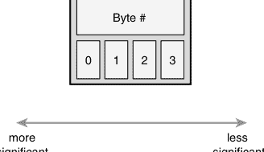
图 19.1 大端字节序。

x86 架构（包括 32 位和 64 位变体）是小端的。大多数其他架构是大端的。

让我们看看这种编码在实践中意味着什么。考虑数字 1027，以四字节整数的二进制形式存储：

`00000000 00000000 00000100 00000011`

图 19.2 小端字节序。

内存中的内部存储在大端和小端之间有所不同，如表 19.3 所示。

**表 19.3 大端与小端对比**

| 地址 | 大端 | 小端 |
| :--- | :--- | :--- |
| 0 | 00000000 | 00000011 |
| 1 | 00000000 | 00000100 |
| 2 | 00000100 | 00000000 |
| 3 | 00000011 | 00000000 |

请注意，大端架构将其最高有效字节存储在最小的地址中。这与小端正好相反。

作为一个最后的示例，这里有一些代码片段用于测试给定的架构是大端还是小端：

```c
int x = 1;
if (*(char *)&x == 1)
    /* little endian */
else
    /* big endian */
```

这段代码在用户空间或内核内部均可运行。

> **大端和小端的历史**
> *big-endian*（大端）和 *little-endian*（小端）这两个术语源自乔纳森·斯威夫特 1726 年的讽刺小说《格列佛游记》。在小说中，虚构的小人国人面临的一个重大政治问题是：鸡蛋应该从大端敲开还是从小端敲开。支持大端的人被称为 big-endians，而支持小端的人被称为 little-endians。
> 小人国人的争论与我们关于大端与小端的争论之相似之处在于，这种争论更多地根植于政治而非技术优势。

Linux 中支持的每种架构在`<asm/byteorder.h>`中定义了`__BIG_ENDIAN`或`__LITTLE_ENDIAN`之一，以对应机器的字节序。

该头文件还包含了一组来自`include/linux/byteorder/`的宏，用于辅助在各种字节序之间进行转换。最常用的宏是：

```c
u32 __cpu_to_be32(u32);   /* 将 CPU 字节序转换为大端 */
u32 __cpu_to_le32(u32);   /* 将 CPU 字节序转换为小端 */
u32 be32_to_cpu(u32);    /* 将大端转换为 CPU 字节序 */
u32 le32_to_cpu(u32);    /* 将小端转换为 CPU 字节序 */
```

这些宏用于在一种字节序和另一种字节序之间转换。如果字节序相同（例如，从原生字节序转换为大端，且处理器本身就是大端的），这些宏则不执行任何操作。否则，它们将返回转换后的值。

## 时间 (Time)

时间的测量是另一个在不同架构甚至不同内核版本之间可能有所不同的内核概念。永远不要假设定时器中断的频率或每秒的 jiffies 数量。相反，应始终使用 HZ 来正确缩放你的时间单位。这很重要，因为定时器频率不仅在不同架构之间可能有所不同，而且在给定的架构上，从一个内核版本到下一个版本也可能发生变化。

例如，在 x86 平台上，HZ 为 100。也就是说，定时器中断每秒发生 100 次，即每 10 毫秒一次。然而，在早期的 2.6 内核系列中，x86 上的 HZ 为 1000。在其他架构上，数值则不同：Alpha 的 HZ 等于 1024，ARM 的 HZ 等于 100。

永远不要简单地将`jiffies`与 100 这样的数字进行比较并假设它总是代表相同的含义。为了适当缩放时间，请乘以或除以 HZ。例如：

```c
HZ              /* 一秒 */
(2*HZ)          /* 两秒 */
(HZ/2)          /* 半秒 */
(HZ/100)        /* 10 毫秒 */
(2*HZ/100)      /* 20 毫秒 */
```

HZ 定义在`<asm/param.h>`中。该主题将在第 10 章进一步讨论。

## 页大小 (Page Size)

在处理内存页时，永远不要假设页大小。x86-32 程序员经常犯的一个错误是假设页大小为 4KB。虽然这在 x86-32 机器上是正确的，但其他架构具有不同的尺寸。事实上，一些架构支持多种页大小！表 19.4 列出了每个支持架构的有效页大小。

**表 19.4 架构页大小**

| 架构 | PAGE_SHIFT | PAGE_SIZE |
| :--- | :--- | :--- |
| alpha | 13 | 8KB |
| arm | 12, 14, 15 | 4KB, 16KB, 32KB |
| avr | 12 | 4KB |
| cris | 13 | 8KB |
| blackfin | 12 | 4KB |
| frv | 14 | 16KB |
| h8300 | 12 / 12, 13, 14, 16 | 4KB / 4KB, 8KB, 16KB, 64KB |
| m32r | 12 | 4KB |
| m68k | 12, 13 | 4KB, 8KB |
| m68knommu | 12 | 4KB |
| mips | 12 | 4KB |
| mn10300 | 12 | 4KB |
| parisc | 12 | 4KB |
| powerpc | 12 | 4KB |
| s390 | 12 | 4KB |
| sh | 12 | 4KB |
| sparc | 12, 13 | 4KB, 8KB |
| um | 12 | 4KB |
| x86 | 12 | 4KB |
| xtensa | 12 | 4KB |

在处理内存页时，请使用`PAGE_SIZE`作为页的大小（单位为字节）。`PAGE_SHIFT`的值是将地址左移以得出其页码的位数。例如，在页大小为 4KB 的 x86-32 上，`PAGE_SIZE`为 4096，`PAGE_SHIFT`为 12。这些值定义在`<asm/page.h>`中。

## 处理器排序 (Processor Ordering)

回顾第 9 章“内核同步简介”和第 10 章，不同架构具有不同程度的处理器排序。有些架构具有严格的排序约束，所有加载（load）和存储（store）操作都按照代码规定的顺序发生。其他芯片则具有弱排序，加载和存储操作会根据处理器的认为合适的方式进行重排。

在你的代码中，如果你依赖于数据排序，请确保通过使用适当的屏障（例如`rmb()`和`wmb()`），即使是最弱排序的处理器也能以正确的顺序提交你的加载和存储操作。第 10 章有更多信息。

## SMP、内核抢占和高内存 (SMP, Kernel Preemption, and High Memory)

将对称多处理（SMP）、内核抢占和高内存包含在可移植性的讨论中似乎有些不准确。毕竟，这些不是影响操作系统的机器特性，而是 Linux 内核的功能，而且在某种程度上确实与架构无关。然而，它们代表了你应该在代码中始终假设可用的重要配置选项。也就是说，始终针对 SMP/抢占/高内存系统进行编程，这样在任何配置中你都会安全。除了之前的可移植性规则外，你还需要遵循以下规则：

- 始终假设你的代码将运行在 SMP 系统上，并使用适当的锁。
- 始终假设你的代码将在启用内核抢占的情况下运行，并使用适当的锁和内核抢占语句。
- 始终假设你的代码将运行在具有高内存（非永久映射内存）的系统上，并根据需要使用`kmap()`。

## 结论 (Conclusion)

为 Linux 内核编写可移植、简洁、规范的代码有两个主要含义：

- 始终针对“最大公约数”进行编码：假设任何事情都可能发生，并且任何潜在的约束都存在。
- 始终假设只有“最小公分母”可用：不要假设任何给定的内核功能可用，且仅要求最低的架构特性。

编写可移植的代码需要意识到许多问题，包括字长、数据类型大小、对齐、填充、字节序、符号性、端序、页大小以及处理器的加载/存储排序。在大多数内核编程中，主要关注点是确保正确使用数据类型。尽管如此，总有一天会遇到陈旧的架构问题，因此理解可移植性问题并在内核中始终编写简洁、可移植的代码至关重要。

## 20 个补丁、黑客行为与社区 (20 Patches, Hacking, and the Community)

Linux 最大的好处之一就是围绕它的大量用户和开发者社区。社区提供了检查代码的眼睛、提供建议的专家，以及测试和报告问题的用户。最重要的是，社区是决定哪些代码被接受到 Linux 官方内核树中的最终裁决者。理解系统如何运作极其重要。

## 社区 (The Community)

如果 Linux 内核社区必须有一个家，那一定是 *Linux Kernel Mailing List*。Linux 内核邮件列表（或者常客简称为 *lkml*）是大多数关于内核的公告、讨论、辩论和口水战的所在地。新功能在此讨论，大多数代码在采取任何行动之前都会发布到该列表中。该列表每天接收超过 300 条消息，因此不适合胆小的人。建议任何对严肃内核开发感兴趣的人订阅（或至少阅读摘要或存档）。仅仅通过观察这些大牛工作，你就能学到很多。

你可以通过向`majordomo@vger.kernel.org`发送以下纯文本消息来订阅：

```
subscribe linux-kernel <your@email.address>
```


你可以在`http://vger.kernel.org/`获取更多信息，并在`http://www.tux.org/lkml/`查看常见问题解答（FAQ）。

许多网站和其他邮件列表专门涉及内核以及广义的 Linux。对于初学者来说，一个极好的资源是`http://kernel-newbies.org/`—— 一个专门为那些在内核领域初试身手的人提供服务。另外两个出色的内核信息来源是`http://www.lwn.net/`（Linux Weekly News），它有一个很棒的内核新闻板块，以及`http://www.kerneltrap.org/`（Kernel Trap），它提供了关于内核开发的深刻点评。

## Linux 编程风格

Linux 内核与任何大型软件项目一样，拥有一套定义明确的编程风格，规定了代码的格式、风格和布局。这样做并不是因为 Linux 内核的风格更优越（尽管可能确实如此），也不是因为你的风格不合格，而是因为编程风格的一致性对于编码效率至关重要。然而，人们经常争论说编程风格无关紧要，因为它不影响编译后的目标代码。但在像内核这样一个涉及众多开发者的大型项目中，编程风格的一致性至关重要。一致性意味着熟悉感，从而带来易读性、减少困惑，并进一步让人预期代码将继续遵循给定的风格。这增加了能够阅读你的代码的开发者数量，以及你能阅读的代码量。在开源项目中，眼睛越多越好。

选择什么样的风格并不那么重要，只要确实选定了一种并严格执行即可。幸运的是，Linus 早在很久以前就规定了我们应该使用的风格，且大多数代码都遵循这一风格。大部分风格指南以 Linus 特有的幽默感记录在内核源码树的`Documentation/CodingStyle`文件中。

### 缩进

缩进的风格惯例是使用长度为 8 个字符的制表符（tab）。这并不意味着可以使用 8 个空格来进行缩进。每一级缩进比前一级多一个制表符，而一个制表符的长度为 8 个字符。例如：

```c
static void get_new_ship(const char *name)
{
	if (!name)
		name = DEFAULT_SHIP_NAME;
	get_new_ship_with_name(name);
}
```

出于不明确的原因，尽管该规则对可读性影响极大，但它是最容易被违反的规则之一。在长时间的黑客攻坚之后，8 个字符的制表符能让识别不同代码块的缩进变得简单几个数量级。当然，8 字符制表符的缺点是，如果缩进达到好几层，一行中剩下的可用空间就不多了。而 80 个字符的行宽限制（见后续章节）进一步加剧了这个问题。Linus 对此的反驳是，你的代码不应该复杂且 convoluted 到需要超过两三层缩进。他认为，如果你需要写那么深，就应该重构代码，将复杂的层次（以及相应的缩进层级）提取到独立的函数中。

### Switch 语句

从属的`case`标签应与父级`switch`语句保持相同的缩进级别，这有助于缓解 8 字符制表符带来的影响。例如：

```c
switch (animal) {
case ANIMAL_CAT:
    handle_cats();
    break;
case ANIMAL_WOLF:
    handle_wolves();
    /* fall through */
case ANIMAL_DOG:
    handle_dogs();
    break;
default:
    printk(KERN_WARNING "Unknown animal %d!\n", animal);
}
```

正如本例所示，当刻意让一个`case`语句直接进入另一个`case`语句（fall through）时，添加注释是一种常见（且良好）的实践。

## 空格

本节涵盖符号和关键字周围的空格，而不是前两节讨论的用于缩进的空格。总的来说，Linux 编程风格规定大多数关键字周围要留空格，而函数及其括号之间不留空格。例如：

```
if (foo)
while (foo)
for (i = 0; i < NR_CPUS; i++)
switch (foo)
```

相反，函数、宏以及看起来像函数的关键字——例如`sizeof`、`typeof`和`alignof`——在关键字和括号之间同样不留空格。

```
wake_up_process(task);
size_t nlongs = BITS_TO_LONG(nbits);
int len = sizeof(struct task_struct);
typeof("p")
__alignof__(struct sockaddr *)
__attribute__((packed))
```

在括号内部，参数的前后不留空格，如前所示。例如，以下写法是被禁止的（verboten）：

```
int prio = task_prio( task ); /* BAD STYLE! */
```

在大多数二元和三元运算符周围，在运算符的两侧各放一个空格。例如：

```
int sum = a + b;
int product = a * b;
int mod = a % b;
int ret = (bar) ? bar : 0;
```

```c
return (ret ? 0 : size);
int nr = nr ? 1; /* allowed shortcut, same as "nr ? nr : 1" */
if (x < y)
if (tsk->flags & PF_SUPERPRIV)
mask = POLLIN | POLLRDNORM;
```

相反，在大多数一元运算符周围，运算符和操作数之间不留空格：

```c
if (!foo)
int len = foo.len;
struct work_struct *work = &dwork->work;
foo++;
-bar;
unsigned long inverted = -mask;
```

正确处理解引用运算符周围的空格尤为重要。正确的风格是：

```c
char *strcpy(char *dest, const char *src)
```

在解引用运算符两侧都放置空格是不正确的风格：

```c
char * strcpy(char * dest, const char * src) /* BAD STYLE */
```

将解引用运算符放在类型旁边的 C++ 风格也是不正确的：

```c
char* strcpy(char* dest, const char* src) /* BAD STYLE */
```

### 花括号

花括号的放置是个人习惯问题，采用某种惯例在技术上并没有太多的理由，但我们必须达成共识。内核认可的风格是将左花括号放在第一行的末尾。右花括号则单独起一行，作为该行的第一个字符。示例如下：

```c
if (strncmp(buf, "NO", 3) == 0) {
    neg = 1;
    cmp += 3;
}
```

如果随后的标记（token）是同一语句的延续，则右花括号不单独占一行，而是与该标记共享一行。例如：

```c
if (ret) {
    sysctl_sched_rt_period = old_period;
    sysctl_sched_rt_runtime = old_runtime;
} else {
    def_rt_bandwidth.rt_runtime = global_rt_runtime();
    def_rt_bandwidth.rt_period = ns_to_ktime(global_rt_period());
}
```

以及这个例子：

```c
do {
	percpu_counter_add(&ca->cpustat[idx], val);
	ca = ca->parent;
} while (ca);
```

对于函数，这条规则不适用，因为函数不能在函数内部嵌套：

```c
unsigned long func(void)
{
	/* ... */
}
```

最后，不需要花括号的语句可以省略它们。例如，以下写法是被鼓励的，但非强制要求：

```c
if (cnt > 63)
	cnt = 63;
```

这一切背后的逻辑是*K&R*。Linux 编程风格的大部分遵循*K&R 风格*，即那本著名的书中所使用的 C 编程风格。

### 行宽

源代码行长应保持在 80 个字符以内。这样代码在标准的 80x24 终端上可以刚好完整显示。

对于代码绝对必须超过 80 个字符的情况，目前没有公认的标准做法。一些开发者直接允许换行，由编辑器决定如何以可读的方式显示代码。其他开发者则会手动将行拆分，在适当的地方插入换行符，新的一行可能比原行多一个制表符的缩进。

同样，一些开发者会将换行的函数参数与左括号对齐。例如：

```c
static void get_new_parrot (const char *name,
				 unsigned long disposition,
				 unsigned long feather_quality)
```

其他开发者虽然拆分行但不对齐参数，而是使用标准的两个制表符：

```c
int find_pirate_flag_by_color(const char *color,
			 const char *name, int len)
```

由于在这种情况下没有绝对的规则，选择权留给开发者。包括我在内的许多内核贡献者更倾向于前一种示例：手动拆分长度超过 80 个字符的行，并尽量使产生的新行与前一行整齐对齐。

> 《C Programming Language》，由 Brian Kernighan 和 Dennis Ritchie 编写（Prentice Hall, ISBN# 0-13-11-362-8），绰号 K&R，是 C 语言的圣经，由 C 语言作者及其同事编写。

## 命名

不应使用`CamelCase`（驼峰命名法）、`Studly Caps`或其他混合大小写方案。如果变量的作用很明确，将局部变量命名为`idx`甚至仅仅是`i`是完全没问题的。像`LoopIndex`这样花俏的名字是不可接受的。匈牙利命名法（在变量名中编码变量类型）是不必要的，绝不应该使用。这是 C，不是 Java；是 Unix，不是 Windows。

尽管如此，全局变量和函数应具有描述性的名称，采用小写，并根据需要用下划线分隔。将全局函数命名为`atty()`会令人困惑；像`get_active_tty()`这样的名称则更容易被接受。这是 Linux，不是 BSD。

## 函数

经验法则，函数不应超过一到两个屏幕的文本量，且局部变量应少于 10 个。一个函数应该只做一件事并把它做好。将一个函数拆分为一系列较小的函数没有坏处。如果你担心函数调用开销，可以使用`inline`关键字定义内联函数。

## 注释

为代码编写注释很重要，但必须正确地编写。通常，你应该描述代码在做*什么*以及*为什么*这么做，而不是*如何*做。*如何*做应该从代码本身就能看出。如果看不出，你可能需要重新思考并重构你写的内容。此外，注释不应包含谁写了该函数、修改日期或其他琐碎的废话。不过，此类信息通常可以放在源文件的顶部。

内核使用 C 风格的注释，尽管`gcc`也支持 C++ 风格的注释。内核中注释的一般风格类似于：

```
/*
 * get_ship_speed() - return the current speed of the pirate ship
 * We need this to calculate the ship coordinates. As this function can sleep,
 * do not call while holding a spinlock.
 */
```

在注释中，重要注意事项通常以前缀`"XXX:"`开头，而 bug 通常以前缀`"FIXME:"`开头，如下所示：

```
/*
 * FIXME: 我们假设 dog == cat，这在未来可能不再成立
 */
```

内核具有一套自动生成文档的机制。它基于 GNOME-doc，但经过轻微修改并重新命名为 Kernel-doc。要创建 HTML 格式的独立文档，请运行：

```
make htmldocs
```

或者创建 PostScript 格式：

```
make psdocs
```

你可以通过为注释遵循一种特殊格式，利用该系统来为你的函数编写文档：

```
/**
 * find_treasure - 寻找“X 标记处”
 * @map - 藏宝图
 * @time - 宝藏被隐藏的时间
 * 
 * 必须在持有 pirate_ship_lock 时调用。
 */
void find_treasure(int map, struct timeval *time)
{
    /* ... */
}
```

更多信息，请参阅`Documentation/kernel-doc-nano-HOWTO.txt`。

## Typedefs（类型定义）

Linux 内核开发社区非常不喜欢`typedef`操作符。他们的理由是：

- `typedef`隐藏了数据结构的真实类型。
- 由于类型被隐藏，代码更容易出现错误，例如在栈上通过值传递结构体。
- 使用`typedef`纯粹是因为懒惰。

因此，为了避免被嘲笑，请避免使用`typedef`。

当然，`typedef`也有一些合理的用途：隐藏变量的架构特定实现，或者在类型可能发生变化时提供前向兼容性。请仔细决定`typedef`是真正必要，还是仅仅为了减少需要输入的字符数。

## 使用现有例程

不要重复造轮子。内核提供了字符串操作函数、压缩例程和链表接口，请直接使用它们。

不要将现有接口包装在通用接口中。你经常会看到显然是从其他操作系统移植到 Linux 的代码，各种内核接口被包装在一些臃肿的胶水函数中。没有人喜欢这样，所以请直接使用提供的接口。

## 尽量减少源代码中的 ifdefs

在 C 源代码中直接放置`ifdef`预处理器指令是不受欢迎的。你绝不应该在函数中执行如下操作：

```c
#ifdef CONFIG_FOO
    foo();
#endif
```

相反，如果`CONFIG_FOO`未设置，应将`foo()`定义为空：

```c
#ifdef CONFIG_FOO
static int foo(void)
{
    /* ... */
}
#else
static inline int foo(void) { }
#endif /* CONFIG_FOO */
```

然后，你可以无条件地调用`foo()`。让编译器为你完成工作。

## 结构体初始化器

应使用标记标识符（Labeled identifiers）来初始化结构体。这样做很好，因为它可以防止结构体更改导致初始化错误。它还允许省略某些值。不幸的是，C99 采用了一种相当丑陋的标记标识符格式，而 gcc 正在弃用之前的 GNU 风格标记标识符（那个风格相当漂亮）。因此，内核代码需要使用新的 C99 标记标识符格式，无论它多么丑陋：

```c
struct foo my_foo = {
    .a = INITIAL_A,
    .b = INITIAL_B,
};
```

在这段代码中，`a`和`b`是`struct foo`的成员，`INITIAL_A`和`INITIAL_B`分别是它们的初始化值。如果某个字段未设置，根据 ANSI C 标准，它将被设置为默认值（例如，指针为`NULL`，整数为 0，浮点数为 0.0）。例如，如果`struct foo`还有一个`int c`成员，之前的语句会将`c`初始化为 0。

## 事后修正代码

如果你接手了一堆甚至连 Linux 内核编程风格的影子都没有的代码，不要焦虑。一点勤奋和`indent`工具就能让一切变得完美。`indent`是大多数 Linux 系统上都有的一个优秀的 GNU 工具，它根据给定的规则格式化源代码。默认设置是 GNU 编程风格，那并不太好看。要让该工具遵循 Linux 内核风格，请执行以下命令：

```
indent -kr -ih -ts8 -sos -sb -ss -bs -psl <file>
```


这将指示该工具根据内核编程风格格式化代码。或者，脚本`scripts/Lindent`会自动调用带有所需选项的`indent`。

## 指挥链

内核黑客（Kernel hackers）是指从事内核开发的开发者。有些人以此为业，有些人将其作为爱好，但几乎所有人都是为了乐趣。做出重大贡献的内核黑客被列在内核源码树根目录的`CREDITS`文件中。

内核的大部分内容都有一个相关的*维护者（maintainer）*。维护者是负责内核特定部分的个人（或团队）。例如，每个单独的驱动程序都有一个相关的维护者。每个内核子系统（例如网络）也有一个相关的维护者。特定驱动程序或子系统的维护者通常列在`MAINTAINERS`文件中，该文件同样位于内核源码树的根目录下。

有一种特殊的维护者，被称为内核维护者。这个人实际上维护整个内核树。从历史上看，Linux 在开发内核（真正有趣的地方）完成后的某段时间内，会维护开发内核和稳定内核。在开发内核变成稳定内核后不久，Linux 会将接力棒交给顶尖内核开发者之一。该开发者继续维护该树，而 Linux 开始在新的开发树上工作。鉴于 2.6 版本开发将永无止境的“新世界秩序”，Linux 仍然是 2.6 内核系列的维护者。另一位开发者维护 2.4 系列，该系列处于严格的仅限 Bug 修复模式。

## 提交 Bug 报告

如果你遇到了 Bug，最好的做法是编写修复程序，创建补丁，进行测试，并按照以下章节所述提交。当然，你也可以报告问题并让别人帮你修复。

提交 Bug 报告最关键的部分是完整地描述问题。描述症状、任何系统输出以及完整解码后的 oops（如果有 oops 的话）。更重要的是，如果可能的话，请提供可靠复现问题的步骤以及你硬件的简要描述。

下一步是决定将 Bug 报告发送给谁。内核源码树根目录下的`MAINTAINERS`文件列出了与每个驱动程序和子系统相关的人员——他们应该接收与他们维护的代码相关的所有问题。如果你找不到相关负责人，请将报告发送到 Linux 内核邮件列表`linux-kernel-devel@vger.kernel.org`。即使你找到了维护者，也要抄送（CC）给内核邮件列表。

`REPORTING-BUGS`和`Documentation/oops-tracing.txt`文件提供了更多信息。

## 补丁（Patches）

所有对 Linux 内核的更改都以补丁的形式分发，补丁是 GNU`diff(1)`程序的输出，且格式可被`patch(1)`程序读取。

### 生成补丁

生成补丁最简单的方法是准备两棵源码树：一棵是原生的标准内核，另一棵是包含你修改的标准树。一种常见的方案是将标准树命名为`linux-x.y.z`（这是源码 tar 包最初解压出的名称），将你修改后的树简单地命名为`linux`。然后，要在两棵树之间生成补丁，请在源码树所在的上一级目录执行以下命令：

```
diff -urN linux-x.y.z/ linux/ > my-patch
```

这通常在你的家目录下完成，而不是在`/usr/src/linux`中，这样你就不需要 root 权限。`-u`标志指定使用统一 diff 格式（unified diff format）。如果没有这个标志，补丁会很丑且人类无法阅读。`-r`标志指示`diff`递归地对比所有目录，`-N`标志指定修改后的树中的新文件应包含在 diff 中。或者，如果你只需要对比单个文件，可以执行：

```
diff -u linux-x.y.z/some/file linux/some/file > my-patch
```

你必须始终在源码树的上一级目录进行 diff。这样创建的补丁对他人可用，即使他们的目录名称不同。要应用这种格式的补丁，请在源码树的根目录下执行以下操作：

```
patch -p1 < ../my-patch
```

在这个例子中，补丁名为`my-patch`，且创建在当前目录的上一级。`-p1`标志指示`patch`从补丁中剥离第一个目录。这使你能够无论补丁制作者使用什么样的目录命名约定，都能应用该补丁。

一个非常有用的实用工具是`diffstat`，它可以生成补丁变更（行增加和删除）的直方图。要为你的补丁生成输出，请执行：

```
diffstat -pl my-patch
```

在向 lkml 提交补丁时，包含此输出通常很有用。由于`patch(1)`程序会忽略所有行直到检测到 diff 为止，你甚至可以在补丁顶部包含一段简短的描述。

## 使用 Git 生成补丁

如果你使用 Git 来管理源代码树，那么你也需要使用 Git 来生成补丁——没必要经历上述所有手动步骤并承担 Git 的复杂性。使用 Git 生成补丁是一个简单的两步过程。首先，你需要编写代码并然后在本地提交更改。对 Git 树进行更改与对标准源代码树进行更改相同。编辑存储在 Git 中的文件不需要进行任何特殊操作。在完成更改后，你需要将它们提交到 Git 仓库：

```
git commit -a
```

`-a`标志指示 Git 提交所有更改。如果你只想提交特定文件的更改，也可以这样做：

```
git commit some/file.c
```

然而，即使使用了`-a`标志，Git 也不会提交新文件，直到它们被显式添加到仓库中。要添加文件然后提交它（以及所有其他更改），请执行以下两条命令：

```
git add some/other/file.c
git commit -a
```

当你运行`git commit`时，Git 允许你输入变更日志。请使此条目详细且完整，充分解释这次提交。（我们将在下一节中具体介绍应包含的内容。）你可以对仓库创建多个提交。得益于 Git 的设计，随后的提交甚至可以针对同一个文件，且彼此基于前一次提交构建。当你的树中有一个（或两个）提交时，你可以为每个提交生成一个补丁，你可以像对待前一节描述的补丁那样对待它们：

```
git format-patch origin
```

这会为仓库中所有存在且不在原始树中的提交生成补丁。Git 将补丁创建在内核源代码树的根目录下。要仅为最后 N 个提交生成补丁，可以执行以下命令：

```
git format-patch -N
```

例如，此命令仅为最后一个提交生成补丁：

```
git format-patch -1
```


## 提交补丁

补丁应按照前一节所述生成。如果补丁涉及特定的驱动程序或子系统，则应将补丁发送给`MAINTAINER`中列出的维护者。无论如何，都应抄送给`linux-kernel@vger.kernel.org`的 Linux 内核邮件列表。只有在经过广泛讨论之后，或者补丁非常简单且明显正确时，才应将补丁发送给内核维护者（例如 Linus）。

通常，包含补丁的电子邮件主题行格式为“`[PATCH] 简短描述`”。邮件正文以技术细节描述补丁所做的更改及其背后的理由。请尽可能具体。在邮件中的某个地方，注明创建该补丁时所针对的内核版本。

大多数内核开发人员希望在邮件中直接阅读你的补丁，并选择性地将整个内容保存到单个文件中。因此，最好将补丁直接内联插入到邮件的正文末尾。请注意，某些电子邮件客户端可能会自动换行或更改格式，这会破坏补丁并干扰开发人员。如果你的邮件客户端有此行为，请检查它是否有“内联插入”、“预格式化”或类似功能。否则，将补丁作为不编码的纯文本附件发送也可以。

如果你的补丁很大或包含多个逻辑更改，你应该将补丁拆分为块，每个块代表一个逻辑更改。例如，如果你既引入了一个新`API`又更改了几个驱动程序以使用它，你可以将更改拆分为两个补丁（新`API`和随后的驱动程序切换）并发送两封邮件。如果任何块需要之前的补丁，请明确说明。

发布后，请保持耐心并等待回复。不要因为任何负面响应而气馁，至少你得到了回应！讨论问题并在需要时提供更新后的补丁。如果你没有收到任何回应，尝试找出问题所在并解决。向邮件列表和维护者寻求更多建议。运气好的话，你可能会在未来的内核发行版中看到你的更改，恭喜！

## 结语

任何黑客最重要的品质就是欲望和驱动力，一种想要解决问题的渴望，以及解决它的决心。本书带你游览了内核的关键部分，讨论了接口、数据结构、算法和设计原理。它以实用方式提供了内核的内部视角，以满足你的好奇心，或让你在内核探索之路上快速起步。

然而，正如我之前所说，开始的唯一方法就是阅读和编写代码。Linux 提供了一个不仅允许而且鼓励这两项活动的社区，所以开始阅读和编码吧！祝你`hacking`愉快！

## 参考文献

本参考文献列表列出了与本书互补的作品。请注意，与本书互补的最佳“额外阅读”资料就是内核源码。在 Linux 领域工作，我们都被赋予了完整且不受限制地访问整个现代操作系统源代码的权力。不要认为这是理所当然的。潜入其中吧！阅读并编写代码！

### 操作系统设计书籍

这些书籍涵盖了本科课程中讨论的操作系统设计。它们都处理了设计一个功能完整的操作系统所涉及的概念、算法、问题和解决方案。我都推荐它们，但如果我只能选一本，Deitel 的书既全面又具有很强的可读性。

- Deitel, H., P. Deitel, and D. Choffines. `Operating Systems`. Prentice Hall, 2003. 一部关于操作系统理论的精彩`tour de force`（力作），包含一些将理论付诸实践的优秀案例研究。
- Tannenbaum, Andrew. `Modern Operating Systems`. Prentice Hall, 2007. 对标准操作系统设计问题的强力概述，并讨论了当今现代操作系统（如 UNIX 和 Windows）中使用的许多概念。
- Tannenbaum, Andrew. `Operating Systems: Design and Implementation`. Prentice Hall, 2006. 关于类 Unix 系统 Minix 的设计和实现的极佳入门著作。
- Silberschatz, A., P. Galvin, and G. Gagne. `Operating System Concepts`. John Wiley and Sons, 2008. 因封面上有看似无关的恐龙而被统称为“恐龙书”。它是操作系统设计的绝佳入门书。该书经常修订，任何版本都适用。

### Unix 内核书籍

这些书籍探讨了 Unix 内核的设计和实现。前五本讨论特定的 Unix 变体，后两本侧重于所有 Unix 变体共有的问题。如果你只想买其中两本，我坚持推荐最后两本。

- Bach, Maurice. `The Design of the Unix Operating System`. Prentice Hall, 1986. 对 Unix System V Release 2 设计的良好探讨。
- McKusick, M., K. Bostic, M. Karels, and J. Quarterman. `The Design and Implementation of the 4.4BSD Operating System`. Addison-Wesley, 1996. 由系统设计者撰写的关于`4.4BSD`系统设计的良好探讨。
- McKusick, M. and G. Neville-Neil. `The Design and Implementation of the FreeBSD Operating System`. Addison-Wesley, 2004. 对 FreeBSD 5.2 设计和实现的良好探讨。
- McDougall, R. and J. Mauro. `Solaris Internals: Solaris and OpenSolaris Kernel Architecture`. Prentice Hall, 2006. 对 Solaris 内核中核心子系统和算法的有趣探讨。
- Cooper, C., and C. Moore. `HP-UX 11i Internals`. Prentice Hall, 2004. 探讨`HP-UX`内部结构和`PA-RISC`架构。
- Vahalia, Uresh. `Unix Internals: The New Frontiers`. Prentice Hall, 1995. 一本关于现代 Unix 特性（如线程管理和内核抢占）的卓越书籍。
- Schimmel, Curt. `UNIX Systems for Modern Architectures: Symmetric Multiprocessing and Caching for Kernel Programmers`. Addison-Wesley, 1994. 一本关于在现代架构上支持现代 Unix 之艰辛的卓越书籍。强烈推荐。

### Linux 内核书籍

这些书籍与本书一样，讨论 Linux 内核。这一类目中优秀的书籍不多，但我推荐这两本。

- Benvenuti, Christian. `Understanding Linux: Network Internals`. O'Reilly and Associates, 2005. 对 Linux 网络深入探讨。
- Corbet, J., A. Rubini, and G. Kroah-Hartman. `Linux Device Drivers`. O'Reilly and Associates, 2005. 关于如何为`2.6`内核编写设备驱动程序的极佳讨论，重点在于支持各种类型设备的编程接口。

### 其他内核书籍

了解你的竞争对手总是有好处的。这些书籍讨论了除 Linux 之外的操作系统设计和实现。看看它们哪里做得对，哪里做得错。

- Kogan, M. and H. Deitel. `The Design of OS/2`. Addison-Wesley, 1996. 对`OS/2 2.0`的有趣探讨。
- Singh, Amit. `Mac OS X Internals: A Systems Approach`. Addison-Wesley Professional, 2006. 一篇关于整个 Mac OS X 系统的论述，既深刻又全面。
- Solomon, D., and M. Russinovich. `Windows Internals: Covering Windows Server 2008 and Windows Vista`. Microsoft Press, 2009. 对一个相当非 Unix 操作系统的有趣探讨。

### 关于 Unix API 的书籍

对 Unix 系统及其`API`的深入讨论不仅对于编写强大的用户空间程序至关重要，而且对于理解内核的职责也同样重要。

- Love, Robert. `Linux System Programming`. O'Reilly and Associates, 2007. 本人关于系统级 Linux 编程的著作，涵盖了 Linux 系统调用和`libc API`，并关注 Linux 特有的技巧和提示。
- Stevens, W.R, and S. Rago. `Advanced Programming in the UNIX Environment`. Addison-Wesley, 2008. 一本关于 Unix 系统调用接口的卓越（甚至可以说是权威的）讨论。
- Stevens, W.Richard. `UNIX Network Programming, Volume 1`. Prentice Hall, 2004. 一本关于 Unix 系统所使用的`sockets API`的经典教材。

### 关于 C 编程语言的书籍

Linux 内核以及 Linux 系统的很大一部分是用 C 语言编写的。这两本书涵盖了该主题。

- Kernighan, B. and D. Ritchie. `The C Programming Language`. Prentice Hall, 1988. C 语言编程的权威著作，由 C 语言之父及其同事编写。
- van der Linden, Peter. `Expert C Programming`. Prentice Hall, 1994. 对 C 语言中一些较少被理解的细节进行了极佳的讨论。作者具有极佳的幽默感。

### 其他著作

这里收集了一些并非严格相关但讨论了无疑会影响操作系统的相关话题的书籍。

- Hofstadter, Douglas. `Gödel, Escher, Bach: An Eternal Golden Braid`. Basic Books, 1999. 对人类思想的深刻且不可或缺的探讨，广泛涉猎多个主题，包括计算机科学。
- Knuth, Donald. `The Art of Computer Programming, Volume 1`. Addison-Wesley, 1997. 关于计算机科学基础算法的无价巨著，包括用于内存管理中的最佳适应（`best-fit`）和最差适应（`worst-fit`）算法。

## 网站

- Kernel.org. 内核源码的官方仓库。它也是大量核心内核黑客补丁的聚集地。`www.kernel.org`。
- Linux Weekly News. 一个优秀的新闻网站，对每周的 Linux 新闻（包括内核动态）提供聪明且准确的评论。强烈推荐。`www.lwn.net`。
- OS News. 操作系统新闻，包含原创文章、采访和评论。`www.osnews.com`。

## 索引

`64`位原子操作, 180-181

### A

- 绝对时间（`absolute time`）, 207
- 抽象层，`VFS`（虚拟文件系统）, 262-263
- `account_process_tick()`函数, 219
- 动作修饰符，`GFP_mask`标志, 239-240
- 动作字符串，内核事件层（`Kernel Event Layer`）, 361
- `activate_task()`函数, 61
- 地址区间（`address intervals`）
  - 创建, 318-320
  - 移除, 320
- `address_space`对象，页缓存, 326-328
- `address_space`操作，页缓存, 328-330
- `Advanced Programming in the UNIX Environment`, 409
- 建议锁（`advisory locks`）, 166
- `AIX`（`IBM`）, 2
- 算法（`algorithms`）, 109-111
  - 渐近行为（`asymptotic behavior`）, 109
  - 大 O 表示法（`big-o notation`）, 109
  - 大 `$\Theta$` 表示法（`big-theta notation`）, 109-110
  - 先知算法（`clairvoyant`）, 325
  - 复杂度, 109-110
    - 时间复杂度, 110-111
  - 列表, 110-111
  - 进程调度器, 46-50
  - 可扩展性, 109
  - 调度算法，基于优先级的调度, 44
- 数据对齐（`alignment of data`）, 386-387
  - 问题, 387
  - 非标准类型, 387
  - 结构体填充（`structure padding`）, 387-389
- `alloc_pages()`函数, 236, 259
- `alloc_page()`函数, 236
- `alloc_percpu()`函数, 258
- 分配（`allocating`）
  - 内存, 237-244
  - 内存描述符, 308
  - 进程描述符, 25-26
  - `UID`（唯一标识符）, 101-102
  - 使用哪种方法, 259
- 分配内存, 231, 237, 260
  - 选择方法, 259
  - 高端内存映射, 253
  - 永久映射, 254
  - 临时映射, 254-255
  - `kfree()`函数, 243-244
  - `kmalloc()`函数, 238-244
  - `gfp_mask`标志, 238-243
  - 页（`pages`）, 231-232
    - 获取, 235-237
    - 每 `CPU`分配, 255-256
    - `slab`层, 245-246
      - 设计, 246-249
      - 接口, 249-252
  - 在栈上静态分配, 252-253
  - `vmalloc()`函数, 244-245
  - 区（`zones`）, 233-235
- 允许中断标志, 127
- 匿名映射（`anonymous mapping`）, 318
- 预期 `I/O`调度器（`Anticipatory I/O scheduler`）, 302-303
- `APIC`定时器, 217
- `API`
  - 系统调用, 70
  - `UNIX Network Programming`, 409
- 应用
  - 硬件，关系, 6
  - 中断处理程序，编写, 118-119
  - 内核，关系, 6
- `arch`目录，内核源码树, 13
- 参数，系统调用, 71
- 数组，每 `CPU`数据, 255
- `The Art of Computer Programming, Volume 1`, 409
- 汇编，内联汇编, 19
- 断言 `Bug`（`asserting bugs`）, 370-371
- 关联数组。见`map`
- 渐近行为，算法, 109
- 异步中断, 114
- 原子上下文（`atomic context`）, 115
- 原子高端内存映射, 254-255
- 原子操作，同步方法, 175
  - `64`位操作, 180-181
  - 位操作, 181-183
  - 转换, 177
  - 计数器实现, 177
  - 定义, 177
  - 自增, 175-176
  - 整数操作, 176-179
  - 接口, 176
  - 非原子位操作, 183
  - 开销优势, 179
  - 测试, 177
- `atomic_t`数据类型, 384
- 原子性，顺序，对比, 179

### B

- Bach, Maurice, 407
- 后备存储（`backing stores`）, 323
- 平衡二叉搜索树, 自平衡二叉搜索树
  - `rbtrees`, 106-108
  - 红黑树（`red-black trees`）, 105-106
- 屏障操作，顺序, 179
- `barrier()`函数, 206
- 屏障（`barriers`）
  - 函数, 204-205
  - 内存读/写, 203-206
- `bdflush`内核线程, 333-334
- 行为，系统调用, 71-72
- 贝尔实验室（`Bell Laboratories`），Unix 开发历史, 1
- Benvenuti, Christian, 408
- 伯克利软件发行版（`BSD`）, 2
- `BH`接口, `tasklets`, 148
- `bh_state`标志（缓冲区）, 292
- 大端字节序（`big-endian byte ordering`）, 389-391
- 大 O 表示法, 109
- 大 `$\Theta$`表示法, 109-110
- 二分查找，`git`源码管理工具, 676-677
- 二值信号量（`binary semaphores`）, 191-192
- 二叉树, 103-104
  - `BSTs`（二叉搜索树）, 104
  - 自平衡二叉搜索树, 105
    - `rbtrees`, 106-108
    - 红黑树, 105-106
- 绑定系统调用, 79-81
- `bio`结构体，块 `I/O`层, 294-295
- 位原子操作, 181-183
- `BKL`（大内核锁）, 198-199
- 块设备节点, 337
- 块设备, 289-290, 337
  - 缓冲区头（`buffer heads`）, 291
  - 缓冲区（`buffers`）, 291-294
  - 扇区, 290-291
- `block`目录，内核源代码, 13
- 块 `I/O`层, 290
  - `bi_cnt`字段, 296
  - `bi_idx`字段, 296
  - `bi_io_vecs`字段, 295
  - `bi_private`字段, 296
  - `bi_vcnt`字段, 295
  - `bio`结构体, 294-295
  - `I/O`向量, 295-296
    - 段（`segments`）, 294
    - 对比缓冲区头, 296-297
- 块（`blocks`）, 289-290, 337
- `BLOCK_SOFTIRQ` `tasklet`, 140
- `BogoMIPS`值, 227
- 布尔值（`Booleans`）, 14
- Bostic, K., 408
- 下半部（`bottom halves`）
  - 禁用, 157-159
  - 中断处理程序, 115, 133-135
  - 优点, 134-135
    - `BH`接口, 135-136
    - 任务队列, 135
  - 内部锁, 157
  - 机制选择标准, 156-157
  - `softirqs`, 136-141
  - 自旋锁（`spin locks`）, 187-188
  - `tasklets`, 136, 142-148
  - 版本术语, 137
  - 工作队列（`work queues`）, 149-156
- 大括号, 编码风格, 398-399
- 分支注释, `GNU C`, 19-20
- `BSTs`（二叉搜索树）, 104
- 缓冲区缓存（`buffer caches`）, 330-331
- 缓冲区，块, 291-294
- `Bug`报告，提交, 403-404
- `BUG()`例程, 270
- `BUG_ON()`例程, 270
- `Bug`
  - 断言, 370-371
  - 范围, 364
  - 复现, 363-364
- 构建（`building`）
  - 布尔值, 14-15
  - 内核, 13-16
  - 模块, 340-342
  - 噪音最小化, 15
  - 产生多个作业, 16
- 忙循环（`busy looping`），定时器, 225-226
- 字节序（`byte ordering`）, 389-391

### C

- C 库, 5
  - 系统调用, 70-71
- `The C Programming Language`, 399, 409
- C++ 风格注释, 400
- 缓存驱逐（`cache eviction`）, 324-325
- 缓存命中（`cache hits`）, 323
- 缓存缺失（`cache misses`）, 323
- 缓存, 246
  - 缓存缺失, 323
- 缓存机制（`caching`）
  - 后备存储, 323
  - 缓冲区缓存, 330-331
  - 缓存驱逐, 324-325
  - 缓存命中, 323
  - 页缓存, 324
- 页缓存（`page caches`）, 323-326
  - `address_space`对象, 326-328
  - `address_space`操作, 328-330
    - 全局哈希, 330
    - 基数树（`radix tree`）, 330
- 页缓存，文件系统文件, 326
  - 写缓存, 324
  - 写穿缓存（`write-through caches`）, 324
- `cdevs`。见字符设备
- `CFQ`（完全公平队列）`I/O`调度器, 303
- `CFS`调度器, 172
- 字符设备节点, 337
- 字符设备, 289, 337
- 字符，字长, 381
- 子任务，重新父化（`reparenting`）, 38
- Choffnes, David R., 407
- 循环链表, 86-87
- 先知算法（`clairvoyant algorithm`）, 325
- 类，进程调度器, 46-47
- `cli()`函数, 128
- 时钟，实时时钟（`RTC`）, 217
- `clone()`函数，标志, 34-35
- `clone()`系统调用, 32-34
- 簇（`clusters`）, 290
  - 粗粒度锁, 172
- 代码，中断安全代码, 168
- 代码，锁，对比, 186
- 编码风格（`coding style`）
  - 大括号, 398-399
  - 注释, 400-401
  - 一致性, 396
  - 现有例程, 402
  - 事后修复, 403
  - 函数, 400
    - `ifdef`预处理器指令, 402
    - 重要性, 396
- 数据结构, 415
  - 缩进, 396
  - 行长度, 399-400
  - 命名约定, 400
  - 生产力, 396
  - 空格, 397-398
  - 结构体初始化程序, 402-403
  - `switch`语句, 396-397
  - `typedefs`, 401

### 命令

- `modprobe`, 343
- `SysRq`, 371

注释，编码风格, 400-401

社区帮助资源，调试, 477

`complete()`函数, 198

完全公平调度器（`Completely Fair Scheduler`）, 43

完成变量（`completion variables`）, 197-198

### 并发

- 原因, 167
- 中断, 167
- 内核, 21
- 内核抢占, 167
- 伪并发, 167
- 休眠, 167
- `softirqs`, 167
- 对称多处理（`SMP`）, 167
- `tasklets`, 167
- 真正并发, 167

并发编程，线程, 33

`cond_resched()`函数, 226

条件变量，调试, 374

条件语句，`UIDs`, 373-374

`CONFIG`选项, 168

配置，内核, 14-15

配置选项，模块，管理, 344-346

拥塞，通过多线程避免, 334-335

竞争线程, 184

竞争，锁, 171

### 上下文

- 中断, 115
- 进程, 29
- 系统调用, 78-81

`context_switch()`函数, 62

`context_switch()`方法, 380

上下文切换，进程调度器, 62

控制中断, 127-130

转换原子操作, 177

Cooper, Chris, 408

协作式多任务, 进程调度器, 41-42

写时复制（`COW`）页, 31

`copy_process()`函数, 32

Corbet, Jonathan, 408

计数器，实现，原子操作, 177

计数信号量, 191-192

`COW`（写时复制）页, 31

`CREDITS`文件, 403

临界区，多执行线程, 162

`crypto`目录，内核源码树, 13

`ctime()`库调用, 221

当前日期和时间, 207, 220-221

`CVS`, 11

柱面, 290

### D

`D-BUS`，内核事件层, 361

#### 数据结构

- 二叉树, 103-104
  - `BSTs`（二叉搜索树）, 104
  - 自平衡二叉搜索树, 105-108
- 选择, 108
- 文件系统, 285-288
- 释放，`slab`层, 245-252
- 链表, 85
  - 向其中添加节点, 90-91
  - 循环链表, 86-87
  - 定义, 89-90
  - 从中删除节点, 91-92
  - 双向链表, 85-86
  - 向后迭代, 94
  - 迭代时删除, 95
- 内核实现, 88-90
- 操作, 90-92
- 移动节点, 92
- 遍历/导航, 87-88
- 单向链表, 85-86
- 拼接节点, 92
- 遍历, 93-96
- 映射（`maps`）, 100-101
  - `UIDs`（唯一标识符）, 100-103
- 队列, 96-97
  - 创建, 97-98
  - 出队数据, 98
  - 销毁, 99
  - 入队数据, 98
  - `kfifo`, 97-100
  - 获取大小, 98
  - 重置, 99
- `VFS`（虚拟文件系统）, 265-266

#### 数据类型

- `atomic_t`, 384
- `char`, 386
- `dev_t`, 384
- 显式尺寸数据类型, 385-386
- `gid_t`, 384
- 不透明数据类型, 384
- `pid_t`, 384
- 可移植性, 384
- 特殊数据类型, 384-385
- `uid_t`, 384
- 使用规则, 384

停用定时器, 223

`Deadline I/O`调度器, 300-302

### 死锁

- `ABBA`, 170
- 线程, 169-171

调试器，内核内置调试器, 372-373

#### 调试, 363-364, 378

- 原子性, 370
- 二分搜索, 376-377
- `BUG()`例程, 370
- `Bug`
  - 断言, 370-371
  - 复现, 363-364
- 社区帮助资源, 377
- 条件变量, 374
- 调试难度, 363
- 转储信息, 370-371
- `dump_stack()`例程, 371
- 内核选项, 370
- `Magic SysRq`键命令, 371-372
- 出现次数限制, 375-376
- `oops`, 367-369
  - `kallsyms`, 369-370
  - `kysmoops`, 369
- `panic()`例程, 371
- 打印, 364-367
- 速率限制, 375-376
- 自旋锁, 186
- 统计, 374
- `UID`作为条件, 373-374

声明

- `kobjects`, 352-353
- 链表, 88
- `tasklets`, 144-145

解码版本，`oops`, 369

解引用, 92

定义

- 原子操作, 177
- 链表, 89-90

Deitel, Harvey, 407-408

Deitel, Paul, 407

`del_timer_sync()`函数, 223

延迟，定时器, 226-227

表示系统调用, 73-74

`dentries`, `sysfs`, 355

`dentry`对象，`VFS`（虚拟文件系统）, 265, 275-276

- 缓存, 276-277
- 操作, 278-279
- 状态, 276

出队数据, 98

设计，`slab`层, 246-252

《`4.4BSD`操作系统设计与实现》, 408

《`OS/2`设计》, 408

《Unix 操作系统设计》, 407

`dev_t`数据类型, 384

开发内核, 8-10

- 维护, 403

### 设备模型

- 优势, 348-349
- `kobjects`, 349-350
- 声明, 352-353
- 嵌入, 350
- 管理, 352-353
- `sysfs`文件系统, 352-362
- `ksets`, 351
- `ktypes`, 350-351
- 名称指针, 349
- 父指针, 350
- 引用计数, 353-355
  - 增加和减少, 354
- `kref`结构, 354-355
- `sd`指针, 350
- 结构, 351-352

设备, 337

- 块设备, 289-290
  - 缓冲头（`buffer heads`）, 291
  - 缓冲区, 291-294
  - 扇区, 290-291
- 字符设备, 289, 337
- 驱动程序, 114
- `glock`设备, 337
- 杂项设备, 338
- 网络设备, 338

Dijkstra, Edsger Wybe, 192

目录, 264

目录对象，`VFS`（虚拟文件系统）, 265

脏列表（`dirty lists`）, 324

脏页写回, 331

`disable_irq_nosync()`函数, 129

`disable_irq()`函数, 129-130

`disable_irq()`函数, 130

`disable_irq_nosync()`函数, 130

禁用

- 下半部（`bottom halves`）, 157-159
- 中断, 127-129
- 内核抢占, 201-202

`do_mmap()`函数, 318-319

`do_softirq()`函数, 138-141

`do_timer()`函数, 218

### 文档

- 编码风格, 396
- 自生成文档, 401

`Documentation`目录，内核源码树, 13

双字（`doublewords`）, 382

双向链表, 85-86

`down_interruptible()`函数, 193-194

`down_trylock()`函数, 193-194

`down()`函数, 194

`downgrade_write()`函数, 195

`do_exit()`函数, 36

`do_IRQ()`函数, 123-125

`do_munmap()`函数, 320

`do_timer()`函数, 218

驱动程序, 114

- `RTC`（实时时钟）驱动, 120-122

`drivers`目录，内核源码树, 13

转储信息，调试, 370-371

`dump_stack()`函数, 371

动态定时器, 207, 222

### E

`early_printk()`函数, 365

元素, 85

电梯（`elevators`）, `I/O`调度器, 299-300

嵌入`kobjects`, 350

`enable_irq()`函数, 130

启用中断, 127-128

入队数据, 98

`entity`结构，进程调度器, 50

入口点，调度器, 57-58

纪元（`epoch`）, 220

以太网设备。参见网络设备

事件，与时间的关系, 207

剔除（缓存）, 324-325

异常, 114

`exec()`函数, 31

可执行文件, 29

执行，`softirqs`, 138-140

外内核（`exokernel`）, 7

《`Expert C Programming`》, 409

显式尺寸数据类型, 385-386

导出符号，模块, 348

### F

公平调度, 48-50

家族树，进程, 29-30

字段，内存描述符, 307-308

文件属性，`kobjects`, 358-359

- 约定, 360-361
- 创建, 359-360
- 销毁, 360

文件元数据, 264

文件对象，`VFS`（虚拟文件系统）, 265, 279-280

- 操作, 280-284

文件支持的映射, 318

文件, 263

- 头文件, 17
- `kobjects`，添加到, 358-361
- 元数据, 264

文件系统

- 抽象层, 262-263
- 接口, 261-262
- `UNIX`文件系统, 264

文件系统块, 290

文件系统文件，页缓存, 326

文件系统接口, 261

文件系统, 263, 264，另见`VFS`（虚拟文件系统）

- 数据结构, 285-288
- Linux，支持, 288
- 元数据, 264
- `UNIX`文件系统, 263
- `VFS`（虚拟文件系统）
  - 数据结构, 265-266
  - 对象, 265-266

`files_struct`数据结构, 287

`find_get_page()`方法, 329

`find_vma()`函数, 316-317

`find_vma_prev()`函数, 317

`find_vma_intersection()`函数, 317

`firmware`目录，内核源代码, 13

固定大小栈, 20

标志（`flags`）

- `clone()`函数, 34-35
- 中断处理程序, 116-117
- 映射类型标志, 319
- 页保护标志, 319
- `VMAs`（虚拟内存区域）, 311-312

扁平地址空间, 305

浮点指令, 20

`flush_scheduled_work()`函数, 154

刷新线程（`flusher threads`）, 331-335

刷新工作队列, 154

`fork()`函数, 24, 31-34

分叉（`forking`）, 32

空闲列表, 245

`free_percpu()`函数, 258

`free_irq()`函数, 118

释放

- 数据结构，`slab`层, 245-252
- 中断处理程序, 118

释放页面, 237

频率，定时器中断, 209

前/后合并，`I/O`调度器, 299-300

`fs`目录，内核源码树, 13

`fs_struct`数据结构, 287

`ftime()`库调用, 221

### 函数

- `account_process_tick()`, 219
- `cli()`, 128
- `clone()`, 34-35
- 编码风格, 400
- `context_switch()`, 62
- `copy_process()`, 32
- `disable_irq()`, 129-130
- `disable_irq_nosync()`, 130
- `do_exit()`, 36
- `do_IRQ()`, 123-125
- `do_mmap()`, 318-320
- `do_munmap()`, 320
- `do_softirq()`, 138
- `enable_irq()`, 130
- `exec()`, 31
- `find_vma_prev()`, 317
- `find_vma()`, 316-317
- `find_vma_intersection()`, 317
- `fork()`, 31-32, 34
- `free_irq()`, 118
- `hello_init()`, 339
- `idr_destroy()`, 103
- 内联函数, 18-19, 400
- `in_interrupt()`, 130
- `in_irq()`, 130
- `irqs_disabled()`, 130
- `kfree()`函数, 243-244
- `kmalloc()`, 238-244
  - `GFP_mask`标志, 238-243
- `kthread_create()`, 101
- `likely()`, 20
- `list_add()`, 91
- `list_del()`, 91
- `list_for_each()`, 93
- `list_for_each_entry()`, 96
- `list_move()`, 92
- `list_splice()`, 92
- `local_bh_disable()`, 157
- `local_irq_disable()`, 130
- `local_irq_enable()`, 130
- `local_irq_restore()`, 130
- `local_irq_save()`, 130
- `malloc()`, 238
- `mmap()`, 319-320
- `munmap()`, 320
- `nice()`, 66
- `open()`, 5
- `panic()`, 371
- `printf()`, 5, 17, 364-367
- `printk()`, 17, 364-367, 375
- `raise_softirq()`, 141
- `read()`, 326
- 与时间的关系（`relationship with time`）, 207
- `request_irq()`, 118
- `schedule_timeout()`, 227-230
- `strcpy()`, 5
- `tasklet_disable()`, 145
- `tasklet_disable_nosync()`, 145
- `tasklet_enable()`, 146
- `tasklet_kill()`, 146
- `tick_periodic()`, 219
- `unlikely()`, 20
- `update_curr()`, 51-52
- `vfork()`, 33-34
- `vmalloc()`, 244-245
- `void local_bh_disable()`, 158
- `void local_bh_enable()`, 158
- `wait()`, 24
- `wake_up_process()`, 36
- `write()`, 5

### G

- Gagne, Greg, 407
- Galvin, Peter Baer, 407
- `gcc`（`GNU`编译器套件）, 18
- `gdb`, 373
- 生成补丁（`generating patches`）, 404-405
- `get_bh()`函数, 293
- `get_cpu()`函数, 202
- `get_sb()`函数, 285
- `get_cpu_var()`函数, 258
- `get_free_page()`函数, 236
- `get_zeroed_page()`函数, 237
- `gettimeofday()`函数, 221
- `gettimeofday()`系统调用, 221
- `gfp_mask`标志，`kmalloc()`函数, 238-243
- `gid_t`数据类型, 384
- `git`源码管理工具, 10-112
  - 二分查找（`binary searching`）, 376-377
  - 生成补丁（`generating patches`）, 405
- 全局哈希（`global hash`），页缓存, 330
- 全局变量（`global variables`），`jiffies`, 212-216
- `GNU C`, 18
  - 分支注解（`branch annotation`）, 19-20
  - 内联汇编（`inline assembly`）, 19
  - 内联函数（`inline functions`）, 18-19
- `GNU`调试器, 372-373
- `GNU`通用公共许可证（`GPL`）, 4
- 《哥德尔、艾舍尔、巴赫》（`Gödel, Escher, Bach`）, 409
- 粒度（`granularity`），锁, 171

### H

- 黑客（`hackers`）, 403
- `HAL`（硬件抽象层）, 857
- 半部（`halves`）
  - 工作划分, 134
  - 中断处理程序, 115-116
- 处理程序（`handlers`），系统调用, 73-74
- 硬实时调度策略（`hard real-time scheduling policies`）, 64
- 硬扇区（`hard sectors`）。见扇区（`sectors`）
- 硬件（`hardware`），应用程序，关系, 6
- 头文件（`header files`）, 17
- 链表头（`heads`）, 290
- `Hello, World!`模块, 338-340
- `hello_init()`函数, 339
- `HI_SOFTIRQ` `tasklet`, 140
- 高端内存（`high memory`）, 393
- 高端内存映射（`high memory mappings`）, 253-255
- 触发（`hitting`），定时器, 208
- Hofstadter, Douglas, 409
- `HP-UX`（Hewlett Packard）, 2
- `HP-UX 11i Internals`, 408
- `HRTIMER_SOFTIRQ` `tasklet`, 140
- 匈牙利命名法（`Hungarian notation`）, 400
- `Hz`值, 208-212
  - `jiffies`全局变量, 216

### I

- 空闲进程（`idle process`），操作系统, 6
- `idr_destroy()`函数, 103
- `IEEE`（电气电子工程师学会）, 70
- `#ifdef`预处理指令，编码风格, 402
- 实现（`implementation`）
  - 中断处理程序, 123-126
  - `softirqs`, 137-140
  - 系统调用, 74-78
  - `tasklets`, 142-144
  - 定时器, 224
  - 工作队列（`work queues`）, 149-153
- 实现系统调用, 82-83
- `in_interrupt()`函数, 130
- 内核调试器（`in-kernel debugger`）, 372-373
- `in_irq()`函数, 130
- `include`目录，内核源码树, 13
- 增量补丁（`incremental patches`）, 12
- 递增（`increments`），原子操作, 157-176
- `indent`工具, 403
- 缩进（`indentation`），编码风格, 396
- 索引（`indexes`），`softirqs`, 140-141
- `init_completion()`函数, 198
- `init`目录，内核源码树, 13
- 初始化（`initialization`），信号量, 192
- 内联函数（`inline functions`）, 400
  - `GNU C`, 18-19
- `I/O`块层（`I/O block layer`），请求队列, 297
- `I/O`块（`I/O blocks`）, 290
- `I/O`调度器（`I/O schedulers`）, 297-298
  - 预期`I/O`调度器（`Anticipatory I/O scheduler`）, 302-303
  - `CFQ`（完全公平队列）`I/O`调度器, 303
  - `Deadline I/O`调度器, 300-302
  - 前/后合并（`front/back merging`）, 299-300
  - `Linus Elevator`, 299-300
  - 合并/排序函数, 298-299
  - 最小化读取延迟, 302-303
  - `Noop I/O`调度器, 303-304
  - 防止请求饥饿, 300-302
  - 选择选项, 304
- `I/O`密集型进程（`I/O-bound processes`），与`CPU`密集型进程对比, 43-44
- `inode`, 264
- `inode`对象，`VFS`（虚拟文件系统）, 265, 270-274
- `inodes`，页缓存, 331
- 安装（`installation`）
  - 内核, 16
  - 模块, 342
  - 源代码, 12
- 整数原子操作（`integer atomic operations`）, 176-179
  - `64`位原子操作, 180-181
- 接口（`interfaces`）
  - 原子操作, 176
  - 文件系统, 261-262
  - `slab`层, 249-252
  - 封装（`wrapping`）, 402
- 内部表示（`internal representation`），`jiffies`全局变量, 213-214
- 内部值（`internal values`），定时器, 222
- 进程间通信（`IPC`）机制, 7
- 中断上下文（`interrupt context`）, 5
  - 内核, 122
  - 栈空间, 122-123
- 中断处理程序（`interrupt handlers`）, 5, 113
  - 下半部（`bottom halves`）, 115-116, 133-135
    - 优点, 134-135
    - `BH`接口, 135-136
    - `softirqs`, 136-141
    - 任务队列, 135
    - `tasklets`, 136
  - 控制中断, 127-130
  - `do_IRQ()`函数, 123-125
  - 标志（`flags`）, 116-117
  - 释放, 118
  - `free_irq()`函数, 118
  - 功能, 114-115
  - 实现, 123-126
  - 中断安全代码, 168
  - 限制, 133
  - 锁, 185-186
  - 可重入性（`reentrancy`）, 119
  - 注册, 116
  - `request_irq()`函数, 118
  - `RTC`（实时时钟）驱动, 120-122
  - 共享, 119-120
  - 速度, 122
  - 定时器, 217-220
  - 上半部（`top half`）, 115
  - 上半部（`top halves`）, 133
  - 何时使用, 135
  - 编写, 118-119
- 中断请求（`IRQ`）, 114
- 中断服务例程（`ISR`）。见中断处理程序（`interrupt handlers`）
- 中断栈（`interrupt stacks`）, 122
- 中断安全代码（`interrupt-safe code`）, 168
- 中断（`interrupts`）, 5, 113-114, 117, 131
  - 异步, 114
  - 并发, 167
  - 上下文, 115
  - 控制, 127-130
    - `disable_irq_nosync()`函数, 130
  - 禁用, 127-129
    - `enable_irq()`函数, 130
  - 启用, 127-128
    - `in_interrupt()`函数, 130
    - `in_irq()`函数, 130
    - `irqs_disabled()`函数, 130
    - `local_irq_disable()`函数, 130
    - `local_irq_enable()`函数, 130
    - `local_irq_save()`函数, 130
  - 同步, 114
  - 定时器，频率, 209
- `ioctl()`方法, 284
- `IPC`（进程间通信）机制, 7
- `ipc`目录，内核源码树, 13
- `IRIX`（`SGI`）, 2
- `IRQ`（中断请求）, 114
- `irqs_disabled()`函数, 130
- `ISR`（中断服务例程）, 114
  - 遍历链表, 94-95

### J

- `jiffies`, 391
  - 术语来源, 212-213
  - 顺序锁（`sequential locks`）, 200
- `jiffies`全局变量, 212-213
  - `HZ`值, 216
  - 内部表示, 213-214
  - 环绕/溢出（`wraparounds`）, 214-216

### K

- `kallsyms`, 369-370
- Karels, Michael J., 408
- `kbuild`系统构建，系统模块, 340-342
- `KERN_ALERT`日志级别，`printk()`函数, 366
- `KERN_CRIT`日志级别，`printk()`函数, 366
- `KERN_DEBUG`日志级别，`printk()`函数, 366
- `KERN_EMERG`日志级别，`printk()`函数, 366
- `KERN_ERR`日志级别，`printk()`函数, 366
- `KERN_INFO`日志级别，`printk()`函数, 366
- `KERN_NOTICE`日志级别，`printk()`函数, 366
- `KERN_WARNING`日志级别，`printk()`函数, 366
- 内核（`kernel`）
  - 应用程序，关系, 6
  - 构建, 13-16
  - C 库, 17
  - 并发, 21
  - 配置, 14-15
  - 调试帮助资源, 377
  - 定义, 4
  - 开发内核, 8-10
  - 下载, 11
  - 固定大小栈, 20
  - 浮点指令, 20
  - 硬件, 5
  - 关系, 6
  - 实现，链表, 88-90
  - 安装, 16
  - 中断上下文, 5
  - 中断处理程序, 5
  - 缺乏内存保护, 20
  - 模块, 7
  - 单体内核（`monolithic`）, 7
  - 命名约定, 9
  - 可移植性, 21
  - 抢占，并发, 167
  - 生产者-消费者模式, 96
  - 根目录, 12-13
  - 规则, 16-21
  - 小型、固定大小, 21
  - 源码树, 12-13
  - 稳定内核, 8-9, 11
  - 结构, 88
  - 同步, 21
  - 系统调用, 71
  - 厂商内核, 14
- `kernel`目录，内核源码树, 13
- 内核事件层（`Kernel Event Layer`）
  - `D-BUS`, 361
  - `kobjects`, 361-362
  - `netlink`, 361
  - 参数, 362
  - 有效负载（`payloads`）, 361
  - 谓词字符串（`verb strings`）, 361
- `kernel_locked()`函数, 199
- 内核维护者（`kernel maintainer`）, 403
- 内核消息（`kernel messages`）
  - `klogd`守护进程, 367
  - 日志缓冲区, 366-367
  - `oops`, 367-370
  - `syslogd`守护进程, 367
- `Kernel Newbies`网站
  - `Kernel Newbies`网站, 395
- 内核对象, 337
- 内核抢占, 7, 393
  - 每`CPU`数据, 256
  - 进程调度器, 63-64
- 内核随机数生成器, 338
- 内核线程, 35-36
  - 内存描述符, 309
  - `pdflush`任务, 35
- 内核定时器。参见`timers`
- `Kernel Traffic`网站, 395
- 内核空间, 29
- `Kernel.org`, 409
- Kernighan, Brian, 399, 409
- `kfifo`队列, 97-100
  - 创建, 97-98
  - 出队数据, 98
  - 销毁, 99
  - 入队数据, 98
  - 获取大小, 98
  - 重置, 99
- `kfree()`函数, 243-244
- `kgdb`, 373
- `klogd`守护进程，内核消息, 667
- `kmalloc()`函数, 238-244, 259
  - `gfp_mask`标志, 238-243
- Knuth, Donald, 409
- `kobjects`
  - 设备模型, 349-350
    - 管理, 352-353
  - 文件属性, 358-359
    - 约定, 360-361
    - 创建, 359-360
    - 销毁, 360
  - `sysfs`文件系统, 355
    - 添加与删除, 357-358
    - 添加文件, 358-361
    - `dentry`, 355
    - 内核事件层, 361-362
    - 根目录, 357
- `kobject_create()`函数, 353
- Kogan, Michael, 408
- `kqdb`调试器, 373
- `kref`结构，设备模型引用计数, 354-355
- `kref_put()`函数, 354
- Kroah-Hartman, Greg, 408
- `ksets`，设备模型, 351
- `ksoftirqd`任务, 35
- `ksoftirqd`线程，`tasklets`, 146-147
- `kthread`内核进程, 36
- `kthread_create()`函数, 36
- `ktypes`，设备模型, 350-351
- `kupdated`内核线程, 333-334
- `ksymoops`, 369

### L

- 笔记本模式, 页面回写, 333
- 后进先出（`LIFO`）顺序, 94
- 最近最少使用（`LRU`），缓存淘汰, 325
- `lib`目录，内核源码树, 13
- `libc`函数, 17
- 生命周期，进程, 24
- 轻量级进程，线程, 34
- `likely()`函数, 20
- 限制，中断处理程序, 133
- 行长度，编码风格, 399-400
- 链表, 85
  - 循环链表, 86-87
  - 声明, 88
  - 定义, 89-90
  - 双向链表, 85-86
  - 反向迭代, 94
  - 边迭代边删除, 95
  - 内核实现, 88-90
  - 操作, 90-92
  - 内存, 313
  - 遍历, 87-88
  - 节点
    - 添加, 90-91
    - 删除, 91-92
    - 移动, 92
    - 拼接, 92
    - 单向链表, 85-86
    - 遍历, 95-96
- `Linux Elevator`，`I/O`调度器, 299-300
- Linux, 1
  - 开发历史, 3
  - 动态加载, 8
  - 文件系统，支持, 288
  - 内核开发社区, 10
  - 面向对象的设备模型, 8
  - 开源状态, 4
  - 可移植性, 380-381
  - 抢占特性, 8
  - 可扩展性, 171
  - 对称多处理器（`SMP`）, 8
  - 线程实现, 33-36
  - 线程支持, 8
  - Unix, 3
    - 与 Unix 内核对比, 6, 8
- `Linux Device Drivers`, 408
- Linux 内核社区, 395
- Linux 内核邮件列表（`lkml`）, 10, 395
- `Linux System Programming`, 409
- `Linux Weekly News`, 395, 409
- `list_for_each()`函数, 93
- `list_move()`函数, 92
- `list_splice()`函数, 92
- 列表，`VMA`（虚拟内存区域）, 313-314
- `list_add()`函数, 91
- `list_del()`函数, 91
- `list_for_each_entry()`函数, 96
- 小端字节序, 389-391
- `lkml`（Linux 内核邮件列表）, 10, 395
- 加载
  - 模块, 343-344
    - 管理配置选项, 344-346
- `local_bh_disable()`函数, 157
- `local_bh_enable()`函数, 157-158
- `local_irq_disable()`函数, 130
- `local_irq_enable()`函数, 130
- `local_irq_restore()`函数, 130
- `local_irq_save()`函数, 130
- 锁竞争, 171
- `lock_kernel()`函数, 199
- 锁定
  - 粗粒度锁, 172
  - 粒度, 171
  - 保护需求, 168-169
  - 竞态条件, 165-166
  - 下半部之间的锁定, 165
  - 锁, 165
    - 获取, 193
    - 建议锁, 166
    - `BKL`（大内核锁）, 198-199
    - 自旋等待, 166
    - 竞争, 171
    - 死锁，线程, 169-171
    - 调试, 186
    - 函数, 193
    - 互斥锁, 195-197
    - 非递归特性, 185
    - 释放, 193
    - 信号量, 190-191
      - 二值信号量, 191-192
      - 计数信号量, 192-192
      - 创建, 192-193
      - 实现, 193-194
      - 初始化, 192
    - 读写信号量, 194-195
    - 顺序锁, 200-201
    - 自旋锁, 183-187
      - 下半部, 187-188
      - 调试, 186
      - 方法, 184-187
      - 读写自旋锁, 188-190
      - 在中断处理程序中使用, 185-186
      - 与代码对比, 186
    - 自愿锁, 166
- 日志缓冲区，内核消息, 366-367
- 日志级别，`printk()`函数, 365-366
- 查找`UID`（唯一标识符）, 102-103
- Love, Robert, 409
- `LRU`（最近最少使用），缓存淘汰, 125

### M

- `Mac OS X Internals: A Systems Approach`, 408
- `Magic SysRq`键命令, 371-372
- 维护者, 403
- `malloc()`函数, 238, 306
- 映射类型标志, 319
- 映射, 100
  - 匿名映射, 318
  - 文件支持映射, 318
  - `VMA`（虚拟内存区域）, 312
  - 映射（高端内存）, 253
  - 永久映射, 254
  - 临时映射, 254-255
- 映射表，`UID`（唯一标识符）, 100
  - 分配, 101-102
  - 查找, 102
  - 删除, 103
- Mauro, Jim, 408
- `mb()`函数, 204-205
- McCreight, Edward M., 327
- McDougall, Richard, 408
- McKusick, Marshall Kirk, 408
- `mdelay()`函数, 227
- 内存
  - 分配, 231, 260
    - 选择方法, 259
    - 高端内存映射, 253-255
  - `kfree()`函数, 243-244
  - `kmalloc()`函数, 238-244
  - 页, 231-232, 235-237
  - 每`CPU`分配, 255-258
  - `slab`层, 245-252
  - 栈上静态分配, 252-253
  - `vmalloc()`函数, 244-245
  - 区, 233-235
  - 高端内存, 393
  - 链表, 313
  - 内存区域, 305-306
  - 内存描述符, 306
  - `mmap`字段, 313
  - `MMU`（内存管理单元）, 231
  - 对象，固定, 353
  - 页, 231-233
    - 释放, 237
    - 获取, 235-244
    - 置零页, 236-237
    - 区, 233-235
  - 进程地址空间, 305
  - 红黑树, 313
  - `VMA`（虚拟内存区域）, 309-310, 314-315
    - 标志, 311-312
    - 列表, 313-314
    - 定位, 316-317
    - 操作, 312-313
    - 私有映射, 312
    - 共享映射, 412
    - 树, 313-314
- 内存区域, 314-315。另见`VMA`（虚拟内存区域）
  - 列表, 313-314
  - 操作, 315-318
  - 树, 313-314
- 内存描述符, 306
  - 分配, 308
  - 销毁, 309
  - 字段, 307-308
  - 内核线程, 309
  - `mm`结构, 309
- 内存映射, 306
- 内存管理单元（`MMU`）, 6
- 内存保护，内核缺乏, 20
- 内存读/写, 203-206
- `memset()`函数, 353
- 合并函数，`I/O`调度器, 298-299
- 消息传递, 7
- 元数据文件, 264
- 方法
  - `context_switch()`, 380
  - `ioctl()`, 284
  - `readpage()`, 328
  - 自旋锁, 184-187
  - `switch_mm()`, 380
  - `switch_to()`, 380
  - `writepage()`, 328
- 同步方法, 175
  - `64`位原子操作, 180-181
  - 原子操作, 175-179
  - 屏障, 203-206
  - 位原子操作, 181-183
  - `BKL`（大内核锁）, 198-199
  - 完成变量, 197-198
  - 互斥锁, 195-197
  - 非原子位操作, 183
  - 顺序, 203-206
  - 禁用抢占, 201-202
  - 信号量, 190-195
  - 顺序锁, 200-201
  - 自旋锁, 183-190
- 微内核设计，单体设计，对比, 7
- 微内核，消息传递, 7
- 迁移线程, 66
- 杂项设备, 338
- `mm`目录，内核源码树, 13
- `mm`结构，内存描述符, 309
- `mmap()`函数, 306, 319
- `MMU`（内存管理单元）, 6, 231
- `mod_timer()`函数, 223
- `Modern Operating Systems`, 407
- `modprobe`命令, 343
- 模块, 14, 337-338
  - 构建, 340-342
  - 配置选项，管理, 344-346
  - 依赖关系，生成, 342
  - 导出符号, 348
  - `Hello, World!`, 338-340
  - 安装, 342
  - 内核, 7
  - 存在于内核源码树外部, 342
  - 加载, 343-344
  - 参数, 346-347
  - 移除, 343
  - 源码树, 340-342
- `MODULE_AUTHOR()`宏, 340
- `MODULE_DESCRIPTION()`宏, 340
- `module_exit()`函数, 339
- `module_init()`宏, 339
- `MODULE_LICENSE()`宏, 340
- 单体内核，微内核设计，对比, 7
- Moore, Chris, 408
- Morton, Andrew, 9
- 挂载标志, 286
- 挂载点, 263
- 系统调用多路复用, 74
- 多处理，对称多处理, 161
  - 并发, 167
- 多任务, 41-42
- `munmap()`函数, 320
- 互斥锁, 191, 195-197

### N

- 名称指针，设备模型, 349
- 命名空间数据结构, 287-288
- 命名空间, 263
- 命名约定
  - 编码风格, 400
  - 内核, 9
- `net`目录，内核源码树, 13
- `NET_RX_SOFTIRQ` `tasklet`, 140
- `NET_TX_SOFTIRQ` `tasklet`, 140
- `netlink`，内核事件层, 361
- 网络设备, 338
- Neville-Neil, George V., 408
- `nice`值，进程, 44
- `nice()`函数, 66
- 节点, 85
  - 链表
    - 添加, 90-91
    - 删除, 91-92
    - 移动, 92
    - 拼接, 92
- 非原子位操作, 183
- `Noop I/O`调度器, 303-304
- 符号法，匈牙利符号法, 400
- 数字，系统调用, 72

### O

- `O(1)`调度器, 42-43
- 面向对象的设备模型，Linux, 8
- 对象
  - 固定, 353
  - `VFS`（虚拟文件系统）, 265-266
    - `dentry`, 265, 275-279
    - 目录, 265
    - 文件, 265, 279-284
    - `inode`, 265, 270-274
    - 操作, 265
    - 超级块, 265-269
- 出现次数限制，调试, 375-376
- `oops`，内核消息, 367-370
- 不透明数据类型, 384
- 操作，`VMA`（虚拟内存区域）, 312-313
- `open_softirq()`函数, 141
- `open()`函数, 5
- `open()`系统调用, 261
- `Operating System Concepts`, 407
- `Operating Systems`, 407
- `Operating Systems: Design and Implementation`, 407
- 操作对象，`VFS`（虚拟文件系统）, 265
- 顺序保留, 100
- 排序（`ordering`）
  - 原子性，对比, 179
  - 屏障操作, 179
  - 内存读/写, 203-206
- `OS News.com`, 409

### P

- `PAE`（物理地址扩展）, 253
- 页缓存（`page caches`）, 323-326
  - `address_space_object`, 326-328
  - `address_space_operations`, 328-330
  - 缓冲缓存, 330-331
  - 文件系统文件, 326
  - 刷新线程, 331-335
  - 全局哈希, 330
  - 基数树（`radix tree`）, 330
  - `readpage()`方法, 328
  - `writepage()`方法, 328
- `page_count()`函数, 232
- 页全局目录（`PGD`）, 321
- 页中级目录（`PMD`）, 321
- 页保护标志, 319
- 页大小，架构, 391-392
- 页表（`page tables`）, 320-322
  - 未来的管理可能性, 322
  - 层级, 320-321
- 页回写（`page writeback`）, 323
  - `bdflush`内核线程, 333-334
  - 脏页回写, 331
  - `kupdated`内核线程, 333-334
  - 笔记本模式, 333
  - `pdflush`内核线程, 333-334
  - 设置, 332
- 可分页内核内存, 8
- 页（内存）, 231-233
  - 释放, 237
  - 获取, 235-236
    - `kfree()`函数, 243-244
    - `kmalloc()`函数, 238-244
    - `vmalloc()`函数, 244-245
  - 零页, 236-237
  - 字长, 381
  - 区（`zones`）, 233-235
- `panic()`函数, 371
- 并行性，线程, 33
- 参数传递，系统调用, 74
- 参数
  - 内核事件层, 362
  - 模块, 346-347
  - 系统调用，验证, 75-78
- 父指针，设备模型, 350
- 无父任务, 38-40
- 补丁（`patches`）
  - 生成, 404-405
  - 增量补丁, 12
  - 提交, 406
- 有效载荷（`payloads`），内核事件层, 361
- `pdflush`内核线程, 333-334
- `pdflush`任务, 35
- 每`CPU`分配, 255-256
  - `percpu`接口, 256-258
- 每`CPU`数据
  - 优势, 258-259
    - 缓存颠簸, 258
  - `percpu`接口, 256-258
    - 编译时, 256-257
    - 运行时, 257-258
- 性能，系统调用, 72
- 永久高内存映射, 254
- `PGD`（页全局目录）, 321
- `PID`（进程标识）, 26
- `pid_t`数据类型, 384
- 固定对象, 353
- `PIT`（可编程中断定时器）, 217
- `PMD`（页中级目录）, 321
- 指针，解引用, 92
- 策略（调度器）, 43-46
  - `I/O`密集型进程, 43-44
  - 基于优先级的调度, 44
  - `CPU`密集型进程, 43-44
  - 时间片, 45
- `poll()`系统调用, 211
- 轮询, 113
- 出栈，定时器, 208
- 自平衡二叉搜索树, 105
  - `rbtrees`, 106-108
  - 红黑树, 105-106
- 自生成文档, 401
- `sema_init()`函数, 193
- 信号量, 190-191
  - 二值信号量, 191-192
  - 计数信号量, 191-192
  - 创建, 192-193
  - 实现, 193-194
  - 初始化, 192
  - 互斥锁（对比）, 197
  - 读写信号量, 194-195
  - 增加值（`upped`）, 192
- `seqlocks`, 220
- `Sequent DYNix/ptx`, 2
- 顺序锁, 200-201
- `settimeofday()`系统调用, 221
- 设置，页面回写, 332
- 共享中断处理程序, 119-120
- 共享映射，`VMAS`（虚拟内存区域）, 312
- `SIAM`计算杂志（`SIAM Journal of Computing`）, 327
- 副作用，系统调用, 71
- Silberschatz, Abraham, 407
- Singh, Amit, 408
- 单页内核栈，静态内存分配, 252-253
- 单向链表, 85-86
- `slab`分配器, 25
- `Slab Allocator: An Object-Caching Kernel Memory Allocator`, 246
- `slab`层
  - 设计, 246
  - `inode`数据结构示例, 247-249
  - 接口, 249-252
  - 内存分配, 245-252
  - 原则, 246
- 休眠，等待队列, 229
- 休眠并发, 167
  - 休眠锁, 192
  - 行为, 191
  - 互斥锁, 195-197
    - 与信号量对比, 197
    - 与自旋锁对比, 197
  - 信号量, 190-191
    - 二值信号量, 191-192
    - 计数信号量, 191-192
    - 创建, 192-193
    - 实现, 193-194
    - 初始化, 192
    - 读写信号量, 194-195
  - 与自旋锁对比, 191
- `SMP`（对称多处理）, 8，可移植性, 393
- `smp_mb()`函数, 205-206
- `smp_read_barrier_depends()`函数, 205
- `smp_rmb()`函数, 205-206
- `smp_wmb()`函数, 205-206
- `smp_read_barrier_depends()`函数, 206
- 软实时调度策略, 64
- `softirqs`
  - 分配索引, 140-141
  - 下半部机制, 137-138
  - 下半部机制，执行, 140
  - 下半部机制，索引分配, 140
  - 下半部, 136-141, 188
  - 并发, 167
  - 执行, 138-140
  - 处理程序, 138
  - 处理程序，注册, 141
  - 实现, 137-140
  - `ksoftirqd`线程, 146-147
  - 触发, 141
  - 类型, 140
- Solaris（Sun）, 2
- `Solaris Internals: Solaris and OpenSolaris Kernel Architecture`, 408
- Solomon, David, 408
- 排序函数，`I/O`调度器, 298-299
- `sound`目录，内核源码树, 13
- 源代码, 11-12
- 源码树, 12-13
  - 模块, 340-342
- 空格代码风格, 397-398
- 特殊数据类型, 384-385
- `spin_is_locked()`方法, 187
- `spin_lock_init()`方法, 186
- `spin_lock_irq()`函数, 186
- `spin_lock_irqsave()`方法, 187
- 自旋锁, 183-186
  - 下半部, 187-188
  - 调试, 186
  - 方法, 184-187
  - 互斥锁（对比）, 197
  - 读写自旋锁, 188-190
- `spin_trylock()`方法, 186
- `spin_unlock()`方法, 187
- `spin_is_locked()`方法, 187
- `spin_lock()`方法, 187
- `spin_lock_init()`方法, 187
- `spin_lock_irq()`方法, 186
- `spin_lock_irqsave()`方法, 185
- `spin_trylock()`方法, 187
- `spin_unlock_irq()`方法, 187
- `spin_unlock_irqrestore()`方法, 185-187
- 自旋, 184
- 稳定版内核, 8-10
  - 维护, 403
- 栈
  - 中断上下文, 122-123
  - 中断栈, 122
  - 栈上的静态内存分配, 122-253
- 语句，`switch`语句，代码风格, 396-397
- 在栈上静态分配内存, 252-253
- 统计，调试, 374
- Stevens, W. Richard, 409
- 存储进程描述符, 26-27
- 结构体填充，数据对齐, 387-389
- `strcpy()`函数, 5
- `STREAMS`, 8
- 结构体初始化程序，代码风格, 402-403
- 提交
  - `Bug`报告, 403-404
  - 补丁, 406
- 订阅 Linux 内核邮件列表（`LKML`）, 395
- `superblock`数据结构, 264
- `superblock`对象，`VFS`（虚拟文件系统）, 265-269
- Swift, Jonathan, 390
- `switch`语句，代码风格, 396-397
- `switch_mm()`方法, 380
- `switch_to()`方法, 380
- 对称多处理
  - 并发, 167
  - 介绍, 161-162
- 对称多处理器（`SMP`）, 8
- 同步, 162-168, 172
  - 内核, 21
  - 原因, 162-163
  - 同步方法, 175
    - 原子操作, 175
    - `64`位操作, 180-181
    - 位运算, 181-183
    - 转换, 177
    - 计数器实现, 177
    - 定义, 177
    - 递增, 175-176
    - 整数操作, 176-179
    - 接口, 176
    - 非原子位操作, 183
    - 开销优势, 179
    - 测试, 177
    - 屏障, 203-206
    - `BKL`（大内核锁）, 198-199
    - 完成变量, 197-198
    - 互斥锁, 195-197
    - 排序, 203-206
    - 禁用抢占, 201-202
    - 信号量, 190-191
      - 二值信号量, 191-192
      - 计数信号量, 191-192
      - 创建, 192-193
      - 实现, 193-194
      - 初始化, 192
      - 读写信号量, 194-195
    - 顺序锁, 200-201
    - 自旋锁, 183-186
      - 下半部, 187-188
      - 读写自旋锁, 188-190
- 同步中断, 114
- `syscalls`。请参阅`system calls`
- `sysfs`, 337
  - `sysfs`文件系统, 355
    - 添加和删除`kobjects`, 357-358
    - 添加文件, 358-361
    - `dentries`, 355
    - 内核事件层, 361-362
    - 根目录, 357
- `syslogd`守护进程，内核消息, 367
- `SysRq`命令, 371
- `system_call()`函数, 73
- 系统调用, 5, 69
  - 访问, 71
  - 从用户空间访问, 81-82
  - 替代方案, 82-83
  - `API`（应用程序编程接口）, 70
  - 参数, 71
  - 行为, 71-72
  - 绑定, 79-81
  - C 库, 70-71
  - `clone()`, 32
  - 上下文, 78-81
  - 表示正确调用, 73
  - 处理程序, 73-74
  - 实现, 74-78
  - 内核, 71
  - 多路复用, 74
  - 编号, 72
  - 参数传递, 74
  - 性能, 72
  - `POSIX`, 70
  - 进程调度器, 65-67
  - 处理器亲和性, 66
  - 处理器时间，让出, 66
  - 优缺点, 82
  - 目的, 69
  - 返回值, 71
  - 调度器, 65-66
  - `sched_getaffinity()`, 66
  - `sched_getscheduler()`, 66
  - `sched_get_priority_max()`, 66
  - `sched_setaffinity()`, 66
  - `sched_setparam()`, 66
  - `sched_setscheduler()`, 66
  - `sched_yield()`, 67
  - 副作用, 81
  - 验证, 75-78
- 系统定时器, 207-208, 217
- 系统运行时间（`uptime`）, 207-208

### T

- Tanenbaum, Andrew, 407
- `tarball`
  - 安装, 12
  - 源代码, 11
- 任务列表, 24-25
- 任务队列，下半部, 135
- `TASK_INTERRUPTIBLE`进程, 27
- `TASK_RUNNING`进程, 27
- `TASK_STOPPED`进程, 28
- `task_struct`, 24
- `TASK_TRACED`进程, 28
- `TASK_UNINTERRUPTIBLE`进程, 28
- `tasklet_action()`函数, 143
- `tasklet_disable()`函数, 145
- `tasklet_disable_nosync()`函数, 145
- `tasklet_enable()`函数, 146
- `tasklet`处理程序，编写, 145
- `tasklet_hi_action()`函数, 143
- `tasklet_hi_schedule()`函数, 143
- `tasklet_kill()`函数, 146
- `tasklet_schedule()`函数, 143
- `tasklets`, 137
  - `BH`接口, 148
  - 下半部机制, 142-143
  - 下半部, 136
  - 并发, 167
  - 声明, 144-145
  - 实现, 142-144
  - `ksoftirqd`线程, 146-147
  - 调度, 143-146
  - `softirq`类型, 140
  - 结构, 142
- `TASKLET_SOFTIRQ` `tasklet`, 140
- 任务, 24
  - `ksoftirqd`, 35
  - 无父进程任务, 38-40
  - `pdflush`, 35
  - 休眠, 58-61
  - 唤醒, 61
- 时间局部性, 323
- 临时高内存映射, 254-255
- 终止进程, 36-40
- 测试原子操作, 177
- 文本段（进程）, 23
- Thompson, Ken, 1, 3
- 导致每`CPU`数据缓存抖动, 258
- 线程支持，Linux, 8
- `thread_info`结构, 26
- 线程, 23, 34, 305
  - 避免拥塞, 334-335
  - `bdflush`, 333-334
  - 并发编程, 33
  - 竞争, 184
  - 创建, 34
  - 死锁, 169-171
  - 刷新线程, 331-335
  - 内核, 35-36
  - `ksoftirqd`, 146-147
  - `kupdated`, 333-334
  - 轻量级进程, 34
  - Linux 实现, 33-36
  - 迁移线程, 66
  - 并行性, 33
  - `pdflush`, 333-334
  - 工作线程, 149
- 执行线程, 23
  - 临界区, 162
  - 定义, 161
  - 竞态条件, 162
- 时钟频率，`Hz`（赫兹）, 208-212
- `tick_periodic()`函数, 217, 219-220
- 无滴答操作系统（`tickless operating system`）, 212

### time（时间）

- 绝对时间, 207
- 当前日期和时间, 220-2221
- `HZ`, 391
- 重要性, 207
- 内核的概念, 208
- 相对时间, 207

时间会计（`time accounting`），进程调度器, 50-52

时间复杂度（`time complexity`），算法, 110-111

时间戳计数器（`TSC`）, 217

`time()`系统调用, 221

超时（`timeouts`），等待队列，在其中睡眠, 229

定时器中断, 207-208

定时器中断处理程序, 217-220

`TIMER_SOFTIRQ` `tasklet`, 140

### timers（定时器）

- 忙循环, 225-226
- 延迟执行, 225-230
- 删除, 223
- 动态定时器, 207, 222
- 触发（`hitting`）, 208
- 实现, 224-230
- 内部值, 222
- 中断处理程序, 217-220
- 中断，频率, 209
- 内核, 136
- 修改, 223
- 弹出（`popping`）, 208
- 普及程度, 222
- 目的, 222
- 竞态条件, 224
- 短延迟, 226-227
- 系统定时器, 217
- 使用, 222-223

时间片计数（`timeslice count`），进程, 211

### timeslices（时间片）

- 进程调度器, 42
- 进程调度策略, 45
- `timespec`数据结构, 220
- `tools`目录，内核源码, 13
- 上半部，中断处理程序, 115, 133
- Torvalds, Linus, 3
- 转置，`printk()`函数, 367
- 遍历链表, 93-96

### trees（树）

- 将进程添加到树中, 54-55
- 从树中移除进程, 56-57
- `VMA`（虚拟内存区域）, 313-314

三态（`tristates`）, 14

`Tru64`（Digital）, 2

真实并发, 167

`try_to_wake_up()`函数, 61

双列表策略，缓存淘汰, 325-326

类型标志, 241-242

`typedefs`，编码风格, 401

### U

`udelay()`函数, 227

`UID`（唯一标识符）, 100

- 分配, 101-102
- 查找, 102
- 移除, 103

`uid_t`数据类型, 384

《`Understanding Linux Network Internals`》, 408

加州大学伯克利分校，`BSD`（`Berkeley Software Distributions`）, 2

### Unix, 1

- 特点, 2-3
- 创建者, 1
- 开发历史, 1-2
- 演进, 3
- 文件系统, 263-264
- 与 Linux 的比较, 6-8
- 普及程度, 1

《`Unix Internals: The New Frontiers`》, 408

Unix 系统，调度, 47-48

《`UNIX Systems for Modern Architectures: Symmetric Multiprocessing and Caching`》, 408

`unlikely()`函数, 20

`unlock_kernel()`函数, 199

`up()`函数, 193-194

`update_curr()`函数, 51-52

`update_process_times()`函数, 218, 224

`update_wall_time()`函数, 218

增加信号量（`upping semaphores`）, 192

用户抢占进程调度器, 62-63

用户空间，`jiffies`全局变量, 216

用户空间, 5

- 访问系统调用, 81-82

`usr`目录，内核源码树, 13

实用工具，`diffstat`, 405

### V

Vahalia, Uresh, 408

van der Linden, Peter, 409

变量

- 完成变量（`completion variables`）, 197-198
- 条件变量，调试, 374
- 全局变量，`jiffies`, 212-216

`xtime`, 220

厂商内核, 14

动词字符串，内核事件层, 361

`vfork()`函数, 33-34

#### VFS（虚拟文件系统）, 261

- 数据结构, 265-266, 285-286
  - 进程, 286-288
- 文件系统类型结构, 266
- 接口, 261-262
- Linux 文件系统, 288
  - 对象, 265-266
  - `dentry`, 265, 275-279
  - 目录, 265
  - 文件, 265, 279-284
  - `inode`, 265, 270-274
- 操作, 265
- 超级块（`superblock`）, 265-269
- `vfsmount`结构, 285-286

#### 虚拟文件系统（VFS）

- `dentry`对象, 275, 278
- 文件对象, 282
- `inode`对象, 270-272
- 超级块对象, 267
- `vfsmount`结构, 266

虚拟文件系统（`VFS`）。参见`VFS`（虚拟文件系统）

虚拟内存，`VMA`（虚拟内存区域）, 309-310, 314-315

- 标志, 311-312
- 列表, 313-314
  - 操作, 312-313
  - 私有映射, 312
  - 共享映射, 312
- 树, 313-314

虚拟运行时间，进程, 51-52

虚拟地址到物理地址的查找, 321

`vmalloc()`函数, 244-245, 259

#### VMA（虚拟内存区域）, 309-310, 314-315

- 标志, 311-312
- 列表, 313-314
- 定位, 316-317
- 操作, 312-313
- 私有映射, 312
- 共享映射, 312
- 树, 313-314

`void_local_bh_disable()`函数, 158

`void_local_bh_enable()`函数, 158

自愿锁（`voluntary locks`）, 166

### VFS

- 抽象层, 262-263
- `UNIX`文件系统, 263-264

### W-X-Y

- `wait_for_completion()`函数, 198
- 等待队列, 58-59
  - 在其中睡眠, 229
- `wait()`函数, 24
- `wake_up()`函数, 61
- `wake_up_process()`函数, 36
- 网站，Linux 内核邮件列表（`LKML`）, 395
- `Windows Internals: Covering Windows Server 2008 and Windows Vista`, 408
- `wmb()`函数, 204-205
- 字长（`word size`）, 381-384
  - 字符, 381
  - 双字（`doublewords`）, 382
  - 页, 381
  - 使用规则, 383
- 工作队列处理程序, 153
- 工作队列, 137, 151
  - 下半部机制, 149, 153
  - 旧任务队列, 155-156
  - 队列创建, 154-155
  - 数据结构之间的关系, 152-153
  - `run_workqueue()`函数, 151-152
  - 线程数据结构, 149
  - 线程数据结构, 150-151
  - 工作创建, 153
  - 工作刷新（`flushing`）, 154
  - 工作调度, 153
  - 创建, 154-155
  - 实现, 149-153
  - 调度, 153-154
- `worker_thread()`函数, 151
- 工作线程, 149
- 回绕（`wraparounds`），`jiffies`全局变量, 214-216
- 封装接口, 402
- 写缓存, 324
- `write_lock_irq()`函数, 189
- `write_lock_irqsave()`函数, 189
- `write_lock()`函数, 189
- `write_trylock()`函数, 190
- `write_unlock_irq()`函数, 189
- `write_unlock_irqrestore()`函数, 190
- `write_unlock()`函数, 189
- `write()`函数, 5
- `write()`系统调用, 261
- 写穿缓存（`write-through caches`）, 324
- `writepage()`方法, 328
- 写操作饿死读操作, 300
- 编写
  - 中断处理程序, 118-119
  - `tasklet`处理程序, 145
- `xtime`变量, 220-221
- `yield()`系统调用, 67
- 放弃
  - 进程调度器, 42
  - 处理器时间, 66

### Z

- 置零页，获取, 236-237
- 区域修饰符，`GFP_mask`标志, 240
- 区域（`zones`）, 234
  - 页, 233-235
  - `ZONE_DMA`, 233-235
  - `ZONE_DMA32`, 233
  - `ZONE_HIGHMEM`, 233
  - `ZONE_NORMAL`, 233
