# 分布式系统中文第三版
版本 3.01 (2017)

Maarten van Steen

Andrew S. Tanenbaum

版权所有 © 2017 Maarten van Steen 和 Andrew S. Tanenbaum
由 Maarten van Steen 出版
本书曾由 Pearson Education, Inc. 出版
ISBN: 978-15-430573-8-6 (印刷版)
ISBN: 978-90-815406-2-9 (数字版)
版本: 3. 版本号: 01 (2017年2月)
所有文字和插图的版权归 Maarten van Steen 和 Andrew S. Tanenbaum 所有。未经出版商书面许可，不得全部或部分复制、复印或翻译本作品，除非用于评论或学术分析的简短摘录。未经出版商书面许可，严禁以任何形式存储和检索信息、电子适应或其他任何计算机软件或类似或不同的方法使用本作品，无论是现在已知的还是将来发展的。

给Mariëlle、Max和Elke – MvS

给Suzanne、Barbara、Marvin、Aron、Nathan、Olivia和Mirte – AST

# C目录
- 前言 xi
- 1 引言 1
  - 1.1 什么是分布式系统?.................................................2
    - 特征1：自治计算元素的集合
    - 特征2：单一一致的系统. ........................................4
    - 中间件和分布式系统. ........................................5
  - 1.2 设计目标. ................................................7
    - 支持资源共享. ................................................7
    - 使分布透明化. ................................................8
    - 开放性. ....................................................12
    - 可扩展性. ................................................15
    - 陷阱. ....................................................24
  - 1.3 分布式系统的类型. ...................................24
    - 高性能分布式计算. ......................................25
    - 分布式信息系统. ........................................34
    - 普适系统. ................................................40
  - 1.4 总结. ...................................................52
- 2 架构U
  - 2.1 架构风格. ..............................................56
    - 分层架构. ..............................................57
    - 基于对象和面向服务的架构. ...........................62
    - 基于资源的架构. .....................................64
    - 发布-订阅架构. ........................................66
  - 2.2 中间件组织. ............................................71
    - 包容器. .................................................72
    - 拦截器. ..................................................73
    - 可修改的中间件. ........................................75
  - 2.3 系统架构. ..............................................76
    - 集中式组织
    - 分散式组织：点对点系统
    - 混合架构
    - 2.4 示例架构 ................................................... 94
      - 网络文件系统 ................................................ 94
      - 网络 ...................................................... 98
    - 2.5 总结. ...................................................... 101
- 3 进程
  - 3.1 线程 ...................................................... 104
    - 线程简介 .................................................... 104
    - 分布式系统中的线程 ...................................... 111
  - 3.2 虚拟化 ...................................................... 116
    - 虚拟化原理 .................................................. 116
    - 虚拟机在分布式系统中的应用 ................................ 122
  - 3.3 客户端 ...................................................... 124
    - 网络用户界面 .............................................. 124
    - 用于分布透明性的客户端软件 ................................ 127
  - 3.4 服务器 ...................................................... 128
    - 一般设计问题 .............................................. 129
    - 对象服务器 ................................................. 133
    - 示例：Apache Web 服务器 ................................... 139
    - 服务器集群 .................................................. 141
  - 3.5 代码迁移 .................................................... 152
    - 代码迁移的原因 ............................................ 152
    - 异构系统中的迁移 ......................................... 158
  - 3.6 总结. ...................................................... 161
- 4 通信
  - 4.1 基础 ...................................................... 164
    - 分层协议 .................................................. 164
    - 通信类型 .................................................. 172
  - 4.2 远程过程调用 ................................................ 173
    - 基本RPC操作 .............................................. 174
    - 参数传递 .................................................. 178
    - 基于RPC的应用支持 ........................................ 182
    - RPC的变体 .................................................. 185
    - 示例：DCE RPC .............................................. 188
  - 4.3 基于消息的通信 ............................................ 193
    - 使用套接字的简单瞬态消息传递 ............................ 193
    - 高级瞬态消息传递 ........................................ 198
    - 基于消息的持久通信 ...................................... 206
    - 示例：IBM的WebSphere消息队列系统 ........................ 212
    - 示例：高级消息队列协议（AMQP） .......................... 218
  - 4.4 多播通信
    - 基于应用层的树状多播
    - 基于泛洪的多播
    - 基于八卦的数据传播
  - 4.5 总结
- 5 命名
  - 5.1 名称、标识符和地址
    - 简单解决方案
    - 基于家庭的方法
    - 分布式哈希表
    - 分层方法
  - 5.3 结构化命名
    - 命名空间
    - 名称解析
    - 名称空间的实现
    - 示例：域名系统
    - 示例：网络文件系统
  - 5.4 基于属性的命名
    - 目录服务
    - 分层实现：LDAP
    - 分散式实现
  - 5.5 总结
- 6 协调
  - 6.1 时钟同步
    - 物理时钟
    - 时钟同步算法
  - 6.2 逻辑时钟
    - Lamport的逻辑时钟
    - 向量时钟
  - 6.3 互斥
    - 概述
    - 集中式算法
    - 分布式算法
    - 令牌环算法
    - 分散式算法
  - 6.4 选举算法
    - 霸主算法
    - 环形算法
    - 无线环境中的选举
    - 大规模系统中的选举
  - 6.5 定位系统
    - GPS：全球定位系统
    - 当GPS不可用时
    - 节点的逻辑定位
  - 6.6 分布式事件匹配
    - 集中式实现
  - 6.7 基于八卦的协调
    - 聚合
    - 一个对等采样服务
    - 基于八卦的覆盖构建
  - 6.8 摘要
- 7 一致性和复制
  - 7.1 引言............................................ 356
    - 复制的原因............................................ 356
    - 复制作扩展技术............................................ 357
  - 7.2 数据中心一致性模型............................................ 358
    - 连续一致性............................................ 359
    - 操作的一致排序............................................ 364
    - 最终一致性............................................ 373
  - 7.3 客户端中心一致性模型............................................ 375
    - 单调读取............................................ 377
    - 单调写入............................................ 379
    - 读取后写入............................................ 380
    - 写入跟随读取............................................ 382
  - 7.4 副本管理............................................ 383
    - 寻找最佳服务器位置............................................ 383
    - 内容复制和放置............................................ 385
    - 内容分发............................................ 388
    - 管理复制对象............................................ 393
  - 7.5 一致性协议............................................ 396
    - 连续一致性............................................ 396
    - 基于主节点的协议............................................ 398
    - 复制写入协议............................................ 401
    - 缓存一致性协议............................................ 403
    - 实现客户端中心一致性............................................ 407
  - 7.6 示例：Web中的缓存和复制............................................ 409
  - 7.7 总结............................................ 420
- 8 容错性
  - 8.1 容错性介绍............................................ 424
    - 基本概念............................................ 424
    - 故障模型............................................ 427
    - 冗余故障屏蔽............................................ 431
  - 8.2 进程弹性............................................ 432## 目录
## ix
- 通过进程组实现弹性・・・・・・・・・・・・・・・・・・・・・・・・・・ 433
- 故障屏蔽和复制・・・・・・・・・・・・・・・・・・・・・・・・・・・・・・ 435
- 在具有崩溃故障的系统中的共识・・・・・・・・・・・・・・・・・・ 436
- 示例：Paxos・・・・・・・・・・・・・・・・・・・・・・・・・・・・・・・・ 438
- 在具有任意故障的系统中的一致性・・・・・・・・・・・・・・・・・・ 449
- 实现容错性的一些限制・・・・・・・・・・・・・・・・・・・・・・・・・・・・ 459
- 故障检测・・・・・・・・・・・・・・・・・・・・・・・・・・・・・・・・・・ 462
- 8.3 可靠的客户端-服务器通信・・・・・・・・・・・・・・・・・・・・・・ 464
- 点对点通信・・・・・・・・・・・・・・・・・・・・・・・・・・・・・・・・
- 在故障存在情况下的RPC语义・・・・・・・・・・・・・・・・・・・・・・
- 8.4 可靠的组通信・・・・・・・・・・・・・・・・・・・・・・・・・・・・・・ 470
- 原子组播・・・・・・・・・・・・・・・・・・・・・・・・・・・・・・・・・・ 477
- 8.5 分布式提交・・・・・・・・・・・・・・・・・・・・・・・・・・・・・・・・ 483
- 8.6 恢复・・・・・・・・・・・・・・・・・・・・・・・・・・・・・・・・・・・・ 491
- 介绍・・・・・・・・・・・・・・・・・・・・・・・・・・・・・・・・・・・・・・ 491
- 检查点・・・・・・・・・・・・・・・・・・・・・・・・・・・・・・・・・・・・ 493
- 消息日志・・・・・・・・・・・・・・・・・・・・・・・・・・・・・・・・・・・・ 496
- 面向恢复的计算・・・・・・・・・・・・・・・・・・・・・・・・・・・・・・ 498
- 8.7 总结・・・・・・・・・・・・・・・・・・・・・・・・・・・・・・・・・・・・ 499
## 9 安全性
## 501
- 9.1 安全性介绍・・・・・・・・・・・・・・・・・・・・・・・・・・・・・・ 502
- 安全性介绍・・・・・・・・・・・・・・・・・・・・・・・・・・・・・・・・
- 安全威胁、策略和机制・・・・・・・・・・・・・・・・・・・・・・・・・・
- 设计问题・・・・・・・・・・・・・・・・・・・・・・・・・・・・・・・・・・・・
- 密码学・・・・・・・・・・・・・・・・・・・・・・・・・・・・・・・・・・・・ 509
## 9.2 安全通道
## 512
- 身份验证・・・・・・・・・・・・・・・・・・・・・・・・・・・・・・・・・・・・ 513
- 消息完整性和机密性・・・・・・・・・・・・・・・・・・・・・・・・・・・・
- 安全组通信・・・・・・・・・・・・・・・・・・・・・・・・・・・・・・・・・・
- 示例：Kerberos・・・・・・・・・・・・・・・・・・・・・・・・・・・・・・・・ 526
## 9.3 访问控制
## 529
- 访问控制中的一般问题・・・・・・・・・・・・・・・・・・・・・・・・・・・・
- 防火墙・・・・・・・・・・・・・・・・・・・・・・・・・・・・・・・・・・・・ 533
- 安全移动代码・・・・・・・・・・・・・・・・・・・・・・・・・・・・・・・・
- 拒绝服务・・・・・・・・・・・・・・・・・・・・・・・・・・・・・・・・・・・・
## 9.4 安全命名
## 540
## 9.5 安全管理
## 541
- 密钥管理・・・・・・・・・・・・・・・・・・・・・・・・・・・・・・・・・・・・ 542
- 安全组管理・・・・・・・・・・・・・・・・・・・・・・・・・・・・・・・・・・
- 授权管理・・・・・・・・・・・・・・・・・・・・・・・・・・・・・・・・・・・・
## 9.6 总结
## 552
## 参考文献
## 555
## 前言
这是《分布式系统》的第三版。在很多方面，与之前的版本相比，它有很大的不同，其中最重要的一点可能是我们已经完全整合了“原则”和“范例”，并将后者放在讨论分布式系统原则的章节中的适当位置。
在彻底修订和扩展材料的同时，我们还努力限制了总页数。与第二版相比，书籍的尺寸缩小了10%以上，这主要是因为删除了关于范式的材料。为了使广大读者更容易学习材料，我们将特定的材料移动到独立的方框部分。这些方框部分可以在第一次阅读时跳过。
另一个主要区别是使用编码示例，所有示例都是用Python编写的，并在Redis包的支持下进行了简单的通信系统封装。本书中的示例为了易读性省略了许多细节，但完整的示例可以通过书籍的网站www.distributed-systems.net获得。除了运行、测试和扩展算法的代码外，该网站还提供幻灯片、所有图表和练习的访问权限。
新材料已经在课堂上进行了测试，我们特别感谢阿姆斯特丹自由大学的Thilo Kiellmann。他的建设性和批判性意见帮助我们大大改进了问题。
我们的出版商Pearson Education很慷慨地归还了版权，我们要感谢Tracy Johnson使这个过渡变得顺利。我们重新获得版权使我们能够开始做一些我们都感到舒适的事情：进行实验。在这种情况下，我们正在寻找一种能够使材料易于访问、相对廉价获取和升级时易于管理的方法。现在可以（免费）下载这本书，这样在适当的时候使用超链接就容易得多。同时，我们通过Amazon.com提供印刷版本，以最低的成本提供。
这本书现在完全数字化，使我们在需要时进行更新。
需要时。我们计划每年进行更新，同时保留以前的数字版本和一些固定期限的印刷版本。从教学的角度来看，频繁更新并不总是正确的做法，但每年更新并保留以前的版本似乎是一个不错的折衷方案。
Maarten van Steen
Andrew S. Tanenbaum
## 第C章 1
## 引言
计算机系统变化的速度是压倒性的，过去如此，现在如此，将来也将如此。从1945年现代计算机时代开始，直到大约1985年，计算机都是庞大而昂贵的。此外，由于缺乏连接的方法，这些计算机独立运行，互不相连。
然而，从1980年代中期开始，技术的两个进步开始改变这种情况。第一个是强大的微处理器的发展。最初，这些是8位机器，但很快16位、32位和64位的CPU变得普遍。随着多核CPU的出现，我们现在面临着适应和开发利用并行性的挑战。无论如何，当前一代的机器具有30或40年前部署的大型机的计算能力，但价格只有1/1000或更低。
第二次发展是高速计算机网络的发明。局域网或LAN允许建筑物内的数千台机器以这样的方式连接，以便在几微秒内传输少量信息。大量的数据可以以每秒数十亿比特（bps）的速率在机器之间传输。
广域网或WAN允许地球上数亿台机器以速度从数万到数亿比特每秒的速度连接。
与日益强大和网络化的机器发展平行的是，我们还能够目睹计算机系统的微型化，也许最令人印象深刻的成果。这些设备装满了传感器，有大量的内存和强大的CPU，它们不亚于完整的计算机。当然，它们也具有网络功能。
沿着同样的线路，所谓的插入式计算机正在找到它们的出路。
> 本章的一个版本已经发表在“分布式系统简介”，计算机，卷98（10）：967-1009，2016年。
## 第1章 引言
市场。这些小型计算机通常大小与电源适配器相当，可以直接插入插座，并提供接近桌面级的性能。
这些技术的结果是，现在不仅可以实现，而且很容易组建一个由大量网络计算机组成的计算系统，无论它们是大型还是小型。这些计算机通常地理分布，因此通常被称为分布式系统。分布式系统的规模可以从少数设备到数百万台计算机不等。互连网络可以是有线、无线或两者的组合。此外，分布式系统通常是高度动态的，即计算机可以加入和离开，底层网络的拓扑和性能几乎持续变化。
在本章中，我们提供了对分布式系统及其设计目标的初步探索，并讨论了一些众所周知

由互联网上的第三方维护。使用特殊软件，共享文件夹在用户计算机上几乎与其他文件夹无法区分。实际上，这些服务取代了本地分布式文件系统上共享目录的使用，使数据对用户来说独立于他们所属的组织和所在位置。该服务适用于不同的操作系统。数据存储的具体位置对最终用户完全隐藏。

## 使分布透明化

分布式系统的一个重要目标是隐藏其进程和资源实际上分布在可能相距很远的多台计算机上的事实。换句话说，它试图使进程和资源的分布对最终用户和应用程序透明，即不可见。

## 分布透明的类型

透明性的概念可以应用于分布式系统的几个方面，其中最重要的方面列在图1.2中。我们使用术语“对象”来指代进程或资源。

| 透明度   | 描述                                                         |
| -------- | ------------------------------------------------------------ |
| 访问     | 隐藏数据表示和对象访问方式的差异                             |
| 位置     | 隐藏对象的位置                                                 |
| 重定位   | 隐藏对象在使用过程中可能被移动到另一个位置的事实             |
| 迁移     | 隐藏对象可能移动到另一个位置的事实                           |
| 复制     | 隐藏对象被复制的事实                                         |
| 并发性   | 隐藏对象可能被多个独立用户共享的事实                         |
| 故障     | 隐藏对象的故障和恢复                                         |

图1.2：分布式系统中不同形式的透明度（参见ISO[1995]）。对象可以是资源或进程。

访问透明度处理隐藏数据表示和对象访问方式的差异。在基本层面上，我们希望隐藏机器体系结构的差异，但更重要的是我们要就不同机器和操作系统如何表示数据达成一致。例如，一个分布式系统可能有多台计算机系统运行不同操作系统的，每个操作系统都有自己的文件命名约定。命名约定的差异、文件操作的差异，或者与其他进程进行低级通信的方式的差异，都是应该尽可能隐藏在用户和应用程序之外的访问问题的例子。

## 1.2. 设计目标

透明度类型中的一个重要组是进程或资源的位置。位置透明度指的是用户无法知道系统中对象的物理位置。命名在实现位置透明度方面起着重要作用。特别是，通过仅为资源分配逻辑名称，通常可以实现位置透明度，即不会暗示资源的位置。这样的名称的一个例子是统一资源定位符（URL）http://www.prenhall.com/index.html，它不会透露Prentice Hall主要Web服务器的实际位置。URL也不会透露文件index.html是否始终位于当前位置，或者最近是否移动到该位置。例如，整个站点可能已从一个数据中心移动到另一个数据中心，但用户不应该注意到。后者是重定位透明度的一个例子，在云计算的背景下变得越来越重要，我们将在本章后面讨论。

重定位透明性是指在分布式系统中被移动时，不影响正在进行的通信和操作的情况下，支持用户发起的进程和资源的移动透明性。一个典型的例子是移动电话之间的通信：无论两个人是否真的在移动，移动电话都可以让他们继续他们的对话。我想到的其他例子包括在线追踪货物在从一个地方到另一个地方的运输过程中，以及部分使用配备移动互联网设备的远程会议。

正如我们将看到的，复制在分布式系统中起着重要的作用。例如，资源可以被复制以增加可用性，或者通过将副本放置在访问位置附近来提高性能。复制透明性处理隐藏多个资源副本存在的事实，或者多个进程以某种形式的同步模式运行，以便在一个进程失败时另一个进程可以接管。为了将复制对用户隐藏，所有副本必须具有相同的名称。因此，支持复制透明性的系统通常也应该支持位置透明性，否则将无法引用不同位置的副本。

我们已经提到，分布式系统的一个重要目标是允许资源共享。在许多情况下，资源共享是以合作的方式进行的，就像通信通道的情况一样。然而，也有许多竞争性资源共享的例子。例如，

## 第1章 引言

两个独立的用户可能都将自己的文件存储在同一个文件服务器上，或者可能同时访问共享数据库中的相同表。在这种情况下，每个用户都不能察觉到其他用户正在使用相同的资源。这种现象被称为并发透明性。

一个重要问题是并发访问共享资源会使该资源保持一致的状态。通过锁定机制可以实现一致性，通过该机制，用户依次获得对所需资源的独占访问权。更精细的机制是利用事务，但在分布式系统中实现这些可能会很困难，尤其是在可扩展性成为问题时。

最后，但绝对不是最不重要的，分布式系统提供故障透明是很重要的。这意味着用户或应用程序不会注意到系统的某个部分无法正常工作，并且系统随后（自动地）从该故障中恢复。在分布式系统中，掩盖故障是最困难的问题之一，甚至在某些看似现实的假设下是不可能，甚至在某些看似现实的假设下是不可能，我们将在第8章中讨论。掩盖和透明地恢复故障的主要困难在于无法区分一个死进程和一个响应非常缓慢的进程。例如，当联系一个繁忙的Web服务器时，浏览器最终会超时并报告Web页面不可用。在那时，用户无法确定服务器实际上是宕机还是网络非常拥塞。

## 分布透明度的程度

尽管分布透明度通常被认为对于任何分布式系统都是可取的，但在某些情况下，试图从用户那里完全隐藏所有分布方面并不是一个好主意。一个简单的例子是在你目前身处世界的另一端，生活在不同的时区时，请求你的电子报纸在早上7点之前出现在你的邮箱中，就像往常一样。你的早报将不再是你习惯的早报。

同样，一个将旧金山的进程连接到阿姆斯特丹的进程的广域分布式系统不能期望隐藏这样一个事实，即大自然不允许在大约35毫秒内从一个进程发送消息到另一个进程。实践表明，使用计算机网络实际上需要几百毫秒的时间。信号传输不仅受限于光速，还受限于中间交换机的处理能力和延迟。

高度透明性和系统性能之间也存在权衡。例如，许多互联网应用在最终放弃之前会反复尝试与服务器联系。因此，在尝试另一个服务器之前掩盖短暂的服务器故障可能会减慢速度。

## 1.2. 设计目标

整个系统在这种情况下，最好是早点放弃，
或者至少让用户取消尝试联系的操作。
另一个例子是我们需要保证位于不同大陆上的几个副本始终保持一致。换句话说，如果一个副本发生了变化，那个变化应该在允许任何其他操作之前传播到所有副本。很明显，单个更新操作现在甚至可能需要几秒钟才能完成，这是无法对用户隐藏的。

最后，有些情况下隐藏分布并不明显是一个好主意。随着分布式系统扩展到人们携带的设备上，位置和上下文意识的概念变得越来越重要，实际上暴露分布可能是最好的选择，而不是试图隐藏它。一个明显的例子是利用基于位置的服务，这些服务通常可以在手机上找到，比如找到最近的中餐外卖或者检查附近是否有朋友。

还有其他反对分布透明性的论点。认识到完全的分布透明是不可的，我们应该问自己是否明智地假装我们可以实现它。更好的做法可能是使分布明确，这样用户和应用开发者就不会被欺骗认为透明性是存在的。结果将是用户将更好地理解分布式系统的（有时意外的）行为，因此更好地准备处理这种行为。

## 注1.3（讨论：反对分布透明性）

一些研究人员认为，隐藏分布只会进一步复杂化分布式系统的开发，正是因为完全的分布透明性是无法实现的。实现访问透明性的一种流行技术是将过程调用扩展到远程服务器。然而，Waldo等人[1997]已经指出，试图通过这种远程过程调用来隐藏分布会导致语义不明确，原因很简单，即在故障的通信链路上执行过程调用时会发生变化。

作为一种替代方案，各种研究人员和从业者现在主张更少的透明性，例如，更明确地使用消息式通信，或者更明确地向远程机器发请求并获取结果，就像在获取网页时在Web中所做的那样。这些解决方案将在下一章中详细讨论。

Wams [2011]采取了一种相对激进的立场，他指出部分故障使得无法依赖远程服务的成功执行。如果无法保证这种可靠性，那么最好始终只进行本地执行，从而遵循“复制后使用”原则。根据这个原则，在将数据传输到机器上之后才能访问数据。

结论是，在设计和实现分布式系统时，追求分布透明性可能是一个不错的目标，但应该与性能和可理解性等其他问题一起考虑。实现完全透明性的代价可能会出乎意料地高。

## 开放性

分布式系统的另一个重要目标是开放性。一个开放的分布式系统本质上是一个可以轻松被其他系统使用或集成的系统组件。同时，一个开放的分布式系统本身通常由来自其他地方的组件组成。

## 互操作性、组合性和可扩展性

开放性意味着组件应该遵守描述其提供的语法和语义的标准规则（即它们提供的服务）。一种常见的方法是通过接口来定义服务，使用接口定义语言（IDL）。 用IDL编写的接口定义几乎总是只捕捉到服务的语法。换句话说，它们准确地指定了可用函数的名称，以及参数、返回值、可能引发的异常等类型。困难的部分是准确地指定这些服务的功能，即接口的语义。实际上，这样的规范通常以自然语言的方式进行非正式的给出。

如果规范得当，接口定义允许需要某个接口的任意进程与提供该接口的另一个进程进行通信。它还允许两个独立的地方进行完全不同的接口实现，从而得到两个完全相同操作的独立组件。

适当的规范是完整和中立的。完整意味着确实已经规定了实现所需的一切。然而，许多接口定义并不完整，因此开发人员需要添加特定于实现的细节。

同样重要的是，规范并不规定实现应该是什么样子的；它们应该是中立的。

正如Blair和Stefani [1998]所指出的，完整性和中立性对于互操作性和可移植性非常重要。互操作性的描述了来自不同制造商的系统或组件的两个实现之间可以通过仅仅依赖彼此的服务来共存和协同工作，这些服务由一个共同的 standard 规定。可移植性描述了在一个分布式系统A上开发的应用程序在不进行修改的情况下可以在实现与A相同接口的不同分布式系统B上执行。

对于开放式分布式系统来说，另一个重要目标是能够轻松地将系统配置为不同的组件（可能来自不同的开发者）。此外，应该能够轻松地添加新的组件或替换现有的组件，而不会影响那些保持不变的组件。

换句话说，开放式分布式系统还应该具有可扩展性。例如，在可扩展的系统中，应该相对容易地添加在不同操作系统上运行的部分，甚至替换整个文件系统。

## 注1.4（讨论：实际中的开放系统）

当然，我们刚刚描述的是理想情况。实践表明，许多分布式系统并不像我们希望的那样开放，仍然需要大量的努力将各种碎片组合成一个分布式系统。摆脱缺乏开放性的一种方法是简单地揭示组件的所有细节，并为开发者提供实际的源代码。

这种方法越来越受欢迎，导致所谓的开源项目，大量人员参与改进和调试系统。诚然，这是一个系统可以达到的最开放的方式，但是否是最佳的方式还有待商榷。

## 将策略与机制分离

为了在开放式分布式系统中实现灵活性，关键是将系统组织为一组相对较小且易于替换或适应的组件。这意味着我们应该提供不仅是用户和应用程序所见到的最高级接口的定义，还应该提供与系统内部部分的接口的定义，并描述这些部分如何相互作用。这种方法相对较新。许多旧的甚至当代的系统都是使用单体方法构建的，其中组件只是在逻辑上分离，但实际上是一个庞大的程序。这种方法使得替换或适应一个组件而不影响整个系统变得困难。因此，单体系统往往是封闭的，而不是开放的。

改变分布式系统的需求通常是由于某个组件不能为特定用户或应用程序提供最佳策略引起的。以Web浏览器中的缓存为例。有许多不同的参数需要考虑：

## 第1章 引言

存储：数据应该缓存在哪里？ 通常，在磁盘上的存储旁边会有一个内存中的缓存。在后一种情况下，需要考虑在本地文件系统中的确切位置。

例外：当缓存填满时，应该删除哪些数据，以便可以存储新获取的页面？

共享：每个浏览器是否使用私有缓存，还是缓存应该在不同用户的浏览器之间共享？

刷新：浏览器何时检查缓存的数据是否仍然是最新的？ 当浏览器可以在不联系原始网站的情况下返回页面时，缓存效果最佳。然而，这会带来返回过时数据的风险。还要注意刷新速率在很大程度上取决于实际缓存的数据；虽然列车时刻表几乎不会改变，但对于显示当前高速公路交通状况或股票价格的网页来说情况并非如此。

我们需要的是策略和机制之间的分离。例如，在Web缓存的情况下，浏览器理想情况下应该提供仅存储文档的功能，并同时允许用户决定存储哪些文档以及存储多长时间。实际上，这可以通过提供一组丰富的参数供用户动态设置来实现。当进一步发展时，浏览器甚至可以提供插入用户作为独立组件实现的策略的功能。

> 注1.5 （讨论：我们真的需要严格的分离吗？） 从理论上讲，严格将策略与机制分离似乎是正确的方法。然而，需要考虑一个重要的权衡：分离越严格，我们就越需要确保提供适当的机制集合。
实际上，这意味着提供了丰富的功能集，从而导致许多配置参数。例如，流行的Firefox浏览器带有几百个配置参数。想象一下，当考虑由许多组件组成的大型分布式系统时，配置空间会如何扩展。换句话说，策略和机制的严格分离可能导致非常复杂的配置问题。
缓解这些问题的一种选择是提供合理的默认值，这在实践中经常发生。另一种方法是系统观察自身的使用情况，并动态更改参数设置。
这导致了所谓的自配置系统。然而，许多机制需要提供以支持各种策略，这使得编写分布式系统变得非常复杂。将策略硬编码到分布式系统中可以大大减少复杂性，但代价是灵活性较低。
在将策略与机制分离方面找到正确的平衡是设计分布式系统常常更像是一门艺术而不是科学的原因之一。

## 可扩展性

对于我们许多人来说，通过互联网进行全球连接就像能够给世界上任何地方的任何人寄明信片一样普遍。

此外，直到最近，我们习惯于拥有相对强大的台式电脑用于办公应用和存储，现在我们正在目睹这些应用和服务被放置在所谓的“云”中，从而导致更多小型网络设备（如平板电脑）的增加。考虑到这一点，可扩展性已成为分布式系统开发者最重要的设计目标之一。

## 可扩展性维度

系统的可扩展性可以从至少三个不同的维度来衡量（参见[Neuman, 1994]）：

规模可扩展性：一个系统在规模上是可扩展的，这意味着我们可以轻松地向系统中添加更多的用户和资源，而不会有明显的性能损失。

地理可扩展性：一个地理可扩展的系统是指用户和资源可能相距很远，但通信延迟可能并不明显。

管理可扩展性：一个管理上可扩展的系统是指即使跨越多个独立的管理组织，仍然可以轻松地进行管理。

让我们更详细地看看这三个可扩展性维度。

## 规模可扩展性

当一个系统需要扩展时，需要解决非常不同类型的问题。让我们首先考虑与规模相关的扩展。

如果需要支持更多的用户或资源，我们通常会面临集中式服务的限制，尽管原因往往是非常不同的。例如，许多服务在分布式系统中是集中式的，这意味着它们是通过在特定机器上运行的单个服务器来实现的。在更现代的设置中，我们可能会有一组协作服务器，它们在物理上位于同一位置的一组紧密耦合的机器上。这种方案的问题是显而易见的：当服务器或服务器组需要处理越来越多的请求时，它们可能成为瓶颈。为了说明这种情况可能发生的方式，让我们假设一个服务是在单台机器上实现的。

在这种情况下，成为瓶颈的根本原因主要有三个：

-   计算能力受限于CPU
-   存储能力，包括I/O传输速率
-   用户和集中式服务之间的网络

让我们首先考虑计算能力。想象一个考虑实时交通信息的计算最优路径的服务。很容易想象，这可能主要是一个计算密集型的服务，需要几十秒甚至更长时间来完成一个请求。如果只有一台可用的机器，那么即使是现代高端系统，如果请求的数量超过一定点，最终也会遇到问题。

同样，但出于不同的原因，当我们拥有一个主要是I/O受限的服务时，也会遇到问题。一个典型的例子是设计不良的集中式搜索引擎。基于内容的搜索查询的问题在于，我们实际上需要将查询与整个数据集进行匹配。即使使用了先进的索引技术，我们仍然可能面临处理超过运行服务的机器的主内存容量的大量数据的问题。因此，大部分处理时间将由相对较慢的磁盘访问和磁盘与主内存之间的数据传输决定。简单地添加更多或更高速的磁盘将证明不是一个可持续的解决方案，因为请求的数量继续增加。

最后，用户和服务之间的网络也可能是扩展性差的原因。想象一个需要向多个用户流式传输高质量视频的视频点播服务。一个视频流很容易需要8到10 Mbps的带宽，这意味着如果一个服务与其客户建立点对点连接，很快就会达到自己传输线路的网络容量限制。

## 注1.6（高级：分析服务能力）
对于集中式服务的规模可扩展性问题可以使用排队论进行形式化分析，并进行一些简化的假设。在概念层面上，一个集中式服务可以被建模为图1.3所示的简单排队系统：请求被提交到服务中，然后在进一步通知之前排队等待。一旦进程可以处理下一个请求，它就从队列中获取请求，进行处理，并生成响应。我们在解释集中式服务的性能方面主要遵循Menasce和Almeida [2002]的观点。

![img/fd0be3dd250e588e70e9d95e8d17da0d_29_0.png]

在许多情况下，我们可以假设队列具有无限容量，这意味着可以接受的请求数量没有限制。

进一步处理。严格来说，这意味着请求的到达速率不受队列中当前内容或正在处理的内容的影响。假设请求的到达速率为λ个每秒，并且服务的处理能力为μ个每秒，可以计算出系统中存在k个请求的时间分数pk等于：np_k = (1 - frac(lambda/mu))(frac(lambda/mu))^k如果我们将服务的利用率U定义为它忙碌的时间分数，那么显然，U = sum_{k > 0} p_k = 1 - p_0 = frac(lambda/mu) => p_k = (1 - U)U^k然后我们可以计算系统中请求的平均数量N为overline{N} = sum_{k >= 0} k * p_k = sum_{k >= 0} k * (1 - U)U^k = (1 - U) sum_{k >= 0} k * U^k = frac{(1 - U)U}{(1 - U)^2} = frac{U}{1 - U}我们真正感兴趣的是响应时间R：处理一个请求需要多长时间，包括在队列中等候的时间。 为此，我们需要平均吞吐量X。 考虑到当至少有一个请求正在处理时，服务处于“繁忙”状态，并且在总时间的一部分U内发生，我们有：X =  begin{align*} 0.5U * mu + (1 - U) * 0 end{align*} = frac(lambda/mu) * mu = lambda工作中的服务器空闲的服务器使用Little公式[Trivedi, 2002]，我们可以推导出响应时间为R = frac{overline{N}}{X} = frac{S}{1 - U} => frac{R}{S} = frac{1}{1 - U}其中S = frac{1}{mu}，— 实际服务时间。 请注意，如果U非常小，响应时间与服务时间的比值接近1，这意味着请求几乎立即处理，并以最大速度进行。然而一旦利用率接近1，我们会看到响应时间与服务器时间的比值迅速增加到非常高的值，实际上意味着系统接近停滞。这就是我们看到可扩展性问题出现的地方。从这个简单的模型中，我们可以看到唯一的解决方案是降低服务时间S。 我们将其留给读者作为一个练习，探索如何降低S。

## 地理可扩展性

地理可扩展性有其自身的问题。为什么现有的设计用于局域网的分布式系统仍然难以扩展的主要原因之一是许多系统基于同步通信。在这种形式的通信中，—

## 第1章 引言

请求服务的一方通常被称为客户端，直到从实现服务的服务器返回回复之前会阻塞。更具体地说，我们经常看到一个由许多客户端-服务器交互组成的通信模式，就像数据库事务可能的情况一样。这种方法通常在局域网中运行良好，两台机器之间的通信最多只有几百微秒的延迟。然而，在广域系统中，我们需要考虑到进程间通信可能需要数百毫秒，比局域网慢三个数量级。在广域系统中使用同步通信构建应用程序需要非常小心（而且需要一些耐心），特别是在客户端和服务器之间有丰富的交互模式时。

阻碍地理可扩展性的另一个问题是，广域网络中的通信比局域网本质上不可靠得多。此外，我们还需要处理带宽有限的问题。结果是，为局域网开发的解决方案并不总是能够轻松移植到广域系统中。典型的例子是流媒体视频。在家庭网络中，即使只有无线连接，确保从媒体服务器到显示器的稳定、快速的高质量视频帧流非常简单。但是，将同样的服务器放在远处并使用标准的TCP连接到显示器肯定会失败：带宽限制会立即显现，而且保持相同的可靠性水平可能会带来很多麻烦。

当组件之间相距很远时，另一个问题就出现了，那就是广域网系统通常只有非常有限的多点通信设施。相比之下，局域网通常支持高效的广播机制。这种机制已被证明对于发现组件和服务非常有用，这在管理角度上是至关重要的。在广域网系统中，我们需要开发单独的服务，例如命名和目录服务，可以向其发送查询。这些支持服务本身也需要具有可扩展性，在许多情况下并不存在明显的解决方案，我们将在后面的章节中遇到。

管理可扩展性。最后，一个困难的问题，在许多情况下是开放的，是如何跨多个独立的管理域扩展分布式系统。需要解决的一个主要问题是与资源使用（和付款）、管理和安全性相关的冲突政策。

为了说明，多年来科学家一直在寻找解决方案，以便在所谓的计算网格中共享他们（通常昂贵的）设备。在这些网格中，一个全局分布式系统被构建为本地分布式系统的联盟，允许在组织A的计算机上运行的程序直接访问组织B的资源。

## 1.2. 设计目标

例如，分布在单个域中的分布式系统的许多组件通常可以被同一域内的用户信任。在这种情况下，系统管理员可能已经测试和认证了应用程序，并可能采取了特殊措施来确保这些组件不会被篡改。实质上，用户信任他们的系统管理员。然而，这种信任并不自然地跨越域边界扩展。

# 注1.7（例子：现代射电望远镜）

以现代射电望远镜（例如Pierre Auger Observatory [Abraham et al., 2004]）为例。最终系统可以被视为一个联邦分布式系统：

-   - 无线电望远镜本身可以是一个无线分布式系统，开发为一个由几千个传感器节点组成的网格，每个节点收集无线电信号并与相邻节点合作过滤出相关事件。节点通过动态维护一个汇聚树来路由选定的事件到一个中心点进行进一步分析。

-   - 中心点需要是一个相当强大的系统，能够存储和处理传感器节点发送给它的事件。这个系统必须放置在传感器节点附近，但在其他方面被认为是独立运行的。根据其功能，它可以作为一个小型本地分布式系统运行。特别是，它存储所有记录的事件并提供对合作伙伴拥有的远程系统的访问。

-   - 大多数合作伙伴都有本地分布式系统（通常是计算机集群的形式），用于进一步处理望远镜收集的数据。在这种情况下，本地系统直接使用标准通信协议访问望远镜上的中心点。当然，联盟内产生的许多结果都可供每个合作伙伴使用。

因此可以看出，完整的系统将跨越多个管理域，并且需要采取特殊措施来确保只有（特定的）合作伙伴可以访问的数据不会被未经授权的人披露。如何实现管理可扩展性并不明显。

如果一个分布式系统扩展到另一个领域，需要采取两种类型的安全措施。首先，分布式系统必须保护自己免受新领域的恶意攻击。例如，来自新领域的用户可能只能对其原始领域中的文件系统进行读取访问。同样，昂贵的图像制作设备或高性能计算机可能不会提供给未经授权的用户使用。

其次，新领域必须保护自己免受分布式系统的恶意攻击。一个典型的例子是在Web浏览器中下载程序，如小程序。基本上，新领域并不知道

## 第1章 引言

对于这样的外国代码，我们应该期望什么。问题在于，正如我们将在第9章中看到的那样，如何强制执行这些限制。

作为分布式系统跨多个管理域的反例，显然不会遭受管理可扩展性问题的现代文件共享对等网络。在这些情况下，最终用户只需安装一个实现分布式搜索和下载功能的程序，几分钟内就可以开始下载文件。其他例子包括用于互联网电话的对等应用程序，如Skype [Baset和Schulzrinne，2006]，以及用于对等辅助音频流应用程序的Spotify [Kreitz和Niemelä，2010]。这些分布式系统的共同之处在于，最终用户而不是管理实体合作来保持系统的运行。在最好的情况下，像互联网服务提供商（ISP）这样的底层管理组织可以监管这些对等系统引起的网络流量，但迄今为止这样的努力并不十分有效。

## 扩展技术

讨论了一些可扩展性问题后，我们来到了如何解决这些问题的问题。在大多数情况下，分布式系统中的可扩展性问题表现为由服务器和网络的容量限制引起的性能问题。简单地改善它们的容量（例如，增加内存，升级CPU或更换网络模块）通常是一种解决方案，称为扩展。当涉及到扩展，也就是通过部署更多的机器来扩展分布式系统时，我们基本上只应用三种技术：隐藏通信延迟，工作分配和复制（参见Neuman [1994]）。

### 隐藏通信延迟

隐藏通信延迟适用于地理可扩展性的情况。基本思想很简单：尽量避免等待远程服务请求的响应。

例如，当在远程机器上请求了一个服务时，不必等待服务器的回复，而是在请求方进行其他有用的工作。基本上，这意味着构建请求应用程序时只使用异步通信。当收到回复时，应用程序会被中断并调用一个特殊的处理程序来完成先前发出的请求。异步通信通常可以在批处理系统和并行应用程序中使用，在这些系统中，可以安排独立的任务以便在等待通信完成时执行。或者，可以启动一个新的控制线程来执行请求。虽然它会阻塞等待回复，但进程中的其他线程可以继续执行。

然而，有许多应用程序无法有效地使用异步通信。例如，在交互式应用程序中，当用户发送请求时，他通常没有更好的事情可做，只能等待答案。在这种情况下，更好的解决方案是减少总体通信量，例如，将通常在服务器上完成的计算的一部分移动到请求服务的客户端进程中。使用表单访问数据库是一个典型的情况。

填写表单可以通过为每个字段发送单独的消息并等待服务器的确认来完成，如图1.4（a）所示。例如，服务器可以在接受条目之前检查语法错误。

更好的解决方案是将填写表单的代码以及可能的检查条目的代码发送到客户端，并要求客户端返回一个完成的表单，如图1.4（b）所示。通过Java小程序和JavaScript，这种代码传输的方法在Web上得到了广泛支持。

### 分区和分布

另一个重要的扩展技术是分区和分布，它涉及将一个组件分割成较小的部分，并将这些部分分散到系统中。

分区和分布的一个很好的例子是互联网域名系统（DNS）。DNS名称空间以树形结构进行层次化组织，其中包含了不重叠的域，如图1.5所示。每个域中的名称由一个单独的名称服务器处理。现在不详细说明（我们将在第5章中详细讨论DNS），可以将每个路径名视为互联网中的主机名，并与该主机的网络地址相关联。

| 主机。 | 基本上，解析一个名称意味着返回相关主机的网络地址。例如，考虑名称 flits.cs.vu.nl。要解析这个名称，首先将其传递给区域 Z1的服务器（参见图1.5），该服务器返回区域 Z2的服务器地址，然后将剩余的名称 flits.cs.vu传递给它。区域 Z2的服务器将返回区域Z3的服务器地址，该服务器能够处理名称的最后一部分，并返回相关主机的地址。 |
| :---- | :------------------------------------------------------------------------------------------------------------------------------------------------------------------------------------------------------------------------------------------------------------------------------------------------------------------------------------------------------------------------------------------------────------- |

# 图1.5：将（原始）DNS命名空间划分为区域的示例。

这个例子说明了命名服务（由DNS提供）如何在多台机器上分布，从而避免单个服务器处理所有的名称解析请求。

再举一个例子，考虑一下万维网。对大多数用户来说，Web看起来是一个巨大的基于文档的信息系统，每个文档都有自己独特的URL形式的名称。从概念上讲，甚至可能看起来只有一个服务器。然而，Web在物理上被分割和分布在数亿台服务器上，每台服务器处理一定数量的Web文档。处理文档的服务器的名称被编码到该文档的URL中。正是由于文档的这种分布，Web才能够扩展到当前的规模。

### 复制

考虑到可扩展性问题通常以性能下降的形式出现，实际上在分布式系统中复制组件通常是一个好主意。复制不仅增加了可用性，还有助于平衡组件之间的负载，从而提高性能。此外，在地理上广泛分布的系统中，拥有附近的副本可以隐藏之前提到的通信延迟问题的大部分。

缓存是一种特殊的复制形式，尽管两者之间的区别通常很难界定或者是人为的。就像复制的情况一样，缓存会导致资源的副本，通常在客户端访问该资源的附近。然而，与复制相比，缓存是由资源的客户端决定的，而不是资源的所有者决定的。

缓存和复制存在一个严重的缺点，可能对可扩展性产生不利影响。因为现在我们有了多个资源的副本，修改一个副本会使该副本与其他副本不同。因此，缓存和复制会导致一致性问题。

可以容忍多大程度的不一致性取决于资源的使用情况。例如，许多网络用户认为，他们的浏览器返回一个缓存的文档，其有效性在最近几分钟内没有被检查过是可以接受的。然而，在一些情况下，需要满足强一致性保证，比如电子股票交易和拍卖的情况。强一致性的问题在于更新必须立即传播到所有其他副本。此外，如果两个更新同时发生，通常还要求更新在所有地方以相同的顺序进行处理，从而引入了额外的全局排序问题。更加恶化问题的是，将一致性与可用性等其他可取的属性结合起来可能是不可行的，正如我们在第8章中讨论的那样。

因此，复制通常需要一些全局同步机制。不幸的是，这样的机制在可扩展的方式下非常困难甚至不可能实现，因为网络延迟有一个自然的下限。因此，通过复制进行扩展可能会引入其他本质上不可扩展的解决方案。我们在第7章中详细讨论复制和一致性。

## 讨论

在考虑这些扩展技术时，从技术角度来看，规模可扩展性可能是最不成问题的。在许多情况下，增加机器的容量会解决问题，尽管可能需要付出高昂的费用。地理可扩展性是一个更棘手的问题，因为网络延迟在自然上有一个下限。

因此，我们可能被迫将数据复制到靠近客户端的位置，导致维护一致性副本的问题。实践表明，将分布、复制和缓存技术与不同形式的一致性相结合通常会得到可接受的解决方案。最后，行政可扩展性似乎是最难解决的问题，部分原因是我们需要处理非技术问题，如组织的政治和人类协作。点对点技术的引入和广泛使用成功地证明了如果将最终用户置于控制之下可以实现什么[Lu a et al., 2005; Oram, 2001]。然而，点对点网络显然不是解决所有行政可扩展性问题的通用解决方案。

## 陷阱

到目前为止，开发分布式系统是一项艰巨的任务，这一点应该是清楚的。正如我们在本书中多次看到的那样，有很多问题需要同时考虑，似乎只有复杂性才可能是结果。然而，通过遵循一些设计原则，可以开发出与本章中设定的目标高度一致的分布式系统。

分布式系统与传统软件不同，因为组件分散在网络中。在设计时不考虑这种分散性是导致许多系统不必复杂并且需要后续修补的原因。彼得·德意志（Peter Deutsch）在当时在Sun Microsystems工作时，将这些缺陷归纳为以下第一次开发分布式应用程序时每个人都会犯的错误假设：

-   * 网络是可靠的
-   * 网络是安全的
-   * 网络是同质的
-   * 拓扑结构不会改变
-   * 延迟为零
-   * 带宽是无限的
-   * 传输成本为零
-   * 有一个管理员

请注意这些假设与分布式系统的独特属性之间的关系：可靠性、安全性、异构性和网络拓扑；延迟和带宽；传输成本；最后是管理域。在开发非分布式应用程序时，大多数这些问题很可能不会出现。

## 1.3 分布式系统的类型

在开始讨论分布式系统原理之前，让我们先仔细看一下各种类型的分布式系统。我们做一个

## 高性能分布式计算

高性能计算任务中使用的一类重要的分布式系统。粗略地说，可以区分为两个子组。在集群计算中，底层硬件由一组相似的工作站或个人电脑组成，通过高速局域网紧密连接。此外，每个节点运行相同的操作系统。

在网格计算的情况下，情况变得非常不同。这个子组由分布式系统组成，通常构建为计算机系统的联盟，在这个联盟中，每个系统可能属于不同的管理域，并且在硬件、软件和部署的网络技术方面可能非常不同。

从网格计算的角度来看，下一个逻辑步骤就是简单地外包整个为计算密集型应用所需的基础设施。本质上，这就是云计算的全部意义：提供动态构建基础设施并从可用服务中组合所需内容的设施。与强烈与高性能计算相关的网格计算不同，云计算远不止于提供大量资源。我们在这里简要讨论一下，但会在整本书中回到各个方面。

### 注1.8（更多信息：并行处理）

高性能计算或多或少是从引入多处理器机器开始的。在这种情况下，多个CPU以一种使它们都可以访问相同物理内存的方式组织在一起，如图1.6（a）所示。相比之下，在多计算机系统中，多台计算机通过网络连接，没有主内存共享，如图1.6（b）所示。共享内存模型被证明对于改进程序性能非常方便，并且相对容易编程。

它的本质是多个控制线程同时执行，而所有线程都可以访问共享数据。对该数据的访问是通过众所周知的同步机制进行控制的，例如信号量（参见Ben-Ari [2006]或Herlihy和Shavit [2008]以获取有关开发并行程序的更多信息）。不幸的是，这种模型不容易扩展：到目前为止，只有少数几十个（有时是数百个）CPU能够有效访问共享内存的机器已经被开发出来。在某种程度上，我们对多核处理器看到了相同的限制。

| 图1.6：（a）多处理器和（b）多计算机架构的比较。 |
| :--------------------------------------- | :----------------------------------------------------------------------------------------------------------------------------------------------------------------------------------------------------------------------------------------------------------------------------------------------------------------------------------------------------------------------------------------------------------- |

## 集群计算

当个人计算机和工作站的性价比提高时，集群计算系统变得流行起来。在某个特定点上，使用现成的技术通过高速网络连接一组相对简单的计算机来构建超级计算机在财务和技术上变得有吸引力。在几乎所有情况下，集群计算都用于并行编程。

### 并行编程

并行编程是指在多台机器上并行运行一个（计算密集型）程序。

| 图1.7：一个集群计算系统的示例。 |
| :----------------------------- | :--------------------------------------------------------------------------------------------------------------------------------------------------------------------------------------------------------------------------------------------------------------------------------- |
| 图1.7                          | 一个集群计算系统的示例。                                                                                                                               |

一个广泛应用的集群计算机的例子是基于Linux的Beowulf集群，其一一般配置如图1.7所示。每个集群由一组计算节点组成，这些节点通过一个主节点进行控制和访问。主节点通常处理将节点分配给特定并行程序，维护已提交作业的批处理队列，并为系统的用户提供接口。因此，主节点实际上运行了执行程序和管理集群所需的中间件，而计算节点则配备了一个标准操作系统，该操作系统扩展了用于通信、存储、容错等典型中间件功能。除了主节点外，计算节点在很大程度上是相同的。

MOSIX系统采用了更对称的方法[Amar等人，2004年]。MOSIX试图提供一个集群的单一系统映像，意味着对于一个进程来说，集群计算机通过表现为一个单一计算机来提供最终的分布透明性。正如我们所提到的，在所有情况下提供这样的映像是不可行的。在MOSIX的情况下，通过允许进程在组成集群的节点之间动态和抢占式地迁移来提供高度的透明度。进程迁移允许用户在任何节点上启动应用程序（称为主节点），之后它可以在其他节点上透明地移动，例如为了有效利用资源。我们将在第3章中讨论进程迁移。类似的方法在[Lottiaux等人，2005年]中进行了比较，试图提供一个单一系统映像。

然而，一些现代集群计算机已经开始摒弃这些对称架构，转向更混合的解决方案，其中中间件在不同节点上进行功能分区，正如En - gelmann等人[2007年]所解释的那样。这种分离的优势是显而易见的：拥有
## 第1章 引言

具有专用、轻量级操作系统的计算节点很可能为计算密集型应用程序提供最佳性能。同样，存储功能很可能由其他专门配置的节点（如文件和目录服务器）进行最佳处理。对于其他专用的中间件服务，包括作业管理、数据库服务和可能的对外部服务的一般互联网访问，情况也是如此。

## 网格计算

传统集群计算的一个特征是其同质性。在大多数情况下，集群中的计算机基本相同，具有相同的操作系统，并且通过相同的网络连接。然而，正如我们刚刚讨论的，越来越多的趋势是朝着更多的混合架构发展，其中节点被专门配置用于特定任务。这种多样性在网格计算系统中更加普遍：不做任何关于硬件、操作系统、网络、管理域、安全策略等的相似性假设。

网格计算系统中的一个关键问题是将来自不同组织的资源汇集在一起，以允许来自不同机构的一组人员进行协作，实际上形成一个系统联盟。

这种合作以虚拟组织的形式实现。属于同一虚拟组织的进程具有对该组织提供的资源的访问权限。通常，资源包括计算服务器（包括超级计算机，可能实现为集群计算机）、存储设施和数据库。此外，还可以提供特殊的网络设备，如望远镜、传感器等。

鉴于其性质，实现网格计算的大部分软件都围绕着从不同的管理域访问资源以及属于特定虚拟组织的用户和应用程序。因此，重点通常放在架构问题上。Foster等人最初提出的一种架构如图1.8所示，仍然是许多网格计算系统的基础。

| 图1.8：网格计算系统的分层架构。 |
| :---------------------------- | :----------------------------------------------------------------------------------------------------------------------------------------------------------------------------------------------------------------------------------------------------------------------------------------------------------------------------------------------------------------------------------------------- |

## 1.3. 分布式系统的类型

该架构由四个层组成。最低的基础层提供对特定站点的本地资源的接口。请注意，这些接口经过调整，以允许在虚拟组织内共享资源。通常，它们将提供查询资源状态和能力的功能，以及实际资源管理的功能（例如，锁定资源）。

连接层由通信协议组成，用于支持跨多个资源使用的网格事务。例如，需要协议在资源之间传输数据，或者仅仅从远程位置访问资源。此外，连接层将包含安全协议，用于对用户和资源进行身份验证。请注意，在许多情况下，人类用户不被验证；相反，代表用户的程序被验证。从用户到程序的委派权限在连接层中需要得到支持，这是一个重要的功能。在第9章中讨论分布式系统安全性时，我们将再次讨论委派。

资源层负责管理单个资源。它使用连接层提供的功能，并直接调用面向应用层的接口。例如，该层将提供获取特定资源配置信息的功能，或者执行特定操作，如创建进程或读取数据。因此，资源层负责访问控制，并依赖于连接层执行的身份验证。

层次结构中的下一层是集体层。它处理对多个资源的访问，并通常包括资源发现、任务分配和调度到多个资源、数据复制等服务。与连接性和资源层不同，每个层都由一组相对较小、标准的协议组成，集体层可能由许多不同的协议组成，反映了它可能为虚拟组织提供的广泛服务范围。

最后，应用层由在虚拟组织内运行并利用网格计算环境的应用程序组成。

通常，集体、连接性和资源层构成了可以称为网格中间件层的核心。这些层共同提供对可能分布在多个站点上的资源的访问和管理。

从中间件的角度来看，一个重要的观察是，在网格计算中，站点（或管理单元）的概念是常见的。这种普遍性在逐渐向面向服务的体系结构转变中得到强调，在这种体系结构中，站点通过一组Web服务提供对各个层的访问。到目前为止，这已经导致了一个被称为开放网格服务体系结构（OGSA）的替代体系结构定义。

[OGSA] [Foster et al., 2006]. OGSA基于Foster等人[2001]提出的原始思想，经过了标准化的过程。

## 第1章 引言

处理使其变得复杂，至少可以这么说。OGSA实现通常遵循Web服务标准。

## 云计算

当研究人员思考如何组织易于访问的计算网格时，负责运行数据中心的组织面临着向客户开放资源的问题。最终，这导致了实用计算的概念，即客户可以将任务上传到数据中心，并按资源计费。实用计算构成了现在所称的云计算的基础。

根据Vaquero等人[2008]的研究，云计算的特点是易于使用和访问的虚拟化资源池。哪些资源以及如何使用可以动态配置，为可扩展性提供基础：如果需要完成更多工作，客户可以简单地获取更多资源。与实用计算的链接是因为云计算通常基于按使用量付费的模式，其中通过定制的服务级别协议（SLA）提供保证。

| 图1.9：云的组织结构（改编自张等人[2010]） |

实际上，云被组织成四个层次，如图1.9所示（参见张等人[2010]）

- 硬件：最底层由管理必要的硬件的手段组成：处理器、路由器，还有电源和冷却系统。它通常在数据中心实现，并包含客户通常无法直接看到的资源。
- 基础设施：这是构成大多数云计算平台骨干的重要层。它采用虚拟化技术（在第3.2节中讨论）为客户提供由虚拟存储和计算资源组成的基础设施。
- 平台：可以说平台层为云计算客户提供了操作系统为应用程序开发者提供的功能，即轻松开发和部署需要在云中运行的应用程序的手段。 实际上，应用程序开发者会得到一个特定供应商的API，其中包括上传和执行程序的调用，该程序在该供应商的云中运行。 从某种意义上说，这类类似于Unix的exec系列系统调用，它们接受一个可执行文件作为参数，并将其传递给操作系统执行。
- 应用程序：实际应用程序在此层中运行，并提供给用户进行进一步的定制。 众所周知，例子包括办公套件中的那些（文本处理器、电子表格应用程序、演示文稿应用程序等）。 重要的是要注意到这些应用程序再次在供应商的云中执行。 与之前一样，它们可以与在安装操作系统时一起提供的传统应用程序套件进行比较。

云计算提供商通过各种接口（包括命令行工具、编程接口和Web接口）向客户提供这些层次，从而产生了三种不同类型的服务：

- 基础设施即服务（IaaS）覆盖硬件和基础设施层
- 平台即服务（PaaS）覆盖平台层
- 软件即服务（SaaS）覆盖应用程序

目前，使用云相对容易，我们将在后面的章节中讨论与云提供商接口的更具体的例子。 作为一种外包本地计算基础设施的手段，云计算已成为许多企业的重要选择。 然而，仍然存在一些严重的障碍，包括供应商锁定、安全和隐私问题以及对服务可用性的依赖，等等（参见Armbrust等人[2010]）。 此外，由于具体的云计算执行细节通常是隐藏的，因此…

## 第1章 引言

甚至可能是未知或不可预测的，提前安排满足性能需求可能是不可能的。此外，李等人[2010]已经表明，不同的提供商可能会展示非常不同的性能特征。

云计算不再是一种炒作，而且肯定是一个维护庞大本地基础设施的严肃选择，但仍有很大的改进空间。

## 注1.9（高级：云计算更便宜吗？）

迁移到云环境的一个重要原因是它可能比维护本地计算基础设施要便宜得多。有很多计算节省的方法，但结果表明，只有对于简单明显的情况，直接的计算才能给出一个现实的观点。Hajjat等人[2010]提出了一种更全面的方法，考虑到应用套件的一部分迁移到云端，另一部分继续在本地基础设施上运行。他们方法的关键是提供一套企业应用的正确模型。

他们的方法的核心是一个可能很大的软件组件。每个企业应用程序都被假设由组件组成。此外，每个组件Cᵢ被认为在Nᵢ服务器上运行。一个简单的例子是一个由单个服务器执行的数据库组件。一个更加详细的例子是一个用于计算自行车路线的Web应用程序，包括用于呈现HTML页面和接受用户输入的Web服务器前端，用于计算最短路径（可能在不同约束条件下）的组件，以及包含各种地图的数据库组件。

每个应用程序被建模为一个有向图，其中一个顶点表示一个组件，一条弧(˄i→˄j)表示数据从组件Cᵢ流向组件Cⱼ的事实。每条弧都有两个相关的权重：Ti,ⱼ表示每个时间单位导致从Cᵢ流向Cⱼ的事务数，Si,ⱼ表示这些事务的平均大小（即每个事务的平均数据量）。他们假设Ti,ⱼ和Si,ⱼ是已知的，通常通过直接测量获得。

将一套应用程序从本地基础架构迁移到云端然后归结为找到一个最佳的迁移计划M：对于每个组件Cᵢ，应该将多少个Nᵢ的服务器移动到云端，以使得M带来的经济利益减去因为通过互联网通信而产生的额外成本最大化。一个计划M还必须满足以下约束条件：

- 1. 满足策略约束。例如，可能存在法律要求将数据存放在组织的本地基础架构中。
- 2. 由于通信现在部分通过长途互联网链路进行，某些组件之间的交易可能变得非常缓慢。只有在任何额外的延迟不违反特定的延迟约束条件时，才接受一个计划M。
- 3. 流量平衡方程必须得到遵守：交易继续正常运行，请求或数据在交易过程中不会丢失。

现在让我们来看一下迁移计划的好处和互联网成本。

对于每个迁移计划M，可以期望有表示为Benefits(M)的货币储蓄，因为需要维护的机器或网络连接较少。在许多组织中，这些成本是已知的，因此计算储蓄可能相对简单。另一方面，使用云服务也会产生成本。Hajjat等人[2010]对迁移计算密集型组件的好处B_c和迁移存储密集型组件的好处B_s进行了简化区分。如果存在M_c个计算密集型组件和M_s个存储密集型组件，则有Benefits(M) = Bc·Mc + Bs·Ms。显然，还可以使用更复杂的模型。

互联网成本为了计算由于组件分布在云和本地基础设施上而导致的增加的通信成本，我们需要考虑用户发起的请求。为了简化问题，我们不区分内部用户（即企业成员）和外部用户（如Web应用程序的情况）。迁移前用户的流量可以表示为：

```
Tr_local,inet = ∑(T_user,i S_user,i + T_i, user S_i, user )
```

其中T_user,i表示每个时间单位的事务数，导致数据从用户流向C_i。对于T_i,user, S_user，我们有类似的解释

对于每个组件C_i，让C_i,local表示继续在本地基础设施上运行的服务器，C_i,cloud表示放置在云中的服务器。注意|C_i,cloud| = n_i。为了简单起见，假设来自C_i,local的服务器以与来自C_i,cloud的服务器相同的比例分配流量。我们对迁移后本地服务器、云服务器以及本地和云服务器之间的事务速率感兴趣。设C_k的服务器为s_k，并用f_k表示分数k/N_k。迁移后的事务速率T*

```
T*_i,j = { (1 - f_i)·(1 - f_j)·T_i,j     当 si ∈ C_i,本地 和 sj ∈ C_j,本地;
            (1 - f_i)·f_j·T_i,j            当 si ∈ C_i,本地 和 sj ∈ C_j,云;
            f_i·(1 - f_j)·T_i,j            当 si ∈ C_i,云 和 sj ∈ C_j,本地;
            f_i·f_j·T_i,j                 当 si ∈ C_i,云 和 sj ∈ C_j,云 }
```

S*_i,j是与T*_i,j相关数据量。注意，f_k表示组件C_k中移至云端的服务器的比例。换句话说，(1 - fk)是留在本地基础设施中的比例。我们将读者留给给出T*_i, user的表达式。

最后，让成本本地,互联网和成本云,互联网分别表示本地基础设施和云的每单位互联网费用。忽略[Hajjat等人，2010]中解释的一些细微差别，我们可以计算迁移后的本地互联网流量为：

```
本地产量,互联网 = ∑(C_i,本地,C_j,本地) (T*_i,j S*_i,j + T*_j,i S*_j,i) + ∑(C_j,本地) (T_用户j,i S_用户j,i + T_j,用户 S_j,用户)
```

同样，云迁移后的互联网流量为：

```
Tr云,因特网 = ∑(C_{i,云}) (T_{i,i}^{*}S_{i,j}^{*}+T_{j,i}^{*}S_{j,i}^{*}) + ∑(C_{j,云}) (T_{用户,j}^{*}S_{用户,j}+T_{j,用户}^{*}S_{j,用户})
```

因此，这导致了互联网通信成本的增加模型：

```
成本本地因特网*Tr本地因特网 - Tr本地因特网 + 成本 云因特网 * 因特网
```

显然，回答是否转移到云端更便宜的问题需要大量详细信息和仔细规划要迁移的内容。Hajjat等人[2010]提供了做出明智决策的第一步。他们的模型比我们在这里愿意解释的更详细。我们没有涉及的一个重要方面是迁移组件还意味着必须特别注意迁移安全组件。感兴趣的读者可以参考他们的论文。

## 分布式信息系统

另一个重要的分布式系统类别可以在组织中找到，这些组织面临着大量网络应用程序，但互操作性却成为一种痛苦的经历。许多现有的中间件解决方案是与基础设施一起工作的结果，在这种基础设施中，将应用程序集成到企业级信息系统中更容易[Alonso et al., 2004; Bernstein, 1996; Hohpe and Woolf, 2004]

我们可以区分几个层次上的集成。在许多情况下，网络应用程序只是一个运行该应用程序（通常包括数据库）并使其对远程程序（称为客户端）可用的服务器。这些客户端向服务器发送请求以执行特定操作，然后发送响应。在最低级别上的集成允许客户端将多个请求（可能是针对不同服务器的请求）封装为一个较大的请求，并将其作为分布式事务执行。关键思想是所有请求都要么全部执行，要么全部不执行。

随着应用程序变得更加复杂，并逐渐将其分成独立的组件（尤其是将数据库组件与处理组件区分开来），人们逐渐意识到集成也应该通过让应用程序直接相互通信来实现。这现在已经导致了一个专注于企业应用集成（EAI）的庞大行业。

## 分布式事务处理

为了澄清我们的讨论，我们集中讨论数据库应用程序。在实践中，对数据库的操作以事务的形式进行。使用事务进行编程需要特殊的原语，这些原语必须要么是
由底层分布式系统或语言运行时系统提供。事务原语的典型示例如图1.10所示。原语的的确切列表取决于事务中使用的对象类型[Gray and Reuter, 1993; Bernstein and Newcomer, 2009]。在邮件系统中，可能会有发送、接收和转发邮件的原语。

在一个会计系统中，它们可能会有很大的不同。READ和 WRITE是典型的例子，然而。普通语句、过程调用等也允许在事务中使用。特别是，远程过程调用（RPC）即对远程服务器的过程调用，通常也被封装在一个事务中，这被称为事务性RPC。我们在第4.2节中广泛 discussed了RPC。

| 原 语 | 描 述 |
| BEGIN_TRANSACTION | 标记事务的开始 |
| END_TRANSACTION | 终止事务并尝试提交 |
| ABORT_TRANSACTION | 终止事务并恢复旧值 |
| READ | 从文件、表或其他地方读取数据 |
| WRITE | 将数据写入文件、表或其他地方 |

![图1.10：事务原语]

![图1.11：一个嵌套事务。]

## 第1章 引言

BEGIN_TRANSACTION和 END_TRANSACTION用于界定事务的范围。它们之间的操作构成了事务的主体。事务的特征是要么执行所有这些操作，要么不执行任何操作。这些可以是系统调用、库过程或语言中的括号语句，具体取决于实现。

事务的全有或全无特性是事务具有的四个特征性质之一。更具体地说，事务遵循所谓的ACID特性：

- 原子性：对外部世界而言，事务是不可分割的。
- 一致性：事务不会违反系统不变量。
- 隔离性：并发事务不会相互干扰。
- 持久性：一旦事务提交，更改是永久的。

在分布式系统中，事务通常被构造为多个子事务，共同形成一个嵌套事务，如图1.11所示。顶层事务可以分叉出在不同机器上并行运行的子事务，以提高性能或简化编程。

这些子事务中的每一个也可以执行一个或多个子事务，或者分叉出自己的子事务。

子事务引发了一个微妙但重要的问题。想象一下，一个事务同时启动了几个并行的子事务，其中一个
![图1.12：在分布式系统中TP监视器的角色。]

![图1.13：中间件作为企业应用集成中的通信便利器。]

一个重要的观察是，想要将多个子事务协调成一个事务的应用程序不需要自己实现这种协调。通过简单地使用TP监视器，这种协调就可以为他们完成。这正是 middleware 发挥作用的地方：它实现了对许多应用程序有用的服务，避免了这些服务需要由应用程序开发人员一遍又一遍地重新实现。

## 企业应用集成

正如前面提到的，应用程序与其构建在其上的数据库越来越解耦，越来越明显需要集成应用程序的设施，而不依赖于它们的数据库。特别是，应用程序组件应该能够直接相互通信，而不仅仅是通过事务处理系统支持的请求/响应行为。

这种对应用程序间通信的需求导致了许多不同的通信模型，主要思想是现有应用程序可以直接交换信息，如图1.13所示。

存在几种类型的通信中间件。通过远程过程调用（RPC），应用程序组件可以通过进行本地过程调用有效地向另一个应用程序组件发送请求，该请求将被打包为消息并发送给被调用方。同样，结果将被发送回并作为过程调用的结果返回给应用程序。

随着对象技术的普及，开发了允许调用远程对象的技术，从而导致了所谓的远程
方法调用（RMI）。 RMI与RPC本质上相同，只是它操作的是对象而不是函数。

RPC和RMI的缺点是调用方和被调用方在通信时都需要处于运行状态。此外，它们需要确切地知道如何相互引用。这种紧密耦合通常被视为一个严重的缺点，并导致了所谓的面向消息的中间件，或简称为MOM。在这种情况下，应用程序将消息发送到逻辑联系点，通常通过主题来描述。同样，应用程序可以指示它们对特定类型的消息感兴趣，之后通信中间件将负责将这些消息传递给这些应用程序。这些所谓的发布/订阅系统是一类重要且不断扩大的分布式系统。

## 注释 1.10（更多信息：关于集成应用程序）

支持企业应用集成是许多中间件产品的重要目标。一般来说，有四种方法可以集成应用程序[Hohpe和Woolf，2004]：

- 文件传输：通过文件传输进行集成的本质是，一个应用程序生成一个包含共享数据的文件，然后由其他应用程序读取。这种方法在技术上非常简单，因此很有吸引力。然而，缺点是需要达成许多协议：
    - 文件格式和布局：文本、二进制、结构等。如今，XML因其文件原则上自描述的而变得流行起来。
    - 文件管理：它们存储在哪里，如何命名，谁负责删除文件？

## 1.3. 分布式系统的类型

### 更新传播
当一个应用程序生成一个文件时，可能有几个应用程序需要读取该文件，以便提供单一一致系统的视图，正如我们在1.1节中所讨论的。因此，有时需要实现单独的程序来通知应用程序文件更新。

### 共享数据库
当使用共享数据库时，许多与文件集成相关的问题都得到了缓解。所有应用程序都可以访问相同的数据，通常是通过高级语言如SQL。此外，当发生更改时，很容易通知应用程序，因为触发器通常是现代数据库的一部分。然而，有两个主要缺点。

首先，仍然需要设计一个共同的数据模式，如果需要集成的应用程序集事先不完全知道，这可能并不容易。其次，当有许多读取和更新时，共享数据库很容易成为性能瓶颈。

### 远程过程调用
通过文件或数据库进行集成的隐含地假设一个应用程序的更改可以轻松触发其他应用程序采取行动。然而，实践表明，有时候小的更改实际上应该触发许多应用程序采取行动。在这种情况下，真正重要的不是数据的变化，而是一系列操作的执行。

通过执行过程来捕捉一系列动作是最好的方式（这可能会导致共享数据的各种变化）。为了防止每个应用程序都需要了解这些动作的所有内部细节（由另一个应用程序实现），应该使用标准的封装技术，如传统的过程调用或对象调用。对于这种情况，一个应用程序最好以远程过程调用的形式向其他应用程序提供过程，或者RPC。实质上，RPC允许应用程序A利用仅应用程序B可用的信息，而不直接给A访问该信息的权限。远程过程调用有许多优点和缺点，这些在第4章中进行了深入讨论。

### 消息传递
RPC的一个主要缺点是调用方和被调用方需要同时运行，才能使调用成功。然而，在许多情况下，同时进行这种活动往往是困难或不可能保证的。在这种情况下，提供一个消息传递系统，用于将应用程序A的请求传递给应用程序B执行操作，是所需的。

消息系统确保最终将请求传递，并在需要时最终返回响应。显然，消息传递并不是应用集成的万能药方：它还引入了有关数据格式和布局的问题，需要应用程序知道将消息发送到何处，需要有处理丢失消息等情况的场景。与RPC一样，我们将在第4章中广泛讨论这些问题。

这四种方法告诉我们，应用程序集成通常不会简单。

中间件（以分布式系统的形式）可以通过提供适当的设施（如支持RPC或消息传递）来显著帮助集成。正如所说，企业应用程序集成是许多中间件产品的重要目标领域。

## 普适系统

到目前为止，所讨论的分布式系统在很大程度上以其稳定性为特征：节点是固定的，并且与网络有着或多或less永久且高质量的联系。在一定程度上，通过各种实现分布透明性的技术来实现这种稳定性。例如，我们可以通过多种方式创造假象，即组件只会偶尔发生故障。同样，有各种手段来隐藏节点的实际网络位置，从而使用户和应用程序相信节点保持不变。

然而，自从移动和嵌入式计算设备的引入以来，情况发生了变化，导致了通常所说的普适系统。正如其名称所示，普适系统旨在自然融入我们的环境中。它们也是分布式系统，并且肯定符合我们在第1.1节中给出的特征描述。与迄今为止描述的计算和信息系统相比，使它们独特的是用户和系统组件之间的分隔更加模糊。通常没有单一的专用接口，比如屏幕/键盘组合。相反，普适系统通常配备许多传感器，用于捕捉用户行为的各个方面。

同样，它可能有大量的执行器来提供信息和反馈，通常甚至有意地旨在引导行为。

普适系统中的许多设备都具有小巧、电池供电、移动且仅具有无线连接的特点，尽管并非所有这些特征都适用于所有设备。这些并不一定是限制性的特征，正如智能手机在物联网中的作用所示。然而，特别需要处理无线和移动通信的复杂性，将需要特殊的解决方案，使普适系统尽可能透明或不显眼。

在接下来的内容中，我们区分了三种不同类型的普适系统，尽管这三种类型之间存在很大的重叠：普适计算系统、移动系统和传感器网络。

这种区分使我们能够关注普适系统的不同方面。

## 普适计算系统

到目前为止，我们一直在谈论普适系统，以强调其元素已经在我们环境的许多部分中传播开来。在普适计算系统中，我们更进一步：系统是普适的并且持续存在。后者意味着用户将持续与系统进行交互，通常甚至没有意识到正在进行交互。Poslad [2009] 大致描述了普适计算系统的核心要求如下：

1.  (分布) 设备是网络化的、分布式的，并以透明的方式访问
2.  (交互) 用户与设备之间的交互是非常不显眼的
3.  (上下文感知) 系统能够意识到用户的上下文以优化交互
4.  (自治性) 设备能够自主运行，无需人为干预，因此具有高度的自我管理能力
5.  (智力性) 整个系统能够处理各种动态的行为和交互

让我们从分布式系统的角度简要考虑这些要求。

### 附注 1：分布
如前所述，普适计算系统是分布式系统的一个例子：构成系统节点的设备和其他计算机只是简单地进行网络连接并共同工作，形成一个单一致性系统的错觉。分布也是自然而然的：会有靠近用户的设备（如传感器和执行器），连接到隐藏在视野之外的计算机，甚至可能在云中远程操作。因此，关于分布透明性的大部分，如果不是全部，要求都应该在第1.2节中提到的要求都应该成立。

### 附注 2: 互动
当涉及与用户的互动时，普适计算系统与我们迄今讨论的系统有很大不同。终端用户在普适系统的设计中起着重要作用，这意味着需要特别关注用户与核心系统之间的交互方式。对于普适计算系统，人类的大部分交互将是隐式的，隐式行为被定义为“不主要用于与计算机系统交互，但该系统可以理解为输入的行为”。换句话说，用户可能对输入提供给计算机系统的事实大部分不知情。从某种角度来看，普适计算可以说是似乎隐藏了界面。

一个简单的例子是汽车驾驶座椅、方向盘和后视镜的设置完全个性化。如果鲍勃坐下，系统将识别出正在处理鲍勃，并相应地进行适当调整。当爱丽丝使用汽车时，同样的情况发生，而对于一个未知的用户，将引导他或她进行自己的调整（以便以后记住）。这个例子已经说明了传感器在普适计算中的重要作用，即作为用于识别情况（明显想要驾驶的特定人）的输入设备，其输入分析导致行动（进行调整）。反过来，这些行动可能会引起自然反应，例如鲍勃稍微调整座椅设置。系统必须考虑用户的所有（隐式和显式）行动，并相应地做出反应。

### 附注 3：上下文感知
对感官输入的反应，以及用户的明确输入，说起来比做起来更容易。普适计算系统需要做的是考虑交互发生的上下文。上下文感知还将普适计算系统与我们之前讨论过的传统系统区分开来，并由Dey和Abo wad [2000]描述为“用于表征用户和应用程序之间交互的实体（即人、地点或对象）情境的任何信息，包括用户和应用程序本身。”在实践中，上下文通常由位置、身份、时间和活动来表达：在哪里，是谁，什么时候，以及做什么。系统需要具备必要的（感官）输入来确定其中一种或多种上下文类型。

从分布式系统的角度来看，重要的是将各种传感器收集到的原始数据提升到可以被应用程序使用的抽象级别。一个具体的例子是检测一个人的位置，例如通过GPS坐标，然后将该信息映射到实际位置，例如街角、特定商店或其他已知设施。问题是感官输入的处理发生在哪里：是所有数据都收集在连接到城市详细信息数据库的中央服务器上，还是在用户的智能手机上进行映射？显然，需要考虑权衡。

Dey [2010]讨论了构建上下文感知应用程序的更一般方法。当涉及到结合灵活性和潜在分布时，所谓的共享数据空间在时间和空间上解耦的过程是有吸引力的，但正如我们将在后面的章节中看到的，它们存在可扩展性问题。Bal dauf等人[2007]提供了关于上下文感知和其与中间件和分布式系统的关系的调查。

### 附注 4：自治
大多数普适计算系统的一个重要方面是显式系统管理的最小化。在普适计算环境中，没有系统管理员来保持一切正常运行的空间。因此，整个系统应该能够自主行动，并自动对变化做出反应。这需要许多技术，其中一些将在本书中讨论。举几个简单的例子，想象一下：

*   地址分配：为了使网络设备能够通信，它们需要一个IP地址。地址可以通过动态主机配置协议（DHCP）或Zerocon f 等协议自动分配。
*   添加设备：向现有系统添加设备应该很容易。通过通用即插即用协议（UPnP），实现了向自动配置迈进的一步。
*   自动更新：在普适计算系统中，许多设备应该能够定期通过互联网检查它们的软件是否需要更新。如果需要更新，他们可以下载新版本的组件，并理想情况下可以继续之前的工作。

诚然，这些只是非常简单的例子，但是应该清楚地看到，要尽量减少人工干预。在本书中，我们将详细讨论与自管理相关的许多技术。

### 附注 5：智能
最后，Poslad [2009]提到，普适计算系统经常使用人工智能领域的方法和技术。这意味着，在许多情况下，需要部署广泛的高级算法和模型来处理不完整的输入，快速应对不断变化的环境，处理意外事件等等。从分布式系统的角度来看，能够以分布式方式完成这些工作的程度至关重要。不幸的是，在人工智能领域的许多问题上，尚未找到分布式解决方案，这意味着网络化和分布式设备的第一个要求与先进的分布式信息处理之间可能存在自然的紧张关系。

## 移动计算系统

如前所述，移动性通常是普适系统的重要组成部分，我们刚刚讨论的许多方面也适用于移动计算。移动计算有几个问题与众不同。

首先，构成（分布式）移动系统的设备可能各不相同。通常，移动计算现在使用智能手机和平板电脑等设备进行。然而，现在完全不同类型的设备正在使用Internet协议（IP）进行通信，从而使移动计算具有不同的视角。这些设备包括遥控器、寻呼机、主动标识、汽车设备、各种GPS设备等。所有这些设备的一个特征是它们使用无线通信。移动意味着无线，所以似乎符合规则（尽管也有例外）。

其次，在移动计算中，设备的位置被认为会随时间变化。位置的变化对许多问题都有影响。例如，如果设备的位置经常变化，那么可能可用的服务也会随之变化。因此，我们可能需要特别关注动态发现服务，同时也让服务宣布自己的存在。同样，我们通常也想知道设备的实际位置。这可能意味着我们需要知道设备的实际地理坐标，例如在跟踪应用程序中，但也可能需要我们能够简单地检测其网络位置（如移动IP中所述）。

改变位置也对通信产生了深远的影响。为了说明，考虑一个（无线）移动自组织网络，通常缩写为MANET。假设MANET中的两个设备已经发现彼此，也就是说它们知道彼此的网络地址。我们如何在这两者之间传递消息？静态路由通常是不可持续的，因为沿着路由路径的节点可以轻易地移出其邻居的范围，从而使路径失效。对于大型MANET，使用预先设置的路由不是一个可行的选择。我们在这里处理的是所谓的容错网络：网络中两个节点之间的连接无法保证。将消息从一个节点传递到另一个节点可能会有问题，至少可以这样说。

在这种情况下下的关键是，不要试图建立从源到目的地的通信路径，而是依靠两个原则。首先，使用特殊的泛洪技术将允许消息逐渐在网络的一部分中传播，最终到达目的地。显然，任何类型的泛洪都会导致冗余的通信，但这可能是我们必须付出的代价。其次，在容错网络中，我们让中间节点存储接收到的消息，直到遇到另一个可以传递消息的节点。换句话说，一个节点成为消息的临时携带者。最终，消息应该到达其目的地。

很容易想象，有选择性地传递消息给遇到的节点可以确保高效的传递。例如，如果节点已知属于某个类别，并且源节点和目标节点属于同一类别，我们可以决定仅在该类别的节点之间传递消息。同样，仅向连接良好的节点传递消息可能会证明是高效的，即最近与许多其他节点处于范围内的节点。Spyropoulos等人提供了一个概述。

## 传感器网络

我们最后一个关于普适系统的例子是传感器网络。在许多情况下，这些网络是普适性技术的一部分，我们可以看到许多传感器网络的解决方案在普适应用中得到应用。传感器网络之所以从分布式系统的角度来看很有趣，是因为它们不仅仅是一组输入设备。相反，正如我们将看到的，传感器节点经常合作以应用特定的方式高效处理感知数据，这使它们与传统计算机网络非常不同。Akyildiz等人[2002]和Akyildiz等人[2005]从网络的角度提供了一个概述。Zhao和Guibas[2004]给出了一个更加系统化的传感器网络介绍，而Karl和Willig[2005]也将证明是有用的。

传感器网络通常由几十到几千个相对较小的节点组成，每个节点都配备有一个或多个传感设备。此外，节点通常可以充当执行器，一个典型的例子是在检测到火灾时自动激活洒水器。许多传感器网络使用无线通信，并且节点通常由电池供电。它们的资源有限，通信能力受限，功耗受限，要求设计准则中的效率要高。

当我们放大到一个单独的节点时，我们可以看到，在概念上，它们与“普通”计算机并没有太大的区别：在硬件之上有一个类似于传统操作系统提供的软件层，包括低级别的网络访问，传感器和执行器访问，内存管理，以及等等。通常，支持特定服务，例如本地化，本地存储（考虑额外的闪存设备）和方便的通信设施，如消息传递和路由。然而，与其他网络计算机系统类似，需要额外的支持来有效部署传感器网络应用程序。在分布式系统中，这采用中间件的形式。对于传感器网络而言，与其看中间件，不如看看提供了什么样的编程支持，这已经由Mottola和Picco [2011]广泛调查过。

编程支持中的一个典型方面是通信原语提供的范围。这个范围可以在节点的物理邻域之间变化，并提供系统范围的原语通信。此外，还可以可能地寻址一个特定的节点组。同样，计算可以限制在一个单独的节点、一组节点或所有节点上。为了说明，威尔士和曼兰德[2004]使用所谓的抽象区域，允许一个节点识别一个领域，从中可以收集信息：

```
1 region = k_nearest_region.create(8);
2 reading = get_sensor_reading();
3 region.putvar(reading_key, reading);
4 max_id = region.reducer(OP_MAXID, reading_key);
```

在第1行，一个节点首先创建了一个包含其八个最近邻节点的区域，然后从其传感器中获取一个值。随后，这个读数被写入之前定义的使用键reading_key的区域。在第4行，节点检查在定义的区域中哪个传感器读数最大，并将其返回到变量max_id中。

作为另一个相关的例子，考虑一个传感器网络作为实现一个分布式数据库，根据Mottola和Picco [2011]的说法，这是访问数据的四种可能方式之一。这种数据库视图在实现许多传感器网络用于测量和监视应用程序时非常常见和易于理解。在这些情况下，操作员希望通过简单地发出查询（例如“圣克鲁斯的1号高速公路上的北向交通负载是多少？”）从（部分）网络中提取信息。这些查询类似于传统数据库的查询。在这种情况下，答案可能需要通过许多沿着1号高速公路的传感器的协作来提供，同时不触及其他传感器。

为了将传感器网络组织为分布式数据库，基本上有两个极端，如图1.16所示。首先，传感器不合作，只是将其数据发送到操作员所在地的集中式数据库。

另一种极端是将查询转发给相关的传感器，并让每个传感器计算一个答案，需要操作员对响应进行聚合。

这两种解决方案都不太理想。第一种方案要求## 1.3. 分布式系统的类型

图1.16：组织传感器网络数据库，同时在操作员站点(a)或传感器(b)上存储和处理数据。
传感器通过网络发送所有测量数据，这可能会浪费网络资源和能量。第二种解决方案也可能是浪费的，因为它丢弃了传感器的聚合能力，这将允许向操作员返回更少的数据。所需的是类似于之前的抽象区域示例的网络内数据处理设施。
网络内处理可以通过多种方式进行。一个明显的方法是将查询转发到覆盖所有节点的树上的所有传感器节点，并在结果被传播回根节点（发起者所在的位置）时进行聚合。聚合将在树的两个或多个分支汇合的地方进行。尽管这个方案听起来很简单，但它引入了一些困难的问题：
* 我们如何在传感器网络中（动态地）建立一个高效的树结构？
* 结果的聚合是如何进行的？是否可以控制？
* 当网络链接失败时会发生什么？
这些问题在TinyDB中部分得到了解决，它实现了对无线传感器网络的声明式（数据库）接口[Madden et al., 2005]。实质上，TinyDB可以使用任何基于树的路由算法。
中间节点将收集和汇总其子节点的结果，以及自己的发现，并将其发送到根节点。为了使事情更加高效，查询跨越一段时间，允许对操作进行仔细调度，以便网络资源和能量得到最佳利用。
然而，当查询可以从网络中的不同点发起时，使用像TinyDB中的单根树这样的方法可能不够高效。作为一种替代方案，传感器网络可以配备特殊节点，将结果转发给与这些结果相关的查询。举个例子，与温度读数相关的查询和结果可能会被收集到与湿度测量相关的位置不同的位置。这种方法直接对应于发布/订阅系统的概念。
## 注释 1.12 （高级：当能量开始变得关键时）
正如提到的，许多传感器网络需要在来自电池或其他有限电源的能量预算上运行。减少能量消耗的一种方法是让节点只在一部分时间内处于活动状态。更具体地说，假设一个节点在 T活动时间单位内重复活动，并且在这些活动期间之间，它会暂停 T暂停单位。节点处于活动状态的时间比例被称为其工作周期 τ，即
$\tau = \frac{T_\text{活动}}{T_\text{活动} + T_\text{暂停}}$
τ的值通常在10 –30%的数量级上，但当一个网络需要在超过几个月甚至几年的时间内的保持运行时，达到低至1%的值就变得至关重要。
循环工作网络的一个问题是，原则上，节点需要同时处于活动状态，否则通信将根本不可能。
考虑到当一个节点被挂起时，只有它的本地时钟继续滴答作响，而这些时钟会出现漂移，同时唤醒可能会有问题。对于低工作周期的网络来说，这一点尤为真实。
当一组节点同时活动时，这些节点被称为一个同步组。实际上，有两个需要解决的问题。首先，我们需要确保同步组中的节点在同一时间保持活动状态。实际上，如果每个节点都传递关于其当前本地时间的信息，这个问题相对简单。然后，简单的本地时钟调整就可以解决问题。第二个问题更加困难，即如何将两个不同的同步组合并成一个所有节点都同步的组。让我们更仔细地看看我们面临的情况。以下讨论大部分基于Voulgaris等人的资料[2016]。
为了使两个组合并，我们需要先确保一个组检测到另一个。实际上，如果它们各自的活动期完全不重叠，那么一个组中的任何节点都无法从另一个组中的节点接收到消息。在主动检测方法中，节点将在其挂起期间发送加入消息。换句话说，在它被挂起时，它暂时
唤醒其他组中的节点加入。另一个节点捕捉到这条消息的机会有多大？意识到我们只需要考虑τ <0.5的情况，否则两个活动周期将总是重叠，意味着两个组可以轻松地检测到彼此的存在。一个节点在另一个节点的活动周期内捕捉到加入消息的概率Pda等于
$P_{da} = \frac{T_{活动}}{T_{挂起}} = \frac{\tau}{1 - \tau}$
这意味着对于低值的τ，Pda也非常小。
在一种被动检测方法中，节点以（非常低的）概率Pdp跳过挂起状态，也就是说，在其活动周期之后的T挂起时间单位内，它只是保持活动状态。在此期间，它将能够接收到由其邻居发送的任何消息，这些邻居根据定义属于不同的同步组。实验证明，被动检测不如主动检测。
仅仅声明两个同步组需要合并是不够的：如果A和B已经发现彼此，哪个组将适应另一个组的占空比设置？一个简单的解决方案是使用集群ID的概念。每个节点从一个随机选择的ID开始，并且实际上也是一个只有自己作为成员的同步组。在检测到另一个组B之后，所有节点都加入组
当且仅当B的集群ID大于A的集群ID时，A加入B。使用所谓的有针对性的加入消息可以大大提高同步效果。当节点N从具有较低集群ID的组A接收到一个加入消息时，显然它不应该加入A。然而，由于N现在知道A的活动周期，它可以在该周期内准确地发送一个加入消息。
显然，来自A的节点接收该消息的机会非常高，允许A的节点加入N的群组。此外，当一个节点决定加入另一个群组时，它可以向其群组成员发送一条特殊消息，以便快速加入。
图1.17展示了使用两种不同策略快速合并同步组的方式。实验基于一个包含4000个节点的移动网络，使用真实的移动模式。节点的工作周期小于1%。
这些实验表明，即使是一个大型的移动、工作周期化的网络，将所有节点同时激活也是完全可行的。更多信息，请参阅Voulgaris等人的文章[2016]。
## 1.4 总结
分布式系统由自治计算机组成，它们共同工作，形成一个单一的连贯系统。通过将应用程序无关的协议集合到称为中间件的软件层中，实现了这种独立但连贯的集体行为。中间件逻辑上位于操作系统和分布式应用程序之间。协议包括通信、事务、服务组合以及可能最重要的可靠性。
分布式系统的设计目标包括资源共享和确保开放性。此外，设计师们还致力于隐藏与进程、数据和控制的分布相关的许多复杂性。然而，这种分布透明性不仅需要付出性能代价，在实际情况下也无法完全实现。在设计分布式系统时，需要在实现各种形式的分布透明性之间进行权衡，这是固有的，并且可能会使其理解变得复杂。一个特定的困难设计目标并不总是与实现分布透明性相融合，这就是可扩展性。这对于地理可扩展性尤其如此，在这种情况下，隐藏延迟和带宽限制可能会变得困难。同样，管理可扩展性，即系统被设计为跨多个管理域，可能会与实现分布透明性的目标产生冲突。
事情变得更加复杂的原因是，许多开发人员最初对底层网络做出了根本错误的假设。后来，当这些假设被放弃时，发现掩盖不需要的行为可能会变得困难。一个典型的例子是假设网络延迟不重要。其他陷阱包括假设网络是可靠的、静态的、安全和同质的。
存在不同类型的分布式系统，可以被归类为面向支持计算、信息处理和普及性的系统。分布式计算系统通常用于高性能应用程序，这些应用程序通常源自并行计算领域。从并行处理中出现的一个领域最初是网格计算，它强调全球资源共享，进而演变成现在所称的云计算。云计算超越了高性能计算，还支持传统办公环境中的分布式系统，其中数据库发挥着重要作用。通常，事务处理系统部署在这些环境中。
这些环境中。最后，一类新兴的分布式系统是组件较小，系统以临时方式组成，但最重要的是不再由系统管理员管理。这最后一类通常由普适计算环境代表，包括移动计算系统和传感器丰富的环境。
## 第1章 引言
## 第C章 2
## 架构
分布式系统通常是复杂的软件，其组件定义上分散在多台机器上。为了掌握它们的复杂性，这些系统的适当组织至关重要。有不同的方式来看待分布式系统的组织，但一个明显的方式是区分一方面是软件组件的逻辑组织，另一方面是实际的物理实现。
分布式系统的组织主要涉及构成系统的软件组件。这些软件架构告诉我们如何组织各种软件组件以及它们如何相互作用。在本章中，我们首先关注一些常用的架构风格，以组织（分布式）计算机系统。
分布式系统的一个重要目标是通过提供中间件层将应用程序与底层平台分离。采用这样的层是一个重要的架构决策，它的主要目的是提供分布透明性。然而，为了实现透明性，需要进行权衡，这导致了各种调整中间件以满足使用它的应用程序需求的技术。我们讨论一些常用的技术，因为它们影响中间件本身的组织。
实际实现分布式系统需要我们在真实机器上实例化和放置软件组件。在这个过程中有很多不同的选择。最终的软件架构实例化也被称为系统架构。在本章中，我们将研究传统的集中式架构，其中单个服务器实现大部分软件组件（因此功能），而远程客户端可以使用简单的通信手段访问该服务器。此外，我们还考虑了分散式对等架构，其中所有节点或多或少扮演相同的角色。许多真实世界的分布式系统都是
通常以混合方式组织的，结合了集中式和分散式架构的元素。 我们讨论了一些典型的例子。 我们通过考虑两个广泛应用的分布式系统的组织方式来结束本章：NFS文件共享系统和Web。
## 2.1 架构风格
我们通过首先考虑分布式系统的逻辑组件组织，也称为其软件架构[Bass et al., 2003]，来开始我们对架构的讨论。关于软件架构的研究已经成熟，并且现在普遍认为设计或采用架构对于成功开发大型软件系统至关重要。
对于我们的讨论，架构风格的概念是重要的。这样的风格是以组件、组件之间的连接方式、组件之间交换的数据以及这些元素如何共同配置成一个系统的形式来表达的。一个组件是一个具有明确定义的所需和所提供接口的模块化单元，在其环境中是可替换的[OMG，2004b]。组件可以被替换，特别是在系统继续运行的同时，这一点非常重要。
这是因为在许多情况下，关闭系统进行维护不是一个选择。只有在接口保持不变的情况下，才能替换组件。
一个稍微难以理解的概念是连接器，它通常被描述为在组件之间进行通信、协调或合作的机制[Mehta et al., 2000; Shaw and Clements，1997]。例如，连接器可以由远程过程调用、消息传递或流数据的设施组成。换句话说，连接器允许控制和数据在组件之间流动。
使用组件和连接器，我们可以得到各种配置，这些配置又被分类为架构风格。目前已经确定了几种风格，其中对于分布式系统来说最重要的是：
- 分层架构
- 基于对象的架构
- 以资源为中心的架构
- 基于事件的架构
在接下来的内容中，我们将分别讨论每种风格。我们事先注意到，在大多数真实世界的分布式系统中，许多不同的风格被结合在一起。值得注意的是，按照一种将系统细分的方法
将系统分为几个（逻辑）层是一种普遍的原则，通常与大多数其他架构风格结合使用。
## 分层架构
分层风格的基本思想很简单：组件按照层次结构组织。 以分层方式组织的组件，位于层 Li 的组件可以向低层 Li-1（其中 i < j）的组件发起调用，并且通常期望得到响应。 只有在特殊情况下才会向更高层组件发起调用。 图2.1展示了三种常见情况。
图2.1(a)展示了一个标准的组织结构，只有向下调用到下一层。 在网络通信的情况下，这种组织结构通常被部署。
在许多情况下，我们也会遇到图2.1(b)所示的组织结构。例如，考虑一个应用程序 A，它使用一个库 Los与操作系统进行接口交互。 同时，该应用程序还使用了一个专门的数学库 Lmath，该库也是通过使用 Los实现的。在这种情况下，根据图2.1(b)，A在第 N –1 层实现，Lmath在第 N –2 层实现，而 Los是它们共同使用的，在第 N –3 层。
最后，在图2.1(c)中展示了一个特殊情况。在某些情况下，让一个较低的层向其上一层发起一个上调是很方便的。一个典型的例子是操作系统发出事件发生的信号，为此调用了一个用户定义的操作，应用程序之前传递了一个引用（通常称为句柄）。
## 分层通信协议
一个众所周知且广泛应用的分层架构是所谓的通信协议栈。我们在这里只关注整体情况，并将详细讨论推迟到第4.1节。
在通信协议栈中，每个层实现一个或多个通信服务，允许数据从一个目的地发送到一个或多个目标。为此，每个层提供一个接口，指定可以调用的函数。原则上，接口应该完全隐藏服务的实际实现。在通信的情况下，另一个重要概念是（通信）协议，它描述各方为了交换信息而遵循的规则。
理解服务提供的层、提供该服务的接口以及层实现的协议之间的区别非常重要。 这种区别在图2.2中显示出来。
为了清楚起见，考虑一个可靠的、面向连接的服务，这是许多通信系统提供的。在这种情况下，通信方首先需要建立与另一方的连接，然后才能发送和接收消息。可靠意味着将给出强有力的保证，即发送的消息确实会被传递到另一端，即使存在消息可能丢失的高风险（例如，在使用无线介质时可能发生这种情况）。此外，这些服务通常还确保按照发送的顺序传递消息。
这种类型的服务通过传输控制协议（TCP）在互联网上实现。 协议规定了哪些消息应该
可以交换以建立或拆除连接，需要做什么来保留传输数据的顺序，以及双方需要做什么来检测和纠正传输过程中丢失的数据。该服务以相对简单的编程接口形式提供，包含建立连接、发送和接收消息以及拆除连接的调用。实际上，有不同的接口可用，通常取决于操作系统或编程语言的使用。同样，协议及其接口有许多不同的实现方式。（所有详细信息可在[Stevens, 1994; Wright and Stevens, 1995]中找到。）
注2.1（示例：两个通信方） 为了使服务、接口和协议之间的区别更加具体，考虑以下两个通信方，也称为客户端和服务器端，分别用Python表示（注意为了清晰起见，某些代码已被删除）。
```
1 from socket import *
2 s = socket(AF_INET, SOCK_STREAM)
3 (conn, addr) = s.accept() # 返回新的套接字和地址。客户端
4 while True:
5 数据 = conn.recv(1024) # 从客户端接收数据
6 if not 数据 : break # 如果客户端停止，则停止
7 conn.send(str(数据)+”*” ) # 返回发送的数据加上一个”*
8 conn.close() # 关闭连接
(a) 一个简单的服务器
```
```
1 from socket import *
2 s = socket(AF_INET, SOCK_STREAM)
3 s.connect((HOST, PORT)) # 连接到服务器 (阻塞直到被接受)
4 s.send(’Hello, world’) # 发送一些数据
5 data = s.recv(1024) # 接收响应
6 print data # 打印结果
7 s.close() # 关闭连接
(b) 一个客户端
```
图2.2：一个分层的通信协议栈，显示了服务、接口和协议之间的区别。
在这个例子中，创建了一个服务器，它利用了Python中可用的socket/库提供的面向连接的服务。这个服务允许两个通信方可靠地发送和接收数据。
- socket()：创建表示连接的对象
- accept()：阻塞调用，等待传入的连接请求；如果成功，则返回一个用于单独连接的新套接字
- connect()：建立与指定方的连接
- close()：关闭连接
- send()，recv()：分别用于在连接上发送和接收数据
常量 AF_INET和SOCK_STREAM的组合用于指定在两个方之间的通信中应使用TCP协议。
这两个常量可以看作是接口的一部分，而使用TCP是提供的服务的一部分。如何实现TCP，或者说通信服务的任何部分，都完全隐藏在应用程序之外。
最后，还要注意这两个程序隐式地遵循一个应用层协议：显然，如果客户端发送一些数据，服务器将返回它。实际上，它作为一个回显服务器运行，服务器会在客户端发送的数据后面添加一个星号。
## 应用层
现在让我们转向应用程序的逻辑分层。考虑到大量的分布式应用程序是针对支持用户或应用程序访问数据库的，许多人主张在三个逻辑层之间进行区分，基本上遵循分层架构风格：
- 应用程序接口层
- 处理层
- 数据层
根据这种分层方式，我们可以看到应用程序通常可以由大致三个不同的部分构成：处理与用户或某个外部应用程序的交互的部分，处理数据库或文件系统的部分，以及通常包含应用程序核心功能的中间部分。这个中间部分在逻辑上被放置在处理层。与用户界面和数据库不同，处理层没有很多共同的方面。因此，我们将给出一些例子来使这个层次更清晰。
作为第一个例子，考虑一个互联网搜索引擎。忽略所有的动画横幅、图片和其他花哨的窗口装饰，搜索引擎的用户界面可以非常简单：用户输入一串关键字，然后显示一个网页标题列表。后端由一个巨大的预取和索引的网页数据库组成。搜索引擎的核心是一个将用户的关键字字符串转换为一个或多个数据库查询的程序。它随后将结果排名成一个列表，并将该列表转换为一系例HTML页面。这个信息检索部分通常放置在处理层。图2.4显示了这种组织方式。
作为第二个例子，考虑一个用于股票经纪的决策支持系统。类似于搜索引擎，这样的系统可以分为以下三个层次：
- 前端实现用户界面或为外部应用程序提供编程接口
- 后端用于访问包含财务数据的数据库
- 位于这两者之间的分析程序
财务数据的分析可能需要统计学和人工智能中的复杂方法和技术。在某些情况下，金融决策支持系统的核心甚至需要在高性能计算机上执行，以实现用户期望的吞吐量和响应能力。
作为最后一个例子，考虑一个典型的桌面套件，包括文字处理器、电子表格应用程序、通信设施等。这样的“办公”套件通常通过一个共同的用户界面进行集成文档管理，并操作用户主目录中的文件。（在办公环境中，这个主目录通常放在远程文件服务器上。）在这个例子中，处理层包括一个相对较大的程序集合，每个程序具有相对简单的处理能力。
数据层包含维护应用程序操作的实际数据的程序。这个层的一个重要特性是数据通常是持久的，即使没有应用程序运行，数据也会被存储在某个地方以供下次使用。在最简单的形式中，数据层由文件系统组成，但使用完整的数据库也很常见。
除了仅仅存储数据，数据层通常还负责在不同的应用程序之间保持数据一致性。当使用数据库时，保持一致性意味着元数据（如表格）的维护。

## 第2章 架构

在这个级别上，还存储了描述、入口约束和应用程序特定的元数据。例如，在银行的情况下，当客户的信用卡债务达到一定值时，我们可能希望生成通知。 这种类型的信息可以通过数据库触发器来维护，在适当的时刻激活触发器的处理程序。

## 基于对象和面向服务的架构

在基于对象的架构中，采用了一种更加松散的组织方式，如图2.5所示。实质上，每个对象对应于我们所定义的一个组件，这些组件通过过程调用机制连接起来。在分布式系统的情况下，过程调用也可以在网络上进行，即调用对象不需要在同一台机器上执行。

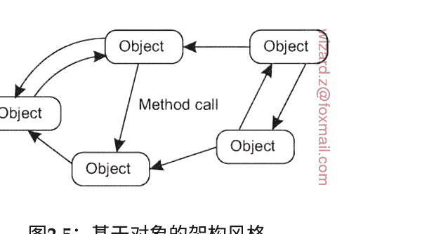

图2.5：基于对象的架构风格。

基于对象的架构具有吸引力，因为它们提供了一种自然的方式来封装数据（称为对象的状态）和可以对该数据执行的操作（称为对象的方法）到一个单一实体中。 对象提供的接口隐藏了实现细节，从根本上意味着我们可以将对象完全独立于其环境来考虑。 与组件一样，这也意味着如果接口被明确定义并且保持不变，那么可以用具有完全相同接口的对象来替换一个对象。

接口和实现这些接口的对象之间的分离允许我们将接口放在一台机器上，而对象本身则驻留在另一台机器上。 这种组织方式如图2.6所示，通常被称为分布式对象。

当客户端绑定到一个分布式对象时，对象的接口的实现，称为代理，将被加载到客户端的地址空间中。 代理类似于RPC系统中的客户端存根。它的唯一作用是将方法调用封装成消息，并将回复消息解封装以将方法调用的结果返回给客户端。 实际的对象驻留在服务器机器上，它提供与客户端机器上相同的接口。 传入的调用请求首先传递给服务器存根，

服务器存根负责将它们解封装以在服务器上的对象接口上进行方法调用。服务器存根还负责封装回复并将回复消息转发给客户端代理。

服务器端存根通常被称为骨架，因为它提供了让服务器中间件访问用户定义对象的基本手段。在实践中，它通常包含以特定语言形式的不完整代码，需要由开发人员进一步专门化。

大多数分布式对象的一个特点，但有点违反直觉的特征是它们的状态不是分布式的：它驻留在一台单独的机器上。只有对象实现的接口在其他机器上可用。这样的对象也被称为远程对象。在一般的分布式对象中，状态本身可能在多台机器上物理分布，但这种分布对客户端来说是隐藏的，只能通过对象的接口访问。

可以说基于对象的架构构成了将服务封装为独立单元的基础。封装是关键词：整个服务作为一个自包含的实体来实现，尽管它可能使用其他服务。通过明确地将各种服务分开，使它们能够独立运行，我们为构建面向服务的体系结构铺平了道路，通常缩写为SOA。在面向服务的体系结构中，分布式应用程序或系统实质上是由许多不同的服务组成的。并非所有这些服务都属于同一管理组织。当讨论云计算时，我们已经遇到了这种现象：一个运行业务应用程序的组织可能会使用云提供商提供的存储服务。这些存储服务是逻辑上完全封装成一个单元，其中一个接口提供给客户使用。

当然，存储是一项相当基本的服务，但更复杂的情况很容易想到。例如，考虑一个销售电子书等商品的网店。一个简单的实现遵循我们之前讨论的应用层次结构，可能由一个处理订单的应用程序组成，该应用程序又在包含电子书的本地数据库上运行。订单处理通常涉及选择商品、注册和检查交付渠道（可能通过使用电子邮件），但还要确保付款完成。后者可以由一个不同组织运行的单独服务处理，购买客户在付款后将被重定向到该服务，之后电子书组织将收到通知以完成交易。

通过这种方式，我们可以看到开发分布式系统的问题在一定程度上是服务组合的问题，并确保这些服务协同运作。事实上，这个问题与第1.3节讨论的企业应用集成问题完全类似。关键是，每个服务都提供一个明确定义的（编程）接口。实际上，这也意味着每个服务都提供自己的接口，进而可能使服务的组合变得非常复杂。

## 基于资源的架构

随着越来越多的服务在Web上可用，并且通过服务组合开发分布式系统变得更加重要，研究人员开始重新思考主要基于Web的分布式系统的架构。服务组合的一个问题是连接各种组件很容易变成一个集成噩梦。

作为一种替代方案，人们也可以将分布式系统视为由组件单独管理的大量资源的集合。资源可以被（远程）应用程序添加或删除，同样可以被检索或修改。这种方法现在已经被广泛应用于Web，并被称为表现层状态转移（REST)[Fielding，2000]。所谓RESTful架构的四个关键特征是[Pautasso等，2008]：

+   1. 通过单一命名方案标识资源
+   2. 所有服务提供相同的接口，最多包含四个操作，如图2.7所示
+   3. 发送到服务或从服务接收的消息是完全自描述的
+   4. 在服务执行操作后，该组件会忘记关于调用者的一切

最后一个属性也被称为无状态执行，这是一个概念，在第3.4节中我们会回到这个概念。

| 操作 | 描述 |
| :--- | :--- |
| PUT | 创建一个新资源 |
| GET | 以某种表示检索资源的状态 |
| DELETE | 删除一个资源 |
| POST | 通过传输新状态来修改资源 |

图2.7：RESTful架构中可用的四个操作。

为了说明RESTful如何在实践中工作，考虑一个云存储服务，例如亚马逊的简单存储服务（Amazon S3）。亚马逊S3，[Murty, 2008]中描述的仅支持两种资源：对象，基本上相当于文件，和存储桶，相当于目录。没有将存储桶放入存储桶的概念。存储桶BucketName中的对象ObjectName通过以下统一资源标识符（URI）来引用：

http://BucketName.s3.amazonaws.com/ObjectName
要创建一个存储桶，或者一个对象，应用程序基本上会发送一个带有存储桶/对象的URI的PUT请求。原则上，与该服务一起使用的协议是HTTP。换句话说，它只是另一个HTTP请求，随后将被S3正确解释。如果存储桶或对象已经存在，则返回一个HTTP错误消息。

以类似的方式，要知道存储桶中包含哪些对象，应用程序将发送一个带有该存储桶的URI的GET请求。S3将返回一个对象名称列表，同样作为普通的HTTP响应。

由于其简单性，RESTful架构变得流行起来。然而，人们对于RESTful服务是否比通过特定于服务的接口来指定服务更好进行了激烈争论。

Pautasso等人[2008]对这两种方法进行了比较，正如预期的那样，它们都有各自的优点和缺点。特别是，RESTful架构的简单性很容易阻碍对复杂通信方案的简单解决方案。一个例子是需要分布式事务的情况，这通常要求服务跟踪执行状态。另一方面，有许多例子可以完美地匹配RESTful架构的简单服务集成方案，但服务接口的众多将使问题复杂化。

注2.2（高级：关于接口）
显然，一个服务的易用性或难度不应该仅仅因为它提供的接口而改变。一个服务提供功能，最好的情况是服务的访问方式由接口决定。事实上，可以说关于RESTful与服务特定接口的讨论非常重要。

## 发布-订阅架构

随着系统的不断增长和进程的轻松加入或离开，有一个架构来处理进程之间的依赖关系变得很重要。

## 基于资源的架构

进程之间的依赖关系应该尽可能地松散。许多分布式系统采用了一种架构，其中处理和协调之间有明显的分离。这个想法是将一个系统视为一组自治运行的进程。在这个模型中，协调包括进程之间的通信和合作。它将进程执行的活动整合在一起[Gelernter and Carriero, 1992]。

Cabri等人[2000]提供了一个可以应用于许多类型的分布式系统的协调模型分类法。稍微调整他们的术语，我们在两个不同的维度上区分模型，即时间和引用，如图2.9所示。

|   | 时间上耦合 | 时间上解耦 |
| --- | --- | --- |
| 引用上耦合 | 直接 | 邮箱 |
| 引用上解耦 | 事件-基于 | 共享数据空间 |

图2.9：不同形式的协调示例。

当进程在时间和引用上耦合时，协调以直接方式进行，称为直接协调。引用耦合通常以通信中的显式引用的形式出现。例如，一个进程只能在知道它想要与之交换信息的其他进程的名称或标识符的情况下进行通信。

时间耦合意味着进行通信的进程都必须处于运行状态。在现实生活中，通过手机通话（假设手机只有一个所有者）是直接通信的一个例子。当进程在时间上解耦但在引用上耦合时，会发生不同类型的协调，我们称之为邮箱协调。在这种情况下，两个通信进程不需要同时执行才能进行通信。相反，通过将消息放入一个（可能是共享的）邮箱来进行通信。因为需要显式地寻址将保存要交换的消息的邮箱，所以存在引用耦合。

引用解耦和时间耦合系统的组合形成了基于事件协调的模型组。在引用解耦系统中，进程之间不会显式地相互了解。进程唯一能做的就是发布描述事件发生的通知（例如，它想要协调活动，或者它刚刚产生了一些有趣的结果）。假设通知以各种各样的形式出现，进程可以订阅特定类型的通知（参见[Mühl et al., 2006]）。在理想的基于事件的协调模型中，发布的通知
将准确地传递给已订阅该通知的进程。然而，通常要求订阅者在发布通知时处于运行状态。

一个众所周知的协调模型是引用和时间上解耦的进程的组合，导致了所谓的共享数据空间。关键思想是进程完全通过元组进行通信，元组是由多个字段组成的结构化数据记录，非常类似于数据库表中的行。进程可以将任何类型的元组放入共享数据空间。为了检索元组，进程提供一个与元组匹配的搜索模式。返回与之匹配的任何元组。

因此，共享数据空间被视为元组的关联搜索机制实现。当一个进程想要从数据空间中提取一个元组时，它指定了它感兴趣的字段的（一些）值。与该规范匹配的任何元组都将从数据空间中移除并传递给该进程。

共享数据空间通常与基于事件的协调相结合：进程通过提供搜索模式订阅特定的元组；当进程将一个元组插入数据空间时，匹配的订阅者将收到通知。在这两种情况下，我们都在处理发布-订阅架构，事实上，关键特征是进程之间没有显式的引用。纯事件驱动架构风格与共享数据空间的区别如图2.10所示。我们还展示了发布者和订阅者匹配的机制的抽象，称为事件总线。

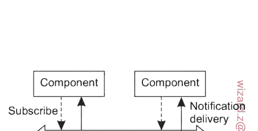

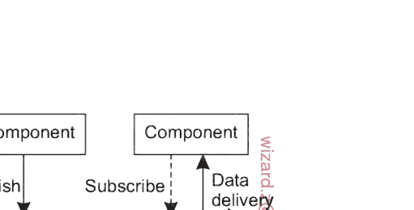

图2.10：(a)基于事件和(b)共享数据空间的架构风格。

注2.3(例子：Linda元组空间) 为了更加具体，我们仔细研究了Linda，这是一个在1980年代开发的编程模型[Car riero和Gelernter，1989]。Linda中的共享
数据空间被称为元组空间，它基本上支持三个操作：

+   - in(t)：删除与模板 t匹配的元组
+   - rd(t)：获取与模板 t匹配的元组的副本
+   - out(t)：将元组 t 添加到元组空间中

请注意，如果一个进程连续调用 out(t)两次，我们会发现存储了两个元组 t的副本。从形式上讲，元组空间因此总是被建模为一个多重集合。无论是 in还是 rd 都是阻塞操作：调用者将被阻塞，直到找到匹配的元组或者元组变得可用。

考虑一个非常简单的微博应用程序，其中消息被标记为发布者的名称和主题，后跟一个短字符串。每条消息被建模为一个元组<string,string,string>其中第一个字符串表示发布者，第二个字符串表示主题，第三个字符串是实际内容。假设我们已经创建了一个名为 MicroBlog的共享数据空间，图2.11展示了Alice和Bob如何向该空间发布消息，以及Chuck如何选择（随机选择）一条消息。为了清晰起见，我们省略了一些代码。请注意，Alice和Bob都不知道谁会阅读他们的帖子。

```
1 blog = linda.universe._rd((
```

(a) Bob的代码用于创建一个微博并发布两条消息。

```
1 blog = linda.universe._rd((
```

(b) Alice的代码用于创建一个微博并发布两条消息。

```
1 blog = linda.universe._rd((
```

(c) 查克从鲍勃和爱丽丝的微博中读取一条消息。

图2.11：使用共享数据空间的简单示例。

在每个代码片段的第一行，一个进程查找名为“微博”的元组空间。鲍勃发布了三条消息：两条关于分布式系统的，一条关于图论的。爱丽丝发布了两条消息，一条关于每个主题。最后，查克读取了三条消息：一条来自鲍勃关于分布式系统的，一条关于图论的，一条来自爱丽丝关于图论的。

显然，还有很大的改进空间。例如，我们应该确保艾丽斯不能以鲍勃的名义发布消息。然而，现在需要注意的重要问题是，通过仅提供标签，像查克这样的读者将
能够在不直接引用发布者的情况下接收消息。特别是，查克还可以通过语句在主题distsys上读取随机选择的消息

```
t = blog_rd((str,"distsys",str))
```

我们将其留给读者作为一个练习，扩展代码片段，以便选择下一个消息而不是随机选择一个。

发布-订阅系统的一个重要方面是通过描述订阅者感兴趣的事件来进行通信。因此，命名起着关键作用。我们稍后再讨论命名问题，但现在重要的问题是，在许多情况下，数据项并不是由发送方和接收方明确标识的。

首先，让我们假设事件由一系列属性描述。描述事件的通知被称为发布，当它可供其他进程阅读时。为此，需要将一个订阅传递给中间件，其中包含订阅者感兴趣的事件描述。

这样的描述通常由一些(属性，值)对组成，这在所谓的基于主题的发布-订阅系统中很常见。作为替代，在基于内容的发布-订阅系统中，订阅也可以由(属性，范围)对组成。在这种情况下，指定的属性应在指定的范围内取值。描述有时可以使用各种谓词来表达，这些谓词与关系数据库中的类似，类似于SQL查询的性质非常相似。显然，描述越复杂，测试事件是否与描述匹配就越困难。

我们现在面临的情况是需要将订阅与通知进行匹配，如图2.12所示。在许多情况下，事件实际上对应于数据的可用性。在这种情况下，当匹配成功时，有两种可能的情况。在第一种情况下，中间件可以决定将发布的通知以及相关数据转发给当前的订阅者集合，即具有匹配订阅的进程。作为另一种选择，中间件也可以仅转发通知，此时订阅者可以执行读操作来检索相关的数据项。

在那些立即将与事件相关联的数据转发给订阅者的情况下，中间件通常不提供数据存储。存储要么由单独的服务显式处理，要么由订阅者负责。换句话说，我们有一个引用解耦但时间上耦合的系统。

当通知被发送以便订阅者需要显式读取相关数据时，情况就不同了。必要时，中间件将
必须存储数据项。在这些情况下，还有额外的操作用于数据管理。还可以将租约附加到数据项上，当租约到期时，数据项将自动删除。

事件可以很容易地复杂化订阅的处理。为了说明，考虑一个订阅，例如“当ZI.1060房间未被占用且门未锁上时通知”。通常，支持此类订阅的分布式系统可以通过放置用于监视房间占用情况的独立传感器（例如运动传感器）和用于注册门锁状态的传感器来实现。按照迄今为止概述的方法，我们需要将这些原始事件组合成可发布的数据项，然后进程可以订阅该数据项。事件组合事实上一项困难的任务，特别是当原始事件来自分布在整个分布式系统中的源时。

显然，在这样的发布-订阅系统中，关键问题是将订阅与通知进行高效且可扩展的匹配实现。从外部来看，发布-订阅架构提供了构建非常大规模分布式系统的潜力，因为进程之间的耦合度很低。另一方面，在不丧失这种情况下的设计可扩展的实现并不是一项简单的任务，尤其是在基于内容的发布-订阅系统中。

## 2.2 中间件组织

在前一节中，我们讨论了一些常用的架构风格，这些风格通常被用作构建和组织分布式系统的一般指导原则。现在让我们深入研究中间件的实际组织，即与分布式系统或应用程序的整体组织无关的部分。特别是，有两种重要的设计模式经常应用于中间件的组成：包装器和拦截器。每种模式都针对不同的问题，但对于中间件来说，它们都追求同样的目标：实现开放性。

[正如我们在1.2节中讨论的那样]。然而，可以说当我们能够在运行时组合中间件时，最终的开发性才能实现。我们简要讨论了基于组件的构建作为一种流行的手段，用于实现Parlavantzas和Coulson [2007]所称的可修改中间件。

## 包装器

当将现有组件构建成分布式系统时，我们立即遇到一个基本问题：遗留组件提供的接口很可能不适用于所有应用程序。在1.3节中，我们讨论了企业应用集成如何通过中间件作为通信协调器来建立，但在那里我们仍然隐含地假设，最终组件可以通过其本机接口访问。

包装器或适配器是一种特殊的组件，它提供一个对客户应用程序可接受的接口，其中的函数被转换为组件可用的函数。本质上，它解决了不兼容接口的问题（参见[Gamma et al., 1994]）。

尽管最初在面向对象的编程环境中被狭义地定义，但在分布式系统的环境中，包装器远不止是简单的接口转换器。例如，对象适配器是一种允许应用程序调用远程对象的组件，尽管这些对象可能是由操作关系数据库表的库函数组合实现的。

再举一个例子，重新考虑亚马逊的S3存储服务。现在有两种类型的可用接口，一种遵循RESTful架构，另一种遵循更传统的方法。对于RESTful接口，客户端将使用HTTP协议，实质上与一个传统的Web服务器进行通信，该服务器现在充当实际存储服务的适配器，通过部分解析传入的请求，并将其传递给S3内部的专用服务器。

包装器一直在扩展具有现有组件的系统发挥重要作用。对于实现开放性至关重要的可扩展性，过去是根据需要添加包装器来解决的。换句话说，如果应用程序A管理着应用程序B所需的数据，一种方法是为B开发一个特定的包装器，以便它可以访问A的数据。显然，这种方法不具有良好的可扩展性：理论上，对于N个应用程序，我们需要开发N×(N-1)=O(N^2)个包装器。

再次，通过中间件通常可以减少包装器的数量。一种方法是实现所谓的代理，它在逻辑上是一个集中处理不同应用程序之间所有访问的组件。常用的一种类型是消息代理，我们在第4.3节中讨论了技术细节。在消息代理的情况下，应用程序只需向代理发送包含所需信息的请求。## 拦截器

从概念上讲，拦截器(interceptor)只是一个软件构造，它会打破通常的控制流程，并允许执行其他（应用程序特定的）代码。拦截器是适应中间件到应用程序特定需求的主要手段。因此，它们在使中间件开放方面起着重要作用。要使拦截器具有通用性可能需要大量的实现工作，正如Schmidt等人[2000]所示，不清楚在这种情况下通用性是否应该优先于受限适用性和简单性。此外，在许多情况下，仅具有有限的拦截功能将改善软件和整个分布式系统的管理。

为了使问题具体化，考虑在许多基于对象的分布式系统中支持的拦截。基本思想很简单：一个对象 A可以调用属于另一个对象 B的方法，而后者位于与 A不同的机器上。正如我们在本书后面详细解释的那样，这样的远程对象调用分为三个步骤：

1. 对象 A提供了一个与对象 B提供的接口完全相同的本地接口。A调用了该接口中可用的方法。
2. A的调用被转换为一个通用对象调用，通过 A所在机器上的中间件提供的通用对象调用接口实现。
3. 最后，通用对象调用被转换为一条消息，通过 A 的本地操作系统提供的传输层网络接口发送。

图2.13：(a) 要求每个应用程序对其他应用程序都有一个包装器。(b) 通过使用代理来减少包装器的数量。

提供所需信息。代理具有所有相关应用程序的知识，联系适当的应用程序，可能合并和转换响应，并将结果返回给初始应用程序。原则上，因为代理为每个应用程序提供了单一接口，我们现在最多只需要2N = O(N)个包装器，而不是 O(N²)个。这种情况在图2.13中概述。

## 第2章 架构

## 第2章 架构

## 2.2. 中间件组织

包装器和拦截器提供的是扩展和适应中间件的手段。适应的需求来自于分布式应用程序执行的环境不断变化的事实。变化包括由移动性、网络服务质量的强烈变化、硬件故障和电池耗尽等引起的变化。与其让应用程序负责对变化做出反应，这个任务被放在中间件中。此外，随着分布式系统的规模增大，很少能通过临时关闭来改变其部分。所需的是能够实时进行更改。

环境对中间件的影响很大，这使得许多中间件设计者考虑构建自适应软件。我们遵循Parlavantz和Coulson [2007]的说法，称之为可修改的中间件，以表达中间件不仅需要具备自适应性，还需要能够有目的地修改而不会使其停机。在这种情况下，拦截器可以被认为是提供一种调整标准控制流的方法。在运行时替换软件组件是修改系统的一个例子。事实上，也许最流行的可修改中间件方法之一就是动态构建由组件组成的中间件。

基于组件的设计通过组合来支持可修改性。系统可以在设计时静态配置，也可以在运行时动态配置。后者需要支持迟绑定，这是一种在编程语言环境中已经成功应用的技术，也适用于操作系统，其中模块可以随意加载和卸载。目前已经在研究自动选择组件在运行时的最佳实现[Yellin, 2003]，但对于分布式系统来说，这个过程仍然很复杂，特别是考虑到替换一个组件对其他组件的影响。在许多情况下，组件并不像人们想象的那样独立。

底线是，为了适应中间件组成的软件的动态变化，我们至少需要基本的支持来在运行时加载和卸载组件。此外，对于每个组件，需要明确指定其提供的接口以及其所需要的接口。如果在组件之间保持状态，则需要采取进一步的特殊措施。总的来说，可以清楚地看出，将中间件组织成可修改的需要特别注意。

## 第2章 架构

## 2.3 系统架构

现在我们简要讨论了一些常用的架构样式，让我们看看有多少分布式系统实际上是通过考虑软件组件的放置位置来组织的。决定软件组件、它们的交互和它们的放置会导致一个软件架构的实例，也被称为系统架构[Bass等人，2003]。我们将讨论集中式和分散式组织，以及各种混合形式。

## 集中式组织

尽管在许多分布式系统问题上缺乏共识，但有一个问题是许多研究人员和从业者都同意的：以客户端请求服务的方式来思考有助于理解和管理分布式系统的复杂性[Saltzer和Kaashoek，2009]。

接下来，我们首先考虑一个简单的分层组织，然后再看多层组织。

## 简单的客户端-服务器架构

在基本的客户端-服务器模型中，分布式系统中的进程被分为两个（可能重叠的）组。服务器是实现特定服务的进程，例如文件系统服务或数据库服务。客户端是向服务器发送请求并等待服务器回复的进程。这种客户端-服务器交互，也被称为请求-回复行为，在图2.15中以消息序列图的形式显示。

当底层网络相对可靠，例如在许多局域网中，客户端和服务器之间的通信可以通过一种简单的无连接协议来实现。在这些情况下，当客户端请求服务时，它只需为服务器打包一条消息，标识所需的服务以及必要的输入数据。然后将消息发送到服务器。服务器则会始终等待传入的请求。

随后处理它，并将结果打包在回复消息中，然后发送给客户端。

使用无连接协议的明显优点是高效。只要消息不丢失或损坏，刚才概述的请求/回复协议就可以正常工作。不幸的是，使协议对偶尔的传输故障具有抵抗力并不容易。我们唯一能做的可能是在没有收到回复消息时让客户端重新发送请求。然而，问题在于客户端无法检测到原始请求消息是丢失了，还是回复的传输失败了。如果回复丢失了，那么重新发送请求可能会导致执行操作两次。如果操作是像‘从我的银行账户转账10000美元’这样的操作，那么显然，我们最好只报告一个错误。

另一方面，如果操作是‘告诉我还剩多少钱’，重新发送请求是完全可以接受的。当一个操作可以重复多次而不会造成伤害时，它被称为幂等的。

由于一些请求是幂等的，而其他请求则不是，因此很明显没有单一的解决方案来处理丢失的消息。我们将详细讨论处理传输故障的方法推迟到第8.3节。作为替代方案，许多客户端-服务器系统使用可靠的面向连接的协议。尽管这种解决方案在局域网中不完全适用，因为性能相对较低，但在通信本质上不可靠的广域网系统中，它完全正常工作。例如，几乎所有的互联网应用协议都是基于可靠的TCP/IP连接的。在这种情况下，每当客户端请求服务时，它首先建立与服务器的连接，然后发送请求。服务器通常使用同一连接发送回复消息，之后连接被关闭。问题可能是建立和关闭连接相对较昂贵，特别是当请求和回复消息很小的时候。

多年来，客户端-服务器模型一直备受争议和争议。其中一个主要问题是如何明确区分客户端和服务器。毫不奇怪，通常没有明确的区分。例如，分布式数据库的服务器可能会不断充当客户端，因为它将请求转发给负责实现数据库表的不同文件服务器。在这种情况下，数据库服务器本身只处理查询。

## 第2章 架构

## 2.3 系统架构

到目前为止，根据讨论，将客户端-服务器应用程序在多台机器上进行物理分布有很多可能性。最简单的组织方式是只有两种类型的机器：

1. 只包含实现（部分）用户界面层的程序的客户端机器

2. 包含其余部分，即实现处理和数据层的程序的服务器机器

在这种组织中，一切都由服务器处理，而客户端本质上只是一个愚蠢的终端，可能只有一个方便的图形界面。然而，还有许多其他可能性。如2.1节所述，许多分布式应用程序分为三层（1）用户界面层，（2）处理层和（3）数据层。一种组织客户端和服务器的的方法是将这些层分布在不同的机器上，如图2.16所示（也可参考Umar [1997]）。作为第一步，我们区分了只有两种类型的机器：客户端机器和服务器机器，这也被称为（物理上的）两层架构。

一种可能的组织方式是仅在客户端机器上放置与终端相关的用户界面部分，如图2.16(a)所示，并使应用程序对其数据的呈现具有远程控制权。另一种选择是将整个用户界面软件放置在客户端，如图2.16(b)所示。在这种情况下，我们基本上将应用程序分为图形前端和其余应用程序（位于服务器上）之间通过应用程序特定协议进行通信的部分。在这个模型中，前端（客户端软件）除了为呈现应用程序界面而必要的处理外，不进行任何处理。

沿着这条推理线继续，我们还可以将应用程序的一部分移动到前端，如图2.16(c)所示。一个合理的例子是应用程序使用需要完全填写的表单才能进行处理。然后，前端可以进行检查 在必要的情况下与用户进行交互，以确保表单的正确性和一致性。图2.16(c)的另一个例子是文字处理器的组织方式，在该组织方式中，基本编辑功能在客户端上执行，操作本地缓存或内存中的数据，而高级支持工具（如拼写和语法检查）在服务器端执行。

在许多客户端-服务器环境中，图2.16(d)和图2.16(e)所示的组织方式特别受欢迎。这些组织方式适用于客户机是个人计算机或工作站，通过网络连接到分布式文件系统或数据库的情况。基本上，大部分应用程序在客户机上运行，但所有对文件或数据库条目的操作都发送到服务器。例如，许多银行应用程序在最终用户的机器上运行，用户准备交易等。

图2.16(e)表示客户端的本地磁盘包含部分数据的情况。例如，在浏览网页时，客户端可以逐渐在本地磁盘上构建一个巨大的缓存，存储最近访问过的网页。

> 注2.4（更多信息：是否有最佳组织？）
我们注意到，在将客户端软件放置在最终用户机器上的情况下，已经出现了远离图2.16(d)和图2.16(e)所示配置的强烈趋势。相反，大部分处理和数据存储都在服务器端处理。这样做的原因很简单：尽管客户端机器做了很多工作，但也更难管理。在客户端机器上具有更多功能意味着需要让广泛的最终用户能够处理该软件。这意味着需要花费更多的精力使软件能够适应最终用户的行为。此外，客户端软件依赖于客户端的底层平台（即操作系统和资源），这很容易意味着需要维护多个版本。从系统管理的角度来看，拥有所谓的胖客户端并不是最佳选择。相反，如图2.16(a)-（c）所示的瘦客户端要容易得多，可能以牺牲较复杂的用户界面和客户端感知性能为代价。

这是否意味着胖客户端的终结？绝对不是。首先，有很多应用程序仍然最适合使用胖客户端组织。我们已经提到过办公套件，但还有许多多媒体应用程序需要在客户端进行处理。其次，随着先进的Web浏览技术的出现，通过简单地上传（有时非常复杂的）脚本，动态地放置和管理客户端软件现在变得更加容易。结合这种类型的客户端软件在已定义的常用环境中运行，并且平台依赖性问题不再是一个问题，我们可以看到管理复杂性的反驳通常不再有效。

## 第2章 架构

## 2.3 系统架构

最后，需要注意的是，摆脱胖客户端并不意味着我们不再需要分布式系统。相反，我们继续看到服务器端解决方案越来越多地变得分布式，一个单一服务器被运行在不同机器上的多个服务器所取代。云计算是一个很好的例子：完整的服务器端在数据中心执行，并且通常在多个服务器上执行。

当我们仅将客户端和服务器机器区分开来，就像我们迄今为止所做的那样，我们忽略了一个重点，即服务器有时需要充当客户端，如图2.17所示，导致一个（物理上）三层架构。

在这种架构中，传统上属于处理层的程序由一个独立的服务器执行，但也可能部分分布在客户端和服务器机器上。三层架构被广泛应用于事务处理等典型场景。一个称为事务处理监视器的独立进程协调可能存在于不同数据服务器上的所有事务。

另一个非常不同的例子是网站的组织结构中经常看到的三层架构。在这种情况下，Web服务器充当站点的入口点，将请求传递给应用服务器进行实际处理。这个应用服务器又与数据库服务器进行交互。例如，应用服务器可能负责运行代码，以检查电子书店提供的某些商品的可用库存。为了做到这一点，它可能需要与包含原始库存数据的数据库进行交互。

## 第2章 架构

## 分散式组织：点对点系统

多层客户端-服务器体系结构是将分布式应用程序划分为用户界面、处理组件和数据管理组件的直接结果。不同的层与之对应 应用程序的逻辑组织。在许多商业环境中，分布式处理等同于将客户端-服务器应用程序组织为多层架构。我们将这种类型的分布称为垂直分布。垂直分布的特征是将逻辑上不同的组件放置在不同的机器上实现。这个术语与分布式关系数据库中使用的垂直分片的概念相关，其中它意味着表按列进行拆分，并随后分布在多台机器上[Özsu和Valduriez，2011]。

再次，从系统管理的角度来看，具有垂直分布可以帮助：函数在逻辑上和物理上分割在多个机器上，每台机器都针对特定的功能组。

然而，垂直分布只是组织客户端-服务器应用程序的一种方式。在现代架构中，客户端或服务器 分布往往是最重要的，我们称之为水平分布。在这种类型的分布中，客户端或服务器可以被物理上分割成逻辑上等效的部分，但每个部分都在自己的数据集上操作，从而平衡负载。在本节中，我们将介绍一类支持水平分布的现代系统架构，称为对等系统。

从高层次的角度来看，构成对等系统的进程都是相等的。这意味着需要执行的功能由构成分布式系统的每个进程表示。

因此，进程之间的大部分交互是对称的：每个进程将同时充当客户端和服务器（也称为充当服务者）。

鉴于这种对称行为，点对点架构围绕着如何组织进程在一个覆盖网络中的问题演化[Tarkoma，2010]：一个由进程形成的节点和表示可能的通信通道的链接（通常实现为TCP连接）。一个节点可能无法直接与任意其他节点通信，但需要通过可用的通信通道发送消息。存在两种类型的覆盖网络：结构化和非结构化。这两种类型在Lua等人的[2005]中进行了广泛的调查，并提供了许多示例。Buford和Yu [2010]还包括各种点对点系统的广泛列表。Aberer等人的[2005]提供了一个参考架构，可以更正式地比较不同类型的点对点系统。Androustellis-Theotokis和Spinellis [2004]提供了一个从内容分发的角度进行的调查。最后，Buford等人[2009]，Tarkoma [2010]和Vu等人[2010]超越

## 第2章 架构

或者160位长。图2.19展示了一个更小的Chord环，其中m = 5，并且有九个节点{1,4,9,11,14,18,20,21,28}。键7的后继等于9。同样地，succ(5) = 9，但也有succ(9) = 9。在Chord中，每个节点都维护着到其他节点的快捷方式。快捷方式以一个有向边的形式出现，从一个节点指向另一个节点。这些快捷方式是如何构建的，在第5章中有详细解释。构建过程是这样进行的，使得任意两个节点之间的最短路径长度的数量级为O(log N)，其中N是节点的总数。

为了查找一个键，一个节点将尝试将请求“尽可能远地”转发，但不会将其传递到负责该键的节点之外。为了澄清，假设在我们的Chord环示例中，节点9被要求查找负责键3的节点（即节点4）。节点9有四个快捷方式：到节点11、14、18和28。由于节点28是节点9所知的最远的节点，并且仍然在负责键3之前，它将接收查找请求。节点28有三个快捷方式：到节点1、4和14。请注意，节点28对于节点1和4之间的节点的存在一无所知。因此，它能做的最好的事情就是将请求转发给节点1。后者知道它在环中的后继节点是节点4，因此这是负责键3的节点，它将随后将请求转发给该节点。

现在假设一个节点，具有唯一标识符u，想要加入一个Chord覆盖网络。为此，它联系一个任意节点并请求其查找u，也就是返回值v = succ(u)。此时，节点u只需要将自己插入到v的前任和v之间，从而成为v的新前任。在这个过程中，将建立从u到其他节点的快捷方式，但之前指向v的一些现有快捷方式现在将被调整为指向u（具体细节将在后面的章节中介绍）。显然，任何具有关键字k存储在v上但其succ(k)现在等于u的数据项将从v转移到u。

离开同样简单：节点u通知其前任和后继节点，并将其数据项转移到succ(u).

### 非结构化点对点系统

结构化点对点系统试图维护一个特定的、确定性的叠加网络。相比之下，在非结构化的点对点系统中，每个节点都维护着一个临时邻居列表。由此产生的叠加网络类似于所谓的随机图：只有一定概率P{<u,v>}存在图中的边{u,v}。理想情况下，这个概率对于所有节点对来说是相同的，但实际上观察到了各种各样的分布。

在非结构化的点对点系统中，当一个节点加入时，通常会联系一个众所周知的节点，以获取系统中其他节点的起始列表。然后可以使用这个列表来找到更多的节点，可能忽略其他节点等等。实际上，一个节点通常会不断地更改其本地列表。例如，一个节点可能发现邻居不再响应

## 2.3. 系统架构

并且需要被替换。可能还有其他原因，我们很快将会描述。

与结构化的对等系统不同，在构建邻居列表时，查找数据不能遵循预定的路线。相反，在非结构化的对等系统中，我们确实需要搜索数据[Risson和Moors，2006]。让我们看两个极端情况，并考虑我们被要求搜索特定数据的情况（例如，由关键字标识）。

#### 泛洪

在泛洪的情况下，发出请求的节点只需将数据项的请求发送给所有邻居。当接收节点（例如，v）之前看到过该请求时，请求将被忽略。否则，v在本地搜索所请求的数据项。如果v具有所需的数据，它可以直接回复给发出请求的节点u，或者将其发送回原始转发器，然后由原始转发器返回给其原始转发器，依此类推。如果v没有所请求的数据，它将请求转发给它自己的所有邻居。

显然，洪泛可能非常昂贵，因此请求通常具有关联的生存时间（time-to-live）或TTL值，给出请求允许转发的最大跳数。选择正确的TTL值至关重要：太小意味着请求将保持靠近发出者，并且可能无法到达具有数据的节点。太大会产生高昂的通信成本。

作为设置TTL值的替代方案，节点还可以使用初始TTL值为1开始搜索，这意味着它首先只查询其邻居。如果没有或者返回的结果不足够，TTL值会增加，并且会启动新的搜索。

#### 随机游走

在搜索范围的另一端，发出节点可以通过询问随机选择的邻居（例如v）来尝试找到数据项。如果v没有数据，它会将请求转发给其随机选择的邻居，依此类推。结果被称为随机游走[Gkantsidis et al., 2006; Lv et al., 2002]。显然，随机游走会产生较少的网络流量，但是在到达具有所请求数据的节点之前可能需要更长的时间。为了减少等待时间，发出者可以同时启动n个随机游走。事实上，研究表明在这种情况下，到达具有数据的节点所需的时间大约减少了一个因子n。Lv et al. [2002]报告称，n的相对较小的值，如16或64，是有效的。

随机漫步也需要停止。为此，我们可以再次使用TTL，或者当一个节点收到查找请求时，与发出者核实是否仍然需要将请求转发给另一个随机选择的邻居。

请注意，这两种方法都不依赖于特定的比较技术来判断是否找到了所请求的数据。对于结构化的对等系统，我们假设使用键进行比较；对于刚刚描述的两种方法，任何比较技术都可以满足要求。

### 注2.6（高级：洪泛与随机漫步）

当我们仔细思考这个问题时，人们甚至会惊讶地发现，随机漫步竟然被认为是一种替代的搜索方式。乍一看，它似乎是一种类似于大海捞针的技术。

然而，我们需要意识到，在实践中，我们处理的是复制的数据，即使对于非常小的复制因子和不同的复制分布，研究表明部署随机漫步不仅有效，而且比洪泛更高效。

为了理解其中的原因，我们紧密跟随Lv等人[2002]和Cohen和Shenker[2002]所描述的模型。假设总共有N个节点，并且每个数据项都被复制到r个随机选择的节点上。搜索包括反复随机选择节点，直到找到该项。如果P[k]是在k次尝试后找到该项的概率，我们有

$P[k] = \frac{r}{N}(1 - \frac{r}{N})^{k-1}.$

让平均搜索大小S是在找到所请求的数据项之前需要探测的预期节点数量：

$S = \sum_{k=1}^N k \cdot P[k] = \sum_{k=1}^N k \cdot \frac{r}{N}(1 - \frac{r}{N})^{k-1} \approx \frac{N}{r} \text{for } 1 \ll r \leq N.$

通过简单地将每个数据项复制到每个节点，S =1，并且很明显，即使对于TTL值为1，随机游走也始终优于洪泛。然而，更加现实的是假设 r/N 相对较低，例如0.1%，这意味着平均搜索大小将约为1000个节点。

为了与泛洪进行比较，假设每个节点平均转发请求给d个随机选择的邻居。经过一步，请求将到达d个节点，每个节点将其转发给另外d - 1个节点（假设跳过请求来源的节点），依此类推。换句话说，在k步之后，并考虑到一个节点可能会多次接收请求，我们将达到（最多）

$R(k) = d(d - 1)^{k-1}$

节点。各种研究表明，只要我们只有几个洪泛步骤，R(k) 是对实际达到节点数量的良好估计。其中

节点，我们可以预期有一个比例为 r/N的节点具有所请求的数据项，这意味着当 r/N · R(k) ≥1时，我们很可能找到一个具有数据项的节点。 为了说明，让 r/N = 0.001 =0.1%，这意味着 S ≈1000。通过洪泛，平均而言，我们需要至少4个洪泛步骤，达到大约7290个节点，这比使用随机漫步时所需的1000个节点要多得多。只有当 d =33 时，我们需要在 k =2 个洪泛步骤中联系大约1000个节点，并且有 r/N · R(k) ≥1。 部署随机行走的明显缺点是，可能需要更长的时间才能返回答案。

### 分层组织的对等网络

特别是在非结构化的对等系统中，随着网络的增长，定位相关数据项可能变得困难。这种可扩展性问题的原因很简单：由于没有确定的方式将查找请求路由到特定的数据项，节点唯一可以采用的技术就是通过泛洪或随机在网络中行走来搜索请求。作为一种替代方案，许多对等系统提出利用维护数据项索引的特殊节点。

在其他情况下，放弃对等系统的对称性是明智的。考虑一组节点之间的协作，彼此提供资源。例如，在协作内容传递网络（CDN）中，节点可以提供存储空间来托管Web文档的副本，使Web客户端能够快速访问附近的页面。

所需的是一种找出最佳存储文档位置的方法。 在这种情况下，利用一个代理来收集资源使用和可用性的数据，这些资源位于彼此相邻的多个节点上，将允许快速选择具有足够资源的节点。

维护索引或充当代理的节点通常被称为超级节点。顾名思义，超级节点通常也组织在对等网络中，导致分层组织，如Yang和Garcia-Molina [2003]中所解释的那样。这种组织的一个简单示例如图2.20所示。在这个组织中，每个常规节点，现在称为弱节点，作为客户端连接到一个超级节点。

与弱节点之间的所有通信都通过该节点关联的超级节点进行。

在许多情况下，弱节点与其超级节点之间的关联是固定的：当一个弱节点加入网络时，它会连接到其中一个超级节点，并保持连接直到离开网络。显然，超级节点是具有高可用性的长期运行的进程。为了弥补超级节点可能不稳定行为的潜在问题，备份方案

可以部署，例如将每个超级节点与另一个超级节点配对，并要求弱节点连接到两个节点。

与超级节点有固定关联并不总是最好的解决方案。例如，在文件共享网络的情况下，弱节点连接到维护其当前感兴趣文件索引的超级节点可能更好。在这种情况下，当弱节点寻找特定文件时，其超级节点更有可能知道在哪里找到它。Garbacki等人[2010]描述了一个相对简单的方案，其中弱节点与强节点之间的关联可以随着弱节点发现更好的超级节点而改变。特别是，在查找操作的结果中，超级节点优先于其他超级节点。

正如我们所见，点对点网络为节点加入和离开网络提供了灵活的方式。然而，超级节点网络引入了一个新的问题，即如何选择有资格成为超级节点的节点。这个问题与领导选举问题密切相关，我们在第6.4节中讨论。

> 注2.7（例子：Skype网络）
为了给出一个具体的分层组织的点对点网络的例子，让我们仔细研究一个最成功的例子：Skype VOIP网络。虽然关于Skype的组织方式没有官方出版物，但Baset和Schulzrinne [2006]通过实验分析了Skype的工作方式，并从中推断出了一种架构。除了他们的发现有多准确（Skype自Baset和Schulzrinne发表论文以来已经发生了很大变化），它仍然是一个有趣的案例研究。
Skype网络的组织方式与图2.20所示非常相似，但有一个重要的区别：有一个额外的集中式Skype登录服务器，每个对等方都可以与之通信（即弱对等方和超级对等方面）。超级对等方（也称为Skype超级节点）对整个系统的运作至关重要。除了登录服务器之外，还有一些默认的Skype

超级对等方可用于在弱对等方从头开始时启动。 似乎每个默认超级对等方的地址都是硬编码在 Skype软件中的。一个地址由（IP地址，端口号）对组成。 每个弱对等方都有一个本地的可达超级对等方地址列表，称为它的主机缓存。 如果缓存的超级对等方都不可达，它会尝试连接到其中一个默认超级对等方。 主机缓存设计用于容纳几百个地址。 要连接到Skype网络，弱对等方需要与超级对等方建立TCP连接。这一点很重要，特别是当对等方在（NATed）防火墙后运行时，超级对等方可以帮助实际联系到该对等方。

让我们首先考虑一个节点A想要联系另一个（弱）节点B的情况，对于这个情况，它有一个联系地址。我们需要区分三种情况，都与节点是否在（NATed）防火墙后有关。

节点A和B都在公共互联网上：在公共互联网上意味着A和B可以直接联系。在这种情况下，建立了一个TCP连接，用于交换控制数据包，连接是在节点A和B之间建立的。实际的呼叫是通过调用方和被调用方之间的协商端口使用UDP数据包进行的。

节点A在防火墙后运行，而节点B在公共互联网上：在这种情况下，A首先会建立一个TCP连接到一个超级节点S，之后S会建立一个TCP连接到B。同样，TCP连接用于在A和B之间（通过S）传输控制数据包，之后实际的呼叫将通过UDP直接在A和B之间进行，而不经过S。然而，似乎需要S来发现防火墙在A上允许UDP数据包交换的正确端口号对。原则上，借助B的帮助也应该可以实现。节点A和B都在防火墙后运行：这是最具挑战性的情况，特别是如果我们还假设防火墙限制了UDP流量。在这种情况下，

一个将通过TCP连接到在线超级节点S，之后S将建立一个TCP连接到B。这些连接用于交换控制数据包。对于实际的呼叫，将联系另一个超级节点作为中继R：A建立到R的连接，B也会这样做。然后，所有语音流量都通过这两个TCP连接转发，并通过R传输。

用户如何找到彼此？ 如前所述，弱节点需要做的第一件事是与超级节点建立TCP连接。该超级节点可以在本地主机缓存中找到，也可以通过默认的超级节点之一获得。为了搜索特定用户，弱节点联系其超级节点，超级节点将返回一些其他节点供其询问。如果这没有导致任何结果，超级节点将返回另一个（这次更长的）节点列表，用于转发搜索请求。这个过程将重复，直到找到用户或请求者得出结论用户不存在。事实上，这可以被视为一种基于策略的搜索，正如我们上面提到的。找到一个用户意味着返回其地址，或者其关联的超级节点的地址。原则上，如果搜索的用户在线，那么可以建立VOIP连接。

最后，Skype登录服务器用于确保只有注册用户可以使用网络。它还确保用户ID是唯一的，并处理其他在分散方式下难以处理的管理任务。

### 混合架构

到目前为止，我们已经专注于客户端-服务器架构和一些点对点架构。许多分布式系统结合了架构特性，就像我们在超级节点网络中已经遇到的那样。在本节中，我们将介绍一些特定类别的分布式系统，其中将客户端-服务器解决方案与分散式架构相结合。

### 边缘服务器系统

根据混合架构组织的一类重要的分布式系统是边缘服务器系统。这些系统部署在互联网上，服务器放置在网络的“边缘”。

这个边缘是企业网络和实际互联网之间的边界，例如由互联网服务提供商提供的边缘。(ISP). 同样，家庭用户通过他们的ISP连接到互联网，可以将ISP视为互联网的边缘。这导致了一个如图2.21所示的一般组织。

图2.21：将互联网视为由一组边缘服务器组成。

最终用户或一般客户通过边缘服务器连接到互联网。边缘服务器的主要目的是提供内容，可能在应用过滤和转码功能之后。更有趣的是，一组边缘服务器可以用于优化内容和应用程序分发。基本模型是对于特定组织，一个边缘服务器充当所有内容起源的源服务器。那个服务器

可以使用其他边缘服务器来复制网页等[Leff和Rayfield，2004; Nayate等，2004; Rabinovich和Spastscheck，2002]。现在，边缘服务器系统的这个概念经常进一步发展：将数据中心中实施的云计算作为核心，使用网络边缘的附加服务器来协助计算和存储，从而实现分布式云系统。在雾计算的情况下，甚至终端设备也是系统的一部分，并且由云服务提供商（部分地）控制[Yi等，2015]。

### 协作式分布式系统

混合结构在协作式分布式系统中得到广泛应用。在许多这些系统中，主要问题是首先启动，通常采用传统的客户端-服务器方案。一旦节点加入系统，就可以使用完全分散的协作方案。

为了具体说明问题，让我们考虑广受欢迎的 BitTorrent文件共享系统[Cohen, 2010]。BitTorrent是一个点对点文件下载系统。其主要工作原理如图2.22所示。基本思想是当用户寻找文件时，他从其他用户那里下载文件的块，直到下载的块可以组装在一起得到完整的文件。一个重要的设计目标是确保协作。

在大多数文件共享系统中，有相当一部分参与者仅仅下载文件，几乎不做任何贡献[Adar and Huberman, 2000; Saroiu et al., 2003; Yang et al., 2005]，这种现象被称为freeriding。为了防止这种情况，在BitTorrent中，只有在下载客户端向其他人提供内容时才能下载文件。

图2.22：BitTorrent的主要工作原理[经许可改编自Pouwelse等人[2005]]。

要下载文件，用户需要访问一个全局目录，通常只有几个知名的网站。这样的目录包含对所谓的种子文件的引用。种子文件包含下载特定文件所需的信息。特别是，它包含一个指向所谓的追踪器的链接，追踪器是一个保持准确的服务器。

有关请求的文件的活动节点（块）的帐户。活动节点是当前正在下载文件的节点。显然，会有许多不同的跟踪器，尽管通常每个文件（或文件集合）只有一个跟踪器。

一旦确定了可以下载块的节点，下载节点就会变得活跃起来。在那时，它将被迫帮助其他人，例如提供其他人尚未拥有的文件块。这种强制来自一个非常简单的规则：如果节点P注意到节点Q下载的数据多于上传的数据，P可以决定减少向Q发送数据的速率。只要P有从Q下载的东西，这个方案就能很好地工作。出于这个原因，节点通常会提供对许多其他节点的引用，使它们在交换数据方面处于更好的位置。

显然，BitTorrent将集中式和分散式解决方案结合在一起。事实证明，系统的瓶颈是由追踪器形成的，这并不令人意外。在BitTorrent的另一种实现中，节点还加入了一个单独的结构化对等系统（即DHT），以协助跟踪文件下载。实际上，中央追踪器的负载现在分布在参与的节点上，每个节点都充当相对较小的一组种子文件的追踪器。保留了追踪器协调协作下载文件的原始功能。然而，我们注意到，在当今许多使用的BitTorrent系统中，跟踪功能实际上已经被最小化一次性提供当前参与下载文件的对等方。从那一刻起，新参与的对等方将只与那些对等方通信，而不再与初始追踪器通信。

所请求文件的初始追踪器通过所谓的磁力链接在DHT中查找。我们将在第5.2节中回顾基于DHT的查找。

> 注2.8 (高级: BitTorrent的内部机制)

BitTorrent的一个受赞赏的特性之一是节点之间的强制合作：获取一个文件块需要一个。换句话说，BitTorrent客户端有自然的动机将数据提供其他人，从而规避了其他点对点系统中存在的搭便车问题。

为了理解这个机制是如何工作的，让我们更深入地了解一下BitTorrent协议。

当一个节点A找到了文件F的追踪器时，追踪器会返回当前参与下载文件F的所有节点的子集。对于特定文件F的完整下载节点集合被称为该文件的群集（swarm）；与节点A合作的来自该群集的节点子集被称为A的邻居集合NA。请注意，如果节点B在NA中，那么节点A将成为NB的成员：成为邻居是一种对称关系。节点A的邻居集合会定期通过与追踪器联系或者当新节点B加入群集并且追踪器将NA传递给B时进行更新。

## 2.3. 系统架构

拥有所有块的节点 F 并继续参与其群体的被称为种子节点; 其他所有节点被称为下载节点。

如前所述，每个文件被分成若干相等大小的块，称为 BitTorrent 中的片段。 一个片段通常为 256 K 字节，但也可以使用其他大小。两个节点之间的数据传输单位是块，通常为 16 K 字节。只有当一个节点拥有整个片段时，它才能上传一个块。如果邻居节点 B 属于潜在集合 Pa，则它具有 A 尚未拥有的块，反之亦然。 同样，如果 B ∈ P a 且 A ∈ P B，则 A 和 B 处于可以交换块的位置。

根据 Rai 等人 [2007] 的详细说明，文件的下载可以分为三个阶段

引导阶段：节点 A 刚刚接收到它的第一个片段，将其放置在一个位置上，以便开始交换区块。 通过一种被称为乐观拥塞控制的机制，获得这个第一个片段，节点从 NA 无私地提供一个片段，以帮助新到达的节点开始。如果潜在集合 PA 为空，则 A 必须等待直到新的邻居被添加到集合中，这些邻居可能有片段可以交换。

交换阶段：在这个阶段，|PA | >0，意味着总是有一个节点可以与 A 交换区块。实际上，这是下载非常高效的阶段，因为足够多的节点可以配对交换数据。

最后下载阶段：现在潜在集合的大小再次降为零，因此节点 A 完全依赖于其邻居集合中新到达的节点来获取最后缺失的片段。请注意，邻居集合只能通过涉及跟踪器来更改。

图2.23：随着 BitTorrent 中的下载片段数量增加，潜在集合大小 |P| 相对于邻域大小 |N| 的发展。

大多数关于 BitTorrent 的描述只考虑交易阶段，这通常是最长且最高效的阶段。图 2.23 显示了三个阶段在潜在集合相对大小方面的发展。我们清楚地看到，在引导阶段和最后的下载阶段，潜在集合 P 相对较小。实际上，这意味着可能需要一段时间才能完成 BitTorrent 开始了，但是完成下载可能需要一段时间，因为很难找到一个交易伙伴 。为了找到一个合适的交易节点，一个节点总是选择具有最高上传速率的节点。同样地，为了加快传播速度，一个节点通常选择先分发种群中最稀缺的块，然后再考虑其他块。通过这种方式，我们可以期望在整个种群中快速而均匀地传播块 。

## 2.4 示例架构

## 网络文件系统

许多分布式文件系统都是按照客户端-服务器架构组织的，其中 Sun Microsystems 的网络文件系统（NFS）是 Unix 系统中最广泛部署之一。在这里，我们重点关注 NFSv3，这是广泛使用的 NFS 的第三个版本 [Callaghan, 2000] 和 NFSv4，最新的第四个版本 [Shepler 等人，2003]。我们将讨论它们之间的区别。

NFS 背后的基本思想是每个文件服务器提供其本地文件系统的标准化视图。换句话说，不管本地文件系统如何实现，每个 NFS 服务器都支持相同的模型。这种方法也被其他分布式文件系统采用。NFS 配备了一种通信协议，允许客户端访问存储在服务器上的文件，从而使可能运行在不同操作系统和机器上的异构进程共享一个公共文件系统。

NFS 和类似系统的基本模型是远程文件服务。在这个模型中，客户端可以透明地访问由远程服务器管理的文件系统。然而，客户端通常不知道文件的实际位置。相反，他们提供了一个类似与本地文件系统的文件系统接口。

特别地，客户端只提供了包含各种文件操作的接口，但服务器负责实现这些操作。因此，这个模型也被称为远程访问模型。如图 2.24(a) 所示。

相比之下，在上传/下载模型中，客户端在从服务器下载文件后在本地访问文件，如图 2.24(b) 所示。当客户端完成文件后，它会再次上传到服务器，以便其他客户端使用。互联网的 FTP 服务可以以这种方式使用，当客户端下载完整文件后，修改它，然后再上传回去。

NFS 已经在许多不同的操作系统上实现，尽管 Unix 版本占主导地位。对于几乎所有现代 Unix 系统，NFS 通常是按照图 2.25 所示的分层架构实现的。

客户端使用其本地操作系统提供的系统调用访问文件系统。然而，本地 Unix 文件系统接口被替换为与虚拟文件系统（VFS）的接口，这已经成为与不同（分布式）文件系统进行接口的事实标准 [Kleiman, 1986]。

几乎所有现代操作系统都提供 VFS，不这样做或多或少地迫使开发人员在采用新的文件系统结构时大量重新实现操作系统的重要部分。在 NFS 中，对 VFS 接口的操作要么传递给本地文件系统，要么传递给一个称为 NFS 客户端的独立组件，该组件负责处理对存储在远程服务器上的文件的访问。在 NFS 中，所有客户端-服务器通信都是通过所谓的远程过程调用（RPC）来完成。RPC 本质上是让机器 A 上的客户端对机器 B 上实现的过程进行普通调用的标准化方式。我们在第 4 章中广泛讨论了 RPC。NFS 客户端通过远程过程调用实现 NFS 文件系统操作。请注意，VFS 接口提供的操作可能与 NFS 客户端提供的操作不同。VFS 的整个理念是隐藏各种文件系统之间的差异。

在服务器端，我们看到类似的组织结构。NFS 服务器负责处理传入的客户端请求。服务器上的 RPC 组件将传入的请求转换为常规的 VFS 文件操作，然后传递给 VFS 层。同样，VFS 负责实现一个本地文件系统，其中实际的文件存储。

这种方案的一个重要优势是 NFS 大大独立于本地文件系统。原则上，客户端或服务器上的操作系统实现 Unix 文件系统、Windows 文件系统，甚至是旧的 MS-DOS 文件系统都无关紧要。唯一重要的问题是这些文件系统是否符合 NFS 提供的文件系统模型。例如，带有短文件名的 MS-DOS 无法以完全透明的方式用于实现 NFS 服务器。

注 2.9（更多信息：NFS 文件系统模型） 图 2.26 分别显示了 NFS 版本 3 和 4 支持的一般文件操作。create 操作用于创建文件，在 NFSv3 和 NFSv4 中具有不同的含义。在版本 3 中，该操作用于创建普通文件。 特殊文件使用单独的操作来创建。link 操作用于创建硬链接。symlink 用于创建符号链接。mkdir 用于创建子目录。特殊文件，如设备文件、套接字和命名管道，是通过 mknod 操作创建的。在 NFSv4 中，这种情况完全改变了，create 用于创建非常规文件，包括符号链接、目录和特殊文件。硬链接仍然使用单独的 link 操作创建，但常规文件是通过 open 操作创建的，这是 NFS 中的新操作，与旧版本中的文件处理方法有很大的不同。在第 4 版之前，NFS 被设计为允许其文件服务器成为所谓的无状态的：一旦请求完成，服务器将忘记客户端和其请求的操作。出于我们稍后讨论的原因，在 NFSv4 中放弃了这个设计准则，假设服务器通常会在同一文件上的操作之间保持状态。

操作重命名用于更改现有文件的名称，与 Unix 中的操作相同。通过删除操作来删除文件。在第 4 版中，此操作用于删除任何类型的文件。在以前的版本中，需要使用单独的删除目录操作来删除子目录。通过文件名删除文件，并且会导致与其相关的硬链接数减少 1。如果链接数降至零，则文件可能会被销毁。

| 操作 | v3 | v4 | 描述 |
|---|---|---|---|
| 创建 | 是 | 否 | 创建常规文件 |
| 创建 | 否 | 是 | 创建非常规文件 |
| 链接 | 是 | 是 | 创建文件的硬链接 |
| 符号链接 | 是 | 否 | 创建文件的符号链接 |
| 创建子目录 | 是 | 否 | 在给定目录中创建子目录 |
| 创建特殊文件 | 是 | 否 | 创建特殊文件 |
| 重命名 | 是 | 是 | 更改文件名称 |
| 删除 | 是 | 是 | 从文件系统中删除文件 |
| rmdir | 是 | 否 | 从目录中删除一个空的子目录 |
| 打开 | 否 | 是 | 打开一个文件 |
| 关闭 | 否 | 是 | 关闭一个文件 |
| 查找 | 是 | 是 | 通过文件名查找文件 |
| readdir | 是 | 是 | 读取目录中的条目 |
| readlink | 是 | 是 | 读取符号链接中存储的路径名 |
| getattr | 是 | 是 | 获取文件的属性值 |
| setattr | 是 | 是 | 为文件设置一个或多个属性值 |
| 读取 | 是 | 是 | 读取文件中包含的数据 |
| 写入 | 是 | 是 | 向文件中写入数据 |

图 2.26：NFS 文件系统操作的不完整列表。

第 4 版允许客户端打开和关闭（常规）文件。打开一个不存在的文件会导致创建一个新文件的副作用。要打开一个文件，客户端提供一个名称，以及各种属性值。例如，客户端可以指定将文件以写访问方式打开。成功打开文件后，客户端可以通过文件句柄访问该文件。该句柄还用于关闭文件，客户端通过关闭文件告诉服务器它将不再需要访问该文件。服务器可以释放任何维护的状态，以提供客户端对文件的访问。

查找操作用于查找给定路径名的文件句柄。在 NFSv3 中，查找操作不会解析超出所谓的名称的部分。挂载点（实质上是连接到另一个命名系统的命名系统中的位置，在第 5 章中我们将返回）是一个命名系统中的位置。例如，假设名称 /remote/vu 指的是命名图中的一个挂载点。当解析名称 /remote/vu/mbox 时，NFSv3 中的查找操作将返回挂载点 /remote/vu 的文件句柄以及路径名的剩余部分（即 mbox）。然后，客户端需要显式挂载完成名称查找所需的文件系统。在这个上下文中，文件系统是作为逻辑块设备共同实现的文件、属性、目录和数据块的集合 [Tanenbaum 和 Woodhull，2006]。

在第四版中，事情变得简化了。在这种情况下，查找将尝试解析整个名称，即使这意味着跨越挂载点。请注意，只有在文件系统已经挂载在挂载点上时，才能使用这种方法。客户端能够通过检查稍后返回的文件系统标识符来检测是否已经跨越了挂载点。

完成。

有一个单独的操作 readdir 用于读取目录中的条目。此操作返回一个 (名称，文件句柄)对的列表，以及客户端请求的属性值。客户端还可以指定应返回多少个条目。该操作返回一个偏移量，可用于后续调用 readdir 以读取下一系列条目。

操作 readlink 用于读取与符号链接关联的数据。
通常，这些数据对应于随后可以查找的路径名。请注意，查找操作无法处理符号链接。相反，当达到符号链接时，名称解析停止，客户端需要首先调用 readlink 以确定名称解析应该继续的位置。

文件具有各种与之关联的属性。 同样，NFS 版本 3 和 4 之间存在着重要的差异。典型的属性包括文件类型（告诉我们是否处理目录、符号链接、特殊文件等）、文件长度、包含文件的文件系统的标识符以及文件上次修改的时间。可以使用操作 getattr 和 setattr 来读取和设置文件属性。

最后，还有用于从文件中读取数据和向文件中写入数据的操作。 通过操作 read 来读取数据是非常简单的。 客户端指定偏移量和要读取的字节数。客户端将返回实际读取的字节数，以及其他状态信息（例如，是否已达到文件末尾）。

将数据写入文件是通过写入操作完成的。 客户端再次指定写入应该开始的文件位置，要写入的字节数以及数据。此外，它可以指示服务器确保所有数据都被写入到稳定存储器中（我们在第 8 章中讨论了稳定存储器）。

NFS 服务器需要支持能够经受电源故障、操作系统故障和硬件故障的存储设备。

# 网络

基于 Web 的分布式系统的架构与其他分布式系统基本上没有本质区别。然而，有趣的是看到自 1990 年代以来支持分布式文档的最初想法是如何演变的。文档从纯静态和被动的转变为动态生成的内容。此外，近年来，许多组织开始支持服务而不仅仅是文档。

# 简单的基于 Web 的系统

许多基于 Web 的系统仍然以相对简单的客户端-服务器架构组织。 一个网站的核心是一个可以访问存储文档的本地文件系统的进程。 引用一个文档的最简单方式是通过称为统一资源定位符（URL）的引用。 它通过嵌入其关联的 DNS 名称来指定文档的位置 服务器以及一个文件名，通过该文件名服务器可以在其本地文件系统中查找文档。此外，URL 指定了在网络上传输文档的应用层协议。

客户端通过浏览器与 Web 服务器进行交互，浏览器负责正确显示文档。此外，浏览器通过允许用户选择对另一个文档的引用来接受用户的输入，然后获取并显示该文档。浏览器和 Web 服务器之间的通信是标准化的：它们都遵循超文本传输协议（HTTP）。这导致了图 2.27 所示的整体组织结构。

图 2.27：传统网站的整体组织结构。

让我们稍微深入一下文档的实际内容。也许最简单的形式是标准文本文件。在这种情况下，服务器和浏览器几乎没有什么可做的：服务器从本地文件系统中复制文件并将其传输到浏览器。反过来，浏览器只是原样显示文件的内容，没有其他额外的操作。

更有趣的是已经标记过的 Web 文档，通常是用超文本标记语言（HTML）来完成的。在这种情况下，文档包含了各种指令，用于表达其内容应该如何显示，类似于任何一个良好的文字处理系统所期望的（尽管这些指令通常对最终用户隐藏）。例如，通过以下标记来强调文本：

```
<emph>强调这段文字</emph>
```

还有许多类似的标记指令。关键是浏览器能够理解这些指令，并在显示文本时相应地采取行动。

文档可以包含比标记指令更多的内容。特别是，它们可以嵌入完整的程序，其中 JavaScript 是最常用的一种。在这种情况下，浏览器会收到有关要执行的代码的警告，如下所示：

```
<script type=’text/javascript’>…</script>
```

只要浏览器有适当的嵌入式解释器来解释指定的语言，位于 “<script>” 和 “</script>” 之间的所有内容都将像其他程序一样执行。包含脚本的主要好处是它允许与最终用户进行更好的交互，包括将信息发送回服务器。（顺便说下，HTML 一直通过表单支持后者。）

关于 Web 文档还可以说很多，但这不是讨论的地方。关于如何构建基于 We b 的应用程序的良好介绍可以在 [Sebesta, 2006] 中找到。

# 多层架构

Web 最初是一个相对简单的两层客户端-服务器系统，如图 2.27 所示。到目前为止，这种简单的架构已经扩展到支持更复杂的文档方式。事实上，可以合理地认为术语“文档”已不再适用。首先，我们在浏览器中看到的大多数内容都是在向 Web 服务器发送请求的结果的同时生成的。内容存储在服务器端的数据库中，与客户端脚本等一起，即时组合成文档，然后发送到客户端的浏览器。文档因此变得完全动态。

基本架构的首个改进之一是通过通用网关接口（CGI）支持简单的用户交互，或者简称为 CGI。CGI 定义了一种标准的方式，通过该方式 Web 服务器可以执行以用户数据为输入的程序。通常，用户数据来自 HTML 表单；它指定了在服务器端要执行的程序，以及用户填写的参数值。一旦表单填写完成，程序的名称和收集到的参数值将被发送到服务器，如图 2.28 所示。

当服务器接收到请求时，它会启动请求中指定的程序，并将参数值传递给它。此时，程序只需完成其工作，并通常以文档的形式返回结果，以供用户的浏览器显示。

CGI 程序可以像开发者想要的那样复杂。 例如，如图 2.28 所示，许多程序在 Web 服务器上操作本地数据库。在处理数据之后，程序生成一个 HTML 文档并将该文档返回给服务器。然后服务器将文档传递给客户端。有一个有趣的观察是，对于服务器来说，它似乎是在要求 CGI 程序获取一个文档。换句话说，服务器除了将获取文档的任务委托给外部程序之外，什么都不做。

服务器的主要任务过去是通过简单地获取文档来处理客户端请求。 使用 CGI 程序，获取文档可以以一种使服务器不知道文档是即时生成的还是实际从本地文件系统中读取的方式委托。请注意，我们刚刚描述了服务器端软件的两层组织结构。

然而，现今的服务器不仅仅是获取文档。 最重要的改进之一是服务器还可以在将文档传递给客户端之前对其进行处理。特别是，文档可能包含一个服务器端脚本，在文档在本地获取后由服务器执行。执行脚本的结果将与文档的其余部分一起发送给客户端。脚本本身不会被发送。换句话说，使用服务器端脚本会通过执行结果来实质上替换文档中的脚本。为了具体说明问题，让我们来看一个非常简单的动态生成文档的例子。假设服务器上存储了一个文件，其内容如下：

```
<strong> <?php echo $_SERVER[’REMOTE_ADDR’]; ?> </strong>
```

服务器将检查该文件，并随后处理 PHP 代码（位于 “<?php” 和 “?>" 之间），将代码替换为请求客户端的地址。还有更复杂的设置，例如访问本地数据库并随后从该数据库获取内容，然后与其他动态生成的内容组合。

## 2.5 总结

分布式系统可以以许多不同的方式组织。 我们可以区分软件架构和系统架构。 后者考虑了构成分布式系统的组件在各个机器上的放置位置。前者更关注软件的逻辑组织：组件如何相互交互，如何进行结构化，如何实现独立性等。在讨论架构时，一个关键词是架构风格。 风格反映了组织软件组件之间交互的基本原则。

分布式系统的组成部分之间的交互。重要的风格包括分层、基于对象的风格、基于资源的风格以及处理事件的突出风格。

分布式系统有许多不同的组织方式。一个重要的类别是将机器分为客户端和服务器。 客户端向服务器发送请求，服务器将产生一个返回给客户端的结果。客户端-服务器架构反映了以模块化软件的传统方式，其中一个模块调用另一个模块中可用的函数。通过将不同的组件放置在不同的机器上，我们可以在一组机器上自然地分布功能。

客户端-服务器架构通常高度集中化。在分散式架构中，我们经常看到构成分布式系统的进程扮演着相等的角色，也被称为点对点系统。在点对点系统中，进程被组织成一个覆盖网络，这是一个逻辑网络，在这个网络中，每个进程都有一个本地的其他对等进程的列表，它可以与之通信。覆盖网络可以是结构化的，这种情况下可以使用确定性方案来路由进程之间的消息。在非结构化网络中，对等进程的列表是更或多或少是随机的，这意味着需要部署搜索算法来定位数据或其他进程。

在混合架构中，集中化和分散化组织的元素被结合在一起。通常使用集中化组件来处理初始请求，例如将客户端重定向到副本服务器，而副本服务器可能是一个点对点网络的一部分，就像基于 BitTorrent 的系统一样。

## 第C章 3

### 进程

在本章中，我们将更详细地讨论不同类型的进程在分布式系统中起到的关键作用。进程的概念起源于操作系统领域，通常被定义为正在执行的程序。从操作系统的角度来看，进程的管理和调度可能是最重要的问题。

然而，在分布式系统中，其他问题也同样重要甚至更重要。

我们首先广泛讨论线程及其在分布式系统中的作用。事实证明，线程在多核和多处理器环境中获得性能至关重要，同时也有助于构建客户端和服务器。在许多情况下，我们看到线程被进程取代，并使用底层操作系统来保证保护和促进通信。然而，当性能成为问题时，线程仍然发挥着重要的作用。

近年来，虚拟化的概念重新获得了很大的流行度。虚拟化允许一个应用程序，可能还包括其完整的环境，包括操作系统，与其他应用程序同时运行，但与底层硬件和平台高度独立，从而实现高度的可移植性。此外，虚拟化有助于隔离由错误或安全问题引起的故障。这是分布式系统中的一个重要概念，我们在一个单独的部分中对其进行关注。

客户端-服务器组织在分布式系统中非常重要。在本章中，我们将更详细地研究客户端和服务器/服务器的典型组织形式。我们还关注服务器的一般设计问题，包括在基于对象的分布式系统中通常使用的问题。广泛使用的Web服务器是Apache，我们对其进行单独关注。服务器集群的组织仍然很重要，特别是当它们需要共同提供一个单一系统的幻觉时。我们将讨论如何实现这个视角的方法，包括像PlanetLab这样的广域网服务器。在广域分布式系统中，一个重要的问题是在不同的机器之间移动进程。进程迁移或更具体地说，代码迁移，可以帮助实现可扩展性，还可以帮助动态配置客户端和服务器。本章还讨论了代码迁移的实际含义及其影响。

### 3.1 线程

尽管进程是分布式系统中的一个构建模块，但实践表明，分布式系统所构建的操作系统提供的进程粒度是不够的。相反，事实证明，以每个进程的多个线程的形式具有更细的粒度，这样更容易构建分布式应用程序并获得更好的性能。在本节中，我们将更详细地介绍线程在分布式系统中的作用，并解释它们为什么如此重要。

更多关于线程以及如何使用它们构建应用程序的信息可以在[Lewis和Berg，1998; Stevens，1999; Robbins和Robbins，2003]中找到。强烈推荐阅读Herlihy和Shavitt [2008]，以了解更多关于多线程并发编程的内容。

### 线程简介

要理解线程在分布式系统中的作用，重要的是理解进程是什么，以及进程和线程之间的关系。为了执行程序，操作系统会创建一些虚拟处理器，每个处理器用于运行不同的程序。为了跟踪这些虚拟处理器，操作系统有一个进程表，其中包含存储CPU寄存器值、内存映射、打开文件、账户信息、权限等的条目。这些条目共同形成一个进程上下文。

进程上下文可以被视为硬件处理器上下文的软件模拟。后者包含硬件自动存储的处理中断所需的最小信息，并在稍后返回到CPU离开的位置。处理器上下文至少包含程序计数器，但有时也包含其他寄存器值，如堆栈指针。

一个进程通常被定义为正在执行的程序，也就是当前在操作系统的虚拟处理器上执行的程序。一个重要的问题是操作系统非常注意确保独立的进程不能恶意或无意地影响彼此行为的正确性。换句话说，多个进程可能同时共享同一个CPU和其他硬件资源的事实是透明的。通常，操作系统需要硬件支持来强制执行这种分离。

## 3.1. 线程

这种并发透明性是有代价的。例如，每次创建一个进程时，操作系统必须创建一个完全独立的地址空间。分配可以意味着通过将数据段清零、将相关程序复制到文本段并为临时数据设置堆栈等方式来初始化内存段。同样，将CPU在两个进程之间切换也可能需要一些努力。除了保存当前存储在各个寄存器中的数据（包括程序计数器和堆栈指针）之外，操作系统还必须修改内存管理单元（MMU）的寄存器，并使地址转换缓存（如转换后备缓冲器（TLB））失效。此外，如果操作系统支持的进程数超过了主存储器可以同时容纳的进程数，那么在实际切换之前，它可能需要在主存储器和磁盘之间交换进程。

像一个进程一样，一个线程独立地执行自己的代码，与其他线程无关。 然而，与进程相比，不会尝试实现高度的并发透明性，以致导致性能下降。 因此，线程系统通常只保留最少的信息，以允许多个线程共享一个CPU。 特别是，线程上下文通常只包含处理器上下文以及一些其他用于线程管理的信息。 例如，线程系统可以跟踪线程当前是否在互斥变量上被阻塞，以便不选择它进行执行。 通常忽略用于管理多个线程的非严格必要的信息。

因此，保护数据免受单个进程内线程的不适当访问完全由应用程序开发人员负责。 因此，我们可以看到处理器上下文包含在线程上下文中，而线程上下文又包含在进程上下文中。

部署线程的两个重要含义如我们刚才所述。 首先，多线程应用程序的性能很少会比单线程应用程序差。 事实上，在许多情况下，多线程甚至会带来性能提升。 其次，由于线程不会像进程那样自动保护彼此，因此开发多线程应用程序需要额外的智力投入。 适当的设计和保持简单，通常会有很大帮助。 不幸的是，目前的实践并没有证明这个原则被同样理解。

### 非分布式系统中的线程使用

在讨论线程在分布式系统中的作用之前，让我们首先考虑它们在传统的非分布式系统中的使用。 多线程进程具有几个好处，这增加了使用线程系统的流行度。

最重要的好处来自于单线程进程中，每当执行一个阻塞系统调用时，整个进程都会被阻塞。为了说明，考虑一个诸如电子表格程序的应用程序，并假设用户不断地交互地想要更改值。

电子表格程序的一个重要特性是它能够维护不同单元格之间的功能依赖关系，通常来自不同的电子表格。因此，每当一个单元格被修改，所有依赖的单元格都会自动更新。当用户更改单个单元格的值时，这样的修改可能会触发一系列大量的计算。如果只有一个控制线程，当程序等待输入时，计算无法继续进行。同样，在计算依赖关系时提供输入并不容易。简单的解决方案是至少有两个控制线程：一个用于处理与用户的交互，另一个用于更新电子表格。同时，第三个线程可以用于在其他两个线程工作时将电子表格备份到磁盘上。

多线程的另一个优点是在多处理器或多核系统上执行程序时可以利用并行性。在这种情况下，每个线程被分配给不同的CPU或核心，而共享数据存储在共享主内存中。当正确设计时，这种并行性可以是透明的：该进程在单处理器系统上运行同样良好，尽管速度较慢。随着相对便宜的多处理器和多核计算机的普及，用于并行性的多线程变得越来越重要。这样的计算机系统通常用于运行客户端-服务器应用程序的服务器，但现在也广泛用于智能手机等设备。

在大型应用程序的背景下，多线程也很有用。这样的应用程序通常被开发为一组合作的程序，每个程序都由一个单独的进程执行。这种方法在Unix环境中很常见。程序之间的合作是通过进程间通信（IPC）机制来实现的。对于Unix系统，这些机制通常包括（命名）管道、消息队列和共享内存段（参见Stevens和Rago [2005]）。所有IPC机制的主要缺点是通信通常需要相对较多的上下文切换，如图3.1中的三个不同点所示。因为IPC需要内核干预，一个进程通常首先必须从用户模式切换到内核模式，如图3.1中的 S1所示。这需要改变MMU中的内存映射，以及刷新TLB。在内核中，进行进程上下文切换（图中的S2），之后通过从内核模式再次切换到用户模式来激活另一方（图中的S3）。后一次切换再次需要改变MMU映射并刷新TLB。

除了使用进程，应用程序还可以通过使用单独的线程来构建，以便不同的部分被执行。这些部分之间的通信

这些部分完全通过使用共享数据来处理。线程切换有时可以完全在用户空间中完成，尽管在其他实现中，内核知道线程并对其进行调度。这样做的效果可以显著提高性能。

最后，还有一个纯粹的软件工程原因要使用线程：许多应用程序只需将其结构化为一组协作的线程即可。想象一下需要执行几个（或多或少独立的）任务的应用程序，就像我们之前讨论的电子表示例一样。

### 线程实现

线程通常以线程包的形式提供。这样的包包含了创建和销毁线程的操作，以及对互斥锁和条件变量等同步变量的操作。基本上有两种方法来实现线程包。第一种方法是构建一个完全在用户空间中执行的线程库。第二种方法是让内核意识到线程并进行调度。

用户级线程库具有许多优点。首先，创建和销毁线程是廉价的。因为所有线程管理都保存在用户的地址空间中，创建线程的成本主要取决于为线程堆栈分配内存的成本。类似地，销毁线程主要涉及释放不再使用的堆栈内存。这两个操作都很廉价。

用户级线程的第二个优点是线程上下文的切换通常只需几条指令。基本上，只需要保存和重新加载CPU寄存器的值，以及之前保存的线程的值，即可进行线程切换。存在

用户级线程的一个主要缺点来自于采用多对一线程模型：多个线程映射到一个可调度实体。因此，阻塞系统调用的调用将立即阻塞线程所属的整个进程，从而也阻塞该进程中的所有其他线程。正如我们所解释的，线程特别适用于将大型应用程序分解为可以同时逻辑执行的部分。在这种情况下，对I/O的阻塞不应该阻止其他部分的执行。对于这样的应用程序，用户级线程没有帮助。

通过在操作系统内核中实现线程，可以基本解决这些问题，从而导致所谓的一对一线程模型，其中每个线程都是可调度的实体。付出的代价是，每个线程操作（创建、删除、同步等）都必须由内核执行，需要进行系统调用。现在，切换线程上下文的开销可能与切换进程上下文一样昂贵。

然而，鉴于上下文切换的性能通常由内存缓存的无效使用所决定，而不是由多对一或一对一线程模型之间的区别所决定，许多操作系统现在提供后者模型，即使只是为了简单起见。

### 注3.2（高级：轻量级进程）

两种极端线程的替代方案是一种混合形式的用户级和内核级线程，即所谓的多对多线程模型。该模型以轻量级进程（LWP）的形式实现。LWP在单个（重量级）进程的上下文中运行，一个进程可以有多个LWP。除了具有LWP，系统还提供了一个用户级线程包，为应用程序提供了创建和销毁线程的常规操作。此外，该包还提供了线程同步的功能，如互斥锁和条件变量。重要的问题是线程包完全在用户空间中实现。换句话说，所有关于线程的操作都在没有内核干预的情况下进行。

线程包可以被多个LWP共享，如图3.3所示。这意味着每个LWP可以运行自己的（用户级）线程。多线程应用程序是通过创建线程，然后将每个线程分配给一个LWP来构建的。将线程分配给LWP通常是隐式的，对程序员来说是隐藏的。

（用户级）线程和LWP的组合工作如下。线程包有一个单一的例程来调度下一个线程。当创建一个LWP（通过系统调用完成）时，LWP会被分配自己的堆栈，

并被指示执行调度例程以寻找要执行的线程。如果有多个LWP，则每个LWP都会执行调度程序。线程表用于跟踪当前的线程集，因此被LWP共享。通过在用户空间完全实现的互斥锁来保护此表以确保互斥访问。换句话说，LWP之间的同步不需要任何内核支持。

当一个LWP找到一个可运行的线程时，它会切换到该线程的上下文。同时，其他LWP也可能在寻找其他可运行的线程。如果一个线程需要在互斥锁或条件变量上阻塞，它会进行必要的管理，并最终调用调度例程。当找到另一个可运行的线程时，会进行上下文切换到该线程。所有这些的美妙之处在于，执行线程的LWP无需被通知：上下文切换完全在用户空间中实现，并对LWP表现为正常的程序代码。

现在让我们看看当一个线程执行一个阻塞的系统调用时会发生什么。在这种情况下，执行从用户模式切换到内核模式，但仍在当前LWP的上下文中继续执行。在当前LWP无法继续执行的点上，操作系统可能决定切换上下文到另一个LWP，这也意味着需要切换回用户模式。所选的LWP将简单地继续之前离开的地方。

将LWPs与用户级线程结合使用有几个优点。首先，创建、销毁和同步线程相对便宜，并且完全不涉及内核干预。其次，只要进程有足够的LWPs，阻塞的系统调用不会挂起整个进程。第三，应用程序无需了解LWPs。它只看到用户级线程。第四，LWPs可以在多处理环境中轻松使用，通过在不同的CPU上执行不同的LWPs。这种多处理可以完全对应用程序隐藏。

轻量级进程与用户级线程结合的唯一缺点是我们仍然需要创建和销毁LWPs，这与内核级线程一样昂贵。然而，创建和销毁LWPs只需要偶尔进行，并且通常完全由操作系统控制。

一种替代但类似的轻量级进程方法是利用调度程序激活[Anderson et al., 1991]。
最重要的区别

调度程序激活和LWP之间最本质的区别在于当线程在系统调用上阻塞时，内核会进行一个上调用到线程包，实际上是调用调度程序例程来选择下一个可运行的线程。当线程解除阻塞时，同样的过程会重复。这种方法的优点在于它节省了内核对LWP的管理。然而，使用上调用被认为不够优雅，因为它违反了分层系统的结构，其中只允许调用下一个较低级别的层。

由于部署多对多线程模型涉及的复杂性以及相对较低的性能增益（现在已经理解为缓存行为主导），简单的一对一线程模型通常更受青睐。

最后需要注意的是，使用线程是一种在应用程序中组织同时和并发执行的方式之一。在实践中，我们经常看到应用程序被构建为一组并发进程，共同利用操作系统提供的进程间通信功能（参见[Robbins and Robbins, 2003; Stevens, 1999]）。一个很好的例子是Apache Web服务器的组织方式，默认情况下，它启动了一些处理传入请求的进程。每个进程都是服务器的单线程实例，但可以通过相当标准的方式与其他实例进行通信。

正如Srinivasan [2010]所提出的，使用进程而不是线程的重要优势在于分离数据空间：每个进程都在自己的数据部分上工作，并通过操作系统保护免受其他进程的干扰。这种分离的优势不应被低估：线程编程被认为是非常困难的，因为开发人员完全负责管理对共享数据的并发访问。使用进程，数据空间最终受到硬件支持的保护。如果一个进程尝试访问其分配的内存之外的数据，硬件将引发异常，然后由操作系统进一步处理。对于在同一进程中并发操作的线程，没有这样的支持可用。

### 分布式系统中的线程

线程的一个重要特性是它们可以提供一种方便的方式，允许阻塞系统调用而不阻塞整个进程。这个特性使得线程在分布式系统中特别有吸引力，因为它使得在同一段时间内维护多个逻辑连接变得更加容易。我们通过更详细地观察多线程客户端和服务器来说明这一点。

### 多线程客户端

为了实现高度的分布透明性，运行在广域网中的分布式系统可能需要隐藏长时间的进程间消息传播时间。广域网中的往返延迟很容易达到几百毫秒，甚至几秒钟。

隐藏通信延迟的常见方法是启动通信并立即进行其他操作。一个典型的例子是在Web浏览器中。在许多情况下，Web文档由包含纯文本的HTML文件以及一系列图像、图标等组成。为了获取Web文档的每个元素，浏览器必须建立一个TCP / IP连接，读取传入的数据，并将其传递给显示组件。建立连接和读取传入数据都是阻塞操作。在处理长距离通信时，我们还面临每个操作完成所需时间相对较长的缺点。

一个Web浏览器通常从获取HTML页面开始，然后显示它。为了尽可能隐藏通信延迟，一些浏览器在数据还在传输过程中就开始显示数据。当文本对用户可用时，包括滚动等功能，浏览器继续获取组成页面的其他文件，如图像。后者在被获取时即可显示。因此，用户无需等待整个页面的所有组件都被获取后才能使用该页面。

实际上，可以看到Web浏览器同时执行多个任务。事实证明，将浏览器开发为多线程客户端可以大大简化问题。一旦主HTML文件被获取，可以激活单独的线程来处理其他部分的获取。每个线程都建立一个与服务器的独立连接并获取数据。使用标准（阻塞）系统调用可以编程设置连接并从服务器读取数据，假设阻塞调用不会挂起整个进程。正如[Stevens, 1998]中所示，每个线程的代码都是相同的，而且最重要的是简单。

同时，用户只会注意到图像和其他内容的显示延迟，但是在浏览文档时可以正常操作。

使用多线程的Web浏览器有另一个重要的好处，可以同时打开多个连接。在前面的示例中，多个连接被建立到同一个服务器。如果该服务器负载过重或者速度较慢，与严格按顺序加载页面所需的文件相比，不会有真正的性能提升。

然而，在许多情况下，Web服务器已经在多台机器上复制，每个服务器提供完全相同的Web文档。复制的服务器位于同一站点，并且在下面被称为

## 3.1. 线程

相同的名称。当一个Web页面的请求进来时，请求会被转发到其中一个服务器，通常使用循环调度策略或其他负载平衡技术。当使用多线程客户端时，连接可以建立到不同的副本，允许数据并行传输，有效地确保整个Web文档在比非复制服务器更短的时间内完全显示。只有当客户端能够处理真正的并行数据流时，才能采用这种方法。线程非常适合这个目的。

## 注释 3.3 （高级：利用客户端线程提高性能）

虽然使用线程可以达到高性能，但有趣的是看到多线程是否被有效利用。在一项研究中，为了了解多线程在多核处理器上的工作程度，Blake等人[2010]研究了现代架构上各种应用的执行情况。浏览器和许多其他客户端应用程序一样，本质上是交互式的，因此预期的处理器空闲时间可能非常高。

为了正确衡量多核处理器的使用程度，Blake等人使用了一个称为线程级并行性（TLP）的度量标准。让cᵢ表示同时执行的线程数占用的时间比例。

## 线程级并行性的定义如下：

```
TLP = ∑ₖ=¹N i·cᵢ / 1−c₀
```

其中 N是可以同时执行的最大线程数。在他们的研究中，一个典型的Web浏览器的TLP值在1.5到2.5之间，这意味着为了有效地利用并行性，客户机应该有两个或三个核心，或者同样地，2-3个处理器。

考虑到现代Web浏览器创建了数百个线程，并且同时有数十个线程处于活动状态（注意，活动线程不一定在运行；它可能被阻塞等待I/O请求完成）。因此，我们可以看到多线程用于组织应用程序，但这种多线程并没有通过硬件利用带来显著的性能改进。例如，Meyerovich和Bodik [2010]展示了浏览器可以有效地设计用于利用并行性。通过改进现有算法，作者成功地实现了数倍的加速。

## 多线程服务器

虽然多线程客户端有重要的好处，但在分布式系统中，多线程主要用于服务器端。实践表明，多线程不仅大大简化了服务器代码，而且使开发利用并行性实现高性能的服务器变得更加容易，即使在单处理器系统上也是如此。然而，随着现代多核处理器的出现，多线程并行性成为一条明显的道路。

## 第三章 进程

多核处理器的出现使得多线程并行成为一条明显的道路。

为了理解线程在编写服务器代码时的好处，考虑一下偶尔需要阻塞等待磁盘的文件服务器的组织方式。 文件服务器通常等待一个文件操作的传入请求，随后执行该请求，然后发送回答。 图3.4展示了一种可能的、特别受欢迎的组织方式。这里有一个线程，调度器，读取文件操作的传入请求。 这些请求由客户端发送到该服务器的一个众所周知端点。 在检查请求后，服务器选择一个空闲（即阻塞）的工作线程，并将请求交给它。

[图片：图3.4：一个以调度器/工作者模型组织的多线程服务器。]

现在考虑在没有线程的情况下如何编写文件服务器。一种可能性是将其作为单个线程运行。文件服务器的主循环获取请求，检查并完成请求后再获取下一个请求。在等待磁盘时，服务器处于空闲状态，不处理任何其他请求。因此，无法处理来自其他客户端的请求。此外，如果文件服务器运行在专用机器上，这通常是情况，当文件服务器等待磁盘时，CPU将处于空闲状态。结果是每个时间单位可以处理的请求大大减少。因此，线程在性能上获得了很大的提升，但每个线程都按照通常的方式顺序编程。

到目前为止，我们已经看到了两种可能的设计：一个多线程的文件服务器和一个单线程的文件服务器。第三种选择是将服务器作为一个大型单线程的有限状态机运行。当一个请求到达时，唯一的线程会检查它。如果可以从内存中满足请求，那就好，但如果不能，线程必须访问磁盘。

然而，与其发出一个阻塞的磁盘操作，线程会安排一个异步（即非阻塞的）磁盘操作，稍后会被操作系统中断。为了使这个工作正常，线程会记录请求的状态（即它有一个待处理的磁盘操作），并继续查看是否有其他需要它处理的请求。为了使这个工作正常，线程会记录请求的状态（即它有一个待处理的磁盘操作），并继续查看是否有其他需要它处理的请求。

一旦挂起的磁盘操作完成，操作系统将通知线程，然后线程将在适当的时间查找相关请求的状态并继续处理。最终，将使用非阻塞调用通过网络发送消息，将响应发送给原始客户端。

在这个设计中，我们在前两种情况下拥有的“顺序进程”模型丢失了。每次线程需要执行阻塞操作时，它需要记录下它在处理请求时的确切位置，可能还需要存储额外的状态。一旦完成了这个操作，它就可以开始操作并继续其他工作。其他工作包括处理新到达的请求，或者对已经开始操作的请求进行后处理。当然，如果没有工作需要完成，线程可能会阻塞。实际上，我们正在以一种困难的方式模拟多个线程及其各自的堆栈的行为。该进程被操作作为一个有限状态机，它接收一个事件然后根据其中的内容做出反应。

| 模型       | 特征                     |
|------------|---------------------------|
| 多线程     | 并行性，阻塞系统调用      |
| 单线程进程 | 没有并行性，阻塞系统调用   |
| 有限状态机 | 并行性，非阻塞系统调用     |

## 图3.5：构建服务器的三种方式。

现在应该清楚线程的优势了。它们使得保留顺序进程的概念成为可能，这些进程可以进行阻塞系统调用并实现并行性。阻塞系统调用使得编程更加简单，因为它们看起来只是普通的过程调用。此外，多线程允许并行性，从而提高性能。单线程服务器保留了阻塞系统调用的简便性和简单性，但可能严重影响每个时间单位内处理的请求数量。有限状态机方法通过并行性实现高性能，但使用非阻塞调用通常很难编程和维护。这些模型在图3.5中总结。请注意，除了使用线程，我们还可以使用多个进程来组织服务器（这将导致我们实际上拥有一个多进程服务器）。优点是操作系统可以提供

更多保护共享数据免受意外访问的措施。然而，如果进程需要频繁通信，与使用线程相比，性能可能会受到明显的不利影响。

## 3.2 虚拟化

线程和进程可以看作是同时执行更多任务的一种方式。实际上，它们允许我们构建（部分）程序，看起来是同时执行的。在单处理器计算机上，这种同时执行当然是一种幻觉。因为只有一个CPU，所以一次只能执行一个线程或进程的指令。通过快速切换线程和进程，创造了并行性的幻觉。

在拥有单个CPU和能够假装有更多CPU之间的这种分离也可以扩展到其他资源，从而导致所谓的资源虚拟化。虚拟化已经应用了几十年，但随着（分布式）计算机系统变得更加普遍和复杂，它又引起了新的兴趣，这导致应用软件通常总是比底层系统软件和硬件更长寿。

## 虚拟化原理

在实践中，每个（分布式）计算机系统都提供了一个编程接口给更高级的软件，如图3.6(a)所示。有许多不同类型的接口，从基本的指令集提供给CPU，到许多当前中间件系统附带的大量应用程序接口。本质上，虚拟化是通过扩展或替换现有接口来模拟另一个系统的行为，如图3.6(b)所示。我们将很快讨论虚拟化的技术细节，但首先让我们集中讨论为什么虚拟化很重要。

## 虚拟化和分布式系统

在上世纪70年代引入虚拟化的最重要原因之一是允许旧软件在昂贵的大型机硬件上运行。这些软件不仅包括各种应用程序，实际上还包括它们开发的操作系统。这种支持旧软件的方法已成功应用于提供虚拟机的IBM 370大型机（以及它们的后继机型），不同的操作系统已被移植到其中。

随着硬件变得更便宜，计算机变得更强大，不同操作系统的数量减少，虚拟化

变得不再是一个问题。然而，自20世纪90年代末以来，情况再次发生了变化。首先，虽然硬件和低级系统软件变化相对较快，但在更高层次的抽象软件（例如中间件和应用程序）中，通常更加稳定。换句话来说，我们面临的情况是，传统软件无法以与其所依赖的平台相同的速度进行维护。虚拟化可以通过将传统接口移植到新平台上，从而立即为大量现有程序打开后者。

> 注3.4（讨论：稳定的软件？）
尽管确实存在许多可以从稳定的接口中受益的遗留软件，以快速变化的底层硬件，但认为广泛可用的服务软件几乎不会改变是错误的。随着越来越多的软件以软件即服务（SaaS）的形式向服务器端计算转移，许多软件可以在一个相对均匀的平台

## 3.2. 虚拟化
为了通信，每个实例获得两个IP地址：一个私有地址，可用于不同实例之间的内部通信，利用EC2的内部网络设施，以及一个公共IP地址，允许任何互联网客户端联系实例。使用标准的网络地址转换（NAT）技术，将公共地址映射到私有地址。

管理实例的一种简单方法是利用SSH连接，Amazon提供了生成适当密钥的手段。

执行实例的EC2环境提供以下服务的不同级别：

+ CPU：允许选择核心数量和类型，包括GPU
- 内存：定义分配给实例的主内存大小
- 存储：定义分配的本地存储大小
- 平台：区分32位或64位架构
- 网络：设置可使用的带宽容量

此外，还可以请求额外的资源，例如额外的网络接口。随实例提供的本地存储是短暂的：当实例停止时，所有本地存储的数据都会丢失。为了防止数据丢失，客户需要显式将数据保存到持久存储中，例如利用Amazon的简单存储服务（S3）。另一种选择是连接到Amazon的弹性块存储的存储设备。

(EBS)。 再次，这是另一个服务，但可以以虚拟块设备的形式使用，就像挂载额外的硬盘一样。当实例停止时，存储在EBS上的所有数据将持久保存。正如人们所期望的那样，EBS设备也可以重新挂载到任何其他实例上。

现在应该清楚了，没有详细介绍，EC2提供的IaaS允许客户创建（潜在的大量）虚拟机，每个虚拟机根据需要配置资源，并能够通过IP网络交换消息。此外，这些虚拟机可以通过互联网从任何地方访问（前提是客户具有适当的凭证）。因此，亚马逊EC2和许多其他IaaS提供商一样，提供了配置完整分布式系统的手段，包括网络化的虚拟服务器和运行客户提供的分布式应用程序。同时，这些客户不需要维护任何物理机器，这本身就是一个巨大的收益，我们将在本文的多个场合中遇到。可以说，虚拟化是现代云计算的核心。

## 3.3 客户端

在之前的章节中，我们讨论了客户端-服务器模型，客户端和服务器的角色以及它们之间的交互方式。现在让我们更详细地了解客户端的结构。服务器的讨论将在下一节中进行。

### 网络用户界面
客户端机器的一个主要任务是提供用户与远程服务器进行交互的手段。这种交互可以通过大致两种方式来支持。首先，对于每个远程服务，客户端机器将拥有一个可以通过网络联系该服务的对应部分。一个典型的例子是运行在用户智能手机上的日历应用程序，它需要与远程的、可能是共享的日历进行同步。在这种情况下，一个应用层协议将处理同步，如图3.10(a)所示。

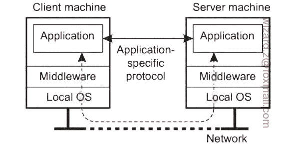

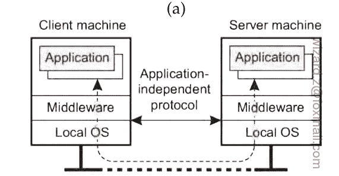

图3.10：(a) 带有自己协议的网络应用程序。(b) 允许访问远程应用程序的通用解决方案。

第二种解决方案是通过提供直接访问远程服务，仅提供方便的用户界面。实际上，这意味着客户端机器仅用作终端，无需本地存储，从而实现了应用程序中立的解决方案，如图3.10(b)所示。在这种情况下，所有内容都在服务器上进行处理和存储。这种瘦客户端方法在互联网连接和移动设备的使用增加时受到了很多关注。瘦客户端解决方案也很受欢迎，因为它们简化了系统管理的任务。

### 示例：X窗口系统
也许最古老且仍广泛使用的网络用户界面之一是X窗口系统。X窗口系统通常简称为X，用于控制位图终端，包括显示器、键盘和指针设备，如鼠标。除了支持传统的终端，如台式计算机和工作站上的终端，X还支持现代设备，如平板电脑和智能手机上的触摸屏。从某种意义上说，X可以被视为控制终端的操作系统的一部分。系统的核心由我们将称之为X内核组成。

它包含了所有特定终端的设备驱动程序，因此通常高度依赖硬件。 X内核提供了一个相对低级的界面来控制屏幕，还可以捕获键盘和鼠标的事件。这个接口作为一个名为Xlib的库提供给应用程序使用。这个一般的组织结构如图3.11所示。注意，应用程序几乎从不直接使用Xlib，而是使用在Xlib之上实现的更易于使用的工具包。

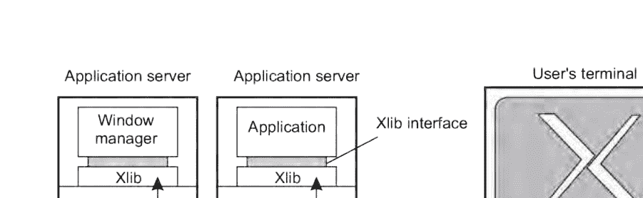

X的有趣之处在于X内核和X应用程序不一定需要驻留在同一台机器上。特别是，X提供了X协议，这是一种应用层通信协议，通过它，一个Xlib实例可以与X内核交换数据和事件。例如，Xlib可以向X内核发送请求来创建或销毁窗口，设置颜色，并定义要显示的光标类型，等等。

反过来，X内核将对本地事件（如键盘和鼠标输入）做出反应，通过发送事件数据包回到 Xlib。

多个应用程序可以同时与X内核通信。有一个特定的应用程序被赋予特殊权限，被称为窗口管理器。这个应用程序可以决定显示给用户的外观和感觉。例如，窗口管理器可以规定每个窗口如何装饰额外的按钮，窗口如何在显示器上排列等等。其他应用程序必须遵守这些规则。实际上，这意味着应用程序和X终端之间的大部分交互是通过窗口管理器重定向的。

有趣的是，X窗口系统实际上是如何适应客户端-服务器计算的。从我们到目前为止所描述的内容，应该清楚X内核接收到操作显示器的请求。它从（可能是远程的）应用程序获取这些请求。在这个意义上，X内核充当服务器的角色，而应用程序则扮演客户端的角色。这个术语已经被X采用，严格来说是正确的，但很容易引起混淆。

### 瘦客户机网络计算
显然，应用程序使用X提供的特定显示命令来操作显示。这些命令通常通过网络发送，然后由X内核执行。按照其性质，为X编写的应用程序应该尽可能地将应用程序逻辑与用户界面命令分开。不幸的是，这通常不是这种情况。正如Lai和Nieh [2002]所报道的，应用程序的大部分逻辑和用户交互是紧密耦合的，这意味着应用程序将向X内核发送许多请求，并期望在进行下一步之前得到响应。这种同步行为可能在通过具有长延迟的广域网进行操作时对性能产生不利影响。

对于这个问题有几种解决方案。其中一种是重新设计X协议的实现，就像使用NX [Pinzari, 2003]一样。这项工作的一个重要部分是通过减小X消息的大小来减少带宽。为此，消息被认为由一个固定部分和一个可变部分组成。在许多情况下，多个消息将具有相同的标识符，这些消息通常包含相似的数据。可以利用这个属性只发送具有相同标识符的消息之间的差异。通过发送方和接收方维护标识符，接收方可以轻松地进行解码。

据报道，带宽降低了1000倍，这使得X也可以通过仅为9600 kbps的低带宽链接运行。

> "作为使用X的替代方案，研究人员和实践者还试图让应用程序完全控制远程显示，即提升像素级别。"

### 用于分布透明性的客户端软件
客户端软件不仅包括用户界面。在许多情况下，客户端服务器应用程序的处理和数据级别的部分也在客户端上执行。嵌入式客户端软件形成了一个特殊的类别，例如自动取款机（ATM），收银机，条形码阅读器，电视机顶盒等。在这些情况下，用户界面是客户端软件的相对较小的部分，与本地处理和通信设施形成对比。

除了用户界面和其他应用程序相关的软件外，客户端软件包括用于实现分布透明性的组件。理想情况下，客户端不应该意识到它正在与远程进程通信。

相比之下，出于性能和正确性的原因，服务器对分布通常不太透明。

访问透明性通常通过从服务器的接口定义生成客户端存根来处理。存根提供与服务器上可用的接口相同的接口，但隐藏了机器体系结构的可能差异，以及实际的通信。客户端存根将本地调用转换为发送到服务器的消息，并将服务器的消息转换为返回值，就像调用普通过程时所期望的那样。

处理位置、迁移和重定位透明性有不同的方法。使用方便的命名系统至关重要。在许多情况下，与客户端软件的合作也很重要。例如，当客户端已经绑定到服务器时，可以直接通知客户端服务器更改位置。在这种情况下，客户端的中间件可以将服务器的当前网络位置对用户隐藏，并在必要时透明地重新绑定到服务器。最坏的情况下，客户端的应用程序可能会注意到临时的性能损失。

以类似的方式，许多分布式系统通过客户端解决方案实现复制透明性。例如，想象一个具有复制服务器的分布式系统，这种复制可以通过将请求转发给每个副本来实现，如图3.12所示。客户端软件可以透明地收集所有响应并将单个响应传递给客户端应用程序。

[图略]

图3.12：使用客户端解决方案透明复制服务器。

关于故障透明性，掩盖与服务器的通信故障通常通过客户端中间件来完成。例如，客户端中间件可以配置为重复尝试连接到服务器，或者在多次尝试后尝试另一个服务器。甚至有些情况下，客户端中间件会返回它在先前会话中缓存的数据，这在无法连接到服务器的Web浏览器中有时会发生。

最后，并发透明性可以通过特殊的中间服务器（尤其是事务监视器）来处理，并且对客户端软件的支持要求较少。

## 3.4 服务器

现在让我们更仔细地看一下服务器的组织。在接下来的页面中，我们首先集中讨论了一些服务器的一般设计问题，然后讨论了服务器集群。

### 服务器概述
服务器是代表一组客户端实现特定服务的进程。实质上，每个服务器都以相同的方式组织：它等待来自客户端的传入请求，然后确保处理该请求，之后等待下一个传入请求。

### 并发与迭代服务器
有几种组织服务器的方式。 在迭代服务器的情况下，服务器本身处理请求，并在必要时向请求的客户端返回响应。 并发服务器不处理请求本身，而是将其传递给单独的线程或另一个进程，之后立即等待下一个传入请求。多线程服务器是并发服务器的一个例子。 并发服务器的另一种实现方式是为每个新的传入请求派生一个新的进程。这种方法在许多Unix系统中被采用。 处理请求的线程或进程负责向请求的客户端返回响应。

### 联系服务器：终点
另一个问题是客户端如何联系服务器。 在所有情况下，客户端发送请求到运行服务器的机器上的一个终点，也称为端口。每个服务器都监听一个特定的终点。客户端如何知道服务的终点？一种方法是为众所周知的服务全局分配终点。例如，处理Internet FTP请求的服务器总是监听TCP端口21。同样，用于万维网的HTTP服务器总是监听TCP端口80。这些终点由互联网分配号码管理局（IANA）分配，并在[Reynolds and Postel, 1994]中有记录。有了分配的终点，客户端只需要找到运行服务器的机器的网络地址。

名称服务可以用于此目的。

有许多不需要预分配终点的服务。 例如，一个时间服务器可能会使用一个由其本地操作系统动态分配给它的端点。 在这种情况下，客户端首先需要查找端点。 一种解决方案是在每台运行服务器的机器上运行一个特殊的守护进程。 守护进程跟踪由共同位置服务器实现的每个服务的当前端点。 守护进程本身侦听一个众所周知的端点。 客户端首先联系守护进程，请求端点，然后联系特定的服务器，如图3.13(a)所示。

[图略]

图3.13:(a)使用守护进程进行客户端到服务器绑定。(b)使用超级服务器进行客户端到服务器绑定。

将端点与特定服务关联是很常见的。然而，通过单独的服务器实际实现每个服务可能是一种资源浪费。例如，在典型的Unix系统中，通常同时运行大量服务器，其中大部分是被动的。

等待直到客户端请求到达。与跟踪这么多被动进程不同，通常更高效的做法是有一个单一的超级服务器监听与特定服务相关的每个端点，如图3.13(b)所示。例如，Unix中的inetd守护进程监听一些互联网服务的众所周知端口。当请求到达时，守护进程会派生一个进程来处理它。该进程在完成后会退出。

### 中断服务器
设计服务器时需要考虑的另一个问题是服务器是否以及如何被中断。例如，考虑一个用户刚刚决定上传一个巨大的文件到FTP服务器。然后，突然意识到这是错误的文件，他想中断服务器以取消进一步的数据传输。有几种方法可以做到这一点。在当前互联网中，有一种方法非常有效（有时也是唯一的选择），那就是用户突然退出客户端应用程序（这将自动断开与服务器的连接），立即重新启动它，并假装没发生。服务器最终会关闭旧的连接，认为客户端可能已经崩溃。

处理通信中断的更好方法是开发客户端和服务器，使其能够发送带外数据
数据，即在服务器处理任何其他来自该客户端的数据之前需要处理的数据 一种解决方案是让服务器监听一个单独的控制端点，客户端通过该端点发送带外数据，同时以较低的优先级监听通过正常数据传递的端点 另一种解决方案是通过客户端发送原始请求的相同连接发送带外数据 例如，在TCP中，可以传输紧急数据 当服务器接收到紧急数据时，会中断（例如，在Unix系统中通过信号），然后可以检查数据并相应处理

### 无状态与有状态服务器
最后一个重要的问题是服务器是否无状态 无状态服务器不会保留有关其客户端状态的信息，并且可以更改自身状态而无需通知任何客户端[Birman, 2012] 例如，Web服务器是无状态的 它只是响应传入的HTTP请求，可以是上传文件到服务器或（通常情况下）获取文件 请求处理完毕后，Web服务器完全忘记客户端 同样，Web服务器管理的文件集合（可能与文件服务器合作）可以更改而无需通知客户端

请注意，在许多无状态设计中，服务器实际上确实会维护客户端的信息，但关键是，如果这些信息丢失，不会导致服务器提供的服务中断。例如，Web服务器通常会记录所有客户端请求。这些信息很有用，例如用于决定是否应该复制某些文档以及复制到哪里。显然，如果日志丢失，除了可能导致性能不佳之外，没有其他惩罚。

无状态设计的一种特殊形式是服务器维护所谓的软状态。在这种情况下，服务器承诺代表客户端维护状态，但仅限于有限的时间。超过该时间后，服务器将恢复默认行为，从而丢弃与相关客户端相关的任何信息。这种状态的一个例子是服务器承诺在有限的时间内向客户端提供更新信息。之后，客户端需要定期向服务器轮询更新。

软状态方法起源于计算机网络协议设计， 但同样适用于服务器设计[Clark, 1989; Lui et al., 2004]。 相比之下，有状态的服务器通常会保持关于客户端的持久信息。这意味着服务器需要显式地删除信息。一个典型的例子是允许客户端保留文件的本地副本的文件服务器，甚至可以执行更新操作。这样的服务器会维护一个包含(客户端, 文件)条目的表。这样的表允许服务器跟踪当前具有文件更新权限的客户端，以及可能的最新版本的文件。

[图略]

[图略]

这种方法可以提高客户端感知的读写操作性能。相对于无状态服务器，性能改进通常是有状态设计的一个重要优势。然而，这个例子也说明了有状态服务器的主要缺点。如果服务器崩溃，它必须恢复其(客户端，文件)条目表，否则无法保证已处理文件的最新更新。一般来说，有状态服务器需要恢复其在崩溃前的整个状态。启用恢复可能会引入相当复杂性，我们在中进行讨论。第8章在无状态设计中，不需要采取任何特殊措施来恢复崩溃的服务器。它只需重新开始运行，并等待客户端请求的到来。

Ling等人[2004]认为，人们实际上应该区分（临时的）会话状态和永久状态。上面的例子是会话状态的典型情况：它与单个用户的一系列操作相关联并且应该在一段时间内维护，但不是无限期的。事实证明，会话状态通常在三层客户端-服务器架构中维护 在这种架构中，应用服务器实际上需要通过一系列查询访问数据库服务器然后才能响应请求的客户端。这里的问题是，如果会话状态丢失，实际上并没有造成真正的伤害只要客户端能够简单地重新发出原始请求即可。这个观察结果允许更简单、更不可靠的状态存储。

对于永久状态而言，通常在数据库中维护的是一些信息，例如客户信息、与购买的软件相关的密钥等然而，对于大多数分布式系统来说，维护会话状态已经意味着需要进行有状态的设计，在发生故障时需要采取特殊措施并对存储在服务器上的状态的持久性进行明确的假设。在讨论容错性时，我们将详细讨论这些问题。

### 对象服务器
让我们来看看分布式对象所需的对象服务器的一般组织。一般对象服务器与其他（更传统的）服务器之间的重要区别在于，对象服务器本身不提供特定的服务。特定的服务由驻留在服务器中的对象实现。实质上，服务器只提供调用本地对象的手段，基于远程客户端的请求。因此，通过简单地添加和删除对象，相对容易改变服务。

对象服务器充当对象所在的位置。一个对象由两部分组成：表示其状态的数据和执行其方法的代码。这些部分是否分离，以及方法实现是否由多个对象共享，取决于对象服务器。此外，对象服务器调用其对象的方式也有所不同。例如，在多线程服务器中，每个对象可以分配一个单独的线程，或者每个调用请求可以使用一个单独的线程。接下来将讨论这些和其他问题。

为了调用一个对象，对象服务器需要知道要执行的代码，应该操作哪些数据，是否应该启动一个单独的线程来处理调用等等。一个简单的方法是假设所有对象看起来都一样，并且只有一种调用对象的方式。不幸的是，这种方法通常是不灵活的，并且经常不必要地限制了分布式对象的开发人员。

一个更好的方法是服务器支持不同的策略。例如，考虑一个瞬态对象：只存在于其服务器存在的时间，但可能存在时间更短。一个内存中的只读文件副本通常可以作为一个瞬态对象来实现。

同样，计算器也可以作为一个瞬态对象来实现。一个合理的策略是在第一次调用请求时创建一个瞬态对象，并在没有客户端绑定到它时立即销毁它。

这种方法的优点是瞬态对象只需要服务器的资源，只要对象真正需要它。缺点是调用可能需要一些时间才能完成，因为需要先创建对象。因此，有时候另一种策略是在服务器初始化时创建所有瞬态对象，以消耗资源，即使没有客户端使用该对象。## 第三章 进程

以类似的方式，服务器可以遵循每个对象都放置在自己的内存段中的策略。换句话说，对象既不共享代码也不共享数据。当对象的实现不分离代码和数据，或者出于安全原因需要将对象分离时，可能需要这样的策略。在后一种情况下，服务器将需要提供特殊措施，或者需要底层操作系统的支持，以确保不违反段边界。

另一种方法是让对象至少共享它们的代码。例如，包含属于同一类的对象的数据库可以通过仅将类实现加载到服务器一次来高效实现。当收到对象调用的请求时，服务器只需获取该对象的状态并执行请求的方法。

同样，关于线程有许多不同的策略。最简单的方法是仅使用单个控制线程来实现服务器。或者，服务器可以拥有多个线程，每个线程负责一个对象。每当收到一个对象的调用请求时，服务器将请求传递给负责该对象的线程。如果线程当前忙碌，请求将被临时排队。

这种方法的优势是对象自动受到保护，防止并发访问：所有调用都通过与对象关联的单个线程进行序列化。整洁而简单。当然，也可以为每个调用请求使用单独的线程，这要求对象在并发访问之前已经受到保护。无论是每个对象使用一个线程还是每个方法使用一个线程，都可以选择在需要时创建线程或者服务器维护线程池。

通常没有单一的最佳策略。使用哪种策略取决于线程是否可用，性能有多重要以及类似的因素。

关于如何调用对象的决策通常被称为激活策略，强调在许多情况下，必须先将对象带入服务器的地址空间（即激活）才能实际调用它。然后需要一种机制来按策略对对象进行分组。

这样的机制有时被称为对象适配器，或者另外一个对象包装器。对象适配器最好被认为是实现特定激活策略的软件。然而，主要问题是对象适配器作为通用组件来帮助分布式对象的开发人员，并且只需要为特定策略进行配置。

对象适配器控制一个或多个对象。因为一个服务器应该能够同时支持需要不同激活策略的对象，所以几个对象适配器可以存在于同一个服务器中。当调用请求被传递到服务器时，首先将请求分派给适当的对象适配器。如图3.14所示。一个重要的观察是对象适配器不知道它们控制的对象的具体接口。否则，它们永远不可能是通用的。

[PAGE 148]

![img/fd0be3dd250e588e70e9d95e8d17da0d_148_0.png]

图3.14：支持不同激活策略的对象服务器。

对于对象适配器来说，唯一重要的问题是它能够从调用请求中提取对象引用，并随后根据特定的激活策略将请求分派给引用对象。

正如图3.14所示，适配器不直接将请求传递给对象，而是将调用请求交给该对象的服务器端存根。存根，也称为骨架，通常是根据对象的接口定义生成的，它对请求进行解组并调用适当的方法。

对象适配器可以通过在运行时进行简单配置来支持不同的激活策略。例如，在符合CORBA标准的系统中[OFM, 2004a]，可以指定对象在其关联的适配器停止后是否继续存在。同样，适配器可以配置为生成对象标识符，或者由应用程序提供。最后，适配器可以配置为以单线程或多线程模式运行，如上所述。

请注意，尽管在图3.14中我们谈到了对象，但我们并没有说这些对象实际上是什么。特别要强调的是，作为这种对象实现的一部分，服务器可能（间接地）访问数据库或调用特殊的库例程。实现细节对于与骨架通信的对象适配器来说是隐藏的。因此，实际的实现可能与我们通常在语言级别（即编译时）看到的对象无关。

出于这个原因，通常采用不同的术语。一个服务对象是

[PAGE 149]

实现对象的代码的通用术语。

[注3.6 (示例: Ice运行时系统)]

让我们简要地考虑一下Ice分布式对象系统，它部分地是为了应对商业对象分布式系统的复杂性而开发的[Henning, 2004]。在Ice中，对象服务器只是一个普通的进程，它只需初始化Ice运行时系统（RTS）即可。运行时环境的基础是所谓的通信器。通信器是管理一些基本资源的组件，其中最重要的是线程池。同样，它将具有关联的动态分配内存等。此外，通信器提供了配置环境的手段。例如，可以指定最大消息长度、最大调用重试次数等。通常，一个对象服务器只会有一个通信器。然而，当不同的应用程序需要完全分离和保护彼此时，可以在同一个进程中创建一个单独的通信器（可能具有不同的配置）。至少，这种方法将分离不同的线程池，以便如果一个应用程序消耗了所有线程，那么这不会影响其他应用程序。°

通信器也可以用于创建对象适配器，如图3.15所示。我们注意到代码是简化和不完整的。更多的例子和关于Ice的详细信息可以在Henning和Spruiell [2005]中找到。

```
main(int argc, char* argv[]) {
  Ice::Communicator ic;
  Ice::ObjectAdapter adapter;
  Ice::Object object;
  ic = Ice::initialize(argc, argv);
  adapter = ic->createObjectAdapterWithEndpoints( "MyAdapter","tcp - p 10000");
  object = new MyObject;
  adapter->add(object, objectID);
  adapter->activate();
  ic->waitForShutdown();
}
```

图3.15：在Ice中创建对象服务器的示例。在这个例子中，我们首先创建和初始化运行时环境。完成后，创建一个对象适配器。在这种情况下，它被指示在端口10000上监听传入的TCP连接。注意适配器是在刚创建的通信器的上下文中创建的。现在我们可以创建一个对象，并将该对象添加到适配器中。

最后，适配器被激活，这意味着，在底层，一个线程被激活，开始监听传入的请求。

这段代码还没有显示出激活策略的差异。策略可以通过修改适配器的属性来改变。一组与维护适配器特定的线程相关的属性被称为一组属性。

[PAGE 150]

### 3.4. 服务器

[用户新增内容]

用于处理传入请求。例如，可以指定只有一个线程，有效地将对已添加到适配器的对象的所有访问序列化。

再次注意，我们没有指定MyObject。与之前一样，这可以是一个简单的C++对象，也可以是一个访问数据库和其他外部服务的对象的实现。通过将MyObject注册到适配器中，这些实现细节对客户端完全隐藏，客户端现在认为自己在调用一个远程对象。

在上面中，一个对象作为应用程序的一部分创建，然后添加到适配器中。实际上，这意味着一个适配器可能需要同时支持多个对象，从而导致潜在的可扩展性问题。另一种解决方案是在需要时动态加载对象到内存中。为了做到这一点，Ice提供了对特殊对象的支持，这些对象被称为定位器。当适配器接收到一个尚未显式添加的对象的传入请求时，会调用一个定位器。在这种情况下，请求会被转发给定位器，定位器的任务是进一步处理请求。

为了更具体地说明问题，假设一个定位器接收到一个对象的请求，该定位器知道该对象的状态存储在一个关系数据库系统中。当然，这里没有什么魔法：定位器已经被明确地编程来处理这样的请求。在这种情况下，对象的标识符可能对应于存储该状态的记录的键。定位器将简单地在该键上进行查找，获取状态，然后能够进一步处理请求。

适配器可以添加多个定位器。在这种情况下，适配器将跟踪哪些对象标识符属于同一个定位器。使用多个定位器可以通过一个适配器支持多个对象。当然，对象（或者它们的状态）需要在运行时加载，但这种动态行为可能使服务器本身相对简单。

[注3.7 (示例：企业级 Java Beans)]

Java 编程语言及其相关模型已经成为许多分布式系统和应用的基础。它的流行可以归因于对面向对象的直接支持，以及对远程方法调用的内在支持。Java 提供了高度的访问透明度，使其比使用 C 与远程过程调用的组合更容易使用。

自从引入以来，一直有强烈的动力提供便于开发分布式应用程序的工具。这些工具远远超出了语言支持的范围，需要支持传统多层客户端-服务器架构的运行时环境。为此，已经投入了大量的工作来开发（企业级）Java Beans (EJB) 。

EJB 本质上是一个由特殊服务器托管 的 Java 对象，为远程客户端提供不同的调用方式。关键是这个服务器提供了将应用程序功能与系统功能分离的支持。后者包括查找对象、存储对象、使对象成为事务的一部分等功能。如何开发EJB在Schildt [2010]中有详细描述。

![img/fd0be3dd250e588e70e9d95e8d17da0d_151_0.png]

![图3.16：EJB服务器的一般架构。]

考虑到这种分离，可以将EJB想象成图3.16所示的样子。重要的问题是，EJB嵌入在容器中，该容器有效地为应用服务器实现的底层服务提供接口。容器可以自动将EJB绑定到这些服务上，这意味着正确的引用对程序员来说是可用的。典型的服务包括远程方法调用（RMI）、数据库访问（JDBC）、命名（JNDI）和消息传递（JMS）。利用这些服务是相对自动化的，但需要程序员区分四种类型的EJB：

- 1. 无状态会话Bean
- 2. 有状态会话Bean
- 3. 实体Bean
- 4. 消息驱动Bean

正如其名称所示，无状态会话Bean是一个被调用一次、完成工作后丢弃任何执行所需信息的对象，以提供给客户端的服务。例如，无状态会话Bean可以用来实现列出排名靠前的图书的服务。在这种情况下，Bean通常由提交给数据库的SQL查询组成。结果将被放入客户端可以处理的特殊格式中，之后工作将完成并且列出的图书将被丢弃。

相比之下，有状态会话Bean维护与客户端相关的状态。典型的例子是实现电子购物车的Bean。在这种情况下，客户端通常能够将物品放入购物车、移除物品，并使用购物车进行电子结账。而Bean通常会访问数据库以获取当前价格和库存中物品数量的信息。然而，它的生命周期仍然有限，这就是为什么它被称为会话Bean：当客户端完成时（可能已经多次调用了该对象），Bean将自动被销毁。

### 3.4. 服务器

实体Bean可以被视为长期存在的持久化对象。因此，实体Bean通常存储在数据库中，并且通常也是事务的一部分。通常，实体Bean存储可能在下次特定客户端访问服务器时需要的信息。在电子商务的环境中，实体Bean可以用于记录客户信息，例如送货地址、账单地址、信用卡信息等。在这些情况下，当客户登录时，他关联的实体Bean将被恢复并用于进一步处理。

最后，消息驱动的Bean用于编程需要对传入消息做出反应（并且同样能够发送消息）的对象。消息驱动的Bean不能直接由客户端调用，而是适用于发布-订阅方式的通信。归根结底，当服务器接到特定消息m时，会自动调用消息驱动的Bean，而服务器（或者托管的应用程序）之前已经订阅了该消息，即声明希望在该消息到达时得到通知。Bean包含处理消息的应用程序代码，之后服务器简单地丢弃该消息。因此，消息驱动的Bean被视为无状态的。

## 示例：Apache Web 服务器

一个有趣的例子是 Apache Web 服务器，它在策略和机制之间保持了良好的分离。它也是一个非常受欢迎的服务器，据估计用于托管大约50%的所有网站。

Apache 是一个复杂的软件，随着现在 Web 上提供的各种类型的文档的增加，服务器的高度可配置性和可扩展性非常重要，同时又大部分独立于具体的平台。

使服务器与平台无关的实现是通过提供自己的基本运行环境来实现的，然后再为不同的操作系统进行相应的实现。这个运行时环境被称为 Apache Portable Runtime (APR) ，它是一个提供了平台无关接口的库，用于文件处理、网络、锁定、线程等。在扩展 Apache 时，只要调用 APR，就可以基本保证可移植性，避免调用特定于平台的库。

从某种角度来看，Apache 可以被认为是一个完全通用的服务器，专门用于响应传入的请求。当然，有各种隐藏的依赖和假设，Apache 主要适用于处理 Web 文档的请求。

例如，正如我们提到的，Web 浏览器和服务器使用HTTP作为它们的通信协议。HTTP 几乎总是在TCP之上实现的，因此Apache的核心假设所有传入请求都遵循基于TCP的面向连接的通信方式。请求

## 第三章 进程

基于UDP的请求无法在不修改Apache核心的情况下处理。

然而，Apache核心对于如何处理传入请求几乎没有假设。它的整体组织如图3.17所示。这个组织的基础是一个名为“hook”的概念，它只是一个特定功能组的占位符。Apache核心假设请求在多个阶段中进行处理，每个阶段由几个hook组成。因此，每个hook代表一组需要作为处理请求的一部分执行的相似操作。

![img/fd0be3dd250e588e70e9d95e8d17da0d_153_0.png]

![图3.17：Apache Web 服务器的处理阶段。]

例如，有一个钩子将URL转换为本地文件名。在处理请求时，几乎肯定需要进行这样的转换。

同样，有一个钩子用于将信息写入日志，一个钩子用于检查客户端的身份，一个钩子用于检查访问权限，以及一个钩子用于检查请求相关的MIME类型（例如，确保可以正确处理请求）。如图3.17所示，这些钩子按照预定的顺序进行处理。在这里，我们明确地看到Apache强制执行有关请求处理的特定控制流程。

与钩子相关联的函数都由单独的模块提供。

虽然原则上开发人员可以更改Apache将处理的钩子集合，但更常见的是编写包含所需函数的模块，作为处理标准钩子的一部分的一部分。未修改的Apache提供的原则是相当简单明了的。每个钩子可以包含一组应该的函数匹配特定的函数原型（即参数列表和返回类型）。
模块开发人员将为特定的钩子编写函数。在编译Apache时，开发人员指定应将哪个函数添加到哪个钩子中。后者在图3.17中显示为函数和钩子之间的各种链接。

由于可能有数十个模块，每个钩子通常包含多个函数。通常，模块被认为是相互独立的，因此同一个钩子中的函数将按照任意顺序执行。然而，Apache也可以通过让开发人员指定不同模块中函数的处理顺序来处理模块依赖关系。总的来说，结果是一个非常灵活的Web服务器。有关配置Apache的详细信息以及如何扩展它的介绍，请参阅[Laurie and Laurie, 2002]。

## 服务器集群

在第一章中，我们简要讨论了集群计算作为分布式系统的一种形式之一。现在我们更详细地研究服务器集群的组织结构，以及其中的重要设计问题。我们首先考虑的是组织在局域网中的常见服务器集群。广域网服务器集群形成了一个特殊的群体，我们随后会讨论它们。

### 局域网集群

简单来说，服务器集群就是通过网络连接的一组机器，每台机器运行一个或多个服务器。

我们在这里考虑的服务器集群是通过局域网连接的，通常提供高带宽和低延迟。

一般组织在许多情况下，服务器集群在逻辑上分为三层，如图3.18所示。第一层由一个（逻辑）交换机组成，用于路由客户端请求。这样的交换机可以有很大的差异。例如，传输层交换机接受传入的TCP连接请求，并将请求传递给集群中的一个服务器。一个完全不同的例子是Web服务器接受传入的HTTP请求，但只将部分请求传递给应用服务器进行进一步处理，然后再从这些服务器收集结果并返回HTTP响应。

与任何多层客户端-服务器架构一样，许多服务器集群也包含专用于应用程序处理的服务器。在集群计算中，这些通常是运行在高性能硬件上的服务器，专门用于提供计算能力。然而，在企业服务器集群的情况下，可能只需要在相对较低端的机器上运行应用程序。

[PAGE 155]

![img/fd0be3dd250e588e70e9d95e8d17da0d_155_0.png]

![图3.18：三层服务器集群的一般组织结构。]

由于所需的计算能力不是瓶颈，而是对存储的访问，因此可能在低端机器上运行。这将带来第三层，其中包括数据处理服务器，特别是文件和数据库服务器。同样，根据服务器集群的使用情况，这些服务器可能在专用机器上运行，配置为高速磁盘访问并具有大型服务器端数据缓存。

当然，并不是所有的服务器集群都会遵循这种严格的分离。经常情况下，每台机器都配备有自己的本地存储，通常将应用程序和数据处理集成在单个服务器中，从而形成两层架构。例如，当处理流媒体时，通过服务器集群使用两层系统架构是常见的，其中每台机器充当专用媒体服务器[Steinmetzand Na hrstedt, 2004]。

当服务器集群提供多个服务时，可能会出现不同的机器运行不同的应用服务器。因此，交换机必须能够区分服务，否则无法将请求转发到正确的机器。因此，我们可能会发现某些机器暂时空闲，而其他机器则接收到过载的请求。有用的是将服务临时迁移到空闲的机器上。一种解决方案是使用虚拟机，可以相对容易地将代码迁移到实际机器上。

### 请求调度

现在让我们更详细地看一下第一层，由交换机组成，也称为前端。服务器集群的一个重要设计目标是隐藏存在多个服务器的事实。换句话说，运行在远程机器上的客户端应用程序不需要了解集群的内部组织。这种访问透明性通常通过单一访问点来实现，反过来

### 3.4. 服务器

通过某种硬件开关（例如专用机器）实现。

该开关形成服务器集群的入口点，提供一个单一的网络地址。为了可扩展性和可用性，服务器集群可以有几个访问点，每个访问点由一个单独的专用机器实现。我们只考虑单个访问点的情况。

访问服务器集群的一种标准方法是建立一个TCP连接，应用层请求作为会话的一部分发送。会话通过关闭连接来结束。在传输层开关的情况下，开关接受传入的TCP连接请求，并将这些连接交给其中一个服务器处理。开关的操作方式基本上有两种[Cardellini et al., 2002]。

在第一种情况下，客户端建立一个TCP连接，使得所有的请求和响应都通过开关传递。开关将与选定的服务器建立一个TCP连接，并将客户端的请求传递给该服务器，同时接受服务器的响应（然后将其传递给客户端）。实际上，开关位于客户端和选定服务器之间的TCP连接中间，当传递TCP段时，重写源地址和目的地。这种方法是一种网络地址转换的形式。

(NAT) [Srisuresh and Holdrege, 1999].

或者，交换机实际上可以将连接移交给选定的服务器，以便所有响应直接与客户端通信，而无需通过服务器[Hunt et al., 1997; Pai et al., 1998]。常被称为TCP切换的工作原理如图3.19所示。

![img/fd0be3dd250e588e70e9d95e8d17da0d_156_0.png]

![图3.19：TCP切换的原理。]

当交换机接收到TCP连接请求时，首先确定处理该请求的最佳服务器，并将请求数据包转发给该服务器。服务器将向请求的客户端发送确认，但在携带TCP段的IP数据包的头部中，将交换机的IP地址插入源字段。请注意，这种地址重写对于客户端继续执行TCP协议是必要的：它
[/content]## 第三章 进程

期望从交换机而不是一些任意的服务器得到答案。显然，TCP交接实现需要操作系统级别的修改。当响应比请求要大得多时，TCP交接特别有效，就像Web服务器的情况一样。

可以看出，交换机在分布负载中起着重要的作用。通过决定将请求转发到哪个服务器，交换机还决定了哪个服务器来处理请求的进一步处理。交换机可以遵循的最简单的负载均衡策略是轮询：每次从列表中选择下一个服务器来转发请求。当然，交换机将不得不跟踪将TCP连接交接给哪个服务器，至少在该连接被关闭之前。事实证明，维护这种状态并交接后续的TCP段属于同一TCP连接，实际上可能会减慢交换机的速度。

还可以部署更高级的服务器选择标准。例如，假设服务器集群提供多个服务。如果交换机在请求到达时能够区分这些服务，那么它可以根据情况决定将请求转发到哪里。这种服务器选择仍然可以在传输层进行，只要服务能够通过端口号进行区分。对于传输层交换机来说，到目前为止我们讨论的是仅基于传输层信息来决定将传入请求转发到哪里。更进一步的一步是让交换机实际检查传入请求的有效载荷。只有在知道有效载荷的内容时，才能应用这种内容感知的请求分发。例如，在Web服务器的情况下，交换机可以预期一个HTTP请求，然后决定由谁来处理它。

### 注3.8（高级：高效的内容感知请求分发）

显然，交换机的设计非常关键，因为它很容易成为一个瓶颈，所有的流量都要通过它。传输层交换机通常非常高效。然而，在应用层操作的内容感知交换机实际上需要进行大量的处理，它会检查传入请求的有效负载。

内容感知的请求分发有几个优点。例如，如果交换机总是将相同文件的请求转发到同一台服务器，那么该服务器可能能够有效地缓存该文件，从而提高响应时间。

同样，我们可以决定将一组文件分发到特定的服务器，例如，流媒体文件、图像、文本文件，甚至实际的数据库。能够做出这样的区分将允许在第二层安装专用服务器。

理想情况下，交换机既具有普通传输层交换机的高效性，又具有内容感知分发 的功能。Aron等人[2000]提出了一种方案，通过将检查传入请求的有效负载的工作分布到多台服务器上，并将此分布与传输层交换结合起来。现在交换机有两个任务。首先，在请求最初

### 3.4. 服务器

当请求到达时，它必须决定哪个服务器将处理与客户端的其余通信。其次，交换机应该转发与移交的TCP连接相关的客户端的TCP消息。

[图片：基于内容感知的请求分发使用TCP移交。]

这两个任务可以如图3.20所示进行分布。当请求到达时，交换机首先要做的是将其传递给任意的分发器，该分发器在其中个服务器上运行。分发器的主要工作是管理TCP移交。然后，分发器将请求传递给调度器，调度器检查有效载荷以决定最佳的应用服务器。一旦选择了该服务器，初始分发器将执行管理工作以移交TCP连接：它与所选服务器通信以接受连接，并最终通知交换机应将相关的TCP段转发给哪个服务器。

### 广域网集群

本地区域服务器集群的一个特点是它们由单个组织拥有。在广域网上部署集群通常是非常麻烦的，因为通常需要处理多个管理组织，如ISP（互联网服务提供商）。随着云计算的出现，情况发生了变化，我们现在看到广域分布式系统的增加，其中服务器（或服务器集群）分布在互联网上。通过利用单个云提供商的设施，可以有效地解决与处理多个组织相关的问题。

像亚马逊和谷歌这样的云服务提供商管理着位于全球不同地点的多个数据中心。因此，它们可以为最终用户提供构建一个由分布在互联网上的潜在大量网络虚拟机组成的广域分布式系统的能力。一个需要这种本地性的示例是流媒体：视频服务器距离客户端越近，提供高质量流媒体就越容易。

请注意，如果广域本地性不是关键，将虚拟机放置在单个数据中心可能足够好，甚至更好，这样进程间通信可以从低延迟的本地网络中受益。付出的代价可能是客户端与远程数据中心中运行的服务之间的延迟更高。

请求分派**如果**广域本地性是一个问题，那么请求分派就变得重要：如果客户端访问一个服务，它的请求应该被转发到附近的服务器，也就是允许与该客户端进行快速通信的服务器。决定哪个服务器应该处理客户端的请求是一个重定向策略的问题[Sivasubramanian等人，2004b]。如果我们假设客户端最初将联系一个类似于在本地区域集群讨论中的交换机的请求调度器，那么该调度器将不得不估计客户端和几个服务器之间的延迟。如何进行这样的估计在第6.5节中进行了讨论。

一旦选择了服务器，调度程序将不得不通知客户端。有几种重定向机制是可能的。一种流行的机制是调度程序实际上是一个DNS名称服务器。互联网或基于Web的服务通常在域名系统（DNS）中查找。客户端提供一个域名，例如service.organization.org，给本地DNS服务器，该服务器最终返回与服务关联的IP地址，可能在与其他DNS服务器联系后返回。当发送查找名称的请求时，客户端还会发送自己的IP地址（DNS请求以UDP数据包形式发送）。换句话说，DNS服务器还将知道客户端的IP地址，然后可以使用该地址选择最佳服务器，并返回附近的IP地址。这样，DNS服务器将知道客户端的IP地址，然后可以使用该地址选择最佳服务器，并返回附近的IP地址。

不幸的是，这个方案有两个问题。首先，不是发送客户端的IP地址，而是由客户端联系的本地DNS服务器充当代理。换句话说，并不是客户端的IP地址，而是本地DNS服务器的地址用于标识客户端的位置。Mao等人[2002]已经表明，这可能会产生巨大的额外通信成本，因为本地DNS服务器通常并不是那么本地。其次，根据用于解析域名的方案，甚至可能是本地DNS服务器的地址根本没有被使用。相反，决定返回哪个IP地址的DNS服务器可能会被请或者是另一个充当原始客户端和决定DNS服务器之间中间人的DNS服务器所欺骗。在这些情况下，地理位置感知已经完全丢失。

尽管基于DNS的重定向可能不总是非常准确，但它被广泛部署，仅仅因为它相对容易实现并且对客户端透明。此外，无需依赖于具有位置感知能力的客户端软件。

### 注3.9 (高级：一种用于组织广域服务器集群的替代方法)

正如我们提到的，大多数服务器集群提供单一访问点。当该访问点失败时，集群将变得不可用。为了消除这个潜在问题，可以提供多个访问点，其中的地址是公开可用的。

域名系统（DNS）可以返回多个属于同一主机名的地址，使用简单的轮询策略。这种方法仍然需要客户端进行多次尝试，如果其中一个地址失败。此外，这并不能解决需要静态访问点的问题。

对于客户端和服务器来说，具有稳定性，如长期存在的访问点，是一个理想的特性。另一方面，具有对服务器集群进行灵活配置的能力，包括交换机，也是可取的。

这个观察结果导致了一个分布式服务器的设计，它实际上是一个可能动态变化的机器集合，也可能有不同的访问点，但对外界来说却表现为一个单一而强大的机器。Szyma这人等人[2007]提供了这样一个分布式服务器的设计。我们在这里简要描述它。

分布式服务器背后的基本思想是客户端从一个强大、高性能、稳定的服务器中受益。这些特性通常可以由高端大型机提供，其中一些的故障间隔时间超过40年。然而，通过将较简单的机器透明地分组成一个集群，并且不依赖于单个机器的可用性，可能可以实现比每个组件单独使用更好的稳定性程度。例如，这样的集群可以从终端用户机器动态配置，就像协作分布式系统的情况一样。还要注意，许多数据中心正在使用相对便宜和简单的机器[Barroso和Hólze，2009]。

让我们集中精力研究如何在这样一个系统中实现稳定的访问点。主要思想是利用可用的网络服务，特别是IPv6（MIPv6）的移动性支持。在MIPv6中，假设移动节点有一个常驻的家庭网络，并且有一个相关的稳定地址，称为家庭地址（HoA）。这个家庭网络连接了一个特殊的路由器，称为家庭代理，它将在移动节点离开时负责处理与移动节点的通信。为此，当移动节点连接到外部网络时，它将接收一个临时的关心地址（CoA），可以通过该地址与其通信。这个关心地址将报告给节点的家庭代理，家庭代理将确保所有的通信都转发到移动节点。请注意，与移动节点通信的应用程序只能看到与节点的家庭网络相关的地址。他们永远不会看到关心地址。

这个原则可以用来提供分布式服务器的稳定地址。

在这种情况下，一个单一的唯一联系地址最初分配给服务器集群。联系地址将是服务器与外界进行所有通信时使用的生命周期地址。在任何时候，分布式服务器中的一个节点将作为一个使用该联系地址的访问点，但是这个角色可以很容易地被另一个节点接管。所发生的是，访问点将自己的地址记录为与分布式服务器相关联的主代理的关心地址。在那一点上，所有的流量将被定向到访问点，

然后访问点将负责在当前参与的节点之间分发请求。 如果访问点失败，一个简单的故障转移机制将被启用，另一个访问点报告一个新的关心地址。

这种简单的配置将使主代理以及访问点成为潜在的瓶颈，因为所有的流量都将通过这两台机器流动。 通过使用MIPv6的一个特性，即路由优化，可以避免这种情况。 路由优化的工作原理如下。 每当一个具有家庭地址 HA 的移动节点报告其当前的关心地址，比如 C A，家庭代理可以将 CA转发给客户端。 后者将在本地存储这对 (HA, CA)。 从那一刻起，通信将直接转发到 CA。 尽管客户端侧的应用程序仍然可以使用家庭地址，但是MIPv6的底层支持软件将把该地址转换为 CA 并使用它代替。

[图片：分布式服务器中的路由优化。]

路由优化可以用来使不同的客户端相信他们正在与一个单一的服务器通信，而实际上每个客户端都在与分布式服务器的不同成员节点通信，如图3.21所示。为此，当分布式服务器的接入点将来自客户端 C₁ 的请求转发给节点 S₁（具有地址 CA₁）时，它会传递足够的信息给 S₁，以便让它启动路由优化过程，最终使客户端相信关注地址是 CA₁。这将允许客户端 C₁ 存储这对 (HA, CA₁)。 在此过程中，接入点（以及家庭代理）会隧道化 C₁ 和 S₁ 之间的大部分流量。 这将防止家庭代理相信关注地址已经改变，从而继续与接入点通信。

当这个路由优化过程正在进行时，来自其他客户端的请求仍然可能会到达。 这些请求在接入点处保持待处理状态，直到它们可以被转发。 来自另一个客户端的请求 C₂ 然后可以被转发到成员节点 S₂（具有地址 CA₂），从而使后者可以让客户端 C₂ 存储对 HA, CA₂) 的配对。 因此，不同的客户端将
直接与分布式服务器的不同成员进行通信，每个客户端应用程序仍然具有这个服务器具有地址HA的幻觉。主机代理继续与与联系地址通信的接入点进行通信。

### 案例研究：PlanetLab

现在让我们更仔细地看一下一个有些不寻常的集群服务器。PlanetLab是一个协作的分布式系统，其中不同的组织每个捐赠一个或多个计算机，总共有达数百个节点。

这些计算机共同组成一个一层服务器集群，在每个节点上都可以进行访问、处理和存储。由于需要，PlanetLab的管理几乎完全是分布式的。

一般组织在PlanetLab中，参与的组织捐赠一个或多个节点（即计算机），随后这些节点将被所有PlanetLab用户共享。每个节点的组织如图3.22所示。有两个重要的组件[Bavier等人，2004; Peterson等人，2006]。

第一个组件是虚拟机监视器（VMM），它是一个增强的Linux操作系统。增强主要包括为支持第二个组件（即Linux的Vservers）进行的调整。目前，可以将Vserver视为一个独立的环境，其中运行一组进程。我们将在下面讨论Vservers。

[图片：每个节点的组织。]

Vservers 现在让我们转向PlanetLab的Vservers，这些Vservers已经被Soltesz等人[2007]描述和评估过。一个Vserver根据所谓的基于容器的方法进行组织。与第3.2节中讨论的传统虚拟机的主要区别在于，它们依赖于一个单一的共享操作系统内核。这也意味着资源管理主要由底层操作系统而不是任何Vserver来完成。因此，Vserver的主要任务仅仅是支持一组进程并将该组与另一个Vserver的进程隔离开来。实际上，Vserver形成了一组进程及其分配的资源的隔离容器。到目前为止，容器已经成为提供云服务的非常流行的方式。

这种隔离是通过底层VMM技术实现的，为此Linux操作系统已经进行了适应。最显著的适应之一涉及独立命名空间的分离。例如，为了创建Vserver实际上是一个单一机器的幻觉，Unix进程init传统上总是获得进程ID 1（其父进程的ID为0）。显然，Linux VMM已经有这样一个进程在运行，但它需要为每个Vserver创建另一个init进程。这些进程每个也将获得进程ID 1，而内核会跟踪这样一个虚拟进程ID与实际分配的进程ID之间的映射。很容易想到在Vservers之间保持一致命名的其他例子。

同样，通过为每个Vserver提供自己的库集合来建立隔离，但使用这些库所期望的目录结构，即以/dev，/home，/proc，/usr等命名的目录（也在图3.22中显示）。原则上，可以使用标准的chroot命令实现这样一个分离的命名空间，有效地为每个Vserver提供自己的根目录。然而，在内核级别需要采取特殊措施，以防止一个Vserver对另一个Vserver的目录树进行未经授权的访问，正如Soltesz等人[2007]所解释的那样。

与运行单独的客户操作系统相比，基于容器的虚拟化方法的一个重要优势是资源分配通常可以更简单。特别是，可以通过允许动态资源分配来超额预订资源，就像为正常进程分配资源一样。通常，在使用客户操作系统时，需要预先分配一定数量的资源给客户（特别是主存储器）。考虑到
参与PlanetLab组织提供的节点只需要几GB的主内存，可以想象内存可能是一种稀缺资源。因此，需要动态分配内存，以允许数十个虚拟机同时在单个节点上运行。Vservers非常适合这种类型的资源管理；在这种情况下，操作系统的支持要困难得多。当然，这不能阻止Vserver在繁忙节点上使用过多的内存。在这种情况下，PlanetLab的策略很简单：当交换空间几乎满时，重置占用内存过多的Vserver。

## 3.5 代码迁移

到目前为止，我们主要关注的是通信仅限于传递数据的分布式系统。然而，有些情况下，传递程序，甚至在其执行过程中，简化了分布式系统的设计。在本节中，我们详细介绍了代码迁移的实际情况。我们首先考虑了不同的代码迁移方法，然后讨论了如何处理迁移程序使用的本地资源。在异构系统中迁移代码是一个特别困难的问题，这也进行了讨论。

#### 3.5. 代码迁移的原因

传统上，在分布式系统中，代码迁移以进程迁移的形式进行，即将整个进程从一个节点移动到另一个节点[Milojicic等人，2000年]。将正在运行的进程移动到不同的机器上是一项昂贵且复杂的任务，必须有充分的理由才能这样做。这个理由一直是性能。基本思想是，如果将进程从负载重的机器移动到负载轻的机器上，可以提高整个系统的性能。负载通常用CPU队列长度或CPU利用率来表示，但也使用其他性能指标。在完成他们的调查时，Milojicic等人已经得出结论，进程迁移不再是改进分布式系统的可行选择。

然而，现在我们可以看到，代码被移动以确保机器的负载足够。特别是，将完整的虚拟机及其应用程序套件迁移到负载轻的机器上，以最小化使用的节点总数，是数据中心优化能源使用的常见做法。有趣的是，虽然迁移虚拟机可能需要更多的资源，但这个任务本身比迁移进程要简单得多，我们在注释3.11中讨论。

一般来说，负载分配算法决定了关于任务分配和重新分配的决策，针对一组
机器，在计算密集型系统中起着重要作用。然而，在许多现代分布式系统中，优化计算能力不再是一个问题，相反，试图最小化通信是更重要的是。此外，由于底层平台和计算机网络的异构性，通过代码迁移来提高性能往往是基于定性推理而不是数学模型。

以客户端-服务器系统为例，服务器管理着一个庞大的数据库。如果客户端应用程序需要执行涉及大量数据的许多数据库操作，将客户端应用程序的一部分发送到服务器并仅发送结果通过网络可能更好。否则，网络可能会因为从服务器到客户端的数据传输而被淹没。在这种情况下，代码迁移基于一个假设，即在数据所在的地方处理数据通常是有意义的。

出于同样的原因，可以将服务器的部分迁移到客户端。 例如，在许多交互式数据库应用程序中，客户端需要填写表单，然后将其转换为一系列数据库操作。 在客户端处理表单，并仅发送已完成的表单到服务器，有时可以避免大量小型消息在网络中传输。结果是客户端感知到更好的性能，同时服务器在表单处理和通信方面花费的时间更少。在智能手机的情况下，将代码移动到手持设备上执行可能是获得可接受性能的唯一可行解决方案，对于客户端和服务器都是如此（参见Kumar等人[2013]关于计算卸载的调查）。

代码迁移的支持还可以通过利用并行性来提高性能，但不涉及与并行编程相关的常规复杂性。一个典型的例子是在Web中搜索信息。可以相对简单地实现一个搜索查询，以小型移动程序的形式，称为移动代理，从一个站点移动到另一个站点。通过制作该程序的多个副本，并将每个副本发送到不同的站点，我们可能能够实现与仅使用单个程序实例相比的线性加速。然而，Carzania等人[2007]得出结论，移动代理从未成功，因为它们并未真正提供明显的优势，超过其他技术。此外，关键的是，事实证明以安全方式让这种类型的移动代码运行几乎是不可能的。

## 第三章 进程

然而，如果代码可以在不同的机器之间移动，就可以动态配置分布式系统。例如，假设一个服务器实现了一个标准化接口到文件系统。为了允许远程客户端访问文件系统，服务器使用专有协议。

通常，基于该协议的文件系统接口的客户端实现需要与客户端应用程序链接。

这种方法要求软件在开发客户端应用程序时对客户端随时可用。

另一种选择是让服务器在严格必要的时候才提供客户端的实现，也就是当客户端绑定到服务器时。在那时，客户端动态下载实现，经过必要的初始化步骤，然后调用服务器。

这个原则在图3.24中展示（我们注意到代码仓库通常作为服务器的一部分）。这种从远程站点动态移动代码的模型需要下载和初始化代码的协议标准化。此外，下载的代码必须能够在客户端的机器上执行。通常，在嵌入在Web浏览器中的虚拟机中运行的脚本可以解决这个问题。可以说，这种代码迁移形式对于动态Web的成功至关重要。这些和其他解决方案将在下面和后面的章节中讨论。

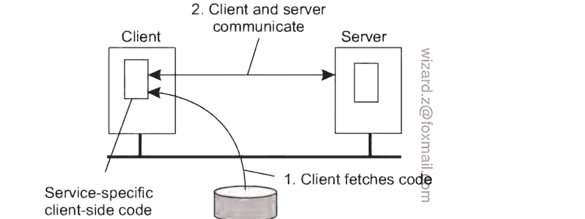

这种动态下载客户端软件的重要优势是客户端不需要预先安装所有软件来与服务器通信。相反，软件可以根据需要移入，同样，在不再需要时可以丢弃。另一个优势是只要接口标准化，我们可以随意更改客户端-服务器协议及其实现。这些更改不会影响依赖于服务器的现有客户端应用程序。

当然，也存在一些缺点。最严重的一个缺点是

## 3.5. 代码迁移

我们在第9章中讨论的与安全有关。盲目地相信下载的代码只实现了广告接口，同时访问您的未受保护的硬盘，并且不会将最有趣的部分发送给谁都不知道的人，这可能并不总是一个好主意。幸运的是，我们已经很好地理解了如何保护客户端免受恶意下载的代码的影响。

### 注3.10（更多信息：远离瘦客户端计算？）

到目前为止，关于代码透明和安全动态迁移到客户端的洞察力和专业知识已经更多。因此，我们在2.4节中描述的朝着瘦客户端计算的趋势，因为管理客户端软件往往很麻烦，部分地被逆转了。
通过动态迁移客户端软件，但完全将该软件的管理置于服务器端（或者说其所有者），拥有“更丰富”的客户端软件实际上是可行的。

### 注3.11（高级：代码迁移模型）

尽管代码迁移暗示我们只在机器之间移动代码，而这个术语实际上涵盖了一个更丰富的领域。传统上，分布式系统中的通信涉及进程之间的数据交换。代码迁移在最广义上涉及将程序移动到机器之间，目的是在目标机器上执行这些程序。在某些情况下，如进程迁移，还必须移动程序的执行状态、待处理信号和环境的其他部分。

为了更好地理解代码迁移的不同模型，我们使用了Fuggetta等人提出的框架[1998年]。在这个框架中，一个进程由三个部分组成。代码段是包含正在执行的程序的一组指令的部分。资源段包含进程所需的外部资源的引用，例如文件、打印机、设备、其他进程等。最后，执行段用于存储进程的当前执行状态，包括私有数据、堆栈和程序计数器。

还可以区分发送方启动和接收方启动的迁移。在发送方启动的迁移中，迁移是在当前代码所在的机器上启动的。通常，在将程序上传到计算服务器时会进行发送方启动的迁移。另一个例子是将查询或一批查询发送到远程数据库服务器。

在接收器发起的迁移中，代码迁移的主动权由目标机器承担。Java小程序是这种方法的一个例子。
接收器发起的迁移比发送器发起的迁移更简单。在许多情况下，代码迁移发生在客户端和服务器之间，其中客户端主动发起迁移。安全地将代码上传到服务器，就像发送器发起的迁移一样，通常要求客户端在该服务器上先进行注册和身份验证。换句话说，服务器需要知道所有的客户端，原因是客户端可能会希望

## 第三章 进程

访问服务器的资源，如其磁盘。保护这些资源是必要的。相比之下，像接收方发起的情况中下载代码通常可以匿名进行。此外，服务器通常对客户端的资源不感兴趣。相反，只有为了改善客户端性能才会将代码迁移到客户端。为此，只需要保护有限数量的资源，如内存和网络连接。我们在第9章中广泛讨论安全代码迁移的问题。

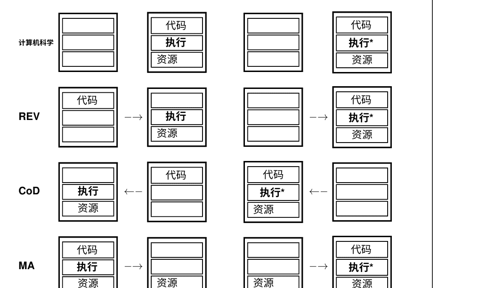

## 图3.25：代码移动的四种不同范式。

这将引导我们到四种不同的代码移动范式，如图3.25所示。根据Fuggetta等人[1998]的说法，我们区分了简单的客户端-服务器计算、远程评估、需求代码和移动代理。图3.25分别显示了客户端和服务器在移动代码执行之前和之后的情况。

在客户端-服务器计算的情况下，代码、执行状态和资源段都位于服务器上，在执行之后，通常只有服务器上的执行状态被修改。这种状态修改用星号表示。在发送者发起的远程评估中，客户端将代码迁移到服务器上执行，从而导致服务器上的执行状态被修改。需求代码是一种接收者发起的方案，客户端从服务器获取代码，并修改其执行状态。

CS:客户端-服务器 REV:远程评估 CoD:需求代码 MA:移动代理

## 3.5. 代码迁移

客户端执行状态并操作客户端资源。最后，移动代理通常遵循发送者启动的方法，将代码以及执行状态从客户端移动到服务器，并在客户端和服务器的资源上操作。移动代理的执行通常会导致相关执行状态的修改。

代码迁移的最低要求是仅提供弱移动性。在这种模型中，只能传输代码段以及可能的初始化数据。弱移动性的一个特点是传输的程序总是重新启动。例如，这就是Java小程序的情况，它们从相同的初始状态开始。换句话说，底层中间件不会保留迁移代码在先前位置离开时的任何历史记录。如果需要保留这样的历史记录，它将作为移动应用程序本身的一部分进行编码。弱移动性的好处在于其简单性，只需要目标机器能够执行代码段。实质上，这归结为使代码可移植。在讨论异构系统中的迁移时，我们将回到这些问题。

与弱移动性相反，在支持强移动性的系统中，执行段也可以被传输。强移动性的特征是运行中的进程可以被停止，随后移动到另一台机器上，并在原地继续执行。显然，强移动性比弱移动性更通用，但也更难实现。特别是在迁移进程时，执行段通常还包含高度依赖于底层操作系统特定实现的数据。例如，它可能依赖于通常在操作系统的进程表中找到的信息。因此，即使迁移到与源操作系统同一系列的不同操作系统，也可能引起很多麻烦。

对于弱移动性，迁移的代码是由目标进程执行，还是启动一个单独的进程，这也是有区别的。例如，Java小程序只需由Web浏览器下载并在浏览器的地址空间中执行。这种方法的好处是无需启动单独的进程，从而避免了目标机器上的进程间通信。显然，主要缺点是目标进程需要受到恶意或无意的代码执行的保护，这可能足以将迁移的代码隔离在单独的进程中。

除了移动正在运行的进程（也称为进程迁移），远程克隆也可以支持强移动性。与进程迁移相比，克隆产生了原始进程的精确副本，但现在在不同的机器上运行。克隆的进程与原始进程并行执行。在Unix系统中，远程克隆是通过派生一个子进程并让该子进程在远程机器上继续执行来实现的。克隆的好处是该模型与许多应用程序中已经使用的模型非常相似。唯一的区别是克隆的进程在不同的机器上执行。从这个意义上说，通过克隆进行迁移是改善分布透明性的一种简单方法。

## 第三章 进程

## 异构系统中的迁移

到目前为止，我们默认迁移的代码可以在目标机器上轻松执行。在处理同构系统时，这个假设是正确的。然而，一般来说，分布式系统是在异构的平台集合上构建的，每个平台都有自己的操作系统和机器架构。

来自异构性的问题在很多方面上与可移植性的问题相同。毫不奇怪，解决方案也非常相似。例如，在1970年代末，解决将Pascal移植到不同机器的许多问题的一个简单方法是为抽象虚拟机生成与机器无关的中间代码[Barron, 1981 ]。

当然，这台机器需要在许多平台上实现，但它将允许在任何地方运行Pascal程序。尽管这个简单的想法在一些年份被广泛使用，但它从未真正成为解决其他语言（尤其是C）可移植性问题的通用解决方案。大约25年后，异构系统中的代码迁移正在通过脚本语言和高度可移植的语言（如Java）来解决。 从本质上讲，这些解决方案采用了与移植Pascal时相同的方法。所有这些解决方案的共同之处在于它们依赖于一个（进程）虚拟机，该虚拟机直接解释源代码（如脚本语言的情况），或者解释由编译器生成的中间代码（如Java的情况）。对于语言开发者来说，身处正确的时间和地点也很重要。

进一步的发展已经削弱了对编程语言的依赖。特别是，已经提出了解决方案，不仅可以迁移进程，还可以迁移整个计算环境。基本思想是将整体环境分隔开，并为同一部分的进程提供它们计算环境的独立视图。这种分隔以虚拟机监视器运行操作系统和一套应用程序的形式进行。

通过虚拟机迁移，可以将计算环境与底层系统解耦，并实际迁移到另一台机器上。这种方法的一个主要优点是进程可以对迁移本身一无所知：它们不需要在执行过程中中断，也不应该在使用的资源上遇到任何问题。后者要么随着进程迁移，要么进程访问资源的方式保持不变（至少对于该进程而言）。

例如，Clark等人[2005]集中研究了虚拟化操作系统的实时迁移，通常在服务器集群中非常方便，通过单个共享局域网实现紧密耦合。在这种情况下，迁移涉及两个主要问题：迁移整个内存映像和迁移到本地资源的绑定。

## 3.5. 代码迁移

对于第一个问题，原则上有三种处理迁移的方式（可以组合使用）：

1. 将内存页面推送到新机器，并在迁移过程中重新发送后续修改的页面。

2. 停止当前虚拟机；迁移内存，并启动新的虚拟机。

3. 让新的虚拟机根据需要拉取新页面，即让进程立即在新的虚拟机上启动，并按需复制内存页面。

如果迁移的虚拟机正在运行连续服务（即提供持续服务），第二个选项可能导致无法接受的停机时间。另一方面，纯按需方法（即第三个选项）可能会大大延长迁移时间，但也可能导致性能下降，因为在工作集的迁移进程被移动到新机器之前需要很长的时间。

作为替代方案，Clark等人[2005]提出使用预复制方法，结合第一个选项和第二个选项中的短暂停止和复制阶段。事实证明，这种组合可以实现非常低的服务停机时间（也参见注释3.12）。

关于本地资源，当仅处理集群服务器时，问题变得简化。首先，因为只有一个网络，唯一需要做的就是宣布新的网络到MAC地址绑定，以便客户端可以通过正确的网络接口联系迁移的进程。

最后，如果可以假设存储是作为一个单独的层提供的（就像我们在图3.18中展示的那样），那么将绑定迁移到文件也同样简单，因为它实际上意味着重新建立网络连接。

### 注3.12 （高级：关于实时虚拟机迁移的性能）
虚拟机迁移的一个潜在问题是可能需要很长时间。这本身并不是坏事，只要在迁移的虚拟机上运行的服务能够继续操作。实践中使用的一种方法已经简要描述过。首先，将内存页面复制到目标机器，可能会发送在复制过程中被修改的页面的更新（请记住，复制大量内存可能需要几十秒，甚至在高速本地网络上）。其次，当大多数页面已经被忠实地复制时，停止当前机器，将剩余的脏页面复制到目标机器，然后在原始位置继续启动现在的精确副本。

剩余脏页需要复制的停机时间取决于虚拟机上运行的应用程序。Clark等人[2005]报告了特定配置的停机时间，介于60毫秒和4秒以下之间。
Voorsluiys等人[2009]得出了类似的值。然而，更有趣的是观察在虚拟机迁移时服务的响应时间是多少。

![图3.26：当迁移底层虚拟机时，服务的响应时间的影响。改编自Voorsluys等人[2009]。](img/fd0be3dd250e588e70e9d95e8d17da0d_173_0.png)

Voorsluiys等人[2009]观察到完整迁移可能需要几十秒钟，导致响应时间增加十到二倍。此外，我们需要意识到在迁移过程中，服务可能完全不可用（即无响应）长达4秒钟。好消息是，响应时间只在完成迁移的停机时间后显著增加，如图3.26所示。

在许多情况下，虚拟机被迁移以优化实际机器的使用。然而，克隆虚拟机也可能是有益的，例如，因为当前机器的工作负载过高。

这种克隆与并发服务器中使用多个进程非常相似，其中调度程序进程创建工作进程来处理传入的请求。 在讨论多线程服务器时，图3.4中解释了这种方案。

当为了这种性能而进行克隆时，通常最好的做法是不先复制内存页面，而是尽可能少地使用页面，因为在克隆机器上运行的服务实际上将重新开始。请注意，这种行为与我们在Unix进程分叉时看到的通常的父子行为非常相似。也就是说，子进程将从加载自己的可执行文件开始，从而有效地清理从父进程继承的内存。这个类比启发了Lagar-Cavilla等人[2009]开发了一种类似的机制，用于克隆虚拟机。然而，与传统用于迁移虚拟机的机制不同，他们的虚拟机分叉主要是按需复制页面。结果是一种非常高效的克隆机制。

因此可以看出，在不同的物理机器上放置虚拟机的最佳方式是没有的：这在很大程度上取决于虚拟机的部署方式和原因。

## 3.6 总结

进程在分布式系统中起着基础性的作用，因为它们构成了不同机器之间的通信基础。一个重要问题是进程在内部如何组织，特别是它们是否支持多个控制线程。在分布式系统中，线程在执行阻塞I/O操作时特别有用，可以继续使用CPU。通过这种方式，可以构建高效的服务器，同时并行运行多个线程，其中几个线程可能会阻塞等待磁盘I/O或网络通信完成。一般情况下，当性能至关重要时，优先使用线程而不是进程。

虚拟化长期以来一直是计算机科学中的重要领域，在云计算的出现中又引起了巨大的关注。流行的虚拟化方案允许用户在他们喜欢的操作系统上运行一套应用程序，并在云中配置完整的虚拟分布式系统。令人印象深刻的是，性能接近于在主机操作系统上运行应用程序，除非该系统与其他虚拟机共享。虚拟机的灵活应用导致了云计算的不同类型的服务，包括基础设施、平台和软件 - 所有这些都在虚拟环境中运行。

根据客户端和服务器的术语组织分布式应用程序已被证明是有用的。客户端进程通常实现用户界面，这些界面可以是非常简单的显示，也可是能够处理复合文档的高级界面。客户端软件还旨在通过隐藏与服务器的通信细节、服务器当前所在位置以及服务器是否复制等细节来实现分布透明性。此外，客户端软件部分负责隐藏故障和从故障中恢复。

服务器通常比客户端更复杂，但仍然只受到相对较少的设计问题的影响。例如，服务器可以是迭代的或并发的，实现一个或多个服务，并且可以是无状态的或有状态的。其他设计问题涉及寻址服务和机制，用于在服务请求发出并可能已经在处理中时中断服务器。

在将服务器组织成集群时需要特别注意。一个常见的目标是将集群的内部隐藏起来，不让外界知道。这意味着集群的组织应该对应用程序进行屏蔽。为此，大多数集群使用一个单一入口点，可以将消息传递给集群中的服务器。一个具有挑战性的问题是通过完全分布式的解决方案透明地替换这个单一入口点。

## 4.1.基础

对于这个模型及其所有含义的详细描述，这里只提供一个简短的介绍会很有帮助。更多细节请参见[Tanenbaum和Wetherall，2010]。

OSI模型旨在允许开放系统进行通信。开放系统是准备使用规范的规则与任何其他开放系统进行通信的系统，这些规则规定了发送和接收的消息的格式、内容和含义。这些规则在所谓的通信协议中得到了形式化。为了让一组计算机在网络上进行通信，它们必须要使用的协议达成一致。协议被称为提供通信服务。这样的服务有两种类型。在面向连接服务的情况下，在交换数据之前，发送方和接收方首先明确建立连接，并可能协商协议的具体参数。当完成后，它们释放（终止）连接。电话是典型的面向连接的通信服务。对于无连接服务，不需要提前设置。发送方只需在准备好时传输第一个消息。将信件投入邮箱是使用无连接通信服务的一个例子。在计算机中，无论是面向连接还是无连接的通信都很常见。

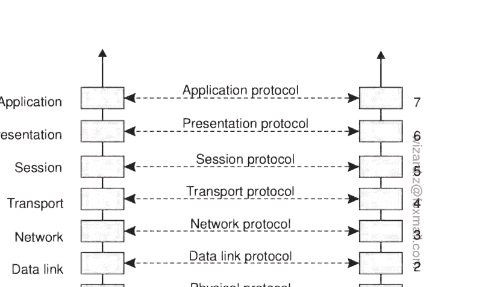

图4.1：OSI模型中的层、接口和协议。

在OSI模型中，通信被分为七个级别或层，如图4.1所示。每个层向上一层提供一个或多个特定的通信服务。通过这种方式，将从A到B的消息传递问题分解为可管理的部分，每个部分可以独立解决。每个层为其上面的层提供一个接口。接口由一组操作组成，共同定义了该层准备提供的服务。OSI模型的七个层包括：

物理层负责标准化两台计算机的连接方式以及0和1的表示方式。

数据链路层提供检测和可能纠正传输错误的手段，以及保持发送方和接收方同步的协议。

网络层包含通过计算机网络路由消息的协议，以及处理拥塞的协议。

传输层主要包含直接支持应用程序的协议，例如建立可靠通信或支持实时数据流的协议。

会话层为应用程序之间的会话提供支持。 表示层规定数据以与运行通信应用程序的主机无关的方式表示。

应用层基本上包括其他所有内容：电子邮件协议、Web访问协议、文件传输协议等。

当进程P想要与某个远程进程Q通信时，它构建一条消息并将该消息通过接口提供给应用层。 这个接口通常以库过程的形式出现。 然后，应用层软件在消息前面添加一个头部，并将结果消息传递到表示层的6/7层接口。 表示层又添加自己的头部，并将结果向下传递到会话层，依此类推。 有些层不仅在前面添加头部，还在末尾添加尾部。 当它到达底部时，物理层实际上通过将消息放入物理传输介质中来传输消息（此时消息可能看起来如图4.2所示）。

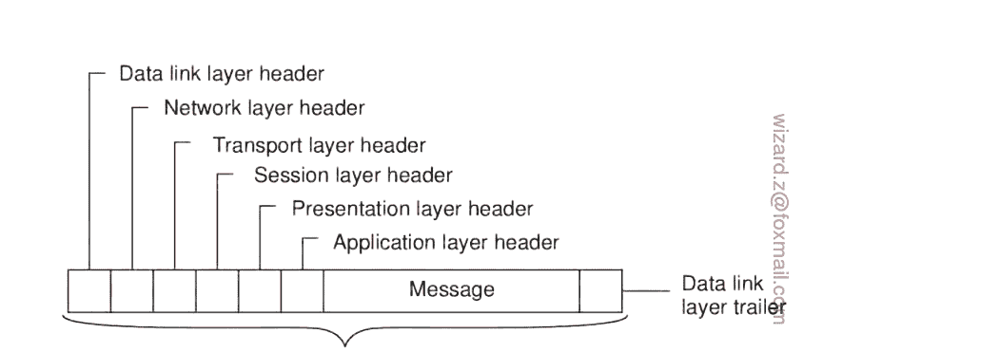

图4.2：一个典型的消息在网络上的显示。

当消息到达托管Q的远程机器时，它会向上传递，每一层都会剥离并检查自己的标头。 最后，消息到达接收器，进程Q，可以使用它进行回复。

## 第4章 通信

## 4.1. 基础

反向路径中的信息。层-n标头中的信息用于层-n协议。

在OSI模型中，不是两个层，而是七个层，正如我们在图4.1中看到的。在特定系统中使用的协议集合称为协议套件或协议栈。重要的是要区分参考模型和其实际协议。正如所说，OSI协议从未流行起来，与为Internet开发的协议（如TCP和IP）相比。

# 注4.1（更多信息：OSI模型中的协议）

让我们简单地逐个检查OSI的每个层，从底层开始。在适当的情况下，我们将指出在每个层中使用的一些互联网协议，而不是提供OSI协议的示例。

## 低层协议

OSI协议套件的最低三层实现了涵盖计算机网络的基本功能。

物理层关注的是传输0和1。在物理层中，使用多少伏特来表示0和1，每秒可以发送多少比特，以及传输是否可以同时进行双向传输，这些都是关键问题。此外，网络连接器（插头）的大小和形状，以及每个插脚的数量和含义也是关注的问题。

物理层协议处理标准化电气、光学、机械和信号接口，以便当一台机器发送一个0位时，它实际上被接收为一个0位而不是一个1位。已经开发了物理层标准（用于不同的媒体），例如，用于串行通信线的USB标准。

物理层只发送比特。只要没有发生错误，一切都好。然而，真实的通信网络容易出现错误，因此需要一些机制来检测和纠正错误。这个机制是数据链路层的主要任务。它的工作是将比特分组成单元，有时称为帧，并确保每个帧都被正确接收。

数据链路层通过在每个帧的开头和结尾放置特殊的比特模式来标记它们，并通过某种方式计算校验和，将校验和附加到帧上。当帧到达时，接收器从数据中重新计算校验和，并将结果与帧后面的校验和分析比较。如果两者一致，则认为帧是正确的并被接受。如果两者不一致，则接收器要求发送者重新传输。帧被分配了序列号（在头部），因此每个人都可以知道哪个是哪个。

在局域网中，通常不需要发送方定位接收方。它只是将消息放在网络上，接收方将其取走。然而，广域网由许多机器组成，每个机器都有一些连接到其他机器的线路，就像一张显示主要城市和连接它们的道路的大规模地图。要使消息从发送方传递到接收方，可能需要经过多次跳转，在每次跳转中选择一条出站线路来使用。

## 如何选择最佳路径的问题被称为路由，并且基本上是网络层的主要任务。

问题的复杂性在于最短路径并不总是最佳路径。真正重要的是给定路径上的延迟量，这与流量量和在各条线上排队等待传输的消息数量有关。延迟因此可以随时间而变化。一些路由算法尝试适应变化的负载，而其他算法则根据长期平均值做出决策。

目前，最广泛使用的网络协议是无连接的 IP (互联网协议)，它是互联网协议套件的一部分。IP数据包 (网络层中的消息的技术术语) 可以在没有任何设置的情况下发送。每个IP数据包都会独立地路由到其目的地。不选择和记住任何内部路径。

## 传输协议

传输层构成了可以称为基本网络协议栈的最后一部分，因为它实现了在网络层接口上未提供的所有那些服务，但是构建网络应用程序时合理需要的服务。. 换句话说，传输层将底层网络转换为应用程序开发人员可以使用的东西。

数据包在从发送方到接收方的过程中可能会丢失。虽然一些应用程序可以处理自己的错误恢复，但其他应用程序更喜欢可靠的连接。传输层的工作是提供这种服务。这个想法是应用层应该能够将消息传递给传输层，并期望它能够无损地传递。

在接收到来自应用层的消息后，传输层将其分成足够小的片段进行传输，为每个片段分配一个序列号，然后将它们全部发送。传输层头部的讨论涉及已发送的数据包、已接收的数据包、接收方还能接受多少数据包、应该重新发送哪些数据包等相关主题。

可靠的传输连接（根据定义是面向连接的）可以建立在面向连接或面向无连接的网络服务之上。在前一种情况下，所有数据包将按照正确的顺序到达（如果它们到达的话），但在后一种情况下，一个数据包可能会走一条不同的路径并比之前发送的数据包更早到达。传输层软件负责将所有内容重新排序，以保持传输连接就像一个大管道一样的幻觉 - 你把消息放进去，它们就完整无损地按照原来的顺序出来。提供这种端到端的通信行为是传输层的一个重要方面。

互联网传输协议被称为 TCP（传输控制协议），详细描述由Comer [2013]提供。TCP/IP的组合现在被用作网络通信的事实标准。互联网协议套件还支持一种无连接的传输协议，称为 UDP（通用数据报协议）。

## 更高级的协议

在传输层之上，OSI区分了三个附加层。.实际上，只有应用层被使用。事实上，在Internet协议套件中，传输层以上的所有内容都被分组在一起。

面对面中间件系统，我们将看到OSI和Internet方法都不是真正合适的。

## 会话层

会话层本质上是传输层的增强版本。它提供对话控制，以跟踪当前正在交谈的一方，并提供同步功能。后者对于允许用户在长时间传输中插入检查点非常有用，这样在发生崩溃时，只需要回到最后一个检查点，而不是回到开始的地方。

实际上，很少有应用程序对会话层感兴趣，而且很少得到支持。它甚至不存在于Internet协议套件中。然而，在开发中间件解决方案的背景下，会话的概念及其相关协议被证明是非常相关的，特别是在定义更高级别的通信协议时。

## 表示层

与底层不同，底层关注的是可靠高效地将比特从发送方传输到接收方，表示层关注的是比特的含义。大多数消息不是随机比特串，而是更结构化的信息，如人名、地址、金额等。在表示层中，可以定义包含这些字段的记录，然后让发送方通知接收方消息以特定格式包含特定记录。这使得具有不同内部表示的机器之间更容易进行通信。

## 应用层

OSI应用层最初旨在包含一系列标准网络应用程序，如电子邮件、文件传输和终端仿真。到目前为止，它已成为所有应用程序和协议的容器，这些应用程序和协议在某种程度上都不适

## 图4.6：客户端和服务器程序之间RPC的原理。

当消息到达服务器时，服务器的操作系统将其传递给服务器存根。服务器存根是客户端存根的服务器端等价物：它是一段代码，将通过网络传入的请求转换为本地过程调用。通常，服务器存根会调用 receive 并阻塞等待传入的消息。服务器存根从消息中解包参数，然后以通常的方式调用服务器过程。从服务器的角度来看，就好像直接由客户端调用一样——参数和返回地址都在堆栈上，没有任何异常。服务器执行其工作，然后以通常的方式将结果返回给调用者（在本例中是服务器存根）。

当服务器存根在调用完成后重新获得控制权时，它将结果打包到一条消息中，并调用发送操作将其返回给客户端。之后，服务器存根通常会再次调用接收操作，以等待下一个传入请求。

当结果消息到达客户端的机器时，操作系统将其通过预先调用的接收操作传递给客户端存根，然后客户端进程被解除阻塞。

客户端存根检查消息，将结果解包，将其复制到调用者，并以通常的方式返回。当调用 append 后，调用者获得控制权，它只知道向列表中添加了一些数据。它完全不知道这项工作是在另一台机器上远程完成的。

客户端对此一无所知，这正是整个方案的美妙之处。就客户端而言，远程服务是通过进行普通（即本地）过程调用来访问的，而不是通过调用发送和接收来访问。所有消息传递的细节都隐藏在这两个库过程中，就像实际进行系统调用的细节隐藏在传统库中一样。

## 总结一下，远程过程调用发生在以下步骤中：

## 4.2. 远程过程调用

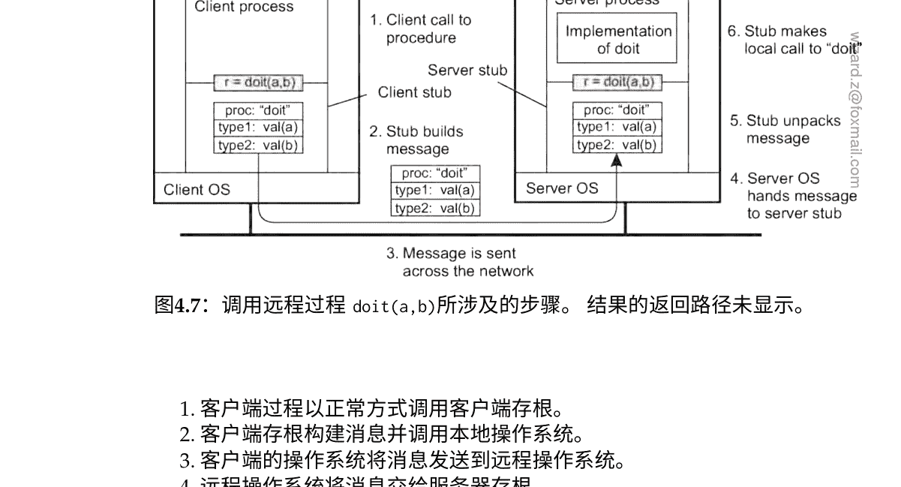

+   1. 客户端过程以正常方式调用客户端存根。
+   2. 客户端存根构建消息并调用本地操作系统。
+   3. 客户端的操作系统将消息发送到远程操作系统。
+   4. 远程操作系统将消息交给服务器存根。
+   5. 服务器存根解包参数并调用服务器。
+   6. 服务器执行工作并将结果返回给存根。
+   7. 服务器存根将结果打包在消息中并调用本地操作系统。
+   8. 服务器的操作系统将消息发送到客户端的操作系统。
+   9. 客户端的操作系统将消息交给客户端存根。
+   10. 存根解包结果并将其返回给客户端。

## 注释 4.3 （更多信息：Python示例）

为了使问题具体化，让我们考虑一下如何为之前讨论的 append 操作实现远程过程调用。看一下图4.8中显示的Python代码（我们省略了非必要的代码片段）。

类DBList是一个简单的列表对象表示，模仿了在数据库环境中可能看到的版本。

客户端存根，由类 Client表示，包含一个实现 append。当使用参数 data和 dbList调用时，会发生以下情况。调用被转换为一个包含服务器执行所需所有信息的元组(APPEND, data, dbList)。然后，客户端存根将请求发送到服务器，并等待响应。当响应到达时，它通过将结果传递给最初调用存根的程序来完成。

```python
class DBList:

    def append(self, data):
        self.value = self.value + [data]
        return self
class Client:
    def append(self, data, dbList):
        message_list = (append, data, dbList) # 消息负载
        self.chan.sendTo(self.server, message_list) # 发送消息给服务器
        message_received = self.chan.recvFrom(self.server) # 等待响应
        return message_received [1] # 传递给调用者
class Server:
    def append(self, data, dbList):
        return dbList.append(data)
    def run (self):
        while True:
            message_request = self.chan.recvFromAny() # 等待任何请求
            client = message_request[0] # 查看调用者是谁
            message_components = message_request[1] # 获取调用和参数
            if append == message_components[0]: # 检查正在请求的内容
                result = self.append(message_components[1], message_components[2]) # 进行本地调用
                self.chan.sendTo([client], result) # 返回响应
```

## 参数传递

客户端存根的功能是将其参数打包成一个消息，并将其发送到服务器存根。虽然听起来很简单，但实际上并不像一开始看起来那么简单。

将参数打包成消息称为参数编组。回到我们的 append 操作，因此我们需要确保其两个参数（data和dbList）通过网络发送并由服务器正确解释。

## 注释4.4（更多信息：Python示例重新访问）

很容易看出，如图4.8所示的远程过程调用的解决方案通常不起作用。只有在客户端和服务器在遵守相同的字节顺序规则并且对于数据结构具有相同的机器表示时，如图所示的消息交换才会导致正确的解释。图4.9显示了一个健壮的解决方案（为了简洁起见，我们再次省略了代码）。

在这个例子中，我们使用Python的pickle库来编组和解组数据结构。请注意，与我们在图4.8中展示的相比，代码几乎没有变化。唯一的变化发生在发送之前和接收之后。还要注意，客户端和服务器都被编程为在相同的数据结构上工作，就像我们上面讨论的那样。

```python
import channel, pickle
class Client:
    def append(self, data, dbList):
        message_list = (append, data, dbList) # 消息有效载荷
        self.chan.sendTo(self.server, pickle.dumps(msglst)) # 发送请求到服务器
        msgrcv = self.chan.recvFrom(self.server) # 等待响应
        retval = pickle.loads(msgrcv[1]) # 解包返回值
        return retval # 传递给调用者
class Server:
    def run (self):
        while True:
            message_request = self.chan.recvFromAny() # 等待任何请求
            client = message_request[0] # 查看调用者是谁
            msgrpc = pickle.loads(msgreq[1]) # 解包调用
            if APPEND == msgrpc[0]: # 检查正在请求的内容
                result = self.append(msgrpc[1], msgrpc[2]) # 进行本地调用
                msgres = pickle.dumps(result) # 将结果包装起来
                self.chan.sendTo([client],msgres) # 发送响应
```

图4.9：一个简单的RPC示例，用于操作 append，但现在使用正确的编组

一种解决方案是禁止使用指针和引用参数。然而，这些非常重要，所以这种解决方案是非常不可取的。事实上，通常也不是必需的。首先，引用参数经常与固定大小的数据类型一起使用，例如静态数组，或者与动态数据类型一起使用，在运行时很容易计算它们的大小，例如字符串或动态数组。在这种情况下，我们可以简单地复制参数所引用的整个数据结构，有效地替换引用传递机制为值传递/恢复机制。虽然这在语义上并不总是相同的，但通常已经足够好了。一个明显的优化是，当客户端存根知道所引用的数据只会被读取时，在调用完成后就不需要将其复制回来。值传递已经足够好了。

更复杂的数据类型通常也可以被支持，并且当编程语言支持这些数据类型时尤其如此。例如，像Python或Java这样的语言支持用户定义的类，允许语言系统提供完全自动化的编组和解组。

## 基于RPC的应用支持

从我们到目前为止所解释的内容可以清楚地看出，隐藏远程过程调用需要调用方和被调用方在交换的消息格式上达成一致，并且在传递复杂数据结构时遵循相同的步骤。换句话说，在RPC中，双方都应该遵循相同的协议，否则RPC将无法正常工作。

基于RPC的应用程序开发至少有两种支持方式。第一种方式是让开发人员明确指定需要远程调用的内容，从而生成完整的客户端和服务器端存根。第二种方法是将远程过程调用嵌入到语言本身中。

## 存根生成

考虑图4.11(a)中的函数someFunction。它有三个参数，一个字符，一个浮点数和一个包含五个整数的数组。假设一个字是四个字节，RPC协议可能规定我们应该将一个字符传输到一个字的最右边（留下下面的三个字节为空），将一个浮点数作为一个整个字传输，并将一个数组作为与数组长度相等的一组字，前面加上一个表示长度的字，如图4.11(b)所示。因此，根据这些规则，someFunction的客户端存根知道它必须使用图4.11(b)的格式，而服务器存根知道someFunction的传入消息将具有图4.11(b)的格式。

```c
void someFunction(char x; float y; int z[5])
```

图4.11：(a) 一个函数。(b) 相应的消息，以及在网络上发送字节和字的顺序。

## 基于语言的支持

到目前为止所描述的方法在很大程度上与具体的编程语言无关。作为一种替代，我们还可以将远程过程调用嵌入到语言本身中。主要的好处是应用程序开发通常变得更简单。此外，达到高度的访问透明性通常更简单，因为许多与参数传递相关的问题可以完全避免。

一个众所周知例子是完全嵌入远程过程调用的Java，其中RPC被称为远程方法调用(RMI)。实质上，由其自己的（Java）虚拟机执行的客户端可以调用另一个虚拟机管理的对象的方法。仅仅通过阅读应用程序的源代码，可能很难甚至不可能看出方法调用是对本地对象还是远程对象的。

注4.6（更多信息：基于语言的Python RPC）让我们通过一个示例来看看如何将远程过程调用集成到语言中。我们一直在使用Python语言作为大多数示例的示例，现在也将继续使用。在图4.12(a)中，我们展示了一个简单的用于我们的DBList数据结构的服务器。在这种情况下，它有两个公开的操作：exposed_append用于追加元素，exposed_value用于显示列表中当前的内容。我们使用Python的RPyC包来嵌入RPC。客户端在图4.12(b)中显示。当与服务器建立连接时，将创建一个新的DBList实例，客户端可以立即向列表中追加值。可以直接调用公开的操作。

## 4.2. 远程过程调用

```
1 import rpyc
2 from rpyc.utils.server import ForkingServer
3 class DBList(rpyc.Service):
4   value = []
5   def exposed_append(self, data):
6     self.value = self.value + [data]
7     return self.value
8   def exposed_value(self, value):
9     return self.value
10 if __name__ == "__main__":
11   server = ForkingServer(DBList, port=12345)
12   server.start()
```

## 图4.12:(a) 在语言中嵌入RPC：服务器。

```
1 import rpyc
2 class Client:
3   conn = rpyc.connect(SERVER, PORT) # 连接到服务器
4   conn.root.exposed_append(2) # 调用一个暴露的操作,
5   conn.root.exposed_append(4) # 并添加两个元素
6   print(conn.root.exposed_value()) # 打印结果
```

## 图4.12:(b) 在语言中嵌入RPC：客户端。

这个例子还说明了一个微妙的问题：显然为客户端创建的DBList实例是新和独特的。换句话说，一旦客户端断开与服务器的连接，列表将会丢失。它是一个短暂的对象，所以需要采取特殊措施使其成为持久对象。

## RPC的变体

与传统的过程调用一样，当客户端调用远程过程时，客户端将阻塞，直到返回一个回复。当没有结果需要返回时，或者当需要执行多个RPC时，这种严格的请求-回复行为是不必要的或者可能会妨碍效率。接下来，我们将讨论我们已经讨论过的RPC方案的两个变体。

## 异步RPC

为了支持没有结果返回给客户端的情况，RPC系统可以提供所谓的异步RPC的功能。通过异步RPC，服务器原则上会立即发送回复给客户端

## 第4章 通信

在接收到RPC请求后，服务器会立即将回复发送回客户端，并在本地调用所请求的过程。回复作为对客户端的确认，告知服务器将要处理RPC。一旦客户端收到服务器的确认，它将继续进行而不再阻塞。图4.13(b)展示了异步RPC的客户端和 服务器的交互方式。为了对比，图4.13(a)展示了正常的请求-回复行为。

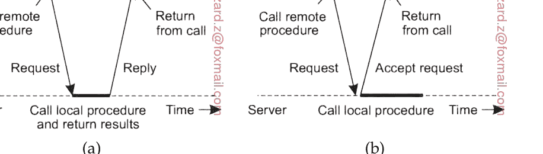

图4.13：(a) 传统RPC中客户端和服务器之间的交互。(b) 使用异步RPC的交互。

当客户端不准备等待回复并且在此期间不做任何事情时，异步RPC也可以很有用。一个典型的情况是客户端需要独立地联系多个服务器。

在这种情况下，它可以依次发送调用请求，有效地使服务器更多或更少同时运行。在所有调用请求发送完毕后，客户端可以开始等待各种结果的返回。在这种情况下，通过异步RPC结合回调来组织客户端和服务器之间的通信是有意义的，如图4.14所示。在这种方案中，也被称为延迟同步RPC，客户端首先调用服务器，等待接受，并继续执行。当结果可用时，服务器发送一个响应消息，导致客户端的回调。回调是一个用户定义的函数，当发生特殊事件时（如传入消息）被调用。一个直接的实现方法是生成一个单独的线程，并让它在事件发生时阻塞，而主进程继续执行。

当事件发生时，线程被解除阻塞并调用函数。

需要注意的是，异步RPC的变体存在，其中客户端在发送请求到服务器后立即继续执行。换句话说，客户端不等待服务器接受请求的确认。我们将这样的RPC称为单向RPC。这种方法的问题是，当可靠性不能保证时，客户端无法确定其请求是否会被处理。

## 4.2. 远程过程调用


我们将在第8章回到这些问题。同样，在延迟同步RPC的情况下，客户端可以轮询服务器以查看结果是否已经可用，而不是让服务器回调客户端。

## 多播RPC

异步和延迟同步RPC提供了另一种远程过程调用的替代方案，即同时执行多个RPC。
采用单向RPC（即服务器不告诉客户端已接受其调用请求，而是立即开始处理），多播RPC简化为向一组服务器发送RPC请求。这个原则在图4.15中展示。在这个例子中，客户端向两个服务器发送请求，然后这两个服务器独立且并行地处理该请求。

处理完成后，结果将返回给客户端，然后进行回调。


有几个问题我们需要考虑。首先，与以前一样，客户端应用程序可能不知道RPC实际上被转发到多个服务器。例如，为了增加容错性，我们可以决定让所有操作由备份服务器执行，当主服务器失败时备份服务器可以接管。服务器是否被复制了可以

## 第4章 通信

通过适当的存根，可以完全隐藏客户端应用程序。然而，即使存根不需要知道服务器是否复制，例如，因为我们使用传输层组播地址。

其次，我们需要考虑如何处理响应。特别是，在所有响应都收到之后，客户端是继续进行还是等待一个？这完全取决于情况。当服务器进行容错复制时，我们可以决定只等待第一个响应，或者直到大多数服务器返回相同的结果。另一方面，如果服务器已经进行了复制，但是在输入的不同部分上执行相同的工作，那么在客户端继续之前可能需要合并它们的结果。同样，这些问题可以在客户端存根中隐藏，但是应用程序开发人员至少需要指定多播RPC的目的。

## 示例：DCE RPC

远程过程调用已被广泛采用作为中间件和分布式系统的基础。在本节中，我们将更详细地介绍分布式计算环境（DCE），它是由开放软件基金会（OSF）开发的，现在称为The Open Group。它是Microsoft分布式计算环境DCOM [Eddon and Eddon, 1998]的基础，并在Samba中使用，Samba是一个文件服务器和附带的协议套件，允许通过远程过程调用从非Windows系统访问Windows文件系统。

尽管DCE RPC可能不是管理RPC的最现代化方式，但讨论一些其细节仍然是值得的，尤其是因为它代表了大多数传统RPC系统，这些系统使用了接口规范和对各种编程语言的显式绑定的组合。我们首先简要介绍DCE，然后考虑其主要工作原理。有关如何开发基于RPC的应用程序的详细信息，请参阅[Stevens, 1999]。

## DCE简介

DCE是一个真正的中间件系统，它被设计为在现有（网络）操作系统和分布式应用程序之间执行的一层抽象。最初设计用于Unix，现在已经移植到所有主要操作系统。其想法是客户可以拿一组现有的机器，添加DCE软件，然后能够运行分布式应用程序，而不会干扰现有的（非分布式）应用程序。

尽管大多数DCE软件包在用户空间运行，但在某些配置中，必须向底层操作系统的内核中添加一部分（分布式文件系统的一部分）。

DCE的编程模型是客户端 - 服务器模型。用户进程作为客户端访问由服务器进程提供的远程服务。

## DCE RPC的目标

DCE RPC系统的目标相对传统。首先，RPC系统使得客户端可以通过简单调用本地过程来访问远程服务。这个接口使得客户端（即应用程序）可以以一种简单、熟悉大多数程序员的方式编写。它还使得在分布式环境中运行大量现有代码变得容易，几乎不需要任何更改。

RPC系统需要隐藏所有细节，不仅对客户端，而且对服务器也是如此。首先，RPC系统可以自动定位正确的服务器，并随后建立客户端和服务器软件之间的通信（通常称为绑定）。

它还可以在两个方向上处理消息传输，根据需要进行分割和重新组装（例如，如果其中一个参数是一个大数组）。最后，RPC系统可以自动处理客户端和服务器之间的数据类型转换，即使它们运行在不同的架构上并且具有不同的字节顺序。

由于RPC系统隐藏了细节，客户端和服务器之间高度独立。客户端可以用Java编写，服务器可以用C编写，反之亦然。客户端和服务器可以运行在不同的硬件平台上，并使用不同的操作系统。还支持各种网络协议和数据表示，而无需客户端或服务器进行任何干预。

## 编写客户端和服务器

DCE RPC系统由多个组件组成，包括语言、库、守护程序和实用程序等。通过这些组件，可以编写客户端和服务器。在本节中，我们将描述这些组件以及它们如何组合在一起。编写和使用RPC客户端和服务器的过程总结在图4.16中。在客户端-服务器系统中，将一切联系在一起的是接口定义，如在接口定义语言（IDL）中所指定的。它允许以与ANSI C中函数原型紧密相似的形式声明过程。IDL文件还可以包含类型定义、常量声明和其他需要正确编组参数和解组结果的信息。理想情况下，接口定义还应包含对过程功能的正式定义，但这样的定义超出了当前技术水平，因此接口定义只定义了语法。

## 第4章 通信

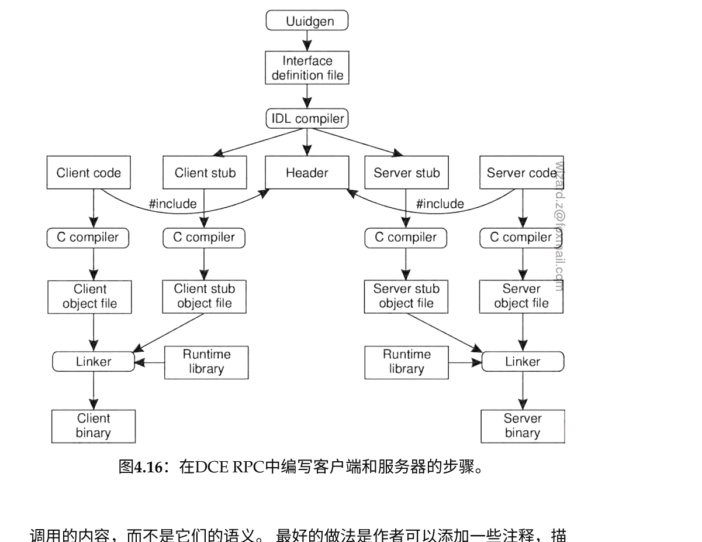

图4.16：在DCE RPC中编写客户端和服务器的步骤。

调用的内容，而不是它们的语义。最好的做法是作者可以添加一些注释，描述过程的功能。

每个IDL文件中的一个关键元素是指定接口的全局唯一标识符。客户端在第一个RPC消息中发送此标识符，服务器验证其正确性。通过这种方式，如果客户端无意中尝试绑定到错误的服务器，甚至是旧版本的正确服务器，服务器将检测到错误并且绑定将不会发生。

在DCE中，接口定义和唯一标识符密切相关。如图4.16所示，在编写客户端/服务器应用程序的第一步通常是调用uuidgen程序，要求其生成一个IDL文件的原型，其中包含一个接口标识符，确保在任何地方由uuidgen生成的任何接口中都不会再次使用。通过在其中编码位置和创建时间来确保唯一性。它由一个128位的二进制数表示，在IDL文件中以十六进制的ASCII字符串表示。下一步是编辑IDL文件，填写远程过程的名称和参数。值得注意的是，RPC并不是完全透明的。例如，客户端和服务器不能共享全局变量。

IDL规则使得无法表达不受支持的结构。

## 4.2. 远程过程调用

当IDL文件完成后，IDL编译器被调用来处理它。IDL编译器的输出包括三个文件：

+   • 一个头文件（例如，在C语言中是interface.h）。

+   • 客户端存根。

+   • 服务器存根。

头文件包含唯一标识符、类型定义、常量定义和函数原型。它应该在客户端和服务器代码中都被包含（使用#include）。客户端存根包含客户端程序将要调用的实际过程。这些过程负责收集和打包参数到传出消息中，然后调用运行时系统发送它。客户端存根还处理解包回复并将值返回给客户端。服务器存根包含当接收到传入消息时运行时系统在服务器机器上调用的过程。这些过程反过来调用实际执行工作的服务器过程。

下一步是应用程序编写者编写客户端和服务器代码。这两者都会被编译，两个存根过程也被编译。然后，生成的客户端代码和客户端存根对象文件将与运行时库链接，生成客户端的可执行二进制文件。类似地，服务器代码和服务器存根也会被编译和链接，生成服务器的二进制文件。在运行时，客户端和服务器被启动，以实际执行应用程序。

## 第4章 通信

# 将客户端绑定到服务器

为了让客户端调用服务器，必须确保服务器已经注册并准备好接受传入的调用。服务器的注册使客户端能够找到服务器并绑定到它。找到服务器的位置分为两个步骤：

+   1. 找到服务器所在的机器。

+   2. 找到该机器上的服务器（即正确的进程）。

第二步有些微妙。基本上，问题归结为要与服务器通信，客户端需要知道服务器机器上的一个端口，以便发送消息。端口由服务器的操作系统用于区分不同进程的传入消息。

在DCE中，每台服务器机器上都通过一个名为DCE守护进程的进程来维护一个(服务器,端口)对的表。在它可用于传入请求之前，服务器必须向操作系统请求一个端口。然后，它将这个端口注册到DCE守护进程中。DCE守护进程将这些信息（包括服务器支持的协议）记录在端口表中以供将来使用。

## 第4章 通信

服务器还通过提供服务器机器的网络地址和一个可以查找服务器的名称来向目录服务注册。将客户端绑定到服务器的过程如图4.17所示。

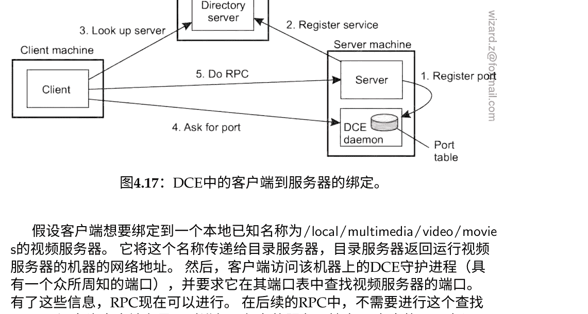

图4.17：DCE中的客户端到服务器的绑定。

假设客户端想要绑定到一个本地已知名称为/local/multimedia/video/movie s的视频服务器。它将这个名称传递给目录服务器，目录服务器返回运行视频服务器的机器的网络地址。然后，客户端访问该机器上的DCE守护进程（具有一个众所周知端口），并要求它在其端口表中查找视频服务器的端口。有了这些信息，RPC现在可以进行。在后续的RPC中，不需要进行这个查找。DCE还允许客户端在需要时进行更复杂的服务器搜索。安全的RPC也是一个选项，其中保密性或数据完整性至关重要。

## 执行RPC

实际的RPC是透明且通常方式进行的。客户端存根将参数编组到运行时库中，以使用在绑定时选择的协议进行传输。当消息到达服务器端时，根据传入消息中包含的端口将其路由到正确的服务器。运行时库将消息传递给服务器存根，后者将参数解组和调用服务器。回复通过反向路由返回。

DCE提供了几种语义选项。默认情况下是最多一次操作，即使在系统崩溃的情况下，也不会执行多次调用。实际上，这意味着如果服务器在RPC期间崩溃然后快速恢复，客户端不会重复操作，因为害怕它可能已经执行过一次。

或者，可以将远程过程标记为幂等（在IDL文件中），这样可以多次重复执行而不造成损害。例如，可以反复尝试从文件中读取指定的块，直到成功为止。当幂等的RPC由于服务器崩溃而失败时，客户端可以等待服务器重新启动，然后再次尝试。还提供其他语义（但很少使用），包括将RPC广播到本地网络上的所有机器。在讨论RPC存在故障的情况下，我们将在第8.3节中重新讨论RPC语义。

## 4.3 基于消息的通信

远程过程调用和远程对象调用有助于隐藏分布式系统中的通信，也就是说，它们增强了访问透明性。不幸的是，这两种机制并不总是合适的。特别是，在不能假设接收方在发出请求时正在执行的情况下，需要使用替代的通信服务。同样地，RPC的固有同步性质，即客户端在其请求被处理之前被阻塞，可能需要被其他东西替代。

那个其他东西就是消息传递。在本节中，我们将重点关注分布式系统中的面向消息的通信，首先更详细地了解同步行为的含义及其影响。然后，我们讨论假设各方在通信时正在执行的消息系统。最后，我们将研究消息队列系统，即使在通信发起时另一方不执行，也允许进程交换信息。

## 使用套接字的简单瞬态消息传递

许多分布式系统和应用程序直接构建在传输层提供的简单面向消息的模型之上。为了更好地理解和欣赏作为中间件解决方案一部分的面向消息的系统，我们首先讨论通过传输层套接字进行消息传递。

特别注意到标准化传输层接口，使程序员能够通过一组简单的操作使用其完整的（消息）协议套件。此外，标准接口使得将应用程序移植到不同的机器更加容易。例如，我们简要讨论了在伯克利Unix中于1970年代引入的套接字接口，并且该接口已被采用为POSIX标准（只有极少的改动）。

从概念上讲，套接字是一个通信端点，应用程序可以向其写入要发送到底层网络的数据，并且可以从中读取传入的数据。套接字形成了对本地操作系统用于特定传输协议的实际端口的抽象。

[PAGE 207]

## 第4章 通信

# 图4.18：TCP/IP的套接字操作。

| 操作 | 描述 |
|------|------|
| 套接字 | 创建一个新的通信端点 |
| 绑定 | 将本地地址附加到套接字 |
| 监听 | 告诉操作系统挂起的最大连接请求数 |
| 接受 | 阻塞调用者直到连接请求到达 |
| 连接 | 主动尝试建立连接 |
| 发送 | 通过连接发送一些数据 |
| 接收 | 通过连接接收一些数据 |
| 关闭 | 释放连接 |

# 图4.19：使用套接字的面向连接通信模式。

服务器通常按照给定的顺序执行前四个操作。在调用套接字操作时，调用

绑定操作将本地地址与新创建的套接字关联起来。例如，服务器应该将其机器的IP地址与（可能是众周知的）端口号绑定到套接字上。绑定告诉操作系统服务器只想在指定的地址和端口上接收消息。在面向连接的通信中，地址用于接收传入的连接请求。

只有在面向连接的通信情况下才会调用listen操作。它是一个非阻塞调用，允许本地操作系统为调用方愿意接受的最大挂起连接请求数量保留足够的缓冲区。

调用accept会阻塞调用方，直到有连接请求到达。当有请求到达时，本地操作系统会创建一个具有与原始套接字相同属性的新套接字，并将其返回给调用方。这种方法可以让服务器例如分叉出-一个进程，随后通过新连接处理实际通信。服务器可以返回并在原始套接字上等待另一个连接请求。

现在让我们来看看客户端。在这里，也需要使用socket操作首先创建一个套接字，但不需要显式地将套接字绑定到本地地址，因为操作系统可以在建立连接时动态分配一个端口。connect操作要求调用方指定要发送连接请求的传输层地址。客户端在成功建立连接之前会被阻塞，之后双方可以通过send和

## 第4章 通信

## 4.3. 面向消息的通信

接收操作。最后，使用套接字关闭连接是对称的，并且通过客户端和服务器都调用关闭操作来建立连接。尽管有很多例外，但使用套接字进行面向连接通信的客户端和服务器的一般模式如图4.19所示。有关使用Unix中的套接字和其他接口进行网络编程的详细信息，请参阅[Stevens, 1998]。

## 注释4.7 （示例：一个简单的基于套接字的客户端-服务器系统）

作为图4.19中反复出现的模式的说明，考虑下面所示的简单基于套接字的客户端-服务器系统（也参见注释2.1）。我们可以看到服务器[图4.20(a)]首先创建一个套接字，然后将一个地址绑定到该套接字上。它调用监听操作，并等待传入的连接请求。当服务器接受一个连接时，套接字库会创建一个单独的连接conn，用于接收数据并向连接的客户端发送响应。服务器进入一个循环，接收和发送消息，直到不再接收到更多数据。然后关闭连接。

```
1 from socket import \n2 s = socket(AF_INET, SOCK_STREAM)\n3 s.bind((HOST, PORT))\n4 s.listen(1)\n5 (conn, addr) = s.accept() # 返回新的套接字和地址。客户端\n6 while True:\n   数据 = conn.recv(1024) # 从客户端接收数据\n8 if not数据 : break # 如果客户端停止，则停止\n9 conn.send¥(数据+”*”) # 返回发送的数据加上一个”*”\n10 conn.close()    # 关闭连接
```

## 图4.20：(a) 一个简单的基于socket的客户端-服务器系统：服务器。

客户端，如图4.20(b)所示，再次遵循图4.19的模式。它创建一个socket，并调用connect请求与服务器建立连接。一旦建立了连接，它发送一条单独的消息，等待响应，并在打印结果后关闭连接。## 第4章 通信

```
1 from socket import *
2 s = socket(AF_INET, SOCK_STREAM)
3 s.connect((HOST, PORT)) # 连接到服务器 (阻塞直到接受)
4 s.send('你好，世界') # 发送相同的数据
5 data = s.recv(1024) # 接收响应
6 print(data) # 打印结果
7 s.close() # 关闭连接
```

## 图4.20：(b) 一个简单的基于socket的客户端-服务器系统：客户端。

## 注释 4.8 (高级：重新访问将存根实现为全局引用)

为了更深入地了解套接字的工作原理，让我们看一个更加详细的例子，即使用存根作为全局引用的用法。我们回到实现共享列表的例子，现在我们通过一个列表服务器来实现，该服务器以Python类的形式实现，如图4.21(b)所示。图4.21(a)显示了共享列表的存根实现。为了提高可读性，我们省略了一些代码。

```
1 class DBClient:
2 def sendrecv(self, message):
3     sock = socket() # 创建一个套接字
4     sock.connect((self.host, self.port)) # 连接到服务器
5     sock.send(pickle.dumps(message)) # 发送一些数据
6     result = pickle.loads(sock.recv(1024)) # 接收响应
7     sock.close() # 关闭连接
8     return result
9
10 def create(self):
11    self.listID = self.sendrecv([CREATE])
12    return self.listID
13
14 def getValue(self):
15    return self.sendrecv([GETVALUE, self.listID])
16
17 def appendData(self, data):
18    return self.sendrecv([APPEND, data, self.listID])
```

## 图4.21：(a) 在Python中实现列表服务器：列表结构。

DBClient类表示一种客户端存根，一旦编组，就可以在进程之间传递。它提供与列表相关的三个操作：创建、获取值和追加，语义明显。假设一个DBClient与服务器管理的一个特定列表相关联。创建列表时返回一个标识符。请注意，(内部)sendrecv操作遵循图4.19中解释的客户端模式。服务器维护列表，如图4.21(b)所示。其内部数据结构是一个setOfLists，每个元素都是先前创建的列表。

## 4.3. 面向消息的通信

服务器只需等待传入的请求，解组请求，并检查请求的操作。结果被发送回请求的客户端（始终作为DBClient的一部分实现的sendrecv操作发出）。同样，我们可以看到服务器遵循图4.19所示的模式：它创建一个套接字，将地址绑定到它上面，通知操作系统它应该监听多少个连接，然后等待接受传入的连接请求。一旦建立了连接，服务器接收数据，发送响应，然后再次关闭连接。

```
1 class 服务器:
2 def __init__(self, port=PORT):
3    self.host = 'localhost'   # 这台机器
4    self.port = port        # 它将监听的端口
5    self.sock = socket()    # 用于传入调用的套接字
6    self.sock.bind((self.host,self.port)) # 将套接字绑定到地址上
7    self.sock.listen(5)     # 最大连接数
8    self.setofLists = {}    # 初始化：没有要管理的列表
9    
10 定义运行 (self):
11 当 True时 :
12    (conn, addr) = self.sock.accept() # 接受传入的调用
13    data = conn.recv(1024)            # 从客户端获取数据
14    request = pickle.loads(data)      # 解开请求
15    if request[0] == CREATE:          # 创建一个列表
16    listID = len(self.setofLists) + 1 # 分配listID
17    self.setofLists[listID] = []      # 初始化为空
18    conn.send(pickle.dumps(listID))  # 返回ID
19    
20 elif request[0] == APPEND:          # 追加请求
21    listID = request[2]              # 获取listID
22    data = request[1]                # 获取要追加的数据
23    self.setofLists[listID].append(data) # 将其追加到列表中
24    conn.send(pickle.dumps(OK))      # 返回一个OK
25    
26 elif request[0] == GETVALUE:       # 读取请求
27    listID = request[1]              # 获取listID
28    result = self.setofLists[listID] # 获取元素
29    conn.send(pickle.dumps(result))  # 返回列表
30    conn.close()                     # 关闭连接
```

## 图4.21：(b) 在Python中实现列表服务器：服务器。

为了将存根用作全局引用，我们通过图4.21(c)中所示的类 Client来表示每个客户端应用程序。该类在运行应用程序的同一进程中实例化（由 self.host的值表示），并将在特定端口上监听来自其他应用程序和服务器的消息。否则，它只是通过操作 sendTo和 recvAny来发送和接收消息。

现在考虑图4.21(d)中显示的代码，它模拟了两个客户端应用程序。第一个客户端创建一个新列表并向其追加数据。然后注意dbClient1只是被发送到另一个客户端。在幕后，我们现在知道它是在类 Client 的操作 sendTo （第12行）中进行编组的，如图4.21 （c）所示。

```
类 客户端 :
def __init__(self, port):
    self.host = 'localhost'  # 这台机器
    self.port = port  # 它将监听的端口
    self.sock = socket()  # 用于传入调用的套接字
    self.sock.bind((self.host, self.port))  # 将套接字绑定到地址
    self.sock.listen(2)  # 最大连接数

def sendTo(self, host, port, data):
    sock = socket()
    sock.connect((host, port))  # 连接到服务器（阻塞调用）
    sock.send(pickle.dumps(data))  # 发送一些数据
    sock.close()

def recvAny(self):
    (conn, addr) = self.sock.accept()
    return conn.recv(1024)
```

## 图4.21：（c）在Python中实现一个列表服务器：客户端。

```
1 pid = os.fork()
2 if pid == 0:
    client1 = Client(CLIENT1)  # 创建客户端
    dbClient1 = DBClient(HOST, PORT)  # 创建引用
    dbClient1.create()  # 创建新列表
    dbClient1.appendData('客户端1')  # 追加一些数据
    client1.sendTo(HOST2, CLIENT2, dbClient1)  # 发送给其他客户端
8 
9 pid = os.fork()
10 if pid == 0:
    client2 = Client(CLIENT2)  # 创建一个新客户端
    数据 = client2.recvAny()  # 阻塞直到数据被发送
    dbClient2 = pickle.loads(data)  # 接收引用
    dbClient2.appendData('客户端2')  # 将数据追加到同一列表中
```

## 图4.21：（d）传递存根作为引用。

第二个客户端只需等待传入的消息（第12行），解组结果，知道它是一个 DBClient 实例，并随后将一些更多数据追加到与第一个客户端追加数据相同的列表中。实际上，一个 DBClient 实例被视为全局引用传递，似乎连同与相关类相关的所有操作一起传递。

## 高级瞬态消息传递

基于标准套接字的瞬态消息传递方法非常基础 因此容易出错。此外，套接字
基本上只支持TCP或UDP，这意味着任何额外的消息传递功能都需要应用程序员单独实现。实际上，我们经常需要更高级的面向消息的通信方法以便更轻松地进行网络编程，扩展现有网络协议所提供的功能，更好地利用本地资源等等。

## 使用消息传递模式：ZeroMQ

使网络编程更容易的一种方法是基于以下观察结果：许多消息传递应用程序或其组件可以根据几种简单的通信模式进行有效组织。通过随后为每种模式提供套接字增强功能，开发网络化的分布式应用程序可能会更容易。这种方法已经在ZeroMQ中得到了实践，并在[Hintjens, 2013;Akgul, 2013]中有所记录。

就像在伯克利方法中一样，ZeroMQ也通过套接字提供所有通信。实际的消息传输通常通过TCP连接进行，并且像TCP一样，所有通信基本上都是面向连接的，这意味着在消息传输之前，发送方和接收方首先要建立连接。

然而，建立和维护连接大部分都是在幕后的进行的：应用程序员不需要担心这些问题。为了进一步简化问题，一个套接字可以绑定到多个地址，有效地允许服务器通过单个接口处理来自非常不同的源的消息。例如，一个服务器可以使用单个阻塞接收操作监听多个端口。因此，ZeroMQ套接字可以支持多对一通信，而不仅仅是标准伯克利套接字的一对一通信。为了完整地说明，ZeroMQ套接字还支持一对多通信，即多播。

对于ZeroMQ来说，保持通信的异步性是至关重要的：发送方在将消息提交给底层通信子系统后通常会继续执行。将异步与面向连接的通信结合在一起的一个有趣的副作用是，即使接收方尚未启动并准备好接受传入的连接请求，更不用说传入的消息了，进程也可以请求建立连接并随后发送消息。当然，发生的情况是，在发送方的一侧，连接请求和随后的消息被排队，而作为ZeroMQ库的一部分的单独线程将负责最终建立连接并将消息传输给接收方。

简化问题，ZeroMQ通过将套接字进行配对（pairing）来在基于套接字的通信中建立了更高层次的抽象：用于发送消息的特定类型的套接字与用于接收消息的相应套接字类型进行配对。每对套接字类型对应一个通信模式。

## ZeroMQ支持的三种最重要的通信模式是请求-回复，发布-订阅和管道。

## 请求-回复模式用于传统的客户端-服务器通信，就像通常用于远程过程调用的那种。客户端应用程序使用请求套接字（类型为REQ）向服务器发送请求消息，并期望后者以适当的响应进行回复。

## 假设服务器使用回复套接字（类型为REP）。请求-回复模式简化了开发人员的工作，避免了调用listen操作和accept操作的需要。此外，当服务器接收到消息时，随后对send的调用会自动针对原始发送者。同样，当客户端在发送消息后调用recv操作（用于接收消息）时，ZeroMQ会假定客户端正在等待原始接收者的响应。请注意，这种方法实际上已经在图4.21中讨论的本地sendrecv操作中进行了编码。

## # 注释 4.9(示例：请求-响应模式)

## 让我们来看一个简单的编程示例，以说明请求-响应模式。图 4.22(a) 显示了一个服务器，它在接收到的消息后追加一个星号。与之前一样，它创建一个套接字，并将其绑定到协议（在本例中为TCP）、主机和端口的组合上。在我们的示例中，服务器愿意接受两个不同端口上的传入门连接请求。然后，它等待传入的消息。请求-响应模式有效地将消息的接收与随后的响应绑定在一起。换句话说，当服务器调用发送时，它将向之前接收到消息的同一客户端发送一条消息。当然，只有程序员确实遵守请求-响应模式，才能实现这种简单性。

```
1 import zmq
2 context = zmq.Context()
3
4 p1 = "tcp://"+ HOST +":"+ PORT1 # 如何和哪里连接
5 p2 = "tcp://"+ HOST +":"+ PORT2 # 如何和哪里连接
6 s = context.socket(zmq.REP) # 创建回复套接字
7
8 s.bind(p1) # 将套接字绑定到地址
9 s.bind(p2) # 将套接字绑定到地址
10 while True:
11 message = s.recv() # 等待传入消息
12 if not "STOP" in message: # 如果不是停止...
13 s.send(message + "*") # 在消息末尾添加“*”
14 else:
15 break # 退出循环并结束
```

## 图4.22：(a) 基于ZeroMQ的客户端-服务器系统：服务器。

客户端（如图4.22 (b) 所示）按预期执行操作：创建套接字并连接到关联的服务器。当它发送消息时，可以期望
从同一台服务器接收响应。通过发送字符串“STOP”，告诉服务器完成后，服务器将实际停止。

```
1 import zmq
2 context = zmq.Context()
3 p1 = "tcp://" + HOST + ":" + PORT1  # 如何连接和连接的位置
4 s = context.socket(zmq.REQ)  # 创建请求套接字
5
6 s.connect(p1)  # 阻塞直到连接成功
7 s.send(“Hello world 1”)  # 发送消息
8 message = s.recv()  # 阻塞直到收到响应
9 s.send(“STOP”)  # 告诉服务器停止
10
11 print message  # 打印结果
```

## 在发布-订阅模式下，客户端订阅特定的消息，这些消息由服务器发布。我们在第1章讨论事件驱动协调时简要介绍了这种模式。实际上，只有客户端订阅的消息将被传输。如果服务器发布了没有人订阅的消息，这些消息将会丢失。在其最简单的形式中，该模式从服务器向多个客户端进行组播消息。假设服务器使用类型为 PUB 的套接字，而每个客户端必须使用类型为 SUB 的套接字。每个客户端套接字都连接到服务器的套接字。默认情况下，客户端不订阅任何特定的消息。

## 意思是只要没有提供明确的订阅，客户端将不会收到服务器发布的消息。

## 注4.10 （例子：发布-订阅模式） 再次，让我们通过一个简单的例子来使这个模式更加具体。图-4.23(a)展示了一个承认天真的时间服务器，通过一个 PUB 套接字发布其当前的本地时间。本地时间每五秒钟发布一次，供任何感兴趣的客户端使用。

## 客户端同样很简单，如图4.23(b)所示。它首先创建一个 SUB套接字，然后将其连接到服务器的相应 PUB套接字。为了接收适当的消息，它需要订阅标签为TIME的消息。在我们的例子中，客户端只需打印前五条消息
从服务器接收到的消息。请注意，我们可以拥有任意多个客户端：服务器的消息将被多播给所有订阅者。

```
1 import zmq, time
2 context = zmq.Context()
3 s = context.socket(zmq.PUB)
4  # 创建一个发布者套接字
5 p = "tcp://" + HOST + ":" + PORT
6  # 如何和何地进行通信
7 s.bind(p)
8  # 将套接字绑定到地址
9 当 True时：
10 time.sleep(5)
11 s.send("TIME " + time.asctime())  # 发布当前时间
```

## 管道模式的特点是一个进程希望将其结果推出，假设有其他进程希望获取这些结果。管道模式的本质是一个推送进程并不真正关心哪个其他进程获取其结果：第一个可用的进程就可以。同样，任何从多个其他进程获取结果的进程都会从第一个推送进程获取其结果。管道模式的目的是尽可能保持尽可能多的进程工作，通过一个进程管道快速推送结果。

## 注4.11 （示例：管道模式） 作为我们的最后一个示例，考虑以下用于保持一组工作任务繁忙的模板。图4.24 (a)显示了所谓的农夫任务的代码：一个生成任务供其他人接收的进程。在这个示例中，我们通过让农夫选择一个随机数来模拟任务的持续时间或负载。然后将这个工作负载发送到推送套接字中，有效地排队，直到另一个进程接收它。## 4.3. 面向消息的通信

```
1 import zmq, time, pickle, sys, random
2 
3 context = zmq.Context()
4 me = str(sys.argv[1])
5 s = context.socket(zmq.PUSH)
6 src = SRC1 if me == '1' else SRC2 # 检查任务来源主机
7 prt = PORT1 if me == '1' else PORT2 # 检查任务来源端口
8 p = "tcp://" + src + ":" + prt  # 如何连接和连接的位置
9 s.bind(p)
10 
11 for i in range(100): # 生成100个工作负载
12 workload = random.randint(1, 100) # 计算工作负载
13 s.send(pickle.dumps((me, workload))) # 将工作负载发送给工作进程
```

图4.24:(a) 模拟工作生成的任务。

```
1 import zmq, time, pickle, sys
2 
3 context = zmq.Context()
4 me = str(sys.argv[1])
5 r = context.socket(zmq.PULL)
6 p1 = "tcp://" + SRC1 + ":" + PORT1 # 第一个任务源的地址
7 p2 = "tcp://" + SRC2 + ":" + PORT2 # 第二个任务源的地址
8 r.connect(p1)
9 r.connect(p2)
10 
11 while True:
12 work = pickle.loads(r.recv()) # 从源接收工作
13 time.sleep(work[1] * 0.01)  # 假装在工作
```

图4.24:(b) 一个工作任务。

其他这样的进程被称为工作任务，图4.24(b)给出了一个示意图。工作任务通过一个拉取套接字连接到两个特定的农夫任务。一旦它接收到一些工作，它通过睡眠一段与接收到的工作量成比例的十毫秒数来模拟实际工作。

这种推拉模式的语义是这样，第一个可用的工人将从农民或者其他工人那里接手工作，同样地，如果有多个工人准备接手工作，每个工人都会被分配一个任务。如何以公平的方式实际分配工作需要一些具体的注意事项，这里我们不再进一步讨论。

## 消息传递接口 (MPI)

随着高性能多计算机的出现，开发人员一直在寻找基于消息的操作这样他们可以轻松编写高效的应用程序。这意味着操作应该在一个方便的抽象级别上（以便于应用程序开发），并且它们的实现只产生最小的开销。套接字被认为是足够的有两个原因。首先，它们在错误的抽象级别上只支持简单的发送和接收操作。其次，套接字被设计用于使用通用协议栈（如TCP/IP）在网络间通信。它们不适用于高速互连网络中开发的专有协议，例如在高性能服务器集群中使用的协议。这些协议需要一个能够处理更高级特性的接口，例如不同形式的缓冲和同步。

结果是，大多数互连网络和高性能多计算机都配备了专有的通信库。

这些库提供了丰富的高级和通常高效的通信操作。当然，所有库都是互不兼容的，因此应用程序开发人员现在面临着可移植性问题。

需要硬件和平台独立性最终导致了消息传递的标准定义，简称为消息传递接口或MPI。MPI专为并行应用程序设计，因此适用于瞬态通信。它直接使用底层网络。此外，它假设严重故障（如进程崩溃或网络分区）是致命的，不需要自动恢复。

MPI假设通信发生在已知的一组进程内。每个组被分配一个标识符。组内的每个进程也被分配一个（本地）标识符。因此，（组ID，进程ID）对唯一地标识消息的源或目的地，并且用于替代传输层地址。在计算中可能涉及多个可能重叠的进程组，并且它们都在同一时间执行。

在MPI的核心是支持瞬态通信的消息操作，其中最直观的操作在图4.25中总结。

| 操作             | 描述                      |
|------------------|---------------------------|
| MPI_bsend        | 将传出消息附加到本地发送缓冲区     |
| MPI_send         | 发送消息并等待复制到本地或远程缓冲区 |
| MPI_ssend        | 发送消息并等待传输开始         |
| MPI_sendrecv     | 发送消息并等待回复             |
| MPI_isend        | 传递对传出消息的引用，并继续     |
| MPI_issend       | 传递对传出消息的引用，并等待接收开始 |
| MPI_recv         | 接收消息；如果没有消息则阻塞       |
| MPI_irecv        | 检查是否有传入消息，但不阻塞     |

图4.25：MPI中一些最直观的消息传递操作。

## 基于消息的持久通信

现在我们来介绍一类重要的面向消息的中间件服务，通常称为消息队列系统，或者只是面向消息的中间件（MOM）。消息队列系统为持久的异步通信提供了广泛的支持。这些系统的本质是它们为消息提供了中期存储容量，而不需要发送者或接收者在消息传输期间处于活动状态。与套接字和MPI的一个重要区别是，消息队列系统通常针对允许花费几分钟而不是几秒或几毫秒的消息传输。

## 消息队列模型

消息队列系统背后的基本思想是应用程序通过将消息插入特定队列来进行通信。这些消息经过一系列通信服务器转发，并最终传递到目标，即使目标在消息发送时处于离线状态。实际上，大多数通信服务器直接相互连接。换句话说，消息通常直接传输到目标服务器。原则上，每个应用程序都有自己的私有队列，其他应用程序可以向其发送消息。一个队列只能被其关联的应用程序读取，但也有可能多个应用程序共享一个队列。

消息队列系统的一个重要方面是，发送方通常只能保证其消息最终会被插入到接收方的队列中。对于消息何时，甚至是否被实际读取，没有任何保证，这完全取决于接收方的行为。

这些语义允许通信在时间上松散耦合。因此，当消息被发送到其队列时，接收方无需执行。同样，发送方在其消息被接收方接收时无需执行。发送方和接收方可以完全独立地执行。事实上，一旦消息被放入队列中，它将一直保留在那里，直到被移除，无论其发送方或接收方是否正在执行。这给我们提供了四种关于发送方和接收方执行模式的组合，如图4.26所示。

在图4.26(a)中，发送方和接收方在整个消息传输过程中都执行。在图4.26(b)中，只有发送方在执行，而接收方是被动的，即处于无法进行消息传递的状态。然而，发送方仍然可以发送消息。


图4.26(c)展示了一个被动发送方和一个执行接收方的情况。在这种情况下，接收方可以读取发送给它的消息，但并不需要发送方也在执行。最后，在图4.26 (d)中，我们看到即使发送方和接收方都是被动的，系统仍然存储（可能传输）消息。有人可能会认为，只有在支持最后一种配置的情况下，消息队列系统才真正提供持久性消息。

原则上，消息可以包含任何数据。从中间件的角度来看，唯一重要的方面是消息被正确地寻址。实际上，寻址是通过提供系统范围内唯一的目标队列名称来完成的。在某些情况下，消息大小可能会受限，尽管底层系统也可能负责将大消息分割和组装，对应用程序完全透明。

这种方法的一个效果是，提供给应用程序的基本接口可以非常简单，如图4.27所示。

| 操作 | 描述 |
| 放置 | 将消息追加到指定的队列中 |
| 获取 | 阻塞直到指定的队列非空，并移除第一条消息 |
| 轮询 | 检查指定的队列是否有消息，并移除第一条永不阻塞 |
| 通知 | 在放置消息到指定队列时安装一个处理程序 |

图4.27：消息队列系统中队列的基本接口。

如果队列为空，或者找不到特定的消息，则调用

## 消息队列系统的一般架构

现在让我们更仔细地看一下一般的消息队列系统是什么样的。首先，队列由队列管理器queue managers管理。队列管理器可以是一个独立的进程，也可以通过与应用程序链接的库来实现。其次，根据经验法则，应用程序只能将消息放入本地队列。同样，只有从本地队列中提取消息才能获取消息。因此，如果一个队列管理器QMA负责应用程序Σ的队列，并作为一个独立的进程运行，那么QMA和Σ进程通常会被放置在同一台机器上，或者最差情况下在同一局域网上。还要注意，如果所有的队列管理器都链接到它们各自的应用程序，我们就不能再谈论持久的异步消息系统了。

如果应用程序只能将消息放入本地队列，那么显然每个消息都必须携带有关系自地的信息。队列管理器的任务是确保消息到达其目的地。

这带来了一些问题。

首先，我们需要考虑目标队列的寻址方式。显然，为了增强位置透明性，最好是队列具有逻辑的、与位置无关的名称。假设队列管理器被实现为一个独立的进程，使用逻辑名称意味着每个名称应该与一个联系地址相关联，例如一个（主机，端口）对，并且名称到地址的映射对队列管理器是可用的。

## 消息代理

消息队列系统的一个重要应用领域是将现有和新应用集成到一个统一的、一致的分布式信息系统中。如果我们假设与应用程序的通信是通过消息进行的，那么集成就要求应用程序能够理解收到的消息。实际上，这要求发送方的出站消息与接收方的消息格式相同，而且发送方的消息也要遵循接收方期望的语义。

发送方和接收方实际上需要使用相同的语言，也就是遵循相同的消息协议。

这种方法的问题在于，每次向系统中添加一个具有自己的消息协议的应用程序A时，对于要与A通信的每个其他应用程序B，我们都需要提供转换它们各自消息的手段。在一个具有N个应用程序的系统中，我们因此需要N×N个消息协议转换器。

另一种选择是就一个共同的消息协议达成一致，就像传统的网络协议一样。不幸的是，这种方法通常对消息队列系统不起作用。问题在于于这些系统运行的抽象级别。只有在使用该协议的进程集合确实具有足够的共同点时，共同的消息协议才有意义。如果构成分布式信息系统的应用程序集合非常多样化（通常是这样），那么发明一个一刀切的解决方案根本行不通。

如果我们只关注消息的格式和含义，通过提高抽象级别，可以实现共性。这就是使用XML消息的方式。在这种情况下，消息携带有关其自身组织的信息，而标准化的是它们描述内容的方式。因此，应用程序可以提供关于其消息组织的信息，这些信息可以自动处理。当然，这些信息通常是不够的：我们还需要确保消息的语义被充分理解。

鉴于这些问题，一般的方法是学会与差异共存，并尽可能提供简单的转换手段。在消息队列系统中，转换由队列网络中的特殊节点处理，这些节点被称为消息代理。消息代理在消息队列系统中充当应用程序级网关。其主要目的是将传入的消息转换为目标应用程序可以理解的格式。请注意，对于消息队列系统来说，消息代理只是另一个应用程序，如图4.29所示。换句话来说，消息代理通常不被视为队列系统的组成部分。

消息代理可以简单地作为消息的重新格式化器。例如，假设一个传入的消息包含来自数据库的一个表，其中记录由特殊的记录结束分隔符和字段分隔。


记录内的字段具有已知的固定长度。如果目标应用程序期望记录之间有不同的分隔符，并且还期望字段具有可变长度，可以使用消息代理将消息转换为目标期望的格式。

在更高级的设置中，消息代理可以充当应用程序级网关，其中编码了多个应用程序的消息协议信息。通常情况下，对于每一对应用程序，我们将拥有一个单独的子程序，能够在两个应用程序之间转换消息。在图4.29中，这个子程序被绘制为一个插件，以强调这些部分可以动态地插入或从代理中移除。

最后，需要注意到，在许多情况下，高级企业应用集成（EAI）会使用消息代理，正如我们在1.3节中讨论的那样。在这种情况下，代理不仅仅是转换消息，还负责根据正在交换的消息来匹配应用程序。在这种发布-订阅模式中，应用程序以发布的形式发送消息。特别是，它们可以在主题X上发布一条消息，然后将其发送给代理。已经声明对主题X上的消息感兴趣的应用程序，也就是已经订阅了这些消息的应用程序，将从代理那里接收到这些消息。还有更高级的调解形式也是可能的。

消息代理的核心是一个转换一种类型消息为另一种类型的规则存储库。问题在于定义规则和开发插件。大多数消息代理产品都配备了复杂的开发工具，但最重要的是仍然需要专家来填充存储库。在这里，我们看到一个完美的例子，商业产品经常被误导性地说提供“智能”，而实际上，唯一的智能存在于那些专家的头脑中。

## 注释 4.12 （更多信息：关于消息队列系统的注释）

考虑到我们对消息队列系统所说的内容，似乎它们以电子邮件服务的实现形式长期存在。

电子邮件系统通常通过一组邮件服务器来实现，这些服务器代表直接连接到服务器的主机上的用户存储和转发消息。通常不考虑路由，因为电子邮件系统可以直接使用底层传输服务。例如，在Internet的邮件协议SMTP [Postel, 1982]中，通过建立与目标邮件服务器的直接TCP连接来传输消息。

与消息队列系统相比，电子邮件系统的特殊之处在于它们主要旨在为终端用户提供直接支持。这解释了为什么一些协同办公应用程序直接基于电子邮件系统[Koshafian和Buckiewicz, 1995]。此外，电子邮件系统可能具有非常具体的要求，例如自动消息过滤，支持高级消息数据库（例如，轻松检索以前存储的消息）等等。

通用消息队列系统并不仅仅旨在支持终端用户。

一个重要问题是，它们被设置为在进程之间实现持久通信，无论进程是否运行用户应用程序，处理对数据库的访问，执行计算等等。这种方法导致了对消息队列系统的不同需求，而不是纯粹的电了邮件系统。例如，电子邮件系统通常不需要提供消息的可靠传递、消息优先级、日志记录功能、高效的多播、负载平衡、容错等等，以供一般使用。

因此，通用消息队列系统具有广泛的应用领域，包括电子邮件、工作流、协同办公和批处理。然而，正如我们之前所述，最重要的应用领域是将（可能分散）的数据库和应用程序集成到一个联合信息系统中[Hohpe and Woolf, 2004]。例如，一个涉及多个数据库的查询可能需要被拆分成子查询，然后转发到各个数据库。消息队列系统通过提供基本手段将每个子查询打包成消息并将其路由到适当的数据来提供帮助。本章讨论的其他通信设施则不太适用。

## 例子：IBM的WebSphere消息队列系统

为了帮助理解消息队列系统在实践中的工作原理，让我们来看一下IBM的WebSphere中的消息队列系统。以前被称为MQSeries，现在被称为WebSphere MQ。关于WebSphere MQ有大量的文档，在接下来的内容中我们只能依靠基本原理。Taylor [2012]对WebSphere MQ进行了简单介绍，而更多细节可以在[ Davies and Broadhurst, 2005; Aranha et al., 2013]中找到。

## 4.3. 面向消息的通信

## 概述

MQ排队网络的基本架构非常简单，如图4.30所示。所有队列都由队列管理器管理。队列管理器负责从发送队列中删除消息，并将其转发给其他队列管理器。同样，队列管理器负责通过从底层网络中接收消息并将每个消息存储在适当的输入队列中来处理传入的消息。为了给出消息传递的印象：消息的默认最大大小为4 MB，但可以增加到100 MB。队列通常限制为2 GB的数据，但根据底层操作系统的不同，这个最大值可以很容易地设置得更高。

队列管理器通过消息通道成对连接，这是传输级连接的抽象。消息通道是发送队列管理器和接收队列管理器之间的单向可靠连接，用于传输排队的消息。例如，基于互联网的消息通道是通过TCP连接实现的。消息通道的两端由消息通道代理"管理。

(MCA)。发送MCA基本上只需检查发送队列中是否有消息，将其封装成传输级数据包，并将其发送到关联的接收MCA。同样，接收MCA的基本任务是监听传入的数据包，解封装它，并将解封装后的消息存储到相应的队列中。

![img/fd0be3dd250e588e70e9d95e8d17da0d_226_0.png]

队列管理器可以与其管理的应用程序链接到同一个进程中。在这种情况下，队列对应用程序来说是隐藏的，只能通过标准接口间接操作队列。另一种组织方式是队列管理器和应用程序在不同的机器上运行。在这种情况  
下，应用程序提供相同的接口。然而，该接口被实现为一个代理，使用传统的基于RPC的同步通信与队列管理器进行通信。这样，MQ基本上保留了只有应用程序本地队列可以访问的模型。

## 通道

MQ的一个重要组成部分是消息通道。每个消息通道都有一个关联的发送队列，从中获取应该传输到另一端的消息。只有在发送和接收的MCA都正常运行时，才能沿着通道进行传输。

除了手动启动两个MCA之外，还有几种替代的启动通道的方法，我们将在下面讨论一些。

一种替代方法是让应用程序直接启动通道的一端，通过激活发送或接收的MCA。然而，从透明性的角度来看，这不是一个非常有吸引力的选择。启动发送MCA的更好方法是将通道的发送队列配置为在第一次放入队列时触发一个触发器。该触发器与一个处理程序相关联，以启动发送MCA，以便它可以从发送队列中删除消息。

另一种选择是通过网络启动MCA。特别是，如果通道的一侧已经处于活动状态，它可以发送一个控制消息请求启动另一个MCA。这样的控制消息被发送到一个在同一台机器上监听一个众所周知地址的守护进程。

在发送队列中没有更多的消息被丢弃的情况下，通道会在指定的时间过期后自动停止。每个MCA都有一组相关属性，这些属性决定了通道的整体行为。一些属性列在图4.31中。发送和接收MCA的属性值应该是兼容的，可能需要在建立通道之前进行协商。例如，两个MCA显然应该支持相同的传输协议。一个不可协商的属性的例子是消息是否按照放入发送队列的顺序进行传递。如果一个MCA想要FIFO传递，另一个MCA必须遵守。一个可协商的属性值的例子是最大消息长度，它将简单地选择由任一MCA指定的最小值。

![img/fd0be3dd250e588e70e9d95e8d17da0d_227_1.png]

## 消息传输

为了将消息从一个队列管理器传输到另一个（可能是远程的）队列管理器，每个消息都必须携带其目的地地址，这需要使用传输头。MQ中的地址由以下部分组成

## 4.3. 面向消息的通信

|属性|描述|
|---|---|
|传输类型|确定要使用的传输协议|
|FIFO传递|表示消息按发送顺序传递|
|消息长度|单个消息的最大长度|
|设置重试计数|启动远程MCA的最大重试次数|
|传递重试|MCA尝试将接收到的消息放入队列的最大次数|

## 图4.31：与消息通道代理相关的一些属性。

两个部分。第一部分包括要传递消息的队列管理器的名称。第二部分是该管理器下的目标队列的名称，消息将附加到该队列中。

除了目的地地址，还需要指定消息应该遵循的路线。通过提供要附加消息的本地发送队列的名称来进行路线规范。因此，不需要在消息中提供完整的路线。请记住，每个消息通道只有一个发送队列。通过告知要附加消息的发送队列，我们有效地指定了要将消息转发到哪个队列管理器。

在大多数情况下，路由信息明确地存储在队列管理器的路由表中。路由表中的一个条目是一个(目标队列管理器, 本地发送队列)的对，其中目标队列管理器是目标队列管理器的名称，发送队列是本地发送队列的名称，消息将附加到该队列上。在到达目标之前，消息可能需要在多个队列管理器之间传输。当这样一个中间队列管理器接到消息时，它只需从消息头中提取目标队列管理器的名称，并进行路由表查找，以找到应将消息附加到的本地发送队列。

重要的是要意识到每个队列管理器都有一个系统范围内唯一的名称，该名称有效地用作该队列管理器的标识符。使用这些名称的问题在于替换队列管理器或更改其名称将影响所有向其发送消息的应用程序。通过使用本地别名来缓解问题，可以减轻这些问题。

在队列管理器 QM₁ 中定义的别名是队列管理器 QM₂ 的另一个名称，但仅对与 QM₁ 进行接口的应用程序可用。别名允许对队列使用相同（逻辑）名称，即使该队列的队列管理器发生更改。更改队列管理器的名称需要在所有队列管理器中更改其别名。然而，应用程序可能不受影响。

## 第4章 通信

![img/fd0be3dd250e588e70e9d95e8d17da0d_229_0.png]

## 图4.32：使用路由表和别名的MQ队列网络的一般组织。

图4.32显示了使用路由表和别名的原则。例如，链接到队列管理器 QMA的应用程序可以使用本地别名 LA₁引用远程队列管理器。队列管理器首先会在别名表中查找实际目标，发现它是队列管理器QMC。在路由表中找到到 QMC的路由，该路由指出消息应附加到出站队列 SQ₁，该队列用于将消息传输到队列管理器 QMB。后者将其路由表将消息转发到 QMC。

遵循这种路由和别名的 方法会导致一个相对简单的编程接口，称为消息队列接口 (MQI)。

MQI的最重要操作总结如图4.33所示。

|操作|描述|
|----|----|
|MQOPEN|打开一个（可能是远程的）队列|
|MQCLOSE|关闭一个队列|
|MQPUT|将消息放入已打开的队列中|
|MQGET|从（本地）队列中获取消息|

## 图4.33：消息队列接口中可用的操作。

要将消息放入队列中，应用程序调用 MQOPEN，指定特定队列管理器中的目标队列。队列管理器可以使用本地可用的别名来命名。目标队列是否实际上是远程的对应应用程序完全透明。如果应用程序想要从其本地队列获取消息，也应调用MQOPEN。

队列。只有本地队列可以打开以读取传入消息。 当应用程序完成访问队列时，应通过调用MQCLOSE来关闭它。

可以使用MQPUT和MQGET将消息写入或从队列中读取。 原则上，消息按优先级从队列中移除。具有相同优先级的消息按先进先出的原则移除，即最长等待的消息先被移除。还可以请求特定的消息。此外，MQ提供了在消息到达时通知应用程序的功能，从而避免应用程序不断轮询消息队列以获取新消息。

有一个有趣的观察结果，也是现代消息队列系统的共同特点，即仅仅将队列设置为持久化并不能实现持久化消息。相反，消息被标记为持久化，队列管理器负责确保消息在崩溃时能够存活。因此，队列可以同时存储持久化和非持久化消息。

## 管理覆盖网络

从迄今为止的描述中，应该清楚看出，管理MQ系统的一个重要部分是将各个队列管理器连接成一致的覆盖网络。此外，这个网络需要随时间维护。对于小型网络，这种维护不需要比平均管理工作更多，但是当消息队列用于集成和解体大型现有系统时，问题变得复杂起来。

MQ的一个主要问题是覆盖网络需要手动管理。 这种管理不仅涉及在队列管理器之间创建通道，还涉及填充路由表。 显然，这可能变成一场噩梦。不幸的是，对于MQ系统的管理支持仅在于管理员可以设置几乎每个可能的属性，并调整任何可以想象的配置。然而，最重要的是通道和路由表需要手动维护。

覆盖管理的核心是通道控制功能组件，它在消息通道代理之间逻辑上位于中间。 该组件允许操作员准确监视通道的两个端点上发生的情况。此外，它还用于创建通道和路由表，还用于管理托管消息通道代理的队列管理器。在某种程度上，这种覆盖管理方法与管理群集服务器的方法非常相似，其中使用单个管理服务器。在后一种情况下，服务器基本上只为群集中的每台机器提供远程shell，以及一些处理机器组的集体操作。

关于分布式系统管理的好消息是，如果你正在寻找一个探索解决严重问题的新领域，它提供了很多机会。

## 例子：高级消息队列协议（AMQP）

关于消息队列系统的一个有趣观察是，它们部分地被开发出来是为了允许旧应用程序进行互操作，但同时我们也看到，当涉及不同消息队列系统之间的操作时，我们经常遇到障碍。因此，一旦一个组织选择使用来自制造商X的消息队列系统，他们可能只能接受X提供的解决方案。因此，消息队列解决方案在很大程度上是专有解决方案。开放性就这样了。

2006年，一个工作组成立以改变这种情况，结果是制定了高级消息队列协议（AMQP）的规范。AMQP有不同的版本，其中1.0版本是最新的版本。还有各种不同的AMQP实现，特别是在1.0版本确立之前的版本，在那个时候已经获得了相当大的流行度。因为1.0版本与之前的版本差异很大，但也有稳定的用户群体，所以我们可以看到各种不同的1.0之前的AMQP服务器存在，与（它们不可否认的）不兼容的1.0服务器并存。开放性就这样了。

在本节中，我们将描述AMQP，但会故意混合使用1.0之前和1.0版本，坚持AMQP的基本原则和精神。详细信息可以在规范中找到[Group, 2008; OASIS, 2011]。AMQP的实现包括RabbitMQ [Videla and Williams, 2012]和Apache的Qpid。

## 基础知识

AMQP围绕应用程序、队列管理器和队列展开。在许多网络情况下，我们采用一种常见的方法，区分AMQP作为消息服务、实际消息协议和提供给应用程序的消息接口。为此，最简单的方法是考虑只有一个队列管理器的情况，作为单独的服务器运行，形成AMQP作为服务的实现。应用程序通过本地接口与此队列管理器通信。应用程序与队列管理器之间的通信遵循AMQP协议。

这种情况在图4.34中显示，并且应该看起来很熟悉。AMQP存根屏蔽了应用程序（以及队列管理器）对消息传输和通信的细节。同时，它实现了一个消息队列接口，允许应用程序使用AMQP作为消息队列服务。尽管对于队列管理器，AMQP存根和队列管理器之间的区别是明确的，但是分离的严格性取决于实现。然而，即使不是严格的，从概念上讲，处理队列和处理相关的通信之间存在区别，我们很快就会明确说明。

![img/fd0be3dd250e588e70e9d95e8d17da0d_232_0.png]

## 图4.34：单服务器AMQP实例的概述。

## AMQP通信

AMQP允许应用程序建立与队列管理器的连接；连接是一组单向通道的容器。虽然通道的生命周期可能非常动态，但是连接被认为是相对稳定的。连接和通道之间的这种区别允许高效的实现，特别是通过使用单个传输层TCP连接在应用程序和队列管理器之间复用许多不同的通道。在实践中，AMQP假设使用TCP来建立AMQP连接。

双向通信通过会话建立：两个通道的逻辑分组。一个连接可以有多个会话，但请注意，一个通道不一定会话的一部分。

最后，要实际传输消息，需要一个链接。从概念上讲，一个链接，或者说它的端点，跟踪正在传输的消息的状态。因此，它在应用程序和队列管理器之间提供了细粒度的流量控制，实际上，可以同时为通过相同链接的不同消息放置不同的控制策略。流量控制通过信用建立：接收方可以告诉发送方在特定链接上允许发送多少消息。

当要传输消息时，应用程序将其传递给本地的AMQP存根。如前所述，每个消息传输与一个特定的链接相关联。消息传输通常分为三个步骤。

1. 在发送方，消息被分配一个唯一的标识符，并且被记录在本地处于未解决状态。然后存根将消息传输到服务器，在那里AMQP存根也将其记录为未解决状态。此时，服务器端存根将其传递给队列管理器。

2. 接收应用程序（在本例中为队列管理器）被假定为处理消息，并通常向其存根报告已完成。存根将此信息传递给原始发送方，此时原始发送方的AMQP存根中的消息进入已解决状态。

3. 原始发送方的AMQP存根现在告诉原始接收方的存根消息传输已经解决（意味着原始发送方将从现在开始忘记该消息）。接收方的存根现在也可以丢弃有关该消息的任何内容，并正式记录其已解决。

请注意，因为接收应用程序可以向底层的AMQP通信层指示已完成消息，AMQP实现了真正的端到端通信可靠性。特别是应用程序，无论是客户端应用程序还是实际的队列管理器，都可以指示AMQP通信层保留消息（即消息保持在未解决状态）。

## AMQP消息传递

在AMQP中，消息传递在逻辑上发生在处理通信的上一层。在这里，应用程序可以指示消息需要做什么，还可以查看到目前为止发生了什么。消息正式地在两个节点之间进行传递，其中有三种类型：生产者、消费者或队列。通常，生产者和消费者节点代表常规应用程序，而队列用于存储和转发消息。事实上，队列管理器通常由多个队列节点组成。为了进行消息传输，两个节点必须建立连接。

接收方可以向发送方指示其消息是否被接受（即成功处理），或被拒绝。请注意，这意味着原始发送方会收到一条通知。AMQP还支持大消息的分段和组装，对于这些消息，会发送额外的通知。

当然，AMQP的一个重要特性是支持持久化消息。持久性的实现通过几种机制来处理。首先，一条消息可以被标记为持久的，表示源头希望在发生故障时，任何中间节点（如队列）都能够进行恢复。不能保证这种持久性的中间节点将不得不拒绝一条消息。其次，源节点或目标节点也可以指示其持久性：如果是持久的，它将保持其状态，或者还将保持持久消息的（未解决的）状态？将后者与持久消息结合起来，有效地建立了可靠的消息传输和持久化消息。

AMQP在本质上是一种消息传递协议，它本身不支持例如发布-订阅原语。它期望这些问题由更高级的专有队列管理器处理，类似于第4.3节讨论的消息代理。

最后，没有理由一个队列管理器不能连接到另一个队列管理器。事实上，将队列管理器组织成覆盖网络，并在其中从生产者到消费者路由消息是非常常见的。AMQP不指定覆盖网络应该如何构建和管理，事实上，基于AMQP的系统的不同提供者提供不同的解决方案。特别重要的是指定消息如何在网络中进行路由。底线是管理员需要手动完成很多这些规范。只有在覆盖具有常规结构（例如循环或树）的情况下，才能更容易提供必要的路由细节。

## 第4章 通信

延迟拉伸或相对延迟惩罚（RDP）衡量覆盖网络中两个节点之间的延迟与这两个节点在底层网络中所经历的延迟之间的比率。 例如，从B到C的消息遵循覆盖网络中的路由B→Rb→Ra→Re→E→Re→Rc→Rd→D→Rd→Rc→C，总成本为73个单位。

然而，消息在底层网络中的路由路径是B→Rb→Rd→Rc→C，总成本为47个单位，导致拉伸率为1.55。显然，在构建覆盖网络时，目标是最小化聚合拉伸，或者类似地，测量所有节点对之间的平均RDP。

最后，树成本是一个全局度量标准，通常与最小化聚合链路成本有关。例如，如果将链路成本定义为其两个端节点之间的延迟，则优化树成本就归结为找到一棵最小生成树，其中向所有节点传播信息的总时间最小。

为了简化问题，假设一个多播组有一个关联的、众所周知节点，它跟踪已加入树的节点。当一个新节点发出加入请求时，它联系这个约占节点以获取（可能是部分的）成员列表。目标是选择最佳成员作为新节点在树中的父节点。应该选择谁？有很多选择，不同的提议通常采用非常不同的解决方案。

例如，考虑一个只有一个源的多播组。在这种情况下，选择最佳节点是显而易见的：它应该是源（因为在这种情况下，我们可以确保延伸等于1）。

然而，这样做会引入一个以源为中心的星型拓扑结构。虽然简单，但很容易想象源可能会过载。换句话说，节点的选择通常会受到限制，只能选择那些具有k个或更少邻居的节点，其中k是一个设计参数。这个约束严重复杂化了建立树的算法，因为一个好的解决方案可能需要重新配置部分现有的树。Tan等人[2003]对这个问题提供了广泛的概述和评估。

- 注 4.14(高级：交换树)
作为一个例子，让我们仔细看看一个具体的家族，被称为交换-树[HELDER和JAMIN，2002]。基本思想很简单。假设我们已经有了一个以单个源为根的多播树。在这棵树中，一个节点 P 可以通过断开与当前父节点的链接而选择与另一个节点建立链接来切换父节点。对于切换链接，唯一的约束是新的父节点不能是以 P 为根的子树的成员（因为这会分割树并创建一个循环），并且新的父节点不能有太多的直接子节点。这个最后的要求是为了限制转发消息的负载

- 有不同的标准来决定切换父节点。一个简单的标准是优化到源的路由，有效地最小化消息多播时的延迟。为此，每个节点定期接收其他节点的信息（我们将在下面解释一种具体的方法）。在那时，节点可以评估另一个节点是否在延迟方面是更好的父节点，如果是，则发起切换。

- 另一个标准可以是潜在的其他父节点的延迟是否低于当前父节点的延迟。如果每个节点都将此作为一个标准，那么生成树的聚合延迟理想情况下应该是最小的。换句话说，这是优化树的成本的一个例子，正如我们上面所解释的。然而，构建这样一棵树需要更多的信息，但事实证明，这个简单的方案是一个合理的启发式方法，可以得到一个很好的最小生成树的近似值。

以一个例子来说明，考虑一个节点 P 接收其父节点邻居的信息。注意，邻居包括 P 的祖父节点，以及 P 的父节点的其他兄弟节点。节点 P 可以评估到每个节点的延迟，然后选择延迟最低的节点作为其新的父节点，比如 Q。为此，它向 Q 发送一个切换请求。为了防止由于并发切换请求而形成循环，一个有未处理切换请求的节点将拒绝处理任何传入请求。

实际上，这导致了只能同时进行完全独立的切换的情况。此外，P 将为 Q 提供足够的信息，使后者能够得出结论，即两个节点具有相同的父节点，或者 Q 是祖父节点。

我们尚未解决的一个重要问题是节点故障。在交换树的情况下，提出了一个简单的解决方案：当一个节点注意到其父节点失败时，它只需连接到根节点。在那里，优化协议可以像往常一样进行，并最终将节点放置在多播树的一个良好位置。在[Holden and Jamin, 2002]中描述的实验表明，所得到的树确实接近最小生成树。

## 4.4. 多播通信

由任何一个单独的节点。
有不同的标准来决定切换父节点。一个简单的标准是优化到源的路由，有效地最小化消息多播时的延迟。为此，每个节点定期接收其他节点的信息（我们将在下面解释一种具体的方法）。在那时，节点可以评估另一个节点是否在延迟方面是更好的父节点，如果是，则发起切换。

另一个标准可以是潜在的其他父节点的延迟是否低于当前父节点的延迟。如果每个节点都将此作为一个标准，那么生成树的聚合延迟理想情况下应该是最小的。换句话说，这是优化树的成本的一个例子，正如我们上面所解释的。然而，构建这样一棵树需要更多的信息，但事实证明，这个简单的方案是一个合理的启发式方法，可以得到一个很好的最小生成树的近似值。

以一个例子来说明，考虑一个节点 P 接收其父节点邻居的信息。注意，邻居包括 P 的祖父节点，以及 P 的父节点的其他兄弟节点。节点 P 可以评估到每个节点的延迟，然后选择延迟最低的节点作为其新的父节点，比如 Q。为此，它向 Q 发送一个切换请求。为了防止由于并发切换请求而形成循环，一个有未处理切换请求的节点将拒绝处理任何传入请求。

实际上，这导致了只能同时进行完全独立的切换的情况。此外，P 将为 Q 提供足够的信息，使后者能够得出结论，即两个节点具有相同的父节点，或者 Q 是祖父节点。

我们尚未解决的一个重要问题是节点故障。在交换树的情况下，提出了一个简单的解决方案：当一个节点注意到其父节点失败时，它只需连接到根节点。在那里，优化协议可以像往常一样进行，并最终将节点放置在多播树的一个良好位置。在[Holden and Jamin, 2002]中描述的实验表明，所得到的树确实接近最小生成树。

## 基于泛洪的多播

到目前为止，我们假设当要进行多播时，它将被覆盖网络中的每个节点接收。严格来说，这对应于广播。一般来说，多播是指将消息发送给所有节点的子集，即一组特定的节点。在进行多播时，一个关键的设计问题是尽量减少不需要该消息的中间节点的使用。为了明确这一点，如果覆盖网络组织成多级树，但只有叶节点是应该接收多播消息的节点，那么显然可能有很多节点需要存储并随后转发不适合它们的消息。

避免这种低效的一种简单方法是为每个组播组构建一个覆盖网络。因此，将消息 m 组播到组 G与将消息 m广播到 G是相同的。这种解决方案的缺点是，属于多个组的节点原则上需要为其所属的每个组维护一个单独的邻居列表。

如果我们假设一个覆盖网络对应一个组播组，并且因此需要广播一条消息，那么一种天真的方法是应用洪泛。在这种情况下，每个节点只需将消息 m转发给其邻居中的每个节点，除了接收到消息 m的节点。此外，如果一个节点跟踪它接收和转发的消息，它可以简单地忽略重复的消息。我们将大致看到在覆盖网络中发送的消息数量是链路数量的两倍，这使得洪泛非常低效。

为了理解洪泛的性能，我们将覆盖网络建模为一个具有N个节点和M条边的连通图G。请记住，洪泛意味着我们需要发送至少M条消息。只有当G是一棵树时，洪泛才是最优的，因为在这种情况下，M = N - 1。在最坏的情况下，当G完全连接时，我们将不得不发送M = (N² / 2) = 1/2 · N · (N - 1)条消息。

现在假设我们对覆盖网络的结构没有任何信息，我们能假设的最好情况是它可以表示为一个随机图，当事情保持简单时，它是一个具有概率p边连接两个顶点的图，也被称为Erdős-Rényi图[ Erdős and Rényi, 1959]。请注意，我们实际上将我们的覆盖网络视为一个非结构化的对等网络，并且我们没有任何关于它如何构建的信息。具有概率p边连接两个节点，并且总共有(N₂)条边，不难看出我们可以预期我们的覆盖网络具有M = 1/2 · p边 · N · (N - 1)条边。为了给出我们所处理的情况的印象，图4.36显示了不同值的节点和边之间的关系。

[图4.36：随机覆盖的大小与节点数量的函数关系.]

## 基于八卦的数据传播

传播信息的一个重要技术是依赖于流行病行为，也称为八卦。观察疾病在人群中的传播方式，研究人员长期以来一直在探索是否可以开发简单的技术-来在非常大规模的分布式系统中传播信息。这些流行病协议的主要目标是要仅使用本地信息在大量节点之间快速传播信息。换句话说，没有中央组件来协调信息传播。

为了解释这些算法的一般原则，我们假设特定数据项的所有更新都是由单个节点发起的。通过这种方式，我们简单地避免了写-写冲突。下面的介绍基于Demers等人的经典论文[1987]中关于流行病算法的内容。关于流行病信息传播的概述可以在[Eugster等人，2004]中找到。

## 信息传播模型

正如其名，流行算法基于流行病学理论，研究传染病的传播。在大规模分布式系统的情况下，它们不会传播疾病，而是传播信息。对于分布式系统的流行病研究也有完全不同的目标：卫生组织会尽最大努力防止传染病在大群体中传播，而分布式系统的流行算法设计者将尽快将新信息“传染”给所有节点。

使用流行病学术语，一个分布式系统中的节点如果持有愿意传播给其他节点的数据，则被称为被感染的节点。一个尚未看到这些数据的节点被称为易感节点。最后，一个不愿意或无法传播其数据的更新节点被称为已被移除。请注意，我们假设我们可以区分旧数据和新数据，例如，因为它已经被时间戳或版本化。在这种情况下，节点也被称为传播更新。

一个流行的传播模型是反熵。在这个模型中，一个节点 P 随机选择另一个节点 Q，并随后与 Q 交换更新。有三种交换更新的方法：

- 1. P 只从 Q 拉取新的更新
- 2. P 只将自己的更新推送给 Q
- 3. P 和 Q 互相发送更新（即推拉结合的方法）

当涉及到快速传播更新时，只推送更新会是一个糟糕的选择。直观地说，可以这样理解。首先，注意，在纯推送的方法中，更新只能由被感染的节点传播。然而，如果许多节点被感染，每个节点选择易感节点的概率相对较小。因此，有可能一个特定的节点由于没有被感染的节点选择而保持易感状态很长时间。

相比之下，当许多节点被感染时，拉取的方法效果要好得多。在这种情况下，更新的传播主要由易感节点触发。很有可能这样一个节点会与一个被感染的节点联系，随后拉取更新并被感染。

如果只有一个节点被感染，更新将迅速传播到所有节点，使用任何形式的反熵，尽管推拉仍然是最好的策略[Jelality et al., 2007]。定义一轮为一个时间段，在这个时间段内，每个节点将会主动与随机选择的另一个节点交换更新。然后可以证明，将单个更新传播到所有节点所需的轮数为 O(log(N))，其中 N 是系统中的节点数。这确实表明更新的传播速度很快，但更重要的是可扩展性。

## 注4.16（高级：反熵分析）

一个简单而直接的分析将给出关于反熵工作效果的一些想法。考虑一个具有N个节点的系统。其中一个节点启动将消息m传播到所有其他节点。让pi表示在第i轮后节点P尚未收到m的概率。我们区分以下三种情况：

- • 使用纯拉取方法， pi+1=(pi)²：不仅上一轮中 P 还未更新，而且节点 P的联系人也还未收到 m。
- • 使用纯推送方法， pi+1=pi · (1 - (N - 1)/N)^(N(1 - pi))：同样，P 在上一轮中不应该被更新，而且也不应该被任何一个已更新的节点联系。一个节点联系P的概率是1 - 1/(n1)；我们可以预期在第i轮中有N(1 - p i)个已更新的节点。
- * 在推拉结合的方法中，我们可以简单地结合两者：P不应该联系一个已更新的节点，也不应该被一个已更新的节点联系。

![图4.39显示了随着回合数增加，尚未更新的概率如何迅速下降。事实上，假设节点一直运行，反熵是一种非常有效的传播协议。]

流言传播是流行于现实生活的一种流言传播变体。如果节点P刚刚更新了数据项x，它会联系一个任意的其他节点Q并尝试将更新推送给Q。然而，可能Q已经被另一个节点更新。在这种情况下，P可能会失去进一步传播更新的兴趣，以概率p_stop停止。换句话，它就被移除了。

流言传播类似于现实生活中的闲聊。当鲍勃有一些热门新闻要传播时，他可能会给他的朋友爱丽丝打电话告诉她所有的事情。爱丽丝，像鲍勃一样，会非常兴奋地将谣言传播给她的朋友们。然而，当她给一个朋友，比如查克，打电话时，却听到这个消息已经传到他那里，她会感到失望。很可能她会停止给其他朋友打电话，因为如果他们已经知道了，那还有什么好处呢？

谣言传播被证明是一种快速传播新闻的优秀方式。然而，它不能保证所有节点实际上都会更新[Demers et al., 1987]。事实上，当有大量节点参与流行病时，保持不知情的节点的比例，即易感节点的比例，满足以下方程：

```
s = e^(-(1/p_stop + 1)(1 - s))
```

## 注4.17（高级：谣言传播分析）

为了正式分析谣言传播的情况，我们用\dennote来表示尚未更新的节点的比例，即易感节点的比例。同样，让\dennote表示感染节点的比例：已经更新并且仍在与其他节点联系以传播新闻的节点。

最后，r是已更新但已放弃的节点的比例，即，它们不是被动的，不再参与传播新闻。显然，s + i + r =1。使用流行病学理论，很容易看出以下内容：

```
(1) ds/dt = -s·i
(2) di/dt = s·i − pstop·(1 − s)·i
⇒ di/ds = -(1 + pstop) + pstop/s
⇒ i(s) = -(1 + pstop)·s + pstop·ln(s) + C
```

在这里，我们使用符号 i(s)来表示 i作为 s的函数。当 s =1时，没有节点被感染，意味着 i(1)=0。这使我们得出结论 C =1 + pstop，因此

```
i(s) = (1 + pstop)·(1 − s) + pstop · ln(s)
```

```
s = e^(-(1/pstop +1)(1−s))
```

我们正在寻找没有更多传言传播的情况，即当 i(s) =0. 有一个对 i(s)的闭合表达式

为了了解这意味着什么，看一下图4.40，它展示了s作为 pstop的函数。即使对于较高的 pstop值，我们可以看到保持无知的节点的比例相对较低，始终小于约0.2。对于 pstop =0.20，可以证明 s =0.0025。然而，在 pstop相对较高的情况下，需要采取额外措施来确保所有节点都得到更新。

流行算法的主要优势之一是其可扩展性，这是因为它进程之间的同步次数相对较少，与其他传播方法相比较小。对于广域系统，Lin和Marzullo [1999]已经证明，考虑实际网络拓扑结构可以实现更好的结果。在这种情况下，只与少数其他节点连接的节点以相对较高的概率进行联系。基本假设是这些节点形成了网络的桥梁，因此应尽快与它们联系。这种方法被称为定向传播，并有不同的变体。

这个问题涉及到大多数流行算法所做的一个重要假设，即一个节点可以随机选择任何其他节点进行传播。这意味着原则上，节点的完整集合应该被每个成员所知。在一个大系统中，这个假设永远无法成立，并且需要采取特殊措施来模拟这些属性。我们在第6.7节讨论对等采样服务时会再次提到这个问题。

# 4.5 总结

对于任何分布式系统来说，具有强大而灵活的进程间通信功能是必不可少的。在传统的网络应用中，通信通常基于传输层提供的低级消息传递原语。中间件系统中的一个重要问题是提供比接口层对传输层的支持更高级别的抽象，以便更容易地表达进程间通信。

最常用的抽象之一是远程过程调用（RPC）。 RPC 的本质是通过一个过程来实现服务，该过程的主体在服务器上执行。客户端只提供过程的签名，即过程的名称和参数。 当客户端调用过程时，客户端实现的存根（stub）负责将参数值封装成消息并发送给服务器。服务器调用实际的过程并返回结果，再次封装成消息。客户端的存根从返回消息中提取结果值并将其传回调用的客户端应用程序。

RPC 提供同步通信功能，即客户端在服务器发送回复之前被阻塞。尽管存在对这种严格同步模型进行放松的变体，但通常更方便的是通用的高级消息导向模型。

在消息导向模型中，问题在于通信是否持久以及通信是否同步。 持久通信的本质是，提交传输的消息将由通信系统存储，直到传递完成为止。换句话说，发送方和接收方都不需要处于运行状态才能进行消息传输。在短暂通信中，不提供存储设施，因此接收方必须准备好在消息发送时接收消息。

在异步通信中，发送方在消息提交传输后可以立即继续执行，甚至在消息发送之前。在同步通信中，发送方至少被阻塞直到接收到消息。 或者，发送方可以被阻塞直到消息传递完成，甚至直到接收方响应为止，就像 RPC 一样。

面向消息的中间件模型通常提供持久的异步通信，并且在RPC不合适的情况下使用。

它们通常用于将（广泛分散的）数据库集合集成到大规模信息系统中。

最后，分布式系统中的一个重要通信协议类是多播。基本思想是从一个发送者向多个接收者传播信息。我们已经讨论了两种不同的方法。

首先，可以通过从发送者到接收者建立一棵树来实现多播。考虑到现在已经很好地理解了节点如何自组织成对等系统，也出现了以分散方式动态设置树的解决方案。其次，通过网络中的泛洪消息非常健壮，但如果我们想避免严重的资源浪费，就需要特别注意，因为节点可能会多次看到消息。

概率泛洪通常被证明是简单而高效的组合，同时也非常有效。

另一个重要的传播解决方案类别是使用流行协议。这些协议被证明非常简单且极其稳健。除了仅仅传播消息，流行协议还可以高效地在大型分布式系统中聚合信息。

# 4.5. 总结

面向消息的中间件模型通常提供持久的异步通信，并且在RPC不合适的情况下使用。

它们通常用于将（广泛分散的）数据库集合集成到大规模信息系统中。

最后，分布式系统中的一个重要通信协议类是多播。基本思想是从一个发送者向多个接收者传播信息。我们已经讨论了两种不同的方法。

首先，可以通过从发送者到接收者建立一棵树来实现多播。考虑到现在已经很好地理解了节点如何自组织成对等系统，也出现了以分散方式动态设置树的解决方案。其次，通过网络中的泛洪消息非常健壮，但如果我们想避免严重的资源浪费，就需要特别注意，因为节点可能会多次看到消息。

概率泛洪通常被证明是简单而高效的组合，同时也非常有效。

另一个重要的传播解决方案类别是使用流行协议。这些协议被证明非常简单且极其稳健。除了仅仅传播消息，流行协议还可以高效地在大型分布式系统中聚合信息。

# 第五章C

# 训服

在所有计算机系统中，名称起着重要作用。它们用于共享资源，唯一标识实体，引用位置等等。命名的一个重要问题是将名称解析为所引用的实体。因此，名称解析允许进程访问命名实体。为了解析名称，需要实现一个命名系统。分布式系统和非分布式系统之间的区别在于命名系统的实现方式。

在分布式系统中，命名系统的实现本身通常分布在多台机器上。如何进行这种分布对命名系统的效率和可扩展性起着关键作用。在本章中，我们集中讨论分布式系统中使用的三种不同而重要的命名方式。

首先，我们考虑所谓的平面命名系统。在这种系统中，实体通过一个原则上没有任何意义的标识符来引用。此外，平面名称没有结构，这意味着我们需要特殊的机制来跟踪这些实体的位置。我们讨论了各种方法，从转发链到分布式哈希表，再到分层位置服务。

实际上，人们更喜欢使用可读的名称。这些名称是非结构化的，正如从引用网页的方式所熟知的那样。结构化名称允许以高度系统化的方式找到负责命名实体的服务器，正如域名系统所示。我们讨论了一般原则以及可扩展性问题。

最后，人们通常倾向于通过各种特征来描述实体，这导致我们需要通过分配给实体的属性来解析描述。正如我们将看到的，这种类型的名称解析在与搜索结合时特别困难。

## 第5章 命名

## 5.1 名称、标识符和地址

让我们从更近的角度来看看名字到底是什么。在分布式系统中，名字是一个用于引用实体的位或字符串。在分布式系统中，实体可以是几乎 anything。典型的例子包括主机、打印机、磁盘和文件等资源。其他众所周知实体示例通常会明确命名，例如进程、用户、邮箱、新闻组、网页、图形窗口、消息、网络连接等等。

实体可以被操作。例如，像打印机这样的资源提供了一个包含打印文档、请求打印作业状态等操作的接口。此外，像网络连接这样的实体可能提供发送和接收数据、设置服务质量参数、请求状态等操作。

要对一个实体进行操作，就需要访问它，而为此我们需要一个访问点。访问点是分布式系统中的另一种特殊类型的实体。访问点的名称被称为地址。一个实体的访问点地址也简称为该实体的地址。

一个实体可以提供多个访问点。作为比较，电话可以被视为一个人的访问点，而电话号码对应一个地址。事实上，现在很多人都有多个电话号码，每个号码对应一个可以联系到他们的地方。在分布式系统中，一个典型的访问点是运行特定服务器的主机，其地址由例如IP地址和端口号（即服务器的传输层地址）的组合形成。

一个实体在时间的过程中可能会改变其访问点。例如，当移动计算机移动到另一个位置时，通常会被分配一个与之前不同的IP地址。同样地，当一个人搬到另一个城市或国家时，通常需要更换电话号码。类似地，换工作或互联网服务提供商意味着更换你的电子邮件地址。

因此，地址只是一种特殊类型的名称：它指的是实体的访问点。由于访问点与实体紧密相关，使用访问点的地址作为关联实体的常规名称似乎很方便。然而，这几乎从不这样做，因为这种命名通常非常不灵活，而且常常不友好。

例如，经常重新组织分布式系统，以便特定服务器现在在与之前不同的主机上运行，这并不罕见。以前运行服务器的旧机器可能被重新分配给完全不同的服务器。换句话说，实体可以轻松更改访问点，或者访问点可以重新分配给不同的实体。如果使用地址来引用实体，我们将会
当访问点更改或重新分配给另一个实体时，引用将立即失效。因此，最好让服务通过一个
独立于关联服务器地址的单名称来识别。

同样，如果一个实体提供多个访问点，不清楚该使用哪个地址作为参考。
例如，许多组织将他们的网络服务分布在多台服务器上。如果我们将这些服务器的地址作为网络服务的参考，不明确应选择哪个地址作为最佳地址。再次，一个更好的解决方案是为网络服务设置一个独立于不同网络服务器地址的单一名称。

这些例子说明，一个与地址无关的实体名称通常更容易和更灵活地使用。这样的名称被称为位置无关。

除了地址，还有其他类型的名称值得特殊处理，例如用于唯一标识实体的名称。
一个真正的标识符是具有以下属性的名称：

+   1. 一个标识符最多指向一个实体。
2. 每个实体最多由一个标识符引用。
3. 一个标识符始终指向同一个实体（即不会被重复使用）。

通过使用标识符，可以更容易地明确地引用一个实体。例如，假设两个进程分别通过标识符引用一个实体。要检查这两个进程是否引用同一个实体，只需测试这两个标识符是否相等。如果这两个进程使用常规的、非唯一、非标识性的名称，这样的测试是不够的。例如，名字“约翰·史密斯”不能作为对一个人的唯一引用。

同样，如果一个地址可以重新分配给不同的实体，我们不能将地址作为标识符。考虑到电话号码的使用，电话号码在某种程度上是相对稳定的，因为一个电话号码通常会一段时间内指向同一个人或组织。然而，使用电话号码作为标识符是行不通的，因为它可能会在一段时间内重新分配。因此，鲍勃的新面包店可能会长时间接到爱丽丝的旧古董店的电话。在这种情况下，最好使用爱丽丝的真正标识符而不是她的电话号码。

地址和标识符是两种重要的名称类型，它们各自用于非常不同的目的。在许多计算机系统中，地址和标识符仅以机器可读的形式表示，即以位串的形式表示。例如，以太网地址本质上是一个随机的48位串。同样，内存地址通常表示为32位或64位串。

另一种重要的名称类型是为人类定制的名称，也称为人类友好的名称。与地址和标识符相比，人类友好的名称通常表示为字符串。这些名称以许多不同的形式出现。例如，Unix系统中的文件具有字符串名称，通常可以长达255个字符，并且完全由用户定义。类似地，DNS名称表示为相对简单的不区分大小写的字符串。

拥有名称、标识符和地址将我们带到了本章的核心主题：如何将名称和标识符解析为地址？在我们进入各种解决方案之前，重要的是要意识到分布式系统中的名称解析与消息路由之间通常存在着密切的关系。原则上，命名系统维护着一个名称到地址的绑定，其最简单的形式就是一个(name, address)对的表格。然而，在跨越大型网络的分布式系统中，需要为许多资源命名，一个集中式的表格是行不通的。

相反，通常发生的情况是将一个名称分解为几个部分，例如 ftp.cs.vu.nl。并且名称解析通过对这些部分进行递归查找来进行。例如，一个需要知道由 ftp.cs.vu.nl命名为FTP服务器的客户端。首先解析 nl 以找到负责以nl结尾的名称的服务器NS(nl)，然后将名称的其余部分传递给服务器NS(nl)。然后，该服务器可以将名称vu解析为负责以vu.nl结尾的名称的服务器 NS(vu.nl)。后者可以进一步处理剩余的名称 ftp.cs。最终，这将导致名称解析请求的路由如下：

NS(.) → NS(nl) → NS(vu.nl) → ftp.cs.vu.nl的地址

其中 NS(.)表示能返回 NS(nl)地址的服务器，也被称为根服务器。NS(vu.nl)将返回FTP服务器的实际地址。有趣的是，名称解析和消息路由之间的界限开始变得模糊。

注5.1 (更多信息：信息中心化网络) 名称解析和消息路由在信息中心化网络（简称ICN）[Ahlgren等，2012]中起着核心作用。这种类型的网络围绕着一个原则，即应用程序实际上并不关心实体存储在哪里，而是可以时在需要时在本地获取副本以访问它。为此，自从大约2007年以来，已经花费了大量的研究时间来设计一种替代今天互联网中常见的基于主机的寻址方案。特别是，主要思想是应用程序可以通过使用实体的名称从网络中检索实体。网络将该名称作为输入，并随后将请求路由到存储实体的适当位置，以返回请求者的副本。

注5.2（更多信息：自认证名称）
如果一个名称用于引用一个实体，我们如何知道我们实际上正在访问所期望的实体？换句话说，我们如何确保实体和它的名称之间是唯一绑定的？对于不可变数据对象，有一个简单的解决方案：对数据对象进行哈希，并使用该哈希值作为其名称。当数据对象被检索时，接收进程可以对对象进行哈希，并查看哈希值是否与其用作对象名称的哈希值相对应。这是一个简单版本的自认证名称，它是一个可以在本地检查以确定它是否真正属于所引用实体的名称。我们将在第9.4节中讨论安全命名。

在接下来的几节中，我们将考虑三种不同的命名系统类别。首先，我们将看一下如何将标识符解析为地址。在这种情况下，我们还将看到一个例子，其中名称解析实际上与消息路由无法区分。之后，我们考虑人性化的名称和描述性的名称（即由一组名称描述的实体）。

## 5.2 平面命名

如上所述，标识符方便地唯一表示实体。在许多情况下，标识符只是随机的位串，我们方便地称之为非结构化或扁平名称。这种名称的一个重要特性是它不包含任何关于如何定位其关联实体的访问点的信息。在接下来的内容中，我们将看一下如何解析扁平名称，或者等效地说，当只给出其标识符时如何定位实体。

## 简单解决方案

我们首先考虑两种简单的定位实体的解决方案：广播和转发指针。这两种解决方案主要适用于局域网。然而，在这种环境中，它们通常能够很好地完成工作，使其特别具有吸引力。然而，使用广播
和转发指针会带来可扩展性问题。在大规模网络中，广播或多播很难实现高效，而长链的转发指针会引入性能问题并容易出现断链。

## 广播

考虑一个建立在计算机网络上的分布式系统，该系统提供高效的广播功能。通常，这样的功能由局域网提供，其中所有机器都连接到一根电缆或逻辑等效物上。此外，局域无线网络也属于这个范畴。

在这样的环境中定位一个实体很简单：将包含实体标识符的消息广播到每台机器，并要求每台机器检查是否拥有该实体。只有能够提供实体访问点的机器才会发送包含该访问点地址的回复消息。

这个原则被用在互联网地址解析协议（ARP）中，当只给出一个IP地址时，可以找到机器的数据链路地址。本质上，一台机器在本地网络上广播一个数据包，询谁是给定IP地址的所有者。当消息到达一台机器时，接收者会检查是否应该监听请求的IP地址。如果是的话，它会发送一个回复数据包，包含例如它的以太网地址。

当网络规模增长时，广播变得低效。不仅网络带宽被请求消息浪费，更严重的是，太多的主机可能会被它们无法回答的请求打断。一个可能的解决方案是切换到多播，只有一组受限的主机接收请求。例如，以太网网络直接在硬件上支持数据链路层的多播。

多播也可以用于在点对点网络中定位实体。例如，互联网通过允许主机加入特定的组播组来支持网络级组播。这些组通过组播地址进行标识。当主机向组播地址发送消息时，网络层提供尽力而为的服务将该消息传递给所有组成员。互联网中的组播的高效实现Deering和 Cheriton [1990]以及Deering等人[1996]中进行了讨论。

组播地址可以用作多个实体的通用位置服务。例如，考虑一个每个员工都有自己的移动计算机的组织。当这样的计算机连接到本地可用的网络时，它会动态分配一个IP地址。此外，它还加入了一个特定的组播组。当一个进程想要定位计算机A时，它会向组播组发送一个“在哪里A？”的请求。如果A已连接，它会回复其当前的IP地址。

## 转发指针

定位移动实体的另一种流行方法是利用转发指针[Fowler, 1985]。原则很简单：当一个实体从 A移动到 B时，在 A留下一个指向其新位置 B的引用。

这种方法的主要优点是简单性：一旦一个实体被定位，例如通过使用传统的命名服务，客户端可以通过跟随转发指针链来查找当前地址。但也有一些缺点。首先，如果不采取特殊措施，高度移动实体的链可能变得非常长，导致定位该实体变得代价高昂。其次，链中的所有中间位置都必须根据需要维护其部分转发指针链第三个（以及相关的）缺点是易受损坏链接的影响。一旦任何转发指针丢失，实体就无法再被访问。因此，一个重要问题是保持链条相对较短，并确保转发指针的稳健性。

> 注5.3（更多信息：SSP链） 还原至原始文本格式：

> 注5.3（更多信息：SSP链） 为了更好地理解转发指针的工作原理，考虑它们与远程对象的使用：可以通过远程过程调用访问的对象。按照SSP链[Shapiro et al., 1992]中的方法，每个转发指针都被实现为一个（客户端存根，服务器存根）对，如图5.1所示（我们注意到在原始术语中，服务器存根被称为scion，导致（存根，scion）对，这解释了它的名称。）服务器存根包含对实际对象的本地引用或对该对象的远程客户端存根的本地引用。

> 当一个对象从地址空间A移动到B时，在 A中留下一个客户端存根，并安装一个服务器存根，该存根引用B中的客户端存根。这种方法的一个有趣之处是迁移对客户端来说是完全透明的。客户端只能看到对象的客户端存根。客户端存根将其调用转发到哪个位置，对客户端来说是隐藏的。

> 还要注意，这种使用转发指针的方式不像查找地址那样。 相反，客户端的请求会沿着链路转发到实际对象。 现在假设图5.1中的进程 P₁将其引用传递给进程 P₂。引用传递是通过在进程 P₂的地址空间中安装客户端存根的副本 p'来完成的。客户端存根 p'引用与 p相同的服 务器存根，因此转发调用机制与以前相同。

## 第5章 命名

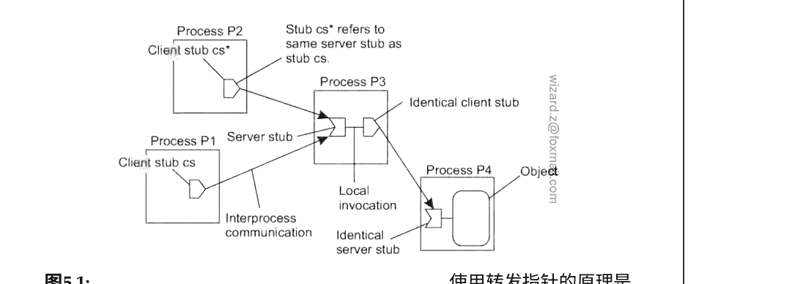

## 图5.1: (客户端存根, 服务器存根)对。

## 使用转发指针的原理是
为了快捷地跳过一系列的(客户端存根, 服务器存根)对，对象调用携带了从发起该调用的客户端存根处获得的标识。客户端存根的标识由客户端的传输层地址和本地生成的编号组合而成。当调用到达对象的当前位置时，响应被发送回到发起调用的客户端存根处（通常不需要返回到整个链路上）。当前位置与响应一起传送，并且客户端存根将其伴随的服务器存根调整为对象的当前位置。这个原理在图5.2中展示。

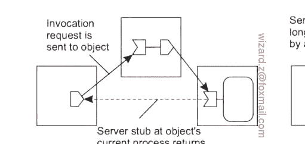

## (a)图5.2:通过在客户端存根中存储快捷方式来重定向转发指针。

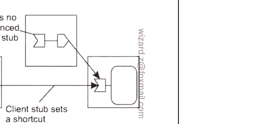

## (b)图5.2:通过在客户端存根中存储快捷方式来重定向转发指针。

在将响应直接发送给发起调用的客户端存根和沿着转发指针的反向路径发送响应之间存在权衡。在前一种情况下，通信速度更快，因为需要传递的进程较少。另一方面，只有发起调用的客户端存根可以进行调整，而沿着反向路径发送响应则允许调整所有中间存根。

当一个服务器存根不再被任何客户端引用时，它可以被移除。这本身与分布式垃圾收集密切相关，这是一个通常不容易解决的问题，我们将其引用给感兴趣的读者参考[Abdullahi和Ringwood，1998]，[Plainfosse和Shapiro，1995]和[Veiga和Ferreira，2005]。当链中的一个进程（客户端存根，服务器存根）崩溃或变得无法访问时，问题就会出现```
## 联系家庭

联系家庭，可能完全不同于实体本身的位置。结果是通信延迟的增加。

基于家庭的方法的另一个缺点是使用固定的家庭位置。首先必须确保家庭位置始终存在。否则，联系实体将变得不可能。当一个长期存在的实体决定永久移动到与其家庭所在位置完全不同的网络部分时，问题会加剧。在这种情况下，如果家庭可以随着主机一起移动，那将更好。

解决这个问题的方法是将家庭注册在传统的命名服务中，并让客户端首先查找家庭的位置。因为家庭位置可以假定相对稳定，所以在查找到家庭位置后可以有效地缓存该位置。
```

## 分布式哈希表

现在让我们更仔细地看一下如何将标识符解析为相关实体的地址。我们已经多次提到分布式哈希表，但推迟了对它们实际工作原理的讨论。在本节中，我们首先将Chord系统作为一个易于解释的基于DHT的系统进行讨论，从而纠正这种情况。

## 5.2. 平面命名

#### 通用机制

过去十年中已经开发了许多基于DHT的系统，其中Chord系统[Stoica et al., 2003]是一个典型代表。Chord使用一个 m位标识符空间，将随机选择的标识符分配给节点以及将键分配给特定实体。后者可以是任何东西：文件、进程等。位数 m通常为128或160，具体取决于使用的哈希函数。具有键 k的实体属于具有最小标识符 id ≥ k的节点的管辖范围。这个节点被称为 k的后继，并表示为 succ(k)。为了保持符号简单和一致，在接下来的内容中，我们将一个具有标识符 p的节点称为节点 p。DHT系统中的主要问题有效地将键 k解析为 succ(k)的地址。一个明显的不可扩展的方法是让每个节点p跟踪后继 succ(p + 1)以及前任 pred(p)。

在这种情况下，每当一个节点 p收到解析键 k的请求时，它将简单地将请求转发给其两个邻居中的一个-无论哪个是合适的-除非 pred(p) < k ≤ p，在这种情况下，节点 p应该将其自己的地址回发给发起键 k解析的进程。除了这种线性的键查找方法，每个Chord节点维护一个包含 s ≤ m个条目的finger表 。 如果 FTp表示节点 p的finger表，则

```
FTp[i] = succ(p + 2^i-1)
```

换句话说，第 i个条目指向第一个在节点 p之后至少相隔2^i−1的节点。请注意，这些引用实际上是对标识符空间中现有节点的快捷方式，其中从节点 p到快捷方式的距离随着finger表中的索引增加而指数级增加。要查找键 k，节点 p将立即将请求转发给节点 q，该节点在p的finger表中具有索引 j，其中：

```
q = FTp[j] ≤ k < FTp[j + 1]
```

(为了清晰起见，我们忽略模运算。)注意，当指针表大小s等于1时，Chord查找对应于线性地遍历环，就像我们刚刚讨论的那样。

为了说明这个查找过程，考虑从节点1解析 k =26，如图5.4所示。首先，节点1将在其指针表中查找 k =26，以发现该值大于 FT1[5]，这意味着请求将被转发到节点18 = FT1[5]。反过来，节点18将选择节点20，因为 FT18[2] ≤ k < FT18[3]。最后，请求从节点20转发到节点21，然后从那里转发到节点28，该节点负责 k =26。此时，节点1将返回节点28的地址，并解析了该键。出于类似的原因，当请求节点28解析键 k =12时，请求将按照图5.4中虚线所示的路径路由。可以证明，查找通常需要 O(log(N))步骤，其中 N是系统中的节点数。
```

|1|1|
|2|1|
|3|1|
|4|4|
|5|14|

|1|4|
|2|4|
|3|9|
|4|9|
|5|18|

|1|9|
|2|9|
|3|9|
|4|14|
|5|20|

|1|11|
|2|11|
|3|14|
|4|18|
|5|28|

|1|14|
|2|14|
|3|18|
|4|20|
|5|28|

|1|18|
|2|18|
|3|18|
|4|28|
|5|1|

|1|20|
|2|20|
|3|28|
|4|28|
|5|4|

|1|28|
|2|28|
|3|28|
|4|1|
|5|9|

```

#### 加入和离开

在大型分布式系统中，参与节点的集合可以预期会一直变化。不仅节点会自愿加入和离开，我们还需要考虑节点故障的情况（从而有效地离开系统），然后再次恢复（在此时重新加入）。加入基于DHT的系统（如Chord）相对简单。假设节点p想要加入。它只需联系现有系统中的任意节点，并请求查找succ(p+1)。一旦找到该节点，p可以将自己插入到环中。同样，离开也可以很简单。请注意，节点还会跟踪其前任节点。

显然，复杂性来自于保持指纹表的最新状态。最重要的是，对于每个节点q，FTq[1]是正确的，因为该条目指向环中的下一个节点，即q+1的后继节点。为了实现这个目标，每个节点q定期运行一个简单的过程，联系succ(q+1)并请求返回pred(succ(q+1))。如果q=pred(succ(q+1))

|1|1|
|2|1|
|3|1|
|4|4|
|5|14|

|1|4|
|2|4|
|3|9|
|4|9|
|5|18|

|1|9|
|2|9|
|3|9|
|4|14|
|5|20|

|1|11|
|2|11|
|3|14|
|4|18|
|5|28|

|1|14|
|2|14|
|3|18|
|4|20|
|5|28|

|1|18|
|2|18|
|3|18|
|4|28|
|5|1|

|1|20|
|2|20|
|3|28|
|4|28|
|5|4|

|1|28|
|2|28|
|3|28|
|4|1|
|5|9|

```

然后q知道它的信息与其后继节点的信息一致。否则，如果q的后继节点已更新其前驱节点，则显然有一个新节点p进入系统，其中q < p ≤ succ(q + 1)，因此q将调整FTq[1]为p。此时，它还将检查p是否将q记录为其前驱节点。如果没有，则需要调整FTq[1]。

类似地，要更新一个指针表，节点q只需找到每个条目的k = q + 2^(i-1)的后继节点。同样，这可以通过发出解析k的请求来完成。在Chord中，这样的请求定期通过后台进程发出。

同样，每个节点q将定期检查其前任是否存活。如果前任节点失败了，唯一能做的就是通过将pred( q)设置为“未知”来记录这个事实。另一方面，当节点q正在更新其与环中下一个已知节点的链接时，发现前任节点succ( q + 1)已被设置为“未知”，它只需通知 succ(q + 1)怀疑它是前任节点。总的来说，这些简单的过程确保了Chord系统通常是一致的，只有少数节点可能例外。详细信息可参见[Stoica et al., 2003]。
```

#### 注5.4（高级：Python中的Chord）

```
注5.4（高级：Python中的Chord)
1 类 ChordNode:
2 def finger(self, i):
3   succ = (self.nodeID + pow(2, i-1)) % self.MAXPROD # succ(p+2^(i-1))
4   lbbi = self.nodeSet.index(self.nodeID)
5   upbi = (lbbi + 1) % len(self.nodeSet)
6   for k in range(len(self.nodeSet)):
7     if self.inbetween(succ, self.nodeSet[lbbi]+1, self.nodeSet[upbi]+1):
8       return self.nodeSet[upbi]
9       (lbbi, upbi) = (upbi, (upbi+1) % len(self.nodeSet)) # next segment
10
11 def recomputeFingerTable(self):
12   self.FT[0] = self.nodeSet[self.nodeSet.index(self.nodeID)-1] # Pred.
13   self.FT[1:] = [self.finger(i) for i in range(1,self.nBits+1)] # Succ.
14
15 def localSuccNode(self, key):
16   if self.inbetween(key, self.FT[0],self.nodeID+1): # 在 (FT[0],self] 之间
17     return self.nodeID
18     elif self.inbetween(key, self.nodeID+1, self.FT[1]):
19       return self.FT[1]
20       for i in range(1, self.nBits+1):
21         if self.inbetween(key, self.FT[i], self.FT[(i+1) % self.nBits]):
22           return self.FT[i]
23           # 在 [FT[i],FT[i+1]] 之间
图5.5:用 Python 表达 Chord 节点的本质。用 Python 编写 Chord 非常简单。再次，省略了许多非必要的编码细节，Chord 节点行为的核心可以如图5.5所示描述。函数 finger(i)计算 succ(i)
```

图5.5:用 Python 表达 Chord 节点的本质。用 Python 编写 Chord 非常简单。再次，省略了许多非必要的编码细节，Chord 节点行为的核心可以如图5.5所示描述。函数 finger(i)计算 succ(i)

```

#### 注5.5（高级：利用网络接近性）

像Chord这样的系统存在一个潜在问题，即请求可能会在互联网上被路由错误。例如，假设图5.5中的节点1位于荷兰的阿姆斯特丹，节点18位于加利福尼亚州的圣地亚哥，节点20再次位于阿姆斯特丹，节点21位于圣地亚哥。解析键26的结果将导致三次广域网消息传输，这可以减少到最多一次。为了最小化这些病态情况，设计基于DHT的系统需要考虑底层网络。

Castro等人[2002a]区分了三种不同的方法，用于使基于DHT的系统意识到底层网络。在基于拓扑的节点标识分配的情况下，思路是分配标识，使得两个相邻的节点的标识也相近。可以想象，这种方法在Chord等相对简单的系统中可能会带来严重的问题。当节点标识从一维空间中采样时，将逻辑环映射到互联网并不容易。此外，这样的映射很容易暴露出相关的故障：位于同一企业网络上的节点将具有相对较小的标识间隔。当该网络变得无法访问时，我们突然在标识的均匀分布中出现了一个间隙。

通过接近路由，节点维护一个用于转发请求的备选列表。例如，Chord中的每个节点可以同样地跟踪r个后继节点。事实上，这种冗余可以
应用到finger表中的每个条目。对于节点 p，FTp[i]通常指向范围 [p + 2i-1, p + 2i − 1]中的第一个节点。每当它需要查找键k时，它尝试通过将请求传递给一个节点q，其中 k < q，以防止“过度射击”，而不确定是否存在一个节点q′，其中 k ≤ q′ < q。出于这个原因，p 将k传递给已知具有最大标识符小于或等于k的节点。然而，p可以跟踪范围内的个节点[ p + 2i−1,p + 2i − 1]：只要节点q在此范围内，就可以用于路由查找键 k 的请求，只要 q ≤ k。在这种情况下，当选择转发查找请求时，节点可以选择最接近自己的一个 r 后继节点，同时确保不“过度射击”。每个表项具有多个后继节点的另一个优点是，节点故障不会立即导致查找失败，因为可以探索多个路由。

最后，在邻居选择中，优化路由表的思想是选择最近的节点作为邻居。只有当有更多的节点可供选择时，这种选择才有效。在Chord中，通常情况下并非如此。

然而，在其他协议（如Pastry [Rowstron and Druschel, 2001]）中，当一个节点加入时，它会从多个其他节点接收关于当前覆盖层的信息。新节点会利用这些信息构建一个路由表。

显然，当有多个备选节点可供选择时，邻近邻居选择将允许加入节点选择最佳节点。

需要注意的是，在邻近路由和邻近邻居选择之间可能并不容易划清界限。事实上，当修改Chord以包括每个指针表条目的r个后继节点时，邻近邻居选择会转而识别最近的r个邻居，这非常接近邻近路由的概念，正如我们刚刚解释的那样[D abek et al., 2004b]。
```

### 分层方法

我们现在讨论一种通用的分层位置方案，包括一些优化。我们提出的方法基于Globe位置服务[van Steen et al., 1998]。详细描述可以在[Ballintijn, 2003]中找到。这是一个通用的位置服务，代表了许多为所谓的个人通信系统提出的分层位置服务，关于这方面的概述可以在Pitoura和Samaras [2001]中找到。

在分层方案中，网络被划分为一组域。

有一个跨越整个网络的顶级域。每个域可以细分为多个较小的子域。最低级的域，称为叶子域，在计算机网络中通常对应于局域网或移动电话网络中的一个小区。一般的假设是，在较小的域内，从一个节点到另一个节点传输消息的平均时间要比在大域内少。

每个域 D 都有一个关联的目录节点 dir(D)来跟踪该域中的实体。这导致了一个目录节点树。

顶级域的目录节点称为根目录节点，知道所有实体的信息。网络按域和目录节点的一般组织方式如图5.6所示。
```

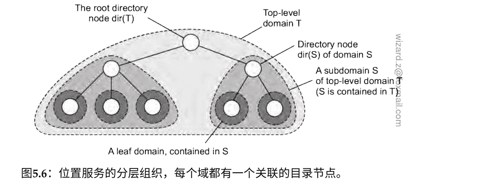

图5.6：位置服务的分层组织，每个域都有一个关联的目录节点。
```

为了跟踪实体的位置，每个当前位于域 D 中的实体在目录节点dir(D)中都有一个位置记录。叶子域 D 的目录节点 N 中的实体 E的位置记录包含该域中实体的当前地址。相比之下，下一级包含域 D 的上一级的目录节点 N'只包含指向 N 的指针的实体 E 的位置记录。同样地， N'的父节点将存储一个只包含指向 N'的指针的实体 E 的位置记录。因此，根节点将为每个实体存储一个位置记录，其中每个位置记录都存储指向下一级子域的目录节点的指针，该记录关联的实体当前位于该子域中。
```

#### 查找操作

一个实体可以有多个地址，例如如果它被复制了。 如果一个实体在叶子域 D₁和 D₂中分别有一个地址，那么包含 D₁和 D₂的最小域的目录节点将有两个指针，分别指向包含地址的子域。这导致了树的一般组织结构，如图5.7所示。
```

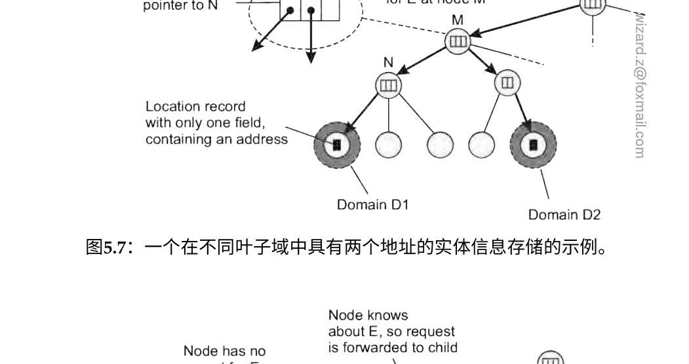

图5.7：一个在不同叶子域中具有两个地址的实体信息存储的示例。
```

现在让我们考虑一下在这样的一个层次化位置服务中进行查找操作。 如图5.8所示，一个希望定位实体 E 的客户端向其所在的叶子域 D 的目录节点发出查找请求。如果目录节点没有存储实体的位置记录，则该实体当前未在 D 中。因此，节点将请求转发给其父节点。请注意，父节点代表比其子节点更大的域。如果父节点也没有 E 的位置记录，则查找请求将被转发到更高一级，依此类推。一旦请求到达存储位置记录的目录节点 M，
```

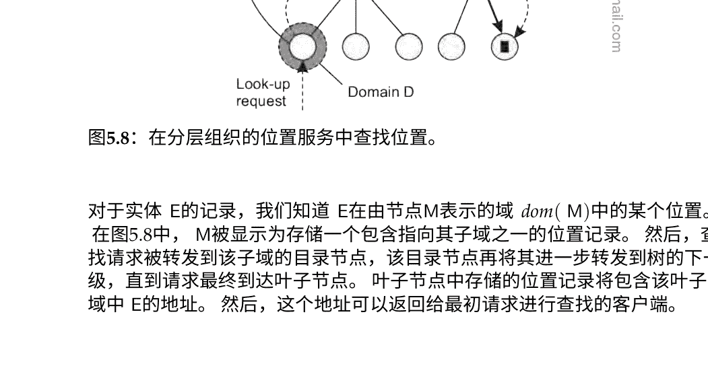

图5.8：在分层组织的位置服务中查找位置。
```

对于实体 E的记录，我们知道 E在由节点 M表示的域 dom( M)中的某个位置。在图5.8中，M被显示为存储一个包含指向其子域之一的记录。然后，查找请求被转发到该子域的目录节点，该目录节点再将其进一步转发到树的下一级，直到请求最终到达叶子节点。叶子节点中存储的位置记录将包含该叶子域中 E的地址。然后，这个地址可以返回给最初请求进行查找的客户端。
```

#### 更新操作

关于分层位置服务的一个重要观察是查找操作利用了局部性。原则上，实体在以请求客户端为中心逐渐增加的环中进行搜索。每次将查找请求转发到下一个更高级别的目录节点时，搜索区域都会扩大。在最坏的情况下，搜索会一直进行，直到请求到达根节点。因为根节点对每个实体都有一个位置记录，所以请求可以简单地沿着指针的下行路径转发到叶节点之一。
```

更新操作以类似的方式利用局部性，如图5.9所示。考虑一个实体E，在叶子域D中创建了一个副本，需要插入其地址。插入操作在叶节点dir(D) of D处启动，立即将插入请求转发给其父节点。父节点也会转发插入请求，直到到达已经存储了E的位置记录的目录节点M。
```


图5.9：在分层组织的位置服务中更新位置。
```

节点M然后在E的位置记录中存储一个指针，指向转发插入请求的子节点。在那一点上，子节点创建了E的位置记录，其中包含指向下一个更低级别节点的指针，该节点是请求来自的节点。这个过程一直持续到达发起插入的叶节点。最后，叶节点在关联的叶子域中创建了一个包含实体地址的记录。
```

#### 删除操作

按照刚才描述的方式插入地址会导致在最低级目录节点开始自上而下地安装链式指针，该节点具有实体E的位置记录。另一种方法是在将插入请求传递给父节点之前创建一个位置记录。换句话说，指针链是从下往上构建的。后一种方法的优点是尽快为查找提供地址。

因此，如果父节点暂时无法访问，则仍然可以在当前节点所代表的域内查找地址。

删除操作类似于插入操作。当需要删除叶子域D中实体E的地址时，请求目录节点dir(D)从其位置记录中删除该地址。如果该位置记录变为空，即不再包含D中E的其他地址，则可以删除该记录。在这种情况下，dir(D)的父节点希望删除其指向dir(D)的指针。如果父节点中E的位置记录现在也变为空，则应该删除该记录，并通知下一个更高级的目录节点。同样，此过程将继续，直到从仍然非空的位置记录中删除指针，或者直到到达根节点。
```

#### 注5.6（高级：可扩展性问题）

一个立即浮现在脑海中的问题是，刚刚描述的分层方法是否真的能够扩展。一个看似明显的设计缺陷是，根节点需要跟踪所有标识符。然而，重要的是要区分逻辑设计和其物理实现。

让我们在这里进行这个区分，并看看我们如何实际实现高度可扩展的分层位置服务。

为此，我们假设每个实体都被分配一个唯一的标识符，该标识符从一个大的m位标识符空间中随机选择，就像在Chord中一样。此外，
[/content]

## 5.2. 平面命名

图5.9：（a）插入请求被转发到第一个知道实体E的节点。（b）创建到叶节点的转发指针链。

假设总共有N个物理主机{H₁, H₂,…,HN}可以容纳查找服务，分布在互联网上。每个主机能够运行一个或多个位置服务器。通常，运行在同一主机上的两个服务器将代表逻辑树的不同层级上的两个节点。让Dk(A)表示包含地址A的第k级域，其中k=0表示根域。同样，让LSk(E,A)表示负责跟踪实体E位置的唯一位置服务器在Dk(A)中。

我们现在可以区分逻辑根和其实现。

令 Dk = {Dk,1, Dk,2, …, Dk,Nk } 表示第 Nk级域，显然，N0 = |D0| =1。对于每个级别 k，主机集合被划分为 Nk个子集，每个主机运行一个表示域Dk的位置服务器 Dk,i 从 Dk中选一个。这个原则在图5.10中显示。

图5.10：将逻辑位置服务器分布在物理主机上的原则。

在这个例子中，我们考虑一个简单的四层树和九个主机。有两个一级域，四个二级域和八个叶子域。我们还展示了一个特定实体E的树：与E相关的任何联系地址将存储在八个三级位置服务器之一，当然，这取决于该地址所属的域。E的根位置服务器运行在主机H3上。请注意，该主机还运行着E的叶级位置服务器。正如[van Steen and Ballintijjn, 2002]所解释的那样，通过明智地选择哪个主机应该运行E的位置服务器，我们可以结合本地操作的原则（对于地理可扩展性很好）和更高级别服务器的完全分布（对于规模可扩展性很好）。

## 5.3 结构化命名

对于机器来说，扁平名称很好，但对于人类来说通常不太方便使用。作为替代方案，命名系统通常支持由简单易读的名称组成的结构化名称。

不仅文件命名，互联网上的主机命名也遵循这种方法。在本节中，我们重点关注结构化名称及其解析为地址的方式。

### 命名空间

名称通常组织成所谓的名称空间。结构化名称的名称空间可以表示为带有两种类型节点的标记有向图。叶节点表示一个命名实体，并且具有没有出边的属性。叶节点通常存储有关所表示实体的信息，例如其地址，以便客户端可以访问它。或者，它可以存储该实体的状态，例如

## 5.3. 结构化命名

在文件系统中，叶节点实际上包含了完整的文件。 它所代表的文件。我们回到下面节点的内容。

与叶节点相反，目录节点具有多个外向边，每个边都带有一个名称，如图5.11所示。命名图中的每个节点都被视为分布式系统中的另一个实体，并且具有相关的标识符。目录节点存储了一个表，其中一个外向边被表示为一对（节点标识符，边标签）。

这样的表被称为目录表。

图5.11中显示的命名图只有一个节点，即n0，它只有外向边而没有入向边。 这样的节点被称为命名图的根节点。尽管命名图可以有多个根节点，但为了简单起见，许多命名系统只有一个根节点。命名图中的每条路径可以通过与该路径上的边对应的标签序列来引用，例如N: [标签1，标签2，…，标签n]，其中N指的是路径中的第一个节点。 这样的序列被称为路径名。如果路径名中的第一个节点是命名图的根节点，则称为绝对路径名。 否则，它被称为相对路径名。

重要的是要意识到，名称始终以名称空间的方式组织。 因此，名称始终只相对于目录节点定义。 从这个意义上说，“绝对名称”这个术语有些误导。 同样，全局名称和本地名名称之间的差异经常令人困惑。 全局名称是指在系统中无论在哪里使用，都表示相同实体的名称。 换句话说，全局名称始终与相同的目录节点解释。 相比之下，本地名是一个名称，其解释取决于使用该名称的位置。 换句话说，本地名本质上是一个相对名称，其所在的目录（隐式地）已知。

这种命名图的描述接近于许多文件系统中实现的内容。 然而，文件系统中的路径名通常不是通过写人边缘标签序列来表示的。

## 第5章 命名

以单个字符串表示，其中标签由特殊的分隔符字符分隔，例如斜杠（/）。这个字符也用于指示路径名是否为绝对路径。例如，在图5.11中，不使用 n0:[home, steen,mbox]这样的实际路径名，而是常用的字符串表示形式 /home/steen/mbox。还要注意，当有多条路径通向同一个节点时，该节点可以用不同的路径名表示。例如，在图5.11中，节点n5可以用 /home/steen/keys 或者 /keys来引用。路径名的字符串表示形式同样适用于命名除了仅用于文件系统之外的其他图形。在Plan 9 [Pike et al., 1995]中，所有资源（如进程、主机、I/O设备和网络接口）都以与传统文件相同的方式命名。这种方法类似于在分布式系统中为所有资源实现一个单一的命名图。

有许多不同的方式来组织命名空间。正如我们提到的那样，大多数命名空间只有一个根节点。在许多情况下，命名空间也是严格的分层结构，即命名图以树的形式组织。这意味着除了根节点之外的每个节点都有且只有一个入边；根节点没有入边。因此，每个节点还有一个关联的（绝对）路径名。

图5.11中显示的命名图是有向无环图的一个示例。在这样的组织中，一个节点可以有多个入边，但是图中不允许有循环。还有一些没有这个限制的命名空间。

### 注5.7（更多信息：实现Unix命名图）

为了更具体地说明问题，考虑传统Unix文件系统中文件的命名方式。在Unix的命名图中，目录节点表示文件目录，而叶节点表示文件。命名图中有一个根目录，由根节点表示。命名图的实现是完整的文件系统实现的一个重要部分。

该实现由逻辑磁盘上的一系列连续块组成，通常分为引导块、超级块、一系列索引节点（称为inode）和文件数据块。也可参考Silberschatz等人[2012]或Tanenba um[2001]。该组织结构如图5.12所示。

引导块是一块特殊的数据和指令，系统启动时会自动加载到主存中。引导块用于将操作系统加载到主存中。

超级块包含整个文件系统的信息，例如其大小、尚未分配的磁盘块、尚未使用的inode等。inode由索引号引用，从零开始，保留给表示根目录的inode。

图5.12：Unix文件系统在逻辑磁盘上的一系列连续磁盘块上的一般组织实现。

每个inode都包含有关其关联文件在磁盘上的位置的信息。此外，inode还包含有关其所有者、创建时间和最后修改时间、保护等信息。因此，当给定一个inode的索引号时，可以访问其关联的文件。

每个目录也被实现为一个文件。根目录也是如此，它包含文件名和inode的索引号之间的映射。因此可以看出，inode的索引号对应于命名图中的节点标识符。

## 5.3. 结构化命名

### 名称解析

命名空间提供了一种方便的机制，用于通过名称存储和检索实体的信息。更一般地说，给定一个路径名，应该能够查找由该名称引用的节点中存储的任何信息。查找名称的过程称为名称解析。

为了解释名称解析的工作原理，让我们考虑一个路径名称，例如 N:[label1, label2, ... labeln] 。这个名称的解析从节点 N 开始，在命名图中查找名称 label1 ，并返回 label1 所指向的节点的标识符。然后，在被识别的节点上继续解析，通过在其目录表查找名称 label2 ，依此类推。假设所命名的路径实际存在，解析过程会在被 labeln所指向的最后一个节点停止，并返回该节点的内容。

### 注释5.8(更多信息：Unix命名图)

名称查找返回一个节点的标识符，从该节点继续进行名称解析过程。特别是需要访问被识别节点的目录表。再次考虑Unix文件系统的命名图。如前所述，节点标识符被实现为inode的索引号。 访问目录表意味着首先必须读取i节点以找出 实际数据在磁盘上的存储位置，然后随后读取包含目录表的数据 块。

### 闭包机制

只有在我们知道如何和从哪里开始时，才能进行名称解析。在我们的例子中，起始节点已经给出，并且我们假设我们可以访问其目录表。了解如何和从哪里开始名称解析通常被称为闭包机制。本质上，闭包机制处理的是从名称空间中选择初始节点，从该节点开始进行名称解析[Radia, 1989]。闭包机制有时很难理解的原因是它们在某种程度上是隐含的，并且在相互比较时可能非常不同。

例如，考虑字符串“00312059837784”。许多人不会知道如何处理这些数字，除非他们被告知这个序列是一个电话号码。这些信息足以启动解析过程，特别是通过拨打该号码。随后电话系统会完成其余的工作。作为另一个例子，考虑在分布式系统中使用全局和本地名称。本地名称的典型例子是环境变量。例如，在Unix系统中，名为 HOME 的变量用于引用用户的主目录。每个用户都有自己的此变量的副本，它的初始值是对应于用户主目录的全局系统名称。与环境变量相关联的闭包机制确保变量的名称通过在用户特定表中查找来正确解析。

> 注5.9（更多信息：Unix命名图及其闭包机制）
Unix文件系统中的命名图中的名称解析利用了根目录的inode是表示文件系统的逻辑磁盘中的第一个inode的事实。其实际字节偏移量是根据超级块中的其他字段的值以及操作系统本身关于超级块内部组织的硬编码信息计算出来的。

为了明确这一点，考虑文件名的字符串表示例如 /home/steen/mbox。要解析这个名称，必须已经访问到适当命名图的根节点的目录表。作为根节点，该节点本身不能被查找，除非它是在另一个命名图中实现为不同的节点，比如 G。但是在那种情况下，已经需要访问 G的根节点。因此，解析文件名需要已经实现了某种机制，使解析过程能够开始。

### 链接和挂载

与名称解析密切相关的是使用别名。别名是同一实体的另一个名称。环境变量是别名的一个示例。
在命名图中，有基本上两种不同的实现方式

## 5.3. 结构化命名

一个别名。第一种方法是简单地带许多个绝对路径名引用相同的节点在命名图中。这种方法在图5.13中有所说明，其中节点 n5 可以通过两个不同的路径名称引用。在Unix术语中，图5.9中的路径名 /keys 和 /home/steen /keys 都被称为节点 n5的硬链接。

第二种方法是通过叶节点来表示实体，比如 N，但是不存储该实体的地址或状态，而是存储绝对路径名。当首次解析导致 N的绝对路径名时，名称解析将返回存储在 N中的路径名，此时可以继续解析该新路径名。这个原则对应对在Unix文件系统中使用符号链接，并且在图5.13中进行了说明。在这个例子中，路径名 /home/steen /keys，它指向一个包含绝对路径名 /keys 的节点，是一个指向节点 n5的符号链接。

图5.13：在命名图中解释符号链接的概念。

到目前为止，名称解析完全在单个名称空间内进行。然而，名称解析也可以用于以透明的方式合并不同的名称空间。让我们首先考虑一个挂载的文件系统。

根据我们的命名模型，一个挂载的文件系统对应于让一个目录节点存储来自不同命名空间的目录节点的标识符，我们称之为外部命名空间。存储节点标识符的目录节点称为挂载点。因此，外部命名空间中的目录节点称为挂载点。通常，挂载点是命名空间的根。在名称解析过程中，会查找挂载点，并通过访问其目录表来进行解析。

挂载的原则也可以推广到其他命名空间。特别是，需要一个目录节点作为挂载点，并存储所有必要的信息来识别和访问外部命名空间中的挂载点。这种方法在许多分布式文件系统中都有采用。

考虑一个分布在不同机器上的命名空间集合。特别地，每个命名空间都由不同的服务器实现。

每个可能在不同的机器上运行。因此，如果我们想要将一个外部命名空间 NS₂挂载到一个命名空间 NS₁中，可能需要通过网络与 NS₂的服务器进行通信，因为 NS2的服务器可能与NS₁的服务器运行在不同的机器上。要在分布式系统中挂载一个外部命名空间，至少需要以下信息：

+   1. 访问协议的名称。 2. 服务器的名称。 3. 外部命名空间中挂载点的名称。

请注意，每个名称都需要解析。访问协议的名称需要解析为与外部命名空间的服务器进行通信的协议的实现。服务器的名称需要解析为可以访问该服务器的地址。作为名称解析的最后一部分，挂载点的名称需要解析为外部命名空间中的节点标识符。

在非分布式系统中，这三个点可能都不需要。例如，在Unix中没有访问协议和服务器。此外，挂载点的名称并不是必需的，因为它只是外部名称空间的根目录。

挂载点的名称将由外部名称空间的服务器解析。然而，我们还需要访问协议和服务器名称的名称空间和实现。一种可能性是将上述三个名称表示为URL。

为了具体说明问题，考虑这样一种情况：一个使用笔记本电脑的用户想要访问存储在远程文件服务器上的文件。客户机和文件服务器都配置了网络文件系统（NFS）。特别是，为了使NFS能够在Internet上工作，客户端可以通过NFS URL指定要访问的确切文件，例如，nfs://flits.cs.vu.nl/home/steen。这个URL指定了一个名为/home/steen的文件（实际上是一个目录），它位于NFS文件服务器flits.cs.vu.nl上。nl，客户端可以通过NFS协议访问该文件服务器[Shepler et al., 2003]。

名字 nfs是一个众所周知的名字，因为全球都对该名字的解释达成了一致。考虑到我们正在处理一个URL，名字 nfs将被解析为NFS协议的实现。服务器名通过DNS解析为其地址，在后面的章节中将会进行讨论。正如我们所说，/主页/斯汀由外部名字空间的服务器解析。

客户端机器上文件系统的组织部分如图5.14所示。根目录有许多用户定义的条目，包括一个名为/远程的子目录。这个子目录旨在包含外部名字空间的挂载点，例如用户在VU的主目录。

图5.14：通过特定协议挂载远程名字空间。

### 注5.10 （更多信息：在Unix中跨网络挂载）

在网络上进行挂载有很多方式。一种实际的解决方案，并被许多小型分布式系统采用，简单地为机器分配固定的IP地址，然后为客户端提供挂载点。考虑以下示例。假设我们有一台名为coltrane的Unix机器，使用私有地址192.168.2.3，在本地目录/audio下存储了一系列音乐文件。这个目录可以作为一个挂载点导出，并且作为结果可以被另一台机器导入。

让quandar成为这样一台机器，并假设它想要挂载音频文件集合到本地挂载点/home/maarten/Music。下面的命令将完成这个任务（假设已经设置了正确的权限）：

```
quandar$ mount -t nfs 192.168.2.3:/audio /home/maarten/Music
```

从那一刻起，所有在coltrane的目录 /audio中可用的文件都可以被在目录 /home/maarten/Music中的quandar访问。这个方案的美妙之处在于一旦挂载，就不需要再考虑远程访问的问题（当然，直到出现故障为止）。

### 名称空间的实现

命名空间是命名服务的核心，即允许用户和进程添加、删除和查找名称的服务。 命名服务由名称服务器实现。 如果分布式系统仅限于局域网，通常可以通过单个名称服务器实现命名服务。 然而，在具有许多实体的大规模分布式系统中，可能需要将命名空间的实现分布到多个名称服务器上。

### 命名空间分布

用于大规模、可能是全球分布式系统的命名空间通常以层次结构组织。 与之前一样，假设这样的命名空间只有一个根节点。 为了有效地实现这样的命名空间，将其分割成逻辑层是方便的。Cheriton和Mann [1989]区分了以下三个层次。

全局层由最高级节点组成，即根节点和其他与根节点逻辑上接近的目录节点，即其子节点。

全局层中的节点通常以其稳定性为特征，在目录表很少更改的情况下。 这些节点可能代表组织或组织群体，其名称存储在命名空间中。

管理层由一起在单个组织内管理的目录节点组成。 目录节点的一个特征是管理层中的节点代表属于同一组织或管理单元的实体群体。例如，组织中的每个部门可能有一个目录节点，或者可以找到所有主机的目录节点。另一个目录节点可以用作命名所有用户的起始点，依此类推。管理层中的节点相对稳定，尽管更改通常比全局层中的节点更频繁发生。

管理层由可能经常变化的节点组成 例如，代表本地网络中的主机的节点属于这一层 出于同样的原因，该层包括代表共享文件（例如库文件或二进制文件）的节点 另一个重要的节点类别包括代表用户定义的目录和文件的节点 与全局和管理层相比，管理层中的节点不仅由系统管理员维护，还由分布式系统的个别终端用户维护

图5.15显示了DNS名称空间的一部分的分区示例，包括可以通过互联网访问的组织内的文件名称，例如网页和可传输的文件 名称空间被划分为不重叠的部分，称为DNS中的区域 区域是名称的一部分

## 第5章 命名

由独立的名称服务器实现的空间。其中一些区域在图5.15中有所说明。

如果我们关注可用性和性能，每个层级中的名称服务器必须满足不同的要求。高可用性对于全局层中的名称服务器尤为重要。如果一个名称服务器失败，由于名称解析无法超越失败的服务器，将无法访问大部分名称空间。

性能有些微妙。由于全局层中节点的变化率较低，查找操作的结果通常在很长时间内保持有效。因此，这些结果可以被客户端有效地缓存（即存储在本地）。下次执行相同的查找操作时，可以从客户端的缓存中检索结果，而不是让名称服务器返回结果。因此，全局层中的名称服务器不必快速响应单个查找请求。另一方面，在具有数百万用户的大规模系统中，吞吐量可能很重要。

在全局层中，名称服务器的可用性和性能要求可以通过复制服务器与客户端缓存相结合来满足。在这一层中，更新通常不需要立即生效，这样可以更容易地保持副本的一致性。

对于管理层中的名称服务器来说，可用性对于与名称服务器在同一组织中的客户端来说是非常重要的。如果名称服务器发生故障，组织内的许多资源将变得无法访问，因为无法进行查找。另一方面，对于组织外的用户来说，组织中的资源暂时无法访问可能不那么重要。

就性能而言，管理层中的名称服务器具有与全局层中的名称服务器类似的特性。由于节点的更改并不经常发生，缓存查找结果可以非常有效，使性能不那么关键。然而，与全局层不同的是，管理层应确保查找结果在几毫秒内返回，可以直接从服务器返回，也可以从客户端的本地缓存返回。同样，更新通常应该比全局层的更新更快地处理。例如，一个新用户的帐户需要花费几个小时才能生效是不可接受的。

通过使用相对强大的机器来运行名称服务器，可以满足这些要求。此外，应该应用客户端缓存，并结合复制以提高整体可用性。

在管理层面上，名称服务器的可用性要求通常较低。特别是，通常可以使用单台机器来运行名称服务器，但可能会导致暂时不可用。然而，性能至关重要：操作必须立即执行。由于更新经常发生，客户端缓存通常效果较差。

## 5.3. 结构化命名

| 问题 | 全球 | 管理的 |
|------|------|-------|
| 地理规模 | 全球范围 | 组织 |
| 节点数量 | 少量 | 许多 |
| 对查找的响应速度 | 秒 | 毫秒 |
| 更新传播 | 延迟 | 立即 |
| 副本数量 | 许多 | 无或少量 |
| 客户端缓存 | 是 | 是 |

图5.16：实现大规模命名空间分区为全局层、管理层和管理层的名称服务器之间的比较。

图5.16展示了不同层次的名称服务器之间的比较。在分布式系统中，全局和管理层的名称服务器是最难实现的。复制和缓存引起了一些困难，这些困难是为了可用性和性能而需要的，但也引入了一致性问题。一些问题由于缓存和副本分布在广域网上而变得更加严重，这可能 在查找过程中引入长时间的通信延迟。

### 名称解析的实现

名称空间在多个名称服务器之间的分布会影响名称解析的实现。为了解释大规模名称服务中名称解析的实现，我们暂时假设名称服务器没有复制，并没有使用客户端缓存。每个客户端都可以访问一个本地的名称解析器，负责确保名称解析过程的执行。参考图5.15，假设要解析的（绝对）路径名root为：[ nl,vu,cs,ftp,pub,globe,index.html]。使用URL表示法，该路径名对应于ftp: // ftp.cs.vu.nl/pub/globe/index.html。现在有两种实现名称解析的方法。

在迭代式名称解析中，名称解析器将完整的名称传送给根名称服务器。假设可以知道根服务器的地址。根服务器将尽可能解析路径名称，并将结果返回给客户端。在我们的示例中，根服务器只能解析标签nl，它将返回关联名称服务器的地址。

此时，客户端将剩余的路径名称（即 nl：[vu，cs，ftp，pub，globe，index.html ]）传递给该名称服务器。该服务器只能解析标签vu，并返回关联名称服务器的地址，以及剩余的路径名称vu：[cs，ftp，pub，globe，index.html ]。然后，客户端的名称解析器将联系下一个名称服务器，该服务器通过解析标签cs，并随后也解析ftp，返回
FTP服务器的地址和路径名 ftp:[pub,globe,index.html].然后客户端联系FTP服务器，请求解析原始路径名的最后一部分。FTP服务器随后解析标签pub, globe和 index.html，并传输所请求的文件（在本例中使用FTP）。图5.17显示了这种迭代名称解析的过程。（符号#[cs]用于指示负责处理由[cs]引用的节点的服务器的地址。）

图5.17：迭代名称解析的原理。

实际上，最后一步，即联系FTP服务器并请求传输路径名为 ftp:[pub,globe,i ndex.html]的文件，由客户端进程单独执行。换句话说，客户端通常只会将路径名 root:[nl,vu,cs,ftp]交给名称解析器，从中期望得到可以联系FTP服务器的地址，如图5.17所示。

在名称解析期间，使用递归而不是迭代的名称解析的替代方法是。使用递归名称解析，而不是将每个中间结果返回给客户端的名称解析器，一个名称服务器将结果传送给它找到的下一个名称服务器。因此，例如，当根名称服务器找到实现名为nl的节点的名称服务器的地址时，它会请求该名称服务器解析路径名nl:[vu, cs, ftp, pub, globe, index.html]。同样，使用递归名称解析，这个下一个服务器将解析完整路径并最终返回文件index.html。然后将该文件传送给根服务器，根服务器将其传递给客户端的名称解析器。

图5.18显示了递归名称解析。与迭代名称解析一样，最后一步（联系FTP服务器并要求传输指定的文件）通常由客户端作为单独的进程执行。

图5.18：递归名称解析的原理。

递归名称解析的主要缺点是它对每个名称服务器都有更高的性能需求。基本上，一个名称服务器需要处理完整的路径名解析，尽管它可以与其他名称服务器合作。这种额外的负担通常非常高，以至于名称空间的全局层中的名称服务器仅支持迭代名称解析。

递归名称解析有两个重要的优点。第一个优点是缓存结果比迭代名称解析更有效。第二个优点是可以减少通信成本。

为了解释这些优点，假设客户端的名称解析器只接受引用名称空间的全局或管理层节点的路径名。为了解析与管理层节点对应的路径名的部分，客户端将单独联系其名称解析器返回的名称服务器，如上所述。

递归名称解析允许每个名称服务器逐渐学习实现较低级别节点的每个名称服务器的地址。因此，缓存可以有效地用于提高性能。

例如，当请求根服务器解析路径名root:[nl,vu,cs,ftp]时，它最终会获得实现该路径名所引用的节点的名称服务器的地址。为了达到这一点，nlnode的名称服务器必须查找vunode的名称服务器的地址，而后者必须查找处理csnode的名称服务器的地址。

由于全局和管理层中的节点更改不经常发生，根名称服务器可以有效地缓存返回的地址。此外，通过递归，地址也会返回给负责实现vunode和nlnode的名称服务器，因此也可以在这些服务器上进行缓存。

同样，中间名称查找的结果也可以返回并缓存。例如，用于 nlnode的服务器将需要查找 vunode服务器的地址。当 nl服务器返回原始名称查找的结果时，该地址可以返回给根服务器。图5.19显示了解析过程的完整概述以及每个名称服务器可以缓存的结果。

|服务器 对于节点|应该解析|查找|传递给子节点|接收并缓存|返回给请求者|
|cs|[ftp]|#[ftp]|—|—|#[ftp]|
|vu|[cs, ftp]|#[cs]|[ftp]|#[ftp]|#[cs] #[cs, ftp]|
|nl|[vu, cs, ftp]|#[vu]|[cs, ftp]|#[cs] #[cs, ftp]|#[vu] #[vu, cs] #[vu, cs, ftp]|
|根|[nl, vu, cs, ftp]|#[nl]|[[vu, cs, ftp]]|#[vu] #[vu, cs] #[vu, cs, ftp]|#[nl] #[nl, vu] #[nl, vu, cs] #[nl, vu, cs, ftp]|

图5.19：[nl, vu, cs, ftp]的递归名称解析。名称服务器缓存中间结果以供后续查找使用。

这种方法的主要优点是，最终，查找操作可以被相当高效地处理。例如，假设稍后另一个客户端请求解析路径名根:[nl, vu, cs, flits]。这个名称被传递给根节点，它可以立即将其转发给名称服务器以解析剩余的路径名 cs:[flits]。

通过迭代式名称解析，缓存必然受限于客户端的名称解析器。因此，如果客户端A请求解析一个名称，并且另一个客户端B稍后请求解析相同的名称，名称解析将必须经过与客户端A相同的名称服务器。为了妥协，许多组织使用一个被所有客户端共享的本地中间名称服务器。这个本地名称服务器处理所有的命名请求并缓存结果。这样一个中间服务器在管理角度上也很方便。例如，只有该服务器需要知道根名称服务器的位置；其他机器不需要这个信息。

递归式名称解析的第二个优点是在通信方面通常更便宜。再次考虑路径名称 root:[nl, vu, cs, ftp]的解析，并假设客户端位于旧金山。假设客户端知道 nl节点的服务器地址，通过递归式名称解析，通信将沿着从旧金山的客户端主机到荷兰的 nl服务器的路径进行。

如图5.20中所示，通信是在VU大学校园内与VU大学的名称服务器之间进行的。这种通信被标记为 R2。最后，需要在计算机科学系的名称服务器和 vu服务器之间进行通信，标记为 R3。回复的路径相同，但方向相反。显然，通信成本由客户端主机和 nl服务器之间的消息交换决定。

相比之下，使用迭代式名称解析，客户端主机必须分别与 nl服务器、vu服务器和 cs服务器进行通信，总成本可能大约是递归式名称解析的三倍。

图5.20：递归式和迭代式名称解析在通信成本方面的比较。

## 示例：域名系统

如今使用最广泛的分布式命名服务之一是互联网域名系统（DNS）。DNS主要用于查找主机和邮件服务器的IP地址。在接下来的页面中，我们将重点关注DNS命名空间的组织以及存储在其节点中的信息。此外，我们还将更详细地了解DNS的实际实现。更多信息可以在[Mockapetris, 1987]和[Liu and Albitz, 2006]中找到。

关于DNS的评估，特别是它是否仍然适应当前互联网的需求，可以在[Levien, 2005]中找到。从这份报告中，人们可以得出一个有些令人惊讶的结论，即即使经过了30多年，DNS并没有表明它需要被替换。我们认为，主要原因在于设计者对如何保持事情简单的深刻理解。分布式系统的其他领域的实践表明，并不是很多人具备这样的理解能力。

## DNS名称空间

DNS名称空间以根树的层次结构组织。标签是由字母数字字符组成的不区分大小写的字符串。标签的最大长度为63个字符；完整路径名的长度限制为255个字符。路径名的字符串表示形式是列出其标签，从最右边的标签开始，并用点（“.”）分隔标签。根节点用点表示。因此，例如，路径名root:[nl,vu,cs,flits]的字符串表示为“flits.cs.vu.nl.”，其中包括最右边的点以表示根节点。通常为了可读性，我们省略这个点。我们通常省略这个点以提高可读性。

因为DNS名称空间中的每个节点都只有一个入边（除了根节点没有入边），所以附加到节点入边的标签也被用作该节点的名称。一个子树被称为一个域，到其根节点的路径名被称为域名。请注意，就像路径名一样，域名可以是绝对的或相对的。

节点的内容由一组资源记录组成。 有不同类型的资源记录。 主要的类型如图5.21所示。

| 类型 | 指的是 | 描述 |
|-------|--------|---------|
| SOA   | 区域   | 保存所代表区域的信息   |
| A     | 主机   | IP地址。这个节点所代表的主机的IP地址 |
| MX    | 域名   | 处理该节点邮件的邮件服务器 |
| SRV   | 域名   | 处理特定服务的服务器 |
| NS    | 区域   | 代表区域的名称服务器 |
| CNAME | 节点   | 符号链接 |
| PTR   | 主机   | 主机的规范名称 |
| HINFO | 主机   | 关于该主机的信息 |
| TXT   | 任何类型 | 任何有用的信息 |

图5.21：DNS命名空间中节点内容的最重要的资源记录类型。

DNS名称空间中的一个节点通常同时表示多个实体。例如，域名如 vu.nl 用于表示一个域和一个区域。在这种情况下，域通过几个（不重叠的）区域来实现。

一个 SOA（权威起始）资源记录包含诸如负责所代表区域的系统管理员的电子邮件地址、可以获取区域数据的主机名等信息。

一个 A（地址）记录代表互联网中的特定主机。该 A 记录包含该主机的 IP地址，以便进行通信。如果一个主机有多个 IP地址，就像多宿主机一样，节点将为每个地址包含一个 A记录。

另一种记录类型是 MX（邮件交换）记录，类似于指向表示邮件服务器的节点的符号链接。例如，表示域名 cs.vu.nl 的节点包含一个 MX记录，其中包含名称 zephyr.cs.vu.nl，它指向一个邮件服务器。该服务器将处理所有发送到 cs.vu.nl 域中用户的传入门邮件。一个节点中可能存储有多个 MX记录。

与 MX记录相关的是 SRV记录，其中包含了特定服务的服务器名称。服务本身通过名称和协议名称来标识。例如，cs.vu.中的 Web 服务器 nldomain 可以通过 SRV记录来命名，例如 _http_tcp.cs.vu.nl 这个记录将指向实际服务器的名称（即soling.cs.vu.nl）。SRV记录的一个重要优势是客户端不再需要知道提供特定服务的主机的 DNS名称。相反，只需要标准化服务名称，然后可以查找提供服务的主机。

代表区域的节点包含一个或多个 NS（名称服务器）记录。像 MX记录一样，NS记录包含实现节点所代表的区域的名称服务器的名称。原则上，名称空间中的每个节点都可以存储一个指向实现它的名称服务器的 NS记录。然而，正如我们在下面讨论的那样，DNS名称空间的实现使得只有代表区域的节点需要存储 NS记录。

DNS将别名与所谓的规范名称区分开来。假设每个主机都有一个规范的或主要的名称。通过存储包含主机的规范名称的 CNAME记录来实现别名。存储这样一条记录的节点的名称与符号链接相同，如图5.13所示。

DNS通过使用PTR（指针）记录来维护IP地址到主机名的逆映射。为了在仅给出IP地址时查找主机名，DNS维护一个名为in-addr.arpa的域。arpa包含代表Internet主机的节点，这些节点以所代表主机的IP地址命名。例如，主机www.cs.vu。nl具有IP地址130.37.20.20。DNS创建一个名为20.20.37.130.in-addr.arpa的节点。arpa用于存储该主机的规范名称（恰好是soling.cs.vu.nl）的PTR记录。

最后，一个 HINFO（主机信息）记录用于存储有关主机的其他信息，例如其机器类型和操作系统。类似地，TXT记录用于存储用户认为对节点所代表的实体有用的任何其他类型的数据。

## DNS实现

实质上，DNS命名空间可以分为全局层和管理层，如图5.15所示。管理层通常由本地文件系统组成，正式上不属于DNS的一部分，因此也不由其管理。

每个区域由一个名称服务器实现，这个服务器几乎总会为了可用性而复制。区域的更新通常由主名称服务器处理。更新通过修改与主服务器本地的DNS数据库来进行。辅助名称服务器不直接访问数据库，而是请求主服务器传输其内容。后者在DNS术语中称为区域传输。

DNS数据库被实现为（小型）文件集合，其中最重要的文件包含了特定区域中所有节点的资源记录。这种方法允许节点通过其域名简单地进行标识，通过这种方式，节点标识的概念简化为对文件的（隐式）索引。

注释5.11 （更多信息：一个示例DNS数据库）

为了更好地理解这些实现问题，图5.22展示了包含先前组织的cs.vu.nldomain大部分信息的文件的一小部分。请注意，出于安全原因，我们故意选择了一个过时的版本。该文件已经进行了编辑以提高可读性。它显示了属于cs.vu.nldomain的几个节点的内容。每个节点通过其域名进行标识。

该节点cs.vu.nl代表域和区域。它的SOA资源记录包含了关于此文件有效性的具体信息，这对我们来说不重要。该区域有四个名称服务器，通过它们的规范主机名在NS记录中引用。该TXT记录用于提供关于该区域的一些附加信息，但不能被任何名称服务器自动处理。此域中的用户的传入邮件由一个单独的邮件服务器处理。在邮件服务器名称之前的数字指定了选择优先级。发送邮件服务器应始终首先尝试联系具有最低数字的邮件服务器。

主机star.cs.vu.nl作为该区域的名称服务器运行。名称服务器对于任何命名服务都至关重要。关于该名称服务器的可见信息是，通过给予两个独立的网络接口（每个接口由一个单独的A资源记录表示），增加了额外的鲁棒性。通过这种方式，当网络连接中断时，服务器仍然可以访问，从而在一定程度上减轻了影响。

下面的四行（对于zephyr.cs.vu.nl）提供了有关部门邮件服务器的必要信息。请注意，这个邮件服务器也有另一个备份邮件服务器，其路径为tornado.cs.vu.nl。

| 名称       | 记录类型 | 记录值                                   |
|------------|----------|------------------------------------------|
| cs.vu.nlo  | SOA      | star.cs.vu.nl. hostmaster.cs.vu.nl.     |
| cs.vu.nlo  | TXT      | "VU大学 - 计算机科学"                     |
| cs.vu.nlo  | MX       | 1 mail.few.vu.nlo.                       |
| cs.vu.nlo  | NS       | ns.vu.nlo.                               |
| cs.vu.nlo  | NS       | top.cs.vu.nlo.                           |
| cs.vu.nlo  | NS       | solo.cs.vu.nlo.                           |
| cs.vu.nlo  | NS       | star.cs.vu.nl.                           |
| star.cs.vu.nlo | A     | 130.37.24.6                               |
| star.cs.vu.nlo | A     | 192.31.231.42                             |
| star.cs.vu.nlo | MX     | 1 星 .cs.vu.nl.                           |
| star.cs.vu.nlo | MX     | 666 微风 .cs.vu.nl.                       |
| star.cs.vu.nlo | HINFO   | "太阳" "Unix"                           |
| 微风 .cs.vu.nl. | A   | 130.37.20.10                              |
| 微风 .cs.vu.nl. | MX   | 1 微风 .cs.vu.nl.                         |
| 微风 .cs.vu.nl. | MX   | 2 龙卷风 .cs.vu.nl.                       |
| 微风 .cs.vu.nl. | HINFO   | "太阳" "Unix"                           |
| ftp.cs.vu.nl.  | CNAME   | 索灵 .cs.vu.nl.                           |
| www.cs.vu.nl. | CNAME   | 索灵 .cs.vu.nl.                           |
| 索灵 .cs.vu.nl. | A   | 130.37.20.20                              |
| 索灵 .cs.vu.nl. | MX   | 1 索灵 .cs.vu.nl.                         |
| 索灵 .cs.vu.nl. | MX   | 666 微风 .cs.vu.nl.                       |
| 索灵 .cs.vu.nl. | HINFO   | "太阳" "Unix"                           |
| vucs-das1.cs.vu.nl. | PTR | 0.198.37.130.in-addr.arpa.               |
| vucs-das1.cs.vu.nl. | A   | 130.37.198.0                              |
| 墨水.cs.vu.nl.    | HINFO   | "OCE" "专有的"                          |
| 墨水.cs.vu.nl.    | A   | 192.168.4.3                               |
| 笔 .cs.vu.nl.   | HINFO   | "OCE" "专有的"                          |
| 笔 .cs.vu.nl.   | A   | 192.168.4.2                               |
| 本地主机.cs.vu.nl. | A   | 127.0.0.1                                 |

图5.22：来自区域 cs.vu.的（旧）DNS数据库摘录nl.接下来的六行展示了一个典型的配置，其中部门的Web服务器和部门的FTP服务器由一台名为soling.cs.vu.nl的单台机器实现。通过在同一台机器上执行两个服务器（并且基本上只使用该机器进行互联网服务而不是其他任何事情），系统管理变得更加容易。例如，两个服务器将对文件系统具有相同的视图，并且为了效率，文件系统的一部分可以在soling.cs.vu.nl上实现。这种方法通常应用于WWW和FTP服务的情况。

以下两行显示了部门旧的服务器集群的信息。在这种情况下，它告诉我们地址 130.37.198.0与主机名 vucs-das1.cs.vu.nl相关联。

下面四行显示了连接到两个主要打印机的信息

## 第5章 命名

本地网络。请注意，范围为 192.168.0.0到 192.168.255.255的地址是私有的：它们只能从本地网络内部访问，而不能从任意的互联网主机访问。

|名称|记录类型|记录值|
|----|--------|--------|
|cs.vu.nlo|NS|solo.cs.vu.nlo|
|cs.vu.nlo|NS|star.cs.vu.nlo|
|cs.vu.nlo|NS|ns.vu.nlo|
|cs.vu.nlo|NS|top.cs.vu.nlo|
|ns.vu.nlo|A|130.37.129.4|
|top.cs.vu.nlo|A|130.37.20.4|
|solo.cs.vu.nlo|A|130.37.20.5|
|star.cs.vu.nlo|A|190.37.24.6|
|star.cs.vu.nlo|A|192.31.231.42|

因为cs.vu.nlo域被实现为一个单一区域，图5.22中不包括对其他区域的引用。在不同区域中实现的子域中引用节点的方法如图5.23所示。需要做的是通过简单地给出其域名和IP地址来为子域指定一个名称服务器。当解析位于cs.vu.nl域的节点的名称时，名称解析将继续在某一点上通过读取由名称服务器存储的DNS数据库来进行。

## 注5.12（高级：分散式与分层式DNS实现）

我们迄今为止描述的DNS实现是标准的。它遵循一个具有13个众所周知的根节点和数百万个叶子节点的服务器层次结构（但请继续阅读）。一个重要的观察是，高层节点收到的请求比低层节点多得多。只有通过缓存这些高层的名称到地址绑定，才能避免向它们发送请求，从而淹没它们。

这些可扩展性问题原则上可以通过完全分散的解决方案完全避免。特别是，我们可以计算DNS名称的哈希值，然后将该哈希值作为键值在分布式哈希表或具有完全分区根节点的分层位置服务中进行查找。

这种方法的明显缺点是我们失去了原始名称的结构。这种损失可能会阻碍例如在特定域中查找所有子节点的高效实现。

正如Walfish等人[2004]所争论的那样，当需要许多名称时，使用标识符作为一种无语义的访问数据的方式将允许不同的系统使用单一的命名系统。原因很简单：现在人们已经很好地理解了如何高效支持大量（扁平）名称的集合。需要做的是维护标识符到名称的映射

## 5.3. 结构化命名

信息，其中名称可以来自DNS空间，可以是URL等。通过让用户或组织使用严格的本地命名空间，可以更容易地使用标识符。后者与在计算机上维护环境变量的私有设置完全类似。

然而，声称DNS的分散实现将解决其可扩展性问题过于简化了。在一项比较研究中，Pappas等人[2006]表明需要考虑许多权衡，并且实际上DNS的当前分层设计至少有两个好处：

+   * 在分层设计中，并非所有节点都是相等的，在DNS的情况下，尤其是高层节点的工程方式不同。例如，尽管官方上有13个根节点，但每个节点都高度分布和复制以提高性能和可用性。举个例子，RIPE NCC提供的根节点在大约25个不同的站点上实现（都使用相同的IP地址），每个站点都作为一个高度稳健和复制的服务器集群实现。

再次，我们看到逻辑设计和物理设计之间的重要区别。利用这种区别对于分布式系统（如DNS）的运行至关重要。然而，在几乎所有基于DHT的系统，当处理逻辑命名层次结构时，这种区别可能更加困难，因为所有名称必须被视为相等。在这种情况下，更难以通过特殊的（物理）节点将顶级域分离出来设计系统。

当然，不所有的节点都是相等的，这显然是一个缺点，需要采取特殊措施来保护系统中更重要的部分免受滥用。我们已经提到DNS中的顶级节点是作为分布式和复制的服务器（集群）实现的，但是相关的服务器不会提供递归名称解析。

从鲁棒性的角度来看，这样的实现决策也是必要的。

+   * DNS缓存非常有效，几乎完全由本地查询的分布驱动：如果在服务器S经常查询域D，那么D的名称服务器的引用将被缓存在S上。在另一个服务器S'上的行为取决于S'上的查询。这一重要特性在最近的一项研究中得到了确认，该研究还展示了理解缓存的有效性和DNS解析器的局部性原则有多么困难。特别是，ISP的DNS解析器在将流量重定向到本地化内容方面可能非常有效[Ager等人，2010年]。

相比之下，在基于DHT的系统，缓存和复制通常不显示出这种局部性原则：结果只是在查找的返回路径上的节点上缓存，并且与在DHT中的特定节点上本地启动查找或解析器有很多关系，或者本地ISP可以帮助查找内容。

事实仍然是，用分散式实现取代DNS不一定是一个好主意。DNS作为今天的现状，是一个经过精心设计的系统，

## 第5章 命名

在性能和稳定性方面很难被超越[Vixie, 2009; 2014].

## 示例：网络文件系统

作为另一个非常不同的例子，考虑NFS中的命名。NFS命名模型的基本思想是为客户端提供对由服务器维护的远程文件系统的完全透明访问。通过允许客户端能够将远程文件系统挂载到自己的本地文件系统中，可以实现这种透明性，如图5.24所示。


图5.24：挂载（部分）远程文件系统在NFS中。

NFS允许客户端挂载文件系统的部分而不是整个文件系统，如图5.24所示。当服务器将目录及其条目提供给客户端时，称为导出目录。导出的目录可以挂载到客户端的本地命名空间中。

这种设计方法有一个严重的影响：原则上，用户不共享命名空间。如图5.24所示，在客户端A上名为/remote/vu/mbox的文件在客户端B上名为/work/me/mbox。因此，文件的名称取决于客户端如何组织自己的本地命名空间以及导出目录的挂载位置。在分布式文件系统中，这种方法的缺点是共享文件变得更加困难。例如，Alice无法使用她分配给该文件的名称告诉Bob关于该文件，因为在Bob的文件命名空间中，该名称可能具有完全不同的含义。

有几种方法可以解决这个问题，但最常见的一种是为每个客户端提供一个部分标准化的命名空间。

例如，每个客户端可以使用本地目录 /usr / bin来挂载一个包含一组标准程序的文件系统，这些程序对所有人都可用。同样，目录 / local可以用作挂载位于客户端主机上的本地文件系统的标准。

NFS服务器本身可以挂载其他服务器导出的目录。但是，它不允许将这些目录导出给自己的客户端。相反，客户端必须从维护该目录的服务器上显式挂载此类目录，如图5.25所示。这种限制部分是出于简单性的考虑。如果服务器可以导出从另一个服务器挂载的目录，它将不得不返回包含服务器标识符的特殊文件句柄。NFS 不支持此类文件句柄。


为了更详细地解释这一点，假设服务器 Ahosts 一个文件系统 FSA，它从中导出目录 / packages。 这个目录包含一个子目录 / draw，它作为一个文件系统 FSB的挂载点，该文件系统由服务器B导出并由A挂载。 让A也将 / packages / draw导出到它自己的客户端，并假设一个客户端已经将 / packages 挂载到它的本地目录 / bin，如图5.25所示。

如果名称解析是迭代的，那么为了解析名称 / bin / draw / install，客户端在本地解析 / bin后会联系服务器A并请求返回目录 / draw的文件句柄。在这种情况下，服务器A应该返回一个包含服务器B的标识符的文件句柄，因为只有B能够解析路径名的其余部分，在这种情况下是/install。正如我们所说，NFS 不支持这种类型的名称解析。

## 第5章 命名

在早期版本的NFS中，名称解析严格按顺序进行，也就是说一次只能查找一个文件名。换句话说，解析像/bin/draw/install这样的名称需要三次单独的调用NFS服务器。此外，客户端完全负责实现路径名的解析。NFSv4还支持递归名称查找。在这种情况下，客户端可以将完整的路径名传递给服务器，并请求服务器解析它。

NFS名称查找还存在另一个特殊之处，这在最新版本（NFSv4）中已经解决。考虑一个托管多个文件系统的文件服务器。严格的迭代名称解析中，每当在一个已挂载了另一个文件系统的目录上进行查找时，查找将返回该目录的文件句柄。随后读取该目录将返回其原始内容，而不是挂载文件系统的根目录的内容。

为了解释，假设在我们之前的例子中，两个文件系统FSA和FSB都由一个单独的服务器托管。如果客户端将/包装成本地目录/bin，那么在服务器上查找文件名draw将返回文件句柄draw。随后，通过readdir调用服务器来列出draw的目录条目，将返回最初存储在子目录/packages/draw中的目录条目列表。只有当客户端还挂载了文件系统FSB时，才能正确解析路径名draw/install相对于 BIN。

NFSv4通过允许在服务器上跨越挂载点进行查找来解决了这个问题。特别是，lookup返回挂载目录的文件句柄，而不是原始目录的文件句柄。客户端可以通过检查所查找文件的文件系统标识符来检测查找是否跨越了挂载点。如果需要，客户端还可以在本地挂载该文件系统。

文件句柄是对文件系统中的文件的引用。它与所引用的文件的名称无关。文件句柄是由托管文件系统的服务器创建的，并且在所有由服务器导出的文件系统中是唯一的。它在文件创建时创建。客户端对文件句柄的实际内容一无所知；它完全是不透明的。NFS版本2中的文件句柄为32字节，但在版本3中可变长达64字节，在版本4中可变长达128字节。当然，文件句柄的长度并不是不透明的。

理想情况下，文件句柄应该被实现为相对于文件系统的真正标识符。首先，这意味着只要文件存在，它就应有一个相同的文件句柄。这种持久性要求允许客户端在通过名称查找到相关文件后，将文件句柄本地存储。一个好处是性能：由于大多数文件操作都需要文件句柄而不是名称，客户端可以避免在每个文件操作之前重复查找名称。这种方法的另一个好处是，客户端现在可以访问文件，而不管它当前的名称是什么。

## 5.3. 结构化命名

因为文件句柄可以由客户端本地存储，所以在删除文件后，服务器不应该再重用文件句柄，这一点也很重要。否则，当客户端使用其本地存储的文件句柄时，可能会错误地访问错误的文件。

请注意，迭代式名称查找和不允许查找操作跨越挂载点引入了一个获取初始文件句柄的问题。为了访问远程文件系统中的文件，客户端需要向服务器提供要查找的目录的文件句柄，以及要解析的文件或目录的名称。NFSv3通过一个单独的挂载协议来解决这个问题，客户端实际上会挂载一个远程文件系统。挂载后，客户端会返回挂载文件系统的根文件句柄，随后可以将其用作查找名称的起点。

在NFSv4中，通过提供一个单独的操作putrootfh来解决这个问题，告诉服务器解决所有相对于所管理的文件系统的根文件句柄的文件名。根文件句柄可以用来查找服务器文件系统中的任何其他文件句柄。这种方法的额外好处是不需要单独的挂载协议。

相反，挂载可以集成到常规的查找文件的协议中。客户端可以通过请求服务器使用putrootfh来解析相对于文件系统根文件句柄的名称来简单地挂载远程文件系统。

## 注释5.13（高级：自动挂载）

正如我们提到的，NFS命名模型基本上为用户提供了他们自己的命名空间。在这个模型中，如果用户以不同的方式命名相同的文件，共享可能变得困难。解决这个问题的一个方法是为每个用户提供一个部分标准化的本地命名空间，然后为每个用户挂载远程文件系统。

NFS命名模型的另一个问题与决定何时挂载远程文件系统有关。考虑一个拥有数千个用户的大型系统。假设每个用户都有一个本地目录/主目录用于挂载其他用户的主目录。例如，Alice的主目录可能作为/主目录/Alice在本地可用，尽管实际文件存储在远程服务器上。当Alice登录工作站时，可以自动挂载此目录。此外，她可以通过访问Bob的目录来访问Bob的公共文件，路径为/主目录/Bob。

然而，问题是当Alice登录时是否也应自动挂载Bob的主目录。这种方法的好处是对Alice来说，挂载文件系统的整个过程都是透明的。然而，如果对每个用户都遵循此策略，登录可能会产生大量的通信和管理开销。此外，这还要求事先知道所有用户。一个更好的方法是在需要时透明地挂载另一个用户的主目录，即在首次需要时挂载。

NFS通过一个独立的进程——自动挂载器来处理远程文件系统（或实际上是导出的目录）的按需挂载。在客户端的机器上运行。自动挂载器的原理相对简单。考虑一个简单的自动挂载器，在Unix操作系统上作为用户级NFS服务器实现。（其他实现请参见[Callaghan, 2000]）。

假设对于每个用户，所有用户的主目录都通过本地目录/home可用，如上所述。当客户机启动时，自动挂载器开始挂载此目录。本地挂载的效果是，每当程序尝试访问/home时，Unix内核将向NFS客户端转发查找操作，在这种情况下，将请求转发给作为NFS服务器的自动挂载器，如图5.26所示。

图5.26：一个简单的NFS自动挂载程序。

例如，假设Alice登录。登录程序将尝试读取目录/home/alice以查找登录脚本等信息。因此，自动挂载程序将收到查找子目录/home/alice的请求，为此它首先在/home中创建子目录/alice。然后，它查找导出Alice的主目录的NFS服务器，随后将该目录挂载在/home/alice中。此时，登录程序可以继续进行。

这种方法的问题在于，为了保证透明性，自动挂载程序必须参与所有文件操作。如果引用的文件因相应的文件系统尚未挂载而不可用，自动挂载程序必须知道。特别是，它需要处理所有已经挂载的文件系统的读取和写入请求。这种方法可能会带来很大的性能问题。最好的方法是只挂载/卸载目录，而不参与其他操作。

一个简单的解决方案是让自动挂载程序将目录挂载在一个特殊的子目录中，并为每个挂载的目录安装一个符号链接。这种方法显示在图5.27中。

## 5.4. 基于属性的命名


在我们的例子中，用户的...而不需要自动挂载程序的进一步参与。

## 5.4 基于属性的命名

扁平化和结构化的名称通常提供了一种唯一且与位置无关的引用实体的方式。此外，结构化名称部分设计为提供一种人性化的方式来命名实体，以便可以方便地访问。在大多数情况下，假设名称只引用一个实体。然而，位置无关性和人性化并不是命名实体的唯一标准。特别是，随着越来越多的信息被提供，有效地搜索实体变得非常重要。

这种方法要求用户仅提供所寻找内容的描述。

描述可以通过多种方式提供，但在分布式系统中，一种常见的方式是通过(属性，值)对来描述实体，通常称为基于属性的命名。在这种方法中，假设实体具有一组相关属性。每个属性都对实体有所说明。通过指定特定属性应具有的值，用户实际上限制了他感兴趣的实体集合。命名系统负责返回满足用户描述的一个或多个实体。在本节中，我们将更详细地介绍基于属性的命名系统。

## 目录服务

基于属性的命名系统也被称为目录服务，而支持结构化命名的系统通常被称为命名系统。

通过目录服务，实体具有一组关联的属性，可以用于搜索。在某些情况下，属性的选择可能相对简单。例如，在电子邮件系统中，消息可以带有发送者、接收者、主题等属性。然而，即使在电子邮件的情况下，当需要其他类型的描述符时，问题变得困难，这可以通过开发允许仅通过某些消息（基于其描述符）的过滤器来说明。

归根结底，设计一个合适的属性集并不是一件简单的事情。在大多数情况下，属性设计必须手动完成。 即使在使用属性集方面达成共识，实践表明，由不同的人群一致设置值本身就是一个问题，正如访问互联网上的音乐和视频数据库时许多人所经历的那样。

为了缓解这些问题，已经进行了关于资源描述方式统一的研究。在分布式系统的背景下，一个特别相关的发展是资源描述框架（RDF）。 RDF模型的基础是将资源描述为由主语、谓语和宾语组成的三元组。例如，（人物，姓名，爱丽丝）描述了一个名为人物的资源，其姓名为爱丽丝。 在RDF中，每个主语、谓语或宾语本身都可以是一个资源。

这意味着爱丽丝可以被实现为对文件的引用，随后可以检素。对于谓词而言，这样的资源可以包含该谓词的文本描述。 与主题和对象相关联的资源可以是 anything。 在RDF中，引用实际上是URL。

如果存储资源描述，则可以对许多基于属性的命名系统常见的方式查询该存储。 例如，应用程序可以请求与名为爱丽丝的人相关联的信息。这样的查询将返回与爱丽丝相关联的人员资源的引用。然后，应用程序可以随后获取此资源。

在此示例中，资源描述存储在一个中央位置。 资源不必驻留在同一位置也没有理由。然而，将描述放在不同的位置可能会导致严重的性能问题。与结构化命名系统不同，从基于属性的命名系统中查找值实质上需要通过所有描述符进行详尽搜索。（可以应用各种技术来避免这种详尽搜索，其中一种明显的方法是索引。）在考虑性能时，在单个非分布式数据存储中进行详尽搜索可能不是一个问题，但是仅仅将搜索查询发送给共同实现分布式数据存储的数百个服务器通常不是一个好主意。接下来，我们将看一下在分布式系统中解决这个问题的不同方法。

## 分层实现：LDAP

解决分布式目录服务的常见方法是将结构化命名与基于属性的命名相结合。这种方法已经被广泛采用，例如在微软的Active Directory服务和其他系统中。许多这些系统使用或依赖于轻量级目录访问协议（LDAP）。LDAP目录服务源自OSI的X.500目录服务。与许多OSI服务一样，其相关实现的质量阻碍了广泛使用，需要简化以使其有用。有关LDAP的详细信息可以在Arkills [2003]中找到。

从概念上讲，LDAP目录服务由多个记录组成，通常称为目录条目。目录条目类似于DNS中的资源记录。每个记录由一组（属性，值）对组成，其中每个属性都有一个关联的类型。单值属性和多值属性之间有区别。后者通常表示数组和列表。例如，图5.23中显示了一个简单的目录条目，用于标识一些常规服务器的网络地址，如图5.28所示。

|属性|缩写|值|
|国家|C|NL|
|地点|L|阿姆斯特丹|
|组织|O|VU大学|
|组织单位|OU|计算机科学|
|通用名称|CN|主服务器|
|邮件服务器|-|137.37.20.3, 130.37.24.6, 137.37.20.10|
|FTP服务器|-|130.37.20.20|
|WWW服务器|-|130.37.20.20|

图5.28：使用LDAP命名约定的LDAP目录条目的简单示例。

在我们的示例中，我们使用了LDAP标准中描述的命名约定，该约定适用于前五个属性。属性组织和组织单位分别描述了存储在记录中的数据所关联的组织和部门。同样，属性地点和国家提供了关于条目存储位置的附加信息。通用名称属性通常用作（模糊的）名称，用于在目录的有限部分中标识条目。例如，只要给出其他四个属性国家、地点、组织和组织单位的特定值，名称“主服务器”就足以找到我们的示例条目。在我们的示例中，只有属性邮件服务器具有多个关联值。所有其他属性只有一个值。

LDAP目录服务中的所有目录条目的集合是## 第5章 命名

称为目录信息库（DIB）的一个目录。DIB的一个重要方面是每个记录都有唯一的名称，以便可以查找。这样的全局唯一名称在每个记录中以一系列命名属性的形式出现。每个命名属性称为相对唯一名称（RDN），简称RDN。在图5.28的示例中，前五个属性都是命名属性。使用LDAP中表示命名属性的常规缩写，如图5.28所示，属性Country、Organization和OrganizationalUnit可以用来形成全局唯一名称/C = NL/O =VU University/OU = Computer Science。类似于DNS名称nl.vu.cs。

与DNS一样，通过按序列出RDN来使用全局唯一名称，导致目录条目的集合形成层次结构，称为目录信息树（DIT）。DIT实质上形成了LDAP目录服务的命名图，其中每个节点表示一个目录条目。此外，一个节点还可以作为传统意义上的目录，即该节点可能有多个子节点，该节点充当父节点。为了解释，考虑图5.29中部分显示的命名图。（请记住，标签与边相关。）

| 属性   | 值           | 属性   | 值           |
|--------|--------------|--------|--------------|
| 场所   | 阿姆斯特丹   | 场所   | 阿姆斯特丹   |
| 组织   | VU大学       | 组织   | VU大学       |
| 组织单位 | 计算机科学   | 组织单位 | 计算机科学   |
| 通用名称 | 主服务器     | 通用名称 | 主服务器     |
| 主机名  | 星星         | 主机名  | 西风         |
| 主机地址 | 192.31.231.42 | 主机地址 | 137.37.20.10 |

图5.29：(a) 目录信息树的一部分。(b) 两个目录条目具有主机名作为RDN。

节点 N对应于图5.28中显示的目录条目。同时，该节点还作为其他目录条目的父节点

## 5.4. 基于属性的命名

具有额外的命名属性主机名用作RDN。例如，这些条目可以用于表示如图5.29所示的主机。LDAP命名图中的节点可以同时表示传统意义上的目录，正如我们之前讨论的那样，以及LDAP记录。这种区别由两种不同的查找操作支持。

读取操作用于根据其路径名读取单个记录在DIT中。相反，列表操作用于列出给定节点在DIT中的所有出边的名称。每个名称对应于给定节点的子节点。请注意，列表操作不返回任何记录；它只返回名称。换句话说，使用输入名称/C = NL/O =VU大学/OU =计算机科学/CN =主服务器调用读取将返回图5.29中显示的记录，而调用列表将返回图5.29中显示的条目的名称star和 zephyr以及以类似方式注册的其他主机的名称。实现LDAP目录服务的过程与实现DNS等命名服务的过程非常相似，只是LDAP支持更多的查找操作，我们将很快讨论。在处理大规模目录时，DIT通常被分区并分布在多个服务器上，称为目录服务代理(DSA)。分区的每个部分DIT与DNS中的区域相对应。同样，每个DSA的行为与普通名称服务器非常相似，只是它实现了一些典型的目录服务，如高级搜索操作。

客户端由所谓的目录用户代理表示，或者简称为DUA。DUA类似于结构化命名服务中的名称解析器。DUA根据标准化的访问协议与DSA交换信息。

LDAP实现与DNS实现的不同之处在于通过DIB进行搜索的功能。特别地，提供了根据搜索条目应满足的一组条件来搜索目录条目的功能。例如，假设我们想要获取VU大学的所有主服务器的列表。使用Howes[1997]中定义的符号，可以使用类似的搜索操作返回这样的列表

```
search(‘‘(C=NL)(O=VU大学)(OU=*)(CN=主服务器)’‘)
```

在这个例子中，我们指定了查找主服务器的位置是名为VU_University的组织，位于国家NL，但我们对特定的组织单位不感兴趣。然而，每个返回的结果的CN属性应等于Main_server。

正如我们已经提到的，搜索目录服务通常是一个昂贵的操作。例如，要找到VU大学的所有主服务器，需要在每个部门中搜索所有条目，并将结果合并为一个答案。换句话说，为了得到一个答案，我们通常需要访问DIT的几个叶节点。实际上，这也意味着需要访问几个DSA。相比之下，命名服务通常可以
实现的方式是只需要访问一个叶节点来进行查找操作。

LDAP的整个设置可以进一步发展，允许多个树共存，并相互链接。这种方法在微软的Active Directory中得到了应用，形成了一个LDAP的森林domai ns [Allen and Lowe-Norris, 2003]。显然，在这样的组织中进行搜索可能会非常复杂。为了解决一些可扩展性问题，Active Directory通常假设存在一个全局索引服务器（称为全局目录），可以首先进行搜索。索引将指示需要进一步搜索的LDAP域。

尽管LDAP本身已经利用层次结构来提高可扩展性，但通常将LDAP与DNS结合使用。例如，LDAP中的每个树都需要在根目录下访问（在Active Directory中称为域控制器）。根通常以DNS名称为标识，而这个DNS名称可以通过适当的SRV记录找到，就像我们上面解释的那样。

## 分散式实现

特别是随着点对点系统的出现，研究人员也一直在寻找分散式基于属性的命名系统的解决方案。特别是，点对点系统经常用于存储文件。最初，文件无法被搜索，只能通过其键进行查找。然而，有了根据描述符搜索文件的可能性会非常方便，其中每个描述符只是一个（属性，值）对。

显然，在点对点系统中查询每个节点以查看是否包含与之或多个匹配的文件是不可行的。我们需要的是将（属性，值）对映射到索引服务器，这些索引服务器又指向与这些对匹配的文件。

## 使用分布式索引

让我们首先看一下建立（分布式）索引的情况。基本思想是将搜索查询表示为（属性，值）对的列表，就像我们的LDAP示例一样。结果应该是与所有对匹配的（引用）实体的列表。对于存储文件的点对点系统，可以返回一组与相关文件对应的键的列表，然后客户端可以使用返回的键查找每个文件。

建立分布式索引的一种直接方法如下。
假设有d个不同的属性。在这种情况下，我们可以为每个属性使用一个服务器，其中属性A的服务器维护每个具有属性A的值val的实体E的（E，val）对的集合。例如，搜索查询可以是

```
search(`'(Country=NL)(Organization=VU University)(OrganizationalUnit=*)(CommonName=Main server)'')
```

分别发送到服务器的国家、组织和通用名称，之后客户端需要查看由服务器返回的三个集合中出现的实体。为了防止服务器需要维护一个非常大的实体集合，每个服务器的集合可以进一步分区并分布在多个子服务器上，每个子服务器与相同的属性相关联。

更准确地说，如果我们有一组属性 {a¹,...,aN}，那么对于每个属性 ak，我们关联一个集合 Sk = {Sk₁,…,Skn } 对于 nk个服务器。假设属性 ak从集合 RKk中取值，我们构建一个全局映射 F使得

F(ak,v) = Skj，其中 Skj ∈ Skk且v ∈ Rkk

在这个例子中，服务器 Skj 将跟踪与文件相关的每个键 k = v。这个方案的美妙之处在于它的简单性。如果 L( ak,v) 是由服务器 F(ak,v) 返回的键集合，则查询可以被表示为一个逻辑表达式，例如

(F(a¹,v¹) ∧ F(a²,v²)) ∨ F(a³,v³)

然后可以在客户端上通过构建集合来处理查询

(L(a¹,v¹) ∩ L(a²,v²)) ∪ L(a³,v³)

不幸的是，这个方案存在重要的缺点。首先，涉及 k属性的任何查询都需要联系 k索引服务器，这可能会产生显著的通信成本。此外，相关的是，客户端需要处理索引服务器返回的集合。想象一下，每个文件都有两个属性firstN ame和 lastName，而客户端正在寻找Pheriby Smith拥有的文件。现在，尽管Pheriby可能是一个非常独特的名字，但Smith绝对不是。然而，我们可怜的客户将不得不接收可能有数百万个键的文件，其中lastName = Smith，而实际上可能只有几个文件的firstName = Pheriby。第三，尽管这个方案允许不指定某些属性（只需在查询中不提及它们），但它不容易支持范围查询，例如 price = [1000 — 2500]。

## 空间填充曲线

实现分散式基于属性的命名系统的常见方法是使用所谓的空间填充曲线。基本思想是将由N个属性 {a¹,...,a N}覆盖的N维空间映射到一个维度，并使用简单的哈希技术将结果空间分布在索引服务器之间。其中一个关键问题是处理彼此“接近”的(attribute, value)对应由同一个索引服务器处理。

让我们具体说明并研究一个流行的情况，即希尔伯特空间填充曲线（参见，例如，Lawder和King [2000]）。 通过只考虑两个维度，即只考虑两个不同的属性，可以最容易地解释这些。每个属性可能的取值对应于二维空间中的一个轴。不失一般性，我们假设每个属性的取值在区间 [0, 1)内。作为正方形的第一个近似，我们将其分为四个象限，如图5.30(a)所示。所有满足0 ≤x,y <0.5的数据值（x,y)与索引0相关联。满足0.5 ≤x,y <1.0的值（x,y)与索引2相关联。

图5.30：通过希尔伯特空间填充曲线将二维空间缩减为一维空间，其中(a)是1阶曲线，(b)是4阶曲线。

我们可以递归地对每个子正方形重复这个过程：将其分成四个更小的正方形，并通过一条线连接这些更小的正方形。 通过旋转和反射，我们确保这条线可以与先前相邻的更大子正方形

## 5.5. 总结

它具有三个属性：每个实体只有一个标识符引用，一个标识符只引用一个实体，并且从不分配给另一个实体。最后，人性化的名称旨在供人类使用，因此表示为字符串。在这些类型的基础上，我们区分了扁平命名、结构化命名和基于属性的命名。

扁平命名系统基本上需要将标识符解析为其关联实体的地址。定位实体可以通过不同的方式进行。第一种方法是使用广播或组播。实体的标识符被广播到分布式系统中的每个进程。

提供实体访问点的进程通过提供该访问点的地址来响应。显然，这种方法的可扩展性有限。

第二种方法是使用转发指针。每次实体移动到下一个位置时，它会留下一个指针告诉它将在下一个位置。定位实体需要遍历转发指针的路径。

为了避免大量的指针链，定期减少链条非常重要。第三种方法是为实体分配一个主机。每次实体移动到另一个位置时，它会通知它的主机它的位置。定位实体的过程是首先询问它的主机当前位置。

第四种方法是将所有节点组织成一个结构化的对等系统，并根据它们的相应标识符分配节点给实体。随后通过设计一种路由算法，将查找请求移向负责给定实体的节点，可以实现高效且稳健的名称解析。

第五种方法是构建一个分层搜索树。网络被划分为非重叠的域。域可以分组成更高级别的（非重叠的）域，依此类推。有一个覆盖整个网络的顶级域。每个级别的域都有一个关联的目录节点。如果一个实体位于域 D 中，下一个更高级别域的目录节点将指向 D。最低级别的目录节点存储实体的地址。顶级目录节点知道所有实体。

结构化名称在名称空间中很容易组织。名称空间可以用命名图表示，其中一个节点表示一个命名实体，边上的标签表示该实体的名称。具有多个出边的节点表示一组实体，也称为上下文节点或目录。大规模的命名图通常组织为根无环有向图。

命名图方便地以结构化的方式组织人类友好的名称。实体可以通过路径名引用。名称解析是通过逐个查找路径名的组件来遍历命名图的过程。大规模命名图通过将其节点分布在多个名称服务器上来实现。当通过遍历命名图解析路径名时，只要到达一个节点，名称解析就会继续在下一个名称服务器上进行。

## 第5章 命名

更有问题的是基于属性的命名方案，其中实体由一组（属性，值）对来描述。查询也被构造为这样的对，基本上需要通过所有描述符进行穷举搜索。

只有当描述符存储在单个数据库中时，这样的搜索才可行。然而，已经设计了替代解决方案，通过将这些对映射到基于DHT的系统，从而实现对实体描述符集合的分布。使用空间填充曲线，我们可以使不同的节点负责不同属性值，这有助于在搜索操作的情况下有效地分布负载。

## 第六章

## COORDINATION

在之前的章节中，我们已经讨论了进程和进程之间的通信。尽管通信很重要，但这并不是全部。与此密切相关的是进程如何合作和同步。合作部分地通过命名来支持，这允许进程至少共享资源或实体。

在本章中，我们主要关注进程如何同步和协调它们的操作。例如，多个进程同时访问共享资源（如文件）是很重要的，而是相互合作以获得临时的独占访问权限。另一个例子是多个进程有时需要就事件的顺序达成一致，例如消息m₁从进程P发送之前还是消息m₂从进程Q发送之后。

同步和协调是两个密切相关的现象。在进程同步中，我们确保一个进程等待另一个进程完成其操作。在处理数据同步时，问题是确保两组数据相同。当涉及到协调时，目标是管理分布式系统中活动之间的交互和依赖关系[Malone and Crowston, 1994]。从这个角度来看，可以说协调包含了同步。

事实证明，在分布式系统中的协调通常比单处理器或多处理器系统中的协调要困难得多。本章讨论的问题和解决方案在性质上相当普遍，并且在分布式系统中的许多不同情况下都会出现。

我们首先讨论基于实际时间的同步问题，然后讨论仅相对顺序而不是绝对时间顺序的同步问题。

在许多情况下，一个进程组能够指定一个进程作为协调器，这可以通过选举算法来实现。我们在一个单独的章节中讨论各种选举算法。在此之前，

我们将研究一些用于协调对共享资源的互斥访问的算法。 作为协调问题的一个特殊类别，我们还将深入研究定位系统，通过该系统我们可以将一个进程放置在多维平面上。 在处理非常大的分布式系统时，这种放置非常有用。

我们已经接触过发布-订阅系统，但还没有详细讨论如何将订阅与发布匹配。 有很多方法可以做到这一点，我们将研究集中式和分散式的实现。

最后，我们考虑三个不同的基于八卦的协调问题：聚合、对等抽样和覆盖构建。 分布式算法有各种各样的类型和风格，并且已经为不同类型的分布式系统开发。 许多示例（和进一步参考资料）可以在 Andrews [2000]、Cachin et al. [2011]和Fokkink [2013]中找到。 关于大量算法的更正式方法可以在 Attiya和 Welch [2004]、Lynch [1996]、Santoro [2007]和Tel [2000]的教科书中找到。

## 6.1 时钟同步

在集中式系统中，时间是明确的。 当一个进程想要知道时间时，它只需调用操作系统。 如果进程A请求时间，然后稍后进程B请求时间，B得到的值将高于（或可能等于）A得到的值。它肯定不会更低。在分布式系统中，达成时间一致并不容易。

想一想，就Unix make程序而言，全局时间的缺乏意味着什么样的影响，只需简单举个例子。 通常，在Unix中，大型程序被分割成多个源文件，这样对一个源文件的更改只需要重新编译一个文件，而不是所有文件。如果一个程序由100个文件组成，因为一个文件的更改而不需要重新编译所有文件，大大提高了程序员的工作速度。

make的正常工作方式很简单。 当程序员完成所有源文件的更改后，他运行 make，该程序会检查所有源文件和目标文件的最后修改时间。 如果源文件input.c的时间是2151，相应的目标文件input.o的时间是2150，make就知道input.c自从input.o创建以来已经发生了更改，因此必须重新编译input.c。另一方面，如果output.c的时间是2144，output.o的时间是2145，则不需要进行编译。 因此，make会遍历所有源文件，找出哪些需要重新编译，并调用编译器进行重新编译。

现在想象一下，在一个分布式系统中，如果没有关于时间的全局协议，会发生什么。 假设output.o的时间是2144

### 6.1. 时钟同步

上面的例子中，稍后output.c被修改，但由于其机器上的时钟稍微落后，被分配了时间2143，如图6.1所示。Make不会调用编译器。生成的可执行二进制程序将包含来自旧源代码和新源代码的混合的目标文件。

它很可能会崩溃，程序员会疯狂地试图理解代码有什么问题。

图6.1：当每台机器都有自己的时钟时，一个事件发生在另一个事件之后，仍然可能被分配一个较早的时间。

还有许多其他需要准确时间记录的例子。上面的例子可以很容易地改为一般的文件时间戳。此外，考虑到金融经纪、安全审计和协作感知等应用领域，准确的时间非常重要。由于时间对人们的思维方式非常基础，而且没有所有时钟同步的影响可能非常显著，因此我们开始研究同步的简单问题是合适的：是否可能同步分布式系统中的所有时钟？答案出人意料地复杂。

## 物理时钟

几乎所有的计算机都有一个用于跟踪时间的电路。尽管广泛使用“时钟”一词来指代这些设备，但它们实际上并不是通常意义上的时钟。计时器可能是一个更好的词。计算机计时器通常是一个精确加工的石英晶体。当处于张力下时，石英晶体会以一种明确定义的频率振荡，这取决于晶体的种类、切割方式和张力的大小。与每个晶体相关联的是两个寄存器，一个计数器和一个保持寄存器。晶体的每次振荡都会将计数器减一。当计数器减到零时，会生成一个中断，并从保持寄存器重新加载计数器。

通过这种方式，可以编程一个计时器以每秒生成60次中断，或者以任何其他所需的频率。每个中断被称为一个时钟滴答。

当系统启动时，通常会要求用户输入日期和时间，然后将其转换为某个已知起始时间之后的滴答数。

## 第6章 协调

日期并存储在内存中。大多数计算机都有一个特殊的电池备份CMOS RAM，因此 在后续启动时无需输入日期和时间。在每个时钟滴答中，中断服务过程将存储在内存中的时间加一。通过这种方式，（软件）时钟保持最新。

对于单个计算机和单个时钟，如果时钟偏差很小，那么并不重要。由于机器上的所有进程都使用相同的时钟，它们仍然在内部一致。例如，如果文件inpu.t.c的时间是2151，文件input.o的时间是2150，make将重新编译源文件，即使时钟偏差为2，真实时间分别为2153和2152。真正重要的是相对时间。

一旦引入多个具有自己时钟的CPU，情况就会发生根本性变化。尽管晶体振荡器运行的频率通常相对稳定，但无法保证不同计算机中的晶体完全以相同的频率运行。实际上，当系统有n台计算机时，所有n个晶体的运行速度都会略有不同，导致（软件）时钟逐渐失去同步并在读取时给出不同的值。这种时间值的差异称为时钟偏差。由于时钟偏差的存在，期望与文件、对象、进程或消息相关联的时间是正确的并且独立于生成它的机器（即使用的时钟）的程序可能会失败，就像上面的make示例中所看到的那样。

在一些系统中（例如实时系统），实际的时钟时间很重要。在这些情况下，需要外部物理时钟。出于效率和冗余的考虑，通常认为多个物理时钟是可取的，这引发了两个问题：（1）我们如何将它们与真实世界的时钟同步？（2）我们如何将这些时钟相互同步？

## 注6.1 （更多信息：确定实时时间）

在回答这些问题之前，让我们稍微偏离一下，看看时间是如何实际测量的。这并不像人们想象的那么容易，特别是当需要高精度时。自17世纪机械时钟的发明以来，时间一直是通过天文观测来测量的。每天，太阳似乎从东方地平线上升起，然后在天空中达到最高点，最后在西方落下。太阳达到天空中最高视位置的事件被称为太阳经过。这个事件每天大约发生在中午。两次连续太阳经过之间的时间间隔被称为太阳日。由于一天有24小时，每小时包含3600秒，太阳秒被定义为太阳日的1/86400。太阳日计算的几何图形如图6.2所示。

在1940年代，人们发现地球自转周期并非恒定。由于潮汐摩擦和大气阻力，地球正在减速。 根据对古代珊瑚生长模式的研究，地质学家现在认为3亿年前一年有大约400天。一年的长度（绕太阳一周的时间）据信没有改变；而一天的长度则有所变化。

## 第6章 协调

除了这种长期趋势外，地球自转周期的长度还会发生短期变化，可能是由于地球核心深处的熔融铁的湍流引起的。这些发现使天文学家通过测量大量的日子并在除以86,400之前取平均值来计算一天的长度。所得到的数量被称为平均太阳秒。

随着1948年原子钟的发明，可以更准确地测量时间，独立于地球的摆动和晃动，通过计算铯133原子的跃迁次数。物理学家接管了时间记录的工作，将秒定义为铯133原子进行9,192,631,770次跃迁所需的时间。选择9,192,631,770是为了使原子秒等于其引入年份的平均太阳秒。目前，世界各地有几个实验室拥有铯133钟。定期，每个实验室告诉巴黎的国际时间局（BIH）其钟已经滴答了多少次。BIH将这些平均值计算出来，得到国际原子时（TAI），简称TAI。因此，TAI只是自1958年1月1日午夜（时间的开始）以来铯133钟的平均跳动次数除以9,192,631,770。

尽管国际原子时（TAI）非常稳定且对任何想购买铯钟的人都可用，但它存在一个严重问题；86400个TAI秒现在比平均太阳日少了约3毫秒（因为平均太阳日一直在变长）。使用TAI来计时意味着随着年份的推移，中午会越来越早，直到最终在凌晨时分出现。人们可能会注意到这一点，我们可能会出现与1582年教皇格列高利十三世命令从日历中删除10天时发生的类似情况。这一事件引发了街头骚乱，因为房东要求支付一个完整月份的租金，银行家要求支付一个完整月份的利息，而雇主则拒绝支付工人因不工作的10天的工资，这只是其中一些冲突。作为原则，新教国家拒绝与教皇的命令有任何关联，并且在170年内不接受格里高利历。

## 第6章 协调

BIH通过引入闰秒来解决问题，当TAI和太阳时间之间的差异增长到800毫秒时引入闰秒。闰秒的使用在图6.3中有所说明。这种修正产生了一个基于恒定TAI秒的时间系统，但与太阳的视觉运动保持同步。这个时间系统被称为UTC。

UTC是所有现代民用时间的基础，也是全球标准。为了向需要精确时间的人们提供UTC，全球范围内有大约40个短波无线电台在每个UTC秒的开始时广播一个短脉冲。这些无线电台的准确度约为±1毫秒，但由于随机大气波动可能影响信号传播路径的长度，实际准确度不超过 ±10毫秒。

还有一些地球卫星也提供UTC服务。地球同步环境运营卫星可以精确提供0.5毫秒的UTC，还有一些其他卫星的准确度更高。通过结合多个卫星的接收，可以构建具有50纳秒准确度的地面时间服务器。

UTC接收器可以在市场上购买，许多计算机都配备了这种接收器。

## 时钟同步算法

如果一台机器有一个UTC接收器，目标就是保持所有其他机器与其同步。如果没有机器有UTC接收器，每台机器都会跟踪自己的时间，目标是尽可能地使所有机器保持一致。已经提出了许多算法来实现这一点。

所有时钟都基于某种谐振器：一个以特定频率共振的物体，我们可以从中推导出时间。

原子钟基于铯133原子的跃迁，不仅非常高，而且非常稳定。大多数计算机中的硬件时钟使用基于石英的晶体振荡器，它也能产生非常高、稳定的频率，尽管不如原子钟稳定。

计算机中的软件时钟是从计算机的硬件时钟派生出来的。特别是，假设硬件时钟每秒引发 f 次中断。当计时器触发时，中断处理程序将1添加到一个计数器中，该计数器跟踪自过去某个约定时间以来的中断数（滴答声）。该计数器充当一个软件时钟C，以频率F共振。

当UTC时间为 t 时，用Cp(t)表示机器p上的软件时钟的值。时钟同步算法的目标是保持分布式系统中任意两台机器的时钟之间的偏差在一个指定的界限内，称为精度π：

∀t,∀p,q : |Cp(t)−Cq(t)|≤π

请注意，精度仅指分布式系统中机器之间的时钟偏差。当考虑外部参考点（如UTC）时，我们谈论的是准确性，目标将其限制在一个值α：

∀t,∀p : |Cp(t)−t|≤α

时钟同步的整个思想是保持时钟的精确性，称为内部同步或准确性，也称为外部同步。一组在界限α内准确的时钟将在界限π=2α内精确。然而，精确性并不能让我们得出关于时钟准确性的任何结论。

在一个完美的世界中，我们应该有Cp(t)= t对于所有的p和所有的t，因此α=π=0.不幸的是，硬件时钟和软件时钟也会受到时钟漂移的影响：因为它们的频率不是完美的，并且受到温度等外部因素的影响，不同机器上的时钟将逐渐显示出不同的时间值。这被称为时钟漂移速率：与完美参考时钟相比，每单位时间的差异。典型的基于石英的硬件时钟的时钟漂移速率约为每秒10−6秒，或每年约31.5秒。存在具有更低漂移速率的计算机硬件时钟。

硬件时钟的规格包括其最大时钟漂移速率ρ。如果F(t)表示硬件时钟在时间t的实际振荡器频率，F表示其理想（恒定）频率，那么硬件时钟是符合要求的
根据其规格

```
∀t : (1−ρ) ≤ F(t)/F ≤ (1+ρ)
```

通过使用硬件中断，我们直接将软件时钟与硬件时钟耦合在一起，因此也耦合了其时钟漂移率。特别地，我们有

```
C_p(t) = 1/F ∫₀ᵗ F(t)dt，因此： dC_p(t)/dt = F(t)/F
```

这让我们达到了我们的最终目标，即将软件时钟漂移率也限制在ρ以内：

```
∀t : 1−ρ ≤ dC_p(t)/dt ≤ 1+ρ
```

图6.4显示了慢速、完美和快速时钟。

图6.4：当时钟以不同速率滴答时，时钟时间与UTC之间的关系。

如果两个时钟从UTC开始以相反的方向漂移，在它们同步后的时间Δt之后，它们之间的差距可能高达2ρ·Δt。如果系统设计者想要保证精度π，即任何两个时钟之间的差距不超过π秒，时钟必须至少每π/(2ρ)秒重新同步一次（在软件中）。各种算法在重新同步方面有所不同。

## 网络时间协议

在许多协议中，一种常见的方法，最初由Cristian[1989]提出，是让客户端联系时间服务器。后者可以准确提供当前时间，例如，因为它配备了一个UTC接收器或一个准确的时钟。当然，问题是在联系服务器时，消息延迟会使报告的时间过时。诀窍是找到这些延迟的良好估计。考虑图6.5中描述的情况。

在这种情况下，A将发送一个时间戳为 T₁的请求给 B。反过来，B将记录接收时间 T₂（从自己的本地时钟获取），并返回一个时间戳为 T₃的响应，并携带之前记录的值 T₂。最后，A记录响应到达的时间 T₄。假设从 A到 B的传播延迟大致相同，意味着 δT_req = T₂ − T₁ ≈ T₄ − T₃ = δT_res。在这种情况下，A可以估计相对于 B的偏移量为
θ = T₃ + ( (T₂ − T₁) + (T₃ − T₄) ) / 2 − T₄ = ( (T₂ − T₁) + (T₃ − T₄) ) / 2

当然，时间不允许倒流。如果 A的时钟快了，θ < 0，意味着 A原则上应该

## 原则上，对称地应用NTP也应该让B调整其时钟与A的时钟同步。然而，如果B的时钟被认为更准确，那么进行这样的调整是愚蠢的。为了解决这个问题，NTP将服务器分为层级。具有参考时钟（如UTC接收器或原子钟）的服务器被认为是层级1的服务器（时钟本身被认为是层级0）。当A联系B时，只有当A的层级高于B的层级时，它才会调整自己的时间。此外，在同步之后，A的层级将比B的层级高一级。换句话说，如果B是层级k的服务器，那么如果A的原始层级已经大于k，那么A将成为层级（k+1）的服务器。由于NTP的对称为，如果A的层级低于B的层级，B将调整自己以与A同步。NTP有许多重要的特性，其中许多与错误的识别和屏蔽以及安全攻击有关。NTP最初在[Mills, 1992]中描述，并且已知其（全球范围内）的准确性在1-50毫秒的范围内。有关NTP的详细描述可以在[Mills, 2011]中找到。

## 伯克利算法

在许多时钟同步算法中，时间服务器是被动的。其他机器定期向其询问时间。它只是回答他们的查询。在伯克利Unix中采取了完全相反的方法[Gusella和Zatti，1989]。在这里，时间服务器（实际上是一个时间守护进程）是主动的，定期轮询每台机器以询问那里的时间。基于这些答案，它计算出平均时间，并告诉所有其他机器将其时钟调整到新时间或减慢其时钟直到达到某个指定的减少。这种方法适用于没有UTC接收器的系统。时间守护进程的时间必须由操作员定期手动设置。该方法在图6.6中有示例。在图6.6（a）中的3:00，时间守护进程告诉其他机器它的时间并询问它们的时间。在图6.6（b）中，它们回答了它们相对于时间守护进程的超前或落后的时间。根据这些数字，时间守护进程计算出平均值，并告诉每台机器如何调整其时钟[参见图6.6（c）]。

请注意，对于许多目的来说，所有机器在相同的时间上达成一致是足够的。这个时间与每小时广播的真实时间一致并不是必要的。如果在图6.6的示例中，时间守护进程的时钟从不进行手动校准，那么没有任何问题，只要其他节点不与外部计算机通信。

每个人都会愉快地同意一个当前时间，而这个值与现实没有任何关系。因此，伯克利算法通常是一种内部时钟同步算法。

### 无线网络中的时钟同步

更传统的分布式系统的一个重要优势是我们可以轻松高效地部署时间服务器。此外，大多数机器可以相互联系，允许相对简单地传播信息。这些假设在许多无线网络中不再成立，特别是传感器网络。节点资源受限，多跳路由代价高昂。此外，优化算法的能源消耗通常很重要。这些和其他观察结果导致了为无线网络设计非常不同的时钟同步算法。在接下来的内容中，我们考虑了一个具体的解决方案。Sivrikaya和Yener [2004]提供了其他解决方案的简要概述。在[Sundararaman et al., 2005]中可以找到一份详尽的调查报告。

参考广播同步（RBS）是一种时钟同步协议，与其他提议[Epsilon et al., 2002]有很大不同。首先，该协议不假设存在一个准确的节点来提供实际时间的记录。它的目标不是为所有节点提供协调世界时，而仅仅在内部同步时钟，就像伯克利算法一样。其次，我们迄今为止讨论的解决方案都是为了使发送方和接收方同步，基本上遵循双向协议。RBS通过只让接收方同步而不让发送方参与来偏离这种模式。

在RBS中，发送方广播一个参考消息，使其接收方可以调整其时钟。一个关键观察是，在传感器网络中，将信号传播到其他节点的时间大致是恒定的，前提是不假设多跳路由。在这种情况下，传播时间是从消息离开发送方的网络接口开始计算的。

因此，在估计延迟时，消息传输中的两个重要变量不再起作用：构造消息所花费的时间和访问网络所花费的时间。这个原则在图6.7中展示。

图6.7：通常的关键路径和在RBS中用于确定网络延迟的路径。

请注意，在诸如NTP的协议中，在将消息传递给网络接口之前，会添加一个时间戳。此外，由于无线网络基于争用协议，通常无法确定消息实际传输需要多长时间。这些不确定性因素在RBS中被消除。剩下的是接收方的传递时间，但这个时间变化比网络访问时间要小得多。

RBS的基本思想很简单：当一个节点广播一个参考消息m时，每个节点p只需记录它收到m的时间Tp和m。请注意，Tp和m是从p的本地时钟读取的。忽略时钟偏差，两个节点p和q可以交换彼此的传递时间以估计它们的相对偏移：

```
偏移量[P,Q] = \frac{\sum_{k=1}^M (T_{P,k} - T_{Q,k})}{M}
```

其中 M是发送的参考消息总数。这个信息很重要：节点P将会知道Q的时钟值相对于自己的值。此外，如果它只是存储这些偏移量，就没有必要调整自己的时钟，这样可以节省能量。

不幸的是，时钟可能会漂移。问题在于，简单地计算上述平均偏移量是行不通的：最后发送的值比最初的值不准确。此外，随着时间的推移，偏移量可能会增加。Elson等人[2002]使用了一个非常简单的算法来补偿这一点：他们不是计算平均值，而是应用标准线性回归来计算偏移量作为一个函数：

```
偏移量[P,Q](T) = \alpha T + \beta
```

常数 α和 β是从对 (Tp,k, Tq,k)的配对计算得出的。 这种新形式将允许节点 p更准确地计算 q的当前时钟值，反之亦然。

## 第6章 协调

### 6.1. 时钟同步

全球数据库并确保客户端在分配的时间戳之前不会看到任何更改（这相对容易实现）。
这种方法有很多细节，可以在[Corbett等人，2013]中找到。由于我们仍然处理时间间隔，考虑更传统的排序机制可以改进结果，如Demirbas和Kulkarni [2013]所解释的。

### 注释6.2（更多信息：时间的准确记录有多重要？）

如果分布式系统中的进程能够用无限精度为其事件进行时间戳，那么生活将变得简单得多。 虽然无限精度是要求过高了，但我们可以接近实际。Google的研究人员面临的事实是，他们的客户真的希望使用支持事务的全球分布式数据库。这样的数据库需要为大量客户提供服务，因此使用像我们在1.3节中讨论的中央事务处理监视器是不可行的。相反，对于他们的Spanner系统，Google决定实现一个名为TrueTime的真实时间服务[Corbet et al., 2013]。该服务提供了三个操作：

| 操作 | 结果 |
| ---- | ---- |
| TT.now() | 时间间隔 [Tlwb, Tupb]具有 Tlwb < Tupb |
| TT.after(t) | 如果时间戳 t已经过去，则为真 |
| 如果时间戳t尚未到来，则为真 | 如果时间戳 t尚未到达，则为真 |

最重要的是，Tlwb和 Tupb是保证的边界。当然，如果t = Tupb – Tlwb很大，比如1小时，那么实现该服务相对容易。令人印象深刻的是， = 6毫秒。为了实现这种准确性，TrueTime服务利用了每个数据中心的时间主机，其中有几个。时间从属守护程序在 data中心的每台机器上运行，并查询多个时间主机，包括来自其他数据中心的主机，非常类似于我们描述的NTP。许多时间主机配备了精确的GPS接收器，而其他许多时间主机则独立配备了原子钟。结果是一组具有高度相互独立性的时间源（这对于容错性很重要）。使用Marzullo和Owicki[1983]开发的算法的一个版本，可以排除异常值进行计算。同时，TrueTime的性能会持续监控，并且会（手动）删除"不良"时间机器，以确保TrueTime服务的准确性至少非常高。

通过保证精确度为6毫秒，构建事务系统变得更加容易：事务实际上可以被时间戳标记，甚至可以由不同的服务器进行时间戳标记，但时间戳标记可能需要延迟一段时间。 更准确地说，为了确保事务已提交，读取结果数据可能需要等待一段时间。这是通过将时间戳悲观地分配给写入数据的事务来实现的

### 6.2 逻辑时钟

时钟同步与时间自然相关，尽管没有必要准确记录真实时间：在分布式系统中，每个节点对于当前时间达成一致可能就足够了。 我们可以进一步。 对于运行make来说，两个节点达成一致认为输入的适当例，例如，o被输入的新版本c所取代。在这种情况下，跟踪彼此的事件（例如生成新版本的输入.c）是最重要的。对于这些算法，习惯上将时钟称为逻辑时钟。

在一篇开创性的论文中，Lamport [1978]表明，尽管时钟同步是可能的，但它不一定是绝对的。 如果两个进程不相互交互，它们的时钟不需要同步，因为缺乏同步不可观察，因此不会引起问题。

此外，他指出通常重要的不是所有进程完全同意时间是多少，而是它们同意事件发生的顺序。 在make示例中，重要的是判断输入是旧的还是新的。c比输入旧还是新，这才重要。o，而不是它们各自的绝对创建时间。

## Lamport的逻辑时钟

为了同步逻辑时钟，Lamport 定义了一种称为happens-before的关系。 表达式 a → b读作“事件 a发生在事件 b之前”，意味着所有进程都同意首先发生事件 a，然后是事件 b。 happens-before关系可以直接在两种情况下观察到：

+   1. 如果 a和 b是同一个进程中的事件，并且 a在 b之前发生，则 a → b为真。
+   2. 如果 a是一个进程发送消息的事件，并且 b是另一个进程接收消息的事件，则 a → b也为真。 消息在发送之前甚至在发送时都不能被接收，因为它需要有限的非零时间到达。

Happens-before是一个传递关系，所以如果 a → b并且 b → c，则 a → c。 如果两个事件 x和 y发生在不交换消息的不同进程中（甚至间接通过第三方），则x→y不成立，但y→x也不成立。这些事件被称为并发，这仅仅意味着无法确定（或者不需要确定）事件发生的时间或者哪个事件先发生。

我们需要一种衡量时间概念的方法，使得对于每个事件，我们可以给它一个时间值C(a)，所有进程都同意。这些时间值必须具有以下属性：如果a→b，则C(a) < C(b)。重新表述我们之前所述的条件，如果a和b是同一进程中的两个事件，并且a在b之前发生，则C(a) < C(b)。同样，如果a是一个进程发送的消息，b是另一个进程接收的消息，则C(a)和C(b)必须被分配在这样的方式上，以便每个人都同意C(a)和C(b)的值，其中C(a) < C(b)。此外，时钟时间C必须始终向前（增加），而不是向后（减少）。对时间的修正可以通过添加一个正值来进行，而不能通过减去一个值来进行。

现在让我们来看一下Lamport提出的为事件分配时间的算法。考虑图6.8中所示的三个进程。这些进程在不同的机器上运行，每个机器都有自己的时钟。为了论证，我们假设时钟是作为软件计数器实现的：计数器每隔一定的时间单位增加一个特定的值。然而，时钟增加的值因进程而异。进程中的时钟P₁增加6个单位，在进程P₂中增加8个单位，在进程P₃中增加10个单位。（下面，我们解释Lamport时钟实际上是事件计数器，这就解释了它们在进程之间可能不同的原因。）

图6.8：（a）三个进程，每个进程都有自己的（逻辑）时钟。时钟以不同的速率运行。（b）Lamport的算法纠正了它们的值。

在时间6时，进程 P₁向进程 P₂发送消息 m₁。这条消息到达所需的时间取决于你相信的时钟。无论如何，当它到达时，进程 P₂的时钟读数为16。如果消息携带
开始时间，6，在其中，进程 P₂将得出结论，它花了10个时钟周期完成了这段旅程。这个值是完全可能的。根据这个推理，消息 m₂从 P₂到 P₃需要16个时钟周期，这是一个合理的值。

现在考虑消息 m₃。它从进程 P₃离开，在60时钟周期到达 P₂，在56时钟周期到达。同样，消息 m₄从 P₂到 P₁在64时钟周期离开，在54时钟周期到达。这些值显然是不可行的。必须防止这种情况发生。

Lamport的解决方案直接遵循发生关系。因为 m₃在60时离开，必须在61或之后到达。因此，每个消息都携带了发送时间，根据发送者的时钟。当一条消息到达并且接收者的时钟显示的值早于消息发送的时间时，接收者会将其时钟快进到发送时间加一。在图6.8中，我们可以看到m₃现在到达了61。同样地，m₄到达了70。

让我们更准确地阐述这个过程。在这一点上，重要的是要区分三个不同的软件层，正如我们在第1章中已经遇到的那样：网络、中间件层和应用层，如图6.9所示。接下来的内容通常是中间件层的一部分。

图6.9：Lamport在分布式系统中的逻辑时钟的定位。

为了实现Lamport的逻辑时钟，每个进程Pᵢ维护一个本地计数器Cᵢ。这些计数器根据以下步骤进行更新[Ray-nal和Singhal，1996]：

+   1. 在执行事件之前（即通过网络发送消息、将消息传递给应用程序或其他内部事件），Pᵢ增加Cᵢ：Cᵢ ←Cᵢ +1。
+   2. 当进程Pᵢ向进程Pⱼ发送消息m时，在执行前一步后，将m的时间戳ts(m)设置为Cᵢ。
+   3. 收到消息m后，进程Pⱼ调整自己的本地计数器为Cⱼ ←max{Cⱼ,ts(m)}，然后执行第一步并将消息传递给应用程序。

在某些情况下，还希望有一个额外的要求：没有两个事件会在完全相同的时间发生。为了实现这个目标，我们还使用了唯一的
进程标识符用于打破平局，并使用元组而不仅仅是计数器的值。例如，进程Pᵢ在时间40发生的事件将被标记为
如果我们还有一个事件〈40,j〉和i < j,那么〈40,i〉〈40,j〉.

请注意，通过将事件时间分配为C(a) ← Cᵢ(a) if a发生在进程 Pᵢ在时间
Cᵢ(a)时,我们得到了最初寻求的全局时间值的分布式实现；因此，我们构建了一个逻辑时钟.

## 例子：全序多播

作为Lamport逻辑时钟的一个应用，考虑一个数据库在多个站点之间进行了复制。例如，为了提高查询性能，一个银行可以将账户数据库的副本放在两个不同的城市，比如纽约和旧金山。查询总是被转发到最近的副本。对于快速响应查询的代价部分是以更高的更新成本来支付的，因为每个更新操作必须在每个副本上执行。

事实上，对于更新有更严格的要求。
假设旧金山的一位客户想要向他的账户中增加100美元，目前账户中有1000美元。与此同时，纽约的一位银行员工发起了一项更新，即将客户的账户增加1％的利息。这两个更新应该在数据库的两个副本上执行。然而，由于底层网络的通信延迟，更新可能按照图6.10所示的顺序到达。

图6.10：更新复制数据库并使其处于不一致状态。

在旧金山执行客户的更新操作之前，先执行利息更新。相反，纽约副本中的账户首先更新了1％的利息，然后再进行100美元的存款。

因此，旧金山数据库将记录总金额为1111美元，而纽约数据库记录的是1110美元。

我们面临的问题是两个更新操作
应该按照相同的顺序在每个副本中执行。尽管如此

## 注6.3 （高级：使用Lamport时钟实现互斥）

为了进一步说明Lamport时钟的使用，让我们看看如何使用之前的算法来建立对所谓的临界区的访问：一段代码，最多只能由一个进程同时执行。这个算法与多播的算法非常相似，因为基本上所有的进程都需要就允许进入它们的临界区的顺序达成一致。

图6.11(a)显示了每个进程在请求、释放或允许访问临界区时执行的代码（再次省略了细节）。

每个进程都维护一个请求队列和一个逻辑时钟。要进入临界区，需要调用request ToEnter函数，该函数会将带有时间戳（时钟，进程ID）的ENTER消息插入本地队列，并将该消息发送给其他进程。cleanupQ操作实质上是对队列进行排序。稍后我们会回到这个操作。

```
1 类进程：
def __init__(self, chan):
self.queue = []	# 请求队列
self.clock = 0
## 当前逻辑时钟

6 def requestToEnter(self):
7 self.clock = self.clock + 1	# 递增时钟值
8 self.queue.append((self.clock, self.procID, ENTER)) # 将请求添加到队列
9 self.cleanupQ()		# 对队列进行排序
10 self.chan.sendTo(self.otherProcs, (self.clock, self.procID, ENTER)) # 发送请求
11

12 def allowToEnter(self, requester):
13 self.clock = self.clock + 1	# 递增时钟值
14 self.chan.sendTo([requester], (self.clock, self.procID, ALLOW)) # 允许其他
15

16 def release(self):
17 tmp = [r for r in self.queue[1:] if r[2] == ENTER] # 移除所有的ENTER
18 self.queue = tmp
	# 并复制到新队列
19 self.clock = self.clock + 1
	# 增加时钟值
20 self.chan.sendTo(self.otherProcs, (self.clock, self.procID, RELEASE)) # 释放
21

22 def allowedToEnter(self):
23 commProcs = set([req[1] for req in self.queue[1]]) # 查看谁发送了消息
24 return (self.queue[0][1]==self.procID and len(self.otherProcs) == len(commProcs))
```

图6.11:(a) 使用Lamport的逻辑时钟进行互斥。

## 接收函数

```
def receive(self):
    msg = self.chan.recvFrom(self.otherProcs)[1]
    # 拾取任何消息
    self.clock = max(self.clock, msg[0])
    # 调整时钟值...
    self.clock = self.clock + 1
    # ...并递增
    if msg[2] == ENTER:
        self.queue.append(msg)
        # 添加一个进入请求
        self.allowToEnter(msg[1])
        # 并无条件允许
    elif msg[2] == ALLOW:
        self.queue.append(msg)
        # 添加一个允许
    elif msg[2] == RELEASE:
        del(self.queue[0])
        # 只移除第一条消息
        self.cleanupQ()
        # 并排序和清理
```

## 图6.11: 使用Lamport的逻辑时钟进行互斥

处理传入的请求。

当收到一条消息时，如图6.11(b)所示。首先，根据Lamport的逻辑时钟的规则，调整本地时钟如上所述。当接收到一个 ENTER或 ALLOW消息时，该消息只需插入队列中。入口请求始终得到确认，正如我们刚才解释的那样。当收到一个 RELEASE消息时，原始的 ENTER请求被移除。请注意，此请求位于队列的头部。之后，队列再次进行清理。

注意如果我们只通过排序来清理队列，可能会遇到麻烦。假设进程 P和 Q想要在大致相同的时间进入它们各自的临界区，但是基于逻辑时钟值，P被允许先行。P可能会在其队列中找到 Q的请求，以及来自其他进程的 ENTER或 ALLOW消息。如果它自己的请求在其队列的头部， P将继续并进入其临界区。然而，Q也会向 P发送一个 ALLOW消息，除了它原来的 ENTER消息之外。

那个 ALLOW消息可能在 P已经进入其临界区之后到达，但是在其他进程的 ENTER消息之前。当 Q最终进入并离开其临界区时， Q的 RELEASE消息将导致删除 Q的原始ENTER消息，但不会删除它之前发送给 P的 ALLOW消息。到目前为止，该消息位于 P的队列头部，effectively blocking the entrance to the critical section of other processes in P's queue. 因此，清理队列还涉及删除旧的 ALLOW消息。

## 向量时钟

Lamport的逻辑时钟导致分布式系统中的所有事件都是完全有序的，具有以下属性：如果事件 a在事件 b之前发生，则 b之前的事件 a也将在该排序中定位，即C(a) < C(b)。

然而，使用Lamport时钟，仅仅通过比较它们的时间值 C( a)和 C( b)，不能得出关于两个事件a和b之间关系的任何结论。换句话说，如果 C(a) < C(b )，那么这并不意味着

必然意味着a在b之前发生。需要更多的东西来解释。

为了解释，考虑图6.12中所示的三个进程发送的消息。用T_snd(mi)表示消息mi发送的逻辑时间，同样，用T_rcv(mi)表示其接收的时间。根据构造，我们知道每个消息T_snd(mi)＜T_rcv(mi)。但是对于不同的消息mi和mj，我们能得出什么结论呢？

## 6.2. 逻辑时钟

当mi=m1和mj=m3时，我们知道这些值对应于在进程P2上发生的事件，这意味着m3确实是在接收到消息m1之后发送的。这可能表明发送消息m3取决于通过消息m1接收到的内容。

同时，我们也知道T_rcv(m1)＜T_snd(m2)。然而，从图6.12中我们无法看出发送m2与接收m1有任何关系。

问题在于Lamport时钟无法捕捉因果关系。实际上，因果关系是通过向量时钟来捕捉的。为了更好地理解这些概念的来源，我们按照Baquero和Preguica[2016]的解释进行说明。事实上，如果我们为每个事件分配一个唯一的名称，例如进程ID和本地递增计数器的组合：pk是发生在进程P上的第k个事件。然后，问题就变成了跟踪因果历史。例如，如果两个本地事件发生在进程P上，则事件P2的因果历史H(p2)为

{p1,p2}.

现在假设进程P向进程Q发送一条消息（这是P的一个事件，并且被记录为从某个k的k开始），并且在到达时（作为Q的一个事件），Q的最近因果历史是{q1}。为了追踪因果关系，P还发送了它最近的因果历史（假设它是{p1,p2}，扩展了{p3}表示消息的发送）。到达时，Q记录了事件（q2），并将两个因果历史合并为一个新的历史：

## 6.2. 逻辑时钟

{p1,p2,p3,q1,q2}.
检查事件 p是否因果先于事件 q可以通过检查 H(p) ⊂ H(q)（即，它应该
是一个真子集）。实际上，使用我们的符号，甚至只需检查 p是否属于 H(q)
，假设q始终是 H(q)中的最后一个本地事件。

因果历史的问题在于它们的表示不是很高效。然而，并不需要跟踪来自同一进程的所有连续事件：只需要最后一个事件即可。如果我们随后为每个进程分配一个索引，我们可以将因果历史表示为一个向量，其中第j个条目表示发生
在进程Pj的事件数量。因果关系可以通过向量时钟来捕捉，这些时钟由每个进程Pi维护一个向量VCi，并具有以下两个属性：

+   1. VCi[i]是迄今为止在Pi上发生的事件数量。. 换句话说，VCi[i]是进程Pi的本地逻辑时钟。

+   2. 如果VCi[j] = k，则Pi知道在Pj上已经发生了k个事件。因此，
Pi对于Pj的本地时间的知识。

第一个属性通过在发生在进程Pi的每个新事件时递增VCi[i]来维护。第二个属性通过在发送的消息中附带向量来维护。具体而言，执行以下步骤：

1. 在执行事件（即通过网络发送消息、将消息传递给应用程序或其他内部事
件）之前，Pi执行 VCi[i] ← VCi[i] +1。这相当于记录在Pi发生的新事件
。

2. 当进程Pi向Pj发送消息 m时，在执行前一步一步骤后（即也将发送消息记录为
在Pi发生的事件），将 m的（向量）时间戳ts(m)设置为 VCi。3. 收到消
息m后，进程Pj通过设置 VCj[k] ← max{VCj[k], ts(m)[k]}来调整自己的
向量（相当于合并因果历史），然后执行第一步（记录接收消息）并将消息传
递给应用程序。

请注意，如果事件 a具有时间戳 ts（a），则 ts（a）[i] -1表示在 Pi上因果
先于 a的事件数量。因此，当 Pi从 Pi接到带有时间戳 ts（m）的消息m时，
它知道在 Pi发出 m之前已经发生的事件数量。然而，更重要的是， Pj还被告
知在 Pi发送消息之前，在其它进程中发生了多少事件，这些事件对 Pi是已知的
。

## 6.2. 逻辑时钟

为了理解这意味着什么，考虑图6.13，它显示了三个进程。

在图6.13（a）中，P2在逻辑时间VC2=（0，1，0）时向进程P1发送了一条消息m1。因此，消息m1的时间戳为ts（m1）=（0，1，0）。在收到消息后，P1将其逻辑时间调整为VC1 ←（1，1，0）并将其传递。消息m2由P1发送给P3，时间戳为ts（m2）=（2，1，0）。在P1发送另一条消息m3之前，发生了一个事件，最终导致m3被标记为（4，1，0）。在接收到m3后，进程P2向P3发送了消息m4，时间戳为ts（m4）=（4，3，0）。

| 情况 | ts(m2) | ts(m4) | ts(m2) < ts(m4) | ts(m2) > ts(m4) | 结论 |
| --- | --- | --- | --- | --- | --- |
| 图6.13(a) | (2, 1, 0) | (4, 3, 0) | 是 | 否 | m2可能在因果上先于m4 |
| 图6.13(b) | (4, 1, 0) | (2, 3, 0) | 否 | 否 | m2和m4可能存在冲突 |

我们使用符号ts(a) < ts(b)当且仅当对于所有的k，ts(a)[k] ≤ ts(b)[k]，并且存在至少一个索引k'使得ts(a)[k'] < ts(b)[k']。因此，通过使用向量时钟，进程P3可以检测出m4是否可能在因果上依赖于m2，或者是否可能存在潜在冲突。顺便提一下，

## 第6章 协调

在不知道消息中实际包含的信息的情况下，无法确定是否存在因果关系或冲突。

## 注释 6.4（高级：强制因果通信）

使用向量时钟，现在可以确保只有所有可能在其之前具有因果关系的消息都已接收到时，才会传递消息。

为了实现这样的方案，我们假设消息在一组进程中进行组播。请注意，这种因果有序的组播比全序组播要弱。具体而言，如果两条消息彼此没有任何关联，我们不关心它们以什么顺序传递给应用程序。

它们甚至可以以不同的顺序在不同的位置传递。

为了强制实现因果消息传递，我们假设时钟仅在发送和传递消息时进行调整（请注意，当进程接收到消息时，消息不会进行调整，只有将消息传递给应用程序时才会进行调整）。特别是，在发送消息时，进程 P_i 只会将 VC_i[i]增加 1。当它传递具有时间戳 ts（m）的消息 m 时，它只会将 VC_i[k]调整为 max{VC_i[k]，ts（m） [k]}，对于每个 k。

现在假设 Pi 收到了来自 Pi 的消息 m，并且带有（向量）时间戳ts(m)。将消息传递到应用层将会被延迟，直到满足以下两个条件：ts(m)[i] = VCj[i] + 1

2. ts(m)[k] ≤ VCj[k] 对于所有 k = i

第一个条件说明 m是 Pi 从进程 Pi 期望的下一条消息。第二个条件说明当 Pi发送消息 m时，它已经传递了 Pi发送的所有消息。请注意，进程 Pj无需延迟传递自己的消息。

## 6.3. 互斥

分布式系统的基础是多个进程之间的并发和协作。在许多情况下，这也意味着进程需要同时访问相同的资源。为了防止这种并发访问破坏资源或使其不一致，需要解决方案来为进程提供互斥访问。在本节中，我们将介绍一些重要和代表性的分布式算法。关于互斥的分布式算法的调查由Saxena和Rai [2003]以及Velazquez [1993]提供。

## 概述

在基于令牌的解决方案中，通过进程之间传递一条特殊的消息（称为令牌）来实现互斥。只有一个可用的令牌，拥有该令牌的进程被允许访问共享资源。完成后，令牌被传递给下一个进程。如果拥有令牌的进程不想访问资源，它会将其传递给下一个进程。基于令牌的解决方案具有一些重要的特性。首先，根据进程的组织方式，它们可以相对容易地确保每个进程都有机会访问资源。换句话说，它们避免了饥饿问题。其次，它们可以轻松避免死锁，即多个进程无限期地等待彼此继续，从而增加了它们的简单性。基于令牌的解决方案的主要缺点是一个相当严重的问题：当令牌丢失时（例如，持有令牌的进程崩溃），需要启动一个复杂的分布式过程来确保创建一个新的令牌，并且它也是唯一的令牌。

## 6.3. 互斥

作为一种替代方案，许多分布式互斥算法遵循一种基于权限的方法。在这种情况下，想要访问资源的进程首先需要其他进程的许可。有许多不同的方式来授予这样的许可，在接下来的章节中我们将考虑其中的几种。

## 集中式算法

在分布式系统中实现互斥的一种直接方法是模拟单处理器系统中的方法。一个进程被选举为协调者。每当一个进程想要访问共享资源时，它会向协调者发送一个请求消息，说明它想要访问的资源，并请求许可。如果没有其他进程正在访问该资源，协调者会发送一个回复，授予许可，如图6.15(a)所示。当回复到达时，请求者可以继续进行。

现在假设另一个进程，P₂，在图6.15(b)中请求许可来访问资源。协调者知道已经有一个不同的进程在访问该资源，因此无法授

## 6.3. 互斥

所以它通过发送 OK 消息给 P₀ 来授予权限。进程 P₀ 现在将 P₂ 的请求排队等待后续处理，并访问了资源，如图 6.16(b) 所示。当它完成后，它从自己的队列中移除了 P₂ 的请求，并发送了一个 OK 消息给 P₂，允许后者继续，如图 6.16(c) 所示。该算法之所以有效，是因为在冲突的情况下，最低的时间戳获胜，并且每个人都同意时间戳的排序。

使用这个算法，互斥性得到保证，而且没有死锁或饥饿的问题。如果进程的总数为 N，那么一个进程在进入其临界区之前需要发送和接收的消息数为 2·(N − 1)：N − 1 个请求消息发送给所有其他进程，然后是来自每个其他进程的 N − 1 个 OK 消息。

不幸的是，这个算法有 N 个故障点。如果任何一个进程崩溃，它将无法响应请求。这种沉默将被错误地解释为拒绝许可，从而阻塞所有后续尝试进入各自的临界区的进程。可以通过以下方式修补算法。当收到请求时，接收者总是发送一个回复，要么授予或拒绝许可。无论是请求还是回复丢失，发送者都会超时并不断尝试，直到收到回复或发送者判断目标已经失效。在请求被拒绝后，发送者应该阻塞等待后续的 OK 消息。

该算法的另一个问题是，要么使用多播通信原语，要么每个进程都必须维护组成员列表，包括进入组的进程、离开组的进程和崩溃的进程。该方法最适用于永远不会更改其组成员资格的小组进程。最后，请注意，所有进程都参与涉及访问共享资源的所有决策，这可能对运行在资源受限机器上的进程造成负担。

对该算法可以进行各种次要改进。例如，从每个人那里获得许可是过度的。所需的只是一种方法，防止两个进程同时访问资源。该算法可以修改为在从其他进程收集到简单多数的许可时授予许可，而不是从所有进程收集到许可。

### 令牌环算法

在分布式系统中，完全不同的确定性实现互斥的方法如图 6.17 所示。在软件中，我们构建一个以逻辑环形的形式的覆盖网络，其中每个进程被分配一个环中的位置。重要的是，每个进程都知道自己之后的下一个进程是谁。

当环被初始化时，进程 P₀ 被给予一个令牌。令牌在环中循环。假设有 N 个进程，令牌通过点对点消息从进程 P_k 传递到进程 P_(k+1) mod N。


当一个进程从其邻居那里获得令牌时，它检查是否需要访问共享资源。如果需要，进程继续进行，并完成所有需要的工作，然后释放资源。完成后，它将令牌沿着环传递。不允许立即使用相同的令牌再次进入资源。

如果一个进程从其邻居那里接收到令牌，但对资源不感兴趣，它只是将令牌传递给下一个进程。因此，当没有进程需要资源时，令牌只会在环中循环。

这个算法的正确性很容易看出来。在任何时刻只有一个进程拥有令牌，所以只有一个进程实际上可以获得资源。由于令牌在进程之间按照明确定义的顺序循环，不会发生饥饿现象。一旦一个进程决定要访问资源，最坏的情况是它必须等待其他所有进程使用资源。

这个算法有它自己的问题。如果令牌丢失，例如，由于持有者崩溃或丢失包含令牌的消息，它必须重新生成。实际上，检测到令牌丢失可能是困难的，因为令牌在网络上连续出现的时间间隔是无界的。令牌一个小时没有被发现并不意味着它已经丢失；可能仍然有人在使用它。如果一个进程崩溃，算法也会遇到麻烦，但恢复相对容易。如果我们要求接收令牌的进程确认收到，当其邻居试图给它令牌并失败时，将检测到一个死进程。此时，可以将死进程从组中移除，并且令牌持有者可以将令牌从死进程的头部抛给下一个成员，如果需要的话，再抛给下一个成员。当然，这样做要求每个人都维护当前的环形配置。

### 分散式算法

让我们来看看完全分散化的解决方案。Lin 等人 [2004] 提出使用投票算法。假设每个资源都被复制 N 次。

每个副本都有自己的协调器来控制并发进程的访问。

然而，每当一个进程想要访问资源时，它只需要从 m > N/2 个协调器中获得多数票。我们假设

| N | m | p       | 违规       |
|---|---|-----|----------|
| 8 | 5 | 每小时 3 秒 | <10^-15   |
| 8 | 6 | 每小时 3 秒 | <10^-18   |
| 16| 9 | 每小时 3 秒 | <10^-27   |
| 16| 12| 每小时 3 秒 | <10^-36   |
| 32| 17| 每小时 3 秒 | <10^-52   |
| 32| 24| 每小时 3 秒 | <10^-73   |

| N | m | p          | 违规        |
|---|---|---------|-------------|
| 8 | 5 | 每小时 30 秒 | <10^-10     |
| 8 | 6 | 每小时 30 秒 | <10^-11     |
| 16| 9 | 每小时 30 秒 | <10^-18     |
| 16| 12| 每小时 30 秒 | <10^-24     |
| 32| 17| 每小时 30 秒 | <10^-35     |
| 32| 24| 每小时 30 秒 | <10^-49     |


为了实现这个方案，我们可以使用一个资源被复制 N 次的系统。假设该资源以其唯一的名称 rname 被称为。然后我们可以假设第 i 个副本被命名为 rname_i，然后使用已知的哈希函数计算出一个唯一的键。因此，每个进程可以根据资源的名称生成 N 个键，并随后使用一些常用的命名系统查找负责副本（并控制对该副本的访问）的每个节点。如果访问资源被拒绝（即，一个进程获得的票数少于 m），则假定它将在一段随机选择的时间内退后，并稍后再次尝试。这种方案的问题是，如果许多节点想要访问同一个资源，那么利用率会迅速下降。在这种情况下，有很多节点竞争获取访问权限，最终没有人能够获得足够的票数，导致资源未被使用。解决这个问题的方法可以在 [Jeff et al., 2004] 中找到。

## 注释 6.5（更多信息：互斥算法的比较）

| 算法           | 每条消息       | 进入之前的延迟       |
| :------------- | :-------------- | :------------------- |
| 集中式         | 3               | 2                    |
| 分布式         | 3·(N−1)         | 2·(N−1)              |
| 令牌环          | 1,⋅⋅⋅,∞         | 0,⋅⋅⋅,N−1            |
| 分散式         | 2·m·k + m,k = 1,2,⋅⋅⋅ | 2·m·k            |


简要比较了我们所研究的互斥算法。在图 6.19 中，我们列出了算法和两个性能属性：一个进程访问和释放共享资源所需的消息数量，以及访问之前的延迟（假设消息在网络上按顺序传递）。

在下面，我们假设只有点对点消息（或等效地，将多播计数为 N 个进程的 N 个消息）.

+   * 集中式算法最简单且最高效。它只需要三个消息来进入和离开临界区：一个请求，一个进入授权和一个退出释放。

+   * 分布式算法需要 N–1 个请求消息，分别发送给其他进程，并额外需要 N–1 个授权消息，总共为 2·(N – 1) 个消息。

+   * 使用令牌环算法，数量是可变的。如果每个进程都不断地想要进入临界区，那么每个令牌传递将导致一个进入和退出，平均每个进入临界区的消息为一个。在另一极端情况下，令牌可能会在几个小时内循环而没有任何人对其感兴趣。在这种情况下，进入临界区的消息数量是无限的。

+   * 在分散的情况下，我们可以看到需要将请求消息发送给 m 个协调者，然后是响应消息。然而，可能需要进行多次尝试（我们引入变量 k）。退出需要向每个 m 个协调者发送一条消息。

# 6.4. 选举算法

从进程需要进入临界区直到实际进入的延迟也是不同的。对于最坏情况分析，我们假设消息是一个接一个地发送的（即，在同一时间内没有两个或多个消息在传输中），并且消息传输时间在各处大致相同。延迟可以用消息传输时间单位或简称为 MTTU 来表示。在这些假设下，当使用资源的时间很短时，延迟的主要因素是在访问权限被授予之前通过系统发送的消息总数。当资源被长时间使用时，主要因素是等待其他人轮流使用资源。

在图 6.19 中，我们展示了前一种情况。

+   * 在集中式情况下，只需要两个 MTTU 就可以进入临界区，由请求消息和随后的协调器发送的授权消息引起。

+   * 分布式算法需要发送 N −1 个请求消息，并接收另外 N −1 个授权消息，总共需要 2·(N −1) MTTU。

+   * 对于令牌环，延迟从 0 个 MTTU（令牌刚到达时）变化到 N −1 个 MTTU（令牌刚离开时）。

+   * 分散式情况下需要向协调器发送 m 个消息，并且需要另外 m 个响应，但是一个进程可能需要经过 k ≥1 次尝试，总共需要 2·m·k MTTU。

几乎所有的算法在发生崩溃时都会受到严重影响。必须引入特殊措施和额外的复杂性，以避免崩溃导致整个系统崩溃。有点讽刺的是，分布式算法通常比集中式算法更容易受到崩溃的影响。从这个意义上说，不应该感到惊讶的是，集中式互斥通常被广泛应用：它易于理解行为，并且相对容易增加集中式服务器的容错性。然而，集中式解决方案可能面临可扩展性问题。

## 6.4 选举算法

许多分布式算法需要一个进程充当协调者、发起者或者执行一些特殊角色。一般来说，哪个进程承担这个特殊责任并不重要，但其中一个进程必须承担。在本节中，我们将讨论选举协调者的算法（将其作为特殊进程的通用名称）。

如果所有进程完全相同，没有任何区别特征，那么就无法选择其中一个进程作为特殊进程。因此，我们假设每个进程 P 都有一个唯一的标识符 id（P）。一般来说，选举算法试图找到具有最高标识符的进程，并将其指定为协调者。这些算法在定位协调者的方式上有所不同。

此外，我们还假设每个进程都知道其他每个进程的标识符。换句话说，每个进程对必须选举协调者的进程组有完全的了解。进程们不知道的是哪些进程当前正在运行，哪些进程当前已经停止。选举算法的目标是确保当选举开始时，所有进程都同意新的协调者是谁。有许多算法和变体，其中几个重要的算法在 Tel [2000] 和 Lynch [1996] 的教材中有讨论。

### 霸主算法

一个众所周知的选举协调者的解决方案是由 Garcia-Molina [1982] 提出的霸主算法。在接下来的内容中，我们考虑 N 个进程当任何一个进程注意到协调者不再响应请求时，它会发起一次选举。一个进程, Pk，按照以下方式进行选举:

+   1. Pk 向所有具有更高标识符的进程发送一个选举消息: Pk+1,Pk+2,....,PN-1.
+   2. 如果没有人回应，Pk 赢得选举并成为协调者.
+   3. 如果有一个更高级别的进程回答，它将接管并完成 Pk 的工作.

在任何时刻，一个进程可以从一个较低编号的同事那里收到一个选举消息。当这样的消息到达时，接收者向发送者发送一个 OK 消息，表示他还活着并将接管。然后接收者进行选举，除非它已经在进行选举。最终，所有进程都放弃，只剩下一个进程，它就是新的协调者。

它通过向所有进程发送一条消息来宣布自己的胜利，告诉它们从现在开始它是新的协调者。如果之前宕机的进程重新启动，它将发起一次选举。如果它恰好是当前运行的编号最大的进程，它将赢得选举并接管协调者的工作。因此，镇上最大的人总是赢得胜利，因此被称为“霸道算法”。

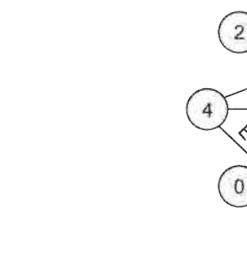

在图 6.20 中，我们可以看到如果两个进程 P₃ 和 P₆ 同时发现前任协调器进程 P₇ 已经崩溃。每个进程都会构建一个 ELECTION 消息，并开始传播自己的消息，与其他进程无关。最终，两个消息都会绕一圈，P₃ 和 P₆ 都会将其转换为 COORDINATOR 消息，成员和顺序完全相同。当两个消息再次绕一圈后，它们都会被移除。多余的消息传播不会造成任何损害；最坏的情况下会消耗一些带宽，但这并不被认为是浪费的。

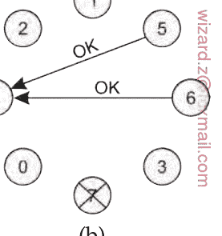

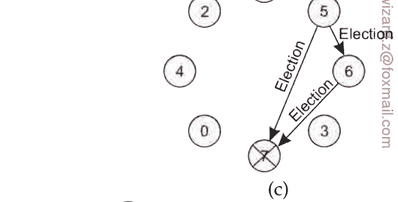

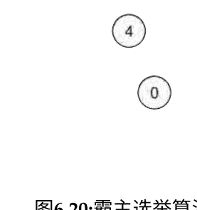

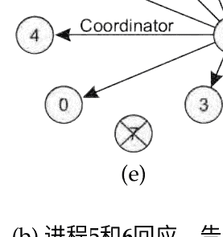

如果进程 P₇ 被重新启动，它会向其他所有进程发送一个协调者消息，并强迫它们屈服。

### 环形算法

考虑以下基于使用（逻辑）环的选举算法。与某些环算法不同，这个算法不使用令牌。我们假设每个进程都知道它的后继是谁。当任何进程注意到协调者没有工作时，它会构建一个包含自己进程标识符的选举消息，并将该消息发送给它的后继。如果后继进程宕机，发送者会跳过后继并继续前进到环中的下一个成员，或者再下一个成员，直到找到一个正在运行的进程。

在每一步中，发送者将自己的标识符添加到消息中的列表中，有效地使自己成为协调者的候选人。

最终，消息回到了最初发起它的进程。当该进程接收到一个包含自己标识符的传入消息时，它会认识到这个事件。此时，消息类型被更改为协调者并再次传播，这次是为了通知其他人谁是协调者（具有最高标识符的列表成员）以及新环的成员是谁。当这个消息传播一次后，它被删除，每个人都回到工作中。

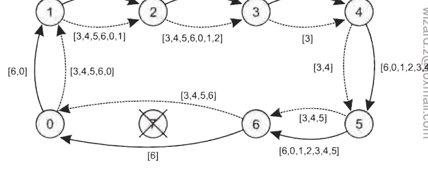

如果在图 6.21 中，我们可以看到如果两个进程 P₃ 和 P₆ 同时发现前任协调器进程 P₇ 已经崩溃。每个进程都会构建一个 ELECTION 消息，并开始传播自己的消息，与其他进程无关。最终，两个消息都会绕一圈，P₃ 和 P₆ 都会将其转换为 COORDINATOR 消息，成员和顺序完全相同。当两个消息再次绕一圈后，它们都会被移除。多余的消息传播不会造成任何损害；最坏的情况下会消耗一些带宽，但这并不被认为是浪费的。

### 无线环境中的选举

传统的选举算法通常基于在无线环境中不现实的假设。例如，它们假设消息传递是可靠的，并且网络的拓扑结构不会发生变化。

这些假设在大多数无线环境中都是错误的，尤其是那些用于移动自组织网络的环境。

只有少数选举协议被开发出来可以在自组织网络中工作。Vasudevan 等人 [2004] 提出了一个可以处理节点故障和网络分区的解决方案。他们的解决方案的一个重要特性是可以选举出最佳的领导者，而不仅仅是随机选举一个，这在之前讨论的解决方案中更多或是更少是这种情况。他们的协议工作方式如下。为了简化我们的讨论，我们只关注自组织网络，并忽略节点的移动。

考虑一个无线自组织网络。为了选举一个领导者，网络中的任何一个节点，称为源节点，可以通过向其直接邻居（即其范围内的节点）发送一个选举消息来发起一次选举。当一个节点第一次收到一条选举消息时，它将发送者指定为其父节点，并随后向除了父节点之外的所有直接邻居发送一条选举消息。当一个节点从除了其父节点之外的节点收到一条选举消息时，它只是确认收到。

当节点 R 将节点 Q 指定为其父节点时，它会将选举消息转发给其直接邻居（不包括 Q），然后等待确认消息的到来，然后才确认来自 Q 的选举消息。这种等待有一个重要的后果。首先，注意已经选择了父节点的邻居会立即响应 R。更具体地说，如果所有邻居已经有了父节点，R 是一个叶节点，并且能够快速向 Q 报告。在这样做的同时，它还会报告一些信息，例如它的电池寿命和其他资源容量。

## 第6章 协调

图6.22：无线网络中的选举算法，源节点为a。(a) 初始网络。(b)-(e) 构建树阶段（节点f和节点i的最后一次广播步骤未显示）。(f) 向源节点报告最佳节点。

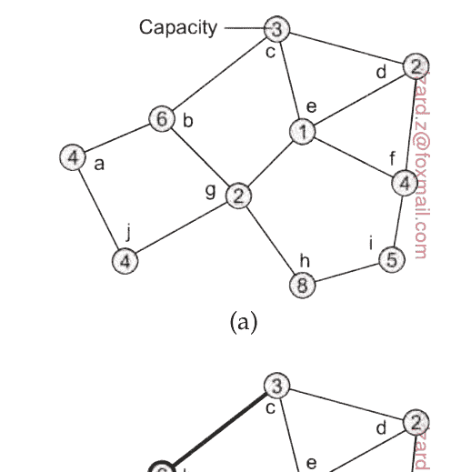

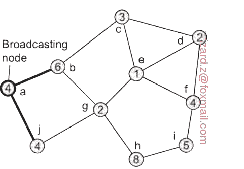

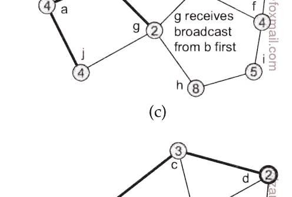

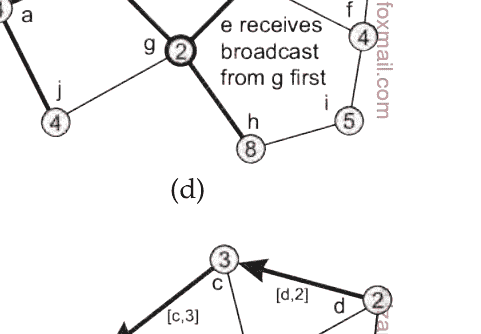

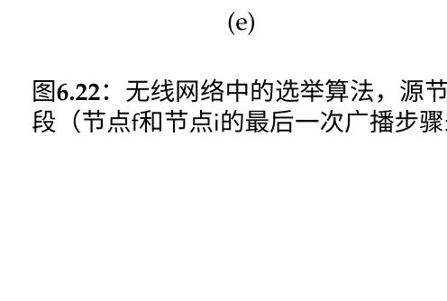

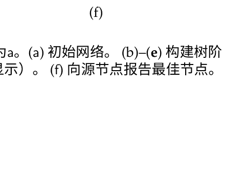

# 6.4. 选举算法

当它从它的子节点收到确认时，它会注意到 h 是最佳节点，并将 [ h , 8 ] 传播给它自己的父节点，节点 b。最后，源节点将注意到 h 是最佳领导者，并向所有其他节点广播此信息。

当多个选举被发起时，每个节点只会决定加入一个选举。为此，每个源节点都会给其 ELECTION 消息打上一个唯一的标识符。节点只会参与具有最高标识符的选举，并停止参与其他选举。

通过一些小的调整，该协议也可以在网络分区、节点加入和离开时运行。详细信息可以在Vasudevan等人的[2004]中找到。

## 大规模系统中的选举

许多领导选举算法仅适用于相对较小的分布式系统。此外，算法通常只关注选择单个节点的问题。在某些情况下，实际上应该选择多个节点，例如在对等网络中的超级节点（我们在第2.3节中讨论过）。在本节中，我们专注于选择超级节点的问题。

超级节点选择需要满足以下要求（参见[Lo et al., 2005]）：

*   1. 普通节点应该能够低延迟地访问超级节点。
*   2. 超级节点应该均匀分布在覆盖网络中。
*   3. 超级节点的数量应该相对于覆盖网络中的总节点数有一个预定义的比例。
*   4. 每个超级节点不应该需要为超过一个固定数量的普通节点提供服务。

幸运的是，在大多数点对点系统中，这些要求相对容易满足，因为覆盖网络要么是结构化的（如基于DHT的系统），要么是随机非结构化的（例如，可以通过基于八卦的解决方案实现）。让我们来看一下Lo et al. [2005]提出的解决方案。

在基于DHT的系统中，基本思想是为超级节点保留一部分标识符空间。在基于DHT的系统中，每个节点会收到一个随机且均匀分配的 m 位标识符。现在假设我们将前（即最左边的） k 位用于标识超级节点。例如，如果我们需要 N 个超级节点，则任何 key的前 [ log2(N) ] 位可以用于标识这些节点。

为了解释，假设我们有一个（小型）Chord系统，其中 m = 8和 k =3。当查找负责特定键K的节点时，我们可以首先决定将查找请求路由到负责该模式的节点 K ∧11100000，然后将其视为超级节点。¹请注意，每个具有标识符 ID 的节点可以通过查找 ID ∧ 11100000来检查自己是否是超级节点，以确定此请求是否路由到自身。假设节点标识符均匀分配给节点，可以看出，总共有 N个节点，超级节点的数量平均等于 2⁽ᴷ⁻ⁿ⁾。

完全不同的方法是基于将节点定位在 m - 维几何空间中。在这种情况下，假设我们需要均匀地将 N个超级节点分布在覆盖网络中。基本思想很简单：总共有 N个令牌分布在 N个随机选择的节点上。没有节点可以持有多个令牌。每个令牌代表一种排斥力，使另一个令牌倾向于远离。净效应是，如果所有令牌施加相同的排斥力，它们将相互远离并在几何空间中均匀分布。

这种方法要求持有令牌的节点了解其他令牌。为此，我们可以使用一种流言协议，通过该协议将令牌的力量传播到整个网络中。如果一个节点发现作用在它上面的总力超过一个阈值，它将按照合力的方向移动令牌，如图6.23所示。当一个节点持有令牌一段时间后，该节点将晋升为超级节点。

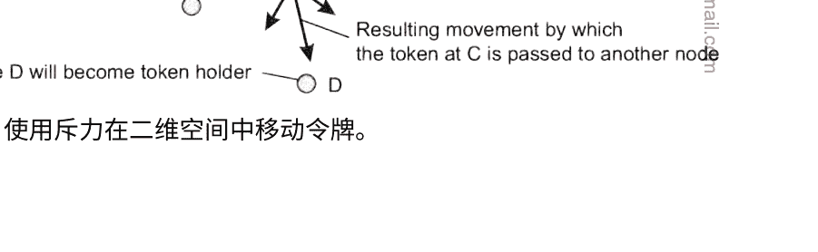

## 6.5 定位系统

在观察分布在广域网上的非常大的分布式系统时，通常需要考虑接近性。想象一下，一个分布式系统组织成一个覆盖网络，在该覆盖网络中，两个进程是邻居，但实际上在底层网络中相距很远。如果这两个进程之间通信频繁，最好确保它们也物理上彼此靠近。

¹我们使用二进制运算符“∧”表示按位与。

## 6.5. 定位系统

其他人的接近程度。在本节中，我们将介绍基于位置的技术，以协调进程的放置和通信。

## GPS：全球定位系统

让我们首先考虑如何确定你在地球上的地理位置。这个定位问题本身是通过一个高度特定、专用的分布式系统来解决的，即 GPS，它是全球定位系统的首字母缩写。GPS是一个于1978年发射的基于卫星的分布式系统。尽管最初主要用于军事应用，但现在已经有许多民用应用中找到了用武之地，尤其是用于交通导航。然而，还存在许多其他应用领域。

例如，现代智能手机现在允许用户跟踪彼此的位置。这个原理也可以很容易地应用于跟踪其他物体，包括宠物、孩子、汽车、船只等等。

GPS使用多达72颗卫星，每颗卫星在大约20000公里的轨道上运行。每颗卫星上都有最多四个原子钟，定期从地球上的特殊站点进行校准。卫星不断广播自己的位置，并用本地时间给每条消息打上时间戳。这种广播使得地球上的每个接收器都可以仅通过四颗卫星准确计算自己的位置。为了解释，让我们首先假设所有的时钟，包括接收器的时钟，都是同步的。

为了计算位置，首先考虑二维情况，如图6.24所示，其中绘制了三颗卫星，以及表示与每个卫星距离相同的圆。

我们可以看到三个圆的交点是一个唯一的点。

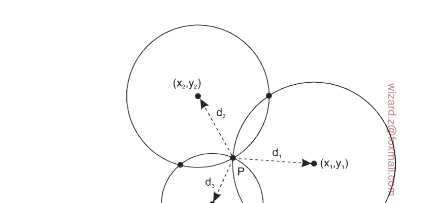

## 图6.24：在二维空间中计算节点位置。

## 第6章 协调

这种交叉圆的原理可以扩展到三维，这意味着我们需要知道与四颗卫星的距离来确定接收器在地球上的经度、纬度和高度。这种定位在理论上都相当简单，但是当我们从理论转向实践时，确定与卫星的距离变得复杂。我们需要考虑至少两个重要的现实因素：

+   1. 在卫星的位置数据到达接收器之前需要一段时间。
+   2. 接收器的时钟通常与卫星的时钟不同步。

假设卫星的时间戳完全准确。让Δr表示接收器时钟与实际时间的偏差。当从卫星 Si收到带有时间戳 Ti的消息时，接收器的测量延迟Δi由两个部分组成：实际延迟和自身的偏差：

Δ_i = ( Tnow - T_i ) + Δ_r

其中 Tnow 是实际当前时间。 由于信号以光速传播， c，测量到卫星 Si的距离di等于 c·Δi。

d_i = c·( Tnow - Ti )

是接收器和卫星 Si之间的真实距离，测量到的距离可以重写为 ξ̃_i = di + c·Δr 。 现在计算真实距离为：

ξ̃_i − c·Δr = √( (xi−xr)² + (yi−yr)² + (zi−zr)² )

其中 xi， yi和 zi表示卫星Si的坐标。 我们现在看到的是一个有四个未知数（xr， yr，zr，以及 Δr）的二次方程系统。 因此，我们需要四个参考点（即卫星）来找到一个唯一的解，这个解也会给出Δr。因此，GPS测量也会记录下实际时间。

到目前为止，我们假设测量是完全准确的。当然，它们并不是。存在许多误差来源，从卫星中的原子钟不总是完全同步开始，卫星的位置不是精确已知，接收器的时钟具有有限的准确性，信号传播速度不是恒定的（例如，当信号进入电离层时，信号似乎减慢），等等。平均而言，这导致了大约5-10米的误差。需要特殊的调制技术以及特殊的接收器来提高准确性。使用所谓的差分GPS，通过广域链路发送校正信息，可以进一步提高准确性。更多信息可以在[LaMarca and de Lara, 2008]中找到，以及Zogg [2002]的优秀概述。

## 6.5. 定位系统

## 当GPS不可用时

GPS的一个主要缺点是它通常无法在室内使用。为了达到这个目的，需要使用其他技术。一种越来越流行的技术是利用众多可用的WiFi接入点。基本思想很简单：如果我们有一个已知接入点的数据库以及它们的坐标，并且我们可以估计与接入点的距离，那么只要检测到三个接入点，我们就应该能够计算出我们的位置。

当然，事实上并不是那么简单。

一个主要问题是确定接入点的坐标。一种流行的方法是通过战车驱动来实现：使用一个带有GPS接收器的WiFi设备，有人在一个区域内驾车或步行，并记录观察到的接入点。可以通过其SSID或MAC级别的网络地址来识别一个接入点。在估计接入点的坐标之前，应该在几个位置检测到一个接入点。一个简单的方法是计算质心：假设我们在不同的位置 { x̅₁, x̅₂, .., x̅ N } 检测到一个接入点 AP，其中每个位置 x̅ᵢ由GPS接收器提供的（纬度，经度）对组成。然后我们简单地估计接入点 AP的位置 x̅ AP为

\( \bar{x}_{AP} = \frac{\sum_{i=1}^N \bar{x}_i}{N} \).

通过考虑观测到的信号强度，并给予相对较高观测信号强度的位置更多权重，可以提高准确性。最终，我们得到了对接入点坐标的估计。这个估计的准确性受以下因素的强烈影响：

+   - 每个GPS检测点的准确性 \bar{x}_i
+   - 接入点具有非均匀的传输范围
+   - 采样检测点的数量 N.

研究表明，对接入点坐标的估计可能与实际位置相差几十米（参见，例如，Kim等人[2006a]或Tsui等人[2010]）。此外，接入点的出现和消失速度相对较高。尽管如此，定位和定位接入点仍然非常流行，例如通过众包填充的开放访问Wigle数据库。²

## 节点的逻辑定位

在分布式系统中，不是试图找到节点的绝对位置，而是使用逻辑上的、基于接近性的位置。在几何学中覆盖网络中，每个节点都被赋予一个在m维几何空间中的位置，使得该空间中两个节点之间的距离反映了真实世界的性能指标。计算这样一个位置是网络坐标系统（NCS）的核心业务，Donnet等人[2010]对其进行了调查。最简单、最常用的例子是距离对应于节点间的延迟。换句话说，给定两个节点P和Q，则距离d^（P，Q）反映了消息从P到Q和从Q到P传输所需的时间。我们使用符号d^来表示节点被分配坐标的系统中的距离。

几何叠加网络有许多应用。考虑这样一种情况，服务器O上的一个网站已经复制到了互联网上的多个服务器S₁,...,Sₙ。当客户端C从 O请求一个页面时，后者可能决定将该请求重定向到离C最近的服务器，即能够提供最佳响应时间的服务器。如果已知C的几何位置，以及每个复制服务器的位置，O可以简单地选择那个使得 d̂(C, Sᵢ)最小的服务器 Sᵢ。注意，这样的选择只需要在O进行本地处理。换句话说，例如，没有必要对C和每个复制服务器之间的所有延迟进行采样。

另一个例子是最优复制位置。再次考虑一个已经收集了其客户端位置的网站。如果该网站将其内容复制到 N个服务器上，它可以计算出 N个最佳位置来放置复制品，以使得平均客户端到复制品的响应时间最小。如果客户端和服务器具有反映节点间延迟的几何位置，执行这样的计算几乎是微不足道的。

作为最后一个例子，考虑基于位置的路由(参见，例如，[Popescu等，2012]或[Bilal等，2013])。在这种方案中，消息仅使用定位信息转发到目的地。例如，一个简单的路由算法让每个节点将消息转发给最接近目的地的邻居节点。尽管可以很容易地证明这个具体算法不需要收敛，但它说明了只使用本地信息来做出决策。在网络中没有必要传播链路信息或类似信息到所有节点，这与传统的路由算法不同。

## 集中式定位

将节点定位在 m维几何空间中需要 m＋1个到已知位置节点的距离测量。假设节点 P想要计算自己的位置，它会与另外三个已知位置的节点联系，并测量与每个节点的距离。只联系一个节点将告诉 P它所在的圆；只联系两个节点将告诉它两个圆的交点位置（通常包括两个点）；随后第三个节点将允许 P计算出它的实际位置。

[PAGE 354]

节点 P 可以通过解三个二次方程组来计算自己的坐标 (x_P,y_P) :

$\tilde{d_i} = \sqrt{(x_i - x_P)^2 + (y_i - y_P)^2}$ (i = 1, 2, 3)

在这里，我们使用 d̃ 来表示测量或估计的距离。正如所说的，d̃i 通常对应于 P 和位于 (xi,yi) 的节点之间的延迟测量。这个延迟可以估计为往返延迟的一半，但是应该清楚的是，它的值会随时间而变化。这个效果是每当 P 想要重新计算自己的位置时，会得到不同的定位。此外，如果其他节点使用 P 的当前位置来计算它们自己的坐标，那么 P 的定位误差将影响其他节点的定位精度。

还应该明确的是，一组节点之间的测量距离通常不一致。例如，假设我们在一维空间中计算距离，如图 6.25 所示。在这个例子中，我们可以看到，虽然 R 将其与 Q 的距离测量为 2.0，而 d̃(P,Q) 的测量结果为 1.0，但当 R 测量 d̃(P,R) 时，它发现为 2.8，这显然与其他两个测量结果不一致。

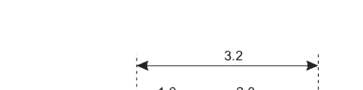

图6.25：一维空间中的不一致距离测量。

图6.25还提出了如何改善这种情况的建议。在我们的简单例子中，我们可以通过在二维空间中计算位置来解决不一致性。然而，当处理许多测量时，这本身并不是一个通用的解决方案。事实上，考虑到互联网延迟测量可能违反三角不等式，通常无法完全解决不一致性。三角不等式规定，在几何空间中，对于任意的三个节点P，Q和R，以下条件必须始终成立

$d(P,R) \leq d(P,Q) + d(Q,R).$

有多种方法来解决这个问题。一种常见的方法，由 Ng 和 Zhang [2002] 提出，是使用 N 个特殊节点 L₁,...,L_N，被称为地标。地标测量它们之间的两两延迟 d̃(Li,Lj) 并随后让一个中心节点计算每个地标的坐标。

为此，中心节点试图最小化以下聚合误差

函数:

\sum_{i=1}^N \sum_{j=i+1}^N \left( \frac{\tilde{d}(L_i,Lj) - \hat{d}(L_i,Lj)}{\tilde{d}(L_i,Lj)} \right)^2

其中，\hat{d}(Li, Lj)对应于节点Li和Lj定位后的距离。

在最小化聚合误差函数中的隐藏参数是维度m。显然，我们有N > m，但没有什么阻止我们选择一个比N小得多的m值。在这种情况下，一个节点P测量到每个N个地标的距离，并通过最小化计算其坐标。

\sum_{i=1}^N \left( \frac{\tilde{d}(L_i,P) - \hat{d}(L_i,P)}{\tilde{d}(L_i,P)} \right)^2

事实证明，通过选择合适的地标，m可以小到6或7，\tilde{d}(P,Q)与实际延迟d(P,Q)之间的差异不超过2倍，对于任意节点P和Q[Szymaniak et al., 2004; 2008]。

## 分散式定位

解决这个问题的另一种方法是将节点集合视为一个巨大的系统，其中节点通过弹簧连接在一起。在这种情况下，|\tilde{d}(P, Q) - \hat{d}(P, Q)|表示节点P和Q相对于弹簧系统静止状态的位移程度。通过让每个节点（稍微）改变其位置，可以证明系统最终会收敛到一个最优的组织结构，其中聚合误差最小。这种方法在Vivaldi中被采用，详见[Dabek et al., 2004a]。

在一个具有N个节点P1的系统中，…, PN, Vivaldi旨在最小化以下聚合误差:

\sum_{i=1}^N \sum_{j=1}^N |\tilde{d}(P_i,P_j) - \hat{d}(P_i,P_j)|^2

其中\tilde{d}(Pi, Pj)是节点Pi和Pj之间的测量距离（即延迟），而\hat{d}(Pi, Pj)是从每个节点的网络坐标计算出的距离。让xi表示节点Pi的坐标。在每个节点都被放置在一个几何空间的情况下，节点Pi对节点Pj施加的力被计算为:

\vec{F}_{ij} = (\tilde{d}(P_i,P_j) - \hat{d}(P_i,P_j)) \times u(\vec{x}_i - \vec{x}_j)

其中u(\vec{x}_i - \vec{x}_j)表示沿着\vec{x}_i - \vec{x}_j方向的单位向量。换句话说，如果Fij > 0，节点Pi会将节点Pj推离自己，否则会将其拉向自己。节点Pi现在重复执行以下步骤：

+   1. 测量到节点 Pj的延迟，并接收到 Pj的坐标 。
+   2. 计算误差 \( e = \hat{d}(P_i,P_j) - \bar{d}(P_i,P_j) \)
+   3. 计算方向 \( \vec{u} = u( \vec{x}_i - \vec{x}_j ) \).
+   4. 计算力矢量 \( F_{ij} = e \cdot \vec{u} \)
+   5. 通过沿着力矢量调整自己的位置： \( \vec{x}_i \leftarrow \vec{x}_i + \delta \cdot \vec{u} \).

一个关键要素是选择 \delta ：太大会导致系统振荡；太小会导致收敛到稳定状态需要很长时间。诀窍在于有一个自适应的值，当误差很大时它很大，但只需要进行小的调整时它很小。详细信息可以在[Dabek et al., 2004a]中找到。

## 6.6 分布式事件匹配

作为关于进程之间协调的最后一个主题，我们考虑分布式事件匹配。事件匹配，或更准确地说，通知过滤，是发布 - 订阅系统的核心。问题归结为以下内容：

+   - 一个进程通过订阅 S来指定它所嵌套的事件。
- 当一个进程发布一个事件发生的通知 N时，系统需要检查是否与 S匹配 N。
- 如果匹配成功，系统应该发送通知 N，可能包括与事件相关的数据，给订阅者。

因此，我们至少需要实现两个功能：(1) 对事件进行订阅匹配，和(2) 在匹配成功时通知订阅者。这两个功能可以分开实现，但不一定需要这样。在接下来的内容中，我们假设存在一个函数 \( match(S,N) \)，当订阅 S与通知 N匹配时返回 true，否则返回false。

## 集中式实现

一个简单、天真的事件匹配实现方式是使用一个完全集中的服务器来处理所有的订阅和通知。在这种方案中，订阅者只需提交一个订阅，然后将其存储起来。当发布者提交一个通知时，该通知会与每个订阅进行检查，当找到匹配时，通知会被复制并转发给相关的订阅者。

显然，这不是一个非常可扩展的解决方案。然而，只要匹配可以高效地完成并且服务器本身具有足够的处理能力，该解决方案对许多情况来说是可行的。例如，使用集中式

## 第6章 协调

服务器是实现Linda元组空间或Java空间的规范解决方案。同样，许多发布-订阅系统可以通过一个中央服务器在单个部门或组织内实现。

在这些情况下，重要的是匹配函数可以被高效地实现。在实践中，当处理基于主题的过滤时，通常是这种情况：匹配然后检查属性值的相等性。

请注意，一个简单的扩展集中式实现的方法是将工作分配给多个服务器，但是分配是非确定性的。一个标准的方法是使用两个函数，如Baldoni等人[2009]所解释的：

- 一个函数 sub2node(S)，它将订阅S映射到一个非空的服务器子集
- 一个函数 not2node(N)，它接受一个通知N并将其映射到一个非空的服务器子集。

将 sub2node(S)映射到的服务器称为rendezvous节点for S。同样， sub2node(N)是 N的rendezvous节点。唯一的约束条件是对于任何订阅S和匹配的通知N， sub2node(S) ∩ not2node(N) = ∅。换句话说，当有匹配的通知时，必须至少有一个服务器能够处理订阅。在实践中，通过对主题名称使用哈希函数，可以满足这个约束条件的主题发布-订阅系统。

将匹配工作分布到多个服务器并分割工作，可以扩展具有中央服务器的想法。服务器通常被称为brokers，并组织成一个覆盖网络。然后问题变成如何将通知路由到适当的订阅者集合。

根据Baldoni等人[2009]的研究，我们可以区分三种不同的类别：(1) 泛洪式传输，(2) 选择性路由，以及(3) 基于八卦的传播。Kermarrec和Triantafillou[2013]提供了一份关于结合点对点网络和发布-订阅系统的广泛调查报告。

确保通知到达其订阅者的一种直接方法是部署广播。基本上有两种方法。首先，我们在每个代理处存储每个订阅，只在一个代理处发布通知。后者将负责识别匹配的订阅，并随后复制和转发通知。另一种方法是一只在一个代理处存储订阅，同时向所有代理广播通知。在这种情况下，匹配分布在各个代理之间，可能会在代理之间实现负载均衡。

### 注释6.6(示例：TIB/Rendezvous)
洪泛通知在TIB/Rendezvous中使用，其基本架构如图6.26所示[TIBCO]。在这种方法中，通知是一个带有描述其内容的复合关键字标记的消息，例如

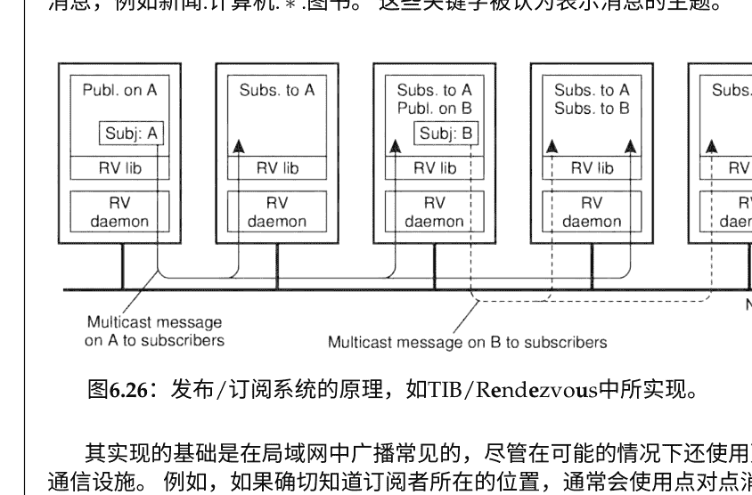

其实现的基础是在局域网中广播常见的，尽管在可能的情况下还使用更高效的通信设施。例如，如果确切知道订阅者所在的位置，通常会使用点对点消息。这种网络上的每个主机都会运行一个rendezvous守护进程，负责根据主题发送和传递消息。每当发布一条消息时，它会被组播到运行rendezvous守护进程的网络上的每个主机。通常，多播是使用底层网络提供的设施实现的，例如IP多播或硬件广播。

订阅某个主题的进程将其订阅传递给本地守护进程。守护进程构建一个表格（进程，主题）的条目，并且每当有一个主题为S的消息到达时，守护进程只需在表格中检查本地订阅者，并将消息转发给每个订阅者。如果没有订阅者订阅主题S，则消息会立即被丢弃。

当使用类似TIB/Rendezvous中的多播时，订阅可以是复杂的，不仅仅是字符串比较。关键观察是，由于消息无论如何都会转发到每个节点，所以可以完全在本地进行发布数据与订阅的复杂匹配，而无需进一步的网络通信。

当系统变得庞大时，洪泛不再是最好的选择，甚至可能不可行。相反，可能需要通过经纪人的覆盖网络进行路由通知。这通常是信息中心网络的做法，它利用基于名称的路由[Ahlgren等，2012；Xylomenos等，2014]。基于名称的路由是选择性通知路由的特例。在这种设置中，关键是经纪人可以通过考虑通知消息的内容来进行路由决策。更准确地说，

### 6.6. 分布式事件匹配

假设每个通知都携带足够的信息，可以用于切断已知不会导致其订阅者的路由。

Carzaniga等人[2004]提出了一种实用的选择性路由方法。考虑一个发布-订阅系统，由 N个代理组成，客户端（即应用程序）可以发送订阅并检索通知。

Carzaniga等人[2004]提出了一种两层路由方案，其中最底层由连接 N个代理的共享广播树组成。有多种方式可以建立这样的树，从网络级多播支持到应用级多播树，正如我们在第4章中讨论的那样。在这里，我们还假设已经设置了一棵树，其中 N个代理作为终节点，还有一组形成路由器的中间节点。请注意，服务器和路由器之间的区别只是逻辑上的：一台机器可以同时托管这两种类型的进程。

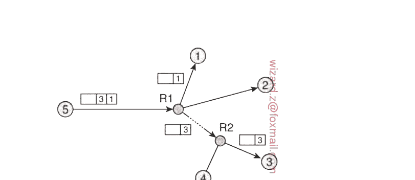

每个代理都向其他代理广播其订阅。因此，每个代理都能够编制一个（主题，目标）对的列表。然后，每当一个进程发布一个通知 N时，其关联的代理会在该消息前面添加目标代理。当消息到达路由器时，后者可以使用列表来决定消息应该遵循的路径。

我们可以改进路由器的能力，以决定将通知转发到哪里。为此，每个代理都会在网络中广播其订阅，以便路由器可以组合路由过滤器。例如，假设图6.27中的节点3订阅了一个属性 a在范围 [0,3]内的通知，但节点4希望收到属性 a ∈ [2,5]的消息。在这种情况下，路由器 R2将创建一个路由过滤器，作为一个表格，其中包含每个出站链接的条目（在这种情况下有三个：一个到节点3，一个到节点4，一个到路由器 R1），如下表所示：

| 接口               | 过滤器             |
| ------------------ | ------------------ |
| 到节点3            | a ∈ [0, 3]       |
| 到节点4            | a ∈ [2, 5]       |
| 朝向路由器 R₁      | 未指定           |

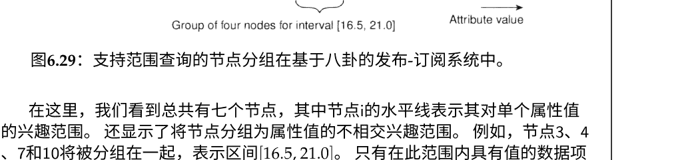

R₂，这正是 R₁将存储在其表中的信息。可以想象支持更复杂的订阅组合。

这个简单的例子还说明了每当一个节点离开系统，或者不再对特定的通知感兴趣时，它应该取消订阅并向所有路由器广播此信息。

这种取消可能会导致调整各种路由过滤器。延迟调整最坏的情况下会导致不必要的流量，因为通知可能会转发到不再有订阅者的路径上。然而，及时的调整是为了保持性能在可接受的水平上是必要的。

分布式事件匹配的最后一种类型是基于八卦。基本思想是对于对相同通知感兴趣的订阅者，他们形成自己的覆盖网络（通过八卦构建），这样一旦通知发布，它只需要被路由到适当的覆盖网络。对于后者，可以使用随机漫步。这种方法遵循TERA [Baldoni et al., 2007]。作为一种替代方案，在PolderCast [Setty et al., 2012]中，发布者首先加入订阅者的覆盖网络，然后再广播其通知。订阅者覆盖网络是按主题构建的，并且构成一个带有快捷方式的环，以便有效地传播通知。

> 注 6.7 （高级：基于内容的事件匹配的八卦）
在Sub-2-Sub [Voulgaris et al., 2006]中，采用了一种更复杂的方法来结合八卦和事件匹配。考虑一个发布-订阅系统，在该系统中，数据项可以通过 N个属性 a₁,..,aₙ来描述,..aₙ的值可以直接映射到一个浮点数。这样的值包括浮点数、整数、枚举、布尔值和字符串。一个订阅 S的形式是一个元组，包含(属性，值/范围)对，例如

```
S = ⟨a₁ → 3.0, a₄ → [0.0, 0.5)⟩
```

在这个例子中，S指定了 a₁应该等于3.0，a₄应该在区间 [0.0, 0.5)内。其他属性可以取任何值。为了清晰起见，假设每个节点 i只输入一个订阅 Sᵢ。

请注意，每个订阅 S实际上指定了N维浮点数空间中的一个子集 Sₙ。这样的子集也被称为超空间。对于整个系统来说，落在并集 S = ∪Sᵢ 中的通知。

```
S = ⟨a₁ → 3.0, a₄ → [0.0, 0.5)⟩
```

这些超空间中的一些是唯一感兴趣的。整个想法是自动地将 S划分为 M个不相交的超空间 S₁, …, S_M，使得每个超空间 S_i都完全落在一个订阅超空间中，并且它们共同覆盖所有的订阅。更正式地说，我们有：

```
(\overline{S_m} \cap S_i = \varnothing ) \Rightarrow ( \overline{S_m} \subseteq S_i )
```

Sub-2-Sub保持 M最小，即没有更少的分区部分 S_m。为此，对于每个超空间 S_m，它仅注册那些节点 i对于它 S_m ⊆ S_i。在这种情况下，当发布通知时，系统只需找到与相关事件相关的 S_m，然后将通知转发给适当的节点。

为此，节点定期通过八卦交换订阅。如果两个节点i和j注意到它们的订阅相交，即 Sij=Si∩Sj=∅，它们将记录这个事实并保留彼此的引用。

如果他们发现第三个节点k，使得 Sijk=Sij∩Sk=∅，他们三个将相互连接，以便有效地传播来自 Sijk 的通知 N。请注意，如果 Sij−Sijk=∅，节点i和j将保持它们的相互引用，但现在严格地与 Sij−Sijk 相关联。

本质上，我们正在寻求一种将节点聚集成M个不同组的方法，即当且仅当它们的订阅 Si和 Sj相交时，节点i和j属于同一组。此外，同一组中的节点应该组织成一个覆盖网络，以便在与该组关联的超空间中高效地传播数据项。单个属性的情况如图6.29所示。


在这里，我们看到总共有七个节点，其中节点i的水平线表示其对单个属性值的兴趣范围。还显示了将节点分组为属性值的不相交兴趣范围。例如，节点3、4、7和10将被分组在一起，表示区间[16.5, 21.0]。只有在此范围内具有值的数据项才会传播到这四个节点。

为了构建这些组，节点被组织成基于八卦的非结构化网络。每个节点维护对其他邻居的引用列表（即部分视图），它定期与其中一个邻居交换。

这样的交换将使节点了解系统中的其他随机节点。每个节点都会跟踪发现的具有重叠兴趣的节点（即具有交叉订阅的节点）。

在某个时刻，每个节点 i通常都会引用其他节点，它们的兴趣有重叠。作为与节点j交换信息的一部分，节点 i按其标识符对这些节点进行排序，并选择具有最低标识符 i₁ > j的节点，使其订阅与节点 j的订阅重叠，即

```
Sj,i₁ ≡ Si₁ ∩ Sj = ∅
```

下一个要选择的是 i₂ > i₁，使其订阅也与 j重叠，但仅当它包含尚未被节点 i₁覆盖的元素时。换句话说，我们应该有 Sj,i₁,i₂ ≡ (Si₂ − Sj,i₁) ∩ Sj = ∅。这个过程会重复进行，直到所有与节点 i有重叠兴趣的节点都被检查过，从而得到一个有序列表 i₁ < i₂ < ··· < in。注意，节点 ik在此列表中是因为它覆盖了节点 i和 j的共同兴趣区域 R，而这个区域尚未由标识符低于 ik的节点共同覆盖。实际上，节点 ik是节点 j应该将通知转发的第一个落在这个唯一区域 R中的节点。此过程可以扩展为让节点 i构建一个双向环。这样的环也在图6.29中显示。

每当发布一个通知 N时，它会尽快传播给任何对此感兴趣的节点。事实证明，在每个节点上可用的信息中，找到一个对 N感兴趣的节点是很简单的。从那里开始，节点 i只需将 N沿着特定范围的订阅者环转发。为了加快传播速度，每个环都维护了一些快捷方式。

## 6.7 基于八卦的协调

作为协调的最后一个主题，我们来看一些重要的例子，其中使用了八卦传播。接下来，我们分别看一下聚合、大规模对等抽样和覆盖构建。

#### 聚合

让我们来看一些流行协议的有趣应用。我们已经提到了传播更新，这可能是最广泛部署的应用之一。同样，八卦传播可以用于发现具有少数出站广域网链接的节点，以后可以应用定向八卦传播。

另一个有趣的应用领域是简单地收集或实际上聚合信息[Jelasity et al., 2005]。考虑以下信息交换。每个节点 Pi最初选择一个任意数，比如 vi。当节点 Pi联系节点 Pj时，它们各自更新其值为：

```
vi, vj ← (vi + vj)/2
```

显然，在这次交换之后，P_i和P_j将拥有相同的值。事实上，很容易看出最终所有节点将拥有相同的值，即所有初始值的平均值。传播速度再次呈指数增长。

计算平均值有什么用途？考虑这样一种情况，所有节点P_i将 v_i 设置为零，除了P_1将 v_1 设置为1：

```
v_i ← {1 if i=1; 0 otherwise}
```

如果有N个节点，那么最终每个节点都会计算平均值，即1/N。因此，每个节点P_i都可以估计系统的大小为1/v_i。## 6.8. 总结

节点P将逐渐建立起其最近邻节点的列表，前提是最底层继续传递随机选择的节点。

作为一个例子，考虑一个大小为 N × N 的逻辑网格，每个网格点上放置一个节点。每个节点都需要维护一个最近邻节点的列表，其中节点 (a₁,a₂) 和 (b₁,b₂) 之间的距离定义为 d₁ + d₂，其中 dᵢ = min(N - |aᵢ - bᵢ|, |aᵢ - bᵢ|)。如果最底层周期性地按照图6.30中的步骤执行协议，将形成一个环面拓扑结构，如图6.31所示。

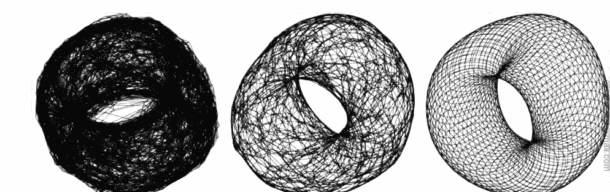

图6.32：使用两层非结构化对等系统生成特定的覆盖网络（经许可改编自Jelastity and Babaoglu, 2006）。

## 6.8 摘要

与进程间通信密切相关的问题是分布式系统中进程如何同步。同步就是在正确的时间做正确的事情。分布式系统和计算机网络一般都存在一个问题，就是没有全局共享时钟的概念。换句话说，不同机器上的进程对时间有自己的理解。

在分布式系统中，有各种各样的同步时钟的方法，但所有方法本质上都是基于交换时钟值，并考虑发送和接收消息所需的时间。通信延迟的变化以及如何处理这些变化，在很大程度上决定了时钟同步算法的准确性。

在许多情况下，并不需要知道绝对时间。重要的是不同进程中相关事件按照正确的顺序发生。Lamport证明了通过引入逻辑时钟的概念，一组进程可以就事件的正确顺序达成全局一致。实质上，每个事件，例如发送或接收消息，

被分配一个全局唯一的逻辑时间戳 C(e)，使得当事件 a发生在 b之前时，C(a) < C(b)。Lamport 时间戳可以扩展为向量时间戳：如果 C(a) < C(b)，我们甚至知道事件 a在 b之前发生。

一种重要的同步算法类别是分布式互斥。这些算法确保在分布式进程集合中，一次只有一个进程可以访问共享资源。

如果我们使用一个协调者来跟踪轮到谁了，分布式互斥可以很容易地实现。完全分布式算法也存在，但它们通常更容易受到通信和进程故障的影响。

进程之间的同步通常需要一个进程充当协调者。在那些协调者不固定的情况下，分布式计算中的进程需要决定谁将成为协调者。这样的决策是通过选举算法来进行的。

选举算法主要用于协调者可能崩溃的情况。然而，它们也可以应用于对等系统中超级节点的选择。

与这些同步问题相关的是在几何叠加中定位节点。基本思想是为每个节点分配来自m维空间的坐标，以便几何距离可以用作两个节点之间延迟的准确度量。分配坐标的方法与GPS中确定位置和时间的方法非常相似。

在协调方面特别具有挑战性的是分布式事件匹配，它是发布-订阅系统的核心。当我们有一个中央实现时，匹配订阅与通知之间的对应关系可以通过基本的一对一比较来完成，相对简单。然而，一旦我们的目标是分布负载，我们就面临着在事先决定哪个节点负责哪个订阅部分的问题，而不知道要期望什么类型的通知。这对于基于内容的匹配尤其有问题，最终需要先进的过滤技术将通知路由到适当的订阅者。

最后，基于八卦的协调中最重要的方面是能够从整个覆盖层中随机选择另一个对等方。事实证明，我们可以使用八卦来实现这样的对等抽样服务，通过确保部分视图定期以及随机方式刷新。将对等抽样与部分视图中条目的选择性替换相结合，可以有效地构建结构化覆盖网络。

## 第七章

## 一致性和复制

分布式系统中的一个重要问题是数据的复制。通常复制数据是为了增强可靠性或提高性能。主要问题之一是保持副本的一致性。非正式地说，这意味着当一个副本被更新时，我们需要确保其他副本也被更新；否则副本将不再相同。在本章中，我们详细讨论了复制数据的一致性实际上意味着什么以及实现一致性的各种方法。

我们首先进行了一般介绍，讨论了为什么复制是有用的以及它与可扩展性的关系。然后我们继续关注一致性实际上意味着什么。已知的一类重要的一致性模型假设多个进程同时访问共享数据。

对于这些情况，一致性可以根据进程在读取和更新共享数据时可以期望的内容来制定，知道其他进程也在访问该数据。

共享数据的一致性模型在大规模分布式系统中往往很难高效实现。此外，在许多情况下，可以使用更简单的模型，这些模型通常也更容易实现。一个特定的类别是以客户为中心的一致性模型，这些模型侧重于从单个（可能是移动的）客户端的角度来看一致性。客户为中心的一致性模型在一个单独的章节中进行讨论。

一致性只是故事的一半。我们还需要考虑一致性如何实际实现。实际上，我们需要考虑两个相对独立的问题。首先，我们从集中管理副本开始，这不仅考虑了副本服务器的放置，还考虑了内容如何分发到这些服务器。

第二个问题是如何保持副本的一致性。在大多数情况下，应用程序需要一种强一致性。简单来说，这意味着更新应该在副本之间几乎立即传播。

有多种实现强一致性的替代方案，它们是

在一个单独的章节中进行讨论。此外，还要注意缓存协议，它们是一致性协议的特例。

作为可能是最大的分布式系统，我们单独关注基于Web的系统中的缓存和复制，特别是关注内容传递网络以及边缘服务器缓存技术。

## 7.1 引言

在本节中，我们首先讨论了首先想要复制数据的重要原因。我们专注于复制作为实现可扩展性的技术，并解释为什么对一致性进行推理如此重要。

## 复制的原因

复制数据有两个主要原因。首先，数据被复制以增加系统的可靠性。如果一个文件系统已经被复制，当一个副本崩溃时，可以通过切换到其他副本来继续工作。此外，通过维护多个副本，可以更好地保护数据免受损坏。例如，假设有三个文件的副本，并且每个读写操作都在每个副本上执行。通过考虑至少两个副本返回的值作为正确的值，我们可以防止单个失败的写操作。

复制数据的另一个原因是性能。当分布式系统需要在规模或地理范围上扩展时，为了性能而进行复制是很重要的。例如，当越来越多的进程需要访问由单个服务器管理的数据时，与规模相关的扩展发生。在这种情况下，通过复制服务器并将工作负载分配给访问数据的进程，可以提高性能。

与地理区域相关的扩展也可能需要复制。

基本思想是通过将数据的副本放置在使用它们的进程附近，减少访问数据的时间。因此，该进程所感知到的性能也会提高。这个例子还说明了复制对于性能的好处可能很难评估。

尽管客户端进程可能感知到更好的性能，但现在消耗更多的网络带宽来保持所有副本更新也是可能的。

如果复制有助于提高可靠性和性能，谁会反对呢？不幸的是，当数据被复制时需要付出代价。复制的问题在于多个副本可能导致一致性问题。每当一个副本被修改，该副本就会与其他副本不同。因此，必须对所有副本进行修改以确保一致性。

## 7.1. 引言

所有副本都需要确保何时以及如何进行修改，这决定了复制的代价。确切地说，何时以及如何进行这些修改决定了复制的代价。
为了理解这个问题，考虑改进访问网页的时间。
如果不采取特殊措施，从远程Web服务器获取页面有时甚至需要几秒钟才能完成。为了提高性能，Web浏览器经常在本地存储以前获取过的网页的副本（即，它们会缓存网页）。如果用户再次需要该页面，浏览器会自动返回本地副本。用户感知的访问时间非常好。然而，如果用户总是想要获取最新版本的页面，他可能会运气不好。问题在于，如果页面在此期间已经被修改，修改将不会传播到缓存副本，使这些副本过时。

解决将过期副本返回给用户的一个方法是，在第一次禁止浏览器保留本地副本，从而完全让服务器负责复制。然而，如果没有将副本放置在用户附近，这种解决方案可能仍然导致较差的访问时间。另一种解决方案是让Web服务器使每个缓存副本无效或更新，但这需要服务器跟踪所有缓存并向它们发送消息。这反过来可能降低服务器的整体性能。我们将在下面讨论性能与可扩展性问题。

在接下来的内容中，我们主要关注性能复制。
可靠性复制在第8章中讨论。

## 复制作为扩展技术

为了提高性能，复制和缓存被广泛应用作为扩展技术。可扩展性问题通常以性能问题的形式出现。将数据副本放置在使用它们的进程附近可以通过减少访问时间来提高性能，从而解决可扩展性问题。

需要做出的一个可能的权衡是，保持副本的最新状态可能需要更多的网络带宽。考虑一个进程P每秒访问一个本地副本N次，而副本本身每秒更新M次。假设更新完全刷新了先前的本地副本版本。如果N ≪ M，也就是说，访问-更新比率非常低，我们就会面临这样一种情况，即本地副本的许多更新版本将永远不会被P访问，使得这些版本的网络通信变得无用。在这种情况下，最好不要在P附近安装本地副本，或者采用不同的副本更新策略。

然而，更严重的问题是，保持多个副本的一致性本身可能会面临严重的可扩展性问题。直观地说，当副本始终相同时，副本集合是一致的。这意味着在任何副本上执行的读操作将始终返回相同的结果。

相同的结果。因此，当在一个副本上执行更新操作时，更新应该在所有副本之间传播，然后再进行后续操作，无论在哪个副本上发起或执行该操作。

这种一致性有时被非正式地（并且不准确地）称为紧密一致性，由同步复制提供。（在第7.2节中，我们将提供一致性的精确定义，并介绍一系列一致性模型。）关键思想是将更新作为单个原子操作或事务在所有副本上执行。不幸的是，当操作还需要快速完成时，实现涉及大量可能分布在大规模网络中的副本的原子性是困难的。

困难来自于我们需要同步所有副本的事实。实质上，这意味着所有副本首先需要达成一致，确定何时在本地执行更新。例如，副本可能需要使用Lamport时间戳决定操作的全局顺序，或者让协调者分配这样的顺序。全局同步需要大量的通信时间，特别是当副本分布在广域网上时。

我们现在面临一个困境。一方面，通过应用复制和缓存可以缓解可扩展性问题，从而提高性能。另一方面，为了保持所有副本的一致性，通常需要全局同步，这在性能方面是昂贵的。

治疗可能比疾病更糟糕。在许多情况下，唯一真正的解决方案是放松一致性约束。换句话说，如果我们可以放松更新需要作为原子操作执行的要求，我们可能能够避免（瞬时的）全局同步，并且可能因此获得性能。付出的代价是副本可能不总是在任何地方都相同。事实证明，一致性可以放松到什么程度，高度取决于复制数据的访问和更新模式，以及这些数据的用途。

有一系列一致性和许多不同的方法来通过所谓的分布和一致性协议来实现模型。有关分类一致性和复制的方法可以在[Gray et al., 1996; Wiesmann et al., 2000]和[Aguilera and Terry, 2016]中找到。

## 7.2 数据中心一致性模型

传统上，一致性是在读写操作的上下文中讨论的，这些操作是通过（分布式）共享内存、（分布式）共享数据库或（分布式）文件系统来实现的。在这里，我们使用更广泛的术语数据存储。数据存储可以在物理上分布在多台机器上。特别是，可以访问存储中的数据的每个进程都假定有一个本地（或附近的）可用的完整存储的副本。写操作会传播到其他副本，如图7.1所示。当数据发生变化时，数据操作被归类为写操作，否则被归类为读操作。

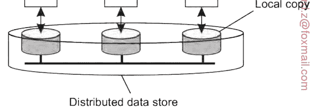

图7.1：逻辑数据存储的一般组织方式，物理上分布和复制在多个进程之间。

一致性模型本质上进程和数据存储之间的契约。 它表示如果进程同意遵守某些规则，存储将承诺正常工作。 通常，执行读操作的进程对数据项的操作期望返回一个值，该值显示了对该数据的最后一次写操作的结果。

在没有全局时钟的情况下，很难准确地定义哪个写操作是最后一个。 作为替代，我们需要提供其他定义，从而导致一系列的一致性模型。 每个模型有效地限制了对数据项进行读取操作时可能返回的值。 正如预期的那样，具有较大限制的模型在使用时很容易，例如在开发应用程序时，而具有较小限制的模型通常被认为在实践中很难使用。 当然，这种权衡是易于使用的模型性能远不如困难的模型。这就是生活。

## 连续一致性

没有一种最佳的数据复制解决方案。 复制数据会导致一致性问题描述，无法以一般方式高效解决。 只有在放宽一致性的情况下，才有希望实现高效的解决方案。

不幸的是，对于放松一致性也没有通用规则：可以容忍的程度高度依赖于应用程序。

应用程序有不同的方式来指定它们可以容忍的不一致性。 Yu和Vahdat [20 02]采用了一种通用方法，通过区分三个独立的轴来定义不一致性：副本之间的数值偏差，副本之间的陈旧度偏差，以及更新操作的排序偏差。他们将这些偏差称为形成连续一致性范围。

以数值偏差来衡量不一致性可以被具有数值语义的应用程序使用。一个明显的例子是复制包含股票市场价格的记录。在这种情况下，应用程序可以指定两个副本之间的差异不超过$0.02，这将是一个绝对数值偏差。或者，可以指定一个相对数值偏差，即两个副本之间的差异不超过，例如，0.5%。在这两种情况下，我们可以看到，如果股票上涨（并且其中一个副本立即更新），而不违反指定的数值偏差，副本仍然被认为是相互一致的。

数值偏差也可以理解为已应用于给定副本但尚未被其他副本看到的更新次数。例如，Web缓存可能没有看到Web服务器执行的一批操作。在这种情况下，与值相关的偏差也被称为其权重。

陈旧度偏差与副本最后更新的时间有关。对于某些应用程序来说，只要数据不是太旧，副本提供旧数据是可以容忍的。例如，天气预报在一段时间内通常保持相对准确，比如几个小时。在这种情况下，主服务器可能会及时接收更新，但可能决定只偶尔将更新传播到副本。

最后，有一类应用程序允许在各个副本中更新的顺序不同，只要差异保持有限。看待这些更新的一种方式是将其暂时应用于本地副本，等待所有副本的全局一致性达成。因此，某些更新可能需要回滚并以不同的顺序应用才能变为永久性。直观地说，顺序偏差比其他两个一致性度量大更难以理解。

## 一致性的概念

为了定义不一致性，Yu和Vahdat引入了一致性单元，简称为conit。conit指定了一致性要度量的单位。例如，在我们的股票交易示例中，conit可以被定义为表示单个股票的记录。另一个例子是一个单独的天气预报。

为了举一个conit的例子，并同时说明数值和排序的偏差，考虑跟踪一组汽车的情况。特别是，车队所有者对平均每加仑汽油的费用感兴趣。为此，每当驾驶员加油时，他报告加油量（记录为g），支付的价格（记录为p）以及自上次加油以来的总里程（记录为d

通过变量 d)来实现。从技术上讲，三个变量 g, p 和 d 形成一个一致性对象。这个一致性对象在两个服务器上复制，如图 7.2 所示，并且驱动程序通过分别更新每个变量（不再考虑相关的汽车）定期向其中一个服务器报告其燃气使用情况。

服务器的任务是“一致地”复制一致性对象。为了实现这一目标，每个复制服务器维护一个二维向量时钟。我们使用符号 <T, R> 来表示在逻辑时间 T 由副本 R 执行的操作。

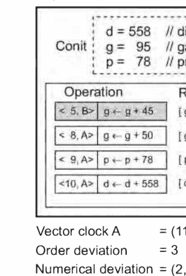

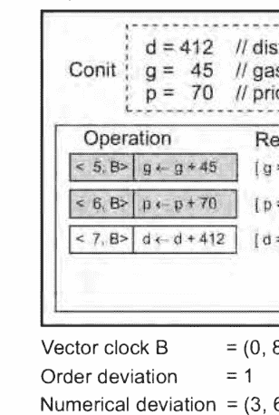

## 图7.2：跟踪一致性偏差的示例。

在这个示例中，我们看到两个副本对包含我们示例中的数据项 g, p 和 d 的一致性对象进行操作。假设所有变量都已初始化为0。副本 A收到了操作

```
<5, B> : g ← g＋45
```

来自副本 B. 我们将此操作标记为灰色，表示 A已将此操作提交到其本地存储中。换句话来说，它已经变得永久且无法回滚。副本 A还有三个待定的更新操作：⟨8, A⟩, ⟨9, A⟩和⟨10, A⟩。就连续一致性而言，A有三个待定操作尚未提交，这被称为一个顺序偏差，此处的值为3。

类似地，B有三个操作，其中两个已经提交，有一个顺序偏差为1。

从这个例子中，我们可以看到 A的逻辑时钟值现在是11。因为 A收到的来自 B的最后一个操作的时间戳为5，所以 A的向量时钟将为 (11, 5)，其中我们假设向量的第一个分量用于 A，第二个分量用于 B。同样地，B的逻辑时钟为 (0, 8)。

## 第七章。一致性和复制

副本 R 的数值偏差由两个部分组成：尚未被 R 看到的所有其他副本的操作数量，以及相应的错过值的总和（当然，也可以使用更复杂的方案）。在我们的例子中， A 尚未看到操作〈6,B〉和〈7,B〉，总值为 70 + 412 个单位，导致数值偏差为 (2,482)。同样，B 仍然缺少 A 的三个尝试操作，总和值为 686，使 B 的数值偏差为 (3,686)。

利用这些概念，可以指定具体的一致性方案。例如，我们可以通过指定可接受的最大值来限制顺序偏差。同样，我们可能希望两个副本的数值偏差永远不超过 1000 个单位。拥有这样的一致性方案需要副本知道自己与其他副本的偏差量，这意味着我们需要单独的通信来让副本保持信息同步。

底层的假设是，这种通信比保持副本同步的通信要便宜得多。诚然，对于我们的例子来说，这个假设是否成立是有问题的。

注7.1（高级：关于conits的粒度）

\n在维护细粒度和粗粒度conits之间存在一个权衡。
\n如果一个conit代表大量的数据，比如一个完整的数据库，那么更新将被聚合到conit中的所有数据中。因此，这可能会更早地使副本处于不一致的状态。例如，假设在图7.3中，两个副本之间最多只能有一个未完成的更新不同。在这种情况下，当图7.3中的数据项在第一个副本中更新一次后，第二个副本也需要进行更新。当选择一个较小的conit时，情况就不同了，如图7.3所示。在那里，副本仍然被认为是最新的。当conit中包含的数据项完全独立使用时，这个问题尤为重要，这种情况下它们被称为错误地共享conit。

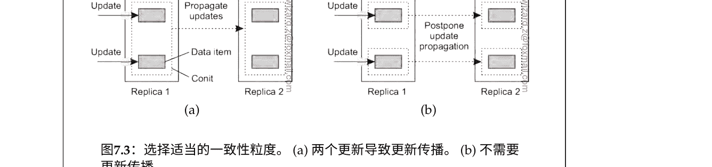

## 图7.3：选择适当的一致性粒度。(a) 两个更新导致更新传播。(b) 不需要更新传播。

不幸的是，将一致性粒度设置得非常小并不是一个好主意，因为需要管理的一致性粒度的总数也会增加。

换句话说，需要考虑管理一致性粒度所带来的开销。

反过来，这种开销可能会对整体性能产生不利影响，这也需要考虑到。

尽管从概念上讲，一致性协议是捕捉一致性要求的一种有吸引力的手段，但在实际使用之前，有两个重要问题需要解决。首先，为了强制执行一致性，我们需要有协议。连续一致性的协议将在本章后面讨论。

第二个问题是程序开发人员必须为他们的应用程序指定一致性要求。实践表明，获取这样的要求可能非常困难。程序员通常不习惯处理复制，更不用说理解提供一致性详细信息的含义了。因此，有简单易懂的编程接口是必需的。

## Note 7.2(高级：编程概念)

连续一致性可以作为一个工具包来实现，对程序员来说，它只是另一个他们与应用程序链接的库。一个conit就是在更新数据项的同时声明的。例如，伪代码片段

```
AffectedConit(ConitQ, 1, 1);
将消息m追加到队列Q;
表示将消息追加到队列Q属于名为ConitQ的conit。同样，操作现在也可以声明为依赖于conits:
```

```
DependsOnConit(ConitQ, 4, 0, 60);
从队列Q的头部读取消息m;
```

在这种情况下，对DependsOnConit()的调用指定了数值偏差、排序偏差和过时程度应限制在4、0和60（秒）的值。这可以解释为，在其他副本中最多有4个未见过的更新操作，没有尝试性的本地更新，并且对Q的本地副本的过时检查不应超过60秒。如果这些要求没有满足，底层中间件将尝试将Q的本地副本带到一个可以执行读操作的状态。

当然，问题是系统如何知道 Q与 ConitQ相关联？出于实际原因，我们可以避免显式声明conits，并且只集中于操作的分组。要复制的数据被认为是共同属于一起的。通过随后将写操作与命名的conit相关联，以而对于读操作也是如此，我们告诉中间件层何时开始同步整个副本。实际上，在这种情况下可能存在相当多的错误共享。如果需要避免错误共享，我们将不得不引入一个单独的编码结构来显式声明conits。

## 第七章。一致性和复制

## 操作的一致排序

过去几十年中，关于以数据为中心的一致性模型有大量的研究成果。一个重要的模型类别来自并行编程领域。面对并行和分布式计算中多个进程需要共享资源并同时访问这些资源的事实，研究人员一直在寻求表达共享资源复制时并发访问的语义。我们在这里讨论的模型都涉及到对共享、复制数据上的操作进行一致排序。

原则上，这些模型增强了连续一致性模型的功能，即当副本上的临时更新需要提交时，副本需要就这些更新达成一致的全局有序。

在接下来的内容中，我们将使用一种特殊的符号表示法，其中我们沿着时间轴绘制进程的操作。时间轴总是水平绘制的，时间从左到右递增。我们使用符号W_i(x)a来表示进程P_i将值a写入数据项x。类似地，R_i(x)b表示进程P_i读取x并返回值b。我们假设每个数据项的初始值为NIL。当没有关于哪个进程正在访问数据的混淆时，我们省略符号W和R的索引。

![img/fd0be3dd250e588e70e9d95e8d17da0d_377_0.png]

例如，在图7.4中，P1对数据项x进行写操作，将其值修改为a。请注意，根据我们的系统模型，操作W1(x)首先在P1的本地数据存储的副本上执行，然后才传播到其他本地副本。在我们的例子中，P2稍后读取值NIL，并在此之后从其本地存储的副本中获取a。我们在这里看到的是，将x的更新传播到P2需要一些时间，这是完全可以接受的。

当顺序一致性一种重要的数据为中心一致性模型，最早由Lamport(1979)在共享内存多处理器系统的背景下定义。当一个数据存储满足以下条件时，被称为顺序一致性：一个数据存储被称为顺序一致性时，它满足以下条件：

任何执行的结果都与如果所有进程对数据存储执行的(读和写)操作在某个顺序中执行相同

顺序，并且每个单独进程的操作按照其程序指定的顺序出现在此顺序中

这个定义的意思是，当进程在(可能)不同的机器上并发运行时，读和写的任何有效交错都是可接受的行为，但是所有进程都看到相同的操作交错 请注意，这里没有提到时间；也就是说，没有提到数据项上的“最近”写操作。此外，一个进程“看到”所有进程的写操作，但只通过自己的读操作。

从图7.5可以看出，时间不起作用。考虑四个在相同数据项 x 上操作的进程。在图7.5(a)中，进程 P₁首先执行写操作 W₁(x)a on x。稍后（在绝对时间上），进程 P₂也执行写操作 W₂(x)b，将 x的值设置为 b。然而，进程 P₃和 P₄首先读取值 b，然后读取值 a。换句话说，进程 P₂的写操作 W₂(x)b 似乎发生在 P₁的写操作W₁(x)a之前。

P1: W(x)a
P2:   W(x)b
P3:       R(x)b   R(x)a
P4:
       R(x)b  R(x)a
(a)
(b)图7.5:(a) 一个顺序一致的数据存储。(b) 一个不是顺序一致的数据存储。

相反，图7.5(b)违反了顺序一致性，因为不是所有的进程都看到相同的写操作交错。特别地，对于进程 P₃，它看起来好像数据项首先被改变为 b，然后再改变为 a。另一方面，P₄会得出最终值是 b的结论。

进程 P₁  进程 P₂  进程 P₃
x ← 1;   y ← 1;   z ← 1;
print(y,z); print(x,z); print(x,y);
图7.6:三个并发执行的进程。

为了使顺序一致性的概念更具体，考虑三个并发执行的进程 P₁，P₂和 P₃，如图7.6所示（摘自[Dubois et al., 1988]）。此示例中的数据项由三个整数变量 x，y 和 z组成，它们存储在一个（可能是分布式的）共享的顺序一致的数据存储中。我们假设每个变量都初始化为0。在这个示例中，赋值对应于一个

写操作对应于同时读取其两个参数的打印语句。假设所有语句都是不可分割的。

可能存在各种交错的执行序列。对于六个独立的语句，可能存在720（6! ）种可能的执行序列，尽管其中一些违反了程序顺序。考虑以 x ← 1开头的120（5! ）个序列。其中一半在 y ← 1之前有 print(x,z)，从而违反了程序顺序。另一半在 z ← 1之前有 print(x,y)，同样违反了程序顺序。只有120个序列中的1/4，即30个，是有效的。

以 y ← 1开头的序列中还有30个有效序列，以 z ← 1开头的序列中还有30个有效序列，总共有90个有效的执行序列。图7.7中显示了其中四个。

| 执行1 | 执行2 | 执行3 | 执行4 |
|-------|-------|-------|-------|
| P₁: x ← 1; | P₁: x ← 1; | P₂: y ← 1; | P₂: y ← 1; |
| P₁: print(y,z); | P₂: y ← 1; | P₃: z ← 1; | P₃: z ← 1; |
| P₂: print(x,z); | P₂: print(x,y); | P₃: print(x,y); | P₃: print(x,y); |
| P₃: print(x,y); | P₃: print(x,z); | P₁: x ← 1; | P₁: print(y,z); |
| 输出: 001011 | 输出: 101011 | 输出: 010111 | 输出: 111111 |
| 签名:0 0 1 0 1 1 | 签名:1 0 1 0 1 1 | 签名:1 1 0 1 0 1 | 签名:1 1 1 1 1 1 |
| (a) | (b) | (c) | (d) |

![img/fd0be3dd250e588e70e9d95e8d17da0d_379_0.png]

在图7.7(a)中，三个进程按顺序运行，首先是P₁，然后是P₂，然后是P₃。其他三个示例展示了不同但同样有效的语句交错在时间中的情况。这三个进程中的每一个都打印了两个变量。由于每个变量只能取初始值（0）或分配的值（1），每个进程产生一个2位字符串。Prints后面的数字是出现在输出设备上的实际输出。

如果我们按照P₁、P₂和P₃的顺序连接输出，我们得到一个6位字符串，它描述了语句的一个特定交错。这个字符串在图7.7中被列为Signature。下面我们将通过其签名而不是打印输出来描述每个顺序。

并非所有64个签名模式都是允许的。作为一个简单的例子，00 00 00是不允许的，因为这将意味着打印语句在赋值语句之前运行，违反了按程序顺序执行语句的要求。一个更微妙的例子是00 1 0 0 1。前两位00表示在P₁进行打印时y和z都为0。这种情况只会在P₁在P₂或P₃开始之前执行两个语句时发生。

下两位, 10, 表示 P₂必须在 P₁开始后但在P3开始前运行

P₃已经开始。最后两位, 01, 表示P₃必须在P₁开始前完成，但我们已经看到P₁必须先运行。因此,00 10 01是不允许的。

简而言之，90种不同的有效语句排序会产生各种不同的程序结果（少于64个），这些结果在顺序一致性的假设下是允许的。进程与分布式共享数据存储之间的契约是，进程必须接受所有这些作为有效结果。换句话说，进程必须接受图7.7中显示的四个结果和所有其他有效结果作为正确答案，并且如果其中任何一个发生，进程必须正常工作。对于其中一些结果有效而对于其他结果无效的程序违反了与数据存储的契约，是不正确的。

# Note 7.3 (高级: 顺序一致性的重要性和复杂性)

毫无疑问，顺序一致性是一个重要的模型。本质上，所有已存在和已开发的一致性模型中，顺序一致性是最容易理解的，当开发并发应用程序时。这是因为该模型最符合我们同时让多个程序操作共享数据的期望。同时，实现顺序一致性远非易事[Adve和Boehm，2010]。为了说明，考虑涉及两个变量 x和 y的示例，如图7.8所示。

![img/fd0be3dd250e588e70e9d95e8d17da0d_381_0.png]

图7.8：x和 y分别以顺序一致的方式处理，但是将它们放在一起，顺序一致性就被违反了。

如果我们只考虑对 x的写入和读取操作，P₁读取值a是完全一致的。对于操作R₂（y）由进程 P₂，情况也是如此。然而，当将它们放在一起时，我们无法对x和 y的写入操作进行排序，以便我们可以有R₁（x）为a和R₂（y）为b（注意我们需要按照每个进程执行的顺序保持排序）：

| 操作顺序                     | 结果             |
|-------------------------------|------------------|
| W₁(x)a; W₁(y)a; W₂(y)b; W₂(x)b| R₁(x)b           | R₂(y)b           |
| W₁(x)a; W₂(y)b; W₁(y)a; W₂(x)b| R₁(x)b           | R₂(y)a           |
| W₁(x)a; W₂(y)b; W₂(x)b; W₁(y)a| R₁(x)b           | R₂(y)a           |
| W₂(y)b; W₁(x)a; W₁(y)a; W₂(x)b| R₁(x)b           | R₂(y)a           |
| W₂(y)b; W₁(x)a; W₂(x)b; W₁(y)a| R₁(x)b           | R₂(y)a           |
| W₂(y)b; W₂(x)b; W₁(x)a; W₁(y)a| R₁(x)a           | R₂(y)a           |

在事务方面，P₁和 P₂执行的操作不是可行化的。我们的例子表明，顺序一致性不是可组合的：当每个数据项都保持顺序一致性时，它们作为一个集合的组合可能不是如此[Herlihy and Shavit, 2008]。非组合一致性的问题可以通过假设线性一致性来解决。这是最好的解释

通过区分操作的开始和完成，并假设操作可能需要一些时间来解决。线性一致性的定义如下：
每个操作应该在其开始和完成之间的某个时刻立即生效。

回到我们的例子，图7.9展示了相同的一组写操作，但现在我们还指示了它们发生的时间：阴影区域表示操作正在执行的时间。线性一致性的定义是，操作的效果应该在阴影区域所示的时间间隔内发生。原则上，这意味着在写操作完成时，结果应该传播到其他数据存储。

![img/fd0be3dd250e588e70e9d95e8d17da0d_381_0.png]

图7.9：考虑线性一致性的一个例子，只有一种可能的结果为x和y。在这种情况下，正确排序的可能性变得有限：

| 操作顺序 | 结果 |
|--- |--- |
| W₁(x)a; W₂(y)b; W₁(y)a; W₂(x)b | R₁(x)b | R₂(y)a |
| W₁(x)a; W₂(y)b; W₂(x)b; W₁(y)a | R₁(x)b | R₂(y)a |
| W₂(y)b; W₁(x)a; W₁(y)a; W₂(x)b | R₁(x)b | R₂(y)a |
| W₂(y)b; W₁(x)a; W₂(x)b; W₁(y)a | R₁(x)b | R₂(y)a |

特别是，W₂(y)b在W₁(y)a开始之前完成，所以y将有值a。同样，W₁(x)a在W₂(x)b开始之前完成，所以x将有值b。在许多核架构上实现线性一致性可能会带来严重的性能问题，这并不令人惊讶。然而，同时它极大地简化了可编程性，因此需要做出权衡。

## 因果一致性

因果一致性模型[Hutto and Ahamad, 1990]是顺序一致性的一种弱化形式，它区分了可能有因果关系和没有因果关系的事件。在前一章中讨论向量时间戳时，我们已经遇到了因果性。

如果事件b是由之前的事件a引起或影响的，因果关系要求每个人先看到a，然后再看到b。

考虑通过分布式共享数据库进行的简单交互。

假设进程P₁写入数据项x。然后P₂读取x并写入y。在这里，对x的读取和对y的写入可能存在因果关系，因为y的计算可能依赖于读取的x的值

P₂（即，由P₁写入的值）。

另一方面，如果两个进程同时自发地写入两个不同的数据项，则它们之间没有因果关系。这些操作

没有因果关系被称为并发。

为了使数据存储被认为是因果一致的，必须满足以下条件：

潜在因果关系的写操作必须按相同顺序被所有进程看到。并发写操作在不同的机器上可能以不同的顺序被看到。

作为因果一致性的一个例子，考虑图7.10。在这里，我们有一个允许在因果一致性存储中的事件序列，但在顺序一致性存储或严格一致性存储中是禁止的。

需要注意的是，写入 W₂(x)b 和 W₁(x)c 是并发的，因此不要求所有进程以相同的顺序看到它们。

P1: W(x)a               W(x)c
P2: R(x)a   W(x)b
P3: R(x)a R(x)c R(x)b
P4: R(x)a R(x)b

图7.10：这个序列在因果一致性存储中是允许的，但在顺序一致性存储中不允许。

现在考虑第二个例子。在图7.11(a)中，我们有 W₂(x)b 可能依赖于 W₁(x)a，因为将值 b 写入 x 可能是通过先前读取的值 R₂(x)a 进行计算的结果。这两个写操作是因果相关的，因此所有进程必须以相同的顺序看到它们。

因此，图7.11(a)是错误的。另一方面，在图7.11(b)中，读操作已被移除，所以 W₁(x)a 和 W₂(x)b 现在是并发写操作。因果一致性存储不要求并发写操作全局有序，所以图7.11(b)是正确的。请注意，图7.11(b)反映了一个对于顺序一致性存储来说是不可接受的情况。

实现因果一致性需要跟踪哪些进程看到了哪些写操作。有许多微妙的问题需要考虑。为了说明，假设我们将图7.11(a)中的 W₂(x)b 替换为 W₂(y)b，以及 R3(x)b 替换为 R3(y)b。这种情况在图7.12中显示。让我们首先看一下操作 R3(x)。进程 P3在 R3(y)b 之后执行这个操作。我们知道在这一点上，W(x)a 发生在 W(y)b 之前。特别地，W(x)a → R(x)a → W(y)b，这意味着如果我们要保持因果关系，从 y读取之后从 xa读取只能返回 a。如果系统向 P3返回 NIL，它将违反因果关系的保持。

那么 R4(y)怎么样？它能返回 y的初始值，即 NIL吗？答案是肯定的：尽管我们有形式化的happened-before关系W(x)a → W(y)b，但在从 y读取 b之前，进程 P4仍然可以合理地观察到 W(x)a 独立于 y的初始化。

![img/fd0be3dd250e588e70e9d95e8d17da0d_382_0.png]

[PAGE 383]

## 第七章。一致性和复制

P1: W(x)a
P2: R(x)a W(x)b
P3: R(x)b R(x)a
P4: R(x)a R(x)b
(a)

图7.11：(a) 违反因果一致性存储的情况。(b) 因果一致性存储中的一系列正确事件。

P1: W(x)a
P2: W(x)b
P3: R(x)b R(x)a
P4: R(x)a R(x)b
(b)

P1: W(x)a
P2: R(x)a W(y)b
P3: R(y)b R(x)?
P4: R(x)a R(y)?

图7.12：图7.11(a)的轻微修改。 R₃(x) 或 R₄(y)应该返回什么？

从实现的角度来看，保持因果关系引入了一些有趣的问题。例如，考虑图7.12中底层的中间件支持进程 P₃。在该中间件从读取 y返回值 b的时候，它必须知道关系 W(x)a → W(y)b。换句话说，在 P₃的中间件传播 y的最新值时，它至少应该传播 y的依赖元数据。或者，传播也可以与在 P₃的节点上更新 x一起完成。总的说来，我们需要一个依赖图，用于表示哪个操作依赖于其他操作。

这样的图可能在依赖数据也被本地存储的时候被修剪。

## 分组操作

许多一致性模型是在基本读写操作的级别上定义的。这种粒度的选择是出于历史原因：这些模型最初是为共享内存多处理器系统开发的，并且实际上是在硬件级别上实现的。

这些一致性模型的细粒度在许多情况下与应用程序提供的粒度不匹配。我们在那里看到的是，共享数据的程序之间的并发通常是不受控制的。

通过互斥和事务的同步机制。实际上，发生的情况是，在程序级别上，读写操作被ENTER_CS和 LEAVE_CS操作括起来。成功执行ENTER_CS的进程将确保其本地存储中的所有数据都是最新的。在那一点上，它可以安全地在该存储上执行一系列读写操作，然后通过调用LEAVE_CS来结束事务。在 ENTER_CS 和 LEAVE_CS之间的数据和指令被称为临界区。

实质上，所发生的是，在程序内部，通过一系列的读写操作对数据进行操作，以保护数据免受并发访问的影响，从而确保整个系列的执行结果。换句话说，通过括号将一系列的读写操作转化为一个原子执行的单元，从而提高了粒度的级别。

为了达到这一点，我们需要对操作ENTER_CS和LEAVE_CS进行精确的语义处理。这些语义可以用共享的同步变量或简单的锁来表达。锁与共享数据项相关联，每个共享数据项最多与一个锁相关联。在粗粒度同步的情况下，所有共享数据项只与一个锁相关联。当每个共享数据项都有自己独特的锁时，就实现了细粒度同步。当然，这只是将共享数据与锁相关联的两个极端情况。当一个进程进入临界区时，应该获取相关的锁，同样地，当它离开临界区时，应该释放这些锁。

每个锁都有一个当前所有者，即最后获取它的进程。一个当前不拥有锁但想要获取它的进程必须向当前所有者发送一条消息，请求所有权和与该锁相关的当前值的数据。在拥有独占访问锁的同时，一个进程可以执行读和写操作。同时，也有可能多个进程同时具有非独占访问锁的权限，这意味着它们可以读取但不能写入相关的数据。当然，只有在没有其他进程具有独占访问权限的情况下，才能授予非独占访问权限。

我们现在要求满足以下几个条件[Bershad et al., 1993]:

+   - 只有在其相关的共享数据的所有更新完成后，才能成功获取锁。

+   - 只有没有其他进程具有独占或非独占访问权限的情况下，才能成功获取对锁的独占访问权限。

+   - 只有在任何先前的独占访问，包括对锁关联的数据的更新之后，才允许对锁进行非独占访问。

请注意，我们实际上要求锁的使用是线性化的，

遵循顺序一致性。图7.13展示了一个被称为入口一致性

[PAGE 385]

示例。我们将每个数据项与一个锁分开关联。我们使用符号 L(x)作为获取锁的缩写，即锁定 x。同样地，U(x)表示释放x上的锁，或者解锁它。在这种情况下，P1锁定 x，改变 x一次，然后锁定 y。进程 P2也获取了 x的锁，但没有获取 y的锁，因此它将读取值a作为 x的值，但可能读取 NIL作为 y的值。然而，因为进程 P3首先获取了 y的锁，所以当 P1解锁 y时，它将读取值b。在这里需要注意的是，每个进程都有一个变量的副本，但这個副本不需要立即或自动更新。当锁定或解锁一个变量时，进程明确告诉底层分布式系统需要同步该变量的副本。因此，一个简单的读操作而没有锁定可能导致读取一个实际上已经过时的本地值。

P1: L(x) W(x)a L(y) W(y)b U(x) U(y)
P2:
      L(x) R(x)a
      R(y) NIL
P3:
        L(y) R(y)b

入口一致性的一个编程问题是正确地将数据与锁相关联。一种直接的方法是明确告诉中间件将要访问哪些数据，通常通过声明哪些数据库表将受到事务影响来实现。在基于对象的方法中，我们可以为每个声明的对象关联一个唯一的锁，从而有效地对这些对象的所有调用进行串行化。

## 一致性与一致性

在这一点上，澄清两个密切相关的概念是有用的。到目前为止，我们讨论的模型都涉及多个进程对一组数据项执行读写操作的事实。

一致性模型描述了在多个进程同时对数据进行操作时可以期望的情况。如果数据集遵循模型描述的规则，则称其为一致的。

数据一致性关注的是一组数据项，一致性模型描述了仅针对单个数据项可以期望的情况。在这种情况下，我们假设数据项被复制；当各个副本遵守其关联的一致性模型定义的规则时，它被称为一致。流行的模型是顺序一致性，但现在仅适用于单个数据项。实际上，这意味着在并发写入的情况下，所有进程最终将看到相同的更新顺序。

![img/fd0be3dd250e588e70e9d95e8d17da0d_385_0.png]

## 7.2. 数据中心一致性模型

## 最终一致性

进程实际上以并发方式运行的程度，以及需要保证一致性的程度可能会有所不同。有许多例子中，并发性只以受限的形式出现。例如，在许多数据库系统中，大多数进程几乎从不执行更新操作；它们主要从数据库中读取数据。只有一个或很少的进程执行更新操作。那么问题就是更新应该以多快的速度提供给只读进程。在全球运营的内容传递网络的出现中，开发人员通常选择慢慢传播更新，隐含地假设大多数客户端始终被重定向到相同的副本，因此永远不会出现不一致性。

另一个例子是Web。在几乎所有情况下，Web页面由单个权威机构更新，例如网站管理员或页面的实际所有者。通常没有需要解决的写-写冲突。另一方面，为了提高效率，浏览器和Web代理通常被配置为在本地缓存中保存获取的页面，并在下一次请求时返回该页面。无论是哪种类型的Web缓存，一个重要的方面是它们可能返回过时的Web页面。换句话说，返回给请求客户端的缓存页面是一个较旧的版本，与实际Web服务器上可用的版本相比。事实证明，许多用户认为这种不一致是可以接受的（在一定程度上），只要他们只能访问同一个缓存。实际上，他们对于更新已经发生的事实保持不知情，就像之前的内容传递网络的情况一样。

另一个例子是全球命名系统，例如DNS。DNS命名空间被划分为域，每个域都分配给一个命名机构，该机构充当该域的所有者。只有该机构被允许更新其命名空间的部分。因此，从两个都想对相同数据执行更新的操作（即写-写冲突）中产生的冲突从不发生。需要处理的唯一情况是读-写冲突，在这种情况下，一个进程想要更新一个数据项，而另一个进程同时尝试读取该项。事实证明，在这种情况下，通常也可以以懒惰的方式传播更新，这意味着读取进程只有在更新发生后经过一段时间后才能看到更新。

这些示例可以被视为（大规模）分布式和复制数据库的情况，它们能够容忍相对高程度的不一致性。它们的共同点是，如果长时间没有更新，所有副本将逐渐变得一致，即存储的数据完全相同。这种一致性形式被称为最终一致性[Vogels, 2009]。最终一致性的数据存储因此具有以下特性：在没有写-写冲突的情况下，所有副本将收敛到彼此的相同副本。最终一致性实际上只需要保证更新能够传播到所有副本。写-写冲突

## 第七章。一致性和复制

通常相对容易解决，假设只有一小组进程可以执行更新操作。实际上，我们经常看到，在冲突的情况下，一个特定的写操作被（全局）声明为‘获胜者’，覆盖任何其他冲突写操作的效果。因此，最终一致性通常很容易实现。

## Note 7.4 （高级：加强最终一致性）

最终一致性是一个相对容易理解的模型，但同样重要的是它也相对容易实现。然而，它是一个具有自己特点的弱一致性模型。考虑一个在Alice、Bob和Chuck之间共享的日历。一个会议M有两个属性：一个提议的开始时间和一组已确认出席的人。

当Alice提议在时间T开始会议M时，并假设没有其他人确认出席时，她执行操作WA（M）[T，{A}]。当Bob确认出席时，他将读取元组[T，{A}]，并相应地更新会议M：WB（M）[T，{A，B}]。在我们的例子中，需要计划两个会议M1和M2。

假设事件的顺序

```
WA(M1)[T1,{A}] → RB(M1)[T1,{A}] →
```

```
WB(M1)[T1,{A,B}] → WB(M2)[T2,{B}].
```

换句话说，鲍勃确认他参加M1，然后立即提议在T2安排M2。不幸的是，查克在鲍勃确认他可以参加M1在T1时，同时提议在T3安排M1。形式上，使用符号“||”表示并发操作，我们有，

```
WB(M1)[T1,{A,B}] || WC(M1)[T3,{C}]
```

使用我们通常的符号表示，这些操作可以如图7.14所示。

| A: W(M),[T, {A}]                  | R(M),? |
| B:         | R(M),[T, {A}]  W(M),[T, {A,B}]  W(M),[T2, {B}]  R(M),? |
| C:         | W(M),[T3, {C}]          | R(M),? |

图7.14:更新两个会议M1和M2的情况。最终一致性可能导致非常不同的情况。有一些写-写冲突，但无论如何，最终会将[T2, {B}]存储为会议M2的结果，这是Bob进行的关联写操作的结果。对于会议M1的值，有不同的选择。原则上，我们有三种可能的结果：[T1, {A}]、[T1, {A,B}]和[T3, {C}]。假设我们可以维护某种全局时钟的概念，那么WA(M1)[T1, {A}]很可能不会成为最终结果。

然而，两个写操作WB(M1)[T1, {A,B}]和WC(M1)[T1, {C}]是真正冲突的。实际上，其中一个将会获胜，可能是通过中央协调员的决定。

研究人员一直在寻求将最终一致性性与更严格的排序保证相结合。Bailis等人[2013]建议使用一个单独的层

## 7.3. 客户端中心一致性模型

该层在一个最终一致的分布式存储之上运行。这个层实现了因果一致性，曾经被证明在网络分区存在的情况下是最好的一致性。[Mahajan等人，2011] 在我们的例子中，我们只有一个依赖链：
WA(M1)[T1, {A}] → RB(M1)[T1, {A}] → 
WB(M1)[T1, {A,B}] → WB(M2)[T2, {B}].

一个重要的观察是，在因果一致性的情况下，一旦一个进程读取 [T2, {B}] 用于会议 M2，获取 M1的值，要么返回 [T1, {A,B}]，要么返回 [T3, {C}]，但肯定不会返回 [T1, {A}]。原因是 W(M1)[T1, {A,B}]紧接着 W(M2)[T2, {B}]，最坏的情况下可能被 W(M1)[T3, {C}]覆盖。因果一致性排除了系统可能返回 [T1, {A}] 的情况。

然而，最终一致性可能会覆盖先前存储的数据项。在这样做的过程中，可能会丢失依赖关系。为了明确这一点，重要的是要意识到在实践中，一个操作最多只能追踪到它依赖的直接前一个操作。一旦 Wc(M1)[T3, {C}]覆盖 WB(M1)[T1, {A,B}]（并传播到所有副本），我们也打破了依赖链。

WA(M1)[T1, {A}] → RB(M1)[T1, {A}] → … → WB(M2)[T2, {B}] 通常情况下会阻止 WA(M1)[T1, {A}] 超越 WB(M1)[T1, {A,B}]以及依赖于它的任何操作。因此，保持因果一致性要求我们保留依赖关系的历史记录，而不仅仅是跟踪前面的操作。

## 7.3 客户端中心一致性模型

数据中心一致性模型旨在提供对数据存储的系统范围一致的视图。一个重要的假设是并发进程可能同时更新数据存储，并且有必要在并发情况下提供一致性。例如，在基于对象的条目一致性的情况下，数据存储保证当调用对象时，调用进程会获得一个反映到目前为止对对象所做的所有更改的对象副本，可能是由其他进程进行的。在调用过程中，还保证没有其他进程可以干扰，即为调用进程提供互斥访问。

在维持强一致性的同时，能够处理共享数据上的并发操作是分布式系统的基础。出于性能考虑，只有当进程使用事务或同步变量等机制时，才可能保证强一致性。同样地，无法保证强一致性，只能保证较弱的一致性。

## 第七章。一致性和复制

需要接受各种形式，例如在一致性的情况下与最终一致性相结合。

在本节中，我们将介绍一类特殊的分布式数据存储。我们考虑的数据存储特点是缺乏同时更新，或者当这样的更新发生时，可以相对容易地解决。大多数操作涉及读取数据。这些数据存储提供了一种弱一致性模型，例如最终一致性。通过引入特殊的以客户为中心的一致性模型，事实证明许多不一致性可以以相对廉价的方式隐藏起来。

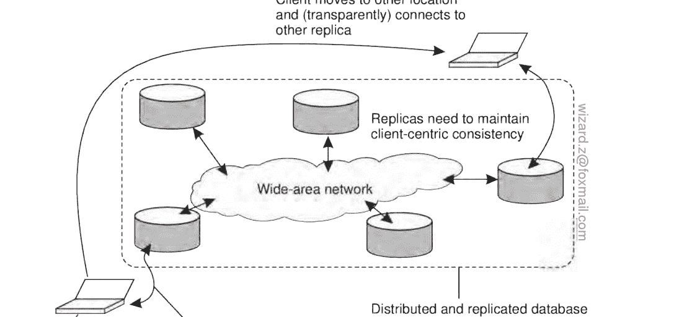

一致性较差的数据存储通常在客户端始终访问同一副本时工作良好。然而，当不同的副本在短时间内被访问时，问题就会出现。这最好通过考虑一个访问分布式数据库的移动用户来说明，如图7.15所示。

移动用户，比如Alice，通过透明方式连接到数据库的一个副本。换句话说，运行在Alice移动设备上的应用程序并不知道它实际上在那个副本上操作。

假设Alice执行了几个更新操作，然后再次断开连接。稍后，她再次访问数据库，可能是不同的位置或使用不同的访问设备。此时，她可能连接到之前不同的副本，如图7.15所示。然而，如果之前执行的更新尚未传播，Alice将会注意到不一致的行为。特别是，她期望看到所有的

## 7.3. 客户端中心一致性模型

之前做出了更改，但实际上好像什么都没有发生。

这个例子是典型的最终一致性数据存储，并且是由于用户有时在更新没有完全传播的情况下操作不同的副本。通过引入以客户为中心的一致性，可以缓解这个问题。实质上，以客户为中心的一致性为单个客户提供了关于该客户对数据存储的访问一致性的保证。对于不同客户的并发访问不提供任何保证。如果Bob修改与Alice共享但存储在不同位置的数据，我们可能很容易创建写-写冲突。此外，如果Alice和Bob在一段时间内都没有访问相同的位置，这样的冲突可能需要很长时间才能被发现。

以客户为中心的一致性模型源于Bayou和移动数据系统的工作（例如，Terr y等人[1994]，Terry等人[1998]或Terry [2008]）。Bayou是一个为移动计算开发的数据库系统，其中假设网络连接不可靠且存在各种性能问题。无线网络和跨越大范围的网络，如互联网，属于这个类别。

Bayou基本上区分了四种不同的一致性模型。为了解释这些模型，我们再次考虑一个物理上分布在多台机器上的数据存储。当一个进程访问数据存储时，通常连接到本地（或最近的）可用副本，尽管原则上任何副本都可以。所有读写操作都在本地副本上执行。更新最终会传播到其他副本。

使用以下符号来描述以客户为中心的一致性模型。让xi表示数据项x的版本。版本xi是自初始化以来发生的一系列写操作的结果，其写集为WS(xi)。通过将写操作附加到该系列中，我们得到另一个版本xj，并称xj是由xi得到的。我们使用符号WS(xi;xj)来表示xj是由xi得到的。如果我们不知道xj是否由xi得到，我们使用符号WS(xi|xj)。

## 单调读取

第一个以客户为中心的一致性模型是单调读取。如果一个（分布式）数据存储提供单调读取一致性，则满足以下条件：

如果一个进程读取数据项x的值，那么该进程对x的任何后续读操作都将始终返回相同的值或更新的值。

换句话说，单调读取一致性保证一旦一个进程看到了x的一个值，它将永远不会看到一个旧版本的x。作为单调读取有用的一个例子，考虑一个分布式电子邮件数据库。在这样的数据库中，每个用户的邮箱可能是分布式的。

## 第七章。一致性和复制

并且在多台机器上复制。邮件可以插入到任何位置的邮箱中。然而，更新是以惰性（即按需）的方式传播的。只有当副本需要某些数据以保持一致性时，这些数据才会传播到该副本。假设一个用户在旧金山阅读他的邮件。假设仅仅阅读邮件不会影响邮箱，也就是说，消息不会被删除，存储在子目录中，或者被标记为已读等等。当用户后来飞往纽约并再次打开他的邮箱时，单调读一致性保证了在旧金山邮箱中的消息也会在纽约打开时出现在邮箱中。

使用类似于数据中心一致性模型的符号，单调读一致性可以以图形方式表示，如图7.16所示。与垂直轴上显示进程不同，我们现在显示本地数据存储，在我们的示例中为L₁和L₂。写入或读取操作由执行该操作的进程索引，即W₁（x）表示进程P₁将值a写入x。由于我们对共享数据项的具体值不感兴趣，而是对它们的版本感兴趣，因此我们使用符号W₁（x₂）表示进程P₁生成版本x₂，而不知道其他版本的任何信息。W₂（x₁:x₂）表示进程P₂负责生成从x₁派生的版本x₂。同样，W₂（x₁|x₂）表示进程P₂并发生成版本x₂，与版本x₁同时存在（因此可能引入写-写冲突）。R₁（x₂）表示P₁读取版本x₂。

图7.16：一个进程 P在两个不同的本地副本上执行的读操作。（a）一个单调读一致的数据存储。（b）一个不提供单调读的数据存储。

在图7.16（a）中，进程 P₁首先在 L₁上执行写操作，产生版本 x₁，然后读取该版本。在 L₂上，进程 P₂首先产生版本 x₂，继承自 x₁。当进程 P₁移动到 L₂并再次读取 x时，它发现了一个更新的值，但至少考虑了它之前的写入。

图7.16（b）展示了一种违反单调读一致性的情况。在进程 P₁在 L₁读取 x₁之后，它稍后在 L₂执行操作 R₁（x₂）。然而，在之前的写操作W₂（x₁|x₂）之后，进程 P₂在L₂上产生的版本被认为不符合于 x₁的结果。因此，当P₁在L₂执行读操作时，已知不包括写操作的影响，即使它在位置R₁(x₁)处执行。

## 7.3. 客户端中心一致性模型

## 单调写入

在许多情况下，将写操作按正确的顺序传播到所有数据存储的副本非常重要。这个属性被称为单调写一致性。在一个单调写一致的存储中，满足以下条件：

一个进程对数据项 x 的写操作在同一进程的任何后续写操作之前完成。

更正式地说，如果我们有两个连续的操作 Wk(xi) 和 Wk(xj) 由进程 Pk 执行，那么无论 Wk(xj) 发生在哪里，我们也有 WS(xi; xj)。因此，完成写操作意味着后续操作所执行的副本反映了之前由同一进程执行的写操作的效果，无论该操作在何处启动。换句话说，只有在副本已经通过同一进程的任何前面的写操作更新了的情况下，才会对数据项 x 的副本执行写操作，这些写操作可能发生在其他副本上。如果需要，新的写操作必须等待旧的写操作完成。

请注意，单调写一致性类似于数据中心的FIFO一致性。FIFO一致性的本质是同一进程的写操作在任何地方都按正确顺序执行。这种顺序约束也适用于单调写操作，只是我们现在只考虑单个进程的一致性，而不是一组并发进程。

当每个写操作完全覆盖现有值x时，不一定需要将副本x更新到最新状态。然而，写操作通常只对数据项的部分状态执行。

例如，考虑一个软件库。在许多情况下，更新这样一个库是通过替换一个或多个函数来完成的，从而导致下一个版本。通过单调写一致性，可以保证如果对库的副本进行更新，所有之前的更新将首先执行。结果库将成为最新版本，并包含导致之前版本的所有更新。

单调写一致性在图7.17中展示。在图7.17(a)中，进程P1在L1上对x进行写操作，表示为操作W1(x1)。稍后，P1在L2上对x进行另一个写操作，表示为W1(x2:x3)。P1在L2上产生的版本是基于P2的更新，而P2又是基于版本x1的。后者由操作W2(x1:x2)表示。为了确保单调写一致性，必须确保先前在L1上的写操作已经传播到L2，并可能已经更新。

相比于图7.17(a)，图7.17(b)展示了一种无法保证单调写一致性的情况。与图7.17(a)相比，缺少的是将x1传播到L2之前产生另一个版本的x，表示为

[内容过长，已省略部分内容]这意味着进程 P₁之前的写操作的效果在 x₂生成时还没有传播到 L₂。当进程 P₁读取 x₂时，它将看不到自己的写操作在 L₁上的效果。

## 写入跟随读取

最后一个以客户为中心的一致性模型是通过先前的读操作来传播更新。如果数据存储提供写后读一致性，则满足以下条件。

如果一个进程在一个数据项上进行写操作 x 在之前的读操作 x 之后由同一进程进行，则保证在相同或更新的值上进行写操作 x 读取的值。

换句话说，一个进程对数据项 x 的连续写操作将在一个与该进程最近读取的值最新的副本上执行。

写后读一致性可以用来保证网络新闻组的用户只有在看到原始文章之后才能看到对文章的回应[Terry et al., 1994]。为了理解这个问题，假设一个用户首先阅读了一篇文章 A。然后，她通过发表一个回应 B来做出反应。通过要求写后读一致性，只有在 A被写入之后，B才会被写入新闻组的任何副本中。注意只阅读文章的用户不需要任何特定的以客户为中心的一致性模型。写后读一致性确保只有在原始文章也存储在本地副本中时，对文章的反应才会存储在本地副本中。

图7.19：(a) 一个写后读一致性数据存储。(b) 一个不提供写后读一致性的数据存储。

这个一致性模型在图7.19中展示。在图7.19(a)中，进程 P₂在本地副本 L₁中读取版本 x₁。这个版本的 x 之前由进程 P₁通过操作 W₁(x₁)在 L₁上生成。那个版本随后传播到 L₂，并被另一个进程 P₃用来生成一个新版本 x₂，表示为 W₃(x₁; x₂)。当进程 P₂在移动到 L₂后更新它的版本 xa，我们知道它将操作一个从 x₁派生的版本，表示为 W₂(x₂; x₃)。因为我们还有 W₃(x₁;x₂)，我们知道 WS(x₁;x₃)。

图7.19(b)中表示的情况是不同的。进程 P₃同时生成了版本 x₂和 x₁。因此，当 P₂更新 x₁时

在读取了 x₁ 之后，它将更新一个之前未读取的版本。写-读一致性被违反了。

## 7.4 副本管理

任何支持复制的分布式系统都需要决定在何处、何时以及由谁放置副本，并随后决定用于保持副本一致性的机制。放置问题本身应该分为两个子问题：放置副本服务器和放置内容。这两个问题之间的区别是微妙的，通常不太明确分开。副本服务器放置涉及找到最佳位置来放置可以托管（部分）数据存储的服务器。内容放置涉及找到最佳服务器来放置内容。请注意，这通常意味着我们正在寻找仅一个数据项的最佳放置位置。显然，在进行内容放置之前，必须首先放置副本服务器。

## 寻找最佳服务器位置

在十年前，人们可能会担心如何将一个个体服务器放置在哪里，但随着许多位于互联网上的大型数据中心的出现，情况发生了很大变化。同样，连接性不断改善，使得精确定位服务器变得不那么重要。

注7.5（高级：复制服务器放置）
复制服务器的放置并不是一个深入研究的问题，因为它往往更多是一个管理和商业问题，而不是一个优化问题。尽管如此，分析客户端和网络属性对做出明智的决策是有用的。

有多种方法可以计算复制服务器的最佳放置位置，但归根结底都是一个优化问题，需要选择最佳的 K 个位置（K < N）。这些问题被认为是计算上复杂的，只能通过启发式方法来解决。邝等人[2001]以客户端和位置之间的距离为出发点。距离可以用延迟或带宽来衡量。他们的解决方案每次选择一个服务器，使得该服务器与其客户端之间的平均距离在已经放置了 k个服务器的情况下最小（意味着还剩下N − k个位置）。

作为一种替代，Radoslavov等人[2001]建议忽略客户端的位置，只考虑由自治系统形成的互联网拓扑结构。自治系统（AS）最好被视为一个网络，其中所有节点都运行相同的路由协议，并由一个组织进行管理。截至2015年，大约有30,000个AS。Radoslavov等人首先考虑最大的AS，并在具有最大数量的路由器上放置服务器。

这些算法的一个问题是它们的计算成本很高。例如，前面的算法的复杂度都高于O(N²)，其中N是要检查的位置数。实际上，这意味着即使对于几千个位置，计算也可能需要运行数十分钟。这可能是不可接受的。

Szymaniak等人[2006]开发了一种方法，可以快速识别放置副本的区域。一个区域被认为是访问相同内容的一组节点，但节点间的延迟很低。算法的目标首先是选择最具需求的区域，即具有最多节点的区域，然后让该区域中的一个节点充当副本服务器。

为此，假设节点在一个m维几何空间中定位，就像我们在前一章中讨论的那样。基本思想是识别出最大的K个集群，并分配每个集群中的一个节点来托管复制内容。为了识别这些集群，整个空间被划分为单元格。然后选择最密集的单元格来放置副本服务器。一个单元格就是一个m维超立方体。对于二维空间，这对应于一个矩形。

图7.20：选择适当的单元格大小进行服务器放置。

显然，单元格大小很重要，如图7.20所示。如果选择的单元格太大，那么可能会包含多个节点集群在同一个单元格中。在这种情况下，对于这些集群选择的副本服务器数量将会过少。另一方面，选择小的单元格可能会导致一个单一的集群分布在多个单元格中，从而选择过多的副本服务器。

事实证明，适当的单元大小可以通过两个节点之间的平均距离和所需副本的数量的简单函数来计算。通过这个单元大小，可以证明该算法的性能与Qiu等人[2001]描述的接近最优算法相当，但复杂度要低得多： O(N × max{log(N), K})。为了给出这个结果的印象，实验证明为计算最佳副本位置的前20个位置

64,000个节点的集合大约快50,000倍。因此，复制服务器的放置现在可以实时完成。

## 内容复制和放置

当涉及到内容复制和放置时，可以逻辑上区分三种不同类型的副本，如图7.21所示。

图7.21：将数据存储的不同副本类型逻辑上组织成三个同心圆。

### 永久副本

永久副本可以被视为构成分布式数据存储的初始副本集。在许多情况下，永久副本的数量很少。例如，考虑一个网站。网站的分发通常有两种形式之一。第一种分发方式是将构成网站的文件复制到单个位置的有限数量的服务器上。每当有请求进来时，例如使用循环策略，它会被转发到其中一个服务器。

分布式网站的第二种形式被称为镜像。在这种情况下，一个网站被复制到一定数量的服务器上，称为镜像站点，这些服务器在全球范围内分布。在大多数情况下，客户端只需从提供的列表中选择一个镜像站点。镜像网站与基于集群的网站有一个共同点，即只有少数副本，这些副本更或多或少的静态配置。

类似的静态组织也出现在分布式数据库中[Kemme等人，2010年; Özsü和Valduriez，2011年]。同样，数据库可以分布并在一组服务器上复制，这些服务器一起形成一个集群，通常被称为共享无架构，强调处理器之间既不共享磁盘也不共享主内存。或者，一个

数据库可以分布并可能在一些地理上分散的站点上复制。这种架构通常用于联邦数据库[Sheth和Larson，1990年]。

### 服务器发起的副本

与永久副本相比，服务器发起的副本是数据存储的副本，旨在提高性能，并由数据存储的所有者主动创建。例如，考虑一个放置在纽约的Web服务器。通常情况下，这个服务器可以轻松处理传入的请求，但可能会发生在几天内突然从服务器远离的意外位置接收到大量请求的情况。在这种情况下，值得在请求来自的地区安装一些临时副本。

### 注7.6（高级：动态Web内容放置的示例）

动态放置副本的问题在Web托管服务中长期得到解决。这些服务在Internet上分布着一组相对静态的服务器，可以维护和提供对第三方Web文件的访问。为了提供最佳设施，这些托管服务可以动态地将文件复制到需要增强性能的服务器上，即靠近需要的（群组的）客户端。

鉴于副本服务器已经就位，决定在哪里放置内容并不那么困难。Rabinovich等人[1999]描述了一个早期的动态复制文件的案例，针对的是Web托管服务的情况。该算法旨在支持Web页面，因此假设更新相对于读取请求来说相对较少。使用文件作为数据单元，算法的工作原理如下。

动态复制算法考虑了两个问题。首先，复制可以减轻服务器的负载。其次，可以将特定文件迁移或复制到靠近发出对这些文件发出许多请求的客户端的服务器上。在接下来的内容中，我们只关注这第二个问题。我们还省略了一些细节，可以在[Rabinovich等人，1999]中找到。

每个服务器都跟踪每个文件的访问计数，以及访问请求的来源。特别是，当客户端C通过靠近它的服务器进入服务时。如果客户端C₁和客户端C₂共享相同的最近服务器P，所有对服务器Q上的文件F的访问请求来自C₁和C₂都会在Q上作为一个单独的访问计数cnt_Q(P,F)进行注册。这种情况如图7.22所示。当服务器S上特定文件F的请求数量下降到删除阈值del(S,F)以下时，该文件可以从S中删除。因此，该文件的副本数量减少，可能导致其他服务器的工作负载增加。采取特殊措施确保每个文件至少存在一份副本。

图7.22:计算来自不同客户端的访问请求。

复制阈值 rep(S,F)，始终选择比删除阈值更高，表示对于特定文件的请求数量非常高，因此在另一个服务器上复制它可能是值得的。如果请求数量位于删除阈值和复制阈值之间，文件只允许迁移。换句话说，在这种情况下，至少保持该文件的副本数量是重要的。

当服务器 Q决定重新评估其存储的文件的放置时，它会检查每个文件的访问计数。如果Q上F的总访问请求数下降到删除阈值 del(Q,F)以下，除非它是最后一份副本，否则将删除F。此外，如果对于某个服务器 P，cnt_Q(P,F)超过 Q上 F的总请求数的一半，将请求服务器 P接管 F的副本。换句话说，服务器 Q将尝试将 F迁移到 P。

迁移文件 F到服务器 P可能并不总是成功，例如，因为 P已经负载过重或者磁盘空间不足。在这种情况下，Q将尝试在其他服务器上复制 F。当然，只有当 Q上对 F的访问请求总数超过复制阈值 rep(Q,F)时，才能进行复制。

服务器 Q会检查Web托管服务中的所有其他服务器，从最远的服务器开始。如果对于某个服务器 R， cnt_Q(R,F)超过了所有对 Q的 F请求的一定比例，就会尝试将 F复制到 R。

请注意，只要能够保证每个数据项至少由一个服务器托管，就可以仅使用服务器发起的复制而不需要任何永久副本。然而，永久副本通常用作备份设施，或者作为唯一允许更改以保证一致性的副本。然后使用服务器发起的副本来放置靠近客户端的只读副本。

### 客户端发起的副本

重要的一种副本是由客户端发起的。客户端发起的副本通常被称为（客户端）缓存。本质上，缓存是一个本地存储设施，由客户端用于临时存储刚刚请求的数据的副本。原则上，缓存的管理完全由客户端来处理。从数据被获取的数据存储中，没有任何

保持缓存数据一致性。然而，在许多情况下，客户端可以依赖数据存储的参与来通知它缓存数据已过期。

客户端缓存仅用于提高对数据的访问时间。通常情况下，当客户端想要访问某些数据时，它会连接到最近的数据存储副本，从中获取它想要读取的数据，或者将其存储到刚刚修改的数据的位置。当大多数操作仅涉及数据读取时，通过让客户端将请求的数据存储在附近的缓存中，可以提高性能。这样的缓存可以位于客户端的机器上，也可以位于与客户端相同的局域网上的另一台机器上。下一次需要读取相同的数据时，客户端可以直接从本地缓存中获取。只要获取的数据在此期间没有被修改，这个方案就可以正常工作。

数据通常在缓存中保存一段有限的时间，例如，以防止使用过期的数据，或者只是为了腾出空间给其他数据。每当请求的数据可以从本地缓存中获取时，就说发生了一次缓存命中。为了提高缓存命中率，缓存可以在客户端之间共享。基本假设是来自客户端C₁的数据请求也可能对附近的另一个客户端C₂的请求有用。

这个假设是否正确很大程度上取决于数据存储的类型。例如，在传统的文件系统中，数据文件很少被共享(参见，例如，Muntz和Honeyman [1992]和Blaze [1993])，这使得共享缓存毫无用处。同样，使用Web缓存来共享数据已经失去了优势，部分原因也是因为网络和服务器性能的提升。相反，服务器主动复制方案变得更加有效。

客户端缓存的放置相对简单：通常将缓存放置在与其客户端相同的机器上，或者放置在由相同局域网上的客户端共享的机器上。然而，在某些情况下，系统管理员通过在多个部门或组织之间放置共享缓存，甚至在整个地区（如省份或国家）放置共享缓存，引入了额外的缓存级别。

另一种方法是在广域网中的特定点放置（缓存）服务器，并让客户端找到最近的服务器。当找到服务器时，可以请求服务器保存客户端先前从其他地方获取的数据的副本[Noble et al., 1999]。

## 内容分发

副本管理还涉及将（更新的）内容传播到相关的副本服务器。有各种权衡需要做出。

### 状态与操作

一个重要的设计问题是实际要传播的内容。基本上，有三种可能性：

+   * 仅传播更新的通知。
+   * 将数据从一个副本传输到另一个副本。
+   * 将更新操作传播到其他副本。

传播通知是无效化协议所做的。在无效化协议中，其他副本被告知已经发生了更新，并且它们所包含的数据不再有效。无效化可能指定已更新的数据存储的哪个部分，以便只有部分副本被实际无效化。重要的问题是不是要传播超过一个通知。每当请求对一个无效化的副本进行操作时，通常需要首先更新该副本，这取决于要支持的特定一致性模型。

无效化协议的主要优点是它们使用很少的网络带宽。需要传输的唯一信息是哪些数据不再有效的规范。这种协议通常在更新操作相对于读操作较多时效果最好，也就是说，读写比相对较小。

例如，考虑一个数据存储，更新通过将修改后的数据发送到所有副本来传播。如果修改后的数据的大小较大，并且更新操作频繁而读操作相对较少，我们可能会出现连续两次更新而没有任何读操作在其间执行的情况。因此，将第一个更新传播到所有副本实际上是无用的，因为它将被第二个更新覆盖。相反，发送一个通知表明数据已被修改会更加高效。

在副本之间传输修改后的数据是第二个选择，当读写比相对较高时非常有用。在这种情况下，更新在下一次更新发生之前被读取的概率很高。除了传播修改后的数据之外，还可以记录更改并仅传输这些日志以节省带宽。此外，传输通常会被聚合，即多个修改被打包成单个消息，从而节省通信开销。

第三种方法是根本不传输任何数据修改，而是告诉每个副本应该执行哪个更新操作（并且只发送这些操作所需的参数值）。这种方法，也称为主动复制，假设每个副本都由一个能够通过执行操作来“主动”保持其关联数据最新的进程表示[Schneider, 1990]。主动复制的主要好处

是更新通常可以以最小的带宽成本传播，前提是与操作相关的参数的大小相对较小。

此外，操作可以具有任意复杂性，这可能允许在保持副本一致性方面进一步改进。另一方面，每个副本可能需要更多的处理能力，特别是在操作相对复杂的情况下。

### 拉取与推送协议

另一个设计问题是更新是拉取还是推送。在基于推送的方法中，也称为基于服务器的协议，更新被传播到其他副本，而这些副本甚至不需要请求更新。

推送式方法通常在永久和服务器发起的副本之间使用，但也可以用于向客户端缓存推送更新。基于服务器的协议通常应用于需要强一致性的情况。

这种对强一致性的需求与永久和服务器发起的副本以及大型共享缓存通常由许多客户端共享有关，而这些客户端主要执行读操作。因此，每个副本的读取更新比例相对较高。在这些情况下，基于推送的协议在某种程度上是高效的，因为每个推送的更新都可以预期至少对一个读者有用，但可能对多个读者有用。此外，基于推送的协议在被请求时可以立即提供一致的数据。

相比之下，在基于拉取的方法中，服务器或客户端请求另一个服务器在那一刻将其拥有的任何更新发送给它。基于拉取的协议，也称为基于客户端的协议，通常由客户端缓存使用。例如，应用于Web缓存的常见策略是首先检查缓存的数据项是否仍然是最新的。当缓存接收到请求仍然在本地可用的数据项时，缓存会与原始Web服务器检查这些数据项是否在它们被缓存后被修改。在修改的情况下，修改后的数据首先传输到缓存，然后返回给请求的客户端。如果没有进行修改，则返回缓存的数据。换句话 Say，客户端轮询服务器以查看是否需要更新。

当读取更新比例相对较低时，拉取式方法是高效的。这通常适用于（非共享的）客户端缓存，只有一个客户端。然而，即使缓存被多个客户端共享，当缓存的数据项很少被共享时，拉取式方法也可能证明是高效的。与推送式方法相比，拉取式策略的主要缺点是在缓存未命中的情况下响应时间增加。

在比较推送和拉取解决方案时，需要权衡一些取舍，如图7.23所示。为简单起见，请考虑

一个由单个非分布式服务器和多个客户端进程组成的客户端-服务器系统，每个客户端进程都有自己的缓存。

|问题|基于推送的|基于拉取的|
|---|---|---|
|服务器状态|客户端副本和缓存列表|无|
|发送的消息|更新（可能稍后获取更新）|轮询和更新|
|客户端的响应时间|即时（或获取-更新时间）|获取-更新时间|

图7.23：推送和拉取协议在多客户端、单服务器系统中的比较。

一个重要的问题是，在推送协议中，服务器需要跟踪所有客户端的缓存。除了有状态的服务器通常不太容错外，跟踪所有客户端的缓存可能会给服务器带来相当大的开销。例如，在推送方法中，一个Web服务器可能需要跟踪数以万计的客户端缓存。

每次更新一个Web页面时，服务器都需要遍历其保存有该页面副本的客户端缓存列表，并随后传播更新。更糟糕的是，如果客户端由于空间不足而清除了页面，它必须通知服务器，这会导致更多的通信。

客户端和服务器之间需要发送的消息也不同。在推送方法中，唯一的通信是服务器向每个客户端发送更新。当更新实际上只是无效时，客户端需要额外的通信来获取修改后的数据。在拉取方法中，客户端将不得不轮询服务器，并在必要时获取修改后的数据。

最后，客户端的响应时间也是不同的。当服务器推送修改后的数据到客户端缓存时，客户端的响应时间为零。 当无效ations被推送时，响应时间与拉取方法相同，并且由从服务器获取修改后的数据所需的时间决定。

这些权衡导致了基于租约的混合形式的更新传播。在副本管理的情况下，租约是服务器承诺在指定时间内向客户端推送更新的承诺。当租约过期时，客户端被迫轮询服务器以获取更新并拉取修改后的数据（如果需要）。另一种选择是当前租约过期时，客户端请求一个新的租约来推送更新。

租约最初由Gray和Cheriton [1989]引入，为在推送和拉取策略之间动态切换提供了便利的机制。考虑以下租约系统，它允许根据不同的租约条件动态调整到期时间，详见[Duvvuri et al., 2003]。我们区分以下三个

## 租约的类型。（请注意，在所有情况下，只要租约尚未过期，更新都会由服务器推送。）

首先，基于时间的租约是基于数据项最后修改的时间来分配的。基本假设是长时间未修改的数据可以预期在未来一段时间内保持不变。这个假设在基于Web的数据和常规文件的情况下被证明是合理的。通过授予预计保持不变的数据项长期租约，可以大大减少更新消息的数量，与所有租约具有相同过期时间的情况相比。

另一个租约准则是特定客户端请求更新其缓存副本的频率。使用基于更新频率的租约，服务器将向经常需要刷新缓存的客户端提供长期租约。

另一方面，只偶尔请求特定数据项的客户端将获得该项的短期租约。这种策略的效果是，服务器基本上只跟踪那些数据受欢迎的客户端；而且，这些客户端被提供了高度的一致性。

最后一个标准是服务器的状态空间开销。当服务器意识到逐渐过载时，它会降低分发给客户端的新租约的过期时间。这种基于状态的租约策略的效果是，服务器需要跟踪的客户端数量较少，因为租约更快地过期。换句话说，服务器动态切换到更无状态的操作模式，从而期望能够更高效地处理请求。显而易见的缺点是，在读取与更新的比例较高时，它可能需要做更多的工作。

## 单播与组播

与推送或拉取更新相关的问题是决定是否使用单播或多播。在单播通信中，当一个作为数据存储的服务器将其更新发送给 N 其他服务器时，它通过发送 N 单独的消息，每个消息发送给一个服务器。通过多播，底层网络会高效地将消息发送给多个接收者。

在许多情况下，使用现有的多播设施更加经济。一个极端情况是当所有副本都位于同一个局域网中，并且硬件广播可用。在这种情况下，广播或多播消息的成本不比单点对点消息更高。单播更新的效率会降低。

多播通常可以与基于推送的方法有效地结合起来传播更新。当两者被精心集成时，决定将其更新推送给其他服务器的服务器只需使用一个多播组来发送其更新。相比之下，使用拉取方法，通常只有一个客户端或服务器请求更新其副本。

在这种情况下，单播可能是最有效的解决方案。

## 管理复制对象

正如我们所提到的，对于分布式对象来说，以数据为中心的一致性在形式上自然地成为条目一致性。回想一下，在这种情况下，目标是使用同步变量（例如，锁）对共享数据上的操作进行分组。由于对象自然地结合了数据和对该数据的操作，在调用期间锁定对象可以序列化访问并保持一致性。

尽管在概念上将锁与对象关联起来很简单，但在对象被复制时，这并不一定提供适当的解决方案。实现条目一致性需要解决两个问题。第一个问题是我们需要一种方法来防止对同一对象的多个调用并发执行。换句话说，在执行对象的任何方法时，不能执行其他方法。这个要求确保对对象的内部数据的访问确实是序列化的。简单地使用本地锁机制将确保这种序列化。

第二个问题是，在复制对象的情况下，我们需要确保所有对对象的复制状态的更改都是相同的。换句话说，我们需要确保不同副本上不同时发生两个独立的方法调用。这个要求意味着我们需要对调用进行排序，以便每个副本都以相同的顺序看到所有调用。我们在第7.5节中描述了一些常见的解决方案。在许多情况下，设计复制对象是通过首先设计一个单一对象来完成的，可能通过本地锁定来保护它免受并发访问，然后进行复制。中间件的作用是确保如果客户端调用复制对象，则调用将传递给副本，并以相同的顺序传递给它们各自的对象服务器。然而，我们还需要确保这些服务器中的所有线程也按照正确的顺序处理这些请求。问题的概述如图7.24所示。

多线程（对象）服务器只需接收到一个传入请求，将其传递给一个可用线程，并等待下一个请求的到来。服务器的线程调度器随后将CPU分配给可运行的线程。当然，如果中间件已经尽力提供了请求传递的总排序，线程调度器应该以确定性的方式运行，以避免混淆同一对象上方法调用的顺序。换句话说，如图7.24中的线程 T¹¹和 T²₁处理相同的（复制的）调用请求，它们应该在 T¹₂和 T²₂之前被调度。

当然，仅仅以确定性的方式调度所有线程是不必要的。原则上，如果我们已经有了总排序的请求传递，我们只需要确保同一复制对象的所有请求按照它们被传递的顺序处理。这种方法允许不同对象的调用并发处理，而无需进一步限制。

## 第七章。一致性和复制

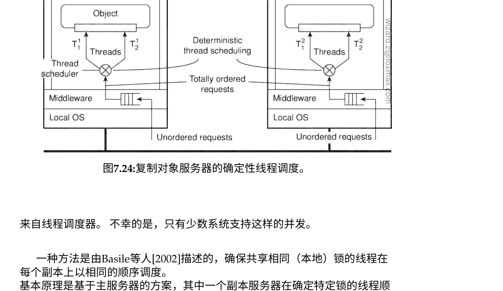

## 图7.24:复制对象服务器的确定性线程调度。

> 注 7.7（高级：复制调用） 另一个需要解决问题是复制调用。考虑一个对象 A调用另一个对象 B，如图7.25所示。假设对象 B还要调用另一个对象 C。如果B被复制，每个B的副本原则上都会独立地调用 C。问题是C现在被多次调用，而不是只调用一次。如果在 C上调用方法导致转移$100,000，那么显然，迟早会有人抱怨。

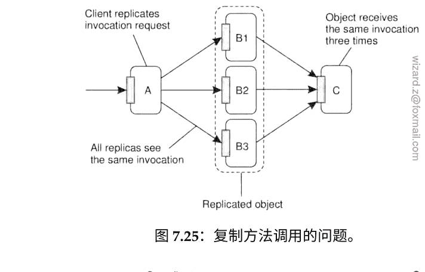

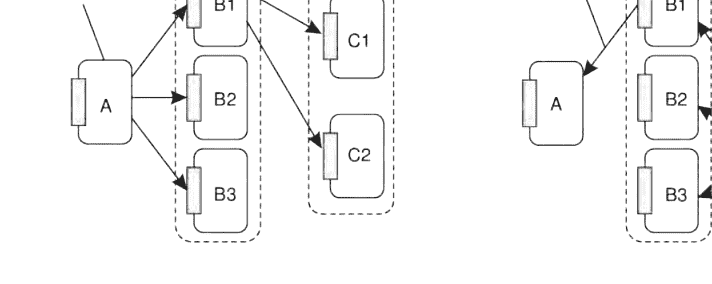


## 7.4. 副本管理

目前没有很多通用的解决方案来解决复制调用的问题。一种解决方案是简单地禁止它[Maassen et al., 2001]，这在性能至关重要时是有意义的。然而，当为了容错性而复制时，可以采用Mazouni等人[1995]提出的以下解决方案。他们的解决方案与复制策略无关，即复制品如何保持一致的具体细节。关键是在(replicated)对象执行之上提供一个复制感知的通信层。当一个复制对象B调用另一个复制对象C时，调用请求首先由B的每个副本分配相同的唯一标识符。此时，B的副本协调器将其请求转发给所有C对象的副本，而B的其他副本则保留其调用请求的副本，如图7.26所示。结果是每个C对象的副本只转发一个请求。

使用相同的机制来确保只有一个回复消息返回给副本B。图7.26展示了这种情况。副本C的协调者注意到它正在处理由每个副本C生成的复制的回复消息。然而，只有协调者将该回复转发给对象B的副本，而副本C的其他副本则保留其回复消息的副本。

当副本B接收到一个调用请求的回复消息，该请求可能已经转发给C或者被保留，因为它不是协调者，然后将回复交给实际对象。

本质上，刚刚描述的方案是基于多播通信的，但是防止了不同副本多播相同的消息。

因此，它本质上是一个基于发送者的方案。另一种解决方案是让接收副本检测到属于同一调用的多个传入消息的副本，并只传递一个副本给其关联的对象。该方案的详细信息留作练习。

## 7.5 一致性协议

我们现在专注于一致性模型的实际实现，通过查看几个一致性协议。一致性协议描述了特定一致性模型的实现。我们按照数据中心模型的组织方式，首先查看数据中心模型，然后是客户端模型的协议。

## 连续一致性

作为对连续一致性的研究的一部分，Yu和Vahdat [2000]开发了一些协议来解决三种一致性形式。在接下来的内容中，我们简要考虑了一些解决方案，为了清晰起见，省略了细节。

## 限制数值偏差

我们首先专注于是种解决方案，以保持数值偏差在一定范围内。再次强调，我们的目的不是详细介绍每个协议的所有细节，而是给出一般的思路。有关限制数值偏差的详细信息可以在[Yu和Vahdat，2000]中找到。

我们专注于对单个数据项的写入x。每个写入W(x)都有一个相关的值，表示x被更新的数值，表示为val(W(x))，或者简单地表示为val(W)。为了简单起见，我们假设val(W)>0。每个写入W最初提交给N个可用的副本服务器之一，在这种情况下，该服务器成为写入的起源，表示为origin(W)。如果我们考虑系统在特定时刻，我们会看到还有几个提交的写入需要传播到所有服务器。

## 7.5. 一致性协议

为此，每个服务器 S_i将跟踪其自己本地副本 x上执行的写入日志 L_i。

让 TW[i, j]是由服务器 S_i执行 write 操作的效果 Sj:

TW[i,j] = ∑{val(W)|origin(W) = Sj and W ∈ Li}

请注意 TW[i, j]表示提交给 S_i的聚合写操作。我们的目标是在任何时间 t，让服务器 S_i上的当前值 v_i与实际值 v of x之间有一定的偏差。这个实际值完全由所有提交的写操作决定。也就是说，如果 v0是 x的初始值，那么

v = v0 + Σ (k=1到N) TW[k,k]

和 v_i = v0 + Σ (k=1到N) TW[i,k]

请注意 v_i ≤ v。让我们只关注绝对偏差。特别是，对于每个服务器 S_i，我们关联一个上界 δ_i，我们需要强制执行：

v - v_i ≤ δ_i

提交给服务器 S_i的写操作需要传播到所有其他服务器。

有不同的方法可以实现这一点，但通常一种流行的传染协议会允许快速传播更新。无论如何，当服务器S_i传播源自 S_j到 S_k的写操作时，后者将能够了解写操作发送时的值 TW[i,j]。换句话说， S_k可以维护一个对于 TW[i,j]的值 S_i将会有 的视图 TW_k[i,j]。显然，

0 ≤ TW_k[i,j] ≤ TW[i,j] ≤ TW[j,j]

整个思想是，当服务器 Sk注意到 Si没有跟上提交给 Sk的更新时，它会将其日志中的写操作转发给 Si。这种转发有效地推进了 Sk对 TW[i,k]的视图 TW_k[i,k]，使得偏差 TW[i,k] − TW_k[i,k]更小。特别是，当应用程序提交一个新的写操作，该操作会使 TW[k,k] − TWk[i,k]超过 δi / (N − 1)时，Sk会推进其对 TW[i,k]的视图。我们将其留给读者作为一个练习，来证明推进总是确保 v − v_i ≤ δ_i。

## 边界陈旧度偏差

有很多方法可以将副本的陈旧度保持在指定范围内。

一种简单的方法是让服务器 Sk保持实时向量时钟 RVC_k

## Heading 1

Paragraph content as per image text

+   - Item 1

> “A quote segment。”

## 7.5. 一致性协议

如果概念不直观清晰，应用程序开发人员将很难构建正确的应用程序。简单性是受到赞赏的（也许是有道理的）。在顺序一致性的情况下，原始基于主节点的协议占优势。在这些协议中，数据存储中的每个数据项 x都有一个关联的主节点，负责协调对 x的写操作。可以区分主节点是固定在远程服务器上还是在将主节点移动到发起写操作的进程后可以在本地进行写操作。

## 远程写协议

支持复制的最简单的基于主节点的协议是需要将所有写操作转发到一个固定的单个服务器。读操作可以在本地进行。这种方案也被称为主备协议[Budhijara等，1993年]。主备协议的工作原理如图7.27所示。想要对数据项 x执行写操作的进程，将该操作转发给主服务器的x。主服务器对其本地副本的 x执行更新操作，并随后将更新操作转发给备份服务器。每个备份服务器也执行更新操作，并向主服务器发送确认回复（未显示）。当所有备份服务器更新其本地副本后，主服务器向初始进程发送确认回复。

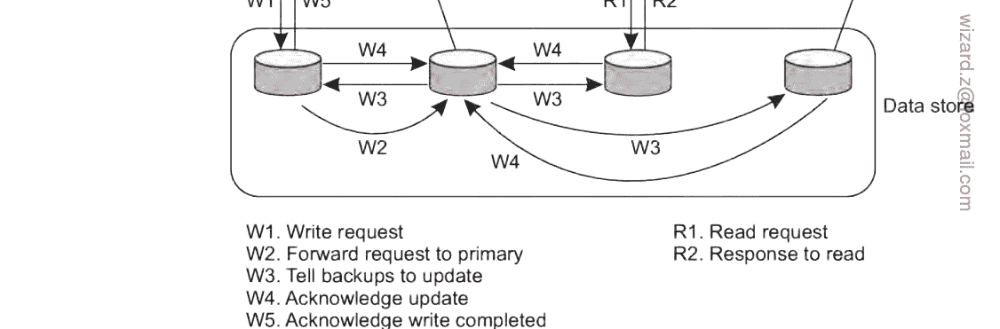

+   W1. Write request
+   W2. Forward request to primary
+   W3. Tell backups to update
+   W4. Acknowledge update
+   W5. Acknowledge write completed
+   R1. Read request
+   R2. Response to read

## 图7.27：主备协议的原理。

这种方案可能存在一个潜在的性能问题，即在允许发起更新的进程继续之前，可能需要相对较长的时间。实际上，更新操作被实现为一个阻塞操作。另一种选择是使用非阻塞方法。一旦主服务器更新本地副本的时候，如果返回确认，则表示已经更新成功。之后，它会告诉备份服务器执行相同的更新操作。非阻塞的主备协议在[Budhiraja和Marzullo，1992]中有讨论。

## 第七章。一致性和复制

非阻塞的主备协议的主要问题与容错性有关。在阻塞方案中，客户端进程可以确定更新操作已经由多个其他服务器备份。非阻塞方案则不是这样。当然，优点是写操作的速度可能大大加快。

主备协议提供了顺序一致性的直接实现，因为主节点可以对所有传入的写操作进行全局唯一的时间排序。显然，所有进程都以相同的顺序看到所有写操作，无论使用哪个备份服务器执行读操作。此外，在阻塞协议中，进程始终可以看到其最近的写操作的效果（请注意，非阻塞协议无法保证这一点，除非采取特殊措施）。

## 本地写协议

主备协议的一种变体是主副本在希望执行写操作的进程之间迁移。与之前一样，每当一个进程想要更新数据项x时，它会找到数据项x的主副本，并将其移动到自己的位置，如图7.28所示。这种方法的主要优势在于可以在本地进行多个连续的写操作，而读取进程仍然可以访问它们的本地副本。然而，只有在遵循非阻塞协议的情况下，才能实现这种改进，即在主副本完成本地更新后，更新被传播到副本。

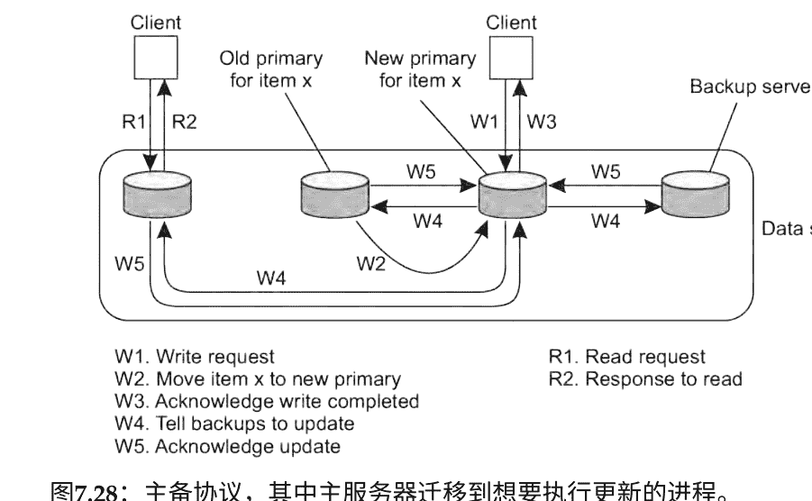

+   - W1. Write request
-   W2. Move item x to new primary
-   W3. Acknowledge write completed
-   W4. Tell backups to update
-   W5. Acknowledge update

## 图7.28：主备协议，其中主服务器迁移到想要执行更新的进程。

作为该方案的最后一个变体，非阻塞的本地写主导协议通常也用于一般的分布式文件系统。在这种情况下，可能会有一个固定的中央服务器，通常所有的写操作都会通过该服务器进行，就像远程写主备份的情况一样。然而，服务器会临时允许其中一个副本执行一系列本地更新，因为这可能会大大提高性能。当副本服务器完成后，更新会传播到中央服务器，然后再分发到其他副本服务器。

## 7.5. 一致性协议

## 复制写入协议

在复制写协议中，写操作可以在多个副本上执行，而不仅仅是一个副本，就像基于主导副本的情况一样。可以区分主动复制和基于多数投票的一致性协议。

### 主动复制

在主动复制中，每个副本都有一个相关的进程来执行更新操作。与其他协议相比，更新通常通过引起更新的写操作来传播。换句话说，操作被发送到每个副本。然而，也可以发送更新。

主动复制的一个问题是操作需要在所有地方按照相同的顺序执行。因此，需要一个全序多播机制。实现全序的一个实际方法是通过一个中央协调器，也称为一个顺序器。一种方法是首先将每个操作转发到顺序器，顺序器为其分配一个唯一的序列号，然后将操作转发给所有副本。操作按照它们的序列号顺序执行。

> 注7.8 （高级：实现可扩展性）
请注意，使用顺序器可能很容易引入可扩展性问题。实际上，如果需要全序多播，可以使用对称多播的组合 使用Lamport时间戳[Lamport, 1978]和序列器可能是必要的。
Rodrigues等人[1996]描述了这样的解决方案。该解决方案的核心是让多个序列器相互组播更新操作，并使用Lamport的全序机制对更新进行排序，如第6.2节所述。非序列化进程被分组，每个组使用一个序列器。任何非序列化进程都会向其序列器发送更新请求，并等待收到已处理请求的确认（即以全序方式组播到其他序列器）。显然，作为序列器和不作为序列器的进程数量之间存在权衡，以及选择作为序列器的进程。事实证明，这种权衡在很大程度上取决于应用程序，特别是每个进程的相对更新速率。

### 基于法定人数的协议

支持复制写入的另一种方法是使用投票，最初由Thomas [1979]提出，并由Gifford [1979]推广。

**基本思想是要求客户端在读取或写入复制的数据项之前，先请求并获取多个服务器的许可。**

作为算法如何工作的一个简单示例，考虑一个分布式文件系统，并假设一个文件在N个服务器上复制。我们可以制定一个规则，规定要更新一个文件，客户端必须首先联系至少半数以上的服务器加一（多数派），并让它们同意进行更新。一旦他们同意，文件就会被更改，并与新文件关联一个新的版本号。版本号用于标识文件的版本，并且对所有新更新的文件都是相同的。

要读取一个复制的文件，客户端还必须联系至少半数以上的服务器加一，并要求它们发送与文件关联的版本号。

如果所有版本号都相同，这一定是最新版本 因为仅尝试更新剩余的服务器将会失败 因为它们数量不足。

例如，如果有五台服务器，客户端确定其中三台的版本号为8，那么其他两台不可能是版本号9。毕竟，从版本8成功更新到版本9需要得到三台服务器的同意，而不仅仅是两台。

当基于仲裁的复制最初被引入时，提出了一个稍微更一般的方案。为了读取一个存在N副本的文件，客户端需要组装一个读取仲裁，任意收集任何NR台服务器或更多。同样，要修改一个文件，需要至少一个写入仲裁，由NW台服务器组成。NR和 NW的值受以下两个约束条件的限制：

+   1. NR + NW > N
2. NW > N/2

## 7.5. 一致性协议

要了解此算法的工作原理，请考虑图7.29(a)，其中NR = 3和NW =10。假设最近的写入仲裁组由服务器C到L组成。所有这些都获得了新版本和新版本号。任何后续的三个服务器的读取仲裁组必须包含此集合的至少一个成员。当客户端查看版本号时，它将知道哪个是最新的并选择该版本。

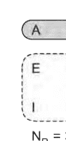


图7.29：投票算法的三个示例。灰色区域表示读取仲裁组；白色区域表示写入仲裁组。交集中的服务器以粗体表示。
(a) 正确的读取和写集合选择。
(b) 可能导致写写冲突的选择。
(c) 正确的选择，称为ROWA（读一写全）。

## 缓存一致性协议

缓存是复制的一种特殊情况，因为它们通常由客户端而不是服务器控制。然而，确保缓存与服务器发起的副本一致的缓存一致性协议，原则上与迄今讨论的一致性协议并没有太大区别。

## 第七章。一致性和复制

在共享内存多处理器系统的背景下，缓存的设计和实现已经进行了大量研究。许多解决方案基于底层硬件的支持，例如假设可以进行嗅探或高效广播。在基于通用操作系统构建的中间件分布式系统的背景下，基于软件的缓存解决方案更加有趣。在这种情况下，通常会维护两个单独的标准来分类缓存协议（也可以参考Min和Baer [1992]，Lilja [1993]或Tartalja和Milutinovic [1997]）。

首先，缓存解决方案在一致性检测策略上可能有所不同，即实际检测到不一致的时机。在静态解决方案中，假设编译器在执行之前执行必要的分析，并确定哪些数据可能导致不一致性，因为它们可能被缓存。编译器只需插入避免不一致的指令。

动态解决方案通常应用于本书中研究的分布式系统中。在这些解决方案中，不一致性会在运行时被检测出来。例如，与服务器进行检查，以查看缓存数据自缓存以来是否已被修改。

在分布式数据库的情况下，可以通过考虑事务进行检测的确切时间来进一步分类基于动态检测的协议。Franklin等人[1997]区分了以下三种情况。首先，在事务期间访问缓存数据项时，客户端需要验证该数据项是否与（可能复制的）服务器上存储的版本保持一致。在其一致性被明确验证之前，事务无法继续使用缓存版本。

第二种乐观的方法是在验证进行时允许事务继续进行。在这种情况下，假设在事务开始时缓存数据是最新的。如果这个假设后来被证明是错误的，事务将不得不中止。

第三种方法是仅在事务提交时验证缓存数据是否是最新的。实际上，事务只是开始在缓存数据上操作，并希望一切顺利。在所有工作完成后，访问的数据将被验证以确保一致性。当使用过期的数据时，事务将被中止。

缓存一致性协议的另一个设计问题是一致性执行策略，它决定了如何使缓存与服务器上存储的副本保持一致。最简单的解决方案是完全禁止共享数据被缓存。相反，共享数据仅在服务器上保留，并使用上述基于主节点或复制写入协议之一来保持一致性。客户端只允许缓存私有数据。显然，这种解决方案只能提供有限的性能改进。

当共享数据可以被缓存时，有两种方法来强制缓存一致性。第一种方法是让服务器向所有缓存发送失效通知。

## 7.5. 一致性协议

每当一个数据项被修改时。第二种方法是简单地传播更新。大多数缓存系统使用这两种方案之一。在客户端-服务器数据库中，有时支持动态选择发送失效或更新。

最后，我们还需要考虑当一个进程修改缓存数据时会发生什么。当使用只读缓存时，更新操作只能由服务器执行，随后遵循某种分布协议以确保更新被传播到缓存中。在许多情况下，采用拉取式方法。在这种情况下，客户端检测到其缓存已过期，并向服务器请求更新。

另一种方法是允许客户端直接修改缓存的数据，并将更新转发给服务器。这种方法在分布式文件系统中通常使用写穿透缓存。

实际上，写穿透缓存类似于基于主节点的本地写协议，其中客户端的缓存成为临时主节点。为了保证（顺序）一致性，必须确保客户端已被授予独占的写权限，否则可能发生写-写冲突。

写透缓存潜在地提供了比其他方案更好的性能，因为所有操作都可以在当地执行。如果我们延迟更新的传播，允许多次写入在通知服务器之前进行，还可以进一步改进。这导致了所谓的写回缓存，再次主要应用于分布式文件系统。

注7.9 （示例：NFS中的客户端缓存） 作为一个实际的例子，考虑NFS中的一般缓存模型，如图7.30所示。每个客户端都可以有一个内存缓存，其中包含以前从服务器读取的数据。此外，还可以添加一个磁盘缓存作为内存缓存的扩展，使用相同的一致性参数。


通常，客户端缓存文件数据、属性、文件句柄和目录。存在不同的策略来处理缓存数据、缓存属性等的一致性。让我们首先看一下缓存文件数据。

## 第七章。一致性和复制

NFSv4支持两种不同的缓存文件数据的方法。最简单的方法是当客户端打开一个文件并缓存从服务器获取的数据作为各种读操作的结果时。此外，写操作也可以在缓存中进行。当客户端关闭文件时，NFS要求如果有修改发生，则必须将缓存的数据刷新回服务器。这种方法对应于之前讨论的会话语义的实现。

一旦（部分）文件被缓存，客户端可以在关闭文件后仍然保留其数据在缓存中。此外，同一台机器上的多个客户端可以共享一个缓存。NFS要求每当客户端打开一个先前关闭且已经（部分）缓存的文件时，客户端必须立即重新验证缓存的数据。重新验证通过检查文件的最后修改时间并在包含陈旧数据的情况下使缓存无效。

在NFSv4中，当打开一个文件时，服务器可以将其部分权限委托给客户端。当客户机被允许在本地处理其他客户机在同一台机器上的打开和关闭操作时，发生开放委托。 通常，服务器负责检查文件是否应该成功打开，例如，因为需要考虑共享预留。通过开放委托，客户机有时被允许做出这样的决定，避免了与服务器的联系。

例如，如果服务器将文件的打开委托给请求写权限的客户端，那么同一台机器上的其他客户机的文件锁请求也可以在本地处理。服务器仍然会处理来自其他机器上的客户端的锁请求，只需拒绝这些客户端访问该文件即可。

请注意，在将文件委托给仅请求读权限的客户端的情况下，此方案不起作用。在这种情况下，当另一个本地客户端想要获得写权限时，它必须与服务器联系；无法在本地处理该请求。

将文件委托给客户端的一个重要后果是服务器需要能够回收委托，例如，当另一个位于不同机器上的客户端需要获取文件的访问权限时。回收委托需要服务器能够回调客户端，如图7.31所示。


## 7.5. 一致性协议

然而，请注意，回调需要服务器跟踪已委派文件的客户端。在这里，我们看到另一个例子，其中一个NFS服务器无法以无状态的方式实现。然而，请注意，委派和有状态服务器的组合可能在客户端和服务器故障的情况下导致各种问题。

## 7.6 示例：Web中的缓存和复制

Web可以说是有史以来构建的最大的分布式系统。起源于一个相对简单的客户端-服务器架构，现在已经发展成为一个复杂的系统，包含许多技术来确保严格的性能和可用性要求。这些要求导致了许多关于Web内容缓存和复制的提案。最初的方案（目前仍然广泛使用）主要用于支持静态内容，但也投入了大量工作来支持动态内容，即生成请求结果的即时文档以及包含脚本等内容 的文档。Rabinovich和Spastscheck [2002]提供了传统Web缓存和复制的概述。

Web中的客户端缓存通常发生在两个地方。首先，大多数浏览器都配备了一个相对简单的缓存功能。

每当获取一个文档时，它都会被存储在浏览器的缓存中，下次加载时从缓存中读取。其次，客户端的站点通常运行一个Web代理。Web代理接受来自本地客户端的请求，并将其传递给Web服务器。当响应到达时，结果将传递给客户端。这种方法的优点是代理可以缓存结果，并在需要时将该结果返回给另一个客户端。换句话说，Web代理可以实现共享缓存。由于有很多文档是动态生成的，服务器通常会将文档分成多个部分，并指示客户端仅缓存下次请求时可能不会更改的部分。

除了在浏览器和代理服务器上进行缓存之外，ISP通常还在其网络中放置缓存。这些方案主要用于减少网络流量（对于ISP来说是好事）和提高性能（对于终端用户来说是好事）。然而，当缓存中不包含所请求的信息时，从客户端到服务器的请求路径上存在增加延迟的风险。

## 注 7.11（高级：合作缓存）

作为构建分层缓存的替代方案，也可以按照图7.32所示的方式组织缓存以进行合作部署。在合作缓存或分布式缓存中，当Web代理发生缓存未命中时，代理首先检查一些相邻的代理，看看它们是否包含所请求的文档。如果这样的检查失败，代理将请求转发给负责该文档的Web服务器。在更传统的环境中，该方案主要用于属于同一组织或机构的Web缓存。


图7.32：合作缓存的原理。

Wolman等人的一项研究[1999]表明，合作缓存可能只对相对较小的客户群体（数量在数万用户级别）有效。然而，这样的群体也可以通过使用单个代理缓存来提供服务，这在通信和资源使用方面更加廉价。

然而，十年后的一项研究由Wendell和Freedman [2011]展示

## 7.6. 示例：Web中的缓存和复制

在一个高度分散的系统中，合作缓存实际上非常有效。这些研究并不一定相互矛盾：在两种情况下，结论都是合作缓存的效果高度依赖于客户端的需求。

Rodriguez等人[2001]对分层缓存和合作缓存进行了比较，明确指出存在各种权衡。例如，由于合作缓存通常通过高速链接连接，获取文档所需的传输时间比分层缓存要低得多。此外，正如预期的那样，合作缓存的存储要求比分层缓存要宽松。

不同的缓存一致性协议已经在Web中部署。为了确保从缓存返回的文档是一致的，一些Web代理首先向服务器发送一个有条件的HTTP get请求，其中包含一个额外的If-Modified-Since请求头，指定与缓存文档相关联的最后修改时间。只有在文档自那个时间以来发生了变化，服务器才会返回整个文档。否则，Web代理可以简单地将其缓存版本返回给请求的本地客户端，这对应于一种拉取式协议。

不幸的是，这种策略要求代理服务器为每个请求联系服务器。为了提高性能，以牺牲一致性为代价，广泛使用的Squid Web代理[Wessels, 2004]为缓存的文档分配了一个过期时间T_expire，该时间取决于文档上次修改的时间。特别地，如果T_last_modified是文档的最后修改时间（由所有者记录），而T_cashed是缓存的时间，则

```
T_expire = α(T_cashed − T_last_modified) + T_cashed
```

其中α=0.2（该值是通过实际经验得出的）。在T_expire之前，文档被视为有效，代理服务器不会联系服务器。在过期时间之后，代理服务器会请求服务器发送最新的副本，除非文档没有被修改。需要注意的是，Squid还允许将过期时间限制在最小和最大时间范围内。

作为一种替代拉取协议的方法是，服务器通过发送无效ation来通知代理文档已被修改。这种方法对于Web代理存在的问题是，服务器可能需要跟踪大量的代理，不可避免地导致可扩展性 aws。

然而，通过结合租约和无效ation，服务器需要维护的状态可以保持在可接受的范围内。请注意，这个状态主要由租约设置的过期时间所决定：越低，服务器需要跟踪的缓存越少。然而，几乎不应用Web代理缓存的无效ation协议。可以在[Cao and Ozsu, 2002]中找到Web缓存一致性策略的比较。他们的结论是，让服务器发送无效ation可以在带宽和感知的客户端延迟方面胜过任何其他方法，同时保持缓存文档与源服务器一致。

## 第七章。一致性和复制

在带宽和感知的客户端延迟方面，让服务器发送无效ation可以优于任何其他方法，同时保持缓存文档与源服务器一致。

最后，我们还应该提到，已经进行了大量研究来找出最佳的缓存替换策略。存在许多提议，但总的来说，简单的替换策略，如淘汰最近最少使用的对象，已经足够好。Podling和Boszormenyi [2003]提供了一份关于替换策略的深入调查；Ali等人[2011]提供了一个更近期的概述，其中包括Web预取技术。

随着Web作为组织展示自己并与最终用户直接互动的工具的重要性不断增加，我们看到在维护Web站点内容和确保站点易于连续访问之间发生了转变。这种区别为内容传递网络（CDN）铺平了道路。这些CDN的主要思想是它们充当Web托管服务，为多个站点的Web文档分发和复制提供基础设施。基础设施的规模可能令人印象深刻。例如，截至2016年，据报道，Akamai在120个国家/地区分布着超过200,000台服务器。

CDN的规模之大要求托管的文档必须自动分发和复制。在大多数情况下，大规模的CDN是按照反馈控制循环的方式组织的，如图7.33所示，并且在[Sivasubramanian et al. [2004b]中有详细描述。


图7.33：CDN作为反馈控制系统的一般组织结构。

与Web托管系统中的复制相关的方面基本上可以分为三种：度量估计、适应触发和采取适当措施。后者可以细分为副本放置决策、一致性强制和客户端请求路由。在接下来的内容中，我们简要介绍每个方面。

## 决定性的。此外，财务指标与互联网的实际基础设施密切相关。例如，大多数商业CDN将服务器放置在互联网的边缘，这意味着他们直接从ISP租用容量为终端用户提供服务。此时，商业模式与技术问题交织在一起，这是一个并不完全理解的领域。关于财务绩效与技术问题之间的关系，目前只有少量资料可供参考[Janiga et al., 2001]。

从这些例子中可以清楚地看出，仅仅测量CDN的性能，甚至估计其性能本身就是一个非常复杂的任务。实际上，对于商业CDN来说，真正重要的问题是它们是否能够满足与客户达成的服务级别协议。这些协议通常简单地以客户服务的速度来表述。然后由CDN来确保这些协议得到履行。

还需要解决的另一个问题是何时以及如何触发适应性。一个简单的模型是定期估计指标，然后根据需要采取措施。这种方法在实践中经常被采用。

位于服务器上的特殊进程收集信息并定期检查变化。

## 注7.12（高级：闪电人群）

定期评估的一个主要缺点是可能会错过突然的变化。

一种受到广泛关注的突然变化类型是闪电人群。闪电人群是对特定Web文档的突然请求激增。在许多情况下，这些突发请求激增可能导致整个服务崩溃，进而引发一系列服务中断。

处理闪电人群可能很困难。一个解决方案是大规模复制一个网站，并且一旦请求速率开始迅速增加，请求应该被重定向到副本以卸载主副本。这种过度配置显然不是正确的方法。相反，需要在需求增加时动态创建副本，并在困难时开始重定向请求。现在云计算已经适当地就位，再加上克隆虚拟机相对简单，对突然变化的需求需求做出反应实际上是可行的。此外，正如我们将在下面讨论的那样，使用内容传递网络的技术已经被证明效果很好。

然而，比起反应，更好的办法是预测闪电人群，然而这实际上非常困难，几乎不可能。图7.34显示了三个遭受闪电人群的不同网站的访问跟踪。

作为参考，图7.34(a)展示了跨越两天的常规访问轨迹。还有一些非常强烈的峰值，但除此之外没有什么令人震惊的事情发生。相比之下，图7.34(b)展示了一个持续两天的轨迹，其中有四个突然的闪电人群。在一段时间后可能会发现一些规律，从而可以采取措施。然而，在达到那一点之前，可能已经造成了损害。

> [Janiga et al., 2001]

## 7.6. 示例：Web中的缓存和复制


图7.34：一个正常的和三个不同的访问模式反映了闪电人群的行为。改编自Baryshnikov等人[2005]。

图7.34(c)展示了一个持续六天的轨迹，其中至少有两个闪电人群。在这种情况下，任何预测器都会遇到严重的问题，因为请求率的增加几乎是瞬间的。最后，图7.34(d)展示了一种情况，第一个峰值可能不需要进行调整，但第二个显然需要。通过运行时分析，这种情况实际上可以很好地处理。

如前所述，基本上只有三种（相关的）措施可以采取来改变Web托管服务的行为：改变副本的放置位置，改变一致性强制执行，以及决定何时以及如何重定向客户端请求。我们已经广泛讨论了前两种措施。客户端请求重定向值得更多关注。

在我们讨论一些权衡之前，让我们首先考虑一下在实际环境中如何处理一致性和复制，通过考虑Akamai情况[Dilley et al., 2002; Nygren et al., 2010]。

基本思想是每个Web文档由一个主HTML（或XML）页面组成，其中嵌入了几个其他文档，如图像、视频和音频。为了显示整个文档，用户的浏览器还需要获取嵌入的文档。

假设这些嵌入的文档很少改变，因此将它们缓存或复制是有意义的。

每个嵌入式文档通常通过URL引用。然而，在Akamai的CDN中，这样的URL被修改，以便它引用一个虚拟ghost，它是CDN中一个实际服务器的引用。URL还

包含了原始服务器的主机名，我们将在下面解释原因。修改后的URL的解析如下，如图7.35所示。


图7.35：Akamai CDN的主要工作原理。

虚拟ghost的名称包括一个DNS名称，例如 ghosting。com，这由常规DNS命名系统解析为CDN DNS服务器（步骤3的结果）。每个这样的DNS服务器都会跟踪靠近客户端的服务器。为此，我们之前讨论过的任何接近度量标准都可以使用。实际上，CDN DNS服务器将客户端重定向到最适合该客户端的副本服务器（步骤4），这可能意味着最近的服务器，负载最轻的服务器，或者几个这样的度量标准的组合（实际的重定向策略是专有的）。

最后，客户端将嵌入文档的请求转发给选择的CDN服务器。如果该服务器尚未拥有该文档，则从原始Web服务器获取它（如步骤6所示），在本地进行缓存，并随后将其传递给客户端。如果文档已经在CDN服务器的缓存中，则可以立即返回。请注意，为了获取嵌入文档，复制服务器必须能够向原始服务器发送请求，因此其主机名也包含在嵌入文档的URL中。

该方案的一个有趣之处在于可以简单地强制执行文档的一致性。显然，每当主文档发生更改时，客户端总是能够从原始服务器获取它。对于嵌入文档，需要采用不同的方法，因为这些文档原则上是从附近的复制服务器获取的。为此，嵌入文档的URL不仅引用最终导致CDN DNS服务器的特殊主机名，还包含一个唯一标识符，每次嵌入文档更改时都会更改。实际上，这个标识符改变了嵌入文档的名称。因此，

当客户端被重定向到特定的CDN服务器时，该服务器将在其缓存中找不到命名的文档，因此将从源服务器获取它。 旧文档最终将从服务器的缓存中清除，因为它不再被引用。

这个例子已经显示了客户端请求重定向的重要性。 原则上，通过正确地重定向客户端，CDN可以在客户端感知的性能方面保持控制，同时还考虑到全局系统性能，例如避免将请求发送到负载过重的服务器。 这些所谓的自适应重定向策略可以在提供系统当前行为信息给做出重定向决策的进程时应用。这在一定程度上让我们回到了之前讨论的度量估计技术。

除了不同的策略之外，一个重要的问题是请求重定向对客户端是否透明。实质上，只有三种重定向技术：TCP切换、DNS重定向和HTTP重定向。

我们已经讨论过TCP切换。 这种技术仅适用于服务器集群，不适用于广域网。

DNS重定向是一种透明的机制，客户端可以完全不知道文档的位置。Aka mai的两级重定向是这种技术的一个例子。我们还可以直接部署DNS来返回多个地址，就像我们之前讨论的那样。然而，请注意，DNS重定向只能应用于整个站点：单个文档的名称不适合DNS命名空间。

最后，HTTP重定向是一种非透明的机制。 当客户端请求特定文档时，它可能会在HTTP响应消息中得到一个替代URL，然后被重定向到该URL。一个重要的观察是，这个URL对客户端的浏览器是可见的。事实上，用户可能决定将引荐URL加入书签，这可能使重定向策略失效。

到目前为止，我们主要集中在缓存和复制静态Web内容上。实际上，我们看到Web越来越多地提供更多动态生成的内容，但它也在向可以被远程应用程序调用的服务扩展。在这些情况下，我们也看到缓存和复制可以在改善整体性能方面起到很大的帮助，尽管达到这种改进的方法比我们迄今讨论的更微妙（参见Conti等人[2005]）。

在通过缓存和复制来改善Web应用程序性能时，事情变得复杂，因为可以部署多种解决方案，没有一种单一的解决方案突出为最佳。让我们考虑图7.36中概述的边缘服务器情况（参见Sivasub-ramanian等人[2007]）。在这种情况下，我们假设CDN中的每个托管站点都有一个作为所有读取和更新操作的权威站点的源服务器。使用边缘服务器来处理客户端请求，并且具有能够将（部分）信息存储在原始服务器上。

回想一下，在边缘服务器架构中，Web客户端通过边缘服务器请求数据，而边缘服务器则从与客户端引用的特定网站相关联的原始服务器获取信息。如图7.36所示，我们假设原始服务器由一个数据库组成，从该数据库动态创建响应。虽然我们只展示了一个Web服务器，但通常根据多层架构组织每个服务器，就像我们之前讨论的那样。现在，可以大致按照以下方式组织边缘服务器。

首先，为了提高性能，我们可以决定对原始服务器上存储的数据进行完全复制。只要更新比例低且查询需要进行广泛的数据库搜索，这种方案就能很好地工作。如上所述，我们假设所有更新都在原始服务器上进行，原始服务器负责保持副本和边缘服务器处于一致状态。因此，读操作可以在边缘服务器上进行。

在这里，我们可以看到当更新比例高时，为了性能而复制将会失败，因为每次更新都会导致在广域网上进行通信，以使副本达到一致的状态。正如Sivasubramanian等人[2004a]所示，读取/更新比例是决定在广域设置中原始数据库应该复制到什么程度的因素。

完全复制的另一个情况是查询通常很复杂。对于关系数据库来说，这意味着查询需要搜索和处理多个表，就像联接操作一样。与复杂查询相对的是通常只需要访问一个表才能产生响应的简单查询。在后一种情况下，只存储数据子集的边缘服务器上的## 第8章 容错性

换句话说，如果我们忽略组件的老化，我们可以看到恒定的故障率导致可靠性遵循指数分布，其形式如图8.1所示。


图8.1：具有恒定故障率的组件的可靠性。

传统上，容错性与以下三个指标相关：

*   平均故障时间 (MTTF)：组件故障的平均时间。
*   平均修复时间 (MTTR)：修复一个组件所需的平均时间。
*   平均故障间隔时间 (MTBF)：简单地说，MTTF + MTTR。

请注意

```
A = \frac{MTTF}{MTBF} = \frac{MTTF}{MTTF + MTTR}
```

此外，只有在我们准确了解故障的概念时，这些指标才有意义。正如我们稍后会遇到的那样，识别故障的发生可能并不那么明显。

通常，可靠的系统也需要提供高度的安全性，特别是在涉及完整性等问题时。我们将在下一章讨论安全性。

当系统无法实现其承诺时，我们称其为失败。特别是，如果分布式系统被设计为为其用户提供多项服务，那么当其中一项或多项服务无法（完全）提供时，系统就会失败。错误是系统状态的一部分，可能导致故障。例如，在网络传输数据包时，预计在接收方接收到时会有一些数据包损坏。在这种情况下，损坏意味着接收方可能错误地感知到位值（例如，读取1而不是0），甚至可能无法检测到有东西到达。

错误的原因被称为故障。显然，找出导致错误的原因很重要。例如，错误或不良好的传输介质可能导致数据包损坏。在这种情况下，相对容易排除故障。然而，传输错误也可能是由于恶劣的天气条件，例如在无线网络中。改变天气以减少或防止错误有点棘手。

另一个例子是，崩溃的程序显然是一个失败，可能是因为程序进入了包含编程错误（即编程错误）的代码分支。该错误的原因是程序员。

构建可靠的系统与控制故障密切相关。正如Avizienis等人[2004]所解释的那样，可以区分预防、容忍、排除和预测故障。对于我们来构造，最重要的问题是最容错，即系统可以在存在故障的情况下提供其服务。例如，通过应用纠错码来传输数据包，可以在一定程度上容忍相对较差的传输线路，并降低错误（损坏的数据包）导致失败的概率。

故障通常被分为瞬态、间歇性或永久性。瞬态故障出现一次然后消失。如果操作重复执行，故障会消失。一只鸟飞过微波发射器的光束可能会导致某个网络上的位丢失（更不用说烤焦的鸟了）。如果传输超时并重试，第二次很可能会成功。

间歇性故障出现后自行消失，然后重新出现，如此往复。连接器上的松动接触常常会导致间歇性故障。间歇性故障会引起很多烦恼，因为它们很难诊断。通常，当故障诊断师出现时，系统正常工作。

永久性故障是指在故障组件被更换之前一直存在的故障。烧毁的芯片、软件错误和磁头崩溃都是永久性故障的例子。

## 故障模型

一个系统如果发生故障，就不能充分提供其设计的服务。如果我们将分布式系统看作是一组相互通信的服务器和客户端，不充分提供服务意味服务器、通信通道或者可能是两者都没有按照预期工作。然而，故障的服务器本身并不总是我们要找的原因。如果这样的服务器依赖其他服务器来充分提供其服务，那么错误的原因可能需要在其他地方寻找。

这样的依赖关系在分布式系统中非常常见。一个故障的磁盘可能会给一个旨在提供高可用性文件系统的文件服务器带来困扰。如果这样的文件服务器是分布式数据库的一部分，那么整个数据库的正常工作可能会受到威胁，因为只有部分数据可访问。

为了更好地了解故障的严重程度，已经开发了几种分类方案。其中一种方案如图8.2所示，基于Cristian [1991]和Hadzilacos和Toueg [1993]的方案描述。

| 故障类型       | 服务器行为描述                               |
| -------------- | -------------------------------------------- |
| 崩溃故障       | 停止工作，但在停止之前正常运行                 |
| 遗漏故障       | 无法响应传入请求                           |
| 接收遗漏       | 无法接收传入消息                           |
| 发送遗漏       | 无法发送消息                               |
| 时序故障       | 响应超出指定时间间隔                       |
| 响应故障       | 响应不正确                                   |
| 数值故障       | 响应的数值错误                             |
| 状态转换故障   | 偏离正确的控制流程                           |
| 任意故障       | 可能在任意时间产生任意响应                     |

图8.2：不同类型的故障。

崩溃故障发生在服务器过早停止工作，但在停止之前正常运行。崩溃故障的一个重要方面是一旦服务器停止工作，就再也听不到它的消息了。崩溃故障的一个典型例子是操作系统完全停止工作，唯一的解决方案是重新启动。许多个人电脑系统经常遭受崩溃故障，以至于人们已经习惯了它们是正常的。因此，将重置按钮从机箱背面移到前面是有充分理由的。也许有一天它可以再次移到背面，甚至完全移除。

当服务器未响应请求时，发生了一个省略故障。可能会发生几种问题。在接收省略故障的情况下，可能是服务器根本没有收到请求。请注意，客户端和服务器之间的连接可能已经建立，但没有线程监听传入的请求。此外，接收省略故障通常不会影响服务器的当前状态，因为服务器不知道任何发送给它的消息。同样，发送省略故障是指服务器已经完成了工作，但在发送响应时出现了故障。这种故障可能发生在服务器没有准备好的情况下，例如发送缓冲区溢出。请注意，与接收省略故障相比，服务器现在可能处于反映刚刚为客户端完成服务的状态。因此，如果发送响应失败，服务器必须准备好客户端重新发出其先前的请求。

与通信无关的其他类型的遗漏故障可能由软件错误引起，例如无限循环或不正确的内存管理，服务器被称为“挂起”。

另一类故障与时间有关。定时故障发生在响应超出指定的实时间隔时。例如，在流媒体视频的情况下，如果没有足够的缓冲空间来存储所有传入的数据，提供数据太早可能会给接收者带来麻烦。

 ## 8.1. 容错性介绍

 数据。然而，更常见的情况是服务器响应过晚，这种情况下会发生性能故障。

一种严重的故障是响应失败，即服务器的响应完全错误。可能发生两种类型的响应失败。在值失败的情况下，服务器只是提供了错误的回复请求。例如，一个搜索引擎系统地返回与搜索词无关的网页已经失败。

另一种响应失败的类型被称为状态转换失败。这种故障发生在服务器对传入请求的意外反应时。例如，如果服务器收到无法识别的消息，并且没有采取措施来处理这些消息，则会发生状态转换失败。特别是，故障的服务器可能会错误地执行不应该启动的默认操作。

最严重的是任意故障，也被称为拜占庭故障。实际上，当发生任意故障时，客户端应该做好最坏的准备。特别是，可能发生服务器正在产生本不应该产生的输出，但无法检测出其是否不正确。

拜占庭故障首先由Pease等人[1980]和Lamport等人[1982]进行了分析。我们将在下面讨论此类故障。

注8.2（更多信息：遗漏和错误）

人们已经习惯将拜占庭故障的发生与恶意操作的进程联系在一起。术语“拜占庭”指的是拜占庭帝国，一个时间（330 - 1453）和地点（巴尔干半岛和现代土耳其），据称在统治圈中阴谋、阴谋和不真实常见。

然而，可能无法检测到一个行为实际上是善意的还是恶意的。是一个运行着设计不良的操作系统的网络计算机，对其他计算机的性能产生负面影响吗？在这个意义上，最好做出以下区分，有效地排除了判断：

*   一种遗漏故障发生在组件未执行应该执行的操作时。
*   一种错误执行故障发生在组件执行了不应该执行的操作时。

这种由Mohan等人[1983]引入的差异也说明了可靠性和安全性之间的分离有时可能非常困难。

许多前述情况涉及一个进程的情况

P不再感知到来自另一个进程 Q的任何动作。然而，P能否得出结论 Q确实已
已经停止了？为了回答这个问题，我们需要区分两种类型的分布式系统：

*   在一个异步系统中，不做任何关于进程执行速度或消息传递时间的假设。结果是，当进程 P不再感知到来自 Q的任何动作时，它无法得出 Q已崩溃的结论。相反，它可能只是变慢了或者它的消息可能已经丢失了。
*   在一个同步系统中，进程执行速度和消息传递时间是有界的。这也意味着当 Q在预期时间内不再显示任何活动时，进程 P可以合理地得出 Q已崩溃的结论。

不幸的是，纯粹的同步系统只存在于理论中。另一方面，仅仅声明每个分布式系统都是异步的也不能完全反映实践中的情况，如果我们在设计分布式系统时过于悲观地假设它们必然是异步的，那将是不公正的。相反，更现实的假设是分布式系统是部分同步的：大部分时间它表现得像一个同步系统，但是它的行为在异步方式下没有时间上的限制。

换句话 say，异步行为是一种例外，这意味着我们通常可以使用超时来得出一个进程确实崩溃了结论，但偶尔这样的结论是错误的。实际上，这意味着我们将不得不设计容错解决方案，以承受错误地检测到一个进程停止的情况。

在这种情况下，停止故障可以从最轻微到最严重进行分类（参见Cachin等人[2011]）。我们让进程 P尝试检测进程 Q 是否失败。

*   故障停止故障是指可以可靠检测到的崩溃故障。 当假设通信链路无故障且故障检测进程 P 可以对来自 Q 的响应施加最坏情况延迟时，可能会发生这种情况。
*   故障嘈杂故障类似于故障停止故障，只是 P 最终才会得出 Q已崩溃的正确结论。这意味着在 P 对 Q 的行为进行可靠检测之前，可能存在一些先验未知的时间。
*   在处理故障静默故障时，我们假设通信 链路是无故障的，但进程 P 无法区分崩溃故障 和遗漏故障。
*   故障安全故障涵盖了通过 进程 Q 处理任何故障的情况，然而这些故障是良性的：它们不能造成任何伤害。
*   最后，在处理任意故障时， Q 可能以任何 可能的方式失败；故障可能是不可观察的，除了对其他进程的正确行为造成伤害之外。

显然，不得不处理任意故障是最糟糕的情况。

正如我们将很快讨论的那样，我们可以设计分布式系统，以便它们甚至可以容忍这些类型的故障。

## 冗余故障屏蔽

如果一个系统要具备容错能力，它所能做的最好的就是试图隐藏故障的发生对其他进程的影响。掩盖故障的关键技术是使用冗余。有三种可能：信息冗余，时间冗余和物理冗余（参见Johnson [1995]）。 通过信息冗余，可以添加额外的位以从混乱的位中恢复。例如，可以在传输的数据中添加海明码以从传输线上的噪声中恢复。

通过时间冗余，执行一个动作，然后，如果需要的话，再次执行。事务使用这种方法。如果一个事务中止，可以毫无损害地重新执行。另一个众所周知 的例子是在缺少预期响应时重新发送请求到服务器。当故障是瞬态或间歇性的时候，时间冗余尤其有帮助。

通过物理冗余，额外的设备或过程被添加进来，使整个系统能够容忍一些组件的丢失或故障。物理冗余可以在硬件或软件中实现。例如，可以向系统中添加额外的进程，这样即使其中一小部分崩溃，系统仍然可以正常运行。换句话来说，通过复制进程，可以实现高度的容错性。我们将在本章后面回到这种类型的软件冗余。

注8.3（更多信息：三模冗余）看到冗余如何应用于电子设备的设计是很有启发。例如，考虑图8.3(a)的电路。信号依次通过设备 A, B和 C。如果其中一个设备出现故障，最终结果可能是不正确的。

在图8.3(b)中，每个设备都被复制了三次。电路中的每个阶段后面都有一个三重投票器。每个投票器是一个具有三个输入和一个输出的电路。如果两个或三个输入相同，则输出等于该输入。如果三个输入都不同，则输出未定义。这种设计被称为三重模块冗余(TMR)。

假设元素 A2故障。每个投票器 V1, V2和 V3都有两个良好(相同)的输入和一个错误的输入，并且它们每个都将正确的值输出到第二阶段。实质上，A2故障的影响完全被掩盖，因此B1, B2和B3的输入与没有故障发生时完全相同。

现在考虑如果 B3和 C1也出现故障，除了 A2。
这些影响也被掩盖，所以三个最终输出仍然是正确的。

起初可能不明显为什么每个阶段都需要三个投票者。毕竟，一个投也可以检测并通过多数意见。然而，投票者也是一个组件，也可能出现故障。例如，假设投V1发生故障。那么B1的输入将是错误的，但只要其他一切正常，B2和 B3将产生相同的输出，V4、V5和 V6都将产生正确的结果进入第三阶段。对于V1的故障实际上与B1的故障没有区别。在这两种情况下，B1都会产生错误的输出，但在这两种情况下，它们都会在后来被投票否决，最终结果仍然是正确的。°

虽然并非所有容错分布式系统都使用TMR技术，但该技术非常通用，可以清晰地展示容错系统与仅具备高可靠性但无法容忍故障的系统（即在存在故障组件的情况下仍能正常运行）之间的区别。当然，TMR技术可以递归应用，例如，在芯片内部使用TMR技术使芯片具备高可靠性，而使用该芯片的设计师可能并不知晓，他们可能在自己的电路中使用多个芯片副本和投票器。

## 8.2 进程弹性

现在，我们已经讨论了容错的基本问题，让我们集中讨论如何在分布式系统中实现容错。我们首先讨论的主题是防止进程故障，这是通过将进程复制到组中来实现的。在接下来的页面中，我们将考虑进程组的一般设计问题，并讨论什么是容错组。此外，我们还将探讨在一个或多个成员不可信时如何在进程组内达成共识。

## 8.2. 进程韧性

## 通过进程组实现弹性

容忍故障进程的关键方法是将几个相同的进程组织成一个组。所有组的关键特性是当一个消息发送给组本身时，组的所有成员都会收到。这样，如果组中的一个进程失败，希望其他进程可以接替它[Guerraoui和Schiper，1997]。

进程组可以是动态的。新的可以被创建，旧的可以被销毁。在系统运行过程中，进程可以加入一个组或离开一个组。一个进程可以是几个组的成员。因此，需要机制来管理组和组成员资格。

引入组的目的是允许一个进程将其他进程的集合视为一个单一的抽象。因此，一个进程P可以向一个服务器组Q = {Q1,...,QN}发送消息，而不需要知道它们是谁，有多少个，或者在哪里，这可能在每次调用时都会发生变化。对于P，组Q看起来像一个单一的，逻辑上的进程。

## 团队组织

不同团队之间的一个重要区别在于它们的内部结构。在一些团队中，所有的进程都是平等的。没有明显的领导者，所有的决策都是集体做出的。在其他团队中，存在某种层级关系。例如，一个进程是协调者，其他所有进程都是工作者。在这个模型中，当工作请求被生成时，无论是外部客户端还是由其中一个工作者生成，都会被发送给协调者。

然后，协调者决定哪个工作者最适合执行该请求，并将其转发给该工作者。当然，也可以有更复杂的层级关系。这些通信模式在图8.4中有所说明。

每个组织都有其优点和缺点。扁平组是对称的，没有单点故障。如果其中一个进程崩溃，团队只是变得更小，但仍然可以继续运行。一个缺点是决策变得更加复杂。例如，为了做出任何决策，通常需要进行投票，这会导致一些延迟和开销。

层次化群组具有相反的特性。协调者的丢失使整个群组停滞不前，但只要协调者运行，它可以在不打扰其他人的情况下做出决策。实际上，在层次化群组中，当协调者失败时，其角色将需要被接管，并且其中一个工作进程将被选举为新的协调者。我们在第6章讨论了领导选举算法。


图8.4：(a)扁平群组和(b)层次化群组中的通信。

## 成员管理

当存在群组通信时，需要一种方法来创建和删除群组，以及允许进程加入和离开群组。

一种可能的方法是有一个群组服务器，所有这些请求都可以发送到该服务器。然后，群组服务器可以维护所有群组及其精确成员的完整数据库。这种方法简单、高效，而且相对容易实现。不幸的是，它与所有集中式技术共享一个主要缺点：单点故障。如果群组服务器崩溃，群组管理将不复存在。可能大多数或所有群组都必须从头开始重建，可能会终止正在进行的任何工作。

另一种方法是以分布式方式管理组成员资格。例如，如果（可靠的）多播可用，外部人员可以向所有组成员发送消息，宣布其希望加入该组。

理想情况下，要离开一个组，成员只需向每个人发送一条告别消息。在容错性的背景下，假设故障停止故障语义通常是不合适的。问题是，当一个进程自愿离开时，没有礼貌的公告表明进程崩溃。其他成员必须通过注意到崩溃的成员不再对任何事情做出响应来通过实验发现这一点。一旦确定崩溃的成员确实已经停止工作（而不仅仅是慢），它可以从组中删除。

另一个棘手的问题是离开和加入必须与发送的数据消息同步。换句话说，从一个进程加入一个组的瞬间开始，它必须接收到发送到该组的所有消息。

同样地，一旦一个进程离开一个组，它就不能再接收来自该组的任何消息，其他成员也不能再接收来自它的任何消息。确保加入或离开被整合的一种方法是

## 8.2. 进程韧性

将此操作转换为发送给整个组的一系列消息，以便将其插入到正确的位置

与组成员资格相关的最后一个问题是，如果有太多进程崩溃，以至于整个组无法正常运行，该办。需要一些协议来重建该组。不可避免地，某个进程必须采取主动来开始这个过程，但如果同时有两个或三个进程尝试，会发生什么？协议必须能够经受住这种情况。同样，可能需要通过例如领导选举算法来进行协调。

## 故障屏蔽和复制

进程组是构建容错系统的一部分。

特别是，拥有一组相同的进程可以使我们在该组中屏蔽一个或多个故障进程。换句话说，我们可以复制进程并将它们组织成一个组，以替换一个（易受攻击的）进程，使用一个（容错的）组。如前一章所讨论的，有两种方法可以实现这种复制：基于主节点的协议或复制写入协议。

在容错的情况下，基于主备份的复制通常以主备份协议的形式出现。在这种情况下，一组进程以分层方式组织，其中一个主进程协调所有写操作。在实践中，主进程是固定的，尽管其角色可以由其中一个备份接管。实际上，当主进程崩溃时，备份执行一些选举算法来选择一个新的主进程。

复制写协议以主动复制的形式和基于仲裁的协议的方式使用。这些解决方案对应于将一组相同的进程组织成一个扁平组。主要优点是这些组没有单点故障，但需要分布式协调。

使用进程组容错的一个重要问题是需要多少复制。为了简化我们的讨论，让我们只考虑复制写系统。如果一个系统可以在 k个组件发生故障的情况下仍然满足其规格，则称该系统具有 k容错性。如果组件（例如进程）发生静默故障，则拥有 k +1个组件足以提供 k容错性。如果k个组件只是停止工作，则可以使用其他组件的答案。

另一方面，如果进程出现任意故障，在故障时继续运行并发送错误或随机的回复，则需要至少2k +1个进程才能实现 k容错。在最坏的情况下，k个故障进程可能会意外地（甚至故意地）生成相同的回复。然而，剩下的 k +1个进程也会产生相同的答案，因此客户端或投票者可以相信多数意见。

现在假设在一个 k容错的组中有一个进程失败。整个组仍然符合其规格，即它可以
[/content]

## 在具有崩溃故障的系统中的共识

容忍高达k个成员的失败（其中一个刚刚失败）。但是，如果超过k个成员失败会发生什么？在这种情况下，所有的赌注都是无效的，无论该组做什么，其结果（如果有的话）都是不可信的。另一种看待这个问题的方式是，进程组在模拟单个强大进程的外观时失败了。

### 8.2 进程韧性

正如提到的，在客户端和服务器方面，我们采用了一种模型，在这个模型中，一个可能非常庞大的客户端集合现在向一组进程发送命令，这些进程共同行为像一个单一的、高度健壮的进程。为了使这个工作正常，我们需要做一个重要的假设：

在一个容错的进程组中，每个非故障的进程按照相同的顺序执行相同的命令，就像其他非故障的进程一样。

形式上，这意味着组成员需要就要执行哪个命令达成共识。如果不会发生故障，达成共识是很容易的。例如，我们可以使用Lamport的全序多播，如6.2节所述。或者，为了简单起见，使用一个集中式的顺序生成器，为每个需要执行的命令分配一个序列号，也可以完成任务。不幸的是，生活并不是没有故障的，而在更现实的假设下，达成一组进程之间的共识变得棘手起来。

为了说明问题，让我们假设我们有一组进程 P = {P₁,…, Pₙ}在故障停止失败语义下运行。换句话说，我们假设在组成员之间可以可靠地检测到崩溃故障。通常，客户端会联系一个组成员请求其执行一个命令。每个组成员都维护一个提议命令的列表：其中一些是直接从客户端接收到的，另一些是从其他组成员那里接收到的。我们可以使用以下方法达成共识，该方法源自Cachin等人的研究[2011]，并被称为洪泛共识。

从概念上讲，该算法按轮次运行。在每一轮中，进程 Pi将其迄今为止看到的提议命令列表发送给 P中的每个其他进程。在一轮结束时，每个进程将所有收到的提议命令合并成一个新列表，然后根据可能性选择要执行的命令。重要的是要意识到选择算法对所有进程都是相同的。换句话说，如果所有进程都有完全相同的列表，它们将都选择相同的命令来执行（并从列表中删除该命令）。

很容易看出，只要进程不失败，这种方法就能起作用。当一个进程 Pi在第r轮检测到，比如说进程 Pk崩溃时，问题就开始了。为了具体说明，假设我们有一个进程

![图8.5：在崩溃故障存在的情况下通过洪泛达成共识。引用自Cachin et al. [2011]。]

假设所有进程在回合开始时都知道谁是组成员在回合 r 结束时，P₂准备好决定要执行哪个命令当它收到其他成员的相应列表时：它已经有了到目前为止的所有命令但对于 P₃和 P₄来说不是这样。例如，P₃可能会检测到 P₁崩溃，但它不知道 P₂或 P₄是否已经收到 P₁的列表。从 P₃的角度来看，如果有另一个进程已经收到了 P₁的提议命令，那个进程可能会做出与自己不同的决策。因此，P₃能做的最好的事情就是推迟决策直到下一轮。在这个例子中，P₄也是一样。当一个进程收到每个非故障进程的消息时，它将决定进入下一轮。这假设每个进程都能可靠地检测到另一个进程的崩溃，否则它将无法确定哪些进程是非故障的。

因为进程 P₂接收到了所有的命令，它确实可以做出决策，并且随后可以将该决策广播给其他进程。然后，在下一轮 r + 1 期间，进程 P₃和 P₄也能够做出决策：它们将决定执行 P₂选择的相同命令。要理解为什么这个算法是正确的，重要的是要意识到，只有当一个进程检测到另一个进程失败时，它才会在没有做出决策的情况下进入下一轮。最后，这意味着在最坏的情况下最多只剩下一个非故障进程，而这个进程可以简单地决定执行任何提议的命令。再次注意，我们假设故障检测是可靠的。

但是，如果进程 P₂发送给进程 P3 的决策丢失了会发生什么？在这种情况下，P₃仍然无法做出决策。更糟糕的是，我们需要确保它与 P₂和 P₄做出相同的决策。如果 P₂没有在这种情况下，P₃仍然无法做出决策。

### 第8章 容错性

如果进程 P₂崩溃了，我们可以假设重新传输它的决策会挽救局面。如果进程 P₄检测到进程 P2崩溃了，它将重新广播它的决策。与此同时，进程 P₃已经进入下一轮，在收到进程P₄的决策后，将终止算法的执行。

### 示例：Paxos

基于洪泛的共识算法并不是非常现实，因为它依赖于故障停止模型。更加现实的是假设存在故障嘈杂模型，其中一个进程最终会可靠地检测到另一个进程崩溃了。接下来，我们将描述一个被广泛采用的共识算法的简化版本，即Paxos。它最初是由Leslie Lamport在1989年发表的技术报告，但是大约过了十年，有人决定通过常规的科学渠道传播它[Lamport，1998]。原始出版物并不容易理解，这可以通过其他旨在解释它的出版物来说明[Lampson，1996; Prisco et al.，1997; Lamport，2001; van Renesse and Altnbucken，2015]。

### 基本Paxos

Paxos运行的假设相当薄弱：

+   - 分布式系统是部分同步的（实际上，它甚至可能是异步的）．
- 进程之间的通信可能是不可靠的，意味着消息可能会丢失、重复或重新排序．
- 被损坏的消息可以被检测出来（因此随后被忽略）．
- 所有关操作都是确定性的：一旦开始执行，就知道它将做什么．
- 进程可能会发生崩溃故障，但不会发生任意故障，也不会进程勾结.

总的来说，这些是许多实际分布式系统的现实假设。

我们大致遵循Lamport [2001]和Kirschand Amir [2008]的解释.该算法作为一个网络的逻辑进程运行，其中有不同的类型.首先，有客户端请求执行特定的操作.在服务器端，每个客户端由一个单一的提议者代表，试图使客户端的请求被接受.通常情况下，一个提议者被指定为领导者，并推动协议达成共识.

### 8.2 进程韧性

我们需要确立的是，一个提议的操作被一个接受者接受。如果大多数接受者接受相同的提议，该提议被称为被选择。然而，被选择的内容仍然需要被学习。为了达到这个目的，我们将拥有多个学习者进程，每个进程在被大多数接受者通知后执行一个被选择的提议。

重要的是要注意，一个单独的提议者、接受者和学习者形成一个单独的物理进程，在与客户端通信的单个机器上运行，如图8.6所示。因此，我们假设，例如，如果一个提议者崩溃，那么它所属的物理进程也将崩溃。

通过复制这个服务器，我们的目标是在崩溃故障的存在下获得容错性。

![图8.6：Paxos算法示意图]

基本模型是，领导提议者一次接收一个来自客户端的请求。非领导提议者将任何客户端请求转发给领导者。领导提议者向所有接受者发送其提议，告诉每个接受者接受所请求的操作。每个接受者随后将广播一个学习消息。如果学习者从大多数接受者那里收到相同的学习消息，它就知道已经就对要执行的操作达成了共识，并将执行它。

至少有两个具体问题需要进一步关注。首先，服务器不仅需要就要执行的操作达成共识，还需要确保每个服务器实际执行它。换句话说，我们如何确保大多数非故障服务器将执行操作？基本上只有一种方法：重新传输学习消息。然而，为了使这个工作正常，一个接受者将不得不记录其决策（反过来需要一种清除日志的机制）。因为我们假设全局有序的提议时间戳（如下所述），

丢失的消息可以很容易地被检测到，并且所有学习者始终按相同顺序执行已接受的操作。

作为一般规则，承载领先提议者的服务器还会在其请求的操作执行完毕后通知客户端。如果另一个进程接管了领导权，那么它也会处理对客户端的响应。

这将引出第二个重要问题：领导者的故障。如果领导者的故障可以可靠地被检测到，然后选举出一个新的领导者，之后，恢复的领导者将立即注意到周围的世界已经发生了变化，那将是很容易的。不幸的是，生活并不如此简单。

Paxos被设计成可以容忍仍然相信自己是领导者的提议者。结果就是不同的提议者（每个都相信自己是领导者）可以同时发送提案。因此，我们需要确保这些提案可以相互区分，以确保接受者只处理来自当前领导者的提案。

请注意，依赖于一个领导提议者意味着Paxos的任何实际实现都需要伴随一个领导选举算法。原则上，该算法可以独立于Paxos运行，但通常是其一部分。

为了区分来自不同提议者的并发提案，每个提议phas都有一个唯一关联的（逻辑）时间戳ts（p）。如何实现唯一性留给实现，但我们将很快描述一些细节。让oper（p）表示与提议p相关联的操作。关键是允许多个提议被接受，但是这些被接受的提议都有相同的关联操作。这可以通过保证如果选择了一个提议p，那么任何具有更高时间戳的提议也将具有相同的关联操作来实现。换句话说，我们要求

选择了p ⇒ 对于所有的p'，如果ts（p'）＞ts（p），则oper（p'）＝oper（p）

当然，要选择p，它需要被接受。这意味着我们在保证如果选择p，则任何被任何接受者接受的具有更高时间戳的提案都具有相同的关联操作时，可以保证我们的要求。然而，这还不够，因为假设在某一时刻，一个提议者仅仅向之前没有收到任何提案的接收者A发送一个具有迄今为止最高时间戳的新提案p'。请注意，根据我们对消息丢失和多个提议者各自认为自己处于领先地位的假设，这确实可能发生。在没有其他提案的情况下，A将简单地接受p'。为了防止发生这种情况，我们因此需要保证

如果选择了提案p，则由提议者发出的任何具有更高时间戳的提案都具有相同的关联操作。

### 第8章 容错性

在下面解释Paxos算法时，我们确实会看到一个提议者可能需要采纳来自接受者的操作，以支持自己的操作。这将发生在一个领先的提议者失败后，但其提议的操作已经获得大多数接受者的支持。

这些进程共同正式确保安全性，即只有提议的操作才会被学习，并且最多只能学习一个操作。一般来说，安全性属性断言不会发生任何不好的事情。此外，Paxos确保有条件的活性，即如果足够多的进程保持运行状态，那么提议的操作最终将被学习（从而执行）。活性告诉我们最终会发生一些好事情，在Paxos中不能保证，除非进行一些调整。. 我们在注释8.4中回到活性问题。现在有两个阶段，每个阶段又包含两个子阶段。

第一阶段中，领导提议者与接受者进行交互，以便将请求的操作接受并执行。第一阶段是为了排除由于不同的提议者各自认为自己自己是领导者而引起的任何问题。最好的情况是，一个个体接受者承诺考虑提议者的操作并忽略其他请求。最糟糕的情况是，提议者太晚了，将被要求采纳其他提议者的请求。显然，领导权发生了变化，可能有一些需要先处理的旧请求。

第二阶段中，接受者将告知提议者他们所做的承诺。领导提议者实际上承担了稍微不同的角色，将一个操作提升为要执行的操作，并随后告知接受者。

### 第一阶段（准备）：这个阶段的目标是，一个相信自己是领导者并提议操作o的提议者P，试图将其提议的时间戳定，即任何较低的时间戳都失败，或者o也曾经被先前提议过（即具有较低的提议时间戳）。

为此，P向接受者广播其提案。对于操作o，提议者选择一个提案编号m大于其之前选择的任何编号。这导致一个提案时间戳t =

(m, i) 其中i是P的（数字）进程标识符。注意

((m,i) < (n,j) ↔ (m < n) or (m = n 且 i < j))

提案p的时间戳是先前提到的时时间戳ts(p)的一种实现。提议者P向所有接受者发送准备(t)（但请注意，消息可能会丢失）。这样做，它（1）要求接受者承诺不接受任何具有较低提案时间戳的提案，以及（2）在t之前具有最高时间戳的已接受提案（如果有的话）通知它。如果存在这样的提案，提议者将采纳它。

### 第一阶段（承诺）：一个接受者 A可能会收到多个提案。假设它从 P收到准备(t)。有三种情况需要考虑:

1.  (1) t是迄今为止从任何提议者收到的最高提案时间戳。在这种情况下，A将返回承诺(t)给 P，表示 A将忽略任何具有较低时间戳的未来提案。
2.  如果 t是迄今为止最高的时间戳，但是另一个提案 (t', o')已经被接受，A也会返回 (t', o') 给 P。这将允许 P决定需要被接受的最终操作。
3.  在所有其他情况下，不做任何操作: 显然有另一个具有更高时间戳的提案正在处理中。

一旦第一阶段完成，领先的提议者 P知道接受者已经承诺了什么。实质上，领先的提议者知道所有接受者已经就同一操作达成一致。这将使 P能够告诉接受者他们可以继续。这是必要的，因为尽管领先的提议者知道已经达成共识的操作，但其他人并不知道这个共识。同样，我们假设 P收到了大多数接受者的响应（它们的响应可能不同）。

### 第2a阶段（接受）：有两种情况需要考虑：

1.  (1) 如果 P没有从任何接收者接收到任何已接受的操作，则它将通过向所有接收者发送accept(t, o)来转发自己的提案以供接受。
2.  否则，它被告知另一个操作 o'，它将采用并转发以供接受。它通过发送accept(t, o')来执行此操作，其中 t 是 P 的提案时间戳，o' 是在第1b阶段由接收者返回的所有已接受操作中具有最高提案时间戳的操作。

### 第2b阶段（学习）：

1.  最后，如果接收者收到accept(t, o')，但之前没有以更高的提案时间戳发送过承诺，则它将接受操作 o'，并通过发送learn( o')告诉所有学习者执行o'。在那一点上，接受者可以忘记 o'。当大多数接受者接收到学习者 L 的学习 (o')时，将执行操作 o'。我们知道，大多数学习者对于要执行的操作有相同的想法。

重要的是要意识到，Paxos 的这种描述确实只捕捉到了它的本质：使用一个领导者提议者来驱动接受者执行相同的操作。当涉及到实际实现时，需要做的事情要多得多（比我们愿意在这里描述的要多）。

### 第8.2. 进程韧性

关于如何实现Paxos的优秀描述已经由Kirsch和Amir [2008]撰写。关于其实际影响的另一篇文章可以在[Chandra et al., 2007]中找到。

### 理解Paxos

为了正确理解Paxos，以及许多其他共识算法，了解其设计如何演变是有用的。我们说“可能存在”，因为该算法的演变从未有过记录。下面的描述主要基于Melng和Jehl [2013]的工作¹。作为我们的起点，我们考虑一个我们希望更加健壮的服务器。到目前为止，我们知道可以通过复制和确保所有客户端提交的命令由所有服务器按照相同的顺序执行来实现这一点。最简的情况是添加一个服务器，从而创建一个由两个进程组成的组，例如 S₁和 S₂。此外，为了确保所有命令按照相同的顺序执行，我们指定一个进程作为顺序器，它为每个提交的命令递增并关联一个唯一的时间戳。服务器需要根据它们的时间戳执行命令。在Paxos中，这样的服务器被称为领导者。我们也可以将其视为一个主服务器，而另一个则充当备份服务器。

我们假设客户端将其请求数据的命令广播给所有服务器。如果服务器注意到缺少一个命令，它可以依赖其他服务器在必要时转发它。我们不会描述这是如何发生的，但默默地假设所有命令都存储在服务器上，我们只需要确保服务器就执行下一个命令达成一致。

因此，服务器之间的所有剩余通信都是控制消息。为了明确这一点，考虑图8.7中概述的情况。（在接下来的内容中，我们使用下标来指定进程，使用上标来指定操作和状态。）

![图8.7：两个客户端与一个2服务器进程组进行通信。]

¹特别感谢Hein Meling帮助我们更好地理解Paxos的全部内容。

### 第8章 容错性

在这个例子中，服务器 S₁是领导者，因此将为提交的请求分配时间戳。客户端 C₁已提交命令to¹，而 C₂已提交to²。S₁指示 S₂使用时间戳1执行操作to² ，然后稍后执行操作to¹，时间戳为2。处理完命令后，服务器将结果返回给相关的客户端。我们使用符号 〈σⁱ〉来表示这一点。

i〈〉，其中 i是报告服务器的索引， j是它所处的状态，表示它执行的操作序列。在我们的例子中，客户端 C₁将会看到结果 〈σ²₁¹〉，意味着每个服务器在执行完操作 o¹后执行了操作 o²。

在Paxos中，当领导者将时间戳与操作关联起来时，它通过向其他服务器发送一个 accept消息来实现。由于我们假设消息可能会丢失，接受操作 o的服务器通过返回一个 LEARN(o)消息告诉领导者它已经学习到了该操作。

当领导者没有注意到操作 o已经被学习时，它会简单地重新发送一个 ACCEPT(o ,t)消息，其中 t是原始时间戳。请注意，在我们的描述中，我们跳过了达成执行操作的一致性的阶段：我们假设领导者已经决定并且现在需要就执行该操作达成共识。

补偿丢失的消息相对容易，但是当服务器崩溃时会发生什么呢？让我们首先假设崩溃可以可靠地检测到。 考虑图8.8(a)中描述的情况。问题当然是，服务器S₂将永远不会了解到操作o¹ 。通过要求服务器只有在知道其他服务器也已经了该操作时才能执行该操作，可以防止这种情况发生，如图8.8(b)所示。

很容易看出，使用更大的进程组，我们可能会陷入与图8.8(a)相同的情况。只需考虑一个由三个服务器组成的组，其中S₁是领导者。 {S₁,S₂,S₃} with S₁being the leader. 如果它向S₃发送的accept(o¹,t)消息丢失了，但它知道S₂已经了解到了o¹，那么它仍然不应该执行o¹，直到它也收到了来自S₃的learn( o¹)消息。这种情况如图8.9所示。

现在想象一下，如果 LEARN(o¹)由 S₂返回的话，不会传递给 S₁。 当然，S 1不会执行 o¹，但除此之外我们还会遇到麻烦： S₂会执行 o¹，而 S₃会接管领导权并执行 o²，而不知道 o¹已经被处理过了。换句话说， S₂也必须等待直到它知道 S₃已经学习了这个操作才能执行 o¹。这带我们来以下问题：

在Paxos中，一个服务器 S只有在收到所有其他非故障服务器的 LEA RN( o)之后才能执行一个操作o。

到目前为止，我们假设一个进程可以可靠地检测到另一个进程已经崩溃。实际上，情况并非如此。正如我们将在不久将来更详细地讨论的那样，对于故障检测，有一种标准的方法。

### 第8.2. 进程韧性

![图8.8：(a) 当领导者崩溃与丢失接受时可能发生的情况，以及(b) 解决方案，即在执行操作之前要求其他服务器也学习了该操作。]

![图8.10：两个服务器错误地得出结论，认为对方已经失败。]

是设置预期消息的超时时间。例如，每个服务器都需要发送一条声明其仍然存活的消息，同时其他服务器在预期接收此类消息时设置超时时间。如果超时间到期，发送者被怀疑已经失败。在部分同步或完全异步的系统中，基本上没有其他解决方案。然而，后果是可能错误地检测到故障，因为传递这些“我还活着”的消息可能只是延迟或丢失了。

假设Paxos已经实现了故障检测机制，但是两个服务器错误地得出结论，认为对方已经失败，如图8.10所示。问题很明显：每个服务器现在可以独立决定执行自己选择的操作，导致行为分歧。在这一点上，我们需要引入一个额外的服务器，并要求只有在确定大多数服务器将执行该操作时，服务器才能执行该操作。请注意，在三个服务器的情况下，只要S收到至少一条(其他)学习消息，操作o由服务器S执行就可以进行。与该消息的发送者一起，S将形成多数派。

### 第8章 容错性

现在我们已经明确了Paxos需要至少三个复制服务器 {S1, S2, S3} 才能正确运行。让我们专注于其中一个服务器崩溃的情况。我们做出以下假设：

-   最初，S1 是领导者。
-   服务器可以可靠地检测到自己错过了一条消息。后者可以通过严格递增的时间戳来实现，例如严格递增的序列号。当服务器注意到自己错过了一条消息时，它可以简单地请求重新传输并在继续之前追赶上。
-   当需要选举新的领导者时，剩余的服务器遵循严格确定性的算法。例如，我们可以安全地假设如果 S1崩溃，那么 S2将成为领导者。同样，如果 S2崩溃，S3将接管，依此类推。
-   客户端可能会收到重复的响应，但除了需要识别重复响应外，不再参与Paxos协议的其他部分。

换句话说，客户端不能被要求帮助服务器解决问题。

在这种情况下，很容易看出无论S2或S3何时崩溃，Paxos都会正确运行。当然，我们仍然要求只有在服务器知道大多数服务器将执行该操作时，才能执行操作。

现在假设在执行操作 o1后，S1崩溃。在这种情况下，最糟糕的情形是S3完全不知道情况，直到新的领导者S2告诉它接受操作 o2为止。请注意，这是通过一个 ACCEPT(o2, 2)消息来宣布的，时间戳t = 2将提醒S3它错过了先前的接受消息。S3会告诉S2，然后S2可以重新传输ACCEPT(o1, 1)，使S3赶上。同样，如果S2错过了ACCEPT(o1, 1)，但是检测到S1崩溃，它最终将发送ACCEPT(o1, 1)或ACCEPT(o2, 1)（即，在这两种情况下都使用之前由S1使用的时间戳 t = 1）。再次，S3有足够的信息来使S2重新正确运行。如果S2已经发送了ACCEPT(o1, 1)，S3可以简单地告诉S2它已经学到了 o1。在另一种情况下，当S2发送ACCEPT(o2, 1)时，S3将通知S2它似乎错过了操作 o1。我们得出结论，当S1在执行操作后崩溃时，Paxos会正确运行。

那么如果S1在发送ACCEPT(o1之后立即崩溃，会发生什么呢？假设S3完全不知道情况，因为消息丢失，直到S2接管领导权并宣布应该接受( o2, 1)到其他两个服务器？与之前一样，S3可以告诉S2，它（即S3）错过了操作（o1，以便S²可以帮助S₃追赶。如果S2错过了消息，但是检测到S1崩溃，那么一旦它接管领导权并提出一个操作，它将使用过时的时间戳。这将触发S3通知S2它错过了操作( o1，这样就解决了问题。再次，可以看到Paxos的行为是正确的。

可能会出现虚假崩溃检测的问题。考虑图8.11中概述的情况。我们可以看到来自S1的接受消息被延迟了很多，并且S2错误地检测到S1已经崩溃了。S2接管领导权并发送accept(o2, 1)，即带有时间戳t=1。

然而，当最终接受(o1, 1)到达时，S3无能为力：这不是它期望的消息。幸运的是，如果它知道当前的领导者是谁，并结合确定性的领导者选举，它可以安全地拒绝接受(o1, 1)，知道到目前为止S2已经接管。我们得出结论，领导者应该在接受消息中包含自己的ID。

我们几乎涵盖了所有情况，并且迄今为止已经证明了Paxos的正确行为。不幸的是，尽管正确，算法仍然可能陷入停滞。考虑图8.12所示的情况。我们在这里看到的是，由于S3返回的学习消息丢失，S1和S2将永远无法知道S3实际执行了什么：是否

在学习（和执行）接受（o¹, 1）之前或之后，或者也许它都没有学习这两个操作？在注释8.4中讨论了解决这个问题的方法。

> 注释8.4（高级：在Paxos中取得进展）
到目前为 止，我们已经讨论了Paxos的发展，以确保安全性。安全性基本上意味着不会发生任何不好的事情，或者换句话说，算法的行为是正确的。为了确保最终会发生一些好事情，通常称为算法的活跃性，我们需要做更多的工作。特别是，我们需要摆脱图8.12中勾画的情况。

这种情况的真正问题在于服务器对领导者的一致性没有共识。一旦 S₂决定接管领导权，它需要确保 S₁发起的任何未完成的操作都得到妥善处理。换句话说，它需要确保自己的领导地位不受尚未由所有非故障进程完成的操作的阻碍。如果领导权过快地被接管，并且提出了新的操作，那么已经由至少一个服务器执行的先前操作可能无法在所有服务器之前得到执行。

为此，Paxos强制执行明确的领导权接管，这就是 proposers的角色所在。当服务器崩溃时，下一个排队的服务器将需要接管（回想一下，Paxos 假设存在确定性的领导选举算法），但也需要确保处理任何未完成的操作。这种显式接管是通过广播 proposal消息来实现的：PROPOSE（Si），其中 Si 是下一个要成为领导者的服务器。当服务器 Sj 接收到这条消息时，它会回复一个 PROMISE（oj, tij）消息，其中包含最近执行的操作 sj 以及相应的时间戳 tij。请注意，Si 对大多数服务器最近执行的操作 o* 特别感兴趣。通过从（显然崩溃的）服务器 S** 接受“这个操作，Si 可以有效地完成 S* 由于故障而无法完成的操作。

对于这个过程，有两个明显的优化。第一个优化不是返回最近执行的操作，而是返回最近学习的等待执行的操作（如果有话）。此外，因为可能没有更多待处理的操作，Si 在最初提议接管领导权时也可以建议下一个操作，从而产生一个提议（Si’，oj）消息。本质上，这就是我们之前描述的情况，现在应该清楚提议的想法来自哪里了。

当Si收到对于操作 o* 的大部分承诺，并且返回的最高时间戳是 t* 时，它会广播 accept（Si，o*，t*），这实际上是在 Si 接管领导权之前重新传输的最后一个提议操作。如果不存在这样的 o*，Si 将提议接受自己的操作 o’。

# 在具有任意故障的系统中的一致性

到目前为止，我们假设副本只受到崩溃故障的影响，在这种情况下，一个进程组需要由2k +1个服务器组成才能在 k个崩溃成员中存活。在这些情况下的一个重要假设是，一个进程不会与另一个进程串通，或者更具体地说，在向其他进程发送消息时保持一致。图8.13中所示的情况不应该发生。

在第一种情况中，我们看到进程 P2 转发了与其应该转发的不同的值或操作。参考 Paxos，这可能意味着主节点告诉备份节点没有接受任何操作 o，而是传播了一个不同的操作 o'。在第二种情况中，P1 向不同的进程传递不同的信息，例如，一个领导者向一些备份节点发送操作 o，同时向其他节点发送操作 o'。再次强调，这可能不是恶意行为，而只是遗漏或错误操作。

## 故障。


图8.13：一个在复制组中表现不一致的进程：(a)未正确转发，(b)向不同进程传递不同的信息。

在本节中，我们将研究在一个容错的进程组中达成一致的方法，假设可以发生任意故障的情况下，有 k个成员可能会失败。特别地，我们将证明在这些故障假设下，至少需要3k +1个成员才能达成一致。

考虑一个由 n个成员组成的进程组，其中一个成员被指定为主节点 P，其余的 n–1个成员被指定为备份节点B₁,…,Bₙ₋₁。我们做出以下假设：

-   客户端向主节点发送一个值 v∈ {T, F}，其中 v代表 true或 false。
-   消息可能会丢失，但可以检测到。
-   消息不能被损坏而不被检测到（因此随后被忽略）。
-   消息的接收者可以可靠地检测到其发送者。

为了实现所谓的拜占庭协议，我们需要满足以下两个要求：

BA1：每个非故障备份进程存储相同的值。
BA2：如果主进程没有故障，则每个非故障备份进程存储主进程发送的确切内容。

请注意，如果主进程故障，BA1告诉我们备份可能存储相同但不同（因此错误）的值，而不是最初由客户端发送的值。此外，应清楚地指出，如果主进程没有故障，满足BA2意味着BA1也得到满足。

## 为什么只有3k个进程是不够的

为了看到为什么只有3k个进程是不足以达成共识，让我们考虑一下我们想要容忍单个进程的故障的情况，即 k =1。考虑图8.14，它本质上是图8.13的扩展。

## 8.2. 进程韧性


图8.14：使用3个进程并尝试容忍单个任意失败进程无法达成一致。

在图8.14(a)中，我们可以看到有故障的主节点 P分别向备份节点 B₁和B₂发送了两个不同的值。为了达成一致，两个备份节点都将接收到的值转发给对方，导致进行了第二轮的消息交换。此时，B₁和B₂都接收到了值集合 {T,F}，从中无法得出结论。

同样，当错误的值被转发时，我们也无法达成一致。在图8.14(b)中，主节点 P和备份节点 B₂正常运行，但备份节点 B₁出现问题。它发送了错误的值 F而不是将值 T转发给进程 B₂。结果是，B₂现在已经看到了值集合 {T,F}，无法得出任何结论。换句话说，P和B₂无法达成一致。更具体地说，B₂无法决定要存储什么，因此我们无法满足BA2要求。

### Note 8.5（高级：当k > 1且n ≤ 3k的情况）

将这种情况推广到其他 k 的值并不那么困难。正如Kshemkalyani和Singhal [2008] 所解释的那样，我们可以使用一个简单的约简方案。假设存在一个解决方案，其中 k ≥1且 n ≤ 3k 的情况。将进程 Q₁, …, Qₙ划分为三个不相交的集合 S₁, S₂和 S₃，这些集合一起包含了所有的进程。此外，让每个集合 Sₖ的成员数少于或等于 n/3。形式上，这意味着

-   S₁∩S₂ = S₁∩S₃ = S₂∩S₃ = ∅
-   S₁∪S₂∪S₃ = {Q₁, …, Qₙ}
-   对于每个 Sᵢ，|Sᵢ| ≤ n/3

现在考虑这样一种情况，其中三个进程 Q₁*, Q₂*和 Q₃*模拟 S₁, S₂和 S₃之间的操作。换句话说，如果 S₁中的一个进程向 S₂中的另一个进程发送消息，那么 Q₁*将发送同样的消息给 Q₂。对于进程间的通信也是一样的。假设 Q*₁是有故障的，但 Q*₂ 和 Q*₃没有。所有由 Q*₁模拟的进程现在都被认为是有故障的，因此会导致发送给 Q*₂ 和 Q*₃的错误消息。对于 Q₂*（和 Q₃*）来说不是这样的：假设所有来自 S₂（和 S₃）的消息都是正确的。因为 n ≤ 3k 并且对于每个集合 Sᵢ，我们有 |Sᵢ| ≤ n/3，最多有 n/3个模拟进程 Q₁,...,Q n是有故障的。换句话说，我们满足了我们假设存在一般解的条件。

我们现在可以得出一个矛盾，因为如果存在一个解 对于一般情况，那么进程 Q*₁, Q*₂和 Q*₃可以模拟这个解 这个解也将成为当 n = 3 和 k = 1时的特殊情况的解。然而 我们刚刚证明这是不可能的，导致了一个矛盾。我们得出结论 我们假设存在一个对于 k ≥1 和 n ≤ 3k的一般解是错误的。

## 为什么有3k + 1个进程就足够了

现在让我们专注于有一个3k +1个进程的群体的情况。 我们的目标是展示我们可以建立一个解决方案，在这个解决方案中 k 个成员可能会遭受任意故障，但是其余的非故障进程 仍然能够达成共识。同样，我们首先关注 n = 4，k = 1的情况。 考虑图8.15，它展示了一个具有一个主要进程 P和三个备份进程 B₁, B₂, 和 B₃的情况。

在图8.15(a)中，我们描绘了主要进程 P出现故障并向其备份提供不一致信息的情况。 在我们的解决方案中，进程将把接收到的信息转发给其他进程。 在第一轮中，P分别向 B₁发送 T，向 B₂发送 F，向 B₃发送 T。然后，每个备份进程将自己拥有的信息发送给其他进程。 只有主要进程出现故障时，这意味着经过两轮后，每个备份进程都会收到集合 {T,T,F}，这意味着它们可以就值 T达成一致。当我们考虑其中一个备份进程出现故障的情况时，我们得到了图8.15(b)中描绘的情况。假设（非故障的）主要进程向所有备份进程发送 T，但 B₂出现故障。在第二轮中，B₁和B₃将向其他备份进程发送 T，而 B₂最多只能发送F，如图所示。尽管出现了故障，B₁和B₃将得出相同的结论，即 P发送了 T，从而满足我们之前提到的要求BA2。

### Note 8.6 （高级：当 k > 1且 n = 3k + 1时的情况） 作为通向一般解决方案的草图，考虑更复杂的情况，其中n =7，k =2。我们让主节点 P发送一个值 v₀。使用与[Kshemkalyani and Singhal, 2008]中发现的类似的符号，我们按照以下步骤进行。 请注意，我们有效地使用索引0来表示主节点 P（将 P视为特殊备份进程 B₀）。

## 8.2. 进程韧性


## 图8.15：使用任意失败的四个进程达成一致。

+   1. 我们让 P 将 v₀发送给六个备份。备份 Bi将接收到的值存储为 vi,0(⟨⟩)。这种符号表示该值由进程 Bi接收，由 P = B₀发送，并且 v₀的值直接发送给 Bi，而不是通过另一个进程（使用符号⟨⟩）。为了具体说明，考虑 B₄，它将 v₀存储在 v₄,0(⟨⟩)中。
2. 每个备份 Bi，依次将 vi,0(⟨⟩)发送给其他五个备份，由 Bj存储为 vi,j(0)。这个符号表示值存储在 Bj，由 Bi发送，但是它的来源是 P = B₀（通过符号(0)）。集中在 B₄上，它最终存储了 v₄,5(0)，这是由 B₅发送给 B₄的值 v₅,0(⟩)。
3. 假设 Bi现在具有值 vi, j(0)。再次，它将向除了 P = B₀, Bj和 Bi（即自身）之外的所有进程发送这个值。如果 Bk从 Bj接收到 vi, j(0)，它将把这个接收到的值存储在 vk, j(j, 0)中。事实上，到那时 v₀将会经过路径 P → Bj → Bi → Bk。例如，B₂可能会发送出 v₂,1(0)到 B₄，谁将其存储为 v₄,2(1, 0)。请注意，在这一点上，B₄只能将此值发送给进程 B₃，B₅和B₆。将其发送给其他进程没有用处。
4. 继续这个思路，假设 Bi具有值 vi, j(k, 0)，它将其发送给剩下的三个进程，不等于 P = B₀，Bk，Bj和 Bi（自身）。回到 B₄，最终，B₄也将收到类似的消息

### 第8章 容错性

来自，比如说，B₂，可能导致一个值 v₄,₂(3, 1, 0 ). 该值只能发送给 B₅和B₆，之后只剩下一轮。

一旦所有这些消息都发送完毕，每个备份都可以开始退出递归。让我们再次看一下进程 B₄。从上一轮中，它将总共存储了五条消息：

+   • v₄,₁⟨6,5,3,2,0⟩
+   • v₄,₂⟨6,5,3,1,0⟩
+   • v₄,₃⟨6,5,2,1,0⟩
+   • v₄,₅⟨6,3,2,1,0⟩
+   • v₄,₆⟨5,3,2,1,0⟩

有了这五个值，它可以开始计算 v₀的估计值，也就是它认为 v₀应该是的值。为此，我们假设每个（非故障）进程执行相同的过程 majority()，从给定的输入集合中选择一个唯一的值。实际上，这将是输入集中的多数。如果没有多数，将选择默认值。以下是一些例子：

```
w₄,₁⟨5,3,2,0⟩ ← 多数 (v₄,₁⟨5,3,2,0⟩, v₄,₁⟨6,5,3,2,0⟩)
w₄,₁⟨6,3,2,0⟩ ← 多数 (v₄,₁⟨6,3,2,0⟩, v₄,₂⟨6,5,3,1,0⟩)
w₄,₅⟨3,2,1,0⟩ ← 多数 (v₄,₅⟨3,2,1,0⟩, v₄,₅⟨6,3,2,1,0⟩)
w₄,₅⟨6,3,2,0⟩ ← 多数 (v₄,₅⟨6,3,2,0⟩, v₄,₅⟨6,3,2,1,0⟩)
w₄,₄⟨3,2,1,0⟩ ← 多数 (v₄,₆⟨3,2,1,0⟩, v₄,₆⟨5,3,2,1,0⟩)
w₄,₆⟨5,3,2,0⟩ ← 多数 (v₄,₆⟨5,3,2,0⟩, v₄,₁⟨6,5,3,2,0⟩)
```

从而使其能够计算估计值，例如：

```
w₄,₁⟨3,2,0⟩ ← 多数 (v₄,₁⟨3,2,0⟩, w₄,₅⟨3,2,1,0⟩, w₄,₆⟨3,2,1,0⟩)
w₄,₅⟨3,2,0⟩ ← 多数 (v₄,₅⟨3,2,0⟩, w₄,₁⟨3,2,0⟩, w₄,₆⟨5,3,2,0⟩)
w₄,₆⟨3,2,0⟩ ← 多数派 (v₄,₆⟨3,2,0⟩, w₄,₁⟨6,3,2,0⟩, w₄,₅⟨6,3,2,0⟩)
```

例如，从那里开始

```
w₄,₃⟨2,0⟩ ← 多数派 (v₄,₃⟨2,0⟩, w₄,₁⟨3,2,0⟩, w₄,₅⟨3,2,0⟩, w₄,₆⟨3,2,0⟩)
```

这个过程会一直持续下去，直到最终 B₄能够执行

```
w₄,₀⟨ ⟩ ← 大多数 (v₄,₀⟨ ⟩, w₄,₁⟨0⟩, w₄,₂⟨0⟩, w₄,₃⟨0⟩, w₄,₅⟨0⟩, w₄,₆⟨0⟩)
```

并达到最终结果。

现在让我们看看为什么这个方案实际上是有效的。我们用 BAP(n,k) 表示上述概述的协议来达成共识。BAP(n,k) 从主节点发送其值 v₀到第 n−1个备份节点。如果主节点操作正确，每个备份节点确实会收到 v₀。如果主节点是非故障的，一些备份节点会收到 v₀，而其他节点会收到 v₀（即相反的值）。


因为我们假设备份 Bᵢ 无法知道主节点是否正常工作，所以它必须与其他备份进行检查。因此，我们让备份 Bᵢ 再次运行协议，但这次的值是 vᵢ,₀⟨ ⟩，并且使用较小的进程组

即 {B₁,..,Bᵢ₋₁,Bᵢ₊₁,..,Bₙ}。换句话说，Bᵢ执行BAP(n-1,k-1)总共有 n −2个其他进程。请注意，在这一点上，有BAP(n-1,k-1) 的 n −1个实例并行执行。

最后，我们看到这些执行导致每个备份 Bᵢ获取 n −1个值中的大多数：

+   * 一个值来自主节点： vi,0( )
+   * n −2个值来自其他备份，特别是 Bᵢ正在处理值 vi,1( ),...,vi,i−1( ),vi,i+1( ),...,vi,n−1( )。
然而，因为 Bᵢ 不能信任接收到的值 vi,j( )，它将不得不与其他 n −2个备份检查该值：B₁,...,Bᵢ₋₁,Bᵢ₊₁,...,Bj₋₁,Bj+1...,Bn−1.这导致BAP(n-2,k-2)的执行，总共将并行运行 n −2个实例。

所有非故障备份将从它们的其它备份获得相同的 n-2个结果向量。两个非故障备份之间的任何差异只能是因为主节点向它们发送了不同的内容。因此，当对这些完整向量应用 majority()时，每个备份的结果都将相同，从而满足要求BA1。

## 示例：实用的拜占庭容错

长期以来，拜占庭容错一直是一个比较奇特的话题，部分原因是因为发现在安全性、活性和实际性能的结合上很难实现。大约在2000年，芭芭拉·利斯科夫和她当时的学生米格尔·卡斯特罗提出了一种用于复制服务器的实用协议的实现，可以处理任意故障。让我们简看一下他们的解决方案，这被称为实用的拜占庭容错，或简称为PBFT [卡斯特罗和利斯科夫，2002].

与Paxos类似，PBFT对其环境只做了少数假设。它对副本服务器的行为不做任何假设：假设故障服务器会表现出任意行为。同样，消息可能会丢失、延迟和乱序接收。然而，假设消息的发送者是可识别的（通过对消息进行签名来实现，我们将在第9章讨论）。在这些假设下，并且只要不超过k个服务器失败，可以证明PBFT是安全的，也就是说客户端将始终收到正确的答案。如果我们还可以假设同步性，即消息延迟和响应时间有界，它还提供活性。实际上，这意味着PBFT假设部分同步模型，其中无界延迟是个例外，例如由攻击引起的延迟。

为了理解算法，让我们退一步并部分回顾一下我们到目前为止讨论的建立一个 k-容错进程组的内容。

一个重要的问题是这样一个组表现得像一个单一的中央服务器。因此，在只有崩溃故障的假设下，当客户端发送请求时，它应该期望 k+1个相同的答案。

如果 的一个服务器崩溃了，返回的响应会更少，但它们是相同的。

我们需要解决的第一个问题是所有并发请求都按照相同的顺序处理。为此，PBFT采用了一个总共有3k+1个副本服务器的主备模型。为了简化问题，我们假设主服务器是非故障的。在这种情况下，客户端C向主服务器（在图8.16中表示为P）发送执行操作O的请求。主服务器有一个当前非故障副本服务器集合的概念，用一个视图v表示，它只是一个数字。主服务器为O分配一个时间戳t，然后递增以供后续使用。

主节点随后发送一个（签名的）预准备消息预准备（t，v，o）给备份节点。

![img/fd0be3dd250e588e70e9d95e8d17da0d_470_0.png]

如果一个（非故障的）备份节点在v中并且从未接受过时间戳为 t 的操作，则它将接受预准备。每个接受预准备的备份节点都会向其他节点发送一个（再次签名的）准备消息准备（t，v，o），包括主节点。一个关键观察是，当一个非故障的副本服务器 S 接收到2k个匹配主节点接收到的预准备消息 S 本身接收到的消息（即，它们对于t的值都相同）时，

v, 并且 o，分别), 在非故障服务器上对于操作的顺序有共识。为了理解为什么，让我们假设一个准备证书PC(t,v,o)表示基于这样一组2k+1个消息的证书。

让 PC(t,v,o')是另一个具有相同 t 和 v值的准备证书，但具有不同操作 o'。因为每个准备证书是基于来自总共3k+1个副本服务器中的2k+1个值，所以两个证书的交集必然是基于至少 k+1个服务器的消息子集。在这个子集中，我们知道至少有一个非故障服务器，它将发送相同的准备消息。因此，o = o'。

在副本服务器获得准备证书之后，通过向其他成员广播commit(t,v,o)来提交该操作。每个服务器S, 依次从其他服务器收集2k个这样的commit消息，从而导致执行操作 o的commit证书。在那时，它执行 o并向客户端发送响应。再次，通过自己的消息和其他2k个消息，S知道在非故障服务器之间存在共识，以实际执行now的操作。客户端收集所有结果，并将至少由k+1个副本返回的响应作为答案，其中它知道至少有一个非故障副本服务器对答案做出了贡献。

### 第8章 容错性

到目前为止还不错。然而，我们还需要处理主服务器失败的情况。如果备份检测到主服务器失败，它会广播一个视图更改消息为视图 v+1. 我们希望建立的是，在主服务器失败时仍在处理的请求，最终将会被所有非故障服务器执行一次且仅一次。为此，我们首先需要确保没有两个具有相同时间戳但关联操作不同的提交证书，无论它们关联的视图如何。通过拥有2k+1个提交证书的法人，我们可以防止这种情况的发生，就像以前一样，但这次是基于准备证书。换句话说，我们希望重新生成提交证书，现在是为了新的视图，并且仅仅是为了确保非故障服务器不会丢失任何操作。在这方面，请注意我们可能正在为服务器 S 已经执行过的操作生成证书（可以通过查看时间戳来观察），但只要 S 保留其执行历史记录，该证书将被忽略。

备份服务器将广播一个（签名的）消息视图-更改（v+1，P），其中 P是其准备证书的集合。（注意我们忽略了垃圾收集问题。）PBFT包括一个确定性函数主节点（w），所有备份都知道它返回下一个主节点将是给定视图 w。这个备份将等待直到它有2k+1视图更改消息，导致一个视图更改证书Xof准备证书。然后新的主节点广播新视图（v+1，X，O），其中 O包括预准备消息如下：

+   *预准备（t，v+1，o）∈ O如果准备证书 PC（t，v′，o）∈ X这样就没有准备证书 PC（t，v″，o′）满足 v″＞v′，或者

+   *准备(t,v + 1,none) ∈ O如果没有准备证书 PC(t,v′,o′) ∈ X.

发生的情况是，任何未完成的、预先准备的操作从之前的视图中移动到新的视图中，但只考虑导致当前新视图安装的最近视图。简化问题，每个备份将检查 O和 X，以确保所有操作确实是真实的，并为 O中的所有预准备消息广播准备消息。我们省略了许多与PBFT的正确性有关的元素，尤其是其效率。例如，我们没有涉及垃圾收集日志或身份验证消息的高效方式。这些细节可以在[Castro and Liskov, 2002]中找到。在[Castro et al., 2003]中描述了一种包装器的描述，该包装器将允许将拜占庭容错与遗留应用程序结合使用。值得注意的是，拜占庭容错的性能已经成为许多研究的主题，导致了许多新的协议（例如，Zyzyyva [Kotla et al., 2009]和Abstract [Guerraoui et al., 2010]），然而，即使这些新提议通常也依赖于

原始的PBFT实现。讨论了在实际使用PBFT开发健壮应用程序时仍然存在改进的空间，由Chondros等人[2012]讨论。例如，PBFT假设静态成员资格（即，客户端和服务器在事先彼此知道），但也假设副本服务器的内存充当稳定的持久存储。这些和其他缺点以及拜占庭容错的固有复杂性形成了其广泛使用的障碍。

## 实现容错性的一些限制

将复制的进程组织成一组有助于增加容错性。
然而，现在应该清楚的是，这是有代价的，即可能会损失性能。在迄今讨论的解决方案中，容错组中的进程可能需要在达成决策之前交换大量消息。拜占庭协议是展示紧密耦合进程可能性的一个很好的例子。让人想到的问题是，实现特定形式的容错性，如能够抵御任意故障，是否总是可能的。

## 在达成共识时

正如我们所提到的，如果客户端可以通过投票机制来做出决策，我们可以容忍其中k个进程对其结果撒谎。然而，我们所假设的是进程不会联合起来产生错误的结果。一般而言，如果我们要求一个进程组达成共识，在许多情况下都是必需的，事情会变得更加复杂。达成共识有三个要求[Fischer et al., 1985]：

+   • 进程产生相同的输出值
+   每个输出值必须有效
+   每个进程最终必须提供输出

一些需要达成共识的例子包括选举协调员、决定是否提交事务以及分配任务给工作者。当通信和进程都是完美的时候，达成共识通常很简单，但是当它们不完美时，问题就会出现。

分布式共识算法的一般目标是让所有非故障进程就某个问题达成共识，并在有限的步骤内建立共识。问题的复杂性在于不同的对底层系统的假设需要不同的解决方案，假设解决方案存在的话。Turek和Shasha [1992]区分了以下几种情况：

### 第8章 容错性

1. 同步与异步系统。重新描述一下，如果进程以锁步模式运行，则系统是同步的。严格来说，这意味着应该存在某个常数 c ≥ 1，使得如果一个进程经过 c+1个步骤，那么其他每个进程至少经过1个步骤。

2. 通信延迟是否有界。如果延迟有界，那么我们知道每个消息都在全局和预定的最大时间内被传递。

3. 消息传递是否按照实时顺序排序。换句话说，我们区分了不同发送者的消息按照实际全局时间发送的情况，与我们没有这样的保证的情况。

4. 消息传输是通过单播还是多播完成的。事实证明，只有在图8.17所示的情况下才可能达成共识。在其他所有情况下，可以证明没有解决方案存在。请注意，实际中的大多数分布式系统假设进程行为是异步的，消息传输是单播的，并且通信延迟是无界的。因此，我们需要使用有序（可靠的）消息传递，例如TCP提供的。而且，在实际情况下，我们假设同步行为是默认的，但也考虑到可能存在无界延迟。图8.17说明了当进程可能失败时，分布式一致性的非凡性质。

|                     | Unordered                     |       | Ordered                    |       |
| :----------------- | :---------------------------- | :---- | :------------------------- | :---- |
| Synchronous        | X                             | X     | X                          | X     |
|                     |                               |       | X                          | X     |
| Asynchronous       |                               |       | X                          | X     |
|                     |                               |       | X                          | X     |
|                     | Unicast                       | Multicast | Unicast                   | Multicast |
| Process behavior   | Bounded                       |       | Unbounded                 |       |
|                     |                               |       | Bounded                   | Unbounded |
| Communication delay |       | Message transmission       |

## 图8.17：可以达成分布式一致性的情况。

达成一致可能是不可能的。Fischer等人[1985]证明，如果消息不能保证在已知的有限时间内被传递，即使一个进程出现故障（即使该进程默默失败），也不可能达成一致。这种系统的问题是，任意慢的进程与崩溃的进程无法区分（即，你无法区分死亡的进程和活着的进程）。这些和其他理论结果由Barborak等人[1993]和Turek和Shasha [1992]进行了调查。

### 第8章 容错性

## 一致性、可用性和分区

与共识能否达成的条件密切相关，是指一致性能否达成的情况。在这种情况下，一致性能意味着当我们有一个进程组，客户端向其发送请求时，返回给该客户端的响应是正确的。我们正在处理一个安全属性：即断言不会发生任何不好的事情。对于我们的目的，我们考虑的操作类型是那些似乎由一个单一的、集中的服务器按照明确定义的顺序执行的操作。到目前为止，我们更了解了：这些操作是由一个进程组执行的，以承受 k组成员的故障。

我们引入了进程组来提高容错性，更具体地说，是为了提高可用性。可用性通常是一个活性属性：最终，会发生一些好事。就我们的进程组而言，我们的目标是最终对每个客户端发出的请求得到（正确的）响应。在响应中保持一致性同时保持高可用性对于分布式系统的一部分服务来说并不是一个不合理的要求。

不幸的是，我们可能要求太多了。在实际情况下，我们的基本假设是，一个组中的进程确实可以相互通信，但这可能是错误的。消息可能会丢失；由于网络故障，一个组可能会被分割。在2000年，埃里克・布鲁尔提出了一个重要的定理，后来由吉尔伯特和林奇[2002年]证明是正确的：

+   CAP定理：任何提供共享数据的网络系统只能提供以下三个属性中的两个：
+   C：一致性，即共享和复制的数据项显示为单个、最新的副本
+   A：可用性，即更新将始终最终执行
+   P：对进程组的分区容错性（例如，由于网络故障）

换句话说，在受通信故障影响的网络中，不可能实现一个保证对每个请求都有响应的原子读/写共享内存[ Gilbert和Lynch，2012年]。

现在这被称为CAP定理，首次发表于[Foxand Brewer, 1999]。正如Brewer [2012]所解释的那样，理解该定理的一种方式是将其视为由于网络故障而无法通信的两个进程。允许一个进程接受更新会导致不一致，因此我们只能拥有属性{C, P}。如果在两个进程无法通信的情况下提供一致性的幻觉，那么其中一个进程将不得不假装不可用，这意味着只有

## 故障检测

从我们迄今为止的讨论中，可能已经清楚，为了正确地屏蔽故障，我们通常需要检测故障。故障检测是分布式系统容错的基石之一。归根结底，对于一组进程来说，非故障成员应该能够决定谁仍然是成员，谁不是。换句话说，我们需要能够检测成员何时发生故障。

当涉及到检测进程故障时，基本上只有两种机制。要么进程主动发送“你还活着吗？”的消息给彼此（显然他们期望得到回答），要么被动等待来自不同进程的消息。后一种方法只有在能够保证有足够的通信时才有意义。

关于故障检测器，有大量的理论工作。归根结底，超时机制被用来检查一个进程是否已经发生故障。如果一个进程P探测另一个进程Q是否已经发生故障，如果Q在一定时间内没有响应，P就被怀疑Q已经崩溃了。

## Note 8.8 （更多信息：关于完美故障检测）

在同步分布式系统中，一个被怀疑的崩溃对应于一个已知的崩溃。然而，在实践中，我们将处理部分同步系统。在这种情况下，假设最终完美的故障检测更有意义。在这种情况下，一个进程P在经过 t 时间单位后怀疑另一个进程Q已经崩溃，并且Q仍然没有响应 P 的探测。然而，如果 Q后来发送了一条消息，被 P（也）接收到，P将（1）停止怀疑 Q，并且（2）增加超时值 t。请注意，如果 Q崩溃（并且不恢复），P将继续怀疑 Q。

在实际环境中，使用探测和超时存在问题。例如，由于不可靠的网络，仅仅因为一个进程没有返回探测消息的答案而宣布其失败可能是错误的。换句话说，生成错误的阳性结果非常容易。如果错误的阳性结果导致一个完全健康的进程从成员列表中被移除，那么显然我们做错了什么。另一个严重的问题是超时机制非常粗糙。正如Birman [2012]所指出的，几乎没有关于构建适当的故障检测子系统的工作，这些子系统考虑的不仅仅是对单个消息的回复的缺乏。当看到已经部署在行业中的分布式系统时，这个说法变得更加明显。

在设计故障检测子系统时，需要考虑各种问题（参见Zhuang等人[2005]）。例如，故障检测可以通过八卦方式进行，每个节点定期向其邻居宣布自己仍然正常运行。正如我们提到的，另一种选择是让节点主动互相探测。

故障检测也可以作为定期与邻居交换信息的副作用进行，这就是基于八卦的信息传播（我们在第4章中讨论过的情况）。这种方法在Obduro [Vogels, 2003]中被采用：进程定期八卦其服务可用性。这些信息逐渐在网络中传播。最终，每个进程都将了解其他进程的情况，但更重要的是，将有足够的本地信息可用来判断进程是否已经失败。对于可用性信息过时的成员，可能已经失败了。

另一个重要问题是故障检测子系统应该能够区分网络故障和节点故障。解决这个问题的一种方法是不让单个节点决定其邻居是否崩溃。相反，当探测消息超时时，节点会请求其他邻居查看它们是否能够到达被认为是故障的节点。当然，也可以共享正面信息：如果一个节点仍然存活，该信息可以转发给其他感兴趣的方（可能正在检测到对被怀疑节点的链路故障）。## 8.3. 可靠的客户端-服务器通信

RPC的目标是通过使远程过程调用看起来像本地调用来隐藏通信。除了一些例外，到目前为止，我们已经相当接近了。事实上，只要客户端和服务器都正常工作，RPC就能很好地完成工作。问题出现在发生错误时。这时，本地调用和远程调用之间的差异并不总是容易隐藏。

为了结构化我们的讨论，让我们区分RPC系统中可能发生的五类不同的故障，如下所示：

1.  客户端无法找到服务器。
2.  客户端到服务器的请求消息丢失。
3.  服务器在接收到请求后崩溃。
4.  服务器到客户端的回复消息丢失。
5.  客户端在发送请求后崩溃。

每个类别都带来不同的问题，并需要不同的解决方案。

### 客户端无法找到服务器

首先，客户端可能找不到合适的服务器。例如，所有服务器都可能宕机。或者，假设客户端使用特定版本的客户端存根进行编译，并且二进制文件在相当长的时间内没有使用。与此同时，服务器发展并安装了新版本的接口；新的存根被生成并投入使用。当客户端最终运行时，绑定器将其无法与服务器匹配，并报告失败。虽然这种机制用于保护客户端免于意外尝试与可能在所需参数或所需操作方面与其不一致的服务器通信，但问题仍然是如何处理此失败。

一种可能的解决方案是引发错误的异常。在某些语言中（例如Java），程序员可以编写特殊的过程来处理特定的错误，例如除以零。在C语言中，可以使用信号处理程序来实现此目的。换句话说，我们可以定义一个新的信号类型SIGNOSERVER，并允许以与其他信号相同的方式处理它。

这种方法也有缺点。首先，并不是每种语言都有异常或信号。另一点是，编写异常或信号处理程序会破坏我们一直试图实现的透明性。

假设你是一个程序员，你的老板告诉你要写一个append过程。你微笑着告诉她，它将在五分钟内被编写、测试和文档化。然后她提到，你还必须编写一个异常处理程序，以防万一今天没有这个过程。在这一点上，很难维持远程过程与本地过程没有区别的幻觉，因为为“无法找到服务器”编写异常处理程序是一个相当不寻常的请求。

### 第8章 容错性

在非分布式系统中，这将是一个相当不寻常的请求。透明性就这样了。

## 丢失的请求消息

列表上的第二项是处理丢失的请求消息。这是最容易处理的一种情况：只需在发送请求时让操作系统或客户端存根启动一个计时器。如果计时器在收到回复或确认之前超时，消息将被重新发送。如果消息真的丢失了，服务器将无法区分重传和原始消息，一切都将正常工作。除非当丢失的请求消息太多导致客户端放弃并错误地认为服务器已经宕机，否则我们将回到“无法定位服务器”的状态。如果请求没有丢失，我们需要做的只是让服务器能够检测到它正在处理一次重传。不幸的是，这样做并不简单，我们在讨论丢失回复时会解释。

## 服务器崩溃

列表中的下一个故障是服务器崩溃。服务器的正常事件顺序如图8.18(a)所示。请求到达，执行请求，并发送回复。现在看看图8.18(b)。请求到达并执行，就像以前一样，但是服务器在发送回复之前崩溃了。最后，看看图8.18(c)。再次有一个请求到达，但这次服务器在执行之前崩溃了。当然，没有回复被发送回来。

图8.18的烦人之处在于对于(b)和(c)的正确处理方式不同。在(b)中，系统必须向客户端报告失败（例如，引发异常），而在(c)中，它可以重新发送请求。问题在于客户端的操作系统无法区分哪个是哪个。它只知道它的计时器已经过期。

关于在这里应该做什么，存在三种思想流派。一种哲学是等待服务器重新启动（或让客户端的中间件透明地重新绑定到新的服务器）并再次尝试操作。这个想法是不断尝试，直到收到回复，然后将其提供给客户端。 这种技术被称为至少一次语义，并保证RPC至少执行了一次，但可能更多。

第二种哲学立即放弃并报告失败。 这种方法被称为至多一次语义并且保证了RPC最多执行一次，但可能根本没有执行。第三种哲学是不保证任何事情。 当服务器崩溃时，客户端得不到任何帮助，也没有关于发生了什么的承诺。 RPC可能已经执行了零次到很多次。 这种方案的主要优点是实现简单。

这些都不是非常吸引人的。 人们希望的是仅一次的语义，但一般来说，没有办法安排这个。 想象一下，远程操作包括处理文档，例如从LATEX和其他来源生成一些PDF文件。 当文档完全处理完毕时，服务器向客户端发送一个完成消息。 还假设当客户端发出请求时，它会收到一个已将请求传递给服务器的确认。 服务器可以采用两种策略。 它可以在实际告诉文档处理器开始工作之前，或者在文档处理完成后发送一个完成消息。

假设服务器崩溃然后恢复。 它向所有客户端宣布它刚刚崩溃但现在已经重新运行。 问题是客户端不知道它的请求是否已经被执行。

客户端有四种策略可以遵循。 首先，客户端可以决定不再重新发出请求，这样可能导致文档无法被处理。 其次，它可以决定始终重新发出请求，但这可能导致文档被处理两次（当处理复杂文档时可能会产生大量工作）。 第三，它可以决定只有在尚未收到请求已被传递到服务器的确认时才重新发出请求。 在这种情况下，客户端依赖于服务器在请求被传递之前崩溃。

第四种策略是只有在收到请求的确认时才重新发出请求。 对于服务器有两种策略，对于客户端有四种策略，总共有八种组合需要考虑。 不幸的是，事实证明，没有任何组合是令人满意的：可以证明对于任何组合，要么请求永远丢失，要么被执行两次。

> 注8.9（高级：为什么完全透明的服务器恢复是不可能的）
为了解释服务器恢复的情况，请注意服务器可能发生的三个事件：发送完成消息（M），完成文档处理（P）和崩溃（C）。 请注意，在处理过程中崩溃的情况
在完成之前，将文档视为崩溃是相同的。这些事件可以以六种不同的顺序发生：

1.  M → P → C: 在发送完成消息和处理文档之后发生崩溃。
2.  M → C → P: 在发送完成消息之后，但在文档（完全）处理之前发生了崩溃。
3.  P → M → C: 在发送完成消息和处理文档之后发生崩溃。
4.  P → C(→ M): 在文档处理完成后，发生了崩溃，导致无法发送完成消息。
5.  C(→ P → M): 在服务器完成文档处理之前发生了崩溃。
6.  C(→ M → P): 在服务器甚至还没开始工作之前就发生了崩溃。

括号表示服务器已经崩溃，因此不可能再发生该事件。图8.19展示了所有可能的组合。正如可以轻易地验证的那样，在所有可能的事件序列下，没有客户端策略和服务器策略的组合能够正常工作。最重要的是，客户端永远无法知道服务器是在打印文本之前还是之后崩溃的。

| 重发策略       | 策略 M → P     | 策略 P → M     |
| --------------- | -------------- | -------------- |
| 总是            | DUP | OK | OK   | DUP | DUP | OK   |
| 从不            | OK  | ZERO | ZERO   | OK  | OK  | ZERO |
| 只有在收到确认时 | DUP | OK  | ZERO  | DUP | OK  | ZERO |
| 只有在未收到确认时 | OK | ZERO | OK | OK | DUP | OK |

图8.19：在服务器崩溃的情况下，客户端和服务器策略的不同组合。方括号中的事件由于之前的崩溃而永远不会发生。

简而言之，服务器崩溃的可能性从根本上改变了RPC的性质，并明确区分了单处理器系统和分布式系统。在前一种情况下，服务器崩溃也意味着客户端崩溃，因此无法进行恢复，也不必要。在后一种情况下，我们可以并且应该采取行动。

## 丢失的回复消息

丢失的回复也可能很难处理。显而易见的解决方案就是依赖客户端操作系统设置的定时器。如果在合理的时间内没有收到回复，就再次发送请求。这种解决方案的问题在于客户端并不确定为什么没有收到回复。

是请求或回复丢失了，还是服务器只是慢？ 这可能会有所不同。 这可能会有所不同。

特别是，一些操作可以安全地重复执行，而不会造成任何损害。例如，请求获取文件的前1024个字节没有任何副作用，可以根据需要多次执行，而不会造成任何损害。具有这种属性的请求被称为幂等请求。

现在考虑一个向银行服务器发送的请求，要求从一个账户转账到另一个账户。如果请求到达并被执行，但回复丢失，客户端将不知道这一点，并重新发送消息。银行服务器将解释这个请求为一个新的请求，并执行它。将会转账两倍的金额。转账不是幂等的。

解决这个问题的一种方法是尝试以幂等的方式结构化所有的请求。然而，在实践中，许多请求（例如转账）本质上是非幂等的，因此需要其他方法。另一种方法是让客户端为每个请求分配一个序列号。通过让服务器跟踪每个正在使用它的客户端最近接收到的序列号，服务器可以区分原始请求和重传，并拒绝执行任何请求第二次。然而，服务器仍然需要向客户端发送响应。请注意，这种方法要求服务器对每个客户端进行管理。此外，不清楚要维护这种管理多长时间。另一个保护措施是在消息头中设置一个位，用于区分初始请求和重传（这个想法是执行原始请求总是安全的；重传可能需要更多的注意）。

## 客户端崩溃

故障列表中的最后一项是客户端崩溃。如果客户端在服务器回复之前发送请求并崩溃会发生什么？此时有一个正在进行的计算，并且没有父节点在等待结果。这样一个不需要的计算被称为孤立计算。

孤立计算可能会导致各种问题，干扰系统的正常运行。至少，它们会浪费处理能力。它们还可以锁定文件或以其他方式占用宝贵的资源。

最后，如果客户端重新启动并重新执行RPC，但是孤立计算的回复紧随其后返回，可能会导致混乱。

如何解决孤立计算的问题？已经提出了四种解决方案。首先，在客户端存根发送RPC消息之前，它会记录一个日志条目，告诉它即将要做什么。日志保存在磁盘或其他可以在崩溃后恢复的介质上。重新启动后，检查日志并显式地终止孤立计算。这个解决方案被称为孤立计算的消除。

这种方案的缺点是为每个RPC写入磁盘记录的巨大开销。此外，它可能甚至无法工作，因为孤儿本身可能会进行RPC，从而创建大孤儿或进一步的后代，这些后代很难或不可能被定位。最后，网络可能会被分割，例如由于网关故障，这使得即使可以找到它们，也无法将其关闭。总的来说，这不是一个有前途的方法。

第二种解决方案称为重生，可以解决所有这些问题，而无需编写磁盘记录。它的工作原理是将时间分割成顺序编号的时期。当客户端重新启动时，它会向所有机器广播一条消息，声明新时期的开始。

当这样的广播到达时，所有远程计算都会被终止。当然，如果网络被分割，一些孤儿可能会幸存下来。幸运的是，当它们回报时，它们的回复将包含一个过时的时期编号，这使得它们很容易被检测到。

第三种解决方案是这个想法的一个变体，但是稍微不那么严厉。它称为温和的重生。当一个时代广播到来时，每台机器都会检查是否有任何远程计算在本地运行，如果有的话，会尽力找到它们的所有者。只有当无法在任何地方找到所有者时，计算才会被终止。

在第四种解决方案中，称为过期，每个RPC都被赋予一个标准的时间量 T 来完成工作。如果无法完成，必须明确要求另一个时间段。当然，这非常麻烦。另一方面，如果在崩溃后，客户端在重新启动之前等待一段时间 T，所有孤立节点肯定会消失。在面对具有完全不同要求的RPC时，解决的问题是选择一个合理的 T值。

实际上，所有这些方法都很粗糙和不理想。更糟糕的是，杀死一个孤立节点可能会产生意想不到的后果。例如，假设一个孤立节点已经锁定了一个或多个文件或数据库记录。如果孤儿突然被杀死，这些锁可能会永远保留。此外，孤儿可能已经在各种远程队列中进行了条目记录，以便在将来的某个时间启动其他进程，因此即使杀死孤儿也可能无法删除所有痕迹。可以想象，它甚至可能已经重新启动，并产生了意想不到的后果。Panzieri和Shrivastava 更详细地讨论了孤儿消除的问题。

## 8.4 可靠的组通信

考虑到通过复制实现的进程弹性的重要性，可靠的组播服务也同样重要。这种服务保证消息被传递给进程组中的所有成员。

不幸的是，可靠的组播实际上非常棘手。在本节中，我们将更详细地讨论可靠地传递消息给进程组所涉及的问题。

## 8.4. 可靠的组通信

消息被传递给进程组的每个成员。让我们首先定义可靠的组通信是什么。直观地说，它意味着发送到进程组的消息应该被传递给该组的每个成员。如果我们将处理消息的逻辑与组成员的核心功能分开，我们可以方便地区分接收消息和传递消息，如图8.20所示。消息由消息处理组件接收，然后由包含组成员核心功能的组件传递给该组成员。简而言之，发送给进程P的消息也将被P传递。


图8.20：接收和传递消息的区别。

举个例子，确保来自同一发送者的消息按照发送顺序被传递，通常由消息处理组件来处理。同样，提供可靠的消息传递是一个可以和群组成员的核心功能分离的特性，通常由消息处理组件（如果不是由底层操作系统）来实现。

通过将接收和传递消息分开，我们可以更加准确地定义可靠的群组通信的含义。让我们区分在存在故障进程的情况下的可靠通信和在假定进程正常运行的情况下的可靠通信。

在第一种情况下，当可以保证消息被所有非故障群组成员接收和传递时，群组通信被认为是可靠的。

这里的棘手之处在于，在消息被传递之前，必须就群组的实际情况达成一致。如果发送者打算将消息传递给群组G的每个成员，但是在传递时，由于某种原因，我们实际上有另一个群组G' = G，我们应该问自己消息是否可以被传递。

如果我们可以忽略对组成员的一致性，情况会变得更简单。特别是，让我们首先假设发送进程有一个预期接收者的列表。在这种情况下，它可以简单地使用可靠的传输层协议（如TCP），逐个向每个接收者发送消息。如果接收进程失败，当进程恢复时，消息可以稍后重新发送，或者完全忽略（例如，因为发送者已经离开了组）。如果一个组成员预计要发送响应，即使只是一个确认，通过将请求的发送与接收响应分开，可以加快通信速度，如图8.21中的消息序列图所示。


图8.21：(a) 发送者发送请求，但在发送下一个请求之前等待响应。(b) 请求并行发送，然后发送者等待接收响应。

大多数传输层提供可靠的点对点通道；它们很少提供对一组进程的可靠通信。它们最好的办法是允许一个进程与它想要通信的每个其他进程建立点对点连接。当进程组相对较小时，这种建立可靠性的方法是一种简单而实用的解决方案。另一方面，我们通常可以假设底层通信系统提供不可靠的组播，意味着组播消息可能在中途丢失，并且只被部分预期的接收者接收。

### 不可靠的组播和可靠组通信

图8.22展示了一种简单的达到可靠组通信的解决方案。发送进程为每个组播的消息分配一个序列号，并将消息存储在当地的 history 缓冲区中。假设发送者已知接收者，发送者只需将消息保留在其历史缓冲区中，直到每个接收者返回确认。

当接收者收到比序列号 s 更高的消息时，它可能会怀疑自己丢失了消息 m。在这种情况下，它向发送者发送负面确认，请求重新传输消息 m。如果接收者怀疑自己丢失了消息 m，它会返回一个负面确认给发送者，请求重新传输消息 m。


图8.22: 可靠组播的解决方案。(a) 消息传输。(b) 反馈报告。

有各种设计权衡需要做出。例如，为了减少返回给发送者的消息数量，确认可以与其他消息一起传输。此外，可以使用点对点通信向每个请求进程重新传输消息，或者使用单个组播消息发送给所有进程。关于可靠组播的一般问题由 Popescu等人[2007]讨论。在发布 / 订阅系统的背景下，关于可靠组播的调查和概述，这也与本文相关的是[Esposito等人，2013]。

## 8.4. 可靠的组通信

因为你知道 m 会很快重新传输。这样，理想情况下，只有一个反馈消息会到达 S，然后 S 随后重新传输 m。该方案如图 8.23 所示。


图 8.23：几个接收器已经安排了一个重传请求，但是第一个重传请求导致其他请求被抑制。

反馈抑制已经显示出相当好的扩展性，并且已经被用作许多协作互联网应用的基本机制，例如共享白板。然而，这种方法也引入了许多严重的问题。首先，确保只有一个重传请求被返回给发送者需要在每个接收器上合理安排反馈消息。否则，许多接收器仍然会同时返回他们的反馈。在分布在广域网上的一组进程中相应地设置定时器并不容易。

另一个问题是多播反馈也会中断那些已成功传递消息的进程。换句话说，其他接收器被迫接收和处理对他们无用的消息。这个问题的唯一解决方案是让那些没有接收到消息的接收器加入一个单独的多播组，如 Kasera 等人 [1997] 所解释的。

不幸的是，这个解决方案要求群组能够以高效的方式进行管理，在广域系统中很难实现。因此，更好的方法是要让经常错过相同消息的接收者合作，并共享相同的多播通道用于反馈消息和重传。

关于这种方法的详细信息可以在 [Liu et al., 1998] 中找到。为了增强 SRM 的可扩展性，让接收者协助进行本地恢复是有用的。特别是，如果成功传递了消息 m 给接收者，在收到重传请求之前，它可以决定甚至在重传请求到达原始发送者之前进行多播 m。更多详细信息可以在 [Floyd et al., 1997] 和 [Liu et al., 1998] 中找到。

分层反馈控制刚才描述的反馈抑制基本上是一种非分层的解决方案。然而，为了实现非常大的接收者群组的可扩展性，需要采用分层方法。解决方案如图 8.24 所示。接收者群组被分成多个子群组，然后组织成一棵树。在每个子群组内，可以使用适用于小群组的任何可靠的多播方案。

每个子组指定一个本地协调员，该协调员代表该组在多播树中。树中两个节点之间的链接对应于各子组的协调员之间的可靠连接。

当组 G 中的进程 S 想要发送消息时，它只需使用可靠的多播方案来 G 中的所有成员，包括该组的协调员，即 C。C 反过来将消息转发给其相邻的协调员。一般规则是，协调员将传入的消息 m 转发给所有相邻的协调员，但不包括接收到消息的协调员。此外，协调员将可靠地多播传入的消息给其所代表的子组的所有成员，特别是处理该组的重传。

在基于 ACK 的方案中，如果组 G 的协调员 C 向另一个相邻组 G′ 的协调员 C′ 发送消息 m，它将在其历史缓冲区中保留 m，至少直到 C′ 发送确认消息为止。在基于 NACK 的方案中，只有当 G′ 检测到它错过了 m（因此也错过了 G′ 的所有成员和所有协调员 G′ 将 m 转发给的协调员），它才会向 C 发送一个 NACK 消息。因此可以看出，一个协调员的单个 ACK 或 ack 消息聚合了其他进程的许多反馈控制消息，从而实现了更加可扩展的可靠多播方案。通过让一个协调员处理转发给其的消息的相邻协调员的重传，进一步提高了可扩展性。


图 8.24：分层可靠组播的本质。每个本地协调器将消息转发给其相邻的协调器，并稍后处理重传请求。

请注意，我们之前讨论的非分层反馈控制可以用于改善单个组播组的可扩展性。结合分层反馈控制，我们将相对较大的可靠组播子组合并成潜力的大树，从而能够支持非常大的进程组的可靠组播。

分层解决方案的主要问题是树的构建和管理：如何形成子组，哪些进程被任命为协调器，以及如何将子组组织成树。在许多情况下，需要动态构建树。不幸的是，传统的网络级解决方案几乎没有提供树管理的适当服务。因此，正如我们在第 4.4 节中讨论的应用级组播解决方案已经变得很受欢迎。

基于八卦的可扩展可靠多播最后，让我们简要讨论一下基于八卦的多播方案，特别是我们在第 4.4 节中广泛讨论的推拉反熵方案。

在这个方案中，一个节点 P 随机选择另一个节点 Q，并随后与 Q 交换更新。换句话说，P 推送 Q 之前没有看到的更新，并拉取 Q 有但是 P 错过的任何更新。交换后，两个进程具有相同的数据。显然，这个方案已经本质上是鲁棒的，因为如果 P 和 Q 之间的通信因为任何原因失败，P 将简单地选择其他节点来交换更新。净效果是更新通过系统传播的速度变慢，但可靠性只在极端情况下受到影响。尽管如此，这种减速对于某些应用程序来说被认为是重要的。在这种情况下，尼尔斯和杰拉西提 [2015] 讨论的传统基于树的多播和基于八卦的多播之间的比较可能是有趣的。

总之，构建可靠的多播方案，能够扩展到大规模接收者分布在大型网络中，是一个困难的问题。没有单一的最佳解决方案存在，每个解决方案都会引入新的问题。

## 原子组播

现在让我们回到在进程故障存在的情况下实现可靠的多播的情况。特别是，在分布式系统中经常需要的是确保消息被传递给所有组成员或者完全不传送给任何人的保证。这也被称为原子多播问题。

要理解为什么原子性如此重要，考虑一个在分布式系统上作为应用程序构建的复制数据库。分布式系统提供可靠的多播功能。特别是，它允许构建可以可靠发送消息的进程组。因此，复制数据库被构建为一组进程，每个副本一个进程。更新操作总是多播到所有副本，然后在本地执行。因此，我们假设正在使用主动复制协议。

为了保持事情简单，假设一个客户端联系一个副本 P 并请求它执行更新。副本通过多播将更新发送给其他组成员。不幸的是，在多播完成之前，P 崩溃了，使得组中的其他成员处于困境：一些组成员将收到更新请求，而其他成员则不会。如果已经收到请求的成员将其传递给数据库，那么显然我们将有一个不一致的复制数据库。一些副本将处理更新，而其他副本则不会。需要避免这种情况，我们应该要么将更新传递给所有非故障成员，要么不传递给任何成员。前一种情况表示 P 在多播完成后崩溃，而后一种情况表示 P 在甚至没有机会请求更新之前崩溃。

这两种情况都是可以接受的，并且对应于允许崩溃的单个服务器与客户端通信的情况。如果一些组成员执行更新，而其他成员则不执行，分布透明性就会受到威胁，更糟糕的是，客户端将不知道如何处理这种情况。

## 虚拟同步

在进程故障存在的情况下，可靠的组播可以准确地定义为进程组和组成员变化的过程中。正如我们之前所做的那样，我们区分接收和传递消息。特别是，我们再次采用一个模型，其中分布式系统由处理消息的组件组成，如图 8.20 所示。接收到的消息在此组件中被本地缓冲，直到可以将其传递给应用程序，该应用程序在更高层次上被逻辑地放置为组成员。

原子组播的整个思想是，组播消息 m 与应该传递它的一组进程唯一相关联。这个传递列表对应于一个组视图，即发送者在组播消息 m 时拥有的进程集合的视图。一个重要的观察是，列表上的每个进程具有相同的视图。换句话说，他们都应该同意 m 应该由他们每个人传递，而不是由其他进程传递。

现在假设消息 m 在发送者（比如 P）拥有群组视图 G 的时间被多播。此外，假设在多播进行时，另一个进程 Q 加入或离开了群组。这种群组成员变化自然地通知了 G 中的所有进程。换句话说，通过多播一条消息 vc 宣告 Q 的加入或离开，就发生了视图变化。现在我们有两条多播消息同时在传输中：m 和 vc。我们需要保证的是，在任何一个执行视图变化的进程根据 vc 的规定之前，m 要么被 G 中的所有进程都接到，要么根本不被接收。注意，这个要求类似于我们在第 6 章讨论的全序多播。

一个很快就会想到的问题是，如果 m 没有被任何进程接收，我们怎么能说有一个可靠的多播协议呢？原则上，只有一种情况允许 m 的传递失败：当发送者 P 崩溃导致群组成员变化时。在这种情况下，要么 G 中的所有剩余（非故障）成员在同意 P 不是群组成员之前都接到 m，要么根本没有人接收 m。

如前所述，后者对应于在 P 有机会发送 m 之前被认为已经崩溃的情况。

这种更强的可靠组播保证了消息组播到群组视图 G 中的每个非故障进程都会被传递。如果消息的发送者在组播过程中崩溃，消息要么被传递给所有剩余的进程，要么被它们忽略。这种可靠组播被称为虚拟同步组播 [Birman 和 Joseph，1987]。

为了说明这些问题，考虑图 8.25 中所示的四个进程。在某个时间点上，我们有一个由 S1、S2、S3 和 S4 组成的群组。在一些消息被组播之后，S3 崩溃了。然而，在崩溃之前，它成功地将一条消息组播给了进程 S2 和 S4，但没有发送给 S1。然而，在这种情况下，虚拟同步保证消息根本不会被传递，有效地建立了在 S3 崩溃之前消息从未被发送的情况。

在从组中删除 S3 之后，通信在剩余的组成员之间进行。稍后，当 S3 恢复后，它可以在状态更新后重新加入群组。

虚拟同步的原则源于所有多播之间的视图更改。换句话说，视图更改充当了一个无法通过的屏障。从某种意义上说，它类似于在分布式数据存储中使用同步变量，如前一章所讨论的那样。在视图更改生效之前，正在传输的所有多播都会完成。虚拟同步的实现并不简单，我们将在下面讨论。

## 消息排序

虚拟同步允许应用程序开发人员将多播视为由组成员更改分隔的时期。

+   1. 无序多播
+   2. 先进先出有序多播
+   3. 因果有序多播
+   4. 完全有序多播

然而，关于多播的排序还没有讨论。一般来说，有四种不同的排序方式：

可靠的、无序的多播是一种几乎同步的多播，对于不同进程接收到的消息的顺序不做任何保证。为了解释，假设可靠的多播由一个提供发送和接收原语的库支持。

接收操作会阻塞调用者，直到可以传递一条消息。

| 事件顺序 | 进程 P 1 | 进程 P 2 | 进程 P3 |
| --- | --- | --- | --- |
| 1 | 发送 m1 | 接收 m1 | 接收 m2 |
| 2 | 发送 m2 | 接收 m2 | 接收 m1 |

图 8.26:同一组中的三个通信进程。每个进程的事件顺序显示在垂直轴上。

现在假设一个发送者 P₁ 向一个组多播两条消息，而该组中的另外两个进程正在等待消息的到达，如图 8.26 所示。在这些多播期间，假设进程不会崩溃或离开该组，可能会出现消息处理组件在 P₂ 首先接收到消息 m₁，然后接收到 m₂ 的情况。由于没有消息排序约束，消息可能按照接收到的顺序进行传递。相反，P₃ 的消息处理组件可能首先接收到消息 m₂，然后接收到消息 m₁，并按照这个顺序将这两条消息传递给更高级别的应用程序。

在可靠的 FIFO 有序多播的情况下，消息处理组件层被强制按照发送顺序将来自同一进程的传入消息进行传递。考虑图 8.27 中四个进程之间的通信。使用 FIFO 顺序，唯一重要的是消息 m₁ 在之前始终被传递。

同样，消息 m₃ 在消息 m₄ 之前始终被传递。所有进程都必须遵守这个规则。换句话说，当 P₃ 的通信层首先接收到 m₂ 时，它将等待传递给 P₃ 直到接收并传递 m₁。

然而，对于不同进程发送的消息的传递没有约束。换句话说，如果进程 P₂ 在 m₃ 之前接收到 m₁，它可以按照这个顺序传递这两个消息。与此同时，进程 P₃ 可能在接受到 m₁ 之前已经接收到 m₃。FIFO 顺序规定 P₃ 可以在 m₁ 之前传递 m₃，尽管这个传递顺序与 P₂ 的不同。

[PAGE 494]

## 8.4. 可靠的组通信

| 事件顺序 | 进程 P 1 | 进程 P 2 | 进程 P 3 | 进程 P 4 |
| --- | -- | -- | -- | -- |
| 1 | 发送 m1 | 接收 m1 | 接收 m3 | 发送 m3 |
| 2 | 发送 m2 | 接收 m3 | 接收 m1 | 发送 m4 |
| 3 | | 接收 m2 | 接收 m2 | | |
| 4 | | 接收 m4 | 接收 m4 | 接收 m4 |

图 8.27：同一组中的四个进程，具有两个不同的发送者，并且在 FIFO 有序的多播下可能的传递顺序。

最后，可靠的因果有序多播以保留不同消息之间的潜在因果关系来传递消息。换句话说，如果消息 m₁ 在因果上先于另一条消息 m₂，无论它们是否由同一发送者多播，每个接收者的通信层都会在接收到 m₁ 之后始终传递 m₂。请注意，因果有序多播可以使用向量时间戳来实现，如第 6 章所讨论的。

除了这三种排序之外，还可能有额外的约束条件，即消息传递也要完全有序。完全有序的传递意味着无论消息传递是无序的、先进先出的还是因果有序的，还需要额外要求在消息传递时，它们以相同的顺序传递给所有组成员。

例如，在先进先出和完全有序的多播的组合中，在图 8.27 中的进程 P₂ 和 P₃ 可能首先传递消息 m₃，然后传递消息 m₁。然而，如果 P₂ 在传递 m₃ 之前传递 m₁，而 P₃ 在传递 m₁ 之前传递 m₃，它们将违反总排序约束。请注意，仍然应该尊重先进先出的排序。换句话说，m₂ 应该在 m₁ 之后传递，相应地，m₄ 应该在 m₃ 之后传递。

提供完全有序传递消息的虚拟同步可靠多播称为原子多播。根据上述三种不同的消息排序约束，这导致了六种可靠多播形式，如图 8.28 所示 [Hadzilacos and Toueg, 1993]。

| 多播       | 基本消息排序 | TO 传递? |
| --- | --- | --- |
| 可靠多播 | 无           | 否       |
| FIFO 多播     | FIFO 有序传递 | 否       |
| 因果多播     | 因果有序传递 | 否       |
| 原子多播     | 无           | 是       |
| FIFO 原子多播 | FIFO 有序传递 | 是       |
| 因果原子多播 | 因果有序传递 | 是       |

图 8.28：虚拟同步可靠多播的六种不同版本，考虑到完全有序传递。

[PAGE 495]

## 注 8.11（高级：实现虚拟同步）

现在让我们考虑一种可能的虚拟同步可靠多播的实现。这种实现的一个例子出现在 Isis 中，这是一个容错的分布式系统，已经在工业界实际使用了几年。我们将重点关注 Birman 等人 [1991] 中描述的这种技术的一些实现问题。

Isis 中的可靠多播利用底层网络的可靠点对点通信设施，特别是 TCP。通过可靠地将消息 m 发送给每个组成员，实现将消息 m 多播到一组进程。因此，尽管每次传输都有保证成功，但不能保证所有组成员都接到消息 m。特别是，在将消息 m 发送给每个成员之前，发送方可能会失败。

除了可靠的点对点通信，Isis 还假设来自同一源的消息按照发送顺序被通信层接收。在实践中，通过使用 TCP 连接进行点对点通信来解决这个问题。

需要解决的主要问题是在下一次组成员更改之前，保证所有发送给视图 G 的消息都被传递给所有非故障进程。需要解决的第一个问题是确保视图 G 中的每个进程都接收到发送给 G 的所有消息。请注意，由于将消息 m 发送给 G 的发送方可能在多播完成之前失败，因此 G 中的某些进程可能永远不会接到消息 m。因为发送方已经崩溃，这些进程应该从其他地方获取消息 m。

解决这个问题的方法是让每个进程在 G 中保持 m，直到它确切地知道 G 中的所有成员都已经收到它。如果 m 已经被 G 中的所有成员接收，则称 m 为稳定的。只有稳定的消息才允许被传递。为了确保稳定性，只需选择 G 中的任意一个活动进程，并要求它向 G 中的所有其他进程发送 m。

更具体地说，假设当前视图为 Gi，但需要安装下一个视图 Gi+1。不失一般性，我们假设 Gi 和 Gi+1 之间最多只有一个进程不同。当一个进程 P 收到视图变化消息时，它会注意到视图的变化。这样的消息可能来自想要加入或离开群组的进程，也可能来自检测到 Gi 中的一个进程故障的进程，如图 8.29(a) 所示。当进程 P 收到 Gi+1 的视图变化消息时，首先将仍然存在于 Gi 中的任何不稳定消息的副本转发给 Gi+1 中的每个进程，并将其标记为稳定。回想一下，Isis 假设点对点通信是可靠的，因此转发的消息永远不会丢失。这样的转发保证了 Gi 中至少被一个进程接收的所有消息都被 Gi 中的所有非故障进程接收。请注意，选择一个单一的协调者来转发不稳定的消息也足够了。

为了表示 P 不再有任何不稳定的消息，并且它准备好在其他进程也能够这样做的时候安装 Gi+1，它会广播一个刷新消息给 Gi+1，如图 8.29(b) 所示。在 P 收到刷新消息后，它会安装新视图，如图 8.29(c) 所示。

[PAGE 496]

当进程 Q 在仍然认为当前视图是 Gi 时接收到消息 m 时，它会考虑任何额外的消息排序约束来传递 m。如果它已经收到了 m，则将该消息视为重复消息并丢弃。

因为进程 Q 最终会收到视图更新消息 for Gi+1，所以它也会首先转发任何不稳定的消息，然后通过发送刷新消息 for Gi+1 来结束事务。请注意，由于底层通信层提供的假设的 FIFO 消息排序，从进程的刷新消息始终在接收到来自该进程的不稳定消息之后接收。

到目前为止，所描述的协议的主要缺陷是它无法处理在宣布新的视图更改时发生的进程故障。特别是，它假设在每个成员在 Gi+1 中安装新视图 Gi+1 之前，Gi+1 中的任何进程都不会失败（这将导致下一个视图 Gi+2）。通过在所有进程尚未安装之前宣布任何视图更改，解决了这个问题。细节相当复杂，但原则应该是清楚的。

## 8.5 分布式提交

在前一节中讨论的原子多播问题是一个更一般的问题的例子，被称为分布式提交。分布式提交问题涉及到一个操作由进程组的每个成员执行，或者根本不执行。在可靠多播的情况下，操作是消息的传递。在分布式事务中，操作可能是在参与事务的单个站点上提交事务。

[PAGE 497]

## 第 8 章 容错性

参与事务的站点之一。Tanisch [2000] 讨论了分布式提交的其他例子以及如何解决它。

分布式通常是通过协调者来建立的。在一个简单的方案中，这个协调者告诉其他所有参与的进程，也称为参与者，是否（本地）执行所讨论的操作。这个方案被称为一阶段提交协议。它的明显缺点是，如果其中一个参与者实际上无法执行操作，就无法告诉协调者。例如，在分布式事务的情况下，由于违反并发控制约束，可能无法进行本地提交。

在实践中，需要更复杂的方案，其中最常见的是两阶段提交协议，我们在下面详细讨论。这个协议的主要缺点是不能有效地处理协调者的故障。为此，已经开发了一个三阶段协议，我们在注释 8.13 中单独讨论。

## 最初的两阶段提交协议（2PC）是由 Gray [1978] 提出的。

不失一般性，考虑涉及多个进程参与的分布式事务，每个进程在不同的机器上运行。

假设没有发生故障，协议包括以下两个阶段，每个阶段包括两个步骤（参见 Bernstein 和 Newcomer [2009]）：

+   1. 协调者向所有参与者发送一个投票请求消息。

+   2. 当参与者收到一个投票请求消息时，它要么向协调者返回一个投票提交消息，告诉协调者它准备好本地提交事务的一部分，要么返回一个投票中止消息。

+   3. 协调员从参与者收集所有的投票。如果所有的参与者都投票同意提交事务，那么协调员也会同意提交事务。在这种情况下，它向所有的参与者发送一个全局提交消息。然而，如果有一个参与者投票中止事务，协调员也会决定中止事务，并广播一个全局中止消息。

+   4. 每个投票支持提交的参与者都会等待协调员的最终反应。如果一个参与者收到一个全局提交消息，它会在本地提交事务。否则，当收到一个全局中止消息时，事务也会在本地中止。

第一阶段是投票阶段，包括步骤 1 和步骤 2。第二阶段是决策阶段，包括步骤 3 和步骤 4。这四个步骤在图 8.30 中以有限状态图的形式显示。

当这个基本的 2PC 协议在一个发生故障的系统中使用时，会出现几个问题。首先，注意协调者和参与者都有阻塞等待传入消息的状态。因此，当一个进程崩溃时，协议很容易失败，因为其他进程可能会

## 8.5. 分布式提交


图8.30：(a) 2PC协议中协调者的有限状态机。(b) 参与者的有限状态机。

无限期地等待来自该进程的消息。因此，使用超时机制。这些机制在接下来的页面中解释。

当查看图8.30中的有限状态机时，可以看到协调者或参与者在等待传入消息的三个状态。首先，参与者可能在其INIT状态中等待来自协调者的投票请求消息。

如果在一段时间后没有收到该消息，参与者将简单地决定在本地中止事务，并向协调者发送一个投票-中止消息。

同样，协调者可能会在状态WAIT中被阻塞，等待每个参与者的投票。如果在一定时间内没有收集到所有的投票，协调者也应该投票中止，并随后向所有参与者发送全局-中止消息。

最后，参与者可能会在状态READY中被阻塞，等待协调者发送的全局投票。如果在规定的时间内没有收到该消息，参与者不能简单地决定中止事务。相反，它必须弄清楚协调者实际发送了哪个消息。解决这个问题的最简单方法是让每个参与者阻塞，直到协调者再次恢复。

更好的解决方案是让参与者P联系另一个参与者Q，以查看它是否可以根据Q的当前状态来决定应该做什么。例如，假设Q已经达到状态COMMIT。这只有在协调者在崩溃之前向Q发送了一个全局-提交消息时才可能发生。

显然，这条消息还没有发送给P。因此，P现在也可以决定本地提交。同样，如果Q处于状态ABORT，P也可以安全地中止。

现在假设Q仍处于状态INIT。当协调者向所有参与者发送了投票请求消息，但这条消息已经到达P（随后回复了投票提交消息）时，就会出现这种情况。

当参与者P处于准备状态并与另一个参与者Q联系时，所采取的操作如下表所示。

| Q的状态 | P的操作 |
| --- | --- |
| 提交 | 转换到提交状态 |
| 中止 | 转换到中止状态 |
| 初始化 | 转换到中止状态 |
| 准备 | 联系另一个参与者 |

图8.31：当参与者P处于准备状态并与另一个参与者Q联系时，所采取的操作。

但还没有到达Q。换句话说，协调者在多播投票请求时崩溃了。在这种情况下，安全地中止事务是可以的：P和Q都可以转换到中止状态。

当Q也处于READY状态时，最困难的情况出现了，等待从协调者那里得到响应。特别是，如果所有参与者都处于READY状态，就无法做出决定。问题是，尽管所有参与者都愿意提交，但他们仍然需要协调者的投票才能达成最终决策。因此，协议会阻塞，直到协调者恢复。

各种选项在图8.31中总结。

为了确保进程能够真正恢复，必须将其状态保存到持久存储中。例如，如果参与者处于INIT状态，当它恢复时，可以安全地决定在本地中止事务，然后通知协调者。同样，当它已经做出决定时，例如在处于COMMIT或ABORT状态时崩溃，为了恢复到该状态并重新传输其决策给协调者。

当参与者在状态READY下崩溃时，问题就会出现。在这种情况下，当恢复时，它无法自行决定下一步该做什么，即提交还是中止事务。因此，它被迫联系其他参与者以确定应该做什么，类似于在状态READY下超时的情况，如上所述。

协调者只需要跟踪两个关键状态。当它启动2PC协议时，应记录它正在进入状态WAIT，以便在恢复后可能重新发送投票请求消息给所有参与者。同样，如果在第二阶段已经做出决定，只需记录该决定，以便在恢复时重新传输。

因此，参与者可能需要阻塞，直到协调者恢复。当所有参与者都收到并处理了来自协调者的投票请求消息时，同时协调者崩溃，就会出现这种情况。在这种情况下，参与者无法合作决定最终采取的行动。因此，2PC也被称为阻塞提交协议。

## 8.5. 分布式提交

有几种解决方案可以避免阻塞。一种解决方案是使用多播原语，接收者立即将接收到的消息多播给所有其他进程[Babaoglu和Toueg，1993]。可以证明，即使协调者尚未恢复，该方法也允许参与者达到最终决策。另一种解决方案是使用三个而不是两个阶段，我们在Note 8.13中讨论。

## Note 8.12(高级：Python中的2PC概述)

图8.32给出了协调者执行的操作概述。协调者首先向所有参与者多播一个投票请求，以收集他们的投票。然后记录它正在进入等待状态，之后等待参与者的投票。

```
1   class Coordinator:
2    def run(self):
3       yetToReceive = list(participants)
4       self.log.info('WAIT')
5       self.chan.sendTo(participants, VOTE_REQUEST)
6      while len(yetToReceive) > 0:
7       msg = self.chan.recvFrom(participants, TIMEOUT)
8       if (not msg) or (msg[1] == VOTE_ABORT):
9       self.log.info('ABORT')
10      self.chan.sendTo(participants, GLOBAL_ABORT)
11     return
12    else: # msg[1] == VOTE_COMMIT
13       yetToReceive.remove(msg[0])
14       self.log.info('COMMIT')
15       self.chan.sendTo(participants, GLOBAL_COMMIT)
```

图8.32：2PC协议中协调者的步骤。

如果没有收集到所有的投票，但在预先规定的时间间隔内没有收到更多的投票，协调者会认为一个或多个参与者失败。因此，它应该中止事务并向（剩余的）参与者广播全局中止。同样，如果只有一个参与者决定中止事务，协调者将不得不取消事务。如果所有参与者都投票提交，全局提交首先被记录，然后发送给所有进程。否则，协调者会在本地日志中记录后，广播全局中止。

在收到投票请求后，参与者会执行相应的工作。如果工作失败，一切都无法预料，但如果工作成功，它将投票支持事务的提交。它将其决策记录在本地日志中，并通过发送投票-提交消息通知协调者。然后，参与者必须等待全局决策。假设这个决策（再次应该来自协调者）及时到达，它将被简单地写入本地日志，之后可以执行（代码中未显示）。

图8.33展示了参与者所采取的步骤。首先，进程等待来自协调者的投票请求。如果没有消息进来，事务将被简单地中止。显然，协调者失败了。

```
1 class Participant:
def run(self):
    self.log.info('INIT')
    msg = self.chan.recvFrom(coordinator, TIMEOUT)
    if (not msg): # 崩溃的协调者 - 完全放弃
        decision = LOCAL_ABORT
    else: # 协调者将发送VOTE_REQUEST
        decision = self.do_work()
    if decision == LOCAL_ABORT:
        self.chan.sendTo(coordinator, VOTE_ABORT)
    else: # 准备提交，进入READY状态
        self.log.info('READY')
        self.chan.sendTo(coordinator, VOTE_COMMIT)
    msg = self.chan.recvFrom(coordinator, TIMEOUT)
    if (not msg): # 崩溃的协调者 - 检查其他人
        self.chan.sendTo(all_participants, NEED_DECISION)
    while True:
        msg = self.chan.recvAny()
        if msg[1] in [GLOBAL_COMMIT, GLOBAL_ABORT, LOCAL_ABORT]:
            decision = msg[1]
            break
        else: # 协调者做出了决定
            decision = msg[1]
    if decision == GLOBAL_COMMIT:
        self.log.info('COMMIT')
    else: # 决定为[GLOBAL_ABORT, LOCAL_ABORT]:
        self.log.info('ABORT')
    while True: # 当协调者崩溃时，帮助其他参与者
        msg = self.chan.recvFrom(all_participants)
        if msg[1] == NEED_DECISION:
            self.chan.sendTo([msg[0]], decision)
```

图8.33：参与者进程在2PC中所采取的步骤。

然而，如果参与者在等待协调者的决定时超时，它会先向其他进程广播一个决定-请求消息，然后在等待响应时阻塞。当决定性的响应到达时（可能来自最终恢复的协调者），参与者将决定写入本地日志并相应处理。只要最终决定未知，任何其他参与者对于最终决定的请求都将被忽略。

在参与者决定是提交还是中止后，我们保持每个参与者的运行状态。在检测到协调者崩溃后，它可以帮助其他需要决策的参与者。为此，参与者会阻塞等待传入消息，并在被询问时返回自己的决定。请注意，我们实际上提供了支持部分同步行为的实现：我们假设超时可以作为一种检测故障的机制，但也考虑到我们可能错误地得出一个服务器崩溃的结论。

## 8.5. 分布式提交

## 注8.13（高级：三阶段提交）

两阶段提交协议的一个问题是，当协调者崩溃时，参与者可能无法达成最终决策。 因此，参与者可能需要一直阻塞，直到协调者恢复。Skeen[1981]开发了2PC的变体，称为三阶段提交协议（3PC），在发生故障停止崩溃的情况下避免了进程阻塞。 尽管3PC在文献中被广泛提及，但在实践中很少应用，因为2PC阻塞的条件很少发生。 我们讨论该协议，因为它提供了解决分布式系统容错问题的更深入的见解。

与2PC一样，3PC也是以协调者和若干参与者为基础的。它们各自的有限状态机如图8.34所示。该协议的核心是协调者和每个参与者的状态满足以下两个条件：

+   1. 没有一个单一的状态可以直接转换到COMMIT或ABORT状态。
2. 没有一个状态不可能做出最终决定，并且可以转换到COMMIT状态。

可以证明这两个条件对于一个提交协议是非阻塞的是必要且充分的[Skeen and Stonebraker, 1983]。

(a) (b)图8.34:(a) 3PC协调者的有限状态机。(b) 参与者的有限状态机。

3PC协调者首先向所有参与者发送一个VOTE-REQUEST消息，然后等待响应。 如果任何参与者投票中止事务，最终决定也将是中止，所以协调者发送GLOBAL-ABORT消息。 然而，当事务可以提交时，发送一个PREPARE-COMMIT消息。 只有在每个参与者都确认准备好提交后，协调者才会发送最终的全局-COMMIT消息，从而实际提交事务。

再次，只有在等待传入消息时，进程才会被阻塞。 首先，如果参与者在状态INIT中等待来自协调者的投票请求，它最终会转换为状态ABORT，从而假设协调者已崩溃。

这种情况与2PC中的情况完全相同。 类似地，协调者可能处于状态WAIT，等待参与者的投票。在超时时，协调者将得出一个参与者崩溃的结论，并通过多播一个全局-中止消息来中止事务。

现在假设协调者被阻塞在状态PRE-PREPARE。在超时时，协调者将得出一个参与者崩溃的结论，但是已知该参与者已投票支持提交事务。因此，协调者可以通过多播一个全局-提交消息来指示操作参与者进行提交。此外，它依赖于一个恢复协议，以便在崩溃的参与者再次启动时提交其事务的一部分。

一个参与者P在READY状态或PREPARE状态下可能会被阻塞。在超时的情况下，P只能得出协调者失败的结论，因此现在需要找出下一步该做什么。与2PC类似，如果P联系到处于COMMIT（或ABORT）状态的任何其他参与者，P也应该转移到该状态。此外，如果所有参与者都处于PREPARE状态，则可以提交事务。

再次类比于2PC，如果另一个参与者Q仍处于INIT状态，则可以安全地中止事务。重要的是要注意，只有当没有其他参与者处于PREPARE状态时，Q 才能处于INIT状态。只有在协调者崩溃之前达到PREPARE状态并且已收到每个参与者的提交投票，参与者才能达到PREPARE状态。换句话说，在另一个参与者处于PREPARE状态时，没有参与者可以处于INIT状态。

如果每个能够联系到的参与者都处于准备状态（并且它们一起形成多数派），事务应该被中止。需要注意的是，另一个参与者可能已经崩溃并且稍后会恢复。然而，无论是P，还是其他操作参与者都不知道崩溃参与者在恢复时的状态。如果进程恢复到初始状态，那么决定中止事务是唯一正确的决定。最坏的情况是，进程可能恢复到PREPARE状态，但在这种情况下，中止事务不会造成任何伤害。

这种情况是与2PC的主要区别，因为在2PC中，崩溃的参与者可能恢复到提交状态，而其他参与者仍处于准备状态。在这种情况下，剩余的操作进程无法达成最终决定，并且必须等待崩溃的进程恢复。使用3PC，如果任何操作进程处于准备状态，没有崩溃的进程会恢复到除了初始、中止或预提交之外的状态。因此，幸存的进程总能能够做出最终决定。

最后，如果能够到达的进程P处于状态PREPARE（并且它们构成多数派），那么提交事务是安全的。同样，可以证明在这种情况下，所有其他进程要么处于状态READY，要么至少会恢复到状态READY、PREPARE或COMMIT当它们崩溃时。有关3PC的更多详细信息，请参阅[bernstein et al., 1987]和[Özsü and Valdureiz, 2011]。

## 8.6 恢复

到目前为止，我们主要集中在允许我们容忍故障的算法上。然而，一旦发生故障，故障发生的进程能够恢复到正确的状态是至关重要的。接下来，我们首先集中讨论恢复到正确状态实际上意味着什么，然后通过检查点和消息日志记录的方式，讨论分布式系统的状态何时以及如何被记录和恢复。

## 介绍

容错的基础是从错误中恢复。回想一下，错误是系统的一部分，可能导致故障。错误恢复的整个思想是用一个无错误的状态替换一个错误的状态。基本上有两种形式的错误恢复。

在后向恢复中，主要问题是将系统从当前错误的状态恢复到先前的正确状态。为了做到这一点，需要定期记录系统的状态，并在出现问题时恢复这样的记录状态。每次记录系统的当前状态（部分）时，称为进行了一个检查点。

另一种形式的错误恢复是前向恢复。在这种情况下，当系统进入错误状态时，不是返回到先前的检查点状态，而是尝试将系统带入一个正确的新状态，从该状态可以继续执行。前向错误恢复机制的主要问题是必须事先知道可能发生哪些错误。只有在这种情况下才有可能纠正这些错误并进入一个新的状态。

当考虑可靠通信的实现时，反向和正向错误恢复之间的区别很容易解释。

从丢失的数据包中恢复的常见方法是让发送方重新发送该数据包。实际上，数据包的重传意味着我们试图回到先前的正确状态，即发送丢失的数据包的状态。通过数据包重传实现可靠通信因此是应用反向错误恢复技术的一个例子。

另一种方法是使用一种称为纠删码的方法。在这种方法中，丢失的数据包是由其他成功传递的数据包构建的。例如，在一个 (n,k) 块纠删码中，一组 k个源数据包被编码成一组k个编码数据包，以便任何一组 k个编码数据包足以重构原始的k个源数据包。

典型的值为 k =16或 k =32，并且 k < n ≤ 2k(例如，参见[Rizzo, 1997]). 如果尚未传递足够的数据包，则发送方必须继续传输数据包，直到先前丢失的数据包可以被构建。纠错是前向错误恢复方法的典型示例。

总的来说，后向错误恢复技术被广泛应用作为分布式系统中从故障中恢复的一般机制。后向错误恢复的主要优点是它是一种通用的方法，不依赖于任何特定的系统或过程。换句话说，它可以作为分布式系统的中间件层的通用服务进行集成。

然而，后向错误恢复也引入了一些问题[Singhal和Shivaratri，1994]。首先，从性能的角度来看，将系统或进程恢复到先前的状态通常是一项相对昂贵的操作。如后续章节所讨论的那样，通常需要做很多工作来从进程崩溃或站点故障中恢复。解决这个问题的一个潜在方法是设计非常廉价的机制，通过这些机制可以简单地重新启动组件。

其次，因为后向错误恢复机制独立于实际使用它们的分布式应用程序，所以不能保证一旦恢复发生，相同或类似的故障不会再次发生。如果需要这样的保证，处理错误通常要求应用程序进入恢复循环。换句话说，后向错误恢复机制通常无法提供完全的故障透明性。

最后，尽管向后错误恢复需要检查点，但有些状态可能根本无法回滚。例如，一旦（可能是恶意的）人拿走了突然从错误运行的自动取款机中滚出的1000美元，只有很小的机会将钱塞回机器中。同样，在大多数Unix系统中，在热情地输入之后恢复到以前的状态

/bin/rm -fr *

但如果从错误的工作目录中运行，可能会让一些人变得苍白。有些事情是无法逆转的。

检查点允许恢复到先前的正确状态。然而，进行检查点通常是一个昂贵的操作，并且可能会有严重的性能损失。因此，许多容错的分布式系统将检查点与消息日志结合起来。在这种情况下，在进行检查点之后，进程在发送消息之前记录它们（称为发送方日志记录）。另一种解决方案是在将接收到的消息交付给应用程序之前，让接收进程先记录它（称为接收方日志记录）。这种方案也被称为接收方日志记录。

当接收进程崩溃时，需要恢复最近的检查点状态，并从那里开始重放已发送的消息。

因此，将检查点与消息日志结合起来，可以在不进行检查点的情况下恢复超出最近检查点的状态，而无需付出检查点的代价。

在仅使用检查点的系统中，进程将被恢复

到达一个检查点状态后，它们的行为可能与故障发生之前不同。例如，由于通信时间不确定，消息现在可能以不同的顺序传递，从而导致接收方的不同反应。然而，如果进行消息日志记录，将发生自上次检查点以来发生的事件的实际上放。这样的重放使得与外部世界的交互更容易。

例如，考虑一个故障是因为用户提供了错误的输入。如果只使用检查点，系统必须在接受用户输入之前进行检查点，以便恢复到完全相同的状态。通过消息日志记录，可以使用旧的检查点，然后重放事件，直到用户应该提供输入的位置。在实践中，少量检查点和消息日志记录的组合比需要进行多个检查点更高效。

Elnozahy等人[2002]对分布式系统中的检查点和日志记录进行了调查。Ch ow和Johnson [1997]中可以找到各种算法细节。

## 检查点

在容错的分布式系统中，向后错误恢复要求系统定期保存其状态。特别是，我们需要记录一个一致的全局状态，也称为分布式快照。在分布式快照中，如果进程P记录了消息的接收，那么应该还有一个进程Q记录了该消息的发送。

毕竟，它肯定是从某个地方来的。

在进程或系统故障后进行恢复需要从每个进程保存的本地状态构建一个一致的全局状态。特别是，最好恢复到最近的分布式快照，也称为## 协调检查点

作为一个恢复点。换句话说，恢复点对应于最新的一致的检查点集合，如图8.35所示。

### 协调检查点

在协调检查点中，所有进程同步地将它们的状态写入本地存储。协调检查点的主要优点是保存的状态自动全局一致。一个简单的解决方案是使用两阶段阻塞协议。协调者首先向所有进程广播一个检查点请求消息。当一个进程收到这样的消息时，它会进行本地检查点，并将其执行的应用程序传递给它的任何后续消息排队，并向协调者确认它已经进行了检查点。当协调者从所有进程接到确认后，它会广播一个检查点完成消息，以允许（被阻塞的）进程继续执行。

很容易看出，这种方法也会导致全局一致的状态，因为任何传入的消息都不会被注册为本地检查点的一部分。原因是在请求进行检查点之后的任何消息都不被视为本地检查点的一部分。同时，出站消息（由运行的应用程序传递给检查点进程）会在接收到检查点完成消息之前在本地排队。

对该算法的改进是仅向依赖于协调者恢复的进程发送检查点请求，并忽略其他进程。如果一个进程接收到一个直接或间接与协调者发送的消息有因果关系的消息，那么该进程就依赖于协调者。这导致了增量快照的概念。

为了进行增量快照，协调者仅向自上次进行快照以来发送过消息的进程发送检查点请求。当一个进程 P 接收到这样的请求时，它将请求转发给自上次进行快照以来它自己发送过消息的所有进程，依此类推。一个进程只转发请求一次。当所有进程都被识别出来后，第二次组播被用于实际触发检查点和让进程继续之前的工作。

### 独立检查点

现在考虑每个进程仅以不协调的方式定期记录其本地状态的情况。要发现恢复线，需要将每个进程回滚到其最近保存的状态。如果这些本地状态共同不构成分布式快照，则需要进一步回滚。这种级联回滚的过程可能导致所谓的多米诺效应，如图8.36所示。

当进程 P2崩溃时，我们需要将其状态恢复到最近保存的检查点。因此，进程 P1也需要回滚。不幸的是，最近保存的两个本地状态不能形成一致的全局状态：P2保存的状态表明收到了一条消息 m，但没有其他进程可以被视为其发送者。因此，P2需要回滚到一个较早的状态。

然而，P2回滚到的下一个状态也不能作为分布式快照的一部分使用。在这种情况下，P1记录了接收消息 m*，但没有记录这条消息被发送的事件。因此，也需要将 P1回滚到先前的状态。在这个例子中，恢复线实际上是系统的初始状态。

由于进程独立地进行本地检查点，这种方法也被称为独立检查点。它的实现要求依赖关系以一种能够使进程共同回滚到一致全局状态的方式记录。为此，让 CPi(m)表示进程 Pi所采取的第 m个检查点。同时，让 INTi(m)表示检查点 CPi(m−1)和 CPi(m)之间的间隔。

当进程 Pi在间隔 INTi(m)内发送消息时，它会将索引对 (i, m)附加到接收进程上。当进程 Pj在间隔 INTj(n)内接收消息时，除了索引对 (i, m)之外，它还记录了依赖关系 INTi(m)→ INTj(n)。每当 Pj进行检查点 CPj(n)时，它还会将这个依赖关系与恢复信息的其余部分一起保存到本地存储中。

现在假设在某个时刻，进程 P1需要回滚到检查点 CPi(m−1)。为了确保全局一致性，我们需要确保所有从进程 Pi接收到并在间隔 INTi(m)内发送的消息的进程都回滚到在接收到这些消息之前的检查点状态。特别是在我们的例子中，进程 Pj至少需要回滚到检查点 CPj(n−1)。如果 CPj(n−1)不能导致全局一致状态，可能需要进一步回滚。

计算恢复线需要分析每个进程在进行检查点时记录的间隔依赖关系。不再深入细节，结果表明这样的计算相当复杂。

此外，事实证明，协调进程之间的协调并不是主导性能因素，而是由于必须将状态保存到本地稳定存储而产生的开销。因此，协调检查点，比独立检查点更简单，更受欢迎，即使系统规模变得更大，也将保持这种趋势[Elnozahy and Plank, 2004]。

## 消息日志

考虑到检查点可能是一个昂贵的操作，人们寻求减少检查点的数量，但仍然能够进行恢复的技术。其中一种技术是日志记录消息。消息日志记录的基本思想是，如果消息的传输可以被重放，我们仍然可以达到全局一致的状态，但不需要从本地存储恢复该状态。相反，检查点状态被视为起点，自那以后发送的所有消息都会被重新传输和处理。

在所谓的分段确定性执行模型的假设下，这种方法运行良好。在这种模型中，每个进程的执行被假设为一系列事件发生的间隔。这些事件与第6章中讨论的Lamport的先于关系中的事件相同。例如，一个事件可能是执行一条指令、发送一条消息等。分段确定性模型中的每个间隔都假设以一个非确定性事件开始，例如接收一条消息。然而，从那一刻起，进程的执行完全是确定性的。一个间隔在出现非确定性事件之前的最后一个事件结束。

实际上，一个区间可以通过已知的结果进行重放，也就是说，以完全确定性的方式进行重放，前提是以相同的非确定性事件开始重放。因此，如果我们在这样的模型中记录所有的非确定性事件，就可以完全以确定性的方式重放进程的整个执行过程。

考虑到消息日志对于从进程崩溃中恢复以恢复全局一致状态是必要的，因此了解何时记录消息变得很重要。根据Alvisi和Marzullo[1998]所描述的方法，许多现有的消息记录方案可以很容易地进行特征化，只需关注它们如何处理孤立进程。

孤立进程是指在另一个进程崩溃后幸存下来，但在恢复后其状态与崩溃进 程的状态不一致的进程。例如，考虑图8.37所示的情况。进程Q分别从进程P和R接收消息m₁和m₂，并随后向R发送消息m₃。然而，与所有其他消息不同，消息 m₂未被记录。如果进程 Q崩溃后再次恢复，只有被记录的消息会被重放 用于恢复 Q所需的消息会被重放，例如，m₁。因为 m₂没有被记录，它的传输不会被重放，这意味着 m₃的传输也可能不会发生。

然而， Q恢复后的情况与恢复前不一致。特别是，R持有一条在崩溃前发送的消息（m₃），但在重放崩溃前的事件时，该消息的接收和传递不会发生。显然，应该避免这种不一致性。

### 注释8.14（高级：描述消息记录方案）

为了描述不同的消息记录方案，我们采用了Alvisi和Marzullo [1998]的方法。每条消息 m被认为有一个包含重新传输 m和正确处理它所需的所有信息的头部。例如，每个头部将标识发送者和接收者，但也会有一个序列号来识别它是否为重复消息。此外，可以添加一个传递编号来决定何时将其传递给接收应用程序。

如果一条消息不能再丢失，例如因为它已经被写入可靠的本地存储，那么它被称为稳定的消息。因此，稳定的消息可以通过重放它们的传输来进行恢复。

每条消息 m都会导致一组依赖于m传递的进程，这组进程被称为 DEP( m)。特别地，DEP(m) 包含那些已经传递了 m的进程。此外，如果另一条消息 m*在 m的传递上有因果依赖，并且 m*已经传递给进程 Q，那么 Q也会包含在 DEP(m )中。 注意，如果 m*是由之前传送m的同 一进程发送的，或者是由之前传送了对 m的因果依赖的消息的进程发送的，那么 m□在m的传递上有因果依赖。 COPY( m) 是那些拥有 m的副本但尚未（可靠地）存储它的进程组成的。当进程 Q传递消息m时，它也成为 COPY(m) 的成员。注意，COPY(m) 包含那些可能拥有 m的进程。

交出一份可以用来重放传输的副本 m。如果所有这些进程都崩溃了，显然无法重放传输 m。

使用这些符号，现在可以准确地定义孤立进程是什么了。让 FAIL表示崩溃的进程集合，并假设 Q是幸存者之一。如果存在一条消息 m，使得 Q包含在 DEP( m)中，同时 COPY(m)中的每个进程都已经崩溃，则Q是一个孤立进程。更正式地说：

如果存在m使得Q∈DEP(m)且 COPY(m)⊆ FAIL，则 Q是孤立的。

换句话说，当一个进程依赖于 m，但没有办法重放 m的传输时，就会出现孤立进程。

为了避免孤立进程，我们需要确保如果在COPY(m)中的每个进程崩溃，那么没有存活的进程留在DEP(m)中。换句话说，所有在DEP(m)中的进程也应该崩溃。如果我们能够保证每当一个进程成为DEP(m)的成员时，它也成为COPY(m)的成员，那么可以强制执行这个条件。换句话说，每当一个进程依赖于 m的传递时，它将保留 m的副本。

现在可以采取的方法基本上有两种。第一种方法是所谓的悲观日志协议。这些协议确保每个非稳定的消息 m最多只有一个依赖的进程。换句话说，悲观日志协议确保每个非稳定的消息 m只传递给最多一个进程。请注意，一旦 m被传递给进程 P，P就成为 COPY(m)的成员。最糟糕的情况是进程 P崩溃，而m从未被记录。在悲观日志中，P在传递 m之后不允许发送任何消息，除非先确保 m已经被写入可靠的存储。因此，其他进程将永远不会依赖于将 m传递给 P，而没有重放传输 m的可能性。这样，孤立进程总是被避免。

相比之下，在乐观日志协议中，实际工作是在崩溃发生后完成的。特别是，假设对于某个消息 m，COPY(m)中的每个进程都崩溃了。在乐观方法中，DEP(m)中的任何孤立进程都会回滚到不再属于DEP(m)的状态。显然，乐观日志协议需要跟踪依赖关系，这使得它们的实现变得复杂。

正如Elnozahy等人[2002]所指出的，悲观日志记录比乐观方法简单得多，因此是实际分布式系统设计中首选的消息日志记录方式。

## # 面向恢复的计算

处理恢复的一种相关方法实质上是重新开始。掩盖故障的这种方式的基本原则是，优化恢复可能比针对系统进行优化更便宜。

## # 8.7. 总结

长时间内没有故障。这种方法也被称为恢复导向计算[Candea等人，2004a]。

恢复导向计算有不同的变体。其中一种变体是简单地重新启动（系统的一部分），并已经被用于重新启动互联网服务器[Candea等人，2004b; 2006]。为了能够仅重新启动系统的一部分，正确定位故障是至关重要的。在那时，重新启动只是指删除所有已识别组件的实例，以及在其上运行的线程，并（通常）仅重新启动相关的请求。请注意，故障定位本身可能是一个非常复杂的练习[Steinder和Sethi，2004]。

要将重新启动作为一种实用的恢复技术，需要组件在很大程度上解耦，即不同组件之间几乎没有或没有依赖关系。如果存在强依赖关系，则故障定位和分析可能仍然需要完全重新启动服务器，在这种情况下，应用传统的恢复技术，如我们刚刚讨论的技术，可能更有效。

另一种恢复导向计算的方法是应用检查点和恢复技术，但在改变的环境中继续执行。 基本思想是，如果程序被给予更多的缓冲空间，内存分配之前被清零，消息传递的顺序改变（只要不影响语义），许多故障可以简单地避免 [Qin et al., 2005]。关键思想是解决软件故障（而迄今讨论的许多技术都针对或基于硬件故障）。因为软件执行是高度确定性的，改变执行环境可能会挽救一天，但当然，并没有修复任何东西。

## # 8.7 总结

容错性是分布式系统设计中的重要主题。容错性被定义为系统可以掩盖故障的发生和恢复的特性。换句话说，如果系统能够在故障的存在下继续运行，那么它就是容错的。

存在几种类型的故障。当一个进程简单地停止运行时，发生崩溃故障。当一个进程不响应传入的请求时，发生遗漏故障。当一个进程对一个请求的响应过早或过晚时，被称为时间故障。对一个传入的请求进行响应，但是以错误的方式，是响应故障的一个例子。处理最困难的故障是那些进程表现出任何类型的故障，被称为任意或拜占庭故障。

冗余是实现容错所需的关键技术。当应用于进程时，进程组的概念变得重要。一个进程组由一些密切合作的进程组成，以提供服务。

提供服务。在容错进程组中，一个或多个进程可以失败而不影响组实现的服务的可用性。

通常，组内的通信需要高度可靠，并且遵守严格的排序和原子性属性，以实现容错。

真正的问题是，在各种故障的情况下，进程组的成员需要达成共识。Paxos现在是一个成熟且高度可靠的共识算法。通过使用2k +1个服务器，它可以建立k容错。然而，如果需要处理任意故障，我们需要总共3k +1个服务器。

可靠的组通信，也称为可靠的多播，有不同的形式。只要群组相对较小，实现可靠性是可行的。然而，一旦需要支持非常大的群组，可靠多播的可扩展性就成为一个问题。

在实现可扩展性方面的关键问题是通过接收者报告（不）成功接收到多播消息的反馈消息数量。

当需要提供原子性时，情况变得更糟。在原子多播协议中，每个组成员对于哪些成员已经接收到多播消息具有相同的视图是至关重要的。

原子多播可以通过虚拟同步执行模型精确地表达。本质上，该模型引入了边界，组成员资格在边界之间不会改变，消息可靠传输。消息永远不会跨越边界。

组成员资格的变化是一个例子，每个进程都需要就同一成员列表达成一致。可以通过提交协议达成这种一致性，其中两阶段提交协议是最广泛应用的。在两阶段提交协议中，协调者首先检查所有进程是否同意执行相同的操作（即是同意提交），然后在第二轮中广播投票结果。三阶段提交协议用于处理协调者崩溃而无需阻塞所有进程达成一致，直到协调者恢复。

容错系统中的恢复通常通过定期对系统状态进行检查点来实现。检查点完全分布式。不幸的是，进行检查点是一项昂贵的操作。

为了提高性能，许多分布式系统将检查点与消息日志结合起来。通过记录进程之间的通信，可以在系统崩溃后重新执行系统的操作。

## # 第九章 安全

我们讨论的分布式系统的最后一个原则是安全性。安全性绝不是最不重要的原则。然而，可以说它是最困难的原则之一，因为安全性需要贯穿整个系统。关于安全性的一个设计缺陷可能使所有安全措施变得无效。在本章中，我们集中讨论通常用于支持安全性的各种机制。

我们首先介绍安全性的基本问题。在系统中构建各种安全机制并没有太多意义，除非知道如何使用这些机制以及对抗什么。这要求我们了解要执行的安全策略。首先讨论安全策略的概念，以及帮助执行这些策略的一些常规设计问题。我们还简要涉及了必要的密码学。

分布式系统中的安全性大致可以分为两个部分。其中一部分涉及用户或进程之间的通信，可能驻留在不同的机器上。确保安全通信的主要机制是安全通道。安全通道，更具体地说，是身份验证、消息完整性和机密性，这些内容在单独的章节中进行讨论。

另一部分涉及授权，它处理确保进程只能获得分布式系统中资源的那些访问权限。授权在处理访问控制的单独章节中进行介绍。除了传统的访问控制机制，我们还关注处理移动代码（如代理）时的访问控制。

我们还回顾了命名，并关注了一个相当棘手的问题，即确保用于检索对象的名称属于该对象，同时如何将安全命名与用户友好的名称结合起来。

安全通道和访问控制需要分发加密机制。

加密密钥，还有向系统中添加和删除用户的机制。 这些主题被称为安全管理。 在一个单独的部分，我们讨论处理管理加密密钥、安全组管理以及分发证书以证明所有者有权访问指定资源的问题。

## # 9.1 安全性介绍

我们从一些通用的安全问题开始描述分布式系统中的安全性。首先，有必要定义什么是安全系统。我们区分安全策略和安全机制。我们的第二个关注点是考虑安全系统的一些通用设计问题。

最后，我们简要讨论一些密码算法，在安全协议的设计中起到关键作用。

## # 安全威胁、策略和机制

计算机系统中的安全性与可靠性的概念密切相关。非正式地说，可靠的计算机系统是可以合理信任的能够提供其服务的系统 [Laprie, 1995]。可靠性包括可用性、可靠性、安全性和可维护性。然而，如果我们要信任一个计算机系统，机密性和完整性也应该被考虑在内。机密性是指计算机系统的信息只向授权方披露的属性。完整性是指系统资产的更改只能以授权的方式进行的。换句话说，在安全的计算机系统中，不当的更改应该是可检测和可恢复的。任何计算机系统的主要资产包括其硬件、软件和数据。

在计算机系统中，另一种看待安全性的方式是我们试图保护其提供的服务和数据免受安全威胁。有四种安全威胁需要考虑[Pfleeger, 2003]：

+   1. 拦截
+   2. 中断
+   3. 修改
+   4. 伪造

拦截的概念指的是未经授权的一方获得了对服务或数据的访问的情况。拦截的典型例子是两个方之间的通信被其他人窃听。拦截还发生在非法复制数据的情况下，例如在入侵某人的私人目录后。

中断的一个例子是文件损坏或丢失。更一般地说，中断指的是服务或数据变得不可用、无法使用、被破坏等情况。在这个意义上，恶意尝试使服务对其他方不可访问的拒绝服务攻击是一种安全威胁。

不可用、无法使用、被破坏等情况。在这个意义上，恶意尝试使服务对其他方不可访问的拒绝服务攻击是一种安全威胁。

修改涉及未经授权更改数据或篡改服务，使其不再符合原始规范。修改的示例包括拦截并随后更改传输的数据，篡改数据库条目以及更改程序以秘密记录其用户的活动。

制造指的是生成本来不应存在的附加数据或活动的情况。例如，入侵者可能尝试向密码文件或数据库中添加条目。同样，有时可以通过重放先前发送的消息来入侵系统。我们将在本章后面遇到这样的例子。

请注意，中断、修改和制造都可以看作是数据伪造的一种形式。仅仅声明系统应该能够保护自己免受所有可能的安全威胁，并不能实际构建一个安全的系统。首先需要的是对安全要求的描述，即安全策略。安全策略准确描述了系统中实体被允许执行哪些操作和禁止执行哪些操作。实体包括用户、服务、数据、机器等。一旦制定了安全策略，就可以集中精力研究实施策略的安全机制。重要的安全机制包括：

+   1. 加密
+   2. 认证
+   3. 授权
+   4. 审计

加密是计算机安全的基础。加密将数据转化为攻击者无法理解的形式。换句话说，加密提供了实现数据机密性的手段。此外，加密还允许我们检查数据是否被修改。因此，它还为完整性检查提供了支持。

认证用于验证用户、客户端、服务器、主机或其他实体所声称的身份。对于客户端，基本前提是在服务开始代表客户端执行任何工作之前，服务必须了解客户端的身份（除非服务对所有人都可用）。通常，用户通过密码进行身份验证，但还有许多其他身份验证客户端的方式。

在对客户端进行身份验证之后，有必要检查该客户端是否被授权执行所请求的操作。访问医疗数据库中的记录是一个典型的例子。根据访问该数据[PAGE 517]## 9.1. 安全简介


图9.1：对抗安全威胁的三种方法。(a) 防止无效操作 (b) 防止未经授权的调用 (c) 防止未经授权的用户。

在实际中，控制集中在定义用户所拥有的角色，并且一旦验证了用户的角色，对资源的访问要么被授予，要么被拒绝。作为设计安全系统的一部分，因此有必要定义人们可能拥有的角色，并提供支持基于角色的访问控制的机制。我们将在本章后面再次讨论角色。我们将在本章后面再次讨论角色。

## 安全机制的分层

在设计安全系统时，一个重要问题是决定安全机制应该放置在哪个层次上。在这个背景下，层次与系统的逻辑组织有关，系统被划分为多个层次。例如，计算机网络通常按照某个参考模型划分为层次，我们在第4章中讨论过。在第1章中，我们介绍了分布式系统的组织结构，包括应用程序、中间件、操作系统服务和操作系统内核的各个层次。将这两种组织结构结合起来，大致就是图9.2所示的情况。简而言之，图9.2将通用服务与通信服务分开。

## 第9章 安全


## 图9.2：分布式系统按照多个层次进行逻辑组织。

通信服务。 这种分离对于理解分布式系统中的安全分层以及信任的概念非常重要。 信任和安全之间的区别很重要。 一个系统要么安全，要么不安全（考虑各种概率措施）， 但一个客户端是否认为系统安全是一个信任问题。 安全是技术性的；信任是情感性的[Bishop, 2003]。 安全机制放置在哪个层次取决于客户端对该层次服务安全性的信任程度。

以一个组织位于不同站点并通过低级骨干连接各种可能地理分散的局域网的方式为例，如图9.3所示。 这样的连接可以使用诸如多协议标签交换（MPLS） 或虚拟专用网络（VPN）的技术进行配置。

## 图9.3：通过广域骨干服务连接的多个站点。

安全性可以通过在每个骨干交换机上放置加密设备来提供，如图9.3所示。 这些设备会自动加密和解密在站点之间发送的数据包，但不会在同一站点的主机之间提供安全通信。 如果站点A的Alice发送消息给站点B的Bob，并且她担心她的消息被拦截，她至少必须相信站点间的加密通信能正常工作。 这意味着，例如，她必须相信系统管理员- 在两个站点上，操作员必须采取适当的措施防止设备被篡改。

现在假设爱丽丝不信任站点间的通信安全性。 她可以决定采取自己的措施，例如使用传输层安全（TLS）服务，在TCP连接上安全地发送消息。这里需要注意的重要一点是，TLS允许爱丽丝建立与鲍勃的安全连接。所有传输层的消息都将被加密 - 在我们的示例中，链路层也是如此，但这对爱丽丝来说并不重要。 在这种情况下，爱丽丝必须信任TLS。 换句话说，她相信TLS是安全的。

在分布式系统中，安全机制通常放置在中间件层。 如果爱丽丝不信任TLS，她可能希望使用本地安全的RPC服务。 同样，她必须信任这个RPC服务能够兑现承诺，比如不泄露信息或正确验证客户端和服务器。

在分布式系统的中间件层中放置的安全服务只有在它们所依赖的服务确实是安全的情况下才能被信任。 例如，如果一个安全的远程过程调用（RPC）服务部分通过TLS实现，那么对RPC服务的信任取决于对TLS的信任程度。 如果不信任TLS，则无法对RPC服务的安全性进行信任。

## 安全机制的分布

关于信任的服务之间的依赖导致了可信计算基础（TCB）的概念。 TCB是（分布式）计算机系统中所有安全机制的集合，这些机制需要执行安全策略，并因此需要被信任。 TCB越小越好。 如果一个分布式系统是构建在现有网络操作系统的中间件上的，它的安全性可能取决于底层本地操作系统的安全性。 换句话说，分布式系统中的TCB可能包括各个主机上的本地操作系统。

考虑一个分布式文件系统中的文件服务器。 这样的服务器可能需要依赖于其本地操作系统提供的各种保护机制。 这些机制不仅包括保护文件免受文件服务器以外的进程访问的机制，还包括保护文件服务器免受恶意攻击的机制。

基于中间件的分布式系统因此需要对其所依赖的现有本地操作系统有信任。 如果不存在这样的信任，则可能需要将本地操作系统的部分功能合并到分布式系统中。 考虑一个微内核操作系统，其中大多数操作系统服务作为普通用户进程运行。 在这种情况下，例如文件系统可以完全被定制替代。

## 第9章 安全

根据分布式系统的具体需求，包括各种安全措施，来保留源代码和数学符号。

与这种方法一致的是，通过将服务分布在不同的机器上，根据所需的安全级别，将安全服务与其他类型的服务分离开来。 例如，对于一个安全的分布式文件系统，可以通过将服务器放置在具有可信操作系统的机器上，可能运行一个专用的安全文件系统，来将文件服务器与客户端隔离开来。 客户端及其应用程序放置在不可信任的机器上。

这种分离有效地减少了TCB的数量机器和软件组件相对较少。 通过随后保护这些机器免受外部安全攻击，可以增加对分布式系统安全性的整体信任。

## 简单性

与决定在哪个层面放置安全机制相关的另一个重要设计问题是简单性。 设计一个安全的计算机系统通常被认为是一项困难的任务。 因此，如果系统设计师能够使用一些简单的机制，这些机制容易理解和信任，那就更好了。

不幸的是，简单的机制并不总是足够实现安全策略。 再次考虑一下Alice想要像上面讨论的那样给Bob发送消息的情况。 链路层加密是一种简单易懂的机制，用于保护站点间消息流量的拦截。 然而，如果Alice想确保只有Bob能收到她的消息，就需要更多的东西。 在这种情况下，需要用户级身份验证服务，并且Alice可能需要了解这些服务的工作方式，以便对其产生信任。 用户级身份验证可能因此需要至少一种加密密钥的概念，并且需要意识到诸如证书之类的机制，尽管许多安全服务对用户来说是高度自动化和隐藏的。

在其他情况下，应用程序本身就很复杂，引入安全性只会使情况变得更糟。 涉及复杂安全协议的一个示例应用领域是数字支付系统。 数字支付协议的复杂性通常是由于多个参与方需要进行通信以进行支付。 在这些情况下，重要的是用于实现协议的底层机制相对简单且易于理解。 简单性将有助于用户对应用程序的信任，并且更重要的是，将有助于说服设计师系统没有安全漏洞。

## 9.1. 安全简介

# 注9.1（高级：将安全性纳入开发方法论）

如果使（分布式）系统安全如此困难，那么不仅仅声明安全性应该从开发的初始阶段开始，而且实际上以方法论的方式支持安全设计可能是明智的。 根据Uzunov等人[2012]的调查，存在几种方法要做到这一点。 作者区分了基于代码和基于模型的软件开发和生命周期方法论。

在前者中，主要思想是在不考虑系统整体设计或架构的情况下强制执行各种安全特性。 一个简单的例子是始终强制执行安全的网络通信，无论是否严格需要这样的安全性。 同样，人们可能希望确保导入的代码始终在（安全的）虚拟机中运行，或者可以证明缓冲区永远不会溢出。 然而，基于代码的方法还包括威胁建模和渗透测试等方面。

尽管基于代码的方法似乎更广泛应用，但基于模型的方法被认为更为优越。 其核心是基于模型的方法考虑了分布式系统的整体设计或架构。 通常，它们通过增强诸如UML之类的建模语言来集成到设计过程中。 整个思想是在需求工程和设计的早期阶段明确各种安全特性。 不幸的是，只有在可以给出某种保证的情况下，这才有意义，即所建模的内容也（正确地）实现了。 实际上，这是一个障碍，除非有自动化手段从模型到实现。

最后，乌祖诺夫等人得出结论，要成功地将安全性引入分布式系统中，还有很长的路要走。 他们的结论说明了系统安全性的困难。 这就是生活。

## 密码学

在分布式系统中，安全性的基础是使用加密技术。 应用这些技术的基本思想很简单。 考虑一个发送方S想要将消息m传输给接收方R。 为了保护消息免受安全威胁，发送方首先将其加密为一个不可理解的消息m’，然后将m’发送给R。 接收方R必须将接收到的消息解密为其原始形式m。

加密和解密是通过使用由密钥参数化的加密方法来完成的，如图9.4所示。 发送的消息的原始形式称为明文，在图9.4中表示为P，加密形式称为密文，在图中表示为C。 为了描述用于构建分布式系统安全服务的各种安全协议，有一个关联明文、密文和密钥的符号是有用的。 按照常见的符号约定，我们将使用C = EK(P)表示通过使用密钥K对明文P进行加密得到密文C。 同样，P = DK(C)用于表示

## 第9章 安全

使用密钥 K 解密密文 C，得到明文 P。 返回到我们在图9.4中展示的例子，当作为密文 C 传输消息时，我们需要保护免受三种不同的攻击，并且加密有助于此。 首先，一个入侵者可能在发送者或接收者都不知道窃听的情况下拦截消息。 当然，如果传输的消息已经以无法轻易解密的方式加密，没有正确的密钥，拦截是无用的：入侵者只会看到无法理解的数据。（顺便说一下，仅仅传输一条消息的事实有时足以让入侵者得出结论。例如，如果在世界危机期间，进入白宫的流量突然大幅下降，而进入科罗拉多州某座山的流量增加相同数量，那么知道这一点可能会有用的信息。） 需要处理的第二种攻击类型是修改消息。 修改明文很容易；修改已经正确加密的密文要困难得多，因为入侵者首先必须解密消息，然后才能有意义地修改它。 此外，他还必须正确地再次加密它，否则接收者可能会注意到消息已被篡改。

第三种攻击类型是指入侵者将加密的消息插入到通信系统中，试图让 R 相信这些消息来自 S。 再次，加密可以帮助防止此类攻击。 请注意，如果入侵者可以修改消息，他也可以插入消息。

不同的加密系统之间存在根本区别，这取决于加密和解密密钥是否相同。 在对称加密系统中，使用相同的密钥对消息进行加密和解密：

```
P = DK(EK(P))
```

## 9.1. 安全简介

对称加密系统也被称为秘密密钥或共享密钥系统，因为发送方和接收方需要共享相同的密钥，并确保保护工作正常，这个共享密钥必须保密；其他人不允许看到密钥。 我们将使用符号 K_A,B 来表示 A 和 B 共享的密钥。

在非对称加密系统中，加密和解密的密钥是不同的，但它们一起形成一个唯一的配对。 换句话说，有一个用于加密的单独密钥 K_E 和一个用于解密的密钥 K_D，使得

```
P = D_{K_D}(E_{K_E}(P))
```

非对称加密系统中的一个密钥是保密的，另一个密钥是公开的。 因此，非对称加密系统也被称为公钥系统。 在接下来的内容中，我们使用符号 K^+_A 表示属于 A 的公钥，K^-_A 表示相应的私钥。 哪个加密或解密密钥实际上是公开的取决于密钥的使用方式。 例如，如果爱丽丝想要向鲍勃发送一条机密消息，她应该使用鲍勃的公钥来加密消息。 因为鲍勃是唯一持有相关的私钥的人，他也是唯一能够解密消息的人。

另一方面，假设Bob想要确保他刚收到的消息确实来自Alice。 在这种情况下，Alice可以保持她的加密密钥私密地加密她发送的消息。 如果Bob能够成功使用Alice的公钥解密一条消息（并且消息中的明文包含足够的信息使其对Bob有意义），他就知道该消息一定来自Alice，因为解密密钥与加密密钥是唯一绑定的。

在分布式系统中，密码学的最后一个应用是使用哈希函数。 哈希函数 H 接受任意长度的消息 m 作为输入，并产生一个固定长度的比特串 H 作为输出：

```
h = H(m)
```

哈希 H 与通信系统中附加的额外位类似，用于进行错误检测，例如循环冗余检验（CRC）。

在加密系统中使用的哈希函数具有一些基本属性。 首先，它们是单向函数，意味着计算上几乎不可能找到与已知输出 H 对应的输入 m。 另一方面，从 m 计算H很容易。 其次，它们具有弱碰撞抗性属性，意味着在给定输入 m 及其相关输出 H = H(m)的情况下，几乎不可能找到另一个不同的输入 m' = m，使得 H(m) = H(m')。 最后，密码哈希函数还具有强碰撞抗性属性，这意味着

## 第9章 安全

当只给定 H时，计算上不可能找到任何两个不同的输入值 m和 m'，使得 H(m )= H(m')。

类似的属性必须适用于任何加密函数 E和使用的密钥。 此外，对于任何加密函数 E_K，当给定明文 P和相关密文 C = E K(P)时，找到密钥 K应该是计算上不可能的。 同样，类似于碰撞抗性，当给定明文 P和密钥 K时，几乎不可能找到另一个密钥 K'，使得 E_K(P) = E_{K'}(P)。

为密码系统设计算法的艺术和科学有着悠久而迷人的历史[Kahn, 1967]，构建安全系统通常令人惊讶地困难，甚至是不可能[Schneier, 2000]。 本书的范围不包括详细讨论这些算法。 有关密码算法的信息可以在[Ferguson et al., 2010]，[Menezes et al., 1996]和[Schneier, 1996]中找到。 图9.5总结了我们在本书中使用的数学表达式的符号和缩写。

| 符号       | 描述                     |
|------------|---------------------------|
| K_A,B      | 由 A和B共享的密钥         |
| K_A^+      | A的公钥                  |
| K_A^-      | A的私钥                  |
| K(d)       | 使用密钥 K加密的一些数据 d |

## 简单性

与决定在哪个层面放置安全机制相关的另一个重要设计问题是简单性。 设计一个安全的计算机系统通常被认为是一项困难的任务。 因此，如果系统设计师能够使用一些简单的机制，这些机制容易理解和信任，那就更好了。

不幸的是，简单的机制并不总是足够实现安全策略。 再次考虑一下Alice想要像上面讨论的那样给Bob发送消息的情况。 链路层加密是一种简单易懂的机制，用于保护站点间消息流量的拦截。 然而，如果Alice想确保只有Bob能收到她的消息，就需要更多的东西。 在这种情况下，需要用户级身份验证服务，并且Alice可能需要了解这些服务的工作方式，以便对其产生信任。 用户级身份验证可能因此需要至少一种加密密钥的概念，并且需要意识到诸如证书之类的机制，尽管许多安全服务对用户来说是高度自动化和隐藏的。

在其他情况下，应用程序本身就很复杂，引入安全性只会使情况变得更糟。 涉及复杂安全协议的一个示例应用领域是数字支付系统。 数字支付协议的复杂性通常是由于多个参与方需要进行通信以进行支付。 在这些情况下，重要的是用于实现协议的底层机制相对简单且易于理解。 简单性将有助于用户对应用程序的信任，并且更重要的是，将有助于说服设计师系统没有安全漏洞。

## 第9章 安全

## 9.2 安全通道

客户端-服务器模型是组织分布式系统的一种方便的方式。 在这个模型中，服务器可能是分布和复制的，但也可以作为其他服务器的客户端。 在考虑分布式系统的安全性时，再次以客户端和服务器的角度思考是有用的。 特别是，使分布式系统安全实质上归结为两个主要问题。 第一个问题是如何使客户端和服务器之间的通信安全。 安全通信需要对通信双方进行身份验证。 在许多情况下，还需要确保消息的完整性和可能的机密性。 作为这个问题的一部分，我们还需要考虑保护服务器组内的通信。

第二个问题是授权的问题：一旦服务器接受了客户端的请求，它如何确定该客户端是否被授权执行该请求？ 授权与控制资源访问的问题有关。

## 9.2. 安全通道

保护客户端和服务器之间通信的问题可以看作是在通信各方之间建立一个安全通道的问题[Voyleck和Kent，1983]。 安全通道可以保护发送者和接收者免受消息的截获、修改和伪造。 它并不一定能保护免受中断。 通过确保机密性来保护消息免受截获。 安全通道确保其消息不能被入侵者窃听。 通过相互认证和消息完整性协议来保护免受入侵者的修改和伪造。 关于认证的逻辑的详细和正式描述可以在[Lampson等人，1992]中找到。

## 身份验证

在深入讨论各种身份验证协议之前，值得注意的是，身份验证和消息完整性是互相依赖的。 例如，考虑一个支持两个通信方身份验证的分布式系统，但没有提供确保消息完整性的机制。 在这样的系统中，Bob可以确定Alice是消息m的发送者。 然而，如果不能给Bob提供消息在传输过程中未被修改的保证，那么知道Alice发送了（原始版本的）m有什么用呢？

m在传输过程中没有被修改，对Bob有什么用处呢？

同样，假设只支持消息完整性，但没有机制来进行身份验证。 当鲍勃收到一条消息，说他在彩票中刚刚赢得了100万美元，如果他无法验证该消息是由彩票组织者发送的，他能有多开心呢？

因此，身份验证和消息完整性应该一起使用。 在许多协议中，组合大致如下。 同样，假设艾丽丝和鲍勃想要通信，并且艾丽丝在建立通道方面采取主动。 艾丽丝首先向鲍勃发送一条消息，或者发送给一个可信的第三方来帮助建立通道。 一旦通道建立完成，艾丽丝确切地知道她正在与鲍勃交流，而鲍勃也确切地知道他正在与艾丽丝交流，他们可以交换消息。

为了在身份验证完成后确保数据消息的完整性，通常使用会话密钥的秘密密钥密码术是常见做法。 会话密钥是用于加密消息以确保完整性和可能的机密性的共享（秘密）密钥。

这样的密钥通常只在通道存在期间使用。 当通道关闭时，其关联的会话密钥被销毁。

## 基于共享秘密密钥的身份验证

让我们首先来看一个基于已经在Alice和Bob之间共享的秘密密钥的身份验证协议。 两者实际上是如何目前来说，以安全的方式获取共享密钥并不重要。 在协议的描述中，Alice和Bob分别缩写为A和B，他们的共享密钥表示为KA，KB。 该协议采用了一种常见的方法，即一方向另一方提出挑战，只有对方知道共享秘密密钥才能正确回应。 这种解决方案也被称为挑战-响应协议。

在基于共享密钥的身份验证情况下，协议如图9.6所示进行。 首先，Alice向Bob发送她的身份（消息1），表示她想在两者之间建立通信渠道。 随后，Bob向Alice发送一个挑战RB，作为消息2显示。

这样的挑战可以采用随机数的形式。 Alice需要使用与Bob共享的秘密密钥KA,B对挑战进行加密，并将加密后的挑战返回给Bob。 这个响应在图9.6中作为消息3显示，包含KA,B(RB)。


当Bob收到对他

## 协议中的设计原则

更好的设计是始终为发起者和响应者使用不同的挑战。例如，如果Alice总是使用奇数，而Bob总是使用偶数，那么当Bob在图9.8的第3条消息中收到R_B时，他会意识到有些可疑的事情正在发生。（不幸的是，这种解决方案容易受到其他攻击的影响，尤其是被称为“中间人攻击”的攻击，该攻击在[Ferguson等人，2010]中有解释。）总的来说，让两个参与方在建立安全通道时做一些相同的事情并不是一个好主意。在适应的协议中违反的另一个原则是Bob在不确定给谁提供信息的情况下，提供了有价值的信息，即响应K_A,B（R_C）。这个原则在原始协议中没有被违反，在原始协议中，Alice首先需要证明她的身份，之后Bob才愿意传递给她加密的信息。

开发加密协议的开发人员逐渐学到了许多原则。一个重要的教训是设计能够按照预期工作的安全协议通常比看起来要困难得多。此外，调整现有协议以提高性能可能会轻易影响其正确性。有关协议设计原则的更多信息可参见[Abadi and Needham, 1996]。

## 使用密钥分发中心进行身份验证

使用共享密钥进行身份验证的一个问题是可扩展性。如果一个分布式系统包含 N个主机，并且每个主机都需要与其他 N−1个主机共享一个密钥，整个系统需要管理 N(N−1)/2个密钥，而每个主机需要管理 N−1个密钥。

对于大 N，这将导致问题。另一种选择是使用集中式方法，通过密钥分发中心 (KDC)。这个KDC与每个主机共享一个密钥，但是没有要求任何一对主机之间共享密钥。换句话说，使用KDC需要我们管理 N个密钥，而不是 N(N−1)/2个密钥，这显然是一个改进。

如果爱丽丝想要与鲍勃建立一个安全通道，她可以通过（可信任的）KDC的帮助来实现。整个想法是KDC分发给爱丽丝和鲍勃可以用于通信的密钥，如图9.9所示。爱丽丝首先向KDC发送一条消息，告诉它想要与鲍勃交谈。KDC返回一条消息，其中包含她可以使用的共享秘密密钥 K_A,B。该消息使用爱丽丝与KDC共享的的秘密密钥 K_A,KDC进行加密。此外，KDC还使用它与鲍勃共享的秘密密钥 K_B,KDC对 K_A,B进行加密，并将其发送给鲍勃。

这种方法的主要缺点是，即使鲍勃还没有从KDC接收到共享密钥，爱丽丝可能希望开始与鲍勃建立安全通道。此外，KDC需要通过将密钥传递给鲍勃来将他纳入循环。如果KDC只是绕过这些问题将 K_B，kdc（K_A，B）传回给Alice，并让她负责连接到Bob。这导致了图9.10中显示的协议。消息 K_B，kdc（K_A，B）也被称为一个票据。将这张票据传递给Bob是Alice的工作。请注意，Bob仍然是唯一一个能够合理使用该票据的人，因为除了KDC之外，他是唯一一个知道如何解密其中信息的人。

## 图9.9：使用密钥分发中心（KDC）的原则。


## 图9.10：使用票据并让Alice建立与Bob的连接。

> 注9.3 （高级：Needham-Schroeder协议）图9.10中显示的协议实际上是使用KDC的一个已知的身份验证协议的变体，被称为Needham-Schroeder身份验证协议，以其发明者[Needham和Schroeder，1978]的名字命名。图9.11中显示的Needham-Schroeder协议是一个所谓的多路挑战-响应协议，并按照以下方式工作。

## 第9章 安全

## 图9.11:Needham-Schroeder身份验证协议的需求.

当爱丽丝想要与鲍勃建立一个安全通道时，她发送一个包含挑战 R_A、她的身份 A和鲍勃的身份的请求到KDC。KDC会回复她一个票据 K_B,KDC(K_A,B)，以及她随后可以与鲍勃共享的 secret密钥 K_A,B。

爱丽丝发送给KDC的请求中的挑战 R_A1也被称为一次性密码。一次性密码是一个只被使用一次的随机数，比如从一个非常大的集合中选择的数。一次性密码的主要目的是唯一地将两个消息联系起来，这种情况下是消息1和消息2。特别是，通过在消息2中再次包含 R_A1，爱丽丝可以确定消息2是作为对消息1的响应发送的，而不是一个旧消息的重播。

为了理解手头的问题，假设我们没有使用nonce，并且查克窃取了鲍勃的一个旧密钥，假设为 K_B^old, _KDC。此外，查克截获了一个旧响应 K_A,KDC(B, K_A,B, K_B^old, _DC(A, K_A,B))，这是KDC返回给艾丽丝以与鲍勃通话的先前请求。同时，鲍勃将与KDC协商一个新的共享密钥。然而，查克耐心地等待，直到艾丽丝再次请求与鲍勃建立安全通道。此时他重放旧响应，并欺骗艾丽丝相信她正在与鲍勃交谈，因为他可以解密票证并证明他知道共享密钥 K_A,B。显然，这是不可接受的，必须加以防范。

通过包含一个nonce，这样的攻击是不可能的，因为重放一个较旧的消息（具有不同的nonce）将立即被发现。 消息2还包含B，即Bob的身份。通过包含B，KDC保护Alice免受以下攻击。假设消息2中没有B。 在这种情况下，Chuck可以通过将Bob的身份替换为自己的身份（比如C）来修改消息1。然后，KDC会认为Alice想要与Chuck建立一个安全通道，并做出相应的响应。当Alice想要联系Bob时，Chuck拦截消息并欺骗Alice相信她正在与Bob交谈。通过将消息1中的对方身份复制到消息2中，Alice将立即检测到她的请求已被修改。

## 在KDC将票据传递给Alice之后，Alice和Bob之间的安全通道可以建立。Alice首先发送消息3，其中包含票据给Bob，以及使用KDC刚生成的共享密钥 K_A,B加密的挑战 R_A2。然后Bob解密票据以找到共享密钥，并返回一个响应 R_A2 –1，以及一个给Alice的挑战 R_B。

## 图9.12：解决旧密钥重放问题的方案。

关键是在Alice发送给KDC的请求中加入一个一次性数字。然而，这个一次性数字必须来自Bob：这样可以确保Bob知道谁想要与他建立安全通道，并且已经从KDC获得了适当的信息。因此，Alice首先请求Bob发送一个用Bob和KDC之间共享的密钥加密的一次性数字RB1。Alice将这个一次性数字并入她发送给KDC的请求中，KDC随后解密它并将结果放入生成的票证中。通过这种方式，Bob将确切地知道会话密钥与Alice最初与Bob交谈的请求相关联。

## 使用公钥密码进行身份验证

现在让我们来看一下使用不需要KDC的公钥密码系统进行身份验证的情况。再次考虑Alice想要与Bob建立一个安全通道的情况，且双方都拥有对方的公钥。基于公钥密码学的典型身份验证协议如图9.13所示，我们接下来会解释它。

## 图9.13：基于公钥密码学的身份验证协议。

当爱丽丝想要与鲍勃建立一个安全通道时，她发送一个挑战 RA 给Bob，使用他的公钥 KB+ 进行加密。Bob的任务是解密消息并将挑战返回给Alice。因为Bob是唯一能够解密消息的人（使用与Alice使用的公钥相关联的私钥），Alice将知道她正在与Bob交谈。请注意，重要的是Alice能够确保使用的是Bob的公钥，而不是冒充Bob的公钥。如何提供这样的保证将在本章后面讨论。

当Bob收到Alice的建立通道请求时，他返回解密后的挑战，以及他自己的挑战 RB 来验证Alice的身份。此外，他生成了一个用于进一步通信的会话密钥 KA,B。Bob对Alice的挑战的回应，他自己的挑战和会话密钥被放入使用属于Alice的公钥 KA+ 加密的消息中，如图9.13中的消息2所示。只有Alice能够使用她的私钥 K_A- 解密这条消息。

## 最后，Alice使用Bob生成的会话密钥 KA,B 回应Bob的挑战。通过这种方式，她将证明自己能够解密消息2，从而证明她确实是Bob正在与之交谈的Alice。

## 消息完整性和机密性

除了身份验证外，安全通道还应提供消息完整性和机密性的保证。消息完整性意味着消息受到秘密修改的保护；机密性确保消息不能被窃听者拦截和阅读。通过在发送消息之前对其进行加密，可以轻松确保机密性。加密可以通过与接收者共享的秘密密钥进行，也可以使用接收者的公钥进行。然而，保护消息免受修改稍微复杂一些，我们将在下面讨论。

## 数字签名

消息完整性通常超出通过安全通道实际传输的范围。考虑这样一种情况，鲍勃刚刚以500美元的价格将一张黑胶唱片卖给了爱丽丝。整个交易是通过电子邮件完成的。

爱丽丝需要确保鲍勃不会恶意将她消息中提到的500美元改成更高的金额，并声称她承诺了超过500美元的金额。鲍勃需要确保爱丽丝毫不否认曾经发送过这条消息，例如因为她改变了主意。

如果爱丽丝以一种使她的签名与消息内容唯一绑定的方式对消息进行数字签名，这两个问题可以解决。消息与其签名之间的唯一关联性可以防止对消息的修改被察觉。此外，如果可以验证爱丽丝的签名是真实的，她将无法否认自己曾经签署了这条消息。

## 图9.14：使用公钥密码系统的数字签名方案。

有几种方法可以放置数字签名。一种流行的形式是使用公钥密码系统，如图9.14所示。当爱丽丝向鲍勃发送消息m时，她用她的私钥K_A^-对其进行加密，并将其发送给鲍勃。如果她还想保持消息内容的机密性，她可以使用鲍勃的公钥并发送K_B^+ (m, K_A^- (m))，其中结合了m和由爱丽丝签名的版本。

当消息到达鲍勃时，他可以使用爱丽丝的公钥解密它。如果他可以确保公钥确实属于爱丽丝，那么解密签名版本的m并成功将其与m进行比较，只能意味着它来自爱丽丝。爱丽丝受到鲍勃对m的任何恶意修改的保护，因为鲍勃始终必须证明修改后的m也是由爱丽丝签名的。换句话说，仅仅解密消息本身从本质上来说不算作证据。对鲍勃来说，保留m的签名版本也是为了保护自己免受爱丽丝的否认。虽然协议本身是正确的，但这个方案存在一些问题。首先，爱丽丝的签名的有效性只在爱丽丝的私钥保持秘密的情况下成立。如果爱丽丝在向鲍勃发送确认后仍然想退出交易，她可以声称她的私钥在消息发送之前被盗。

## 注9.4（更多信息：签署消息摘要） 这种方案的另一个问题是爱丽丝用她的私钥加密整个消息。这样的加密可能在处理要求方面代价高昂（甚至在数学上是不可能，因为我们假设被解释为一个二进制数，并且受到预定义的最大限制），而且实际上是不必要的。请记住，我们需要将签名唯一地与一个特定的消息关联起来。一种更便宜且更优雅的方案是使用消息摘要。

## 消息摘要是一个固定长度的比特串 h，它是通过使用密码哈希函数 H 从任意长度的消息 m 计算得到的。如果 m被更改为 m'，则其哈希值 H(m') 将与原始哈希值 h = H(m) 不同，因此可以轻松检测到修改的发生。

## 要对消息进行数字签名，Alice可以先计算消息摘要，然后使用她的私钥对摘要进行加密，如图9.15所示。加密后的摘要与消息一起发送给Bob。请注意，消息本身以明文形式发送：任何人都可以阅读它。如果需要保密性，则还应使用Bob的公钥对消息进行加密。

## 图9.15：使用消息摘要的数字签名方案。

当Bob接收到消息及其加密的摘要时，他只需使用Alice的公钥解密摘要，并单独计算消息摘要。如果从接收到的消息计算得到的摘要与解密的摘要匹配，Bob就知道该消息是由Alice签名的。

## 会话密钥

在建立安全通道期间，经过认证阶段完成后，通信双方通常使用唯一的共享会话密钥来保密。当会话结束时，会话密钥会被安全地丢弃。

## 图9.16：秘密共享概念示意图。

另一种选择是使用与建立安全通道时使用的密钥相同的密钥来保密。然而，使用会话密钥有许多重要的好处。

## 首先，当一个密钥经常被使用时，它变得更容易被泄露。从某种意义上说，
## 加密密钥就像普通密钥一样会受到“磨损”。
## 基本思想是，如果入侵者能够拦截大量使用相同密钥加密的数据，就有可能发动攻击，找到密钥的某些特征，并可能揭示明文或密钥本身。因此，尽量少使用认证密钥更安全。此外，这些密钥通常使用一些相对耗时的带外机制进行交换，如常规邮件或电话。应尽量减少使用这种方式交换密钥。

## 为每个安全通道生成唯一密钥的另一个重要原因是确保防止重放攻击，因为我们之前已经遇到过很多次。通过每次建立安全通道时使用唯一的会话密钥，通信双方至少可以防止重放整个会话。为了防止重放来自先前会话的单个消息，通常需要采取其他措施，例如将时间戳或序列号包含在消息内容中。

## 假设使用相同的密钥实现了消息完整性和机密性，用于会话建立。在这种情况下，每当密钥被破坏，入侵者可能能够解密在旧对话期间传输的消息，显然这是一个不可取的特性。相反，使用每个会话密钥要安全得多，因为如果这样的密钥被破坏，最多只会影响一个会话。在其他会话期间发送的消息保持机密。

## 与最后一点相关的是，Alice可能希望与Bob交换一些机密数据，但她并不信任他到足以给他加密使用长期密钥的数据形式的信息。她可能希望将这样的密钥保留给与她真正信任的各方交换高度机密的消息。在这种情况下，使用相对便宜的会话密钥与Bob交谈就足够了。

## 总的来说，认证密钥通常是以一种比较昂贵的方式建立的，因此替换它们相对来说是比较昂贵的。因此，将这种长期有效的密钥与更便宜、更临时的会话密钥结合起来，通常是实现安全通道交换数据的一个很好的选择。

## 安全组通信

到目前为止，我们一直在专注于建立两个参与方之间的安全通信渠道。然而，在分布式系统中，通常需要实现多个参与方之间的安全通信。一个典型的例子是复制服务器，所有通信都需要进行安全处理。

## 保密的组通信

首先，考虑保护一组 N 用户之间通信免受窃听的问题。为了确保机密性，一个简单的方案是让所有组成员共享相同的秘密密钥，用于加密和解密组成员之间传输的所有消息。因为这个方案中的秘密密钥由所有成员共享，所以有必要确保所有成员确实将密钥保密。仅凭这个先决条件，与两方安全通道相比，使用单个共享秘密密钥进行保密组通信更容易受到攻击。

## 另一种解决方案是在每对组成员之间使用单独的共享密钥。一旦有一个成员泄露信息，其他成员可以简单地停止向该成员发送消息，但仍然可以使用他们之间用于通信的密钥。然而，现在需要维护 N(N −1)/2 个密钥，这可能是一个困难的问题。

## 使用公钥加密系统可以改善情况。在这种情况下，每个成员都有自己的(公钥，私钥)对，其中公钥可以被所有成员用于发送机密消息。在这种情况下，需要 N 对密钥。如果一个成员不再值得信任，可以简单地将其从组中移除，而不会危及其他密钥。

## 安全复制的服务器

现在考虑一个完全不同的问题：客户端向一组复制的服务器发出请求。这些服务器可能是为了容错性或性能而进行复制的，但无论如何，客户端都希望响应是可信的。换句话说，无论服务器组是否受到拜占庭故障的影响，客户端都希望返回的响应没有被损坏。

## 保护客户端免受这种情况的解决方案是收集所有服务器的响应并对每个响应进行身份验证。如果非损坏（即经过身份验证的）服务器的响应中存在多数，客户端也可以相信响应是正确的。不幸的是，这种方法会暴露服务器的复制，违反了复制透明性。

注9.5（高级：秘密共享） 安全和透明复制服务器的本质在于所谓的秘密共享。基本上，当多个用户（或进程）共享一个秘密时，他们中没有人知道整个秘密。相反，只有当他们都聚在一起时，秘密才能被揭示。这种方案非常有用。例如，考虑发射核导弹。这样的行为通常需要至少两个人的授权。他们每个人都持有一个私钥，应该与其他人一起使用才能真正发射导弹。仅使用一个密钥是不够的。

## 在安全、复制的服务器的情况下，我们所寻求的是一个解决方案，其中最多 k 个服务器可以产生错误的答案，并且在这些 k 个服务器中，最多 c ≤ k 个服务器实际上已经被损坏。请注意，这个要求使得服务本身具有 k容错性，如第8.2节所讨论的那样。不同之处在于，我们现在将一个损坏的服务器归类为故障。

根据Reiter [1994]的观点，考虑服务器主动复制的情况。换句话说，一个请求同时发送给所有服务器，并由每个服务器处理。每个服务器产生一个响应，并将其返回给客户端。对于一个安全复制的服务器组，我们要求每个服务器都附带一个数字签名的响应。如果 Si 是服务器 Si的响应，让 md( ri)表示服务器 Si计算的消息摘要。这个摘要使用Si的私钥 Ki − 进行签名。

假设我们希望保护客户端免受最多 c 个受损服务器的影响。换句话说，服务器组应该能够容忍最多 c个受损服务器的影响，并且仍然能够生成一个客户端可以信任的响应。## 组合为某个响应ri生成了正确的摘要md(ri)，那么客户端可以将ri视为正确。特别地，它可以相信该响应至少由三个诚实的服务器生成。

为了提高复制透明度，我们可以让每个服务器Si广播一条包含其响应ri及其关联签名sig(Si,ri)的消息给其他服务器。当一个服务器收到至少c +1条这样的消息时，包括自己的消息，它尝试为其中一个响应计算一个有效的签名。如果这对于响应r和集合V中的c +1个签名成功，服务器将r和V作为单个消息发送给客户端。客户端随后可以通过检查其签名来验证r的正确性，即md(r) = D(V)。我们刚刚描述的也被称为(m,n)-阈值方案，在我们的例子中，m = c +1，n = N，即服务器的数量。在一个(m,n)-阈值方案，一条消息被分成n个片段，称为阴影，因为任何m个阴影都可以用来重建原始消息，但使用m -1个或更少的消息则不行。有几种构建方式(m,n)-阈值方案。详细信息可参见[Schneier, 1996]。

## 示例：Kerberos

现在应该清楚，将安全性纳入分布式系统中并不是一件简单的事情。问题是整个系统必须是安全的；如果某个部分不安全，整个系统可能会受到威胁。为了帮助构建能够执行各种安全策略的分布式系统，已经开发了许多支持系统，可以作为进一步开发的基础。一个广泛使用的重要系统是Kerberos[Steiner e t al., 1988; Kohl et al., 1994]Kerberos是在麻省理工学院开发的，基于Needham-Schroeder身份验证协议。Kerberos系统的详细描述可以在[Neuman et al., 2005]中找到，而有关运行Kerberos的实际信息由Garman [2003]描述。Kerberos的一个公开可用的实现称为Shishi，在[Josefsson, 2015]中有描述。

Kerberos可以被视为一个安全系统，帮助客户端与分布式系统中的任何服务器建立安全通道。安全性基于共享的密钥。有两个不同的组件。认证服务器（AS）负责处理用户的登录请求。AS对用户进行身份验证并提供一个密钥，该密钥可用于与服务器建立安全通道。建立安全通道由票据授予服务（TGS）处理。TGS分发特殊消息，称为票据，用于说服服务器客户端确实是他或她声称的人。我们在下面给出具体的票据示例。

让我们来看看Alice如何登录使用Kerberos的分布式系统，并且如何与服务器Bob建立安全通道。为了登录系统，Alice可以使用任何可用的工作站。工作站将她的姓名以明文形式发送给AS，AS返回一个会话密钥K、A、TGS和一张需要交给TGS的票据。

AS返回的票据包含Alice的身份信息，以及Alice和TGS之间可以用来通信生成的秘密密钥。票据将由Alice交给TGS。因此，除了TGS之外，没有人能够读取它。出于这个原因，票据使用AS和TGS之间共享的秘密密钥K、AS、TGS进行加密。

登录过程的这一部分在图9.17中分别显示为消息1、2和3。消息1实际上不是一条消息，而是Alice在工作站上输入她的登录名。消息2包含该名称并发送给AS。消息3包含会话密钥K、A、TGS和票据K、AS、TGS（A、K、A、TGS）。为了确保隐私，消息3使用Alice和AS之间共享的秘密密钥K、A、AS进行加密。

当工作站收到来自AS的响应时，它会提示Alice输入她的密码（显示为消息4），然后用该密码生成共享密钥KA,AS。（将字符字符串密码应用密码哈希函数，然后取前56位作为秘密密钥相对简单。）请注意，这种方法不仅具有Alice的密码从未以明文形式通过## 第9章 安全

因此，客户端进程运行JVM是必要的。JVM随后通过解释每个指令来处理下载的程序的执行，从包含main的指令开始。请注意，此模型对应于一个进程虚拟机，如第3.2节所讨论的。

在Java沙箱中，保护的开始是确保处理程序传输到客户机的组件是可信的。在Java中，下载由一组类加载器处理。每个类加载器负责从服务器获取指定的类并将其安装在客户端的地址空间中，以便JVM可以从中创建对象。类加载器派生自现有的受信任的加载器，将自动执行与沙箱相关的特定策略。

Java沙箱的第二个组件是一个字节码验证器，特别是，验证器检查下载的类是否遵守沙箱的安全规则，不包含任何非法指令或可能破坏堆栈或内存的指令。

并非所有的类都会被检查。图9.23显示只有从外部服务器下载到客户端的类才会被验证。在这种情况下，位于客户端机器上的类是受信任的。是否验证本地类是另一种可以设置的策略。


图9.23:Java沙箱的组织结构。

最后，当一个类被安全地下载和验证后，JVM可以实例化该类的对象并执行这些对象的方法。为了实际防止对象未经授权访问客户端资源，运行时使用安全管理器进行各种检查。Java程序打算下载时必须使用安全管理器；它们无法绕过它。因此，安全管理器起到了重要的作用。

## 9.3. 访问控制

我们之前讨论过的参考监视器的角色。Java在配置沙箱方面非常灵活：安全 managers利用客户端可以设置的一系列权限。安全管理器的角色是检查权限，例如文件操作、网络操作、类加载操作、运行时检查等等。

朝着增加灵活性的下一步是要求每个下载的程序都可以进行身份验证，并根据程序的来源强制执行特定的安全策略。要求程序可以进行身份验证相对容易：移动代码可以像任何其他文档一样进行签名。这种代码签名方法通常也被用作替代沙箱的方法。实际上，只有来自可信服务器的代码才会被接受。

## 注9.7（高级：强制执行安全策略）

实施安全策略是困难的部分。Wallach等人[1997]在Java程序的情况下提出了三种机制。第一种方法基于使用对象引用作为能力。要访问本地资源（如文件），程序必须在下载时被给予处理文件操作的特定对象的引用。如果没有给出这样的引用，就无法访问文件。这个原则在图9.24中显示。


### 图9.24：使用Java对象引用作为能力的原则。

所有实现文件系统的对象接口最初都被隐藏，通过不向程序提供这些接口的任何引用来实现。

Java的强类型检查确保在运行时无法构造对这些接口的引用。此外，我们可以利用Java的特性将某些变量和方法完全封装在类内部。特别是，通过从给定类中隐藏创建新对象的操作，可以防止程序实例化自己的文件处理对象。（在Java术语中，构造函数被设置为私有的与其关联的类。）实施安全策略的第二种机制是（扩展）堆栈内省。实际上，对本地资源的任何方法调用m之前都会调用一个特殊的过程enable_privilege来检查调用者是否有权调用该资源上的m。如果调用被授权，调用者将在调用的过程中获得临时特权。在返回控制之前

当 m完成时，将调用特殊过程disable_privilege来禁用这些特权。

为了强制调用enable_privilege和disable_privilege，本地资源接口的开发人员可能需要在适当的位置插入这些调用。然而，让Java解释器自动处理这些调用要好得多。这是标准的方法，例如，用于处理Java小程序的Web浏览器。一个优雅的解决方案如下。每当对本地资源进行调用时，Java解释器会自动调用enable_privilege，然后检查调用是否被允许。

如果允许，则将disable_privilege的调用推入堆栈，以确保在方法调用返回时禁用特权。这种方法防止了恶意程序员规避规则。

使用堆栈的另一个重要优点是它能够更好地检查特权。假设程序调用了一个本地对象O1，然后调用了对象O2。尽管O1可能有权限调用O2，但如果O1的调用者不被信任调用O2特定方法，则不应允许这个调用链。堆栈内省使得检查这样的调用链变得容易，因为解释器只需检查从顶部开始的每个堆栈帧，看是否有一个启用了正确特权的帧（在这种情况下，调用被允许），或者是否有一个明确禁止访问当前资源的帧（在这种情况下，调用立即终止）。

这种方法在图9.25中显示。本质上，堆栈内省允许将特权附加到类或方法，并对每个调用者单独检查这些特权。通过这种方式，可以实现基于类的保护域，详细说明见[Gong and Scheme rs, 1998]。

实施安全策略的第三种方法是通过名称空间管理。以下是提出的想法。为了使程序能够访问本地资源，它们首先需要通过包含包含实现这些资源的类的适当文件来获得访问权限。包含要求给解释器指定一个名称，然后解释器将其解析为一个类，在运行时加载。为了对特定的下载程序执行安全策略，相同的名称可以解析为不同的类，这取决于下载程序的来源。通常，类的名称解析由类处理。

## 9.3. 访问控制

需要适应这种方法来实现加载器。 如何实现这一点的详细信息可以在[Wallach et al., 1997]中找到。

到目前为止描述的方法是基于从下载程序的来源关联系限与类或方法。 通过Java解释器，可以通过上述机制来强制执行安全策略。 在这个意义上，安全架构变得高度依赖于语言，并且需要为其他语言重新开发。 与语言无关的解决方案，例如[Jaeger et al., 1999]中所述，需要更一般的方法来强制执行安全性，并且更难实现。 在这些情况下，需要来自安全操作系统的支持，该操作系统意识到下载的移动代码，并通过内核运行所有对本地资源的调用，然后进行后续检查。

## 拒绝服务

访问控制通常是确保资源只能被授权进程访问的关键。 与访问控制相关的一种特别恼人的攻击类型是恶意阻止授权进程访问资源。 对抗这种（拒绝服务（DoS）攻击）的防御措施在分布式系统通过互联网开放后变得越来越重要。 当处理来自一个或少数几个来源的DoS攻击时，通常可以有效处理，但是当需要处理分布式拒绝服务（DDoS）时，情况变得更加困难。

在DDoS攻击中，一大批进程共同试图使一个网络服务崩溃。在这些情况下，我们经常看到攻击者成功劫持了一大批机器，这些机器在攻击中毫不知情。 Specht和Lee [2004]区分了针对带宽耗尽和资源耗尽的攻击。

带宽耗尽可以通过向单个机器发送大量消息来实现。其效果是正常消息几乎无法到达接收者。资源耗尽攻击集中在让接收者使用资源来处理无用的消息上。一个众所周知的文化耗尽攻击是TCP SYN洪泛攻击。在这种情况下，攻击者试图建立大量的连接（即发送SYN数据包作为三次握手的一部分），但不会对接收者的确认作出响应。其效果是服务器很快耗尽套接字描述符，从而阻止任何进一步的连接建立。

没有单一的方法来防止DDoS攻击。 一个问题是攻击者利用无辜的受害者，在他们的机器上秘密安装软件，从而创建所谓的僵尸网络[Silva et al., 2013]。在这些情况下，唯一的解决办法是通过检查文件是否被污染来持续监控机器的状态。考虑到容易

一个病毒可以通过互联网传播，仅依靠这种对策是不可行的。

更好的方法是持续监控网络流量，例如从离开组织网络的出口路由器开始。

经验表明，通过丢弃源地址不属于组织网络的数据包，我们可以防止很多混乱。一般来说，越靠近源头过滤的数据包越好。

另一种选择是集中在进入组织网络的入口路由器上。问题在于，在入口路由器上检测到攻击已经太晚了，因为网络可能已经对常规流量不可达。更好的方法是在互联网中更远的路由器上，例如在ISP的网络中，当怀疑有攻击正在进行时开始丢弃数据包。总的来说，需要部署大量的技术，而新的攻击仍在不断出现。Zargar等人[2013]提供了关于拒绝服务攻击和解决方案的实用概述，重点关注应用层洪水攻击（这种攻击越来越普遍）。Peng等人[2007]提供了一种更注重网络层解决方案的替代概述。

## 9.4 安全命名

一个越来越受关注的话题是安全命名。 简单来说：当客户端根据某个名称检索对象时，它如何知道它得到了正确的对象？ 整个问题实际上是非常基本的：在DNS中解析名称时，客户端如何知道它得到了正确的地址？ 当使用URL和数据库查询的组合查找对象时，接收方如何知道它得到了所请求的内容？ 更准确地 say，我们有三个问题需要担心[Sm etters和Jacobson，2009]：

+   1. 有效性：返回的对象是否是服务器上存储的完整、未更改的副本？

+   2. 来源：可以信任返回对象的服务器作为真正的供应商吗？？例如，可能会出现这样的情况，客户端返回的是原始对象的缓存版本。

+   3. 相关性：返回的结果是否与问题相关？

一种部分且广为人知的安全命名解决方案是通过哈希将对象的名称与其内容安全绑定。 简单来说：将O的哈希值作为对象O的名称。这是一种自证明名称的形式，至少允许客户端检查其有效性。自证明名称在SFS [Fu et al., 2000]中得到了开创性的应用。 如果我们可以假设每个对象O都有一个已知且经过认证的公钥 K_O ，那么我们也可以将K_O的哈希值作为其名称。

## 9.5. 安全管理

它的优点是在一定程度上可以检查来源。 这种方法在GlobeDoc [Popescu et al., 2005]中得到了探索。

这些自证明名称的问题在于它们只是纯粹的标识符，原则上不太友好。而且，如果我们仅仅将对象的哈希值作为其名称，那么每次对象的更改都会导致不同的名称。GlobeDoc中的方法在一定程度上解决了这个问题，但是我们需要确保使用正确的公钥，并确保我们返回的是对象的当前版本。

在实践中，假设存在某种形式的公钥基础设施，正如我们稍后在本章中讨论的那样，再加上能够高效地检查对象的源服务器，应该解决后一个问题。

因此，一旦我们想要为对象使用人性化的命名，我们就会面临将这样一个名称安全地绑定到一个自认证名称（也许是一个自认证但人类无法阅读的标识符）的问题，这引入了无法检查相关性的问题：返回一个返回自认证但人类无法阅读的标识符的名称解析过程，是否返回了我们最初寻找的对象的标识符？

一种解决方法，由Ghodsia等人[2011]广泛讨论，是让对象O的名称采用( hash(KO+), label)的形式，其中label是一个人性化的名称，可以用来查找对象。标签可以只是一个标签，也可以是一个全局唯一的分层组织的名称，比如URL。当检索对象时，它将像之前讨论的那样由服务器签名。

接收者获取对象的公钥，验证这是否是在名称中使用的公钥，并随后检查对象是否真实。显然，标签应该是对象内容的一部分，否则将无法验证该标签是否也属于该对象。例如，原始服务器可能需要使用与对象本身相同的密钥对标签进行签名。

## 9.5 安全管理

现在我们更详细地研究安全管理。首先，我们需要考虑加密密钥的一般管理，特别是公钥的分发方式。事实证明，证书在这里起着重要的作用。其次，我们讨论安全地管理一组服务器的问题，重点是添加一个被当前成员信任的新组成员的问题。显然，在面对分布式和复制服务时，重要的是安全性不会因为将恶意进程加入到组中而受到损害。第三，我们关注授权管理，通过研究能力和所谓的属性证书。在分布式系统中，授权管理方面的一个重要问题是一个进程可以将其部分或全部访问权限委托给另一个进程。以安全的方式委托权限有其

在本节中，我们还将讨论分布式系统的一些细微之处。

## **密钥管理**

到目前为止，我们已经描述了各种密码协议，其中我们（隐式地）假设各种密钥是随时可用的。例如，在使用公钥加密系统的情况下，我们假设消息的发送者可以使用接收者的公钥来加密消息以确保机密性。同样，在使用密钥分发中心（KDC）进行身份验证的情况下，我们假设每个参与方已经与KDC共享了一个密钥。

然而，建立和分发密钥并不是一件简单的事情。例如，通过不安全的信道分发密钥是不可行的，在许多情况下，我们需要采用其他方法。

此外，还需要机制来撤销密钥，即在密钥被泄露或失效后防止其继续使用。

## **密钥建立**

让我们首先考虑如何建立会话密钥。当爱丽丝想要与鲍勃建立安全通道时，她可以首先使用鲍勃的公钥发起通信，如图9.13所示。如果鲍勃接受，他随后可以生成会话密钥并将其加密后返回给爱丽丝，使用爱丽丝的公钥加密。通过在传输之前加密共享会话密钥，可以安全地通过网络传输。

当艾丽斯和鲍勃已经共享一个秘密密钥时，可以使用类似的方案来生成和分发会话密钥。然而，这两种方法都需要通信方已经具备建立安全通道的手段。换句话说，某种形式的密钥建立和分发必须已经发生过。当通过可信第三方（如KDC）建立共享的秘密密钥时，同样的论证适用。

在不安全的通道上建立共享密钥的一种优雅且广泛应用的方案是Diffie-Hellman密钥交换[Diffie and Hellman, 1976]。该协议的工作原理如下。假设艾丽斯和鲍勃想要建立一个共享的秘密密钥。第一个要求是他们要就两个大数n和g达成一致，这两个数要满足一些数学性质（我们在这里不讨论）。n和g都可以公开；没有必要对外隐藏它们。艾丽斯选择一个大的随机数x，保持秘密。同样，鲍勃选择他自己的秘密大数y。此时已经有足够的信息来构建一个秘密密钥，如图9.26所示。

Alice首先发送g^x mod n给Bob，同时附带n和g。重要的是要注意，这些信息可以作为明文发送，因为它几乎是


图9.26：Diffie-Hellman密钥交换的原理。

计算x给定g^x mod n是不可能的。当Bob收到消息后，他随后计算(g^x mod n)^y，这在数学上等于g^x y mod n。此外，他发送g^y mod n给Alice，然后她可以计算 因此，只有Alice和Bob拥有共享的秘密密钥g^xy mod n。请注意，他们两个都不需要将他们的私有数字（x和y）告诉对方。

Diffie-Hellman可以看作是一种公钥加密系统。在Alice的情况下，x是她的私钥，而g^x mod n是她的公钥。安全地分发公钥对于使Diffie-Hellman正常工作至关重要。

## 密钥分发

在密钥管理中，最困难的部分之一是初始密钥的实际分发。在对称加密系统中，初始共享的秘密密钥必须通过提供身份验证和机密性的安全通道进行通信，如图9.27所示。如果Alice和Bob没有可用的密钥来建立这样的安全通道，就需要通过带外方式分发密钥。换句话说，Alice和Bob将不得不使用其他通信渠道联系对方。

在公钥加密系统的情况下，我们需要以一种确保接收者可以确定该密钥确实与所声称的私钥配对的方式分发公钥。换句话说，如图9.27所示，尽管公钥本身可以以明文形式发送，但发送它的通道必须能够提供身份验证。当然，私钥需要通过提供身份验证和机密性的安全通道发送。

当涉及到密钥分发时，经过认证的公钥分发可能是最有趣的。在实践中，公钥分发通过公钥证书进行。这样的证书由一个公钥和一个标识实体的字符串组成。

实体可以是用户，也可以是主机或一些特殊设备。公钥和标识符一起由认证机构签名，并且


图9.27：(a) 密钥分发。(b) 公钥分发（参见[Menezes et al., 1996]）。

这个签名也被放在证书上。（认证机构的身份自然是证书的一部分。）签名是通过属于认证机构的私钥K_CA- 进行的。相应的公钥K_CA+ 被认为是众所周知的。例如，各种认证机构的公钥已经内置在大多数Web浏览器中并随二进制文件一起发布。

使用公钥证书的工作原理如下。假设客户端希望确定证书中的公钥确实属于已识别的实体。然后使用关联认证机构的公钥来验证证书的签名。如果证书上的签名与（公钥，标识符）匹配，则客户端接受该公钥确实属于已识别的实体。

重要的是要注意，通过接受证书的顺序，客户端实际上相信证书没有被伪造。特别是，客户端必须假设公钥 K_CA+ 确实属于相关的


## 9.5. 安全管理

认证机构。如果有疑问，应该可以通过来自不同的、可能更可信的认证机构的另一个证书来验证 K⁺ₐₙ的有效性。

## 注 9.8（更多信息：证书的寿命）

关于证书的一个重要问题是它们的寿命。首先，让我们考虑一下一个认证机构发放终身证书的情况。

基本上，证书所陈述的是公钥将始终对证书所标识的实体有效。显然，这样的陈述并不是我们想要的。如果所标识实体的私钥被泄露，任何不知情的客户端都不应该能够使用公钥（更不用说恶意客户端了）。在这种情况下，我们需要一种机制来通过公开宣布证书不再有效来撤销证书。

有几种撤销证书的方法。一种常见的方法是由认证机构定期发布的证书吊销列表（CRL）。每当客户端检查证书时，它都必须检查CRL以查看证书是否已被吊销。这意味着客户端至少每次发布新的CRL时都必须联系认证机构。请注意，如果每天发布一个CRL，撤销证书需要一天的时间。与此同时，一个被泄露的证书可以被虚假使用，直到它在下一个CRL中发布。因此，发布CRL之间的时间间隔不能太长。

另一种方法是限制每个证书的生命周期。本质上，这种方法类似于我们在第7.4节中讨论的租约分发。证书的有效期在一段时间后自动过期。如果出于任何原因，在证书过期之前需要撤销证书，认证机构仍然可以将其发布到CRL上。然而，这种方法仍然会强制客户端在验证证书时检查最新的CRL。

最后的极端情况是将证书的生命周期减少到接近零。实际上，这意味着不再使用证书；相反，客户端将始终需要联系认证机构来检查公钥的有效性。因此，认证机构必须始终在线。

实际上，证书是有限生命周期的。在互联网应用的情况下，过期时间通常长达一年[Stein，1998]。这种方法要求定期发布CRL，并在检查证书时进行检查。实践表明，客户端应用几乎不会查阅CRL，而是假设证书有效直到过期。

## 安全组管理

许多安全系统使用特殊服务，如密钥分发中心（KDCs）或认证机构（CAs）。这些服务展示了分布式系统中的一个困难问题。首先，它们必须是可信的。为了增强对安全服务的信任，有必要提供一个
高可用性的解决方案是复制。另一方面，复制-化使服务器更容易受到安全攻击。她已经讨论过如何通过在群组成员之间共享秘密来进行安全的群组通信。实际上，没有单个群组成员能够破坏证书，使得群组本身非常安全。

## 注释 9.9 （高级：管理群组成员）

剩下要考虑的是如何实际管理一组复制的服务器。Reiter等人[1994]提出了以下解决方案。需要解决的问题确保当一个进程请求加入一个群组G时，群组的完整性不会受到损害。假设一个群组G使用一个由所有群组成员共享的秘密密钥 CKg 来加密群组消息。此外，它还使用一个公钥 / 私钥 对 (KG⁺, KG⁻) 与非群组成员进行通信。

每当一个进程 P想要加入一个组 G 时，它发送一个加入请求 JR来标识 G和 P，P 的本地时间 T，一个生成的回复码 RP和一个生成的秘密密钥 KP，Go。回复码 RP和 KP，Go使用组的公钥 KG⁺进行联合加密，如图9.28中的消息1所示。关于 RP 和 KP，Go的使用将在下面更详细地解释。加入请求 JR由 P 签名，并与包含 P的公钥的证书一起发送。我们使用广泛应用的符号 [M]A 来表示消息 M已由主体 A 签名 。

## 9.5. 安全管理

使用证书中的密钥来检查 JR 的有效性。在那一点上，遵循特定于组的协议来确定是否所有组成员都同意接纳 P。如果允许 P 加入组， Q 将返回一个组接纳消息 GA，如图 9.28 中的消息 2 所示，标识 P 并包含一个随机数 N。回复填充 RP 用于加密组的通信密钥 CK_G。此外，P 还需要使用加密的组私钥 K_G 来加密 CK_G。随后，消息 GA 由 Q 使用密钥 K_P，G 进行签名。进程 P 现在可以对 Q 进行身份验证，因为只有真正的组成员才能发现秘密密钥 K_P，G。此协议中的随机数 N 不用于安全性；相反，当 P 使用 K_P，G（消息 3）加密返回 N 时，Q 则知道 P 已收到所有必要的密钥，因此现在确实加入了该组。

请注意，与其使用回复表 RP，P 和 Q 也可以使用 P 的公钥加密 CK_G。然而，由于 RP 仅被使用一次，即在消息 GA 中加密群组通信密钥时，使用 RP 更安全。

如果 P 的私钥被泄露，也将有可能揭示 CK_G，这将危及所有群组通信的机密性。

## 授权管理

在分布式系统中管理安全性还涉及管理访问权限。到目前为止，我们几乎没有涉及如何最初授予用户或用户组访问权限的问题，以及如何以不可伪造的方式维护这些权限。是时候纠正这个遗漏了。

在非分布式系统中，管理访问权限相对容易。当系统添加新用户时，该用户被赋予初始权限，例如，在特定目录中创建文件和子目录，创建进程，使用 CPU 时间等。换句话说，为一个特定的机器设置了一个完整的用户账户，其中所有权限都由系统管理员事先指定。

在分布式系统中，由于资源分布在多台机器上，情况变得复杂。如果按照非分布式系统的方法来处理，就需要在每台机器上为每个用户创建一个账户。实质上，这是网络操作系统所采用的方法。通过在中央服务器上创建一个单一账户，可以简化问题。每当用户访问特定资源或机器时，都会咨询该服务器。

## 能力和属性证书

在分布式系统中，一种更好的方法是广泛应用的是使用能力。能力是一种不可伪造的数据结构，用于特定资源，明确指定了持有者对该资源的访问权限。

# 第 9 章 安全

能力持有者对该资源具有的访问权限完全取决于该能力。 存在不同的能力实现方式。 在 Amoeba 操作系统中，我们简要讨论了其实现方式[Tanenbaum et al., 1986]。 尽管这是一段时间以前的示例，但其简单性使其成为理解底层原理的绝佳候选。

Amoeba 是最早的基于对象的分布式系统之一。 一个对象驻留在服务器上，而客户端通过代理提供透明访问。 要调用对象上的操作，客户端传递一个能力到它的本地操作系统，然后定位对象所在的服务器并对其进行远程过程调用（RPC）。

能力是一个 128 位的标识符，内部组织如图 9.29 所示。 前 48 位由对象的服务器在对象创建时初始化，并有效地形成对象服务器的机器无关标识符，称为服务器端口。

| 48 位 | 24 位 | 8 位 | 48 位 |
| —— | —— | —— | —— |
| 服务器端口 | 对象 | 权限 | 检查 |

图 9.29：Amoeba 中的一个能力。

接下来的 24 位用于标识给定服务器上的对象。（注意，服务器端口和对象标识符共同形成一个 72 位的系统唯一标识符。）接下来的 8 位用于指定能力持有者的访问权限。最后， 48 位的检查字段用于使能力不可伪造，我们将在下面解释。

当一个对象被创建时，它的服务器会选择一个随机的检查字段，并将其同时存储在能力以及内部的表中。 一个新能力中的所有正确的位初始都是打开的，并且这个所有者能力会被返回给客户端。当能力在请求中被发送回服务器以执行操作时，会验证检查字段。

注释 9.10 （高级：受限能力）
要创建一个受限能力，客户端可以将一个能力传递回服务器，同时传递一个新权限的位掩码。服务器从其表中获取原始检查字段，将其与新权限（必须是能力中权限的子集）进行异或运算，然后通过单向函数运行结果。然后服务器创建一个新能力，对象字段中的值相同，但权限字段中是新权限位，检查字段中是单向函数的输出。然后将新能力返回给调用者。如果客户端希望，可以将这个新能力发送给另一个进程。

生成受限能力的方法在图 9.30 中有所说明 在这个例子中，所有权者关闭了除一个之外的所有权利。例如，受限能力可能允许对象被读取，但不允许其他操作。


## 图 9.30: 从所有权能力生成受限能力。

当受限能力返回到服务器时，服务器从权利字段中看到它不是所有权能力，因为至少有一个位被关闭。然后服务器从表中获取原始随机数，与能力的权利字段进行异或运算，并将结果通过单向函数运行。如果结果与检查字段一致，则接受该能力。

从这个算法可以看出，试图添加自己没有的权利的用户将简单地使能力失效。将受限能力中的检查字段取反以获得参数（C XOR 00000001）在图 9.30 中是不可能，因为函数 f 是一个单向函数。正是通过这种加密技术，能力才能受到保护，防止篡改。请注意 f 本质上与计算消息摘要的过程相同，如前面所讨论的。

改变原始消息中的任何内容（如反转一个位），将立即被检测到。

分布式系统中有时会使用的能力的一般化是属性证书。与上述讨论的证书不同，属性证书用于验证一个公钥的有效性，而属性证书用于列出适用于一个已识别实体的特定（属性，值）对。特别是，属性证书可以用于列出持有人对已识别资源的访问权限。

与其他证书一样，属性证书由特殊的证书颁发机构颁发，通常称为属性证书颁发机构。与 Amoeba 的能力相比，这样的机构对应于对象的服务器。然而，一般来说，属性证书颁发机构和为其创建证书的实体的服务器管理者不必是同一个。证书中列出的访问权限由属性证书颁发机构签名。关于基于能力的访问控制的演变，Karp 等人[2010]和 Franqueira 和 Wieringa[2012]进行了更多讨论。

## 委托

现在考虑以下问题。一个用户想要打印一个大文件他只有只读访问权限。为了不打扰其他人用户向打印服务器发送请求，要求它在凌晨 2 点之后开始打印文件。用户不会将整个文件发送到打印机，而是将文件名传递给打印机，以便在实际需要时将其复制到打印机的缓冲目录中。

尽管这个方案看起来完全正确，但存在一个主要问题：打印机通常没有适当的访问权限来访问命名文件。换句话说，如果不采取特殊措施，一旦打印服务器想要读取文件以打印，系统将拒绝服务器访问该文件。如果用户暂时将此访问权限委托给打印服务器，这个问题就可以解决。

在计算机系统和分布式系统中，授权委派是一种重要的实现保护的技术。基本思想很简单：通过将某些访问权限从一个进程传递给另一个进程，可以更容易地在多个进程之间分配工作，而不会对资源的保护产生不利影响。在分布式系统的情况下，进程可以在不同的机器上甚至在不同的管理域内运行。委派可以避免很多开销，因为保护通常可以在本地处理。

有几种实现委派的方法。一种通用的方法，如 Neuman [1993]所描述并在 Kerberos 系统中实现的，是利用代理。在计算机系统安全的背景下，代理是一种允许其所有者以与授予代理的主体相同或受限的权限和特权进行操作的令牌。（请注意，这里所说的代理的概念与作为客户端存根的代理的概念不同。尽管我们尽量避免术语的重载，但在上述定义中，“代理”一词使用太广泛，无法忽视。）一个进程可以创建一个具有与自身相同权限和特权的代理。如果一个进程基于当前拥有的代理创建一个新的代理，那么派生的代理将至少具有与原始代理相同的限制，可能还会有更多限制。

在考虑委托的一般方案之前，请考虑以下两种方法。首先，如果爱丽丝认识每个人，委托就相对简单。如果她想将权限委托给鲍勃，她只需构建一个证书，证明“爱丽还说鲍勃有权限 R” ，例如 [A,B,R]A。如果鲍勃想将其一些权限传递给查理，他将要求查理与爱丽丝联系，并要求她提供适当的证书。

在第二个简单的情况下，爱丽丝可以简单地构建一个证书，上面写着“持有人有权利 R。”然而，在这种情况下，我们需要保护证书免受非法复制，就像在进程之间安全传递能力一样。纽曼的方案处理了这种情况，

同时避免了爱丽丝需要知道所有需要委派权限的人的问题。

纽曼方案中的代理有两个部分，如图 9.31 所示。让 A 是创建代理的进程。代理的第一部分是一个集合 C = R, S⁺proxy ，包括由 A 委派的一组访问权限，以及用于验证证书持有人的公开已知部分的秘密。我们将在下面解释 S⁺proxy 的使用。证书携带了 A 的签名 sig(A, C)，以保护它免受修改。第二部分包含了秘密的另一部分，表示为 S⁻proxy 。在委派权限给另一个进程时，保护 S⁻proxy 的保密性至关重要。


# 图 9.31：代理的一般结构，用于委托。

另一种看待代理的方式是这样。如果爱丽丝想要将她的的一些权利委托给鲍勃，她会列出鲍勃可以行使的权利（R）。通过签署这份清单，她防止鲍勃篡改它。然而，仅仅拥有一份签署的权利清单通常是不够的。如果鲍勃想要行使他的权利，他可能需要证明他确实是从爱丽丝那里得到了这份清单，而不是从其他人那里偷走的，例如。因此，爱丽丝提出了一个非常恶心的问题（S代理），只有她自己知道答案（S代理）。当给出问题时，任何人都可以轻松验证答案的正确性。在爱丽丝添加签名之前，问题被附加到清单上。

在委托一些权利时，爱丽丝将签署的权利清单和恶心的问题一起交给鲍勃。她还给了鲍勃确保没有人可以截获的答案。现在，鲍勃拥有一份由爱丽丝签署的权利清单，当需要时可以交给查理。查理将在清单底部问她这个恶心的问题。如果鲍勃知道答案，查理将知道爱丽丝确实将列出的权利委托给了鲍勃。这个方案的一个重要特性是不需要咨询爱丽丝。

事实上，鲍勃可能决定将列表上的（一些）权利传给戴夫。这样做的同时，他还会告诉戴夫问题的答案，以便戴夫可以证明这个列表是由有权拥有它的人交给他的。爱丽丝根本不需要知道戴夫的存在。

图 9.32 展示了一种委托和行使权利的协议。假设爱丽丝和鲍勃共享一个秘密密钥 K_A,B ，可以用于加密彼此发送的消息。然后，爱丽丝首先发送给鲍勃


现在假设 Bob 希望在一个特定服务器上执行一个操作 该对象驻留在那里。 此外，假设 Alice 被授权执行 该操作，并且她已将这些权限委托给 Bob。 因此，Bob 以签名的证书形式将其凭据交给服务器 [R, S代理 ]_A. 此时，服务器将能够验证 C 是否被篡改：任何对权限列表的修改或恶意问题都将被注意到，因为它们都是由 Alice 共同签名的。然而，服务器尚不知道 Bob 是否是证书的合法所有者。 为了验证这一点，服务器必须使用与 C 一起提供的秘密。有几种实现 S代理 和 S代理 的方法。 例如，假设 S代理 是一个公钥，S代理 是相应的私钥。然后，Z 可以通过使用 S代理对其进行加密的随机数 N 向 Bob 发出挑战。 通过解密 S+代理( N) 并返回 N，Bob 证明他知道这个秘密，并且因此是证书的合法持有人。 还有其他实现安全委托的方法，但基本思想始终是：展示你知道一个秘密。

## 9.6 总结

安全在分布式系统中起着极其重要的作用。 一个分布式系统应该提供机制，允许执行各种不同的安全策略。开发和正确应用这些机制通常使安全成为一项困难的工程练习。

可以区分出三个重要问题。第一个问题是分布式系统应该提供建立安全通道的功能。 安全通道原则上提供了相互认证通信双方的手段，并在传输过程中保护消息免受篡改。 安全通道通常还提供 保密性，以便只有通信双方可以阅读通过通道传递的消息。

一个重要的设计问题是是否仅使用对称加密系统（基于共享密钥），还是将其与公钥系统结合使用。目前的实践表明，使用公钥密码学来分发短期共享密钥。后者被称为会话密钥。

在安全分布式系统中的第二个问题是访问控制或授权。授权涉及以这样的方式保护资源，只有具有适当访问权限的进程才能实际访问和使用这些资源。访问控制始终发生在进程经过身份验证之后。与访问控制相关的是防止拒绝服务，这对于通过互联网可访问的系统来说是一个困难的问题。

有两种实现访问控制的方式。首先，每个资源可以维护一个访问控制列表，列出每个用户或进程的访问权限。或者，一个进程可以携带一个证书，准确说明其对一组特定资源的权限。使用证书的主要好处是进程可以轻松地将其票据传递给另一个进程，即委派其访问权限。然而，证书的缺点是它们通常很难撤销。

在处理移动代码的情况下，需要特别注意访问控制。已经提出了几个方案，其中沙盒目前是最广泛应用的一个。然而，沙盒相当限制，还有基于真正保护域的更灵活的方法也被设计出来。

安全分布式系统的第三个问题涉及管理。有两个重要的子主题：密钥管理和授权管理。密钥管理包括加密密钥的分发，受信任的第三方颁发的证书在其中起着重要作用。在授权管理方面，属性证书和委托是重要的。

最后，需要特别注意处理安全名称。一个实际的解决方案是通过使用公钥的哈希值来命名对象，同时还有一个可读的标签（该标签也应与对象安全绑定）。

## 参考文献

Abadi M.和 Needham R. 密码协议的谨慎工程实践。IEEE 软件工程交易，22(1)：6-15，1996 年 1 月。引用于 516 Abdullahi S.和 Ringwood G. 垃圾收集互联网：分布式垃圾收集调查。ACM 计算调查，30(3)：330-373，1998 年 9 月。

引用于 244

Aberer K., Alima L. O., Ghodsi A., Girdzijauskas S., Hauswirth M., 和 Haridi S. P2P 的本质：一个用于覆盖网络的参考架构。在第 5 届国际点对点计算会议上，页码 11-20，洛杉矶，加利福尼亚州，2005 年 8 月。IEEE，IEEE 计算学会出版社。引用于 81

Abraham J. 和其他人。Pierre Auger Observatory 原型仪器的性能和特性。核仪器和物理研究方法 A 部分：加速器，光谱仪，探测器和相关设备，523(1â A,S2)：50-95，2004 年。引用于 19

Adar E. 和 Huberman B. A. Gnutella 上的免费骑车。惠普，信息动力实验室，2000 年 1 月。引用于 91

Adelstein F., Gupta S., Richard G., 和 Schwiebert L. 移动和普适计算基础. McGraw-Hill, 纽约, 纽约, 2005. 引用于 44

Adve S. V. 和 Boehm H.-J. 内存模型: 重新思考并行语言和硬件的案件.ACM 通信，53(8):90–101, 2010 年 8 月. 引用于 367

Ager B., Mühlbauer W., Smaragdakis G., 和 Uhlig S. 在野外比较 DNS 解析器. 在第 10 届互联网测量会议，页码 15–21, 纽约, 纽约, 2010 年. ACM 出版社. 引用于 277

Aguilera M. 和 Terry D. 一致性的多个面孔. 数据工程, 第 3 页, 2016 年. 引用于 358

Ahlgren B., Dannewitz C., Imbrenda C., Kutscher D., 和 Ohlman B. 一个关于信息中心网络的调查.IEEE 通信杂志, 50(7):26–36, 2012 年 7 月引用次数为 240, 345

Akgul F. ZeroMQ. Packt Publishing, 伯明翰, 英国, 2013 年. 引用次数为 199 Akyildiz I. F. 和 Kasimoglu I. H. 无线传感器和执行器网络: 研究挑战.Ad Hoc 网络, 2:351–367, 2004 年. 引用次数为 47

Akyildiz I. F., Su W., Sankarasubramaniam Y., 和 Cayirci E. 一个关于传感器网络的调查.IEEE 通信杂志, 40(8):102–114, 2002 年 8 月. 引用次数为 47 Akyildiz I. F., Wang X., 和 Wang W. 无线网状网络: 一个调查. 计算机网络, 47(4):445–487, 2005 年 3 月. 引用次数为 47

Ali W., Shamsuddin S. M., 和 Ismail A. S. Web 缓存和预取的调查. 国际软计算及其应用杂志, 3(1):18–44, 2011.

引用次数 412

Allani M., Garbinato B., 和 Pedone F. 应用层组播. 在 Garbinato B.,Mirando H., 和 Rodr igues L., 编辑, 网络离心和移动应用中间件, 页码 191–214. Springer-Verlag, Berlin, 2009. 引用次数 222

Allen R. 和 Lowe-Norris A.Windows 2000 Active Directory. O’Reilly & Associates,Sebastopol, CA., 第二版, 2003. 引用次数 288

Alonso G., Casati F., Kuno H., 和 Machiraju V. Web Services: 概念, 架构和应用. Springer-Verlag, Berlin, 2004. 引用次数 6, 34

Alvisi L. 和 Marzullo K. 消息记录: 悲观的、乐观的、因果的和最佳的。IEEE 软件工程交易, 24(2):149–159, 1998 年 2 月。引用在 496, 497

Amar L., Barak A., 和 Shiloh A. 用于支持可扩展集群文件系统的 MOSIX 直接文件系统访问方法。集群计算, 7(2):141–150, 2004 年 4 月。引用在 27

Amza C., Cox A., Dwarkadas S., Keleher P., Lu H., Rajamony R., Yu W., 和 Zwaenepoe l W. TreadMarks: 在工作站网络上的共享内存计算。计算机, 29(2):18–28, 1996 年 2 月。引用在 26

Anderson T., Bershad B., Lazowska E., 和 Levy H. 调度程序激浊: 用户级并行管理的高效内核支持。在第 13 届操作系统原理研讨会, 页 95–109, 纽约, 纽约州, 1991 年 10 月。ACM, ACMPress. 引用在 110

Andrews G. 多线程、并行和分布式编程基础. Addison-Wesley, 雷丁, 马萨诸塞州, 2000 年. 引用于 298

Androutsellis-Theotokis S. 和 Spinellis D. 对等内容分发技术综述.ACM 计算调查, 36(4):335–371, 2004 年 12 月. 引用于 81

Aranha C., Both C., Dearfield B., Elkins C., Ross A., Squibb J., 和 Taylor M. IBM WebSphere MQ V7.1 和 V7.5 特性和增强. 红皮书. IBM, 2013 年 2 月。引用在 212

Arkills B.LDAP 目录解释: 介绍和分析. Addison-Wesley, 雷丁, 马萨诸塞州, 2003 年. 引用于 285

Armbrust M., Fox A., Griffith R., Joseph A. D., Katz R. H., Konwinski A., Lee G., Patterson D. A., Rabkin A., Stoica I., 和 Zaharia M. 云计算视角. ACM 通信, 53(4):50–58, 2010 年 4 月。引用于 31

Aron M., Sanders D., Druschel P., and Zwaenepoel W. 基于集群的网络服务器中可扩展的内容感知请求分发。在 USENIX 年度技术会议, 页码 323–336, 圣地亚哥, 加利福尼亚, 2000 年 6 月. USENIX. 引用于 144

Attiya H. 和 Welch J. 分布式计算基础知识, 模拟和高级主题. John Wiley, 纽约, 第二版, 2004 年. 引用于 298

Atxutegi E., Liberal F., Saiz E., 和 Ibarrola E. 为终端用户的标准化互联网速度测量: 当前技术限制。IEEE 通信杂志, 54(9):50–57，2016 年 9 月。引用次数：413

Avizienis A., Laprie J.-C., Randell B., 和 Landwehr C. 可靠和安全计算的基本概念和分类法。IEEE 可靠和安全计算, 1(1):11–33，2004 年 1 月。引用次数：427

## 参考文献

Awadallah A. 和 Rosenblum M. vMatrix：用于动态内容分发的虚拟机监视器网络。在第7届Web缓存研讨会上，2002年8月。

引用次数：118

Babaoglu O. 和 Toueg S. 非阻塞原子提交。在Mullender S. 编辑的《分布式系统》，页147-168。Addison-Wesley，Wokingham，第2版，1993年。

引用于487

Bader M. 空间填充曲线，科学计算中的应用简介。Springer-Verlag, Berlin, 2013。引用于290

Bailis P., Ghodsi A., Hellerstein J. M., 和 Stoica I. Bolt-on Causal Consistency。在SIGMOD国际数据管理会议上，页码761-772, 纽约, 纽约, 2013。ACM, ACM Press。引用于374

Balakrishnan H., Kaashoek M. F., Karger D., Morris R., 和 Stoica I. 在P2P系统中查找数据。ACM 通信, 46(2):43-48, 2003年2月。引用于82

Balazinska M., Balakrishnan H., 和 Karger D. INS/Twine: 用于有意资源发现的可扩展对等架构。在第一届普适计算国际会议, 卷号2414, 计算机科学讲座笔记, 页码195-210, 柏林, 2002年8月。Springer-Verlag。引用于292

Baldauf M., Dustdar S., 和 Rosenberg F. 关于上下文感知系统的调查。国际期刊自组织计算, 2:263-277, 2007年6月。引用次数：42

Baldoni R., Beraldi R., Quema V., Querzoni L., 和 Tucci-Piergiorganni S. TERA: 基于主题的点对点架构的事件路由。国际分布式事件系统会议, 页码：2-13, 纽约, 纽约, 2007年。ACM 出版社。引用次数：347

Baldoni R., Querzoni L., Tarkoma S., 和 Virgillito A. 在发布/订阅通信系统中的分布式事件路由：一项调查。Garbinaato B., Miranda H., 和 Rodrigues L. 编辑的《网络离心和移动应用的中间件》，页码：219-244。Springer-Verlag, 柏林, 2009年。引用次数：344

Ballintijn G. 在广域系统中定位对象。博士论文，Vrije Universiteit阿姆斯特丹，2003年。引用次数为251

Banaei-Kashani F. 和 Shahab C. 基于关键性的非结构化点对点网络的分析与设计作为“复杂系统”。在第三届国际簇计算和网格研讨会, 页码351-356, 洛杉矶, 加利福尼亚州, 2003年5月。IEEE,IEEE计算机学会出版社。引用次数为227

Baquero C. 和 Preguica N. 为什么逻辑时钟很容易。ACM 通信, 59(4):43-47, 2016年3月。引用次数为317

Baratto R. A., Nieh J., 和 Kim L. THINC: 用于瘦客户端计算的远程显示架构。在第20届操作系统原理研讨会上, 页码277-290, 纽约, 纽约州, 2005年10月。ACM, ACM出版社。引用次数为127

Barborak M., Malek M., 和 Dahbura A. 在容错计算中的共识问题。ACM Computing Surveys, 25(2):171-220, 1993年6月。引用于460

Barham P., Dragovic B., Fraser K., Hand S., Harris T., Ho A., Neugebar R., Pratt I., 和 Warfield A. Xen和虚拟化的艺术。在第19届操作系统原理研讨会上, 页码164-177, 纽约, 纽约州, 2003年10月. ACM, ACM Press. 引用于122

Barron D. Pascal - 语言及其实现。John Wiley, 纽约, 1981年. 引用于158

Barroso L. 和 Hölze U. 数据中心作为计算机: 设计导论 Warehouse-Scale 机器. 计算机体系结构综合讲座. Morgan 和 Claypool, 圣拉斐尔, 加利福尼亚州, 2009年. 引用于117, 147

Baryshnikov Y., Coffman E. G., Pierre G., Rubenstein D., Squillante M., 和 Yimwad-sana T. Web服务器流量拥塞的可预测性。在第10届Web缓存研讨会上, 页码97-103. IEEE, 2005年9月。引用于415

Baset S. 和 Schulzrinne H. Skype点对点互联网电话协议分析。在第25届INFOCOM会议上, 页码1-11, 洛杉矶, 加利福尼亚州, 2006年4月。 IEEE, IEEE计算机学会出版社。引用于20, 88

Basile C., Whisnant K., Kalbarczyk Z., 和 Iyer R. 多线程副本的松散同步。在第21届可靠分布式系统研讨会上, 页码250-255, 洛杉矶, 加利福尼亚州, 2002年。 IEEE, IEEE计算机学会出版社。引用于394

Basile C., Kalbarczyk Z., 和 Iyer R. K. 用于多线程副本的抢占式确定性调度算法。在可靠系统和网络国际会议上, 页码149-158, 洛杉矶, 加利福尼亚州, 2003年6月。 IEEE计算机学会出版社。引用于394

Bass L., Clements P., 和 Kazman R. 软件架构实践。 Addison-Wesley, Reading, MA., 第二版, 2003年。引用于56, 76

## 参考文献

在229、231、233上Demirbas M.和Kulkarni S.超越TrueTime: 使用增强时间来改进Google Spanner. 在第7届国际大规模分布式系统和中间件研讨会上，纽约，纽约州，2013年。ACM出版社。引用于310

Dey A.上下文感知计算。在Krumm J.，编辑，普适计算基础，第321-352页。CRC出版社，博卡拉顿，佛罗里达州，2010年。引用于42

Dey A.和Abowd G.对上下文和上下文感知的更好理解。在上下文感知的什么，谁，何时，为什么和如何研讨会上，纽约，纽约州，2000年4月。ACM，ACM出版社。引用于42

Diffie W.和Hellman M.密码学的新方向。IEEE信息理论，IT-22（6）：644-654，1976年11月。引用于54 2

Dilley J.，Maggs B.，Parikh J.，Prokop H.，Sitaraman R.，和Weihl B. 全球分布式内容传递.IEEE互联网计算, 6(5):50-58, 2002年9月。引用于415

Diot C.，Levine B.，Lyles B.，Kassem H.，和Balensiefen D. IP多播服务和架构的部署问题.IEEE网络, 14(1):78-88, 2000年1月。引用于221

Donnet B.，Gueye B.，和Kaafar M. 网络坐标系统、设计和安全性的调查. IEEE通信调查与教程, 12(4), 2010年12月.引用于340

Doorn J. H. 和 Rivero L. C.，编辑。数据库完整性: 挑战与解决方案. Idea Group, Hershey, PA, 2002年。引用于504

Droms R. 动态主机配置协议. RFC 2161, Apr. 1997. 引用于43

Dubois M.，Scheurich C. ，和Briggs F. 多处理器中的同步、一致性和事件排序。计算机, 21(2):9-21, Feb. 1988. 引用于365

Dunagan J.，Harvey N. J. A.，Jones M. B.，Kostic D.，Theimer M.，和Wolman A. FUSE: 轻量级保证的分布式故障通知。在第第六届操作系统设计与实现研讨会上, 加利福尼亚大学伯克利分校, Dec. 2004. USENIX,USENIX. 引用于463

Duvvuri V.，Shenoy P.，和Tewari R. 自适应租约: 用于万维网的强一致性机制。IEEE知识和数据工程交易,15(5):1266-1276, Sept. 2003. 引用于391

Eddon G. 和 Eddon H. Inside Distributed COM. Microsoft Press, Redmond, WA, 1998. 引用于 188

El-Sayed A.，Roca V.，和Mathy L. 一项关于替代群组通信服务的调查.IEEE Network, 17(1):46-51, Jan. 2003. 引用于 222

Elnozahy E.，Alvisi L.，Wang Y.-M.，和Johnson D. 一项关于消息传递系统中回滚恢复协议的调查.ACM Computing Surveys, 34(3):375-408, Sept.2002. 引用于 493, 498

Elnozahy E. N. 和 Plank J. S. Peta-Scale 系统的检查点技术: 对实际回滚恢复的未来展望.IEEE Transactions on Dependable and SecureComputing, 1(2):97-108, Apr. 2004. 引用于 496

Elson J.，Girod L.，和Estrin D. 使用参考广播进行细粒度网络时间同步. 在第5届操作系统设计和实现研讨会上，页码147-163，纽约，纽约，2002年12月。USENIX，AC M出版社。引用于307，308

Engelmann C.，Ong H.，和Scott S. 现代高性能中间件计算科学国际会议中的计算系统架构。在计算机科学讲义的第4488卷中，页码784-791，柏林，2007年5月。Springer-Verlag。引于于27

Erdős P. 和 Rényi A. 关于随机图的研究。Publicationes Mathematicae, 6:290–297, 1959. 引用于226

Escriva R.，Wong B.，和Sireer E. G. HyperDex: 一个分布式、可搜索的键值存储。在 SIGCOMM, 页码25–36, 纽约, 纽约州, 2012. ACM出版社。引用于294

Esposito C.，Cotroneo D.，和Russo S. 关于发布/订阅服务的可靠性。计算机网络, X(0):xxx, 2013. 引用于473

Eugster P.，Guerraoui R.，Kermarrec A.-M.，和Massourié L. 在分布式系统中的流行信息传播。计算机, 37(5):60–67, 2004年5月。引用于229

Ferguson N.，Schneier B.，和Kohno T.密码学工程：设计原理和实际应用。John Wiley, 纽约, 2010年。引用于512, 516

Fielding R. 架构风格和基于网络的软件架构设计。博士学位, 加利福尼亚大学欧文分校, 2000年。引用于64

Fielding R.，Gettys J.，Mogul J.，Frystyk H.，Masinter L.，Leach P.，和Berners-Lee T.超文本传输协议 - HTTP/1.1. RFC 2616, 1999年6月。引用于170

Fischer M.，Lynch N.，和Patterson M. 一个有缺陷处理器的分布式一致性不可能性。ACM期刊, 32(2):374-382, 1985年4月。引用于459, 460

Floyd S.，Jacobson V.，McCanne S.，Liu C.-G.，和Zhang L. 一个轻量级会话和应用层帧的可靠组播框架。 IEEE/ACM网络交易, 5(6):784–803, 1997年12月。引用于474, 475

Fokkink W.分布式算法：一种直观的方法。MIT出版社, 剑桥, 马萨诸塞州,2013年。引用于298

Foster I.，Kesselman C.，和Tuecke S. The Anatomy of the Grid, Enabling Scalable Virtual Organizations. Journal of Supercomputer Applications, 15(3):200–222, Fall 2001. 引用于28, 29

Foster I. 和其他人 . The Open Grid Services Architecture, Version 1.5. GGF Informational Document GFD-I.080, 六月 2006. 引用于29

Fowler R.使用转发地址进行分散对象查找。博士学位, 华盛顿大学, 西雅图, 1985. 引用于243

Fox A. 和 Brewer E. Harvest, Yield, and Scalable Tolerant Systems. 在第七届操作系统热点主题研讨会, 页码 174–178, 洛杉矶, 加利福尼亚州, 三月 1999. IEEE, IEEE 计算机学会出版社. 引用于 461

Franklin M. J.，Carey M. J.，和Livny M. 事务性客户端-服务器缓存一致性:替代方案和性能.ACM数据库系统交易, 22(3):315–363, 1997年9月。引用于404

Franqueira V. N. L. 和 Wieringa R. J. 基于角色的访问控制回顾.计算机, 45(6):81–88, 2012年。引用于549

Fu K.，Kaashoek M. F.，和Mazières D. 快速且安全的分布式只读文件系统。在第四届操作系统设计和实现研讨会, 圣地亚哥, 加利福尼亚州, 2000年10月. USENIX. 引用于540

Fuggetta A.，Picco G. P.，和Vigna G. 理解代码移动性.IEEE软件工程交易, 24(5):342–361, 1998年5月。引用于155, 156

Gamma E.，Helm R.，Johnson R.，和Vlissides J.设计模式, 可重用的面向对象软件元素. Addison-Wesley, 雷丁, 麻省., 1994年。引用于72, 533

Garbacki P.，Epema D.，和Steen M.van . 一个自组织的超级节点网络的设计和评估。IE EE计算机交易, 59(3):317–331, 2010年3月.被引用88次

Garcia-Molina H. 一个分布式计算系统中的选举。IEEE计算机交易, 31(1):48–59, 1982年1月. 被引用330次

Garman J.Kerberos: 定义指南. O'Reilly & Associates, Sebastopol, CA., 2003年. 被引用527次

Gelernter D. 和 Carriero N. 协调语言及其重要性。ACM通信, 35(2):96–107, 1992年2月. 被引用67次

Ghodsri A. 在结构化覆盖网络中的组播和批量查找。在Shen等人[2010], 页码933–958. 被引用228次

Ghodsri A.，Koponen T.，Rajahalme J.，Sarolahti P.，和Shenker S. 内容导向架构中的命名. 在ACM SIGCOMM Workshop on Information-centric Networking, 页码 1–6, 纽约, 纽约, 2011. ACM Press. 引用于 541

Gifford D. 用于复制数据的加权投票. 在第7届操作系统原理研讨会, 页码 150–162. ACM , 1979年12月. 引用于 402

Gilbert S. 和 Lynch N. Brewer的猜想与一致性、可用性、分区容错的Web服务的可行性.ACM SIGACT News, 33(2):51–59, 2002年6月. 引用于 461

Gilbert S. 和 Lynch N. 关于CAP定理的观点.计算机, 45(2):30–35, 2012年2月. 引用于 461

Gkantsidis C.，Mihail M.，和Saberi A. 随机游走在对等网络中: 算法和评估。性能评估, 63:241–263，2006年3月。引用于 85

Gladney H. 大型集合的访问控制。ACM信息系统交易, 15(2):154–194，1997年4月。引用于533

Gollmann D.计算机安全。John Wiley，纽约，第2版，2006年。引用于504

Gong L. 和 Schemers R. 在Java开发 Kit 1.2中实现保护域。在网络和分布式系统安全研讨会，页码125–134，圣迭戈，加利福尼亚州，1998年3月。互联网协会。引用于538

González M. C.，Hidalgo C. A.，和Barabási A.-L. 理解个体人类 移动模式。 自然 ，453:779–782，2008年6月。引用于46

Gray C. 和 Cheriton D. 租约: 一种高效的容错机制用于分布式文件缓存一致性. 在第12届操作系统原理研讨会, 页码202–210, 纽约, 纽约州, 1989年12月. ACM, ACM出版社. 引用于391

Gray J. 数据库操作系统笔记. 在Bayer R., Graham R., 和 Seegmuller G., 编辑, 操作系统: 高级课程, 卷60 of计算机科学讲义, 页码393–481. Springer-Verlag, 柏林, 1978年. 引用于484

Gray J. 和 Reuter A.事务处理: 概念与技术. Morgan Kaufman, 圣马特奥, 加利福尼亚州,. 1993年. 引用于35

Gray J.，Helland P.，O'Neil P.，和Sashna D. 复制的危险和解决方案. 在SIGMOD国际数据管理会议, 页码173–182, 蒙特利尔, 1996年6月. ACM. 引用于358

Gropp W.，Lusk E.，和Skjellum A. 使用MPI-2，可移植并行编程与消息传递接口。 MIT出版社，马萨诸塞州剑桥市，第三版，2016年。引用于206

Group A. W. AMQP，协议规范，版本0-9-1，2008年11月。引用于218

Guerraoui R.和Schiper A.基于软件的容错复制。计算机，30(4)：68-74，1997年4月。引用于433

Guerraoui R.，Kneževi‘c N.，Quéma V.，和Vukoli‘c M.下一个700个bft协议。在第5届EuroSys（欧洲计算机系统会议），页363-376，纽约，纽约，2010年。ACM出版社。引用于458

Guichard J.，Faucheur F. L. ，和 Vasseur J.-P. Definitive MPLS网络设计  . 思科出版社, 印第安纳波利斯, IN, 2005.引用次数 413

Gusella R. 和 Zatti S. TEMPO 在伯克利 UNIX 4.3BSD 中实现的时钟同步的准确性.IEEE软件工程交易, 15(7):847-853, 1989 年 7月.引用次数 306

Guttman E. IP 网络的自动配置: 实现本地通信. IEEE 互联网计算, 5:81-86, 2001 年. 引用次数 43

Hadzilacos V. 和 Toueg S. 容错广播和相关问题. 在 Mullender S., 编辑, 分布式系统 ，页码 97-145. Addison-Wesley, Wokingham, 第二版, 1993年. 引用次数 427, 481

Hajjat M.，Sun X.，Sung Y.-W. E.，Maltz D.，Rao S.，Sripanidkulchai K.，和Tawarmalani M. Cloudward Bound: Planning for Beneficial Migration of Enterprise Applications to the Cloud. In SIGCOMM, pages 243-254, New York, NY, 2010. ACM Press. Cited on 32, 33, 34

Helder D. A. and Jamin S. End-Host Multicast Communication Using Switch-Trees Protocols. In 2nd International Symposium on Cluster Computing and the Grid, pages 419-424, Los Alamitos, CA., May 2002. IEEE, IEEE Computer Society Press. Cited on 224, 225

Henning M. A New Approach to Object-Oriented Middleware. IEEE Internet Computing, 8(1):66-75, Jan. 2004. Cited on 136

Henning M. 和 Spruiell M.使用 Ice 进行分布式编程. ZeroC Inc.，布里斯班，澳大利亚，2005年5月。引用于136

Herlihy M. 和 Shavit N.多处理器编程的艺术. Morgan Kaufman，圣马特奥，加利福尼亚州，2008年。引用于25, 104, 367

Hintjens P. ZeroMQ. O'Reilly & Associates，塞巴斯托波尔，加利福尼亚州，2013年。引用于199

Hohpe G. 和 Woolf B.企业集成模式：设计、构建和部署消息解决方案. Addison-Wesley，雷丁，马萨诸塞州，2004年。引用于34, 38, 212

Horauer M.分布式系统中的时钟同步. 博士学位，维也纳大学，计算机科学系，2004年2月。引用于303

Horowitz M. 和 Lunt S. FTP 安全扩展. RFC 2228, 1997年10月. 引用于169

Hosseini M., Ahmed D., Shirmohammadi S., 和 Georganas N. 应用层组播协议综述. IEEE Communications Surveys & Tutorials, 2007年9月, 9(3):58-74. 引用于222

Howes T. LDAP搜索过滤器的字符串表示. RFC 2254, 1997年12月. 引用于287

Huffaker B., Fomenkov M., Plummer D. J., Moore D. ，和 Claffy K. 互联网中的距离度量. 在国际电信研讨会上, 加利福尼亚州洛杉矶, 2002年9月. IEEE, IEEE Computer Society Press. 引用于413

Hui P.，Chaintreau A.，Scott J.，Gass R.，Crowcroft J. ，和 Diot C. 会议环境中的口袋交换网络和人类移动性. 在SIGCOMM延迟容忍网络研讨会上, 纽约, 2005年. ACM Press. 引用于45

Hui P.，Yoneki E.，Chan S. Y.，和Crowcroft J. 在延迟容忍网络中的分布式社区检测。 在第二届国际移动互联网架构研讨会上，第7页至第8页，纽约，纽约，2007年。AC M出版社。引用次数46

Hunt G.，Nahum E.，和Tracey J. 为可扩展服务启用基于内容的负载分配。IBM T.J. Watson研究中心技术报告，1997年5月。

引用次数: 143

Hutto P. and Ahamad M. 慢速内存：减弱一致性以增强分布式共享内存的并发性。在第10届国际分布式计算系统会议上，第302页至第311页，法国巴黎，1990年5月。IE E E。引用次数368

ISO . 开放式分布式处理参考模型。国际标准ISO/IEC IS 10746，1995年。引用次数8

Jackson M.社交和经济网络. 普林斯顿大学出版社，新泽西州普林斯顿，2008年。引用次数为45

Jaeger T.，Prakash A.，Liedtke J.，和Islam N. 可下载的可执行内容的灵活控制。ACM 信息与系统安全交易, 2(2):177-228, 1999年5月。引用次数为539

Jalote P.分布式系统的容错性. Prentice Hall, Englewood Cliffs, N.J., 1994年。引用次数为403, 424

Janic M.网络和应用层的组播. 荷兰代尔夫特理工大学博士学位, 2005年10月。引用次数为221

Janiga M. J.，Dibner G.，和Governali F. 互联网基础设施: 内容传递。高盛全球股票研究, 2001年4月。引用次数为414

Jelascity M. 和 Babaoglu O. T-Man: 基于八卦的覆盖网络拓扑管理。在第三届国际自组织应用工程研讨会, 卷 3910 of计算机科学讲义, 页码 1-15, 柏林, 2006 年 6 月。Springer-Verlag。引用次数 353

Jelascity M. 和 Kermarrec A.-M. 非常大规模覆盖网络的有序切片。在第六届点对点计算国际会议, 页码 117-124, 洛杉矶，加利福尼亚州, 2006 年 9 月。IEEE 计算学会出版社。引用次数 352

Jelascity M.，Montresor A.，和 Babaoglu O. 基于八卦的大规模聚合动态网络。ACM 计算机系统交易, 23(3):219-252, 2005 年 8 月。引用次数 349

Jelascity M.，Voulgaris S.，Guerraoi R.，Kermarrec A.-M.，和 Steen M.van . 基于八卦的对等抽样。ACM 计算机系统交易, 25(3), 2007 年 8 月。引用次数 230, 351

Johnson B. 容错系统设计与分析导论. 在 Pradhan D. 编辑, 容错计算机系统设计, 页码 1-87. Prentice Hall, Upper Saddle River, N.J., 1995. 引用于 431

Johnson D.，Perkins C.，和 Aranko J. IPv6的移动支持. RFC 3775, 2004年6月. 引用于 245

Josefsson S.Shishi – Kerberos 5 实现. Samurai Media Limited, Wickfor, 英国, 2015. 引用于 527

Joseph J.，Ernest M.，和 Fellenstein C. 网格计算架构和网格采用模型的演进.IBM Systems Journal, 43(4):624-645, 2004年4月. 引用于 29

Jul E.，Levy H.，Hutchinson N.，和 Black A. Emerald中的细粒度移动性

## 参考文献

系统。ACM计算机系统交易，6(1):109-133，1988年2月。引用于245

Kahn D.破译者。 麦克米兰，纽约，1967年。引用于512

Karl H. and Willig A.无线传感器网络的协议和架构。约翰·威利，纽约，2005年。引用于47

Karp A., Haury H., and Davis M. 从ABAC到ZBAC: 访问控制模型的演变。信息系统安全协会杂志，8(4):22-30，2010年4月。引用于549

Kasera S., Kurose J., and Towsley D. 使用多个多播组的可扩展可靠组播。计算机系统测量和建模国际会议，页码64-74，西雅图，华盛顿州，1997年6月。ACM。引用于475

Kaufman C., Perelman R., and Speciner M.网络安全: 在公共世界中的私人通信。普林斯顿大学出版社，新泽西州恩格尔伍德克利斯，第2版，2003年。引用于515，523

Kemme B., Jimenez Peris R., 和 Patino-Martinez M.复制数据库。计算机体系结构综合讲座。Morgan and Claypool, San Rafael, CA, 2010. 引用次数385

Kermarrec A.-M. 和 Triantafillou P. XL Peer-to-peer Pub/Sub Systems.ACM Computing Surveys, 46(2):16:1-16:45, Nov. 2013. 引用次数 344

Khoshafian S. 和 Buckiewicz M.Groupware, Workflow, 和 Workgroup 计算导论. John Wiley, 纽约, 1995. 引用次数 212

Kim M, Fielding J. J., 和 Kotz D. 通过战争驱动发现AP位置的风险. 在第四届国际会议 Pervasive Computing, volume 3968 of计算机科学讲座, 页码 67-82, 柏林, 2006a. Springer-Verlag.引用次数 339

Kim M, Kotz D., 和 Kim S. 从真实用户跟踪中提取移动性模型. 在 第25届INFOCOM会议, 加利福尼亚州洛杉矶, 2006年4月. IEEE计算机学会 出版社. 引用次数46

Kirsch J. 和 Amir Y. 用于系统构建者的Paxos. 技术报告CNDS-2008-2, 约翰霍普金斯大学, 2008年3月. 引用次数438, 442

Kleiman S. Vnodes: 用于UNIX的多文件系统类型架构. 在夏季技术会议, 页码238-247, 亚特兰大, 1986年6月. USENIX. 引用次数95

Kohl J., Neuman B., 和 T′so T. Kerberos身份验证系统的演变. 在Brazier F. 和 Johansen D.编辑, 分布式开放系统, 页码78-94. IEEE 计算机学会出版社, 加利福尼亚州洛杉矶, 1994年. 引用次数526

Kopetz H. 和 Verissimo P. 实时和可靠性概念. 在Mullender S.编辑, 分布式系统, 第411-446页. Addison-Wesley, Wokingham, 第二版, 1993年. 引用于第424页

Koren I. 和 Krishna C. M.容错系统。Morgan Kaufman，圣马特奥，加利福尼亚州，2007年。引用于第424页，455页

Kotla R., Alvisi L., Dahlin M., Clement A., 和 Wong E. Zyzyyva: 推测拜占庭容错。ACM计算机系统交易，27(4)，2009年12月。 引用于第458页

Krakowiak S.中间件架构与模式和框架。知识共享，2009年。引用于第57页

Kreitz G. 和 Niemelä F. Spotify - 大规模、低延迟、P2P点播流媒体。在第10届国际点对点计算会议，第266-275页，

洛斯阿拉米托斯，加利福尼亚州，2010年8月。IEEE，IEEE计算机学会出版社。引用于20

Kshemkalyani A.和Singhal M. 分布式计算，原理，算法和系统。剑桥大学出版社，英国剑桥，2008年。引用于322, 451, 453

Kumar K., Liu J., Lu Y.-H.和Bhargava B.移动系统计算卸载调查。移动网络和应用，18(1)：129 - 140，2013年。引用于153

Lagar - Cavilla H. A.，Whitney J. A.，Scannell A. M.，Patchin P.，Rumble S. M.，Lara E.de，Brudno M.和Satyanarayanan M. SnowFlock：云计算快速虚拟机克隆。在第四届EuroSys（欧洲计算机系统会议），页1 - 12，纽约，纽约，2009年。ACM出版社。引用于160

Lai A. 和 Nieh J. Wide - Area Thin - Client Computing 的极限。在国际计算机系统测量和建模会议上，第228 - 239页，纽约，纽约，2002年6月。ACM, ACM Press. 引用于126

LaMarca A. 和 Lara E.de.定位系统: 了解背后的技术. Morgan & Claypool, 圣拉斐尔, 加利福尼亚州, 2008年. 引用于338

Lamport L. The Part - Time Parliament.ACM Transactions on Computer Systems, 16(2):133 - 169, 1998年5月. 引用于438

Lamport L. Paxos Made Simple. ACM SIGACT News, 32(4):51 - 58, 2001年12月. 引用于438

Lamport L. Time, Clocks, and the Ordering of Events in a Distributed System.ACM通信, 21(7):558 - 565, 1978年7月. 引用于310, 402

Lamport L. 如何制造一个正确执行多处理器程序的多处理器计算机。IEEE计算机交易，C - 29(9):690 - 691，1979年9月。 引用次数364

Lamport L., Shostak R., and Paese M. 拜占庭将军问题。 ACM编程语言和系统交易，4(3):382 - 401，1982年7月。引用次数429

Lampson B. 如何使用共识构建高可用系统。在Babaoglu O.和Marzullo K.，编辑，第12届国际分布式算法研讨会，卷1151的计算机科学讲义，页1 - 17，柏林，1996年10月。 Springer - Verlag。引用次数438

Lampson B., Abadi M., Burrows M., and Wobber E. 分布式系统中的身份验证：理论与实践。ACM计算机系统交易，10(4):265 - 310，1992年11月。引用次数513

Laprie J.-C. 可靠性 - 其属性、损害和手段。在Randell B.，Laprie J.-C.，Kopetz H.和Littlewood B.，编辑，可预测的可靠计算系统，第3 - 24页。 Springer - Verlag，柏林，1995年。引用于502

Laurie B.和Laurie P.Apache：权威指南。O'Reilly & Associates，Sebastopol，加利福尼亚州，第3版，2002年。引用于141

Lawder J.和King P.使用Hilbert空间填充曲线索引的多维数据查询。ACM Sigmod Record，30（1）：19 - 24，2000年3月。引用于290

Leff A.和Rayfield J. T.企业JavaB eans应用程序的替代边缘服务器架构。在中件2004年，第3231卷计算机科学讲义，第195 - 211页，柏林，2004年10月。ACM/IFIP/USENIX，Springer - Verlag。引用于91

Levien R.，编辑。网络空间的路标：域名系统和互联网导航。国家学术研究委员会，华盛顿特区，2005年。引用于271

Levine B. 和 Garcia - Luna - Aceves J. 可靠组播协议的比较。

ACM 多媒体系统杂志, 6(5):334-348, 1998. 引用于474

Lewis B. 和 Berg D. J. 使用 Pthreads 的多线程编程。 Prentice Hall, Englewood Cliffs, N.J., 第二版, 1998. 引用于104

Li A., Yang X., Kandula S. 和 Zhang M. CloudCmp: 比较公共云提供商。在第10届互联网测量会议, 页1-14, 纽约, 纽约州, 2010年11月。 ACM出版社。 引用于32

Lilja D. 大规模共享内存多处理器中的缓存一致性: 问题和比较。ACM计算调查, 25(3):303-338, 1993年9月。 引用于404

Lin M.-J. 和 Marzullo K. 方向性八卦: 在广域网中的八卦。在第3届欧洲可靠计算会议论文集, 卷1667的计算机科学讲义, 页364-379。 Springer-Verlag, 柏林, 1999年9月。 引用于232

Lin S.-D., Lian Q., Chen M., 和 Zhang Z. 一个实用的动态对等系统中的分布式互斥协议。在第3届对等系统国际研讨会, 卷3279的计算机科学讲义, 页11-21, 柏林,2004年2月。 Springer-Verlag。 引用于326, 328

Ling B. C.，Kiciman E.，和Fox A. 会话状态: 超越软状态。在第1届网络化系统设计与实现研讨会, 页295-308, 加利福尼亚大学伯克利分校, 2004年3月。USENIX, USENIX。 引用次数132

Liu C.和Albitz P. DNS和BIND。 O'Reilly & Associates, Sebastopol, 加利福尼亚州, 第5版, 2006年。 引用次数170, 271

Liu C.-G., Estrin D.，Shenker S.，和Zhang L. SRM中的本地错误恢复: 两种方法的比较。IEEE/ACM网络事务, 6(6): 686-699, 1998年12月。 引用次数475

Liu F.和Solihin Y. 理解上下文切换错误的行为和影响。ACM架构和代码优化事务, 7(4): 21:1-21:28, 2010年12月。 引用次数108

Lo V., Zhou D., Liu Y., GauthierDickey C., 和 Li J. 可扩展的超级节点选择在对等覆盖网络中。在第二届点对点系统热门话题, 页18-27, 加利福尼亚洛斯阿拉米托斯, 2005年7月。IEEE计算学会出版社。 引用次数335

Lottiaux R., Gallard P., Vallee G., 和 Morin C. OpenMosix, OpenSSI 和 Kerriedged: 一项比较研究。在第5届集群计算和网格国际研讨会, 页1016-1023, 加利福尼亚洛斯阿拉米托斯, 2005年5月。IEEE计算学会出版社。 引用次数27

Lua E., Crowcroft J., Pias M., Sharma R., 和 Lim S. 一项对等覆盖网络方案的调查和比较。IEEE通信调查与教程, 7(2):22-73, 2005年4月。 引用次数23, 81

Lui J., Misra V., 和 Rubenstein D. 关于软状态协议的鲁棒性。在第12届国际网络协议会议上, 页码50-60, 洛杉矶, 加利福尼亚州, 2004年10月。IEEE, IEEE计算学会出版社。 引用于131

Lv Q., Cao P., Cohen E., Li K., 和 Shenker S. 在非结构化对等网络中的搜索和复制。在第16届超级计算国际会议上, 页码84-95, 纽约, 纽约州, 2002年6月。ACM, ACM出版社。 引用于85, 86

Lynch N.分布式算法。 Morgan Kaufman, 圣马特奥, 加利福尼亚州, 1996年。 引用于298, 330

Maassen J., Kielmann T., 和 Bal H. E. 并行应用程序对复制方法调用的经验。并发与计算: 实践与经验, 13(8-9): 681-712, 2001年。 引用于395

Madden S. R., Franklin M. J., Hellerstein J. M., 和 Hong W. TinyDB: 传感器网络的获取式查询处理系统. ACM数据库系统交易, 30(1):122–173, 2005. 引用次数：49

Mahajan P., Alvisi L., 和 Dahlin M. 一致性、可用性和收敛性. 技术报告 TR-11-22, 德克萨斯大学奥斯汀分校, 2011年5月. 引用次数：375

Malone T. 和 Crowston K. 协调的跨学科研究. ACM计算调查, 26(1):87-119, 1994年3月. 引用次数：297

Mao Z. M., Cranor C. D., Douglis F., Rabinovich M., Spatscheck O., 和 Wang J. 网页客户端与本地DNS服务器之间的精确高效评估. 在USENIX年度技术会议, 页码：229-242, 伯克利, 加利福尼亚州, 2002年6月. USENIX, USENIX. 引用次数：146

Marzullo K. 和 Owicki S. 在分布式系统中维护时间. 在第二届分布式计算原理研讨会, 页码295-305, 纽约, 纽约州, 1983年. ACM, ACM出版社. 引用于309

Mattern F. 和 Floerkemeier C.从计算机互联网到物联网, 页码242-259. Springer-Verlag, 柏林, 2010年. 引用于40

Mazouni K., Garbinato B., 和 Guerraouii R. 使用主动复制对象构建可靠的客户端-服务器软件. 在Graham I, Magnusson B., Meyer B., 和Nerson J.-M., 编辑, 面向对象语言和系统的技术, 页码37-53. Prentice Hall, Englewood Cliffs, N.J., 1995年. 引用于395

Mehta N., Medvidovic N., 和 Phadke S. 软件连接器分类法. 在第22届国际软件工程大会, 页码178-187, 纽约, 纽约州, 2000年6月. ACM, ACM出版社. 引用于56

Meling H. 和 Jehl L. 教程摘要：从头开始解释Paxos. 在第17届国际分布式系统原理会议上, 第1-10页. Springer, 2013年. 引用次数：443

Menasce D. 和 Almeida V.网络服务容量规划. Prentice Hall, Englewood Cliffs, N.J., 2002年. 引用次数：16

Menezes A. J., Oorschot P. C.van, 和 Vanstone S. A.应用密码学手册. CRC Press, Boca Raton, 第3版, 1996年. 引用次数：512, 544

Meyerovich L. A. 和 Bodik R. 快速并行网页布局. 在第19届国际万维网会议上, 第711-720页, 纽约, NY, 2010年. ACM Press. 引用次数：113

Miklas A., Gollu K., Chan K., Saroiu S., Gummamdi K., 和 Lara E.de . 在移动系统中利用社交互动. 在第9届普适计算会议（UbiComp）中, 第4717卷计算机科学讲义, 第409-428页, 柏林,2007年9月. Springer-Verlag. 引用次数：45

Mills D. 网络时间协议（版本3）：规范、实现和分析. RFC 1305, 1992年7月. 引用次数：306

Mills D. L.计算机网络时间同步：地球上和太空中的网络时间协议. CRC出版社, 博卡拉顿, FL, 第2版, 2011年. 引用次数：306

Milojicic D., Douglis F., Paindaveine Y., Wheeler R., 和 Zhou S. 进程迁移. ACM计算调查, 32(3):241-299, 2000年9月. 引用次数：152

Min S. L. 和 Baer J.-L. 基于时钟和时间戳的可扩展缓存一致性方案的设计与分析. IEEE Transactions on Parallel and DistributedSystems, 3(1):25-44, 1992年1月. 引用于404

Mockapetris P. 域名 - 概念和功能. RFC 1034, 1987年11月. 引用

在265,271

Mohan C., Strong R., 和 Finkelstein S. 一种在处理器集群中使用拜占庭协议进行分布式事务提交和恢复的方法。在第2届分布式计算原理研讨会上, 页码89-103, 纽约, 纽约州, 1983年.
ACM Press. 引用于429

Mottola L. 和 Picco G. P. 无线传感器网络编程: 基本概念与现状。ACM Computing Surveys, 43(3):19:1-19:51, 2011年4月.

引用于48
MPI论坛. MPI: 消息传递接口标准, 版本3.0。技术报告, 田纳西大学, 诺克斯维尔, 田纳西州, 2012年9月。引用于206

Muhl G., Fiege L., 和Pietzuch P.分布式事件驱动系统。Springer-Verlag, 柏林, 2006年。引用于67

Muntz D.和Honeyman P. 分布式文件系统中的多级缓存。在冬季技术会议, 页305-313，旧金山, 加利福尼亚州, 1992年1月。USENIX。引用于388

Murty J.编程亚马逊网络服务。O'Reilly & Associates, Sebastopol, CA., 2008年。引用于31,65

Naur P.和Randell B. 关于北约软件工程会议1968年的报告。
技术报告, 北约科学事务部, 布鲁塞尔, 比利时, 1968年10月。
引用于7

Nayate A., Dahlin M., 和Iyengar A. 透明信息传播。在Middleware 2004，卷3231的计算机科学讲义，页码212-231, 柏林, 2004年10月。ACM/IFIP/USENIX, Springer-Verlag。引用于91

Needham R.和Schroeder M. 在大型计算机网络中使用加密进行身份验证的通信ACM, 21(12): 993-999, 1978年12月。引用于517

Nelson B.远程过程调用。博士, 卡内基梅隆大学, 1981年。引用于469

Neuman B. 基于代理的分布式系统授权和计费。
在第13届国际分布式计算系统会议, 页码283-291,
匹兹堡, 1993年5月。IEEE。引用于550

Neuman B. 分布式系统中的规模。在Casavant T. 和 Singhal M. 编辑, 分布式计算系统读物, 页码 463-489. IEEE 计算机学会出版社, 加利福尼亚洛杉矶, 1994年. 引用于 15, 20

Neuman C., Yu T., Hartman S., 和 Raeburn K. Kerberos 网络认证服务. RFC 4120, 2005年7月. 引用于 527

Newman M. 网络, 介绍. 牛津大学出版社, 英国牛津, 2010年.
引用于 46

Ng E. 和 Zhang H. 基于坐标的预测互联网网络距离的方法. 在第21届INFOCOM会议, 加利福尼亚洛杉矶, 2002年6月. IEEE, IEEE计算机学会出版社. 引用于 341

Noble B., Fleis B., 和 Kim M. 流体复制的案例. 在NetStore'99, 西雅图, 华盛顿州, 1999年10月. 引用于 388

Nyers L.和Jelasity M.关于生成树和八卦协议的比较研究用于聚合。并发与计算：实践与经验，2015年。引用于477

Nygren E., Sitaraman R. K.和Sun J. Akamai网络：高性能互联网应用平台。操作系统评论, 44(3): 2-19, 2010年7月。
引用于415

## 参考文献

Oaks S. Java安全 。 O'Reilly & Associates, Sebastopol, CA., 第二版, 2001年。引用于535

OASIS。AMQP，协议规范，版本1.0，2011年10月。引用于218

Obraczka K.组播传输协议：一项调查和分类。IEEE通信杂志，36(1)：94-102，1998年1月。引用于221

Oikonomou K. 和 Stavrakakis I. 使用随机图的概率洪泛性能分析。在 2007 年的无线、移动和多媒体网络世界中。WoWMoM 2007。IEEE 国际研讨会会在 a, 页 1-6, 2007 年 6 月。 doi: 10.1109/WOWMOM.2007.4351694。引用次数：227

OMG。公共对象请求代理: 核心规范，修订版 3.0.3。OMG 文档 formal/04-03-12，对象管理组，马萨诸塞州弗雷明翰，2004 年 3 月。引用次数：135

OMG。UML 2.0 超结构规范。OMG 文档 ptc/04-10-02，对象管理组，马萨诸塞州弗雷明翰，2004 年 10 月。引用次数：56

Oppenheimer D.，Albrecht J.，Patterson D.，和 Vahdat A. 宽区域资源发现的设计和实现权衡。在第 14 届国际高性能分布式计算研讨会上，洛杉矶，加利福尼亚州，2005 年 7 月。IEEE，IEEE 计算机学会出版社。引用次数：293

Oracle .Java 远程方法调用规范, 2010. 引用于 170

Oram A., 编辑.点对点: 发挥颠覆性技术的力量。 O'Reilly & Associates, Sebastopol, CA., 2001。引用于 23

Özsu T. 和 Valduriez P. 分布式数据库系统原理。 Springer-Verlag, 柏林, 第三版, 2011。引用于 81, 385, 490

Pai V., Aron M., Banga G., Svendsen M., Druschel P., Zwaenepoel W., 和 Nahum E. 集群网络服务器中的局部感知请求分发。在第8届国际编程语言和操作系统支持架构会议上, 页205-216, 纽约, 纽约州, 1998年10月. ACM, ACM Press. 引用于 143

Panzieri F. 和 Shrivastava S. Rajdoot: 一个具有孤立检测和终止的远程过程调用机制。IEEE Transactions on Software Engineering, 14(1):30-37, Jan. 1988. 引用次数为470

Pappas V., Massey D., Terzis A., 和 Zhang L. 一个基于DHT的DNS设计的比较研究。在第25届INFOCOM Conference, Los Alamitos,CA., May 2006. IEEE, IEEE Computer Society Press. 引用次数为277

Parlavantzas N. 和 Coulson G. 使用组件框架设计和构建可修改的中间件。IET Software, 1(4):113-126, Aug. 2007. 引用次数为72,75

Pautasso C., Zimmermann O., 和 Leymann F. Restful Web Services vs. "Big" WebServices: 做出正确的架构决策。在第17届国际万维网大会, pages 805-814, 纽约, 纽约, Aug. 2008. ACM Press. 引用次数为64,65

Pease M., Shostak R., 和 Lamport L. 在故障存在的情况下达成一致. ACM期刊, 27(2):228-234, 1980年4月. 引用于429

Peng T., Leckie C., 和 Ramamohanarao K. 针对DoS和DDoS问题的基于网络的防御机制调查.ACM计算调查, 39(1):3,2007年. 引用于540

Perkins C. IPv4中的IP移动支持, 修订版. RFC 5944, 2010年11月. 引用于44

Perkins C., Johnson D., 和 Arkko J. IPv6中的移动支持. RFC 6275, 2011年7月. 引用于44

Peterson L., Bavier A., Fiuczynski M. E., 和 Muir S. 构建PlanetLab的经验. 在第7届操作系统设计与实现研讨会, 页码351–366, 加利福尼亚大学伯克利分校, 2006年11月. USENIX, USENIX. 引用于149

Pfleeeger C.计算机安全. Prentice Hall, Upper Saddle River, N.J., 第三版, 2003年. 引用于502页

Pike R., Presotto D., Dorward S., Flandrena B., Thompson K., Trickey H., 和 Winterbottom P. Bell Labs的Plan 9. 计算系统, 8(3):221–254, 1995年夏季. 引用于258页

Pinzari G. NX X协议压缩. 技术报告 D-309 / 3-NXP-DOC, NoMa-machine, 罗马, 意大利, 2003年9月。引用于126页

Pitoura E. 和 Samaras G. 在移动计算中定位对象.IEEE Transactions on Knowledge and Data Engineering, 13(4):571–592, 2001年7月. 引用于251页

Plainfosse D. 和 Shapiro M. 分布式垃圾回收技术综述. In Proceedings International Workshop on Memory Management, volume 986 of Lecture Notes in Computer Science, pages 211–249. Springer-Verlag, 柏林, 1995年9月。引用于244页

Plummer D. 以太网地址解析协议. RFC 826, 1982年11月. 引用于242

Podling S. 和 Boszormenyi L. Web缓存替换策略调查. ACM 计算调查, 35(4):374–398, 2003年12月. 引用于412

Popek G. J. 和 Goldberg R. P. 第三代可虚拟化体系结构的形式要求. Communications o f the ACM, 17(7):412–421, 1974年7月. 引用于120,121

Popescu A., Constantinescu D., Erman D, 和 Ilie D. 可靠组播通信调查. 在第三届下一代互联网网络会议上, 页码111–118, 2007年5月. 引用于473

Popescu A. M., Tudorache G. I., Peng B., 和 Kemp A. H. 无线传感器和自组织网络的基于位置的路由协议调查. 国际通信网络和信息安全期刊, 4(1):41–67, 2012年4月. 引用于340

Popescu B., Sacha J., Steen M.van, Crispo B., Tanenbaum A., 和 Kuz I. 安全复制的Web文档. 在第19届国际并行与分布式处理研讨会上, Los Alamitos, CA., 2005年4月. IEEE, IEEE计算机学会出版社. 引用于541

Poslad S. 普适计算: 智能设备、环境和交互. John Wiley, 纽约, 2009. 引用于41, 43

Postel J. 简单邮件传输协议. RFC 821, 1982年8月. 引用于212

Postel J. 和 Reynolds J. 文件传输协议. RFC 995, 1985年10月. 引用于169

Pouwelse J. A., Garbacki P., Epe ma D. H. J., 和 Sips H. J. Bittorrent P2P 文件-共享系统: 测量和分析. 在第4届国际点对点系统研讨会, 卷3640的计算机科学讲义, 页205–216,柏林, 2005年2月. Springer-Verlag. 引用于91

Pradhan D. 容错计算机系统设计. Prentice Hall, Englewood Cliffs, 新泽西州, 1996年. 引用于425

Prisco R. D., Lampson B., and Lynch N. 重访Paxos算法. 在Mavroni-colas M.和Tsigas P.编辑, 第11届国际分布式算法研讨会, 卷1320的计算机科学讲义. Springer-Verlag, 柏林, 1997年9月.

引用次数为438

Qin F., Tucek J., Sundaresan J., and Zhou Y. Rx: 将错误视为过敏反应—一种安全的软件故障处理方法. 在第20届操作系统原理研讨会, 页码235–248, 纽约, 纽约州, 2005年10月. ACM, ACM出版社. 引用次数为499

Qiu L., Padmanabhan V., and Voelker G. 关于Web服务器副本的放置. 在第20届INFOCOM会议, 页码1587–1596, 洛杉矶, 加利福尼亚州, 2001年4月. IEEE,IEEE计算机学会出版社. 引用次数为383, 384

Rabinovich M. 和 Spastscheck O. Web 缓存和复制. Addison-Wesley, Reading, MA., 2002. 引用于 91, 409

Rabinovich M., Rabinovich I., Rajaraman R., 和 Aggarwal A. 一个互联网托管服务的动态对象复制和迁移协议. 在第19届国际分布式计算系统会议, 页码 101–113, Austin, TX, 六月1999. IEEE. 引用于 386

Radia S.分布式计算环境中的名称、上下文和闭包机制.\n博士学位, Waterloo大学, 安大略, 1989. 引用于 260

Radoslavov P., Govindan R., 和 Estrin D. 基于拓扑的互联网副本放置. 在第6届Web缓存研讨会, 阿姆斯特丹, 六月2001. 北荷兰. 引用于 383

Rai V., Sivasubramanian S., Bhulai S., Garbacki P., 和 Steen M.van . 一种多阶段的建模和分析Bittorrent协议的方法。在第27届国际分布式计算系统会议上，洛杉矶，加利福尼亚州，2007年6月。IEEE, IEEE计算机学会出版社。引用次数93

Ramanathan P., Shin K., 和 Butler R. 容错时钟同步在分布式系统中。计算机，23(10):33 –42，1990年10月。引用次数303

Raynal M. 和 Singhal M. 逻辑时间：捕捉分布式系统中的因果关系。计算机，29(2):49–56，1996年2月。引用次数312

Reiter M. 如何安全地复制服务。ACM编程语言和系统交易，16(3):986–1009，1994年5月。引用次数525

Reiter M., Birman K.，和Rennese R.van . 一种面向容错系统的安全架构。ACM计算机系统交易，12(4)：340–371，1994年11月。引用于546

Reynolds J.和Postel J.分配的数字。RFC 1700，1994年10月。引用于129

Ricart G.和Agrawala A.计算机网络中的互斥的最优算法。ACM通信，24(1)：9–17，1981年1月。引用于323

Richardson T.，Stafford-Fraser Q.，Wood K. R.，和Hopper A.虚拟网络\n计算。IEEE互联网计算\n，2(1)：33–38，1998年1月。引用于127

Risson J.和Moors T.对鲁棒的点对点网络的研究综述：\n搜索方法。计算机网络，50(17)：3485–3521，2006年。引用于85

Rizzo L.可靠计算机通信协议的有效抹除码。\nACM计算机通信评论，27(2)：24–36，1997年4月。引用于491

Robbins K.和Robbins S. UNIX系统编程。Prentice Hall，Englewood\nCliffs，N.J.，2003年。引用于104, 111

Robin J. S. 和 Irvine C. E. 分析 Intel Pentium 支持安全虚拟机监视器的能力。在第9届USENIX安全研讨会上，第129-144页，伯克利，加利福尼亚，2000年。USENIX。引用于121

Rodrigues L.，Fonseca H.，和Verissimo P. 大规模系统中的全序组播。在第16届国际分布式计算系统会议上，第503–510，香港，1996年5月。IEEE。引用于402

Rodriguez P.，Spanner C.，和Biersack E. Web缓存架构分析：
分层和分布式缓存。IEEE/ACM网络交易，21(4): 404–418，2001年8月。引用于411

Rosenblum M.和Garfinkel T.虚拟机监视器：当前技术和
未来趋势。 计算机 ，38(5)：39–47，2005年5月。引用于120

Roussos G., Marsh A. J., 和 Maglaverla S. 通过智能手机实现普适计算。IEEE普适计算,
4(2):20–26, 2005年4月。引用次数：40

Rowstron A. 和 Druschel P. Pastry: 可扩展的、分布式对象定位和路由算法，用于大规模对等系统。在中件2001, 计算机科学
讲义, 卷2218, 页329–350, 2001年11月, 柏林。Springer-Verlag. 引用次数：222, 251

Sagan H.填充空间曲线. Springer-Verlag, 柏林, 1994年。引用次数：290

Saltzer J. 和 Kaashoek M. 计算机系统设计原理, 介绍.
Morgan Kaufman, 圣马特奥, 加利福尼亚州, 2009年。引用次数：76

Saltzer J. 和 Schroeder M. 计算机系统中的信息保护。
IEEE 论文集, 63(9):1278–1308, 1975年9月。引用于531

Saltzer J., Reed D., 和 Clark D. 系统设计中的端到端论证。ACM 计算机系统交易, 2(4):
277–288, 1984年11月。引用于321

Sandhu R. S., Coyne E. J., Feinstein H. L., 和 Youman C. E. 基于角色的访问控制模型。计算机, 29(2):38–47, 1996年2月。引用于532

Santoro N.分布式算法的设计与分析。John Wiley, 纽约, 2007年。引用于298

Saroiu S., Gummadi P. K., 和 Gribble S. D. 测量和分析 Napster 和 Gnutella 主机

## 参考文献

Sivasubramanian S., Pierre G., Steen M.van, 和Alonso G. Web应用程序的缓存和复制策略分析。IEEE互联网计算, 11(1):60-66, 2007年1月。引用于417

Sivrikaya F.和Yener B. 传感器网络中的时间同步：一项调查。 IEEE 网络, 18(4):45-50, 2004年7月。引用于307

Skeen D. 非阻塞提交协议. 在SIGMOD国际数据管理会议, 页码133-142. ACM, 1981. 引用于489

Skeen D. 和 Stonebraker M. 分布式系统中的崩溃恢复的形式化模型.IEEE软件工程交易, SE-9(3):219-228, 1983年3月. 引用于489

Smetters D. 和Jacobson V. 安全网络内容. 技术报告, PARC, 2009年. 引用于540

Smith J. 和 Nair R. 虚拟机的架构.计算机, 38(5):32-38, 2005年5月. 引用于118

Smith J. 和 Nair R. 虚拟机: 多功能平台用于系统和进程. Morgan Kaufman, San Mateo, CA., 2005年. 引用于120, 121

Soltesz S., Pötzl H., Fiuczynski M. E., Bavier A., 和 Peterson L. 基于容器的操作系统虚拟化：可扩展、高性能的替代方案虚拟机。在第二届EuroSys（欧洲计算机系统会议）上, 页275-287，纽约，纽约，2007年3月。ACM，ACM出版社。引用于151

Song C.，Qu Z.，Blumm N.，和Barabasi A.-L. 人类移动性的可预测性极限。科学, 327（2）：1018-1021，2010年2月。引用于47

Specht S. M.和Lee R. B. 分布式拒绝服务攻击：攻击、工具的分类和对策。和分布式系统安全国际研讨会, 页543-550，2004年9月。引用于539

Spector A. 在本地计算机网络上高效执行远程操作。 ACM通信, 25(4)：246-260，1982年4月。引引次数为466

Spyropoulos T., Rais R. N. B., Turletti T., Obrazzka K.和Vasilakos A. 用于容错网络的路由：分类和设计。无线网络, 16(8): 2349-2370，2010年。引用次数为45

Srinivasan S. Kilim：具有轻量级演员、隔离类型和 零拷贝消息传递的服务器框架。剑桥大学计算机实验室，博士，2010年2月。引引用次数为111

Srisuresh P.和Holdrege M. IP网络地址转换器（NAT）术语和 注意事项。RFC 2663，1999年8月。引用次数为143

Stankovic J. A. 物联网的研究方向.IEEE物联网 杂志, 1(1):3-9, 2014年2月. 引用次数：40

Stein L.网络安全，一步一步参考指南. Addison-Wesley, 雷丁, 麻萨诸塞州, 1998年. 引用次数：545

Steiner M. 和 Sethi A. 计算机网络中故障定位技术调查.计算机编程科学, 53:165-194, 2 004年5月. 引用次数：499

Steiner J., Neuman C., 和 Schiller J. Kerberos: 用于开放 网络系统的身份验证服务. 在冬季技术会议, 页码191-202. USENIX, 1988年.

引用次数: 526

Steinmetz R. 和 Nahrstedt K. 多媒体系统 . Springer-Verlag, 柏林, 2004年. 引用 次数：142

Stevens W. TCP/IP Illustrated, Volume 1: The Protocols. Addison-Wesley, Reading, MA., 1994. Cited on 59

Stevens W. UNIX Network Programming – Networking APIs: Sockets and XTI. Prentice Hall, Englewood Cliffs, N.J., 2nd edition, 1998. Cited on 112, 195

Stevens W. UNIX Network Programming – Interprocess Communication. Prentice Hall, Englewood Cliffs, N.J., 2nd edition, 1999. Cited on 104, 111, 188

Stevens W. and Rago S. Advanced Programming in the UNIX Environment. Addison-Wesley, Reading, MA., 2nd edition, 2005. Cited on 106

Stewart R. Stream Control Transmission Protocol. RFC 4960, Sept. 2007. Cited on 169

Stoica I., Morris R., Liben-Nowell D., Karger D. R., Kaashoek M. F., Dabek F., and Balakrishnan H. Chord: A Scalable Peer-to-peer Lookup Protocol for Internet Applications. IEEE/ACM Transactions on Networking, 11(1):17–32, Feb. 2003. Cited on 83, 247, 249

Stratan C., Sacha J., Napper J., Costa P., 和Pierre G. XtreemOS资源选择服务。ACM自主和自适应系统交易，7(4)，2012年12月。引用在294上

Strauss J., Katabi D., 和Kaashoek F. 可用带宽的测量研究估计工具。在第三届互联网测量会议，页39-44，纽约，纽约，2003年。ACM出版社。引用在413上

Sugerman J., Venkitachalam G., 和Lim B.-H. 在VMware上虚拟化I/O设备Workstation的主机虚拟机监视器。在USENIX年度技术会议，页1-14，加利福尼亚大学伯克利分校，2001年6月。USENIX, USENIX。引用在121上

Sundararaman B., Buy U., 和Kshemkalyani A. D. 无线传感器网络的时钟同步：一项调查。Ad-Hoc Networks, 3(3): 281-323, 2005年5月。引用在307上

Szymaniak M., Pierre G., 和Steen M.van. 可扩展的合作延迟估计。在第10届并行与分布式系统国际会议，页367-376，洛阿拉米托斯，加利福尼亚州，2004年7月。IEEE, IEEE计算机学会出版社。引用在342上

Szymaniak M., Pierre G., Simons-Nikolova M., 和 Steen M.van . 通过多功能Anycast实现服务适应性。并发与计算：实践与经验, 19(13):1837–1863, 2007年9月。引用次数：147

Szymaniak M., Presotto D., Pierre G., 和 Steen M.van . 实用的大规模延迟估计。计算机网络, 52(7):1343–1364, 2008年5月。引用次数：342

Taianii F., Fabre J.-C., 和Kilijian M.-O. 用于复杂架构中的容错的多元对象协议。在可靠系统和网络国际会议，页码：270–279, Los Alamitos, CA., 2005年6月。IEEE计算机学会出版社。引用次数：394

Tan S.-W., Waters G., 和 Crawford J. 一项可扩展的基于树的应用层组播协议的调查和性能评估。技术报告 9-03, 肯特大学, 英国, 2003年7月. 引用于224

Tanenbaum A.现代操作系统. Prentice Hall, Upper Saddle River, N.J., 第3版, 2001年. 引用于258

Tanenbaum A. 和 Wetherall D. 计算机网络 . Prentice Hall, Upper Saddle River, N.J., 第5版, 2010年. 引用于165, 464

Tanenbaum A. 和 Woodhull A.操作系统设计与实现. Prentice Hall, Englewood Cliffs, N.J., 第3版, 2006年. 引用于97

Tanenbaum A., Mullender S., 和 Rennesse R.van . 在一个中使用稀释能力

DS 3.01

由 WIZARD.Z@FOXMAIL.COM 下载

分布式操作系统。在第六届国际分布式计算会议上，第558-563页，马萨诸塞州剑桥市，1986年5月。IEEE。引用于548

Tanisch P.并发计算中的原子提交。IEEE并发，第8卷第4期：34-41，2000年10月。引用于484

Tarkoma S.覆盖网络，走向信息网络。CRC出版社，博卡拉顿，佛罗里达州，2010年。引用于3,81

Tarkoma S.和 Kangasharju J.移动中间件：支持应用和服务。约翰·威利，纽约，2009年。引用于44

Tartalja I.和 Milutinvovic V.对基于软件的缓存一致性解决方案进行分类。IEEE软件，第14卷第3期：90-101，1997年5月。引用于404

Taylor M. WebSphere MQ入门：消息传递和WebSphere MQ简介。红皮书。IBM，2012年12月。引用于212

Tel G.分布式算法导论. 剑桥大学出版社，剑桥，英国，第二版, 2000年。引用于298, 330

Terry D.移动计算的复制数据管理。数据管理综合讲座. Morgan and Claypool, 圣拉斐尔, 加利福尼亚, 2008年. 引用于377

Terry D., Demers A., Petersen K., Spreitzer M., T heimer M., 和 Welsh B. 弱一致性复制数据的会话保证. 在第三届国际并行与分布式信息系统会议, 页码140-149, 洛杉矶, 加利福尼亚, 1994年9月. IEEE, IEEE计算机学会出版社. 引用于377, 380, 382

Terry D., Petersen K., Spreitzer M., 和 Theimer M. 非透明复制的案例: Bayou的例子.IEE数据工程, 21(4):12-20, 1998年12月. 引用于377

Thomas R. 一种多副本并发控制的多数共识方法 数据库系统ACM Transactions on Database Systems, 4(2):180-209, 1979年6月。引用于402

TIBCO. TIB/Rendezvous概念, 版本7.4. TIBCO Software Inc., 加利福尼亚州帕洛阿尔托, 2005年7月 引用于344

Towsley D., Kurose J., 和 Pingali S. 发送方发起和接收方发起的可靠组播协议比较.IEEE Journal on Selected Areas in Communication,15(3):398-407, 1997年4月。引用于474

Trivedi K.概率与统计：可靠性、排队和计算机科学应用. John Wiley, 纽约, 第二版, 2002年。引用于17

Tsafrir D. 硬件中断引起的上下文切换开销 (以及 无用循环的谜团). 在2007年实验计算机科学研讨会, 纽约, 纽约, 2007. ACM出版社. 引用次数为107, 108

Tsui A. W., Lin W.-C., Chen W.-J., Huang P., 和 Chu H.-H. 都市Wi-Fi定位中 War Driving 和 War Walking 的准确性性能分析.IEEE移动计算交易, 9(11):1551-1562, 2010. 引用次数为339

Turek J. 和 Shasha S. 分布式系统中共识的多个面孔.计算机,25(6):8-17, 1992年6月. 引用次数为459, 460

Umar A. 面向对象的客户端/服务器互联网环境. Prentice Hall, Upper Saddle River, N.J., 1997. 引用次数为78

UPnP论坛 . UPnP设备架构版本1.1, 2008年10月。引用次数43

Uzunov A. V.，Fernandez E. B.和Falkner K.将安全性引入分布式系统：方法学调查。普适计算机科学杂志，18(20): 2920-3006，2012年。引用次数509

Renesse R.van和Altinbucken D. Paxos变得适度复杂。ACM计算调查，47(3)：42:1–42:36，2015年2月。引用次数438

Renesse R.van，Birman K.，Cooper R.，Glade B.和Stephenson P. Horus系统。在Birman K.和Renesse R.van编辑，可靠和分布式计算与Isis工具包，页码133-147。IEEE计算机学会出版社，洛杉矶，加利福尼亚州，1994年。引用于6

Steen M.van和Ballintijn G.在分层位置服务中实现可扩展性。在第26届国际计算机软件和应用会议上，页码899-905，洛杉矶，加利福尼亚州，2002年8月。IEEE，IEEE计算机学会出版社。引用于256

Steen M.van，Hauck F.，Homburg P.和Tanenbaum A.在广域系统中定位对象。IEEE通信杂志，36(1)：104-109，1998年1月。引用于251

Vaquero L. M.，Rodero-Merino L.，Caceres J.和Lindner M.在云中的一次突破：朝着云的定义。ACM计算机通信评论，39(1)：50-55，2008年12月。引用于30

Vasudevan S.，Kurose J. F.和Towsley D. F.设计和分析一种领导选举算法用于移动自组织网络。在第12届国际网络协议会议上，页码350-360，洛杉矶，加利福尼亚州，2004年10月。IEEE，IEEE计算机学会出版社。引用于333，335

Vega-Redondo F.复杂社交网络。剑桥大学出版社，剑桥，英国, 2007. 引用次数 45

Veiga L. and Ferreira P.异步完全分布式垃圾回收。在第19届国际并行与分布式处理研讨会，洛杉矶, 加利福尼亚州, 四月2005。IEEE, IEEE计算机学会出版社。引用次数 244

Velazquez M. 分布式互斥算法综述. 技术报告CS-93-116, 科罗拉多大学波尔德分校, 九月1993。引用次数 322

Videla A. and Williams J. RabbitMQ实战. Manning, Shelte r Island, NY, 2012。引用次数 218

Vixie P. DNS的本质.ACM通信, 52(12):43-47, 十二月 2009. 引用次数 278

Vixie P. 速率限制状态.ACM通信, 57(4):40-43, 四月 2014. 引用次数 278

Vogels W. 追踪长时间运行的业务活动中的服务可用性。在第一届国际服务计算会议上，第2910卷计算机科学讲义，第395-408页，2003年12月，柏林。Springer-Verlag。引用于463

Vogels W. 最终一致。ACM通信，52(1)：40-44，2009年1月。

引用于373

Voorsluiys W.，Broberg J.，Venugopal S.，和Buyya R. 云中虚拟机实时迁移的成本：性能评估。在第一届云计算国际会议上，第5931卷计算机科学讲义，第254-265页，2009年12月，柏林。Springer-Verlag。引用于159, 160

Voulgaris S.，Gavidia D.，和Steen. M.van . CYCLON：用于非结构化P2P覆盖网络的低成本成员管理。网络和系统管理杂志，13(2)：197-217，2005年6月。引用于352

Voulgaris S., Rivière E., Kermarrec A.-M., 和 Steen M.van . Sub-2-Sub: 自组织基于内容的发布和订阅用于动态和大规模协作网络. 在第5届国际点对点系统研讨会, 2006年2月. 引用于347

Voulgaris S., Dobson M., 和 Steen M.van . 移动自组织网络中的分散式网络级同步-化. ACM传感器网络交易, 12(1), 2016. 引用于50, 52

Voydock V. 和 Kent S. 高级网络协议中的安全机制. ACM 计算调查, 15(2):135–171, 1983年6月. 引用于513

Vu Q., Lupu M., 和 Ooi B.点对点计算, 原理和应用. Springer-Verlag, Berlin, 2010. 引用于81

Wahbe R., Lucco S., Anderson T., and Graham S. 高效基于软件的故障隔离. 在第14届操作系统原理研讨会上, 页码203-216, 北卡罗来纳州阿切尔维尔, 1993年12月. ACM. 引用于535

Waldo J., Wyant G., Wollrath A., and Kendall S. 关于分布式计算的注释. 在第2届移动对象系统研讨会上, 《计算机科学讲义》第1222卷, 页码1-10, 柏林, 1997年7月. Springer-Verlag. 引用于11

Walfish M., Balakrishnan H., , and Shenker S. 解开Web与DNS的纠缠. 在第1届网络系统设计与实现研讨会上, 页码225-238, 加州伯克利, 2004年3月. USENIX, USENix. 引用于276

Wallach D., Balfanz D., Dean D., and Felten E. 可扩展的Java安全架构。在第16届操作系统原理研讨会上，第116-128页，圣马洛，法国，1997年10月。ACM。引用于537, 539

Wams J.统一消息和微对象。博士论文，阿姆斯特丹自由大学，2011年。引用于11, 12

Welsh M. and Mainland G. 使用抽象区域编程传感器网络。在第1届网络系统设计与实现研讨会上，伯克利，加利福尼亚，2004年3月。USENIX，USENIX。引用于48

Wendell P. and Freedman M. J. 病毒式传播：开放CDN中的闪电人群。在第11届互联网测量会议上，第549-558页，纽约，纽约，2011年。ACM Press。引用于410

Wessels D. Squid: The Definitive Guide. O'Reilly & Associates, Sebastopol, CA., 2004. 引用于411

Wieringa R. and Jonge W.de . 对象标识符、键和替代品-对象标识符重访。对象系统的理论与实践，1(2):101–114, 1995. 引用于239

Wiesmann M., Pedone F., Schiper A., Kemme B., and Alonso G. Understanding Replication in Databases and Distributed Systems. In 20th International Conference on Distributed Computing Systems, pages 264–274, Taipei, Taiwan, Apr. 2000. IEEE. 引用于358

Wollrath A., Riggs R., and Waldo J. A Distributed Object Model for the Java System. Computing Systems, 9(4):265–290, Fall 1996. 引用于182

Wolman A., Voelker G., Sharma N., Cardwell N., Karlin A., and Levy H. 关于合作式Web代理缓存的规模和性能. 在第17届操作系统原理研讨会上, 页码16-31, Kiawah Isl and, SC, 1999年12月. ACM. 引用于410次

Wool A. 防火墙配置错误的趋势: 测量瑞士奶酪中的漏洞. IEEE互联网计算, 14(4):58-65, 2010年. 引用533次

Wright G. and Stevens W.TCP/IP图解, 第2卷: 实现. Addison-Wesley, 雷丁, 麻萨诸塞州, 1995年. 引用59次

Xylomenos G., Ververidis C., Siris V., Fotiou N., Tsilopoulos C., Vasilakos X., Katsaros K., and Polyzos G. 信息中心网络研究综述. IEEE

## 参考文献

通信调查与教程，16(2):1024-1049，2014年。引用于345 杨B.和加西亚-莫利纳H.设计一个超级对等网络。在第19届国际数据工程会议，页49-60，洛杉矶，加利福尼亚州，2003年3月。IEEE，IEEE计算机学会出版社。引用于87

杨M.，张Z.，李X.和戴Y.迷宫P2P文件共享系统的实证研究。在第4届对等系统国际研讨会，计算机科学讲义，柏林，2005年2月。斯普林格出版社。引用于91 耶林D.用于动态选择组件实现的竞争算法。IBM系统杂志，42(1):85-97，2003年1月。引用于75

易胜，李超，和李琦。雾计算综述：概念，应用和问题。在移动大数据研讨会议上，页码37-42，纽约，纽约，2015年。ACM出版社。引用次数91

于浩和瓦德特。复制网络服务的高效数值误差界定。在阿巴迪A.E.，布罗迪M.L.，查克拉瓦西S.，戴亚尔U.，卡梅尔N.，施拉格特G.和黄K.-Y.，编辑，第26届国际大型数据库会议，页码123-133，圣马特奥，加利福尼亚州，2000年9月。摩根考夫曼。引用次数396

于浩和瓦德特。基于连续一致性的连续一致性模型的设计与评估。ACM计算机系统交易，20(3)：239-282，2002年。引用次数359，360，413

Zargar S. T.，Joshi J.，和Tipper D. 防御分布式拒绝服务（DDoS）洪水攻击的机制调查. IEEE通信调查与教程, 15(4):2046-2069, 2013. 引用次数 540

Zhang Q.，Cheng L.，和Boutaba R. 云计算：现状与研究挑战. 互联网服务与应用杂志, 1(1):7-18, 2010年5月. 引用次数 30

Zhao F. 和 Guibas L. 无线传感器网络. Morgan Kaufman, 圣马特奥, 加利福尼亚州., 2004年. 引用次数 47

Zhuang S. Q.，Geels D.，Stoica I.，和Katz R. H. 关于覆盖网络中的故障检测算法的研究. 在第24届INFOCOM会议, 加利福尼亚州洛杉矶, 2005年3月. IEEE, IEEE计算机学会出版社。引用于463

Zogg J.-M. GPS基础。技术报告GPS-X-02007，UBlox，2002年3月。引I用于338

Zwicky E.，Cooper S.，Chapman D.，和Russell D. 构建互联网防火墙。O'Reilly & Associates，Sebastopol，CA.，第二版，2000年。引I用于533