# 操作系统与中间件：支持受控交互

Max Hailperin
Gustavus Adolphus College

修订版 1.1.6
2014年1月5日

版权 ©2011–2013 Max Hailperin.

本作品采用知识共享署名-相同方式共享 3.0 未本地化版本许可协议进行许可。要查看此许可协议的副本，请访问 http://creativecommons.org/licenses/by-sa/3.0/ 或者发送信件至 Creative Commons, 171 Second Street, Suite 300, San Francisco, California, 94105, USA.

# 致我的家人

# 目录

前言 xi

- 1 引言 1
  - 1.1 章节概述 1
  - 1.2 什么是操作系统? 2
  - 1.3 什么是中间件? 6
  - 1.4 本书目标 8
  - 1.5 一个计算机上的多个计算 9
  - 1.6 控制计算之间的交互 11
  - 1.7 支持时间跨度的交互 13
  - 1.8 支持空间跨度的交互 15
  - 1.9 安全性 17

- 2 线程 21
  - 2.1 简介 21
  - 2.2 多线程程序示例 23
  - 2.3 使用并发线程的原因 27
  - 2.4 在线程之间切换 30
  - 2.5 抢占式多任务处理 37
  - 2.6 线程与安全性 38

- 3 调度 45
  - 3.1 简介 45
  - 3.2 线程状态 46
  - 3.3 调度目标 49
    - 3.3.1 吞吐量 51
    - 3.3.2 响应时间 54
    - 3.3.3 紧急性、重要性和资源分配 55
  - 3.4 固定优先级调度 61
  - 3.5 动态优先级调度 65
    - 3.5.1 最早截止时间优先调度 65
    - 3.5.2 衰减使用率调度 66
  - 3.6 比例共享调度 71
  - 3.7 调度与安全性 79

- 4 同步和死锁 93
  - 4.1 简介 93
  - 4.2 竞争和互斥的需求 95
  - 4.3 互斥锁和监视器 98
    - 4.3.1 互斥锁应用程序编程接口 99
    - 4.3.2 监视器：更结构化的互斥锁接口 103
    - 4.3.3 互斥锁的底层机制 106
  - 4.4 其他同步模式 110
    - 4.4.1 有界缓冲区 113
    - 4.4.2 读者/写者锁 115
    - 4.4.3 屏障 116
  - 4.5 条件变量 117
  - 4.6 信号量 123
  - 4.7 死锁 124
    - 4.7.1 死锁问题 126
    - 4.7.2 通过资源排序预防死锁 128
    - 4.7.3 事后死锁检测 129
    - 4.7.4 立即死锁检测 132
  - 4.8 同步与调度的交互 134
    - 4.8.1 优先级反转 135
    - 4.8.2 护航现象 137
  - 4.9 非阻塞同步 141
  - 4.10 安全和同步 145

- 5 原子事务 159
  - 5.1 介绍 159
  - 5.2 事务的示例应用 162
    - 5.2.1 数据库系统 163
    - 5.2.2 消息队列系统 167
    - 5.2.3 日志文件系统 172
  - 5.3 保证原子性的机制 174
    - 5.3.1 可串行化：两阶段锁定 174
    - 5.3.2 失败原子性：撤销日志 183
  - 5.4 事务的持久性：预写式日志 186
  - 5.5 其他事务机制 190
    - 5.5.1 增加事务并发性：降低隔离性 191
    - 5.5.2 协调事务参与者：两阶段提交 193
  - 5.6 安全和事务 196

- 6 虚拟内存 207
  - 6.1 引言 207
  - 6.2 虚拟内存的用途 212
    - 6.2.1 私有存储 212
    - 6.2.2 受控共享 213
    - 6.2.3 灵活的内存分配 216
    - 6.2.4 稀疏地址空间 218
    - 6.2.5 持久性 220
    - 6.2.6 需求驱动的程序加载 221
    - 6.2.7 高效的零填充 222
    - 6.2.8 将磁盘存储替代 RAM 223
  - 6.3 虚拟内存的机制 224
    - 6.3.1 软件/硬件接口 226
    - 6.3.2 线性页表 230
    - 6.3.3 多级页表 235
    - 6.3.4 哈希页表 240
    - 6.3.5 分段 243
  - 6.4 虚拟内存的策略 248
    - 6.4.1 获取策略 248
    - 6.4.2 放置策略 250
    - 6.4.3 替换策略 252
  - 6.5 安全和虚拟内存 259

- 7 进程和保护 271
  - 7.1 引言 271
  - 7.2 POSIX 进程管理 API 273
  - 7.3 保护内存 283
    - 7.3.1 保护的基础：两种处理器模式 284
    - 7.3.2 主流：多地址空间系统 287
    - 7.3.3 另一种选择：单地址空间系统 289
  - 7.4 表示访问权限 291
    - 7.4.1 访问权限的基础知识 291
    - 7.4.2 能力 297
    - 7.4.3 访问控制列表和凭证 301
  - 7.5 保护的替代粒度 309
    - 7.5.1 进程内的保护 310
    - 7.5.2 整个模拟机的保护 311
  - 7.6 安全和保护 315

- 8 文件和其他持久存储 331
  - 8.1 介绍 331
  - 8.2 磁盘存储技术 334
  - 8.3 POSIX 文件 API 338
    - 8.3.1 文件描述符 338
    - 8.3.2 将文件映射到虚拟内存 343
    - 8.3.3 在指定位置读写文件 346
    - 8.3.4 顺序读写 346
  - 8.4 磁盘空间分配 348
    - 8.4.1 碎片化 349
    - 8.4.2 局部性 352
    - 8.4.3 分配策略和机制 354
  - 8.5 元数据 356
    - 8.5.1 数据位置元数据 357
    - 8.5.2 访问控制元数据 366
    - 8.5.3 其他元数据 369
  - 8.6 目录和索引 369
    - 8.6.1 文件目录与数据库索引 369
    - 8.6.2 使用索引定位文件 371
    - 8.6.3 文件链接 372
    - 8.6.4 目录和索引数据结构 376
  - 8.7 元数据完整性 377
  - 8.8 文件系统实现中的多态性 381
  - 8.9 安全性和持久存储 382

- 9 网络 393
  - 9.1 引言 393
    - 9.1.1 网络和互联网 394
    - 9.1.2 协议层 396
    - 9.1.3 端到端原则 399
    - 9.1.4 操作系统、中间件和应用软件的网络角色 400
  - 9.2 应用层 401
    - 9.2.1 以 Web 为典型例子 401

# 目录

- 9.2.2 域名系统：应用层作为中间基础设施 404
- 9.2.3 分布式文件系统：应用视角操作系统 407
- 9.3 传输层 409
- 9.3.1 Socket API 410
- 9.3.2 TCP，主要传输协议 416
- 9.3.3 TCP 内部和超越的演进 419
- 9.4 网络层 420
- 9.4.1 IP，版本 4 和 6 420
- 9.4.2 路由和标签交换 423
- 9.4.3 网络地址转换：一种端到端的解决方案? 424
- 9.5 链路层和物理层 427
- 9.6 网络安全 429
- 9.6.1 安全和协议层 430
- 9.6.2 防火墙和入侵检测系统 432
- 9.6.3 密码学 433

## 10 消息传递、远程过程调用和 Web 服务 445

- 10.1 引言 445
- 10.2 消息传递系统 446
- 10.3 远程过程调用 449
- 10.3.1 远程过程调用的操作原理 450
- 10.3.2 使用 Java RMI 的示例 453
- 10.4 Web 服务 457
- 10.5 安全和通信中间件 465

## 11 安全 475

- 11.1 引言 475
- 11.2 安全目标和原则 476
- 11.3 用户认证 482
- 11.3.1 使用欺骗和钓鱼进行密码捕获 483
- 11.3.2 在不存储密码的情况下检查密码 485
- 11.3.3 用于多个独立系统的密码 485
- 11.3.4 双因素认证 485
- 11.4 访问和信息流控制 488
- 11.5 病毒和蠕虫 493
- 11.6 安全保证 497
- 11.7 安全监控 499
- 11.8 关键安全最佳实践 502

## A 栈 513

- A.1 栈分配的存储：概念 514
- A.2 在内存中表示栈 515
- A.3 使用栈进行过程激活 516

## 参考文献 519

## 索引 533

# 前言

假设你坐在电脑前查看邮件。其中一封邮件附带了一个需要你编辑的文档。你点击附件，它在另一个窗口中打开。在你开始编辑文档后，你意识到需要离开一段时间。你保存了文档的部分编辑状态，并关闭电脑以节省能源。回来后，你启动电脑，打开文档，并继续编辑。

这个场景说明了计算之间的交互。实际上，它展示了至少三种计算之间的交互方式。在每种情况下，一个计算向另一个计算提供数据。首先，你的邮件程序从服务器上获取新邮件，使用互联网来桥接空间。其次，你的邮件程序将附件提供给文字处理器，使用操作系统的服务将这两个应用程序连接起来。第三，旅行前运行的文字处理器调用将部分编辑的文档提供给旅行后运行的调用，使用磁盘存储来桥接时间。

在这本书中，你将学习到所有三种交互方式。在所有三种情况下，都需要有趣的软件技术来使计算相互联系，同时保持足够的距离，以免损害彼此的可靠性。那么，令人兴奋的挑战就是支持受控交互。这包括支持共享一台计算机并相互交互的计算，就像你的电子邮件和文字处理器一样。它还包括支持数据存储和网络通信。本书描述了操作系统和操作系统之上的其他软件（称为中间件）如何提供所有这些支持。

## 受众

如果你是一名高级计算机科学学生，想要了解当代操作系统和中间件产品的工作原理以及为什么要这样工作，那么这本书适合你。在这本书中，你将找到许多平衡的形式。高级应用程序员的视角，侧重于系统软件提供的服务，与低级视角相平衡，侧重于提供这些服务的机制。永恒的概念与如何在一系列当前流行的系统中体现这些概念的具体示例相平衡。编程与其他智力活动相平衡，例如对系统性能进行科学测量以及在人类和商业环境中对系统安全性进行战略考虑。甚至用于示例的编程语言也是平衡的，其中一些示例使用 Java，其他示例使用 C 或 C++。（然而，只使用了这些语言的有限部分，以便示例可以作为学习机会，而不是绊脚石。）

## 作为示例使用的系统

本书中的大部分示例来自两个主要操作系统家族：微软 Windows 和 UNIX 家族，特别是 Linux 和 Mac OS X。使用这些系统范围促进了学生的灵活性。这也允许更全面地展示一系列概念，因为这些系统在某些问题上体现了根本不同的方法，例如处理器时间的调度和文件磁盘空间的跟踪。

大部分示例来自操作系统的稳定核心部分，因此同样适用于一系列具体版本。每当提到微软 Windows 而没有进一步的说明时，相关材料应适用于 Windows NT、Windows 2000、Windows XP、Windows Server 2003、Windows Vista、Windows 2008 和 Windows 7。所有 Linux 示例都来自 2.6 版本，尽管很多内容也适用于其他版本。在显示实际 Linux 源代码（或者出于其他原因需要关注细节时），特定的 2.6 版本会在章末注释中提到。大部分 Mac OS X 示例源自 10.4 版本，也称为 Tiger，但适用于其他版本。

在书中讨论了每个进程内存的保护时，为了展示更全面的替代设计范围，我们引入了一个额外的操作系统示例。IBM iSeries，以前被称为 AS/400，体现了一种有趣的保护方法，可能在当前学生的生活中得到更广泛的应用。与 Linux、Windows 和 Mac OS X 将每个进程分配独立的地址空间不同，iSeries允许所有进程共享一个地址空间，并对该空间中的个别对象具有不同的访问权限。

一些中间件系统也被用作示例。Oracle 数据库系统被用来说明死锁检测和恢复以及原子事务的使用。消息系统既是原子事务的另一个应用，也是支持分布式应用程序的重要形式的通信中间件。具体的消息示例来自 IBM WebSphere MQ 系统（以前是 MQSeries）和 Java Message Service（JMS）接口，它是 Java 2 Enterprise Edition（J2EE）的一部分。其他通信中间件示例包括 Java RMI（远程方法调用）和 Web 服务。

Web 服务使用 SOAP 和 WSDL 标准以及 J2EE 接口 JAX-RPC（基于 XML 的 RPC）以平台中立的方式进行解释。

### 文本的组织

第 1 章概述了整个文本，解释了操作系统是什么，中间件是什么，以及这些系统如何为受控交互提供支持。

接下来的九章通过前言开始的场景来讲解受控交互的各种形式：在同一系统上并发计算之间的交互（例如电子邮件程序和文字处理程序之间的交互），时间跨度上的交互（例如旅行前后的文字处理程序之间的交互），以及空间跨度上的交互（例如电子邮件程序和服务提供商的电子邮件服务器之间的交互）。

这三个主题中的第一个是在特定计算机上同时运行的计算之间的受控交互。在这样的交互之前，您需要了解单台计算机如何运行多个程序，例如一个窗口中的电子邮件程序和另一个窗口中的文字处理程序。因此，第 2 章解释了划分计算机注意力的基本机制。

在并发计算之间，也就是线程之间，第 3 章继续讨论与调度相关的主题。也就是说，如果计算机在计算之间分配时间，它需要决定在任何时刻要处理哪些计算。

通过解释同步，即线程之间的相对时间控制，第 4 章介绍了它们之间的受控交互。例如，本章解释了当你的电子邮件程序将文档发送给你的文字处理器时，文字处理器只能在电子邮件程序写入文档后才能读取它。同步的一个特别重要的形式是原子事务，这是第 5 章的主题。原子事务作为一个个不可分割单元进行的一组操作；它们最常由中间件支持，尽管它们在操作系统中也扮演着越来越重要的角色。

除了同步，操作系统控制计算之间交互的主要方式是控制它们对内存的访问。第 6 章解释了使用虚拟内存技术实现这一目标的方法。该章还解释了这种技术可以实现的许多其他目标。虚拟内存是第 7 章的基础主题，即进程。进程是受保护访问的基本计算单元，就像线程是并发计算的基本单元一样。进程是一组共享保护环境的线程，特别是它们共享对虚拟内存的访问。

接下来的三章超越了单个计算机在单个会话中的限制。首先，考虑在旅行前存储的文档，在之后再次可用。第 8 章解释了持久存储机制，特别关注操作系统提供的文件存储。其次，考虑你的电子邮件程序与服务提供商的电子邮件服务器之间的交互。第 9 章概述了网络，包括操作系统为电子邮件客户端和服务器等程序提供的服务。第 10 章将这个讨论扩展到通信中间件提供的更复杂的支持形式，如消息系统、RMI 和 Web 服务。

最后，第 11 章着重讨论安全性。因为安全性是一个普遍的问题，前面的十章都提供了一些关于它的信息。具体来说，每章的最后一节指出了安全性与该章节特定主题的关系。然而，即使在整本书中分散涵盖了安全性，也有一章专门讨论安全性。主要需要它超越技术细节，讨论一般原则以及围绕计算机技术的人类和组织背景。

最好按照连续顺序使用这些章节。然而，如果学生对网络已经足够熟悉，可以省略第 5 章，对第 8 章和第 10 章只会造成轻微的影响，可以省略第 9 章。

## 与 2008 年计算机科学课程的关系

操作系统传统上是计算机科学专业必修课程的内容。然而，近年来，越来越多的人对上级课程应该围绕交叉概念而不是特定工具（如操作系统）的想法产生了兴趣。特别是 2001 年的计算机课程（CC2001）及其临时修订版计算机科学课程（CS2008）提供了这种方法的鼓励，至少作为一种选择。然而，大多数大学仍然保留着相对传统的操作系统课程。因此，本书在保持足够熟悉度以便广泛采用的同时，朝着交叉关注的方向前进。

下表显示了 CS2008 计算机科学知识体系中知识单元在本文中的位置。在 CS2008 中被指定为核心单元的知识单元以斜体字列出。本书涵盖了所有核心操作系统（OS）单元，以及一个选修的 OS 单元。

每个单元的总覆盖范围始终至少符合 CS2008 的推荐要求，尽管有时具体的子主题并不完全对应。除了操作系统领域外，本书最重要的覆盖范围是网络中心计算（NC）；另一个重要主题，事务处理，来自信息管理（IM）。在每一行中，列出的章节包含了知识单元的大部分内容，尽管一些主题可能在其他地方。

| 知识单元 (斜体表示 CS2008 中的核心单元) | 章节 |
| :--- | :--- |
| *OS/操作系统概述* | 1 |
| *OS/操作系统原理* | 1, 7 |
| *OS/并发性* | 2, 4 |
| 操作系统/调度和分派 | 3 |
| 操作系统/内存管理 | 6 |
| 操作系统/安全与保护 | 7, 11 |
| 操作系统/文件系统 | 8 |
| 网络通信/介绍 | 9 |
| 网络通信/网络通信（部分覆盖） | 9 |
| 网络通信/网络安全（部分覆盖） | 9 |
| 网络通信/网络组织（部分覆盖） | 9 |
| 网络通信/网络应用（部分覆盖） | 10 |
| 信息管理/事务处理 | 5 |

## 欢迎您的反馈

欢迎您提供评论、建议和错误报告；请发送电子邮件至 max@gustavus.edu。特别是错误报告，每个错误报告都可以获得 2.56 美元的奖励作为感谢的象征。（伟大的计算机科学家 Donald Knuth 开始了那个传统。考虑到他的出版物几乎没有错误，这似乎是有效的。）对于这个奖励，一个错误的定义很简单：如果由于您的电子邮件，作者选择进行更改，那么您就指出了一个错误。更改不一定是您建议的那个，错误也不一定是技术性质的。不清晰的写作也算是错误。

### 本文的特点

每章都以五个标准元素结尾。章节中的最后一个编号部分总是专门讨论与该章节主题相关的安全问题。接下来是三个不同的学生积极参与机会列表：练习、编程项目和探索项目。最后，本章以历史和参考文献注释结束。

需要解释练习、编程项目和探索项目之间的区别。练习可以在没有任何外部资源的情况下完成，只需要这本教材和你的思维。然而，这并不意味着所有的练习都是一成不变的。有些练习是需要思考和探索的。有些人可能要求你进行创造性思考；对于这些人来说，没有一个答案是正确的。

编程项目需要大量的编程；也就是说，它们需要比在现有程序中进行小的、容易识别的改变更多的工作。然而，一个编程项目可能涉及到编程以外的其他活动。其中几个涉及性能效果的科学测量；例如，这些探索性方面可能甚至超过了编程方面。另一方面，一个探索项目可以是一个实验，可以在没有真正编程的情况下进行；最多你可能会在现有程序中更改一个指定的行。探索项目的范畴不仅包括实验性工作。它还包括需要你在互联网上或使用其他图书馆资源进行研究的项目。

## 补充资源

本文的作者在自己的网站上提供了补充资源。此外，早期第一版的出版商还委托独立的补充作者提供了额外的资源，这些资源可能仍然可以通过出版商的网站获得，并且在很大程度上仍然适用于这个修订版。作者的网站 http://gustavus.edu/+max/os-book/ 至少包含以下材料：

- 本修订版的全文
- 文中所示程序的 Java、C 或 C++ 源代码
- 文中所有图表的艺术文件
- 将持续更新的勘误列表

## 关于修订版

Course Technology 在 2006 年 1 月出版了本书的第一版，并在 2010 年 10 月将版权归还给了作者，使其可以自由提供。本修订版与第一版非常相似；它不是一个全面的更新，而是针对三个狭窄的目标。

* 第一版中报告的所有勘误都已经纠正。
* 还有一些其他次要的改进，例如澄清的解释和额外的练习、项目和章节末注释。
* 两个重点领域得到了更大的更新：
    - 对 Linux 的调度器的解释完全被替换，以适应更新的“完全公平调度器”（CFS），包括其组调度功能。
    - 在非阻塞同步方面添加了一个新的章节 4.9。

在关注这些有限的目标时，一个关键目标是尽可能保持与第一版的兼容性。尽管页码发生了变化，但大多数其他数字保持不变。所有新的练习和项目都添加到相应章节的末尾，出于这个原因，唯一新增的章节 4.9 位于其章节的末尾；因此，唯一变化的章节编号是旧的第 4.9 节（“安全和同步”）变成了 4.10 节。只有在第 4 章中，一些图表的编号发生了变化。

我希望其他人能加入我，对文本进行进一步的更新和改进。我以创作共用许可证发布它，这不仅允许自由复制，还允许自由进行修改，只要修改后的版本也以相同的条款发布。

为了使这样的修改变得实际，我不仅以 PDF 形式发布了这本书，还以一系列 LaTeX 源文件的形式发布，可以进行编辑，然后通过 pdflatex 程序（以及 bibtex 和 makeindex）进行编译。源文件集合还包括所有艺术作品图形的 PDF 文件；Course Technology 已经释放了他们委托重新绘制的艺术作品的权利。

如果你制作了这本文本的修改版本，创作共用许可证允许你在如何提供你的修改版本方面有相当大的灵活性。我建议你将修改版本发送给我（max@gustavus.edu），这样我就可以将你的版本添加到主网站上——我们都会从拥有一个中央进展库中受益。补充文本的独立材料也是受欢迎的。我想到的一个类别是动画或屏幕录像；文本中的静态图形相对有限。另一个值得做的项目是将文本转化为更具贡献性的形式，比如维基。

# 致谢

这本书得以后版，得益于我所在的雇主 Gustavus Adolphus College 的财务和后勤支持，以及我家人的道义支持。我要感谢出版团队的贡献，尤其是发展编辑 Jill Batistick 和产品经理 Alyssa Pratt。我也感激我的学生们为教学做出的贡献。

我特别感谢以下个人的详细评论，他们中的每一个人都审查了一个或多个章节：丹·科斯利（明尼苏达大学双城分校）、艾伦·唐尼（富兰克林·W·奥林工程学院）、迈克尔·戈德韦伯（泽维尔大学）、拉梅什·卡尔内（陶森大学）、G·马尼马兰（爱荷华州立大学）、亚历山大·马诺夫（伊利诺伊理工学院）、彼得·雷赫尔（加利福尼亚大学洛杉矶分校）、里奇·萨尔兹（DataPower Technology）、戴夫·舒尔茨（威斯康星星路学院）、桑吉夫·塞蒂亚（乔治梅森大学）和乔恩·韦斯曼（明尼苏达大学双城分校）。尽管我没有采纳他们的所有建议，但我没有忽视任何一个建议，我对他们的支持表示感激。在准备修订版时，我充分利用了许多读者的建议。我要感谢所有人，即使是那些我已经失去联系的人，我也向他们道歉。我可以通过名字感谢的人包括 Joel Adams、Michael Brackney、Jack Briner、Justin Delegard、Ben Follis、MinChan Kim、Finn Kuusisto、Matt Lindner、Milo Martin、Gabe Schmidt、Fritz Sieker 和 Alex Wauck。

# 第一章 引言

## 1.1 章节概述

本书涵盖了很多内容。在本书中，我将向您解释构成广泛系统基本原理，并为您提供几个具体系统中这些原理如何实施的例子。您不仅将了解低级基础设施的内部工作原理，还将了解如何在该基础设施之上构建更高级别的应用程序以利用其服务。此外，本书还将借鉴您在计算机科学和工程的其他分支中可能遇到的材料，并让您参与从数学证明到实验性能测量以及考虑系统在社会环境中的使用和滥用等活动。

由于本书涵盖了如此广泛的内容，本章旨在让您快速了解整个领域，以便您知道自己将要面对的内容。这一点尤为重要，因为我所涵盖的几个主题是相互关联的，所以即使我仔细设计了演示顺序，我仍然会偶尔引用前面的内容。然而，您会发现，这个引言章节为您提供了足够的所有主题概述，以便在某个章节提到另一个主题时您不会感到困惑。

在第 1.2 节中，我将解释什么是操作系统，在第 1.3 节中，我将对中间件做同样的解释。在这两节之后，您将知道你正在学习的一般主题。第 1.4 节通过解释我希望这本书为你提供的几个角色，为你提供了一些学习该主题的理由。

在这些初始章节提供的非常广泛的概述之后，本章的其余部分稍微更加专注。每个部分对应于后面的一个或多个章节，并解释了操作系统和中间件提供的一个重要服务类别。第 1.5 节解释了一台计算机如何同时运行多个计算，这是第 2 章和第 3 章更深入讨论的一个主题。第 1.6 节解释了如何控制这些并发计算之间的交互，这是第 4 章到第 7 章的主题。第 1.7 节和第 1.8 节通过诸如文件系统和网络等机制，扩展了交互计算的时间和空间范围。它们预览了第 8 章和第 9 章、第 10 章。最后，第 1.9 节介绍了安全性的主题，这是我在每章末尾重新讨论并在第 11 章重点关注的一个主题。

## 1.2 什么是操作系统？

操作系统是使用计算机系统的硬件资源来为其他软件的执行提供支持的软件。具体来说，操作系统提供以下服务：

- 操作系统允许多个计算同时在一台计算机系统上进行。它将硬件的时间分配给计算，并处理计算之间的焦点转移，跟踪每个计算离开的位置，以便以后能够正确地恢复。
- 操作系统控制并发计算之间的交互。它可以强制执行规则，例如禁止计算在其他计算访问这些结构时修改数据结构。它还可以为不同的计算提供独立的内存区域供私人使用。
- 即使计算不同时运行，操作系统也可以提供对计算的受控交互的支持。特别是，通用操作系统提供文件系统，允许计算从之前的计算编写的文件中读取数据。此功能是可选的，因为嵌入式系统（例如控制洗衣机的计算机）在某些情况下可能运行操作系统，但不提供文件系统或其他长期存储。
- 操作系统可以通过使用网络在不同计算机系统之间提供对计算的受控交互的支持。这是通用操作系统的另一个标准功能。

这些服务在图 1.1 中有所说明。

如果您只编程通用计算机，例如个人电脑、工作站和服务器，那么您可能从未遇到过没有运行操作系统或不允许多个计算同时进行的计算机系统。例如，当您启动自己的计算机时，很有可能它运行 Linux、Microsoft Windows 或 Mac OS X，并且您可以在显示屏上的单独窗口中运行多个应用程序。这三个操作系统将成为本书的主要示例。

为了说明计算机可以在没有操作系统的情况下运行单个程序，考虑嵌入式系统。一个典型的嵌入式系统可能既没有键盘也没有显示屏。相反，它可能有温度和压力传感器以及控制汽车燃油喷射器的输出。或者，它可能有一个简单的键盘和显示屏，就像微波炉上的那样，但仍然专用于运行单个程序。

一些最复杂的嵌入式系统运行多个协作程序并使用操作系统。然而，更普通的嵌入式系统采用更简单的形式。一个单独的程序直接由嵌入式处理器执行。该程序包含从输入传感器读取数据、进行适当计算并写入输出设备的指令。这种类型的嵌入式系统说明了在没有操作系统的情况下可能实现的功能。它还将作为一个参考点，用来对比我的操作系统定义与另一种定义。

操作系统的一个流行的替代定义是，它为应用程序员提供底层硬件资源的抽象视图，处理低级细节，使应用程序能够更简单地编程。例如，程序员可以编写一个简单的语句来输出一个字符串，而不需要关心每个字符在显示屏上的细节。

我要反驳的是，抽象可以在没有操作系统的情况下提供，通过将应用程序与单独编写的支持过程库链接起来。例如，一个程序可以使用编程语言的标准机制（如 C++ 或 Java）输出一个字符串。应用程序员不需要知道关于硬件的任何事情。然而，与其在操作系统上运行，程序可以与一个库链接在一起，通过适当地操作微波炉的显示面板来执行输出。

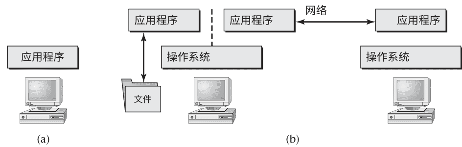
图 1.1: 没有操作系统，计算机可以直接执行一个程序，如图 (a) 所示。图 (b) 显示了有操作系统时，计算机可以支持并发计算，控制它们之间的交互（由虚线表示），并通过文件和网络实现跨时间和空间的通信。

一旦在微波炉的嵌入式处理器上运行，库和应用程序代码将成为一个单一的程序，仅仅是一系列直接执行的指令。然而，从应用程序员的角度来看，底层细节已经成功隐藏起来。

总结这个论点，一个输入/输出例程库并不等同于一个操作系统，因为它只满足了我定义的第一部分。它确实使用底层硬件来支持其他软件的执行。然而，它并不提供对计算之间受控交互的支持。公平地说，这是更具历史背景的观点。最初，一段软件可以被称为操作系统，而不支持受控交互。然而，语言已经发展，以至于我的定义更贴近当前的使用。

我还应该提到操作系统的另一种替代观点，因为这很可能是你从自己的经验中形成的观点，使用通用计算机。你可能会认为操作系统是你与之交互以执行任务的软件，例如运行应用程序。根据你习惯的用户界面，你可能认为操作系统是允许你点击程序图标来运行它们的东西，或者你可能认为操作系统是解释你输入的命令的东西。

这种观点有一定的真实性。操作系统确实提供了执行选定应用程序的服务。然而，操作系统提供这项服务不是给人类用户点击图标或输入命令，而是给已经在计算机上运行的其他程序，包括处理图标点击或命令输入的程序。

操作系统允许正在运行的一个程序启动另一个程序。这只是操作系统为正在运行的程序提供的众多服务之一。另一个示例服务是将输出写入文件。操作系统提供给应用程序员在其程序中使用的功能的总和被称为应用程序编程接口（API）。API 的一个元素是运行其他程序的能力。

你可以点击程序图标或输入命令来运行程序的原因是通用操作系统捆绑了一个用户界面程序，该程序使用操作系统 API 来响应鼠标或键盘输入运行其他程序。从市场营销的角度来看，这个用户界面程序可能被视为操作系统的一部分；它可能没有自己的显著名称，也可能无法单独购买。

例如，Microsoft Windows 带有一个名为资源管理器的用户界面，它提供了开始菜单和点击图标的功能。（这个程序与同名的网络浏览器 Internet Explorer 不同。）然而，即使你是一个经验丰富的 Windows 用户，你可能从未听说过资源管理器；Microsoft 选择将其低调处理，将其视为 Microsoft Windows 环境的一个组成部分。然而，在技术层面上，它与操作系统本身是不同的。为了明确区分，真正的操作系统通常被称为内核。内核是 Microsoft Windows 的基本部分，它提供了支持受控交互计算的 API。

在 Linux 中，内核和用户界面之间也存在类似的区别。Linux 内核通过 API 提供基本的操作系统服务，而 shell 是解释输入命令的程序（如 bash 和 tcsh），桌面环境是处理图形交互的程序，如 KDE（K 桌面环境）和 GNOME。

在本书中，我将解释操作系统内核的工作原理，即真正的操作系统本身，而不是用户界面程序。一个原因是因为用户界面程序与普通应用程序在本质上没有根本区别。另一个原因是因为操作系统不一定需要这种类型的用户界面。再考虑一下控制汽车燃油喷射的嵌入式系统的情况。如果系统足够复杂，它可能包括一个操作系统。主程序可能运行其他更专门的程序。然而，用户无法通过 shell 或桌面环境启动任意程序。在本书中，我将以你可能熟悉的通用系统为例，但也强调适用于其他情境的原则。

### 1.3 什么是中间件?

现在你知道什么是操作系统了，我可以转向本书涵盖的另一类软件：中间件。中间件是一种软件，占据在应用程序和操作系统之间的中间位置，我将在本节中解释。

操作系统和中间件有很多共同之处。它们都是用来支持其他软件的软件，比如你运行的应用程序。它们都提供一系列以受控交互为中心的类似服务。与操作系统类似，中间件可以强制执行规则，以防止计算相互干扰。一个例子是只有一个计算可以修改共享数据结构的规则。与操作系统类似，中间件可以通过持久存储将不同时间的计算联系起来，并通过提供网络通信服务来支持不同计算机上的计算之间的交互。

然而，操作系统和中间件并不相同。它们依赖于不同的底层服务提供者。操作系统通过利用硬件支持的特性来提供其 API 中的服务。例如，它可以通过利用磁盘驱动器读写编号的固定长度数据块来提供读写命名的可变长度文件的 API 服务。另一方面，中间件通过利用底层操作系统支持的特性来提供其 API 中的服务。例如，中间件可以通过利用操作系统读写包含数据库的文件的能力来提供更新关系数据库表的 API 服务。

作为图 1.2 所示的操作系统上的中间件分层，解释了其名称；在应用程序和操作系统之间的堆栈中，中间件位于垂直方向的中间。从水平角度来看，中间件还位于不同应用程序之间的交互中间（甚至可能在不同的计算机系统上运行），因为它提供了协调、持久存储、命名和通信的机制来支持受控交互。

我已经提到关系数据库系统作为中间件的一个例子。这些系统提供了比大多数操作系统支持的文件更复杂的持久存储形式。我将 Oracle 作为关于关系数据库系统的主要示例来源。本书中我将使用其他中间件作为示例，包括 Java 2 平台企业版（J2EE）和 IBM 的 WebSphere MQ。这些系统支持将计算大部分隔离开来，以防止不必要的交互，同时允许它们在不同计算机上进行通信。

中间件的市场定义并不总是与我的技术定义完全对应。特别是，一些中间件非常重要，以至于它们作为操作系统捆绑包的一部分分发，而不是作为单独的中间件产品。例如，通用操作系统都配备了一些将互联网主机名（如 www.gustavus.edu）转换为数字地址的机制。这些机制通常不在操作系统内核中，但为应用程序提供了一般的支持服务。因此，根据我的定义，即使通常不被标记为中间件，它们也是中间件。

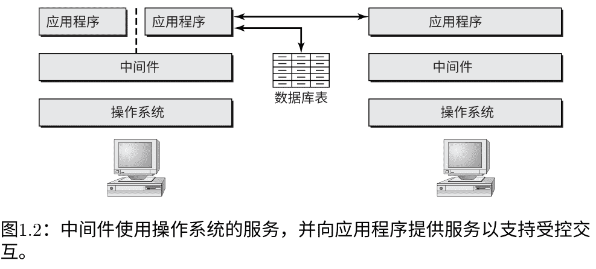

## 1.4 本书目标

如果你通读本书，你将获得知识和技能。请注意，我没有说任何关于阅读本书的事情，而是关于逐步工作通过本书的事情。本书的每一章都以练习、编程项目、探索项目和一些参考文献或历史注释结束。为了实现本书的目标，你需要完成练习，进行项目，并偶尔冒险进入章末注释指出的一条旁路。其中一些探索项目将明确要求你在外部来源（如互联网或图书馆）进行研究。其他项目将要求你进行实验性 work，例如测量特定设计选择的性能后果。如果你要投入那种时间和努力，你应该知道你将从中获得什么。因此，我将在下面的段落中解释，在完成本书后，你将更加有知识和技能。

首先，你将获得关于当代操作系统和中间件工作原理的一般知识，以及为什么它们以这种方式工作的一些想法。这些知识本身可能很有趣，但它们也有实际应用。请记住，这些系统为应用程序程序员提供支持的 API。因此，一个好处是，如果你编写应用程序，你将能够更有效地使用这些支持的 API。即使你不是任何特定 API 的专家，你也能看到这些 API 提供的服务的整体情况。

另一个好处是，如果你在一个需要修改操作系统或中间件产品配置以调整其性能或使其最好地适应特定角色的角色中，你也会受益。再次强调，这本书本身并不能提供关于任何特定系统的所有具体知识，但它将为你提供一般背景，使你能够理解更专业的参考资料。

也许学习当今系统的细节并了解其设计背后的原因最重要的回报是，你将更好地了解明天的系统。你将能够看到它们在哪些方面不同，以及在哪些方面基本上仍然相同。你将能够将新功能放入上下文中，通常作为解决旧问题的新解决方案，甚至只是现有解决方案的变体。如果你真的对这本书中学到的知识感到兴奋，甚至可以将你的知识作为进一步学习的基础，并成为开发明天系统的人之一。

其次，除了关于系统的知识，你还将学习一些适用于操作系统和中间件之外的技能。其中一些最重要的技能来自于探索项目。例如，如果你认真对待这些项目，你不仅会练习进行实验，还会撰写描述实验及其结果的报告。这将在许多情境中对你有所帮助。

我还为你提供了一些机会，以便你能够熟练地使用专业文献，如文档和会议论文。这些资源比本书更深入，并且始终更加更新。

通过编程项目，你将获得一些同时运行多个相互作用组件并保持其交互受控的编程技能。你还将培养一些在互联网上进行交互的编程技能。在这两种情况下，你都不会成为一名高级程序员。然而，在这两种情况下，你将打下一系列与开发项目和环境相关的基础技能。

你还可以获得的另一个技能的例子是能够审视设计决策的安全影响。我在每章中都有一个安全部分，而不是仅在书的末尾有一个安全章节，因为我希望你养成自己“这里有什么安全问题？”的习惯。这个问题即使在操作系统和中间件领域之外也是相关的。

正如我希望你能看到的那样，学习操作系统和中间件可以提供各种各样的好处，特别是如果你以积极参与者的身份参与其中，而不是作为旁观者。

- 有了这个动力，我现在将带你进一步了解操作系统和中间件提供的服务。
- 这次旅行比 1.2 和 1.3 节更详细，但不如第 2 章到第 11 章详细。

## 1.5 一个计算机上的多个计算

操作系统提供的最基本的服务是允许多个计算同时进行，而不是强制每个计算等待前一个计算完成。这使得台式电脑可以同时处理多个任务，以满足忙碌的人们的需求，并且使得服务器可以对来自互联网上许多不同客户端计算机的请求做出响应。除了这些响应性问题，同时进行的计算还可以更有效地利用计算机资源。例如，当一个计算被阻塞等待输入时，另一个计算可以利用处理器进行有意义的工作。

可以用各种词来指代计算机上正在进行的计算；它们可以被称为线程、进程、任务或作业。在本书中，我将同时使用“线程”和“进程”这两个词，并且现在解释它们之间的区别非常重要。

线程是并发的基本单位。任何一个程序化的动作序列都是一个线程。如果程序需要同时运行几个独立的动作序列，执行程序可能会创建多个线程。即使每次执行程序只创建一个线程，这是更常见的情况，一个典型的系统也会运行多个线程：一个用于每个正在进行的程序执行，以及一些作为操作系统本身的内部部分的线程。

当你启动一个程序运行时，你总是在创建一个或多个线程。然而，你也在创建一个进程。进程是一个容器，它包含了你启动运行的线程或线程，并保护它们免受在同一台计算机上运行的其他不相关线程的意外交互。例如，运行在一个进程中的线程不能意外地覆盖由不同进程使用的内存。

因为人类用户通常在每次想要进行新的计算时启动一个新的进程，所以很容易将进程视为并发执行的单位。这种诱惑被事实放大了，因为旧的操作系统要求每个进程都有一个线程，所以这两种对象之间是一对一对应的，并且区分它们并不重要。然而，在本书中，我将始终保持区分。当我提到设置独立的编程动作序列时，我将谈论创建线程。只有当我提到保护线程的能力时，我才会谈论创建进程。

为了支持线程，操作系统 API 包括创建新线程和终止现有线程的功能。在操作系统内部，必须有一些机制来在各个线程之间切换计算机的注意力。当操作系统暂停执行一个线程以便让另一个线程有机会取得进展时，操作系统必须存储足够的关于第一个线程的信息，以便能够成功地恢复其执行。第 2 章解决了这些问题。

一些线程可能在任何特定时间都无法运行，因为它们正在等待某些事件的发生，比如输入的到来。然而，总体上来讲，操作系统将面临多个可运行的线程，并且需要在每个时刻选择运行哪些线程。线程执行调度的问题有很多解决方案，在第3章中进行了调查。调度问题很有趣，并且产生了很多解决方案，因为它涉及到系统用户之间竞争的平衡利益和价值观。没有一个单独的调度方法能够始终让每个人都满意。我的重点是解释不同调度方法如何适应不同的系统使用环境并实现不同的目标。

此外，我还解释了API如何允许程序员对调度进行控制，例如，通过指示某些线程应具有较高的优先级。

## 1.6 控制计算之间的交互

如果线程需要相互交互而不是完全独立地执行，同时运行多个线程会变得更有趣。例如，一个线程可能会产生另一个线程消费的数据。如果一个线程正在将数据写入内存，而另一个线程正在读取数据，你不希望读者超过写者并开始从尚未写入的位置读取。这说明了一种广泛的交互控制方法：控制线程执行的相对时间。在这里，读取步骤必须在相应的写入步骤之后进行。控制线程的时间的一般名称是同步。

第4章解释了几种常见的同步模式，包括防止消费者超过相应的生产者。它还解释了常用于提供同步的机制，其中一些直接由操作系统支持，而其他一些则需要一些适度的中间件，例如Java运行时环境。

同一章节还解释了使用同步可能出现的一个特别重要的困难。同步可以强制一个线程等待另一个线程。如果第二个线程恰好在等待第一个线程呢？这种循环等待被称为死锁。我对应对死锁的方法的讨论还介绍了一些重要的中间件，因为数据库系统提供了一个有趣的死锁处理的例子。

在第5章中，我扩展了同步和中间件的主题，通过解释事务，事务通常由中间件支持。事务是一种计算工作的单位，从计算的中间状态开始，不会对外部可见。并发事务与彼此的中间存储隔离。此外，如果事务失败，存储将保持事务开始之前的状态。即使计算机系统在事务执行过程中发生灾难性崩溃，重启后的存储也不会反映部分事务。这样可以防止半完成事务的结果变得可见。事务在设计可靠的信息系统方面非常有用，并且在商业上得到广泛应用。它们还提供了一个很好的例子，说明数学推理如何帮助设计实际系统；这将是我最期望你理解证明的章节。

即使没有理由进行交互的线程也可能意外地进行交互，如果它们在同一台计算机上运行并共享相同的内存。例如，一个线程可能意外地写入另一个线程正在使用的内存中。这是操作系统提供虚拟内存的几个原因之一，本章的主题。虚拟内存是指在从处理器到内存的路径上修改地址的技术，以便实际用于存储内存中的值的地址可能与处理器的加载和存储指令中出现的地址不同。这是通过硬件和操作系统软件的组合提供的一种通用机制。我解释了这种机制可以发挥的几个不同目标，但最简单的目标是通过将它们的内存访问引导到内存的不同区域，将一个进程中的线程与另一个进程中的线程隔离开来。

在提供进程独立虚拟内存的主题上，我将第7章专门讲解进程。本章介绍了一个用于创建进程的API。然而，我还专注于保护机制，不仅是在第6章介绍虚拟内存的基础上构建，还解释了其他用于保护进程之间和保护操作系统自身免受进程影响的保护形式。

其中一些保护机制不仅可以用于保护内存中的值的存储，还可以用于长期数据存储，例如文件，甚至网络通信通道。因此，第7章为后续对这些主题的处理奠定了一些基础。

第7章还为我提供了一个机会，以澄清第2章留下一个关于线程的问题。通过展示操作系统如何在自身和运行的应用程序进程之间提供保护边界，我可以解释线程相对于这个边界的位置。特别地，有些线程完全包含在操作系统内核中，有些线程完全包含在应用程序进程中，还有一些线程跨越边界，在应用程序进程内提供内核支持的并发活动。

系统内核中完全包含的线程，完全包含在应用程序进程中的线程，以及跨越边界的线程，在应用程序进程内为并发活动提供内核支持。虽然在第2章讨论这些线程的分类似乎很自然，但我真的需要等到第7章才能对这些区别有更多的理解，而不仅仅是在这个引言段落中所做的。

当两个计算同时在一台计算机上运行时，支持受控交互的难点在于保持交互的控制。例如，在我之前的一个线程对的例子中，一个线程产生一些数据，另一个线程消费它。在这种情况下，数据如何从一个线程流向另一个线程并没有太大的神秘，因为两者都在使用同一台计算机的内存。困难的部分是调节对共享内存的使用。这与跨时间和空间的交互形成对比，我将在第1.7节和第1.8节中讨论。如果生产者和消费者在不同的时间或不同的计算机上运行，操作系统和中间件将需要努力将数据从一个传递给另一个。

## 1.7 支持时间跨度的交互

通用操作系统都支持一些机制，使计算可以将结果保存在长期存储中，以便稍后的计算可以检索。因为这种存储在系统关闭和重新启动时仍然存在，所以被称为持久存储。通常，操作系统以命名文件的形式提供持久存储，这些文件组织成目录或文件夹的层次结构。

其他形式的持久存储，如关系数据库表和应用程序定义的持久对象，通常由中间件支持。在第8章中，我重点介绍文件系统，同时也解释了与中间件的一些关联。例如，我将文件目录的存储与数据库索引进行了比较。这种比较尤为重要，因为这些领域正在融合。实际上，底层机制已经非常相似，文件系统开始支持类似数据库系统提供的索引服务。

有两种一般的文件API类别，我在第8章中都涵盖了。这些文件可以成为进程的虚拟内存空间的一部分，可以使用正常的加载和存储指令进行访问，或者可以单独处理，作为外部实体进行读写操作。任何一种文件API都提供了一个相对简单的接口，用于访问操作系统中隐藏的一些相当重要的机制。第8章还提供了对一些这些机制的概述。

作为一个简单接口到复杂机制的例子，应用程序员可以通过向文件末尾写入额外的数据来使文件变大。另一方面，操作系统必须选择新数据存储的位置。当使用磁盘时，这种空间分配对性能有很大影响，因为磁盘驱动器的物理实际情况如此。

文件系统的另一个任务是跟踪每个文件的数据位置。它还跟踪其他文件特定的信息，如访问权限。因此，文件系统不仅存储文件的数据，还存储描述数据的元数据。

所有这些机制与中间件用于分配空间以容纳数据库表的目的类似。操作系统和中间件还存储用于定位数据的文件目录和数据库索引等信息。用于命名和索引目的的数据结构被设计为高效访问，就像用于跟踪分配空间给存储对象的数据结构一样。

为了使操作系统和中间件的工作更具挑战性，持久存储结构被期望在系统崩溃时能够保持完整性而不会有重大损失。例如，在崩溃后，特定的存储空间不能同时被列为可分配 and 已分配给文件，这是不可接受的。即使在文件创建或删除时发生崩溃，也不能出现这种混乱的状态。

因此，第8章在第5章对原子事务的解释基础上进行了扩展，同时概述了一些其他可用于保护元数据、目录和索引完整性的机制。

持久存储在互联网时代可能比以往任何时候都更为重要，因为服务器现在保存着供全球客户使用的大量数据。尽管如此，持久存储不再像过去那样扮演独特的角色。曾经有很多计算机系统，其中进程之间唯一的通信方式就是通过持久存储。如今，这几乎是不可想象的，因为通信经常跨越互联网。因此，正如我在第1.8节中解释的那样，操作系统提供了对网络的支持，而中间件则进一步支持分布式系统的构建。

## 1.8 支持空间跨度的交互

为了构建具有在不同计算机上运行的组件的一致性软件系统，程序员需要解决许多问题。考虑两个例子：流中的数据必须按顺序传递，即使通过互联网络的不同路径发送，消息传递也必须纳入事务提供的全有或全无保证。幸运的是，应用程序员不需要解决大部分这些问题，因为操作系统和中间件提供了适当的支持服务。

我将这些服务分为两章进行介绍。第9章提供了有关网络的基础知识，这样本书在您之前没有学习网络的情况下也能独立阅读。该章还涵盖了操作系统通常提供的或与操作系统紧密结合的服务，如分布式文件系统。相比之下，第10章解释了中间件为应用程序之间的通信提供的更高级别的服务，例如消息传递和Web服务。每章介绍了您作为应用程序员可以使用的示例API，以及这些特定API背后的更一般的原则。

网络系统，正如我在第9章中所解释的那样，通常被分成层次，每一层都利用下一层提供的服务，以便为上一层提供附加服务。在堆栈的底部是物理层，涉及铜线、光纤、无线电波、电压和波长等问题。在其上面是链路层，它提供将数据块传输到同一局域网上的另一台计算机的服务。这是操作系统介入的时候。在链路层基础上，操作系统提供了网络层和传输层的服务。网络层安排数据通过互连网络中继，以便到达可能在世界其他地方的计算机。传输层在基本的计算机间数据传输基础上提供更有用的应用程序间通信通道。例如，传输层通常使用序列编号和重传来为应用程序提供有序、无丢失的数据流传递服务。这是最常见的操作系统API层级，为这些传输层连接提供了套接字，即端点。

上一层是应用层。一些专门的应用层服务，例如分布式文件系统，与操作系统集成。然而，大多数应用层软件，例如网络浏览器和电子邮件程序，是由应用程序员编写的。这些应用程序可以直接构建在操作系统的套接字API上，并交换符合标准化协议的字节流。在第9章中，我通过展示网络浏览器和Web服务器之间的通信来说明这种可能性。

或者，分布式应用程序的程序员可以利用中间件在比通过套接字发送字节更高的级别上工作。我在第10章中展示了两种基本方法：消息传递和远程过程调用（RPC）。Web服务是一种特殊的标准化这种更高级别应用通信的方法，并且主要与RPC一起使用：我展示了如何以这种方式使用它们。在一个消息传递系统中，应用程序请求传递一条消息。消息传递系统不仅传递消息，这可以通过较低级别的网络实现，还提供其他服务。例如，消息传递通常与事务处理集成。成功的事务可能会从传入消息队列中检索一条消息，根据该消息更新数据库，并将响应消息发送到传出队列。如果事务失败，这三个更改都不会发生；请求消息将保留在传入队列中，数据库将保持不变，响应消息将不会被排队等待进一步传递。消息传递系统提供的另一个常见服务是将消息传递给订阅接收特定类型消息的任意数量的接收者；发送者无需知道实际接收者是谁。

中间件还可以提供一种机制，用于远程过程调用（RPC），其中客户端和服务器之间的通信被视为普通的编程语言过程调用，例如调用对象上的方法。唯一的区别是所涉及的对象位于不同的计算机上，因此调用和返回涉及网络通信。中间件隐藏了这种复杂性，使应用程序员可以像处理本地对象一样工作。在第10章中，我会更详细地解释这个概念，然后展示它如何以Web服务的形式呈现。Web服务是一个应用层实体，程序可以使用标准化协议与其通信，类似于人们用于浏览网页的协议。

## 1.9 安全性

操作系统和中间件经常成为攻击者试图破坏系统安全性的目标。即使针对应用程序的攻击通常与操作系统和中间件有关。特别是，操作系统和中间件中容易被误用的功能可能是应用级漏洞的根本原因。另一方面，操作系统和中间件提供了许多在构建安全系统方面非常有帮助的功能。

如果系统提供了一个可接受的低风险，使得对手无法阻止系统实现其所有者的目标，则该系统是安全的。在第11章中，我将更详细地解释如何思考风险以及系统所有者和对手之间的冲突目标。特别是，我解释了所有者最常见的目标可以分为四类：保密性、完整性、可用性和可追溯性。如果系统防止信息的不适当披露，则该系统提供了保密性；如果系统防止信息的不适当修改或破坏，则该系统提供了完整性；如果系统防止对合法使用的不适当干扰，则该系统提供了可用性。如果系统提供了检查授权用户如何行使其权限的方式，则该系统提供了可追溯性。所有这些都依赖于身份验证，即系统验证用户身份的能力。

许多人对系统安全有一个狭隘的观点。他们认为这些功能如果没有安全问题根本就不存在。显然，使用密码（或其他更好的身份验证形式）登录是系统安全的一个组成部分。同样明显的是，有权限读取某些文件而没有权限读取其他文件，以及用于保护网络通信免受拦截的加密协议，都是系统安全的组成部分。

然而，这种安全观点是非常不完整的。你需要记住，操作系统的任何组件的设计都可能产生安全后果。即使那些设计受其他考虑支配的部分也必须反映出对安全后果的一些积极考虑，否则整个系统将不安全。

事实上，这是一个重要原则，不仅适用于操作系统，还适用于应用软件和操作它的人。因此，我将养成在每一章节中都讨论安全问题的习惯，而不仅仅是在书的结尾。具体而言，每一章节都以一个部分总结，指出与该章节主题相关的一些关键安全问题。我还通过在整本书的最后一章节中专门讨论安全问题，提供了一个更连贯的安全处理。该章节采用整体的方法来处理安全问题，其中人为因素与技术因素同样重要。

## 练习

- 1.1 操作系统和中间件之间有什么区别？
- 1.2 操作系统和中间件有什么共同点？
- 1.3 线程和进程之间的关系是什么？
- 1.4 操作系统可能通过一种方式将线程与不需要的交互隔离开来，中间件可能通过一种方式实现这一点。
- 1.5 操作系统可能通过一种方式提供持久存储，中间件可能通过一种方式实现这一点。
- 1.6 操作系统可能通过一种方式支持网络通信，中间件可能通过一种方式实现这一点。
- 1.7 在本章中预览的所有主题中，你最期待更多了解哪个？为什么？

## 编程项目

- 1.1 使用您选择的语言编写、测试和调试一个程序，执行您选择的任何任务。然后列出您认为操作系统为支持样本程序的执行提供的所有服务的列表。如果您认为该程序还依赖于任何中间件服务，请将其列出。

## 探索项目

- 1.1 浏览一下由USENIX协会（先进计算机系统协会）主办的几个最近的会议的论文标题；你可以在www.usenix.org找到会议论文集。为了更好地了解一篇论文的内容，点击标题显示摘要，摘要是一篇论文的简短总结。根据标题和摘要，挑选一些你认为在工作中会有有趣的补充阅读，通过这本书找到你的方式。写下一个列表，显示你选择的论文的文献信息，并尽可能准确地指出它们在本书目录中适合阅读的位置。

- 1.2 进行一个简单的实验，你可以在计算机系统上采取一些行动并观察响应。你可以选择任何你希望的行动和任何你可以适当访问的计算机系统。你可以观察到一个定量的结果，比如响应需要多长时间或者产生多少输出，也可以观察到一个定性的结果，比如响应以什么形式到达。现在，尝试复制这个实验。你总是得到相同的结果吗？类似的吗？是否有需要控制的因素，以便获得至少近似可重复的结果？例如，为了获得一致的时间，您是否需要在每次试验之间重新启动系统并防止其他人使用系统？为了获得一致的输出，您是否需要确保输入文件保持不变？如果您的操作涉及物理设备，例如打印机，您是否需要控制诸如打印机是否有纸张等变量？最后，撰写一份详细的报告，其中您解释了您尝试的实验和观察到的结果。您应该解释结果的可重复性以及重复性的限制。您应该以足够详细的硬件和软件配置描述您的实验，以便其他人可以复制您的实验并可能获得类似的结果。

## 注释

操作系统应该将计算与不需要的交互隔离开来，并支持需要的交互，这个想法有着悠久的历史。Corbato、Daggett和Daley在1962年的一篇论文[38]中指出，“如果同时在核心内存中运行不同的用户程序，它们可能会相互干扰或与监控程序干扰，因此在操作用户程序时应该提供某种形式的内存保护模式。”然而，同一篇论文继续说道，“虽然我们非常小心地使每个用户独立于其他用户...” 但如果这并不总是情况，那将是系统的一个有用扩展，以便计算机系统可以支持群体工作，例如战争游戏。

中间件对于一般公众来说并不像操作系统那样知名，尽管商业信息系统开发人员没有中间件将会迷失。Bernstein在1996年的一篇调查文章[17]中试图将中间件引入到更广泛的受众中。

USENIX协会是本书相关主题的几个非常好的专业学会之一，如探索项目1.1中提到的。我特别推荐浏览他们的论文集的原因是它们对学生来说通常更易理解。部分原因是USENIX专注于将从业者和学者聚集在一起；因此，论文通常是务实而不肤浅的。完整的文本可在他们的网站上获得。

## 第2章 线程

## 2.1 简介

计算机程序由指令组成，计算机根据这些指令执行一系列计算步骤。我们将每个连续的计算步骤序列称为一个线程。最简单的程序是单线程的，其中的指令应按照一个序列依次执行。

然而，在第2.2节中，你将学习如何编写产生多个执行线程的程序，每个线程都是一个独立的计算步骤序列，其中一个线程的步骤与另一个线程的步骤之间几乎没有任何排序约束。多个线程也可以通过运行多个程序或多次运行相同的程序而存在。

请注意程序和线程之间的区别；程序包含指令，而线程由这些指令的执行组成。即使对于单线程程序，这种区别也很重要。如果一个程序包含一个循环，那么一个非常短的程序可能会产生一个非常长的执行线程。此外，运行相同的程序十次将产生十个线程，每个线程都执行一个程序。图2.1总结了线程是如何从程序中产生的。

每个线程的生命周期从其第一条指令执行开始，直到最后一条指令执行结束。如果两个线程的生命周期有重叠，如图2.2所示，我们称它们为并发线程。操作系统的一个最基本的目标是允许多个线程在同一台计算机上并发运行。也就是说，不是等待第一个线程完成后再开始下一个线程，在第二个线程可以运行之前，应该可以将计算机的注意力分配给它们。

如果计算机硬件包含多个处理器，那么自然可以同时运行多个线程，每个处理器一个。然而，操作系统的用户通常希望运行的并发线程多于硬件的处理器数量，原因在第2.3节中有描述。因此，操作系统需要将每个处理器的注意力分配给多个线程。在这本入门教材中，我主要限制在所有线程都需要在单个处理器上运行的情况下。我将明确指出那些我涉及更一般的多处理器情况的地方。

为了使并发线程的概念具体化，第2.2节展示了如何编写一个在每次运行时生成多个线程的程序。一旦你知道如何创建线程，我将在第2.3节中解释为什么同时运行多个线程是可取的，并提供一些典型的线程用途示例。

这前两节解释了应用程序员对线程的视角：程序员如何以及为什么使用并发线程。这为我们提出了下一个问题：操作系统如何支持应用程序员对并发执行线程的需求？在第2.4节和第2.5节中，我们将探讨系统是如何做到这一点的。在本章中，我们只考虑处理器如何从一个线程切换到另一个线程的基本原理。我在其他章节中讨论的一些相关问题包括在每个点决定运行哪个线程（第3章）以及控制线程之间的交互（第4、5、6和7章）。此外，正如第1章中所解释的，我将等到第7章才解释围绕操作系统的保护边界。因此，我需要等到那一章才能区分完全驻留在该边界内的线程，从边界内提供给外部使用的线程，以及完全驻留在边界外的线程（称为用户级线程或在Microsoft Windows中称为纤程）。

最后，本章以本书的标准特性结束：对安全问题的简要讨论，然后是练习、编程和探索项目以及注释。

## 2.2 多线程程序示例

每当一个程序开始运行时，计算机会按照程序的指令在一个线程中执行。因此，如果程序是-原始线程在某个时刻需要生成一个子线程来执行一些操作，而父线程则继续执行其他操作。（对于多于两个线程的情况，程序可以重复创建线程的步骤。）大多数编程语言都有用于线程的应用程序编程接口（API），其中包括创建子线程的方法。在本节中，我将使用Java API和名为pthreads的C API，用于POSIX线程。（正如您将在本书中看到的，POSIX是一个针对类UNIX系统的综合规范，包括许多除了线程创建之外的API。）

实际的多线程编程需要控制线程之间的交互，使用我在第4章中介绍的技术。因此，本章中的示例非常简单，仅足够展示线程的生成。

为了演示两个线程的独立性，我将让父线程和子线程都对计时器做出响应。其中一个线程将休眠三秒，然后打印一条消息。另一个线程将休眠五秒，然后打印一条消息。由于线程并发执行，第二条消息将在第一条消息之后大约两秒钟出现。（在编程项目2.1、2.2和2.3中，您可以编写一个更加实际的程序，其中一个线程响应用户输入，另一个线程响应计时器。）

图2.3显示了该程序的Java版本。主程序首先创建一个名为childThread的Thread对象。与子线程关联的Runnable对象具有一个run方法，该方法休眠三秒（表示为3000毫秒），然后打印一条消息。当主过程调用childThread.start()时，该run方法开始运行。由于run方法在一个单独的线程中，主线程可以继续执行后续步骤，休眠五秒（表示为5000毫秒）并打印自己的消息。

图2.4是使用pthread API在C中的等效程序。子过程睡眠三秒并打印一条消息。主过程创建一个运行子过程的子线程，并且自己睡眠五秒并打印一条消息。与Java API相比，最重要的区别是pthread_create既创建子线程又启动它运行，而在Java中这是两个独立的步骤。

除了可移植的API（如Java和pthread API）之外，许多系统还提供自己的非可移植API。例如，Microsoft Windows具有Win32 API，其中包含诸如CreateThread和Sleep等过程。在编程项目2.4中，您可以修改图2.4中的程序以使用此API。

```java
public class Simple2Threads {
    public static void main(String args[]){
        Thread childThread = new Thread(new Runnable(){
            public void run(){
                sleep(3000);
                System.out.println("子线程睡眠3秒后完成。");
            }
        });
        childThread.start();
        sleep(5000);
        System.out.println("父线程睡眠5秒后完成。");
    }

    private static void sleep(int 毫秒){
        try{
            Thread.sleep(毫秒);
        } catch(InterruptedException e){
            // 忽略此异常；它不会发生
        }
    }
}
```
**图2.3: 一个简单的Java多线程程序**

```c
#include <pthread.h>
#include <unistd.h>
#include <stdio.h>

static void *child(void *ignored){
    sleep(3);
    printf("子线程睡眠3秒后完成。\n");
    return NULL;
}

int main(int argc, char *argv[]){
    pthread_t child_thread;
    int code;

    code = pthread_create(&child_thread, NULL, child, NULL);
    if(code){
        fprintf(stderr, "pthread_create失败，错误码：%d\n", code);
    }
    sleep(5);

    printf("父线程睡眠5秒后完成。\n");
    return 0;
}
```
**图2.4：一个简单的C多线程程序**

## 2.3 使用并发线程的原因

你已经看到一个程序的单次执行可能会产生多个线程。假设你已经对通过运行多个程序或多次运行同一程序生成多个线程有一定了解。无论线程是如何产生的，我们都面临一个问题：为什么计算机要同时执行多个线程，而不是等待一个线程完成后再启动另一个线程？从根本上讲，并发线程的大多数用途都可以归结为两个目标之一：

- **响应性**：使计算机系统能够快速响应外部因素，如人类用户或其他计算机系统。即使一个线程正在进行长时间的计算，另一个线程也可以响应外部因素。我们在第2.2节的示例程序中展示了响应性：父线程和子线程都对计时器做出了响应。
- **资源利用**：大部分时间保持硬件资源繁忙。如果一个线程不需要特定的硬件部件，另一个线程可能能够有效利用它。

这两个主题都有许多变化，我们在本节的其余部分中探讨其中一些。程序员有时使用并发线程的第三个原因是作为模块化的工具。通过这种方式，一个复杂的系统可以被分解成一组相互交互的线程。

让我们首先考虑一个Web服务器的响应能力，它通过互联网为许多客户计算机提供所请求的特定网页。每当客户计算机与服务器建立网络连接时，它会发送一个包含所需网页名称的字节序列。因此，在服务器程序能够响应之前，它需要读取这些字节，通常使用一个循环来从网络连接中继续读取字节，直到看到请求的结束。假设其中一个客户正在使用非常慢的网络连接，例如拨号调制解调器。服务器可能会读取请求的第一部分，然后必须等待相当长的时间，直到请求的其余部分通过网络到达。与此同时，其他客户会发生什么？一个整个网站因为等待一个慢速客户完成请求而停止服务是不可接受的。一些Web服务器避免这种不可接受的情况的方法是使用多个线程，每个客户连接一个线程，这样即使当一个线程正在等待来自一个客户端的数据时，其他线程可以继续与其他客户端进行交互。图2.5说明了不可接受的单线程Web服务器和更现实的多线程Web服务器。在客户端，Web浏览器也可能说明了对响应性的需求。

假设你开始加载一个非常大的网页，这需要相当长的时间来下载。如果电脑在下载完成之前冻结了，你会感到满意吗？很可能不会。你希望能在一个不同的窗口中处理电子表格，或者滚动浏览已经下载的网页的前部分，或者至少点击停止按钮放弃耗时的下载。通过让一个线程负责通过网络加载网页，同时另一个线程响应你在键盘和鼠标上的操作，可以处理这些情况。

这个网络浏览器场景还让我预示了教科书后面部分关于线程之间的受控交互。请注意我勾勒了在网页下载过程中可能想要做的几件不同的事情。在第一种情况下，当你在电子表格上工作时，两个并发线程几乎没有任何关联，操作系统的工作除了允许它们并发运行之外，主要是将它们相互隔离，这样网页浏览器中的错误不会覆盖你的电子表格的一部分。这通常是通过将线程封装在单独的保护环境中来实现的，这些环境被称为进程，我们将在第6章和第7章中讨论。（有些系统将进程称为任务，而其他系统则将任务作为线程的同义词。）另一方面，如果你在下载继续进行时继续使用浏览器的用户界面，那么并发线程是一个紧密相关的部分单个应用程序，操作系统不需要将线程相互隔离。然而，它仍然需要提供机制来调节它们的交互。例如，下载线程和用户界面线程之间需要协调，以确保您可以滚动页面上已下载的部分，但不能滚动更多。线程之间的这种协调称为同步，是第4章和第5章的主题。

**图2.5: 单线程和多线程Web服务器**

转向硬件资源的利用，最明显的情况是当您拥有双处理器计算机时。在这种情况下，如果系统一次只运行一个线程，那么只有一半的处理能力会被使用。即使计算机系统的人类用户没有多个任务要执行，也可能有有用的后勤工作来使第二个处理器保持繁忙。例如，大多数操作系统在为应用程序分配内存时，会首先将所有零存储到内存中。操作系统可以有一个线程主动地将未使用的内存清零，而不是在每个内存分配时都进行清零，以便在需要时它将准备就绪，而不会延迟每个内存分配。如果这个后勤工作（内存清零）是按需进行的，它将减慢系统的实际工作；通过使用并发线程更充分地利用可用的硬件，可以提高性能。这个例子还说明，并非所有的线程都需要来自用户程序。线程可以是操作系统本身的一部分，就像清零未使用的内存的线程的例子一样。

即使在单处理器系统中，资源利用的考虑可能会证明使用并发线程是合理的。请记住，计算机系统包含硬件资源，如磁盘驱动器，除了处理器之外。假设您有两个任务要在您的个人电脑上完成：您想要扫描磁盘上的所有文件以查找病毒，并且您想要对包括实体对象以及部分透明烟雾云中的阴影在内的三维场景进行复杂的照片真实渲染。根据经验，您知道每个任务大约需要一个小时。如果您先完成一个任务，然后再完成另一个任务，将需要两个小时。相反，如果您同时进行这两个任务——在一个窗口中运行病毒扫描程序，同时在另一个窗口中运行图形渲染程序——您可能会惊喜地发现两个任务只需一个半小时就能完成。

耗时减少半小时的解释是，病毒扫描程序大部分时间都在使用磁盘驱动器读取文件，每当磁盘完成一个读取请求时，只会有一小段处理器活动，而渲染程序大部分时间都在进行处理，几乎没有磁盘活动。如图2.6所示，按顺序运行它们会导致计算机硬件的一部分大部分时间处于空闲状态，而同时运行这两个程序会使处理器和磁盘驱动器都保持繁忙，提高整个系统的效率。当然，这需要操作系统的调度程序足够聪明，让病毒扫描程序在磁盘请求完成时（短暂地）获得处理器的注意，而不是让它等待渲染程序。我将在第三章中讨论这个问题。

正如你现在所看到的，线程可以来自多个来源并担任多个角色。它们可以是操作系统的内部部分，如内存清零的示例，也可以是用户应用程序的一部分。在后一种情况下，它们可以是在多线程进程中划分工作的一部分，例如Web服务器和Web浏览器的示例，也可以来自多个独立进程，例如在一个窗口中运行Web浏览器，在另一个窗口中运行电子表格。无论这些变化如何，同时运行线程的典型原因保持不变：要么提供更高的响应性，要么通过更充分地利用硬件来提高系统效率。此外，在这些不同情况下，用于将处理器的注意力分配给多个线程的基本机制也是相同的；我在第2.4节和第2.5节中描述了该机制。当然，某些情况需要进程提供的附加保护机制，我们将在第6章和第7章中讨论这些机制。然而，即使在这种情况下，仍然有必要停止一个线程的工作并开始另一个线程的工作。

## 2.4 在线程之间切换

为了使操作系统在处理器上同时运行多个线程，系统需要一些机制来在线程之间切换注意力。特别是，需要有一种方式能够在线程的指令序列中间暂停，暂时处理其他线程的工作，然后再回到原始线程继续执行。为了尽可能简单地解释线程切换，我最初假设每个线程都在执行包含明确指令的代码，以临时切换到另一个线程。

一旦你理解了这个机制，我可以在此基础上构建更加现实的情况，即线程不包含明确的线程切换点，而是自动中断进行线程切换。

假设我们有两个线程，A和B，我们使用A1、A2、A3等作为构成A的指令执行步骤的名称，同样地，对于B也是如此。在这种情况下，一个可能的执行顺序可能如图2.7所示。正如我随后将解释的那样，当线程A执行switchFromTo(A, B)时，计算机开始执行线程B的指令。在一个更现实的例子中，可能会有多于两个线程，并且每个线程可能运行更多的步骤（在切换和整体之间），只有偶尔会有一个新线程开始或一个现有线程退出。

我们的目标是使每个线程的步骤形成一个连贯的执行序列。也就是说，从线程A的角度来看，它的执行不应该与A1到A8连续发生的执行有太大的不同，没有中断，对于线程B的步骤B1到B9也是如此。例如，假设步骤A1和A2从内存中加载两个值到寄存器中，A3将它们相加，将和放入一个寄存器中，然后A4将该寄存器的内容加倍，以获得两倍的和。在这种情况下，我们希望确保A4确实将A1到A3计算出的和加倍，而不是将线程B的步骤B1到B3恰好存储在同一个寄存器中的其他值加倍。因此，我们可以看到，线程切换不能简单地是一条跳转指令将控制转移到另一个线程中的适当指令的问题。至少，我们还必须将寄存器保存到内存中，并从内存中恢复它们，以便当线程恢复执行时，它自己的值将重新回到寄存器中。

为了专注于要点，让我们暂时搁置线程启动和退出的问题。相反，让我们只关注正常情况下的情况，即一个正在进行的线程将自己放置在等待状态，并切换到另一个线程中其他线程最后离开的地方，例如前面示例中从A5切换到B4的切换。为了支持线程切换，操作系统需要保存关于每个线程的信息，例如该线程应该在哪个点恢复执行。如果这些信息存储在每个线程的内存块中，那么我们可以使用这些内存区域的地址来引用这些线程。包含关于线程信息的内存块称为线程控制块或任务控制块（TCB）。因此，使用这些块的地址来引用线程的另一种说法是使用指向线程控制块的指针来引用线程。

我们的基本线程切换机制将是`switchFromTo`过程，它接受两个线程控制块指针作为参数：一个指定要切换出的线程，另一个指定要切换到的下一个线程。在我们的运行示例中，A和 B是指向两个线程控制块的指针变量，我们交替使用它们作为当前线程和下一个线程的角色。例如，线程A的程序在指令A5之后包含了从 A切换到 B的代码，而线程B的程序在指令B3之后包含了从 B切换到 A的代码。当然，这假设每个线程都知道自己的身份和要切换到的线程的身份。稍后，我们将看到如何消除这个不现实的假设。

不过，现在让我们看看如何编写`switchFromTo`过程，使得`switchFromTo(A, B)`能够将当前执行状态的信息保存到 A指向的结构中，从 B指向的结构中读取先前保存的信息，并从线程B离开的地方继续执行。

我们已经看到，保存的执行状态信息不仅包括程序中的位置，通常称为程序计数器（PC）或指令指针（IP），还包括寄存器的内容。对于大多数高级语言编译器编译的程序来说，执行状态的另一个关键部分是用于存储栈的一部分内存，以及指示当前栈顶位置的栈指针寄存器。你可能在之前的课程中遇到过这种存储形式——计算机组织、编程语言原理，甚至是计算机科学导论。如果没有，附录A提供了在继续阅读本章剩余部分之前所需的信息。

当一个线程恢复执行时，它必须找到之前离开时的栈。例如，假设线程A在栈上推入了两个项目，然后暂停一段时间，在此期间线程B执行。当线程A恢复执行时，它应该在栈的顶部找到它推入的两个项目。

**图2.7: 线程之间的切换**

即使线程B也进行了一些推送并且尚未进行弹出，我们可以通过为每个线程分配自己的堆栈来实现这一点，为它们中的每一个设置一个单独的内存区域。当线程A正在执行时，堆栈指针 (或SP寄存器) 将指向线程A的堆栈区域内的某个位置，指示该区域在该时刻被占用的大小。在切换到线程B时，我们需要保存A的堆栈指针，就像保存其他寄存器一样，并加载线程B的堆栈指针。这样，当线程B正在执行时，堆栈指针将在B的堆栈区域内上下移动，根据B自己的推送和弹出操作进行调整。

在发现需要有单独的堆栈并切换堆栈指针之后，我们可以通过在切换之前将它们推送到堆栈上，并在切换之后从堆栈中弹出它们来简化保存所有其他寄存器的操作，如图2.8所示。我们可以使用这种方法来概述从当前线程切换到下一个线程的代码，使用outgoing和next作为指向线程控制块的两个指针。 (当从A切换到B时，outgoing将是A，next将是B。稍后，当从B切换回A时，outgoing将是B，next将是A。) 我们将使用outgoing->SP和outgoing->IP来引用outgoing指向的结构体中的两个槽，一个用于保存堆栈指针，另一个用于保存指令指针。在这些假设下，我们的代码具有以下一般形式：

```
将每个寄存器推入 (正在退出的线程的) 堆栈中
将堆栈指针存储到outgoing->SP中
从next->SP中加载堆栈指针
将标签L的地址存储到outgoing->IP中
加载next->IP并跳转到该地址
L:
    从 (恢复的正在退出的线程的) 堆栈中弹出每个寄存器
```

请注意，在标签（L）之前的代码是在切换离开正在退出的线程时执行的，而在该标签之后的代码是稍后执行的，当其他线程切换回原始线程时恢复执行。此代码不仅将正在退出的线程的堆栈指针存储起来，还将下一个线程的堆栈指针恢复。稍后，相同的代码将用于切换回来。因此，当控制跳转到标签L时，我们可以确保原始线程的堆栈指针已经恢复。因此，当寄存器被弹出时，它们将从原始线程的堆栈中弹出，与代码开头的推入相匹配。

**图2.8: 在线程控制块和每个线程栈中保存寄存器**

我们可以通过查看Linux操作系统针对i386架构的线程切换代码来看到这种通用模式在实际系统中的应用。（i386架构也被称为x86或IA-32；它是一种常用的处理器架构，用于标准个人计算机处理器，如Pentium 4和Athlon。）如果你不想看到真实的代码，你可以跳过汇编代码块后的段落。然而，即使你不熟悉i386汇编语言，你也应该能够看到这段代码如何与前面的模式匹配。

这是从Linux内核中提取的真实代码，尽管有一些外围复杂性被省略了。堆栈指针寄存器被命名为 %esp，当这段代码开始运行时，被称为 %ebx 和 %esi 的寄存器分别包含 outgoing 和 next pointers。这些指针中的每一个都是线程控制块的地址。TCB中偏移量为812的位置包含线程的指令指针，偏移量为816的位置包含线程的堆栈指针。（也就是说，这些内存位置包含了恢复该线程执行时使用的指令指针和堆栈指针。）线程切换周围的代码不会在大多数其他寄存器中保存任何重要的值；只有特殊的标志寄存器和名为 %ebp 的寄存器需要保存和恢复。有了这个背景，下面是代码和解释性注释：

```assembly
pushfl              # 将标志位推入栈中
pushl %ebp          # 将%ebp推入栈中
movl %esp,816(%ebx) # 存储当前的堆栈指针到outgoing TCB
```

```assembly
movl 816(%esi),%esp    # 加载下一个栈指针
movl $1f,812(%ebx)     # 存储标签1的地址
                        # 出栈并跳转到该地址

pushl 812(%esi)        # 推入指令地址
                        # 下一个恢复时返回
ret                    # 弹出并跳转到该地址
1: popl %ebp           # 在稍后恢复出栈时
                        # 恢复%ebp
popfl                  # 并恢复标志位
```

在了解了处理器从运行一个线程切换到运行另一个线程的核心思想之后，我们现在可以消除每个线程切换都包含出栈和下一个线程的显式名称的假设。也就是说，我们希望摆脱在 `switchFromTo(A, B)` 中必须命名线程 A 和 B 的限制。如果我们始终跟踪当前正在运行的线程，例如通过在全局变量 `current` 中存储指向其控制块的指针，那么很容易知道正在切换的线程。这样就解决了下一个要运行的线程的问题。我们将让操作系统在某种数据结构（例如列表）中跟踪所有线程。

将会有一个过程，`chooseNextThread()`，它会查询该数据结构，并使用一些调度策略来决定下一个要运行的线程。在第三章中，我将解释如何进行这种调度；现在，将其视为一个黑盒。使用这个工具，可以编写一个过程，`yield()`，它执行以下四个步骤：

```c
outgoing = current;
next = chooseNextThread();
current = next;              // 所以全局变量将是正确的
switchFromTo(outgoing, next);
```

现在，每当一个线程决定要休息一下，让其他线程运行一段时间，它只需调用 `yield()`。这实际上是真实系统（如 Linux）采用的方法。在多处理器系统中，一个复杂之处在于需要在每个处理器上记录 `current` 线程。

线程切换通常被称为上下文切换，因为它从一个线程的执行上下文切换到另一个线程的执行上下文。然而，许多作者将短语上下文切换用于不同的含义，指的是切换具有其保护上下文的进程——这是我们将在第 7 章中讨论的一个主题。如果区分很重要，最清晰的选择是避免模糊的术语上下文切换并使用更具体的线程切换或进程切换。

线程切换是最常见的一种形式，即调度一个线程执行。只有当处理器空闲时，线程才能在没有线程切换的情况下被调度。

## 2.5 抢占式多任务处理

到目前为止，我已经很好地解释了线程切换，适用于采用合作式多任务处理的系统，即每个线程的程序在应该发生线程切换的每个点都包含显式代码。

然而，更现实的操作系统使用所谓的抢占式多任务处理，程序的代码不需要包含任何线程切换，但是线程切换仍然会定期自动执行。

选择抢占式多任务处理的一个原因是因为它意味着一个线程中的错误代码不能阻塞其他线程。例如，考虑一个预期只迭代几次的循环；在合作式多任务处理系统中，只在循环体之前和之后放置线程切换似乎是安全的，而不是在循环体内部也进行线程切换。然而，一个错误很容易将循环变成无限循环，这将永远占用处理器。在抢占式多任务处理中，线程可能仍然永远运行，但至少会定期暂停并允许其他线程继续执行。

偏好抢占式多任务处理的另一个原因是它允许在最佳时机执行线程切换，以实现响应性和资源利用的目标。例如，当等待线程有输入可用或硬件设备空闲时，操作系统可以抢占一个线程。

即使使用抢占式多任务处理，有时候一个线程自愿放弃运行权给其他线程，而不是一直运行到被允许停止。因此，即使是抢占式系统通常也提供 `yield()` 函数。该函数的名称根据 API 的不同而有所变化，但通常包含 yield；例如，pthread API 使用 `sched_yield()` 函数。唯一的例外是微软 Windows 的 Win32 API，它使用 `SwitchToThread()` 函数来实现 `yield()` 的功能。

抢占式多任务处理不需要任何根本上不同的线程切换机制；它只需要添加硬件中断机制。如果你对中断的工作原理不熟悉，我将先花一点时间回顾一下硬件组织的这个方面。

通常情况下，处理器会按顺序执行连续的指令，只有在遇到显式跳转指令或类似于 Linux 代码中用于线程切换的 `ret` 指令时，才会偏离顺序流。然而，总会有一些机制可以使外部硬件（如磁盘驱动器或网络接口）发出需要注意的信号。硬件定时器也可以设置为定期要求注意，例如每毫秒一次。当 I/O 设备或定时器需要注意时，会发生中断，这几乎就像是在当前执行的指令和下一个指令之间强制插入了一个过程调用指令。因此，处理器不会继续执行程序的下一个指令，而是跳转到特殊的过程，即中断处理程序。中断处理程序是操作系统的一部分，它处理硬件设备，然后执行一个 *return from interrupt* 指令，跳回到中断发生时即将执行的指令。当然，为了使程序的执行按预期继续，中断处理程序在开始时需要小心保存所有寄存器，并在返回之前恢复它们。

使用这种中断机制，操作系统可以提供抢占式多任务处理。当发生中断时，中断处理程序首先处理即时需求，例如从网络接口控制器接收数据或通过一毫秒更新系统的当前时间。然后，中断处理程序不仅仅恢复寄存器并执行从中断返回的指令，还会检查是否是一个好的时机来抢占当前线程并切换到另一个线程。例如，如果中断表示长时间等待的线程到达了数据，那么切换到该线程可能是有意义的。或者，如果中断来自计时器并且当前线程执行了很长时间，那么让另一个线程有机会执行可能是有意义的。这些策略决策与调度有关，是第 3 章的主题。无论如何，如果操作系统决定抢占当前线程，中断处理程序将使用类似于 `switchFromTo` 过程的机制来切换线程。

## 2.6 线程与安全性

本书的一个前提是每个主题都会引发自己的安全问题。多线程也不例外。然而，由于本章涵盖的内容，本节将非常简短，我只能呈现与多线程相关的安全问题，而不是解决方案。为了不将问题与解决方案分开，本节仅提供一个简要概述，将问题及其解决方案的深入考虑留给介绍必要工具的章节。

当一些线程无法执行时，安全问题就会出现，因为其他线程占用了计算机的注意力。由于线程之间的不必要的交互，也会出现安全问题。不必要的交互包括一个线程写入另一个线程正在尝试使用的存储器，或者从存储器中读取另一个线程认为是机密的。如果程序员难以理解线程之间可能的相互作用，这些问题最有可能出现。

第 3 章的安全性部分解决了一些线程垄断计算机的问题。第 4、5 和 7 章的安全性部分解决了控制线程交互的问题。这些章节中的每一章还强调了易于理解的设计方法，从而最大程度地减少了因不完全理解而产生的风险。

## 练习

- 2.1 根据第 2.2 节的示例，列举出 POSIX API 中的 `sleep` 过程和 Java API 中的 `Thread.sleep` 方法之间的至少一个区别。
- 2.2 除了文本中提供的示例之外，至少再给出三个在计算机上运行更多并发线程比计算机处理器数量还有用的示例。说明你的示例如何符合文本中列出的使用并发的一般原因。
- 2.3 假设线程 A 循环执行 100 次，每次执行一个磁盘 I/O 操作，耗时 10 毫秒，然后进行一些计算，耗时 1 毫秒。在每个 10 毫秒的磁盘操作进行时，线程 A 无法使用处理器。线程 B 在处理器上纯粹运行 1 秒钟，没有 I/O 操作。每次处理器切换线程时，会花费 1 毫秒的处理器时间；除了这个切换成本，处理器在线程 A 的 I/O 操作期间处理线程 B 没有问题。（例如，处理器和磁盘驱动器不争用内存访问带宽。）
    - (a) 假设处理器和磁盘纯粹在线程 A 上工作，直到其完成，然后处理器切换到线程 B并运行该线程的所有内容。总经过时间将是多少？
    - (b) 假设处理器开始在线程 A 上工作，但每次线程 A 执行磁盘操作时，处理器在操作期间切换到 B，然后在磁盘操作完成后切换回 A。总经过时间将是多少？
- 2.4 考虑一个单处理器系统，每次来自外部源的输入触发创建和执行一个新线程，该线程在完成时产生一些输出。我们对从触发输入到产生输出的响应时间感兴趣。
    - (a) 输入在时间 0 后 1 秒、2 秒等到达。每次到达都会触发一个线程，该线程需要 600 毫秒才能运行。在线程运行之前，必须创建和调度该线程，这需要 10 毫秒。这些输入的平均响应时间是多少？
    - (b) 现在增加了第二个输入源，输入在 0.1 秒、1.1 秒、2.1 秒等时间到达。这些输入触发的线程只需要 100 毫秒运行，但仍需要 10 毫秒创建和分派。当一个输入到达时，产生的新线程直到处理器空闲时才被创建或分派。这第二类输入的平均响应时间是多少？这两类输入的平均响应时间合并后是多少？
    - (c) 假设我们改变了处理第二类输入的方式。当输入到达时，新线程立即被创建和分派，即使这会抢占一个已经运行的线程。当新线程完成后，被抢占的线程在 1 毫秒的线程切换延迟后恢复执行。每类输入的平均响应时间是多少？两类输入的合并平均响应时间是多少？
- 2.5 当控制从一个线程切换到另一个线程，然后再切换回原来的线程时，线程会从离开的地方继续执行。类似地，当一个过程调用一个子程序，然后子程序返回时，执行会从调用过程中离开的地方继续。鉴于这种相似性，线程切换和子程序调用/返回之间的本质区别是什么？你看到每个线程都有一个单独的堆栈，每个堆栈都在自己的内存区域中。为什么对于子程序调用来说这不是必需的？这是因为子程序调用不需要保留线程的执行上下文。

## 编程项目

- 2.1 如果你使用 C 语言编程，请阅读 `pthread_cancel` 的文档。使用图 2.4（第 26 页）提供的信息和模型，编写一个程序，其中初始（主）线程创建一个第二个线程。主线程应该从键盘读取输入，并等待用户按下回车键。在那时，它应该终止第二个线程并打印出一条报告消息。同时，第二个线程应该处于无限循环中，每次循环都睡眠五秒钟，然后打印出一条消息。尝试运行你的程序。当主线程等待键盘输入时，睡眠线程能够打印出周期性的消息吗？当睡眠线程处于五秒睡眠的早期阶段时，主线程能够读取输入、终止睡眠线程并打印一条消息吗？
- 2.2 如果你使用 Java 编程，请阅读 Thread 类中 `stop` 方法的文档。（忽略关于它被弃用的信息。只有在阅读本书的第 4 章后才有意义。）按照编程项目 2.1 中描述的编写程序，但使用 Java 进行。你可以使用第 25 页上图 2.3 中显示的程序作为模型。
- 2.3 阅读除 C、C++ 或 Java 之外的某种编程语言的 API 文档，了解如何创建线程和如何休眠。用这种语言编写一个与 Java 和 C 示例程序在第 25 页和第 26 页上的图 2.3 和图 2.4 等效的程序。然后使用你选择的语言完成编程项目 2.1 和 2.2 的等效操作。
- 2.4 如果你在 Microsoft Windows 下使用 C 编程，可以使用本地的 Win32 API 而不是可移植的 pthreads API。阅读 `CreateThread` 和 `Sleep` 的文档，并修改第 26 页上的图 2.4 程序以使用这些过程。

## 探索项目

- 2.1 尝试同时运行一个磁盘密集型进程和一个处理器密集型进程的实验。仔细编写一份报告，解释你做了什么以及在哪个硬件和软件系统环境中进行了实验，以便其他人可以复制你的结果。你的报告应该显示并发执行所用的时间与顺序执行的时间相比较。一定要进行多次试验，并在每次运行之前重新启动系统，以消除由于将磁盘数据保留在内存中而产生的影响。如果你能找到你的系统上任何性能监控工具的文档，这些工具可以提供诸如 CPU 使用时间的百分比或每秒磁盘 I/O 操作的数量等信息，你也可以在报告中包含这些信息。
- 2.2 早期的高版本 Microsoft Windows 和 Mac OS 版本使用协作式多任务处理。使用网络或其他信息来源，找出每个操作系统何时转换为抢占式多任务处理。你能找到并总结当时关于这一变化的任何写作吗？
- 2.3 系统多久切换一次线程？你可以通过使用 `vmstat` 程序在 Linux 系统上找到这个信息。阅读 `vmstat` 的手册页，然后运行它以找到每秒上下文切换的次数。撰写一份报告，详细解释你所做的事情以及你所做的硬件和软件系统环境，以便其他人可以复制你的结果。

## 注释

在 20 世纪 50 年代末，好像有几个人（或多或少同时）都想到了同时执行多个线程的想法。然而，他们没有使用 *thread* 这个词。例如，E. F. Codd 等人在 1959 年的一篇文章中 [34] 指出：“第二种并行形式，我们称之为非局部的，并发执行不需要在指令流中相邻的指令，但可以属于完全独立和无关的程序。”从一开始，作者们就意识到了我强调的并发使用的两个原因（资源利用和响应性）。例如，同样是 Codd 等人的那篇文章报告了“同时运行任务的一个目标是属于不同（也许完全无关）的程序的任务，是为了实现比所有任务属于一个程序更加平衡的设施加载。另一个目标是在需要在线处理消息、事务等的情况下实现指定的实时响应。”

我提到过操作系统可以专门为抢占式地清零内存分配一个线程。这方面的一个例子是 Microsoft Windows 中的零页线程。有关详细信息，请参阅 Russinovich 和 Solomon 的书 [123]。

我从内核的 2.6.0-test1 版本中提取了 Linux 线程切换代码。其他版本中的细节（如偏移量 812 和 816）可能会有所不同。内核源代码是用汇编语言和 C 语言组合编写的，包含在 `include/asm-i386/system.h` 中，作为 `kernel/sched.c` 中的一部分。为了获得纯汇编代码，我将源代码通过 gcc 编译器处理。此外，`ret` 指令是一种简化；实际上，内核在那一点上跳转到以 `ret` 指令结尾的一段代码块。

我对 POSIX 和 Java API 的简要描述仅仅是为了更广泛的概念提供具体的例证，并不是对这些 API 的文档的替代。你可以在网上找到官方文档，分别是在 *http://www.unix.org* 和 *http://java.sun.com*。

# 第三章 调度

## 3.1 简介

在第二章中，你看到操作系统通过反复切换处理器的注意力从一个线程转移到另一个线程来支持多个线程的并发执行。这种切换意味着需要一种机制，称为 *scheduler*，来选择每次运行哪个线程。

其他系统资源也可能需要调度；例如，如果多个线程从同一个磁盘驱动器读取，磁盘调度器可能会将它们按顺序排列。为了简单起见，我只考虑处理器调度。通常，当人们谈论 *scheduling* 时，他们指的是处理器调度；同样，*scheduler* 被理解为处理器调度。

调度程序应该以一种让计算机系统的用户满意的方式做出决策。例如，始终选择同一个线程并完全忽略其他线程通常不是一个好的调度策略。不幸的是，并没有一种策略能够始终让所有用户满意。有时候原因很简单，就是不同的用户有冲突的需求：例如，用户 *A* 希望任务 *A* 快速完成，而用户 *B* 希望任务 *B* 快速完成。然而，不同调度策略的相对优劣取决于你问的上下文，而不是你问的人。举个简单的例子，一个同时参加多门课程的学生在决定做哪个作业时不太可能不考虑作业的截止日期。因为调度策略需要根据上下文做出响应，操作系统提供了调度机制，让用户能够做出更微妙的策略选择。例如，操作系统可以提供一种机制，运行具有最高数值优先级的线程。同时让用户负责为线程分配优先级。即使如此，没有一个机制（或一般的策略家族）能适应所有的目标。因此，本章的大部分内容都是描述用户对调度器的不同目标以及可以用来实现这些目标的机制，至少是近似地。特别是因为用户可能希望实现几个相互冲突的目标，他们通常必须满足“足够好”的要求。

然而，在我深入讨论充满价值观的调度问题之前，我将先提出一个每个人都可以同意的目标：一个可以充分利用处理器的线程应该始终优先于一个正在等待某些事情的线程，比如等待时间延迟的完成或输入的到达。在第 3.2 节中，你将看到调度器如何通过跟踪每个线程的状态并仅调度那些可以有用地运行的线程来安排这一点。

在讨论线程状态部分之后，我完全致力于第 3.3 节，关于用户目标的问题，独立于它们如何实现。然后，我分别在三个广泛的调度器家族上花费一节的时间，不仅研究它们的工作原理，还研究它们如何满足用户的目标。这三个调度器家族分别是基于固定线程优先级的调度器（第 3.4 节），基于动态调整线程优先级的调度器（第 3.5 节），以及基于控制每个线程处理时间比例而不是优先级的调度器（第 3.6 节）。这种三分法不是调度器的唯一可能分类方式，但它将帮助我介绍几个操作系统的调度器，并解释它们背后的原则，同时牢记用户目标的背景。在介绍了三个调度器家族之后，我将在第 3.7 节简要讨论调度在系统安全中的作用。本章结束时，附有练习、编程和探索项目以及注释。

## 3.2 线程状态

一个典型的线程会在等待某个事件发生时，无法执行任何有用的指令，直到事件发生为止。考虑一个网络服务器，它从网络中读取客户端的请求，从磁盘中读取所请求的网页，然后将页面通过网络发送给客户端。

最初，服务器线程在等待网络接口有用数据。如果服务器线程在等待时被调度到处理器上，它最多只能执行一个循环，不断检查是否有数据到达，这几乎没有任何生产性的用途。处理器的时间。一旦网络上有可用数据，服务器线程可以执行一些有用的指令来读取字节并检查请求是否完成。如果没有完成，服务器需要继续等待更多数据到达。一旦请求完成，服务器将知道从磁盘加载哪个页面，并可以向磁盘驱动器发出相应的请求。此时，线程再次需要等待，直到磁盘完成必要的物理移动以定位页面。以另一个例子来说，一个视频显示程序可以显示一帧视频，然后在显示下一帧之前等待几分之一秒，以防电影播放得太快。在帧之间，线程只能不断检查计算机的实时时钟，以查看是否已经过了足够的时间，这同样不是处理器的有效利用。

在单线程系统中，通过执行循环等待事件是可行的。这种方法被称为忙等待。然而，现代通用操作系统会有多个线程竞争处理器。在这种情况下，忙等待是一个不好的主意，因为分配给忙等待线程的任何时间都会对其他线程造成损失，而对等待的线程没有任何增加的价值。

因此，操作系统为线程提供了一种替代的等待方式。操作系统会跟踪哪些线程可以有用地运行，哪些线程正在等待。系统通过将可运行的线程存储在称为运行队列的数据结构中，将等待的线程存储在等待队列中，每个队列对应一个等待原因。尽管这些结构通常被称为队列，但它们可能不会以真正队列的先进先出方式使用。例如，可能有一个按照所需时间顺序排列的线程列表，等待时间过去。另一个等待队列的例子是一组线程等待特定网络通信通道上的数据可用性。

线程想要等待某个事件时，而不是执行一个忙等待循环，它会通知操作系统这个意图。操作系统会将该线程从运行队列中移除，并将其插入到适当的等待队列中，如图 3.1 所示。因为调度器只考虑运行队列中的线程来执行，所以它永远不会选择等待的线程来运行。调度器只会从那些如果给予处理器就能取得进展的线程中进行选择。在第 2 章中，我提到硬件中断的到来会导致处理器暂时停止执行当前线程的指令，并开始执行操作系统的指令。

图3.1：当一个线程需要等待时，操作系统将其从运行队列移动到等待队列中。调度器从剩余的运行队列中选择一个线程进行调度，然后它开始运行。

中断处理程序可以执行的服务之一是确定等待的线程不再需要等待。例如，计算机的实时时钟可以配置为每秒中断处理器一百次。中断处理程序可以检查等待特定时间过去的线程等待队列中的第一个线程。如果该线程等待的时间尚未到达，则无需再检查其他线程，因为线程按时间顺序保持。另一方面，如果线程已经睡眠了它请求的时间长度，那么操作系统可以将其从睡眠线程列表中移出，并将其放入运行队列中，使其可以进行调度。

在这种情况下，操作系统应该类似地检查下一个线程，如图3.2所示。

综合前面的信息，线程至少可以处于三种不同的状态之一：

- 可运行（但未运行），等待调度器分派
- 正在处理器上运行
- 等待某个事件

一些操作系统可能会添加更多状态，以便进行更细微的区分（等待一种事件与等待另一种事件）或处理特殊情况（例如，一个线程已经运行完毕，但需要保留直到另一个线程通知）。为了简单起见，我将坚持上述列表中的三种基本状态。在线程的生命周期的关键时刻，操作系统会改变线程的状态。这些线程状态的变化在图3.3中表示。同样，真实的操作系统可能会添加一些额外的转换；例如，可能可以在等待状态下强制终止线程，而不仅仅是在其自己运行时终止。

## 3.3 调度目标

用户期望调度程序能够最大化计算机系统的性能，并允许他们施加控制。这些目标中的每一个都可以细化为几个更精确的目标，我将在下面的小节中解释。高性能可能意味着高吞吐量（第3.3.1节）或快速响应时间（第3.3.2节），用户控制可以通过紧急性、重要性或资源分配（第3.3.3节）来表达。

图3.2: 当操作系统处理定时器中断时，所有等待过去时间的线程都被移动到运行队列中。因为等待队列按时间顺序排列，调度程序只需要检查线程，直到找到一个仍在未来时间等待的线程。在这个图中，时间以人类可理解的方式显示。

图3.3: 线程按照此处所示的方式改变状态。当线程最初创建时，它是可运行的，但在被调度程序调度之前实际上不在处理器上运行。运行中的线程可以自愿让出处理器，也可以被调度程序抢占，以便运行另一个线程。无论哪种情况，先前运行的线程都返回到可运行状态。或者，运行中的线程可能在再次变为可运行状态之前等待外部事件。运行中的线程也可能终止。

### 3.3.1 吞吐量

许多个人计算机的处理能力远远超过所需的工作量，它们主要处于空闲状态，耐心地等待用户的下一个按键。然而，如果你在大型互联网服务（如 Google）的幕后看看，你会看到一个非常不同的情况。为了跟上不断涌入的请求的速度，需要用机架堆叠的大房间来满足需求；任何一台计算机只能处理一小部分的流量。出于经济原因，服务提供商希望尽可能地减少服务器集群的规模。因此，每台服务器的吞吐量必须尽可能高。吞吐量是完成有用工作（如搜索事务）的速率。吞吐量的一个示例度量单位可以是每秒完成的搜索事务数量。

最大化吞吐量当然意味着调度程序应该尽可能地给每个处理器一个可运行的线程来工作。然而，还有一些其他稍微不太明显的影响。请记住，计算机系统除了处理器之外还有更多的组件。它还有 I/O 设备（如磁盘驱动器和网络接口）和内存层次结构，包括缓存内存。只有通过有效地使用所有这些资源，调度程序才能最大化吞吐量。

我在第 2 章中已经提到了 I/O 设备，例如同时运行计算密集型图形渲染程序和磁盘密集型病毒扫描程序的示例。我将在本章稍后返回这个示例，以展示两个线程可以有效地交错执行的一种方式。简而言之，目标是让处理器和磁盘驱动器始终保持繁忙状态。如果你曾经有过一个项目的助手，你可能会对这意味着什么有所了解：每当你的助手有可能闲置时，你必须暂时放下自己的工作来解释下一个任务。类似地，处理器必须在必要时切换线程，以给磁盘更多的工作。

缓存内存以两种方式影响面向吞吐量的调度，尽管其中一种只在多处理器系统中出现。在任何系统中，频繁地在不同线程之间切换会降低吞吐量，因为处理器时间将被浪费在上下文切换的开销上，而不是用于有用的工作。这种上下文切换开销的主要来源不是切换本身的直接成本。相反，大的成本在于缓存内存性能的降低，我将在接下来的部分中解释原因。在多处理器系统中会出现第二个问题：当线程在上次运行的处理器上调度时，它很可能运行得更快。这同样是由于缓存内存的影响。为了最大化吞吐量，调度器会尽量为每个线程保持特定的处理器亲和性，也就是在没有其他相反考虑的情况下，始终将线程调度到同一个处理器上。

你可能在计算机组织课程中学到，高速缓存存储器提供了对最近访问的地址或接近最近访问位置的快速存储。因为程序经常再次访问相同的位置（即表现出时间局部性）或访问附近的位置（即表现出空间局部性），处理器通常能够从缓存中获取数据，而不是从较慢的主存储器中获取。现在假设处理器切换线程。新线程将有自己喜欢的内存位置，这些位置可能会非常不同。

缓存存储器最初会遭受许多缺失，使处理器的速度降低到主存储器的速度，如图3.4所示。然而，随着时间的推移，新线程的数据将取代旧线程的数据，性能将得到改善。假设正好在缓存适应第二个线程的时候，调度程序决定切换回去。显然，这不是高吞吐量计算的方法。

在多处理器系统上，处理器亲和性通过减少处理器等待来自内存层次结构较慢部分的数据的周期数来提高吞吐量。每个处理器都有自己的本地缓存内存。如果一个线程在之前运行的处理器上恢复运行，它有一些希望能够在缓存中找到其数据。最坏的情况下，线程将遇到缓存未命中并需要从主内存中获取数据。在需要从主内存中获取数据的情况下，短语“最坏的情况下”可能看起来有些奇怪，但在多处理器系统中，从主内存中获取数据并不是最高成本的情况。

如果内存访问引用另一个处理器的缓存中保存的数据，那么内存访问的成本会更高。如果线程在之前运行的处理器上被调度到不同的处理器上运行，就会出现这种情况，如图3.5所示。在这种情况下，多处理器系统的缓存一致性协议开始发挥作用。通常，这意味着首先将数据从旧的缓存传输到主内存，然后再将其从主内存传输到新的缓存。这种超出一致性所需的额外通信（超出多个线程共享的块所需的通信）会降低吞吐量，除非调度程序已经安排了处理器亲和性。

图3.4：当处理器执行线程A一段时间后，缓存主要保存线程A的值，缓存命中率可能很高。如果处理器切换到线程B，大多数内存访问将无法命中缓存，而会访问较慢的主存。

图3.5：如果处理器1执行线程A，处理器2执行线程B，一段时间后每个缓存将保存相应线程的值。如果调度程序稍后将每个线程调度到相反的处理器上，大多数内存访问将无法命中本地缓存，并需要使用缓存一致性协议从其他缓存中检索数据。

### 3.3.2 响应时间

除了吞吐量，计算机系统性能的主要衡量指标是响应时间：从触发事件（如按键或网络数据包到达）到完成响应（如更新显示或发送回复数据包）所经过的时间。请注意，一个意义上的高性能系统在另一个意义上可能是低性能的。

例如，频繁的上下文切换对吞吐量不利，但可能需要为了优化响应时间。专为直接与单个用户交互而设计的系统往往以响应时间为优化目标，即使牺牲吞吐量，而集中式服务器通常设计为在响应时间可接受的情况下实现高吞吐量。

如果操作系统试图在每个处理器上调度多个可运行的线程，并且每个线程都是为了响应某个事件而必要的，那么响应时间不可避免地涉及权衡。通过运行相应的线程更快地响应一个事件意味着通过将其线程保持在可运行状态等待后续调度来更慢地响应其他事件。解决这种权衡的一种方法是使用用户指定的线程相对紧急性或重要性的信息，如我在第3.3.3节中所述。然而，即使没有这些信息，操作系统也可能能够做得比只是耸耸肩。

考虑一个现实世界的情况。你收到一封来自一个久违的朋友的电子邮件，报告她生活中发生的事情，并要求你对过去几年来你所做的事情进行相应的更新。你刚开始写一封必然会很长的回信时，第二封电子邮件到达，来自一个亲密的朋友，问你今晚是否想出去。你有两个选择。一个选择是完成写长信，然后回复第二封电子邮件说“当然”。另一个选择是暂时搁置你的长信，发送一个关于今晚的简短回复，然后继续讲述你的生活故事。无论哪种选择都会延长你对一封电子邮件的回复时间，以尽可能缩短你对另一封电子邮件的回复时间。然而，这种对称并不意味着没有逻辑依据可供选择。优先考虑简短回复对其回复时间的好处远远大于对其他更耗时的任务造成的伤害。

如果操作系统知道每个线程需要多少处理器时间才能响应，它可以使用与电子邮件示例中相同的逻辑来指导其选择。最短作业优先 (SJF) 调度策略最小化了平均响应时间。这个策略可以追溯到批处理系统，这些系统一次处理一个大型作业，比如公司的工资单或应付账款。系统操作员可以通过首先处理最短的作业来最小化从作业提交到完成的平均周转时间。操作员通常对每个作业需要多长时间有很好的了解，因为相同的作业定期运行。然而，你对SJF感兴趣的原因不是为了调度批处理作业，而是为了了解现代操作系统如何提高线程的响应能力。

通常情况下，操作系统不知道每个线程需要多少处理器时间来响应。一种解决方案是根据过去的行为进行猜测。系统可以优先考虑那些过去没有消耗大量处理器时间的线程，其中一个突发是在等待外部事件时处理的量。另一种解决方案是操作系统进行保守估计，即使它不知道哪个线程只需要运行很短的时间，也不会花费太多时间在错误的线程上。通过频繁地在可运行的线程之间切换，如果其中任何一个线程只需要很少的处理时间，它将很快得到这段时间，即使其他线程涉及长时间的计算。

这种保守估计的成功不仅取决于给线程分配的时间片的持续时间，还取决于竞争处理器的可运行线程的数量。在负载较轻的系统上，频繁地在切换可能足以确保响应性。相比之下，考虑一个负载很重的系统，有许多长时间运行的计算，但也偶尔有一个需要很少处理器时间的交互线程。操作系统只能通过识别和优先处理交互线程来确保响应能力，这样它就不必在所有其他线程的时间片后面等待。然而，即使每个时间片都很短暂，如果有很多时间片，它们将累积成相当大的延迟。

### 3.3.3 紧急性、重要性和资源分配

高吞吐量和快速响应时间的目标并不一定涉及用户对调度程序的控制；一个足够聪明的调度程序可能会自行做出所有正确的决策。另一方面，有一些用户目标确切地围绕着以下愿望展开：“这个线程是高优先级的；请处理它。”我将解释三个常常被混淆在优先级标题下的不同概念：紧急性、重要性和资源分配。我将保留“优先级”这个词用于后面对特定调度机制的描述，它可以用于帮助实现吞吐量、响应能力或紧急性、重要性、资源分配等任何目标。

如果一个任务需要尽快完成，那么它是紧急的。例如，如果你明天有一个小作业要完成，而在接下来的两天内还要写一篇大论文，那么作业更紧急。这并不意味着你应该优先处理作业；你可能会决定放弃作业，以便为论文腾出更多时间。如果是这样，你的决策不仅基于两个任务的紧急性，还基于它们的重要性；论文更重要。换句话说，重要性表示及时完成任务所面临的风险有多大。

仅仅重要性还不足以做出良好的调度决策。假设论文直到一周后才到期。在这种情况下，你可能决定今天开始做作业，知道明天开始写论文的时间。或者，假设你还没有开始研究的论文在一个小时内到期，绝对不接受迟交。在这种情况下，你可能意识到开始写论文是没有希望的，所以决定把时间放在作业上。

尽管紧急性和重要性是完全不同的问题，用户指定紧急性的精确程度将决定用户如何控制调度以反映重要性。如果任务有严格的截止日期，那么重要性可以通过无情的筛选来处理，衡量的是完全放弃一个任务的代价。另一方面，截止日期可能是“软性”的，重要性衡量的是每个任务延迟的严重程度。在另一个极端，用户可能根本不提供关于紧急性的任何信息，而是要求尽快得到所有结果。在这种情况下，高重要性的任务可能是在任何可能的时候工作的任务，而低重要性的任务可能是在空闲时刻填补的任务。

除了紧急性和重要性之外，用户可能希望能通过控制所分配的可用处理资源的比例来表达不同线程之间的关系。有时，这是公平的问题。例如，如果两个用户共享一台计算机，将一半的处理时间分配给一个用户的线程，将另一半的处理时间分配给另一个用户的线程可能是公平的。在其他情况下，可能希望存在一定程度的不公平。例如，一个网站托管公司可以将一台大型服务器的份额出售给小公司用于他们的网站。一家希望为不断增长的客户群体提供良好服务的公司可能会选择购买两个份额的网页服务器，期望以较大的月费来换取服务器处理时间的两倍。

当成千万的用户共享一台计算机时，人们会非常关注所谓的公平份额调度（Fair Share Scheduling），即在相对较长的时间段内（例如一周）平衡用户对共享处理器时间的消耗。也就是说，一个在一周早期进行了大量计算的用户可能会发现他的线程在一周后只被分配了很小一部分处理器时间，以便其他用户有机会迎头赶上。公平份额不必意味着相等的份额；系统管理员可以为不同的用户授予不同的分配。

随着个人计算机的出现，公平份额调度已经不再流行，但另一种资源分配方法，即比例份额调度（Proportional Share Scheduling），仍然非常活跃（例如 Linux 调度器在很大程度上基于此思想）。比例共享调度平衡了给予线程的处理时间，在一个较短的时间尺度内，比如一秒钟。这个想法是只关注那些可运行的线程，并按照用户指定的份额分配处理器时间给它们。

例如，假设我有一台大型服务器，三家公司购买了时间。公司A支付的费用比B和C多，所以我给了公司A两个份额，而B和C各一个份额。假设每家公司只运行一个线程。如果线程A在等待一个小时的时间里，网络上的某些输入到达，而线程B和C是可运行的，我会将处理时间的一半分配给B和C（各占 1/2）。当线程A的输入最终到达并且变为可运行状态时，它不会被给予一个小时的处理时间块来“追赶”其他两个线程。相反，它将获得处理器时间的一半，而线程B和C将分别获得四分之一的时间，反映出它们份额的 2:1:1 比例。

最简单的比例共享调度允许仅为单个线程指定份额。更复杂的版本允许为特定用户运行的所有线程或属于逻辑组的线程集体指定份额。例如，每个用户可能会获得处理器时间的相等份额，而不管用户有多少可运行的线程。同样，在将一个大型服务器分包给多个公司的示例中，我可能希望允许每个公司运行多个线程，同时仍然控制公司之间的整体资源分配，而不仅仅是单个线程之间的分配。

Linux 的调度程序提供了一个灵活的分组调度功能。线程可以单独处理，也可以通过用户或系统管理员选择的任何其他方式分组。直到 2.6.37 版本，线程默认接收独立的处理器份额。然而，在 2.6.38 版本中，新的默认值是为每个终端窗口（会话）自动建立一个分组。这样，无论从特定终端窗口内运行多少个 CPU 密集型线程，都不会严重降低系统的整体性能。

在了解了紧急性、重要性和资源分配之后，一个重要的教训是：如果没有进一步的澄清，你无法理解用户对于“线程A的优先级高于线程B”这样的句子的确切意思。用户可能希望将处理时间分配给 A 的两倍（资源分配），也可能希望几乎将所有时间都分配给 A（重要性与紧急性）。

不幸的是，许多操作系统传统上没有提供丰富的词汇。例如，UNIX 系列（包括 Mac OS X 和 Linux）提供的 "niceness" 方式。高 "niceness" 类似于低优先级。然而，不同系统对此解释不同。Mac OS X 传统上将 niceness 视为重要性的表达；而 Linux 调度器则将其解释为资源分配比例。

幸运的是，一些操作系统提供了更丰富的词汇。例如，Mac OS X 允许用户通过截止日期来表达线程的紧急程度，或通过 niceness 表达重要性。同样，一些比例共享调度器（包括 Linux）使用 niceness 进行比例控制，但也允许线程被明确标记为低重要性线程，除非处理器空闲，否则几乎不会接收到任何处理。

图3.6展示了我所描述的调度目标的分类。图3.7预览了接下来的调度机制，图3.8展示了它们各自设计的目标。

图3.6：用户可能希望调度器改善系统性能或允许用户控制。高吞吐量和快速响应时间是两个不同的性能目标。用户可以通过指定线程的紧急性、重要性或资源份额来实施控制的三种不同方式。

图3.7: 调度机制可以基于始终运行最高优先级线程，或者根据线程的比例分配处理器时间。优先级可以是固定的，也可以根据线程必须完成的截止日期或线程的处理器使用量进行调整。

| 机制 | 目标 |
| :--- | :--- |
| 固定优先级 | 紧急性，重要性 |
| 最早截止时间优先 | 紧急性 |
| 衰变使用 | 重要性，吞吐量，响应时间 |
| 比例份额 | 资源分配 |

图3.8: 对于我介绍的每种调度机制，我解释了它如何满足一个或多个调度目标。

## 3.4 固定优先级调度

许多调度器为每个线程使用一个数字优先级；这控制了哪些线程被选择执行。优先级较高的线程优先于优先级较低的线程被选择执行。如果没有其他优先级较高的线程在运行状态中，则不会有任何线程在运行状态中。分配优先级的最简单方法是用户手动指定每个线程的优先级，通常使用一些默认值（如果没有明确指定）。尽管用户可能有一些方法来手动更改线程的优先级，但只要操作系统不会自动调整线程的优先级，就可以称之为固定优先级调度。

固定优先级调度仅在有限的情况下能够实现用户目标。然而，它很简单，所以许多真实系统都提供了它，至少作为一种选择。例如，Linux和Microsoft Windows都允许选择特定线程的固定优先级调度。这些线程优先于其他线程，其他线程使用我在第3.5.2节和3.6节中讨论的其他方法进行调度。实际上，固定优先级调度是国际标准POSIX的一部分，许多操作系统都试图遵循该标准。

关于优先级的一个附带说明，无论是固定优先级还是其他优先级，重要的是要注意，一些真实系统使用较小的优先级数表示更优先的线程，而使用较大的优先级数表示较不优先的线程。因此，“更高优先级”的线程实际上可能由较低的优先级数表示。在本书中，我将始终使用“更高优先级”和“较低优先级”来表示更受欢迎和较不受欢迎，与特定系统中数字的编码方式无关。

在固定优先级调度器中，运行队列可以通过优先级有序的数据结构来维护。如果你学过算法和数据结构，你就知道理论上可以使用聪明的优先级列表表示法（如二叉堆）来高效地完成这个任务。然而，在实践中，大多数操作系统使用更简单的结构，因为它们只使用一小段整数范围来表示优先级。因此，只需要保持一个与可能的优先级对应的数组即可。第一个条目包含具有最高优先级的线程列表，第二个条目包含具有次高优先级的线程列表，依此类推。

每当处理器因为线程终止或进入等待状态而变为空闲状态时，调度器会调度一个具有最高可用优先级的可运行线程。当一个线程因为新启动或完成而变为可运行状态时，调度程序还会比较优先级。如果新可运行的线程比正在运行的线程具有更高的优先级，则调度程序会抢占较低优先级的运行线程；也就是说，较低优先级的线程停止运行并返回到运行队列。取而代之的是，调度程序会调度具有更高优先级的新可运行线程。

对于并列的情况，即有两个或多个具有相同高优先级的可运行线程，存在两种可能的策略（假设只有一个处理器可运行它们，并且没有线程比它们的优先级更高）。一种可能性是运行首先变为可运行的线程，直到它等待某个事件或选择自愿让出处理器。只有在这种情况下，才会调度第二个同样高优先级的线程。另一种可能性是通过轮流在这些并列的线程之间共享处理器的注意力，以循环方式在它们之间交替。也就是说，每个线程运行一小段时间（通常是几十或几百毫秒），然后从时钟中断处理程序中抢占，并调度下一个相同优先级的线程，最终循环回到第一个线程。POSIX标准提供了这两种选项：用户可以选择先进先出（FIFO）策略或循环调度（RR）策略。

在一个开放的、通用的环境中，固定优先级调度是不可行的，因为用户可能会意外地或其他方式创建一个长时间运行的高优先级线程。然而，在所有线程都是精心质量控制的系统设计的环境中，固定优先级调度可能是一个合理的选择。特别是，在所谓的硬实时系统中经常使用固定优先级调度，例如控制飞机机翼襟翼的系统。

这些硬实时系统中的线程通常执行周期性任务。例如，一个线程可能每秒唤醒一次，对襟翼进行特定调整，然后在剩余的一秒钟内休眠。每个任务都有一个截止时间，如果未能满足截止时间，程序就未能满足其规范（这就是“硬实时”所指的）。在最简单的情况下，截止时间与周期相同；例如，每秒的调整必须在一秒钟结束之前完成。这样的系统的设计者知道所有将运行的线程，并仔细分析整体，确保永远不会错过任何截止时间。为了做到这一点，设计者需要对每个线程每个周期的运行时间进行最坏情况估计。

我可以用一些简单的例子来说明对于一个硬实时系统的固定优先级调度的分析，这些例子假设线程都是周期性的，截止期限等于它们的周期，并且它们之间除了争夺一个处理器之外没有其他交互。要了解如何将相同的一般思想扩展到这些假设不成立的情况，你可以阅读一本专门讲实时系统的书。

由刘和莱兰（Liu and Layland）在1973年的一篇文章中证明的两个关键定理，使得在固定优先级调度下分析这样一个周期性硬实时系统变得容易：

- 如果线程在任何固定优先级分配下都能满足其截止时间，则在优先考虑周期较短的线程而不是周期较长的线程的分配下也能满足截止时间。这种策略被称为速率单调调度。
- 要检查是否满足截止时间，只需考虑最坏情况，即所有线程的周期同时开始。

因此，为了测试任何固定优先级调度是否可行，以速率单调的方式分配优先级。假设所有线程在时间0时都是新可运行的，并在此之后绘制出发生的情况，看是否有任何截止时间被错过。

为了测试实时调度的可行性，通常使用甘特图。这可以用来查看固定优先级速率单调调度是否适用于给定的线程集。如果不适用，则可能需要使用除固定优先级之外的调度方法，或者可能需要重新设计，使用要求较低的线程或具有更多处理能力的硬件。

甘特图是一个表示时间流逝的条形图，分为标记区域，显示相应时间间隔内运行的线程。例如，下面的甘特图显示线程T1从时间0到时间5再从时间15到时间20运行；线程T2从时间5到时间15运行。

| T1 | T2 | T1 |
| :---: | :---: | :---: |
| 0-5 | 5-15 | 15-20 |

考虑一个有两个周期性执行的线程的例子。其中一个T1，周期和截止时间为四秒，每个周期的最坏执行时间为两秒。另一个T2，周期和截止时间为六秒，每个周期的最坏执行时间为三秒。表面上看，这似乎在单个处理器上刚好可行：T1的平均需求为半个处理器（每四秒两秒），T2的平均需求也为半个处理器（每六秒三秒），总共为一个完全利用但不超额订购的处理器。假设所有开销，如线程之间进行上下文切换的时间，已经计入线程的最坏执行时间中。

然而，为了确定这是否真的可以在没有任何错过截止时间的情况下工作，我需要绘制甘特图来确定线程在需要时是否可以获得处理器。因为T1的周期较短，我将其分配更高的优先级。根据刘和莱兰的另一个定理，我假设T1和T2都准备在时间0开始一个周期。结果甘特图的前六秒如下所示：

（此处对应原文图3.8下方的甘特图分析）

请注意，T1在两个线程都可运行时最初运行，因为它具有较高的优先级。因此，它没有困难地满足截止日期。当T1在时间2进入等待状态时，T2能够开始运行。不幸的是，到T1再次可运行的时候，也就是第二个周期开始的时间4，它只能运行两秒钟。在那一刻，T2被优先级较高的线程T1抢占，占用处理器直到时间6。因此，T2错过了截止日期：到时间6时，它只运行了两秒钟，而不是三秒钟。

如果你接受刘和莱兰的定理，你将会知道切换到另一种固定优先级分配（T2优先级高于T1）不会解决这个问题。然而，不要只凭这个定理，你可以为这种替代优先级分配绘制甘特图，在练习3.3中看到再次有一个线程错过了截止日期。

在第3.5节中，我将介绍一种可以成功处理上述情况的调度机制。不过，首先我将展示另一个例子——这次是固定优先级调度足够的情况。假设T2的最坏执行时间只有每个六秒周期的两秒，其他细节与之前相同。在这种情况下，前十二秒的甘特图如下所示：

（此处对应原文图83页下方的甘特图）

注意到T1在每个时间段（0-4，4-8和8-12）都成功执行了两秒钟，而T2在两个时间段（0-6和6-12）都成功执行了两秒钟。因此，两者都没有错过任何截止日期。此外，你应该能够让自己相信，你不需要再往时间轴下看，因为前12秒的模式将在每个后续的12秒内重复。

## 3.5 动态优先级调度

通过允许操作系统自动调整线程优先级以反映变化的情况，可以使基于优先级的调度更加灵活。相关情况和适当的调整取决于系统试图实现的用户目标。在本节中，我将介绍一些不同的动态优先级变体。首先，为了与第3.4节保持连续性，第3.5.1节展示了如何使用最早截止时间优先调度（Earliest Deadline First scheduling）技术动态调整周期性硬实时线程的优先级。

然后，第3.5.2节解释了衰减使用调度（decay usage scheduling），这是一种常用于通用计算环境的动态调整策略。

### 3.5.1 最早截止时间优先调度

在第3.4节中，你看到速率单调调度是最优的固定优先级调度方法，但即使它也无法调度两个线程，其中一个线程每四秒需要两秒，另一个线程每六秒需要三秒。这个目标可以通过一种动态分配线程优先级的最优方法来实现。这种方法被称为最早截止时间优先（Earliest Deadline First, EDF）。在EDF调度中，每当一个线程变为可运行状态，你根据以下规则重新分配优先级：越早的截止时间，优先级越高。EDF的最优性是刘和莱兰定理的另一个例子。

再次考虑T1每四秒需要两秒，T2每六秒需要三秒的例子。使用EDF调度，前十二秒的甘特图如下：

（此处对应原文图84页下方的甘特图）

没有必要继续绘制甘特图，因为它会开始重复。请注意，两个线程都没有错过任何截止日期：T1在每个周期（0-4、4-8和8-12）中获得两秒的处理器时间，而T2在每个周期（0-6和6-12）中获得三秒的处理时间。

这比速率单调调度更好，因为在不同的时间，线程的优先级不同。在时间0，T1的截止时间比T2更早（时间4与6），因此T1优先级高于T2。然而，当T1第二次可运行时，在时间4，它的优先级比T2低，因为现在它的截止时间更晚（时间8与6）。因此，处理器完成了T2的第一个周期的工作，而不是开始T1的第二个周期的工作。

在这个例子中，在时间8时，优先级出现了平局，当T1第三次变为可运行状态时。它的截止时间是12，与T2的截止时间相同。如果你在已经运行的线程T2的优先级上打破平局，你会得到前面的甘特图。实际上，这是打破平局的正确方式，因为它会导致较少的上下文切换。然而，在理论上，任何打破平局的策略都能同样有效地工作。在练习3.4中，你可以在T2被抢占以运行T1的假设下重新绘制甘特图。

### 3.5.2 衰减使用率调度

尽管我们都从实时控制系统中受益，比如那些防止我们乘坐的飞机坠毁的系统，但它们并不是我们生活中最重要的计算机。相反，我们主要注意到我们用于日常事务的工作站计算机，比如撰写这本书。这些计算机可能会执行一些实时线程，用于任务，比如以自然速率解码和播放MP3音乐文件。然而，通常情况下，大多数计算机用户的目标并不是以截止时间来表达的，而是希望快速响应交互和高效（高吞吐量）处理长时间运行的计算。动态优先级调整也可以帮助实现这些目标，在操作系统中，如Mac OS X或Microsoft Windows。

通常，通用工作站计算机的用户希望表达对某些线程的优先级的意见，以实现与紧急性、重要性或资源分配相关的目标。这对于重要性尤其有效；例如，基于其成功机会较小，对外星智能的追踪可能会被评为低优先级。这些用户指定的优先级可以作为基本优先级，操作系统将以此作为自动调整的起点。大多数情况下，用户将接受所有线程的默认基本优先级，因此线程之间的优先级差异仅因自动调整而产生。为简单起见，在后续讨论中，我将假设所有线程具有相同的基本优先级。

在这种系统中，综合自动调整后优先级相同的线程以循环方式处理。也就是说，每个线程运行一个时间片，然后调度程序切换到下一个线程。在切换之前，每个线程被允许运行的时间长度也可以称为量子（quantum），而不是时间片。线程不需要运行完整的时间片；例如，它可以发出一个I/O请求并进入等待状态，在时间片结束之前很久。在这种情况下，调度程序会立即切换到下一个线程。

操作系统调整优先级的一个原因是在一个线程受限于处理器而另一个线程受限于磁盘的情况下，最大化吞吐量。例如，在第2章中，我介绍了一个场景，在这个场景中，用户在一个窗口中运行一个处理器密集型的图形渲染程序，同时在另一个窗口中运行一个磁盘密集型的病毒扫描程序。正如我在那里所指出的，操作系统可以同时保持处理器和磁盘繁忙，从而相对于一次只使用计算机系统的一部分来说，提高吞吐量。当磁盘正在处理病毒扫描器的读取请求时，处理器可以进行一些图形渲染。一旦磁盘事务完成，调度程序应该将处理器的注意力切换到病毒扫描器。这样，病毒扫描器可以快速查看已读取的数据并发出下一个读取请求，以便磁盘驱动器可以在没有太多延迟的情况下继续工作。一旦病毒扫描线程再次等待磁盘，图形程序将有足够的时间再次运行。为了实现这种高吞吐量的线程交错，操作系统需要将磁盘密集型线程的优先级设置得比处理器密集型线程高。

操作系统调整优先级的另一个原因是在与长时间运行的计算密集型线程竞争时，最小化响应时间。例如，假设你在一个窗口中运行一个试图创造计算π的位数新世界纪录的程序，而在另一个窗口中你正在打字写学期论文。当你在翻找笔记并思考下一步要写什么时，你不介意处理器将注意力放在计算π上。但是一旦你有灵感并开始打字，你希望文字处理程序优先处理，以便能够快速响应你的按键。因此，操作系统必须给予这个文字处理线程更高的优先级。

请注意，在这两种情况下，一个计算密集型线程正在与一个无法一直使用处理器的线程竞争，因为后者需要等待磁盘事务完成或等待用户按下另一个键。因此，操作系统应该提高处于等待状态的线程的优先级，并降低运行状态的线程的优先级。简而言之，这就是衰减使用调度器（如Mac OS X中的调度器）的工作原理。Microsoft Windows中的调度器也符合相同的一般模式，尽管它不是严格的衰减使用调度器。

在本节的其余部分，我将更详细地讨论这两种调度器。

衰减使用调度器（如Mac OS X中的调度器）通过将每个线程的优先级从基本优先级向下调整一定量来反映该线程的最近处理器使用情况（但是，这种调整有一定的上限；无论线程运行了多少次，其优先级都不会低于某个最小值）。如果线程最近一直在运行，它的优先级将远低于基本优先级。如果线程长时间没有运行（例如，因为它一直在等待用户），那么它的优先级将等于基本优先级。这样，长时间等待后唤醒的线程将优先于已经能够运行的线程。

当线程运行时，线程的最近处理器使用率会增加，当线程等待时会减少，如图3.9所示。当线程运行时，它的使用率会增加，增加的量是它运行的时间。当线程等待时，它的使用率会减少，每隔一段时间会乘以一个常数；例如，Mac OS X每秒会将使用率乘以5/8，共8次。系统不需要持续更新每个线程的使用率，它可以在线程状态改变时计算大部分更新。

当前运行的线程在自愿让出处理器、时间片结束或面临潜在抢占时会更新它的使用率。当这些情况发生时，线程运行的时间会被添加到使用率中，并相应降低线程的优先级。在Mac OS X中，运行状态的时间会根据系统的当前负载进行缩放，然后再添加到线程的使用率中。这样，当系统负载较高时运行的线程会更快地降低优先级，以便让其他竞争的线程有机会运行。

当一个线程在等待状态中度过一段时间后，它的使用量会相应地减少，以反映已经过去的衰减周期数。例如，在Mac OS X中，使用量会乘以(5/8)ⁿ，其中 n 是已经过去的八分之一秒数。由于这是指数衰减，即使等待了不到一秒的时间，优先级也会大部分恢复到基本优先级，而等待几秒钟后，即使之前运行了很多的线程也会恢复到基本优先级。事实上，Mac OS X将(5/8)ⁿ近似为0，对于 n ≥ 30，因此等待至少3.75秒的任何线程都将恰好处于基本优先级。

微软Windows使用了这个主题的变体。请记住，一个衰减使用调度程序会将优先级从基础优先级向下调整，以反映最近的运行情况，并在线程等待时将优先级恢复回基础优先级。Windows则相反：当一个线程从等待状态中出来时，它会被赋予一个提高的优先级，然后随着线程的运行，优先级会下降回基础优先级。净效果是一样的：一个等待的线程比一个正在运行的线程具有更高的优先级。另一个区别在于如何计算变化的具体数值大小。

当线程运行时，Windows会以线性方式将其优先级降低到基础优先级，就像衰减使用调度一样。然而，Windows不会使用指数衰减来提升等待的线程。相反，一个等待的线程会根据它等待的内容获得一个优先级提升：等待磁盘驱动器后会有一个小的提升，等待键盘输入后会有一个较大的提升，依此类推。因为较大的提升通常需要较长时间的等待，与指数衰减的使用估计相比，其净效果大致相似。

如第3.4节所述，调度程序可以将运行队列存储为一个优先级级别的线程列表数组。在这种情况下，它可以通过将线程从一个级别移动到另一个级别来实现优先级调整。因此，Mac OS X和Microsoft Windows调度程序都被认为是更广泛的多级反馈队列调度程序的示例。最初的多级调度程序主要根据线程使用的主存量将线程放入级别中。它还为较低优先级级别使用了更长的时间片。如今，最重要的多级反馈队列调度程序是那些近似衰减使用调度的调度程序。

将运行中的进程优先级降低到基本优先级以下（如Mac OS X中所做），而不仅仅恢复到基本优先级（如Microsoft Windows中所做）的一个优点是，这样做通常可以防止任何可运行的线程被永久忽略，即使长时间运行的线程具有较高的基本优先级。当然，Windows的支持者可能会回答，如果基本优先级表示重要性，那么较不重要的线程理应被忽略。然而，在实践中，完全排除任何线程是一个坏主意；一个原因是优先级反转现象，我将在第4章中解释。因此，Windows有一个小的逃生通道：每隔几秒钟，它会临时提高无法被调度的任何线程的优先级。

你可能会注意到从前面的例子中出现了魔术数字的倾向。为什么使用因子5/8每秒衰减8次，而不是因子1/2每秒衰减4次？为什么轮转执行的时间片在一个系统下是10毫秒，在另一个系统下是30毫秒？为什么Microsoft Windows在等待键盘输入后将线程的优先级提高六个，而不是提高五个或七个？

所有这些问题的答案是系统设计师通过试错法调整了每个系统调度器中的数值参数。他们使用与他们预期系统在实际使用中遇到的工作负载类似的工作负载进行实验。在保持工作负载不变的情况下，实验者改变调度器参数并测量响应时间和吞吐量等性能指标。没有一组参数能够优化所有工作负载的所有性能指标。然而，通过仔细、系统化的实验，可以找到一些参数，这些参数可能会让大多数用户在大多数时间内感到满意。有时，系统管理员可以调整一个或多个参数以适应其自己安装的特定需求。

在离开衰减使用调度器之前，值得指出这些调度器在实现一种用户目标方面并不是很好。假设你有两个处理密集型线程，并且决定将处理器的注意力的 2/3 分配给一个线程，1/3 分配给另一个线程。如果其他线程开始运行，它们可以获得一些处理器的时间，但你仍然希望你的第一个线程获得其他线程的两倍处理能力。原则上，通过适当调整线程的基本优先级，你可能能够在衰减使用调度器下实现这种资源分配目标。然而，在实践中，很难找到适当的基本优先级来实现所需的处理器比例。因此，如果这种目标对系统的用户很重要，应该使用不同形式的调度器，如我在第 3.6 节中讨论的那样。

## 3.6 比例共享调度

当资源分配是主要用户目标时，调度程序需要采取比我之前讨论的方法更长期的视角。调度程序不仅需要关注当前最重要的线程，还需要以受控的速率分配处理器时间给它们。

研究人员提出了三种控制线程被授予处理器时间的基本机制：

- 每个线程可以平等地获得处理器的使用权，就像简单的轮询一样。然而，那些具有更大分配的线程在每次轮询时被授予更长的时间片，而那些具有较小分配的线程则被授予较短的时间片。这种机制被称为加权轮询调度（WRR）。
- 所有线程可以使用统一的时间片。然而，那些具有更大分配的线程可以更频繁地运行，因为具有较小分配的线程在可运行线程列表的轮转中“休息”一些时间。根据上下文和细微的变化，这种机制有几个名称：加权公平队列（WFQ）、步幅调度和虚拟时间轮询调度（VTRR）等。
- 可以为所有线程使用统一的时间片。然而，那些具有较大分配的线程被选择更频繁地运行（平均而言），因为线程是通过具有加权赔率的彩票选择的，而不是以任何形式的轮换。这个机制被称为彩票调度。

彩票调度并不是非常实用，因为虽然每个线程在长期运行中会得到其适当的处理时间份额，但在短期内可能会有显著的偏差。例如，考虑一个具有两个线程的系统，每个线程应该获得一半的处理时间。如果时间片持续时间为一秒的二十分之一，每个线程应该每秒运行十次。然而，一个线程可能会在整整一秒钟内被排除在外，冒着严重的响应丧失的风险，只是因为运气不好。一个硬币每秒翻转二十次，整天都可能连续出现二十次正面。在编程项目 3.2 中，你将计算概率并发现在一天的过程中，一个线程或另一个线程整整一秒钟没有运行的机会实际上是相当高的。尽管存在这个缺点，彩票调度在研究文献中受到了广泛关注。

转向两种非抽奖方法，我可以用一个例子来说明它们之间的区别。假设有三个线程（T1、T2 和 T3）要按比例 3:2:1 分配资源。因此，T1 应该获得处理器时间的一半，T2 获得三分之一，T3 获得六分之一。使用加权轮询调度，我可能会得到以下以毫秒为单位的甘特图：


采用另一种方法，我可以使用固定的时间片段为 5 毫秒，但是 T2 每三轮休息一轮， T3 每三轮休息两轮。前三个调度轮的甘特图如下所示（之后，模式将重复）：

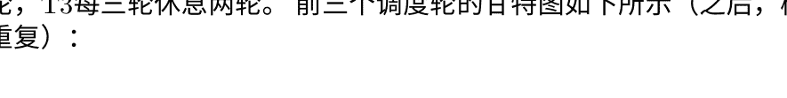

加权轮询调度的优点是线程切换较少。另一方面，加权公平队列调度可以使线程的累积运行时间更接近所需的比例。练习 3.7 让你探索其中的差异。

在 Linux 中，用户指定的线程的 niceness 控制了线程接收处理器时间的比例。调度的核心算法是加权轮转，就像第一个甘特图一样。（实时线程的固定优先级调度使用了单独的调度策略。这里讨论的是普通线程使用的比例共享调度器，称为完全公平调度器（CFS）。在多处理器系统上，CFS 调度每个处理器上运行的线程；一个基本独立的机制平衡了处理器之间的整体计算负载。章节末尾的注释重新讨论了比例共享调度如何适应多处理器环境的问题。）

CFS 不直接为每个 niceness 级别分配时间片，而是为每个 niceness 级别分配一个权重，然后根据可运行线程的权重计算时间片。每个线程被分配的时间片与其权重除以可运行线程的总权重成比例。CFS 从一个目标时间开始，这个时间是完成一次完整的轮转所需的时间。例如，假设目标时间为 6 毫秒。那么对于两个具有相同 niceness 的可运行线程，即使它们都具有 niceness 0 或 niceness 19，每个线程都将运行 3 毫秒。对于四个相同 niceness 的线程，每个线程将运行 1.5 毫秒。

请注意，线程切换速率取决于整个系统的负载，而不是固定的时间片。这意味着使用 CFS 的系统负载增加时，为了保持所需的响应级别，它将倾向于牺牲一些吞吐量。响应级别由线程在连续运行机会之间等待的目标时间控制，该时间可由系统管理员设置。示例中使用的 6 毫秒值是单处理器系统的默认值。

然而，如果系统负载变得非常高，CFS 不会继续牺牲吞吐量以提高响应时间。这是因为每个线程可以接收的最小时间有一个下限。达到这一点后，添加额外的线程将增加循环线程的总时间，而不是继续减少每个线程的时间。每个线程的最小时间也是系统管理员可以配置的参数；默认值使得线程的时间在可运行线程达到 8 后停止缩小。

现在考虑一个情况，两个线程共享 CPU，一个线程的 niceness 为 0，另一个线程的 niceness 为 5。CFS 将这些 niceness 级别分别赋予权重 1024 和 335。因此，线程获得的时间与 1024/(1024 + 335) 和 335/(1024 + 335) 成比例。因为 1024 大约是 335 的 3 倍大，我们可以估计，niceness 为 0 的线程将在每 6 毫秒中获得大约 4.5 毫秒的时间，而 niceness 为 5 的线程将在每 6 毫秒中获得大约 1.5 毫秒的时间。如果线程的 niceness 为 5 和 10 而不是 0 和 5，将得到相同的结果，因为权重仍然是 335 和 110，大约是 3 比 1 的比例。更一般地说，CPU 的比例仅由 niceness 之间的相对差异决定，而不是绝对的 niceness 级别，因为权重是按几何级数排列的。（这类似于音乐调式中的平均律，其中特定的音程，如大五度，无论在音阶的哪个位置，其谐波质量都是相同的，因为频率比是相同的。）

在了解了 CFS 如何控制处理器时间分配的概述之后，我们现在可以进入对实际处理器时间分配机制的讨论。CFS 调度机制基于一个重要的思想，以及许多我将大部分忽略的细节。

这个重要的思想是为每个线程跟踪其总运行时间，以线程权重为单位进行度量。也就是说，对于每个纳秒的运行时间，优先级为 0 的线程将获得 1 纳秒的运行时间，而优先级为 5 的线程将获得大约 3 纳秒的运行时间。（更准确地说，对于每个实际纳秒，它将获得 1024/335 纳秒的运行时间。）根据线程的运行情况进行有趣的计算（称为虚拟运行时间），保持线程按比例运行的目标就是运行最落后的线程。然而，如果 CFS 总是将 CPU 分配给最落后的线程，那么线程之间将不断切换。相反，调度器会继续运行当前线程，直到其时间片用完或被唤醒的线程抢占。一旦调度器选择了一个新的线程，它会选择虚拟运行时间最小的线程。

因此，在长期内，虚拟运行时间保持大致平衡，这意味着实际运行时间按照线程权重的比例保持，这反映了线程的优先级。

保持虚拟运行时间平衡的概念非常重要，可以考虑一些具体的例子。首先，考虑两个线程具有相同的优先级的情况，因此调度器会尽量确保这两个线程运行的时间相等。经过 $x$ 纳秒的时间，这两个线程应该分别运行了 $x/2$ 纳秒。为了始终保持这一点，调度器需要不断在这两个线程之间切换，这是低效的。相反，调度器会使用一种称为时间片的机制。如果调度程序愿意在一段时间内坚持使用一个线程，那么这段时间就是时间片。因此，你可能会发现在 9 毫秒之后，两个线程并不是每个都运行了 4.5 毫秒，可能线程 A 运行了 6 毫秒，线程 B 运行了 3 毫秒，如图 3.10 所示。当调度程序决定下一个要运行的线程时，它会选择只运行了 3 毫秒的线程 B，以便它有机会追赶线程 A。这样，如果你稍后再次检查，你不会看到线程 A 继续越来越占优势的情况。相反，你会看到两个线程轮流运行，其中一个运行的时间更长，但它们之间的差异从不会很大，最多可能是 3 毫秒，就像这个例子所示。

现在考虑当两个线程具有不同的优先级时会发生什么。例如，假设线程 A 的优先级为 0，线程 B 的优先级为 5。为了简化计算，让我们假设 1024/335 等于 3，这样线程 A 应该运行的次数比线程 B 多 3 倍。现在，即使调度程序不必担心在线程之间切换的效率问题， 9 毫秒后的理想情况也不再是每个线程运行 4.5 毫秒。相反，理想情况是线程 A 运行 6.75 毫秒，线程 B 只运行 2.25 毫秒。但是，如果调度程序只在离散时间片到期时切换线程，这种理想情况实际上不会发生。相反，你可能会看到线程 A 运行了 6 毫秒，线程 B 运行了 3 毫秒，如图 3.11 所示。下一个应该运行哪个线程？我们不能再说线程 B 落后了，应该允许它追赶。实际上，线程 B 运行的时间比应该运行的时间长。（记住，它实际上只应该运行 2.25 毫秒。）调度程序通过将每个线程的时间乘以一个缩放因子来计算这一点。对于线程 A，缩放因子为 1，而对于线程 B，缩放因子为 3。因此，尽管它们的实际运行时间是 6 毫秒和 3 毫秒，它们的虚拟运行时间分别为 6 毫秒和 9 毫秒。现在，看着这些虚拟运行时间，很明显线程 A 落后了（只有 6 个虚拟毫秒），而线程 B 领先了（有 9 个虚拟毫秒）。因此，调度程序知道选择线程 A 来运行下一个。

请注意，如果线程 A 和线程 B 在这个例子中处于它们的理想状态已经接收到 6.75 个真实毫秒和 2.25 个真实毫秒，那么它们的虚拟运行时间将完全相等。一旦考虑到缩放因子，两个线程都将运行 6.75 个虚拟毫秒。如果所有的话，这种累积虚拟运行时间的描述将足够处理线程在系统首次启动时开始，并持续运行的情况。

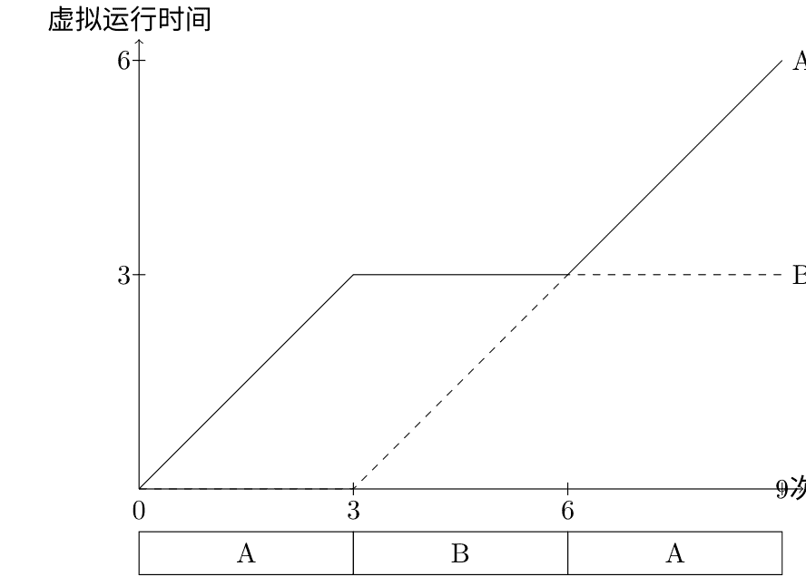
图 3.10: 因为线程 A 和线程 B 的优先级都为 0，每个线程在运行期间每经过 1 毫秒就累积 1 毫秒的虚拟运行时间。本图的底部显示了一个甘特图，指示了每个时间点上运行的线程。图的顶部绘制了线程 A（实线）和线程 B（虚线）的虚拟运行时间与时间的关系。在 9 毫秒的时刻，调度程序将选择线程 B 来运行下一个，因为它的虚拟运行时间较低。

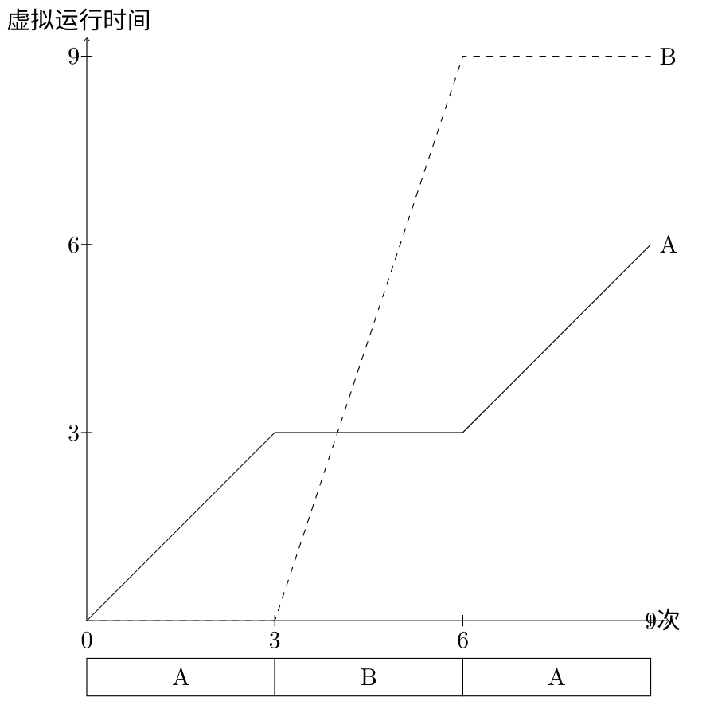
图 3.11: 线程 A 在每个运行的毫秒内仍然累积 1 毫秒的虚拟运行时间，但线程 B 的累积速度大约是 3 倍，因为它的优先级是 5。本图的底部显示了甘特图，指示每个时间点运行的线程。本图的顶部绘制了线程 A（实线）和线程 B（虚线）的虚拟运行时间与时间的关系。在 9 毫秒的时刻，调度器将选择线程 A 作为下一个运行的线程，因为它的虚拟运行时间较低，对应于它只运行了线程 B 的两倍，而不是三倍。（假设两个线程在整个时间内都保持可运行状态，实际的 Linux CFS 调度器不会像这里显示的那样给它们相等的时间片。然而，对于虚拟运行时间的计算在任何情况下都是相同的。)

对于虚拟运行时间的计算在任何情况下都是相同的，然而，它需要一些改进来处理正在创建或从定时睡眠和 I/O 等待中唤醒的线程。如果调度程序对它们没有做任何特殊处理，它们将一直运行，直到追赶上已存在的线程，这可能是一个荒谬的运行时间，对于一个新创建的线程或者长时间处于睡眠状态的线程来说。给予一个线程如此多的运行时间将剥夺其他线程正常运行的机会。

对于只在运行队列中短暂离开的线程，CFS 实际上允许它追赶运行时间。但是一旦一个线程非运行状态超过了一个阈值的时间，当它唤醒时，它的虚拟运行时间被设置为略低于之前可运行线程的最小虚拟运行时间。这样，它将很快得到运行，但不会比通常运行的时间更长。这类效果似乎类似于衰减使用调度器和 Microsoft Windows 中通过动态优先级调整实现的效果。与这些调整一样，目标不是比例共享，而是响应性和吞吐量。

任何新创建的线程都会被赋予一个略大于之前可运行线程的最小虚拟运行时间的虚拟运行时间，就好像它刚刚运行过并且现在正在等待下一次运行一样。运行队列按照可运行线程的虚拟运行时间进行排序。用于此目的的数据结构是红黑树，它是二叉搜索树的一种变体，具有增强效率的特性，即没有叶子节点可以比其他叶子节点深两倍以上。当 CFS 调度器决定切换线程时，它会切换到红黑树中最左边的线程，也就是具有最早虚拟运行时间的线程。

调度器在两种情况下执行这些线程切换。一种情况是时间片的过期。另一种情况是当新线程进入运行队列时，前提是当前运行的线程没有刚刚开始运行。（线程可以被抢占的速度有一个可配置的下限。）

将可运行的线程定位在虚拟运行时（表示为红黑树）的时间轴上的一个优点是，它自然地防止了唤醒线程饿死其他仍然可运行的线程，这在早期的 Linux 调度器中是可能的。随着时间的推移，唤醒的线程会越来越晚地插入到虚拟运行时间的时间轴上。而一直耐心等待 CPU 的可运行线程则保持固定的虚拟运行时。因此，它最终会具有最低的虚拟运行时，并且在线程切换发生时被选择运行。

## 3.7 调度与安全性

与调度相关的攻击中最重要的是拒绝服务（DoS）攻击，即旨在阻止系统的合法用户使用的攻击。拒绝服务攻击通常是一种令人讨厌的行为，其动机往往只是攻击者的不成熟。然而，它们可以成为更复杂方案的一部分。例如，考虑一下如果一个用于协调军事力量的系统容易受到拒绝服务攻击的后果。

攻击者可能会滥用调度程序的机制来发动拒绝服务攻击，最直接的方法是篡夺提供给管理员控制的机制。请记住，调度程序通常为每个线程提供一些控制参数，如截止日期、优先级、基本优先级或资源份额。授权的系统管理员需要能够说“这个线程的优先级很低”或关于其他参数的类似语句。如果攻击者能够控制相同的参数，那么拒绝服务攻击可能就像给关键线程设置低优先级那样简单。因此，真实的操作系统会保护线程控制接口。通常，只有经过身份验证的用户作为特定线程的“所有者”或真正的系统管理员才能控制该线程的调度参数。（通常，线程的所有者将是运行创建线程程序的用户。）当然，这依赖于系统安全的其他方面，我将在后面的章节中考虑：系统必须受到防篡改保护，必须能够验证其用户的身份，并且必须以足够无误的方式编程，以免其检查被规避。

因为真实系统会防止未经授权的用户降低线程优先级，攻击者会使用稍微复杂一些的策略。他们不是降低目标线程的优先级，而是与之竞争。也就是说，攻击者创建其他线程，试图从稀缺资源（如处理器时间）中分流足够多的资源，以至于几乎没有剩余资源给目标线程。

系统设计者的一个响应是安排任何拒绝服务攻击都足够繁琐，以便可以轻松地与正常行为区分开来，并因此进行拦截。例如，回想一下，一个高固定优先级的单个线程可以完全使所有正常线程饿死。因此，大多数系统禁止普通用户运行此类线程，将此特权保留给授权的系统管理员。事实上，典型系统将所有固定优先级都设为禁止访问所有高于正常优先级的任务，即使受到衰减使用调整的影响。

结果是，攻击者必须同时运行许多线程，才能耗尽处理器时间的相当一部分。因为合法用户通常没有任何理由这样做，所以拒绝服务攻击可以与正常行为区分开来。对每个用户的线程数量进行限制，可以限制拒绝服务攻击，而不会给大多数用户带来太多困扰。然而，不可避免地会在减轻拒绝服务攻击的程度和正常用户保留创建线程的灵活性之间进行权衡。

或者，可以使用一种本质上更抵抗拒绝服务攻击的调度策略。特别是，比例共享调度器在这方面有很大的潜力。Linux 中包含的版本可以为用户或其他较大的组分配资源份额，并且这些份额可以进行分层细分。这最初是由 Waldspurger 提出的，作为抽奖调度的一部分，但我观察到它在处理时间分配上容易出现短期不公平。后来， Waldspurger 展示了如何将相同的分层方法与确定性比例共享调度器（stride scheduling）一起使用，并且随后已经与各种其他比例共享调度器一起使用。

长时间运行的服务器线程，在其生命周期内可能处理来自许多不同用户的请求，这增加了额外的复杂性。如果资源按用户分配，那么应该由哪个用户来支付服务器线程的资源消耗？最简单的方法是为此目的创建一个特殊用户，其资源分配足够大，以满足服务器线程代表所有用户所做的所有工作。不幸的是，这种方法过于粗粒度，无法防止拒绝服务攻击。如果一个用户向服务器线程提交了许多请求，他或她可能会耗尽整个处理器时间分配。这将拒绝为其他用户在同一服务器线程上发出的请求提供服务。诚然，不使用该服务的线程将与该问题隔离，但如果涉及的服务器线程是关键线程，这可能是微不足道的安慰。

为了解决这个问题，最近的研究建议线程应该能够在处理不同请求时从一个用户的资源分配切换到另一个用户的资源分配。这个想法是将资源分配给独立的资源容器，而不是直接分配给线程。在任何时候，每个线程都从一个资源容器中获取资源。然而，它可以切换到从不同的资源容器中获取资源。这解决了公平计算服务器线程使用情况的问题。因为多个线程可以从单个资源容器中获取资源，所以同样的提案也可以通过运行更多的线程来防止用户获得更多的处理器时间。

最后，请记住，单独采取处理器调度的任何方法都无法防止拒绝服务攻击。攻击者只需超负荷使用其他资源，而不是处理器时间。例如，在 20 世纪 90 年代，攻击者经常针对系统有限的建立新网络连接的能力。尽管如此，综合的安全方法需要包括处理器调度以及网络和其他组件。

## 练习

3.1 甘特图，我在硬实时调度的背景下介绍过，也可以用来说明其他调度概念，比如响应时间。假设线程 T1 在时间 0 被事件触发，并且需要运行 1.5 秒才能响应。假设线程 T2 在 T1 的触发后 0.3 秒发生的事件触发，并且 T2 需要运行 0.2 秒才能响应。为以下三种情况绘制甘特图，并分别指示 T1 的响应时间、 T2 的响应时间和平均响应时间：

- (a) T1 在 T2 运行之前被允许完全运行。
- (b) T1 在 T2 触发时被抢占；只有在 T2 完成后， T1 才会恢复。
- (c) T1 在 T2 触发时被抢占；然后以轮转的方式执行这两个线程（从 T2 开始），直到其中一个完成。时间片（或量子）为 0.05 秒。

3.2 假设 Linux 系统正在运行三个线程，每个线程都在一个无限循环中运行，循环体中没有任何内容，因此它会消耗给予它的处理器时间。一个线程由一个用户运行，而另外两个线程由第二个用户运行（可能通过网络登录或在第二个终端窗口中登录）。调度程序是否给予每个用户公平份额（一半）的处理器时间，还是给予每个线程公平份额（三分之一）？答案取决于组调度功能是保持默认配置还是禁用；你应该为每种情况提供一个答案。你可以从本章的文本中回答这个问题，也可以参考探索项目 3.1。此外，你更喜欢哪种行为？请解释原因。

3.3 根据固定优先级安排的两个线程 T1 和 T2，绘制甘特图。其中 T2 的优先级高于 T1。两个线程都是周期性运行的。其中一个线程 T1 的周期和截止时间为四秒，每个周期的执行时间为两秒。另一个线程 T2 的周期和截止时间为六秒，每个周期的执行时间为三秒。假设两个线程在时间 0 开始一个周期。绘制甘特图，足够长以显示其中一个线程未能在截止时间前完成任务。

3.4 根据最早截止时间优先策略，绘制两个线程 T1 和 T2 的甘特图。如果两个线程的截止时间相同，则抢占已经运行的线程，选择新的可运行线程。两个线程都是周期性运行的。其中一个线程 T1 的周期和截止时间为四秒，每个周期的执行时间为两秒。另一个线程 T2 的周期和截止时间为六秒，每个周期的执行时间为三秒。假设两个线程在时间 0 开始一个周期。绘制甘特图，直到开始重复。是否满足截止时间？

3.5 假设一个系统有三个线程（T1、T2 和 T3），它们在时间 0 都可以运行，并且分别需要一秒、两秒和三秒的处理时间。假设每个线程在开始另一个线程之前都运行到完成。绘制六个不同的甘特图，每个图表示线程可以运行的可能顺序。对于每个图，计算每个线程的周转时间；即从准备就绪（时间 0）到完成所经过的时间。还要计算每个顺序的平均周转时间。哪个顺序的平均周转时间最短？产生这个顺序的调度策略叫什么名字？

3.6 以下分析与抽奖调度相关，并在编程项目 3.2 中使用。考虑一个硬币，它的权重使得它以概率 $p$ 出现正面，以概率 $1-p$ 出现反面，其中 $p$ 的值介于 0 和 1 之间。令 $f(n, k, p)$ 表示在这个硬币连续投掷的序列中至少出现 $k$ 个连续正面的概率。

(a) 证明 $f(n, k, p)$ 可以通过以下递归定义。
如果 $n < k$，那么 $f(n, k, p) = 0$。如果 $n = k$，那么 $f(n, k, p) = p^k$。如果 $n > k$，那么：
$$f(n, k, p) = f(n - 1, k, p) + p^k(1 - p)(1 - f(n - k - 1, k, p))$$

- (b) 考虑在 $n$ 次抛掷公平硬币中，至少出现 $k$ 个连续正面或至少出现 $k$ 个连续反面的概率。证明这等于 $f(n-1, k-1, 1/2)$。

- (c) 作为(b)部分公式的替代方案，有人错误地建议在 $n$ 次抛掷中，至少出现 $k$ 个连续正面或至少出现 $k$ 个连续反面的概率可以计算为 $2f(n, k, 1/2) - f(n, k, 1/2)^2$，或等价地为 $1 - (1 - f(n, k, 1/2))^2$。解释导致这两个错误公式的推理，并指出其中的谬误。此外，以 $n=k=1$、$n=k=2$ 或 $n=2$ 且 $k=1$ 的小案例为例，展示这些错误公式与(b)部分正确公式的答案之间的差异；使用完全列举的可能性来验证哪个答案是正确的。

3.7节展示了一个有三个线程的例子的两个甘特图，这些线程要在比例为3:2:1的情况下共享一个处理器。第一个甘特图展示了使用WRR调度的三个线程，第二个甘特图展示了使用WFQ调度的三个线程。对于这两个甘特图，画出一个相应的图形，每个线程都有一条线，显示该线程的累积虚拟运行时间（纵轴）与实际时间（横轴）的关系。线程T1应该在实际运行的每毫秒累积2毫秒的虚拟运行时间。同样地，线程T2应该在实际运行的每毫秒累积3毫秒的虚拟运行时间，线程T3应该在实际运行的每毫秒累积6毫秒的虚拟运行时间。在两个图形中，这三条线都应该从 (0,0) 开始，到 (30,30) 结束。看看这些线条与连接这两个点的对角线有多大偏差。哪种调度方法使线条更接近对角线？这反映了每种方法在以各自的速率连续分配计算给这三个线程方面的接近程度。

3.8 根据假设，调度程序将4.5毫秒分配给线程A，然后将1.5毫秒分配给线程B，再将3毫秒分配给线程A。如果调度程序在第9毫秒时再次选择一个线程，它会选择哪个？为什么？

## 编程项目

- 3.1 在一个可以安装修改后的Linux内核的系统上，测试消除动态优先级调整的效果。（你可以在文件kernel/sched.c中找到相关代码。）你应该能够证明，与niceness相符，计算密集型进程在共享处理器方面没有变化。你还应该能够证明，在有大量计算密集型进程运行时，交互式进程的响应能力会降低。与其使用一个从用户那里读取输入的进程来测试响应时间，你可以更容易地通过一个重复休眠并测量实际休眠时间比请求时间长多少的进程来获得定量结果。撰写一份报告，详细说明你所做的事情，以及你所做的硬件和软件系统环境，以便其他人可以复制你的结果。

- 3.2 考虑一个硬币，它的权重使得它以概率 $p$ 出现正面，以概率 $1-p$ 出现反面，其中 $p$ 的值在0和1之间。令 $f(n, k, p)$ 表示在这个硬币的一系列投掷中至少出现 $k$ 个连续正面的概率。

    - (a) 编写一个程序，使用练习3.6(a)中给出的递推关系计算 $f(n, k, p)$。为了使你的程序相对高效，你需要使用动态规划这种算法设计技术。也就是说，你应该创建一个长度为 $(n+1)$ 的数组，然后对于 $i$ 从0到 $n$，填充数组的第 $i$ 个元素为 $f(i, k, p)$。每当计算 $f$ 的一个值需要另一个 $f$ 的值时，从数组中检索所需的值，而不是使用递归调用。最后，返回数组的第 $n$ 个元素。

    - (b) 如果线程A和B分别以1/2的概率被选择，并且时间片为1/20秒，那么在一天中，线程A在不运行一秒的情况下的概率是 $f(20 \cdot 60 \cdot 60 \cdot 24, 20, 1/2)$。使用你的程序计算这个值。

    - (c) 如果线程B长时间不运行，系统的性能不会比线程A好。使用练习3.6(b)的结果计算在一天中至少有一个线程A和B在没有处理器时间的情况下运行一秒的概率。

## 探索项目

通过另一个用户的帮助，实验验证练习3.2的答案。top命令将显示每个线程获得的处理器的比例。要禁用自动组调度，请使用 noautogroup 选项引导内核。

3.2 实验性地测量在尽可能多的类UNIX单处理器系统中，对计算密集型线程给予的处理器时间与niceness之间的影响。如果你能够比较使用比例共享调度器（如Linux）的系统与使用衰减使用调度器（如Mac OS X或大多数旧版本的UNIX）的系统，那么这将是最有趣的。确保在一个空闲的系统上进行实验。编写一个简单的测试程序，只是一个循环。正常运行一个副本（niceness为0），另一个使用提高的niceness运行nice命令。使用top命令观察每个线程所占处理器的比例。重复测试，使用从1到19不同程度的提高niceness。此外，在除了每个niceness线程一个之外的其他情况下重复测试；例如，如果有四个正常niceness线程和一个提高niceness线程会怎样？撰写一份报告，详细解释你所做的事情以及你所做的事情的硬件和软件系统环境，以便其他人可以复制你的结果。尝试得出关于niceness作为资源分配工具在你的研究的系统上是否合适的结论。

请注意，在Linux下观察niceness的影响，需要在一个调度组内运行所有线程。最简单的方法是在一个终端窗口中运行所有线程。或者，您可以使用 noautogroup 选项启动内核。

3.3 本项目的说明假设您使用的是Linux系统；在其他系统上可能也可以进行类似的探索，但具体命令会有所不同。项目的某些部分假设您有运行固定优先级线程的权限，这通常需要您拥有完整的系统管理权限。如果您没有所需的权限，可以省略项目的这些部分。项目的某些部分假设您至少有两个处理器，可以是单个处理器芯片内的两个“核心”；实际上，即使只有一个核心也可以，如果它支持“超线程”技术（运行两个线程的能力）。只有相当旧的计算机才无法满足这个假设；如果你有这样一台旧计算机，可以忽略项目中的那些部分。

图3.12和3.13中显示的C++程序运行了一定数量的线程，该数量在命令行中指定。（主线程是一个；它为其他线程创建了一个子线程。）每个线程在开始运行时获取当前时间，并在至少5秒后继续运行。如果你将这个程序的源代码保存在threads.cpp文件中，可以使用以下命令进行编译:

```bash
g++ -o threads -pthread threads.cpp
```

- (a) 假设你在单处理器上使用正常的CFS调度程序运行此程序。当你将线程数从1增加到2、3和4时，你预计程序运行的总耗时会发生什么变化？它会保持在大约5秒左右的几乎恒定时间，还是会线性增长到10、15和20秒？为什么？为了测试你的预测，运行以下命令并查看每个命令报告的耗时。这些命令中使用了schedtool程序，以将线程限制在单个处理器（处理器编号0）上:

```bash
schedtool -a 0 -e time ./threads 1
schedtool -a 0 -e time ./threads 2
schedtool -a 0 -e time ./threads 3
schedtool -a 0 -e time ./threads 4
```

- (b) 假设您在单处理器上运行该程序，但使用固定优先级调度器。所有线程都处于相同的优先级级别，并使用FIFO规则进行调度。当您将线程数从1增加到2、3和4时，您预计程序运行所需的总耗时会发生什么变化？它会保持在大约5秒左右的几乎恒定值，还是线性增长到10、15和20秒？为什么？为了测试您的预测，请运行以下命令并查看每个命令报告的耗时。这些命令中使用了schedtool程序，不仅限制了线程在单个处理器上运行，还指定了优先级级别50的FIFO调度。这些命令中使用了sudo程序以系统管理权限运行 (假设您具有此权限) ; 这允许选择FIFO固定优先级调度:

```bash
sudo schedtool -a 0 -F -p 50 -e time ./threads 1
sudo schedtool -a 0 -F -p 50 -e time ./threads 2
sudo schedtool -a 0 -F -p 50 -e time ./threads 3
sudo schedtool -a 0 -F -p 50 -e time ./threads 4
```

```cpp
#include <sys/time.h>
#include <stdio.h>
#include <string.h>
#include <stdlib.h>
#include <pthread.h>
#include <iostream>
#include <sstream>
#include <unistd.h>

void killTime(int secs){
    struct timeval start, now;
    if(gettimeofday(&start, 0) < 0){
        perror("gettimeofday");
        exit(1);
    }
    while(1){
        if(gettimeofday(&now, 0) < 0){
            perror("gettimeofday");
            exit(1);
        }
        if(now.tv_sec - start.tv_sec > secs ||
           (now.tv_sec - start.tv_sec == secs && now.tv_usec >= start.tv_usec)){
            return;
        }
    }
}

void *run(void *arg){
    killTime(5);
    return 0;
}
```
图3.12: 这是threads.cpp的第一部分，一个在命令行上运行指定数量线程的C++程序。每个线程运行直到至少经过5秒的时间自线程启动。程序在下一个图中继续。

```cpp
int main(int argc, char *argv[]){
    int nThreads;
    std::istringstream arg1(argv[1]);
    arg1 >> nThreads;
    pthread_t thread[nThreads-1];
    int code;

    for(int i = 0; i < nThreads-1; i++){
        code = pthread_create(&thread[i], 0, run, 0);
        if(code){
            std::cerr << "pthread_create failed: " << strerror(code) << std::endl;
            exit(1);
        }
    }
    run(0);
    for(int i = 0; i < nThreads-1; i++){
        code = pthread_join(thread[i], 0);
        if(code){
            std::cerr << "pthread_join failed: " << strerror(code) << std::endl;
            exit(1);
        }
    }
    return 0;
}
```
图3.13: 这是threads.cpp的第二部分，一个C++程序根据命令行指定的线程数运行。每个线程运行至少5秒钟的时间自线程启动。程序从前一个图中继续执行。

- (c) 先前实验生成的时间输出不仅包括经过的时间，还包括用户和系统处理器时间。如果将用户和系统处理器时间相加以获得总处理器时间，您应该发现总时间在每种情况下与经过的时间非常相似，因为线程程序几乎将一个处理器完全占用。现在假设您切换到使用两个处理器。使用正常的CFS调度，当线程数量从1增加到2、3和4时，您预计总处理器时间会发生什么变化？为什么？为了测试您的预测，请运行以下命令：

```bash
schedtool -a 0,1 -e time ./threads 1
schedtool -a 0,1 -e time ./threads 2
schedtool -a 0,1 -e time ./threads 3
schedtool -a 0,1 -e time ./threads 4
```

- (d) 假设您使用两个具有固定优先级FIFO调度的处理器。当线程数量从1增加到2、3和4时，您预计总处理器时间会发生什么变化？为什么？那么，经过的时间呢？当线程数量从1增加到2、3和4时，您预计会发生什么变化？为什么？为了测试您的预测，请运行以下命令：

```bash
sudo schedtool -a 0,1 -F -p 50 -e time ./threads 1
sudo schedtool -a 0,1 -F -p 50 -e time ./threads 2
sudo schedtool -a 0,1 -F -p 50 -e time ./threads 3
sudo schedtool -a 0,1 -F -p 50 -e time ./threads 4
```

## 注释

我通过解释繁忙等待的低效性并指出，线程状态的概念的动机是为了一个想要等待的线程通知操作系统。这个问题在历史上早就被认识到了。操作系统的一个例子是同一篇1959年的论文[34]，Codd等人在第2章引用了这篇论文，其中提到：“为了有效利用机器，对程序员或编译器提出了进一步的要求。当问题程序达到一个点，中央处理单元上的活动无法继续进行，直到完成一个或多个输入输出操作时，控制必须传递给监控程序，以便为其他问题程序提供服务。”（今天称为操作系统的“监控程序”）

我注意到线程切换的主要成本是失去的缓存性能。这个观察已经在各种测量研究中得到了量化，比如Regehr的一项研究[115]。

我使用量子和时间片这两个术语可以互换使用，以符合当代用法。早期操作系统对这些词有不同的用法：量子是较粗时间片的更细的划分。可运行线程的子集会以循环方式获得短暂的量子。当一个线程获得足够的量子来使用完整的时间片时，它将被移出循环一段时间，另一个线程将进入取代它的位置。

我只是简单提到了公平份额、多级反馈队列、彩票和步幅调度。它们的早期参考文献分别是[85]、[38]、[148]和[149]。

刘和莱兰在1973年发表了一篇关于硬实时调度的开创性文章[100]。关于如何将速率单调调度推广到更现实的情况的调查，请参阅Sha、Rajkumar和Sathaye的文章[130]。

我从三个真实系统的调度器中提取了示例：Mac OS X，Microsoft Windows和Linux。对于其中的两个（Mac OS X和Linux），找到信息的唯一可靠方法是阅读内核源代码，就像我所做的那样（版本为Darwin 6.6和Linux 2.6.38）。对于Microsoft Windows，源代码不是公开可用的，但相反，不需要深入挖掘源代码就能找到比我更详细的描述：Russinovich和Solomon的书中有一个非常仔细的描述[123]。

我从衰减使用调度转向比例共享调度的时候提到，原则上可以通过适当设置衰减使用调度器的基本优先级来实现比例共享，但在实践中，将比例映射到基本优先级是困难的。Hellerstein的数学建模研究[73]为这一观点的两个方面提供了证据。Hellerstein明确表明原则上可以实现他所称的“服务速率目标”。然而，不太明确的是，他也表明这是不切实际的；仔细阅读他的图表，可以看到有两个选择。要么服务速率对基本优先级不敏感，以至于大多数比例无法达到，要么存在一个极端敏感的区域，从一个基本优先级差异跳到下一个时，会跳过许多潜在的比例。

我注意到，尽管Linux的CFS在每个处理器上充当比例共享调度器，但是使用了一个相对独立的负载平衡机制来将系统的线程分配给其处理器。在考虑将比例共享概念更直接地应用于多处理器环境时，首先要问的问题是这意味着什么。假设有两个可运行的线程，它们的权重分别为2和1。在单个处理器上，很明显第一个线程应该获得三分之二的处理能力，而另一个线程应该获得三分之一。但是如果你有两个处理器呢？那么一个线程最多只能获得系统总处理能力的一半。另一个线程可以获得一半的处理能力，但是只能通过让其中一个处理器一半的时间处于空闲状态来实现；更实际的方法是让每个线程完全使用一个处理器。

从这个角度出发，对于权重应该如何在多处理器系统中运行的合适定义的泛化需要一些注意；Chandra和他的同事在他们的“Surplus Fair Scheduling” [29]的工作中解释了这一点。一旦这个定义性问题解决了，下一个问题是调度程序如何在多个处理器上高效运行，而不需要同步访问单个运行队列的瓶颈。虽然这仍然是一个活跃的研究课题，但Li、Baumberger和Hahn [97]的分布式加权轮询调度程序看起来很有前途。

与比例共享调度相比，一种替代方法是在调度程序中增加一个更高级的资源管理器，在系统被大量利用时调整线程优先级，以实现所需的资源分配。这种方法的一个例子是Windows Server 2008 R2中包含的Windows系统资源管理器。该资源管理器可以支持将CPU时间平均分配给每个进程、每个用户、每个远程桌面会话或每个Web应用程序池，同时允许某些用户或组获得比其他用户或组更大的份额。详细信息似乎没有公开文档记录，但一些信息可以通过微软的在线TechNet图书馆获得。

资源容器由Banga、Druschel和Mogul [10]描述。

# 第4章 同步和死锁

## 4.1 简介

在第2章和第3章中，你已经看到操作系统如何支持并发执行的线程。现在是时候考虑系统如何支持这些线程之间的受控交互了。因为在同一台计算机上同时运行的线程可以通过读写共享的内存位置来进行内在的交互，所以难点在于提供控制。特别是，本章将研究控制不同线程中发生的执行步骤的相对时序。

回想一下，调度程序被授予相当大的权力，可以临时抢占一个线程的执行并调度另一个线程。调度程序可能会响应不可预测的外部事件，比如I/O请求完成所需的时间，而进行这样的操作。因此，除非程序员采取了明确的措施来控制事件的顺序，否则两个（或多个）线程所采取的计算步骤将以一种相当不可预测的方式交错进行。这些控制措施被称为同步。同步通常通过使一个线程等待另一个线程来控制事件的顺序。

在第4.2节中，我将详细介绍为什么需要同步化，并描述当交互线程没有正确同步时可能出现的问题。不受控制的交互称为竞争。通过分析一些典型的竞争情况，我将说明对于一种特定形式的同步，即互斥，的需求。互斥确保一次只有一个线程可以操作共享数据结构。或其他资源。第4.3节介绍了两种密切相关的获得互斥的方法。它们被称为互斥锁和监视器。

在介绍互斥之后，我将转向其他更一般的同步挑战和可以解决这些挑战的机制。举个例子，您可能希望确保一些内存位置在填充有有用值之后再进行读取，而不是之前。我在第4.4节中列举了除互斥之外的几种最常见的同步模式。之后，我将在第4.5节和第4.6节中介绍两种常用的处理这些情况的机制。其中一种是条件变量，它是监视器的一个重要扩展；监视器与条件变量的组合可以清晰地处理许多情况。另一种是信号量，它是一种古老的喜爱的机制，因为它原则上可以解决所有同步问题。然而，信号量可能很难理解和正确使用。

同步解决了竞争问题，但它可能会产生一个新的问题：死锁。回想一下，同步通常涉及使线程等待；例如，在互斥中，一个线程可能需要等待轮到它，以强制执行一次一个的规则。当等待线程的循环形成时，死锁就会发生；例如，线程A等待线程B，而线程B恰好等待线程A，如图4.1所示。因为这种病理结果是由等待引起的，所以我将在第4.7节中讨论它以及三种最实用的治疗方法，在完成基于等待的同步研究之后。

等待还与调度（第3章的主题）以一些有趣的方式相互作用。特别是，除非采取特殊预防措施，同步机制可能会破坏优先级调度，允许低优先级线程运行，而高优先级线程等待。因此，在第4.8节中，我将简要讨论同步和调度之间的相互作用，以及可以采取的措施来驯服它们。

尽管第4.7节和第4.8节解决了死锁和不希望的调度交互的问题，但也值得考虑这些问题的根本原因。潜在的问题是一个线程可以阻塞另一个线程的进展，即使没有死锁等戏剧性的症状，这也是不希望的。毕竟，一个被阻塞的线程无法利用可用的处理能力产生有用的结果。随着典型计算机系统中处理器核心数量的增加，替代的非阻塞同步技术变得越来越重要。第4.9节简要介绍了这个主题，展示了如何在不阻塞进展的情况下安全地支持并发线程的数据结构。

最后，在第4.10节中，我总结了与同步相关的安全问题。特别是，我展示了如何利用微妙的同步错误，这些错误可能几乎不会导致故障，除非被激发，可以被攻击者利用以规避系统的正常安全策略。在这个结尾部分之后，我提供了练习、编程和探索项目以及注释。

尽管我在本章涵盖了广泛的与同步相关的主题，但有两个主题我留到了以后的章节。原子事务是一种特别复杂和重要的同步模式，在中间件中经常遇到；因此，我将整个第5章都用来讨论它们。此外，显式地在线程之间传递消息（例如，通过网络）既提供同步，也提供通信，因为在消息传输之后才能接收到消息。尽管起到了同步的作用，但我选择在与通信相关的第9章和第10章中讨论各种形式的消息传递。

## 4.2 竞争和互斥的需求

当两个或更多线程在共享数据结构上操作时，如果线程的时间安排恰好相互干扰，可能会发生一些非常奇怪的故障。例如，考虑下面可能出现在一个没有指定座位的事件的 sellTicket 过程中代码：

```c
if(seatsRemaining > 0){
  dispenseTicket();
  seatsRemaining = seatsRemaining - 1;
} else
  displaySorrySoldOut();
```

表面上看，这段代码似乎永远不会卖出比可用座位更多的票。然而，如果多个线程（可能控制不同的售票点）执行相同的代码会发生什么呢？大部分时间都会没问题。即使有两个人试图在人类感知为同一时刻购买票，从计算机的时间尺度来看，可能一个先发生，另一个后发生，如图4.2所示。在这种情况下，一切都好。然而，偶尔会出现恰好错位的情况，导致如图4.3所示的情景发生。

- 1. 线程A检查 `seatsRemaining > 0`。因为 `seatsRemaining` 是1，测试成功。线程A将执行 `if` 的第一个分支。
- 2. 线程B检查 `seatsRemaining > 0`。因为 `seatsRemaining` 是1，测试成功。线程B将执行 `if` 的第一个分支。
- 3. 线程A发放一张票，并将 `seatsRemaining` 减少为0。
- 4. 线程B发放一张票，并将 `seatsRemaining` 减少为 -1。
- 5. 一个顾客最终坐在另一个顾客的腿上。

当然，还有很多其他同样不太可能发生的情况会导致错误行为。在练习4.1中，你可以构思一个场景，在 `seatsRemaining` 为2的情况下，两个线程分别发放一张票，但 `seatsRemaining` 最终变为1而不是0。

这些场景是 traces 的示例。在一个竞争中，两个线程使用相同的数据结构，没有任何机制确保只有一个线程同时使用数据结构。如果其中一个线程先于另一个线程执行，一切都好。然而，如果两个线程交错执行，程序就会出现故障。通常，故障可以表示为某个不变的属性被违反。

| 线程A | 线程B |
| :--- | :--- |
| `if(剩余座位数 > 0)`<br>发放票;<br>剩余座位数 = 剩余座位数 - 1; | |
| | `if(剩余座位数 > 0)...else`<br>显示抱歉，已售罄; |

图4.2: 即使两个人认为他们在同时购买最后一张票，很有可能一个线程（本例中的线程A）会在另一个线程之前运行。然后线程B将正确地发现没有剩余座位。

| 线程A | 线程B |
| :--- | :--- |
| `if(剩余座位数 > 0)` | |
| | `if(剩余座位数 > 0)` |
| 发放票; | |
| | 发放票; |
| 剩余座位数 = 剩余座位数 - 1; | |
| | 剩余座位数 = 剩余座位数 - 1; |

图4.3: 如果线程A和线程B交错执行，两者都可以表现得好像还有一张票可以出售，尽管实际上只有一张票供两者使用。

在售票示例中，不变量是剩余座位数的值应该是非负的，并且当加上已发放的票数时应等于总座位数。（这个不变量假设剩余座位数被初始化为总座位数。）当一个不变量涉及多个变量时，即使其中一个线程只读取变量而不修改它们，也可能导致竞争。例如，假设有两个变量，一个记录已售出的票数，另一个记录钱箱中的现金金额。这两者之间应该存在一个不变关系：已售出的票数乘以每张票的价格，加上起始现金金额，应等于手头现金。假设一个线程正在销售一张票。它已经更新了一个变量，但尚未更新另一个变量。如果恰好在那个时刻另一个线程选择运行一个审计函数，该函数检查这两个变量的值，它将发现它们处于不一致的状态。

这种不一致可能听起来并不可怕，但如果在医疗环境中发生类似的不一致，一个变量记录了药物的给予，而另一个变量记录了剂量，那会怎么样呢？你能看出这种不一致有多危险吗？类似的情况发生在一台放射治疗机器 Therac-25 上，造成了偶尔致命的后果。更糟糕的是，一些患者遭受了可怕但不立即致命的伤害，并在极度痛苦和棘手的痛苦中苟延残喘。从售票的例子中，你可以看到，在同一数据结构上执行两个线程的操作是无害的，只要没有同时进行两个操作。换句话说，线程执行的交错需要以完整操作的粒度进行，例如售票或审计现金抽屉。在交错操作时，如果一个线程执行了几个完整操作，那是可以的。连续执行多个操作；线程不需要交替执行。

然而，每个销售或审计都应该在没有中断的情况下完成。任何完整操作的交错之所以安全，是因为每个操作都被设计为依赖于不变量并保持其不变。只要你最初构建的数据结构处于满足不变量的状态，任何一系列保持不变的操作都将保持不变。

因此，需要一种同步机制，允许一个线程在开始工作之前获得对数据结构的私有访问，从而排除所有其他线程对该结构的操作。传统的比喻是说线程锁定数据结构。当锁定结构的线程完成时，它解锁，允许另一个线程接替。因为任何正在执行操作的线程暂时排除了所有其他线程，所以这种安排被称为互斥。互斥确定了调度程序可以交错线程的粒度。

## 4.3 互斥锁和监视器

正如你在4.2节中所看到的，共享数据结构的线程需要一种机制来获得对这些结构的独占访问。程序员可以通过创建与每个共享数据结构相关联的特殊锁对象来安排这种独占访问。该锁只能被一个线程锁定。锁定了锁的线程被称为持有锁，尽管这个词汇与现实世界的锁的隐喻没有明显的联系。如果线程在持有相应的锁时才对（甚至检查）数据结构进行操作，这种纪律将防止竞争。

为了支持这种形式竞争预防，操作系统和中间件通常提供互斥锁。由于互斥锁这个名称相当冗长，通常使用更短的名称。一些程序员简单地称之为锁，但这可能会导致混淆，因为其他同步机制也被称为锁。（例如，在4.4.2节中，我介绍了读者/写者锁。）因此，互斥锁的缩写形式 mutex 已经变得流行起来。特别是，POSIX标准称之为互斥锁。因此，在本书中我也将使用这个名称。

第4.3.1节介绍了用于互斥锁的POSIX应用程序编程接口(API)。第4.3.2节介绍了一种替代的、更结构化的方法互斥锁的接口，也被称为监视器。最后，第4.3.3节通过解释通常用于实现互斥锁的机制，展示了这两种接口背后的原理。

### 4.3.1 互斥锁应用程序编程接口

互斥锁可以处于两种状态之一：锁定（即被某个线程持有）或未锁定（即没有被任何线程持有）。任何互斥锁的实现都必须有一种方式来创建互斥锁并初始化其状态。通常，互斥锁被初始化为未锁定状态。至少还需要两个其他操作：一个用于锁定互斥锁，一个用于解锁互斥锁。

锁定和解锁操作并不像听起来那么对称。解锁操作只能在互斥锁被锁定时应用；该操作完成其工作并返回，而不会使调用线程等待。另一方面，即使互斥锁已经被锁定，锁定操作也可以被调用。因此，调用线程可能需要等待，如图4.4所示。当线程在互斥锁上调用锁定操作，并且该互斥锁已经处于锁定状态时，线程将被阻塞，直到另一个线程解锁该互斥锁。此时，想要锁定互斥锁的线程可以恢复执行，找到互斥锁未锁定，锁定它并继续执行。

如果多个线程尝试锁定同一个互斥量，只有一个线程会将互斥量从未锁定状态切换到锁定状态；该线程将被允许继续执行。其他线程将等待互斥量再次解锁。锁操作的这种行为提供了互斥性。要使线程在调用锁操作后继续执行，它必须是将互斥量从未锁定状态切换到锁定状态的唯一线程。在线程解锁互斥量之前，可以说它持有互斥量（也就是说，它拥有互斥量的独占权），并且可以安全地对关联的数据结构进行操作，以避免竞争条件。

| 互斥锁状态 | 动作 | 结果 |
| :--- | :--- | :--- |
| 未锁定 | 锁定 | 状态变为“锁定”；调用线程继续执行。 |
| 已锁定 | 锁定 | 调用线程等待，直到互斥锁被解锁。 |
| 已锁定 | 解锁 | 状态变为“未锁定”；如果有等待线程，其中一个获取锁。 |

图4.4：锁定一个未锁定的互斥量和解锁一个已锁定的互斥量会改变互斥量的状态。然而，一个线程也可以尝试锁定一个已经锁定的互斥量。在这种情况下，线程将等待并在另一个线程解锁时获取互斥量的锁定。

无论选择哪个等待的线程来锁定互斥量，都可以摆脱竞争的自由存在。然而，哪个线程先执行可能对其他原因很重要；我将在第4.8.2节中回顾这个问题。除了初始化互斥量、锁定互斥量和解锁互斥量的基本操作外，可能还有其他不太重要的操作。例如，可能有一个用于测试互斥量是否可以立即锁定而无需等待的操作，如果可以立即锁定，则进行锁定。对于依赖手动回收内存的系统，可能还有一个不再使用互斥量时销毁互斥量的操作。

各个操作系统和中间件系统提供符合我描述的一般模式的互斥量API，具体细节各不相同。为了看到一个具体的API示例，我将介绍POSIX标准中包含的互斥量操作。因为这是一个标准，许多不同的操作系统提供了这个API，以及可能的其他系统特定的API。

在POSIX API中，你可以声明 `my_mutex` 为互斥锁，并使用默认属性进行初始化，如下所示：

```c
pthread_mutex_t my_mutex;
pthread_mutex_init(&my_mutex, 0);
```

想要锁定互斥锁、操作关联的数据结构，然后解锁互斥量的线程可以执行以下操作（可能还加入了一些错误检查）：

```c
pthread_mutex_lock(&my_mutex);
// 在受保护的数据结构上进行操作
pthread_mutex_unlock(&my_mutex);
```

例如，图4.5展示了使用POSIX API以C语言编写的售票示例中的关键过程。当所有线程完成对互斥锁的使用（使其处于解锁状态）后，程序员应该销毁它，以便回收任何底层内存。可以通过执行以下过程调用来实现：

```c
pthread_mutex_destroy(&my_mutex);
```

POSIX还提供了几个变体的 `pthread_mutex_lock`，在特定情况下很有用。其中之一，`pthread_mutex_trylock`，在获取互斥锁时不会等待。相反，它会返回一个错误，如果无法立即获取锁，则执行其他代码。另一个是 `pthread_mutex_timedlock`，允许程序员指定最长等待时间。如果在该时间内无法获取互斥锁，则 `pthread_mutex_timedlock` 返回错误代码。

除了它们的广泛可用性之外，POSIX互斥锁值得研究的另一个原因是程序员可以在几个变体中选择，这些变体对于两个关于异常情况的问题提供了不同的答案。其他互斥锁API可能只包含对这些问题的一个具体答案，而不是暴露所有可能性的完整范围。问题如下：

- 如果一个线程尝试解锁一个已解锁的互斥锁，或者由另一个线程锁定的互斥锁会发生什么？
- 如果一个线程尝试锁定它已经持有的互斥锁会发生什么？（请注意，如果线程等待自己解锁互斥锁，这种情况将构成死锁的最简单情况。等待线程的循环将由一个单独的线程组成，等待它自己解锁。）

POSIX标准允许程序员从四种不同的互斥锁类型中选择，每种类型对这两个问题有不同的回答：

- **PTHREAD_MUTEX_DEFAULT**: 如果一个线程尝试锁定它已经持有的互斥锁或解锁它没有持有的互斥锁，那么无法预测会发生什么。程序员有责任永远不要尝试这两种操作。不同的符合POSIX标准的系统可能会有不同的行为。
- **PTHREAD_MUTEX_ERRORCHECK**: 如果一个线程尝试锁定它已经持有的互斥锁或解锁它没有持有的互斥锁，该操作将返回一个错误代码。
- **PTHREAD_MUTEX_NORMAL**: 如果一个线程尝试锁定它已经持有的互斥锁，它将陷入死锁状态，等待自己解锁互斥锁，就像等待任何其他线程一样。如果一个线程尝试解锁它没有持有的互斥锁，那么无法预测会发生什么；每个符合POSIX标准的系统都可以自由地做出响应。
- **PTHREAD_MUTEX_RECURSIVE**: 如果一个线程尝试解锁它没有持有的互斥锁，该操作将返回一个错误代码。如果一个线程尝试锁定它已经持有的互斥锁，系统只是简单地增加一个计数器，记录线程锁定互斥量的次数，并允许线程继续执行。当线程调用解锁操作时，计数器会递减，只有当计数器达到0时，互斥量才真正解锁。

如果你想在并发编程专家之间引发一场辩论，可以询问他们对递归锁定的观点，即由POSIX选项 `PTHREAD_MUTEX_RECURSIVE` 指定的互斥量行为。一方面，递归锁定消除了一类特别愚蠢的死锁，即线程等待它已经持有的互斥量。另一方面，拥有递归锁定的程序员可能不会遵循一种纪律性的开发方法。特别是，程序员可能无法准确跟踪程序执行过程中持有的锁的情况。

```c
void sellTicket(){
  pthread_mutex_lock(&my_mutex);
  if(seatsRemaining > 0){
    dispenseTicket();
    seatsRemaining = seatsRemaining - 1;
    cashOnHand = cashOnHand + PRICE;
  } else
    displaySorrySoldOut();
  pthread_mutex_unlock(&my_mutex);
}

void audit(){
  pthread_mutex_lock(&my_mutex);
  int revenue = (TOTAL_SEATS - seatsRemaining) * PRICE;
  if(cashOnHand != revenue + STARTING_CASH){
    printf("现金不匹配。");
    exit(1);
  }
  pthread_mutex_unlock(&my_mutex);
}
```

图4.5：这些过程都是通过锁定 `my_mutex` 开始并通过解锁来结束的。因此，即使从并发线程中调用，它们也不会发生竞争。这里没有显示其他代码（可能在主过程中），将首先初始化 `my_mutex`。

### 4.3.2 监视器：互斥量的更结构化接口

面向对象编程涉及将数据结构与操作它们的过程打包在一起。在这种情况下，互斥量可以以非常严格的结构化方式使用：

- 对象内的所有状态变量应该保持私有，只能由与该对象相关的代码访问。
- 每个可能在线程之间共享的对象都应该包含一个互斥锁作为额外的字段，除了包含对象状态的字段之外。
- 对象的每个方法（除了内部使用的私有方法）都应该在开始时锁定该对象的互斥锁，并在返回之前立即解锁互斥锁。

如果遵循这三个规则，那么两个线程在对象的状态上就不可能发生竞争，因为对对象状态的所有访问都将受到对象的互斥锁的保护。

程序员可以手动遵循这些规则，或者编程语言可以提供对这些规则的自动支持。自动化确保规则得到一致遵循。这也意味着源程序不会被互斥锁的陈词滥调所混淆，因此更易读。

自动遵循互斥锁规则的对象被称为监视器。监视器在一些编程语言中被发现，例如并发 Pascal，在研究环境中使用，但并未在商业上流行起来。在这些语言中，使用监视器就像使用关键字 `monitor` 在对象类的声明开头。所有公共方法将自动锁定和解锁一个自动提供的互斥锁。（监视器语言还支持另一个同步特性，条件变量，在第4.5节中讨论。）虽然真正的监视器并没有流行起来，但 Java 编程语言提供了一个接近的近似。为了实现类似监视器的同步，Java 程序员需要进行一些自我约束，但比使用原始互斥锁要少。更重要的是，生成的 Java 程序基本上与真正的监视器程序一样简洁；只需在每个非私有方法的声明处添加一个关键字 `synchronized`。

每个 Java 对象自动关联一个可递归锁定的互斥锁。程序员可以选择在任何代码块的持续时间内锁定任何对象的互斥锁，使用 `synchronized` 语句：

```java
synchronized(someObject){
  // 在持有someObject的互斥锁时执行的代码
}
```

请注意，在这种情况下，代码不需要操作 `someObject` 的状态；也不需要将此代码放在与该对象相关联的方法中。换句话说，`synchronized` 语句与使用原始互斥锁基本相同，唯一的关键优势是锁定和解锁会自动配对。这个优势很重要，因为它消除了一类常见的编程错误。程序员经常在异常情况下忘记解锁互斥锁。例如，一个过程可能在开始时锁定互斥锁，并在结束时解锁。然而，在其中可能会出现一个 `if` 语句，该语句可以在互斥锁仍然锁定的情况下终止过程。

尽管 `synchronized` 语句很灵活，但典型的 Java 程序并不经常使用它。相反，程序员将关键字 `synchronized` 添加到公共方法的声明中。例如，一个 `TicketVendor` 类可以按照图4.6的大纲进行编写。将方法标记为 `synchronized` 等效于将该方法的整个主体包装在 `synchronized` 语句中：

```java
synchronized(this){
  // 代码块
}
```

```java
public class 售票商 {
    private int 剩余座位数, 现金余额;
    private static final int 价格 = 1000;

    public synchronized void 出售票(){
        if(剩余座位数 > 0){
            发放票据();
            剩余座位数 = 剩余座位数 - 1;
            现金余额 = 现金余额 + 价格;
        } else
            显示抱歉已售完();
    }

    public synchronized void 审计(){
        // 检查剩余座位数, 现金余额
    }

    private void 发放票据(){
        // ...
    }

    private void 显示抱歉已售完(){
        // ...
    }

    public 售票商(){
        // ...
    }
}
```

图4.6: Java中监视器风格类的概要

换句话说，对象上的同步方法将在持有该对象的互斥锁时执行。例如，出售票方法是同步的，因此如果两个不同的线程调用它，一个将被服务，而另一个将等待其轮到，因为出售票方法在进入时隐式地锁定互斥锁，并在返回时解锁，就像在图4.5的POSIX版本中明确执行的那样。同样，执行审计方法的线程将需要等待，直到没有票务销售正在进行，因为该方法也被标记为同步，并且获取相同的互斥锁。

为了在Java中以监视器风格编程，你需要遵守使用 private和 public关键字的纪律（包括将所有状态设置为private），并且你需要将所有公共方法标记为synchronized。

### 4.3.3 互斥锁的底层机制

在本小节中，我将展示互斥锁通常在幕后的操作。我首先展示一个功能正确但效率低下的版本，然后展示如何在其基础上构建一个更高效的版本，然后再构建一个更高效的版本。请记住，我不会丢弃我的前两个版本：它们在最终版本中起着关键作用。为了简单起见，这三个版本都是PTHREAD_MUTEX_NORMAL类型的；如果一个线程尝试锁定已经持有的互斥锁，将会导致死锁。在练习4.3中，你可以找出PTHREAD_MUTEX_RECURSIVE所需的更改。这三个互斥锁的版本分别称为基本自旋锁、缓存感知自旋锁和排队互斥锁，按照复杂程度递增。随着我解释每种互斥锁的功能，这些名称的含义将变得明显。我将从基本自旋锁开始。

所有现代处理器架构都至少有一条指令，可以用来改变内存位置的内容并获取该位置的先前内容的信息。关键是，这些指令是以原子方式执行的，即作为一个不可分割的单元，不能被中断的到来或与另一个处理器上的指令执行交错。这些指令的细节各不相同；为了具体起见，我将使用原子交换（atomic swap）操作，它可以原子地交换寄存器的内容和内存位置的内容。

假设我将基本自旋锁表示为一个包含1的内存位置，如果互斥锁未锁定，则包含0。解锁操作可能很简单：只需将1存储到互斥锁中即可解锁。锁定操作有点棘手，并使用原子交换操作；我可以用伪代码表示它，如图4.7所示。关键思想是在线程成功将互斥锁从1更改为0之前不断循环。

- 锁定互斥量：
  - 让temp = 0
  - 重复
    - 原子交换temp和互斥量
  - 直到temp = 1

图4.7: 互斥量的基本自旋锁版本是一个内存位置存储1表示未锁定，0表示已锁定。锁定互斥量包括重复交换包含0的寄存器与内存位置直到位置从1变为0。

只要其他线程持有锁，线程将继续交换一个0与另一个0，这不会造成任何损害。这个过程在图4.8中有所说明。要理解缓存感知自旋锁背后的动机，您需要了解多处理器系统中的缓存一致性协议。给定内存块的副本可以存在于多个不同的处理器缓存中，只要处理器只从内存位置读取。然而，一旦一个处理器想要写入缓存块，缓存之间就需要一些通信，以防止其他处理器读取过时的值。最常见的情况是，写入发生的缓存使所有其他缓存的副本无效，以便它具有独占所有权。如果其他处理器中的一个现在想要写入，该块需要从第一个缓存中刷新并独占地加载到第二个缓存中。

如果两个处理器不断交替写入同一个块，那么内存互连上将会持续发生通信，因为缓存块会在两个缓存之间来回传输。

如果两个线程（在两个处理器上）都在等待同一个锁，那么基本自旋锁版本的互斥锁将会发生这种情况。两个处理器上的原子交换指令都会写入包含自旋锁的缓存块中。争用互斥锁的情况可能不经常发生。然而，当发生争用时，性能将会非常糟糕，这将激发改进的动力。当争用互斥锁时，缓存感知自旋锁在没有争用时采用与基本自旋锁相同的简单方法，但在等待争用互斥锁时会消除缓存一致性通信。

为了允许多个处理器在等待锁的同时不产生超出各自缓存的通信，它们必须在等待时只使用互斥锁的读取操作。当它们看到互斥锁解锁时，然后需要尝试使用原子交换来获取它。这种方法导致伪代码如图4.9所示。请注意，在互斥锁可以立即获取的常见情况下，此版本的行为与原始版本相同。只有在尝试获取互斥锁失败时，才会有不同的操作。

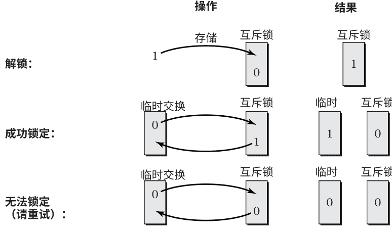

图4.8：解锁基本自旋锁的操作是将1存储到其中。通过原子交换指令将0存储到其中来锁定它。交换指令允许锁定线程验证内存中的值是否真的从1更改为0。如果没有更改，则线程重复尝试。

即使如此，互斥锁最终将以与之前相同的方式获取。

我迄今为止介绍的两种互斥锁版本共享一个关键属性，这解释了为什么两者都被称为自旋锁。如果互斥锁不能立即获取，它们都会进行忙等待。回顾我对调度的讨论，忙等待意味着通过不断执行检查所等待事件的指令来等待。使用忙等待的互斥锁称为自旋锁。还有更高级的自旋锁版本，如章节末尾的注释所述。

忙等待的替代方法是通知操作系统线程需要等待。然后，操作系统可以将线程的状态更改为等待，并将其移动到等待队列中，在那里它不符合处理器的时间要求。相反，调度程序将使用处理器来运行其他线程。当互斥锁解锁时，等待的线程可以再次变为可运行状态。由于这种互斥锁使用了等待队列，因此被称为排队互斥锁。

自旋锁是低效的，原因与任何忙等待一样低效。无论如何，线程都不会再取得任何进展，它在循环中旋转的次数很多。因此，使用处理器来处理另一个线程将有益于该线程，而不会对等待的线程造成伤害。

```
锁定互斥量：
  让temp = 0
  重复
    原子交换temp和mutex
    如果temp = 0，则
      while mutex = 0
        什么都不做
  直到temp = 1
```

图4.9: 缓存友好的自旋锁与基本自旋锁的表示方式相同，使用单个内存位置。然而，现在的锁操作使用普通的读指令来替代大部分原子交换操作，同时等待互斥锁解锁。

然而，这个论点有一个缺陷。通知操作系统等待的愿望、改变线程的状态以及进行上下文切换都会带来一些开销，同时也会导致缓存局部性的损失。因此，在自旋锁只需要在找到互斥锁解锁之前短暂自旋的情况下，线程实际上可能浪费的时间比让出其他线程的时间更少。自旋锁和队列互斥锁的相对效率取决于线程在互斥锁可用之前需要等待的时间长短。

因此，自旋锁适用于只持有很短时间的互斥锁，因此能够快速获取。例如，Linux内核在其内部数据结构进行简短操作时使用自旋锁进行保护。例如，我提到过调度器将可运行的线程存在运行队列中。每当调度器想要将线程插入到这个数据结构中，或者对其进行其他操作时，它会锁定自旋锁，执行简短操作，然后解锁自旋锁。

对于那些线程可能长时间持有互斥锁的情况，仍然需要排队互斥锁，以防其他竞争者忙等待。这些互斥锁会更加复杂。与自旋锁不同，每个互斥锁不再存储在单个内存位置上，而是有三个组成部分：

- 用于记录互斥锁状态的内存位置，1表示未锁定，0表示已锁定。
- 等待获取互斥锁的线程列表。这个列表允许调度程序将线程置于等待状态，而不是忙等待。使用第3章的术语，这个列表是一个等待队列。
- 用于保护互斥锁本身操作中的竞争的缓存感知自旋锁。

在我的伪代码中，我将分别称这三个组成部分为mutex.state、mutex.waiters和mutex.spinlock。

在这些假设下，锁定和解锁操作可以如图4.10和4.11的伪代码所示进行。图4.12和4.13说明了这些操作的功能。

在这个互斥锁设计中，有一个重要的特性需要注意，即当一个线程在互斥锁上执行解锁操作时，如果等待列表中有一个或多个线程，则会发生什么。如图4.11所示，互斥锁的状态变量从锁定状态（0）不会改变为解锁状态（1）。相反，互斥锁保持锁定状态，并唤醒其中一个等待的线程。换句话说，锁定的互斥锁直接从一个线程传递给另一个线程，而不会真正解锁。在第4.8.2节中，我将解释这种设计部分地导致了所谓的护送现象（convoying），并在那里进行描述。在同一节中，我还将介绍一种将互斥锁置于解锁状态的替代设计。

## 4.4 其他同步模式

回想一下，同步是指对两个或多个线程的相对时间进行任何形式的控制。因此，同步不仅包括互斥；程序员可能希望对相对时间施加一些限制，而不仅仅是一次只能有一个线程。在本节中，我介绍了三种在许多应用程序中反复出现的同步模式：有界缓冲区、读写锁和屏障。第4.4.1节到4.4.3节只描述了所需的同步；第4.5节和4.6节介绍了可用于实现同步的技术。

锁定互斥量：
- 以缓存感知的方式锁定互斥量.spinlock
- 如果互斥量状态为1, 则：
  - 将互斥量状态设置为0
  - 解锁互斥量.spinlock
- 否则：
  - 将当前线程添加到互斥量等待队列
  - 从可运行线程中移除当前线程
  - 解锁互斥量.spinlock
  - 切换到可运行线程

图4.10: 尝试锁定一个已经处于锁定状态的排队互斥量会导致线程加入等待队列 mutex.waiters。

解锁互斥量：
- 以缓存感知的方式锁定互斥量.spinlock
- 如果互斥量等待队列为空, 则：
  - 将互斥量状态设置为1
- 否则：
  - 将一个线程从互斥量等待队列移到可运行队列
- 解锁互斥量.spinlock

图4.11: 如果存在等待线程, 则在排队互斥量上的解锁操作会导致一个线程变为可运行状态。请注意, 在这种情况下, 互斥量仍处于锁定状态; 实际上, 锁定的互斥量直接从一个线程传递给另一个线程。

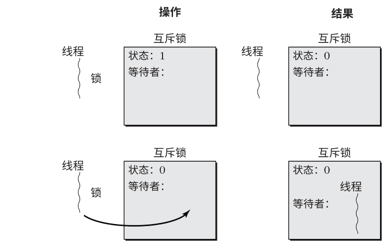
图4.12: 锁定一个排队互斥量只是简单地改变互斥量的状态。另一方面，锁定一个已经锁定的排队互斥量会将线程放入等待者列表中。

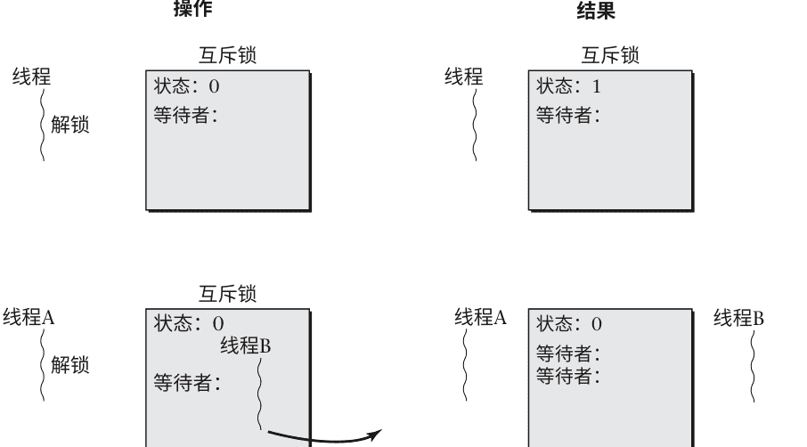
图4.13: 解锁一个没有等待线程的排队互斥量只是简单地改变互斥量的状态。另一方面，解锁一个有等待线程的排队互斥量会将状态设置为锁定，但会导致其中一个等待线程重新开始运行，并获得锁。

### 4.4.1 有界缓冲区

通常，两个线程在一个处理管道中相互链接。也就是说，第一个线程产生一系列值，这些值由第二个线程消费。例如，第一个线程可以从文档中提取所有的文本单词（跳过格式化代码），并将这些单词传递给第二个线程朗读出来。

一种简单的组织处理的方法是通过严格的交替生产和消费线程。在前面的例子中，第一个线程会提取一个单词，然后等待第二个线程将其转换为声音。然后，第二个线程会等待第一个线程提取下一个单词。然而，这种方法不会产生任何并发性：一次只能运行一个线程。如果计算机系统有两个处理器，或者其中一个线程花费大量时间等待I/O设备，这种缺乏并发性可能导致性能不佳。

相反，考虑同时运行生产者和消费者。每当生产者有一个新的值准备好时，生产者将其存储在一个中间存储区域中，称为缓冲区。每当消费者准备好获取下一个值时，它将从缓冲区中检索该值。

在正常情况下，每个都可以按照自己的节奏运行。然而，如果消费者去缓冲区检索一个值，并且发现缓冲区为空，消费者将需要等待生产者追赶上来。此外，如果您想限制缓冲区的大小（即有界缓冲区），当生产者超过消费者并填满缓冲区时，您需要让生产者等待。通过实施这两个同步限制，可以确保长期来看，两个线程的速率将相匹配，尽管在短期内，任何一个线程都可能比另一个线程运行得更快。

您应该对现实世界中的有界缓冲区模式很熟悉。例如，快餐店的厨师与收银员同时进行炸汉堡和销售。在两者之间是一个已经煮好的汉堡的有界缓冲区。缓冲区中的汉堡数量将随着一组工人稍微快于另一组工人而稍微增加或减少。只有在极端情况下，一组工人才需要等待另一组工人。图4.14说明了一个无需等待的情况。

在计算机系统中，一个很容易看到有界缓冲区的工作的地方是UNIX系列操作系统中内置的管道功能，包括Linux和Mac OS X。（Microsoft Windows现在也有类似的功能。）管道允许一个进程产生的输出作为另一个进程的输入。


图4.14：一个厨师炸汉堡并将其放入有界缓冲区，排队等待出售。收银员从缓冲区取出汉堡出售。如果没有可用的汉堡，收银员会等待。同样，如果缓冲区已满，厨师会停止炸汉堡。

例如，在Mac OS X系统上，您可以打开一个带有shell的终端窗口，并给出以下命令：

```bash
ls | say
```

这会同时运行两个程序。第一个程序 ls 列出当前目录中的文件。第二个程序 say 将其文本输入转换为语音并通过计算机的扬声器播放。在shell命令中，竖线字符（|）表示从第一个程序到第二个程序的管道。

最终结果是你文件的口述清单。这个例子的一个更平凡的版本不仅适用于Mac OS X, 还适用于其他UNIX系列系统，如Linux:

```bash
ls | tr a-z A-Z
```

再次，这将同时运行两个程序。这次第二个程序 tr 将字符从输入复制到输出，并进行一些更改（音译/转换）；在这种情况下，将小写字母 a-z 替换为相应的大写字母 A-Z。最终结果是你文件的大写清单。文件清单可能超过处理速率，只要它不超出操作系统为管道提供的缓冲区。一旦缓冲区中有了待列出的文件积压，转换程序可以以任意速度运行，直到耗尽该积压。

### 4.4.2 读者/写者锁

我下一个同步模式的例子实际上与互斥非常相似。回想一下，在售票示例中，审计功能需要获取互斥锁，即使审计是一个只读操作，以确保审计读取一致的状态变量组合。该设计实现了正确性，但以不必要的方式限制了并发性：即使两个（或更多）只读操作不可能相互干扰，它也阻止了两个审计同时进行。我的目标现在是纠正这个问题。

读者/写者锁与互斥锁非常相似，只是当一个线程锁定锁时，它会指定是否计划对受保护的数据结构进行写入或仅进行读取。与互斥锁一样，锁操作可能不会立即完成；而是等待直到可以获取锁。不同之处在于任意数量的读者可以同时持有锁，如图4.15所示；它们不会互相等待。然而，如果写者持有锁，则读者将等待。如果锁被其他线程持有，无论是另一个写者还是一个或多个读者，写者都将等待。

读者/写者锁在某些情况下特别有价值，例如一些只读操作非常耗时的情况，比如读取存储在磁盘上的文件。如果预计会有很多读者，这一点尤为重要。选择互斥锁还是读者/写者锁是一种性能权衡。因为互斥锁更简单，所以开销更低。然而，读-写锁可能通过允许更多并发性来弥补其开销。

如果一个读-写锁由一个或多个读者持有，并且有一个或多个写者在等待，那么就会出现一个有趣的设计问题。假设一个新的读者试图获取锁。它应该被允许获取，还是应该被强制等待直到写者之后？表面上看，似乎没有理由让读者等待，因为它可以与现有的读者共存，从而实现更大的并发性。问题在于，重叠的一系列读者可能会使写者等待任意长的时间。即使最后剩下的读者在写者之后很久才到达，写者仍然可能会等待。这是一种饥饿（starvation）的形式，即一个线程被其他线程不公平地阻止运行。为了防止这种特定类型的饥饿，一些读-写锁的版本会让新的读者等待直到等待的写者之后。

在第4.5节中，你将学习如何从更原始的同步机制构建读者/写者锁。然而，由于读-写锁非常通用，许多系统已经提供了它们。

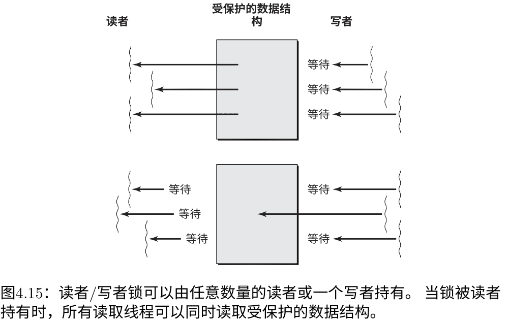

因此，您可能永远不需要自己构建它们。例如，POSIX标准包括了与读者/写者锁相关的过程，如 `pthread_rwlock_init`，`pthread_rwlock_rdlock`，`pthread_rwlock_wrlock` 和 `pthread_rwlock_unlock`。POSIX标准将如何优先考虑新的读者与等待的写者的问题留给每个系统自行决定。

POSIX标准还包括了一种与文件特定关联的更专门的读-写锁形式。这反映了我之前的评论，即在读取可能耗时的情况下，读者/写者锁特别有价值，比如存储在磁盘上的文件。在POSIX标准中，文件锁只能通过复杂的 `fcntl` 过程来使用。然而，大多数UNIX系列操作系统也提供了一个更简单的接口，flock。

### 4.4.3 屏障

屏障同步是我将讨论的最后一个常见的同步模式。屏障最常用于大规模科学或工程应用的大规模数值计算，例如模拟海洋洋流。然而，它们也可能出现在其他应用程序中，只要有一个要求所有线程在完成计算的一个阶段之前都不能进入下一个阶段。

在科学计算中，线程通常将大矩阵的处理分割开来。例如，十个线程可以分别处理2000行矩阵中的200行。所有线程在开始下一个阶段之前都必须完成当前阶段，因为整个计算是一系列矩阵操作；并行处理仅在每个矩阵操作内部发生。

当创建（初始化）一个屏障时，程序员指定有多少个线程将共享它。每个线程完成计算的第一阶段，然后调用屏障的等待操作。对于大多数线程，等待操作不会立即返回；因此，调用它的线程不能立即继续执行。唯一的例外是最后调用等待操作的线程。屏障可以知道哪个线程是最后一个，因为程序员指定了有多少个线程。当最后一个线程调用等待操作时，等待操作立即返回。此外，所有其他等待的线程最终也会使它们的等待操作返回，如图4.16所示。因此，它们现在都可以继续执行计算的第二阶段。

通常，同一个屏障可以在第二阶段和第三阶段之间重复使用，等等。换句话说，一旦释放所有等待的线程，屏障会重新初始化其状态。

就像读者/写者锁一样，你将看到如何通过更一般的同步机制来定义屏障。然而，实际上很少有理由这样做，因为屏障已作为POSIX和其他广泛可用的API的一部分提供。

## 4.5 条件变量

为了解决同步问题，例如第4.4节中描述的三个问题，你需要一些机制，允许线程等待，直到情况适合它继续执行。生产者可能需要等待缓冲区空间，或者消费者可能需要等待数据。读者可能需要等待直到写者解锁，或者写者可能需要等待最后一个读者解锁。达到屏障的线程可能需要等待所有其他线程这样做。每种情况都有自己的条件，线程必须等待，除此之外还有许多其他应用程序特定的条件。（例如已暂停的视频播放可能会等待用户再次按下播放按钮。）

所有这些示例都可以通过使用条件变量来处理，条件变量是一种与监视器或互斥锁配合使用的同步原语。

以监视器的方式使用的互斥锁。条件变量上有两个基本操作：等待和通知。（某些系统使用信号而不是通知的名称。）找到不符合其要求的线程会执行等待操作，从而进入睡眠状态，直到另一个线程调用通知操作。例如，在有界缓冲区中，如果生产者发现缓冲区已满，它可能会在条件变量上等待。当消费者在缓冲区中释放一些空间时，会在该条件变量上调用通知操作。

在深入研究所有重要细节和变体之前，一个具体的例子可能会有所帮助。图4.17显示了一个 `BoundedBuffer` 类的 Java 代码。

在我解释这个例子如何工作之前，以及回到对条件变量的更一般讨论之前，你应该花一点时间考虑如何测试这样一个类。首先，减小缓冲区的大小可能会有所帮助，这样可以更快地测试所有质量上不同的情况。其次，你需要一个具有多个线程进行插入和检索的测试程序，以某种方式看到每个操作开始和完成的时间差异。在检索的情况下，你还需要看到检索到的值是否正确。

设计这样一个测试程序是令人惊讶地有趣；你可以在编程项目4.5中体验到这一点。

在 Java 中，每个对象都有一个与之自动关联的单个条件变量，就像它有一个互斥锁一样。`wait` 方法在对象的条件变量上等待，`notifyAll` 方法唤醒所有等待的线程。这两个方法都需要由持有对象互斥锁的线程调用。在我的有界缓冲区示例中，我通过在标记为同步的方法内部使用 `wait` 和 `notifyAll` 来确保这一点。

```java
public class BoundedBuffer {
  private Object[] buffer = new Object[20]; // 任意大小
  private int numOccupied = 0;
  private int firstOccupied = 0;

  /* 不变式: 0 <= numOccupied <= buffer.length; 
     0 <= firstOccupied < buffer.length;
     buffer[(firstOccupied + i) % buffer.length] 包含第 (i+1) 个最
     旧的条目, 对于所有满足 0 <= i < numOccupied 的 i */

  public synchronized void insert(Object o)
    throws InterruptedException
  {
    while(numOccupied == buffer.length)
      // 等待空间
      wait();
    buffer[(firstOccupied + numOccupied) % buffer.length] = o;
    numOccupied++;
    // 如果有任何检索正在等待数据, 唤醒它们
    notifyAll();
  }

  public synchronized Object retrieve()
    throws InterruptedException
  {
    while(numOccupied == 0)
      // 等待数据
      wait();
    Object retrieved = buffer[firstOccupied];
    buffer[firstOccupied] = null; // 可能有助于垃圾回收
    firstOccupied = (firstOccupied + 1) % buffer.length;
    numOccupied--;
    // 唤醒等待空间的插入操作
    notifyAll();
    return retrieved;
  }
}
```
图4.17: 使用监视器和条件变量的有界缓冲区类

在看到 `wait` 和 `notifyAll` 需要在持有互斥锁的情况下调用后，你可能会发现一个问题。如果一个等待的线程持有互斥锁，那么没有其他线程能够获取互斥锁，从而无法调用 `notifyAll`。在了解完整情况之前，似乎任何调用 `wait` 的线程都注定要永远等待。

解决这个困境的方法如下。当一个线程调用等待操作时，它必须持有相关的互斥锁。然而，等待操作会在将线程置于等待状态之前释放互斥锁。

这样，互斥锁就可以被潜在的唤醒者使用。当等待的线程被唤醒时，在等待操作返回之前，它会重新获取互斥锁。（在递归互斥锁的情况下，如 Java 中使用的那样，唤醒的线程会以与之前相同的锁计数重新获取互斥锁，以便仍然可以执行相同数量的解锁操作。）

等待线程暂时释放互斥锁的事实有助于解释 `BoundedBuffer` 示例的两个特点。首先，在方法的开头进行等待。这确保了在释放互斥锁时不会破坏不变式。（更一般地说，等待可以发生在稍后的时间，只要没有更新状态变量，或者甚至只要它们已经恢复到符合不变式的状态。）其次，等待是在一个循环中进行的；只有在验证了等待条件成立后，方法才会继续执行真正的工作。循环是必要的，因为唤醒的线程需要重新获取互斥锁，与其他也在尝试获取互斥锁的线程竞争。不能保证唤醒的线程会首先获取互斥锁。因此，无法保证它将处于什么状态；它可能需要再次等待。

当一个等待的线程释放互斥锁以等待条件变量时，这两个动作是不可分割的。在第一个线程开始等待条件变量之前，没有其他线程可以获取互斥锁。这确保其他线程在等待线程实际上等待之前不会执行通知操作。

除了在每个方法的顶部等待适当的条件之外，我还在每个方法的末尾调用了 `notifyAll`。这个位置不是很关键，因为 `notifyAll` 方法不会释放互斥锁。调用线程会一直持有互斥锁，直到达到同步方法的末尾。因为唤醒的线程需要重新获取互斥锁，所以在通知方法完成之前，它将无法取得任何进展。无论通知在方法的哪个位置进行，唤醒的线程都需要等待通知方法完成。

早期版本的带有条件变量的监视器 (如 Hoare 所描述的) 采用了不同的方法。通知操作立即将互斥锁转移到唤醒的线程上，而不受其他等待线程的竞争。执行通知操作的线程然后等待，直到它从唤醒的线程那里收回互斥锁。然而，如今先前描述的版本似乎更为主流。特别是它不仅在 Java 中使用，还在 POSIX API 中使用。

图4.17 中的 `BoundedBuffer` 代码采用了一种非常积极的方法来通知等待的线程：在任何操作结束时，使用 `notifyAll` 唤醒所有等待的线程。这是一种非常安全的方法；如果 `BoundedBuffer` 的状态以某种方式改变，任何线程都会注意到。其他不关心的线程可以简单地回到等待状态。然而，通过减少通知的数量，可以提高程序的效率。请记住，正确性应该始终放在第一位，优化可以在以后进行。在优化之前，请检查简单且正确的版本是否表现不佳。

有两种减少通知的方法。一种方法是将 `notifyAll` 放在 `if` 语句中，这样只在某些情况下才执行，而不是无条件执行。特别是，生产者只有在缓冲区满时才等待，消费者只有在缓冲区为空时才等待。因此，只有在插入到空缓冲区或从满缓冲区检索时才需要通知。在编程项目4.6中，您可以修改代码以反映这一点，并测试它是否仍然有效。

减少通知的另一种方法是使用 `notify` 方法代替 `notifyAll`。这样，只有一个等待的线程被唤醒，而不是所有等待的线程。请记住，只有在直接版本表现不佳时才考虑优化。这种谨慎的态度是合适的，因为程序员发现很难判断 `notify` 是否足够。因此，这种优化是相当容易出错的。为了验证从 `notifyAll` 到 `notify` 的更改是否正确，您需要检查两件事：

- 1. 没有唤醒过少的线程的危险。要么您有某种方式知道只有一个线程在等待，要么您知道只有一个线程能够继续执行，其他线程会回到等待状态。
- 2. 没有唤醒错误线程的危险。要么您有某种方式知道只有一个线程在等待，要么您知道所有线程都是平等的，都能够继续进行。如果有任何线程在获取互斥锁之前可以继续进行，那么所有线程都具有这个属性。例如，如果所有等待的线程都在执行相同的 `while` 循环，那么这个条件将被满足。

在练习4.4中，你可以证明这两个条件在 `BoundedBuffer` 示例中不成立：用 `notify` 替换 `notifyAll` 在这种情况下是不安全的。即使通知操作是无条件的，而不是在 `if` 语句中，这个说法也是正确的。

Java 的一个限制是每个对象只有一个条件变量。在 `BoundedBuffer` 示例中，任何线程都在那个条件变量上等待，无论是在 `insert` 方法中等待空间还是在 `retrieve` 方法中等待数据。在允许将多个条件变量与同一个监视器（或互斥锁）关联的系统中，你可以使用两个不同的条件变量。这将允许你特定地通知一个等待空间的线程（或等待数据的线程）。

POSIX API 允许每个互斥锁有多个条件变量。在编程项目4.7中，你可以使用这个特性来用两个单独的条件变量重写 `BoundedBuffer` 示例，一个用于等待空间，另一个用于等待数据。

POSIX 条件变量是通过 `pthread_cond_init` 在任何特定互斥锁之外初始化的；而是将互斥锁作为参数传递给 `pthread_cond_wait`，同时传递等待的条件变量。这是一种容易出错的安排，因为所有并发等待者都需要传入相同的互斥锁与 `notify` 和 `notifyAll` 对应的操作被称为 `pthread_cond_signal` 和 `pthread_cond_broadcast`。API 允许线程在不持有相应互斥锁的情况下调用 `pthread_cond_signal` 或 `pthread_cond_broadcast`，但是在使用这种灵活性而不引入竞争错误是困难的。

我在 `BoundedBuffer` 中演示的相同技术同样适用于读者/写者锁或屏障；我将它们作为编程项目4.8和4.11留下。更重要的是，相同的技术也适用于应用程序特定的同步需求。例如，一个视频播放器可能有一个状态变量，指示播放器当前是否暂停。播放线程在显示每一帧之前检查该变量，如果暂停，则等待条件变量。用户界面线程在用户按下暂停按钮时设置该变量。

当用户界面将变量置于未暂停状态时，它会在条件变量上执行一个通知操作。您可以开发一个类似于编程项目4.3的应用程序。

## 4.6 信号量

您已经看到，带有条件变量的监视器非常通用，可以用于合成其他更专用的同步机制，例如读者/写者锁。另一种具有相同通用性的同步机制是信号量。对于大多数目的，信号量不太自然，导致代码更容易出错。在那些自然的应用程序中（例如，有界缓冲区），它们会导致非常简洁、清晰的代码。然而，这可能不是它们继续使用的主要原因。相反，它们似乎主要是出于历史惯性而继续使用，因为它们比监视器提前了七到九年。（信号量可以追溯到1965年，而监视器则追溯到20世纪70年代初。）信号量本质上是一个无符号整数变量，即只能取非负整数值的变量。然而，信号量可能不能随意进行任意算术运算。相反，只允许进行三种操作：

- 在创建信号量时，可以将其初始化为程序员选择的任何非负整数。
- 信号量可以增加1。执行此操作通常称为释放（release）、上升或 V。字母 V 是 Dijkstra 使用的一个荷兰语词汇的缩写，对于信号量的创造者在1965年的起源有意义。我将使用释放。
- 信号量可以减少1。执行此操作通常称为获取（acquire）、下降或 P。同样，P 是荷兰语的缩写。我将使用获取。因为信号量的值必须保持非负，所以执行获取操作的线程在值为0时等待。只有当另一个线程执行释放操作使值变为正数时，等待的线程才能继续执行获取操作。

信号量的一个常见用途是作为互斥锁。如果一个信号量被初始化为1，它可以作为互斥锁，使用 `acquire` 作为锁定操作，使用 `release` 作为解锁操作。假设锁定和解锁是正确配对的，信号量只会有0和1两个值。当它被锁定时，值为0，任何进一步的锁定尝试（使用 `acquire`）都将被强制等待。当它被解锁时，值为1，可以进行锁定。然而，需要注意的是，以这种有限的方式使用信号量与互斥锁相比没有任何优势。此外，如果一个程序错误导致尝试解锁已解锁的互斥锁，特定用途的互斥锁可能会发出错误信号，而通用信号量则会简单地增加到2，可能在稍后两个线程都被允许执行获取操作时导致不良行为。

信号量的更好用途是跟踪某些资源的可用数量，例如有限缓冲区中的空闲空间或数据值。每当一个线程创建一个资源单元，它会增加信号量。每当一个线程希望消耗一个资源单元时，它首先对信号量进行获取操作。这既强制线程等待，直到至少一个资源单元可用，又声明了线程对该单元的所有权。

按照这个模式，`BoundedBuffer` 类可以使用信号量进行重写，如图4.18所示。这使用了 Java API 的一个包 `java.util.concurrent` 中导入的 `Semaphore` 类。在编程项目4.12中，您可以使用 Java 内置的互斥锁和条件变量编写自己的 `Semaphore` 类。

为了展示信号量的最佳效果，我还放弃了使用数组来存储缓冲区。相反，我使用了 Java API 提供的 `List`。如果在编程项目4.13中，您尝试使用数组进行重写（如图4.17所示），您将发现两个缺陷。

首先，你需要一个名为 `numOccupied` 的整数变量，如图4.17所示。这个变量与 `occupiedSem` 中的信息是重复的，只是形式不同。其次，你需要在更新非信号量状态变量的代码周围引入显式的互斥同步 (synchronized) 语句。有了这些复杂性，信号量就失去了一些魅力。然而，通过使用一个列表 (List)，我隐藏了额外的复杂性。

```java
import java.util.concurrent.Semaphore;

public class BoundedBuffer {
    private java.util.List<Object> buffer =
        java.util.Collections.synchronizedList
        (new java.util.LinkedList<Object>());

    private static final int SIZE = 20; // 任意的

    private Semaphore occupiedSem = new Semaphore(0);
    private Semaphore freeSem = new Semaphore(SIZE);

    /* 不变式: occupiedSem + freeSem = SIZE
       buffer.size() = occupiedSem
       buffer 包含的条目从最旧到最新 */

    public void insert(Object o) throws InterruptedException {
        freeSem.acquire();
        buffer.add(o);
        occupiedSem.release();
    }

    public Object retrieve() throws InterruptedException {
        occupiedSem.acquire();
        Object retrieved = buffer.remove(0);
        freeSem.release();
        return retrieved;
    }
}
```
图4.18: 使用信号量的替代 BoundedBuffer 类

## 4.7 死锁

在第2章中，我介绍了并发作为解决响应性和吞吐量问题的一种方式。不幸的是，并发引入了它自己的问题——竞争条件。因此，我引入了同步来解决竞争条件的问题。显而易见的问题是，同步引发了哪些新问题？一个简单的答案是，同步重新引入了一定程度的响应性和吞吐量问题，因为同步减少了并发性。然而，正如你将在本节中看到的，同步还引发了一个全新的问题，而且这个问题可能更为严重。第4.7.1节解释了这个问题，即死锁，线程可能会永久等待。第4.7.2节通过4.7.4解释了问题的三种不同解决方案。

### 4.7.1 死锁问题

为了说明死锁是什么以及如何产生，考虑一个高度简化的用于保持银行账户的系统。假设每个账户都是一个对象，有两个组成部分：互斥锁和当前余额。将钱从一个账户转移到另一个账户的过程可能如下所示，用伪代码表示：

```
从源账户到目标账户转移金额：
  锁定源账户互斥锁
  锁定目标账户互斥锁
  源账户余额 = 源账户余额 - 金额
  目标账户余额 = 目标账户余额 + 金额
  解锁源账户互斥锁
  解锁目标账户互斥锁
```

假设我心情大好，从我的账户转移 $100 到你的账户。假设你心情更好，从你的账户转移 $250 到我的账户。幸运的话，最后我应该多收了 $150，而你应该少了 $150。如果任何一个转账请求在另一个开始之前完成，就会发生这种情况。然而，如果两个同时执行会怎样呢？

互斥锁可以防止任何竞争条件，所以你可以确保账户不会处于不一致的状态。请注意，我们在整个转账过程中都锁定了两个账户，而不是仅在更新余额时锁定每个账户。这样，审计员就不会看到一个账户中的钱消失了，而另一个账户中的钱还没有出现的令人担忧的情况。

然而，即使没有竞争，甚至没有审计员，也并非一切都好。考虑以下事件序列：

- 1. 我锁定了我向你转账的源账户。也就是说，我锁定了 `myAccount.mutex`。
- 2. 你锁定了你向我转账的源账户。也就是说，你锁定了 `yourAccount.mutex`。
- 3. 我试图锁定我向你转账的目标账户。也就是说，我试图锁定 `yourAccount.mutex`。因为你已经持有这个互斥锁，我被迫等待。
- 4. 你试图锁定你向我转账的目标账户。也就是说，你试图锁定 `myAccount.mutex`。因为我已经持有这个互斥锁，你被迫等待。

此时，我们彼此都在等待对方：我们陷入了死锁。

更一般地说，只要存在一组线程的循环，每个线程都在等待下一个线程持有的某个资源，就会出现死锁。在这个例子中，有两个线程，涉及的资源是两个互斥锁。尽管死锁也可能涉及其他资源（例如读者/写者锁），但是为了简单起见，我将重点放在互斥锁上。

作为涉及多个线程的死锁的示例，考虑将资金从一个银行账户转移到另一个银行账户的前述场景的泛化。例如，假设有五个银行账户，编号从0到4。还有五个线程。每个线程都试图从一个账户转移资金到另一个账户，如图4.19所示。与之前一样，每次转账都涉及锁定源账户和目标账户。如果每个线程都先锁定源账户，然后再尝试锁定目标账户，线程可能会发生死锁。当将此情况装扮成哲学家问题时，它更加著名，我将在下面进行描述。

1972年，Dijkstra 写了一篇关于一组五位哲学家的文章，每位哲学家在一个圆形餐桌上有一个位置，他们吃一种特别困难的意大利面，需要两把叉子。餐桌上有五把叉子，每两个相邻的盘子之间有一把叉子，如图4.20所示。显然，Dijkstra 并不担心像单核病毒这样的传染病，因为他认为坐在特定叉子左右的哲学家可以共用它。相反，他担心的是死锁的可能性。如果所有五位哲学家都开始拿起他们各自左手的叉子，然后等待右手的叉子可用，他们最终会陷入死锁。在探索项目4.2中，你可以进一步研究。

| 线程 | 源账户 | 目标账户 |
| :---: | :---: | :---: |
| 0 | 0 | 1 |
| 1 | 1 | 2 |
| 2 | 2 | 3 |
| 3 | 3 | 4 |
| 4 | 4 | 0 |

图4.19：五个线程中的每个线程都试图从源账户转账到目标账户。如果每个线程都锁定其源账户，则无法通过锁定其目标账户继续进行。

图4.20：五位哲学家，编号从0到4，在一个圆形餐桌周围就座。每对相邻位置之间都有一把叉子。

当每个哲学家尝试一次性拿起两把叉子时，可能会发生死锁。

可以尝试使用计算机模拟来解决就餐哲学家问题。在同一个探索项目中，您还可以将第4.7.2节中描述的死锁预防方法应用于就餐哲学家问题。

即使没有特别的尝试来防止死锁，死锁通常也很少发生，因为大多数锁的持有时间不长。因此，死锁的机会窗口非常狭窄，就像比赛一样，时机必须恰好错过。对于一个非常不重要的系统，可以选择忽略死锁的可能性。即使系统需要偶尔因为死锁而重新启动，其他故障可能更常见。尽管如此，您应该了解一些处理死锁的选项，因为某些系统是关键的，并且忽视已知问题是不专业的。在第4.7.2节到第4.7.4节中，我将解释三种最实用的应对死锁威胁的方法。

### 4.7.2 通过资源排序预防死锁

处理死锁的理想方式是预防它们的发生。一种非常实用的死锁预防技术可以通过在两个银行账户之间转账的例子来说明。

这两个账户都存储在计算机内存的某个地方，可以通过一个数字地址来指定。我将使用记号`min(account1, account2)`表示两个账户对象中较低地址（在内存中较早）的那个。类似地，我将使用`max(account1, account2)`表示较高地址的那个。

我可以使用这种账户排序（或任何其他排序，例如按账户号码）来创建一个无死锁的转账过程：

从源账户到目标账户转移金额的过程如下：

```
锁定 min(sourceAccount, destinationAccount).mutex
锁定 max(sourceAccount, destinationAccount).mutex
sourceAccount.balance = sourceAccount.balance - amount
destinationAccount.balance = destinationAccount.balance + amount
解锁 sourceAccount.mutex
解锁 destinationAccount.mutex
```

现在，如果我试图向你转账，而你试图向我转账，我们将按照相同的顺序锁定这两个账户的互斥锁。不会发生死锁；一笔转账将完成，然后进行另一笔转账。

只要预先知道要获取的所有互斥锁（或其他资源），就可以使用相同的技术。每个线程应按照约定的顺序获取所需的资源，例如按照内存地址递增的顺序。无论涉及多少个线程和资源，都不会发生死锁。

作为这种技术的进一步示例，你可以查看一些来自Linux内核的代码。回顾第3章，调度器将可运行线程保存在一个数据结构中，称为运行队列。在内核源代码中，这个结构被称为rq。多处理器系统中的每个处理器都有自己的rq。当调度器将一个线程从一个处理器的rq移动到另一个处理器的rq时，需要同时锁定这两个rq。图4.21展示了实现此操作的代码。请注意，此过程使用了死锁预防技术的一个改进：还测试了两个运行队列实际上是否相同的特殊情况。

死锁预防并非总是可能的。特别是，我展示的排序技术不能用于仅在计算过程中逐个显示需要锁定的互斥量，例如在遍历链表或其他基于指针的数据结构时。因此，你需要考虑应对死锁，而不仅仅是预防它们。

### 4.7.3 事后死锁检测

为了诊断死锁，你需要一些关于谁在等待谁的信息。假设每个互斥量不仅记录它是否被锁定或解锁，还记录它由哪个线程持有（如果有的话）。（这些信息也可能对其他目的有用，例如实现递归或错误检查的互斥量。）此外，当一个线程无法立即获取一个互斥锁并处于等待状态时，你可以记录它正在等待的互斥锁。

```c
static void double_rq_lock(struct rq *rq1, struct rq *rq2)
  __acquires(rq1->lock)
  __acquires(rq2->lock)
{
  BUG_ON(!irqs_disabled());
  if (rq1 == rq2) {
    raw_spin_lock(&rq1->lock);
    __acquire(rq2->lock);    /* 假装它存在 ;) */
  } else {
    if (rq1 < rq2) {
      raw_spin_lock(&rq1->lock);
      raw_spin_lock_nested(&rq2->lock, SINGLE_DEPTH_NESTING);
    } else {
      raw_spin_lock(&rq2->lock);
      raw_spin_lock_nested(&rq1->lock, SINGLE_DEPTH_NESTING);
    }
  }
}
```
图4.21：Linux调度程序在锁定两个运行队列时使用死锁预防。

有了这个信息，你可以构建一个资源分配图。图4.22展示了一个示例图，用于说明4.7.1节中的银行账户转账死锁问题。方块代表线程，圆圈代表互斥锁。箭头显示了每个线程正在等待获取的互斥锁以及每个互斥锁当前由哪个线程持有。由于图中存在一个循环，说明系统处于死锁状态。

系统可以定期或当一个线程等待一个锁的时间过长时，测试死锁。为了测试死锁，系统使用标准的算法来检查资源分配图是否包含环。使用本书中描述的互斥锁，每个互斥锁最多只能由一个线程持有，并且每个线程最多只等待一个互斥锁，因此图中的顶点的出度不会大于1。这使得图搜索比在完全通用的有向图中要简单一些。

一旦检测到死锁，需要采取痛苦的措施来恢复：必须强制终止死锁线程之一，或者至少将其回滚到较早的状态，以释放它所持有的互斥锁。在一般的计算环境中，线程没有清理的方法可以回滚，这有点像通过切断腿来摆脱捕兽夹。因此，事后检测死锁在通用操作系统中并不常见。

一个环境中，事后死锁检测和恢复可以干净地工作的是数据库系统，因为它们支持原子事务。我将在第5章解释原子事务；现在，你只需要明白一个事务可以被干净地回滚，这样所有对数据库的更新都会被撤销。

图4.22：资源分配图中的循环表示死锁。每个方块代表一个线程，每个圆圈代表一个互斥锁。从方块到圆圈的箭头表示一个线程正在等待一个互斥锁，而从圆圈到方块的箭头表示一个互斥锁被一个线程持有。

因为这个基础设施是可用的，数据库系统通常包括死锁检测。当检测到死锁时，其中一个事务失败并可以被回滚，撤销所有它的影响并释放所有它的锁。这打破了死锁并允许剩余的事务完成。然后可以重新启动被回滚的事务。

图4.23展示了一个来自Oracle数据库系统的死锁检测示例场景。这个记录展示了连接到同一个数据库的两个不同会话的时间交错。一个会话显示在左边缘，而另一个会话缩进四个空格。

命令行以系统提示符SQL>开头，然后包含用户输入的命令。每个命令行都会被分成第二行，以适应本书页面的宽度。解释性注释以--开头。所有其他行都是输出。在第5章中，我将展示从这个特定死锁中恢复，作为我对事务解释的一部分。

### 4.7.4 立即死锁检测

迄今为止介绍的两种处理死锁的方法针对的是死锁发生之前和之后的时间。一种方法是确保不会出现导致死锁的先决条件，而另一种方法是在死锁已经发生时进行清理。现在我将转向第三种选择：在系统即将发生死锁的那一刻进行干预。由于这种干预需要类似于第4.7.3节讨论的技术，因此这种技术通常被称为死锁检测的一种形式，而不是死锁预防，尽管从字面上来看，死锁是被阻止发生的。

只要不允许发生死锁，资源分配图将保持无环，即无循环。每次线程尝试锁定互斥量时，系统可以采取以下操作：

- 如果互斥量未锁定，则锁定它并从互斥量到线程添加一条边，以指示现在哪个线程持有锁。
- 如果互斥量已锁定，则沿着从它开始的边链直到该链死结。（必须如此，因为图是无环的。）链的末端与尝试锁定互斥量的线程相同吗？
    - 如果不是，则添加一条边，显示线程正在等待互斥量，并将线程置于等待状态。
    - 如果链的末尾是同一个线程，则添加额外的边将形成一个循环，如图4.24所示。因此，不要添加边，也不要将线程置于等待状态。相反，从锁请求中返回错误代码（或抛出异常），表示无法锁定互斥量，因为会导致死锁。

```sql
SQL> update accounts set balance = balance - 100
              where account_number = 1;
已更新1行。

    SQL> update accounts set balance = balance - 250
                  where account_number = 2;
    已更新1行。

SQL> update accounts set balance = balance + 100
              where account_number = 2;
-- 注意暂时没有响应，此SQL会话正在挂起

    SQL> update accounts set balance = balance + 250
                  where account_number = 1;
    -- 此会话挂起，但在另一个SQL会话中我们得到
    -- 以下错误消息:

SQL> update accounts set balance = balance + 100
              where account_number = 2
      *
第1行出现错误:
ORA-00060: 死锁检测到等待资源
```
图4.23: Oracle数据库系统检测到两个连接到同一数据库的会话之间的死锁。一个会话，显示在左边的边缘，正在从账户1转账100美元到账户2。另一个会话，显示为缩进，正在从账户2转账250美元到账户1。每个更新语句锁定正在更新的账户。因此，每个会话在尝试锁定另一个会话先前锁定的账户时挂起。

请注意，这里的图搜索比事后死锁检测要简单一些，因为图保持无环。尽管如此，基本思想与死锁检测相同，只是主动进行而不是事后进行。与任何死锁检测一样，需要某种形式的回滚；试图锁定互斥量的应用程序必须对无法授予其请求的消息做出响应。应用程序不能简单地再次尝试获取相同的互斥量，因为它将反复获得相同的错误代码。相反，程序必须释放当前持有的锁，然后从头开始重新启动。在释放锁之后重新启动之前，通过短暂休眠可以减少需要重复此响应的机会。

设计一个能正确处理即时死锁检测的应用程序可能具有挑战性。困难在于，在程序释放其现有锁之前，应该将这些锁保护的对象恢复到一致的状态。可以相对容易地使用即时死锁检测的一种情况是在修改任何对象之前，程序会获取所有的锁。

Linux和Mac OS X中的一个立即死锁检测的例子是使用`fcntl`在文件上放置的读者/写者锁。如果一个锁请求会完成一个循环，`fcntl`过程会返回错误代码`EDEADLK`。然而，这种死锁检测不是POSIX规范中的强制性部分。

## 4.8 同步与调度的交互

回想一下，调度程序控制每个处理器上运行的可运行线程，而运行线程执行的同步操作控制哪些线程是可运行的。因此，同步和调度相互作用。两种形式的交互，即优先级反转和车队现象（护航现象），特别有趣。换句话说，它们可能会引起很多困扰。每个都可以破坏优先级排序。此外，护送现象也会大大增加上下文切换率，从而降低系统吞吐量。为了简单起见，这里假设是单处理器系统。

图4.24：在这个资源图中，实线箭头表示我的转账持有`myAccount.mutex`，你的转账持有`yourAccount.mutex`，并且我的转账正在等待`yourAccount.mutex`。虚线箭头表示你的转账正在请求锁定`myAccount.mutex`。如果添加了这个虚线箭头，就形成了一个循环，表示发生了死锁。因此，请求将会失败而不是进入等待状态。

### 4.8.1 优先级反转

当使用基于优先级的调度器时，高优先级线程不应该在低优先级线程运行时等待。如果不同优先级的线程共享互斥锁或其他阻塞同步原语，一些优先级顺序的小违规是不可避免的。例如，考虑以下涉及两个线程（高优先级和低优先级）共享一个互斥锁的事件序列：

1. 高优先级线程进入等待状态，等待I/O请求完成。
2. 低优先级线程运行并获取互斥锁。
3. I/O请求完成，使高优先级线程再次可运行。它抢占低优先级线程并开始运行。
4. 高优先级线程尝试获取互斥锁。由于互斥锁被锁定，高优先级线程被迫等待。
5. 低优先级线程恢复运行。

此时，一个高优先级线程正在等待，而一个低优先级线程正在运行。然而，这种临时违反优先级顺序并不是一个大问题，因为程序员通常确保没有线程长时间持有互斥锁。因此，低优先级线程很快会释放互斥锁，并允许高优先级线程运行。

然而，另一个更隐匿的问题可能导致长期违反优先级顺序（即，优先级倒置）。假设有三个线程，低优先级、中优先级和高优先级。考虑以下事件序列：

1. 高优先级和中优先级线程都进入等待状态，每个线程等待I/O请求完成。
2. 低优先级线程运行并获取互斥锁。
3. 两个I/O请求完成，使高优先级和中优先级线程可运行。高优先级线程抢占低优先级线程并开始运行。
4. 高优先级线程尝试获取互斥锁。由于互斥锁被锁定，高优先级线程被迫等待。
5. 此时，中优先级线程具有可运行线程中最高的优先级。因此它运行。

在这种情况下，中优先级线程正在运行并间接地阻止高优先级线程运行。（中优先级线程通过相对优先级阻塞低优先级线程。低优先级线程通过持有互斥锁阻塞高优先级线程。）中优先级线程可能运行很长时间。实际上，一系列具有重叠生命周期的中优先级线程可能会来来去去，而高优先级线程将一直等待，尽管它具有更高的优先级。因此，优先级反转可能会持续任意长的时间。

解决优先级反转问题的一种“解决方案”是避免固定优先级调度。随着时间的推移，一个衰减使用调度器会自然地降低正在运行的中优先级线程的优先级。最终，它将降至低优先级线程以下，然后低优先级线程将运行并释放互斥锁，允许高优先级线程运行。然而，一系列中优先级线程，没有一个运行时间很长，仍然可能会长时间阻塞高优先级线程。因此，微软Windows会定期提升等待的低优先级进程的优先级来应对优先级反转问题。

这个第一个“解决方案”有两个缺点。首先，它可能在响应优先级反转时变得迟缓。其次，固定优先级调度在某些应用程序中是可取的，例如实时系统。因此，需要一个真正的解决优先级反转问题的方案是必要的——一个使问题消失而不仅仅限制其影响持续时间的解决方案。真正的解决方案是优先级继承。

优先级继承是一个简单的想法：等待互斥锁的任何线程都会暂时“借”其优先级给持有互斥锁的线程。持有互斥锁的线程在其自身优先级和等待互斥锁的线程借给它的优先级中运行最高优先级。在三个线程的示例中，优先级继承将允许持有互斥锁的低优先级线程以高优先级的方式运行，直到它释放互斥锁。因此，真正的高优先级线程将尽快运行，而中等优先级线程将不得不等待。

请注意，高优先级线程对于让低优先级线程使用其优先级有一个非常自私的动机：它希望将低优先级线程排除在外。这个原则也可以应用于除了优先级调度之外的其他形式的调度。类比于优先级继承，可以进行截止时间继承（用于最早截止时间优先调度）或者甚至是处理器分配份额的借贷（用于比例共享调度）。

### 4.8.2 护航现象

我已经多次提到，设计良好的程序通常不会长时间持有任何互斥锁；因此，尝试锁定互斥锁通常不会遇到争用。这一点很重要，因为带有争用的互斥锁的开销要大得多。特别是，对于已经被锁定的互斥锁的请求的大部分开销是上下文切换，伴随着缓存性能的损失。不幸的是，调度和同步之间存在一种特别恶劣的交互作用，被称为车队现象（护航现象），有时会导致一个频繁使用的互斥锁永久争用，从而导致性能大幅下降。此外，车队现象可能会破坏调度策略，如优先级分配。

假设系统有一些非常核心的数据结构，由互斥锁保护，每个线程都经常对其进行操作。每次线程在操作结构时，都会在之前锁定互斥锁，并在之后解锁。每个操作都尽可能保持短暂。然而，由于频繁发生，互斥锁可能花费一定比例的时间被锁定，可能达到5%。

调度程序可以在任何时候抢占一个线程。例如，线程可能已经消耗完其分配的时间片。在这个例子中，当互斥锁被锁定5%的时间时，如果有一段时间后，一个线程在持有互斥锁的同时被抢占，这并不令人意外。

当这种情况发生时，编写该线程的程序员将失去对其持有互斥锁的时间的控制。即使线程将在其下一条指令中解锁互斥锁，它可能在未来的一段时间内没有机会执行该指令。如果处理器将其时间分配给相同优先级级别的N个可运行线程，那么持有互斥锁的线程将至少在切换上下文的时间内不再运行，即使其他线程都立即阻塞。

在这种情况下，一个流行的互斥锁被长时间持有。同时，其他线程正在运行。因为互斥锁是一个流行的锁，其他线程尝试获取它的机会很大。因为互斥锁被锁定，所有尝试获取互斥锁的线程都将排队在等待队列上。这个线程队列就是车队，类似于在没有超车道的道路上跟随一个慢车辆形成的无意车队。正如你将看到的，这个车队会带来麻烦。

最终，调度器将给持有互斥锁的线程一个新的时间片。由于该线程的设计，它将快速解锁互斥锁。当这种情况发生时，互斥锁的所有权将传递给等待队列中的第一个线程，并使该线程可运行。解锁互斥锁的线程继续运行。由于它刚刚获得了一个新的时间片，人们可能期望它运行很长时间。

然而，这可能不会发生，因为在很短的时间内，它将尝试重新获取流行的互斥锁并发现它被锁定。（“该死”，它可能会说，“我不应该把互斥锁交给第一个等待者。我现在需要它了。”）因此，线程排在队列的末尾，等待互斥锁。

此时，互斥锁的新持有者可以运行，但它也会释放互斥锁，因此在必须重新排队之前，它不太可能运行一个完整的时间片。这种情况会继续下去，每个线程依次从互斥锁队列的前端经过一段短暂的执行时间，然后返回队列的后端。车队的组成可能会发生轻微变化——一个线程可能停止等待流行的互斥锁，或者一个新线程可能加入——但总体上来看，车队可以持续很长时间。

这种情况引起了两个问题。首先，上下文切换率大大增加；不再是每个时间片一个上下文切换，而是每次尝试获取流行的互斥锁都会进行一次上下文切换。所有这些上下文切换的开销将降低系统吞吐量。其次，

## 4.8 同步与调度的交互

调度程序选择要运行的线程的策略可能会被破坏。例如，在优先级调度程序中，优先级将不再控制线程的运行。原因很简单：调度程序只能在可运行的线程中选择，但是在车队（convoy）现象中，通常只会有一个可运行的线程；其他所有线程都将排队等待互斥锁。

当我描述互斥锁时，我说每个互斥锁都包含一个等待队列——一个等待线程的列表。我暗示这个列表是按照先进先出（FIFO）的方式维护的，也就是说，作为一个真正的队列。如果是这样的话，那么车队线程将基本上按照 FIFO 轮转的方式进行调度，与调度程序策略（例如优先级）无关，因为线程是从互斥锁队列而不是调度程序的运行队列中调度的。

通过按优先级顺序处理互斥锁的等待队列，而不是先进先出，可以避免这种优先级丢失。当一个互斥锁解锁时，如果有多个线程在等待，互斥锁的所有权可能不会传递给等待时间最长的线程，而是传递给优先级最高的线程。

然而，改变从互斥锁的等待者列表中移动一个线程成为可运行状态并不能解决吞吐量问题。运行中的线程仍然会有“该死，我不应该放弃那个互斥锁”的经历。上下文切换率仍然是每次锁获取一次切换。车队可能会重新排序，但不会消散。

因此，对于常用的互斥锁，需要更强的解决方案。你可以使用图 4.25 中显示的版本，而不是我在第 111 页上展示的图 4.10 和图 4.11 中的互斥锁。

当一个常用的互斥锁被解锁时，所有等待的线程都会变为可运行状态，并从等待列表移动到可运行线程列表中。然而，互斥锁的所有权不会转移到任何一个线程上。相反，互斥锁会保持在解锁状态，互斥锁的状态为 1。这样，运行的线程就不必说“该死”。它可以简单地重新锁定互斥锁；在其时间片的过程中，它可以重复锁定和解锁互斥锁，而无需进行上下文切换。

因为互斥锁只被持有 5% 的时间，所以当线程最终因其他原因（如时间片到期）阻塞时，互斥锁可能不会被持有。此时，调度器将选择一个被唤醒的线程来运行。请注意，这将自然地遵循正常的调度策略，如优先级顺序。

被选择为下一个运行的唤醒线程没有直接获得互斥锁的所有权。因此，它需要回到互斥锁获取代码的开头，每个线程依次执行相同的操作。它被调度后，大部分时间线程会发现互斥量未锁定，因此这不会很昂贵。此外，因为每个线程在每次锁请求时都能正常运行一段时间而无需上下文切换开销，车队现象将消散。

POSIX 标准的互斥锁 API 要求采取两种优先级保持方法中的一种。至少，如果互斥锁的所有权直接转移到等待线程，那么必须根据正常的调度策略选择该等待线程，而不是 FIFO。或者，符合 POSIX 标准的互斥锁实现可以简单地将所有等待线程转回调度程序，让它们自行排序，如图 4.25 所示。

### 锁定互斥量：

```
重复
  使用缓存感知方式锁定互斥量自旋
  如果互斥量状态为 1，则
    将互斥量状态设置为 0
    解锁互斥量自旋
    设置成功为真
  否则
    将当前线程添加到互斥量等待队列
    从可运行线程中移除当前线程
    解锁互斥量自旋
    切换到可运行线程
    设置成功为假
直到成功
```

### 解锁互斥量：

```
使用缓存感知方式锁定互斥量自旋
将互斥量状态设置为 1
将所有线程从互斥量等待队列移动到可运行队列
解锁互斥量自旋
```

图 4.25：为了防止车队，解锁操作将互斥量状态设置为解锁，并使所有等待的线程变为可运行。每个被唤醒的线程都会尝试再次锁定互斥量。这与之前版本的互斥量不同，在之前版本中，唤醒一个线程时互斥量仍处于锁定状态。

## 4.9 非阻塞同步

为了介绍具体示例的非阻塞同步，让我们回到第 105 页上图 4.6 所示的 TicketVendor 类。在该示例中，每当一个线程销售一张票时，它会暂时阻止其他线程访问相同的 TicketVendor。这确保了 seatsRemaining 和 cashOnHand 与彼此保持一致，同时防止两个线程同时销售最后一张可用票。缺点是，如果调度程序在一个线程持有 TicketVendor 的锁时抢占了它，所有其他想要使用相同 TicketVendor 的线程都会保持阻塞，直到第一个线程再次运行，这可能是任意长的时间。同时，无法进行售票或进行审计。这种阻塞方式是优先级倒置和车队现象的基础，如果通过一个循环链的对象扩展，甚至可能导致死锁。即使没有这些问题，它也会影响性能。所需的是一个无锁的 TicketVendor，可以避免这种无限制的阻塞而不会出现竞争错误。

回想一下，在 4.3.3 节中介绍的自旋锁使用原子交换指令。成功将锁从未锁定状态更改为锁定状态的线程可以确保没有其他线程执行了相同的操作。

因此，成功的线程被授予继续执行的权限，例如出售一张票。然而，实际上取得进展并释放锁是分开的操作，不是原子交换的一部分。因此，它们可能会被延迟。非阻塞版本的 TicketVendor 需要一种更强大的原子指令，可以将实际的更新操作与获取权限的操作打包在一起。

比较并设置（Compare-and-Set, CAS）指令通过以下方式满足这个需求，这两个操作都是原子的：

- 1. 该指令确定一个变量是否包含指定的值，并报告答案。
- 2. 该指令将变量设置为一个新值，但前提是前面的问题的答案是“是”。

所有现代处理器都提供了这种指令的某个变体。在硬件层之上，它还是 Java API 的一部分，通过包含在 `java.util.concurrent.atomic` 包中的类来实现。图 4.26 和 4.27 展示了一个非阻塞版本的 TicketVendor 类，它使用了其中之一的类：`AtomicReference`。

在这个例子中，`sellTicket` 方法尝试通过以下方法调用来取得进展：

```java
state.compareAndSet(snapshot, next)
```

如果状态仍然与之前的快照匹配，则没有其他并发线程插入并售出一张票。在这种情况下，状态被原子地更新，并且方法返回 true，此时可以安全地发放一张票。另一方面，如果方法返回 false，则封闭的 while 循环将重新尝试整个过程，从获取状态的新快照开始。您可以在编程项目 4.17 中探索这种行为。

这个例子所示的无锁同步确保没有线程会被阻塞等待其他线程持有的锁。特别是，无论调度程序选择延迟执行任何线程多长时间，其他线程都可以继续取得进展。然而，仍然有一种方式使一个线程可能无限期地运行而没有取得进展，那就是如果其他线程一遍又一遍地插入并更新状态。在这种情况下，整个系统仍然在取得进展——票继续销售——但是一个特定的线程不断重试。更强大的非阻塞同步形式，称为“无等待同步”（wait-free synchronization），保证每个单独的线程都取得进展。

然而，无等待同步比这里展示的无锁同步方式要复杂得多，因此在实践中很少使用。类似的技术可以用于创建无锁数据结构，允许多个线程并发执行操作，尽可能地达到最大程度。例如，如果一个队列要按照明确定义的顺序传递数据，出队操作需要按顺序处理。但是没有理由在之前的数据出队的同时，不能将额外的数据入队到一个非空队列中。这样的数据结构设计和编程并不容易；在不引入错误的情况下实现高性能和并发性是相当具有挑战性的。然而，并发数据结构可以由专家编程一次，然后用作构建块。特别是并发队列可以在将任务排队等待线程池处理的框架中使用；一个例子是苹果的 Grand Central Dispatch 框架。

```java
import java.util.concurrent.atomic.AtomicReference;

public class LockFreeTicketVendor {

    private static class State {
        private int seatsRemaining, cashOnHand;

        public State(int seatsRemaining, int cashOnHand) {
            this.seatsRemaining = seatsRemaining;
            this.cashOnHand = cashOnHand;
        }

        public int getSeatsRemaining(){return seatsRemaining;}
        public int getCashOnHand(){return cashOnHand;}
    }

    private AtomicReference<State> state;
    private int startingSeats, startingCash;

    public LockFreeTicketVendor(int startingSeats,
                                int startingCash) {
        this.startingSeats = startingSeats;
        this.startingCash = startingCash;
        this.state = new AtomicReference<State>
            (new State(startingSeats, startingCash));
    }

    // 有关sellTicket和audit方法, 请参见下一图。
    // 其他细节也有待填写。
}
```

图 4.26: 这个无锁售票商使用非阻塞同步。请注意, 它存储的不是直接的 seatsRemaining 和 cashOnHand, 而是存储了一个 AtomicReference 指向一个 State 对象, 该对象将这两个变量打包在一起, 允许它们在没有锁的情况下保持一致。下一图展示了如何使用这个 AtomicReference。

```java
public void sellTicket(){
  while(true){
    State snapshot = state.get();
    int seatsRemaining = snapshot.getSeatsRemaining();
    int cashOnHand = snapshot.getCashOnHand();
    if(seatsRemaining > 0){
      State next = new State(seatsRemaining - 1,
                             cashOnHand + PRICE);
      if(state.compareAndSet(snapshot, next)){
        dispenseTicket();
        return;
      }
    } else {
      displaySorrySoldOut();
      return;
    }
  }
}

public void audit() {
  State snapshot = state.get();
  int seatsRemaining = snapshot.getSeatsRemaining();
  int cashOnHand = snapshot.getCashOnHand();
  // check seatsRemaining, cashOnHand
}
```

图 4.27：前一个图中的无锁售票商的这些方法展示了 AtomicReference 如何支持非阻塞同步。可以对当前状态进行一致的快照，并且只有在快照仍然有效时才将状态设置为更新版本（并发发票据）。

## 4.10 安全和同步

系统之所以不安全有两个原因：要么是因为其安全策略设计不良，要么是因为执行这些策略的代码中存在漏洞导致执行被绕过。例如，你在第 3 章中看到，可以通过将其他用户的线程设置为非常低的优先级来发起拒绝服务攻击。我提到过，因此，操作系统只允许线程的优先级由其所有者更改。

如果忽视了这个问题，系统将因为不充分的策略而不安全。然而，如果聪明的程序员能够找到一种绕过这个限制的方法，使用一些低级别的错误在操作系统代码中，系统仍然可能不安全。

许多安全关键的错误涉及同步，或者更准确地说，缺乏同步——这些错误通常是由于不充分的同步导致的竞争条件（race condition）。有四个因素使竞争条件值得被利用系统弱点的人（黑客）调查：

- 任何复杂并发系统的程序员很可能引入竞争错误，因为并发和同步很难理解。
- 对系统的正常测试不太可能消除这些错误，因为系统在绝大多数时间内仍然能够正常工作。
- 即使在正常操作中几乎不会发生竞争，黑客可能通过理解并仔细安排必要的事件序列来触发竞争。即使成功的几率无法提高到万分之一（例如），黑客可以轻松地编程计算机循环尝试数万次，直到幸运的时机出现。
- 竞争情况下，看似不可能的情况会打败系统设计者仔细的安全推理。

作为一个假设性的例子，假设一个操作系统具有一个功能，可以在给定一个包含两个值的内存块的指针时更改线程的优先级：一个用于要更改的线程的标识符和新的优先级。让我们称之为 `request.thread` 和 `request.priority`。假设代码如下所示:

```
如果请求的线程属于当前用户，则
    将请求的线程优先级设置为请求的优先级
否则
    返回无效请求的错误代码
```

你能看到这个竞争情况吗？黑客可以从 `request.thread` 开始，它是一个他或她拥有的无价值的线程，然后在所有检查之后但在设置优先级之前将 `request.thread` 修改为受害线程。如果时间不合适，不会造成太大的损害，黑客可以再试一次。

这个特定的例子在许多方面并不完全现实，但它确实说明了一类常常导致安全漏洞的竞争情况：所谓的 TOCTTOU 竞争情况，这是 Time Of Check To Time Of Use 的首字母缩写。操作系统设计者通常会通过在进行任何检查之前将整个请求结构复制到受保护内存中来防止这种特定的 TOCTTOU 错误。然而，其他 TOCTTOU 错误经常发生。通常，它们不在操作系统内核本身，而是在特权程序中。

例如，假设一个电子邮件传递程序被授予了写入任何文件的特权，独立于文件所有权或正常保护，以便它可以将每个用户的邮件传递到该用户的邮件文件中。在将邮件传递到邮件文件之前，它将检查邮件文件是否是一个正常的文件，是否位于预期位置，而不是一个间接引用（符号链接）到其他位置的文件。这样，你就无法欺骗邮件传递程序写入一些敏感的文件。或者你可以吗？也许通过在恰当的时刻从一个真正的邮件文件更改为一个符号链接，你可以利用 TOCTTOU 漏洞。Sun Microsystems 在 1990 年代初期遇到了他们的邮件软件的这个特定问题。

## 练习

4.1 作为竞争条件的一个例子，我展示了两个线程如何通过检查 `seatsRemaining` 然后递减它来分发最后剩余的票。展示一种不同的事件序列，使得从 `seatsRemaining` 为 2 开始，两个线程分别分发一张票，但 `seatsRemaining` 最终为 1 而不是 0。

4.2 在第 111 页的图 4.10 中的互斥锁伪代码中，有两个连续的步骤将当前线程从可运行线程中移除，然后解锁自旋锁。由于自旋锁应尽可能短地持有，我们应该考虑是否可以颠倒这些步骤，如图 4.28 所示。通过给出一个反向版本出现故障的示例事件序列来解释为什么颠倒它们是一个坏主意。

4.3 展示如何将排队互斥量更改为与 POSIX 的互斥类型 `PTHREAD_MUTEX_RECURSIVE` 相对应。除了状态、等待者和自旋锁之外，您可以为每个互斥量添加其他组件。

4.4 解释为什么在第 119 页的图 4.17 的 `Bounded Buffer` 类中，用 `notifyAll` 替换 `notify` 是不安全的。给出一个具体的事件序列，在该序列下修改后的版本会出现错误行为。

4.5 信号量可以用作互斥量。它是否与 POSIX 调用 `PTHREAD_MUTEX_ERRORCHECK`、`PTHREAD_MUTEX_NORMAL` 或 `PTHREAD_MUTEX_RECURSIVE` 相对应？请解释你的答案。

4.6 国家许可规定，每个成年人不能照顾超过三个婴儿。您可以使用信号量来跟踪剩余容量，即可以接受的额外婴儿数量，以强制执行此规则。每次婴儿即将进入时，首先进行 `acquire` 操作，当婴儿离开时进行 `release` 操作。每次成年人进入时，进行三次 `release` 操作，在成年人离开之前进行三次 `acquire` 操作。

- (a) 尽管该系统将强制执行状态规则，但当两个成年人试图离开时可能会出现问题。解释可能出现的问题，用一个具体的场景来说明问题。
- (b) 在前面的子问题中，你所确定的困难可以通过使用互斥锁和信号量来解决。展示一下如何做。
- (c) 或者，你可以完全放弃信号量，使用一个或多个条件变量的监视器。展示一下如何做。

### 锁定互斥量：

```
以缓存感知的方式锁定互斥量.spinlock
如果互斥量状态为 1, 则将互斥量状态设置为 0
  解锁互斥量.spinlock
否则
  将当前线程添加到互斥锁的等待队列
  解锁互斥锁的自旋锁
  将当前线程从可运行线程中移除
  切换到一个可运行的线程
```

图 4.28: 这是图 4.10 的有错误的版本。练习 4.2 要求你解释其中的问题。

4.7 我用从 Oracle 数据库中获取的记录（图 4.23，第 133 页）来说明死锁检测。从那个记录中，你可以看出锁的粒度是每行一个，而不是每个表一个。

- (a) 这个断言的证据是什么？
- (b) 假设锁定是按表进行的。解释为什么不会发生死锁。
- (c) 即使锁定是按表进行的，在其他情况下仍然可能发生死锁。给出一个例子。

4.8 假设你有两种对象：线程和互斥锁。每个被锁定的互斥锁都包含一个持有它的线程的引用，名为 `mutex.owner`；如果互斥锁未锁定，则 `mutex.owner` 为 null。类似地，每个被阻塞等待互斥锁的线程都包含一个对它正在等待的互斥锁的引用，作为 `thread.blocker`；如果线程不等待任何互斥锁，则 `thread.blocker` 为 null。假设线程还包含一个字段 `thread.mark`，该字段可供您使用，并初始化为 0。此外，假设有一个包含系统中所有线程的数组，如 `threads[0]`, `threads[1]` 等，直到 `threads[threads.length-1]`。编写一个伪代码算法来测试系统是否存在死锁。

4.9 本章的主要主题（同步）与第 2 章和第 3 章的主题（线程和调度）密切相关，以至于作者几乎无法描述一个而不描述其他两个。对于以下每对主题，简要解释为什么理解第一主题对于全面理解第二主题是有用的：

- (a) 线程，调度
- (b) 线程，同步
- (c) 调度，同步
- (d) 调度，线程
- (e) 同步，调度
- (f) 同步，线程

4.10 假设一台只有一个处理器的计算机运行一个立即创建三个线程的程序，这些线程被分配了高、中、低固定优先级。（假设没有其他线程竞争相同的处理器。）这些线程共享一个单一互斥量的访问。每个线程的伪代码如图 4.29 所示。

- (a) 假设互斥量不提供优先级继承。你希望程序多快终止？为什么？
- (b) 假设互斥锁提供优先级继承。你希望程序多快终止？为什么？

编程项目 4.16 为您提供了实验性的机会，以确认您的答案。

4.11 假设图 4.27 页 144 上的 `audit` 方法的前三行被以下两行替换：

```java
int seatsRemaining = state.get().getSeatsRemaining();
int cashOnHand = state.get().getCashOnHand();
```

解释为什么这会是一个错误。

## 编程项目

4.1 根据图 4.5 页 101 的指导，完善 TicketVendor 类的实现。添加一个简单的测试程序

| 线程类型 | 行为步骤 |
| :--- | :--- |
| 高优先级线程 | 1. 休眠1秒<br>2. 锁定互斥锁<br>3. 终止整个程序的执行 |
| 中等优先级线程 | 1. 休眠1秒<br>2. 运行10秒钟 |
| 低优先级线程 | 1. 锁定互斥量<br>2. 休眠2秒<br>3. 解锁互斥量 |

**图 4.29：这是练习 4.10 引用的三个线程。**

4.1 它使用多个线程的 TicketVendor。暂时移除同步关键字，并通过在适当的位置插入对 `Thread.sleep` 方法的调用来演示竞争条件，以免需要极其幸运的时机。您应该为之前考虑过的每个竞争设置一个演示：两个线程销售最后一个座位，两个线程销售座位但计数仅减少 1，以及在交易过程中进行审计。现在重新插入同步关键字，并显示竞争错误已经解决，即使在适当的位置有休眠。

4.2 以前的项目中展示竞争和互斥，但使用具有 POSIX 线程和互斥量支持的 C 程序。或者，使用您选择的其他编程语言，具有其对并发和互斥的支持。

4.3 选择一个随时间演变的真实过程的简化版本，例如弹跳球、复利投资或捕食者和猎物的种群。编写一个具有两个线程的程序。一个线程应该模拟你选择的过程随着时间的推移，可能使用一些适当的缩放，例如每年模拟时间 1 秒的模拟器时间。另一个线程应该通过用户界面提供 ongoing simulation 的参数修改功能，并且还可以暂停和恢复模拟。确保正确同步这两个线程。Java 对于这个项目来说，C 语言可能是一个合适的语言，但你也可以使用其他支持并发、同步和用户界面的语言。

4.4 这个项目与前一个项目完全相同，只是不再构建一个真实世界进程的模拟器，而是构建一款无论用户是否进行操作都会持续进行的游戏。

4.5 在 Java 中编写一个测试程序，用于图 4.17（第 119 页）的 `BoundedBuffer` 类。

4.6 修改图 4.17（第 119 页）的 `BoundedBuffer` 类，仅在插入空缓冲区或从满缓冲区检索时调用 `notifyAll`。测试它是否仍然有效。

4.7 使用 POSIX API 在 C 或 C++ 中重写图 4.17（第 119 页）的 `BoundedBuffer` 类。使用两个条件变量，一个用于空间可用性，一个用于数据可用性。

4.8 定义一个 Java 类，用于读者/写者锁，类似于图 4.17（第 119 页）的 `BoundedBuffer` 类。即使写者正在等待，也允许其他读者获取读者持有的锁。作为 Java 的替代方案，您可以使用支持互斥锁和条件变量的其他编程语言。

4.9 修改你之前项目中的读者/写者锁，以便如果有写者在等待，就不允许其他读者获取读者持有的锁。

4.10 修改你之前两个项目中的读者/写者锁，以支持读者可以升级为写者的附加操作。（这类似于释放读锁并获取写锁，但是它是原子的：在升级的读者之前，没有其他写者可以偷偷获取锁。）如果两个线程都作为读者持有锁，并且每个线程都尝试升级为写者，会发生什么？你认为对这种情况的一个好回应是什么？

4.11 定义一个 Java 类来实现屏障，类似于图 4.17（第 119 页）的 `BoundedBuffer` 类。或者，使用另一种支持互斥锁和条件变量的一门编程语言。

4.12 定义一个 Java 类 `Semaphore`，使得你可以从第 125 页的图 4.18 中删除 `import` 行，并且仍然使得 `BoundedBuffer` 类正常工作。

4.13 将图 4.18（第 125 页）中基于信号量的有限缓冲区重写，使用一个数组和一对整数变量，就像之前的版本一样（图 4.17，第 119 页）。请确保为每个方法中操作数组和整数变量的部分提供互斥。

4.14 使用 POSIX API 的信号量，将图 4.18（第 125 页）中基于信号量的有限缓冲区翻译成 C 或 C++。

4.15 将探索项目 4.2 中的哲学家就餐程序翻译成另一种语言。例如，你可以使用带有 POSIX 线程和互斥锁的 C 或 C++。

4.16 在某些系统（如 Linux）上，每个 pthread 互斥锁可以创建时打开或关闭优先级继承。使用这种类型的系统，你可以使用 C 或 C++ 编写一个测试练习 4.10 中考虑的场景的程序。你还需要能够运行固定优先级的线程，这通常需要系统管理员权限。探索项目 3.3 展示了如何使用 `sudo` 来行使这些权限。同样的项目还展示了如何使用 `time` 来计时程序的执行，以及使用 `schedtool` 来限制程序在单个处理器上运行，并以固定优先级启动主线程。与其使用 `time` 和 `schedtool`，你可以将相应的操作构建到你编写的程序中，但这会增加其复杂度。

对于这个程序，你需要查阅文档以获取一些在本教材中未讨论的 API 功能。要创建一个开启或关闭优先级继承的互斥锁，你需要将互斥锁属性对象的指针传递给 `pthread_mutex_init` 函数。该互斥锁属性对象使用 `pthread_mutexattr_init` 进行初始化，然后使用 `pthread_mutexattr_setprotocol` 进行配置。要创建一个具有特定固定优先级的线程，你需要在使用 `pthread_attr_init` 初始化属性对象后，将属性对象的指针传递给 `pthread_create` 函数，并使用 `pthread_attr_setinheritsched`、`pthread_attr_setschedpolicy` 和 `pthread_attr_setschedparam` 进行配置。要找到合适的优先级级别，你可以使用 `sched_get_priority_min` 函数。它的返回值可以作为低优先级，然后你可以加 1 和 2 来形成中等和高优先级。为了使主线程等待它创建的线程，你可以使用 `pthread_join` 函数。为了让中等优先级线程知道它运行了 10 秒钟，可以使用 `gettimeofday` 函数，如第 87 页的图 3.12 所示。（另一方面，要使线程休眠，它们应该使用 `sleep` 函数，如第 26 页的图 2.4 所示。）当高优先级线程准备终止整个程序时，可以使用 `exit(0)`。如果你选择不使用 `schedtool` 程序，你可能需要使用 `sched_setaffinity` 和 `sched_setscheduler` API 函数。

4.17 从图 4.26 和图 4.27 (第 143 和 144 页) 完善 `LockFreeTicketVendor` 类并按照编程项目 4.1 的方式进行测试。通过插入计算失败的 `compareAndSet` 操作的次数的代码，你应该能够看到代码不仅能够正确运行，而且通常不需要很多次重试。你还可以实验性地在 `get` 和 `compareAndSet` 之间插入一个显式的 `Thread.sleep` 操作来延迟线程。如果你这样做，你应该会发现重试次数增加了，但结果仍然是正确的。通过只延迟一些线程，你应该能够展示其他线程继续以正常的速度运行。

## 探索项目

4.1 我通过将 `ls` 命令的输出导入 `tr` 命令来演示管道（作为有界缓冲区的一种形式）。这个例子的一个缺点是无法看到两者是同时运行的。就目前所知，`ls` 命令可能会完整运行，其输出会写入一个临时文件中，然后 `tr` 命令会在此之后运行，其输入来自于该临时文件。提出一个管道的替代演示，其中明显可以看出两个命令是并发运行的，因为第一个命令不会立即终止。

4.2 图 4.30 中的 Java 程序模拟了餐桌哲学家问题，每个哲学家对应一个线程。每个线程使用两个嵌套的同步语句来锁定代表左右叉子的两个对象。每个哲学家连续多次就餐。在短时间内多次就餐。为了显示线程是否仍在运行，每个线程每 100,000 次就餐时打印一条消息。

- (a) 尝试运行程序。根据您的系统速度，可能需要更改数字 100,000。程序应该最初以不过分快速的速度打印出消息，但仍让您意识到程序正在运行。幸运的话，一段时间后，消息应该完全停止。这表明线程已经发生死锁。您有什么经验？程序在你的系统上发生死锁吗？如果你重复运行程序，它是否一直如此？记录你观察到的情况（包括其变化性）以及观察到它的环境。如果你有多个运行 Java 的系统可用，你可能想进行比较。
- (b) 通过使其其中一个线程（如编号为 0 的线程）在获取左叉之前获取其右叉，可以保证程序不会发生死锁。解释为什么这样可以防止死锁，并尝试一下。现在程序是否会继续打印消息，只要你让它运行？

4.3 在互联网上搜索涉及竞态条件的已报告的安全漏洞。你能找到多少个？最近的报告是多久之前的？你发现有没有特别类似于之前的案例？

## 注释

Leveson 和 Turner [95] 总结了 Therac-25 的安全问题。这些问题不仅仅是与竞争缺陷有关，还包括松散的软件开发方法论，完全依赖软件而排除硬件互锁，以及处理来自现场的问题报告的机制不足。

在描述竞赛时，我谈到线程的执行是交错的。事实上，未同步的程序可能以更奇怪的方式执行而不仅仅是交错。例如，一个线程可能会以错误的顺序看到另一个线程的结果。对于 Java 编程语言，已经付出了相当大的努力来明确规定线程执行步骤的重新排序是合法的。然而，对于程序员来说，最重要的是同步应该用于避免竞争；试图理解竞争行为是一场失败的战斗。

缓存感知自旋锁是由 Rudolph 和 Segall [122] 在 “Test-and-Test-and-Set” 的名字下引入的。尽管这种形式的自旋锁比基本的自旋锁处理竞争要好得多，但如果有很多处理器运行争用共享自旋锁的线程，它仍然表现不佳。问题在于每当一个处理器释放锁时，所有其他处理器都会尝试获取它。因此，随着现代系统使用越来越多的处理器，软件设计师转向了更复杂的自旋锁。与所有线程监视单个内存位置等待其改变不同，每个线程都有自己的位置来监视。等待的线程被组织成一个队列，尽管它们继续运行忙等待循环，不像有调度器支持的等待队列。当一个线程释放锁时，它设置队列中下一个线程监视的内存位置。这种形式的队列自旋锁（或队列锁）是由 Mellor-Crummey 和 Scott [104] 首创的。有关进一步改进的摘要，请参阅 Herlihy 和 Shavit [75] 的教材第 7 章。

请记住，我对 POSIX 和 Java API 的简要描述不能替代官方网站上的官方文档，网址分别为 `http://www.unix.org` 和 `http://java.sun.com`。特别是，我声称每个 Java 互斥锁只能与一个条件变量关联，不像 POSIX API 中那样。实际上，Java API 的 1.5 版本引入了第二种互斥锁和条件变量的形式，包含在 `java.util.concurrent.locks` 包中。这些新机制与 Java 编程语言的集成程度不如我所描述的那些机制，但它们具有允许每个互斥锁有多个条件变量的特性。

我的自旋锁依赖于原子交换指令。我提到过，也可以使用其他原子读取和更新指令，例如原子递增。事实上，1965 年 Dijkstra [49] 证明了只使用普通的加载和存储指令也可以实现互斥。然而，这种方法很复杂且不实际；到 1972 年，Dijkstra [52] 称其为“仅具有历史兴趣”。

正如文本中所提到的，等待条件变量应始终使用循环来完成，因为当线程完成等待时，它可能不是第一个获取互斥锁的线程。例如，一个被通知的线程因为数据被放入有界缓冲区而发现另一个线程已经将缓冲区清空。然而，循环的必要性还有另一个原因。在极少数情况下，等待过程可能在没有调用 `notify` 或 `notifyAll` 的情况下返回，这种情况被称为虚假唤醒。

信号量是由 Dijkstra 在 1965 年的一份私下流传的手稿 [50] 中提出的；他在 1968 年正式发表了这项工作 [51]。然而，Dijkstra 指出 Scholten 展示了超过 0 和 1 的信号量的有用性。据推测，这包括 Dijkstra 提出的有界缓冲区问题的信号量解决方案。请注意，Dijkstra 将 Scholten 归功于展示了超过 0 和 1 的信号量的有用性。

使用一致的排序来防止死锁的想法是由 Havender 在 1968 年发表的 [72]。请注意，他的标题提到了“避免死锁”。这可能会引起困惑，因为今天的死锁避免意味着与死锁预防不同的事情。Havender 描述了今天被称为死锁预防的方法。死锁避免是一种不太实用的方法，至少可以追溯到 Dijkstra 在 1965 年的工作，并由 Habermann 在 1971 年进一步完善 [67]。（值得注意的是，Habermann 的标题提到了“预防”死锁——因此术语在这些重要论文之后完全颠倒了。）我在本教材中不介绍死锁避免。Havender 还描述了其他预防死锁的方法；排序只是他的“方法 1”。他的其他三种方法中最好的是“方法 2”，它要求同时获取所有必要的资源，而不是逐个获取。Coffman, Elphick 和 Shoshani [35] 在 1971 年发表了一篇关于死锁问题的调查，其中对死锁预防和死锁避免进行了当代区分。

1971 年，Courtois, Heymans 和 Parnas [39] 描述了编程项目所需的读者/写者锁的两个变体。（在其中一个变体中，读者优先于等待的写者，而在另一个变体中，等待的写者优先。）他们还指出这两个版本都不能防止饥饿：唯一的问题是哪个线程类可以使另一个线程类饥饿。

资源分配图是 Holt 在 1970 年代初引入的；最易理解的出版物是编号 [79]。Holt 还考虑了比我提出的更复杂的情况，例如具有多个可用单位的资源，以及生产和消耗而不仅仅是获取和释放的资源。

监视器和条件变量显然在 1970 年代初已经出现。尽管 Hoare 在 1974 年 [77] 中提供了最清晰的阐述，但类似的思想也由 Brinch Hansen [24] 和 Dijkstra [52] 在 1972 年提出。Brinch Hansen 还设计了基于监视器的编程语言 Concurrent Pascal，他后来为此撰写了一部历史 [25]。

我在 Linux 内核中提取了一个死锁预防的例子，该例子来自版本 2.6.39 中的文件 `kernel/sched.c`。

使用优先级继承来限制优先级反转已经被解释过了，由 Sha、Rajkumar 和 Lehoczky [129] 提出。他们还提出了一种替代方案来解决优先级反转问题，称为优先级上限协议。优先级上限协议有时会强制一个线程在获取互斥锁之前等待，即使互斥锁是可用的。作为额外的等待，它保证高优先级线程只需将其优先级借给至多一个低优先级线程以释放所需的互斥锁。这使得实时系统的设计者能够计算每个任务的最坏执行时间的更紧密界限。此外，优先级上限协议提供了一种死锁避免的形式。

Blasgen 等人 [22] 描述了护送现象及其解决方案。

Dijkstra 在参考文献 [52] 中引入了餐厅哲学家问题。他提出了一种更复杂的解决方案，不仅可以防止死锁，还可以确保每个饥饿的哲学家都有机会吃饭，而不是邻近的哲学家先多次吃饭。

Herlihy 和 Shavit 的教科书 [75] 是学习非阻塞同步的好起点。

无锁售票员示例关键依赖于 Java 的垃圾回收器（自动内存管理），以便每次执行更新时，都可以创建一个新的 `State` 对象，并且不会由于重用旧对象而引起问题。没有垃圾回收，对于无锁对象的安全内存回收变得更加有趣，如 Michael [106] 所示。

Sun 的邮件传递软件中的 TOCTTOU 竞争漏洞是由一个名为 [8lgm] 的团体在 1992 年报告的。他们的网站 *http://www.8lgm.org* 在您阅读本文时可能还存在，但您可以通过搜索 `[8lgm]-Advisory-5.UNIX.mail.24-Jan-1992` 在网上找到一份咨询的副本。

```java
public class Philosopher extends Thread {

    private Object leftFork, rightFork;
    private int myNumber;

    public Philosopher(Object left, Object right, int number){
        leftFork = left;
        rightFork = right;
        myNumber = number;
    }

    public void run(){
        int timesDined = 0;
        while(true){
            synchronized(leftFork){
                synchronized(rightFork){
                    timesDined++;
                }
            }
            if(timesDined % 100000 == 0)
                System.err.println("线程 " + myNumber + " 正在运行。");
        }
    }

    public static void main(String[] args){
        final int PHILOSOPHERS = 5;
        Object[] forks = new Object[PHILOSOPHERS];
        for(int i = 0; i < PHILOSOPHERS; i++){
            forks[i] = new Object();
        }
        for(int i = 0; i < PHILOSOPHERS; i++){
            int next = (i+1) % PHILOSOPHERS;
            Philosopher p = new Philosopher(forks[i], forks[next], i);
            p.start();
        }
    }
}
```

**图 4.30：用 Java 模拟就餐哲学家的程序**

## 第五章
## 原子事务

## 5.1 介绍

在第 4 章中，我描述了互斥作为一种机制，用于确保对象经历一系列保持不变的转换，并且最终处于保持不变的状态。（这些状态被称为一致状态。）特别是，这是监邻器背后的想法。任何监视器对象都是在一致状态下构造的。在一致状态下调用监视器对象上的任何公共操作都将正常工作，并在返回之前重新建立不变式。不允许来自不同监视器操作的动作交错，因此监视器的状态从一个一致状态推进到下一个一致状态。

在本章中，我将继续探讨保持不变的状态转换的主题。不过，这一次我将解决第 4 章中忽略的两个问题：

- 1. 一些不变式跨越多个对象；而不是将单个对象从一个一致状态转换为另一个一致状态，您可能需要将整个对象系统从一个一致状态转换为下一个一致状态。例如，假设您使用对象形成一个根树，每个对象都知道其父对象和子对象，如图 5.1 所示。一个不变式是，如果 X 有 Y 作为子对象，那么 Y 必须有 X 作为其父对象。为了保持不变式，移动节点到树中的新位置需要更改三个对象（节点、旧父对象和新父对象）。
- 2. 在特殊情况下，操作可能会失败，也就是说，在执行完部分保持不变的操作后，可能会被强制放弃。

图5.1：带有指向子节点和父节点的根树：(a)满足不变性的示例；(b)不变性被破坏，因为E的父节点现在是C，但E仍然是D的子节点而不是C的子节点；(c)不变性恢复，因为指向E的唯一子节点指针再次与E的父节点指针一致。从(a)部分到(c)部分的完整转换需要对节点C、D和E进行修改。

形成。例如，某些必要的资源可能不可用，用户可能按下取消按钮，输入可能未通过有效性检查，或者可能发生硬件故障。尽管如此，系统应该保持一致的状态。

原子事务是一种操作，它将系统从一个可观察的初始状态转换为一个可观察的最终状态，中间没有任何可观察或可干扰的中间状态。如果一个系统以一致的初始状态开始，并且只使用保持不变的原子事务修改该状态，那么状态将保持一致。在并发和故障的情况下，必须保持原子性。也就是说，没有事务可以与同时运行的事务进行交互，也没有事务可以看到由失败事务留下的中间状态。前者要求被称为隔离。后者没有一个普遍认可的名称；我将其称为故障原子性。

通常，原子事务简称为事务。实际上，根据许多作者的观点，原子性是事务定义的一部分。不幸的是，还有其他作者认为事务不需要是原子的。由于对术语的命名缺乏一致性，我在本章中使用了完整的短语“原子事务”来表达。我的焦点清晰。因此，我将跳过修饰词“原子”并仅使用“事务”，理解为除非另有规定，否则它们是原子的。

许多事务系统不仅需要原子性，还需要持久性。如果成功完成的事务的状态在系统崩溃后仍然保持完好，则该事务是持久的，即使系统在之后重新启动。每个成功的事务都以显式的提交操作结束，这表示一致的最终状态已经建立并且应该对其他事务可见。对于持久事务，如果在提交操作之后系统崩溃，最终的转换状态将在系统重新启动后保持完好。如果在提交操作之前发生崩溃，系统在重新启动后将回到初始的、未更改的状态。

请注意，对于非持久事务，故障的原子性稍微简单一些。跨系统崩溃和重新启动的原子性很容易安排：通过在重新启动时清除所有内存，您可以确保在重新启动后不会看到任何部分更新的状态——没有任何更新，无论是部分的还是其他的，都会保留。如果使用计算机的主要半导体DRAM内存，这种内存将自动清除，因为该内存是易失性的，即它不能在重新启动后保留。（严格来说，易失性意味着内存在断电后无法保留；然而，如果电源保持开启，重新启动通常也会清除易失性内存。）

即使是非持久性事务，也必须确保在系统不重新启动的情况下进行故障原子性处理。例如，一个事务可能会进行一些更新，然后发现无效的输入并通过退出来响应。再举一个例子，从检测到的死锁中恢复可能需要中止其中一个死锁事务。这两种情况都可以使用显式的中止操作来处理，该操作表示事务应该终止，并且对状态没有可见的更改。任何已经进行的更改都必须被隐藏，通过撤消它们。

1983年，Härder和Reuter提出了一个有趣的说法，即系统是否支持事务是“系统质量的ACID测试”。ACID首字母缩写表示事务是原子的、一致的、隔离的和持久的。这个首字母缩写非常流行，但有些多余。正如你所看到的，事务系统实际上只提供了两个属性：原子性和持久性。一致性是系统状态的一个属性——如果不变量成立，则状态是一致的。正确编写的事务（每个事务都保持不变量）在执行原子操作时会使状态保持一致。隔离只是并发情况下原子性的另一个名称：并发事务不能相互影响。

原子性和持久性的属性是指事务，独立于事务操作的对象。回到之前的根树示例，将一个节点移动到新位置，一个事务可能会在一个原子单元内修改节点、旧父节点和新父节点。这与控制单个对象的监视器形成对比。

为了获得与监视器的原子性，整个树可以是一个单一的监视器对象，而不是每个节点都有一个监视器。树监视器将具有移动其节点的操作。一般来说，这种方法很难与模块化相协调。此外，将大量数据合并到一个监视器中会导致性能问题。将整个系统（或大部分系统）变成一个监视器将阻止任何并发。然而，应该可以同时移动树的不同部分中的两个节点。原子事务允许这种类型的并发，同时仍然保护系统状态的整个转换。

这一点值得强调。尽管系统的状态保持一致，就好像只有一个事务在执行，但实际上事务是并发执行的，出于性能考虑。事务系统负责在并发情况下保持原子性。也就是说，它必须确保事务之间不相互干扰，即使在并发运行时也是如此。通常，系统通过确保没有事务从其他事务正在修改的任何数据对象中读取来实现这种隔离。强制执行这个限制需要引入限制并发性的同步机制，但并不完全消除并发性。

在第5.2节中，我将概述中间件和操作系统使用事务来支持应用程序的几个示例后，我将介绍用于使事务工作的技术，分为三个部分。首先，第5.3节解释了确保事务的原子性的基本技术，而不涉及持久性。其次，第5.4节解释了用于确保故障原子性的机制如何扩展以支持持久性。第三，第5.5节解释了一些额外的机制，以提供增加的并发性和协调多个参与者在单个事务上合作。最后，第5.6节专门讨论安全问题。本章以练习、探索和编程项目以及注释结束。

## 5.2 事务的示例应用

事务概念在中间件中比操作系统更为普遍。因此，在接下来的三个例子中，前两个来自中间件系统。5.2.1节和5.2.2节解释了两个最长寿的中间件应用，即数据库系统和消息队列系统。进入操作系统领域，5.2.3节解释了事务在日志文件系统中的作用，这是当前主导的文件系统形式。

### 5.2.1 数据库系统

事务概念在数据库系统中根基最为深厚；几十年来，每个重要的数据库系统都为应用程序员提供事务服务。数据库系统是一种非常重要的中间件形式，几乎在每个企业信息系统中都有使用。

与所有中间件一样，数据库系统是建立在操作系统服务之上的，而不是裸硬件，同时为应用软件提供通用服务。其中一些服务是同步服务：就像操作系统提供互斥锁一样，数据库系统提供事务。

另一方面，事务服务并不是数据库系统的核心、定义性任务。相反，数据库系统主要关注提供持久数据存储和方便访问存储数据的手段。尽管如此，本章的目标是展示事务如何适应关系数据库系统。我将介绍足够多的SQL语言，以便您可以在真实系统上尝试示例。特别是，我将使用Oracle数据库系统来展示示例。

关系数据库系统操作数据表。在第4章关于死锁检测的讨论中，我展示了Oracle数据库系统中涉及两个帐户（帐户号码为1和2）的简单示例。该场景涉及将资金从一个帐户转移到另一个帐户，通过更新每个帐户的余额。

因此，该示例涉及一个名为accounts的表，具有两列，account_number和balance。可以使用以下SQL命令创建该表：

```sql
CREATE TABLE accounts (
  account_number INT PRIMARY KEY,
  balance INT
);
```

同样，你可以通过以下命令将账户1初始化为$750，账户2初始化为$2250：

```sql
INSERT INTO accounts VALUES (1, 750);
INSERT INTO accounts VALUES (2, 2250);
```

此时，你可以使用SELECT命令查看表格：

```sql
SELECT * FROM accounts;
```

并获得以下回复：

| 账户号码 | 余额 |
| :--- | :--- |
| 1 | 750 |
| 2 | 2250 |

(如果你使用的是Oracle之外的关系数据库，表格的格式可能会稍有不同。当然，示例的其他方面也可能不同，尤其是死锁检测响应。）此时，要复制图4.23中的死锁检测示例，你需要打开两个连接到数据库的不同会话，每个会话在自己的窗口中。在第一个会话中，你可以从账户1中借出$100，在第二个会话中，你可以从账户2中借出$250。

(请参阅第133页的具体SQL命令。) 现在在会话一中，尝试将100美元存入账户2；但由于另一个会话锁定了账户2，所以此操作被阻塞。同样地，会话二在尝试将250美元存入账户1时也被阻塞，导致了死锁，如图5.2所示。正如你所见，Oracle检测到了死锁，并选择使会话一的更新请求失败。

在完成了所有这些先决设置之后，你能够看到事务在这种情况下的作用。这两个会话都在处理自己的事务。回想一下，会话一已经从账户1中扣除了100美元，但却无法将100美元存入账户2。事务无法向前推进，但另一方面，你也不希望它完全停止。停止会阻塞会话二的事务进展。会话一也不能在没有任何清理的情况下退出：它已经从账户1中扣除了100美元。从源账户扣款而不将款项存入目标账户将违反原子性，并且会让客户感到愤怒。

因此，会话一需要中止其事务，使用回滚命令。中止操作将撤销事务先前从账户1中借记的100美元，并释放对该账户的锁定。结果，会话二尝试向账户1存入250美元的操作最终可以停止挂起并完成。延续我之前的传统，展示会话一在左边距和会话二缩进四个空格，交互看起来像：

```sql
SQL> ROLLBACK;

回滚完成。

    已更新1行。
```

图5.2: 当每个事务等待对方已经获得独占访问权的账户的独占访问权时，两个转账事务发生死锁。在此图中，垂直维度表示时间的流逝。

当然，试图从账户1转账$100到账户2的人仍然希望这样做。因此，在中止该事务后，你应该重试：

```sql
SQL> UPDATE accounts SET balance = balance - 100
                     WHERE account_number = 1;
```

这个命令会挂起，因为会话二的事务现在锁定两个账户。然而，该事务没有其他需要完成的操作，所以它可以提交，允许会话一继续重试：

```sql
SQL> COMMIT;

提交完成。

已更新1行。
```

```sql
SQL> UPDATE accounts SET balance = balance + 100
                     WHERE account_number = 2;

已更新1行。
```

```sql
SQL> COMMIT;

提交完成。
```

```sql
SQL> SELECT * FROM accounts;
```

| 账户号码 | 余额 |
| :--- | :--- |
| 1 | 900 |
| 2 | 2100 |

注意，在最后，两个账户已经正确更新。例如，账户1看起来并没有被扣除$100两次——在中止的事务中扣除的金额被清除了。图5.3说明了事务如何从死锁中恢复。

在一个拥有许多账户的大型系统中，可能会有许多并发的转账交易在不同的账户对之间进行。只有很少会出现像前面的例子那样的死锁情况。然而，了解数据库系统有一种清晰的处理方式是很好的。任何交易都可以被中止，由于死锁检测或其他任何原因，并在以后重试。此外，并发事务永远不会因为竞争而产生不正确的结果；这就是为什么数据库系统锁定账户，导致临时挂起（以及一个案例中的死锁）的原因，正如你观察到的。

### 5.2.2 消息队列系统

消息队列系统是另一类重要的中间件，与数据库系统一样，它们支持事务概念。大规模企业信息系统的开发者通常同时使用这两种形式的中间件，尽管消息队列系统比数据库系统更可靠。与数据库系统一样，消息队列的主要任务不是支持事务。相反，消息队列系统专注于提供通信服务。因此，我将在第10章进一步讨论它们，作为属于更广泛的中间件家族的一部分：消息系统或面向消息的中间件（MOM）。

消息传递的一个简单应用包括通过请求队列和响应队列访问服务器。如图5.4所示，服务器从请求队列中出队一个请求消息，进行所需的处理，并将响应消息入队到响应队列中。（想象一下一个办公室工作人员的桌子上有两个标有“进”和“出”的篮子，他从一个篮子中取出纸张，处理后放入另一个篮子中。）

这三个步骤（出队、处理、入队）被作为一个原子事务进行分组。如果其中任何一个步骤失败，请求消息将保留在输入队列中，准备重新尝试。没有请求会丢失，也不会出现重复处理的可见迹象，如重复的响应消息。（当然，一些故障原因也会影响重试。因此，实际系统通常会计算重试次数，并在一段时间后将请求消息转移到例如人工处理故障排除者的请求队列。）

图5.3：当一个事务回滚并释放其持有的锁时，事务从死锁中恢复。与前一图一样，垂直维度表示时间的流逝。

消息队列系统还提供持久性，即使系统崩溃并重新启动，每个请求也将生成一条响应。在大多数系统中，应用程序可以选择不使用持久性以减少持久存储流量，从而获得更高的性能。

为了提供更大的并发性，一个系统可以有多个服务器从同一个请求队列中出队，如图5.5所示。这种配置与原子性有着有趣的交互。如果出队列操作严格解释为从队列头部取出消息，那么在第一个事务提交或中止之前，你必须等待才能知道第二个事务应该出队列哪个消息。（如果第一个事务中止，它尝试出队列的消息仍然在队列头部，应该由第二个事务取走。）这将阻止任何并发。因此，消息队列系统通常会稍微放松队列排序，允许第二个消息在第一个消息的命运尚未确定之前就可以出队列。实际上，第一个消息被临时从队列中移除，因此不会妨碍第二个消息。如果处理第一个消息的事务中止，即使第二个消息已经出队列，第一个消息也会被返回到队列头部。

图5.5：并行的多个消息驱动服务器可以从一个共享的请求队列中出队，并入一个共享的响应队列。为了实现并发操作，消息不需要按照严格的先进先出顺序提供。

更高级的工作流系统可能包含多个处理步骤，每个处理步骤通过中间消息队列与下一个步骤连接。在这些系统中，每个处理阶段都被视为一个独立的事务。如果事务提交，该阶段的输入将从其入站队列中删除，并且其输出将在出站队列中。作为一个整体来看，工作流可能不具备原子性。例如，后续处理阶段的失败不会回滚前面的阶段。

以销售商品为例的工作流，如图5.6所示。一个事务可能接收到一个订单，检查其有效性，并生成三个输出消息，每个消息都进入自己的出站队列：一个订单确认（发送给客户），一个账单记录（发送给应收账款系统）和一个发货请求（发送给发货系统）。另一个在发货系统中运行的事务可能出队发货请求并完成发货。如果在发货事务中检测到故障，则系统无法中止整个工作流；订单确认和账单已经发送。相反，发货事务没有其他选择，只能推动整个工作流向前发展，即使方向与期望有所不同。例如，发货事务可以排队发送道歉消息给客户，并将购买价格退还到客户的账户。图5.7显示了带有这些额外步骤的工作流。

即使在一个系统中，一个事务可能只会向客户计费，然后稍后的补偿性事务会退还计费金额，使用原子事务简化了应用程序编程。想象一下，如果每个单独的流程阶段都可能在中途失败或与其他并发执行的阶段进行交互，那么对于一个大型工作流来说，它将变得多么复杂。通过将每个工作流程阶段视为一个原子事务，消息传递系统大大减少了应用程序设计师的认知负担。

图5.6：在这个简化的销售商品工作流程中，处理一个订单会产生三种不同的响应。订单处理步骤的响应队列是后续步骤的请求队列。

图5.7：在这个工作流程中，发货失败必须产生补偿性响应，因为它不能中止整个工作流程。补偿性响应会将之前扣款的金额退还到客户的账户，并向客户发送道歉，表示之前确认的订单将不会被执行。

图5.7等图表可以通过显示系统通过消息队列连接的处理阶段，提供对系统可观察行为的准确抽象。最后，考虑销售工作流如何跟踪可用商品、客户账户余额和其他信息。你应该能够看到工作流的各个处理阶段经常需要使用数据库系统。因此，事务将涉及消息队列和数据库。原子性需要同时涵盖两者；如果事务中止，你希望数据库保持不变，并且请求消息保持排队。在第5.5.2节中，我将解释如何通过协调参与事务的系统来实现这种全面的原子性。

### 5.2.3 日志文件系统

事务概念在中间件中的应用比在操作系统中更长久且更广泛。然而，在操作系统中有一个应用变得非常重要。大多数当代操作系统提供的文件系统至少使用原子事务来维护文件系统本身的结构一致性，如果不是数据存储在文件中的一致性。这些文件系统被称为日志文件系统（或日志文件系统），因为它们使用了一种称为日志的底层机制。我将在第5.3.2节和第5.4节中讨论日志。使用日志文件系统的示例包括Microsoft Windows使用的NTFS，Mac OS X使用的HFS Plus，以及Linux使用的ext3fs，reiserfs，JFS和XFS。（后两者起源于专有的UNIX系统：JFS是IBM为AIX开发的，而XFS是SGI为IRIX开发的。）未使用日志的文件系统需要使用其他技术来维护其数据结构的一致性，我将在第8.7节中描述这些技术。

文件系统提供了一种比数据库系统更原始的数据存储和访问方式。正如您将在第8章中看到的那样，现代操作系统通常将文件视为一个任意大、可扩展的字节序列，通过文本名称进行访问。这些名称按层次结构组织成嵌套的目录或文件夹。文件的典型操作包括创建、读取、写入、重命名和删除。

在这个简单的抽象之下，有一些主要看不见的数据结构，称为元数据，它们帮助定位和组织数据。例如，由于每个文件的大小可以增长，文件系统必须能够将文件的不同部分存储在不同的位置。因此，文件系统必须为每个文件存储元数据，指示文件的每个部分的位置。此外，文件系统必须存储有关存储的哪些部分正在使用的信息，以便为正在增长的文件分配未使用的空间。

这些元数据的存在意味着即使是简单的文件操作也可能涉及到对持久存储中的信息进行多次更新。例如，扩展文件必须同时更新有关空闲空间和分配给该文件的空间的信息。这些结构需要保持一致；如果存储的一部分既用于存储文件又可用于分配给第二个文件，那将是灾难性的。因此，更新应作为一个原子事务的一部分进行。

有些原子事务甚至对用户可见。考虑文件的重命名。需要创建一个新的目录条目并删除一个旧的条目。用户希望这两个更改以原子方式完成，不可能出现文件同时具有两个名称或者没有名称的情况。

一些日志文件系统将应用程序请求的每个操作视为一个原子和持久的事务。在这样的系统上，如果程序要求系统重命名一个文件，并且重命名操作返回成功的指示，应用程序可以确信重命名已经完成。如果系统在此之后立即崩溃并重新启动，该文件将具有其新名称。换句话说，重命名操作包括事务的提交。应用程序可以知道事务已提交，因此可以保证持久性。

其他日志文件系统通过延迟事务提交来实现更高的性能。在重命名操作返回时，事务可能尚未提交。每隔一分钟，文件系统将提交在该间隔内完成的所有事务。因此，当系统从崩溃中恢复时，文件系统将处于某种一致的状态，但可能不是完全最新的状态。一分钟内完成的操作可能会消失。为了承担这种风险，系统获得了减少对持久存储的写入次数的能力，从而提高了性能。请注意，即使在这个版本中，事务仍然提供了一些价值。重新启动后找到的状态将是一系列操作的结果（即使可能是截断的序列），而不是来自不完整和无序操作的部分结果的混合物。

通常，日志文件系统仅保护元数据；在崩溃后，存储在文件中的应用程序数据可能处于不一致的状态。特别是，一些写入文件的操作可能尚未生效，并且以这种方式丢失的写入操作不一定是最近执行的操作。

许多日志文件系统比这个做得更好，只提供一个保证，在崩溃之前完成的所有写操作都会在崩溃后的状态中反映出来。有了这个有限的保证，如果一个程序想要以原子方式执行多个写操作（即所有写操作要么全部执行，要么全部不执行），文件系统将不提供任何帮助。然而，文件系统也可以被设计成完全支持事务，包括允许程序员将多个更新分组到一个事务。一个完全支持事务的文件系统的例子是事务性NTFS（TxF），它在Vista版本的Microsoft Windows中添加了。

## 5.3 保证原子性的机制

在了解了原子事务对中间件和操作系统的重要性之后，你应该准备考虑这个价值是如何实际提供的。特别是，如何确保每个事务的原子性？

原子性有两个方面：并发事务之间的隔离和失败事务没有可见影响的保证。在第5.3.1节中，你将看到隔离是如何被形式化为可串行化的，并且如何使用特定的锁定规则（两阶段锁定）来确保可串行化。在第5.3.2节中，你将看到如何通过使用撤销日志来确保失败的原子性。

### 5.3.1 可串行化：两阶段锁定

事务可以并发执行，只要它们不以任何方式相互交互，使并发性显现出来。也就是说，执行必须等效于串行执行，其中一个事务在一次只能运行，提交或中止之后，下一个事务才开始。任何等效于串行执行的执行称为可串行化执行。在本节中，我将更仔细地定义两个执行等效的含义，从而定义一个执行是可串行化的含义。此外，我将展示一些使用读/写锁的简单规则，以确保可串行化。这些规则在许多事务系统中使用，被称为两阶段锁定。

等价性，以及可串行化，可以用几种稍微不同的方式来定义。我给出的定义是我能找到的最简单的，并足以证明两阶段锁定，这是实际系统中通常使用的实现可串行化的机制。然而，你应该意识到为了适应更多的情况，需要更一般的定义。高级并发控制机制。章末的注释提供了一些更复杂的替代方案的指引。

每个事务执行一系列操作。我将重点关注那些读取或写入某个存储实体（例如数据库表中的一行）以及那些锁定或解锁读写锁的操作。假设每个存储实体都有其自己的关联锁。我将使用以下符号表示：

- $r_j(x)$ 表示事务 $T_j$ 读取实体 $x$；当我想显示读取的值时，我使用 $r_j(x, v)$，其中 $v$ 是值。
- $w_j(x)$ 表示事务 $T_j$ 写入实体 $x$；当我想显示正在写入的值时，我使用 $w_j(x, v)$，其中 $v$ 是值。
- $s_j(x)$ 表示事务 $T_j$ 对实体 $x$ 进行共享（即读取）锁的获取。
- $e_j(x)$ 表示事务 $T_j$ 对实体 $x$ 进行排他（即写入）锁的获取。
- $\bar{s}_j(x)$ 表示事务 $T_j$ 对实体 $x$ 进行共享锁的解锁。
- $\bar{e}_j(x)$ 表示事务 $T_j$ 对实体 $x$ 进行排他锁的解锁。
- $u_j(x)$ 表示事务 $T_j$ 将其对实体 $x$ 的锁从共享状态升级为排他状态。

每次读取都返回最近写入的值。稍后，在第5.5.1节中，我将重新考虑这个假设，考虑到写入可能会将每个连续的值存储在新位置，以便读取可以从旧值中选择。

事务执行的动作序列称为其历史。由于事务并发执行，如果按照它们发生的顺序写下所有动作，事务的历史将会交错。所有事务历史的按时间顺序交错称为系统的历史。所有锁定动作都显示在锁定被授予的时间，而不是锁定被请求的可能更早的时间。假设历史包括所有相关动作。特别地，如果一个事务中止并在那时执行一些额外的写操作以撤销先前的写操作（如第5.3.2节所示），那些撤销写操作必须在历史中明确列出。还要注意，我是隐含地假设事务除了对存储的影响外没有其他影响；特别是，它们不进行任何I/O操作。

让我们看一些例子。假设变量 $x$ 和 $y$ 最初都等于 5。假设事务 $T_1$ 将 3 添加到这两个变量中，而事务 $T_2$ 将这两个变量都加倍。这些事务中的每一个都保持不变式 $x = y$。

一个串行历史如下所示：
```
e1(x), r1(x, 5), w1(x, 8), ē1(x), e1(y), r1(y, 5), w1(y, 8), ē1(y),
e2(x), r2(x, 8), w2(x, 16), ē2(x), e2(y), r2(y, 8), w2(y, 16), ē2(y)
```

在继续之前，请确保你理解这个符号；如练习 5.2 所示，写出另一个串行历史，其中事务 $T_2$ 在事务 $T_1$ 之前发生。（每个事务内的步骤顺序应保持不变。）

在我展示的串行历史中，$x$ 和 $y$ 最终都变成了 16 的值。当你为这两个事务编写其他串行历史时，你应该得到这些变量的不同最终值。尽管不变式 $x = y$ 仍然成立，但如果事务 $T_2$ 先执行，$x$ 和 $y$ 的常见数值并不是 16。这点很重要：事务系统设计者不坚持确定性执行，其中调度不能影响结果。可串行性是一个较弱的条件。

继续上述场景，其中 $T_1$ 将每个变量加 3，$T_2$ 将每个变量加倍，有一个可串行但不是串行的历史如下：
```
e1(x), r1(x, 5), w1(x, 8), ē1(x), e2(x), r2(x, 8), w2(x, 16), ē2(x),
e1(y), r1(y, 5), w1(y, 8), ē1(y), e2(y), r2(y, 8), w2(y, 16), ē2(y)
```

为了说服他人这个历史是可串行化的，你可以说服他们它等同于之前展示的串行历史。尽管事务 $T_2$ 在事务 $T_1$ 之前开始完成后，每个变量仍然以与串行历史相同的方式更新。

因为示例事务在锁定 $y$ 之前解锁 $x$，所以它们也可以以非可串行化的方式交错：
```
e1(x), r1(x, 5), w1(x, 8), ē1(x), e2(x), r2(x, 8), w2(x, 16), ē2(x),
e2(y), r2(y, 5), w2(y, 10), ē2(y), e1(y), r1(y, 10), w1(y, 13), ē1(y)
```

在这里，不变式 $x = y$ 被打破了：最后，$x$ 等于 16，但 $y$ 等于 13。因此，这个历史记录既不等价于两个串行历史记录。在本节中，我的主要目标是展示如何以有纪律的方式使用锁，以排除非可串行化的历史记录。（特别是，在前面的例子中，$x$ 在 $y$ 之后才能解锁。）不过，首先，我需要明确两个历史记录等价的含义，以使串行化的定义更加严谨。

关于锁，我将做出两个假设：
1. 每个事务正确地配对锁定和解锁操作。也就是说，没有事务会锁定已经持有的锁（除非从共享状态升级到独占状态），解锁没有持有的锁，或者在结束时保持锁定状态。
2. 锁功能正常。当一个事务以独占模式持有锁时，另一个事务将不会以共享模式获得该锁，而当一个事务以任何模式持有锁时，另一个事务将不会以独占模式获得该锁。

这两个假设都不应引起争议。

如果第一个历史记录可以通过执行一系列保持等效性的交换步骤转变为第二个历史记录，则两个系统历史记录是等价的。保持等效性的交换步骤是指反转两个相邻操作的顺序，但需要满足以下约束条件：
- 这两个操作必须来自不同的事务。（任何事务的操作应按照给定的顺序保持。）
- 这两个操作不能是以下七个冲突对之一：
  1. $\bar{e}_j(x), s_k(x)$
  2. $\bar{e}_j(x), e_k(x)$
  3. $\bar{s}_j(x), e_k(x)$
  4. $\bar{s}_j(x), u_k(x)$
  5. $w_j(x), r_k(x)$
  6. $r_j(x), w_k(x)$
  7. $w_j(x), w_k(x)$

禁止交换前四对确保锁继续正常工作：$T_k$ 在 $T_j$ 解锁之后才能锁定 $x$ 的锁。下面的两个冲突确保解读操作返回正确的值：交换读操作和写操作会改变读操作的返回值。最后一个冲突确保 $x$ 存储正确的值。

图5.8说明了保持等价性的交换的一些约束条件。请注意，在所有的冲突中，这两个操作都作用于相同的存储实体（显示为 $x$）；任何两个不同事务对不同实体的操作都可以无害地反转。在练习5.3中，证明这足以证明之前的一个可串行化历史示例与示例串行历史等价。即使两个不同事务的两个操作涉及相同的实体，如果它们都是读操作，则可以无害地进行反转。练习5.4包括一个可串行化的历史，其中需要反转对实体的读操作才能得到一个等价的串行历史。

我现在准备陈述两阶段锁定规则，这足以确保可串行化。现在，集中精力理解这些规则的含义；之后我将证明它们足够。如果一个事务遵守两阶段锁定规则：
- 对于它操作的任何实体，事务在第一次读或写该实体之前的某个时刻精确地锁定相应的锁，并在最后一次读或写该实体之后的某个时刻精确地解锁它。
- 对于事务写入的任何实体，事务要么最初以独占模式获得相应的锁，要么在写入之前的某个时刻将锁升级为独占模式。
- 事务在执行任何解锁操作之前，执行所有的锁定和升级操作。

请注意，两阶段锁定规则在使用锁定方面留有一定的灵活性。考虑读写事务读写 $x$ 然后读写 $y$ 的示例。以下任何一种事务历史记录对于 $T_1$ 都遵守两阶段锁定：
- $e_1(x), r_1(x), w_1(x), e_1(y), \bar{e}_1(x), r_1(y), w_1(y), \bar{e}_1(y)$
- $e_1(x), e_1(y), r_1(x), w_1(x), r_1(y), w_1(y), \bar{e}_1(y), \bar{e}_1(x)$
- $s_1(x), r_1(x), u_1(x), w_1(x), s_1(y), r_1(y), u_1(y), w_1(y), \bar{e}_1(x), \bar{e}_1(y)$

在练习5.6中，你可以提出几种额外的两阶段可能性来处理这个事务。

| 操作类型 | 说明 |
| :--- | :--- |
| (a) | 从一个事务中交换步骤是非法的 |
| (b) | 在同一实体上交换两个冲突操作是非法的 |
| (c) | 在不同实体上由不同事务交换操作是合法的 |
| (d) | 由不同事务交换非冲突操作是合法的 |

*图5.8: 非法和合法的交换说明*

如果编写事务的程序员明确包含锁定和解锁操作，那么这些可能性都是有效的。然而，更常见的情况是，程序员只包含读取和写入操作，而没有任何明确的锁定或解锁操作。底层事务处理系统会自动插入锁定和解锁操作，以使编程更简单、更不容易出错。在这种情况下，系统很可能使用三个非常简单的规则：
1. 在任何读取操作之前，如果事务还没有持有相应的锁定，则以共享模式获取该锁定。
2. 在任何写操作之前，如果事务尚未持有相应的锁，则以独占模式获取该锁（如果事务以共享模式持有锁，则升级为独占模式）。
3. 在事务结束时，解锁所有事务已锁定的锁。

你应该能够确信这些规则是两阶段锁定的特例。通过在事务结束之前持有所有锁，系统无需预测事务的未来读写操作。

我们仍然需要证明两阶段锁定足以确保可串行化。回想一下，如果一个历史与一个串行历史等价，则该历史是可串行的。因此，我需要证明只要遵循两阶段锁定，你可以找到一系列等价保持的交换，将系统历史转化为串行历史。请理解，将历史转化为串行历史只是我用来帮助理解系统的证明技巧，并不是实际发生在系统运行过程中的事情。事务系统不是强制事务按顺序执行的；并发对性能有好处。如果有的话，运行中的事务系统正在进行相反的转化：程序员可能在串行事务方面进行思考，但系统的执行将它们交错进行。我正在展示这种交错是等价保持的，通过展示你可以回退。为了简化证明，我将使用以下词汇：
- 系统历史的一部分从 $T_j$ 的第一个动作开始，一直到但不包括 $T_j$ 的第一个解锁动作，是 $T_j$ 的第一阶段。
- 系统历史的一部分从 $T_j$ 的第一个解锁动作开始，一直到 $T_j$ 的最后一个动作，是 $T_j$ 的第二阶段。
- 在 $T_j$ 的第一阶段中由 $T_k$ 执行的任何动作（其中 $j \neq k$）是 $T_j$ 的第一阶段杂质。同样，在 $T_j$ 的第二阶段中由 $T_k$ 执行的任何动作（其中 $j \neq k$）是 $T_j$ 的第二阶段杂质。
- 如果一个事务没有任何杂质，它是纯净的。如果所有事务都是纯净的，那么系统历史是串行的。

我对证明的计划是这样的。首先，我将展示如何使用等价保持交换来净化任何一个事务，比如 $T_j$。其次，我将展示如果 $T_k$ 已经是纯净的，净化 $T_j$ 不会给 $T_k$ 引入任何杂质。因此，你可以逐个净化事务，而不必担心破坏之前净化的事务。

如果 $T_j$ 是不纯的，你可以通过先去除任何一阶杂质，然后去除任何二阶杂质来净化它。要去除一阶杂质，你可以先去除最左边的一个，然后重复这个过程，直到全部去除。最左边的一阶杂质 $T_k$ 必须在 $T_j$ 的一个动作之前。我将展示这两个动作可以通过保持等价性进行交换。这将把最左边的杂质移到更左边。如果这种交换重复进行，杂质将逐渐向左侧渗透，直到经过 $T_j$ 的第一个操作，此时它将不再是 $T_j$ 的杂质。二阶杂质可以通过类似的方式去除，从最右边的一个开始，将它们向右侧渗透，直到经过 $T_j$ 的最后一个操作。我需要证明 $T_j$ 的最左边的一阶杂质可以与其左边的邻居交换，最右边的二阶杂质可以与其右边的邻居交换。回想一下，要合法地交换两个动作，它们必须来自不同的事务，并且不能是七个禁止冲突的对。要成为 $T_j$ 的最左边的杂质，一个动作必须由另一个事务 $T_k$ 执行，并且有一个 $T_j$ 的动作作为其左边的邻居。（类似的论证适用于最右边的杂质及其右边的邻居。）因此，这些动作明确来自不同的事务，唯一剩下的问题是七个冲突。

对于最左边的第一个杂质及其左边的邻居，你不能有任何这些冲突：
1. $\bar{e}_j(x), s_k(x)$
2. $\bar{e}_j(x), e_k(x)$
3. $\bar{s}_j(x), e_k(x)$
4. $\bar{s}_j(x), u_k(x)$

因为事务 $T_j$ 在第一阶段没有执行任何解锁操作。（回想一下第一阶段的定义。）你也不能有其他三种冲突：
5. $w_j(x), r_k(x)$
6. $r_j(x), w_k(x)$
7. $w_j(x), w_k(x)$

因为两阶段锁定规则确保每个读或写操作只能在适当的锁定状态下执行。没有办法让事务 $T_j$ 和 $T_k$ 同时持有锁定变量 $x$，至少其中一个是以独占模式。类似的论证排除了最右边的第二阶段杂质与其右边邻居之间的任何冲突；在练习5.7中，你可以填写细节。

你现在已经看到等价保持的交换步骤足以将每个第一阶段杂质向左边渗透，并将每个第二阶段杂质向右边渗透，从而净化事务 $T_{j_0}$。目标是对符合两阶段锁定规则的任意系统历史进行序列化。希望选择其中一个不纯的事务并将其纯化，然后再选择另一个事务并继续，直到所有事务都变得纯净，也就是直到系统历史变成串行。为了使这个计划成功，我需要确保纯化一个事务不会破坏任何已经纯净的事务的纯净性。

纯化 $T_j$ 不会触及任何不在 $T_j$ 的第一个动作和最后一个动作之间的动作。因此，纯化 $T_j$ 危及现有的 $T_k$ 的纯净性的唯一方式是 $T_k$ 至少部分位于 $T_j$ 的范围内。然而，由于 $T_k$ 是纯净的，要么它的所有部分都位于 $T_j$ 的范围内，要么没有部分位于其中，因此你只需要考虑 $T_k$ 的所有部分都位于 $T_j$ 的情况。事实上，你应该能够让自己相信更强的一点：如果一个纯净事务 $T_k$ 的任何动作位于 $T_j$ 的范围内，那么 $T_k$ 的所有部分都位于 $T_j$ 的一个单独阶段内（要么全部位于阶段一，要么全部位于阶段二）。

如果 $T_k$ 的动作在第一阶段中占据连续的位置，净化 $T_j$ 将会将 $T_k$ 的所有动作向左传播，并将它们留在 $T_j$ 开始之前的连续位置。同样，如果 $T_k$ 在第二阶段中，它的所有动作将向右移动，并最终成为 $T_j$ 右侧的连续块。因此，$T_k$ 的纯度得到保持。

因此，你可以得出结论，遵守两阶段锁定规则的任何系统历史都是可序列化的。回想一下，可序列化的历史等同于串行历史。在由保持不变的事务组成的串行历史中，每个事务将系统从一个一致的状态转移到另一个一致的状态。因此，只要使用两阶段锁定，系统就会表现得好像从一致的状态到另一个一致的状态移动。特别地，这种情况可以通过在第一次操作之前锁定每个实体，并在事务结束之前保持所有锁定来实现。

尽管可序列化历史与串行历史等效，但在一个重要方面它们不同。与串行历史不同，可序列化历史可能包含事务之间的并发。这使得系统能够实现更高的性能，但也带来了死锁的风险，而这在串行执行中是不存在的。如果发生死锁，其中一个死锁事务需要被中止。这种中止是事务可能失败的一种方式。因此，接下来我将转向如何在事务失败的情况下保持原子性的问题。

### 5.3.2 失败原子性：撤销日志

回想一下，原子事务可以在提交之前暂时将系统置于不一致状态，只要它们在提交之前恢复一致性。例如，在一个账户转账到另一个账户的过程中，钱可能暂时“消失”（不在任何账户中），只要在转账结束时钱已经“出现”在目标账户中即可。

你已经看到了一种保护系统免受这些临时不一致性伤害的方法：使用两阶段锁定，可以防止任何并发事务受到不一致状态的影响。现在你需要处理另一个可能的麻烦来源：如果一个事务在对状态进行一部分但不是全部更新后中止，如何防止后续事务看到不一致的状态？

事务失败的原因很多。例如，转账交易可能从源账户扣除资金，然后在将其存入目标账户之前，发现目标账户不存在。或者，在尝试锁定目标账户时，系统可能检测到死锁。无论哪种方式，在从源账户扣除资金后，事务都会被中止。为了保持事务的原子性（从而保持一致性），您需要撤销对源账户的扣款。这样，失败的事务将不会改变系统的状态。这是原子事务的两个合法结果之一：全部或无。

如果没有事务处理系统的支持，很难确保失败的原子性。程序员在尝试自行提供失败的原子性时会编写大量复杂且容易出错的代码。为了了解它可能有多麻烦，考虑两种在没有事务处理系统的情况下实现失败的原子性的方式。

一种方法是在采取任何行动之前尝试测试所有可能的故障原因。例如，在从源账户借记之前，测试目标账户是否存在并且可以锁定。这可能导致模块化差。毕竟，在将资金存入目标账户时检查目标账户是逻辑上的合适位置。此外，先进的检查方法无法很好地处理并发。如果并发线程在检查后对目标账户进行了更改，会发生什么？

另一种方法是在可能发生故障时测试每种可能的故障，并提供手动清理操作。例如，如果在将资金存入目标账户时发生故障，则将资金退回到源账户。问题在于，在复杂的交易中，需要许多故障处理程序，如图5.9所示。

图5.9：通过在过程的每个步骤中测试故障并提供适当的故障处理程序，可以确保故障的原子性。每个操作的故障处理程序需要清理所有之前的操作，即删除它们的影响。这种方法的可扩展性不如事务处理系统使用的通用撤消日志好。

操作需要撤消第一个操作。第三个操作的处理程序需要撤消第二个和第一个操作。第四个操作的处理程序需要撤消第三个、第二个和第一个操作。在练习5.10中，您可以证明故障处理程序必须共享清理代码，以防止事务代码量的二次增加。即使故障处理程序共享清理代码，手动清理操作也会显著复杂化事务的结构。

相比之下，支持事务的系统（如数据库系统）使失败的原子性对应用程序员完全透明。如果事务中止，系统会自动清理状态，以便其他事务不会观察到中止事务的任何影响。为了提供这项服务，事务系统通常使用一个撤销日志，我现在将进行描述。

从概念上讲，每个事务都有自己的撤销日志，记录了撤销该事务对系统状态所做的更改所需的操作。每次事务将新值写入某个存储实体时，它还会向撤销日志添加一个条目，显示如何将该实体恢复到其先前状态。实现这一点的最简单方法是记录实体的旧值。

假设 $x=5$，并且事务 $T_1$ 要求事务处理系统将 8 写入 $x$。在前一节中，你看到在幕后，这个操作可能不仅仅是将 8 写入 $x$：它可能首先在 $x$ 上获取一个独占锁。现在，你将了解到事务处理系统在幕后还会做更多的事情：它还会向 $T_1$ 的撤销日志添加一个条目，显示需要将 $x$ 设置回 5 以撤销此步骤。撤销日志中的条目将列出 $x$ 作为相关实体，并将 5 作为其先前值。

如果一个事务中止，事务处理系统将会从最近到最早逐个读取该事务的撤销日志条目，并执行日志中列出的每个还原操作。请确保你理解为什么需要按照逆时间顺序处理撤销日志条目。在练习5.11中，你可以举一个例子来说明这一点的重要性。

请注意，撤销写操作需要更多的写入；为了撤销对 $x$ 的写入 8，你需要将 5 重新写入 $x$。这对于两阶段锁定有重要的影响。如果一个事务写入一个实体，它必须以独占模式持有相应的锁，直到事务完成中止或提交。对于事务仅读取的实体，可以提前释放共享模式锁，但需要遵守通常的两阶段规则。然而，独占模式锁需要保留，因为只要中止的可能性存在，就存在更多写入的可能性存在。

我提到了概念上每个事务都有自己的撤销日志。正常的事务处理系统实际上将所有的撤销日志存储在一个组合日志中，每个条目都添加到末尾。为了高效地按照逆时间顺序处理来自同一事务的条目，每个条目都包含指向同一事务的前一个条目的指针。每个事务都保留指向其最新条目的指针，如图5.10所示。在第5.4节中，您将看到持久性需要额外的日志记录；这些额外的日志条目也混合在同一组合日志中，与所有事务的撤销条目一起存储。这并不是非常高效；例如，考虑磁盘驱动器和RAM之间的速度差异。因此，我将在本节后面解释一个更实用的替代方案。不过，首先要有一个正确的（尽管效率低下）解决方案，我需要解决故障的原子性问题。

## 5.4 事务的持久性：预写式日志

将持久性添加到事务中引发了两个新问题——一个直接问题和一个间接问题：

- 1. 直接问题是持久性本身。当事务提交时，所有数据都需要存储在某个地方以便持久化，并在系统重新启动后再次可用。（持久存储可能是闪存或磁盘驱动器。）
- 2. 间接问题是故障原子性现在需要更多的工作。当系统重新启动时，可能需要清理在系统崩溃时正在进行的事务，并且已经对持久存储进行了一些写入。

确保持久性的最简单方法是将所有实体存储在持久存储中；事务的所有写入直接进入持久存储。

图5.10：不是为每个事务单独设置撤销日志，而是将撤销日志合并。在这种情况下，任何一个事务的条目都会链接在一起，如图所示，以便可以高效地处理，就像是一个单独的日志一样。

当一个事务中止时，撤销日志允许系统回滚事务所做的任何写操作。如果系统在进行中止时崩溃，事务应该在系统重新启动时中止，以便其对系统状态的部分更新不可见。在重新启动时进行的这种中止可以通过通常的方式完成，即使用撤销日志，但需要采取四项预防措施：

- 1. 撤销日志必须存储在持久存储中，以便在系统重新启动时可用于所谓的恢复处理。
- 2. 每当一个事务将实体的新值写入持久存储时，它必须首先将撤销记录写入持久撤销日志，如图5.11所示。我之前没有强调这两个写操作的顺序。现在它真的很重要，因为系统可能在第一次写操作和第二次写操作之间崩溃。用户不能冒险实体已经被写入而没有撤销记录的可能性。
- 3. 撤销操作（旨在将实体从其新值恢复到旧值）必须是安全的，即使实体已经具有其旧值。换句话说，撤销操作必须是幂等的。如果系统在撤销记录写入之后但实体本身尚未写入时崩溃，则幂等性非常重要。恢复处理仍然可以“撤销”从未执行的写入操作。此外，如果系统在恢复过程中再次崩溃，您可以从头开始，而不会受到重复撤销处理的伤害。我展示的撤销记录形式自然地提供了幂等性，它记录了实体的旧值。
- 4. 恢复处理必须有一种方法来确定正在进行的事务，从而需要中止。通常的做法是将所有的撤销日志保存在一个组合日志中，该日志还包括每次事务提交或中止时的显式记录。

这样，恢复可以通过日志向后读取，记录完成的事务并处理来自其他事务的撤销条目。

由于持久存储通常比主存储器慢，实际的事务处理系统使用一种稍微复杂一些的方法来减少对持久存储器的写入量。当第一次访问实体时，它会被复制到主存储器中。所有的读写操作都发生在主存储器中，以实现高性能。偶尔，事务系统会将实体的最新版本复制回持久存储器。如果一个实体似乎不活跃到足以占用空间，系统也可能偶尔将其从主存储器中驱逐出去。我将在第6章中讨论这个主题，因为它与事务无关。

同样，出于性能原因，日志记录最初被写入主存储器，然后才被复制到持久存储器。这样，大块的日志可以一次性写入持久存储器，从而提高磁盘驱动器等设备的性能。

在不改变任何其他内容的情况下引入这些性能改进将破坏原子性和持久性。当系统崩溃时，几乎任何情况都有可能发生。已提交的事务可能将其结果写入非持久性存储器，违反了持久性。未提交的事务可能已将某些值写入持久存储器，但未写入相应的撤销日志条目，违反了原子性。为了防止这些情况，您需要添加一些额外的机制。

恢复正确操作的最简单方法是强制执行三个新规则：

- 1. 在将实体写回持久存储器之前，必须将相应的撤销日志条目写入持久存储器。
- 2. 在提交操作完成之前，日志中的提交条目必须写入持久存储。
- 3. 在写入日志之前，所有实体必须写回持久存储。

第一条规则确保在恢复时所有需要的撤销条目都可用。第二条规则防止在崩溃之前用户视为已提交的事务被中止。第三条规则确保已提交的事务是持久性。

前两条规则很难争辩；它们一起被称为预写式日志（WAL）。（尽管这些 WAL 规则是典型的，但一些系统确实可以使用它们的变体。本章末尾的注释提供了相关文献的指引。）然而，第三条规则值得更仔细地审查。

持久性要求事务为实体提供的任何更新值必须在该事务提交之前存储在持久存储中。然而，第三条规则似乎暗示了一个特定的位置：实体必须被“写回”到持久存储中，也就是存储在它被读取的常规位置。这引发了两个问题：这个特定位置的选择是否必要，以及是否可取？

当一个事务提交时，它对实体的所有更新必须被存储在某个持久化的地方。此外，如果更新不存储在实体的通常位置，那么它们必须存储在恢复过程能够找到的地方。这样，如果系统崩溃并重新启动，恢复过程可以将实体的通常位置更新到最新状态，从而允许正常操作恢复。因为恢复过程通过读取日志来完成工作，所以日志似乎是存储已提交事务更新的明显替代位置。

这回答了之前的必要性问题。在事务提交之前，不需要将事务的更新写入主数据实体的持久化存储中。相反，更新可以作为重做日志条目写入日志中。只要重做条目在提交标记之前出现在日志中，并且在提交操作完成之前所有重做条目都在持久化存储中，系统将确保持久性。就像一个撤销日志条目可以简单地记录数据实体的旧值，重做日志条目可以简单地复制新值。

我仍然需要解决可取性的问题。将重做日志条目写入持久存储，而不是直接更新修改后的实体的主要位置，是否有任何优势？要回答这个问题，你需要了解许多系统只使用磁盘作为唯一的持久存储，并且访问磁盘驱动器最慢的部分是机械移动到磁盘上的特定位置所需的时间。因此，将一大块数据写入磁盘上的单个位置比在各个位置上写入许多小块数据要快得多。

通过使用重做日志条目，提交操作只需等待一次大的磁盘写入：所有日志的新部分（撤销、重做和提交）可以在一次磁盘操作中强制输出。如果没有重做日志，提交操作将因为等待许多个别写入而被阻塞。

到目前为止，你已经看到了大多数实际事务处理系统使用的机制，至少是以简化的概述形式。也许我忽略的最大性能问题是崩溃后的恢复速度。使用我迄今为止描述的机制，恢复过程需要读取整个日志，回到事务处理系统开始运行的时候。这对于长时间运行的系统来说是不切实际的。因此，事务处理系统都会采用一些机制来限制需要处理的日志量。

这些机制通常被称为检查点，因为最简单（也是历史上最早）的方法是创建一个检查点，即将主要持久存储带到一致状态的点。不需要保留检查点之前的日志条目。更复杂的检查点机制避免了将系统带入一致状态，以便正常处理始终可以继续进行。

## 5.5 其他事务机制

在第5.3节和第5.4节中，你学到了支持事务的两种主要机制：两阶段锁定和日志记录。在本节中，你将扩展你的知识到两个更高级的领域：如何减少隔离以增加并发性（第5.5.1节）以及如何使用两阶段提交协议协调多个事务参与者（第5.5.2节）。

### 5.5.1 增加事务并发性：减少隔离

两阶段锁定确保可串行化，但以并发性和吞吐量为代价。事务可能被迫等待锁。这个问题有多大取决于工作负载的组合。

一些系统仅处理涉及少量实体的短事务（例如从一个账户转账到另一个账户的例子）。这些系统不会对两阶段锁定产生问题，因为一个事务只会锁定一小部分数据，并且不会持续很长时间。因此，几乎没有竞争。

其他系统专门处理长时间运行的只读事务，涉及数据库中的大部分实体。例如，挖掘历史业务数据以获取战略上有用的模式可能会表现出这种行为。在这种情况下，两阶段锁定不会成为问题，因为任意数量的只读事务可以共存，使用读/写锁的共享模式。

然而，这两种工作负载的混合——大量小型更新和一些大型分析——可能是致命的。分析事务可能会长时间锁定数据库，阻塞更新的流动。这尤其令人担忧，因为更新很可能是系统中至关重要的部分。（想象一家航空公司可以彻底分析其历史，但无法预订任何新的预订。）

这个问题非常严重，以至于许多企业使用两个独立的数据库系统。其中一个是运营系统，处理关键任务的短期事务，可能会更新数据。定期（例如每晚），数据从运营系统传输到数据仓库。数据仓库保存历史数据，通常不完全更新到现在，但足够接近进行分析。分析人员可以在数据仓库上运行任意长的只读事务。他们甚至可以直接从交互会话中运行特定查询，这是他们在运营系统上绝不敢做的事情。（想象一个分析人员输入一些查询然后回家，而不在交互会话中输入提交；直到交互会话超过时间限制并中止，它将继续持有锁。）

尽管这种仓储策略可能很有价值，但它只能避免更一般问题的最明显表现；它并不能提供完整的解决方案。没有完美的解决方案，但数据库系统提供了另一种部分解决方案：事务程序员可以选择牺牲串行化以获得更大的并发性。

牺牲串行化以增加并发性并不意味着程序员为了性能而牺牲了正确性。可串行性对于一个试图仔细推理程序以确保其正确性的程序员来说是一个很好的简化。然而，即使对于不可串行化的执行，也可以进行仔细的推理，只要有足够的额外心智劳动。因为这样的劳动既不是免费的，也不免于错误，可串行化的执行应该是默认的选择，只有在性能明显不足的情况下才考虑其他选择。

回想一下，在两阶段锁定下，事务通常会持有所有锁，直到事务提交或中止。假设事务只对独占锁（写操作时）执行此操作；在每次读操作之前获取共享锁，并在读操作后立即释放。许多数据库系统（如Microsoft SQL Server和IBM DB2）提供此选项，称为读已提交。事实上，与SQL标准相反，读已提交通常是事务的默认模式；程序员需要显式请求可串行化。

即使短暂地获取共享锁也具有一定的价值：它可以防止读取由仍在进行中的事务写入的数据，因为该事务将以独占模式持有锁。然而，这种放松的隔离级别可能会出现一些奇怪的现象，如果强制执行串行化将不可能发生。最著名的现象是“不可重复读取”。如果一个事务读取一个实体，然后稍后再次读取相同的实体，它可能会发现值已经改变。如果在两次读取之间有另一个事务写入该实体并提交，就会发生这种情况。

不可重复读取经常被当作是放松隔离级别带来的唯一问题。这是一个危险的误解：程序员可能会认为在可以容忍不可重复读取的应用程序中（例如，不会两次读取任何实体的应用程序），串行化是多余的。这是不正确的。

例如，考虑一个具有两个变量 $x$ 和 $y$ 的系统。事务 $T_1$ 读取 $x$ 的值并将其写入 $y$。事务 $T_2$ 相反地进行操作：它将 $y$ 复制到 $x$ 中。同时执行这两个事务的人会期望在此之后 $x$ 和 $y$ 相等 - 任何一个事务都足以实现这一点。然而，使用短读锁同时执行这两个事务可能导致交换 $x$ 和 $y$ 的旧值，如图5.12所示，而不是使它们相等。在练习5.12中，你可以找到一个展示这种现象的系统历史。

其他数据库系统，如Oracle和PostgreSQL，采用了一种更激进的放松隔离的方法，称为多版本并发控制（$MVCC$）。每个写操作都将实体的新值存储在，新值可以存储在与旧值不同的位置。因此，读操作不需要读取最新版本：它可以读取旧版本。特别地，一个事务可以从事务开始时最近提交的版本中读取所有实体（除了它自己写入的实体）。自那时以来由其他事务进行的任何写入-无论是已提交还是未提交-都将被完全忽略。根本不需要读锁。这被称为快照隔离。当使用快照隔离的事务获取写锁，并且正在写入的实体在写入事务开始后被其他已提交的事务修改时，写请求将被中止并出现错误条件。写入事务必须回滚并重新开始。

图5.12: 如果事务在读取完相应对象后立即释放每个读锁，则执行可能不可串行化。例如，两个事务可以交换x和y的值，如下所示。

应该清楚的是，快照隔离提供了可重复读。因此，有些人忘记了非可重复读只是放松隔离的一个症状，认为快照隔离足以实现串行化。遗憾的是，Oracle和PostgreSQL都通过将它们的快照隔离模式称为“串行化”来培养这种观念。即使作为一个选项，它们也都没有提供真正的串行化。例如，在这些系统中，一个事务可以在另一个事务正在将 $x$ 复制到 $y$ 的同时将 $y$ 复制到 $x$，即使在最高隔离级别下也是如此。

### 5.5.2 协调的事务参与者：两阶段提交

使用我之前描述的机制可以构建一个事务处理系统：两阶段锁定和包含撤消和重做条目的预写式日志。然而，如果你想要协调多个子系统在共享事务上一起工作，你还需要另一种机制。这种机制就是两阶段提交协议，在本节中我将对其进行描述。（两阶段提交和两阶段锁定，除了每个都恰好包含两个阶段之外，它们之间没有关联。) 作为协调的一个例子，一个系统可能包括消息队列系统和关系数据库。每个都使用我之前描述的机制来提供原子和持久的事务。

然而，您希望能够有一个单一的事务，首先从一个队列中出队一个请求消息，然后执行一些数据库操作，最后将一个响应消息写入另一个队列。所有这些都应该作为一个单元进行原子和持久的操作。例如，如果在数据库处理过程中出现问题，回滚不仅应该撤消任何数据库更改，还应该将请求消息恢复到其队列中。

事务处理系统通常包括一个专门负责协调的模块，称为事务管理器，以及各种资源管理器，如消息队列和数据库系统。这些管理器使用两阶段提交协议相互通信，以确保所有参与者是否同意事务已中止或提交。特别是， if 事务提交，它必须在每个资源管理器中是持久的。

格雷指出，两阶段提交的本质与婚礼仪式相同。首先，主持人询问所有参与者是否真的愿意承担承诺。每个人都说“我愿意”后，主持人宣布承诺已经达成。

稍微详细地说，两阶段提交协议的步骤如下，如图5.13所示，对于成功的承诺情况：

- 1. 当一个新事务开始时，它向事务管理器注册。
- 2. 作为回报，事务管理器分配一个标识事务的上下文。
- 3. 每当事务使用资源管理器的服务时，它提供其事务上下文。（如果资源管理器将任务分包给另一个资源管理器，它会传递事务上下文。）
- 4. 当资源管理器第一次看到一个新的事务上下文时，它向事务管理器注册为参与该事务。这被称为加入事务。
- 5. 当事务希望提交时，它会联系事务管理器。

图5.13: 两阶段提交协议协调事务参与者，如图所示，并在附带的文本中列举。此图仅显示了所有资源管理器都指示可以提交的情况，因此事务被提交。

- 6. 事务管理器知道所有涉及的资源管理器，因为它们之前的加入消息。事务管理器通过询问每个资源管理器是否准备提交来开始第一阶段。
- 7. 当资源管理器被要求准备提交时，它会检查是否有任何原因不允许提交。（例如，数据库系统可以检查是否违反了任何一致性约束。）如果资源管理器检测到问题，它会回复给事务管理器，建议中止事务。如果没有问题，资源管理器首先确保事务的更新都存储在持久存储中（例如，重做日志记录中）。然后，一旦完成这一步骤，资源管理器向事务管理器指示，就该资源管理器而言，事务可以提交。
- 8. 事务管理器等待直到收到所有资源管理器的回复。如果回复表明一致同意提交，则事务管理器记录提交记录并通知所有资源管理器，开始第二阶段。
- 9. 当资源管理器听到事务处于提交的第二阶段时，它记录自己的提交记录并放弃对该事务的任何独占锁定。一旦事务进入第二阶段，就不可能中止并需要执行撤消操作。即使系统崩溃并重新启动，事务管理器也会看到自己的提交日志记录并继续进行第二阶段。

然后，每个资源管理器向事务管理器发送确认，表示第二阶段活动已完成。当收到所有这些确认时，事务管理器记录提交的完成。这样，在崩溃和重新启动后，它将知道不必重新执行第二阶段。

另一方面，如果在第一阶段中，事务管理器听到任何资源管理器发出的中止请求或在崩溃后被迫恢复并找不到承诺记录，则通知资源管理器使用其撤销日志回滚事务。

## 5.6 安全和事务

事务处理系统经常用于企业的关键业务操作。因此，在事务处理系统中，我们对安全问题进行了大量思考。然而，这些系统中出现的许多问题实际上并不特定于事务机制本身。在这里，我将重点关注使用原子事务所产生的安全影响。

原子事务的一个安全后果是有益的。由原子事务构建的系统比更通用的系统更容易推理。你在第4章中看到，黑客可以利用竞争条件来破坏系统的安全设计，而这种情况几乎不会发生。在执行部分操作后强制非原子操作失败可以使用类似的技巧。

通过使用原子事务，系统设计者排除了这两个整个漏洞类别。

此外，通过使用通用事务处理基础设施，而不是通过临时手段实现原子性，增强了安全性。没有什么比很少使用的复杂代码更容易出现安全漏洞的了。你看到了，如果没有一个通用机制（例如撤销日志），实现故障原子性通常涉及相当复杂、非模块化的代码。（例如，参见探索项目5.7，其中...）让你检查一些Linux内核源代码。) 然而，这种混乱、容易出错的代码在正常情况下从不被测试，因为它只在发生故障时才会发挥作用。因此，其中的错误可能在数年之内不被发现，直到某个黑客去寻找它们。

相比之下，通用基础设施（例如可信的数据库系统中包含的基础设施）可能已经经过了充分的测试，原因有两个。首先，它的正确运行是作者的核心关注点，而不是次要关注点。其次，完全相同的基础设施在所有情况下都发挥作用；例如，撤销日志在死锁恢复、用户发起的中止和其他故障情况下都会被处理。因此，在一个常见情况下测试机制可以提供在其他不太常见情况下的正确运行的一些保证。

你已经看到了一个关于事务的安全准则：简单地使用它们。事务和安全之间是否存在其他不太简单和不太积极的交互？不幸的是，是的。事务是一种非常强大的抽象机制；也就是说，它们在一个简单的接口后面隐藏了很多复杂性。应用程序员可以按照简单的接口思考，并完全忽略复杂的基础知识——除非这些复杂的基础知识具有安全性影响。这就是任何抽象机制（包括事务）的巨大危险所在：它可能让你对真正发生的事情视而不见。因此，另一个安全准则是超越事务的抽象视图，考虑本章讨论的底层机制。

当你在思考系统对拒绝服务攻击的脆弱性时，你需要考虑事务的基础知识。事务处理系统在幕后进行了大量的锁定。通常，它们不仅提供死锁检测，还提供锁定的超时机制。然而，这并不意味着被破坏的事务不能使其他事务陷入困境。你真的想要等待每个锁定获取的完整超时时间吗？

更糟糕的是，处理锁问题的常规方法是回滚涉及的事务，然后重新启动它们。如果问题是由于偶然的巧合引起的，第二次尝试几乎肯定不会再次发生。然而，如果你的系统受到黑客的操纵，你可能会陷入反复回滚和重试相同事务的境地吗？

如果是这样，你不仅没有取得任何进展，而且还消耗大量的资源，如处理时间和日志空间。你应该在多少次重试后放弃？

除了锁定和重试之外，你还需要了解事务对日志空间和其他资源的消耗，以便能够推理关于拒绝服务攻击。攻击者能否诱使你填满磁盘上的日志空间?

另一个陷阱是失去对事务相对于其他并发计算的隔离程度的准确跟踪。例如，假设你有一个事务，将一些机密信息暂时存储到一个广泛可读的数据库实体中，然后在提交之前删除该信息。(或者，事务可能会存储信息，然后在发现信息是机密的时候中止。)这样是否足以保护信息免受披露?也许是，也许不是。如果你的事务在可串行化隔离下运行(即具有完全的两阶段锁定)，并且所有并发计算也是如此，则信息是受保护的。然而，如果你允许对手运行不获取锁的事务(例如，SQL的“读未提交”隔离级别)，那么无论你自己的事务是多么可串行化，多么小心地在提交之前清理所有数据，都无法保护机密信息。

同样，假设你的事务依赖于保持数据库的一致性(维护不变性属性)以正确运行。具体来说，如果数据库变得不一致，你的事务可能会被欺骗而违反安全策略。如果所有事务都声明使用“可串行化”隔离级别，并且对手无法引入额外的事务，那么你是否安全呢? 不一定。正如我之前提到的，如果你使用的是Oracle或PostgreSQL数据库系统，那么“可串行化”隔离级别实际上并不提供串行化; 它只提供快照隔离。如果你不理解这一点，以及快照隔离的具体含义，你就无法推理出黑客可能操纵你的事务的情况。

也许黑客可以安排你的事务以非可串行化的方式运行，从而使数据库以一种创建安全漏洞的不一致状态。

大多数事务处理系统是封闭环境，黑客无法轻易引入额外的事务甚至分析现有的事务。这使得它们在一定程度上抵抗攻击。也许由于这个原因，这里提到的风险一直以来都是理论上的。目前没有已知的利用程序员对快照隔离和真正的串行化之间的混淆的攻击。尽管如此，重要的是要记住抽象可能是危险的。除非你真正理解你的系统在做什么，否则你将无法理解它的漏洞。

对于不谨慎的程序员来说，最后一个陷阱可能会带来安全隐患——这样的一个事务管理器只能为其控制下的操作提供原子性，对于其他操作则无法提供。例如，在本章中，我假设事务不进行任何I/O操作。成熟的、功能齐全的事务处理系统还允许事务进行受控的I/O操作。在事务提交之前，所有输出都被保留。只有在提交之后，输出才会实际产生。（某些系统甚至使用特殊的I/O硬件，在崩溃后进行测试，以查看输出是否已经产生。）与这些功能齐全的系统相比，许多程序员仅使用事务性数据库来构建可通过Web访问的应用程序。在这些系统中，与本教材一样，I/O不会自动包含在事务保护中。应用程序员需要负责确保不会打印出有价值的票据，然后允许购买被中止，例如。

## 练习

- 5.1 在数据库中死锁检测和恢复的示例中，每个两个事务都尝试更新两个账户余额，然后提交。假设你在每个事务的开始添加另一步骤：在第一个更新之前立即显示完整的表，使用select。除了显示表格，这会对场景的发展产生任何影响吗？请解释如果在一个使用两阶段锁定强制可串行化的系统中执行事务会发生什么。（请注意，这不能使用Oracle进行测试，因为它使用MVCC而不是两阶段锁定。）

- 5.2 我通过一个示例介绍了串行历史，其中事务 $T_1$ 将3添加到 $x$ 和 $y$，然后事务 $T_2$ 将 $x$ 和 $y$ 加倍。写出另一个串行历史，其中 $T_2$ 先执行。保持每个事务内的步骤顺序与文本中相同，但适当更改值。

- 5.3 通过展示每个等价保持交换步骤的结果，证明示例可串行化历史与示例串行历史等价。

- 5.4 对于以下每个历史，如果历史可串行化，给出一个等价的串行历史。不必列出所有串行历史中的步骤，只需按适当序列列出事务编号（1和2；或1、2和3）。如果历史不可串行化，请说明。
    - (a) $s_1(x), r_1(x), \bar{s}_1(x), e_1(z), w_1(z), \bar{e}_1(z), s_2(y), r_2(y), \bar{s}_2(y), e_2(x), w_2(x), \bar{e}_2(x), s_1(v), r_1(v), \bar{s}_1(v), e_1(y), w_1(y), \bar{e}_1(y)$
    - (b) $s_1(v), s_2(v), r_1(v), s_2(x), r_2(x), e_2(z), w_2(z), \bar{e}_2(z), s_2(x), s_1(z), e_1(x), r_1(z), w_1(x), r_2(v), e_2(y), w_2(y), \bar{e}_1(x), \bar{s}_1(z), \bar{s}_1(v), \bar{s}_2(v), \bar{e}_2(y)$
    - (c) $s_1(x), s_1(y), s_2(x), s_2(z), s_3(y), s_3(z), r_1(x), r_2(x), r_2(z), r_3(z), r_3(y), r_1(y), \bar{s}_1(x), \bar{s}_1(y), \bar{s}_2(x), \bar{s}_2(z), \bar{s}_3(y), \bar{s}_3(z)$
    - (d) $e_1(x), w_1(x), \bar{e}_1(x), e_2(x), w_2(x), \bar{e}_2(x), e_2(z), w_2(z), \bar{e}_2(z), e_3(z), w_3(z), \bar{e}_3(z), e_3(y), w_3(y), \bar{e}_3(y), e_1(y), w_1(y), e_1(y)$
    - (e) $s_1(x), r_1(x), s_2(y), r_2(y), \bar{s}_2(y), w_1(x), e_1(y), w_1(y), e_1(y), e_1(x), s_3(x), e_3(y), r_3(x), w_3(y), \bar{e}_3(y), \bar{s}_3(x)$

- 5.5 在练习5.4中的可串行历史中，哪些历史符合两阶段锁定规则？

- 5.6 作为两阶段锁定的示例，第178页展示了事务 $T_1$ 的三个不同的两阶段历史，该事务读取和写入 $x$，然后读取和写入 $y$。提出至少五个符合两阶段锁定规则的该事务的历史。

- 5.7 解释为什么 $T_j$ 的最右边的第二阶段杂质不能与其右边的邻居发生冲突。

- 5.8 解释为什么一个纯事务，$T_k$，其任何操作发生在 $T_j$ 的阶段一或阶段二的杂质中，必须完全位于 $T_j$ 的阶段一或阶段二中。

- 5.9 一些特定的事务集合可能不需要两阶段锁定来确保可串行化。然而，这通常是一个脆弱的情况，可能会被另一个事务的添加所干扰 —— 即使是遵守两阶段锁定的事务。
    - (a) 给出两个事务历史记录，都不遵守两阶段锁定规则，但无论如何交错，始终产生一个可串行化的系统历史记录。
    - (b) 提供第三个事务历史记录，该历史记录遵守两阶段锁定，但与前两个历史记录交错时，可能导致一个不可串行化的系统历史记录。

- 5.10 我提到过，如果没有撤销日志，提供故障原子性会导致复杂的代码。例如，明确连续放置一个将清理操作集成到每个操作的失败处理代码中可能导致代码大小的二次增加。通过证明，详细说明了这个论点，如果在第184页的图5.9中扩展包含 $n$ 个操作，它将包含 $\Theta(n^2)$ 个清理步骤。

- 5.11 给出第一个事务的例子，其中撤销日志条目按照逆时间顺序处理是重要的。

- 5.12 假设您使用放松隔离锁定规则，即共享锁仅在读操作期间保持，并在读操作后立即释放。（独占锁仍保持到事务结束。）给出符合这些锁定规则的两个事务的系统历史，其中一个将 $x$ 的值复制到 $y$，另一个将 $y$ 的值复制到 $x$。从 $x=3$ 和 $y=5$ 开始，最终应该得到 $x=5$ 和 $y=3$。

- 5.13 重做练习5.1，但是假设使用的隔离级别是“读已提交”，并且使用短读锁来实现。然后再进行第三次练习，假设使用的是快照隔离。只有后者可以使用Oracle进行测试。（Oracle的读已提交级别不使用短读锁。）要使用Oracle测试快照隔离，请在每个事务开始时使用以下命令：
```sql
set transaction isolation level serializable;
```

- 5.14 假设当存储的值增加1时，会写入一个不包含旧值的撤销记录。相反，撤销记录表示撤销操作时，值应该减少1。这是幂等的吗？在崩溃恢复中可能会出现哪些问题？

- 5.15 在第178页，给出了一个事务 $T_1$ 的三个示例历史，每个历史都遵守两阶段锁定。随后，第179页列出了“三个非常简单的规则”，足以确保两阶段锁定。这三个示例历史中有没有遵守这些简单规则？如果有，是哪一个？

- 5.16 第180页的“第一阶段”和“第二阶段”的定义词句（用于两阶段锁定）假设 $T_j$ 至少包含一个解锁操作。解释为什么这是一个安全的假设，只要 $T_j$ 包含任何操作即可。

- 5.17 假设 $T_1$ 写入了 $x$ 和 $y$ 的新值，而 $T_2$ 读取了 $x$ 和 $y$ 的值。是否可能 $T_2$ 看到 $x$ 的旧值，但看到 $y$ 的新值？回答这个问题三次：一次假设使用两阶段锁定，一次假设使用“读提交”隔离级别并使用短读锁实现，一次假设使用快照隔离级别。在每种情况下，为你的答案提供理由。

## 编程项目

5.1 构建一个简单而低效的 Java 类，支持事务的原子性（在并发和故障下），但不持久，并且没有死锁检测。该类应该提供一些状态供事务操作；例如，它可以封装一个整数数组，其中包含 `put` 和 `get` 操作，事务可以使用这些操作来修改和访问数组中的元素。为了获得原子执行的保证，事务需要限制自己只能访问这个状态，并通过这些操作来访问它。

你可以使用 Java 的 `Thread` 作为事务；你的类可以使用 `Thread.currentThread()` 来找出当前正在运行的线程。你的类应该自动获取和释放读/写锁（来自编程项目 4.10），符合两阶段锁定的要求。你需要跟踪每个事务持有的锁和每个事务的撤销日志。这些每个事务的信息可以使用 `Map` 或 `ThreadLocal` 对象来存储。

一种设计选项是提供三种方法来表示事务的开始和通过提交或中止来表示事务的结束。另一种更面向对象的选项是使用类似于 Java API 中的 `Runnable` 接口来封装每个事务，其中包含一个执行整个事务的 `run` 方法。如果该方法返回，则事务提交；另一方面，如果该方法抛出异常，则事务中止。

作为你的类的客户端应用程序，你可以编写一个程序，在多个线程之间转移银行账户的资金。封装的整数数组可以用于存储账户余额，数组索引作为账号。你应该设计并发转账集合以避免死锁。然而，你应该确保有大量的并发转账和许多情况下多个转账访问同一个账户。这样一来，正确的最终余额为您的课程成功抵御竞争提供了很好的证据。此外，您应该包括一些在更新后中止的事务，以测试撤销日志的使用。

## 探索项目

- 5.1 在 *J2EE 1.4* 教程的第25章（“事务”）中完成示例。

- 5.2 在使用 ext3fs 文件系统的 Linux 系统上，如果你有更改挂载选项的权限，请尝试实验日志选项对性能的影响。特别是，在使用每个选项（data=journal、data=ordered 和 data=writeback）挂载文件系统后，测试写入密集型工作负载。这些选项控制文件数据（而不是元数据）的保护程度。使用第一个选项，所有文件操作都是原子和持久的。使用第二个选项，崩溃可能会导致数据更新而没有相应的元数据更新。使用第三个选项，甚至可能会更新元数据但仍然指向旧数据。撰写一份报告，仔细解释你所做的事情以及在哪个硬件和软件系统环境中进行，以便其他人可以复制你的结果。

- 5.3 使用关系数据库系统执行练习5.12中的场景。你应该使用两个交互会话，在每个会话中，你都给出了命令 `set transaction isolation level read committed`。在检查结果之前，确保在每个会话中以 `commit` 结束你的命令。

- 5.4 使用 Oracle 或 PostgreSQL 执行与上一个项目相同的场景，将事务隔离级别设置为 `serializable`。

- 5.5 使用 Microsoft SQL Server 或 IBM DB2尝试与上一个项目相同的场景，将事务隔离级别设置为 `serializable`。你应该发现 $x$ 和 $y$ 没有交换。相反会发生什么？这是否取决于你如何交错执行这两个会话中的命令？

- 5.6 想出一个合理的场景，使用快照隔离而不是串行化会导致安全漏洞。你不需要展示详细的SQL代码，只需用英语描述数据会是什么样，以及事务将如何处理它。（当然，更多的形式化描述可能会有所帮助。）解释一个攻击者需要做什么来利用这个漏洞。

- 5.7 练习5.10中代码大小呈二次增长的原因在于假设每个操作的失败处理程序都有自己独立的清理代码。这导致了大量重复的清理操作。

保持显式的每个操作清理代码（而不是通用的撤销日志），同时避免二次增长的一种方法是共享公共的清理代码，这样每个清理操作只出现一次。事务中后面的故障执行的共享清理代码比事务中前面的故障执行的更多。这种模式的一个例子可以在Linux内核源文件 kernel/fork.c 中的 copy_process 过程中找到。浏览一下这段代码（你不需要完全理解它），并写下它使用哪种编程语言机制来根据故障发生的时间晚早来执行适当数量的清理代码。你能想到其他的编程语言机制来达到相同的目的吗？（这个练习是在内核版本2.6.0-test11时编写的；然而，这个过程的相关方面似乎在相当多的版本中是稳定的。）

## 注释

我的事务处理只是触及到表面。如果你对事务感兴趣，你应该至少读一本完全专门讲述这个主题的书。最好从 Bernstein 和 Newcomer [20] 开始。之后，你可以从 Weikum 和 Vossen [151] 了解更详细的底层原理，或者从 Gray 和 Reuter [65] 了解实际细节（包含大量代码）。

最早的电子事务处理系统在公开文献中的记录很少；显然，公司将实现原子性和持久性的技术视为专有。（Gray 曾建议开发人员仅仅将代码优先于论文。）直到 70 年代中后期，像我解释的这样的技术才开始出现在出版物中；参考文献 [55, 120, 93, 64] 至今仍然值得一读。Gray 的一本较长、不太完善的作品 [61] 具有相当大的影响力；如今，它主要对历史学家感兴趣，因为其中的大部分内容在他与 Reuter 合著的书 [65] 中以更完善的形式出现。

Härder 和 Reuter [68] 引入了缩写 ACID。在我提出的术语中，隔离被包含在原子性之下。你应该意识到，其他一些作者将原子性仅仅视为面对故障的原子性。Lampson 和 Sturgis [93] 使用 unitary 来表示在故障方面的原子性；然而，这个术语似乎并没有流行起来。

用于示例的具体软件版本是 Oracle Database 9i，PostgreSQL 7.4 和 J2EE 1.4。

我展示了如何使用消息队列来配置工作流系统连接处理阶段。一种流行的替代方案是将每个处理阶段与集中式进程管理器连接起来，该管理器协调工作流。例如，当从订单处理接收到消息时，管理器将向应收账款、发货和客户发送消息。进程管理器允许集中监控和控制。进程管理器作为企业应用集成（EAI）产品的一部分进行销售，例如 TIBCO 的 BusinessWorks。

我提到的历史、等价性和可串行化的定义是为了简单起见，并不能适应更复杂的并发控制方法记录。如果你想深入研究这个问题，之前引用的 Weikum 和 Vossen 的书籍 [151] 提供了一个很好的基础。关于这个主题的经典著作包括 Bernstein 和 Goodman 的 [18, 19] 以及 Stearns 和 Rosenkrantz 的 [137]。我将引用几篇与放松隔离相关的作品，这对此处也是相关的。

两阶段锁定似乎是由 Eswaran 等人首次发表的 [55]。同样在那篇 1976 年的论文中，还提出了关系数据库中可串行化的一个困难方面，我在之前忽略了它。通常，锁定是在数据库表的单个行的粒度上进行的。

假设一个交易正在处理所有余额为零的账户。表面上，你可能会认为它只锁定了账户表中的那些行。然而，如果一个并发的交易正在进行一笔提款，将另一个账户的余额降至零怎么办？或者插入一个新的余额为零的账户怎么办？这引入了所谓的幻像问题；一个事务的假设不仅可以被事务已读取的行的更改所无效，还可以被新行的添加所无效。Eswaran 等人提出的解决方案，谓词锁，如果过于字面理解是不切实际的，但为更实际的技术提供了基础。

在描述系统崩溃时的持久性和故障原子性时，我区分了易失性存储和持久性存储。真实的系统需要更详细地考虑这些问题。例如，当在磁盘上覆盖一个块时发生系统故障，可能导致磁盘既没有原始数据也没有新数据。旧版本和新版本都不可用。这需要采取预防措施，例如写入两份关键块的副本。这个主题的一个很好的起点是这些笔记开头引用的文献。

关于快照隔离和其他隔离放松的重要论文包括 Berenson 等人的 [16]；Kempster、Stirling 和 Thanisch 的 [86]；以及 Adya、Liskov 和 O'Neil 的 [1]。从历史上看，对放松隔离的最初处理是由 Gray 等人的 [63] 完成的。

我将两阶段提交的婚礼类比归功于 Gray。他似乎在一篇会议论文 [62] 中首次提出了这个类比，然后在与 Reuter 合著的书中再次使用了它 [65]。

事务在多线程编程中的使用越来越多，作为锁定和无锁同步方法的替代方案，这在前一章中有所介绍。在这种情况下，事务对象通常细粒度到个别内存位置，因此出现了“事务内存”（TM）这个术语。这种抽象可以在硬件中支持（硬件事务内存或 HTM）或在软件中支持（软件事务内存或 STM）。整个领域的最佳调查是 Harris、Larus 和 Rajwar 的书 [69]。尽管 STM 的实用性受到质疑 [28, 54]，但它似乎很有前途，特别是当嵌入在函数式编程语言（如 Haskell [70] 或 Clojure）中时。

## 第6章 虚拟内存

## 6.1 引言

在第4章和第5章中，你已经看到同步（包括事务）可以控制并发线程之间的交互。例如，同步可以确保一次只有一个线程更新保存共享数据结构的内存位置。现在你将学习另一种形式的控制，它可以为每个线程提供自己的私有存储空间，而不是调节线程对共享存储的访问。

在本章中，我将介绍一种机制，即虚拟内存，它可以用来为线程提供私有存储空间，从而控制它们的交互。然而，虚拟内存被证明是一个非常通用的抽象，除了给线程提供一些隐私之外，还可以用于实现许多其他目标。因此，在使用这个引言部分介绍虚拟内存的基本概念之后，我将在第6.2节中详细介绍虚拟内存的应用。之后，我将转向机制和策略的细节；相关讨论可以在第6.3节和第6.4节中找到。本章以标准特性结束：第6.5节讨论安全问题，然后是练习、编程和探索项目以及注释。

虚拟内存的本质是将运行程序用于标识对象的地址与内存用于标识存储位置的地址解耦。前者被称为虚拟地址，后者被称为物理地址。为了理解这种区别的背景，首先考虑一个没有虚拟内存的高度简化的计算机系统的示意图，如图6.1所示。在这个系统中，处理器在想要将值存储到内存中或从内存中加载值时，向内存发送一个地址。

图6.1: 在没有虚拟内存的系统中，处理器直接向内存发送地址。

内存从内存中加载值。被加载或存储的数据也按适当的方向传输。每次加载操作都会检索具有指定地址的最新存储值。尽管处理器和内存使用一组共同的地址进行通信，但从处理器和内存的角度来看，地址的作用有些不同，我现在将解释一下。

从处理器（以及处理器执行的程序）的角度来看，地址是区分存储对象的一种方式。如果处理器存储了多个值，并且希望检索其中一个值，它需要指定应该检索哪个值。因此，它基本上将地址用作名称。就像一个主管可能告诉一个职员“将这个文件存档在‘小部件供应商’下”，然后稍后要求职员“给我那个我们存档在‘小部件供应商’下的文件”，处理器告诉内存存储具有特定地址的值，然后稍后从该地址加载。执行程序用于引用对象的地址被称为虚拟地址。

当然，虚拟地址不是任意的名称；每个虚拟地址都是一个数字。处理器可以利用这一点给一组相关的对象赋予相关的名称，以便它可以轻松计算该组中任何对象的名称。这种相关对象的最简单的例子是数组。所有数组元素都存储在连续的虚拟地址上。这允许从数组的基本虚拟地址和元素在数组中的位置计算出任何单个元素的虚拟地址。

从内存的角度来看，地址不是对象的标识名称，而是存储单元的空间位置。内存使用地址来确定数据进出的存储单元。内存用于指定存储位置的地址被称为物理地址。图6.2展示了处理器和内存在类似图6.1所示系统中对地址的视图，其中物理地址直接来自虚拟地址，因此在数值上相等。

图6.2: 在没有虚拟内存的系统中，虚拟地址（处理器对对象的名称）等于物理地址（内存的存储位置）。

当考虑到处理器可能在多个计算过程之间分配时间时，处理器和内存的视角差异变得明显。有时，每个过程都需要一个私有对象，但自然的名字在多个过程中是相同的。图6.3展示了这如何需要在处理器和内存中使用不同的地址。也就是说，虚拟地址不能再等于物理地址。为了使这个工作正常，通用计算机的结构如图6.4所示。处理器内的程序执行完全基于虚拟地址。然而，当执行加载或存储操作时，处理器将虚拟地址发送给一个中介，即内存管理单元（MMU）。MMU将虚拟地址转换为相应的物理地址，并将其发送到内存。

在图6.3中，每个进程将虚拟地址0用作其自己三角形的名称。这是一个更复杂的对象如何被真实进程引用的简化模型。接下来考虑一个更现实的例子，说明为什么每个进程可能会使用相同的虚拟地址来命名自己的对象。

图6.3: 当两个进程分别使用相同的虚拟地址作为其自己对象的名称时，虚拟地址不能等于物理地址，因为每个进程的对象需要分别存储。

假设有几个相同的电子表格程序正在运行。每个副本自然都希望引用“电子表格”，但在每个进程中应该是不同的电子表格对象。即使每个进程使用一个数字名称（即虚拟地址），所有运行的电子表格程序使用相同的地址也是很自然的；毕竟，它们运行的是相同的代码。然而，从内存的角度来看，不同进程的对象需要分别存储，因此在不同的物理地址上。

即使并发进程运行不同的程序，也会出现相同的私有名称需求，尽管不是那么强烈。虽然原则上每个应用程序可以使用与其他程序完全不同的名称（即虚拟地址），但这需要相当繁琐的协调工作。

即使对于共享对象，地址作为名称的行为与地址作为位置有所不同。假设两个进程通过一个共享有界缓冲区进行通信；一个是生产者，另一个是消费者。从一个进程的角度来看，缓冲区是“输出通道”，而对于另一个进程来说，它是“输入通道”。每个进程可能对该对象有自己的名称；然而，内存仍然需要将对象存储在一个位置。如果进程使用的名称是数值虚拟地址，这一点同样成立。因此，再次强调，虚拟地址和物理地址不应该被强制相等；两个进程可以使用相同的虚拟地址引用不同的物理地址，或者使用不同的虚拟地址引用相同的物理地址。

你已经看到MMU将虚拟地址映射到物理地址。然而，我还没有讨论这种映射的性质。到目前为止，映射可以简单地将每个物理地址计算为虚拟地址的两倍。然而，那样做将无法得到被称为虚拟内存的非常通用的机制。

相反，虚拟内存必须具有以下附加属性：

- 将虚拟地址映射到物理地址的函数是通过表来表示的，而不是通过计算规则（如加倍）来表示。这样，映射可以更加通用。
- 然而，为了使其大小可管理，该表不会为每个虚拟地址单独列出一个物理地址。相反，虚拟地址被分组称为页面的块，并且该表显示了每个页面的虚拟地址对应的物理地址页框。我将在第6.3节中详细解释这一点。在同一节中，我还简要介绍了一种替代方法，即分段。
- 表的内容由操作系统控制。这包括对表进行增量调整（用于第6.2节中的目的）以及在线程之间切换时对表进行全面更改。后者允许每个线程拥有自己的私有虚拟地址空间，在这种情况下，线程属于不同的进程，如第6.2.1节所解释的。
- 表格不需要为每个虚拟地址的页面包含物理地址转换；实际上，有些条目可以留空。这些未定义的虚拟地址对处理器来说是非法的。如果处理器生成非法地址，内存管理单元会中断处理器，将控制权转移到操作系统。这个中断被称为页面错误。这个机制不仅用于限制可用地址，还可以在需要时将地址转换插入到表中。通过这种按需方式创建地址转换，许多虚拟内存的应用程序只在必要时移动数据，从而提高性能。
- 作为对非法地址概念的改进，表中的某些条目可以标记为合法使用，但只能以特定方式使用。最常见的情况是，可以从某个特定的虚拟地址页面读取，但不能向该页面写入。这主要用于实现进程之间的无故障共享内存。

总结一下，虚拟内存由操作系统定义的从虚拟地址到物理地址的映射表组成（以页面为粒度），操作系统可以对表中显示为非法的访问进行干预。你应该能够看到这是一个非常灵活的机制。操作系统可以在多个物理内存视图之间切换。在某些视图中，部分物理内存可能完全不可见，因为没有虚拟地址映射到这些物理地址。其他部分可能在多个视图中可见，但出现在不同的虚拟地址上。此外，虚拟地址和物理地址之间的映射不需要提前建立。通过将页面标记为禁止访问，然后在中断指示首次访问时使其可用，操作系统可以按需提供映射。在第6.2节中，您将看到此通用机制可以用于多种用途。

## 6.2 虚拟内存的用途

本节包含一个虚拟内存的用途目录，每个小节一个。虚拟内存的应用程序都在大多数通用操作系统中日常使用。一个全面的列表会更长，并包括一些迄今为止仅限于研究系统或其他奇特环境中的应用程序。

### 6.2.1 私有存储

本章的介绍部分已经解释了每个在计算机上运行的计算都希望拥有自己的私有存储空间，与在同一台计算机上运行的其他计算无关。私有存储的目标可以进一步详细说明为两个子目标：

- 每个计算应该能够使用对其对象最方便的虚拟地址，而无需避免使用与其他计算相同的地址。
- 每个计算的对象应该受到其他计算的意外（或恶意）访问的保护。

通过为计算提供自己的虚拟内存映射，可以实现这两个子目标——独立分配 and 保护。这构成了进程概念的核心。

一个进程是一个具有关联保护上下文的一个或多个线程的组。我将在第7章更全面地介绍进程。特别是，你将会了解到“保护上下文”这个短语是有意广泛的，包括诸如文件访问权限等保护特性，你将会在第7章和第8章中学习。现在，我将重点关注进程上下文的一个特别重要的部分：将虚拟地址映射到物理地址。换句话说，在本章中，一个进程是一组共享虚拟地址空间的线程。

正如我在第7章中所描述的，计算机硬件和操作系统软件通过阻止操作系统外的任何软件更新MMU的地址映射来实现保护。因此，每个进程只能访问操作系统为该进程的页面分配的那些物理内存位置。假设操作系统为不同的进程分配了不相交的物理内存部分，这些进程将无法相互干扰。进程的物理内存区域在每个时刻只需要是不相交的；进程可以轮流使用相同的物理内存。

这种保护模型将进程赋予独立的虚拟地址空间，是当今主流的方法；对于本章来说，我将默认采用这种方法。在第7章中，我还将探讨允许所有进程共享单个地址空间但仍然相互保护的替代方案。

### 6.2.2 受控共享

虽然通常情况下进程使用不相交的存储空间，但有时操作系统会将有限的内存部分映射到多个进程的地址空间中。这种有限的共享可能是进程之间通信的一种方式，也可能只是为了减少内存消耗和初始化内存所需的时间。无论动机如何，共享的物理内存在每个进程中可以占据不同范围的虚拟地址。（如果使用这种灵活性，共享内存不应用于存储基于指针的结构，如链表，因为指针被表示为虚拟地址。）

当多个进程运行相同的程序时，最简单的节约内存的共享示例发生。通常，每个进程将其虚拟地址空间分为两个区域：

- 只读区域包含程序的机器语言指令，以及程序包含的任何只读数据，例如用于错误消息打印的字符字符串。这个区域通常被称为程序的文本。
- 读/写区域包含进程的其余数据。实际上，系统使用两个读/写区域，一个用于堆栈，另一个用于其他数据。

运行相同程序的所有进程可以共享相同的代码。操作系统将代码映射到每个进程的虚拟内存地址空间，并设置MMU中的保护位以强制只读访问。这样，共享的代码不会意外成为通信通道。

现代程序使用大量的支持代码库。例如，与图形用户界面相关的代码可以在非常不同的程序之间共享，比如网页浏览器和电子表格。因此，操作系统允许进程共享这些库，并设置只读保护，就像对主程序一样。微软将共享库称为动态链接库（DLLs）。

图6.5说明了进程如何以只读形式共享程序文本和DLL文本。在这个图中，进程A和B运行程序1，使用DLL1和DLL2。进程C和D运行程序2，使用DLL1和DLL3。每个进程都显示了相应的程序文本、DLL和可写数据区域。换句话说，每个进程包含了映射到其虚拟地址空间的那些区域。

图6.5：进程的地址空间包括正在运行的程序的文本，该程序使用的任何动态链接库的文本以及用于数据的可写存储区域。

从操作系统的角度来看，支持进程间通信的最简单方法是将一些物理内存映射到两个进程的虚拟地址空间，并具有完全的读写权限。然后，进程可以自由地进行通信；每个进程都可以写入共享内存并读取另一个进程写入的内容。图6.6说明了共享一个可写内存区域进行通信的情况。

图6.6：两个进程共享一个可写内存区域进行通信。

对于操作系统来说，这种方式可能很简单，但对于应用程序员来说却并非如此。他们需要在共享内存中包含互斥锁、读写锁或类似的同步结构，并且需要非常小心地使用这些锁。否则，通信进程将出现竞争条件，这很难调试。

因此，一些操作系统（如Mac OS X）使用虚拟内存来支持更结构化的通信形式，称为消息传递，在该形式中，一个进程将消息写入内存块，然后请求操作系统将消息发送给另一个进程。接收进程似乎获得了发送的消息的副本。对于小型消息，操作系统可能会直接从一个进程的内存复制消息到另一个进程的内存。然而，为了效率起见，大型消息实际上并不会被复制。相反，操作系统会更新接收者的虚拟内存映射指向与发送方消息相同的物理内存；因此，发送方和接收方都可以访问消息，而无需复制。为了保持消息传递的调试便利性，操作系统将页面标记为发送方和接收方都只读。因此，它们不能进行任何恶意竞争。因为发送方在调用操作系统之前组合消息，所以在消息组合期间尚未设置只读保护，因此不会阻碍。

作为通过只读共享进行消息传递的最后改进，像Mac OS X这样的系统提供写时复制（COW）。如果任一进程尝试写入共享页面，MMU将使用中断将控制权转移到操作系统。然后，操作系统可以复制页面，这样发送方 and 接收方现在拥有各自的独立副本，可以进行写操作。操作系统恢复尝试写入的进程，允许其成功。这提供了完全的幻觉，即页面在发送消息时被复制，如图6.7所示。优点是，如果进程不写入大部分消息页面，则避免了大部分复制。

图6.7: 使用写时复制 (COW) 消息传递，进程A将消息写入其私有内存的一部分（步骤1），然后请求操作系统将包含消息的内存映射到进程B的地址空间中（步骤2）。两个进程都没有写入共享区域的权限。如果任何一个进程违反了这个限制，操作系统会复制受影响的页面，为每个进程提供其自己副本的写入权限，并允许写操作继续进行（步骤3）。结果是一样的，就好像消息在发送时被复制了一样，但如果两个进程都没有写入共享区域，就可以避免复制。

### 6.2.3 灵活的内存分配

操作系统需要将计算机的内存分配给各个进程，并保留一些供自己使用。乍一看，这个内存分配问题似乎并不太困难。如果一个进程需要8兆字节（MB），另一个进程需要10兆字节，操作系统可以将内存的前8MB（物理地址最低）分配给第一个进程，将接下来的10MB分配给第二个进程。然而，这种连续分配方式遇到了两个困难。

连续分配的第一个问题是每个进程所需的内存量可能随着程序运行而增长和缩小。如果第一个进程紧接在内存中的第二个进程之后，那么如果第一个进程需要更多的空间会发生什么？

连续分配的第二个问题是进程退出，新的进程（大小不同）启动。假设你有512MB的可用内存，并且有三个正在运行的进程，大小分别为128MB、256MB和128MB。现在假设第一个和第三个进程终止，释放了它们各自的128MB内存块。现在假设一个256MB的进程开始运行。虽然有足够的内存可用，但并非都在一个连续的块中，如图6.8所示。这种情况被称为外部碎片化。我将在第8章中更仔细地讨论外部碎片化，因为对于磁盘空间来说，连续分配非常重要。（我还将在同一章中定义对比的术语，即内部碎片化。）

图6.8: 连续分配导致外部碎片化。在这个例子中，没有连续的256MB空间可用于进程D，即使进程A和C的终止已经释放了总共256MB。

由于所有现代通用系统都具有虚拟内存，这些连续分配的困难对于主内存来说不是问题。操作系统可以将任何可用的物理页面帧分配给一个进程，而不管它们在内存中的位置。例如，图6.8的难题可以如图6.9所示解决。在更现实的情况下，即使物理内存的分配模式显示出这种程度的连续性也是令人惊讶的。然而，虚拟地址可以是连续的，即使物理地址在内存中分散。

图6.9: 使用虚拟内存，分配给进程的物理内存不需要连续，因此即使没有足够的内存在任何一个地方，也可以容纳进程D。

### 6.2.4 稀疏地址空间

正如虚拟内存为操作系统在分配物理内存空间方面提供了灵活性，它也为每个应用程序（或进程）在分配虚拟地址空间方面提供了灵活性。一个进程可以使用对其数据结构有意义的任何地址，即使它们之间有很大的间隔。这为编译器和运行时环境提供了灵活性，它们为数据结构分配地址。

例如，假设一个进程有三个需要存储的数据结构（S1、S2和S3）。每个数据结构都需要在连续的地址范围内分配，并且每个数据结构都能够在其上部增长。在这个例子中，实际上只有18MB地址范围的三分之一被占用。如果你想让每个结构都能更多地增长，你就必须把它们放得更远，从而得到更低的占用率。许多真实的进程跨越几个GB的地址范围，却没有使用那么多的存储空间。（通常，这是为了允许一个区域从地址空间底部向上增长，另一个区域从地址空间顶部向下增长。）

为了允许进程使用这种稀疏的地址空间而不浪费相应数量的物理内存，操作系统只是不为间隙中的虚拟地址提供物理地址映射。

### 6.2.5 持久性

任何通用操作系统都必须提供一种方式，使用户能够在系统关闭和重新启动时保留重要数据。通常，数据保存在文件中，尽管也可以使用其他类型的持久化对象。持久化对象通常存储在磁盘上。例如，当我写这本书时，我将其存储在磁盘上的文件中。这样，每次计算机重新启动时，我就不必重新输入整本书。我将在第8章更详细地讨论持久性；现在，唯一的问题是它与虚拟内存的关系。

当一个进程需要访问一个文件（或其他持久化对象）时，它可以请求操作系统将该文件映射到其地址空间中。操作系统实际上并不需要将整个文件读入内存。相反，它可以按需进行读取。每当进程首次访问文件的特定页面时，内存管理单元（MMU）会发出页面错误信号。操作系统可以通过将文件的该页面读入内存、更新映射信息并恢复进程来响应。（出于效率原因，操作系统可能选择同时获取其他页面，因为它们可能很快就会被需要。我在第6.4.1节中讨论了这种可能性。）如果进程写入任何属于映射文件的页面，操作系统必须记得将该页面写回磁盘，以实现持久性。为了效率起见，操作系统不应该写入。回写未被修改的页面，或者自上次读取以来未被修改的页面。这意味着操作系统需要知道哪些页面已被修改，因此在磁盘上不是最新的。（这些页面被称为脏页面。）

使用我已经讨论过的技术，一种跟踪脏页面的方法是最初将所有页面标记为只读。这样，MMU将在第一次尝试写入干净页面时生成中断。

然后，操作系统可以将页面设置为可写，将其添加到脏页面列表中，并允许操作继续。当操作系统再次将页面写入磁盘并使其变为干净时，可以再次将页面标记为只读。

由于跟踪脏页面是一个常见的需求，并且使用刚才描述的方法效率较低，MMU通常提供一种更直接的方法。在这种方法中，MMU为每个页面保留一个脏位。对页面的任何写入都会导致硬件设置脏位，而不需要操作系统干预。操作系统稍后可以读取脏位并将其重置。（Intel Itanium架构采用了一种折中方案：操作系统设置脏位，但具有一些硬件支持。这提供了软件方法的灵活性，而不会产生如此大的性能成本。）

### 6.2.6 需求驱动的程序加载

一个特别重要的情况是，一个文件被映射到内存中时，运行程序。每个可执行程序通常存储为一个文件在磁盘上。从概念上讲，运行一个程序包括从磁盘中将程序读入内存，然后跳转到第一条指令。

然而，许多程序非常庞大，并且包含可能总是被使用的部分。例如，错误处理程序只有在发生相应的错误时才会被使用。此外，程序通常支持更多的功能和可选模式，超过任何一个用户所需。因此，读取整个程序是相当低效的。

即使在很少见的情况下整个程序被使用，交互式用户可能更喜欢几个短暂的磁盘访问暂停，而不是一个长时间的暂停。特别是，最初读取整个程序意味着程序启动缓慢，这是令人沮丧的。通过逐步读取程序，操作系统可以在操作过程中快速启动它，但会牺牲一些短暂的暂停时间。如果每个暂停只持续几十毫秒，并且发生在用户交互的时候，每个暂停都将低于人类感知的阈值。

总之，操作系统设计者使用虚拟内存技术按需读取每个程序有两个原因：一是为了避免读取未使用的部分，二是为了快速启动程序的执行。与更一般的持久存储一样，每个页面错误都会导致操作系统读取程序的更多部分。

按需加载程序的一个结果是应用程序员可以通过将所有必要的代码组合在几个页面上使其程序更快地启动。当然，布局程序文本的工作实际上不是应用程序员的工作，而是编译器和链接器的工作。尽管如此，程序员可能能够为这些工具提供一些指导。

### 6.2.7 高效的零填充

出于安全原因和调试的便利性，操作系统不应让一个进程从任何包含其他进程留下的值的内存位置读取。

因此，在新进程访问之前，操作系统应该清除任何未被持久对象占用的内存。即使这个看似平凡的工作——用零填充内存区域——也从虚拟内存中受益。操作系统可以使用只有一个零填充的物理内存页框在任意大量的虚拟地址空间中填充零。它只需要将所有虚拟页面映射到同一个物理页面框，并将它们标记为只读。

就本身而言，这种共享零页框的技术并不能解决一个进程写入其零页的情况。然而，可以使用COW技术的变体来处理这种情况，该技术在第6.2.2节中提到。当MMU由于写入只读的零页而中断处理器时，操作系统可以更新该页的映射，使其指向一个单独的读/写零页框，然后恢复进程。

如果操作系统严格遵循COW原则，它将复制只读的零页框以生成单独的可写页框。然而，操作系统可以通过直接将零写入新的页框而无需复制它们来提高运行速度。实际上，并不需要仅在需要时进行零填充。相反，操作系统可以保留一些备用的零页框，在空闲时间补充库存。这样，当发生写入只读的零页的页面错误时，操作系统可以简单地调整地址映射，使其指向其中一个备用的预置页面框架，然后将其设置为可写。

当操作系统在空闲时间主动用零填充备用页面框架时，应绕过处理器的正常缓存内存，直接写入主内存。否则，零填充可能会严重影响性能，从缓存中替换有价值的数据。

### 6.2.8 将磁盘存储替代RAM

在解释虚拟内存应用于持久性时，我展示了操作系统可以从磁盘将访问的页面读入内存，并可以将脏页面写回磁盘。这样做的原因是磁盘存储与主半导体内存（RAM）具有不同的属性。在持久性的情况下，相关的不同之处在于磁盘存储是非易失性的；也就是说，它在没有电源的情况下保留其内容。然而，磁盘在其他方面与RAM也有不同。特别是，每千字节的成本要便宜几个数量级。这激发了虚拟内存的另一种用途，即通过使用更便宜的磁盘空间来模拟拥有大量RAM的目标。当然，磁盘的速度比RAM慢五个数量级，因此这种方法并非没有缺点。

许多进程在长时间内处于非活动状态。例如，在桌面系统上，用户可能在不同的窗口中运行几个应用程序——文字处理器、网络浏览器、邮件阅读器、电子表格，但只关注其中一个应用程序几分钟或几小时，其他应用程序则处于空闲状态。同样，在一个进程内部，可能有一些部分保持不活动状态。电子表格用户可能在几天的电子表格使用过程中只查看在线帮助一次，然后再也不查看。这种不活动现象为利用廉价的磁盘存储提供了机会，同时仍保留了快速半导体内存的大部分性能。计算机系统需要足够的RAM来容纳工作集——所有活动进程的活动部分。

否则，性能将变得无法忍受，因为需要经常进行磁盘访问。然而，计算机不需要足够的RAM来满足所有进程的整个存储需求：非活动部分可以被转移到磁盘上，并在需要时再次分页回内存中。

当活动的混合发生变化时，例如当用户将文字处理器放在一边并在几天后首次使用电子表格时，这将导致磁盘访问的一些延迟。然而，一旦新的活动页面集合回到RAM中，计算机将再次像以前一样响应迅速。

虚拟内存的历史大部分集中在这一个应用上，可以追溯到20世纪50年代早期虚拟内存的发明。（当时，两种内存是磁芯和磁鼓，而不是半导体RAM和磁盘。）尽管这种将页面分页到磁盘的方式已经成为虚拟内存标准的众多角色之一，但我仍然会给予它相当大的关注。

注：特别是，一些最有趣的策略问题仅适用于虚拟内存的这个应用。当操作系统需要在过度拥挤的RAM中释放空间时，它需要猜测哪些页面不太可能很快被访问。在首先考虑适用于整个虚拟内存应用领域的机制和策略的其他问题之后，我将回到这个主题（所谓的替换策略）。

## 6.3 虚拟内存的机制

地址映射需要灵活且高效。正如我在第6.1节中提到的，这意味着映射函数存储在一个显式表中，但以页面而不是单个字节或单词为粒度。今天的许多系统使用固定大小的页面，也许除了操作系统本身或硬件访问之外还有一些例外，但研究表明页面大小的更一般混合可能是有益的。（如笔记本中所解释的，Linux已朝这个方向发展。）

随着几十年来的发展，页面大小已经增长，你可以在练习6.3和6.4中探索原因；如今，最常见的页面大小是4千字节（KB）。每个虚拟内存页面和每个物理内存页面框都是这个大小，并且每个页面从页面大小的倍数地址开始。例如，使用4千字节的页面，第一页（或页面框）的地址为0，下一页的地址为4096，然后是8192，依此类推。

虚拟内存地址空间的每一页都映射到一个底层的物理内存页框或者没有映射。例如，图6.10展示了一个可能的映射，在一个虚拟页和物理页非常少的系统上。方框旁边的数字是页号和页框号。这些数字乘以页大小就是起始地址。在这个图的顶部，你可以看到页0存储在页框1中。如果页大小是4 KB，这意味着虚拟地址0转换为物理地址4096，虚拟地址100转换为物理地址4196，依此类推。页0中最后一个4字节的字的虚拟地址4092，转换为页框1中最后一个字的物理地址8188。在这一点之前，所有的物理地址都是通过将4096加到虚拟地址来找到的。然而，下一个虚拟地址4096转换为物理地址0，因为它开始了一个新的页，映射方式不同。还要注意，页框2目前没有存储任何页面，并且页面2-5和页面7没有可用的翻译。在练习6.5中，您可以通过翻译页面6的地址来获得将虚拟地址转换为物理地址的经验。

当然，一个真实的计算机系统会有更多的物理内存页框和虚拟地址空间的页面。通常会有数万个或数十万个页框和至少数十万个页面。因此，操作系统设计者需要仔细考虑用于存储将虚拟页号映射到物理页框号的表的数据结构。第6.3.2节到第6.3.4节将介绍当前使用的三种用于页表的替代结构：线性、多级和散列。（其他已经不流行或尚未部署的替代方案在章末注释中简要提到。）

无论操作系统使用什么数据结构来存储其页表，它都需要将映射信息传递给硬件的MMU，后者实际上执行映射。这种软件/硬件接口的性质限制了页表设计，并为比较替代页表结构的性能提供了重要的上下文。因此，在第6.3.1节中，我将解释两种形式的软件/硬件接口可以采取。

最后，第6.3.5节简要介绍了分段，这在历史上既是分页的替代方案，也是其附属物。

### 6.3.1 软件/硬件接口

你已经看到操作系统在内存中存储了某种形式的页面表数据结构，显示了每个虚拟内存页面所占用的物理内存页面框（如果有的话）。虽然我很快介绍几种可能的页面表结构，但最重要的设计问题同样适用于所有这些结构：页面表几乎不应该被使用。

性能考虑解释了为什么这样一个重要的数据结构几乎没有用处（从字面上来说）。处理器执行的每个内存访问都会生成一个需要转换为物理地址的虚拟地址。天真地说，这意味着处理器的每个内存访问都需要在页面表中进行查找操作。执行该查找操作至少需要进行一次内存访问，即使页面表被表示得非常高效。

因此，内存访问次数至少会翻倍：每次实际访问都会有一个页表访问。由于内存性能通常是现代计算机系统中的瓶颈，这意味着虚拟内存可能会使程序运行速度减慢一半——除非可以大部分避免页表查找。幸运的是，可以做到。

实际软件访问的虚拟地址并不是随机的；相反，它们表现出时间局部性和空间局部性。也就是说，被访问一次的地址很可能在不久之后再次被访问，并且附近的地址也可能很快被访问。因为附近的地址很可能在同一页上，这两种局部性在整个页面级别上考虑时都会产生时间局部性。如果访问了一个页面，很有可能很快会再次访问同一页，无论是相同的地址还是其他地址。

MMU利用这种局部性，保留了一小部分最近使用的虚拟到物理地址的快速访问副本。也就是说，它存储了有限数量的键值对，每个键值对包含一个页码和对应的页框号。这些键值对的集合被称为转换后备缓冲区（*TLB*）。大多数内存访问将引用*TLB*中存在的页码，因此MMU能够在不需要访问页表的情况下生成对应的页框号。

这种幸运的情况被称为 *TLB*命中；不那么幸运的情况，当TLB不包含所需的转换时，就会发生*TLB缺失*。

TLB是现代微处理器中最重要的性能关键组件之一。为了使系统具有快速的时钟周期时间，并在小型基准测试中表现良好，TLB必须非常快速地访问。为了防止系统在较大的工作负载上性能急剧下降，TLB必须足够大（可能有数百个条目），以便仍然可以防止大多数页表访问。不幸的是，这两个目标彼此冲突：芯片设计师知道如何制造大型或快速的查找表，但不能同时满足两者。尽可能好地应对这个困境需要硬件、操作系统和应用软件的设计者之间的合作：

- 硬件设计师通过包含两个TLB（一个用于指令获取，一个用于数据加载和存储）来改善问题。这样，这两类内存访问就不需要竞争同一个TLB了。
- 硬件设计师还可以通过包含类似于缓存层次结构的TLB层次结构来进一步改善问题。一个小而快速的一级（L1）TLB使得大多数访问都很快，而一个更大、更慢的二级（L2）TLB则确保在L1 TLB未命中时不需要每次都访问页表。例如，AMD Opteron微处理器包含40个条目的L1指令和数据TLB，还包含512个条目的L2指令和数据TLB。
- 硬件设计师还为操作系统设计师提供了一些减少对TLB条目需求的工具。例如，如果不同的TLB条目可以为不同大小的页面提供映射，操作系统将能够使用较少的TLB条目来映射大的、连续分配的结构，同时仍然保留对其余虚拟内存的灵活分配。
- 操作系统设计师需要使用诸如可变页面大小之类的工具来减少TLB条目的消耗。至少，即使所有应用程序进程都使用小页面（4 KB），操作系统本身也可以使用较大的页面。同样，一个连续几兆字节的视频帧缓冲区不需要被划分成4 KB的块。作为一个次要的好处，使用较大的页面可以减小小页面表的大小。在许多情况下，较小的页面表也更快访问。
- 更根本地，所有操作系统设计决策都需要考虑它们对TLB压力的影响，因为这是一个非常关键的性能因素。一个明显的例子是正常的页面大小。另一个不太明显的例子是调度器的时间片大小：频繁切换进程会增加TLB压力，从而影响性能，即使TLB不需要在每个进程切换时刷新。
- 应用程序员也有自己的角色要发挥。表现出强烈的局部性引用的程序将表现得更好，不仅因为缓存层次结构，还因为TLB。当你的程序超过TLB的容量时，性能会急剧下降。有些数据结构本质上更适合TLB。例如，一个大型、稀疏占用的表格可能比一个较小、密集占用的表格表现得更差。在这方面，算法的理论分析可能是误导性的，如果它们假设所有内存操作都需要恒定的时间。

到目前为止，你已经看到每个计算机系统使用了两种不同的虚拟内存映射表示：页表和TLB。页表是一种全面但慢速的表示，而TLB是一种选择性但快速的表示。你仍然需要学习如何将页表中的条目加载到TLB中。这将引导我们进入软件/硬件接口的主题。

一般来说，MMU按需加载页表项到TLB中。也就是说，当内存访问导致TLB未命中时，MMU会从页表中加载相关的转换到TLB中，以便将来对同一页的访问可以命中TLB。计算机体系结构之间的关键区别在于MMU是自主进行TLB加载，还是在处理器上运行的操作系统软件的帮助下进行加载。

在许多体系结构中，MMU包含硬件，称为页表行走器，可以在没有软件干预的情况下执行页表查找操作。在这种情况下，操作系统必须以硬件理解的固定格式维护页表。例如，在IA-32处理器（如Pentium 4）上，操作系统别无选择，只能使用多级页表，因为硬件页表行走器期望这种格式。软件/硬件接口主要由一个包含页面表起始地址的单个寄存器组成。操作系统只需加载此寄存器，并让硬件处理加载单个TLB条目。当然，还有一些额外的复杂性。例如，如果操作系统将更新的映射信息存储到页面表中，则需要从TLB中清除过时的条目。

在其他处理器中，硬件没有专门访问页面表的功能。当TLB缺失时，硬件通过中断将控制权转移到操作系统。操作系统软件在页面表中查找缺失的地址转换，使用特殊指令将转换加载到TLB中，并恢复正常执行。由于操作系统进行页面表查找，它可以使用设计者希望使用的任何数据结构。查找操作不是使用特殊的硬件行走器，而是使用正常的指令从内存中加载。因此，省略页面表行走器使处理器更加灵活和简单。然而，TLB缺失变得更加昂贵，因为它们需要切换到操作系统并丢失缓存局部性。MIPS处理器，用于索尼PlayStation 2，是一个在软件中处理TLB缺失的例子。

架构在处理进程切换方面也有所不同。请回忆，每个进程都可以拥有自己的私有虚拟内存地址空间。当操作系统从一个进程切换到另一个进程时，虚拟地址到物理地址的转换也需要相应改变。在某些架构中，这就需要清除转换后备缓冲器（TLB）中的所有条目。（对于不需要清除的全局条目，可能有一个例外，因为它们被所有进程共享。）其他架构使用一个称为地址空间标识符（*ASID*）的进程标识符来标记TLB条目。一个特殊的寄存器用来跟踪当前进程的*ASID*。操作系统要切换进程，只需将一个新的*ASID*存储到这个寄存器中，不需要清除TLB。只有当*ASID*和页号都匹配时，TLB才会命中，有效地忽略属于其他进程的条目。

对于那些具有硬件页表行走器的体系结构，每个进程切换可能还需要更改指向页表的寄存器。通常，线性页表和多级页表是每个进程的。另一方面，如果操作系统使用散列表，则可以在所有进程之间共享一个表，就像在TLB中使用*ASID*标签一样。在了解了MMU如何在其TLB中保存页面转换以及这些TLB条目如何通过硬件行走器或操作系统软件从页面表加载之后，现在是时候转向页面本身的结构了。

### 6.3.2 线性页表

线性页表在概念上是最简单的页面表形式，但是正如你将看到的那样，在实践中它们并不像在概念中那样简单。线性页表是一个数组，每个页面在虚拟地址空间中有一个条目。表中的第一个条目描述页面0，下一个描述页面1，依此类推。要查找关于页面n的信息，可以使用与任何数组访问相同的方法：将n乘以页面表条目的大小，并将其加到页面表的基地址上。

请记住，每个页面要么有对应的页面框，要么没有。因此，每个页面表项至少包含一个有效位和一个页面框号。如果有效位为0，则页面没有对应的页面框，页面框号未使用。如果有效位为1，则页面映射到指定的页面框。实际的页面表通常包含其他位，指示权限（例如，是否允许写入）、脏位等等。

图6.10显示了一个示例虚拟内存配置，其中页面0位于页面框1，页面1位于页面框0，页面6位于页面框3。图6.11显示了如何在线性页面表中表示这些信息。请注意，页面编号不存储在线性页面表中；它们隐含在条目的位置中。第一个条目隐含为页面0，下一个为页面1，依此类推，直到页面7。如果每个页面表项占用4字节的存储空间，这个小小的页面表将占用32个连续字节合作内存。页面3没有有效映射的信息将在表的基地址之后的12个字节处找到。

线性页表的根本问题在于实际的页表比这个示例要大得多。对于一个32位地址空间和4KB的页面，有2^{20}个页面，因为32位中的12位用于指定4KB或2^{12}字节页面内的位置。因此，如果再假设每个页面表项占用4字节，那么现在你有一个4MB的页面表。每个进程存储一个这样的页面表可能会占用计算机内存的相当大部分。

(我的计算机当前运行70个进程，假设总共有280MB的页面表，这将占用我总内存的36%。)更糟糕的是，现代处理器正在转向64位地址空间。即使假设使用更大的页面，很难想象如何存储跨越64位地址空间的线性页表。在练习6.8中，你可以计算出这样一个巨大的页面表会有多大。

大页表的问题并非不可克服。线性页表已被32位系统使用（例如，VAX架构——曾经非常商业重要的 VAX 架构甚至设计了 64 位线性页表，英特尔支持它们作为其当前 Itanium 架构的一种选择。因为存储如此庞大的页表是不可想象的，所以秘密在于找到一种避免存储大部分表的方法。

| 有效 | 页面帧 |
| :---: | :---: |
| 1 | 1 |
| 1 | 0 |
| 0 | X |
| 0 | X |
| 0 | X |
| 0 | X |
| 1 | 3 |
| 0 | X |

**图6.11: 在线性页表中，关于页面 $n$ 的信息存储在从 0 开始计数的位置 $n$ 处。** 在这个例子中，第一行，位置 0，显示页面 0 存储在页面帧 1 中。倒数第二行，位置 6，显示页面 6 存储在页面帧 3 中。有效位为 0 的行表示没有页面帧持有相应的页面，编号为 2-5 和 7。在这些页表项中，页面帧号是无关紧要的，可以是任意数字；用 X 表示这一点。

回想一下，虚拟内存地址空间通常非常稀疏：只有一小部分可能的页号实际上有对应的页帧。（这在 64 位系统上尤其明显；地址空间比 32 位系统大数十亿倍，而实际使用的页数可能相当可比。）这提供了不存储整个线性页表的关键：你只需要存储实际包含有效条目的部分。

表面上看，这个建议似乎会带来和解决的问题一样大。是的，你现在可能有足够的内存来存储有效条目，但是你如何找到特定页号的条目呢？回想一下，线性页表的整个目的是直接找到页 $n$ 的条目，该条目位于表的开头之后的 $n$ 个位置。如果你省略无效条目，这还能工作吗？如果你将剩下的有效条目的地址挤在一起，那就不行了。所以，最好不要这样做。

你需要避免在无效条目上浪费内存，但仍然能够使用简单的数组索引地址计算来找到有效条目。

换句话说，有效条目需要保持在相同的地址上，无论之前是否有有效条目。换句话说，虽然你希望节省页面表的存储空间，但地址不能节省。这种组合刚好是可能的，因为存储和寻址不需要相同。

将页面表的存储与其条目的地址分配分离需要三个见解：

- 地址空间使用模式显然稀疏，但并非完全随机。通常，软件会连续使用相当多的页面，留下一个大的间隔，然后再使用许多连续的页面。有效和无效页面的这种聚集意味着你可以决定哪些部分的线性页面表值得以相对粗粒度的方式存储，而不是以单个页面表条目的粒度存储。你可以存储包含任何有效条目的页面表块，即使其中混有一些无效条目，并且不存储完全无效的页面表块。
- 实际上，你可以选择将页面表的块大小与页面本身相同。例如，在一个具有 4KB 页面和 4 字节页面表项的系统中，每个页面表的块将包含 1024 个页面表项。其中许多块实际上不需要存储，因为通常有 1024 个未使用的连续页面。因此，您可以将页面表视为一组连续的页面，其中一些需要存储，而另一些则不需要。
- 现在来看一个技巧：使用虚拟内存来存储页面表。这样，您可以将页面表项的地址与它们存储的位置（如果有的话）解耦。页面表项的虚拟地址将形成一个有序的数组，其中第 $n$ 个页面的条目将从开头开始的第 $n$ 个条目开始。物理地址则是另一回事。请记住，页面表被分成页面大小的块，您并不想存储所有的块。对于您想要存储的块，您可以在内存中的任何方便位置分配页面帧。对于您不想存储的块，根本不分配页面帧。

如果使用虚拟内存存储虚拟内存的页表让人眼花缭乱，那是正常的。假设你从运行的应用程序生成的虚拟地址开始。你需要将其转换为物理地址。为了这样做，你想要在页表中查找虚拟页号。你将应用程序生成的虚拟页号乘以页面表项大小，加上基地址，得到另一个虚拟地址：页面表项的虚拟地址。那么，现在怎么办？你必须将页面表项的虚拟地址转换为物理地址。如果你以相同的方式做，你似乎会陷入无限递归的路径。使用线性页面表的系统必须有一种递归的出口。在图 6.12 中，标有“?”的框不能是整个图表的另一个副本。这就是简单概念变成不那么简单的现实的地方。

递归问题的大多数解决方案采用使用两种不同的表示形式来存储虚拟到物理映射信息。其中一种（线性页表）用于应用程序生成的虚拟地址。另一种用于页表条目的虚拟地址转换。例如，使用物理地址访问的多级页表可以用于提供保存主线性页表的页面的映射信息；我将在第 6.3.3 节中介绍多级页表。

这可能让你想知道线性页表的意义何在。如果另一种表示形式无论如何都将被需要，为什么不直接将其用作主页表，用于映射所有页面，而不仅仅是间接地用于映射页表的页面？为了回答这个问题，你需要记住 MMU 有一个 TLB，它用于跟踪最近使用的虚拟到物理的转换；对于相同虚拟页号的重复访问不需要访问页表。只有当访问新的页号时，才会访问页表（无论是哪种类型的页表）。这不仅适用于翻译应用程序的虚拟地址，也适用于翻译页表条目的虚拟地址。

根据应用软件生成的虚拟地址，有三种可能性：

1. 对于与最近访问的另一个地址在同一页的地址，根本不需要进行页表查找，因为 MMU 已经知道了转换。
2. 对于在新页面上的地址，但在与之前某些访问的页面块内，只需要进行线性页表查找，因为 MMU 已经知道了线性页表中适当页面的转换。
3. 对于在远离已访问页面的新页面上的地址，需要进行两种类型的页表查找，因为 MMU 在其 TLB 中没有相关的转换缓存。

图 6.12：该图显示了一个由应用程序进程生成的虚拟地址如何使用线性页表转换为物理地址的过程。在转换过程中的某一点，即该图中的“？”所示，需要将页表项的虚拟地址转换为物理地址。为了避免无限递归，必须使用一种与应用程序的虚拟地址不同的方法来完成这个过程。为了理解这一点，想象在“？”框的位置插入整个图的另一个副本。这将导致第二个“？”的出现，需要进一步替换，以此类推，直到无限。

由于虚拟内存访问通常表现出时间和空间局部性，大多数访问属于第一类。然而，对于这些访问，页表的组织方式是无关紧要的。因此，要比较线性页表与其他组织方式，应该关注剩余的访问。在这些访问中，空间局部性将使大多数访问属于第二类而不是第三类。因此，即使在幕后有一个多级页表，它也只会很少被使用。这一点很重要，因为多级页表可能比线性页表慢得多。使用这种组合可以在性能上提高，但代价是复杂性增加。

### 6.3.3 多级页表

回想一下，线性页表的实用性依赖于两个观察结果：

- 由于有效的页表项往往是聚集在一起的，如果将页表分成页大小的块，将会有许多不需要存储的块。
- 剩下的块可以通过使用虚拟内存地址转换来访问页表本身，就像它们在一个大数组中一样定位。

这两个观察结果相当不同。第一个观察结果是关于大多数现代软件的经验事实。第二个观察结果是一个设计决策。即便在为存储的块选择不同方式的情况下，你仍然可以接受第一个观察结果。这正是多级页表（也称为分层页表或前向映射页表）所发生的情况。它们也将页表分成页大小的块，希望大多数块不需要存储。然而，它们通过使用树形数据结构而不是单个数组来定位存储的块，而无需递归使用虚拟内存。

为了简单起见，首先考虑两级情况。这对于 32 位架构来说足够了，并且实际上在极其流行的 IA-32 架构中使用，即英特尔的奔腾和 AMD 的 Athlon 系列微处理器的架构。IA-32 架构使用 4KB 页面，并且页面表项占用 4 字节。因此，1024 个页面表项可以适应页表的一个页面大小的块中。因此，一个单独的块可以跨越 4MB 的虚拟地址空间。考虑到该架构使用 32 位虚拟地址，完整的虚拟地址空间为 4GB（即 $2^{32}$ 字节）；它可以由页面表的 1024 个块跨越。你所需要做的就是找到这1024个块的存储位置，或者说在某些情况下，确定该块不值得存储。你可以通过使用第二级结构来实现，就像页面表的每个块一样。它也是 4KB 大小，包含 1024 个条目，每个条目为 4 字节。然而，这些第二级页面目录中的条目指向页面表的 1024 个一级块，而不是单个页面帧。请参见图 6.13，了解 IA-32 页面表的两级层次结构，每个级别的分支因子为 1024。在这个例子中，页面 1 是无效的，页面 1024-2047 也是无效的。你可以在练习 6.9 中进一步探索这个例子，并在练习 6.10 中考虑一个修改过的页面表格式。

在 IA-32 机器上，操作系统将页面目录的物理基址存储在一个特殊寄存器中，硬件的页面表遍历器可以找到它。假设在稍后的某个时间点，处理器生成一个 32 位的虚拟地址并将其提交给 MMU 进行转换。图 6.14 显示了转换过程的核心部分，省略了 TLB 和有效性检查。更详细地说，MMU 遵循以下转换过程：

1. 最初将 32 位虚拟地址分为左侧的 20 位（页号）和右侧的 12 位（页内偏移）。
2. 在 TLB 中查找 20 位的页号。如果发生 TLB 命中，则将结果页框号与 12 位的偏移连接起来形成物理地址。过程结束。
3. 另一方面，如果发生 TLB 未命中，则将 20 位的页号细分为左侧的 10 位（页目录索引）和右侧的 10 位（页表索引）。
4. 从内存中加载页面目录项；其地址是页面目录索引的四倍加上页面目录基地址，该地址来自特殊寄存器。
5. 检查页面目录项的有效位。如果为 0，则不存在包含所需页面（或其 1023 个邻居页面）的页面帧。通过页面错误中断处理器。
6. 相反，如果有效位为 1，则页面目录项还包含页表的物理基地址。
7. 从内存中加载页面表项；其地址是页面表索引的四倍加上页面表基地址，该地址来自前一步骤。
8. 检查页表项的有效位。如果为 0，则表示没有页面帧保存所需的页面。通过页面错误中断处理器。
9. 另一方面，如果有效位为 1，则页表项还包含物理页面帧号。加载 TLB 并完成内存访问。

图 6.13: IA-32 双级页表具有一个页面目录，可以指向 1024 个页面表块，每个页面表块可以指向 1024 个页面帧。从页面表的最左侧块指向页面 0 的页面帧。每个条目也可以被标记为无效，在此图中用 X 表示。例如，页面表的第一个块的第二个条目无效，表示没有页面帧持有页面 1。相同的原则也适用于页面目录级别；在此示例中，没有页面帧持有页面 1024-2047，因此第二个页面目录条目被标记为无效。

图 6.14: 该图仅显示了 IA-32 分页地址映射的核心部分，省略了 TLB 和有效性检查。虚拟地址被分为 20 位的页号和 12 位的页面内偏移；后者在翻译过程中保持不变。页号被细分为 10 位的页面目录索引和 10 位的页面表索引。每个索引都乘以 4，即每个条目的字节数，然后加上相应数据结构的基物理地址，从而产生一个物理内存地址，从该地址加载条目。页面目录的基地址来自一个寄存器，而页面表的基地址来自页面目录项。

尽管有些简化，但这个描述显示了 IA-32 设计的关键特性：它具有紧凑的页目录，每个条目覆盖 4MB 的范围。对于完全无效的 4MB 区域，不再存储任何内容。对于包含有效页面的区域，页目录条目指向另一个紧凑结构，其中包含单个页面表项。

实际的 IA-32 设计从具有 4MB 跨度的页目录条目中获得了一些额外的优势：

- 每个页目录条目可以选择直接指向一个单独的大的 4MB 页面帧，而不是指向一块页面表项的块，间接指向 4KB 页面帧，就像我描述的那样。这个选项由页目录条目中的页面大小位控制。通过使用这个特性，操作系统可以更高效地提供大型连续分配结构的映射信息。
- 每个页面目录项都包含权限位，就像页面表项一样。使用这个特性，操作系统可以更快地将一个 4MB 的虚拟地址空间区域标记为只读，因为它不需要为该区域中的每个 4KB 页面设置只读位。之前描述的翻译过程被扩展到每个级别检查权限位，并在任一级别上发生权限违规时发出页面错误中断信号。

用于两级页表的相同原理可以扩展到任意更多级别。如果你学过数据结构课程，你可能会看到这种结构被称为 trie（或者可能是 digital tree 或 radix tree）。虚拟页号被分成连续的位组。每个位组形成一个用于树的一级索引，从顶层开始，从最左边的位组开始。每个级别的索引允许定位到下一级别的块。

例如，AMD64 架构（用于 Opteron 和 Athlon 64 处理器，并在 Intel 下以 IA-32e 的名称模仿）采用了这种类型的四级页表。尽管 AMD64 名义上是 64 位架构，但在当前版本的架构中，虚拟地址实际上仅限于 48 位。因为基本页大小仍然是 4KB，最右边的 12 位仍然是页面内的偏移量。因此，36 位用于虚拟页号。每个页表项（或类似的高级别项）的大小增加到 8 字节，因为物理地址比 IA-32 大。因此，一个 4KB 的页表块只能引用跨越 2MB 的 512 个页面。同样，树的每个更高级别的分支因子为 512。因为需要 9 位来从 512 个条目中选择，所以 36 位的虚拟页号被分为四组，每组 9 位，一组对应树的每个级别。

使用四级页表实现足够的性能是具有挑战性的。如果 AMD 设计师将其架构扩展到完整的 64 位虚拟地址，这个挑战将变得更加严峻，需要添加两个更多的级别到页表中。其他 64 位处理器的设计者做出了不同的选择：英特尔的 Itanium 使用线性页表或散列页表，而 PowerPC 使用散列页表。

### 6.3.4 哈希页表

你已经看到线性页表和多级页表有着很强的家族相似性。这两种设计都依赖于有效和无效页面以大块出现的假设。因此，每种设计都允许你在内存中连续存储连续页面的页表项，同时又不浪费存储空间用于无效的条目。你可以在表的每个块中连续存储页表项，并省略整个块的存储空间。

假设你采取了一种激进的方法，并拒绝了起始假设。你仍然会假设地址空间是稀疏占用的；也就是说，许多页表项是无效的，不应该被存储。（毕竟，没有人为他们的 64 位处理器购买 $2^{64}$ 字节的 RAM。）然而，你将不再对有效和无效页面的聚集做任何假设——它们可能随机分布在整个地址空间中。这为运行时环境的设计者提供了更大的灵活性。

因此，你将不得不独立存储单个有效的页表项，而不考虑它们的邻居。仅存储单个有效的页表项而不存储任何无效的项，夺走了先前方法用于定位项的主要工具。你不能再通过将索引 $n$ 映射到一个数组中来找到页面 $n$ 的项——甚至不能在地址空间的每个块内部进行。

因此，你还需要使用完全不同的方法来定位页面表项。你可以将它们存储在哈希表中，也称为哈希页表。

哈希页表是一个数组，每个数组元素都是一个固定大小的结构，可以容纳一些小的页表项。（在 Itanium 架构中，每个桶只能容纳一个条目，而在 PowerPC 中，每个桶可以容纳八个条目。）与线性页表不同，这个桶数组没有为每个虚拟页号分配私有位置；因此，它可以更小，特别是在 64 位架构上。

由于数组大小的减小，页号不能直接用作数组的索引。相反，页号首先通过一个多对一的函数，即哈希函数，进行处理。也就是说，每个页都被哈希函数分配到一个特定的哈希桶中，但是许多不同的页被分配到同一个桶中。最简单可行的哈希函数是将页号取模为数组中的桶数。例如，如果数组中有 1,000,000 个哈希桶，那么页 0、1,000,000、2,000,000 等的页表项都将被分配到桶 0，而页 1、1,000,001、2,000,001 等的页表项都将被分配到桶 1。

表的性能依赖于这样一个假设，即只有很少的页面分配给一个桶，并且具有存储页面表条目的有效页面。也就是说，假设只有很少的情况下会将多个有效条目分配给同一个桶，这种情况被称为哈希冲突。

为了使冲突变得罕见，页面表的大小需要随着有效页面表条目的数量进行扩展。幸运的是，具有大量有效页面表条目的系统通常具有大量物理内存，因此有足够的空间来容纳更大的页面表。

即使冲突很少发生，也必须有一些机制来处理它们。一个直接的结果是，现在每个页面表条目都需要包含一个指示它描述的虚拟页面号的标签。在线性和多级页面表中，页面号是隐含在页面表条目的位置中的。现在，任何一个不同的页面表条目都可以分配给相同的位置，因此每个条目都需要包含一个标识标签，就像在 TLB 中一样。

对于使用哈希页表的一个不现实的小例子，我们可以回到第 225 页的图 6.10。假设你有一个哈希页表，有四个桶，每个桶能容纳一个条目。这四个条目将包含虚拟页号和相应的物理页框号。如果哈希函数是将页号取模 4，那么表中大致包含的信息如图 6.15 所示。

| 有效 | 页 | 页面帧 |
| :--- | :--- | :--- |
| 1 | 0 | 1 |
| 1 | 1 | 0 |
| 1 | 6 | 3 |
| 0 | X | X |

图 6.15：哈希页表中的每个条目位于通过哈希函数处理页号确定的位置。在这个例子中，哈希函数是将页号取模表中的条目数，即 4。考虑记录页 6 被页框 3 持有的条目。这个条目在表中的位置是 2（从 0 开始计数），因为 6 除以 4 的余数是 2。

碰撞的可能性还有另一个后果，超出了需要页面编号标签的范围。即使发生碰撞，每个有效的页表条目仍然需要存储在某个地方。由于冲突的条目不能存储在同一位置，因此需要提供一些备用位置。

一种可能性是在每个哈希桶内部有备用位置；这就是为什么 PowerPC 每个桶中有八个页表条目的原因。只要没有超过这个数量的碰撞涉及，它们都可以存储在同一个桶中。 PowerPC 在桶中搜索所有条目，寻找具有匹配标签的条目。

如果在 PowerPC 上发生涉及超过八个条目的碰撞，或者在 Itanium 处理器上发生任何碰撞，都无法在哈希桶内解决碰撞。为了处理这种碰撞，操作系统可以分配一些额外的内存，并将其链接到桶中的链表中。这将是一个昂贵但罕见的情况。因此，硬件页表遍历器通常不处理这种情况。如果遍历器在桶中找不到匹配的标签，它会使用中断将控制权转移到操作系统，由操作系统负责在链表中搜索。

你现在已经看到了为什么散列页表中的页表项需要比线性或多级页表中的页表项更大的两个原因。散列页表项需要包含虚拟页号标签，并且每个桶需要指向一个溢出链。由于这两个因素以及一些额外的功能的添加，Itanium 架构使用 32 字节的散列页表项，而线性页表使用 8 字节的页表项。

顺便说一下，Itanium 架构支持两种不同的页面表格式。这一事实表明页面表格式的选择有多么困难，研究人员正在继续研究不同负载下不同格式的相对优势。作为这项研究的结果，未来的系统可能会使用这里所描述的其他页面表格式的变体。像 MIPS 这样没有硬件页面表遍历器的架构非常适合进行此类研究，因为它们允许操作系统使用任何页面表格式。

一些操作系统将哈希页表视为软件 TLB，类似于硬件的 TLB，它仅保存选定的页表条目。在这种情况下，不需要为过满的哈希桶做任何准备；无法容纳的条目可以简单地被省略。较慢的多级页表为软件 TLB中的缺失提供了全面的备选方案。当移植一个原本在具有多级页表的机器上开发的操作系统（如 Linux）时，这种替代方案特别有吸引力。

### 6.3.5 分段

到目前为止，我一直认为虚拟内存与分页是同义词。在今天，这是正确的。然而，在虚拟内存存在 20 世纪 60 年代首次开发时，有两种竞争的方法：分页和分段。一些系统（特别是 Multics）还包括两者的混合体。因此，从历史上看，分段既是竞争对手又是分页的合作者。如今，分段只以残余形式存在。

IA-32 架构仍然完全支持分段，但没有常见的操作系统使用它，而继任架构（Itanium 和 AMD64）已经放弃了它。因此，可以省略本小节而不会有太大损失。

回想一下，虚拟内存的基本前提是进程使用地址作为对象的名称，而内存使用地址作为存储位置的路由信息。分段的定义特性是处理器的虚拟地址使用两个粒度来命名对象：每个虚拟地址既命名了一个聚合对象（如表或文件），又命名了该对象内的特定位置（如表项或文件中的字节）。这有点类似于我的名字“Max Hailperin”，它既标识了我所属的家庭（Hailperin），又标识了该家庭中的特定人（Max）。

类似于家族名称的表或文件等聚合对象被称为段。每个进程通过段号引用其段。每个虚拟地址分为两部分：一些位数的数量是段号，剩余的位数是段内位置。

表面上，分段虚拟地址与分页虚拟地址可能看起来并没有太大的不同。毕竟，你已经看到分页虚拟地址也被分为两部分：页号和页内偏移。例如，一个 32 位地址可以被分为一个 20 位的页号和一个 12 位的页内偏移。关键的区别在于页面纯粹是一种实现细节；它们不对应于诸如文件、堆栈或表等逻辑对象。

因为段对应于逻辑对象，它们不能有固定的大小，比如 4KB。每个段都有自己的自然大小。例如，进程访问的每个文件可能被映射到虚拟地址空间作为它自己的段。如果是这样，段的大小将需要与文件的大小匹配，这可能是相当任意的。

采用纯分段的系统将每个段映射到一段连续的物理内存范围。系统使用段表而不是页表，段表为每个段号指定起始物理地址、大小和权限。

与分页不同，纯分段不能灵活地分配物理内存；可能会出现外部碎片，很难找到足够的连续空闲内存来容纳一个段。此外，纯分段不能很好地支持将不活动的信息移动到磁盘，因为只能将整个段传输到磁盘或从磁盘传输回来。

由于这些和类似的问题，分段可以与分页结合使用。每个进程使用包含段号和偏移量的两部分地址。内存管理单元（MMU）使用段表和页表两个阶段来翻译这些地址。最终结果是物理内存页面框内的偏移量。因此，每个段可以占用任何可用的页面框，即使它们不是连续的，段的各个页面也可以移动到磁盘上。

系统以两种稍有不同的方式将分段与分页结合在一起，一种是 IA-32 架构所示，另一种是 Multics 系统。关键的区别在于所有段是否共享一个单一的页表，如 IA-32 中所示，还是每个段都有自己的页表，如 Multics 中所示。

图 6.16 展示了分段和分页在 IA-32 架构的 MMU 中如何一起使用。当 IA-32 MMU 翻译虚拟地址时，它首先在段表中查找段号，得到段的起始地址、长度和权限。

图 6.16: IA-32 架构通过使用单一页表将分段和分页结合在一起。段表用于将段号转换为基地址，然后加上段内偏移，得到线性地址。然后，使用统一页表将线性地址转换为物理地址，如图 6.14 所示。

就像在使用纯分段的系统中一样。假设权限是 OK 的，并且偏移量相对于长度是合法的，MMU 将段的起始地址加上偏移量。然而，与其将这个和视为物理地址，MMU 将其视为分页的虚拟地址，就像我在前面的小节中描述的那样。在 IA-32 术语中，这个地址被称为线性地址。MMU 在一个单一的页表中查找线性地址，该页表由所有段共享，以定位适当的页框。

图 6.17 展示了一种结合分段和分页的替代方法，这种方法在 Multics 系统中使用。Multics 方法也是通过在段表中查找段号来开始，段表再次提供有关段的长度和权限的信息，以允许 MMU 检查访问的合法性。然而，这个段表不包含段的起始地址；相反，它包含指向段的私有页表的指针。MMU 使用这个特定于段的页表来翻译段内的偏移量，使用了你在前面小节中看到的技术。最终的结果仍然是一个页框内的偏移量。

操作系统更容易管理哪种方法？表面上看，IA-32 方法似乎更简单，因为它只使用一个页面表，而不是每个段都有一个。然而，与 Multics 方法相比，它有一个显著的缺点。请记住，这两种方法都允许在物理内存中以个体、非连续的页面帧方式灵活分配空间。然而，IA-32 方法强制每个段在线性地址级别上分配一个连续的地址空间区域。因此，IA-32 方法迫使操作系统处理连续分配的复杂性，以及由此可能引起的外部碎片问题。

与纯分段相比，分段和分页的组合似乎更具吸引力，因为它将分段的有意义的保护和共享单元与分页的较小固定大小的空间分配和数据传输单元结合起来。然而，许多相同的保护和共享功能可以仅通过分页来模拟。可能正因为如此，许多硬件设计师决定分段的成本（无论是金钱还是性能）都无法证明其收益。因此，他们只提供了对分页的支持。这导致操作系统中使用分段的动力不足；所有流行的操作系统（如 UNIX、Microsoft Windows 和 Linux）都被设计为可在多个硬件架构上移植，其中一些不支持分段。因此，这些操作系统中没有一个使用分段；即使在支持分段的系统上，也很少使用分段。这完成了一轮的抑制循环：现代架构的设计者没有理由支持分段，因为现代操作系统不使用它。

图 6.17: Multics 系统使用每个段的单独页表结合分段和分页。段表用于找到适当的页表，然后用于翻译段内的地址。

虽然现代架构不再支持分段，但它们具有一项与分段和分页相似的特性。回想一下，TLB 和散列页表使用 ASID 来标记不同进程的页翻译，以便它们可以共享。我说过一个特殊的寄存器保存当前进程的 ASID。实际上，许多现代架构允许每个进程使用几个不同的 ASID；每个虚拟地址的前几位选择一组 ASID 寄存器中的一个。因此，地址翻译分为两个步骤。首先，地址的高位被翻译为 ASID；然后 ASID 和剩余的位被翻译为页框和偏移。如果操作系统设置多个进程使用相同的 ASID 来共享一个共享库，它们将共享页面框架、页表和 TLB 条目。这类似于进程共享一个段。然而，与分段不同的是，它在应用程序级别是不可见的。此外，每个进程的段数（ASID）可能非常有限：Itanium 上为八个，在 32 位 PowerPC 版本上是 16。

## 6.4 虚拟内存的策略

目前为止，我已经定义了虚拟内存，解释了它的有用性，并展示了一些通常用于将页面映射到页面帧的机制。然而，仅仅机制是不够的。操作系统还需要一组描述如何使用这些机制的策略。这些策略提供了以下问题的答案：

- 获取策略：在什么时候为页面分配页面帧？直到页面首次访问，还是在某个更早的时刻？如果页面在分配页面帧时需要从磁盘获取，这个决策尤其关键。因此，控制页面帧分配时间的策略通常被称为获取策略。
- 放置策略：每个页面分配哪个页面帧？我已经说过每个页面可以分配任何可用的帧，但某些分配可能会提高处理器缓存内存的性能。选择页面帧的策略被称为放置策略。
- 替换策略：如果操作系统需要将一些非活动页面移动到磁盘以释放页面框架，它会选择哪个页面？这被称为替换策略，因为被移动到磁盘的页面很可能会被新页面替换，这是释放页面框架的动机。

所有这些策略都会以非常依赖工作负载的方式影响系统性能。例如，对于一个工作负载表现良好的替换策略，在另一个工作负载上可能表现糟糕；例如，它可能会一直选择驱逐一个在稍后再次访问的页面。

因此，这些策略需要通过与许多真实工作负载的广泛实验来选择和改进。在接下来的小节中，我将重点介绍一些相对简单且在实践中表现良好的示例策略。

### 6.4.1 获取策略

操作系统在何时为每个页面分配页面框架具有广泛的自由度。在极端情况下，一旦操作系统知道关于页面的存在，它可以分配一个页面帧。例如，当一个进程首次开始运行时，操作系统可以立即为保存程序和静态分配的数据的所有页面分配页面帧。同样，当一个进程要求操作系统将一个文件映射到虚拟内存地址空间时，操作系统可以为整个文件分配页面帧。在另一个极端，操作系统可以在访问页面时等待由页面错误引起的缺页异常，然后为该页面分配一个页面帧。在这些极端之间存在一系列试图略微超前于进程需求的现实获取策略。

立即创建所有页面映射与虚拟内存的许多原始目标相冲突，例如包含大但很少使用的部分的程序的快速启动。因此，一个极端的策略可以被丢弃。然而，另一个在某些情况下是一个合理的选择。如果系统在访问页面时根据页面错误为每个页面创建映射，则称该系统使用按需分页（demand paging）。相反，如果系统试图预测未来的页面使用，则称之为预分页（prepaging）。按需分页的优点是它永远不会浪费时间创建未使用的页面映射；缺点是它为每个页面都产生了完整的页面错误成本。总的来说，按需分页在以下情况下特别适用：

- 如果进程表现出有限的空间局部性，操作系统不太可能预测哪些页面即将被使用。这使得提前分页变得不太可能得到回报。
- 如果页面错误的成本特别低，即使是适度准确的未来页面使用预测也可能得不到回报，因为每次正确预测避免了一个页面错误所带来的收益很少。

Linux 操作系统在这个分析所建议的情况下使用按需分页。获取策略区分了零填充页面和从文件中读取的页面，因为页面错误的成本非常不同。Linux 对于零填充页面使用按需分页，因为它们的成本相对较低。相比之下，Linux 通常对映射到虚拟内存的文件使用预分页的变体（在本小节的其余部分中解释）。这是有道理的，因为从磁盘读取是很慢的。然而，如果应用程序员通知操作系统一个特定的内存映射文件将以“随机”方式访问，那么 Linux 将对该文件的页面使用按需分页。程序员可以使用 madvise 过程提供这些信息。

最常见的预取形式是聚集分页，每次页面错误都会获取一组相邻的页面，包括引发错误的页面。聚集分页也被称为读取周围（read-around），因为会读取错误页面周围的页面。（相比之下，预读会读取错误页面和后续页面，但不会读取之前的页面。）

聚集分页的细节因操作系统而异。Linux 会读取以 16 的倍数对齐的 16 个页面的聚集。例如，文件的前 16 个页面中的任何页面错误都会导致读取这 16 个页面。因此，额外的 15 个页面可以全部位于错误页面之前、之后或者混合。微软 Windows 使用较小的聚集大小，这部分取决于引发错误的页面类型：指令或数据。由于指令访问通常比数据访问具有更高的空间局部性，Windows 对指令页面使用较大的聚集大小，对数据页面使用较小的聚集大小。

Linux 的预读是预取主题的一个轻微变体。当发生页面错误时，错误处理程序会将一整个簇的页面读入 RAM，但只更新错误的页面表项。其他页面在 RAM 中，但没有映射到任何虚拟地址空间；这种状态被称为页面缓存。随后的页面错误可以快速地在页面缓存中找到页面。因此，预读并不减少总的页面错误数，但将许多页面错误从主要页面错误（读取磁盘）转换为次要页面错误（仅更新页面表）。

因为从磁盘读取大约需要 10 毫秒的时间，而读取十六个页面只比读取一个页面稍长一点，所以预读的成功率不需要特别高就能够得到回报。例如，如果读取和处理每个预读页面所需的额外时间为半毫秒，那么读取一个簇的十六个页面，而不是一个单独的页面，会增加 7.5 毫秒的时间。即使只有一个额外的页面被使用，这也会得到回报，因为预读可以避免 10 毫秒的磁盘访问时间。

### 6.4.2 放置策略

正如操作系统需要确定何时使页面保留（按需或提前），它还需要决定页面应该位于哪个未使用的页面框中。这个选择会影响将要引用的物理内存地址，从而影响缓存内存硬件的缺失率。

尽管缓存性能是桌面系统的主要问题，但至少还有两个其他原因使得放置策略很重要。在大规模多处理器系统中，主内存分布在处理节点之间。因此，任何给定的处理器都可以更快地访问一些页面框。当分配页面框时，Microsoft 的 Windows Server 2003 会考虑到这种影响。另一个问题，在未来可能变得更重要的是，如果所有访问都可以限制在内存的一部分中，可以节省能源，从而使其余部分进入待机模式。

为了解释为什么放置策略会影响缓存未命中率，我需要回顾缓存内存的组织。一个理想的缓存应该保存最近访问的内存块，其中 $n$ 是缓存的大小。然而，这将需要每次缓存访问都检查所有块，查看它们是否包含所访问的位置。这种方法被称为完全关联，对于实际上的大型缓存来说是不可行的。因此，真实的缓存将任何给定的内存位置限制在缓存中的一小组位置；这样，只需要搜索这些位置。这种类型的缓存被称为集合关联。例如，一个两路集合关联缓存有两个备选位置可以存储任何给定的内存块。许多缓存，特别是超过第一级（L1）的缓存，使用物理地址而不是虚拟地址来选择一个集合。

考虑一下，如果一个进程反复访问三个内存块，这三个内存块不幸地竞争同一个两路组相联缓存集。即使缓存可能很大，能够容纳比活动使用的三个内存块更多的数据，但缺失率仍然会非常高。对于这种情况，标准的描述是说缓存遭受了冲突缺失，而不是容量缺失。因为每次缺失都需要访问较慢的主内存，高冲突缺失率会显著降低性能。

缓存的关联度越低，冲突缺失的可能性就越大。因此，在缓存还是主微处理器芯片外部的时代，仔细的页面放置更加重要，因为外部缓存通常关联度较低。改进的半导体技术现在已经允许将大型缓存集成到微处理器中，使得更高的关联度经济实惠，并且降低了页面放置策略的重要性。

然而，假设一个操作系统希望分配页面帧以减少缓存冲突。它应该如何知道哪些页面是重要的，以避免冲突？一种常见的方法是假设没有虚拟内存地址转换的页面不会发生冲突，即使有地址转换也不会发生冲突；这被称为页面着色 (page coloring)。另一种常见的方法是假设在一个页面帧中映射的页面很快就会相继访问，因此它们应该被分配给不冲突的页面帧。这被称为 *bin hopping*。

支持页面着色的主要论点是它保留了在虚拟地址级别进行的任何仔细分配。一些编译器作者和应用程序员意识到避免缓存冲突的重要性，特别是在高性能科学应用程序（如天气预报）中。例如，编译器或程序员可以在数组的每一行之间填充一些浪费的空间，以便在数组的列上迭代时不会重复访问相同的缓存集。这种缓存感知的数据分配将通过页面着色来保留。

支持二进制跳转的主要论点是，实验证据表明，在没有缓存感知数据分配的情况下，它的性能优于页面着色。这可能是因为页面着色比二进制跳转更加灵活，只提供了一种在缓存中为任何给定页面决定最优位置的方法，而不是对所有可能位置进行排序，从最优到最差。

### 6.4.3 替换策略

从概念上讲，替换策略在所有页面帧都被使用时，每次获取页面时选择一个页面进行驱逐。然而，操作系统通常会在实际需求之前尝试提前进行一些驱逐，保留一个空闲页面帧的库存。当库存低于低水位标记时，替换策略开始释放页面帧，直到库存超过高水位标记。在需求之前释放页面帧有三个优点：

- 对于页面错误，最后一刻的释放将进一步延迟导致页面错误的进程。相比之下，操作系统可以在硬件空闲时安排主动工作，以维护一个空闲页面的库存，从而提高响应时间和吞吐量。
- 将脏页驱逐出内存需要先将其写入磁盘。如果操作系统主动进行这个过程，它可以在单个磁盘操作中写回多个页面，更有效地利用磁盘硬件。
- 在被释放和被重用之间的时间内，页面框可以保留最近所持有的页面的副本。这使得操作系统能够以低成本从糟糕的替换决策中恢复，只需进行轻微的页面错误（次缺页错误）而不是重大的页面错误。也就是说，可以通过将页面重新映射而不是从磁盘读取来检索页面。你会发现，如果 MMU 不通知替换策略最近引用了哪些页面，这一点尤为重要。

在一个真实的操作系统中，一个页面帧在被选择替换和被重用之间可能经历几个临时状态。例如，微软 Windows 可能会将一个被替换的页面帧移动到以下四个页面帧清单中，如图 6.18 所示：

- 当替换策略首先选择一个脏页框时，操作系统将该页框从进程的页表移动到修改页列表。修改页列表保留了先前的页面映射信息，以便可以通过次缺页错误检索页面。（微软称之为软缺页错误。）
- 如果一个页面框在修改页列表中停留足够长的时间，一个名为修改页写入器的系统线程将把内容写入磁盘并将该框移动到备用页列表。如果替换策略选择驱逐一个干净的页面，页面框也可以直接从进程的页表移动到备用页列表。备用页列表同样保留了先前的映射信息，以便可以廉价地恢复一个过早驱逐的页面的软缺页错误。
- 如果一个页面框在备用状态下长时间未被使用，操作系统将其移动到空闲页列表。该列表为系统的零页线程提供页面框，并主动用零填充，以便可以快速响应页面错误。在从磁盘读取页面时，操作系统还更喜欢使用来自空闲列表的页面框。
- 一旦零页线程用零填充了一个空闲页框，它将把该页框移动到零页列表中，直到响应页面错误将该页框映射回进程的页表为止。

图 6.18: Microsoft Windows 中的每个页面框，如果不从页表引用，则包含在四个页面列表之一中。页面框如图所示循环。例如，如果替换策略将页面从修改或待机页面列表中驱逐出去后，系统可以使用软页面错误从中恢复页面框，如果该页面在被驱逐后仍然被需要。

使用类似 Windows 中的这个示例机制，操作系统可以保持页面框的清单，因此在获取页面时不需要每次都驱逐一个页面。为了保持这个清单的大小在长期内相对稳定的情况下，操作系统通过平衡页面替换速率和页面获取速率来工作。它可以通过两种不同的方式来实现，这导致了两种主要的替换策略，即本地替换和全局替换。

本地替换为每个进程单独平衡页面驱逐和页面获取的速率。如果一个进程发生了很多页面错误，它将不得不放弃自己的许多页面帧，而不是将其他进程的页面推出它们的帧。替换策略仅从特定进程持有的页面帧中选择要释放的页面帧单独的分配策略决定每个进程被允许的页面帧数量。

全局替换仅在系统范围内平衡页面驱逐和页面获取的速率。如果一个进程发生了很多页面错误，其他进程的页面可能会被从它们的帧中驱逐出去。替换策略从所有页面帧中选择要释放的页面帧，而不管它们是由哪些进程使用的。不需要单独的页面帧分配策略，因为替换策略和获取策略自然会重新分配页面帧给进程。

在当今流行的操作系统中，微软的 Windows 使用本地替换，而 UNIX 家族的所有成员，包括 Linux 和 Mac OS X，使用全局替换。微软选择 Windows 使用本地替换策略是为了遵循 Digital Equipment Corporation 的 VMS 操作系统的先例，后来 VMS 成为了惠普的 OpenVMS。VMS 设计者选择本地替换的主要原因是防止一个进程的局部引用对其他进程的性能造成严重影响。可以说，对于典型的 Windows 桌面或服务器工作负载来说，这种性能隔离不如 VMS 的多用户实时和分时工作负载重要。全局替换更简单，并且更灵活地适应那些内存需求未知的进程。出于这些原因，它往往更高效。

本地和全局替换策略都可能面临一个情况，即进程的工作集总大小超过可用的页面帧数。对于本地替换，当分配策略无法为每个进程分配合理数量的页面帧时，这一情况就会显现出来。对于全局替换，内存需求过高会导致系统陷入抖动（thrashing）状态，即系统几乎全部时间都用于分页和进程切换，导致吞吐量极低。

对于过多的内存需求，传统的解决方案是交换（swapping）。操作系统选择一些进程完全从内存中驱逐出去，并将它们的所有数据写入磁盘。此外，它还从调度器的可运行线程集合中移除这些进程的线程，以便它们不会竞争内存空间。在运行剩余进程一段时间后，操作系统将一些进程交换出去，并将一些早期的受害者交换回来。交换增加了系统的复杂性，并使调度变得更加不稳定；因此，一些全局替换系统（如 *Linux*）省略了交换，并依赖用户避免抖动。而像 *Microsoft Windows* 这样的本地替换系统则无选择，只能包括交换。为简单起见，在本文中我不会进一步讨论交换。

然而，你应该知道它是什么，并且还应该明白有些人错误地将分页称为交换；例如，你可能听说过 *Linux* 交换，但实际上它是分页。也就是说，*Linux* 将进程的地址空间的单个页面移动到磁盘上，而不是移动整个地址空间。

在了解了一些更广泛的背景之后，我们现在可以考虑一些具体的替换策略了。我将从一个不现实但可以作为其他更现实策略的标准策略开始。如果操作系统事先知道完整的虚拟内存访问序列，它可以选择将下一次使用时间最远的页面进行替换。这不仅仅是直观上令人满意的：数学上可以证明它优化了需求获取的次数。因此，这个替换策略被称为最优替换（*OPT*）。

真实的操作系统无法事先知道未来的页面访问。然而，它们可能有一些数据可以估计不同页面访问的概率。因此，替换策略可以选择驱逐估计下次使用时间最长的页面。作为这种情况的一个特例，考虑一个程序，它以不均等的概率随机分布其内存访问，以便一些页面比其他页面更频繁地被访问。假设这些概率只会缓慢变化。在这种情况下，最近经常访问的页面很可能很快再次被访问，而长时间未被访问的页面则不太可能很快被访问。因此，替换最长时间未被访问的页面是有意义的。这种替换策略被称为最近最少使用（*LRU*）。

*LRU* 替换比 *OPT* 更加现实，因为它只使用过去的信息，而不是未来的信息。然而，即使是 *LRU* 也不完全现实，因为它需要按最近访问时间对页面帧进行排序并在每次内存访问时更新该列表。因此，LRU 与 OPT 一样，被用作与其他策略进行比较的标准。然而，LRU 不像 OPT 那样是一个金标准；虽然 OPT 是所有策略中最优的，但 LRU 可能甚至不是仅依赖于过去活动的策略中最优的。真实的进程不会以缓慢变化的概率分布随机访问页面。

例如，一个进程可能会反复循环遍历一组页面，在这种情况下，LRU 的性能会非常糟糕，它会替换掉最快被重用的页面。尽管如此，在许多现实场景中，LRU 往往表现得相当不错；因此，许多其他替换策略试图近似它。虽然它们可能不会替换最近最少使用的页面，但至少会替换一个最近没有被使用的页面。

在考虑近似 LRU 的现实策略之前，我应该介绍另一种非常简单的策略，它可以作为近似 LRU 策略的基础，尽管它本身不是一个近似 LRU 策略。这个简单的策略被称为先进先出替换（*FIFO*）。名字就说明了一切：操作系统选择替换掉当前页面持有时间最长的页面帧。注意 *FIFO* 和 LRU 之间的区别；*FIFO* 选择最早被获取的页面，即使它仍然经常被使用，而 LRU 选择最长时间没有被访问的页面。图 6.19 展示了一个 LRU 优于 *FIFO* 并且被 OPT 优于的例子。这种性能排序并不是普遍的；在练习 6.11 和 6.12 中，你可以展示出 *FIFO* 有时优于 LRU，并且 OPT 并不总是比其他策略表现更好。

*FIFO* 不是一个很聪明的策略；事实上，早期的模拟显示它的性能与随机替换相当。除了这种平庸的性能外，*FIFO* 不聪明的一个迹象是它受到 *Belady* 的异常的影响：增加可用的页面框可能会增加页面错误，而不是像人们期望的那样减少。在练习 6.13 中，你可以生成一个这种反直觉性能现象的例子。

OPT 和 LRU 都不受 *Belady* 的异常的影响，所有其他栈算法的成员也是如此。栈算法是一种具有以下特性的替换策略：如果你在使用该替换策略的两个系统上运行相同的页面引用序列，一个系统有 $n$ 个页面帧，另一个系统有 $n + 1$ 个，那么在引用序列的每个点上，第一个系统中占用页面框的 $n$ 个页面也将驻留在第二个系统的页面框中。例如，使用 LRU 策略，图6.19：在OPT、LRU和FIFO替换策略的比较中，每对方框表示一个在一个不真实小系统上可用的页面帧。方框中的数字表示每个页面帧中存储的页面。顶部的数字是参考序列，字母h和m表示命中和未命中。在这个例子中，LRU比FIFO表现更好，因为它多了一个命中。OPT表现得更好，有三个命中。

$n$ 最近访问的页面将驻留在一个系统中，而 $n+1$ 最近访问的页面将驻留在另一个系统中。显然，$n+1$ 最近访问的页面包括 $n$ 最近访问的页面。在练习6.14中，你可以为我关于OPT是一个堆栈算法的主张提供类似的证明。

回想一下，在本小节开始时，我指出了选择替换的页面帧不会立即被重新使用，而是进入了一个空闲页面帧清单。如果操作系统在页面帧被重新使用之前再次访问了页面，它可以从这个清单中恢复页面而无需从磁盘读取。这个改进结果显示FIFO的性能有了显著提升。如果FIFO淘汰了一个经常使用的页面，很有可能在页面帧被重新使用之前再次发生缺页中断。此时，操作系统会将其放置在FIFO列表的末尾，以便在一段时间内不再被替换。实质上，FIFO策略将页面置于试用期，但在试用期内访问的页面实际上不会被替换。因此，最终被替换的页面是那些最近没有被访问的页面，近似于LRU。基于FIFO的这种近似LRU策略被称为分段FIFO（SFIFO）。

为了实现更智能的替换策略，一些内存管理单元在每个页表项中提供了一个引用位。每次内存管理单元翻译一个地址时，它会将相应页面的引用位设置为1。（如果地址翻译是为了写入内存，内存管理单元还会设置我之前提到的脏位。）替换策略可以检查引用位并将其设置为0。通过这种方式，替换策略可以获取最近使用的页面的信息。引用位在实现上并不容易，特别是在多处理器系统中；因此，一些系统会省略它们。

然而，当它们存在时，它们允许操作系统比通过将页面置于试用状态并观察其是否被换入更便宜地确定页面是否正在使用。

一种使用引用位近似最近最少使用（LRU）的替换策略是时钟替换。在时钟替换中，操作系统像时钟的指针一样循环考虑页面帧，循环在编号位置之间移动。当替换策略的时钟指针指向特定页面时，操作系统会检查该页面的引用位。如果位为0，则选择该页面进行替换，表示该页面最近未被引用。如果位为1，则操作系统将其重置为0并将指针移动到下一个候选页面。这样，页面有机会通过在指针再次到达之前将其引用位设置为1来证明其实用性。作为改进，操作系统还可以考虑脏位，具体如下：

- 引用 = 1：将引用设置为0并继续下一个候选项
- 引用 = 0且脏位 = 0：选择此页面进行替换
- 引用 = 0且脏位 = 1：开始将页面写入磁盘并继续下一个候选项；写入完成后，将脏位设置为0

可以在本地和全局上使用FIFO和时钟替换等替换策略来选择替换候选项。例如，某些版本的Microsoft Windows在具有引用位的系统上使用时钟替换作为本地替换策略，否则使用FIFO。

## 6.5 安全和虚拟内存

虚拟内存在安全性方面起着核心作用，因为它为每个进程提供了自己的受保护内存的机制。因为这是第7章的主题，我在这里不会进一步讨论它。我还将把大部分其他安全问题推迟到那一章，因为它们与进程概念和保护有密切关系。然而，有一个经典的虚拟内存安全问题我可以在这里最好地讨论，它与应用程序员特别相关。

回想一下，虚拟内存最传统的用途是通过将不活动的页面移动到磁盘上来模拟拥有大量RAM。如果一个程序处理的是不应该永久存储的机密数据，这可能会导致安全问题。对于高安全性的应用程序，您可能不希望依赖操作系统来保护磁盘上的数据。相反，您可能希望确保敏感信息永远不会写入磁盘。这样，即使对手后来获得了磁盘驱动器的物理所有权并可以直接读取其所有内容，敏感信息也将不可用。

许多加密系统是围绕这种威胁模型设计的，其中假设磁盘可能被盗取。作为一个熟悉的例子，大多数系统不会将登录密码存储在磁盘上。相反，它们将密码通过单向函数处理后的结果存储起来。这足以用于检查输入的密码，而不会使密码本身容易受到泄露。登录程序和更改密码程序等程序仅在主内存中临时存储密码。

应用程序员可能认为他们的程序只是暂时将敏感数据存储在易失性主存储器中，并且从不将其存储到磁盘上。程序员甚至可能小心地用安全的内容（例如零）覆盖内存。即使如此，在易受攻击的时期，如果虚拟内存系统写出了相关页面，那么机密数据的持久记录可能会存在于磁盘上。由于虚拟内存在幕后以不可见的方式运行，应用程序员将永远不会知道。

为了保护您的程序免受此漏洞的影响，您需要禁止操作系统将敏感内存区域写入磁盘。实际上，您希望创建一个例外，不遵循正常的替换策略，即某些页面永远不会被选择替换。POSIX标准API包含两个可用于此目的的过程，即 `mlock` 和 `mlockall`。不幸的是，过度使用这些过程可能会占用所有物理内存，因此只允许特权进程使用它们。

当然，一些处理敏感信息的程序，例如登录程序，无论出于其他原因，都需要以特殊权限运行。

## 练习

- 6.1 在第6.1节中，我引入了一个执行者和一个文件办事员的类比。将这个类比扩展到为多个执行者提供服务的办事员。给出一个合理的情景，办事员可能需要理解两个执行者正在引用两个不同的文档，尽管他们使用相同的名称来表示这些文档。给出另一个合理的情景，两个执行者会使用不同的名称来引用相同的文档。解释办事员如何应对这些情景。与虚拟内存有什么关联？

- 6.2 包含可执行程序的文件通常不仅包含程序的只读文本，还包含一些可写数据结构的初始内容。解释并说明为什么可以使用COW来处理这个可写区域。

- 6.3 我提到了随着几十年的发展，典型页面大小已经增长。思考使较小页面比较大页面更好的因素，以及使较大页面比较小页面更好的其他考虑因素。现在考虑一下几十年来发生了什么变化。你能找出随着时间推移而减弱的支持小页面的任何论点吗？你能找出随着时间推移而增强的支持大页面的任何论点吗？可以推测，这些因素解释了页面大小的历史趋势。另一方面，你可能还能找出一个或多个因素，这些因素可能会导致相反的趋势；如果是这样，那些因素可能被权衡了。

- 6.4 前面的练习涉及影响页面大小历史趋势的因素。另一方面，也有现实世界的影响导致页面大小多年来保持不变。你能想到其中一些影响的因素吗？

- 6.5 假设页面大小为4KB，并且页面映射如图6.10（在第225页）所示。第6页的第一个和最后一个4字节字的虚拟地址是什么？这些地址对应的物理地址是什么？

- 6.6 假设虚拟或物理地址中最右边的 $k$ 位用于表示页面或页面帧内的偏移量，剩余的位用于表示页面号或页面帧号。考虑页面内偏移量为 $j$ 的位置。给出这个位置的地址的数学公式。

- 6.7 假设虚拟或物理地址中最右边的 $k$ 位用于表示页面或页面帧内的偏移量，剩余的位用于表示页面号或页面帧号。假设对于所有整数 $n$，页面号 $n$ 由页面表映射到页面帧号 $f(n)$。给出与虚拟地址 $v$ 对应的物理地址的数学公式。

- 6.8 假设一种架构使用64位虚拟地址和1MB页面。假设每个进程都存储了一个完整的线性页表，其中包含了每个页号的页表项。假设每个页表项的大小只有4字节。每个页表的大小会有多大？

- 6.9 在第237页的图6.13的右下角有页号1047552和1047553。请解释这些页号是如何计算出来的。

- 6.10 我对IA-32多级页表的讨论基于原始版本的架构，该架构将物理地址限制为32位。新的IA-32处理器提供了一个可选的物理地址扩展（PAE）模式，以便可以寻址多达16倍的RAM。这导致页表项（和页目录项）增加到8字节而不是4字节。每个页和页表块仍然是4KB。
    - (a) 每个页表或页目录块现在可以容纳多少个条目？
    - (b) 每个页表块现在可以跨越多大的虚拟地址范围？（一个页目录条目也可以直接指向这个大小的大页框，就像没有PAE时它可以直接指向一个4MB的页框一样。）
    - (c) 每个页目录现在可以跨越多大的虚拟地址范围？
    - (d) 因为每个页目录不能再跨越完整的4GB虚拟地址范围，PAE需要在树的顶部添加第三级。新添加的根节点的分支因子没有你在第(a)部分计算的两个现有级别那么大。根节点指向多少个页目录？
    - (e) 为PAE模式绘制一个类似于第237页上图6.13的图表。

- 6.11 第258页上的图6.19显示了一个小例子，其中LRU的缺失率低于FIFO替换。请提供一个类似规模的示例，其中FIFO的缺失率低于LRU。

- 6.12 在第258页的图6.19中，LRU和FIFO替换都比OPT有更高的缺失率。请给出一个类似大小的例子，其中至少有一个LRU和FIFO的缺失率与OPT相同低。

- 6.13 展示一个Belady异常的小例子。也就是说，给出一个小整数$n$和一个短的页面编号引用序列，当使用FIFO替换策略时，给定$n$个初始空页面帧时，引用序列产生的缺失较少，而使用$n+1$个初始空页面帧时，引用序列产生的缺失较多。

- 6.14 证明OPT是一个栈算法。你可以假设在平局情况下，替换最低编号的页面。

- 6.15 在进行测量研究时，进行多次试验比仅报告单次运行的数据更好。在研究特定活动引起的分页量时，为什么在每次实验运行和下一次之间重启很重要？

- 6.16 多个页表项可以指向同一个页框。在极端情况下，一个大小为$2^{64}$字节的虚拟地址空间可以通过将所有页表项标记为只读并指向一个全为零的页框来变为全零。在散列页表的部分（第6.3.4节）中的哪个假设将被违反？这会引起什么问题？

- 6.17 考虑Windows操作系统在从磁盘读取页面时选择使用的页框。
    - (a) 为什么更倾向于从空闲页列表中选择一个页框，而不是从零页列表中选择？
    - (b) 为什么更倾向于从空闲页列表中选择一个页框，而不是从待机页列表中选择？
    - (c) 与待机页列表上的页框相比，修改页列表上的页框为什么是更糟糕的选择？

## 编程项目

- 6.1 编写一个程序，循环多次，每次使用内部循环来访问一个大字节数组的每4096个元素。计算程序每次访问数组所需的时间。使用不同的数组大小进行测试。是否存在某些数组大小时平均时间突然变化的情况？撰写一份报告，详细解释你所做的工作以及你所做工作的硬件和软件系统环境，以便其他人可以复制你的结果。

- 6.2 在支持 `mmap` 和 `madvise`（或 `posix_madvise`）系统调用的系统上（例如Linux或大多数UNIX版本，包括MacOS X），阅读它们的在线手册页面，并编写四个简单的C测试程序，将一个大文件映射到虚拟内存中。两个程序应使用 `madvise` 指示随机访问；其中一个程序应真正随机访问文件，而另一个程序应按顺序访问文件的所有内容。另外两个程序应使用 `madvise` 指示顺序访问；同样，一个程序应按顺序执行，另一个程序应随机执行。在每次运行之前重新启动计算机，计时这些程序。撰写一份报告，详细解释你所做的工作以及你所做工作的硬件和软件系统环境，以便其他人可以复制你的结果。你的报告应从实验中得出一些结论：在你的测试系统中，正确使用 `madvise` 是否对性能至关重要？

## 探索项目

- 6.1 在Linux系统上，你可以通过输入以下形式的命令来查找映射到进程地址空间的文件：
  ```bash
  cat /proc/n/maps
  ```
  其中 $n$ 是进程的ID号。阅读在线手册第5节中关于 `proc` 的文档，以了解输出格式。然后浏览各个进程的映射，看看是否能找到同一个文件映射到两个进程的地址空间，但虚拟地址不同。（在大多数带有各种网络软件等的Linux系统上，这种情况是存在的。）

- 6.2 在Linux或UNIX系统（包括Mac OS X）上，你可以使用 `ps` 命令查找有关进程的信息。要包括所有进程，你需要提供选项字母 `ax`。如果你给出选项字母 `l`，你将获得有关每个进程的额外列信息，包括SIZE或VSZ（虚拟内存大小）和RSS（常驻集大小，即物理内存）。使用 `ps axl` 命令并注意大小。可以假设虚拟大小总是大于常驻集大小。如果你为每个进程计算这两个大小的比率，这些比率的范围是多少？中位数比率是多少？

- 6.3 如果你在Linux或UNIX系统（包括Mac OS X）上编译和运行图6.20中的C程序，它将像前面的项目一样运行 `ps l` 命令，并且在输出中你将能够看到它自己的虚拟内存和常驻集大小。该程序包含一个大的零填充数组 `large_array`，其中大部分未使用。这个进程的虚拟内存和常驻集大小如何相比？如果你改变 `large_array` 的大小并重新编译和运行，哪个大小会改变？单位似乎是什么？

- 6.4 使用与探索项目6.1相同的命令来确定一些进程的地址空间有多稀疏。从最低映射地址到最高映射地址的范围中有多少属于任何映射？有多少连续的地址范围被占用，有多少未被占用的空洞？这些空洞是否足够大，以至于线性或多级页表可以合理地利用它们？

```c
#include <stdlib.h>

int large_array[10000000];

int main(int argc, char *argv[]){
  system("ps l"); /* 注意：字母 l */
  return large_array[0];
}
```
图6.20：这个C程序，own-size.c，通过运行ps命令显示自身的大小，包括一个大型零数组的大小。

- 6.5 在第6.2.8节中，我估计了磁盘与RAM的每GB价格和速度的相对比例。在网上查找一些价格和规格，并自己估计这些比例。解释你所做的假设和使用的数据。

- 6.6 如文本所述，Linux通常使用一种称为读取环绕的集群分页形式。使用 `madvise` 过程，您可以覆盖特定虚拟内存区域的正常行为，将其标记为随机访问（关闭所有预读取）或顺序访问（切换到一种变体形式的预读取）。与选择性地尝试这些模式不同，如编程项目6.2中所述，您可以尝试将所有虚拟内存更改为使用其中之一，前提是您有一个可以构建和安装Linux内核的系统。在内核源文件 `include/linux/mm.h` 的顶部，您将找到 `VM_NormalReadHint(v)`、`VM_SequentialReadHint(v)` 和 `VM_RandomReadHint(v)` 的定义。更改这些定义，使其中一个定义为1，另外两个定义为0。现在，所有虚拟内存区域将按照您定义为1的模式进行处理，而不考虑 `madvise` 的任何使用。使用您的更改构建内核，并进行一个实验，比较在您的变体内核下运行的一些程序与在正常内核下运行的性能。（您可能需要构建多个变体内核，以尝试多种模式。）撰写一份报告，清楚地呈现您的结果，并仔细解释您所做的事情以及您所做的硬件和软件系统环境，以便其他人可以复制你的结果。
  > (这个项目是在内核版本2.6.11时编写的；然而，源代码的相关方面似乎在相当多的版本中是稳定的。)

- 6.7 在章末注释中，我追溯了分页技术的起源，这可以追溯到Atlas计算机设计师在20世纪60年代初发表的重要文章，并且我还报告了这台计算机是第一台使用小型快速内存和大型慢速内存来模拟大型快速内存的计算机。然而，在这些注释中，我还引用了Jessen的最新文章，该文章揭示了Güntsch在1956年的未发表博士论文。这篇论文提出了一种类似的方法来模拟一个大型快速内存。阅读这些文章，并将Güntsch的工作与Atlas团队的工作进行比较。除了日期之外，最明显的显著区别是一个是未发表的未建成的机器的提案，没有明显的影响，而另一个则导致了一个实际的机器和经常被后来的作者引用的出版物。然而，你应该超越这些表面问题，比较两个提案的实质。哪一个更像今天的虚拟内存？

## 注释

我通过强调地址作为信息名称和存储位置之间的区别，引入了虚拟内存的概念。Fotheringham在关于虚拟内存的最早论文之一中提出了这一观点，涉及到开创性的Atlas计算机[58]。几年后，Dennis更详细地阐述了同样的观点[47]。这两篇20世纪60年代的论文分别对分页和分段起到了开创性的作用。（甚至在Dennis的论文之前，分段已经在Burroughs B5000系统中商业使用[26]。）在那个十年的末尾，Denning撰写了一篇有影响力的关于整个虚拟内存领域的综述，包括分页和分段[46]。

我列举的许多虚拟内存用途可以追溯到最早的论文。最著名的是通过在Atlas计算机[58, 88]中首次使用小型快速内存和大型慢速外部存储设备模拟大型快速内存。（关于早期Güntsch提出的相关机制，Jessen最近描述了[84]，另请参阅探索项目6.7。）在这个背景下，Denning发展了工作集概念[45]。更现代的虚拟内存应用之一是使用COW进行消息传递；最近的一个例子是Mac OS X [7]。

在讨论虚拟内存的应用时，我提到了一些实现问题。在Itanium中使用脏位（和引用位）的妥协方法可以在参考文献[83]中找到。在一篇关于Linux for the PowerPC的论文中，可以找到一个关于缓存绕过对性能影响的可读示例[53]。

在介绍地址映射的表示时，我提到混合页面大小可能是有益的。关于这个主题的一项重要研究成果是Talluri的论文[143]。Navarro表明，对于混合页面大小的透明支持是可行的[107]。Linux已经朝着这个方向发展；在2.6.38版本之前，它只在特定目的下使用比正常页面更大的页面，但是2.6.38版本的“透明巨大页面”功能可以自动合并普通应用程序进程的页面，并在有可能时合并，当有必要时再分割。

我提到的每个示例系统的具体信息都可以获得：VAX/VMS [96], Itanium [83], AMD64 (包括IA-32兼容性) [3], Multics [15, 42]和Microsoft Windows [123]。

散列页表是一个有趣的历史设计进展的一部分，从Atlas开始，经过散列页表，一直到尚未商业部署的聚集页表。Atlas [58, 88]使用了完全关联的倒排页表。也就是说，它有一个数组，每个页面框有一个存储位置；元素 $n$ 包含了页面框 $n$ 中驻留的页面号。为了定位给定的页面号（用于地址转换），特殊硬件并行检查倒排页表中的所有条目。这种硬件无法扩展到大量的页面框。因此，IBM System/38用哈希表替换了并行搜索，同时仍保留倒排页表本身[80]。

哈希表中的每个条目指向倒置页表中的一个条目。HP最初采用了与其Precision Architecture相同的方法，但后来认识到哈希表和倒置页表可以合并在一起，形成今天的哈希页表，正如Huck和Hays [82]所描述的。（Huck和Hays还引入了软件TLB的概念。）请记住，线性和多级页表按顺序存储一块连续的页号的页表条目（例如，1024页）。这些块可能包含一些未使用的条目，浪费空间。

另一方面，哈希页表将每个页表条目单独存储，因此不会浪费未使用的条目的空间。然而，每个条目的大小需要更大。对于空间来说，最佳平衡点可能在两个极端之间。此外，如果页表引用具有空间局部性，保持至少一小片连续页面的条目相邻可能会加快访问速度。基于这些观察，Talluri、Hill和Khalidi [142]提出了聚集页表，这是哈希页表的一种变体，其中哈希表中的每个条目包含了几个连续页面的页表条目。

Kessler和Hill [87]评估了页面着色和bin hopping，以及其他与高速缓存感知页面放置相关的方法。

Belady [12]发表了一篇早期的替换策略比较，包括FIFO，LRU和他称之为MIN的更复杂版本的OPT。在另一篇独立的出版物[13]中，他和同事们展示了FIFO受到了以他的名字命名的异常的影响；还可以参考[112]。Mattson等人[101]将OPT改进为现代形式，证明了其最优性，引入了堆栈算法的概念，并证明它们不受Belady异常的影响。Aho, Denning和Ullman [2]进行了分析。

在概率模型下，他们分析了最优替换的性能；特别是，他们证明了在参考概率缓慢变化的情况下，LRU可以近似最优替换。Turner和Levy [146]展示了如何使用分段FIFO页面替换来近似LRU。他们的工作是在VMS的本地替换环境中进行的。巴巴奥格鲁和乔伊 [9]随后使用了类似的替换策略，再次利用廉价的回收最近释放的页面来替代参考位，但这次是全局的，并且基于时钟替换的模式。

## 第7章 进程和保护

## 7.1 引言

到目前为止，你已经看到了执行计算的线程和这些计算所在的虚拟内存空间，现在你终于可以综合起来理解进程的概念了。对于大多数系统管理员、应用程序员和其他有一定经验的计算机用户来说，进程在操作系统中扮演着核心角色。特别是，技术上的进程概念最接近一个正在运行的程序的非正式概念。

进程的概念在不同的操作系统中并不完全标准化。有些系统不仅使用不同的术语（比如“任务”），而且定义的细节也有所不同。尽管如此，大多数主流系统都基于以下定义：

- **一个或多个线程**：因为进程代表着一个正在运行的程序，所以通常一个进程与一个线程密切相关。然而，有些程序设计成将工作分配给多个线程，即使该程序只运行一次。（例如，一个网络浏览器可能使用一个线程下载网页，而另一个线程继续响应用户界面。）
- **虚拟内存对这些线程是可访问的**：“可访问”一词意味着某种保护机制确保进程内的线程仅访问该进程具有合法访问权限的内存。正如您将看到的，主流的保护方法是每个进程拥有自己的虚拟内存地址空间，由该进程内的线程共享。然而，我也将提出一种替代方案，即所有进程共享一个地址空间，但对该地址空间中的各个对象具有不同的访问权限。无论如何，访问权限都是分配给进程而不是个别线程。
- **其他访问权限**：一个进程还可以持有除内存之外的其他资源的权限。例如，它可能有权更新磁盘上的特定文件或为特定网络通信通道上到达的请求提供服务。我将在第8章和第9章中讨论这些问题。目前，我将勾勒出两种一般的方法，通过这些方法，进程可以持有访问权限。要么进程可以持有特定的能力，例如写入特定文件的能力，要么它可以持有一般的凭证，例如运行该进程的用户的标识。在后一种情况下，凭证间接地暗示了访问权限，通过一个单独的机制，例如访问控制列表。
- **资源分配上下文**：有限资源（如内存或磁盘空间）通常与进程相关联，有两个原因。首先，进程的终止可能会隐式释放它所持有的一些资源，以便重新分配。操作系统通常以这种方式处理内存。其次，进程可能与有限的资源配额或资源消耗费用的计费账户相关联。为简单起见，我将不再对这些问题进行进一步评论。
- **其他上下文**：操作系统通常将运行程序的其他方面与进程相关联。例如，像Linux和UNIX（符合POSIX标准）这样的系统会跟踪每个进程的当前工作目录。也就是说，当进程中的任何线程通过名称访问文件而没有显式指定包含文件的目录时，操作系统会从进程的当前工作目录开始查找文件。出于历史原因，操作系统每个进程跟踪一个单独的当前工作目录，而不是每个线程跟踪一个。然而，这种状态可能更好地与各个线程相关联，因为很难理解为什么一个线程中的更改目录操作会干扰另一个同时运行的线程中进行的文件操作。由于这些杂项上下文项没有一个大的主要叙述，我不会在本章中进一步考虑它们。

从这个列表中，你可以看到进程的许多关键方面涉及保护，这些是我将重点关注的方面。然而，在考虑各种保护方法之前，我将专注于第7.2节中如何使用POSIX进程管理API的基础知识，例如一个在一个进程中运行的线程如何创建另一个进程以及进程如何退出。本节应该使进程的使用更加具体。学习这个API还将使你能够理解shell（命令解释器）如何执行用户命令。

在学习了POSIX进程管理的基础知识之后，你将在本章的其余部分学习保护的各个方面。请记住，保护是一个广泛而多样化的领域；尽管我在本章中将介绍几种不同的保护机制，但我将把许多主题留给以后的章节。我将把一些特定于文件系统的保护问题推迟到第8章。此外，保护与安全密切相关，我将在第11章中进行讨论。特别是，我在这里强调基本机制。我将在第11章中讨论如何使用这些机制来执行所选择的安全策略的问题。

我将把当前章节对保护的处理分为三个部分。第7.3节讨论了限制每个进程对内存的访问的基本问题。在展示处理器如何提供两种不同的执行模式作为任何保护系统的基础之后，我将介绍两种内存保护的方法：一种是每个进程有单独的地址空间，另一种是共享一个地址空间。在超越内存保护之后，第7.4节首先介绍了访问权限的基本原理，然后探讨了我提到的两种表示访问权限的方法：能力和凭证与访问控制列表的组合。这两节中的假设是保护以进程为粒度进行操作。第7.5节探讨了两种更细粒度和更粗粒度的替代方案。更细粒度的保护方法保护进程的部分不受其他进程的影响。另一方面，更粗粒度的保护方法保护整个模拟机器不受其他模拟机器的影响，每个模拟机器都运行自己的操作系统。

在第7.6节中，本章通过对前几节材料的检查，总结了一些直接引发的安全问题。

## 7.2 POSIX 进程管理 API

所有操作系统都提供了创建新进程、终止现有进程和执行相关操作的机制。具体细节因系统而异。为了提供一个具体的例子，我将介绍Linux和UNIX所使用的POSIX API的相关特性，包括Mac OS X在内。

在POSIX方法中，每个进程都由一个进程ID号来标识，该号码是一个正整数。除了第一个进程是在操作系统启动时创建的之外，每个进程都是通过父进程的分叉过程创建的。当操作系统开始运行时，第一个进程是一个例外。当父进程中的一个线程调用分叉过程时，进程会分叉出一个新的进程。在父进程中，对分叉的调用会返回新子进程的进程ID号。（如果发生错误，该过程将返回一个负数。）进程ID号对于父进程后来可能很重要，如果它想对子进程施加一些控制或在子进程终止时找出。

同时，子进程可以开始运行。在许多方面，子进程是父进程的副本。出于保护目的，它具有与父进程相同的凭据和相同的访问文件的能力。此外，子进程包含父进程的地址空间的副本。也就是说，它可以处理与父进程相同的可执行程序代码和相同的变量，这些变量最初具有与父进程相同的值。然而，由于地址空间是复制而不是共享的，一旦任何一个进程执行任何存储到内存中的指令，这些变量就会在两个进程中开始具有不同的值。（特殊的共享内存机制确实存在；我在这里说的是正常情况。）当然，操作系统不需要实际复制地址空间的每一页。它可以使用写时复制 (COW) 来避免（或至少推迟）大部分复制。

因为子进程几乎与父进程相同，所以它开始时执行与父进程相同的操作；fork过程返回到调用它的代码。然而，应用程序员通常不希望子进程继续执行与父进程完全相同的步骤；如果它们的行为完全相同，那么拥有两个进程就没有太多意义了。

因此，fork过程给子进程一个指示，告诉它自己是子进程，以便它可以有不同的行为。具体来说，fork在子进程中返回一个值为0的结果。这与父进程中的返回值形成对比，父进程的返回值是子进程的进程ID号，如前所述。

正常的编程模式是在任何fork操作之后立即跟随一个if语句，检查fork的返回值。这样，同一程序代码可以根据情况在父进程和子进程中采取两种不同的行动，并且还可以处理失败的可能性，失败会通过一个负的返回值来表示。

图7.1中的C++程序展示了一个例子；父进程和子进程相似（都循环五次，在一秒的间隔内打印五条消息），但它们足够不同以打印不同的消息，如图7.2中的示例输出所示。请记住，这个输出只是一种可能性；不仅ID号可以不同，而且父进程和子进程的输出交错也可能因每次运行而异。这个示例程序还说明了每个进程都有自己的loopCount变量的副本。它们都从fork之前的初始值5开始。然而，当每个进程递减计数器时，只有它自己的副本受到影响。在编程项目7.1和7.2中，你可以编写这个程序的变体。

```cpp
#include <unistd.h>
#include <stdio.h>
#include <iostream>
using namespace std;

int main(){
    int loopCount = 5; // 每个进程都有自己的loopCount
    cout << "我仍然只是一个进程。" << endl;
    pid_t returnedValue = fork();
    if(returnedValue < 0){
        // 仍然只有一个进程
        perror("分叉错误"); // 报告错误
        return -1;
    } else if (returnedValue == 0){
        // 这一定是子进程
        while(loopCount > 0){
            cout << "我是子进程。" << endl;
            loopCount--; // 只减少子进程的计数器
            sleep(1); // 等待一秒后重复
        }
    } else {
        // 这一定是父进程
        while(loopCount > 0){
            cout << "我是父进程；我的子进程ID是 "
                 << returnedValue << "." << endl;
            loopCount--; // 只减少父进程的计数器
            sleep(1);
        }
    }
    return 0;
}
```
**图7.1**：这个C++程序，forker.cpp，演示了使用fork进行进程创建的过程。该程序在调用fork后打印了11行输出，其中包括来自父进程和子进程各5行。

```
我仍然只是一个进程。
我是子进程。
我是父进程，我的子进程ID是23307。
我是父进程，我的子进程ID是23307。
我是子进程。
我是父进程，我的子进程ID是23307。
我是子进程。
我是父进程，我的子进程ID是23307。
我是子进程。
我是父进程，我的子进程ID是23307。
我是子进程。
```
**图7.2**：这是来自图7.1的forker程序的示例输出，显示了一种可能的事件顺序。

在早期的UNIX版本中，每个进程只能运行一个线程。因此，涉及并发的程序需要使用fork创建多个进程。在这种情况下，通常会看到类似图7.1中的程序，其中包含了父进程和子进程的完整代码。然而，现在通常使用多线程进程来实现程序内的并发。这样，fork剩下了另一个重要的用途：创建一个子进程来运行完全不同的程序。在这种情况下，fork程序中的子代码只需要足够长以加载并启动新程序。例如，每当你在shell提示符下输入一个程序的名称时，shell都会fork出一个子进程来运行该程序。虽然程序执行与进程fork是不同的，但两者常常结合使用。因此，接下来我将介绍一个运行在进程中的线程如何加载一个新程序并启动该程序运行。

POSIX标准包括六个不同的过程，其中任何一个都可以用来加载一个新程序并开始运行。这六个过程都是主题的变体；因为它们的名称以 exec开头，所以通常被称为exec家族。exec家族的每个成员都必须提供足够的信息来找到存储在文件中的新程序，并为程序提供任何需要的参数 and 环境变量。这些家族成员在调用程序提供这些信息的方式上有所不同。由于这些家族成员之间关系密切，大多数系统只在操作系统内核中定义 execve过程；其他过程都是以 execve为基础编写的库过程。

由于 execl 是家族中较简单的成员之一，我将以它为例进行说明。图7.3中的程序打印出一个标识自身的行，包括它自己的进程ID号，它使用 getpid 过程获取该号码。然后它使用 execl 运行一个名为 ps 的程序，该程序打印出有关正在运行的进程的信息。在 execl 调用之后，有一行打印出一个错误消息，表示执行失败。你可以看到，令人惊讶的是，错误消息似乎是无条件地发出的，没有if语句来测试是否实际发生了错误。这种令人惊讶的情况的原因是，exec系列函数只有在发生错误时才返回，如果一切正常，新程序已经开始运行，替换了旧程序，因此旧程序没有可能返回。

仔细看一下示例程序对execl的使用，可以看到它接受了几个字符串参数，然后是特殊的NULL指针。NULL的原因是标记字符串列表的结尾；尽管这个示例有三个字符串，但execl的其他用法可能有更少或更多的字符串。第一个字符串指定了要运行的程序所在的文件；这里是/bin/ps，也就是/bin目录中的ps程序，通常包含基本程序。剩下的字符串是所谓的“命令行参数”，它们可用于控制程序的行为。其中第一个参数通常是命令的重复，这里是ps。剩下的参数，axl，包含了ax两个字母，表示要列出所有进程，以及l字母，表示要为每个进程列出更完整的信息。从图7.4的示例输出中可以看到，初始消息中提到的进程ID再次出现，作为运行ps axl命令的进程的ID。进程ID保持不变，是因为execl在不改变进程本身的情况下改变了进程运行的程序。

```cpp
#include <unistd.h>
#include <stdio.h>
#include <iostream>
using namespace std;

int main(){
    cout << "这是进程ID为" << getpid()
         << "，在执行之前。" << endl;
    execl("/bin/ps", "ps", "axl", NULL);
    perror("执行ps时出错");
    return -1;
}
```
**图7.3**：这个C++程序，execer.cpp，演示了如何使用execl (exec家族的一个成员) 来改变当前进程运行的程序。这个程序报告的进程ID与后来的 ps程序显示的进程ID相同，因为同一个进程开始运行 ps程序。请注意，在调用execl之后的无条件错误消息；只有当 execl失败时，调用程序才会继续运行。

| 用户ID | 进程ID | ... | 命令 |
| :--- | :--- | :--- | :--- |
| ... | ... | ... | ... |
| 0 | 3849 | ... | ps axl |
| ... | ... | ... | ... |

**图7.4**：图7.3中execer程序的示例输出。剩下的一部分输出显示该进程在执行ps axl命令之前具有进程ID (PID) 3849，并且相同的进程成为运行ps axl命令的进程。

关于 execl 的一个不便之处是，要使用它，你需要知道程序文件所在的目录。例如，如果ps恰好安装在/bin以外的其他位置，则上述程序将无法工作。为了避免这个问题，可以使用execlp。你可以给这个变体一个不包含目录的文件名，它会在一个目录列表中搜索文件，就像在输入命令时shell所做的那样。可以通过一个示例程序来说明这一点，该程序将fork与execlp结合起来，如图7.5所示。

此示例程序假设您正在运行X Window系统，就像大多数Linux或UNIX系统一样。它运行一个名为xclock的程序，在一个单独的窗口中显示时钟。如果您从shell中运行launcher程序，您将看到时钟窗口出现，并且shell会提示您输入下一个要执行的命令，而时钟会继续运行。这与直接在shell中输入xclock的情况不同。在那种情况下，shell会等待xclock程序退出后再提示输入另一个命令。相反，示例程序更类似于在shell中输入xclock &。&字符告诉shell不要等待程序退出；该程序被称为在“后台”运行。shell执行操作的方式与示例程序完全相同：它分叉出一个子进程，在子进程中执行程序，并允许父进程继续执行。在shell中，父进程循环回到提示输入另一个命令的位置。

```c
#include <unistd.h>
#include <stdio.h>

int main(){
    pid_t returnedValue = fork();
    if(returnedValue < 0){
        perror("error forking");
        return -1;
    } else if (returnedValue == 0){
        execlp("xclock", "xclock", NULL);
        perror("error execing xclock");
        return -1;
    } else {
        return 0;
    }
}
```
**图7.5**：这个C程序, launcher.c, 运行xclock而不等待它。程序通过fork出一个子进程并在子进程中执行xclock来实现这一点。结果是, xclock在自己的窗口中继续运行, 而父进程退出, 允许从该程序运行的shell提示输入另一个命令。

当shell没有给出 &字符时，它仍然会fork出一个子进程并在子进程中运行请求的命令，但是现在父进程不会继续并发执行。相反，父进程会等待子进程终止后再继续执行。在任何不需要并发的情况下，fork、执行和等待的模式都适用于为运行另一个程序提供单独的进程上下文。

为了等待子进程，父进程可以调用waitpid过程。该过程接受三个参数；第一个参数是父进程应该等待的子进程的进程ID，另外两个参数如果只想让父进程等待终止可以为零。作为等待每个子进程的示例，图7.6显示了一个非常简化的shell。这个shell可以用来运行用户选择的命令，例如 date, ls和 ps，如图7.7所示。一个真正的shell将允许命令行参数，提供后台执行作为选项，并提供许多其他功能。尽管如此，你现在理解了shell运行程序的基础知识。在编程项目7.3和7.4中，你可以添加一些缺失的功能。

请注意，子进程可能会在父进程之前终止。

```cpp
#include <unistd.h>
#include <stdio.h>
#include <sys/wait.h>
#include <string>
#include <iostream>
using namespace std;

int main(){
  while(1){ // 循环直到返回
    cout << "命令 (仅限一个单词) > " << flush;
    string command;
    cin >> command;
    if(command == "exit"){
      return 0;
    } else {
      pid_t returnedValue = fork();
      if(returnedValue < 0){
        perror("error forking");
        return -1;
      } else if (returnedValue == 0){
        execlp(command.c_str(), command.c_str(), NULL);
        perror(command.c_str());
        return -1;
      } else {
        if(waitpid(returnedValue, 0, 0) < 0){
          perror("等待子进程时出错");
          return -1;
        }
      }
    }
  }
}
```
**图7.6**：这个C++程序, microshell.cpp, 是一个简化的shell，它等待每个子进程。

```
命令（仅限一个单词）> date
Thu Feb 12 09:33:26 CST 2004
命令（仅限一个单词）> ls
microshell  microshell.cpp  microshell.cpp~
命令（仅限一个单词）> ps
  PID TTY          TIME CMD
23498 pts/2    00:00:00 bash
24848 pts/2    00:00:00 microshell
24851 pts/2    00:00:00 ps
命令（仅限一个单词）> 退出
```

图7.7：此示例交互显示了在图7.6中的微壳（microshell）中运行的日期、ls和ps命令。

调用waitpid。因此，waitpid过程实际上可能不需要等待，与其名称所暗示的相反。它可能能够立即报告子进程的终止。即使在这种情况下，调用该过程仍然通常被称为“等待”子进程。

每当一个子进程终止时，如果其父进程尚未等待它，操作系统将保留有关终止进程的信息，直到父进程等待它。尚未等待的终止进程被称为僵尸进程。等待僵尸进程使其进程ID可用于分配给新进程；用于存储有关进程信息的内存也可以被重用。这被称为收割僵尸进程。编程项目7.4包含有关收割僵尸进程的附加信息。

exec系列的过程与保护机制以一种有趣的方式进行交互。当一个进程执行一个程序文件时，通常对进程的保护上下文几乎没有影响。任何能力（例如读写文件）仍然保持完整，并且进程继续以相同的用户标识凭证运行。

这意味着当你运行一个程序时，通常它是代表你行动的，具有与你的用户标识相对应的访问权限。

然而，有一个重要的例外。一个程序文件可以设置一个特殊的用户ID（*setuid*）位，这样，执行该程序的进程将获得文件所有者的凭证。（一个文件的所有者通常是创建该文件的用户，除非所有权已经明确更改。）

因为setuid程序可以检查运行它的用户，并且可以检查各种其他数据（例如当前时间），setuid机制提供了一种非常通用的授权机制。你可以选择将你的任何权限的任何子集授予其他用户，在你可以编程的任何条件下，通过编写一个测试条件然后执行受控访问的setuid程序。作为一个平凡的例子，你可以创建一个游戏程序，无论谁在运行它，都可以将高分写入一个文件中，即使其他用户被禁止直接写入该文件。你可能遇到过的一个类似的程序是用来更改密码的程序。该程序可以更新一个你没有直接修改权限的密码数据库。正如我将在第7.6节中讨论的那样，setuid机制的灵活性使其在执行安全策略方面非常有用；然而，我也将在第7.6节中指出，同样的机制也是许多安全陷阱的源头。（即使是普通的程序执行，凭证保持不变，也可能存在安全问题，我将在讨论中说明。）

到目前为止，你已经看到了进程生命周期的许多关键要素。也许最重要的遗漏是我没有展示进程如何终止，除了从主过程中返回。进程可以使用 exit 过程（在Java中为System.exit）来终止自身，或者可以使用 kill 过程来终止另一个进程（有关详细信息，请参阅文档）。与其在这里进一步探索进程编程，不如转向操作系统用于保护进程占用的内存的机制。如果你想进一步追求应用程序编程，本章末尾的注释部分提供了额外的阅读建议。

## 7.3 保护内存

内存保护是进程之间以及每个进程与操作系统之间最基本的屏障。如果一个进程可以自由地写入操作系统的数据结构，操作系统将无法执行任何其他形式的保护。事实上，如果一个进程可以写入保存操作系统指令的内存中，该进程可以有效地切换到完全不同的自选操作系统。此外，如果进程可以自由地写入彼此的内存，一个没有写入文件能力的进程（例如）可以操纵另一个进程为其执行此操作。因此，要理解任何其他形式的保护，首先需要了解如何保护内存。

第7.3.1节解释了这种保护的基础，即处理器在受限模式和非受限模式之间切换的能力。处理器能够在受限模式和非受限模式之间切换，从而实现了操作的能力。第7.3.2节和第7.3.3节解释了如何在这个基础上构建内存保护的两种方式：给每个进程分配独立的虚拟内存地址空间，或者在单一地址空间中给进程分配不同的访问权限。

### 7.3.1 保护的基础：两种处理器模式

无论操作系统是给每个进程分配独立的地址空间，还是给每个进程分配对共享地址空间的不同访问权限，操作系统都需要相对于进程具有特权。也就是说，操作系统必须能够执行进程本身无法执行的操作，例如更改地址空间或访问权限。否则，进程就无法真正地被隔离，它们可以像操作系统一样访问彼此的内存。

因此，每个现代处理器都可以在两种不同的模式下运行，一种是操作系统模式，一种是应用程序进程模式。这些模式的名称因系统而异。更高权限的模式有时被称为内核模式、系统模式或监管模式。其中，内核模式似乎是最常见的使用方式，所以我将使用它。较低权限的模式通常被称为用户模式。

当处理器处于内核模式时，它可以执行遇到的任何指令，包括改变内存可访问性的指令、直接与I/O设备交互的指令以及切换到用户模式并跳转到用户模式可访问的指令地址的指令。当操作系统准备好给用户进程一些运行时间时，会使用最后一种指令。

当处理器处于用户模式时，它将执行正常的指令，例如加法、加载或存储。然而，任何尝试执行硬件级别的I/O或改变内存可访问性的操作都会中断进程的执行，并跳转到操作系统中的处理程序，这种情况被称为陷阱。

对于页面错误或任何中断（例如定时器触发或I/O设备请求注意），操作系统发生了相同类型的转移。此外，进程还可以直接执行调用操作系统过程的指令，这被称为系统调用。例如，进程可以使用系统调用来请求操作系统执行我在第7.2节中描述的fork和execve操作。系统调用还可以请求I/O，因为进程无法直接访问I/O设备。任何转移到操作系统例程的转移都会改变操作模式和跳转到例程的起始地址。只有指定的入口点才能以这种方式跳转；进程不能随意跳转到操作系统的任意地址中间。

操作系统需要访问自己的一部分内存，以及进程使用的内存。然而，进程不能访问操作系统的私有内存。因此，切换操作模式也必须涉及内存保护的更改。如何完成这个过程在不同的架构中有所不同。

一些架构要求操作系统使用一个地址空间用于自身访问，以及每个进程使用一个地址空间。例如，如果一个特殊的寄存器指向页表的基地址，那么这个寄存器可能需要在操作模式改变时进行更改。操作系统的页表可以提供对任何进程不可用的页面的访问权限。

许多其他架构允许每个页表项包含两个不同的保护设置，一个用于每个操作模式。例如，一个页面在内核模式下可以被标记为可读、可写和可执行，但在用户模式下完全无法访问。在这种情况下，切换操作模式时不需要更改页表。如果内核使用与用户模式进程相同的页表，则内核占用的地址范围将对进程不可访问。IA-32架构符合这种模式。例如，IA-32上的Linux操作系统允许每个用户模式进程访问其4GB地址空间中的最多3GB，而保留1GB供内核访问。

在这种后一种架构中，当从用户进程切换到简单的操作系统例程，然后再切换回相同的用户进程时，地址空间不会改变。然而，如果操作系统的调度程序决定运行属于不同用户模式进程的线程，操作系统仍然可能需要在返回用户模式之前切换地址空间。

是否需要改变地址空间取决于整体系统设计：每个进程一个地址空间还是一个共享地址空间。第7.3.2节和第7.3.3节讨论了这些选择。

在描述了内核模式和用户模式之间的区别之后，我现在也可以解释使用这些模式实现线程的三种方式。图7.8以示意图形式展示了这三种选项：

图7.8: 线程、切换线程的调度代码和操作模式之间可能存在三种关系: 
- (a) 线程可以是内核的一部分, 与内核的调度程序和分派程序一起运行; 
- (b) 线程可以主要在用户模式下运行, 但在内核中进行调度和分派; 
- (c) 线程可以与用户模式一起运行, 具有用户级调度程序和分派程序。

如图7.8(a)所示，处理器可以在内核模式下运行第一个内核线程、内核的调度和线程分派代码，然后运行第二个内核线程，而无需离开内核模式。

操作系统内核的调度程序也可以选择运行属于用户模式进程的线程。如图7.8(b)所示，即使线程位于同一进程中，切换用户线程也需要两次模式切换。首先，在从一个用户线程切换到调度程序时，需要从用户模式切换到内核模式。其次，在内核调度下一个用户线程时，需要从内核模式切换回用户模式。对于这些由内核支持的用户线程的命名方式没有标准化；最常见的术语似乎是本地线程，或者在上下文清晰的情况下简称线程。

为了避免在进程内切换线程时产生模式切换开销，一些中间件系统提供了类似于内核的调度和分派机制，但是这些机制存在于用户级代码中，也就是运行在用户模式下的代码。如图7.8(c)所示，这允许出站线程、调度程序和入站线程都在用户模式下执行，无需模式切换——前提是这两个线程在同一个进程中。这些线程通常被称为用户级线程，但我更喜欢微软的名称，即纤程（fibers）。这个名称清楚地表明我不是在谈论图7.8(b)中的线程，这些线程也包含用户级代码。此外，这个名称提供了一个很好的隐喻，暗示着多个纤程存在于一个本地的、由内核支持的线程中。如图7.9所示，内核的调度程序将处理器分配给线程，但在每个线程内部，还可以有一个用户级调度程序在纤程之间进行切换。

图7.9：每个内核支持的本地线程中可以包含多个用户级线程。内核的调度程序在封闭的本地线程之间切换。在每个线程中，也会发生用户级调度。这在Microsoft中被称为线程内的纤维。

虽然为了理解前面三种线程，你需要了解两种处理器模式，但你应该记住我介绍处理器模式的原因是不同的。也就是说，处理器模式为进程的保护提供了基础。例如，处理器模式允许每个进程在多地址空间系统中被限制在自己的地址空间内。

### 7.3.2 主流：多地址空间系统

大多数操作系统（包括Linux、Microsoft Windows和Mac OS X）通过为每个进程提供独立的虚拟内存地址空间来提供内存保护。除非应用程序员进行特殊安排，否则这些地址空间是完全不相交的。然而，程序员可以明确要求操作系统将同一文件或共享内存空间的同一块映射到多个进程的地址空间中。

多地址空间设计在具有相对窄地址的架构上特别合适。例如，32位地址只能引用4GB的地址空间。如果一个32位系统要运行几个进程，每个进程都有几GB的数据要访问，唯一的方法是使用多个地址空间来获得足够的空间。

对于64位系统来说，多地址空间的动机（对于目前的实际目的）消失了。

无论地址大小如何，多地址空间设计都具有其他优势，我在第6.1节中提到了这一点，在那里我为虚拟内存提供了一个理由。每个进程可以独立分配虚拟地址，与其他进程无关。这意味着编译器可以构建地址到程序中，即使有多个并发进程正在运行相同的程序；每个进程都能够使用预先确定的地址来使用自己的数据副本。此外，动态分配内存的过程（例如，在创建对象时）可以在不同的进程中独立工作。即使共享内存也可以在每个进程中以最方便的虚拟地址独立出现。例如，运行相同程序的多个进程可以一致地使用一个虚拟地址作为它们的输入通道，并一致地使用第二个虚拟地址作为它们的输出通道，即使一个进程的输出通道是另一个进程的输入通道。

然而，独立的地址空间也可能带来一些不利之处。我在第6.2.2节中简要提到了其中一个：共享内存的虚拟地址不一致意味着基于指针的结构无法共享。在编程语言提供的抽象级别上，对象通过指针（如C++）或引用（如Java）链接在一起。在计算机执行的较低抽象级别上，这些语言构造通常由虚拟地址表示；一个对象包含另一个对象的虚拟地址。使用独立的地址空间，虚拟地址仅在一个进程内有意义。因此，虽然共享内存区域可以包含简单的数据结构，例如连续的字符数组，但它不能包含需要指针的任何复杂结构，例如链表或树。严格来说，只要指针不以虚拟地址的形式表示（大多数编译器不会这样做），或者进程负责将共享内存映射到相同的位置（这与它们独立分配其他内存的方式不一致），指针仍然可以使用。跨多个共享内存区域的基于指针的数据结构更加棘手。

如果你意识到内存中保存的不仅仅是数据，还有代码，你就可以看到指针问题的一个重要变体。指令有时会包含虚拟地址：要么是跳转到另一条指令的虚拟地址，要么是加载或存储数据的数据位置的虚拟地址。指令中包含的虚拟地址与指针一样，要么需要保持在一个进程的本地，要么进程需要协调它们对虚拟地址的分配。然而，如果进程需要协调地址分配，那么你已经放弃了独立地址空间的一个优势。例如，考虑一个映射到多个进程地址空间的动态链接库（DLL）。如果DLL中的指令可以包含同一DLL中其他位置的地址，那将是很自然的。然而，除非DLL在每个进程中占用相同的虚拟地址范围，否则这是不可能的。

独立地址空间的另一个缺点是地址不能作为对象的最终系统范围名称使用。例如，假设两个进程正在通信，其中一个进程希望建议另一个进程将某个新对象映射到其地址空间中。发送进程无法通过地址指定对象（即使它可能由对象的地址），因为接收进程尚未为该对象分配地址。相反，通信需要使用其他与地址无关的命名方式，例如文件名。类似地，虚拟地址无法在对象的持久存储中起任何作用，因为它们的有效性仅限于单个执行进程。

这些缺点都不足以将多地址空间系统从主流中排除。然而，这些缺点足以促使系统设计师探索另一种选择，即所有进程共享一个地址空间。单一地址空间系统甚至已经商业化部署，在某些情况下取得了相当大的成功。因此，我将接下来考虑这种系统。

### 7.3.3 另一种选择：单一地址空间系统

无需详细考虑单一地址空间的优缺点；它们与多地址空间的优缺点完全相反。进程可以自由共享和存储地址，但需要在分配上进行协调。我将不再重复阐述单一地址空间系统的利弊，而是考虑如何在这样的系统中保护内存。

除了安全性问题，内存保护也是至关重要的，因为程序中包含错误。即使一个进程中的错误总是表现为该进程中的症状，调试也是具有挑战性的。然而，如果没有内存保护，一个进程中的错误可能会导致另一个进程中的症状，因为错误可能以写入其他进程正在使用的内存的形式出现。在这种情况下，一个进程的数据似乎因为与其无关的进程中的错误而自发改变，这是一场调试的噩梦。因此，即使在单一地址空间系统中，进程对内存的访问权限也必须有所不同。转向单一地址空间的目标仅仅是将可访问性与可寻址性的问题分离开来。后者涉及内存位置是否可以命名，而前者涉及该位置是否可以读取和写入。

在多地址空间系统中，进程之间受到保护通过可寻址性，每个进程通常无法命名其他进程正在使用的内存位置。即使两个地址空间共享特定的内存区域，该区域的可访问性也很少独立调节给各个进程。例如，一个共享内存区域对于一个进程只读而对另一个进程不可读是很少见的。相比之下，单地址空间系统中的进程完全没有通过可寻址性分隔开；它们都可以命名任何内存位置。相反，进程在读写权限上有所不同的是内存区域。

Intel的Itanium架构包含了一种支持共享地址空间保护的代表性机制。每个页表项（在散列页表中）包含一个保护密钥（protection key），它是一个数字。这个想法是，所有需要以相同方式保护的页面具有相同的密钥。特别是，如果一个数据结构跨越多个页面，所有页面都将具有相同的密钥。给予一个进程读取具有该密钥的页面的权限将给予该进程读取整个结构的权限。至少有十六个特殊寄存器保存当前执行进程所拥有的保护密钥。每次内存访问都会进行检查：进程是否具有与访问的页面匹配的密钥？如果没有，硬件会陷入操作系统处理程序，类似于页面错误。

进程可能需要访问比保护键寄存器数量更多的独立保护内存区域。因此，操作系统通常将这些寄存器仅用作最近访问的结构键的缓存，类似于TLB。当发生保护键缺失故障时，操作系统不会立即认为访问是非法的。相反，它首先会搜索进程键的全面列表。如果在那里找到了缺失的键，操作系统将其加载到一个键寄存器中并恢复执行。只有当进程真正没有该键时，操作系统才会处理非法访问，例如终止进程。

每个保护键寄存器不仅包含一个键号，还包含一组用于读取、写入和执行权限的访问控制位。回想一下，每个页表项也有访问控制位。只有在进程的键寄存器中具有适当的权限并且页表项也允许访问时，进程才能访问页面。因此，页表项可以为任何进程指定最大访问权限，而保护键寄存器可以为各个进程提供调节访问权限。例如，一个进程可能只能读取一组其他进程可以写入的页面。

尽管单地址空间系统仍然不太常见，但至少有一个已被证明是商业可行的。在1970年代，IBM选择了单地址空间设计用于创新产品线System/38，面向小型企业。1988年，他们发布了修订版的基本设计AS/400，并于2000年将AS/400更名为iSeries。无论它被称为什么，这种设计已经证明是成功的；截至2005年6月，IBM报告称全球安装了超过400,000台iSeries服务器。

## 7.4 表示访问权限

在7.4.2和7.4.3节中，我将介绍两种主要的访问权限表示方法。不过，首先我将在7.4.1节中澄清用于讨论保护系统的词汇。

### 7.4.1 访问权限的基础知识

保护系统通过主体（subject）对对象（object）进行访问控制。对象是需要保护的任何类型的实体：内存区域、文件、将名称转换为地址的服务或其他任何东西。主体是试图使用对象的活动实体；我通常假设它是一个进程，因为进程内的每个线程具有相同的访问权限。每种对象都有自己的操作集，主体可以在保护系统允许的情况下对其执行操作：例如，内存区域可以具有读和写操作，而命名服务可以具有查找、插入和修改操作。每个主体也是一个对象，因为可以对主体执行操作，例如终止进程的操作。

尽管保护机制通常是以给予主体（即计算机内的进程）访问权限的方式运作的，但这些访问权限最终应该反映出人类用户的外部授权。为了捕捉这个概念，我将说每个主体都代表一个负责人（principal）行事。对于大多数情况，你可以将“负责人”这个词等同于“用户”。

我使用技术术语“负责人”，因为有时负责人可能是一个组织而不是个人，并且因为服务器进程可能将客户端进程视为负责人，尽管客户端进程实际上只是中间人，由用户操作。负责人的区别特征在于其权限完全是一种政策问题，而不是技术机制问题。如果组织政策指示Web服务器向特定客户端Web浏览器（例如校园地址上的浏览器）授予某些权限，那么它就是在处理那些浏览器作为主体。另一方面，如果组织政策指示Web服务器尝试识别坐在Web浏览器前的人并基于此授予访问权限，则人类是主体，Web浏览器只是一个中间主体。

正如我所举的一个Web服务器的例子所示，一个主体可能在某个时间代表一个主体操作，在不同的时间代表不同的主体操作。在一种情况下，Web服务器在某些时间代表校园内的浏览器操作，在其他时间代表校外的浏览器操作。在另一种情况下，Web服务器在不同的时间代表不同的人操作。这引出了一个有趣的问题：Web服务器应该具有什么访问权限？

一种常见的设计是操作系统的保护机制为主体提供其所需的所有访问权限的并集。然后，主体有责任执行更具体的保护措施。这是Web服务器的标准做法。例如，考虑一个运行软件让用户通过Web浏览器阅读电子邮件的Web服务器。操作系统通常允许运行在服务器上的邮件软件始终访问所有用户的存储邮件，而不管当前谁在阅读邮件。由服务器端的邮件程序负责确保只允许您阅读自己的邮件，而不是别人的邮件。

在网络环境中，如果操作系统要保护各个主体而不是将这项工作交给应用软件（如邮件程序），通常需要进行大规模的重新设计。这是因为操作系统通常完全不知道这些主体。谷歌在其服务器上使用Linux操作系统，但他们不太可能为GMail的每个用户创建单独的Linux用户身份。因此，GMail系统无法将您的邮件存储在操作系统级别标记为您所有且只能由您读取的文件中。

然而，假设我们将注意力从网络环境转移到操作系统支持多用户并在不同时间代表不同用户运行某些服务器软件的情况。在许多组织中，文件存储服务器和打印服务器符合这种模式。在这种情况下，服务器软件（主体）再次代表多个用户（主体）运行，并访问应受主体特定访问控制限制的文件（对象）。如果服务器软件始终以足够的访问权限运行以为所有用户提供服务，则需要非常小心地编写和检查以确保它准确地执行所需的保护。例如，打印服务器需要检查以确保一个用户不能打印另一个用户的文件。这并不仅仅是操作系统通常执行访问限制的自动结果。

更好的设计是让操作系统的保护机制允许服务器从一个访问权限集合切换到另一个。在这种情况下，主体被称为从一个保护域移动到另一个；保护域只是主体拥有的访问权限集合。

有些主体可能还需要切换域以获取通常不可用于主体的额外访问权限。我已经提到过其中一种形式。在像Linux和UNIX这样的系统中，当一个进程执行设置了setuid位的程序时，该进程通过承担程序文件所有者的身份来切换保护域，并获得相应的访问权限。

在任何时候，你可以看一个主体（称之为 $S$）和一个对象（称之为 $O$），并说 $S$ 被允许对 $O$ 执行一些特定的操作。为了将其推广到整个系统，可以将保护系统的瞬时状态描绘为一个访问矩阵，每个主体对应一行，每个对象对应一列。矩阵中第 $S$ 行和第 $O$ 列的条目是 $S$ 可以在 $O$ 上执行的操作集合，如图7.10所示。通过参考矩阵，可以检查主体执行操作的合法性。

大多数系统中的访问矩阵非常动态；它会增加和减少列和行，并且矩阵中各个单元格中列出的操作会随时间变化。例如，创建一个新进程会在矩阵中添加一行和一列，因为新进程既是主体又是对象。如果进程执行了一个setuid程序，该进程在矩阵的行中的许多条目会发生变化，因为新的用户身份会传递给许多对象不同的访问权限。

访问矩阵的一些变化也反映了显式的保护操作，例如将一个以前私有的文件设置为对所有人可读，或者将一个进程持有的访问权限传递给另一个进程。这些保护操作本身也可以受到访问矩阵中列出的访问权限的调控，如图7.11所示。更改文件的可访问性将是对文件的操作，包含在该文件列的某些条目中。通常，这个操作不会出现在列的每个条目中，因为只有一些进程应该能够更改文件的可访问性。如果只有进程 $P_1$ 和 $P_2$ 有权更改文件 $F$ 的可访问性，则相应的更改可访问性的访问权限将出现在矩阵中的两个位置，即行 $P_1$ 和 $P_2$ 相交的地方与列 $F$。同样，如果进程 $P_1$ 可以将访问权限传递给进程 $P_2$，则可能在行 $P_1$ 和列 $P_2$ 中有一个授予该转移权限的条目。（回想一下，诸如 $P_2$ 之类的主体也是对象，因此也有列。）

图7.10: 访问矩阵每个主体有一行，每个对象有一列，并显示每个主体可以在每个对象上执行的操作。

| | $F$ | $P_1$ | $P_2$ | ... |
| :--- | :--- | :--- | :--- | :--- |
| $P_1$ | 改变可访问性 | | 转移权限 | |
| $P_2$ | 改变可访问性 | | | |
| $\vdots$ | | | | |

图7.11: 访问矩阵可以包含控制矩阵本身变化的权限。在这个例子中，进程 $P_1$ 和 $P_2$ 有权利改变文件 $F$ 的可访问性，即改变访问矩阵中 $F$ 列的条目。进程 $P_1$ 还有权利将权限转移给进程 $P_2$，即将矩阵中 $P_1$ 行的任何访问权限复制到 $P_2$ 行的相应条目中。注意，转移权限的表示依赖于每个主体也是一个对象的事实。

为了将常见的保护机制适应访问矩阵模型，需要进行一些轻微的扭曲。例如，许多机制包括授予主体（用户）访问权限，而不管他们是否在运行任何计算。因此，除了它们的进程之外，还需要将主体本身添加为主体。访问权限可以同时放在主体的行和代表主体运行的进程的行中。当主体开始运行新进程时，保护系统可以使用从主体行中获取的权限初始化新添加的行。或者，该进程可以仅具有对主体对象上的特殊操作的权限，从而允许它间接使用主体的权限。图7.12同时说明了这两种选择。

访问矩阵模型非常通用：保护是通过包含在访问矩阵中的一组操作来建立的，其中包括改变矩阵本身的操作。这种通用性表明，可以构建一个优雅的保护系统的数学理论，该理论可以独立于具体系统的细节工作。不幸的是，模型的通用性本身限制了这样一个数学理论可以提供的结果。Harrison、Ruzzo和Ullman证明，在非常基本的假设下，通用访问矩阵模型可以模拟图灵机，其中矩阵扮演着图灵机的纸带的角色。

基本问题，例如特定访问权限是否泄漏，结果等同于停机问题，因此是不可判定的。即使将问题限制到可判定的范围内，也不一定能使其在实践中可解决；例如，有些问题属于PSPACE完全问题。正如章末注释中所解释的那样，这个计算复杂性理论的分类只包含非常困难的问题，很难存在高效的解决算法。因此，具体的保护系统需要单独进行分析，而不能仅仅参考关于访问矩阵模型的一般结果。

访问矩阵可以表示非常不同的安全策略，取决于其内容。如果你关注允许修改矩阵的操作，可以将策略分为两大类：自主访问控制（DAC）和强制访问控制（MAC）。

大多数主流系统（如Linux、Microsoft Windows和Mac OS X）通常配置为使用DAC，所以你可能很熟悉即使你不熟悉这个名字，也要了解这类策略。

| (a) | $F_1$ | $F_2$ | $JDoe$ | $P_1$ | $\dots$ |
| :--- | :--- | :--- | :--- | :--- | :--- |
| $JDoe$ | 读取 | 写入 | | | |
| $P_1$ | 读取 | 写入 | | | |
| $\vdots$ | | | | | |

| (b) | $F_1$ | $F_2$ | $JDoe$ | $P_1$ | $\dots$ |
| :--- | :--- | :--- | :--- | :--- | :--- |
| $JDoe$ | 读取 | 写入 | | | |
| $P_1$ | | | 使用的权限 | | |
| $\vdots$ | | | | | |

图7.12: 如果最初将访问权限授予一个主体，比如 $JDoe$，那么有两种选项可以将这些权限传递给一个代表该主体操作的进程，比如 $P_1$。在选项（a）中，当进程 $P_1$ 被创建时，所有 $JDoe$ 的权限都被复制到 $P_1$ 的行中；在这个例子中，权限是读取文件 $F_1$ 和写入文件 $F_2$。在选项（b）中，$P_1$ 只被赋予间接使用 $JDoe$ 权限的特殊权限。

在DAC系统中，每个对象被认为是由一个主体拥有的；当你的一个进程创建一个对象（比如一个文件），你成为它的拥有者。拥有者有广泛的权限来控制对象的可访问性。作为一个文件的拥有者，你可以选择是否让其他用户读取或写入该文件。

在一些DAC系统中，你甚至可以进一步放弃对文件的任意访问权限；你可以放弃可转让的权限，允许其他用户进一步传播对你的文件的访问权限。

相比之下，在MAC系统中，对象的创建者不会对对象的访问权限获得控制。相反，访问权限是由显式的安全策略确定的，并且只能在该策略的参数范围内进行更改，通常只能由指定的安全官员而不是普通用户进行更改。例如，考虑一个根据军事政策执行对于机密文件的MAC系统。如果你正在使用这样的系统并创建了一个机密文件，你作为创建者并不会获得任何特殊控制权。你不能选择给予未经文件分类级别审批的用户访问权限。使这些用户能够阅读该文件的唯一方法是对其进行解密，这是只有安全官员才能执行的操作。

我将推迟对DAC和MAC系统的进一步比较，直到第7.6节。即使在那里，我也只会包括基础知识，更详细的处理留给第11章。现在，我将解释两种用于跟踪访问权限的技术，与所实施的策略无关。第一种技术是使用能力，我在第7.4.2节中解释。第二种技术是使用访问控制列表和凭证，我在第7.4.3节中解释。

## 7.4.2 能力

能力是对对象的间接引用，类似于指针。关键区别在于，能力不仅包括定位对象所需的信息，还包括一组访问权限。例如，两个进程可以拥有相同文件的能力，但其中一个可能只有对该文件的只读能力，而另一个可能具有读写能力。拥有能力的进程具有其访问矩阵行中条目的有形表示。

术语，一如既往，没有标准化。虽然“capability”一词可以追溯到20世纪60年代中期，并且在学术文献中很流行，但当今主流操作系统使用其他名称。微软Windows将能力称为句柄，而Linux和UNIX等POSIX系统将其称为描述符。继续以文件为例，Windows进程可以拥有一个仅允许读取的文件句柄，而Linux进程可以拥有一个仅允许读取的文件描述符。（正如您很快将看到的，句柄和描述符实际上甚至更加间接；但是，对于日常目的，程序员可以并且确实以与能力相同的方式思考它们。）为了进一步混淆问题，Linux和UNIX系统的设计者最近开始在某种程度上使用“能力”一词。在这个新意义上，能力赋予了权利，但不涉及特定对象。例如，一个进程可能持有一个允许其访问任何文件的能力，或者一个允许其终止任何进程的能力。

为了区分这两种意义，这些新的与对象无关的能力有时被称为“POSIX能力”，尽管将它们作为POSIX的一部分的草案标准实际上已经被放弃。我不会在这个意义上使用“能力”这个词。

一个进程可以根据操作系统的设计，以两种方式之一存储其能力。大多数系统为每个进程提供一个特殊的存储区域，专门用于能力，独立于进程的正常虚拟内存地址空间。微软Windows和POSIX系统采用这种方法。另一种方法是由iSeries采用的，即将进程的能力存储在正常内存中，就像任何其他数据一样。

用于能力的单独存储区域称为 *C-列表* (C-list)，简称为能力列表。您还经常会看到 *C-列表* 被称为系统特定的名称，例如微软Windows中的句柄表和POSIX系统中的描述符表。具有 *C-列表* 的系统提供特殊的系统调用来将条目放入 *C-列表* 或对其进行操作，因为普通的加载和存储操作不适用。*C-列表* 中的条目通过其在列表中的整数位置来引用。例如，从文件中读取的操作接受一个整数参数，该参数必须是包含读取权限的文件能力在 *C-列表* 中的位置。打开文件进行读取的操作会向 *C-列表* 添加一个条目，并返回该条目的整数索引。

在Microsoft Windows中，这些整数索引用作句柄，而在POSIX中用作描述符。这些整数可以存储在进程的任何内存位置；然而，在进程外部它们没有任何意义。从另一个进程的角度来看，这个整数只是一个无用的数值，而不是访问能力的手段。

这意味着这个整数不能直接用于通过进程间通信传递能力或在持久存储中保留能力。为了将能力从一个进程传递给另一个进程，你需要使用一个特殊的系统调用。发送进程通过其整数索引指定要发送的能力，接收进程被通知其新获得的能力作为一个整数索引。然而，接收进程通常会得到一个与发送进程发送的整数不同的整数，因为这两个进程都有自己的 *C-列表*。在POSIX系统中，描述符使用 `sendmsg` 发送，使用 `recvmsg` 接收。例如，这将允许打开文件的进程将打开的文件描述符传递给第二个进程，然后第二个进程可以读取该文件。

能力模型作为解释POSIX文件描述符是不完整。正如我将在第8章中解释的那样，要完全理解文件描述符，你需要考虑不仅是它们类似能力的属性，还要考虑操作系统如何跟踪与每个打开文件相关的其他信息，特别是用于读取或写入的文件中的当前位置。然而，在本章中，我更倾向于继续讨论关于能力的主题，并解释另一种存储它们的选项。

操作系统可以直接将能力直接赋予进程，而不是将能力分隔到每个进程的C列表中，并强制每个进程使用其C列表中的位置作为能力的代理。这些能力，特别是IBM选择了这种方法用于System/38，并将其延续到AS/400和iSeries。我将这些非分隔的能力称为可寻址能力，因为它们存储在地址空间内。

可寻址值的功能要比C列表类型更加灵活。通过在对象中存储可寻址能力，软件可以使用它们将几个独立受保护的对象链接在一起，就像指针用于创建更传统的链接对象结构一样。这种灵活性在iSeries中特别有价值，因为（如我在第7.3.3节中提到的）它是一个单一地址空间系统。

可寻址能力的主要困难在于如何防止应用程序伪造它们。（回想一下，在C列表方法中，操作系统将能力存储在进程无法访问的内存中，因此伪造是不可能的。）通常，能力应该来自可信的系统调用。然而，如果能力存储在普通内存位置中，有什么办法阻止程序写入适当的位来伪造能力，然后使用该伪造的功能执行受保护的操作？

存在三种基本方法来防止能力伪造。iSeries使用的方法依赖于特殊的硬件功能。每个内存单元都有一个标记位，指示该单元是否包含能力的一部分。所有普通指令将该位置设置为0，而能力操作将其设置为1。只有标记位设置为1的单元才能用作能力。

另一种方法使用加密技术来实现高概率检测伪造，而无需特殊硬件。如果每个能力由一串基本上是随机位的大字符串表示，且操作系统可以检查给定的位串是否有效，那么伪造能力的唯一方法就是通过极其幸运的猜测。

防止能力伪造的第三种方法是强制所有用户程序通过受信任的翻译器进行处理，该翻译器强制执行强类型系统。类型系统与任何其他类型错误一样，可以防止能力伪造。有趣的是，iSeries确实将所有用户程序通过受信任的翻译器处理；显然，它的类型系统过于薄弱，无法在没有特殊标记硬件的情况下正常工作。在第7.5.1节中，您将看到一个更强大的类型系统提供保护的示例，其中我讨论了使用Java虚拟机在比操作系统进程更细粒度上提供保护的方法。

由于iSeries具有单一地址空间和可寻址的能力集合，确定给定进程可用的所有能力集并不是一件容易的事情。它们都不在一个地方，不像C列表那样。也不能只扫描进程的地址空间寻找能力，因为进程没有独立的地址空间。相反，它可以访问通过其能力可达到的共享地址空间的那些部分。也就是说，进程可用的每个功能都会导致一个对象，该对象又可以包含更多的功能，从而导致更多的对象。某些功能可能会导致已经发现的对象。因此，要找到所有的功能，需要使用一般的有向图遍历算法，类似于垃圾收集器所需的算法。

无论进程的功能是多么容易或难以找到，都可以将这些功能集合视为对抽象模型的保护系统的链接，即访问矩阵。每个进程的功能集合对应于访问矩阵的一行，因为它记录了一个主体对对象的权限。对于一个纯粹通过功能提供保护的假设系统，访问矩阵行与功能集合之间的对应关系是精确的。在真实系统中，由于保护表示的混合功能与访问控制列表，一个进程的功能集合只包含访问矩阵的一部分内容。

在所有常见的操作系统中，能力可以被选择性地授予，但不能被选择性地撤销。作为选择性授予能力的例子，操作系统不会允许任何进程打开私人信息文件并获取相应的能力。(您将在第7.4.3节中看到系统是如何实现这一点的。) 然而，一旦进程拥有了能力，无论是通过成功打开文件还是通过其他更高特权的进程传递能力，它都可以继续对文件进行操作。文件的所有者无法撤销能力，除非销毁文件本身。(在POSIX系统中，所有者甚至不能销毁打开的文件，只能销毁其内容和任何名称。) 一些系统(如Multics和各种研究系统)支持选择性撤销，其中一些对象的能力可以被撤销，而其他能力仍然有效。

一种方法是跟踪所有能力副本的位置；通过覆盖它们可以使它们无效。另一种方法是在每次使用能力请求操作时检查能力是否仍然有效。例如，如果能力是大型随机位字符串，每个对象可以包含一个有效能力列表。

### 不可撤销的能力与系统安全难以协调。

出于这个原因，AS/400的架构师进行了一项改变（相对于从System/38中采用的原始设计），并在操作系统本身之外，原始设计从System/38中采用了所有使用能力的功能。

POSIX系统对于不可撤销的能力问题采取了更加实用的方法。这些系统仅在进程运行时短期存储访问权限。因此，不可撤销的能力导致的任何多余访问权限在最坏的情况下会在系统重新启动时消失。访问控制列表提供了访问权限的长期存储，这是本章的下一个主题。

### 7.4.3 访问控制列表和凭证

正如你所见，能力列表收集了进程所持有的访问权限。在考虑进程执行时的瞬时权限时，这种按行切片的访问矩阵是自然的。然而，在制定（或审计）关于访问权限的长期策略时，这种方式就不太自然了。出于这些目的，大多数系统使用基于用户凭证和访问控制列表的机制。

访问控制列表（ACL）本质上是访问矩阵的列切片，列出了一个对象的主体可以以何种方式访问该对象。然而，ACL并不是以个别进程的细粒度列出主体，而是为用户（即主体）或命名用户组指定权限。

我可以通过打开文件夹的属性对话框并选择该对话框上的安全选项卡来向您展示Microsoft Windows系统上ACL的示例。对话框的可视形式取决于Windows的特定版本，但原则适用于所有现代版本。如图7.13所示，这个名为“max”的文件夹具有一个ACL，其中包含三个条目：两个用户组（管理员和系统）和一个个别用户（我自己）。在对话框的底部部分，您可以看到任何使用管理员组凭据运行的进程都被允许对该文件夹拥有完全控制权限。这里列出的权限（如完全控制）实际上是权限集的缩写；要查看各个权限，需要点击高级按钮（产生图7.14中的对话框），然后点击查看/编辑按钮，得到图7.15中的结果。正如您所见，完全控制实际上是十三个不同权限的集合。这些权限中的一些（名称中带有斜杠的权限）在应用于文件夹时与应用于文件时有不同的解释。

图7.13和7.15中的一个细微之处涉及到了拒绝复选框的存在；该列位于允许列的右侧。你可能会怀疑这是多余的，当允许框未选中时，拒绝框会被选中。尽管这是一个合理的怀疑，但是是错误的。你可以在图7.16中看到，用户组既没有被允许也没有被拒绝在Program Files文件夹中创建文件的能力。要理解ACL，你需要理解拒绝权限和不允许它之间的区别。

正如你所见，ACL条目可以允许权限，拒绝权限，或者两者都不是。（尽管图形用户界面看起来好像一个条目可以同时允许和拒绝相同的权限，实际上这是不可能的。选中一个框会取消选中另一个框。）请记住，作为用户，你的权利既来自专门为你的用户身份指定的ACL条目，也来自你所属的其他组的ACL条目。在组合这些不同的ACL条目时，三个选项是有道理的，就像在议会程序中可以投赞成票、反对票或弃权一样。弃权的ACL条目（既不允许也不拒绝权限）允许其他ACL条目来决定问题。在图7.16中，仅仅是用户组的成员对于创建文件来说既不是决定性的一方，也不是另一方。用户组的成员可能能够根据其他ACL条目的设置在该文件夹中创建文件，这取决于其他ACL条目的设置。

图7.13：这是一个初始对话框，总结了Microsoft Windows ACL，在属性对话框的安全选项卡中找到。

图7.14：单击图7.13中显示的对话框上的高级按钮会产生此对话框，然后您有机会单击“查看/编辑”按钮以获取图7.15中显示的详细视图。

图7.15：这个微软Windows ACL条目的详细视图允许您看到 “完全控制” 实际上是13个不同权限的总结名称。

图7.16：在此详细视图中显示的微软Windows ACL条目中，某些权限既不允许也不拒绝。在这种情况下，其他ACL条目被允许控制访问。

这意味着既没有选中 “允许” 框也没有选中 “拒绝” 框。如果所有适用的ACL条目弃权，则拒绝访问。

如果一个适用于用户的ACL条目指定允许某个权限，而另一个也适用于同一用户的ACL条目指定拒绝该权限，会发生什么？在这种情况下，ACL和议会程序之间存在一个关键区别：非弃权票数的多数不会在ACL中获胜。相反，一张否决访问的票将否决任意数量的允许访问的票，就像联合国安全理事会常任理事国拥有的否决权一样。这允许ACL包含例外情况；例如，可以给予某个组的所有成员访问权限（而不需要逐个列出），除了一个特定被拒绝访问的用户。图7.17总结了组合ACL条目的规则。

在Windows内核中，ACL条目实际上是根据不同的规则组合的。如果一个适用于用户的ACL条目指定允许某个权限，而另一个同样适用于该用户的ACL条目指定拒绝该权限，内核将遵循先列出的ACL条目。然而，通常用于维护ACL的API过程会确保所有的拒绝条目在允许条目之前。这实际上导致了图7.17所示的规则，即拒绝条目始终覆盖允许条目。特别是，在前面的图中显示的图形用户界面使用了优先考虑拒绝条目的API。在练习7.8中，你可以分析组合ACL条目的两个规则的相对优劣。

尽管细节因操作系统而异，但Microsoft Windows版本的ACL是具有完整ACL的所有系统的典型代表，至少可以追溯到20世纪60年代的Multics。

| | 允许 | 拒绝 | 无 |
| --- | --- | --- | --- |
| 允许 | 允许 | 拒绝 | 允许 |
| 拒绝 | 拒绝 | 拒绝 | 拒绝 |
| 无 | 允许 | 拒绝 | 无 |

图7.17：此表显示了组合两个Microsoft Windows ACL条目的规则。相同的规则被重复使用来组合任意数量的ACL条目。然而，如果组合所有适用条目的最终结果是无，则视为拒绝。（正如文本所解释的，低级别使用不同的规则。此图解释了通常的接口。）

在查看其他具有完整ACL的示例之前，我将考虑一种流行的替代方案，即使用高度受限的ACL形式。特别是，我将解释POSIX规范的文件权限部分，由Linux、Mac OS X和其他版本的UNIX实现。（一些POSIX系统也提供完整的ACL选项；我在这里将重点放在传统的、必需的权限系统上。）

与Microsoft Windows一样，POSIX也有用户组的概念。每个文件都由特定的用户（通常是创建者）拥有，并且还有一个拥有组。任何文件的ACL始终有三个条目：

- 一个条目指定了文件所有者的权限。
- 第二个条目指定了除了文件所有者之外，所有属于所属组的用户的权限。
- 第三个条目指定了除了文件所有者和所属组成员之外的所有其他用户的权限。

请注意，与Windows不同，多个ACL条目可能会对单个用户的权限产生影响，但对于任何用户，只有这三个条目中的一个将适用。因此，每个权限可以以二进制方式处理（授予或不授予），而无需进行允许/拒绝/无的三种区分。（由于三个ACL条目的定义方式，您可以执行奇怪的操作，例如允许除了您自己之外的所有人访问您的某个文件。）

POSIX ACL中的每个条目只能指定三个权限：读取、写入和“执行”，正如您将看到的，这三个权限由单个字母 r、w 和 x 表示。一个文件总共有九个权限位：对于所有者来说是 r、w 和 x；对于所属组的其他成员来说是 r、w 和 x；对于其他所有人来说是 r、w 和 x。当使用 -l 选项（字母 l 表示您想要一个长格式的列表，包含大量信息）时，您可以在 ls 目录列表程序的输出中看到这九个位。例如，在列出我的主目录时，我看到一行以...开头的行：

```
drwxr-x---    4 max       mc27fac
```

接着是目录条目的大小、日期、时间和名称。开头的字母 d 表示这是一个子目录的条目。接下来的九个字符是权限；我拥有完全的 rwx 权限，组中的其他成员 mc27fac 只有 r 和 x (但没有 w)，其他用户根本没有权限。

对于普通文件，rwx 权限相对容易理解。然而，很多人对于它们在目录中的含义感到困惑。对于一个目录:

- r 权限允许其拥有者查看目录中列出的名称。这个权限不是必要的，也不足以访问其中一个命名文件。只有在你的一个目录上有 r 权限的情况下，另一个用户才能观察到你的文件名喜好。
- w 权限允许持有者在目录中创建、删除或重命名文件。请注意，尤其是，一个没有权限写入你的文件之一的用户仍然可能有权限删除该文件并创建一个同名的新文件。
- x 权限允许持有者在目录中使用文件名作为获取访问文件的一部分，但受到该文件自身权限的限制。该 x 权限允许遍历目录，即查找目录中给定名称并确定其名称的内容。即使没有 r 权限，如果用户已经知道（或可以猜测）文件的名称，并且对文件本身具有适当的权限，并且具有 x 权限，用户仍然可以访问目录中的文件。

作为一个简单的规则，你应该始终将 r 和 x 权限一起用于目录，除非你真的知道你在做什么。在没有 r 的情况下给予 x 权限可能非常令人沮丧，因为它会破坏许多具有图形用户界面的现代程序。这些界面向用户提供了一个文件列表供选择，而不是让用户输入文件名。没有 r 的 x 的唯一价值在于安全性，但是依赖于其他用户不知道你的奇怪文件名选择的安全设计可能不是很明智。另一方面，没有 r 的 x 至少比没有 x 的 r 更有用。你需要非常有创意才能找到让人们看到你的文件名但不使用它们的价值。（在练习 7.10 中，你有机会发挥创造力。）对于大多数正常用途，目录权限应为 rwx（对于自己，有时对于一个你真的非常信任的群体），r-x（对于其他你想使用该目录的人），或 ---（对于其他你想排除的人）。

如前面的项目列表所述，拥有写入权限的目录非常强大，因为它允许你删除和替换一个在该目录中的现有文件，即使你不能覆盖该文件。

然而，这种权限可以受到限制。每个目录都有一个位，与ACL中的九个 `rwx` 权限位并列，可以用来限制写入权限的强大。如果设置了所谓的粘性位，则只有文件的所有者、目录的所有者或系统管理员才能从目录中删除文件。重命名文件也受到相同的限制。

访问控制列表，无论是完整的还是简化的所有者-组-其他类型，通常与能力一起使用。例如，当一个POSIX进程想要读取或写入一个文件时，它首先使用 `open` 过程将文件名转换为文件描述符，该描述符引用一个能力。

`open` 过程接受两个参数，一个是文件名（字符串），另一个是表示一组标志的整数。这组标志包含了有关进程是否打算读取文件、写入文件或两者都有的信息。例如，`open("alpha/beta", O_RDONLY)` 会尝试获取当前目录中名为 alpha 的目录 beta 中的文件的只读权限。

`open` 过程使用进程的用户和组凭据来检查进程是否有必要的权限：对当前目录和名为 alpha 的子目录具有 x 权限，并对 alpha 中名为 beta 的文件具有 r 权限。如果进程执行了一个 `setuid` 程序，这些权限检查将使用有效用户ID进行，该ID从程序的所有权信息中采用。类似地，如果使用了类似的 `set group ID (setgid)` 功能，则权限检查将使用程序所属组的有效组ID。假设权限被授予，`open` 过程将创建一个只读权限的文件，并返回一个整数文件描述符，以提供对该权限的访问。

从这一点开始，ACL将不再相关。可以从 alpha 中删除 x 位或从 beta 中删除 r 位，打开的文件描述符仍然可以正常工作。也就是说，打开的文件描述符是一个不可撤销的能力，如第7.4.2节所述。

## 7.5 保护的替代粒度

第7.3节和第7.4节展示了操作系统如何保护进程免受不必要的相互作用。第7.5.1节考虑了在单个进程内提供类似控制的可能性，第7.5.2节考虑了保护整个操作系统环境免受彼此干扰的可能性。

### 7.5.1 进程内的保护

当我描述一个进程时，我指出它是操作系统提供的保护的粒度单位。也就是说，操作系统保护进程免受彼此干扰，但通常不保护进程内部的组件免受彼此干扰。这并不意味着进程内部的保护不重要或无法实现。相反，这种保护通常是中间件的工作，而不是操作系统的工作。

例如，考虑在应用服务器中使用的Java对象和线程。由于可以安全地共享大量基础设施在基于Web的应用程序的运行实例之间，并且由于实例经常被创建和终止，您不希望为每个应用程序实例支付操作系统进程的开销成本。相反，应用服务器允许多个实例存在于单个操作系统进程中。另一方面，应用服务器可能包含来自许多不同来源的应用程序。如果它们之间没有受到保护，您将面临与进程无保护时相同的调试和安全噩梦。

为了保护应用程序彼此之间的安全性，即使它们共存于单个进程中，该进程运行Java虚拟机（JVM），为Java对象和线程提供保护和其他基本支持。因此，JVM为组件提供保护的方式是中间件的一个很好的例子。

为了保护Java线程，JVM确保正在执行的Java代码遵守某些限制。一个典型的限制是任何方法都不能从未初始化的局部变量中读取，也就是说，方法之前没有写入过该变量。这样可以防止方法从先前执行的方法在内存中留下的某些值中获取，这些值可能属于不同的应用程序实例。

原则上，JVM可以通过仔细监视Java程序的每一步来强制执行其限制。例如，JVM可以在程序运行时维护一组已初始化的局部变量。对局部变量的任何赋值都会将其添加到该集合中。对局部变量的任何使用都会在之前检查该变量是否在集合中。这种方法的问题在于它会使所有的Java代码运行得像冬天的糖浆一样缓慢。每个程序指令之前都会有数百条其他指令来检查各种限制是否满足。

因此，真实的JVM采用了更智能的方法。当每个类被加载时，一个名为验证器的JVM组件会在代码的所有路径上进行数学证明，以确保没有未初始化的变量被读取。验证器还会类似地检查其他限制。在证明所有路径都是安全的（在检查的意义上）之后，JVM可以以全速运行代码。

验证器无法逐个检查代码中的潜在路径，因为可能存在大量路径，甚至是无限多个。因此，验证器使用与编译器传统上用于优化的数据流分析来构建其安全证明。这个分析涉及到找到一个系统的最大不动点解的一组同时方程。关于数据流分析的一个重要的一般定理表明，最大不动点解给出了一组安全保证，这些保证可以在一个点上保持不变，无论采取哪条路径到达该点。因此，验证器可以一次性检查所有路径的安全性。在练习7.13中，你将证明这个定理。

### 7.5.2 整个模拟机的保护

你已经看到JVM允许你放大并在一个单一的操作系统进程中创建一个受保护的域集合。同样地，你可以缩小并将整个操作系统及其所有进程视为更大的虚拟机监视器（VMM）中的一个受保护的域。VMM使用它运行的计算机来模拟执行几个类似的计算机，每个计算机都可以运行自己的操作系统和进程。

两个商业上重要的虚拟机监视器是VMware的ESX Server和IBM的z/VM。ESX Server使用IA-32硬件模拟多个IA-32服务器；例如，一个四路多处理器服务器可以模拟六个单处理器服务器，每个服务器都有自己的操作系统，如Microsoft Windows或Linux。这六个模拟处理器轮流在四个真实处理器上执行，由虚拟机监视器控制。类似地，z/VM使用IBM的主机zSeries模拟多个zSeries机器，每个机器可以运行IBM的传统主机操作系统之一，也可以运行Linux。

要了解虚拟机监视器的使用方法，可以参考图7.18中的示例。每个方框表示一个硬件或软件组件。底部是Xeon硬件，它是Pentium系列的一员，向上提供IA-32接口。下一层是一个虚拟机监视器（具体是ESX Server），它模拟三个虚拟机，每个虚拟机也提供IA-32接口。最左边的虚拟机正在运行Linux 2.6，中间的虚拟机正在运行Windows 2003，最右边的虚拟机正在运行旧版本的Linux，即2.4。Microsoft Windows和Linux在同一硬件上的存在可能是通过服务器整合实现的；也许企业内的两个不同组织已经确定了不同的软件环境，但现在它们都在共同的硬件上托管，以降低总拥有成本。Linux的两个版本可能反映了类似的情况，或者可能是在生产中使用中继续使用旧版本的同时正在测试新版本。在图中显示的特定情况下，Linux 2.6虚拟机正在运行一个进程（Apache Web服务器），而其他两个虚拟机每个都运行两个进程（分别是数据库服务器和Web服务器）。

请注意，进程可以从两个级别的保护中受益，一个由操作系统提供，另一个由VMM提供。例如，Windows 2003负责将SQL Server进程与IIS进程隔离开来。如果有人找到了绕过Windows保护机制的方法，这种隔离可能会失败。然而，只要ESX Server软件继续发挥作用，运行在其他两个虚拟机上的进程将保持隔离。考虑另一个解释为什么同一台机器上运行两个版本的Linux：一个有很多利益在身的团队可能选择运行最新版本，并安装所有可用的安全补丁，而另一个利益较少的团队可能选择继续使用旧版本，以避免升级带来的中断。高利益团队不必担心攻击者入侵低利益团队的系统，就像两者在不同的硬件机器上一样。VMM提供了这种保证。

VMM的操作与操作系统类似。与操作系统类似，它使用调度来分配处理时间，并使用页面映射来分配内存。关键区别在于它不支持任何更高级的API，例如POSIX或Win32中的文件操作。相反，VMM支持类似于真实机器的接口，包括I/O设备。由于虚拟机使用与真实硬件相同的指令集架构，因此VMM不需要在上面模拟它们的执行。

图7.18：此示例显示了一个VMM，即VMWare ESX服务器，支持多个操作系统。每个框中的标签标识一个组件，而每个水平分割线上的标签标识一个接口。与操作系统不同，VMM向上提供了相同的IA-32接口，它从下方依赖。

逐条指令执行。大多数指令可以直接由真实硬件执行。唯一的问题是特权指令，这些指令由操作系统用于管理I/O硬件或更改页表等任务。

请记住，处理器通常有两种操作模式，内核模式下所有指令都是合法的，用户模式下危险指令会转移到陷阱处理程序。陷阱处理程序是在内核模式下运行的软件的一部分。我需要解释如何使用这两种模式来支持三个执行级别：VMM、操作系统和应用程序进程。

VMM在内核模式下运行。另一方面，当底层处理器执行来自其中一个虚拟机的指令时，它会在用户模式下执行。这样，VMM就完全控制了，并且可以保护虚拟机之间的安全。然而，虚拟机仍然需要支持模拟的内核模式，以便它们可以运行操作系统。因此，VMM会跟踪每个虚拟机的模拟模式，即虚拟机是否处于模拟的内核模式或模拟的用户模式。

如果虚拟机执行特权指令（例如，管理I/O硬件），则会发生陷阱到VMM，如图7.19所示。然后，VMM检查虚拟机是否处于模拟内核模式。如果是这样，特权指令是由虚拟机的操作系统尝试执行的，VMM执行指令的意图，例如通过执行请求的I/O。另一方面，如果虚拟机处于模拟用户模式，则VMM模拟在真实机器上可能发生的陷阱：它切换到模拟内核模式并跳转到虚拟机内的操作系统陷阱处理程序。

图7.19：当在虚拟机内尝试执行特权指令时，无论虚拟机执行操作系统代码还是应用程序代码，都会发生陷阱到VMM，因为硬件在任何情况下都处于用户模式。然而，VMM知道虚拟机是处于模拟内核模式还是模拟用户模式，并相应地做出响应。在（a）中，虚拟机处于模拟内核模式，因此VMM模拟特权指令，然后从陷阱返回。在（b）中，虚拟机处于模拟用户模式，因此VMM模拟在真实机器上可能发生的陷阱：它切换到模拟内核模式并跳转到虚拟机内的操作系统陷阱处理程序。

在练习7.14中，你可以考虑虚拟机操作系统中的陷阱处理程序如何将控制权返回给应用程序。

一个特别有趣的设计问题是如何处理虚拟内存。在虚拟机内运行的操作系统设置一个页表，将虚拟页号映射到其认为的物理页框号。然而，虚拟机管理程序还进行了另一层映射，将虚拟机的“物理”页框映射到真正的硬件物理页框。这样，虚拟机管理程序可以在虚拟机之间分配硬件内存，并且可以使用写时复制 (COW) 等技巧在虚拟机之间透明地共享内存。

为了有效地支持地址的双重转换，虚拟机管理程序计算两个地址转换的函数组合，并将该组合提供给硬件的MMU。也就是说，如果虚拟机的模拟页表将 $A$ 映射到 $B$，而虚拟机管理程序希望将 $B$ 映射到 $C$，则虚拟机管理程序直接在硬件MMU使用的实际页表中将 $A$ 映射到 $C$。

## 7.6 安全和保护

保护在安全中起着至关重要的作用。如果我字面上理解这个标题，那么这可能是一个非常长的部分。相反，我将简单地强调一下本章材料直接提出的一些关键安全问题。

也许最重要的要点是，尽管保护对于安全至关重要，但它并不等同于安全。这两者很容易混淆。例如，安全包括保持机密性，而保护包括使用访问控制列表限制读取权限。当然，这些是一样的，对吗？错了。如果所讨论的数据存储在一个未锁定的房间中的磁盘驱动器上，那么所有的访问控制列表都无法保持其机密性。对手只需偷走该驱动器并在自己的机器上读取它，而该机器被编程忽略ACL。在第11章中，我将讨论更广泛的安全问题。

许多恶意的安全陷阱源于主体和主体之间的区别，或者简化来说，用户和进程之间的区别。以用户凭证运行的进程可能执行用户不批准的操作。如果用户身份验证系统足够薄弱，其他人可以以你的身份登录，就会发生这种情况。我不会在这里进一步讨论这个问题，而是集中讨论即使系统知道每个键盘背后的人是谁，仍然存在的问题。

在讨论POSIX进程时， I 提到当进程分叉和执行程序时，用户凭证会被保留。因此，你运行的任何程序都将使用你的凭证进行操作。（其他系统，如Microsoft Windows，也是如此。）这立即引发了木马的可能性，即具有某种明显良性目的但也具有隐藏的恶意意图的程序。假设有人给你一个程序，并告诉你它展示了巴特·辛普森模仿比尔·盖茨的有趣动画。你运行它，享受动画，开心地笑。不幸的是，你不是唯一一个在笑的人；知道程序除了展示动画之外还做了什么的程序员也在笑。记住：无论程序做什么，“你”都在做，因为进程是使用你的用户凭证进行操作的。如果你有能力将所有私人数据发送到网络上（你可能有这样的能力），那么木马也有这样的能力。

一种常见的特洛伊木马主题变体是电子邮件蠕虫。假设你收到一封带有附件的电子邮件。当你运行该程序时，它可以任意使用你的凭证。假设它所做的是向你通讯录中的每个人发送新的电子邮件，附件相同。（毕竟，保护系统认为你有权读取你的通讯录，并使用你的返回地址发送电子邮件。）通过这种方式，同一个恶意程序可以传播到世界各地的许多计算机上。当然，蠕虫还可以执行其他操作。

假设你从未有意运行礼物程序。这是否使你免受特洛伊木马的威胁？不一定；你可能以各种方式无意中运行程序。下面是一个例子。回想一下我对 `execlp` 的讨论。我提到它会在一系列目录中查找程序文件，就像shell一样。这个搜索意味着即使你输入一个简单的命令如 `ps`（列出你的进程），你也不一定知道运行的是哪个程序；如果在搜索路径中的其他目录中存在名为 `ps` 的其他程序，它可能不是 `/bin/ps`。特别是，在UNIX用户中，以当前目录（命名为 `.`）开头的搜索路径曾经很常见，位于任何系统范围的目录之前。这已经不再流行，因为它是对那些没有对任何系统范围目录具有写访问权限的对手种植特洛伊木马的公开邀请。

即使将当前目录放在搜索路径的最后（像许多用户仍然这样做），也不完全安全；聪明的对手可以植入一个常见拼写错误命名的木马或者一个在某些系统上安装但不在受攻击系统上的程序名。唯一真正安全的选择是将当前目录从搜索路径中排除。当你想在当前目录中运行一个程序时，你需要指定一个明确的路径名。例如，要运行图 7.6 中的微型 shell 程序，你可以在当前目录中编译它，然后运行 `./microshell`。

想要植入一个木马程序让你运行的攻击者甚至不需要利用搜索路径，如果你运行的程序之一的文件访问权限设置为其他人可以用修改过的版本覆盖该文件。同样，如果包含程序的目录是可写的，该程序可以被删除和替换。将程序（或包含目录）设置为可写似乎是邀请木马的明显行为，你可能很难想象出现这样的情况。然而，我曾多次遇到商业应用软件的安装程序将安装的程序或目录设置为系统的所有用户可写。面对这样的安装程序，系统管理员需要保持警惕并手动更改权限。

在具有自主访问控制（DAC）的系统中，特洛伊木马问题比具有强制访问控制（MAC）的系统更加危险，因为在 DAC 系统中，“你”（实际上是特洛伊木马）可以做更多的事情。例如，在强制执行军事分类级别的 MAC 系统中，没有特洛伊木马可以从一个绝密文件中读取然后将其复制到一个非机密文件中；操作系统禁止任何进程以这种方式读取和写入。请注意，使用 MAC 而不是 DAC 仅部分意味着防止计算机用户做出不明智的决策。更重要的是， MAC 防止组织需要信任所有程序的作者。（对于运行程序的人的信任可以来自非技术来源，比如留意那些看起来有太多钱的员工。对于外部程序作者来说，这将更加困难。）

另一个安全陷阱来自于 setuid 程序传播其所有者凭据的能力。假设对手能够在没有使用 setuid 的情况下，短暂地使用你的凭据进行操作。（这可能是通过木马程序实现的，但对手也可以在你去喝咖啡时简单地使用你的键盘。）当初始访问方法被移除（当你从喝咖啡回来时），你不能假设对手造成损害的能力已经结束。一个聪明的对手将使用简短的访问权限创建一个属于您的 setuid shell，并可由对手执行。然后，在任何方便的时间，对手都可以使用您的凭据运行任何程序。一个现实世界的类比是，如果您把门锁着，那么盗贼可以轻松地在您的房子里安装一个秘密入口。

系统管理员通过一些措施来防止不受欢迎的 setuid 程序，例如关闭普通用户可以写入的文件系统的 setuid 功能，以及定期扫描文件系统查找 setuid 文件。这些措施很有价值，但只是在治疗一个更大问题的症状。setuid 机制在其优雅的普遍性中，与大多数组织的安全策略存在根本性不匹配。在大多数组织中，授权只能从上到下流动；低级员工无权将他们的权限传递给其他人。

Setuid 程序引发了一系列问题，从某种意义上说，这些问题与特洛伊木马问题相反。当提供权限的人与决定如何使用该权限的人不同时，安全问题就会出现。特洛伊木马欺骗运行程序的用户提供程序作者指定的凭据。相反，setuid 程序提供了作者的凭据，但可能无意中允许运行它的用户控制它执行的操作。无论哪种情况，授权来源与控制来源之间存在不匹配。

编程疏忽解释了大多数 setuid 程序将控制权交给运行它的用户的情况。例如，假设 setuid 程序的设计者希望它打印一个文件，并希望运行程序的用户指定打印机的名称（而不是文件的名称）。程序可能执行类似于 `lpr -Pp printername filename` 的 shell 命令，其中 printername 来自用户的输入，filename 由 setuid 程序自身控制。这个看似无害的命令可能以多种方式受到威胁，例如以下情况：

- 如果对手能够控制目录搜索路径，`lpr` 命令可能会执行对手选择的程序，而不是正常的打印命令。
- 如果对手能够输入包含空格的打印机名称，打印命令可能会获得额外的参数，这个参数将被对手指定为另一个要打印的文件名。
- 如果对手能够输入包含分号的打印机名称，打印命令可能会变成两个独立的命令，一个用于运行 `lpr`，另一个用于运行对手选择的完全不同的程序。

UNIX 系统程序员已经开发了一整套关于如何编写 setuid（或 setgid）程序而不陷入像前面例子中的陷阱的知识。其中一些知识涉及特定的陷阱，比如将任意用户输入插入到 shell 命令中。然而，你还可以采取一些更基本的步骤来降低程序被利用的风险。请记住，风险既与利用的机会有关，也与可能造成的损害有关：

- 通过尽可能使每个 setuid（或 setgid）程序尽可能小而简单，并使其仅由尽可能少的用户可执行，可以减少利用机会。
- 通过使每个 setuid（或 setgid）程序由一个专门用于此目的且仅具有相关权限的特殊用户（或组）拥有，可以减少利用可能造成的损害。该程序不应由具有许多其他无关权限的普通用户或组拥有。（最糟糕的选择是 setuid 程序由特殊的系统管理帐户 root 拥有，该帐户具有执行任何操作的权限。）

从积极的一面来看，setuid 程序可以在执行超出基本所有者-组-其他权限（甚至完整 ACL）所能表示的安全策略方面非常有价值。例如，假设您希望允许一组员工写入文件，但仅具有以下限制：

- 这些员工只能在文件末尾添加条目，不能修改现有条目。
- 每个条目必须包括时间戳和添加条目的员工姓名。
- 这些员工只能在正常工作时间内进行添加操作，并受到物理观察，以提供更大的防护措施，防止冒名顶替。

一个复杂的保护系统可能会针对其中一些需求提供特殊的适应措施；例如，你看到微软 Windows 有“追加数据”和“写入数据”两个不同的权限。然而，任何系统都不太可能直接支持整个套餐应用程序特定的策略。相反，你可以通过一个 setuid 程序来引导这个组的访问，以强制执行策略。数据库程序员通常使用类似的技术：不直接授予用户访问表的权限，而是授予用户运行存储过程或访问表的专门视图的权限。

因为我通过图形用户界面展示了微软 Windows 的 ACL，我有一个很好的机会指出用户界面设计对安全性的重要性。保护系统并不是通过正确执行安全策略而增强安全性；只有在实际使用并正确执行策略时，才能增强安全性。一般来说，机制越复杂，用户正确使用的机会就越低。如果他们犯下导致过度限制保护的错误，会有人注意并投诉。如果他们犯下导致权限不足的错误，很可能没有人会投诉。因此，用户界面设计必须帮助用户管理复杂性并降低错误的几率。微软已经通过多种方式实现了这一点，例如提供了对常见权限组的简化界面，只有在需要时才显示底层的单个权限。此外，拒绝权限优先于允许权限的统一规则比按用户指定顺序处理允许和拒绝权限的低级规则更不容易导致意外的保护不足。

我对目录中的 rwx 权限位的含义的描述忽略了一个重要问题。当我在第 8 章讨论文件命名时，你会看到一个文件可以有多个文件名，列在多个目录中。因此，说目录上的 x 权限位控制对该目录中的文件的访问是一种过度简化。这个目录权限控制是否可以使用该目录中的名称来访问文件，但是同样的文件可能通过其他目录中的其他名称来访问。除非你知道一个文件只有一个名称，否则限制访问的唯一可靠方法是使用其自己的权限位，而不是使用祖先目录的 x 位。

在讨论虚拟机监视器时，我提到虚拟机监视器可以使运行在单独虚拟机中的进程相互隔离，即使其中一个或两个虚拟机操作系统存在安全漏洞。表面上看，这听起来像是深度防御的一个例子，即提供多个独立的安全保护措施，以防止系统安全失败，即使其中一个被攻破。然而，这种观点并不完全正确，因为虚拟机监视器对虚拟机具有完全控制权；如果虚拟机监视器的安全性被攻破，操作系统的安全性变得无关紧要。因此，通过使用虚拟机监控程序（VMM）和操作系统来隔离两个进程不一定会比仅使用操作系统获得更好的保护，因为攻击者只需破坏虚拟机监控程序即可。当然，虚拟机监控程序可能比操作系统更安全，因为它更简单。然而，如果有的话，增强的安全性来自于更好的保护机制的替代，而不是额外保护机制的累积贡献。

## 练习

- **7.1** 考虑一下 fork 在今天通常的使用方式。在单处理器系统上，将子进程安排在 fork 之后立即运行还是继续运行父进程更有意义？解释原因。一定要考虑 COW。
- **7.2** 我将访问矩阵描述为包含对个别进程的访问权限，而不仅仅是用户的访问权限。给出至少三种 POSIX 进程可能具有与任何用户不同的访问权限的方式。
- **7.3** DAC 系统和 MAC 系统之间有什么区别？请举一个你更喜欢使用 DAC 系统的情况，并解释原因。请举一个你更喜欢使用 MAC 系统的情况，并解释原因。
- **7.4** 解释访问矩阵、C 列表和 ACL 之间的关系。
- **7.5** 解释在类似于 Microsoft Windows 的系统中，句柄、C 列表（或句柄表）和能力之间的关系。
- **7.6** 比较 C 列表能力和可寻址能力。对于应用程序员来说，哪个更强大？对于操作系统设计者来说，哪个更简单？请解释你的答案。
- **7.7** 假设计算机上的进程占用了总共 8 GB 的虚拟内存，其中一半被可寻址能力占用。假设每个能力由一个 256 位的随机字符串表示，受到不能有两个能力相等约束。那么一个随机生成的 256 位字符串等于其中一个能力的概率是多少？
- **7.8** 在 Microsoft Windows 系统上，假设有两个用户组，big 和 small，其特性是所有属于 small 的用户也属于 big。进一步假设用户 jdoe 属于 small（因此也属于 big）。你不需要知道其他用户属于哪个组。
    - (a) 解释如何设置文件的 ACL，以仅允许属于 big 但不属于 small 的用户进行读取访问。
    - (b) 解释为什么不能使用普通用户界面修改文件的 ACL，以额外允许 jdoe 进行读取访问，而不改变其他用户的访问权限。
    - (c) 解释 Windows 内核中用于组合允许和拒绝权限的替代规则如何实现前一部分所述的目标。
    - (d) 论述为什么这种替代方案优于 Microsoft Windows 界面中使用的方案。
    - (e) 为什么微软 Windows 界面的权限组合规则优于内核中的替代规则提出论点。
    - (f) 你认为哪个论点更有说服力？为什么？
- **7.9** 为了组合多个适用的 ACL 条目的权限，最好使用一个满足结合律和交换律的组合操作。
    - (a) 证明图 7.17 页 306 中的表格指定的组合操作是满足结合律和交换律的。
    - (b) 证明如果将操作更改为既不与既不组合得到拒绝，则该操作不再满足结合律。
    - (c) Windows 内核中使用的替代组合规则是否满足结合律和交换律？请解释。
- **7.10** 创造性地想出一种情景，其中 POSIX 目录的所有者可以授予某人对该目录的读取权限，但不授予执行权限。
- **7.11** 在 POSIX 系统上，文件和目录都由用户 37 和 组 53 拥有，并且都具有权限 `rw-r-x--x`；即，对于所有者是 `rw-`，对于组是 `r-x`，对于其他人是 `--x`。组 53 的成员是用户 37、42 和 71。
    - (a) 哪些用户可以读取该文件？
    - (b) 哪些用户可以写入该文件？
    - (c) 哪些用户可以执行该文件？
    - (d) 当用户 85 执行该文件时，有效用户 ID 有哪些可能性？
    - (e) 是什么决定了使用这两个可能的用户 ID 中的哪一个？
    - (f) 以下哪些是正确的？
        - i. 用户 37 可以列出目录的内容。
        - ii. 用户 37 可以使用目录中的路径名访问其下的文件，但受到这些文件的权限限制。
        - iii. 用户 42 可以列出目录的内容。
        - iv. 用户 42 可以使用目录中的路径名访问其下的文件，但受到这些文件的权限限制。
        - v. 用户 85 可以列出目录的内容。
        - vi. 用户 85 可以使用目录中的路径名访问其下的文件，但受到这些文件的权限限制。
- **7.12** 在 POSIX 系统中，目录的粘滞位有什么作用？
- **7.13** 在这个练习中，你将证明 JVM 验证器所依赖的一个定理。设 $S$ 为一组安全属性，设 $(V, E)$ 为一个有向图，其中顶点 $V$ 和边 $E \subseteq V \times V$。(该图表示一个程序；顶点是程序中的点，边是可能的控制流。) 设 $v_0$ 为一个特殊的元素，即起始顶点。如果边 $(U, V)$ 在 $E$ 中，就说 $U$ 是 $V$ 的前驱；集合 $Pred(V)$ 包含所有 $V$ 的前驱。对于每条边 $(U, V) \in E$，设 $f_{UV}$ 为从 $2^S$ 到 $2^S$ 的单调函数。也就是说，如果 $A \subseteq B \subseteq S$，则 $f_{UV}(A) \subseteq f_{UV}(B) \subseteq S$。如果 $v_0 v_1 \cdots v_n$ 是有向图中从起始顶点 $v_0$ 到 $v_n$ 的 (可能是循环的) 路径，则定义路径后的安全属性为 $H(v_0 v_1 \cdots v_n) = f_{v_{n-1} v_n} (f_{v_{n-2} v_{n-1}} (\cdots f_{v_0 v_1}(\emptyset) \cdots))$。在顶点 $v$ 处保证的安全性定义为 $G(v)$，其中 $G$ 是满足以下方程的某个函数：

$$
\begin{aligned}
G(v_0) &= \emptyset \\
G(v) &= \bigcap_{p \in Pred(v)} f_{pv}(G(p)), v \neq v_0.
\end{aligned}
$$

对路径 $v_0 v_1 \cdots v_{n-1} v_n$ 的长度进行归纳证明，其中 $v_0 v_1 \cdots v_{n-1} v_n, n \geq 0$，证明 $G(v_n) \subseteq H(v_0 v_1 \cdots v_{n-1} v_n)$，即在到达 $v_n$ 之后，所有在 $v_n$ 处保证的安全性性质仍然成立。

- **7.14** 图 7.19 第 (b) 部分在第 314 页上显示了如何使用硬件级陷阱到 VMM 来模拟运行在虚拟机中的操作系统的陷阱。附带的文本也描述了这种情况。当操作系统中的陷阱处理程序完成并执行返回陷阱指令时，控制如何转回应用程序？发生了哪些模式变化，包括真实和模拟的变化？
- **7.15** 在第 313 页的图 7.18 的副本上，使用五种不同的颜色来为三个操作系统、VMM 和硬件着色。然后使用与创建该边界的组件相对应的颜色追踪每个垂直线段。

## 编程项目

- **7.1** 编写并测试一个变体的 `forker` 程序，该程序尽可能地共享父进程和子进程之间的代码。这个变体应该产生与原始的 `forker` 程序相同的输出。
- **7.2** 编写一个变体的 `forker` 程序，来自第 276 页上的图 7.1，在该程序中，父进程和子进程之间的差异更大。
- **7.3** 学习足够的 C++ 知识，如果你还不懂，能够读取一行文本并将其分解为以空格分隔的单词。然后修改图 7.6 第 281 页的微型 shell，接受多个单词命令，并使用 `execvp` 将这些单词作为命令行参数传递。
- **7.4** 修改上一个项目中的微型 shell，以便如果命令中的最后一个单词是 `&`，则不将该单词作为命令行参数传递。相反，你的程序应该跳过 `waitpid`。

尝试使用你修改过的微型 shell 在后台运行一个随后终止的命令。如果你在微型 shell 中运行 `ps` 命令，你应该看到仍然有一个来自终止进程的僵尸进程，因为你的微型 shell 没有等待它。

问题是，如果你继续运行终止的后台进程，你会积累越来越多的僵尸进程。（一旦你退出微型 shell，所有的僵尸进程将被一个名为 `init` 进程的特殊进程收割，它会收割孤立的僵尸进程。）避免积累僵尸进程的一种方法是，在读取每个命令行后，让你的微型 shell 执行以下代码：

```c
while(waitpid(-1, 0, WNOHANG) > 0){
}
```

每次循环，这段代码“等待”一个子进程，但实际上它不会真正等待，只有在进程已经是僵尸进程时才会收割它——这就是 `WNOHANG` 选项的含义。第一个参数是 `-1`，而不是一个具体的进程 ID 号，表示任何子进程都可以。只要它找到另一个需要收割的僵尸进程，循环就会继续重复。

- **7.5** 从图 7.1 第 276 页的 `forker` 程序的行为可以看出，每个父进程和子进程都有自己的 `loopCount` 变量的副本。这两个副本在虚拟地址上是相等的还是不同的？测试这个可能会帮助你确定你是否在使用单一地址空间系统还是多地址空间系统。修改程序，使每个进程打印出 `loopCount` 的地址 `&loopCount`。从你观察到的结果中你能得出什么结论？

## 探索项目

- **7.1** 图 7.20 包含一个简单的 C 程序，循环三次，每次调用 `fork` 系统调用。之后它会睡眠 30 秒。编译并运行这个程序，在它睡眠 30 秒的时候，在第二个终端窗口使用 `ps` 命令获取进程列表。显示运行该程序的进程数量有多少个？通过绘制进程的“家谱”，解释一下，每个进程都有一个盒子，每个进程（除了第一个进程）都与其父进程相连。

```c
#include <unistd.h>

int main(int argc, char **argv){
  int i;
  for(i = 0; i < 3; i++){ /* 循环3次 */
    fork();             /* 每次调用fork */
  }
  sleep(30);            /* 然后睡眠30秒 */
}
```
*图 7.20: 这个 C 程序, multiforker.c, 循环三次, 每次都进行 fork。最后, 它睡眠 30 秒, 这样你就有时间运行 ps 命令并查看有多少个进程副本在运行。*

- **7.2** 在 Linux 或 UNIX 系统上，阅读 `find` 命令的文档。使用它来搜索 setuid 或 setgid 程序。在尽可能多的情况下，确定程序为什么需要设置为 setuid 或 setgid。在每种情况下，尝试确定文件是否由一个专用用户或组拥有，该用户或组仅拥有该文件和几个相关文件。
- **7.3** 浏览网络，寻找有错误的 setuid 程序构成安全漏洞的案例。总结你找到的案例；特别注意重复出现的主题。
- **7.4** 有时，对手会控制一个分发广泛使用的软件的 FTP 或 Web 服务器。解释为什么这是一个特别令人担忧的来源，从本章讨论的安全问题来看。阅读 CERT Advisory CA-2002-28（可以在网络上找到）作为一个例子。该咨询中提出了哪些对策？每个对策如何帮助缓解这种问题？
- **7.5** 在 Linux 或 UNIX 系统上，使用与探索项目 7.2 中相同的 `find` 程序来查找由某人可执行且所有用户可写的文件，以及可被所有用户写入的目录。你是否发现任何安装木马的机会?
- **7.6** 假设你仔细检查你运行的所有程序的源代码, 并确保只运行你自己从检查的源代码编译的版本。那么你就能免受木马的侵害吗? 自己思考一下, 然后再阅读汤普森的-   图灵奖演讲，在本章末尾的注释中引用。写一个简短的摘要，解释汤普森如何影响了你对这个主题的思考，或者为什么他没有。
-   7.7 研究Mac OS X中包含的“沙盒”功能以及Chromium浏览器在各种操作系统下的使用情况。撰写一篇论文，比较两种关于沙盒的观点，特别是当Chromium在Mac OS X下运行时它们如何结合在一起。

## 注释

进程是一组共享保护上下文的线程的概念可以追溯到Dennis和Van Horn在1966年的一篇重要论文[48]。

然而，随着几十年的发展，术语已经发生了变化。他们（以及其他早期的作者）将“进程”一词用于今天称为线程的概念，将“计算”一词用于今天称为进程的概念。

你可以通过两种方式来补充我对进程管理的POSIX API的简要介绍。一种方式是阅读官方文档；POSIX标准可以在网上找到 http://www.unix.org，并且特定实现（如Linux）的文档也很容易获取。

另一种更有用的方法是阅读相关主题的书籍。两本不错的选择是Stevens和Rago的[139]以及Robbins和Robbins的[117]。

Multics是一个非常有影响力的多地址空间系统。尽管进程可以共享单个内存段（在目录树中以文件名命名），但每个进程都使用自己的段号进行寻址，而不是共享的段名。段使用ACL和能力的组合进行保护。例如，可以参考Daley和Dennis的文章[42]以及Saltzer的后来的回顾[124]。

Multics系统的另一个有趣特性是在IA-32架构中使用的中间处理器保护模式和用户模式之间的方式，我在描述中提到。多个保护模式的可用性使其成为IA-32架构中未充分利用的特性之一。

Chase等人[30]提出了单地址空间系统的理论。Itanium机制在Intel的文档[83]中有描述。关于AS/400的信息来源是Soltis的书[133]。其他相关来源是关于System/38的论文[21, 132, 81]。

Harrison, Ruzzo和Ullman [71]使用访问矩阵模型来展示与特定保护系统无关的理论结果是悲观的。正如文本中提到的，他们展示了一些重要的问题是不可判定的，而其他问题是PSPACE完全的。决策问题是PSPACE完全的，如果它满足两个条件。首先，问题必须在PSPACE中，这意味着它可以使用多项式有界的内存和无限的时间来解决。其次，问题必须具有这样的属性，即如果存在多项式时间算法来解决它，那么对于PSPACE中的每个其他问题，也存在这样的算法。由于这个定义，要么所有PSPACE中的问题都有多项式时间解，要么没有PSPACE完全问题有多项式时间解。

普遍共识是后者更有可能。

Dennis和Van Horn [48]在C列表的有限上下文中引入了功能，这些功能至今仍存在于主流系统中。Fabry [56]和Linden [98]探索了可寻址功能的更大能力。这些想法的变体被纳入了各种研究系统，其中Hydra [154, 36]和CAP [108]是众所周知的。然而，这些想法最直接的影响似乎是对IBM商业System/38和AS/400系统的设计，之前已经给出了引用。

如文本所述，POSIX描述符本质上是C列表功能的一种变体。然而，整体上，POSIX保护模型与能力模型只有相对松散的联系。有趣的是，更完整的能力模型可以被后期添加到POSIX系统中，如Watson、Anderson、Laurie和Kennaway [150]所示。

JVM验证器由Lindholm和Yellin [99]指定。VMware ESX服务器VMM在Waldspurger [147]的一篇文章中有描述，该文章很好地展示了操作系统概念如何应用于实际设计问题。

关于VMM技术的当前方向的良好概述出现在2005年5月的计算机杂志的特刊中[57]。

我说过z/VM是模拟zSeries机器的VMM。严格来说，VMM只是z/VM的一个组成部分，被称为CP，即控制程序。此外，模拟的架构在技术上被称为z/Architecture；zSeries由该架构的特定硬件实现组成，类似于Pentium系列是IA-32的实现。

IBM的z/VM从20世纪60年代起就开始发展。特别是，Meyer and Seawright [105]描述的早期版本的CP-67在其自身操作中使用分页，但不允许在虚拟机内部进行分页。两年后，Parmelee等人[111]描述了一个在虚拟机中提供分页的CP-67版本。Seawright和MacKinnon [128]以及Creasy [40]描述了CP-67演变为VM/370的过程。VM/370本身通过VM/XA和VM/ESA演变成了今天的z/VM。

Thompson在获得图灵奖时的演讲中解释了最阴险的特洛伊木马形式[145]。

## 第8章 文件和其他持久性存储

## 8.1 介绍

在本章中，您将学习两种不同类型的服务，每种服务都可以由操作系统或中间件提供，并且每种服务都可以采用几种不同的形式。持久性服务提供了足够长时间的数据保留，包括系统崩溃、断电和类似的中断。访问服务为应用程序提供了操作由名称或其他属性（如部分内容）标识的对象的手 段。原则上，这两种服务是相互独立的：持久性对象可以通过数字地址而不是名称进行标识，并且命名可以应用于非持久性对象。然而，持久性和访问服务通常是一起提供的，例如存储在磁盘上的命名文件。

因此，我在一个章节中同时讨论两者。

任何存储数据的对象都可以是持久的，无论这个对象是简单的字节序列还是复杂的应用程序特定对象，比如在福利管理系统中表示退休投资组合的对象。在当代主流系统中，持久存储的三种最常见形式如下：

- 一个文件，它是一个字节数组，可以在任意指定的位置进行修改、读取和写入。（历史上，这个词有其他的意义，但这一个定义已经成为主流。）文件存储通常由操作系统提供，并且在本章中将作为我的主要示例。
- 一个表，在关系数据库系统中的是一个多重集合的行（也称为元组或记录）。每一行为表的每个列提供了一个适当类型的值。例如，一个文章表可能有一个标题列，它保存字符串，和一个编号列，它保存整数。然后，表中的一个个体行可能包含标题为"文件和其他持久存储"和编号为8的内容。数据库存储通常由中间件提供，而不是操作系统。
- 持久对象，这是一种与面向对象编程语言相关的应用程序特定对象。例如，Java对象可以被持久化。持久对象通常由中间件支持，使用前两种类型的持久存储之一。不幸的是，有许多竞争的方法来支持持久对象；即使Java API也没有一个统一的标准方法。因此，我将不再进一步讨论持久对象。

访问服务也可以采用各种形式，从一个唯一名称的单个目录到熟悉于网络的复杂全文搜索。我将重点关注操作系统和中间件中流行的两种访问选项：

- 分层目录将名称映射到对象，每个对象可以是一个子目录，从而形成目录树（或嵌套文件夹）。在某些变体中，对象可以通过多个名称访问，直接（多个名称引用一个对象）或间接（一个名称引用另一个名称，该名称引用一个对象）。操作系统通常使用分层目录来提供对文件的访问。
- 索引提供对包含特定数据的对象的访问。例如，订单表上的索引可以用于查找描述由特定客户下的订单的行。关系数据库中间件通常使用索引来提供对行的访问。

文件也可以建立索引以进行快速搜索。

持久存储机制的设计不仅受到提供的服务的影响，还受到底层硬件技术的影响。多年来，主导技术一直是移动磁盘驱动器。尽管固态闪存存储器的作用越来越大，但磁盘驱动器在未来几年仍然很重要。因此，第8.2节总结了磁盘驱动器的关键性能特征；这个总结为本章中解释的设计决策提供了背景。

然后，在第8.3节中，我将介绍持久性服务的外部视图，着眼于POSIX操作系统提供的文件操作。这些材料具有实际价值（你更有可能使用文件系统而不是设计文件系统），并激发了对后续章节中文件系统设计的研究。只有当你理解持久性服务需要满足的要求时，才有意义考虑它用于实现这些要求的内部机制。

深入研究持久性的基本机制，第8.4节和第8.5节探讨了用于分配磁盘空间和打包分配空间为可用对象的元数据的技术。为了简单起见，这两个部分只涉及文件系统。然而，为数据库表提供空间的技术与文件并没有根本上的不同。

接下来，在第8.6节中，我将介绍定位数据的主要机制：目录和索引。起初，我将解释这些机制在传统的文件目录和数据库索引的上下文中如何使用，并指出它们是提供通过搜索键访问的共同主题的变体。然后，我会简要介绍这些机制如何合并以提供基于索引的文件访问的示例。在离开访问服务的高层视图之前，我会解释一个对系统管理员和应用程序员特别感兴趣的主题：多个名称如何引用同一个文件。进入内部结构，我将介绍常用于存储目录或索引的数据结构以实现高效访问。

持久存储需要在系统崩溃的情况下保持其完整性。例如，任何存储空间都不应既被分配给一个文件，又被标记为其他用途的空闲空间，即使系统在分配空间时崩溃。目录和索引也需要类似的属性；如果在重命名文件时发生崩溃，文件应该有其旧名称或新名称，但不能既有旧名称又有新名称，也不能既没有旧名称又没有新名称。因为第5章介绍了使用日志来提供持久原子事务的方法，所以你已经看到了当代持久存储系统中确保完整性的主要机制。尽管如此，我在第8.7节专门讨论元数据完整性的问题，以便我可以概述解决这个问题的替代方法。

许多操作系统允许将不同设计的文件系统混合在一起。Linux系统可能使用一个磁盘分区来存储Linux特定的文件系统，而另一个分区则用于存储为Microsoft Windows或Mac OS X设计的文件系统。这种文件系统的混合提供了一个有价值的案例研究，即多态性，即使用多个实现来实现一个公共接口。我在第8.8节中专门讨论了这个主题。

最后，在第8.9节中，我会对安全问题进行一些关注，然后在常规的练习、项目和参考文献注释之前结束。

## 8.2 磁盘存储技术

磁盘驱动器存储固定大小的数据块，称为扇区；一个典型的扇区大小是512字节。当代磁盘驱动器与计算机之间的接口在概念上非常简单，基本上只是一个大的扇区数组。就像在任何数组中一样，扇区是连续编号的，从0到最大值，最大值取决于驱动器的容量。处理器可以要求磁盘控制器执行两种基本操作：

- 处理器可以请求控制器将主存储器（RAM）中指定地址的数据写入磁盘上的指定扇区号。出于本节剩余部分中将要介绍的原因，写入请求还可以指定要传输的连续扇区的数量。
- 处理器可以请求控制器将指定扇区号的数据读取到主存储器中的指定地址。同样，读取请求可以指定要传输的多个连续扇区。

将磁盘驱动器视为一个大的扇区数组足以编写正确的软件，但不足以编写性能良好的软件。由于某些磁盘访问涉及的机械移动比其他访问要多得多，访问时间可能会有很大的变化。特别是，如果以最佳方式访问，当代磁盘驱动器可以维持以十兆字节每秒的数据传输速率，但如果随机访问，则每秒只能维持以几十千字节的速率。为了理解软件需要做什么来避免这个三个数量级的性能惩罚，有助于从内部结构的角度来看磁盘驱动器的黑盒子。磁盘驱动器包含一堆安装在共同主轴上并以固定转速旋转的盘片。数据被记录在盘片的表面上，并使用头部进行读取，每个表面都有一个记录和播放头。这些头部由一个可以旋转的臂支撑，以便将头部靠近或离中心主轴越远。

如果将臂保持在固定位置，盘片的旋转会导致每个盘片表面的一个圆形区域经过相应的磁头。单个盘片表面的这个圆形区域被称为一个磁道；每个磁道被分成数百个扇区。在磁头臂的特定位置可访问的每个磁盘表面的轨道集合称为一个柱面。

任何时候只能有一个磁头处于活动状态。根据哪个磁头处于活动状态以及磁头臂的位置，可以读取或写入一个轨道的扇区。为了访问超过单个轨道容量的数据，有两个选择。一个磁头切换会改变活动磁头，并提供对同一柱面中的另一个轨道的访问。一个寻道将磁臂移动到离主轴更近或更远的位置，以便访问另一个柱面。碰巧的是，现代驱动器上的磁头切换时间与寻道到相邻柱面所需的时间非常相似——都是几毫秒的时间——因此区别并不重要；从现在开始，我只会谈论寻道。

寻道时间对于距离较远的轨道来说更长，但不成比例，原因与汽车行程的持续时间与距离不成比例的原因相同。就像汽车在旅程开始时需要加速，在旅程结束时需要减速，并且需要小心地停入停车位一样，磁盘臂也需要加速、减速并准确地定位到目标轨道的位置。这样做的结果是，寻道到数万个柱面之外的轨道可能需要5毫秒的时间，仅比寻道到相邻轨道长十倍。寻道到相邻轨道已经需要足够长的时间，以至于驱动器在寻道时无法传输数十千字节的数据。

然而，短寻道和长寻道之间的十倍速度比是误导性的，因为访问一个扇区不仅仅涉及到寻道到那个扇区的磁道。一旦适当的磁道在活动磁头下旋转，磁盘控制器需要等待适当的扇区到达磁头的位置，这个延迟被称为旋转延迟。因为磁盘完成一次旋转所需的时间与寻道跨越数万个柱面的时间相当，旋转延迟可以将随机扇区的总访问时间与远处磁道上的扇区的访问时间相差不大。

一旦访问开始，额外的扇区可以在高速下通过磁头组件进行读取或写入。即使请求跨越磁道边界的多个扇区，也只需要寻道时间的惩罚，而不需要更大的旋转延迟惩罚，因为磁道的第一个扇区被定位在寻道完成后紧接着经过磁头。

如果软件访问大量连续的扇区，单个大请求比多个较小的请求有两个优势。一个优势是减少计算机和磁盘之间的开销。另一个更重要的区别是，发出单独的请求可能会导致额外的磁盘旋转，特别是对于写操作；错过一个扇区的时机意味着需要等待一个完整的旋转才能再次访问它。（对于读取来说，问题较小，因为磁盘驱动器包含称为缓存缓冲区的内置RAM，用于保存已经通过活动磁头的数据，以便可以在不等待它再次出现的情况下访问。磁盘也可以将缓存缓冲区用于写入，但前提是软件设计能够容忍系统崩溃时部分最近写入的数据丢失。）

因此，实现磁盘驱动器的全部潜力的秘诀是局部性：

- 访问一个与最近访问的扇区具有相似标识号的扇区通常比访问一个具有大不相同标识号的扇区更快。
- 访问连续的扇区通常比访问具有即使很小的扇区号差异的扇区更快。
- 在一个大请求中访问连续的扇区比在多个较小的请求中访问它们更快。

在考虑磁盘空间分配等主题时，您应该牢记与局部性相关的性能问题。

还有一个性能问题与局部性关系不太直接，在这里我只会简要提及。软件不应该在发出下一个请求之前等待磁盘驱动器完成每个请求，这可能来自不同的线程。磁盘驱动器能够排队多个请求，然后以最佳方式利用机械组件处理它们。例如，如果将多个对同一磁道的访问排队，磁盘驱动器可以按照扇区发生的顺序执行它们。

在本章中，我将重点介绍使用单个磁盘驱动器的系统，为了简单起见。使用多个驱动器来划分或复制数据会引发可靠性和性能之间的有趣权衡；本章末尾的注释部分提供了一些阅读材料，如果你想探索这个领域的话。

## 8.3 POSIX 文件 API

所有类UNIX系统（包括Linux和Mac OS X）都支持一套相当复杂的文件操作过程，这套过程经过了几十年的发展，最终成为了POSIX标准的一部分。对于大多数日常用途，程序员可以并且应该忽略这个API，而是使用建立在其之上的更干净、更高级的API，比如Java和C++标准中包含的那些。尽管如此，我还是会在这里介绍POSIX API，因为在许多重要的系统中，它构成了操作系统内核与运行在用户级应用进程中的软件之间的接口，即使后者被封装在库中。

### 8.3.1 文件描述符

文件可以通过字符串路径名（例如 *microshell.c* 或 */etc/passwd*）和整数文件描述符来引用（例如 0、1 或 17）。路径名是文件的名称，可以选择包含一系列用于到达它的目录。另一方面，文件描述符不提供关于文件名称或位置的任何信息；它只是一个无特征的整数。

许多操作需要文件描述符；特别是，从文件中读取数据或向文件中写入数据需要文件描述符。如果一个进程在从父进程分叉时继承了一个文件描述符（或者从另一个进程的消息中接收了文件描述符），那么它可以在不知道文件名称的情况下读取或写入该文件。否则，进程可以使用 `open` 过程为命名文件获取文件描述符。当进程完成对文件描述符的使用时，可以关闭它。（当进程终止时，操作系统会自动关闭所有剩余的打开文件描述符。）

文件描述符不仅可以引用打开的文件，还可以引用其他输入和输出源和目的地，例如键盘和显示屏。一些过程只适用于常规文件，而其他过程同样适用于硬件设备、网络通信端口等。我将标记一些区别重要的地方；然而，我的主要关注点是将持久存储中的常规文件。

按照惯例，所有进程至少从父进程继承三个文件描述符。这些文件描述符被称为标准输入、标准输出和标准错误输出，分别编号为 0、1 和 2。与其记住这些数字，你应该使用 `unistd.h` 中定义的符号名称，即 `STDIN_FILENO`、`STDOUT_FILENO` 和 `STDERR_FILENO`。

当你从 `shell` 运行程序而不进行特殊安排时，标准输入通常是键盘，而标准输出和错误输出都被重定向到显示屏上的 `shell` 窗口。你可以通过使用 `shell` 的 `<` 和 `>` 符号将标准输入或输出重定向到文件中。例如，`shell` 命令：

```
ps l >my-processes
```

运行带有 `l` 选项的 `ps` 程序以生成进程列表。然而，与其在屏幕上显示列表，该命令将列表放入名为 `my-processes` 的文件中。`ps` 程序不需要知道这个变化的任何信息；它无论如何都将其输出写入标准输出。只有 `shell` 需要做一些不同的事情，即在执行 `ps` 程序之前关闭预先存在的标准输出并打开文件。如果 `ps` 程序有任何错误消息要报告，它会将它们输出到标准错误输出，该输出仍然连接到你的显示屏。这样，错误消息就不会隐藏在 `my-processes` 文件中。

图8.2包含一个程序，演示了在前面的示例中 `shell` 的操作方式，其中一个子进程关闭了其继承的标准输出，然后打开了 `my-processes`，然后执行了 `ps`。最复杂的过程调用是对 `open` 的调用。第一个参数是要打开的文件的名称。因为这个字符字符串不包含任何斜杠字符（`/`），所以文件在进程的当前目录中找到。（每个进程都有一个当前工作目录，可以使用 `chdir` 过程来更改。）如果名称包含一个或多个斜杠，例如 `alpha/beta/gamma` 或 `/etc/passwd`，那么操作系统将遍历一个或多个目录来找到要打开的文件。特别是，`alpha/beta/gamma` 将从当前目录开始，在 `alpha` 中查找子目录，然后在 `alpha` 中查找 `beta`，最后在 `beta` 中查找文件 `gamma`。因为 `/etc/passwd` 以斜杠开头，所以在查找此文件时将从根目录中查找 `etc`，然后在该目录中查找 `passwd`。在第 8.6 节中，我将进一步讨论文件命名，包括 POSIX API 相关方面。

```cpp
#include <unistd.h>
#include <stdio.h>
#include <iostream>
#include <fcntl.h>
#include <sys/wait.h>
#include <sys/stat.h>
using namespace std;

int main(){
    pid_t returnedValue = fork();
    if(returnedValue < 0){
        perror("error forking");
        return -1;
    } else if (returnedValue == 0){
        if(close(STDOUT_FILENO) < 0){
            perror("关闭标准输出错误");
            return -1;
        }
        // 当没有错误时，open返回的是该进程尚未使用的最小文件描述符，
        // 因此关闭了STDOUT_FILENO后，open应该会重用该数字。

        if(open("my-processes", O_WRONLY | O_CREAT | O_TRUNC,
               S_IRUSR | S_IWUSR) < 0){
            perror("打开my-processes错误");
            return -1;
        }
        execlp("ps", "ps", "l", NULL); // 使用选项字母l的ps
        perror("执行ps错误");
        return -1;
    } else {
        if(waitpid(returnedValue, 0, 0) < 0){
            perror("等待子进程错误");
            return -1;
        }
        cout << "注意父进程仍然具有旧的标准输出。"
             << endl;
    }
}
```

图 8.2: 这个 C++ 程序 file-processes.cpp 说明了 shell 如何运行命令 `ps l > my-processes`。在分叉之后，子进程关闭继承的标准输出，并在执行 `ps` 之前打开 `my-processes`。

第二个参数 `open` 指定了文件应该以特定的方式打开。在这里，`O_WRONLY` 表示文件应该只能写入（而不是 `O_RDONLY` 或 `O_RDWR`），`O_CREAT` 表示如果文件不存在则应该创建文件（而不是报错），`O_TRUNC` 表示在写入之前应该将文件截断为零长度；也就是说，所有旧数据（如果有的话）都应该被丢弃。因为指定了 `O_CREAT` 选项，所以 `open` 的第三个参数是必需的；它指定了如果文件被创建，应该给予文件的访问权限。在这种情况下，访问权限是读和写。

仅限拥有者，即读写。

即使不考虑打开和关闭，文件上的所有操作不一定涉及读取或写入文件内容。有些操作是针对元数据属性——描述文件的属性，如访问权限、最后修改时间或所有者。各种过程，如 `chmod`、`utime` 和 `chown`，允许设置这些属性；我不会详细介绍它们。然而，我将演示一种允许检索文件属性的过程。图 8.3 中的 C++ 程序使用 `fstat` 过程从标准输入中检索信息。然后，它仅报告了更大信息包中的一些属性。在打印所有者和修改时间戳后，程序检查标准输入是否来自常规文件，如果是的话，那么说明 `shell` 被告知使用 `<` 重定向标准输入。只有在这种情况下，程序才会打印文件的大小，因为对于从键盘输入的输入流，大小的概念没有任何意义。例如，如果将此程序编译为名为 `fstater` 的文件，则 `shell` 命令：

```bash
./fstater </etc/passwd
```

将为您提供有关 `/etc/passwd` 文件的信息，您可以使用命令 `ls -ln /etc/passwd` 进行验证。

接下来，我们将讨论实际读取或写入文件内容的方法，低级别的 POSIX API 提供了三种不同的选择，如下表所示：

| | 显式位置 | 顺序 |
| :--- | :--- | :--- |
| 内存映射 | `mmap` | — |
| 外部 | `pread/pwrite` | `read/write` |

可以使用 `mmap` 过程将文件（或其中一部分）映射到进程的地址空间中，从而允许使用正常的内存加载和存储进行读取和写入。或者，文件可以保留在地址空间之外，并使用显式的过程逐个部分进行读取或写入。

```cpp
#include <unistd.h>
#include <time.h>
#include <sys/stat.h>
#include <stdio.h>
#include <iostream>
using namespace std;

int main(){
    struct stat info;
    if(fstat(STDIN_FILENO, &info) < 0){
        perror("获取标准输入信息时出错");
        return -1;
    }
    cout << "标准输入由用户号 "
         << info.st_uid << endl;
    cout << "最后修改时间为 " << ctime(&info.st_mtime);
    if(S_ISREG(info.st_mode)){
        cout << "这是一个 " << info.st_size << " 字节的文件。" << endl;
    } else {
        cout << "这不是一个普通文件。" << endl;
    }
    return 0;
}
```

图 8.3: 这个 C++ 程序 fstater.cpp 描述了它的标准输入，使用 `fstat` 检索的信息。这些信息包括所有者、最后修改时间以及标准输入是否来自一个普通文件。在后一种情况下，文件的大小也是可用的。

从文件复制到内存或从内存复制到文件。这些过程的一个版本（`pread` 和 `pwrite`）需要告诉它在文件中的位置进行读取或写入，而另一个版本（`read` 和 `write`）按顺序操作，每个操作都隐式地使用前一个操作之后的文件部分。我至少简要讨论这三种可能性，因为每种可能性都有其优点。因为 `mmap` 是最简单的过程，所以我将从它开始。

### 8.3.2 将文件映射到虚拟内存

通过 C++ 程序中的图 8.4 和 8.5，说明了 `mmap` 的使用，它将一个文件的内容复制到另一个文件中。该程序期望以 `argv[1]` 和 `argv[2]` 的形式给出输入和输出文件的名称。它使用 `open` 过程将它们转换为整数文件描述符 `fd_in` 和 `fd_out`。通过使用 `fstat`（如图 8.3 所示），它找到输入文件的大小。这个大小（`info.st_size`）有三个作用。其中一个是使用 `ftruncate` 使输出文件与输入文件大小相同。

输入文件大小的另一个用途是用于两次调用 `mmap`，它们将输入和输出文件映射到虚拟内存中，分别具有只读和只写保护。返回的值 `addr_in` 和 `addr_out` 是进程地址空间中两个文件开始的虚拟地址。输入文件大小的第三个用途是告诉库过程 `memcpy` 从 `addr_in` 复制多少字节到 `addr_out`。该 `memcpy` 过程是一个循环，执行加载和存储指令，将数据从虚拟内存的一个位置复制到另一个位置。（这个循环可以在 C++ 中明确编写，但可能不够清晰，而且可能不够高效，因为库例程非常精心调整以提高速度。）

当然，我还没有解释 `mmap` 的所有参数，或者其他很多细节。我在这里的目的不是为这些 API 过程提供全面的文档，也不是提供完整的教程。相反，这个例子应该足以让你对使用 `mmap` 进行文件 I/O 有一些了解；文件被打开，然后映射到虚拟地址空间，然后像访问其他内存一样进行访问，例如使用 `memcpy`。

基于虚拟内存的文件访问（使用 `mmap`）的基本思想是，文件就像虚拟地址空间中的区域一样，都是字节的数组；因此，文件访问可以被视为虚拟内存访问。考虑下一个文件 I/O 的风格，接受这个论点的一半（即文件是字节的数组）但是拒绝另一半（因此应该与内存一样对待）。在第 8.3.4 节中，您将看到第三种 I/O 样式，它在很大程度上甚至拒绝了第一个前提。

```cpp
#include <unistd.h>
#include <fcntl.h>
#include <sys/stat.h>
#include <sys/mman.h>
#include <stdio.h>
#include <string.h>
#include <iostream>
using namespace std;

int main(int argc, char *argv[]){
  if(argc != 3){
    cerr << "用法: " << argv[0] << " 输入文件 输出文件" << endl;
    return -1;
  }
  int fd_in = open(argv[1], O_RDONLY);
  if(fd_in < 0){
    perror(argv[1]);
    return -1;
  }
  struct stat info;
  if(fstat(fd_in, &info) < 0){
    perror("错误: 无法获取输入文件信息");
    return -1;
  }
  void *addr_in =
    mmap(0, info.st_size, PROT_READ, MAP_SHARED, fd_in, 0);
  if(addr_in == MAP_FAILED){
    perror("错误: 无法映射输入文件");
    return -1;
  }
```

图 8.4: 这是 cpmm.cpp 的第一部分，一个使用虚拟内存映射来复制文件的 C++ 程序。程序在下一图中继续。

```cpp
    int fd_out =
      open(argv[2], O_RDWR | O_CREAT | O_TRUNC, S_IRUSR | S_IWUSR);
    if(fd_out < 0){
      perror(argv[2]);
      return -1;
    }
    if(ftruncate(fd_out, info.st_size) < 0){
      perror("设置输出文件大小错误");
      return -1;
    }
    void *addr_out =
      mmap(0, info.st_size, PROT_WRITE, MAP_SHARED, fd_out, 0);
    if(addr_out == MAP_FAILED){
      perror("映射输出文件错误");
      return -1;
    }
    memcpy(addr_out, addr_in, info.st_size);
    return 0;
}
```

图 8.5: 这是 cpmm.cpp 的第二部分，一个使用虚拟内存映射来复制文件的 C++ 程序。该程序从前一个图继续。

### 8.3.3 在指定位置读写文件

虽然方便，但将文件作为虚拟内存访问也不是没有缺点。特别是，使用 `mmap` 写文件会引发三个问题：

- 进程没有简单的方法控制其更新被持久化的时间。具体来说，进程无法简单地确保数据结构在一致状态之后才写入持久存储，而不是在一系列相关更新的中间。
- 进程只有在具有读取权限和写权限的情况下才能写入文件，因为所有页面错误都会隐式地从文件中读取，即使页面错误发生在写入数据到文件的虚拟内存部分的过程中。
- 将文件映射到一段地址范围中，假设你知道文件有多大。这对于你事先不知道将写入多少数据的情况并不适用。

出于这些和其他原因，一些程序员更喜欢将文件与虚拟内存地址空间分开，并使用 POSIX API 中的过程来显式地将数据从文件复制到内存或从内存复制到文件。`pread` 和 `pwrite` 过程的参数包括文件描述符、内存中的虚拟地址、要复制的字节数以及文件中的位置。每个过程都从文件的指定位置和内存的指定地址开始复制字节——`pread` 从文件复制到内存，`pwrite` 从内存复制到文件。这些过程使用起来有些棘手，因为它们可能复制的字节数少于请求的字节数，并且可能会发出在重试操作时消失的错误条件信号。因此，它们总是需要放在精心设计的循环中使用。出于这个原因，我在这里不会给出一个示例的空间。

### 8.3.4 顺序读写

`mmap` 和 `pread/pwrite` 对都依赖于能够访问文件中任意位置的能力；也就是说，它们将文件视为字节数组。因此，这两个接口都无法用于其他输入和输出源，例如键盘和网络连接。

相反，我们需要使用顺序式的输入/输出方式，其中每个读取或写入操作都发生在上一次操作结束的位置。即使在使用文件时，顺序式输入/输出也非常方便。

例如，假设你在 shell 中输入以下命令： `(ls; ps) > information`

这两行开启了 `information` 文件，并将其作为标准输出传给两个程序：`ls` 用于列出当前目录中的文件，以及 `ps` 用于列出进程。

结果是，`information` 文件中包含了这两个列表，一个接着一个。而 `ps` 命令不需要采取任何特殊步骤将其输出定向到文件中 `ls` 停止的位置。相反，通过使用 POSIX API 的顺序式输入/输出功能，这两个进程自然地将每个输出字节写入到上一个字节之后的位置，无论上一个字节是由同一进程还是其他进程写入的。进程可以使用 `read` 和 `write` 过程执行顺序式输入/输出，这两个过程与 `pread` 和 `pwrite` 完全相同，只是它们不接受指定文件位置的参数。相反，它们隐式地被指示在当前文件偏移量处进行读取或写入，并更新该文件偏移量。文件偏移量是由操作系统维护的读取和写入的位置。

对于特殊文件，如键盘输入，顺序输入是固有的，不需要显式的文件偏移。对于持久存储中的常规文件，文件偏移是文件内的数值位置（与传给 `pread` 和 `pwrite` 作为参数相同），由操作系统在幕后跟踪。每当打开一个文件时，操作系统创建一个打开文件描述符，类似于能力的结构，其中包括文件偏移，通常初始化为 0。从同一次 `open` 调用派生的任何文件描述符共享相同的打开文件描述符。例如，在 `ls` 和 `ps` 写入 `information` 文件的前一个示例中，每个进程都有自己的文件描述符，但它们引用的是相同的打开文件描述符，因此共享相同的文件偏移。但是，如果一个进程独立地对同一个文件调用 `open`，它将获得一个单独的文件偏移。

当进程进行长度大于零的读取或写入时，它会隐式地增加文件偏移量。它还可以使用 `lseek` 过程显式地更改文件偏移量。对于常规文件，`lseek` 过程可以在文件中的任何位置设置文件偏移量。因此，进程可以使用 `lseek` 和 `read` 或 `write` 的组合来模拟 `pread` 或 `pwrite`。然而，如果多个线程或进程共享相同的打开文件描述符，这种模拟容易出现竞争条件，除非它们使用一些同步机制，如互斥锁。

通常 `lseek` 只在很少的情况下使用，顺序访问占主导地位。例如，一个进程可以顺序读取整个文件，使用 `read`，然后使用 `lseek` 将其设置回开头再次读取。这个概念模型基于磁带驱动器，普通的读写操作按顺序进行，但也可以倒带或快进。

读取和写入过程与 `pread` 和 `pwrite` 相同：必须循环直到所有字节都被传输。对于高级编程语言（如 Java 或 C++），使用标准库中定义的 I/O 工具更加容易。在幕后，这些库使用 `read` 和 `write` 并为您执行循环（和其他细节）。

## 8.4 磁盘空间分配

文件系统类似于虚拟内存系统，因为它们都使用间接级别将对象映射到存储位置。在虚拟内存中，映射是从地址空间内的虚拟地址到内存中的物理地址。在文件系统中，映射是从文件内的位置到持久存储中的位置。为了效率，映射以粗粒度进行，每次几千字节。在虚拟内存中，每个页面被映射到一个页面帧；在文件系统中，每个文件块被映射到一个存储块。（您将看到，块通常是几千字节大小，跨越多个扇区。）

在讨论虚拟内存时，我提到操作系统可以自由地分配任何未使用的物理内存页面帧来保存每个虚拟内存页面。然而，尽管任何分配策略都是正确的，但有些策略可能会使缓存内存的性能更好。

持久存储面临类似的分配问题，但如果持久存储硬件是磁盘驱动器，性能问题会更加明显，本节将假设如此。文件系统可以自由地将数据存储在任何未使用的磁盘块中。它所做的选择决定了对文件的访问如何转化为对磁盘的访问。你已经看到磁盘访问模式可以产生巨大的性能差异（三个数量级）。因此，我将在这里更仔细地研究分配策略，而不是像第 6 章中那样研究放置策略。

在深入研究分配策略及其在分配机制中的体现之前，我将先看一下分配的关键目标：最小化空间和时间的浪费。正如你将在第 8.4.1 节和第 8.4.2 节中看到的那样，这些目标可以表达为最小化碎片化和最大化局部性。

### 8.4.1 碎片化

单词碎片化在两个不同的意义上使用。首先，考虑我将不使用的定义。对于一些作者来说，碎片化是指文件存储在磁盘的多个非连续区域的程度。按照这个定义，存储在单个连续磁盘块序列中的文件（称为扩展）根本不会碎片化。存储在两个独立扩展中的文件会稍微碎片化。如果文件的块在磁盘上分散存放，那么按照这个定义，文件会达到最大程度的碎片化。碎片整理程序将文件的块在磁盘上移动，以便将每个文件放在一个单独的扩展中。为了使未来的分配不会碎片化，碎片整理程序还会将文件排列在磁盘上的空闲空间聚集在一起。

前面一段提到的连续性和顺序性问题对于访问速度很重要；我将在第 8.4.2 节中讨论它们，这是关于局部性的更广泛的标题下。然而，我不会将它们称为碎片化，因为我将使用操作系统领域中已经确立的另一个定义。根据这个替代定义，碎片化涉及到空间效率。高度碎片化的磁盘是指存储容量中有很大比例无法分配给文件的磁盘。在本小节的剩余部分，我将解释导致空间无法使用的现象。

浪费的一个原因是空间只能按照文件系统块大小的整数倍进行分配。例如，一个文件系统可能只以 4 KB 为单位分配空间。一个太大以至于无法放入单个 4 KB 单位的文件将被分配 8 KB 的空间，即使它只比 4 KB 大一个字节。最后一个文件块中未使用的空间被称为内部碎片。

内部碎片的数量不仅取决于所需的文件大小，还取决于文件系统块大小。类比一下，在一个一个停车位都用划线标记并且司机们真的尊重这些线的区域里并行停车。浪费空间的数量取决于停放的汽车，但也取决于停车的距离。

分开的线条被涂上。更大的停车位通常会导致更多的浪费空间。

文件系统块大小始终是底层磁盘驱动器扇区大小的某个倍数；没有任何文件系统会将单个磁盘扇区内的空间细分。通常，文件系统块跨越多个连续的磁盘扇区；例如，每个 4KB 文件系统块可能由 8 个 512 字节的磁盘扇区组成。更大的文件系统块会导致更多的内部碎片，但从其他角度来看是有优势的。特别是，你会发现更大的块大小倾向于减少外部碎片。此外，更大的块大小意味着需要跟踪的块更少，从而减少了簿记开销。

一旦空间分配请求被舍入到下一个块大小的倍数，操作系统必须找到适当数量的未使用块。为了尽快读取或写入文件，块应该是一个连续的范围。暂时来说，我将把这视为绝对要求。稍后，我会考虑放宽这个要求。

继续之前的例子，假设你需要一个比 4KB 大一字节的文件空间，因此已经舍入到两个 4KB 块。连续性的新要求意味着你正在寻找磁盘上连续的两个 4KB 块都是空闲的地方。也许你运气不好。也许磁盘只有一半满，但已满的一半由每个偶数文件系统块组成，而所有奇数块都可用于使用。这种情况下，虽然有很多可用空间，但没有足够的连续空间，这就是外部碎片化。只要你坚持要求连续分配，外部碎片化是浪费空间的另一个原因：有些块是可用的，但分散得太开无法使用。

表面上看，外部碎片化似乎只会在非常奇怪的情况下发生。我的例子中，每隔一个文件系统块都被占用，肯定符合这个描述。首先，这意味着你分配了很多小文件，现在突然想要分配一个更大的文件。其次，这意味着你在选择这些小文件所在的位置时要么非常愚蠢（跳过每个块），要么在用户选择删除哪些文件时非常倒霉。

然而，外部碎片化可能发生在更加合理的情况下。特别是，即使所有的分配都是为了更大的空间，即使之前的分配没有留下愚蠢的间隙，你仍然可能只有很小的空隙可用。

为了说明这种现象的一个小场景，考虑一个只有 14 个文件系统块的磁盘。假设你首先分配了三个四块的文件。此时，空间分配可能如下所示：

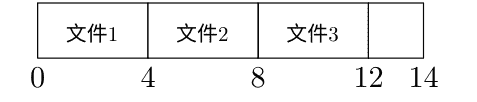

假设文件 2 现在被删除，导致了一个四块的间隙，在磁盘末尾还有另外两个空闲块：

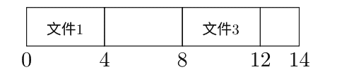

此时，如果创建一个三块的文件（文件 4），它可以放入这个四块的间隙中，剩下一个块未使用：

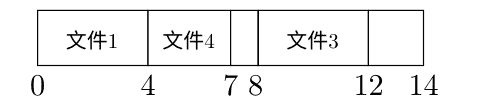

现在有三个未使用的块，但是没有办法满足另一个三块的分配请求，因为这三个未使用的块被分散开来，文件 4 和文件 3 之间有一个块，磁盘末尾还有两个块。

请注意，你最终得到了一个一块的间隙，并不是因为创建了一个一块的文件然后又删除了它（或者因为愚蠢的分配），而是因为一个四块的文件被一个三块的文件替换了。产生的间隙就是文件大小之间的差异。这意味着即使一个磁盘专门用于存储大文件，它仍然可能出现无法容纳任何大文件的小间隙。这就是外部碎片化的根本问题。

回到并行停车的比喻，考虑一下没有在路面上标记停车位的区域，司机们需要自行分配停车位。即使他们足够礼貌，不留下任何无意义的间隙，不同大小的车辆进出会产生小的间隙。一辆大车可能会离开一个停车位，然后被一辆小车占据。结果就是一个等于车辆大小差异的间隙，对于最小的车辆来说太小无法使用。如果这种情况在街区的不同地点反复发生，可能会有足够的总浪费空间来容纳一辆车，但不是在同一个地方。

之前我提到，增加文件系统块大小会增加内部碎片，减少外部碎片。这是因为较大的块大小分配的空间变化较小。当将文件大小舍入到下一个千字节时（例如，14 KB 和 15 KB），可能会舍入到下一个 4 KB 的倍数时大小相同（在这种情况下，16 KB 和 16 KB）。减少变异性可以减少外部碎片；在极端情况下，如果所有文件都分配相同的空间，则不会发生任何外部碎片。

假设您放宽了一个文件只能分配一个磁盘扩展的要求。使用文件元数据，可以将文件的不同块存储在不同的位置，就像虚拟内存地址空间可以分散在物理内存中一样。这是否意味着外部碎片化不是问题？不，因为出于性能原因，您仍然希望尽可能连续地分配文件。因此，外部碎片化将从空间效率问题变为时间效率问题（不能使用的空闲空间会导致文件访问变慢）。这将引入下一个主题，局部性。

### 8.4.2 局部性

请记住，当磁盘被要求在附近位置的单个请求中访问大量连续扇区时，它们提供最快的性能。大多数文件系统设计者已经将这些快速访问的条件解释为以下空间分配的局部性准则：

- 1. 为每个文件分配的空间应尽可能少地分成几个范围。
- 2. 如果一个文件需要分配多个范围，每个范围应该靠近前一个范围。
- 3. 经常连续使用（或同时使用）的文件应该放在一起。

快速访问和这三个指导方针之间的关联是基于一个隐含的假设，即计算机系统的工作负载主要包括一次访问一个文件，并从头到尾读取或写入每个文件。在某些情况下，这是一个合理的近似真相的方法，因此前面的局部性指导方针确实会带来良好的性能。

然而，重要的是要记住，这些指导方针包含了对工作负载和磁盘性能特征的假设。对于某些工作负载，可能需要采用不同的分配策略。特别是，随着计算工作负载被整合到较少的计算机上（使用诸如虚拟化的技术，如第 7.5.2 节所讨论的），文件访问变得更加混乱。作为可能有意义的不同分配策略的一个例子，Rosenblum 和 Ousterhout 建议块应该按照它们被写入的顺序在磁盘上分配空间，而不考虑它们属于哪个文件或者它们在这些文件中的位置。通过一次性向磁盘发出大量连续的写操作，这样可以实现最佳的写入性能。即使应用软件同时在多个文件中以随机位置进行写入操作，发往磁盘的写操作也将是最优的，与传统的文件布局不同。当然，只有在读取操作按照写入的顺序进行时，读取访问才会高效。幸运的是，一些工作负载确实按照写入的顺序进行读取，而另一些工作负载则不需要高效的读取访问。特别是，在大多数磁盘块要么从不被读取，要么被重复读取的工作负载中，读取访问的效率并不重要。那些从不被读取的块不是问题，而那些被重复读取的块只需要承受一次磁盘访问时间的成本，之后可以保存在 RAM 中。

回到本小节开头列出的更主流的策略，主要的未解之谜是如何识别可能同时访问的文件，以便将它们放置在磁盘上相邻的位置。一种方法是在 UNIX 文件系统中使用，即假设文件通常与其父目录或同一目录中的其他（兄弟）文件一起访问。另一种方法是不基于假设，而是基于观察到的行为进行文件放置。

（一个假设仍然存在：未来的行为将与过去的行为相似。）例如，微软在 XP 版本中为 Windows 引入了一个功能，系统在系统启动时和应用程序启动时观察文件访问顺序，然后根据观察到的访问顺序重新组织磁盘空间分配。Mac OS X 在 10.3 版本中也采取了类似的做法：它测量哪些文件被频繁使用并将它们分组在一起。

### 8.4.3 分配策略和机制

在了解了影响磁盘空间分配的考虑因素（碎片化和局部性）之后，你现在能更好地理解任何特定文件系统所使用的具体分配机制以及其中体现的策略选择。不同文件系统中的完整选择范围太广泛，无法在此详细考虑，但我将概述一些代表性的选项。

每个文件系统都有一种跟踪哪些磁盘块正在使用和哪些可以被分配的方法。这些信息的最常见表示形式是位图，即每个磁盘块对应一个位，位 $i$ 表示块 $i$ 是否正在使用。使用位图可以轻松查找磁盘中特定区域的空间，但在整个大型磁盘中搜索所需大小的连续空闲空间会很慢。

许多 UNIX 和 Linux 文件系统使用了位图的轻微变体方法。Linux 的 ext3fs 文件系统可以作为一个例子。整个磁盘空间被划分为适度大小的块组。在一个具有 4-KB 磁盘块的系统上，一个块组可能包含 128 MB。每个块组都有自己的位图，指示该组内的哪些块是空闲的。（在练习 8.8 中，您可以证明在给定的例子中，每个块组的位图都适合于一个单独的块。）整个文件系统的摘要信息指示每个块组有多少可用空间，但不指示可用空间在块组内的具体位置。

因此，分配可以分为两个步骤：首先使用摘要信息找到一个合适的块组，然后使用其位图找到块组内的一组合适的块。

我之前提到过，UNIX 和 Linux 文件系统通常会尝试将每个文件分配在其父目录附近。特别是，普通文件会被放置在与父目录相同的块组中，前提是该组中有足够的空间。如果这个规则也适用于子目录，那么结果将是将整个文件系统塞进一个块组中。因此，这些文件系统使用另一种规则来选择子目录的块组。

在创建子目录时，早期版本的 ext3fs 和类似的文件系统会选择一个包含大量空闲空间的块组。这样可以相对均匀地分布目录及其相应的文件到整个磁盘中。因为每个新目录都会进入一个有大量空闲空间的块组，所以其中包含的文件很有可能也能放入同一个块组中。然而，使用这些分配策略遍历目录树可能需要很长时间，因为每个目录可能与其父目录相距甚远。

因此，ext3fs 和类似的文件系统的更新版本采用了一种不同的目录分配策略，由 Orlov 开发。子目录分配在父目录的块组中，前提是不会过于拥挤。如果无法满足条件，分配策略会在后续的块组中寻找一个不太拥挤的块组。这样可以在整个目录树中保持局部性，而不会使任何块组中的目录过多，导致相应的文件无法容纳。这样做可以显著提高遍历目录树的工作负载的性能。

一旦文件系统决定将文件定位在特定的块组中，仍然需要分配一个或多个磁盘块范围来存储文件的数据。（希望这些范围都在所选的块组内，尽管需要一种方式让大文件摆脱单个块组的限制。）

在分配范围时最大的挑战是知道要分配多大的范围。一些较旧的文件系统要求应用程序员在创建文件时指定每个文件的大小，以便系统可以分配相应大小的范围。然而，现代系统不是这样工作的；相反，每个文件都会自动增长以容纳写入其中的数据。

为了应对这个挑战，现代操作系统使用了一种被称为延迟分配的技术。作为背景，你需要了解操作系统通常不会在应用程序发出写入请求时立即将数据写入磁盘。相反，数据存储在 RAM 中，稍后再写回磁盘。这种延迟写入导致了两种分配磁盘空间的选项：当数据进入 RAM 时或稍后写入磁盘时。

没有延迟分配，操作系统需要在数据进入 RAM 时选择一个磁盘块来存储数据。系统使用所属磁盘块标记 RAM 中的数据。稍后，系统将数据写入磁盘上指定的位置。这种方法很简单，但需要操作系统在生成第一个数据块时就为其分配空间，而此时还不知道后续还会有多少块。

延迟分配将磁盘块的选择推迟到实际写入磁盘的时候；存储在 RAM 中的数据仅标记了应该写入的文件和文件中的位置。现在操作系统在生成第一个块时不需要猜测程序将要写入多少数据。相反，它可以等待并观察写入了多少数据，并分配相应大小的扩展。

一旦操作系统知道所需的扩展大小，它需要搜索记录可用空间的数据结构。位图（无论是在单个块组中还是其他情况下）并不是跟踪空闲空间的唯一选择。XFS 文件系统是专为大型文件系统设计的，采用了另一种方法。它使用平衡搜索树，称为 B 树，来跟踪磁盘空间的空闲扩展。一个 B 树按位置索引空闲扩展，而另一个按大小索引空闲扩展。这样，XFS 可以快速定位靠近指定位置的空闲空间，或者快速定位所需数量的空间。从技术上讲，XFS 使用的树是 B⁺-树的一种轻微变体。我将在第 8.5.1 节中描述这种数据结构。

通过在 B⁺ 树中索引按大小排序的自由扩展，XFS 分配器可以自然地使用最佳适应策略，即找到大于所需大小的最小自由扩展。（如果适应不完全，额外的空间可以被分割并留下较小的自由扩展。）另一方面，使用位图的最自然的分配策略是首次适应，即找到足够大的第一个自由扩展。每种策略都有其优点；你可以在练习 8.9 中进行比较。

## 8.5 元数据

你已经看到文件系统类似于虚拟内存系统。每个文件系统都有一个分配策略，用于为每个数据块选择具体的存储位置。

延续这个类比，我现在将解释作为页表类比的元数据。回想一下，在具有独立地址空间的系统中，每个进程都有自己的页表，存储有关哪个页框保存该进程的页 0、页 1 等信息。

同样，每个文件都有自己的元数据，存储有关哪个磁盘块保存了该文件的块 0、块 1 等信息。你会发现，与页表一样，有几种选择来保存这个映射信息的数据结构。我在第 8.5.1 节中讨论了这些替代结构。

元数据是关于数据的数据。关于数据存储在磁盘上的位置的信息是一种非常重要的元数据。然而，我还将更简要地列举其他类型的元数据。首先，在第 8.5.2 节中，我将重新讨论访问控制，这是我在第 7 章中从另一个角度考虑过的一个主题。在第 8.5.2 节中，问题不是如何在访问尝试期间执行访问控制信息，而是如何在文件系统中存储它。其次，我将在第 8.5.3 节中查看其他次要的、杂项的元数据类型（超出数据位置和访问控制），如访问日期和时间。

一些作者将文件名作为一种元数据。在那些每个文件都有一个名字的文件系统中，这是有道理的。然而，大多数现代文件系统并不符合这个描述；一个文件可能没有名字，或者可能有多个名字。因此，你最好将名字看作是通向文件的路径，而不是文件的属性。同样，在其他持久化服务中，数据可以通过多个路径访问，例如数据库索引。因此，在本节关于元数据的部分中，我不会包括命名，而是将其包括在第 8.6 节关于目录和索引中。

### 8.5.1 数据位置元数据

数据位置元数据的最简单表示形式将是一个磁盘块号的数组，数组的第 i 个元素指定了哪个磁盘块保存了文件的第 i 个块。这类似于线性页表。

传统的 UNIX 文件系统（包括 Linux 的 ext2fs 和 ext3fs）对于小文件使用这种方法。每个文件的磁盘块号数组存储在文件的元数据结构中，称为它的 inode（索引节点）。对于较大的文件，这些文件系统通过使用间接块来保持 inode 的紧凑，这与多级页表类似。接下来，我将讨论传统的 inode 和间接块形式。然后，我将讨论一些更现代的文件系统中使用的两种替代方案：范围映射（extent maps），它们避免存储有关单个块的信息，以及 B⁺-trees，它们提供对大范围映射的高效访问。

#### Inodes 和 间接块

当 UNIX 在 20 世纪 70 年代初首次开发时，其许多创新特性之一就是文件系统设计，这种设计至今仍被广泛使用于 UNIX 和 Linux 文件系统，包括 Linux 的 ext3fs。这些系统中的数据位置元数据存储在一种更应该被称为方便而不是优雅的数据结构中。然而，这种结构对于小文件来说是高效的，允许文件变得很大，并且可以通过简单的代码进行操作。

每个文件都由一个紧凑的数据块表示，称为 inode。如果文件很小，inode 包含文件的元数据；如果文件很大， inode 包含元数据的初始部分。通过允许文件在其他地方（间接块）具有更多的元数据，inode 保持为一个小的固定大小。

每个文件系统都包含一个 inode 数组，存储在专门用于此目的的磁盘块中，每个块中有多个 inode。每个 inode 通过其在数组中的位置进行标识。这些 inode 号码（或 i 号码）是文件系统中文件的基本标识符；基本上，文件被标识为文件 0、文件 1 等，这表示在位置 0、1 等处具有 inode 的文件。稍后，在第 8.6 节中，您将看到如何将文件名映射到 inode 号码。

每个 inode 提供一个文件的元数据。元数据包括存储该文件数据的磁盘块号，以及访问权限和其他元数据。这些元数据的类别在图 8.6 中显示。在这个简化的图表中，inode 直接包含了指定每个文件块所在磁盘块的映射信息，类似于线性页表。然而，请记住，inodes 是一个小而固定的大小，而文件可以增长到很多块长。为了解决这个冲突，每个 inode 只直接包含了前十几个块的映射信息。（具体数量在文件系统之间有所不同，但在任何一个文件系统内是一致的。）因此，更真实的 inode 图片如图 8.7 所示。

在我详细介绍如何间接访问更多磁盘块之前，我应该强调 inode 设计的一个方面。无论是小文件的唯一一块还是大文件的第一块，文件的低编号块都以完全相同的方式映射（直接在 inode 中）。这意味着大文件具有一种奇特的不对称性，某些块比其他块更高效地访问。优点是，当文件从小文件转变为大文件时，早期块的映射信息保持不变。

由于大多数文件都很小，因此 inode 保持较小，只占一小部分空间块的大小。（如果 inode 是满块的，那么单块文件的开销将达到 100%。）然而，对于足够大以溢出 inode 的文件，可以在分配元数据的空间上更加慷慨。因此，如果系统需要更多的元数据空间，它不会分配第二个 inode；而是分配一个完整的额外磁盘块，即间接块。这提供了更多的块号空间，如图 8.8 所示。额外块号的确切数量取决于块和块号的大小。对于 4KB 的块和 4 字节的块号，一个间接块可以容纳 1K 个块号（即 1024 个块号），如图所示。这种类型的间接块更具体地称为单间接块，因为它只添加了一层间接：inode 指向它，它指向数据块。

在这个例子中，使用 4KB 块，单间接块可以容纳略大于 4MB 大小的文件。为了处理更大的文件，可以使用多级树方案，类似于多级页表。

| 图 8.7：内容 |
| :--- |
| 文件块 0 的磁盘块号 |
| ⋮ |
| 文件块 11 的磁盘块号 |
| 通过文件末尾间接访问文件块 12 |
| 访问权限 |
| 其他元数据 |

*图 8.7：在这个有限大小的 inode 中，从编号 12 到文件末尾的块是间接引用的。*

| 索引节点 | 间接块 |
| :--- | :--- |
| 文件块 0 的磁盘块号 | 文件块 12 的磁盘块号 |
| ⋮ | ⋮ |
| 文件块 11 的磁盘块号 | 文件块 1035 的磁盘块号 |
| 间接块的块号 | |
| 访问权限 | |
| 其他元数据 | |

*图 8.8：如果使用一个索引节点和一个单间接块，块号将如图所示存储。请注意，间接块实际上比索引节点要大得多，与其在图中的外观相反。*

索引节点可以包含一个双间接块的块号，该块包含许多更多的单间接块的块号，每个单间接块又包含许多数据块的块号。图 8.9 显示了对索引节点设计的这种增强，保留了十几个直接块 and 原始的单间接块，同时添加了一个双间接块。

由于双间接块指向多个间接块，每个间接块又指向多个数据块，文件现在可以变得非常大。（在练习 8.10 中，你可以计算出有多大）。然而，许多 UNIX 文件系统进一步允许 inode 指向三次间接块，如图 8.10 所示。将此与多级页表进行比较是很有启发性的；这里使用的非常不平衡的树允许一个小而浅的树变成一个大而深的树。稍后你会看到 B⁺-trees 的增长方式有些不太直接，但不会变得如此不平衡。

在介绍了将文件块映射到磁盘块的方法后，我将很快转向一种避免按块存储信息的替代方法。然而，首先值得再次与页表进行类比。就像页表不需要为每个页面提供页面帧号码（如果某些页面不在内存中），inode 或间接块也不需要为文件的每个块提供磁盘块号码。一些条目可以留空，通常使用一些保留值，以免被误认为是合法的磁盘块号码。这对于稀疏文件非常有价值，也被称为带有空洞的文件。稀疏文件有一个或多个只包含零的部分，通常是因为这些部分从未被写入过。

通过不为全零文件块分配磁盘块，文件系统可以避免浪费空间和时间。

#### 扩展映射

你已经看到传统的索引节点和间接块是基于块映射的概念，即为每个文件块指定一个磁盘块号的数组。块映射是完全通用的，因为每个文件块可以映射到任何磁盘块。文件块 n 可以映射到与文件块 n-1 完全不同的位置上。然而，需要注意的是，文件系统设计者通常不希望使用这种完全通用的方式。出于性能原因，连续的文件块通常会分配连续的磁盘块，形成长的扩展。这为存储映射信息的更高效的数据结构提供了关键。

假设你有一个占用磁盘块 1000-1039 和 1200-1229 的 70 个块长的文件。一个块映射将包含每个块的映射信息。

#### 索引节点

| 属性内容 |
| :--- |
| 文件块 0 的磁盘块号 |
| : |
| 文件块 11 的磁盘块号 |
| 单间接块的编号 |
| 双间接块的编号 |
| 访问权限 |
| 其他元数据 |

### 单间接块

| 属性内容 |
| :--- |
| 文件块 12 的磁盘块号 |
| : |
| 文件块 1035 的磁盘块号 |

### 双间接块

| 属性内容 |
| :--- |
| 间接块 1 的块编号 |
| : |
| 间接块 1024 的块编号 |

### 间接块 1

| 属性内容 |
| :--- |
| 文件块 1036 的磁盘块号 |
| : |
| 文件块 2059 的磁盘块号 |

间接块 2-1024: 类似于间接块 1

图 8.9: 如果 inode 与单间接块和双间接块一起使用，块编号将如图所示存储。

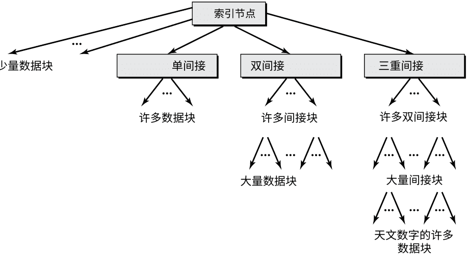

图 8.10: 文件的完整结构从 inode 开始，通过单间接块、双间接块和三重间接块的树结构，最终到达每个数据块。

其中 70 个磁盘块号码之一。另一方面，扩展映射只包含两个条目，每个条目对应文件的一个扩展，就像本段开头的句子包含两个块号范围一样。扩展映射中的每个条目需要包含足够的信息来描述一个扩展。有两种可行的方法:

- 每个条目可以包含扩展的长度和起始磁盘块号码。在示例中，两个扩展映射条目分别为（40, 1000）和（30, 1200）。这些表示该文件包含从磁盘块 1000 开始的 40 个块和从磁盘块 1200 开始的 30 个块。
- 每个条目可以包含扩展的长度、起始文件块号码和起始磁盘块号码。在示例中，两个扩展映射条目分别为（40, 0, 1000）和（30, 40, 1200）。第一个条目描述了一个长度为 40 个块的扩展，起始位置为文件中的位置 0，并占用从编号为 1000 的磁盘块开始的块。第二个条目描述了一个长度为 30 个块的扩展，起始位置为文件中的位置 40，并占用从编号为 1200 的磁盘块开始的块。

第一种方法更紧凑。然而，第二种方法的优点是每个范围映射条目都可以独立理解，无需阅读前面的范围映射条目。如果范围映射存储在 B+ 树中，这将特别有用，我将在后续讨论中详细说明。

为简单起见，在我的讨论中，我将假设采用第二种方法，尽管有些系统使用两种方法。

起初，范围映射为何如此重要可能不明显。典型的块映射系统可能使用 4 字节的块号来引用每个 4KB 块。这比百分之一的空间开销还要少，对于如今廉价的磁盘存储来说肯定是可以接受的。文件系统设计者有什么理由进一步减少已经很小的开销呢？（我将忽略范围映射占用比块映射更多空间的可能性，这只会在文件被分散成许多小范围时发生。）

关键事实是磁盘空间的效率转化为时间效率，这是一种更宝贵的资源。间接块会导致额外的磁盘 I/O 操作。例如，考虑读取存储在一个 20 块范围内的文件。使用块映射方法，文件系统至少需要进行两次磁盘读取操作：一次读取单个间接块，一次读取数据块。假设 inode 已经被缓存到内存中，并且已经与其磁盘块中的其他 inode 一起读取，并且文件系统足够聪明，能够在单个操作中读取所有 20 个数据块。

使用范围映射，整个映射信息将适合于 inode；如果再次假设 inode 已被缓存，一个读取操作就足够了。因此，系统可以以两倍的速度读取此类文件。诚然，这是一个有些人为的最佳案例。然而，即使在实际工作负载下，也可以实现显著的加速。

包括 Microsoft Windows 的 NTFS，Mac OS X 的 HFS Plus 和从 SGI 的 IRIX 版本的 UNIX 移植到 Linux 的 XFS 在内，几个现代文件系统使用范围映射。对于只有少数几个范围映射的文件（远远是最常见的情况），这三个文件系统都将范围映射条目的序列存储在 inode 中或者（在 Windows 和 Mac OS X 中）存储在相应的类似 inode 的结构中。NTFS 中 inode 的类似物足够大（1 KB），可以直接存储大多数文件的整个范围映射，即使这些文件有多个范围映射。另外两个文件系统使用较小的 inode（或类似 inode 的结构），因此提供了一个处理需要额外空间存储大范围映射的情况的技术比较的有趣案例。

HFS Plus 采用了非常类似传统 UNIX inode 的方法：前八个范围映射条目直接存储在类似 inode 的结构中，无论它们是唯一的还是更大数量的第一个。任何额外的条目都存储在其他地方，即一个用于所有文件的单个 B+ 树中，我将在后面描述。另一方面， XFS 将文件的所有范围映射条目存储在一个特定于文件的 B+ 树中，inode 中的空间是该树的根节点。当树只包含少数范围映射时，树足够小，树的根节点也是叶子节点，因此范围映射直接存储在 inode 中，就像 HFS Plus 一样。然而，当范围映射变得更大时，所有条目都会移动到树的后代节点中，inode 中不再有条目，不像 HFS Plus 对前八个条目的特殊处理。

## B树

B树数据结构是一种平衡搜索树结构，通常配置具有大型、高度节点形成浅而繁茂的树。这个特性使其非常适合磁盘存储，在这种情况下，一次传输大块数据是高效的（因此是大节点），但执行一系列操作是慢的（因此是浅树）。你可能之前遇到过 B树，如果是这样，我的总结将是一个回顾，除了我对使用该结构的特定应用的描述。

任何 B树将搜索键与相应的值关联起来，就像字典将单词与其定义关联起来，或者电话簿将姓名与电话号码关联起来。这些键可以是按字母顺序组织的文本字符串（如这些示例中的情况），也可以是按增加顺序组织的数字；唯一需要的是有一种方法来确定两个键的相对顺序。

B树允许通过键高效地定位条目，并进行插入和删除。到目前为止，对于哈希表结构（例如用于哈希页表的结构）也可以这样说。B树（以及其他平衡搜索树）的区别在于它们还根据键的顺序提供高效的操作，而不仅仅是键的相等性。例如，如果有人让你在电话簿中查找“Smit”，你可以回答：“没有 Smit；条目直接从 Smirnoff 跳到 Smith。”你可以用 B树做同样的事情，但不能用哈希表。

当 B树用于范围映射时，搜索键的邻居（该键本身不需要在树中存在）的能力至关重要。有人可能想要了解包含文件块 17 的范围的信息。可能没有明确提及 17 的范围映射条目；相反，有一个指定以文件块 12 开始的 10 个块范围的条目。可以通过找到小于或等于 17 的最大键的条目来找到该条目。

B树在持久化系统中可以扮演多种不同的角色。在第 8.6 节中，你将看到它们用于文件名目录和数据库内容索引；这两者都是用户可见的数据访问服务。在当前章节中，B树扮演着更为幕后的角色，将文件中的位置映射到磁盘上的位置。在 8.4.3 节中，你之前看到了另一种相关用途，即管理分配的空闲空间。在所有情况下，数据结构的基本原理都是相同的；我选择在这里介绍它们，因为范围映射似乎是最简单的应用。空闲空间映射由于双重索引（按大小和位置索引），目录由于使用文本字符串作为键而变得复杂。

你可能已经熟悉了二叉搜索树，其中每个树节点包含一个根键和两个指向子树的指针，一个指向根键较小的键，另一个指向根键较大的键。（对于包含与根键相等的键的子树，采用某种约定。）B树节点类似，但是它们不是使用单个根键进行二分区，而是使用 $N$ 个根键进行 $N+1$ 路区分。也就是说，根节点包含 $N$ 个键（按升序排列）和 $N+1$ 个指向子树的指针，如图 8.11 所示。第一个子树包含小于第一个根键的键，下一个子树包含介于第一个和第二个根键之间的键，依此类推。最后一个子树包含大于最后一个根键的键。

如果一个多千字节的磁盘块用于保存一个 B树节点，那么该值的 $N$ 可以非常大，导致树变得宽而浅。事实上，即使一个磁盘块只有一半的根键和子树指针，它仍然提供了相当大的分支因子。这个观察结果为插入条目时维护 B树的机制提供了灵感。

每个节点允许占据从半满到完全满的任意位置。这种灵活性意味着只要节点不满，就可以轻松插入。困难情况可以通过分裂节点来处理。作为一个特殊例外，根节点不需要达到一半的填充要求。这个例外允许您构建任意数量的条目的树，并且最多增加一层树的高度。

例如，考虑将一个新的条目插入到已满的节点中。插入后，你有 $N+1$ 个键，但只有 $N$ 个空间。该节点可以被替换为两个节点，一个包含 $N/2$ 个最小的键，另一个包含 $N/2$ 个最大的键。因此，现在你有两个半满的节点。然而，你考虑了 $N$ 个键中的 $N+1$ 个键；中位键仍然剩下。

你可以将这个中位键插入到父节点中，它将作为两个半满节点之间的分隔符，如图 8.12 所示。当你将中位键插入到父节点时，如果父节点也满了怎么办？你也要将父节点进行分裂。分裂过程可以一直向上进行，但由于树的深度较浅，这不会花费很长时间。如果被分裂的节点没有父节点，因为它是树的根节点，它将获得一个只包含中位键的新父节点。通过这种方式，树的高度增加了一级。

在 Bayer 和 McCreight 于 1972 年介绍 B树的论文中，他们建议每个节点包含键/值对以及指向子树的指针。实际应用程序今天使用的是一种变体，有时称为 B+ 树。

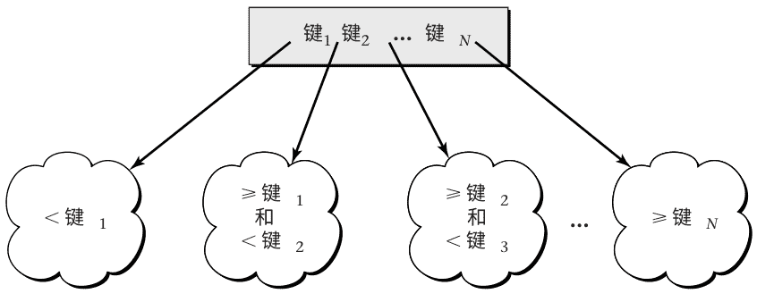

图 8.11: 一个 B树节点包含 $N$ 个键和 $N+1$ 个指向其下属子树的指针。每个子树包含特定范围内的键。

在 B+ 树中，非叶节点仅包含键和指向子树的指针，而这些键没有任何关联值。这些节点中的键仅用于导航到子树。叶节点包含实际数据结构的键/值对。例如，一个小的 B+ 树的范围映射条目可以组织如图 8.13 所示。

这种 B+ 树可以存储单个文件的范围映射，就像 XFS 中所做的那样。对于 Mac OS X 的 HFS Plus，需要稍微不同的方法，因为所有文件的范围映射都合并到一个 B+ 树中。（请注意，每个文件的前八个范围都不包括在此树中。）该文件系统的 B+ 树中的每个条目描述了某个文件中某个位置的范围映射条目。也就是说，该条目包含一个文件编号（类似于 inode 编号），文件中的起始块编号，块的长度和起始磁盘块编号。文件编号和起始文件块编号的串联作为键。这样，同一文件的所有条目按照它们在文件中的位置顺序连续出现在树中。

B+ 树的插入算法与纯 B树的算法略有不同；你可以通过练习 8.13 来了解它们之间的差异。

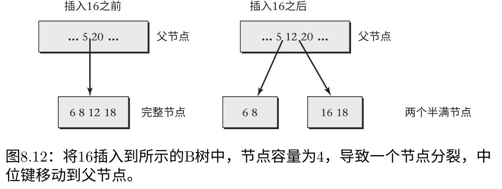

### 8.5.2 访问控制元数据

存储访问控制信息的数据结构的复杂性与保护系统的复杂性直接相关。请回忆一下，POSIX 规范（UNIX 和 Linux 遵循）仅支持固定长度的访问控制列表（ACL），ACL 包括文件的所有者、所属组和其他用户的权限。这些信息可以被紧凑地存储在文件的 inode 中。另一方面，Microsoft Windows 允许更通用的 ACL。因此，NTFS 的设计者面临着更有趣的挑战。实际上，他们已经重新审视了他们的设计决策，正如你将看到的。

对于符合 POSIX 的访问控制，一个 inode 可以包含三个数字：一个用于标识文件的所有者用户，一个用于标识文件的所有者组，以及一个包含九个位的数字，表示文件的 `rwx` 权限，用于所有者用户、所有者组和其他用户。这第三个数字，包含九个权限位，被称为文件的模式（mode）。与其浪费模式中除了九个位之外的所有位，其他位被用于编码额外的信息，例如文件是普通文件、目录、I/O 设备等等。图 8.14 展示了如何通过使用 `stat` 系统调用来提取 inode 的模式来确定权限。（这个系统调用与之前看到的 `fstat` 略有不同。文件是通过名称指定的，而不是通过数字文件描述符。）如果你编译这个 C++ 程序并调用生成的可执行文件 `stater`，那么像 `./stater somefile` 这样的命令应该产生你也可以通过 `ls -l somefile` 获得的信息。

早期的 NTFS 版本独立存储每个文件的完整 ACL。如果 ACL 足够小以适应类似 inode 的结构中，则存储在那里。否则，它将存储在一个或多个磁盘块的范围中，就像文件的数据一样，类似 inode 的结构包含 ACL 的范围映射。

从 Windows 2000 开始，微软重新设计了 NTFS 以利用许多文件具有相同 ACL 的事实。ACL 的内容现在存储在一个集中的数据库中。如果两个文件具有相同的 ACL，则它们可以共享相同的 ACL 底层表示。

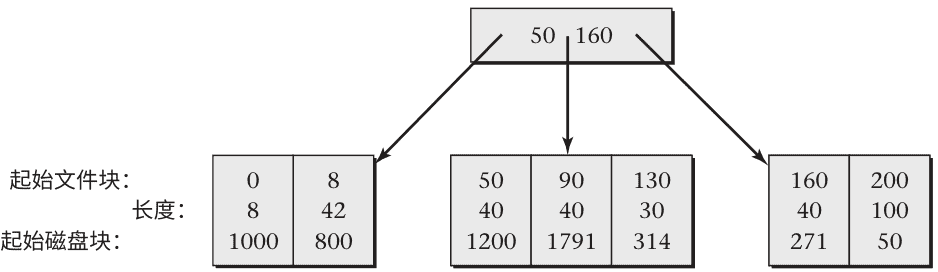

**图 8.13:** 这个小的 B+ 树扩展映射包含了可以用来找到每个扩展的文件块号范围和磁盘块号范围的信息。因为这棵树是 B+ 树而不是 B树，所有的扩展都在叶子节点中描述，非叶子节点只包含导航信息。

```cpp
#include <unistd.h>
#include <time.h>
#include <sys/stat.h>
#include <stdio.h>
#include <iostream>
using namespace std;

static void print_bit(int test, char toPrint){
    if(test)
        cout << toPrint;
    else
        cout << '-';
}

int main(int argc, char *argv[]){
    if(argc != 2){
        cerr << "使用方法: " << argv[0] << " 文件名" << endl;
        return -1;
    }
    struct stat info;
    if(stat(argv[1], &info) < 0){
        perror(argv[1]);
        return -1;
    }
    print_bit(info.st_mode & S_IRUSR, 'r');
    print_bit(info.st_mode & S_IWUSR, 'w');
    print_bit(info.st_mode & S_IXUSR, 'x');
    print_bit(info.st_mode & S_IRGRP, 'r');
    print_bit(info.st_mode & S_IWGRP, 'w');
    print_bit(info.st_mode & S_IXGRP, 'x');
    print_bit(info.st_mode & S_IROTH, 'r');
    print_bit(info.st_mode & S_IWOTH, 'w');
    print_bit(info.st_mode & S_IXOTH, 'x');
    cout << endl;
    return 0;
}
```

图 8.14: 这个 C++ 程序 stater.cpp 使用 stat 来检索由命令行参数 argv[1] 指定的任何文件的访问控制元数据。

### 8.5.3 其他元数据

因为文件的长度可以是任意的，不仅仅是块大小的倍数，每个 inode（或等效物）都包含文件的字节大小。（图 8.3 第 342 页上的程序展示了如何检索这些信息。）其他元数据则更加系统特定。例如，POSIX 规定每个文件有三个时间戳，记录文件的最后访问时间、最后写入时间和最后修改时间。修改包括不仅仅是写入数据，还包括对权限和其他元数据属性的更改。NTFS 记录了文件是否应该在普通目录列表中隐藏。HFS Plus 具有许多支持图形用户界面的元数据属性；例如，每个文件记录了其图标的位置。

在 POSIX 系统上，一个元数据属性与文件链接相关，即一个文件有多个名称，这是第 8.6.3 节的主题。每个文件的 inode 包含了指向该文件的名称数量。当该计数达到零且文件没有被任何进程使用时，操作系统会删除该文件。用户通常认为删除文件的操作实际上只是删除了一个名称；底层文件可能会被删除或不被删除。

## 8.6 目录和索引

在了解了文件系统如何为文件提供存储之后，现在可以考虑这些系统如何通过名称来定位文件。对于数据库系统，你可以考虑这样一个类似的问题，即这些系统如何提供索引查找。在第 8.6.1 节中，我通过提供一个常见的文件目录和数据库索引的框架来为这个讨论做铺垫，展示它们之间的区别。在第 8.6.2 节中，我展示了文件目录和数据库索引之间的分离正在随着用于定位文件的索引机制的引入而逐渐减弱。在展示了目录和索引的基本原理之后，我在第 8.6.3 节中更详细地探讨了文件目录的一个特定方面：多个名称如何引用同一个文件。

最后，在第 8.6.4 节中，我将带你深入了解用于目录和索引的典型数据结构。

### 8.6.1 文件目录与数据库索引

传统上，文件系统包括目录，通过名称提供对文件的访问。另一方面，数据库包括索引，提供对数据的访问。基于内容部分的数据库条目访问。文件系统和数据库之间的清晰区分目前正在模糊化，因为基于索引的替代文件访问技术变得可用。特别是，苹果在 Mac OS X 10.4 版本中引入了一个名为 Spotlight 的功能。我在第 8.6.2 节中描述了 Spotlight。微软随后在 Windows Vista 中包含了一个相关功能。这一趋势使得了解目录和索引之间的共同点和区别变得更加重要。

目录和索引都提供了从键到对象的映射。

- 目录中的键是名称，这些名称是外部于被命名对象的。你可以改变文件的内容而不改变其名称，或者改变名称而不改变其内容。相比之下，索引中的键是被索引对象的属性，因此是固有于这些对象的。例如，对于一个章节数据库表的索引可能允许直接访问标题为"文件和其他持久存储"或编号为 8 的行。如果行被更新以显示该章节标题或编号的更改，索引需要相应地进行更新。同样，对索引的任何更新都必须在相应更改的索引行的上下文中进行；说你想要查找章节编号为 1 的行，但实际上发现真正的章节编号仍然是 8 是没有意义的。
- 目录中的每个名称都标识一个单独的文件。两个文件可以在不同的目录中具有相同的名称，但不能在同一个目录中。另一方面，数据库索引可以是唯一属性或非唯一属性。例如，对于用户账户表，通过唯一的登录名和非唯一的姓氏进行索引可能是有用的。唯一索引可用于查找关于以 "jdoe" 登录的用户的一个信息记录，而非唯一索引可用于查找所有姓氏为 "Doe" 的用户的信息记录。索引还可以使用多个属性的组合作为其键。例如，一个大学课程目录可以有一个以系别和课程编号为键的唯一索引。
- 文件目录和数据库索引之间的最后区别是它们提供访问的对象类型。传统上，目录提供对整个文件的访问，这相当于关系数据库中的表。另一方面，索引提供的不是对整个表的访问，而是对表中的单个行的访问。

然而，这种区别是误导性的，原因有两个：

- 数据库系统通常有一个作为目录的元表列出了所有表。元表中的每一行描述了一个表。因此，对于元表的行的索引实际上是对表的索引。访问其行用于提供对数据库表的访问。

- 正如我之前提到的，操作系统开发人员正在引入索引以提供基于内容的文件访问。这是第 8.6.2 节的主题。

### 8.6.2 使用索引定位文件

正如我所描述的，传统上通过名称使用目录来访问文件。然而，最近对使用索引来帮助用户按内容或其他属性查找文件产生了相当大的兴趣。假设我不记得包含这本书的文件的名称。即使不考虑世界可能没有这本书的可能性，这也不会是一场灾难。我可以通过多种方式搜索文件；例如，这是我计算机上为数不多的几个有数百页的文件之一。因为我使用的 Mac OS X 系统按页数（以及许多其他属性）对文件进行索引，所以我可以简单地要求显示所有页数大于 400 页的文件。一旦我看到符合这个限制的五个文件，很容易辨认出我正在寻找的那个文件。

Mac OS X 中的基于索引的搜索功能称为 Spotlight，它不是文件系统中目录和文件名的一部分。相反，索引和搜索是由操作系统外部的进程提供的，可以看作是一种中间件形式。

文件系统通过通知进程事件的通用能力来支持索引，例如文件的创建或删除，或者文件内容的更改。这些事件可以发送给任何订阅它们的进程，并且还用于其他目的，例如保持文件图标的更新。Spotlight 功能使用它来确定文件何时需要重新索引。当我保存新版本的时候，文件系统会通知 Spotlight 文件已更改，从而允许 Spotlight 更新基于页数的索引等。与文件目录不同，内容或属性（如页数）的访问索引存储在 `/.Spotlight-V100` 目录中的普通文件中，而不是文件系统的特殊数据结构中。

苹果将索引属性（除了实际文件内容之外）称为元数据。在我的书的例子中，文档中的页数是一种元数据。这个词“元数据”的用法与其在文件系统中的传统用法相当不同。每个文件都有一组固定的文件系统元数据属性，如所有者、权限和最后修改时间。相比之下，Spotlight 元数据属性更多，属性列表是开放的，并且特定于各种文件类型。例如，尽管包含我的书的文件具有指定页数的属性，但包含我的一张度假照片的文件具有指定曝光时间的属性（以秒为单位）。每个属性对应的文件都有意义，但对另一个文件来说则没有意义。

正如你所见，需要索引的元数据属性是特定于各个文件类型的。此外，即使是常见的属性，对于不同类型的文件可能需要以不同的方式确定。例如，读取 PDF 文件以确定其页数与读取 Microsoft Word 文件以确定其页数是完全不同的——这些文件以完全不同的格式存储。因此，当 Spotlight 的索引部分收到文件系统通知文件已更改，因此应该进行索引时，它将实际的索引工作委托给依赖于文件类型的专门索引程序。当您在系统上安装新的应用程序时，安装包可以包含相匹配的索引程序。这样，您将始终能够使用相关属性在系统上搜索文件，而无需 Apple 预见所有不同的文件类型。

### 8.6.3 文件链接

索引属性，如页面计数，通常不是唯一的。我的系统可能有几个五页的文档。相比之下，你已经看到每个目录中的每个名称都指定了一个单独的文件。仅因为每个路径指定了一个单个文件，并不意味着反之亦然。在本小节中，我将解释两种不同的方式，通过这两种方式可以通过多个名称访问文件。

多个名称可以访问单个文件的最直接的方式是，每个名称的目录条目指定了相同的文件。图 8.15 显示了一个目录，其中有两个名称，都指向同一个文件。在解释这个图时，你应该理解标记为文件的框不仅表示文件中包含的数据，还表示文件的所有元数据，如权限。在 POSIX API 中，这种情况可能以至少两种不同的方式出现：

- 该文件以名称 `alpha` 创建，然后进行过程调用 `link("alpha", "beta")` 添加了名称 `beta`。
- 该文件以名称 `beta` 创建，然后进行过程调用 `link("beta", "alpha")` 添加了名称 `alpha`。

无论哪个名称是原始的，哪个名称是添加的，两者在之后都起着相同的作用。无法区分哪个是“真实”名称。通常人们将添加的名称称为文件的链接。然而，您需要了解的是，所有文件名都是文件的链接。没有任何区别一个使用 `link` 过程添加的名称。

POSIX 允许一个文件在多个目录中具有名称，只要所有目录都在同一个文件系统中。在前面的示例中，当前目录中的 `alpha` 和 `beta` 命名了一个文件。相反，我可以在多个目录中都有指向同一个文件的目录条目。例如，在图 8.16 中，我展示了一个情况，其中 `/alpha/beta` 是与 `/gamma/delta` 相同文件的名称。

图 8.16：一个文件可以有两个不同的名称，分别位于自己的目录中。在这个例子中，两个路径名 `/alpha/beta` 和 `/gamma/delta` 都指向同一个文件。

为了保持目录结构不过于混乱，POSIX 系统通常不允许一个目录有多个名称。一个例外是每个目录包含两个特殊条目：一个叫做 `.` 的条目，它是指向该目录本身的额外链接；另一个叫做 `..` 的条目，它是指向其父目录的额外链接。

就像 `link` 为文件添加一个名称一样，`unlink` 会删除一个名称。例如，`unlink("/alpha/beta")` 会通过从目录 `alpha` 中删除 `beta` 条目来消除图 8.16 中文件的两条路径之一。正如之前提到的，删除一个名称只是隐含地与删除一个文件有关。当操作系统不再有任何名称并且不再被任何进程使用时，它会删除该文件。（一个打开的文件可以在没有任何名称的情况下继续存在，你可以在探索项目 8.10 中证明这一点。）

POSIX 还支持另一种多个名称指向同一个文件的替代方式。一个名称可以引用另一个名称，从而间接地引用同一个文件作为第二个名称。在这种情况下，第一个名称被称为符号链接（符号链接有时也被称为软链接。当强调差异时，普通链接被称为硬链接）。在图 8.17 中，`alpha` 被指定为指向 `beta` 的符号链接，并因此引用了 `beta` 所指向的任何文件。

图 8.17：符号链接允许文件名间接地引用文件，通过另一个文件名。

在这个图中，我展示了一个目录可以将每个名称映射到两个选项之一：要么是指向文件的指针（可以表示为 `inode` 编号），要么是另一个名称。在像 `open` 这样的过程中查找文件名的代码会以不同的方式处理这两个选项。当它查找 `alpha` 并找到 `beta` 时，它会递归地查找 `beta`，以找到实际的文件。图 8.17 中显示的符号链接可以通过执行 `symlink("beta", "alpha")` 来创建。

符号链接有点棘手，因为它们可以形成长链、悬空引用或循环。在前面的例子中，你可以通过将 `gamma` 作为一个符号链接添加到 `alpha` 来形成一个更长的链，而 `alpha` 已经是一个符号链接到 `beta`。查找文件的代码需要遍历这样的链直到其末尾。然而，链的末尾可能没有文件。

如果你执行 `unlink("beta")`，那么你将会有一个悬空引用：`gamma` 仍然是一个符号链接到 `alpha`，而 `alpha` 仍然是一个符号链接到 `beta`，而 `beta` 将不再存在。更糟糕的是，在删除 `beta` 之后，你可以将该名称重新用作指向 `alpha` 的符号链接，从而创建一个循环。所有查找文件的 POSIX 过程在遇到这种情况时必须返回一个特殊的错误代码 `ELOOP`。除了对于真正的循环返回 `ELOOP` 之外，这些过程还可以对于任何超过某个实现定义的最大长度的符号链接链返回相同的错误代码。

符号链接比硬链接更灵活。你可以创建一个指向目录的符号链接。你还可以创建一个指向存储在单独文件系统中的文件的符号链接。例如，你可以在主文件系统中创建一个符号链接，存储在本地磁盘驱动器上，指向网络文件服务器上的辅助文件系统中的文件。这两个选项都无法使用硬链接实现。你可以使用 `ln` 命令在 shell 中创建符号链接或普通硬链接。该命令运行一个程序，将调用 `link` 过程或 `symlink` 过程。

一些不属于 UNIX 传统的文件系统将文件的元数据直接存储在文件的目录项中，而不是在一个单独的结构（如 `inode`）中。这样紧密地将用于访问文件的名称与文件本身的身份绑定在一起。实际上，名称成为文件的一个属性，而不仅仅是访问文件的手段。在这种系统中，仍然可以使用符号链接，但是没有容易实现硬链接的类似物。当这些系统需要符合 POSIX 标准时，就会出现有趣的情况。

例如，Apple 的 HFS Plus 是在 Mac OS 基于 UNIX 之前开发的，这发生在 Mac OS X 中。底层设计假设每个文件只有一个名称，并将目录和元数据结构融合在一起。然而，Mac OS X 是一个 UNIX 系统，因此需要支持具有多个名称的文件（使用 `link` 创建）或没有名称的文件（如果在取消链接时仍在使用）。为了适应这一点，Apple 将处于这两种情况之一的任何文件放入一个特殊的隐形目录中，该目录的名称是一个随机数。文件的任何其他名称都由一种特殊的符号链接提供，该符号链接对于 POSIX API 来说是完全不可见的，即使对于通常检查符号链接而不是简单地跟随它们到目标的那些过程也是如此。

### 8.6.4 目录和索引数据结构

目录或索引的最简单数据结构是无序线性键/值对的列表。虽然这在数据库索引中从不使用，但它是 UNIX 家族文件系统中目录的最传统方法，并且在许多系统中仍在使用。使用这种结构，找到目录条目的唯一方法是通过线性搜索。

对于小型目录，线性搜索的性能表现相当不错。因此，系统管理员通常设计目录树，使每个目录保持较小。例如，我的主目录不是 `/home/max`，而是 `/home/m/a/max`，其中 `m` 和 `a` 来自于我的用户名的前两个字母。这样，`/home` 目录只有 26 个条目，每个条目又有 26 个条目，每个条目只有用户主目录的一小部分数千个用户的主目录。在现代系统上，我的文件可以在 `/home/max` 中，其他数千个用户也是如此，而不会出现主要的减速，除非当然有人列出了 `/home` 的内容。

第二种替代结构是一个哈希表。哈希表是一个按数字索引的键值对数组，软件可以直接访问条目号，而不需要查看前面的条目。关键是（大部分情况下）知道哪个条目包含特定的键；这个知识来自于使用哈希函数将键作为条目号。

只要没有两个键发生碰撞并被分配到相同的位置，查找特定条目是一个常数时间操作，与表的大小无关。只需要将键哈希成一个数值哈希码，并使用该码直接访问相应的条目。如果它包含所需的键，查找完成。如果由于碰撞，条目包含的是其他键，则系统必须开始在替代位置进行搜索。然而，通过确保表永远不会很满，可以使这种搜索非常罕见。

哈希表有时用于数据库索引；特别是，在 PostgreSQL 中，它们是一种选择。然而，相对于 B+ 树，它们的缺点是不支持基于顺序的访问。例如，没有办法使用哈希表索引来查找会计表中在特定范围内进行的所有付款的日期。哈希索引的性能也可能不如 B+ 树索引；PostgreSQL 文档引用这一点作为不鼓励使用哈希索引的原因。哈希表有时也用于索引文件系统目录。特别是，在 BSD 版本的 UNIX 中使用的 FFS 文件系统支持目录哈希扩展。该功能在访问大型目录时在内存中构建哈希表。然而，磁盘上的数据结构仍然是一个未排序的线性列表。

B+ 树是数据库索引和当代文件系统目录的主要结构。例如，微软的 NTFS、SGI 的 XFS 和苹果的 HFS Plus 都使用 B+ 树作为目录。在大多数系统中，每个索引或目录都由自己的 B+ 树表示。HFS Plus 将所有目录条目放在一个大的 B+ 树中。该树中的键由父目录的标识号和特定子文件（或子目录）的名称连接而成。因此，单个目录中的所有条目在树中连续出现。

## 8.7 元数据完整性

当系统崩溃时，保存在易失性主存储器（RAM）中的任何数据都会丢失。特别是，文件系统打算写入持久性存储器的任何数据，但由于性能原因暂时缓冲在 RAM 中的数据都会丢失。这对于丢失的数据是用户正在写入文件的一部分还是文件系统的元数据的一部分，有着不同的影响：

- 一些用户数据是非关键的，或者可以被人识别为损坏并从备份源恢复。其他用户数据是关键的，并且可以在应用程序的控制下显式地刷新到持久性存储器中。例如，关系数据库系统可以使用 POSIX API 的 `fsync` 过程来强制操作系统将日志文件写入持久性存储器。
- 如果在崩溃前的最后几个元数据操作完全丢失，通常可以容忍。然而，用户无法容忍在元数据更新过程中发生崩溃的情况，这会导致元数据结构的完整性受损。如果没有这些结构来组织存储块成有意义的文件，存储内容只是一堆位。甚至没有任何单独的文件可以检查是否损坏。

因此，所有文件系统都包含一些机制来保护元数据结构在突然的、非计划的关闭面前的完整性。

每当通过将多个单独的块写入持久存储来实现从一个状态到另一个状态的单一逻辑转换时，元数据的完整性就会受到威胁。例如，将文件扩展一个数据块可能需要写入两个元数据块到存储器：一个包含指向新数据块的 `inode`（或间接块），另一个包含空闲块的位图。如果系统在这两个更新中只发生了一个更新时崩溃，元数据将不一致。你可能会有一个丢失的块，或者更危险的是一个正在使用的块但也仍然“空闲”供另一个文件使用。

我可以区分三种类型的元数据完整性违规：不可修复的损坏、非关键可修复的损坏和关键可修复的损坏。不可修复的损坏必须尽一切努力避免。非关键可修复的损坏可以在方便的时候修复。关键可修复的损坏必须在系统恢复正常运行之前修复。

每个文件系统设计者选择一种维护元数据完整性的策略。目前有两种基本策略，每种策略又有两个主要变种：

- 每次对元数据状态的逻辑更改都可以通过写入一个持久存储块来完成。
    - 单个块可以是写前日志中的提交记录。只有写入提交块才会创建真正的状态更改。这种方法被称为**日志记录**。
    - 或者，如果系统总是创建新的元数据结构而不是修改现有的结构，则状态更改的单个块是指向当前元数据结构的块。这种方法被称为**影子分页**。

- 每个对元数据状态的逻辑更改都可以通过将多个块写入持久存储来完成。然而，更新的顺序被仔细控制，以便在崩溃后，元数据中的任何不一致性都始终是可修复的。
    - 更新顺序可以通过将每个元数据更新作为**同步写入**来控制。文件系统会立即将更新的元数据块写入持久存储。
    - 更新顺序可以通过在 RAM 中缓冲更新，但具体注明它们之间的依赖关系。在写入一个块之前，系统必须先写入它所依赖的其他块。这种方法被称为使用**软更新**。

通过同步写入来进行更新顺序的策略曾经非常流行（例如 Linux 的 ext2fs）。然而，由于性能考虑以及随着文件系统规模增长，崩溃后一致性修复过程（如 `fsck`）变得不可接受地长，这种方法已不再受欢迎。

当代文件系统几乎都转向了日志记录策略，例如 Linux 的 ext3fs，Microsoft Windows 的 NTFS 和 Mac OS X 的 HFS Plus。在重新启动后，系统只需根据日志撤消和重做更新，速度要快得多，因为它与活动量成比例，而不是与文件系统大小成比例。

相对于日志记录，影子分页的采用范围较小。三个例子是 Network Appliance 的 WAFL 文件系统，Sun Microsystems 开发的 ZFS 文件系统和 Linux 的 btrfs 文件系统。WAFL 选择这种设计是因为它自然支持快照。

软更新策略通常限于 BSD 版本的 UNIX。它的主要卖点是提供了一条从传统同步写入中升级的无痛路径。然而，它面临着与同步写入相同的问题，即需要花费与文件系统大小成正比的时间来进行崩溃后的一致性修复。虽然软更新确保不一致性是非关键的，可以在系统运行时修复，但它只是在本质上有缺陷的策略中尽力做到最好的尝试。

因为在当代设计中广泛使用的唯一策略是日志记录，我不会在这里进一步详细介绍。然而，重要的是你对不同策略有一个高层次的理解。

并且研究其他策略，你无疑会成为一个更有教养的计算机科学家。本章末尾的注释部分建议进一步阅读关于影子分页和软更新的内容，以及一种称为日志结构化文件系统的影子分页和日志记录的混合体。

## 8.8 文件系统实现中的多态性

如果你学过现代编程语言，特别是面向对象的语言，你应该遇到过多态性的概念，即多种形式的对象可以以统一的方式对待。多态性的一个典型例子可以在图形用户界面中找到，屏幕上显示的每个对象都支持“绘制自己”和“响应鼠标点击”的操作，但不同类型的对象可能对这些常见操作有不同的方法。程序可以迭代遍历图形对象列表，统一调用每个对象的绘制操作，而不知道每个对象的类型或它将如何响应。

在当代操作系统中，内核与文件系统的接口也是多态的，即一种常见的、统一可调用的操作接口，可以隐藏多种具体实现。这种多态接口通常被称为虚拟文件系统 (VFS)。VFS定义了一组抽象数据类型来表示诸如目录条目、文件元数据或打开文件等概念。每个数据类型都支持一组操作。例如，通过目录条目，可以找到关联的文件元数据对象。使用该对象，可以访问或修改属性，如所有权或保护。还可以使用文件元数据对象获取打开的文件对象，然后可以使用该对象执行读取或写入操作。所有这些接口操作在不同的具体文件系统之间无缝工作。如果文件对象恰好属于ext3fs文件系统上的文件，则写操作将按照ext3fs的方式写入数据；如果文件位于NTFS文件系统上，则写入将按照NTFS的方式进行。

操作系统通常是用C编程语言编写的，该语言不提供内置的面向对象编程支持。因此，VFS的多态性需要更加明确地编程。例如，在Linux的VFS中，每个打开的文件都表示为指向结构体的指针（包含有关文件的数据），该结构体又包含指向文件操作结构体的指针。后者的结构体包含每个操作的过程指针：一个用于读取，一个用于写入等等。

如图8.18所示，在文件上调用多态 vfs_write 操作涉及检索该文件的特定文件操作集合（称为 f_op），检索该集合中包含的特定 write operation 的指针，并调用它。这实际上与面向对象的编程语言在底层工作的方式非常相似；在C语言中，这种机制是可见的。（vfs_write 过程将缓冲区中的指定字节数写入文件的特定位置。这是POSIX中 write 和 pwrite 过程的基础，我之前已经描述过。）

```c
ssize_t vfs_write(struct file *file, const char *buf,
                  size_t count, loff_t *pos){
  ssize_t ret;

  ret = file->f_op->write(file, buf, count, pos);
  return ret;
}
```
图8.18：Linux的vfs_write过程，在这里剥离了许多细节，使用指针查找和调用特定的代码来处理写入请求。

## 8.9 安全性和持久存储

在考虑持久存储系统的安全性时，对于您想要防御的威胁，拥有一个清晰的模型是至关重要的。您是否担心攻击者将能够访问物理磁盘驱动器，或者那些可以被保持在锁定的门的另一侧，至少直到驱动器被停用？您的对手是否有足够的动机和资源来使用昂贵的设备？您是否担心授权用户滥用其授权，还是只关心外部人员？您是否担心攻击者有动机修改或删除数据，还是只关心那些动机是为了突破机密性的攻击者？

正如我在第7.6节中解释的那样，如果未加密的数据被写入磁盘驱动器并且攻击者可以物理访问该驱动器，那么基于软件的保护将毫无用处。这导致了安全意识的两个选择：

- 只将加密数据写入磁盘驱动器，并保留密钥在别处。这导致了加密文件系统的设计，它可以自动加密和解密所有数据。
- 防止攻击者接触驱动器。使用物理安全措施，如锁门、报警系统和保安人员，以防止攻击者接近。这需要与对所有有物理访问权限的人员进行仔细筛选相结合，特别是那些参与系统维护的人员。

在磁盘被移除后保持安全完整性引发了进一步的问题。销售使用过的磁盘可能是一个非常冒险的提议，即使上面的文件已经被删除或覆盖。

文件系统通常通过更新目录条目和元数据来删除文件，以使之前构成文件的磁盘块可以被释放供其他用途使用。数据仍然存在于磁盘块中，直到这些块被重用。因此，删除对于一个有知识的对手来说几乎没有提供任何安全性。即使之前的目录条目或元数据没有任何痕迹，对手仍然可以简单地按照数字顺序搜索所有磁盘块，寻找有趣的数据。

即使覆盖数据也远非确定的事情。根据覆盖的方式，新写入的数据可能会出现在磁盘上的其他位置，因此并没有真正地隐藏它。即使是低级软件也可能无法完全控制这种效果，因为磁盘驱动器可能会透明地将一个块替换为另一个块。然而，通过低级软件的仔细重复覆盖，并获得磁盘驱动器控制器的合作，可以对没有拥有复杂技术资源或动机获取和使用这些资源的对手产生效果。

对于一个能够使用磁力扫描隧道显微镜的高级对手来说，即使是重复覆盖的数据也可能是可恢复的。因此，处理包含敏感数据的驱动器的最佳选择也是最直接的方法：物理销毁。一个正在运行的磁盘碎纸机是一个令人惊叹的景象。如果你从未见过，你应该花时间观看网上可用的视频。在谈论了如何从驱动器中彻底删除所有数据的困难之后，我现在需要转换话题，谈论相反的问题：数据太容易被修改或删除。尽管磁存储很难完全清洁，但与传统纸质记录相比，授权用户可以进行不可检测的修改。如果一家公司事后修改其会计账簿，并且这些账簿是纸质的真实账簿，那么将会是有可见的痕迹。

另一方面，如果公司内部的授权人员修改了计算机化记录，谁会知道呢？

授权用户篡改记录的威胁打开了审计和内部控制的整个领域，这在会计文献中得到了广泛讨论。最近的企业丑闻引起了对这个领域的广泛关注，包括美国通过的萨班斯-奥克斯利法案，该法案要求加强控制。由于实施了这些新要求，许多公司现在要求文件系统记录每个文件的完整版本历史，而不仅仅是最新版本。这引发了一些有趣的技术考虑；章末注释提供了一些关于这个主题的参考资料。除其他可能性外，这种法律变化可能会导致文件系统设计师重新考虑影子分页和日志记录的相对优势。

篡改或删除数据的威胁不仅仅来自于授权用户操纵账目。外部人员最明显的攻击形式之一是破坏行为，其中文件可能被批量删除或被篡改以显示新的信息（例如在公共网站上）。破坏行为引发了一个重要的安全问题：安全不仅在于降低成功攻击的风险，还在于减轻成功攻击所造成的损害。任何对计算机有重要依赖的组织都应该有一个应对破坏行为的应急计划。

幸运的是，应急计划可以是最具成本效益的安全措施之一，因为可以在规划其他应急情况时共享资源。例如，数据的备份副本，通过物理保护免受写入，可以加快从破坏和其他安全漏洞以及操作和编程错误甚至自然灾害中的恢复，如果备份保存在不同的位置。

## 练习

- 8.1 在本章的介绍中，我给出了一个数据库表的示例，包括列的内容和典型行的内容。为你自己选择的另一个示例提供相应的描述。
- 8.2 假设POSIX API不使用整数文件描述符，而是要求将字符串文件名传递给每个过程，例如 mmap、read 或 write。讨论这种变化的优缺点。
- 8.3 鉴于POSIX API使用整数文件描述符，显然需要 open 过程。但是 close 呢？讨论消除API中 close 的优点和缺点。
- 8.4 我提到过，碎片整理程序重新排列文件，使得磁盘上的空闲空间连续。考虑一下我关于外部碎片化的平行停车类比，较小的车辆占用了较大车辆留下的停车位，可能会有足够的总体空闲空间来容纳另一辆车，但没有适合的位置。碎片整理程序的行动有什么物理类比呢？
- 8.5 如同练习8.4中的停车场碎片整理，会使人们更难找到自己的车。相同的问题也会出现在磁盘上的文件上，但是计算机程序没有人类那样灵活。在碎片整理磁盘之后，文件系统仍然必须能够明确地定位每个文件。碎片整理程序如何安排这一点？
- 8.6 用自己的话描述目录和索引之间的区别。
- 8.7 Mac OS X的Spotlight搜索功能可以通过使用索引快速找到文件。然而，这个功能可能对系统性能产生其他不良影响。根据本章的描述，你会预期性能问题是什么？
- 8.8 证明如果一个文件系统使用4KB的磁盘块和128MB的块组，块组的位图可以放入一个块中。
- 8.9 最佳适配分配听起来比首次适配更好，但实际上，两者都可能更好。通过将新的分配放入最小的可用空间中，最佳适配留下较大的空间以后使用。然而，如果最佳适配不是完全匹配，而只是非常接近，剩余的空间可能太小而无法使用。通过创建两个示例的扩展分配和释放序列（使用一个不现实地小的磁盘），一个最佳适配成功但首次适配在某个点卡住，另一个首次适配成功但最佳适配卡住，来证明这些现象。
- 8.10 假设一个inode包含12个直接块号，以及单一、双重和三重间接块号。此外，假设每个块大小为4KB，每个块号为4字节。不需要使用三重间接块的情况下，文件的最大大小是多少？
- 8.11 在第366页的图8.12上画出两个替代的“之后”图片，一个显示如果插入7而不是16会发生什么，另一个显示如果插入10而不是16会发生什么。
- 8.12 使用第367页的图8.13，将以下文件块号转换为磁盘块号：3、9、76、251。
- 8.13 插入到已满容量为 $N$ 的B树节点中始终以相同的方式进行操作，无论节点是叶子节点还是非叶子节点。节点被分裂，每个新节点中有 $N/2$ 个键，并将中位键插入父节点。B+树的情况有些不同。插入到叶节点使用一种变体规则。你可以从图8.13开始的第367页上的例子中工作。假设叶节点最多可以容纳四个记录的信息，每个记录描述一个范围，并且非叶节点可以容纳四个键和与子树相关的指针。
    - (a) 最初插入关于两个100块范围的信息，从文件块300和400开始，分别从磁盘块3000和4000开始。这些插入应该使一个叶节点变满，但不需要任何拆分。
    - (b) 现在插入另一个100块范围，从文件块500开始，磁盘块5000开始。这应该需要拆分一个叶节点。因为所有关于范围的信息记录需要保留在叶节点中，所以你应该在拆分后的第一个节点中放入两个记录，在第二个节点中放入三个记录。与纯B树不同，不会从叶级别中删除任何信息并重新定位到父级。然而，你需要在父节点中插入一个键的副本（即一个起始文件块号）。哪一个？
- 8.14 我解释了图8.15第373页上可能出现的两种不同方式：从 alpha 开始或从 beta 开始。第三个选择会是什么呢？
- 8.15 在我合著一本之前的书时，一个系统管理员不小心删除了我们所有的文件，然后承认自己没有备份数月。（这位系统管理员已经不再为学院工作。）他立即停用了该驱动器。为什么这样做很聪明？你认为我们接下来做了什么来恢复包含这本书的文件？

## 编程项目

- 8.1 修改图8.2第340页上的 file-processes.cpp 程序，以模拟此shell命令：`tr a-z A-Z </etc/passwd`
- 8.2 阅读 fstat 过程的文档，并修改图8.3第342页上的 fstater.cpp 程序，以打印更全面的信息。您可能希望将图8.14第368页上的 stater.cpp 程序中的一些代码合并进来。
- 8.3 编写一个程序，以只读模式打开一个文件，并使用 mmap 将整个文件映射到虚拟内存地址空间中。程序应该在映射区域的字节中搜索，测试是否有任何一个字节等于字符 'x'。一旦找到一个 'x'，程序应该打印一个成功消息并退出。如果在搜索整个文件时没有找到 'x'，程序应该报告失败。在不同大小的文件上计时你的程序，有些文件开头有一个 'x'，而其他文件只在结尾有一个 'x'，或者根本没有。
- 8.4 你已经看到 `(ls; ps) >information` 将文件列表和进程列表都放入 information 中。假设你有一个可执行程序 `./mystery`，如下所示：`(ls; ./mystery; ps) >information`。结果只有进程列表中的信息，没有任何文件列表。程序如何实现这一点？编写这样一个程序。
- 8.5 编写一个可以用于重命名文件的 C 或 C++ 程序。然而，你的程序不应使用 rename 过程，而应使用 link 和 unlink 过程。

## 探索项目

- 8.1 第8.2节对典型的当代磁盘驱动器提出了至少八个定量要求。使用当前的文献来验证或更新我对下列列表中每个数量的值。引用你使用的来源。一般来说，答案只需要是数量级的近似值。
    - (a) 扇区大小
    - (b) 具有最佳访问模式的持续传输速率
    - (c) 具有随机访问的持续传输速率
    - (d) 旋转速度
    - (e) 头部切换和单磁道寻道时间之间的比例
    - (f) 大寻道和小寻道之间的寻道时间比例
    - (g) 在单磁道寻道所需的时间内可传输的数据
    - (h) 大寻道的旋转时间和寻道时间之间的比例
- 8.2 研究并撰写一篇关于移动磁头磁盘之前使用的持久存储技术的短文。它们何时以及为什么不再使用？
- 8.3 找到最初预计能够取代磁盘的持久存储技术的历史例子，但最终未能实现。总结每个案例中发生的情况。
- 8.4 找到除磁盘以外目前在特定领域中使用的持久存储技术的例子。是什么使它们特别适用于这些领域，但不适用于磁盘所用于的更广泛的应用领域？它们的性能特点是否与磁盘有足够不同，以使本章中提出的任何设计决策无效？
- 8.5 找到作为可能的磁盘未来替代品的实验性或提议的存储技术的例子。它们的性能特征与磁盘有足够的不同，以使本章中提出的任何设计决策无效吗？
- 8.6 UNIX和Linux文件系统通常将普通文件放在其父目录附近，并且随着新的 Orlov 分配器的引入，甚至经常将子目录放在父目录附近。通过修改Linux的ext2fs或ext3fs文件系统将文件和目录散布在整个磁盘上，然后测量性能变差的程度，可以了解这些局部性形式的重要性有多大。（现在更多使用Ext3fs，但是ext2fs可能提供更简单的结果，因为没有日志活动需要考虑。）
    Linux源文件 `fs/ext2/ialloc.c` (或 `fs/ext3/ialloc.c`) 包含一个过程 `ext2_new_inode` (或 `ext3_new_inode`)。在这个过程的顶部附近，你会找到调用 `find_group_dir`、`find_group_orlov` 或 `find_group_other` 之一的代码，以选择一个新的inode所在的块组。普通文件总是使用 `find_group_other`，它试图将文件放在与其父目录相同的块组中。根据选项选择，目录可以使用新的Orlov分配器或旧的 `find_group_dir`，后者倾向于更广泛地分布目录。(这个差异在第8.4.3节中讨论。)将代码更改为始终使用 `find_group_dir`，无论inode是否用于子目录，也无论选项设置如何。使用这个修改后的代码构建一个内核。
    你应该设置你的系统，以便你可以引导正常的内核或修改后的内核。(确保你的两个内核之间没有其他差异。这意味着你也应该自己构建正常的内核。)重复使用一个内核或另一个内核重新启动系统，并且每次进行一个类似解压软件分发然后删除它的时间测试。每次进行时间测试时，你应该记录经过的时间和用户和系统的CPU时间。
    撰写一份报告，解释你所做的事情以及你所做的硬件和软件系统环境，要足够仔细，以至于其他人可以复制你的结果。你在这两个内核之间发现了多大的性能差异？这种差异是否足够一致，在足够多的试验中，不能解释为偶然性？假设存在显著差异，较慢版本在使用CPU方面花费的时间相对于等待磁盘而言有多长？你能得出任何结论，额外的时间可能来自于 `find_group_X` 过程本身执行时间较长还是磁盘访问的局部性减少？
- 8.7 找到或生成一些数据，显示Mac OS X的热文件聚类功能的性能影响。报告这些结果，并总结热文件聚类的工作原理。（请确保不抄袭：引用你的来源，但不要过于依赖它们。）
- 8.8 如果你有一个Linux或Mac OS X系统，请阅读相应的文档以了解 debugfs 或 hfsdebug，并使用该工具来检查文件系统的结构。（Linux系统通常包含debugfs，而对于Mac OS X，您需要从网上下载第三方的hfsdebug。）至少报告几个文件的磁盘块数，这些磁盘块构成了多少个范围，并且这些范围在磁盘上有多密集。作为密度的度量，您可以将磁盘块数除以最高块号与最低块号之间的差值加一。
- 8.9 在POSIX系统（如Linux或Mac OS X）上，阅读 ln 的文档，然后展示如何使用它使用shell命令创建图8.15所示的情况，而无需编写自定义程序。完成此操作后，ls -l 的输出显示什么？接下来，使用 rm 删除 beta，然后使用不同的内容重新创建它。完成此操作后，ls -l 显示什么？alpha 是否具有旧内容还是新内容？
- 8.10 在POSIX系统（如Linux或Mac OS X）上，演示在所有文件名被删除后，程序仍然继续使用打开的文件。您可以使用shell中的 rm 命令来删除文件名，而不需要编写使用 unlink 的程序。同样，使用文件的程序可以是现有的程序，如 cat 或 tail，无需编程。但是，请确保程序在删除文件名后实际读取或写入文件，而不仅仅是继续使用先前从文件中读取到内存中的数据。如果您同时有两个程序同时使用文件，一个写入文件，另一个从文件中读取，您可能会发现这样做最容易。
- 8.11 在POSIX系统（如Linux或Mac OS X）上，阅读 ln 的文档，然后展示如何使用shell命令创建图8.17（第374页）所示的情况，而无需编写自定义程序。完成此操作后，ls -l 的输出显示什么？然后，使用 rm 删除 beta，并使用不同的内容重新创建它。之后，ls -l 显示什么？alpha 是否具有旧内容还是新内容？
- 8.12 你已经看到了两种链接形式：符号链接和硬链接。UNIX最初只有其中一种；另一种是后来添加的。研究UNIX的历史，找出最初的那种链接是哪种。此外，UNIX是基于早期的Multics系统，该系统只提供一种链接。研究Multics，找出它提供的是哪种链接。它和UNIX的最初种类一样吗？
- 8.13 即使日志文件系统在每次崩溃后不需要运行一致性修复程序，它们通常仍然提供一致性修复程序。推测一下为什么这可能有用，然后看看你的解释是否与文章中关于XFS的注释一致。

## 注释

在本章中，我假设只使用了一个磁盘；磁盘阵列和卷管理器引入了另一层有趣的问题。磁盘阵列的最流行形式是RAID；参见陈等人的调查报告[31]。

关于使用自适应策略管理RAID的有趣示例，请参阅Wilkes等人在HP的AutoRAID [152]上的论文。

关于磁盘技术和性能的两个易于理解的教程是Anderson [4]和Anderson, Dykes和Riedel [5]。这些文章还量化了通过将多个请求排队到磁盘控制器并允许其内部调度程序以适当的顺序处理请求所能获得的性能优势。

有关POSIX API的更多信息，请参阅 http://www.unix.org/ 。有关POSIX演变而来的原始UNIX API（以及后来的UNIX版本），请参阅Ritchie和Thompson [116]于1974年的文章。该论文还概述了初始UNIX文件系统的内部结构。我提到的其他特定文件系统包括NTFS [123]，HFS Plus [8]，XFS [140]和WAFL [76]。

内部和外部碎片化在1969年的一篇文章中有所区分由Randell, Brandell [114]提出。在那篇论文中得出的结论很快受到了质疑，但它引入的词汇已经成为了标准。

奥尔洛夫关于目录分配的启发式算法主要是通过源代码、邮件列表等方式进行记录的。此外，还存在多种变体；包含在Linux的ext3fs中的“奥尔洛夫分配器”并不完全符合奥尔洛夫的提议。奥尔洛夫的工作最接近于一份发表的版本是他自己在网站上发布的笔记，网址为 http://www.ptci.ru/gluk/ dirpref/ old/ dirpref.html；与此同时，该网站已经下线，但内容仍可通过Internet Archive的“Wayback Machine”访问。许多其他分配思想追溯得更久；经典的工作，包括最佳适应和首次适应分配的比较，是由Knuth [89]完成的。

我提到过，Microsoft的NTFS中inode的类似物足够大，可以容纳大多数文件的整个范围映射。在极少数情况下，范围映射无法适应单个1KB记录，NTFS会将元数据扩展为多个1KB记录，但与其他文件系统不同，它仍然使用线性范围映射而不是B+树。B树是由Bayer和McCreight [11]引入的。Comer [37]在后来的调查中解释了B+树的变体。

值得研究的两个历史文件系统是Multics [41]和TENEX [23]。Multics系统起源于分层目录。TENEX的一个重要创新是文件的自动版本控制。版本控制被纳入了其他几个系统中，但由于UNIX和NTFS都没有包含它，这个功能逐渐消失了。

对审计性的关注近期有所增加，这有助于将版本控制重新引入到前沿。一些有趣的相关论文包括Santry等人的[126]，Quinlan和Dorward的[113]，以及Soules等人的[134]。

关于日志记录的替代方案，之前引用的WAFL论文提供了一个很好的影子分页示例。Rodeh [118]已经解决了当影子分页与现代文件系统的另一个重要设计要素B+树相结合时出现的更有趣的情况；btrfs Linux文件系统是这种组合的典型例子。Ganger等人介绍了软更新[59]。Rosenblum和Ousterhout提出的日志结构化文件系统（LFS）[119]本质上相当于一个影子分页方案，因为数据和元数据块的新版本占据了先前空闲的磁盘位置，而不是覆盖先前的版本。

然而，LFS也与日志文件系统有一些共同之处，即写入的块构成一个日志。

Gutmann [66]提供了关于从磁盘上真正删除数据的困难程度的信息。

## 第9章 网络

## 9.1 引言

本书的主题是计算如何通过操作系统和中间件相互交互。在第8章中，您看到不同时间运行的计算可以通过使用持久存储进行交互。在本章中，您将看到计算可以通过在网络上发送消息来在空间和时间上进行分布。

网络是一个值得拥有自己的课程和教材的主题。我的目标是给出一个概述或回顾，取决于您之前是否学过这个主题。我特别强调网络与操作系统、中间件和应用软件之间责任分工的方式。第10章更深入地介绍了支持分布式应用程序的常用中间件。

因为黑盒对教育有害，所以我提供了比开发分布式系统所需的更多关于网络的细节。然而，我的目标不是让你成为一个能够监控拥塞和配置路由器的网络工程师，甚至不是为了让你朝着那个目标迈出第一步。（尽管如果你追求那个目标，我的网络概述不会对你有害。）相反，我试图解释构成分布式系统基础的原理。在本章中，我不仅花了很多时间讲解基础知识，还花了一些时间介绍了诸如Web和分布式文件系统等更高级别的结构。第10章完全脱离了网络本身，转向了构建分布式系统最常用的中间件。

### 9.1.1 网络和互联网

在进一步讨论之前，我应该明确解释三个密切相关的术语的含义：“网络”，“互联网”和“因特网”。我将从描述网络和互联网的共同点开始，然后描述它们之间的本质区别。一旦你理解了互联网的一般概念，我将能够将因特网定义为一个具体的互联网。

网络是一组链接和交换机的集合；互联网也是如此。链接是通信通道，如电线、光纤或无线通道。交换机是将链接连接在一起并在它们之间转发数据的设备。一些交换机有更具体的名称；例如，将无线链接连接到有线链接的交换机称为接入点，将互联网的组成网络连接在一起的交换机称为路由器，我将在后面讨论。

网络和互联网都有计算机与一些链接接口，如图9.1所示，每个接口都有一个地址。任何接口计算机都可以传输带有目标地址的数据，并且在正常情况下，数据将通过适当的链接和交换机传递，以到达指定的目的地。（为简化起见，我将忽略多播，即可以将单个消息传递给多个目标接口。）带有地址标记的数据块非正式地称为数据包；稍后我将介绍一系列更具体的术语（数据报、段和帧），每个术语都与数据包同义，但意味着特定的上下文。

对于单个网络而言，与互联网相反，前面的描述基本上就是整个故事。注入网络的数据只标记了目标地址，而没有任何关于通往该地址的路径的信息。甚至“地址”这个词可能会引起误解；网络上的地址并不传达任何关于物理位置的信息。如果你将一台计算机移动到同一网络上的其他地方，它仍然会有相同的地址。

因此，带有网络地址的数据包不像寄给“800 W. College Ave., St. Peter, MN 56082, USA”的信封，而更像寄给“Max Hailperin”的信封。网络需要找出我在哪里，以及通过哪些链路和交换机可以到达那个位置。因此，交换机需要承担相当大的责任。

在某种程度上，网络中的交换机通过跟踪每个接口的最后已知位置来承担其传递数据的责任。在某种程度上，交换机采取了更简单的方法，将数据转发到各个方向，以确保它一定会在某个地方遇到目标接口。（然而，转发不能过于全面，以免导致数据在循环中流动。）这两种方法都不具有良好的可扩展性。因此，网络通常被限制在有限数量的接口上，例如公司内的一个工作组。

当网络的规模在地理上和接口数量上都很小时，它被称为局域网（LAN）。相反，广域网（WAN）将远距离的接口连接在一起，尽管它们通常数量很少，甚至只有两个。

多个网络可以通过使用路由器将它们连接成一个互联网，路由器是连接到多个网络的交换机，如图9.2所示。为了区分互联网和网络，我仍然需要解释为什么将网络连接在一起不仅仅会导致一个更大的网络。

互联网的区别特点是它传输的数据的目标地址是由两部分组成的互联网地址，既标识目标网络，又标识该网络上的具体计算机接口。

回到我的现实世界的类比，带有互联网地址的数据包就像寄给“Max Hailperin, Gustavus Adolphus College”的信封。世界各地都有人（类似于路由器）可以找到如何将信封转发到Gustavus Adolphus College。一旦信封到达我的学校校园，人们（类似于本地网络内的交换机）可以将信封转发给我。互联网的工作方式类似。每个路由器都会找出下一个路由器，以便到达目标网络，而不依赖于该网络上的具体计算机。数据从每个路由器转发到下一个路由器，使用每个组成网络的普通机制，同样地，从最后一个路由器转发到目标计算机目标网络的机制。

互联网地址的两部分结构是有代价的；当计算机从一个网络移动到另一个网络时，必须分配一个新的互联网地址。然而，为了这个代价，互联网可以扩展到比单个网络更大的规模。特别是，现在有一个互联网连接了世界上如此大比例的计算机，以至于它被简称为“互联网”。

### 9.1.2 协议层

网络通信受一组规则控制，称为协议，这些规则指定了对话中每个参与者在每个步骤中的合法操作。例如，Web浏览器使用HTTP（超文本传输协议）与Web服务器进行通信，该协议规定了浏览器和服务器在每个步骤中可以合法发送的消息。在第9.2.1节中，我将展示这些消息的实际样子。然而，现在我将用简单的英语解释这些消息，以说明协议的概念。

当一个网络浏览器请求一个网络服务器下载一个特定的网页，只有在该网页自从浏览器缓存的版本以来发生了变化时，服务器才可以合法地以几种不同的方式进行响应，包括：

- “它发生了变化；这是新版本。”
- “没有变化，所以我不会麻烦地发送该页面。”
- “我不知道你在说哪个页面。”

然而，网络服务器在问题被提出之前不允许给出任何这些响应，并且也不允许给出其他在其他情况下可能合法的响应，比如“我根据你的上传创建了那个新页面。”毫不奇怪，HTTP也禁止网络服务器以类似“邮箱已满”的方式进行响应，这在另一种协议中是合适的，用于传递电子邮件。

当人类交谈时，他们不仅谈论对话的主题（“我们确实需要一些雨水。”），还谈论对话本身（“我没听清楚，你能再说一遍吗？”）。同样，计算机不仅使用应用协议，如下载网页和发送电子邮件的协议，还使用传输协议，用于控制诸如重新传输丢失部分消息等问题。

应用层协议可以被视为在传输协议之上分层，因为应用层协议的设计者默认传输协议提供的服务。在最常见的传输协议TCP（传输控制协议）中，应用层协议设计者假设传输协议会可靠地发送一系列字节并按顺序到达，不会有重复或丢失。应用层协议设计者只需要关心如何编码各种消息和响应的字节即可。与此同时，传输协议设计者不需要担心需要从一台计算机流式传输到另一台计算机的字节，只需要关心根据序列号将字节分组打包，重传丢失的分组，并根据序列号在接收端将分组组装在一起的机制。因此，这两个协议的分层导致了关注点的分离；每个协议都可以独立设计，不需要关心其他协议的细节。

传输层还负责允许每对计算机进行多个会话，这个特性称为多路复用。例如，我的台式电脑上的网络浏览器可以同时向学院的主服务器请求网页，而我的电子邮件程序也可以将出站邮件发送到同一台服务器。每个传输层连接不仅由两台计算机的互联网地址标识，还由每一端的端口号标识，该端口号标识了一个特定的通信端点。我的网络浏览器连接到服务器上的一个端口号，而我的电子邮件程序连接到另一个端口号。接收计算机上的传输层软件将数据传递给每个端口号到适当的应用层软件，也就是说，它将到达的数据进行解复用。

传输协议可以简化为假设它有一个网络协议在其下面，它尽力将一块数据传递到一个互联网地址。传输协议可以使用此服务发送应用层数据的新块，该数据块由应用层传递给它，也可以用于发送重传。它还可以将其用于自身的内部目的，例如发送确认，指示已接收的数据与需要重传的数据。无论如何，从网络协议的角度来看，这些只是要传递的数据包。与此同时，从传输层的角度来看，传递只是发生的事情；不需要关心路由等细节。

网络层实际上有点名不副实，因为它负责通过互联网路由数据。事实上，最常见的网络协议被称为互联网协议（IP）。该协议用于尝试将数据传递到任何互联网地址，可能通过中间路由器。在其下面还有两个更底层的层，它们真正关注的是个别网络：链路层和物理层。我将在第9.5节中详细介绍这些层。现在，可以说这些是由网络硬件实现的层，例如以太网或Wi-Fi网络卡，分别用于有线或无线局域网。

从堆栈底部开始计数，物理层、链路层、网络层和传输层通常被称为层1、2、3和4。你可能认为应用层是第5层，但实际上我省略了两个层，即会话层和表示层，它们分别是第5层和第6层。因此，应用层是第7层。你需要了解这些数字的唯一原因是因为它们经常出现在关于网络设备（如防火墙）的讨论中。例如，有人可能告诉你他们的防火墙可以“基于第7层内容进行过滤”。这意味着防火墙会检查网页请求或电子邮件传输的具体内容。

图9.3中列出的七个层次被称为OSI（开放系统互联）参考模型。我在后续讨论中省略了第5层和第6层，因为它们不是互联网架构的一部分，互联网架构是在OSI参考模型之前开发的。在互联网架构中，应用层承担了额外的责任，例如字符集编码和网络连接的建立，这些责任在OSI参考模型中分配给表示层和会话层。我还将第1层和第2层基本合并在一起，因为除非你从事网络硬件工程，否则这种区别并不重要。

因此，本章的大部分内容分为四个部分，分别是应用层（9.2），传输层（9.3），网络层（9.4）以及链路和物理层的组合（9.5）。这四个部分之后是我通常的安全性部分（9.6），以及练习、项目和注释。

### 9.1.3 端到端原则

传统上，互联网基于端到端原则，即互联网的边缘与端点计算机应具有相当的控制和责任，而互联网内部的路由器和其他设备则提供非常简单的数据包传递服务。就协议分层而言，这意味着只有端点计算机传统上才关注传输和应用协议。

> 端到端原则的一个优点是两个用户可以在不需要其他人合作的情况下达成一项新的应用协议。在互联网的演进过程中，尝试新的应用协议并观察其是否受欢迎非常重要，直到引入Web为止。

然而，互联网已逐渐远离端到端原则。我已经提到了一个例子：在应用层进行过滤的防火墙。我将在第9.6.2节再次提到防火墙。然而，还有其他非安全相关的因素导致远离端到端原则。我将在第9.4.3节中研究其中一个。其中一个结果是，今天可能不再可能只是开始使用一个新的应用协议及其相关的端口号。当通过互联网传输时，新的端口号上的流量很可能会被阻塞。这有助于解释Web服务的一种常见用途，我将在第10章中解释。这种形式的通信中间件通常被配置为将应用程序的消息打包成Web流量，在实际上在Web的应用层协议之上再添加一种协议。这种方法有助于绕过互联网内部对新的应用层协议的障碍。对于本章，我将坚持传统的层次结构，最高层次是应用层。

### 9.1.4 操作系统、中间件和应用软件的网络角色

就像网络协议分层一样，使用这些协议进行通信的软件也是分层的。然而，网络软件的分层并不总是直接对应于我在本书中关注的主要分类，即应用软件、可选中间件和操作系统之间的分层。

在没有中间件的系统中，最常见的角色划分是应用软件负责应用层协议，而操作系统负责从传输层以下的一切。也就是说，操作系统向应用程序提供的API通常对应于传输层的服务。这个传输层API通常被描述为提供套接字抽象；我将在第9.3.1节中讨论套接字API。

根据这种角色划分，大多数应用层协议是应用软件的责任。然而，也有一些有趣的例外：

- 域名系统（DNS）使用应用层协议将诸如www.gustavus.edu之类的名称映射为诸如138.236.128.22之类的数字互联网地址。尽管它使用应用层协议，但它在许多不同的应用程序中起着关键的支持作用。在大多数系统中，您可以将DNS软件视为一种中间件形式，因为它在操作系统内核之外运行，但支持应用软件。
- 分布式文件系统在应用程序协议层运行，但需要通过操作系统对文件系统的正常支持，使其可见。通常，这意味着至少一部分分布式文件系统软件是操作系统内核本身的一部分，与应用层协议的规范相反。
- 在第10章中，您将看到许多应用程序是以比套接字API更复杂的通信服务来表达的。例如，应用程序员可能希望发送消息并排队等待接收，其中排队和出队操作被视为原子事务的一部分。作为另一个例子，应用程序员可能希望调用对象更高级操作，而不仅仅是发送字节流。在任何一种情况下，中间件在应用层提供必要的通信抽象，超出操作系统提供的传输服务。

## 9.2 应用层

典型的应用层协议包括HTTP，用于浏览网页，SMTP（简单邮件传输协议），用于发送电子邮件，POP3（邮局协议-版本3），用于接收电子邮件，以及IMAP（Internet消息访问协议），也用于访问电子邮件。我不会逐个讨论它们，我将在第9.2.1节中以HTTP为例进行介绍。然后，我将转向一些不太典型的应用层协议，它们在幕后扮演重要角色：域名系统，在第9.2.2节中进行解释，以及各种分布式文件系统，在第9.2.3节中进行解释。

### 9.2.1 以Web为典型例子

当你使用Web浏览器查看网页时，浏览器使用称为HTTP（超文本传输协议）的应用层协议与Web服务器进行通信。该协议具有请求-响应的形式；也就是说，在浏览器连接到服务器上的适当端口（通常是端口号80）之后，它发送一个请求，然后等待服务器的响应。请求和响应具有相同的总体格式：

1. 一个陈述请求或响应的一般性质的初始行
2. 任意数量的提供更详细信息的头部行
3. 一个空行，用于分隔头部和正文
4. 任意数量的消息正文行

消息正文是实际下载（或上传）的网页内容。对于普通的网页浏览，请求中为空，响应中非空。请求具有非空正文的常见情况是填写表单并提交。

举个具体的例子，让我们看看如何在没有网络浏览器的情况下检索我的主页，http://www.gustavus.edu/~max/。你可以使用名为 telnet 的程序，使用以下命令连接到 Web 服务器的端口 80：

```
telnet www.gustavus.edu 80
```

然后你可以输入以下三行，最后一行为空：

```
GET /~max/ HTTP/1.1
Host: www.gustavus.edu

```

其中第一个是请求行，说明你想要使用协议的1.1版本获取我的主页。第二个是一个头部行，指示你想要从哪个网络主机获取页面。这是必要的，因为一些网络服务器有不同的别名，并且可能根据使用的主机名提供不同的内容。空行表示不再指定更多的头部行。

此时，服务器应该回复大量的输出行，其中前几行将类似于：

```
HTTP/1.1 200 OK
日期: 2005年1月16日 星期日 01:18:19 GMT
服务器: Apache
上次修改时间: 2005年1月16日 星期日 01:18:25 GMT
ETag: W/"30ba07-b94-21857f40"
接受范围: 字节
内容长度: 2964
连接: 关闭
内容类型: text/html; 字符集=UTF-8

<!DOCTYPE HTML PUBLIC "-//W3C//DTD HTML 4.01 Transitional//EN"
        "http://www.w3.org/TR/html4/loose.dtd">
<html lang="en">
<head>
<title>Max Hailperin的主页</title>
</head>
<body>
<h1>Max Hailperin</h1>
...
</body>
</html>
```

响应的第一行表示请求成功，并将使用HTTP版本1.1进行满足。（数字200是状态码，表示请求成功。）然后服务器发送了很多头部行；你可能能够理解其中几个的含义。例如，Content-Length头部指示我的主页在我尝试这个示例时包含2964个字节。Content-Type行描述了Web浏览器应该如何解释消息体。在这种情况下，它是一个使用HTML（超文本标记语言）编写的文本文件，并且字符集是一种称为UTF-8（Unicode转换格式8）的国际标准。头部和消息体之间的边界由空行形成。如果你熟悉HTML的语法，你会发现消息体确实是用HTML编写的。HTML格式独立于HTTP协议，可以用于传输任何类型的文件；在Web上最常见的其他格式是用于图像的格式。

HTTP标准包含许多超出这个简单示例所示的功能。为了举例说明更多的功能，考虑发送另一个请求，类似于第一个请求，但是带有一个额外的头部：

```
GET /~max/ HTTP/1.1
Host: www.gustavus.edu
If-none-match: W/"30ba07-b94-21857f40"

```

这次，来自Web服务器的回复要短得多：

```
HTTP/1.1 304 Not Modified
Date: Sun, 16 Jan 2005 01:19:55 GMT
Server: Apache
Connection: close
```ETag: W/"30ba07-b94-21857f40"

这与第9.1.2节中描述的场景相对应。浏览器（或使用telnet模拟浏览器的人）正在请求“只有在上次下载的版本发生更改时才发送此网页”。版本是使用服务器在发送上一个版本时提供的ETag（实体标签）进行标识的。在这种情况下，服务器上的版本仍然相同（与提供的标签匹配），因此服务器只需发送一个简短的回复。浏览器可以使用这个来验证继续使用缓存副本。

### 9.2.2 域名系统：应用层作为基础设施

网络层负责将数据包路由到指定的互联网地址。然而，它理解的互联网地址是数字，编码了目标网络和该网络上的特定接口。人们通常不想使用这些数字地址，而更喜欢使用诸如www.gustavus.edu之类的名称。因此，无论您是使用HTTP浏览网页还是使用SMTP发送电子邮件，您可能还在幕后使用额外的应用层协议，将名称转换为数字地址。这个协议被称为域名系统（DNS），因为诸如www.gustavus.edu之类的分层结构名称被称为域名。

域名系统实际上是一个通用的工具，允许分布在互联网上的机器维护任意域名到值的映射，而不仅仅是计算机名称到它们的数字互联网地址的映射。然而，为了简洁起见，我将集中讨论DNS在这个特别重要的上下文中的使用方式。

使用域名来引用互联网地址与使用路径名引用文件非常类似，这是我在第8.6.3节中讨论的一个主题。在接下来的段落中，我将描述这个类比的四个方面。

首先，这两种类型的名称都是层次结构的。其次，这两种类型的名称可以是绝对的或相对的。第三，这两种命名系统都允许一个对象直接拥有多个名称。第四，这两种命名系统还允许一个名称间接地引用其他名称所引用的内容。例如，域名www.gustavus.edu指定了www应该作为gustavus的子域名，而gustavus又是edu的子域名。因此，这个名称的结构类似于POSIX文件系统中的路径名。例如，文件系统中的路径名可能是edu/gustavus/www，表示文件www位于目录edu的子目录gustavus中。唯一的两个区别是，域名的组成部分使用点号而不是斜杠进行分隔，并且它们按照从最具体到最不具体的顺序序列出，而不是相反。

在POSIX路径名中，edu/gustavus/www和/edu/gustavus/www（以斜杠开头）之间的区别在于前者从当前工作目录开始查找edu，而后者从文件系统的根目录开始。这两个选项被称为相对路径名和绝对路径名。关于DNS的一个鲜为人知的事实是，域名也有这两种变体。熟悉的域名*www.gustavus.edu*是相对的，因此根据使用的上下文可能指的是我的大学的网页服务器，也可能不是。如果你想绝对确定自己在谈论什么，你需要使用绝对域名*www.gustavus.edu.*末尾带有点号。另一方面，只有一个残忍的系统管理员才会设置一个系统，其中*www.gustavus.edu*被解释为*www.gustavus.edu.horrible.com.*而不是预期的网站。相对域名的真正原因是允许在本地域中引用计算机时使用较短的名称。

我在第8.6.3节中对文件链接的讨论解释了最简单的链接形式，即两个名称直接引用同一个文件。同样地，两个域名可以直接引用同一个互联网地址。在DNS中，一个域名可以有多种类型的信息，或者资源记录，每个记录都有一个关联的类型。如果一个域名具有类型A的资源记录，那么该域名就直接指定了一个互联网地址。(字母A代表地址。) 例如，域名gustavus.edu.和ns1.gustavus.edu.都具有包含地址138.236.128.18的类型A资源记录，因此这两个域名都直接引用了同一个互联网地址。

回想一下，符号链接(或软链接)是不直接引用文件的路径名，而是间接引用其他路径名。同样地，DNS支持将域名作为其他域名的别名。例如，域名www.gustavus.edu.目前没有类型A的资源记录。相反，它具有一个类型CNAME的资源记录，显示它是www.gac.edu.的别名。在DNS中查找这个第二个名称，我发现它也是一个别名，具有指向charlotte.gac.edu.的CNAME记录。只有这第三个域名具有实际的类型A记录，指定了互联网地址138.236.128.22。在任何这三个域名上进行查找操作时，都会返回这个互联网地址。

替代域名：在别名链的末尾的域名被称为规范名，这解释了为什么资源记录类型被称为CNAME。

为了将名称转换为地址，应用程序（如Web浏览器）使用称为解析器的系统组件。解析器使用DNS应用层协议与名称服务器进行通信，以提供所请求的信息。在大多数系统中，解析器不是操作系统内核的一部分。相反，它作为共享库的一部分链接到每个应用程序中。从操作系统的角度来看，应用程序正在与某个远程系统进行网络通信；通信是DNS查找的事实是不可见的。然而，从应用程序程序员的角度来看，解析器是支持基础设施的一部分，而不是需要编程的东西。因此，在技术上，解析器构成了中间件的一部分。然而，它通常作为与操作系统相同产品的一部分进行市场营销，而不是作为单独的中间件产品。

解析器和名称服务器之间使用的协议是一种请求-响应协议。解析器指示它正在寻找的信息，例如特定域名的互联网地址（类型A资源记录）。名称服务器以请求的信息、错误报告或转介到另一个更能回答问题的名称服务器作出响应。

DNS协议的细节有些复杂，原因有三个。首先，该系统被设计为通用系统，不仅适用于互联网地址查找。其次，该系统被设计为可靠地为整个互联网提供服务。因此，它包含了协调多个名称服务器的规定，我将在下一段中概述。第三，DNS协议不像我之前展示的HTTP示例那样使用普通的文本行。相反，DNS消息以紧凑的二进制格式编码。因此，你不能使用telnet来进行DNS实验。探索项目9.1和9.2提供了一些可以进行DNS实验的替代方法。

没有一个名称服务器包含完整DNS的所有信息，也没有任何给定的信息仅存储在单个名称服务器中。在正常情况下，信息以以下三种方式进行分区和复制：

- 分层树被划分为独立存储的控制区域。例如，我的学院维护着这些信息，关于所有以 *gustavus.edu.* 和 *gac.edu.* 结尾的域名在我们要控制的名称服务器上。DNS 本身的其他资源记录指示了区域之间的分界线在哪里。
- 每个区域中关于名称的权威信息储存在多个名称服务器上，以提供故障容忍性和更高的性能。区域的辅助服务器定期与主服务器检查更新。DNS 本身的资源记录列出了每个区域的所有权威名称服务器。
- 名称服务器在正常运行过程中从其他名称服务器接收到的个别信息进行缓存。因此，当我重复访问 *www.nytimes.com.* 时，我不必一直发送 DNS 查询到纽约时报的名称服务器。相反，我的本地名称服务器获取了信息的非权威副本，在过期之前可以继续使用一段指定的时间。

## 9.2.3 分布式文件系统：通过操作系统视图

使用 HTTP，你可以从远程服务器下载文件的副本。根据服务器的配置，你还可以在编辑后将文件上传到服务器。鉴于我当前正在编辑的文件（包含本章）存储在集中服务器上，我可以利用这个下载-编辑-上传的过程。相反，我正在利用一种更方便、更微妙的应用层协议，即分布式文件系统。为了编辑本章或任何其他存储在中央服务器上的文件，我只需通过路径名访问它，就像访问本地磁盘驱动器上的文件一样。通过一些幕后魔法，文件系统目录树的某些部分通过网络从服务器访问。普通的文件系统操作，如读写，会使用适当的应用层协议转换为网络消息。

分布式文件系统最常用于特定组织的边界内，与之前讨论的协议不同。也许因此，几种不同的分布式文件系统协议仍然可行，而不是一个标准占主导地位。其中最受欢迎的两种是 *CIFS*（通用互联网文件系统）和 *NFS*（网络文件系统）。*CIFS* 主要由 Microsoft 支持，在拥有大量 Microsoft Windows 系统的组织中很常见。它经常仍然被称为其以前的名称，SMB（服务器消息块）协议。（CIFS发送的单个消息仍然被称为服务器消息块。）NFS由Sun Microsystems开发，主要用于UNIX和Linux系统占主导地位的站点。为了进一步混淆术语，CIFS的一个特定功能被称为DFS，即分布式文件系统。我不会在这里讨论该功能，并将继续使用小写字母短语来替代一般的分布式文件系统。

正如我马上要描述的那样，CIFS和NFS的设计在一些重要方面存在差异。然而，它们也有很多共同之处。特别是，在每种情况下，客户端软件需要至少部分地位于操作系统内核中。当您使用延伸到由CIFS或NFS支持的目录树的路径名时，操作系统内核需要识别这一事实，并将控制权转移到适当的网络客户端代码，而不是处理本地文件系统的代码。内核可以使用通用的VFS（虚拟文件系统）机制来实现这一点，如第8.8节所述。VFS机制将文件操作（如读取或写入）委托给特定于分布式文件系统的内核代码。该内核代码本身可以执行与远程服务器的适当应用层协议交换，或者它可以仅捕获尝试的文件操作的详细信息并将其传递给内核外的专门进程，该进程实际上执行网络通信。

NFS是一种纯请求-响应协议，与HTTP和DNS一样：客户端和服务器之间的每次交互都包括客户端先发送请求，然后服务器发送响应。另一方面，CIFS具有更复杂的通信结构。普通操作（例如从文件中读取）通过成对的请求-响应形式的消息来完成。然而，服务器也可以自发地向客户端发送消息，而无需任何请求，以通知客户端一些感兴趣的事件，例如文件已更改或另一个客户端希望访问相同的文件。这些通知允许CIFS客户端在性能上本地地缓存文件内容，而无需牺牲正确性。

这两个系统设计中的另一个关键差异涉及服务器对正在进行的客户端操作的信息量。如果考虑读取文件，这种差异最为明显。在CIFS中，客户端调用操作来打开文件进行读取，然后调用单独的读取操作，最后调用关闭操作。这些操作与第8.3节中描述的`open`、`pread`和`close`操作非常相似。相比之下，NFS没有打开和关闭操作；每个读取操作都是完全独立，指定应该读取的文件以及其内部的位置。这种“无状态”设计的一个优点是，客户端和服务器之间的交互可以自然地容忍任何一方崩溃和重新启动。另一方面，无状态设计不能方便地支持文件锁定或保持客户端文件缓存的最新状态。

## 9.3 传输层

如前所述，传输层提供端口号，以便多个通信通道可以共享（多路复用）每个互联网地址。在互联网上常见的两种传输层协议中，一种除了多路复用之外几乎没有其他服务。这种原始传输协议被称为 *UDP*（用户数据报协议）。与底层的互联网协议一样，它努力将数据块传递到互联网上的任何目的地，但不保证可靠性或保留顺序。

另一个主要的传输层协议——每次浏览网页或发送电子邮件时都在工作的协议是传输控制协议（*TCP*）。这个协议不仅仅提供端口号，还为应用层提供了建立可靠连接的能力，通过这个连接可以流式传输字节。使用*TCP*的程序从本地端口号到指定的远程端口号的特定互联网地址打开一个连接。一旦连接打开，每一方都可以将数据字节传输到连接的一端，并确保它们按顺序在另一端接收，不会重复或遗漏。当两个通信方完成通信后，它们关闭连接。在第9.2.1节的*HTTP*示例中，使用telnet程序打开了一个*TCP*连接到Web服务器的端口80。请求中键入的字符通过连接进行流式传输，因此被Web服务器完整接收。类似地，Web服务器的响应也被telnet接收并显示。

这些传输层协议提供的服务对于应用程序编程来说并不像第10章中我将介绍的更高级的消息传递和分布式对象服务那样方便。然而，它们在应用程序编程中足够方便，并且通常是操作系统提供的。因此，在9.3.1节中，我将介绍用于利用这些服务的套接字应用程序编程接口的概述。之后，在9.3.2节中，我将解释*TCP*的基本工作原理。最后，在9.3.3节中，我将概述TCP的演变成为更现代的版本，提出了未来的版本和可能的完全替代品。

### 9.3.1 Socket API

套接字是用于通信的端点对象。几个不同的API围绕套接字抽象展开，每个API都形成了一个变体，但主题是相同的。最重要的三个是POSIX套接字API，*Windows*套接字API（称为*Winsock*）和Java套接字API。我将简要讨论这三个，但只为Java提供编程示例，因为它是最容易使用的。

通常，每个套接字都与本地互联网地址 and 端口号相关联；也就是说，套接字知道自己计算机的地址 and 端口号。如果套接字用于TCP通信流，它还将与远程互联网地址 and 端口号相关联，用于标识通信伙伴。本地关联称为绑定；套接字绑定到自己的地址 and 端口号。远程关联称为连接；套接字连接到一个伙伴。

用于UDP的套接字不与伙伴连接；每次使用套接字进行数据包通信（称为数据报），都需要提供特定于该数据报的远程互联网地址 and 端口号。为了方便起见，如果要重复使用相同的远程互联网地址 and 端口号，套接字API通常允许使用连接操作一次性提供信息，即使没有真正建立连接。地址 and 端口号只是存储为进一步数据报操作的默认值。

每个套接字可以处于多个不同的状态之一。图9.4、9.5和9.6中的图表展示了通过状态的三个不同生命周期：一个用于数据报套接字（与UDP协议一起使用），一个用于客户端流套接字（发起TCP连接），一个用于服务器端流套接字（接受传入的TCP连接）。在图表中用虚线标记的几个转换不需要在Java API中进行显式操作。状态如下：

- 当刚刚创建时，套接字可能是未绑定的，没有地址或端口号。在这种状态下，套接字还不代表一个真正的通信端点，而只是一个空壳，具有成为端点的潜力一旦绑定。在POSIX和Winsock API中，所有套接字都是未绑定的，然后进行绑定使用单独的操作。在Java API中，如果你真的想要，你可以创建一个未绑定的套接字（然后稍后绑定它），但是套接字类的普通构造函数在创建套接字时进行绑定，节省了一步。

*图9.4：此状态图显示了用于发送或接收UDP数据报的数据报套接字的生命周期。在Java API中，类java.net.DatagramSocket用于此目的，并且绑定是作为构造函数的一部分自动发生的。*

- 套接字可以被绑定，但既不连接也不监听传入的连接尝试。对于UDP，可以在这个状态下发送或接收数据报。对于流套接字，这个状态只用作连接或监听状态的中间步骤。在Java API中，通常在创建套接字时完成到连接或监听状态的转换，而在POSIX和Winsock API中，连接和监听操作是显式的。

*图9.5：此状态图显示了用于发起TCP连接的客户端流套接字的生命周期。在Java API中，类java.net.Socket用于此目的，并且绑定和连接通常都是作为构造函数的一部分自动发生的。*

- 绑定的套接字可以连接到远程地址 and 端口号，形成一个TCP连接，通过该连接可以在每个方向上传输字节。

- 或者，绑定的套接字可以监听传入的连接尝试。每次应用程序接受一个传入的连接尝试时，套接字仍然保持在监听状态。一个新的套接字被生成，绑定到与原始监听套接字相同的本地地址 and 端口号，但处于连接状态而不是监听状态。然后，可以使用新的连接套接字与发起接受连接的客户端进行通信。一个服务器程序可以这种方式拥有许多与相同本地端口号相关联的套接字，一个监听套接字 and 任意数量的已连接套接字。TCP连接仍然保持不同，因为每个TCP连接由四个数字标识：连接的两端的互联网地址 and 端口号。

*图9.6：此状态图显示了用于接受TCP连接的服务器端流套接字的生命周期。在Java API中，类java.net.ServerSocket用于此目的，并且绑定和监听操作通常是作为构造函数的一部分自动执行的。每次接受操作成功时，都会返回一个新的已连接套接字，在Java API中是java.net.Socket的实例。*

- 最后，当套接字不再需要时，应该关闭它。套接字数据结构成为先前通信端点的遗迹，不能对其执行任何操作。

为了说明TCP服务器如何接受传入连接，然后使用生成的已连接套接字进行通信，考虑图9.7中的Java程序。该服务器包含一个无限循环，一次只接受一个连接，从该连接读取数据，写回数据，然后在接受下一个连接之前关闭连接。在性能关键的环境中，比如Web服务器，这是不可接受的，因为一个慢速客户端可能会阻塞其他所有客户端。

```java
import java.io.*;
import java.net.*;

class Server {
    public static void main(String argv[]) throws Exception {
        String storedMessage = "还没有";
        ServerSocket listeningSocket = new ServerSocket(2718);
        while(true) {
            Socket connectedSocket = listeningSocket.accept();
            BufferedReader fromClient = new BufferedReader
                (new InputStreamReader(connectedSocket.getInputStream()));
            PrintWriter toClient = new PrintWriter
                (connectedSocket.getOutputStream());
            String newMessage = fromClient.readLine();
            toClient.println(storedMessage);
            storedMessage = newMessage;
            toClient.close();
            fromClient.close();
            connectedSocket.close();
        }
    }
}
```

*图9.7：此消息存储服务器在端口2718上监听连接。每次接收到连接时，它会从连接中读取一行文本作为新的消息进行存储。然后服务器将上一条消息写入连接。对于第一个连接，发送出去的消息是“还没有”，因为还没有之前的消息要发送。*

项目9.5。在编程项目9.1中，您将修改服务器以便为每个传入的客户端生成一个并发线程。即使坚持使用未修改的代码，您也可以看到程序运行时可能与端口2718关联的许多套接字：一个持续存在的监听套接字（属于ServerSocket类），以及一系列连接的套接字（属于Socket类），每次客户端连接时都会创建一个。在多线程版本中，可以同时存在多个连接的套接字，都在端口2718上。

如果您编译并运行图9.7中的Java代码，可以像第9.2.1节中显示的HTTP一样测试服务器。也就是说，您可以使用telnet程序连接到运行服务器的任何机器上的端口2718，就像我连接到www.gustavus.edu上的端口80一样。连接上telnet后，输入一行文本。您应该看到尚未有任何响应，然后看到连接关闭。再次连接（从相同或不同的机器）并重复该过程。这次您应该看到之前输入的文本行回到您这里。如果发现无法连接到端口2718，则可能有安全防火墙阻止您的连接。最简单的解决方法是限制自己只从运行服务器程序的同一台机器进行连接；使用特殊主机名localhost进行连接。

与其在此交互的客户端使用telnet，你可以使用专门为此目的编写的程序。这将演示TCP套接字的另一种使用方式，即从客户端程序内部连接到服务器的端口。图9.8中的程序直接形成一个连接的套接字，绑定到本地主机上任意选择的端口，但连接到指定主机的端口2718。要尝试此程序，您可以编译它，然后运行类似以下命令：

```java
java Client localhost test-message
```

您应该看到响应中存储的任何先前的消息。此外，使用新消息重复该命令应该重新检索test-message。

前面的Java示例仅在每个连接的套接字上每个方向发送单行文本。然而，这只是我选择的示例的一个特点；实际上，它定义了正在使用的非标准应用层协议。相同的TCP传输层（通过Java的套接字API访问）同样可以在每个方向上传输任意数量的文本行或其他字节序列。您只需要在从连接的套接字读取或写入的程序点插入一个循环即可。

```java
import java.io.*;
import java.net.*;

class Client {
  public static void main(String argv[]) throws Exception {
    if(argv.length != 2){
      System.err.println("usage: java Client hostname msgToSend");
      System.exit(1);
    }
    String hostname = argv[0];
    String messageToSend = argv[1];
    Socket connectedSocket = new Socket(hostname, 2718);
    BufferedReader fromServer = new BufferedReader
      (new InputStreamReader(connectedSocket.getInputStream()));
    PrintWriter toServer = new PrintWriter
      (connectedSocket.getOutputStream(), true);
    toServer.println(messageToSend);
    String retrievedMessage = fromServer.readLine();
    System.out.println(retrievedMessage);
    toServer.close();
    fromServer.close();
    connectedSocket.close();
  }
}
```

图9.8: 此客户端程序接收主机名和文本消息作为命令行参数。它连接到运行在指定主机的端口2718上的服务器，并发送包含消息的一行文本。然后它读取回复行并将其打印出来供用户查看。例如，你可以使用这种代码在Java中编写一个HTTP客户端或服务器。

### 9.3.2 TCP，主要传输协议

现在你了解了如何通过套接字API使用TCP，在连接的每个方向上提供可靠的字节流传输。现在我可以带你走进幕后，简要介绍TCP用于支持可靠有序字节流的一些技术。这将帮助你理解一些困难的性能关键问题。在本小节中，我将概述TCP的最成熟形式；这些TCP机制通常在每个操作系统的内核中实现。最近的改进以及进一步改变的提议是第9.3.3节的主题。

应用程序使用内核的套接字API发送字节时，内核将这些字节存储在内部缓冲区中。不时地，它从缓冲区中取出一组连续的字节，在开头添加一个标识信息的头部，并通过网络发送给接收者，即IP。带有头部的字节块称为段。每个连接都有一个最大段大小，通常不超过1460字节，不包括头部。

因此，如果应用程序试图一次发送大量字节，内核将把它分成几个段并发送每个段。然而，如果应用程序只发送少量字节，内核将只等待一小段时间获取更多字节，如果没有获取到，则发送一个小段。一个性能瓶颈是将字节从应用程序复制到内核的缓冲区，通常至少还要复制一次才能到达网络接口卡。为了优化网络性能，系统会尽力减少数据复制的次数。

每个段的头部提供了连接的每一端口号。它还指定了段的字节在传输的整体序列中的位置。例如，第一个段的头部可能会说“这些是字节1到1000”，然后第二个段的头部会说“这些是字节1001到2000”。接收代码（也是操作系统内核的一部分）需要注意这些序列号，并使用它们将字节正确地传递给使用套接字API读取数据的应用程序，而不是按照到达的顺序。与发送端一样，关键是在不花费太多时间复制数据的情况下完成这一操作。

除了无序到达外，一些分段可能根本不会到达，因为网络层偶尔会丢失一个数据包。为了克服这个问题，TCP具有重新传输分段的机制。发送方必须继续缓冲每个分段，直到收到确认，以防需要重新传输。此外，被认为丢失的分段可能会被重新传输，然后发现其实并没有丢失，只是延迟了。因此，接收方需要处理重复的分段。

> 如果TCP 发送器一次只发送一个分段，并等待确认，性能将无法接受。

然而，允许任意多个分段在不等待确认的情况下发送也不是一个好主意。如果一个快速的计算机发送给一个慢速的计算机，接收缓冲区空间很容易被压倒。因此，TCP在幕后提供的许多功能之一是流量控制，也就是说，接收方控制的限制，即发送方在任何时候允许有多少未确认的数据。

在传统的TCP中，每个确认都包含一个单独的数字 $n$，表示字节1到 $n$ 已成功接收，并且字节 $n+1$ 尚未接收。这种确认方式被称为累积确认，相当有限。假设发送方发送了七个每个1000字节的段，只有第一个、第三个、第五个和第七个到达。接收方将看到四个传入的段，并发送四个确认，都表示已接收了字节1到1000。发送方将知道这些字节已经接收，并且可以很好地推测出字节1001到2000没有接收。它还可以推测出后续的五个段中有三个被接收，但无法确定是哪三个。

上述示例说明了TCP发送方重新发送段的一种情况。在收到前1000字节的确认后，然后收到了三个相同的确认，发送方有理由认为第二个段丢失了，并重新发送它。TCP的规则指定等待三个重复的确认，因为一个或两个重复的确认很容易由于段的无序到达而发生。也就是说，任何重复的确认都表示序列号顺序中出现了空洞，但如果段的到达是无序的，这个空洞可能会很快被填补，而不需要重新传输。

不幸的是，为了引发三次重复确认，随后的分段需要被传输。如果发送方没有更多的分段要传输，或者由于流量控制限制或拥塞控制限制而不允许发送任何更多的分段，则不会触发重复确认。因此，TCP发送方需要借助其他手段来检测丢失的分段；它们使用一个计时器。如果在一个保守的长时间内没有收到确认，则假定该分段丢失。这种保守的等待期可能导致性能严重下降。

TCP的最后一个挑战是控制发生在互联网中的交换机（包括路由器）内的拥塞。从交换机出去的每个链路都有一个特定的速率，可以接收新数据。发送到特定出站链路的数据可能来自任意数量的入站链路。如果数据流入交换机的总速率超过了它可以发送到出站链路的速率，那么交换机将开始建立一个等待转发的数据队列。如果不平衡只是暂时的，队列会积累一点，然后drain（排空）回来。然而，如果不平衡持续存在，队列会变得很长，导致长时间的延迟，然后最终变得如此满，以至于交换机开始丢弃数据包。这种现象被称为拥塞。

拥塞是不好的，因为它会导致数据包延迟或丢失。因为TCP将过长的延迟解释为数据包丢失，延迟或直接丢失都会导致TCP重新传输段。这可能会使问题变得更糟，因为它会向已经拥塞的交换机发送更多的数据。因此，TCP包含拥塞控制功能，在检测到数据包丢失时，它会减缓发送段（新的或重传的）的速率。理论上，大多数数据包丢失是由于队列已满的交换机引起的，因此可以解释为拥塞的迹象。

拥塞控制的细节有些复杂。最重要的事实是它在每个TCP连接中独立发生，并且新打开的连接从非常低的传输速率开始，逐渐增加，直到检测到引起拥塞的速率。因此，通过使用多个TCP连接并行发送大量数据，而不是为少量数据重复打开新连接，可以提高应用程序性能。现代网络浏览器遵守这两个规则，使用并行和持久连接。并行连接是一把双刃剑，因为它们试图与其他互联网用户不公平竞争，从而产生了军备竞赛的潜力。

### 9.3.3 TCP内部和超越的演进

传统的TCP通过超时和三次重复的累积确认来检测数据丢失。这种检测到的数据丢失被视为拥塞的标志。TCP还通过重传来响应检测到的数据丢失，以确保所有数据可靠传递。这三个设计决策中的每一个都受到了网络研究人员的质疑。也就是说，有一些系统通过其他方式检测丢失，通过丢失以外的方式检测拥塞，并通过重传以外的方式确保可靠性。其中一些结果已经部分部署，而其他一些仍然是研究提案。一些创新还放弃了TCP的基本服务模型，即双向字节流。在本小节中，我将简要概述其中一些趋势，以说明网络协议并非永恒的真理，而是可以改变的设计。

随着网络硬件的改进，比特传输的速率大大提高。然而，这些比特到达世界另一端并且确认比特返回的时间并没有缩短。结果是，在获得任何确认之前，计算机现在可以传输相当多的比特。因此，现在常常存在大量未确认的TCP段。在这种情况下，我提到的累积确认的弱点开始变得重要。很可能有多个丢失的段，知道确切丢失了哪些段是很好的。因此，TCP添加了一种选择性确认功能，接收方可以向发送方提供更完整的关于已接收的字节的信息。这提供了一种新的检测数据丢失的方法。

无论以何种方式检测到数据丢失，它很可能源于拥塞。然而，这并不意味着TCP发送方需要等待丢失的分段才能感知到拥塞。如果它能更早地感知到拥塞，就可以完全避免丢失。这可以通过在互联网的某些部分部署路由器来实现，为其提供明确的拥塞通知（ECN）。也就是说，它们向TCP发送方发送一个明显的信号来减缓速度，而不需要通过丢弃数据包来隐式编码该信号。另一种方法是TCP发送方注意到确认开始变得更长，并推断出队列可能正在积累。这被称为TCP Vegas。

丢失的数据段不仅表示拥塞，还阻止数据的传递，需要重新传输。然而，还有另一个确保所有数据被传递的方法是通过将数据编码成冗余格式，即使某些数据包丢失，任何足够大的子集都包含足够的信息来重建所有数据。这个概念可以通过一个高度简化的例子来解释。这种一般方法被称为使用纠错码的前向纠错。更复杂的版本已经被用来构建用于流式传输大文件（如视频）的高性能系统，使用UDP协议。

最后一个变化领域是TCP提供的服务。一种名为SCTP（流控制传输协议）的替代传输协议是一个拟议的互联网标准，它将提供类似的可靠传输和拥塞控制，但会超越单向的字节流。SCTP发送方可以传输一系列消息，即整个数据块，类似于UDP数据报，不仅可以可靠地按照正确的顺序传递，而且还可以保留它们之间的边界，而不是全部混在一起成为一个不可区分的字节流。此外，SCTP连接可以在每个方向上承载多个流。每个单独流上的消息按顺序传递，但是在一个流上丢失的消息不会阻塞其他流上的消息传递。与之前提到的趋势不同，这些趋势只影响低级细节，如果SCTP变得流行，就需要重新思考构成应用程序和操作系统之间接口的API。

## 9.4 网络层

网络层将数据包传递到互联网上适当的目标计算机。在本节中，我将强调这个层的几个方面。首先，我将解释两个版本的IP之间的区别，并解释目前主导版本IPv4的地址结构。其次，我将概述路由器如何沿着适当的路径转发数据包以达到目的地。最后，我将解释网络地址转换 (NAT)，这是一项非常有用的技术，但与互联网的原始端到端架构原则相矛盾。

### 9.4.1 IP, 版本4和6

在互联网上发送的每个数据包都有一个按照互联网协议 (IP) 格式化的头部。对于TCP或UDP数据报，TCP或UDP头部跟随IP头部。以IP头部开头的每个数据包称为IP数据报。因此，IP数据报可以包含一个UDP数据报。因为这很令人困惑，所以在讨论IP时我将坚持使用“数据包”一词，并保留“数据报”用于UDP。

IP头部中最重要的信息如下：

- 正在使用的IP版本，它决定了其余头部字段的格式；目前主导的是版本4，版本6有限使用（版本5不存在）。
- 数据包发送的互联网地址。
- 数据包应该传递到的互联网地址。
- 传输层协议的代码编号，指示IP头部后面是TCP头部、UDP头部还是其他内容。

我不会讨论的其他头部字段中，有一些支持基本协议的可选扩展。

下一代协议IPv6与目前主导的IPv4有两个主要区别。首先，源和目的地的互联网地址更大，128位而不是32位。这应该极大地简化为普及设备（如手机）分配互联网地址的工作。其次，IPv6被设计为支持安全特性，保护数据包免受截获、篡改或伪造。然而，这些特性目前已作为IPv4的可选扩展（称为IPsec）提供。部分原因是因为IPv6的过渡进展缓慢，IPv4仍然是主导版本。

正如我在9.1.1节中解释的那样，互联网地址包含两个组成部分：用于特定网络的标识符和该网络上特定接口的标识符。（我在那一节中的类比是“Max Hailperin, Gustavus Adolphus College.”）鉴于IPv4地址长度为32位，您可能会问这些位中有多少用于每个目的。例如，地址是否包含16位网络号和16位接口号？不幸的是，对于这个问题的答案并不那么简单。

每个IPv4地址都有一个前缀，长度为一定的位数，用于标识网络，剩余的32位用于标识网络内的接口。然而，网络前缀的长度因网络而异，因此互联网地址的两个组成部分并不以统一的方式分割。这种设计的动机是因为互联网需要同时支持大量的网络（例如超过 2^16 个）和一些大型网络（例如一些包含超过 2^16 个接口的网络）。

从概念上讲，解决这个问题的简单方法是使用更大的固定格式地址，可能包含一个32位的网络号和一个32位的接口号。然而，IPv4的设计者决定坚持使用32位，因为这个地址大小已经在早期的固定格式的互联网寻址版本中存在，其中网络标识符始终为8位，接口标识符为24位。设计者认为坚持他们之前的地址大小32位比坚持他们之前的设计概念更重要，即将位分割成统一的方式。因此，他们做出了将所有地址压缩到32位的设计选择，通过允许灵活的划分。这既允许有少量的大型网络（具有短网络前缀），也允许有大量的小型网络（具有长网络前缀）。

IPv4地址通常以点分十进制格式写入，其中32位地址被分为四个8位组件，并且每个8位组件被转换为十进制数。这四个十进制数之间用点号分隔。以我的计算机的互联网地址138.236.64.64为例。将138、236、64和64从十进制转换为二进制得到10001010、11101100、01000000和01000000。因此，我的互联网地址的二进制表示为 10001010111011000100000001000000。

在这32位中，前21位标识了我所在学院数学与计算机科学系的网络，而剩下的11位标识了我在该网络上的具体计算机。我的计算机操作系统内核不仅知道自己的互联网地址，还知道这个21位和11位的划分。后一项事实被存储为一个掩码，在我的情况下是255.255.248.0。如果你将它从点分十进制转换为二进制，你会发现前21位是1，而最后11位是0。

内核在发送互联网数据包时使用这些信息。它将目标地址与自己的地址进行比较，只关注掩码指定的前缀。因此，在我的情况下，内核会检查目标地址的前21位是否与我的地址相同。如果是，目标地址在我的网络上，我的计算机的内核应该直接发送数据，使用我的网络的链路层寻址机制。另一方面，如果目标地址在我的网络之外，那么内核应该将数据包发送到从我的本地网络到外部世界的网关路由器。在链路层，内核将使用网关路由器的网络地址发送数据包，尽管在IP头部仍然有最终目标地址。

### 9.4.2 路由和标签交换

在互联网的正常运行中，实际上没有任何实体事先选择数据包要遵循的路由，也就是说没有规划整个路由。相反，每次数据包到达路由器时，该路由器决定将数据包转发给哪个相邻的路由器。整体路由是所有这些局部决策的综合结果。

当路由器需要转发数据包时，它通过查询转发表来决定下一个邻居路由器应该是哪个。转发表中的每个条目都指定了一个互联网地址前缀以及该前缀对应的下一个路由器。有了这个庞大的表格，路由器的转发决策可以非常快速地进行，因为它只需要进行一次表格查找。唯一的问题是，表格中的条目是由可变长度的前缀作为键，这使得查找操作比使用固定长度键更加复杂。

传统互联网路由的另一个限制是除了需要查找可变长度前缀之外，所有相同目标网络的流量都会被转发到同一个下一个路由器。互联网核心的大型服务提供商更希望具有更灵活的流量工程能力，能够通过多个备选路径发送部分流量。这些相同的核心提供商也是那些对于变长前缀的昂贵查找操作最为繁重的提供商，因为他们的路由器需要以非常高的速率切换流量。

为了解决这两个问题，一些互联网服务提供商，特别是在互联网的核心部分，正在从传统的IP路由器转向使用标签交换路由器的多协议标签交换（MPLS）。标签交换路由器不使用目标地址的变长前缀来查找下一个路由器，而是使用附加到数据包上的固定长度标签；MPLS规定了此标签的标准格式。当一个IP数据包首次到达标签交换路由器时，路由器根据目标地址和任何流量工程考虑因素为其附加一个标签。一旦数据包被标记，它可以根据标签从一个标签交换路由器转发到另一个标签交换路由器，次数不限，只基于标签。当数据包最终传递给传统的路由器时，标签被剥离。

使用任一种方法，路由器的性能关键任务是根据表查找操作来转发单个数据包。然而，路由器还参与另一项不那么时间敏感的 activity。换句话说，路由器不断地重建其转发表，以反映其对互联网的最新信息。它们使用路由协议相互交换信息。研究路由协议以及生成转发表的方法非常有趣，但我将把它留给网络文本。

### 9.4.3 网络地址转换：从端到端到端的结束？

像许多人一样，我在家里有一个使用互联网协议的网络。此外，从该网络上的任何计算机，我都可以与互联网上的任何计算机建立TCP连接。例如，我可以浏览任何网站。然而，我的家庭网络不是互联网的组成网络。这种情况实际上非常典型，是由于我在连接我家庭网络与服务提供商网络的路由器中使用了网络地址转换 (NAT)。NAT是一种技术，允许整个网络（甚至整个私有互联网）在互联网上扮演单个计算机的角色。无论我家中的哪台计算机连接到外部站点，外部站点都将看到相同的源互联网地址，即代表我整个网络的一个地址。

我家网络中的每台计算机都有自己的私有IP地址；例如，一个是192.168.0.100，另一个是192.168.0.101。我家网络上的所有数据包都使用这些地址。然而，当路由器将数据包从家庭网络转发到服务提供商时，它会修改数据包，用单个公共互联网地址替换这些私有IP地址。

我的服务提供商分配给我的公共互联网地址是216.114.254.180。如果NAT路由器只是更改数据包的源地址，将会导致混乱。请记住，每个TCP连接由四个值的组合唯一标识：源地址、目标地址和端口号。假设我在家里的一台计算机上同时浏览www.gustavus.edu，而我妻子在另一台计算机上也这样做。因此，我们每个人都会打开一个与目标地址138.236.128.22和目标端口号80的TCP连接。我的源地址起初是192.168.0.100，我的计算机选择一个未被使用的源端口号，可能是2000。我妻子的源地址起初是192.168.0.101，她的计算机也选择一个源端口号。也许巧合的是，她也选择了2000。在我们的家庭网络中，我们两个TCP连接是可区分的，因为我们有两个不同的IP地址。然而，在家庭网络之外是另一个问题。如果NAT盒子将我们的数据包重写为源地址都是216.114.254.180，并且将我们的端口号都设置为2000，那么它将把本应该是两个独立的TCP连接合并为一个。

为了解决这个问题，NAT路由器会重写我们数据包的源端口号（在TCP头部）以及源地址（在IP头部）。在我们的网络内部，我们有不同的地址，但可能具有巧合的相同端口号。在外部，我们共享一个公共地址，但NAT路由器确保我们使用不同的端口号。例如，它可能给我分配端口号3000，给我妻子分配端口号4000。因此，路由器会在自己的表中为后续参考做两个条目。一个条目将显示它应该将所有内部数据包映射到Web服务器，源地址为192.168.0.100，端口号为2000，映射为外部数据包，目的地址为216.114.254.180，端口号为3000。另一个条目将显示从内部地址192.168.0.101，端口号为2000的流量映射到外部地址216.114.254.180，端口号为4000的Web服务器。图9.10说明了这种情况。

幸运的是，端口号不是一种稀缺资源。TCP头部字段源端口号和目的端口号各占16位，但计算机通常不会使用超过$2^{16}$个端口。因此，NAT路由器可以为家庭网络上的所有计算机使用的端口分配不同的外部端口号，这没有问题。

NAT路由器还有一个重要的功能。它还必须以相反的方式重写从互联网传入的每个数据包，以便发送到私有网络。例如，如果一个数据包的源地址为138.236.128.22，源端口为80，目的地址为216.114.254.180，目的端口为3000，则NAT的表将显示这属于我的连接，因此NAT将修改数据包以显示目标地址192.168.0.100和端口2000。当数据包到达我的计算机时，它看起来就像是Web服务器直接使用我的私有地址进行通信。

| 内部地址 | 内部端口 | 外部地址 | 外部端口 | 远程地址 | 远程端口 |
| :--- | :--- | :--- | :--- | :--- | :--- |
| 192.168.0.100 | 2000 | 216.114.254.180 | 3000 | 138.236.128.22 | 80 |
| 192.168.0.101 | 2000 | 216.114.254.180 | 4000 | 138.236.128.22 | 80 |

图9.10: NAT路由器重写端口号和地址，以便两台计算机可以共享一个公共地址。

如果外部计算机想要初始化与我的家庭计算机之一的TCP连接会发生什么？在我家的特定情况下，它没有机会。我的NAT路由器配置为仅转发从私有网络发起的连接的入站数据包。

然而，在使用NAT路由器的另一个网络上，答案可能会有所不同。例如，考虑一个选择使用NAT路由器的企业。该企业将允许所有计算机进行出站连接，就像我在家里做的一样。这些出站连接将在路由器的重写规则表中创建临时条目，就像在我的路由器中一样。然而，该企业还将允许对其主要Web服务器的端口80（标准HTTP端口）和端口25（标准SMTP端口）进行入站连接。它将通过配置NAT路由器的两个永久重写规则来实现。任何到达企业公共地址的端口80的数据包都应该被重写为Web服务器的私有地址，同时保留端口80。任何到达公共地址的端口25的数据包都应该被重写为电子邮件服务器的私有地址，同时保留端口25。

这个例子说明了NAT路由的一个问题，即违反了端到端原则。假设有人在其中企业想要开始提供一种新的互联网服务，使用一个新的应用层协议，在一个新的端口号上监听。为了使其工作，企业网络管理员需要在NAT路由器的表中添加一个新的条目，就像为Web和电子邮件服务器添加的两个条目一样。

这是引入新服务的一个重要障碍。这也是为什么今天许多服务都打包在HTTP流量中，定向到通常的端口80的一个原因。

NAT路由还有其他问题。其中一个根本问题是IPsec被设计用于防止数据包在传输过程中被更改，但NAT依赖于正是这样做。最近开发了一种解决这个问题的技术，但至少引入了额外的复杂性。

尽管存在这些问题，但NAT路由被广泛使用，并且每天都在增加。主要原因是因特网地址昂贵，因此值得共享。大多数网络管理员出于安全原因，更愿意将大多数内部计算机限制在外部访问之外，从而减轻了负面影响。

## 9.5 链路层和物理层

当你将以太网电缆插入插座时，插头会因为尺寸合适而插入插座。当您的计算机开始通过该电缆发送高低电压时，它们的高低电压足够被另一端的设备识别为1和0，但不会过于极端以至于烧毁该设备。这些是物理层需要解决的问题示例。存在各种以太网光纤、以太网双绞铜线等物理层标准。

即使物理层可以将比特从一端传输到另一端，仍然存在问题需要解决。例如，本地网络上的计算机如何相互寻址数据？假设每个数据块（称为帧）都需要具有指定源地址和目标地址的标头。然而，假设您将计算机插入网络，并且它立即开始接收到1和0，这是在帧的中间发生的。它应该在下一帧的开始时开始关注。它如何识别帧之间的边界？也许帧之间存在一定的静默间隔或者每个帧的开头有一些可识别的信号。共享链路（如无线电信道）带来另一个问题：各个计算机如何轮流传输，而不是同时传输？这些是关于寻址、帧化的问题。

在链路层，轮流使用和控制交互是关注点，有时也被称为数据链路层。

计算机系统具有支持链路和物理层的硬件设备。操作系统内核为这些硬件提供了一帧数据，包括本地网络上收件人的地址。硬件完成其余的工作。相反，硬件可能会中断操作系统，报告传入帧的到达。

链路和物理层的大部分问题与操作系统或其他软件无直接关系。最大的例外是地址分配。两种常见的网络（以太网和Wi-Fi）使用独立于32位互联网地址的48位地址。

因此，每当操作系统向互联网地址发送数据包，并且地址的前缀表明它在本地网络上，内核需要一些机制来查找相应的48位硬件地址，通常称为MAC（媒体访问控制）地址。

内核使用一种名为ARP（地址解析协议）的网络协议来发现MAC地址。内核向本地网络上的所有机器广播一个请求，询问它们是否知道与特定IP地址对应的MAC地址。所有接收机器上的操作系统内核将请求的地址与自己的地址进行比较。看到自己的IP地址的机器会回应，并提供自己的MAC地址。

请求的内核将这些信息存储在一个表中，以便以后重复使用，这样就不需要反复打扰所有其他计算机。

许多网络技术已经发展出来，但其中两种占据了网络的大部分。大多数使用有线或光纤的网络使用以太网标准的某个版本，而大多数使用无线信号的网络使用Wi-Fi标准的某个版本。（Wi-Fi也经常被称为不太好听的名字802.11，这是标准化工作组的标识号码。）因为这两种标准使用相同的高级接口，所以它们可以集成到组合网络中，其中任何设备都可以通过MAC地址与任何其他设备通信，即使一个设备位于以太网部分，另一个设备位于Wi-Fi部分。不需要互联网路由。将以太网和Wi-Fi连接起来的交换设备被称为接入点。

## 9.6 网络安全

就像网络是一个广阔的领域，在本章中我只能概述一下，网络安全也是一个广阔的领域。我在这里讨论它的目的有两个。首先，我想让你明白它有多么重要；如果我保持沉默，你可能会认为它不重要。其次，通过浅尝辄止，我可以让你对一些组成部分有所了解。

数据安全必须超越对持久存储数据系统的安全。在今天的世界中，数据经常在网络中传输。例如，我的学生的成绩不仅存储在学院的计算机上，我每次在家里评分时还会通过互联网传输。因此，为了全面，数据安全必须包括网络安全。

然而，持久存储和网络通信之间有两个关键区别:

- 大量数据在持久存储中长时间可用。另一方面，网络通常只传输特定的数据片段。与获取商家数据库中包含所有客户信用卡号码的情况相比，通过截取网络连接并在拦截期间获取少量号码的情况形成对比。
- 持久存储只能被极少数有物理访问权限且面临被物理拘留风险的人直接访问。另一方面，互联网可被整个世界上的恶意行为者访问，其中许多人可能超出执法部门的有效管辖范围。

当互联网的普及程度较低时，第一个因素是主要因素，网络安全并不是一个如此重要的问题。如今，第二个因素必须被视为主要因素。还要记住，网络对手不仅仅局限于窃听或修改已经通过网络传输的数据。他们还可以发送消息，可能触发其他本来不会发生的数据流。许多计算机（通常是家庭中的计算机）今天被网络入侵者“拥有”。

也就是说，入侵者已经完全控制并可以远程命令计算机执行任何操作，就像是他或她自己的计算机一样，包括访问任何持久存储的数据。唯一的方法是，像公司和政府机构这样的组织防止他们的计算机不被类似地“掌控”是通过将大量注意力放在网络安全上来实现的。

### 9.6.1 安全和协议层

安全漏洞和威胁存在于协议栈的每一层。同样，每个层级都可以采取防御措施，无论是保护传输数据的机密性，还是确保到达数据的真实性和完整性。

许多最臭名昭著的网络安全问题出现在应用层。例如，伪造的电子邮件和SQL Slammer蠕虫通过溢出特定应用程序用于传入消息的内存空间来传播。一些应用层漏洞源于基本的协议设计决策（例如电子邮件可以声称来自任何人），而其他漏洞源于实现缺陷（例如程序没有检查是否将更多数据放入缓冲区中超出了其容量）。

这些漏洞可以通过使用更好的设计和更谨慎的编程直接解决。然而，在这个领域期望完美是不现实的，就像其他人类努力一样。因此，还应该使用间接方法来最小化风险。第9.6.2节提到了良好配置的防火墙和入侵检测系统的作用。以一个例子来说，组织几乎没有必要允许来自互联网的流量进入SQL Slammer蠕虫使用的特定端口号。这个应用层漏洞本应该被防火墙屏蔽。

应用层还提供了很多机会来积极增强安全性。例如，电子邮件协议可以通过加密技术进行改进，以确保消息确实来自其声明的发送者，在传输过程中没有被修改，并且只能被其预期的接收者阅读；PGP（Pretty Good Privacy）和S/MIME（Secure/Multipurpose Internet Mail Extensions）正是这样做的。再举一个例子，网络浏览器和网络服务器没有必要直接通过易受攻击的TCP连接发送HTTP消息。相反，它们可以插入一层称为安全套接字层（SSL）的加密层。每当你访问一个安全的网站并看到挂锁图标关闭时，这意味着SSL正在使用。从概念上讲，它位于主要的HTTP应用层和TCP传输层之间，但严格来说，它是一个应用层协议。

在传输层，TCP受到自己一套漏洞的影响。许多网络服务器的拒绝服务攻击发生在这个层次上；受攻击的服务器会被大量的初始连接建立请求淹没，但这些请求从未得到跟进。对于根本性地解决这个问题的提议往往面临着改变已经广泛部署的任何协议的困难。

在传输层中，一个增强安全性的技术示例是可选的TCP消息认证功能。这个功能特别被路由器用于保护其与相邻路由器之间的通信。如果入侵者能够注入虚假的路由信息，互联网可能会变得无法使用。因此，路由器使用可选的TCP功能对其路由更新消息进行“签名”，并检查从相邻路由器接收到的更新的签名。

在网络层中最大的安全漏洞之一是数据包可能具有错误的源地址。对于这个问题的典型应对方式是在路由器上进行过滤。例如，如果源地址不是分配给本学院的合法地址范围内的地址，就不应该允许任何数据包从我的学院校园流向互联网。这将防止这里的某人假装在其他地方。

我已经提到过，IPsec是一种在网络层上的安全技术。IPsec最常见的应用是当一个组织在多个物理位置（包括员工的家中）拥有计算机，并希望允许它们之间进行安全通信，即使这些位置之间的流量是通过公共互联网传输的。IPsec通过确保发送的每个数据包都被加密，从而对窃听者完全不可见，并阻止任何试图修改或注入数据包的主动入侵者，来支持这种虚拟专用网络（VPN）。

最后，协议栈的最底层，即链路层和物理层，也不免受到安全问题的影响。我只会提到其中两个。其中一个是ARP协议，用于将互联网地址转换为MAC地址，它在设计时没有认真考虑安全问题。因此，任何局域网上的计算机都可以轻易地接管本应属于同一网络上的另一台计算机的互联网地址。这是一种比预防更容易被检测和应对的攻击。以许多组织的Wi-Fi信号为例，它们可以从街道上接收到。此外，早期版本的Wi-Fi中的加密存在缺陷，即使在较新的版本中，加密也经常没有开启。如果你使用Wi-Fi，你应该一定要阅读其中一份广泛可得的Wi-Fi安全教程。这些系统可以被配置得比它们通常的安全性更高。

### 9.6.2 防火墙和入侵检测系统

防火墙是一种对互联网流量施加一定限制的系统，例如在公司和外部世界之间，或者在特定计算机和互联网的其他部分之间。注重安全的组织部署多个防火墙，不仅保护外部边界，还保护内部组之间和个别系统周围的边界。每个与互联网连接的计算机安装，即使只是一个家用计算机，也应该至少有一个防火墙。

防火墙可以是一个专用于此目的的计算机（或特殊硬件单元），也可以是已配置为过滤流量的路由器，或直接安装在受保护计算机上的软件。如果防火墙正常运行，任何这些方法都是有效的。然而，如果防火墙软件本身存在错误，如果它在受保护的计算机上运行，后果可能更严重。最佳实践是在组织和工作组边界使用可信的外部防火墙，然后在个别计算机上使用软件防火墙。家庭用户理想情况下应采用相同的方法。在这种情况下，外部防火墙可以是一个NAT路由器。

防火墙的一个大问题是将它们配置为仅允许通过具有充分理由的流量，同时阻止所有其他流量。实证研究表明，大部分防火墙配置错误。注重安全的组织会让审计员检查防火墙配置文件，并进行渗透测试，审计员尝试获取对受保护网络的访问权限。

在组织环境中，网络管理员面临着不要过于限制性地配置防火墙的压力。如果对组织运作必需的流量被阻止，会有人投诉。这些投诉可能会让管理员失去工作。然而，在家庭环境中，你可能只会向自己抱怨，并且可以忍受这种情况。因此，你应该尽可能地将防火墙设置得严格，并观察它对你造成的影响。只有在证明某些设置妨碍你时才放宽限制。这种方法弥补了你无法雇佣安全审计员的能力不足。

保护整体安全的最重要步骤之一是使用防火墙来隔离暴露在攻击中的机器，这样即使这些特定的机器被攻击者控制，损害也是有限的。以一个例子来说明，考虑一个不支持交互式交易（如购物）而只是传播信息关于组织的信息的Web服务器。一个安全意识的配置如图9.11所示。

假设Web服务器软件存在一些错误，通过向服务器的正常端口80发送一些巧妙且过长的消息，外部攻击者可以覆盖一些关键内存并“拥有”服务器，执行任意代码。根据服务器上的访问控制，攻击者可能能够篡改网站，替换组织的网页。然而，攻击者无法从服务器对其他机器进行任何攻击，无论是在内部网络还是外部网络，因为防火墙禁止服务器发起任何出站连接。当组织的员工想要重新配置服务器或在其上放置新信息时，他们使用从内部网络发起的连接来进行操作。

除了防火墙外，所有组织网络还应包括入侵检测系统（IDS）。该系统监视所有网络流量，寻找不符合通常合法模式的活动。IDS可以扮演两个角色，一方面向网络管理员发出问题存在的警报，另一方面捕获用于制定适当响应的取证证据。响应可以是技术性的（例如从网络中移除受感染的机器），也可以是非技术性的（例如与执法官员合作）。正确配置的IDS应该不仅保护组织边界遭受的入侵，还应该防范内部人员发起的攻击。

### 9.6.3 密码学

密码学包括用于转换数据以确保机密性、完整性和真实性的数学技术。密码学是网络安全的基础，涵盖从应用层安全的电子邮件和网页浏览到Wi-Fi协议中的链路层加密。

加密提供了一种手段，使得合法的通信可以在对手受挫的情况下继续进行。然而，你应该意识到大多数实际的安全问题超出了加密的范围。很少有加密被破解的报道，而错误配置的防火墙和容易受到缓冲区溢出攻击的系统则是每天都发生的事情。

加密技术可以按照两种独立的方式进行分类：

- 某些技术依赖于发送方和接收方都知道的一个共享秘密，也就是一个双方都知道但入侵者不知道的秘密密钥。其他技术使用一个密钥对，其中一个组件发送方和接收方各有一个密钥。这两个选项分别称为对称密钥加密和非对称密钥加密。由于在许多应用程序中，密钥对的一半可以公开，而另一半保密，非对称密钥加密也被称为公钥加密。
- 某些技术对消息进行加密，即将消息转换为没有适当密钥时无法阅读的形式，而其他技术则保持消息本身不变，但附加了一个消息认证码，允许拥有适当密钥的人验证消息确实来自合法发送者并且未被修改。请注意，在此上下文中，缩写MAC与描述链路层协议的特性（如MAC地址）的用法无关。

| 发起方 | 目标 | 允许的端口 |
| :--- | :--- | :--- |
| 外部网络 | Web服务器 | 80 |
| 内部网络 | Web服务器 | 一些用于操作的端口 |
| 内部网络 | 外部网络 | 无 |
| 外部网络 | 内部网络 | 无 |
| Web服务器 | 任意 | 无 |

图9.11：这个防火墙配置允许组织的Web服务器向外界提供静态内容，但不允许其他任何交互。有其他需求的组织将为此添加其他同样注重安全性的模块。

加密密钥的位数越长，合法发送方 and 接收方需要做的工作就越多，但是任何入侵者需要做的工作也越多。设计加密系统的目标是使合法方的工作量随着密钥大小适度增加，而入侵者的工作量则迅速增加。这样，可以选择一个对入侵者来说不可行的密钥大小，但对使用者来说仍然是实用的。不幸的是，实际密码系统中使用的计算难度结果都没有得到证明。因此，仍然存在一个足够聪明的入侵者可能找到一种不随着密钥大小迅速增加的破解系统的方法。

对于合法方而言，具有合理安全性的对称密钥系统在计算效率上比非对称密钥系统更高。然而，事先为每对潜在通信方提供一个共享密钥是不切实际的。因此，许多实际系统（如PGP和SSL）结合了两种类型的加密，使用非对称密钥加密来建立一个秘密密钥，然后切换到对称密钥加密进行大部分通信。

目前对称密钥加密的标准技术是 AES (高级加密标准) ，也被称为 Rijndael。许多应用仍然使用先前的标准，即数据加密标准 (DES) 。然而，DES现在被认为不太安全，仅仅是因为密钥大小太小。一种更安全的变体，3DES，将基本DES操作重复三次。新应用的最佳实践是使用AES。

最著名的非对称密钥加密技术是RSA系统，以其三位开发者的姓名首字母命名，他们是Rivest、Shamir和Adleman。使用RSA密钥对的一半转换的数据可以使用密钥的另一半将其转换回原始状态；这两个函数互为逆函数。因此，想要接收加密消息的用户可以将密钥对的一半公开给任何发送者使用，同时将另一半保密，以便其他人无法阅读消息。

使用共享密钥计算 MAC 的标准技术被称为散列消息认证码（HMAC）。共享密钥和消息被组合在一起，并输入到密码学哈希函数中，也被称为消息摘要函数。这个函数的设计使得对手不可能找到另一个产生相同输出的输入。因此，如果接收者的消息副本和共享密钥产生相同的 HMAC 代码，接收者可以确保该消息是合法的，因为它来自知道相同两个成分的其他人。为了防止密码哈希函数中可能存在的某些缺陷，标准的 HMAC 技术（例如在 IPsec 中使用）将哈希函数应用两次，如图 9.12 所示。

HMAC 代码通常基于两种密码哈希函数之一：*MD5*（消息摘要 5）和 *SHA-1*（安全哈希算法 1）。不幸的是，这两个广泛部署的函数都不像之前认为的那样安全。与仅仅使用了一个不够长的密钥的 *DES* 不同，*MD5* 和 *SHA-1* 已经成为基本数学进展的牺牲品。对手面临的计算问题与哈希大小的增加速度不像之前猜测的那样快，特别是对于 *MD5*。目前还没有人找到在 HMAC 的上下文中利用这些函数漏洞的方法。然而，底层的密码哈希函数比之前认为的要脆弱，这是令人担忧的，新系统至少应该使用 *SHA-1* 而不是 *MD5*，因为 *MD5* 的漏洞更加明显。

系统开发人员应该密切关注密码学研究界的最新消息，并考虑使用 SHA-1 的后继者，如 SHA-512。对于使用 MD5 的现有系统（尤其是非 HMAC 环境中的系统），应该重新考虑，并且其中许多系统应该以有意识的速度转换为 SHA-1 或后继函数。在某些非 HMAC 环境中，已经发现了 MD5 漏洞的实际利用；而对于 SHA-1 目前还不是如此。

创建非对称密钥 MAC 的最常见技术是将密码哈希函数与 RSA 系统结合起来。这些 MAC 也被称为数字签名，因为它们与真实签名具有一些重要的特征，我将在下一段讨论中详细说明。首先，让我解释一下它们是如何计算的。请记住，每个 RSA 密钥对指定了一对逆函数（pair specifies a pair of inverse functions）。

图 9.12：HMAC 可以按照此处所示的方式计算。发送方和接收方都使用这个计算方法，每个人都有自己的共享密钥副本。发送方使用它要发送的消息，并将生成的 HMAC 与消息一起传输。接收方使用（希望未改变的）接收到的消息进行计算。如果一切正常，接收方计算出与接收到的消息一起的相同 HMAC。

发送方可以保持一半的密钥对秘密，用于签署消息，并将另一半公开，用于检查消息。将这两个反函数称为签署和检查的逆函数 $S$ 和 $C$，并将密码散列函数称为 $H$。然后发送方可以使用 $S(H(m))$ 作为消息 $m$ 的签名。任何想要检查此签名的接收方都会将其通过函数 $C$ 运行，产生 $C(S(H(m)))$，这与 $H(m)$ 相同，因为 $C$ 是 $S$ 的逆函数。接收方还会将接收到的消息通过 $H$ 运行，并验证是否得到相同的 $H(m)$ 值。这提供了证据，证明消息没有被篡改，并且是由唯一知道 $S$ 的人签署的。该系统在图 9.13 中概述。

数字签名和 HMAC 之间的关键区别在于，接收者无法比其他人更好地伪造数字签名。因此，数字签名提供了所谓的不可否认性特性。也就是说，如果你有一封由我签名的尴尬电子邮件，你可以向第三方展示，并且我无法令人信服地声称是你自己伪造的。另一方面，HMAC 对于第三方来说没有任何关于我们两个中谁写了这条消息的证据。

图 9.13：数字签名的计算和验证如下所示。签名和检查函数 $S$ 和 $C$ 是互为反函数，一个保密，另一个公开。密码哈希函数的作用是高效地减少 $S$ 和 $C$ 需要处理的数据量。

## 练习

- 根据端到端原则，在互联网中，除了端点计算机，哪些协议层由设备处理？
- HTTP 协议中可以使用的至少五种类型的头部行是什么？每个头部行的功能是什么？
- 一个域名在第一次使用时解析所需的时间比后续使用时长的原因是什么？

9.4 图 9.9 在第 421 页上说明了奇偶校验如何作为一种原始的纠错编码形式。展示如果第三个段缺失，如何重建它。此外，假设奇偶校验段为 01100001。那么缺失的第三个数据段应该是什么？

9.5 TCP 和 UDP 头部包含传输层软件用于将传入数据解复用到适当的应用层消费者的端口号。IP 头部中有一个类似的数字，允许网络层解复用到适当的传输层消费者。

9.6 将 IP 地址 10100011000101000110000100001111 表示为点分十进制。

9.7 将 IP 地址 194.79.127.10 表示为二进制。

9.8 如果网络掩码为 255.255.192.0，网络前缀有多少位？

9.9 如果网络掩码为 255.255.224.0，网络前缀有多少位？

9.10 对于一个 20 位网络前缀，网络掩码是什么？

9.11 对于一个 22 位网络前缀，网络掩码是什么？

9.12 我的计算机的 IP 地址是 138.236.64.64，掩码是 255.255.248.0。对于以下哪个目标 IP 地址，我的计算机直接发送数据包，对于哪个目标 IP 地址，它通过网关路由器发送？
- (a) 138.236.71.64
- (b) 138.236.72.64
- (c) 138.236.64.72
- (d) 216.114.254.180

9.13 根据名称和编号确定 OSI 参考模型的每个层次与以下特定协议、技术或功能的对应关系：
- (a) UDP
- (b) 检索电子邮件
- (c) 以太网 MAC 地址
- (d) IP
- (e) 拥塞控制
- (f) 光纤
- (g) TCP
- (h) 路由器
- (i) 以正确的顺序传递字节
- (j) DNS
- (k) 端到端流量控制
- (l) HTTP
- (m) 重新传输未收到确认的数据
- (n) CIFS
- (o) 验证缓存的网页是否更新
- (p) 端口号
- (q) NFS

9.14 第 9.3.2 节解释了 TCP 如何从丢失的数据段中恢复，但没有考虑丢失的确认。尽管如此，该节中的描述足以让您了解如何容忍丢失的确认。
- (a) 解释为什么有时候丢失的确认可以被容忍而不需要额外的通信或延迟。
- (b) 解释为什么在其他情况下，TCP 需要额外的延迟和通信来从丢失的确认中恢复。

## 编程项目

9.1 修改图 9.7 页上的消息存储服务器，使得每个接受的连接都在一个单独的线程中处理，而主线程立即循环回来接受另一个连接。使用 telnet，展示一个慢速提供文本行的客户端不会阻止其他客户端的服务。你的程序应该使用一个同步方法，原子地存储一个新到达的消息并检索先前存储的消息。

9.2 编写一个程序，可以使用 HTTP 从 Web 服务器检索单个文件，给定服务器的主机名和文件在服务器上的名称。（例如，给定 www.gustavus.edu 和 /+max/，它将检索我的主页。）你应该直接使用套接字 API，而不是任何已经为你实现 HTTP 的更高级机制。你对错误和其他异常情况的处理可以非常简单，至少最初是这样。

9.3 Java 类 `java.net.ServerSocket` 提供了两个方法，称为 `getLocalAddress()` 和 `getInetAddress()` 可以用来查找与连接的套接字关联的本地和远程互联网地址。编写一个服务器程序，接受连接请求，并且每次接收到连接时，在连接上写出一个包含远程地址的文本行。编写一个客户端程序，连接到服务器，显示服务器发送的字符串，并显示客户端自己的本地地址。展示如何使用这对程序来测试客户端是否通过 NAT 路由器连接到服务器。

## 探索项目

9.1 大多数 UNIX 和 Linux 系统都有一个名为 `dig` 的程序，可以用来发送 DNS 查询并以人类可读的形式显示响应。使用这个工具来探索 DNS。例如，找到一些你喜欢的计算机的互联网地址，检查从 www.gustavus.edu 开始的 CNAME 链是否仍然具有相同的结构，并使用区域传输功能显示本地区域的内容。在我的描述中没有提到的 DNS 的哪些方面你发现了？

9.2 使用名为 Wireshark 的免费可用网络数据包捕获和分析工具来研究 DNS。在访问之前未访问过的网站时捕获数据包。仅查看 DNS 数据包，并展开显示中的每个 DNS 部分。在哪些方面您看到了对我对 DNS 的描述的确认？在我对 DNS 的描述中没有提到的方面，您发现了哪些？

9.3 使用名为 Wireshark 的免费可用网络数据包捕获和分析工具来研究 CIFS 或 NFS。在捕获数据包时，正在访问服务器提供的文件。仅查看 CIFS 或 NFS 数据包，并对每个数据包展开 CIFS 或 NFS 部分的显示。在哪些方面您看到了对我对该系统的描述的确认？您在我的描述中没有提到的系统方面有哪些？

9.4 我提到 NFS 没有打开或关闭文件的操作。关于关闭，这无可争议地是真的，而关于打开，我的说法可能只是半真。 NFS 协议包括一个查找操作，类似于文件打开。查找有关 NFS 查找操作的信息，并解释查找文件与打开文件的相似之处和不同之处。

9.5 在第 413 页的图 9.7 上编译并运行消息存储服务器。使用 telnet，显示一个慢速提供文本行的客户端会阻止其他客户端的服务。

9.6 查找您自己的 IP 地址和网络掩码。在 Microsoft Windows 系统上，您可以使用 ipconfig 命令来执行此操作。在大多数 UNIX 或 Linux 系统上，您可以使用 ifconfig 命令来执行此操作；其使用的典型示例是 ifconfig eth0。从网络掩码来看，你的网络前缀有多少位？结合 IP 地址，你的实际网络前缀是什么？

9.7 探索一些资源和样本策略，可以在 www.sans.org 上找到。写一份你发现的有趣内容的摘要。

9.8 阅读庞等人关于“互联网背景辐射特征”的论文，可以在网上找到。写一份不超过一页的摘要。

9.9 在比较 CIFS 和 NFS 时，我提到“无状态设计 [如 NFS] 不能方便地支持文件锁定或保持客户端文件缓存更新。”找出“方便地”一词背后的含义。NFS 是否提供对这些服务的支持？如果有，是如何提供的？

9.10 DNS 部分（第 9.2.2 节）提到类型 A 资源记录用于互联网地址。IP 版本部分（第 9.4.1 节）指出 IPv6 地址与 IPv4 地址不同。DNS 部分假设使用哪个版本？这两个版本中，其他版本的地址是否也保存在 A 类型资源记录中吗？如果不是，使用什么类型？

9.11 在 2008 年末，一个重大的安全漏洞被发现，涉及到 VeriSign 的 RapidSSL 品牌使用 MD5 数字签名。研究这个主题并撰写一篇论文，解释漏洞及其解决方案，并与本章的材料进行适当的联系。务必寻找权威且包含技术细节的信息来源。

## 注释

本章的大部分主题在标准的网络教材中都有更详细的介绍，比如 Tanenbaum 的教材 [144] 和 Kurose 与 Ross 的教材 [91]。各种协议的最终信息来源是相应的标准文档，可以在 www.rfc-editor.org 等网站找到。一种很好的折衷方案，几乎提供了与标准相近的技术细节和与教材相近的教程清晰度，是 Stevens 的书 [138]。如果你想深入了解内核的实现细节，可以参考 FreeBSD [102] 或 Linux [74] 的相关书籍。关于防火墙配置错误的频率，请参考 Wool 的研究 [153]。我提到的一个研究领域是使用纠删码进行前向纠错；例如，Byers、Luby 和 Mizenmacher 的论文 [27]。作为一个探索项目的基础，Pang 等人的论文是参考文献 [110]。

## 第10章 消息传递、远程过程调用和Web服务

## 10.1 引言

创建通信进程的分布式系统的应用程序员基本上依赖于操作系统提供的网络支持；这种支持在第 9 章中已经描述过了。有时，这种依赖是直接的；例如，应用程序可能使用套接字来打开 TCP 端口之间的连接，然后发送编码了应用程序消息的字节流。然而，越来越多地，这种依赖是间接的，因为中间件层位于应用程序和套接字 API 之间。应用程序员使用中间件支持的抽象，如消息队列和远程可访问对象。中间件通过利用更基本的操作系统支持的功能来提供 these 抽象。

在本章中，我将介绍两种不同的通信中间件风格。消息传递系统在 10.2 节中讨论，支持单向消息传输。应用程序员可以选择在请求-响应对中使用这些消息，但中间件对这种配对毫不知情，将每个消息视为独立的。发送请求和接收响应应在不同的事务中进行，可能在完全不同的时间。对于更紧密耦合的交互，远程过程调用（RPC）系统提供了一种替代的通信风格，如 10.3 节所述。每次进程调用 RPC 操作时，它都会发送一个请求，然后立即等待响应作为同一事务的一部分。RPC 系统使请求-响应看起来像作为正常的过程调用和返回提供给应用程序。

在介绍了这些通信方式之后，我在第 10.4 节中转向它们与 Web 服务的关系。Web 服务使用标准化的通信机制，在互联网上提供编程功能。大多数 Web 服务符合 RPC 模型，尽管它们也可以使用单向消息传递或（理论上）更一般的消息交换模式。

最后，本章像往常一样，在第 10.5 节中讨论安全问题，然后是练习、项目和注释。

## 10.2 消息传递系统

基于单向消息传递的应用程序使用一种称为消息系统或面向消息的中间件（MOM）的形式。

消息系统的一个流行示例是 IBM 的 WebSphere MQ，以前称为 MQSeries。消息传递的一个流行的供应商中立 API 是 Java 消息服务（JMS），它是 J2EE 的一部分。消息系统支持两种不同形式的消息传递：消息队列和发布/订阅消息。我已经在第 5.2.2 节中介绍了消息队列。在这里，我将在那个介绍的基础上进一步介绍消息队列，并介绍发布/订阅消息。

图 10.1 说明了两种形式的消息传递之间的差异。消息队列强烈解耦了客户端和服务器的时序，因为队列会保留消息直到被检索。（可选地，客户端可以为未检索的消息指定过期时间。）服务器在发送消息时不需要运行。另一方面，客户端与服务器的身份只有弱耦合。虽然客户端不会将消息发送到特定的服务器，但它会将消息发送到特定的队列，这仍然创建了一种点对点的架构结构，因为每个队列通常作为特定服务器的收件箱。点对点结构意味着如果消息对多个服务器都感兴趣，客户端需要将其发送到多个队列。

相比之下，发布/订阅架构强烈地解耦了发布者与订阅者的身份。每条消息都发送到一个通用主题，然后分发给对该主题表示兴趣的任意数量的订阅者。然而，发布/订阅消息通常不会强烈地解耦时间。消息通常只发送给当前的订阅者，不会保留给未来的订阅者。

图 10.1: 消息队列涉及三个步骤：(1) 客户端将消息发送到队列，(2) 队列根据需要保留消息，(3) 服务器检索消息。发布/订阅消息涉及不同的三个步骤：(1) 每个订阅者使用消息系统的“主题”对象之一进行订阅，(2) 发布者将消息发送到主题，(3) 消息分发给所有当前的订阅者。

消息系统的一部分是管理发布对象的主题。发布/订阅消息被称为代理。代理负责维护每个主题的当前订阅者列表，并将每个传入的发布分发给发布的当前订阅者。

第 5.2.2 节解释了消息队列和事务之间的关系。事务可以从队列中检索消息，进行一些处理，例如更新数据库，并将消息发送到队列中。当事务提交时，输入消息从其队列中消失，数据库被更新，输出消息位于其队列中。如果事务中止，则输入消息仍保留在其队列中，数据库保持不变，并且输出消息尚未进入其队列。

消息队列的事务性质对于请求消息与响应消息配对的系统具有重要的影响，并将帮助我解释消息传递和 RPC 系统之间的区别。考虑一个通过请求和响应队列相连的客户端和服务器，如图 10.2 所示。客户端可以在一个事务中生成一个请求消息，然后在第二个事务中等待响应消息。然而，它不能在一个单独的事务中同时执行两者，否则它将永远等待，陷入死锁。在事务提交之前，请求消息不会进入请求队列。因此，服务器没有要回应的内容，也不会生成响应消息。因此，客户端将继续等待响应消息，因此事务不会提交，解除死锁。如果您的目标是让客户端将服务器作为一个不可分割的事务步骤使用，则需要使用 RPC 而不是消息传递。

图 10.2：客户端和服务器可以使用两个消息队列进行请求-响应协议。通常，客户端会给每个请求消息打上一个唯一的标识字符串，称为关联 ID。服务器会将此 ID 复制到生成的响应消息中，以便客户端知道响应对应的请求。

发布/订阅消息传递也可以参与事务，但结果不太有趣。发布就像发送到队列一样，即消息直到事务提交才实际发送。然而，订阅者接收消息的方式有所不同。如果订阅者在事务中接收到消息，然后中止事务，则不能保证在重试事务时会重新传递消息。

在任何一种消息模型中，消费者可能只想接收自己感兴趣的特定消息。例如，它可能只想接收更新价格的股票行情消息，但仅限于 IBM 股票，并且价格低于 75 或高于 150。程序可以接收所有的股票行情消息（通过从队列中读取或订阅发布的主题），并忽略那些不感兴趣的消息。然而，为了效率起见，消息系统通常提供在消息传递之前进行过滤的机制。

在发布/订阅模型中，只选择 IBM 股票可以通过具有足够具体的主题来实现。消息系统通常允许主题按层次结构进行组织，类似于目录树中的文件或 DNS 中的 Internet 域。因此，IBM 股票价格的主题可能是 finance/stockTicker/IBM。只对这一支股票感兴趣的订阅者可以订阅该特定主题，而对于所有股票价格感兴趣的订阅者可以订阅 finance/stockTicker/+，其中通配符 + 表示任意一个子主题。另一个通配符 #，在这种情况下比较复杂，但在其他情况下可能会有用。订阅 finance/stockTicker/# 将会接收到关于每个个别股票（如 IBM）的消息，以及针对 finance/stockTicker 本身的一般消息和更专门的消息，针对 finance/stockTicker/IBM 及其兄弟节点下的任意层级的子主题。

然而，这种主题的层次结构是有限的。它符合发布/订阅模型，但不符合消息队列模型，并且它只解决了自然导致不同主题的定性选择标准。在我之前给出的例子中，系统架构师不太可能为 IBM 创建三个子主题，分别是 under75, between75and150 和 over150。除了其他原因外，可能还有其他订阅者对其他价格范围感兴趣。

因此，消息系统允许消息消费者指定更多的一般选择条件。例如，在 JMS API 中，如果 s 是一个消息会话，而 d 是一个消息目的地，即一个队列或一个主题，则执行：

```java
s.createConsumer(d, "Symbol = 'IBM' AND " +
                   "(Price < 75 OR Price > 150)")
```

将生成一个具有指定选择器的消费者对象。对该消费者执行的任何接收操作（或任何注册在该消费者上的消息监听器）只会看到满足选择条件的消息。

## 10.3 远程过程调用

远程过程调用（RPC）中间件的目标是使请求-响应通信对于应用程序程序员来说像通过过程调用一样简单。客户端应用程序代码以普通方式调用一个过程，即传入一些参数并获得返回值以供进一步使用。它调用的过程恰好位于一个单独的服务器上。在幕后，中间件将过程参数编码为请求消息，并从响应消息中提取返回值。同样，服务器应用程序代码可以采用普通过程的形式。在被调用时，过程参数已经从请求消息中提取出来，使其免除了这个责任。第 10.3.1 节进一步解释了这些原则。RPC操作的基础。第10.3.2节提供了Java RMI（远程方法调用）的具体示例，后续的第10.4节专门讨论Web服务，但也提供了有关RPC在该上下文中的更多信息。

### 10.3.1 远程过程调用的操作原理

要理解RPC中间件的工作原理，有助于思考不同的过程可以呈现相同的接口。例如，考虑计算一个数的平方的过程。你可以有几个不同的过程，接受一个数字参数，计算平方，并返回结果。其中一个可能通过将数字与自身相乘来工作。另一个可能使用涉及对数的复杂计算。第三个可能会打开一个网络即时通讯连接到一个无聊的青少年，询问青少年该数的平方是多少，然后返回从文本即时通讯响应中正确提取的值。

这第三个过程被称为一个代理给青少年。代理的平方方法既不涉及乘法也不涉及对数，而是责任的委托。然而，代理仍然以与其他两个过程相同的接口呈现。

图10.3显示了RPC中间件如何使用代理使客户端处于进行正常过程调用的位置。客户端应用程序代码实际上确实进行了正常的过程调用；这一点并不是幻觉。然而，它只是给出了调用执行实际计算的服务器过程的幻觉。相反，被调用的过程是一个代理，代理通常被称为一个存根。存根代理通过使用请求和响应消息与服务器进行通信来履行其责任，而不是通过执行任何实际计算来履行其责任。

**图10.3: 在远程过程调用中，应用程序代码对存根代理进行正常的过程调用，存根代理本身不执行请求的计算，而是将请求消息发送到服务器，然后将响应消息转换为过程返回值。**

存根代理足以将通信问题隐藏在编写客户端代码的应用程序程序员之外。在某些情况下，这就是所需的，服务器由一个网络专家编写，该专家可以直接编写处理请求和响应消息的代码。然而，更典型的情况是，服务器代码由另一个应用程序程序员编写，该程序员欣赏中间件的支持。如图10.4所示，服务器应用程序代码可以是一个正常的过程，以与客户端在同一台机器上运行时相同的方式进行调用。再次，这种幻觉只是部分的。服务器应用程序代码确实是通过普通的过程调用来调用的。唯一的幻觉是关于哪段代码在进行调用。从应用程序的角度来看，调用者似乎是客户端。然而，调用者实际上是RPC的专用部分。

**图10.4: 为了使服务器应用程序代码摆脱通信细节，它可以是由RPC运行时的一部分（有时称为骨架或绑定）调用的正常过程。**

运行时系统，称为骨架或绑定，其目的是根据请求消息调用过程。有关结果的应用程序员视图，请参见图10.5；中间件通信从视图中消失，客户端应用程序代码似乎直接调用服务器应用程序过程，就像它们是单个系统的一部分一样。

早期版本的RPC通信模型基于普通过程调用，而较新版本则基于面向对象的方法调用概念。基本原则是相同的，然而RPC的名称通常被理解为包括方法调用和过程调用。

非面向对象的RPC标准的一个重要例子是开放网络计算（ONC）RPC，它是由Sun Microsystems开发并成为互联网标准。ONC RPC是NFS的基础，NFS是在第9.2.3节中讨论的网络文件系统。每个NFS操作，例如从文件中读取，都是通过调用RPC存根过程来执行的，该过程负责将过程参数打包到请求消息中，并从响应消息中提取返回值。

在面向对象的RPC版本中，存根代理是一个与服务器对象具有相同接口的对象。也就是说，可以对它调用相同的方法。存根使用统一的策略来处理所有方法：它将方法调用转换为适当的请求消息。

两个重要的面向对象的RPC标准是 *CORBA* 和 *RMI*。CORBA（通用对象请求代理架构）是一个复杂的、与语言无关的标准，允许用一种语言编写的代码调用在分布式系统中的其他语言编写的代码。RMI（远程方法调用）是Java标准API的一部分，是一种相对简单的机制；其简单性部分来自于只需要支持一种编程语言。因为RMI可以选择使用CORBA的通信协议，即Internet Inter-ORB协议（IIOP），所以这两个系统可以互操作。

像RMI这样的面向对象的RPC系统的一个重要特性是，作为方法参数和返回值传递的值可以包含对其他对象的引用。也就是说，远程调用的方法不仅可以操作基本值，如整数或字符串，还可以操作用户定义的对象类型。一个远程可访问的对象可以传递一个引用，该引用指向另一个远程可访问的对象。实际上，在初始启动阶段之后，大多数对象通过这种方式了解其他对象以进行通信。

为了最初启动通信，客户端对象通常使用注册表来查找服务器对象，注册表是一个专门的服务器，用于维护文本名称与远程可访问对象的引用之间的对应关系。（这些对应关系称为绑定。）注册表本身可以被定位，因为它在预先安排的端口上监听连接。当创建一个客户端想要定位的应用服务器对象时，服务器对象会绑定到注册表中的一个名称。然后，客户端在查找操作中向注册表提供相同的文本名称，并因此接收到应该联系的初始服务器对象的引用。

在建立了这种初始联系之后，对象可以使用远程方法调用的参数和返回值来开始相互传递对其他未在注册表中列出的对象的引用。很快，任意数量的客户端和服务器对象可以相互引用并相互调用方法。

第10.3.2节被一个RMI编程示例占用，旨在加强前述观点，即远程对象不仅可以使用注册表来定位，还可以通过引用传递。这个例子说明了应用程序员如何使用RMI，并补充了前面关于RPC存根和骨架工作原理的一般讨论。我不提供有关RMI内部工作原理的更详细信息。然而，在第10.4节中，我展示了在Web服务环境中如何格式化RPC消息。

### 10.3.2 使用Java RMI的示例

使用RMI，可以开发出发布/订阅消息模型的实现，其中发布者将消息发送到主题对象，然后将消息转发给订阅者。本节中的代码展示了最简单形式的这种实现。特别是，这段代码有以下限制；为了解决每个限制，至少有一个相应的编程项目：

- 消息传递是完全同步的。也就是说，发布者请求主题对象传递消息；直到消息被传递给所有订阅者，控制才会返回给发布者。编程项目10.2和10.3解决了这个问题。
- 示例程序仅支持单个主题。编程项目10.4和10.5解决了这个问题。
- 在示例代码中，订阅者没有明确取消订阅主题的方法。然而，代码支持终止、失去通信或其他故障的订阅者。编程项目10.6提供了明确的取消订阅功能。
- 示例代码包括用于将文本字符串作为消息发送和在终端上显示接收到的消息的简单命令行界面。这足以演示通信，但不具备聊天室应用程序或多人游戏的吸引力。编程项目10.7提供了解决这个问题的机会。

在使用RMI时，每个可以远程访问的对象都必须实现一个扩展了java.rmi.Remote的Java接口。在该接口中，每个方法都必须声明为可能抛出java.rmi.RemoteException。这种异常的可能性是必要的，因为即使底层操作不可能失败，对该操作的远程调用也可能以各种方式失败，例如通过网络断开连接或远程对象所在的机器崩溃。图10.6显示了由订阅者和主题对象实现的简单远程接口的源代码。发布/订阅模型中这两个参与者实现相同接口的原因是它们有共同之处：它们都接收消息。

订阅者直接实现MessageRecipient接口，稍后您将看到。然而，主题对象需要实现接口的扩展，因为它们不仅可以接收消息，还可以添加订阅者。图10.7显示了Topic接口，它通过添加addSubscriber方法扩展了MessageRecipient。请注意，传递给addSubscriber的参数本身就是MessageRecipient。

```java
import java.rmi.Remote;
import java.rmi.RemoteException;

public interface MessageRecipient extends Remote {
  void receive(String message) throws RemoteException;
}
```
**图10.6: MessageRecipient接口描述了订阅者和中央主题对象之间共享的公共特性：任何这些对象都可以接收消息。**

这允许将一个远程可访问对象（订阅者）的引用传递给另一个对象（主题）以供以后使用。在看到这两个远程可访问对象的接口之后，您现在可以看到使用此类对象的代码示例。

图10.8包含一个简单的程序，用于将文本消息（作为第一个命令行参数给出）发送到实现Topic接口的远程对象。具体的远程对象是通过注册表查找的，即RMI中记录名称/对象绑定的服务。注册表位于服务器计算机上，其主机名作为第二个命令行参数指定，如果没有指定主机名，则位于本地计算机上。

```java
import java.rmi.RemoteException;

public interface Topic extends MessageRecipient {
  void addSubscriber(MessageRecipient subscriber)
    throws RemoteException;
}
```
**图10.7: Topic接口提供了一个操作，让订阅者注册他们对接收消息的兴趣。通过扩展MessageRecipient接口，Topic接口也准备好接收来自发布者的消息。**

```java
import java.rmi.registry.LocateRegistry;
import java.rmi.registry.Registry;

public class Publisher {

    public static void main(String[] args) {
        if(args.length < 1 || args.length > 2){
            System.err.println("用法: java Publisher message [host]");
            System.exit(1);
        }
        String message = args[0];
        String hostname = args.length > 1 ? args[1] : null;
        try {
            Registry registry = LocateRegistry.getRegistry(hostname);
            Topic topic = (Topic) registry.lookup("topic.1");
            topic.receive(message);
        } catch (Exception e) {
            System.err.println("捕获到异常: " + e);
            e.printStackTrace();
        }
    }
}
```
**图10.8: 该程序使用注册表来定位名为 topic.1 且实现了 Topic 接口的远程对象。然后程序请求该对象接收一条消息。**

让我们接下来看一个远程访问对象如何被创建并列在注册表中的例子。如图10.9和10.10所示，TopicServer类实现了Topic接口。每个TopicServer都跟踪其当前的订阅者；添加操作发生在addSubscriber中。当一条消息无法成功传递时，会发生删除操作。由于RMI基础设施允许在自己的线程中调用每个操作，因此远程操作被标记为同步以提供互斥。这样可以防止在订阅者列表的操作中出现竞争。当从命令行运行TopicServer程序时，main方法会创建该类的一个实例，将其导出以供远程访问，并将其放置在本地注册表中，使用与 Publisher 类查找相同的 topic.1 名称。

```java
import java.rmi.registry.Registry;
import java.rmi.registry.LocateRegistry;
import java.rmi.RemoteException;
import java.rmi.server.UnicastRemoteObject;
import java.util.List;
import java.util.ArrayList;

public class TopicServer implements Topic {

    private List<MessageRecipient> subscribers;

    public TopicServer(){
        subscribers = new ArrayList<MessageRecipient>();
    }

    public synchronized void receive(String message)
        throws RemoteException
    {
        List<MessageRecipient> successes =
            new ArrayList<MessageRecipient>();
        for(MessageRecipient subscriber : subscribers) {
            try {
                subscriber.receive(message);
                successes.add(subscriber);
            } catch(Exception e) {
                // 如果有订阅者失败，则静默丢弃
            }
        }
        subscribers = successes;
    }
```
**图10.9: TopicServer类在图10.10中继续。这里显示的receive方法是由发布者远程调用的，并且本身远程调用订阅者的receive方法。**

```java
public synchronized void addSubscriber(MessageRecipient subscriber)
  throws RemoteException
{
  subscribers.add(subscriber);
}

public static void main(String args[]) {
  try {
    TopicServer obj = new TopicServer();
    Topic stub =
      (Topic) UnicastRemoteObject.exportObject(obj, 0);
    Registry registry = LocateRegistry.getRegistry();
    registry.rebind("topic.1", stub);
    System.err.println("Server ready");
  } catch (Exception e) {
    System.err.println("Server exception: " + e.toString());
    e.printStackTrace();
  }
}
}
```
**图10.10: 这是在图10.9中开始的 TopicServer 类的延续，显示了如何创建远程对象、导出（即使其可远程访问）并将其绑定到注册表中的名称。**

示例发布/订阅系统的最终组件是Subscriber类，如图10.11所示。该类提供了一个简单的测试程序，显示接收到的所有消息。与Publisher类一样，它使用指定主机上的注册表，如果没有指定，则使用本地主机上的注册表。与Publisher类一样，它在注册表中查找名为topic.1的名称，从而获得对某个实现Topic接口的远程对象的引用。该引用实际上将是实现该接口的代理。但是，代理将与TopicServer类的实例进行通信。与Publisher不同，Subscriber本身是一个可远程访问的对象。它的创建和导出方式与TopicServer相同。但是，它不会在注册表中绑定；TopicServer不会通过名称查找其订阅者。

在你成功运行TopicServer并使用Publisher和 Subscriber程序进行测试之前，你可能需要运行作为Java系统一部分的rmiregistry程序。你运行这个程序的细节因系统而异，整个RMI系统的所有组件都能访问你的类的机制也是如此。因此，为了成功测试示例代码或完成编程项目，你可能需要查阅你特定Java系统的文档。然而，一旦你克服了这些技术障碍，你就能在多台机器之间进行通信，只要它们都运行Java并且没有网络防火墙阻碍它们之间的通信。在下一节中，你将看到Web服务提供了一种替代的RPC机制，可以允许更广泛的机器之间进行通信。

```java
import java.rmi.registry.LocateRegistry;
import java.rmi.registry.Registry;
import java.rmi.RemoteException;
import java.rmi.server.UnicastRemoteObject;

public class Subscriber implements MessageRecipient {

    public synchronized void receive(String message)
        throws RemoteException
    {
        System.out.println(message);
    }

    public static void main(String[] args) {
        if(args.length > 1){
            System.err.println("用法: java Subscriber [主机名]");
            System.exit(1);
        }
        String hostname = args.length > 0 ? args[0] : null;
        try {
            Registry registry = LocateRegistry.getRegistry(hostname);
            Topic topic = (Topic) registry.lookup("topic.1");
            Subscriber obj = new Subscriber();
            MessageRecipient stub = (MessageRecipient)
                UnicastRemoteObject.exportObject(obj, 0);
            topic.addSubscriber(stub);
        } catch (Exception e) {
            System.err.println("捕获到异常: " + e);
            e.printStackTrace();
        }
    }
}
```
**图10.11: Subscriber类的实例与TopicServer类的实例创建和导出方式相同，以便可以远程访问。然而，它们不会绑定在注册表中。相反，指向Subscriber的存根被传递给addSubscriber方法，以便TopicServer可以将引用存储起来以供以后使用。**

## 10.4 Web服务

一个网络服务是一个符合一系列互联网标准的通信组件，旨在与普通网络浏览器所使用的标准尽可能共享。这使得网络服务能够进行跨平台和跨语言的通信。

利用网络的普及性，希望使编程组件之间的通信像与人类的通信一样普遍，这是网络的优势。

Web服务标准基于 XML（可扩展标记语言），一种结构化的文本文档形式。所有XML文档都有嵌套组件，明确指示类型和属性。具体的嵌套组件类型取决于XML应用程序。例如，当XML用于请求消息时，组件部分指示正在调用的操作以及提供给它的参数。相比之下，当XML用于定义接口而不是调用操作时，组件部分列举了接口的操作，应该交换哪种类型的消息来调用这些操作等等。

Web服务接口使用一种称为WSDL（Web服务描述语言）的XML表示法进行描述。这种表示法相当冗长，通常不由人类阅读或编写。相反，人们通常使用用户友好的工具来处理WSDL，它作为所有工具都接受的通用交换格式。然而，通过查看图10.12中显示的摘录，您可以对WSDL有所了解。这些摘录来自GoogleSearch API，提供了用于搜索网页的操作。然而，它还提供了一个用于提供拼写纠正建议的操作，如此处所示。该操作涉及两种消息类型，一种用于请求消息，一种用于响应消息。请求消息包含两个字符串参数：一个是Google要求的访问控制密钥，以限制对其服务的使用，另一个是要纠正的短语。响应消息仅包含返回的值，一个包含建议纠正的字符串。

请注意，在图10.12中，doSpellingSuggestion操作被明确指定为使用输入请求消息和输出响应消息。由于WSDL提供了操作交换消息的详细规范，因此它可以用于除RPC之外的通信模式。最常见的用法是RPC，就像GoogleSearch API一样。但是，一个操作只能有一个输入消息，这种情况下，Web服务适用于消息模型而不是RPC模型。理论上，一个操作还可以指定更多扩展的消息交换模式，包括多个输入和输出消息；然而，我不知道有任何使用这个特性的情况。

WSDL标准允许Web服务提供者将其接口公开给潜在用户，而不必考虑他们使用的编程语言或实现技术。例如，我无法从图10.12中摘录的WSDL中确定Google是否使用J2EE、Microsoft的.NET还是其他技术。

```xml
<message name="doSpellingSuggestion">
  <part name="key"             type="xsd:string"/>
  <part name="phrase"          type="xsd:string"/>
</message>

<message name="doSpellingSuggestionResponse">
  <part name="return"          type="xsd:string"/>
</message>

<operation name="doSpellingSuggestion">
  <input message="typens:doSpellingSuggestion"/>
  <output message="typens:doSpellingSuggestionResponse"/>
</operation>
```

图10.12：这些摘录自GoogleSearch的WSDL定义的片段显示了用于请求和接收拼写建议的两个消息以及将这两个消息组合在一起的操作。

在编写客户端时，我可以自由选择任何一个。为了实现互操作性的目标，服务提供商和用户需要就不仅仅是WSDL作为指定接口的手段达成一致。他们还需要就传输请求和响应消息的具体格式达成一致。为此，Web服务使用第二个XML格式，称为SOAP。（SOAP曾经代表简单对象访问协议，但现在不再代表。）每个SOAP文档都是一条消息，应与WSDL接口描述中的一条消息描述相匹配。例如，你看到了两种消息类型doSpellingSuggestion和doSpellingSuggestionResponse的WSDL消息描述。

图10.13和10.14显示了符合这两个描述的具体 SOAP 消息。第一个消息是询问如何正确拼写“中间件”的建议，第二个消息是回复建议使用“中间件”。

SOAP需要一个传输机制。该机制将图10.13中显示的字符串传递给服务器，然后将图10.14中显示的字节传递回客户端。SOAP最常用的传输机制是HTTP，这是通常用于访问网页的应用层协议。

```xml
<?xml version="1.0" encoding="UTF-8"?>
<env:Envelope
 xmlns:env="http://schemas.xmlsoap.org/soap/envelope/"
 xmlns:xsd="http://www.w3.org/2001/XMLSchema"
 xmlns:xsi="http://www.w3.org/2001/XMLSchema-instance"
 xmlns:enc="http://schemas.xmlsoap.org/soap/encoding/"
 xmlns:ns0="urn:GoogleSearch"
 env:encodingStyle="http://schemas.xmlsoap.org/soap/encoding/">
 <env:Body>
  <ns0:doSpellingSuggestion>
   <key xsi:type="xsd:string"> GoogleAccessControlKeyHere </key>
   <phrase xsi:type="xsd:string">middlewear</phrase>
  </ns0:doSpellingSuggestion>
 </env:Body>
</env:Envelope>
```

图10.13：此示例SOAP消息向Google请求拼写建议，字符串为 middlewear 。为了易读性，此消息已分成缩进的行，并且在实际消息应包含由Google发行的访问控制密钥的位置上有一个占位符，我不允许透露该密钥。

```xml
<?xml version='1.0' encoding='UTF-8'?>
<SOAP-ENV:Envelope
 xmlns:SOAP-ENV="http://schemas.xmlsoap.org/soap/envelope/"
 xmlns:xsi="http://www.w3.org/1999/XMLSchema-instance"
 xmlns:xsd="http://www.w3.org/2001/XMLSchema">
 <SOAP-ENV:Body>
  <ns1:doSpellingSuggestionResponse
   xmlns:ns1="urn:GoogleSearch"
   SOAP-ENV:encodingStyle=
    "http://schemas.xmlsoap.org/soap/encoding/">
   <return xsi:type="xsd:string">中间件</return>
  </ns1:doSpellingSuggestionResponse>
 </SOAP-ENV:Body>
</SOAP-ENV:Envelope>
```

图10.14：这个例子的SOAP消息返回中间件作为拼写建议，响应 middlewear 。（为了易读性，换行和缩进已更改）

请注意，在Web服务术语中，HTTP被称为传输，因为它传递SOAP消息，而在传统的网络术语中，传输层比应用层低一层，即TCP操作的层级。实际上，Web服务正在构建一个超级应用程序层，位于应用程序层之上，因此将HTTP应用程序层视为仅仅是传输层。如第9章所述，这种安排的一个优点是它绕过了部署新的应用层协议时遇到的防火墙等障碍。

几乎任何互联网连接都可以用于HTTP流量。当HTTP用于请求-响应消息对时，就像在拼写建议示例中一样，客户端会打开与服务器的连接，就像对普通的Web服务器一样，提供表示特定Web服务的URL，称为端点地址。然后，客户端将SOAP请求消息作为POST方法的主体发送，这种HTTP事务更传统地用于填写表单。服务器将SOAP响应消息作为其HTTP响应的主体发送。

尽管SOAP最常与HTTP一起使用，但Web服务架构在传输方面是故意中立的。SOAP消息同样可以作为电子邮件消息的主体发送，使用SMTP，或者作为可靠的消息队列系统中的消息，例如WebSphere MQ。

如果您记得通信中间件的目标是减轻应用程序员的负担，那么很明显SOAP和WSDL并不打算在没有自动化工具的帮助下使用。

原则上，你可以自己阅读GoogleSearch API的WSDL规范，并基于它编写代码，通过HTTP发送图10.13所示的SOAP消息。你可以通过打开TCP套接字并通过它发送字节来实现这一点。然后，你可以从套接字中读取构成图10.14响应的字节，并费力地从中提取返回的拼写建议。然而，这样做会使分布式系统的构建变得更加困难，而不是更容易。

幸运的是，有各种语言特定和供应商特定的工具可以更轻松地构建Web服务。特别是，.NET和J2EE都支持Web服务。以 JAX-RPC（Java API for XML-Based RPC）为例，它是J2EE的一个组件。在编程项目10.10中，你可以使用 JAX-RPC 工具自动将GoogleSearch WSDL文件转换为包含每个Web服务操作的普通Java可调用方法的Java接口。例如，它包含：

```java
public String doSpellingSuggestion(String key, String phrase);
```

使用这个，你可以通过这段代码将一个变量设置为建议的拼写：

```java
suggestion = aGoogleSearch.doSpellingSuggestion(
                    "GoogleAccessControlKeyHere",
                    "middlewear");
```

名为aGoogleSearch的Java对象是一个存根代理，实现了从WSDL文件创建的接口；几行之前的代码会进行设置。这个代理负责生成庞大而混乱的SOAP请求消息，发送它，读取响应，并从所有的SOAP包装中提取出建议。作为应用程序员，你不需要做任何这些。

到目前为止，所描述的WSDL和SOAP设施提供了Web服务的核心功能，但还有许多其他标准和提议的标准用于较不核心的方面。整个领域处于相当大的变动中，有许多竞争的草案标准。然而，还有一个标准与WSDL和SOAP几乎一样可靠。这个标准，UDDI（通用描述、发现和集成），为Web服务提供者提供了一种在注册表中列出其服务的方式，并且潜在用户可以通过在注册表中查找与描述匹配的服务来发现它们。

UDDI注册表本身就是Web服务，通过SOAP消息按照WSDL规范进行访问。

## 10.5 安全和通信中间件

消息系统和RPC服务器通常使用ACL来控制访问，就像文件系统一样。例如，具有发布/订阅主题层次结构的代理可以将ACL与层次结构中的每个主题关联起来；ACL指定可以发布和订阅的用户或组。子主题上的ACL优先于更一般主题上的ACL。因此，保护可以根据需要为重要的子主题指定，同时允许大多数子主题继承祖先主题的ACL便利性。

ACL列出了应该被授予访问权限的用户或组，但这仍然存在分布式系统中最困难的安全性方面之一。也就是说，服务器如何知道每个传入连接适用于哪个用户的访问权限？解决这个问题的任何强大解决方案都依赖于第9.6节中描述的加密机制。我可以用Web服务的一个例子来说明这一点。

回想一下，客户端和网络服务之间的SOAP消息交换通常使用与浏览器网页相同的HTTP协议进行。因此，在HTTP和底层TCP连接之间插入安全套接字层（SSL）使用相同的加密安全机制。

就像安全网站一样，安全网络服务通过使用证书来标识自己，证书是证明服务器身份和服务器非对称密钥对的公共部分的文件。客户端可以使用这个公钥来验证服务器的数字签名消息，还可以向服务器发送一个用于保密通信的秘密密钥。证书本身由一些受信任的认证机构（CA）进行数字签名，认证机构是一个公钥广为人知的组织，在发布证书之前，可以确保另一个组织或个人的身份声明的合法性。

服务器的证书允许客户端相信它正在与真实的服务器通信，而不是冒名顶替者。然而，服务器仍然不知道要与客户端关联的用户身份。有两种解决这个问题的选择，一种是继续遵循普通网站的做法，用于人类使用，另一种则更适合广泛部署的网络服务。首先，我将介绍你可能熟悉的从网页使用中得到的解决方案，然后介绍更强大的替代方案。

当你连接到一个安全的网站时，你的浏览器会检查服务器的证书，如果一切正常，会通过显示一个锁定的挂锁来表示这一事实。然后，服务器通常会要求你为该网站输入用户名和密码。你输入的字符串会通过SSL加密的通信渠道发送，因此不会受到窃听或篡改的影响。

此外，由于您的浏览器检查了服务器的证书，您可以确信您没有将密码发送给骗子。服务器以解密的形式获取字符串，并将其与用户数据库进行检查。这种身份验证方式依赖于您和网站共享的秘密，即密码。一般来说，每个客户端/服务器对都需要事先建立一个共享的秘密。

这种首次客户端身份验证方式由HTTP提供，在Web服务中被称为基本身份验证，对于尚未广泛部署的Web服务来说，这可能是一种可行的方法，特别是对于仅在企业内部部署的Web服务。在这种情况下，各种Web服务通常由相同的管理员控制，并且可以共享一个常规的身份验证服务器，该服务器跟踪用户及其密码。因此，需要为每个用户建立一个秘密密码。但不需要为每个用户/服务对建立秘密密码。即使跨企业边界，基本身份验证对于仅有少量用户的Web服务可能也足够，例如用于促进一对企业之间特定关系的Web服务。

在我转向更复杂的替代方案之前，值得对比第一个替代方案，即使用SSL进行基本身份验证，与更弱的基于密码的身份验证。例如，考虑GoogleSearch API的拼写建议操作，该操作在第10.4节中展示过。该操作在请求消息本身中以一个秘密的访问控制密钥作为参数。访问控制密钥由Google发放，实质上充当了用户名和密码的组合字符串。然而，GoogleSearch Web服务不使用SSL；它直接通过TCP使用普通的未加密的HTTP。一个后果是访问控制密钥容易被窃听，因此可能被捕获然后被重复使用。

然而，有第二种方式可以捕获密钥。回想一下，使用SSL时，客户端程序会收到服务器自身的证书，以防止冒充者。因为GoogleSearch没有使用SSL，你可能会将你的拼写错误发送给一个冒充者，也许是想让你难堪的人。此外，因为你同时发送了你的密钥，你也可能将你的密钥发送给一个冒充者。这有助于解释SSL的服务器身份验证的重要性。它不仅保护客户端免受恶意服务器的伤害，还保护服务器免受密码被窃取的滥用。即使你不在乎你的拼写错误是否成为公开的知识，Google可能关心他们的服务不被滥用。否则，他们就不会建立访问控制密钥。

那么，你能得出关于谷歌安全设计的什么结论呢？可以推测，他们决定他们的服务足够有价值，以至于他们会尝试阻止随意滥用，但不足以让他们愿意付出SSL加密的代价来阻止决心坚定的对手。此外，他们的主要关注点不是用户的实际身份，而是限制任何一个用户进行搜索的次数。如果有人获取了你的GoogleSearch密钥，他们只会共享你每日的搜索限制，对谷歌不会造成任何额外负担。因此，谷歌的设计源于经过深思熟虑的成本效益分析，是安全决策应该采取的范例。他们在没有SSL的情况下使用密码并没有犯错。然而，如果你盲目模仿他们在价值更高的网络服务上的安全机制，那么你就会犯错。

那么，让我们回到适用于可能吸引严肃攻击者的高价值目标的安全机制。回想一下问题所在，使用HTTP的基本身份验证在SSL上的一个问题是，它需要每对客户端和服务器之间共享的秘密密码。如果网络服务要形成一个无处不在的互联网经济，正如一些预言家所预测的那样，这是行不通的。任何客户端都必须能够安全地访问任何网络服务，而不需要事先安排。

为了解决这个问题，网络服务可以使用SSL的相互认证功能，这在普通面向人类的网站中几乎从未使用过。在相互认证中，客户端和服务器都拥有可信任的认证机构获得的数字签名证书。它们在初始设置握手中交换这些证书，从而启动SSL连接。因此，不需要任何用户名或密码，每个通信方都知道整个连接的通信伙伴的身份。相互认证对于普通的面向消费者的网络浏览来说是不切实际的，因为商家不希望要求所有客户都去麻烦和费用获取证书。然而，在企业间通信中，网络服务预计将其主要作用，相互认证似乎非常合适。然而，它仍然有一些限制，我将在下面解释。

SSL的使用，在实际的Web服务应用中广泛部署，有时还包括相互认证。它也被纳入了最成熟的Web服务标准中；Web服务互操作性组织的基本配置文件规定，Web服务实例可能需要使用SSL上的HTTP，并且可能需要相互认证。然而，这种Web服务安全的方法存在一个根本性限制，结果是更复杂、不太成熟的标准采取了不同的方法。根本限制在于SSL保护通信通道，而不是保护通过这些通道发送的SOAP消息。

要理解保护通道和保护消息之间的区别，可以考虑这样一个事实：由不同用户运行不同应用程序发起的多个SOAP消息可能通过单个网络连接发送。还要考虑这样一个事实：单个SOAP消息可能通过一系列网络连接中继，从其发起者到达最终目的地。在这两种情况下，SSL允许每台计算机确保相邻计算机的真实性，但它不提供任何直接支持将SOAP消息与其作者关联起来。

因此，Web服务安全标准提供了一种机制，其中SOAP消息的XML格式可以直接包含消息的数字签名。标准还规定了XML的传输方式以加密形式发送和使用XML发送证书。使用这些机制，Web服务互操作性组织的基本安全配置文件（目前仅为工作草案）为SOAP消息提供了加密和数字签名的要求。由于签名位于消息本身上，它可以随消息一起通过中继通道转发，并具有足够的特异性，以允许来自不同来源的消息共享网络连接。

与SSL相比，Web服务安全方法的最后一个优点是已经数字签名的SOAP消息支持不可否认性，如第9.6节所述。也就是说，因为接收方无法伪造消息，所以接收方可以向第三方呈现消息，并提出有说服力的论证，证明它来自表面上的发送方。如今，Web服务主要在组织内部和互信度较高的商业伙伴之间使用。然而，随着Web服务在没有建立关系的各方之间的更多交易中的传播，不可否认性将变得更加重要。此外，即使通信企业之间存在信任关系，个别员工可能是腐败的；数字签名限制了在怀疑篡改时需要进行的调查范围。

## 练习

- 10.1 消息传递与通过TCP连接发送字节有何不同？
- 10.2 消息传递与发送电子邮件有何不同？
- 10.3 消息传递与远程过程调用（RPC）有何不同？
- 10.4 使用响应消息会将消息队列系统转变为等效的RPC系统吗？为什么或为什么不？
- 10.5 Web服务是消息传递和RPC系统的替代方案吗，即第三种通信中间件？为什么或为什么不？
- 10.6 对于以下每种通信方法，请给出一个适合的应用场景示例：消息队列，发布/订阅消息，RPC。在每种情况下，解释你选择该通信方法的理由。
- 10.7 回想一下，在发布/订阅主题层次结构中，通配符 + 表示一个组件主题，而 # 表示由斜杠分隔的零个或多个组件序列。

更多组件。假设一个发布/订阅系统有主题 a, b, a/c, a/d, b/c, b/e, a/c/e 和 a/d/e。对于以下每个订阅，请指定将包含哪些主题：a, a/+, a/#, a/c/+, a/+/e, #/e。

10.8 假设 s 是一个 JMS 消息会话，d 是一个 JMS 消息目的地。展示如何创建一个消费者，该消费者将接收所有发送到包含 IBM 符号的 d 的消息，并且还将接收所有包含价格为 0 的消息，无论其符号如何。

10.9 在 RMI 编程示例中，假设有几个订阅者对象都订阅了一个 TopicServer，并且有几个发布者对象向该 TopicServer 发送消息。所有订阅者是否一定按照相同的顺序打印消息？请解释为什么或为什么不。

10.10 在图 10.9 和 10.10 所示的 TopicServer 实现中，receive 方法调用每个订阅者的 receive 方法。这意味着 TopicServer 的 receive 方法在所有订阅者接收到消息之后才会返回给调用者。考虑 TopicServer 的另一种版本，在该版本中，receive 方法只是将消息放入临时存储区，因此可以快速返回给调用者。同时，运行在 TopicServer 中的单独线程会重复循环，从存储区中检索消息，并依次将每个消息发送给订阅者。在第 4 章中，哪个 Java 类适合用作存储区？用特定于此特定应用程序的术语描述该类提供的同步模式。

10.11 图 10.15 中显示的文本具有合法的 SOAP 消息格式，但将此消息发送给 GoogleSearch 网络服务将是不合法的。为什么呢？

10.12 第 10.5 节提到了使用证书进行相互认证不常见的一个原因：商家不希望要求顾客获取证书而使他们失去兴趣。这里的一个背景是大多数消费者只与少数几家商家做生意。随着越来越多的企业开展在线业务以及消费者开始涉足并在在线购物，不仅限于书籍、音乐、视频和机票，情况正在发生变化。你能看出这种变化可能的原因吗？这会影响消费者获取证书而不是使用密码的意愿吗？

```xml
<?xml version="1.0" encoding="UTF-8"?>
<env:Envelope
  xmlns:env="http://schemas.xmlsoap.org/soap/envelope/"
  xmlns:xsd="http://www.w3.org/2001/XMLSchema"
  xmlns:xsi="http://www.w3.org/2001/XMLSchema-instance"
  xmlns:enc="http://schemas.xmlsoap.org/soap/encoding/"
  xmlns:ns0="urn:GoogleSearch"
  env:encodingStyle="http://schemas.xmlsoap.org/soap/encoding/">
  <env:Body>
    <ns0:doSpellingSuggestion>
      <key xsi:type="xsd:int">314159</key>
      <phrase xsi:type="xsd:string">中间件</phrase>
    </ns0:doSpellingSuggestion>
  </env:Body>
</env:Envelope>
```

图 10.15: 这是一个合法的 SOAP 消息，但不适合发送给 GoogleSearch 网络服务。

## 编程项目

10.1 在第 413 页的图 9.7 上创建一个 RMI 消息存储服务器的类，以及第 415 页的伴随客户端。

10.2 修改图 10.9 和 10.10 上显示的 TopicServer 类，如练习 10.10 所述。确保正确同步访问订阅者列表。

10.3 练习 10.10 描述了修改 TopicServer 类的一种方式，使得 receive 方法在正常情况下不需要等待每个订阅者的 receive 方法。实现相同目标的另一种替代设计是 TopicServer 的 receive 方法为每个传入的消息创建一个新线程。该线程将向订阅者传递该消息。以这种替代方式修改在第 458 页和 459 页上显示的 TopicServer 类的代码。确保正确同步访问到订阅者列表。

10.4 在第 10.3.2 节中给出的 RMI 示例代码中，只使用了一个主题，绑定到名为 topic.1 的注册表中。展示如何将 Publisher、TopicServer 和 Subscriber 程序通用化，以将主题名称作为附加的命令行参数，每个主题在注册表中单独绑定。演示在同一主机上并执行两个不同的主题对象，每个对象都有自己的订阅者。

10.5 在编程项目 10.4 中，通过为每个主题单独创建一个 TopicServer 并在注册表中注册每个主题，来适应多个发布/订阅主题。另一种设计是只有一个 TopicServer 对象，但是 receive 和 addSubscriber 方法接受一个额外的参数，即主题名称。开发并演示这种方法的代码。您可能还想包括用于添加主题和获取当前主题列表等目的的额外方法。

10.6 在第 10.3.2 节中提供的发布/订阅系统没有包含一个从主题中移除订阅者的方法。可以说，这样的方法是多余的，因为 TopicServer 类已经准备好处理失败的订阅者。一个希望取消订阅的订阅者可以简单地安排故意失败。然而，这个选项不能处理订阅了多个主题并希望从其中一个主题取消订阅的情况。如果 Topic 接口和 TopicServer 类支持一个 removeSubscriber 方法，设计会更清晰和灵活。添加一个方法并演示其使用。

10.7 第 10.3.2 节展示了如何使用 RMI通过中间主题对象将文本消息从发布者传递给订阅者。如果你具备在 Java 中构建用户界面的技能，你可以将这个 RMI 机制作为聊天室应用程序或多人游戏的基础。编写这样一个程序。根据你的设计，你可能希望将一些早期编程项目的特性纳入其中；例如，多个主题可以支持多个聊天室。欢迎您更改消息类型；一个应用程序特定的游戏移动类可能比文本字符串更合适。

10.8 图 10.8 第 456 页的 Publisher 类使用了 Topic 接口，尽管 MessageRecipient 接口足够使用。修改该类以使用更通用的接口，并演示在适当的其他地方进行更改后，Publisher 可以直接与 Subscriber 或以前一样与中间的 TopicServer 进行通信。

10.9 图 10.7 第 455 页的 Topic 接口扩展了基础接口 MessageRecipient，并将该接口作为 addSubscriber 方法的参数类型。演示如何使一个 TopicServer 作为另一个 TopicServer 的订阅者。假设您已完成编程项目 10.4，那么作为订阅者的 TopicServer 无需使用 addSubscriber 将自身添加到另一个 TopicServer 中。相反，您可以保持 TopicServer 的代码不变，并添加一个新程序，在注册表中查找两个 TopicServer 对象，并将一个作为另一个的订阅者添加。

10.10 从 Google 获取 GoogleSearch 的访问控制密钥，并下载与 J2EE 1.4 教程相关的软件。在完成教程中的 JAX-RPC 部分后，修改其中一个示例客户端，使其从 GoogleSearch 获取拼写建议，而不是访问示例 Hello web 服务。您可以使用 http://api.google.com/search/beta2 作为终端地址，http://api.google.com/GoogleSearch.wsdl 作为 WSDL 位置。可选地，您可以使用诸如 Wireshark 之类的数据包捕获程序验证 Web 服务是否通过普通 HTTP 访问，并且 SOAP 消息基本上与图 10.13 和 10.14 中所示相同。

## 探索项目

10.1 在 J2EE 1.4 教程中了解消息驱动的 Bean，并简要解释它们是什么以及为什么它们比直接使用 JMS 更方便。

10.2 在 J2EE 1.4 教程的第 28 章和第 33 章中完成示例，名为“一个消息驱动的 Bean 示例”和“Java 消息服务 API”。

## 注释

本章的主题受到技术发展的特别快速影响。因此，您最好的信息来源可能是网站。Java 网站 (http://java.sun.com) 提供有关 RMI 和 J2EE 的信息，其中包括 JMS 和 JAX-RPC。Web Services Activity 网站 (http://w3c.org/2002/ws/) 提供有关 WSDL、SOAP 和 Web 服务的信息。其他重要的 Web 服务标准网站包括 Web Services Interoperability Organization (http://www.ws-i.org/) 和 OASIS (http://www.oasis-open.org/)，这些网站更多地关注专业化和高级标准。这些网站上的信息——以及许多出版的书籍——往往更注重技术细节，而不是如何使用技术的整体情况。一本提供了很多关于消息使用的整体建议的书是 Hohpe 和 Woolf 的 [78]。

# 第 11 章 安全

## 11.1 引言

我在每个前面的章节中都解决了安全问题，因为安全是一个普遍的设计问题，就像性能一样。就像不能讨论虚拟内存机制或持久存储，而忽视性能一样，专门在后面的章节中致力于性能是错误的。把安全视为附加功能是错误的。另一方面，许多有才华的研究人员对安全问题进行了持续关注，形成了一个丰富而连贯的安全概念体系，值得有一章来介绍。

第 11.2 节重述并扩展了第 1 章对安全的定义和安全目标的陈述。它还列出了许多高级安全原则，其中许多在整本书中都有具体案例进行说明。

第 11.3 节和第 11.4 节讨论了两个最成熟的安全技术领域：用户身份验证和访问控制以及信息流控制，以限制用户的权限。后一主题是基于第 7 章对保护的介绍。（另一个发展较好的安全技术领域，密码学，在第 9 章中已经讨论过。）

第 11.5 节描述了病毒和蠕虫，这些是最常见的安全威胁之一，它们在很大程度上超出了传统身份验证和授权控制的范围。由于蠕虫经常通过利用缓冲区溢出漏洞传播，我也在同一节中描述了这种广泛存在的漏洞形式。

安全措施和其他人类活动一样，都存在不完美之处。第 11.6 节和第 11.7 节描述了对这一现实的两种应对方式：（1）用于评估安全措施质量的保证技术和（2）用于收集攻击信息的监控技术，特别是那些未被挫败的攻击。

最后，第 11.8 节以实用的方式总结了关键的安全最佳实践。其中许多已经在前几章中提到过，或者将在第 11.2 节至第 11.7 节中提到。然而，通过将所有这些内容集中在一起，我希望为您提供一个指南的清单。在这个总结之后，本章以练习、编程和探索项目以及注释结束。

## 11.2 安全目标和原则

安全最好被理解为整体系统质量的一个方面。就像一般的质量一样，它指的是系统如何满足其所有者或其他主要利益相关者的目标。如果你考虑所有可能阻止系统实现这些目标的因素，就会清楚质量源于正确的设计、实施和运行的结合。同样，安全涵盖了所有这些领域。在探讨安全与质量的其他方面有何不同之前，我想更仔细地确定一下质量的定义。

一个诱人的第一定义是，质量系统是一个被设计、实施和运行以满足其所有者目标的系统。然而，这个定义有些不切实际，因为它没有承认决策，特别是关于设计的决策，需要在没有完全了解它们将如何影响系统适用性的情况下做出。因此，我会修改定义，说质量系统是一个被设计、实施和运营以降低其所有者目标风险到适当水平的系统。

如果一个系统的风险降低到一个适当的水平，那么接受剩余风险要比进一步降低风险的成本更可取。这个定义使得风险管理听起来像是一个简单的经济计算，就像决定是否继续支付高额的火灾保险费用来保护一个旧仓库，还是建造一个新的、更耐火的仓库。不幸的是，关于系统开发和运营的决策并不是如此精确可计算的。一个保险公司对仓库着火的可能性有一个很好的估计；而计算机系统无法达到目标的概率的模糊性要大得多。此外，保险公司对火灾造成的损失有一个很好的估计（以美元计价）。相比之下，低质量的计算机系统的后果可能难以预测，并且在某些情况下可能无法充分转化为财务术语。例如，考虑一个对国家安全至关重要的计算机系统。

尽管风险管理方法对系统质量的评估可能不完美，但它提供了正确的概念框架。管理目标应该是以一种方式使用资源，以提供相应的风险降低。这需要考虑到成本、故障可能性和故障后果这三个因素。此外，这三个因素都是可操纵的。例如，与其建造一个新的仓库，减少存储在仓库中的物料可能更好，从而减少可能的损失。同样，与其使计算机系统不太可能发生故障，减少对系统的依赖可能更好，这样它的故障就不会那么重要。通过使用冗余的计算机系统以及使用非计算机化系统，可以减少对该系统的依赖。

在总体上介绍了质量背景之后，我可以类似地定义系统安全。如果系统在设计、实施和运行时能够将风险降低到适当水平，以满足其所有者的目标，即使面对对手，系统也是安全的。对手是指与所有者目标完全相反，努力使系统失败的人。

这个定义的一个稍微有趣的结果是，对于低质量的系统来说，安全是无关紧要的，因为它们即使没有敌对干预也无法实现其所有者的目标。然而，更有趣的结果是，系统质量的风险管理方法需要扩展，以包括敌对行为。一个安全的系统不需要对敌对攻击毫无防备。事实上，它甚至不需要使敌对攻击变得特别困难。相反，需要的是敌对者选择发动攻击的可能性、攻击成功的可能性以及攻击对系统所有者目标可能造成的损害，这些因素结合起来产生与可用对策成本相对应的适当风险水平。

一般来说，如果系统对攻击没有任何抵抗力，就无法实现可接受的风险水平。然而，在某一点上，进一步降低系统的易受攻击性将不再是比减少系统面临的威胁和后果更合适的风险管理方法。这些风险管理行动中的一些可能是非技术性的。例如，如果组织能够避免制造不满的员工，那么它的系统将不会面临如此严重的威胁，无论它们有多么脆弱。另一个例子是，一家公司可能选择接受重复数据输入的成本，而不是在线存储其客户的信用卡号码。这样做既可以减少威胁（因为对手对系统的入侵动机较少），又可以减少成功攻击的后果（因为公司将损失较少的客户好感度）。

然而，将技术努力仅仅等同于减少漏洞，并假设所有减少威胁或失败后果的努力都是非技术性的是错误的。事实上，当今最活跃的技术领域之一是系统运行的监控；我在第 11.7 节中探讨了这个问题。这种监控对于减少系统固有的脆弱性没有任何作用。然而，它可以威慑对手（特别是组织内部的对手），从而减少威胁，并且可以让快速响应的事件处理团队在攻击后迅速高效地使系统恢复运行，从而减少损失。

那么，所有者的目标可能是对手试图阻挠的吗？所有者可能有无尽的具体目标。然而，在安全讨论中通常存在四个广泛的目标类别：

- **机密性**：所有者可能希望维护计算机系统中存储的信息的机密性。也就是说，未经授权的人员不应该披露该信息。
- **完整性**：所有者可能希望维护计算机系统中存储的信息的完整性。也就是说，未经授权的人员不应该修改或删除该信息。
- **可用性**：所有者可能希望保留计算机系统提供的服务的可用性。也就是说，经授权使用系统的人员应该能够无干扰地使用系统。对手不应该能够造成服务拒绝。
- **可追溯性**：所有者可能希望确保可追溯性。也就是说，应该能够确定用户选择如何行使他们的权限，以便他们对安全控制所设定的限制内所做的自主选择负责。

这四个目标都有一个共同前提条件，即用户身份验证。也就是说，系统必须验证每个用户的正确身份。如果没有可靠的用户身份，系统就无法强制限制哪些用户可以检索或修改信息，也无法记录谁做了什么。即使可用性也依赖于身份验证，因为如果没有办法确定用户是否是合法的系统管理员，就无法控制关闭系统的命令的使用。

为了增加实现这些目标的机会，系统设计者发现拥有一套指导原则非常有。这些原则比之前概述的整体风险管理观点更具体，但比个别技术措施更通用。这些原则大部分在 Saltzer 和 Schroeder 的 1975 年论文中首次引起关注，尽管它们的历史可以追溯得更久。以下列表在很大程度上反映了他们的观点:

### 机制经济性
一致使用少量通用机制的简单设计更有可能是安全的。一个例子是第 5 章指出的一点，即通用事务处理基础设施比针对原子性的个别特定机制更有可能是安全的。

### 故障安全（和故障嘈杂）的默认设置
安全系统应该默认禁止访问。如果在授权过程中出现任何问题，结果将是权限过少，而不是过多。这使得问题更有可能被修复，因为合法用户会提出投诉。第 7 章的一个例子是微软解决 ACL 条目之间冲突的机制。该机制控制的是当一个条目表示允许某个权限，而另一个条目表示拒绝该权限时的情况。内核本身不是故障安全的，因为它优先考虑先列出的条目。然而，GUI 使用的高级 API 是故障安全的，因为它始终优先考虑拒绝权限。

### 完全中介
理想情况下，每次访问都应该检查授权。进程不应该继续访问资源，只是因为在某个早期点检查了授权。第 7 章的一个例子是 IBM 从 System/38 中推导出 AS/400 设计所做的更改。原始设计使用 ACL 来决定是否授予能力，但然后允许能力在没有进一步参考 ACL 的情况下被保留和使用。修订设计导致 ACL 的授权记录被更一致地检查。

### 开放设计
安全机制的唯一秘密部分应该是加密密钥和密码。设计应该被尽可能多的各方检查，以增加发现弱点的机会。一个例子是第 9 章对公开标准化的加密算法的描述。特别是，该章提到 MD5 算法被发现存在弱点。如果没有 MD5 接受公众审查，我将无法提醒您这一点。

### 特权分离
没有一个人应该被授权执行任何特别敏感的任务。相反，系统应该被设计成需要两个授权用户合作。除了其他好处之外，这可以防止担任权力职位的人员腐败。

### 最小特权原则
每个进程应该只使用它所需的权限运行，这样即使对手在进程执行中制造了问题，也会有许多种类的损害无法造成。在第 4 章中，我描述了一个案例，对手利用了时间检查到使用（TOCTTOU）漏洞欺骗邮件传递程序写入敏感文件。我强调了未使用适当的同步导致易受攻击的竞争条件的失败。然而，我同样可以指出该邮件程序未遵守最小特权原则的失败。邮件程序只需要在每个用户的邮件文件中写入权限，而不是在所有文件中写入权限。因为 UNIX 没有提供一种简单的方式来授予它所需的权限，所以它被赋予了太多的权限，因此它的漏洞变得更加危险。

### 心理可接受性
所有安全机制必须具有足够设计良好的用户界面，以确保正确使用。一个例子是图形用户界面 Microsoft Windows 提供的 ACL，如第 7 章所示。正如我在那里指出的，用户界面设计包括隐藏不必要的复杂性等功能。

### 工作因素
就像你推理安全对策的成本和效益一样，你应该推理你的对手的成本/效益权衡。你应该确保入侵你的系统比它的价值更花费时间和麻烦。一个例子是第 9 章中对加密密钥长度的讨论。密钥并不完全安全，因为它们可以通过足够的试错来找出。然而，通常的密钥长度使得对手无法通过这种方式找到密钥。

### 妥协记录
如果系统的安全性受到破坏，关于破坏的信息应以防篡改的方式记录。这样可以采取适当的技术和法律应对措施。这个原则的一个重要例子在第 9 章中有描述，即使用网络入侵检测系统。

### 深度防御
对手需要穿透多个独立的防御层才能破坏系统的功能。例如，第 9 章建议在组织和工作组边界处使用多个硬件防火墙，以及在每台桌面机器上使用软件防火墙。

### 权威与控制的对齐
同一个人应该控制进程将要做什么，并提供进程操作的授权凭证。在第 7 章中，我描述了特洛伊木马程序的风险，它们将执行者的权限与作者的控制结合起来，以及 `setuid` 程序，它们可能将执行者的控制与作者的权限结合起来。许多网络服务器程序存在与 `setuid` 程序类似的问题，即在使用本地用户的权限时，允许来自互联网其他地方的匿名个体对其行为产生一定程度的控制。

### 物理安全
系统的所有者应该控制对计算机设备和未加密数据的物理访问。第 8 章的一个例子是磁盘驱动器必须受到物理盗窃的保护。否则，无法确保机密性。另一个例子是，我曾经访问过一家专门打印和邮寄大量支票的组织，他们的计算机房是敞开的。这里的威胁是完整性而不是机密性。攻击者可以利用物理访问来更改支票的收件人列表——这是一个有吸引力的提议。

在离开这个概括部分并深入技术细节之前，我想回到对手的话题。对手可以是你组织的外部人员，但也可以是内部人员。无论哪种方式，他们可能会利用技术漏洞，滥用他们被授予的权限，或者进行社交工程，即欺骗其他可能拥有更大权威的人合作。

出于这个原因，我通常使用“对手”这个词，而不是“入侵者”和“破解者”等替代术语。“入侵者”一词暗示了一个外部对手，而“破解者”则意味着使用技术手段的对手。最大的危险是，如果你使用这些术语之一，你可能会对重要的威胁视而不见。例如，保护组织的网络边界可能是对抗入侵者的良好防御措施，但不适用于所有对手。

在适当的时候，我偶尔会称对手为入侵者或破解者。然而，与普遍用法相反，我永远不会称呼他们为黑客。几十年前，破解者篡改了这个词的含义，它原本指的是与系统有着深厚创造性关系的人。今天被人们视为理所当然的许多技术都是由自称为黑客的人开发的。然而，今天我不再敢在老一辈的知识圈之外称呼这样的人为黑客，因为怕被误解。然而，仅仅因为我不再按照传统意义上的定义使用这个词，并不意味着我会用它来形容破解者。

## 11.3 用户认证

你可能对用户认证最基本的形式最为熟悉：在使用会话开始时，通过输入密码登录计算机系统。这种认证机制存在几个潜在的严重弱点：

- 因为认证仅在会话开始时进行，计算机系统最多只知道当时坐在键盘前的人是谁。没有尝试注意到你是否离开，是否有其他人接替了你的位置。
- 因为你使用的是一种无形的方式来识别自己（密码的知识），所以没有什么能阻止你与他人分享它。你不需要放弃自己的知识来让别人也拥有它。
- 同样，有人可以窃取密码而不会使你失去它，因此也不会引起注意。举个例子，如果你把密码写下来，对手可以复制它，但是你还保留了自己的副本。
- 因为每次登录时都使用相同的密码，所以观察到你使用密码的人可以重复使用它。无论他们是物理上观察你的输入（被称为肩部冲浪）还是使用技术手段来捕获密码，无论是在你输入密码的计算机上使用隐蔽软件（键盘记录器）还是使用网络数据包捕获程序（嗅探器）。使用网络加密可以防止嗅探，但不能防止其他技术手段。
- 要么密码对你来说很容易记住，这样的话对于对手来说也很容易猜到；要么你把它写下来，从而暴露了它。

此外，还有几个其他的陷阱，虽然不是不可避免的，但在实际的密码系统中很常见：

- 如果你在计算机系统还没有对你进行身份验证的情况下输入密码，那么你可能会成为欺骗的目标。欺骗者会设置一个假系统来捕获密码，然后将其呈现给真实系统。
- 如果系统通过将密码与其存储的副本进行比较来检查密码，那么其存储的任何暴露都将揭示你的密码，可能还有其他许多密码。
- 如果你必须为许多不同的系统选择自己的密码，并且像大多数人一样，你会为几个不同的系统使用相同的密码。这意味着一个系统安全性的任何弱点，比如使用存储的密码，都会传播到其他系统中。

由于存在如此长的弱点清单，可以肯定安全专家已经设计出了其他的身份验证方式。我将在第11.3.4节中讨论这些。尽管如此，我首先想解释一下如何充分利用密码身份验证，因为它仍然被广泛使用。我将从最可避免的弱点开始，这些弱点是最近列出的：欺骗、存储密码以及为多个系统选择相同的密码。

### 11.3.1 使用欺骗和网络钓鱼进行密码捕获

一种欺骗攻击的形式是编写一个程序，将正确的图像放在屏幕上，看起来像是一个已注销的系统提示输入用户名和密码。因此，当有人走到计算机前，看到一个登录界面，他们会输入自己的信息，结果被程序记录下来。

该程序可以通过显示一个逼真的错误消息，然后注销自己，返回真正的登录窗口来避免被检测到。为了防御这种欺骗攻击的版本，真正的登录窗口需要做一些其他程序无法做到的事情来对用户进行身份验证。微软Windows可以通过要求用户在登录开始时按下CTRL+ALT+DEL键组合来采取这种方法。微软选择这个组合的原因是Windows允许程序员在屏幕上绘制任何内容，并对任何其他键组合作出响应，但不能对这个特定的键组合作出响应。因此，只要Windows正在运行，你可以确信CTRL+ALT+DEL是由Windows本身而不是欺骗程序响应的。唯一的问题是，欺骗者可能已经安装了在Windows之外运行的软件。为了防御这种情况，你需要使用物理安全措施，这对其他原因也很重要。

最近，另一种欺骗方式变得更加棘手。一个网站可能被设置成看起来像是受密码保护的网站，但实际上是用来获取密码的。用户可以通过复杂的网络操作被引导到假网站，但更常见的是他们被误导通过误导性的电子邮件访问它，这种技术被称为钓鱼。在这种情况下，一个重要的对策是用户教育。用户需要对他们收到的电子邮件更加谨慎。

然而，网站欺骗问题也有一个技术层面。如第10章所述，用于加密网页通信的SSL协议允许您的浏览器通过使用公钥证书来验证Web服务器的身份。如果您只在通过身份验证的网页中输入密码，那么欺骗的可能性就会大大降低。不幸的是，一些网站设计师正在让用户忽视这个原则。这些网站使用非SSL连接来显示用户输入密码的表单。然后，该表单使用SSL提交信息。设计师可能认为一切都很好，因为实际的密码传输是SSL加密的。然而，除非用户查看Web表单的HTML源代码，否则无法确定密码将被发送到哪里。为了防止欺骗，登录表单本身应该使用SSL发送。这样，用户在输入密码之前就会看到服务器的身份验证。

### 11.3.2 检查密码而不存储它们

为了避免存储密码，系统应该使用加密哈希函数，例如第9章中描述的SHA-1函数。请记住，这些函数的设计目的是不易反转，并且在实践中几乎不会有两个输入产生相同的输出。因此，系统可以将新选择的密码通过哈希函数进行处理并存储哈希值。当用户尝试登录时，系统将提供的密码通过相同的哈希函数进行处理，并将结果值与存储的哈希码进行比较。如果两个哈希码相等，则系统可以确定正确的密码已输入，几乎可以肯定。然而，如果存储的哈希值被泄露，除了通过试错之外，没有人可以从中恢复密码。用户方便性的一个代价是，系统无法支持“提醒我密码”的功能，只能支持“分配给我一个新密码”的功能。在大多数情况下，这是一个合理的代价。

> 图11.1: 系统在设置密码时存储密码的加密哈希值，将其与其尝试密码的哈希值进行比较。因为哈希函数具有抗碰撞性，相等的哈希值意味着密码几乎肯定是正确的。因为哈希函数难以反转，泄露存储的哈希码也不会暴露密码。

### 11.3.3 多个独立系统的密码

原则上，你可以很容易地避免在多个系统上使用相同密码所带来的问题。你只需要训练自己不要在购物时选择与保护雇主机密记录相同的密码。然而，在实践中，为每个系统选择一个新密码将导致一系列难以记忆的不同密码。即使为每个系统类别设置一个密码也可能很困难。因此，当今一个活跃的开发领域是密码钱包系统，它在一个主密码的保护下存储一系列密码。存储的密码构成了一个安全漏洞；这个漏洞希望不会像其他替代方案那样严重。

另一种可以帮助用户应对多个系统的技术也使用了一个主密码，但不用它来保护个别密码的存储。相反，个别密码是通过主密码和站点名称通过某种算法生成的。与密码钱包相比，这种方法的优点是不需要在客户机上存储任何东西。缺点是没有简单的方法来更改主密码。

### 11.3.4 双因素认证

即使系统设计和操作都避免了欺骗、密码存储和密码重用的陷阱，如果它依赖于密码控制，即使系统将登录作为唯一的身份验证方法，它仍然具有之前列出的更基本的漏洞。其中一些可以通过足够的用户教育来克服，或以其他方式减轻。例如，系统可以设计成发放随机密码（或密码短语），这些密码由真实的音节或单词构成，因此易于记忆，这是心理可接受性的一个例子。

为了避免用户离开时出现问题，系统可以在任何特别敏感的操作之前或任何足够长的不活动期之后要求重新输入密码。所有这些对抗密码威胁的措施都是有价值的，但仍然有待改进。因此，我现在将转向其他身份验证方法。

身份验证机制可以依赖于授权用户所拥有的某些物理属性，例如卡片或小型插件设备，而不是依赖于用户所知道的东西（密码）。这些物理设备通常被称为令牌。令牌的一个大问题是它们可能会丢失或被盗。因此，它们通常与密码结合使用，以提供双因素身份验证，即结合两个不同信息来源的身份验证。实现双因素身份验证的另一种方式是将密码或令牌与生物特征身份验证结合使用，即识别用户的某些物理属性，例如指纹或视网膜图案。

最熟悉的双因素认证系统是用于银行自动取款机（ATM）的系统，在该系统中，您需要插入或刷卡，并输入一个四位数的个人识别码（PIN），这实际上是一个短密码。仅使用磁条（而不是集成电路）的卡片是相对较弱的令牌，因为它们携带固定信息而不参与加密认证协议，并且容易被复制。然而，在ATM应用中，它们提供足够的安全性，因此在美国继续使用。这在一定程度上源于系统设计的其他方面，例如客户每天可以提取的金额限制。

生物特征认证与其他技术之间的一个重要区别是它与实际人类身份紧密相关。只有密码保护或令牌保护的帐户可以发给只知道一个假名的人，并且永远不可能确定用户的真实身份。相比之下，即使生物特征认证用户最初在没有提供任何真实身份证明（如护照）的情况下注册，用户的身份也可以通过将指纹（或其他生物特征）与其他记录进行匹配来推断出来。这既是一个优点，也是一个缺点。在最高的问责制标准下是必要的，它可能是有利的。然而，它也侵犯了个人隐私。对于许多目的来说，匿名性是可取的，这样人们可以将他们生活的某个部分与另一个无关的、也许是早期的部分分离开来。

当用户使用生物特征认证登录时，一些物理设备会扫描用户的指纹或其他属性，然后将扫描的数字化版本传输到计算机进行检查。如果攻击者能够捕获数字化版本并稍后重放它，系统的安全性将受到破坏，就像捕获并重放密码一样。然而，一个关键的区别是用户可以获得一个新的密码，但不能获得一个新的指纹。因此，任何生物特征认证系统的设计都需要特别抵抗这种重放攻击。

生物特征可以用于身份识别和身份验证。也就是说，用户的生理特征可以扮演用户名（选择特定用户）和密码（提供证据表明所选用户实际上存在）的角色。然而，生物特征识别比生物特征认证更难，因为它需要搜索整个生物特征信息数据库，而不仅仅是特定用户的信息。这个更广泛的搜索空间增加了错误的机会。因此，最可靠的系统仍然需要用户输入其他标识符，如文本用户名。

## 11.4 访问和信息流控制

在第7章中，我简要地区分了自主访问控制（DAC）和强制访问控制（MAC）。在DAC中，创建者或其他“所有者”可以确定对对象的访问权限，而在MAC中，组织策略直接管理访问权限。在那一章中，我深入探讨了能力和访问控制列表（ACLs），这是实现DAC的两种常用机制。因此，我现在将重点关注MAC，以完善整个图景。

最完善的MAC策略和机制旨在保护国家安全系统中的信息机密性，在引入计算机系统之前，已有关于信息流动的正式政策。本节中的讨论将基于美国政府的政策，这也是大部分已发表的文献所基于的。然而，这些通用原则同样适用于其他类似的信息分类和用户许可系统。特别是，在讨论政府分类系统之后，我将简要谈论一下目前在商业Web服务器中广泛应用的应用。那里的目标是，如果攻击者控制了Web服务器，限制损害。

美国军方在20世纪70年代初特别赞助了研究，目标是允许一个计算机系统被不同敏感性的主体共享，并运行不完全可信作者编写的程序。这种系统被称为多级安全（MLS）系统。在这种情况下，技术安全机制必须实施信息流控制，而不仅仅是访问控制。也就是说，系统必须保护敏感信息免受间接泄露，而不仅仅是未经授权的主体直接访问。

为了理解MLS系统中信息流控制的必要性，请考虑最简单的系统：处理两个不同敏感级别信息的系统。假设包含高级信息的对象标记为H，包含低级（较不敏感）信息的对象标记为L。有一些具有H许可的主体可以读取和修改所有对象。还有其他具有L许可的主体只能读取L对象。到目前为止，访问控制就足够了，为每个主体类授予对特定对象的访问权限。现在考虑一个进一步的要求：一个H主体运行的不受信任的程序不允许将数据从H对象复制到L对象，以便L主体可以检索它。理想情况下，该程序也不能以其他方式泄露信息，尽管如您所见，这是一个具有挑战性的要求。我可以通过说，最初包含在H对象中的信息不能流向L主体，即使通过其他方式，而不仅仅是L用户访问该对象来概括这些要求。

真实的MLS系统处理超过两个类别的信息。信息以两种方式分类。首先，有一个总体分类级别，表示披露可能损害国家安全的程度。在美国，使用四个分类级别：非机密，机密，秘密和绝密。（从技术上讲，非机密不是一个分类级别。然而，它被处理为低于最低真正分类级别的级别，即机密。）其次，有隔离区（Compartments），表示主题，如核武器或国际恐怖主义。一个负责人可以获得访问数据的权限，直到绝密级别，但只限于特定的隔离区，如仅限核武器。每个对象都标有一个分类级别，但可以标有任何一组隔离区，因为（例如）一个文件可能涉及国际恐怖分子获取核武器。

图11.2展示了两种标签形成部分有序集合的方式，图11.3展示了将它们组合在一起会得到另一个部分有序集合，数学上称为它们的笛卡尔积。

在偏序中，两个元素可以相对有序，即 $x < y$ 或 $y < x$，也可以无序。例如，{I}和{H}是无序的，因为它们互不是对方的子集。在安全应用中，具有许可 $p$ 的主体只有在 $p \ge i$ 的情况下才能查看具有标签 $i$ 的信息，这个条件在偏序中被称为 $p$ 支配 $i$。这排除了向权限级别过低的主体披露信息，但也排除了那些没有获得所有必要隔间许可的主体。

当一个不受信任的主体（即运行不受信任程序的进程）从具有标签 $l_1$ 的对象读取，然后修改具有标签 $l_2$ 的对象时，未经授权的信息流可能会发生，除非 $l_2 \ge l_1$。也就是说，信息只允许流向那些可以直接访问源信息的对象。严格来说，信息流不是因为访问对象后修改对象而产生的，而是因为基于先前访问对对象的修改。然而，要测试先前访问是否对后续修改产生了影响是非常困难的。特别是，先前的访问可能对后续修改的发生产生微妙的影响，同时也对可能的后续修改的性质产生明显的影响。因此，实际的MLS系统通常采取更简单、更保守的方法，禁止任何主体修改不支配所有先前访问的对象。

最著名的信息流控制策略被称为贝尔-拉帕杜拉模型（Bell-LaPadula model），这是在20世纪70年代初由两位MITRE公司的研究人员开发的。贝尔-拉帕杜拉模型的关键思想是为每个主体关联一个当前级别，该级别由运行主体进程的负责人选择。当前级别必须受到负责人的安全许可的支配，但如果负责人选择，可以在偏序中较低。以较低的当前级别运行允许负责人运行修改低级对象的主体和读取高级对象的其他主体，但不允许任何一个主体同时执行这两个操作。这些限制是基于两个规则实施的，每个规则都基于一个正式属性。

> 注：拉帕杜拉的名字在原始出版物中被拼写为La Padula，因此在章末注释和参考文献中也以这种方式引用。然而，在本节中，为了与大多数已发表的描述以及拉帕杜拉本人当前的拼写一致，我将使用LaPadula这种拼写方式。

贝尔和拉帕杜拉的数学模型如下：

- 一个以当前级别 $c$ 运行的主体只能从级别为 $r$ 的对象中读取，即 $c \ge r$。这对应于贝尔和拉帕杜拉的“简单安全性属性”。
- 一个以当前级别 $c$ 运行的主体只能修改级别为 $m$ 的对象，即 $m \ge c$。这可以从贝尔和拉帕杜拉的“*-属性”（读作星号属性）推导出来，它防止不受信任的程序将信息传输到不适当的对象中。

为了使这两个规则有效地调控信息流动，贝尔-拉帕杜拉模型还对主体如何改变当前级别施加了严格限制。在实际系统中，当前级别是在主体登录时选择的，然后在主体退出登录之前保持不变。通过考虑一个主体可以同时登录到两个相邻的终端，一个设置为高当前级别（与主体允许的级别一样高），另一个设置为低当前级别（未分类，没有隔间），可以对贝尔-拉帕杜拉模型中不受信任的主体的作用有一些了解。人类主体可以在一个终端上显示高度敏感的材料，并将其输入到另一个未分类文件中。然而，没有不受信任的主体（即没有运行不受信任程序的进程）可以进行相同的信息传输。这个想法是，只有在提供了可信度证明的情况下，人类主体才被授予高级别许可。此外，可以监视主体以检测可疑会议、过多的现金和其他腐败迹象。另一方面，不受信任程序的作者无法被监控，而能够阅读泄露数据的低权限主体群体太大，无法监控。

贝尔-拉帕杜拉强制访问控制也可以与自主访问控制相结合，使用访问控制列表等机制。事实上，贝尔和拉帕杜拉本人也推荐这样做。底层的安全原则是“需要知道”（need-to-know）；也就是说，敏感信息的持有者不应该将其披露给所有适当高权限级别的主体，而只应该披露给那些有特定需求的主体。隔离区提供了对“需要知道”原则的粗略近似，但是许多被授权访问特定隔离区的人员不需要知道该隔离区内的任何一个具体文件。因此，明智的做法是给对象的所有者以进一步限制对其访问的能力，使用访问控制列表。然而，与纯自主访问控制系统不同，ACL限制只能进一步细化由简单安全性和 *-属性设置的访问限制。否则已清除的主体可能因为缺乏适当的ACL条目而被拒绝访问。然而，添加ACL条目不能授予一个在不适当当前级别运行的主体访问权限。

即使具有Bell-LaPadula简单安全性和 *-属性，一个不受信任的主体仍然可能无法完全阻止敏感信息的泄漏。主体可以通过隐蔽信道（covert channel）披露敏感信息，而不是通过文件、网络连接或其他合法的存储或通信对象。隐蔽信道是一种不打算用于通信的机制，但可以由一个主体操纵并被另一个主体观察，从而实现通信。一个例子是，如果一个具有访问高度敏感信息的主体根据敏感信息变化对CPU或磁盘提出的要求，并且另一个以较低的许可级别运行的主体能够检测到系统利用率的变化。完全防止隐蔽信道是不切实际的，但如果进程的资源利用受到严格控制，风险可以降低。

超出军事分类级别的范围，目前流行的MAC系统之一是安全增强Linux（SELinux），它是Linux内核的一个版本。该系统非常灵活，可以强制执行各种规则，规定每个主体可以读取和写入哪些对象。对象被标记为类型标签，这是分类级别和隔离区的一种概括。主体被分配到域中，这是一种清除级别的概括。一个流行的配置将包含网页的文件标记为特定标签，并将Apache Web服务器分配允许读取这些文件但不允许写入它们或读取任何其他文件的域。这样，即使攻击者可以利用Web服务器中的某个漏洞控制它并使其执行任意代码，也无法泄露机密信息或损害系统的完整性。这是最小特权原则的一个例子。

## 11.5 病毒和蠕虫

正如贝尔-拉帕杜拉模型和SELinux所示，安全机制需要限制用户和程序的操作。限制程序的操作很重要，因为它们可能受到不受信任的程序员的控制，也可能存在可利用的漏洞导致被滥用。在本节中，我将讨论两种特定的对抗性程序，即恶意软件，它们广泛存在。

安全威胁。病毒和蠕虫的共同特点是，它们与普通的特洛伊木马不同，它们被编程为自我传播到其他系统。因此，攻击者可以通过攻击少数初始系统并编程每个受攻击系统来有效地攻击互联网上的所有计算机。由于它们的普遍存在，病毒和蠕虫构成了重大威胁。

蠕虫和病毒都努力复制自己。它们之间的区别在于如何实现这一点。病毒通过修改一些现有程序来行动，希望对其他系统进行复制并在其上执行。修改后的程序将同时运行插入的病毒代码和原始合法代码。病毒代码将进一步传播到受感染系统上的其他程序，并执行任何其他已编程执行的操作。另一方面，蠕虫不会修改现有程序。相反，它直接联系目标系统，并利用某些安全漏洞来传输自身的副本并启动副本运行。同样，蠕虫也可以被编程以执行除了简单传播之外的其他操作。即使仅仅是传播，如果以最快速度进行，也可能成为一个重大问题，因为蠕虫副本的快速传播可能构成拒绝服务攻击。

在个人计算机之间的主要通信通道是手持软盘时，病毒是一个更大的问题。随着互联网的主导地位，蠕虫已成为更常见的自我传播恶意软件形式。然而，由于病毒的早期突出地位，许多人错误地使用病毒一词来指代蠕虫。

任何人类入侵者可以利用的网络可访问漏洞原则上都可以被蠕虫利用以进行传播。历史上，蠕虫常常使用密码猜测。此外，正如第7章中提到的，电子邮件蠕虫在今天很常见；这些蠕虫以电子邮件附件的形式到达，并由不谨慎的用户运行。然而，最严重的蠕虫传播方式是利用缓冲区溢出漏洞。因此，我将解释系统防御中的这个常见漏洞。

大多数程序将输入读入到一个连续的虚拟内存块中，称为缓冲区。输入的第一个字节进入缓冲区的第一个字节，第二个字节进入第二个字节，依此类推。通常，程序分配一个固定大小的缓冲区，而不是随着更多输入的到来逐渐分配更大的缓冲区。在这种情况下，程序员必须将输入量与缓冲区的大小进行比较，并在出现不合理大量的输入时采取一些防御措施，否则可能会溢出缓冲区。不幸的是，程序员经常忽略这个检查。因此，对手经常能够找到那些在接收到异常大的输入时，尝试将输入数据写入缓冲区末尾之外地址的程序。这对于网络服务器程序来说尤其成问题，因为它们可以接收来自互联网其他地方的输入。

缓冲区溢出的后果在很大程度上取决于编程语言实现、操作系统和计算机架构。在现代语言（如Java）中，任何试图写入数组末尾之外的位置的尝试都会被检测到。通常，检测到的错误会导致攻击的服务器程序崩溃。在某些情况下，这已经足够成为对手的胜利。然而，与使用更原始技术（如C语言的典型实现）编写的程序中利用缓冲区溢出所造成的损害相比，这只是小问题。在那些情况下，额外的输入数据可能会被写入到缓冲区末尾之外的地址，覆盖那些后续地址上分配的其他数据。

对手可能采用的一种策略是寻找一个服务器程序其中一个缓冲区后面跟着一些特别敏感的变量，比如一个布尔标志，指示密码是否已成功检查。然而，缓冲区溢出攻击通常采用不同的方法。这使得对手可以注入完全新的指令来执行。通常，进程本身不包含这些指令。通过这种方式，服务器进程可以执行任何操作，只要在其被授权的范围内。这是权限和控制之间极端不一致的一个例子。

要理解缓冲区溢出如何导致执行任意代码，需要考虑一些关于典型运行时堆栈的事实。这些事实在附录A中有描述。通常，程序变量（如缓冲区）在堆栈中分配它们的空间。堆栈通常还包含每个过程调用的返回地址，即应该执行的下一条指令的地址。当过程调用返回时，如果堆栈在虚拟内存中向下增长，从较高的地址向较低的地址扩展，那么返回地址将跟随缓冲区，如图11.4(a)所示。

在这种情况下，它在许多流行的架构上出现，缓冲区溢出不仅可以覆盖数据值，如图11.4(b)所示，还可以覆盖返回地址，如图11.4(c)所示。这种形式的缓冲区溢出通常被称为“破坏堆栈”。当前过程调用完成时，被覆盖的返回地址导致处理器跳转到对手指定的指令地址。单独来看，这只允许对手选择执行哪些现有的代码。然而，当与另一个因素一起考虑时，它提供了执行对手提供的代码的手段。

图11.4：如果允许输入（显示为灰色）溢出为输入缓冲区分配的内存量，它可以覆盖其他数据值，如图（b）所示，或返回地址，如图（c）所示。在后一种情况下，修改后的返回地址可以指向超大输入中包含的攻击代码。

许多体系结构和操作系统提供了虚拟内存机制，允许每个虚拟内存页面独立进行读保护或写保护，但不允许区分读取数据和获取指令。在这种情况下，保存堆栈的页面需要可读取数据，但也可能包含可执行代码，即使极少数程序合法地将指令写入堆栈然后跳转到它们。

对手可以利用这种情况，编写一个大输入，不仅溢出缓冲区并覆盖返回地址，还包含构成对手选择的机器语言指令的字节。这些机器语言指令在图11.4(c)中被标记为攻击代码。覆盖的返回地址用于跳转到缓冲区本身，从而执行提供的指令。

由于这些漏洞非常普遍，最近对修改虚拟内存机制以允许堆栈可读（和可写）但不可执行的兴趣很大。防止恶意软件进入的技术之一是使空间可读（和可写），但不可执行。除了像这样的技术来防止恶意软件进入之外，主要的对策是使用常见的杀毒扫描程序来扫描蠕虫。这些程序寻找已知病毒和蠕虫中的特定字节模式，称为签名。因此，扫描程序需要经常更新以适应新出现的威胁。

## 11.6 安全保证

组织通过系统的安装和运行方式以及自主开发的组件的设计直接影响其系统的安全性。然而，组织还通过选择从能够证明这些组件适合组织需求的供应商采购安全关键组件来间接控制安全性。在本节中，我将解释供应商如何提供这种安全保证，并由消费者进行解读。

所讨论的组件可能是操作系统、中间件系统，或者是网络设备，如防火墙或入侵检测系统等。在安全保证领域，任何这些都可以被称为评估目标（*TOE*），因为保证是从独立评估中得出的，评估了*TOE*满足安全要求的程度。

安全相关产品的保证受到一个名为公共标准的国际标准的管理，因为它开发是为了协调以前独立的国家标准。公共标准有时也被称为国际标准化组织的编号ISO 15408。公共标准定义了一个过程，其中供应商与合格的独立评估员签订合同，评估产品在满足一组安全要求（ST）方面的程度。

每个ST都是一个特定于正在评估的产品的一个个别要求文档，也就是特定于TOE。然而，由于消费者可以更容易地比较具有共同基础的ST的产品，因此ST是从共同的一组要求模块化构建的。一个发布的要求组，旨在用作多个ST的基础，被称为保护配置文件（*PP*）。

正如ST是由标准PP构建的，每个PP都是通过从潜在需求的标准菜单中进行选择组装而成的。额外的定制需求可以在任何阶段添加，但任何ST的大部分需求都将来自标准清单，通过其中一个标准PP的方式。因此，消费者更有可能了解潜在需求的情况。

这一点非常重要，因为由独立评估员认为满足其ST的产品，如果该ST不包含适合特定消费者需求的要求，那么它就毫无价值。这是至关重要的，因为一个由独立评估员认为满足其ST的产品，如果该ST不包含适合特定消费者需求的要求，那么它就毫无价值。

PP和ST中包含的要求分为两个一般类别：功能要求和保证要求。功能要求的一个例子是要求具有防欺骗的登录方法。（Microsoft Windows可以满足这个要求，使用CTRL+ALT+DEL。）保证要求的一个例子是要求外部评估人员审查详细设计文档、测试报告和安全关键代码的样本。

保证要求通过一个数值评估保证级别（EAL），范围从EAL1到EAL7进行总结。例如，基于EAL4的ST将包含对系统实际满足其功能要求的证据的适度严格的要求，但不包含超出安全领域之外的普通良好开发实践。在EAL5及以上，需要将特定的面向安全的保证实践纳入开发过程中，包括逐步增加半正式和正式方法的使用。图11.5给出了每个EAL的简要评分标准，取自公共标准文档。

尽管每个EAL都包含一套复杂的保证要求，但可以通过比较的方式轻松理解EALs：较高编号的EAL更为严格。这使得人们很容易将注意力集中在EAL上。然而，你需要记住，即使是非常严格的EAL，只告诉供应商在ST中展示TOE满足功能要求的彻底程度。它并不告诉这些功能要求有多严格。更重要的是，EAL并不告诉这些要求与您的需求有多匹配。

| EAL | 评分表 |
| :--- | :--- |
| EAL1 | 功能测试 |
| EAL2 | 结构测试 |
| EAL3 | 方法测试和检查 |
| EAL4 | 方法设计、测试和审查 |
| EAL5 | 半正式设计和测试 |
| EAL6 | 半正式验证设计和测试 |
| EAL7 | 正式验证设计和测试 |

图11.5：该表显示了Common Criteria评估保证级别的简要评分表；在Common Criteria文档中提供了详细描述。

以微软为例，它委托对特定版本的Windows进行Common Criteria评估，相对于一个ST，该ST假设唯一的网络连接将是同样安全的系统，并且所有授权用户将是合作的而不是对抗性的。因此，它没有表明系统在面对严重对手时的表现如何，无论是在用户群体内部还是在互联网上。这些问题源于ST中的功能要求，与EAL完全独立。图11.6显示了微软ST中的相关语言。从这些特定ST的小节中可以看出其弱点，这可能让您对Common Criteria过程的价值产生疑问。您应该得出的教训不是Common Criteria过程毫无价值，而是它依赖于受过教育的消费者。要从这个过程中受益，您需要了解其词汇，例如EAL and ST之间的区别是什么。

## 11.7 安全监控

系统操作员至少有三个原因来监视攻击，无论是成功的还是不成功的：

- 通过更好地了解对手的行为，您可以制定更好的对策。
- 通过告知对手您可能收集足够的证据以便成功起诉或采取其他惩罚措施，您可以阻止攻击。这在与您组织内的对手相比，对抗互联网另一侧的对手更有效。您应提前与法律顾问协调适当的政策和通知。
- 通过快速检测成功的攻击，您可以限制损害，并通过获取有关损害程度的准确信息，避免过度激进的反应，例如在未受损系统上重新安装软件。过度激进的反应不仅会带来时间和金钱，它们还需要系统停机时间。因此，过度的侵略性响应会放大攻击造成的损害。

> - 假定与TOE通信的任何其他系统都受到相同的管理控制，并在相同的安全策略约束下运行。只有在整个网络都在相同的约束条件下运行并位于单个管理域内时，TOE才适用于网络化或分布式环境。没有安全要求涉及对外部系统的信任或与这些系统的通信链接的需求。
> - 授权用户拥有必要的授权来访问TOE的一些信息管理 [sic], 并且预期在良好的环境中合作行事。

图11.6: 这些摘录来自于Windows 2000安全目标, ST版本2.0, 2002年10月18日, 由Science Applications International Corporation为Microsoft Corporation准备。

出于所有这些原因，安全专业人员一直在积极开发监控技术。我在第9章中已经提到了一个，即网络入侵检测系统 (IDSes)。我在这里将总结其他一些技术，包括强大的日志记录工具、完整性检查软件和诱饵系统。

入侵检测系统可能最好被视为网络流量的异常检测器。许多IDSes可以配置为检测异常流量，即使它是由网络内部的对手引起的，而不是入侵者。因此，IDS这个名称有些误导性。IDS可以寻找特定的攻击签名，或者对活动的过去模式的偏离做出响应。例如，如果一个通常安静的桌面机器开始以网络能够承载的最大速率发送UDP数据报（就像被SQL Slammer蠕虫感染的情况），即使没有特定蠕虫的签名，甚至一个IDS也应该对突然的流量发出警告。

其他异常事件可能在特定系统内部被检测到，而不是在网络流量中。例如，操作系统可以被编程为记录重复的登录系统管理员 (administrator) 失败的尝试，这可能构成一种特别危险的密码猜测攻击，即使不成功也值得注意。这些异常情况通常由系统记录在一个按时间顺序排列的事件日志中，可以用来在事后重建入侵，并作为实时警报的来源。最大的技术挑战是，成功的攻击可能给对手提供必要的访问权限，以清除日志，覆盖攻击的痕迹。因此，高安全性系统使用只追加日志设备。日志条目也可以通过网络发送到一个集中、受到严格保护的日志服务器。

另一种非网络监控方法是定期检查系统配置的完整性，例如系统程序是否被修改。成功的攻击者经常修改程序或配置文件，以便给自己留下一个后门，即使初始漏洞被修复。因此，即使之前的检查中没有发现，定期检查可能会发现成功入侵的迹象，即使入侵足够隐秘以至于不被察觉。

除了定期检查外，还可以在通过其他方式注意到入侵后进行完整性检查。如果没有完整性检查，系统管理员几乎没有选择，只能将整个系统视为受损，清理并重新安装。因此，完整性检查不仅可以检测成功的攻击，还可以指导采取适当的响应措施。

一个示例完整性监控系统是 *Tripwire*。操作原理的基本原则是计算每个关键文件的加密哈希值，并将其存储在防篡改的数据库中，例如只能写入一次的 CD 上。*Tripwire* 程序本身也以防篡改的形式存储。为了检查系统，已知良好的 *Tripwire* 副本会重新计算加密哈希值，并将其与存储的副本进行比较。

完整性检查需要使用防篡改的程序进行，因为攻击者经常安装修改过的系统程序版本来隐藏损坏。例如，攻击者可能安装一个隐藏攻击者进程的 *ps* 版本和一个显示 *ps* 和 *ls* 程序为未修改的 *ls* 版本。这种伪装通常被称为 *rootkit*。

我将提到的安全监控的最终形式是使用蜜罐。蜜罐是一种专门用于监控对手的诱饵系统。它被配置得尽可能逼真，但除了监控之外，没有任何真正有价值的用途。它受到极端但秘密的监控，以完全记录对手的行为，但不会泄露任何信息。因为没有合法用户会有理由连接到蜜罐，所以监控可以是全面的，不需要异常检测来区分合法流量和攻击流量。

通过让对手接管系统，而不是立即击退攻击，您可以了解更多关于攻击技术的信息，从而了解需要修复的其他系统的漏洞，以及需要采取的其他对策。然而，由于允许对手接管蜜罐，必须对出站攻击进行彻底的防火墙保护，以免为进一步的系统提供发动攻击的手段。人们还应该持续监控蜜罐，并随时准备介入。这些考虑因素有助于解释为什么蜜罐虽然很流行，但最好留给有经验的安全专业人员的大型组织。较小的组织仍然可以受益，因为蜜罐主要提供关于正在传播的蠕虫的流行病学证据，这可以为整个互联网社区服务。

## 11.8 关键安全最佳实践

适当的安全实践取决于许多因素，包括您是在保护家用计算机还是雇主的高价值系统，以及您是从事定制应用软件开发还是仅采购、安装、配置和操作现有系统。然而，我将尝试提供一个统一的最佳实践列表，并理解其中一些可能比其他实践更适用于任何一个上下文：

- 咨询他人。每个人，甚至家庭用户，至少应该阅读SANS（系统管理员、审计、网络、安全）研究所的网站，http://www.sans.org。组织还应该聘请有声誉的顾问，并与法律顾问、负责非计算机 security 的人员和人力资源部门进行交流。
- 采用整体风险管理的视角。考虑你可能失去的和对手可能获得的数量，以及对手被抓住和受到惩罚的可能性。这些因素中有哪些比你系统的固有漏洞更易受操纵？
- 部署防火墙并确保其正确配置。最佳方法是使用硬件防火墙来保护组织并通过软件防火墙保护个别机器和工作组边界。即使是家庭也可以使用这种方法，通常使用NAT路由器作为硬件防火墙。
- 部署防病毒软件。组织应该有基于服务器的软件，扫描所有传入的电子邮件，以免在个别客户机无法扫描时面临风险。然而，个别客户机也应该有防御深度的保护，特别是防止通过便携式计算机或存储设备携带的感染绕过网络边界。
- 保持所有软件更新。这不仅包括操作系统等系统软件，还包括可能接收来自网络的数据的任何应用软件。如今，几乎所有东西都包括在内。
- 部署入侵检测系统（IDS）、完整性检查软件（如Tripwire）和强大的日志平台。对于典型的家庭用户来说，这些步骤并不实用。
- 假设所有网络通信都是有漏洞的；使用端到端加密，而不是依赖网络基础设施的安全性。如果存储介质在不同地点之间物理运输，同样的原则也适用。
- 使用双因素用户认证，如第11.3.4节所述。
- 保持对计算机设备的物理安全，并对服务人员或其他具有特殊物理访问权限的人保持警惕。
- 尽力与员工保持良好关系，并以清晰的方式与他们分手。在招聘特别敏感的职位（如系统管理员）时，坦诚地披露您将进行背景调查，并确实这样做。建立不鼓励人们在没有其他人在场时夜间或周末工作的现实期望。让员工相互交叉培训并休假。
- 建立并清楚地传达关于可接受使用和监控的政策。
- 谨防任何与安全相关的电话和电子邮件，尤其是你没有发起的，以及通过邮件或快递送达的存储介质。一个你需要安装的关键补丁的“供应商”可能是一个骗子艺术家。同样，执法人员或组织高层管理人员也是如此；合作不应妨碍礼貌地确认身份和权限。
- 仔细检查任何用户的权限由进程行使，而控制进程行为的用户不是同一个用户的情况:
    - 如果可能的话，永远不要从不受信任的来源运行程序。如果无法避免，以尽可能低的权限和最大的监控运行它。
    - 如果你需要编写一个setuid程序，请非常仔细地检查它对所有用户输入的处理。可能会发生缓冲区溢出吗？可能会将任何输入插入到shell命令中或以其他方式控制吗？程序员是否插入了一个有意的“后门”，使特定的输入可以触发程序绕过正常的安全控制？是否存在任何TOCTTOU竞争条件？此外，将程序归属于一个专用用户账户，该账户只被授予必要的权限。更一般地，审查第11.2节中列出的原则。
    - 检查任何按照与setuid程序完全相同的标准进行网络通信的程序。

## 练习

11.1 为了阻止某些人乘坐商业航班，航空公司必须在发放登机牌之前检查一份名单。登机牌可以通过网络发放，也可以在机场发放。在机场，登机牌必须与身份证明文件一起出示给工作人员。工作人员不使用任何计算机技术，他们会检查登机牌上的姓名是否与身份证明文件上的姓名一致，并且检查身份证明文件上的照片是否与持证人相符。这个检查是作为进入机场安全区域的入场条件，在安全区域的边界进行。你可以假设身份证明文件很难伪造，并且在没有经过检查的情况下通过边界控制是困难的。

(a) 一个对手如何能够在被列入禁飞名单的情况下被允许进入安全区域？
(b) 你在第(a)部分中指出的漏洞是否可以解释为对第11.2节中列出的任何安全原则的疏忽？
(c) 你能设计一种对抗你所发现的漏洞的对策吗？在不牺牲当前系统可取性的情况下，使用额外的计算机技术是否能帮助你做到这一点？

11.2 组织的支票上预先印有一条声明，即金额为100美元或更多的支票需要手写签名，而较小的支票则可以使用印刷签名。这在安全的一般原则（11.2节列举）的框架下如何解释？

11.3 第11.2节包含了一长串的一般安全原则。对于以下每个受众群体，假设你只有时间解释其中几个原则。你会解释哪几个？为什么？

- (a) 设计和编程新系统的软件开发人员
- (b) 将购买、配置和管理系统的信息技术人员
- (c) 负责监督上述两个群体的首席信息官

11.4 另一个密码安全的弱点是，当用户忘记密码时，总有一个管理员可以求助。那个管理员有能力重置密码。这个人可能会被一个骗子（讲述一个可怜的苦难故事）欺骗，而在未经用户的其他验证方式（例如使用身份证上的照片）之前，重置密码。

- (a) 这个例子属于哪个威胁的一般类别？
- (b) 即使无法阻止人工客服人员像这样重置密码，系统可以被编程打印出一封确认密码更改的信件，通过普通邮件寄到用户注册地址。为什么这样做可以增强安全性，即使不能阻止对手获取访问权限？

11.5 什么是双因素认证？给出一个例子。

11.6 为什么应该通过 SSL 将空白的 Web 表单下载到浏览器中填写密码，而不仅仅使用 SSL 将填写的表单发送回服务器？

11.7 绘制以下部分有序集：

- (a) 基于集合的子集排序，如第 491 页上的图 11.2 所示，但仅使用 N 和 I 组件。
- (b) 根据第 (a) 部分的答案和 {T, S, C, U} 的全序。与第 491 页上的图 11.3 不同，不应留下任何元素。

11.8 图 11.7 显示了图 11.2 第 491 页上显示的 4 个元素和 8 个元素偏序的完整 32 元素笛卡尔积。

然而，这些元素没有标记其安全分类级别和组件集合；相反，它们只是以圆圈的形式显示。黑色显示的八个圆圈应该标记为什么？

（请注意，此图表与第 491 页上图 11.3 中的 11 个元素摘录排列方式不同。不要期望在这里找到相同位置的那 11 个元素。）

11.9 使用 Bell-LaPadula 模型，具有隔间 {N, I, H} 和分类级别 {T, S, C, U}，以下哪些陈述是正确的？

- (a) 当前级别为 C 且具有隔间 N 和 H 的主体可以从级别为 C 且具有隔间 N 和 H 的对象中读取。
- (b) 当前级别为 C 且具有隔间 N 和 H 的主体可以从级别为 C 且具有隔间 N 的对象中读取。
- (c) 当前级别为 C 且具有隔间 N 和 H 的主体可以从级别为 C 且具有隔间 N、I 和 H 的对象中读取。
- (d) 当前级别为 C 且具有隔间 N 和 H 的主体可以从级别为 C 且具有隔间 N 和 I 的对象中读取。
- (e) 当前级别为 C 且具有隔间 N 和 H 的主体可以从级别为 S 且具有隔间 N 和 H 的对象中读取。
- (f) 当前级别为 C 且具有隔间 N 和 H 的主体可以从级别为 S 且具有隔间 N 的对象中读取。
- (g) 当前级别为 C 且具有隔间 N 和 H 的主体可以从级别为 S 且具有隔间 N、I 和 H 的对象中读取。
- (h) 当前级别为 C 且具有隔间 N 和 H 的主体可以从级别为 U 且没有隔间的对象中读取。
- (i) 具有当前级别 C 和隔间 N 和 H 的主体可以写入具有级别 C 和隔间 N 和 H 的对象。
- (j) 具有当前级别 C 和隔间 N 和 H 的主体可以写入具有级别 C 和隔间 N 的对象。
- (k) 具有当前级别 C 和隔间 N 和 H 的主体可以写入具有级别 C 和隔间 N、I 和 H 的对象。
- (l) 具有当前级别 C 和隔间 N 和 H 的主体可以写入具有级别 C 和隔间 N 和 I 的对象。
- (m) 具有当前级别 C 和隔间 N 和 H 的主体可以写入具有级别 S 和隔间 N 和 H 的对象。
- (n) 具有当前级别 C 和隔间 N 和 H 的主体可以写入具有级别 S 和隔间 N 的对象。
- (o) 具有当前级别 C 和隔间 N 和 H 的主体可以写入具有级别 S 和隔间 N、I 和 H 的对象。
- (p) 具有当前级别 C 和隔间 N 和 H 的主体可以写入具有级别 U 和无隔间的对象。

图 11.7：这是图 11.2（第 491 页）中显示的偏序的无标签版本。

11.10 在 Bell-LaPadula 模型中，主体在什么条件下可以从对象中读取并修改对象以包含从旧信息派生出的新信息？

11.11 为什么在 Bell-LaPadula 模型中，一个主体能够以低于其所清除的安全级别运行另一个主体是重要的？

11.12 在 Bell-LaPadula 模型中，一个以较高当前级别运行的主体可以从标记有较低级别的对象中读取。在一个具有读者-写者锁的系统中，这可能会阻止以较低级别运行的主体对对象进行写入。解释为什么这可能会损害 Bell-LaPadula 模型的设计目标。

11.13 病毒在历史上主要是在对最小特权原则不太关注的系统上成为问题。解释为什么会有这种预期。请记住病毒和蠕虫之间的区别。

11.14 一个常见的准则评估不仅包括对系统设计和代码的检查，还包括对系统管理员和用户的文档的检查。为什么这很重要？

11.15 解释在常见准则中 PP、ST 和 EAL 之间的区别。

11.16 高 EAL 认证的系统是否一定比低 EAL 认证的系统更安全？请解释。

11.17 区分蜜罐和入侵检测系统（IDS）。

11.18 为什么网络服务器程序的代码在接收输入时应该进行审核，就像对 setuid 程序的用户输入处理进行审核一样？

11.19 第 11.3 节指出，基于密码的用户认证容易受到用户离开并被对手替代的攻击。第 11.3.4 节指出，通过在适当的时刻要求重新输入密码，可以减轻但无法消除这种漏洞。

- (a) 解释如何使用适当设计的令牌更彻底地减轻漏洞的影响。
- (b) 解释如何使用生物特征认证消除漏洞。

## 编程项目

11.1 编写一个程序，通过 SHA-1 库实现遍历所有六个或更少小写字母的字符串。报告程序运行时间。提供足够的硬件和软件环境细节，使其他人能够大致复制您的结果。

考虑图 11.1（第 486 页）中显示的系统，其中哈希函数可以是 SHA-1。该系统的目的是增加对手的工作因素，如果存储的值被泄露。根据您的实验，您应该对工作因素的增加有一些了解，假设用户选择与您的程序检查的密码类型相同的密码。在什么样的情况下，这种工作因素的增加足够呢？

11.2 在 Linux 系统上，您可以从 `/dev/random` 读取具有密码学强度的随机字节，并且通常可以从文件（每行一个单词）中读取单词列表，例如 `/usr/share/dict/words`。其他系统可能也有类似的信息可用。编写一个程序，随机选择四个四个字母长的单词，并在它们之间用连字符打印出来，作为一个密码短语。

例如，你可能会得到输出 `mean-chef-pour-pubs`。在我电脑上的 Linux 发行版上，有 2236 个四个字母单词。可以从它们中形成多少个四字短语？一个由小写字母组成的随机字符串需要多长才能拥有相同数量的可能性？哪个似乎更容易记忆？

## 探索项目

11.1 用户认证系统经常遭到成功攻击，通常不会引起太多关注。然而，当涉及的用户是名人时，报纸会格外关注。写一篇关于 2005 年 2 月巴黎·希尔顿用户认证失败的摘要。你的来源至少应包括 Brian McWilliams 在 2005 年 5 月 19 日的 *The Washington Post* 的文章以及 Brian Krebs 在 *MacDev Center* 的当月文章；这些文章在章末注释中引用。由于这些文章包含矛盾的信息，应该持保留态度。尽管如此，对于认证系统的设计者和用户来说，是否有任何可以得出的教训？

11.2 网站 http://www.sans.org 包含了一个前二十名漏洞的列表。查看提供的信息以了解如何解决每个问题。这些中有多少与本章列出的最佳实践相对应？

11.3 研究并撰写一篇关于特洛伊木马据称在 2004 年未经授权访问 Cisco Systems 和 2005 年未经授权访问 LexisNexis 的 Seisint 部门中所起作用的论文。在第一个案例中，特洛伊木马据称是 ssh 程序的一个版本，而在第二个案例中，特洛伊木马据称伪装成一个十几岁女孩的裸照展示。将这个差异放在一边，你能在这两个攻击的工作方式中找到什么共同点和其他差异？从这两个事件中可以得出哪些关于计算机系统安全的更一般的教训？

11.4 大多数 UNIX 和 Linux 系统都包含一个名为 sudo 的程序。请在您的系统上或者在网上的 http://www.sudo.ws 上阅读相关文档。请描述一下这个程序的设计如何反映了本章中解释的几个原则。

11.5 检查各种银行的网站，看看它们是否提供通过 http（非 SSL）URL 的登录表单，而不仅仅是 https（SSL 加密）的。使用屏幕截图记录您的发现。

11.6 找到几个商业可用的生物识别系统。对于每一个系统，请指明它是提供身份识别还是仅提供身份验证。

11.7 什么是地址空间布局随机化，它如何帮助防止栈溢出攻击？

11.8 布拉德利·曼宁被指控向维基解密透露了大量机密信息。撰写一篇论文，利用公开可得的关于这个案例的信息来说明一般的安全原则。

## 注释

关于安全的实用信息的最重要来源是 http://www.sans.org。还有一些关于实用安全问题的好书，比如 Garfinkel、Spafford 和 Schwartz 的著作 [60]；Cheswick、Bellovin 和 Rubin 的著作 [33]；以及 Northcutt 等人的著作 [109]。关于安全的广泛论述，安德森的书 [6] 备受推崇。

Saltzer 和 Schroeder 在他们 1975 年的教程论文 [125] 中介绍了大部分 11.2 节的一般安全原则。那篇论文还描述了能力和访问控制列表，类似于第 7 章的介绍。

因为一类重要的安全威胁涉及欺骗合法用户与对手合作，Stajano 和 Wilson 分析了骗子使用的方法 [136, 135]。

Ross 等人描述了一个从单个主密码生成多个密码的系统的例子 [121]。

贝尔-拉帕杜拉模型是由贝尔和拉帕杜拉在 20 世纪 70 年代初的一系列 MITRE 公司技术报告中描述的。他们最好的总结是在稍后的“统一阐述”中，该阐述也仅以技术报告的形式发表 [14]。多萝西·丹宁 [43] 发表了一种复杂但影响力较小的信息流模型。这些以及其他形式的正式模型都在 Landwehr [94] 的调查中进行了概述。Lampson [92] 描述了隐蔽通道的问题。多萝西和彼得·丹宁 [44] 发表了对高产 1970 年代安全研究状况的另一份重要调查报告。

我提到，尽管大多数缓冲区溢出攻击会覆盖返回地址，但攻击者也可以安排覆盖一些安全关键变量，例如用于控制访问的布尔标志。陈等人 [32] 表明，这种攻击实际上是现实的，即使目前并不流行。随着对当前一代堆栈破坏攻击的防御措施的实施，这些替代形式的攻击可能会变得更受欢迎。

有关公共标准的信息可从 http://www.commoncriteriaportal.org 获取。在介绍性文档 [141] 中有一个很好的概述。我用于说明的具体 ST 是 Windows 2000 [127] 的一个。Shapiro 也使用它来阐述有关功能要求的重要性 [131]。

探索项目 11.1 提到了涉及巴黎希尔顿的用户身份验证失败。当时许多已发表的报道中都包含了一些关于这次攻击的信息；项目任务中特别提到的是 McWilliams 的一篇文章 [103]。关于这次攻击的信息似乎随着时间的推移而有所变化；项目任务还提到了几个月后 Krebs 的一篇文章 [90]。

## 附录 A

### 堆栈

大多数高级编程语言的编译器会生成关键使用计算机内存中的堆栈的机器语言目标代码。这个堆栈用于在调用过程时分配空间，然后在过程返回时释放空间。也就是说，这个空间与特定的过程激活相关联，因此被称为一个激活记录。因此，这个堆栈被称为一个激活记录堆栈。同一个堆栈的另一个名称是 *runtime stack*，因为它在 *runtime environment* 中起着核心作用，即编译器在运行目标代码时期望存在的支持结构。即使是用汇编语言编写的程序通常也会使用激活记录堆栈，因为汇编程序员通常按照编译器使用的相同约定编写他们的过程。

你可能在程序设计语言、编译器或计算机组织的课程中学过激活记录栈；你甚至可能在入门的计算机科学课程中学到了一些相关知识。如果你之前没有学过这个主题，这个附录应该足够了。

为了理解操作系统，你不需要了解激活记录的所有细节。然而，你需要了解栈空间的分配方式，以便理解第 2 章关于线程切换的解释，以及第 11 章讨论的一个安全问题的背景。因此，在 A.1 节中，我提供了栈分配存储的概述，在 A.2 节中，我解释了如何使用内存和寄存器表示这种存储。然后，在 A.3 节中，我概述了如何使用它来支持过程调用。

## A.1 栈分配的存储：概念

和大多数写关于计算机系统的作者一样，我使用“栈”一词来指代栈分配存储，它是对算法数学研究中更简单类型的栈的一种概括。我将首先描述更简单类型的栈，然后解释栈分配存储如何超越它。

简单类型的堆栈是一个可修改的对象，支持两个操作：推入（push）和弹出（pop）。这些操作中的每一个都会修改堆栈的状态，可以将其视为按照添加到堆栈的顺序排列的值序列。当创建一个新的堆栈时，它不包含任何值。推入操作将一个新值添加为最近的值。弹出操作会移除最近的值并返回它。由于弹出操作会改变堆栈的状态，下一次弹出通常会产生不同的结果。你可以将弹出操作视为返回尚未弹出的最近推入的值。这个值被称为堆栈的顶部（top）。请注意，从空堆栈中弹出是非法的。

作为这种简单堆栈操作的示例，假设创建了一个新的堆栈，然后按顺序将值 3 和 1 推入其中。如果执行了弹出操作，则返回顶部元素 1。在此弹出操作之后，1 不再在堆栈上，因此第二次弹出将返回现在位于顶部的 3。第三次弹出将是非法的，因为前两次弹出将堆栈置为空。

堆栈分配的存储提供了一组可以单独加载或存储的内存位置，类似于数组的元素。然而，这组位置可以像堆栈一样扩展和收缩。

现在我可以解释堆栈上可用的操作，就堆栈分配的存储结构而言。每个新创建的堆栈起始大小为零。也就是说，虽然底层表示可能已经占用了内存空间，但没有有效的内存位置可用于加载和存储。此时的堆栈就像一个长度为零的数组。

可以使用分配操作来扩展堆栈的大小，该操作接受一个参数，指定应该提供多少个新的内存位置。新分配的内存位置保证位于连续的地址上，并且分配操作返回其中最小的地址。因此，可以使用从分配返回的基地址计算出的某个偏移量作为分配的存储块中的每个位置的地址进行加载或存储。

使用释放操作可以减小栈的大小，再次使用一个参数指定要删除的位置数。因为存储是以堆栈方式管理的，释放操作会释放尚未被释放的最近分配的存储位置。一旦存储位置被释放，使用它们的地址进行加载或存储是非法的。

通常，每个释放请求的大小与相应的分配请求的大小相匹配。例如，可以分配 16 个位置，再分配 48 个位置，释放顶部的 48 个位置，最后释放剩余的 16 个位置。单个释放请求还可以组合多个分配的大小。例如，在前面的示例中，可以一次释放所有 64 个位置。唯一复杂的释放请求是释放一部分但不是全部分配在一起的内存块。在这种情况下，堆栈实现需要指定部分释放的块中哪些位置仍然有效。我不会进一步探讨这个问题，因为它与手头的问题无关。

相反，我将转向堆栈在计算机硬件中的表示方式的现实情况。

## A.2 在内存中表示栈

堆栈的标准表示是一大片连续的内存位置区域，以及一个指示有多少位置正在使用的堆栈指针寄存器。区域的大小被选择得足够大，以使堆栈通常不会溢出。虚拟内存系统（在第 6 章中描述）可以强制执行此限制，并且在必要时还可以扩展区域的大小，前提是相邻的地址没有用于其他目的。

堆栈中分配的位置都位于内存区域的一端。一种可能性是分配的位置占据区域中最低的地址，并且每个分配请求将堆栈向上扩展到更高的地址。另一种可能性是分配的位置占据区域中最高的地址，并且分配请求将堆栈向下扩展到较低的地址。后一种排列在实践中更常见，因此我将在我的解释的剩余部分中假设它。

堆栈指针寄存器指示内存区域的使用情况。它不是通过包含当前分配了多少位置的计数来实现的，而是通过保存最近使用的分配位置的地址来实现的。这个位置在概念上是堆栈的“顶部”，但由于堆栈向下增长，所以“顶部”这个词是误导性的。堆栈指针包含当前分配位置中最小的数值内存地址。图 A.1 显示了在分配 16 个位置后再分配 48 个位置后的堆栈；堆栈指针包含该区域中第 64 大的内存地址。（在某些体系结构中，堆栈指针指向下一个将要分配的空闲内存位置，而不是最近分配的位置。这会将指针向下移动一个位置，但对本书的目的没有任何重大影响。）

在给定的表示中，分配操作会将堆栈指针减少所请求的位置数，并将新的堆栈指针作为分配块的基地址返回。释放操作会增加堆栈指针的位置数以释放内存。例如，在图 A.1 中释放 48 个位置将使堆栈指针指向剩余存储块中 16 个位置的最低编号地址。

到目前为止，你应该了解了堆栈空间的基本管理，但不了解该空间的用途。因此，我将提供一个简要概述，介绍编程语言实现如何使用堆栈空间。

## A.3 使用栈进行过程激活

当一个过程调用另一个过程时，调用者执行一条指令，跳转到被调用过程的开头。该指令还存储了一个返回地址，即调用过程的下一条指令的地址。这样，当被调用过程准备返回时，它可以跳转到返回地址，从而恢复调用过程的执行。

计算机体系结构在存储返回地址的位置上有所不同。一种方法是在过程调用指令中将返回地址推入堆栈。这种方法在流行的 IA-32 体系结构中使用，也被称为 x86 体系结构，并由 Pentium 系列处理器等处理器实现。因此，过程激活记录的第一个元素可能是由过程调用指令自身推入的返回地址。

在其他架构中，例如 MIPS，过程调用指令将返回地址放入一个寄存器中。如果被调用的过程在返回之前不需要执行任何进一步的过程调用，返回地址可以保留在寄存器中。返回指令跳转到存储在寄存器中的地址。在这种情况下，没有进一步的过程调用，过程激活被称为叶子（leaf）。

然而，这种基于寄存器的返回地址的方法不直接支持过程激活的嵌套，即被调用的过程再调用第三个过程，可能调用第四个过程，依此类推。为了支持这种嵌套，需要一个完整的返回地址链；最内层的过程激活必须能够返回到其调用者，而调用者又必须能够返回到其调用者，依此类推。一个寄存器无法同时保存所有这些返回地址。因此，任何非叶子过程激活都必须将返回地址寄存器的值存储到激活记录中，并在以后从中检索出来。因此，激活记录保存返回地址，即使在不直接将返回地址推入堆栈的架构中也是如此。

每个过程激活还需要一些存储空间用于局部变量和过程计算中产生的其他值。其中一些存储空间可能在寄存器中而不是内存中。

当一个过程调用另一个过程时，它们必须就如何共享寄存器达成一致。通常，协议规定被调用的过程必须保持一些寄存器的状态不变，也就是说，在过程返回时，寄存器中的值与过程进入时相同。当调用过程时，调用过程可以在执行过程调用时将其值保留在这些寄存器中。被调用过程可以自由地修改其他寄存器；调用过程不能在其中保留任何重要的值。

图 A.1：堆栈向下增长，占用存储它的区域中的最高地址。堆栈指针指向堆栈的“顶部”，即最近分配的空间块。在这个例子中，分配了大小为 16 和 48 的块，所以堆栈指针指向内存区域末尾的第 64 个位置。

任何一种寄存器都可能被保存到堆栈中。如果被调用的过程承诺将寄存器保持原样，但希望将该寄存器用于自己的存储，它将通过在修改之前将寄存器保存到堆栈中，然后在返回之前恢复保存的值来解决这个冲突。因此，调用者将永远不会知道寄存器被临时修改过。这种方法被称为被调用者保存（callee-save），因为被调用者将寄存器保存到其活动记录中。

对于调用者可能毫不犹豫地覆盖的寄存器，情况有所不同。对于这些寄存器，调用者可能希望将它们保存到自己的活动记录中。调用者在过程调用之前保存寄存器，并在恢复时恢复它们。因此，这种方法被称为调用者保存（caller-save）。

每种体系结构都有一些约定，使用调用者保存方法保留哪些寄存器，使用被调用者保存方法保留哪些寄存器。这样，任何两个过程都可以正确地互操作。对于本书的目的来说，细节并不重要；重要的是活动记录保存了寄存器。因此，栈也是在线程切换时保存寄存器的自然位置，如第 2 章所述。

某些过程激活的本地值无法存储在寄存器中。例如，假设一个过程使用了一个本地数组，在进入过程时分配，在返回过程时释放。这个数组将存储在内存中，以便可以使用加载和存储指令访问数组元素。由于数组的生命周期与过程激活相对应，所以数组将成为活动记录的一部分。在第 11 章中，我解释了如果在不检查输入量与数组大小的情况下将输入读入数组，这可能会产生安全风险。如我在那里解释的那样，如果输入超过数组的末尾，它可能会覆盖过程的其他部分的活动记录，或者调用者、调用者的调用者等的活动记录，可能会产生危险的结果。

# 参考文献

- [1] Atul Adya, Barbara Liskov, and Patrick E. O'Neil. 广义隔离级别定义。在第16届国际数据工程会议上，页码67-78。IEEE计算机学会，2000年。
- [2] Alfred V. Aho, Peter J. Denning, and Jeffrey D. Ullman. 最佳页面替换原则。ACM期刊，18(1):80-93, 1971年。
- [3] AMD. AMD64体系结构程序员手册第2卷：系统编程，3.09版，2003年9月。出版物编号24593。
- [4] Dave Anderson. 你对磁盘一无所知。队列，1(4):20-30, 2003年。
- [5] Dave Anderson, Jim Dykes, and Erik Riedel. 不仅仅是接口-SCSI vs. ATA。在第2届文件和存储技术年会上。USENIX, 2003年3月。
- [6] 罗斯·安德森。安全工程：构建可靠分布式系统的指南。Wiley, 第二版，2008年。
- [7] 苹果电脑公司。内核编程，2003年。Mac OS X内部。
- [8] 苹果电脑公司。HFS Plus卷格式。技术说明TN1150，苹果电脑公司，2004年3月。
- [9] Ozalp Babaoglu和William Joy。在缺乏页面引用位的体系结构中将基于交换的系统转换为分页。在第八届ACM操作系统原理研讨会上，第78-86页。ACM出版社，1981年。
- [10] Gaurav Banga, Peter Druschel和Jeffrey C. Mogul。资源容器：服务器系统中资源管理的新设施。在第三届操作系统设计与实现研讨会论文集，第45-58页。USENIX，1999年。
- [11] R. Bayer 和 E. McCreight. 大型有序索引的组织和维护。*Acta Informatica*, 1(3):173–189, 1972.
- [12] L. A. Belady. 一种用于虚拟存储计算机的替换算法研究。*IBM Systems Journal*, 5(2):78–101, 1966.
- [13] L. A. Belady, R. A. Nelson, 和 G. S. Shedler. 分页机器中某些程序运行的时空特性异常。*Communications of the ACM*, 12(6):349–353, 1969.
- [14] D. E. Bell 和 L. J. La Padula. 安全计算机系统：统一阐述和Multics解释。Technical Report ESD-TR-75-306, MITRE, March 1976.
- [15] A. Bensoussan 和 C. T. Clingen. Multics虚拟内存：概念和设计。*Communications of the ACM*, 15(5):308–318, May 1972.
- [16] Hal Berenson, Phil Bernstein, Jim Gray, Jim Melton, Elizabeth O’Neil, and Patrick O’Neil. 对ANSI SQL隔离级别的批评。在*1995年ACM SIGMOD国际数据管理会议论文集*中，第1-10页。ACM出版社，1995年。
- [17] Philip A. Bernstein. 中间件：分布式系统模型服务。*ACM通信*，39(2):86–98, 1996年。
- [18] Philip A. Bernstein and Nathan Goodman. 分布式数据库系统中的并发控制。*ACM计算调查*，13(2):185–221, 1981年。
- [19] Philip A. Bernstein and Nathan Goodman. 多版本并发控制——理论与算法。*ACM数据库系统交易*，8(4):465–483, 1983年。
- [20] Philip A. Bernstein and Eric Newcomer. 事务处理原则。*Morgan Kaufmann*出版社，1997年。
- [21] Viktors Berstis. IBM System/38中的数据安全和保护。在计算机体系结构第7届年度研讨会上，页码245-252。IEEE计算机学会出版社，1980年5月。
- [22] Mike Blasgen, Jim Gray, Mike Mitoma和Tom Price。车队现象。*SIGOPS操作系统评论*，13(2): 20-25，1979年。
- [23] Daniel G. Bobrow, Jerry D. Burchfiel, Daniel L. Murphy和Raymond S. Tomlinson。TENEX，一种用于PDP-10的分页时间共享系统。*ACM通信*，15(3): 135-143, 1972年。
- [24] Per Brinch Hansen。结构化多编程。*ACM通信*，15(7): 574-578, 1972年。
- [25] Per Brinch Hansen. Monitors and Concurrent Pascal: A personal history. 在*HOPL-II: The Second ACM SIGPLAN Conference on History of Programming Languages*, pages 1–35, New York, NY, USA, 1993. ACM Press.
- [26] Burroughs Corporation. The descriptor: A definition of the B5000 information processing system. Bulletin 5000-20002-P, Sales Technical Services, Equipment and Systems Marketing Division, Detroit 32, Michigan, February 1961.
- [27] J. W. Byers, M. Luby, and M. Mitzenmacher. A digital fountain approach to asynchronous reliable multicast. *IEEE Journal on Selected Areas in Communications*, 20(8):1528–1540, October 2002.
- [28] Calin Cascaval, Colin Blundell, Maged Michael, Harold W. Cain, Peng Wu, Stefanie Chiras, and Siddhartha Chatterjee. Software transactional memory: why is it only a research toy? *Communications of the ACM*, 51:40–46, November 2008.
- [29] Abhishek Chandra, Micah Adler, Pawan Goyal, and Prashant Shenoy. Surplus fair scheduling: A proportional-share CPU scheduling algorithm for symmetric multiprocessors. 在第四届操作系统设计与实现研讨会 (*OSDI*) 上，第45–58页。USENIX, 2000年。
- [30] Jeffrey S. Chase, Henry M. Levy, Michael J. Feeley, and Edward D. Lazowska. 在单地址空间操作系统中的共享和保护。*ACM计算机系统交易*，12(4):271–307, 1994年。
- [31] Peter M. Chen, Edward K. Lee, Garth A. Gibson, Randy H. Katz, and David A. Patterson. RAID: 高性能可靠的二级存储。*ACM计算调查*，26(2):145–185, 1994年。
- [32] Shuo Chen, Jun Xu, Emre C. Sezer, Prachi Gauriar, and Ravishankar K. Iyer. 非控制数据攻击是现实威胁识别。在第14届USENIX安全研讨会，第177-192页，2005年。
- [33] William R. Cheswick, Steven M. Bellovin, and Aviel D. Rubin. 防火墙和互联网安全。Addison-Wesley, 第2版，2003年。
- [34] E. F. Codd, E. S. Lowry, E. McDonough, and C. A. Scalzi. 多程序化STRETCH: 可行性考虑。ACM通信，第2卷第11期:13-17页，1959年11月。
- [35] E. G. Coffman, M. Elphick, and A. Shoshani. 系统死锁。ACM计算调查，第3卷第2期:67-78页，1971年。
- [36] Ellis Cohen和David Jefferson。Hydra操作系统中的保护。在第五届ACM操作系统原则研讨会，第141-160页。ACM出版社，1975年。
- [37] Douglas Comer。无处不在的B树。ACM计算调查，11(2):121-137，1979年。
- [38] Fernando J. Corbató, Marjorie Merwin Daggett和Robert C. Daley。一个实验性的分时系统。在春季联合计算机会议，第335-344页。Spartan Books, 1962年。
- [39] P. J. Courtois, F. Heymans和D. L. Parnas。带有“读者”和“写者”的并发控制。ACM通信，14(10):667-668，1971年。
- [40] R. J. Creasy. VM/370时间共享系统的起源。IBM研究与开发杂志，25(5): 483-490，1981年9月。
- [41] R. C. Daley和P. G. Neumann。用于辅助存储的通用文件系统。在AFIPS秋季联合计算机会议中，卷27，页213-229。Spartan Books, 1965年。
- [42] Robert C. Daley和Jack B. Dennis。MULTICS中的虚拟内存、进程和共享。ACM通信，11(5): 306-312，1968年。
- [43] Dorothy E. Denning。安全信息流的格模型。在ACM通信中，19(5): 236-243，1976年。
- [44] Dorothy E. Denning和Peter J. Denning。数据安全。*ACM计算调查*，11(3): 227–249，1979年。
- [45] 彼得·丹宁。程序行为的工作集模型。*ACM通信*，11(5): 323–333，1968年。
- [46] 彼得·丹宁。虚拟内存。*ACM计算调查*，2(3): 153–189，1970年。
- [47] 杰克·丹尼斯。分段和多程序设计计算机系统的设计。*ACM期刊*，12(4): 589–602，1965年。
- [48] 杰克·丹尼斯和厄尔·范·霍恩。多程序计算的编程语义。*ACM通信*，9(3): 143–155，1966年。
- [49] E. W. 迪克斯特拉。并发编程控制问题的解决。*ACM通信*，8(9): 569，1965年。
- [50] 艾德斯格·迪克斯特拉。合作顺序进程。发表于 [51]；手稿标识为EWD123，1965年。
- [51] Edsger W. Dijkstra。合作的顺序进程。在F. Genuys，编辑，编程语言：*NATO高级研究所*，页43–112。学术出版社，1968年。
- [52] Edsger W. Dijkstra。顺序进程的分层排序。在操作系统技术，页72–93。学术出版社，1972年。
- [53] Cort Dougan, Paul Mackerras和Victor Yodaiken。优化空闲任务和其他MMU技巧。在第3届操作系统设计与实现研讨会，页229–237。USENIX，1999年。
- [54] Aleksandar Dragojević, Pascal Felber, Vincent Gramoli和Rachid Guerraoui。为什么STM不仅仅是一个研究玩具。*ACM通信*，54: 70–77，2011年4月。
- [55] K. P. Eswaran, J. N. Gray, R. A. Lorie, and I. L. Traiger. 数据库系统中一致性和谓词锁的概念。*ACM通信*，19(11): 624–633, 1976.
- [56] R. S. Fabry. 基于能力的寻址。*ACM通信*，17(7): 403–412, 1974.
- [57] Renato Figueiredo, Peter A. Dinda, José Fortes等. 虚拟化技术专题。计算机, 38(5):28–69, 2005年5月。
- [58] John Fotheringham. Atlas计算机中的动态存储分配, 包括对备份存储的自动使用。ACM通讯, 4(10):435–436, 1961年。
- [59] Gregory R. Ganger, Marshall Kirk McKusick, Craig A. N. Soules,和 Yale N. Patt. 软更新: 文件系统中元数据更新问题的解决方案。ACM Transactions on Computer Systems, 18(2):127–153, 2000.
- [60] Simson Garfinkel, Gene Spafford, 和 Alan Schwartz. 实用的Unix和Internet安全。O’Reilly, 第3版, 2003.
- [61] J. N. Gray. 数据库操作系统笔记。在 R. Bayer, R. M. Graham, 和 G. Seegmüller, 编辑, 操作系统: 高级课程, 第3章.F, 页码393–481。Springer-Verlag, 1979. 最初发表于计算机科学讲义, 第60卷, 1978年。
- [62] 吉姆·格雷. 事务概念: 优点和局限性。在第七届国际大型数据库会议论文集, 第144-154页, 1981年9月。
- [63] 吉姆·格雷, 雷蒙德·洛里, 吉安弗兰科·普佐卢和欧文·特雷格。共享数据库中的锁粒度和一致性程度。在IFIP数据库建模工作会议论文集, 第365-394页, 1976年。重印于数据库系统阅读材料, 编者迈克尔·斯通布雷克, 摩根·考夫曼出版商, 1988年。
- [64] 吉姆·格雷, 保罗·麦克琼斯, 迈克·布拉斯根, 布鲁斯·林赛, 雷蒙德·洛里, 汤姆·普赖斯, 弗兰科·普佐卢和欧文·特雷格。System R数据库管理器的恢复管理器。ACM计算调查, 13(2):223-242, 1981年。
- [65] 吉姆·格雷和安德烈亚斯·罗伊特尔。事务处理: 概念和技术。Morgan Kaufmann Publishers, 1993年。
- [66] 彼得·古特曼。从磁性和固态存储器中安全删除数据。在第六届USENIX安全研讨会中, 页码为77-90, 1996年。
- [67] A. N. Habermann。系统死锁的预防。ACM通信, 12(7): 373-377, 385, 1969年。
- [68] Theo Haerder (Härder) 和 Andreas Reuter。面向事务的数据库恢复原则。*ACM计算调查*，15(4): 287-317，1983年。
- [69] Tim Harris，James Larus和Ravi Rajwar。事务内存。*Morgan and Claypool Publishers*，第二版，2010年。
- [70] Tim Harris，Simon Marlow，Simon Peyton Jones和Maurice Herlihy。可组合的内存事务。*ACM通信*，51: 91-100，2008年8月。
- [71] Michael A. Harrison, Walter L. Ruzzo, and Jeffrey D. Ullman. 操作系统中的保护机制。*ACM通信*，19(8): 461-471，1976年。
- [72] J. W. Havender. 避免多任务系统中的死锁。*IBM系统杂志*，7(2): 74-84，1968年。
- [73] Joseph L. Hellerstein. 使用衰减使用调度实现服务速率目标。*IEEE软件工程交易*，19(8): 813-825，1993年8月。
- [74] Thomas F. Herbert. *Linux TCP/IP堆栈：嵌入式系统的网络*。Charles River Media，2004年。
- [75] Maurice Herlihy和Nir Shavit。多处理器编程的艺术。*Morgan Kaufmann Publishers*，2008年。
- [76] Dave Hitz，James Lau和Michael Malcolm。文件系统设计为一个NFS文件服务器设备。在*USENIX技术会议*，页面235-246，1994年。
- [77] C. A. R. Hoare。监视器：一种操作系统结构概念。*ACM通信*，17(10): 549-557，1974年10月。
- [78] Gregor Hohpe和Bobby Woolf。企业集成模式：设计、构建和部署消息解决方案。Addison-Wesley，2003年。
- [79] Richard C. Holt。计算机系统的一些死锁属性。*ACM计算调查*，4(3): 179-196，1972年。
- [80] Merle E. Houdek和Glen R. Mitchell。哈希索引有助于管理大型虚拟内存。*电子*，52(6): 111-113，1979年3月15日。
- [81] Merle E. Houdek, Frank G. Soltis, and Roy L. Hoffman. IBM System/38 支持基于能力的寻址。在计算机体系结构第8届年度研讨会, 第341-348页。IEEE计算机学会出版社，1981年。
- [82] Jerry Huck 和 Jim Hays. 大地址空间机器中的翻译表管理的架构支持。在计算机体系结构第20届年度国际研讨会, 第39-50页。ACM出版社, 1993年。
- [83] Intel 公司. Intel Itanium 架构软件开发者手册, 2.1 版本，2002年10月。
- [84] Eike Jessen [拼写错误的 Jeseen]. 虚拟内存概念的起源。IEEE计算历史年鉴, 26(4):71-72, 2004年10月-12月。
- [85] J. Kay 和 P. Lauder. 一个公平份额调度器。ACM通信，31(1):44-55，1988年1月。
- [86] Tim Kempster, Colin Stirling 和 Peter Thanisch. 稀释酸。SIGMOD记录，28(4):17-23，1999年。
- [87] R. E. Kessler 和 Mark D. Hill. 用于大型实时索引缓存的页面放置算法。ACM计算机系统交易，10(4):338-359，1992年11月。
- [88] T. Kilburn, D. B. C. Edwards, M. I. Lanigan 和 F. H. Sumner. 单层存储系统。IRE交易，EC-11(2):223-235，1962年4月。
- [89] Donald Ervin Knuth. 计算机程序设计艺术，卷1 (基本算法)。Addison-Wesley, 第3版，1997年。
- [90] Brian Krebs. 希尔顿酒店的黑客攻击始于老式的欺诈行为。《华盛顿邮报》，2005年5月19日。http://www.washingtonpost.com/wp-dyn/content/article/2005/05/19/AR2005051900711.html.
- [91] James F. Kurose和Keith W. Ross。计算机网络：一种以互联网为特色的自上而下的方法。Addison-Wesley, 第3版，2005年。
- [92] Butler W. Lampson. 关于限制问题的一点说明。《ACM通信》，16(10):613-615, 1973年。

- [93] Butler W. Lampson和Howard E. Sturgis。在分布式数据存储系统中的崩溃恢复。这篇论文在几个草稿中流传，但从未发表。这些材料的大部分出现在《分布式系统-架构与实现》中，由Lampson、Paul和Siegert编辑，计算机科学讲义105，Springer，1981年，第246–265页和第357–370页，1979年6月1日。
- [94] Carl E. Landwehr。计算机安全的形式模型。ACM计算调查，13(3):247–278, 1981年。
- [95] Nancy G. Leveson 和 Clark S. Turner。Therac-25 事故的调查。计算机，26(7):17–41, 1993年7月。
- [96] Henry M. Levy 和 Peter H. Lipman。VAX/VMS 操作系统中的虚拟内存管理。计算机，15(3):35–41, 1982年3月。
- [97] Tong Li、Dan Baumberger 和 Scott Hahn。使用分布式加权轮询实现高效可扩展的多处理器公平调度。SIGPLAN通知，44:65–74, 2009年2月。
- [98] Theodore A. Linden。支持安全和可靠软件的操作系统结构。ACM计算调查，8(4):409–445, 1976年。
- [99] Tim Lindholm和Frank Yellin. Java虚拟机规范. Addison-Wesley, 第二版, 1999年。
- [100] C. L. Liu和James W. Layland. 在硬实时环境中的多编程调度算法。ACM杂志, 20(1): 46-61, 1973年1月。
- [101] R. Mattson, J. Gecsei, D. Slutz和I. Traiger. 存储层次结构的评估技术。IBM系统杂志, 9(2): 78-117, 1970年。
- [102] Marshall Kirk McKusick和George V. Neville-Neil. FreeBSD操作系统的设计与实现。Addison-Wesley, 2005年。
- [103] Brian McWilliams. 巴黎如何被黑客攻击? MacDev中心, 2005年2月22日。http://macdevcenter.com/pub/a/mac/2005/01/01/paris.html.
- [104] John M. Mellor-Crummey和Michael L. Scott。用于共享内存多处理器的可扩展同步算法。ACM计算机系统交易, 9:21-65, 1991年2月。
- [105] R. A. Meyer和L. H. Seawright。虚拟机时间共享系统。*IBM系统杂志*，9(3):199-218，1970年。
- [106] Maged M. Michael。危险指针：无锁对象的安全内存回收。*IEEE并行与分布式系统交易*，15:491-504，2004年6月。
- [107] Juan Navarro, Sitaram Iyer, Peter Druschel和Alan Cox。超级页的实用、透明的操作系统支持。在第5届操作系统设计和实现研讨会（*OSDI*）的论文集，页码89-104。USENIX，2002年。
- [108] R. M. Needham和R. D. H. Walker。剑桥CAP计算机及其保护系统。在第六届ACM操作系统原理研讨会上，第1-10页。ACM出版社，1977年。
- [109] Stephen Northcutt, Lenny Zeltser, Scott Winters, Karen Kent和Ronald W. Ritchey。网络边界安全内幕。*Sams*，第2版，2005年。
- [110] Ruoming Pang, Vinod Yegneswaran, Paul Barford, Vern Paxson和Larry Peterson。互联网背景辐射的特征。在*IMC '04：第4届ACM SIGCOMM互联网测量会议*，第27-40页。ACM出版社，2004年。
- [111] R. P. Parmelee, T. I. Peterson, C. C. Tillman和D. J. Hatfield。虚拟存储和虚拟机概念。*IBM系统杂志*，11(2): 99-130，1972年。
- [112] 约翰·E·波默兰兹。关于分页中的异常的注释。*ACM通信*，13(7): 451，1970年。
- [113] 肖恩·奎恩兰和肖恩·多沃德。Venti：一种新的归档存储方法。在文件和存储技术会议论文集，页码89-101。USENIX协会，2002年。
- [114] B.兰德尔。关于存储碎片化和程序分段的注释。*ACM通信*，12(7): 365-369, 372，1969年。
- [115] 约翰·雷格尔。使用Hourglass推断调度行为。在*USENIX年度技术会议FREENIX论文集*，页码143-156，加利福尼亚州蒙特雷，2002年6月。
- [116] 丹尼斯·M·里奇和肯·汤普森。UNIX分时共享系统。*ACM通信*，17(7): 365-375，1974年7月。
- [117] Kay A. Robbins和Steven Robbins。*Unix系统编程：通信、并发和线程*。Prentice Hall, 2003年。
- [118] Ohad Rodeh。B树、阴影和克隆。*ACM Transactions on Storage*, 3(1): 15:1–15:27, 2008年2月。
- [119] Mendel Rosenblum和John K. Ousterhout。日志结构化文件系统的设计和实现。*ACM Transactions on Computer Systems*, 10(1):26–52, 1992年。
- [120] Daniel J. Rosenkrantz, Richard E. Stearns和Philip M. Lewis, II。分布式数据库系统的系统级并发控制。*ACM Transactions on Database Systems*, 3(2):178–198, 1978年。
- [121] Blake Ross, Collin Jackson, Nick Miyake, Dan Boneh和John C Mitchell。使用浏览器扩展进行更强密码身份验证。在第14届*USENIX*安全研讨会上，页码为17-32，2005年。
- [122] Larry Rudolph和Zary Segall。用于MIMD并行处理器的动态分散式缓存方案。在第11届年度国际计算机体系结构研讨会上，页码为340-347，1984年，纽约，美国。ACM。
- [123] Mark E. Russinovich和David A. Solomon。*Microsoft Windows内部*：Microsoft Windows Server 2003, Windows XP和Windows 2000。Microsoft Press, 第4版, 2004年。
- [124] Jerome H. Saltzer。在Multics中的保护和信息共享控制。*ACM通信*，17(7): 388-402, 1974年。
- [125] Jerome H. Saltzer和Michael D. Schroeder。计算机系统中的信息保护。*IEEE会议录*，63(9): 1278-1308, 1975年9月。
- [126] Douglas S. Santry, Michael J. Feeley, Norman C. Hutchinson, Alistair C. Veitch, Ross W. Carton, and Jacob Ofir。在大象文件系统中决定何时忘记。在第十七届ACM操作系统原理研讨会上，第110-123页。ACM出版社，1999年。
- [127] 科学应用国际公司。Windows 2000安全目标。技术报告，微软公司，2002年10月18日。ST版本2.0。
- [128] L. H. Seawright和R. A. MacKinnon。VM/370-多样性和实用性研究。*IBM系统杂志*，18(1): 4-17页，1979年。
- [129] Lui Sha, Ragunathan Rajkumar和John P. Lehoczky。优先级继承协议：一种实时同步的方法。*IEEE计算机交易*，39(9): 1175-1185页，1990年9月。
- [130] Lui Sha, Ragunathan Rajkumar, and Shirish S. Sathaye. 广义速率单调调度理论：开发实时系统的框架。*IEEE会议论文集*, 82(1): 68-82, 1994年1月。
- [131] Jonathan S. Shapiro. 理解Windows EAL4评估。*计算机*, 36(2): 103-105, 2003年2月。
- [132] Frank G. Soltis. 设计一个小企业数据处理系统。*IEEE计算机*, 14(9): 77-93, 1981年9月。
- [133] Frank G. Soltis. *AS/400内部*. Duke Press, 第2版, 1997年。
- [134] Craig A. N. Soules, Garth R. Goodson, John D. Strunk, and Gregory R. Ganger. 版本化文件系统中的元数据效率。在*文件和存储技术会议论文集*, 第43-58页。USENIX协会, 2003年。
- [135] Frank Stajano和Paul Wilson。了解骗局受害者：系统安全的七个原则。
    - 技术报告UCAM-CL-TR-754, 剑桥大学计算机实验室, 2009年8月。
    - 初步扩展版本[136]。
- [136] Frank Stajano和Paul Wilson。了解骗局受害者：系统安全的七个原则。
    - *ACM通信*, 54:70-75, 2011年3月。
    - 更新和删节版本[135]。
- [137] Richard E. Stearns和Daniel J. Rosenkrantz。使用前值的分布式数据库并发控制。在1981年*ACM SIGMOD国际数据管理会议论文集*中, 第74-83页。ACM出版社, 1981年。
- [138] W. Richard Stevens。*TCP/IP图解：协议，卷1*。Addison-Wesley, 1994年。
- [139] W. Richard Stevens 和 Stephen A. Rago. *UNIX 环境高级编程*. Addison-Wesley, 第二版, 2005年。
- [140] Adam Sweeney, Doug Doucette, Wei Hu, Curtis Anderson, Mike Nishimoto 和 Geoff Peck. XFS 文件系统的可扩展性。在 *USENIX 技术会议*, 第1-14页, 1996年。
- [141] Syntegra. 通用标准：简介 (Common Criteria: An Introduction)。http://www.commoncriteriaportal.org/public/files/ccintroduction.pdf
- [142] M. Talluri, M. D. Hill, and Y. A. Khalidi. 64位地址空间的新页表。在 *第十五届ACM操作系统原理研讨会论文集* 中, 页码184-200。ACM出版社, 1995年。
- [143] Madhusudhan Talluri. 在地址转换层次结构中使用超级页和子块。博士论文, 威斯康星大学麦迪逊分校计算机科学系, 1995年。还有技术报告1277。
- [144] Andrew S. Tanenbaum. 计算机网络。Prentice Hall PTR, 第4版, 2003年。
- [145] Ken Thompson. 对信任的反思。*ACM通信*, 27(8): 761-763, 1984年8月。图灵奖演讲。
- [146] Rollins Turner和Henry Levy. 分段FIFO页面替换。在 *计算机系统测量和建模会议* 上, 第48-51页。ACM出版社, 1981年。
- [147] Carl A. Waldspurger. VMware ESX服务器中的内存资源管理。在 *操作系统设计和实现第5届研讨会论文集* 中, 第181-194页, 2002年12月。
- [148] Carl A. Waldspurger和William E. Weihl. 抽奖调度：灵活的比例共享资源管理。在 *操作系统设计和实现的第一届研讨会 (OSDI)*, 第1-11页, 1994年。
- [149] Carl A. Waldspurger和William E. Weihl. 步幅调度：确定性比例共享资源管理。技术备忘录-兰德姆MIT/LCS/TM-528, 计算机科学实验室, 麻省理工学院, 1995年。
- [150] Robert N. M. Watson, Jonathan Anderson, Ben Laurie和Kris Kennaway。Capsicum: UNIX的实用能力。在第19届USENIX安全研讨会，第29-45页，2010年。
- [151] Gerhard Weikum和Gottfried Vossen。事务信息系统：并发控制和恢复的理论、算法和实践。Morgan Kaufmann Publishers，2002年。
- [152] 约翰·威尔克斯，理查德·戈尔丁，卡尔·斯特林和蒂姆·沙利文。HP AutoRAID分层存储系统。*ACM Transactions on Computer Systems*，14(1): 108-136，1996年2月。
- [153] Avishai Wool. 防火墙配置错误的定量研究。IEEE计算机，37(6): 62-67，2004年6月。
- [154] W. Wulf，R. Levin和C. Pierson. Hydra操作系统开发概述。在第五届ACM操作系统原理研讨会论文集，页码122-131。ACM出版社，1975年。

# 索引

- *-属性, 492
- 3DES, 435
- 中止, 161
- 访问, 331
- 访问控制, 489
- 访问控制列表, 272, 301
- 访问控制, 自主, 295, 317
- 访问控制, 强制, 295, 317
- 访问矩阵, 293
- 访问点, 394, 428
- 可追溯性, 17, 478
- ACID, 161
- 确认, 累积, 417
- 确认, 选择性, 419
- ACL, 301
- 激活记录, 513
- 激活记录栈, 513
- 地址解析协议, 428
- 地址空间标识符, 229
- 地址空间, 稀疏, 220
- 地址, 线性, 246
- 地址, 物理, 207, 208
- 地址, 虚拟, 207, 208
- 可寻址能力, 299
- Adleman, Leonard M., 435
- 高级加密标准, 435
- 对手, 477
- Adya, Atul, 206
- AES, 435
- 亲和性, 处理器, 52
- Aho, Alfred V., 268
- 分配, 延迟, 355
- 分配, 资源, 55
- AMD64, 268
- Anderson, Dave, 391
- Anderson, Jonathan, 328
- Anderson, Ross, 510
- API, 5
- 应用层, 15
- 应用程序接口, 5
- 应用协议, 397
- ARP, 428
- AS/400, 291, 298–300, 327
- ASID, 229
- 关联性, 全, 251
- 关联性, 集, 251
- 非对称密钥加密, 435
- Atlas, 267, 268
- 原子, 106, 160, 161
- 原子事务, 160
- 原子性, 故障, 183
- 属性, 元数据, 341
- 身份验证, 17, 479, 488
- 生物特征身份验证, 487
- 相互认证, 468
- 双因素身份验证, 487
- 可用性, 17, 478
- 避免, 死锁, 157
- B树, 363, 365
- B5000, Burroughs, 267
- Babaoglu, Ozalp, 269
- 后门, 501
- Banga, Gaurav, 91
- 屏障同步, 116
- 基本优先级, 66
- 基本身份验证, 466
- 批处理, 55
- Baumberger, Dan, 91
- Bayer, R., 392
- Belady的异常, 257
- Belady, L. A., 268
- Bell, D. E., 511
- Bell-LaPadula模型, 490
- Bellovin, Steven M., 510
- Berenson, Hal, 206
- Bernstein, Philip A., 20, 204, 205
- 最佳适应, 356
- bin hopping, 252
- bind, 410
- 绑定, 453
- 生物特征认证, 487
- 位图, 354
- Blasgen, Mike, 158
- 块组, 354
- 块映射, 360
- 块，间接, 359
- 边界, 412
- 有界缓冲区, 113, 157
- Brinch Hansen, Per, 157
- 代理, 447
- btrfs, 380, 392
- 哈希桶, 241
- 缓冲区, 113
- 有界缓冲区, 113, 157
- Burroughs B5000, 267
- 突发, 55
- 忙等待, 47, 108
- Byers, J. W., 443
- C列表, 298
- CA, 466
- 缓存缓冲区, 337
- 缓存一致性, 107
- 缓存一致性协议, 52
- 缓存内存, 52, 90, 250
- 被调用者保存, 518
- 调用者保存, 518
- 规范名称, 406
- CAP, 328
- 能力, 272, 297
- 能力, 可寻址, 299
- 能力, POSIX, 297
- 容量缺失, 251
- ccNUMA, 251
- 证书, 466
- 认证机构, 466
- CFS, 73
- Chandra, Abhishek, 91
- Chase, Jeffrey S., 327
- 检查点, 190
- Chen, Peter M., 391
- Chen, Shuo, 511
- Cheswick, William R., 510
- CIFS, 407
- 分类级别, 489
- 时钟替换, 259
- Clojure, 206
- 关闭, 412
- 集群页表, 268
- 集群分页, 250
- Codd, E. F., 42, 90
- 代码，擦除, 420
- Coffman, E. G., 157
- 一致性协议, 缓存, 52
- 一致性, 缓存, 107
- 碰撞, 哈希, 241
- 着色, 页面, 251
- 列, 332
- Comer, Douglas, 392

# 索引

- commit, 161
- committed, read, 192
- Common Criteria, 497, 511
- Common Internet File System, 407
- Common Object Request Broker Architecture, 452
- compare-and-set, 141
- compartment, 489
- compensating transaction, 170
- Completely Fair Scheduler, 73
- concurrent, 21
- condition variable, 117, 157
- confidentiality, 17, 478
- conflict, 177
- conflict miss, 251
- congestion, 418
- connect, 410
- connected, 412
- consistent, 159, 161
- consumer, 113
- container, resource, 80, 91
- context switching, 36, 37
- control block, task, 33
- control block, thread, 33
- Control Program, 328
- convoy, 138
- convoy phenomenon, 137, 158
- cooperative multitasking, 37
- copy on write, 216, 274
- CORBA, 452
- Corbató, Fernando J., 19
- correlation ID, 448
- Courtois, P. J., 157
- covert channel, 493
- COW, 216, 274
- CP, 328
- CP-67, 329
- cracker, 145, 482
- Creasy, R. J., 329
- credential, 272
- 加密文件系统, 383
- 加密哈希函数, 436
- 密码学, 非对称密钥, 435
- 密码学, 公钥, 435
- 密码学, 对称密钥, 435
- 累积确认, 417
- 柱面, 336
- DAC, 295, 317
- Daggett, Marjorie Merwin, 19
- Daley, Robert C., 19, 327
- 数据加密标准, 435
- 数据仓库, 191
- 数据库系统, 163
- 数据报, 394, 410
- 截止时间继承, 137
- 死锁, 11, 127
- 死锁避免, 157
- 死锁检测, 129
- 死锁预防, 157
- 衰减, 68
- 衰减使用调度, 68, 90
- 深度防御, 320
- 碎片整理, 349
- 延迟分配, 355
- 需求分页, 249
- 多路复用, 398
- 拒绝服务, 79, 478
- Denning, Dorothy E., 511
- Denning, Peter J., 267, 268, 511
- Dennis, Jack B., 267, 327, 328
- DES, 435
- 描述符, 297
- 描述符表, 298
- 文件描述符, 338
- 桌面环境, 5
- 确定性, 176
- 数字签名, 436
- 数字树, 239
- Dijkstra, Edsger W., 123, 127, 156–158
- 餐厅哲学家, 127, 153, 158
- directory, 332, 369
- directory, working, 339
- dirty, 221
- dirty bit, 221
- 自主访问控制, 295, 317
- dispatching, 37
- DLL, 214
- DNS, 400, 404
- domain name, 404
- Domain Name System, 400, 404
- domain, protection, 293
- Dorward, Sean, 392
- DoS, 79
- dotted decimal, 422
- Druschel, Peter, 91
- durable, 161
- Dykes, Jim, 391
- dynamic-link library, 214
- EAL, 498
- 最早截止时间优先, 65
- ECN, 419
- EDF, 65
- Eig, M., 158
- Elphick, M., 157
- email worm, 316
- encrypt, 435
- end-to-end principle, 399
- endpoint address, 464
- energy, 251
- entity tag, 404
- erasure code, 420
- error correction, forward, 420
- error output, standard, 339
- Eswaran, K. P., 205
- ESX Server, 311, 328
- ETag, 404
- 评估保证级别, 498
- 交换, 106
- 互斥, 98
- 执行序列, 275
- 显式拥塞通知, 419
- 可扩展标记语言, 461
- 范围, 349
- 范围映射, 362
- 外部碎片, 218, 350
- Fabry, R. S., 328
- 失败, 159
- 故障原子性, 160, 183
- 公平共享调度, 57, 90
- 获取策略, 248
- 光纤, 23, 286
- 先进先出, 257
- 先进先出, 分段, 258
- 文件, 331
- 文件描述符, 打开, 347
- 文件描述符, 338
- 文件I/O, 338
- 文件偏移, 347
- 文件系统, 加密, 383
- 文件系统, 日志, 172
- 文件系统, 日志记录, 172
- 文件系统, 日志结构化, 381, 392
- 文件系统, 虚拟, 381
- 文件, 稀疏, 360
- 防火墙, 432
- 先进先出替换, 257
- 首次适应, 356
- 固定优先级调度, 61
- 流量控制, 417
- 分叉 (fork), 274
- 前向纠错, 420
- 前向映射页表, 235
- Fotheringham, John, 267
- 碎片化, 349
- 外部碎片化, 218, 350
- 内部碎片化, 349
- 帧, 394, 427
- 空闲页列表, 253
- 完全关联, 251
- 甘特图, 63
- Garfinkel, Simson, 510
- 网关路由器, 423
- 全局替换, 255
- Goodman, Nathan, 205
- Gray, Jim, 194, 204, 206
- 组调度, 58
- Gutmann, Peter, 392
- Güntsch, Fritz-Rudolf, 267
- Habermann, A. N., 157
- Hahn, Scott, 91
- 句柄, 297
- 句柄表, 298
- 硬链接, 374
- 硬实时调度, 90
- 硬实时系统, 62
- Härder, Theo, 161, 204
- 硬件事务内存, 206
- Harris, Tim, 206
- Harrison, Michael A., 327
- 哈希桶, 241
- 哈希冲突, 241
- 哈希函数, 241
- 哈希函数, 加密, 436
- 哈希表, 376
- 散列消息认证码, 436
- 散列表, 241
- Haskell, 206
- Havender, J. W., 157
- Hays, Jim, 268
- 磁头切换, 336
- Hellerstein, Joseph L., 90
- Herlihy, Maurice, 156, 158
- Heymans, F., 157
- 分层页表, 235
- 高水位标记, 252
- Hill, Mark D., 268
- Hilton, Paris, 511
- 历史, 175
- TLB命中, 226
- HMAC, 436
- Hoare, C. A. R., 121, 157
- Hohpe, Gregor, 474
- 持有 (锁), 98, 99
- 空洞, 360
- Holt, Richard C., 157
- 蜜罐, 501
- HTM, 206
- HTML, 403
- HTTP, 401
- Huck, Jerry, 268
- Hydra, 328
- 超文本标记语言, 403
- 超文本传输协议, 401
- 幂等性, 187
- 识别, 488
- IDS, 433
- 重要性, 55
- 增长阶段, 第一阶段, 180
- 增长阶段, 第二阶段, 180
- 索引, 332, 369
- 索引节点, 357
- 间接块, 359
- 单间接块, 359
- 信息流控制, 489
- 继承, 截止日期, 137
- 继承, 优先级, 137
- inode, 357
- 输入, 标准, 339
- 指令指针, 33
- 完整性, 17, 478
- 内部碎片, 349
- 互联网, 395
- 互联网协议, 420
- 中断, 38
- 中断处理程序, 38
- 入侵者, 482
- 入侵检测系统, 433
- i节点号, 358
- 倒置, 优先级, 70, 136
- 倒置页表, 268
- IP, 33, 420
- IPsec, 421
- iSeries, 291, 298-300, 327
- 隔离, 161
- 隔离, 160
- 隔离, 快照, 193
- Itanium, 267, 268, 327
- Java API, 43
- Java API for XML-Based RPC, 464
- Java虚拟机, 310
- JAX-RPC, 464
- Jessen, Eike, 267
- 作业, 55
- 日志, 172
- 日志文件系统, 172
- 日志记录, 379
- Joy, William, 269
- JVM, 310
- Kempster, Tim, 206
- Kennaway, Kris, 328
- 内核, 5
- 内核模式, 284
- 内核线程, 285
- Kessler, R. E., 268
- 密钥对, 433
- 键盘记录器, 483
- Khalidi, Y. A., 268
- Knuth, Donald Ervin, 392
- Krebs, Brian, 511
- Kurose, James F., 443
- La Padula, L. J., 511
- 标签交换路由器, 424
- Lampson, Butler W., 205, 511
- 局域网, 395
- Landwehr, Carl E., 511
- Larus, James, 206
- 延迟, 旋转, 336
- Laurie, Ben, 328
- Layland, James W., 63, 65, 90
- 叶子, 517
- 最近最少使用, 256
- Lehoczky, John P., 158
- Leveson, Nancy G., 154
- Levy, Henry, 269
- LFS, 392
- Li, Tong, 91
- Linden, Theodore A., 328
- Lindholm, Tim, 328
- 线性地址, 246
- 线性页表, 230
- 链接, 373, 394
- 链路层, 15
- 硬链接, 374
- 软链接, 374
- 符号链接, 373
- Liskov, Barbara, 206
- 监听, 412
- Liu, C. L., 63, 65, 90
- 本地替换, 255
- 空间局部性, 52, 226
- 时间局部性, 52, 226
- 锁, 98
- 锁, 互斥, 98
- 锁, 谓词, 205
- 锁, 队列, 156
- 锁, 读者/写者, 115, 157
- 无锁同步, 142
- 锁定, 两阶段, 174
- 日志, 172
- 日志, 重做, 189
- 日志, 撤销, 185
- 日志结构化文件系统, 381, 392
- 日志记录, 预写, 189
- 抽象调度, 72, 80, 90
- 低水位标记, 252
- LRU, 256
- Luby, M., 443
- MAC, 295, 317, 435
- MAC (媒体访问控制) 地址, 428
- MacKinnon, R. A., 329
- 主要页面错误, 250
- 恶意软件, 493
- 强制访问控制, 295, 317
- 映射, 块, 360
- 映射, 范围, 362
- 掩码, 423
- Mattson, R., 268
- McCreight, E., 392
- McWilliams, Brian, 511
- MD5, 436
- Mellor-Crummey, John M., 156
- 内存管理单元, 209
- 内存, 事务性, 206
- 虚拟内存, 12
- 消息认证码, 435
- 消息摘要, 5, 436
- 消息摘要函数, 436
- 消息传递, 214
- 消息队列, 446
- 面向消息的中间件, 167, 446
- 消息队列系统, 167
- 消息系统, 167, 446
- 元数据, 14, 172, 356
- 元数据属性, 341
- Meyer, R. A., 328
- Michael, Maged M., 158
- 中间件, 6
- 中间件, 面向消息的, 167, 446
- 次缺页错误, 250
- 缺失, 容量, 251
- 缺失, 冲突, 251
- 缺失, TLB, 227
- Mitzenmacher, M., 443
- MLS, 489
- MMU, 209
- 模式, 367
- 修改页面列表, 253
- 修改页面写入程序, 253
- Mogul, Jeffrey C., 91
- MOM, 167, 446
- 监视器, 103, 117, 157
- MPLS, 424
- 多级安全, 489
- 组播, 394
- Multics, 246, 268, 327, 392
- 多级反馈队列调度器, 70
- 多级页表, 235
- 多路复用, 397
- 多处理器系统, 36, 51, 107
- 多协议标签交换, 424
- 多任务处理, 协作式, 37
- 多任务处理, 抢占式, 37
- 多版本并发控制, 192
- 互斥锁, 98
- 相互认证, 468
- 互斥排斥, 98
- MVCC, 192
- 名称, 规范, 406
- 名称, 域, 404
- NAT, 424
- 本地线程, 286
- 纳瓦罗, 胡安, 267
- 需要知道, 492
- 网络, 394
- 网络地址转换, 424
- 网络文件系统, 407
- 网络层, 15
- 网络协议, 398
- 新人, 埃里克, 204
- NFS, 407
- nice, 58
- nice, 72, 85
- 节点, 索引, 357
- 不可否认, 438
- 非阻塞同步, 141
- 诺斯卡特, 斯蒂芬, 510
- 通知, 118
- NUMA, 251
- 奥尼尔, 帕特里克·E., 206
- 对象, 291
- 对象, 持久, 332
- 偏移, 文件, 347
- 打开文件描述符, 347
- 操作系统, 2
- 操作, 291
- OPT, 256
- 最佳替换, 256
- 奥尔洛夫, 格里戈里, 391
- OSI (开放系统互联) 参考模型, 398
- 奥斯特豪特, 约翰·K., 392
- 输出, 标准, 339
- 数据包, 394
- PAE, 262
- 页面, 211
- 页面缓存, 250
- 页面着色, 251
- 页面目录, 236
- 页面错误, 211
- 页面错误, 主要, 250
- 页面错误, 次要, 250
- 页面错误, 软件, 253
- 页面帧, 211
- 页面表遍历器, 228
- 页面表, 聚集, 268
- 页面表, 前向映射, 235
- 页面表, 哈希, 241
- 页面表, 分层, 235
- 页面表, 倒置, 268
- 页面表, 线性, 230
- 页面表, 多级, 235
- 分页, 聚集, 250
- 分页, 需求, 249
- 分页, 阴影, 379
- 庞若明, 443
- 父进程, 274
- Parmelee, R. P., 329
- Parnas, D. L., 157
- 密码钱包, 485
- 路径名, 338
- 个人电脑, 33
- 权限, 307, 320
- 持久性, 331
- 持久, 186
- 持久对象, 332
- 持久存储, 13
- PGP, 430
- 幻影, 205
- 第一阶段, 180
- 第二阶段, 180
- 网络钓鱼, 484
- 物理地址, 207, 208
- 物理地址扩展, 262
- 物理层, 15
- 管道, 113
- 流水线, 113
- 放置策略, 248, 250
- 点对点, 446
- 多态性, 334, 381
- 弹出, 514
- 端口号, 397
- POSIX, 43
- POSIX能力, 297
- POSIX线程, 24
- 功率, 251
- PP, 497
- 精确架构, 268
- 谓词锁, 205
- 抢占式多任务处理, 37
- 预分页, 249
- Pretty Good Privacy, 430
- 预防, 死锁, 157
- 主体, 291
- 优先级, 55, 61
- 优先级继承, 137
- 优先级倒置, 70, 136
- 优先级, 基础, 66
- 进程, 10, 28, 212, 271
- 进程ID号, 274
- 进程切换, 37
- 进程, 父进程, 274
- 处理器亲和性, 52
- 生产者, 113
- 程序计数器, 33
- 比例共享调度, 57, 71
- 保护域, 293
- 保护配置文件, 497
- 协议, 396
- 应用层协议, 397
- 网络协议, 398
- 传输协议, 397
- 代理, 450
- pthread, 24
- 公钥加密, 435
- 发布/订阅消息, 446
- 纯净, 180
- 推送, 514
- 量子, 67, 90
- 队列锁, 156
- 排队自旋锁, 156
- Quinlan, Sean, 392
- 比赛, 96
- 基数树, 239
- Rago, Stephen A., 327
- RAID, 391
- Rajkumar, Ragunathan, 90, 158
- Rajwar, Ravi, 206
- 速率单调调度, 63, 90
- 读取, 334
- 预读, 250
- 读取周围, 250
- 读取提交, 192
- 读写锁, 115, 157
- 实时系统, 62
- 收割, 282
- 记录, 332
- 记录, 资源, 405
- 恢复处理, 187
- 递归锁定, 103
- 重定向, 标准I/O, 339
- 重做日志, 189
- 引用位, 259
- Regehr, John, 90
- 注册表, 453
- 远程方法调用, 453
- 远程过程调用, 16, 449
- 替换策略, 248
- 解析器, 406
- 资源分配, 55
- 资源分配图, 131, 157
- 资源容器, 80, 91
- 资源管理器, 194
- 资源记录, 405
- 响应时间, 54

# 索引

- 返回地址, 516
- 中断返回, 38
- Reuter, Andreas, 161, 204, 205
- Riedel, Erik, 391
- Rijndael, 435
- Ritchie, Dennis M., 391
- Rivest, Ronald L., 435
- RMI, 452
- Robbins, Kay A., 327
- Robbins, Steven, 327
- Rodeh, Ohad, 392
- root kit, 501
- Rosenblum, Mendel, 392
- Rosenkrantz, Daniel J., 205
- Ross, Blake, 511
- Ross, Keith W., 443
- 旋转延迟, 336
- 轮询, 62, 67
- 路由器, 394, 395
- 路由器, 网关, 423
- 路由器, 标签交换, 424
- 行, 332
- RPC, 16, 449
- RSA, 435
- Rubin, Aviel D., 510
- Rudolph, Larry, 156
- 运行队列, 47
- 可运行, 49
- 运行中, 49
- 运行时环境, 513
- 运行时堆栈, 513
- 运行时, 虚拟, 74
- Russinovich, Mark E., 43, 90
- Ruzzo, Walter L., 328
- S/MIME, 430
- Saltzer, Jerome H., 327, 510
- SANS, 502, 510
- Santry, Douglas S., 392
- Sathaye, Shirish S., 90
- 调度程序, 45
- 调度, 45
- 调度, 衰减使用, 68, 90
- 调度, 公平份额, 57, 90
- 调度, 固定优先级, 61
- 调度, 组, 58
- 调度, 硬实时, 90
- 调度, 抽奖, 72, 80, 90
- 调度, 比例份额, 57, 71
- 调度, 速率单调, 63, 90
- 调度, 步幅, 71, 80, 90
- 调度, 虚拟时间轮, 71
- 调度, 加权轮询, 71
- Scholten, Carel S., 157
- Schroeder, Michael D., 511
- Schwartz, Alan, 510
- Scott, Michael L., 156
- SCTP, 420
- Seawright, L. H., 328, 329
- 共享秘密, 433
- 扇区, 334
- 安全散列算法1, 436
- 安全套接字层, 430
- 安全/多用途互联网邮件扩展, 430
- 安全目标, 497
- 安全增强的Linux, 493
- 搜索, 336
- Segall, Zary, 156
- 段, 243, 394, 416
- 分段, 211, 243
- 分段FIFO, 258
- 选择性确认, 419
- SELinux, 493
- 信号量, 123, 157
- 串行, 174
- 可串行化, 174
- 服务器消息块, 408
- 集合关联性, 251
- 设置组ID, 309
- 设置用户ID, 282, 317-319
- setgid, 309
- setuid, 282, 317-319
- SFIFO, 258
- Sha, Lui, 90, 158
- SHA-1, 436
- 影子分页, 379
- Shamir, Adi, 435
- Shapiro, Jonathan S., 511
- 共享密钥, 433
- Shavit, Nir, 156, 158
- shell, 5
- 最短作业优先, 54
- Shoshani, A., 157
- 肩膀冲浪, 483
- 信号, 118
- 签名, 497
- 数字签名, 436
- 简单安全属性, 492
- 单间接块, 359
- SJF, 54
- 骨架, 452
- 破坏堆栈, 495
- SMB, 408
- 快照, 380
- 快照隔离, 193
- 嗅探器, 483
- SOAP, 462
- 社会工程学, 482
- 套接字, 15, 410
- 软链接, 374
- 软页错误, 253
- 软更新, 379
- 软件TLB, 243
- 软件事务内存, 206
- Solomon, David A., 43, 90
- Soltis, Frank G., 327
- Soules, Craig A. N., 392
- Spafford, Gene, 510
- 稀疏地址空间, 220
- 稀疏文件, 360
- 空间局部性, 52, 226
- 自旋锁, 108
- 自旋锁, 排队, 156
- 欺骗, 483
- 虚假唤醒, 157
- SSL, 430
- ST, 497
- 堆栈, 514
- 堆栈算法, 257
- 堆栈指针, 34, 515
- 堆栈, 激活记录, 513
- 堆栈, 运行时, 513
- Stajano, Frank, 511
- 标准错误输出, 339
- 标准 I/O 重定向, 339
- 标准输入, 339
- 标准输出, 339
- 待机页面列表, 253
- 星形属性, 492
- 饥饿, 115
- Stearns, Richard E., 205
- Stevens, W. Richard, 327, 443
- 粘性位, 309
- Stirling, Colin, 206
- STM, 206
- 存储, 持久, 13
- 流控制传输协议, 420
- 步幅调度, 71, 80, 90
- 存根, 450
- Sturgis, Howard E., 205
- 主题, 291
- 监管模式, 284
- 交换, 256
- 开关, 394
- 切换, 上下文, 36, 37
- 切换, 进程, 37
- 切换, 线程, 30, 37
- 符号链接, 373
- 对称密钥加密, 435
- 同步, 11, 29, 93
- 同步, 屏障, 116
- 同步, 无锁, 142
- 同步, 非阻塞, 141
- 同步, 无等待, 142
- 同步写入, 379
- 系统调用, 284
- 系统模式, 284
- System/38, 268, 291, 299, 301, 327
- 表, 332
- 表, 哈希, 376
- 标签, 实体, 404
- Talluri, Madhusudhan, 267, 268
- Tanenbaum, Andrew S., 443
- 评估目标, 497
- 任务, 28
- 任务控制块, 33
- TCB, 33
- TCP, 409
- TCP Vegas, 419
- 时间局部性, 52, 226
- TENEX, 392
- 文本, 213
- Thanisch, Peter, 206
- Therac-25, 97, 154
- Thompson, Ken, 329, 391
- 抖动, 255
- 线程, 10, 21, 28, 42, 286
- 线程控制块, 33
- 线程切换, 30, 37
- 内核线程, 285
- 本地线程, 286
- 用户级线程, 23, 286
- 吞吐量, 51
- 平局, 452
- 检查时间到使用时间, 146, 158
- 时间片, 55, 67, 90
- TLB, 226
- TLB命中, 226
- TLB未命中, 227
- TLB, 软件, 243
- TM, 206
- TOCTTOU, 146, 158
- TOE, 497
- 令牌, 487
- 轨道, 336
- 事务, 12, 160
- 事务上下文, 194
- 事务管理器, 194
- 事务, 原子, 160
- 事务内存, 206
- 事务内存, 硬件, 206
- 事务内存, 软件, 206
- 转换后备缓冲区, 226
- 传输控制协议, 409
- 传输层, 15
- 传输协议, 397
- 陷阱, 284
- 遍历, 308
- 数字树, 239
- 基数树, 239
- trie, 239
- Tripwire, 501
- 特洛伊木马, 316, 317
- 元组, 332
- 周转时间, 55
- Turner, Clark S., 154
- Turner, Rollins, 269
- 双因素认证, 487
- 两阶段提交, 193
- 两阶段锁定, 174
- UDDI, 465
- UDP, 409
- Ullman, Jeffrey D., 268, 328
- unbound, 410
- 撤销日志, 185
- 单元, 205
- 通用描述、发现和集成, 465
- 软更新, 379
- 紧急性, 55
- USENIX, 20
- 用户数据报协议, 409
- 用户模式, 284
- 用户级线程, 23, 286
- 有效位, 230
- Van Horn, Earl C., 327, 328
- VAX/VMS, 268
- 验证器, 311
- VFS, 381
- 虚拟地址, 207, 208
- 虚拟文件系统, 381
- 虚拟机监视器, 311, 320
- 虚拟内存, 12, 207
- 虚拟私有网络, 431
- 虚拟运行时, 74
- 虚拟时间轮转调度, 71
- 病毒, 494
- VM/370, 329
- VM/ESA, 329
- VM/XA, 329
- VMM, 311, 320
- VMS, 268
- volatile, 161
- Vossen, Gottfried, 204, 205
- VPN, 431
- VTRR, 71
- WAFL, 380
- 等待, 118
- 等待队列, 47
- 无等待同步, 142
- 等待中, 49
- 等待, 繁忙, 47, 108
- 唤醒, 虚假, 157
- WAL, 189
- Waldspurger, Carl A., 80, 328
- 页表行走者, 228
- 钱包, 密码, 485
- 广域网, 395
- 数据仓库, 191
- Watson, Robert N. M., 328
- 网络服务, 16, 457
- Web服务描述语言, 461
- 加权公平排队, 71
- 加权轮询调度, 71
- Weikum, Gerhard, 204, 205
- WFQ, 71
- Wilkes, John, 391
- Wilson, Paul, 511
- Wool, Avishai, 443
- Woolf, Bobby, 474
- 工作流, 169
- 工作目录, 339
- 工作集, 223
- 蠕虫, 494
- 电子邮件蠕虫, 316
- 写入, 334
- 同步写入, 379
- 预写式日志, 189
- WRR, 71
- WSDL, 461
- XML, 461
- Yellin, Frank, 328
- z/Architecture, 328
- z/VM, 311, 328
- 零页列表, 253
- 零页线程, 43, 253
- ZFS, 380
- 僵尸, 282