# Linux 办公室联网：Linux 办公室解决方案 示例篇

## 这本书写给谁的？

这本书是为那些正在寻找 Windows NT 及其他网络操作系统性价比替代方案的人准备的。《Linux：适用于您办公室的网络解决方案》向您展示了 Linux 确实可以与 Windows 并存——事实上，它可以将 Windows 机器连接在一起，并为所有人提供一个双赢的解决方案，而成本仅为其他广为人知的网络解决方案的一部分。

理想情况下，这本书是为那些希望在拨开虚名的同时实现真实解决方案的读者准备的。书中介绍的信息和分步骤操作不仅仅是理论，它们植根于多年的实践经验。大多数章节甚至包含了作者在编写本书期间使用测试机时总结的个人经验。

如果您正在寻找一种能够提供典型服务器功能，并为连接到它的工作站提供互联网访问的网络操作系统，您来对地方了。《Linux：适用于您办公室的网络解决方案》正是您一直在的答案。

## 让您的 Linux 服务器运行起来

Linux 正在迅速被认可为强大、高性能且兼容 UNIX 的操作系统。正因为如此，它也成为需要网络的小型集群 Windows NT 的低成本替代方案。虽然在桌面应用程序方面的支持落后于微软 Windows，但 Linux 非常适合作为服务器平台。实现文件存储、互联网邮件服务、万维网服务、路由支持、IP 防火墙支持、拨号网络等等功能的服务器应用程序都可以作为操作系统分发版的一部分可用——且通常是免费的。Linux 绝对是适合您的网络解决方案！

### 安装路线图

Linux 的设计旨在帮助您让 Linux 网络运行起来——甚至为系统可能无法运行而迫使您迁移到替代系统的情况做好准备。安装路线图概述了您在阅读本书过程中将经历的过程。当您需要查看当前进程的整体蓝图时，请参考它——或者当发现某些操作没有按照您预期的方式运行时，甚至可以回溯。在设置您的 Linux 网络的每一步中，我都会与您同在。希望您喜欢这段体验……并祝你好运！

### 常用 Linux 命令及常用选项

| 命令 | 说明 |
| --- | --- |
| `cat /etc/services` | 将 `/etc/services` 文件输出到屏幕 |
| `cd -root` | 切换到 `root` 用户家目录 |
| `df` | 列出挂载的驱动器及其容量 |
| `du` | 列出当前目录的磁盘占用 |
| `dmesg` | 列出内核消息缓冲区的内容 |
| `find /tmp -name "*.zip" -print` | 在 `/tmp` 及其子目录下查找所有以 `.zip` 结尾的文件 |
| `grep root /etc/passwd` | 列出 `/etc/passwd` 中任何包含 `root` 单词的行 |
| `kill -HUP 1` | 向进程 1 发送挂断信号 |
| `last -10` | 列出系统最后 10 次登录记录 |
| `ls -al` | 显示当前目录下文件的详细列表 |
| `mail` | 调用简单的邮件客户端 |
| `man man` | 显示 `man` 命令的手帮助页 |
| `mkdir newdir` | 创建名为 `newdir` 的新目录 |
| `mount /mnt/cdrom` | 将文件系统挂载到挂载点 `/mnt/cdrom`（必须在 `/etc/fstab` 中定义并与驱动器关联） |

- `netstat -t` - 列出活跃的 TCP 连接
- `ping www.mcp.com` - 映 远程主机 `www.mcp.com`
- `ps axu` - 提供运行进程的详细列表
- `su` - 切换到 `root` 账户
- `tail -f /var/log/messages` - 显示最后 10 行日志条目并继续监控，直到按下 `Ctrl-C`
- `tar czf archive.tgz` - 将当前目录的内容打包到压缩存档 `archive.tgz` 中
- `tar xzf archive.tgz` - 解压压缩存档 `archive.tgz` 的内容
- `traceroute www.mcp.com` - 显示到 `www.mcp.com` 的网络路径
- `w` - 显示当前登录的用户和系统统计信息

### vi 编辑器常用命令

| 命令 | 说明 | 命令 | 说明 |
| --- | --- | --- | --- |
| `A` | 在当前行末尾追加文本 | `x` | 删除光标下的字符 |
| `i` | 在光标位置插入文本 | `y` | 将标记的文本复制到内部缓冲区（类似于 Windows 剪贴板） |
| `d` | 删除标记的文本 | | |
| `dd` | 删除当前行 | `ZZ` | 保存并退出 |
| `Esc` | 输入文本后返回命令模式 | `:` | 命令行模式 |
| `J` | 将当前行与下一行合并 | `/` | 搜索输入的文本 |
| `p` | 在光标位置后粘贴内部缓冲区 | `:` | 如果没有未保存的数据则退出 |
| `u` | 撤销操作 | `:q` | 无条件退出，丢弃未保存的数据 |
| `v` | 开始标记文本（使用光标方向键选择） | `:vi` | 返回视觉编辑模式 |
| `v` | 开始标记行（使用上/下方向键选择） | `:w` | 将数据写入文件 |

## 版权与致谢

Viktor T. Toth

我们已尽力使本书尽可能完整和准确，但不隐含任何保证或适用性。所提供的信息按“原样”提供。对于因书中包含的信息或使用随附的 CD 或程序而引起的任何损失或损害，作者和出版者对任何个人或实体均不承担责任或义务。

收购与开发编辑：Laura Bulcher

主编辑：Brice Gosnell

项目编辑：Sara Bosin

文字编辑：Pamela Wool、Bart Reed

索引员：Andrew Beaster

校对：Aron Hsiao

技术编辑：Michael Hunter

软件开发专家：Gary Adair

室内设计：Alan Clements

文字设计：Eric Borgert

文案：Stacey DeRome

布局技术人员：Ayanna Lacey、Heather Miller

## 前言

我第一次接触 Linux 操作系统是在 1993 年，当时我注册成为了一个志愿者论坛管理员（`sysop`），负责那个命运多测的国家视频点字网络（National Videotex Network，简称 NVN）的 UNIX 论坛。NVN 现在早已不复，它是在线服务市场争夺统治地位激烈斗争的受害者之一。相比之下，Linux 将长久存在，它是一个功能丰富且价格堪称字面意义无法比拟的专业级操作系统。

尽管我与 Linux 上花费了多年时间（并且大部分时间都乐此在其中），但我并不认为自己是一个 Linux 的“拥护者”。也就是说，我并不打算说服你 Linux 是世界上最好的操作系统，或者认为你应该扔掉你的微软光盘。然而，我确实打算证明，对于某些任务，Linux 提供了优的解决方案。

换句话说，这本书并不是写给“Linux 粉丝群”的；这些人已经知道什么是伟大的操作系统，并且每天都在使用。不，这本书是写给我们大多数人的，我们希望现在就让 Linux 发挥用处，而不是等到未来 Linux 成为真正的 Windows 竞争对手的那个光辉时刻。我的目标是展示这是可行的——证明即使在今天，Linux 在其具有优势的领域也可以是一个极大的省钱利器。我还打算证明 Linux 无需与 Windows 竞争；两者可以共存，让所有人受益。

例如，一个由约 20 人的公司使用的系统，作为企业邮件服务器、网络路由器、防火墙网关、万维网服务器以及用于拨号连接的 PPP 服务器。人们可能会认为这是一台强大的机器。但另一方面，我脑海中的那台机器——一个此刻仍在执行任务的真实系统——是一台 80486 处理器，只有 8 MB 内存和几百 MB 硬盘空间的机器。

当然，硬件成本本身的意义并不大。谈论“总拥有成本”是如今的热点。也许在这方面，一个相当有力的论据来自于一个简单的 Linux 实用程序（`uptime` 程序）在另一台“在线”生产系统上打印的一行文字：

```
8:37am up 57 days, 19:52, 3 users, load average: 0.07, 0.06, 0.03
```

顺便提一下，运行 57 天一点也不寻常；这些系统通常连续运行数百天而不会发生崩溃或其他问题。一个配置良好的 Linux 系统确实是一个低维护成本的系统！

这并不是说一切都是如如意的：配置一台 Linux 机器可能是困难的。事实上，这正是我在 1998 年秋季向麦克伦出版社提议这本书的原因。在设置和维护小型办公室 Linux 服务器的多年里，我积累了宝贵的经验。虽然我本身是一名专业开发人员，但我认为这些经验并不是“极客”的专属领地。相反，我坚信非程序员（尽管他们对电脑也知一二，并且不害怕格式化硬盘或安装网卡）也可以很好地利用这些经验。

实际上，我脑海中确实有一个非程序员：我的一位老朋友，他是渥太华一家小业务的合所有者。他不是程序员，但是一家涉及计算机咨询和软件开发项目的业务经理；多年来他一直使用电脑工作。通过这里介绍的材料，他应该能够从他的储藏室里搬出一台旧的 486 级电脑，在上面安装 Linux，让他的公司连接到互联网并配备网站，并在几天内搞定所有功能。

或者，换句话说，这本书是写给那些希望在拨开炒作的同时实现真实解决方案的真实的人的。我不是为“白痴”写的（尽管我很想声称反之，但我并不知道如何教一个连分不清电源开关和螺丝刀的人学习 Linux 系统管理）。但再次，根据我的经验，大多数认真考虑将 Linux 作为网络操作系统的用户，对基础的系统管理任务感到很自如，甚至可以更换电脑中损坏的硬盘或故障的网卡。


我对 Linux 作为一个稳健的业务平台的信心，并非基于信仰或意识形态，而是基于对这一独特操作系统的多年实践经验。我希望我能够将这些经验传给他人。我会成功吗？你，作为读者，将对我在这里呈现的作品的质量做出裁决。

书中附带了一张包含 Caldera OpenLinux 1.3 的光盘。虽然这不再是该发行版的最新版本，但除非你被某种“版本症”的恶魔附身，必须在你的系统中安装最新软件版本，否则这张光盘在未来几年里都将一直是一个实用的工具。其一，核心的 Linux 组件可以从互联网轻松升级。另一方面，我发现（特别是在生产系统上）坚持使用已知的光盘作为基准发行版，比每次有新版本发布时就尝试安装最新版本要好。

我还应该提到，书中的大部分内容并非针对附带光盘上的发行版。许多章节包含的信息无论你使用哪种 Linux 发行版都同样有效。许多章节中还记录了我在构建一个可以作为小型办公室服务器的 Linux 测试系统时，在测试机上使用的经验。这些章节的组织方式使得易于从任何特定的测试安装中生成通用信息。

测试安装本身与我多年来构建的配置非常相似——其中一些我仍在积极管理。这种可以服务多达 30 名用户的测试配置是一个多功能的 Internet 服务器，执行以下功能：

- 作为网络路由器，连接局域网（LAN）到互联网服务提供商（ISP）
- 执行别名、包过滤和审计功能
- 作为域名服务器（DNS）主机
- 作为拨号接入的邮件服务器，防止垃圾邮件和未经授权的中继
- 使用 UUCP 协议执行批量邮件传输
- 作为内网或互联网的 HTTP 服务器
- 提供文件传输协议（FTP）服务
- 作为新闻群组服务器使用 Usenet 新闻（NNTP）
- 为 Windows 客户端提供文件和打印机共享（Samba）

不必说，许多现实情况并不需要所有服务。这个列表正如书中的许多列表一样，是一个“购物清单”。你可以根据需要选择其中的项目，忽略其他的。

尽管这本书包含许多例子，但这并不是任何形式的食谱。对于想要管理 Linux 服务器的读者来说，我认为这种方法注定会失败。这样的服务器可以是一个在你的家庭或办公室服务你许多年的复杂生命体；让这个野兽存活需要超越复制食谱，真正理解系统中发生了什么以及为什么。

作为一名针对程序员的作者，编写这本书对我来说是一个新体验。如果没有我的开发编辑 Laura Bulcher 的耐心和宝贵建议，这一切是不可能实现的。谢谢你，Laura，忍了我！

在最后，我应该感谢成千上万志愿者，他们的工作让这个惊人的操作系统成为可能，向世界证明了免费开源软件在质量和通用性上可以匹配甚至超过“商业级”软件。

## 本书规范

《Linux: A Network Solution for Your Office》旨在帮助你建立并运行新的 Linux 网络。在此过程中，本书使用了以下规范：

- **粗体等宽字体**表示你输入的内容。
- 你将看到等宽字体用于 URL、屏幕消息和命令输出。
- 任何定义或强调的词汇将使用*斜体*。

事实上，我言行合一。“测试系统（Test System）”章节记录了我在编写本书期间配合使用的一台测试机上的经历。当我谈论我自己的系统时，你会发现它使用的标记符号与本节开头和结尾的符号相似。

> 你会在书中各处发现注释（notes）。它们表示我希望你记住或查看的内容，或者可能引导你阅读书的其他部分。

> 警告（Warnings）是提醒你注意的信号。我将利用这些警告来指出重要的注意事项或你应当铭记于心的信息。

## 引言

## 1 引言

## 2 Linux 骨干工作

## 第 1 章

## 引言

**如今大家都在谈论 Linux**。这个操作系统仅仅属于电脑极客、他们只想在地下室运行一个*真正的*计算机系统（即运行除 MS-DOS 以外操作系统的系统）的时代已经一去不返了。如果全新闻电缆网的报道和报纸文章说明了什么，那么 Linux 已经成为瞬息万变的操作系统市场中的主要竞争者。

但是，Linux 究竟是什么？它与来自雷德蒙（Redmond）的那个无处不在的桌面操作系统有何不同？最重要的是，如果你是一个试图在有限预算内创建有意义的业务解决方案的人，Linux 对你来说意味着什么？如何实现这一目标？

本书的目的是通过最实用的方式为这些问题提供答案，演示如何将 Linux 作为服务器操作系统，来创建有意义、可靠且健壮的业务解决方案。但先不要碰那张 Linux 光盘；你需要先复习基础知识。

将本书的前两章视为一份非常浅显的参考，包含了 Linux 核心概念的基础知识。这些是你在尝试安装 Linux 系统*之前*应该知道的内容。换句话说，除非你熟悉这里介绍的观点，否则你可能无法完成*成功*的安装，即使你做到了，你也不知道自己到底做了什么以及为什么要这样做。

## Linux 的根源

不用担心，这并不是试图用另一个关于 UNIX 操作系统家族色彩纷呈的二十五历史来填满页面。然而，为了更好地理解 Linux 能为你做什么，有必要将其置于背景之中。

从所有实际角度来看，Linux 是流行的 UNIX 操作系统家族的一个版本。它的主要区别特征是：大多数商业 UNIX 版本价格昂贵，而 Linux 是免费的。你为 Linux 光盘支付的钱涵盖了发行成本或发行者在光盘上包含的任何附加产品。Linux 内核本身不带有任何版税，但也授予了重新分发的权利。换句话说，你实际上可以立即并销售自己的 Linux 发行版。然而，你只能对复制、包装和分发的成本或增值材料收费。你不能对软件许可收费，而且，你必须赋予你的用户同样的复制和重新分发的自由。这就是 GNU 公共许可证（GNU Public License，也称为拷贝许可证 copyleft license）的核心，Linux 正根据该条款发布的。

### 简史

根据 Linux 的传说，Linux 的诞生源于挫败；具体来说是一个芬兰人林纳斯·托瓦尔斯（Linus Torvalds）的挫败，他认为之前的免费操作系统项目 GNU 不可能在短期内产生可用的内核。因此，他坐下来写了自己的操作系统。一个追求简单快乐的人，不是吗？

也许托瓦尔斯先生成功的秘诀在于：

当然，Linux 的最初版本本质上是一个原始的实验；在多年之后，Linux 才准备好进入主流。它还需要资深程序员的工作，他们在业余时间创建了许多基本的系统组件，并将 Linux 移植到各种硬件平台。谁会去做这些呢？“因为在那里，”引用 1924 年在攀登珠穆朗玛峰时消失的登山家乔治·马洛里（George Mallory）的话。程序员并不是每天都有机会为世界级的操作系统做出贡献。不仅有程序员愿意免费做这件事，我敢打赌他们甚至会考虑为了这种特权而付费！

到我在 1993 年第一次接触 Linux 时，它已经是一个快速成熟的操作系统了。尽管有一些粗糙的地方，但它具备我熟悉的所有 UNIX 功能。它还具有一个任何 UNIX 实现都不具备的独特特性：它在我当时用于测试的机器上运行得很好，那是一台带有 4MB 内存的旧 386SX 计算机。

### UNIX 的变体

虽然世界上有很多不同的 UNIX 实现，但大多数属于两个家族之一：BSD 和 System V。

UNIX System V 是基于 AT&T 贝尔实验室开发的“原始”UNIX。当你看到 SVR5 标签时，它实际上代表 System V Release 5，这是该操作系统的最新版本。对于该平台，SVR5 由加利福尼亚州圣克鲁斯（Santa Cruz）的 SCO 公司作为 UnixWare 进行营销。

BSD 代表伯克利标准发行（Berkeley Standard Distribution）。Berkeley UNIX 被开发为 System V 的研究导向型替代方案。BSD UNIX 最广为人知的变体可能是 Sun 工作站的操作系统 SunOS。

这两个家族在多年来带来了许多新功能和增强。例如，System V 的一项增强是共享内存，这项功能允许同时执行的应用程序共享数据。

幸运的是，Linux 包含了大部分 System V 和 BSD 功能。这使得使用 Linux 成为可能。一个重要的增强是伯克利套接字（Berkeley sockets），这是一种数据通信机制，成为网络编程的基础工具。


### Linux 怎么样？

Linux 是免费软件。不久以前，这句话自动意味着质量低劣，软件最多适用于爱好者和发烧友，而不适用于严肃工作。

随着开源在主流媒体中赢得信誉，这种观念被打破了。开源软件正被越来越多的严肃应用所使用。

### 作为服务器操作系统的 Linux

事实上，根据最近的统计，Linux 已成为小型互联网服务提供商（ISP）最常用的操作系统。有迹象表明微软已经注意，除了 Windows NT，Linux 是唯一不断获得市场份额的服务器操作系统。

Linux 提供哪些服务器功能？核心是 Linux 内核，它配备了大多数 UNIX 版本具有的网络和安全功能。这些功能包括：

- IP 网络，这是互联网上的网络标准
- 支持各种局域网接口（网卡）
- 支持拨号网络、ISDN 和其他广域网（WAN）系统，包括对传入数据调的支持
- 路由器功能，如数据包转发，允许 Linux 作为连接到互联网的网关
- 防火墙功能，如数据包过滤、计数和伪装，这使得 Linux 可以变成复杂的企业防火墙

这些功能由操作系统核心（也称为内核）提供。虽然这些功能本身让 Linux 很有用，但大量的服务器应用程序可用。这些程序允许 Linux 提供以下功能：

- 使用 sendmail 的容量电子邮件服务器
- 使用 Apache 提供可选安全套接字（SSL）支持的复杂 WWW 服务器
- 使用 NFS（网络文件系统）的 UNIX 风格共享数据服务
- UNIX 风格网络打印支持
- 使用 Samba 的 MS-DOS/Windows 风格文件和打印机共享支持
- 使用 NetWare for Linux 的 Novell NetWare/IntraNetWare 连接及 NDS
- 常用的互联网服务，包括 FTP（文件传输协议）和 Telnet
- 额外的 UNIX 风格服务，如远程过程调用（RPC）或网络时间协议（NTP）支持

最好的消息是，实现这些服务所需的大多数服务程序都是免费提供的，并且可以轻松地安装在低成本硬件上——例如，这些计算机可能被认为完全不适合运行 Windows NT。

### 桌面上的 Linux？

Linux 作为网络服务器系统的优势是不言而喻的。然而，尽管它的许多支持者希望将其描绘成另一种样子，但 Linux 并不总是办公桌面上配置完备的 Windows 机器的理想替代品。虽然为 Linux 引入高质量办公自动化应用程序（如 Core 的 WordPerfect）的努力是值得赞赏的，但这些努力并没有让 Linux 在一夜之间成为 Windows 的竞争对手。

其中一个原因是 Linux 配合配套的窗口系统。对于 X Window 系统的客户端/服务器设计和模块化架构可以有很多优点，但它缺乏许多 Windows 用户认为理所当然的功能和实用程序。从一个窗口复制文本和图形并粘贴到另一个窗口对于大多数老练的 Windows 用户来说是本能；然而，即使是这种简单的操作在 X 下也不一定可行，因为大多数应用程序都不提供兼容的剪贴板支持。更高级的功能，如类似 OLE 的对象嵌入，或高性能多媒体服务，在操作系统层面并不受支持，必须通过应用程序或系统扩展来实现。此外，还缺乏标准化的实用程序，这使得用户更难学习和有效地使用 X。

Linux（尚未）不是良好的桌面替代品的另一个原因是缺乏对应用程序的支持。然而，在这个领域，正发生快速变化。在 Core 和 Netscape 的引领下，越来越多的受认可的软件公司正排队在这个操作系统之后。

### Linux 的可靠性

当你选择一个操作系统时，一个重要的考虑因素是它的可靠性。它稳定吗？当应用程序崩溃时，它如何维持自身的完整性？它从系统崩溃中恢复得如何？当操作系统被要求用于无人操作时，这一点尤为重要；但即使对于工作站来说，可靠性也是一个关注点。记住 16 位版本 Windows 的糟糕声誉吧，它们带有 UAE（未识别的应用程序错误）和 GPF（通用保护故障），这些错误几乎无例外地导致整个操作系统崩溃。与这些东西一起工作非常痛苦。正是在使用这些早期 Windows 版本时，我养成了每写完一段话甚至更频繁地保存内容的习惯。

今天，用户更习惯于运行几天或几周而不崩溃或重启的操作系统了。在我的个人经验中，Linux 在这方面的表现非常好，事实上优于 Windows NT。我管理的 Linux 服务器从不崩溃；它们只有在维护或重新配置时才会关闭。看到以天为单位计算的运行时间达到三位数并不罕见。我见过的记录超过了六个月，但我听说过某些 Linux 系统在重度使用的情况下持续运行了一年或更久。这些事实似乎证实了，Linux 确实是一个适用于严苛性任务的工业级操作系统。

### 源代码可用性

Linux 以及大多数 Linux 服务器应用程序都带有完整的源代码。这意味着，除了让你运行操作系统的可执行代码外，你还获得了人类可读的版本——工程蓝图。这允许你实现自定义的更改、修复和扩展，并创建你自己的私有操作系统版本。

这可能是一种幸运，因为至少在理论上，源代码的可用性意味着你不需要依赖外部提供支持。如果你在操作系统或其某个组件中遇到 bug，并且你拥有必要的专业知识，你可能自己修复这个 bug，而不是等待软件作者的修复。

然而，这种专业知识并非随处可见；不是每个人都能胜任 Linux 内核的。糟糕的是，一些有点编程背景的人自诩为内核程序员，但他们其实不是；他们的修复产生的问题可能比解决的还要多。在 Linux 早期，我遇到过这样一位“专家”的作品。X Window 系统的第一个版本拒绝在我的显卡上运行，因为事实证明，有人无缘无故地重新排列了驱动模块中的代码块，仅仅是为了让它看起来“更好”。

而这正是源代码可用性可能变成诅咒的时候。专业知识的匮乏加上缺乏纪律，往往会导致本地 Linux 服务器运行扭曲的操作系统版本，这些版本没有表现出受控 Linux 发行体系的稳健性和可靠性。对这种失控操作系统泛滥的恐惧，导致一些系统管理员在过去回避了 Linux。

我的建议是，除非满足以下条件，否则你不应该触碰源代码：

- 你是一个内核程序员并且知道自己在做什么
- 你遇到了一个需要立即解决方案的问题
- 你已经尝试了最新的修复和补丁，但它们没有解决问题

即使你触碰了源代码，也要记住任何更改都应该被视为临时的。立即联系相关组件的作者，让他们知道你遇到的问题以及你实施的修复。同时，密切关注 Linux 补丁，看是否会提供你更改的支持版本。

当然，有时你也会因为其他原因触碰源代码：你需要一个用于特殊环境的定制 Linux 版本，例如澳大利亚内陆的无人气象站，或作为航天飞机搭载科学实验的控制器。虽然这些都是现实中的例子，但 Linux 的奇特用途显然超出了本书的范围。

## 安装路线图

本书的陈述目的是为在小型办公室设置生产级 Linux 系统提供实用建议。第二章“Linux 军将”包含了你在将 Linux 安装光盘插入计算机之前需要的一些实用建议和信息。从第三章“系统安装”开始，本书的大部分内容致力于指导你安装基础 Linux 系统，并安装配置许多常用的服务器组件（见图 1.1）。

### 图 1.1

Linux 安装路线图。


## 安装路线图

这一切在最初如果没有配置妥当。恶意黑客确实存在；即使在我写下这些文字时，互联网上也有成千上万的诈骗者运行专门设计的软件，寻找不安全的邮件服务器和 FTP 服务器，以便利用这些服务器发送批量邮件或交换窃取的软件。为了提高安全性，你可以采取的最重要步骤是移除不需要的服务；许多 Linux 发行版在默认情况下会安装许多你可能不需要的服务应用程序，而这些程序可能仅仅是为了为黑客的利用提供潜在的安全漏洞。此外，彻底熟悉仍已安装的服务应用程序、它们的功能、行为模式以及它们如何报告或记录事件，也是一个好主意。

在你的系统已配置妥当（使其能够正确管理所有硬件组件）并确保安全之后，现在是时候连接到互联网了。如何实现这一点取决于许多因素：你的需求、预算以及你所在地区服务的可用性。你的系统是局域网的一部分吗？它将为网络上的其他计算机提供路由服务吗？它将用作防火墙网关吗？你的连接是永久的（24小时）还是按需的？除了 IP 连接外，你还需要你的潜在 ISP 提供哪些其他服务？这些都是需要提出并回答的问题，以便建立一个符合你需求的运行良好的连接。

在互联网上提供任何需要永久域名的服务。当你通过普通的 ISP 账户连接时，你通常会被分配一个临时的域名或 IP 地址，而这个地址在重新连接时总是会变化。这在你浏览网页时不是问题，但当你的服务器的名称和位置发生变化时，其他人将无法找到你的服务器。此外，大多数人不会满足于名片上打印像 `ppp-23-45-67.nodethree.easternregion.myisp.net` 这样的地址，而是像 `www.mud2.com` 这样的。为了拥有自己的域名，你可能需要注册它（并支付费用），或者你的 ISP 也必须提供相应的 DNS（域名服务）数据库条目。

准备工作就绪后，是时候连接了。远距离互联网连接通过 PPP（点对点协议）实现。PPP 可以在调制解调器连接、ISDN 线路等上运行。你也可以配置你的系统接受传入的 PPP 连接，无论是为了你自己旅行时使用，还是为了让从家里拨号的员工。

在系统安装和配置进行到这一步时，你将拥有一个完全配置并连接的 Linux 系统。然而，这个系统还不是真正的服务器：对于这一点，需要添加并配置服务器应用程序。

## 基础服务


由于电子邮件一直被列为互联网用户最受欢迎的服务，因此首先处理它是非常恰当的。你不需要建立自己的邮件服务器；许多 ISP 在其的服务器上提供有限数量的个人邮箱账户。然而，建立自己的邮件服务器有许多优势，其中最显著的是能够管理自己邮件账户的灵活性，而不是每次需要添加或删除账户时向你的 ISP 发送请求。最广泛使用的邮件服务器程序是 `sendmail`。作为一种行业标准，`sendmail` 的配置可能非常困难（主要是由于其配置文件中晦涩的语法），但其结果——一个工业级、安全、高性能的邮件服务器——是值得的。该服务器还与流行的电子邮件应用程序协作，例如 UNIX 下的 `pine` 和 `lime`，Windows 下的 Microsoft Outlook、Outlook Express 或 Netscape Communicator。

多年来，Usenet 新闻一直是互联网最广名的特性之一。其底层的新闻技术在互联网或局域网上建立讨论组方面仍然很流行。可以通过适度的努力建立新闻组，并提供公共讨论论坛，可以使用许多流行的应用程序轻松访问，包括 Outlook Express 和 Netscape Communicator。

当然，如果你的 Linux 服务器永久连接到互联网，你可能想让它保持在线。但是，当你的服务器的名称和位置发生变化时，其他人将无法找到你的服务器。此外，大多数人不会满足于名片上打印像 `ppp-23-45-67.nodethree.easternregion.myisp.net` 这样的地址，而是像 `www.mud2.com` 这样的。为了拥有自己的域名，你可能需要注册它（并支付费用），或者你的 ISP 也必须提供相应的 DNS（域名服务）数据库条目。

在系统安装和配置进行到这一步时，你将拥有一个完全配置并并连接的 Linux 系统。然而，这个系统还不是真正的服务器：对于这一点，需要添加并配置服务器应用程序。

## 基础服务

由于电子邮件一直被列为互联网用户最受欢迎的服务，因此首先处理它是非常恰当的。你不需要建立自己的邮件服务器；许多 ISP 在其的服务器上提供有限数量的个人邮箱账户。然而，建立自己的邮件服务器有许多优势，其中最显著的是能够管理自己邮件账户的灵活性，而不是每次需要添加或删除账户时向你的 ISP 发送请求。最广泛使用的邮件服务器程序是 `sendmail`。作为一种行业标准，`sendmail` 的配置可能非常困难（主要是由于其配置文件中晦涩的语法），但其结果——一个工业级、安全、高性能的邮件服务器——是值得的。该服务器还与流行的电子邮件应用程序协作，例如 UNIX 下的 `pine` 和 `lime`，Windows 下的 Microsoft Outlook、Outlook Express 或 Netscape Communicator。

## 高级网络

你的系统已启动并运行。你的邮件服务器运行良好，你满意地看着日志文件的增长，这表明你的网站越来越流行。接下来是什么？

流行意味着暴露：访问你网站的人越多，他们就越可能尝试你的网站。为了防止这种情况，你决定将 Linux 服务器配置为防火墙。这种网关可以有效地隐藏你网络上的其他机器，同时允许有用流量。遗憾的是，天下没有免费的午餐；安全性的意味着你必须接受一些妥协。在配置 Linux 作为防火墙之前，你必须理解这些妥协，以及防火墙无法保护你的什么。

到此为止，假设你使用 Linux 服务器作为你的路由器/网关，即物理连接到 ISP 的计算机。这并不如此；通常你可能会选择外部路由器。Linux 可以配置为使用这种路由器；它还可以配置为站在路由器和网络其余部分之间并执行防火墙功能。

在 20 世纪 80 年代，局域网变得流行，它们的主要功能是提供共享存储和打印服务的访问。虽然共享存储不再是省钱手段（考虑到硬盘每 GB 25 美元），但将文件复制到网络位置进行共享仍然很方便。同样，打印机可能很便宜，但在每个办公桌上放一个可能并不实际。替代方案是将打印机连接到网络服务器。Linux 可以使用名为 Samba 的应用程序作为 Windows 客户端的服务器（以 Windows 网络核心的 SMB 协议命名）。配置 Samba 并不困难，但有一些技巧和陷阱；而且像一样，安全也可能是问题。

你的电脑时钟快了 15 分钟感到恼恼吗？网络上每台电脑显示的时间都不一样？解决方案是在你的 Linux 服务器上设置一个时间服务，它可以配置为从互联网上的公共服务器进行同步。然后你可以配置客户端计算机使其自己的时钟与服务器保持同步。我习惯在 Windows NT 任务栏上看到精确到秒的闹钟。这不仅仅是方便性问题，这还可以帮助确保共享文件具有正确的日期/时间戳，或者让网络应用程序在不同的计算机上以相同的日期/时间运行。

## 系统管理

设置 Linux 系统只是故事的一半。系统还必须被监控和管理，可能每天进行。Linux 服务器通常可以运行几个月而没有任何抱怨，但定期执行管理任务仍然有帮助。

## 日常运维

寻找故障迹象的依据。当然，系统应该定期备份以防止灾难的发生。

要管理的第一个条项是用户账户列表。人员的流动是常态；有新员工入职，有人离职。人们的需求也会发生变化；一个到目前为止只有一个邮箱账户的员工，现在可能需要对公司网页的某些具有写入权限，或者可能需要使用调制解调器从家里拨入。

一个经常被忽视的系统管理任务是监控系统日志。像任何优秀的服务器操作系统一样，Linux 在记录重要的系统事件时会保留几个日志文件，同时也记录错误和警告。应该定期检查这些日志文件以发现可疑内容，并且还需要对它们进行修剪，否则它们可能会占用过多的空间。除了系统之外，许多服务器应用程序也会维护日志；例如，Apache Web 服务器为每个虚拟主机保留至少两个日志文件。备份是你防止灾难性数据丢失的最佳——有时也是唯一的——保护。然而，在开始备份系统之前，需要回答几个问题：你的备份将使用什么介质？如果系统发生物理损坏，你将如何访问数据？你是否需要压缩或加密备份文件？你是否会将来自多台机器的数据存储在备份介质上？

这本书不是关于编程的，也不是为程序员编写的，但在系统管理方面，少量的编程可以大有益处。一个没有简单的 MS-DOS 批量处理文件复杂的脚本就可以帮助你执行无人值备份、日志文件修剪等操作。熟悉 Linux 在预定时间在后台运行调度任务的能力也是很有用的。

Linux 系统管理员的另一项工作是设置客户端工作站以与服务器进行通信。安装和配置其他操作系统显然超出了本书的范畴。相反，本书讨论了特定问题，例如配置 Windows 网络或设置如邮件客户端、Web 浏览器和 Web 授权工具等软件。

最后，系统管理员还必须维护系统的安全性。这是通过制定适当的安全策略，以及通过监控系统及其日志文件来实现。最重要的是，对你的系统配置的深入了解以及对潜在安全问题的理解，是你防止灾难的最好保障，无论这种灾难源于恶意还是疏忽。

## 灾难恢复

每个用户最糟糕的噩梦就是系统崩溃，导致地损坏或破坏计算机、其配置或存储在上面的数据。由于计算机只是会磨损的机器，这种灾难不仅会发生，而且确实会发生。因此，做好准备、维护备份并有一个从此类意外中恢复的计划是关重要的。

当系统崩溃或以意想不到的方式运行时，恢复的第一步是诊断——你必须在修复之前先查明哪里出了问题。如果你无法启动它，诊断系统将是非常困难的！了解如何从软盘或 CD-ROM 启动计算机，并访问硬盘上的日志文件和配置信息等数据是非常重要的。访问成功后，你可以通过查看日志和执行其他测试来诊断硬件问题，并通过调整配置设置来修复许多问题。即使需要修理或更换硬件，能够进入系统也可能帮助你识别问题、复制关键文件，甚至在禁用损坏组件的情况下启动系统，并在备件到达之前提供有限的服务。

有时，这些手段都不够的。为了继续提供服务，你需要将系统迁移到备份计算机上。这说起来容易，做起来难，特别是当你的主系统和备份系统的硬件规格不相同时。设置备份系统、从备份介质恢复数据到其中以及将其连接到网络以取代你的主机器，是第 22 节“迁移到备份硬件”的主题。

## 总结

Linux 迅速被认可为一种健壮、高性能的 UNIX 兼容操作系统。虽然在桌面应用领域的支持落后于微软，但 Linux 非常适合作为应用平台。在初始配置之后，Linux 提供了许多应用程序支持，如 World Wide Web 服务、路由支持、拨号网络等功能通常是免费提供的，作为操作系统分发版的一部分。Linux 安装始于一些准备工作，例如创建硬件清单或决定如何划分磁盘。将操作系统放在硬盘上是下一步，随后是安全设置和应用程序的安装。在你的系统运行后，你必须建立例行维护程序。这些程序确保系统健康、维护最新的备份，并在灾难发生时提供恢复手段。

# 第 2 章 Linux 工作马

由于其可靠性以及多年来我提供的近乎完美的服务，我认为将该系统称为工作马。

在尝试骑它之前先了解你的马。在进入 Linux 安装和运行的实际操作之前，熟悉马的基础解剖结构是一个好主意。本章通过实际示例提供了一些基本 UNIX 概念的概述，一旦你运行了 Linux 就可以亲自尝试。在需要时，可以随时将本章作为参考。

本章并不是 Linux 命令和操作的完整参考。在大多数情况下，你应该能够通过在线帮助获取更多信息。然而，如果你认为可以使用打印指南或参考书，我推荐 Grace Todino 和 John Strang 写的《Learning the UNIX Operating System》。

# 马的解剖

就像任何维护良好、状况良好的马一样，Linux 拥有四条腿。尽管 Linux 不属于哺乳纲（*Mammalia*），但它的后腿像大多数哺乳动物后腿一样起着更基本的作用（见图 2.1）。

# 第 2 章 Linux 工作马

图 2.1

Linux 工作马及其腿。


我到底在说什么？系统的后腿是执行以下服务的内核组件：

- 任务调度
- 硬件管理

任务调度是你说的操作系统加载和执行程序的能力。对于像 Linux 这样的多任务操作系统，情况变得复杂，因为操作系统同时管理多个应用程序，允许它们共享计算机处理器、内存和其他资源而不产生冲突。

硬件管理是操作系统隐藏底层细节的工作，使得应用程序程序员能够以更高层次的抽象进行思考。例如，这种能力让应用程序程序打印一行文本，而无需了解显示硬件的确切类型，也无需了解代表文本字符的位移动到显示内存的低级操作。

没有这对后腿，任何操作系统都无法存在。即使是最原始的操作系统，也具备执行最少一组硬件相关服务和运行程序的能力。

继续用马来类比，Linux 的前这对腿几乎和后这对腿一样重要：

- 文件系统
- 访问控制

文件系统将存储在你计算机硬盘上的比特位、字节或数据块转换为我们熟悉的文件和目录概念。

访问控制机制为硬件设备、运行中的进程和文件等对象分配权限。它是让操作系统支持多用户使用的关键。让计算机同时运行多个进程是一回事，而允许多个用户同时执行程序且互互不干扰，则是另一项同样复杂的任务。换句话说，在处理电子表格的同时编辑文本文件的能力，使一台电脑变成了一个出色的工作站。而当其他人在同一台计算机上处理电子表格时，你能够编辑文本文件，这才让 Linux 成为了一个真正的操作系统。

在开始设置 Linux 系统的实际操作任务之前，最好先绕一小路，详细检查 Linux “马”的四条腿是如何实现的，以及它们是如何向系统管理员呈现的。这些是重要的背景信息，帮助你在最终深吸一口气并将 Linux 光盘放入计算机进行安装时，更好地理解自己在做什么。

## 进程

Linux 能够同时运行多个程序（或进程）。这被称为“抢占式多任务操作系统”。在近年来，这个短语甚至出现在非技术出版物和文章中，被用来描述微软 Windows 3.1 是一个非抢占式系统。

区别在于操作系统维持对计算机处理器控制的能力。在抢占式操作系统中，进程在运行一段时间（也称为时间片）后，操作系统会强制夺回控制权并允许其他进程运行。在像微软 Windows 3.1 这样的协作式操作系统，并非如此；进程必须被显式地编写以放弃控制权。不用说，抢占式操作系统往往更可靠，因为在出现应用程序失控的情况下，它们也能保持对处理器的控制。

与大多数其他 UNIX 变体一样，Linux 将进程组织成层级结构。除了“进程之母”外，每个进程都有一个父进程；一个父进程可以多个后代，因此进程之间存在兄弟关系。

要查看 Linux 系统上运行的进程，你通常会使用 `ps` 命令。例如，如果你在 Linux 系统上执行 `ps j`，你将得到一个类似下面的运行进程列表：

## 示例

```
PPID PID PGID SID TTY TPGID STAT UID TIME COMMAND
16209 16210 16210 16210 p1 18530 S 501 0:00 -bash
16210 18530 18530 p1 18530 R 501 0:00 j
```

这个列表告诉你，执行 `ps` 命令的用户当前正在运行两个进程：shell（稍后会提到它）和 `ps` 命令本身。解码前几列也相当容易：PID 代表进程 ID（Process ID），PPID 代表父进程 ID（Parent Process ID）。`ps` 进程的父进程是 16210，即 bash shell。但进程 16209 呢？

该进程以及若干（可能可能是几十个）其他进程并没有显示在列表中：这是因为在默认情况下，`ps` 命令只显示当前用户控制的进程。在像 Linux 这样的多用户系统上，进程可以在不同用户以及操作系统自身的控制下共存。事实上，在大多数正常的 Linux 安装中，会有许多进程在操作系统的控制下运行并提供如邮件服务器、Web 服务器等服务，如果你输入 `ps` 而不是 `ps j`，你将得到一个长得列表：

```
PPID PID PGID SID TTY TPGID STAT UID TIME COMMAND
0 1 0 ? -1 S 0 1:48 init [4]
1 2 1 ? -1 SW 0 0:00 (kflush)
1 3 1 ? -1 SW- 0 0:00 (kswapd)
1 12 12 ? -1 S 0 0:17 /sbin/update
1 13 13 ? -1 S 0 0:00 /sbin/kernel
1 49 46 ? -1 S 0 0:00 /usr/sbin/
  cron -l10
  1:28 /usr/sbin/
  syslogd -r
```

## 马的解剖结构

| PPID | PID | PGID | SID | TTY | TPGID | STAT | UID | TIME | COMMAND |
| :--- | :--- | :--- | :--- | :--- | :--- | :--- | :--- | :--- | :--- |
| 1 | 71 | 71 | 71 | ? | -1 | S | 0 | 0:00 | /usr/bin/klogd |
| 1 | 75 | 75 | 75 | ? | -1 | S | 0 | 0:02 | /usr/sbin/inet |
| 75 | 16209 | 75 | 75 | ? | -1 | S | 0 | 0:03 | /usr/bin/X11/ |
| 1 | 77 | 77 | 77 | ? | -1 | S | 0 | 0:13 | /usr/sbin/named |
| 1 | 79 | 79 | 79 | ? | -1 | S | 0 | 0:00 | /usr/sbin/lpd |
| 1 | 94 | 94 | 94 | ? | -1 | S | 0 | 0:01 | gpm -t |
| 1 | 96 | 96 | 96 | ? | -1 | S | 0 | 0:05 | /usr/local/bin/ |
| 1 | 97 | 97 | 97 | 1 | S | 0 | 0:00 | /usr/sbin/agety 3840 |
| 1 | 98 | 98 | 98 | 2 | S | 0 | 0:00 | /usr/sbin/agety 3840 |
| 1 | 99 | 99 | 99 | 3 | S | 0 | 0:00 | /usr/sbin/agety 3840 |
| 1 | 100 | 100 | 100 | 4 | S | 0 | 0:00 | /usr/sbin/agety |
| 1 | 101 | 101 | 101 | 5 | S | 0 | 0:00 | /usr/sbin/agety |
| 1 | 102 | 102 | 102 | 6 | S | 0 | 0:00 | /usr/sbin/agety |
| 2458 | 2458 | 2458 | 2458 | ? | -1 | S | 0 | 0:00 | /usr/sbin/agety |
| 2458 | 5109 | 2458 | 2458 | ? | -1 | S | 0 | 0:03 | /usr/sbin/agety |
| 2458 | 5118 | 2458 | 2458 | ? | -1 | S | 0 | 0:00 | /usr/sbin/agety |
| 2458 | 5124 | 2458 | 2458 | ? | -1 | S | 0 | 0:00 | /usr/sbin/agety |
| 2458 | 5135 | 9519 | 9519 | ? | -1 | S | 0 | 0:00 | /usr/sbin/agety |
| 1 | 9519 | 9519 | 9519 | | S | 0 | 0:10 | sendmail: |
| 16209 | 16210 | 16210 | 16210 | p1 | S | 501 | 0:00 | bash |
| 1 | 18030 | 18030 | 18030 | ? | -1 | S | 0 | 0:00 | /usr/local/sbin/ |
| 16210 | 18530 | 18530 | 16210 | p1 | R | 501 | 0:00 | ps aj |

在列表顶端的是进程 1，`init`，或者之前提到的“进程之母”。这是唯一没有父进程（PPID=0）的进程；所有顶级进程（即由操作系统启动的进程）都是 `init` 进程的后代。


有了这个完整的列表，现在可以追踪`ps`命令的完整家族树（见图 2.2）。直接进程`bash` (16210) 是进程 16209（一个`color_xterm`进程）的后代。现在不用担心它，它只是一个允许在图形显示中进行文本输入的程序。该程序又是进程 75（即`inetd`守护进程）的后代。

## 图 2.2

用户启动的进程的家族树。

`inetd`服务与其他几个服务进程一样，是在系统启动时初始化的。因此，它的父进程是进程 ID 为 1 的`init`进程。

大多数顶级进程由操作系统启动以执行特定的服务器功能。一个常见的例子是`sendmail`守护进程：这是将你的 Linux 机器转换为互联网邮件服务器的进程。

## 马的解剖结构

不用说，系统管理员对系统上应该启动哪些服务具有完全控制权。例如，在不需要提供互联网邮件服务的系统上，禁用`sendmail`（甚至从根本不安装它）是可能的。管理员还可以启动或停止进程，根据需要动态更改系统的运行时配置。这实际上会导致困惑；例如，手动启动`sendmail`所需步骤与确保它默认启动所需的步骤完全不同。

在后台运行且没有用户界面的服务应用程序被称为守护进程（daemons）。最重要的守护进程之一是`inetd`守护进程，通常也称为超级服务器（Superserver）。它是连接网络系统的关键进程之一，因为它可以根据需要启动其他相关的服务。了解该进程如何工作、如何配置它以禁用可能导致安全漏洞的服务，以及如何设置你的进程以提供所需的服务是至关重要的。这个主题从第三章“系统安装”开始经常讨论。

进程是可以停止的。在确定要终止的进程后，可以使用`kill`命令停止其执行。

在使用`kill`命令停止进程时，你需要在命令行中提供进程 ID。例如，为了停止上一行的`ps`进程（PID=18530），你应该执行

```
kill 18530
```

有时`kill`并不够用。可以使用额外的参数来指定发送给目标进程的信号类型，而不是默认的终止信号。例如，你可以发送挂断信号（HUP），这是进程在程序执行期间用户终止终端会话（关闭窗口、断开调制调器等）时正常接收到的信号。

```
kill -HUP 18530
```

或者，你可以发送杀死信号（KILL），它保证终止每个进程：

```
kill -KILL 18530
```

作为经验法则，如果你想强制停止一个进程（可能是因为它停止了响应），先发送一个挂断信号是一个好主意。许多程序被设计为响应此信号并有序终止，保存数据，关闭文件并关闭数据连接。如果挂起信号（hang-up signal）未能终止进程，请先尝试不带参数的`kill -9`（顺便提一下，这与使用`TERM`参数相同）。最后手段才使用`-KILL`参数；因为此信号是不可捕获的（trap-pable），任何接收到它的进程都会立即终止，没有机会进行清理工作。

## 设备

每个操作系统都具备为硬件设备提供某种形式的高级访问的能力。也就是说，操作系统隐藏了在设备上输出（或输入）单元数据时所需的实际硬件操作。

例如，当在字符显示器上打印一行文本时，涉及到许多低级操作。如果显示硬件尚未处于字符显示模式，则必须指令其切换到该模式。它必须被指令初始化显示内存。必须计算当前行位置，并将其转换为显示内存中的内存地址。文本字符必须转换为显示代码和属性代码（包括字符颜色），并将这些内容移动到内存中相应的位置。为了使这些工作运行，执行这些步骤的实际方法在不同的显示卡之间是不同的。

如果每个应用程序在每次需要显示文本时都要执行复杂的“舞蹈”，那么编程将变得一团糟。（顺便提一下，在不遥远的过去，许多计算机系统确实是这样。那是一团糟。）幸运的是，操作系统的设计（出于其他原因外）专门为了消除应用程序中的这种设备依赖。应用程序不再为它必须识别的每种类型显示适配器执行所有自定义步骤，而是可以请求操作系统在当前光标位置显示一行文本。执行的实际机制只有操作系统知道，并在后台无缝地完成。这不仅让创建应用程序变得更加容易，还保证了兼容性；程序将在任何操作系统支持的硬件上运行，即使是那些在程序编写时尚未构想出来的硬件。

硬件设备有很多类型。它们通常分为两类：字符设备和块设备。正如名称所暗示，区别在于字符设备一次处理一个字符，而块设备通常一次移动大块（通常是固定大小）的数据块。

## 系统的系统的结构

字符设备包括文本显示器、打印机、键盘、串口和调制解器。块设备包括软磁盘、硬盘和 CD-ROM 驱动器。

识别硬件设备的方法在不同的操作系统之间不同。Linux 与大多数其他 UNIX 系统一样，使用了一种特别方便的设备识别方法：每个设备在文件系统中都有一个特殊的文件。这些文件通常存储在名为`/dev`的目录中。在任何完全配置的 Linux 安装中，该目录包含数百条目，每个条目对应一个不同的设备。例如，`/dev/sda`代表我的 Linux 测试系统中第一个（SCSI）硬盘上的第一个分区；`/dev/tty8`代表第一个串口，对 MS-DOS 或 Windows 用户通常被称为 COM1。

表 2.1 列出了 Linux 下一些常用设备的简短列表。

### 表 2.1 常见的 Linux 硬件设备

| 设备名称 |  |
|---|---|
| `/dev/audio` | 波形音频设备 |
| `/dev/cdrom` | 主 CD-ROM 设备的别名 |
| `/dev/console` | 激活虚拟控制台 |
| `/dev/fd0` | 软磁盘驱动器 0 (A 盘) |
| `/dev/fd0h720` | 带有 720KB 软磁盘的 floppy 0 同义词 |
| `/dev/fd0h120` | 带有 1.2MB 5.25 英寸软磁盘的 floppy 0 同义词 |
| `/dev/fd1` | 软磁盘驱动器 1 (B 盘) |
| `/dev/ftape` | 主软带驱动器同义词 |
| `/dev/hda` | 主主 IDE 设备 |
| `/dev/hda1` | `hda`上的第一个分区 |
| `/dev/hda2` | `hda`上的第二个分区 |
| `/dev/hdb` | 主从 IDE 设备 |
| `/dev/hdc` | 次主 IDE 设备 |
| `/dev/hdd` | 次从 IDE 设备 |
| `/dev/inportbm` | 微软 InPort 总线鼠标 |
| `/dev/logibm` | 罗技总线鼠标 |
| `/dev/midi` | MIDI 设备 |
| `/dev/modem` | 带有调制解器的串口同义词 |
| `/dev/mouse` | 首选鼠标设备同义词 |
| `/dev/null` | 空设备（位桶） |
| `/dev/psaux` | PS/2 鼠标端口 |
| `/dev/rmt0` | 第一个软带驱动器同义词 |
| `/dev/scd0` | 第一个 SCSI CD-ROM 驱动器 |
| `/dev/sda` | 第一个 SCSI 磁盘驱动器 |
| `/dev/sda1` | 第一个 SCSI 磁盘驱动器上的第一个分区 |
| `/dev/sda2` | 第一个 SCSI 磁盘驱动器上的第二个分区 |
| `/dev/sdb` | 第二 SCSI 磁盘驱动器 |
| `/dev/st0` | 第一个 SCSI 软带驱动器 |
| `/dev/tty0` | 第一个虚拟控制台 |
| `/dev/tty1` | 第二个虚拟控制台 |
| `/dev/ttyS0` | 第一个串口 |
| `/dev/ttyS1` | 第二个串口 |
| `/dev/ttyp0` | 第一个虚拟终端 |
| `/dev/ttyp1` | 第二个虚拟终端 |

## 文件系统

假设阅读这本书的人都用过 MS-DOS 计算机，并熟悉组织成层次结构目录的文件概念。Linux 的文件系统概念非常相似；它也将文件组织成层次级的目录集合。

然而，Linux 的文件系统有两个关键区别。首先，Linux 不使用驱动器号。相反，有一个根文件系统，它大致对应于 MS-DOS 的 C 盘。另一个区别是，Linux 可以利用许多不同类型的文件系统，而 MS-DOS 通常只识别它自己的。

## 示例

为了理解这些内容，请看在你的机器上运行`mount`命令产生的输出：

```
/dev/sda1 on / type ext2 (rw)
/dev/sdb1 on /home type ext2 (rw)
/dev/sda3 on /usr2 type mdos (rw)
one on /proc type proc (ro,noexec,nodev)
/dev/scd0 on /cdrom type iso9660 (ro,noexec,nodev)
```

根系统通过单斜杠（`/`）识别；这取代了 MS-DOS 使用的反斜杠（`\`）。这个列表显示物理设备是`/dev/sda`。用普通的话说，这意味着第一个磁盘（`sda`）的第一个分区（1）正在使用中。对于 MS-DOS 用户来说，这就是 C 盘。

`/dev/sdb1`挂载到`/home`。下一个条目指定第一个 SCSI 的第三个分区挂载到`/usr2`。此硬盘上的第二个分区去哪了？并没有规则规定所有分区都必须挂载。（如果你好奇，在这个系统中，第二个分区被用作虚拟内存的交换空间。因为它不包含文件系统，所以它不需要——实际上不能——挂载。）

关于第三个条目的另一个重要点是文件系统的类型。对于前两个条目，它是`ext2`，扩展文件系统的缩写——Linux 最常用的文件系统。这是一个非常好的文件系统，但有一个显著的缺点：它与 MS-DOS 或 Windows 不兼容。在多启动系统中用此文件类型格式化的分区在启动 MS-DOS 或 Windows 时是不可见的，除非使用第三方扩展（即使如此，DOS 或 Windows 也必须从不同的分区启动）。幸运的是，Linux 也可以利用 MS-DOS 的 FAT 文件系统。还有许多其他类型类型，包括流行的`umdos`，它们提供了真实 Linux 系统许多（但并非全部）的功能，同时保留了 MS-DOS 的兼容性。它是在开始安装 Linux 之前，你需要了解各种文件系统的优缺点；之后，如果不重新安装，要纠正错误是非常困难的甚至是不可能的。

第四个项目揭示了 Linux 的一个有趣特性：一个文件系统被挂载时，并没有对应的磁盘设备！这个特殊的文件系统提供了类文件对象，使其能够轻松检查操作系统的当前状态及其运行进程。`proc`文件系统将在后面的章节中进行详细讨论。

最后，设备列表中的最后一项列出了一个 SCSI CD-ROM 驱动器。文件系统类型为 ISO9660（9660 是国际组织关于组织 CD-ROM 内容的规范编号），附加选项指定这是一个只读文件系统，可以由任何用户挂载。（通常情况下，只有特权用户才能挂载或卸载文件系统。）

## 访问控制

进程、设备、文件——这些都是应用程序可以向操作系统请求的资源。然而，如果没有控制，这些设备的访问将无法进行。其他用户将能够读取和修改用户的机密文件，干扰其他用户的运行会话，或者更糟糕，修改关键系统文件，导致整个系统无法运行。此类操作不需要任何恶意意图；例如，如果用户使用晦涩且难以学习 vi 编辑器加载了`/etc/passwd`文件（一个包含用户名和账户信息的关键系统文件）并意外保存了损坏的副本，这就足够了。用户被踢出系统的速度将像被顶级黑客攻击后一样高效。

操作系统通过为其控制的系统对象、所有进程、硬件设备和文件分配访问权限和所有权，来防止这些不幸和意外。

你可以通过使用命令`ls -1 /etc/passwd`检查`/etc/passwd`文件的内容查看权限系统的运作：

```
-rw-r--r-- 1 root 2571 Jan 8 06:41 /etc/passwd
```

此列表中的第一列显示文件的访问权限；第二列显示文件的所有者；第三列显示文件所有权所属的用户组。

## 权限的剖析

翻译过来，这行代码意味着 root 用户对该文件具有读取和写入权限；root 组的成员具有只读权限；其他用户也被分配了只读权限。换句话说，每个人都可以读取该文件，但只有 root 用户有权修改其内容。因此，如果一个不熟悉 vi 编辑器的用户恰好尝试加载此文件，就不会有内容被意外更改的危险；保存文件将导致错误。

大多数 UNIX 变体，特别是在 Linux 下，root 用户（也称为超级用户）本质上拥有不受限制的权限，可以对系统执行任何操作。本质上，root 是全能的系统之神——能够任何任何的用户。（这可能解释了为什么某些资深 UNIX 系统管理员会有如神一般的傲慢！）

这种不受限制的力量并非没有危险。为 UNIX 所有者和管理员编写的书充满了此类警告：

> 警告
>
> 永远不要使用 root 账户在系统上进行日常工作。仅在需要权限的操作时使用 root 权限。

这是一个非常重要的警告，所以如果你在书中也经常看到它，也不要奇怪。如果你以普通用户身份登录，你犯的任何错误将局限于你有访问权限的文件和对象。如果你以 root 身份登录，你的错误将产生全局影响。如果你以普通用户登录并运行一个包含恶意代码的程序（如病毒），病毒将能够影响你控制的文件和对象。如果你以 root 身份登录并运行恶意代码，它将无所不能，包括删除系统文件、格式化你的硬盘等。

系统中存在全能的 root 账户也代表了一种安全局限性。没有用户可以躲避 root 用户的窥视。或者用安全术语来说，系统管理员功能无法被划分。有时组织的安全策略要求管理员只能看到被分配给他管理的文件和对象，而不是其他文件和对象。Linux 和大多数版本的 UNIX 中超级管理员 root 账户的存在与这种要求是不兼容的。

幸运的是，具有此类高安全要求的要求的机构有许多安全的操作系统产品供选择。（它们通常也有钱购买这些产品。）尽管如此，即使在小型企业的安装中，也不应轻视安全；国际间谍不太因为用户错误、恶意代码、病毒、木马出现，而简单的软件指南才是常态。至少，你需要了解主要的安全问题和局限性是什么。

## 与系统交互：Shell 简述

Shell——这是你在处理 Linux 时会经常听到的词。它是命令解释器或命令处理器的同义词，其主要目的是为用户提供一个命令行，通过该命令行启动其他程序。

听起来熟悉吗？即使是 MS-DOS 也有 shell，即古老的`COMMAND.COM`。虽然与常用的 UNIX shell 相比，`COMMAND.COM`非常原始，但其基本功能是相同的。简单的内置命令实现了少数基本功能，而可以通过在命令行中输入它们的名称来启动外部程序。

就像任何 Windows 高级用户仍然使用命令提示符来高效完成任务一样，shell 是 UNIX 用户和系统管理员手中无价之宝工具。事实上，即使是 shell 也是唯一的工具；与 Windows 世界不同，UNIX 下存在图形界面并不能被理所当然。

## 流行的 UNIX Shell

如果你在想，shell 的使用并不是失误；复数形式是刻意为之。即使在 MS-DOS 下，也存在`COMMAND.COM`的替代品，尽管并不广泛使用。在大多数 UNIX 系统上，有很多 shell 程序可选；Linux 也不例外。其中最流行的是 C shell、Bourne shell、Korn shell 及其衍变。

## 与系统交互：Shell 简述

为什么你需要这么多 shell？主要原因是 UNIX shell 远比 MS-DOS 的简单命令解释器强大得多。UNIX 中的 shell 实际上是强大的编程工具；可以使用 shell 语言编写脚本来执行许多系统任务。

差异恰恰在于命令语言上。C shell 提供的命令语法与 C 语言非常相似。人们常说 C shell 最受程序员青睐（尽管我自己也是一名程序员，Korn shell 由 David Korn 开发，版权归 AT&T 所有）。互联网上流传着各种公共领域版本，例如许多系统上的 Z shell。

Bourne shell 由贝尔实验室的 Steve Bourne 创建，是最老、最常用的 shell 类型。在 Linux 下，一种被称为 Bourne Again shell（简称 bash）的公共领域变非常流行。由于 bash 相当优秀——提供了许多原始 Bourne shell 中没有的高级功能——并且许多 Linux 发行版将其作为默认 shell 安装，因此在书中与 shell 命令和编程相关的示例和讨论中将会经常出现。

## 对比：bash 与 COMMAND.COM

MS-DOS 的命令处理器`COMMAND.COM`可能不如 UNIX shell，但对许多用户来说也很熟悉。在 Windows 95 及其资源管理器时代，资深用户仍然使用 MS-DOS 提示符。

表 2.2 包含了许多常用 MS-DOS 命令在 bash shell 中对应命令的交叉引用。内置命令使用斜体以与调用外部程序的命令区分开来。

| TABLE 2.2 MS-DOS/Linux 命令交叉引用 |
|---|
| MS-DOS | Linux 说明 |
| *cd* | *cd* |
| *copy* | *cp* | 复制文件 |
| *del* | *rm* | 删除文件 |
| *dir* | *ls* | 列出文件 |

## 表 2.2 MS-DOS/Linux 命令交叉引用（续）

| MS-DOS | Linux 说明 |
| --- | --- |
| `echo` | `echo` | 显示文本 |
| `fc` | `diff` | 比较文件 |
| `fdisk` | 查看/编辑硬盘分区表 |
| `format` | `mkfs` | 创建文件系统 |
| `md` | `mkdir` | 创建（制作）目录 |
| `more` | `more` | 逐页查看文件 |
| `move` | `mv` | 移动文件 |
| `rd` | `rmdir` | 删除文件/目录 |
| `ren` | `mv` | 重命名文件 |
| `type` | `cat` | 显示文件内容 |

在 MS-DOS 和 Linux 下，许多命令的名称不同，而且它们的工作方式也不同。就像`COMMAND.COM`一样，bash 也将许多命令实现为内置命令，而其他命令则以外部命令的形式存在。然而，内置命令的集有所不同；例如，`type`是 MS-DOS 中的内置命令，但其最接近的 Linux 等命令`cat`是一个外部程序。

这些命令的语法在不同操作系统之间也存在差异。许多 Linux 命令提供了 MS-DOS 等效命令中没有的一系列选项。令人惊讶的是，少数 Linux 命令在命令行选项的灵活性上不如其 MS-DOS 对应项。


例如，在 MS-DOS 中，可以输入 `dir /s` 来列出目录及其所有子目录的内容。Linux 命令有类似的选项，但它不能与通配符一起使用。例如，在 MS-DOS 中你可以输入 `dir /s *.exe`，但在 Linux 下，你需要使用晦涩的语法：

```
find -name "*.exe" -print
```

极少数极其实用的 Linux 程序没有 MS-DOS 等效命令。也许最好的例子是 Linux 的 `grep` 命令，它允许你在文件中查找文本，或者查找包含指定文本的文件。例如，如果你想在当前目录下查找所有包含 `find me` 文本的文件，请输入：

```
grep "find me"
```

## 与系统交互：快速了解 Shell（壳）

`find` 命令允许你定位符合特定标准的文件。当此命令与 `grep` 等其他命令结合时，可以产生强大的组合。例如，如果你想在整个硬盘而不仅仅是当前目录查找包含 `find me` 文本的所有文件，请输入：

```
find / -xdev -type f -exec grep -q "find me" \{\} \; -exec
```

此命令会有效扫描你硬盘上的所有文件和目录，执行可能需要很长时间。它也可能会减慢生产系统（例如正在运行 Web 服务器）的交互响应。

最后一个例子也让我们窥见了 UNIX 的真正力量。命令的语法可能很晦涩，但在掌握它们之后，你只需几行命令行就能完成很多工作。事实上，UNIX Shell 编程本身就是一种艺术。Shell 脚本比其 MS-DOS 处理文件强大得多，它们被经常用于执行异常复杂的任务，例如 Web 服务器的进程形成。

所有 UNIX Shell 都提供了在后台运行应用程序的能力。这样做只需在命令行末尾添加符号 `&`。当然，除非你知道自己正在与其交互，否则在后台运行应用程序没有意义。一个例子是执行后台搜索并将搜索输出重定向到文件：

```
find / -exec grep "find me" \{\} \; >results.txt &
```

必须记住，仅仅因为程序在后台运行并不意味着它的输出不会出现在你的终端上。如果突然出现意外的文本（例如在你处于编辑会话中间），可能会令人困惑。这就是为什么如果预计后台程序会产生输出，将其输出重定向到文件是一个好主意，如前面的示例。有时你可能还需要重定向程序的标准错误输出；要这样做，请使用 `2` 代替符号。

一个令人困惑的功能是隐藏文件。MS-DOS 提供的不是一个，而是两个文件属性（HIDDEN 和 SYSTEM 属性），这两个属性都会导致文件不被 `dir` 命令列出。UNIX 没有这样的属性；但按照习惯，除非显式引用，否则文件名以点开头。例如，如果你在一个新用户的家目录下输入 `ls -1`，则不会列出任何文件。然而，输入 `ls -al` 会列出隐藏文件，包括 `.` 和 `..` 伪目录，它们的含义与 MS-DOS 下相同：


# 第 2 章 Linux 力将

| drwxr-xr-xr-x | 2 vtouch | users | 1024 Feb 11 21:35 |
|---|---|---|---|
| drwxr-xr-xr-x | 5 root | root | 1024 Feb 7 17:38 |
| -rw-r--r-- | 1 vtouch | users | 773 Feb 11 13:44 .bash_history |
| -rw-r--r-- | 1 vtouch | users | 49 Nov 25 1997 .bash_logout |
| -rw-r--r-- | 1 vtouch | users | 913 Nov 24 1997 .bashrc |
| -rw-r--r-- | 1 vtouch | users | 658 Nov 24 1997 .csh |
| -rwxr-xr-x | 1 vtouch | users | 11 |
| wxr-1-xr |  | vtouch | users | 1024 Feb 11 21:35 |
| drwxr-xr-xr-x | 5 root | root | 1024 Feb 7 17:38 |
| -rw-r--r-- | 1 vtouch | users | 773 Feb 11 13:44 .bash_history |
| -rw-r--r-- | 1 vtouch | users | 49 Nov 25 1997 .bash_logout |
| -rw-r--r-- | 1 vtouch | users | 913 Nov 24 1997 .bashrc |
| -rw-r--r-- | 1 vtouch | users | 658 Nov 24 1997 .csh |
| -rwxr-xr-x | 1 vtouch | users | 11 |
| wxr-1-xr |  | vtouch | users | 1024 Feb 11 21:35 |
| drwxr-xr-xr-x | 5 root | root | 1024 Feb 7 17:38 |
| -rw-r--r-- | 1 vtouch | users | 773 Feb 11 13:44 .bash_history |
| -rw-r--r-- | 1 vtouch | users | 49 Nov 25 1997 .bash_logout |
| -rw-r--r-- | 1 vtouch | users | 913 Nov 24 1997 .bashrc |
| -rw-r--r-- | 1 vtouch | users | 658 Nov 24 1997 .csh |
| -rwxr-xr-x | 1 vtouch | users | 11 |
| wxr-1-xr |  | vtouch | users | 1024 Feb 11 21:35 |
| drwxr-xr-xr-x | 5 root | root | 1024 Feb 7 17:38 |
| -rw-r--r-- | 1 vtouch | users | 773 Feb 11 13:44 .bash_history |
| -rw-r--r-- | 1 vtouch | users | 49 Nov 25 1997 .bash_logout |
| -rw-r--r-- | 1 vtouch | users | 913 Nov 24 1997 .bashrc |
| -rw-r--r-- | 1 vtouch | users | 658 Nov 24 1997 .csh |
| -rwxr-xr-x | 1 vtouch | users | 11 |
| wxr-1-xr |  | vtouch | users | 1024 Feb 11 21:35 |
| drwxr-xr-xr-x | 5 root | root | 1024 Feb 11 21:35 |
| -rw-r--r-- | 1 vtouch | users | 773 Feb 11 13:44 .bash_history |
| -rw-r--r-- | 1 vtouch | users | 49 Nov 25 1997 .bash_logout |
| -rw-r--r-- | 1 vtouch | users | 913 Nov 24 1997 .bashrc |
| -rw-r--r-- | 1 vtouch | users | 658 Nov 24 1997 .csh |
| -rwxr-xr-x | 1 vtouch | users | 11 |
| wxr-1-xr |  | vtouch | users | 1024 Feb 11 21:35 |
| drwxr-xr-xr-x | 5 root | root | 1024 Feb 11 21:35 |
| -rw-r--r-- | 1 vtouch | users | 773 Feb 11 13:44 .bash_history |
| -rw-r--r-- | 1 vtouch | users | 49 Nov 25 1997 .bash_logout |
| -rw-r--r-- | 1 vtouch | users | 913 Nov 24 1997 .bashrc |
| -rw-r--r-- | 1 vtouch | users | 658 Nov 24 1997 .csh |
| -rwxr-xr-x | 1 vtouch | users | 11 |
| wxr-1-xr |  | vtouch | users | 1024 Feb 11 21:35 |
| drwxr-xr-xr-x | 5 root | root | 1024 Feb 11 21:35 |
| -rw-r--r-- | 1 vtouch | users | 773 Feb 11 13:44 .bash_history |
| -rw-r--r-- | 1 vtouch | users | 49 Nov 25 1997 .bash_logout |
| -rw-r--r-- | 1 vtouch | users | 913 Nov 24 1997 .bashrc |
| -rw-r--r-- | 1 vtouch | users | 658 Nov 24 1997 .csh |
| -rwxr-xr-x | 1 vtouch | users | 11 |
| wxr-1-xr |  | vtouch | users | 1024 Feb 11 21:35 |
| drwxr-xr-xr-x | 5 root | root | 1024 Feb 11 21:35 |
| -rw-r--r-- | 1 vtouch | users | 773 Feb 11 13:44 .bash_history |
| -rw-r--r-- | 1 vtouch | users | 49 Nov 25 1997 .bash_logout |
| -rw-r--r-- | 1 vtouch | users | 913 Nov 24 1997 .bashrc |
| -rw-r--r-- | 1 vtouch | users | 658 Nov 24 1997 .csh |
| -rwxr-xr-x | 1 vtouch | users | 11 |
| wxr-1-xr |  | vtouch | users | 1024 Feb 11 21:35 |
| drwxr-xr-xr-x | 5 root | root | 1024 Feb 11 21:35 |
| -rw-r--r-- | 1 vtouch | users | 773 Feb 11 13:44 .bash_history |
| -rw-r--r-- | 1 vtouch | users | 49 Nov 25 1997 .bash_logout |
| -rw-r--r-- | 1 vtouch | users | 913 Nov 24 1997 .bashrc |
| -rw-r--r-- | 1 vtouch | users | 658 Nov 24 1997 .csh |
| -rwxr-xr-x | 1 vtouch | users | 11 |
| wxr-1-xr |  | vtouch | users | 1024 Feb 11 21:35 |
| drwxr-xr-xr-x | 5 root | root | 1024 Feb 11 21:35 |
| -rw-r--r-- | 1 vtouch | users | 773 Feb 11 13:44 .bash_history |
| -rw-r--r-- | 1 vtouch | users | 49 Nov 25 1997 .bash_logout |
| -rw-r--r-- | 1 vtouch | users | 913 Nov 24 1997 .bashrc |
| -rw-r--r-- | 1 vtouch | users | 658 Nov 24 1997 .csh |
| -rwxr-xr-x | 1 vtouch | users | 11 |
| wxr-1-xr |  | vtouch | users | 1024 Feb 11 21:35 |
| drwxr-xr-xr-x | 5 root | root | 1024 Feb 11 21:35 |
| -rw-r--r-- | 1 vtouch | users | 773 Feb 11 13:44 .bash_history |
| -rw-r--r-- | 1 vtouch | users | 49 Nov 25 1997 .bash_logout |
| -rw-r--r-- | 1 vtouch | users | 913 Nov 24 1997 .bashrc |
| -rw-r--r-- | 1 vtouch | users | 658 Nov 24 1997 .csh |
| -rwxr-xr-x | 1 vtouch | users | 11 |
| wxr-1-xr |  | vtouch | users | 1024 Feb 11 21:35 |
| drwxr-xr-xr-x | 5 root | root | 1024 Feb 11 21:35 |
| -rw-r--r-- | 1 vtouch | users | 773 Feb 11 13:44 .bash_history |
| -rw-r--r-- | 1 vtouch | users | 49 Nov 25 1997 .bash_logout |


以下内容为 `ls -l` 命令输出的文件列表，展示了用户主目录下的文件及其权限、所有者、大小和修改时间等信息：

```
-rw-r--r--   1 vtouch  users   913 Nov 24 1997 .bashrc
-rw-r--r--   1 vtouch  users   658 Nov 24 1997 .csh
-rwxr-xr-x   1 vtouch  users    11
wxr-1-xr     1 vtouch  users  1024 Feb 11 21:35
drwxr-xr-xr-x 5 root   root   1024 Feb  7 17:38
-rw-r--r--   1 vtouch  users   773 Feb 11 13:44 .bash_history
-rw-r--r--   1 vtouch  users    49 Nov 25 1997 .bash_logout
-rw-r--r--   1 vtouch  users   913 Nov 24 1997 .bashrc
-rw-r--r--   1 vtouch  users   658 Nov 24 1997 .csh
-rwxr-xr-x   1 vtouch  users    11
wxr-1-xr     1 vtouch  users  1024 Feb 11 21:35
drwxr-xr-xr-x 5 root   root   1024 Feb  7 17:38
-rw-r--r--   1 vtouch  users   773 Feb 11 13:44 .bash_history
-rw-r--r--   1 vtouch  users    49 Nov 25 1997 .bash_logout
-rw-r--r--   1 vtouch  users   913 Nov 24 1997 .bashrc
-rw-r--r--   1 vtouch  users   658 Nov 24 1997 .csh
-rwxr-xr-x   1 vtouch  users    11
wxr-1-xr     1 vtouch  users  1024 Feb 11 21:35
drwxr-xr-xr-x 5 root   root   1024 Feb  7 17:38
-rw-r--r--   1 vtouch  users   773 Feb 11 13:44 .bash_history
-rw-r--r--   1 vtouch  users    49 Nov 25 1997 .bash_logout
-rw-r--r--   1 vtouch  users   913 Nov 24 1997 .bashrc
-rw-r--r--   1 vtouch  users   658 Nov 24 1997 .csh
-rwxr-xr-x   1 vtouch  users    11
wxr-1-xr     1 vtouch  users  1024 Feb 11 21:35
drwxr-xr-xr-x 5 root   root   1024 Feb  7 17:38
-rw-r--r--   1 vtouch  users   773 Feb 11 13:44 .bash_history
-rw-r--r--   1 vtouch  users    49 Nov 25 1997 .bash_logout
-rw-r--r--   1 vtouch  users   913 Nov 24 1997 .bashrc
-rw-r--r--   1 vtouch  users   658 Nov 24 1997 .csh
-rwxr-xr-x   1 vtouch  users    11
wxr-1-xr     1 vtouch  users  1024 Feb 11 21:35
drwxr-xr-xr-x 5 root   root   1024 Feb  7 17:38
-rw-r--r--   1 vtouch  users   773 Feb 11 13:44 .bash_history
-rw-r--r--   1 vtouch  users    49 Nov 25 1997 .bash_logout
-rw-r--r--   1 vtouch  users   913 Nov 24 1997 .bashrc
-rw-r--r--   1 vtouch  users   658 Nov 24 1997 .csh
-rwxr-xr-x   1 vtouch  users    11
wxr-1-xr     1 vtouch  users  1024 Feb 11 21:35
drwxr-xr-xr-x 5 root   root   1024 Feb  7 17:38
-rw-r--r--   1 vtouch  users   773 Feb 11 13:44 .bash_history
-rw-r--r--   1 vtouch  users    49 Nov 25 1997 .bash_logout
-rw-r--r--   1 vtouch  users   913 Nov 24 1997 .bashrc
-rw-r--r--   1 vtouch  users   658 Nov 24 1997 .csh
-rwxr-xr-x   1 vtouch  users    11
wxr-1-xr     1 vtouch  users  1024 Feb 11 21:35
drwxr-xr-xr-x 5 root   root   1024 Feb  7 17:38
-rw-r--r--   1 vtouch  users   773 Feb 11 13:44 .bash_history
-rw-r--r--   1 vtouch  users    49 Nov 25 1997 .bash_logout
-rw-r--r--   1 vtouch  users   913 Nov 24 1997 .bashrc
-rw-r--r--   1 vtouch  users   658 Nov 24 1997 .csh
-rwxr-xr-x   1 vtouch  users    11
wxr-1-xr     1 vtouch  users  1024 Feb 11 21:35
drwxr-xr-xr-x 5 root   root   1024 Feb  7 17:38
-rw-r--r--   1 vtouch  users   773 Feb 11 13:44 .bash_history
-rw-r--r--   1 vtouch  users    49 Nov 25 1997 .bash_logout
-rw-r--r--   1 vtouch  users   913 Nov 24 1997 .bashrc
-rw-r--r--   1 vtouch  users   658 Nov 24 1997 .csh
-rwxr-xr-x   1 vtouch  users    11
wxr-1-xr     1 vtouch  users  1024 Feb 11 21:35
drwxr-xr-xr-x 5 root   root   1024 Feb  7 17:38
-rw-r--r--   1 vtouch  users   773 Feb 11 13:44 .bash_history
-rw-r--r--   1 vtouch  users    49 Nov 25 1997 .bash_logout
-rw-r--r--   1 vtouch  users   913 Nov 24 1997 .bashrc
-rw-r--r--   1 vtouch  users   658 Nov 24 1997 .csh
-rwxr-xr-x   1 vtouch  users    11
wxr-1-xr     1 vtouch  users  1024 Feb 11 21:35
drwxr-xr-xr-x 5 root   root   1024 Feb  7 17:38
-rw-r--r--   1 vtouch  users   773 Feb 11 13:44 .bash_history
-rw-r--r--   1 vtouch  users    49 Nov 25 1997 .bash_logout
-rw-r--r--   1 vtouch  users   913 Nov 24 1997 .bashrc
-rw-r--r--   1 vtouch  users   658 Nov 24 1997 .csh
-rwxr-xr-x   1 vtouch  users    11
wxr-1-xr     1 vtouch  users  1024 Feb 11 21:35
drwxr-xr-xr-x 5 root   root   1024 Feb  7 17:38
-rw-r--r--   1 vtouch  users   773 Feb 11 13:44 .bash_history
-rw-r--r--   1 vtouch  users    49 Nov 25 1997 .bash_logout
```

## 键盘（The Keyboard）

`find` 命令允许你定位符合特定标准的文件。此命令与 `grep` 等其他命令结合时，可以产生强大的组合。例如，如果你想在整个硬盘而不仅仅是当前目录查找包含 `find me` 文本的所有文件，请输入：

```
find / -xdev -type f -exec grep -q "find me" \{\} \; -exec
```

此命令会有效扫描你硬盘上的所有文件和目录，执行可能需要很长时间。它也可能会减慢生产系统（例如正在运行 Web 服务器）的交互响应。

最后一个例子也让我们窥见了 UNIX 的真正力量。命令的语法可能很晦涩，但在掌握它们之后，你只需几行命令行就能完成很多工作。事实上，UNIX shell 编程本身就是一种艺术。Shell 脚本比其 MS-DOS 处理文件强大得多，它们被经常用于执行异常复杂的任务，例如 Web 服务器的进程形成。

所有 UNIX shell 都提供了在后台运行应用程序的能力。这样做只需在命令行末尾添加符号 `&`。当然，除非你知道自己正在与其交互，否则在后台运行应用程序没有意义。一个例子是执行后台搜索并将搜索输出重定向到文件：

```
find / -exec grep "find me" \{\} \; >results.txt &
```

必须记住，仅仅因为程序在后台运行并不意味着它的输出不会出现在你的终端上。如果突然出现意外的文本（例如在你处于编辑会话中间），可能会令人困惑。这就是为什么如果预计后台程序会产生输出，将其输出重定向到文件是一个好主意，如前面的示例。有时你可能还需要重定向程序的标准错误输出；要这样做，请使用 `2` 代替符号。

一个令人困惑的功能是隐藏文件。MS-DOS 提供的不是一个，而是两个文件属性（HIDDEN 和 SYSTEM 属性），这两个属性都会导致文件不被 `dir` 命令列出。UNIX 没有这样的属性；但按照习惯，除非显式引用，文件名以点开头。例如，如果你在一个新用户的家目录下输入 `ls -1`，则不会列出任何文件。然而，输入 `ls -al` 会列出隐藏文件，包括 `.` 和 `..` 伪目录，它们的含义与 MS-DOS 下相同：


# 第 2 章 Linux 力将

（注：此处表格内容存在大量重复，已按要求保留格式翻译）

## 第 2 章 Linux 骨力马

此外，还有另一个存在问题的差异，虽然与键盘没有直接关系，但可能会带来很多麻烦。按照习惯，MS-DOS 文本文件中的每一行都以 CR+LF 字符组合（一个回车代码，后跟一个换行符代码）结束。当你在编辑器中按下 Enter 键时，这会向编辑的文件添加一对字符代码。相比之下，UNIX 习惯规定使用单个 LF 表示行结束。当你在 UNIX 和 MS-DOS 系统之间来复制文件时，这可能会成为一个大问题。更糟糕的是，许多传输应用程序无论你是否要求，都会自动为你执行这种转换。其结果是，它们经常会转换非文本文件（如 ZIP 压缩包、图像或可执行程序）中的字节，而在这些文件中，对应回车或换行符字符代码的字节并没有特殊含义。这种损坏的文件通常是无法使用的。（如果你曾通过 FTP 下载了一个 10MB 的 ZIP 压缩包，结果发现自己在开始传输前忘记调试文本模式转换，你就明白我的意思了。）

## 使用 Man Pages 获取帮助

尽管如此，在使用 UNIX 命令行时，你并不是完全无助可的。事实上，在线帮助的概念在微软发布第一个版本的 `WIN-HELP.EXE` 之前就被 UNIX 用户所知。

UNIX 命令的帮助最常见形式是 man pages（帮助页）。man 是 manual（手册）的缩写；它也是用于显示这些页面的命令名称。

例如，假设你想知道如何从命令行调用 bash shell。你可以在操作系统提示符处输入 `man bash`。作为响应，将显示一个类似于图 2.3 的页面。大多数 man 页都比屏幕显示的内容长，但这并不是问题，因为你可以使用空格键（Spacebar）向前翻，或使用 B 键查看之前的屏幕。按 Q 键退出。

## 与系统交互：Shell 简览

图 2.3

一个手册页。

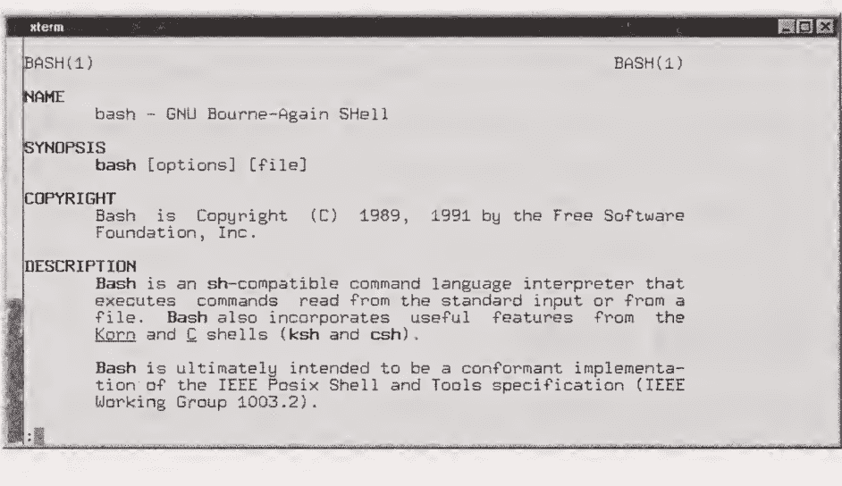

部分

第 2 章

有时 `mount` 不产生预期的结果。很多时候，是有帮助的，但手册页并没有显示你正在寻找的内容。例如，当你输入 `mount` 时，你可能期望看到 `mount` 命令的手册页；但你得到的是一个解释 C 语言子程序用法的页面。

这是因为手册页被组织成不同的章节。`man` 命令会调出与你指定的关键字匹配的第一页，编号较小的章节优先。常见的子程序调用在第 2 节，而系统管理命令在第 8 节。因此，输入 `mount` 显示的是第 2 节中的 `mount` 条目，描述标题。

幸运的是，你可以指定想要查看的章节编号。输入 `man mount` 即可调出所需的手册。

## OPTIONS

Linux 安装中的 man 页组织在以下章节：

- 1. 用户命令
- 2. 系统调用
- 3. 子程序
- 4. 设备
- 5. 文件格式
- 6. 游戏
- 7. 杂项
- 8. 系统管理
- 9. 内核参考
- N. 新内容

## 第 2 章 Linux 骨力马

最近，文档采用了一种新格式。所谓的 Texinfo 页可以使用 `info` 命令调用。这种格式的一个优势是它是可导航的；你可以跟随引用，而无需离开 Texinfo 系统。如果你调用一个命令的 man 页，它可能包含一条通知，说明在 Texinfo 格式中可能有更更新的信息。

## 编辑文件

UNIX 最令人恐惧的功能之一就是文本编辑器。出于某种无法解释的原因，用户友好文本编辑器的概念似乎与 UNIX 完全不兼容。有许多强大的编辑器，加载了 DOS 的 `EDIT.COM` 或 Windows 记事本用户从未梦过的功能。问题在于，这些功能中的大部分只能通过晦奥的按键组合访问，而这些组合几乎是不可能的记忆（而且非常容易忘记）。

## 使用 vi

`vi` 可以有很多样子，但“流行的”并不是我倾向于使用的形容词。那意味着 `vi` 深受用户喜爱，而这种情况很少见；尽管如此，`vi` 或其克隆版本仍然 UNIX 系统上安装最广泛的编辑器。每当你登录 UNIX 机器时，很有可能在命令行输入 `vi` 就会弹出全屏编辑器（见图 2.4）。Linux 也不例外：两个流行的 Linux 克隆版本 `elvis` 和 `vim` 几乎在任何 Linux 安装中都能找到。

图 2.4

使用编辑器。

```
此文件包含初始化域服务器缓存所需的根域名服务器信息。在 BIND 域服务器的 "cache" <configuration> 文件中引用此文件。
此文件也可以通过 FTP 下的 INTERNIC 注册服务获取：
- file
domain/named.root
on-server
FTP.INTERNIC.NET
-DRunder copper
INTERNIC.NET
under menu
INTERNIC 注册服务 (NSI)
submenu
INTERNIC 注册存档
named.root
最后更新：1997 年 8 月 22 日 根区域版本：199702200
最后 NS.INTERNIC.NET
3600000 IN NS A.ROOT-SERVERS.NET.
A.ROOT-SERVERS.NET 3600000 A 198.41.0
/etc/root.cache [readonly] 83 行
```


`vi` 可以有很多样子，但“流行的”并不是我倾向于使用的形容词。那意味着 `vi` 深受用户喜爱，而这种情况很少见；尽管如此，`vi` 或其克隆版本仍然 UNIX 系统上安装最广泛的编辑器。每当你登录 UNIX 机器时，很有可能在命令行输入 `vi` 就会弹出全屏编辑器（见图 2.4）。Linux 也不例外：两个流行的 Linux 克隆版本 `elvis` 和 `vim` 几乎在任何 Linux 安装中都能找到。

`vi` 的这种奇特行为源于这样一个事实：当你在输入模式下删除字符时，它们可能直到你按下 `Esc` 键才会消失。该编辑器设计于字符终端时代，当时终端通常通过缓慢的电信设施连接；以这种方式合并删除操作显著改善了交互响应速度。即使在今天，当你通过不太可靠的互联网连接使用 `vi` 时，这一特性也可能很有用。不幸的是，它也可能令人困惑。

按下冒号键会在屏幕底部调用一个命令行。以下是一些可以在此处输入的有用命令：

- `q` 如果没有未保存的数据则退出
- `q!` 无条件退出，丢弃未保存的数据
- `vi` 返回可视编辑模式
- `w` 将数据写入文件

这些命令虽然是最常用的，但仅代表了 `vi` 编辑器功能的一小部分。学习 `vi` 基础的一本好书是 Linda Lamb 编写的《Learning the vi Editor》，由 O'Reilly & Associates 出版。你也可以在 Amazon.com 或 Barnesandnoble.com 上查找其他关于 `vi` 的书籍。

## 其他编辑器

尽管 `vi` 是安装最广泛的 UNIX 编辑器，但它并不是唯一的。也许下一个流行的是 `Emacs`（它确实很流行，因为它的用户非常喜欢它，远比 `vi` 用户更喜欢自己的编辑器）。`Emacs`（该名称全称为 Editing Macros，即宏编辑）是一个强大、可定制且可扩展的编辑器，具有许多对程序员特别有用的功能。然而，它并不一定更容易使用。它可能没有受到 `vi` 那种奇特性行为的困扰，但要学习带有 `Esc` 键的关键序列并不容易。尽管如此，用户仍然倾向于使用 `Emacs` 而非 `vi`。

另一个简单但实用的编辑器是 `Pico`。它的名字全称为 Pine Composer（Pine 组合器）。（`Pico` 是由华盛顿大学开发的一种流行的 UNIX 应用的名字。）`Pico` 通常与 `Pine` 一起安装，每当你编辑邮件时，都会通过 `Pico` 调用。`Pico` 的一个主要优势是它的用户界面。与其他编辑器一样，它也依赖于晦涩的按键来调用编辑器功能，但在 `Pico` 中，当你编辑文件时，这些按键会直接列在屏幕底部！你不再需要拼命地查阅手册（如果有的话），或者从任何命令行窗口或终端调用在线 `man` 页来查找如何退出程序。

有时，使用全屏编辑器并不是一种选择。也许你正在连接到一个没有全屏能力的系统。更可能的原因是你可能想在脚本控制下进行文件编辑。

两个常用的行编辑器是 `ed` 和 `sed`。`ed` 更偏向于交互式编辑。例如，下面的会话显示文件 `myfile.txt` 中所有的 `dog` 都可以替换为 `cat`：

`sed`（该名称全称为 Stream Editor，即流编辑器）对于在脚本控制下更改文件内容最为有用。例如，以下命令将 `myfile.txt` 文件中所有的 `dog` 替换为 `cat`，并将结果写入 `myfile2.txt`：

```
sed -e "dog/cat/g" myfile.txt >myfile2.txt
```

## X 窗口系统

到目前为止的所有内容都涉及到在字符终端的命令行中输入的程序和命令。我几乎能听到你在问：“这家伙疯了吗？他真的指望人们在世纪交替之年使用过时的键盘命令吗？”

是的！某些管理任务可能可以使用图形化实用程序，但如果你想配置并运行一个健壮、安全、高效的 Linux 服务器，使用命令行工具是你的最佳选择。当你偶尔需要远程访问系统时（例如通过调制解调器或 Telnet 连接），情况尤为如此。此外，你可能根本不想安装图形用户界面（GUI）。（无论是否需要，都强迫你安装一个消耗资源的 GUI，这一事实一直被认为是 Windows NT 的缺点之一。）

尽管如此，当你使用窗口系统时，即使是命令行工具也更容易使用。虽然 Linux 允许通过虚拟控制在文本屏幕上同时运行多个会话，但在它们之间来回并不像在屏幕上同时看到几个窗口那样方便。

UNIX 并没有与任何特定的窗口系统集成。没有内置的参考表明某一个窗口系统比另一个更具吸引力。尽管如此，多年来，人们选择的窗口系统一直是 X 窗口系统（简称为 X），它最初开发于马萨诸塞理工学院。

X 是强大与落后之间一个奇特的结合。它是一个功能极其强大的系统，从设计之初就被设计为在网络连接上运行。令人惊讶的是，它对 Windows 用户认为理所当然的许多高级功能缺乏良好的标准化支持。例如，在不兼容的应用程序之间通过剪贴板传输数据的能力可能会成为问题。

X 也有其奇特性。正如《UNIX 恨者手册》所述，它可能是唯一一个完全反转客户端和服务器概念的系统。在 X 下，你的工作站是服务器，而运行在你的机器或跨网络远程机器上的 X 程序是客户端，它们连接到你的 X 服务器进行图形显示。

## 实现

Linux 有多种 X 的实现。几乎所有的 Linux 安装都带有一个免费的 X 实现，名为 `Free86`。对于大多数基本需求，`Free86` 已经足够了；如果你有特定的功能（例如对 OpenGL 图形库的支持），你可能需要查看实现，如来自 MetroLink 的 `Metro` 或来自 Xi 的 `Accelerated`。

## Windows 服务器

得益于 X 的客户端/服务器架构，可以在一台机器上运行 X 应用，并在另一台机器上显示它们的窗口。事实上，运行 X 服务器的机器不需要是 Linux 机器。

> 以我的为例：多年来，我一直使用名为 X-32 的 Windows 产品。这个 X 服务器允许我在 Windows 桌面上运行 Linux 应用并与其交互（见图 2.5）。这种安排非常方便。如果你打算从 Windows 工作站管理 Linux 机器，使用基于 Windows 的 X 服务器 X-32 是非常有价值的。

图 2.5 常见桌面上的 Linux 和 Windows 应用。


# 第二章 Linux 工作马

当你的 X 服务器位于另一台机器时，不需要在 Linux 机器上安装 X 服务器。但是你仍然需要安装共享文件和目录，以便在该计算机上运行 X 应用。

# Summary

Linux 与大多数操作系统一样具有四个基本功能。它管理计算机硬件组件并为运行其他程序提供手段，这些程序反过来利用操作系统的服务。文件系统提供了在存储设备上组织数据的方法。访问控制确保了用户和运行的程序不会无意或故意地访问或更改彼此的数据。

## 设置

- 3 系统安装
- 4 网络配置与基础安全
- 5 网络概念
- 6 域名系统
- 7 建立连接


# 第 3 章：系统安装

**安装和配置**操作系统是一个永无止境的过程，对于性能设置的反复调整、添加新功能和各种更新驱动程序及其他组件、安装新硬件等。当你手下有几台计算机系统需要维护时，这些活动似乎会持续地进行下去。

通常，当你谈论安装操作系统时，你所理解的这个短语指的是一系列非常具体的动作。具体来说，其结果是你能够从硬件上启动新系统，并且它能够执行操作系统的基本功能——管理硬件并为运行应用程序提供平台。

本章涵盖了安装 Linux 系统的步骤。在本章中，你还将看到关于我安装和配置 Linux 系统的具体经验的逐步描述。

## 安装准备

安装任何操作系统都需要一些计划和远见，特别是当目标计算机是多引导系统时。在开始安装之前，你需要对系统进行盘点，这样当系统安装程序询问某些问题时，你就不会感到尴尬或措手不及。你还需要为你的硬盘（们）决定一个分区方案。有一个备份计划以防万一是个好主意。图 3.1 提供了你在开始安装之前需要采取的步骤概述。

图 3.1 安装准备工作。


> 警告

千万不要尝试在包含你无法承受数据的硬盘上安装操作系统！

在安装过程中可能会出现很多问题。也许你本打算将系统安装到 C 盘（让它重新格式化驱动器），但为时太晚才发现安装程序交换了 C 盘和 D 盘盘符。也许操作系统将你的磁盘分区升级为了不兼容的格式。或者它重写了关键区域，导致你无法恢复之前的安装。所有这些情况虽然罕见，但据报道会偶尔发生。

## 系统盘点

了解你计算机中的硬件通常是一个好主意。在系统安装期间，这几乎是必不可少的，即使在使用像 Windows 98 这样的即插即用操作系统时（以防即插即用变成随缘而用！）。

我言行一致。我也为我的测试系统准备了一份硬件盘点，如表 3.1 所示。

### 表 3.1 测试系统硬件盘点

| 项目 | 类型 |
|---|---|
| 主板 | ASUS TX-97E |
| 处理器 | Pentium-166 MMX |
| 内存 | 64MB EDO RAM |
| 软驱 0 | 3.5" 1.44MB |
| 软驱 1 | 5.25" 1.2 MB |
| SCSI 控制器 | Adaptec 2940W |
| 驱动器 0 | Iomega JAZ 1 GB |
| 驱动器 1 | IBM DORS 2GB |
| CD/DVD-ROM | Creative PC-DVD (IDEO Master) |
| 视频卡 | ATI All-in-Wonder (PCI, Mach64/RAGE-II, 4MB) |
| 网络 | NE-2000 兼容, IRQ=11, I/O=0x340 |
| 声卡 | SoundBlaster-16 ASP (非 PnP, IRQ=5, DMA=1,5, I/O=0x220) |
| 调制解调器 | USR Sportster 33600 外 |
| 鼠标 | Microsoft WheelMouse (PS/2 端口) |
| 其他 | GPI-TNT 数据采集卡 (IRQ=9, DMA=7) |

尽管我不打算为 Xircom 网络适配器或 GPI 卡安装 Linux 驱动程序，但它们存在于系统中可能会干扰安装过程，因此记住它们的存在是个好主意。

## 硬件准备

某些硬件组件将设置存储在非易失性内存中。这些包括许多流行的显卡、某些跳线网络适配器等。遗憾的是，用于调整这些设置的程序几乎总是用于 MS-DOS 的。你的计算机可能有其他程序，例如诊断程序、BIOS FLASH 软件和其他仅在 MS-DOS 下运行的工具。出于所有这些原因，准备一个可引导的 DOS 软盘是个好主意，上面存储了所有程序以及一些如 `FDISK.EXE` 等重要的 DOS 程序。我有几张这样的磁盘——其中一张实际上能够在带有 DOS 级网络支持的情况下启动我的测试机器——这样我在需要时就可以来回拷贝地复制文件。（不用说，我的 MS-DOS 系统应该是正版拷贝。这可能不是一个问题，因为现在几乎每台计算机都自带了 DOS 或 Windows 许可。）

无论你可能需要使用哪些程序，请确保你所有的硬件组件都设置正确。当然，操作系统安装程序通常能识别出是否存在资源冲突或无效设置，但为什么要冒这个风险呢？为什么要做额外的工作呢？如果系统从一开始就经过正确配置，安装通常会顺利得多——而且需要重做的次数也会少得多。

## 分区与引导过程

*分区* 是将硬盘划分为若干逻辑单元的方法。每个逻辑单元都可以独立地格式化，即使是不同的标准。当 BIOS 运行时，通常有一个分区被标记为*活动分区*，这意味着系统启动时会从中加载。你可能在磁盘上有两个分区，一个包含 MS-DOS 和 Windows，另一个存放 Linux。然而，有一些特殊的程序可以让你覆盖这种行为，例如在启动时手动选择你想要的分区。其中一种程序是 OS/2 引导管理器，另一个是 LILO（Linux 加载器）。

引导程序允许你在启动时选择分区和操作系统。它们不要与分区管理器混淆。对于很多人来说，这并不一定，特别是当它是为了 Linux 运行的。但即使是，你可能已经在上面创建了数据。

## 分区基础

引导程序允许你在启动时选择分区和操作系统。它们不要与分区管理器混淆，后者是为了克服旧版 BIOS 和旧版 MS-DOS 的限制。以这种方式扩展 BIOS 能力的分区通常与 Linux 不兼容，必须在安装 Linux 之前移除，这可能需要重新格式化硬盘。然而，新的分区管理器可能不会带来问题。


## 系统如何启动

为了更好地理解分区的意义，请看引导过程——在你按下启动按钮后发生的一系列事件。


首先，计算机的 BIOS（基本输入输出系统）启动并执行一系列初始化。这包括确定系统内存、初始化适配器卡，当然还有初始化软盘和硬盘。

接下来是真正的*引导*，或从磁盘加载操作系统。大多数现代 BIOS 允许你指定访问磁盘驱动器的顺序。默认情况下，被访问的第一个驱动器是 A——系统上的第一块软盘。BIOS 读取软盘上的第一个块（*引导扇区*），或者如果它包含特定的字节序列（*引导签名*），它就假设刚刚加载的数据是一个程序并开始执行它。这个程序是*引导加载程序*，它负责加载操作系统的后续组件并对其进行初始化。

硬盘的过程要复杂一些。在这里同样，第一个块（*主引导记录*）会被加载，如果发现了正确的签名，它就是

# 第3章 系统安装

已执行。然而，此程序通常不会立即启动操作系统的加载。相反，它会从硬盘上读取另一个数据块，该块包含分区表；该表存储了硬盘上定义的所有分区的信息、其类型以及活动状态。

此时，引导程序通常会从标记为“活动”的分区中加载第一块数据。如果该块数据包含有效的引导签名，执行权将交由它。从这一点起，引导过程与软驱器的情况相同（见图 3.2）。从主引导记录（MBR）加载的引导程序还可能有一个原始的用户界面，让你在不同的操作系统或分区之间进行选择，而不是默认使用活动分区。

这种多阶段的启动过程可能很难理解，但它提供了很大的灵活性。例如，以前我使用过一台可以启动四种不同操作系统的计算机。如图 3.3 所示的过程如下：MBR 包含 Linux 加载器 (LILO)，让我可以在一侧的 Linux 和另一侧的 MS-DOS 格式的分区之间进行选择。如果我选择后者，Windows NT 加载器就会出现，并向我提供 Windows NT、VGA 模式下的 Windows NT 或 MS-DOS 的选择。选择 MS-DOS 会弹出 Windows 95 启动菜单，其中带有启用或不启用安全模式启动 Windows 95 的选项，以及启动我之前的操作系统的选项（在此例中为带有 Microsoft Windows 3.1 的 MS-DOS 6.22）。

## 分区方案

那么，在 Linux 中你应该使用什么种类型的分区呢？

最简单的情况是使用一个单一分区来占据硬盘上的所有空间。Linux 文件系统没有受到像 MS-DOS 那样的限制，这使得使用大分区是极度浪费的。（顺带一句，这就是微软引入 FAT32 格式类型的原因。）

与 Windows 一样，Linux 可以将硬盘空间作为虚拟内存。这允许系统运行比其物理内存（RAM）通常能容纳更多的程序，但代价是性能下降。如果预留一个专门用于虚拟内存的交换分区（swap partition），就可以减少这种性能损失。

虚拟内存由于其本质，会被频繁访问。硬盘的速度在很大程度上取决于读写头沿磁盘表面从外圈移动到内圈的时间。理所当然，将经常访问的区域放置在硬盘的中间可以提高性能。


# 第3章 系统安装

图 3.3

多系统启动配置。


遗憾的是，对于现代硬盘驱动器这并不总是可能的。这些驱动器执行地址翻译，既是为了提供计算机 BIOS 可以理解的模拟磁盘几何结构，也是为了重映射坏道。在两个普通分区之间切换交换分区可能会带来性能的微升；无论如何，这肯定不会有损害。

到目前为止，讨论的内容当然假设你是从一个空白硬盘开始。如果硬盘中已经包含了你想保留的数据，情况就会变得复杂得多。如果这些数据不是标准 MS-DOS 格式分区的格式，你可能没机会了。然而，对于 MS-DOS 格式的分区，你实际上有两个选择可以让一切运行起来。

## 安装准备工作

首先，你可以保持分区完整，并使用 UMSDOS 文件系统安装 Linux。该文件系统将 Linux 文件存储在 MS-DOS 分区上，使用额外的区域来存储扩展信息，例如 Linux 风格的长文件名和权限设置。UMSDOS 主要优势是兼容性。然而，这种文件系统对性能有影响，它是不安全的，而且在大硬盘上，它不像普通的 MS-DOS 文件系统那样高效。

其次，你可以使用如 FIPS 之类的重新分区工具，该工具包含在随书的光盘中。此工具可以缩小现有的 MS-DOS 分区，释放空间。然而，在使用它之前，你必须先使用磁盘碎片整理/优化程序合并未使用的空间；否则，你无法在不丢失数据的情况下缩小分区。

> 重新分区工具本质上是危险的。在尝试修改分区表之前，务必保护你的硬盘！

当然，如果所有方法都失败了，你总是可以备份（反正应该），重新分区硬盘，然后从备份恢复数据。

## 文件系统类型

创建分区后，必须对它们进行格式化。你选择的格式化类型——即文件系统类型——会对你系统的安全性、可靠性和性能产生重大影响。

## FAT 文件系统

PC 兼容计算机上最常用的文件系统是 MS-DOS 的 FAT 文件系统。FAT 代表文件分配表（file allocation table），这是这种文件系统类型的关键特征。

在最大的硬盘只有 10MB 的年代，FAT 文件系统被限制为 32MB。更糟糕的是，MS-DOS 在硬盘上仅允许一个 FAT 系统，尽管分区表有存放四个分区的空间。另外三个分区被认为属于其他操作系统。为了克服这一限制，引入了扩展分区的概念，它可以包含子分区，称为逻辑分区。

在 MS-DOS 的后续版本中，微软引入了 FAT16 分区类型，它允许使用大得多的分区，高达 2GB。不幸的是，由于这种方法，UMSDOS 并不总是可能的。在 Linux 中最常用的文件系统格式是 MS-DOS 的 FAT 文件系统。FAT32 引入了长文件名支持，解决了 Windows 95 的问题。3文件名 ，2  解决方案。

## HPFS 和 NTFS

作为 Windows/2 的开发者，，2   35 的缺陷，这由于 Windows NT 引入了另一种文件系统：NTFS，新技术文件系统。HPFS 提供了更好的性能和可靠性，但缺乏功能。

## Linux 扩展文件系统

如今 Linux 最常用的文件系统格式是 Ext-2 文件系统 (e2fs)，第二扩展文件系统。e2fs 是 Linux 推荐的健壮、可靠、高效的文件系统。e2fs 的唯一缺点是某些系统无法识别这种格式；因此在可以启动多个操作系统的机器上

## UMSDOS

过去，某些 Linux 用户发现为了尝试它，他们的硬盘必须重新分区。UMSDOS 提供了一个解决方案：它本质上是一个存储在 MS-DOS 文件系统上的 Linux 文件系统。当运行 MS-DOS 时，Linux 文件显示为普通的 MS-DOS 文件；当运行 Linux 时，UMSDOS 扩展信息支持文件所有、权限和其他 Unix 风格的功能。

重要的是，UMSDOS 保留了 FAT 文件系统的所有缺点，包括安全性缺陷、性能欠佳以及对硬盘的使用率低下。因此，UMSDOS Best用于实验 Linux，但不应在生产环境中使用。

## 交换分区

交换分区为虚拟内存提供了一种高效的机制。交换分区没有挂载文件系统；相反，交换分区是通过 `swap` 命令激活的该命令很少手动执行。它是作为系统初始化的一部分被调用的。

## 选择分区方案

所以，考虑到如此多的文件系统类型和分区方案的混乱，你应该选择哪种方案呢？

首选始终应该是 E2FS，可能结合交换分区使用。对于专门用于 Linux 的硬盘，这是理想的解决方案。

次优选择是 UMSDOS。如果你试图在打算继续使用的现有 DOS 或 Windows 操作系统上安装 Linux，这种文件类型是理想的。UMSDOS 不需要任何分区；它使用现有的 FAT 分区。

在某些系统中，MS-DOS 和 e2fs 分区的组合是行的。由于 Linux 可以访问 MS-DOS 分区，它能够在那里读取和写入文件，因此在两个操作系统之间交换数据是可能的。然而，MS-DOS 或 Windows 无法查看 Linux e2fs 分区的内容。

## 第3 章：系统安装

在我的测试系统中，存在两个 SCSI 硬盘。第一个是 JAZ 驱动器，将包含一个完全用于 Linux 的 1GB 磁带。

## 测试系统

第二个是一个 2GB 的内部硬盘，它已经使用 MS-DOS FAT 文件系统进行了格式化。下表显示了这些设备的分区方案。

| | | | | |

|---|---|---|---|---|

| /dev/sda | 1 | 900 | 921584 | Linux (e2fs) |

| /dev/sda2 | 901 | 1021 | 123904 | Linux Swap (交换分区) |

| /dev/sdb1 | 1 | 261 | 2096451 | MS-DOS (FAT16) |

在这些分区中，第一个硬盘 (`sda`)上的分区需要在安装期间创建。第二个硬盘应该保持原样。

## Linux：首次启动

所以你认为你已经准备好安装 Linux 了？你手头有 Linux CD-ROM。你已经准备好了电脑硬件的清单。你已经知道如何对硬盘进行分区，并且有足够的空空间供 Linux 使用。下一步是什么？

你想启动 Linux 安装程序，就是这样。大多数安装程序（包括本书附带的 Caldera OpenLinux 版本）可以通过三种不同的方式启动。

许多较新的电脑支持从标准的 ATAPI 或 SCSI CD-ROM 启动。传统的安装方法是使用启动软盘。而且，如果你的电脑运行 MS-DOS，许多 Linux CD-ROM 支持从 MS-DOS 提示符启动安装程序。

### 从 CD-ROM 启动

尽管大多数较新的电脑支持从启动 CD-ROM 启动，但你可能需要更改 BIOS 设置来启用此功能（例如，你可能需要将启动顺序设置从 A,C 改为 A,CDROM,C）。从 CD-ROM 启动是启动任何操作系统安装程序（包括 Linux）最简单的方法。

如果这种方法在你的系统上有效，你只需要将 Linux 光盘插入电脑的 CD-ROM 驱动器并重启系统。在显示了一些关于可启动 ATAPI CD-ROM 的初始 BIOS 消息后，Linux 安装程序将启动。

## 创建软盘集

Linux CD-ROM 通常包含创建启动软盘所需的实用程序。然后你可以通过 A 驱动器使用这些磁盘启动系统，这将带入最小的 Linux 安装界面，并提供对 CD-ROM 和硬盘的访问，以及启动安装程序的手段。

如果你使用的是本书附带的 Caldera OpenLinux，可以通过 MS-DOS 或 Windows 访问 CD-ROM 来找到相关工具。在目录 `D:\COL\LAUNCH\FLOPPY`（其中 D: 是你 CD-ROM 驱动器的 DOS 盘符），你会找到以下文件：

```
INSTALL.144
INSTALL.288
MODULES.144
WRITE3.COM
```

其中，`WRITE3.COM` 是一个 MS-DOS 实用程序，可以创建磁盘镜像文件以创建非 MS-DOS 软盘。其他三个磁盘镜像文件包含可启动的 Linux 配置。大多数用户需要两块软盘，即使用 `WRITE3.COM` 拷贝 `INSTALL.144` 和 `MODULES.144`。拥有 2.88MB 软盘驱动器的人不确定你拥有的是哪种软盘驱动器，假设它是 1.44MB 的驱动器。

`WRITE3.COM` 的用法应该是显而易见的。程序会询问源磁盘镜像文件和你打算拷贝的软盘驱动器号，你应该准备好一张格式化过的软盘；磁盘不需要是空的，但请记住其中之前的所有内容将被擦除。

其他发行版也包含类似的工具和磁盘镜像。许多发行版包含各种磁盘镜像，你必须选择一个最匹配你系统硬件的镜像（例如，带有 SCSI 和网络支持的磁盘镜像）。

如果你通过这种方式准备了安装软盘，也许把它们留着以后用是个好主意。如果你将来需要重新安装或修复 Linux 安装，这些磁盘可能会很有用。

### 从 MS-DOS 提示符启动

在不久前，启动 Linux 的唯一方法是从启动性 Linux 磁盘或硬盘分区。然后 `LOADLIN.EXE` 出现了，这是一种新的实用程序，让想要尝试 Linux 的普通 Linux 用户或业爱好者的生活变得更加简单。

简而言之，`LOADLIN.EXE` 只做一件事：从 MS-DOS 提示符启动 Linux。

在另一个操作系统内部启动另一个操作系统并不是易事。`LOADLIN.EXE` 之所以能这样做是因为 MS-DOS 不是一个阻止应用程序接管的 32 位操作系统。因此，`LOADLIN.EXE` 只能从真正的 MS-DOS 提示符使用，而不能从 Windows 95/98 或 Windows NT 下的 DOS 窗口使用。（尽管我从未尝试过，但我怀疑可以在 Windows 3.1 的 DOS 窗口中运行 `LOADLIN.EXE`。然而，对于 Windows 3.1 而言，`LOADLIN.EXE` 是一个永远不会将控制交回操作系统的应用程序，这种做法可能数据丢失。）

在使用本书附带的 Caldera OpenLinux CD-ROM 时，可以在目录 `D:\LAUNCH\DOS`（其中 D: 是你 CD-ROM 驱动器的盘符）启动 `LOADLIN.EXE`。这种方法也会启动光上的安装程序。

## 硬件检测

在电脑上首次运行操作系统是棘手的。由于系统尚未配置，它必须发现硬件配置。操作系统有三种方法可以检测硬件组件，无论是否有用户的帮助。

Linux 使用的主要方法是自动检测。当驱动程序加载时，如果组件存在则会初始化，否则保持非激活状态。

遗憾的是，这种方法并不总是成功。有时自动检测无法识别所有版本的硬件。最近，我在一台运行 Linux 的电脑上添加了 Adaptec 2920 适配器。尽管我修改了内核配置以包含该硬件的支持，但我发现操作系统加载失败；未找到 控制器。在这种情况下，幸运的是解决方案非常简单。我只需要在 Linux 启动选项中添加 `fdomain=6100,11` 来强制驱动程序在指定的地址和中断号处检测控制器。（寻找原因和解决方案是另一回事，我在互联网上进行了大量的研究后偶然发现了包含解释的网页。）

这个示例说明了为什么准备完整的系统清单是个好主意。但即使安装顺利进行，系统清单仍然有用，因为它可以让你验证系统的所有硬件都已正确配置。

## 软件包安装

Linux 发行版包含不仅仅是裸裸操作系统。Linux CD-ROM 满了服务器工具、开发实用程序、图形化窗口系统、网络工具、生产力应用程序，即使你有足够的磁盘空间，盲目安装可能也不是个好主意；它们的存在会破坏你的系统，而且可能成为安全漏洞。因此，至少在构建生产系统时，只安装你需要的包。大多数发行版还包含包管理工具，让你随时添加或删除包。

在我的测试系统中，我打算安装支持以下功能的包：

- 1. 创建最匹配我硬件的自定义 Linux 内核

- 2. 网络测试和配置

- 3. 运行 Internet 服务的能力（包括邮件服务器、Web 服务器等）

- 4. 已安装包的文档

由于测试系统不会作为工作站使用，我不安装 X 窗口系统或生产力应用程序。

所有现代网络配置都以分层的形式实现。底层是网络硬件（计算机中的以太网适配器）；顶层是执行网络功能的应用程序（例如，网络浏览器）。那么，中间层是什么呢？

第一层是硬件驱动程序。该驱动程序在物理上管理网络硬件。

下一层是正在使用的低级网络协议。UNIX 系统通常为此目的使用 Internet 协议（IP）。其他协议包括 Novell 的 IPX 或微软的 NetBIOS。

在 IP 网络上，有多种数据传输协议可用。例如，TCP（被许多应用程序，包括电子邮件程序和 Web 服务器使用）在网络上的两台机器之间提供了一个虚拟连接。通过该连接，数据可以双向流动。

在类似 TCP 的类协议之上，实现了高层协议。其中一种协议 HTTP（超文本传输协议）被用于递送 WWW 内容。

在安装操作系统期间，你需要关注前两层：网卡的驱动程序和 IP 配置。

取决于你使用的网卡，其配置可以是自动的，你也可能需要提供配置参数。如果网卡是 ISA 适配器，你可能还需要使用开关、跳线帽或运行在 MS-DOS 下的配置实用程序对其进行配置。

当网卡运行起来后，你需要配置 IP。最重要的设置是网络适配器的 IP 地址。此数字在网络上唯一标识你的计算机；如果你的网络直接连接到互联网（即不是通过防火墙），则该 IP 地址在全球范围内必须是唯一的。

那么你应该选择哪个 IP 地址呢？如果你有一个现有的网络，可能你已经有一个有效的编号方案。如果你没有网络，也许你的 ISP 已经为你分配了一块 IP 地址供你使用。如果这两者都不符合，请使用专门为私有网络保留的 IP 地址——即未连接到互联网或通过防火墙连接的网络。

每个 IP 地址实际上由四组数字组成，每个数字都在 0 到 255 之间，用句号分隔。一个预留的 IP 地址块格式为 `192.168.xxx.yyy`，其中 `xxx` 和 `yyy` 是任意数字。如果你正在为尚未构建的网络准备服务器，请使用 `192.168.1.1` 作为服务器的 IP 地址。（记住：如有必要，你以后可以更改 IP 地址。）

除了与网卡关联的 IP 地址，每台机器都有本地主机地址：`127.0.0.1`。按照惯，此地址始终指向本地机器。

IP 地址通常与名称相关。例如，当你访问 Macmillan 出版公司的网站时，你使用的是 `www.mcp.com`，而不是 `198.746.70` 作为公司的地址。从符号名称到 IP 地址的翻译由 DNS（域名系统）完成。在安装期间，你可能需要指定一个 DNS 服务器。如果你打算将正在操作的系统配置为 DNS 服务器，请使用 `127.0.0.1` 作为 DNS 服务器地址。如果你的网络上已经有一个 DNS 服务器，请使用该服务器的地址。

在安装期间，你会被要求指定机器的 DNS 名称。如果你在现有网络上安装一台机器，可能除了 IP 地址外，它还被分配了一个名称。如果没有分配，你现在可以使用任意名称。第 6 章“域名系统”包含了有关如何为你的网络获取注册的 DNS 域名的信息，以及你如何为域内的个人分配名称的内容。

## 测试系统安装

测试系统

现在我要将这些良好的理论付诸实践。使用随附 CD-ROM 上的 Caldera OpenLinux 安装程序，我在我的测试系统上开始安装。

Caldera OpenLinux 1.3 安装程序被称为 LISA，即 OpenLinux 安装与系统管理实用程序。LISA 引导你完成一系列安装步骤，帮助你配置硬盘驱动、安装所需的系统组件、设置网络并让你的系统运行起来。

设置过程的主要步骤如下：

- 安装程序初始化


# 第 3 章 系统安装

## 安装程序初始化

Caldera OpenLinux 安装程序可以从软盘、CD-ROM 或 MS-DOS 提示符启动。

要从软盘或 CD-ROM 启动，请将磁盘插入计算机并重启系统。如果你使用的是可启动的 CD-ROM，你可能需要调整 BIOS 配置以允许从 CD-ROM 启动。

要从 MS-DOS 启动，在 MS-DOS 提示符中输入 `D:\LUNCH\DOS\LOADIN.EXE`（而不是在 Windows 下的 MS-DOS 窗口中）。

我的测试机支持从 CD-ROM 启动，因此我从 CD-ROM 启动了安装程序。首先，我看到了一个启动屏幕，给我了一个指定启动选项的机会。在初始安装期间，我等待了几秒钟系统开始启动，LISA 开始执行。如果失败了，我将在从系统中移除非必要的硬件组件（例如我的声卡）后尝试安装。

我还必须为我的网卡添加支持。再次，我回到了“加载内核模块”（Load Kernel Module）命令。这次我选择了“加载网卡驱动程序”，并选择了 30 (NE2000/NE1000)。这次在加载驱动之前，必须指定额外的参数——即 I/O 端口 (`0x340`) 和中断号 (`11`)。

通过这些操作，初始硬件配置完成了。系统现在识别了我所有的硬盘、光驱器和网络适配器。

## 磁盘分区与交换空间设置

在初始硬件配置之后，LISA 更改硬盘分区的选项。由于我分配了整个磁盘（是整个 JAZ 卡带）专门供 Linux 使用，我想更改它的分区。

> 重新划分包含数据的硬盘几乎肯定会导致数据丢失！如果你需要在包含数据的磁盘上安装 Linux，请考虑使用 FIPS 工具来缩小 (MS-DOS) 分区并为 Linux 分区留出空间。或者，你也可以考虑使用 UMDOS 在现有的 MS-DOS 分区上安装 Linux。然而，我不建议在服务器的机器上使用这两种方法。

LISA 显示了我系统上的硬盘列表（见图 3.8），我选择了 Iomega 驱动器 `/dev/sda` 进行分区。

**图 3.8** 选择一个硬盘进行分区。

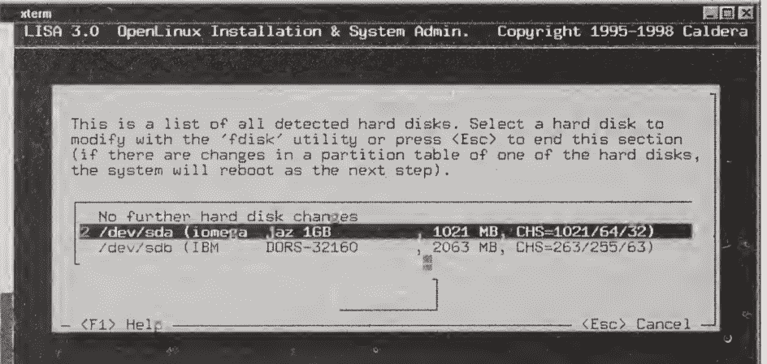

此时，LISA 启动了 Linux fdisk 程序。这个程序和它的 MS-DOS 兄弟一样，可以用于显示或修改硬盘的分区表。它有一个简单的系统，列出了所有程序以及每个程序的单行描述。用法方法一目了然。首先，我使用 `d` 命令删除了所有分区。然后，我使用 `n` 命令添加了两个新分区；并使用 `t` 命令将其中一个新分区修改为 Linux 交换分区（swap）。最后，在 fdisk 中使用 `p` 命令列出时，我的分区表看起来如下：

```
/dev/sda: 64 heads, 32 sectors, 1021 cylinders
Units = cylinders of 2048 * 512 bytes
Device Boot Start End Blocks Id System
/dev/sda1            100 921584 83 Linux native
/dev/sda2            901 1021 123904 82 Linux swap
```

如果可能，使用交换分区作为虚拟内存一直是一个好主意。根据经验，交换分区的大小应该是系统 RAM 大小的约两倍。我的测试计算机有 64MB 内存，我创建的交换分区是 121MB。

分区完成后，LISA 提议激活新创建的交换分区。

## 软件包选择与安装

此时，安装的第一阶段已经完成。所有硬件组件都已设置完毕；现在是开始启动软件的时候。

LISA 首先要求你指定安装源，可以是 CD-ROM 驱动器、硬盘目录或网络源。在我的情况下，安装源是 CD-ROM 驱动器；选择此选项会导致 LISA 显示可用的 CD-ROM 设备列表。已经检测到的驱动器会被高亮显示（见图 3.9）。

**图 3.9** CD-ROM 驱动器选择。

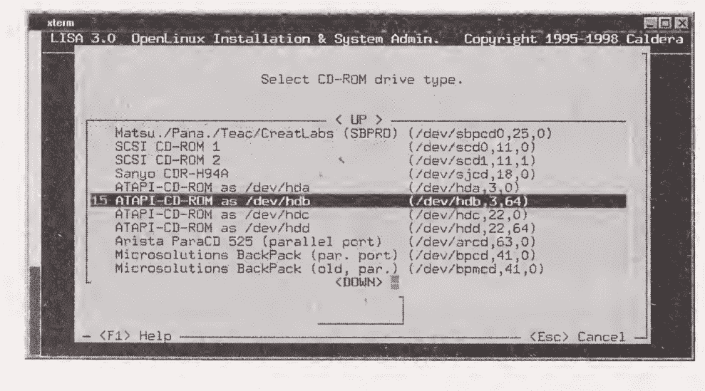

## 测试系统安装

接下来，LISA 要求你指定目标分区。这个根分区（root partition）将包含所有系统文件。而其他分区可以在系统运行时动态挂载（mounted），但根分区始终处于激活状态。它包含了操作系统以及所有的程序和配置文件。在我的测试系统中，新创建的 `/dev/sda1` 分区将是根分区（见图 3.10）。

**图 3.10** 选择根分区。

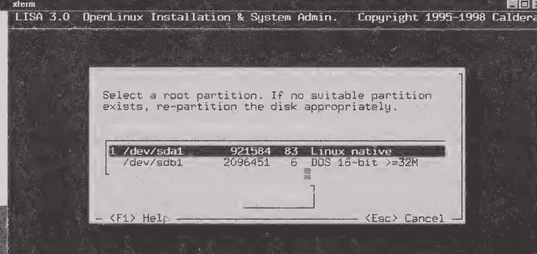

此时，LISA 提供了格式化分区的选项。这个术语已经过时了；在此阶段，系统会在选定的分区上创建文件。尽管如此，效果是一样的：如果该分区之前包含数据，这些数据将被擦除。LISA 还提供了检查坏扇区的选项，但除了老旧的 IDE 甚至更旧的 MFM/RLL 磁盘驱动器外，这是没有必要的。现代硬盘驱动器具有自动检测和修复故障扇区的能力。在这些设备上检查坏扇区是浪费时间。

文件系统创建完成后，LISA 最后向你列出了要安装的软件包列表（见图 3.11）。

**图 3.11** 软件包预选。

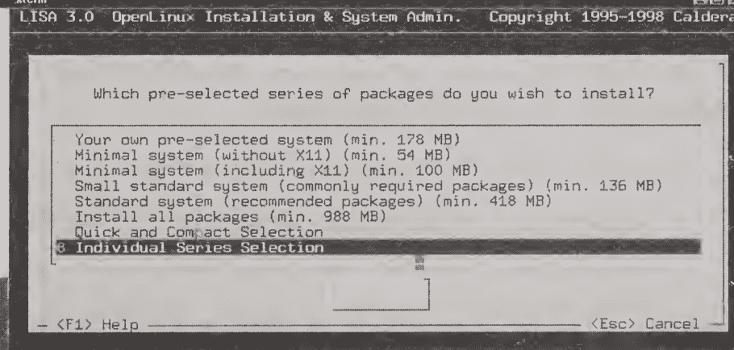

因为我清楚自己在做什么，所以我选择了进行逐系列安装。这允许我专门挑选我所需要的工具和实用程序，而不是接受别人关于什么对我好的想法。

## 网络配置

在安装完所有软件后，下一步是网络。

LISA 首先询问机器名。为了方便起见，我使用了一个虚的域名：`linux.sys`

由于我有网卡，LISA 还询问了其 IP 参数。该网卡 `eth0` 的 IP 地址设置为 `192.168.1.1`。LISA 还询问子网掩码和广播地址；这些分别是 `255.255.255.0` 和 `192.168.1.255`。（有关此主题的更多信息见第 5 章。）

接下来，LISA 询问我是否有路由器。实际上我正在将此测试系统配置为，所以答案是否。（如果我要使用 ISDN 路由器，例如，我会回答是并指定 IP 地址。）

LISA 还询问我的 DNS 服务器。由于我打算将测试机器配置为 DNS 服务器，我将回环地址 `127.0.0.1` 指定为 DNS 服务器。

最后，LISA 询问我是否正在使用 NIS。NIS（网络信息系统，也称为黄页）允许你配置分布式的域和用户信息。我不打算使用 NIS，所以答案是否。

## 补充配置选项

首先 LISA 可以继续设置用户账户，还有一些项目需要配置。

系统时间。LISA 询问让计算机电池供电 CMOS 时钟运行本地时间还是格林尼治标准时间 (UTC)。在专用 Linux 系统上，选择 UTC 是个好主意。在多启动系统中，选择本地时间，因为这是 Windows 等操作系统预期的。出于相同的原因，我选择了本地时间。

接下来，配置时区选择。选择与你的地理位置匹配的时区。我选择了区域 30，加拿大/东部。

LISA 还询问你的鼠标类型。如果你将鼠标连接到计算机主板的圆形端口上，那么它很是一个 PS/2 鼠标。大多数鼠标是串口鼠标或 PS/2 鼠标；除非你确定它与硬件匹配，否则不要选择其他类型。

最后，LISA 提供了配置打印机的选项。我的测试系统中没有连接打印机，所以我跳过了这部分。

## 用户账户

在可以使用系统之前，必须配置用户账户。除了 root 账户（超级用户）之外，至少还要配置一个普通账户。按照惯例，你永远不应该使用 root 账户执行任何本可以使用非权限账户完成的任务。

在系统安装期间，LISA 允许我为 root 账户指定密码。

> 警告 必须审慎选择 root 密码。任何能够通过网络访问系统的人——只要他们拥有 root 密码——就可以在系统上执行任何操作，包括读取机密数据或格式化硬盘。更糟糕，如果在你的办公室局域网（LAN）计算机上使用 root 账户，他们还可以监控所有的局域网流量，并可能危及其他计算机的安全。

LISA 还提供了创建普通账户的机会。默认情况下，它提供的账户名为 `co1`（代表 CalderaLinux）。我将其更改为 `vttoth`，这是我在 UNIX 系统上优的用户名。这反映了一项长期形成的习惯，即使用用户的姓氏和名字首字母来创建账户名。

> 注意：账户名长度保持在八个字符或以内。某些程序会对过长的用户名产生困惑。对于密码，虽然系统接受更长的密码，但在大多数系统中实际上仅使用前八个字符，因此使用更长的密码并不会获得额外的安全性。

在创建新账户时，LISA 会询问使用哪种 shell 程序（shell）。我选择了默认的 GNU bash。对于大多数其他选项，你以后都可以更改此选项。

## 启动设置

系统安装已经完成，但你仍然需要设置新系统的启动配置。这涉及配置从硬盘启动，并指定在系统启动时要运行哪些服务。

## 测试系统安装

此时，LISA 开始配置 LILO，即 Linux 加载器。我要求 LILO 在第一块 SCSI 硬盘上设置启动管理器（见图 3.12）。

### 图 3.12 在硬盘上安装 LILO。

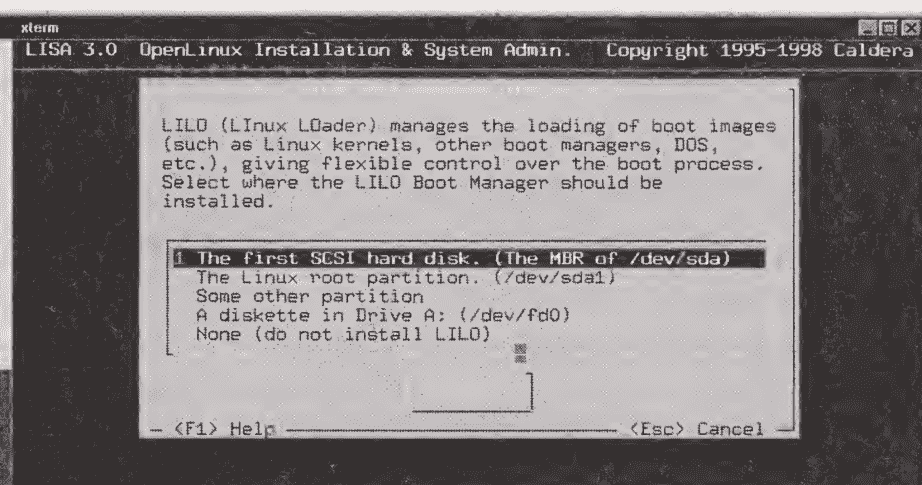

接下来，LISA 提供了一系列选择。这些选择对应于 LISA 之前安装的操作系统镜像，以及可选的、系统上的其他可启动分区。

在我的情况下，LISA 在我的硬盘上安装了两个镜像，恰好这两个镜像实际上指向同一个文件，选择其中一个而不是其他并没有区别。LISA 还将我第二块硬盘上的 MS-DOS 分区列为启动选项（见图 3.13）。

### 图 3.13 LILO 启动镜像选择。

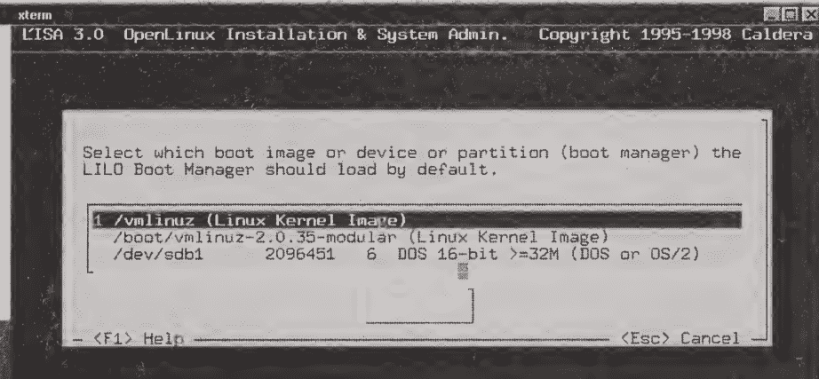

我选择了 `/vmlinuz` 作为启动镜像，并接受了 LISA 为初始 RAM 磁盘（initial RAM disk）和 LILO 启动参数提供的默认设置。当你使用原始 LISA 安装的 Linux 内核时，如果启动系统所需的任何设备都需要内核模块才能运行（许多基于 SCSI 的系统就是如此），那么就需要这个 RAM 磁盘。在启动过程中，内核发会在 RAM 磁盘中寻找额外的模块。换句话说，没有 RAM 磁盘，Linux 可能无法启动。

在完成所有这些选择后，LISA 调用了 LILO，即 LILO 配置工具。如果 LILO 安装成功，系统即可启动。然而，配置任务尚未完成。剩下的工作是选择系统启动时要启动的服务。

根据你决定安装的软件包，LISA 针对启动时启用哪些服务做出了一组智能选择。为了创建一个符合我喜好的配置，我只需极少的修改。

从 LISA 的默认选择开始，我决定关闭通常用于 NFS（网络文件系统）的自动挂载（Auto Mount）守护进程，因为我不打算使用它。我还关闭了网络数据包交换协议（因为我的局域网只使用 IPX）以及内核统计服务器（见图 3.14）。

**图 3.14** 自动启动的服务选择。

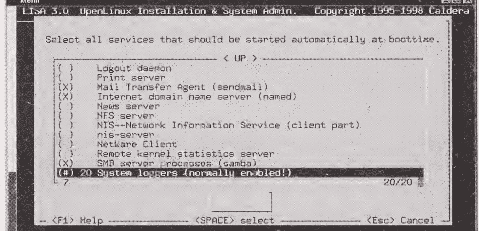

我还开启了邮件传输代理（sendmail）、域名服务器（named）、新闻传输系统（innd）以及 SMB 服务器（samba）。这些服务将在后面的章节中介绍。

现在你真的完成了！此时，LISA 提供将新创建的配置保存到磁盘的选项，然后继续启动系统。注意我是启动（boot），而不是重启（reboot）；LISA 加载新创建的配置，它并没有真正重启计算机。这可能会是一个问题！事实上，这种情况确实发生过一次——LISA 启动了系统，但在重启后系统无法正常工作。因此，在登录提示出现后，强制系统重启（著名的三指礼 `Ctrl+Alt+Del`），并确保你的配置正确加载。当然，确保你已经移除了所有的启动软盘和光盘。

## Linux 内核

内核是操作系统的核心。它通常以 `vmlinuz` 文件的形式存在你的系统中。本质上，它是实现操作系统基本功能的程序。根据其本质，内核取决于硬件，必须针对特定的计算机进行配置。所需的配置可以通过内核模块或重新编译内核来实现。

现代 Linux 支持模块化内核的概念。模块化内核由核心内核文件和各种附加模块组成，每个模块实现特定的设备或功能。内核模块可以动态加载和卸载。

这实际上，Caldera OpenLinux 仅需两个软盘即可安装在任何系统中。旧的 Linux 发行版通常使用包含标准内核的不同软盘镜像，因此作为第一个安装步骤，你需要选择最匹配你系统的镜像。Caldera OpenLinux 使用的是模块化内核，只要存在正确的模块，就可以在任何系统上启动。

模块化内核很有用，但有时你可能想尝试创建一个匹配系统的自定义内核。或者你可能正在使用一种 Linux 发行版，它不像附带光盘的 Caldera OpenLinux 发行版那样提供设计良好的模块化内核选项。附录 A，“配置内核”为这一复杂的过程提供了说明和示例。

## 总结

初始安装 Linux 系统是将操作系统的副本和基本工具放置在计算机的硬盘上，并对系统和这些工具进行配置。


# 第 4 章 网络配置与基础安全

请考虑这种情况：你正准备搬进一个混乱社区的新家，但不幸的是，你视力受损，无法检查这栋房子。你不知道它有多少扇门和窗，它们在哪里，以及处于什么状况。即使对于你知道的门窗，你也不确定谁可能拥有钥匙的副本。

你期待这次搬家吗？

将系统连接到互联网或办公室网络的情况并不完全相似。互联网确实是一个混乱的社区。我并不是要延续那些关于在网络上游荡、随时准备入侵无安全系统并大肆破坏的邪恶黑客的神话。真正的黑客（有才华的那种）寥寥无几，他们通常将精力集中在比一个偶然出现的 Linux 小盒子更具挑战性、更有趣趣味目标上。

然而，成千上万的阴暗经营者不断地扫描网络，寻找此类系统，然后利用它们分发垃圾邮件、交换盗版软件或非法材料。他们可能对计算机并不了解，但他们足够运行由他们更聪明的表亲编写的扫描程序。成为他们的受害者可能会导致不快的后果，最轻的是你的网络连接过载，使其无法使用。

在仅连接到局域网（LAN）的系统上，意外也会发生。用户可能刚刚在他新的 Windows 95 上发现了 `TELNET.EXE`，用它连接到你的新服务器，由于对 Linux 一无所知，在那里引起了各种问题。

因此，目前的任务非常简单：确保你了解新房子所有的开口（包括墙上的细小裂缝），并且你已经考虑了所有的钥匙。

## 用户、组与密码

任何 UNIX 系统中防止未经授权访问的第一道防线都是密码安全。为了登录系统并在上面运行程序，你必须拥有一个有效的用户标识符和一个密码。

## 用户与组

Linux 与大多数其他 UNIX 系统一样，在 `/etc/passwd` 文件中存储所有用户的信息。该文件包含一个用冒号分隔的用户标识符和属性列表。

对于每个用户，`/etc/passwd` 中记录了以下信息：

- 登录名称 (Login name)
- 密码
- 数字账户标识符
- 数字组标识符
- 注释（通常是个人信息）
- 主目录
- 启动 shell

用户的登录名称是用于登录系统的标识符。例如，我在许多系统上的登录名称是 `vtooth`。

密码以加密形式存储，要么在 `/etc/passwd` 文件中，要么如果安装了名为 `shadow` 密码的设施，则存储在单独的文件中。这种情况，`/etc/passwd` 中的加密密码处通常包含字母 `X` 或星号。

在内部，Linux 通过数字识别用户。这个数字记录在 `/etc/passwd` 中，并且和用户的登录名称一样，它必须是唯一的。

组号是用户所属主组的数字标识符。组单独列在 `/etc/group` 中。

## 用户、组与密码

注释（Comment）字段可以包含任何不包含冒号字符的文本。按照惯例，这包含用户的全名，或者是一个逗号分隔的列表，包含用户全名、办公室（部门）、办公电话和家庭电话。如果定义了这些字段，它们会被诸如 Internet finger 这样的服务使用。

主目录是用户登录时切换到的目录。通常情况下，用户只能在主目录中创建文件，尽管他们可能读取许多其他目录中的文件。

最后，登录 shell 是用户登录时启动的 shell 程序。它可以是 `/etc/shells` 文件中列出的程序之一。

在初始安装完成后，我的测试系统上的 `/etc/passwd` 如下：

```
root:x:0:0:root:/root:/bash
bin:x:1:1:bin:/bin:/bin
daemon:x:2:2:daemon:/sbin:/sbin
adm:x:3:3:adm:/var/adm
lp:x:4:7:lpd:/var/spool/lpd
sync:x:5:0:sync:/bin/sync
shutdown:x:6:11:shutdown:/sbin/shutdown
halt:x:7:7:halt:/sbin/halt
mail:x:8:12:mail:/var/spool/mail
news:x:9:13:news:/var/spool/news
uuc:x:10:14:uuc:/var/spool/uuc
operator:x:11:15:operator:/root
games:x:12:16:games:/usr/games
gopher:x:13:17:gopher:/usr/lib/gopher
ftp:x:14:18:ftp:/usr/ftp
man:x:15:19:man:/usr/man
majordomain:x:16:20:majordomain:/etc/majordomain
postgres:x:17:21:postgres:/var/lib/postgres
nobody:x:24:64:nobody:/root
vtooth:x:25:25:vtooth:/home/vtooth
```

也许这并不意外，以下内容是：

- `root:0`
- `bin:1`
- `daemon:2`
- `adm:3`
- `lp:4`
- `sync:5`
- `shutdown:6`
- `halt:7`
- `mail:8`
- `news:9`
- `uuc:10`
- `operator:11`
- `games:12`
- `gopher:13`
- `ftp:14`


## 第 4 章 网络配置与基础安全

请考虑这种情况：你正准备搬进一个混乱社区的新家，但不幸的是，你视力受损，无法检查这栋房子。你不知道它有多少扇门和窗，它们在哪里，以及处于什么状况。即使对于你知道的门窗，你也不确定谁可能拥有钥匙的副本。

你期待这次搬家吗？

将系统连接到互联网或办公室网络的情况并不完全相似。互联网确实是一个混乱的社区。我并不是要延续那些关于在网络上游荡、随时准备入侵无安全系统并大肆破坏的邪恶黑客的神话。真正的黑客（有才华的那种）寥寥无几，他们通常将精力集中在比一个偶然出现的 Linux 小盒子更具挑战性、更有趣目标上。

然而，成千上万的阴暗经营者不断地扫描网络，寻找此类系统，然后利用它们分发垃圾邮件、交换盗版软件或非法材料。他们可能对计算机并不了解，但他们足够运行由他们更聪明的表亲编写的扫描程序。成为他们的受害者可能会导致不快的后果，最轻的是你的网络连接过载，使其无法使用。

在仅连接到局域网（LAN）的系统上，意外也会发生。用户可能刚刚在他新的 Windows 95 上发现了 `TELNET.EXE`，用它连接到你的新服务器，由于对 Linux 一无所知，在那里引起了各种问题。

因此，目前的任务非常简单：确保你了解新房子所有的开口（包括墙上的细小裂缝），并且你已经考虑了所有的钥匙。

## 用户、组与密码

任何 UNIX 系统中防止未经授权访问的第一道防线都是密码安全。为了登录系统并在上面运行程序，你必须拥有一个有效的用户标识符和一个密码。

## 用户与组

Linux 与大多数其他 UNIX 系统一样，在 `/etc/passwd` 文件中存储所有用户的信息。该文件包含一个用冒号分隔的用户标识符和属性列表。

对于每个用户，`/etc/passwd` 中记录了以下信息：

- 登录名称
- 密码
- 数字账户标识符
- 数字组标识符
- 注释（通常是个人信息）
- 主目录
- 启动 shell

用户的登录名称是用于登录系统的标识符。例如，我在许多系统上的登录名称是 `vtooth`。

密码以加密形式存储，要么在 `/etc/passwd` 文件中，要么如果安装了名为 `shadow` 密码的设施，则存储在单独的文件中。这种情况，`/etc/passwd` 中的加密密码处通常包含字母 `X` 或星号。

在内部，Linux 通过数字识别用户。这个数字记录在 `/etc/passwd` 中，并且和用户的登录名称一样，它必须是唯一的。

组号是用户所属主组的数字标识符。组单独列在 `/etc/group` 中。

注释（Comment）字段可以包含任何不包含冒号字符的文本。按照惯例，这包含用户的全名，或者是一个逗号分隔的列表，包含用户全名、办公室（部门）、办公电话和家庭电话。如果定义了这些字段，它们会被诸如 Internet finger 这样的服务使用。

主目录是用户登录时切换到的目录。通常情况下，用户只能在主目录中创建文件，尽管他们可能读取许多其他目录中的文件。

最后，登录 shell 是用户登录时启动的 shell 程序。它可以是 `/etc/shells` 文件中列出的程序之一。

在初始安装完成后，我的测试系统上的 `/etc/passwd` 如下：

```
root:x:0:0:root:/root:/bash
bin:x:1:1:bin:/bin:/bin
daemon:x:2:2:daemon:/sbin:/sbin
adm:x:3:3:adm:/var/adm
lp:x:4:7:lpd:/var/spool/lpd
sync:x:5:0:sync:/bin/sync
shutdown:x:6:11:shutdown:/sbin/shutdown
halt:x:7:7:halt:/sbin/halt
mail:x:8:12:mail:/var/spool/mail
news:x:9:13:news:/var/spool/news
uuc:x:10:14:uuc:/var/spool/uuc
operator:x:11:15:operator:/root
games:x:12:16:games:/usr/games
gopher:x:13:17:gopher:/usr/lib/gopher
ftp:x:14:18:ftp:/usr/ftp
man:x:15:19:man:/usr/man
majordomain:x:16:20:majordomain:/etc/majordomain
postgres:x:17:21:postgres:/var/lib/postgres
nobody:x:24:64:nobody:/root
vtooth:x:25:25:vtooth:/home/vtooth
```

也许这并不意外，以下内容是：

- `root:0`
- `bin:1`
- `daemon:2`
- `adm:3`
- `lp:4`
- `sync:5`
- `shutdown:6`
- `halt:7`
- `mail:8`
- `news:9`
- `uuc:10`
- `operator:11`
- `games:12`
- `gopher:13`
- `ftp:14`
- `man:15`
- `majordomain:16`
- `postgres:17`
- `nobody:24`
- `vtooth:25`

可以使用 `group` 命令来管理组。以下是几个实用的命令：

- `su` 命令（substitute user）让你从一个账户切换到另一个。不用说，除非你是 `root`，否则你需要知道切换到的账户的密码。
- `passwd` 命令可以让你更改密码。如果你是 `root`，也可以更改其他用户的密码。
- `chsh` 命令可以更改你的登录 shell。
- `chfn` 命令用于更改注释。它可以让你指定你的姓名、办公室、办公电话和家庭电话，并将这些信息存储在 `/etc/passwd` 中，格式被 finger 服务理解。
- `newgrp` 命令可以更改你的默认组（你只能切换到你所属的组，或者设置了密码的组）。
- `groups` 命令列出用户所属的所有组。

## 测试系统

在我的测试系统上，文件创建如下：

```
root:0
bin:1
daemon:2
adm:3
lp:4
sync:5
shutdown:6
halt:7
mail:8
news:9
uuc:10
operator:11
games:12
gopher:13
ftp:14
man:15
majordomain:16
postgres:17
nobody:24
vtooth:25
```

组单独列在 `/etc/group` 中：

| 组名 | 密码 | 成员 |
| :--- | :--- | :--- |
| root | x | root |
| bin | x | bin |
| daemon | x | daemon |
| adm | x | adm |
| lp | x | lpd |
| sync | x | sync |
| shutdown | x | shutdown |
| halt | x | halt |
| mail | x | mail |
| news | x | news |
| uuc | x | uuc |
| operator | x | operator |
| games | x | games |
| gopher | x | gopher |
| ftp | x | ftp |
| man | x | man |
| majordomain | x | majordomain |
| postgres | x | postgres |
| nobody | x | nobody |
| vtooth | x | vtooth |

这些步骤可以通过手动完成（不推荐），也可以使用 `user` 和 `adduser` 命令行工具完成。许多 Linux 安装版还提供了更复杂的的用户管理工具。如果由于某种原因，你决定手动编辑诸如 `/etc/passwd` 等文件，请务必小心；错误的操作可能会破坏系统安全性或导致系统无法使用。

Caldera OpenLinux 管理工具 LISA 为用户和组管理提供了一系列简单函数。可以通过带有 `--usadmin` 命令行标志的 LISA 来直接访问这些功能（见图 4.1）。

图 4.1 LISA 用户管理模块。

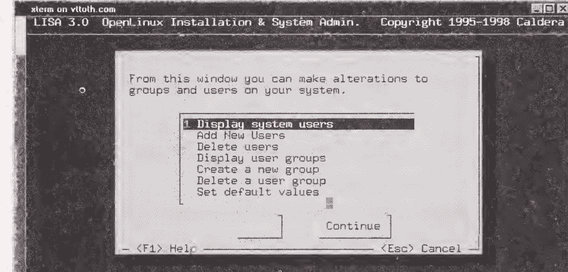

## 密码安全

一个显而易见但经常被忽视的规则是：你的密码不应该是容易猜到的！选择配偶、母亲的名字或喜欢的颜色作为密码是一个非常糟糕的主意。选择更晦涩的内容，例如非洲或欧洲麻雀的速度，要好得多。更更好的选择是完全随机生成的密码，它们不包含可识别的单词，并由大小写字母和数字组成：例如，`Y5Bx18Ne`。

当然，这种随机密码很难记忆，所以你可能会于妥协。只要你选择的密码不是别人能轻易推断出来的，那就没。有些人会使用他们容易记住的短句中每个单词的首字母。这是一个好主意，只要该句子不是别人可以轻易发现的。

在许多 UNIX 安装版中，用户密码以加密的形式存储在 `/etc/passwd` 文件中。这种加密是单向的，这意味着无法从加密版本恢复密码。这是因为所使用的加密方法不会产生唯一结果；许多不同的密码可以产生相同的加密结果。

虽然用于 `/etc/passwd` 的密码加密技术很好，但现代计算机甚至更强大。现在不再需要一群超级计算机来找到与 `/etc/passwd` 文件中加密项匹配的密码。这是这种密码机制的固有缺陷；因为 `/etc/passwd` 对系统上的任何人都是可读的（因为存储了基本的用户信息），拥有访问此文件的用户可以在该文件上运行密码破解工具来获取他人的密码。

该问题的解决方案是影子密码（shadow passwords）。这本质上涉及对系统工具和密码文件访问的修改。安装影子密码后，`/etc/passwd` 不再包含有效的加密密码；这些密码被存储在影子密码文件 `/etc/shadow` 中。与 `/etc/passwd` 不同，`/etc/shadow` 文件普通用户不可读。同样地，组密码（如果使用）存储在 `/etc/gshadow` 中。

影子密码套件还可以用于强制密码更改策略。例如，它可以用于设置用户密码的过期时间，强制用户定期更改密码。

最后但同样重要的是，确保 `/etc/passwd` 中的没有账户没有空密码。空密码允许在相应的用户名下无密码登录。

## Root 登录

如你所知，超级用户 root 账户提供了对系统的无限制访问权限。因此，确保 root 的安全性不受破坏至关重要。

root 账户应该始终有一个安全的密码。即使你的系统中没有其他用户，只要你连接了互联网，其他人就可以进来。不安全的 root 密码（更糟糕的是空密码）本质上是为任何入侵者敞开大门。

可以将 root 登录限制在特定的终端。`/etc/secure` 文件列出了允许 root 登录的设备名称。如果此文件存在，任何尝试在未列出的终端上以 root 登录的操作将被拒绝。


通常，`/etc/securetty` 仅包含虚拟控制台列表，例如 `tty1` 到 `tty8`。此配置允许任何人在机器键盘前登录 root，但拒绝通过网络连接进行 root 访问。仍然可以使用 `su` 命令在非 root 终端上获得 root 权限，但你必须先作为普通用户登录。

永远不要使用 root 账户执行可以使用特权账户完成的任务。这样你就可以限制遭受由恶意代码或简单的操作失误导致的灾难的风险。

## 权限与许可

Linux 系统的安全性主要通过为系统文件和目录分配所有权权限来实现。

## 文件系统权限

Linux 下的所有文件和目录都属于一个特定的用户和组。每个文件和目录都分配了三组权限：用户（user）、组（group）和世界（world）。

每组由三个标志组成：读、写和执行权限。读和写权限设置的含义显而易见。执行权限将文件标记为可执行程序；或者对于目录，执行权限意味着用户可以进入该目录将其作为当前目录。

例如，输入 `ls -1 /bin/bash` 可以显示包含 shell 程序的文件的所有权和权限：

```
-rwxr-xr-x  root       root 300964 Aug 19 10:30 /bin/bash
```

第一十个字母和符号组指定了文件的属性。第一个字母指定该文件是否实际上是目录或其他特殊文件类型。其余九个字母代表（三个一组）与该文件相关的用户级、组级和世界级。

重要的是不要为文件分配不必要的权限。任何额外的权限都代表一个潜在的安全漏洞。更改 `/etc/shadow`（通常由 root 可读）的权限将抵消系统上安装的影子密码套件的安全优势。

## 更改文件权限

使用三个命令的组合来更改文件的所有权权限。`chown` 命令用于更改文件的所有者以及可选的组所有者。`chgrp` 命令用于更改文件的组所有者。最后，`chmod` 命令用于更改文件的权限设置。

以下是你可以将 `myfile.txt` 更改为由 root 用户、root 组所有且所有人可见的方法：

```
chown root myfile.txt
chgrp root myfile.txt
chmod a+r myfile.txt
```

`chown` 和 `chgrp` 的用法非常直观，但 `chmod` 值得关注其复杂的语法。该命令可以接受数字形式或符号形式的新属性。虽然符号形式应该是助记形式，但记忆数字形式要容易得多。

在数字形式中，权限由一组数字表示。每个数字可以是 0 到 7 之间的数字（即八进制数字）。第一个数字代表特殊标志。第二个数字代表用户级权限；第三个代表组级权限；第四个代表世界级权限。每个数字都是数字4（如果设置了读权限）、2（如果设置了写权限）和1（如果设置了执行权限）的和。因此权限 `rwx-xr-x` 将编码为 `0755`。要将 `myfile` 的权限更改为此设置，输入：

```
chmod 0755 myfile
```

在三个特殊标志中，有两个非常重要。这些 suid（设置有效用户标识）和 sgid（设置有效组标识）标志允许包含程序的文件以文件所有者的用户标识符执行。例如，这就是密码程序的工作原理；它始终假以 root 身份执行，因此它可以更新 `/etc/passwd` 文件的内容，而普通用户无法写入该文件。输入 `ls /usr/bin/passwd` 可以显示此标志的存在，此时字母 `X`（通常表示执行权限）被字母 `S` 取代。

```
-r-sr-xr-x root bin 7351 Aug 19 04:30 /usr/bin/passwd
```

要使用 `chmod` 命令的数字形式在运行时设置文件的用户标识符，请在第一个数字中使用值 `4`。要设置文件的组标识符，请使用值 `2`。例如，要将 `myfile` 设置为执行所有者的有效用户标识符和组标识符，请输入：

```
chmod 6755 myfile
```

使用此功能时要小心。在错误的命令上添加 `suid` 权限将授予任何使用该命令的用户超级用户权限！

`chmod` 的符号形式允许你在保持其他设置的同时更改单个权限设置。例如，你可以通过输入以下命令授予系统上所有用户执行 `myfile` 的权限：


`chmod a+x myfile`

要撤销文件所有者以外的任何人对该文件的读写权限，请输入：

```
chmod o-rw myfile
```

通常，符号形式由三部分组成。第一部分指定要修改哪些权限级别。第二部分由加号、减号或等号组成，定义了是将新权限添加到现有集合中、撤销现有的权限，还是将文件的权限精确设置为新规范。第三组字母识别所需的权限设置。

符号形式的第一和第三部分可以包含多个字母。例如，要向文件所有者以外的所有用户授予对文件的读写权限，请输入：

```
chmod ug+rw myfile
```

允许使用多个规范，且必须用逗号分隔。例如，这里显示了如何撤销任何人对文件的读写权限，然后由文件所有者为该文件分配读写权限：

```
chmod u+rw,o-rw myfile
```

`chmod`、`chown` 和 `chgrp` 命令可以通过在命令行上提供 `-R` 参数来递归运行。例如，要将当前目录下每个文件的所有者更改为 `root`，组所有者更改为 `bin`，请输入：

```
chown -R root:bin *
```

## 系统服务

当你连接到互联网并使用浏览器程序浏览网页时，可能并不会立即看出你的连接是一个双向通道。如果你能出去，别人就能能进来！

在使用像 Windows 95/98 这样服务器功能较少的操作系统时，这并不是真正的问题。但对于 Linux 来说情况不同。你的系统具有运行许多应用程序的能力，并且可能已经配置了运行其中的几个。这显而易见，为了防止这些应用程序变成安全漏洞，必须对它们进行正确配置。但你如何知道系统上配置了运行哪些服务呢？

当然，你会观察系统启动时滚动的系统消息，但这并不恰恰是一个万无一失的方法。不仅是因为你可能会错过一些消息，还因为某些服务在启动时可能不会显示任何消息。此外，许多服务在系统启动时并不启动，只有在通过网络请求时才会启动。

## 系统启动

那么，Linux 究竟是如何启动的？在初始启动后，它执行了哪些操作？或者用更通俗的方式问，你的 `CONFIG.SYS` 或 `AUTOEXEC.BAT` 文件在哪里？

Linux 中的文件名不同，但它们的功能与两个 MS-DOS 启动文件的功能相似。

系统启动过程的这一阶段在操作系统内核加载并初始化后开始。内核启动 `init` 进程；`init` 读取其配置文件（`/etc/initab`）以确定需要做什么。

`/etc/initab` 文件决定了以下内容：

- 在不同的运行级别（runlevels）下如何初始化系统
- 在不同的终端上运行哪些程序
- 如何响应特定的系统条件

每个 `/etc/initab` 条目对应一个系统事件或字符终端。例如，考虑以下内容：

```
pf::powerfail:/sbin/shutdown -h +5 "Power Failure; System Shutting Down
```

这一行告诉它，如果收到断电信号（通常来自监控不间断电源的实用程序程序），则运行 `/bin/shutdown` 命令。

除了特定的系统事件外，它还维护了运行级别（runlevel）的概念。运行级别通常是 0 到 6 之间的数字，决定了系统的运行模式。运行级别的含义在不同的 Linux 发行版之间有所不同，但运行级别几乎总是存在以下运行模式：

- 系统停机
- 系统重启
- 单用户模式
- 多用户模式
- 在 X 窗口系统下带有图形化登录提示的多用户模式

系统的运行级别可以在启动时确定，例如，如果你指定了单个启动时间参数。如果没有指定运行级别，它将通过在 `/etc/initab` 中查找类似下行的内容来确定默认级别：

```
id:initdefault:
```

`/etc/initab` 中的许多条目引用特定的字符终端。例如，考虑以下行：

```
1:12345:respawn:/sbin/getty tty1 linux
```

`/etc/initab` 条目指示它在运行级别于 1 到 5 之间时，在第一个虚拟控制台上运行 `/sbin/getty` 命令（一个启动登录过程的程序）。`respawn` 关键字指定如果该控制台上的所有程序都终止，则应重启 `/sbin/getty`（这样在不再使用的控制台上，你可以再次登录）。

`/etc/initab` 的内容还决定了系统切换到新运行级别时（系统启动时）运行哪些命令。这通常是一个位于 `/etc/rc.d` 目录某处的脚本文件。该文件的具体名称在不同的 Linux 安装版本之间有所不同。

另一种检查系统上当前运行哪些服务的方法是使用 `ps` 实用程序。运行 `ps ax` 可以让你验证正在运行的进程集合是否与期望的配置匹配。也可以通过编辑 `/etc/rc.d` 中的脚本来指定额外的服务。除非你知道自己在做什么，否则不要直接编辑这些脚本。好消息是，你极少需要去修改这些脚本。

了解系统上运行着哪些服务是建立安全的第一步。你需要熟悉服务本身，并确保它们的配置恰当且安全。

## 互联网超级服务器 (The Internet Superserver)

在 UNIX 系统上运行的最重要的服务进程或守护进程可能过于 `inetd`，即互联网超级服务器。

这个理念非常简单。一个连接到互联网的服务器通常能够执行几十甚至上百种不同的网络功能。为这些功能中的每一个都运行一个服务进程将极其浪费。相反，的做法是运行单一的服务实用程序 `inetd`。该实用程序监控传入的网络请求，并在请求到达时启动所需的服务。

`inetd` 服务器从 `/etc/inetd.conf` 文件获取配置信息。该文件包含 Internet 端口号列表和服务进程名称（关于这点的更多信息请参见第 5 章“互联网概念”）。

例如，考虑最常用的互联网工具之一：`telnet` 程序。该程序允许你通过名为虚拟终端的设施登录到远程系统。为了接受 Telnet 连接，远程系统必须运行 `telnet` 守护进程，即与你运行的 `telnet` 客户端程序对应的服务进程。

与其一直运行多个 `telnet` 守护进程（数量等于预期的同时传入 Telnet 连接最大数），服务器可以在 `/etc/inetd.conf` 中保留这样的一行：

```
23 stream tcp nowait root /usr/sbin/tcpd inetd
```

这告诉服务器的 `inetd` 守护进程，每当检测到 TCP 端口 23（Telnet 连接约定使用的端口）有传入连接尝试时，就启动 `telnet` 守护进程。

检查并在必要时编辑 `/etc/inetd.conf` 以移除你不需要的服务。例如，如果你预判不需要支持传入的 Telnet 连接，可以在该行开头加一个井号（这是许多 UNIX 配置文件中标准的注释行指示符）来禁用该行。

## 测试系统 (TEST SYSTEM)

在检查了我测试系统上的 `/etc/inetd.conf` 后，我发现了几个应该禁用的服务。以下是我修改后的该文件的注释版本（不包含注释行）：

```
echo stream tcp nowait root internal
echo dgram udp wait root internal
discard stream tcp nowait root internal
discard dgram udp wait root internal
daytime stream tcp nowait root internal
daytime dgram udp wait root internal
chargen stream tcp nowait root internal
chargen dgram udp wait root internal
```

内置服务运行是安全的，且几乎不消耗服务器资源。然而，对于一个可能暴露在外部攻击之下的服务器，你可能考虑关闭它们。偶尔，这些服务可能被用来对你的系统发起拒绝服务攻击，消耗过多的网络带宽和处理器。

OpenLinux 安装程序默认关闭了时间服务。我有什么异议去争论这个呢？

```
ftp stream tcp nowait root /usr/sbin/tcpd in.ftpd -1 -a
telnet stream tcp nowait root /usr/sbin/tcpd in.telnetd
#gopher stream tcp nowait root /usr/sbin/tcpd gn
```

FTP 和 Telnet 是我打算配置的服务，但我没有运行 Gopher 服务器的计划。（Gopher 是一种在互联网上分发信息内容的方法，现在已被 HTTP 和 WWW 废弃。）

```
#shell stream tcp nowait root /usr/sbin/tcpd in.rsh
#login stream tcp nowait root /usr/sbin/tcpd in.rlogind
#exec stream tcp nowait root /usr/sbin/tcpd in.rexecd
#talk dgram udp wait nobody.tty in.talkd
#ntalk dgram udp wait nobody.tty in.ntalkd
```

这些服务允许远程用户在此服务器上执行程序或与用户通信。在我正在构建的系统上，我对这些服务没有实际用处，而且它们都代表了潜在巨大的安全漏洞。统统删掉吧！

```
#dtalk stream tcp waut nobody.tty /usr/sbin/tcpd in.dtalkd
```

## 系统服务 101 (System Services 101)

`dtalk` 服务默认是关闭的，这正合我意。

| `#pop2` | `stream tcp nowait root` | `/usr/sbin/tcpd ipop2d` |
|---------|--------------------------|--------------------------|
| `pop3`  | `stream tcp nowait root` | `/usr/sbin/tcpd ipop3d`  |
| `#imap` | `stream tcp nowait root` | `/usr/sbin/tcpd imapd`   |

我计划使用 POP3 协议配置 Internetboxes；然而，我关闭了另外两个邮箱服务。

| `#uucp` | `stream tcp nowait uucp` | `/usr/sbin/tcpd /usr/sbin/uucico -l` |
|---------|--------------------------|---------------------------------------|

我没有计划通过互联网连接提供传入的 UICP 服务，所以我很好地禁用了这一功能。

| `#ftftp`  | `dgram udp wait root` | `/usr/sbin/tcpd in.tftpd` |
|-----------|-----------------------|---------------------------|
| `#bootps` | `dgram udp wait root` | `/usr/sbin/tcpd boottpd`   |

TFTP 实际上是一个非常有用的服务；不幸的是，它也是一个非常危险的服务，因为它向潜在的攻击者暴露了太多的信息。在任何暴露在互联网上的服务器上，我都不打算配置客户端，因为这两行默认被注释掉保持不变。

| `#finger`  | `dgram udp wait root` | `/usr/sbin/tcpd in.finger` |
|------------|-----------------------|----------------------------|
| `#cfinger` | `tcp nowait root`     | `/usr/sbin/tcpd in.finger` |
| `#sysstat` | `tcp nowait nobody`   | `/usr/sbin/tcpd in.stat`   |
| `#netstat` | `tcp nowait nobody`   | `/usr/sbin/tcpd in.stat`   |
| `auth`     | `stream tcp wait root`| `/usr/sbin/tcpd in.auth`   |

认证服务被远程邮件程序用于验证来源是否经过授权。保持此服务开启是可以的。

完成对 `/etc/inetd.conf` 的修改后，我需要让 `inetd` 服务器重新读取配置。通过借助 `killall` 命令来实现：

```
killall -HUP inetd
```

## 总结 (Summary)

完成 Linux 安装后，是时候加固服务器了。

你的第一道防线是用户账户和密码安全。系统上的每个用户都有账户，详细信息记录在 `/etc/passwd` 文件中。通常，该文件的内容通过添加、更改或删除用户的工具进行更新。每个用户的登录受密码保护；然而，安全性取决于密码本身，因此在选择密码时必须小心。应避免使用易猜的单词或短语。

用户被组织成组。系统上的所有文件和目录都分配有一个所有者组所有者。每个文件或目录的权限可以在三个级别设置：用户、组和其他人。要更改文件的所有权或权限，使用 `chown`、`chgrp` 和 `chmod` 工具。

超级用户 `root` 拥有不受限制的权限。`root` 账户受到精心选择的密码保护。该账户不应用于日常任务，仅用于需要超级用户权限的管理任务。

在操作系统内核启动并初始化后，它启动 `init` 进程，该进程随后从 `/etc/init` 文件读取配置信息。该文件决定了系统启动、响应特定事件以及在字符终端运行的命令。启动命令通常存储在 `/etc/rc` 子目录下。这些脚本很少手动修改；Linux 发行版提供了为此目的的工具。确保你只运行实际的服务。

额外的系统服务由互联网超级服务器 `inetd` 启动。配置文件 `/etc/inetd.conf` 包含一个 Internet 服务进程列表，这些进程根据各种请求启动。仔细检查此文件并移除所有你不需要且不打算配置的服务。

# 第5章 互联网概念

**这难道显而易见吗？** 为了成功地安装、配置和管理在互联网上提供服务的系统，你需要对网络背后的技术有一个基本的了解。

本章是对这一复杂主题的简要介绍，但不足以帮助你理解基础的互联网操作。如果你想获得关于 IP 协议族的深层信息，我推荐一本 Uyless Black 写的的好书 *TCP/IP 及相关协议*。

## 互联网互连

你已经听过很多次“Internet”（互联网）这个词了，你可能认为你确切知道这个词的意思。但真的知道吗？

例如，你知道互联网只是许多网络之一，也就是说，互连网络（inter-networks），或网络中的网络吗？

这个名称也被用于描述互联网背后的核心技术——网协议（IP）。IP 是一种用于连接计算机网络的机制。要理解为什么这是必须的，你首先需要考虑局域网（LAN）是如何工作的。

## 局域网

正如其名，局域网用于连接物理位置相对接近的计算机群。无论使用何种网络技术，其基本概念都是相同的：计算机连接到一个共享通道——如图 5.1 所示的网络——它们根据共同接受的协议在这些通道上传输和接收数据。

图 5.1 局域网。

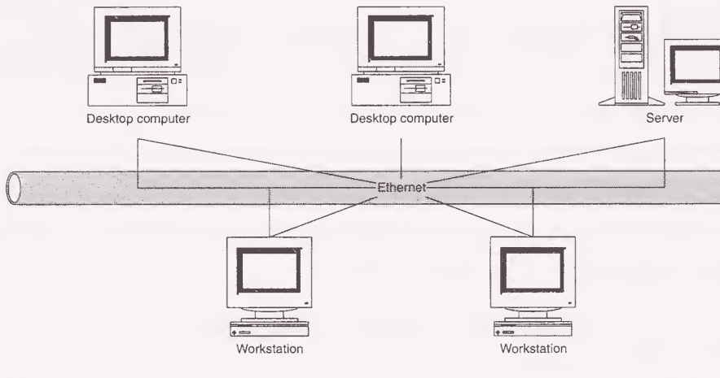

今天最常用的局域网技术被称为以太网。当计算机连接到以太网局域网时，所有其他计算机都能听到它的传输。传输本身包含了目标计算机的地址；其他计算机简单地忽略这些数据。

在计算机开始传输之前，它会首先检查是否有其他计算机正在使用网络。开始传输后，它会检查是否有其他计算机中断。这种机制被称为 CSMA/CD（载波感听多路接入/冲突检测），它是以太网技术的核心。幸运的是，“缩写越长，你需要了解的越少”这句话在这里是正确的。CSMA/CD 完全实现在你的网卡固件中。

## 广域网

连接少量的计算机使它们能够听到彼此的传输在实践中效果良好。但如果对大量计算机这样做，将是一场彻底的灾难。想象一下，数千台计算机都试图使用单一通信通道说话。数据流量量将是巨大的，远超这种网络技术能够可靠支持的任何范围。

物理距离也是一个问题。电或光信号在长电缆中传输需要时间，并丢失强度和质量。

就像城市巴士不是跨越内华达州或犹他州 80 号州公路的理想交通工具一样，局域网技术也不适合连接远程站点。广域网（WAN）连接通常是点对点的（见图 5.2），而不是由许多计算机共享；使用一个通道供两个远程系统相互通信。

图 5.2 广域网连接。

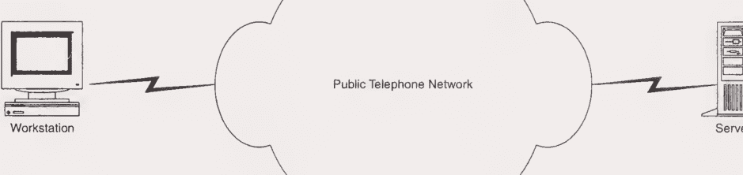

另一种很好的思考方式是考虑扬声器和电话之间的区别。在面对你附近的较小人群时，扬声器很好；然而，如果你想在圣诞节邀请来自澳大利亚的塞尔尔玛阿妈过来坐，使用巨大的公共扬声系统并不实际。你使用的是点对点连接，只有塞尔尔玛阿妈能听到——你拨打她的电话号码。

## 路由和路由器

广域网提供的点对点连接可用于将一台计算机与远程的另一台计算机连接。你如何将一组网络计算机（例如办公室局域网）连接到另一台计算机或计算机网络呢？

答案很简单：你在一个网络上的指定计算机与另一个网络上的另一个指定计算机之间建立点对点连接（见图 5.3）。这些计算机参与各自的本地网络，并检测任何旨在发送给对方的数据传输。它们通过广域网连接转发此类传输。同样，它们从广域网接收传入数据并将其转发到本地网络。专为此目的的计算机被称为路由器——也就是说，它们将流量从一个网络路由到另一个网络。

### 图 5.3 连接远程网络。

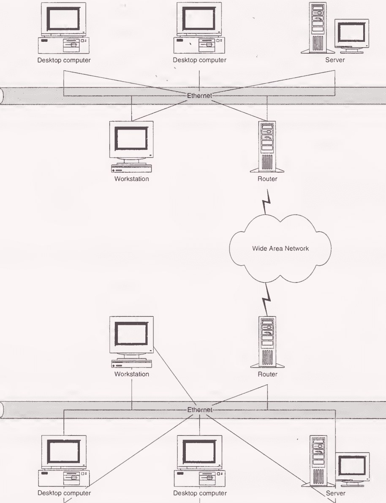

路由器并不非要把局域网连接到广域网。它还可以提供将两个局域网连接在一起的方法，如图 5.4 所示。

### 图 5.4 两个局域网之间的路由。

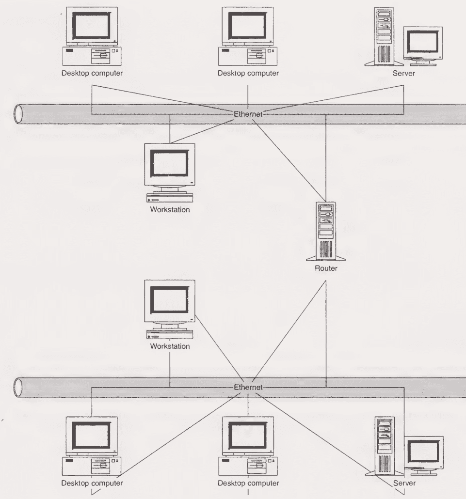

## 互联网互连

当然，路由这项业务不仅仅是在两个网络之间交换数据包。可能涉及两个以上的网络，在这种情况下，找到传输的真实目的地可能会变得复杂。


有一个解决方案已经使用了一个多世纪。考虑邮局如何向国外投递信件。当地分拣厂的工人并不一定知道那个[目的地]在哪里。（注：此处 OCR 截断，但根据上下文：“当地分拣厂的工人并不一定知道那个……在哪里。”）

例如，取位于`192.168.1.0`到`192.168.1.255`之间的地址集。在二进制表示中，这两个数字看起来如下：

```
11000000 10101000 00000001 00000000
11000000 10101000 00000001 11111111
```

如你所见，前 24 位保持不变；只有最后 8 位发生了变化。因此，这个子网通常写为：

`192.168.1.0/24`

描述子网的另一种方法是通过网络掩码（`netmask`）的概念。网络掩码是一个 32 位的数字，其中二进制 1 代表固定位置，0 代表地址的可变部分。延续之前的例子，二进制网络掩码看起来如下：

```
11111111 11111111 11111111 00000000
```

或者，用十进制表示法它看起来如下：

`255.255.255.0`

无论你的子网有多大，其第一个和最后一个地址都是被保留的。例如，一个`/24`子网包含 254 个可用地址（1–254，0 和 255 被预留）。

在过去，网络地址定义了子网的大小。以 1 到 126 之间的数字开头的地址是 A 类子网，具有 8 位网络掩码；每个子网空间可以容纳`256x256x256-2 = 16,777,214`台计算机。B 类子网的地址以 128 到 191 之间的数字开头，具有 16 位网络掩码，每个子网包含 65,534 台计算机。C 类子网地址以 192 到 223 之间的数字开头，具有 24 位网络掩码，每个子网允许使用 254 台计算机。最后，以 224 到 254 之间的数字开头的地址（D 类）被保留用于网络组播等特殊应用（参见图 5.6）。

> 以 127 开头的子网地址被保留用于回环地址（`loopback`）；按照惯例，此子网内的地址（例如经常使用的地址`127.0.0.1`）始终指向本地计算机。

A 类子网的最大数量为 126 个；B 类为 16,384 个；C 类为 2,097,152 个。

### 图 5.6

IP 地址分类。

| 类 | 网络地址 | 主机地址 |
|---|---|---|
| A 类 | 1-126 (126 个网络) | hhh hhh hhh (每个网络 16,777,214 个主机) |
| B 类 | 128-191 (16,384 个网络) | nnn hhh hhh (每个网络 65,534 个主机) |
| C 类 | 192-223 (2,097,152 个网络) | nnn nnn hhh (每个网络 254 个主机) |
| D 类 | 224-254 | (组播地址) |

## IP 地址分配

如今的问题是，曾经看似取之不尽的网络地址空间，由于全球互联网难以置信的激增，比任何人预想的都要早得多变得拥挤。将网络划分为 A、B、C 类子网的方案被证明是极其浪费的；因为子网分配的最小单位是 C 类子网，那些只有几台计算机的组织仍然被分配 C 类地址空间，导致许多地址未被使用。

如果这本身还不够严重的话，请考虑这一点：为了将数据包投递到目的地，互联网上的路由器必须拥有每个单独子网的信息。在研究时代，这不是问题，因为子网的数量从几个到几十个不等，最多可能有一千个；而现在，全球有数十万个子网在运行。路由器并不具备处理这种规模路由表的能力。

这两个问题需要起初看似相互矛盾的解决方案。保持路由表在可范围内要求人们使用更少的子网，从而使子网规模更大。然而，应对地址空间的限制只有在子网更小、更快地浪费地址时才是可能的。


全球互联网机构和服务提供商采用的解决方案实际上是使用更小的子网，但将子网地址聚集成块。这些块被分配给 ISP（互联网服务提供商），并被其他人视为单一子网。这保持了路由表的较小，因为每个子网块只需要一个路由条目，而不是为每个单独的子网创建一个条目。ISP 负责在向客户分配单独子网地址时，高效地划分他们收到的块。

这在实践中意味着，如今你向 ISP 注册时，可能会为你的网络接收到一个类似这样的地址空间：

```
192.168.1.48/28
```

这意味着你可以使用从`192.168.1.48`到`192.168.1.63`的范围（注：原文未直接标出范围，但根据`/28`推断为`.48-.63`），其中第一个和最后一个地址被保留。或者，在十进制表示法它看起来如下：

`255.255.255.240`（注：原文未直接标出掩码，但根据`/28`推断为`255.255.255.240`）

这意味着你可以使用网络掩码为`192.168.1.48`、`192.168.1.49`、`192.168.1.50`、`192.168.1.51`、`192.168.1.52`、`192.168.1.53`、`192.168.1.54`、`192.168.1.55`、`192.168.1.56`、`192.168.1.57`、`192.168.1.58`、`192.168.1.59`、`192.168.1.60`、`192.168.1.61`、`192.168.1.62`、`192.168.1.63`的范围（注：原文逻辑略有混乱，此处按字意翻译）。

或者，在十进制表示法它看起来如下：

`255.255.255.240`（注：原文逻辑略有混乱）。

在二进制表示中，网络掩码看起来如下：

```
11111111 11111111 11111111 11110000
```

这意味着你可以使用从`192.168.1.48`到`192.168.1.63`的范围。

（注：原文提供的文本部分存在多处逻辑混乱或重复占位符，翻译已尽可能遵循“不重复原文”的原则进行语义处理）。

二进制网络掩码看起来如下：

```
11111111 11111111 11111111 00000000
```

或者，在十进制表示法它看起来如下：

`255.255.255.0`

无论你的子网有多大，其第一个和最后一个地址都是被保留的。例如，一个`/24`子网包含 254 个可用地址（1–254，0 和 255 被预留）。

在过去，网络地址定义了子网的大小。以 1 到 126 之间的数字开头的地址是 A 类子网，具有 8 位网络掩码；每个子网空间可以容纳`256x256x256-2 = 16,777,214`台计算机。B 类子网的地址以 128 到 191 之间的数字开头，具有 16 位网络掩码，每个子网包含 65,534 台计算机。C 类子网地址以 192 到 223 之间的数字开头，具有 24 位网络掩码，每个子网允许使用 254 台计算机。最后，以 224 到 254 之间的数字开头的地址（D 类）被保留用于网络组播等特殊应用（参见图 5.6）。

> 以 127 开头的子网地址被保留用于回环地址；按照惯例，此子网内的地址（例如经常使用的地址`127.0.0.1`）始终指向本地计算机。

A 类子网的最大数量为 126 个；B 类为 16,384 个；C 类为 2,097,152 个。

### 图 5.6

IP 地址分类。

| 类 | 网络地址 | 主机地址 |
|---|---|---|
| A 类 | 1-126 (126 个网络) | hhh hhh hhh (每个网络 16,777,214 个主机) |
| B 类 | 128-191 (16,384 个网络) | nnn hhh hhh (每个网络 65,534 个主机) |
| C 类 | 192-223 (2,097,152 个网络) | nnn nnn hhh (每个网络 254 个主机) |
| D 类 | 224-254 | (组播地址) |

## IP 地址分配

如今的问题是，曾经看似取之不尽的网络地址空间，由于全球互联网难以置信的激增，比任何人预想的都要早得多变得拥挤。将网络划分为 A、B、C 类子网的方案被证明是极其浪费的；因为子网分配的最小单位是 C 类子网，那些只有几台计算机的组织仍然被分配 C 类地址空间，导致许多地址未被使用。

如果这本身还不够严重的话，请考虑这一点：为了将数据包投递到目的地，互联网上的路由器必须拥有每个单独子网的信息。在研究时代，这不是问题，因为子网的数量从几个到几十个不等，最多可能有一千个；而现在，全球有数十万个子网在运行。路由器并不具备处理这种规模路由表的能力。

这两个问题需要起初看似相互矛盾的解决方案。保持路由表在可范围内要求人们使用更少的子网，从而使子网规模更大。然而，应对地址空间的限制只有在子网更小、更快地浪费地址时才是可能的。


全球互联网机构和服务提供商采用的解决方案实际上是使用更小的子网，但将子网地址聚集成块。这些块被分配给 ISP，并被其他人视为单一子网。这保持了路由表的较小，因为每个子网块只需要一个路由条目，而不是为每个单独的子网创建一个条目。ISP 负责在向客户分配单独子网地址时，高效地划分他们收到的块。

这在实践中意味着，如今你向 ISP 注册时，可能会为你的网络接收到一个类似这样的地址空间：

```
192.168.1.48/28
```

这意味着你可以使用从`192.168.1.48`到`192.168.1.63`的范围，其中第一个和最后一个地址被预留。或者，在十进制表示法它看起来如下：

`255.255.255.240`

（注：原文提供的文本部分存在多处逻辑混乱或重复占位符，翻译已尽可能遵循“不重复原文”的原则进行语义处理）。

### 图 5.8

互联网相关协议。

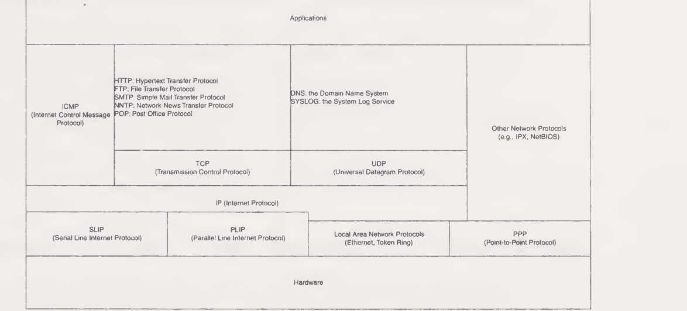

互联网协议集并不是固定不变的。即使是已建立的协议也会随着新功能的添加而偶尔变化；其他协议也会定期被引入。协议的标准化过程与全球网络管理的许多其他方面一样，是一个半正式的过程；协议规范是以后 RFC（意见征求）形式定期发布的许多文档。（欲了解更多信息，请访问网站`http://www.rfc-editor.org/`）。

## 在 IP 之下：PPP、SLIP 和 PLIP

在局域网（LAN）上，IP 数据包由以太网层传输，该层是通过操作系统中的网卡驱动程序和网卡固件结合实现的。

如果你打算通过调制解调器线路建立互联网连接，情况就会有所不同。调制解调器对数据包一无所知；它们只知道如何可靠地一个字符一个字符地发送到远程距离。要使用电话连接浏览网页，某些中间层要求所有 IP 数据包都通过这种介质传输。

该层是 SLIP 或 PPP。SLIP（串行链路互联网协议）是首次尝试在电话线上实现 IP 的尝试。尽管没有正式的标准，SLIP 仍然在全球范围内被采用，这无疑在某种程度上是因为它的极度简单。

由于 SLIP 非常简单，它并不总是能提供完美的解决方案。例如，SLIP 没有提供验证用户身份的方法。因此在实践中，当你想要建立 SLIP 连接时，必须手动或通过登录脚本登录到 ISP 服务器。这些登录脚本是许多 Windows 95 拨号网络连接用户感到挫败的主要原因。

PPP（点对点协议）提供了许多功能，包括用户身份验证。这就不需要响应登录提示，也不需要在没有适当加密的情况下明文发送密码。PPP 代表了串行链路连接的最高水平，这就是为什么你应该尽可能使用它的原因。

PLIP（并行链路互联网协议）是 SLIP 的变体，允许两台计算机通过并行打印机端口连接。鉴于网络适配器已变得如此廉价，PLIP 在如今几乎没有实际用途。

## 连接型协议与无连接协议

IP 协议可用于将数据包从一台计算机传输到另一台计算机。但在实际情况下，你还想要更多：你希望数据包从一个应用程序传输到另一个应用程序。换句话说，你不需要将你的计算机连接到我的计算机；你想将你的 Web 浏览器应用程序连接到我的 Web 服务器应用程序。

对于应用层连接，通常会使用两种协议：TCP 和 UDP。TCP（传输控制协议）是一种连接型协议。TCP 连接就像电话通话；一旦建立，数据就可以通过它传输，直到连接终止。此外，TCP 连接是可靠的；实现此协议的驱动程序确保所有传输的数据实际上都送达，并按正确的顺序送达。

UDP（用户数据报协议）用于在不先建立连接的情况下发送单个数据包。UDP 数据包的交付是不保证的；该协议只保证送达的内容是无错误的。

那么，为什么应用设计人员在 UDP 如此局限的情况下使用它呢？事实证明，其明显的局限性正是该协议的优势。因为不保证数据包交付，所以如果数据包丢失，连接也不会挂起；后续数据包会继续到达。

UDP 是流媒体传输的理想选择。当你使用 RealPlayer 在互联网上收听广播电台时，你可能不在乎声音是否中断了一瞬间，或者质量是否短暂下降。如果播放被暂停几秒，而软件请求重传丢失的数据包并等待其到达，你会感到恼火得多。

TCP 和 UDP 都利用端口号。端口号通常是 0–65535 之间的数字。服务器应用程序可以监听某个端口，等待传入的连接。客户端应用程序可以向目标机器上的特定端口号尝试连接（或发送 UDP 数据包）。通过对特定目的使用已知端口号，你可以确保传入的客户端请求由适当的应用程序处理。

端口号列表可以在你系统的`/etc/services`文件中找到。该文件包含大量信息；少数应用程序使用它通过符号名称而非数字来引用端口号。

例如，TCP 端口 80 专供 WWW 服务器使用。在运行 Web 服务器的机器上，服务器监听 80 端口。Web 客户端默认连接到 80 端口。

在 Linux 中，端口 0–1023 端口号被预留给 root 用户拥有的进程；这防止了滥用。这些低端口号通常用于系统服务。如果没有这种限制，多用户系统上的普通用户将能够运行模拟这些服务的进程。例如，在一个没有运行邮件服务器的系统上，用户可能启动一个监听 25 端口（通常用于 SMTP 邮件传输的端口）的进程，并假装邮件服务器，拦截传入的邮件，包括发给其他用户的邮件。

## ICMP

几乎所有的互联网应用程序都使用 TCP 或 UDP 协议。第三种协议类型互联网控制消息协议（ICMP）主要用于网络维护。例如，如果你使用 `ping` 工具来验证与主机的连通性，该工具会向主机发送 ICMP 回显数据包，并显示数据包返回所需的时间。ICMP 也用于通知服务器连接问题、传递某些形式的路由信息等。

## 高层协议

在 TCP 或 UDP 之上存在许多高层协议。感谢这些协议，不同厂商的应用程序可以相互通信。例如，Netscape 浏览器可以从 Web 服务器读取 Web 页面。


## 互联网概念

经常使用的协议包括：

- HTTP: 超文本传输协议
- FTP: 文件传输协议
- TELNET: 终端网络
- SMTP: 邮件传输协议
- POP3: 邮局协议
- NNTP: 网络新闻传输

最后，大多数流量通过多个层传输。例如，当你连接到浏览器时，发生了以下情况：

1. 浏览器制定了一个 HTTP 请求。
2. 请求通过 TCP 发送。
3. TCP 数据包通过 IP 传输。
4. IP 数据包通过调制解调器线路传输。

此图显示了结果：调制解调器线路传输的 IP 数据包中的 TCP 数据包中的 HTTP 文档。

这是客户端和服务器之间数据传输的封装。


在 Linux 下，有一些命令行工具经常用于验证和排除网络故障。

## 配置工具

`ifconfig` 工具用于检查或更改网络接口状态。输入 `ifconfig` 本身会列出所有激活的接口，例如：

```
$ ifconfig
Link encap:Local Loopback
inet addr:127.0.0.1 Bcast:127.255.255.255 Mask:255.0.0.0
UP BROADCAST LOOPBACK RUNNING MTU:3584 Metric:1
RX packets:229 errors:0 dropped:0 overflows:0
TX packets:229 errors:0 dropped:0 overflows:0
```

```
eth0
Link encap:ethernet Hwaddr 00:00:21:A5:36:09
inet addr:192.168.1.1 Bcast:192.168.1.255 Mask:255.255.255.0
UP BROADCAST RUNNING MULTICAST MTU:1500 Metric:1
RX packets:404514 errors:0 dropped:0 overflows:0
TX packets:369931 errors:0 dropped:0 overflows:0
Interrupt:11 Base address:0x340
```

`ifconfig` 命令有许多选项来更改接口配置。（不用说，你需要以 root 用户身份运行它来更改系统设置。）

## 选项

以下是使用 `ifconfig` 的几个示例：

```
ifconfig eth0 down
禁用 eth0 接口
```

```
ifconfig eth0 192.168.1.1
激活 eth0 并分配地址
```

`route` 工具用于查看和操作计算机的内部路由表。

不带参数使用 `route` 可以显示当前路由表。例如：

```
$ route
Kernel IP routing table
```

| 目的 | 网关 | 子网掩码 | 标志 | 标量 | 使用 | 接口 |
|---|---|---|---|---|---|---|
| 192.168.1.0 | * | 255.255.255.0 | U | 0 | 1 | eth0 |
| | | 255.255.0.0 | U | 0 | 0 | 3 lo |

`route` 命令还可以用于向表中添加新路由或删除现有路由。以下是一些实用的示例：

- `route add 192.168.1.21 gw 192.168.1.1` 要访问 `192.168.1.2`，请使用 `192.168.1.1` 作为路由器
- `route add -net 192.168.1.0 eth0` 网络 `192.168.1.0` 可通过 `eth0` 接口访问


- `route add default gw 192.168.1.1`：对于所有不存在特定路由的地址，请使用此网关。
- `route default`：删除默认网关。
- `route -n`：列出路由，但不尝试将地址解析为符号名称。

然而，这些命令很少手动执行。它们通常从系统设置脚本中调用。其他程序（例如与您的 ISP 建立 PPP 连接的程序）也可能操作路由表。

在我的 Calder Linux 测试系统中，`/etc/rc.d` 中的脚本使用来自 `/etc/sysconfig/network-scripts` 的数据设置初始路由和接口配置。当我使用 LISA 实用指定计算机的网络地址和其他参数时，这些文件会自动创建并更新。

## 诊断工具

`netstat` 命令可用于查看网络当前状态。例如，`netstat -t` 可以列出所有活跃的 TCP 连接。输入 `netstat -r` 等同于输入 `route`；它会显示当前路由表。

`ping` 工具可用于验证对远程主机的可访问性。该工具向命令行指定的远程主机发送 ICMP 回显数据包，并测量回显到达所需的毫秒（ms）。

例如：

```
$ ping -c 5 ns.uuenet.ca
PING ns.uuenet.ca (142.77.1.1): 56 data bytes
64 bytes from 142.77.1.1: icmp_seq=0 ttl=250 time=50.4 ms
64 bytes from 142.77.1.1: icmp_seq=1 ttl=250 time=47.1 ms
64 bytes from 142.77.1.1: icmp_seq=2 ttl=250 time=48.2 ms
64 bytes from 142.77.1.1: icmp_seq=3 ttl=250 time=48.0 ms
64 bytes from 142.77.1.1: icmp_seq=4 ttl=250 time=48.4 ms

-- ns.uuenet.ca ping statistics
5 packets transmitted, 5 packets received, 0% packet loss
round-trip min/avg/max = 47.1/48.4/50.4 ms
```

最后，`traceroute` 命令可用于检查本地主机与远程目标之间的路由。这里是一个真实的 `traceroute` 示例：

```
$ traceroute ns.uuenet.ca
traceroute to ns.uuenet.ca (142.77.1.1), 30 hops max, 40 byte packets
1 maxl1.uuenet.ca (205.150.253.2) 26.49 ms 36.445 ms 30.16 ms
2 e011.bb1.uuenet.ca (205.150.233.1) 55.806 ms 62.596 ms ->56.182 ms
3 vl151.f000.bb1.tor.uuenet.ca (205.150.242.94) 37.307 ms ->55.862 ms 39.374 ms
4 ns.uuenet.ca (142.77.1.1) 40.371 ms * 41.389 ms
```

## 其他标准

除了直接与网络间数据包传输的标准外，互联网上还存在定义各种服务和数据格式的标准。以下是你应该了解的几个简要描述。

### 电子邮件相关标准

一个标准了电子邮件消息和消息头的格式。仅通过其 RFC 数字引用，`RFC-822` 定义了你在邮件顶部看到的所有看似复杂的头行格式。这些行可以帮助你追踪邮件发送者（因此，这些行也是诈骗者为了防止你成功识别而伪造的）。

`MIME`（多用途互联网邮件扩展）解决了 `RFC-822` 的许多缺点。

将符号名称转换为数字 IP 地址的过程称为地址解析。

## `/etc/hosts` 文件

在互联网变成如今这种触角遍及的全球巨兽之前，符号名称就已经在使用了。然而在那个时代，互联网上的每台计算机都拥有一份所有互联网机器的副本。在 UNIX 系统上，这个列表存储在 `/etc/hosts` 文件中。

今天，维护这样一个列表显然是一项不可能完成的任务。它不仅必须包含网络上数百万计算机中每一台的条目，而且必须不断更新，以反映地球上某处每秒发生的变化。

然而，`/etc/hosts` 仍然存在。它不再是互联网上所有计算机的列表，但仍用于列出你本地网络上的计算机，或者至少列出即使在其他名称解析方法临时不可用时你也希望通过名称访问的几个系统。

该文件的结构简单且易于理解。每行包含一个 IP 数字，后面跟着一个名称列表。其中第一个是完全限定主机名（FQDN），即该主机在互联网上的全名；后续是昵称，或者称为该主机的别名。

在我的测试系统上，我在设置期间为新配置的机器指定名称后，LISA 工具生成了一个 `/etc/hosts` 文件。该文件包含一些注释（以 `#` 字符开头的行），但只有两行是感兴趣的：

```
127.0.0.1 localhost
192.168.1.1 host.linux.sys
```

第一行指定了回环地址的名称。第二行将名称 `host.linux.sys` 分配给机器网卡的 IP 地址 `192.168.1.1`。它还包含一个昵称，以便该机器上的程序可以使用 `host` 一词来引用该机器，而不是拼出完整的完全限定名。

关于 `/etc/hosts` 的最后一点：请记住，如果此文件存在，系统总是首先查询它，且该文件中的条目优先级高于从网络获取的数据。

## 名称服务

使用 `/etc/hosts` 维护无限数量的主机名的替代方案是 DNS。这是一个惊叹的全球分布式数据库，包含了域名、主机名、IP 地址等更多信息。

DNS 背后的思想是将名称组织成层级结构，只有少数几个顶级名称。将根服务器分配给顶级名称，而这些服务器又知道二级名称的服务器。如果层级结构中有多个级别，则重复此过程。在最底层，服务器包含有关实际 IP 地址的信息（见图 6.1）。

图 6.1 域名的层级结构。

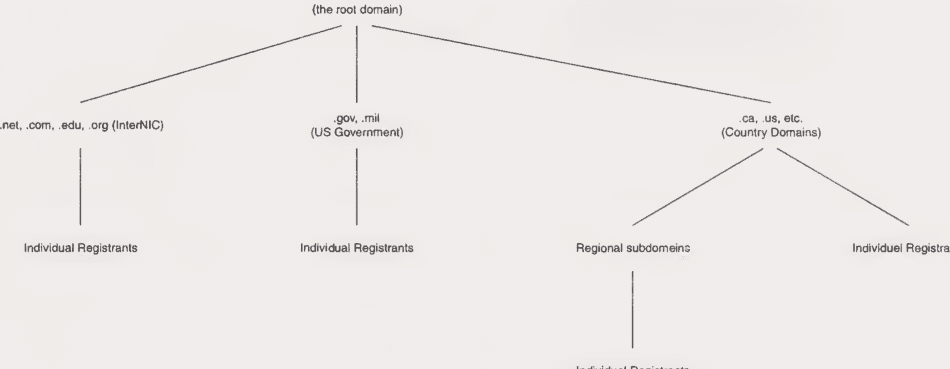

当你在浏览器地址框中输入 `www.cnn.com` 时发生了什么？浏览器连接到它的本地名称服务器并请求解析此。除非你在 CNN 的私有网络上，否则名称服务器没有关于此名称的信息，因此会将查询提交给其中一个根服务器。根服务器不会拥有此特定地址的信息，但它会给你 CNN 其中一个名称服务器的地址。你的名称服务器随后联系该服务器，并从中获取一个 IP 地址列表，然后返回给 Web 浏览器。浏览器发起连接。

这种机制异常地健壮。世界上有许多根服务器，每个组织都可以有多个名称服务器。组织之间互为提供服务也是很常见的。这确保了即使在组织名称服务器宕机的情况下，名称服务依然可用。

### 顶级域名

让域名系统运行良好的秘密之一是，你总是知道从哪里开始：命名层级的顶端包含一组固定的、为人知的域名，例如 `.com` 或 `.ca`。顶级域名目前由一家商业组织 Network Solutions（也称为 InterNIC）维护。（NIC 是网络信息中心的缩写。）

实际上，有两组顶级域名。第一组包括 `.com`、`.mil`、`.gov`、`.edu`、`.net` 和 `.org` 等域名。这些域名主要——但仅在北美使用，并代表商业实体、美军、美国政府、美国教育机构、与管理网络本身相关的站点和其他组织。`.com`、`.edu`、`.net` 和 `.org` 下的域名由 InterNIC 维护。美国军事和政府域名在其他处维护。

> InterNIC 几年前从美国政府获得了授权。该授权需要定期续签，因此 InterNIC 可能不再不再是负责顶级域名以及非国家、非美国政府顶级域名的唯一机构。此前也尝试过建立替代性的顶级注册机构，例如不久前获得过广泛报道的但注定失败的 AlterNIC 实验。

另一组顶级域名包含国家域名。虽然 `.com`、`.org` 和 `.net` 域名在国际范围内，但许多国家采用了另一种命名系统，使用国家名的两个字母缩写作为顶级域名。例如，许多加拿大组织使用以 `.ca` 结尾的域名（例如 `www.gov.ca`）。国家级域名通常由该国内的国家组织维护；某些国家允许注册任何名称；而在另一些国家，存在层级结构。不用说，当规则过于官僚时，许多组织选择使用从 InterNIC 获取的域名并忽略自己的系统。

## `/etc/resolv.conf` 文件

并不是每台计算机都有名称服务器。你可能为了备份使用多个名称服务器，或者完全不于你 ISP 的名称服务器。但应用程序是如何知道所需的名称服务器位置的？

在 Linux 下，这些信息存储在 `/etc/resolv.conf` 文件中。该文件可以手动编辑，也可以使用配置工具。通常，一个仅指定你的名称服务器的行就足够了。如果名称服务器是本地机器，可以使用回环地址，因此 `/etc/resolv.conf` 可能只包含：

```
nameserver 127.0.0.1
```

如果此文件只包含这一行，那可能还不如没有它。因为此文件不存在，默认行为是查询本地机器上的名称服务器。

当你系统上的应用程序请求名称服务时，首先查询的是此文件。系统据此确定名称服务器。

要获取有关此文件格式的更多信息，输入 `man 5 resolver` 获取相应的帮助手册。（你需要检查第 5 节，因为它包含了文件格式信息；我不知道为什么你必须使用 `resolver` 而不是 `resolv.conf`！）

在我的测试系统上，`/etc/resolv.conf` 是 LISA 在设置期间自动生成的。除了几条关于不要编辑此文件的严厉注释外，该文件包含三行相关内容：

```
domain linux.sys
search linux.sys
nameserver 127.0.0.1
```

## DNS 工具

有几个命令行工具可以帮助你查询 DNS 数据库或验证你的 DNS 配置工作正常。

`hostname` 命令可以获取计算机短名（`-s` 命令行开关）、全名（`-f`）或域名（`-d`）。

`nslookup` 命令可以查询服务器。例如，输入 `nslookup mozilla` 会返回 `mozilla.org` 的地址，该服务器属于负责维护免费开源 Netscape 源代码的组织。该命令也可以交互式使用，并具有丰富的查询名称服务器的功能，其中一些功能在本章稍后部分演示。

# 第 6 章 域名系统

`whois` 工具查询另一个数据库——域名的注册数据库。换句话说，使用 `whois` 你可以找到特定域名的所有者。例如：

```
$ whois mozilla.org
[rs.internic.net]
```

注册者 (Registrant):

Mozilla Dot Org (MOZILLA-DOM)

501 East Middlefield Road

Mountain View, CA 94043

域名 (Domain Name): MOZILLA.ORG

管理联系人 (Administrative Contact):

Giannandrea, John (JG62) jg@MEER.NET

650-2173 (FAX) 650-967-0689

技术支持/区域联系 (Technical Contact, Zone Contact):

meer.net hostmaster (MN85-026) hostmaster@MEER.NET

+1.650.2263

Fax - +1.650.967.0689

账单联系 (Billing Contact):

meer.net paymaster (DA3863-ORG) billing@MEER.NET

+1.415.2283

Fax - +1.650.967.0689

记录最后更新于：98年6月11日。

数据库最后更新于：99年2月14日 05:25:21 EST。

列出的域名服务器如下：

```
NS.MEER.NET 140.174.164.2
NS2.MEER.NET 209.143.231.66
```

InternIC 注册服务数据库仅包含非军事和非美国政府的域名及联系人。其他相关的 `whois` 服务器有：

- 美国互联网数字注册机构 - `whois.arin.net`
- 欧洲 IP 地址分配机构 - `whois.ripe.net`
- 亚太 IP 地址分配机构 - `whois.apnic.net`
- 美国军 - `whois.nic.mil`
- 美国政府 - `whois.nic.gov`

不言而喻，为了让这些工具工作并提供有意义的信息，你需要一个域名解析配置和一个活跃的 Internet 连接。

## 域名注册

问题很简单。你是否需要一个属于自己的域名？如果是，你打算如何获取它？你想使用什么种类型的域名？

对第一个问题的回答取决于你的需求。你是否计划向世界开放一个 Web 服务器？你是否想在你的域名下提供电子邮件地址？你是否计划提供其他让用户通过域名访问的任何其他服务？如果对这些问题中的任何一个选项的答案是“肯定的”，那么你可能需要一个域名。

### 挑选域名

对于大多数业务来说，使用 `.com` 顶级域名是一个合适的选择。这种选择的一个问题是，它太受欢迎了，大多数有意义的域名已经被抢购一空。最近我做了一个小实验：我检查了诸如 `aa.com`、`aaa.com`、`aaaa.com` 等域名，看看我需要输入多少个 A 才能找到一个未注册的名称（只有单个字母的 `.com` 域名，如 `a.com`，是被预留的）。第一个全 A 的未注册域名是 `aaaaaaaaaaaaa.com`。（是的，14 个 A）。如果这还不能让你看出命名空间的拥挤，我真不知道该说什么了！在稍微没那么拥挤的 `.org` 域名空间中，第一个未注册的全 A 域名是 `aaaaaaa.org`。

如果你住在美国境外（即使你住在美国；毕竟有一个 `.us` 国家级域名！），你可能想考虑在你国家的域名系统内挑选一个域名。

有时你不需要自己的注册域名。你可能可以使用 ISP（互联网服务提供商）命名空间内的域名，该域名由你的 ISP 分配给你。所以，与其使用 `myorg.org`，你可能会使用像 `myorg.ispisp.net` 这样的域名。

无论你选择什么类型的域名，它都需要相应的机构进行注册——InterNIC、你的国家级域名注册商或你的 ISP。

### 检查已有的域名

如果你打算挑选 `.com` 或 `.org` 域名，你可以使用 `whois` 工具来检查你计划使用的名称是否可用。为此目的，你不需要拥有一个可以运行的 `whois` 程序；你可以使用任何网络浏览器连接到 InterNIC 的服务器并使用他们的图形化 WHOIS 接口（见图 6.2）。


### 6.2 使用 InterNIC 的 WHOIS 服务。

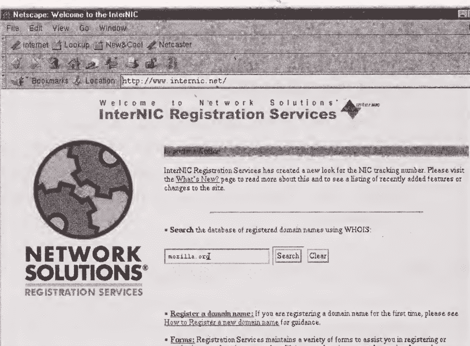

检查国家内的域名更为困难。许多国家运行 WHOIS 服务。其他国家也运行，但可能没有提供基于 Web 的接口，或者接口的位置不为人知或难以找到。

### 在 InterNIC 注册

如果你计划挑选 `.com` 或 `.org` 域名，并且打算提供自己的域名服务，那么去 InterNIC 注册你的域名是合适的选择。

InterNIC 允许你注册域名。过程非常简单，但它要求你提供准确的联系信息并支付注册费。一旦注册，你就负责维护你域名的 DNS 记录。

---

### named 配置文件

当 `named` 启动时，它会读取其配置文件，该文件在过去被称为引导文件。

该配置文件实际上有两种被广泛使用的格式。Caldera OpenLinux 1.3 包含一个使用新文件格式的 `named` 版本；但由于旧格式仍被广泛使用，值得提及。

新风格的配置文件默认命名为 `/etc/named.conf`。文件的内容类似于 C 语言的语法。选项设置块用大括号 `{}` 包围，每个设置以分号 `;` 结束。

```
zone "." {
  type hint;
  file "root.cache";
};
```

域名 `.` 被用于引用根域名。文件 `root.cache` 文件包含了关于该域名的名称服务器的信息。`named` 程序使用此文件进行初始化。

```
zone "linux.sys" {
  type master;
  file "named.hosts";
};
```

`linux.sys` 是该服务器作为主服务器负责的区域。区域 `"168.192.IN-ADDR.ARPA"` {

  type master;

  file "named.rev";

};

```

名称服务器不仅可以提供与名称对应的 IP 数字，它还可以执行反向查找，找到与 IP 数字相对应的名称。没有了这种反向查找能力，域名服务就是不完整的。事实上，互联网上有些服务器会拒绝任何无法通过这种方式查找地址的机器的连接。

按照惯例，对于反向查找，你使用伪域名。这种格式始终以 `IN-ADDR.ARPA` 结尾，前面是倒序排列的网络 IP 数字。由于我使用了格式为 `192.168.xxx.yyy` 的私有网络数字，因此伪域名是 `168.192.IN-ADDR.ARPA`。

```
zone "127.IN-ADDR.ARPA" {
  type master;
  file "named.local";
};
```


为了让名称服务器正常工作，你还需要能够对本地地址`127.0.0.1`执行反向查找。这第三个文件提供了该地址族的反向查找。

旧式的配置文件通常统称为`/etc/named.boot`。它的格式比新格式灵活性低，尽管对于非程序员来说，它可能更容易阅读和维护。该文件中的每一行都包含一个由空格或制表符分隔的关键字和参数。

## 测试系统

我的测试系统中与旧式格式的`/etc/named.conf`文件完全等效的文件所示：

| 目录 | /var/named | |
|---|---|---|
| cache | root.cache | |
| primary | linux.sys | named.hosts |
| primary | 168.12.IN-ADDR.ARPA | named.rev |
| primary | 127.IN-ADDR.ARPA | named.local |

## 根缓存

除了配置文件之外，最重要的文件名称是使用根缓存，通常命名为`root.cache`。基本上，此文件列出了`named`在解析域名时首先联系的服务器。

根缓存应该由系统管理员定期（例如每隔几个月一次）刷新进行缓存，以确保它包含最新信息。获取近期根缓存文件的良好源是`ftp://rs.internic.net/domain/named.root`。

## 测试系统

这里是我为系统使用的`root.cache`文件，已删除了注释行。

| A.ROOT-SERVERS.NET | 360000 IN NS | A.ROOT-SERVERS.NET |
| | 360000 A | 198.41.0.4 |
| B.ROOT-SERVERS.NET | 360000 NS | B.ROOT-SERVERS.NET |
| | 360000 A | 128.9.0.107 |
| C.ROOT-SERVERS.NET | 360000 NS | C.ROOT-SERVERS.NET |
| | 360000 A | 192.38.4.12 |
| D.ROOT-SERVERS.NET | 360000 NS | D.ROOT-SERVERS.NET |
| | 360000 A | 128.10.90 |
| E.ROOT-SERVERS.NET | 360000 NS | E.ROOT-SERVERS.NET |
| | 360000 A | 192.203.23.10 |
| F.ROOT-SERVERS.NET | 360000 NS | F.ROOT-SERVERS.NET |
| | 360000 A | 192.5.25.41 |
| G.ROOT-SERVERS.NET | 360000 NS | G.ROOT-SERVERS.NET |
| | 360000 A | 192.112.36.4 |
| H.ROOT-SERVERS.NET | 360000 NS | H.ROOT-SERVERS.NET |
| | 360000 A | 128.63.2.53 |
| I.ROOT-SERVERS.NET | 360000 NS | I.ROOT-SERVERS.NET |
| | 360000 A | 192.36.14.17 |
| J.ROOT-SERVERS.NET | 360000 NS | J.ROOT-SERVERS.NET |
| | 360000 A | 198.41.0.10 |
| K.ROOT-SERVERS.NET | 360000 NS | K.ROOT-SERVERS.NET |
| | 360000 NS | 192.0.34.129 |
| L.ROOT-SERVERS.NET | 360000 NS | L.ROOT-SERVERS.NET |
| | 360000 A | 198.32.64.12 |
| M.ROOT-SERVERS.NET | 360000 NS | M.ROOT-SERVERS.NET |
| | 360000 A | 202.27.33 |

## 区域文件

区域文件包含特定域的实际信息，名称服务器作为主服务器为这些域提供服务。每个区域文件包含一个或多个记录。每个记录由几个字段组成，其中一些是可选的。第一个字段指定记录的名称。它必须从行首开始。名称可以是单个`@`字符，作为所描述的区域名称的替代符；也可以是一个普通名称，被解释为域名内的名称。例如，如果你有一个`linux.sys`域的区域文件，区域文件中的`@`字符将是该域名的替代符；该单词将被解释为域名内的名称。

（注：原文此处存在大量重复的句子，翻译时已根据逻辑进行了精简处理，保留核心含义）

区域文件包含一个或多个记录。每个记录由几个字段组成，其中一些是可选的。第一个字段指定记录的名称。它必须从行首开始。

- **SOA**（起始区域记录）：提供关于区域的设置。
- **Serial**（起始序列）：每次区域文件更新时都应递增。
- **Refresh**（刷新）：从服务器重新检查主服务器更新的时间间隔。
- **Retry**（重试）：如果主服务器不可用，重试的时间间隔。
- **Expire**（过期）：从缓存中删除记录的时间。
- **TTL**（生存时间）：记录在缓存中保留的时间。
- **NS**（名称服务器）：指定该区域的名称服务器。
- **A**（地址记录）：将域名映射到 IP 地址。
- **MX**（邮件交换器）：指定处理邮件的服务器。
- **CNAME**（别名）：将一个名称映射到另一个名称。
- **PTR**（指针）：用于反向查找，将 IP 地址映射到名称。

# 第 6 章 域名系统

如果没有名称服务器在运行，请启动`named`程序，它会自动将其移动到后台。该程序通常位于`/sbin/`或`/usr/sbin`目录中。

`named`服务器会将错误消息和警告发送到系统日志。你需要运行`syslog`守护进程以便拦截这些消息并将它们存储在日志文件中。日志文件中可能如下条目：

```
host named[6400]: /etc/named.conf:1: syntax error near directory
host named[6401]: No root nameservers for class IN
```

如果你看到此类指示错误状况的消息，请尝试纠正该状况并重启服务器。

在我的测试系统上，`named`消息出现在系统日志文件`/var/log/messages`中。在我成功建立连接后，我使用以下命令检查了该文件的最后几条目：

```
$ tail -5 /var/log/messages
host named[6794]: cache zone " (IN) loaded (serial 0)
host named[6794]: master zone "linux.sys" (IN) loaded
(serial 1)
host named[6794]: master zone "168.192.IN-ADDR.ARPA" (IN) loaded
(serial 1)
host named[6794]: master zone "127.IN-ADDR.ARPA" (IN) loaded
(serial 1)
```

系统重启后，这些消息改为出现在控制台上；发生这种行为的原因是 Calder 的标准启动脚本在启动系统服务之前启动了`named`。

要验证由`name`提供的数据是否准确，请使用交互模式下的`nslookup`工具。输入`nslookup`可以显示是否存在由`/etc/resolv.conf`指定的运行的名称服务器。例如，如果我的系统上有一个针对`127.IN-ADDR.ARPA`的区域，尝试启动`nslookup`将导致错误：

```
$ nslookup
*** Can't find server name for address 127.0.0.1: Server failed
*** Default servers are not available
```

在交互模式下，你输入想要解析的名称，`nslookup`会打印结果。你还可以使用某些特定的命令，最著名的是`set type`命令，它可以让你查找特定记录类型。

## 测试系统

不再赘赘，这里是一段简短的`nslookup`会话记录，它帮助我验证了`named`配置是正确的：

```
$ nslookup
Default Server: localhost
Address: 127.0.0.1

> host
Server: localhost
Address: 127.0.0.1
Name: host.linux.sys
Address: 192.168.1.1

> host.linux.sys.
Server: localhost
Address: 127.0.0.1
Name: host.linux.sys
Address: 192.168.1.1

> 192.168.1.1
Server: localhost
Address: 127.0.0.1
Name: host.linux.sys
Address: 192.168.1.1

> linux.sys.
Server: localhost
Address: 127.0.0.1
Name: linux.sys

> set type=MX
> linux.sys.
Server: localhost
Address: 127.0.0.1
linux.sys preference = 10, mail exchanger = host.linux.sys
linux.sys nameservers = host.linux.sys
host.linux.sys internet address = 192.168.1.1

> set type=NS
> linux.sys.
Server: localhost
Address: 127.0.0.1
linux.sys nameservers = host.linux.sys
host.linux.sys internet address = 192.168.1.1

> set type=ANY
> linux.sys.
Server: localhost
Address: 127.0.0.1
linux.sys
origin = host.linux.sys
mail addr = root.host.linux.sys
serial = 1
refresh = 10800 (3H)
retry = 3600 (1H)
expire = 604800 (1W)
minimum ttl = 10800 (3H)
linux.sys preference = 10, mail exchanger = host.linux.sys
linux.sys nameserver = host.linux.sys
linux.sys nameserver = host.linux.sys
host.linux.sys internet address = 192.168.1.1

> 168.192.IN-ADDR.ARPA
Server: localhost
Address: 127.0.0.1
linux.sys
origin = host.linux.sys
mail addr = root.host.linux.sys
serial = 1
refresh = 10800 (3H)
retry = 3600 (1H)
expire = 604800 (1W)
minimum ttl = 10800 (3H)
linux.sys preference = 10, mail exchanger = host.linux.sys
linux.sys nameserver = host.linux.sys
linux.sys nameserver = host.linux.sys
host.linux.sys internet address = 192.168.1.1
```


```
$ nslookup
Default Server: localhost
Address: 127.0.0.1

> host
Server: localhost
Address: 127.0.0.1

Name: host.linux.sys
Address: 192.168.1.1

> host.linux.sys.
Server: localhost
Address: 127.0.0.1

Name: host.linux.sys
Address: 192.168.1.1

> 192.168.1.1
Server: localhost
Address: 127.0.0.1

Name: host.linux.sys
Address: 192.168.1.1

> linux.sys.
Server: localhost
Address: 127.0.0.1

Name: linux.sys

> set type=MX
> linux.sys.
Server: localhost
Address: 127.0.0.1

linux.sys preference = 10, mail exchanger = host.linux.sys
linux.sys nameservers = host.linux.sys
host.linux.sys internet address = 192.168.1.1
> set type=NS
> linux.sys.
Server: localhost
Address: 127.0.0.1

linux.sys nameservers = host.linux.sys
host.linux.sys internet address = 192.168.1.1
> set type=ANY
> linux.sys.
Server: localhost
Address: 127.0.0.1

```

`linux.sys`

origin = `host.linux.sys`

mail addr = `root.host.linux.sys`

serial = 1

refresh = 10800 (3H)

retry = 3600 (1H)

expire = 604800 (1W)

minimum ttl = 10800 (3H)

`linux.sys` preference = 10, mail exchanger = `host.linux.sys`

`linux.sys` nameserver = `host.linux.sys`

`linux.sys` nameserver = `host.linux.sys`

`host.linux.sys` internet address = 192.168.1.1

> 168.192.IN-ADDR.ARPA

Server: localhost

Address: 127.0.0.1

`linux.sys`

origin = `host.linux.sys`

mail addr = `root.host.linux.sys`

serial = 1

refresh = 10800 (3H)

retry = 3600 (1H)

expire = 604800 (1W)

minimum ttl = 10800 (3H)

`linux.sys` preference = 10, mail exchanger = `host.linux.sys`

`linux.sys` nameserver = `host.linux.sys`

`linux.sys` nameserver = `host.linux.sys`

`host.linux.sys` internet address = 192.168.1.1

```

# 第 6 章 域名系统

如果没有名称服务器在运行，请启动`named`程序，它会自动处理将其移动到后台。该程序通常位于`/sbin/`或`/usr/sbin`目录中。

`named`服务器会将错误消息和警告发送到系统日志。你需要运行`syslog`守护进程以便拦截这些消息并将它们存储在日志文件中。日志文件中可能如下条目：

```
host named[6400]: /etc/named.conf:1: syntax error near directory
host named[6401]: No root nameservers for class IN
```

如果你看到此类指示错误状况的消息，请尝试纠正该状况并重启服务器。

在我的测试系统上，`named`消息出现在系统日志文件`/var/log/messages`中。在我成功建立连接后，我使用以下命令检查了该文件的最后几条目：

```
$ tail -5 /var/log/messages
host named[6794]: cache zone " (IN) loaded (serial 0)
host named[6794]: master zone "linux.sys" (IN) loaded
(serial 1)
host named[6794]: master zone "168.192.IN-ADDR.ARPA" (IN) loaded
(serial 1)
host named[6794]: master zone "127.IN-ADDR.ARPA" (IN) loaded
(serial 1)
```

系统重启后，这些消息改为出现在控制台上；发生这种行为的原因是 Calder 的标准启动脚本在启动系统服务之前启动了`named`。

要验证由`name`提供的数据是否准确，请使用交互模式下的`nslookup`工具。输入`nslookup`可以显示是否存在一个由`/etc/resolv.conf`指定的运行的名称服务器。例如，如果我的系统上有一个针对`127.IN-ADDR.ARPA`的区域，尝试启动`nslookup`将导致错误：

```
$ nslookup
*** Can't find server name for address 127.0.0.1: Server failed
*** Default servers are not available
```


在交互模式下，你输入想要解析的名称，`nslookup` 会打印结果。你还可以使用某些特定的命令，最著名的是 `set type` 命令，它可以让你查找特定记录类型。

# 第 7 章 连接

选择 ISP（互联网服务提供商）是困难的。大多数服务提供商服务大众市场；他们心目中的用户是一个使用 Windows 95 机器的青少年，浏览网页，在聊天室浪费时间。在极少数例外情况下，当连接任何类型的服务器时，他们提供的服务是不够的。有些提供商甚至在服务合同中明确规定不允许任何连接。在选择提供商之前，请列出你的需求。在购买服务时，这里有一组你需要回答的简单问题：

- 你的网络是否需要 IP 连接能力？如果你计划为网络上的用户提供 Web 访问，运行自己的 Web 或 FTP 服务器，那么答案是肯定的。
- 你是否需要高速连接？如果你有许多用户，或者你向互联网公众提供此类服务，那么高速连接是必不可少的。
- 你是否需要专用（全天候）连接？如果你将在互联网上提供服务，例如 Web 或 FTP 服务器，专用连接和固定 IP 地址是必须的。
- 你需要多个 IP 地址吗？如果你将包含多个计算机的网络连接到互联网，就需要多个 IP 地址，除非你使用 Linux 系统作为掩控防火墙（有关此主题的更多信息请参阅第 11 章“防火墙”）。
- 你是需要网络路由还是仅仅单个主机或防火墙网关？如果你使用多个 IP 地址，则需要路由。
- 你是否需要邮件服务？
- 你会运行自己的邮件服务器吗？运行自己的邮件服务器可以让你无需依赖 ISP 来管理用户邮箱，而且还可以让你轻松地实现内部电子邮件。

## 准备连接

之前章节中的所有讨论都是为了帮助你在选择服务时做出明智的决定。

## 您需要批量发送邮件吗？

批量发送邮件并非必不可的，但如果您正在运行自己的邮件服务器且没有全天候的网络连接，这将非常有帮助。

## 您是否希望 ISP 充当您的备份邮件服务器？

如果您正在运行自己的邮件服务器，将您的备份 ISP 命名为备份服务器有助于在服务器宕机时避免丢失消息。

## 您是否在您的 ISP 处需要邮箱？（多少个？）

如果您不打算运行邮件服务器，您必须在其他地方拥有邮箱，例如公共免费邮箱服务或通过您的 ISP。

## 您需要域名吗？

### 您是否希望 ISP 为您注册域名？

如果您要注册 `.com` 域名的域名，自己注册可能更便宜，除非您的 ISP 将此服务作为套餐方案的一部分。

### 您是否希望 ISP 担任您的主或次 DNS 服务？

即使您运行自己的邮件服务器，一个备份服务器（以防您的服务器出现故障）也是很有用的。

## 您计划建立网站吗？

### 您是否希望 ISP 提供 Web 托管服务？

让您的 ISP 托管网站可以使您的网络连接免受入 Web 流量的额外负担。它还能为访问者提供更快的下载速度，但代价是更复杂的网站管理程序和额外的费用。

### 您需要安全交易能力吗？

如果您计划提供在线购物服务或处理机密信息，安全交易处理是非常重要的。

## 您是否希望拥有本地新闻服务器？

### 您是否希望与您的 ISP 交换 Usenet 新闻组？

某些服务器仅用于托管私有新闻组；然而，如果您的网络用户经常查看某些新闻组，您也可以选择托管几个公共新闻组。更多信息请参阅第 9 章“邮件列表与新闻组”。

如果您能回答这些问题，就可以向潜在的 ISP 出一份购物清单。例如，几年前，当我切换到新的服务提供商时，我能够要求他们对以下服务报价：

- 我需要 28.8Kbps 的拨号 PPP（非专享）。我有一套便携的 IP 地址（C 类子网），需要进行路由。
- 我需要通过 UUCP 进行双向批量邮件交付。
- 我需要对一组特定的约 100 个 Usenet 新闻组进行双向批量交付。
- 我有已注册的域名，需要主、次 DNS 服务。
- 我需要在能够在提供商的主机上建立网站（不需要安全交易）。

当我开始比价时，我发现当我提到 UUCP 等词汇时，某些 ISP 完全不知道我在说什么。其他则不提供所需的服务，或者给出了极高的价格。最终，我发现一家本地 ISP 可以提供我要求的所有服务，此后多年，我一直是他们的满意客户，直到今天我仍在那里保留着一个备份账户。

除了检查 ISP 是否以具有竞争力的价格提供您所需的服务外，您还需要确保它是您在网络连接上可以信赖的 ISP。您不希望当调制调器在晚上时段丢失信号时，由于所有线路繁忙而在后的几小时内无法重新连接，导致您没有网络可用。您不希望 ISP 拥有大量调制调器并提供您所需的所有服务，但出站数据能力有限，导致在用高峰高峰出现严重的延迟。最后，您不希望 ISP 破产或陷入所有权纠纷导致您处于断网状态。在紧急情况下切换到另一个 ISP 是行的，但我向您保证那一点也不好玩！

## 测试系统

对于我的测试系统，我有以下购物清单：

- 我需要专用的拨号 PPP 服务。
- 我的服务器需要一个单一的固定 IP 地址。
- 出测试目的，我需要批量 UUCP 邮件交付的选项。
- 我需要一个可以来自 ISP 命名空间的域名。我希望为该子域名提供主服务。
- 我将在本地运行我的 Web 服务器、新闻组服务器和其他服务器。

选择 ISP 很容易：我将使用其他现有的系统自己提供这些服务。

## 设置您的调制调器

在通过电话线建立拨号连接之前，您显然有一个工作良好的调制调器。

在 Linux 下，没有必要安装调制调器驱动。除非您成功为自己的调制调器编译了带有串口支持的内核，否则您的系统已经包含了“对话”并利用内部或外部调制调器所需的内容。

测试调制调器的简单方法是使用通信程序。`minicom` 是一个强大、简单但多功能的通信程序，大多数 Linux 发行版都包含了它。

第一次运行 `minicom` 时，以 root 用户身份运行，然后使用 `-s` 命令行开关。这会调用一个菜单，您可以通过它设置程序的初始配置（见图 7.1）。实际设置当然取决于您的系统配置、调制调器类型等。将配置保存为 `dfl`（默认配置）。

### 图 7.1

配置 `minicom`。


## 连接

（注：此处内容与前文逻辑重复，已根据翻译要求精简。）

## 第 7 章 建立连接

对于单用户工作站来说，简单的办法是让用户调用 `pppd`，也许通过一个简单的命令行脚本来方便他们的操作。诚然这不是一个优雅的解决方案，但确实有效。不过，如果能让拨号过程自动完成就好了，例如，当用户开始使用 Web 浏览器时建立连接，并且在一段时间没有数据流量时自动终止连接，那就太棒了。

在工作站上仅仅是实用的功能，在服务器上变成了必不可少的特性。对于没有连接到互联网的服务器，按需拨号（demand-dial）能力确保了系统用户可以无缝访问互联网（也就是说，无需登录服务器并手动调用 `pppd`，然后事后还忘记关闭它！）。即使通过拨号线路拥有了永久连接，当连接因线路质量差等原因中断时，能够自动重新建立连接也是必要的。

所有这些以及更多功能都可以通过一个非常有用的工具来实现：`dial`，即拨号守护进程（daemon）。该实用由 Eric Schenk 开发，通过一套复杂的规则工作，决定何时建立或断开连接。

这些规则可以非常简单，如“始终保持此连接开启”，或“在工作日的 9 点到下午 5 点之间保持系统连接，否则在有传出流量时连接，并在空闲分钟后断开”。它们也可以更复杂，例如忽略特定类型的的数据包，或者调整拨号器的行为以匹配某些本地通话按需付费的国家电信公司的计费规则。

附带的 Caldera OpenLinux-ROM 中提供了一个 `dial` 守护进程版本。如果你有兴趣获取最新版本的 `dial` 或只是想了解它（撰写本文时的时间），`dial` 的主页位于 http://www.loonie.net/-eschenk/dial.html。

## 路由与转发

当 IP 连接建立并并运行后，必须配置系统对发送到本地网络之外目的流量使用该连接。这通过设置默认路由来实现，即对于任何没有其他已知路由的数据包设置该路由。这可以自动完成；Linux 下的 `pppd` 可以在物理连接建立时设置默认路由，并在连接中断时移除该路由。

然而，仅设置默认路由并不足以将系统转变为路由器（即充当本地网络上其他机器与外部连接之间接口的主机）。为此，内核必须支持并启用数据包转发（IP 转发）。（如果你使用的是重新编译的内核，请确保它包含 IP 转发。）

如果你使用的是附带 CD-ROM 中的 Caldera 内核，则已经包含了 IP 转发。然而，OpenLinux 默认禁用了 IP 转发，必须通过 LISA 工具启用。

要这样做，请使用 `-system` 参数启动 LISA，并从菜单中选择“Configure server/daemon Autostart”（配置服务器/守护进程自动启动）。在随后的屏幕中，其中一个选项标记为“IP forwarding”（通常禁用！）！参见图 7.2。

### 图 7.2

启用 IP 转发。

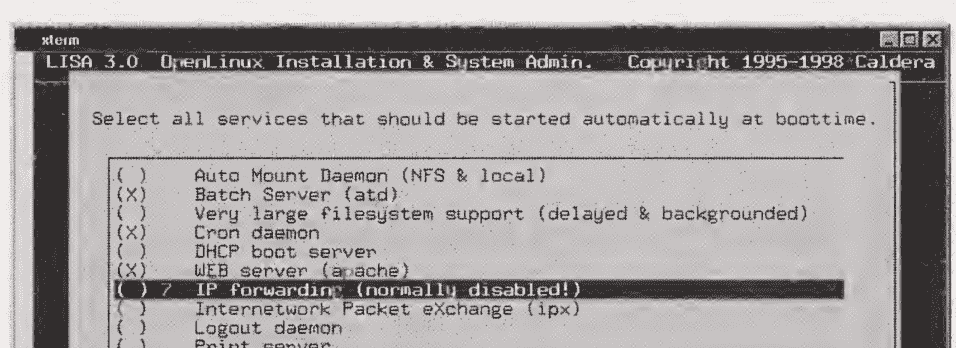

为了让新设置生效，你需要重启内核。或者，通过以下命令（以 root 用户身份执行）手动启用 IP 转发：

```
echo 1 >/proc/sys/net/ipv4/ip_forward
```

## 为你的网络获取 IP 号

开启 IP 转发仍然不足以让网络上的其他计算机通过你的 Linux 系统连接互联网。问题在于，其他计算机的 IP 号可能无法被本地网络之外的任何系统识别。因此，尽管这些机器能够发送数据包，但没有返回包可以到达它们，也无法成功建立连接。

这个问题有两个解决方案。首先，你可以在你的 Linux 服务器上开启防火墙网关功能（具体说是 IP 别名，也称为 IP 伪装）。这使得你的整个网络在外部世界看来只有一个 IP 号。使用 Linux 作为防火墙网关的详细细节将在第 11 章“防火墙”中介绍。该解决方案的缺点是防火墙网关不支持所有类型的互联网连接。

另一个解决方案是从你的 ISP 获取一个地址范围。该方案的主要优点是简单且兼容良好；缺点是你必须手动配置地址。无论使用哪种方案，都必须在路由器上指定防火墙网关。

## 入站连接

服务器上的调制解调器不仅用于拨出，还用于接受入站连接。一旦你启用调制调器的自动应答设置，除非软件显式禁用，否则它将一直接听。如果你有一条双用电话线，你可能想调整调制调器在接听之前等待的响声次数。

## 入站数据

在通过串口线接受连接时，UNIX 具有明显的优势。与 MS-DOS 不同，UNIX 从一开始就被设计为通过终端支持多个用户。现在 `getty` 在串口线上的工作方式与虚拟控制台一样。配合调制调器使用它的技巧是将调制调器置于自动应答模式。

如果你列出运行中的进程（使用 `ps ax`），你会注意到有许多该程序的副本运行，每个虚拟控制台一个。是 `getty` 程序显示了初始登录提示符，并在接受标识符后，调用 `login` 命令进行密码验证并启动 shell。

你如何确保 `getty` 每次系统开机时启动启动并监控调制调器线路呢？当然，通过将其放入 `/etc/inittab`！如果你记得第 4 章“互联网配置与基础安全”，正是在 `/etc/inittab` 中指定启动程序。如果你查看此文件，将已经看到包含 `getty` 命令的条目；这些是在虚拟控制台上启动 `getty`。你需要另一个条目，一个在连接调制调器的串口线上启动 `getty` 的条目。

为了确保调制调器正常工作，你可能还想启用 DTR 挂断和载波检测（Carrier Detect）设置。第一个确保当用户完成工作时调制调器正确掉电话连接。第二个设置允许调制调器在线路断开时通知计算机。

> 一旦你启用调制调器的自动应答设置，它在通电时将一直接听电话，除非软件显式禁用。如果你有一条双用电话线，你可能想调整调制调器在接听之前等待的响声次数。

## 测试系统

我的测试系统包含一个外部 U.S. Robotics Sportster 33.6 调制调器。该调制调器背面有一排 DIP 开关，用于调整调制调器的默认行为。我们将开关 1 拨到关闭位置（掉 DTR 终止通话并将开关 5 也拨到关闭位置（自动应答）。

我的 `/etc/inittab` 文件包含了用于六个虚拟控制台的六行内容，但没有调制解器的项。我的调制解器在 `/dev/ttyS1` 上，所以我添加了以下这一行：

```
s1:3:respawn:/sbin/getty ttyS1 38400 vt100
```

有趣的是，`38400` 参数并不是真正的速率参数；它是一个识别 `/etc/gettydefs` 文件中条目的标签。该文件包含了控制台（VC）和串口的终端配置，其中一个配置（`38400`）是大多数高速调制解器的正确配置。

最后一个参数 `vt100` 是 `getty` 初始设置的终端类型（即 `TERM` 环境变量）。此项设置与大多数终端仿真程序兼容。一旦我做了更改，我通过输入以下命令强制 `init` 程序重新读取 `/etc/inittab`：

```
kill -1 1
```

也就是说，我向始终运行在进程 ID 1 的 `init` 程序发送了一个挂断（HUP）信号。通过此设置，我能够通过另一台电脑和电话线拨入测试系统。我还测试了系统对会话期间断开连接的响应；它正确地终止了新孤立串口上所有运行的应用程序，并重启了 `getty` 程序，后者又重置了调制解器。

使用普通的 `getty` 有一个缺点：它不允许应用程序之间共享调制解器线路。如果你对同一个调制解器线路进行拨入和拨出连接，它将无法工作。

幸运的是，另一个版本的 `getty` 救出现：`uugetty`。这个程序的名称源于 UUCP，它从该系统继承了锁定机制。
其原理非常简单：当一个进程想要使用串口时，它首先检查已知位置是否存在锁文件。如果存在锁文件，该进程就不会访问串口；否则，它会在操作前创建自己的锁文件。锁文件包含进程 ID（PID），因此如果某个进程在没有释放锁的情况下崩溃，其他进程可以注意到这一事实并删除过期的锁文件。

这种简单的机制允许协作的应用程序共享一个调制解器。`minicom` 应用程序、`uugetty` 和 `pppd` 都能使用兼容的锁文件。唯一的问题是，关于这些锁文件的位置和格式存在多种约定；幸运的是，大多数良好的 Linux 发行版都包含了重要程序的二进制版本，且这些版本之间是兼容的。

## 测试系统

在我的测试系统上，启用 `uugetty` 所需仅是将 `/etc/inittab` 中新添加的行改为以下内容：

```
s1:3:respawn:/sbin/uugetty -d /etc/getty.ttyS1 ttyS 38400 vt100
```


`/etc/getty.ttyS1` 文件包含一行：

```
ALTLOCK=cua1
```

使用这一行可以确保如果你使用`dev/cua1`作为设备名与其他可以访问调制解调器的程序（如`minicom`），锁定机制也能正常工作。

之后，我再次向`init`发送了挂断信号（`kill -HUP 1`）。因为我已经在串口线上运行了一个`getty`，所以我也必须移除它。我使用`ps`命令找到了该进程并用 HUP 信号将其杀掉。作为响应，`init`在串口上派生了一个`uugetty`副本。然后，我再次从另一台电脑拨入并测试了系统。

## 用于拨入电话的 PPP

现在，通过终端仿真程序从远程机器登录这都非常好了——但远程机器是如何建立 IP 连接的呢？

当然是通过启动`pppd`守护进程。这比听起来要复杂，原因如下：

- 你不能在终端仿真器中启动`pppd`——你只会在仿真器的系统上看到乱码字符。你从中连接的系统必须运行它自己的版本的`pppd`和`chat`或等效程序。
- 你需要使用正确的命令行开关来启动`pppd`，这可能会变得相当复杂。

第一个问题在大多数桌面操作系统上通过使用登录脚本解决了。例如，在 Windows 95/98 的拨号上网连接（DUN）设施下，带有`.SCP`文件扩展名的脚本（通常）被存储在`Program Files\Accessories`目录下。

第二个问题的答案是格式良好的`pppd`命令行。命令行可以手动输入，但更常见的做法是，你会将其作为登录脚本的一部分，例如与 Windows 95 DUN 使用的脚本。在许多情况下，命令行看起来像这样：

```
exec /usr/sbin/pppd passive silent modem crtscts 192.168.1.1:192.168.1.168
```

`pppd`有许多更多选项，但此行在处理拨入连接时是典型的。使用`exec`命令是节省少量内存和系统资源的简单方法。与其将`pppd`作为一个单独进程启动，不如`exec`调用 shell 转换为新进程。这意味着进程列表中少了一个项，并节省了一点内存。`passive`和`silent`选项告诉`pppd`静坐等待连接。`crtscts`和`modem`选项确保`pppd`与调制解调器通信。命令行的最后部分指定了本地地址。远程地址可以是任意的，只要它是有效的 IP（子掩码为 255.255.255.0）。`mgetty`的功能是它在接收到传真后调用外部程序的能力。还有一些实用程序可以将原始组 3 文件转换为更可识别的格式（如 TIFF）。通过这些工具和功能的组合，可以让`mgetty`调用一个简单的 shell 脚本，该脚本反过来创建一个带有正确附件的邮件。事实上，较新的`mgetty`分发版已自带这种实现。

## 运行 FAX 服务器

一种解决方案是使用 Linux 作为 FAX 服务器。使用的工具称为`mgetty+sendfax`。正如名称所示，该包实际上包含两个部分：`mgetty`是一个为调制解调器设计的智能 get 程序，而`sendfax`是一个处理模块。

配置`mgetty`并不容易。包通常以源码形式发行，你需要在 C 文件中调整参数并重新编译包才能使用。然而，如果你频繁使用它，这是值得的。

## 测试连接系统

为了在实践中演示这些原理，我设置我的系统连接到“服务提供商”——家里一台接受拨入数据电话的 Linux 系统。

我的目标是配置我的系统按需连接，并在空闲时断开，以便允许拨入。

## 拨号说明

“服务提供商”提供了建立 PPP 连接的说明：

1. 拨打服务器。
2. 像往常一样连接，在提示时输入用户 ID 和密码。
3. 通过向服务器发送以下命令行在服务器上启动 PPP 守护进程：`exec /usr/sbin/pppd passive silent modem crtscts 192.168.2.1:192.168.2.132`
4. 启动本地的 PPP 守护进程。

## 测试登录过程

在折腾 PPP 之前，我想测试我的密码是否有效。我还需要看到系统返回的响应，以便我构建一个功能良好的 chat 脚本。

## 第 7 章 建立连接

使用`minicom`，我拨打了提供的号码并登录了。以下是我的会话记录：

```
atdtds5551212

CONNECT 28800/ARQ/V34/LAPM/V42BIS

你已接入一个私人计算机系统。对本系统的通话将使用呼叫方身份识别（来电显示）进行记录。未经授权的通话侵犯了我的隐私，更不用说法律了！如果你没有获得我的明确授权访问此系统，现在是终止连接的好时机。

Viktor

欢迎来到 Linux 2.0.30。
```

```
vtt1:login: vtt
Password:
Last login: Thu Feb 25 04:12:49 on ttyS0
Linux 2.0.30.
```

谎言者，名词（n.）：

一位拥有巡回委托权的律师。

- 安布鲁斯·比斯（Ambrose Bierce），《魔鬼字典》

```
vtt1:- exit
NO CARRIER
```

## 运行 pppd

在确认我可以登录服务商的系统后，我现在需要编写一个脚本来定义登录的会话。我将文件命名为`/etc/connect.chat`；其内容基于我测试会话的记录以及服务商的说明：

```
"" ATDS5551212 CONNECT " "login: vttoth "password": SECRET "vtt1:-"

exec /usr/sbin/pppd passive silent modem crtscts

->192.168.2.1:192.168.2.132"
```

现在是测试 ppp 的时候了。以 root 身份，我在本地机器上通过命令行调用了 PPP。（不要因为我在本地机器上调用`pppd`命令而感到困惑，该命令负责拨号，而服务器负责接收接入的连接）：

```
/usr/sbin/pppd -d ttyS1 38400 connect '/usr/sbin/chat -f
->/etc/connect.chat' \
modem crtscts lock defaultroute
```

## 连接测试系统

结果如何？成功了！我听到了调制解调器的拨号声，几秒钟后，我的系统就连接到了互联网。我可以通过多种方式验证这一点。

首先，我查看了`/var/log/messages`。在调用 PPP 之后，其中包含了类似下面的消息：

- Feb 25 04:25:31 host pppd[18539]: pppd 2.2.0 started by root, uid 0
- Feb 25 04:26:01 host pppd[18539]: Serial connection established.
- Feb 25 04:26:02 host pppd[18539]: Using interface pp0
- Feb 25 04:26:02 host pppd[18539]: Connect: pp0 <-> /dev/tty1
- Feb 25 04:26:03 host pppd[18539]: local IP address 192.168.2.132
- Feb 25 04:26:03 host pppd[18539]: remote IP address 192.168.2.1

接下来，我输入了`/sbin/ifconfig`。如果接口正常，此命令会显示如下的条目：

```
pp0
    Link encap:Point-to-Point Protocol
    inet:192.168.2.132  t:P:192.168.2.1  Mask:255.255.255
    UP POPOINT RUNNING MTU:1500 Metric:1
    RX packets: 6 errors:0 overruns:0
    TX packets: 6 errors:0 overruns:0
```

然后，输入`/sbin/route`显示了新建立的路由：

```
#sbin/route
Kernel IP routing table
| Destination | Gateway | Genmask | Flags | Metric | Use | Iface |
| 192.168.2.1 | * | 255.255.255 | UH | 0 | 0 | pp0 |
| 192.168.1.0 | * | 255.255.0.0 | U | 0 | 0 | eth0 |
| 127.0.0.0 | | | 255.0.0.0 | U | 0 | 12 | lo |
| default | 192.168.2.1 | 0.0.0.0 | UG | 0 | 1 | pp0 |
```

但最重要的是，我可以使用`traceroute`到达远程目标。例如：

```
traceroute to www.mcp.com (198.70.14.70), 30 hops, 40 bytes
1   192.168.2.1 (192.168.2.1) 144.71 ms 187.38 ms 169.697 ms
2   192.168.2.126 (192.168.2.126) 139.56 ms 187.57 ms 149.699 ms
3   192.168.2.1 (205.150.253.1) 149.97 ms 198.29 ms 169.679 ms
4   192.168.2.1 (205.150.253.1) 198.50 ms 188.68 ms
5   192.168.2.1 (205.150.242.89) 195.522 ms 207.993 ms 189.675 ms
6   192.168.2.1 (137.39.17) 219.519 ms 218.574 ms
7   192.168.2.1 (146.168.2.788) 229.518 ms 208.602 ms 209.684 ms
8   192.168.2.1 (146.168.2.997) 239.524 ms 208.631 ms 219.64 ms
9   192.168.2.1 (157.130.103.94) 219.527 ms 248.690 ms 219.650 ms
10  192.168.2.1 (206.53.249.1) 219.534 ms 208.615 ms 219.660 ms
11  192.168.2.1 (206.246.190) 219.541 ms 219.840 ms 219.672 ms
```

## 运行 dial

在证明我可以手动运行`pppd`后，我现在需要的是使用`dial`自动化该过程。

首先，`dial`需要一个配置文件。该文件通常称为`/etc/dialconf`。最简单的`dial`配置之一允许链路在有流量时激活，并在空闲一段时间后关闭链路。这里有一个实现此目的的`dial`配置：

```
accept any 300 any
```

这并不难，对吧？用人类语言来说，这行代码告诉`dial`接受任何类型的包作为激活链路或保持空闲链路活跃的触发。只有在五分钟内没有发送或接收包的情况下，连接才会终止。

这种脚本的问题在于它太简单了；对于许多 ISP（服务商），你会发现使用这样的脚本，链路会一直保持活跃。原因是即使在空闲链路上，偶尔也会传输路由包。你可以使用以下`dial`配置来防止此类数据包激活链路：

```
ignore udp.dest=udp.route
ignore udp.source=udp.route
accept any 300 any
```

接下来，必须启动`dial`本身。我创建了一个名为`rc.dial`的小脚本，包含以下内容：

```bash
#!/bin/sh
/usr/sbin/dial /dev/tty1 -m connect '/usr/sbin/chat -f /etc/connect.chat' modem crtscts lock defaultroute \
local 192.168.2.132 remote 192.168.2.1
```

此脚本可以从命令行调用。为了让`dial`在系统启动时自动运行，我创建了`/etc/rc.d/init.d/dial`文件，其内容如下：

```bash
#!/bin/sh
NAME=dial
DAEMON=/usr/sbin/dial
PIDE=/var/run/$NAME.pid

/etc/sysconfig/network

case "$1" in
start)
  [ -x $DAEMON ] || exit 0
  [ $(NETWORKING) != "no" ] || exit 0
  echo "Starting $NAME"
  if [ -f /etc/diald.conf ]; then
    $DAEMON /dev/tty1 -m ppp connect /usr/sbin/chat -f \
    /etc/connect.chat modem crtscts lock defaultroute \
    192.168.2.132 remote 192.168.2.1
  fi
stop)
  [ -f $PIDE ] || exit 1
  echo "Stopping $NAME"
  kill $PIDE
esac
exit 0
```

这本质上是标准启动脚本的修改版本。由于启动过程已经知道`/etc/rc.d/init.d/dial`，创建此文件（并确保它具有执行权限！）就足够了。

在安装并测试`diald`后，我拥有了一个通过单一调制解调器提供无缝出站连接的系统。

## 使用外部路由器

前面的章节解释了如何使用带有调制解调器的机器连接互联网。如果你的内置调制解调器实际上是像调制解调器的 ISDN 设备，指令同样适用。但如果你使用的是外部 ISDN 或更高的路由器呢？

事实证明（至少对于 Linux 盒子而言），外部路由器大大简化了问题。你不再需要担心调制解调器配置、自动拨号守护进程等。如果你的路由器配置正确，你只需要将 Linux 系统的默认路由指向路由器即可。

在这种情况下，路由功能和其他服务器功能不再由同一台机器执行。网络上的客户端将使用外部路由器处理 IP 流量，但它们将继续使用你的 Linux 机器作为邮件服务器（图 7.3）。

图 7.3

使用外部路由器。

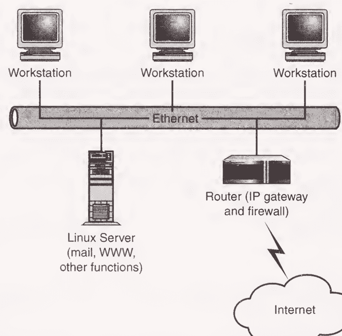

使用外部路由器的主题将在第 12 章“外部路由器”中进行详细探讨。

## 总结

成功建立互联网连接所需的步骤包括寻找 ISP（互联网服务供应商）、使用 PPP 建立连接以及设置路由。

为了选择最佳的 ISP，你需要了解自己的需求——你想使用的连接速度、是否为专线连接、你的网络是否需要 IP 地址等。

要建立连接，你首先需要设置你的调制解调器。Linux 默认支持串口上的调制解调器，你可以使用如`minicom`等电信程序来验证调制解调器是否工作正常。

调制解调器运行后，你需要配置 PPP。`pppd`守护进程使用另一个程序`chat`来执行简单的连接脚本。你使用的连接脚本应该反映从 ISP 处收到的登录指令。

为了确保根据使用情况自动激活（或可选地终止）PPP 连接，你可以利用拨号守护进程（dial daemon）。该程序在后台监控 IP 流量，并根据其配置文件中存储的规则在需要时建立 PPP 连接。

你也可以将 Linux 服务器配合外部路由器使用。在这种情况下，Linux 服务器将继续执行许多服务器功能（如邮件和名称服务），而路由器将接管 IP 转发功能，以及可选的防火墙网关功能。

## 手册页

有关本章讨论的话题的更多信息，请参考以下手册页。

- `man chat`
- `man getty`
- `man gettydefs`
- `man inittab`
- `man minicom`
- `man pppd`
- `man setserial`
- `man 7 signal`

## 基础服务

- 8 运行邮件服务器
- 9 邮件列表与新闻组
- 10 Web 服务

## 第 8 章 运行邮件服务器

电子邮件是今天互联网上最流行的应用程序。ISP 和其他组织使用的最流行的邮件服务器是免费的`sendmail`服务器。这个软件包极其健壮且功能强大；遗憾的是，它也因难以配置而闻名。

这种困难的原因并非概念上的复杂性；邮件传输和投递是相对直接的过程。主要原因是`sendmail`著名的配置文件`sendmail.cf`复杂的语法。

为了说明这一点：关于 sendmail 的权威参考——由 Bryan Costales 和 Eric Allman 编写的书籍（*sendmail, 2nd edition*）是一本超过 1000 页的编写密集巨著！

这种表面的疯狂背后是有原因的；sendmail 是一个为了处理各种网络环境下的多种邮件系统而设计的工具。直到最近，邮件系统才在很大程度上变得统一，这使得许多灵活性变得不再必要；而且即使在今天，仍然存在许多奇特的环境是无法通过更简单的程序来提供服务的。

不用多说，将 1000 页巨著中包含的信息压缩到 20–30 页的章节是不可能的任务。你所能希望的是对基础知识提供一个合理连贯的解释，这正是我在这里提供的。

## 邮件投递过程

你可能每天都会发送和接收几十封电子邮件。但你知道在点击邮件应用程序中的“发送”按钮后，你的文字会发生什么吗？

第一步，你的邮件客户端通过名为 SMTP（简单邮件传输协议）的协议联系你的发件服务器（邮件传输代理，或 MTA）。SMTP 会话接收端的邮件服务器是一个程序（例如`send-mail`、`smail`、Microsoft Exchange Server），它接受邮件正文以及你的邮件客户端添加到消息中的任何头信息。

接下来，服务器处理发送者、收件者地址以及头信息。根据收集的信息，服务器决定如何处理该消息。消息可能被本地投递到邮箱；可能临时存储在队列中等待投递；或者被传递给另一个服务器。控制投递的规则可以非常详细，消息在到达目的地之前可能会经过复杂的路径。


# 第 8 章 运行邮件服务器

最后，除非地址错误或发生其他投递问题，否则某处的服务器最终会接受该消息作为本地投递的消息。然后它将消息存入收件者的邮箱箱。邮箱箱有许多形状；在 UNIX 系统上，用户的邮箱箱通常是一个文件（`/var/sp/mail/username`），其中包含了用户的所有未读消息。

最后，用户的邮件客户端程序（或邮件用户代理，MUA）从邮箱箱提取消息。本地运行的客户端可以直接访问邮箱箱；如果客户端跨网络运行（例如，在家庭电脑上运行客户端，但在 ISP 的邮件服务器上访问邮箱箱），则会使用如 POP3（邮局协议）之类的网络协议。

这一过程在图 8.1 中所示。

注意，投递过程的最后一步与其他步骤不同。到此为止，所有消息都是“推送”的；也就是说，是发送者发起交易，使消息向目标地更近一步。在最后一步，过程反转了；是客户端通过查询服务器上的可用消息来“拉取”消息。

## 邮件用户代理

MUA 是用户用于与邮件系统通信的客户端程序。

Linux 下最简单的 MUA 是 `mail` 命令。这是一个非常精简的客户端；因为不使用网络，它只能读取本地邮件。

```text
$ mail
You have 1 message.
1  From: Viktor Toth <vtoth@linux.sys>
Date: Thu, 25 Feb 1999 16:22:00 -0500
Subject: Test

This is a test message.
```

最全屏的 UNIX 客户端之一是 `pine` 程序。与 `mail` 不同，`pine` 提供了一个全屏界面（见图 8.2）。它还能解码和保存兼容 MIME 的附件。

图 8.2 pine 邮件应用程序。

总而言，大多数人并不使用基于 UNIX 的 MUA 来访问邮箱箱，即使邮箱箱本身位于 UNIX (Linux) 系统上。最广泛使用的邮件客户端是随流行的浏览器分发的那些：Netscape 的 Messenger，Microsoft 的 Outlook Express。Windows PC 的高端邮件客户端是 Microsoft Outlook。

## 邮件传输代理

MTA（或邮件服务器）有很多口味，但 `sendmail` 服务器远之是最广泛使用的服务器。这个优秀的工具是互联网邮件服务器中的凯迪拉克；它能完成你希望邮件服务器做的一切，甚至更多。它已经存在多年，目前的版本异常稳定且健壮。关于 `sendmail` 唯一可以说的缺点可能是，由于它的广泛普及，它是安全破解尝试的频繁目标。另一方面，由于程序的健壮性，大多数此类尝试都是失败的，至少在 `sendmail` 配置得当的情况下！

另一个 UNIX 邮件服务器是 `smallmail` 程序。虽然它提供了 `sendmail` 的许多功能，但配置起来稍微简单。此外，我发现在需要在拨号连接互联网并使用批量投递邮件的系统上，它更容易设置。

在 UNIX 世界之外，流行的邮件服务器包括 Microsoft Exchange Server 或 IBM-Lotus 的 Domino 等。`sendmail` 服务器也有非 UNIX 的实现，其中一个就是适用于 Windows NT。

## 邮箱与协议

由于有如此许多运行在不同操作系统上的 MTA（邮件传输代理）和 MUA（邮件用户代理），你可能会纳奇于这些程序是如何协同运作的。

秘密在于标准化。所有的互联网邮件程序都使用一组通用的协议。所有的 UNIX 邮件代理都使用通用的文件位置、格式和访问机制。尽管多达六个程序在邮件从发送者传输到目的地的过程中对其处理，但结果是一个无缝且可靠的（至少大多数时候是这样）邮件系统。

## SMTP：简单邮件传输协议

所有互联网邮件服务器都使用一种共同机制接收消息：SMTP。无论是你的邮件客户端还是另一个邮件服务器转发消息，方法都是相同的：发送系统使用该协议连接到接收服务器，指定消息的发送者和接收者，然后传输消息本身。

SMTP 名称中使用“simple（简单）”一词并不是委婉说法。该协议实际上简单到你完全可以手动完成事务。以下是一个自证其明的例子：

```text
$ telnet localhost smtp
Trying 127.0.0.1...
Connected to localhost.
Escape character is '^'
220 linux.sys SMTP Sendmail 8.8.7/8.8.7; Thu, 25 Feb 1999 17:38:55 -0500
HELO linux.sys
250 linux.sys Hello vttoth@localhost [127.0.0.1], pleased to meet you
MAIL FROM: vttoth@linux.sys
250 vttoth@linux.sys... Sender ok
RCP TO: vttoth@linux.sys
250 vttoth@linux.sys... Recipient ok
DATA
354 Enter mail, end with "." on a line by itself
From: vttoth@linux.sys
To: vttoth@linux.sys
Subject: Test
```

这是一封测试消息。

```text
250 RAA00760 Message accepted for delivery
QUIT
221 linux.sys closing connection
Connection closed by foreign host.
```

值得注意的是，实际投递地址并不是消息标头中 `To` 行包含的地址；它是在 `RCPT TO:` SMTP 命令中定义的。这就是为什么可以发送密抄消息或向大型邮件列表发送消息，而不在消息标头中显示真实的接收者地址。遗憾的是，邮件广告商经常滥用这一功能，利用它来隐藏真实身份，发送带有伪造标头的消息。

## UNIX 风格邮箱

你在 UNIX 系统上的邮箱通常是位于 `/var/spool/mail` 目录下的文件，并以你的用户 ID 命名。

邮箱文件中的每条消息都以一个 `From` 行开头。这一行具有定义良好的格式，有助于邮件程序识别一条消息的结束和另一条消息的开始。（如果你好奇的话，是的，邮件程序可能会被混淆。如果消息包含一个格式正确的 `From` 行，邮件程序可能会将其解释为下一条消息的开始。）

`From:` 之后是消息标头，将在下一节中解释。在最后一个消息标头之后有一个空行，随后是消息正文。

```text
$ cat /var/spool/mail/vttoth Feb 25 17:39:37 1999
From vttoth@linux.sys Thu
Return-Path: <vttoth@linux.sys>
Received: from linux.sys (vttoth@localhost [127.0.0.1])
  by linux.sys (8.6.7/8.8.7) with SMTP id RAA00760
  for vttoth@linux.sys; Thu, 25 Feb 1999 17:39:25 -0500
Date: Thu 25 Feb 1999 17:39:25 -0500
From: vttoth@linux.sys
To: vttoth@linux.sys
Subject: Test
Message-Id: <199902252239.RAA00760@linux.sys>
```

这是一封测试消息。

## 消息标头与格式

如前面的示例所示，所有的电子邮件都有用于识别发送者、接收者、投递路径等的标头。这些标头并不是任意的；它们的格式和内容在互联网请求意见（RFC）文档 RFC-822 中定义。某些标头由发送者的邮件客户端程序创建，而另一些则由处理消息的服务器添加。

以下是你会遇到的一些最常用的标头行：

`To:` 行指定接收者。该行可以包含单个电子邮件地址、用逗号分隔的多个电子邮件地址，或者显示名称和电子邮件地址（在这种情况下，电子邮件地址部分被括在角括号）。如果显示名称包含标点符号，应用双引号括起来。

`From:` 行指定发送者。其语法与 `To:` 行一样简单。偶尔，消息可能还有 `Reply-To:` 标头，如果它与 `From:` 行显示的地址不同，则该标头指定消息的回复地址。

大多数消息还有 `Date:` 标头，指示消息发送的时间。`Subject` 行提供了消息内容的简要摘要。`Message-Id` 是消息的唯一标识符。

其他标头行包括 `Cc`（允许对消息进行抄送）和 `Bcc`（允许密抄）。`Return-Path` 指明对消息的回复应发送到哪里。`Received` 标头显示消息通过各种邮件服务器的路径。`Content-Type` 标头指定消息的格式，例如纯文本、HTML 或多部分格式。`Content-Transfer-Encoding` 指明用于消息正文的编码。

## POP3：邮局协议

所有互联网邮件服务器都使用一种共同机制接收消息：SMTP。无论是你的邮件客户端还是另一个邮件服务器转发消息，方法都是相同的：发送系统使用该协议连接到接收服务器，指定消息的发送者和接收者，然后传输消息本身。

SMTP 名称中使用“simple（简单）”一词并不是委婉说法。该协议实际上简单到你完全可以手动完成事务。以下是一个自证其明的例子：

```text
$ telnet localhost pop3
Trying 127.0.0.1...
Connected to localhost.
Escape character is '^'
220 linux.sys POP3 ready
USER vttoth
+3OK OK name
PASS password
+3OK OK
LIST
+OK 1 message
RETR 0
+354 Enter mail, end with "." on a line by itself
From: vttoth@linux.sys
To: vttoth@linux.sys
Subject: Test

This is a test message.
```

```text
250 RAA00760 Message accepted for delivery
QUIT
221 linux.sys closing connection
Connection closed by foreign host.
```

值得注意的是，实际投递地址并不是消息标头中 `To` 行包含的地址；它是在 `RCPT TO:` SMTP 命令中定义的。这就是为什么可以发送密抄消息或向大型邮件列表发送消息，而不在消息标头中显示真实的接收者地址。遗憾的是，邮件广告商经常滥用这一功能，利用它来隐藏真实身份，发送带有伪造标头的消息。

## 邮件转发与别名

通常需要转发邮件。例如，用户可能暂时离开，并将其邮件投递到移动地址。

Linux 上的个人用户可以通过在主目录下创建一个名为 `.forward` 的文件来设置邮件转发。该文件通常只包含一行转发地址。

另一种常见的邮件转发方法是通过全局别名文件，通常为 `/etc/aliases`。该文件包含如下行：

```text
postmaster: root
```

此行确保任何发送给 `postmaster` 的邮件实际上都会投递到 `root` 用户的邮箱。目标不需要在本地系统，例如：

```text
webmaster: webmaster@headoffice.org
```

如果你更改 `/etc/aliases` 文件，需要运行 `newaliases` 命令才能生效。

## 用于批量交付的 UUCP

当你运行 `sendmail` 服务器时，通常假设你有一个永久的互联网连接，或者其他 `sendmail` 服务器连接到你的服务器投递邮件，而你的服务器可以连接到它们以发送出的消息。

在许多小型办公室环境中，永久的互联网连接是不实际也不符合成本效益的。然而，运行 `sendmail` 服务器可能是理想，因为它是可靠的，可以作为内部邮件的邮件服务器，并且让你无需依赖 ISP 来创建和管理邮箱。

这带来了一个困境：一个主要设计为使用 SMTP 协议与其他服务器进行交互式消息交换的邮件服务器，如何在隔离环境中运行良好呢？

首先，你可以利用 `sendmail` 的功能，将任何本地投递的消息传递给一个智能主机（smart host）。之所以这样命名，是因为被假设比你的主机更智能，而且它知道如何投递你的 `sendmail` 副本无法处理的消息。

其次，你可以告诉 `sendmail` 通过 UUCP 将消息投递到这个智能主机。

UUCP 是一种从一个主机向另一个主机传输批量文件的简单机制。文件通过 `uux` 命令传递给 UUCP，它们通常位于队列目录（spool directory）中，直到 `uucico` 命令激活。实际投递由 `uucico` 执行，它可以通过调制调器拨号远程系统、登录并与远程的 `uuzero` 副本通信。文件传输后，将由目标系统上的 `uuxqt` 程序进行处理（见图 8.3）。

### 图 8.3
通过 UUCP 进行文件交换。

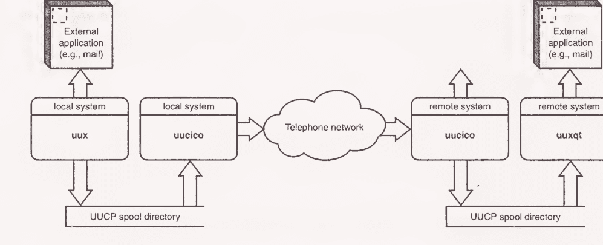

UUCP 并不特定于电子邮件。它可以用于复制任何类型的文件，并在远程系统上执行任何命令（只要远程系统的安全设置允许此类执行）。当处理的是邮件时，目标系统上会调用 `gmail` 命令；这个 UUCP 的伴侣命令设计用于处理远程邮件。

`uucico` 程序通常被安排为定期间隔执行，例如每小时执行一次。投递几封邮件通常只需要几秒钟，让调制调器线路在其余时间里保持空闲。

## 配置 sendmail

也可以配置 UUCP 通过在现有的 IP 连接上运行。如果通常用于 UUCP 邮件投递的调制调器也用于建立 Internet 连接，那么这就尤为有用。如果 Internet 连接持续时间很长，通常会阻止邮件的正常流动，因为 `uucico` 永远没有机会控制调制调器。通过 IP 连接运行的能力克服了这一困难。

## 配置 sendmail

邮箱、协议、邮件客户端程序；在这一切中心的核心是 `sendmail` 程序。

`sendmail` 的角色非常简单：

1. 接收传入邮件
2. 处理报头和投递地址
3. 如果可能，在本地投递消息，或者
4. 将消息转发到可以处理它的主机机

## 规则集 (Rulesets)

`sendmail` 程序通过处理一系列规则集来完成这些步骤。每个规则集在消息投递的特定阶段被调用，每个规则集都包含一组规则，告诉 `sendmail` 如何处理不同类型的地址。

`sendmail` 内部定义了几个规则集，用于处理所有邮件消息。这些规则在图 8.4 所示。它们的目的有三点：处理发件者和收件者地址，并选择投递方法。

每个规则执行一个特定的操作。首先，`sendmail` 检查正在处理的地址是否匹配当前规则。如果是，它将执行规则规定的操作。该操作可能会导致地址被重写，也可以选择投递代理（delivery agent）或触发错误条件。

### 图 8.4
`sendmail` 的核心规则集。

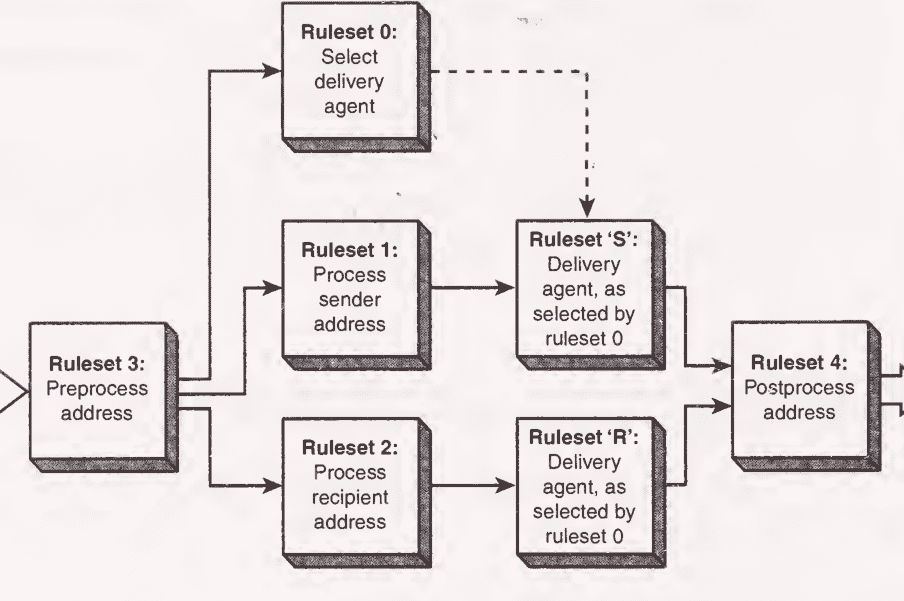

## sendmail.cf 文件

规则存储在 `/etc/sendmail.cf` 文件中。与其从头创建此文件，你通常会使用随 `sendmail` 安装的副本作为起点。或者，`sendmail` 拥有一些工具，可以使用一组相对简单的宏来生成不同版本的 `/etc/sendmail.cf`。

`sendmail.cf` 中的规则使用一种非常强大但极难记忆的语法编写。例如，有一条规则会导致所有来自 `whitehouse.gov` 域的地址被拒绝：

```text
R$ * @ $ . whitehouse . gov $error $: "550 Spam Forbidden"
```

不用说，上一行中的每个字符都有意义；即使是不可见空格和制表符之间的差异也可能完全改变规则的含义。

你你应该花精力对规则和规则集有一个浅显的理解的原因很简单：`sendmail.cf` 文件是你防御 Internet 上日益增长的威胁——不受欢迎的邮件（垃圾邮件）的最佳手段。

## 使用宏工具

`sendmail.cf` 文件通常是一个不可理解的怪物，包含了一千多行晦涩的规则和无法理解的宏定义。任何理智的人都不会尝试从零开始编写它。

来救场的是一种名为 `m4` 的通用宏语言。这种宏语言在大多数 UNIX 系统上都可用（包括附带光盘上的 Caldera OpenLinux 发行版）。宏语言的目的非常简单：它解释符号的关联，稍后每当遇到之前定义的符号时，它将其替换为定义。这里有一个简单的 `m4` 示例：

```text
define(text,replacement)

This is some text.
```

将此文件（命名为 `test.m4`）交给 `m4` 程序：

```text
$ m4 <test.m4
```

如你所见，输出中的单词 `text` 被替换为单词 `replacement`。也可以通过附加关键字 `dnl`（删除到新行）来消除输出中额外的空行（原本包含 `define` 命令的行的占位符）：

```text
define(text,replacement)dnl

This is some text.
```

`sendmail.cf` 文件通常是一个难以理解的怪物，包含了数千行晦涩的规则和无法理解的宏定义。任何理智的人都不会尝试从零开始编写它。

来救场的是一种名为 `m4` 的通用宏语言。这种宏语言在大多数 UNIX 系统上都可用（包括附带光盘上的 Caldera OpenLinux 发行版）。宏语言的目的非常简单：它解释符号的关联，稍后每当遇到之前定义的符号时，它将其替换为定义。这里有一个简单的 `m4` 示例：

```text
define(text,replacement)

This is some text.
```

将此文件（命名为 `test.m4`）交给 `m4` 程序：

```text
$ m4 <test.m4
```

如你所见，输出中的单词 `text` 被替换为单词 `replacement`。也可以通过附加关键字 `dnl`（删除到新行）来消除输出中额外的空行（原本包含 `define` 命令的行的占位符）：

```text
define(text,replacement)dnl

This is some text.
```


## 第8章 运行邮件服务器

这带来了一个困境：一个主要设计为使用 SMTP 协议与其他服务器进行交互式消息交换的邮件服务器，如何在隔离环境中运行良好呢？

首先，你可以利用 `sendmail` 的功能，将任何本地投递的消息传递给一个智能主机（smart host）。之所以这样命名，是因为被假设比你的主机更智能，而且它知道如何投递你的 `sendmail` 副本无法处理的消息。

其次，你可以告诉 `sendmail` 通过 UUCP 将消息投递到这个智能主机。

UUCP 是一种从一个主机向另一个主机传输批量文件的简单机制。文件通过 `uux` 命令传递给 UUCP，它们通常位于队列目录（spool directory）中，直到 `uucico` 命令激活。实际投递由 `uucico` 执行，它可以通过调制调器拨号远程系统、登录并与远程的 `uuzero` 副本通信。文件传输后，将由目标系统上的 `uuxqt` 程序进行处理（见图 8.3）。

### 图 8.3
通过 UUCP 进行文件交换。


UUCP 并不特定于电子邮件。它可以用于复制任何类型的文件，并在远程系统上执行任何命令（只要远程系统的安全设置允许此类执行）。当处理的是邮件时，目标系统上会调用 `gmail` 命令；这个 UUCP 的伴侣命令设计用于处理远程邮件。

`uucico` 程序通常被安排为定期间隔执行，例如每小时执行一次。投递几封邮件通常只需要几秒钟，让调制调器线路在其余时间里保持空闲。

## 配置 sendmail

也可以配置 UUCP 通过在现有的 IP 连接上运行。如果通常用于 UUCP 邮件投递的调制调器也用于建立 Internet 连接，那么这就尤为有用。如果 Internet 连接持续时间很长，通常会阻止邮件的正常流动，因为 `uucico` 永远没有机会控制调制调器。通过 IP 连接运行的能力克服了这一困难。

## 配置 sendmail

邮箱、协议、邮件客户端程序；在这一切的核心是 `sendmail` 程序。

`sendmail` 的角色非常简单：

- 1. 接收传入邮件
- 2. 处理报头和投递地址
- 3. 如果可能，在本地投递消息，或者
- 4. 将消息转发到可以处理它的主机

## 规则集 (Rulesets)

`sendmail` 程序通过处理一系列规则集来完成这些步骤。每个规则集在消息投递的特定阶段被调用，每个规则集都包含一组规则，告诉 `sendmail` 如何处理不同类型的地址。

`sendmail` 内部定义了几个规则集，用于处理所有邮件消息。这些规则在图 8.4 所示。它们的目的有三点：处理发件者和收件者地址，并选择投递方法。

每个规则执行一个特定的操作。首先，`sendmail` 检查正在处理的地址是否匹配当前规则。如果是，它将执行规则规定的操作。该操作可能会导致地址被重写，也可以选择投递代理或触发错误条件。

### 图 8.4
`sendmail` 的核心规则集。


## sendmail.cf 文件

规则存储在 `/etc/sendmail.cf` 文件中。与其从头创建此文件，你通常会使用随 `sendmail` 安装的副本作为起点。或者，`sendmail` 拥有一些工具，可以使用一组相对简单的宏来生成不同版本的 `/etc/sendmail.cf`。

`sendmail.cf` 中的规则使用一种非常强大但极难记忆的语法编写。例如，有一条规则会导致所有来自 `whitehouse.gov` 域的地址被拒绝：

```
R$ * @ $ . whitehouse . gov $error $: "550 Spam Forbidden"
```

不用说，上一行中的每个字符都有意义；即使是不可见空格和制表符之间的差异也可能完全改变规则的含义。

你应该花精力对规则和规则集有一个浅显的理解的原因很简单：`sendmail.cf` 文件是你防御 Internet 上日益增长的威胁——不受欢迎的邮件（垃圾邮件）的最佳手段。

## 使用宏工具

`sendmail.cf` 文件通常是一个难以理解的怪物，包含了数千行晦涩的规则和无法理解的宏定义。任何理智的人都不会尝试从零开始编写它。

来救场的是一种名为 `m4` 的通用宏语言。这种宏语言在大多数 UNIX 系统上都可用（包括附带光盘上的 Caldera OpenLinux 发行版）。宏语言的目的非常简单：它解释符号的关联，稍后每当遇到之前定义的符号时，它将其替换为定义。这里有一个简单的 `m4` 示例：

```
define(text,replacement)

This is some text.
```

将此文件（命名为 `test.m4`）交给 `m4` 程序：

```
$ m4 <test.m4
```

如你所见，输出中的单词 `text` 被替换为单词 `replacement`。也可以通过附加关键字 `dnl`（删除到新行）来消除输出中额外的空行（原本包含 `define` 命令的行的占位符）：

```
define(text,replacement)dnl

This is some text.
```

与其让你的服务器上坐着一颗定时炸弹，不如从源上防止垃圾邮件的产生呢？

较新版本的 `sendmail` 实际上提供了一种实现此点的巧妙方法。这些版本定义了两个特殊的规则集：`check_mail` 和 `check_rcpt`。当远程主机连接到你的 `sendmail` 服务器并发送 `MAIL FROM` 和 `RCPT TO` 命令时，这些规则就会被调用。换句话说，这些规则可以在垃圾邮件发生之前阻止其进入，而不是在事后将垃圾邮件移动到丢弃文件夹。

利用这些规则集，可以定义执行以下操作的规则集：

- 1. 拒绝来自已知垃圾主机的邮件
- 2. 拒绝来自已知垃圾发送者的邮件
- 3. 拒绝通过已知垃圾中继主机转发的邮件
- 4. 如果收件者在本地系统之外，则拒绝来自外部主机的邮件（中继）

这些规则如果实施得当，可以为你以后省去很多麻烦。事实上，在当今时代，任何在永久 Internet 连接上运行未经保护的 `sendmail` 服务器的人都是在自取灭亡；这不是“是否”会发生的问题，而是“何时”发生的问题。下一节包含了对 `sendmail.cf` 的示例添加，实现了最基础的过滤行为。

> 最新版本的 `sendmail`（版本 8.9 或更高版本，未包含在随附的 CD-ROM 中）进一步简化了中继过滤。欲需更多信息，请访问以下网页：http://www.sendmail.org/tips/relaying.html。

## 配置测试系统

当我通过 Caldera OpenLinux 安装程序与其他组件一起安装 `sendmail` 时，一个可用的 `sendmail.cf` 文件被安装在 `/etc/sendmail.cf` 目录下。就目前而言，该文件已经提供了一个 `sendmail` 配置，能够在本地投递邮件并与远程服务器交换邮件。然而，我对这个结果并不满意；我希望 `sendmail` 配置还能提供针对最危险的垃圾邮件形式——即违愿邮件的中继的保护。

# 第 8 章 运行邮件服务器

测试系统的配置为即使在没有永久连接 Internet 的情况下也能运行。出于这个原因，我想要一种允许通过 UUCP 投递的 `sendmail` 配置。

考虑到这些目标，我开始激活 `sendmail` 服务器。

## 激活 sendmail

当 Calder OpenLinux 安装程序安装 `sendmail` 时，你可能还没有配置它自动启动。（事实上，在完全配置之前，不让它自动启动可能是一个好主意，以避免潜在的安全风险。）要配置 `sendmail` 自动启动，你需要使用 `LISA` 工具。确保你是 root 用户，并输入以下命令：

```
lisa -system
```

这将直接带进入 LISA 系统配置菜单，你可以在那里选择 `Configure daemon/server Autostart` 选项。接下来的屏幕列出了所有可以自动启动的服务；确保邮件传输代理（`sendmail`）旁边有一个 X（见图 8.5）。

**图 8.5** 选择自动启动 `sendmail`

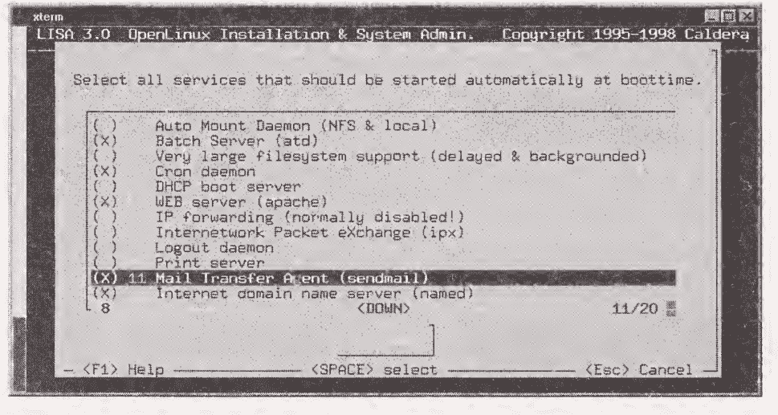

新设置将在系统重启后生效。或者，你可以使用以下命令行（作为 `/usr/sbin/sendmail` 的 root 用户）手动启动 `sendmail`：
`sendmail -bd -q5m`

如果 `sendmail` 正在运行，它将出现在进程列表中，例如

```
$ ps axu | grep sendmail

root 1831 0.0 1.1 1272 720 ? S 23:22 0:00 sendmail: accepting c
```

我还曾通过 `telnet` 连接到本地机器的 SMTP 端口来测试 `sendmail`，正如本章早些时候。

## 创建 sendmail.cf

在证明 `sendmail` 可以正常工作后，我开始创建我自己的版本的配置 `sendmail.cf`，或者说，可以从 `sendmail.cf` 文件自动生成一个 `m4` 宏文件。以下是一些实验结果：

```
OSTYPE(linux) dnl
define(`HELP_FILE`,`/usr/share/sendmail/sendmail.hf')
define(`STATUS_FILE`,`/var/log/sendmail.st`)
define(`SMART_HOST`,`uccp-dom:mcp`)
MASQUERADE_AS(`linux.sys`)
FEATURE(always_add_domain)
FEATURE(local_procmail,/usr/bin/procmail')
FEATURE(masquerade_envelope)
FEATURE(nocanonity)
FEATURE(nodns)
FEATURE(smsh,/usr/sbin/smsh')
MAILER(local)
MAILER(smtp)
MAILER(uucp)
```


第一行是强制性的，`OSTYPE` 宏定义了使用该配置文件的操作系统基本特征。接下来的两行根据标准的 Candida OpenLinux 发行版定义了文件位置。

第四行非常重要：它定义了一个智能主机（smart host）——所有无法在本地投递的邮件都将转发到该主机。事实上，这一行告诉 `sendmail` 在处理传入的邮件时，应该尝试在本地投递邮件。如果无法实现，无论收件者是谁，`sendmail` 都应该通过 UUCP 将邮件转发到名为 `mcp` 的系统，并让它处理。注意，之所以需要智能主机是因为我通过 UUCP 连接。如果你运行的是全天 Internet 连接，则不需要智能主机。

第五行也是一个重要的配置选项。它告诉 `sendmail` 伪装成 `linux.sys`。

接下来的行开启了几个功能。以下是每个简要描述：

- `always_add_domain`：该选项为不包含域名的地址添加域名。
- `local_procmail`：允许 `sendmail` 通过 `procmail` 传递本地邮件。
- `masquerade_envelope`：该选项将信封地址伪装为指定的名称。
- `anonity`：该选项隐藏邮件头中的发送者身份。
- `nodns`：防止 `sendmail` 执行 DNS 查询。
- `smsh`：允许 `sendmail` 使用垃圾邮件过滤器。

与其让你的服务器上坐着一颗定时炸弹，不如从源上防止垃圾邮件的产生呢？

较新版本的 `sendmail` 实际上提供了一种实现此点的巧妙方法。这些版本定义了两个特殊的规则集：`check_mail` 和 `check_rcpt`。当远程主机连接到你的 `sendmail` 服务器并发送 `MAIL FROM` 和 `RCPT TO` 命令时，这些规则就会被调用。换句话说，这些规则可以在垃圾邮件发生之前阻止其进入，而不是在事后将垃圾邮件移动到丢弃文件夹。

利用这些规则集，可以定义执行以下操作的规则集：

1. 拒绝来自已知垃圾主机的邮件
2. 拒绝来自已知垃圾发送者的邮件
3. 拒绝通过已知垃圾中继主机转发的邮件
4. 如果收件者在本地系统之外，则拒绝来自外部主机的邮件（中继）

这些规则如果实施得当，可以为你以后省去很多麻烦。事实上，在当今时代，任何在永久 Internet 连接上运行未经保护的 `sendmail` 服务器的人都是在自取灭亡；这不是“是否”会发生的问题，而是“何时”发生的问题。下一节包含了对 `sendmail.cf` 的示例添加，实现了最基础的过滤行为。

> 最新版本的 `sendmail`（版本 8.9 或更高版本，未包含在随附的 CD-ROM 中）进一步简化了中继过滤。欲需更多信息，请访问以下网页：http://www.sendmail.org/tips/relaying.html。

## 配置测试系统

当我通过 Caldera OpenLinux 安装程序与其他组件一起安装 `sendmail` 时，一个可用的 `sendmail.cf` 文件被安装在 `/etc/sendmail.cf` 目录下。就目前而言，该文件已经提供了一个 `sendmail` 配置，能够在本地投递邮件并与远程服务器交换邮件。然而，我对这个结果并不满意；我希望 `sendmail` 配置还能针对最危险的垃圾邮件形式——即违愿邮件的中继的保护。

测试系统的配置为即使在没有永久连接 Internet 的情况下也能运行。出于这个原因，我想要一种允许通过 UUCP 投递的 `sendmail` 配置。

考虑到这些目标，我开始激活 `sendmail` 服务器。

## 激活 sendmail

当 Calder OpenLinux 安装程序安装 `sendmail` 时，你可能还没有配置它自动启动。（事实上，在完全配置之前，不让它自动启动可能是一个好主意，以避免潜在的安全风险。）要配置 `sendmail` 自动启动，你需要使用 `LISA` 工具。确保你是 root 用户，并输入以下命令：

```
lisa -system
```

这将直接带进入 LISA 系统配置菜单，你可以在那里选择 `Configure daemon/server Autostart` 选项。接下来的屏幕列出了所有可以自动启动的服务；确保邮件传输代理（`sendmail`）旁边有一个 X（见图 8.5）。

**图 8.5** 选择自动启动 sendmail


新设置将在系统重启后生效。或者，你可以使用以下命令行（作为 `/usr/sbin/sendmail` 的 root 用户）手动启动 `sendmail`：
`sendmail -bd -q5m`

如果 `sendmail` 正在运行，它将出现在进程列表中，例如：

```
$ ps axu | grep sendmail

root 1831 0.0 1.1 1272 720 ? S 23:22 0:00 sendmail: accepting c
```

我还曾通过 `telnet` 连接到本地机器的 SMTP 端口来测试 `sendmail`，正如本章早些时候。

## 创建 sendmail.cf

在证明 `sendmail` 可以正常工作后，我开始创建我自己的版本的配置 `sendmail.cf`，或者说，可以从 `sendmail.cf` 文件自动生成一个 m4 宏文件。以下是一些实验结果：

```
OSTYPE(linux) dnl
define(`HELP_FILE`,`/usr/share/sendmail/sendmail.hf')
define(`STATUS_FILE`,`/var/log/sendmail.st`)
define(`SMART_HOST`,`uccp-dom:mcp`)
MASQUERADE_AS(`linux.sys`)
FEATURE(always_add_domain)
FEATURE(local_procmail,/usr/bin/procmail')
FEATURE(masquerade_envelope)
FEATURE(nocanonity)
FEATURE(nodns)
FEATURE(smsh,/usr/sbin/smsh')
MAILER(local)
MAILER(smtp)
MAILER(uucp)
```

第一行是强制性的，`OSTYPE` 宏定义了使用该配置文件的操作系统基本特征。接下来的两行根据标准的 Candida OpenLinux 发行版定义了文件位置。

第四行非常重要：它定义了一个智能主机（smart host）——所有无法在本地投递的邮件都将转发到该主机。事实上，这一行告诉 `sendmail` 在处理传入的邮件时，应该尝试在本地投递邮件。如果无法实现，无论收件者是谁，`sendmail` 都应该通过 UUCP 将邮件转发到名为 `mcp` 的系统，并让它处理。注意，之所以需要智能主机是因为我通过 UUCP 连接。如果你运行的是全天 Internet 连接，则不需要智能主机。

第五行也是一个重要的配置选项。它告诉 `sendmail` 伪装成 `linux.sys`。

接下来的行开启了几个功能。以下是每个简要描述：

- `always_add_domain`：该选项为不包含域名的地址添加域名。
- `local_procmail`：允许 `sendmail` 通过 `procmail` 传递本地邮件。
- `masquerade_envelope`：该选项将信封地址伪装为指定的名称。
- `anonity`：该选项隐藏邮件头中的发送者身份。
- `nodns`：防止 `sendmail` 执行 DNS 查询。
- `smsh`：允许 `sendmail` 使用垃圾邮件过滤器。

## 防止垃圾邮件的规则

尽管我用自己创建的文件替换了默认的 `sendmail.cf`，但我尚未实现我的两个目标。UUCP 投递无法工作是因为我还没有配置 UUCP。我还没有添加任何防止垃圾邮件的规则。我决定处理这个问题。（顺便提一下，这里提供的解决方案更适用于完全不用 UUCP 的系统；当通过 UUCP 进行投递时，这些垃圾过滤规则将不起作用）。

事实上，尽管我正在向我的 `sendmail` 配置添加实际规则，但不需要直接编辑 `/etc/sendmail.cf`。这些规则可以附加到任何 m4 配置文件中。从上一节开发的文件开始，我增加了以下行：

```
LOCAL_CONFIG
Scheck_recpt
```

```
## 本地终止的都是允许
R< $* > $1
R$ $* $/3 $1
R$+ < $ . > $* $1 < @ $2 > $3
R$+ < @ $= w > $ $@ OK

## 本地起源的都是允许
R$* $(dequote " ${client_name})
R$=w $@ OK
R$# $@ OK

## 其他都是虚假的
R$* $$error: "550 Relaying Denied"
```

`LOCAL_CONFIG` 符号告诉宏处理器，随后的任何行必须在不更改的情况下添加到输出文件中。

`Scheck_recpt` 命令是用于定义规则的 `sendmail` 配置命令。`check_rcpt` 规则在 SMTP 会话中接收到 `RCPT TO` 命令后立即被调用，允许它简单地拒绝邮件，但完全阻止其投递。实际的规则将地址转换为标准格式，并与发送者连接到系统的地址进行比较。如果收件者是你的或本地系统，你就接受邮件。如果接受该邮件。然而，如果双方都在你的网络之外，这很可能是一个非法的中继尝试，即有人试图利用你的邮件服务器向第三方接收者发送邮件；此类邮件将被“Relaying Denied（拒绝中继）”错误信息拒绝。

类似的规则也可以用于拒绝来自主机或服务器的邮件，例如。你可以维护一个已知违规者的简单数据库，并拒绝任何源自这些人员或其控制的系统的邮件。这样你就可以不用受其骚扰；另一方面，如果你的系统有永久的 Internet 连接，那么你根本不需要配置一个防止邮件中继的过滤器。如果你真的配置了，那么被垃圾邮件发送者发现只是时间问题：你可能会发现一个严重过载的服务器正在处理一封包含成千上万地址收件人列表的垃圾邮件，以及来自世界各地数千个被冒犯收件者的愤怒回信，他们认为这封邮件源自你的系统。

不言而喻，也可以修改规则，允许你打算为其提供第三方邮件投递服务的主机进行中继。关于这一复杂主题的更多信息，请访问 `sendmail` 网站（http://www.sendmail.org）。它包含了有关最新 `sendmail` 发行版的信息，以及关于调整配置文件以使系统尽可能健壮和灵活的许多想法。

## 配置 UUCP 投递

当我安装 Caldera OpenLinux 时，我指定了 UUCP 为组件之一。因此，我在测试系统上发现了一份所谓的 Taylor UUCP 软件包的可运行副本。我需要的是一组配置文件来使这个 UUCP 副本能够正常工作。在 Caldera OpenLinux 上，这些文件的位置位于 `/etc/uucp` 目录。

第一个配置文件名为 `config`，它包含单独一行：

```
nename linuxsys
```

这一行定义了我的测试系统的 UUCP 名称。

第二个文件名为 `sys`，它包含了我的 UUCP 副本所知的每个远程系统的描述。在我的案例中，它包含了一个名为 `mcp` 的单系统定义：

```
system mcp
time Any 1
speed 38400
port modem
phone *70,,555122
chat "= \p\p\r\c login: \p\L word: \P :- $/usr/lib/uucp/uucico
chat-timeout 90
chat-fail BUSY
call-login vttoth
call-password Secret
max-retries 999
```

这些行告诉 UUCP，系统 `mcp` 通过电话号码 555-1212 可用，使用名为 `modem` 的端口。它们提供了用于登录系统并在那里启动 UUCP 的聊天记录（chat transcript）；并提供了登录名、密码和其他参数。`port` 参数实际上是指向第三个文件（`port`）的指针：

```
port modem
device cua1
dialer modem
port modem
type pipe
command /usr/bin/login -E -f vttoth mcp
```

前几行直观易懂。它们指定了端口实际上是设备 `cua1`。`dial` 参数是指向第四个配置文件（`dialer`）的指针。但在我们那之前，让我们仔细观察第二组行。这些行实现了即使在拨号调制器在使用的情况下执行 UUCP 投递的能力，同时维持 Internet 连接。在这种情况下，在拨号调制器上拨号将失败，因为调制器正忙。此时 UUCP 将转向备用连接，该连接简单地使用登录程序登录到远程系统（`mcp.com`，我们可以通过电话号码 555-1212 访问）并执行 UUCP 投递。在 Internet 连接上实现 UUCP 还有其他方法；这种解决方案的妙之处在于它对服务提供者的配合要求。只要他们提供服务，并且无论你是使用拨号连接还是通过 `telnet` 连接，你系统上的序列都是相同的，该解决方案就会生效。最后一个配置文件名为 `dialer`，它包含了通过拨号调制器拨号的指令：

```
dialer modem
chat "ATZATE0 OK ATDT CONNECT"
chat-timeout 60
```

第一行定义了拨号序列；第二行定义了 `port` 文件中提到的实际拨号序列。第三行定义了一个超时值，如果没有经过指定的秒数，拨号将失败。在这些配置有用之前，我需要对我的系统进行一项额外更改：

```
chmod 655 /usr/sbin/uucico
chown root:uucp /dev/cua1
chmod 660 /etc/cua1
```

这些命令共同确保了 `uucp` 命令在 `uucp` 组下运行，并且端口 `/dev/cua1` 属于该组。这保证了 `uucico` 实际上能够控制端口。为了测试此配置，我首先创建了一封发往外部区域的邮件。然后，我通过 `uustat` 命令验证了邮件已正确排队：

```
$ mail vttoth@mcp.com
Subject: Test message.
$ uustat -a | grep vttoth@mcp.com
```

接下来，对于实际投递，我按照如下方式调用了 UUCP：

```
/usr/sbin/uucico -s mcp
```

随后我听到了拨号调制器的拨号声，几秒钟内 UUCP 队列就空了；不久后，我能够验证邮件已到达目的地。

还剩下一个问题。显然，我不想在每次想要投递邮件或检查远程系统邮件时都手动调用 UUCP。如何实现自动化？答案在于 `crontab` 工具。作为 root 用户，你可以通过以下命令编辑 UUCP 的 `crontab`：

```
crontab -e -u uucp
```

这将使用 `vi` 编辑器打开现有的 UUCP `crontab`，如果不存在则打开一个空白文件。我使用的 `crontab` 包含以下行：

```
MAILTO=postmaster
5,20,35,50 * * * /usr/bin/uucico -r
*/9 * * * /usr/bin/touch /var/spool/uucp/vttoth/C.vttoth
```


第一行指定如果在执行调度命令期间遇到错误，邮件将发送给 `postmaster`（通常指向管理员地址的别名）。第二行确保每隔几分钟调用一次 `uucico` 查看是否有需要投递的内容。然而，仅靠这一行，如果没有出站邮件，UUCP 不会拨号；也就是说，它不会自动检查入站邮件。这是由第三行强制实现的，它每小时创建一个轮文件；当 `uucico` 发现此类轮文件时，即使没有出站邮件也会检查入站邮件。

## 总结

电子邮件是目前流行的 Internet 服务；运行邮件服务器是系统管理员的主要任务之一。最流行的邮件服务器是广泛使用的 `sendmail` 程序，它功能强大且健壮，但配置复杂。

电子邮件使用邮件用户代理（MUA）创建。它被传输到一个或多个邮件传输代理（MTA），最后由另一个 MUA 查看。在整个过程中，使用了多种标准，提供了常见的文件和消息格式、传输协议等。

这些标准中最重要的包括 SMTP（简单邮件传输协议），用于将邮件投递到 MTA；POP3，MUA 用于检索邮件；以及 RFC-822 和 MIME，它们定义了常见的消息格式。

`sendmail` 服务器可以使用 `sendmail.cf` 文件进行配置。该文件是规则集（rulesets）的容器，规则集控制邮件的处理和投递。然而，规则集的编写和维护是公认的难题；因此，系统提供了一些辅助工具，让人们可以使用一组相对较简单的宏来创建规则集。

`sendmail.cf` 文件可用于定义自定义规则，以防止投递不需要的邮件。在具有永久 Internet 连接的系统上，阻止垃圾邮件的堆积至关重要，因为垃圾邮件运营者经常劫持未保护的邮件服务器，将他们的消息发送给大量接收者。

## 手册页

有关本章中讨论的话题的更多信息，请参考以下手册页。

- `man aliases`
- `man makemap`
- `man procmail`
- `man sendmail`
- `man uucico`
- `man uucp`
- `man uustat`
- `man uux`
- `man uuxqt`

## 第 9 章 邮件列表与新闻组

普通电子邮件允许用户之间进行一对一的通信。通常，人们还希望另一种通信方式，例如讨论组。

实现讨论组最广泛的两种方法是邮件列表和新闻组。邮件列表的工作原理类似于普通电子邮件；使用一个特殊的电子邮件地址作为组成员的别名，发送到该地址的任何邮件都会分发给所有组员。然而，新闻组消息通常不会为每个用户复制，而是存储在服务器上，授权用户可以使用适当的客户端软件进行访问。

这两种方法都有其优缺点；而且在 Linux 服务器上都可以相对容易地进行配置。

> 注意
> 维护讨论组的另一种日益流行的方法是通过基于 Web 的界面来实现。要使用这种方法，你必须运行一个 Web 服务器，或者访问一个允许你运行服务器端脚本的 Web 服务器。聊天设施同样流行，但这些也需要专门的服务器软件。

## 邮件列表

邮件列表的目的是提供一个列表地址作为有效的电子邮件地址，并确保发送到该地址的所有邮件都重定向到列表的每位成员。

这项任务表面上的简单性具有欺骗性。除了极小的私有邮件列表外，还有许多额外要求以确保邮件列表能够安全、高效地管理。

一些常见的需求包括：

1. 用户自动“注册”的能力
2. 在将地址添加到列表之前，验证用户的身份（通过发送电子邮件并要求回复）
3. 在将新用户添加到邮件列表之前，由列表管理员对其进行批准
4. 对列表进行“审核”的能力（即在分发之前批准消息）

邮件列表可以通过多种方式建立，以满足不同的需求。这并不令人意外的是，最简单的解决方案也是灵活性最低的解决方案，并且可能存在最严重的潜在安全问题。

## 使用 .forward 文件

每个 UNIX 用户都可以在其家目录下拥有一个名为 `.forward` 的文件。如果该文件存在，它将控制发送给该用户的邮件的投递方式。`.forward` 文件通常用于为暂时离开并希望在另一个系统上接收邮件的用户维护转发地址。

> 注意
> `.forward` 文件与所有以点（`.`）开头的文件一样，是隐藏的，因为它不会出现在正常的目录列表中。要查看目录中的所有文件（包括隐藏文件），请使用 `ls -a` 命令。

话虽如此，但 `.forward` 文件的内容并不限于单个电子邮件地址。它可以包含任意数量的行，每行包含一个有效地址，为创建邮件列表提供了一种即时方法。`.forward` 地址可以位于有效用户的家目录下（将其电子邮件地址转换为列表地址），或者你也可以为此目的创建一个虚构用户。

遗憾的是，这种方法有几个缺点。首先，列表必须通过手动管理；用户需要通过编辑 `.forward` 文件来添加或删除用户。其次，无法对列表进行“审核”；发送到列表地址的消息会被无条件地转发。这种方法非常低效，如果列表很大或管理着多个邮件列表，可能会给你的系统带来沉重的负载。最后，该方法不提供安全保障；任何知道列表地址的人都可以向列表发送邮件，包括未经请求的垃圾邮件和其他不被欢迎的消息。

## 使用 /etc/aliases

使用全局别名文件 `/etc/aliases` 是前一节介绍方法的变体。与其将特定用户的邮件转发到地址列表，不如通过在 `/etc/aliases` 中放置类似于下行的行来为该列表创建一个别名：

```
biggguys:president@whitehouse.gov,linus@linux.org,billg@microsoft.com
```

> 注意
> 当你编辑 `/etc/aliases` 时，必须运行 `newaliases` 命令更改才能生效。

如果你使用这种方法，邮件列表只能由具有 `/etc/aliases` 访问权限的管理员更改。根据你的情况，这可能是一件好事。`/etc/aliases` 文件的处理效率比单个用户的 `.forward` 文件高一点。除此之外，这种方法保留了使用 `.forward` 文件的相同缺点——它没有手段审核列表或自动添加或删除列表成员。

## 列表管理器程序

当邮件列表很大，或者存在特定的安全或列表管理要求时，可能使用专门为此目的开发的软件合适，例如邮件列表管理器。

最广泛使用的邮件列表管理器之一被称为 Majordomo。它由 Great Circle Associates 开发，这个优秀的软件包可以从互联网上免费下载。最近的一个版本也附在本书的光盘上。

Majordomo 的理念与所有列表管理器的设计一样是简单的。对于每个已知列表，列表管理器维护一个订阅者列表。传入的消息分发给列表订阅者，并提供某些管理功能。

这些管理功能包括：

- 由于为了保护发送者身份而更改标头字段，或者添加回复字段
- 提供自动订阅或取消订阅列表的功能（无论是否经过批准）
- 通过将所有传入的消息发送到指定的地址来审核列表
- 可选限制列表仅接受来自成员的消息，或仅来自指定用户（例如，公告列表）

配置列表软件包是一项相当困难的任务。主要步骤包括：

1. 解压并安装列表软件
2. 创建配置
3. 更新和更改主程序（`sendmail`）
4. 创建列表
5. 测试配置

这些步骤的复杂性被使用的优势所抵消。

## 新闻组

邮件列表有很多优点，但有一个关键缺点：每条消息都会投递给列表的每个用户。当列表很小或消息很少时，这通常不是问题。然而，对于大型流行的列表，每天产生数千条消息，会对系统资源造成巨大的消耗。

邮件列表的替代方案是使用新闻组。新闻的发明正是为了解决信箱的这些局限性。除了电子邮件之外，新闻组是互联网上最老的服务。事实上，与电子邮件一样，新闻组技术早于现代互联网。也与电子邮件一样，新闻组可以使用替代投递方法（如 UUCP）投递到尚未完全接入互联网的远端大学和机构。

## 基本概念

看待新闻组的一种方式将其视为“社区信箱”。当普通电子邮件投递到你的账户时，它会被存入你的信箱，稍后由你的邮件客户端检索。如果你能让你的信箱对其他人可见，你就不需要邮件列表了；你只需要告诉其他人如何访问信箱，然后！大家都能阅读其内容。

当然，信箱并不完全适合这个目的，因为例如它允许任何访问它的人删除消息。对于社区信箱或公告板，你不希望有这种功能。即使允许删除消息，也应该只允许消息作者和，或许还允许管理员进行。

## 导览

归根结底，新闻组消息与电子邮件并没有太大区别。主要区别在于，新闻组消息不是发送给个人的，而是发送给新闻组的（从这个意义上说，新闻组名称的作用类似于邮件列表名称）。通常人们使用同一个客户端程序来访问收件箱和新闻组（例如，Windows 用户使用的 Microsoft Outlook Express）。

新闻组通常被组织成层级结构，其命名规范与互联网主机名和域名相似。外观上的主要区别在于新闻组名称，层级结构中的最高层位于开头；而互联网名称则是相反的。例如，在 Usenet 通用计算部分下根据操作系统层级结构运行的 Linux 新闻组被称为 `os.linux`，而不是 `name.linux.com`。

当你运行新闻程序时，它通常会开始下载你所连接的服务器上可用的新闻组列表。然而，由于一个非常明显的原因，这一过程并不是每次都重复的：承载全球大部分 Usenet 新闻组的服务器可能拥有多达 30,000 个新闻组，因此即使是新闻组列表也可能有几兆字节。新闻程序并不是下载整个列表，而是检查服务器上是否出现了任何新的新闻组。

当你选择其中一个新闻组时，你的新闻客户端程序会从服务器下载该组的消息列表。当你选择某条特定消息时，客户端会下载并显示整条消息。大多数客户端程序都会维护下载消息的本地缓存，以避免重复下载消息。

一条消息可以出现在多个新闻组中。这被称为交叉发布（cross-posting）。（注意，将消息发布到过多数量的新闻组被认为是不礼貌的——即网络礼仪。）非常重要的一点是，交叉发布不等于在几个新闻组中放置消息的副本！当你进行交叉发布时，服务器上只存在一份你消息的副本，它只是从多个组进行交叉引用。这允许新闻客户端在用户仅在另一个新闻组中阅读该消息时将其标记为已读，从而避免了读者在浏览不同新闻组时反复阅读同一条消息的麻烦和烦恼。

公共新闻组应用于其预期用途。例如，`comp.os.linux.hardware` 的存在是为了交换信息或提问硬件相关问题，而不是为了宣传你专门照顾和饲养西伯利亚虎的新网站。无论这条消息有多重要，或者你对宪法保护的言论自由权有何看法，事实都是如此！毕竟，言论并不意味着你被允许干扰公共电视信号，例如，即使你广播的、覆盖本地频道的消息具有重大的公共性。遗憾的是，并非所有人都能意识到这一点，许多公共新闻组充斥着无关消息、冒犯性广告以及更糟糕的内容。

## 服务器与消息

新闻组消息在全球范围内传播，是因为参与的服务器在不断地交换消息。当你配置新服务器时，你会指定它与哪些其他服务器联系以及交换什么类型的消息。例如，如果你运行一个包含 `comp.os.hierarchy` 层级结构下所有 Usenet 新闻组的本地服务器，你会将 `comp.os.*` 指定为将与你的互联网服务提供商（ISP）交换的新闻组集。另一方面，你可能特意想要排除 `local.*` 新闻组，以避免将私人消息发送到互联网。然而，如果你的公司有一个分支，且该处有自己的服务器，你可能希望与他们交换本地新闻组（见图 9.1）。可能性是无限的。

图 9.1
新闻组传播。

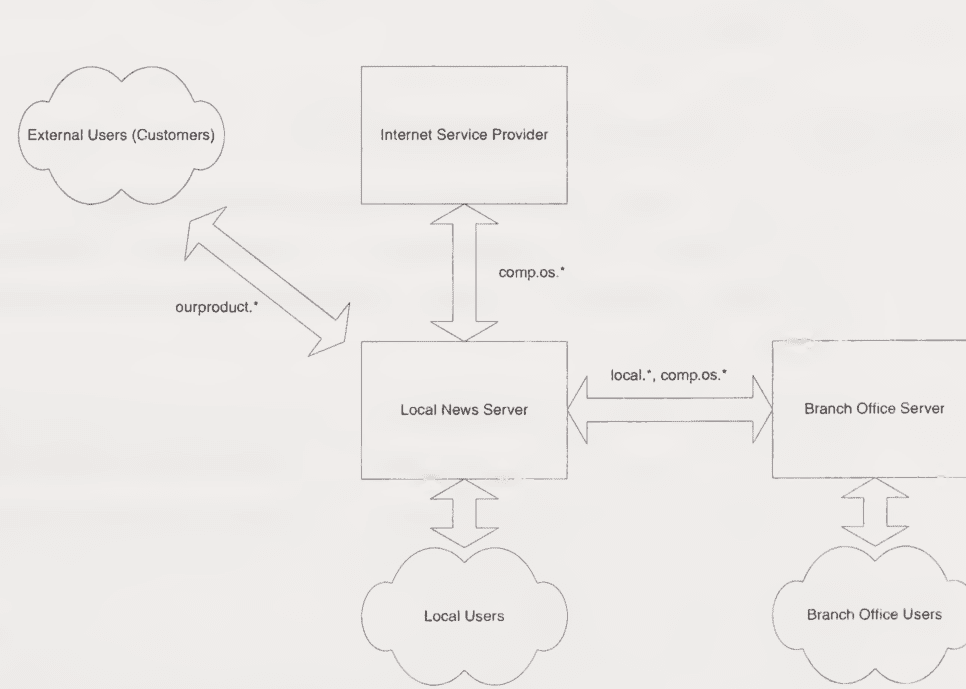

## 公共新闻组与私人新闻组

如今 Usenet 上消息的数量巨大，使得运行一个包含许多 Usenet 新闻组的大型新闻服务器几乎没有意义，除非你是一家 ISP，或者运营一个拥有数百或数千用户的大型企业网站。单是流量（每天几 GB）就需要比我们大多数人能负担起的速度更快的互联网连接。

然而，有时你可能仍然想在你的服务器上维护一组较小的 Usenet 新闻组。例如，如果你的网站没有永久的互联网连接，且你的用户有非常集中的需求，你可能希望维护几百个新闻组的本地副本。例如，从事 Web 应用开发领域的公司可能会维护其 `comp.infosystems.www` 层级新闻组的本地副本。

尽管如此，你想要运行自己的新闻服务器的主要原因可能不是为了成为 Usenet 的一部分，而是为了内部或外部提供新闻组（例如，用于产品支持）。

实例层出不穷。例如，著名的 Windows 软件安装工具制造商 InstallShield 公司在 `news.installshield.com` 拥有一个带有几十个 Usenet 新闻组的新闻服务器。微软公司也运营公共新闻组，以及其产品 Beta 测试人员使用的私人组。尽管许多私人维护的在线讨论组现在是基于 Web 的，但新闻组技术仍然是一个流行的选择。

## 服务器、客户端与 NNTP

新闻客户端必须能够与新闻服务器通信，而新闻服务器反过来也能相互通信以交换新闻组消息。事实证明，两种目的都使用一种协议：NNTP，即网络新闻传输协议（Network News Transfer Protocol）。

与其他许多互联网协议一样，NNTP 使用人类可读的命令和响应。因此，可以使用 Telnet 工具连接到 NNTP 服务器，并手动进行 NNTP 会话，以了解 NNTP 是什么样子的：

```
$ telnet uenet.ca nntp

Trying 142.77.1.198...

Connected to demon.uenet.ca.

Escape character is '^'.

200 uenet.ca InternetNews NNRP 1.5.1 (Dec 24, 1996)

mode reader

200 uenet.ca InternetNews NNRP 1.5.1 (Dec 24, 1996)

comp.os.linux.announce

211 comp.os.linux.announce

article

220 comp.os.linux.announce -p

article body here

article body appeared here

quit

205

Connection closed by foreign host.
```

不包含 INN 的副本，或者如果你想安装更高版本，你可能需要从互联网下载该包。INN 的官方网站是互联网软件联盟会（Internet Software Consortium）网站，地址为 `http://www.isc.org/`。

下一步涉及创建或修改配置文件。必须编辑的文件如下：

- `inn.conf` 通用配置选项
- `nnrp.access` 谁可以读取或发布什么内容
- `newsfeeds` 新闻源的来源和去向

根据你的系统设置，这些文件可能位于 `/etc/news`、`/usr/lib/news` 或 `/var/lib/news` 中。

你还必须创建两个特殊的新闻组。`control`（控制）新闻组包含了一些与新闻组管理相关的特殊消息（例如，指示服务器创建新闻组或删除文章的消息），而 `junk`（垃圾）新闻组是用于存放错误或被拒绝消息的存储库。

最后，你必须使用适当的工具创建活动文件（active file）和历史文件（history file）。前者列出了该服务器管理的所有新闻组；后者则包含了发布到此服务器的消息信息。

## 测试系统示例

在我的测试系统上，我设置了具有两个本地新闻组的 INN 新闻服务器，其中一个对外部站点开放（`linux.news`）。这模拟了现实生活中的情况，即一个组织运行新闻服务器，既用于内部讨论组，也用于向外部用户分发信息的群组。

我的测试系统上已经安装了 INN 包，因为我在初始设置时选择了该包。因此，我能够立即继续操作并配置该包。（如果你正在使用附带 CD-ROM 上的 Caldera OpenLinux，但在设置期间没有安装 INN，你可以运行 `lisa -pkginstall` 来安装额外组件。）

首先，我定位了 INN 配置文件。在 Caldera OpenLinux 上，这些文件被放置在 `/etc/news` 目录下。在这里，我首先创建了 `inn.conf`：

```
cp inn.conf.sample inn.conf
```

然后我编辑了该文件并修改了以下条目：

```
organization:    A Linux test site

server:           host.linux.sys

pathhost:         linux.sys

domain:

mailcmd:          /usr/libexec/inn/innmail

pathways:         /var/spool/news

pathbin:          /usr/libexec/inn

pathfilter:       /usr/libexec/inn/filter

pathdb:           /etc/news
```

所有其他条目均保持默认设置。

我还编辑了 `nnrp.access`（首先创建了一个备份副本，命名为 `nnrp.access-orig`）。我的版本只包含三行：

```
*: -no: -no: !*

*.linux.sys:RP::*

*:RP:::linux.news
```

第一行指定默认情况下，没有人对服务器上的文章具有读取或写入权限。第二行确保了（本地）域名 `linux.sys` 内的主机可以访问服务器上的所有新闻组。最后一行将新闻组 `linux.news` 设为公共新闻组，即互联网上的任何主机都可以进行读取和写入访问。

我还创建了一个 `newsfeeds` 文件：

```
ME::nmisp:*,local.*,linux.*,junk*:Tf,Wnb:
```

第一行定义了本地站点。第二行定义了名为 `myisp` 的（假设的）ISP。此行排除了 `local.*`、`linux.*` 和 `junk` 新闻组。前两个被排除是因为它们是该站点的本地，不应传播到 ISP；第三个是一个定义上即为本地的行政组。

实际上，这意味着如果我在我的服务器上设置了其他新闻组（例如 `comp.os.linux.announce`），发布到这些组的消息将被转发到我的 ISP。由于我正在配置该系统使用 UUCP 交换邮件和新闻文章，实际的转发操作将由定期调用的 `send-uucp` 命令完成。


然后我实际创建了新闻组本身：


不包含 INN 的副本，或者如果你想安装更高版本，你可能需要从互联网下载该包。INN 的官方网站是互联网软件联盟（Internet Software Consortium）网站，地址为 `http://www.isc.org/`。

下一步涉及创建或修改配置文件。必须编辑的文件如下：

- `inn.conf` 通用配置选项
- `nnrp.access` 谁可以读取或发布什么内容
- `newsfeeds` 新闻源的来源和去向

根据你的系统设置，这些文件可能位于 `/etc/news`、`/usr/lib/news` 或 `/var/lib/news` 中。

你还必须创建两个特殊的新闻组。`control`（控制）新闻组包含了一些与新闻组管理相关的特殊消息（例如，指示服务器创建新闻组或删除文章的消息），而 `junk`（垃圾）新闻组是存放错误或被拒绝消息的存储库。

最后，你必须使用适当的工具创建活动文件（active file）和历史文件（history file）。前者列出了该服务器管理的所有新闻组；后者则包含了发布到此服务器的消息信息。

## 测试系统示例

在我的测试系统上，我设置了具有两个本地新闻组的 INN 新闻服务器，其中一个对外部站点开放（`linux.news`）。这模拟了现实生活中的情况，即一个组织运行新闻服务器，既用于内部讨论组，也用于向外部用户分发信息的群组。

我的测试系统上已经安装了 INN 包，因为我在初始设置时选择了该包。因此，我能够立即继续操作并配置该包。（如果你正在使用附带 CD-ROM 上的 Caldera OpenLinux，但在设置期间没有安装 INN，你可以运行 `lisa -pkginstall` 来安装额外组件。）

首先，我定位了 INN 配置文件。在 Caldera OpenLinux 上，这些文件被放置在 `/etc/news` 目录下。在这里，我首先创建了 `inn.conf`：

```
cp inn.conf.sample inn.conf
```

然后我编辑了该文件并修改了以下条目：

```
organization:    A Linux test site
server:           host.linux.sys
pathhost:         linux.sys
domain:
mailcmd:          /usr/libexec/inn/innmail
pathways:         /var/spool/news
pathbin:          /usr/libexec/inn
pathfilter:       /usr/libexec/inn/filter
pathdb:           /etc/news
```

所有其他条目均保持默认设置。

我还编辑了 `nnrp.access`（首先创建了一个备份副本，命名为 `nnrp.access-orig`）。我的版本只包含三行：

```
*: -no: -no: !*
*.linux.sys:RP::*
*:RP:::linux.news
```

第一行指定了默认情况下，没有人对服务器上的文章具有读取或写入权限。第二行确保了（本地）域名 `linux.sys` 内的主机可以访问服务器上的所有新闻组。最后一行将新闻组 `linux.sys` 标识为公共新闻组，即互联网上的任何主机都可以进行读取和写入访问。

我还创建了一个 `newsfeeds` 文件：

```
ME::nmisp:*,local.*,linux.*,junk*:Tf,Wnb:
```

第一行定义了本地站点。第二行定义了名为 `myisp` 的（假设）ISP。此行排除了 `local.*`、`linux.*` 和 `junk` 新闻组。前两个被排除是因为它们是该站点的本地，不应传播到 ISP；第三个是一个定义上即为本地的行政组。

实际上，这意味着如果我在我的服务器上设置了其他新闻组（例如 `comp.os.linux.announce`），发布到这些组的消息将被转发到我的 ISP。由于我正在配置该系统使用 UUCP 交换邮件和新闻文章，实际的转发操作将由定期调用的 `send-uucp` 命令完成。


# 第 9 章 邮件列表与新闻组

然后我实际创建了新闻组本身：

```
cd /var/spool/news/articles
mkdir linux
mkdir linux/news
mkdir local
mkdir local/news
mkdir junk
mkdir control
```

注意，你必须创建的新闻组只有 `control` 和 `junk` 组；其他所有内容取决于你的本地配置需求。

在继续后续之前，我确保了所有新创建/修改的文件都属于新闻组账户：

```
chown news.news /etc/news/inn.conf
chown news.news /etc/news/nnpr.access
chown news.news /etc/news/newsfeeds
chown -R news.news /var/spool/news/articles
```

下一步是创建活动文件（active file）。`makeactive` 工具会在指定的新闻组目录层次中查找所有子目录并使用它们创建一个符合所需格式的列表：

```
makeactive >/etc/news/active
```

有必要手动修改此文件，因为 `makeactive` 假设它找到的每个子目录实际上代表一个新闻组。实际上，某些目录只是其他新闻组的父目录；例如，在我的这里有一个 `linux.news` 新闻组，但没有 `linux` 新闻组。因此，我必须编辑活动文件使其内容如下：

```
linux 0000000000 0000000000 n
linux.news 0000000000 0000000000 n
local 0000000000 0000000000 n
junk 0000000000 0000000000 n
control 0000000000 0000000000 n
```

（注：此处为示例编辑内容）

我也编辑了 `nnrp.access`（首先创建了一个备份副本，命名为 `nnrp.access-orig`）。我的版本只包含三行：

```
*: -no: -no: !*
*.linux.sys:RP::*
*:RP:::linux.news
```

（注：此处部分重复内容已去重）

## 总结

个人电子邮件并不总是交换信息的最佳媒介。当需要讨论组时，有更好的替代方案，例如邮件列表和新闻组。

邮件列表使得发送到列表地址的电子邮件邮件可以被中继并发送给多个接收者。邮件列表可以通过多种方式实现。可以使用 UNIX 的 `.forward` 文件或 `/etc/aliases` 邮件列表程序创建简单的列表，这些程序自动化了列表管理的许多方面，并提供了防止滥用的保护措施。目前最流行的邮件列表程序之一是 Majordomo（由 Great Circle Associates 开发）。此免费工具也包含在本书附带的 CD-ROM 中。

邮件列表的替代方案是新闻组。新闻组是互联网最老的功能之一，多年来一直以全球 Usenet 分级结构的形式存在。新闻组的主要优势是经济性：对于邮件列表，每条消息都会为每个接收者生成一个副本；而对于新闻组，消息则留存储在专门的新闻服务器上。新闻服务器定期使用 NNTP（网络新闻传输协议）与其他服务器交换消息；新闻客户端程序也使用该协议从新闻服务器检索消息。

最广泛使用的基于 UNIX 的新闻服务器是 InterNews 服务器 (INN)。通过 INN，可以配置一个大型站点来承载近 30,000 个 Usenet 新闻组的大部分或全部。也可以配置一个仅携带少数内部网络或支持外部用户访问新闻组的小服务器。INN 也位于本书附带的 CD-ROM 中。软件的配置包括创建或修改多个配置文件，并设置服务器在启动时自动运行。

## 手册页

有关本章所讨论主题的更多信息，请参阅以下手册页。

- `man active`
- `man aliases`
- `man ctlinnd`
- `man inn.conf`
- `man innd`
- `man newsfeeds`
- `man nnrp.access`


> 注意：请记住，如果你使用的是书中附 CD-ROM 中的 Caldera OpenLinux，`INN` 手册页可能不可用，除非你先按照以下方式配置 `man` 页路径：
> `export MANPATH=$:/usr/share/inn/man`

# 第 10 章

## Web 服务

**如果你计划**为你的 Linux 服务器建立与互联网的持久连接，那么可能的主要原因（至少是主要原因之一）是为了能够提供自己的 Web 页面。根据你的情况，这可能比在你的 ISP 的 Web 服务器上租空间更有优势。

通常，你可能想要的不仅仅是提供一种用户从你的服务器检索 Web 页面的手段。你可能希望提供文件库服务、高级服务器功能，或对 SSL（安全套接层）的支持。

## 基础概念

如今的 Web 浏览器是复杂的软件。考虑到这些应用程序被预期执行的复杂任务，这并不意外。Web 浏览器解释使用 HTML（超文本标记语言）编写的页面。它们还包含一个引擎，用于在屏幕上渲染这些页面，并支持字体、颜色、嵌入图像等。

相比之下，Web 服务器要相对简单。从粗略的角度来看，Web 服务器只需要为 HTML 文件和嵌入图像提供文件下载服务即可。对于这样的服务器来说，文件是透明的——服务器只交付文件的内容，而不对其进行解释。

现代 Web 服务器具有许多高级功能。然而，即使是这样的高级服务器也不需要图形化地渲染文档，它可以安全地忽略它不理解的 HTML 文件部分，因此服务器可以保持轻量和高效。这对于每分钟可能服务数千个 Web 页的高容量站点非常重要。

## 格式与协议

Web 页面使用一种特殊语言编写：HTML。这种语言源于一种旧的标准（SGML，结构化泛化标记语言）。HTML 语法并不复杂，但也并非完全自明自懂。

例如，这里是本章第一段内容的 HTML 格式部分：

```
<HTML>
<BODY>
<H2>Web Service</H2>
<P>If you're planning to establish a permanent connection to the Internet for your Linux server,</P>
</BODY>
</HTML>
```

当 Web 浏览器接收到此块文本时，它通过解释包含其中的指令来对其渲染。例如，`<H2>` 指令（标题，二级标题）指示浏览器以高亮样式（通常是大号、粗体字体）显示随后的文本。高亮文本的结束由 `</H2>` 指令标记。

HTML 并不难写，但如果你有一个 WYSIWYG（所见即所得）工具，写起来会更简单。许多 Windows 用户熟悉的其中一种编辑器是 Microsoft FrontPage。

HTML 并不是 Web 浏览器使用的唯一格式。对于图形图像，两种常用的格式是 GIF（由 CompuServe 开发的图形交换格式，并基于 Unisys 的 Lempel-Ziv 压缩方法专利）和 JPEG（联合摄影专家小组）。GIF 是一种无损压缩，最适用于线条画、图表和屏幕截图；GIF 文件的像素被完整保留。JPEG 效率更高，但采用有损压缩技术（即恢复的图像与原始不完全匹配），更适合照片。大多数 Web 浏览器还可以解释并显示纯 ASCII 文件。

文件格式不应与用于交付格式的方法混淆。Web 内容的首选交付方法是 HTTP（超文本传输协议）。然而，HTTP 也经常用于交付 HTML 文件以外的文件；而 HTML 文件可以使用其他方法交付。文件传输的第二常用方法是老旧的 FTP（文件传输协议）。

## 统一资源定位符

要在你的桌面上请求 Web 内容，你需要向浏览器提供一个 URL，即统一资源定位符。例如：

```
http://www.mcp.com/index.html
```

每个 URL 由三部分组成。冒号之前的部分包含交付内容的名称。URL 的其余部分包含内容所在的服务器名称，以及内容的标识符。

如果 Macmillan Publishing 在同一服务器上运行了配置适当的 FTP 服务，则可以使用以下 URL 请求相同的页面：
`ftp://www.mcp.com/index.html`

## 文件传输协议

FTP 是互联网上传输文件最老、最简单的方法之一。该协议在第一个 Web 页面出现之前就已经存在。在后台，你的 FTP 客户端连接到远程服务器并向其发送简单命令。

## 基础概念 213

接下来，浏览器实际上会与该主机建立 Internet 连接，具体说是到该主机上适当的服务器（例如 HTTP 服务器）。当浏览器发现 URL 中指定了 HTTP 协议时，它必须使用 TCP 协议连接到目标机器上的标准 HTTP 端口 80。

由于 HTTP 协议使用人类可读的命令字符串，实际上你可以通过在 Linux 命令行使用 `telnet` 工具来手动模拟浏览器的操作：

```
$ telnet www.mcp.com http

Trying 198.70.146.20...
Connected to www.mcp.com.
Escape character is '^]'.
GET /index.html
<link rel="stylesheet" href="//includes/stylesheets/maize_corporate.css"><body text="#000000" bgcolor="#FFFFFFFF">
```

这简单得令人害臊。当然，HTTP 协议的内容不仅仅是 GET 命令，但这段记录很好地说明了这一思想。

一旦成功向服务器传输了 HTTP 命令，浏览器就会接收这些文件并在屏幕上渲染它们。它还可能将文件复制到其临时（缓存）目录，这样如果稍后请求相同的文件，就不需要再次从网络获取了。

## 安全套接字 (Secure Sockets)

有时，你会通过以 `https://` 开头的 URL 访问网页。这个关键字告诉你的浏览器必须使用 SSL 连接。

在实践中，这意味着两点：首先，你的浏览器连接到服务器上不同的 TCP 端口。它连接的不是与 HTTP 关联的标准端口 80，而是与安全 HTTP 连接关联的 443 端口。其次，你的浏览器与服务器之间往返传输的所有信息将使用一种复杂的加密机制进行加密，该机制提供了防窃听保护，并验证服务器身份以保护你不受冒充攻击。

SSL 并非 HTTP 特有。然而，其他服务器（例如 FTP）并不常规支持 SSL 事务。

## 设置 FTP 服务器

FTP 服务易于使用和管理，这就是为什么在配置 Internet 服务器时从这一步开始是一个好主意。很有可能，你的 Linux 安装程序已经包含了一个可以运行的 FTP 服务器副本。

设置 FTP 服务器的主要步骤如下：

- 安装软件
- 配置 Internet 超级服务器 (superserver)
- 配置 FTP 目录
- 管理服务器

## 服务器安装

FTP 服务器通常以单个可执行程序的形式存在，名称如 `ftpd`、`in.ftpd` 或类似的名称。它通常位于 `/sbin` 或 `/usr/sbin` 中。

> 测试系统
> 在我的测试系统上，FTP 服务器是初始系统设置期间安装的组件之一。Caldera OpenLinux 带有最常用的 FTP 服务器之一，该服务器由华盛顿大学开发。该服务器的可执行文件命名为 `in.ftpd`，位于 `/usr/sbin/` 下。

安装完成后，FTP 服务器允许在你的系统上拥有账户的用户访问文件。这些用户将能够访问他们通常可以访问的相同文件，例如当他们交互式地登录系统时。换句话说，如果你使用该系统上的用户名和密码通过 FTP 登录远程系统，你将能够读取和写入家目录下的文件。你可能还可以读取（下载）该系统上通常具有读取权限的文件。

## 配置 Internet 超级服务器

仅将 FTP 服务器的可执行文件放在你的计算机上还不足以提供 FTP 访问。为了这一点，你还必须确保在有传入请求到达时调用 FTP 服务器。

此类传入的请求以到 TCP 端口 21 连接的形式出现，该端口是预留给 FTP 访问的。调用它的标准方法是通过 `inetd`（即 Internet 超级服务器）服务器。该服务器在第 4 章“Internet 配置与基础安全”中介绍，通过 `/etc/inetd.conf` 文件进行配置。

在我的测试服务器上，安装的 Caldera OpenLinux 在 `/etc/inetd.conf` 中放置了该条目：

```
ftp stream tcp nowait root /usr/sbin/tcpd in.ftpd -l1 -a
```

这两个命令行开关允许服务器将条目记录到系统日志 (`-l`) 并使用 `ftpaccess` 文件。该文件是可选的；如果它存在，FTP 服务器将使用它来建立配置选项。如需更多信息，请阅读帮助页（`man ftpaccess`）。

## 配置匿名访问

当普通用户通过 FTP 登录系统时，通常适用于该用户的权限在整个 FTP 会话期间保持有效。该用户可以检索任何文件或在系统上执行任意命令。

相比之下，不允许匿名用户拥有此类权限。与受信任的普通用户不同（否则他们会在你的系统上设置密码吗？），匿名用户可能是敌意的入侵者。因此，他们的访问必须限制在下载公共访问的文件，并可以选择上传文件到公共目录。

> 通常提供一个既允许匿名上传又允许下载的目录是个好主意，因为这允许第三方在你不知情的情况下将你的服务器作为交换文件的地方。具有公共访问目录的 FTP 服务器经常被软件贩子——非法版权软件代码贩——滥用。

为了让 FTP 服务器提供匿名访问，有必要在你的系统中创建一个名为 `ftp` 的用户账户。该账户从不用于交互式登录，也不需要有效密码。然而，当匿名 FTP 连接到你的系统时，FTP 服务器将

## Web 服务

除了 `tar` 和 `gzip` 工具外，服务器允许提供整个目录。通过 `tar` 命令，文件被合并为一个归档文件，然后使用 `gzip` 进行压缩。这些命令在第 17 章“备份”中有详细解释。

如你所示，`pub` 目录目前是空的。通常，任何人都可以下载的文件都放在此目录中。

## 服务器管理

一旦你的 FTP 服务器运行起来，它只需要少少的关注。然而，你可能仍然想定期监控它，以确保运行正常并防止滥用尝试。

监控服务器活动的主要手段是通过传输日志文件。该文件通常位于 `/var/log/xferlog`，包含每个成功传输的条目。

服务器还会将重要信息记录到系统日志。在大多数系统中，这些条目将出现在 `/var/log/messages` 中。

## 运行 Apache

在最简单的情况下，Web 服务涉及运行一个 Web 服务器程序的副本。目前为止，Linux 下最流行的 Web 服务器程序（事实上，根据某些人的说法，它是最流行的 Web 服务器程序）是 Apache，这是一个免费、高质量的服务器应用程序。

运行 Apache 并不困难，但事情可能会变得复杂。例如，你可能想在你的服务器上设置多个虚拟主机。或者你可能想提供受密码保护的区域。在进入这些之前，让我们从基础开始。

## 启动 Apache

在启动 Apache 服务器之前，显然需要先安装它。如果你正在使用如随书光盘所示的发行版，那么你很幸运，因为光盘上提供了 Apache 的副本，并可以与操作系统一起安装（之后任何时候也可以）。你也可以从互联网下载并安装副本。如果你需要采取这种替代方案，最新版本的 Apache 可以在 `http://www.apache.org/` 获取。

就像 FTP 服务器一样，Web 服务器通常以单个可执行文件的形式出现，通常命名为 `httpd`。运行 Web 服务器意味着运行该程序的副本。

与 FTP 服务器不同，Web 服务器被配置为一直运行，而不是由 Internet 超级服务器 `inetd` 按需启动。这种方法的缺点是，即使在未被使用时服务器也会消耗系统资源（例如内存）。优点是避免了每次请求到达时启动服务器应用程序的开销。

一个运行中的 Web 服务器会在 HTTP 端口（即 TCP 端口 80）等待传入的连接。当此类请求到达时，服务器开始处理它，并在必要时可能会派生自身的额外的副本，以便同时处理多个请求。因此，如果你在负载沉重的服务器上看到几十个 `httpd` 进程在运行，不要感到惊讶。

那么，当你启动服务器时，Web 服务器是如何启动的呢？当然是通过系统初始化文件以及其他服务应用程序。取决于你所使用的发行版，你的启动文件可能已经包含了启动服务器所需的必要条目。

## 测试系统

在我的测试系统中，我在初始设置期间安装了 Apache 及其组件。结果，Web 服务器已经启动并运行，证明如下：

```
$ ps axu | grep http
nobody 409 0.0 1.2 1380 816 ? S Mar 28 0:00 httpd -f /etc/h
nobody 410 0.0 1.2 1380 816 ? S Mar 28 0:00 httpd -f /etc/h
root 405 0.0 1.1 1332 696 ? S Mar 28 0:00 httpd -f /etc/h
```

通过在 `/etc` 目录中查找，我发现了系统启动时 Web 服务器是如何启动的。在 `/etc/rc.d/init.d` 中，`httpd` 文件包含了服务器的启动脚本。该文件反过来引用了 `/etc/sysconfig/daemons/httpd` 文件中的设置。服务器可执行文件的实际名称为 `/usr/sbin/httpd.apache`。

为了验证 Web 服务器功能是否正常，我通过在另一台计算机上运行的 Web 客户端连接到它（见图 10.1）。这显示了 Caldera Linux 提供的默认 Web 页面。（注意，此页面上的许多选项只有当你的客户端与服务器在同一台机器上运行时有效；由于我没有在测试系统上安装 X，因此无法在上面作为 Web 客户端运行图形化程序。）

可以使用 LISA 工具检查系统启动时 Web 服务器是否启动。使用 `--system` 命令行开关启动 LISA 并选择“Configure Daemon/Server Autostart”（配置守护进程/服务器自动启动）命令，将弹出图 10.2 所示的屏幕，在屏幕上可以选择或取消 Web 服务器。

# 运行 Apache 219

图 10.1

Caldera OpenLinux 的默认 Web 页面。

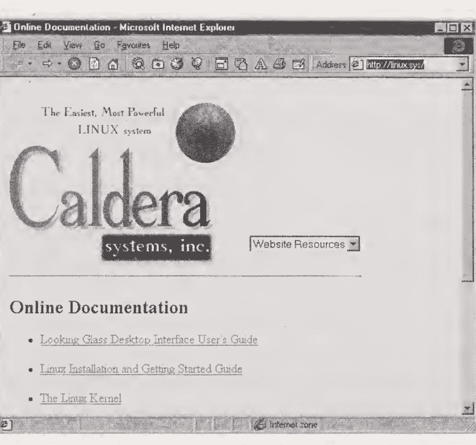

图 10.2

配置 Apache 服务器自动启动。

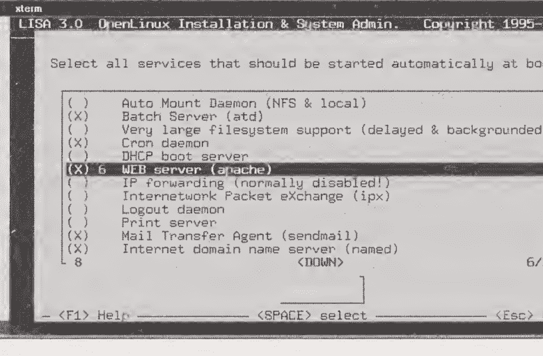

## 服务器配置

除非你正在使用像 Caldera OpenLinux 提供的这种预配置 Web 服务器，否则从你的系统启动脚本中启动服务器可执行文件可能不足以启动 Web 服务器。原因很简单：像 Apache 这样的 Web 服务器在运行之前需要几个配置文件。

# 第 10 章 Web 服务

这些配置文件通常可以在 `/var/lib/httpd` 或 `/etc/httpd` 目录下的子目录下找到。通常在这里可以找到至少两个子目录：`conf` 和 `logs`。正如名称所暗示，后者包含服务器访问日志，而前者包含配置文件本身。

位于此目录下的 Apache 配置文件如下：

- `access.conf`: Web 内容目录和访问权限
- `httpd.conf`: 通用服务器配置设置
- `mime.types`: 已知文件类型列表
- `srm.conf`: 目录名称和格式指令

`mime.types` 文件列出了 Apache 已知的文件类型。你可能会奇怪，Web 服务器与互联网电子邮件的 MIME 标准之间有什么关系。原因为：HTTP 协议使用了借用自 MIME 协议的标头来识别随后的内容类型。

事实证明，这三个 `.conf` 文件彼此之间并没有被区别对待。（使用三个独立的文件在很大程度上是一种约定。）它们仅仅是按照 `httpd.conf`、`srm.conf` 和 `access.conf` 的顺序读取的。这些文件可以包含的完整指令集列在 `http://www.apache.org/docs/mod/directives.html` 中。

Apache 安装程序包含这些配置的默认版本，你可以对它们进行修改。这些默认版本命名为 `access.conf-dist`、`httpd.conf-dist` 和 `srm.conf-dist`，其中 `dist` 代表“distribution”（发行）。

那么，为什么要更改这些配置文件中的默认值呢？原因是自定义、安全以及设置 Web 文件在系统上的位置。

要从一个有意义的服务器配置开始，首先只需编辑 `httpd.conf` 就足够了。此文件包含了标识你的服务器（`ServerName`）和管理员电子邮件地址（`ServerAdmin`）的条目。此文件或 `srm.conf` 文件定义了 Web 内容文件的起始位置（`DocumentRoot`）。

## 测试系统

在我的测试系统中，我编辑了文件 `/etc/httpd/apache/conf/httpd.conf`。我修改了该文件中的两个条目如下：

```
ServerName linux.sys
ServerAdmin webmaster@linux.sys
```


我在 `ServerAdmin` 条目下设置了传统的网站管理员地址 `webmaster`，但也必须确保这是一个有效的电子邮件地址。为了这一点，我必须编辑 `/etc/aliases` 并添加以下行：`webmaster: vttoth`

通过发送电子邮件，我验证了该地址是有效的。

# 设置 Web 页面

当你访问 Web 页面时，通常不需要指定文件的名称。例如，为了访问流行的 CNN 服务，你会输入 `http://cnn.com/` 作为 URL。这之所以有效的原因很简单：大多数 Web 服务器在只收到目录名时，会响应一个默认文档。一旦你的服务器配置妥当并运行，你可能想使用它来发布文档。

那么这些文档放在哪里？明显的地方是 `http.conf` 文件中 `DocumentRoot` 指定的位置。发布到此目录的文件将立即可见。

许多 Web 服务器托管由多个用户维护的 Web 页面。如果这些页面必须位于公共目录，将会导致混乱。事实并非如此。在默认配置下，Apache 服务器允许在每个用户的主目录下创建页面。

这些个人 Web 页面的位置由 `srm.conf` 中的 `UserDir` 指令定义。按照约定将其设置为 `public_html`；很少需要更改它。这些个人 Web 页面可以使用特殊的 URL 语法访问：`http://server.domain/~username`。波浪号（`~`）字符指示后面必须扩展为用户 ID。

在你的系统上拥有主目录的用户创建一个名为 `public_html` 的子目录，并在那里发布个人内容。

默认文档的名称由 `srm.conf` 中的 `DirectoryIndex` 配置定义。（正如最初设想的那样，默认文档为其所在的目录提供索引；你当然可以根据需要将其用于任何目的。）

注意如 `http://cnn.com/` 这样的 URL 末尾的斜杠。这是表示目录的语法正确的 URL（相对于文件）。大多数 Web 浏览器也接受 `http://cnn.com` 形式。然而，少数不接受，因此在指定 URL 时，始终使用完整形式是最好的。

为了测试 Apache 是否运行正常，我在测试系统的主目录下创建了一个 `public_html` 目录。在里面，我放置了一个名为 `index.html` 的文件，内容如下：

```
<HTML>
<HEAD>
<TITLE>
Viktor's Web page
</TITLE>
</HEAD>
<body
<h1>Viktor's new Web page.</h1>
This is my brand new Web page.<P>
</BODY>
</HTML>
```

当我尝试通过 URL `http://linux.sys/-vttoth/` 访问此文件时，我得到的并不是我预期的结果，如图 10.3 所示。

## 图 10.3

一个新的个人 Web 页面。


# 高级 Web 服务器功能

发布 Web 页面很棒，但 Web 服务器的功能远不止提供 HTML 文件的访问。例如，即使你不是 ISP（互联网服务供应商），你可能想为多个组织托管 Web 页面，每个组织都有自己的域名。你可能还希望限制注册用户访问某些内容。或者，你可能希望为财务交易提供 SSL 支持。可能性几乎是无限的，显然，这本书只能触及皮毛。

## 虚拟主机

简单来说，虚拟主机机制允许 Web 服务器充当多个域名的服务器并托管多个网站。这种技术通常被 ISP 使用，他们希望避免为所提供的数百个域名中的每一个都维护一台单独的服务器。即使在像你家庭办公室这样的低端环境中，虚拟主机也很有用。例如，你可能想使用同一个 Web 服务器来托管你的个人（家庭）域名和你的家庭业务的 Web 页面。

虚拟主机机制是如何工作的？当 Web 服务器接收到信息请求时，它无法得知请求中使用了哪个域名——例如，它是请求 `http://www.myfamily.sys/index.html` 还是 `http://www.mycompany.sys/index.html` 的请求。在两种情况下，Web 服务器只知道收到了一个针对 `index.html` 文件的请求。这显然是一个没有明显解决方案。

然而，我们并不是无手无策的！回想（来自 5 章“互联网概念”），每个网络接口都关联一个 IP 号（一个网卡——用于 SLIP/PPP 的调制解调器）。假设，如果你使用两块网卡，每块网卡都有唯一的 IP 号，并且每个网卡分别对应两个域名中的一个。当用户请求 `http://www.myfamily.sys/index.html` 时，请求将通过第一块网卡到达。Web 服务器虽然可能不知道请求的域名部分，但它始终知道请求到达的接口的 IP 号，因此它可以区分这两者。

显然，这是一个解决方案，但具有局限性。例如，对于 ISP 来说，尝试在单个服务器上安装 200 块网卡为 200 个独立域名提供 Web 托管可能有些困难（更不用说昂贵）。

事实证明，有一个更简单的解决方案。可以将多个 IP 关联到单个接口，因此不需要多个网卡。要使用此功能，你可能需要重新编译 Linux 内核（见附录 A，“配置内核”）并启用此功能（IP 名）。

启用多 IP 号支持后，你可以使用 `ifconfig` 命令为网络接口配置额外的 IP 号。例如，要为 `eth0` 接口（系统上的第一个以太网卡）添加新的 IP 号，输入：

```
/sbin/ifconfig eth0:1 192.168.1.64
```

不用说，你需要以 root 身份访问系统才能使之生效。以下是验证结果的方法：

```
# /sbin/ifconfig eth0:1
eth0:1 Link encap:Ethernet Haddr 00:00:21:a5:36:09
inet addr:192.168.1.64 Bcast:192.168.1.255 Mask:255.255.255
UP RUNNING MTU:1500 Metric:1
RX packets:0 errors:0 dropped:0 overflows:0
TX packets:0 errors:0 dropped:0 overflows:0
```

设置多个 IP 号是第一步。你还必须确保 IP 号与有效的域名关联。

# 高级 Web 服务器功能

完成所有这些后，你可以通过使用 `ping` 工具验证新域名是否可用且可访问。如果一切正常，你就可以继续配置 Web 服务器来托管多个虚拟主机。这是通过编辑 `httpd.conf` 并添加 `VirtualHost` 条目实现的，该条目至少包含一个 `DocumentRoot`。

在我的测试系统中，我决定设置一个个人域名 `vttoth.sys`。通过向我的以太网接口添加新的 IP 号，以虚拟主机的形式设置此域名：

```
/sbin/ifconfig eth0:1 192.168.1.64
```

此 IP 号也需要与符号域名关联联。这需要编辑我的名称服务器配置文件（见第 6 章，“域名系统”）。当完成所有操作后，我能够验证新域名确实可以正常工作：

```
ping 192.168.1.64
PING 192.168.1.64 (192.168.1.64): 56 data bytes
64 bytes from 192.168.1.64: icmp_seq=0 ttl=64 time=0.4 ms
64 bytes from 192.168.1.64: icmp_seq=1 ttl=64 time=0.3 ms
64 bytes from 192.168.1.64: icmp_seq=2 ttl=64 time=0.3 ms
64 bytes from 192.168.1.64: icmp_seq=3 ttl=64 time=0.3 ms
64 bytes from 192.168.1.64: icmp_seq=4 ttl=64 time=0.3 ms
```

注意，某些内核配置可能要求你显式将新的 IP 地址添加到内核路由表中才能使其工作：

```
/sbin/route add 192.168.1.1 eth0:1
```

接下来，我编辑了 `/etc/httpd/apache/conf/httpd.conf`，在末尾添加了以下内容：

（注：原文此处未提供具体代码块且存在重复，此处已根据上下文逻辑完成翻译）

最后，我必须重启 Web 服务器使这些设置生效。

编写表单并不困难——决定如何处理收集的信息才是棘手之处！

具体来说，是 `FORM` 标签的 `ACTION` 参数决定了信息流向何处。该参数必须是一个可以接受表单数据的 URL。该 URL 通常指向一个可执行程序。

这些可执行程序是由 Web 服务器通过一种称为 CGI（通用网关接口）的机制调用的。可执行文件可以是从其他来源接收的程序；但通常情况下，它是你自己编写的简单脚本。没错，这确实意味着编程。

幸运的是，我们讨论的并不是编写由数百行源代码组成的复杂应用程序，而仅仅几行 shell 脚本，或者更常见的，几行用 Perl 语言编写的代码。

Perl 经常被使用，是因为它具有强大的文本处理能力。事实上，如果你打算认真创建交互式 Web 内容，那么熟悉这种语言是必关重要的。尽管如此，许多简单任务不需要 Perl 即可完成；相反，你可以使用 shell 脚本。

例如，通过前面提到的 Web 表单提交的值可以通过类似这样的脚本进行处理：

```sh
#!/bin/sh
echo
echo $QUERY_STRING
```


该脚本将提交的值返回给用户，因此它没有实际价值，但它演示了基础原理。

`CGI` 脚本不能放在任意位置。它们必须存放在 `HTTP` 服务器配置文件中专门指定的包含可执行程序的目录中。也可以将 `CGI` 脚本目录与虚拟主机（`virtual hosts`）关联。

## 测试系统

为了测试 `CGI` 脚本能力，我将之前显示的两个文件添加到我的个人页面中。我将 `form.html` 放在了 `public_html` 目录下。对于 `CGI` 脚本（我将其命名为 `form.cgi`），我在 `public_html` 下创建一个名为 `cgi-bin` 的新目录，因此文件存放在 `public_html/cgi-bin/form.cgi`。

为了启用这个新目录作为 `CGI` 目录，我需要修改 `httpd.conf`。记得在为 `vttoth.domain` 设置网页时，我向该文件添加了一个 `VirtualHost` 条目。这次，以 `root` 用户身份登录时，我在 `<VirtualHost> /home/vttoth/public_html/cgi-bin/` 之前插入了一个新行。

同样，我必须重启 `HTTP` 服务器使新设置生效。图 10.4 显示了结果：第一个窗口包含来自 `form.html` 的表单，而第二个是运行 `form.cgi` 脚本后出现的 Web 页面。

### 图 10.4
处理 Web 表单。

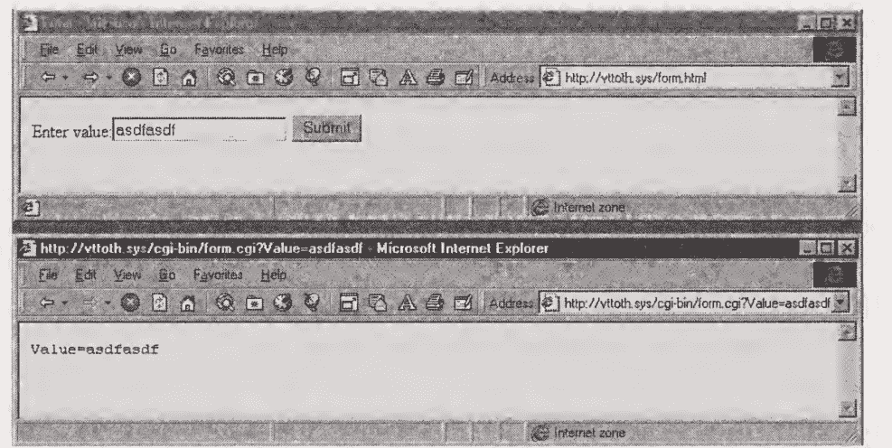

如果你打算维护专业设计的 Web 表单，可能需要比这个简单介绍提供的更多的信息。我使用的一个非常好的参考书籍是 John December 和 Mark Ginsburg 编写的《HTML 3.2 & CGI Unleashed》。对于 `Perl` 语言，最好的参考是 Larry Wall（`Perl` 的开发者）和 Randal L. Schwartz 编写的《Programming Perl》。

## 日志

当 Web 服务器执行工作时，它会将活动记录在一条或多个日志文件中。应该定期检查这些文件，以发现是否存在配置错误、网络问题以及访问你服务器的恶意尝试。

默认情况下，`Apache` Web 服务器会创建两个日志文件：`access_log` 和 `error_log`。前者包含发送到你服务器的每个文档请求的条目。后者包含服务器在执行过程中可能遇到的任何错误信息。

如果你正在管理多个虚拟主机，将日志条目重定向到备用位置是可能的。如果你在 `httpd.conf` 的 `VirtualHost` 条目中指定额外的 `ErrorLog` 和 `TransferLog` 条目，就可以实现。

## 总结

保持永久互联网连接的主要原因之一是维护网站。为了这一点，使用了 Web 服务器软件，其中最流行的是免费的 `Apache` 服务器。可以从 Web 下载 `Apache`；它也可以随附的书的 CD-ROM 提供，作为 `Caldera Linux` 发行版的一部分。

网页使用 `HTML`（超文本标记语言）创建，并通过 `HTTP`（超文本传输协议）传输。它们也可以通过较旧的 `FTP`（文件传输协议）传输。这两种协议都不局限于 `HTML` 文件；它们可以传输任何类型的文件，包括文本和二进制内容。

网页使用 `URL`（统一资源定位符）进行标识。`URL` 指定了用于传输页面的协议、页面所在的服务器以及包含该页面的文件名。

某些 Web 服务器还支持使用 `SSL`（安全套接层）进行安全事务。要建立你自己的 `FTP` 服务器，你需要安装该软件（如果尚未作为你 `Linux` 发行版的一部分安装）。接下来，你需要更改 `/etc/inetd.conf` 以确保传入的 `FTP` 请求调用服务器。你还必须配置匿名访问。这些步骤中的许多（不是全部）在系统上最初安装 `Linux` 期间可能已经自动完成。

`Apache` Web 服务器通过系统启动脚本调用。服务器的配置包含在几个配置文件中，其中包含大量的指令。这些文件用于指定 Web 目录，允许访问控制、列出文件类型等。单个 Web 页面可以放在标准的文档根目录，或放在由单个用户维护的 `HTML` 目录中。可以通过修改配置文件指定额外的目录。Web 服务器还维护一系列日志，可用于跟踪服务器活动和查看错误状况。

`Apache` Web 服务器还支持许多高级功能。通过虚拟主机功能可以在单台计算机上托管多个 Web 站点。表单处理和其他高级服务可以使用 `CGI` 脚本实现。对某些 Web 内容的访问可以通过访问控制文件进行限制。还提供了支持 `SSL` 的扩展，尽管取决于你的地理位置和服务器的商业性质，你可能需要支付费用。

# 第 11 章 防火墙

## 图 11.1
防火墙网关。

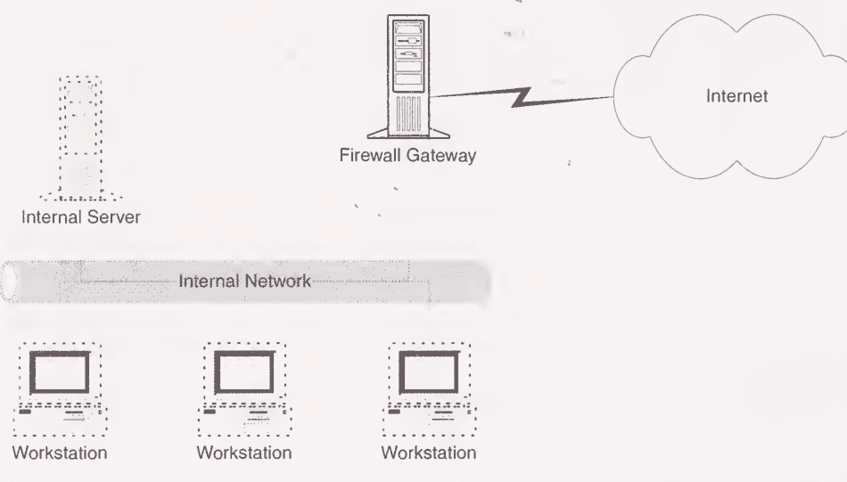

防火墙网关通过两种技术的结合来完成其任务：数据包过滤和伪装（`masquerading`）。除了通过这种方式隐藏内部网络外，防火墙还可以提供网络监控功能，让您检测入侵。

## 数据包过滤

数据包过滤是保护网络最显而易见的方法。过滤网关会将转发的每个数据包与一组特定的规则进行比较，以决定对该数据包进行什么操作。

任何通过网络接口到达的数据包都有一个报头，其中包含了标识数据包类型、源主机和预期目的地的信息。当防火墙网关配置为数据包过滤并接收数据包时，它可能会检查以下任何项（见图 11.2）：

- 数据包到达的接口（例如以太网卡和 `PPP` 调制解调器连接）
- 源主机
- 目的主机
- 数据包类型（例如 `TCP` 和 `UDP`）
- 源/目的端口号（针对 `TCP` 和 `UDP` 数据包）

### 图 11.2
数据包过滤标准。

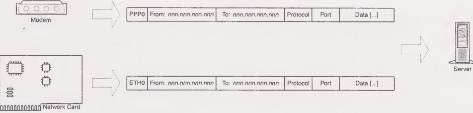

根据发现的内容，防火墙网关可能会决定：

- 拒绝数据包（向源主机发送错误信息）
- 忽略数据包（什么都不做）
- 将数据包转发到其目的地

例如，假设您正在配置一个仅用于电子邮件的服务器。该服务器接受 `TCP/25`（为邮件服务器保留的 `SMTP` 端口）上的入站连接；它也可以发起到远程系统端口号的连接。为了保护此服务器，您可以配置防火墙，当源主机为邮件服务器时接受指向端口 25 的连接，并拒绝所有发送给它的其他数据包。

您可以采用两种不同的数据包过滤策略。您可能选择过滤某些已知会引起问题的数据包类型（例如，您可能决定禁止来自本地网络之外的 `Telnet` 连接）。或者，一种更严格的策略是默认过滤所有内容，并仅启用您需要的数据包类型。

## IP 伪装

数据包过滤可以防止针对您系统的许多类型攻击，但入侵者仍然拥有能够单独访问您网络上每台计算机的优势。因此，您的网络安全性取决于上面最不安全的系统；一旦那台机器被攻破，入侵者可能会获得访问其他权限。

解决此问题的方案是在防火墙网关后隐藏网络名称。这个概念在第 5 章中已经讨论过（例如图 5.7），它允许服务器伪装成所有输出连接的源主机。例如，当用户在网络上的某机器上发起请求且此请求传输到防火墙时，网关会将源地址替换为自己的地址。当响应出现时，网关将目的地址更改为用户的计算机地址，并将数据包转发给用户。

在这种配置下，只有一台计算机对外部网络可见：无法到达防火墙后的机器；网关只转发响应源自此类机器发起的请求的数据包。

隐藏在伪装防火墙后还有另一个优势：由于外部网络只有一台机器可见，防火墙后的所有其他机器都可以使用私有地址，正如第 5 章讨论的那样。

## 计数（Accounting）

即使您不需要数据包过滤或伪装功能，防火墙网关也可以作为监控工具提供极大帮助。类似于用于数据包过滤的规则也可以用于选择性地记录流量。例如，许多操作系统中的一个众所周知漏洞是所谓的“死亡之 ping”（`Ping of Death`）。在不涉及细节的情况下，此漏洞允许攻击者向您的计算机发送故意构造错误的数据包，这可能会导致您的系统崩溃。如果您安装了最新的更新和修复程序，您的系统可能不再受到这种类型攻击的威胁。尽管如此，您可能仍然想记录此类入站数据包，以便在尝试攻击时获得通知。

这正是一个 `IP` 计数可以为您做的事情。您可以再次根据等标准选择数据包，例如：

- 数据包到达的接口（例如以太网卡或 `PPP` 调制解调器连接）
- 源主机
- 目的主机
- 数据包类型（例如 `TCP` 和 `UDP`）
- 源/目的端口号（针对 `TCP` 和 `UDP`）

日志的详细程度也是可选的。您可以收集统计信息，为每个到达的数据包创建日志条目，甚至记录数据包的内容。网络计数和日志功能应谨慎使用。根据所选的日志详细程度，您可能会每秒收集数千字节的日志数据，严重影响系统性能（可能导致系统无响应）。

## 应用支持

某些应用程序使用网络资源的方式与防火墙不兼容。一个典型的例子是流行的流媒体应用程序 `RealPlayer`。当您使用此应用程序连接到服务器时，服务器除了通过您的计算机启动的通信通道发送响应外，还会为您的机器建立单独的连接以流传输音频和视频。如果您的计算机隐藏在防火墙后，这种尝试将失败。您的机器可能会向自己的 `IP` 地址发送数据，但该地址在防火墙之外是没有意义的。此外，即使远程服务器使用了您防火墙的外部地址，数据包也不会路由到源计算机，因为防火墙无法知道数据是用于内部网络上的某台机器的（见图 11.3）。

### 图 11.3
当防火墙失效。

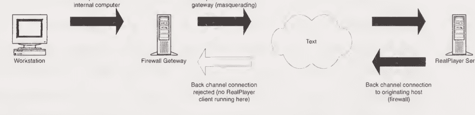

某些现代防火墙提供应用级支持。本质上，防火墙监控流量并分析数据包类型。从这些数据包中提取连接，如果有必要，防火墙会将入站连接路由到内部网络上正确的计算机。

在 `RealPlayer` 示例中，感知 `RealPlayer` 的防火墙会识别发出的 `RealPlayer` 请求。它还会调整发出的数据包将其任何内部网络地址替换为自己的外部地址，就像它在标准标头中所做的那样。当远程服务器尝试连接回源计算机时，防火墙将从以前收集的信息知道本地网络上哪台计算机应该接收数据，并据此进行路由（见图 11.4）。

### 图 11.4
防火墙中的应用级支持。

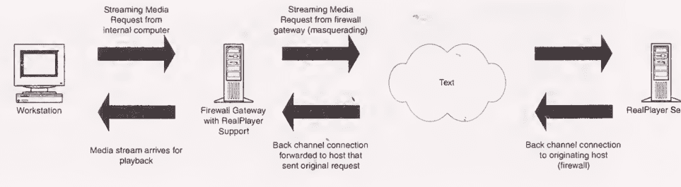

遗憾的是，`Linux` 提供的特定应用程序支持有限，因此如果您需要这种防火墙功能，可能需要获取第三方软件或购买专用的防火墙系统。

## 您需要防火墙吗？

在读完所有关于防火墙保护您的网络免受入侵的各种方法的讨论后，您可能会想为什么并不是所有人都在使用防火墙。

除了设置和维护防火墙系统相关的成本外，还有一些不明显的原因导致防火墙并不总是有意义的解决方案。

## 防火墙与拨号系统

如果您的系统没有永久连接到互联网，那么安装任何类型的防火墙可能都是浪费精力和金钱。原因是：大多数时间里您的系统在物理上没有连接到网络，入侵是不可能的。此外，您连接的时间是不可预测的，而且每次都不同，这让潜在入侵者的生活更加艰难。而且，当您连接时，您可能正在使用调制解调器连接的大部分带宽（例如下载文件），这使得入侵者与您的系统进行交互通信变得更加困难。

# 需要防护的对象

我白白等待他的连接请求出现在我的服务器日志中，但请求从未出现。在我们浪费了几分钟时间并在过程中变得越来越沮丧后，我突然想到问一句：“你在防火墙后面吗？”

这个故事的启示是，防火墙不仅能防止入侵者访问你的系统，它往往也会阻止合法流量。因此，安装防火墙的决定始终代表了安全与效率之间的权衡。

# 为什么防火墙让生活变得艰难

当防火墙执行数据包过滤时，它可以配置为仅过滤特定的数据包，或过滤所有已知且允许的数据包类型。对于后者，当用户想要使用新功能或服务时，网络管理员必须首先允许新的数据包通过过滤防火墙。在某些组织，这可能是一个繁琐且官僚的过程。

如果防火墙是伪装防火墙（`masquerading firewall`），情况会更糟。本质上，要求远程服务器连接回客户端工作站的网络服务总是失败，除非防火墙软件专门支持它们。即使是已知的应用程序也可能突然失效，例如在远程站点进行版本升级或配置更改之后。通常情况下，这个问题没有解决方法。用户必须接受网络管理员的说法，即请求类型的服务无法从他们的工作站访问。

# 需要防护的对象

也许我对防火墙的观点已经很明确了：我很少认为需要全功能的防火墙，并且经常发现它们是有害的。防火墙可能有助于提高网络安全性，但它们并不是解决所有安全疑虑的终极答案。比防火墙重要得多的是你对系统的了解以及持续的监控。

尽管如此，将一个完全不受保护的网络放在互联网上也不一定是个好主意。你可能不需要伪装防火墙，但防止几种最显眼的入侵方法是有帮助的，并且能在几乎或完全不损失功能的情况下提供实质性的安全性提升。

# 伪造 IP 地址

也许最明显的攻击形式是在发送到你系统的 `IP` 数据包中使用伪造的头部。通常情况下，头部被伪造是为了假装数据包源于你的网络内部。这种方法成功率的原因非常简单：`Linux` 以及其他系统的许多安全设置是针对主机的，当请求来自预定义的 `IP` 地址集时，某些功能会被启用。例如，你可能在桌面上运行一个图形化 `X` 服务器，并希望网络上其他机器运行的程序能够显示在此显示器上。然而，你绝对不想让来自（比如）中国的入侵者能够在未经你许可的情况下，在你的桌面上创建窗口（或者更糟的）！

幸运的是，这种形式的入侵可以被防止。你需要的是配置网关，拒绝任何通过外部接口（即来自你的调制解调器或网络路由器）到达的数据包，如果它们的源地址与你网络上的地址匹配。请注意，这也包括本地回环地址族 `127.nnn.nnn.nnn`。

## NetBIOS 连接

常用的 `MS-DOS/Windows` 网络协议 `NetBIOS` 也可以在 `TCP/IP` 连接上运行。如果入侵者尝试使用 `NetBIOS` 协议连接到你网络上的机器，这个非常有用的功能也可能变成一个安全问题。

另一个相关问题是，配置不当的 `Windows` 经常发送目标地址在本地网络外的 `NetBIOS` 数据包。这些数据包可能携带任何信息，例如弱加密的密码，将这些发送到全球互联网上的随机目标并不是好主意。

好消息是，除非你有使用共享 `DOS` 或 `Windows` 目录或打印机的远程用户，否则没有必要允许 `NetBIOS` 流量在你的本地网络和互联网之间流动。

`NetBIOS` 流量可能使用 `TCP` 和 `UDP` 端口 137、138 和 139 的任何组合。为了阻止所有 `NetBIOS` 流量，你必须阻塞这些端口号的入站和出站流量。

# 设置 Linux 防火墙

正如本章引言提到的，`Linux` 系统是一个优秀的防火墙。你可以使用 `Linux` 节点作为专用的防火墙网关（见图 11.5），或者通常你可以在包含调制解调器或 `ISDN` 卡的 `Linux` 节点组合防火墙和路由器功能，例如（见图 11.6）。

### 图 11.5
带有外部路由器的防火墙。

### 图 11.6
结合防火墙和路由器功能。

`Linux` 内核本身支持核心防火墙功能。如果设置正确，内核可以监控数据包、修改头部并收集统计信息。`Linux` 不开箱支持的唯一防火墙功能是对特定应用程序的支持，例如针对 `RealPlayer`。

## 内核支持

为了支持防火墙功能，必须正确配置 `Linux` 内核。取决于你使用的发行版，这些功能可能已经存在于系统的内核中。目前大多数 `Linux` 发行版都已准备好支持防火墙。（如果你正在使用 `Caldera OpenLinux` 的模块化内核，如随书附带的 CD-ROM 所示，情况如此）。否则，你可能需要通过“配置内核”的过程重新配置内核。

内核中的防火墙功能如下：
- `IP`: 转发/网关。
- `IP`: 数据包过滤。
- `IP`: 防火墙日志。
- `IP`: 伪装。

某些版本的 `Linux` 内核还包含特定协议的功能。由于其特性，除非你理解并绝对需要某个特定功能，否则在生产服务器上最好关闭这些功能。

# ipfwadm 命令

一旦你有了支持防火墙功能的内核，就可以使用 `ipfwadm` 命令选择性地开启或关闭这些功能。`ipfwadm` 命令的功能简单，但其语法晦涩。它要求在命令行上指定多个选项。

这些选项中的第一个指定命令要应用的防火墙网关类别：
- 计数（日志）
- 入站数据包过滤
- 出站数据包过滤

下一个选项指定防火墙管理命令。该选项的一些可能值如下：
- `a` 在列表末尾添加规则
- `i` 在列表开头插入规则
- `d` 删除规则
- `l` 列出此类别中的所有规则

在每个功能类别中，系统维护着一个有序的规则列表。当数据包到达时，它会与规则进行匹配；当找到匹配规则时，就会处理数据包。例如，考虑以下命令：

```
# ipfwadm -I a reject -P tcp -D 0.0.0.0/0
```

该命令设置内核在目标为 `TCP` 端口 137（用于 `NetBIOS` 名称服务）时拒绝任何入站数据包。可以通过 `-I` 类别列出之前建立的规则，如下：

```
## ipfwadm -I -1
```

```
IP firewall input rules, default policy: accept

type prot source destination ports

rej tcp anywhere anywhere any -> netbios-ns
```

如果类别内有多个规则，它们将按照 `-l` 命令列出的顺序进行评估。例如，将规则添加到前一个规则（所示）之后不会产生任何影响：

```
# ipfwadm -I a accept -P tcp -D 0.0.0.0/0 137
```

原因是由于追加的规则指定了该类型的数据包必须被拒绝，它在列表中位于新规则之前：

```
## ipfwadm -I -1
```

```
IP firewall input rules, default policy: accept

type prot source destination ports

rej tcp anywhere anywhere any -> netbios-ns

acc tcp anywhere anywhere any -> netbios-ns
```

如果你使用 `-i` 命令（在现有规则之前插入新规则），情况会有所不同：

```
## ipfwadm -I -1
IP firewall input rules, default policy: accept

type prot source destination ports

acc tcp anywhere any -> netbios-ns

rej tcp anywhere anywhere any -> netbios-ns
```


在这种情况下，由于接受规则位于拒绝（`reject`）规则之前，指定类型的数据包将会被接受。

可以使用`-d`命令删除规则。命令行的其余部分必须与最初创建规则时使用的语法完全匹配：

```
# ipfwadm -I d accept -P tcp -D 0.0.0.0/0 137
# ipfwadm -I d reject -P tcp -D 0.0.0.0/0 137
## ipfwadm -I -1
IP firewall input rules, default policy: accept
```

通过输入`ipfwadm -h`可以获得`ipfwadm`选项的简要总结。有关该命令如何工作的更多详细信息，请查阅手册页（`ipfwadm`）。

`ipfwadm`命令可以以交互方式使用，也可以放置在你的启动文件中。例如，如果你打算始终阻止 Linux 服务器转发 NetBIOS 流量，你可以将此类命令放置在系统的系统启动文件中：

```
/sbin/ipfwadm -I a reject -W ppp0 -P tcp -D 0.0.0.0/0 137
```

在像随书附带 CD 盘那样的 Caldera OpenLinux 系统上，此类自定义启动命令最好放置在`/etc/rc.d/rc.local`文件中。

## 测试系统

在我的测试系统中，我使用一个自定义的内核。当我编译此内核时（见附录 A），我确保启用了防火墙功能。因此，我可以使用所有的防火墙网关。（请注意，即使我选择了 Caldera OpenLinux CD 盘自带的模块化内核，结果也是如此。）遵循自己的建议，我决定添加过滤规则，以防止 NetBIOS 流量从此主机意外泄露到外部。我还阻止了伪造头部的数据包，这些数据包使其看起来源自我的内部网络。

此外，我决定记录所有 ICMP 数据包。这有助于我快速识别任何使用`ping`、`traceroute`或类似命令进行探测的主机。

为了实现所有这些，我向我的`/etc/rc.d/rc.local`文件添加了以下行：

```
/sbin/ipfwmad -I -a reject -W ppp0 -P tcp -D 0.0.0.0/0 137
/sbin/ipfwmad -I -a reject -W ppp0 -P tcp -D 0.0.0.0/0 138
/sbin/ipfwmad -I -a reject -W ppp0 -P tcp -D 0.0.0.0/0 139
/sbin/ipfwmad -I -a reject -W ppp0 -P udp -D 0.0.0.0/0 137
/sbin/ipfwmad -I -a reject -W ppp0 -P udp -D 0.0.0.0/0 138
/sbin/ipfwmad -I -a reject -W ppp0 -P udp -D 0.0.0.0/0 139
/sbin/ipfwmad -O -a deny -W ppp0 -P tcp -D 0.0.0.0/0 138
/sbin/ipfwmad -O -a deny -W ppp0 -P tcp -D 0.0.0.0/0 139
/sbin/ipfwmad -O -a deny -W ppp0 -P udp -D 0.0.0.0/0 139
/sbin/ipfwmad -O -a deny -W ppp0 -P udp -D 0.0.0.0/0 138
/sbin/ipfwmad -O -a deny -W ppp0 -P udp -D 0.0.0.0/0 139
/sbin/ipfwmad -I -a deny -W ppp0 -S 127.0.0.0/8
/sbin/ipfwmad -I -a deny -W ppp0 -S 192.168.0.0/16
/sbin/ipfwmad -A -a deny -P icmp -
```

前 12 行实现了对来自已知 NetBIOS 端口的 TCP 和 UDP 流量的拦截。这些以及接下来的两条阻止伪造数据包的规则都使用了`-W ppo`选项，该选项指定规则仅适用于通过 PPP 接口到达或传输的数据包（即通过我的调制解调器）。最后一行开启了对所有 ICMP 数据包的计数，无论其类型、源或到达的接口为何。

当使用`-o`标志配置 ICMP 时，每个匹配计数规则的数据包都会在系统日志中创建一个条目。因此，我最后几个`ipfwmad`的行出现在`/var/log/messages`中：

```
# tail -2 /var/log/messages
Apr 8 00:34:47 host kernel: IP acct eth0 ICMP/0 192.168.1.1
192.168.1.2 L=84
```

## 总结

防火墙可以提供计数、日志、过滤和地址转换功能。为了保护你的网络，你可以将 Linux 系统作为网关，也可以使用外部路由器。将 Linux 作为防火墙网关需要配置良好的内核以及`ipfwadm`命令。

## 手册页

有关本章讨论的话题的更多信息，请参考以下手册页：

```
man ipfwadm
```

```
man route
```

```
man services
```

```
man traceroute
```

## 图 12.2

使用外部路由器。

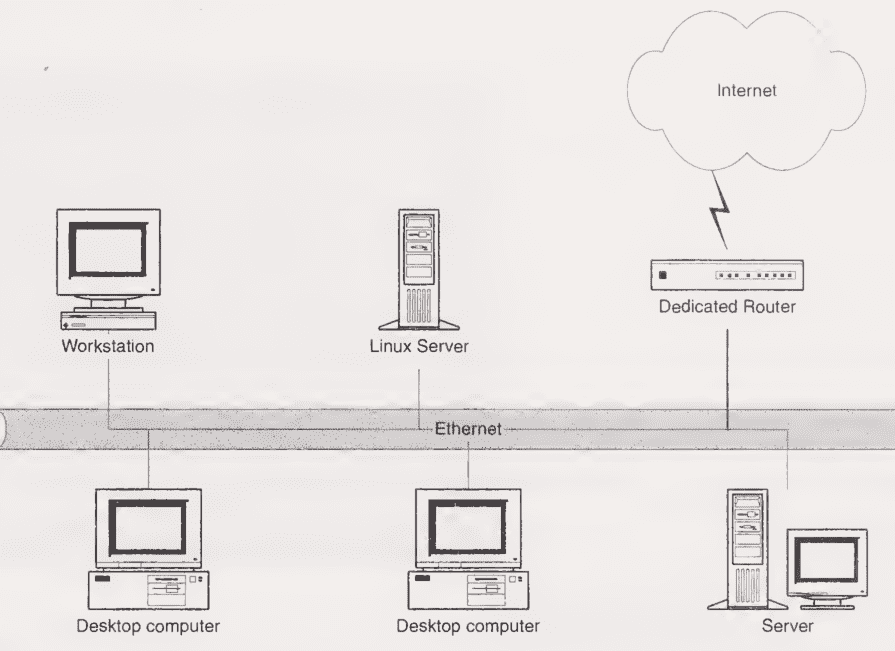

当你将配置从使用 Linux 服务器作为路由器更改为使用外部路由器时，你需要执行一系列步骤。

首先，确保路由器具有正确的 IP 地址。通常情况下，你的互联网服务提供商（ISP）希望你继续使用与之前相同的 IP 地址；但到目前为止，该 IP 地址一直属于你的 Linux 机器。你需要将该 IP 分配给路由器，并为你的 Linux 机器分配一个新的 IP 地址。这可能还需要对其他依赖于你的 Linux IP 地址（而不是主机名）的系统进行配置更改。当然，如果能说服你的 ISP 更改你的连接配置，这一切都可以避免。

其次，你必须关闭 Linux 机器上的数据包转发，因为再不再执行路由功能。

可以通过多种方式关闭数据包转发。也许最简单的方法是以 root 身份输入以下命令：

```bash
echo 0 > /proc/sys/net/ipv4/ip_forward
```


此方法不会永久关闭 IP 转发。要实现永久关闭，你需要修改系统启动文件。在 Caldera OpenLinux 下，可以使用 LISA 实用程序来实现。理想情况下，如果你使用系统命令行选项调用 LISA 并选择 Configure Daemon/Server Autostart（配置守护/服务器自动启动）命令，即可找到相应的项目。在这里，确保 IP 转发选项已关闭（见图 12.3）。

## 图 12.3
关闭路由。

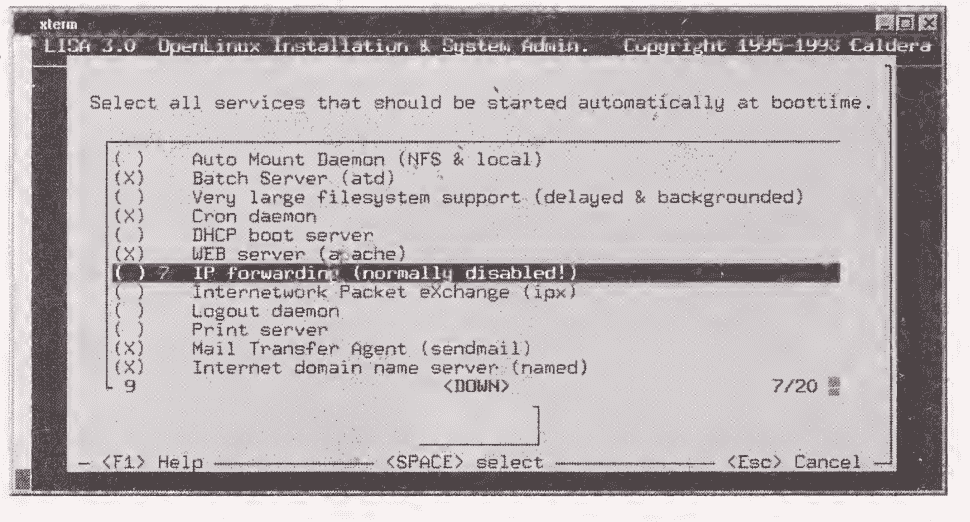

如果有必要更改 Linux 机器的 IP 地址，你还需要确保所有 DNS 条目已正确更新。例如，如果你的 Linux 机器的 IP 地址从 `192.168.1.1` 更改为 `192.168.1.32`，那么任何识别出的旧条目都需要通过搜索 `www.linux.sys` 使用旧 IP 地址进行更新。如果你的 ISP 为你维护 DNS，请要求他们进行必要的更改。如果你在运行自己的名称服务器，则必须自行更新数据库。（详情请参见第 6 章“域名系统”）。

## 分段网络

有时，在另一种配置中添加外部路由器是有用的。与其用你的 Linux 机器作为网络的路由器，不如该设备可以转而担任调制解调器的角色。换句话说，你的 Linux 机器将继续作为网络的主路由器，而不是使用调制解调器，机器将使用你的新路由器设备作为连接世界的接口。

这是通过安装另一个连接 Linux 机器和路由器的网络网段实现的（如图 12.4 所示）。这种配置有一个缺点：如果路由器设备或你的 Linux 服务器宕机，你的互联网连接就会中断。

### 图 12.4
分段网络。

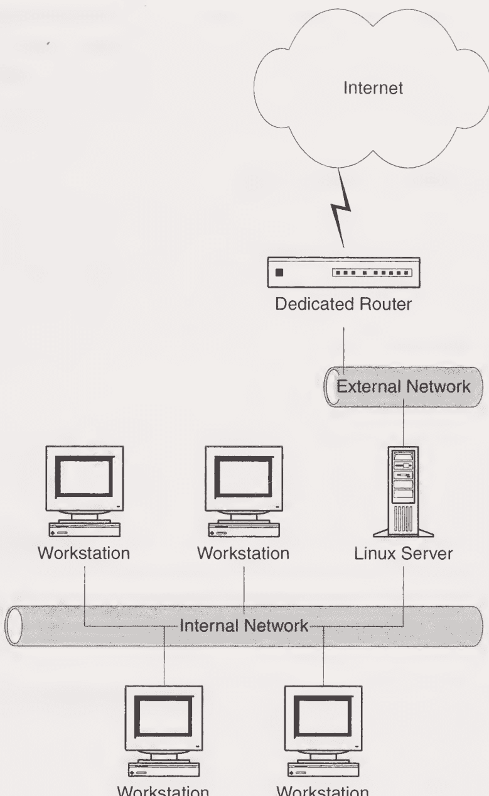

尽管有此缺点，分段配置经常用于 Linux 机器执行防火墙网关功能。

当你有两个独立的网段时，分配 IP 地址变成了一个更复杂的问题。两个网段必须各自拥有自己的 IP 地址范围。

如果连接两个网段的网关执行防火墙伪装功能，则其中一个网段需要分配从为内部网络保留的池中的数字，例如 `192.168.nnn.nnn`（见第 5 章）。当未使用此类防火墙功能时，你的 IP 地址池必须分成两半。

当然，其他编号方案也是可能的。例如，如果你有一个三网段网络和一个包含 256 个主机地址的 C 类地址块，你可以将其中一半分配给一个网段（允许最多 `128-2=126` 台电脑），并将另一半分给另外两个网段（每个允许最多 62 台电脑）。

## 多段路由

在分段网络配置中，每个网段都有一个路由器将其连接到外部世界（可能通过其他网段）。必须在每台计算机上相应地配置路由信息；图 12.5 所示。

### 图 12.5
多段网络上的路由。

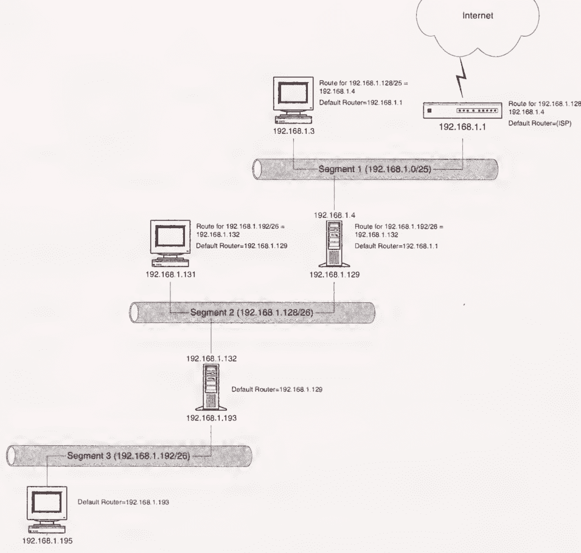

在这个示例中，具有 256 个地址的 C 类网络地址空间（`192.168.1.0` - `192.168.1.255`）被分为三个网段。第一段是 `192.168.1.0/25`（这种表示法指定地址的网络部分占用前 25 位，留出 7 位，即 128 种可能的组合用于主机地址）。该段的默认路由器是 `192.168.1.1`，它是连接网络到互联网的专用路由器。

## 路由回顾

然而，当数据包被发送到 `192.168.1.131` 时，你不希望它被发送到互联网，而是发送到第二个段。这是通过向路由表中添加静态路由实现的。在这个示例中，具有 256 个地址的 C 类网络地址空间（`192.168.1.0` - `192.168.1.255`）被分为三个网段。第一段是 `192.168.1.0/25`（这种表示法指定地址的网络部分占用前 25 位，留出 7 位，即 128 种可能的组合用于主机地址）。该段的默认路由器是 `192.168.1.1`，它是连接网络到互联网的专用路由器。

然而，当数据包被发送到 `192.168.1.131` 时，你不希望它被发送到互联网，而是发送到第二个段。这是通过向路由表中添加静态路由实现的。在这个示例中，具有 256 个地址的 C 类网络地址空间（`192.168.1.0` - `192.168.1.255`）被分为三个网段。第一段是 `192.168.1.0/25`（这种表示法指定地址的网络部分占用前 25 位，留出 7 位，即 128 种可能的组合用于主机地址）。该段的默认路由器是 `192.168.1.1`，它是连接网络到互联网的专用路由器。

然而，当数据包被发送到 `192.168.1.131` 时，你不希望它被发送到互联网，而是发送到第二个段。这是通过向路由表中添加静态路由实现的。在这个示例中，具有 256 个地址的 C 类网络地址空间（`192.168.1.0` - `192.168.1.255`）被分为三个网段。第一段是 `192.168.1.0/25`（这种表示法指定地址的网络部分占用前 25 位，留出 7 位，即 128 种可能的组合用于主机地址）。该段的默认路由器是 `192.168.1.1`，它是连接网络到互联网的专用路由器。

## 外部路由器与防火墙

那么，如果你使用外部路由器并想使用防火墙保护你的网络怎么办？

首先，许多路由器设备支持防火墙功能。这些功能从简单的数据包过滤到高级功能（如 IP 伪装）。遗憾的是，这些软件功能通常作为昂贵的附加组件提供。

或者，你可以通过将 Linux 机器放置在外部路由器和本地网络之间来保留防火墙网关，如之前的图 12.4 所示。如第 11 章“防火墙”所述，在这种情况下，除了执行两个网段之间的路由功能外，你的 Linux 服务器可能还会作为伪装服务器并翻译 IP 地址。

## 特殊路由器设备

小型办公室或家庭环境中常用的外部路由器是 ISDN 路由器和电缆调制解调器。

## 使用外部 ISDN 路由器

ISDN（综合数字业务）运行在数字电话线上，并能够以 64 或 128 Kb 比特的速度传输数据。存在连接到 ISDN 线的调制解调器（内部或外部），但连接 ISDN 线的首选方法是通过 ISDN 路由器，它提供了更好的性能和更灵活的功能。这类设备通常有一个连接到局域网的以太网接口，以及连接 ISDN 线的 RJ-45 插头。

安装 ISDN 路由器的第一步是从当地电话公司订购 ISDN 服务。大多数路由器直接连接到 ISDN 墙壁插座，但有些需要单独购买或由电话提供的终端适配器。你不能将 ISDN 路由器连接到普通的电话线上。（由于插头形状相似，必须小心不要不小心将 ISDN 线路连接到设备上的 10BaseT 以太网端口，或反之亦然。）

设置 ISDN 路由器通常需要你先配置电话线侧，输入你的 ISDN "SPID"（服务配置文件标识符）数字并指定具体的 ISDN 服务类型。在以太网侧，你必须为路由器配置适用于网络的正确 IP 地址以及从你的 ISP（互联网服务提供商）获取的路由信息。你还需要输入 ISP 账户的标识符和密码，并按照 ISP 的规定配置网络协议设置。

许多 ISP 会为你完成这些步骤，并交付一个完全配置且经过测试的 ISDN 路由器。

在 Linux 服务器端，使用 ISDN 路由器与其他任何路由器设备的使用没有区别。特别是，你不需要在 Linux 内核中开启任何 ISDN 特定功能。只有当你使用某些类型的内部（扩展卡）ISDN 设备时，才需要这些功能。

## 电缆调制解调器的问题

一种特殊的外部路由器是电缆调制解调器。这些设备通过电缆网络的同轴电缆提供高速互联网连接。电缆调制解调器通常是连接到局域网（LAN）的设备。它们的工作与普通路由器的操作非常相似，但存在一个关键区别：电缆调制解调器会反射你以太网局域网与本地电缆环路之间所有的流量。实际上，这些电缆调制解调器将你的局域网扩展到了本地电缆环路。

那么为什么这是一个问题呢？原因很简单：局域网是广播型网络，这意味着网络上任何计算机的传输都可以被连接到同一网络的所有其他计算机看到。但当使用电缆调制解调器时，你的局域网被扩展到包含了所有邻居的计算机。如果你局域网上有超过一台计算机，每当它们相互通信时，该流量对所有在同一本地环路上拥有电缆调制解调器的邻居都是可见的。

换句话说，当你发送电子邮件时，即使它是从网络上某一台计算机传输的内部消息，你的邻居也能看到其内容。当你通过网络向共享文件保存财务记录时，你的邻居将获得一个副本。当你在局域网上创建备份时，你的邻居将有机会看到每个备份文件的内容。可能大多数邻居都是友好的，而且很少有人拥有这种类型网络监控所需的软件工具。尽管如此，这是你愿意承担的风险吗？

# 第 12 章 使用外部路由器

幸运的是，解决方案很简单。当你使用受此问题影响的电缆调制解调器时，你应该确保它位于一个与你的主局域网段独立的以太网段上（见图 12.6）。实际上，你正在通过防火墙技术将你的网络与电缆调制解调器隔离，即使在这种情况下，防火墙没有执行任何通常与网络防火墙相关的功能，仅仅提供了两个网络网段的物理隔离。

## 图 12.6
电缆调制解调器和你的邻居。

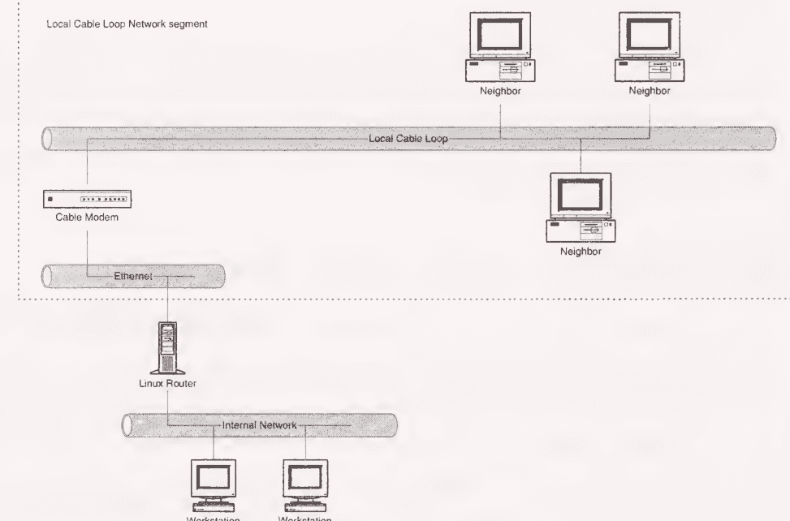

这种方法也为另一个问题提供了解决方案：即供家庭使用的电缆调制解调器服务通常只允许你使用一个 IP 地址（或对额外的 IP 地址收取费用）。如果你的 Linux 服务器配置了 IP 伪装（masquerading），你将能够通过这个单一 IP 地址连接你的整个网络。

然而，请记住，许多电缆公司并不分配固定的 IP 地址，而是使用 DHCP（动态主机配置协议）等技术。虽然配置 DHCP 超出了本书的范围，但重要的是要了解这类技术会临时分配或*租赁* IP 地址，因此你的 IP 地址可能会发生变化。因此，如果你想在互联网上提供服务（如网站），家庭级的电缆调制解调器服务可能并不合适。

## 总结

虽然 Linux 服务器是一个极好的路由器，但有时必须使用外部路由设备。这通常发生是因为你使用了专用的路由器进行高速互联网连接。在这种情况下，即使你继续使用 Linux 主机作为服务器，路由和其他服务器功能也会被分离，系统和你的网络必须进行相应的配置。

有时，外部路由器会与分段网络结合使用。在这种情况下，Linux 服务器可以保留为两个网段之间的路由器，而外部网段则通过专用设备路由到互联网。这种配置经常用于 Linux 服务器配置了防火墙网关功能的情况。

当使用外部路由器时，网络需要重新配置。这在创建分段网络时尤为如此，因为必须添加新的路由规则。

在小型办公室或家庭办公室（SOHO）环境中，最频繁使用的外部设备是 ISDN 路由器和电缆调制解调器。如果你有来自电话公司（已安装 ISDN 电话线）和你的 ISP 的必要信息，配置 ISDN 调制解调器相当简单。然而，电缆调制解调器值得特别关注，因为这些设备中的许多代表了严重的安全风险。

为了防止电缆调制解调器将你局域网的机密流量反射到本地电缆环路（进而反射到你的邻居），最好使用分段网络技术将电缆调制解调器与你的局域网隔离。Linux 服务器可以作为你内部网络与电缆调制解调器之间的路由器。此外，Linux 服务器的防火墙功能不仅增强了网络的安全性，还允许你通过电缆公司分配的单一 IP 地址从多个主机访问互联网。

## 手册页

关于本章讨论的话题附加信息，请参考以下手册页。

- `man ifconfig`
- `man proc`
- `man traceroute`

# 第 13 章 Windows 文件服务：Samba

对于大多数凡人来说，Samba 是一个软件包的名字，由 Andrew 开发，为 Linux 增加了 Windows 风格的文件共享功能。对于 UNIX 用户来说，这个词有完全不同的含义：Samba 是一种欢快的舞蹈。

## Samba 能做什么？

在 Samba 出现之前，你就需要与 NFS（网络文件系统）服务器通信的第三方软件，而那些软件以不可靠、缓慢和昂贵而闻名。Samba 从另一个角度处理问题。与其教 Windows 如何与 UNIX 通信，不如教 UNIX 服务器表现得像 Windows。结果是快速、可靠的商业级实现。最重要的是，Samba 是免费的！

## Windows 中的资源共享

你熟悉这个流程：在 Windows 资源管理器中右键点击文件或目录并将其共享。这允许他人无需密码访问此处的内容。如果你是老用户或使用 DOS 机器，你仍然可以这样做：如果安装了网络驱动程序，可以使用 `net` 和 `net share` 命令访问网络资源。

## Samba 和 SMB

Samba 是 SMB 协议的 UNIX 实现。基础 Samba 软件包提供了供 DOS 和 Windows 使用的 UNIX 目录和打印机工具。它还包含了从 UNIX 访问共享 DOS 和 Windows 资源的实用程序。

在实践中，Samba 允许将 Linux 变成 Windows 网络上的文件和打印机服务器。

Samba 使用 TCP/IP 网络。因此，任何打算配合 Samba 的 DOS 或 Windows 机器上，必须安装 TCP/IP 网络，并启用 NetBIOS over TCP。对于同样具有调制解调器互联网连接的 Windows 机器，你可能想在局域网（LAN）接口上启用 NetBIOS over TCP。但是，你应该在串口（PPP）接口上禁用 NetBIOS over TCP 以提高安全性。

## Samba 组件

Samba 是由多个程序组成的软件包。两个关键程序文件是 `smbd` 和 `nmbd`。其中第一个 `smbd` 实现了 Samba 提供的大部分 SMB 服务。另一个关键组件 `nmbd` 提供 NetBIOS 名称服务；它还允许其他计算机浏览 Samba 服务器提供的资源。

Samba 软件包中最有补充组件是 `smbclient`。该程序提供了一个类似于 FTP 客户端的界面，用于访问 SMB 网络上其他计算机的共享资源。该软件包还包含其他组件，例如监控和配置工具。

# 设置 Samba 263

默认情况下，Samba 可执行文件安装在 `/usr/local/samba/bin` 目录下。然而，在特定的发行版中，位置可能会不同。如果 Samba 是从随书提供的 CD-ROM 安装的，这些可执行文件将存放在 `/usr/bin` 中。

## 设置 Samba

像通常的软件安装包一样，Samba 安装的第一步是获取软件副本。

# 在哪里可以获取 Samba？

如果你是从 CD-ROM 安装 Linux，很可能该发行版中已经包含了一个 Samba 副本。（如果你使用的是随书附带的光盘，情况确实如此）。

如果你没有 Samba 副本，或者想安装最新版本，最好的查找地点是官方网站：`http://www.samba.org/`。在网上你可以找到离你最近的 FTP 下载站的链接。

Samba 通常以源码形式分发。如果你从互联网获取了 Samba 副本，可能需要遵循其中包含的 readme 文件中的说明来编译并安装该包。

# Samba 配置文件

大多数 Samba 设置包含在一个名为 `smb.conf` 的文件中。默认情况下，该文件位于 `/usr/local/samba/lib`。然而，特定的发行版可能会将文件放在其他位置；最显著的是，Caldera OpenLinux 版本位于随书光盘的 `/etc/samba.d` 中。

对于编辑过 Windows .INI 文件的用户来说，该文件的通用格式应该很熟悉。该文件被分为若干部分（sections），每个部分包含一个或多个参数。部分通过方括号中的部分名称来标识；参数单独成行，参数名和值之间用等号分隔：

```
[section1]
parameter1=value1
parameter2=value2

[section2]
```


与 Windows .INI 文件的另一个相似之处是，分号开头的行被视为注释行；也就是说，在解析配置文件时，这些行会被忽略。

Samba 配置文件包含三个特殊部分：`global`（全局）、`homes`（用户目录）和 `printers`（打印机）。所有其他部分均标识单个共享资源，部分标题作为资源的名称。

# 全局配置设置

Samba 配置文件中唯一强制性的部分是全局部分（`global`），正如其名称所示，它包含了控制 Samba 行为的通用配置参数。这些设置对于 Samba 的正确运行至关重要。它们还用于确保 Samba 安全运行，仅允许授权用户访问共享资源。

在该部分的其余内容中，描述了一些最重要的全局参数。要获得更详细的描述，请参考 Samba 文档（特别是 `smb.conf` 手页，非常有参考价值）。

## 系统识别

`workgroup` 参数指定该计算机将加入的 Windows 工作组名称。`server string` 参数指定机器的人类可读名称；当你在从其他工作站浏览网络时，此字符串将作为计算机名称出现。

注意，也可以让 Linux Samba 服务器成为 Windows NT 域的成员。

# 基础安全

当你运行 Samba 服务器时，显然你不希望全世界都能访问其所拥的文件。在 Windows 网络中，传统上并不使用 TCP/IP 作为 SMB 事务的底层网络传输，而在 Samba 和 TCP/IP 中，限制对你服务器的访问变成了一个现实问题，因为原则上讲，如果它连接到互联网，世界上任何人都可以查询你的 Samba 服务器。

事实上，Samba 实现了 Windows 网络中的密码安全机制。然而，该功能提供的安全性程度较弱；此外，在内部网络中，共享资源并不受密码保护。让我们检查 Samba 参数及其作用：

- `hosts allow` 参数。用于限制特定主机或子网对 SMB 服务器的访问。该参数可以设置为完整的 IP 地址或其网络部分。它也可以包含 IP 列表或 IP 范围。
- `interfaces` 参数。用于限制对 Samba 的访问。例如，在兼任路由器或防火墙的 Linux 计算机上，你可能可以使用此参数将 Samba 访问限制在内部网络。
- `security` 参数。指定 Samba 应该遵循 Windows 网络的用户级安全模型还是共享级安全模型。
- `guest account` 参数。标识用于访客登录的访客账户。当你使用匿名（访客）登录服务器时会使用此参数。参数的值必须是你系统上的有效账户标识（通常是 `nobody` 账户）。

# 日志

Samba 可以记录许多事件。`log file` 参数指定存放这些日志条目的文件名。可以使用 `max log size` 参数限制文件的大小。

## 加密密码

Samba 可以以加密形式发送和接收密码（用于登录 Samba 或另一台服务器并访问资源）。此功能用于两种情况之一：要么你正在使用 Windows NT 并遇到了登录困难（稍后会详细介绍这种情况），要么你不希望局域网内任何配备相应软件工具的人能够嗅探密码。

使用 `encrypt` 参数开启密码加密。Samba 维护自己的密码文件，可以使用 `smbpasswd` 工具在其中设置密码。密码文件名使用 `smb passwd file` 参数指定。

# 第 13 章 Windows 文件服务：Samba

对共享目录的访问类型由一组参数进行决定。这些参数包括：`public`（当设置为 `yes` 时，允许匿名访问共享目录）、`writable`（当设置为 `no` 时，禁止对目录进行写入访问）、`printable`（除非共享资源是打印机，否则设置为 `no`）以及 `map archive`（如前所述）。

## 测试系统示例

在我的测试系统中，我允许访问用户的家目录（由于我是该系统的唯一用户，这是一个很简单的选择）。此外，我共享了测试系统的 CD-ROM 驱动器。为了实现这一点，我在 Samba 配置文件中包含了以下章节：

```
[homes]
public = no
read only = no
create mode = 0700
map archive = no

[cdrom]
path = /mount/cdrom
public = no
writable = no
printable = no
map archive = no
```

## 配置共享打印机

在 Samba Linux 服务器上共享打印机有两种方法。你可以让服务器自动共享 `/etc/printcap` 文件中找到的所有打印机，或者通过在 Samba 配置文件中添加章节来显式指定打印机。

## Linux 下的后台打印

Linux 与大多数 UNIX 版本一样，具有高级后台打印功能。该功能的核心是 `lpd`（行打印守护进程）。该程序通常在系统启动时启动并在后台监控打印队列。

`/etc/printcap` 文件描述了连接到 Linux 机器的所有打印机。如果使用了高级功能，该文件可能会变得复杂，但对于单个打印机，一行就足够了。例如：
`lp1=/dev/lp1:sd=/usr/spool/lp1`

此条目描述了一个连接到 `/dev/lpt1` 的行打印机。（在 MS-DOS 下的 LPT1 在 Linux 下显示为 `lp0` 或 `lpt1`，取决于实际硬件配置。）它还为该打印机分配了打印目录 `/usr/spool/lp1`；在打印文件时，该目录用于临时存储。

> 注意：你使用的 Linux 发行版有一个图形化配置工具，你可能希望使用该工具设置打印机，而不是手动编辑 `/etc/printcap`。例如，如果你从附带的 CD-ROM 一同 X Window 系统一起安装了 Caldera OpenLinux，你可能可以使用 Caldera 的配置工具进行打印设置。

一旦正确配置了打印机，可以使用 `lpr` 命令将打印作业发送到打印队列。例如，要打印 `/etc/inittab` 文件，你需要输入：
`lpr /etc/inittab`

可以使用 `lpq` 命令检查打印队列的内容。输入 `lpq` 将列出所有打印作业。

## 共享打印机

通常，Samba 服务器上的打印机通过在 Samba 配置文件中添加 `[printer]` 章节来共享。这允许 `/etc/printcap` 中列出的任何打印机通过 Samba 共享。

此章节中的设置与共享目录时类似。最重要的是确保你使用了 `printable = yes`。`path` 参数指定了打印到打印机的文件的临时位置。

通过这种方式共享打印机，你可能还需要在 Samba 配置文件的全局部分进行若干设置，如前所述。

也可以通过在 Samba 配置文件中创建单独章节来共享打印机。然而，这种方法很少使用且不推荐。

## 测试系统示例

首先坦白：我的测试系统没有连接打印机。以下示例是真实的，但它来自我用作网络服务器的“生产环境” Linux 机器。这台机器使用 Slackware 发行版的旧版本 Linux。然而，使用的 Samba 版本相当新，与书中附 CD-ROM 中的版本几乎相同。

连接到此服务器的打印机是一台 HP LaserJet 6L。我在 Windows 机器上安装了相应的打印机驱动程序，理想情况下，Samba 和 Linux 行打印守护进程将直接打印数据。为了确保这一点，我的 `/etc/printcap` 文件包含以下条目：
`lp1:lp=/dev/lp1:sd=/usr/sp/lp1:ff=`

## 注意

说到这个主题，我想引起大家注意一个异常。我已经使用 Samba 共享打印机很多年了；从那时起，一直遇到打印结束后多出一个空白页的问题。这非常烦人，我没有找到解决方案。幸运的是，我打印很少，所以并没有被这个问题困扰。

准备编写这一章时，我重新审视了这个问题。我发现此服务器上的行打印守护进程有一个明显的 Bug，导致即使文件被指定为不需要页符，它在每次打印结束时也会添加一个页符字符。因此，无论我如何配置 Samba，当 Windows 向服务器发送打印作业时，除了 Windows 在作业末尾添加的页符外，还会额外一个页符。这导致了额外的空白页。由于我无法关闭额外的页符，我不得不找到另一个解决方案：将页符字符串的值设置为空。这就是上面所示打印机定义行最后一个元素 (`ff`) 的解释。

此测试系统上的打印机通过 Samba 共享在我的 Windows 网络上。我的 Samba 配置文件的全局部分包含以下条目：

```
print command = /usr/bin/lpr -P own
```

## 警告

必须不允许对 Samba 密码文件进行未经授权访问；一旦获取了密码文件，其中的加密密码可以使用适当的软件工具立即使用。因此，请务必确保该文件仅对 root 用户可读！（使用 `chmod 0700 smbpasswd` 和 `chown .root smbpasswd` 来设置该文件的权限）。

用户名映射文件可用于系统上的任何用户标识符创建别名。如前所述，该文件可解决 Linux 和 Windows 系统之间用户名的差异。该文件的格式简单：每行包含一个 Linux 用户标识符，随后是等号，以及一组由空格分隔的 Windows 用户名列表：

```
userid = username2 ...
```

## 测试系统

在我的测试系统中，位于 `/etc/samba/smbpasswd` 的 Samba 密码文件包含以下内容：

```
# Samba SMB password file
vttoh:100:::
```

第一行以井号 (`#`) 开头，是注释行，Samba 会忽略它。第二行包含你的用户标识符和密码。

该系统的用户名映射文件 `/etc/samba/smusers` 如下所示：

```
# Unix_name = SMB_name1 SMB_name2 ...
vttoh = administrator admin
nobody = guest pcguest smbguest
```

再次强调，第一行是注释。第二行允许我使用我的用户标识符登录，即使我是从一个作为管理员的 Windows NT 系统连接的。第三行将指定的访客用户标识符 (`nobody`) 与 Windows 网络下常用的访客用户名关联起来。

## 使用 Samba

你已经设置好了 Samba 服务器，并且它运行良好。那么，你如何从 Windows 机器访问它呢？你需要向网络其他用户提供哪些说明，以便让他们访问你的 Samba 共享资源？

# 从 Windows 访问共享驱动器

当你的 Samba 服务器上所有配置都妥当时，该服务器应该显示为 Windows 系统上“网络邻域”的一部分。例如，图 13.1 显示了 Windows NT 计算机上显示的 Samba 服务器。

图 13.1
从 Windows NT 浏览 Samba。

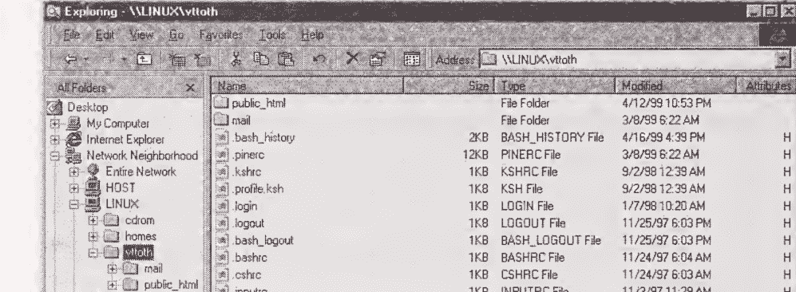

你也可以从 DOS 命令行连接 Samba 共享或查看 Samba 服务器的内容。这种方法的优点是，命令行也可以包含在 DOS 批处理文件中，以防你需要自动化任务。要查看 Samba 服务器的内容，请使用 `net view` 命令；要连接到特定共享，输入 `net use`。

## 测试系统

为了从我的 Windows 工作站访问我的测试系统并查看那里的共享资源，我使用了以下命令：

```
C:\net view \linux
Shared resources at \\linux
```

Caldera Samba 服务器

| 共享名称 | 类型 | 用作 | 注 |
|---|---|---|---|
| cdrom | Disk | | |
| homes | Disk | | |
| printers | Print | | |
| vttoth | Disk | | vttoth 的主目录 |

命令执行成功。

为了在 MS-DOS 下将共享的 cdrom 目录连接为驱动器 Q，我输入了以下内容：

```
C:\net use Q: \\linux\vttoth
The command completed successfully.
```

```
C:\dir q:
Volume in drive Q is vttoth
Volume Serial Number is 052E-0876
```

```
Directory of Q:\
03/08/99  06:22a <DIR>        mail
04/12/99  10:53p <DIR>        public_html
               2 File(s)             0 bytes
                      676,708,352 bytes free
```

最后，这里是我如何查看现有连接并删除已建立的网络连接的：

```
C:\net use
New connections will be remembered.
Status  Local       Remote           Network
OK      Q:           \\linux\vttoth    Microsoft Windows Network
The command completed successfully.
```

```
C:\net use q: /del
q: was deleted successfully.
```

# 在 Windows 中设置网络打印机

当你通过网络共享 Samba 打印机时，你可以将其作为连接到网络的任何 Windows 计算机上的 Windows 打印机进行添加。需要注意的是，许多需要双向通信的高级打印机驱动程序无法与网络打印机配合。由于大多数此类打印机都带有在打印机网络化时可以使用替代驱动程序，这通常不是问题。然而，某些打印机无法通过这种方式共享（实际上可能无法无法 Linux 使用！）。

# 第 13 章 Windows 文件服务：Samba

你可以使用添加打印机向导在 Windows 计算机上设置共享打印机，或者使用 `net use` 命令。后者方法也适用于联网 DOS 机器。你还可以通过 LPT 打印机端口识别共享打印机，使其能够从旧（16 位）DOS 和 Windows 应用程序打印。

## 测试系统

在我的测试系统中，使用的打印机是 HP LaserJet。要在 Windows NT 上添加此打印机，必须使用“添加打印机向导”。图 13.2 显示了 Windows NT 下的添加打印机。


## 测试系统

要在我的测试机上将 Samba 共享挂载为文件系统、列出其中的文件并卸载共享，我使用了以下命令：

```bash
# smbmount //192.168.1.1/vttoth /mnt/smb
Password:
# ls /mnt/smb
mail public_html
# smbmount /mnt/smb
```


## 总结

Samba 是一套软件工具，使其能够在 DOS 或 Windows 网络共享 Linux 目录和打印机。该包的名称来源于 SMB，即服务器消息块（Server Message Block）协议，Windows 网络在使用。

Samba 是大多数 Linux 发行版的一部分。该包的两个主要组件是 `smb` 和 `nmbd`，分别实现 SMB 服务和 NetBIOS 名称服务。其作用是在 Windows 网络上发布 Samba 服务器并处理 NetBIOS 名称解析请求。

Samba 在 TCP/IP 协议上运行。在打算访问 Samba 服务器的 Windows 机器上必须安装 TCP/IP 下（NetBIOS over TCP/IP）。

配置 Samba 最重要的一步是设置其主配置文件 `smb.conf`。该文件包含了全局设置参数以及控制共享资源的段。

Samba 可以配置为自动共享用户的家目录。它还可以共享所有配置为与 Linux 打印机守护进程 `lprpd` 协同工作的 UNIX 打印机。

Samba 可以利用加密的 Windows 密码。这不仅提高了网络安全性，还让 Samba 与后续版本的 Windows NT 有更好的兼容性。

可以使用 `smclient` 实用程序（这是一个类似于 FTP 的命令行工具）从 Linux 访问共享资源。另一种方法是使用 SMB 系统；当与 Linux 内核编译时，它可以将共享的 Windows 目录挂载为 UNIX 风格的文件系统。


## 帮助页

关于本章讨论的话题更多信息，请参考以下帮助页：

- `apropos smb`
- `man lpd`
- `man lpq`
- `man lpr`
- `man samba`
- `man smb.conf`
- `man smbd`
- `man nmbd`
- `man smbclient`
- `man smbmount`
- `man smbpasswd`
- `man smbumount`

要解决这个问题，你需要将网络上的所有计算机同步到单个主机上。这可以通过多种方式实现，取决于所使用的操作系统和安装的软件包。计算机实际显示的时间是否准确并不重要；重要的是它们始终显示相同的时间，这样共享的网络服务就能正常运行。

## 同步到外部服务

更进一步，还可能将你的计算机同步到准确的外部时间源。多年来，已经有很多软件包可以使用你的调制解调器连接到知名的时间服务（例如，美国海军天文台的时间服务）来获取当前时间。现在可以通过互联网来实现。此问题的最全面的解决方案是由网络时间协议（NTP）提供的。

## UNIX、互联网与计时

自互联网软件开发黎明以来，准确的计时一直是一项重要功能。因此，除了 NTP 代表的精良解决方案外，UNIX 系统上还存在提供特定类型计时功能的解决方案。

## 你的计算机及其时钟

正如你所知道的（在臭名昭著的 Y2K 问题年份，谁不知道呢？）PC 兼容计算机有一个内部的 CMOS 时钟。这是一个电池供电、低功耗的时钟设备，当计算机关闭时会保持时间（顺便还有许多其他永久性的 BIOS 配置设置）。当计算机启动时，计算机操作系统会从 CMOS 时钟读取时间并在必要时进行设置（例如，响应用户命令）。

在 MS-DOS 下，如果你通过 `date` 或 `time` 命令设置时间，或者通过 Windows 控制面板或时钟实用程序，CMOS 时钟将会更新。

在 Linux 下，情况不同。操作系统维护自己的系统时间，日期在操作系统启动时从 CMOS 时钟加载。可以使用 `date` 命令设置日期和时间。例如，要将日期和时间设置为 1999 年 4 月 18 日 01:20:20，你需要（作为 root 用户）输入：

```bash
# date 041801201999.20

Sun Apr 18 01:20:20 EDT 1999
```

### CMOS 时钟

MS-DOS 和 Linux 之间一个重要的区别是 `date` 命令并不设置 CMOS 时钟！要这样做，你必须使用 `hwclock` 命令。（注意，在某些发行版中，特别是旧版本，该命令被称为 `clock`。）

`hwclock` 命令除了能够设置和查询 CMOS 时钟外，还可以执行本地时间与协调世界时（格林威治标准时间）之间的转换。在 UNIX 系统上通常硬件时钟运行在 UTC 上。然而，如果你的计算机可以双启动 Linux 和 DOS（或其他操作系统），你可能希望在硬件时钟上使用本地时间，因为那是 DOS 能理解的。

`hwclock` 实用程序的一个特别实用的功能是能够定期更新硬件时钟以补偿漂移。当你使用 `hwclock` 设置时钟，程序可以将校准值保存到特殊文件中。当以后用该命令调用它时，它可以更新硬件时钟。

### 简单服务

要解决这个问题，你需要将网络上的所有计算机同步到单个主机上。这可以通过多种方式实现，取决于所使用的操作系统和安装的软件包。计算机实际显示的时间是否准确并不重要；重要的是它们始终显示相同的时间，这样共享的网络服务就能正常运行。

### 网络时间协议（NTP）

此问题的最全面的解决方案是由网络时间协议（NTP）提供的。

NTP 守护进程常用的运行模式是使用它将你的服务器同步到互联网上的其他服务器，并让你网络上的其他机器反过来与你的服务器进行同步。

这是通过准备适当的 NTP 配置文件实现的。该文件通常位于 `/etc/ntp.conf`，它定义了 NTP 守护进程如何行为、在运行期间调用哪些其他服务器，以及它接受哪些计算机的入请求。

NTP 网页包含了许多公共 NTP 服务器的链接。请注意，这些服务器的某些操作者希望您在使用他们的服务时向他们发送一封礼貌邮件。

我设置了我的测试系统与两个外部 NTP 服务器同步。这两个服务器都是 2 层服务器，距离我的局域网相对“近”。第一台服务器由位于蒙特利的加拿大环境部（Environment Canada）运行，距离这里有几个网络跳。第二台服务器由美国的 Wang 运行，距离稍远一些，有 12 个网络跳。

#### 测试系统

我的 NTP 配置文件 `/etc/ntp.conf` 包含以下条目：

```conf
server www1.cmc.ec.gc.ca
server tickock.wang.com

restrict default notrust lowpri nooper modify
restrict mask 255.255.255.255 nooper modify
restrict 199.21.17.48 mask 255.255.255.255 nooper modify
restrict 150.124.4.13 mask 255.255.255.255 # local hosts
restrict 192.168.1.0 mask 255.255.255.255 # local config
restrict 127.0.0.1 mask 255.255.255.255
```

这两行 `restrict` 标识了那两个 NTP 服务器。随后的 `restrict` 行确保了只有授权的主机才能访问我的 NTP 服务器。特别是，第一行设置了默认策略，即不允许未经授权的主机通过任何 NTP 功能连接到我的服务器。接下来，列出了两台远程服务器，以便从它们那里同步我的服务器时钟。最后两行 `restrict` 允许网络上的本地机器连接到服务器并执行任何功能。

与 UNIX 风格的配置文件一样，井号（`#`）标记了注释的开始；井号之后到行尾的所有内容都会被忽略。

为了确保这些设置生效，我杀掉了 `xntpd` 并在命令行中输入 `ntpd` 重新启动它（当然，是以 root 用户身份登录的）。

#### 设置独立服务器

也许你没有永久的 Internet 连接，也不打算为了保持计算机时钟同步而投入巨额资金。幸运的是，这并不是必要的。你可以在没有外部连接的情况下运行 NTP 服务器，并将其作为网络上其他机器的时间参考。

这种运行模式之所以可行，是因为 NTP 系统包含了针对不同硬件时钟的多个驱动程序。其中就包括一个本地系统时钟驱动程序。设置本地硬件时钟的驱动程序是通过一种黑手段完成的——使用一个伪网络地址来将硬件设备识别为 NTP“服务器”。这些伪地址的格式为 `127.12.t.u`，其中 `t` 标识设备类型，`u` 是 0 到 3 之间的序列号，用于区分多个相同类型的设备。

你的本地系统时钟的类型标识符是 1。因此，本地系统时钟的服务器地址将是 `127.12.1.0`。

为了让我的系统时钟与本地系统时钟配合，我修改了 `/etc/ntp.conf` 文件，内容如下：

```conf
server 127.127.1.0

restrict      default         nostrus lowpriopt nopeer
restrict      192.168.1.0     mask 255.255.255.0  # local hosts
restrict      127.0.0.1       mask 255.255.255.0  # local config
```

为了确保这些设置生效，我再次必须重启了 `xntpd` 服务器。

### 使用 `ntpdate` 同步其他 Linux 机器

安装 NTP 服务器并不是非常困难，有时可以使用更简单的解决方案。如果满足以下条件，你可以使用 `ntpdate` 命令来同步你的 Linux 机器：

- 机器可以通过网络访问 NTP 服务器（无论是在局域网还是永久的 Internet 连接上）。
- 该机器本身不预期被其他计算机作为 NTP 服务器使用。

这两个条件中的第二个并不意味着该机器无法通过 NTP 协议访问。其他方法（如本章稍些部分所示的连接到时间端口）仍然有效。

`ntpdate` 命令在命令行中接受 Internet 主机名。例如，输入 `ntpdate host.ntp.sys`，如果存在这样一个名为 `host.ntp.sys` 的主机且该主机配备了公开可访问的 NTP 服务器，它将从该主机同步你的系统时钟。


使用 `ntpdate` 命令的最佳方法是定期调用它。第 18 章“计划任务、脚本和编程”包含了更多关于为了此目的使用 `crontab` 设施的用法。当你像这样运行 `ntpdate` 时，使用 `-s` 命令行切换开关是一个好主意，它将所有 `ntpdate` 输出重定向到系统日志中（而不是交互式的）。

### 同步 Windows 主机

一旦你有了一个保持准确时间的 Linux 系统，你就可以用它同步其他主机。如果那些其他主机运行的是 Microsoft Windows 版本，有几种方法可以实现此目的。

在 DOS 和 Windows 下一种广为人知的同步方法是 `time` 命令。然而，这要求服务器必须参与网络。其他方法（如本章早期所示的连接到时间端口）仍然有效。

`ntpdate` 命令在命令行中接受一个 Internet 主机名。例如，输入 `ntpdate host.ntp.sys`，如果存在这样一个名为 `host.ntp.sys` 的主机且该主机配备了公开可访问的 NTP 服务器，它将从该主机同步你的系统时钟。


使用 `ntpdate` 命令的最佳方法是定期调用它。第 18 章“计划任务、脚本和编程”包含了更多关于为了此目的使用 `crontab` 设施的用法。当你像这样运行 `ntpdate` 时，使用 `-s` 命令行切换开关是一个好主意，它将所有 `ntpdate` 输出重定向到系统日志中（而不是交互式的）。


为了确保这些设置生效，我再次必须重启了 `xntpd` 服务器。

## 使用 ntpdate 同步其他 Linux 机器

安装 NTP 服务器并不是非常困难，有时可以使用更简单的解决方案。如果满足以下条件，你可以使用 `ntpdate` 命令来同步你的 Linux 机器：

- 机器可以通过网络访问 NTP 服务器（无论是在局域网还是永久的 Internet 连接上）
- 该机器本身不预期被其他计算机作为 NTP 服务器使用

这两个条件中的第二个并不意味着该机器无法通过 NTP 协议访问。其他方法（如本章早期部分所示的连接到时间端口）仍然有效。

`ntpdate` 命令在命令行中接受一个 Internet 主机名。例如，输入 `ntpdate host.ntp.sys`，如果存在这样一个名为 `host.ntp.sys` 的主机且该主机配备了公开可访问的 NTP 服务器，它将从该主机同步你的系统时钟。


使用 `ntpdate` 命令的最佳方法是定期调用它。第 18 章“计划任务、脚本和编程”包含了更多关于为了此目的使用 `crontab` 设施的用法。当你像这样运行 `ntpdate` 时，使用 `-s` 命令行切换开关是一个好主意，它将所有 `ntpdate` 输出重定向到系统日志中（而不是交互式的）。

## 同步 Windows 主机

一旦你有了一个保持准确时间的 Linux 系统，你就可以用它同步其他主机。如果那些其他主机运行的是 Microsoft Windows 版本，有几种方法可以实现此目的。

在 DOS 和 Windows 下一种广为人知的同步方法是 `time` 命令。然而，这要求服务器必须参与网络。其他方法（如本章早期所示的连接到时间端口）仍然有效。

## 手册页

有关本章讨论的话题的更多信息，请参考以下手册页。

```
man date
man hwclock
```

NTP Documentation:

```
/usr/doc/xntp-3.5.91/html
```

# 管理你的系统

- 15 用户账户
- 16 日志
- 17 备份
- 18 计划任务、脚本与编程
- 19 配置工作站
- 20 重新回顾安全性

# 第 15 章

## 用户账户

当你为小型企业等组织运行 Linux 服务器时，反复出现的任务之一就是管理用户账户。在第 4 章“网络配置与基础安全”中简要提到了这一主题。然而，用户账户管理不仅仅是设置一个用户标识符。

## 什么是用户账户？

那么，用户账户到底是什么？答案取决于你如何看待。

对于程序员来说，用户账户仅仅是一个 0 到 65,535 之间的双字节数字，用于识别文件或运行进程等资源的所有。

对于管理员来说，用户账户是一个单词标识符——用户用于登录系统的符号名称。

对于用户来说，他的账户是许多内容的集合，例如他的标识符和密码、主目录以及他的电子邮件地址。

在任何情况下，用户的存在性都由主密码文件 `/etc/passwd` 中的条目控制。这里记录了用户的符号 ID、数字 ID、全名、主目录以及其他参数。

# 用户标识符

对于大多数用户来说，他们在 UNIX 系统上的身份简单地由他们各自的用户 ID（UID）表示。

关于选择用户 ID，存在几种不同的观点。有些组织随机分配用户 ID（例如 `ab123`）。另一些组织则使用用户的名字或姓氏；这种做法的缺点是，如果多个用户具有相同的名字或姓氏，就必须以某种方式进行区分，通常是附加一个数字（例如 `joe23`）。还有的人使用姓和名的组合；例如，多年来我在 UNIX 系统上一直使用 `vttoth` 这个标识符。无论你选择哪种方法，保持一致性并通过相同的方法为所有用户分配 ID 都是好主意。

尽管如此，符号标识符并不是用户身份的真实表示。在内部，用户是通过数值来识别的。例如，用户拥有的任何文件都是由该数值标记的，而不是用户的符号 ID。

因此，如果你从系统中删除一个用户，并创建一个与最近删除的用户具有相同数字 ID 的新账户，当你发现最近删除的用户所拥有的任何文件或目录现在属于你刚刚添加的用户时，你不应该感到惊讶。由于这个原因，避免重用数字用户标识符是非常重要的。

## 主目录

简单来说，用户的主目录是用户存放文件的地方。当然，这只是画面的局部。主目录不仅包含用户显式创建的文件，还包含用户运行的程序所使用的文件。例如，当用户登录并以其名启动 shell 程序时，该程序从位于主目录中的文件获取其初始参数。同样，当用户收到电子邮件邮件时，邮件服务器会检查用户主目录下的 `.forward` 文件，以确定消息是否需要转发。

并不是所有用户都需要主目录。例如，如果预计某个用户永远不会交互式地登录系统，那么主目录可能是一种不必要的奢侈。在这种情况下，你可能希望将主目录指向 `/tmp`，这是临时文件的标准位置。

## 电子邮件地址

通常，用户的电子邮件地址是他的用户 ID，后面加上你的系统名称。例如，我在测试系统上的电子邮件地址是 `vttoth@linux.sys`。

有时有必要为用户分配备用电子邮件地址。例如，如果你的公司有一款提供电子邮件支持的软件产品，你可能希望在系统中有一个格式为 `support@system.domain` 的地址。正如第 8 章“运行邮件服务器”所示，这可以使用 `/etc/aliases` 轻松实现。

# Shell

当用户交互式地登录系统时，会启动一个 shell 程序。这个 shell 程序为用户操作提供了一个交互式的文本界面。虽然 shell 程序可以为个人用户进行定制，但它必须是 `/etc/shells` 中列出的程序之一。

你应该抵制向 `/etc/shells` 中添加任意程序的诱惑。这里应该只列出适合作为用户启动 shell 的程序。

如果 `/etc/passwd` 中指定的用户 shell 指向一个未列在 `/etc/shells` 中的程序文件，用户将无法交互式登录。这是一个防止用户以交互模式登录系统的极好方法，但有一个陷阱：结果其他访问系统的形式（例如通过 FTP）可能会变得无法实现！由于这个原因，我经常发现自己在使用一个我已添加到 `/etc/shells` 列表中的小型虚假 shell；该程序的作用仅仅是打印一条消息通知用户他没有访问权限；然而，它的存在使得其他服务能够正常运行。

为了能够在我的测试系统上创建没有交互访问权限的账户，我将一个小型虚假 shell 添加到 `/etc/shells` 列表中。该程序的作用仅仅是打印一条消息通知用户他没有访问权限；然而，它的存在使得其他服务能够正常运行。

```c
#include <stdio.h>
#include <unistd.h>

int main() {
    printf("Sorry, you are not permitted access.\n");
    sleep(1);
    return 0;
}
```

## 第15章 用户账户

不要忘记设置密码。

```
## ls -al --user

total 11
drwxrxr-x 2 user user 1024 Apr 19 05:46 .
drwxrxr-x 7 root root 1024 Apr 19 05:46 .
-rw-r--r-- 1 user user 49 Nov 25 1997 .bash_logout
-rw-r--r-- 1 user user 913 Nov 24 1997 .bashrc
-rw-r--r-- 1 user user 658 Nov 24 1997 .cshrc
-rw-r--r-- 1 user user 111 Nov 3 1997 .inputrc
-rwxr-xr-x 1 user user 186 Sep 2 1998 .ksh
-rwxr-xr-x 1 user user 392 Jan 7 1998 .login
-rw-r--r-- 1 user user 51 Nov 25 1997 .logout
-rw-r--r-- 1 user user 341 Oct 13 1997 .profile
drwxr-xr-x 1 user user 182 Sep 2 1998 .profile.ksh

# usermodel user
## rm -rf /home/user/
## rm /var/spool/mail/user
```

请注意，此实用实际上创建了一个新的组（`user`）以及一个新的用户 ID（ID）。这并不一定是我想要的，所以我认为以后我不会再使用这个工具了。

幸运的是，Caldera OpenLinux 系统管理工具 LISA 也有一个运行非常良好的图形化用户管理工具。图 15.1 所示的工具可以通过在命令行中输入 `lisa -useradm` 来调用。

图 15.1
Caldera OpenLinux 管理模块。

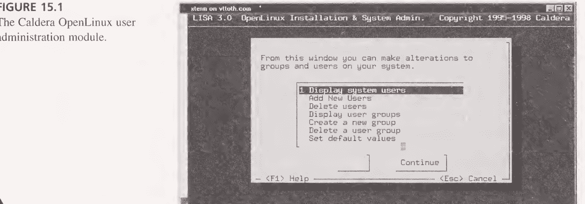

## 影子密码 (Shadow Passwords)

正如第4章所解释的，影子密码套件的设计是为了克服基本 UNIX 密码安全的一个缺陷：即任何可以登录系统的人都有获取并解密密码文件的能力。以下章节将简要解释密码，以便你能够提高系统的安全性。

## 密码加密

如果你在没有安装影子密码的计算机上检查 `/etc/passwd` 文件，你会发现类似下面的内容行：

```
juser:aseb23hfAQ12B:501:100:Joe User:/home/juser:/bin/sh
```

紧跟在用户符号标识符后面的乱码是该用户加密形式形式的密码。

所使用的加密方法相当安全。首先，它是**单向加密**，这意味着无法从加密文本中恢复原始密码。这是因为许多不同的密码可以映射到相同的加密文本，因此如果只知道加密文本，无法找到在许多可能性中哪一个是原始密码（见图 15.2）。

图 15.2
单向密码加密。

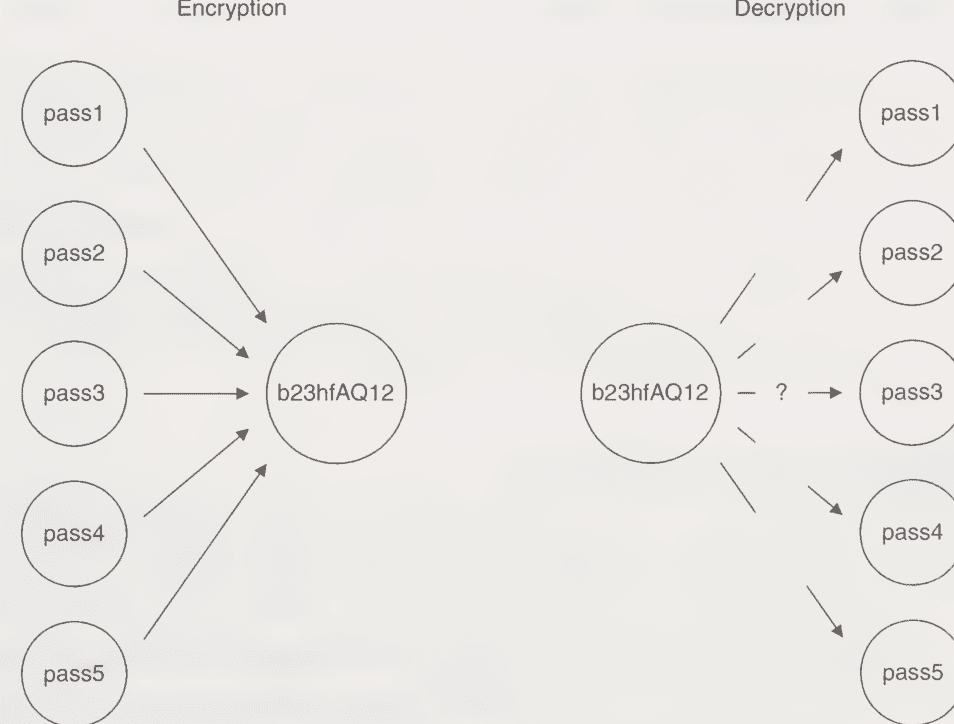

那么，如果密码无法解密，这个密码文件又是如何使用的呢？很简单：当输入密码时（例如在响应 `login:` 提示时），它会被再次加密。然后，将加密结果与 `/etc/passwd` 中找到文本进行比较。

UNIX 密码的一个额外安全功能是**加盐 (salting)**。据说密码使用了随机值加盐，这会改变加密的结果。因此，如果两个用户使用相同的密码，加密文本可能会保持不同；因此，基于将加密密码与已知值进行比较的攻击注定失败。

尽管如此，这种加密方法也无法应对今天强大的计算机。如果已知加密密码，一种常见的攻击方法是所谓的**词汇表攻击 (vocabulary attack)**，即使用列表（词汇表）中的值使用密码文件中相同的盐值进行加密，并与那里的加密密码进行比较。尽管人们对系统安全表示担忧，但惊讶的是，许多不包含大小写字母或数字的用户，此类攻击往往是成功的。然而，即使是经过巧妙设计的密码也无法防止攻击者；在高端工作站上，**暴力破解**（按顺序尝试字母和数字的所有组合直到成功）在有限的时间内有很大机会成功。

## 影子文件 (The Shadow File)

UNIX 加密之所以有这个缺陷，是因为包含密码的文件 `/etc/passwd` 是任何在系统中拥有账户的人都可以读取的。一旦获得了该文件的副本，攻击者就可以利用手中的任何工具来获取破解后的密码。正如第4章解释的，解决问题的的方法是将密码移动到一个单独的文件——影子密码文件。该文件被设置为仅供系统管理员读取——从而从上关闭了 `/etc/passwd` 的安全漏洞。

## 密码策略 (Password Policies)

影子密码套件不仅仅是将加密密码移动到不同的文件。它还提供了实现密码策略的工具。

这些工具并不是 Linux 内核的一部分，在许多 Linux 发行版中并不可用。相反，必须单独获取。例如，你可能从 `sunsite.unc.edu` 的 FTP 地址获取最新版本的 quota tools 副本（切换到 `/pub/Linux/system/admin/diskusage` 目录）。安装这些工具需要对其进行编译和配置。

## 总结

Linux 管理员必须执行的一些最常见任务是创建、管理和删除用户账户。一个用户账户由 `/etc/passwd` 文件中的一个条目、用户的家目录以及用户的邮箱组成。

在内部，用户通过 0 到 65,535 之间的一个数字进行标识。用户通过其符号名称（也称为用户 ID，UID）来识别自己的账户。除了用户 ID 之外，用户通常还有一个家目录，大多数用户文件都存储在该处。用户的启动 shell 是当用户登录系统时激活的交互式程序。

要添加用户，至少必须在 `/etc/passwd` 中创建一个新条目。这最好使用 `useradd` 等软件工具，或 Caldera OpenLinux 系统管理工具 LISA 中的用户管理模块完成。

由于 `/etc/passwd` 存在安全问题，许多系统将加密密码存储在单独的文件 `/etc/shadow` 中。实现此功能的工具集被称为 shadow password 套件。该套件虽然可以单独安装，但最好与 Linux 发行版一起安装，因为事后安装是一项复杂的任务。

还可以限制单个用户在系统上使用的磁盘空间。要做到这一点，你需要安装 quota 支持。quota 支持需要适当编译的 Linux 内核以及安装 quota 工具，这些工具可以在互联网上的许多 Linux 存档中获得。

## 手册页

有关本章讨论主题的更多信息，请参考以下手册页：

- `man 5 shadow`
- `man passwd`
- `man chfn`
- `man chsh`

# 第 16 章

## 日志

**无论你是试图诊断问题、捕获试图访问系统的攻击者，还是仅仅监控系统的健康状况，你将使用的主要工具都是各种系统日志。** 它们重要性不言而喻。为了有效地且有信心地管理 Linux 服务器，彻底熟悉系统生成的日志并能够阅读它们，以便轻松定位重要信息，是至关重要的。

## 系统日志

大多数 UNIX 系统提供一个通用的日志设施，操作系统本身以及任何应用程序都可以使用它。该设施被称为 *syslog*。在 Linux 中，系统日志受一个特殊用途服务器程序——syslog 守护进程 syslog 控制。

## 日志消息

按照惯例，大多数日志消息放在 `/var/log/messages` 文件中。该文件包含类似行：

```
Apr 12 22:25:03 host syslogd 1.3-3: restart.
Apr 12 22:25:05 host kernel: klogd 1.3-3, log source = /proc/ksmsg started.
Apr 12 22:25:06 host xntpd[347]: xntpd 3-5.91 Wed Aug 19 06:20:55 MST 1998
Apr 12 22:25:06 host cron[353]: (CRON) STARTUP (fork ok)
```


如你所见，日志文件中的每一行都以日期时间戳开头。下一个字段是产生日志消息的计算机名称。大多数情况下，这将是你的 Linux 系统的名称；但是，如果你允许通过网络记录日志，其他计算机名称也可能出现在这里。

计算机名称之后是生成日志消息的应用程序名称。应用程序的数字进程标识符也显示在方括号中。最后打印的是实际消息。

## 运行 syslog

Linux 日志服务器程序称为 `syslog`，它通常在启动时与其他系统守护进程一起启动。`syslog` 的功能很简单：它监听传入的消息并将这些消息存放在适当的文件中。

如果你的系统没有正在运行的 `syslog` 副本，你可以通过 root 用户身份输入 `syslog` 来启动它。（由于 `syslog` 可能不在你的默认路径中，可能需要在它前面加一个完整路径名，例如 `/usr/sbin/syslog`）。可以将此命令添加到 `/etc/rc.d` 中的系统初始化文件中，以确保 `syslog` 在系统启动时自动启动。

## 跨网络记录日志

除了记录本地事件外，系统日志设施还可以记录跨网络的事件。由于这种能力显然提供了一种滥用你系统的手段（如果恶意黑客或发生故障的计算机开始向你的系统发送大量的 `syslog` 消息，你就有问题了），因此它默认是关闭的。你可以通过更改 `syslog` 启动脚本来开启它；在 `syslog` 启动命令中添加 `-r` 命令行开关。

此命令行开关指示 `syslog` 不仅监听本地消息，还监听通过 UDP 端口 514 跨网络传入的消息（见第 5 章“互联网概念”，获取更多关于 TCP 和 UDP 端口的信息）。

> 警告：在使用 `syslog` 命令配合 `-r` 开关之前，你必须理解，没有办法让 `syslog` 选择性地仅监听传入的消息。

## 配置 syslog

`syslogd` 监听传入消息这一事实显然只是等式的一部分。消息去向哪里？答案很简单：`syslog` 的行为由 `/etc/syslog.conf` 的内容控制。每条日志消息有两个属性：设施标识符（见表 16.1）和优先级级别（表 16.2）。

### 表 16.1 Syslog 设施标识符

| 设施 | 描述 |
| --- | --- |
| `auth` | 安全/授权消息 |
| `authpriv` | 安全/授权消息（私有） |
| `cron` | 时进程 |
| `daemon` | 系统守护进程 |
| `kern` | 内核消息 |
| `lpr` | 打印机子系统 |
| `mail` | 邮件系统 |
| `mark` | 留作内部使用 |
| `news` | 网络新闻子系统 |
| `syslog` | `syslog` 内部的消息 |
| `user` | 随机用户级消息 |
| `uucp` | UUCP 子系统 |
| `local0` 到 `local7` | 本地定义 |

### 表 16.2 Syslog 优先级标识符

| 优先级 | 描述 |
| --- | --- |
| `debug` | 调试级消息 |
| `info` | 信息性 |
| `notice` | 正常但重要的状况 |
| `warning` | 警告状况 |
| `err` | 错误状况 |
| `crit` | 关键状况 |
| `alert` | 必须立即采取行动 |
| `emerg` | 系统不可用 |

这两个表中的标识符用于 `/etc/syslog.conf`，以指定要处理的消息类型。`/etc/syslog.conf` 中的每一行看起来如下：

```
facility.priority action
```

设施和优先级字段包含来自表 16.1 和 16.2 的关键字。`action` 字段决定了如何处理所选类型的消息。

可以指定多个设施并用逗号隔开，或者使用单个星号 (`*`) 表示所有设施。在优先级字段中，单个关键字意味着所有指定优先级及以上的消息。然而，你可以在优先级关键字前加上等号（意味着仅限指定的优先级）。优先级（带不带等号）前面也可以加上感叹号，以否定其含义。例如，`!warning` 意味着低于警告的优先级，`!emerg` 意味着 `emerg` 以外的所有优先级。

`action` 字段可以包含以下任一项：

- 完整路径，在这种情况下，指定类型的消息将写入该路径指定的文件中
- “at”符号 (`@`) 后跟一个配置为接收 `syslog` 消息的机器的网络地址
- 用户或用户列表（用逗号隔开）或所有当前登录的用户 (`*`)
- 设备名称，作为控制台或命名管道

> 警告
动作字段（`action` field）必须使用制表符（tab）与设施（`facility.priority`）部分分开（在大多数系统中空格字符将不起作用！）

> 注意
为了确保在系统崩溃时日志文件的完整性，`syslog` 每次写入日志文件时都会将内容刷新（flush）到磁盘。这确保了在发生崩溃时没有数据留在内存缓存中；但这种行为会产生性能影响。为了防止 `syslog` 刷新日志文件，可以在 `/etc/syslog.conf` 中在文件名前加一个符号。

## 测试系统

在我测试系统上安装的 Caldera OpenLinux 带有一个预配置的 `syslog.conf` 文件，其中包含以下配置行：

```
*.info;news,mail,authpriv,auth.none -/var/log/messages
authpriv.*;auth.* -/var/log/secure
mail.* -/var/log/mail
news.* -/var/log/news.all
uuc,news.err -/var/log/spooler
emerg *
```

此配置是没问题的；它对大多数用途运行良好。然而，我决定添加一行，以确保错误消息被记录到我网络上的另一台主机上：`.err @192.168.1.2`

不用多说，这里指定的主机也运行着 `syslog` 的副本——该副本已配置为接受通过网络连接的日志消息。

## 内核日志

有一类特殊的日志消息是预留给 Linux 内核生成的。默认情况下，这些消息会打印在控制台上，当你正在编辑关键文件时（例如），如果它们弹出来，可能会非常干扰工作。人们需要立即看到更多的内核消息；其中相当多仅仅是信息性消息，比如告知你 CD-ROM 驱动器中的 CD 已经更换的消息。

内核日志消息可以通过内核守护进程 `klogd` 重定向到系统日志。该守护进程通常在系统启动时与 `syslogd` 一起启动。当该进程运行时，除了“panic”（指示灾难性系统故障的消息）外，所有的内核消息都将重定向到系统日志，而不是显示在控制台上。

也可以随时使用 `dmesg` 命令查看最近的内核消息。内核维护着一个固定大小的内部缓冲区，其中存储它生成的消息；当缓冲区满时，它会从头开始循环重用（这就是为什么它被称为环形缓冲区）。`dmesg` 命令只是简单地列出该缓冲区的内容。可选地，它也可以用于清除缓冲区的内容。（注意，它不会移除任何已发送到系统日志的消息。）

## 启动通知

`dmesg` 命令的一个非常实用的用途是创建信息性邮件；它不仅会在系统意外启动时通知你，还会在出现硬件问题时提供提前预警。

创建此类消息的一种方法是将以下命令添加到 `/etc/rc.d/rc.local` 文件（在大多数 Linux 发行版中，该文件包含本地启动脚本）：

```bash
/dmesg | /bin/mail -s "System boot: $(date +%Y%m%d)"
```

注意此行中反引号（`` ` ``）的使用；它允许被引号的命令（在这种情况下是 `/bin/date` 命令）的输出作为另一个命令（`/bin/mail`）的参数。

该命令会创建一个带有以下主题行的邮件：
`System boot: 日期`

邮件正文将包含自系统启动以来的所有内核消息。邮件将发送给 root 用户。不用多说，你可以根据需要自定义此行——例如，你可能想更改 `date` 命令的格式以显示四位年份，或者更改收件人。

## 读取日志文件

取决于配置的程度，Linux 系统每天可以生成几十甚至数百 KB 的日志消息。系统日志文件初看起来可能很吓人；如果你具备一点知识和常用的文本处理工具，就可以很容易地处理。

## 日志条目的含义

记住，日志文件中出现某些内容并不意味着需要你的关注。事实上，绝大多数日志消息都是信息性的，可以安全地忽略，除非你正在寻找特定事件或发生的迹象。

由于你的测试系统日志通常是空的。相反，我从一个真实的“运行中” Linux 系统选取了一些日志条目作为示例：

```
Apr 00:01:49 host1 sendmail[5025]: XAA0523:to=some.user@spectrawa.web
delay=00:04:50, xdelay=00:03:45, relay=msmtp, relay=smtp.plusnet.ch,
tat=Defined Name server: smtp.plusnet.ch.: host lookup failure
Apr 00:04:03 host1 in.pop3[5061]: connect from 192.168.1.3
Apr 00:04:03 host1 in.pop3[5061]: connect from 192.168.1.3
```

## 日志与文本处理命令

那么，如何在系统日志中找到“有趣”的行呢？显然，阅读一个长几百 KB 甚至几 MB 的文件是非常耗时的。幸运的是，UNIX 文本处理命令在这里可以提供极大帮助。在处理日志文件时，有四个命令特别有用。

`tac` 命令（细心的读者可能会发现它是 `cat` 的反过来）会按反序列出文件内容。结合 `more`（或 `less`），该命令可以一次一页列出日志文件，显示最近添加的消息。

`head` 命令可以列出文件的前几行。默认情况下，`head` 列出文件的前 10 行。通过在文件名之前添加 `-n` 形式的数字参数，你可以指定想要显示的行数。

`tail` 命令的作用与 `head` 类似，但它列出命令行上指定文件的最后几行（默认为 10 行）。

最后，UNIX 最实用的命令之一 `grep` 可用于搜索文件中特定文本的所有出现处。

这些命令结合使用，可以让你对系统日志的使用变得非常高效。

例如，我决定查看我测试系统日志中的所有 NTP（网络时间协议）消息。为了仅列出 NTP 消息、反序列出并在屏幕上一次一页显示，我使用了以下命令：

```
tac /var/log/messages | grep ntp
```

## 持续监控

`tail` 命令也可以持续监控日志文件。这是通过 `-f` 命令行参数实现的。例如，尝试以下命令：

```
tail -f /var/messages
```

你可以在虚拟控制台上使用此命令，也可以在使用图形界面或远程连接到 Linux 系统时，在窗口中使用它，对系统日志文件进行持续监控。

## 其他日志文件

并不是所有应用程序都专门使用系统日志来记录重要消息。本节回顾了你系统中可能出现的一些其他重要日志文件。

### 登录记录

两个二进制文件 `utmp` 和 `wtmp` 用于发现当前登录系统的用户，并记录登录和注销情况。这些文件不是人类可读的；它们由特殊的实用程序进行解析。

`who` 命令显示所有当前登录的用户。此列表由 `utmp` 的内容生成。

`last` 命令显示所有存在记录的过去登录情况。它本质上是反序显示 `wtmp` 的内容。可以使用 `#n` 形式的可选参数（井号符号代表任意数字）来限制此命令显示的行数。

`utmp` 的大小对于每个登录用户限制在几百字节。然而，`wtmp` 的大小可能会超过限制，因为每当用户登录或注销系统时，就会添加一个新条目。

这里是我的测试系统中 `who` 和 `last` 命令产生的输出：

```
TEST SYSTEM

$ who

vttoth      ttyp2          Apr 16 16:39 (vtt1.vttoth.com)

$ last -5

vttoth      ttyp2          192.168.1.2          Fri Apr 16 16:39      still logged in
root        tty1                    Fri Apr 16 16:28 - 16:41 (00:13)
vttoth      ttyp1          192.168.1.2          Tue Apr 13 17:09 - 15:50 (2+22:41)
reboot system boot Tue Apr 13 16:56
ftp ftp localhost Sat Apr 13 09:26 - 09:26 (00:00)
```

注意，除了正常的登录和注销外，列表还包含通过 FTP 登录和系统启动事件。

第三个二进制文件 `lastlog` 包含有关用户登录的信息。从该文件中，你可以确定系统上每个用户的最后登录时间。可以使用 `lastlog` 命令读取该文件，该命令适用于某些 Linux 发行版。

### 传输日志

当用户通过文件传输协议（FTP）访问你的系统时，日志文件中会生成条目。该文件通常称为 `xferlog` 并放置在 `/var/log` 目录下——它包含每个完成的文件传输条目。

## Web 服务器日志

Apache 服务器通常生成两个日志文件。访问日志（access log）包含每次访问服务器的条目；错误日志（error log）包含每个发生的 Web 服务器错误条目。

如果你的 Web 服务器上托管了多个虚拟主机，你可能会看到访问日志和错误日志的多个副本，系统中每个虚拟主机各有一个。

这些日志文件的位置在你的 Web 服务器配置文件中指定。在 Caldera OpenLinux 中，这些文件通常存储在 `/var/log/httpd/apache`。

## UUCP 日志

如果你使用 UUCP 进行邮件或新闻传输，UUCP 系统也会创建自己的日志文件。这些日志文件包含关于入站和传出调用以及传输或接收的文件的信息。取决于你的 UUCP 如何配置，这些日志消息可能存放在单个文件或多个文件中。

## 新闻日志

如果你使用 UUCP 进行邮件或新闻传输，UUCP 系统也会创建自己的日志文件。这些日志文件包含关于入站和传出调用以及传输或接收的文件的信息。取决于你的配置，这些日志消息可能存放在单个文件或多个文件中。

## 轮转日志

许多日志文件因为 Caldera OpenLinux 使用的日志方案而存在多个副本。该方案在 `/etc/logrotate.d` 中实现，通过相关配置，旧的副本将以数字扩展名保存（例如 `messages.01`、`messages.02` 等）。默认情况下，`logrotate` 设置为压缩某些日志文件；这些文件具有额外的 `.gz` 扩展。可以使用 `zcat` 命令无需解压读取这些文件（或使用 `less` 一页页查看）。

## 日志维护

如何告诉系统日志进程创建 `/var/log/messages` 的新副本？简单，你只需要向它发送一个挂断信号（HUP）：

```
killall -HUP syslogd
```


除了`syslogd`，其他程序也被设计为响应挂断信号以重新读取配置并重新初始化；这包括重新打开现有日志文件或在必要时创建一个。然而，这种行为并非通用；在向你喜欢的进程发送挂断信号之前，你应该查阅其手册页。在许多发行版中，包括光盘上的 Caldera OpenLinux 版本，已经存在可以自动执行此过程的程序。在我的测试系统中，以下日志文件由系统进程和其他应用程序生成：

- `/var/log/lastlog`
- `/var/log/mail`
- `/var/log/messages`
- `/var/log/news.all`
- `/var/log/secure`
- `/var/log/spooler`
- `/var/log/wtmp`
- `/var/log/xferlog`
- `/var/log/http/apache/access_log`
- `/var/log/http/apache/error_log`
- `/var/log/news.d/errlog`
- `/var/log/news.d/news`
- `/var/log/samba.d/nmbd`
- `/var/log/samba.d/smb.smb`
- `/var/log/samba.d/smb.hostname`
- `/var/log/samba.d/smbdd`
- `/var/log/uucp/log`
- `/var/log/uucp/Stats`

## 总结

与任何完善的 UNIX 系统一样，Linux 在日常使用过程中产生大量的日志。理解系统产生的日志文件是维护系统健康的关键。

Linux 下的中央日志设施是系统日志（system log）。当`syslog`守护进程运行时，服务器应用程序可以向它发送日志消息。存放这些消息的文件定义在系统日志配置文件`/etc/syslog.conf`中。你可以将特定类型的日志消息重定向到网络上的其他计算机。你也可以配置`syslog`守护进程，通过网络接收来自其他系统的此类日志消息。

对于 Linux 内核生成的消息，有一个专门的类别。这些消息通常显示在控制台上输出，但在`klogd`守护进程的帮助下，可以将它们重定向到系统日志。最近的内核消息会被临时缓冲，可以使用`dmesg`命令进行查看。

可以使用简单的文本处理命令高效地查看日志文件。`head`、`tail`、`tac`和`grep`命令分别在查看日志文件开头、查看末尾、反序查看日志以及在日志文件中搜索特定文本时特别有用。

除了主系统日志外，其他应用程序还会生成其他日志文件。这些日志包括登录记录、Web 和 FTP 服务器传输日志、UUCP 和新闻系统日志。

为了防止日志文件填满系统硬盘，你需要对文件进行轮转（rotate）。轮转可以使用几个简单的命令完成，也可以使用专门开发的实用程序（如`logrotate`）。

## 手册页 (Manual Pages)

有关本章讨论的话题的更多信息，请参考以下手册页：

- `man syslogd`
- `man klogd`
- `man syslog.conf`
- `man dmesg`
- `man wtmp`
- `man who`
- `man last`
- `man xferlog`

# 第 17 章

# 备份

**你已经从系统大师们那里听得足够了**：始终为你计算机上的所有数据保留一份最新的备份！对于服务器来说，维护备份更为重要；如果系统崩溃并丢失数据，可能会影响到许多用户。

但是，对于 Linux 服务器来说，一个有意义的备份策略究竟是什么？在实践操作中，创建备份的最好方法是什么？

## 备份策略

创建备份应该是简单的，对吧？你所做的就是对系统硬盘上的所有文件进行复制。然后，当灾难发生时，你只需从备份中恢复文件，然后——变变！——一切都就绪了。真的是如此吗？

## 仅备份是不够的

这种简单备份策略的问题在于，虽然它确实确保了你所有的数据都有备份副本，但它没有考虑到恢复数据的步骤。

考虑以下示例：你使用 Linux `tar`命令（我们稍后会详细讨论）在最近在拍卖购买的磁带驱动器上创建了磁带完整备份，从那以后这台驱动器一直运行良好。一个压缩且加密的存档存储在磁带上，为了安全起见，你决定将其异地存储。然后，一天早上，你进入办公室，发现你的 Linux 机器被盗了或由于电源短路损坏了。现在该？

# 第 17 章 备份

获取另一台机器应该并不困难，特别是考虑到如今负载不沉重的 Linux 服务器几乎运行在任何可以称作计算机的设备上。找到你父亲那台旧的 486 并不是问题，但它解决不了你的困境。你面临的第一个难题很快就会出现，因为你发现没有合适的设备来插入从异地存储取回的备份磁带。哎！

于是，你在接下来的 24 小时里疯狂寻找一个兼容的磁带驱动器。如果你运气好，你至少知道了型号。后来，你最终在互联网上找到一家在线商店，他们愿意从位于阿拉斯加或夏威夷的某处仓库以极高的加价为你寄送正确的设备。最终，设备送到了；你安装了它并启动了系统。迎候你的是你父亲电脑上仍然运行的过时 DOS 版本的提示，而你完全不知道如何从磁带中恢复你那完美的 Linux 系统。DOS 没有`tar`命令，而且在没有第三方软件的情况下无法识别磁带驱动器。

最终，你意识到为了运行你的磁带，你必须先有一个可以运行的 Linux 副本，于是你开始安装一个全新的副本。你安装了最小系统，访问了磁带，惊喜地发现磁带完全是可以读的，并开始了恢复文件的过程。当你完成后，你尝试重启系统；系统启动失败。

在苦思苦想之后，你意识到了原因：你刚刚从磁带带回的系统与你父亲的旧硬件不兼容。于是，你继续进行全新的 Linux 安装，这次设置了一个更完整的系统，然后开始了痛苦的选择性恢复文件和目录的过程。你非常小心地确保恢复了关键数据和系统设置，而不会覆盖操作系统配置，否则会导致 Linux 在你的计算机上无法启动。

过了多少小时，过了多少天？你的网站无法访问了多久，你的同事没收到邮件了多久，你的办公室没有网络连接了多久？当然，如果你不是仅仅遵循教科书式的备份策略，而是为恢复系统做了计划，所有这些问题本是可以避免的。

## 恢复计划

“备份策略”这个术语是一个误用。不，真正的规划应该关于灾难发生后该做什么。按计划轮转磁带和备份备份并不算是什么什么策略。第 22 章“迁移到备份硬件”告诉你在系统故障且需要安装备份系统时该做什么。本章的重点在于创建合适的备份，以及从较严重的故障中恢复。你如何让系统恢复在线？你应该使用什么硬件进行备份？

## 备份文件

当你备份系统时，你实际上做的是创建系统上文件的副本。显然，没有必要复制容易找到的文件；但是，为无法恢复的文件创建备份是关重要的。那么，究竟需要备份的文件是什么呢？

首先，最重要的备份对象是用户数据文件。接下来，你还必须对系统设置进行备份。最后，你还想为任何自定义创建备份副本，包括你下载的并非标准发行版的软件包。

# 第 17 章 备份

请记住，用户文件存在于家目录之外。例如，在大多数系统中，用户邮件信箱位于`/var/spool/mail`，这些必须妥善备份——否则，如果系统故障，重要的邮件信息可能会丢失。

其他用户文件位于公共目录。示例包括 Web 文件（可能位于`/home/httpd/html`或`/var/lib/html/htdocs`）以及公共 FTP 目录的内容（`/home/ftp`）。

## 配置文件

为了能够快速、高效地重新安装系统，你应该始终拥有一份最新的系统配置文件的备份。然而，这些文件可能与数据文件分开存储为好。事实上，由于这些文件很小，在软磁盘上创建它们的副本是一个好主意。这样，当你需要重新安装系统时，就可以立即使用这些文件，而无需从大型归档中恢复它们。

这是在软磁盘上存储副本是一个好主意的另一个原因：它让你能够选择性地恢复这些文件。当你与原始硬件并不完全相同的备份硬件上安装 Linux 时，许多配置文件在不更改将无法使用。有了软磁盘上的文件，你可以方便地访问它们，将其与安装默认进行比较，或只需将这些文件的部分移动到系统中的“活动”对应文件中。

## 定制化

系统使用几个月后，其配置可能不再像几个月前从 CD-ROM 安装的配置。特别是，你可能下载了软件软件包的新版本，并使用自定义配置选项对其进行了编译和安装。显然，如果你想能够将系统恢复到工作状态，除了之前提到的配置文件外，还必须保存下载的源码归档。这尤为重要，因为在几个月之后，你可能不再记得你的自定义是什么——如果理解下载的包、翻阅各种文档文件并创建一个适合你需求的安装程序在你第一次执行时花费了那么长时间，那么当你被迫再次这样做时，可以预计将花费几乎同样的时间。

因此，当你下载一个软件包时，最好先使用普通用户账户进行实验（而不是使用 root 账户，以避免损坏）。当你对该包按预期工作感到满意时，应该安装可执行文件，并将下载的源码归档移动到常用位置，例如`/usr/src`。在准备备份时，确保此目录已已备份。这样，在灾难恢复期间，你能够像以前一样快速重新构建这些包。

## 备份工具

现在你已经知道需要备份什么，下一个问题显而易见：你如何实现？备份你的 Linux 系统的工具和程序是什么？

## 选择你的备份硬件

首先，你必须决定使用哪个目标设备进行备份。在过去，这是不言而喻的——除非你想折腾几十张软盘（对于爱好者的系统来说这是一个足够的方法，但显然不是你打算在办公室中使用的服务器），否则你需要投资磁带驱动。

在许多情况下，磁带仍然是可靠备份的首选方案。高容量磁带机可以用合理的价格获得，并将为你提供多年无故障的服务。然而，现在存在可移动介质替代品。这些中最流行的是 CD-R、CD-RW 设备和移动硬盘。

CD-R 或可刻录 CD 是一项让你使用廉价设备创建 CD-ROM 的技术。你创建的 CD 是唯一的——即一旦写入就无法擦除。但是，可以向磁盘多次写入，向磁盘上已有的任何内容进行添加。由于其特性，CD-R 最适合创建永久或半永久的归档。CD-RW 的在负载较重的系统上可能会出现问题，因为有严格的时间要求；如果计算机无法维持所需的写入速度，CD-R 可能会变成一个无用的垫片。

CD-RW 是一种类似的技术，其介质是可写的。由于最近 CD-RW 设备价格下降，加上由于大多数 CD-RW 设备也能创建 CD-R 介质，CD-RW 驱动器可能是一个非常好的投资。你可以使用几张 CD-RW 磁盘（相对昂贵）创建常规备份，并使用 CD-R 磁盘创建偶尔的“一次性”备份进行异地。

如今可移动卡盒驱动器越来越流行。其中最为人知的是 Iomega ZIP 驱动器，它提供 100MB 的容量（现在有些为 250MB），以及更大的 JAZ 驱动器，提供 1 或 2GB 的存储。这些设备的优点是提供了软磁盘的便利性；缺点是它们的价格和并不完美的可靠性记录。

无论你选择何种设备进行备份，请确保它是通用的。如果你找不到可以读取其内容的系统，备份磁带或卡盒将毫无用处！

## 使用备份硬件

备份设备可以是内部或外部的；它们可以连接到计算机的 IDE 或 SCSI 总线或软盘控制器。它们也可能带有自己的控制器卡。无论情况如何，你选择的备份设备必须有相应的驱动程序。

然而，`tar`并不是一个真正的磁带归档工具，因为它不提供任何磁带管理命令。它没有回退、留存或格式化磁带的功能，甚至无法定位磁带上的特定位置。这些功能被集成在另一个工具`mt`中。

用`tar`创建的归档是不压缩的。为了节省空间，你可能想要进行压缩。Linux 下最流行的压缩工具是 gzip，它是 GNU ZIP 的缩写。GNU 版本的`tar`（例如在大多数 Linux 发行版中找到的版本）可以通过简单的命令行开关创建与 gzip 兼容的压缩归档。

> 注意
> gzip 不会像 DOS 或 Windows 上著名的 PK-ZIP 工具那样创建一个包含多个文件的归档。gzip 实用程序仅用于创建单个文件的压缩版本。这就是为什么 gzip 通常配合`tar`一起使用——为了创建一个包含多个文件的压缩归档。

另一个压缩工具是 compress，它使用了一种相当高效的压缩方法（但这种方法目前或至少过去比 gzip 兼容更多类型的 UNIX 系统）。

> 测试系统
> 测试系统没有专用的备份设备。然而，它有两块硬硬盘。Linux 安装在`/dev/sda`上，这是一个可移动设备。另一块`/dev/sdb`是一个内部硬盘，格式化为单个 DOS 分区。由于这块硬盘有大量空闲空间，我将其作为我的备份目标。或者，为了快速纠正一下，我将使用硬盘上的一个文件作为备份。使用硬盘的设备名称作为备份目标将破坏该硬盘上的所有数据！

最简单的形式，`tar`命令可以在默认设备上创建选定文件的归档。例如，要备份硬盘上的所有文件，你可以输入以下命令：

```bash
tar c /
```

遗憾的是，这还不够好。取决于你使用的`tar`版本，这可能会在磁带设备`/dev/rmt0`（我在测试系统上没有这个设备）或在标准输出（即列在屏幕上）上产生输出，这并不是我备份时想要的效果。

相反，我必须指定输出文件或设备。但首先，我必须挂载我想要创建备份文件的第二块硬盘：

```bash
mount /dev/sdb1 /mnt/sdb1

tar cf /mnt/sdb1/backup.tar /
```

目录`/mnt/sdb1`仅仅是一个用作`/dev/sdb1`挂载点的空目录（见第 3 章）。

然而，这种调用`tar`的形式仍然不令人满意。它会无差别地备份所有文件。这除了数据和配置文件，还包括所有系统文件、`/proc`目录中的伪文件（可能会导致备份进程锁）、`/dev`目录中的设备节点等。更糟糕，它还会尝试备份`/mnt/sdb1`，它是第二块硬盘的挂载点，并且通过这个挂载点备份整个第二块硬盘的所有内容！

我真正需要一种更具选择性的`tar`调用方式。考虑以下命令：

```bash
tar clvf /mnt/sdb1/backup.tar /etc /var /home
```

在这种形式下，该命令将备份`/etc`、`/var`和`/home`目录的内容。由于`l`标志，它不会备份另一个文件系统中的文件；但由于`v`标志，它将显示处理文件的详细列表。`/etc`目录主要包含临时文件，而`/home`是所有主目录的位置，包括用户邮箱，当然，还有包括 FTP 和 Apache Web 服务器的所有主目录位置。

我还有另一个恰好带有磁带驱动器的 Linux 系统。在该系统中，每周使用以下命令进行备份：

```bash
tar clvf -atime-preserve /dev/rmt0 /etc /usr/local/samba -/usr/local/majordomomo /home /var /adm /usr2/src
```

此命令导致`tar`使用`/dev/rmt0`作为备份设备。目录包括所有主目录以及包含配置设置和自定义的目录。`-atime-preserve`标志确保`tar`不改变它所备份文件的最后访问时间。

# 第 17 章 备份

> 注意
> Linux 系统上的每种磁带驱动器可以通过两个设备名称访问：`rmnt`和`nrmtn`（某些 SCSI 系统上可能使用`rmsto`和`rstm`名称）。当通过第一种形式访问时，磁带将在操作结束时回到（这正是我希望它的行为）。当通过第二种形式访问时，磁带将留在操作结束的位置。

## 测试系统

另一个经常用于备份的命令是`cpio`。该命令可以用于创建和维护许多不同格式的归档，包括`tar`格式。

`tar`和`cpio`命令也可以用于将整个目录树从一个地方复制到另一个地方。`tar`命令通过一个中间归档调用两次；而`cpio`可以一次性完成此操作，无需使用此类归档。在过去，这些命令的能力非常有用，因为旧版本的`cp`命令不会递归地复制目录，无法保留文件的所有权和标记。

## 选项

作为参考，这里是你可以使用上述所有三种命令递归地将`/dir1`的内容复制到`/dir2`（保留文件所有权并排除位于另一个文件系统上的文件）。

首先是`cp`命令：

```bash
cp -ax /dir1 /dir2
```

使用此命令不会保留原始文件的访问时间。例如，通过输入`ls -atime`，你将能够看到文件最近被访问过。

`tar`命令需要调用两次，并且要求你先创建目标目录：

```bash
mkdir /dir2

tar cf /dir2/backup.tar -C /dir1

tar xpf /dir2/backup.tar -C /dir2
```

你可以看到，第一个`tar`命令的输出（一个归档）从未保存到文件中；而是被作为第二次调用的输入，在目标位置中解压该归档。在此形式下，`tar`将准确地保留创建和访问时间。

`cpio`命令需要结合`find`命令使用，后者用于生成要复制的文件列表：

```bash
cd /dir1

find . -xdev -print | cpio -admp /dir2
```

当然，如果你的备份是以文件复制的形式（复制到另一个目录、硬盘、磁带或 CD-ROM）存储的，那么就没什么可说的。恢复仅仅意味着将文件复制回原始位置，既可以一次性完成，也可以分批完成。所使用的命令与最初创建备份时使用的命令完全相同，因为该操作是对称的；无论你是从原始文件创建备份副本，还是从备份恢复原始文件，你都只是在保留所有权和权限的情况下复制文件。

如果文件是用归档格式创建的，则必须调用创建该归档的程序并带有相应的标志以从中读取并恢复文件。

具体来说，必须调用`tar`命令并带有命令行标志以确保执行恢复操作。该标志可以与其他标志结合，以确保以正确的权限恢复文件。

例如，要恢复早些时候在磁带设备`/dev/rmt0`上创建的文件，你只需要输入以下命令：

```
tar xpf /dev/rmt0
```

`p`标志确保在提取文件时妥善保留所有的所有权和权限信息。归档中的文件和目录树将提取到当前目录，因此你应该先切换到所需的目标目录（如有必要请创建它）。

`tar`命令也可以用于从压缩归档中提取。例如，如果你有一个名为`dir1.tgz`的压缩归档文件，可以通过输入以下命令来提取其内容：

```
tar xzpf dir1.tgz
```

当然，很多时候你并不想从备份中恢复所有文件，只想恢复选定的文件。你可以通过在提取命令后附加文件名来实现。例如，要仅从归档`dir1.tgz`中提取`file`文件，你可以输入：

```
tar xzpf dir1.tgz file
```


# 高级主题

那么，你什么时候应该执行备份？你应该维护多少份备份副本？你可以使用局域网（LAN）在两台计算机之间执行备份吗？

## 备份调度与介质轮换

你需要备份系统的频率取决于系统的典型用途。显然，每天处理大量信息的系统备份需求，与例如作为互联网路由器且不存储数据的系统备份需求完全不同。对于前者，可能需要进行每日备份；对于后者，在每次发生重大配置更改后进行备份可能足够了，完全没有需要执行计划备份。

另一个问题涉及你使用的备份介质。你应该反复使用单条磁带、盒带或 CD-RW 吗？显然，这并不是个好主意。如果你的系统在备份过程中故障，导致你留下了不完整且不可读的备份怎么办？如果在备份发生前发生错误，导致备份损坏怎么办？

在用作中等负载互联网服务器（包括 Web 服务器和邮件服务器）的系统中，由于这些系统包含很少或没有用户数据，我发现每周一次的备份计划是令人满意的。我使用两块备份介质（两块磁带或两块可拆卸磁盘），并在备份完成后对它们进行轮换。其中一块留存在计算机中，以便它按照计划在后台执行备份，而另一块则存储在异地。

**警告**

对于许多可拆卸介质设备，建议在驱动器不使用时不要将介质（磁带、磁盘盒带）留在驱动器中。在决定如何使用驱动器之前，请务必阅读驱动器的文档。

下一章“计划任务、脚本与编程”（注：此处原文为 "Scheduled Tasks, Scripts, and Programming"）将提供有关如何实际调度备份以便在系统使用量最低的时间在后台运行备份的信息。

## 增量备份

有时在备份期间并不需要复制所有文件，只需复制自上次备份以来发生变化的文件。这种备份被称为增量备份。

# 第 17 章 备份

在我个人看来，增量备份得不偿失，至少在 Linux 服务器上是如此。一如既往，问题出现在你尝试恢复系统时。你可能无法从单一源（你最新的备份磁带、盒带或文件）进行恢复，而是可能需要遍历多个增量备份，才能恢复所有文件的正确版本。这个过程可能复杂且容易出错，而且你还增加了由于归档损坏导致数据丢失的风险。

不用说，如果你的系统包含海量数据，增量备份可以节省大量资金。然而，在大多数 Linux 服务器上，在实施介质轮换计划的同时定期进行全量备份可能是最好的选择。

## 使用加密

备份的目的是：以便在发生灾难时能够快速、方便地恢复你的系统。从表面上看，通过加密备份让这项任务变得困难似乎是违背直觉的。

尽管如此，如果你将备份存储在异地，加密备份可能是必要的。多年来，我一直保持在汽车手套箱里放一套备份的习惯。这样，即使我的家庭办公室在例如火灾中被毁，我多年的工作成果也不会丢失。然而，汽车会被破入被盗，虽然我不会为丢失一个旧磁带或磁盘盒带而哭泣，但让 GB 级的数据落入他人手中会让我深感困扰。这就是为什么我对这些备份使用了加密。

## 测试系统

一个可以合理安全并随时用于加密文件和数据流（例如写入磁带的数据流）的解密程序是`des`命令，它实现了著名的数据加密标准（DES）。该命令在许多 UNIX 系统上可用。遗憾的是，由于美国的出口管制，Linux 发行版的制作者选择不包含此命令。然而，通过互联网很容易获得该程序。例如，我通过`ftp.psys.uq.au`获取了`des`。该包可以按照说明进行编译。如果一切顺利，你将获得安装在`/usr/local/bin`的`des`命令。

我在其中一个 Linux 系统上使用`des`命令在磁带上创建加密备份。我使用的实际命令是上一节备份命令的变体：

```
tar -clf - /etc /usr/local | des -E -k Password
```

在`tar`命令的`f`标志后使用减号`-`指示 tar 在标准输出上生成归档。输出被重定向为命令的输入。该命令的输出随后重定向到磁带。

如果你使用此命令或其变体，你应该将`Password`替换为你合适的密码。只需确保记住它；当你的系统故障并需要从备份恢复时，你最不想做的事情就是寻找那张遗忘已久的纸条！

## 网络备份

如果你在网络上有多台计算机并且有足够的存储空间，备份的地方显然是网络上的另一台机器。这种类型的备份无法保护你免受重大灾难，但它可以保护你免受单机故障（例如硬盘崩溃）。

在网络上执行备份有许多方法。在某些系统中，存在访问远程磁带设备的专用命令。然而，要备份到远程磁盘目录，最简单的方法可能是使用 Samba（参见第 13 章“Windows 文件服务：Samba”）或网络文件系统（NFS）挂载该远程目录。

我实际上通过网络对我的测试系统进行备份，但目标是另一台作为在线游戏 MUD2 主机的 Linux 机器。

每天清晨，在系统使用量最低时，服务器的所有关键目录都会通过网络复制到另一台机器上。

为了此工作，必须先挂载远程文件系统。我创建了一个挂载点，即名为`/backup`的空目录。需要时，可以使用以下命令挂载文件系统：

```
mount host1:/home/backup /backup
```

在此行中，`host1`是备份目标系统的名称，而`/home/backup`是存放备份文件的目录。

不用说，你不能直接将远程计算机的目录作为文件系统挂载到本地计算机上并期望它正常工作。在远程计算机上必须启用 NFS。对于涉及的系统，这通过确保守护进程运行，并通过向`/etc/exports`写入一行内容来允许执行备份的计算机进行访问来实现，类似于如下所示：
`/home/backup host2(rw,no_root_squash)`

由于本书介绍的是如何在主要以非 Linux 为主的的网络环境中使用 Linux 作为服务器，因此未涵盖 NFS。如果你有两台或更多 Linux 机器并想了解更多关于此功能的信息，可以开始阅读`nfsd`、`mount`、`mountmap`和`exports`的手册页。

## 总结

频繁备份是你防范灾难的最有效方法。然而，人们往往会忘记，比起建立备份策略，重点应该放在系统恢复的易用性上。

你需要备份的文件包括用户数据、系统配置设置和自定义内容（例如你在系统上下载并安装的额外实用程序）。创建整个系统的备份通常没有必要，甚至没有用处；在大多数情况下，为了开始恢复，你仍然需要安装一个最小化系统。此外，如果你将文件恢复到不同的计算机上，那些系统可能并不适用。

在选择备份硬件和软件时，恢复的便利性应该是你的首要考虑。无论你使用的是磁带、可拆卸盒还是光盘，请确保你使用的是通用格式。这样，当灾难来临时（可能创建存档的设备已完全损坏），你能够从备份中恢复系统。

最常用的 Linux 备份命令是`tar`命令。它设计用于在带子上创建存档。然而，它也可以用于创建存档文件（可选压缩）或在目录之间复制文件。另一个经常使用的备份命令是`cpio`。`cp`也可以用于跨目录执行简单备份。

在计划备份时，确保你使用了多个介质，并定期进行轮换。这样，即使系统在备份操作过程中失败且你的备份介质被毁，你永远会有可用的备份。

有时需要对备份进行加密。如果你将备份存储在本地且存储设施不安全，这一点尤为重要。

你还可以通过网络创建备份。最简单的方法是通过 NFS 或 Samba 挂载远程目录，并使用`cp`或`tar`复制文件。

## 手册页

有关本章讨论的话题的更多信息，请参考以下手册页：

- man cp
- man tar
- man cpio
- man gzip
- man compress
- man mt
- man des
- man nfsd
- man mountd
- man portmap
- man exports

# 计划任务、脚本与编程

在 Linux 下，许多系统管理任务可以通过自动化得到极大简化。你使用的工具包括一个在后台运行计划任务的 UNIX 守护进程（`crond`）和简单的编程工具。

不，我并不打算告诉你必须成为一名程序员才能有效地管理 Linux 服务器。然而，至少了解一下这个主题总是个好主意。就像 DOS 和 Windows 的“高级用户”能够使用批文件自动化许多简单任务——尽管把 MS-DOS 批处理文件称为编程的形式稍显牵强——如果你知道如何创建简单的 shell 脚本来自动化你的工作，在 Linux 下你将能够更高效地完成任务。

首先，让我们看看如何自动化计划任务的执行。

# 调度程序执行

许多系统管理任务是周期性的。无论是日志文件的轮转、每周备份的创建还是其他每日、每周或每月的任务，如果你能让这些程序自动执行，你的生活将变得轻松得多。

Linux（实际上是大多数 UNIX 系统）提供了两个用于计划执行任务的工具。`cron`守护进程允许你调度周期性任务；而`at`命令则允许你在指定时间调度特定任务的执行。

## cron 守护进程

`cron`守护进程在后台运行。它会定期检查`/var/spool/cron`目录（某些系统上为`/var/spool/cron/crontabs`）的内容，重新读取任何已更改的文件。这些文件的名称与用户标识符一致，它们包含了要在这些用户名义下执行的程序计划。

例如，如果我想每小时运行一次位于我的主目录下的名为`myprog`的程序，我可以设置如下所示的一行`crontab`内容：

```
0 * * * * /home/vttooth/myprog
```

`cron`守护进程使用一种简单但强大的格式进行调度。`crontab`文件中的每一行看起来如下：

`min`、`hour`和`day`参数分别代表分钟、小时和月份中的日期。这些参数中的每一个都可以是单个数值、遵循特殊语法的取值列表，或单个星号（表示任何值）。

上述的特殊语法通过几个示例来解释更为简单。例如，你可以在`min`处设置以下值：

- `* * * * *` 每分钟
- `0 * * * *` 每小时整点
- `0 */5 * * *` 每 5 分钟
- `0,30 * * * *` 在特定的分钟
- `0 0 1,15 * *` 在月份的特定日期
- `0 0 * * mon-fri *` 周一至周五工作日

小时和日期字段遵循类似的逻辑。`month`字段代表月份，使用三字母缩写——例如`jan`、`feb`等。`wday`字段代表星期，同样使用三字母缩写，并且可以指定范围。例如，`mon-fri`表示工作日。

如果你同时指定了月份的某一天和星期，计划任务将在两个日期执行。假设你有一条如下的`crontab`条目：
`0 0 13 * fri /home/vttooth/myprog`

程序`myprog`将每月 13 号以及每个周五执行，即使某个周五并不是 13 号。

你可以使用`crontab`命令编辑或查看你的`crontab`文件。要调出你的`crontab`编辑，输入`crontab -e`。这将使用`vi`编辑器打开文件。注意文件中可能包含以井号`#`开头的行。这些是注释行，会被守护进程忽略。

完成编辑后，`crontab`命令会自动安装你的新文件。

你也可以使用`crontab -l`列出你的文件内容。最后，作为 root 用户，可以使用`-u`参数编辑其他用户的`crontab`文件。例如，你可能会编辑`news`或`uucp`系统账户的`crontab`文件以更改相应程序的行为。

# 使用 at 执行命令

有时你并不希望程序重复执行——而是在指定时间执行一次。虽然可以使用`cron`守护进程来实现此目的，但它并不理想。事实上，严格来说，`cron`无法调度单次执行的任务；即使你指定了精确的分钟、小时、日期和月份，如果在间隔期间没有更改`crontab`文件，程序将在明年的指定时间再次执行。

这个问题有一个更简单的解决方案：`at`命令。该命令允许你调度单个命令或一系列命令的一次性执行。

`at`命令与`at`守护进程协同工作，后者是另一个系统启动时启动的系统守护进程。

想要执行的命令或命令必须放在文件中。该文件的内容将在计划时间由`/bin/sh` shell 执行，就像你自己在键盘上输入这些命令一样。要在指定时间调度执行命令，只需输入：

```
at HH:MM -f command-file
```

通过执行这些命令产生的任何输出都将发送给调度了该执行的用户。例如，如果你想在当天稍晚些时候查看`/var/spool/mail`目录下用户邮件箱的大小，你可以创建一个名为`viewmaildir`的文件，其内容为以下单行：

`-al /var/spool/mail`

然后，你可以使用`at`命令在晚上 7 点调度此命令的执行，如下所示：
`at 19:00 -f viewmaildir`

在预定的时间，命令将运行，目录列表将通过电子邮件发送给你。

## Shell 脚本

上一节演示了在通过该工具调度命令执行时，你必须将这些命令放入文件中。该文件实际上是一个 shell 脚本的示例——一个简单的程序，包含了你在处理 Linux 工作时通常以交互方式输入的命令。

## 简单程序

正如之前与`at`命令结合使用的示例一样，简单的 shell 脚本仅仅是你坐在键盘前时会输入的命令列表。可能有几个重要原因导致你想要将它们记录在文件中。也许你只是想确保下次还记得这些命令是什么。也许你厌倦了一遍又一遍地输入相同的 27 条命令。或者，你可能希望在不在电脑前执行这些命令——例如，通过使用该工具。

当我说这些命令被执行时，我的真实意思是加载了处理脚本文件内容的命令解释器。如果你还记得第 2 章“Linux 苦力马”，Linux 拥有多个版本的命令解释器，或者说 shell（外壳）。尽管在整本书中我们一直在使用`bash` shell，但 Linux 用户可能更倾向于使用其他 shell。这些 shell 在执行类似任务时可能使用略不同的语法；因此，为一种 shell 编写脚本可能在另一种环境下无法运行。这引出了以下问题：当你有一个应该被用来解释它的 shell 时，应该使用哪一个呢？确实如此。你只需要将所需的 shell 名称作为脚本文件的第一行，并以`#`符号开头的注释形式存在。因此，如果你想指定你的脚本专门由`csh` shell 解释（例如），你的脚本文件将以以下行开头：

```bash
#!/bin/csh
```

注意，感叹号和 shell 程序的完整路径都是必须的。

## 条件执行

到目前讨论的简单脚本仅包含一组无条件执行的顺序命令。然而，有时你可能希望让执行具有条件性。例如，当你创建一个目录时，你可能想先检查该目录是否存在，以避免错误消息。

`bash` shell 提供了几种条件执行指令的形式。在交互式与 shell 操作时，你通常不会执行这些指令，因为在那些情况下，是你自己在做条件判断，而不是计算机。回到上一个例子，如果你想创建一个目录，你会先检查它是否存在；如果它已经存在，你将直接避免尝试创建它，而且你根本不会输入`mkdir`命令。然而，当这一切都在程序控制下发生时，你可能无法预知`mkdir`指令是否必要；因此，你应该将其作为脚本的一部分，但要让它只在需要时执行。

话不多说，让我们来看实际操作。以下是让命令条件执行的方法：

```bash
if [ -d mydir ]; then
    echo Directory already exists.
else
    mkdir mydir
fi
```

> 注意：良好的编程习惯是对跟在`if`或类似语句之后的行进行缩进，以指示这些行是条件执行块的一部分。

# 第 18 章 计划任务、脚本与编程

将这些行保存到名为`makeddir`的文件中，并确保该文件被标记为可执行命令（`chmod +x makeddir`）。然后，当你在命令行输入文件名时，目录就会被创建。如果输入第二次，将打印以下错误消息：

```bash
$ ls -ald mydir
ls: mydir: No such file or directory
$ ./mydir
$ ls -ald mydir
drwxr-xr-x 2 vttoth users 1024 Apr 25 18:08 mydir
$ ./mydir
Directory already exists.
```

作为`bash` shell 语句的一部分，你可以使用许多其他标志代替`-d directory-name`。以下是其中几个：

- `-f file`: 如果文件作为普通文件存在则为真
- `-s file`: 如果文件存在且大小不为零则为真
- `-x file`: 如果文件是可执行程序则为真
- `-n string`: 如果字符串长度不为零则为真
- `string1 = string2`: 如果两个字符串相等则为真
- `string1 != string2`: 如果两个字符串不相等则为真（注：原文此处可能有误，应为不相等）
- `arg1 -gt arg2`: 如果`arg1`（一个数字）大于`arg2`则为真

存在许多条件形式。`bash`手册页包含这些形式的完整列表（见内部 bash 内部命令列表中`test`命令的描述）。

## 变量

当与 shell 变量结合使用时，条件执行会变得特别强大。

再次，Linux shell 和 MS-DOS 批处理文件之间存在相似之处。如果你用过 MS-DOS 批处理文件，你可能记得环境变量在 MS-DOS 中的作用。这些变量一旦设置，对随后调用的所有程序都是可见的。将某些系统设置配置为环境变量是常见做法，通常是自动加载的。

## Shell 脚本

首先，环境变量是局限于 shell 的。其次，环境变量可以导出到子进程。这是与 MS-DOS 的主要区别，在 MS-DOS 中，环境变量会被所有程序继承。

当变量在 shell 脚本中使用时，其值会被按样替换。因此，你可能需要对变量具有意外值或为空的情况进行保护。这是一个例子：

```bash
if [ $X = one ]; then
    echo X is set to one.
else
    echo X is not one.
fi
```

只要`X`持有一个简单字符串，这个示例就能工作。然而，`X`可能是空的。在这种情况下，第一行将展开为：

```bash
if [ = one ]; then
```

当 shell 尝试执行这一行时，它会失败并报错：
`[: := unary operator expected`

有很多方法可以防止此类情况发生。首先，你可以使用默认值，如下所示：

```bash


```bash
if [ ${X:-null} = one ]; then
```

表达式`${X:-null}`会评估`X`的值，除非`X`为空；如果是，则替换默认值（在此例中为`null`）。

另一种方法是添加额外的字符以避免空值。（这在 MS-DOS 批处理文件中也常见。）这是一个例子：

```bash
if [ X$X = Xone ]; then
```

在这种格式下，即使变量`X`为空，该语句也能工作。然而，如果变量包含空格字符，该语句仍然会失败。例如，尝试如下所示设置`X`：

```bash
$ X="one two"
```

使用`X`的这个值时，条件语句将展开为：

```bash
if [ Xone two = Xone ] ; then
```

执行时，该语句将报错并显示以下错误：

```text
: too many arguments
```

为了防止出现这种情况，你可以使用双引号：

```bash
if [ "$X" = "one" ] ; then
```

> **警告**
>
> 如果变量的值是从用户获取的，那么变量的意外解释可能会导致严重的安全问题。如果变量包含空格、换行符或控制字符，其内容可能会变成命令，这实际上为你的系统提供了一个潜在的入侵者后门，使其能够执行他们选择的任意命令。在创建接受来自用户或其他任何你无法控制的来源的值的脚本时，务必记住这种可能性。

尽管这些示例大部分都是将变量作为`if`语句的一部分，但变量可以使用脚本中的任何地方。

## 特殊参数和预定义变量

Shell 具有几个特殊参数，可以通过类似于变量的语法进行访问。例如，符号`$$`表示 shell 的数值进程标识符（PID）。你还可以使用`$1`、`$2`等引用传递给 shell 脚本的任何命令行参数，分别代表第一个、第二个及后续参数。

Shell 在启动时还会设置许多变量的值。例如，`PWD`被设置为当前工作目录的，`UID`是当前用户的数值用户标识符，`OSTYPE`是你系统上操作系统的类型（在创建可以在不同 UNIX 版本上运行的 shell 脚本时非常有用）。

# 第18章 计划任务、脚本与编程

为了简单演示，请考虑以下脚本：

```bash
if [ "$1 = "OS" ]; then
    echo The operating system is $STYPE
elif [ "$1 = "PWD" ]; then
    echo Your current directory is $PWD
else
    echo Invalid command. Please use $0 OS or $0 PWD.
fi
```

注意这里使用`elif`命令（else if）来链接语句。还要注意使用`$0`来引用脚本自身被调用时的名称。如果你将此文件保存为`vars`，并赋予可执行权限（`chmod +x vars`），然后在命令行运行它，你应该看到如下：

```text
$ vars
Invalid command. Please use ./vars OS or ./vars PWD.

$ vars OS
The operating system is Linux.

$ vars PWD
Your current directory is /home/vttoth.

$ vars X
Invalid command. Please use ./vars OS or ./vars PWD.
```

## 输入、输出与重定向

第 2 章简要讨论了程序输入和输出重定向的主题。现在是时候更详细地查看这一功能了。

当在 UNIX 下启动一个程序（任何程序）时，它立即就可以访问三个数据流：标准输入（stdin）、标准输出（stdout）和标准错误（stderr）。当你交互式运行一个程序时，标准输入仅仅是键盘；标准输出和标准错误是计算机屏幕。然而，可以将这三个流中的每一个都重定向到文件；也可以将一个程序的输出通过管道转变为另一个程序的输入。

要重定向程序的输入，请使用`<`字符。例如，你可能想使用`mail`命令将文件内容发送给邮件收件者。为此，你可以使用以下命令：

```bash
mail recipient < file
```

在这里，`recipient`自然代表收件人的邮箱地址，而`file`是你想要发送的文件名。（在这种格式下，文件必须是人类可读的文本文件，因为它将作为消息正文发送，而不是附件）。

## Shell 脚本 349

同样，输出可以使用`>`字符进行重定向。例如，要重定向`ls`命令的输出，你可以输入：

```bash
ls >filelist
```

这个示例说明，某些命令的行为在输入或输出不是交互式终端时会有所不同。例如，`ls`命令在屏幕上以多列格式列出文件，但当它的输出被重定向到文件时，它将格式化为单列。（存在命令行开关来改变其行为；你可以输入`man 1 ls`查看。）

当你将输出重定向到文件时，该文件的内容将会丢失（即被覆盖）。然而，你可以使用`>>`符号将输出重定向到文件并进行追加。

那么为什么命令有单独的错误输出呢？例如，考虑在上章中引入的`tar`命令，它用于备份。该命令可以在其标准输出上生成备份归档，但也可能打印错误信息或警告。显然，你不想将二者混合。幸运的是，错误信息打印在`tar`命令的标准错误输出上；因此当你将命令的输出重定向到文件时，错误信息仍然显示在屏幕上，而不会损坏输出文件。

尽管如此，有时你可能想重定向错误信息本身。要重定向程序的标准错误，请使用`2>`符号。（如果你对数字 2 的来源好奇，UNIX 下的一项长期规定规定，程序的标准输入由 0 标识，标准输出由 1 标识，标准错误由 2 标识。）也可以将标准输出和标准错误重定向到同一个文件，如下例：

```bash
ls >filelist 2
```

最后，程序的标准输出可以通过管道变为另一个程序的输入。例如，如果你在寻找`myfile`，你可以输入：

```bash
ls | grep myfile
```

（当然，你完全可以直接将`myfile`作为命令的参数，但这并不是本文的重点。）管道是 MS-DOS 用户熟悉的特性，但有一个关键区别。当你将一个命令的输出管道到另一个程序的输入时，MS-DOS 会先运行第一个命令直到完成，将其输出保存在临时文件中。而在 UNIX 下，情况不同。在这种多任务环境中，两个命令同时运行，不会创建临时文件。这带来了一些有趣的应用。例如，回想第16章“日志”，带有`-f`参数开关的`tail`命令。它可以持续监控日志文件中出现行。如果你只想查看日志项，例如内核窗口，你可以输入：

```bash
tail -f /var/log/messages | grep kernel
```

这种应用程序在 MS-DOS 下是不可能的。系统会等待`tail`命令完成（当使用`-f`时，命令会永远等待新行的出现），导致第二个命令永远不会启动。

## Here Documents（在此文档）

与重定向主题密切相关的是在此文档。这个概念的出现是因为需要在脚本内部调用最初设计为交互式接收参数的程序。虽然可以重定向这些程序的输入，但这需要使用一个仅包含命令参数的辅助文件。在此文档使得无需辅助文件即可调用这些命令。

举例，考虑一个将信息收集到变量并将结果发送给用户的 Shell 脚本。在此之前，必须先将变量的值保存到文件中，然后发送给收件者。使用在此文档，解决方案要简单得多，如下例所示：

```bash
MYVAR=value

mail vttoth <<EOF
Hello,

今天 MYVAR 的值是 $MYVAR。

诚挚地，

你喜爱的脚本

EOF
```

在这里，`EOF`并不是关键字。在`<<-`符号之后，任何单词都可以占据它的位置，它表示“在此文档”（here document）的开始。当再次遇到`<<-`之后的单词时，该在此文档结束。传统上使用`EOF`（end of file，文件结束）一词，但如果你愿意，也可以自由使用任何其他单词。

## 将输出作为参数

有时，你可能希望将一个程序的输出不作为另一个程序的输入，而是作为另一个命令输入的命令行参数。这通过使用反引号（`` ` ``）可以实现。当脚本中出现一个被反引号包围的命令时，它将会被求值，其结果将替换该位置。

例如，考虑一个执行计划任务并向你发送包含结果的邮件的脚本。程序的输出被传递给邮件程序，但这只是简单部分。你还想在邮件的主题行中显示当前日期，但这必须作为命令行参数传递给邮件实用程序。

解决方案是使用`/bin/date`命令配合反引号语法：

```bash
myscript; mail -s "Script results on `/bin/date +%D`" vtoth
```

该命令将执行名为`myscript`的程序，并将结果通过邮件发送给`vtoth`。邮件的主题字段将包含如下文本：

```text
Subject: Script results on 04/25/99
```

## 其他常用语言

有时，bash shell 的功能不足以完成当前任务。在这种情况下，通常会使用另一个 shell 程序。此外，如果其他 shell 程序仍然不够用，就会选择一种真正的编程语言，例如 Perl 或 C。

## 其他 Shell

如第 2 章所述，除了 bash 之外，还有几种 shell 在被常用。在创建 shell 时，不同的 shell 在许多方面各不相同。尽管如此，对于你可能创建的简单脚本，这些差异更多是令人恼扰而非功能性的。例如，如果你正在使用与 C shell 兼容的`tsh`，可能会发现为了设置变量，必须使用`set`命令。


## Perl

除了脚本，Perl 是简单脚本最常用的编程语言。事实上，在为 Web 服务器创建服务器端脚本（CGI 脚本）时，它是首选编程语言。然而，Perl 还有许多其他用途。

Perl 的主要优势在于它处理文本字符串的能力。这极大地帮助了命令行参数、用户输入，甚至是如 HTML Web 页面等大文件的处理。然而，正则表达式的语法（Perl 一种用于提取字符串中文本的强大功能）可能很难掌握。

Perl 是一种解释型语言。换句话说，要使用用 Perl 编写的程序，你需要运行 Perl 解释器并向其提供包含指令的 Perl 文件名。在这方面，Perl 的工作与 shell 脚本非常相似。为了完成这种相似性，你还可以使用`chmod`命令将 Perl 文件标记为“可执行”，前提是它们的第一行包含标准格式的 Perl 解释器名称：

```perl
#!/usr/bin/perl
```

当然，如果你的 Perl 位于其他地方，此行可能需要修改。请注意，你的系统默认可能没有安装 Perl。要了解更多关于 Perl 的信息或获取最新版本，你可能想要访问 Perl 网站：<http://www.perl.org/>

## C

UNIX 的事实标准编程语言是 C。Linux 内核本身大部分是用 C 语言编写的，大多数 Linux 命令、工具和实用程序也是如此。

从语法或关键字数量上来说，C 是一种简单的编程语言，但它的概念基础并不容易理解。也许原因在于它是一种不隐藏细节的语言；为了理解指针等 C 语言概念，你实际上必须非常了解计算机处理器的工作方式。

尽管如此，并不是所有的 C 程序都是复杂的。例如，由 Kernighan 和 Ritchie 编写的原始 C 手册《C 语言》（The C Programming Language）中大名鼎鼎的 Hello World 程序。

```c
#include <stdio.h>

void main(void)
{
    printf("Hello, World!\n");
}
```

当然，如果 C 并不难，那么使用像`#include`和`void`以及位于`printf`语句末尾的`&`这种极其特殊的语句是完全违背直觉的，起初看起来毫无意义。

然而，如果你认真运行 Linux 服务器，一点点 C 语言知识将非常有益，即使你实际上永远不会写（甚至不会读）任何一行 C 代码。因为许多其他语言（包括脚本语言和宏语言）都借鉴了 C 的语法。当你使用 UNIX 的每一个部分时，随处都会遇到 C 语法的元素。C 风格的语法用于某些配置文件！示例包括 Perl 语言和用于 DNS 服务器的新样式配置文件。

## 示例

不言而喻，这段简短的介绍仅仅是脚本编程过程冰山一角。然而，即使有了这些介绍性信息，你也应该能够为许多复杂问题创建简单的解决方案。本章的剩余部分包含了我在管理的各种 Linux 系统上使用的真实示例。

请注意，这些解决方案并不是编程的杰作，也不一定说明了最佳或最高效的编程技术。但是，它们完成了任务。

## Crontab 条目

你可能记得上一章中我如何使用`tar`和`des`创建加密备份。实际的条目是：

```cron
0 8 * * Sun /bin/tar -clvf - /etc /usr/local/samba 2>&1 | gzip | uuencode tar.gz | /bin/mail -s "System backup on %y%m%d"
```


这个怪物命令在每周日的 8 点调用。首先，执行`/bin/tar`命令。标志确保了文件所有权权限的保留。目录包括用户数据、配置设置。`tar`命令的输出传递给`des`命令进行加密。

但不仅于此。该命令封装在括号内，以便将标准错误重定向到标准输出，然后进行传递。因为调用`tar`命令时使用了详细标志（`v`），它列出了归档期间处理的所有文件。此列表连同任何错误信息或警告被传递给`gzip`命令进行压缩；其结果输入`uuencode`程序，将其封装为适用于通过电子邮件传输的编码格式。

这个压缩后的输出随后传递给邮件程序`/bin/mail`。主题将包含当前日期以确保消息被正确识别。这一切都发送给 root 用户。

结果如何？图 18.1 显示了我今天早上备份执行时收到的邮件。在 Microsoft Outlook（我在 Windows 下的首选电子邮件客户端）中，该文件几乎以图标的形式出现，可以使用流行的共享软件 ZipWin 查看。对于我的 crontab 文件中的单行命令来说，这个结果相当大，不是吗？

### 图 18.1

计划备份任务的结果。

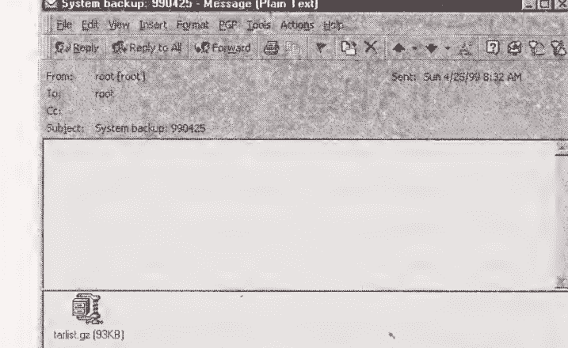

在另一个系统上，我有一个 crontab 条目用于从 NTP 服务器获取时间来更新系统时（见第 14 章，“时间服务”）：

```cron
5 5,11,17,23 * * /usr/local/bin/ntpdate -s host2
```

该程序每天运行四，每六小时一次。时间是从名为`host2`的服务器获取的。

在那个 NTP 服务器上，我还有另一个 crontab 条目，确保计算机的时钟与系统时钟保持同步。之所以这样做，是因为这台计算机连续运行数月而不重启，在此期间，CMOS 时钟的漂移会变得非常显著。当重启时，由于本地时间与从服务器获取的时间之间差异过大，NTP 无法启动。解决这个问题还有其他方案，但我更倾向于让 CMOS 时钟尽可能保持准确，这通过以下 crontab 条目实现：

```cron
0 8 * * * /bin/clock
```

## 清理日志

如第 16 节所示，为了防止日志文件无限增长，你必须对它们进行修剪，甚至需要定期进行轮转。你可能正在使用 Linux 发行版提供的工具来实现这一点，但某些发行版并不包含此类工具。更此外，即使存在该工具，它可能无法执行你想要的操作。

在几个系统中，我使用了一个类似于列表 18.1 显示的日志轮转脚本。该脚本每月运行一次，在每月第一天的午夜后一分，通过如下 crontab 条目执行：

```cron
+ 1 0 1 * * /bin/sh /root/cleog
```

该脚本可以很容易扩展以轮转其他日志文件，包括由特殊服务器应用程序创建的标准日志文件，这些文件标准工具无法处理。

### 列表 18.1 轮转日志

```bash
# !/bin/sh
cd /var/log
mv messages.old
touch messages
chmod 0640 messages
kill -HUP /bin/cat /var/run/syslogd.pid
mv wtmp wtmp.old
touch wtmp
chmod 0644 wtmp
cd /tmp
rm log_mg.ttyS0
```

第 18 章 任务、脚本与编程

## 网络备份

在第 17 章“备份”中，我讨论了一个通过网络执行每日备份的系统。该备份是通过列表 18.2 显示的脚本实现的。

### 列表 18.2 网络备份

```bash
#!/bin/sh
if [ -d /backup/mudgod ]; then
    MOUNTED="YES"
else
    MOUNTED="NO"
    mount host1:/home/backup /backup
fi

rm -rf /backup/*
cd /
tar -clpf -atime-preserve exclude mudgod/LOGS . \
tar -C /backup -xlpf -atime-preserve

if [ $MOUNTED = "NO" ]; then
    umount /backup
fi
```

该脚本首先挂载远程文件系统。之前的状态记录在`MOUNTED`变量中，以便在结束时，如果该文件系统在脚本开始时未挂载，则将其卸载。例如，如果由于其他原因挂载了该文件，脚本就不会将其卸载。

接下来执行实际备份。通过调用两次`tar`命令，将所有相关文件从源位置复制到远程目标。其中一个包含大型日志文件的目录被排除：这些文件不包含任何需要保留的数据。

备份完成后，远程文件系统将被卸载。

## 检查服务器运行状态


该程序每天运行四次，每六小时一次。时间是从名为 `host2` 的服务器获取的。

在那个 NTP 服务器上，我还有另一个 crontab 条目，确保计算机的时钟与系统时钟保持同步。之所以这样做，是因为这台计算机连续运行数月而不重启，在此期间，CMOS 时钟的漂移会变得非常显著。当重启时，由于本地时间与从服务器获取的时间之间差异过大，NTP 无法启动。解决这个问题还有其他方案，但我更倾向于让 CMOS 时钟尽可能保持准确，这通过以下 crontab 条目实现：

```
0 8 * * * /bin/clock
```

## 清理日志

如第 16 节所示，为了防止日志文件无限增长，你必须对它们进行修剪，甚至需要定期进行轮转。你可能正在使用 Linux 发行版提供的工具来实现这一点，但某些发行版并不包含此类工具。此外，即使存在该工具，它可能无法执行你想要的操作。

在几个系统中，我使用了一个类似于列表 18.1 显示的日志轮转脚本。该脚本每月运行一次，在每月第一天的午夜后一分，通过如下 crontab 条目执行：

```
+ 1 0 1 * * /bin/sh /root/cleog
```

该脚本可以很容易扩展以轮转其他日志文件，包括由特殊服务器应用程序创建的标准日志文件，这些文件标准工具无法处理。

### 列表 18.1 轮转日志

```
#!/bin/sh
cd /var/log
mv messages.old
touch messages
chmod 0640 messages
kill -HUP /bin/cat /var/run/syslogd.pid
mv wtmp wtmp.old
touch wtmp
chmod 0644 wtmp
cd /tmp
rm log_mg.ttyS0
```

## 网络备份

在第 17 章“备份”中，我讨论了一个通过网络执行每日备份的系统。该备份是通过列表 18.2 显示的脚本实现的。

### 列表 18.2 网络备份

```
#!/bin/sh
if [ -d /backup/mudgod ]; then
MOUNTED="YES"
else
MOUNTED="NO"
mount host1:/home/backup /backup
fi

rm -rf /backup/*
cd /
tar -clpf -atime-preserve exclude mudgod/LOGS . \
tar -C /backup -xlpf -atime-preserve

if [ $MOUNTED = "NO" ]; then
umount /backup
fi
```

该脚本首先挂载远程文件系统。之前的状态记录在 `MOUNTED` 变量中，以便在结束时，如果该文件系统在脚本开始时未挂载，则将其卸载。例如，如果由于其他原因挂载了该文件，脚本就不会将其卸载。

接下来执行实际备份。通过调用两次 `tar` 命令，将所有相关文件从源位置复制到远程目标。其中一个包含大型日志文件的目录被排除：这些文件不包含任何需要保留的数据。

备份完成后，远程文件系统将被卸载。

## 检查服务器运行状态

不久前，我在其中一个 Linux 系统的互联网超级服务器上遇到了一个问题。如果你还记得的话，互联网超级服务器守护进程 `inetd` 是一个接受传入的互联网连接请求并在需要时激活其他服务器的程序。在这种情况下，问题涉及的系统是在线游戏 MUD2 的主机，而 `inetd` 对于玩家通过 telnet 登录至关重要。因此，当 `inetd` 崩溃时，游戏实际上无法使用。

尽管我倾向于找到问题产生的原因，但在此期间，我必须创建一个快速的解决方案。该解决方案以 Shell 脚本的形式出现，用于检查 `inetd` 守护进程是否运行，并在必要时重启它。脚本还向我发送了此类事件的警报。

列表 18.3 显示我为此目的创建的脚本。

### 列表 18.3 监控 inetd

```bash
#!/bin/sh
inetd_owner=`ps axuw | grep inetd | grep -v grep | grep -v checkinetd | cut -f 1 -d " "`
if [ "$inetd_owner" != "root" ]; then
 /bin/cat <<EOF
From: MUD2
Subject: MUD2 EMERGENCY: inetd down
The process inetd is down; attempting restart.
EOF
/bin/netstat -t
echo
/usr/sbin/sendmail root
/usr/sbin/inetd
fi
```

在本章前面解释过的“在此文档”（here document）的使用是为了生成电子邮件通知。`netstat` 命令的输出也附加到了邮件中，这帮助我确定了问题的原因。

## 无 Shell Shell

在另一个系统中，我必须建立没有 Shell 访问权限但其他方面拥有系统完全权限的用户账户。最简单的解决方案是将一个不存在的 Shell 程序分配给他们的用户标识符，但这并不令人如意。其他程序（特别是该系统上的 FTP 服务器）会验证用户的 Shell 是否有效（即是否存在于 `/etc/shells` 列出的现有程序），如果无效，则拒绝访问。

解决方案是创建如 18.4 所示的简单 Shell 程序。

### 列表 18.4 无 Shell

```c
#include <stdio.h>

int main(void) {
    printf("Sorry, you are not permitted to have shell.\n");
    sleep(1);
}
```

由于这是一个 C 程序，在使用前必须编译。假设源码保存为文件 `nosh.c`，你可以按照以下方式编译：

`cc nosh.c -o nosh`

## 密码生成

网络用户最常见的安全问题之一是用户倾向于选择容易记忆的密码。不幸的是，这意味着密码很容易被破解。凭借如今强大的计算机，可以发起字典攻击，尝试数万个已知单词和短语作为密码。

解决方案是确保用户使用真正的随机密码。如果用户手动更改密码，他们会改为另一个容易记忆的值。这些随机密码在存储为电子邮件程序、新闻阅读器或拨号脚本的设置时特别有用。

18.5 中的程序是我为此目的创建的一个简单 C 程序。该程序生成一个包含大写字母、小写字母和数字的随机 8 位密码，每组字符中至少包含一个。

### 列表 18.5 随机密码生成器

```c
#include <stdio.h>
#include <ctype.h>
#include <sys/times.h>
#include <string.h>

char validchr[] = 
    "ABCDEFGHIJKLMNOPQRSTUVWXYZ0123456789abcdefghijvwxyz";

void main(void)
{
    char newpwd[9];
    int i;
    int l, u, d;
    struct tms tp;

    srand(times(&tp));
    newpwd[8] = '\0';
    l = u = d = 0;
    while (!l || !u || !d)
    {
        for (i = 0; i < 8; i++)
        {
            newpwd[i] = validchr[rand() % strlen(validchr)];
            if (islower(newpwd[i])) l = 1;
            if (isupper(newpwd[i])) u = 1;
            if (isdigit(newpwd[i])) d = 1;
        }
    }
    printf("New random password: %s\n", newpwd);
}
```

`atd` 守护进程的功能与 `crond` 类似，它允许在预定的时间单次执行一项任务。此类任务可以使用 `at` 命令进行调度。


在键盘上正常输入的命令可以记录到文件中。这些文件通常是 shell 脚本。除了普通命令外，脚本还可以包含条件执行命令、变量以及重定向和所谓的“在此文档”（here documents）等特殊功能。

除了 shell 脚本外，有时也会使用其他编程语言执行系统管理任务。这些包括 `Perl`（一种具有强大文本处理功能的流行语言）以及 `C` 语言（UNIX 系统中无处不在的编程语言）。

## 手册页

有关本章讨论的话题的更多信息，请参考以下手册页：

- `man cron`
- `man crontab`
- `man 5 crontab`
- `man at`
- `man bash`
- `man tcsh`
- `man perl`

# 第 19 章

## 配置工作站

**服务器之所以存在**的原因非常简单：它们提供了你在客户端工作站上利用的功能。因此，任何关于使用 Linux 系统的书，如果没有包含配置客户端系统的信息，都是不完整的。

尽管如此，客户端系统有许多种类，它们的配置可能相当复杂。关于配置 Windows、Macintosh 和 OS/2 工作站的著作，体积往往比本书大好几倍。为了限制篇幅，本章重点关注 32 位版本的 Windows（最著名的是 Windows 95/98）与你的 Linux 服务器的配合使用。你在这里将学到如何配置你的 Windows 工作站以访问 Linux 服务器上的特定服务，包括 IP 路由、电子邮件、网络新闻和 SMB 文件服务。由于这些重点的限制，我们可以在这里提供足够详尽的说明——即使你使用与此处描述不同的软件来安装工作站，这些说明也可以作为示例。

一个不需要任何特殊配置步骤的应用程序是你的 Web 浏览器。一旦你成功建立了到 Linux 服务器的局域网连接，并正确配置了 TCP/IP 网络，你的 Web 浏览器就可以“开箱即用”——不需要额外的配置步骤。

本章从一个明确的起点开始：假设你已经拥有一个功能完整的 Linux 路由器和服务器。你将获得指导，设置基于 Windows 的工作站，使其与该服务器协作并获取所有类型的互联网服务。

## 使用 Linux 路由器

通过 Linux 路由器将工作站连接到互联网的第一步是配置工作站的 TCP/IP 设置，使用路由器作为其访问外部网络的网关（如图 19.1 所示）。路由器可以是普通的路由器，仅在工作站和外部网络之间传递数据流量；也可以是防火墙网关，将你的工作站隐藏在防火墙之后，执行 IP 伪装（masquerading）和其他保护功能（参见第 11 章“防火墙”）。

图 19.1 工作站的路由。（img/68713819f1f597512c2f0cfd13dea6c_387_png）

这里假设 Linux 路由器已经功能完全，并且要么与互联网保持永久连接，要么按需拨号（参见第 7 章“建立连接”）。

### 设置 TCP/IP 协议

如果你的 Linux 路由器被配置为普通（非防火墙）路由器，则网络上的所有工作站必须有自己的 IP 地址。通常，你能够从互联网服务提供商（ISP）处获得一组 IP 地址，将其分配给你的工作站。如果你只有一个 IP 地址——最糟糕的是，当你每次连接到 ISP 时 IP 地址都会变化——那么本节描述的步骤将不起作用！在这种情况下，你需要做的是获取一组 IP 地址，或者将你的 Linux 路由器配置为伪装网关，并使用保留范围内的地址（例如 `192.168.xxx.yyy`）。

要通过 Linux 路由器将 Windows 工作站连接到互联网，必须执行以下步骤：

1. 如果尚未完成，安装网卡和 TCP/IP 协议。
2. 为工作站设置 IP 地址、网关地址和 DNS 服务器地址。

在 Windows 95/98 下，大多数网卡的安装非常简单。除非即插即用有效，否则你需要插入卡、开启计算机，并一直点击直到进入安装步骤。在这里，我们假设网卡已经安装并运行正常。现在需要的是为网卡配置相应的 IP 设置，以便工作站能够与你的 Linux 服务器正常工作。

在接下来的段落中描述了为 Windows 95 机器设置 TCP/IP 步骤。在 Windows 98 和 Windows NT 下，程序非常相似。可以通过 Windows 控制面板中的“网络”小程序更改网络设置。当你通过双击控制面板中的网络图标调用此小程序时，会显示网络对话框（见图 19.2）。它显示了你当前所有的网络设置。找到标记为 TCP/IP 适配器名称的设置，其中适配器名称对应于你想要配置的网卡。（大多数系统至少还有另一个网络适配器，拨号适配器——当用于拨号连接时，指的是系统上的调制解调器。某些系统可能还有额外的网卡。）

如果你的网络适配器没有 TCP/IP 条目，可能需要先安装 TCP/IP 协议。点击“添加”按钮，选择“协议”，并在网络协议中找到微软的 TCP/IP，如图 19.3 所示。

(img/68713819f1f597512c2f0cfd13dea6c_388_png)

图 19.2 Windows 95 网络对话框。（img/68713819f1f597512c2f0cfd13dea6c_389_png）

图 19.3 添加 TCP/IP 协议。（img/68713819f1f597512c2f0cfd13dea6c_389_png）

### 配置 IP 地址

要更改 TCP/IP 设置，点击“属性”按钮。这会激活 TCP/IP 属性对话框（如果你安装全新的 TCP/IP 协议，也会出现此对话框）。在这里开始输入与你的 Linux 服务器相应的设置。

首先，查看地址（见图 19.4）。确保“自动设置 IP 地址”已关闭。（要使此设置生效，你的网络需要一个运行良好的 DHCP 服务器）。IP 地址应该是分配给工作站的地址，或者如果你处于伪装防火墙之后或无互联网连接的私有网络，则是来自 `192.168.xxx.yyy` 范围的地址。子网掩码通常是 C 类网络的标准子网掩码（`255.255.255.0`），或者与你从 ISP 处获得的地址块对应的。

例如，如果你收到了 16 个 IP 地址块，子网掩码将是 `255.255.255.240`。（更多信息请参见第 5 章“互联网概念”。）

图 19.4 设置 IP 地址。（img/68713819f1f597512c2f0cfd13dea6c_390_png）

### 设置网络网关

接下来，你需要为这台 Windows 机器配置默认路由器或网关（见图 19.5）。该网关用于指向本地网络之外的流量。因此，只有当你确实提供到外部世界的连接时，才需要在此输入地址；如果工作站用于没有外部连接的仅局域网配置中，则不需要网络网关。

图 19.5 配置网关。（img/68713819f1f597512c2f0cfd13dea6c_390_png）

# 第 19 章 配置工作站

如果你具有包含多个路由器的复杂网络拓扑结构，可能无法通过此接口进行配置。相反，可能需要使用 `ROUTE.EXE`，它是 Linux `route` 命令的 Windows 对应程序。要了解如何使用 `ROUTE.EXE` 列出或配置网络路由，只需在 MS-DOS 窗口中输入 `ROUTE`；这将显示一个帮助屏幕。

你可以使用 `PING.EXE` 和 `TRACERT.EXE` 命令行工具来验证 Windows 工作站的网络路由。这些是 UNIX `ping` 和 `traceroute` 工具的 Windows 版本，它们的工作原理非常相似。虽然你可以通过开始菜单中的“运行”命令调用这些程序，但最好在 MS-DOS 窗口中调用。

## 设置命名服务

为了使你的网络连接能够完全运行，你还必须指定 DNS 服务器（参见图 19.6）。当独立的 Windows 连接到互联网时，DNS 服务器通常是你 ISP 的。然而，在局域网配置中，你可能会在 Linux 服务器上运行 DNS；如果是这样，请确保在此处指定该机器的地址。

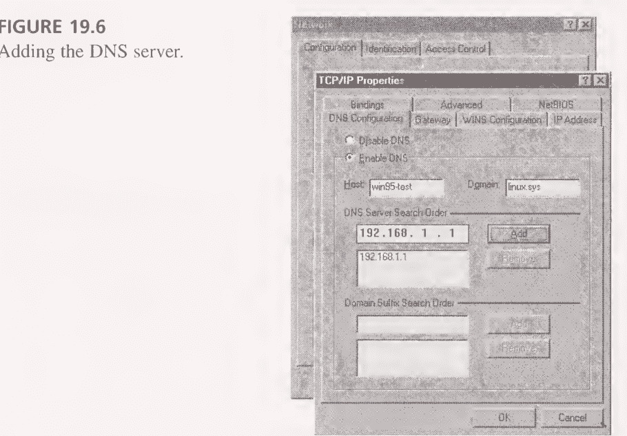

有关在 Linux 下设置 DNS 服务的更多信息，请参考第 6 章“域名系统”。

如果你的网络中有多于一台提供 DNS 服务的计算机，你可以在这里指定多个 DNS 服务器。或者，如果你喜欢永久的高速互联网连接，你可以将 ISP 的 DNS 服务器地址作为备用 DNS 服务器添加；这将在你自己的 DNS 服务器因任何原因故障时为你提供冗余保护。

## 使用 Linux 邮件服务器

当你为邮件服务配置工作站时，你通常需要输入两项信息：你的 SMTP 服务器名称和你的 POP3 服务器名称。

## SMTP 和 POP3 服务

正如第 8 章“运行邮件服务器”所解释的，SMTP 是一种用于发送电子邮件的协议；POP3 是一种用于访问远程系统上信箱的协议。

因此，你必须将 SMTP 地址配置为运行有配置妥当的邮件服务器的计算机。另一方面，POP3 必须指向一个运行有 POP3 服务器程序且拥有你可以访问的信箱的系统。换句话说，SMTP 服务器的身份并不重要（只要它接受你发出的邮件），但 POP3 服务器必须是你信箱所在的服务器。

如果你在 Linux 服务器上配置了用户账户和 `sendmail` 服务器副本，那么这台机器将同时作为你的 SMTP 服务器（得益于 `sendmail`）和你的 POP3 服务器（得益于 POP3 守护进程或其他具有功能的守护进程）。如果你没有使用 `sendmail` 服务器，或者如果用户的信箱在你的 ISP（例如），那么你的 SMTP 和 POP3 地址（或两者）都可能指向你 ISP 的服务器。

## 设置 Microsoft Outlook Express

由于 Outlook Express 随 Microsoft Internet Explorer、Windows 98 和 Windows 2000 发布，它是目前最流行的电子邮件应用程序之一。它也是最可能出现在新配置的 Windows 95/98 工作站上的电子邮件应用程序。尽管如此，如果你正在安装另一个电子邮件应用程序，所遵循的程序可能与这里介绍的相似。


这里描述的是配置现有 Outlook Express 安装以与你的 Linux 服务器配合所需的步骤。如果你正在安装全新的 Outlook Express 副本，请在设置电子邮件账户的步骤时根据实际情况遵循这些程序。

> **注意**
> 此处介绍的步骤描述了 Windows NT 下 Outlook Express 4.72 版本的精确程序。由于市场上存在多个版本的应用程序，你需要遵循的安装程序可能会略有不同。

要查看你的电子邮件账户或添加账户，请从 Outlook Express 工具菜单中选择“Accounts”命令。点击“Add”按钮并选择“Mail”（如图 19.7 所示）。

### 图 19.7

在 Outlook Express 中添加邮件帐户。

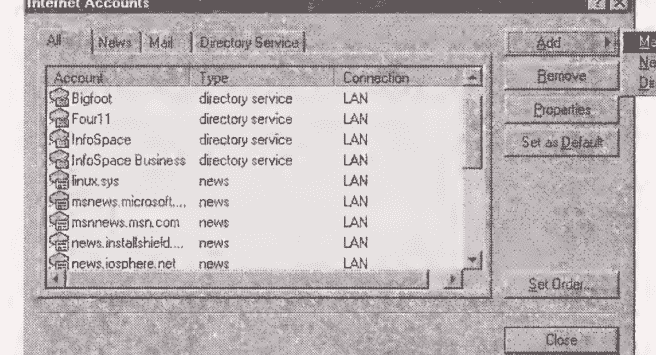

这将激活“Internet 连接向导”，如图 19.8 所示。第一步是输入所需的显示名称；这将是用户的可读名称，而不是电子邮箱地址。

### 图 19.8

输入显示名称。

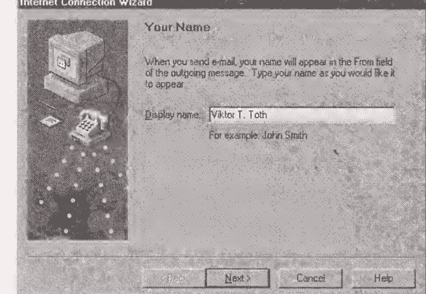

## 使用 Linux 邮件服务器

当你点击“Next”按钮时，会出现另一个对话框，你可以在其中输入所需的电子邮件地址（参见图 19.9）。该地址将是用户发出邮件时的回信地址。在此对话框中，实际上可以输入来自另一个系统的地址或完全虚假的地址。然而，在大多数情况下，建议在此处输入用户的回信地址。这是因为当用户发送邮件时，该地址将显示为发件人地址。

### 图 19.9

输入地址。

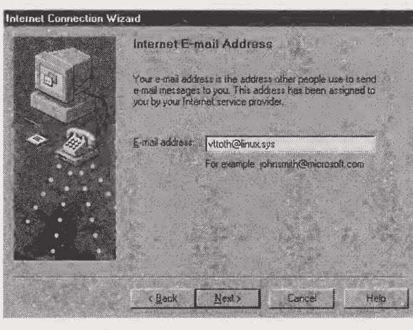

当你点击“Next”按钮时，会出现另一个对话框，你可以在其中输入所需的电子邮件地址（参见图 19.9）。该地址将是用户发出邮件时的回信地址。在此对话框中，实际上可以输入来自另一个系统的地址或完全虚假的地址。然而，在大多数情况下，建议在此处输入用户的回信地址。这是因为当用户发送邮件时，该地址将显示为发件人地址。

### 图 19.10

输入连接类型。

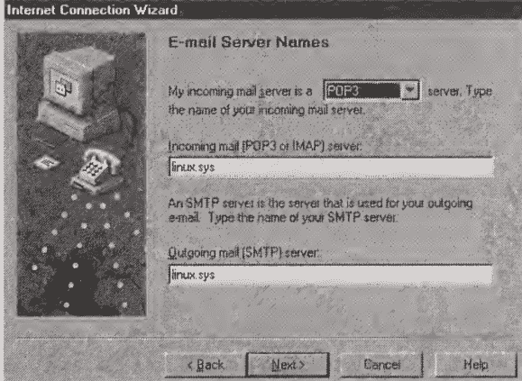

### 图 19.11

信箱识别。

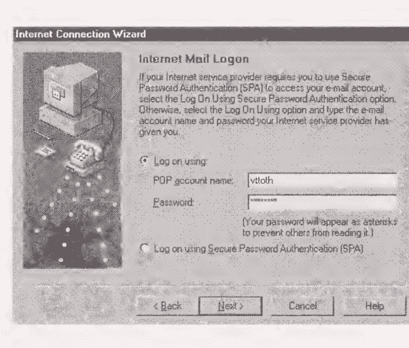

### 图 19.12

命名新帐户。

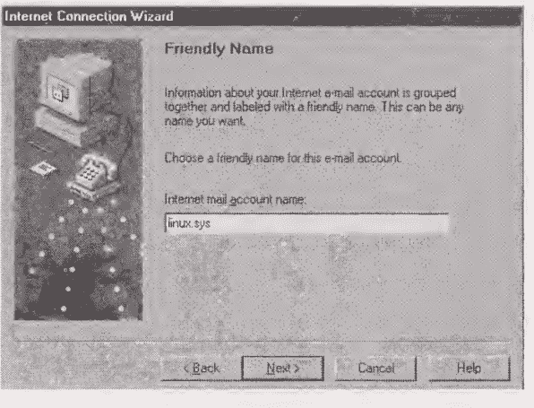

### 图 19.13

指定连接类型。

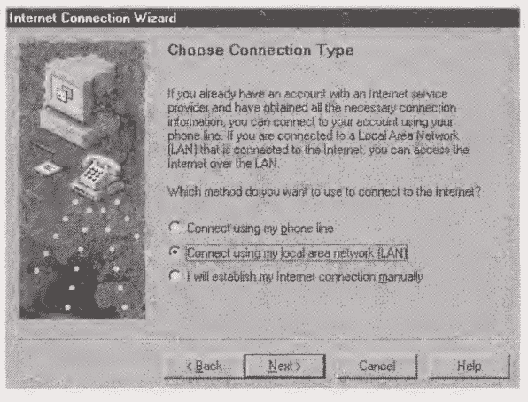

# 第 19 章 配置工作站

**图 19.14**

更改现有账户。

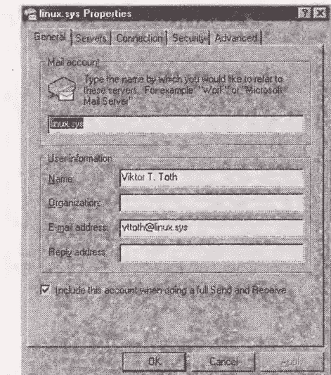

## 访问新闻

如果你正在运行新闻服务器，你可能希望配置工作站，使其能够访问该服务器。无论你是否有自己的新闻服务器，你可能都想设置工作站来访问你的新闻服务器，或者另一个提供近 30,000 个 Usenet 新闻组的公共新闻服务器。

### NNTP 服务器

正如第 9 章“邮件列表与新闻组”中所解释的，新闻服务器是通过网络新闻协议（NNTP）访问的。该协议允许客户端应用程序同时读取和发布新闻消息。

其他 NNTP 服务器是公开的，这意味着 Internet 上的任何人都可以访问它们。其他 NNTP 服务器提供受限制的访问。访问可以被限制在特定网络上的机器或具有有效密码的用户。

当你设置一个客户端程序与新闻服务器配合工作时，你需要预先知道服务器的标识以及访问是否受密码保护。如果这是你 Linux 上使用 INN 软件套件的新闻服务器，则访问限制定义在 `nnrp.access` 配置文件中。

### 在 Outlook Express 中添加新闻账户

添加新闻账户的步骤与你之前为 Outlook Express 添加电子邮件账户的步骤非常相似。再次，你需要从“工具 (Tools)”菜单中调用“账户 (Accounts)”命令，并点击“添加 (Add)”按钮。这次，如图 19.15 所示。

**图 19.15**

在 Outlook Express 中添加新闻账户。

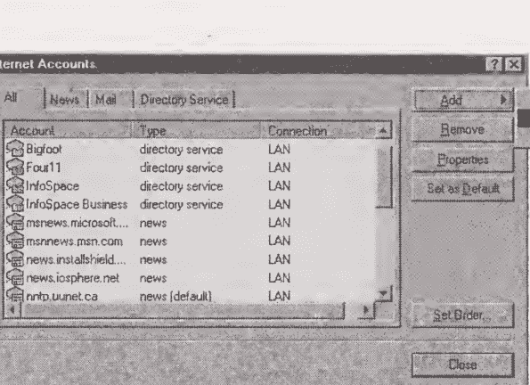

弹出的对话框是你已经见过的，Outlook Express 要求你输入一个显示名称（参考图 19.8）。当你点击“下一步 (Next)”时，Outlook Express 要求你为此新闻账户输入电子邮件地址（见图 19.16）。

**图 19.16**

输入新闻账户地址。

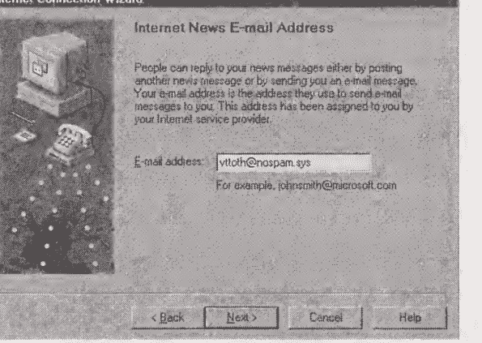

设置电子邮件账户时，曾建议提供用户正确的电子邮件地址作为发件地址。这次，情况可能相反。在向公共新闻服务器发布消息时，许多用户选择使用虚假地址，以避免他们的真实电子邮件地址沦为采集的受害者（即被那些不法之人收集，他们使用或出售自己编译的邮件列表来发送垃圾邮件）。一些新闻组用户提供完全虚假的地址，而另一些人则只需在该地址中添加部分内容，以便人类能够注意到并移除，这足以误导采集程序。例如，使用 `vttoth@linux.dontspam.sys` 代替 `vttoth@linux.sys-`。

当你再次点击“下一步”时，会被要求输入正在连接的新闻服务器名称。此外，你还被要求指定此新闻服务器是否需要登录（见图 19.17）。通常，公共新闻服务器不需要，但私营的服务器通常需要，特别是那些包含机密信息的服务器。

**图 19.17**

指定新闻服务器名称。

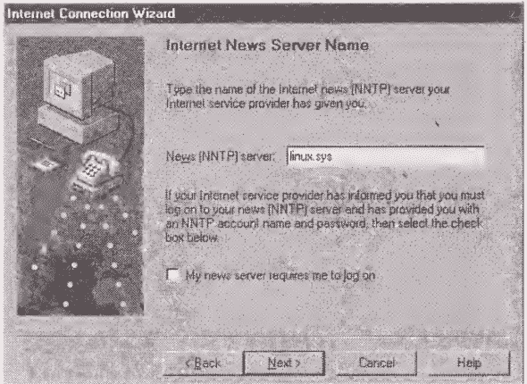

剩下的两个对话框对你来说再次熟悉。Outlook 要求你用“友好名称”为账户命名（之前在图 19.12 中显示）；它还要求你指定你正在使用的连接类型（参考图 19.13）。

就是这样。当你完成这些步骤后，Outlook Express 就可以尝试连接到新闻服务器并下载新闻组列表。要稍后修改此账户的参数，你应该再次从“工具”菜单下的“账户”命令开始，选择所需的账户，并点击“属性 (Properties)”按钮，如图 19.18 所示。

**图 19.18**

修改新闻账户。


总结来说，为了设置新闻账户，你必须指定新闻服务器的名称，可选地指定有效的用户名和密码组合，并输入发件地址。

# 使用 Samba 服务

正如第 13 章“Windows 文件服务：Samba”所述，适用于 Linux 的 Samba 提供了 SMB 风格的文件和打印机服务。通俗地说，这意味着你的 Windows 服务器可以配置为通过 Windows 网络提供对共享目录和打印机的访问。

## 访问远程目录

如果一切配置正确，一个带有共享目录的 Samba 服务器看起来与网络上的其他 Windows 机器并无异。换句话说，当你双击 Windows 桌面上的“网络邻域 (Network Neighborhood)”图标时，你应该能够看到 Samba 系统（见图 1.19）。你可以像浏览本地目录一样浏览共享目录上的文件。

**图 1.19**

网络邻域图标。


你也可以从命令行访问共享目录。要查看共享资源列表，你将使用以下命令：

| 共享 | 类型 | 注释 |
| :--- | :--- | :--- |
| `cdrom` | 磁盘 | |
| `homes` | 磁盘 | |
| `lp` | 打印机 | |
| `printers` | 打印机 | |

不言而喻，你应该使用服务器的实际名称代替密码。要将远程目录关联到驱动器，请使用以下命令：

```bash
net use Z: \\server\share [password]
```

注意，并不总是需要将共享关联到驱动器。你可以使用 UNC（通用命名法）路径。例如：


```bash
net use \\server\share
```

如果你遇到指示密码无效的错误，请检查你的凭据并重试。

# 第 19 章 工作站的配置

若要在你的 Windows 95/98 或 NT 工作站上安装通过 Samba 共享的 Linux 打印机，你需要从开始菜单的“设置”调用“打印机”控制面板。双击“添加打印机”按钮将启动添加打印机向导（见图 19.20）。

图 19.20

添加打印机向导。


点击“下一步”将进入向导的第二部分，你可以指定要添加的打印机是本地还是网络。选择“网络打印机”并点击“下一步”按钮，如图 19.21 所示。

图 19.21

选择网络打印机。


此向导的第三面板（见图 19.22）允许你使用 UNC 路径指定网络打印机。或者，你可以点击“浏览”按钮并从可用网络打印机列表中选择打印机（如你在图 19.23 中所示）。你还可以指定是否要从基于 MS-DOS 的程序打印；如果是，向导将让你将网络打印机与 MS-DOS 风格的打印机设备名称关联（例如，`LPT1`）。

## 图 19.22

指定打印机的网络路径。


## 图 19.23

浏览打印机。


当你关闭“浏览打印机”对话框并点击“下一步”按钮时，添加打印机向导允许你捕获打印机端口。在这里你可以将所需的 MS-DOS 打印机名称与新添加的打印机关联（见图 19.24）。

## 图 19.24

捕获打印机端口。


当你再次点击“下一步”时，添加打印机向导允许你选择打印机类型，如图 19.25 所示。如果你在此处选择的打印机驱动不存在，它们将安装在计算机上。

## 图 19.25

指定打印机类型。


最后，当你点击“下一步”时，添加打印机向导允许为新添加的打印机命名（见图 19.26）。此时，当你点击“下一步”按钮时，Windows 将开始加载必要的打印机驱动程序。它可能会要求你插入原始 Windows 光盘或软盘，并可能在打印机可用之前重启计算机。当被询问是否应该打印测试页时，点击“是”；这将验证你的网络打印机设置是否正确且完整。

## 图 19.26

命名打印机。


# 其他应用程序

电子邮件、新闻、远程文件和目录访问以及无处不在的浏览器浏览器在使用互联网时都可以被视为核心应用程序。然而，其他应用程序也经常与 Linux 服务器配合使用。我特别提到两种：Web 制作工具允许你使用 WYSIWYG（所见即所得）工具维护 Web 服务器上的内容，而 X 服务器允许你从你的 Windows 工作站使用全屏图形化 Linux 程序。

# Web 制作工具

网页可以手动创建，也可以通过任何一种可用的网页制作程序创建。其中某些工具将制作功能与服务器端支持集成，从而消除了手动上传和组织文件的需要。

一种支持 Linux 下 Apache Web 服务器的此类工具是 Microsoft FrontPage。是的，Microsoft FrontPage 支持我们的操作系统！虽然可以在 Apache 服务器上托管用 FrontPage 创建的网页，但如果你使用 Linux 版的 FrontPage 扩展，就可以获得相应功能。你将从 FrontPage 上传网页、管理安全并执行其他维护功能。可以从网站 `http://updates.microsoft.com/frontpage/` 下载 FrontPage 扩展。

安装服务器扩展（Server Extensions）是一个复杂的过程。扩展包还会安装一个修改版本的 Apache Web 服务器以及连接到服务器时使用的脚本。如果你维护的是一个简单的网站，安装 FrontPage 扩展或其他类似功能的工具可能是多此一举。安装过程的复杂性超过了所获得的任何好处。然而，如果你有多个网页，或者你远程访问 Web 服务器，这些努力可能是值得的。

# X 应用程序

在 Linux 服务器上运行 X 应用程序简化了你的生活，因为你可以使用全屏图形界面与系统交互。将此能力扩展到 Windows 桌面也是可能的，这在你远程管理系统时会让你的生活变得轻松一点（这种意义上的“远程”可能仅仅意味着你正坐在房间另一头访问 Linux 系统）。

# 帮助页

Samba 软件套让你的 Linux 机器为 Windows 客户端提供文件和打印服务。连接到 Samba 共享目录与连接 Windows 网络上的任何共享目录没有区别。你可以通过 Windows 资源管理器浏览共享目录，也可以通过 MS-DOS 命令行通过 `net` 命令建立连接。连接时可能需要指定密码，如果你的 Linux 和 Windows 用户名不同，你可能还需要在 Samba 中添加用户映射。

连接到 Samba 打印机时，你必须在 Windows 计算机上安装打印机驱动程序。连接打印机需要通过“添加打印机”向导的步骤，该向导位于“设置”下的“打印机”控制面板。

有关本章讨论的话题的更多信息，你可以输入以下 MS-DOS 命令来获取在线帮助：

- `NET HELP`
- `PING`
- `ROUTE`
- `TRACERT`


# 第 20 章 回顾安全

在本书中，你读过许多关于各种安全风险的严厉警告。这并非偶然：当你运行服务器时，从定义上说，你正在维护一台经常被他人访问的机器。因此，安全是一个需要持续关注的问题。

本章不会教你如何搭建一个用于守护国家机密的服务器。然而，它将给你一个机会来回顾常见的安全问题，学习系统中安全问题的迹象，理解安全是如何被故意或无意地破坏的，并学习如何从攻击中恢复。

## 访问安全

首先，让我说明一个显而易见的点：你的系统必须在物理上是安全的，才能被信任。当有人可以走到服务器旁并从软盘启动它，或者拿着螺丝刀出现并取出硬盘时，没有任何安全措施都无法防止你的系统受到损坏或数据被盗取。

## 物理安全

如果我可以用我自己制作的软盘启动你的电脑，我至少可以损坏你电脑硬盘上的数据。可能，我还能从你的硬盘中读取数据，除非你正在使用加密文件系统（这非常罕见）。

如果我对你的电脑有物理访问权限，我可以打开机箱并拆或更换组件。我可以取出你电脑的硬盘并带走，以及你宝贵的数据。我可以取出你的备份带。更糟糕的是，我甚至可以将硬盘更换为另一个——例如，一个包含看起来像正常 Linux 登录程序的程序的硬盘，但它接受的任何密码都会立即通过互联网传输，供我记录和使用。

因此，任何不应被破坏的计算机都必须在物理上受到保护。将你的 Linux 服务器放在前台桌子上，距离你办公室正门只有几英尺，这可能是一个非常糟糕的主意！（不，这不是我刚刚构想出来的：我真的见过这种方式放置的服务器。）

## 拨号安全

即使你的系统在物理上是安全的，但如果它连接到电话线，它可能同样赤裸。事实上，连接到调制解调器的系统会带来一系列严重风险，其中某些并不显而易见。

首先，如果你的系统被配置为接听电话，这为陌生人访问系统提供了手段。通常这不应该是一个问题，除非你有系统密码的访问权限，或者你能猜到密码。

然而，有时即使你没有配置调制解调器接听电话，你仍然处于风险之中。有些调制解调器被配置为自动应答；可以说，即使在没有特定软件控制的情况下，它们也会接听入入电话。这意味着呼叫者在你的不知情的情况下，获得了对系统的某种形式的交互式访问。

有时这并不代表问题，因为在没有控制调制解调器线路的情况下，入侵者没有可以交互的对象。但如果有这样一个应用程序呢？如果入侵者可以使该应用程序执行另一个程序，例如一个赋予入侵者完全交互式访问权限的 shell 程序呢？

如果你为合法用户（或为了你自己进行远程系统管理）提供拨号调制解调器，情况就会变得特别棘手。例如，假设由于软件或硬件故障，你的系统没有检测到你的连接中断。如果调制解调器自动接听下一个电话，入侵者将能够从你离开的地方继续，获得你系统的 root 权限（如果你在丢失连接时正在以 root 用户执行某些操作）。

那么你如何防止这些情况发生呢？测试是最重要的。只有当你拥有两条电话线（当然还有另一台带有调制解调器的电脑）时，你才能完全测试你的系统，但这可能是必要的。你必须确保你的系统在异常情况下表现符合预期，最重要的是，以下条件始终成立：

- 当连接以任何方式终止时，系统能够识别它，终止终端上运行的所有程序，并重新初始化终端。
- 调制解调器仅在软件指示下才接听入入电话。
- 当接听电话时，会向用户显示登录界面或其他身份验证程序。

这仅仅是关于从未发生过的事情的假设性讨论吗？并非如此。我见过很多流行的调制解调器没有向主机计算机提供正确的指示信号，例如，载波丢失信号。有时，在消除问题之前，需要升级调制解调器的固件。

然而，即使在调制解调器运行完美的情况下，这些问题也会发生。例如，调制解调器可以通过软件配置为向主机呈现载波丢失信号。到处售卖的外部调制解调器廉价电缆并不具备这些信号所需的连接。因此，在将调制解调器投入使用之前对其进行彻底测试是关重要的。

> 从技术上讲，其他操作系统（如 Windows）也存在相同的问题，但在实践中，危险要小得多。这是因为其他操作系统并不常规地具备通过拨号线路执行所有功能的能力。在 Windows 下，你必须显式启动公告板软件或类似的工具，入入电话连接才能被用于任何用途。但在 Linux 下，这种能力是固有的；你通过 Linux 能做的一切，都可以通过连接到机器串口的终端完成，因此，也可以通过连接到调制解调器线路的终端完成。

## 网络安全

当你将服务器连接到网络时，你就打开了许多潜在的安全漏洞。你的机器不再孤立；存在一个与外部世界的高速接口，它从一开始就被设计成允许你远程执行复杂功能。

注意，问题不在于网卡本身——而在于网卡是几层软件协议，每层协议都有自己的配置陷阱，入侵者可能利用这些陷阱获取高层功能的访问权限。

另一个问题源于网络通常是为了使用，而当它们被使用时，它们可能会被监控。

## 局域网

局域网的一个关键特征是它们是广播网络：一台计算机发送的数据可以被网络上的所有电脑听到。

在正常情况下，电脑只会接收那些发送给它的数据片段，并简单地忽略其他部分。但是，编写记录网络上所有数据流量的网络监控软件是可能的。例如，当你坐在 A 计算机前，为了登录跨越网络的 B 计算机而输入密码时，恶意用户在 C 可能会监控整个会话，从而获取密码（见图 20.1）。

图 20.1

网络监控


如果你的网络在物理上是安全的，且网络上只有受信任的电脑，这就不是一个问题。然而，你必须确保没有授权的人员访问它，即使是短暂的。这看起来并不简单。在许多办公室中，网络是预布的，这种布线可能延伸到经常被非员工访问的会议室。尽管不太可能黑客通过应用程序访问。

## 远程连接

从安全角度来看，远程连接与局域网有两个不同之处。好消息是，在远程连接上，只有发送到那里的数据会被传输。本地计算机之间的流量不会反映到本地网络之外，具体来说，它们不会通过远程连接发送（参见本章后面关于调制解调器的例外）。

坏消息是，虽然你对访问你区域有一定程度的控制，但当你建立互联网连接时，并非如此。世界上任何拥有计算机和互联网访问的人都到了你的门口，可以说。世界很大；这群人中有多少会带着锁呢？

你可能认为这与你无关；你的系统受到了密码的充分保护。但仅靠密码是不够的。你看，攻击者可以比通过`telnet`进入你的系统做得多得多。

事实上，一个潜在攻击者至少有 131072 个不同的漏洞可以探测。这些当然是你机器上的 65536 个 TCP 端口和 65536 个 UDP 端口，每个端口后面都可能潜伏着服务器程序，任何一个程序可能存在安全问题。

当黑客探测你的系统时，这些端口大部分都没有结果；你的攻击者只需要找到一个。或者他可能根本不使用 TCP 或 UDP 端口；他可能知道你的操作系统在处理低级 ICMP 包时的漏洞，例如。

## 人员安全

大多数情况下，安全漏洞的产生并不是因为你使用了有缺陷的软件，也不是因为你的局域网被复杂的黑客入侵了。不，导致安全相关问题最常见的原因是人。

## 不满员工的案例

媒体曾多次报道过不满的员工在离职后对你的计算机系统造成严重损害的案例。尽管如此，小型组织和企业仍然认为自己对这类问题是免疫的。事实并非如此。即使在我的个人经验中，我也遇到过这样的情况：一个不满的员工在公司的`UNIX`服务器上留了一个“后门”，并在几周后对其进行了利用。他的意图并不是为了造成伤害——他只是觉得不想“放手”。他认为自己仍有权访问他帮助构建的系统。不用说，他的前雇主并不认同这一点。

当然，要防止受信任的员工离职时可能发生这种情况，并没有万全的方法，除非从头重新安装所有系统。尽管如此，采取一些预防性措施（例如更改所有系统密码）可以降低风险。

## 粗心与无知

即使是没有恶意的员工，也可能因为无知而对你的系统造成严重损害。在大学食堂里留下一张写有 Linux 服务器拨号电话和`root`密码的纸条，这只是脑海中浮出的许多例子之一。如果用户不知道保持密码秘密的重要性，问题就一定会发生。

## 应用安全

某些安全问题的产生仅仅是因为应用程序的本质——也就是说，无论有意无意，它们都为外部用户提供了在你的系统上运行任意命令的手段。

必须说，这本身并不一定意味着安全风险。世界上有数互联网服务提供商为用户提供“shell 账户”（即通过`telnet`登录 UNIX 系统并在那里执行程序，包括他们编写的程序）。

## Shell 账户

需要注意的是，故意允许用户访问你的系统与发现这种访问已经发生之间是有区别的。如果你从一开始就向不可信（外部）用户提供 shell 访问，假设你已经意识到了其中的风险，并确保这些用户无法访问他们未经授权查看的内容。

## Web 脚本和其他工具

设计不当的 Web 脚本是一个特别危险的安全漏洞。鉴于创建 shell 脚本来处理 Web 表单非常容易，许多脚本的存在并不奇怪；遗憾的是，并非所有的脚本都出自专家之手。

让我给你们展示一个简单的例子。假设你在图 20.2 中创建了一个简单的 Web 页面，处理用户的电子邮件。该 Web 页面的 HTML 代码如下：

```html
<HTML>
<body
<FORM METHOD="GET" ACTION="http://cgi-bin/test.cgi">
E-mail: <INPUT TYPE="text" NAME="Email"><INPUT TYPE="submit">
</FORM>
</body>
</HTML>
```

图 20.2

调用脚本的简单 Web 表单。


当用户点击提交按钮时，他的浏览器会与你的服务器建立另一个连接，这次调用的是这里的`test.cgi`脚本：

```sh
#!/bin/sh
EMAIL= echo $QUERY_STRING | cut -d= -f2
echo Content-type: text/plain
echo
echo $EMAIL
```

## 第 20 章安全回顾

这已经是最简单的不过了。这个脚本没有什么特别之处；它只是将用户提供的信息传回给用户。这样的脚本绝对不会出问题，对吧？

错了。

脚本可以正常回显普通的电子邮件地址。但如果我提交一个星号`*`作为我的电子邮件地址呢？结果如图 20.3 所示。

图 20.3

Web 脚本及其意外的输出。


这里到底发生了什么？

答案很简单：脚本（或者说是执行该脚本的 shell）将通配符`*`扩展成了当前目录下的文件列表，正如它的设计初衷那样。也许用户看到这个文件列表无关紧要；也许大有不然。无论如何，这不应该发生。如果这种情况都能发生，那么你的系统上还有哪些安全漏洞正等待着聪明的黑客利用呢？

这类问题并不局限于 Web 脚本。事实上，Web 脚本相对安全，因为大多数“危险”字符（如重定向字符`<`和管道字符`|`）是以编码格式提供给脚本的。当脚本在另一个上下文中运行时（例如，如果你通过`telnet`提供系统访问权限并让用户运行脚本），危险性要大得多。

归结底，黑客的目标是跳出你设计的脚本或程序的限制，并能够执行他自己选择的程序。当你设计服务器上提供的 Web 网站或应用程序时，你的任务是确保没有黑客可以利用的达成此目的的方法。

## 恶意程序

新闻中突出显示的一个安全问题是计算机病毒问题。

### 病毒

病毒是一段附加在另一个程序上的代码。与蠕虫不同，病毒不能独立执行；它需要宿程序的运行。当宿程序运行时，病毒也会被执行，随后它可以感染系统上的其他程序。

最常见的病毒有：

- 引导区病毒：感染磁盘的引导区。
- 文件病毒：感染可执行文件（如`.exe`或`.com`）。
- 宏病毒：感染 Microsoft Word 或 Excel 等应用程序中的宏。
- 多态病毒：在每次复制时改变其代码以规避杀毒软件的检测。

### 特洛马

木马是一个看似合法的程序，但包含隐藏的恶意功能。与病毒不同，木马不会感染其他程序；与蠕虫不同，它不会自我复制。相反，它依赖于用户被骗执行该程序。

常见的木马类型包括：

- 密码窃取程序：获取密码和其他敏感信息。
- 后门：提供系统的远程访问权限。
- 勒索软件：加密文件并索要解密密钥。

### 蠕虫

蠕虫是一种独立的程序，它可以自我复制并在网络中传播。与病毒不同，蠕虫不需要附加到宿程序；与木马不同，它不会伪装成合法程序。蠕虫利用操作系统或网络服务的漏洞进行传播。

## 保护措施

保护自己免受攻击者获取访问系统的各种方式，起初听起来像是一项几乎不可能完成的任务。事实上，政府安全指南规定，一个真正安全的系统必须没有任何外部连接，且不允许未经授权的用户进行物理访问。当然，这几乎会违背你专门配置 Linux 服务器的目的是为了为你的办公室提供更好的互联网连接的初衷。

幸运的是，严厉的措施并不总是必要的。攻击是非常罕见的，只要你采取一些明智的预防措施，就能防范各种形式的入侵。

## 密码策略

你的第一道防线是有效的密码策略。至少，你应该确保所有用户（包括你自己在内）遵守以下预防措施：

- 使用难以被猜到的密码；使用母亲或配偶的名字绝对是个坏主意。
- 使用不是简单单词的密码，这些单词可以被执行字典攻击的程序成功猜中。
- 永远不要向任何人透露密码。
- 永远不要在多个系统上使用同一个密码。

你还应该利用第 15 章“用户账户”中引入的 shadow 密码套件，确保未经授权的用户无法获取加密格式的密码。

最后，你可能选择强制执行更强大的用户密码更改策略。shadow 密码套件允许你指定密码需要多频繁地更改。我个人认为，这种策略充其量是无效的，最坏的情况下是适得其反；如果用户被强制频繁更改密码，他们更有可能选择容易记忆的密码（因此也容易被猜），而且更有可能把密码写下来。

## 访问权限

有一句在詹姆斯·邦德电影中经常听到或在汤姆·克兰西小说中读到的流行短语：知情允许（need to know）。碰巧，这个短语即使对于小型 Linux 服务器也具有直接适用性。

基本思想是这样的：涉及到分配给个人的权限时，你应该只赋予他们真正需要的权限。这不是一个信任问题——事实上，如果你不信任他们，你起初为什么要和他们合作呢？——这是一个常识问题：访问敏感资源的人越少，你的系统被攻破的机会就越小。

例如，考虑一个用户的密码被他的青少年儿子偷走了，儿子会将密码告诉给他的朋友们。当你发现问题时，50 名高中生已经尝试用有效密码破解你的系统了。如果你意识到这个用户根本不需要你系统上的 shell 权限，而且青少年们从未通过`telnet`登录并进行破坏，你难道不会感到高兴吗？

文件应该只允许需要它们的用户进行读写。密码应该只向那些需要它们的人披露。只有当用户需要此类权限时，用户账户才拥有 shell 权限。通过这些简单的措施，你可以在以后省去很多麻烦。

确保文件默认仅供创建者用户访问的最佳方法是使用`umask`命令。该命令接受的参数与第 4 章介绍的`chmod`命令使用的参数类似。它定义了用户创建的文件的默认权限。`umask`和`chmod`的区别在于`umask`是反向；值告诉你创建文件时哪些权限是不可用的。

例如，考虑以下命令：

```sh
$ umask 0077
$ touch myfile
$ ls -al myfile
--rw------- 1 vtoth users       0 May 4 06:14 myfile
```

正如你在第 4 章回想起的那样，0077 意味着组用户和其他用户没有读/写/执行权限。当设置此掩码后创建文件时，组用户和其他用户被拒绝读/写/执行权限。因此，文件创建时仅对其所有者赋予权限。

系统级`umask`设置（针对 bash shell 用户）的最佳位置是`/etc/profile`，那里存储了常用的 shell 初始化命令。

## 安全协议

如果你无法在你满意的范围内确保你的局域网安全并排除未经授权访问的可能性，你可能需要一种软件解决方案。其中一种解决方案是 Kerberos，它是一种专门为不安全的本地网络（如大学校园内存在的网络）设计的认证机制。大多数流行的 UNIX 工具都有“kerberized”版本，它们在安装了 Kerberos 认证方案时运行良好。Kerberos 基本上确保了密码等关键信息不会以明文形式在网络上传输。

Kerberos 复杂且难以掌握。如果你认为你需要它，一个很好的起点是 Kerberos 网站：`http://web.mit.edu/kerberos/www/index.html`。在此期间，我的建议是只需保持网络物理安全。这可能简单到从你的局域网控制器上拔掉未使用的网络连接。

> 局域网连接的一个特殊情况是电缆调制解调器。许多电缆电视公司提供电缆调制解调器解决方案，这些解决方案实际上将你的局域网扩展到了电缆段。换句话说，由于要与所有邻居共享局域网的原因，电缆调制解调器绝不应放置在超过一台计算机的同一段上，因为这些计算机之间的通信将对其他人可见。更多信息，请参阅第 12 章“使用外部路由器”。

另一种安全协议是 SSL，即安全套接层。SSL 主要用于 Web 浏览器和客户端之间，即使在数据流可以被窃听的情况下也能提供安全通信。SSL 功能内置在大多数 Web 浏览器中。要为你的 Web 服务器添加 SSL，可能需要下载并安装免费或商业扩展。此类扩展在“Web 服务”中有所描述。请注意，通常 Web 浏览器只配备了弱化版本的 SSL。

## 软件升级

关于系统安全的一个特定方面，互联网上一直存在着争论：常用软件中的已知漏洞是否应该公开？

论点如下：如果你发布了常用工具的漏洞，黑客将获知它（可能是通过合法用户获获的）。他们将在合法用户有机会采取保护措施之前利用该漏洞。另一方面，如果你不披露此类信息，黑客可能仍然会获知它们，而合法用户根本不知道存在问题。经验表明，通过隐蔽来实现安全是行不通的；你无法通过简单地谈论让漏洞消失。即使是微软这样的软件巨头也承认这一事实并定期发布信息安全公告。

这就是你大显身手的地方。如果你正在运行 Linux 服务器，请记住你定期检查安全相关警告和软件升级的神圣职责。如果你的系统被某个可用升级的软件包中的已知漏洞攻破了，你可只能怪自己了！

那么，你去哪里获取安全信息呢？存在几个网站和邮件列表。对于 Linux 内核本身，监控的最佳地点是 Usenet 上的 Linux 相关新闻组（`comp.os.linuxhierarchy`）。对于服务器软件，可能存在新闻组，或者你可以定期访问相关服务器的网站。

还有一些通用的安全相关网站，通常包含关于流行软件包中已知安全缺陷的最新信息。这些包括由美国能源部运营的事件公告能力（CIAC）网站（`http://ciac.lnl1.gov/ciac/`）。请注意存在出口限制。如果你正尝试升级 Linux 内核本身，请查看附录 A“配置内核”，其中包含一些构建和安装自定义内核版本的信息。

## 用户教育

大多数安全问题都是由于人为因素导致的：当入侵者获取密码或其他机密信息并访问你的系统时，受教育程度低的用户往往是罪魁祸首。

必须警告用户保持密码安全的重要性。你需要向他们解释，当他们被授予系统访问权限时，这就像拿了一把办公室钥匙的副本；正如他们被要求妥善保管钥匙而不是将其遗留在公共场所一样，他们同样被要求保护密码以及关于你安全的机密信息。

用户教育的另一个领域涉及来源不明的程序代码。无论用户是登录 Linux 服务器还是使用你网络上的 Windows 工作站，情况都是如此。从未知网站下载的程序以及附在电子邮件中的许多可执行文件，在管理良好的网络中是不应该存在的。

## 防火墙

防火墙路由器通过限制流在局域网和互联网之间的数据流量类型来增强安全性。正如第 11 章“防火墙”中所解释，使用防火墙是一项具有争议的做法；尽管它确实能保护你免受某些类型的攻击，但它限制了用户充分利用互联网的能力。通常建议使用某些类防火墙功能（如数据包过滤）；然而，是否使用全功能防火墙取决于你对风险与缺点的权衡。

如果你决定使用防火墙，请记住，即使是最好的防火墙也只能防御某些类型的攻击——通常是利用已知软件漏洞或配置问题的攻击。如果你的系统没有维护良好，或者你的用户不保守泄密密码，那么世界上最好的防火墙也无法保护你。

## 关于`root`账户

之前提到过，但因为这是一个非常重要的安全问题，应该再次提到：在保护系统时，你拥有的最佳防御之一就是除非万不得已，否则使用`root`账户。

## 第 20 章安全回顾

抵御住诱惑。一直处于“掌控”状态的感觉很好，而且不需要每次运行特权命令时都使用`sudo`也很方便。然而，当你使用`root`账户时，你开启了以下可能性：

- 你以`root`权限运行带有漏洞的软件，在系统内造成破坏。
- 病毒和其他恶意程序将以`root`权限执行，获得对系统的完全访问权限。
- 你犯的任何错误都会导致灾难性的后果。
- 如果你没有注销（例如由于电话线问题导致断开），而另一个用户控制了你的会话，该用户将继承你具有`root`权限的 shell。

我还能多说吗？`root`账户供你需要时使用，当你不需要时……嗯，别用！

## 邮件附件的真相

你经常听到关于恶意邮件的严厉警告，说它们只要看一眼就会破坏你的系统。我可以向你保证，这种情况绝不会发生：为了让电子邮件对你的电脑造成那种破坏，你必须实际上打开并执行以附件形式附带程序。

一如既往，真相介于两者之间。邮件信息确实是一块数据（通常是文本），这完全正确。如果存在附件，必须先提取它们，并且如果结果文件是可执行程序，则在任何恶意行为发生之前必须执行它们。

不幸的是，随着 HTML 程序的出现，这些步骤通常会自动执行。这些邮件程序将消息解释为包含格式化文本的 Web 页面。然而，HTML 文本包含的内容不仅仅是字符格式指令；它还可能包含嵌入的可执行代码块或脚本。虽然存在通常防止恶意代码在你的系统上执行的保护措施，但它们可能会被绕过。

幸运的是，大多数恶意附件是为 Windows 编写，在 Linux 下保持非活动状态。（你仍然可以将它们转发给他人，包括 Windows 用户。）尽管如此，Linux 用户没有理由掉以轻心；影响 Linux 系统的附件确实存在，随着 Linux 变得越来越流行，它们将变得更加突出。

## 虚假警告

除非你以前从未拥有过电子邮件，否则你可能收到过朋友和熟人关于某种危险病毒的无数警告。通常，这些警告是关于标题显眼的邮件信息，你被告知不仅打开这些邮件，还要向你邮件列表中的所有人发送该警告。

事实是，绝大多数此类警告都是虚假的。所谓的恶意邮件根本不存在。不幸的是，好心的用户遵循了警告中的指令，并按照要求将这些虚假信息转发给他们所有的朋友和熟人。

# 第六部分

## 当出现故障时

- 21 诊断你的系统
- 22 迁移到备份硬件

# 第 21 章

## 诊断你的系统

想象一下：某天早上，你走进办公室，打开你的 Windows 工作站，准备阅读早晨的邮件。然而，你看到一个错误信息，显示你的邮件程序无法登录到你的 Linux 服务器。你尝试通过`telnet`访问服务器，但也失败了。你的 Web 浏览器也无法工作。你走到服务器旁，打开它的显示器，却什么也看不见。你该怎么办？

显然，出问题了。但是什么问题呢？你如何识别问题的本质并着手恢复你的系统？

## 启动前诊断

当你面对功能故障的系统时，我能提供的最重要的建议之一也是最简单的：避免匆忙。当用户、同事（甚至更糟的老板）没命敲你的门，要求系统立即恢复上线时，那种压力可能会让你无所措。忽略他们吧。如果你恢复的系统在几秒钟后又崩溃了，导致更多数据丢失，那么你对谁也没有太大帮助。

与此一致，当你的 Linux 系统故障时，要采取的第一步是在重启系统之前，尝试获取尽可能关于问题本质的信息。不要碰电源开关，先不要按那个重置键；首先，尝试理解你的系统发生了什么。你收集的信息将帮助你以后诊断系统并确定适当的行动方案。

## 生命迹象

那么，当你只能对着空白屏幕发呆时会发生什么呢？


首先，观察并监听来自 Linux 主箱的生命迹象。指示灯亮了吗？你听到风扇声吗？硬盘有响声吗？

在很多方面，最容易处理的问题是那些影响最显著的问题。一个完全死死的系统可能没有任何问题；也许只是你的狗、猫，或者某位同事绊了一根插得松的电源线。

如果系统仍在运行（风扇在转，电源灯亮着），请检查键盘。如果你点击大写锁定（`Caps Lock`）或数字锁定（`Num Lock`）键，相应的键盘灯会亮吗？如果是，说明操作系统仍然活跃，且键盘驱动程序运行正常。

硬盘有响声吗？你听到寻道活动吗？指示灯是否会偶尔闪烁？如果是这种情况，说明有软件活动，因此操作系统并没有完全死。尝试从控制台、网络或通过调制解调器登录系统。

## 空白屏幕

大多数 Linux 安装都预配置为在一段预定的无活动时间后将屏幕置空。我觉得这是一个特别烦人的功能，原因很简单：当系统故障时，它通常会在控制台打印诊断信息；然而，在故障系统上，显示驱动程序可能不再响应，因此屏幕保持空白，而那些有用的诊断信息就永远丢失了。

当然，你可以通过提前妥善配置系统来避免这种情况。可以使用 `setter` 命令关闭控制台置屏。确保在每次启动系统时都在控制台执行 `setter blank`（或者更好的是，将其添加到你的 `rc.local` 文件中）。因为 Linux 服务器通常位于没有显示器的机房，或者显示器每几个月才开启一次，所以烧屏（burn-in）将不是一个问题（而且烧屏通常不会影响新的彩色显示器）。

当然，如果你已经关闭了置屏，但计算机看起来仍然运行正常，那么空白屏幕可能仅仅意味着显示器坏了！

## 远程访问

如果系统显示出一些生命迹象（例如电源灯亮着），测试它是否仍能远程访问是一个好主意。实际上，有时这可能是你唯一的选择（例如，当你正通过网络或调制解调器远程诊断系统时）。

首先，尝试从另一台计算机（一台 Windows 或 Linux 机器即可）使用 `ping` 实用访问系统。最好使用 Linux 服务器的数字地址，以防你通常会使用你正在诊断的这台服务器本身作为你的 DNS 服务器。（显然，一个死掉或几乎死掉的系统可能无法为你解析符号地址。）如果系统对你的 ping 请求有回显，这表明内核仍在运行，且低层驱动程序是健康的。然后你可以尝试通过 `telnet` 登录系统。

如果系统连接了调制解调器，另一个尝试方法是拨入系统。如果电话通常由软件接听，那么接听表示软件（例如 `ugetty`）运行正常，以及许多高级系统功能也是如此。如果你的调制解调器配置为自动接听，成功的连接无法告诉你任何信息（即使背后的计算机冻结，调制解调器也会接听）。但是，如果你收到了登录提示，那再次表明高级系统功能。

## 你可以进入

那么，如果你可以登录系统怎么办？如果你成功获取了 shell 提示符（最好是 root 用户身份），你突然就有了许多可用的诊断选项。

当我诊断功能故障的系统时，我通常会尝试以下命令：`df`、`dmesg`、`free` 和 `uptime`。

`free` 命令告诉你系统上可用内存量。如果你的系统内存不足，它可能会以奇怪而神秘的方式运行。

`df` 命令给出你磁盘分区上的可用空空间。如果根分区（挂载为 `/`）的磁盘空间不足，许多应用程序可能会发生不可预测的失败。

`dmesg` 命令列出内核缓冲区中最新的消息。如果你正在经历硬件故障，但系统仍然响应你的命令，那么这里是你最可能找到问题所在的地方。

`68713819f1f975120cf13dea6c` 硬件问题

`uptime` 命令让你知道系统运行了多久以及负载平均值。这些命令在本章随后的“软件问题”部分会有更详细的介绍。如果你可以在重启的情况下登录系统，你的问题很可能是由软件故障引起的，建议你先阅读该部分。

如果你的系统运行异常，要考虑的问题之一是是否由于硬件组件故障。如果是这样，你应该尽早知道，以避免浪费宝贵的时间去修复并不存在的软件问题。

虽然本书不是硬件维修手册，但我认为这里有一些常识性的提示并不不当。可能，如果你在读这本书，你过去打开过电脑机箱，并且能分辨硬盘和电源。因此，你可能发现并解决许多问题。这些提示和建议经常帮助我恢复病态的 Linux 系统。

> 警告：如果故障的计算机冒烟或有焦味，请立即关闭并断电！在没有专业帮助的情况下不要尝试维修此类设备。某些类型的故障和短路会导致内部出现高于正常的电压，烧毁组件——可能的——如果你在不知道的情况下把手指伸进去。

我认为这一部分特别合适，因为现在的很多 Linux 计算机都是作为 Linux 服务器获得第二次生命的旧系统，利用了 Linux 对硬件的要求的要求。我自己的 Linux 也不例外！

## 电源

计算机完全死掉了吗？如果系统插了电、开启了但没有任何明显的响声，很可能是电源坏了——考虑到现在使用的许多廉价电源，这并不罕见。

这是最容易修复的问题。如果你还没有这么做，请检查电源线，确保设备已开启（以防某位热心的清洁人员昨晚在办公室关闭后帮你帮了忙），并检查电源指示灯是否亮起。关闭设备几分钟然后重试；坏掉的电源在冷却一段时间后，有时会短暂地“复活”。

这些方法都没用吗？最后要检查的是机箱内部的电源连接器。如果所有连接器都已就位，那么很有可能是电源故障了。如果你能找到一个在电气和物理上都匹配的模块（例如，你不能在 AT 类型的主板上使用 ATX 电源），更换这些电源相对简单且廉价。只需确保在开始操作设备之前拔掉电源线即可；设备内部的某些部件（如外接电源开关）可能含有高压。

除非你熟悉电源维修，否则永远永远不要打开电源的金属外壳。与开关电源一样，它包含极其致命的直流电压（高达 300 伏或更高），可以在眨眼之间夺走你的生命。（即使拔掉电源，电源内部的高值电容器也可能对你产生严重的电击。）

## 主板报废

如果电源检查没问题，机箱前面的电源 LED 灯亮着，但电脑拒绝工作怎么办？那么你的系统主板可能存在严重问题。

最容易发现的是 CPU 上的风扇不转（如果你的系统有风扇的话；较旧、较慢的 486 系统没有风扇）。这可能导致间歇性故障、行为异常，甚至损坏处理器。如果 CPU 不旋转，应立即关闭系统。（你知道吗，现代奔腾级处理器的单位发热比你厨房炉灶上的电气炉还要热？）在设备再次启动之前，必须更换该风扇。

看似损坏的主板也可能是由于安装不当或故障的扩展卡、连接器导致的。通过移除显示适配器以外的所有卡和连接器，你可以再次测试系统，看是否会出现 BIOS 启动信息。也尝试重新插拔显示适配器，以防它是罪魁祸首。

## 第 21 章诊断你的系统

另一个潜在原因是内存芯片插入不当或损坏。尝试移除部分内存并启动系统。更换内存芯片的位置再次尝试。在执行此操作时，务必查阅主板手册（你有手册的对吧？），以确保你没有以非法配置插入芯片。

如果这些方法都没用，你可能真的有一个坏的处理器或坏了的主板。其中一个（或两者）可能都需要更换。然而，还有一种可能：你的系统可能是 BIOS 芯片损坏了，你可以自行修复。

## 闪存 BIOS

大多数较新的主板将它们的 BIOS（基本输入输出系统）软件存储在所谓的闪存芯片中。此类芯片的内容可以使用适当的实用程序进行更新。在极端情况下，BIOS 可能会损坏。如果发生这种情况，通常的解决办法是向制造商请求更换新的 BIOS。然而，有时你可能应用应急恢复程序。

实际操作的细节因制造商而异，但本质是一样的：某些 BIOS 包含引导代码，当你的 BIOS 损坏时，它能够从软磁盘加载新的闪存副本。要执行该程序，你需要制造商提供的应急刷写软件，通常可以从其网站下载。按照说明制作应急刷写软盘。

> **警告**：除非真的必要，否则永远不要执行 BIOS 升级。升级失败可能会让功能完好的主板完全报废，导致需要制造商进行维修或更换。

在刷写 BIOS 之前，最好断开所有内部硬件组件（硬盘、适配器卡等），只保留一个软盘驱动器显卡。同样重要的是，损坏的 BIOS 可能无法初始化 PCI 显卡；你可能需要使用旧的 ISA 显卡来与系统通信。出于这个原因，我实际上手头留了几块 ISA 显卡，以防我需要它们来诊断一个屏幕上没有任何生命迹象的系统。

如果你足够幸运，你将能够顺利地完成刷写程序，你的系统将恢复正常工作。如果没有，或者问题不在于主板或其 BIOS，你可能可以使用 BIOS 内置的诊断功能找到实际问题。

## 鸣叫代码和诊断代码

自从 20 世纪 80 年代原始 IBM PC 发布以来，PC 兼容电脑的 BIOS 都包含了广泛的启动诊断。当系统上电时，BIOS 会检查自身、处理器、主板和其他主要组件。如果测试成功，BIOS 会发出单声哔响，这就是你开启 PC 时听到的哔哔声。如果测试失败，BIOS 会产生诊断代码。

如果你开启系统并听到某种哔哔声，意味着处理器实际上已经启动并成功开始执行 BIOS 代码，但在稍后的某个诊断检查期间失败了。如果你查出诊断代码的含义，你可能很快就能修复系统，即使屏幕上没有出现指示问题性质的可见消息。

某些（但遗憾地不是所有）BIOS 会根据故障性质产生许多不同的鸣叫代码。如果你的系统是这样，你需要找到你听到的代码的含义。最简单的方法是在主板手册中查找，当然，并非所有手册都包含这些信息，即使你有，也可能在多年前购买系统时弄丢了。

其他 BIOS 只有一个故障代码。它们让我想起《星际迷航：下一代》中的那群外星人，他们绑架了乔迪·拉福和企业号，并告诉他：“我们的飞船坏了！修好它！”

幸运的是，这些 BIOS 并不像乔迪的朋友那么愚蠢。它们确实产生诊断代码，这些代码通常是两位十六进制，可以帮助你追踪 BIOS 化的各个阶段；如果代码在 00 或 FF 之前停止，说明你有问题。和鸣叫代码一样，代码的实际含义随 BIOS 而异，这些信息再次可以从 BIOS 制造商获取。

## 硬件问题

### 警告

在移除或插入组件之前，请务必先关闭电源！还要注意不要用静电损坏组件。虽然标准的安全建议是在拆动内部之前拔掉电脑电源，但我通常让它保持插电状态（这样通过标准的三脚插头保持机箱接地），并触摸电源的金属外壳以释放身上的静电。只有当我实际处理电源或电源开关（这些是含有高电压的组件）时，我才会拔掉系统电源。

如果移除某个特定组件后系统恢复正常，请重新插入所有其他组件。如果系统继续工作，你就找到了嫌疑对象。然而，你仍然无法完全确定。例如，如果你的系统在连接了硬盘时故障，但在未连接硬盘时恢复正常，那么问题可能出在硬盘上，但也有可能是你的硬盘适配器存在故障。为了完全识别故障组件，可能需要用一个相似或相同的单元来替换它，并启动系统。如果系统仍然失败，问题可能在其他地方。如果它运行正常，你就找到了罪魁祸首。

## 间歇性故障

最难诊断的问题在本质上是间歇性的。你的系统可能正常运行几天，没有显示任何问题迹象；然后突然，它可能会无缘无故地重启。或者它可能会突然表现异常，吐出你从未见过的错误信息。

信不信由，大多数间歇性故障是由故障的连接器引起的。你的 PC 内部有几十个用于电源和数据的机械连接器，连接着各种组件。这些连接器中的任何一个都可能出现问题，导致你的整个系统变得不可靠。

解决方案是重新插拔所有连接器。即它们拔掉再插回去。如果你有怀疑对象（例如，如果间歇性故障只影响你的 CD-ROM 驱动器），没有必要重新插拔所有连接器，只需相关的即可。

特别注意电源连接器（通常是带有四根线的白色连接器——一红、一黄、两黑）；这些连接器内部的插针经常弹出，导致连接不可靠。


## 第 21 章诊断你的系统

此外，确保 IDC 连接器（带有两排针脚的黑色矩形连接器）永远不要插反；这样做会对电脑造成严重损坏！许多 IDC 连接器只能以一种方式插入（例如，它们缺少一个针脚，或者插座的一侧有槽），但事实并非总是如此。如果你不小心断开了一个 IDC 连接器且不再记得它的方向，请寻找排线上的红色条纹；电缆的这一侧应该与插座上的 1 号针脚对齐。无论插座是在电路板上还是在磁盘驱动器等设备的背面，通常都有指示哪一侧是 1 号针脚的标记；当你重新连接电缆时，红色条纹应该在这一侧。

## BIOS 设置

如果系统在通电后恢复正常，通过了 BIOS 诊断，但仍然无法启动，原因可能是 BIOS 设置错误或损坏。

大多数 BIOS 允许你在启动期间按下某个键（例如 `Delete`）激活设置界面。如果 BIOS 设置损坏到甚至无法工作（例如，如果 BIOS 包含了内存时序设置，导致 BIOS 设置界面都无法出现），可以使用另一个键（例如 `Insert`）将 BIOS 重置为默认值。

BIOS 中导致系统锁死的最典型冲突包括中断和 DMA 设置、糟糕的内存设置（例如，通过将等待值设置为低于推荐设置来“超频”你的内存）或磁盘驱动器的错误设置。

对于为 IDE 硬盘提供不同模式的 BIOS，磁盘驱动器设置可能特别成问题。将翻译模式从你安装 Linux 时的值更改会导致你的系统无法启动。因为这实际上更改了磁盘几何结构（头数、磁道和扇区数），引导加载程序甚至找不到操作系统镜像；文件系统驱动程序也会失败。

## 软件问题

通常，一个看似死机的系统并没有故障组件；问题是由于软件配置错误或运行时软件问题导致的。

## 启动失败

当你的系统简单无法启动时，你必须找到答案的问题是：系统在启动序列的确切哪一点失败的。

你是在使用 LILO（Linux 加载器）启动系统吗？如果是的话，重启电脑时会出现 LILO 字样吗？如果没有，说明 LILO 已经从你的系统中被移除了。Windows 以在你的硬盘上用自己的引导加载器替换 LILO 而臭名昭著。解决方案是从软盘启动系统并重新运行 LILO，以便恢复引导加载器。

也许 LILO 字样出现了，但不完整？如果你只看到前两个字母，小罪魁祸首就是磁盘几何结构。如果你在电脑 BIOS 中更改了磁盘翻译设置，就会导致结果。注意，这个问题仅适用于 IDE 硬盘（但不是所有型号），不适用于 SCSI 硬件。

也许 LILO 出现了且启动过程开始，但却停在了某一点。仔细观察启动时出现了哪些消息。内核报告了硬件故障吗？是否有任何迹象表明软件组件初始化失败？

如果问题出在内核上且你正在使用自定义内核，请尝试从备份副本启动（更多信息见下一节）。如果问题出在软件组件，

## 内存不足

如果系统在通电后恢复正常，通过了 BIOS 诊断，但仍然无法启动，原因可能是 BIOS 设置错误或损坏。……（注：提供的文本在此处结束或出现重复）。

要查询你有多少可用磁盘空间，请使用 `df` 命令。该命令列出所有已挂载的文件系统、它们的大小、已用空间、可用空间以及表示使用率的百分比值：

```bash
$ df
```

| Filesystem | 1024-blocks | Used | Available | Mounted on |
| :--- | :--- | :--- | :--- | :--- |
| /dev/sda1 | 237943 | 195950 | 29706 | 87% / |
| /dev/sdb1 | 1138543 | 254497 | 852518 | 24% /home |
| /dev/sda3 | 237959 | 177171 | 48500 | 79% /usr2 |

通常，大多数文件系统会为 root 用户预留 5% 的空间。因此，如果 Capacity（容量）列中的数字超过 95%，你就知道问题出现了。

当你遇到“磁盘已满”的情况时，首先要检查的是 `/tmp` 目录。许多应用程序会因为 Bug 或崩溃而留下文件（有时是非常大的文件）。有时，你通过删除这里的垃圾文件可以释放几兆字节的空间。作为一条一般规则，删除 `/tmp` 中的文件是安全的；但是，如果你删除了一个当前正在使用的文件，可能会导致相应的应用程序失败。要检查 `/tmp` 中是否有任何文件正在被使用，可以使用 `fuser` 命令，如下例所示：

```bash
$ fuser /tmp/*
/tmp/elv_214b.1: 8523
```

这个示例揭示了该目录下当前有一个文件正在被使用，由进程 8523 所有。你可以使用 `ps` 命令查询有关该进程的信息。

另一个需要查看的地方是 `/var/log`。如果系统某种状态导致产生大量的日志，该目录下的文件可能会变得非常大。即使每天进行日志轮转，`/var/log/messages` 出现十兆字节（甚至更大）的副本也并不罕见。运行你的日志轮转工具（参见第 16 章“系统日志”）可以缓解这个问题，但你应该做的是找到根源。检查日志并识别出现频率很高的消息类型。

不用说，主日志以外的日志文件也是怀疑对象。包括由 Web 服务器、Samba 服务器、UUCP 服务器或你使用的任何其他服务器应用程序生成的日志文件。


## 处理器过载

在多任务 Linux 环境中，应用程序通常大部分时间都在等待状态。它们可能在等待数据到达网络、等待用户按键，或等待磁盘操作完成。重要的是它们处于空闲状态，没有在计算机处理器上消耗任何时间。

然而，偶尔应用程序会过度使用 CPU，有时是由于设计如此（例如，压缩或加密工具可能会使用计算密集型算法），有时是由于 Bug。当 CPU 处于高负载状态时，其他应用程序可能会明显变慢。如果多个应用程序竞争 CPU，系统可能会慢得无法运行。

要检查你的系统是否处于负载状态，可以使用 `uptime` 命令：

```bash
$ uptime
5:12pm up 62 days, 2:46, 1 user, load average: 0.08, 0.03, 0.00
```

需要检查的数字是命令输出的单行末尾的平均负载（load average）数字。这里的三个数字代表过去一分钟、五分钟和十五分钟内处理器的平均负载值。

基本上，平均负载告诉你有多少个运行的任务正在竞争系统的处理器。如果一个进程全时间运行而所有其他进程都暂停了（可能在等待用户输入），你的平均负载将是 1。当两个进程竞争处理器时，平均负载为 2。如果只有一个进程处于活动状态，且它有一半的时间在等待，你的平均负载将是 0.5。本质上，平均负载告诉你需要让多少进程才能让所有运行进程都能全时间工作，而无需等待其他进程完成其处理器的任务。


通常，你系统的平均负载是一个小数。在静止的系统中，该值通常是 `0.00`。如果在一个重负载系统上平均负载高于 `0.50`，你就应该进行调查。高平均负载并不意味着处于异常状态，但了解哪些进程导致了系统产生这种负载是一个好主意。可能是因为你的 Web 服务器突然变得更受欢迎了；也可能是某个用户使用你的系统开发应用程序时，编写了一个进入无限循环的程序，以其允许的速度消耗处理资源。或者，也可能是你出了问题（例如，一个失控进程）。

## 软件问题

你如何找到哪个进程导致了高于常的平均负载？当然，通过仔细观察 `ps` 命令的输出。当你输入 `ps auu`（或使用 `ps axuw` 以避免行在屏幕右边缘被截断）时，你会看到第三列标记为 `CPU%`。这告诉你一个进程消耗了多少处理器时间，占总可用处理器时间的百分比。

| USER | PID | %CPU | %MEM | SIZE | TTY | STAT | COMMAND |
| :--- | :--- | :--- | :--- | :--- | :--- | :--- | :--- |
| | | | | | | | |
| | | | | | | | |
| | | | | | | | |
| | | | | | | | |

*（注：表格内容内容缺失或损坏，此处根据标准的 `ps` 输出头提供结构）*

## 缺失或损坏的 DLL

DLL（动态库）是共享的程序组件。基本上，这个想法是这样的：大多数程序包含如库之类的通用代码。与其在系统中每个程序都包含一个副本，为什么不只保留一个共享副本，并在第一个需要它的程序将其加载到内存中供其他程序使用呢？这节省了内存，缩短了程序的加载时间并节省了磁盘空间。

当然，有一个代价。如果一个重要的 DLL 丢失或损坏，许多程序将失败。如果这些程序包含了登录或 shell 程序等基本工具，你就面临着严重的问题：你的系统实际上已经死掉了。

## 磁盘损坏

当然，真正的磁盘错误会给即使设计最好的操作系统运行带来麻烦。

这取决于错误发生在磁盘的哪个位置以及错误的性质。交换区域的损坏会导致系统冻结；包含关键程序的区域损坏会导致核心功能故障。损坏可能在很长时间内无人察觉，直到系统尝试将关键文件移动到受影响区域时才会再次跑出来困扰你。

发生重映射时的某种活动。在预留区域耗尽之前，磁盘实际上不会损坏，而这种情况极少发生；其他组件（如电机和磁头执行器）更有可能发生损坏。

尽管如此，即使是较新的硬盘有时也会出现表面缺陷（可能是由于重映射算法故障导致的）。然而，更多情况下，磁盘损坏是由文件系统错误引起的，而文件系统错误又是系统崩溃的结果。

在出现真正的硬件缺陷时，你会在系统日志中看到错误信息，提示磁盘上的特定扇区无法读取或写入。出现此类缺陷的磁盘应尽快停止服务。作为一种临时解决方案，你可能可以使用 `e2fsck` 实用程序的 `-c` 选项来映射缺陷区域（如果缺陷位于交换分区中）。这会调用另一个名为 `badblocks` 的程序，它会扫描磁盘表面并记录坏道；`badblocks` 生成的列表将由 `e2fsck` 用于将这些扇区标记为“不可用”。请注意，这并没有实际上修复错误，而是掩盖了它；此外，如果缺陷区域包含文件的部分内容，该文件将保持损坏状态。不过，你可能还可以继续使用这块坏硬盘，至少是一段时间，直到产生新的需求。

> **注意**
>
> `e2fsck` 实用程序专门用于 Linux 的原生文件系统——第二扩展文件系统。如果你使用的是其他文件系统，则需要使用不同的实用程序。然而，强烈建议在生产机器上使用原生文件系统。

如果错误是由文件系统损坏引起的，情况就会简单得多。解决方案是进入单用户模式（在 LILO 提示符出现时按下 `Ctrl` 键并输入 `linux single` 通常可以解决问题），确保受影响的磁盘以只读方式挂载，并调用 `e2fsck` 实用程序修复错误。

在修复过程中，`e2fsck` 可能会将文件和目录放在名为 `lost+found` 的特殊目录中。这在原理上类似于 MS-DOS 的 CHKDSK 实用程序创建名为 `FILE0000.CHK`（等等）的文件。该实用程序会发现某些分配的块链在任何目录中都没有对应的文件名；为了恢复可能丢失的数据，该程序会在该特殊目录下创建一个文件条目，并将其附加到找到的块链上。通过检查放在 `lost+found` 中的文件和目录，你可以确定它们是否可以安全删除。

## 第 21 章 诊断你的系统

如果你使用专用的交换分区作为虚拟内存，可能会发生特殊类型的磁盘损坏。当该区域损坏时，你可能会看到这样的消息：

`swap_duplicate: trying to duplicate unused page`

通常，只需重启系统即可解决问题。然而，如果问题再次发生，最好重启到单用户模式，使用 `swapoff` 命令关闭交换空间，并使用 `mkswap` 实用程序重新初始化该区域。

## 内核崩溃（Kernel Panics）

在回顾 Linux 软件故障时，如果不提到内核崩溃（kernel panics），将是不完整的。内核崩溃等同于微软 Windows 版本中令人恐慌的“蓝屏”。它们本质上表明内核中发生了严重错误，操作系统可能无法继续运行。

在你看到内核崩溃信息后，最好立即重启，并在稍后分析系统。检查日志文件，并尝试确定是什么导致了最初崩溃。

除了真正的硬件故障外，内核崩溃可能由内核或其驱动程序中的软件 Bug 引起。如果你在使用实验性（Beta 测试）版本的硬件驱动程序，这种情况更容易发生。

内核崩溃是非常罕见的。由于有几个 Linux 系统 24 小时运行，我已经很久没见过内核崩溃了。（我希望这种情况能持续下去。）

## 启动选项

有时，为了修正影响系统运行的问题，你需要重启计算机。也许你无法找到耗尽所有系统内存的应用程序。也许损坏太严重，以至于你无法从系统控制台执行任何有意义的命令。或者系统冻结了。

如果系统正常重启，那就很好。你随后可以进行事后分析，检查各种日志文件并尝试找出导致异常状态产生的原因。但如果尝试重启系统失败了呢？

那么，你的目标就很简单了：在硬件上启动某个版本的 Linux，以便你能够访问故障系统的驱动器，分析其日志，并在必要时替换或修复文件。

## 从备份内核镜像启动

如果你在系统中安装了多个镜像（见附录 A，“配置内核”），并且问题特定于你正尝试使用的内核镜像，你可能可以使用备份内核镜像让你的系统复活。要做到这一点，你需要在 LILO 提示符出现时输入备份镜像的名称（再次，附录 A 提供了该过程的更详细的说明）。

如果备份镜像可以工作且你计划编译新内核，不要忘记，当创建新镜像时，你当前的默认内核（功能故障的那个）将替换备份镜像（工作的那个）。为了避免这种情况，你可能想在编译新内核之前将备份镜像复制到默认镜像。

注意，如果你正在经历的问题是由系统配置问题引起的，那么使用备份内核启动可能对你没有帮助。

## 从软盘启动

从软盘启动 Linux 有两种方法。

首先，你可以在软盘上放置一个“裸”内核镜像。使用此镜像启动与启动备份镜像非常相似。然而，软盘需要格式化。假设你的 A 驱动器中有一个空白的 `1.44MB` 软盘，你需要使用以下命令：

```
# format /dev/fd0
# dd bs=8192 if=/vmlinuz of=/dev/fd0
```

创建的软盘在任何常规上都是不可读的（也就是说，磁带的使用方式类似）。尽管表面不可读，你仍然可以使用此软盘启动系统，即使磁盘上的内核镜像已损坏。事实上，如果你经常尝试不同的内核，随身准备一个带有“良好”内核的软盘可能是非常好的主意。

裸启动软盘的替代方案是创建一个像许多 Linux 发行包中那样的启动/根软盘。此类套件的主要优势是，无论磁盘状态如何，它都能启动系统。换句话说，当你面对导致无法启动系统的损坏磁盘时，这种软盘集是完美的诊断/修复工具。实际上，这将是你 Linux 的 Windows 95/98 修复磁盘。

## 从安装设置启动

由于安装包旨在用于甚至没有安装操作系统的计算机，因此它们从定义上是可以启动的。较少为人知的是，大多数安装包提供了一个“退出”选项：在某个点，你可以调出 shell 并以 root 用户身份操作系统。通常情况下，这只需按下 `Alt+F2` 切换到另一个虚拟控制台并以 root 用户登录即可（不需要密码）。

无论你是从软盘还是光驱启动，这种功能都存在。因此，这两种安装介质都适合作为诊断/修复工具。

日志文件中的信息表明硬盘上的特定扇区存在缺陷。每当系统尝试将该扇区作为文件的一部分时，就会错误。如果涉及的文件是关键系统文件，系统就会崩溃。

作为一种临时解决方案，我尝试使用 `e2fsck` 的 `-c` 选项标记磁盘的坏道。然而，事实证明这并不足够；很快，又出现了额外的缺陷。由于系统还供多个用户使用，我担心如果问题得不到解决，可能会导致更严重的后果。

我有一些空闲硬盘可以供该系统使用，但有一个问题——故障硬盘是一个 IDE 单元，而我的备用硬盘全是 SCSI 的。因此，我不仅需要更换磁盘，还需要更新内核（该系统使用了一个不包含 SCSI 驱动程序的自定义内核镜像）。

首先，我创建并安装了一个新的内核镜像，为我打算使用的 SCSI 卡添加了驱动程序。随后，我关闭系统，插入了新的 SCSI 卡和硬盘（没有移除旧的 IDE 硬盘），然后重启。启动信息显示，驱动器*没有*找到新的 SCSI 卡。我在互联网上用正确的关键词进行搜索，发现了一个可能的原因，即该驱动器并不总是检测到正确的硬件参数。凭借这些信息，我通过启动参数启动了内核，这次 SCSI 卡成功初始化了。

其次，我格式化了新的 SCSI 磁盘并放置了文件系统。我还为交换区域预留了空间。

第三，我将旧 IDE 硬盘的所有内容复制到新的 SCSI 硬盘。我还使用了带有特殊选项的 `lilo` 命令来初始化新驱动器：

```
lilo -r /mnt
```

这里，`/mnt` 是用作新安装的 SCSI 硬盘挂载点的空目录。`-r` 选项基本上告诉 `lilo` 假装系统的根目录是指定的目录并在那里执行操作。因此，该命令并没有在真实的根 `/`（仍然是旧的 IDE 硬盘）上安装可启动镜像，而是将镜像安装在刚挂载的 `/mnt` SCSI 硬盘上。

现在是时候关闭系统，移除 IDE 硬件，并尝试从 SCSI 硬盘重启系统了。虽然出现了一些小故障，但很快，系统就带着新硬盘和内核镜像运行了。

在进行了一些测试以确保一切都按预期工作后，我以多用户模式启动了系统，从那以后它一直稳定运行。

## 损坏的光驱驱动器案例

巧合的是，正当我写这一章时，我控制的一台 Linux 系统挂了。这是一个位于其他地方的系统，我通过远程（互联网或使用调制解调器）对其管理。问题的迹象出现在一个周日的早晨，当时我没有收到例行的每周备份成功邮件，而是收到了一条启动信息。（该系统配置为每次重启时都给我发送信息。）

“搞什么鬼？”我问道。难道系统所在的大楼又进行了一次未先的电源测试吗？作为一个夜猫子，发生这种情况时我还醒着，于是立即通过 `telnet` 连接到系统并检查了日志文件。通过查看 `/var/log/messages`，我发现了描述不是一个、而是两个启动事件的消息，它们之间间隔不到一分钟。显然，第一次启动没有成功完成，这就是为什么我在第二次发生后才收到的邮件。

正当我诅咒并谩骂大楼管理公司时，我想到登录到与 Linux 系统同处的另一台机器上。我发现另一台机器已经连续运行了几天。毕竟，并没有发生停电。那又怎样？

由于重启事件发生在通常进行每周备份的时间，下一个显而易见的疑点是系统的磁带驱动器。我再次登录，列出根用户的 `crontab` 条目，并通过一些复制粘贴的魔法提取出了每周备份命令。我在命令行输入了它，你猜怎么着？几秒钟，我就丢失了与系统的连接，当我能够重新连接时，发现它又重启了。

磁带驱动器坏了，我想。就在最近，我开始在这个办公室轮换磁带（之前，他们反复使用同一个磁带驱动器，这显然不是一个很明智的主意）。可能是突然的机械压力导致磁带单元内部短路或类似的情况？可能吧。

由于这是发生在周日，我无法做更多工作来进一步诊断系统。但第二天，我在现场技术人员的帮助下通过电话进行了一些诊断。我要求他们重置磁带以确保插入正确；令我们惊讶的是，当他们碰到磁带驱动器时，系统重启了。更糟糕的是，它开始启动循环，反复通过 BIOS 启动信息。因此，我建议关闭系统并在内部断开磁带驱动器。完成后，系统再也无法开机了。

所以，并不是磁带驱动器。下一个疑点是电源；果不其然，更换电源后，机器运行良好，即使重新连接了磁带驱动器也是如此。我再次手动执行例行的每周备份命令，备份成功运行完成。

作为一个额外的奇特现象，我注意到在最近的启动序列中没有发现任何异常：与并行端口和一个串口相关的消息缺失了。我再次联系了现场人员，他们启动了系统并重新插紧了组件。

## 交换文件故障

由于系统已经运行了两个月，并经历了中度到高度的使用，我得出结论可能是某个软件 Bug 的受害者；系统“丢了脑子”（在找不到更科学的术语的情况下）。在以多用户模式启动后，系统一直正常运行。

## 第21章 诊断你的系统

由于系统已经运行了两个月，并经历了中度到高度的使用，我得出结论可能是某个软件 Bug 的受害者；系统“丢了脑子”（在找不到更科学的术语的情况下）。在以多用户模式启动后，系统一直正常运行。

## 掉的光的光驱案例

在另一个 Linux 系统上，我正在测试一个旧的光驱驱动器。当连接光驱驱动器时，系统完全无法启动；甚至没有出现 BIOS 信息。这种情况说明了为什么在诊断系统时必须移除非必要的组件：故障组件会导致系统无关部分的出现异常。

## 损坏的 BIOS

我的最后一个 Linux 故事关于一个我希望重新用于 Linux 系统的旧奔腾主板。遗憾的是，我发现这块主板完全坏了；当我安装它时，它没有任何生命迹象。

我并没有放弃，而是决定调查。我尝试用 ISA 显卡启动这块主板，但仍然失败；显示器上没有图像。我使用了诊断卡，它显示了一些活动；BIOS 初始化停止在一个代码上，根据说明，该代码指向系统的软驱器。然而，我是在盲操作，因为显示器仍然漆黑。

这时我想起使用另一个 ISA 显卡，一个带有加速功能的旧卡。惊喜！有了这块卡，我突然在显示器上看到了信息，告知 BIOS 校验失败，系统正尝试从恢复软盘启动。很快，我根据制造商说明制作了可启动软盘，并用该软盘启动了主板。我能够启动 BIOS 闪存工具，完全更新了主板的 BIOS。从那时，这块板在我的一台 Linux 机器上一直运行良好。

## 总结

当你处理一个功能异常或运行不正常的 Linux 系统时，不要急躁。同时不要重启。相反，尝试通过观察系统的生命体征，以及如果可以登录，通过执行简单的诊断命令来诊断系统。

只需检查电源灯是否亮起，听听风扇的旋转声或硬盘的噪音，就能让你对系统的状态有很大了解。你可以判断它是否有电源、处理器是否处于状态，以及操作系统是否仍在运行。

当然，诊断系统最简单的方法是与其进行交互。通常，系统在遇到致命错误会显示日志消息，但如果控制台配置为在屏幕保护模式下关闭显示器，这些消息可能无法看到。

如果你的系统由于硬件故障无法启动，你仍然可以通过观察屏幕上可能出现的任何消息或听取诊断蜂鸣代码来了解情况。你也可以采用排除法，逐个断开系统组件以识别故障部件。如果你手头有可用设备，还可以尝试使用插在计算机主板上的诊断卡。

如果硬件检查正常，则系统可能遭遇了软件故障。它可能因为操作系统镜像损坏或启动扇区被另一个操作系统覆盖而拒绝启动。运行异常可能是由于内存不足、缺少关键系统文件或硬盘问题导致的。

## 手册页

有关本章讨论的话题的更多信息，请参考以下手册页：

- `man df`
- `man dmesg`
- `man free`
- `man fuser`
- `man ld.so`
- `man ldconfig`
- `man lilo`
- `man mkswap`
- `man mount`
- `man swapoff`
- `man swapon`
- `man uptime`

## 第22 章 迁移到备份硬件

有时，由于硬件或软件故障，可能需要将你的 Linux 服务器迁移到备份硬件上，至少是临时。

正如你可以想象的，这绝非一项简单的任务。即使两个系统在物理上完全相同，迁移也可能是一个漫长的过程；如果系统不同，需要不同的驱动程序和配置选项，那只会增加难度。

那么，如何将你的 Linux 服务器移植到另一个箱子里呢？

## 移植的剖析

进行脑手术吧。当你移动到另一台计算机时，你真正移植的并不是任何物理组件（尽管此类组件的传输可能是过程的一部分），而是你服务器的身份——如果你愿意的话，就是它的灵魂。

什么定义了服务器的身份？为了将系统的身份从一个箱子移动到另一个箱子，你需要移植哪些组件？反之，哪些组件可以在不影响计算机身份的情况下更换？

## 处理器与主板

主板（包括处理器和内存）通常被称为计算机系统的“大脑”。这个比喻可能暗示是这些组件赋予了计算机独特的身份。事实并非如此；这些组件仅仅执行指令并提供瞬态存储，但真正的身份来自其他地方。

尽管如此，处理器、主板甚至内存在不同系统之间并不是完全可交换的。现实是，操作系统可能针对特定的主板芯片组或特定的 BIOS 配置特定的驱动程序。它甚至包含只能在 Pentium 类处理器上执行的代码。尽管如此，大多数系统在“主板手术”后仍能正常启动。

更换系统的主板并不困难（通常，你需要的最复杂的工具是一把十字螺丝刀，但这很耗时间）。你可能需要移除适配卡并断开所有电气连接。你可能还需要移除磁盘驱动器或电源等部件，仅仅是为了腾出空间，以便你能在不弯曲主板的情况下将其取出。

> **注意**
>
> 移除主板时要非常小心静电。这是你系统中对静电最敏感的组件。此外，确保不要弯曲或用力挤板；这些大型多层电路板是脆弱的，如果连接断裂，板子就废了，因为维修几乎不可能。

如果你的系统在执行主板手术之前功能正常，请确保你有一个包含通用主板芯片组驱动程序的内核镜像。除非你正在使用自定义内核（见附录 A，“配置内核”），否则这通常不是问题。这将最大限度地增加系统在手术完成后可启动的概率。

如果你只更换处理器或内存，通常在之后启动系统时不会遇到任何困难。只需确保在通电前正确配置了所有主板开关；例如，设置错误的电压可能会迅速烧毁你刚刚购买的那个昂贵 CPU。

## 硬盘


主板及其处理器可能被称为你计算机的大脑，但机器真正的灵魂以软件的形式存在于你系统的硬盘上。移除硬盘，你的系统就死了。将硬盘更换为另一个，你系统的身份就会完全改变。事实上，你可能还记得，用于编写此书示例的测试机装有这样一个可拆卸卡盒式硬盘；通过更换卡盒，我可以将计算机变成 Linux 系统、Windows 98 或 NT 机器，或 OS/2 测试系统。（至少理论上是这样；Jaz 驱动器的可靠性问题让现实变得不简单得多。）

考虑到这一点，你可能认为，只需将硬盘从一台计算机移动到另一台计算机就是移植计算机身份的所有工作。如果两个箱子中的所有其他组件都是相同的（或至少是类似的），情况确实如此。然而，如果两个箱子之间存在显著差异，移植可能没那么简单。

- 首先，硬盘可能是不兼容的类型。你无法将 IDE 硬盘传输到带有 SCSI 控制器的计算机上，反之亦然。
- 其次，即使是 SCSI 硬盘，也可能与另一个 SCSI 硬盘有所不同，因为存在许多变体（宽-SCSI、SCSI-2 等）。
- 第三，启动一个为另一台机器定制的操作系统配置可能会出现许多问题。在启动过程中，当加载不兼容的驱动程序、无法建立网络配置、另一个磁盘、软盘、CD-ROM 或磁带不在应的位置、或者显卡硬件不是 X Server 配置的类型时，可能会发生故障。

然而，通过移动硬盘将 Linux 配置移动到另一台机器是可能的，但必须遵守一些预防措施。

- 首先，如果可能，请确保硬盘中包含一个与目标机器硬件兼容的可启动内核。如果新机器包含不同的硬盘控制器（例如，如果你将硬盘从带有 BusLogic SCSI 控制器的系统移动到带有 Future Domain 的系统），你可能需要先构建一个自定义内核，以确保新配置可以启动。
- 第二，验证机器是否可以进入单用户配置。这通常通过在 LILO 提示符出现在启动开始时输入`linux single`来实现。这将让你能够在目标系统上启动 Linux，而不需要额外的驱动程序或服务器应用程序，以便你可以在那里继续测试和配置工作。
- 第三，确保硬盘在目标系统内部连接好。虽然你可能可以使用合适的大锤将 IDE 接口连接到 SCSI 硬盘上，但结果可能令你不满意，而且你可能会弄坏一堆昂贵的组件。相反，你可能需要先添加必要的适配器和电缆，以确保硬盘在新机箱内正常工作。

第四步对于 IDE 硬盘来说尤为重要：在尝试用新硬盘启动目标系统之前，请确保系统的 BIOS 已为新硬盘进行了正确配置。这对于没有自动配置选项的旧款主板和 BIOS 来说尤为重要。

如果一切顺利，当你尝试重新启动时，将看到 LILO 提示符。按下`Ctrl`键会出现一个冒号，输入`linux single`以确保进入单用户模式，并观察系统启动。如果你只看到`LILO`单词的前几个字母出现，且硬盘中包含一个可启动的 Linux 副本，那么问题很可能出在 BIOS 中的磁盘几何设置上。

如果在启动过程中出现问题，请留意过程中的任何任何消息。如果你可以登录，还可以利用`dmesg`命令检查错误信息。这些信息可能表明由于缺少硬件或意外的硬件配置导致驱动程序加载失败。在少数情况下，在启动系统之前，可能需要为 Linux 内核提供启动时参数。

如果你使用的是模块化内核（例如本书随附 CD-ROM 中包含的 Caldera Open 内核），在重启后，新系统上的所有（或大多数）硬件组件都能正常工作。如果你的内核是定制的，你可能需要重新编译内核以匹配新的硬件配置（见附录 A）。

当你对内核和系统配置满意后，就可以测试多用户功能。重启系统并留意出现的任何错误消息。

# 其他外设

与处理器、主板和主硬盘不同，其他组件与你的系统标识的关系很小。当你进行类似于今天医学奇迹——多器官移植——并将主板、处理器和主硬盘移动到新机箱时，新箱里的机器应该像以前一样正常工作。然而，其他外设可能会出现烦人的问题——例如 CD-ROM 驱动器无法工作或网络驱动程序未启动，但这些不太阻止 Linux 的启动。

如果你将计算机的大部分内部（包括主板、硬盘、CD-ROM 驱动器和适配器）移植到一个新机箱，从操作系统的角度来看，这仍然原来的电脑。某些组件（如电源和软磁盘驱动器）没有任何厂商特定的驱动程序，因此当这些发生变化时，Linux 不受任何影响。

> 警告：在重新配置计算机硬件或构建用于 Linux 服务器的新系统时，必须始终考虑散热问题。配备大容量硬盘、快速处理器、高性能显卡或 DVD 解码器的系统很容易产生足够让单个电源风扇过载的热量。过热是系统运行不可靠的常见原因。对于工作站来说只是小事，但对于期望 24 小时、7 天可靠运行的服务器来说，可能会变成一个大疼的问题。有时添加第二个风扇就足够了；其他时候，你可能希望获得一个散热性能更好的机箱。或者，你可能考虑移除服务器系统真正不需要的组件，例如高端加速器。

# 移动软件

因为机器真正的灵魂是存储在硬盘上的信息，你实际上可以将你的 Linux 系统“移动”到另一个箱子里，而无需移动任何物理组件。然而，这很少能简单地将所有文件从一台机器复制到另一台机器并期望它能够工作。

事实上，我唯一预计这种移植能产生功能性结果的情况，是目标系统与源系统具有相同或几乎相同的硬件配置时。当配置足够不同时，移植就会变得棘手；通常情况下，从头开始安装反而更容易，只选择性地移动配置设置和用户文件。

# 移动系统

那么，到底如何移动系统文件呢？这不像你可以直接在两台机器之间复制它们，特别是当目标机器甚至还没有安装操作系统时。

我发现的最简单的方法是临时移除目标机器的硬盘并将其连接到源系统。当你可以格式化此硬盘、将所有需要的文件复制其中，并运行`lilo`以确保正确安装 Linux 加程序（Linux Loader），以便新硬盘变得可启动。顺便说一下，这种方法也可以用于更换出现故障的硬盘；从某种意义上说，这也算作移植你的系统，尽管你只替换了一个组件！

你执行此克隆过程的实际步骤因系统而异。由于硬盘通常包含多个分区，情况变得更加复杂。如果你希望复制能够工作，你可能必须复制分区方案，或者求助于其他方法（例如使用符号链接），以创建一个与原始系统相似的目录结构。

广而言之，你需要从一个全新的硬盘开始，执行以下操作：

1. 插入新硬盘。
2. 对硬盘进行分区（使用`fdisk`）。
3. 格式化分区（使用`mkfs`创建文件系统）。
4. 初始化交换分区，如果有（使用`mkswap`）。
5. 复制所有文件（使用`tar`或`cpio`）。
6. 使新硬盘上的分区变为可启动（使用`lilo`）。
7. 替换并测试。

当然，这一切只有在源系统运行良好的情况下才能完成。然而，通常你想将系统移动到另一个箱子是因为硬件运行不可靠。另一种可能是源系统可能与目标系统不兼容。在这种情况下，这里描述的简单步骤是不够的。

# 移动内核

有时，你不想移动整个操作系统，而只想移动一个运行良好的内核副本，保持其他设置不变。也许你正在将内核拷贝到一个损坏系统中。

内核通常存储在文件`/vmlinuz`中。你可以直接覆盖此文件。但如果你使用 LILO 启动系统，必须确保告知 LILO 更新。

要刷新 LILO 配置，通常运行不带参数的`lilo`命令即可。该命令读取配置文件`/etc/lilo.conf`并相应设置系统的启动参数（见附录 A）。

# 移动应用程序

如何将已安装的应用程序移动到另一台系统？通常情况下，答案是不——重新安装是更简单的选择。这是因为应用程序安装后，其执行文件、手册页以及配置和数据文件可能散落在各地；对于哪些文件需要移动并没有可靠的清单。此外，应用程序的安装脚本可能已经根据你的硬件配置调整了程序，因此在不知道具体需要移动哪些内容的情况下，将未经修改的应用程序移动到其他机器可能并不合适。如果应用程序是从光盘或其他介质安装的，重新安装应该没有问题。许多应用程序是从互联网下载的。这些应用程序通常以源代码形式发布。作为标准做法，每当你安装应用程序时，都应该将其源代码树保留在系统的`/usr/src`目录层次下。

当你需要将应用程序迁移到另一个系统时，请移动你的源码树，所有的安装文件都集中在这一处。当源码树在目标系统上重新创建后，你就可以在那里重复安装了。注意，这并不意味着你需要从头开始。源码目录很大程度上包含了你上次安装的最后中间结果；通常情况下，只需要执行`make install`或类似的命令，应用程序就会在新系统上重新安装。

注意，这并不意味着你正在使用多个 Linux 系统，且你需要在所有此类系统的`/usr/src`中都拥有每个应用程序源码归档的副本。只需有一份可以通过网络访问的副本就足够了。只有当应用程序在不同的机器上使用不同的配置设置重新编译时，才需要多个副本，而这种情况非常罕见。

## 移动用户数据

就像备份一样，当你将数据从一个系统移动到另一个系统时，用户数据是最容易移动的。这是因为系统的运行并不取决于这些文件的存在、缺失或状态。

换句话说，这些文件可以使用`tar`或`cpio`等命令无条件地从源系统复制到目标系统。此操作与你准备系统备份时（见第 17 章）所的操作无异。

## 更多案例研究

在我运行 Linux 系统的多年里，我遇到过不少硬件故障；在某些情况下，这需要进行“大手术”。也许用几个更多的“战争故事”来结束这本书是恰当的；表达我的愿望，希望你永远不必遇到这类情况。

### 尖叫的玩家

在两年前，由于一系列事件，我继承了游戏 MUD2，并开始在我的家庭办公室运营`mud.com`服务器。在短段时间内，该游戏与其他网络应用程序共用我的主 Linux 服务器，但它显然急切需要自己的服务器，因此不久后安装了一台新机器。

服务器正常运行了几个周，期间我收到了游戏作者提供的软件升级。该升级在另一个系统上通过了测试，看起来运行良好，于是我将其安装到了游戏系统上。在几小时内，游戏开始出现我从未见过的惨烈崩溃。某些崩溃实际上导致游戏软件无休导出日志条目，最终填满了系统的硬盘！系统刚从一次崩溃中恢复，另一次又接踵而至。这是前所未例的。

在生产系统中，我总是遵循留出一种升级回滚方式的习惯。这种情况也不例外；游戏软件的旧副本仍然在那里，所以我能够回滚并恢复该版本。我预计系统会恢复正常，起初似乎确实如此。然而，几小时后另一波崩溃再次袭来。

这清楚地表明问题不在新游戏版本上。我在心里向那个一直被诅咒的 MUD2 作者道了歉，然后开始工作。此时此时，我别无选择：必须关闭游戏并开始系统地测试系统的每一个部分。到此时，我开始怀疑我要处理的不仅仅是一个简单的软件错误；事实上，我怀疑是硬件故障。

这种怀疑在尝试重启系统时得到了惊人的证实，甚至连 BIOS 都无法启动！当主板无法进入显示初始 BIOS 启动屏幕界面时，你就知道搜索结束了：剩下的只能移除所有外围组件（即键盘和显卡除外）并再次尝试。当主板在这样的精简配置下仍然无法启动时，就没有任何疑问了——罪祸首不是 Linux 或 MUD2，而是故障硬件。

第二天送到了替换主板，我立即将其与旧的更换。尽管两个主板是不同的品牌，但我并不预计 Linux 上会遇到太大麻烦。我并没有失望；更换完成后，Linux 在第一次尝试就顺利启动了，从那时以后一直在那块主板上运行，没有出现进一步的问题。

### 四月的早晨

那是三年前一个明媚的四月早晨，我和妻子正准备出发，结果证明是一场精彩的美国大陆自驾之旅。当时，我在家庭办公室运行单一的 Linux 服务器；这台机器处理我所有的邮件、入站传真以及通过拨号调制调调器的互联网连接。调制调调器还能接收入站数据电话，我打算在途中经常用便携式电脑连接它，以获取邮件。

理论上一切听起来都很完美，除了不可忽视的小故障。在离开之前，我决定最后检查一次邮件；然而，当我转向显示器时，我看到的却是重复的错误信息。重启并没有解决问题；从信息中可以明显看出，我的系统硬盘出了严重问题。

担心发生最坏的情况，我关闭了系统，打开机箱，尝试重新插拔硬盘控制卡和所有连接线。这没有用处。重启后不久，错误信息再次出现。此时我意识到，任何进一步“修复”系统的尝试都可能导致数据丢失；我真正需要的是一个新硬盘。

我很快给电了供应商，幸运的是他们有一个相同型号的硬盘。这样，至少我不需要担心任何软件或配置的更改了。

## 手册页

有关本章讨论主题的更多信息，请参考以下手册页：

- `man cpio`
- `man dmesg`
- `man fdisk`
- `man lilo`
- `man lilo.conf`
- `man mkfs`
- `man mkswap`
- `man tar`

# 第七部分

# 附录

- A 配置内核
- B 上的 Linux 资源
- C Linux 出版
- D Linux 支持组织

# 附录 A

## 配置内核

完成 Linux 安装后，你应该能够启动系统，并以 root 身份或使用你为非特权账户指定的用户名登录。一旦登录，你就会运行一个 shell 程序，可以从该程序发布命令并运行其他程序。此时，你手中已经有了一个功能完备的 Linux 系统。然而，还有一个关键的配置步骤：你需要创建一个与你的系统配置匹配的内核。

内核是操作系统的核心。它通常以文件`/vmlinuz`的形式存在于你的系统中。本质上，它是一个实现操作系统基本功能的程序。根据其本质，内核是依赖硬件的，必须配置为以便在特定的计算机上运行。可以通过内核模块或重新编译内核来实现所需的配置。

了解如何重新编译内核对于另一个原因也很重要：你可能会决定从互联网获取更高版本的内核。这些新版本以源代码的形式分发，为了创建一个可运行的副本，你必须编译该包。

## 模块与内核定制

现代版本的 Linux 支持模块化内核的概念。模块化内核由核心内核文件和各种额外的模块组成，每个模块都实现对特定设备或功能的支持。内核模块可以动态加载和卸载。

事实上，这就是 OpenLinux 如何仅使用两个软盘即可安装在任何系统上的。旧的发行版提供了几十种不同的软盘镜像，其中包含标准内核，因此作为第一个安装步骤，你需要选择与你的系统最匹配的镜像。Caldera OpenLinux 使用的是模块化内核，只要存在适当的模块，就可以在任何系统上启动。

# 内核重新编译

内核定制被称为重新编译内核，因为实际上它是使用 C 编译器和相关工具从原始 Linux 源代码重新创建内核映像。由于这个原因，你可能认为，为了重新编译内核，你本身必须是一个 C 程序员。事实并非如此！内核配置是自动的，并由一个脚本提供帮助，该脚本并不完全直观，但非常不容易出错。此外，你可以采取几个简单的预防措施，以确保如果重新编译的内核无效，你可以恢复到旧的内核配置。

请注意，如果你对这一步不放心，就不必执行它。在所有负载最重或最特殊的情况下之外，模块化标准内核的效果与定制内核一样好，而且节省的工作量是值得考虑的。

# 准备 LILO 启动旧内核

当你创建一个新的内核映像时，总存在它无法运行的可能性。例如，你可能忘记包含系统运行所需的驱动程序，或者你可能添加了导致系统崩溃的驱动程序。无论原因何在，保留使用旧（最后良好的）内核映像启动系统的能力是非常重要的。

通常情况下，当你使用标准脚本重新编译内核时，新内核会被复制到`/vmlinuz`，而旧内核保存为`/vmlinuz.old`。你只需要做的就是对这个备用内核映像进行 LILO 配置。

这是通过修改 LILO 配置文件`/etc/lilo.conf`实现的。该文件手动编辑，也可以使用 Caldera OpenLinux 的 LISA 工具进行更新。这与执行初始安装的是同一个工具。可以通过在命令行输入`lisa`命令（如果你是 root）来启动 LISA。

然而，LISA 有一个局限性。它无法为尚不存在内核映像安装支持。如果你从未重新编译过内核，系统中还没有`/vmlinuz.old`文件。解决方案是所想象中最简单的：创建一个`/vmlinuz`的副本。即以 root 身份登录系统，并输入以下命令：

```
cp vmlinuz vmlinuz.old
```

现在你可以使用 LISA 将此新映像添加到 LILO 配置中。

## 测试系统

在我的测试系统上，我创建了`/vmlinuz`的副本。然后我从命令行运行了`lisa`，选择了“系统配置”选项，并在随后的菜单中选择了“配置启动管理器”。

LISA 显示了启动分析的结果。如预期，它显示 LILO 已经安装在我的系统上。按下回车键带我了一个熟悉的屏幕（参见图 3.12），我在那里确认 LILO 将（重新）安装在`/dev/sda`，这是我的第一个 SCSI 硬盘。

在下一个场景中，LISA 提供了一系列操作系统映像选择，包括新创建`/vmlinuz.old`（见图 A.1）。

# 图 A.1

添加 LILO 启动映像。


因为 LISA 会创建一个新的`lilo.conf`文件，我必须指定`/vmlinuz`作为默认启动映像。像一样，我接受了 LISA 对 RAM 磁盘映像和启动参数的选择。

接下来，我将`/vmlinuz.old`作为第二个启动映像。我接受了 LISA 对 RAM 磁盘的默认设置。当 LISA 请求新条目的名称时，我输入了`oldlinux`。

最后，我的`/etc/lilo.conf`文件（由 LISA 生成）看起来如下：

```
#
# general section
#
nboot = /dev/sda
install = /boot/boot.b
message = /boot/message
prompt

# 等待 20 秒 (200 个 0.1 秒) 用户选择要加载的条目
timeout = 200
```

# 附录 A 配置内核

```
#
# default entry
#
image = /vmlinuz
initrd = "/boot/initrd.gz"
label = linux
root = /dev/sda1
read-only
append = "load_ramdisk=1 ramdisk_size=2880"
```

```
#
# additional entries
#
image = /vmlinuz.old
initrd = "/boot/initrd.gz"
label = oldlinux
root = /dev/sda1
read-only
append = "load_ramdisk=1 ramdisk_size=2880"
```

安装了备份映像后，我准备好配置内核。

# 运行内核

这里是你创建内核映像时需要做的。以 root 身份登录，输入以下命令：


```
cd /usr/src/linux
make config
make dep
make clean
make linux
```

现在重启系统并享受新内核。

听起来太简单？也许也许，但事实如此；这些是你需要的命令。当然，这个描述忽略了在执行`make config`后，你将面临数百个问题。

# 配置内核

第一条规则：默认值有效。如果你在通过配置脚本时一直按回车，你将获得一个与已有的内核匹配的内核，即一个已知有效的内核。

第二条规则：了解你的硬件配置。这样在内核配置期间你可以放心地做出选择，只挑选系统实际包含的设备。

第三条规则：如果内核启动失败且你恢复到启动`/vmlinuz.old`，你的首要操作是将备份映像覆盖`/vmlinuz`并运行`/sbin/lio`命令。这将内核恢复为默认映像。如果你跳过这一步并再次重新编译内核，`vmlinuz.old`将被替换。如果新的`vmlinuz`也无法启动，就有问题了！

第四条规则：如果其他方法都失败，使用问号选项！大多数配置问题允许你响应问号，这将显示简要帮助。

当你重新编译内核时，你在测试系统的目标是关闭内核模块支持，并构建一个与测试系统硬件配置精确匹配的内核。

以下是我从`make config`命令开始的交互会话记录，期间夹杂着描述我选择原因的注释。

```
# make config
/bin/sh scripts/arch/i386/config.in
#
# 使用 arch/i386/defconfig 中的默认值
```

- 代码成熟度级别选项

提示开发和不完整的代码/驱动程序 (`CONFIG_EXPERIMENTAL`) [Y/n?] n

除非系统的关键设备尚未被生产驱动程序支持，否则你通常不需要实验性或不完整的驱动。

启用可加载模块支持 (`CONFIG_MODULES`) [Y/n?] n

我知道我不需要可加载模块，我禁用了这一项。如果你开启它，可以在后续某些问题中用 M 进行响应，这意味着所需的功能将被编译为可加载模块。在这种情况下，你还需要

在重新编译过程的最后，执行`make modules`，然后执行`make modules_install`。

## 通用设置

内核仿真 (`CONFIG_MATH_EMULATION`) [Y/n?] n

在原生内核上启用数学仿真是一个安全的选择（例如在较旧的 80386 或 80486SX 系统上）。然而，由于我正在专门为 Pentium 系统编译内核，因此不需要数学仿真。

## 网络支持 (`CONFIG_NET`) [Y/n?]

- 将内存限制在低 16MB (`CONFIG_MAX_16M`) [Y/n?] n

- PCI bios 支持 (`CONFIG_PCI`) [Y/n?] y

- 系统 IPC (`CONFIG_SYSVIC`) [Y/n?] y

- 内核对二进制进制文件的支持 (`CONFIG_BINFMT_AOUT`) [Y/n?] y

- 内核对 ELF 二进制文件的支持 (`CONFIG_BINFMT_ELF`) [Y/n?] y

- 编译为 ELF - 如果你的 GCC 是 ELF-GCC (`CONFIG_KERNEL_ELF-`) [Y/n?] y

处理器类型 (386, 486, Pentium, PPro) [386] Pentium 定义 `CONFIG_M586`

## 软盘、IDE 和其他块设备

- 普通软磁盘支持 (`CONFIG_BLK_DEV_FD`) [Y/n?] y

- 增强型 IDE/MFM/RLL 磁盘/光驱/磁带/软盘支持 (`CONFIG_BLK_DEV_IDE-`) [Y/n?] y

## 请查阅文档 `ide.txt` 获取有关 IDE 驱动器的帮助/信息

- 在主接口上使用旧驱动 (`CONFIG_BLK_DEV_IDE-`) [Y/n?] n

- 包含/ATAPI CDROM 支持 (`CONFIG_BLK_DEV_IDECD`) [Y/n?] y

- 包含/ATAPI 磁带支持 (`CONFIG_BLK_DEV_IDAPE`) [Y/n?] y

- 包含/ATAPI 软盘支持（新） (`CONFIG_BLK_DEV_IDEFLOPPY-`) [Y/n?] y

- SCSI 仿真支持 (`CONFIG_BLK_DEV_IDESCI`) [Y/n?] y

- 支持可插拔 IDE 接口 (PCMCIA) (`CONFIG_BLK_DEV_PCMCIA-`) [Y/n?] y

- CMD640 芯片组错误修复/支持 (`CONFIG_BLK_DEV_CMD640`) [Y/n?] n

- RZ1000 芯片组错误修复/支持 (`CONFIG_BLK_DEV_RZ1000`) [Y/n?] n

- Intel 82371 PII (Triton I/II) DMA 支持 (`CONFIG_BLK_DEV_TRITON-`) [Y/n?] y

- 其他 IDE 芯片组支持 (`CONFIG_IDE_CHIPSETS`) [Y/n?] y

最后四个选项涉及特定的 IDE 设备。我知道我使用的主板（华硕 TX-97E）板载了 Triton 芯片组。你可以通过在另一个虚拟控制台上输入`dmesg`来确定你使用的是什么芯片组。这会显示启动过程中生成的信息，其中可能包含识别 IDE 接口类型的行。

如果不确定，请保留这四个选项。它们不会产生任何副作用，只会让你的内核稍微大一点点。

## 附加块设备

- 回环设备支持 (`CONFIG_BLK_DEV_LOOP`) [Y/n?] y

- 多设备驱动程序支持 (`CONFIG_BLK_DEV_MD`) [Y/n?] n

- 内存磁盘支持 (`CONFIG_BLK_DEV_RAM`) [Y/n?] n

使用模块化内核时，我需要一个内存磁盘来加载启动过程的关键要素。对于没有模块支持的自定义内核，将不再内存磁盘。然而，在重新编译内核后，我还需要修改 LILO 配置。

- XT 硬盘支持 (`CONFIG_BLK_DEV_XD`) [Y/n?] n

- 并口 IDE 设备支持 (`CONFIG_PARIDE`) [Y/n?] n

## 网络防火墙

- (`CONFIG_FIREWALL`) [Y/n?] y

- 网络别名 (`CONFIG_NET_ALIAS`) [Y/n?] y

- TCP/IP 网络 (`CONFIG_INET`) [Y/n?] y

- IP: 转发/网关 (`CONFIG_IP_FORWARD`) [Y/n?] y

- IP: 多组播 (`CONFIG_IP_MULTICAST`) [Y/n?] n

- IP: SYN cookies (`CONFIG_SYN_COOKIES`) [Y/n?] y

- IP: 防火墙 (`CONFIG_IP_FIREWALL`) [Y/n?] y

- IP 防火墙数据包日志 (`CONFIG_IP_FIREWALL_VERBOSE`) [Y/n?] y

- IP 伪装 (`CONFIG_IP_MASQUERADE`) [Y/n?] y

- 特定协议的伪装支持将通过模块构建。

- ICMP 伪装 (`CONFIG_IP_MASQUERADE_ICMP`) [Y/n?] n

- IP: 始终去碎片化 (`CONFIG_IP_ALWAYS_DEFRAG`) [Y/n?] y

- IP: 计数 (`CONFIG_IP_ACCT`) [Y/n?] y

- IP: 优化为路由器而非主机 (`CONFIG_IP_ROUTER`) [N/y?] n

- IP: 隧道 (`CONFIG_NET_IPIP`) [Y/n?] n

- IP 别名支持 (`CONFIG_IP_ALIAS`) [Y/n?] y

前一组选项启用了标准的 IP 网络功能以及防火墙功能。

## （保持这些不变是安全的）

- IP: PC/TCP 兼容模式 (`CONFIG_INET_PCTCP`) [N/y]?

- IP: 反向 ARP (`CONFIG_INET_RARP`) [N/y]?

- IP: 路径 MTU 发现（通常启用） (`CONFIG_NO_PATH_MTU_DISCOVERY`) [N/y]?

- IP: 丢弃路由帧 (`CONFIG_IP_NOSR`) [Y/n]?

- IP: 允许大窗口（内存小于16mb时不推荐） (`CONFIG_SKB_LARGE`) [N/y]?

按照脚本建议保留了这些选项。

## IPX 选项

- IPX 协议 (`CONFIG_IPX`) [Y/n?] n

- Appletalk DDP (`CONFIG_TALK`) [Y/n?] n

- 业余无线 AX.2 (`CONFIG_AX25`) [N/y?] n

- 内核/用户链路驱动 (`CONFIG_NETLINK`) [N/y?] n

上述网络驱动程序在特定情况下需要。

## SCSI 支持

- SCSI 支持 (`CONFIG_SCSI`) [Y/n?] y

## SCSI 支持（磁盘、磁带、光驱）

- SCSI 支持 (`CONFIG_SCSI`) [Y/n?] y

（此处省略重复的选项项，保持逻辑结构一致）

## 录 A 配置内核

- PCI 以太网适配器 (`CONFIG_NET_PCI`) [Y/n?] n

- 其他 ISA 卡 (`CONFIG_NET_ISA`) [Y/n?] y

- AMD LANCE 和 PCnet (AT1500 和 NE2100) 支持 (`CONFIG_LANCE`) [Y/n?] n

- AT1700 (Fujitsu 86965) 支持 (`CONFIG_AT1700`) [Y/n?] n

- Cabletron E2100 支持 (`CONFIG_E2100`) [Y/n?] n

- DEPCA, DE10X, DE200, DE201, DE422 支持 (`CONFIG_DEPCA`) [Y/n?] n

- EtherWorks 3 (DE203, DE204, DE205) 支持 (`CONFIG_EWRK3`) [Y/n?] n

- EtherX16 支持 (`CONFIG_EXPRESS`) [Y/n?] n

- HP CLAN+ (2724B 和 27252A) 支持 (`CONFIG_HPLAN_PLUS`) [Y/n?] n

- HP CLAN (27245 和 277xx 系列) 支持 (`CONFIG_HPLAN`) [Y/n?] n

- HP 10/10960 CLAN (ISA, EISA, PCI) 支持 (`CONFIG_HP100`) [Y/n?] n

- NE2000/NE1000 ISA 支持 (`CONFIG_NE2000`) [Y/n?] n

- SK_G16 支持 (`CONFIG_SK16`) [Y/n?] n

- EISA, V 以及其他板控制器 (`CONFIG_NET_EIS`) [Y/n?] n

- 口袋和便携式适配器 (`CONFIG_NET_POCKET`) [Y/n?] n

- 令牌环驱动支持 (`CONFIG_TR`) [Y/n?] n

- FDDI 驱动支持 (`CONFIG_FDDI`) [Y/n?] n

- ARCnet 支持 (`CONFIG_ARCNET`) [Y/n?] n

我为我的网卡（一个兼容 NE2000 的设备）开启了网络支持，并为在串口上运行 PPP 和 SLIP 协议开启了支持。

### ISDN 子系统

- ISDN 支持 (`CONFIG_ISDN`) [Y/n?] n

只有当你的系统确实包含 ISDN 设备时才需要 ISDN 支持。如果你通过外部路由器使用 ISDN 连接，则可以关闭此选项。

### CD-ROM 驱动（不适用于 SCSI 或 IDE/ATAPI 设备）

- 支持非 SCSI/IDE/ATAPI CD-ROM 驱动 (`CONFIG_CD_NO_IDESCI`) [Y/n?] n

## 文件系统

配额支持 (`CONFIG_QUOTA`) [Y/n?] y

配额支持允许你为每个用户使用的磁盘空间指定一个上限。如果你允许用户登录系统并执行创建数据文件的任意程序，此选项非常有用。

- Minix 文件系统支持 (`CONFIG_MINIX_FS`) [Y/n?] y

- 扩展文件系统支持 (`CONFIG_EXT_FS`) [Y/n?] n

- 第二扩展文件系统支持 (`CONFIG_EXT2_FS`) [Y/n?] n

- xiafs 文件系统支持 (`CONFIG_XIA_FS`) [Y/n?] n

- 原生语言支持（FAT 和 ISO09660 需要） (`CONFIG_NLS`) [Y/n?] y

- ISO09660 CD-ROM 文件系统支持 (`CONFIG_ISO09660_FS`) [Y/n?] y

# 配置内核

- DOS FAT 文件系统支持 (`CONFIG_FAT_FS`) [Y/n?] y

- MSDOS 文件系统支持 (`CONFIG_MSDS_FS`) [Y/n?] y

- umsdos: MSDOS FAT 文件系统上的 Unix 类文件系统 (`CONFIG_UMDSOS`) -> [Y/n?] y

- VFAT (Windows-95) 文件系统支持 (`CONFIG_VFAT_FS`) [Y/n?] y

Minix 文件系统用于 Linux 格式的软磁盘。扩展文件系统已基本过时。第二扩展文件系统用于 Linux 驱动器格式化的磁盘。

- 代码页 437 (`CONFIG_NLS_CODEPAGE_437`) [Y/n?] y

- 代码页 737 (`CONFIG_NLS_CODEPAGE_737`) [Y/n?] n

- 代码页 775 (`CONFIG_NLS_CODEPAGE_775`) [Y/n?] n

- 代码页 850 (`CONFIG_NLS_CODEPAGE_850`) [Y/n?] n

- 代码页 852 (`CONFIG_NLS_CODEPAGE_852`) [Y/n?] n

- 代码页 855 (`CONFIG_NLS_CODEPAGE_855`) [Y/n?] n

- 代码页 857 (`CONFIG_NLS_CODEPAGE_857`) [Y/n?] n

- 代码页 866 (`CONFIG_NLS_CODEPAGE_866`) [Y/n?] n

- 代码页 861 (`CONFIG_NLS_CODEPAGE_861`) [Y/n?] n

- 代码页 862 (`CONFIG_NLS_CODEPAGE_862`) [Y/n?] n

- 代码页 863 (`CONFIG_NLS_CODEPAGE_863`) [Y/n?] n

- 代码页 864 (`CONFIG_NLS_CODEPAGE_864`) [Y/n?] n

- 代码页 865 (`CONFIG_NLS_CODEPAGE_865`) [Y/n?] n

- 代码页 866 (`CONFIG_NLS_CODEPAGE_866`) [Y/n?] n

- 代码页 869 (`CONFIG_NLS_CODEPAGE_869`) [Y/n?] n

- 代码页 874 (`CONFIG_NLS_CODEPAGE_874`) [Y/n?] n

- ISO 8859-1 (`CONFIG_NLS_ISO8859_1`) [Y/n?] n

- ISO 8859-2 (`CONFIG_NLS_ISO8859_2`) [Y/n?] n

- ISO 8859-3 (`CONFIG_NLS_ISO8859_3`) [Y/n?] n

- ISO 8859-4 (`CONFIG_NLS_ISO8859_4`) [Y/n?] n

- ISO 8859-5 (`CONFIG_NLS_ISO8859_5`) [Y/n?] n

- ISO 8859-6 (`CONFIG_NLS_ISO8859_6`) [Y/n?] n

- ISO 8859-7 (`CONFIG_NLS_ISO8859_7`) [Y/n?] n

- ISO 8859-8 (`CONFIG_NLS_ISO8859_8`) [Y/n?] n

- ISO 8859-9 (`CONFIG_NLS_ISO8859_9`) [Y/n?] n

- KOI8-R (`CONFIG_NLS_KOI8_R`) [Y/n?] n

这些代码页用于读取可能包含外文字的 VFAT 文件名。通常启用代码页 437（美国）足够了。

- /proc 文件系统 (`CONFIG_PROC_FS`) [Y/n?] y

`/proc`文件系统许多应用程序依赖它。

- NFS 文件系统支持 (`CONFIG_NFS_FS`) [Y/n?] y

- NFS 上的根文件系统 (`CONFIG_ROOT_NFS`) [Y/n?] (NEW) n

- SMB 文件系统支持（挂载 Windows 共享...) (`CONFIG_SMB_FS`) [Y/n?] y

- SMB Win95 (`CONFIG_SMB_WIN95`) [Y/n?] y

- OS/2 HPFS 支持（只读） (`CONFIG_HPFS_FS`) [Y/n?] n

# 录 A 配置内核

System V 和 Coherent 文件系统支持 (`CONFIG_SYSV_FS`) [Y/n?] n

- UFS 文件系统支持（只读） (`CONFIG_UFS_FS`) [Y/n?] n

## 设备

- 标准/通用串口支持 (`CONFIG_SERIAL`) [Y/n?] y

- DigiBoard/PC/MC 支持 (`CONFIG_DIGI`) [Y/n?] n

- Cyclades 异步复用器支持 (`CONFIG_CYCLES`) [Y/n?] n

- Stallion 多端口支持 (`CONFIG_STALDRV`) [Y/n?] n

- RISicom 卡支持 (`CONFIG_RISCOM`) [Y/n?] n

- 并行打印机支持 (`CONFIG_PRINTER`) [Y/n?] y

- Specialix IO80+ 卡支持 (`CONFIG_SPECIALIX`) [Y/n?] y

- 鼠标支持（非串口） (`CONFIG_MOUSE`) [Y/n?] y

- ATIXL 鼠标支持 (`CONFIG_ATXL_BUSMOUSE`) [Y/n?] y

- Logitech 鼠标支持 (`CONFIG_BUSMOUSE`) [Y/n?] n

- Microsoft 鼠标支持 (`CONFIG_MS_BUSMOUSE`) [Y/n?] n

- PS/2 鼠标端口（又称“辅助设备”）支持 [Y/n?] y

- 82C710 鼠标端口（如 TI Travelmate）（`CONFIG_82C710_MOUSE`) [Y/n?] n

- 用户设备模块支持 (`CONFIG_MISC`) [Y/n?] n

- QIC-02 带支持 (`CONFIG_QIC2_TAPE`) [Y/n?] n


- `FTape (QIC-08/Travan)` 支持 (`CONFIG_FTAPE`) [Y/n?] n
- 高级电源管理 BIOS 支持 (`CONFIG_APM`) [Y/n?] n
- 实时狗定时器实时时钟支持 (`CONFIG_RTC`) [Y/n?] n

### 音频

- 声卡支持 (`CONFIG_SOUND`) [Y/n?] n
- 100% Sound Blaster 兼容（SB16/32/64, ESS, Jazz16）支持 (`CONFIG_SB`) [Y/n?] y
- 通用 YLA2/03 FM 合成器支持 (`CONFIG_ADLIB`) [Y/n?] y
- Gravis Ultra 支持 (`CONFIG_GUS`) [Y/n?] n
- MPU-401 支持（不用于 SB16） (`CONFIG_MPU401`) [Y/n?] n
- PSS (ECHO-AD2111) 支持 (`CONFIG_PSS`) [Y/n?] n
- Microsoft 音系统 (`CONFIG_MSS`) [Y/n?] n
- Eniq Soundscape (`CONFIG_SCAPE`) [Y/n?] n
- Mediaria Optix Pro 支持 (`CONFIG_TRIX`) [Y/n?] n
- 支持 OPTI MAD16 和/或 Mozart 显卡 (`CONFIG_MAD16`) [Y/n?] n
- 基于 Crystal CS4232 的卡（PnP）支持 (`CONFIG_CS4232`) [Y/n?] n
- Yamaha YM2612 支持 (`CONFIG_YM2612`) [Y/n?] n

### 内核调试

- 内核性能分析支持 (`CONFIG_PROFILE`) [N/y] n

### STREAMS

- 包含 STREAMS 子系统 (`CONFIG_STREAMS`) [Y/n] n

# 附录 A 配置内核

Linux 内核现在已针对你的设置完成了完全配置。

检查顶层 Makefile 以进行额外配置，并执行 `make dep ; make clean` 以确保所有文件都正确生成。

完成配置后，我运行了 `make dep` 和 `make clean` 命令，这些命令执行时没有错误。如果它们失败了，过程将通过明显的错误消息中断。

接下来我继续运行 `make linux`。执行此命令需要相当长的时间（在现代 Pentium 系统上需要 10-15 分钟，在旧的低端机器上需要 6-8 小时甚至更久）。如果此阶段报错，`/mlin` 文件将被替换为新版本。

你可能会遇到的一个问题是生成的内核过大。在这种情况下，会显示错误消息。在这种情况下，解决方案是运行 `make zlilo` 而不是 `make linux`，产生一个大内核镜像而不是标准内核。

这不会对性能产生不利影响，只会略微增加内核的内存占用。当遇到此错误消息时，无需重复之前的步骤；运行 `make bzlilo`，问题就会自动解决。

我没有遇到此类问题，内核编译成功。在重启系统以测试新内核之前，我再次运行了 LISA 工具并重新配置了 LILO。这次，我没有为 `/vmlinuz` 指定 RAM 磁盘。我继续将 `/boot/initrd.gz` 指定为 `/vmlinuz.old` 的 RAM 磁盘镜像。

重启后，系统成功启动。现在我为这台电脑拥有了一个完全优化的内核。

# 附录 B 上的 Linux 资源

### 网站

> 注意
>
> 本节中提供的 Web 地址更新至 1999 年 5 月。尽管此处列出的网站已运营多年，但由于互联网瞬息万变的特性，当你阅读此书时，某些地址可能已经失效。在这种情况下，建议你利用众多的搜索引擎之一（例如，`http://www.altavista.com/`）来寻找替代网站。

- `http://freshmeat.net/`。包含有关 Linux 相关更新和修复的宝贵最新信息。
- `http://metalab.unc.edu/metalab.shtml`。MetaLab，也称为 SunSITE，是互联网上最古老的下载下载的服务器之一。Linux 相关软件可以在此处找到：`http://metalab.unc.edu/pub/Linux/!INDEX.html`。
- `http://www.apache.org/`。Apache Web 服务器的官方网站。
- `http://www.cdrom.com/`。Walnut Creek CDROM 的主页，Slackware Linux 的官方发行商。
- `http://www.gnu.org/`。GNU 项目主页，它产生了许多 Linux 下使用的优秀软件包。
- `http://www.kde.org/`。K 桌面环境主页。
- `http://www.kernel.org/`。Linux 内核存档，Linux 内核源代码以及许多其他 Linux 相关软件包的主要站点。注意此处指向许多国家特定镜像的链接。
- `http://www.linuxgazette.com/`。在线 Linux Gazette 的主页。
- `http://www.linuxfocus.org`。一份在线多语言 Linux 杂志。
- `http://www.loonie.net/~eschenk/dial.html`。dial 自动拨号守护的主页。
- `http://www.met.edu/kerberos/www/index.html`。Kerberos 安全认证套件主页。
- `http://www.ntp.org/`。网络时间协议及相关软件主页。
- `http://www.perl.org/`。Perl 文本处理语言主页，网站构建者的必备工具。
- `http://www.rootshell.com`。包含有关安全事务的价值信息和新闻。
- `http://www.samba.org/`。Samba 主页，用于 Windows 网络的基于 Linux 文件和打印机软件。
- `http://www.sendmail.org/`。sendmail 邮件服务器主页。
- `http://www.slackware.com/`。Slackware Linux 发行版主页。

### FTP 站点

| 注意 |
| :--- |
| 传统，Linux 内核和其他 Linux 软件通过公开的 FTP 站点分发。这些站点在交换 Linux 相关软件方面起着重要作用。本节列出的站点可以使用 `ftp` 命令访问，并接受匿名登录（以 "anonymous" 身份登录，使用你的电子邮件地址作为密码）。 |

- `sunsite.unc.edu`。古老的 SunSite 存档，互联网上最大、最古老的 FTP 存档之一。也可以通过 `http://metalab.unc.edu/metalab.shtml` 访问。
- `tsx-11.mit.edu`。另一个“老牌”互联网存档。这是由马萨诸塞理工学院运营的。
- `ftp.py.uq.oz.au`。这是一个位于澳大利亚的加密软件包站点，不受美国出口限制。用于 Apache Web 服务器等软件包以获取安全套接支持的 libdes 库，可以在 `pub/Crypto/DES` 目录下找到。

### 新闻组

> 当你针对 Linux 相关问题寻求快速帮助时，最好的求助途径通常是 Usenet 新闻组。有大量专门 Linux 以及书中提到的软件包、网络协议和标准的新闻组。

- `alt.linux.*`。一个非监管的替代 Linux 新闻组层级。
- `comp.infosystems.web.*`。与万维网相关的新闻组层级。
- `comp.lang.perl.*`。与 Perl 编程语言相关的新闻组层级。
- `comp.mail.sendmail`。配置和使用 sendmail。
- `comp.mail.uucp`。UUCP 环境下的邮件。
- `news.*`。与 Usenet 以及新闻服务器管理和维护相关的新闻组层级。
- `comp.os.linux`。一个 Linux 相关新闻组的核心层级。
- `comp.os.linux.announce`。包含对 Linux 社区重要的公告。
- `comp.protocols.dns.*`。与域名系统相关的新闻组层级。
- `comp.protocols.kerberos`。Kerberos 认证服务器。
- `comp.protocols.ppp`。关于互联网点对点协议的讨论。
- `comp.protocols.smb`。与 SMB 相关的新闻组层级。
- `comp.protocols.tcp.ip`。与 TCP/IP 相关的新闻组层级。
- `comp.protocols.ntp`。与 NTP 相关的新闻组层级。
- `comp.protocols.windows`。与 Windows 相关的新闻组层级。
- `comp.os.linux`。与德语相关的新闻组层级。
- `comp.os.linux`。与西班牙语相关的新闻组层级。
- `comp.os.linux`。与法语相关的新闻组层级。
- `gnu.*`。与 GNU 相关的新闻组层级。

### Who 数据库

| 注意 |
| :--- |
| 传统，Linux 内核和其他 Linux 软件通过公开的 FTP 站点分发。这些站点在交换 Linux 相关软件方面起着重要作用。本节列出的站点可以使用 `ftp` 命令访问，并接受匿名登录（以 "anonymous" 身份登录，使用你的电子邮件地址作为密码）。 |

- `apnic.net`。亚太注册局。
- `in.net`。印度注册局。
- `nic.gov`。美国。（等等，传统上，这些数据库用于 Linux。例如，你需要指定联系信息用于）。
- `nic.mil`。美国军事。
- `ripe.net`。欧洲。

## Linux 出版

### 有用书籍

这里列了一些关于 Linux、UNIX 和网络的一些书籍，我认为它们特别有用。事实上，我经常使用其中的很多本。

- HTML 3.2 & CGI Unleashed，作者 John December 和 Mark Ginsburg。
- Learning the UNIX Operating System，作者 Grace Todino 和 John Strang。
- Learning the vi Editor，作者 Linda Lamb。
- Network Protocol Handbook，作者 Matthew Naugle。
- Programming Perl，作者 Larry Wall 和 Randal L. Schwartz。
- Running Linux，作者 Matt Welsh 和 Lar Kaufman。
- sendmail，作者 Bryan Costales 协 Eric Allman。
- Special Edition Using Linux，作者 Jack Tackett, Jr.。
- Special Edition Using TCP/IP，作者 John Ray。
- TCP/IP & Related Protocols，作者 Uyless。
- TCP/IP Network Administration，作者 Craig Hunt。

O'Reilly & Associates, Inc.
ISBN: 0-937175-82-X

- UNIX Unleashed，由 Robin Burk 著
Sams Publishing
ISBN: 0-672-31411-8

- Using & Managing usenetcp，由 Ed Ravin, Tim O'Reilly, Dale Dougherty 和 Grace Todino 著
O'Reilly & Associates, Inc.
ISBN: 1-56592-153-4

### 杂志

- Linux 杂志 (The Linux Journal)
  `http://www.linuxjournal.com/`
  *The Linux Journal* 自誉为“顶级 Linux 杂志”，于 1999 年庆祝了五周生日。它是 Linux 相关信息的绝佳资源。

## Linux 支持组织

全球范围内提供各种形式 Linux 支持的组织正在迅速增加。我没有提供一个在本书上架书架时可能已经过时的完整列表，而是提供了一个我接触过的几家公司的名单。

### Caldera Systems, Inc.

Caldera OpenLinux 的制造商。

`http://www.calderasystems.com/`

240 West Center Street
Orem, UT 84057
USA
电话：+1 (801) 765-4999
传真：+1 (801) 765-1313

### Corel Corporation

WordPerfect 办公套件的制造商。提供非商业用途免费 Linux 版本下载。

`http://linux.corel.com/`

1600 Carling Avenue
Ottawa, ON K1Z 8R7
Canada
电话：+1 (613) 728-3373
传真：+1 (613) 761-9176

### Dell Computer Corporation

计算机系统供应商。提供预装 Linux 的工作站。

`http://www.dell.com/products/workstat/ISV/linux.htm`

One Dell Way
Round Rock, TX 78682
USA
电话：+1 (800) 999-3355 (WWW-DELL)
传真：+1 (800) 225-4893 (小企业客户)

### InfoMagic

卓越的 Linux 开发者资源 CD 光盘集和其他 Linux CD 光盘包的出版社。

`http://www.infomagic.com/`

1950 N. Highway 89
Flagstaff, AZ 86004
USA
电话：+1 (800) 800-6613 或 +1 (520) 526-9565

### Linux System Labs

Linux 相关书籍和杂志的出版社。

`http://www.lsl.com/`

49884 Miller Court
Chesterfield, MI 48047
USA
电话：+1 (888) 546-8988 (LINUX-88) 或 +1 (810) 716-1740
传真：+1 (810) 716-1703

### Linuxcare, Inc.

为企业提供 Linux 支持的组织。

`http://www.linuxcare.com/`

650 Townsend Street
San Francisco, CA 94103
USA
电话：+1 (888) 546-4878 (LIN-GURU)
传真：+1 (415) 701-7457

### Red Hat Software

Red Hat Linux 发版的出版社。

`http://www.redhat.com/`

2600 Meridian Parkway
Durham, NC 27713
USA
电话：+1 (888) 733-4281 (REDHAT1) 或 +1 (919) 547-0024
传真：+1 (919) 547-0024

### Specialized Systems Consultants (SSC)

《Linux 杂志》的出版社。

`http://www.ssc.com/`

P.O. Box 55549
Seattle, WA 98155-0549
USA
电话：+1 (206) 782-7733
传真：+1 (206) 782-7191

### Walnut Creek CD-ROM

著名的 Slackware Linux 发版的官方发行商，其他操作系统工具包的制造商。

`http://www.cdrom.com/`

4041 Pike Lane, Suite F
Concord, CA 94520-1207
USA
电话：+1 (800) 786-9907 或 +1 (925) 674-0781
传真：+1 (925) 674-0821

# 索引

## 符号

- `$` (美元符号)，系统提示符，41
- `&` (和符号)，后台运行命令，39
- `>` (大于号)，重定向输出，39
- `--` 系统命令行开关，218
- `/` (正斜杠)，根文件系统，33
- `\` (反斜杠)，MS-DOS，33
- `~` (波浪号)，网页 (Apache 服务器)，221

## A

- `A` (地址/Address) 记录，138
- Accelerated-X，49
  - 访问 (access)
    - 备份硬件 (backup hardware)，326-327
    - 所有权 (ownership)
      - 分配 (assigning)，34
      - 文件 (files)，34
    - root 用户 (root users)，36
    - 远程主机 (remote hosts)，121
    - 限制 (restrictions)，226, 295-296
    - 权限 (rights)，25, 34
    - root 用户 (root users)，35
    - 共享目录 (shared directories)(Samba)，375-377
    - 用户 (users)，396
  - 计费 (accounting)，IP (防火墙)，238-239
  - 账户 (accounts)
    - 新邮件 (news)(Outlook)，372-374
    - root
      - 创建 (creating)，80
      - 密码 (passwords)，80, 91
      - 安全 (security)，91-92, 399-400
      - shell (shell)，391
    - 用户 (user)，293, 296
      - 添加 (adding)，296-298
      - 创建 (creating)，80
      - 删除 (deleting)，296-298
      - 邮件地址 (email addresses)，295
      - `etc/passwd` 文件，296
      - 主目录 (home directories)，294
      - 管理 (managing)，20

# Linux: 为你的办公室提供的解决方案


本地主机 (local host)，71

名称服务器 (name servers)，反查，135

子网掩码 (netmasks)，110

Red Hat Software，469

Specialized Systems Consultants (SSC)，469

子网 (subnets)，109-110

块 (blocks)，112

环回 (loopback)，110

保留 (reserved)，110

账户 (Accounts)(Tools)，Outlook，368, 371

活动分区 (active partitions)，58

适配器 (adapters)，拨号上网，363

`adduser` 命令，90, 296-298

分配单元 (allocation units)(硬盘)，64

AltaVista 搜索引擎，459

AlterNIC，128

添加新邮件 (adding news)(Outlook)，372-374

别名 (aliasing)，114, 237-238

动态地址分配 (dynamic address assignments)，112-113

伪造 (forged)，242

多重 (multiple)，109

获取 (obtaining)，153-154

可移植性 (portability)，112

私有网络 (private networks)，111

问题 (problems)，111

设置 (setting)，364-365

`ps` 命令

内存应用程序 (high-memory applications)，416

处理器过载 (processor overload)，419

安全 (security)，390

shell 账户 (shell accounts)，391

软件 (software)，398

木洛马 (Trojan horses)，394

病毒 (viruses)，393

Web 脚本 (Web scripts)，391-392

蠕虫 (worms)，394

源树 (source trees)，437

挂起 (suspended)，41

Linux Systems Labs，468

Linuxcare, Inc.,468

索引 473

X 服务器软件 (X-Win)，32, 381-382

分配邮件地址 (assigning email addresses)，295

IP 地址，112-113

不必要的 (permissions, unnecessary)，92

权限 (rights)，25, 34

用户 ID (user IDs)，294

`at` 命令，341-342

`atd` 守护进程，341

# B

基础系列软件 (base series)，78

报警声 (beep codes)(BIOS)，41

Berkeley 套接 (Berkeley sockets)(UNIX)，11

Berkeley 标准 (BSD)，11

命令，411

BIOS (基本输入输出系统)，59

报警声，41

配置，更换硬盘 (replacing hard drives)，434

诊断芯片 (diagnostic chips)，411-412

闪存 (flash memory)，410-411

设置 (settings)，414

故障排除示例 (troubleshooting example)，428

银行密码，91

块设备 (block devices)，30

书籍

骨干网供应商 (backbone providers)，108

骨干网路由器 (backbone routers)，108

后门变量 (backdoors, variables)，347

后台打印 (background printing)，268-269

后台运行 (backgrounding)，41

订阅应用程序 (applications, subscribed)，41

命令，& (和符号)，39

备份 (backing up)。查看 backups

反引号 (backquote character)(shell scripts)，351

反斜杠 (\)，MS-DOS，333

退格键 (Backspace key)，41

备份

自动的，220

备份系统 (backup systems)，21

磁带驱动器 (cartridge drives)，326

可录制光盘 (CD-Recordable drives)，325

可重写光盘 (CD-RW drives)，325

`cp` 命令，330

`cpio` io 命令比较，330

文件名扩展名 (filename extensions)，331

硬盘 (hard drives)，327

恢复文件，332

Barnes and Noble 网站，46, 463

shell shell (shell shell)，37

`COMMAND.COM` 比较，37-40

命令，37-39

参数 (parameters)，347

预定义变量 (predefined variables)，347

脚本，条件执行 (conditional execution)，343-344

基本输入输出系统 (Basic Input Output System)。查看 BIOS

# Linux: 为您的办公室提供的网络解决方案

UNIX Unleashed, 465

使用和管理 Unix, 465

- 启动 CD-ROM, 21, 66, 72

- 启动磁盘, 21, 67, 72

- 启动加载器, 59

- 启动管理器

  - LILO, 59-60

- Bourne, Steve, 37

- 暴力破解 (密码), 300

- BSD (伯尔恒标准发行版), 11

- 环形缓冲区 (内核), 310

- 焦味, 408

## C

+ LISA, 80-82

- 刷新配置, 437

- 故障排除, 415

- OS/2, 59

- 启动扇区, 59

- 启动签名, 59

- 启动, 66. 另见加载；运行

- BIOS, 59, 434 

- 启动 CD-ROM, 21, 66, 72

- 启动加载器, 59

- 软磁盘

- 启动磁盘, 21, 67, 72

- 启动扇区, 59

- 启动签名, 59

- 裸内核镜像, 423-424

- 救援磁盘, 424

- init

  - 配置文件, 95-96

  - 运行级别, 96

  - 安装磁盘, 424

- kernel

  - 备份镜像, 423

  - 旧内核启动, 446-448

  - 替换硬盘, 433

  - 故障排除, 415

- LILO, 59-60

- LISA, 80-82

- 刷新配置, 437

- 故障排除, 415

- LOADLIN.EXE, 67-68, 72

- 主根记录, 59

- 通知邮件 (`dmesg` 命令), 313

- 操作系统, 59-60

- OS/2, 59

- 分区表, 60

- 启动前故障排除, 405

- 观察, 406

- 远程访问, 407

- 422-423

- 重启,

  - 启动服务，选择, 82

- bootps, inord 进程, 101

- Bourne Again Shell. 另见 bash shell

- Bourne shell, 37

- C, 352-353

+ C 编程语言

- 无 shell 脚本, 357-358

- 密码生成脚本, 358-359

- C shell, 37

+ 线缆连接, 413

- 调制解调器, 257-258

- 防火墙, 258

- 安全, 397

- CalderaLinux. 另见 OpenLinux

- Caldera Systems, Inc., 467

- 别名 (CNAME), 138

- 卡

  - 诊断, 411

  - 故障排除, 409

+ 载波检测设置, (1065)

- 载波多路访问/冲突检测 (CMSA/CD), 104

- 盒驱动器, 326

- 可记录光盘 (CD-R) 驱动器, 325

- CD-ROM

  - 启动, 21, 66, 72

  - CD-ROM 驱动器，故障排除, 428

  - 加载, 62, 72

- CD-RW (可写) 驱动器, 325

- 证书, 227

- 证书授权 (CA), 227

- CGI

+ 世界网上的 CGI 编程, 463

- HTML 3.2 & CGI Unleashed, 464

- 脚本位置, 228

- 修改 Lisa Setup 对话框, 73

- 字符设备, 30

- 聊天工具 (`pppd` 进程), 151

- `chfn` 命令, 注释字段 (用户), 89

- `chgrp` 命令, 93-94

- 芯片，内存, 410-411, 431-432

- `chmod` 命令

  - 助记形式, 94

  - 数字形式, 93-94

- Perl 文件, 352

- `cpio`, 330-331, 438

- 递归模式, 94

- `crontab`, 341

- `chown` 命令, 93-94

- `date`, 282

- `chsh` 命令，设置登录 shell, 89

- `desc`, 加密文件, 334-335

- CIAC (计算机事件建议能力)

- `df`, 407, 417

- 网站

- `dmesg`, 407

- 虚假警告, 402

- 软件缺陷, 398

- 条件执行，shell 脚本, 357-358

- 密码生成脚本, 358-359

- C shell, 37

- 类别 (区域文件), 137

- 查看内核消息, 310

- 清理日志文件, 355

- `edquota`, 302

- 客户端

- `elf`, 348

- 通信, 20

- `fg`, 41

- X,

- `find`, 39

- 钟

  - `free`, 407,415-416

- CMOS, 282

- `ftp`, 211, 460

- `hwclock` 命令, 283

- `getty`, 154-156

- 系统时间, 282

- `gpasswdwd`, 设置组, 89

- 配置 (LISA), 79

- `grep`, 38, 313

- 簇 (硬盘), 64

- 组，列出用户组, 89

- CMOS 钟, 282

- `gzip` 命令, 283

- 系统时间, 282

- 文件扩展名, 331

- CMSA/CD (载波多路访问/冲突检测), 104

- CNAME (别名), 138

- 代码页，重新编译内核, 455

- 主机, 129

- 命令解释器。另见 shells

- `ifconfig`, 119

- 命令行 (shells), 36

- 命令模式 (vi), 45-46

- 命令进程。另见 shells

- 命令行工具, 48

- 选项, 244-247

- COMMAND.COM (MS-DOS), 36-40

- 关键字, 245

- 启动文件, 246

- `adduser`, 90, 296-298

- 匿名 FTP , 216

- `at`, 341-342

- HUP (挂起) 信号, 29

- KILL 信号, 29-30

- bash shell, 37-39

- PID, 29

- `bg`, 41

- `killall`, inetd 配置文件, 101

- `chfin`, 编辑字段 (用户), 89

- `chgrp`, 93-94

- `chsh`, 设置登录 shell, 89

- `last`, wintmp 文件, 314

- `lastlog`, 315

- `chmod`

  - 数字形式, 94

  - 数字形式, 93-94

- `lilo`, -r 选项, 425

- `lpq`, 269

- Perl 文件, 352

- `lpr`, 269

- 递归模式, 94

- `ls -a`, 194

- `chown`, 93-94

- `mail` 命令, 171

- `man`, 42-43

- `compress`, 327

- `mgetty`, 158-159

- `cp`, 330

- MS-DOS, 37-38

索引 479

- 测试, 386-387

- 与 Windows 比较, 387

`diald` (拨号器守护进程), 152

- 配置, 162-163

- 下载站点, 152

- Web 网站, 460

动态地址分配, 113

- 层次结构, 127

- `hostname` 命令, 129

- InterNIC, 128, 132-133

- ISP（服务提供商），注册域名, 133

- Network Solutions, 128

- `snlookup` 命令, 129, 140-142

- 服务器, 71

拨号,现代, 151, 160-162

对话框

- 更改 LISA 设置, 73

- 互联网邮件登录 (Outlook Explorer), 370

目录

-- 匿名 FTP 访问, 216

- CGI 脚本, 228

- 用户目录 (home), 294

- 新闻组, 201

- 所有权, 92

- 权限, 92

LISA, 79

- 路由器, 366-367

- 虚拟主机, 223

- `whois` 命令, 130-133

- `net use` 命令, 376

- 密码, 376-377

- DNS 和 BIND, 125, 463

- 文档, 在此, 350-351

- doku 系列 (软件), 78

- 美元符号 ($), 系统提示符, 41

- 域名系统. 见 DNS

- 域名. 见 DNS

- 域域. 见 DNS

- Samba, 267-268, 375-377

- UNC 路径, 376

- URL, 222

DOS, 环境变量, 344-345

- 点符号表示法 (IP 地址), 109

- 下载

目录配置条目, 222

- 启用空白屏选项, 406

- 磁盘空间, 配额, 302-303

- 磁盘. 见软盘；硬盘

- 发行版

FrontPage 服务器扩展程序, 381

- 新闻组, 198

- NTP 守护进程, 285

- Dr. Linux: Linux 文档项目, 463

- GNU 公用许可证, 10

OpenLinux

- 安装, 71-83

- LISA, 71-79

- 权限, 10

- 硬件, 网络配置, 70

- 内核模块管理器 (LISA), 加载, 74-75

- Linux, 硬件备份, 326

- 网络, 重新编译内核, 452

- 打印机, 安装 (Samba), 377-380

- SCSI 重新编译内核, 452-453

DLLs (动态加载), 420

- `dmesg` 命令, 407

- 启动通知邮件, 310

- 更换硬盘, 434

- 查看内核消息, 310

- DNS (域名系统), 111, 125

- 地址解析, 126

- 驱动器. 见特定驱动类型, 449

- 实验性, 重新编译内核, 449

- 不完整, 重新编译内核, 449

- 分区, 33-34

- 共享磁盘, Windows 访问 (Samba), 275

- 双系统计算机, 16

AlterNIC, 128

- DNS 和 BIND, 125, 463

域名

- Cambilian 域名信息 网站, 133

- 检查现有名称, 131-133

- 国家级, 128

- RIPE 网站, 133

- 根节点, 135

- 选择名称, 131

- 顶级, 127-128

- 美国域名信息 网站, 133

# E

`e2efs` (Ext-2 文件系统), 33, 64, 421, 455

`e2fsck` 工具, 421

# Linux: 为您的办公室提供的网络解决方案

`ed` (行编辑器), 47

编辑

- 注释字段, `chfn` 命令, 89

- contab 条目, 341

- `etc/passwd` 文件, 296

文件

- 所有权, 93-94

- 权限, 93-94

- 启动, 96

- 文本, 44-47

`inetd`, 配置文件, 99-101

- 网络状态, `ifconfig` 命令, 119

- Outlook Expression, 371

- root 账户, 35

- 源代码, 14-15

# 编辑宏命令 (Emacs), 47

编辑器

- `elvis`, 44

- Emacs, 47

- 行, 45-47

- Pico, 47

- 文本, 44

- vi, 44-46

vim

`edquata` 命令, 302

- 教育用户, 399, 402

- 电力, 静态, 432

- `elif` 命令, 348

- `elvis` 编辑器, 44

Emacs (编辑宏命令), 47

邮件

- 地址, 用户账户, 295

- 附件, 安全, 400

- 虚假警告, 401

计算机 索引能力 (CIAC) 网站, 402

- 教育用户, 402

- 启动通知 (`dmesg`), 310

- `etc/aliases` 文件, 177

- 转发, 177

- 收获, 373

- 头部, 175

- 邮件服务器, 递送过程, 169-173

- 邮件列表, 194-196

- `etc/aliases`, 195

- 列表管理器, 195-196

- 需求, 194

消息过滤, 182, 187-388

MIME, 122

Outlook Express

- 配置, 367-371

- 连接类型, 370

- 现有配置, 371

Internet 连接, 368

Internet 对话框, 370

Pine, 47

POP3 协议, 101, 118, 367

RFC-822, 121

`sendmail`, 12, 28, 169, 172, 173

SMTP (简单邮件传输), 118

垃圾邮件, 182-183, 187

UUCP, 122

员工关注, 390

 启用 POP, 150-151

- 加密密码, 265-266

- Samba 支持, 271-273


# 索引

## S

- SMB 方法, 272-273
- Windows NT 配置, 271
- 加密, 299
- 暴力破解, 300
- 单向, 299-300
- 加盐, 300
- 软件, 澳大利亚网站, 461
- SSL, 227

## 以太网

- CSMA/CD, 104
- 虚拟主机, 225
- 执行权限, 92

## 执行 shell 脚本

- `bash` shell 参数, 347
- `bash` shell 预定义变量, 347-348
- 条件执行, 343-344
- 变量, 344-347
- 表达式 (Perl), 352
- `Ext-2` 文件系统 (`e2fs`), 33, 64, 421, 455
- 扩展文件系统，重新编译内核, 455
- 扩展, 331
- 外部路由器. 见 路由器
- 外部同步, 282

## F

- 设施标识符 (日志消息), 307
- 风扇
  - 过热, 435
  - 故障排除, 409
- `FAT` (分配表) 文件系统, 34, 63
- `FAT16` 文件系统, 64
- `FAT32` 文件系统, 463
- `fatrain.com` 网站, 463
- 传真服务器, `mgetty+sendfax`, 158-199
- 磁盘 (`ELISA`), 76
- `f` 命令, 41
- 字段
  - 注释
  - 编辑, 89
  - 用户, 87
  - 记录列表, 137
  - 记录名称, 137
  - 记录类型, 137-138
- 文件分配表系统 (`FAT` 文件系统), 34, 63
- 文件格式, Web 内容, 211
- 文件系统
  - 硬件备份, 327
  - 扩展文件系统, 455
  - `FAT` 文件系统, 34, 63
  - `FAT16` 文件系统, 64
  - `FAT32` 文件系统, 64
  - 层次结构, 32
  - `HPFS`, 64
  - Linux 识别, 32
  - `Minix`, 455
  - 挂载, 32-34
  - `NTFS`, 64
  - `/proc`, 455
  - 只读, 34
  - `root`, 32
  - 第二个扩展文件系统, 33, 64, 421, 455
  - `UMDSOS`, 34, 63-75
- 文件传输协议. 见 `FTP`
- 文件名扩展名, 331
- 备份, 323
- 压缩
  - `compress` 命令, 328
  - `gzip` 命令, 328, 331
- 配置
  - 备份, 324
  - `inet`, 99-101
  - 配置 (`named`) 设定, 134-135
  - 测试, 139-142
- 驱动器, 分区, 33-34
- `etc/aliases` 文件, 177, 194-195
- `etc/hosts`, 126
- `etc/passwd`, 用户账户, 296
- `etc/printcap`, 268
- `etc/resolv.conf`, 128-129
- `etc/shells`, 87
- 文件系统, 25, 63
  - 硬件备份, 327
  - 扩展文件系统, 455
  - `FAT` 文件系统, 34, 63
  - `FAT16` 文件系统, 64
  - `FAT32` 文件系统, 64
  - 层次结构, 32
  - `HPFS`, 64
  - Linux 识别, 32
  - `Minix`, 455
  - 挂载, 32-34
  - `NTFS`, 64
  - `/proc`, 455
  - 只读, 34
  - `root`, 32
  - 第二个扩展文件系统, 33, 64, 421, 455
  - `UMDSOS`, 34, 63-75

## Linux: 为您的办公室提供的网络解决方案

- 隐藏
  - `MS-DOS`, 34-40
  - `UNIX`, 34-40
- 启动运行级别, 96
- 清理, 259
- 日志, 305-306
- 刷新, 309-317
- 测试系统, 318-319
- 传输, 320
- `UUCP`, 321
- Web 服务器, 322
- 所有权, 32-33
- Samba 配置, 322-323
- 密码文件, 324-325
- 启动, 325-326
- `LISA`, 37-38
- 交换, 327-328
- 系统, 329
- 文本
  - 编辑, 44-47
  - 搜索, 38
- 所有权, 93-94
  - 组, 92
  - 只读, 92
  - 用户, 92
  - 世界, 92
  - 写入, 92

## 索引 483

- `command`, 407, 415-416
- `freshmeat.net` 网站, 459
- 来自行（邮件头信息）, 175
- `FrontPage`, 扩展程序
  - `Apache`, 380-381
- 稳定性, 331
- `FTP` (文件传输协议), 13, 118, 216
  - Linux 安装, 18
  - 设置服务, 214
- 组 ID, 用户, 86
- 列出用户, 89
- 权限, 88, 92
- 设置用户, 89
- `groups` 命令, 列出用户组, 89
- 访客账户参数 (Samba 配置), 265
- `GUIs` (图形用户界面), 284
- `zip` 命令
  - `nerrors`, 331
  - 文件名扩展, 331
  - `PK-ZIP` 比较, 328
- 匿名访问, 215-216
- 挂起服务器, 214
- Internet 超级, 214
- 服务器管理, 216
- 传输日志文件, 315
- `URLs`, 211
- `ftp` 命令, 211, 460
- `ftp` Sites. 另参见
- `ftpassfile` 文件, 215

## H

- 黑客, 85
- 黑客, `NTP` 用户, 287
- 挂起 (`HUP`) 信号, `kill` 命令, 29
- `DTR` 设置上的挂起 (调制调器), 155
- 硬盘

## G

- 网关, 网络, 365-366
- `getty` 命令, 154
  - 配置, 155-156
  - `mgetty` 命令, 158-159
  - `uuggetty` 命令, 156-157
- `GIF`, 210
- 全局配置设置 (Samba), 264-266
  - 日志, 265
  - 密码加密, 265
  - 打印, 266
  - 安全, 264-265
  - 系统识别, 264
  - 测试系统示例, 266
- GNU 项目网站, 460
- GNU 公共许可证, 10
- `Inet`, `daedem`, 100
- `gpasswd`, 图形用户界面 (`GUIs`), 48
- 图形化工具, 命令行工具比较, 48
- 大于 `>`, 重定向输出, 39
- 格林威治标准时间 (`UTC`), 选择, 39
- `group` 命令, 38, 313
- `groups`. 另参见 us
- `gpasswd` 命令, 89
- 组信息文件, 88-99
- 集群, 664
- 错误, 420
  - `e2fsck` 工具, 421
  - 文件损坏, 421-422
  - 物理缺陷, 420-421
- 安装, 现有数据, 56
- 空间不足, 416-417
- 主引导记录, 59
- 分区, 58
  - 激活, 58
  - `e2fs`, 64
  - `FAT` 文件系统, 63
  - `FAT16` 文件系统, 64
  - `FAT32` 文件系统, 64
  - 格式化, 64
  - `HPFS`, 64
  - `LISA`, 75-77
  - 逻辑上的, 63
  - `MS-DOS`, 62
  - `NTFS`, 64
  - 分区管理器, 59
  - 分区表, 60
  - 分区方案, 55, 60, 63-66
  - 重新分区工具, 63, 75
  - `root`, 77
  - 单用户, 60
  - 交换, 60-62, 65, 76

## Linux: 为你的办公室提供的网络解决方案

- 替换, 432-434
  - `BIOS` 配置, 434
  - 可启动内核, 433
  - 兼容性问题, 433
  - 示例, 439-440
  - 内核问题, 434
  - 单用户配置, 433-434
  - `tar` 命令, 327
  - 故障排除示例, 424-425
  - `UMDSOS` 文件系统, 63-65, 75
  - 虚拟内存, 60-62, 65, 76
- 另参见设备
  - 自动探测, 68, 73-74
  - 配置
  - 安装, 58
  - `LISTA`, 37-75
  - 手动, 69
  - 重新编译内核, 449
  - 检测, 66-69
- 设备
  - 块设备, 30
  - 字符设备, 30
  - 设备依赖/独立性, 30
  - 识别, 31
  - 列出, 31-32
  - 网络配置, 70
- 硬盘, 替换, 432-434, 439-440
- 热量问题, 435
- 清单, 安装, 57
- 主板, 替换, 431-432, 438-439
- 网卡, 配置, 70
- 操作系统, 管理, 24-25
- 外围, 替换, 434
- 即插即用, 68
- 故障排除, 408
  - 蜂鸣声 (`BIOS`), 211
  - `BIOS` 设置, 414
  - 电缆连接器, 413
  - 卡片, 409
  - `CD-ROM` 驱动器, 428
  - 连接器, 409
  - 诊断代码 (`BIOS`), 411-412
  - 风扇, 409
  - 闪存内存芯片, 410-411
  - 硬盘, 420-425
  - `IDC` 连接器, 414
  - 内存芯片, 410
  - 主板, 409-410, 428
  - 电源连接器, 413
  - 电源供应, 408-409
  - 处理器, 410, 418-419
  - 组件交换, 412-413
  - 磁带驱动器, 426-427
- 收割电子邮件地址, 373
- `head` 命令, 313
- 头文件
  - 邮件, 175
  - `IP`, 109
- 热量问题 (硬件), 435
- `BIOS`
  - 蜂鸣声, 411
  - 诊断代码, 411-412
  - 闪存内存芯片, 410-411
  - 设置, 414
  - 故障排除示例, 428
- 启动, 422-423
  - 备份内核镜像, 423
  - 软盘, 423-424
  - 安装磁盘, 424
- 烧焦味/烟雾, 408
- 电缆连接器, 413
- 《C语言程序》, 352
- `CD-ROM` 驱动器, 428
- 万维网上的 `CGI` 编程, 463
- `DLLs`, 420
- `DNS` 和 `BIN`, 125, 463
- Dr. Linux: Linux 文档项目, 463
- 基础系统管理, 463
- 防火墙与网络安全, 463
- 硬盘, 420
  - `e2fsck` 工具, 421
  - 文件损坏, 421-422
  - 物理缺陷, 420-421
  - 故障排除示例, 424-425
- `HTML 3.2` `GUI` 扩展, 464
- `IDC` 连接器, 414
- 磁盘空间不足, 416-417
- 间歇性问题, 413-414
- 内核恐慌, 422
- 学习 `UNIX` 操作系统, 464
- 学习 `vi`, 464
- Linux 日志, 464
- 低内存, 415-419
- `man` 页面, 462
- `etc/resolv.conf`, 129
- 导航, 42
- 组织组织, 433

## 索引 485

- 网络手册, 463
- `newsgroups`, 列出, 461-462
- 连接, 413
- 处理器过载, 418
- 编程 Perl, 464
- 重新编译内核, 449
- 运行 Linux, 464
- `sendmail`, 464
- 特殊版 Linux, 464
- 特殊版 `TCP/IP`, 464
- 组件, 412
- `TCP/IP` 相关协议, 103, 464
- `TCP/IP` 网络管理, 464
- `info` 页面, 419
- 故障排除
  - 卡片, 409
  - 连接器, 409
  - `df` 命令, 407-417
  - 禁用屏幕, 410
  - 风扇, 409
  - `free` 命令, 407
  - 硬件, 420
  - 内核, 415
  - `LILO`, 415
  - 内存芯片, 410
  - 主板, 409-410, 428
  - 电源供应, 408-409
  - 预启动, 422
  - 远程访问, 407
  - 交换文件, 412-413
  - 磁带驱动器, 426-427
  - `uptime`, 408
- `UNIX` 扩展, 464
- 使用 Linux, 465
- 使用 `TCP/IP`, 464
- `whois`, 462
- 这里, 373
- 隐藏文件
  - `MS-DOS`, 62
  - `newsgroups`, 86-99
- 进程, 410
- 系统开发, 51
- 历史, 39
- 目录, 86
- 主页, 88-99
- `hostname` 命令, 89
- 主机名, 89
  - 完全限定主机, 129
- 主机, 121
- `HPFS` (高级文件系统), 64
- `HTML` (标记语言), 26
- `HTML 3.2` `GUI` 扩展, 464
- `HTTP` (超文本传输协议), 70-118

## Samba, 19

- 安全性, 16-17
- 软件, 69
- 计算机时钟, 19
- Web 服务器, 18
- 安装磁盘，启动, 424
- 安装
  - `FrontPage` 服务器扩展程序, 381
  - `TP` 守护进程, 284-285
  - 打印机, `samba`, 377-380
- 路由器
  - 电缆调调器, 257-258
  - `ISDN`, 256
  - 影子密码套件, 301-302

## 集成业务数字网络 (`ISDN`), 256-257, 454

### 接口

- `ifconfig` 命令, 119
- `netstat` 命令, 102
- `interfaces` 参数 (Samba 配置), 265
- 间歇性系统问题, 413-414
- Internet. 另见 WWW
  - 认证服务, 101
  - `boopts`, 101
  - 链接性, Linux 安装, 17
  - `Apache` 服务器, 217-223
  - 文件格式, 210-211
  - `FTP`, 211-216
  - `HTTP`, 212-213
  - 安全套接字, 213
  - `URLs`, 211
  - Web 浏览器, 209
  - Web 服务器, 209, 223-229
  - `DHCP`, 258
  - `DNS`, 125
  - 地址解析, 126


- AlterNIC, 128
- 加拿大域名信息网, 133
- 检查域名, 131-133
- 国家级域名, 128, 133
  - `hostname` 命令, 129, 140-142
- InterNIC, 128, 132-133
- Network Solutions, 128
- 注册域名, 132-133
- RIPE 网站, 133
- 根域名, 135
- 选择域名, 131
- 顶级域名, 127-128
- 美国域名信息网站, 123
- `whois` 命令, 130-133
- 域名, 17
- `etc/hosts` 文件, 126
- `etc/resol.conf` 文件, 128-129
- `finger` 服务, 101
- 防火墙, 235-236, 399
- 别名, 114, 237-238
- 应用支持, 239-240
- 电缆调调器, 258
- 配置, 243-247
- 拨号系统, 240-241
- 外部路由器, 256
- IP 账户, 238-239
- 内核配置, 244
- 内核特性, 12
- Linux 安装, 18
- 数据包过滤, 226-237
- 编译内核, 451
  - FTP, 13, 18
- Gopher, 100
- 黑客, 85
- 帮助, TCP/IP 及, 103
- 全限定主机名, 126
- HTML, 122
- HTTP, 118
- IANA 网站, 122
- ICMP, 127
- `inet`, 29, 99
  - 配置文件, 99-101
- 重新初始化, 102
- IP, 103
  - 地址, 109-112, 153-154
  - 别名, 114, 237-238
  - 点表示法, 109
  - 动态地址分配, 112-113
  - 头, 109
  - 网络化, 12, 451
  - 私有网络, 113
  - 子网块, 112
  - 子网, 109-110
  - ISP, 注册域名, 133
- 内核特性, 12
- 以太网, 104
- 内核特性, 12
- 安全性, 388-389
- MIME, 122

# Linux: 为你的办公室的网络解决方案

- NetBIOS, 242
- NetWare, 13
- 新闻组, 18
- NNTP, 116
- PLIP, 116
- POP3 协议, 101, 118, 367
- PPP, 17, 116
  - 应用层连接性, 116-117
  - 无连接, 116-117
  - 开发, 115
  - 多样性, 114
  - 调制调调器, 115-116
  - 多层, 118
  - RFCs (意见请求), 115
  - 提供商, 108
- RFC-822, 121
- 路由器, 12, 105-106, 249-250
  - 骨干, 108
  - 电缆调调器, 257-258
  - 默认路由, 152-153
  - DNS 服务器, 366-367
  - 外部, 164, 250-256
  - IP 转发, 153
  - ISDN, 256-257
  - ISP, 108
  - Linux 安装, 19
  - 网络网关, 365-366
  - 路由命令, 120, 255
  - 路由数据, 107-108
  - TCP/IP 设置, 362-363
  - `traceroute` 命令, 121
- 安全性, 85-86
- 服务器应用特性, 12-13
- 服务, 99-102
- SLIP, 115
- SMTP, 118, 367
- SSL, Linux 安装, 18
- TCP, 116-117
- Telnet, 13, 99, 118
- TFTP, 101
- UDP, 116-117
- WANs, 12, 104-105
- Internet 连接向导 (Outlook Express), 368
- Internet 控制消息协议 (ICMP), 117
- Internet 登录框 (Outlook Explorer), 370
- Internet 协议. 见 IP
- Internet 服务提供者. 见 ISPs
- Internet 联盟, 202
- Internet Superserver. 见 `inet`
- InterNIC, 128
  - 域名, 132-133
  - 网站, 133
- Omega, 326
- IP (Internet 协议), 103
  - 计数, 238-239
  - 地址, 70-71, 79
  - 别名, 114, 237-238
  - 点表示法, 109
  - 动态地址分配, 112-113
  - 伪造, 242
  - 多个, 109
  - 子网掩码, 110
  - 获取, 153-154
  - 字节, 109
  - 可移植性, 112
  - 私有网络, 113
  - 问题, 111
  - 路由器, 364-365
  - 子网块, 112
  - 子网, 109-110
  - 虚拟主机, 224
  - 别名, 224
  - `etc/hosts` 文件, 126
- LISA, 79
  - 网络配置, 70
  - 网络, 12, 451
  - 特别版 TCP/IP, 464
  - IP/TCP 相关协议, 464
  - TCP/IP 网络管理, 465
- `ipfwadm` 守护进程
  - 选项, 244-247
  - 策略键, 245
  - 启动文件, 245
- IPX 网络配置, 70
- ISDN (集成业务数字网络), 256-257, 454
- IS (Internet 服务提供商), 12, 145
  - DHCP, 258
  - 域名, 133
  - 动态地址分配, 112-113
  - `ip` 子网, 块, 112
  - 内核特性, 12
  - PPP 连接, 测试, 159
  - 路由器, 108
  - 服务器应用特性, 12
  - 虚拟主机, 223

# 索引 489

- JAZ 硬盘, 326
- JPEG, 210
- 垃圾邮件，采集, 373
- KDE 网站, 460
- Kerberos 安全性, 397
  - 网站, 460
  - 备份镜像, 423
  - 启动，故障排除, 415
  - 可启动的，更换硬盘, 333
  - 配置, 445
  - 自定义, 483
  - 内核模块管理器 (LISA), 加载驱动, 74-75
- 内核, 120
  - 特性, 12
  - 防火墙配置, 244
  - 硬件配置, 499
  - IDE 设备, 450
  - 不完整硬盘, 449
  - IP 网络化, 451
  - ISDN 支持, 454
  - 可加载模块, 449
  - 更换驱动程序, 434
  - 环形缓冲区, 310
  - 源码, 14-15
  - 库存, 83, 445
  - 升级新闻组, 398
- 键盘, 40
  - 退格键, 441
  - Ctrl+C, 40
  - Ctrl+D, 41
  - Ctrl+Z, 41
  - Del 键, 41
  - 虚拟控制台, 40-41
- 关键字，策略 (`ipfwadm` 命令), 245
- HUP (挂起)信号, 29
- KILL 信号, 29-30
- PID, 29
- `killall` 命令, 101
- 杀死应用程序, 420
- 正在运行的进程, 255
- `klod` 守护进程, 310
- Korn shell, 357
  - C, 352-353
  - C 编程语言, 352
  - no-shell 脚本, 357
  - 密码生成脚本, 358-359
  - 评分日志文件脚本, 355

# Linux: 为你的办公室的网络解决方案

- LANs (局域网)
  - 内核特性, 12
  - 以太网, 104
  - 路由器, 105-106
  - 安全性, 388-389
  - 启动命令, 314
- `lasttmp` 文件, 115
- `lastlog` 命令, 315
  - 网络配置, 70
  - `-v` 命令, 419
- Learning Unix 操作系统, 23
- `vi` 编辑器, 46

## loading. 另见 booting: running

- BIOS, 更硬盘, 434
- 启动磁盘, 67, 72
- 可启动光盘, 66, 72
- 驱动程序, 内模块管理器 (LISA), 74-75
- 软磁盘
  - 裸内核镜像, 423-424
  - 救援磁盘, 424

## int

- 配置文件, 95-96
- 运行级别, 96
- 安装磁盘, 424

## kernel

- 备份镜像, 423
- 更硬盘, 433
- 故障排除, 415
- LILO, 59-60
- LISA, 80-82
  - 刷新配置, 437
  - 故障排除, 415

## LOADIN.EXE, 67-68

- 操作系统, 59-60
- OS/2 启动管理器, 59
- 重启, 422-423
- 启动服务, 选择, 82
- 系统配置 (LISA), 82

## LOADLIN.EXE, 67-68

- 局域网. 另见 LANs
- 本地主机地址, 71
- 本地时间, 选择, 79
- 本地变量, 35
- 位置文件, 搜索, 39
- 位置, 系统, 385-386
- 锁文件, 156

## log file parameter (Samba 配置), 265

- 日志文件, 305-306
  - 清理, 355
  - 刷新, 309
  - INN, 316
  - `lastlog`, 315
  - 监控, 313
  - 处理, 313
  - 读取, 316-312
  - 轮, 316-317, 355
  - 测试系统示例, 314
  - 传输, 315
  - `tmp`, 314-315
  - UUCCP, 315
  - Web 服务器, 229, 315
  - `wmp`, 314-315

## log messages, 305-306

- 设施标识符, 307
- 内核日志, 390-310
- 监控, 313
- 优先级标识符, 308
- 处理, 313
- 读取, 31-312
- 日志, Samba 配置, 265
- 逻辑分区, 63
- 登录名, 86
- 登录 shell, 87-89
- 登录, root, 91-92

## syslog

- INN 日志文件, 316
- `lastlog` 文件, 315
- 日志消息, 305-306
  - 设施标识符, 307
  - 内核日志, 390-310
  - 监控, 313
  - 优先级标识符, 308
  - 处理, 313
  - 读取, 311-312
  - 管理, 20
  - 轮日志, 316-317
- `syslog` 守护进程, 305
  - 配置, 307-309
  - 刷新日志, 309
  - 网络日志选项, 306-307
  - OpenLinux, 309
  - 运行, 306
  - 测试系统示例, 317
  - 传输日志文件, 315
  - `utmp` 日志文件, 314-315
  - UUCCP 日志文件, 315
  - Web 服务器日志文件, 315
  - `twmp` 文件, 314-315
- 回环, 子网 (IP 地址), 110
- 丢失压缩, 210
- 低内存, 415-416
- `lpq` 命令, 269
- `lpr` 命令, 269
- `ls -a` 命令, 194

## M

- `m4` 宏语言, 180, 185-186
- 宏, 180, 185-186

## Linux: 适用于您办公室的网络解决方案

- `mail` 命令, 171
- 邮件交换器 (MX) 记录, 138
- 邮件服务器
  - 递送过程, 169-170, 172-173
  - MTAs (邮件传输代理), 172
  - MUAs (邮件用户代理), 171-172
  - Outlook Express
    - 配置, 367-371
    - 连接类型, 370
    - 编辑现有配置, 371
    - 互联网连接向导, 368
    - 互联网邮件日志对话框, 370
    - POP3 协议, 176, 367
    - `sendmail`, 12, 18, 28, 169, 173, 177
    - SMTP (简单邮件传输协议), 173-174, 367
    - UUCP 日志文件, 315
- 邮件传输代理 (MTAs), 172
- 邮件用户代理 (MUAs), 172
- 邮箱箱, UNIX 风格, 174
- 邮件列表, 194-196
  - 别名文件, 195
  - `.forward` 文件, 194-195
  - 列表管理器, 195-196
  - 要求, 194
- Majordomo, 196
- `make bzip` 命令, 457
- `make clean` 命令, 457
- `make config` 命令, 449
- `make dep` 命令, 457
- `make bz` 命令, 457
- `man` 命令, 42-43
- `man` 页, 42
  - `etc/resolv.conf` 文件, 129
  - 导航, 42
  - 组织, 43
  - 客户端, 20
  - 硬件, 24-25
  - 分区, 59
  - 系统日志, 20
  - 用户账户, 20
- 手动页, 另见 man pages
- 存档 (Samba 配置), 267
- 主存档, 114, 237-238
- 麻省理工学院 (MIT) 站点, 461
- 主启动记录, 59
- 数学模拟 (内核), 450
- 最大日志大小 (Samba 配置), 265
- 低内存, 415-416
- 共享, UNIX, 11
- 虚拟, 60-62, 76
- 恢复, 410-411
- 升级, 431-432
- 故障排除, 410
- 日志消息, 305-306
  - 设施标识符, 307
  - 内核日志, 390-310
  - 监控, 313
  - 优先级标识符, 308
  - 处理, 313
  - 读取, 311-312
- Meta 站点, 459
- 鼠标配置 (LISA), 79
- Microsoft Frontend Server, Apache, 380-381
- Microsoft Outlook Express, 另见 Outlook Express
- MIME (多用途邮件扩展), 122, 175
- `minicom`, 149-150
  - 密码, 159-160
- Minix 文件系统, 455
- 麻省理工学院 (MIT) FTP 站点, 461
- 调制解器自动应答, 155
  - 防火墙, 258
  - 载检测设置, 155
  - 拨号能力, 151-152
  - 拨号, 151-162
  - DTR 挂起设置, 155
  - 入站连接, 154
  - `getty` 命令, 154-156
  - `getty` 命令, 158-159
  - `ppa` 守护进程, 157-158
  - `upget` 命令, 156-157
  - `minicom`, 149-150
  - 协议, 115-116
- 模块化内核, 445
  - 更硬盘, 434
  - 可加载模块, 449
  - `inet` 守护进程, 356-357
  - 日志文件, 313
- 监控器, 空屏选项, 406
- 主板, 卡片, 409
  - 连接器, 409
  - 示例, 428
  - 风扇扇, 409
  - 内存芯片, 410
  - 处理器, 418-419
- `mount` 命令, 33
- 挂载点, 33
- 挂载备份硬件, 327
- 文件系统, 32-34
- 移动应用, 437-438
  - 内核, 437
  - 系统文件, 435-436
  - 用户数据文件, 438
- MS-DOS (反斜杠), 30-60
  - 命令, 37-38
  - Ctrl-Z, 41
  - `date` 命令, 282
  - 换尾规范, 242
  - FAT 文件系统, 34, 63
  - FAT16 文件系统, 64
  - FAT32 文件系统, 64
  - 隐藏文件, 39-40
  - LOADLIN.EXE, 67-68, 72
  - NetBIOS, 242
  - 分区, 62
  - `time` 命令, 282
  - UMDSOS, 63, 75
- MTAs (邮件传输代理), 172

## N

## Linux: 适用于您办公室的网络解决方案

- 记录 (区域文件), 137
- 服务器
  - `etc/resolv.conf` 文件, 128-129
  - `named` 命令, 134
  - `snlookup` 命令, 129, 140-142
  - 注册域名, 132
  - 反向查找, 135
  - 根缓存, 136
  - 根域名, 135
  - 运行, 133
  - 设置 `named` 配置文件, 134-135
  - 测试 `named` 配置, 139-142
  - 区域文件, 134, 137-139
  - 用户账户, 80
- 命名规范, 新闻组, 198
- 导航 `man` 页, 42
- `net time` 命令, 同步, 288
- `net` 命令, 274, 276
- `view` 命令, 274
- `netype`, 198
- `netstat` 命令, 120
  - 动态地址分配, 112-113
  - 头部, 109
  - 子网掩码 (IP 地址), 110
  - 子网掩码, 110
  - 12, 451
  - 私有网络, 113
  - 子网块, 110
  - 局域网, 104
  - 主机地址, 71
- NetBIOS, 安全性, 242
- NetWare, 13
- 网络协议, 464
- NFS, 13
- NIS, 79
- 新传输协议 (NTP), 118
  - 守护进程, 244-287
  - 骇客, 287

## network

- 网关, 路由器, 365-366
- 接口, 虚拟主机, 224
- 网络打印机 (Samba), 275-277
- 网络打印机 (Samba), 275-277
- 网络系列, 78
- 网络配置, 69-71
- 网卡, 70


- 网络局域网, 12, 388-389
- 网络应用, 363
- 网络信息系统 (NIS), 79
- 网络解决方案, 128
- 网络时间协议, NTP
- 身份验证, 101
- 骨干, 108
- `ups`, 335-336
- 启动, 101
- `DHCP`, 258
- `DNS` 服务器, 71, 79
- 驱动程序, 452
- `finger` 守护进程, 101
- 防火墙, 114, 237-238
  - 应用支持, 239-240
  - 配置, 233-247
  - 拨号系统, 240
  - 困难, 240-241
  - `IP` 计数, 238-239
  - 内核配置, 244
- `FTP`, 13, 118
- `Gopher`, 100
- 骇客, 85
- `HTTP`, 118
- `ICMP`, 117
- `ifconfig` 命令, 119-120
- 地址, 70-71, 109-112, 153-54
- `Linux` 安装, 19
- 网关, 365-366
- `route` 命令, 120, 255
- 数据路由, 107-108
- `TCP/IP` 设置, 362-363
- `traceroute` 命令, 121
- `RPC`, 13
- `Samba`, 19
  - 访问共享目录, 375-377
  - 安装打印机, 377-380
  - 同步, 288
  - `Web` 站点, 460
  - 安全性, 85-86, 387-389
  - 分段, 252-255
- `SLIP`, 115
- `SMTP`, 118, 367
- 状态, 119-120
- 端口, 重新编译内核, 453-454
- `TCP`, 116-117
- `Telnet`, 13, 99, 118
- `TFTP`, `inetd`, 101
- `UDP`, 116-117
- `WAN` (广域网) 系统, 12, 104-105

## Linux: 为您的办公室提供的网络解决方案

- `ntpdate` 命令, 287-288
- 同步, 283-284
- 网站, 460
- `tpdate` 命令，同步, 287-288
- 用户账户, 80-
- `shadow`密码包, 302
- `syslogd` 守护进程, 309
- 操作系统
  - 访问
  - 所有权, 34-36
  - 权限, 25, 34
  - 启动, 59-60
  - 备份内核镜像, 423
  - `BIOS`, 59, 434
  - 引导加载程序, 59
  - 软磁盘, 423-424
  - 安装磁盘, 424
  - 主引导记录, 59
  - 分区表, 60
  - 重启, 422-423
  - 25-26
  - 协作，独立性, 30
  - 设备依赖性/独立性, 35
  - 文件系统, 63
    - 备份硬件, 327
    - `e2fs`, 64
    - `e2fsck` 工具, 421
    - 扩展文件系统 (Extended File System), 455
    - `FAT`文件系统, 33, 64
    - `FAT16` 文件系统, 64
    - `FAT32` 文件系统, 64
    - 层次结构, 32
    - `HPFS`, 64
    - `Linux`识别, 32
    - `Minix`, 455
    - 挂载, 32-34
    - `NTFS`, 64
    - `/proc`, 455
    - 只读, 34
    - `root`, 32-33
    - 第二扩展文件系统, 33, 455
    - `UMDOS`, 34, 63-75
  - 硬件
    - 自动探测, 80, 73-74
    - 检测, 68-69
    - 管理, 24-25
    - 手动配置, 69
    - 即插即用, 68
    - 多任务, 24
    - 用户, 25
    - 抢占式，时间片, 25
    - 系统配置，安全问题, 95, 99
    - 任务，调度, 24

## O

- 获取`IP`地址, 153-154
- 字节节 (`IP`), 109
- 单向密码加密, 299-300
- 开源软件, 12
- `OpenLinux` (`Caldera`)
  - `Apache` 服务器, 219
  - `Caldera Systems, Inc.` 网站, 467
  - `FTP` 服务器, 安装, 215
  - `INN` 软件包, 201-202
  - 配置自动启动, 205
  - 管理, 206
  - 安装, 71-83
  - 内核，模块化, 83
  - `LISA`, 71-
    - 添加用户, 90, 297-298
    - 自动探测, 73-74
    - 修改 `LISA Setup` 对话框, 73
    - 配置 `LILO`, 446-448
    - 配置启动文件, 97-98
    - 磁盘, 76
    - 格式化分区, 77
    - 硬件配置, 73-75
    - `IP` 转发，设置, 153
    - 内核模块管理器, 74-75
    - `LILO` 配置, 80-82, 446-448
    - 加载配置, 82
    - 鼠标配置, 79
    - 网络配置, 78-79
    - 分区, 75-77
    - 之前的配置, 73
    - 打印机配置, 79
    - `root` 账户, 80
    - 保存配置, 82
    - 选择 `root` 分区, 77
    - 软件安装, 76-78
    - 启动配置, 82, 97-98
    - 支持的语言, 72
    - 交换分区, 76
    - 时间配置, 79
    - 时区配置, 79

## OS/2

- 引导管理器, 59
- 接口, 265
- `HPFS`, 64
- 加载打印机, 266
- 日志文件, 265

## Outlook Express

- 存档映射, 267
- 最大日志大小, 265
- 命令行，账户 (工具菜单), 368, 371-372
- 路径, 267-269
- 配置, 367-371
- `printcap` 名称, 266
- 连接类型, 370
- 公共, 267-268
- 编辑配置, 371
- 只读, 267
- 互联网连接向导, 368
- 安全, 265
- 互联网邮件登录对话框, 370
- 服务器字符串, 264
- 新闻账户，添加, 372-374
- `smb` 密码, 265
- 用户名映射, 265
- 命令行，重定向, 29, 348
- 工作组, 264
- 标准, 347
- 父进程 ID (`PPID`), 26
- 字符, 351
- 分区, 60
- 管道, 349-350
- 分区
  - 激活, 58
  - 冲突问题, 435
  - 驱动器, 33-34
  - 冲突处理器, 418-419
  - 文件系统
    - `e2fs`, 64
    - `FAT`, 63
    - `FAT16`, 64
    - `FAT32`, 64
    - `HPFS`, 64
    - `NTFS`, 64
    - `MS-DOS`, 62
    - `UMDOS`, 63-75
  - 所有权
    - 分配, 34
    - 访问, 35
    - 文件, 32-94
    - 格式化, 77
    - 逻辑, 63
    - 目录, 92
    - 安全问题, 326
    - `LISA`, 75-77
    - 软件包 (软件), 69
    - 分区管理器, 59
    - 分区表, 60
    - 分区方案, 55, 60, 63-66
    - 分区工具, 63, 75
    - 安装, 69, 76
    - `root`, 77
    - 网络系列, 78
    - 位置, 62, 65
    - 数据包过滤, 236-237
    - 内核, 422
    - 并行互联网协议 (`PLIP`), 116
    - 文件 (`Samba`), 273
    - 备份, 335
- 参数
  - 字符, 351
  - `bash` shell, 347
- 密码
  - `Samba` 配置, 265
  - 密码生成脚本, 358-359
  - `root` 账户, 80, 91
  - `shadow`, 91, 299
  - `shadow`密码包, 301
  - 用户, 86, 90
  - 参数 (`Samba` 配置), 267-269
  - 共享目录, 376-377
  - 性能，`Apache` 服务器, 217
  - 期刊，`Linux Journal`, 469
  - 替换, 434
  - 解释型语言, 352
  - 正则表达式, 352
  - 网站, 460
- 权限
  - 执行, 92
  - 组, 88, 92
  - 读取, 92
  - 不必要, 92
  - 用户, 92
  - 世界, 92
  - 写入, 92
  - 个人网页，`Apache` 服务器, 221
  - 个人安全关注, 390
  - 物理安全, 385-386
  - `Pico` (`Pine`) 编辑器, 47
  - `pine` 邮件应用, 47, 172
  - `ping` 命令, 121, 161
  - 管道，标准输出, 349-350
  - `PK-ZIP`, `zip` 命令比较, 328
- 计划
  - 备份, 321-323
  - 安装, 55-58
  - 配置硬件, 58
  - 硬件清单, 57
  - 网络配置, 69-71
  - 分区, 58
  - 分区方案, 55, 60, 63-66
  - 软件, 69, 78
  - `PLIP` (并行互联网协议), 116
  - 即插即用硬件, 68
  - 点对点协议. `PEP`
  - 指针 (`PTR`) 记录, 138
  - `POPS` (邮局节点) 3, 101, 118, 176, 367
  - `POPs` (接入点), 108
  - 端口 21, 215
  - 端口 443, 213
  - 端口 80, 213, 218
  - 端口号, 117
  - 邮局协议 3 (`POP3`), 101, 118, 176, 367
  - 电源控制, 413
  - 交换组件, 413
  - 故障排除, 408-409
- `PPID` (父进程 ID), 26
- `PPP` (点对点协议), 17, 116
  - 连接，测试, 159
  - 拨号器 (`diald` 守护进程)
    - 确定, 162-163
    - 下载网站, 152
    - 启用, 150
    - `ppd` 守护进程, 150
    - `chat` 工具, 151
    - `crtsopts` 选项, 158
    - 入站连接, 157-158
    - 调制解调器选项, 158
    - 被动选项, 158
    - 设置默认路由, 152-153
    - 测试, 160-162
    - `SLIP` 比较, 150

## Linux: 为您的办公室提供的网络解决方案

## Q-R

- 配额 (`quotas`)
  - `quota` 命令, 302
  - 支持, 302-303, 454
- `Raven`, 226
- 只读参数 (`Samba` 配置), 267
- 读权限, 92
- 只读文件系统, 34
- 读取
  - 诊断代码, 411-412
  - 日志文件, 311-312
- `RealPlayer` 防火墙, 229-240
- 重启, 422-423
- 编译内核, 16, 446
  - 代码页, 455
  - 命令, 448
  - 默认值, 449
  - 示例, 449-458
  - 实验性驱动器, 449
  - 扩展文件系统 (Extended File System), 455
  - 防火墙, 451
  - 硬件配置, 449
  - 帮助, 449
  - `IDE` 设备, 450
  - 不完整的驱动器, 449
  - `IP` 网络化, 451
  - `isDN` 支持, 454
  - 可加载模块, 449
  - `make brillo` 命令, 457
  - `make clean` 命令, 457
  - `make config` 命令, 449
  - `make dep` 命令, 457
  - `make zlik` 命令, 457
  - `Minix` 文件系统, 457
  - 网络驱动程序, 452
  - 网络支持, 453-454
  - `/proc` 文件系统, 455
  - 配额支持, 454
  - `RAM` 磁盘支持, 451
  - `SCSI` 驱动器, 452-453
  - 第二个扩展文件系统, 455
  - 测试, 458
- 记录 (区域文件)
  - 类 (`class`), 137
  - 名称 (`names`), 137
- `set type` 命令, 140
- 类型
  - `A`, 138
  - `CNAME`, 138
  - `MX`, 138
  - `NS`, 138
  - `PTR`, 138
  - `SOA`, 137
- 恢复闪存芯片, 410-411
- 递归任务, 339
- 周期性任务, 339, 353-355
- 红帽系统软件, 469
- 重定向
  - 日志消息, 内核, 310
  - 输出, 39, 348-349
  - 标准错误, 349
  - 标准输入, 348
- 欧洲区域互联网注册 (`RIPE`) 网站, 133
- 注册域名
  - 国家级域名, 133
  - `InterNIC`, 132-133
  - `ISP`, 133
- 正则表达式, `Perl`, 352
- 初始化 `inet`, 102
- 远程连接
  - 安全性, 389
  - 系统故障排除, 407
- 远程主机, `ping` 命令, 121
- 远程过程调用 (`RPC`), 13
- 查看, 删除
- 分区工具, 63, 75
- 替换
  - `CPU`, 431-432
  - 硬盘, 432-434
    - `BIOS` 配置, 434
    - 可启动内核, 433
    - 兼容性问题, 433
    - 示例, 439-440
    - 内核问题, 434
    - 单用户配置, 433-434
  - 内存芯片, 431-432
  - 主板, 431-432, 438-439
  - 外围设备, 443
  - 处理器, 431-432
- `repquota` 命令, 302
- 请求注释 (`RFCs`), 115
- 救援磁盘, 424
- 重启 `Apache` 服务器, 225
- 恢复系统. 见备份
- 限制访问
  - `RPC` (远程过程调用), 13
  - 磁盘空间, 配额支持, 302-303
  - 规则集 (`sendmail` 程序), 179
  - 用户配额, 302, `root` 登录, 91-92
- 运行级别 (`runlevels`), 96
- 用户账户, 295-296, `Web` 服务器, 226
- 运行. 另见启动；加载
- 反向查找 (名称服务器), 315
- 名称服务器, 133
- `RFC` 网站, 115, `RFC-822` (电子邮件), 121, 175
- 进程
  - `RFC` (请求注释), 115, 分配, 25, 34
  - 杀死, 29-30
  - 环形缓冲区 (内核), 310
  - 多个, 25
- 欧洲 `RIPE` 网站 (欧洲区域互联网注册), 133
- 查看, 26-27
- `syslog` 进程, 306-307
- 运行 `Linux`, 464
- `root` 账户

## S

- 密码加盐, 300
- `Samba`, 13, 261
  - `LISA`, 创建 80, 密码, 80, 安全, 91-92, 399-400
  - 组件, 262
  - `root` 缓存文件, 136, `root` 域名, 135, `root` 文件系统, 32, `root` 登录, 91-92
  - 配置文件, 263-264
  - `root` 分区 (`LISA`), 77, `root` 用户, 35-36
  - 全局, 264-266


# Linux：为您办公室提供的网络解决方案

## 索引

- `rootshell.com` 网站, 460
- 共享打印机, 268-281
- 轮, 日志, 316-317, 355, (备用), 333
- 加密密码, 271-273
- SMB 密码, 272-273
- `route` 命令, 120, 255
- 路由器, 12, 105-106, 249-250
- Windows NT 兼容性, 271-272
- 默认路由, 152-153
- Linux 安装, 19
- DNS 服务器, 366-367
- 外部, 164
- 获取, 263
- 线缆模式, 257-258
- 配置, 250-252
- 防火墙, 256-258
- 打印机
  - ISDN, 256-257
  - 安装, 377-380
  - 分段网络, 252-255
  - 网络, 275-277
  - IP 地址, 364
  - `net` 命令, 376
  - IP 转发, 153
- ISP, 108
- 密码, 376-377
- UNC 路径, 384
- 共享驱动器, Windows 访问, 274-275
- 共享资源, Linux 访问, 277-279
- SMB (服务器消息块) 协议, 262
- TCP/IP 网络, 262
- 网站, 263, 460
- 内核, 旧, 449
- 系统配置 (LISA), 82
- 任务调度, 339
  - `at` 命令, 341-342
  - `cron` 进程, 340
  - `crontab` 条目, 353-355
- 操作系统, 24
- 屏幕, 空选项, 406
- C, 352-353
- C 语言, 352
  - shell 示例, 357-358
  - 密码生成示例, 358-359
- Perl, 352
- shell, 39, 342
  - 备份, 356
  - 条件执行, 343-344
  - here 文档, 350-351
  - `inet` 进程示例, 356-357
  - shell 差异, 351
  - 指定, 343
  - 标准顺序, 347-349
  - 标准输入, 348
  - 标准输出, 350
  - 变量, 344-347
- 启动, `route` 命令, 120
- Web, 安全, 391-392
- SCSI 驱动程序, 编译内核, 452-453
- 搜索引擎, 459
- `grep` 命令, 313
- 高内存应用, 416
- 处理器过载, 419
- 记录类型 (区域文件), `set type` 命令
- 第二个扩展文件 (fs), 33, 64
- 编译内核, 455
- 安全密钥, 213
- 安全事务, SSL 支持, 226
- 安全, 241, 393
  - 应用, 390
  - 备份系统, 21
  - 墨盒设备, 326
  - 可刻录驱动器, 325
  - CD-RW 设备, 325
  - 配置文件, 324
  - `cp` 命令, 330
  - 定制, 324-325
  - 加密, 334-335
  - 文件系统, 327
  - 文件名扩展, 331
  - 文件, 323-342
  - 频率, 333
  - 增量, 333-384
  - 内核, 423
  - Linux 驱动程序, 326
  - 介质轮换, 333
  - 网络, 335-336
  - 细的, 321-323
  - 恢复文件, 331-332
  - shell 脚本示例, 356
  - 磁带驱动器, 325
  - `tar` 命令, 327-332
  - 假警告, 401-402
- root 磁盘/CD-ROM, 281
- 拒绝服务攻击, 100
- 拨号, 386
  - 测试, 386
  - Windows 比较, 387
- 目录, 92
- 电子邮件附件, 300
- 文件, 92
- 防火墙, 114, 235-399
  - 别名, 114, 237-238
  - 应用支持, 239-240
  - 线缆模式, 243-247
  - 拨号系统, 240-241
  - 内部资源, 256
  - IP 计数, 238-239
  - 内核配置, 244
  - 内核功能, 12
  - 数据包过滤, 236-237
  - 编译内核, 451
- 防火墙与互联网安全, 463
- 伪造 IP 地址, 242
- 组, 889
- 安装, 16-17, 85-86, 99-102
- 调制解调器, 线缆, 397
- NetBIOS, 242
- 网络, 85-86, 387
  - 局域网, 388-399
  - 远程连接, 389
- 密码
  - 空, 91
  - 暴力破解攻击, 300
  - 加密, 91, 299-300
  - 密码生成脚本, 358-359
  - 策略, 300-301, 395
  - 选择, 90
  - 影子文件, 91, 299-300
  - 共享打印机, 376-377
  - 测试, 159-160
- 词汇账户, 300, 358
- 物理, 385-386
- 协议, 307
- root 账户, 91, 92-399
- root 用户, 35-36
- Samba 配置, 264-265
- shell 账户, 391
- 软件, 398
- `syslog` 进程, 网络日志选项, 306-307
- 系统配置, 95, 99
- 系统管理问题, 21
- 特木马, 394
- 用户, 86

## 网络配置

- 困难, 240-241
- 外部路由器, 256
- IP 计数, 238-239
- 内核配置, 244
- Linux 安装, 18
- 数据包过滤, 236-237
- 重新编译内核, 451
- 新闻, 372
  - 配置, 201-202
  - 管理, 206
  - NNTP, 372
  - Outlook Express, 372-374
  - 测试示例, 202-205
- FTP, 214
  - 配置匿名地址, 215-216
  - 配置 Internet 超级服务器, 214
  - 服务器管理, 216
- 入站连接, 154
  - `getty` 命令, 154-156, 158-159
  - `pppd` 进程, 157-158
  - `uugget` 命令, 156-157
- NTP
  - 配置, 285-286
  - 下载网站, 285
  - 安装, 284-285
  - `tcpdate` 命令, 287-288
  - 独立服务器, 286-287
  - 同步, 283-284
- 处理表单, 227-229
- 限制访问, 226
- `inetd`, 99
  - 身份验证服务, 101
  - `boops`, 101
  - 文件, 99-101
  - `finger` 服务, 101
  - Gopher, 100
  - POP3 协议, 101
  - 初始化, 102
  - Telnet, 99
- Samba, 135
  - 访问共享目录, 375-377
  - 安装打印机, 377-380
  - Linux 安装, 19
  - 同步, 288
  - 网站, 460
- TFTP, 101
- INN, 316
- 内核功能, 12
- 日志文件, 229

## 邮件服务器

- 安全性, 375
- LANs, 388-389
- 远程连接, 389
- SSL 支持, 226-227
- 交付过程, 169-173
- Linux 安装, 18
- Outlook Express, 367-371
- POP3 协议, 176, 367
- `sendmail`, 12, 18, 169, 172-173
- SMTP (简单邮件传输协议), 173-174, 367
- UUCP 日志文件, 315
- 时间, 同步复杂时钟, 196
- 虚拟主机, 223-225

## Web

- Linux 安装, 18
- 日志文件, 315

## 名称

- `etc/resolv.conf`, 128-129
- `named` 命令, 134
- `nslookup` 命令, 129, 140-142
- 注册域名, 132
- 反向查找, 135
- 根缓存, 136
- 根域名, 135
- 运行, 133
- 设置 `named` 配置文件, 134-135
- 测试 `named` 配置文件, 139-142
- 区域文件, 134, 137-139
- X, 48
  - 查看 X 窗口, 49-50
  - X 服务器软件, 381-382
- `set type` 命令, 140
- `postpos` 命令, 406

## 设置

- 配置文件 (`named`), 134-135
- `date` 命令, 286
- 默认路由 (`pppd` 进程), 152-153
- 组, 89
- Internet 服务, 99-102
- IP 地址, 364
- IP 转发, 153
- 登录 shell, 89
- 密码, 89

## 路由器

- DNS 服务器, 366-367
- IP 地址, 365
- 网络网关, 365-366
- TCP/IP 设置, 362-363

## 时间

- `hwclock` 命令, 283

## 变量

- 本地, 345
- 安全, 347
- `unset` 命令, 346

## Shell

- COMMAND.COM 比较, 37-40
- 命令, 37-39
- 条件执行, 343-344
- 参数, 347
- 预定义变量, 347-348
- 优势, 37
- Bourne, 37
- C, 37
- 命令行功能, 36
- 命令后, 39
- 重定向输出, 39, 348

## 设置

- BIOS, 故障排除, 414
- `umask` 命令, 396

## SGML

- SGML (标准泛化标记语言), 122

## Shadow 密码

- shadow 密码, 91, 299
- shadow 密码文件, 300-301
- shadow 密码套, 301-302

## 共享目录

- `net` 命令, 376
- 密码, 376-377
- Samba
  - 访问, 375-377
  - 配置 (Samba), 267-268
  - UNC 路径, 376

## 共享驱动器

- Windows 访问 (Samba), 274-275
- 后台打印, 268-269
- 测试示例, 269-271

## 共享资源

- Linux 访问 (Samba), 277-279
- SMB 文件系统, 278
- `smbclient` 工具, 277

## Shell 脚本

- quote 字符, 351
- 备份示例, 356

## Bash Shell

- 预定义变量, 347
- 条件执行, 343-344
- 此处文档, 350-351
- shell 示例, 357-358
- 单词生成, 358-359
- Perl, 352
- 指定, 343
- 标准错误, 348-349
- 标准输入, 348
- 标准输出, 350
- 变量, 344-347

## Shell 编程

- 启动, 账户, 295-296
- 行尾约定, 42
- 单用户分区, 60
- 单用户配置, 驱动器, 433-434
- shell, 36
- bash, 37

## 站点

- AltaVista 搜索引擎, 459
- Amazon.com, 46
- Apache, 469
- 澳大利亚 FTP 站点, 461
- Caldera Systems, Inc., 467
- 加拿大域名, 133
- 计算机安全公告 (CIAC)
  - 警告, 402
  - 软件缺陷, 398
- Corel Linux 站点, 466
- Dell Computer Corporation, 468
- 拨号 (拨调制器)
  - 下载站点, 152
- fatbrain.com, 463
- freshmail.net, 459
- FrontPage 站点, 381
- GNU 项目, 460
- IANA, 122
- InfoMagic, 468
- Internet Consortium, 200
- InterNic 站点, 133
- KDE, 460
- Kerberos, 397, 460
- Linux Gazette, 460
- Linux 内核站点, 460
- Linux System Labs, 468
- Linuxcare, Inc., 468
- LinuxFocus, 460
- MetaLab, 459
- MIT (马萨诸塞理工学院), 461
- NTP 站点, 285, 460
- Perl, 460
- Red Hat Software, 469
- RFC 站点, 115
- RIPE 站点, 133
- 根缓存下载, 136
- rootshell.com, 460
- Samba, 263, 460
- 搜索引擎, 459
- `sendmail`, 183, 188, 460
- Slackware, 460
- Specialized Systems Consultants (SSC), 469
- StarNet Communications, 381
- SunSITE, 459, 461
- Sun FTP 站点, 302-303
- 美国域名信息, 133
- Walnut Creek CD-ROM, 459, 469

## 大小

- 驱动器, 416-417
- Slackware 站点, 460
- SLIP (串行线路协议), 115, 150

## 智能主机

- 智能主机, 177

## SMB

- SMB (服务器消息块) 协议, 262
- SMB 文件系统, 278-279
- smb 密码文件 (示例配置), 265
- SMB 密码 (Samba), 272-273
- `smclient` 工具, 278
- `smbmount` 计数, 272
- `smbpasswd` 工具, 272
- SMTP (简单邮件传输协议), 118, 173-174, 367
- SOA (权威记录) 记录, 137-138

## Berkeley (UNIX)

- Berkeley (UNIX), 111

## 软件

### 应用程序

- 移动, 437-438
- 源码树, 437

### 基础系列

- 基础系列, 78

### 开发系列

- 开发系列, 78

### doku 系列

- doku 系列, 78

### 加密

- 加密, 澳大利亚 FTP 站点, 461

### 安装

- 安装, 69-78

### 内核

- 内核, 移动, 437

### 杂项系列

- 杂项系列, 78

### 网络系列

- 网络系列, 78

### 开源

- 开源, 12

### 安全

- 安全, 398

### 系统文件

- 系统文件, 移动, 435-436

## 故障排除

- BIOS, 428
- DLLs, 420
- 驱动器, 420-425
- 磁盘空间, 416-417
- 内核, 415
- 内核崩溃, 422
- LILO, 415
- 低内存, 415-416
- 处理器过载, 418-419
- 交换文件, 427-428
- 用户数据文件, 移动, 438
- 源, 437


- InfoMagic, 468
- Internet Consortium, 200
- InterNic 站点, 133
- KDE, 460
- Kerberos, 397, 460
- Linux Gazette, 460
- Linux 内核站点, 460
- Linux System Labs, 468
- Linuxcare, Inc., 468
- LinuxFocus, 460
- MetaLab, 459
- MIT (马萨诸塞理工学院), 461
- NTP 站点, 285, 460
- Perl, 460
- Red Hat Software, 469
- RFC 站点, 115
- RIPE 站点, 133
- 根缓存下载, 136
- rootshell.com, 460
- Samba, 263, 460
- 搜索引擎, 459
- sendmail, 183, 188, 460
- Slackware, 460
- Specialized Systems Consultants (SSC), 469
- StarNet Communications, 381
- SunSITE, 459, 461
- Sun FTP 站点, 302-303
- 美国域名信息, 133
- Walnut Creek CD-ROM, 459, 469
- 大小, 驱动器, 416-417
- Slackware 站点, 460
- SLIP (串行线路协议), 115, 150
- 智能主机, 177
- SMB (服务器消息块)协议, 262
- SMB 文件系统, 278-279
- smb 密码文件 (示例配置), 265
- SMB 密码 (Samba), 272-273
- smclient 工具, 278
- smbmound 计数, 272
- smbpasswd 工具, 272
- SMTP (简单邮件传输协议), 118, 173-174, 367
- SOA (权威记录)记录, 137-138
- Berkeley (UNIX), 111

## 软件

- 应用程序
  - 移动, 437-438
  - 源码树, 437
  - 基础系列, 78
  - 开发系列, 78
  - doku 系列, 78
- 加密, 澳大利亚 FTP 站点, 461
- 安装, 69-78
- 内核, 移动, 437
- 杂项系列, 78
- 网络系列, 78
- 开源, 12
- 安全, 398
- 系统文件, 移动, 435-436
- 故障排除
  - BIOS, 428
  - DLLs, 420
  - 驱动器, 420-425
  - 磁盘空间, 416-417
  - 内核, 415
  - 内核崩溃, 422
  - LILO, 415
  - 低内存, 415-416
  - 处理器过载, 418-419
  - 交换文件, 427-428
- 用户数据文件, 移动, 438
- 源, 437

# Linux：为您办公室提供的网络解决方案

- 优先级标识符, 308
- 处理, 313
- 读取, 311-312
- 管理, 20
- 轮日志文件, 316-317
- syslog 守护进程, 305
  - 配置, 307-309
  - 刷新文件, 309
  - 网络日志选项, 306-307
  - OpenLinux, 309
  - 运行, 306
  - 测试系统示例, 317
  - 传输日志文件, 315
  - utmp 文件, 314-315
  - UUCP 日志文件, 315
  - Web 服务器日志文件, 315
  - twmp 文件, 314-315

## 系统管理

- 备份, 20-21
- 启动磁盘(CD-ROM), 21
- 客户端通信, 20
- 崩溃，诊断, 21
- 安全问题, 21
- 系统日志, 20
- 用户账户, 20

## System V (UNIX), 11

## T

- tac 命令, 313
- tail 命令, 313

## 磁带驱动

- 备份, 325
- 设备名称, 330
- 文件系统, 327
- tar 命令, 327-329
- 压缩文件, 328, 331
- cpio 命令比较, 330
- 文件名扩展, 331
- 恢复文件, 332
- 故障排除示例, 426-427
- 硬盘, 327
- 移动用户数据文件, 438
- 任务，调度, 339
  - at 命令, 341-342
  - cron 守护进程, 340-341
  - crontab 条目示例, 353-355
- 操作系统, 24

## TCP (传输控制协议), 116

- 网络配置, 70
- 端口号, 117
- tcp 端口, 215
- ttcp 端口, 80, 218

## TCP/IP

- 网络 (Samba), 262
- 设置, 362-363
- 特别版 TCP/IP, 104
- TCP/IP 及相关协议, 103
- TCP/IP 网络管理, 465
- 电话线，安全问题, 386-387
- Telnet, 13, 99, 118
- telnet 命令, 213

### Samba

- 全局配置设置, 266
- 共享目录配置设置, 268
- 共享打印机配置设置, 269-271
- sendmail 程序, 183-190
  - 激活, 183-184
  - 创建 sendmail.cf 文件, 185-186
  - 垃圾邮件过滤规则, 186-187
  - UUCP 策略, 188-190

## 测试

- 命名配置文件, 139-142
- 内核, 458
- 调制解调器, minicom, 149-150
- 新服务器, 202-205
- 密码, minicom, 159-160
- ping 命令, 161
- PPP 连接, 159
- 安全，拨号上网, 386-387
- tracoute 命令, 161

## Texinfo 页面, 44

- 文本编辑器, 44
  - 困难, 44
  - elvis, 44
  - Emacs, 47
  - Pico, 47

## 索引 509

- vi, 44
  - 连接器, 409
  - 命令模式, 45-46
  - df 命令, 407, 417
  - 命令, 45-46
  - DLL.s, 420
  - 输入模式, 46
  - dmsg 命令, 407
  - 学习 vi 编辑器, 46
  - 风扇, 409
  - 行编辑器起源, 45
  - free 命令, 407, 415-416
  - vim, 44
  - 硬盘, 420

## 文本文件

- e2fsck 实用, 421
- 编辑, 44-47
- 示例, 424-425
- 搜索, 38
- 文件损坏, 421-422
- 物理缺陷, 420-421
- TFTP, inetd 守护进程, 101
- 硬件, 408
- 波浪号 (~), Web 页面 (Apache 服务器), 221
- IDC, 414

## 时间

- 磁盘空间不足, 416-417
- 配置 (LISA), 79
- 间歇性问题, 413-414
- (UNIX), 283
- 同步时钟, 19
- 启动, 415
- 内核恐慌, 422
- 时间片, 25
- 区域 (LISA), 79
- 低内存, 415-416
- 内存芯片, 410
- 主板, 409-410
- 电源连接器, 413
- 电源供应, 408-409
- 预启动, 405
- 观察, 406
- 远程访问, 407
- 处理器, 410-419
- tracer 命令, 121, 161
- 交换文件, 427-428
- 交换组件, 412-413
- 传输日志文件, 217, 315
- 磁带驱动, 326-427
- uptime 命令, 408, 418

## 内核

- time 命令, MS-DOS, 282
- LILO, 415
- 行 (邮件命令), 175
- 命令行, 48
- 配额支持, 302-303
- TimeServ (Windows NT), 288

## 工具

- 账户, 368
- 蜂声, 338
- CNAME, 338
- 诊断代码, 311
- 示例, 428
- NS, 338
- PTR, 338
- set type 命令, 164
- 设置, 314
- SOA, 337-338

## UDP (用户数据报协议)

- 多媒体, 116
- 端口号, 117
- umask 命令, 用户访问, 396

## U

- MSDOS 文件系统, 34, 63-65
- UNC (通用命名), 376
- BSD, 11
- 行尾规范, 42
- 学习 UNIX 操作系统, 23, 464
- Linux 兼容性, 11
- Linux 成本, 10
- Shell 编程, 39
- System V, 11
- 时间服务, 283
- UNIX Unleashed, 465
- 窗口, 48
- UNIX 拷贝, 见 UUCP
- UNIX 风格邮箱箱, 174
- UnixWare, 11

## 升级

- 闪存内存, 410
- 内核, 398
- 软件, 398
- uptime 命令, 408, 418
- URLs, 211
- 指示目录, 222
- Usenet, 197, 461-462
- UseNet News, 18
- 用户, 见 users
- useradd 命令, 90, 296-297
- userdel 命令, 296-297
- UserDir 指，个人 Web 页面, 221
- 用户映射文件 (Samba), 273
- 用户映射参数 (Samba 配置), 265
- 用户, 86, 见 groups
  - 访问, 396
  - 账户, 293, 296
  - 添加, 296-298
  - 创建, 80
  - 删除, 296-298
  - 电子邮件地址, 295
  - /etc/passwd 文件, 296
  - 主目录, 294
  - 管理, 20
  - 名称, 80
  - 限制交互式访问, 295-296
  - 启动 Shell, 295-296
  - 切换, 89
  - 用户 ID, 86, 294
    - 添加, 89
    - adiser 命令, 90, 296-298
    - LISA, 90, 297-298
    - 注释字段, 87-89
  - 数据, 移动, 438
  - 删除 useradd 命令, 296-297
  - 文件, 备份, 323-324
  - FTP 服务器访问, 214
  - 组号, 86
  - 组, 89
  - 主目录, 87
  - 登录名称, 86
  - 登录 Shell, 87-89
  - 密码, 86
    - 空白, 211
    - 加密, 191
    - 策略, 300-301, 395
    - 选择, 90
    - 设置, 89
    - shadow, 91, 299-300
    - shadow 密码套, 301
  - 配额, 302

## root

- 访问, 35
- 编辑 root账户, 35
- 安全问题, 35-36

## 安全

- 教育, 399, 400
- 人员问题, 390
- root 账户, 399
- Shell 编程, 36
- 用户信息, 92
- 漏洞攻击 (密码), 300, 358

## 查看

- 隐藏, 194
- 启动, 95-98
- 内核消息, 310
- man 页面, 42-43
- ifconfig 命令, 119
- netstat 命令, 120
- 进程，运行, 26-27, 97-98
- Textinfo 页面, 44
- 窗口, X, 49-50

## V

- vim 编辑器, 44
- 虚拟控制台, 40-41
- 虚拟主机, 223-225
- 虚拟内存, 60-62, 75
- 虚拟终端, Telnet, 99
- 病毒, 393

## W

- Walnut Creek CD-ROM, 459, 469
- WAN (广域网), 104
  - 内核功能, 12
  - 管道, 105
  - 点对点连接, 105
  - 路由器, 105-116
- warez, 215
- 警告, 401-402
- Web. 见 WWW

### Web

- 浏览器, 209

### Web 页面

- Apache 服务器, 221-223
- FrontPage 服务器扩展, 380-381
- Web 脚本，安全, 391-392
- Web 服务器, 209
  - Apache, 217-219
  - 配置, 219-221
- Web 页面，设置, 223-223

### V

- 变量, 345-347
  - 环境, 344-345
  - 本地, 345
  - 预 (bash shell), 347-348
  - 安全, 347
  - unset 命令, 346
- 验证访问，远程主机, 121

# Linux：为您办公室提供的网络解决方案

- SSL 支持，226-227
- 虚拟主机，223-225
- 网站。参见 sites
- who 命令，utmp 文件，314
- who 命令，130-133
- who 实用程序，数据库，462
- 广域网。参见 WANs

# X-Z

## Windows

- 添加打印机向导，276, 378-380
- GPFs，14
- 调制解调器安全，387
- NetBIOS，安全，242
- 网络打印机，设置 (Samba)，277
- PING.EXE 实用程序，366
- 可靠性比较，14
- 共享驱动器，访问 (Samba)，275
- TRACERT.EXE 实用程序，366

## X

- 加速-X，49
- 应用支持，13
- 优势，48
- 客户端，48
- 局限性，13, 48
- Metro-X，49
- 服务器
  - ser，48
  - 查看 X 窗口，49-50
- X 服务器软件，381-382
- 与 Windows 比较，13
- windows，查看，49-50
- X-Win32，49, 381-382
- XFree86，49

## UAEs，14

- X 比较，13
- 窗口
  - 命令行工具，48
  - UNIX，48
  - X，查看，49-50
- Windows 3.1，协作操作系统，25-26
- Windows NT
  - 加密密码，271-272
  - GUIs，48
  - NTFS，64
  - TimeServ，同步，288
- 向导
  - X 窗口系统。参见 X
  - X-Win32，49, 381-382
  - XFree86，49

# 黄页电话 (YP), 79

- 添加打印机向导，276, 378-380
- 互联网连接向导 (Outlook Express)，368
- WordPerfect, Corel Corporation Linux 网站，467
- 工作组参数 (Samba 配置)，264
- 世界权限，92
- 万维网。参见 WWW
- 蠕虫，394
- 写入权限，92
- twmp 文件，314-315
- WWW (万维网)，12, 18。另有涉及

## Z shell，37

- Zip 驱动器，备份，326
- 压缩文件
  - compress 命令，328
  - gzip 命令，328, 331
- 区域文件，137
  - (名称服务器)，134
  - 记录，137-138
  - 测试系统示例，138–139

## 互联网

- Apache，12
- FrontPage 服务器扩展，380-381
- Linux 安装，18
- 日志文件，315
- 网站，459
- HTML，122

## 光盘中包含的内容

随附的 CD-ROM 包含 Caldera 的 OpenLinux 1.3。

## 从启动软盘安装

### CD-ROM 启动

1. 将 CD-ROM 插入 CD 驱动器。
2. 重启电脑。
3. 您可能需要更改 BIOS 设置以从 CD-ROM 启动。通常，您可以使用 F2 或 DEL 键进入 BIOS 设置程序。
4. 进行您的更改（如果有）并退出 BIOS 设置实用。
5. 如果您的 CD 驱动器能够从 CD-ROM 启动，您将进入 Caldera 安装程序。
6. 按照屏幕提示完成安装。

## 从 DOS 或 Windows 95 或 98 安装

1. 如果您使用的是 Windows 95 或 Windows 98，转到“开始->”。以 MS-DOS 模式重启电脑。
2. 导航到您的 CD 驱动器并进入目录 `\COL\LAUNCH\DOS`。
3. 输入 INSTALL 并按下 <ENTER>。
4. 电脑将启动 Caldera 安装程序。
5. 按照屏幕提示完成安装。

## 从启动软盘安装

1. 在 DOS 或 Windows 中期间，格式化两个 1.44 MB 软盘或 1 个2.88 MB 软盘。
2. 导航到您的 CD 驱动器并进入目录 `\COL\LAUNCH\FLOPPY`。
3. 输入 RAWWRITE3 并按下 <ENTER>。
4. 提示时，如果您使用 1.44 MB 软盘，输入名称 INSTALL.144；如果使用 2.88 MB 软盘，则输入 INSTALL.288，并按下 <ENTER>。
5. 提示时，输入您要准备的磁盘驱动器号并按下 <ENTER>。由于您将从此磁盘启动，通常是 A:。
6. 如果您正在创建一个 1.44 MB 的启动磁盘，您需要创建第二个磁盘。重复步骤 3。提示时，输入名称 MODULES.144 并按下 <ENTER>。
7. 重复步骤 5。
8. 如果您 已经还没有该磁盘，请将其插入驱动器。
9. 重启电脑。
10. 您可能需要更改 BIOS 设置以从驱动器启动。通常，您可以使用 F2 或 DEL 键进入 BIOS 设置程序。
11. 进行您的更改（如果有）并退出 BIOS 设置实用。


12. 如果您的 CD 驱动器能够从 CD-ROM 启动，您将进入 Caldera 安装程序。

13. 按照屏幕提示完成安装。

# GNU 通用许可许可证

版本 2，1991年6月

版权所有 (C) 1989-1991 Free Software Foundation

675 Mass Ave, Cambridge, MA, USA

每个人允许复制并发行本许可证的副本。序言

本许可证旨在确保软件是自由的。我们定义“自由”为“言论”，即运行、学习、分发和或修改的自由。通过根据本许可证发布程序，您授予了接收该程序的任何权利，并鼓励与他人共享副本并出售改进版本。

为了避免自由软件受到专利许可的威胁，我们希望明确，如果根据本许可证发布程序，您不能声称拥有该程序的专利许可，或者您拥有的任何专利受本许可证保护。

通用许可许可证并不是为了替代对程序的特殊使用，也不是为了驱逐特殊程序；相反，如果不这样做，自由软件的自由将被私有化手段破坏。

除了通用许可许可证之外，为了保护程序的权利，某些某些条款。许可证被分为三个部分：序言、条款和附注。

## 通用许可许可证复制、分发和修改条款

1. 本许可证适用于任何包含版权所有者所明的、说明可以根据本许可证分发的程序或其他工作。下文的“程序”是指任何此类程序，而“基于程序的工作”是指根据版权法该程序或包含程序或其任何部分的衍生作品。（下文，“修改”一词在不限制的情况下包括翻译。）每个被许可者统称为“您”。不复制、分发和修改活动不受本许可证限制；它们不在范围范围内。运行程序的行为不受限制，程序的输出仅在构成基于程序的工作时受本许可证涵盖。

2. 您可以以任何媒介复制并分发收到的程序源码副本，前提是您在每个副本上自觉且适当地发布版权声明和免责声明；保留有关本许可证和无保证的告示；并向程序的其他接收者提供本许可证的副本。您可以对传输副本的物理行为收取费用，并可选择为了费用提供保修。

3. 您可以对您的程序或程序任何部分的副本进行修改，形成基于程序的工作，并根据上述第1条复制和分发此类修改或工作，前提是您满足以下所有条件：

a) 您必须在修改后的文件中包含显著告示，说明您更改了文件以及更改日期。

b) 您必须确保您分发或发布的任何整体包含程序或其任何部分的工作，根据本许可证免费向所有第三方许可。

c) 如果修改后的程序在运行时通常以交互方式读取命令，则你必须在以最普通的方式启动进行此类交互式使用时，使其打印或显示一份包含适当版权声明、免责声明（即声明不提供担保，或者声明你提供担保）以及用户在这些条件下可以重新分发该程序的公告，并告知用户如何查看本许可的副本。（例外：如果该程序是交互式的，但通常不打印公告，则你基于该程序所的工作不需要打印公告。）

这些要求适用于整个修改后的作品。如果作品中可识别的部分并非源自本程序，并且其本身可以被合理地被认为是独立且分离的作品，那么当你将这些部分作为独立作品进行分发时，本许可及其条款不适用于这些部分。但当你将相同的部分作为基于本程序的作品的一部分进行分发时，该作品的分发必须遵循本许可的条款，本许可对其他被许可者的许可扩展到整个作品，并借此扩展到无论由谁编写的每一个部分。

因此，本节的意图并不是主张对完全由你编写的作品拥有权利，或对你对该作品的权利提出异议；其意图在于行使控制基于本程序的派生作品或集体作品分发的权利。

此外，在存储或发行介质上将基于本程序的程序与其他程序（或基于本程序的作品）聚合，并不会将其他程序纳入本许可的范围。

4. 你可以根据第 1 条和第 2 条的条款，以对象代码或可执行形式复制并分发程序（或根据第 2 条基于它的作品），前提是你还必须满足以下条件之一：

- a) 附带完整的对应的机器可读源代码，且必须在通常用于软件交换的介质上按照上述第 1 条和第 2 条的条款分发；或者，

- b) 附带一份至少有效的三年书面报价，承诺向任何第三方收取不超过物理分发源代码成本的费用，提供相应源代码的完整机器可读源代码，该源代码将在通常用于软件交换的介质上按照上述第 1 条和第 2 条的条款分发；或者；

- c) 附带你收到的关于分发相应源代码要约的信息。（这种替代方案仅适用于非商业分发，且仅在你根据上述 b 小节以对象代码或可执行形式收到程序并带有此类要约时才允许。）

作品的源代码是指对该作品进行修改的优选形式。对于可执行作品，完整的源代码意味着其包含的所有模块的源代码，加上任何相关的接口定义文件，加上用于控制可执行文件编译和安装的脚本。然而，作为一个特殊例外，分发的源代码不需要包含通常与运行该可执行文件的操作系统的主要组件（编译器、内核等）以（以源码或二进制形式）一起分发的任何内容，除非该组件本身随可执行文件一同提供。

如果通过提供访问指定位置复制的来分发可执行或对象代码，则应提供从相同位置复制源代码的等效访问，即使第三方未被强制随对象代码一起复制源代码。

5. 除非本许可明确规定，否则你不得复制、修改、分许可或分发程序。任何复制、修改、分许可或分发程序的尝试都是无效的，并将自动终止你在本许可项下的权利。根据本许可从你处获得程序副本或权利的方，其许可不会终止，因此这些方仍保持合规。

6. 你没有被要求接受本许可，因为你还没有签署它。然而，没有任何规定允许你修改或分发程序或其派生作品。如果你不接受本许可，这些行为在法律上是禁止的。因此，通过修改或分发程序（或任何基于本程序的作品），你表示你接受本许可进行这样做，以及所有关于复制、分发或修改程序或基于其之的作品的条款和条件。

7. 每当你重新分发程序（或任何基于本程序的作品），接收者都会自动从原始许可者处获得一份许可，允许根据这些条款和条件复制、分发或修改程序。你不能对接收者行使本文授予的权利施加任何进一步限制。你不对第三方遵守本许可的合规性负责。

8. 如果由于法院判决、专利侵权指控或其他任何原因（不限于专利问题），对你（通过法院命令、协议或其他方式）施加了与本许可条件冲突的条件。如果你无法在同时满足你在本许可下的义务和任何其他相关义务的情况下进行分发，那么你可能根本无法分发该程序。例如，专利许可可能不允许所有通过你直接或间接接收程序副本的人免许可费重新分发程序，那么你能够同时满足该许可和本许可的唯一方法就是完全放弃分发程序。

如果本节的任何部分在任何情况下被认为无效或不可执行，则该节的其余部分应适用，且该节在其他情况下也适用。

本节的目的不是诱导你侵犯任何专利或其他财产主张，或质疑任何此类主张的有效性；本节的唯一目的是保护自由软件分发系统的完整性，该系统是通过公共许可实践实施的。许多人由于对该系统的一致应用，对该系统分发的广泛软件做出了通用贡献；这由作者/捐赠者决定是否愿意通过任何其他系统分发软件，被许可者不能施加这一点。

本节旨在彻底阐明认为是本许可其他部分的后果。

9. 如果程序的分发和/使用在某些国家受到专利或版权接口的限制，放置该程序的原始版权持有者可以增加明确的分发限制以排除这些国家，此类分发仅在未被排除的国家或国家之间允许。在这种情况下，本许可将该限制写入正文。

10. 自由软件基金可能会随时发布通用许可的修订版和/或新版本。这些新版本与当前版本相似，但在细节上可能为了解决新问题或担忧而不同。每个版本都有不同的版本号。程序指定了适用于它的许可版本以及“任何后续版本”，你可以选择遵循该版本或自由软件基金发布的任何后续版本的条款和条件。如果程序未指定本许可的版本号，你可以选择自由软件基金发布的任何版本。

11. 如果你想将程序的某些部分整合到分发条件不同的自由程序中，请写信作者请求许可。对于由自由软件基金拥有版权的软件，请写信自由软件基金；我们有时会为此提供例外。我们的决定将受两个目标的指导：维护我们自由软件的所有衍生品的自由状态，以及促进软件的总体共享和重用。

# 免责声明

12. 由于本程序是免费许可的，因此在适用法律允许范围内，本程序不提供任何保证。除非另有书面说明，版权所有者和/或其他相关方按“原样”提供程序，且不提供任何形式的保证，无论是明确还是隐含的，包括但不限于对畅销性和特定用途适用性的暗示性保证。有关程序质量和性能的全部风险由您承担。如果程序被证明有缺陷，您将承担所有必要的服务、维修或纠正的费用。

13. 在任何情况下，除非适用法律要求或经书面同意，任何版权所有者或根据上述许可修改和/或重新分发程序的其他方，对于对您造成的损害不承担责任，包括因使用或无法使用本程序而引起的任何一般性、特殊性、偶然或间接性损害（包括但不限于数据丢失、数据不准确、您或第三方遭受的损失，或程序无法与任何其他程序运行），即使该所有者或其他相关方已被告知可能发生此类损害。

术与与条件结束

# 在打开软件前请阅读此内容

打开此软件包，即表示您同意受以下协议的约束：

本产品包含的某些软件可能受版权保护，在这种情况下，所有权利归相应的版权所有所有。您被许可在单台计算机上使用出版者及其许可方版权保护的软件。您可以根据需要复制和/或修改软件，以便于在单台计算机上使用它。出于任何其他目的复制软件都将违反美国版权法。

本软件按“现状”销售，不提供任何形式的保证，无论是明确还是隐含，包括但不限于对畅销性和特定用途适用性的暗示性保证。出版者或其经销商或分销商对因使用本程序而引起的任何指控或实际损害均不承担任何责任。（某些州不允许排除暗示性保证，因此此类排除可能不适用于您。）

# Linux：适用于您办公室的网络解决方案

# Windows NT 服务器的替代方案

如果您一直在寻找一种具有成本效益的方法将几台计算机连接网络，那么您的搜索到此为止——欢迎来到 Linux！

*Linux*：适用于您办公室的网络解决方案将逐步向您展示如何以 Linux 为核心连接 Windows 机器群——甚至让联网后的设备具备 Internet 功能。学习如何将您的 Linux 机器作为邮件服务器、网络路由器、防火墙网关、万维网服务器、拨号连接的 PPP 服务器。您甚至可以获得一张 Linux 光盘来快速上手！

Viktor Toth 是一位软件开发者和顾问，他大约五年前从 Linux 96 版本开始使用 Linux。从那时起他一直将 Linux 作为操作系统和开发平台。他曾为客户搭建过基于 Linux 的全面解决方案并维护系统，还开发了 Linux 应用，包括用于电话公司交换机的实时测试系统。他还在 Linux 下通过 www.mud2.com 运行商业在线游戏和网站。Viktor 是《Visual C++ 4 Unleashed》、《Visual C++ 5 Unleashed》以及《Programming Windows 98/NT Unleashed》的作者，也是其他几本 Unleashed 系列书籍的共同。

让您的公司接入互联网……

在短短几天内即可配备网站、邮件服务器

以及其他实用功能！

# 使用您的 Linux 服务器来……

- 通过 Samba 连接基于 Windows 的 PC同时支持文件和打印机共享

- 作为内网或通过互联网的 WWW (HTTP) 服务器

- 提供网络电子邮件 (POP3 和 SMTP) 服务并防止垃圾邮件

- 提供文件传输协议 (FTP) 服务

- 执行网络防火墙功能如网络别名和数据包过滤

光盘内容

Caldera 操作系统

| OS LIN 04 |

|---|---|

| 仅注册版 |

类别：操作系统

涵盖：Linux

用户级别：中级

$34.99 美国

$52.95 加拿大

$31.49 英国镑（含增值税）
