# Linux：办公室网络

## 关于作者

Roderick W. Smith 是一位经验丰富的 Linux 用户和系统管理员。他自 1994 年起就开始使用和维护 Linux，当时 1.0.x 内核系列正在使用。Rod 在多本计算机杂志上发表过文章，最著名的是《Linux Journal》。他维护了多个致力于 Linux 的网页，包括关于 WordPerfect 和 ApplixWare 下的字体和打印机以及创建 Red Hat 安装 CD 等主题的页面。这是 Rod 的第二本书，第一本是 Que Corporation 出版的《Special Edition Using Corel WordPerfect 8 for Linux》。他拥有塔夫茨大学认知心理学博士学位，并在该领域于多个机构从事博士后研究。他目前居住在马萨诸塞州马尔登，位于波士顿郊外。

## 致谢

谨此献给 Donald Becker、Andrew Tridgell、Adrian Sun 以及所有其他让 Linux 网络成为今天模样的众多人士。

## 致谢

我谨向收购编辑 Neil Rowe、开发编辑 Tony Amico 以及项目协调员 Karen Opal 表示感谢。他们是介于我与将我的文字转变为一本书的无数细节之间的缓冲。没有他们的努力，这本书就不可能实现。

Jim Westveer 担任本书的技术编辑，这意味着他在涉及真理的问题上让我走在正轨上。如果我仍不慎偏离，责任当然完全在我。

衷心的感谢 David King，他指引我找到了许多有用的信息。Adrian Sun 也帮助澄清了 Netatalk 软件包运行的若干细节。任何剩余的错误，当然都是我的。我还想感谢 John Kounios，我在他的事件相关电位（ERP）实验室电脑上学到了本书中呈现的大部分内容。

为了撰写本书，我使用了 Spencer Kimball 和 Peter Mattis 的 GIMP 图像处理软件来在 Linux 中截取屏幕截图，并使用 Bren Tamiilio 的 ScreenSnatch 来截取 Windows 屏幕截图。我使用了 Marko Macek 的 icccm 窗口管理器来控制屏幕上的 Linux 窗口（如果你真的喜欢本书中窗口的外观，icccm 就是你真正想要的）。当然，我使用了 Linus Torvalds 和其他人开发的 Linux 内核，以及太多无法一一列名的其他程序和实用工具。

## 告诉我们你的想法！

作为本书的读者，您是我们最重要的批评者和评论者。我们重视您的意见，并希望了解我们做得对的地方、可以做得更好的地方、您希望我们出版的领域，以及您愿意传达给我们的任何其他智慧之言。

作为 Sams 的出版商，我欢迎您的评论。您可以通过传真、电子邮件或直接写信给我，让我知道您喜欢或不喜欢本书的内容，以及我们可以如何让我们的书籍更出色。

请注意，我无法帮助您解决与本书主题相关的技术问题，并且由于我收到的邮件数量庞大，我可能无法回复每一条信息。

在写信时，请务必包含本书的标题和作者，以及您的姓名和电话或传真号码。我会仔细审阅您的评论，并与本书的作者和编辑分享。

传真：317.581.4770

电子邮件：opsys@mcp.com

邮寄：

Angela Wethington

出版人

Sams Publishing

201 West 103rd Street

Indianapolis, IN 46290 USA

## 引言

在过去几年里，一个最初不太受关注的项目一直在进行。由芬兰赫尔辛基大学的 Linus Torvalds 发起，Linux 内核最初是一个在廉价 PC 硬件上重新实现 UNIX 操作系统部分功能的项目。它迅速汇聚了多年来为 UNIX 开发的软件成果，尤其是后来被称为开源软件的大量软件，其中很大一部分来自 Richard Stallman 的自由软件基金会（FSF）。这种软件的累积结果，从 Linux 内核本身到 XFree86 窗口系统、Emacs 编辑器、gcc C 语言编译器等，通常被称为 Linux，尽管有些人更喜欢 GNU/Linux 这一术语，以分享对非内核实用程序的功劳，其中许多是由 FSF 的 GNU 项目开发的。无论名称如何，我在本书中使用 Linux，其结果是一个非常完整、自由可用、稳定且灵活的类 UNIX 操作系统。

Linux 最大的优势之一最终证明是其网络能力。得益于 Donald Becker 等人的努力，Linux 支持今天市场上绝大多数以太网网络卡。由于大多数 UNIX 程序在 Linux 上只需很少或无需更改即可编译和运行，Linux 得益于为 UNIX 提供的丰富网络工具和实用程序。随着 Linux 人气的增长，它已成为许多网络工具作者的首选开发平台。像 Samba 这样的工具即使没有 Linux 也可能存在，但可能不会像现在这样成熟或流行。

本书旨在帮助您探索 Linux 网络的世界。实际上，更准确地说，本书旨在帮助您探索 Linux 网络世界中的一个大陆。对 Linux 网络的全面描述远远超出了单本书的范围。本书重点关注在小型办公室/家庭办公室（SOHO）环境中最感兴趣的网络功能——文件共享、打印机共享以及各种连接到互联网的方法，仅举主要主题。Sams Linux 网络系列中的其他书籍探索了 Linux 网络世界中的其他大陆。

## 谁应该购买这本书

本书是为具备中等到高级 Linux 知识的人士撰写的。我预计读者对使用 Samba、Netatalk、IP 伪装以及本书涵盖的其他主题的细节了解相对较少。您应该熟悉基本的 Linux 操作和原理，例如用户账户、命令行 shell 以及 X Window 系统的运行。您可能熟悉也可能不熟悉 Linux 的系统管理模型，例如配置文件的位置以及使用 linuxconf 等工具。如果您更像 Linux“新手”，您仍应能够使用本书，但您应该结合一本关于 Linux 操作的基础读物一起阅读，例如 Sams Publishing 出版的 Pitts & Ball 的《Red Hat Linux 6 Unleashed》。

## 本书的组织结构

本书分为七个部分，每部分包含两到五章。每节涵盖一组相互密切相关的主题。这些部分如下：

- Part I, "Networking Principles," 涵盖网络的基础知识，包括硬件和软件。如果你计划建立一个小型网络，并且对网络硬件还不熟悉，你应该阅读本节以了解哪种硬件最适合你的需求。本节中的其他章节介绍了有助于你理解本书其余内容的概念。

- Part II, "Configuring Linux Networking," 涵盖你需要执行以进行本书中讨论的其他网络操作的基本配置任务。这些基本任务包括有关 Linux 配置、重新编译内核、以太网网络以及拨号 PPP 连接到 Internet 的信息。

- Part III, "File Sharing," 讨论如何在文件共享网络中使用 Linux。各个章节涵盖基本文件共享原则以及三种主要文件共享协议：NFS、SMB/CIFS 和 AppleTalk。本节的重点是使用 Linux 作为服务器，但我也涵盖了使用 Linux 作为每个协议的客户端的情况，除了 AppleTalk，因为 Linux 对其的支持目前非常初步，因此不稳定。本节还包括一章关于使用 Linux 作为备份服务器来备份你的网络。

- Part IV, "Printer Sharing," 镜像了 Part III 的组织结构，包含有关基本原则以及三种主要打印机共享协议的打印机共享细节的部分。

- Part V, "Remote Access," 涵盖从远处使用你的 Linux 计算机。你可以使用仅文本的工具，也可以是允许你从远程计算机运行 X GUI 程序的工具。你可以利用此功能使一台中央 Linux 计算机像过去的主机一样发挥作用，不仅处理存储，还处理处理；或者在你在家或旅行时偶尔远程访问你的数据和程序。

- Part VI, "Linking Your Intranet to the Internet," 讨论了使用 Linux 计算机作为内部网络和外部网络之间网关的两种流行且重要的方法：IP 伪装和防火墙遍历。前者让你可以将整个网络“隐藏”在一台计算机后面，使外部世界认为只存在一台计算机。后者保护内部网络，但不一定能掩盖这些计算机的存在于外部世界。

- Part VII, "Final Considerations," 涵盖了三个重要主题，这些主题 simply 不适合放在其他地方：构建新计算机时的硬件考虑；高级系统管理；以及安全问题。这些主题在本书的其他各处都有涉及，但值得比在其他事项的章节中更适当的关注。

如果你是网络新手并且想对整个主题有一个良好的整体认识，你可以从头到尾通读本书。如果你需要特定主题的信息，你可以阅读相应的章节，大多按你喜欢的顺序阅读。Parts III 和 IV 各自都以一章开头，你会发现这有助于理解其各自部分中后续章节所介绍的材料。当我认为你可能需要更多关于某个主题的信息时，无论是作为理解材料的先决条件还是为了进一步学习，我都会告诉你在哪里在本书记载，或在其他书籍或互联网上查找。

## CD-ROM 上有什么？


随书附带的 CD-ROM 包含一份 Red Hat Linux 6.0 的拷贝。该拷贝已应用了 Red Hat 在 CD 刻录日期之前发布的所有补丁，因此你无需自行应用这些补丁。Red Hat 可能在 CD 刻录日期和你阅读本书的时间之间发布了新的更新，因此你仍应检查 Red Hat 的网站并将更新包的版本号与你已安装的版本进行比较。CD 上的文本文件 `updates.txt` 包含有关在哪里找到更新包以及已预先应用到随书附带的 CD 的更新的信息。

子目录 `sams-extras` 包含本书中讨论的大多数不随标准 Red Hat Linux 发行版提供的程序。如果你没有使用 Red Hat Linux，你可能希望先检查你自己的发行版的 CD 是否有等效的包，然后再安装随书附带的包，但我包含的包应该可用于大多数基于 RPM 的 Linux 发行版。其中一些包含的程序确实需要 glibc 2.1，因此可能无法在较旧的发行版上运行，例如 Red Hat 5.x。

由于你可能希望从 Windows 和 Linux 读取 CD，因此它已使用 Joliet 和 Rock Ridge 长文件名创建。因此，你应该不会有任何问题在 Windows 或任何其他理解 Joliet 文件系统的操作系统上访问相关的 Windows 文件，甚至在需要时访问 Linux 文件。

## 本书中使用的约定

本书使用某些约定来帮助你从文本中获得最大收益。

### 文本约定

本书中各种字体用于标识术语和其他特殊对象。这些特殊字体包括以下内容：

| 类型 | 含义 |
|---|---|
| 斜体 | 首次定义时新术语或短语。 |
| 等宽字体 | 计算机呈现的信息，包括文件名、命令名称以及基于 Web 的信息的 URL。来自配置文件中的示例会以整行为等宽文本出现。 |
| 粗体等宽字体 | 您输入到计算机中的信息，例如在命令提示符下输入的命令。 |
| 斜体等宽字体 | 计算机呈现的信息（或如果文本同时为粗体，则为你输入的信息），其内容可能与书中不同。此类信息可能包括网络上计算机的主机名或 IP 地址、任意文件名等。 |
| 大小写 | 文本中菜单名称、对话框名称、对话框元素和命令的大小写与屏幕上显示的方式一致。由于 Linux 是一个区分大小写的操作系统，因此你必须按本书中呈现的大小写输入命令（通常为全小写）。 |

组合键使用加号表示。例如，如果文本要求你输入 Ctrl+S，你需要同时按下 Ctrl 键和 S 键。

我用逗号分隔的选项列表来表示一系列选择。例如，File, Enter 表示选择 File 菜单项，然后在 File 菜单中选择 Enter 项。`linuxconf` 程序以及其他一些程序会在窗口左侧以展开列表的形式呈现菜单，我使用相同的记号来引用这些菜单，就像引用通常出现在窗口顶部的下拉菜单一样。我对 Linux、Windows 和 MacOS 使用相同的约定。

## 特殊元素

在整本书中，你会找到提示、注释、警告和侧边栏。这些元素提供了各种信息，从不容错过的警告到丰富你的网络体验但并非必读的附属信息。

### TIPS

提示旨在指出你可能 otherwise 会错过的功能、烦恼和技巧。提示通常通过提供比可能立即显而易见的更快或更有效的方法来帮助你更好地使用 Linux 网络。

### NOTES

注释指出你应该注意的事项，虽然你在赶时间时可以跳过这些。一般来说，我添加注释是为了在不拖累你的情况下为你提供有关某个主题的额外信息。

### CAUTIONS

请注意警告！这些可能会为你节省宝贵的工时。不要说我没有警告过你。

### Sidebars

你可以把侧边栏看作是扩展的注释——信息有趣但对理解正文主要观点并非至关重要。侧边栏中的信息比注释中的信息需要更长的解释时间。

## Contacting Me

我欢迎有关本书的评论和建议。你可以发送电子邮件至 `smithrod@bellatlantic.net`，或访问我的网页 `http://members.bellatlantic.net/~smithrod`。

# PART I: Networking Principles

### IN THIS PART

- 1. Networking Hardware — 9
- 2. Understanding TCP/IP — 39
- 3. Networking Services — 55
- 4. Intranets and the Internet — 79

## Chapter 1: Networking Hardware

### IN THIS CHAPTER

- Understanding Ethernet 10
- Network Interface Cards 15
- Using Hubs and Switches 20
- Cabling Choices 25
- Ethernet Kits 26
- DSL and Cable Modems 27
- Telephone Modems 32
- Summary 37

网络允许计算机相互通信。当然，你可能对为计算机本身提供社交生活并不感兴趣；相反，你对使用计算机通信来促进与他人的工作，或提高你自己的工作效率感兴趣。你可以使用计算机网络发送和接收电子邮件，从另一台计算机访问文件，在多台计算机之间共享一台打印机等等。网络的规模可以从简单的两台计算机连接到遍及全球的互联网。本书重点关注对小型网络或大型网络的小型组件最感兴趣的网络任务。

网络需要在两台或多台计算机之间建立连接。一般来说，这些连接是物理的，需要电缆、集线器、交换机、网卡、调制解调器等的组合。存在无线网络，但即使这些也需要在计算机中配备网络硬件。由于网络协议和软件依赖于底层硬件，因此我从对常见网络硬件的讨论开始本书，包括创建自己的局域网所需的硬件以及连接到整个互联网所需的硬件。

### Understanding Ethernet

目前，小型和家庭办公室中最常见的网络硬件类型是 Ethernet。因此，本章乃至整本书都侧重于 Ethernet 网络。本书中讨论的大多数软件和配置也适用于其他类型的网络硬件；但如果你使用的是其他东西，你可能需要在其他地方查找配置必要硬件和驱动程序的文档。Linux HOWTO 集合可能包含符合你要求的文档。

### Types of Ethernet

Ethernet 有几种不同的类型。所有这些的底层原理是相同的，但这些变体在速度、布线以及使用这些变体的计算机如何互连方面有所不同。表 1.1 总结了 SOHO 环境中最常见的 Ethernet 形式。

TABLE 1.1 Varieties of Ethernet

| Name | Top Speed | Cable Format | Maximum Distance |
|---|---|---|---|
| 10base-2 | 10Mbps | Thin coaxial | 607 ft. |
| 10base-5 | 10Mbps | Thick coaxial | 1,640 ft. |
| 10base-T | 10Mbps | Category 3, 4, or 5 twisted-pair | 328 ft. |
| 100base-T | 100Mbps | Category 5 twisted-pair | 328 ft. |

在小型网络中，10base-2、10base-T 和 100base-T 是最常见的几种类型。10base-2 在较旧的安装中最常见。你可以很容易识别这种布线类型，因为它与有线电视使用的线路相似，尽管 10base-2 电缆更细且连接器不同。如果你计划建立一个新网络，我建议你使用 100base-T，因为它是目前使用最快的以太网形式。大多数 100base-T 网络硬件也支持 10base-T 标准。这两种类型的网络电缆使用相同的连接器——RJ-45 插头，类似于电话插头但更宽，如图 1.1 所示。


### FIGURE 1.1

以太网双绞线电缆有多种颜色，有助于你识别哪些电缆连接到哪些计算机。

除了物理布线和速度之外，以太网的不同类型在计算机互连方式上也有差异。基于同轴的布线方法允许计算机以总线拓扑连接，有时也称为菊花链，其中每台计算机都连接到其邻居，除了线路两端的计算机。总线拓扑如图 1.2 所示。


### FIGURE 1.2

总线拓扑将计算机直接线性排列连接在一起。

相比之下，双绞线技术要求使用星型拓扑，如图 1.3 所示。在这种网络中，计算机通常不是直接相互连接，而是连接到一个中央设备（集线器或交换机），该设备处理网络的所有流量。

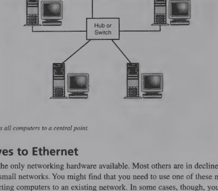

### FIGURE 1.3

星型拓扑将所有计算机连接到一个中心点。

### Alternatives to Ethernet


以太网并不是唯一可用的网络硬件。大多数其他类型都在衰退，至少在小型网络中使用时如此。你可能会发现，如果要将计算机连接到现有网络，就需要使用其中一种网络类型。在某些情况下，你可能希望建立一个小型以太网网络并将其链接到另一个网络，通过配置你的 Linux 计算机使用两种类型，并将其用作路由器。

### Serial and Parallel Ports

你可以使用大多数 PC 上找到的串行或并行端口创建一个简单但低速的网络。一般来说，你会使用点对点协议（PPP）工具进行串行线路网络，使用并行线路互联网协议（PLIP）进行并行端口网络。这两者都是 Linux 内核协议，都需要额外配置。一般来说，这两种协议对于大多数实际的局域网来说都不是很有用，因为它们与以太网相比太慢了。此外，它们只能连接两台计算机。最后，你会失去两台计算机上所需端口的使用。与以太网卡售价 30 美元及以下相比，建立一个双计算机网络的成本远低于 100 美元。

#### NOTE

你使用串行端口和 PPP 通过调制解调器连接到互联网，如第 8 章“使用 PPP 进行拨号连接”中所述。在这种情况下，串行端口的速度限制不是一个大问题，因为调制解调器之间无法以更快的速度通信。你可以配置你的 Linux 系统通过调制解调器接受拨号连接，尽管这个主题超出了本书的范围。

在本地网络中不使用串行或并行连接的规则的一个例外是连接掌上电脑或类似的专用设备。使用 PPP 连接和 IP 伪装，你可以使用 Linux PC 的互联网连接为掌上电脑提供互联网访问，或者在掌上电脑和 Linux 计算机之间传输文件。

### Token Ring

Token Ring 是 IBM 为小型网络开发的一种网络技术。与以太网一样，Token Ring 网络可以使用多种布线，并有两种速度选项（4Mbps 和 16Mbps）。顾名思义，Token Ring 以环形拓扑工作，这与同轴以太网的总线拓扑类似，只是总线的两端连接起来，形成圆形排列。然而，Token Ring 的环是在集线器内部形成的，因此电缆的物理布置更接近 10base-T 以太网。

Linux 内核包含对多种 Token Ring 适配器的支持。如果你想连接到 Token Ring 网络，你应该查阅 Linux Token Ring mini-HOWTO 以了解如何配置卡。

### LocalTalk

LocalTalk 是苹果在其大多数 Macintosh 计算机上内置的网络技术的名称，直到最近。LocalTalk 与现代以太网类型相比是一种较慢的网络技术。除非你试图连接到现有的 LocalTalk 网络，否则我不建议你使用 LocalTalk。

尽管如此，Linux 确实包含少数用于 PC 的 AppleTalk 卡的驱动程序。你也可以配置 Linux 在 AppleTalk 网络和另一种网络类型之间路由流量，尽管此类配置的细节超出了本书的范围。

### 长距离网络

以太网及其计算机主要是本地网络技术；它们适用于连接单个办公室的计算机，但不适用于连接城镇或大陆另一边的两个办公室。对于这些长距离链路，你需要考虑其他技术。

### ISDN

综合业务数字网（ISDN）与传统电话服务竞争。它是一种通过电话公司数十年来使用的同一物理线路传输语音和数字数据的方式。

ISDN 能够传输最高达 128Kbps 的数据，这在当时与传统调制解调器相比相当快速，但现在只是快速而非特别快。对于外部接入，电缆调制解调器和数字用户线路（DSL）现在可以提供更高的速度，通常成本更低。如果这些替代方案可用，通常没有理由考虑 ISDN。正因如此，我在本书中不介绍 ISDN。Linux however 包含 ISDN 支持，如果你想了解更多，请查看 `http://alumni.caltech.edu/~dank/isdn`。

### ATM

与以太网相比，异步传输模式（ATM）网络相对较新。ATM 支持从 25Mbps 起的多重速度。ATM 的主要优势之一是它允许语音、视频和数据通过同一物理线路传输，这对大型企业很有吸引力。ATM 还支持非常高的速度，这在需要大量带宽的应用中很重要。然而，对于典型的桌面工作站或服务器来说，ATM 硬件比以太网硬件更昂贵。对于 Linux 来说，ATM 驱动程序支持尚未集成到内核中，尽管已有项目正在开发针对某些 ATM 板的 Linux 驱动程序。如果你需要在 Linux 下使用 ATM 板，请查看站点 `http://lrcwww.epfl.ch/linux-atm` 获取更多信息。

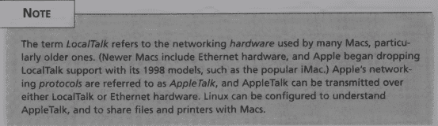

关于 ATM 的最后一点是，该技术与 ISDN 和 DSL 密切相关。如本章后面所述，一些 DSL 服务提供商使用内部卡将你的计算机连接到 DSL 网络。这些卡有时与 ATM 卡密切相关，因此 ATM 驱动程序开发工作可能与在 Linux 中使此类网络设备正常工作相关。此信息主要会引起内核程序员的兴趣，因为在我撰写本文时，ATM 和内部 DSL 适配器的支持充其量只能说是初步的。

### 其他网络类型

网络硬件的类型数量相当庞大。Linux 包含许多较冷门网络硬件类型的驱动程序，但并非全部。如果你有一个基于这些冷门硬件类型的网络，你可以检查 Linux 内核选项，看看是否支持它。如果你找不到它，也不要绝望；可能有未集成到内核中的附加模块可以满足你的需求。尝试在 Alta Vista（`http://www.altavista.com`）、Yahoo!（`http://www.yahoo.com`）或 Excite（`http://www.excite.com`）等网络搜索引擎上进行搜索；或在 Deja News（`http://www.deja.com`）上搜索新闻组帖子的存档。

### 专用路由器

大型组织通常使用专用硬件路由器将本地以太网网络连接到远在数英里之外的 ISP。这些设备在一侧接受以太网，另一侧输出其他协议。如果你使用此类设备，就无需担心其与 Linux 的兼容性，因为专用路由器不依赖操作系统。事实上，用于 DSL 和电缆互联网接入的“调制解调器”（本章后面“DSL 和电缆调制解调器”中讨论）通常就是这种类型的路由器，只是为个人和小办公室使用而缩小规模。

### 网络接口卡

无论你使用何种类型的网络，你都需要网络接口卡（NIC）将计算机连接到网络。NIC 通常包括一个或两个用于物理网络接口的连接器。（如前所述，以太网有几种布线选项，因此某些 NIC 包含适用于一种以上此类选项的适当连接器。一些卡还支持多于一个接口，每个接口具有唯一地址，以节省需要多于一个 NIC 将单台计算机连接到两个网络的计算机上的插槽。）NIC 在其功能和 Linux 兼容性方面差异很大，因此本节涵盖这些问题。

#### NOTE

> NICs 通常被称为网络卡、以太网卡（当它们设计用于以太网时）或其他变体。

#### ISA 和 PCI 卡

大多数现代计算机都配备了 ISA 和 PCI 插槽。ISA 插槽是一种较老且较慢的设计，因此不适用于需要高速访问计算机其他部分 的设备，例如显卡和 SCSI 主机适配器。如果你的网络限于 10Mbps 速度，ISA 网卡应该足够，尽管它可能比 PCI 网卡消耗更多的 CPU 时间，尤其是当 ISA 网卡使用较旧的程序化输入/输出（PIO）设计时。

100Mbps 以太网网络可能超过 ISA 总线的速度容量，因此 100Mbps ISA 网卡很少见。如果你想将一台没有 PCI 插槽的旧计算机连接到 100Mbps 网络，你可能想要考虑这样的卡；但如果计算机有任何空闲的 PCI 插槽，我建议尽可能使用 PCI 网卡。今天，大多数 PCI 以太网卡都是 10/100 型号，意味着它们可以在 10Mbps 和 100Mbps 下运行。这些卡通常会自动检测网络速度并相应地调整自己，因此几乎不需要为你的网络速度显式配置这些板卡。

#### NOTE

> 许多 486 计算机和一些较旧的奔腾使用 VESA 局部总线（VLB）或扩展 ISA（EISA）而不是 PCI。使用这些总线的网卡存在，但今天已相当罕见。如果你有一台具有这些总线之一的旧计算机，你可能想要寻找 VLB 或 EISA 网卡。


ISA 卡使用两种方法之一来配置到你的计算机：跳线或即插即用（PnP）协议。跳线是滑动在板上金属针脚上的金属和塑料片。你将跳线放置在特定的针脚对上以配置诸如板使用的 IRQ 等功能。PnP 板本应通过允许计算机指定这些设置来消除这一点。不幸的是，PnP 对于 ISA 设备通常工作不佳。在 Linux 下，PnP 设备使用`isapnp`包进行配置。如果你有一个 PnP 网卡，你可以以 root 身份输入`/sbin/isapnpdump > isapnp.conf`来创建一个名为`isapnp.conf`的文件，其中包含有关你的 ISA PnP 板的信息。然后你需要编辑此文件以指定你想要使用的 IRQ、DMA 和其他配置参数。完成后，将文件放在`/etc`目录中并运行`/sbin/isapnp -f /etc/isapnp.conf`以确保文件的语法正确并且你指定的资源没有冲突。理论上，你应该然后能够使用你需要的任何驱动程序来驱动你的板。我建议你重新启动以确保你的 Linux 系统在重新启动时会使用这些设置。（大多数现代 Linux 系统在启动时会自动运行`isapnp`，但有些可能不会，在这种情况下你需要在`/etc/rc.d/rc.local`或其他启动文件中添加适当的行。）

PCI 卡比 ISA 卡更容易配置，因为它们是考虑到 PnP 而设计的。虽然所有 PCI 卡都是 PnP 设备，但它们不需要单独的配置工具或关于使用什么资源的明确说明；这些细节应在系统启动时由 BIOS 处理。如果你怀疑你因资源冲突而遇到 PCI 网卡问题，尝试使用你的系统 BIOS 设置功能来修改它为 PCI 设备分配资源的方式。细节因 BIOS 而异，但通常有一种方法可以为非 PCI 设备保留特定资源或选择分配资源的算法（例如，从低到高、从高到低分配 IRQ，或按指定顺序分配）。

对于 PCI 和 ISA 板，你都需要适当地配置你的 Linux 驱动程序。但是，在此之前，你需要了解一些关于网卡芯片组的信息。

### 以太网地址

为了识别自己，以太网卡具有唯一的六字节地址。这些地址经常，但并非总是，印在贴在卡上的贴纸上。即使不是这种情况，软件也可以读取卡的以太网地址。例如，如果你在 Linux 提示符下输入`/sbin/ifconfig`，Linux 会回复类似这样的内容：

```
eth0      Link encap:Ethernet  HWaddr 00:80:C8:F9:3B:BA
          inet addr:192.168.1.1  Bcast:192.168.1.255  Mask:255.255.255.0
          EtherTalk Phase 2 addr:65280/13
          UP BROADCAST RUNNING MULTICAST  MTU:1500  Metric:1
          RX packets:149265 errors:157 dropped:0 overruns:157 frame:0
          TX packets:186774 errors:3 dropped:0 overruns:3 carrier:0
          collisions:1132
```

`ifconfig`命令提供了大量关于低级网络接口的信息，但就目前而言，只考虑此输出的第一行。此行末尾的六个十六进制值，标记为`HWaddr`，是此网卡的以太网地址。

网卡的以太网地址完全独立于你过去可能遇到的数值型 Internet 地址，并且在第 2 章和第 4 章中进行了描述。（此地址在`ifconfig`输出的第二行报告，并在前面的示例中标记为`inet addr:192.168.1.1`。）以太网板使用其硬件地址相互通信，但并非所有互联网上的计算机都通过以太网连接，并且并非所有以太网网络都连接到互联网。TCP/IP 协议栈的一项工作，如第 2 章所述，是以有意义的方式将这两个地址关联起来。

#### NOTE

> 如果你需要使用 DHCP 为你的计算机获取一个 Internet 地址，你可能需要提供网络板卡的以太网地址。许多有线调制解调器和 DSL 提供商以这种方式使用 DHCP，一些企业在其内部网络上也是如此。因此，如果你处于这样的网络中，你就不能随意更换网卡；在这样做之前，你需要通知你的网络管理员进行更改，否则你将无法连接到你的网络。

### 常用芯片组

网卡就像大多数计算机板卡一样，使用芯片组来执行其大部分功能。芯片组是一组芯片（或在大多数情况下是一个芯片），它集成了实现某个功能所需的核心电子特性，例如发送和接收以太网帧。在计算机行业中，板卡制造商通常会从众多芯片组制造商中购买芯片组。板卡制造商随后围绕芯片组构建其产品，有时还会更换芯片组供应商。Linux 设备驱动程序是为特定的芯片组编写的，而不是为特定的板卡编写的。所有这些事实共同导致了一个可能令人困惑的情况。例如，假设有三个芯片组制造商 A、B 和 C，以及三个网卡制造商 X、Y 和 Z。最初，X 和 Y 可能使用芯片组 A，而 Z 使用芯片组 C。这意味着板卡 X 和 Y 需要相同的 Linux 驱动程序——即芯片组 A 的驱动程序。然而，制造商 Y 和 Z 都可能决定改用芯片组 B，甚至可能不更改其产品的名称。这意味着所有网卡 X 样品都使用驱动程序 A，但网卡 Y 的一些样品使用驱动程序 A，一些使用驱动程序 B，而网卡 Z 的一些样品使用驱动程序 B，一些使用驱动程序 C。

为了让事情变得更加困难，板卡制造商通常会试图掩盖他们使用的芯片组，这可能使为 Linux 选择网卡（或其他卡）成为一次冒险。你有时可以通过查看制造商的网站来获得有关板卡使用芯片组的有用信息。越来越多地，这些网站提供可供下载的 Linux 驱动程序。你可以直接使用此驱动程序，也可以通过检查其注释来查看它是哪个标准驱动程序，并从其他来源使用该驱动程序的最新版本。

幸运的是，在 1999 年，一小撮网卡芯片组主导了 PCI 网卡市场，并且 Linux 支持所有主要厂商，因此你购买 10/100 PCI 网卡时不太可能出错。常见的网卡芯片组包括

- Intel i82557/i82558—该芯片组用于 Intel EtherExpress Pro 100B 板卡以及一些集成以太网的主板中。

- 3COM 3c59x 和 3c905b 系列—这些芯片组用于 3COM 的 EtherLink XL 系列板卡和一些第三方产品。

- DEC Tulip 21x4x 系列—基于这些芯片组的板卡非常受欢迎，部分原因是它们比 Intel 和 3COM 的产品更便宜。然而，Intel 在 DEC 倒闭时买下了该设计的权利，因此真正的 DEC/Intel Tulip 芯片组已变得相当稀有。

- Tulip 克隆—PNIC、Macronix 等公司已生产出 Tulip 克隆芯片组，它们现在被发现于市场上大多数低成本 PCI 网卡中。

当然，还有其他芯片组可供使用。这在 ISA 产品和 10Mbps 板卡中尤其如此。幸运的是，大多数这些网卡在 Linux 中都得到了很好的支持。

### Linux 驱动程序

大多数网卡的驱动程序都随 Linux 内核本身提供，并且大多数发行版“开箱即用”就包含对这些网卡的支持，因此你无需再寻找。在某些情况下，你需要追踪新的或更新的驱动程序。例如，许多 Tulip 克隆芯片组与早期 2.2.x 内核（包括随 Red Hat 6.0 发行的内核）中包含的 Tulip 驱动程序版本配合效果不佳。当尝试追踪更新的驱动程序时，两个可能有用的网站是网卡制造商的网站和`http://cesdis.gsfc.nasa.gov/linux/drivers/`。后者网站由 Donald Becker 维护，他编写了许多 Linux 以太网适配器驱动程序，因此它包含最新稳定版和面向前沿硬件的实验性驱动程序。

当你下载新的驱动程序文件时，很可能它是一个 C 源码文件（文件名扩展名为`.c`）。它可能附带一个描述如何将其集成到你的内核中的文本文件。如果有，请遵循这些说明。如果没有，并且该文件是对现有文件的更新，你可以将它放在 Linux 内核源代码树中，替换旧的驱动程序（通常在`/usr/src/linux/drivers/net`目录中）。然后你需要重新编译你的内核或内核模块，并可能重新启动计算机，如第 6 章所述。

你必须回答的一个问题是，是否将驱动程序直接编译到内核中，还是将其编译为模块。如果将驱动程序编译到内核中，它将始终被加载并存在，因此驱动程序在系统启动时“丢失”的可能性为零。如果有两个使用相同驱动程序的网卡，将驱动程序编译到内核中通常也是更可取的。另一方面，将驱动程序放入内核会增加内核的大小，在极端情况下可能导致系统无法启动。如果将驱动程序编译为模块，Linux 只有在内核本身启动后才会加载它。你可能需要在`/etc/conf.modules`中指定哪个驱动程序与以太网端口相关联，这可能很麻烦，但如果板卡使用不同的驱动程序，这也可以使配置双网卡系统相对简单。

### 使用集线器和交换机


如果你使用的是 10base-2 或 10base-5 以太网网络，你会按照本章前面所述以总线拓扑的方式连接计算机。10base-T 和 100base-T 网络则通常采用星型拓扑运行（见图 1.3），其核心使用一种称为集线器或交换机的设备。典型的中小型网络集线器或交换机是一个普通的盒子，带有多个 RJ-45 连接器和活动指示灯。由于你对集线器或交换机的选择会对整体网络体验产生重要影响，本节将讨论这些设备。

### NOTE

10base-2 和 10base-5 是较旧的网络技术。新网络通常使用 10base-T 或 100base-T。我建议在 1999 年底的所有新安装中使用 100base-T，因为它是当时最常用的最快类型的以太网。

### 为什么使用集线器或交换机？

首先，如果你使用的是 10base-2 或 10base-5 布线，你不需要——事实上你也不能——使用集线器或交换机。从实际角度来看，你可以忽略这个问题，除非你考虑将网络升级到 100Mbps 速度，甚至更改为 10base-T。

10base-T 和 100base-T 布线是为恰好两台计算机设计的。因此你不能像同轴电缆那样使用它，即将多台计算机连接到一根电缆上。

如果你使用 10base-T 或 100base-T 网络卡并且只有两台计算机需要连接，你可以选择使用集线器、交换机或交叉电缆。在这种情况下，交叉电缆选项是最简单且最便宜的，因为它是一根普通以太网电缆，专门布线以便直接连接两台计算机的以太网端口。对于两台计算机的网络来说，这已经足够，而且可以为你节省购买集线器或交换机的费用。如果你以后决定扩展网络，你将不得不放弃交叉电缆，但其他设备无需变动。

如果你使用 10base-T 或 100base-T 并希望连接三台或更多台计算机，你几乎别无选择，只能使用集线器或交换机。理论上，你可以通过为除端点机器外的所有机器提供两个 NIC 并将所有机器配置为路由器来实现计算机的菊花链连接；然而，这将花费远超其价值的精力，而且可能花费比购买一个集线器更多。

为什么从可菊花链连接的同轴电缆转向更受限的双连接 RJ-45 电缆？为什么让你购买这个额外的盒子？一句话，维护。一根长的同轴电缆容易出现断裂等问题。例如，假设一个办公室使用 10base-2 布线。如果某台计算机的用户掉了一支笔并爬到桌子底下去找它，并且如果那个人不小心撞到网络电缆，将其从计算机上拉开，网络最终会被分成两部分，导致神秘的故障，可能需要花费一些时间才能追踪到。相比之下，如果部署的是 10base-T 或 100base-T 网络，同样的情况只会影响一个人的计算机——这是一个更容易诊断的问题。

另一个因素是，从一台机器到另一台机器像圣诞树灯一样串联布线，在某些办公室布局中可能会导致一些复杂的布线路径。虽然不能保证总是更好，但星型拓扑通常可以产生更合理、更灵活的布线布局。

虽然我在这里讨论的是以太网，但其他一些网络技术也使用集线器、交换机或类似设备。例如，令牌环使用一种类似集线器的设备。令牌环网络中的环实际上存在于令牌环集线器内部。这为令牌环使用的环型拓扑提供了星型拓扑的优点（和缺点）。

### 集线器和交换机的区别

集线器和交换机扮演非常相似的角色，但在重要方面有所不同。如果你去商店查看价格，你会注意到在连接器数量相同的情况下，交换机比集线器更贵。这是因为交换机是更复杂、更灵活的设备。集线器是一个相当愚蠢的设备。当它从一台设备接收到一个以太网数据包时，它会将该数据包发送回连接到集线器的所有其他设备。例如，假设你有一个网络，五台计算机连接到同一个集线器。当名为 polk 的计算机试图与名为 pierce 的计算机通信时，polk 的数据包确实会到达 pierce，但它们也会到达网络上剩下的三台计算机，如图 1.4 所示。这些计算机不会尝试处理这些数据包，因为它们识别出数据包是发给 madison 的，但这种向所有系统盲目中继消息的做法确实会产生负面后果，正如我稍后所述。

相比之下，交换机则聪明一些。它在其内部保存着其连接的计算机的以太网地址列表。然后，当它看到一个传入的数据包时，它会检查其目标地址，如果它识别出该地址，交换机只会将数据包发送给那台计算机（如图 1.5 所示）。

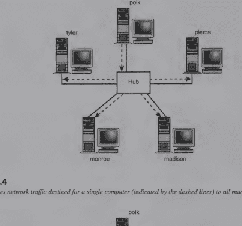

#### FIGURE 1.4

集线器会将发往单台计算机的网络流量（虚线所示）转发给所有机器。

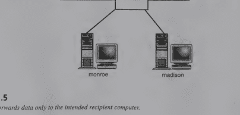

#### FIGURE 1.5

交换机仅将数据转发给目标接收计算机。

这些差异带来的一个后果与速度有关。通常，由 10/100Mbps 集线器连接的网络的速度受其最慢的计算机限制。例如，如果五台计算机组成的网络中有四台配备 10/100Mbps 网卡，但第五台只有 10Mbps 网卡，那么该网络上的所有流量都会以 10Mbps 的速度缓慢运行。即使是两台配备 10/100Mbps 网卡的计算机之间的流量也是如此。如果其中一台计算机只有 100Mbps 网卡，这一事实可能成为严重问题，因为该计算机将无法与其它计算机通信。

相比之下，交换机通常允许两台计算机以它们之间通信的最高速度进行通信。因此，两台支持 100Mbps 的计算机可以在 100Mbps 下通信，即使同一交换机上连接着一台仅支持 10Mbps 的计算机。

相关的一点是，集线器要求其连接的计算机以 `半双工` 模式运行，这意味着它们只能发送或接收，而不能同时进行。相比之下，交换机和交叉电缆允许网卡以 `全双工` 模式运行，这样发送和接收可以同时进行。全双工操作通常可以大幅提升网络操作速度。

集线器与交换机之间的界限有时是模糊的；有些设备包含两种产品的部分功能，或基本上是集线器但在其中一两个端口上提供交换功能。这种混合设备可以作为一种有用的折中方案，在降低成本的同时获得交换机最有用的功能，尤其是在网络中同时存在 10Mbps 和 100Mbps 网卡的情况下。

### Collisions

任何网络架构都必须处理多台计算机同时需要访问这一根本问题。网络无法比人们更好地处理多路同时传输。如果三个人共享一次电话会议，其中两人同时说话，第三个人不太可能理解其中任何一人的话——计算机也是如此。这一网络事实是如何处理的？

在某些网络架构中，例如令牌环，它通过防止多路同时传输来处理这个问题。在令牌环中，`令牌` 会从一台计算机“传递”到另一台计算机，每台计算机只有在收到令牌时才被允许传输。然后该计算机将令牌发送给下一台计算机，最终令牌会绕环返回。

以太网的工作方式则根本不同。在以太网中，允许同时传输发生，并在事后进行纠正。同时传输被称为 `碰撞`，当发生碰撞时，两台计算机的消息都不会被接收。以太网通过让每台计算机延迟一个随机时间段然后重试来处理这种情况。

由于延迟时间是随机的，因此不太可能两台计算机会在同一时间再次尝试传输，因此第二次尝试很可能成功。（如果第二次尝试失败，则该过程会重复。）

`碰撞`与集线器和交换机相关，因为集线器不会阻止`碰撞`，而交换机则会。考虑一个四台计算机的网络，其中计算机 maple 和 oak 正在交换数据，而 birch 和 gingko 也在进行自己的传输。使用集线器时，当 maple 传输数据时，oak 会接收数据，birch 和 gingko 也会接收到。如果 birch 恰好在同一时间传输数据，就会发生`碰撞`，maple 和 birch 都必须重试传输。然而，由于交换机会隔离这些对话，因此在这种情况下不会发生`碰撞`，从而提高网络性能。即使在两台计算机的网络中也是如此，因为两台计算机都可能同时尝试发起通信。交叉电缆与交换机类似，可以帮助防止`碰撞`，因为交叉电缆允许全双工操作，就像交换机一样。

本章前面提到的 `/etc/ifconfig` 命令会报告单台计算机上检测到的`碰撞`次数。如果该数字相对于总数据包数非常高，则你的网络可能负担过重，你可能需要考虑用交换机替换集线器，将网络分割成单独的段，或以其他方式修复它。（`ifconfig` 实用程序只能报告单台计算机上的`碰撞`，而不能报告整个网络。）

### How to Choose a Hub or Switch

集线器和交换机都不需要操作系统的驱动程序支持；它们只是放在桌上并在不考虑源和目标操作系统的情况下分发以太网数据包。集线器和交换机通常也能很好地与来自不同制造商的网络硬件交互。因此，你不必仅仅因为计算机中使用了某品牌的网卡就购买该品牌的集线器。相反，你在挑选集线器或交换机时应问自己几个关于需求的问题，以及电脑商店货架上的产品如何满足这些需求：

- Hub or Switch?—如前所述，交换机是比集线器更先进的产品，交换机可以通过多种方式提高网络性能。交换机的成本更高。一般来说，随着你向网络中添加计算机以及这些计算机产生更多流量，交换机的额外开销变得更有价值。一个偶尔进行文件共享的典型三台计算机家庭网络不太可能从交换机中受益太多。相比之下，一个有二十多台计算机并不断共享大型文件的办公室很可能会从交换机中受益。


- 速度——尽管 10/100Mbps 网卡的价格并不比 10Mbps 网卡贵多少，但 10/100 集线器和交换机的价格却比仅支持 10Mbps 的同类产品贵得多。因此，如果你的网络需求容量较低，购买 10Mbps 集线器可能具有诱惑力。即使使用 10/100 网卡，对于规模适中的网络来说，这也可能是合理的。如果以后需求发生变化或 10/100 集线器的价格下降，你可以在不打开计算机的情况下用新的集线器替换旧的集线器。鉴于交换机相对于集线器的优势主要体现在速度上，我认为在大多数情况下买仅支持 10Mbps 的交换机是不可取的。

    交换机的一个相关因素是其总内部带宽。如果交换机正在处理两对计算机之间的两场“对话”，并且这两场对话各自以 100Mbps 传输数据，那么交换机本身处理的总数据量为 200Mbps，如果两个连接都使用全双工，则可能为 400Mbps。购买交换机时，你应检查交换机的总容量。如果你网络大量使用点对点传输，即工作站相互通信，那么你需要的容量就比以客户端/服务器为主的网络更高，在这种网络中大量客户端与单个服务器通信。

- 连接数——集线器和路由器有支持不同连接数的型号。你最好购买一个集线器或交换机，其连接器数量足以容纳所有现有计算机再加上至少一到两个备用接口。如果你的网络分布在相对较大的空间中，你可能需要使用两个或多个集线器或交换机，并用一根线将每对设备连接起来。当你的计算机按组聚集在一起且各组之间相隔一定距离时，这种方法尤其有用。不过，在这种情况下，你应注意电缆长度的限制。

- 上行连接器——一些集线器和交换机包含一个称为上行连接器的特殊连接器。该连接器用于将两个集线器或交换机连接在一起，有时也用于允许多台计算机连接到单个 DSL 或有线调制解调器。*（你可以使用 IP 伪装以不同方式配置 Linux 计算机来实现此功能，详见第 20 章“一个 IP 地址，多台计算机：IP 伪装”。）* 当你通过上行连接器连接两个集线器时，它们实际上就成为一个整体。

### 布线选择

如果你想创建 100base-T 网络，你的布线选择极其有限：你必须使用 UTC 五类电缆并配以 RJ-45 连接器。这种电缆在电脑商店很常见，甚至可以在 Radio Shack 买到。它有多种颜色和长度可供选择。一些以太网板卡随包装附带一段合适的电缆，这类捆绑产品通常比单独购买的同类产品便宜一些。

#### 提示

利用以太网电缆的不同颜色。如果你能为连接到集线器的每台计算机提供一种独特的电缆颜色，你会发现维护和故障排除更容易。集线器的指示灯可以帮助追踪冲突或网络卡故障问题，而彩色编码的电缆可以帮助你确定哪些灯对应哪台计算机。同样，不同品牌的电缆通常在 RJ-45 卡扣上使用不同类型的应变护套和外皮，你也可以用同样的方式来辅助诊断。

如果你的网络硬件为 10Mbps，你在布线方面有更多选择。使用 10base-2 同轴电缆可能更便宜，用于创建或扩展小型网络，但如果你以后决定将网络升级到 100Mbps，就需要更换这些布线。如果你决定使用 10base-T，你可以使用三类、四类或五类布线，但鉴于 100base-T 需要五类电缆，我建议即使用于 10base-T 网络也使用五类，因为成本差异很小，而且升级到 100base-T 将会容易得多。

在为网络铺设电缆时，你应遵循常识性的安全预防措施。不要让电缆在开放处随意盘绕，以免人们绊倒。相反，应将其布置在桌子后面或使用 U 形钉等类似的电缆固定产品将其固定在踢脚板上。特别是在商业环境中，你可能需要确保布线符合当地的消防安全要求。如果你不熟悉相关法规，你可能需要聘请专业人员来购买和铺设电缆。

最近，出现了一些产品，允许你利用家庭电话线路中未使用的电线来联网计算机。然而，这些产品的速度很慢——大约 1Mbps 左右。它们通常以套件形式提供并需要特殊的以太网卡，因此如果你决定尝试，请务必检查这些卡与 Linux 的兼容性。根据你家庭的布线情况，它们可能会与 DSL 互联网服务冲突。

### 以太网套件

一些制造商销售包含一对以太网卡、一个集线器和两根电缆的套件。这类套件有时比单独购买等效组件便宜，因此可能物有所值——前提是你确实需要这些精确的组件。例如，如果你只联网两台计算机，你可以通过购买一根交叉电缆并直接连接两台计算机来省去集线器。你还能获得更好的性能，因为网卡可以使用交叉电缆的全双工模式。你在选择组件速度时也应保持警惕。我见过包含 10/100Mbps 网卡但只能使用 10Mbps 的集线器，这几乎算不上划算。你还应确保电缆是 UTC 五类线，而不是较低等级，并且电缆长度适合你的需求。确保集线器有足够多的端口满足你的需求，或者可以通过上行端口连接到另一个集线器进行扩展。

如果你要联网多台计算机并确定套件是一个不错的起点，不必被迫为额外的网卡、电缆或集线器购买相同品牌的产品。这样做有时会让你的生活更简单，因为所有计算机上只需要一种驱动程序，但网络硬件的品牌间不兼容情况极其罕见。

### DSL 和电缆调制解调器

过去十年互联网的爆炸式增长对能够负担 T1 线路或其他高速互联网连接的大型组织来说是一大福音。然而，小型企业和个人只能使用较差的接入方式，随着互联网上可用数据的数量增长，这种情况变得越来越令人沮丧。例如，在 1994 年，获取一份 Slackware Linux（当时在 Linux 社区很流行）的拷贝大约需要 20MB 的文件。使用 14.4Kbps 调制解调器，下载这些文件大约需要三个多小时。五年后，Red Hat 6.0 发行版占用超过 500MB——比 1994 年增加了 25 倍。而当时最快的调制解调器也只快了四倍，因此通过调制解调器全部下载下来需要超过 20 小时！虽然这或许不是最公平的比较，因为在那段时间里 Linux 的增长速度远快于大多数软件产品，但它确实解释了许多人渴望更快互联网接入的原因。

### 经济实惠的高速接入

电信行业开始注意到这种需求。1999 年，有两种主要方法来满足小型企业和家庭互联网接入的需求：电缆调制解调器和 DSL 服务。虽然这些技术在某些方面差异很大，但从 Linux 系统配置的角度来看，它们非常相似。它们的价格也都比完整的 T1 连接低得多——通常低级服务的月费在 40 美元到 100 美元之间。

### 电缆调制解调器

电缆调制解调器实际上并不是传统意义上的调制解调器，如本章后面所述。然而，由于电缆调制解调器盒作为计算机与网络之间的接口，其作用与传统调制解调器类似，因此“电缆调制解调器”这一术语已被广泛使用。

有线电视系统通过同轴电缆传输电视式信号。典型的有线电视系统大约有 750MHz 的带宽，每个电视频道占用其中约 6MHz，而一定量的带宽则用于系统控制信号，例如让你点播付费电影的信号。为了支持电缆调制解调器，会预留一个频道（6MHz 带宽）用于将有线电视公司的互联网接入线路发送给订阅用户的数据（称为下游流量）。另一个频道或一些其他未使用的带宽则用于将用户数据发送到互联网（称为上游流量）。一些电缆调制解调器设置根本不分配上游流量，而是要求你使用传统的电话线路拨号来实现此功能。此类系统很可能使用不寻常的软件，因此与 Linux 不兼容。

电缆调制解调器服务的一个重要特征是，带宽的数量，以及因此系统上可以流动的总数据量，既是固定的又是共享的。这种安排的固定方面并不罕见，但共享的部分是罕见的，这会产生后果。最重要的是，你的邻居可以访问与你完全相同的数据流；有线电视公司无法将特定信号沿你的电缆线发送而不发送给你的邻居。对有线电视频道也是如此。你能够点播付费电影的原因是这些频道以加密形式发送，而有线电视机顶盒包含可远程激活的解密程序，在你订购影片后即可激活。你的邻居会收到与你相同的影片，但除非他们也订购，否则画面将无法观看。正如传统的有线电视信号对有线电视系统上的所有个人可见一样，某个区域内的所有电缆调制解调器都能看到发送给该区域所有电缆调制解调器的数据。

这一事实有两个重要的实际后果：

- 随着通过电缆调制解调器进行互联网接入的需求增加，速度会下降。这一规律既适用于按分钟、按小时计算——人们在特定时间冲浪——也适用于按天、按月、按年计算——人们订阅或取消服务。当然，有线电视公司可以添加更多设备，将其服务区域划分为更小的区域以改善性能，甚至可能将更多频道用于电缆调制解调器服务，但归根结底，服务的速度可能存在很大差异。

- 目的地为一个地点的网络流量在另一个地点可见。理论上，恶意个人可以窃听网络，寻找密码、信用卡号码或其他信息。这并不意味着你不应该使用此类系统传输此类数据，但这确实意味着你应特别注意安全问题。例如，仅使用具有安全功能的浏览器提供信用卡号码，并且仅提供给安全的网站；使用 `ssh` 而不是 `telnet` 登录远程站点（或从其他位置登录你的家庭 Linux 机器）；等等。幸运的是，许多电缆调制解调器提供商会在电缆调制解调器盒中加密数据，因此邻居的窃听会变得困难。但并非所有提供商都这样做。

有线电视公司几乎总是同时充当向你的计算机提供物理连接的提供商和互联网服务提供商（ISP）。因此，使用有线调制解调器时你只需与一家公司打交道。

### DSL


DSL 是一种价格和性能与有线调制解调器相似的服务，但它由当地电话公司或其他租用电话公司线路的公司提供。有几种不同的 DSL 服务类型，每种都以不同的首字母区分，例如 ADSL（非对称 DSL）、SDSL（对称 DSL）等。术语 xDSL 有时被用来泛指所有 DSL 类型。在大多数情况下，ADSL 是这些技术中最便宜的，也是与有线调制解调器竞争最直接的。其他 DSL 类型（尤其是 SDSL）通常面向小型企业销售。你通常可以为家庭使用订阅 SDSL 或为商业使用订阅 ADSL，不过，你应咨询当地的 DSL 提供商，了解他们具体提供哪些服务。网站 `http://webisplist.InternetList.com/screens/ispsearch/powersearch.asp?From=ADSL` 和 `http://www.dslreports.com` 提供了美国许多地区 DSL 提供商的信息。

与有线“调制解调器”一样，用于将计算机连接到 DSL 系统的设备有时也被称为调制解调器，尽管这在技术上是不正确的。DSL 系统在操作上与有线调制解调器相似，因为两者都会分割传输线路的带宽，并将其一部分用于数据，另一部分用于其他功能。在 DSL 的情况下，使用频谱中大部分不可听的高频部分来传输数据，而电话线的其余部分则用于传统的语音通信。因此，DSL 服务可以使用与你的电话服务相同的布线，而且通常确实如此。但这并非总是如此，特别是如果网络连接由当地电话公司以外的供应商提供的话。

与有线调制解调器不同，DSL 在你的计算机和 DSL 服务的网络之间提供直接链路。因此，你所支付的带宽不会像有线那样直接共享（尽管一旦进入 DSL 服务，带宽会被合并，这里可能出现瓶颈），而且你的邻居不太可能窥探你的网络活动。你通常还可以根据需要订阅不同速度的 DSL 服务。

尽管有些公司（主要是当地电话公司）同时提供物理线路和 ISP 功能，但在使用 DSL 时，这两个方面的互联网接入往往是分离的。你可以与 Bell Atlantic、Covad 或 Northpoint 等公司签订 DSL 线路合同，并使用 Flashcom、Concentric 或 Speakeasy 等独立 ISP 进行实际的互联网接入。一般来说，在特定区域，一家 ISP 只通过一家 DSL 提供商提供服务。

### 硬件和软件要求

有线调制解调器和 DSL 服务通常都通过 10Base-T 以太网链路连接到你的计算机。因此，你需要在计算机中安装一块以太网卡来连接这些服务。如果你打算以这种方式连接多台计算机，你需要么为多台计算机单独订阅，要么使用你的 Linux 机器作为其他机器的网关，使用第 20 章中描述的 IP 伪装。 （也有第三方产品可以执行类似 IP 伪装的功能，有时 DSL 或有线调制解调器本身也可以执行此功能。）如果你的 ISP 允许，直接连接多台计算机在某些情况下会更方便，也更灵活；但这也意味着你可能需要更加小心地保护所有系统免受入侵者攻击，而且你的 ISP 可能会为此服务收取更多费用。

一些 DSL 和有线调制解调器提供商会在安装费用中包含一块以太网卡。你应该询问你将获得的是什么型号的卡，并在安装人员来配置设备之前检查它是否与 Linux 兼容。如果你的 ISP 不提供网卡，或提供的网卡与 Linux 不兼容，你就需要自己购买，最好是在安装人员来接线之前购买。务必告诉他们你的意图，因为他们可能需要卡的硬件地址来配置他们的系统。

少数有线和 DSL 调制解调器是插入计算机的卡。目前，几乎没有这些产品与 Linux 兼容，因此你应确保向你的服务提供商核实这一点。如果提供商使用的是一体式、不兼容 Linux 的设备，请询问他们的系统是否兼容你可从第三方获得的另一台设备。如果兼容，你可能可以通过购买这台第三方有线或 DSL 调制解调器来使服务正常工作。

大多数有线和 DSL 调制解调器都是位于计算机外部的盒子，通过以太网电缆连接到你的计算机，并通过各自的电缆连接到其网络。一般来说，有线电视公司会将其有线调制解调器租给客户，而 DSL 提供商则作为安装费用的一部分出售 DSL 调制解调器。

有线调制解调器和 DSL 都可与标准的 TCP/IP 应用配合使用。与将 Linux 计算机连接到任何其他以太网网络相比，配置或运行这些系统的独特之处通常很少。许多这些系统使用 DHCP 来动态分配互联网地址。这意味着你的互联网地址可能一天与一天不同，甚至一小时与一小时不同。如果你想运行自己的 Web 服务器或类似服务，这可能会造成问题，但使用 DHCP 的 ISP 通常无论如何都反对此类用途。其他 DSL 和有线调制解调器提供商会为你提供静态互联网地址，你可以在 Linux 中像连接到任何其他以太网网络一样进行配置。

DSL 世界中的一种趋势是使用 PPP 或类似协议通过 DSL 线路传输。调制解调器本身通常处理这些功能，因此对 Linux 来说是透明的。你应该询问一下这一点。如果你的潜在 ISP 报告需要特殊的 Windows 软件，请多问几个问题以确定 Linux 的兼容性。即使 ISP 使用特殊的 Windows 软件，你也可以通过购买更昂贵的调制解调器来让服务在 Linux 上运行，该调制解调器集成了必要的协议

### 设置有线调制解调器或 DSL 服务的简要指南

当你打电话订购有线调制解调器或 DSL 服务时，务必告诉销售代表你正在运行 Linux。一些提供商对此表示抵制，并会拒绝在除 Windows 或可能 MacOS 之外的任何系统上安装服务。有时你可以在安装人员到达时运行“已批准”的操作系统来让服务安装成功，然后自己配置 Linux 端。少数 ISP 反对你这样做。一般来说，有线电视公司比 DSL ISP 更有可能坚持要求你使用 Windows。

安装这些服务时发生的情况的细节差异很大。通常涉及一到两次由一到两家公司代表前往你的家庭或企业。在由非本地电话公司提供的 DSL 服务的情况下，例如，电话公司通常必须将线路铺设到你的建筑物，然后 DSL 提供商将安装额外的硬件，包括 DSL“调制解调器”本身。

> NOTE
> 
> DSL 服务的最新形式称为 G.Lite。该服务理论上消除了对上门访问的任何需求。提供商在电话公司的中央办公室处理布线，并将必要的硬件邮寄给你（或者你应该能够从 2000 年某个时候开始在电脑商店购买）。你通常必须在每个电话插座上安装微型滤波器，然后像连接模拟调制解调器一样插入 DSL 调制解调器。问题是你的内部布线可能不足以支持此服务，在这种情况下，你需要自己重新布线或请别人代劳。如果发生这种情况，与传统 DSL 服务相比，你节省的时间和金钱不会多多少。

最终，你的桌上会放着一个新盒子。该盒子将有一根标准的以太网电缆连接到你的电脑，另一根电缆连接到你的有线电视系统或电话线路。可能还涉及一到两个其他盒子，有时位于建筑物外部。

从 Linux 的角度来看，你配置系统使用 DSL 或有线调制解调器服务，就像配置任何其他以太网网络一样。在某些情况下，你需要手动指定静态 Internet 地址、域名服务（DNS）服务器和类似信息。在其他情况下，你将使用 DHCP 让 Linux 从 ISP 维护的服务器获取此信息。第 7 章“设置以太网选项”更详细地介绍了这些主题。如果你想设置 IP 伪装以允许家庭网络上的其他电脑使用该服务，请参阅第 20 章，但请注意一些 ISP 可能会反对这种配置。

### 电话调制解调器

谈到与 Internet 的连接，并不是每个人都有幸拥有 DSL、有线调制解调器或更快的服务。对于那些不太幸运、需求较少或经济条件较差的人来说，传统的电话调制解调器提供了连接 Internet 的常用手段。

调制解调器一词是调制解调器的缩写，指的是调制解调器将数字数据调制成模拟形式（声音——更准确地说，是电话线上声音的电等价物），然后再将这些模拟信号解调回数字形式。它们是通过从根本上说是模拟的电话网络传输数字数据的设备，该网络是在数字计算机成为现实数十年之前设计的。

### 什么速度的调制解调器？

调制解调器的速度在过去几年中大幅提高。在 20 世纪 80 年代中期，300 bps 的速度很常见；但现在，56,400 bps 的型号已经可用。还是吗？

你在商店购买并标有“56Kbps”的调制解调器实际上无法达到该速度，至少在美国是这样。最多，它们可以产生 54Kbps，因为 FCC 关于信号强度的法规阻止了使用 v.90 调制标准以更快速度的合法使用。实际上，最大连接速率可能更低，大约为 50Kbps 或更低。

还有一个事实是，v.90 调制解调器仅在一个方向产生高速（下游——到你）。在相反方向，速度限制为 33,600 bps。这就是为什么使用这种调制解调器时上传文件通常比下载文件花费更长时间。

所有这些关于 v.90 调制解调器速度的警告不应被理解为你应该避免它们。即使与旧的 33.6Kbps 型号相比速度提高 50%，也可能很重要且物有所值。如果你今天购买新调制解调器，几乎没有理由不购买 v.90 型号，至少如果调制解调器用于拨号外拨的话。如果你想使用调制解调器接收他人的来电，33.6Kbps 型号就足够了。这是因为 56Kbps 下游速度只能在接收调制解调器端使用特殊的数字连接才能实现。如果你购买两台 v.90 调制解调器并从一台呼叫另一台，连接速度将为 33.6Kbps（最大）双向。

#### 注意


在 v.90 被接受为调制解调器通信标准之前，曾有两种竞争且专有的协议在使用，X2 和 K56Flex。你不太可能在商店里找到仅使用这些协议的调制解调器，但在二手市场上可能会找到。这样的型号通常可以升级为使用 v.90，但少数，特别是来自已倒闭厂商的型号，可能无法升级。一些 ISP 可能仍支持这两种或其中一种旧协议，但迟早这种支持可能会消失，之后这些调制解调器实际上就相当于 33.6Kbps 型号。

电话调制解调器的速度在未来不太可能大幅提升，如果有的话。v.90 在使用调制解调器技术通过传统电话线路传输数据时，基本上已达到理论极限。可以通过改用 DSL 等数字技术来榨取电话线更多的速度，但这需要切换技术。

### 测试 v.90 兼容性

尽管美国大多数电话线路能够处理 v.90，但并非全部。你可以通过 3COM 运营的线路测试服务来测试你当前的电话线路，前提是你拥有一台 v.34（28.8Kbps 或更好）的调制解调器。你需要启动一个终端程序，例如 `Minicom` 或 `Seyon`，并将其配置为使用你的调制解调器线路（通常为 `/dev/ttyS0` 或 `/dev/ttyS1`）。输入 `ATDT1-847-262-6000` 让调制解调器拨打此线路测试号码。（注意：这是付费电话！）当系统提示输入你的名字和姓氏时，分别输入 line 和 test。系统随后会诊断连接并告知你结果。

在测试 56Kbps 能力时，你应确保从你打算用于调制解调器连接的线路进行测试。可能同一街道甚至同一建筑内的两条电话线路特性不同，因此不应依赖邻居的高速连接能力；应测试你自己的线路。

尽管通常准确，3COM 测试的结果并不完美。在某些情况下，你可能会发现线路在 56Kbps 速度测试中表现良好，但当你连接合适的调制解调器时，只能获得约 40Kbps 的速度——几乎不值得从 33.6Kbps 升级。可以设想通过移除家庭布线中不必要的电话或请电话公司检查线路来改善情况，但你可能无能为力。v.90 标准已将模拟电话系统推向极限，任何细微的缺陷都可能导致性能大幅下降。

### Linux 调制解调器兼容性

大多数调制解调器通过传统的串行端口运行（在 Linux 中通常为 `/dev/ttyS0` 或 `/dev/ttyS1`）。因此，它们不需要超出正常 Linux 串行驱动程序之外的特殊驱动程序。然而，仍有一些注意事项，以及偏好一种类型调制解调器而非另一种的原因。

除了串行端口接口外，调制解调器还使用命令集来执行拨号、设置错误校正等操作。此命令集的基础早已标准化为 Hayes 命令集，以开发该命令集的调制解调器制造商命名。Hayes 命令集相当基础，然而，不同制造商已以各种方式对其进行了扩展。然而，这些扩展都与 Linux 不兼容。最坏的情况下，你需要更改在 GUI PPP 拨号器或 PPP 拨号脚本中使用的调制解调器初始化字符串，以启用或禁用某些功能。

### 外部和内部调制解调器

你可以购买作为计算机外部的盒子并插入计算机外部串行端口的调制解调器，或作为插入 ISA 插槽（或更近期的 PCI 插槽）的内部卡。传统上，内部调制解调器包含串行端口电路，因此在 Linux 中显示为串行端口。这类内部调制解调器的主要问题是，你可能需要将其配置为第三个串行端口（`/dev/ttyS2`），并拥有自己的独立 IRQ，或禁用主板上的一个串行端口并让内部调制解调器取而代之。这两种选项都可能很麻烦，因此与外部型号相比，内部调制解调器往往更难为 Linux 配置。外部型号也有助于诊断链路问题的指示灯优势。另一方面，外部型号占用桌面空间并需要单独的电源。总体而言，我倾向于偏爱外部型号，但这只是个人偏好。

### 关于仅限 Windows 调制解调器的说明

在过去几年中，开始出现不使用标准串行接口并将调制解调器的大部分传统功能卸载到计算机上的内部调制解调器。此类调制解调器通常使用特殊的 Windows 驱动程序来模拟串行端口。理论上，可以为此类仅限 Windows 的调制解调器开发 Linux 驱动程序，但出于多种原因，Linux 开发人员拒绝了这一挑战，包括此类调制解调器会降低整体系统性能，以及调制解调器制造商没有提供开发驱动程序所需的规格。毋庸置疑，你应避免在 Linux 中使用仅限 Windows 的调制解调器。

#### 注意

> 一家公司 PCtel（http://www.pctel.com）已宣布为 Linux 提供一种类似概念的软件驱动调制解调器，类似于仅限 Windows 的调制解调器。

仅限 Windows 的调制解调器始终是内部型号，因此确保不会买到它的一种方法是购买外部型号。制造商通常会在此类调制解调器的名称中包含 Win 或 Windows，并在使用调制解调器的前提条件中列出 Windows。不幸的是，这些特征并不能以任何确定性表明调制解调器是仅限 Windows 的调制解调器，因为制造商也经常将 Windows 列为普通调制解调器的前提条件。

教训是，如果你想购买内部调制解调器，你应该从退货政策良好的商店购买。这样，如果你将设备安装在 Linux 计算机上并发现它无法工作，你可以将其退回并尝试另一个。当然，这是在购买任何硬件时都适用的良好建议，但对于内部调制解调器来说尤其相关。

### 额外调制解调器功能

如今的许多调制解调器除了调制解调器功能外还提供其他功能。其中许多功能都可以在 Linux 中使用，只是难易程度不同。

#### 传真

今天调制解调器中几乎普遍存在的一个功能是处理传真的能力。你可以配置调制解调器以发送和接收传真。你需要特殊的传真软件来处理这两个任务。在 Linux 中，有多个用于发送和接收传真的传真程序，例如 `mgetty+sendfax`（随大多数 Linux 发行版一起提供）或 `HylaFax`。

调制解调器传真功能在某种程度上是标准化的。绝大多数通过常规电话线路运行的传真机和传真调制解调器使用的是被称为 Group III 传真编码的标准。该标准由传真调制解调器硬件本身实现，因此从软件角度来看你无需担心它。传真调制解调器与软件之间的接口在考虑另一种传真标准时发挥作用，这里有两个主要选择：Class 1 和 Class 2。Class 1 是一个较旧的标准，要求软件为处理分页符等提供更多支持。Class 2 将传真格式化的更多责任放在传真调制解调器手中。不幸的是，Class 2 在很长一段时间内未被任何标准组织批准，因此许多制造商出货了略不兼容的 Class 2 传真调制解调器版本。为了帮助识别符合最终标准的型号，该标准被称为 Class 2.0，而不是简单地称为 Class 2。常见的 `mgetty+sendfax` 程序支持 Class 2 和 Class 2.0 传真调制解调器，但不支持 Class 1 传真调制解调器。如今，大多数传真调制解调器都支持 Class 2 或 Class 2.0。

配置 Linux 传真软件通常涉及编辑一个或多个配置文件。请查阅随传真软件提供的文档以获取详细信息。你可以配置软件既发送传真也接收传真。在发送传真时，传真软件通常将自身连接到标准的 Linux 打印机队列系统以拦截正常的打印机输出。你可以配置软件从 Linux 用作通用打印机文档格式的 PostScript 文件中提取传真号码并发送到该号码，或提示用户通过 GUI 系统输入号码、封面页信息等。如果按第一种方式配置，你甚至可以使用如第四部分所述的正常 Linux 打印机共享功能从远程系统发送传真。

#### NOTE

> 发送传真时，你通常会创建并“打印”一个 PostScript 文件。Linux 的 `Ghostscript` 程序随后将 PostScript 文件处理成标准的传真文件格式，然后传真包本身将其发送到传真调制解调器。因此，第 14 章“准备共享打印机”中关于 Ghostscript 的信息与发送传真相关。

#### 语音

调制解调器上日益流行的一项选项是语音功能。这通常用于将计算机变成答录机。与传真功能一样，你需要特殊的 Linux 软件来支持此功能。`mgetty+sendfax` 包的一个变体，称为 `vgetty`，通常用于此目的。与 Windows 或 MacOS 下的语音邮件包不同，`vgetty` 提供了一个粗糙的纯文本用户界面且难以配置。配置 `vgetty` 超出了本书的范围。你可以在以下位置找到有关 `vgetty` 的更多信息：

```
http://www.cis.ohio-state.edu/text/faq/usenet/faxfaq/mgetty+sendfax+vgetty/faq.html
```

#### 多功能单元

随着 SOHO 设备的数量增加，将两个或多个设备的功能组合到一个单元中以节省成本和桌面空间变得越来越 desirable。因此，你会看到组合调制解调器/传真单元（带真正的扫描仪和纸张输出）、打印机/扫描仪/传真等。理论上，没有什么能阻止此类单元与 Linux 协同工作。然而，你必须谨慎对待受支持的协议。例如，组合单元可能需要特殊的打印软件，并且与 `Ghostscript` 不兼容，导致打印功能无法使用。多功能单元的制造商似乎比大多数其他制造商更不愿意透露重要规格，因此你必须深入挖掘以确定你想要的功能是否在 Linux 下得到支持。如果支持，你可以为自己节省一些桌面空间，甚至可以将此类设备的功能提供给办公室中的其他人，就像本书所述的单功能设备一样。

# 摘要


本章介绍了网络硬件的基础知识。对阅读本书的任何人来说，关于网卡和以太网的信息尤其重要。网络硬件有许多不同类型，但以太网是当今中小型网络中最流行的。以太网有多种不同的变体，既有速度方面的差异（10Mbps 与 100Mbps），也有布线方面的差异（细同轴、粗同轴和双绞线）。这些不同的以太网变体决定了可行的网络拓扑结构，其中最理想的速度决定了星型拓扑，即所有计算机都连接到一个中央集线器或交换机。

在访问外部网络时，大多数小型办公室和家庭用户希望使用电话调制解调器进行低速访问，或使用电缆调制解调器或 DSL 服务以获得更高的速度。将计算机连接到电缆调制解调器或 DSL 网络与连接到第 7 章“设置以太网选项”中描述的更大以太网网络类似。使用电话调制解调器需要配置 PPP，其详细内容在第 8 章“使用 PPP 进行拨号连接”中介绍。

表 1.2 总结了各种网络任务所需的硬件。请注意，如果你的系统要在多个网络角色中发挥作用，例如同时作为本地网络节点和传真服务器，则可能需要本表中多行所列的硬件。

### 表 1.2 网络任务所需硬件

| 网络任务 | 10base-T 网卡 | 100base-T 网卡 | 集线器或交换机 | UTP 五类线缆 | 同轴电缆 | DSL 或电缆调制解调器 | 第二块网卡 | 模拟调制解调器 |
|---|---|---|---|---|---|---|---|---|
| 同轴以太网网络 | X |  |  |  | X |  |  |  |
| 10base-T 网络 | X |  | X | X |  |  |  |  |
| 100base-T 网络 |  | X | X | X |  |  |  |  |
| 两个网络段之间的路由器 |  | X |  | X |  |  | X |  |
| 使用 DSL 或电缆服务在内部网络与互联网之间路由 |  | X |  | X |  | X | X |  |
| 使用模拟调制解调器在内部网络与互联网之间路由 |  | X |  |  |  |  | X | X |
| 传真服务器 |  | X |  | X |  |  |  | X |

除非另有说明，否则假定为 100base-T 网络。集线器和交换机每个网络只列出一次；特定功能假定在必要时已存在现有的集线器或交换机。本表未区分 10base-2 和 10base-5 同轴技术。

## 理解 TCP/IP

### 第 2 章

#### 本章内容

- TCP/IP 协议栈 40
- TCP/IP 的替代方案 48
- 摘要 53

### 网络原理

#### 第一部分

第 1 章介绍了网络硬件，但没有软件使用硬件，硬件是无用的。因此，本章介绍了 Linux 下网络软件的架构。网络软件使用各种网络协议，这些协议是允许计算机相互通信的方法。你可以将协议想象成类似于管理日常行为的规则，例如在快餐店点餐。“快餐协议”的组成部分包括排队、走到柜台、说明想吃什么、提供足够的钱、收到找零并收到食物。网络协议与这个买午餐的简要描述类似，但它们要详细得多、精确得多。

Linux 网络的大部分——事实上，计算机网络的很大一部分——都是使用传输控制协议和互联网协议进行的，它们统称为 TCP/IP。这两种协议实际上由其他几种协议组成，它们共同允许计算机在房间内或地球另一端进行通信。事实上，甚至有人研究过将 TCP/IP 扩展以允许 NASA 深空探测器进行星际距离通信！本章介绍 TCP/IP 网络的基础知识。虽然你可能可以在不阅读本章的情况下继续，但其内容将帮助你理解本书的其余部分。本章末尾还简要讨论了与 TCP/IP 竞争的协议，其中一些协议对你可能使用 Linux 执行的某些互联任务很重要。

### TCP/IP 协议栈

TCP/IP 与其他网络协议一样，可以用协议栈来描述。栈中的每一层执行不同的功能，通常由独特的程序实现。事实上，不同的网络应用程序需要在栈的许多不同层上使用各种程序。最终结果是，一个程序用于一个连接的“TCP/IP 协议栈”可能与同一台计算机上另一个程序用于另一个连接的“TCP/IP 协议栈”非常不同。这类似于城镇使用的管道系统；水可以通过完全不同的管道流向两户人家，但它们都是同一管道网络的一部分。

必须认识到，一台计算机的 TCP/IP 协议栈本身是无用的；任何网络协议的全部意义在于在计算机之间交换数据。TCP/IP 协议栈通过在每个阶段“包装”要传输的数据以传输到目的地，或通过“解包”接收到的数据来实现这种交换。每一层额外的包装都为栈中下一层处理数据提供了所需的信息。

### 包装和拆封用于运输的数据

让我们先做一个类比。假设你想给住在另一个城市的妹妹寄一封纸质信。写完信后，你会签名、折叠，然后装进信封。你就把数据包装好了以便传输。然后你在信封上写地址，贴上邮票，投入邮筒。邮局会分拣信件并装入邮袋——这又是另一种包装方式。邮袋装上卡车或其他车辆（又一种包装），车辆开往目的地城市。那里，邮政工作人员卸下卡车，拆开邮袋，并将你的信转交给某个投递员的车辆和邮袋。最后，万事顺利，你的妹妹就会收到并阅读你的信。你的妹妹也可以通过同样的方式回复。

TCP/IP 的工作方式与邮局非常相似，它在一台计算机上包装你的数据并发送到另一台计算机，在那里进行拆封。然而，与邮局为物理保护和将前往附近地点的物品分组而包装数据不同，TCP/IP 包装数据是为了对其进行寻址，并告知中间和目的地的 TCP/IP 协议栈如何将数据重新组装。这一点很重要，因为与邮局不同，TCP/IP 可以并且确实会将一次通信拆分为多个数据包或部分。例如，如果你使用 Web 浏览器下载一个程序文件，TCP/IP 会将该文件拆分为小块，每块单独包装并独立传输。甚至同一文件的不同部分也可能完全走不同的路由从源头到目的地。

为了使 TCP/IP 发挥良好作用，每个协议栈层都必须只执行其自身明确定义的功能。发送数据时，每一层从其上层接收特定类型的数据，对其进行处理，并将转换后的数据包发送给下层。在接收计算机上，协议栈的对应层接收转换后的数据包，拆封它，并将拆封后的数据发送给上层，而上层看到的正是发送计算机上的对应层发送的内容。

### TCP/IP 协议栈的各层

那么 TCP/IP 协议栈的这些层是什么呢？图 2.1 展示了它们。该图将层显示了两次，以强调孤立的 TCP/IP 协议栈是没有用的。通常，一台系统上的客户端程序会向另一台计算机上的服务器程序发起数据请求。数据从客户端程序向下经过协议栈，跨到接收计算机，并被服务器程序接收。在许多情况下，通信也是双向的。例如，Web 浏览器发送对 Web 页面的请求，然后接收页面的文本作为响应。客户端随后可能会请求更多信息，例如 Web 页面上使用的图像文件，并从服务器接收它们。

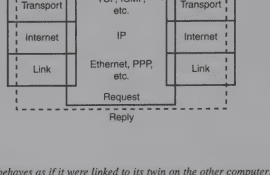

#### 图 2.1

TCP/IP 协议栈的每一层都表现得好像与另一台计算机上的对应层相连；中间的各层用于促进这种通信。

#### 注意

术语 `client` 和 `server` 最清晰地定义为在计算机上运行的特定软件程序。`Netscape Navigator` Web 浏览器就是一个客户端，例如，而 `Apache` 程序则是 Web 页面的服务器。然而，术语 `client` 和 `server` 有时也会应用于整台计算机，如在“服务器今天又宕机了”这样的说法中。（很可能它根本没有运行 Linux！）这只是意味着该计算机的主要功能是运行客户端或服务器软件。你甚至可以在同一台计算机上同时运行这两种类型的程序。在文件和打印机共享的情况下，网络中大多数或全部计算机上都运行客户端和服务器软件，通常被称为点对点网络。相比之下，在客户端/服务器网络中，一台或多台计算机主要运行服务器软件，而其他（数量更多）计算机主要运行客户端软件。本书的很大一部分内容涉及在 Linux 下配置服务器软件，尽管我也包含了配置匹配客户端软件的信息，以便你的 Linux 机器能够参与客户端/服务器和点对点交互。

### 应用层

TCP/IP 协议栈的最上层是应用层。该层由你在客户端端通常交互的用户应用程序组成（如 `Netscape Navigator`、`telnet`、`ftp` 和 Windows Network Neighborhood 文件接口），以及在服务器端为这些客户端提供请求的程序（如 `Apache`、`in.telnetd`、`in.ftpd` 和 `Samba`）。

#### NOTE

在 Linux 中，服务器通常以其客户端对应程序的名称加上 `d` 为名，有时还会在前面加上 `in`。例如，`in.telnetd` 为 `telnet` 客户端提供服务。然而这并非必要。后缀 `d` 指的是该程序作为守护进程运行——一种驻留在后台什么都不做，只是等待特定事件（如特定类型的传入网络活动）的程序。

在任意时刻，任何一台计算机的 TCP/IP 应用层中可能运行着 0、1、2 个或更多程序。例如，你可以用 `Netscape Navigator` 浏览网页，同时使用 `ftp` 下载文件，并使用 `Samba` 接收来自远程主机的打印任务。还有更多客户端和服务器可能正在运行但并未处理输入。因此，你不应将应用层视为单一程序甚至固定的程序集合。相反，它由系统在任意给定时刻恰好运行的客户端和服务器程序组成。


为了与外部世界通信，应用层中运行的客户端程序会向操作系统提出某些请求。有效地，它会创建一条类似发送此类数据的消息并将其传递给操作系统，同时提供一种识别服务器的方式。最终，服务器系统上的对应应用层程序会收到该请求以及客户端的地址。服务器通过发送所请求的数据，或发送一条数据不可用的消息来进行回复。（在某些情况下，服务器无需回复，但这些情况是例外而非规则。在其他情况下，客户端可能会向服务器发送大量数据，例如当 Windows 计算机使用 Windows 网络和 Samba 将文件存储在 Linux 计算机的硬盘上时。）此对话的细节由所涉特定服务的协议决定，当然它们通常比单一请求-回复对复杂得多，往往涉及多次往返传输。

如果你经常使用互联网，你可能习惯于看到 `ftp.redhat.com` 或 `www.oberlin.edu` 之类的互联网地址。这些地址对人类来说易于理解和记忆，但对计算机而言并不理想。计算机最适合处理数字，而互联网的核心使用 32 位数字（称为 IP 地址）来寻址每台计算机。该数字通常表示为用点分隔的四个十进制数字，例如 `192.168.1.1`。应用层程序必须做的事情之一是将人类可读的名称解析为其数字对应项。它通过使用域名系统（DNS）来实现这一点，DNS 是分布在互联网各地的庞大分布式名称数据库。因此，在大多数应用层程序能够做任何事情之前，它们可能需要产生网络流量，仅仅为了查找地址。这类似于写信给密歇根州卡拉马祖的邮局以查找卡拉马祖某个人的地址。幸运的是，TCP/IP 网络通常比投递纸质邮件快得多。也可以缓存或本地存储常用地址，从而减少此类流量的需求。

应用层协议的设计者必须做出的决定之一是，针对某个应用使用哪种 TCP/IP 传输层协议是合适的。不同的传输协议提供不同的功能，而应用层程序的通信手段仅通过传输层协议。

## Transport Layer

传输层中有多个协议可用，但最常用的是三种：

- Transmission Control Protocol (TCP)—这是用于传输大消息的协议，尤其在数据完整到达最重要时。“大”在此上下文中意味着超过几个字节，因此这是用于传输完整数据文件的协议。使用 TCP 的应用包括文件共享、远程打印和网页浏览。TCP 支持将传输分解为多个数据包。由于 TCP 被许多重要的互联网程序使用，其名称是 TCP/IP 协议栈名称中 TCP 部分的来源。

- User Datagram Protocol (UDP)—系统可以使用 UDP 以不太完美的可靠性相互发送少量数据。UDP 消息不能被拆分为多个数据包，这限制了 UDP 的实用性。然而，UDP 的开销远小于 TCP，因此对于某些简单类型的传输是首选。用于确定远程系统 IP 地址的 DNS 系统使用 UDP。

- Internet Control Message Protocol (ICMP)—比 UDP 更简单，ICMP 用于向接收方机器发送固定数量的简单消息之一。如果你使用过 `ping` 命令来确定远程机器及其与你之间的网络是否正常工作，你就发送了 ICMP 数据包，因为 `ping` 只是发送一系列 `ICMP_ECHO_REQUEST` 消息并等待 `ICMP_ECHO_REPLY` 消息返回。

终端用户与传输层的细节隔离开来，即使你在为局域网或互联网配置服务器时，也无需非常关心该层操作的细节。然而，如果你想编写新的应用层程序，你需要了解足够关于传输层的知识以与其接口。这样的细节超出了本书的范围。

通常，某个应用层程序只直接与三个传输层协议之一接口。例如，你不能使用 ftp 通过 ICMP 传输文件。然而，由于大多数应用层程序使用 DNS 进行主机名查找，因此 UDP 协议将间接用于大多数网络访问。

将发往 `192.168.x.x` 地址的数据发送到以太网板，而其他所有数据则通过 PPP 链路发送。

请注意，发送方和接收方计算机不需要使用相同类型的网络硬件。例如，你可以使用 PPP 拨号连接与通过以太网连接的计算机进行通信。在这种情况下，然而，一个或多个中间计算机必须具有两个接口，并且中间机器必须配置为将流量从一个接口路由到另一个接口。该路由器剥离链路层的报头，为数据包放置新的报头，然后将其发送到第二个接口。

路由器模型的一种变体在 IP 伪装中实现。在这种情况下，中间计算机剥离包装中更多的层并篡改返回的 IP 地址，从而隐藏源系统的地址。然后中间计算机监视对该数据包的回复并再次篡改以将数据包发送到源系统。这听起来不诚实吗？在某种意义上是的，但当你可用的 IP 地址数量有限时，这是一种非常有用的技术。例如，你可以使用此技术通过拨号 PPP 连接将小型家庭网络连接到 Internet。然后你就可以使用没有调制解调器的 Mac 浏览网页，仅举一个可能的应用程序。

> **注意**
>
> 32 位 IP 地址将整个互联网上理论上可用的计算机数量限制在约四十亿台。实际上，由于各种原因，限制低于此值，我们正迅速接近当前 IP 地址系统可处理的计算机数量限制。IP 伪装实际上可以增加限制，因为它允许多台计算机共享一个 IP 地址。IP 伪装本质上是对本地 IP 地址限制的本地解决方案。

## 数据封装的结果

这里描述的数据封装的最终结果如 图 2.2 所示，其中描绘了一个典型的数据包。图 2.2 显示了一个通过以太网传输的 ftp 数据包，但其他协议和媒体也会产生类似的分层。

在接收时，TCP/IP 栈的每一层都会剥离分配给它的报头（如果适用，还包括尾部），并使用该报头中的信息将数据传递给栈中适当的下一层。最终，目标应用程序接收到此数据包的核心数据，而没有各种报头。

| Ethernet Header | IP Header | TCP Header | ftp Header | Data | Ethernet Footer |
|-----------------|-----------|------------|------------|------|-----------------|

### 图 2.2

通过 TCP/IP 网络传输的数据会被“包裹”在 TCP/IP 栈每一层的报头中（有时还有尾部）。

## 一个示例：跟踪网页访问

作为前面所有步骤如何工作的示例，让我们跟踪使用 Netscape Navigator 等浏览器访问网页时发生的情况：

1. 你在浏览器中输入网页的统一资源定位符（URL）。例如，你可能会输入 `http://www.midwinter.com/lurk/eplist.html` 以获取电视剧《巴比伦 5 号》的剧集列表。

2. Netscape 调用 Linux 库函数 `gethostbyname`，该函数链接到 DNS。由于名称解析可能像在缓存中查找地址一样简单，也可能像我正在描述的整个网络访问一样复杂，我们就说它发生了，暂且不谈。结果是 Netscape 现在知道了 `www.midwinter.com` 的数字 IP 地址，即 `199.165.129.193`。

3. Netscape 准备一个适当的超文本传输协议（HTTP）请求以请求文件 `/lurk/eplist.html`。请注意，虽然你在一行中输入了地址和文件，但 Netscape 已将其分解为请求的两个独立部分。

4. Netscape 将 HTTP 请求发送到传输层，指定使用 TCP 传输。

5. TCP 在请求上添加自己的报头，并在必要时将其分解为数据包。

6. TCP 将请求发送给网络层供 IP 处理。在这里，地址、标志和更多报头被添加到数据请求中。

7. IP 将请求传递给链路层。

8. 链路层确定请求应发送到哪个网络设备，并为该设备添加适当的格式。假设为了便于说明，请求通过以太网适配器发出。一旦 Linux 以太网驱动程序传输了数据包，它就离开了 Linux TCP/IP 栈。

9. 数据包或数据包通过数量不明的中间主机，每个主机都在不同程度上处理数据包。最终，它到达 `www.midwinter.com` 的链路层。

10. `www.midwinter.com` 的链路层注意到有一条数据包通过其以太网线路（或该系统使用的任何类型的网络）发往它。它抓取该数据包并开始解码；它剥离以太网特定的部分，留下互联网层可以处理的包。

11. 当互联网层接收到数据包时，它会剥离并检查自己的层级内容。如果它注意到该数据包在你的系统上的对应方将其拆分成多部分，它会保留收到的第一部分一段时间，如果有更多部分到达，则将其合并。完成此工作后，它将数据包传递给传输层，更具体地说是 TCP 处理程序。

12. TCP 与互联网层类似，会检查数据包在传输前是否被拆分成碎片，并等待所有碎片到达。全部到齐后，TCP 将其合并，检查目标程序（或更准确地说，目标端口），并将合并后的数据包传递给该程序。

13. 应用层中的接收程序是一个 Web 服务器，例如 Apache。Apache 注意到它刚刚收到一个请求，要求将文件 `/lurk/eplist.html` 发送到你的计算机，并准备执行此操作。

14. 过程现在重复进行，这次将文件 `/lurk/eplist.html` 从 `www.midwinter.com` 传输到你的计算机，具体到 Netscape。


## 15. Netscape 处理该文件
如今大多数网页都包含图形。这些图形并不随原始网页一起提供。相反，网页包含对服务器上另一个文件的引用。因此，对于每个图形图像，整个往返序列都会重复。类似的请求也会发出以获取嵌入式声音、`JavaScript` 等。单页需要多次请求，这就是为什么网页有时会加载部分图形而其他图形不会加载的原因；如果在你的系统接收到一些图像但未接收到其他图像后，互联网上出现某种阻塞，你就会看到不完整的网页。

正如你所见，即使是相当简单的互联网传输也可能需要相当多的步骤才能完成。其他类型的互联网访问也会发生类似的过程，包括向远程打印机打印文件、在远程计算机上运行 `X` 程序等等。其中一些过程可能涉及时间上延长的连接（例如远程运行程序）。对于这些情况，`TCP` 保持连接，这基本上意味着客户端和服务器程序会持续监听彼此的数据包，并在内存中维护信息，例如各自的 `IP` 地址，这样它们就无需继续查找这些信息。

### TCP/IP 的替代方案

尽管 `TCP/IP` 是一组非常常见的网络协议，并且是整个互联网最重要的协议，但它并不是唯一的网络栈。特别是在办公室环境中，其他协议可能非常重要。总体而言，这些其他协议的工作方式与 `TCP/IP` 类似，尽管细节有所不同。

`Linux` 支持其中许多协议，或提供与 `TCP/IP` 结合使用的方法。因为 `TCP/IP` 设计为可以传输任何类型的数据，所以可以将一种协议封装在另一种协议中。例如，你可以在 `TCP/IP` 数据包内传递 `NetBEUI` 数据包。这样做时，你实际上是将一个网络栈置于另一个网络栈之上；第一个栈的链路层充当第二个栈的应用层。 resulting 数据包如图 2.3 所示。当然，要使其工作，双方系统都需要支持这种封装。

| Ethernet Header | IP Header | TCP Header | ftp Header | NetBIOS, AppleTalk, or NetWare Headers | NetBIOS, AppleTalk, or NetWare Data | Ethernet Footer |
|---|---|---|---|---|---|---|
| TCP/IP Data |

#### FIGURE 2.3
当 `TCP/IP` 用于传输次要网络协议的数据包时，`TCP/IP` 数据区不仅携带普通数据，还携带与次要协议相关的报头。

#### UUCP

`UNIX-to-UNIX Copy`（`UUCP`）是一种专门为调制解调器连接设计的网络协议。在互联网变得普遍之前，它被广泛用作传输电子邮件和文件的方式，但今天使用并不广泛。与许多其他协议不同，`UUCP` 不能通过以太网电缆使用。

正如我已经提到的，`TCP/IP` 也可以通过 `PPP` 和 `SLIP` 链路层协议通过调制解调器使用。那么为什么还要使用 `UUCP` 呢？一方面是历史原因——`UUCP` 开发于 1970 年代，远早于 `SLIP` 或 `PPP`。另一方面，`UUCP` 内置了计划传输的支持。例如，假设你在一天中在 `Linux` 计算机上写了几封电子邮件。如果你使用 `PPP`，你可能在完成每封邮件后都连接到你的 `ISP`。使用 `UUCP`，典型的做法是让你的系统将电子邮件保留在队列中并一次性传输，无需监督。这有助于减少电话使用和费用，如果连接是长途的话，特别是因为传输可以在长途费率最低时进行。

今天，当你使用 `UUCP` 传输数据时，交换信息的机器很可能已通过某种基于 `TCP/IP` 的网络连接到 `Internet`。因此，尽管 `UUCP` 链路本身不使用 `TCP/IP`，但迟早它会被 `TCP/IP` 处理。你无需关心这种转换的细节；我提到这一点只是为了指出 `UUCP` 网络和整个 `Internet` 并不一定完全分离。你可以通过 `UUCP` 链路发送电子邮件到 `Internet` 上的任何站点。同样，`UUCP` 也可以与本地基于 `TCP/IP` 的网络结合使用。你可以使用 `UUCP` 连接作为本地网络中几台机器与外界之间的链路。

如果你对 `Internet` 访问的需求不是很紧急（例如，你只需要偶尔发送或接收电子邮件，并且不在意几小时的投递延迟），你可以考虑使用 `UUCP` 链路进行访问。然而，大多数 `ISP` 都不支持 `UUCP`，因此你需要货比三家并询问此事。另外，请注意存在不同的 `UUCP` 变种，其中在 `Linux` 上最常见的是称为 `Taylor UUCP`。你需要确保你的 `ISP` 支持这个版本的 `UUCP`。

有关 `UUCP` 的更多信息，请参阅 `UUCP HOWTO`，它随大多数 `Linux` 发行版提供，也在本书附带的 `CD-ROM` 上，位于 `doc/HOWTO` 目录中。

### IPX

`Internet Packet Exchange`（`IPX`）是 `Novell` 在其 `NetWare` 产品中使用的网络协议。从技术上讲，`IPX` 在 `TCP/IP` 中大致相当于 `IP`；附加协议，例如 `Sequenced Packet Exchange`（`SPX`；相当于 `TCP`）完善了 `Novell` 网络栈。`NetWare Core Protocol`（`NCP`）是 `NetWare` 的文件共享机制。它是 `Novell` 网络栈应用层等价物中的主要工具之一。

如果你希望你的 `Linux` 机器能够与 `Novell NetWare` 客户端或服务器交互，你需要在内核中至少包含对 `IPX` 的支持，并且可能还需要 `SPX` 和/或 `NCP`。`IPX` 和 `SPX` 选项位于内核配置的 `Networking Options` 部分，而 `NCP` 列在 `Network File Systems` 区域。在 `2.2.x` 系列内核中，`SPX` 是实验性的，因此除非你选择包含实验性内核功能，否则它不会作为可见选项出现。

由于 `Novell` 的网络系统和 `NetBIOS` 可以在大多数相同情况下使用，本书不涵盖 `IPX` 及其相关技术。如果你想了解更多关于此主题的信息，可以阅读 `IPX HOWTO`，它包含在大多数 `Linux` 发行版中，也在本书 `CD-ROM` 的 `doc/HOWTO` 目录中。

### NetBIOS and NetBEUI

在 1980 年代，在 `Internet` 或 `TCP/IP` 网络在企业中普及之前，`IBM` 希望向企业销售小型局域网。它选择设计自己的网络协议，称为 `Network Basic Input/Output System`（`NetBIOS`）。微软最终从 `IBM` 获得了 `NetBIOS` 的许可，现在 `NetBIOS` 是 `Windows` 原生文件和打印机共享协议的基础。`NetBIOS` 的扩展称为 `NetBIOS Extended User Interface`（`NetBEUI`），用于在网络上封装 `NetBIOS` 数据。

`NetBIOS` 网络的组织方式与 `TCP/IP` 网络截然不同。与 `TCP/IP` 的 32 位数字 `IP` 地址、子网和 `DNS` 系统不同，`NetBIOS` 和 `NetBEUI` 以两种方式组织网络。首先，网络被划分为一个或多个工作组，每个工作组都有一个唯一名称。例如，一所大学可能为每个部门设置工作组，并使用 `PSYCH`、`RUSSIAN` 和 `MATH` 等合适名称。在每个工作组内，每台计算机都有自己的名称（也许以计算机用户命名，例如 `JAMES` 和 `WUNDT`）。计算机使用名称相互通信，并且它们通过定期向整个工作组宣布名称来了解彼此的名称。

从表面上看，这种组织方式与 `TCP/IP` 的组织方式相似，至少从用户角度来看是如此。然而，必须认识到，`NetBIOS` 和 `NetBEUI` 使用人类可读的名称来标识计算机（而不是像 `TCP/IP` 的 `IP` 地址那样的数字），并且没有为工作组之上的组织层提供规定。

`NetBIOS` 和 `NetBEUI` 系统扩展性不佳；随着网络规模增大，它们会产生比 `TCP/IP` 多得多的流量。`NetBIOS/NetBEUI` 的命名和有限的组织功能也限制了其可扩展性。此外，随着 `Internet` 的出现，微软发现将网络重点转向 `TCP/IP` 是可取的。然而，出于遗留原因，完全放弃 `NetBIOS` 是不可取的。解决这一矛盾需求的一种方法是经由 `TCP/IP` 传输 `NetBIOS`，微软和 `IBM` 都选择支持这种方法。`Linux` 不支持“原始”`NetBIOS`，但它确实支持封装在 `TCP/IP` 中的 `NetBIOS`。这就是 `Samba` 的基础，`Samba` 是 `Linux` 与 `Windows` 文件共享的方法。

#### NOTE
计算机的 `NetBIOS/NetBEUI` 名称不必与该计算机的 `Internet` 标识符有任何相似之处。例如，`Internet` 上名为 `frank.nephridior.com` 的计算机在 `NetBIOS` 网络上可以称为 `EAGER`。然而，通常使用 `Internet` 机器名（本例中为 `frank`）作为计算机的 `NetBIOS` 名称会更简单。

`NetBIOS` 被 `Windows for Workgroups 3.1`、`Windows 95`、`Windows 98`、`Windows NT`、`Windows 2000` 以及 `OS/2` 使用。`DOS` 上也有 `NetBIOS` 工具可用。因此在 `PC` 世界中相当常见，尽管它越来越多地被用作 `TCP/IP` 之上的一个层。

### AppleTalk


像 Novell、IBM 和 Microsoft 一样，在互联网尚未渗透到大多数企业之前，Apple 也开发了自己的网络协议。Apple 将这些协议称为 AppleTalk，最初该术语既指网络协议，也指传输它们的硬件。然而，最终很明显，这种对 AppleTalk 术语的双重使用令人困惑，因此 Apple 开始仅将该术语用于指代网络协议。硬件随后被称为 LocalTalk。Apple 在其直到 1998 年生产的绝大多数计算机中都包含了 LocalTalk 硬件。

然而，即使在 1998 年之前，Apple 也在其计算机中包含了以太网，并且可以使用以太网作为 AppleTalk 的底层硬件。以这种方式使用时（有时称为 EtherTalk），AppleTalk 直接与以太网硬件通信。自 MacOS 7.5.2 起，Mac 也能够使用 TCP/IP 传输 AppleTalk。这种能力来自 Mac Open Transport 系统扩展，其结果是 AppleTalk 网络速度大幅提升。在许多方面，这两种传输 AppleTalk 的方法与 NetBIOS 和 NetBIOS over TCP/IP 相似，尽管细节差异很大，并且 Windows 和 Mac 协议彼此不兼容。

另一方面，Linux 与 NetBIOS 和 AppleTalk 兼容（或可以使其兼容）。要在 Linux 中使用 AppleTalk，您需要安装 Netatalk 包，它支持原始 AppleTalk。Netatalk 已被修改为可与 Open Transport 风格的 AppleTalk over TCP/IP 一起工作，该修改后的包被称为 Netatalk+asun，以补丁的主要创建者兼 Netatalk 当前维护者 Adrian Sun 命名。这些 Netatalk 包在 Linux 中提供 AppleTalk 文件服务器支持，但不提供客户端支持。如果您希望 Linux 计算机作为 AppleTalk 文件共享客户端运行，您需要使用 afpfs 包，该包目前处于 alpha 级别，因此不可靠。Netatalk 确实包含软件，可让 Linux 共享通过 AppleTalk 网络连接的打印机。

与 NetBIOS/NetBEUI 一样，AppleTalk 将网络划分为组（在 AppleTalk 中称为区域）和单台计算机。AppleTalk 协议包括一种自动为每台计算机分配唯一标识符的方法，因此您无需担心 IP 地址或其等价物，除非使用 AppleTalk over TCP/IP。计算机的 AppleTalk 名称与其 Internet 名称可能几乎没有相似之处，尽管与 NetBIOS 一样，出于简单起见，您可能希望将两者同步。

AppleTalk 在 Macintosh 网络之外并未流行起来，因此您很可能只有在想要为一台或多台 Mac 提供文件或打印服务时才需要使用 Netatalk。BeOS 确实用 AppleTalk 进行网络打印，因此您可能希望安装 Netatalk 以与 BeOS 计算机共享打印机。

### 混合协议

通常，可以在一台计算机或同一网络介质上混合使用两种或多种网络协议。例如，您可以在同一根以太网电缆上运行原始 NetBIOS、原始 AppleTalk 和 TCP/IP。然而，有时 Windows 计算机如果可用的选项太多会感到困惑。例如，在 Windows 中安装冗余网络协议有时会导致它无法看到 Linux Samba 服务器。因此，最好在任何给定网络上坚持使用尽可能少的协议。特别是，您应该使用 NetBIOS over TCP/IP 而不是原始 NetBIOS。将 Linux 配置为理解未使用的协议通常不会造成问题，但会消耗您可能更愿意用于其他功能的内存。

当然，在同一网络上使用 TCP/IP 堆栈更高层的多个协议并没有什么问题。例如，您可以在同一网络上运行 Web 服务器、NFS 服务器、Samba 服务器和邮件服务器，甚至可以从同一台计算机运行。您也可以在运行服务器的同一台计算机上混合使用 TCP/IP 客户端，并使用 Netscape 浏览网页，使用 Samba 打印到 Windows 主机打印机，并使用 ftp 下载文件。在一台计算机上运行如此多网络程序的主要危险是，您可能会产生如此多的进出该计算机的流量，以至于压倒您的网络硬件。大量网络流量并不是本身运行多个网络堆栈的结果，而是传输大量数据的结果。如果在运行 Netatalk、Samba 和 NFS 服务器时网络变慢，将机器从一种协议转换为另一种协议可能不会有所帮助。

如果发现网络变慢，您应该要么升级到更快的网络，要么使用路由器将网络划分为两个或多个段，并尽可能隔离这些段。如果您的网络很复杂，并且不确定在哪里分割，您可能希望查看网络诊断工具。Linux 发行版附带了一些此类工具，例如 `netstat` 命令，它列出打开的连接。您还可以找到其他工具，例如 `netwatch`，它提供网络段流量的实时显示。

### 总结

TCP/IP 堆栈是描述 Linux 或任何其他使用 TCP/IP 进行网络的 OS 中网络功能的一种方式。堆栈将网络操作分为四层，任何网络程序都在堆栈中的一层上运行。我们作为终端用户和网络管理员最感兴趣的程序工作在应用层，但其他层同样重要。

尽管 TCP/IP 是 Linux 中占主导地位的网络模型，并在大多数网络环境中日益占据主导地位，但仍存在替代方案。这些替代方案大多比 TCP/IP 更有限或更专业，但 Linux 可以与其中许多方案协同工作。此外，通常可以将其中一种协议封装在 TCP/IP 中，以更广泛地使用替代协议或提高其速度。

### 网络服务

### 第 3 章

# 本章内容

- 端口和套接字 56
- 客户端/服务器架构 58
- 理解 Linux 守护进程 62
- 可用服务的概述 67
- 总结 77

本书主要介绍特定类型的网络服务。那么这到底是什么意思呢？与计算机相关的所有事物一样，网络服务必须被非常精确地定义，并且所使用的定义或协议因服务而异。服务的示例包括但不限于

- 文件传输
- 远程打印
- 远程登录
- 网页浏览
- 邮件传输
- 新闻传输
- IP 路由

这些主题将在本章后面以及本书其余部分中更详细地介绍。然而，要理解具体细节，首先有必要了解底层操作系统机制。Linux 处理这些机制的方式与商业 UNIX 系统类似。

#### 端口和套接字

计算机如何区分一个 TCP/IP 连接与另一个连接？例如，假设你有一个由两台计算机组成的网络，机器名为 birch 和 gingko。假设 birch 上的用户启动了与 gingko 的 FTP 连接以传输文件。在该连接仍打开的情况下，同一用户或另一用户开始 Telnet 连接以读取电子邮件。现在 birch 和 gingko 之间存在两个打开的连接，因此当 gingko 从 birch 收到一个 TCP/IP 数据包时，gingko 不能自动将其处理为 FTP 或 Telnet；它必须有某种方式知道将数据包发送给哪个进程。事情进一步复杂化的是，考虑如果 birch 上的用户再次打开一个到 gingko 的第二个 FTP 会话会发生什么。现在，仅知道给定数据包包含哪种类型的数据是不够的；两台计算机都需要保持两个连接的分离。这就是相关特性端口和套接字所解决的问题。

#### 端口

端口与此问题的解决方案最为直接相关。TCP/IP 支持大量独立的虚拟端口的存在，每个端口都连接到相同的网络接口。你可以将端口想象成企业用来将电话转接到个人办公桌的类似分机号码。在分机号码的情况下，多个电话连接到同一个主电话号码，办公电话系统在来电者拨打分机号码时将呼叫定向到正确的办公桌。Linux（或运行服务器应用程序的任何操作系统）将某些服务器程序分配给特定端口。当“呼叫”通过给定端口进来时，Linux 可以将数据传递给分配给该端口的程序。

常见的服务器程序被分配特定的端口号。例如，FTP 使用端口号 21，Telnet 使用 23。这种约定使你无需知道端口号即可使用这些协议——你使用的应用程序程序知道通常的端口号分配，并可以透明地添加它。在某些情况下，你可以显式指定端口号，通常通过在机器名称后加冒号附加它，如 `http://gingko.biloba.com:98`，这尝试在端口 98 而非通常的 80 端口上打开到 `gingko.biloba.com` 的 HTTP（WWW）连接。（Red Hat 的 `linuxconf` 实用程序可以配置为允许通过使用端口 98 的 Web 浏览器进行系统配置。）

#### NOTE

文件 `/etc/services` 包含在特定端口上通常找到的服务列表。此文件中的条目并不一定意味着你的 Linux 计算机已配置为接受该连接；它只是列出与端口关联的名称，以便各种实用程序可以显示该名称或将其作为输入接受，以代替端口号。


同样，传出连接在客户端系统上也会获得端口号，因此当你打开一个 `FTP` 连接（例如）时，客户端机器会从特定端口建立连接。当客户端机器建立此连接时，它会在链接的初始协商中包含自己的端口号，以便服务器系统可以用适当的端口号返回数据包，以确保原始应用程序收到回复。这一事实允许从一台机器进行多个连接。如果你在一台名为 `birch` 的计算机上打开一个到 `gingko` 的 `FTP` 连接和另一个到 `larch` 的连接，这两个机器的返回数据将通过两个不同的端口传入，使得操作系统很容易保持两者正确分离。

那么，服务器如何保持数据流的分离呢？如果 `gingko` 收到两个 `FTP` 连接请求，都指向端口 `21`，它如何保持请求的一致并知道如何定向回复？服务器通过记住原始请求的 IP 地址和端口来实现这一点。图 3.1 说明了这些关系。请注意，`gingko` 必须记录每个其 `FTP` 服务器会话所需的客户端和客户端端口。实际上，`birch` 和 `larch` 也维护此信息，但使用唯一的端口号进行传出连接确实在某种程度上简化了问题。

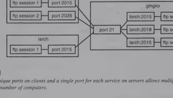

### FIGURE 3.1

客户端使用唯一端口，而服务器为每项服务使用单个端口，这使得任意数量的计算机之间可以建立多重连接。

该描述忽略了实践中情况的一个重要方面：`TCP` 和 `UDP` 数据包有各自独立的端口（第 44 页）。如第 2 章所述，`TCP` 是许多 `TCP/IP` 服务使用的传输层协议。`UDP` 是一种较为简单的传输层协议。`TCP` 和 `UDP` 都需要使用端口。由于 `TCP/IP` 协议栈可以轻松区分 `TCP` 与 `UDP` 数据包，因此它对两者使用相同的编号。在许多情况下，某个编号会被分配给一个应用的 `TCP` 和 `UDP` 端口，即使该应用只使用其中一种协议。在其他情况下，不同的应用会使用相同的编号端口，一个用于 `TCP`，另一个用于 `UDP`。例如，端口 `513` 被分配给 `UNIX/Linux` 的 `TCP` 登录协议，但被分配给 `UDP` 的 `who` 程序。

### Sockets

在内部，`Linux` 内核期望从不同类型的连接中获得特定类型的数据。这种期望与 `TCP/IP` 协议栈传输层中使用的不同协议类型类似。每当 `Linux` 应用与某个端口建立连接时，它必须通过指定该连接的套接字类型来注册其期望。在某些情况下，这些套接字类型与 `TCP/IP` 的 `TCP` 和 `UDP` 协议密切对应，但还有额外的选项。

### The Client/Server Architecture

第 2 章“理解 `TCP/IP`”介绍了客户端和服务器的概念。由于这些概念对于理解典型网络至关重要，我在此对其进行了更详细的阐述。

广义上讲，客户端会发起对服务器提供的服务的请求。服务器随后提供这些服务（或因资源限制、身份验证失败或其他原因而拒绝提供）。在客户端与服务器之间的任何一次交互中，数据通常会双向传输，并且根据服务的具体性质，一方传输的数据可能多于另一方。例如，与 Web 服务器的典型交互会产生从服务器到客户端的更多流量；而远程打印则涉及从客户端到服务器的更多数据。

在讨论客户端和服务器时需要记住的一个重要点是，这些术语在应用于单个程序时最有意义。虽然一台计算机可能只运行客户端或只运行服务器，但许多计算机同时运行客户端和服务器程序。稍后会对此进行更多介绍。

### Roles of the Client

通常，客户端应用是一个交互式用户程序，例如 `Netscape Navigator`、`ncftp` 或 `Knews` Usenet 新闻阅读器。因此，客户端程序通常会在人类操作员的请求下发起数据传输。但并非总是如此。例如，可以配置许多邮件阅读器定期检查远程邮件服务器，并自动下载邮件或提醒用户有邮件等待。

与本书特别相关的是，诸如 `Windows` 网络邻居之类的文件共享系统包含客户端元素。当你在 `Windows` 中打开网络邻居窗口并使用它在运行 `Samba` 的远程 `Linux` 机器上打开文件时，你正在使用内置于 `Windows` 的客户端程序和运行在 `Linux` 上的服务器。由于这些操作与客户端操作系统紧密集成，很容易忽视这是一种与 `FTP` 客户端和服务器类似的客户端/服务器关系，但客户端/服务器传输描述了正在发生的事情。事实上，本章前面我已在多个示例中使用了 `FTP`。`Windows` 文件共享操作同样可以用于这些示例，尽管这会改变一些细节。

### Roles of the Server

与客户端相比，服务器通常是驻留在服务器机器上并等待通过特定端口传入输入的程序。配置完成后，它们几乎无需人工干预即可运行。这意味着服务器程序必须极其健壮——一个崩溃的服务器程序可能会使服务器计算机对世界其他部分而言似乎已死亡，至少就该服务而言是如此。（请注意，一个服务器程序崩溃可能会留下其他程序完好无损，因此计算机可能对某些查询做出响应，而对其他查询不响应。）

典型的 `Linux` 发行版已设置好提供相当多的标准 `UNIX` 风格服务。配置 `Linux` 系统的任务之一包括微调这些配置——为默认未包含的任何服务设置配置并禁用未使用的服务。从安全角度来看，最后一点尤其重要，如第 24 章“维护安全系统”中所述。每个未必要的运行服务都是一种潜在的途径

要让黑客获得访问你计算机的权限。当然，大多数服务在没有密码等身份验证的情况下不会允许对系统进行有意义的访问，因此黑客通常无法成功入侵系统。但是，如果他们知道服务器软件中的一个漏洞，或者通过某种方式获得了有效的用户名和密码，他们就可以通过服务访问你的系统，无论你或系统的合法用户是否实际使用该服务。

判断连接的哪一端是客户端、哪一端是服务器通常很容易：你或他人在日常使用中直接交互最多的程序就是客户端。然而，有一个特殊情况值得特别提及：`X` 服务器。`Linux` 的图形用户界面（GUI）环境是 `X Window System`，简称 `X`。`X` 的一大优点和缺点是它是一个可网络化的 GUI。也就是说，你可以配置 `X`，使得你可以在另一台物理机器上使用一台计算机，包括运行 GUI 程序——甚至是半个地球之外的机器。（这样做的细节在第 19 章“使用 `VNC` 或 `X` 服务器远程运行 `X` 程序”中有所介绍。）这对于 `UNIX` 或 `Linux` 这样的可网络化、多用户系统来说非常棒。与 Microsoft `Windows` 中找到的单用户 GUI 相比，它会造成一定的速度下降。令人困惑的是，`X` 服务器运行在离你本地的机器上。例如，如果你身在东京，使用计算机 `birch.erplab.jp`，并且登录到费城的 `Linux` 计算机 `eeg.upenn.edu`，`X` 服务器将运行在 `birch` 上，而不是 `eeg` 上。这种命名的原因是 `eeg`（以及间接地你）正在请求位于 `birch` 上的服务——即使用 `birch` 上的显示器、键盘和鼠标。服务器必然在你面前这一事实，而在大多数情况下离你最近的是客户端，这一点无关紧要。

#### NOTE

`X` 服务器可以作为在任何操作系统下运行的程序存在。`Linux` 当然包含一个 `X` 服务器，但你也可以为 `Windows`、`MacOS`、`OS/2` 和其他操作系统获取它们。还存在一类计算机，其功能仅限于作为 `X` 服务器。这些机器被称为 `X` 终端，它们由一台（通常非常大）的显示器、键盘、鼠标组成，通常还有一个小盒子，包含 CPU、一些 ROM、一些 RAM 和一个以太网连接器。`X` 终端在企业和学术环境中很常见，在这些环境中，一台大型 `UNIX` 主机被许多人使用。如果你要在这样的环境中设置一台 `Linux` 计算机，你可能能够使用此网络上已有的 `X` 终端来访问 `Linux`。

当你在实际使用的计算机上运行 `X` 时，`X` 仍然使用网络协议运行；只是你的 `X` 应用程序连接到在本地运行的 `X` 服务器。这类似于使用 `ftp` 从一台计算机上的一个目录向另一个目录传输文件。

然而，当使用 Virtual Network Computing（`VNC`）查看器而不是 `X` 的内置网络功能时，客户端和服务器标签会被颠倒（因此又与大多数人的直觉预期保持一致）。在这种情况下，服务器运行在你打算使用的系统上，而客户端应用程序访问你附近系统上的服务器。从用户角度来看，结果非常相似，这就是为什么我在第 19 章中同时介绍了 `X` 服务器和 `VNC`。

### Using One Machine as Both Client and Server


正如我前面提到的，在一台计算机上同时运行客户端和服务器应用程序是很常见的。例如，你可能会将一台 Linux 计算机既用作 Mac 或 Windows 机器网络的打印服务器，又用作运行 Web 浏览器的桌面系统。如果这种做法在给定内联网的许多或所有机器上都很常见，整个网络通常被称为客户端/服务器网络（p. 41）。在小型网络上使用客户端/服务器架构通常很方便，但随着网络规模的增长，管理和使用变得越来越繁琐。例如，考虑两个同事想要共享文件的情况，以便他们可以轻松地在彼此之间传递论文草稿、电子表格等。每位用户都可以配置自己的计算机以允许对方访问，就完成了。将第三台计算机添加到此网络并不太困难；你只需将其配置为读取两台现有计算机上的文件，并将它们配置为从新计算机读取文件。添加第四台比第三台稍微困难一点，第五台比第四台稍微困难一点，以此类推。到你拥有比如一百台计算机时，网络变得相当繁琐，因为用户可能需要在几十台机器中寻找文件。此外，当一台机器被添加、移除或更改时，重新配置整个网络也可能非常繁琐。

因此，大多数管理员更喜欢为中型和大型网络使用客户端/服务器架构。在这种配置中，一台或少数几台计算机为许多计算机提供服务。这集中了管理任务，如果服务器上的文件结构设计得当，也能让用户生活更轻松。使用 Linux 服务器还可以帮助集成多平台网络。例如，你可以向运行 MacOS、DOS、Windows、OS/2、Linux 或各种 UNIX 的计算机提供相同的服务。

尽管如此，有时即使在中等规模或大型网络中，在同一台机器上同时运行客户端和服务器应用程序也是可取的。例如，一种网络备份方法将备份设备放在服务器上，服务器必须使用客户端软件挂载每个远程文件系统以进行备份。你也可能使用一台同时具有客户端和服务器软件的系统作为两个网络之间的“桥”。例如，你可以通过使用 Linux 作为中介，允许 Macintosh 客户端打印到连接到 Windows 机器的打印机。

在单台计算机上同时运行客户端和服务器时，并没有太多特别需要考虑的地方。这两种类型的程序通常不会互相造成麻烦。在某些情况下，例如用于 Windows 网络集成的 Samba，客户端和服务器都是同一软件包的一部分。在其他情况下，例如用于 Macintosh 集成的 afps 和 Netatalk，它们是分开的。

## 理解 Linux 守护进程

在本章前面，我提到过服务器程序从网络上的客户端程序接收输入。为了实现这一点，要么服务器程序必须正在运行，要么必须有另一个程序在适当时启动服务器。那些在后台运行等待输入的程序被称为守护进程，该术语源自希腊语中的“中介”。守护进程一词几乎与以提供网络服务的软件程序意义上的服务器同义，尽管服务器不一定总是作为后台任务运行，而且少数守护进程只服务于本地需求。守护进程的名称通常以 d 结尾，例如 `smbd` 或 `ftpd`。（我在第 2 章第 42 页简要提到了守护进程。）

## 理解后台处理

UNIX 从一开始就是作为多任务操作系统设计的，意味着它可以同时运行多个程序。事实上，在单 CPU 系统上一次只能运行一个程序；但操作系统在程序之间切换执行的速度非常快，以至于从人类的时间尺度来看，程序似乎在同时运行。作为 UNIX 的克隆，Linux 也是一个多任务操作系统。你可能已经习惯于处理多个程序，尤其是在 Microsoft Windows 或 X Window 系统等图形用户界面环境中，你可以点击一个程序的窗口来与该程序交互，而让其他程序继续运行。图 3.2 用在 Linux 系统上 X 下运行的多个程序的屏幕截图说明了这一点。

多任务处理并不仅限于图形用户界面环境。然而，事实上，UNIX 系统在图形用户界面发明之前就已经是多任务处理的佼佼者了！与图形用户界面环境一样，在多任务处理非图形用户界面程序时，操作系统实际上在程序之间切换执行的速度快到人类无法察觉。在多任务处理非图形用户界面程序时，主要的困难在于用户界面。任何给定时间只能有一个程序接收来自用户的输入——这一事实对图形用户界面程序也是如此。然而，在图形用户界面程序之间切换通常比在文本程序之间切换更简单。因为一次只能有一个文本程序获得用户的全部注意力，所以该程序被称为前台程序，而其他程序则 relegated 到后台。

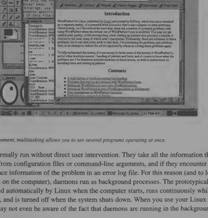

#### FIGURE 3.2

在图形用户界面环境中，多任务处理让你能够同时看到多个程序在运行。

守护进程通常在没有直接用户干预的情况下运行。它们从配置文件或命令行参数中获取运行所需的所有信息，如果遇到问题，就会将问题信息写入错误日志文件。出于这个原因（以及让你能在计算机上做真正的工作），守护进程作为后台进程运行。典型的守护进程由 Linux 在计算机启动时自动启动，在系统运行时持续运行，并在系统关闭时停止。当你使用 Linux 计算机时，你可能甚至意识不到后台正在运行守护进程。

在大多数情况下，守护进程都处于空闲状态；它们只有在它们监视的活动发生时才需要工作，例如特定端口的网络访问。正因如此，守护进程在空闲时消耗的 CPU 时间很少（Linux 知道在不需要时不分配 CPU 时间）。然而，守护进程即使在空闲时也会占用一些内存——这一事实导致了 `inetd` 的开发。

### inetd： “超级服务器”

与其让数十个守护进程闲置等待网络活动，Linux 使用一个单一的守护进程来为许多其他守护进程监视，并在必要时启动各个守护进程。负责监视所有这些的“超级服务器”被称为 `inetd`。当 `inetd` 发现网络活动，例如 intended for `ftpd` 时，`inetd`

launches `ftpd` with appropriate parameters to let `ftpd` handle that one session and then quit. (Actually, `inetd` often uses yet another intermediary program to launch the daemon that does the real work.)

#### NOTE

Many Linux distributions ship with versions of daemons intended to be called by `inetd`. These daemons usually have filenames beginning with `in.`, as in `in.ftpd`.

The use of `inetd` allows you to configure which daemons you run by editing a single file—`inetd`'s configuration file, `/etc/inetd.conf`. Each line in `inetd.conf` identifies a single network service to be handled by `inetd`. For instance, here's a line that configures ftp services:

```
ftp stream tcp nowait root /usr/sbin/tcpd /usr/sbin/in.ftpd
```

In the order they appear in the line, the meanings of these fields are

1. Service name (`ftp`)—This is the name of the service. In Linux, services are associated with individual ports in `/etc/services`. Rather than list port numbers in `inetd.conf`, service names appear.

2. Socket type (`stream`)—The type of socket, as discussed earlier in this chapter, is specified here.

3. Protocol (`tcp`)—The protocol is the TCP/IP Internet layer protocol (generally `tcp` or `udp`).

4. Wait/Nowait (`nowait`)—This field specifies how `inetd` handles multiple connection requests.

5. User (`root`)—The username under whose authority the service runs. This is generally `root` or `nobody`, but in some cases you can specify other users to improve system security.


### 6. Server program (`/usr/sbin/tcpd`)
在许多情况下，服务器程序是`/usr/sbin/tcpd`。该程序随后将实际处理服务的程序名称作为参数。如果服务器程序列为 internal，则是 inetd 内部处理的简单服务。

#### Note
> `tcpd`是 TCP Wrappers 包的一部分。该包可以通过筛选连接并根据各种标准允许或拒绝连接来帮助你保护系统。我在第 24 章“Maintaining a Secure System”中描述了这一点以及实现类似结果的其他包。

### 7. Server program parameters (`/usr/sbin/in.ftpd`)
如果服务器程序需要参数，它们位于行尾。当服务器程序为`/usr/sbin/tcpd`时，第一个参数是实际处理服务请求的程序的名称。

#### Tip
> 安装任何连接到 Internet 的 Linux 系统后，你应该做的第一件事之一就是禁用未使用的服务。你可以通过在`/etc/inetd.conf`中配置服务的行开头放置井号（`#`）来实现。默认情况下，大多数 Linux 发行版出于安全目的已以这种方式注释掉了许多服务，但你应该对这些选择进行微调。事实上，你可以注释掉`/etc/inetd.conf`中的所有服务，除了标识为 internal 的服务——你的计算机仍会启动并运行。你最可能想要的服务包括 `telnet`（用于远程登录）、`ftp`（用于远程文件访问）以及 `linuxconf`（在 Red Hat 和 Mandrake 系统上，用于远程系统配置）。你可能想使用 `ssh` 而不是 `telnet` 和 `ftp` 以获得更高的安全性，如第 18 章“Logging on Remotely Using ssh or telnet”中所述。我在相关章节中讨论了为文件和打印机共享设置守护进程。

并非所有守护进程都通过 `inetd` 运行。有些工作得更好如果单独运行，并且已配置为这样运行。例如常见的 `lpd` 处理本地打印作业，并且不是由 `inetd` 启动的守护进程，尽管它是一个守护进程。即使守护进程可以通过 `inetd` 运行，你也可能想独立运行它，因为 `inetd` 的处理需要少量时间。如果守护进程响应大量请求，将其放在 `inetd.conf` 中除了能够使用 TCP Wrappers “wrap” 守护进程的好处外几乎没有优势，而处理守护进程工作所需的额外时间可能是一个缺点。

## Starting and Stopping Daemons
你偶尔可能想要在不重启计算机的情况下启动或停止一个守护进程。你可能想这样做以更改守护进程的配置，使其行为不同，或简单地添加或删除服务。幸运的是，在 Linux 中这很容易。

### 识别正在运行的守护进程
如果你想停止或重新配置一个正在运行的守护进程，第一步是找到该守护进程的进程识别号（PID）。此信息最容易通过使用 `ps` 命令结合 `grep` 来获得。例如，假设我想找到 `smbd`（Samba）程序的 PID。我可以在 Linux 命令提示符下输入 `ps ax | grep smbd`，系统会回复类似这样的内容：

```
653 ? S 0:00 [smbd]
16017 pts/9 S 0:00 grep smbd -
```

第二行是用于获取输出本身的 `grep` 命令，可以忽略。第一行列出了 `smbd` 程序。该行的开头是 PID——本例中为 `653`。你需要使用这个号码来在停止它时引用该程序。

如果你不记得守护进程的确切名称，可以使用你记得的任何部分，或者完全省略命令中的 `grep` 部分（即只输入 `ps ax`）。这样你屏幕上看到的条目会增多，使得更难找到你想要停止或重启的程序。

对于由 `inetd` 调用的守护进程，你可能需要修改 `/etc/inetd.conf` 并重启 `inetd`，而不是直接启动、停止或重启目标守护进程。如果此类守护进程当前正在工作（例如，如果 `smbd` 是从 `inetd` 启动的，并且 Windows 机器仍在访问 Linux 共享），可能有必要直接杀死该守护进程，同时修改 `/etc/inetd.conf`。 （停止正在运行的守护进程会断开任何正在使用它的人的连接。）

### 停止守护进程
你使用 Linux `kill` 命令来停止守护进程（或其他任何程序）。例如，要停止前面识别的 `smbd` 守护进程，你会输入 `kill 653`。有时程序不会以这种方式停止，但添加 `-9` 参数放在 PID 之前通常可以解决问题，如 `kill -9 653`。你应该重复 `ps` 命令以确保 `kill` 命令已生效；如果生效，守护进程将不会列在输出中。

如果你只是想消除一个守护进程，可以在此停止（除非你想防止它在重启计算机时启动，在这种情况下你需要修改 `/etc/inetd.conf`、`/etc/rc.d/rc.local` 或其他自动启动它的文件）。如果你想修改守护进程的行为，可以使用修改后的参数重新启动它，或修改其配置文件。

### 启动守护进程
你可以通过在命令提示符下输入其名称来启动守护进程。你可能需要包含可执行文件的完整路径，例如 `/usr/sbin/smbd` 来启动 `smbd`。与其他程序一样，守护进程通常接受参数来修改其行为，你可以包含所需的任何参数。大多数守护进程与大多数用户程序不同，在启动后会立即将 shell 控制权交还给你，因此你通常不需要在命令行末尾加上 `&`。

如果你想启动一个通过 `/etc/inetd.conf` 启动的守护进程，可以通过将其添加到该文件然后停止并重启 `inetd` 来实现。

一旦你重启了守护进程，其 PID 将会不同，因此如果你想再次杀死它，你需要再次使用 `ps` 来找到新的 PID。

### 重新配置正在运行的守护进程


停止并重启守护进程可能很麻烦。幸运的是，如果你想这样做，有一种更简单的方法来重新配置许多守护进程。假设你发现 `/etc/inetd.conf` 配置为支持 FTP 服务，但你不想要这些。你可以通过编辑 `/etc/inetd.conf`，如前所述，然后使用带有 `-s SIGHUP` 参数的 `kill` 来告诉 `inetd` 立即重启来纠正这种情况。例如，如果 `inetd` 的 PID 为 15953，你可以输入：

```
kill -s SIGHUP 15953
```

`inetd` 程序随后重新读取其配置文件，现在 FTP 服务将无法工作。你也可以以这种方式添加服务。更重要的是，进程保持相同的 PID，因此如果你想进行另一次重新配置，就不需要使用 `ps` 来定位新的 PID。

`-s SIGHUP` 参数并不适用于所有守护进程，因此有时你必须杀死守护进程并重新启动它。

## 可用服务的概览

Linux 是一个极其灵活的服务器操作系统。“开箱即用”时，它有相当多的服务可用，要么立即启用，要么已禁用但只需对 `/etc/inetd.conf` 或其他配置文件进行少量更改即可启用。通过从网络或 Linux CD 安装开源服务器，可以轻松添加更多服务。

以下绝不是可用 Linux 服务的完整列表，但列出了最常用的服务。然而，本书并未涵盖所有这些服务，因此你可能需要在其他地方查找有关其中一些服务的更多信息。

### 使用 ftp 进行远程文件访问

文件传输协议（FTP）是互联网上最受欢迎的协议之一。顾名思义，它用于从一台计算机向另一台计算机传输文件。在其最基本的形式中，FTP 提供远程系统文件的文本模式视图（图 3.3），但也有 GUI 前端可让你通过单击鼠标获取和放置文件（见图 3.4）。此外，Web 浏览器也可以使用 FTP 下载文件。

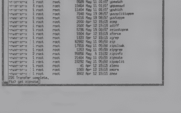

#### FIGURE 3.3

Although it's shown here in an nxterm window, basic ftp can be used from a textual UNIX or Linux login, or even from MS-DOS.

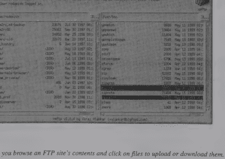

#### FIGURE 3.4

GUI FTP programs let you browse an FTP site's contents and click on files to upload or download them.

No matter what interface is used on the client end, the FTP server configuration is the same, and in Linux this is generally handled by activating the ftp line in `/etc/inetd.conf`. By default, this requires a username and password. Some FTP sites permit so-called anonymous access, in which a username of anonymous is used in conjunction with any password for read-only access to certain directories. You can configure your Linux system to work in this way, but you'll need to do more work to configure your FTP server. Such a configuration is beyond the scope of this book.

### File Sharing with NFS, Samba, and Netatalk

In contrast to FTP, many operating systems include so-called file sharing facilities. Functionally, these are quite similar to ftp, but the user interface on the client side is typically much more like that of the host OS's access to local disks. Figure 3.5, for instance, shows how MacOS gives access to both a local hard disk and one shared from a Linux computer via the Netatalk package. In addition to file transfers from one computer to another, file sharing usually allows programs on the client system to directly access files on the server (so you can use an OS/2 word processor to work on files stored on your Linux box, for instance). It's even possible to run programs on the client that are stored on the server, which can greatly reduce the total disk space requirements of an office.

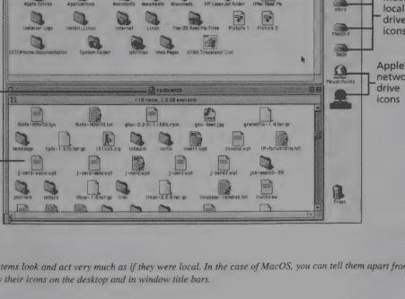

#### FIGURE 3.5

Shared file systems look and act very much as if they were local. In the case of MacOS, you can tell them apart from local drives by their icons on the desktop and in window title bars.

On Linux, file serving is handled by a variety of daemons, depending upon the client OS. Specifically, the network file system (`NFS`) is generally used for sharing with other Linux or UNIX computers; `Samba` is used for sharing with Windows, OS/2, and DOS computers; and `Netatalk` is used for sharing with MacOS computers. Part III, "File Sharing," discusses these protocols and how to configure them in detail.

In practice, FTP is most often used for file transfers between computers that are geographically remote, whereas file sharing protocols are used for local networks.

### Printer Sharing with lpd, Samba, and Netatalk


The same packages that provide file sharing capabilities often provide printer sharing features, as well. In many ways, printer sharing is just like file sharing, except that instead of going to a disk file, the data goes to a printer. On the client OS, a remote printer is generally configured very much like a local one, and the user might not notice much difference in actual use, especially if the printer is physically nearby, as might be the case in a home office setup. Configuring printer sharing in Linux is covered in Part IV, "Printer Sharing."

## Serving Up Web Pages

When you use a Web browser to cruise the World Wide Web, you can easily interact with dozens of computers in a minute or two. Each of these computers runs a Web server program, such as `Apache`. If you want to set up a Web server on your Linux computer, you can do so using `Apache` or any of several other programs. The details of such configuration are, however, beyond the scope of this book.

A few other programs use Web server protocols in their operation, as well. For instance, the `linuxconf` utility used by the Red Hat and Mandrake Linux distributions has an option to run as a special sort of server to permit remote administration of a Linux computer. This feature can be quite handy, but I advise caution in using it if your computer has a direct connection to the Internet because if an outsider ever gained access to this server, he or she could wreak havoc with your Linux computer. (`linuxconf` does require an appropriate password, of course, but as with all network services, if it's present, there's a chance that somebody could gain access through a bug or an ill-gotten password.)

## Delivering the Mail

Email is one of the oldest and most useful features of the Internet, and there are several protocols, not to mention mail transport agents (`MTA`—mail daemons, in effect) devoted to it. Two of the most common email protocols are

- 简单邮件传输协议（`SMTP`）—这是 UNIX 到 UNIX 邮件传输中最常用的协议。许多 Linux 系统（包括 Red Hat）在配置时使用 `sendmail` 作为其 `MTA`，但也有一些使用其他软件，如 `exim`。`qmail` 程序是一种流行的替代 `MTA`。

- 邮局协议（`POP`）—`POP` 通常被终端用户用来从其互联网服务提供商（`ISP`）下载邮件，但对于其他邮件投递任务并不常见。在 Linux 上，你可以运行各种 `POP` 守护进程，但你只有在希望将 Linux 机器用作期望使用 `POP` 的客户端的邮件中继站时才应这样做。你也可以在 Linux 上使用 `POP` 客户端从你的 `ISP` 检索邮件。

> CAUTION
>
> `SMTP` 邮件程序有时会被所谓的垃圾邮件发送者滥用，他们向大量人发送未经请求的电子邮件。因此，大多数 Linux 发行版都会将其 `SMTP` 程序配置为拒绝转发外部邮件，尽管它们仍可以接收外部邮件并向其他系统发送本地邮件。

你通常希望在系统上运行某种 `SMTP` 守护进程，即使只是为了投递本地邮件。（各种 Linux 程序会不时向 `root` 账户发送电子邮件，以告知你它们遇到的各种问题，或它们已自动进行的例行维护。）你可能还希望能够向远程系统发送 `SMTP` 邮件，并且可能从外部接收邮件。大多数 Linux 发行版在安装时会为此类功能自动配置自己。如果你想更深入地了解这个主题，你应该查阅你的发行版或 `SMTP` 代理的文档，因为这个主题超出了本书的范围。

## 投递新闻

网络新闻传输协议（`NNTP`）用于投递 Usenet 新闻（互联网新闻组）文章。如果你阅读过新闻组，你就使用过客户端模式的 `NNTP` 程序——新闻阅读器。这种关系的服务器端被称为新闻服务器，与大多数其他服务器一样，Linux 上有多个新闻服务器可供选择。

除非你是 `ISP`，否则你可能不需要在 Linux 服务器上维护一套完整的新闻组。如果你这样做，你会发现你需要投入相当多的千兆字节的磁盘空间来存储仅几天的新内容。在 SOHO 环境中，新闻服务器也有几种更适度的用途：

- 有限新闻镜像—你可以将几个新闻组的完整内容从你的 `ISP` 的新闻服务器复制到你的本地系统。这与直接从 `ISP` 的新闻服务器读取邮件相比有几个优势。其中之一是速度：一旦新闻帖子在你的本地系统上，你就不需要连接或忍受与远程获取新闻相关的任何延迟。你也可以经常下载大量消息并更快地断开连接，比你阅读想要阅读的消息更快，从而节省在线时间。如果你在小型本地网络中，有多个用户想要阅读少数几个新闻组，这些优势可以成倍增加。如果你想维护几个全球新闻组的镜像，你通常会将系统配置为连接到远程新闻服务器并每天一两次交换消息。

- 本地新闻组—你可以开发和维护本地的新闻组。例如，你可以有一个用于内部办公通信的新闻组，以便向员工发布重要公告。如果你直接连接到互联网，你可以使这些新闻组可供你的客户或公众访问。

你可以在单个新闻服务器中结合这两种功能，同时维护全球新闻组的镜像和你自己的本地组。混合方案也是可能的。例如，可以配置本地新闻服务器接受来自互联网邮件列表的电子邮件。如果你订阅了多个邮件列表，这可以帮助你跟踪这些列表的动态，而不会过度占用你的邮箱。

与电子邮件投递一样，`NNTP` 配置的细节超出了本书的范围。你可能会发现 Linux News HOWTO 有帮助，不过截至本文撰写时，它已多年未更新，因此未涵盖最新软件。

## 远程登录

Linux（或任何类 UNIX 操作系统）的一大优势是你可以远程访问计算机，包括几乎全部功能。（只有需要特定本地硬件的功能，例如 CD-ROM 或无 X 的 VGA 图形，无法从远程登录中使用。）自然地，Linux 运行守护进程来帮助此远程登录过程。

### 文本模式登录

Linux 支持多种文本模式登录工具——仅提供文本信息访问的登录。其中最常用的是 `Telnet` 协议，其由 `/etc/inetd.conf` 中的 `telnet` 行控制。`Telnet` 客户端可在支持 `TCP/IP` 的每个平台上使用，这对 Linux 中的 `telnet` 守护进程来说是一个巨大的优势，因为它提供了近乎通用的访问。

另一种远程登录方法是 `rlogin` 协议。与 `Telnet` 类似，`rlogin` 允许你登录并使用 Linux 文本模式程序；不过 `rlogin` 是一种主要由 UNIX 和类 UNIX 系统使用的协议；在随机挑选的 Windows 计算机上找到 `rlogin` 客户端的可能性不大，而在这样的机器上找到 `Telnet` 的可能性则相当高。


Telnet 和 rlogin 都存在一个可能严重的问题：它们以所谓的明文形式发送所有数据，包括密码。明文意味着数据未以任何方式加密或隐藏，因此位于中间系统上的以太网“嗅探器”，或位于客户端或服务器机器本地网络上的嗅探器，可以从网络上窃取密码或其他敏感数据。如果你在私有家庭网络上使用 Telnet 从同一网络上的另一台机器登录一台机器，这不是问题，但在办公室环境中使用该协议时，如果某些用户不应访问你的数据，则可能有问题。如果你从城里或世界各地连接到某个系统，各种中间系统都可以访问你的数据。最糟糕的是，如果你连接到或从运行电缆调制解调器的系统连接，有可能你的邻居对你的数据流有类似的访问权限。

诸如此类的安全问题促使开发了新的协议，其中最突出的是安全外壳 Secure Shell（SSH）。SSH 协议使用加密方法在传输前加密数据，因此大多数窥探者看不到任何可理解的内容。设置好两个系统上的 SSH 程序后，其使用方式与 rlogin 或 Telnet 非常相似。你可以在大多数平台上找到 SSH 程序，或为现有程序找到 SSH 插件，因此它是远程登录的良好选择。如果你确实使用 SSH 而不是 Telnet，你应该在 `/etc/inetd.conf` 中禁用 telnet，以防止它可能被攻击并被聪明的黑客使用。

#### NOTE

> FTP 协议也使用明文密码和数据传输，因此对网络嗅探也不安全。你可以使用 `scp` 程序，该程序是 `ssh` 软件包的一部分，通过 SSH 加密在系统之间传输文件。你也可以使用 `ssh` 通过其他传输方法处理数据，从而加密这些数据流。有关更多详细信息，请参阅 `ssh` 文档。

我在第 18 章中介绍了远程文本模式登录。

### X-Based Logins

如果你需要从远程位置运行基于 X 的 GUI 应用程序，仅文本登录对你帮助不大。为了获得更大的灵活性，你需要基于 X 的登录，或者至少在通过其他方法登录后，让基于 X 的程序使用本地显示的一种方法。

为简单起见，我将为用于 GUI 访问的两台计算机分配标签。你想要使用的软件所在的 Linux 机器将是 `linus`，而你有物理访问权限的计算机将是 `bill`。`Bill` 可能是另一台 Linux 计算机，也可能运行 Windows、OS/2、MacOS 或其他操作系统。

通常，远程 X 访问需要在 `bill` 上比在 `linus` 上安装更多的软件。正如本章前面所述，X 服务器实际上运行在你本地使用的计算机上（`bill`），而 X 客户端是你远程运行的软件（在 `linus` 上）。你不必在 `linus` 上运行 X 服务器。（事实上，我自己的家庭网络就是这样配置的；我有一台用于运行许多基于 X 的程序的 Linux 计算机，但我使用其他计算机上的 X 服务器运行它们。）

最粗略地说，你可以通过以下步骤从远程位置运行 X 程序：

- 1. 使用 `telnet`、`ssh` 或其他方式登录到远程系统。
- 2. 通过使用 `export DISPLAY=bill:0.0` 等命令设置 `DISPLAY` 变量。请注意，你键入的命令由 `linus` 处理，并告诉 `linus` 将其显示发送到 `bill`。如果计算机不在同一域中，你需要指定完整的网络地址（如 `bill.duck.net`）。数字 `0.0` 指的是显示号（`0.0` 是大多数 X 登录在计算机本身上的默认值，但对于你的特定情况可能有所不同）。
- 3. 如果尚未运行，请在 `bill` 上启动 X 服务器。
- 4. 授权 `bill` 的 X 服务器接受来自 `linus` 的客户端请求。有多种方法可以做到这一点。其中一种方法是使用 `xhost` 命令，如 `xhost +linus`。（与 `DISPLAY` 变量一样，你可能需要提供完整的网络名称，如 `linus.penguin.com`。）你需要在 `bill` 上发出此命令。许多面向 Windows 或 MacOS 的 X 服务器不需要此授权。
- 5. 在 `telnet` 或其他文本模式登录窗口中，启动你想要运行的任何 X 程序。它应该出现在 `bill` 上的 X 服务器窗口中。

#### Tip

如果你使用 UNIX 或 Linux `ssh` 客户端程序，它会自动处理授权细节，并且还会加密所有 X 数据。这一事实可以使使用 `ssh` 进行远程访问比 `telnet` 更方便——也更安全。

按照这些说明运行 X 程序时，你在 `linus` 上运行的唯一守护进程是用于文本模式登录的守护进程；其余配置在该端手动启动。`Bill` 则运行一个 X 服务器，其中包含一个寻找 X 活动的守护进程。

除了 X 服务器选项之外，还有一个名为 VNC 的程序，允许你使用 Linux 上的服务器程序远程运行程序。它随后成为一个具有相对简单显示程序的客户端。请注意，在这种情况下，客户端和服务器的角色是颠倒的，并且符合大多数人自然的预期。

在第 19 章“使用 VNC 或 X 服务器远程运行 X 程序”中详细描述了完成此任务更快、更安全的方法。

### 连接到更广阔的世界

Linux 提供了几种将本地网络连接到整个互联网的重要服务。其中特别值得关注的是 IP 伪装，Linux 会将来自本地网络的数据包转发到互联网的链路上，同时隐藏本地网络存在的事实，如图 3.6 所示。Linux 通过在传出数据包中替换自己的 IP 地址并记住它为来自特定本地机器的流量使用的传出端口来实现这一点。然后，当 Linux 收到发往 IP 伪装端口的回复时，它就知道应将该回复转发给哪台本地机器。在内核 2.2.0 及更高版本的计算机上，你需要激活几个内核选项并使用 `ipchains` 实用程序来配置 IP 伪装，详情请参见第 20 章“一个 IP 地址，多台计算机：IP 伪装”。

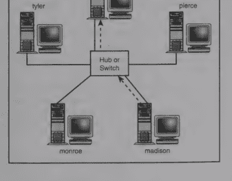

FIGURE 3.6

在 IP 伪装配置的情况下，对外部世界来说，来自本地网络的所有数据看起来都像是来自一台单一机器。

如果你使用调制解调器连接到外部世界，你将使用与该连接相关的服务。具体来说，你很可能会为你的连接使用点对点协议（PPP）。尽管当你使用 PPP 拨号时你的机器在技术上是客户端，但你本地使用的其中一个程序是 `pppd`——PPP 守护进程。这是因为建立 PPP 连接的任务在两端如此相似，以至于单个程序可以完成两项任务。与本章中我讨论的大多数其他服务不同，PPP 非常底层——它工作在 TCP/IP 栈的链路层，而大多数其他守护进程工作在应用层。

### 各种附加服务

前面的列表虽然涵盖了许多最常用的服务，但对于 Linux 中可用的所有网络服务来说只是冰山一角。只是其中一些附加服务包括

- 字体服务器——作为 X 网络中心的特性的一部分，可以设置一台计算机向局域网上的 X 服务器提供字体。事实上，Red Hat 6.0 默认已配置字体服务器，尽管你无法从安装它的系统以外的任何系统访问它。字体服务器可以成为快速更新大量 Linux 或 UNIX 工作站上可用字体，或网络上 X 终端机上的字体的一种好方法。
- 动态主机配置协议（DHCP）——有时希望动态分配 IP 地址——也就是说，每台计算机每次启动时都会收到其 IP 地址。随着计算机被添加到网络或从网络中移除，很容易相应地调整 IP 地址分配。此过程通过 DHCP 协议处理，当然 Linux 可以配置为提供该服务（或作为客户端使用）。
- 时间服务器——你可以从互联网上的众多时间服务器之一获取正确的时间。你也可以配置自己的 Linux 计算机为网络上的其他机器提供此服务。
- Talk——你可以设置系统，使用户能够在屏幕上以文本形式“聊天”交互。
- 启动服务器——一台计算机可以从另一台计算机上存储的文件启动，前提是待启动的系统具有支持此功能的网络适配器。此功能通常由没有自己硬盘的 X 终端使用。
- 系统信息——许多服务器，例如 `fingerd`，提供有关系统或其用户的信息。这在企业或大学内部非常方便，因为你可以通过在计算机中输入命令找到某人的办公室电话号码或房间号码。然而，此类信息也可能被远程系统黑客利用，因此此类服务器通常被禁用。

# 摘要

本章简要概述了在 Linux（或其他）计算机上常见的网络服务。我回顾了套接字和端口在帮助在计算机之间引导流量方面的角色，以及客户端和服务器在网络中的角色。由于后台处理和守护进程的使用对于理解网络服务至关重要，我也涵盖了这些主题。本章以对您最有可能想要在系统上设置的服务的总结而结束。本书其他地方对其中许多服务进行了更详细的介绍。

# 内联网和互联网

## 章节 4

### 本章内容

- 网络拓扑 80
- 网络寻址 92
- 连接小型和大型网络 99
- 摘要 104

在过去的三个章节中，我偶尔会提到诸如内联网和互联网之类的术语，并提及您的网络和本地网络。在很大程度上，这些术语的确切含义对于理解之前讨论的主要观点并不是至关重要的，但现在是时候更深入地探讨这些问题了。究竟是什么区分了不同类型的网络，它们之间又是如何相互关联的？


本书是关于在小型网络的核心设置 Linux 系统。在这种情况下，小是一个主观术语，但在我看来，它是指两台到几十台计算机之间。这样的网络通常被称为局域网（LAN），与广域网（WAN）相对，后者覆盖的范围更广，通常在计算机数量和它们之间的距离方面都更大。内联网和本地网络的术语与 LAN 基本上是同义词。

理解网络的一个关键点是，可以以各种方式连接两个或多个网络。这种连接可能会使内联网上的每台计算机都位于被称为互联网的全球计算机网络上。本章部分介绍了理解这一过程所需的概念。

## 网络拓扑

第 1 章“网络硬件”简要介绍了不同的网络拓扑（第 10 页）。我在此重返这一主题，因为重要的是要了解这些不同的拓扑彼此有何不同——同样重要的是，了解它们如何相互作用。理解网络的一个关键是，可以连接不同的网络，即使它们使用截然不同的拓扑和硬件。当然，为了有用，被连接的网络确实需要有共同的软件协议（如 TCP/IP）。或者，用于连接的计算机有时能够将一组协议翻译成另一组协议，或者它可以简单地作为两个网络的资源服务器。

在整个讨论中需要记住的一点是，这些拓扑指的是网络的逻辑结构。可以使用任何这些拓扑以多种方式物理排列计算机，但有些拓扑比其他拓扑更适合某些物理布局。

小型网络中常见的一些拓扑包括

- 总线拓扑
- 星型拓扑
- 环型拓扑

## 总线拓扑

总线拓扑涉及将几台计算机排成一排，一台接一台地连接（有时称为菊花链）。图 4.1 显示了这样的布置，其中有五台计算机组成一个简单网络。

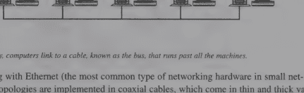

### 图 4.1

在总线拓扑中，计算机连接到一条电缆，即总线，该总线经过所有机器。

在处理以太网（小型网络中最常见的网络硬件类型）时，总线拓扑是在同轴电缆中实现的，同轴电缆有细型和粗型两种。细型以太网可运行长达 607 英尺，而粗型以太网的最大长度为 1,640 英尺。然而，两者类型的以太网电缆的最大速度均为 10 Mbps，这限制了它们在新网络中的实用性，因为 100base-T 可以以很少的额外成本实现 100 Mbps 速度。然而，您仍然会发现许多同轴以太网安装仍在运行，您可能需要将自己的网络连接到这样的系统。即使您想在自己的子网中使用另一种拓扑，您也可以将两者连接起来，如本章后面“组合拓扑”和“连接小型和大型网络”所述。

总线拓扑的主要优点之一，尤其是在以太网中实现时，是它几乎不需要网络硬件。您需要在每台计算机中安装网络接口卡（NIC）（第 15 页），当然还需要布线，但您不需要像星型拓扑（下一节所述）那样使用任何额外的集中式硬件。这可以使总线拓扑易于且经济地设置。如果您想要联网的计算机全部物理上位于一排或单个房间的多个墙壁上，铺设总线拓扑的电缆也可能非常容易。

然而，扩展总线拓扑可能很棘手，尤其是扩展涉及远离网络其余部分的机器时。例如，考虑图 4.2 中的办公室。如果房间 1 中的计算机都已按所示的整洁模式联网，那么添加房间 2 中的机器可能很困难。在图 4.2 中办公室的情况下，有必要做以下两件事之一：

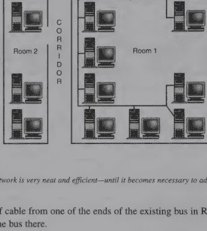

### FIGURE 4.2

Room 1’s bus topology network is very neat and efficient—until it becomes necessary to add Room 2’s computers to the network.

- Run a length of cable from one of the ends of the existing bus in Room 1 over to Room 2 and continue the bus there.
- Splice Room 2’s computers into the Room 1 bus near the corridor, using two cable runs through whatever ducts you hope exist between the rooms.

Neither is a particularly elegant solution, and if the bus length limits are exceeded, you might not get either to work, in which case you would have to completely redo the cabling (and possibly the layout of the workstations) so that it is more efficient. Any of these solutions is likely to require at least temporary disruption of network services, as the new network is spliced into the old one.

## The Star Topology

The second topology supported by Ethernet is known as the star, so called because when diagrammed as in Figure 4.3, it resembles a star, with spokes radiating outward.

In an Ethernet network’s star topology (using 10BaseT or 100BaseT cable), the line length limit is 328 feet, which is little more than half of thin coaxial cable’s 607-foot limit. This limit effectively applies to each branch of the star, however, so in practice an Ethernet twisted-pair cable network can cover a broader area than can a thin Ethernet coaxial cable network. The same is often true even when comparing twisted-pair to thick Ethernet coaxial cable, though it depends on the precise layout of computers.

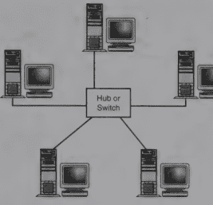

### FIGURE 4.3

*The star topology uses a central device to manage network traffic.*

For instance, consider Figure 4.4. It depicts connections of 14 computers in both bus and star topologies. Depending upon the distance between computers, this arrangement may or may not produce cable length problems for any given form of Ethernet, as detailed in Table 4.1. Twisted-pair cabling is the last to fail, though, supporting a network spread more widely than coaxial Ethernet allows.


### FIGURE 4.4

*The computers (squares) are connected to each other or to the hub (the circle) in the most efficient manner possible for each topology.*

### TABLE 4.1 Cable Lengths from Figure 4.4

| Inter-Computer Distance | Bus Topology Total Length | Star Topology Maximum Length | 10base-2 | 10base-5 | 10base-T and 100base-T |
|---|---|---|---|---|---|
| 10 ft. | 124 ft. | 22 ft. | ✓ | ✓ | ✓ |
| 50 ft. | 621 ft. | 112 ft. | X | ✓ | ✓ |
| 135 ft. | 1676 ft. | 302 ft. | X | X | ✓ |


Furthermore, with Ethernet it’s possible to link two hubs or switches, either using a crossover cable (p. 20) or uplink connectors (p. 24) on the hubs or switches. The result would be two networks like that in Figure 4.3, linked at their central points. If you look again at Figure 4.2, it’s not hard to see how the network would be wired initially. Chances are the hub would lie along the wall by the corridor, with cables run along the walls to each of the computers. The expansion into Room 2 could be accomplished either by running multiple lines from that hub into Room 2 or by running a single line and placing a second hub in Room 2 to service Room 2’s computers. Either solution could be accomplished without disrupting the existing network, assuming that the main hub or switch had enough room for expansion to begin with.

## The Ring Topology

A ring topology is logically similar to a bus topology, except that it’s a bus that’s linked to its own end, as shown in Figure 4.5. Ethernet doesn’t support a ring topology, so you won’t encounter one in most small networks. IBM’s Token Ring network technology is, as the name implies, based on a ring topology, so you’ll encounter the ring topology if you need to set up, maintain, or link to an existing Token Ring network.

Token Ring in particular, however, doesn’t look like a ring topology—not physically, at any rate. Like 10BaseT and 100BaseT Ethernet, Token Ring uses a hub with cables radiating out from it. This is because Token Ring implements the ring inside the hub, thus giving Token Ring many of a star topology’s characteristics. In practice, therefore, Token Ring closely resembles twisted-pair Ethernet in its physical cable layout requirements.

## Combining Topologies

Today, networks seldom operate in isolation. Networks—of the same or different topologies—can link to other networks in a variety of ways. A comprehensive list of such methods is beyond the scope of this book. I do discuss two important methods (bridges and routers) of linking networks in this section, however, and two more (Internet Protocol [IP] masquerading and firewalls) make appearances toward the end of this chapter, and in detail in Part VI, “Linking Your Intranet to the Internet.”

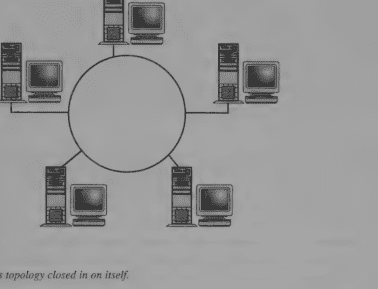

### FIGURE 4.5

The ring topology is like a bus topology closed in on itself.

#### NOTE

Switches and hubs connect individual computers. Routers and bridges, by contrast, connect entire networks, or at least network segments.

## Bridges

A network bridge is used to combine two similar networks into one logical whole. In a small office environment, bridging is likely to be used to link two otherwise separate Ethernet networks. A bridge can be a specialized hardware device, or it can be a computer that could conceivably function as a node on one or both of the networks it links. Once bridged, the previously separate networks are often referred to as segments of a larger network.

#### Note

Many software protocols also break networks up into groups. In the built-in networking in Microsoft Windows, for instance, you can define separate workgroups. Details differ from one software product to another, but in general, the software groupings are separate from the hardware segments created by bridging or routing. Hardware segmentation can, however, make it difficult or impossible to create a single group that easily spans the two segments, depending on the protocols used. The segments created by using bridges or routers are distinct from the subnets created by particular uses of IP address assignments, but the two can have similar consequences for software.


A bridge takes the Ethernet traffic from one of its two Ethernet ports and copies it directly to the other port. This makes a bridge a very simple device in principle, much like an Ethernet switch. A bridge typically doesn’t care what type of networking protocols it’s transferring—TCP/IP, AppleTalk, NetBIOS, or whatever. A bridge can, however, recognize what traffic belongs on each side of the network. The bridge can therefore pass only packets destined for the opposite side, thus reducing overall network traffic. For instance, if Segment A contains a Linux computer that functions as a print server, then when a computer on Segment A submits a print job, Segment B won’t see any activity from that job. This characteristic can be particularly handy if you have a network with two easily defined groups, such as Macintosh and Windows computers or workstations that use two different servers.

Bridges can be useful for extending the range of an existing Ethernet network. For instance, if you’re using 10Base2 cabling but find you need to expand your network past the 607-foot limit of this technology, you can use a bridge to expand the limit. You can also use a bridge to connect a coaxial Ethernet network to a twisted-pair Ethernet network. Finally, and often most importantly, a bridge’s filtering features allow it to reduce overall network traffic and improve performance.

You can configure the Linux kernel to support bridge functions, so that a Linux computer can function as a bridge. (In the Linux 2.2.x kernel series, this support is considered experimental, however, so you should use it with caution.) You can also purchase standalone bridges of various types. Some more complex bridges permit linking networks over some intermediary device, such as linking two Ethernet networks via modem. This practice is known as tunneling. Such a use creates what’s often referred to as a virtual network. A bridge doesn’t need an IP address of its own, but if you configure a Linux computer to serve as a bridge, it can have its own IP address, and can participate in normal networking activities.

## Routers

A router is a more complicated method of linking two networks than a bridge. Whereas a bridge merely copies Ethernet packets from one network to another, a router interprets the IP addressing of the packets and sends them to the appropriate destination. Note that a bridge also checks the destination of packets, but a bridge uses the Ethernet address for its filtering, whereas a router uses the IP address for this function (you'll learn more on these shortly). Because Ethernet addresses are specific to Ethernet cards, whereas IP addresses are a higher-level construct, a router can link networks that are more dissimilar than can a bridge. For example, you can use a router to link Ethernet and Token Ring networks.

Routers can also serve more complex functions, particularly in an environment in which they're connected to more than two networks. For instance, suppose you've subscribed to both digital subscriber line (DSL) and cable modem service. You could configure a router for your home network to send data to the Internet over either or both of those services. For most sites, it probably won't make much difference which interface you use, but for some it might. If downloads from speedy.cable.com are faster over the cable modem, and if downloads from speedy.dsl.com are faster over the DSL link, then the router can send data over the most efficient link.


Routing can quickly become a very complex topic, but fortunately, most small networks have only modest routing needs. In fact, all Linux computers have a routing configuration, but for a typical computer with only a single network connection, it will just route all outgoing traffic over that connection. Such a simple routing configuration is set up more-or-less automatically when you install Linux or configure networking as a whole, as described in Chapters 5, "Basic Linux Configuration," and 7, "Setting Ethernet Options." If you need to set up a more complex router, you should consult the Linux NET-3 HOWTO, which comes with most Linux distributions, and is also on the CD-ROM that accompanies this book in the `doc/HOWTO` directory.

In general, routing is more complex and more flexible than bridging, but there are exceptions. A bridge, for instance, can easily handle raw AppleTalk and NetBIOS packets. A TCP/IP router, on the other hand, cannot do so because these aren't TCP/IP packets. A router can process these packets when they're encapsulated in TCP/IP, however.

### NOTE

> It's possible to link two incompatible network types in a variety of ways. For instance, if you have a Macintosh LocalTalk network and a separate PC Ethernet network, you can set up a Linux box with interfaces to both networks. Using the Samba and Netatalk packages, you can attach to printers and filesystems exported from one network and then re-export them to the other. This adds several layers of overhead, however, so a more efficient configuration in such a situation is to use the Linux computer as a server for the resources needed by both networks.

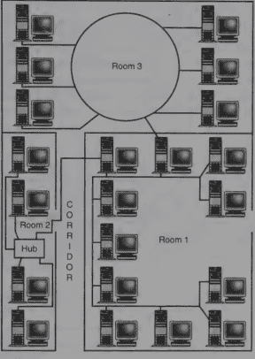

**图 4.6**

尽管令牌环使用物理集线器，这里令牌环网络以环形布线方式显示，以强调其逻辑拓扑结构。

作为网桥和路由器实际应用的另一个例子，考虑有线调制解调器和 DSL 调制解调器。这些设备实际上在大多数情况下是隧道网桥或路由器。它们旨在将你的网络（可能只包含一台计算机）连接到有线或 DSL 提供商的网络。你可能会把这种调制解调器看作计算机外设，像传统的电话调制解调器一样。但从网络角度来看，它是一台具有以太网接口、用于有线或 DSL 连接的专用接口，以及将两者连接起来的适当软件的计算机。事实上，通常可以配置这些设备直接为多台计算机服务。在这种情况下，调制解调器实际上会桥接或路由来自本地网络上多台计算机的流量。

## 互联网主干网

本章迄今为止的讨论应该能帮助你理解小型局域网——像你可能拥有或想要建立的那样——如何链接成整体的互联网。让我们称我一直在描述的三间房网络所在的组织为三间房公司。如果三间房公司想将其计算机连接到附近的四间房公司，他们可以这样做，四间房公司可以连接到车库里的盖伊，依此类推。然而，这会形成一个非常随意、混乱且难以管理的互联网。

> NOTE
>
> 指网络的网络的通用术语是 internet；而 Internet 是你可能已经熟悉的全球网络。这两个术语都与内联网形成对比，内联网如本章开头所述，是一个本地网络。

实际上，互联网整体遵循分层结构。为了获得互联网接入，很可能三间房公司会与互联网服务提供商（ISP）签约，ISP 是一家专门提供网络接入的公司。三间房公司的 ISP 可能会与更大的 ISP 签约，或者它可能拥有通往所谓的互联网主干网的更直接连接。曾经只有一个互联网主干网，但今天有很多。主干网是一个超高速网络，在多个地区，通常是大城市设有接入点（POP）。互联网主干网之间也会相互连接，因此可以将其客户的流量路由到其他主干网的客户。

> NOTE
>
> POP 与许多计算机术语，尤其是缩写一样，有多种含义。除了接入点之外，POP 还指邮局协议，这是一种用于传输电子邮件的网络协议。在大多数情况下，如果你知道一个缩写的两种含义，你就能判断出其含义，但如果你只知道作者本意之外的含义，你可能会感到困惑！我在本书中提供了不常见的缩写的含义。

让我们更仔细地看看这是如何工作的。假设波士顿的三间房公司的一名用户想要访问西雅图车库里的盖伊的一台计算机。以下是发生的情况：

- 1. 网络流量穿过三间房公司的网络，直到到达作为三间房公司与其 ISP 之间路由器的机器。
- 2. 数据在 ISP 网络中进行类似的遍历，直到到达 ISP 通往其选定互联网主干网的路由器。（流量也可能先前往更大的 ISP，然后再前往更大的 ISP。这样的步骤数量通常被称为到主干网的跳数。）
- 3. 数据进入主干网后，会前往为车库里的盖伊服务的最近的主干网连接点并跳转到第二个主干网。当然，如果源和目标计算机使用同一主干网，则可以跳过此步骤。
- 4. 目标主干网将数据发送给为车库里的盖伊服务的 ISP（或在车库里的盖伊的 ISP 层级中距离主干网最近的 ISP）。
- 5. ISP 将数据交付给车库里的盖伊的路由器。
- 6. 车库里的盖伊的路由器将数据发送到其目标计算机，可能通过额外的路由器、网桥或其他分发方式。

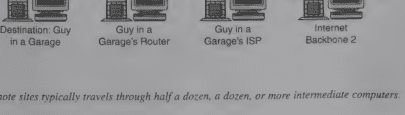

FIGURE 4.7

远程站点之间的流量通常会经过半打、十几个或更多中间计算机。

### NOTE

你可以通过使用 `traceroute` 命令来了解你的数据在你和远程计算机之间所走的路径。输入 `/usr/sbin/traceroute remote.machine.name` 以查找中间计算机的名称，以及数据在这些计算机之间传输所需的时间信息。不过，这些路径会随时间而变化，甚至同一传输的不同部分也可能走不同的路由，因此不要把 `traceroute` 的输出当作绝对的。

如果一切顺利，这个过程在眨眼之间就能完成，但当然途中也可能出现瓶颈，例如骨干网出现问题、任何中间 ISP 出现问题，或源网络或目标网络出现问题。幸运的是，TCP/IP 被设计为能够绕过此类问题。例如，一些 ISP 连接到多个骨干网，因此如果一个骨干网出现问题，流量仍可通过另一个骨干网传输。

这种场景甚至适用于从一个站点到另一个站点在同一城市内的网络流量。更重要的是，取决于 ISP、骨干网以及它们之间的连接，网络流量可能完全绕出本地范围才能到达本地目的地。我住在印第安纳州布卢明顿时，曾与一位拥有高速网络接入的朋友交谈。他告诉我，要连接到仅几条街之外的印第安纳大学的计算机，他的网络流量竟然要经过 200 英里外的芝加哥！虽然听起来荒谬，但在互联网上这种情况很常见。在某种程度上，这种情况类似于隔夜快递公司的工作方式。与其直接从丹佛运送包裹到凤凰城，包裹会经过一个枢纽，该枢纽可能位于相当偏远的地方，例如克利夫兰。这种安排之所以高效，是因为它减少了快递员必须飞行的航线数量。同样，互联网数据包路由中看似奇怪的绕路可以简化整个互联网的拓扑结构。

## Network Addressing

在互联网上引导流量是一项艰巨的任务。小办公网络上的计算机数量有限，通常不会成为问题，因为网络电缆经常会看到所有计算机的流量。如果这是一个问题，使用交换机或一两个网桥可以将问题降低到可管理的水平。


不过，想象一下，如果每个本地网络都必须承受整个互联网的合并流量。由此产生的速度问题会让人怀念刻在石板上的时代，那时石板还是最先进的电信！幸运的是，本章和前几章中描述的多种技术汇聚在一起，使得网络流量能够得到高效的寻址和路由，偶尔会经过芝加哥 200 英里的绕路。

## Numerical Network Addresses

计算机主要是数值设备。即使你在文字处理器中书写，计算机处理的是数字——计算机只是能够将数字转换为屏幕上的形状，你将其解释为字母和文字。从根本上说，网络寻址是一种数值现象。事实上，在以太网上使用 TCP/IP 网络时，有两种不同的数值地址至关重要：

- 网络硬件地址
- IP 地址

其中第一个与网络硬件绑定，无论使用什么网络协议——对 TCP/IP、EtherTalk 或任何其他协议都相同。第二个与 TCP/IP 相关联，无论使用什么网络硬件——以太网、令牌环、拨号 PPP 或其他任何东西。

## Network Hardware Addresses

讨论网络寻址的一个起点是网络硬件内置的地址。不同技术的细节各不相同，但由于大多数小型网络都基于它，我将描述以太网。每块 NIC 都包含一个唯一的 6 字节数字。该数字通常表示为用冒号分隔的六个十六进制值，例如 `00:80:C6:F9:3B:BA`。以太网产品的每个制造商都有自己的唯一代码，这是该地址的一部分。然后制造商分配额外的唯一数字来创建一个以太网地址，确保它与所有其他以太网地址不同（假设没有错误）。这些以太网地址有时也被称为 MAC（媒体访问控制）地址。

要在以太网网络上从一台计算机向另一台计算机传输数据，发送计算机必须知道目的地的以太网地址。当此信息已知时，发送机器可以发送以太网帧，而目标计算机可以从线路上接收它们。本地网络上的所有其他计算机都会忽略这些帧。

#### NOTE

> 可以将计算机编程为注意发往其他计算机的数据包。你可以使用数据包嗅探程序来帮助分析网络流量。计算机黑客也使用此类程序来获取密码和其他敏感数据，如第 24 章“维护安全系统”中所述，以及本书其他地方所述。

以太网传输本质上是局域的。如果你在达拉斯，想要与多伦多的计算机通信，知道多伦多机器的以太网地址并不会有太大帮助。你必须有一个路由器或某种类似的中间系统，以及最可能的一系列中间计算机，例如构成互联网骨干的那些计算机。要将消息通过这片计算机迷宫传递，你需要一种与硬件无关的寻址方案，那就是 IP 地址。

## IP 地址

IP 地址，如第 2 章“理解 TCP/IP”所述，是一种 4 字节地址，通常表示为四个用点分隔的十进制数字，例如 `192.168.1.17`。与以太网地址类似，IP 地址在少数例外情况下也是唯一的。与以太网地址不同，IP 地址并不锁定在网卡中。相反，它们由各个组织单独或成组分配。

传统上，互联网网络信息中心，即 InterNIC，已将 IP 地址组分配给组织。例如，如果 Three Room Company 希望其所有计算机都拥有完整的互联网地址，它可以向 InterNIC 申请一批这些地址。拥有这些地址的组织有责任将其分配给单个机器。事实上，一些公司会将地址分配给其他人。例如，你的 ISP 会为你分配一个 IP 地址，具体取决于所涉及的技术，可能是永久性的，也可能是每次连接时分配的。实际上，Three Room Company 很可能会从其 ISP 而不是从 InterNIC 获取其 IP 地址。

IP 地址可以描述为属于若干类之一。地址类定义了该集合中包含多少个 IP 地址。通常，较大的集合分配给需要大量计算机的组织，例如大型跨国公司和大型 ISP。较小的地址集合分配给较小的组织，例如 Three Room Company 和小型 ISP。每个 IP 地址都分为网络 ID 和主机 ID，其划分取决于网络类：

- **Class A**—Class A 地址的第一个位始终为 0，这意味着第一个字节在 1 到 128 之间（0 值具有特殊含义）。第一个字节标识网络，其余 3 个字节标识计算机。例如，`103.34.23.8` 是 `103.0.0.0` Class A 网络上的地址——末尾的 0 表示整个网络的地址。计算机 ID 为 `34.23.8`，尽管这部分很少单独使用。

- **Class B**—Class B 地址的前 2 位始终为 1 和 0，这意味着第一个字节在 128 到 191 之间。地址整体被平均分成两半，前 2 个字节标识网络，后 2 个字节标识计算机。Class B 网络地址的示例是 `143.203.0.0`，而该网络上的机器可能是 `143.203.78.9`。

- Class C—Class C 地址以位 1、1 和 0 开头，因此第一个字节在 192 到 223 之间。它们被划分，前 3 个字节用于标识网络，最后一个字节用于标识主机。例如，`197.8.33.0` 是 Class C 网络地址，而 `197.8.33.14` 是该网络上的计算机。

除了这些标准地址类之外，还有 Class D 地址（以 1、1、1、0 开头），用于多播——发往多个主机的互联网流量；以及 Class E 地址（以 1、1、1、1 开头），保留供将来使用。

最初，一个组织会注册一个或多个包含整个类的地址集，但随着未认领 IP 地址数量的减少，有必要以更精细的方式分配它们。举例来说，让两家大公司各自拥有一个完整的 Class A 地址，但合计使用的地址少于 Class A 可能的 1600 万个地址，这是不合理的。因此，ISP、InterNIC 和其他组织开始通过分配部分类的地址来分配 IP 地址。

给定网络类中的并非每个地址都可使用。一些地址被“浪费”在各种管理细节上。其中一个特别重要的细节是，主机或网络地址为 0 或全为 1 的任何地址（例如 Class C 主机的 `255.x.x.x`，或 Class B 主机的 `255.255.x.x`）具有特殊含义。当主机或网络位为 0 时，地址分别表示整个网络或本地网络上的主机。位全为 1 的地址表示广播（对于主机位）或网络掩码（对于网络位）；网络掩码用于帮助主机识别其本地网络上的其他计算机）。

已为私有网络预留了若干组地址。理论上，仅连接到私有网络的计算机永远不需要与整个互联网通信，因此多个私有网络可以使用相同的私有网络地址集而不会冲突。表 4.2 总结了为私有网络预留的地址。请注意，只有一个私有 Class A 网络地址，但有多个私有 Class B 和 Class C 网络地址。

### TABLE 4.2 Private Network Addresses

| Class | Address Range |
| --- | --- |
| Class A | `10.0.0.0`–`10.255.255.255` |
| Class B | `172.16.0.0`–`172.31.255.255` |
| Class C | `192.168.0.0`–`192.168.255.255` |

> .0 和 .255 值不能用于单个计算机，因为它们具有文中所述的特殊含义。

要使用 IP 地址，你必须将计算机配置为使用它。在某些情况下，例如 PPP 拨号连接或使用 DHCP 的以太网连接，你的计算机在连接到网络时会获取其地址。在其他情况下，你在配置网络时手动输入地址。这些选项在第 7 章“设置以太网选项”和第 8 章“使用 PPP 进行拨号连接”中进行了描述。

当你使用 TCP/IP 与另一台计算机通信时，你必须知道目标计算机的 IP 地址。实际上，你通常使用后面本章所述的文字助记符，但 TCP/IP 栈主要依赖于数字 IP 地址。

## 链接 IP 和以太网地址

你可能会开始看到这里出现一个难题。要与以太网网络上的另一台计算机通信，你需要它的 IP 地址和以太网地址。如果配置正确，你自己的计算机知道其 IP 地址和以太网地址。如果你已输入远程机器的 IP 地址，你仍然缺少远程计算机的以太网地址。

你的计算机通过使用地址解析协议（ARP）获得最终的远程地址。ARP 发送一个以太网数据包，要求具有指定 IP 地址的计算机用其以太网地址进行回复。本地网络上的所有计算机都能看到此数据包，而 IP 地址与查询匹配的机器会回复，从而为发送计算机提供所需的信息。ARP 请求不会被路由，因此整个互联网不会因 ARP 请求而过载。

但是，如果你想将以太网数据包发送到远程位置——不在你的本地以太网上的位置呢？你将其发送给路由器。你的计算机的路由表应该知道本地网络的路由器是什么，如果本地网络上没有机器对 ARP 请求做出响应，你的计算机就会将路由器的以太网地址插入到以太网数据包中。然后路由器必须通过使用 TCP/IP 数据包中的 IP 地址继续路由过程。

#### Note

> 在网络配置工具中，转发本地以太网之外网络流量的路由器通常被称为网关。网关和路由器术语几乎同义，尽管网关有时用于指在两种不同类型的网络之间路由的路由器（例如，在以太网和令牌环之间）。
>
> 然而，你在计算机基本网络配置中设置的网关不一定是那种在不同类型网络之间路由的网关；在这种情况下，该词被更广泛地使用。


每次路由器拿到一个 TCP/IP 数据包时，路由器都会查阅其路由表以确定将数据包发送到何处。例如，当 Three Room Company 向其 ISP 发送数据包时，ISP 的路由器会检查其路由表。如果 ISP 仅使用单一的互联网骨干网，则数据包会被转发到骨干网本地计算机中的路由器。然后该计算机使用其路由表来确定目标计算机所在的骨干网。第二个骨干网的计算机确定托管目标站点的 ISP，而 ISP 的路由器定位目标网络的路由器。只有在开始和结束时，路由器才需要知道有关特定计算机的任何信息。在中间阶段，整个网络才是关注点，即使数据包发送到这些网络上的特定计算机。网络数量足够多，使得中间网络路由器的任务变得相当复杂。

你可以通过输入 `/sbin/route` 来检查你的 Linux 计算机的路由表。这将产生类似以下内容的输出：

```
Kernel IP routing table
Destination     Gateway         Genmask         Flags Metric Ref    Use Iface
192.168.1.1     *               255.255.255.255 UH    0     0        0 eth0
151.209.146.3   *               255.255.255.255 UH    0     0        0 eth1
151.209.146.0   *               255.255.255.0   U     0     0        0 eth1
192.168.1.0     *               255.255.255.0   U     0     0        0 eth0
127.0.0.0       *               255.0.0.0       U     0     0        0 lo
default         polk.threeroomc 0.0.0.0         UG    0     0        0 eth1
```

该表首先列出用于特定计算机的接口（列在最后一列），然后是整个网络（IP 地址以 .0 结尾的机器），最后是默认路由，用于 ARP 请求未返回以太网地址的任何数据包。

## 使用 DNS 定位 IP 地址

当然，作为人类，你可能不想被数字 IP 地址困扰超过绝对必要的程度。这就是域名系统（DNS）存在的意义。DNS 将人类可理解的名称，例如 `www.linux.org`，映射到匹配的 IP 地址，例如 `198.182.196.56`。如第 2 章“理解 TCP/IP”中所述，DNS 本质上是一个大规模分布式数据库。

DNS 通过将整个互联网划分为若干区域，然后进一步划分这些区域，再次划分，等等来工作。每个区域至少包含两个 DNS 服务器（为了冗余，以防其中一个不可用），它们知道管理第一个区域子区域的 DNS 服务器的 IP 地址。这种结构在层次结构的每个级别重复，直到最终的 DNS 服务器，该服务器提供目标 IP 地址。

在实践中，它的工作方式如下：当你配置一台计算机使其在网络上运行时，你会为其提供一个 DNS 服务器的 IP 地址列表——通常是两个或三个。这些 DNS 服务器可以位于你自己的网络上，但如果你是 SOHO 用户，它们很可能属于你的 ISP。当某个程序需要从可读的地址查找 IP 地址时，你的系统会向你指定的其中一个 DNS 服务器请求该地址。这个 DNS 服务器（我称之为 `DNS-1`）知道由 InterNIC 维护的 DNS 服务器的地址（我称之为 `DNS-2`）。该服务器维护最广域的域名地址——例如 `.com`、`.edu` 等域的地址。因此 `DNS-1` 会向 `DNS-2` 查询目标域的 DNS。当 `DNS-1` 收到回复后，它可以向 `DNS-3` 查询下一个更具体的 DNS，依此类推，沿着链条向下。最终，`DNS-1` 会获得目标计算机的 IP 地址，并将该地址转发给发起请求的程序。

这听起来似乎只是为了查找一个地址而产生大量网络流量，而且确实如此。不过也有捷径。你的本地 DNS 可以维护一个最近请求的域名缓存，这样它就不必经历整个过程。例如，大型 ISP 可能经常收到对常见域名如 `yahoo.com` 的请求，并且可能无需进一步操作即可给出正确的 IP 地址。你的本地计算机也可以做同样的事情，从而实现无需任何网络活动的 DNS 查找。在 Linux 中，你可以在文件 `/etc/hosts` 中维护一个完全本地的 IP 地址列表。如果你维护自己的本地网络，你可能希望将所有本地机器都列入你的 `/etc/hosts` 文件中（特别是如果你的 ISP 的 DNS 不知道它们），但你也可以添加你经常访问的域名的 IP 地址。

网络域名与 IP 地址一样，以半集中化的方式进行管理。InterNIC（或更近期的、致力于这些任务的多个组织之一）允许你选择一个域名并进行注册。注册名称后，在你注册的时间段内，其他人就不能使用该名称。（存在例外情况，尤其是在名称与注册商标或公司名称相符的情况下。）你负责在你的域名下为单个机器以及你想要的子域命名。例如，如果你注册了域名 `gubron.com`，你可以根据需要为单个计算机分配名称，如 `gingko.gubron.com` 和 `larch.gubron.com`，而无需就这些分配获得 InterNIC 或任何其他人的批准。然而，拥有域名的一项责任是，你必须提供至少两个 DNS 服务器来告知他人特定的机器名称。如果你是一家小型公司或个人，你可能希望与你的 ISP 签约提供此服务，而不是自己投入两台计算机来做这件事。

## 连接小型和大型网络

正如你可能所知，将小型网络连接到大型网络，特别是将小型网络连接到整个互联网，具有很大的优势。路由器，如前所述，是实现此目的的一种非常常见的方式。然而，路由器主题上存在一些变体，值得特别关注。

### 连接到大型内联网

如果你在大型组织内部维护一个小型网络，你可能能够将其连接到该组织的网络，以便为你的所有计算机提供或多或少直接的互联网访问。由于此类连接的细节因网络而异，我无法提供一套简单的规则来完成此操作。

在某些情况下，你认为的“你的”网络最终将成为大型本地网络的一部分，并且在物理上或逻辑上与之没有区别。例如，如果你在研究型大学设立实验室，很可能你的系维护着自己的网络。你可以直接将计算机插入此网络，并让它们像本书所述那样共享服务。然而，除非你做出特殊安排或提供自己的布线和路由器，否则你的系统不会特别隔离于系内其他网络流量。在许多情况下，这是一种有效且易于设置系统的方式。

在其他情况下，你可能需要提供全新的网络电缆并使用单个路由器连接你的计算机。配置通用路由器超出了本书的范围，但这里讨论的许多技术将有助于你配置网络。

如果你想连接多台计算机，而你的组织无法提供那么多 IP 地址，你将需要考虑使用 IP 伪装，稍后本章将简要介绍，并在第 20 章“一个 IP 地址，多台计算机：IP 伪装”中详细介绍。

在任何情况下，你可能都有一名或多名本地网络技术人员可以帮助你规划和实施网络。如果你公司有这些人员，你必须与他们协商，即使只是为了获得连接到网络所需的 IP 地址和硬件规格。

### 通过 ISP 连接所有计算机

如果你在家或小型企业设置网络，很可能你已经或将很快与 ISP 签约以获得互联网访问。连接到 ISP 可能与连接到企业网络类似。然而，与企业网络不同，你的 ISP 很可能在物理上距离你有一段距离，因此你需要使用某种长距离网络硬件将你的计算机连接到 ISP。这种技术可以低至运行

`PPP` 或像专用高速线路那样高端（实际上在物理上与电话线路非常相似）。在决定想要什么类型的接入时，你需要问自己几个问题：

- 你需要什么样速度？ISP 提供的接入速度范围从低端的 33.6Kbps 拨号调制解调器到适合运行最繁重的电子商务网站的超高速线路。需要记住的是，许多服务在速度上是不对称的，意味着一个方向（通常是下游，指向你）比另一个方向更快。这对于典型的终端用户应用来说很棒，但如果你想运行一个访问量很大的 Web 服务器，那就很糟糕。

- 你能负担多少？正如你可能想象的那样，成本与速度齐头并进。然而这种关系并不完美，有时你能以优惠的价格找到某些类型的服务。例如，在许多城市地区，有线调制解调器或低端 DSL 服务的成本低于电话 ISP 和专用电话线路的成本。

- 你需要不间断的服务吗？如果你需要始终在线的服务，在大多数情况下电话调制解调器是不好的选择，尽管一些 ISP 提供始终在线的拨号 PPP 连接。我认为有线调制解调器或 DSL 线路是始终在线服务的最低要求。

- 你想用自己的 IP 地址连接多少台计算机到互联网？`PPP` 链路通常只提供一个 IP 地址。虽然技术上能够提供更多，但许多有线调制解调器和低端 DSL 提供商也将你限制为一个 IP 地址。中端到高端 DSL 服务通常会给你运行多个 IP 地址的选项，专用服务如 `T1` 线路也是如此。

#### Note

即使你在局域网上有几台计算机，只要你将 Linux 机器配置为使用 IP 伪装，你也可以通过单个 IP 地址完成许多互联网任务。IP 伪装确实有其局限性，但对于许多小型网络来说，它是一个很好的变通方法。


你的 ISP 是否对 Linux 友好？在低端，大多数 ISP 不介意你运行 Linux，但他们对此没有专业知识，也不愿意在你遇到问题时提供技术支持。少数 ISP 对 Linux actively 敌对。然而，当你考虑更快速、价格更高的连接选项时，UNIX 和 Linux 的经验和支持更容易获得。

### Tip

在决定需要多少互联网接入时，很容易严重判断失误。你可能认为可以用模拟拨号调制解调器应付，结果发现它不够用。同样有可能的是，你注册了一个高端企业 DSL 计划，却发现你没有用到其容量。你的需求也很有可能随时间变化。因此，我建议优先选择提供多种服务级别的 ISP，例如拨号调制解调器和几种类型的 DSL。如果将来你需要更改服务，你就可以相对无痛地进行。如果你想维护一个网页或其他企业互联网存在，你也应该认真考虑在 InterNIC 注册自己的域名。这样，如果你必须更换 ISP，你就可以随身携带你的域名，你的客户可能甚至都不知道你做了更改。

ISP 与企业网络之间一个重要的区别是，你与 ISP 的连接通常通过一根电缆进行，无论是电话线、有线电视线还是其他什么。这意味着你通常必须使用某种形式的路由器或类似路由器的技术。你可以自行配置一台计算机来执行此功能，也可以购买一台独立的设备来完成任务。如前所述，有线和 DSL 调制解调器实际上是路由器或网桥，其中一些允许你直接或通过自己的集线器或交换机连接多台计算机。当你使用自己的计算机作为路由器（或购买自己的独立路由器）时，你对它允许通过的内容有更大的控制权，这可能比让 ISP 的硬件来做这件事具有明显的优势。一些配置不当的系统实际上会将大批客户链接到一个虚拟网络中，这可能是一个严重的 安全问题。

## Using IP Masquerading to Use One IP Address

路由器主题上一个特别有趣的变体是 IP 伪装。普通路由器在不更改消息内容的情况下将 TCP/IP 数据包从一台计算机传输到另一台计算机。特别是，普通路由器不会更改 TCP/IP 数据包中嵌入的返回地址。然而，你可以配置 Linux 系统在 TCP/IP 数据包中替换其自己的地址，从而欺骗目标系统认为 Linux 系统是数据包的来源。

IP 伪装是 Linux 用户在小型网络中流行的工具，因为它让你在只有一个 IP 地址时将该小型网络连接到互联网。这对于通过 PPP 进行拨号接入特别有帮助，或者当你使用只能提供一个 IP 地址的低端有线调制解调器或 DSL 系统时。IP 伪装的另一个用途是在较大网络组织中扩展有限数量的 IP 地址。例如，如果你的公司拥有大量 IP 地址但计算机数量不断增长，你可以延长其使用寿命

通过尽可能使用 IP 伪装来节约你数量庞大但有限的 IP 地址。在安装新的计算机集群时，只给其中一台 Linux 计算机分配一个正常的 IP 地址，然后将其他计算机通过表 4.2 中的私有 IP 地址网络连接到该计算机。请注意，进行 IP 伪装的机器通常有两个 IP 地址——一个用于内部网络，一个用于外部网络。图 4.8 说明了这种关系。请注意，对外部世界来说，网络上的每台计算机看起来都像是伪装计算机。

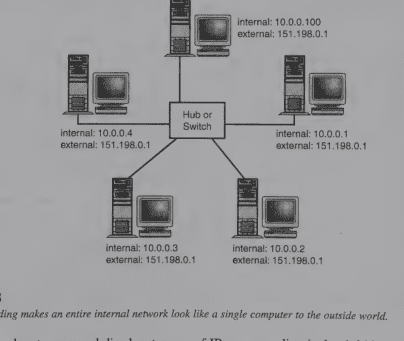

### 图 4.8

IP 伪装使整个内部网络对外部世界看起来像一台单机。

IP 伪装的一个优点——也是缺点——是它隐藏了内部网络，包括其安全漏洞，使其不被外部世界所知。因为外部来源只能看到伪装路由器，它们甚至不会意识到其他计算机的存在。当然，如果伪装路由器本身被攻破，那么私有网络上的任何资源都将完全暴露，所以我不建议对内部网络安全掉以轻心。通过伪装获得的增加的安全性优势可能会被以下事实所抵消：这种安排使得在内部网络上运行对外部世界可见的服务器变得不可能——至少在没有额外配置的情况下是不可能的。

### 警告

重要的是，你必须为其身份将被伪装的计算机使用私有 IP 地址。如果使用普通 IP 地址，网络流量可能会被错误路由。例如，如果你使用一个恰好分配给庞加莱大学 Web 服务器的 IP 地址，你的系统似乎会工作得相当好，直到被伪装网络的用户之一尝试访问庞加莱大学网站时为止。最好的情况下，用户会得到在内部伪装网络上维护的 Web 服务器。最坏的情况下，它根本就无法工作，让用户以为庞加莱大学网站宕机了。

第 20 章“一个 IP 地址， 多台计算机：IP 伪装”更详细地介绍了 IP 伪装。

## 使用防火墙保护你的网络

你可能在近年里越来越多地听到防火墙被提及，但你可能不知道防火墙是什么。事实上，并非所有网络专业人士都对这个问题达成一致——该术语有时应用于非常具体的操作，有时则更广泛地使用。总体而言，使用宽泛的定义，防火墙是一种旨在保护网络免受外部攻击的路由器。防火墙会仔细检查网络流量以寻找可疑活动，并且可以阻止任何它不批准的数据包或连接尝试。例如，如果某个特定远程站点已知是黑客的藏身之处，你可以配置防火墙以阻止来自该站点的一切流量。如果防火墙检测到某些类型的可疑活动，例如端口扫描（系统地探测计算机上特定端口上运行的守护进程），它可以提醒你或阻止该活动。第 21 章“配置防火墙”详细讨论了这个主题。

防火墙可以配置为对网络活动只表现出 passing interest，在这种情况下你作为用户甚至可能不知道它的存在。防火墙也可以配置为非常强硬，只允许批准的流量通过，在这种情况下防火墙会成为办公室最喜欢的抱怨对象。Linux 支持两大类防火墙服务：

- 包过滤防火墙——包过滤器识别单个 TCP/IP 数据包，并根据其来源、目的地等标准来通过或拒绝它们。有些人并不认为包过滤是防火墙，但在 Linux 中，你通过激活称为网络防火墙的功能在内核中实现包过滤。
- 代理服务器防火墙——代理服务器防火墙根据 TCP/IP 链中更高层的标准来过滤网络流量。在最严格的情况下，代理防火墙可以配置为完全处理然后仅将少数几种类型的数据，例如电子邮件，转发到内部网络。代理防火墙不是由内核配置创建的，而是由独立软件创建的。

为了获得最佳安全性，防火墙机器应仅用作防火墙。它不应有用户账户，也不应提供防火墙功能之外的服务。当你添加服务、用户账户等时，你会大幅降低防火墙的安全性。

### 总结

无论大小，网络在一定程度上都由其拓扑结构定义。得益于以太网的普及，特别是双绞线布线，星型拓扑在小型网络中变得相当常见。然而，拥有数十台以上计算机的任何组织很可能支持多个网络，这些网络通过路由器或网桥连接在一起，并且这些网络可能采用多种不同的拓扑结构。网络本身的连接方式可以在组织内部形成一种元拓扑。组织将计算机链接到全球计算机的方式构成了我们所称的互联网的极其复杂的计算机网络。

数据包穿越这庞大计算机群的方法多种多样。在其旅程的每一步，数据包都会被部分分析并传递下去，其寻址数据被更改以使其更接近目的地。

如果你是个体用户或小型企业，选择 ISP 以及如何将计算机连接到它可能会对你的网络连接产生重要影响。选择错误的接入方式可能导致网络链接缓慢和挫败感，或浪费在从未使用的带宽上的金钱。

## 配置 Linux 网络

## 第二部分

### 本部分内容

- 5 : 基本 Linux 配置 107
- 6 : 编译网络内核 139
- 7 : 设置以太网选项 161
- 8 : 使用 PPP 进行拨号连接 185

## 基本 Linux 配置

## 第五章

5

### 本章内容

- 安装 Linux 108
- 配置文件和工具 124
- 设置用户账户 131
- 总结 137

到目前为止，你已经学习了设置 Linux 网络至关重要的背景信息。本章开始讨论更实际的问题，包括如何安装 Red Hat Linux 6.0。如果你熟悉 Linux 安装和配置选择的理由，可以跳过本章的大部分内容。如果你对 Linux 或其他类 UNIX 操作系统相对陌生，应该仔细阅读本章，因为它对于理解 Linux 的运行方式至关重要。

本书附带一份 Red Hat Linux 6.0 的拷贝，这是 Linux 最受欢迎的发行版之一。关于安装 Linux 的部分包含了一些关于此特定发行版和版本的非常具体的信息，但其中描述的许多一般性问题和原则也适用于其他发行版。在本书的其余部分，我提到了 Red Hat 提供的 `linuxconf` 配置工具，该工具也被与 Red Hat 关系密切的 Mandrake 发行版使用。

在整本书中，我提供了如何使用文本配置工具（即手动）配置系统的信息，因此你应该能够使用本书中的信息配置任何 Linux 系统。Linux 发行版有时在配置文件的存放位置和名称上有所不同，但就其大部分而言，我对如何手动配置系统的描述应该对使用 Red Hat 或其他发行版的人都有帮助。一些发行版，如 SuSE 和 Caldera，附带了图形用户界面（GUI）配置工具，其原理与 `linuxconf` 相似，但细节不同。如果你使用的是此类发行版，可能需要研究这些工具。

### 安装 Linux


如果一切顺利，安装 Linux 可能只需大约半小时。然而，大多数不熟悉 Linux 的人安装时间会更长，而将计算机配置为在 Linux 和其他操作系统（OS）之间双启动等情况会增加所需的安装时间。如果你勤于安装前的准备，可能需要在开始时多花半小时左右。如果你不这样做，你会节省这段时间，但很有可能你会花费至少同样多的时间去核查硬件细节或重复安装。

Red Hat 通常每 3–6 个月发布一次 Linux 的新版本，因此到你阅读本文时，本书附带的 6.0 发行版很可能已经落后一两个版本。如果你想绝对保持最新，可以通过以下几种方式获得新版本：

- 从你喜欢的电脑零售商处购买官方 Red Hat CD。Red Hat 6.0 的标价为 $79.95，未来版本的价格可能大致相同。官方 Red Hat 套装包括技术支持、印刷手册，以及非官方 CD 中不包含的演示和完全功能的商业软件包。
- 从 Cheap*Bytes (`http://www.cheapbytes.com`)、`Linux System-Labs` (`http://www.lsl.com`) 或 `Linux Central` (`http://www.linuxcentral.com`) 等公司购买非官方 Red Hat CD。这些 CD 通常售价约为 $2 加运费（在美国通常约为 $5）。
- 从网上下载 Red Hat。你需要快速的互联网连接或大量的耐心才能做到这一点（通过调制解调器完整下载可能需要一天或更长时间）。Red Hat 在 `http://www.redhat.com/mirrors.html` 维护了一个镜像站点列表，提供 Red Hat。如果你想从硬盘分区安装 Red Hat 或创建自己的安装 CD-ROM，你应该查看我关于该主题的网页 `http://members.bellatlantic.net/~smithrod/rhjo1.html`。如果你有直接的互联网连接，可以直接从 FTP 站点安装，无需本地存储副本。

安装最新最好的 Linux 版本的优势在于，你将完全掌握性能和安全改进，可能包括某些硬件的新驱动程序。缺点是你的体验可能与本书中描述的不完全一致，如果你使用的是书中 CD-ROM 上的版本则会更精确。

随 CD-ROM 提供的 Red Hat 6.0 版本包括 Red Hat 在 CD-ROM 制作当天发布到其网站上的所有更新软件包。尽管如此，安装后你可能仍想查看 Red Hat 的勘误页面 `http://www.redhat.com/errata/`，看看是否有任何重要的错误修复被列出。

随本书附带的 CD-ROM 包含了一些 Red Hat Linux 通常不附带的额外程序，例如 Netatalk 服务器。你应该能够在更新版本的 Red Hat 或其他发行版上使用这些软件包。

### 分区你的硬盘

如果你想重新分区包含 Windows 或其他 OS 的系统，你有两个选择：

- 备份所有数据，重新分区系统，然后恢复数据。这很有效，但很繁琐。
- 使用诸如随本书附带 CD-ROM 提供的免费软件 First Nondestructive Interactive Partition Splitting Program（`FIPS`；随本书附带的 CD-ROM 中包含）或 PowerQuest（`http://www.powerquest.com`）的商业 `Partition Magic` 等实用程序。`Partition Magic` 是一个非常方便的实用程序，可用于创建和修改 Linux 分区以及 DOS、OS/2 和 Windows 分区。它附带 DOS 和 Windows 可执行文件，包括可从 Linux 复制到软盘的可启动 DOS 磁盘映像，因此可在仅 Linux 系统上使用。图 5.1 显示了 `Partition Magic` 的运行情况。

## FIGURE 5.1

`Partition Magic` 让你可以通过点击分区来调整其大小、移动它或复制它。

### CAUTION

即使你使用像 `FIPS` 或 `Partition Magic` 这样的工具，在继续操作之前明智的做法是备份你的系统，因为动态分区修改本质上是危险的。

这些分区调整实用程序的使用细节差异很大，因此你应该查阅你打算使用的软件包的文档以了解如何操作。

如果你将 Linux 安装为系统上唯一的 OS，你可以在安装期间使用 Linux 的 `fdisk` 程序来设置分区。事实上，即使你使用分区调整工具，你可能也需要使用 `fdisk`。我稍后会描述这个过程，但以防你可以在开始安装前设置好分区，我将在此处介绍 Linux 的分区要求。

一个最小的 Linux 安装通常需要 100MB 到 500MB 之间，具体取决于发行版以及你认为的“最小”。要真正实用，我建议为 Linux 至少分配 1GB 或更多，如果你想将 Linux 用作重型服务器，你可能需要数 GB 的空间。幸运的是，多 GB 硬盘的价格正在迅速下降，因此除非你预算极其紧张，否则磁盘空间不应成为问题。

对于不熟悉 Linux 的人，我通常建议为 Linux 只创建两个或三个分区。其中一个分区，通常大小为 20MB–120MB，是交换分区。

最好在交换分区上偏大一些。不要将其做得大于 128MB，因为 Linux 在单个交换分区中只能处理这么多。Linux 使用交换分区来补充系统的 RAM。第二个分区是 Linux 根分区，通常用单个斜杠字符（`/`）表示，因为你可以通过在其前面加上该字符来访问此分区中的文件。如果这两个分区是你的唯一分区，那么所有系统文件和用户文件都将驻留在根分区中。可选的第三个分区是 `/home` 分区，其中通常存放用户文件。为单独的 `/home` 分区分配空间在升级系统时会有帮助，因为你可以清除根分区而不影响用户文件。

#### Note

在极少数情况下，需要第四个分区。这就是 `/boot` 分区。如果你的硬盘很大，计算机的 BIOS 将无法访问驱动器上所谓的 1024 柱面限制之外的任何数据，这通常相当于 8GB，有时更少。因为 BIOS 必须读取 Linux 内核才能启动，所以内核必须位于 1024 柱面限制之下。

如果你在一个足够大的驱动器上创建单个大根分区，内核可能无法被 BIOS 访问。解决方案是创建一个小（5MB-20MB）的 `/boot` 分区，使其位于 1024 柱面限制之下并将内核放在其中。Red Hat Linux 在安装期间将内核放在 `/boot` 目录中，因此这对 Red Hat 从一开始就有效。一些发行版将内核放在根目录的基部，因此你可能需要用软盘启动它们，移动内核，并重新配置 `LILO`（本章后面“使用 `LILO` 启动 Linux”部分有描述）以使它们以这种方式工作。

## Maximizing Disk Performance

尽量将交换分区放置在驱动器的中心附近。因为交换空间用作内存的补充，所以对交换空间的访问时间会对系统速度产生很大影响。将交换空间放在驱动器中心可以最小化平均寻道时间，从而提高性能。

如果你有两个物理磁盘，可以通过将 Linux 安装拆分到这两个驱动器上来提高性能。例如，你可以将 `/home` 分区放在一个磁盘上，将根分区放在另一个磁盘上。

如果你想要绝对最佳的磁盘性能，可能需要研究 Linux 对独立磁盘冗余阵列（RAID）技术的支持。RAID 最适合 SCSI 磁盘，并通过冗余提高可靠性或通过同时访问两个磁盘提高性能。

配置 RAID 设置超出了本书的范围。然而，你可以在 Software RAID Mini-HOWTO 中找到更多信息，该文档随大多数发行版一起提供，也在本书附带的 CD-ROM 的 `doc/HOWTO/mini` 目录中。

Linux 和 UNIX 专业人员通常喜欢为 `/var`、`/opt`、`/usr/local` 等目录创建单独的分区。这有其一定的优势。例如，如果一个文件系统受损，损坏会被限制在单个分区内，而其他分区不受影响。同样，某些操作可能会用数 GB 的乱码填满一个分区，如果这阻止了在关键区域创建文件，就会造成严重问题。如果用户不小心在 `/tmp` 目录中创建了一个多 GB 的文件，只要这些目录各自隔离在自己的分区中，就不会立即对在 `/home` 目录中工作于数据库的其他用户造成灾难。

不幸的是，没有办法为新的 Linux 用户提供这些分区的适当大小建议。一个系统可能在 `/var` 中放置大量文件，而另一个系统可能在 `/usr/local` 中需要 1 GB 的空间。在事先不知道适当数值的情况下，尝试对系统进行分区往往会导致额外的工作，当一个分区填满而另一个分区使用不足时。 当你对 Linux 有经验并且知道在各种目录中需要多少空间时，你可能想要考虑创建多个分区。在此之前，我建议保持安装简单。

经验丰富的管理员经常为其分配自己的分区的一些主要目录树安装包括以下内容：

- `/` （root）— 根分区，所有其他分区都由此派生。任何未单独分区的部分都驻留在根分区中。
- `/usr`— 程序文件驻留在 `/usr` 目录树中。某些安装为 `/usr` 的子分区创建单独的分区，例如 `/usr/local`（用于本地编译的程序）和 `/usr/X11R6`（用于 X 程序）。
- `/opt`— `/opt` 目录包含不属于 Linux 发行版的主要程序文件。WordPerfect 和 ApplixWare 等程序通常将自己安装在 `/opt` 中。


# Linux 分区方案

## 标准分区

- `/home` — 用户的文件放在 `/home` 目录中。
- `/root` — 不要与 `/` 目录混淆，`/root` 是 `root` 用户的主目录。
- `/mnt` — 当你访问软盘、CD-ROM 或其他可移动媒体设备时，你通常将其挂载在 `/mnt` 下的子目录，或有时直接挂载在 `/mnt` 上。`/mnt` 目录本身通常不驻留在单独的分区上；其每个子目录充当挂载点。
- `/proc` — `/proc` 是一个特殊目录和文件系统，包含有关你的系统的信息。
- `/tmp` — `/tmp` 目录存储预期只存在短暂时间的文件。
- `/var` — `/var` 目录存储经常更改的 spool 和日志文件。充当邮件或新闻服务器的系统很可能需要在 `/var` 中分配大量空间（无论是其自己的分区还是作为 `/` 的一部分）。同样，如果在图形艺术部门接近主要截止日期时经常有多个大型打印作业积压，作为打印服务器运行的系统也是如此。
- `/boot` — 如前所述，如果你有一个特别大的硬盘，`/boot` 分区可能很有用，以确保内核位于 1024 柱面限制以下。

除了这些分区之外，你可能还会为计算机上安装的任何非 Linux 操作系统创建挂载点，例如 `/windows` 或用于 Windows C: 驱动器的 `/c`。如果你的系统有大量用户创建许多大型文件，你可能需要多于一个物理磁盘来存储所有文件，在这种情况下，你可能会创建 `/home2` 挂载点，并在第二个磁盘上为某些用户的主目录创建一个单独的分区。

## 修改现有的分区方案

如果你之前安装过 Linux 并发现你的分区方案不理想，可以通过以下几种方式恢复它：

### 备份、重新分区并恢复
这是一种经时间考验的方法，提供最大灵活性，因为你可以完全重新设计 Linux 分区的布局，而无需考虑当前布局。它要求你拥有足够的备份硬件和软件，但无论如何你都应该具备这些设施。

### 使用 Partition Magic 动态重新分区系统
尽管它为 DOS 和 Windows 编写，但 `Partition Magic 4.0` 如果你发现一个分区过大，而相邻分区过小，则非常宝贵。你可以启动一个带有 DOS 版 `Partition Magic` 的 DOS 软盘，并使用该程序缩小过大分区并扩大过小分区以填补空间，从而提供更优的分区方案。你也可以将分区从一个硬盘复制到另一个硬盘。我强烈建议你在使用 `Partition Magic` 之前备份系统；它通常很可靠，但它执行的操作类型本质上是危险的，因此途中任何错误或问题（例如断电）都可能导致灾难。此外，请确保你获得 4.0 或更高版本，因为早期版本不支持对 Linux `ext2` 分区的操作。

### 向现有设置添加新分区
如果你的系统有两种或多种操作系统，你可能会决定将一个操作系统中的空间转换为 Linux 使用。如果要分配给 Linux 的空间包含在一个分区中，你可以通过使用 Linux 的 `fdisk` 来更改分区类型，通过

```
mke2fs
```

然后将转换后的分区挂载到目录结构中的适当位置。如果你想使用新分区来存储现有文件，你需要先使用一个中间挂载点将它们复制过去。`tar` 实用程序对此非常有帮助。例如，假设你想使用一个新分区来存储 `/usr/local` 目录的内容。你可以将新目录挂载到某个位置（我们称之为 `/mnt/temp`），切换到 `/usr/local` 目录，然后使用命令

```
tar cplf - . | (cd /mnt/temp; tar xvpIf -)
```

复制文件。然后你需要删除现有的 `/usr/local` 目录树，编辑 `/etc/fstab` 以将新分区挂载到该位置，卸载 `/mnt/temp`，并输入 `mount -a` 来激活更改。

#### Tip
在删除旧目录结构之前，你可能想先将新分区挂载到该结构之上，以确保其能正确工作。如果你在访问文件或从新目录树运行程序时遇到任何问题，你应该在删除原始目录之前查明问题的来源。当你删除原始树时，记得先卸载新分区，否则你只会删除复制的文件。

### 从现有设置中删除分区
你可能决定将两个或多个分区合并为一个。如果其中一个分区足够大，可以容纳所有现有分区的内容，你可以卸载待删除的分区，将它们挂载到临时位置，并使用前面描述的类似 `tar` 命令将它们的文件复制到大分区。然后你可以从 `/etc/fstab` 中删除对小分区的引用，从临时位置卸载它们，就完成了。当然，旧分区仍会存在于你的硬盘上，但你可以更改其类型以在另一个操作系统中使用，删除它们并合并它们（如果它们是连续的）以在 Linux 下重用，或只是忽略它们。

## Running the Red Hat Installer

安装 Red Hat Linux 涉及启动一个最小的 Red Hat 安装系统，该系统会自动启动安装程序。有几种方法可以完成此任务，但一旦启动，无论如何启动安装程序，安装过程都相同。

如果你已经安装了 Linux，但想更改系统配置，你有两个基本选项：

- 你可以从现有配置中工作，以添加软件包、删除它们或更改配置文件。如果你想实现一些特定的更改，这可能就是你要走的路。
- 你可以删除现有安装并重新开始。如果你想实现大量更改，尤其是如果你是 Linux 新手，并且认为你可能以某种未知的方式错误配置了第一次安装，你可能想从头开始。除非你的分区方案是你想要更改的事情之一，否则你可以使用现有的分区。确保指定新安装，而不是升级，并告诉安装程序格式化 Linux 分区。

## Booting the Installer

如果你的计算机支持从可启动 CD-ROM 启动，你可以将随书附带的 CD-ROM 插入 CD-ROM 驱动器并直接从中启动。（你可能需要设置一些 BIOS 选项以从 CD-ROM 启动。有关如何执行此操作的详细信息，请查阅系统文档。）

如果你的系统不支持从 CD-ROM 启动，你可能可以通过以下说明启动安装程序：

- 1. 将系统设置为在 DOS 模式下运行。或者从具有 CD-ROM 支持的 DOS 软盘启动，或在 DOS 模式下重新启动 Windows。
- 2. 通过键入其驱动器号和冒号，然后按 Enter 键，切换到你的 CD-ROM 驱动器。
- 3. 键入 `cd dosutils`，然后按 Enter 键。
- 4. 键入 `autoboot.bat`，然后按 Enter 键。Red Hat 安装程序应该会启动。

如果由于某种原因你无法按照上述说明操作，你需要创建一个 Red Hat 安装软盘。如果你有一个可用的 DOS 或 Windows 系统（不必是你计划安装 Linux 的系统），你可以按照以下步骤操作：

- 1. 打开一个 DOS 提示符窗口或启动 DOS。
- 2. 通过键入其驱动器号和冒号，然后按 Enter 键，切换到你的 CD-ROM 驱动器。
- 3. 键入

```
cd images
```

然后按 Enter 键。
- 4. 键入

```
..\dosutils\rawrite -f boot.img -d a
```

5. 程序会提示你将软盘插入 A: 驱动器。照做即可。请注意软盘不能有坏扇区，否则无法正常工作。插入软盘后，按 Enter 键。
6. 你的 CD-ROM 和软盘指示灯应该会闪烁一段时间，计算机正在复制磁盘映像。

#### NOTE
随书附带的 CD-ROM 包含 RAWRITE 工具的 Windows NT 版本，位于 `rawriteNT` 目录中，因此你可以在 Windows NT 或 2000 上创建 Linux 启动软盘。（普通的 RAWRITE 不能在 Windows NT 下运行。）

如果你无法使用 DOS 或 Windows 系统，可以在 Linux 或 UNIX 系统上通过以下步骤创建磁盘映像：

- 1. 通过输入 `mount /mnt/cdrom` 或类似命令挂载 CD-ROM 驱动器（具体细节因系统而异）。
- 2. 将一张已格式化的软盘插入计算机的软盘驱动器。该软盘必须没有坏扇区，否则无法正常工作。
- 3. 输入

```
dd if=/mnt/cdrom/images/boot.img of=/dev/fd0
```

来创建 Red Hat 启动软盘。如果使用了不同的挂载点，`boot.img` 的路径可能会不同，并且设备文件在所有系统上可能不是 `/dev/fd0`，特别是如果你使用的是非 Linux 的 UNIX 系统。你可能需要以 `root` 身份发出此命令。

创建软盘后，你可以用它启动计算机进入 Red Hat Linux 安装程序。你会看到的第一屏是 Red Hat 安装启动：提示，如图 5.2 所示。你可以在此处按 Enter 键继续启动过程。在极少数情况下，你可能需要在该提示处查找并输入特殊参数，以便 Linux 识别你的硬件。如果在按 Enter 后系统显示一些文字后挂起，你应查阅 Red Hat 的文档（位于 Red Hat CD-ROM 上的 `doc/rhmanual1/manual1` 目录）以获取帮助。

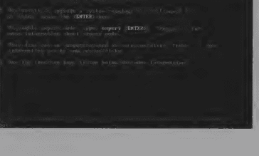

## FIGURE 5.2
Linux 启动提示允许你输入参数来告诉 Linux 内核如何处理不寻常的硬件配置。

#### NOTE


如果你想进行网络安装，因为目标系统缺少 CD-ROM 或因为你想安装更新版本的 Red Hat，你需要从 `bootnet.img` 文件创建软盘映像，该文件对应于你想要安装的 Red Hat Linux 版本。你可以像我刚才描述的那样进行操作。随书附带的 CD-ROM 包含 Red Hat 6.0 的 `bootnet.img` 文件，但如果你想安装更新版本的 Red Hat，你需要为其获取合适的映像文件。你可以使用网络安装从随书附带的 CD-ROM 安装 Red Hat 6.0，其中 Linux 或 Windows 计算机提供 CD-ROM 的文件。

## Starting the Installation

在 `boot:` 提示处按 Enter 后，屏幕上会出现许多消息。这些是 Linux 内核关于你的硬件、正在安装的驱动程序等的状态报告。这些消息结束后，Red Hat 安装程序欢迎屏幕会出现。

当你在安装程序屏幕上按 Enter 键时，Red Hat 会提示你输入多项信息，使用与图 5.3 所示类似的提示。在每个提示处，你会看到一个选项列表。使用方向键在列表中移动，然后在到达你的选择时按 Enter。你将被询问想要使用的语言、键盘和安装源。

### FIGURE 5.3

你可以通过使用空格键和方向键、Tab、Alt+Tab 和 Enter 键来导航安装菜单。

安装程序访问 CD-ROM，然后会问你更多问题，其中一些采用多项选择格式。使用方向键或 Tab 和 Alt+Tab 在选项之间切换。安装程序会询问你是否要进行全新安装或升级现有安装；是否执行工作站、服务器或自定义安装；以及你拥有什么类型的 SCSI 主机适配器。我建议进行自定义安装，因为这能让你最大程度地控制安装过程。

Red Hat 为你提供了两种用于分区磁盘的工具供选择：Disk Druid 或 `fdisk`。Disk Druid 更易于使用，但它有令人不安的倾向会产生无法使用的分区。因此我建议你使用 `fdisk`。在 Linux `fdisk` 中，你可以输入单字母命令然后按 Enter 键。最重要的命令要记住的是 `h`，它会列出可用命令。我建议先使用 `p` 命令，它会显示现有的分区表，如图 5.4 所示。然后你可以使用 `n` 创建新分区。默认情况下，Linux 的 `fdisk` 创建的类型 83 的分区——Linux 原生。你应该在创建交换分区后使用 `t` 命令将其类型更改为 82。当你满意地创建了所有分区后，使用 `w` 命令写入分区表并退出。然后你将返回到分区磁盘屏幕。如果已完成，选择 Done。

#### 注意

如果你使用 DOS FDISK 或大多数其他程序为 Linux 创建了分区，可以保留它们，但你必须使用 Linux `fdisk` 中的 `t` 命令更改分区类型。

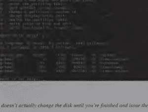

### FIGURE 5.4

Linux `fdisk` 实用程序在你完成操作并发出 `w` 命令之前实际上并不会更改磁盘。

你需要告诉安装程序每个分区将在 Linux 文件系统树中的什么位置，如图 5.5 所示。你必须指定一个分区作为根（`/`）文件系统。你将其他分区挂载在根文件系统的子目录下。

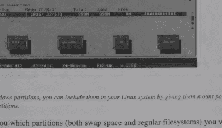

### FIGURE 5.5

如果你有 DOS 或 Windows 分区，你可以通过为它们指定挂载点，就像为 Linux 分区那样，将它们包含在你的 Linux 系统中。

安装程序会询问你想要格式化哪些分区（包括交换空间和常规文件系统）。如果你正在升级现有系统，你可能不应该格式化任何分区。如果你进行全新安装，除非它们已经被格式化，否则你应该全部格式化。

你现在已经搭建了 Linux 系统的大致框架——分区和其他基本配置。现在是时候继续决定你想要安装哪些具体软件了。

## Packages to Select and Leave Behind

Red Hat 安装程序会列出你可以安装的操作系统组件，如图 5.6 所示。每个组件实际上都是若干相关软件包的集合，其中一些相当庞大。

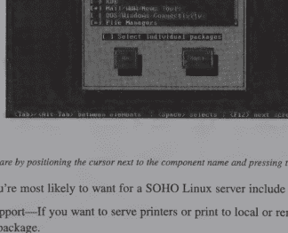

### FIGURE 5.6

你可以通过将光标定位到组件名称旁边并按空格键来选择软件。

你最有可能想要用于 SOHO Linux 服务器时的组件包括

- Printer Support—如果你想提供打印机服务或向本地或远程打印机打印，你需要这个包。
- DOS/Windows Connectivity—提供用于处理常见 DOS 和 Windows 文件格式的工具，以及从 Linux 运行 DOS 程序。
- Networked Workstation—这提供了有用的网络客户端工具。
- Dialup Workstation—如果你通过 PPP 连接到你的 ISP，请选择这个包。
- NFS Server—如果你想让其他 Linux 或 UNIX 客户端访问你的 Linux 文件系统，请选择此选项。
- SMB (Samba) Connectivity—这是 Samba 包，对于与 Windows 客户端共享文件和打印机是必要的。
- C Development—即使你自己不会编写新程序，你也需要它来重新编译 Linux 内核。请选择它。
- Development Libraries—除了 C Development 包之外，你还需要这些来编译程序。请选择它。
- Kernel Development—该组包括 Linux 内核源代码本身。请选择它。
- Extra Documentation—文档总是有用的！

你会立即知道有些包你不想安装。例如，如果你没有玩游戏的打算，游戏包就很明显。其他可能就不那么明显了。你很可能会想安装 X Window System 包，因为它们提供了 GUI 环境。GNOME 和 KDE 是 X 的两个流行桌面环境。它们都提供点按式文件浏览器和各种简单应用程序。它们都很庞大，所以如果你磁盘空间不足，你应该只选择其中一个。还有用于 FTP、DNS 和其他协议的各种服务器，你可能想要包含也可能不想要。

#### 注意

> Red Hat 使用 Red Hat Package Manager (RPM) 系统来安装软件包。RPM 包含依赖项信息——被其他软件包需要的软件包。如果你选择了一组依赖于你未选择的软件包的软件包，RPM 将强制安装你未选择的那些软件包。安装程序会在安装软件包时告诉你这一点，但在你选择时不会。还要注意，缩写 RPM 指的是处理软件包的软件、软件包的文件格式以及软件包本身。

不要太担心这里的选择。即使你取消选择所有内容，你也会得到一个可用的安装，并且可以在以后添加所需的内容。同样，如果你选择太多，你以后也可以删除多余的部分。如果你超出磁盘容量，你可能会遇到更严重的问题，需要从头重新安装。不过，如果你磁盘空间非常紧张，可以尝试去掉 X Window System、GNOME、KDE、文件管理器以及除你绝对确定必须拥有的服务器之外的所有服务器。然后你可以使用 `df` 命令查看安装后剩余多少磁盘空间，并酌情添加软件包。

选择完你想要的软件包后，选择 Ok。安装程序会通知你它将在文件 `/tmp/install.log` 中放置安装日志。当你关闭此通知后，你会看到一系列消息，告知安装程序在创建文件系统和安装软件包方面的进度，如图 5.7 所示。

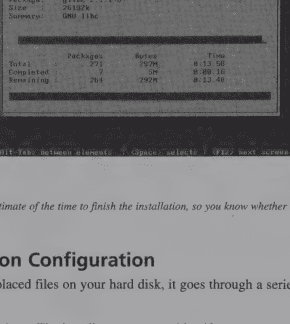

### FIGURE 5.7

安装程序会给出完成安装所需时间的估算，这样你就知道是该去倒杯咖啡还是出去吃午饭。

## Final Installation Configuration

在安装程序将文件放置到你的硬盘后，它会进行一系列测试和配置例程：

- Mouse Configuration—安装程序会尝试识别你的鼠标，通常会要求你协助识别具体的型号或类型。

  > **提示：** 如果你使用的是 3 键 PS/2 鼠标，请务必在此阶段按下向下箭头键。Red Hat 安装程序默认假设你使用的是 2 键鼠标，但 3 键选项在下一行可用，由于 2 键 PS/2 鼠标选项是无需滚动列表即可显示的最后一个选项，因此该选项被隐藏。

- Configure Ethernet—I don’t present information on Ethernet configuration here because Chapter 7, “Setting Ethernet Options,” is devoted to this topic. You can configure your system for Ethernet during installation, but you should check Chapter 7 to find out what the various options mean.

- Configure Timezones—你需要告诉 Linux 计算机所在的时区。


- Services—你可以告诉系统在启动时自动启动哪些服务。建议在你对 Linux 更熟悉之前将这些选项保持为默认值。本书会告诉你如何启用默认情况下未启用的服务。

- Configure Printer—I won’t describe printer configuration here, but if you want to do this during installation, you can check Chapter 14, “Preparing to Share a Printer,” for details on the information you’ll have to enter.

- Root Password—你必须输入两次 root 密码以确保输入正确。输入密码时，屏幕上不会有任何显示。这是正常的，出于安全目的而这样设计。

- Authentication Configuration—你可以选择如何存储密码：你可以使用 NIS，在这种情况下必须输入 NIS 域和服务器；你可以使用 shadow 密码；你还可以使用 MD5 密码。这些选项不是互斥的。我建议你同时使用 shadow 密码和 MD5，因为这样可以获得最安全的密码。如果你的网络有 NIS 服务器，你可以使用它；否则，可以忽略 NIS 选项。

- Bootdisk—你可以创建一个启动软盘来启动系统。我强烈建议你这样做。

- LILO Installation—Linux Loader（LILO）是通常从硬盘启动 Linux 系统的方式。你可以选择将其安装到硬盘的主引导记录（MBR）或启动分区的第一个扇区。如果你当前使用的是其他引导加载程序，例如 OS/2 的 Boot Manager 或 Partition Magic 的 Boot Magic，请使用第二个选项。否则，将 LILO 安装到 MBR 中。第二个 LILO 屏幕允许你输入内核参数。如果你需要此类参数来使 SCSI 适配器或 NIC 正常工作，也应在此处输入。最后，你可以在 LILO 中输入信息以使其能够启动除 Linux 之外的操作系统。你需要为每个操作系统指定一个标签，选择它并在可引导分区屏幕中选择编辑选项。

- `Xconfigurator`—Red Hat 安装程序现在会配置 X Window System。它会询问有关你的硬件的各种问题，然后提供启动 X 的选项。我建议跳过此步骤，因为如果配置不正确，测试可能会导致计算机挂起。

此时，安装程序已完成，并会重新启动计算机。

## Testing the Installation

要测试安装，请启动到 Linux。如果安装了 LILO，在 BIOS 完成测试后你会看到 LILO boot: 提示符。你可以在 boot: 提示符下按 Enter 启动默认操作系统，或输入备用操作系统的标签。如果一两分钟后出现显示 login: 的提示符，则说明你的安装至少是基本成功的。你可以输入 root 并输入安装期间指定的密码登录，然后开始使用或进一步配置系统。

## 配置文件和工具

在系统上完成基本安装后，你可能需要修改该配置以满足你的具体需求。从某种意义上说，这就是整本书的主题，尽管本书只涵盖了 Linux 配置问题的一个子集。不过，大多数 Linux 配置流程都有共同之处，熟悉它们可以帮助你，无论是在设置 Linux 服务器还是在执行其他 Linux 配置任务时。

## `/etc` 目录及其内容

Linux 的配置是通过文本文件完成的，而不是像 Windows 中那样的二进制注册表文件。Linux 将其配置文件存储在`/etc`目录或`/etc`下的子目录中。这听起来可能很简单，直到你查看`/etc`目录的内容并看到那里有几十个文件！以下是`/etc`中一些最重要的文件和目录的概述：

- `X11/` — 这是一个包含用于配置 XFree86 的文件的子目录，其中最重要的文件是`XF86Config`。

- `atalk/` — Netatalk 配置文件位于此目录中。不过，在全新安装的 Red Hat 上它不存在。

- `conf.modules` — 你可以在此文件中提供有关 Linux 如何加载和使用设备驱动程序模块的信息。

- `cron.*/` — 若干以 `cron` 开头的子目录用于配置 Linux 的 `cron` 功能。此功能可让你在指定间隔运行程序，并用于帮助清理系统文件和临时目录等。

- `fstab` — 此文件控制 Linux 如何挂载其分区。如果你添加或删除分区或可移动磁盘，或想修改现有分区的处理方式，就需要修改它。

- `group` — Linux 将用户收集到用户组中，`group` 文件指定哪些用户属于哪些组。

- `hosts` — 此文件列出经常访问的计算机的主机名和 IP 地址。

- `hosts.allow` — 对于由 TCP Wrappers 实用程序控制的网络服务，你可以在 `hosts.allow` 文件中指定允许访问该服务的计算机。如果你只想向有限数量的计算机提供服务，请使用此文件。

- `hosts.deny` — 如果有计算机或域你希望明确禁止使用某项服务，请将它们放在 `hosts.deny` 文件中。

- `inetd.conf` — 这是 `inetd` 守护进程的配置文件。对于 Linux 网络来说这是一个非常重要的文件，因为许多发行版（包括 Red Hat）使用 `inetd` 在需要时而不是之前启动特定的守护进程。

- `inittab` — `inittab` 文件控制启动过程的许多方面，指定`/etc`中运行哪些其他文件以及运行顺序。

- `ld.so.conf` — Linux 在此文件中指定的某些目录中搜索库（文件包含经常在程序之间共享的代码）。

- `lilo.conf` — LILO 实用程序的配置存储在此处。如果你更改此文件，必须通过输入 `lilo` 重新安装 LILO。

- `passwd` — 用户名和相关信息，有时包括其密码，都存储在此文件中。

- `printcap` — 此文件定义你的打印机队列。

- `profile` — 适用于所有用户的环境变量和启动程序存储于此。

- `services` — 此文件列出标准服务及其端口号。尽管服务在此文件中列出，但并不意味着它在你的系统上可用。

- `shadow` — 如果你启用了 shadow 密码，用户密码将存储在此处而不是 `passwd` 文件中。不过 `passwd` 文件仍用于大多数用户信息。其想法是 `shadow` 文件可以比 `passwd` 文件具有更严格的权限，因此未经邀请的访客即使以加密形式也无法获取用户密码。

- `smb.conf` — Samba 配置信息存储于此。

这绝不是`/etc`目录中文件的详尽列表，如果你查看过并将看到的内容与我刚刚列出的内容进行比较，你就会知道这一点。然而，这些是最重要的文件，尤其是对于 Linux 文件和打印服务器而言。

## 使用 `linuxconf`

如果你是 Linux 和 UNIX 的新手，可能会对需要编辑文本文件来配置操作系统感到望而生畏。这就是 Red Hat 开发 `linuxconf` 的原因之一，这是一个用于配置 Red Hat Linux 系统的实用程序，它使用文本或图形用户界面而不是文本编辑器和手册。你通常需要以 root 身份运行 `linuxconf`。运行后，程序会检查你的环境，并在你在 X 中运行时以完整 GUI 模式运行（见图 5.8），或在你未运行时以纯文本模式运行。

### 图 5.8

`linuxconf` 实用程序是可扩展的，因此你可以创建模块来帮助配置 Linux 系统的任何方面。

#### 注意

我在编写本书时使用的窗口管理器称为 `icewm`。Red Hat 在首次安装时未配置为使用 `icewm`，因此你窗口的装饰可能与本书屏幕截图中看到的略有不同。你屏幕上看到的窗口内容应与本书中显示的内容相同，但其周围的装饰可能不同。

`linuxconf` 中有一个可能有用（也可能很危险）的选项，即允许通过 Web 浏览器访问。如果你启动 `linuxconf` 并选择 Config，Networking，Misc，Linuxconf network access，你可以激活对 `linuxconf` 的网络访问。你可以限制对特定主机的访问，并且正常的 Linux 密码要求适用——只有拥有正常登录方式访问 `linuxconf` 的人才能通过 Web 访问它，并且他们需要输入用户名和密码。当此功能处于活动状态时，你可以通过在任何 OS 上的 Web 浏览器中输入 Linux 计算机的 Web 地址端口 98（例如 `http://gingko.biloba.com:98`）来访问 `linuxconf`。图 5.9 说明了使用 Macintosh 上的 Netscape Navigator 查看与图 5.8 中显示的相同选项时的结果。

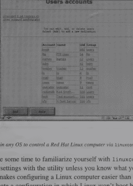

### 图 5.9

你可以使用任何 OS 中的 Web 浏览器通过 `linuxconf` 控制 Red Hat Linux 计算机。


你可能想花一些时间熟悉 `linuxconf`。我强烈建议你除非知道自己在做什么，否则不要使用该实用程序更改设置。尽管 `linuxconf` 使配置 Linux 计算机比通过编辑文本文件更容易，但使用 `linuxconf` 仍然可能创建一种 Linux 无法启动的配置。尽管这种情况可以纠正，但这样做需要比大多数新 Linux 用户更深入的知识。不过，你仍然可以安全地探索 `linuxconf`；只要确保在有此选项时单击 Cancel，并且不要单击 Accept，特别是如果你做了任何更改。

## 使用 LILO 启动 Linux

由于启动 OS 是一项基本且重要的任务，你应该了解 Linux 如何管理它。Linux 从硬盘启动的通常方式是使用一个名为 LILO 的程序。

### LILO 理论

PC 启动过程始于系统 BIOS 检查硬盘驱动器。当它找到硬盘驱动器时，BIOS 会执行存储在 MBR 中的一段代码。在典型的 DOS 或 Windows PC 上，此代码随后执行存储在硬盘驱动器启动分区第一个扇区中的代码，后者依次加载某些关键的 OS 文件，这些文件再加载更多 OS 文件，依此类推。

Linux 中的启动过程既相同又不同于 DOS 或 Windows 启动过程。Linux 使用 LILO 以灵活的方式引导启动过程。LILO 可以驻留在 MBR 中、Linux 分区的第一个扇区中，或软盘上。在这些情况下中的任何一种，它都可以根据你在 LILO 在启动时执行时输入的内容，将启动过程重定向到若干路径中的任何一个。LILO 负责将 `boot:` 提示符放置在屏幕上，作为对此提示符的响应，你可以按 Enter 键启动默认 OS，按 Tab 键查看你的选择，或输入你选择的其中一个名称来启动它。LILO 然后根据你选择的 OS 适当地重定向启动过程。在 Linux 的情况下，LILO 将 Linux 内核加载到内存中并执行它。内核随后运行 Linux 配置文件，最终启动一个完整的 Linux 系统。

由于 LILO 可以驻留在 MBR 或分区中，它可以用作主引导加载程序或次引导加载程序：

- 主引导——当 LILO 位于 MBR 上时，它控制启动过程并决定将加载哪个 OS。当 Linux 是计算机上唯一的 OS，或当你想使用 LILO 在 Linux 和一个或多个其他 OS 之间进行选择时，这是一个有用的配置。
- 次引导——如果你已经使用 OS/2 的 Boot Manager 或 Partition Magic 的 Boot Magic 等引导加载程序，你可以将 LILO 放在 Linux 分区上。在这种配置中，你可能希望将 LILO 设置为在很短的延迟后启动 Linux（几分之一秒）。然而，你也可以使用 LILO 来选择要启动的多个内核中的哪一个，甚至启动不同版本的 Linux 或不同的 OS，以实现级联启动选择（例如从类 DOS 或类 UNIX OS 中选择，在后一种情况下选择 Red Hat Linux、Debian GNU/Linux 或 FreeBSD）。

Microsoft 的 OS 通常必须安装在主分区上，但 LILO 允许 Linux 完全驻留在逻辑分区上。如果你的 Linux 分区之一是第一块硬盘上的主分区，则可以将 LILO 安装在该 Linux 主分区上。然后，如果你将该分区设置为可启动，MBR 中的正常启动代码将加载 LILO。这种安装方式的工作方式与主引导加载程序完全相同，尽管 LILO 从分区的启动扇区执行，而不是从 MBR 执行。你可能希望使用这种配置，如果你不希望在绝对必要时写入 MBR。这种设置还允许你在多 OS 系统中绕过 LILO，直接启动备用 OS。

### 使用 `linuxconf` 配置 LILO

你可以使用 `linuxconf` 来配置 LILO 以满足你的需求。在 `linuxconf` Config，boot mode，Lilo 菜单下，你会找到几个 LILO 配置设置，如图 5.10 所示。

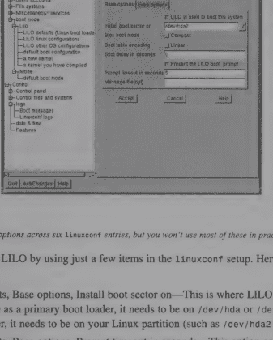

**FIGURE 5.10**

LILO 在六个 `linuxconf` 条目中提供了大量选项，但你在实际中不会用到其中的大多数。

你只需在 `linuxconf` 设置中使用几项即可配置 LILO。以下是一些重点：

- LILO defaults, Base options, Install boot sector on—LILO 安装自身的位置。要将 LILO 用作主引导加载程序，它需要位于 `/dev/hda` 或 `/dev/sda` 上。作为次要加载程序，它需要位于你的 Linux 分区上（如图 5.10 中的 `/dev/hda2`）。
- LILO defaults, Base options, Prompt timeout in seconds—此选项控制 LILO `boot:` 提示在屏幕上停留多长时间后才启动默认选项。
- LILO linux configurations—此屏幕控制 Linux 启动配置。你的安装中应有一个由 Red Hat 安装程序创建的配置。单击它，会出现一个新标签页用于控制它。你可以创建新的配置，例如用于测试新内核。
- LILO linux configurations, Linux boot configuration, Label—标签是你输入以启动此配置的内容。
- LILO linux configurations, Linux boot configuration, Kernel image file—你必须告诉 LILO 内核位于何处才能启动 Linux。
- LILO linux configurations, Linux boot configuration, root partition—你必须告诉 LILO 你的文件系统层次结构的根分区是什么。内核在那里查找额外的配置文件。
- LILO other OS configurations—你可以使用 `linuxconf` LILO 区域的这一部分添加非 Linux 操作系统。
- Default boot configuration—在这里你可以选择任何 Linux 或其他操作系统配置作为默认项。
- A new kernel—你可以使用此项快速在 LILO 中安装新的内核映像。你必须指定内核文件、提供标签等。
- A new kernel you have compiled—如果该实用程序能检测到刚编译的内核，单击此标签时 `linuxconf` 可以非常轻松地将新内核添加到 LILO。

## Configuring LILO with Text Files

如果你想以老式的方式配置 LILO，可以将 `/etc/lilo.conf` 文件加载到你喜欢的文本编辑器中。下面是一个 `lilo.conf` 文件示例，演示如何从两个 Linux 内核之一启动：

```
boot=/dev/hda2
map=/boot/map
install=/boot/boot.b
prompt
timeout=50
image=/boot/zImage-2.2.8
    label=228
    root=/dev/hda8
    read-only
image=/boot/zImage-2.2.9
    label=229
    root=/dev/hda8
    read-only
```

第一行（`boot=/dev/hda2`）指定放置 LILO 本身的位置。此位置通常为 `/dev/hda` 或 `/dev/sda` 作为主加载程序，或特定分区，如 `/dev/hda2` 作为次要加载程序。接下来的三行设置标准选项，不应更改。`timeout` 行指定提示在屏幕上停留的时间，单位为十分之一秒。以 `image` 开头的每一行指定一个单独的 Linux 启动映像，每个映像规范都包含几行从属行。`image` 行本身标识 Linux 内核。`label` 和 `root` 行分别指定启动标签和根文件系统。`read-only` 行表示文件系统最初应以只读模式挂载，这是正常的；在启动过程的后面，Linux 会以完全读写模式重新挂载文件系统。除非另有指定，否则文件中的第一个系统规范将成为默认值。

你可以通过在 Linux 命令提示符下输入 `man lilo.conf` 来了解更多关于 `lilo.conf` 文件格式的信息。

当你编辑 `/etc/lilo.conf` 文件时，必须确保重新安装 LILO 以使更改生效。LILO 实际上是两件事：写入引导扇区的代码，以及根据 `/etc/lilo.conf` 文件的内容创建该代码并将其放置在那里的程序。后一项任务由位于 `/sbin` 目录中的名为 `lilo` 的程序处理，因此要安装 LILO 引导加载程序，你输入 `/sbin/lilo`，或如果 `/sbin` 在你的搜索路径上，则只需输入 `lilo`。你会看到类似每项系统规范已添加的消息。如果过程中出现错误，你会看到错误消息，并且你的更改不会生效。

## Setting Up User Accounts


Linux 被设计为多用户操作系统。因此，不同用户拥有不同账户的概念贯穿整个操作系统——从登录需求到文件的所有权和权限。因为文件和打印机共享操作与 Linux 的安全需求密切相关，所以你需要非常熟悉账户创建和维护、文件权限等相关操作。因此，本节涵盖了其中的一些内容。

## The Importance of User Accounts

使用单独的用户账户为 Linux 提供了几个关键好处，就像对其他类 UNIX 操作系统一样：

- User privacy—大多数为桌面使用而设计的操作系统都没有用户账户的概念，任何坐在系统前使用的人都可以访问系统上的所有文件。如果你想与他人共享这样一台计算机，确保其他用户无法读取你的文件的唯一方法就是加密它们，这对你来说很麻烦。用户账户可以让你防止窥探者看到你的数据。
- Multiuser access—几个人可以通过使用终端或其他联网计算机同时使用一台 Linux 计算机。保持单独的账户有助于防止这些个人的单独操作相互干扰。
- Access control—用户账户允许计算机放置在公共位置，而不必担心会被未经授权的个人使用。（这既适用于物理位置，也适用于通过网络的访问。）当然，即使是 DOS 这样的单用户操作系统也可以配备密码保护方案，但如果没有实现至少最少的用户账户系统，就无法追踪何时是谁使用了计算机。
- System protection—具有不同用户不同权限级别的操作系统，如 Linux 所实现的那样，可以保护操作系统免受用户错误和恶意行为的影响。例如，对于大多数传统桌面操作系统来说，用户只需删除一个关键目录就很容易抹掉整个操作系统。虽然这在

Linux 中，这类操作需要 `root` 权限，而大多数用户并不拥有。普通用户通常只能删除自己的文件，而不能删除系统上其他用户的文件，也不能删除整个系统所属的文件。

这一点对于将 Linux 作为桌面操作系统使用的人来说是最相关的，也是 Usenet 新闻组中来自 `root` 账户的帖子常常遭到嘲笑，或至少被劝诫创建并使用普通用户账户的主要原因。我的系统上有一个普通用户账户，我用它来进行网页浏览、阅读邮件、写作等任务。假设我不小心输入了如下命令

```
rm -r / home/rodsmith/dumbstuff
```

本意是删除名为 `dumbstuff` 的特定目录，但由于多了一个空格，这个命令实际上告诉系统从所有已挂载的文件系统中删除所有文件。如果我以普通用户身份登录，Linux 不会让我这么做。如果我来不及发现错误，我会删除自己的所有文件，但不会破坏整个系统。然而，如果我所有操作都以 `root` 身份进行，我就可以抹掉整个系统。Linux 对新手来说可能晦涩难懂，而且并不总是警告你正在做危险的事情，所以你绝对应该创建并使用普通用户账户，即使你将 Linux 用作桌面操作系统。

#### Note

> 尽管我鼓励你尽可能使用用户账户，但本书中描述的大多数操作都是系统配置操作，因此需要你拥有 `root` 权限才能执行。你可以直接以 `root` 身份登录，也可以使用 `su` 命令获取 `root` 权限。在命令行提示符或 `xterm` 窗口中，输入 `su`，然后按 Enter 键。Linux 会提示你输入密码。输入 `root` 密码后，该 `xterm` 或命令行提示符中的任何操作都将获得 `root` 权限。如果你正在运行 X，则已在运行的程序不受此影响。

## Using linuxconf

使用 `linuxconf` 创建用户账户非常容易。选择 `Config, Users accounts, Normal, User accounts` 以打开账户列表窗口（图 5.11）。你可以点击现有账户来修改它，或点击 `Add` 添加新账户。无论哪种方式，`linuxconf` 都会显示图 5.12 所示的用户账户创建标签页（如果修改现有账户，则称为 `User information`）。

### FIGURE 5.11

用户账户标签页显示了所有常规用户账户，以及关于它们的关键信息，例如其主组和用户 ID。

### FIGURE 5.12

你可以通过填写几项信息并点击 `Accept` 来创建账户。

创建新账户或修改现有账户最重要的信息位于 `Base info` 子标签页。你可以输入用户的登录名、全名、组、主目录、shell 和用户 ID。对于其中大多数字段，如果你不输入任何信息，`linuxconf` 会分配适当的默认值。例如，默认组是一个与登录名同名的新组；`linuxconf` 会分配第一个可用的用户 ID。

用户账户创建标签页上的其他子标签页提供了进一步微调用户账户功能的附加选项：

- `Params tab`—你可以在此处设置与密码过期相关的参数。默认情况下，会出现 `-1` 或 `99999` 的值，表示密码不会过期。如果你想强制用户更改密码（在许多环境中这是良好的策略），你可以更改这些值。
- `Mail aliases`—你可以指定发往某个账户的邮件应转发到其他地方，并且可以设置从该账户发出的邮件显示的名称与该账户不同。
- `Privileges`—你可以指定用户是否能够或不能够执行某些类似管理的操作，例如关闭计算机或查看系统日志文件。

当你将 Linux 系统设置为主机，特别是作为文件服务器时，你需要考虑如何实施安全措施。这些考虑与为用户账户设置选项相互作用，如本章后面“Account Creation Tips”所述。

当你点击 `Accept` 创建账户时，`linuxconf` 会提示你输入密码。你需要输入两次以确保输入正确。

## Creating an Account with Text-Mode Tools

如果你不想或不能使用 `linuxconf`，你可以使用相当标准的文本工具来创建账户。其中主要的是 `useradd`，通常位于 `/usr/sbin`。要使用 `useradd` 创建账户，你必须在命令行上指定所有参数，如下所示：

```
useradd -u 521 -g 100 -d /home/amy -s /bin/bash -p password amy
```

你最有可能与 `useradd` 一起使用的选项是

- `-u`—指定要分配的用户 ID。
- `-g`—指定要分配的组 ID。
- `-d`—指定主目录。
- `-s`—指定默认 shell。
- `-p`—指定初始密码。
- `-D`—修改现有账户而不是创建新账户（此选项不带额外参数）。

用户名位于行尾，不带标识的破折号选项。

#### Note

Linux 命令区分大小写。这既适用于命令名称本身，也适用于其参数。你可能已经注意到，`useradd` 同时具有 `-d` 选项和 `-D` 选项，例如，如果你想用另一个选项却指定了其中一个，可能会产生不可预测的结果。

`useradd` 还有其他选项。输入 `man useradd` 以了解更多相关信息。

你可以使用 `userdel` 命令删除用户账户。它比 `useradd` 命令简单得多；`userdel` 只有一个选项，`-r`，它会导致系统删除用户账户中的所有文件。

## Account Creation Tips

Linux 对所有文件操作都使用其用户概念，包括使用文件或打印机共享协议从远程计算机发起的操作。因此，你应该考虑 Linux 的安全模型，以及你打算如何将网络纳入该模型。

Linux 中的每个文件都有三组不同的权限，用 10 个字符的字符串或 3 或 4 位的八进制数字表示，例如 `-rw-r--r--`、`644` 或 `0644`。 在 10 字符表示法中，第一个字符表示特殊文件，例如目录 `d`，其余 9 个字符为三组三字符，表示文件所有者、文件所属组以及所有其他用户对文件的读 `r`、写 `w` 和执行 `x` 权限的存在与否。八进制表示法以相同的方式表示信息，通过将读、写和执行权限编码为位，从而为所有者、组和所有权限产生 0 到 7 的数字。图 5.13 说明了其中一个三元组的这种关系。每个文件还拥有一个所有者和一个组，通常都设置为创建该文件用户的用户名和主组。


### FIGURE 5.13

将每个位的数值相加即可得到每个三元组的八进制权限值——所有者、组和其他用户。

该方案允许创建文件的人对文件提供分层访问。例如，权限字符串 `-rw-r-----`（或八进制表示法中的 `640`）表示所有者可以读取和写入文件，文件所属组中的用户可以读取但不能写入文件，而其他任何人都无法访问该文件。 （此规则的一个例外是 `root` 用户对所有文件都有完全的读/写访问权限。）

现在，假设你有一个小型网络，其中有三台不同的 Windows 计算机，每台都有不同的用户，以及一台运行 Samba 的 Linux 服务器。你可以使用 Samba 来配置新文件获得的权限，但在为你的三个网络用户创建账户时，你应该考虑安全性和用户组。以下是一些可能的场景：

- 在所有三台 Windows 机器上使用单个用户名和密码，并使用单个 Linux 账户——此选项方便且易于配置，但安全性较差，而且没有简单的方法将用户的文件彼此分开。


- 使用单独的账户和单个组——你可以为每个用户创建单独的账户，但将它们全部放入单个组。然后你可以配置 Samba 以创建权限为 `-rw-rw-r--` 或 `-rw-r--r--` 的文件，分别提供对所有用户账户的读写或只读访问。你可能需要在创建时手动更改用户主目录的权限，因为默认情况下它们获得的权限为 `drwx------`，这意味着只有所有者可以访问它们。这种设置对于在网络所有用户之间共享文件来说是很好的。

- 使用单独的账户和单独的组——你可以为不同用户创建单独的账户，并创建两个或多个组。例如，你可以将用户 `kohler` 和 `wundt` 放在组 `europe` 中，但将用户 `james` 放在组 `usa` 中。根据 Samba 分配给新文件的组权限，`kohler` 和 `wundt` 将能够读取甚至写入彼此的文件，但你可以将 `james` 排除在外。由于 Linux 允许你将用户分配到多个组，因此如果你愿意，可以扩展一个用户的访问范围。例如，你可以通过将 `europe` 添加到 `james` 所属的组列表中，从而让 `james` 访问 `kohler` 和 `wundt` 的文件，但限制他们访问 `james` 的文件。

Linux 使用的 UNIX 风格权限允许相当细微和灵活的操作，你需要通过实践来学习该系统能实现什么。如果你设置了一个系统但发现它不起作用，你可以更改系统。你可以使用 `chmod`、`chown` 和 `chgrp` 命令分别更改文件的权限、所有权和组状态。如果需要，你可以使用 `linuxconf` 或通过编辑 `/etc/passwd` 和 `/etc/group` 文件来更改用户的主组归属，并将用户关联到附加组。你可以使用 `umask` 命令或通过更改文件共享服务器（如 Samba 或 Netatalk）的配置来更改分配给文件的权限。

最后，你可以创建私有和共享目录用于文件共享。例如，你可以为每个用户提供一个默认目录（可能与用户的 Linux 主目录相同）用于个人文件，同时提供一个所有用户共用的独立共享目录，其中包含共享数据文件或程序文件。这样你就可以在保持其他文件安全的同时，为某些文件提供相对自由的访问权限。

# 摘要

在你能够配置 Linux 系统上想要的网络功能之前，你需要有一个正常工作的基础系统。本章描述了如何实现这一目标。本书附带一张包含 Red Hat Linux 6.0 的 CD-ROM，本章的前半部分描述了如何安装它。本章的其余部分描述了最重要的配置文件和 `linuxconf` 实用程序。你可以使用 `linuxconf` 通过图形用户界面，甚至通过远程计算机上的 Web 浏览器来配置工作 Linux 系统的许多方面。

## 为网络编译内核

## 第 6 章

# 本章内容

- 了解编译过程 140
- Linux 内核版本 142
- 设置内核编译选项 144
- 编译和安装内核 153
- 摘要 160

以下是 1999 年中在某些 Linux 新闻组中一个假设但典型的 Usenet 新闻交流的节选，略有删减以求简洁：

New Linuxer：我无法在 Linux 中使用我的 NIC。它是 LinkGear 10/100 PCI 型号，我使用的是 Red Hat 6.0。如何让它工作？求助！

Experienced Linuxer：LinkGear 10/100 使用的是 DEC Tulip 芯片组的克隆版。这个特定克隆版与 Red Hat 6.0 自带的驱动程序配合不佳。你需要获取新版本的驱动程序并重新编译你的内核或内核模块。

New Linuxer：好的，但我如何重新编译内核？

本章主要旨在回答新 Linuxer 的第二个问题，但也旨在提供一些见解，说明即使你的系统似乎运行良好，为什么你也想这样做。我将从编译内核的好处这个问题开始。

## 了解编译过程

如果你对计算机编程不太熟悉，你可能不明白编译内核到底有什么好处。Linux 是少数允许最终用户编译内核的操作系统之一。这既是福也是祸，如本节所述。

### 编译到底是什么？

人类理解文字。计算机理解数字。编译计算机程序是将 C 或 Pascal 等高级计算机语言的文字转换为计算机理解的数字的过程。编译过程实际上有几个阶段，但你无需特别关注其中大部分。在编译 Linux 内核时，你主要需要关注配置过程以及启动一切并使用最终产品——一个为你的系统定制的全新内核——所需的一小部分命令。

### 自己编译内核的优点和缺点

自己编译内核有几个非常好的理由。并非所有理由都适用于每个系统，但其中许多都适用，因此我建议你确实应该自己编译内核。编译自定义内核的理由包括

- 设置优化——你可以告诉系统在编译内核时知道你拥有什么类型的 CPU。这允许内核更高效地运行，从而提高整体系统性能。同样，你可以自定义网络和其他选项以优化特定领域的性能，例如路由 TCP/IP 数据包。
- 添加功能——你下载的预编译内核以及随发行版提供的内核可能支持也可能不支持你想要的功能。这对于 IP 伪装等高级功能尤其如此。此外，一些奇特的驱动程序尚未进入内核，但你可能想自己添加它们。
- 移除功能——预编译内核通常包含你不需要或不想要的功能，例如为 386 CPU 提供的 FPU 仿真。移除这些功能可以减小内核的大小，从而节省 RAM。例如，随 Red Hat 6.0 发行的 2.2.5 内核大小为 600KB，但我在安装 Red Hat 6.0 后立即为我的主要 Linux 系统编译的 2.2.5 内核大小为 500KB。由于内核以压缩形式存储在磁盘上，这代表节省了超过 100KB 的 RAM。
- 更新驱动程序——编写 Linux 内核驱动程序的人最终会将其驱动程序提交以纳入 Linux 内核整体，但更新的驱动程序进入内核有时需要一段时间。这就是本章开头概述的场景所导致的情况；与 Tulip 以太网芯片组最新克隆版配合最佳的 `tulip.c` 驱动程序版本并未包含在内核 2.2.5 的标准内核源代码中。替换一个文件并重新编译内核可以解决使用许多最新且非常流行的以太网板相关的问题。
- 经验——迟早，如果你坚持使用 Linux，你会发现上述优点中的一个会变成必需品。即使你现在不需要编译内核，你也应该尝试并学习如何操作，这样当你需要编译新内核时就不会因停机而受苦。

当然，自己编译内核也有缺点：

- 唯一性——很有可能没有多少人会拥有一个与你选择的特性完全相同的编译内核，因此如果该配置导致独特问题，你可能难以诊断故障。
- 用户错误——如果你不小心遗漏了重要的内核驱动程序，你可能会发现某些功能无法工作。你可能会花费一些时间尝试诊断系统的其他部分，然后才找到问题的真正原因。我曾经花了一个小时诊断打印机问题，而该问题是由我在两天前之前的内核编译中遗漏了并行端口驱动程序引起的。
- 时间——编译内核确实需要时间，如果你的系统在不花费这段时间的情况下运行良好，为什么还要费事？对于休闲用户来说，这个因素尤其值得考虑，确实有很多理由支持这一点。

## Linux 内核版本

Linux 内核是操作系统的核心。事实上，要严格准确地说，Linux 内核就是 Linux，而你可能认为的 Linux 的其他所有东西都不是 Linux 的一部分。Linux 内核是操作系统（OS）中处理低级操作的部分——诸如设备驱动、内存管理、文件系统访问、多任务处理等等。诸如你输入命令的 shell 程序、提供网络服务的守护进程、X Window 系统的 XFree86 实现，以及许多其他东西都不属于内核，它们都是独立于内核开发的。

> Note
>
> 其中许多非内核组件是在自由软件基金会的 auspices 下开发的，该基金会使用递归缩写 GNU's Not UNIX（GNU）来指代其产品。因此，有些人使用 GNU/Linux 一词来指代 Linux 以及其他组件（如 Red Hat）的完整软件包。这种做法在提到 Debian 发行版时尤其普遍。我在本书中使用 Linux 单独称呼，因为它更简短，是更常见的用法，也是 Red Hat 对其产品的称呼，该产品包含在本书记载的 CD-ROM 上。

## Linux 内核历史

每个内核都由三个数字标识，形式为 `x.y.z`——例如 `2.2.5`，这是随 Red Hat Linux 6.0 发行的版本。在 Linux 中，三元组的第二个数字（`x.y.z` 中的 `y`）具有特殊含义。当 `y` 为偶数时，内核被视为“发布”内核。当然，可能存在错误，但不应该有太多错误。同样重要的是，在固定的 `y` 数字生命周期内，由 `z` 数字反映的修订期间不会有重大更改。当 `y` 为奇数时，内核被视为“开发”内核，这意味着它可能比发布内核有更多错误，更重要的是，开发人员将努力在一次 `z` 发布到另一次 `z` 发布之间产生可能的大幅更改。

实际上，这意味着在任何时候都有两个最当前的 Linux 内核——一个发布内核（在我撰写时为 2.2 系列）和一个开发内核（在我撰写时为 2.3 系列）。当内核开发人员（其中最主要的是内核的创始人 Linus Torvalds）决定他们为开发内核添加了足够多的功能时，他们开始专注于使其稳定，并最终以发布编号分发它。

#### Note


你偶尔可能会看到对“Linux 6.0”或类似高数字的引用。除非你在 21 世纪的几年后阅读本书，否则此类引用是不正确的，很可能是对特定 Linux 发行版（如 Red Hat Linux 6.0）的错误引用。发行版以及所有 Linux 程序都有自己的编号方案，这些方案完全独立于内核——以及彼此——的编号方案。

在其他条件相同的情况下，你可能希望运行你能获得的最新发布系列中的最新内核。我不建议你每次在 FTP 站点上看到新内核出现时就更新——很可能从例如 2.2.9 到 2.2.10 的更改不会大到足以证明获取它、编译它并重新启动系统所需的时间和精力。升级也有可能破坏某些东西。

如果你想生活在边缘，或者如果你需要一个特别新的功能，你可能想考虑使用开发内核。我只在你已经熟悉 Linux 的情况下推荐这一点，或者如果你绝对需要某个发布内核不支持的功能。即使你需要新功能，你也可能能够将其修补到发布内核中，从而避免破坏系统其他组件的可能性。

## 获取内核

大多数 Linux FTP 站点都有 Linux 内核的存档。你可以以 Red Hat Package Manager（RPM）形式或“tarball”形式获取内核——文件名以 `.tgz` 或 `.tar.gz` 结尾的文件。我通常更喜欢获取 tarball，但有些人更喜欢 RPM 文件。选择你喜欢的即可。

如果你获取的是 tarball，你需要使用 `tar` 命令将其提取。按照以下步骤操作：

- 1. 通过输入以下命令切换到 `/usr/src` 目录
- `cd /usr/src`
- 2. 为新内核创建一个新的子目录。例如，如果你正在安装内核 2.2.9，请输入
- `mkdir linux-2.2.9`
- 3. 如果你已经有 Linux 内核源代码，很可能从其目录到 `linux` 有一个符号链接。通过输入以下命令删除该链接
- `rm linux`
- 4. 通过输入以下命令从新目录创建一个新的符号链接
- `ln -s linux-2.2.9 linux`
- 5. 解压新的内核源文件。如果 tarball 在你的主目录中，输入
- `tar xvf ~/linux-2.2.9.tar.gz`
- （根据你拥有的版本替换合适的文件名）。

你现在已经解压了内核。

如果你得到一个 RPM 文件，你需要下载两个文件而不是一个：`kernel-source` 和 `kernel-headers`（带有适当的版本号和 `.rpm` 扩展名）。完成此操作后，你的任务比使用 tarball 时要简单一些；你只需输入

```
rpm -Uvh kernel-source-2.2.9-1.1386.rpm kernel-headers-2.2.9-1.1386.rpm
```

文件名可能与这些不同，即使你安装的是 2.2.9 内核源也是如此。

## 设置内核编译选项

解压内核源后，你应该通过输入以下命令切换到内核源目录

```
cd /usr/src/linux
```

然后你必须指定要编译的众多驱动程序和选项，以及如何编译。如果你使用 X，最简单的方法是输入

```
make xconfig
```

这会生成图 6.1 所示的 Linux 内核配置窗口。如果你没有运行 X，你可以输入

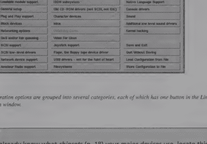

### 图 6.1

Linux 内核配置选项被分组为几个类别，每个类别在 Linux 内核配置窗口中都有一个按钮。

#### 提示

如果你还不知道主要设备使用的芯片组（第 18 页），请在继续之前查明此信息。这对于 SCSI 主机适配器、网络接口卡（NIC）和声卡尤其关键。你不需要为内核编译提供显卡芯片组的信息。视频显示通常由 XFree86 处理，而不是由内核处理。（在 Video for Linux 配置区域中，有将一些视频支持添加到内核的动向，但你可以忽略这一点，尤其是对于不太可能用于控制台游戏的服务器。）

在许多情况下，特定的内核功能有三个选项，标记为 `y`、`m` 和 `n`。（参见图 6.2 中配置窗口的示例。）其中第一个和最后一个分别代表 yes 和 no，指的是将驱动程序或功能直接编译到单块内核文件中。`m` 选项指的是作为模块编译。内核模块是一个与内核物理分离的文件，但内核可以按需将其加载到内存中以补充其自身功能。使用模块而不是将驱动程序编译到内核本身主要有两个优势。首先，内核模块可以根据需要加载和卸载，因此在不需要时不必占用 RAM。其次，内核模块允许创建相对紧凑的内核文件，并附带大量模块来支持各种硬件。这种第二个优势对 Red Hat 等发行版提供商尤其重要，但如果你有几台硬件各异的 Linux 计算机，也可能想利用此功能。与其在内核中包含对例如 3COM、Intel 和 D-Link 以太网板在三台不同计算机上的支持，不如编译一个没有特定

以太网适配器的内核，同时将三个以太网驱动程序作为模块编译。然后你可以使用相同的内核，并自定义每台机器的 `/etc/conf.modules` 文件，使其使用适当的模块。这可以保持内核小巧，并避免不存在硬件的驱动程序导致其他驱动程序或真实硬件出现问题。

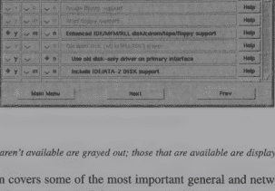

### 图 6.2

不可用的配置选项为灰色显示；可用的选项以黑色文本显示。

本节的其余部分涵盖了 Linux 2.2 系列内核中最重要的一些通用和网络特定选项。我并没有涵盖所有内核选项，因为它们实在太多。我建议你花一个小时左右浏览内核并点击大多数内核选项旁边的帮助按钮。这样你可以了解这些选项。

#### 注意

可用的内核选项会不时发生变化，主要是开发内核变更期间，但有时在发布内核系列中也会发生变化。如果你编译的内核比我撰写本节时用作参考的 2.2.9 内核更新或更旧，你必须依赖 `make xconfig` 或 `make menuconfig` 的帮助文本或额外的文档来源。例如，从 2.0 系列内核到 2.2 系列内核，某些选项发生了重大变化，包括并行端口支持和执行 IP 伪装所需的内核功能。如果你使用 2.3 系列内核或更新的内核，你可能会遇到类似的差异。

## 预备选项

配置主菜单上的代码成熟度级别选项、处理器类型和特性、可加载模块支持以及通用设置按钮提供了一些具有普遍兴趣的选项，并且在某些情况下决定了内核其他地方可用的选项。这些选项包括

- 提示开发和/或不完整的代码/驱动程序——即使是发行版级别的内核也经常包含被视为实验性的驱动程序。如果您对该选项选择 `y`，则可以包含这些实验性驱动程序。本书中描述的一些网络特性被视为实验性，因此我建议对该选项选择 `y`。
- 处理器系列——您可以选择您拥有的几种 x86 CPU 的宽泛类别之一。
- 数学仿真——Linux 包含一个数学协处理器仿真器。您仅在拥有 386、486SX 或没有匹配 FPU 芯片的早期 NexGen Nx586 CPU 时才需要此仿真器。
- 可加载模块支持——如果此处不选择 `y`，您将无法将任何驱动程序编译为模块。
- 内核模块加载器——如果选择 `y`，可让内核在需要时搜索并加载适当的模块。
- 网络支持——此处选择 `y`。
- 内核对 ELF 二进制文件的支持——可执行和可链接格式（ELF）是 Linux 可执行文件的当前格式。您必须拥有此支持，因此选择 `y`。
- 并行端口支持——如果您想使用并行端口设备，例如打印机或并行端口 Zip 驱动器，请将此设置为 `m` 或 `y`。打开此选项后，您还将能够设置支持的端口类型。在 x86 计算机上，仅需 PC 风格硬件即可。

## 块设备

块设备是指以块为单位交换数据的设备。这些主要是磁盘驱动器，但与磁盘相关的一些设备（如 SCSI 主机适配器）也有自己的配置屏幕。块设备选项包括以下内容：

- 增强型 IDE/MFM/RLL 磁盘/CD-ROM/磁带/软盘支持——如果系统从 EIDE 硬盘运行，请在此处选择 `y`。如果您拥有 EIDE/ATAPI 设备（如 CD-ROM）但从 SCSI 硬盘启动，则可以将其编译为模块。
- 包含 IDE/ATAPI {device} 支持——菜单上有针对特定设备的系列选项。请选择您拥有的任何设备的 `m` 或 `y`。如果您从 EIDE 硬盘启动，则必须对硬盘选择 `y`。
- 芯片组支持——大量选项可为特定 EIDE 控制器（其中许多集成在主板芯片组中）启用扩展和错误修复。如果您不知道系统使用什么控制器，明智的做法是选择包含 bugfix 词的任何选项，因为这些选项可解决可能导致数据损坏的硬件错误。如果您没有受影响的控制器，这些错误修复不会干扰正常操作。
- 循环设备支持——Linux 支持将文件挂载为好像它是设备一样。这称为循环设备，对于使用 `mkisofs` 创建的 CD-ROM 映像的测试、在将软盘复制到软盘之前完全在硬盘上准备软盘等非常有用。

#### 提示

> 您可以使用 Linux 的循环设备支持同时提供多个 CD-ROM，并提高 CD-ROM 访问速度，前提是您有足够的磁盘空间存储多个 CD-ROM 映像。


- 网络块设备支持——如果选择此选项，您将能够直接挂载来自远程服务器的设备。这与通过 Network File System（NFS）等协议导出的文件系统挂载不同；您的计算机将直接操作外部设备。此选项仅在您在网络上有两台或更多 Linux 或 UNIX 计算机时才有用；如果您将单台 Linux 计算机配置为 Windows 或 Macintosh 机器的服务器，则可以对该选项选择 n。
- 多设备驱动程序支持——此选项启用独立磁盘冗余阵列（RAID）支持，可用于具有多个 SCSI 磁盘的非常快的服务器。
- 并行端口 IDE 设备支持——如果您拥有通过并行端口接口的磁带、CD-ROM 等，请选择此选项和适当的子选项。

## 网络选项

网络选项组包含配置 Linux 网络服务器最重要的一些选项：

- 网络防火墙——如果您希望 Linux 计算机充当防火墙或 IP 伪装计算机，如第 VI 部分“将您的局域网连接到互联网”所述，请在此处选择 y。此选项使内核能够充当数据包过滤防火墙，根据源地址等基本信息过滤网络数据包。更复杂的代理防火墙不需要此内核选项。
- TCP/IP 网络——对该选项选择 y。
- IP：高级路由器—如果您想将 Linux 主机配置为路由器，请在此选择 y。然后您可以启用更多具体的路由功能。但是，使用 IP 伪装不需要此选项。
- IP：防火墙—这是第二个防火墙选项。您需要同时选择它以及网络防火墙，才能进行 IP 伪装。
- IP：始终分片重组—此选项会重新组装在网络传输过程中被拆分的网络数据包。如果要使用 IP 伪装，您需要在此处选择 y。在大多数其他情况下，您应选择 n。
- IP：伪装—如果您想执行 IP 伪装，如第 20 章“一个 IP 地址， 多台计算机：IP 伪装”所述，请选择 y。随后有几个选项可让您为伪装特定类型的网络流量启用支持。选择您认为可能需要的选项，或如果不确定需要哪些，则全部选择。
- IP：作为路由器而非主机进行优化—如果您的系统主要用作路由器，请对此选项选择 y；否则，选择 n。
- AppleTalk DDP—如果您希望计算机作为 AppleTalk 服务器或客户端运行，请选择 y 或 n。您还需要相应的 Netatalk 或 afpfs 软件包。
- 网桥—如果启用此选项，您的 Linux 主机可以在两个以太网段之间充当网桥。

## SCSI 支持

SCSI 支持和 SCSI 低级驱动程序区域分别列出了 SCSI 设备类型（如磁盘、磁带和 CD-ROM）以及特定 SCSI 主机适配器的选项。如果您的系统从 SCSI 硬盘启动，则内核中必须同时存在 SCSI 磁盘支持选项和您特定型号主机适配器的选项——即使用 y 编译，而不是使用 m。您可以根据需要将所有其他 SCSI 选项编译为模块。

## 网络设备支持

网络设备支持区域包括大多数 NIC 和其他网络接口（如 PPP）的低级驱动程序。

### 提示

> 如果您的系统有两个使用相同驱动程序的 NIC，您可能会发现将以太网驱动程序直接编译到内核中而不是作为模块，可以更轻松地配置 Linux 识别两者。另一方面，如果您有两个使用不同驱动程序的 NIC，您可能会发现将它们都编译为模块会提供更大的灵活性。

网络设备选项包括以下内容：

- 网络设备支持—为此顶级选项选择 y。
- 以太网（10 或 100Mbit）—如果您使用以太网，请选择 y。一些驱动程序直接出现在该标题下，其他驱动程序则以各种不一致的方式分组，因此您可能需要查找特定的驱动程序。具体选项组包括以下内容：
  - 3COM 卡—整个以太网卡组专门用于 3COM 卡。如果您有 3COM 型号，请在此选择 y 并选择您的卡。
  - Western Digital/SMC 卡—与 3COM 类似，这里有一个专门用于 Western Digital 和 SMC 板的整个部分。
- 其他 ISA 卡—此区域列出了各种 ISA NIC。如果您的板卡是 ISA 板，它可能列在此部分。如果您有 ISA 板但不知道它是什么，请尝试 NE2000/NE1000 驱动程序；许多 ISA 板与 NE2000 兼容，因此可与此驱动程序一起使用。
- EISA、VLB、PCI 和板载控制器—这里有一系列 EISA、VLB 和 PCI 卡芯片组。其中一些也集成在主板上。
- PLIP（并行端口）支持—如果您想通过并行端口而不是通过以太网连接两台计算机，请在此选择 y 或 m。您还必须在常规设置区域中选择并行端口支持。
- PPP（点对点）支持—在此选择 y 或 m 以使用 PPP 通过调制解调器连接到您的 ISP。
- SLIP（串行线路）支持—在此选择 y 或 m 以使用 SLIP 通过调制解调器连接到您的 ISP。SLIP 在很大程度上已过时。但是，它在通过 PPP 进行按需拨号网络时用作中间协议，如第 8 章“使用 PPP 进行拨号连接”所述。
- Token Ring 驱动程序支持—如果您有 Token Ring 卡，请为此选项和适当的 Token Ring 板选择 y。

## 字符设备

字符设备一次发送和接收一个字符的数据。这与块设备（如硬盘）形成对比，后者以多字节块传输数据。字符设备选项包括以下内容：

- 虚拟终端—Linux 维护多个虚拟终端，以便您可以轻松地在多个正在运行的程序甚至完整的 X 配置之间切换。为此选项选择 y。
- 标准/通用（哑）串行支持—在此选择 y 或 n 以使用主板上的串行端口、多数即插式一或两端口串行板，或内置调制解调器。
- 并行打印机支持—如果打印机连接到并行端口，请在此选择 y 或 m。你还需要在“General setup”区域的“Parallel port support”中选择 y 或 m。
- 鼠标支持（不包括串行鼠标）—如果您使用的是总线鼠标或 PS/2 鼠标，请在此选择 y。

## Mice

如果您使用的是 PS/2 鼠标或总线鼠标，此区域可让您为特定类型的鼠标设备启用驱动程序。

## Filesystems

Linux 作为服务器的一大优势在于它支持许多其他操作系统的文件系统。对于服务器的硬盘来说这并不太重要，但对于处理可移动驱动器则可能很重要。如果您的网络主要是 Windows 计算机，只有 Linux 服务器一台，例如，您可以在 Linux 服务器上读取 Macintosh 1.44MB 软盘和可移动磁盘。文件系统选项分布在 Filesystems、Network File Systems、Partition Types 和 Native Language Support 区域中。受支持的 Linux 文件系统和文件系统选项包括

- 配额支持—如果选择此选项，您可以限制每个单独用户拥有的磁盘空间量。
- Apple Macintosh 文件系统支持—此驱动程序支持 Macintosh 层次文件系统（HFS）格式，但不支持更新的 HFS+。由于 HFS+ 通常不用于软盘或其他可移动介质，因此这种缺失通常并不重要。

### NOTE

> 您可以在 PC 上读取 Macintosh 1.44MB 软盘，但不能读取较旧的 800KB 或 400KB 软盘。这些较旧的软盘使用一种独特的低级编码方法，标准 PC 硬件无法读取该编码。Apple 在 Macintosh 的 1.44MB 软盘上改用与 PC 相同的编码方案，但保留了 HFS 而非 PC 的文件分配表（FAT）文件系统。

### CAUTION

在 2.2 系列内核中，Linux 的 HFS 支持被视为实验性的。这意味着如果您尝试向 HFS 介质写入文件，可能会丢失数据。根据我的经验，Linux 驱动程序对于可移动介质上的偶尔使用来说足够可靠，但我建议备份此类磁盘上的所有文件。类似的评论也适用于其他实验性文件系统，尽管有些比其他更可靠。

- DOS FAT fs 支持—FAT 是指基本 DOS 和 Windows 文件系统以及该文件系统上的数据结构。FAT 有 12 位、16 位和 32 位三种类型，后者作为 FAT-32 在 Windows 95 生命周期后期引入。Linux 会自动检测使用的是哪种类型，因此您无需关心该细节。

Linux 包含基于 FAT 的三种文件系统支持：MS-DOS、UMSDOS 和 VFAT。MS-DOS 将您限制为八个字符的文件名和三个字符的扩展名（称为 8.3 文件名）；UMSDOS 在磁盘上放置隐藏结构以创建 UNIX 风格的权限、所有权和长文件名；VFAT 以与 Windows 相同的方式创建长文件名，以便在 Windows 和 Linux 之间轻松交换文档。您可以选择任意或全部这些文件系统选项。

- ISO 9660 CDROM 文件系统支持—在此选择 y 或 m 以读取和写入 CD-ROM，包括使用 Linux 社区常见的 Rock Ridge 扩展的 CD-ROM。如果您还选择后续的 Microsoft Joliet CDROM 扩展选项，您将能够读取为 Windows 烧录的 CD-ROM 上的长文件名。


- NTFS 文件系统支持—您可以使用此选项读取和写入 NTFS 分区，尽管截至内核 2.2.9，写入支持相当危险。由于 Windows NT 对软盘和其他可移动介质使用 FAT，除非您的计算机在 Linux 和 Windows NT 之间双启动，否则您可能不需要此选项。

- OS/2 HPFS 文件系统支持—与 NTFS 一样，除非您的系统在 Linux 和 OS/2 之间双启动，否则您可能不需要 HPFS。

- `/proc` 文件系统支持—选择此选项为 y。它启用一种特殊的伪文件系统，可让您和 Linux 程序轻松访问各种低级硬件信息，例如磁盘驱动程序选项和各种设备使用的中断。

- 第二扩展 fs 支持—此选项启用对第二扩展文件系统或更常称为 ext2fs 的支持。这是标准 Linux 文件系统，因此要使用大多数 Linux 系统，您必须对此选项选择 y（而不是 n）。

- UFS 文件系统支持—UFS 是 FreeBSD、SunOS、NeXTSTEP 以及其他一些 UNIX 操作系统使用的文件系统。如果您想与这些系统交换可移动介质，请选择此选项。UFS 的写支持为实验性，请谨慎使用。

- NFS 文件系统支持—NFS 是 UNIX 系统用于网络文件共享的协议。在此处选择 y 或 n 以允许 Linux 挂载此类网络文件系统。

- NFS 服务器支持—如果您希望您的 Linux 主机充当 NFS 文件系统的服务器，则应对此选项选择 y 或 n。

- SMB 文件系统支持—如果您希望 Linux 主机能够挂载由 Windows 或 OS/2 计算机导出的文件系统，请在此处选择 y 或 n。您不需要此选项即可将 Linux 文件系统导出到 Windows 计算机；为此，您需要 Samba 软件包（SMB），它是在内核之外运行的守护进程。

> Note
>
> NFS 和 SMB 等网络文件系统描述的是通过网络传输文件，而非硬盘上的文件结构。Linux 服务器可以通过 NFS 或 SMB 提供其支持的任何基于磁盘的文件系统，甚至可以重新导出文件系统；例如，您可以通过 NFS 挂载一个文件系统，然后通过 SMB 导出它。同样，如果您挂载了一个远程文件系统，它可能源自 ext2fs、FAT、NTFS 或其他格式。

- 分区类型—PC 使用特定方法将硬盘划分为多个分区，但其他方法也是可能的，事实上其他计算机也在使用。您可以让 Linux 理解其中一些系统，如果您想从此类计算机交换整个硬盘，或可移动磁盘在此类计算机上分区过，这会很有用。

- 本地语言支持—VFAT 和 Joliet 支持依赖于对各种代码页和 ISO 编码的支持，以在文件名中记录非 ASCII 字符。您可以在 Linux 内核中或作为模块添加对这些编码的支持。

## 编译和安装内核

现在您已选择了内核选项，最困难的部分对您来说已经结束——但您的计算机尚未做任何实质性工作，不过一旦您发出适当的命令，它就会开始工作。然后您将安装新内核并重新启动计算机以使用新内核。

## 编译内核

编译内核有四个步骤：

1. 输入

   `make clean; make dep`

   此步骤可确保清除任何旧文件或配置特性。有时残留的配置会导致问题，例如不允许模块正常工作。

```
make clean; make dep
```

2. 输入

   `make zImage`

   或

   `make bzImage`

   以编译内核本身。这些命令大多做相同的事情，但输出格式不同。`zImage` 文件是较旧的内核格式，仍被广泛使用。`bzImage` 与 `zImage` 类似，但使用不同的方法加载内核。`bzImage` 的优点是该格式允许加载比 `zImage` 更大的内核。尤其是从 2.2 系列内核开始，内核映像变得如此之大，以至于 LILO 拒绝安装编译为 `zImage` 的内核的情况并不少见。

   输入 make 命令后，您会看到大量消息出现在屏幕上。根据系统不同，这些消息滚动显示的时间从几分钟到一小时以上不等。如果一切顺利，最后几行在命令提示符上方包含有关根设备、引导扇区和系统大小的信息。如果编译器出现问题，您会看到错误消息，但除非您以某种方式修改了内核，否则这种情况很少见。

```
make zImage
```

```
make bzImage
```

### Tip

> 如果您尝试用现有驱动程序的新版本或全新驱动程序对内核进行补丁，请注意行尾字符。Windows 和 Linux 对行尾的使用约定不同，如果您在 Windows 计算机上下载了源 `.c` 或 `.h` 文件，它们可能具有 Linux gcc 编译器会反对的不当行尾。您可以使用许多 Linux 文本编辑器通过搜索和替换有问题的字符来纠正此问题，或者如果您的系统已安装此实用程序，也可以使用 `dos2unix` 命令进行转换。

3. 类型

```
make modules
```

此命令编译内核模块。与之前的步骤一样，你会在屏幕上看到大量编译命令滚动而过。如果全部顺利完成且没有错误，最后几行中不会出现错误信息。

### NOTE

> 某些程序，包括一些内核模块，会产生编译警告，而这些警告并非错误。如果你在编译器的输出中看到“warning”一词，无需担心。

4. 类型

```
make modules_install
```

此命令将模块文件安装到内核可以找到的位置，即 `/usr/lib/modules/x.y.z`，其中 `x.y.z` 为内核版本（Red Hat 内核源 RPM 通常带有第四个数字，与前三个数字之间用连字符 `[-]` 分隔）。

## CAUTION

> 如果你重新编译的是与已安装相同版本的内核，我建议在执行 `make modules_install` 命令之前先将现有的内核模块移至安全位置。例如，你可以输入类似以下命令：`mv /usr/lib/modules/2.2.9 /usr/lib/modules/2.2.9-working`
>
> 这样，如果出现问题，你就可以使用紧急启动软盘恢复旧的内核模块并使用旧内核重新启动。

## Preparing to Use the Compiled Kernel

编译完内核后，你需要告知系统其存在，以便在重新启动时使用新内核。在 Red Hat Linux 系统中，有两种方法可以做到这一点：使用 `linuxconf` 和手动操作。

## Using linuxconf

你在命令提示符下输入 `linuxconf` 以启动 `linuxconf` 实用程序。然后你可以选择 Config，boot mode，LILO，以及你编译的内核，以获取如图 6.3 所示的配置菜单。

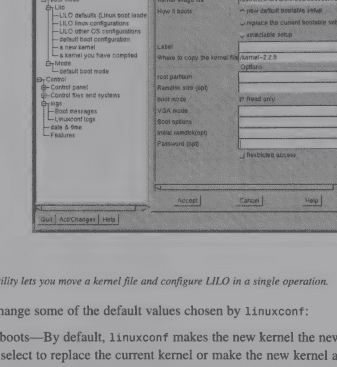

### FIGURE 6.3

Linuxconf 实用程序允许你在一个操作中移动内核文件并配置 LILO。

你应该更改 Linuxconf 选择的一些默认值：

- 如何启动—默认情况下，Linuxconf 会将新内核设为新的默认内核。你也可以选择替换当前内核，或将新内核作为 LILO 设置中的额外选项。我建议选择第一或最后一种选项，因为如果新内核不如预期工作，替换当前内核可能会导致灾难。

- Label—你必须为内核映像提供一个 LILO 启动提示名称，以便在重新启动时选择它。

- 复制内核文件的位置—你应将此字段更改为 `/boot`，或其下的子目录，除非你有特定原因将内核放置在其他位置。

- root 分区—输入根分区的标识符，例如 `/dev/hda2`，或从弹出菜单的选项中选择它。

### Tip

> 如果你记不起根分区设备名称，可以在 xterm 窗口中输入 `df /`。Linux 会响应根分区设备的名称，以及该分区的统计信息，例如可用磁盘空间。

- Boot options—如果需要在启动时向内核传递任何选项，请在此处输入。

输入这些更改后，单击 Accept，linuxconf 会询问你是否确认要更改启动过程。单击 Yes 以让 linuxconf 激活这些更改。现在你可以退出 linuxconf 并重新启动系统，如下所述。

## Manual Preparation

在 x86 系统上，新编译的内核文件出现在 `/usr/src/linux/arch/i386/boot` 目录下，文件名取决于你编译的类型，为 `zImage` 或 `bzImage`。标准做法是将内核文件移动或复制到 `/boot` 目录。我发现给内核一个包含内核版本号的扩展名称很有帮助，并且可能包含某种编码以指示我编译到其中的任何特殊功能。例如，我可能会发出以下命令

```
mv /usr/src/linux/arch/i386/boot/zImage /boot/zImage-2.2.9-ntfswrite
```

以移动内核并将其标识为版本 2.2.9 且具有 NTFS 读写支持。

将内核移至其常规位置后，就该为新内核配置 LILO 了。你可以通过将 `/etc/lilo.conf` 加载到你喜欢的编辑器中并创建新条目来实现。例如，假设现有的 `/etc/lilo.conf` 文件如下所示：


```
boot=/dev/hda2
map=/boot/map
install=/boot/boot.b
prompt
timeout=50
image=/boot/zImage-2.2.8-std
    label=linux
    root=/dev/hda8
    read-only
```

创建新内核条目的一个简单方法是复制现有条目。在前面的示例中，唯一一个条目是最后四行（你可能有更多行，但可能不会更少）。选择它们并复制它们，使你的文件如下所示：

```
boot=/dev/hda2
map=/boot/map
install=/boot/boot.b
prompt
timeout=50
image=/boot/zImage-2.2.8-std
    label=linux
    root=/dev/hda8
    read-only
```

```
image=/boot/zImage-2.2.8-std
label=linux
root=/dev/hda8
read-only
```

然后你可以修改第一份拷贝或第二份拷贝，取决于你想让哪个成为默认项（除非你明确指定其他情况，否则第一个条目会成为默认）。你需要修改两行：`image=` 行和 `label=` 行。对前者给出新内核的完整路径，对后者给出完整的启动标签。你最终可能会得到类似这样的内容：

```
boot=/dev/hda2
map=/boot/map
install=/boot/boot.b
prompt
timeout=50
image=/boot/zImage-2.2.8-std
label=linux
root=/dev/hda8
read-only
image=/boot/bzImage-2.2.8-ntfs write
label=ntfs
root=/dev/hda8
read-only
```

然后保存文件并退出编辑器。最后，输入 `LILO` 以在你的系统上安装新的 `LILO`。你会看到类似这样的信息：

```
Added linux *
Added ntfs
```

第一行末尾的星号 `*` 表示这是默认的 `LILO` 启动选项。

## 重启你的系统

在重启之前，确保你已完成以下操作：

- 将内核移动到它的新位置（如果使用 `linuxconf`，它会自动完成此操作）
- 运行 `lilo`，而不仅仅是编辑 `/etc/lilo.conf`（同样，`linuxconf` 会自动完成此操作）
- 除了执行 `make zImage` 或 `make bzImage` 之外，还执行了 `make modules` 和 `make modules_install`

## 警告

如果你的系统被其他人使用，就像服务器通常那样，你应该提醒他们你将要重启计算机。如果你没有这样做，那些用户可能会丢失工作并感到不满。

当你确定已准备好新内核并通知所有用户系统即将关闭时，你可以通过输入 `/sbin/shutdown now -r` 来重启。该命令会关闭系统并立即重启它。该命令还有变体，包括使系统停止以便你手动关机或在未来某个时间关闭系统的版本。输入 `man shutdown` 以了解有关这些变体的更多信息。

当系统重启时，在出现 `LILO boot:` 提示符时按下 `Tab` 键。你应该能在列表中看到你的新内核。输入其名称然后按 `Enter` 键，或如果新内核是默认项则直接按 `Enter` 键，它就会加载。如果你对驱动程序或其他选项做了重要更改，你可能想观察显示器以寻找那些更改是否按预期生效的线索，但请注意内核消息通常飞得太快而无法阅读。

#### 提示

你可以在启动后通过输入 `dmesg` 来查看内核消息。你可能想将其与 `less` 分页查看器结合使用，或与对特定关键字的搜索结合使用，如

```
dmesg | less
```

或

```
dmesg | grep eth
```

前者让你一次一页地阅读内核消息，后者显示包含字符串 `eth` 的任何内核消息行（用于标识以太网驱动程序）。

在你启动新内核后，你应该测试系统的基本和重要功能。例如，如果你正在尝试新的以太网驱动程序，请尝试使用相关设备。测试你是否可以打印、使用你的调制解调器、读取所有文件系统等等。当你确信一切按预期工作时，你就可以继续做其他事情了。

## 替代启动方法

虽然 `LILO` 是启动 Linux 最常见的方法，但它并不是唯一的方法。另有两种方法特别有用：

- 启动软盘—如果将 Linux 内核直接复制到软盘，你可以在启动时插入软盘，如果你的计算机配置为在检查硬盘之前先检查软盘的引导扇区，你就会启动 Linux 内核。如果你想在将其安装到 `LILO` 之前以这种方式测试 Linux 内核，你需要一张空白软盘。如果它尚未格式化，插入它并输入 `fdformat /dev/fd0n1440` 来完成工作。 （该命令假设磁盘是 1.44MB 3.5 英寸软盘。如果你使用的是其他类型的软盘，则需要使用不同的设备文件。）软盘格式化完成后，输入 `dd if=/usr/src/Linux/arch/i386/boot/zImage of=/dev/fd0` 将内核文件复制到软盘。然后你可以重启以测试内核，如果它令你满意，就修改 `LILO` 配置，或者如果你愿意，也可以继续使用启动软盘。

- `LOADLIN.EXE`—本书随附 CD-ROM 上 `dosutils` 目录中的 DOS 程序 `LOADLIN.EXE`，可以从 DOS 启动软盘或分区启动 Linux。你可以通过将软盘插入软盘驱动器并输入 `mcopy /usr/src/Linux/arch/i386/boot/zImage a:`，或通过挂载 DOS 软盘并使用 Linux 的标准文件复制工具，将内核复制到 DOS 软盘。你应使用类似的命令将 `LOADLIN.EXE` 复制到 DOS 磁盘。启动 DOS 后，输入 `LOADLIN ZIMAGE root=/dev/hda8 ro` 来启动内核文件 `ZIMAGE`，使用 `/dev/hda8` 作为根分区。与启动软盘方法一样，如果你对结果满意，可以修改 `LILO`，或者可以继续使用 `LOADLIN.EXE` 启动 Linux。

### 总结

编译新内核是每个 Linux 管理员都应具备的基本技能。编译自定义内核可以让你为硬件和计算机的预期用途优化内核。编译内核所涉及的大部分工作在于决定在内核中包含哪些选项。本章介绍了构建 Linux 服务器内核时最重要的选项，但你也应调查其他选项。

正如本章所述，在编译内核后，你可以通过使用 `linuxconf` 或手动编辑 `/etc/lilo.conf` 文件来修改 `LILO` 配置进行安装。然后你可以运行 `lilo` 来配置系统在重启时使用新内核，无论是默认使用还是在启动时显式选择它。

## 设置以太网选项

## 第7章

# 本章内容

- 获取必要的信息 163
- 网络驱动程序配置 164
- 配置具有固定地址的系统 166
- 使用 DHCP 进行动态配置 179
- 使用 linuxconf 配置网络 182
- 摘要 184

网络计算机必须知道关于自身及其直接网络环境的五项信息才能正常运行：

- 它的机器名——这是计算机的可读名称，例如 `gingko.biloba.com` 或 `www.linux.org`。虽然这是你作为人类使用的名称，但从计算机的角度来看，它实际上是最不重要的一条信息。
- 它的 Internet 协议（IP）地址——IP 地址，如第 4 章“内部网和互联网”中所述，对任何 TCP/IP 网络上的网络通信至关重要。
- 它的网络接口——你的计算机需要知道在哪个网络接口上“对话”。这对于具有多个接口的路由器尤其重要，但对于本章中你将了解到的其他计算机也是如此。
- 它的网关机器——除非你运行的是严格的本地服务专用网络，否则你需要指定一个网关，它是一台充当你的计算机与整个互联网之间路由器的机器。
- 它的 DNS 服务器——域名服务（DNS）在计算机上运行，并提供与互联网上每台计算机的机器名相对应的 IP 地址，如第 4 章所述。虽然你可以通过直接指定 IP 地址或在 `/etc/hosts` 文件中包含所需的机器名来在许多操作中无需 DNS 服务，但通常让你的计算机了解一些 DNS 机器要简单得多。

传统上，管理员通过将这五项信息输入到配置文件中来提供给计算机。这种方法仍然很流行，但现在许多网络使用一种称为动态主机配置协议（DHCP）的服务来完成这项工作。在使用 DHCP 的网络上，DHCP 服务器保存网络上所有其他计算机的配置信息，并在网络的其他计算机启动时分发这些信息。Linux 可以配置为使用 DHCP，如本章后面所述。Linux 也可以充当 DHCP 服务器，我在后面本章的“使用 DHCP 进行动态配置”部分简要讨论了这一点。

如果你使用 PPP 连接到 ISP，你必须手动输入其中一些配置信息，但 PPP 包含动态配置计算机身份某些部分的。你将在第 8 章“使用 PPP 进行拨号连接”中了解 PPP 配置。

#### Note


你可以将 Linux 计算机配置为拥有两个或多个身份——两个机器名、两个 IP 地址等等。在某些情况下，你可以将这两个身份与两个网络接口相关联，例如两块网络接口卡（NIC）或一块 NIC 和一条点对点协议（PPP）链路。如果你随后将计算机配置为在两个接口之间传输 IP 流量，该计算机就已成为路由器（p. 87）或类似设备。IP 伪装和防火墙是这一基本原理的两个应用，两者都在第 VI 部分“将你的内部网连接到互联网”中有所介绍。

## 获取必要的信息

在继续配置系统之前，你必须获取一些重要信息。如果你正在配置本地网络，你可以自行生成这些信息，但如果你正在连接到组织内部的更大网络，或者如果你通过数字用户线（DSL）链路或类似方式连接到互联网服务提供商（ISP），你需要从网络管理员或 ISP 处获取这些信息。如果你同时配置本地网络和通往整个互联网的链路，你可能需要既自行生成信息，又从其他地方获取信息。

如果你手动配置系统（即不使用 DHCP），你需要以下信息：

- 机器名（主机名和域名）
- IP 地址
- 网络掩码
- 网络的网关机器
- 网络的 DNS 服务器

如果你不知道这些术语的含义，不用担心；我将在本章后面描述它们。现在，只需从你的网络管理员或 ISP 处获取信息。如果你正在配置自己的本地网络，后面提供的描述将允许你生成适当的值或绕过它们的需求。

如果你使用 DHCP，你可能需要向网络管理员提供你的以太网地址（也称为媒体访问控制，或 MAC，地址）。该地址是一个 6 字节的数字，通常以十六进制形式表示，字节之间用冒号分隔，例如 00:80:C6:F9:3B:BA。它通常印在板卡上的贴纸上。如果你找不到它，

你可以在安装了网络设备驱动程序后获得它。事实上，在你继续操作之前，你应该确保已安装并配置了此驱动程序。

## 网络驱动程序配置

如果你将以太网驱动程序编译到内核本身中，它们会自动分配给设备，你可以通过输入 `dmesg | grep eth -` 来检查这些分配。例如，这是我在系统上输入此命令的结果：

```
eth0: Lite-On 82c168 PNIC rev 32 at 0xdc00, 00:10:CC:24:BA:02, IRQ 10.
eth0: MII transceiver #1 config 3100 status 7829 advertising 01e1.
eth1: Macronix 98715 PMAC rev 32 at 0xda00, 00:10:CC:6F:38:BA, IRQ 9.
```

这些行表明我有一个 Lite-On 82c168 芯片组作为 `eth0`，以及一个名为 `eth1` 的 Macronix 98715 芯片组。这两者碰巧都是 Tulip 克隆芯片组，但这并不重要；`dmesg` 命令返回此信息，使我能够识别哪个板卡是哪个。然后我可以使用 `ifconfig` 将适当的板卡链接到正确的 IP 地址。

> NOTE
>
> 如果你有两个相同的 NIC，你可能无法从 `dmesg` 输出中轻松区分它们。如果是这种情况，最简单的方法可能就是猜测哪个是哪个。如果你的网络不能按预期工作，请交换网络电缆并重试。

如果你编译内核使你的以太网驱动程序位于模块中，你需要编辑 `/etc/conf.modules` 文件以将板卡链接到适当的接口。例如，以下是你可能用来将 Tulip 板卡链接到 `eth0` 并将 3COM EtherLink XL 板卡链接到 `eth1` 的方法：

```
alias eth0 tulip
alias eth1 3cx59x
```

系统启动时，它会读取 `/etc/conf.modules` 并将命名模块链接到适当的接口。使用 Linux 模块文件（位于 `/lib/modules/x.y.z/net`，其中 `x.y.z` 为内核版本）中的名称作为这些行的末尾的驱动程序。

#### Tip

> 如果你不知道内核模块的名称，可以尝试运行第 6 章“为网络编译内核”中描述的内核配置例程。阅读你选择的驱动程序的帮助屏幕；它应该列出模块名称。如果你不知道哪个驱动程序适用，可以尝试检查板卡上是否有芯片组制造商的标识。你也可以在 `http://www.deja.com` 上检查有关你板卡品牌和型号的最新新闻组帖子。

如果你的一个或多个以太网卡是 ISA 型号，你可能还需要在 `/etc/conf.modules` 中指定卡的 I/O 地址。以下是一个示例：

```
alias eth0 tulip
alias eth1 ne
options ne io=0x240
```

此示例将基于 PCI 的 Tulip 板卡加载为 `eth0`，并将 ISA NE2000 克隆板卡作为 `eth1` 加载到 I/O 端口 `0x240`。如果未在 ISA 板卡上指定 I/O 端口，则可能会很危险，因为探测 ISA 以太网板卡可能会干扰其他硬件，从而可能导致系统挂起。

如果你有两个或多个使用相同驱动程序的接口，并且想要使用模块化驱动程序，你应该在 `/etc/conf.modules` 中同时列出它们。例如，如果你有两个基于 Tulip 的板卡，可以使用以下配置：

```
alias eth0 tulip
alias eth1 tulip
```

这些行会自动将 `eth0` 和 `eth1` 分配给 Linux 找到的板卡，顺序与驱动程序编译到内核中时相同。

#### Tip

> 配置以太网板卡驱动程序有时很棘手，特别是如果你有两个 NIC。如果无法让系统识别板卡，请尝试重新编译内核，如果 NIC 驱动程序是作为模块编译的，则将其放入内核本身；如果已编译到内核中，则作为模块。你也可以尝试拆分驱动程序，一个在内核中，一个作为模块，如果你有两个使用不同驱动程序的板卡。NIC 初始化可能会因驱动程序的位置而异，因此将其移入或移出内核有时可以解决一些问题。

## 配置具有固定地址的系统

当你为网络配置 Linux 计算机时，你必须做的一件事是为计算机的各种名称和接口之间建立一组链接。最终，你希望能够使用机器名，例如 `gingko.biloba.com`，通过机器名访问自己的计算机和其他计算机，并让计算机将该名称链接到适当的 IP 地址和网络接口。然而，这不会自动发生；你必须通过告诉计算机哪些标识符适用于它来创建这些链接。事实上，你必须为计算机构建一条面包屑小径，从计算机名引导到 IP 地址再到以太网接口。

本节介绍如何使用 Linux 文本模式配置文件设置这条面包屑小径。这种方法给你最大的灵活性，但也是最难的方法。如果你更喜欢更快速地配置你的 Red Hat 或 Mandrake 系统，可以使用 `linuxconf` 实用程序，如本章后面所述。

### 设置机器名

许多 Linux 程序和组件都期望计算机具有正确的机器名。这即使在不涉及网络时也是如此，因此如果机器名未正确设置，你可能会遇到问题。例如，`XEmacs` 编辑器期望能够找到机器名，如果找不到，它启动时会花费很长时间。`sendmail` 邮件守护进程等在系统启动期间运行的多个程序也期望找到正确的机器名，如果找不到，它们会暂停一分钟或更长时间。如果你的机器名未正确设置并且你遇到此暂停，你可能会认为系统在启动过程中已挂起。

### 机器名的组成部分

机器名有两个组成部分：

- 主机名—这是一个单词，通常全部小写，不包含句点。主机名的示例有 `gingko.biloba.com` 中的 `gingko` 和 `www.linux.org` 中的 `www`。
- 域名—这是完整网络名称中主机名之后的部分，如 `biloba.com` 或 `linux.org`。一些机器的域名可能比这些更长。例如，计算机 `n400.erplab.pangaea.edu` 的主机名为 `n400`，域名为 `erplab.pangaea.edu`。

#### NOTE

机器名称的有效字符为字母（a–z）、数字（0–9）以及连字符（-）。其他字符，包括下划线（_）在 TCP/IP 机器名称中均无效；不过在其他环境中，如 NetBIOS，这些字符可能是有效的。

很容易获取用于从互联网任何地方寻址计算机的完全限定域名（FQDN），并生成单独的主机名和域名。只需在第一个句点处拆分名称即可完成。

## 对机器名称的诸多引用

如果你想手动配置计算机，就必须编辑多个文件才能完全设置机器名称：

- `/etc/HOSTNAME`—此文件包含 FQDN，例如 `gingko.biloba.com`。许多程序访问它以获取计算机的名称，一些发行版的初始化脚本也出于相同目的访问此文件。在某些发行版中，例如 Debian，此文件以小写形式出现（`/etc/hostname`）而非大写；在 Red Hat 6.0 中，它是大写的。


- 初始化文件—`/etc` 目录中一个或多个初始化文件（如果系统存在该子目录，则可能在 `/etc/rc.d` 中）包含对 `hostname` 程序的调用。在 Red Hat Linux 6.0 中，此文件为 `/etc/rc.d/rc.sysinit`，而 `rc.sysinit` 使用 `/etc/sysconfig/network` 中的定义来设置主机名。因此，如果你使用的是 Red Hat 6.0，可以通过编辑 `/etc/sysconfig/network` 并修改以 `HOSTNAME=` 开头的行来更改主机名。其他发行版可能将对 `hostname` 的调用放在其他位置，例如 `/etc/rc.inet1`。某些发行版使用 `/etc/HOSTNAME` 的内容在其初始化文件中设置机器名称（例如 Debian 就是这样做的）。

- `/etc/hosts`—此文件设置远程计算机的 IP 地址和名称，以及机器名称。由于其多用途的特性，我将在后面单独描述此文件。

请注意，你只能使用 `/etc/HOSTNAME` 文件和其他初始化文件设置单个机器名称。如果你的计算机位于两个网络上，例如你的私有内部网络和有线电视公司提供的有线调制解调器网络，这似乎会有限制。虽然这种限制通常不是大问题，因为在这些文件中设置的主机名主要用于让计算机识别自身，并在传出的通信中设置标识信息，例如电子邮件头。你很可能希望在这些通信中使用单个主机名——与较大网络相关联的那些。因此，你最好将此主机名设置为你的 ISP 或网络管理员提供的名称。如果你不喜欢这个名称，可以按自己喜欢的方式设置主机名，然后编辑各个网络客户端的配置文件（例如 `sendmail` 和你的新闻阅读器），但这可能得不偿失。

尽管你只能在这些配置文件中设置单个主机名，但你可以让系统响应多个名称。你可以通过添加配置文件和选项来实现这一点，如以下各节所述。

## /etc/hosts 文件

`/etc/hosts` 文件包含主机及其关联 IP 地址的列表。至少，此文件应包含 `localhost` 的条目，`localhost` 总是一个有效的机器名称（但不应是任何联网计算机中唯一的名称）。`/etc/hosts` 中的每一行都包含一个 IP 地址，后跟一个 FQDN，可选地后跟该地址的其他名称。

例如，这里是一个最小的 `/etc/hosts` 文件：

```
127.0.0.1    localhost
192.168.1.3  gingko.biloba.com gingko
```

如果你的计算机有多个以太网接口，你可以为不同接口上的计算机分配不同的地址。你可以通过在 `/etc/hosts` 中在单独的行上指定适当的 IP 地址和机器名称来实现这一点部分。如果你想为单个 IP 地址分配多个名称，可以将它们全部添加到同一行。例如，这里是前一个示例的更复杂变体：

```
127.0.0.1    localhost
10.0.0.3     polk.biloba.com polk www.biloba.com
192.168.1.3  gingko.biloba.com gingko webserver
```

如果单台计算机中存在两张网卡，一张绑定到 `10.0.0.3`，另一张绑定到 `192.168.1.3`，那么该计算机将理解名称 `polk.biloba.com`、`polk`、`www.biloba.com`、`gingko.biloba.com`、`gingko` 和 `webserver` 均指代自身，尽管是在两个不同的网络上。

通常情况下，你应确保 `/etc/hosts` 包含以下条目：

- **`localhost` (127.0.0.1)**—这是回环接口，各种 Linux 程序在与本地计算机交互时会使用它。
- **主机器名**—你应在 `/etc/hosts` 中有一条条目，将主机器名（在 `/etc/HOSTNAME` 或其他位置指定）链接到其 IP 地址。如果计算机未连接到网络，按惯例应为此目的使用 IP 地址 `192.168.0.1`。由于你很可能正在配置一个联网系统，你应使用机器实际拥有的 IP 地址。
- **附加机器名**—如果计算机具有多个接口，你可以设置两条或更多行，为每个 NIC 各设一条，如上所述。
- **远程机器名**—输入你喜欢的任何计算机的名称及其 IP 地址。在小型内网中，你可能希望输入该内网上所有机器的名称和地址。然后你可以根据计划如何使用计算机来决定是否无需为网络设置 DNS。你也可以输入整个互联网上机器的 IP 地址，如果你经常访问它们并且希望避免对它们进行 DNS 查询的话。然而，如果此类机器的 IP 地址发生变化，你的 `/etc/hosts` 文件将变得不准确，因此我建议除非有令人信服的理由，否则不要将外部计算机添加到 `/etc/hosts` 中。

如果你正在配置私有/本地网络，你需要为计算机选择 IP 地址。你不应该随意进行。已经为此功能专门保留了若干 IP 地址范围，并且保证不会与在互联网上可公开访问的计算机的 IP 地址相匹配。这些范围列在表 4.2（第 95 页），但小型网络最常用的范围是 `192.168.0.0` 至 `192.168.255.255`（`.0` 和 `.255` 地址不能使用，因为它们有特殊含义）。如果你使用此范围，你应仅在给定网络上更改最后一位数字——例如，使用从 `192.168.1.1` 到 `192.168.1.254` 的计算机。

## 激活接口

在配置文件中指定名称和 IP 地址可能会占用你一两分钟，但如果不将这些 IP 地址链接到计算机的网络接口，就不会有什么好处。在 Linux 中，你使用 `ifconfig` 命令激活网络接口。该命令的基本语法如下：

```
ifconfig interface [options] address
```

`ifconfig` 的参数如下：

- *interface*—硬件接口。对于以太网板，它们是 `eth*n*`，其中 *n* 是从 0 开始的数字——例如，第一个 NIC 为 `eth0`，第二个 NIC 为 `eth1`，以此类推。令牌环板使用 `tr` 而不是 `eth`，而其他网络板使用其他接口代码。
- *options*—`ifconfig` 命令支持许多选项，例如 `up` 或 `down` 分别启用或禁用接口（如果省略则默认为 `up`）；`mtu` 用于设置接口的最大传输单元；等等。其中一个最重要的选项是 `netmask mask`，它设置 IP 地址的网络掩码，如下所述。有关这些选项的更多信息，请参阅 `ifconfig` 手册页。
- *address*—这是该网卡上计算机的 IP 地址。

例如，考虑以下命令：

```
ifconfig eth0 192.168.1.3
```

该命令告诉系统开始使用由 `eth0` 驱动的设备来使用 IP 地址 `192.168.1.3`。有效地，`ifconfig` 将 IP 地址绑定到 NIC——或者至少绑定到 NIC 的驱动程序。

你应从网络管理员或 ISP 那里获得的一项信息是网络掩码。这是一个 4 字节的数字，采用点分四段表示法，与 IP 地址相同。网络掩码中的一些数字为 255，不过该数字实际上不是 IP 地址。网络掩码指示哪些地址属于本地网络。1 位表示如果远程机器是本地的，则目标中对应的位必须与源相同，而 0 位表示本地网络上的机器中对应的位可以不同。例如，如果网络掩码为 `255.255.255.0` 且本地计算机为 `192.168.1.1`，则从 `192.168.1.1` 到 `192.168.1.254` 的所有计算机都在本地网络上。所有其他 IP 地址代表非本地计算机。

通常，`ifconfig` 可以根据第 4 章所述的网络类别推断出正确的网络掩码。有时，组织会创建子网，即将较大网络划分为较小的网络。这种情况下，你必须自己指定网络掩码，因为 `ifconfig` 没有办法确定网络是如何划分的。

你可以在不指定 IP 地址的情况下使用 `ifconfig` 来查看网络接口的配置。这样做时，你会得到一份信息列表，包括 NIC 的以太网地址、该 NIC 上计算机的 IP 地址、已发送和接收的数据包数量以及错误数量。

Linux 通常像其他网络命令一样，在系统启动时从 `/etc` 目录结构中某个发行版特定的配置文件调用 `ifconfig` 命令。如果你手动配置网络的这一方面，你可能希望将该命令放在 `/etc/rc.d/rc.local` 文件或发行版在启动时运行的其他文件中。

## 路由网络流量

使用 `ifconfig` 激活接口并不是设置网络接口的最后任务——还有一个任务需要执行。该任务是为网络流量设置路由。当数据包源自你的计算机时，计算机需要决定通过哪个网络设备发送它。当然，如果你只有一块网卡，那个决定对你或我来说相当简单——计算机需要更具体的指令。

网络路由通过 `route` 命令进行配置。该命令向系统的路由表添加、从中删除或显示路由表——一份接口及其关联网络地址的列表，以便系统知道将每个生成的或转发的 IP 数据包发送到何处。`route` 命令的基本语法如下：

```
route add | del target [gw gateway]
```

参数的含义如下：

- `add | del`—该参数分别指定添加或删除一个条目。你通常使用 `add`，在临时使某组机器无法访问时可能会使用 `del`。


## `target`—目标

目标是路由所针对的机器或网络。如果该地址中的尾随位为 0，则该条目与一组机器相关——一个网络。例如，`192.168.1.0` 作为目标意味着发往 `192.168.1.1` 至 `192.168.1.254` 所有机器的流量都通过此接口路由。除了使用原始的数字 IP 地址外，如果它在 `/etc/networks` 文件中列出，你也可以通过名称指定一个网络，其语法与 `/etc/hosts` 类似，只是 `/etc/networks` 列出的是整个网络。一个名称也有特殊含义：`default`。如果使用 `default` 作为目标，系统会将未被更具体匹配的数据通过该路由发送。`default` 与 `0.0.0.0` 同义，它匹配所有网络。

## `gateway`—网关

如果使用 `gw` 开关，后面的参数是作为网关的计算机的 IP 地址。网关计算机接收发往更远网络的流量。通常，如第 4 章所述，当计算机通过以太网链路发送数据时，计算机会尝试定位目标计算机的以太网地址，假设目标机器在同一以太网网络上。设置网关会改变这种行为；计算机不是发送到最终目的地，而是发送到网关机器，网关机器充当路由器。

你可能已经注意到 `route` 命令与特定接口之间没有显式的关联。这是因为 `route` 可以根据目标网络推断出正确的接口。例如，如果目标网络是 `192.168.5.0`，那么 `route` 就知道要查找一个分配了以 `192.168.5` 开头的地址的接口，并将路由附加到该接口。

这在实践中是如何工作的？这里有一个 `route` 命令的例子：

```
route add 10.0.0.0
```

该命令添加一条路由，将所有发往 `10.0.0.1` 至 `10.255.255.255` 地址的数据通过分配了该范围地址的接口发送。另一个例子：

```
route add default gw 10.4.3.100
```

该命令设置默认路由使用 `10.4.3.100` 机器作为网关，因此未被路由表中其他条目覆盖的任何流量都将通过该机器。

如果你不带任何其他参数使用 `route` 命令，Linux 会显示当前的路由表，这可能很有信息量。你可能会得到类似这样的内容：

```
192.168.1.1    *           255.255.255.0   UH   0   0   0 eth0
192.168.1.0    *           255.255.255.0   U    0   0   0 eth0
10.0.0.0       *           255.0.0.0       U    0   0   0 eth1
127.0.0.0      *           255.0.0.0       U    0   0   0 lo
default        10.4.3.100  0.0.0.0         UG   0   0   0 eth1
```

该输出表明计算机已连接到两个网络，其中一个（`192.168.1.0`）很可能是一个小型本地网络，另一个（`10.0.0.0`）是一个更大的网络，其中包含位于 `10.4.3.100` 的网关机器。所有未发往 `192.168.1.0` 网络或回环接口（在 `127.0.0.1` 上，尽管 `lo` 设备配置为接收整个 `127.0.0.0` 网络上的所有流量）的流量都将通过 `10.4.3.100` 的网关。

与 `ifconfig` 一样，Linux 发行版倾向于将启动路由命令埋藏在 `/etc` 目录树中的晦涩文件中，例如 `/etc/rc.d/init.d/routed`。如果你想手动配置网络，你可以将适当的命令放在 `/etc/rc.d/rc.local` 或你知道在系统启动时运行的其他文件中。

## 初步测试

现在你已经设置了接口，可以测试你的网络了。首先，尝试回环接口：

```
ping 127.0.0.1
```

此命令应返回类似以下的输出行：

```
PING 127.0.0.1 (127.0.0.1): 56 data bytes
64 bytes from 127.0.0.1: icmp_seq=0 ttl=255 time=0.2 ms
64 bytes from 127.0.0.1: icmp_seq=1 ttl=255 time=0.1 ms
64 bytes from 127.0.0.1: icmp_seq=2 ttl=255 time=0.1 ms
```

按 `Ctrl+C` 即可停止，你会得到已发送和接收的数据包数量以及这些传输所花费时间的统计信息。如果你在使用 `ping` 命令时用 `localhost` 代替 `127.0.0.1`，应该会得到类似的结果。如果 `localhost` 不能用，那么你可能存在 `/etc/hosts` 文件的问题。

接下来，你可以尝试在另一台机器上使用 `ping` 命令。如果你配置了本地网络，可以尝试 `ping` 同一网络中的另一台机器。例如，你可以输入

```
ping 192.168.1.2
```

当然，你输入的 IP 地址取决于本地网络的配置方式。结果应与 `ping` 回环设备的结果相似，只是时间可能稍长一些。目标计算机运行什么操作系统并不重要，只要其网络功能配置正确，并且未被配置为忽略 `ICMP ECHO REQUEST` 数据包即可。如果你正确设置了 `/etc/hosts`，那么你应该能够使用远程机器的名称，例如 `polk`，而不是 IP 地址。

最后，如果你通过网关机器连接到 Internet，你应该能够 `ping` Internet 上的任何计算机。在你告诉系统使用哪个 DNS 之前，你只能使用 IP 地址进行测试。作为测试，可以尝试使用你 ISP 或组织的 DNS 机器的 IP 地址。当你设置好 DNS，或者在 `/etc/hosts` 文件中输入了一些 IP 地址后，你就可以通过名称 `ping` 外部机器。

根据本地网络可用的资源，你可以执行额外的测试。例如，如果你的其中一台计算机运行 `Telnet` 服务器，你可以尝试在 Linux 计算机上使用 `telnet` 登录到该机器。或者，如果你的 Linux 系统运行某些网络服务的守护进程，你可以从另一台计算机访问这些服务来测试系统。如果你能成功使用 `ping` 以及一两个更复杂的工具，如 `telnet`、`ftp` 或 Web 浏览器，那么很可能你的所有网络应用程序，无论是客户端还是服务器，都会正常工作。

## 设置 DNS 服务器

要按名称访问整个 Internet 上随机选择的计算机，你需要告诉 Linux 机器一个或多个 DNS 服务器的 IP 地址。这些服务器通常由你的 ISP 或你组织的网络部门维护，因此请询问这些计算机的地址。如果你要设置自己的私有内联网，你可能希望在 Linux 计算机上运行 DNS，以为该网络上的机器提供类似服务。此任务可能很复杂，超出本书的范围，但稍后在“设置 DNS 服务器”部分，你会找到运行 DNS 服务器的简要概述。

### NOTE

> 如果你主要使用内联网进行 Samba/Windows 网络或 Netatalk/AppleTalk 的文件和打印机共享，本地运行 DNS 可能并不重要。这是因为 NetBIOS 和 AppleTalk 都提供自己的计算机命名约定，因此这些服务不需要 Internet 风格的名称。
>
> 然而，如果你想通过 `Telnet` 或 `FTP` 等 TCP/IP 服务访问内联网上的机器，你必须输入原始 IP 地址、运行 DNS，或在所有客户端计算机上维护 `/etc/hosts` 文件。如果你的内联网的所有机器都直接连接到 Internet，那么你的 ISP 或网络部门的 DNS 机器将处理这些服务，除了将所有计算机配置为 DNS 客户端之外，你无需担心此事。

## 手动指定 DNS 服务器

配置 TCP/IP 名称查找的主要文件是 `/etc/resolv.conf`。该文件中有三种类型的命令，除注释外，注释以井号 `#` 表示：

- `nameserver`—以 `nameserver` 开头的行指定 DNS 机器的 IP 地址。例如，一行可能写成 `nameserver 192.168.3.100`。你可以通过在多行中列出它们来指定多个名称服务器。
- `domain`—`domain` 关键字表示系统将尝试在指定域中查找命名的计算机。例如，如果 `/etc/resolv.conf` 中出现 `domain biloba.com` 这一行，并且你尝试访问主机 `gingko` 上的服务，系统会查找 `biloba.com` 中的 `gingko`，即 `gingko.biloba.com`，同时也会单独搜索 `gingko`。
- `search`—`search` 列表在概念上与 `domain` 类似，只是你可以在单个 `search` 行上指定多个域，用空格或制表符分隔。

下面是一个 `/etc/resolv.conf` 文件的示例：

```
# Default domain:
domain threeroomco.com
# Subnets to search:
search room1.threeroomco.com room2.threeroomco.com

# 我们的名称服务器：
nameserver 192.168.3.100
nameserver 192.168.3.100
```


如果使用此文件并尝试访问名为 `polk` 的计算机上的服务，系统将对 `polk`、`polk.threeroomco.com`、`polk.room1.threeroomco.com` 和 `polk.room2.threeroomco.com` 执行 DNS 搜索。请注意，多次名称搜索可能会带来一些缺点。首先，它们需要时间，尽管这通常不是一个大问题，因为单个传输非常快。更重要的是，如果你在搜索行中指定了太多域，你可能会对拼写错误的名称产生意外的匹配。例如，如果 `threeroomco.com` 有一台名为 `server` 的机器，而 `room2.threeroomco.com` 也有一个名为 `server` 的机器，尝试访问 `server` 可能会实际访问 `server.room2.threeroomco.com`，如果你拼写错误名称的话。这种具体情况需要对组织内的计算机进行重命名，但如果你开始在 DNS 搜索路径中包含外部域，问题就会变得严重得多。

DNS 主要用于查找远程系统的名称，特别是那些位于远端网络上的系统。Linux 包含另一种机制，即 `/etc/hosts` 文件，用于查找其自己的名称和本地系统的名称。`/etc/hosts` 的内容在标题为“`/etc/hosts` 文件”的部分中描述。那么 Linux 如何知道是使用 `/etc/hosts` 还是 DNS 呢？答案在于 `/etc/host.conf` 文件，该文件包含多个命令：

- `order`—`order` 指定尝试不同名称解析服务的顺序。你通常希望在 `/etc/host.conf` 文件中有一行 `order hosts,bind`。这指定首先尝试 `/etc/hosts` 文件，然后是 DNS 服务（`BIND` 是提供 DNS 的软件包的名称，它将在本章后面“设置 DNS 服务器”部分中介绍）。

> NOTE
>
> 第三种名称解析类型被称为 *Network Information System*（NIS），Linux 可以配置为使用它。NIS 可以为网络提供统一的登录信息，以及名称解析服务。如果你的网络有 NIS 服务器，你可以配置 Linux 使用它，尽管这个主题超出了本书的范围。如果你的系统配置为使用 NIS，你可以在 `/etc/host.conf` 中的 `order` 行中列出它。

- `multi`—`multi` 表示 `/etc/hosts` 中的主机是否可以有多个 IP 地址。你通常希望此行读取 `multi on` 以允许这种情况。

- `nospoof`—Spoofing 是系统黑客 commonly 使用的一种技术，使他们的系统看起来来自他们并非所在的地方。如果你包含一行 `nospoof`，Linux 会交叉检查 IP 地址和 FQDN，并拒绝疑似伪造的访问。

- `alert`—你可以指定 `alert on` 或 `alert off` 来记录伪造尝试。

- `trim`—`trim` 行有点像 `/etc/resolv.conf` 文件中搜索行的相反。如果尝试访问 `trim` 行中指定的域上的主机，Linux 会删除域名，只保留主机名。如果你的 `/etc/hosts` 文件省略了域名，这可以稍微加快访问速度。由于 `/etc/hosts` 允许你同时包含 FQDN 和较短的“昵称”，`trim` 选项在实践中并不太需要。

因此，在 `/etc/resolv.conf`、`/etc/host.conf` 和 `/etc/hosts` 这三个文件之间，你可以控制系统在给定域名时如何搜索 IP 地址。

## 设置 DNS 服务器

在大多数情况下，配置系统作为 DNS 服务器是不必要的。你可能只想在你有一个私有网络并且希望能够从网络上的任何机器按名称访问该网络上的主机时才这样做。即使在这种情况下，如果你只使用 Windows 网络或 AppleTalk，也不需要 DNS 服务器，因为这些协议包含自己的名称解析。

Linux 中的 DNS 由一个名为 Berkeley Internet Name Daemon（`BIND`）的软件包处理，该软件包包含一个名为 `named`（发音为 name-dee）的守护进程。因此，术语 DNS、`BIND` 和 `named` 含义重叠，但具体程度不同：DNS 是最通用的术语，`named` 是最具体的。

如果你运行的是 Red Hat Linux 6.0，你需要从 Red Hat CD-ROM 安装 `bind` 和 `caching-nameserver` 软件包。对于其他发行版，你需要找到等效的软件包，它们可能捆绑在一个软件包中，也可能分散在两个以上。

由于配置 DNS 可能很复杂，我假设你使用的是 Red Hat 6.0 文件，这些文件以固定的方式配置，使得修改更简单。如果你不使用 Red Hat，你可能需要配置我在此未涵盖的系统方面，或者你可以使用 Red Hat 6.0 `caching-nameserver` 软件包来获取我用作起点的配置文件。

安装完 DNS 软件包后，你需要编辑以下文件：

- `/etc/named.conf`—在此文件的末尾添加一条针对本地网络的条目。例如，它可能如下所示

```
zone "private" {
    type master;
    file "named.private";
};
```

此条目为域名 `private` 添加了支持，因此你可以通过诸如 `stanislaw.private` 和 `isaac.private` 这样的名称访问主机。在编辑此文件时，如果你希望名称服务器仅响应本地网络的请求，可以在读取 `options {` 的行之后添加如下一行：

```
listen-on { 192.168.1.1; };
```

请确保正确输入，包括两个分号，但将 IP 地址替换为你在私有网络上的 Linux 计算机的地址。此行会导致 `named` 仅响应通过与指定 IP 地址关联的物理接口收到的请求，从而提高安全性。

- `/var/named/named.private`—你需要创建此文件。它的名称必须与你在 `/etc/named.conf` 中 `file` 字段中指定的名称相同（Red Hat 的 `BIND` 发行版使用 `/var/named` 目录作为大多数 `BIND` 配置文件的基础）。此文件应包含私有网络上每台机器的条目。例如，这里是一个三台计算机网络的此类文件：

```
stanislaw IN A 192.168.1.1
isaac IN A 192.168.1.2
mary IN A 192.168.1.3
```

你不必太关心这些条目中 `IN A` 部分代表什么；只需将机器名、`IN A` 和 IP 地址放在同一行即可。

现在你可以通过输入 `named` 来启动名称服务器，可能在其前面加上完整路径，例如 `/usr/sbin/named`。你可以通过将网络上的另一台计算机设置为仅使用 Linux 机器作为名称服务器来测试它，然后查看是否可以通过名称访问计算机。请务必测试本地网络上的那些计算机（列在 `/var/named/named.private` 中——请务必指定完整名称，如 `stanislaw.private`，或在远程系统上包含适当的域名或搜索路径）以及远程网络上的那些计算机，前提是你的内联网已连接到整个互联网。默认情况下，Red Hat 和许多其他发行版在安装适当软件包时会配置 `named` 在启动时自动运行。如果你的系统没有这样做，你可以将对 `named` 的调用添加到系统启动文件，例如 `/etc/rc.d/rc.local`。

上述说明仅对 DNS 主题提供了非常简短的介绍。此描述省略了反向 DNS 查找的配置、更改 DNS 缓存时间的默认值以及许多其他主题。如果你需要出于非常随意以外的目的运行自己的 DNS 服务器，你绝对应该阅读 `/usr/doc/bind-8.2` 中的文档文件（或可能具有更高数字的目录，如果你正在运行更新版本的程序）。你还应该意识到运行 DNS 时的安全问题，就像运行任何服务一样；尽管 DNS 并不是设计用来提供对系统的实质性访问，但过去 DNS 中的错误为系统黑客提供了进入计算机的方法，未来也可能发生这种情况。因此，我建议你安装发行版提供的最新版本的 `bind`。

## 配置 DSL 或有线调制解调器

你可以通过使用 DSL 或有线调制解调器将 Linux 计算机连接到互联网。这些设备在传统电话调制解调器的意义上并不是真正的调制解调器。这些设备主要有两种基本形式。一种是内部卡，本质上是一个 NIC。在我撰写本文时，没有此类内部 DSL 或有线调制解调器在 Linux 中得到支持，但这在未来可能会改变。DSL 和有线调制解调器的第二种形式是连接到计算机的外部盒子，通常通过标准的以太网线路，通常是 10BaseT。这些设备本质上是桥接器（p. xxx）或路由器（p. xxx）——它们是具有两个网络接口的小型计算机，它们将你的计算机或网络链接到你的 ISP 的网络，进而链接到互联网。

鉴于这种设计，配置典型的 DSL 或有线调制解调器与配置任何其他以太网连接相比没有什么不同或几乎没有不同。你的 ISP 要么提供静态 IP 地址，要么记录你的 NIC 的以太网地址，以便通过 DHCP 为你提供动态 IP 地址。你根据这两种方案中的任何一种配置你的 Linux 机器，如本章所述。


少数系统使用不寻常的配置，例如单向有线调制解调器，它们仅提供下游带宽，要求你使用调制解调器拨号以进行上行流量。一些系统需要特殊的客户端软件，但这些功能有时可以由适当的 DSL 调制解调器接管，有时软件只是激活调制解调器中的功能，你可以手动或通过脚本激活。请向你的 ISP 咨询以了解其硬件对你的系统施加了什么要求。

ISP 对 Linux 的友好程度各不相同。有些非常乐意让你将 Linux 计算机连接到他们的网络，甚至为此提供技术支持来帮助你。其他人并不真正关心你使用什么操作系统，但不为 Linux 提供任何支持。还有一些人如果知道你正在运行 Linux 则拒绝提供服务。如果潜在的 ISP 不禁止 Linux，但希望在安装人员到来时看到 Windows 系统，你可能需要为

如果系统响应为 `package dhcpcd is not installed`，则你需要从 CD-ROM 安装它。如果系统响应的是一个精确的软件包版本，则说明你的系统已安装了 DHCP 客户端支持。要在 `eth0` 接口上通过 DHCP 配置系统，请键入

```
/sbin/dhcpcd -d -D -H eth0
```

该命令指示系统通过 DHCP 进行最大化配置，包括计算机的域名（`-D` 选项）和主机名（`-H` 选项）。你可以通过在 `dhcpcd` 命令行中省略这些选项并手动设置它们，如本章前面“设置机器名称”部分所述，或通过使用 `-h` 选项手动指定主机名，来自行设置域名和主机名。你可以通过键入 `man dhcpcd` 来了解有关 `dhcpcd` 选项的更多信息。

`dhcpcd` 设置以下网络选项：

- 机器名——如果使用 `-H` 开关进行配置，并且 DHCP 服务器提供此信息，则 `dhcpcd` 会设置此选项。
- 网络名——如果使用 `-D` 开关进行配置，并且 DHCP 服务器提供此信息，则 `dhcpcd` 会设置此选项。
- IP 地址——此地址可能从一次会话到另一次会话发生变化，甚至在会话中途如果你的客户端和服务器需要重新协商 DHCP“租约”时也会发生变化。
- 子网掩码——这在一次会话到另一次会话之间很可能保持不变。
- 网关——这是通过它传输到整个互联网的流量的计算机。
- DNS 服务器——DHCP 设置远程 DNS 服务器的地址。它不会在你的计算机上配置 DNS 服务器。
- 以太网适配器——DHCP 启动以太网适配器，就像 `ifconfig` 所做的那样。

换句话说，DHCP 完成了“使用固定地址配置系统”部分中概述的所有工作，除了在你的系统上运行 DNS 服务器。你无论如何也不应在通过 DHCP 获取地址的系统上运行 DNS 服务器，因为其 IP 地址不能保证保持不变。由于恒定的 IP 地址是 DNS 服务器的实际必要条件，因此成为 DHCP 客户端和 DNS 服务器是相互不兼容的。（如果你也运行 DHCP 服务器，你可以将其配置为向 DHCP 客户端/DNS 服务器提供固定地址，但在这种情况下，你可能只需在同一台计算机上运行两个服务器。）在 DHCP 服务的计算机上运行许多其他类型的 TCP/IP 服务器也是最差情况下不理想的，因为远程机器可能在地址更改时和更改后难以定位服务器的当前 IP 地址。

## 配置 DHCP 服务器

在大多数小型网络中，使用静态 IP 地址分配最简单。然而，在某些情况下，你可能希望你的 Linux 计算机充当 DHCP 服务器。例如，如果你维护一个由大量个人不定期连接计算机到你的网络的网络，如旅行推销员的笔记本电脑，你可能会这样做。如果你拥有的计算机数量超过 IP 地址的数量，但大多数计算机在任何给定时刻都未连接到网络，你也可能想要使用 DHCP。（IP 伪装，如第 20 章“一个 IP 地址，许多计算机：IP 伪装”中所述，是在这种情况下你可能想要使用的另一种工具。）

Red Hat Linux DHCP 服务器软件包称为 `dhcpd`，而其他发行版通常使用类似的名称。安装此软件包后，你必须设置一个名为 `/etc/dhcpd.conf` 的配置文件。以下是 `dhcpd.conf` 文件的示例：

```
default-lease-time 6000;
max-lease-time 10000;
option subnet-mask 255.255.255.0;
option broadcast-address 192.168.1.255;
option routers 192.168.1.1;
option domain-name-servers 192.168.1.1;
option domain-name "three roomco.com";

subnet 192.168.1.0 netmask 255.255.255.0 {
  range 192.168.1.100 192.168.1.150;
}

host polk { hardware ethernet 00:C6:C9:F8:BA; }
host tyler { hardware ethernet 00:A0:CC:24:BA:02; }
```

`default-lease-time` 和 `max-lease-time` 行设置默认和最大时间，以秒为单位，`dhcpd` 在尝试重新协商租约之前持有 IP 地址的时间。随后的 `option` 行各自设置一个选项，其形式如本章前面“使用固定地址配置系统”部分所述。从 `subnet` 语句开始的三个行定义服务器要服务的网络，包括其有权分配的 IP 地址范围。在此示例中，`dhcpd` 将分配 192.168.1.100 到 192.168.1.150 之间的地址。最后两行根据其以太网硬件地址识别特定主机，如“网络硬件地址”（第 93 页）所述。这最后两行是可选的；即使没有它们，`dhcpd` 仍可以分配 IP 地址（尽管主机名不一致）。

创建适当的配置文件后，你可以通过键入以下命令启动 `dhcpd`

```
/usr/sbin/dhcpd
```

或

```
/etc/rc.d/init.d/dhcpd start
```

许多发行版（包括 Red Hat 6.0）在你重启计算机时会自动配置为启动 `dhcpd`，但对于某些发行版，你可能需要在 `/etc/rc.d/rc.local` 或其他启动文件中添加适当的行。

本讨论仅触及 Linux 中 DHCP 配置的表面。欲了解更多信息，你应查阅 `dhcpd.conf` 和 `dhcpd` 手册页，或 DHCP Mini-HOWTO，该文档随大多数 Linux 发行版提供，也可在本书 CD 的 `doc/HOWTO/mini` 目录中找到。

## 使用 linuxconf 配置网络

前面的讨论提供了 Linux 如何进行网络配置的细枝末节的细节。这些信息很有用，特别是当你试图调试一个无法正常工作的网络连接时。然而，如果你只是想快速配置一台机器，你可能更喜欢一种简化的配置方法，特别是如果你需要设置静态 IP 地址的话。这种简化方法由 Red Hat 6.0 中的 `linuxconf` 实用程序提供。许多其他发行版也提供类似的 GUI 配置工具，尽管其操作细节有所不同。

### 设置基本主机信息

首先，你应该在 `linuxconf` 中选择 Config, Networking, Client tasks, Basic host information 选项。你可以在此处输入的第一项是主机名，你应该输入它。当你点击 Adaptor 1 选项卡时，你可以输入其他信息，如图 7.1 所示。如果你将 Config mode 选择为 DHCP，你只需输入 Net device 和 Kernel module；系统会从 DHCP 服务器获取其余信息。如果你将 Config mode 选择为 Manual，你至少需要在 Net device 和 Kernel module 之外输入机器的完整名称和 IP 地址。

你还应选择 Config, Networking, Routing and gateways, Defaults 来设置默认网关（再次说明，这就是将信息从你的本地网络传输到整个互联网的计算机）。你通过其数字 IP 地址而不是机器名称来指定这台机器。

### 名称服务器指定

要配置你的名称服务器及相关选项，你应首先选择 Config, Networking, Client tasks, Name server specification (DNS)。这会产生如图 7.2 所示的显示，在其中你可以输入默认域、最多三个名称服务器，以及最多六个搜索域。

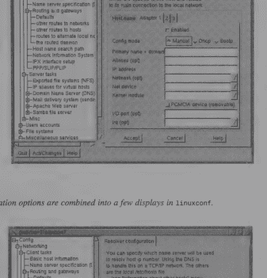

#### FIGURE 7.1

许多网络配置选项在 `linuxconf` 中被组合到几个显示中。

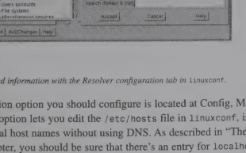

#### FIGURE 7.2

你可以使用 `linuxconf` 中的 Resolver 配置选项卡来配置与 DNS 相关的信息。


另一个你应配置的名称解析选项位于 `Config. Misc. Information about other hosts`。此选项让你在 `linuxconf` 中编辑 `/etc/hosts` 文件，以便在不使用 DNS 的情况下提供有关本地主机名的信息。如本章前面所述的“`/etc/hosts` 文件”中所述，你应确保为 localhost 以及计算机在所连接的任何网络上所知的名称和地址提供条目。

你可以通过选择 `Config, Networking, Host name search path` 来修改 `/etc/host.conf` 的内容，以便告诉系统以何种顺序尝试不同的名称解析方法。然后你可以点击一个单选按钮来描述以何种顺序搜索 DNS、`/etc/hosts` 文件和 NIS。

## 其他选项

`linuxconf` 在其菜单上提供了许多其他网络选项。许多 `linuxconf` 网络配置设置与 Samba 等功能相关，这些功能将在本书后面介绍。有些，如 Apache 配置，则超出了本书的范围。

即使你使用 `linuxconf`，你也可能希望至少熟悉通过标准文本配置文件配置系统的基本方法。这种熟悉程度在你想要做一些对 `linuxconf` 来说过于微妙的事情时，或者当你在未安装或无法工作的 `linuxconf` 的系统上进行配置时可能会很有用。

### 总结

本章涵盖了 Linux 下以太网配置的基础知识。在最原始的形式中，这种配置涉及编辑相当多的文本文件以设置选项并启动服务。基本上，有必要设置主机名、IP地址、网关机器的地址以及 DNS 服务器的地址。一路上你必须启用以太网端口本身，包括设置 Linux 的内部路由表。

幸运的是，有工具可以使这项任务更简单：DHCP 和 `linuxconf`（或其他 GUI 配置工具）。DHCP 是一种将许多配置细节卸载到网络服务器的方法，而 `linuxconf` 则让你可以通过几块包含相对明显的填空空格的 GUI 屏幕来配置网络所需的必要信息。

# 第 8 章 使用 PPP 进行拨号连接

## 本章内容

- 获取 PPP 账号 186
- 配置串行端口 188
- PPP 认证 193
- 创建 PPP 脚本 195
- 使用图形界面 PPP 拨号器 199
- 设置按需拨号以实现自动连接 203
- PPP 问题解决 206
- 总结 211

即使你正在搭建一个相当规模的专用网络，也可能需要使用调制解调器连接到 Internet 服务提供商（ISP）。也许你的 Internet 连接需求很小，或者在你的地区更快的接入方式不可用或成本太高。不管怎样，点对点协议（PPP）是通过调制解调器将单台计算机连接到 Internet 的常用方式。

### 注

PPP 还可用于通过空调制解调器电缆连接两台计算机——这种电缆将一台计算机的输出线路连接到另一台的输入线路，反之亦然。这是一种将支持 PPP 的设备（如掌上电脑）连接到 Linux 计算机的有用技术。如果 Linux 计算机已连接到 Internet，并且已配置为路由或 IP 伪装，你甚至可以通过这种方式为你的掌上电脑提供完整的 Internet 访问。

设置 PPP 链路涉及许多在第 7 章“设置以太网选项”中讨论的相同问题。例如，你必须为你的计算机分配一个 IP 地址，并知道路由器/网关和 DNS 服务器的 IP 地址。与动态主机控制协议（DHCP；第 179 页）一样，PPP 可以自动设置其中的一些，但不是全部选项。特别重要的是，PPP 链路通常使用动态 IP 地址，这意味着你的 IP 地址每次连接时都会改变。这意味着如果想在计算机上为外部世界运行服务器，PPP 通常不是合适的协议。当然，你仍然可以为内部网络运行服务器并使用 PPP 连接到 Internet。

## 获取 PPP 账号

将你的计算机通过 PPP 连接到 Internet 的第一步是向 ISP 申请一个账号。你可以在当地电话簿的 Internet 服务或计算机栏目下查找此类列表。波士顿电话簿中 ISP 的列表就有五页之多，其他主要大都市区很可能也有类似的数量。如果你通过其他方式拥有 Internet 访问权限，可以查看 http://thelist.internet.com 或 http://boardwatch.internet.com/isp/ac/index.html 获取 ISP 列表；或者你可以尝试使用 http://www.yahoo.com 等网络搜索引擎。大多数学院和大学以及许多公司为其学生和员工提供拨号接入，因此如果你想将家庭局域网连接到雇主的网络，可能可以使用此类服务。

假设你想使用传统的 ISP，选择时可能需要考虑以下几个标准：

- 规模——ISP 的规模各不相同，从个人地下室运营的小型机构到国际性公司不等。你很可能从小型公司获得最好的客户支持——例如，我的一位朋友的一家小型 ISP 的老板曾上门帮助配置系统！另一方面，大型组织可能提供全国乃至全球范围内的免费拨号接入，如果你经常旅行或近期可能搬家，这将是一个巨大的好处。

- 连接速度——截至 1999 年底，电话调制解调器的理论最高速度为 56kbps（下行；上行更慢），使用 v.90 协议实现。更早的专有 X2 和 K56Flex 协议也达到了这一速度，但它们正在迅速衰落。我建议你只与支持 v.90 的 ISP 合作（其他协议是加分项），即使你的调制解调器无法充分利用可用速度。

- 附加连接选项——越来越多的 ISP 提供通过拨号调制解调器、综合业务数字网络（ISDN）线路、数字用户线路（DSL）连接以及有时其他方式的接入。如果你认为在未来几个月内可能想要升级连接速度，请尝试寻找现在或将来会支持你预期使用技术的 ISP。

- 调制解调器数量——一些 ISP 的调制解调器数量不足以满足其服务的需求。这会导致在一天中需求高峰时段，如工作日晚上，拨号时出现忙音。当然，ISP 通常不愿承认此类问题，但如果你能获得一个拨号电话号码，可以在报名前每天拨打一两次，持续一周来测试可用性。你甚至不需要调制解调器；只需拨打号码，听到调制解调器音后挂断——或听到忙音。

- 服务——大多数 ISP 除了提供用于网页浏览、FTP 下载等的原始 Internet 连接外，还提供一两个电子邮件账号、新闻服务器访问以及一定量的个人网页空间。然而，ISP 在这些方面提供的数量各不相同——例如，有些提供更多的电子邮件地址或网页空间，而有些则限制你每月的在线总时间。有些提供面向大型网页的特殊商业账号，甚至包括以你自己的名称托管网站，如 www.yourcompany.com。你需要评估可用服务是否符合你的需求——以及你的预算。

- Linux 友好度——许多小型 ISP 使用 Linux 或 FreeBSD 运行其系统，因此令人惊讶的是大多数并未将这些操作系统（OS）列为受支持。在大多数情况下，你仍然可以用 Linux 使用 ISP 的服务；ISP 只是不会帮助你为 PPP 配置系统。一些 ISP 对 Linux 采取积极敌对的态度，或其系统要求你执行不寻常的步骤才能使用 Linux 连接。我曾经尝试过一家大型 ISP，但在试用期内就放弃了，因为我无法让该 ISP 的服务器与 Linux 互相通信，尽管我可以从 Windows 和 OS/2 正常连接。

ISPs 在处理它们提供的各种服务方面也各不相同。有些非常稳定，很少出现服务中断。其他则提供不可靠的服务——连接困难、新闻服务器质量差等等。许多 ISP 提供免费试用期，因此如果您对第一个月左右的服务不满意，您可以在不花费 ISP 费用之前更换。您也可以向朋友、邻居和同事咨询不同 ISP 的可靠性。

> 由于您是通过电话连接访问 ISP，您的电话公司可能会对每次电话呼叫收费。您应确保您选择的 ISP 至少有一个号码在您的本地通话区内，或者准备好向电话公司支付在线时间费用。如果您使用的是计费电话服务，您将被收取所有电话呼叫费用，包括拨打 ISP 的电话。许多进行大量互联网接入呼叫的公司和个人会为此接入支付专用电话线路，这很容易使月度成本增加一倍甚至三倍。

## 配置您的串行端口

在您选择了 ISP 之后，就该开始配置 Linux 使用该 ISP 了。由于 PPP 通过调制解调器工作，因此通过串行线路工作，您的 Linux 配置任务始于配置您的串行端口。

> 传统上，即使是内置调制解调器也使用串行端口。对 Linux 来说，这些调制解调器与外部调制解调器无法区分。然而，许多最近的内置调制解调器是仅限 Windows 的设备，它们不使用常规串行端口。截至本文撰写时，没有此类设备可用于 Linux。有关调制解调器的更多信息，请参阅第 1 章，“网络硬件。”

## 设置内核选项

有关如何配置和编译内核的信息，请参阅第 6 章，“为网络编译内核。” Red Hat 6.0 已为大多数 PPP 配置预编译了必要的支持，但如果您想或需要重新编译内核，您应确保包含必要的选项。

您必须启用两个内核选项才能通过串行端口调制解调器使用 PPP 网络：

- 串行端口支持——在大多数情况下，这是字符设备配置菜单下的标准/通用（哑）串行支持选项。此选项可访问现代主板内置的串行端口，以及常规内置调制解调器使用的端口。如果您使用的是多端口串行板，则需要启用非标准串行端口支持选项和适当的特定板驱动程序，此外或代替标准支持。


PPP 支持——您可以通过从网络设备支持配置菜单中选择 PPP（点对点）支持来激活 PPP 支持。

除了这两项之外，您还需要通常的 TCP/IP 配置选项。如果您计划使用本章后面描述的按需拨号功能，您还必须编译 SLIP（串行线路）支持选项，该选项在 2.2 系列内核中位于 PPP 选项正下方，以及网络选项标题下的 IP：透明代理支持选项。按需拨号允许您的计算机在出现传出网络流量时建立 PPP 连接。如果您希望您的 Linux 计算机为本地网络执行 IP 伪装，如第 20 章“一个 IP 地址，许多计算机：IP 伪装”中所述，这可能是一个非常有用的功能。

### Tip

由于大多数计算机仅在很小一部分时间内使用 PPP 连接，您可以将串行线路、PPP 和（如果需要）串行线路互联网协议（SLIP）选项编译为模块。这将在不使用 PPP 时节省内存。

您可以通过键入 `/usr/sbin/pppd` 来检查您的系统是否在内核中包含 PPP 支持。如果系统返回类似 PPP 支持不存在的消息，则您需要重新编译内核或确保 PPP 支持模块已加载。如果一切配置正确，系统将返回一些乱码，如下所示：

```
-y}j#@!|])|}] }4}*}&} } } } }&0*_}i'_}*}('v)*~-
```

这是 PPP 协议试图与屏幕协商链路，而这当然会失败，因此在每隔几秒打印一串乱码一分钟或两分钟后，`pppd` 会放弃并将控制权交还给您。

## 检查设备文件

Linux 使用设备文件来连接串行端口、并行端口、硬盘等硬件设备。这些文件通常出现在 `/dev` 目录中。串行端口使用 `/dev/ttySx` 名称，其中 x 为 0 或更大的数字。你在 DOS 或 Windows 下所知的 COM1: 在 Linux 下是 `/dev/ttyS0`，而 DOS 中的 COM2: 在 Linux 中是 `/dev/ttyS1`。此外，许多系统会在存放调制解调器的设备和文件 `/dev/modem` 之间创建硬链接或符号链接。这允许你在配置 PPP 网络或其他使用调制解调器的任务时使用更易记的 `/dev/modem`。本章中，我使用 `/dev/modem` 作为对你调制解调器设备的引用。

### 注意

> 在 Linux 的早期版本中，`/dev/cuax` 是寻址串行端口的一种替代方法，你可能会在脚本或文档中遇到对这一系列设备文件的引用。然而，自内核 2.2.0 起，`/dev/cuax` 不应再使用；虽然它现在可能仍能工作，但很可能在今后的许多个内核版本中不再可用。

要检查你的串行端口设备是否存在，在 xterm 或命令行提示符下输入以下命令：

```
ls -l /dev/ttyS? /dev/modem
```

你应该会看到类似以下的输出：

```
crw------ 2 root tty 4, 65 Jul 28 13:05 /dev/modem
crw------ 1 root tty 4, 64 Jul 26 22:20 /dev/ttyS0
crw------ 2 root tty 4, 65 Jul 28 13:05 /dev/ttyS1
crw------ 1 root tty 4, 66 May 5 1998 /dev/ttyS2
crw------ 1 root tty 4, 67 May 5 1998 /dev/ttyS3
```

日期之前的 64 到 67 之间的数字是设备次要号码，它们与设备主号码 4 结合起来，构成一个代码，告诉内核当程序访问该文件时使用什么硬件设备。请注意 `/dev/modem` 与 `/dev/ttyS1` 共享设备主号码和设备次要号码，因为 `/dev/modem` 是指向 `/dev/ttyS1` 的硬链接。如果你没有 `/dev/modem` 文件但想创建一个，可以使用如下命令：

```
ln /dev/ttyS1 /dev/modem
```

你应使用与调制解调器所在的端口相对应的设备名称。如果你看不到任何串行端口设备，首先请确保你正确输入了文件名，包括大小写（注意 `ttyS` 中的 S 为大写）。如果仍然看不到适当的设备文件，你可以运行 `/dev/MAKEDEV` 脚本来创建标准设备文件。如果这样仍不行，你可以使用 `mknod` 命令逐个创建文件，如此示例所示：

```
mknod /dev/ttyS0 c 4 64
```

你需要根据需要更改设备文件名和次要号码来创建你的设备。

关于串行端口设备文件的最后一点需要注意它们的权限：`crw-------`，所有者为 `root`，组为 `tty`。开头的 `c` 表示这些是字符设备，其余字符串表示所有者对设备具有完全的读/写权限，而其他用户没有任何访问权限。根据你的配置，你可能希望使用 `chmod` 和 `chgrp` 命令赋予其他用户对串行设备的读/写访问权限。然而，提供此类访问可能存在安全问题，因为用户（或入侵用户账户的黑客）随后可以对调制解调器设备几乎为所欲为，可能产生高额电话费，甚至从事可追溯到你系统的非法活动。

## 使用终端程序测试调制解调器

在你认为以正确方式设置了串行端口之后，你应该使用一个简单的终端程序来检查它们。Linux 上两个常见的终端程序是 `minicom` 和 `seyon`。前者是一个文本模式程序，可以从命令行或 xterm 运行，后者是一个需要 X 的图形用户界面（GUI）程序。本节描述了 `minicom`，但你也可以根据喜好使用 `seyon`。

开始测试时，输入 `minicom -s` 以进入 `minicom` 配置实用程序。你需要从出现的菜单中选择 Serial port setup 选项，然后检查串行设备是否正确。它默认使用 `/dev/modem`，因此你应该拥有一个 `/dev/modem` 设备或根据系统情况更改设置。你可能还想通过选择选项 E，Bps/Par/Bits 来更改端口速度。对于 56Kbps 调制解调器，115200bps 的速度是合适的。

配置好程序后，你可以选择 Save setup as dfl 选项，然后选择 Exit 选项以运行终端仿真器。`minicom` 显示几行欢迎信息，然后使用如下字符串初始化调制解调器：

```
AT S7=45 S0=0 L1 V1 X4 &c1 E1 Q0
```

你还应该看到调制解调器对该行的响应：OK。如果你熟悉调制解调器命令，你可能想更改初始化字符串，但除非你计划大量使用 `minicom`，否则不应该在这里这样做；对于 PPP 连接，你应该自定义 PPP 拨号脚本。你可以在此提示符下输入其他 AT（“attention”）命令，包括 ATDT 用于拨号调制解调器——例如，ATDT555-1234 拨打电话号码 555-1234。你可能想尝试拨打你的 ISP 或其他你知道会连接到计算机的号码来测试基本功能。

### NOTE

如果你尝试使用终端程序连接到你的 ISP，很可能屏幕上不会显示任何可理解的内容。你可能会收到一条 CONNECT 消息，表明调制解调器已连接，并且可能还会看到一些英文横幅，但随后你可能会看到乱码，然后出现 NO CARRIER 消息。这是正常的；这表明远程系统尝试使用 Password Authentication Protocol（PAP）或 Challenge Handshake Authentication Protocol（CHAP）等身份验证协议，但失败了，这可以理解，因为你没有运行 PPP 启动脚本。

`minicom` 使用以 Ctrl+A 为前缀的命令键，因此要控制该程序，你首先按下 Ctrl+A。如果你随后按下 Z，`minicom` 会显示图 8.1 所示的菜单。在你完成基本功能检查后，你可能想要退出 `minicom`，你可以通过按下 Ctrl+A，然后按 X 或 Q 来实现。


## FIGURE 8.1

你在 `minicom` 中输入的任何内容通常会直接发送到你的调制解调器，但如果你先按下 Ctrl+A，`minicom` 会将下一个字符解释为命令。

如果在此阶段遇到问题，你应该现在解决，否则你可能在 PPP 上不会有太多运气。表 8.1 列出了一些常见的调制解调器问题症状和可能的解决方案。

**Table 8.1  Modem Troubleshooting Tips**

| Symptom | Possible Causes/Solutions |

|---|---|

| `minicom` won’t run; get a `NO GLOBAL CONFIGURATION FILE` message | As root, run `minicom -s`, enter configuration data, and then save it as `df1`. |

| `minicom` won’t run; get a `PERMISSION DENIED` message | Run `minicom` as root. Alter permissions on serial port device. |


| No response from modem | The modem is not turned on. The modem is a Windows-only model. Attempting to use the wrong device file. Linux serial device driver is not loaded; use `cat /proc/interrupts` and check for a serial device interrupt. Bad modem cable, or cable plugged into wrong port. |
| Can dial, but get gibberish from ISP | This is normal when dialing an ISP that expects to make a PPP connection. |

## PPP Authentication

当你拨号 ISP 建立 PPP 连接时，ISP 希望知道你的身份以用于安全和记账目的。你（或你的拨号脚本）向 ISP 确认身份的过程称为身份验证，目前使用有几种不同的身份验证方法：

- **Manual login—**如果你拨号 ISP 并收到要求输入用户名和密码的提示，很可能你的 ISP 支持手动登录程序。这并不意味着手动登录是你的*唯一*选项。按今天的标准，手动登录明显过时了，很少有 ISP 要求手动登录。如果你的 ISP 需要，你可以创建登录脚本在适当时间提供适当信息，但鉴于需要此程序的系统很少，本书不介绍创建此类脚本。

- PAP—PAP 是目前使用最广泛的身份验证方法之一。在最近版本的 Linux 上，它要求你创建一个包含用户名和 ISP 密码的特殊文件。然后 PPP 拨号实用程序读取此文件并在被要求时发送适当的密码。

- CHAP—CHAP 在实践中与 PAP 非常相似，尽管其内部细节有所不同。与 PAP 一样，你创建一个包含用户名和密码的特殊文件，PPP 拨号器在 ISP 询问来电者是谁时使用该文件。

对于 PAP 和 CHAP，密码文件分别是 `/etc/ppp/pap-secrets` 和 `/etc/ppp/chap-secrets`。Red Hat Linux 在 `ppp` 包中包含这些文件的示例，如果你的系统上尚未安装，你应该安装它。Red Hat 示例 secrets 文件非常简略——它们不包含任何条目，只有注释。为了提供最佳安全性，这些文件的权限应设置为 `-rw-------`（八进制表示法为 `600`），意味着只有所有者（root）可以读取或写入该文件。每个文件都可以为不同的 ISP 或用户包含单独的身份验证，每行一个身份验证。两文件中每行的信息相同：

```
client  server  secret  IP address
```

每个字段的含义是：

- client—你在 ISP 系统上的用户名。

- server—你 ISP 服务器的名称。如果你不知道服务器的名称，就像你对大多数 ISP 来说可能不知道一样，你可以在此处使用星号（`*`）。

- secret—你的密码，该密码以明文形式存储在此文件中，这就是为什么该文件不应被 root 以外的任何人读取很重要。

- IP address—远程系统将分配给你的 IP 地址。在大多数情况下，你事先不知道这会是什么，因此你应将此字段留空。

#### Tip

> 如果你不知道你的 ISP 使用 PAP 还是 CHAP，你可以创建一个文件——比如 `pap-secrets`——并为另一个文件创建指向你创建的文件的链接。你的系统随后将对 PAP 和 CHAP 使用相同的 secrets 文件。

作为示例，这里是一个可供单个客户端上的三个人使用的 `pap-secrets`/`chap-secrets` 文件，用于连接到三个不同的 PPP 账户，这些账户可能在同一 ISP 或不同 ISP 上：

```
elmo  sesame  elmopw  192.168.1.101
bert  *       bertpw
ernie *       erniepw
```

在此配置中，`elmo` 的账户是最受限制的，因为它只允许登录到服务器机器 `sesame`，并且只接受 IP 地址 `192.168.1.101`。`bert` 和 `ernie` 账户都更灵活；它们会接受任何远程服务器和任何 IP 地址。

很可能你只需要一个单行的 `pap-secrets`/`chap-secrets` 文件，不包括注释（以井号 `[#]` 开头的行）。当系统建立了 PPP 链路后，任何用户都可以使用它。因此如果 Bert 连接到他的 ISP，Elmo 和 Ernie 就可以使用该链路。如果这些账户在不同的 ISP 上，当机器连接到一个外来 ISP 时，这些用户在访问某些 ISP 服务（如电子邮件或 Usenet 新闻）时可能会遇到困难。这是因为许多 ISP 会检查此类服务的传入请求的来源，如果请求来自另一个 ISP，则会拒绝此类请求。Web 浏览、Telnet、FTP 下载以及类似功能对所有用户都正常工作。

## 创建 PPP 脚本

Red Hat Linux 6.0 包含一些基本的 PPP 支持文件，包括 `pppd`，即用于启动 PPP 会话以及在你希望计算机作为拨入式 PPP 服务器时监听会话的 PPP 守护进程。然而，如果你想实际使用这些功能，你必须以某种方式将它们连接起来。一种方法是编写一个简短的脚本来完成工作。事实上，你需要三个脚本：两个用于启动 PPP 会话，一个用于终止它。因为如果你想配置拨号按需设置，如本章后面“设置拨号按需以实现自动连接”一节所述，你将使用脚本，所以我在此介绍更基础的脚本。你可能更喜欢使用更偏向 GUI 的方法，并且有几种 GUI PPP 拨号器可用，因此我在本章后面“使用 GUI PPP 拨号器”一节中介绍了使用方法。

#### NOTE

> 你可能需要为你的系统修改这些脚本。至少，你需要在 `ppp-on` 脚本中插入你自己的用户名和 ISP 电话号码。你可能还需要根据你的硬件或软件需求，或 ISP 的需求来更改其他脚本。关于调试 PPP 连接的一些信息，出现在本章后面“PPP 问题解决”一节中。

## 创建 ppp-on 脚本

首先，这里有一个基本的 `ppp-on` 脚本。你可以输入它，保存在 `/usr/local/bin` 或其他方便的位置，并赋予执行权限。随书光盘上也有此文件的版本，位于 `sams-extras/ppp` 目录中。言归正传，以下是该脚本：

## 创建 ppp-on-dialer 脚本

正如你创建了 `ppp-on` 脚本一样，你必须创建 `ppp-on-dialer` 脚本。它要么必须放在 `/etc/ppp` 目录中，要么你必须修改 `ppp-on` 脚本中对该脚本的引用。以下是 `ppp-on-dialer` 的示例（同样，你可以在随书光盘上找到此文件）：

```
#!/bin/sh
#
# This is part 2 of the ppp-on script. It will perform the
# connection protocol for the desired connection.
#
exec /usr/sbin/chat -v
TIMEOUT 3
ABORT '\nBUSY\r'
ABORT '\nNO ANSWER\r'
ABORT '\nRINGING\r\n\r\nRINGING\r'
'' 'AT'
'OK' 'ATZ'
TIMEOUT 40
'OK' ATDT$TELEPHONE
'CONNECT'
```

该脚本只是运行 `/usr/sbin/chat`，它是一个实用程序，用于根据某些字符串向串口传输数据。除了 `TIMEOUT` 和 `ABORT` 等关键字外，左列包含 expect 字符串，即程序期望从调制解调器看到的内容，右列包含 send 字符串，即程序作为响应发送的内容。这里需要对具体细节做一些说明：

- 大多数行末的反斜杠 (`\`) 字符是行 continuation 字符；许多 Linux 程序，包括 shell，都将其识别为将一行扩展到下一物理行的信号。它们在这里使用是因为 `chat` 希望其输入在一行上，但多行格式对人类来说更容易理解。

- 作为对 `OK` 的响应，`chat` 将发送 `ATZ`。这是调制解调器初始化代码，在此情况下将调制解调器重置为默认值。你可以将此字符串更改为你喜欢的任何其他内容——例如，降低调制解调器的音量或更改其拨号速度。请参阅调制解调器的文档了解详细信息，或从另一个程序复制你喜欢的初始化字符串。不过，不同的调制解调器使用不同的命令代码，因此不要从使用与你的调制解调器型号不同的调制解调器的系统复制字符串。

- `TIMEOUT` 值 `40` 对于大多数情况应该足够，但如果你的 ISP 接听电话需要很长时间，你可能需要增加 `TIMEOUT` 值。

## 配置 DNS

在你运行 `ppp-on` 脚本来启动 PPP 链接之前，还有一个细节需要处理：DNS。与第 7 章所述的以太网网络一样，你必须配置系统以了解你的 ISP 的 DNS 服务器。你可以通过编辑文件 `/etc/resolv.conf` 来实现。以下是该文件的一个示例：


```
domain linuxfriend.net
nameserver 10.1.2.3
nameserver 10.1.2.4
```

`domain` 行列出了你的计算机所属的域——本例中是虚构的 ISP `linuxfriend.net`。`nameserver` 行各自列出该 ISP 维护的一个名称服务器。

如果你愿意，也可以通过 `linuxconf` 来配置 DNS，甚至可以使用 BIND 包搭建自己的 DNS 服务器。有关这些主题的更多信息，请参阅第 7 章。

## 创建 `ppp-off` 脚本

建立 PPP 连接可能看起来是工作的重点，但它并不是唯一的部分。当你一段时间用完 Internet 后，必须断开连接。当然，如果你使用的是外部调制解调器，可以按下电源开关，但那样会让 Linux 认为它仍然连接着，这会在下次尝试连接时造成问题。如果你的调制解调器是内置型号，这种方法也无济于事。因此，还有第三个 PPP 脚本：`ppp-off`。内容如下：

```
#!/bin/sh
######################################################################
#
# Determine the device to be terminated.
#
if [ "$1" = "" ]; then
    DEVICE=ppp0
else
    DEVICE=$1
fi

######################################################################
#
# If the ppp0 pid file is present, the program is running. Stop it.
if [ -r /var/run/$DEVICE.pid ]; then
    kill -INT `cat /var/run/$DEVICE.pid`
#
# If the kill did not work, then there is no process running for this
# pid. It may also mean that the lock file will be left. You may wish
# to delete the lock file at the same time.
    if [ ! "$?" = "0" ]; then
        rm -f /var/run/$DEVICE.pid
        echo "ERROR: Removed stale pid file"
        exit 1
    fi
#
# Success. Let pppd clean up its own junk.
    echo "PPP link to $DEVICE terminated."
    exit 0
fi
#
# The ppp process is not running for ppp0.
echo "ERROR: PPP link is not active on $DEVICE"
exit 1
```

当你用完 Internet 连接时，或当链接意外中断时——电话调制解调器连接经常会出现这种情况——运行 `ppp-off`。

## 测试你的链接

要测试你的 PPP 脚本，以 `root` 身份输入 `ppp-on`（你可能需要加上脚本路径，如 `/usr/local/bin/ppp-on`）。短暂暂停后，你应该能听到调制解调器拨号（除非你关闭了扬声器）并与远程系统协商连接。几秒钟后，你应该可以访问 Internet。尝试使用 `ping` 检查基本连通性，使用你 ISP 机器之一的 IP 地址，例如其中一个 DNS 服务器。如果成功，再尝试使用 `ping` 检查通过机器名进行连通性，例如你 ISP 的邮件或新闻服务器。如果成功，你就不应该有问题使用 `ping` 检查更远的站点，例如 `www.linux.org`。如果所有这些测试都成功，你可以尝试使用更高级的功能，例如 Netscape Navigator 或新闻阅读器。

完成后，尝试输入 `ppp-off` 以关闭 PPP 链接。你可能会听到一声咔嗒声，调制解调器断开连接，如果你使用的是外部型号，应该会看到指示灯变化以表明载波丢失。

## 使用 GUI PPP 拨号器

使用本章迄今所述的脚本文件连接到你的 ISP，在配置好文件后可以很快，但有时你可能想要更多或更易访问的信息，或者你可能更喜欢在 GUI 环境中工作。因此，许多 GUI PPP 拨号器已经问世。事实上，一些桌面环境，例如 K 桌面环境（KDE），现在已包含 PPP 拨号器。讨论所有这些拨号器是不切实际的，所以我只在这里讨论其中一个：X-ISP。该拨号器不是标准 Red Hat 发行版的一部分，但在随书光盘上的目录 `sams-extras/ppp` 中有一个用于 X-ISP 的 Red Hat Package Manager（RPM）文件。

像安装其他任何 RPM 文件一样安装它，使用 `rpm` 命令行实用程序或 `gnorpm` GUI 工具。如果你想找到 X-ISP 的更新版本，可以查看 X-ISP 主页 `http://users.hol.gr/~dbouras/`。

### NOTE

X-ISP 软件包会用它自己的增强版本替换 `/etc/ppp/ip-up` 和 `/etc/ppp/ip-down` 文件。`rpm` 实用程序会提醒你这一事实，除非你包含 `--force` 标志，否则它不会允许安装 X-ISP。如果你卸载 X-ISP 并需要原始的 `ip-up` 和 `ip-down` 文件，可以在名称分别为 `ip-up.rpmsave` 和 `ip-down.rpmsave` 下找到它们。

默认情况下，X-ISP 的安装方式仅允许 `root` 使用它。如果你希望其他用户也能拨号，请按以下步骤操作：

1. 将你希望能够拨号的用户添加到组 `uucp`，该组应已存在于你的系统上。（这些用户可能需要注销后重新登录，变更才会生效。）

2. 切换到 `/usr/sbin` 目录并执行以下命令：

```
chown root.uucp chat pppd
chmod 4550 pppd
chmod 550 chat
```

### NOTE

`linuxconf` 实用程序倾向于重置 `pppd` 和 `chat` 文件的权限，因此你在使用 `linuxconf` 后可能需要再次执行此操作。如果你发现这是个问题，可以创建一个设置文件权限和所有权的 shell 脚本，并在必要时调用该脚本。

除了安装和配置 X-ISP 外，你还需要创建 `/etc/ppp/pap-secrets` 或 `/etc/ppp/chap-secrets` 文件，如本章前面 “PPP Authentication” 部分所述。

完成此操作后，你可以在 `xterm` 窗口中输入 `xisp` 启动 X-ISP，Linux 会启动该程序，如图 8.2 所示。

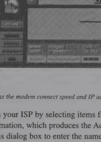

### FIGURE 8.2

X-ISP 在拨号窗口中提供有用信息，例如调制解调器连接速度和 IP 地址。

你需要通过从 Options 菜单中选择项目来输入你的 ISP 信息。先选择 Options, Account Information，这会弹出 Account Information 对话框（见图 8.3）。在此对话框中单击 Add 以输入你的 ISP 名称，此后你可以输入诸如电话号码（你可以输入多个，用分号分隔，X-ISP 会按顺序拨号，直到找到不忙的号码）、用户名等信息。在大多数情况下，你应在 User/Name 字段中输入你的 ISP 账户的用户名，并选择 PAP-Secrets 或 CHAP-Secrets 作为认证方法。如果你选择 None 作为认证方式，必须使用 Options, Dialing and Login 菜单项创建 select/send 对以进行手动登录。PAP 选项（但不是 PAP-Secrets）与随 Red Hat Linux 6.0 发行的 `pppd` 版本不兼容。

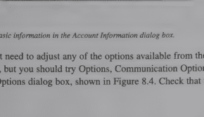

### FIGURE 8.3

你可以在 Account Information 对话框中输入 ISP 的基本信息。

你可能不需要调整 Options, Dialing and Login 菜单项提供的任何选项，但应尝试 Options, Communication Options，这会弹出 Communication Options 对话框，如图 8.4 所示。检查调制解调器设备是否为你的调制解调器所连接的设备，并将 Serial Port Baud Rate 设置更改为 115200。如果你愿意，可以通过更改 Reset 字段的内容来调整调制解调器初始化字符串。如果你将调制解调器设备从 `/dev/modem` 更改，X-ISP 会警告你必须在 `/etc/ppp/peers` 目录中创建对等信息文件。你可以使用 `/etc/ppp/peers/xisp_modem` 文件作为模型——复制它，然后编辑它并将对 `/dev/modem` 的引用更改为适当的设备。


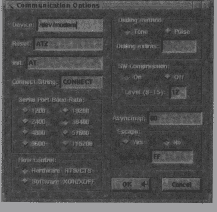

## FIGURE 8.4

*你可以在 Communication Options 对话框中调整串口和调制解调器选项。*

你需要做的最后一步配置是在 TCP/IP Options 对话框中，如图 8.5 所示，通过选择 `Options, TCP/IP Options` 获取。你可能可以保持 `Addressing/Routing` 设置不变，除非你知道需要更改它们。你可能应该在 `DNS support` 区域选择 `Yes`，并输入由你的 ISP 提供的一个或两个 DNS 服务器的 IP 地址。如果你愿意，可以像为以太网设备配置 DNS 一样进行配置，如第 7 章所述，在这种情况下你应选择 `No` 以关闭 DNS 支持。

在输入这些信息并创建 `PAP` 或 `CHAP` `secrets` 文件后，你可以尝试拨号你的 ISP。在主 `X-ISP` 窗口中单击 `Connect`。你的调制解调器应开始拨号，你应该会在 `X-ISP` 消息字段中看到与连接状态相关的消息。当你看到 IP 地址出现时，你应该能够使用正常的 Internet 工具，如 `Netscape Navigator`、`ftp` 等。

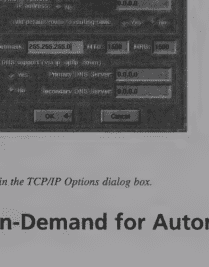

## FIGURE 8.5

你可以在 TCP/IP 选项对话框中输入你的 TCP/IP 信息。

## Setting Up Dial-on-Demand for Automatic Connections

在某些情况下，使用 PPP 连接脚本或 GUI 拨号器会显得笨拙。例如，假设你有一个由半打电脑组成的局域网，分布在三个房间，再加上一个带调制解调器的 Linux 服务器。进一步假设，你必须通过 Linux 计算机使用 PPP 拨号连接，并使用 IP 伪装，为所有这些计算机提供 Internet 访问。这些计算机中的任何一台用户都可以使用第五部分“远程访问”中介绍的技术之一，手动连接到 Linux 机器并从那里建立 PPP 链接；然而，有一种更简单的方法可以做到这一点：按需拨号。

按需拨号是通过 `diald` 包实现的。其原理是你的 Linux 计算机在其自身与 `diald` 包之间建立一个永久的 SLIP 连接。当 `diald` 检测到网络流量时，它会在自身与远程站点之间建立 PPP 连接，并充当你 Linux 计算机的正常网络协议与 PPP 链接计算机之间的中介。从某种意义上说，`diald` 就像你网络上的一个独立路由器，尽管它完全运行在你的 Linux 计算机内部。

### Necessary Kernel Options

除了 PPP 网络所必需的内核选项外，`diald` 还要求存在 SLIP（串行线路）支持选项（在“网络设备支持”标题下），可以作为模块或编译进内核。

此外，`diald` 要求在“网络选项”标题下启用 IP：透明代理支持选项。`diald` 使用此内核功能来完成处理 IP 数据包的部分工作。请注意，此选项不能编译为模块。

### Configuring Dial-on-Demand Services

假设你已经编译了合适的内核，你必须配置 `diald` 使其为你工作。第一步是安装该包。它不是 Red Hat Linux 6.0 常规程序的一部分，但你会在随书附带的 CD-ROM 上找到 `diald` RPM 文件，位于 `sams-extras/ppp` 目录中。像安装任何 RPM 一样安装它，使用 `rpm` 实用程序或 `gnorpm` 等 GUI 工具。

> Note
>
> `diald` 最近变化很快，部分原因是 Linux 内核从 2.0 到 2.2 的变化。随 CD-ROM 提供的 `diald` 版本到你阅读本书时可能已经过时，因此你可能想从 `diald` 主页 `http://diald.unix.ch` 查找更新的文件。但是，如果你获取了此类文件，请注意它可能不包含随本书 CD-ROM 上的 RPM 提供的相同配置文件。因此，你可能希望先安装此 RPM 只是为了获取此处描述的配置文件，然后再升级该包。

继续之前，请检查你是否已正确配置 DNS，如本章前面所述（第 198 页）。如果没有 DNS 服务，你需要为每个外部连接指定 IP 地址，而不是更合理的域名。

安装 `diald` 包后，你需要编辑两个配置文件：

- `/etc/diald.conf`—此文件中的许多选项与标准拨号脚本 `ppp-on` 中的选项相同，其含义应该很明显，例如速度（115200）和设备（`/dev/modem`）。更改你需要更改的任何选项。如果你使用本地网络上的远程或本地 IP 地址，你应该将此文件中的地址更改为私有（192.168.x.x）网络上未使用的地址。你使用什么地址并不重要，只要它们没有被任何计算机使用即可。你几乎肯定必须更改的一行是 ISP 用户名，它位于默认文件中的一行 `pppd-name ernie` 上。你必须将 `ernie` 更改为你的 ISP 用户名，如 `pap-secrets` 或 `chap-secrets` 文件中记录的那样。

- `/etc/ppp/diald-dialer`—此文件是本章前面介绍的 `ppp-on-dialer` 文件的轻微修改。你应该对 `diald-dialer` 做与对 `ppp-on-dialer` 相同的更改。此外，你必须将要拨打的电话号码（示例文件中的 `5551234`）更改为适合你 ISP 的号码。

编辑完这些文件后，你可以通过启动它来测试 `diald`。输入 `/usr/sbin/diald` 以启动守护进程。如果没有看到任何错误信息，请尝试进行网络访问，例如 `ping www.linux.org`。如果 `diald` 工作正常，你的调制解调器会在一两秒的延迟后拨号，你将连接到你的 ISP，并且开始从 `ping` 命令获得响应。

你也可以使用 Web 浏览器、`FTP` 客户端或其他网络应用程序。如果你已按照第 20 章“一个 IP 地址，多个计算机：IP 伪装”中所述为你的机器配置了 IP 伪装，那么你应该能够使用 LAN 上的计算机通过启动适当的 Internet 应用程序并发起网络传输来发起 PPP 拨号连接。

如果你让计算机闲置一段时间，以至于不再从 Internet 传输新数据，你的调制解调器连接应该会断开。在此断开之前精确的时间取决于最后传输的类型，设置在文件 `/usr/lib/diald/standard.filter` 中。例如，Web 传输会保持链路 2 分钟，而没有后续活动的 DNS 请求仅保持链路 30 秒。你可以通过编辑 `standard.filter` 文件来更改这些设置。该文件注释良好，因此你不应该有困难找到要影响的传输类型的适当部分。你以秒为单位指定时间，因此值 `120` 表示在终止连接前延迟 2 分钟。

如果你对 `diald` 工作正常感到满意，并且希望它持续运行，你可以向 `/etc/rc.d/rc.local` 或其他初始化脚本添加一行，以便在计算机启动时启动它。

## 何时使用按需拨号

与手动 PPP 拨号相比，按需拨号具有独特的优点和缺点。按需拨号的优点包括以下几点：

- 当 PPP 是通往外部世界的唯一连接类型时，它对小型内网上的用户来说相对透明。

- 它不需要 root 访问或用于拨出的特殊组。当内网用户通过 IP 伪装提供服务时，按需拨号甚至不需要用户在拨号的 Linux 机器上拥有账户。

- 它消除了因意外长时间保持链路而导致在线费用上涨的可能性。

按需拨号的弱点包括以下几点：

- 启动链路时的延迟可能导致 Internet 应用程序超时。例如，如果你在 Web 浏览器中启动 Web 访问，浏览器可能会在 PPP 链路建立之前报告站点无法访问。你通常只需单击重试选项或重新输入地址即可重新开始。

- 计算机经常会产生看似随机的 Internet 活动突发，这可能导致链路不必要地建立。例如，许多邮件阅读器可以配置为每隔几分钟检查一次新邮件，从而同样频繁地导致拨出。这些情况可能很难追踪，特别是如果你为拥有多台计算机的内网提供服务时。

- 链路可能在你希望之前就断开。当你阅读冗长的网页，或撰写长电子邮件或新闻组帖子时尤其如此。

总体而言，按需拨号可以成为某些小型网络的非常有用的工具。我认为对于分布在两个或更多房间的两个或更多计算机的联网家庭或非常小的企业来说，它非常值得。按需拨号允许这些计算机都由单个 ISP 账户提供服务，而不必担心一个用户意外地将另一个用户从电话线上移除，就像如果每台计算机都有自己的调制解调器那样可能发生的情况。

我发现对于单用户网络，即使拥有多台计算机，缺点也超过了优点。我可以在需要发起连接时使用拨号脚本或 `X-ISP`，并在需要断开时手动将其断开，而不是由算法计算我可能想要这样做。对于超过半打左右计算机的企业来说，其他连接技术，例如 DSL 或 T1 线路，比 PPP 更有意义，因为它们始终处于开启状态并且提供更大的带宽。在有提供的地方，低端 DSL 或有线调制解调器服务通常与拨号 PPP 账户和专用电话线路的费用大致相同，但此类服务在所有地区尚未提供。

## PPP 问题解决

无论你选择什么方法来建立 PPP 连接，你都有很大可能在途中遇到问题。ISP 的配置各不相同——通常差异很大，Linux 计算机也是如此。再加上不同型号的调制解调器各有其怪癖，这就成了麻烦的配方，通常很难追踪。


## 一般问题解决建议

无论你的症状是什么或你怀疑问题可能出在哪里，你都可以遵循某些程序来帮助隔离和解决问题。以下是一些开始的地方：

- 简化——如果你试图让按需拨号工作，请退回到基于脚本的方法或 GUI 拨号器。按需拨号不仅涉及 `PPP` 工具，还涉及 `diald`、`SLIP` 连接和多个额外的配置文件。很多地方都可能出错，因此如果你能让更简单的 `PPP` 连接工作，这将有助于你隔离问题。

- 尝试另一种方法——如果你正在尝试让脚本正常工作，试试 GUI 拨号器，反之亦然。虽然这些方法都使用 `pppd`、串口等，但它们解决整合问题的思路完全不同。你可能会发现替代方法可以接受，或者至少在上网并寻求进一步帮助时可以忍受。你也可以尝试这里未介绍的其他 GUI 拨号器或不同的脚本。

- 尝试另一个账户——问题经常在你以普通用户身份连接但不能以 `root` 身份连接时出现，但有时情况正好相反。某些连接工具，例如 `X-ISP`，会将配置文件存储在用户的家目录中，如果配置有误，另一个用户的账户可能工作得更好。如果这种方法有帮助，尝试追踪错误的配置文件并删除或修复它们。

- 尝试另一个操作系统——如果可能，将计算机启动到 `Windows`、`OS/2` 或其他操作系统中，并尝试连接。无论是否能连接，你都可能会发现有助于诊断问题的信息。

- 检查日志文件——许多守护进程和实用程序，包括 `pppd`，都会在日志文件中记录重要事件，通常是 `/var/log/messages`。输入 `cat /var/log/messages` 查看此文件。它可能相当大，且最后的消息反映了最新的活动。

- 听一下调制解调器——通过听调制解调器的连接音可以了解很多信息，例如连接是否已完成以及连接速度是多少。 （不过，可能需要一些经验才能学会区分不同的声音。）如果你通常更喜欢静音调制解调器，请为诊断目的更改调制解调器初始化字符串以启用扬声器，并听一听。

### Note

> 不同的调制解调器在连接时即使速度相同也会发出相当不同的声音。我的 3COM Sportster Voice 型号的声音与我的 Apple iMac 内置调制解调器的声音不同，即使两者都以 v.90 速度连接到同一个 ISP。因此，如果你正在诊断一台系统的连接问题，不要假设你听到的连接声音会与另一台计算机上听到的声音相同。

- 研究你的调制解调器指示灯——如果你有外部调制解调器，其指示灯可以提供大量信息。如果指示灯闪烁但调制解调器不拨号，也许你的拨号或配置命令不正确。也许线路质量指示灯在闪烁，表明连接较弱。

- 联系你的 ISP——尤其是如果你使用的是使用 Linux 或某种 UNIX 的小型本地 ISP，你可能能够从 ISP 那里获得有用的提示。一些 ISP 即使不正式支持 Linux，也提供可供下载的示例配置文件。有时这些文件相当陈旧，但你只有在检查后才会知道。

- 检查 Deja News——网站 `http://www.deja.com` 是任何计算机相关问题的绝佳故障排除资源。在关键词上进行搜索，具体程度尽可能高，例如 `ppp` 和 `linux` 和 `pap`，如果你认为你遇到了 `PAP` 认证问题。

- 发布新闻文章——如果 Deja News 没有找到有希望的结果，试着发布你自己的查询。新闻组 `comp.os.linux.networking` 最适合 Linux `PPP` 问题，但如果你的问题似乎不是 Linux 特有，你可能想尝试 `comp.protocols.ppp`。发布尽可能多的细节；“`PPP` 不能工作”不会得到太多帮助，但“`PPP` 失败并显示‘`PAP authentication failed`’消息”会更好，更具体的细节会更有帮助。

当然，最后这几个选项如果没有某种形式的互联网连接就没什么用，而如果 Linux 是你唯一的系统，这就会带来先有鸡还是先有蛋的问题。也许你可以使用另一台计算机来检查 Deja News 甚至发布查询；或者你也可以暂时安装 `Windows` 来执行此操作。

## Modem Connectivity Problems

在最基本层面上，你可能会遇到调制解调器无法可靠连接的问题。你可能想先使用 `minicom` 或 `seyon` 来确认你的调制解调器是否正常工作，然后再调试 `PPP` 或你的连接脚本——请参阅本章前面的表 8.1，了解有关基本串口和调制解调器测试的信息。

如果你能用终端程序连接到你的 ISP，并在调制解调器挂断之前看到合理的文本或乱码，那么就可以排除调制解调器或严重电话线路问题的可能性。但是，如果在尝试向同一电话号码建立 `PPP` 连接时似乎无法达到这一点，那么你的调制解调器初始化字符串可能有问题。检查你在终端程序中使用的内容，并在你的 `PPP` 拨号脚本或 GUI 拨号器中实现它。

手动登录提示，但会响应由客户端发起的 `PAP` 或 `CHAP` 查询，因此不要仅因为看到登录提示就认为你处于这种情况。

偶尔你会因为超时而出现连接问题——脚本或 GUI 配置中允许某项操作的时间可能不够长。如果拨号到 ISP 需要拨打七位以上号码，或者你使用的是脉冲拨号而非音调拨号，则这种情况尤其可能发生。如果你有时能连接，有时却在连接本应“建立”之前失败，请尝试增加相关超时值，看看是否有帮助。

如果你听到调制解调器已连接而载波立即中断，可以想象这并非连接问题，而是身份验证问题。你的系统可能已连接、发送登录信息，并在 ISP 的测试中失败得如此之快，以至于你将其误认为是调制解调器连接失败。

## 身份验证失败

许多 `PPP` 连接问题最终都表现为身份验证问题。通常这些问题是配置错误的结果——例如 `pap-secrets` 或 `chap-secrets` 文件有缺陷，或 `pppd` 选项不正确。因此你应检查配置中是否遗漏了某个选项，并仔细核对你在 secrets 文件中输入的用户名和密码是否正确。另外请注意，在大多数情况下，secrets 文件的服务器字段需要一个星号 `*`，并且 IP 地址字段留空。如果服务器字段指定了一台机器而你未连接到该计算机，或你的 ISP 试图分配给你一个不在列表中的 IP 地址，而你确实列出了地址，则你的计算机将拒绝连接。

这个过程中棘手的一点是，什么构成 `pppd` 的“错误选项”因 ISP 而异。例如，大多数拨号 `PPP` 账户会从地址池中分配 IP 地址，你并不能保证每次连接都获得相同的地址。其他 ISP 每次连接可能给你相同的地址，而你可能需要在 GUI 拨号器或连接脚本中指定此地址。你可以输入 `man pppd` 来了解有关 `pppd` 选项的更多信息。如果你认为需要更改其中任何一项，请尝试编辑你的 `ppp-on` 脚本、`/etc/diald.conf` 文件，或 `X-ISP` 配置对话框中的选项。

## 连接后挂断和注销

使用调制解调器进行拨号连接时不可避免的一个事实是，这些链路偶尔会失败。这通常是由于电话线路问题造成的——噪声突发可能导致一个或两个调制解调器放弃并丢弃载波。当然，墨菲定律几乎保证了这会在你已下载最新 Red Hat Linux 发行版的 99% 时发生！其他时候，物理连接问题可能导致调制解调器频繁重新训练，即调制解调器尝试重新协商与远程计算机的低层连接。这本身不会导致载波中断，但确实意味着在重新训练期间没有数据传输。如果你使用的是外置调制解调器，通常可以通过闪烁的指示灯发现重新训练，但对于内置调制解调器，你无法得知何时正在重新训练。不过，你通常可以在事后通过使用终端程序并发出适当命令来发现连接质量问题。例如，在一次成功的 `PPP` 会话后，向 3COM/U.S. Robotics Sportster 56K Voice 调制解调器发出 `ATi6` 命令的结果如下：

### U.S. Robotics 56K Voice EXT 链路诊断...

```
Chars sent          27053    Chars Received      334750
Chars lost          0        Chars Retransmitted 0
Octets sent         16291    Octets Received     188318
Blocks sent         1157     Blocks Received     1858
Blocks resent       15

Retrains Requested  0        Retrains Granted    0
Line Reversals      0        B1ers               24
Link Timeouts       0        Link Naks           4

Data Compression    V42BIS 2048/32
Equalization        Long
Fallback            Enabled
Protocol            LAPM
Speed               50666/28800
V.90 Peak Speed     50666
Last Call           00:27:38

Disconnect Reason is DTR dropped
```

在其他方面，该报告表明

- 我的调制解调器发送了 27KB 数据并接收了 334KB 数据。


- 由于错误，1,157 个数据块中有 15 个被重发。
- 此会话期间没有重新训练。
- 连接速度为下行 50666bps，上行 28800bps。

如果你经常遇到连接中断、连接速度低、重新训练次数多或类似问题，你可能需要考虑以下几种可能的解决方案：

- 尝试 ISP 的另一个接入号码——有时一个号码比另一个号码工作得更好。
- 尝试更换 ISP——有时一个 ISP 的线路质量不如另一个，或者其硬件与你的调制解调器的兼容性不如另一个。免费试用期是测试这种差异的绝佳方式。
- 更换你的调制解调器——调制解调器在整体质量上各有差异，也在应对特定类型线路缺陷的能力上各不相同。
- 维护电话线路——问题有时可追溯至电话连接不良。我曾在降雨后出现连接速度差、反复训练和断线的问题。原来水渗入了我公寓外电话公司的设备，导致线路出现杂音。

你也可能是非活动或使用计时器的受害者。这当然是按需拨号解决方案的一部分，但你可以通过编辑`/usr/lib/diald/filter`文件来调整计时，如本章前面所述。即使你没有使用`diald`，也有可能在本地设置此类计时器，而且你可能无意中设置了此类选项，尤其是在你使用了从互联网上找到的脚本或 GUI 工具的情况下。ISP 在其端有时也会实施类似的限制，尤其是在高峰时段。

#### Note

人们偶尔会发帖，询问如何绕过 ISP 设定的非活动计时器。设置一个`cron`作业在固定间隔执行少量互联网流量是轻而易举的事，但我强烈不建议这样做。某些 ISP 认为在不使用计算机时试图保持连接是违反其公平使用政策的行为，并可能因此终止你的账户。即使没有发生这种情况，始终在线的访问也会增加 ISP 的成本，而他们必须将其转嫁给客户，而大多数客户并不会以这种方式滥用系统。如果你想要始终在线的互联网访问，你最好考虑使用专用的 PPP 账户（专门为此目的销售）或替代的访问方式，例如 DSL 线路、有线调制解调器或 ISDN。特别是 DSL 和有线连接，从 Linux 的角度来看，就像普通的以太网连接一样，而且在许多大都市地区，其价格与专用电话线路和 PPP 账户相当，但访问速度要快得多。

## Summary

通过电话线路的 PPP 已是为个人和小企业提供互联网访问的常见方法多年，并且可能在未来几年仍将保持常见。本章描述了如何设置 PPP 链路，包括必要的内核驱动程序、串行端口测试以及 PPP 配置本身。

本章涵盖了启动 PPP 链路的三种不同方法：使用手动运行的脚本、`X-ISP` GUI 拨号器以及`diald`按需拨号器。每种方法都有其优点和缺点，因此你可以根据具体需求选择最适合的一种。

设置 PPP 链路，无论使用何种方法，都可能是一次麻烦的经历。问题包括驱动程序配置困难、身份验证失败以及电话系统的物理缺陷。识别和纠正这些问题可能很棘手，但本章提供了一些提示来帮助你完成此任务。

## Part III: File Sharing

### In This Part

- 9 Basic Principles of File Sharing 215
- 10 NFS: Sharing Files with Other UNIXes 241
- 11 Samba: Sharing Files with DOS, Windows, and OS/2 255
- 12 Netatalk: Sharing Files with Macintoshes 291
- 13 Using Linux to Back Up Client Machines 315

### Chapter 9: Basic Principles of File Sharing

#### In This Chapter

- Using Mount Points Effectively 216
- Understanding Ownership and Permissions 223
- Case-Sensitivity in Linux and Other OSs 230
- Serving Removable Media 231
- Security Considerations 237
- Summary 239

Linux 在通过网络进行文件共享方面是最好的操作系统之一。这是因为 Linux 在两个方面提供了灵活性：网络文件系统和基于磁盘的文件系统。Red Hat Linux 开箱即支持用于与 UNIX 计算机进行文件共享的网络文件系统 NFS 协议；用于与 DOS、Windows 和 OS/2 计算机进行文件共享的 Samba；以及用于与 NetWare 计算机进行文件共享的 NetWare 核心协议 NCP。借助一个额外的软件包（随本书光盘附带），Red Hat 支持 AppleTalk，用于与 Macintosh 计算机进行文件共享。这种支持范围虽然并非独一无二，但使 Linux 非常灵活，你很难找到选择更多的操作系统。

同样，Linux 支持大量基于磁盘的文件系统，包括其原生 ext2fs；DOS、Windows 和 OS/2 使用的各种文件分配表 FAT 变体；Windows NT 的 NT 文件系统 NTFS；OS/2 的高性能文件系统 HPFS；Macintosh 的分层文件系统 HFS；CD-ROM 上使用的 ISO-9660 和 Joliet 文件系统；各种 UNIX 变体的 UNIX 文件系统 UFS；以及其他更奇特的系统。当然，如果你使用 Linux 机器来提供本地存储的文件服务，这种异常广泛的支持并不是特别重要。Linux 允许你共享可移动媒体，不过，其中可能包含上述任何一种文件系统。你也可以安装一台之前在其他操作系统中使用的硬盘并直接共享其文件，或将此支持用作从其他操作系统转换服务器时的临时措施，或在需要双启动该机器时使用。

无论你使用何种网络或本地文件系统，在充分利用任何文件共享配置之前，你必须熟悉某些概念。如果你的主要熟悉的是 Windows 或 MacOS，这一点尤其重要，因为 Linux 对文件和文件系统的处理方式与这些操作系统不同，既有明显也有微妙的差异。因此，本章的目标是介绍重要的概念，既包括文件共享的一般概念，也包括 Linux 对文件的处理方式，特别是这种处理方式如何与 DOS、Windows、OS/2 和 Macintosh 客户端的文件共享交互。

#### Using Mount Points Effectively

为了理解 Linux 文件共享实践，了解 Linux 的分区和文件系统哲学是重要的。一般来说，Linux 文件共享对分区的依赖程度不如 Windows 等操作系统。Linux 还提供了一种访问未明确导出的区域中的文件的方法，这既可以带来极大的便利，也可能带来潜在的安全问题。

##### 注意事项

在 Linux 中，单词 filesystem 有两种含义。一种是分区或可移动介质上数据的底层布局。这是本章前面提及 ext2、FAT、HFS 以及 Linux 支持的其他文件系统时所使用的该词的含义。第二种含义是该词的另一种意思，也是适用于上一段落的含义，即系统上数据的顶层逻辑布局——也就是说，目录和文件如何相互关联地组织起来。这种词义指的是你在命令行提示符或文件打开对话框中输入以访问文件的内容。一般来说，上下文应能清楚表明该词的哪种含义是相关的。在可能存在歧义的地方，我已尝试通过明确含义或在适当时使用 partition 或 directory structure 等术语来澄清。

##### 分区和挂载点

Linux 与 UNIX 一样，使用的文件系统结构与 DOS、Windows、OS/2 或 MacOS 的结构有很大不同。在所有这些桌面操作系统中，你通过标识标签（如`C:`或`MyFiles:`）来访问每个分区或可移动磁盘。在 Linux 中，没有驱动器号或分区标签。相反，第一个分区，即根分区，或`/`，作为所有其他分区的基座。文件和目录可以存在于根分区中，你可以通过在其名称前加上`/`来访问它们，例如`/test-file.txt`或`/test-directory/`。你将额外的分区挂载在根分区上的挂载点——空目录——上。此后，挂载点目录下的所有内容都位于已挂载的分区上。这一规则的一个例外是，你可以将一个分区挂载在次级分区之下，以此类推。图 9.1 说明了这种关系。请注意，文件系统结构中哪些部分作为单独分区存在是任意的，由你在安装 Linux 时或后续系统重新配置时决定。

**图 9.1** 对用户而言，`/home`与`/`是否位于不同的分区无关紧要；这些分区都是统一树的一部分。

##### 导出目录

文件共享涉及将一个或多个目录提供给远程计算机的用户使用。在大多数情况下，你希望导出单个用户的家目录——即`/home`目录树中存储用户文件的目录，如图 9.1 中的`/home/jennie`、`/home/jim`和`/home/edgar`。如何做到这一点因协议而异，但通常你会导出`/home`目录本身或各个用户的目录。


需要注意的一个重要点是，在 Linux 中，你导出的是目录，而不是分区。当你导出一个目录时，你也会导出该目录下可用的所有文件和子目录，无论它们是否位于单独的分区上。因此，如果你导出图 9.1 中的 `/usr` 目录，你也会导出位于单独分区的 `/usr/local`；但你不会自动导出 `/home` 或物理位于根分区内的文件和目录。 （对于某些文件共享方法，这些规则存在例外，我将在相应的章节中讨论。）

> 注意
> 
> Linux 使用斜杠字符（`/`）来分隔目录名称。DOS、Windows 和 OS/2 都使用反斜杠字符（`\`）来达到此目的，而 MacOS 使用冒号（`:`），尽管这一事实通常对 Macintosh 用户是隐藏的。当你导出一个目录时，客户端操作系统的目录分隔协议将接管来自该客户端的访问。例如，假设你使用 `Samba` 导出 `/home/jim` 目录，并且该目录包含一个名为 `reds` 的目录和该目录中的一个名为 `rose.txt` 的文件。在 Windows 中，该文件可能被访问为 `E:\reds\rose.txt`。在 Linux 中它仍然可作为 `/home/jim/reds/rose.txt` 访问。

由于你导出的是目录，因此不必导出整个分区。例如，你可以仅导出图 9.1 中的 `/home/jennie` 目录，限制 `/home/jim` 和 `/home/edgar` 的网络访问。如果在 `/home/jennie` 下挂载了一个分区，那么它将与 `/home/jennie` 一起被导出。

由于你可以导出特定的目录，因此你可以精确控制远程客户端可以访问的内容，关于链接存在某些警告，如“链接会发生什么”一节所述。在设计你的网络和 Linux 机器的文件系统布局时，你可能需要考虑所需的目录结构。你可能需要问自己一些问题：

- 用户是否需要个性化的目录空间？如果是，他们需要在 Linux 服务器上拥有单独的账户（这无论如何对安全都有好处），并且你需要导出这些目录。
- 用户是否需要共享目录空间？如果用户正在一起协作项目，你可能希望为此目的给他们提供一个或多个目录的共享访问权限。不过，如果两个或更多用户同时尝试访问同一个文件，这可能会导致问题，因此你可能需要考虑其他选项，例如将文件存储在各个用户的账户中，并让他们将文件复制到共享空间以便传输。
- 服务器是否双系统启动？如果是这样，你可能希望导出非 Linux 操作系统的分区。你甚至可以配置 Linux 服务器，使其在网络上看起来与在 Linux 下运行时与在替代操作系统下运行时几乎相同。
- 服务器将只提供数据文件，还是程序文件？如果要提供程序文件，你可能希望为此目的另设一个单独的目录。你甚至可以为其设置权限，使大多数网络用户无法修改程序文件目录的内容。这种做法可以作为防止事故、恶意行为甚至某些病毒的保护措施。

总的来说，在许多情况下，保持独立的用户账户以及一个或多个用于共享文件的目录是一种有效的解决方案。你可以将共享文件目录放在 `/home` 目录树中，如果这样方便的话，或者你也可以在其他地方创建单独的目录。

Linux 挂载和导出系统的一个特殊之处在于，可以将同一文件在多个导出中导出。例如，假设你有一个名为 `/usr/local/winfiles/apps` 的目录。你可以导出此目录，在这种情况下，其中的文件和目录将在客户端的根目录中显示，例如 `E:\MegaWord`、`E:\readme.txt` 等等。你也可以导出此层级中更高或更低的目录，例如 `/usr/local`。然后你将能够以不同的根位置访问与之前导出中相同的文件，例如 `F:\winfiles\apps\MegaWord` 和 `F:\winfiles\apps\readme.txt`。像这样多次导出可能会令人困惑，因此我建议你尽可能避免它们。

## 链接会发生什么

Linux 支持链接，它们是从一个文件指向另一个文件的指针。当程序尝试打开一个链接时，Linux 会打开被链接到的文件，大多数程序并不知道其中的区别。链接类似于 Macintosh 别名、Windows 快捷方式和 OS/2 影子，但 Linux 以更基本的方式实现它们，特别是与 OS/2 影子相比。在 OS/2 中，影子很大程度上作为 WorkPlace Shell（WPS）对象存在，而不是作为基本文件系统功能，这意味着大多数程序无法通过影子访问文件。在一定程度上，Windows 中的快捷方式也是如此。在 Linux 中，任何程序都可以通过链接访问文件。由于文件共享守护进程是 Linux 程序，链接会以一种或另一种方式被导出，至少在潜在情况下如此。使用 `NFS` 时，链接作为链接导出，因此其他 Linux 或 UNIX 机器以与本地几乎相同的方式访问它们。使用 `Samba` 和 `Netatalk` 时，链接作为普通文件导出，就好像它们在同一文件系统上存在两次一样。

## 链接的类型

Linux 支持两种类型的链接：

- 硬链接——这些链接是通过创建指向同一文件的两个目录条目而形成的。说一个文件是另一个文件的链接并不完全准确，因为两个目录条目都以相同的方式导致对文件的访问。由于硬链接是通过为同一个文件创建多个目录条目而形成的，因此它们不能跨越分区边界。你可以删除“原始”文件，而指向它的链接仍然可访问。你可以在 Linux 中通过输入 `ln oldfile newfile` 创建硬链接，其中 `oldfile` 是现有文件，`newfile` 是你希望通过该名称访问文件的附加名称。
- 符号链接——这些链接，有时也称为软链接，是通过创建包含被链接文件文件名的特殊文件而形成的。因此，有一个明确的“原始”文件和一个或多个指向该文件的链接。符号链接可以跨越分区边界，这使得它们在跨目录链接时很受欢迎：你可以创建链接并确信即使以后重新排列分区结构，它仍会继续工作。如果删除原始文件，链接将停止工作，因为文件已不存在。你可以通过输入 `ln -s oldfile newfile` 创建符号链接——语法与创建硬链接相同，只是你在 `ln` 命令名称后添加 `-s` 参数。

图 9.2 说明了硬链接和符号链接之间的区别。

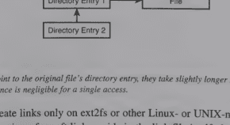

### FIGURE 9.2

由于符号链接指向原始文件的目录条目，因此访问它们所需的时间略长于硬链接，尽管对于单次访问而言，这种差异可以忽略不计。

你通常只能在 `ext2fs` 或其他 Linux 或 UNIX 原生文件系统上创建链接。然而，由于软链接的所有机制都驻留在链接文件本身，因此你可以将软链接放在 `ext2fs` 分区上，指向驻留在非 Linux 文件系统（如 `FAT`）上的文件。

两种链接类型对于文件和目录都同样适用。当你链接到一个目录时，你可以进入该链接并访问链接目录中的文件。

## 跨导出的链接

由于你可以在 Linux 目录树中的几乎任何位置链接到树中几乎任何其他位置，因此可以创建一条通向导出文件系统之外的链接。例如，假设你从图 9.1 导出 `/home/jennie`。然后，假设 Jennie 使用 `telnet` 或其他方式登录到 Linux 计算机，并在她的家目录下创建一个指向文件系统根目录 `/` 的链接。Jennie 现在可以访问计算机上的所有目录。这可能构成安全问题——但也不过是给予用户系统登录权限所带来的风险，只要你配置网络，使你的用户以普通用户权限获得文件共享访问。尽管如此，`Samba` 提供了禁用符号链接跟踪的选项。如果你使用此选项，用户在尝试跟踪符号链接时会收到错误。

#### 提示

> 如果你在 Linux 计算机上正确配置权限，用户即使创建指向敏感区域的符号链接，也无法对系统造成损害。大多数 Linux 发行版默认对大多数文件和目录具有合理的权限，因此只需采取适度预防措施即可维护此方面的系统安全。不过，你应该密切关注为任何敏感目录结构授予的权限，例如包含员工绩效评估或商业机密的目录。

符号链接可以采用两种形式之一创建：相对或绝对。在相对链接中，对链接文件的引用是相对于当前目录的。例如，如果 Jennie 想在她的家目录 `/home/jennie` 中创建一个指向文件 `/home/edgar/bone.jpg` 的链接，Jennie 可以输入 `ln -s ../edgar/bone.jpg`，使用 `..` 操作符返回目录结构，然后再次向前，使用她的家目录作为起点。另一方面，绝对引用以根目录作为起点，因此等效的链接可以通过输入 `ln -s /home/edgar/bone.jpg` 来创建。请注意，链接的绝对或相对性质是链接的永久组成部分；它不仅仅是链接创建方式的问题，而且每次通过链接访问文件时都会产生影响。

绝对链接在链接文件本身的位置可能发生变化时很有用。例如，如果 Jennie 最初在她的家目录中创建指向 `bone.jpg` 的链接，但后来决定将链接移动到家目录内的 `pictures` 子目录，绝对链接可以存活下来。相对链接则不能存活。另一方面，相对链接可以承受整个目录结构的移动。例如，如果系统管理员将 `/home/jennie` 和 `/home/edgar` 目录都移动到新位置（例如 `/home2`，位于新硬盘上），则相对链接继续工作，而绝对链接则不工作。

## 链接的怪癖

由于 Unix 链接在通过 `Samba` 或 `Netatalk` 导出文件系统时显示为普通文件或目录，链接会表现出某些怪癖：


- 如果你通过链接打开文件，进行更改，然后保存文件，链接有时会被新文件替换，而原始文件保持不变。这发生在远程系统上的程序删除原始文件然后创建新文件，而不是更新原始文件时。这种情况在 Macintosh 和 Windows 客户端计算机上都很常见。例如，Microsoft Word 和 Corel WordPerfect 在 Macintosh 和 Windows 上都会出现此问题，而 Macintosh 的 TeachText 和 Windows 的 WordPad 则不会。

- 如果你跨分区创建链接，空闲空间估计可能不准确。你可能在客户端操作系统认为应该之前就用完空间，或者你可能拥有比客户端操作系统认为可用的空间多得多的空间。后一种情况有时会特别令人恼火，因为某些程序会检查可用磁盘空间并拒绝让你创建它们认为无法创建的文件。虽然这通常是程序方面的明智预防措施，但在跨分区链接导致空闲空间估计出现偏差时，这可能会很烦人。

总体而言，我建议在可能的情况下避免在导出的目录上使用链接。

## 客户端链接

如前所述，客户端操作系统也支持链接或类似链接的结构。你通常可以在导出的文件系统上创建这些客户端操作系统链接。事实上，在向其他 Linux 或 UNIX 计算机进行 NFS 导出时，这些链接的工作方式与本地链接一样——只是链接中的引用可能指向主机计算机。例如，假设用户 jim 从他的家目录`/home/jim`创建一个指向客户端计算机上`/opt/wp8/wp graphics`中的文件的链接。当 Jim 使用另一台 Linux 或 UNIX 客户端，或服务器本身，并远程挂载他的家目录时，他很可能会发现链接现在指向新计算机上的`/usr/wp8/wp graphics`目录——如果该目录存在的话！

在 Windows 和 Macintosh 客户端中，在客户端操作系统中创建的链接仅在该操作系统中才有用。如果您在混合操作系统环境中使用 Linux，就不能期望在一个操作系统中创建的链接在另一个操作系统中可用，除非使用 Linux 原生工具（如 `ln` 命令）创建的链接。此外，指向服务器上文件的链接可能并不总是有效，尤其是在 MacOS 中，MacOS 使用文件 ID 来标识别名文件。这些 ID 在一次挂载到另一次挂载时可能会发生变化，从而使别名失效。这一事实也可能扰乱程序中的文件历史记录功能；您可能尝试加载一个文件，但会收到错误消息或得到一个不同的文件。

## 理解所有权和权限

Linux 支持比大多数桌面操作系统（如 DOS、Windows 和 MacOS）更复杂的所有权和权限概念。即使这些操作系统支持此类概念，如 Windows NT，Linux 的文件权限模型通常也与客户端操作系统不同。这一事实会导致系统将 Linux 文件权限映射到客户端操作系统时出现一些妥协。

### 所有权和权限概念

在 Linux 中，每个文件都有两个所有权特征：所有者和组。所有者通常是创建该文件的用户，尽管所有权可以通过 `chown` 命令转移。每个用户属于一个主组，并且可以属于多个附加组。例如，一个用户可能属于 `users` 组，以及 `uucp` 和 `project10` 组。通常，此用户会创建与 `users` 组关联的文件，并且此用户对属于 `uucp` 和 `project10` 组的文件具有组访问权限。

每个文件对所有者、组和其他所有用户都有单独的权限。这三种权限各自细分为读、写和执行权限。读和写权限相当明显。执行权限意味着文件可以作为程序运行。因此，执行权限类似于 DOS 或 Windows 中的 `.EXE` 扩展。

> Note
>
> 执行权限与在 Linux 中将文件作为程序运行相关。当您导出一个目录时，客户端操作系统自行决定文件是否可执行。对于 DOS、Windows、OS/2 和 MacOS 来说，这一决定不依赖于 Linux 执行权限。

权限通常以两种方式表示。第一种是 10 个字符的字符串，其中第一个字符表示文件类型（普通文件、目录等），其余 9 个字符以 3 为一组表示所有者、组和其他所有用户的权限。例如，这里有一些示例文件：

```
-rwxr-xr-x 1 rodsmith users 10572 Jun 19 12:44 vplay
-rw-r--r-- 1 rodsmith users 2598 Jun 20 13:18 wp-fontinstall.txt
drwxr-x--- 2 rodsmith users 2048 Jul 1 11:00 wp-icons
```

第一个文件`vplay`是一个程序文件——其权限字符串`-rwxr-xr-x`表明它对所有者、组和所有用户都有执行（`x`）权限。（破折号表示无权限，`r`、`w`和`x`分别表示读、写或执行权限。）第二个文件`wp-fontinstall.txt`是一个文本文件，所有者和文件所属组（`users`）具有读写权限，其他人只有只读访问权限。第三个文件`wp-icons`实际上是一个目录（由权限字符串第一字段中的`d`表示），所有者具有读写访问权限，`users`组成员具有读访问权限，其他人无访问权限。

执行权限对目录具有特殊含义：它意味着目录的内容可访问。如果一个目录可读但不可执行，您可以找到有关内容的一些信息，但无法访问目录中的文件。如果目录可执行但不可读，您无法获取目录列表，但如果您知道文件名，则可以访问目录中的文件。因此，目录通常同时具有读和执行权限。要限制对目录的访问，您需要同时移除执行和读权限。

表示权限的第二种方式是三位或四位八进制（基数 8）数字，例如 `754` 或 `0754`。每个八进制数字大小为 3 位，可以表示为二进制数；例如，`7` 是 `111`，`5` 是 `101`，`4` 是 `100`。将二进制表示连接起来，您就得到一个权限字符串，其中 `0` 等价于破折号（`-`），`1` 等价于该位置适当的字符。例如，`754` 等价于 `-rwxr-xr--`。（4 位表示法中的前导数字具有特殊含义。除了表示目录外，您通常不需要关心它，而且目录编码也是自动处理的。）

从 Linux 内部，您可以使用 `chown`、`chgrp` 和 `chmod` 命令更改所有权和权限：

- `chown`—更改文件的所有权，并可选择更改组。输入 `chown user.name.group filename` 来执行此操作。如果您只想更改用户名，可以省略句点和组名。

- `chgrp`—更改文件的组关联。此命令的工作方式与 `chown` 类似。

- `chmod`—更改文件的权限。使用 `chmod` 的最简单方法是使用八进制权限表示，例如 `chmod 644 filename.txt` 将 `filename.txt` 的权限更改为 `644`（`-rw-rw-rw-`）。你也可以通过使用 `u`、`g`、`o` 和 `a` 分别表示用户、组、其他用户和所有权限的代码，结合加号（`+`）、减号（`-`）或等号（`=`）以及 `r`、`w` 或 `x` 代码来表示读、写和执行权限，来更改单个位。例如，`chmod a+x program` 给所有用户（所有者、组和其他人）对文件 `program` 的执行权限。`chmod go-rw filename.txt` 从 `filename.txt` 中移除组和其他用户的读和写访问权限。

`chown`、`chgrp` 和 `chmod` 命令都适用于文件和目录。还有一个 `-R` 或 `--recursive` 开关可将这些命令应用于整个目录树，例如 `chown edgar /home/edgar --recursive`。

表 9.1 列出了一些常见的权限代码、其字符串等价物和含义。请记住，这些并不是唯一可能的权限；共有 9 个位可用，因此有 512 种可能的权限，不包括链接和目录等特殊文件的变体。

### TABLE 9.1 Sample Permissions and Their Meanings

| Octal Code | Permissions | Meaning |
|---|---|---|
| `644` | `-rw-r--r--` | 文件所有者可以读和写文件，其他所有人只能读。 |
| `640` | `-rw-r-----` | 文件所有者可以读和写文件，文件所属组成员可以读它，但其他人无法访问它。 |
| `755` | `-rwxr-xr-x` | 文件所有者可以读、写和执行文件，其他所有人可以读或执行它。 |
| `711` | `-rwx--x--x` | 文件所有者可以读、写和执行文件，其他所有人只能执行它。 |
| `444` | `-r--r--r--` | 所有人都可以读文件，没有人可以写或执行它。 |

## Ownership and Permissions on Non-Linux Filesystems


如果你使用 Linux 服务器来提供非 Linux 文件系统，特别是 HFS 或 FAT 文件系统，你会遇到 Linux 对这些外来文件系统的所有权和权限的处理。因为 Linux 非常依赖所有权和权限功能，所以 Linux 基本上在非原生文件系统上伪造这些功能。例如，如果你挂载一个 FAT 文件系统，Linux 会为该文件系统上的文件分配一组默认的权限和所有权。你可以通过 `mount` 命令的选项或 `/etc/fstab` 文件中的条目来指定这些内容。如果你发出完整的 `mount` 命令，这些选项出现在 `-o` 参数之后，例如 `mount /dev/fd0 /mnt/floppy -t vfat -o uid=500`。在 `/etc/fstab` 条目的情况下，这些选项放在第四列。在这两种情况下，多个选项可以用逗号分隔。最相关的选项总结在表 9.2 中。

## TABLE 9.2 Mount Options for Non-Linux Filesystems

| Option | Filesystems | Meaning |
|---|---|---|
| `uid=value` | msdos, vfat, hfs, hpfs, ntfs, iso9660 | 设置所有文件的所有者 ID。 |
| `gid=value` | msdos, vfat, hfs, hpfs, ntfs, iso9660 | 设置所有文件的组 ID。 |
| `umask=value` | msdos, vfat, hfs, hpfs, ntfs, iso9660 | 设置将从文件中移除的权限位，以八进制表示。例如，值 `000` 会导致文件具有 `-rwxrwxrwx` 权限，而值 `022` 会导致文件具有 `-rwxr-xr-x` 权限。 |
| `nonumtail` | vfat | 通常，VFAT 文件系统会在文件名超过 8.3 限制时创建带有数字尾部的底层 8.3 文件名，例如 `longfi-1.txt` 对应 `long-filename.txt`。此选项在可能的情况下消除这些尾部，从而得到类似 `longfile.txt` 的 8.3 文件名。 |
| `conv=[t]ext\|[b]inary\|[a]uto` | UNIX/Linux、DOS/Windows/OS/2 和 MacOS 在文本文件中的行尾处理方式各不相同。此选项设置转换选项：`text` 将所有文件视为文本文件，`binary` 将所有文件视为二进制文件（不转换），`auto` 则尝试通过文件名扩展名或其他线索来判断。`binary` 是推荐的默认设置。 |
| `case=lower\|asis` | hpfs, hfs | 将所有文件转换为小写或保持大小写不变。默认值为 hpfs 的 `lower`，hfs 的 `asis`。 |
| `fork=cap\|double\|netatalk` | hfs | 以各种格式显示 Macintosh 资源分支数据。如果你使用 Netatalk 进行 Macintosh 文件共享，`netatalk` 是首选格式。 |
| `afpd` | hfs | 使文件系统的处理更兼容 Netatalk。 |
| `creator=xxxx` | hfs | 将新文件的文件的 Macintosh 创建者代码设置为指定的四字母代码。 |
| `norock` | iso9660 | 如果存在，则不使用 Rock Ridge 扩展。 |
| `nojoliet` | iso9660 | 如果存在，则不使用 Joliet 文件系统。 |
| `noauto` | All filesystems | 不要在系统启动时挂载文件系统。推荐用于可移动介质。仅在 `/etc/fstab` 中使用。 |
| `user` | All filesystems | 允许非 root 用户挂载文件系统。仅在 `/etc/fstab` 中使用。 |
| `loop` | All filesystems | 将磁盘映像挂载为可移动磁盘或分区。 |

`mount` 命令的手册页列出了这些和其他文件系统的其他选项。支持最新的 Linux 文件系统（主要是 HFS 和 NTFS）并未在 `mount` 手册页中完全描述，因此你应该查阅内核源代码树中的文档文件，以获取有关这些文件系统挂载选项的更多信息。

当你挂载了一个不支持权限或所有权的文件系统时，你将无法更改这些文件系统不支持的任何特性。大多数这些文件系统都支持写权限位，但当你更改它时，你是为所有者、组以及所有其他用户更改的（假设 `umask` 值没有阻止对其中某些组的写权限）。如果你需要在此类文件系统上更改文件的权限或所有权，你需要先卸载它，然后再使用新的选项重新挂载它。

非 Linux 客户端可能支持 Linux 不支持的文件系统特性。例如，FAT 有一个隐藏特性，当启用时，会使文件对许多命令隐藏。取决于服务器和配置，当文件被复制到 Linux 服务器时，此类特性很可能会丢失，但有时可以保留它们。就隐藏位而言，Samba 和 Netatalk 可以配置为对以句点开头的文件启用此位，因为前导句点是 Linux 表示隐藏文件的方式。

## 由远程系统分配所有权和权限

当你将目录导出到远程系统时，服务器必须决定如何转换所有权和权限。对于 NFS，此信息是传输的一部分。这里的困难在于，所有权和权限是通过数字代码而不是名称传输的。因此，如果你在两台 Linux 计算机上都有账户，但在其中一台上你的用户 ID 是 501，而在另一台上是 514，那么你就没有适当的权限从另一台系统在其中一台系统上创建文件。如果你更改权限以允许此类创建，你可能无权在主机计算机上访问这些文件。幸运的是，NFS 支持纠正客户端和服务器系统上用户 ID 不匹配的机制。对组成员关系和组 ID 的类似评论也适用，尽管这可能没有那么关键。

对于 Samba 和 Netatalk，服务器守护进程必须决定如何应用所有权和权限。在这些系统上，所有权通常归守护进程认为正在使用系统的用户所有；因此，如果用户 jennie 通过 Samba 创建文件，则这些文件的拥有者归用户 jennie。文件访问也以相同的方式受限，因此如果权限为 `-rw-------`，例如，jennie 无法访问属于 jim 的文件。

至于权限，Samba 和 Netatalk 都对文件应用特定的权限掩码。此掩码决定可以设置哪些权限位，但不一定决定设置了哪些位。这些掩码通常设置为使文件对所有者具有读、写、也许执行权限。组和其他人的权限可能更严格，也可能不严格，这取决于你作为系统管理员的决定。请注意，除非服务器将执行权限位映射到客户端操作系统中的其他含义，否则执行权限对于非 Linux 操作系统来说在很大程度上是不相关的。用户可以通过两种方式覆盖这些设置：

- 在客户端操作系统中将文件设置为锁定或只读。当用户这样做时，服务器守护进程会删除该文件对所有用户的写权限，包括文件的所有者。
- 登录到服务器并使用 Linux `chmod` 命令更改权限。随后从客户端系统的访问可能会将权限改回。

如何为 Samba 和 Netatalk 配置你想要的权限字符串的细节分别出现在第 11 章“ Samba: Sharing Files with Windows or OS/2 ”和第 12 章“ Netatalk: Sharing Files with Macintoshes ”中。基本上，你只需要编辑相关服务器配置文件中的一两行。

你应该认真考虑如何在你的系统上配置默认权限。如果你为一个小型工作组配置服务器，其中不同用户应该能够看到彼此的文件，你可能希望将所有用户放在一个组中，并给予该组对新文件的读取访问权限。我通常不建议在受信任的环境中也给予整个组对文件的写访问权限；出错的可能性太高了。读取访问允许用户复制文件并修改副本，这通常已经足够了。如果你的 Linux 计算机服务的用户将要在两个或多个独立的组中工作，你可以创建适当的组并仅在适当的组内给予读取访问权限。如果个人需要访问两个组的文件，该人可以被授予两个组的成员资格。在每个用户都在处理特别敏感文件的环境中，可能需要为每个用户创建完全独立的组或不通过组访问文件（即权限为 `-rw-------`）。在混合情况下，即用户可能需要访问另一个用户的某些文件但不是全部文件，你或你的用户可以配置具有自定义权限的子目录。

## 超级用户对文件的访问

在大多数情况下，系统管理员（也称为超级用户或 root）对系统上的所有文件都有特权访问。超级用户可以读取、写入、删除、复制或移动任何用户拥有的任何文件。因此，你可能不希望让 root 用户通过共享文件系统访问文件；篡改的危险实在太大了。超级用户应尽可能通过常规登录进行管理。在 Samba 和 Netatalk 中，以这种方式限制访问很容易，事实上默认配置根本不给予任何人 root 访问权限。对于 NFS，由于用户名随文件一起传输，似乎拥有对一台计算机的 root 访问权限的任何人都可以有效地在另一台计算机上获得类似的访问权限。幸运的是，NFS 对 root 账户做了例外处理，并且大多数 NFS 安装默认情况下会给予外来系统的 root 用户异常严格的访问限制。

## Linux 及其他操作系统中的大小写敏感性


除了所有权和权限之外，Linux 对文件名大小写的处理方式与大多数桌面操作系统不同。同样，这意味着像 `Samba` 和 `Netatalk` 这样的文件共享系统在处理 Linux 与客户端操作系统大小写假设不一致的情况时必须做出妥协。

就文件系统处理大小写而言，系统可分为三种类型：

- 大小写不敏感——在大小写不敏感的文件系统中，只使用一种大小写。通常，大小写不敏感的系统会匹配你的文件名输入，而不管其是否与磁盘上的文件大小写一致。大小写不敏感系统的例子包括使用 `FAT` 的 `DOS` 以及用于 `CD-ROM` 的 `ISO-9660` 文件系统。

- 大小写保留——大小写保留的文件系统会记录文件名的大小写，但在匹配文件时并不在意大小写。例如，一个文件在磁盘上可能显示为 `Monthly-Report.wpd`，但你可以通过输入文件名 `monthly-report.wpd` 或 `mOnTHLy-RePorT.wPd` 来访问它。`Windows 95` 及以上版本使用 `VFAT` 或 `NTFS`、`OS/2` 使用其 `HPFS`，以及 `MacOS` 使用 `HFS` 都是大小写保留系统。

- 大小写敏感——在大小写敏感的文件系统中，大小写既会被保留也具有意义。因此，要访问文件 `Monthly-Report.wpd`，你必须精确输入；`monthly-report.wpd` 或 `mOnTHLy-RePorT.wPd` 都不行。更重要的是，这三个文件名可以同时存在于同一个目录中，因为大小写将它们区分开来。包括 Linux 在内的 UNIX 变种通常使用 `ext2fs` 等大小写敏感文件系统。

由于 Linux 是大小写敏感文件系统，而 `Samba` 和 `Netatalk` 的常用客户端要么是大小写不敏感的，要么是大小写保留的，因此服务器通常会做额外的工作来尝试匹配文件名，使 Linux 文件系统看起来是大小写保留的。不过偶尔也会出现冲突，例如当目录中存在仅大小写不同的两个文件时。在这种情况下，你需要登录 Linux 并重命名其中一个文件才能同时访问它们。如果你不这样做，客户端只能访问其中一个文件。

当 Linux 访问来自大小写不敏感或大小写保留操作系统的介质时，Linux 通常以大小写敏感的方式处理该介质。然后导出此类文件系统会撤销此操作，使介质恢复大小写保留属性。不过，具体实现方式在不同文件系统之间略有差异，因此请查阅表 `9.2` 中的选项或 `mount` 手册页以获取更多信息。

## 提供可移动介质

虽然如今大多数计算机都配备了软盘、`CD-ROM`，甚至 `Zip` 或 `LS-120` 驱动器，但有时希望让 Linux 计算机提供可移动介质服务。有时是因为客户端计算机缺少某种类型的驱动器，就像我家网络中的情况一样，我的 `iMac` 没有软盘驱动器，我在所有计算机之间共享一个 `Zip` 驱动器。其他时候 Linux 对文件系统的强大灵活性也能带来好处。例如，如果你除了 Linux 服务器外只使用 Windows 计算机，但某个客户端或同事给你一个在 `Macintosh` 上创建的 `Zip` 磁盘，你的 Linux 机器可以提供该 `Zip` 磁盘的服务，你就可以在 Windows 机器上读取它。

## 支持的文件系统

你在可移动介质上最有可能遇到的四个文件系统是

### 用于 DOS、Windows 和 OS/2 磁盘的 FAT

Linux 使用三种不同的文件系统名称支持 `FAT`：`msdos`、`vfat` 和 `umsdos`。`umsdos` 文件系统通常用于在 `FAT` 分区上安装 Linux，因此你不太可能在可移动介质设备上遇到它。`msdos` 和 `vfat` 文件系统之间的区别在于，前者强制执行 `DOS` 的 `8.3` 文件名长度限制，而后者支持 `VFAT` 风格的长文件名。如今，你可能希望在大多数或所有 `FAT` 磁盘上支持 `vfat`，因为如果你选择 `vfat`，你仍然可以读取和写入旧的 `DOS` 磁盘。不过，如果你向此类磁盘写入一个长文件名文件，然后在 `DOS` 计算机上读取它，你会看到文件名的截断版本。这与使用 `Windows 95` 或更高版本写入磁盘然后用 `DOS` 读取的情况没有区别。

> NOTE
>
> Linux 通常在从 `FAT` 软盘读取时将 `8.3` 风格的文件名转换为小写。这与 `DOS` 和 `Windows` 不同，后者完全以大写形式读取这些文件名。尽管如此，`Windows GUI` 环境通常会将它们转换为首字母大写其余小写的形式。这一事实意味着，如果你通过可移动磁盘在 Linux 和 Windows 计算机之间交换文件名，文件名大小写可能会发生变化，但由于 Windows 是大小写保留的操作系统，这种变化通常很少或没有实际后果。

### 用于 Macintosh 磁盘的 HFS

`Macintosh` 使用一种称为 `HFS` 的文件系统，既用于软盘和 `Zip` 磁盘等可移动介质，也常用于 `CD-ROM`。随着 `2.2` 系列内核，Linux 已添加对 `HFS` 的支持，因此你可以读取和写入这些磁盘。Linux

然而，无法处理来自旧款 `Macintosh` 的 `400KB` 和 `800KB` 软盘格式。这是因为 `PC` 硬件无法读取这些磁盘的低级格式。较新的 `1.44MB` `Macintosh` 软盘可以被 Linux 读取，不过。

#### CAUTION

Linux 对 `HFS` 的支持良好，但仍不完美。大量使用 Linux 的 `HFS` 写入功能最终可能会导致磁盘数据损坏。因此我建议仅在绝对必要时才使用 `HFS` 写入功能。大多数 `Macintosh` 都可以无缝读取 `FAT` 磁盘，因此你可以将数据发送给 `Macintosh` 用户使用 `FAT` 磁盘。如果将数据写入刚格式化的磁盘，出现故障的可能性较小，且重要性也较低，而如果将数据写入已包含大量重要数据的超大容量可移动磁盘，则情况不同。

### ISO-9660 用于跨平台和旧版 CD-ROM

自然地，Linux 支持用于 `CD-ROM` 的 `ISO-9660` 文件系统。你可能只有在客户端计算机没有 `CD-ROM` 驱动器时，或需要从多个客户端同时访问同一张 `CD-ROM` 时，才需要共享此类 `CD-ROM`。Linux 还支持 `ISO-9660` 的 `Rock Ridge` 扩展，该扩展由 Linux 和各种 UNIX 变体使用，以在 `CD-ROM` 上提供长文件名以及 UNIX/Linux 风格的权限和所有权。如果您有一张 `Rock Ridge CD-ROM`，并且希望在 Windows 或 Macintosh 计算机上保留文件名，那么从 Linux 共享它是一个极佳的解决方案。

### Joliet 用于近期 Windows CD-ROM

`Joliet` 是微软开发的文件系统，允许 `Windows 95` 及更高版本读取 `CD-ROM` 上的长文件名。`Joliet` 通常与 `ISO-9660` 共存，您可以通过使用表 `9.2` 中描述的 `nojoliet` 选项来选择要读取的内容。Linux 对 `ISO-9660` 和 `Joliet CD-ROM` 都使用 `iso9660` 驱动程序。

除了这四种主要文件系统之外，您可能会遇到带有 Linux 的 `ext2fs`、`Minix` 文件系统、`OS/2` 的 `HPFS` 或其他格式的介质。Linux 广泛的文件系统支持使您能够将这些介质提供给网络上的任何系统。

## Mounting a Filesystem

在 Linux 中，可移动磁盘插入驱动器后并不会立即可用。相反，您必须先挂载该磁盘。您可以使用 `mount` 命令来完成此操作，其基本语法如下：

```
mount [-t type] [-o options] device-file mount-point
```

还有额外的参数，但在大多数情况下您可能不需要它们。有关详细信息，请参阅 `mount` 手册页。这里列出的参数具有特定含义：

- `-t type`——文件系统类型。最可能的选择有 `vfat` 用于支持长文件名的 `FAT`；`msdos` 用于 `8.3` 文件名的 `FAT`；`hfs` 用于 `Macintosh HFS`；`iso9660` 用于 `ISO-9660` 或 `Joliet`；`ext2` 用于 Linux 原生的 `ext2fs`；以及 `minix` 用于 `Minix` 文件系统。`-t` 参数在很大程度上是可选的，因为 Linux 通常可以自动检测文件系统。不过，如果您想要 `vfat` 或 `msdos`，则可能需要明确指定，并且 Linux 通常无法正确检测 `HFS`，因此您可能需要指定它。

#### Tip

> 如果您只使用 `msdos` 或 `vfat`，而不使用两者，则可以在编译内核时省略您不使用的文件系统。这样自动检测将只检测您使用的类型。

- `-o options`——挂载选项，如表 `9.2` 或 `mount` 手册页中所述。

- `device-file`——磁盘所在位置的设备文件。例如，软盘通常为 `/dev/fd0`，`CD-ROM` 很可能是 `/dev/cdrom`，但也可能是 `/dev/scd0`、`/dev/hdb` 或其他内容，而 `Zip` 或 `LS-120` 等可移动介质设备很可能位于 `/dev/sd??` 或 `/dev/hd??` 系列中。

- `mount-point`——您希望挂载设备的目录。这通常是可移动介质下 `/mnt` 的子目录，但您也可以指定其他目录。


当您完成对文件系统的访问后，应使用 `unmount` 命令将其卸载。（这是拼写正确的；它缺少第一个 n。）输入 `umount` 后跟设备或挂载点，例如 `umount /dev/fd0` 或 `umount /mnt/cdrom`。

## CAUTION

> Linux 通常会锁定您访问的任何可移动介质设备，因此在卸载之前无法弹出它。不过，标准软盘驱动器无法实现这种锁定。由于 Linux 会缓存所有文件系统，包括软盘，因此在卸载之前弹出软盘可能会损坏软盘上的数据。我建议在弹出磁盘之前始终通过在命令行输入 `df` 来检查软盘设备是否已挂载。`df` 命令显示所有已挂载文件系统的信息，因此如果您看不到任何软盘设备列出，则可以安全地弹出软盘。

许多 GUI 环境都提供使用 GUI 工具而非命令行来挂载和卸载文件系统的手段。细节因环境而异。文本模式命令的优点在于可以通过简单的 telnet 会话访问服务器计算机。当然，对于可移动介质，你必须 physically 进入服务器所在的房间将介质插入计算机，但如果你使用 telnet 登录并挂载设备，就无需打开控制台的显示器，从而节省时间。

## 为可移动介质配置 `/etc/fstab`

如果你在 `/etc/fstab` 中为可移动磁盘创建条目，就可以使用简化的挂载命令形式：`mount mount-point`。如果你将 `user` 选项列在 `/etc/fstab` 中，普通用户就可以挂载设备（通常这是保留给超级用户的特权）。`/etc/fstab` 条目看起来像这样：

```
/dev/scd0  /mnt/cdrom  iso9660  user,noauto  0  0
```

此行上的条目代表以下内容：

- `/dev/scd0`—设备，在本例中为第一台 SCSI CD-ROM。
- `/mnt/cdrom`—挂载点。
- `iso9660`—文件系统类型。

> Tip
>
> 你可以指定文件系统类型为 `auto`，让 Linux 自动检测文件系统类型。这样，你就可以使用同一挂载点和同一命令挂载 FAT 或 ext2 介质。例如。在我的经验中，这对于 HFS 介质通常效果不佳。

- `user,noauto`—文件系统挂载选项。在此示例中，普通用户可以挂载设备，并且它不会在系统启动时自动挂载。重要的是项目之间不要出现空格，只能用逗号分隔。
- `0 0`—这些值代表 dump 和文件系统检查顺序。对于可移动介质设备，这些应为 `0 0`。

## 使用 Automounter

手动挂载和卸载文件系统的一种替代方法是 automounter。这是一个守护进程，它监视对指定目录结构的访问尝试。当发生此类访问时，守护进程会挂载与该目录关联的设备，因此无需显式挂载设备。要使用 automounter，请执行以下步骤：

1. 检查你是否已在文件系统区域中编译了内核的 Kernel automounter support，并在网络文件系统区域中编译了 NFS filesystem support。如果没有，请重新编译内核以包含这些功能并重新启动系统（不过你可能想等到完成配置后再重启）。
2. 安装 `autofs` 软件包。此软件包随 Red Hat 6.0 提供。如果你使用的是其他发行版，则需要为你的发行版找到等效软件包。
3. 编辑 `/etc/auto.misc` 文件以反映你想要挂载的设备。以下是此类文件的示例：
   - `floppy -fstype=auto :/dev/fd0`
   - `zip -fstype=auto :/dev/sda4`
   - `cdrom -fstype=iso9660 :/dev/scd0`

第一列是挂载点，去掉了在 `/etc/auto.master` 文件中设置的标题，默认值为 `/misc`。第二列是选项列表，如表 9.2 中所述，但包括文件系统类型（`-fstype=`）。最后一列是设备的设备文件，以冒号为前缀。

4. 要启动服务，输入
   - `/usr/sbin/automount /misc file /etc/auto.misc`
   - `etc/rc.d/init.d/autofs start`

如果你使用了步骤 3 中提供的 `/etc/auto.misc` 文件，并且拥有相应的设备，你可以向 CD-ROM 驱动器中插入 CD-ROM，输入 `ls /misc/cdrom`，就可以看到 CD-ROM 驱动器的内容。网络访问也会打开一个自动挂载的目录，使挂载过程对远程用户透明，但有一些注意事项。

使用 automounter 与 Windows 客户端配合的主要缺点是，计算机无法知道你何时完成对可移动设备的访问。你可以在 `/etc/auto.master` 文件中设置超时值。该值默认为 60 秒，这意味着你可以在最后一次访问该设备后 1 分钟内弹出磁盘。如果你觉得 1 分钟的等待太别扭，可以减少超时值，但这也可能导致问题，因为系统可能在几分钟内多次挂载和卸载磁盘。

不幸的是，automounter 对于 Macintosh 客户端帮助不大，因为 Netatalk 不会导出它看不到的目录，而 automounter 在尝试访问该目录之前不会为设备创建目录。这意味着你必须使用传统的挂载点和挂载命令与 Macintosh 客户端配合使用。

如果你愿意，可以同时使用 automounter 和传统的挂载点，但需要为每个使用单独的挂载目录。这是因为 automounter 接管了它的挂载目录（默认为 `/misc`，使用 Red Hat 的 RPM 版本的程序），因此如果你尝试使用通常的 `/mnt` 目录，`/mnt` 中的挂载点就会消失。

如果导出 automounter 的目录，它将是空的，你将无法点击对应挂载点的文件夹。

## 可移动媒体服务的怪癖

可移动媒体有时会给 Linux、客户端操作系统或你的用户带来不寻常的挑战。

其中一些怪癖如下：

- **卸载**— 通常，只要你关闭了磁盘上的所有文件，就可以在 Linux 中卸载磁盘。有时当你通过文件共享机制访问磁盘时，客户端系统上的某个程序会在需要之后很长时间仍保持文件打开状态，从而阻止你卸载磁盘。你可能需要从客户端系统卸载共享文件系统，才能重新获得从 Linux 卸载可移动介质的能力。有时你可以退出出错的程序或简单地等待一两分钟，就能卸载磁盘。
- **根位置**— 如本章前面所述，你可以导出挂载点、目录树中该点之上的位置，甚至可移动媒体中的某个目录。如果介质包含安装程序或其他程序，当程序找不到预期位置的文件时，程序可能无法正常工作。
- **磁盘标签**— Linux 不读取也不导出可移动媒体的标签。某些安装程序期望媒体以特定方式标记，因此在从导出的挂载点运行时可能无法正常工作。如果你认为这个问题很重要，你可能能够自定义 Linux 导出以绕过此问题。
- **可用空间**— 如果你导出 `/mnt` 目录，可用磁盘空间的测量值几乎肯定会严重不准确。
- **跨操作系统怪癖**— 如果你尝试导出在一种操作系统上创建的磁盘供另一种操作系统使用，你可能会遇到文本文件中行尾转换问题、文件格式不兼容等问题。许多操作系统会在磁盘上放置隐藏文件，而这些文件通常会在客户端操作系统中变得可见。Linux 对 Macintosh 资源分支的处理也可能在非 Macintosh 系统上查看 Macintosh 软盘时产生单独可见的资源分支文件或目录。如果你使用 `fork=netatalk` 选项，通常应忽略 Macintosh 磁盘上的 `.AppleDouble` 文件。

## 安全注意事项

当你设置 Linux 服务器时，你应该意识到你所做的事情的安全影响。对每运行一个文件共享守护进程，你的计算机就更容易受到网络攻击——尽管如果你运行的网络通过防火墙与互联网隔离，风险会大大降低。

## 对密码的需求

Samba 和 Netatalk 都需要用户名和密码来验证远程系统。Windows 和 MacOS 都允许用户将用户名和密码存储在磁盘上，因此任何可以访问这些计算机的人也可以访问 Linux 计算机上的共享文件。这在小型家庭网络甚至大多数小型企业中可能不是大问题，但如果你对此担心，你可能需要研究客户端操作系统的安全产品。

NFS 本身并不使用密码进行安全保护。相反，你在文件 `/etc/exports` 中指定允许挂载 NFS 共享的计算机。因为 NFS 在很大程度上是 UNIX 到 UNIX 的系统，客户端机器将已经验证了其用户。如果各机器上的用户 ID 匹配，这种身份验证方法意味着你的 Linux 计算机的文件安全性与客户端机器的安全性允许的一样好。与 Samba 和 Netatalk 一样，这在某些环境中也可能是一个问题。实际应用于你的本地系统时，你应该确保你的 `/etc/exports` 文件配置为尽可能少地向机器授予访问权限，并在可行时授予只读访问权限。

## 明文与加密密码

网络线路并不总是安全的。至少，所有连接到本地以太网网络的计算机如果配置为这样做，都可以读取该网络上传输的所有流量。在某些情况下，“本地”网络可能比你想象的要少本地。例如，一些有线调制解调器和 DSL 网络提供商以这样的方式配置其网络，使得许多订阅者位于同一个本地网络上。如果你的所有计算机都直接连接到此类网络，那么你的邻居可能能够读取你的所有以太网流量。

> Tip
>


> 你可以通过将 Linux 计算机配置为防火墙或 IP 伪装机器，并将所有其他计算机置于该 Linux 计算机之后，来消除邻居通过有线或 DSL 系统查看你网络流量的威胁。这种做法可保持你的本地网络流量本地化。这些选项在第六部分“将你的内联网连接到互联网”中有更详细的描述。

一些个人编写了程序来监视网络上传输的所有以太网数据包，搜索用户名和密码等关键字。当这些关键字出现时，程序会记录周围的数据，使窃听者能够提取密码。有了密码，窃听者就可以入侵计算机并可能造成破坏。

你可以通过以加密形式发送密码来降低这种风险。其工作原理如下：服务器在收到访问请求时，会向客户端发送一个随机选择的密钥值。客户端随后使用算法将该值与实际密码组合，并将结果作为密码通过网络发送。服务器随后可以解密此回复并将其与文件中保存的密码进行比较。由于除非使用服务器保留的信息（或使用远超普通破解者能力的计算机）否则无法解密回复，因此线路上的窃听者无法从此类交换中提取密码。如果企图破解者试图进入服务器，他或她会遇到不同的密钥值，因此捕获的回复对破解者没有任何用处。

大多数版本的 Windows 95 默认发送明文密码，意味着它们未加密。Windows 95 的后期版本以及 Windows 的后续版本均默认发送加密密码。你可以更改这些默认值，也可以配置 Samba 以接受你需要的任一种方式。无论你使用明文密码还是加密密码，都会对你在 Linux 服务器上维护用户密码的方式产生重大影响，如第 11 章所述。

AppleTalk 也提供多级密码安全，但在 Linux 上配置 Netatalk 使用加密密码相当棘手。因此，对于 Macintosh/Netatalk 网络来说，确保网络没有窃听者更为重要，通过配置一个完全私有的网络，并通过某种网关连接到整个互联网。

## Summary

文件共享是 Linux 做得非常出色的工作之一，特别是如果你需要一台计算机为各种不同的操作系统提供文件服务。你可以使用 Linux 为 DOS、Windows、OS/2、Macintosh 和 UNIX 客户端，或任何使用这些操作系统文件共享机制的操作系统提供相同的服务。

正确配置 Linux 系统以进行文件共享需要你了解 Linux 如何处理目录、分区和可移动媒体。你还必须了解 Linux 与你的客户端操作系统在处理文件名和文件所有权及权限方面的差异。由于 Linux 比大多数客户端操作系统提供更精细的所有权和权限控制，因此你可以使用 Linux 的权限功能提供一定程度的局域网安全，防止用户查看其他用户的文件。然而，这种安全性仅与客户端计算机的安全性一样好，因此，如果此事对你很重要，你应该研究客户端操作系统的附加安全产品。

## NFS: Sharing Files with Other UNIXes

# CHAPTER 10

### IN THIS CHAPTER

- Kernel Configuration for NFS 242
- The NFS Daemon 242
- Setting NFS Options 244
- How Permissions Work with NFS 248
- Mounting Remote NFS Volumes in Linux 251
- Summary 254

#### NOTE

`nfs-server` 包不需要内核支持，但内核支持的存在也不会对其造成损害。如果你已编译内核并带有 NFS 服务器支持，你可以选择使用任一包。

如果你遇到 `knfsd` 问题，你有两个选择：

- Downgrade—你可以使用 Red Hat Linux 6.0，并使用随 Red Hat Linux 5.2 提供的旧版 `nfs-server` 包。
- Upgrade—比随 Red Hat 6.0 发行版本更近的 `knfsd` 版本存在，并且在许多情况下这些版本似乎更可靠。

#### NOTE

如果你是从 Red Hat 5.2 安装升级系统，而不是在空分区上安装 Red Hat 6.0，你更有可能遇到 `knfsd` 问题。

随本书附带的 CD-ROM 在 `sams-extras/nfs` 目录中同时包含较旧的 `nfs-server` 包和较新的 `knfsd` 包。如果你尝试升级路线，你需要同时升级 `knfsd` 和 `knfsd-clients` 包。如果你尝试降级，你需要删除这些包（如果已安装）并安装 `nfs-server` 包。在任何情况下，在开始之前你都应输入

```
/etc/rc.d/init.d/nfs stop
```

此命令关闭现有的 NFS 服务器。在更新你的 RPM 后，你应输入以下命令以启动更新后的服务器：

```
/etc/rc.d/init.d/nfs start
```

无论你选择安装哪个包，NFS 守护进程都驻留在后台，等待远程系统尝试连接。当它看到此类尝试时，守护进程会检查 `/etc/exports` 以查看连接的计算机是否被授权挂载请求的系统。假设连接已获授权，守护进程会为远程系统提供访问权限。

## 文件共享

## 第三部分

如本章前面所述，`knfsd` 要么导出整个目录树，包括树中挂载的任何文件系统，要么导出树中除单独分区或磁盘外的所有内容。你可以通过设置合适的内核编译选项来选择想要的行为。前一种行为模拟了 Sun 的 NFS 服务器和旧的 Linux `nfs-server` 包。你可以通过使用适当的 NFS 选项来排除树中挂载的单独分区，如“/etc/exports 文件”所述。

你可以通过在 `/etc/exports` 文件中设置选项或调整启动 NFS 服务时使用的选项来控制 NFS 守护进程的许多方面。

`/etc/exports` 文件的格式相当简单。下面是一个示例。

```
/home nessus(rw) teala(squash_uids=500-501,503)
/home/edgar nessus(noaccess)
/mnt nessus(rw) teala(rw)
/etc (ro)
```

每一行以要导出的目录名开头，后跟允许挂载此目录的计算机名。你可以用以下方式指定机器名：

- 无机器名—如果只有括号中的选项出现，则所有来客都欢迎挂载此目录。当然，除非在小型局域网上进行，否则这是一个潜在的巨大安全漏洞。
- 单个机器名—你可以给出机器名，可以是完全限定名或本地域中的名称。
- NIS 网络组—如果你的网络有 Network Information Service（NIS）服务器，你可以通过在名称前加上与号（@）来指定该服务器所知的组。
- IP 网络—你可以通过给出网络地址和网络掩码来指定一台计算机网络，例如 `192.168.1.0/255.255.255.0`。
- 通配符—你可以在机器名中使用星号（*）和问号（?）作为通配符，就像在文件名中一样。例如，`*.pangaea.edu` 匹配 `pangaea.edu` 域中的所有计算机，除了那些带有额外点的计算机，例如 `n400.erplab.pangaea.edu`。

每个计算机名后面紧跟（无空格）一对括号中的参数列表。允许针对给定主机的选项包括

- `secure`—请求必须源自端口号小于 1024 的端口。这是默认值。要关闭此选项，请使用 `insecure`。
- `ro`—对导出的只读访问。这是使用 `knfsd` 时的默认值。
- `rw`—对导出的读写访问。这是使用 `nfs-server` 时的默认值。
- `noaccess`—使指定目录下的所有目录都无法访问。你必须为此选项创建单独的条目，如第 245 页的示例所示，其中 `/home/edgar` 被从对主机 `nessus` 的 `/home` 导出中排除。
- `link_relative`—将导出的绝对符号链接转换为相对符号链接。
- `link_absolute`—保持符号链接引用不变。这是默认值。
- `root_squash`—将远程系统上的 root 用户的访问视为来自用户 `nobody` 的访问，严重限制对系统的写访问。这是默认值。
- `no_root_squash`—关闭 root squash。我不建议在大多数情况下使用此选项。
- `all_squash`—将所有访问请求视为来自用户 `nobody` 的请求，严重限制对服务器的写访问。
- `squash_uids` 和 `squash_gids`—分别指定要被压缩的用户或组 ID 列表。第 244 页的示例第一行展示了此选项的使用。
- `map_daemon`—重新映射用户和组 ID，允许一个用户在不同系统上具有不同的用户或组 ID。需要客户端系统上的特殊守护进程支持。
- `map_static`—根据指定文件名的内容映射用户和组 ID。此选项在“配置用户映射文件”部分中进行了更详细的介绍，该部分稍后在本章中介绍。
- `map_nis`—根据从 NIS 服务器获得的信息映射用户和组 ID。

在大多数情况下，你不需要在简单网络中使用这些选项中的多于几个。

## 使用 nfsd 选项

除了 `/etc/exports` 中的选项外，您还可以通过在启动程序时指定的选项来控制 NFS 守护进程的某些方面。在 Red Hat 6.0 系统中，NFS 守护进程在控制脚本 `/etc/rc.d/init.d/nfs` 中启动。您可以编辑此脚本以更改 NFS 选项，其中包括以下内容：


- `-f` 或 `--exports-file`—导出的文件名称。默认值为 `/etc/exports`。

- `-l` 或 `--log-transfers`—将传输记录到系统日志。此选项可能会大幅增加 NFS 服务器上系统日志的大小，但在您想要详细监控网络活动时可能很有用。

- `-n` 或 `--allow-non-root`—允许来自 1024 以上端口号的连接。这与 `/etc/exports` 中的 `insecure` 选项类似。

- `-p` 或 `--promiscuous`—服务器为网络上的任何主机提供服务。

- `-r` 或 `--re-export`—允许服务器导出从其他地方导入的文件系统。

- `-t` 或 `--no-spoof-trace`—关闭对从未经授权的来源挂载导出尝试的记录。通常，`nfsd` 会记录失败的挂载尝试，以便您能够知晓。

请查看 `nfsd` 的 manpage 以获取更多选项，其中大多数与在命令行启动程序时返回报告信息有关。

脚本 `/etc/rc.d/init.d/nfs` 在使用 `start` 和 `stop` 参数分别运行脚本时启动和停止守护进程。这通常发生在系统启动和关闭时，但如果您需要更改 NFS 配置，可以关闭 `nfsd`，然后通过执行此脚本重新启动它。您也可以使用 `restart` 和 `reload` 命令分别让 NFS 完全重新启动或重新加载其配置文件。

## 使用 linuxconf 配置 NFS

与许多 Red Hat Linux 网络功能一样，您可以使用 `linuxconf` 配置 NFS。选择 `Config, Networking, Server tasks, Exported file systems (NFS)` 以获取主 NFS 配置屏幕，如图 10.1 所示。您可以从此屏幕添加新条目或编辑现有条目；在任何一种情况下，您都会得到如图 10.2 所示的 `One exported file system` 选项卡。

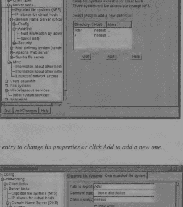

### FIGURE 10.1

您可以选择现有条目以更改其属性，或单击 `Add` 以添加新条目。

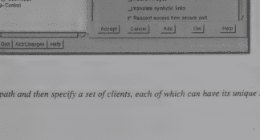

### FIGURE 10.2

您可以选择一个导出路径，然后指定一组客户端，每个客户端都可以具有其独特的选项集。

## NFS 中的权限如何工作

由于 NFS 是为多用户操作系统（OS）之间的文件共享而设计的，因此 NFS 客户端和服务器需要通信用户信息。它们通过使用用户和组 ID 号来实现，这可能会导致一些有趣的效果。

### 远程用户和本地用户

假设您有两台 Linux 计算机，机器上为多个用户设置了账户，如表 10.1 所示。默认情况下，NFS 以一种令人困惑的方式映射用户 ID，至少令人困惑，最坏的情况是安全问题。例如，使用表 10.1 的信息，唯一能在两台计算机上正确访问其文件的是 `carljones`，因为他的用户 ID 在两台计算机上是相同的。如果计算机 `teela` 将文件系统导出到 `nessus`，那么从 `nessus` 看，`jimbrown` 将能够访问 `teela` 上 `bevsmith` 的文件，而 `bevsmith` 将能够访问 `susadams` 的文件。另一方面，如果计算机 `nessus` 将文件系统导出到 `teela`，`jimbrown` 将能够从 `teela` 访问 `susadams` 在 `nessus` 上的文件。类似的问题也可能发生在组 ID 上。

### TABLE 10.1 两台计算机上的假设用户和组 ID

| User | User ID on nessus | User ID on teela |
|---|---|---|
| jimbrown | 501 | 504 |
| carljones | 502 | 502 |
| bevsmith | 503 | 501 |
| susadams | 504 | 503 |

#### NOTE

> 实际的用户名并不重要。例如，如果 `jimbrown` 在一个系统上被称为 `jbrown`，相同的原则适用，包括相同的解决方案。

不用说，像这样的用户映射问题在最好情况下也是不可取的。解决它们的一种方法是同步两台机器上的用户和组 ID。这对于从头开始配置少量计算机的小型网络来说当然是最简单的解决方案；您只需确保每个用户在所有系统上获得相同的用户和组 ID。如果机器上已有用户账户，则此解决方案会更棘手。如果您想尝试实施它，您有两个选择：

- 使用 `usermod` 命令更改用户 ID。具体来说，使用 `-u` 参数来更改用户 ID，例如 `usermod -u 512 bevsmith` 将 `bevsmith` 的用户 ID 改为 512。此命令还会更改用户主目录中文件的拥有者以匹配。

- 使用 `linuxconf` 来完成繁重的工作。选择 `Config、Users accounts、Normal、User accounts` 并点击某个用户账号名称。你可以编辑 `User ID (opt)` 字段以反映新的 ID，如图 10.3 所示。当你点击 `Accept` 时，`linuxconf` 会告知你主目录拥有者无效。选择 `Change ownership recursively` 选项以递归更改用户文件的 ID。

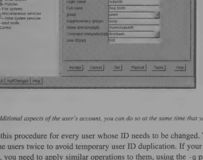

## FIGURE 10.3

如果你想更改用户账号的其他方面，可以在更改 ID 的同时进行。

你需要对每个需要更改用户 ID 的用户重复此过程。你可能需要对某些用户进行两次更改以避免临时用户 ID 重复。如果你的组 ID 需要更改，你需要对它们应用类似的操作，使用 `usermod` 的 `-g` 参数或 `Config、Users accounts、Normal、Group definitions` `linuxconf` 屏幕。

## CAUTION

不要在用户登录时尝试更改用户账号的任何方面，尤其是像用户或组 ID 这样基本的内容。在尝试此操作之前，请确保所有受影响的用户都已注销。

`map` 文件的两种替代方案体现在 `/etc/exports` 目录中 `exports` 的 `map_nis` 和 `map_daemon` 选项。这些选项允许外部 NIS 服务器或客户端计算机分别处理重新映射。这里没有介绍这些选项，因为完整的配置比服务器端映射文件复杂得多，而后者对于小型网络来说已经足够。

## The Special Case of root

超级用户通常在系统上拥有非凡的权力，因此通常不建议分享这种权力，即使是其他系统的超级用户也是如此。出于这个原因，`root` 账号由默认的 NFS 设置以独特方式处理。从 `root`（用户 ID 0）发出的文件访问会被重新映射到一个无害的账号，例如 `nobody`。如果你信任远程系统的超级用户以及网络连接的安全性，可以在 `/etc/exports` 中使用 `no_root_squash` 参数，允许远程系统的超级用户在你的系统上拥有完全的 `root` 访问权限。

> **CAUTION**
> 
> 在任何连接到互联网的系统上允许远程 NFS `root` 访问都是自找麻烦。黑客只需要伪造——假装成你的受信任计算机——即可获得完全的 `root` 访问权限，之后通常具有 `root` 权限的黑客可以更改系统文件并造成其他破坏。我唯一会考虑通过 NFS 允许 `root` 访问的情况是在从未连接到互联网的网络上，并且所有用户我都信任。

## Mounting Remote NFS Volumes in Linux

如果你有一个包含两台或更多 Linux 计算机的网络（或一台 Linux 计算机和一台或多台 UNIX 机器），仅仅导出 NFS 文件系统是不够的；你必须知道如何在远程系统上挂载文件系统。

为了挂载 NFS 导出，你需要内核对 NFS 文件系统的支持，如本章前面所述。你可以把 NFS 想象成与基于磁盘的文件系统一样；区别在于基于磁盘的文件系统使用磁盘设备，而 NFS 使用以太网电缆。你不需要任何其他特殊守护进程或实用程序来挂载 NFS 导出——只需要像 `mount` 这样的标准工具。

## Using mount with Remote Systems

假设你没有为远程系统设置 `/etc/fstab` 条目，你可以用 `root` 身份使用通常的 `mount` 命令将其挂载，指定远程主机和目录以及本地挂载点。例如，这里有一个示例命令：

```
mount teela:/home /mnt/teela/home -t nfs
```

此命令几乎与挂载本地文件系统的标准 `mount` 命令相同。主要区别在于设备指定，它由计算机名称、冒号和目录指定组成，而不是 `/dev` 目录中的标准设备文件。与大多数本地文件系统一样，Linux 足够智能，可以检测到你正在尝试挂载 NFS 文件系统，因此命令中的 `-t nfs` 部分并非严格必要。

#### Tip

> 如果 `mount` 命令失败，请尝试检查服务器和客户端机器上 `/var/log/messages` 文件的最后几条记录。这些文件中可能有导致挂载失败的线索（例如，客户端无权连接到服务器）。挂载失败时你会收到一条包含一些信息的错误消息，但 `/var/log/messages` 通常包含更多信息。


你可以使用 `-o` 参数指定其他选项，如下所示：

```
mount teela:/home /mnt/teela/home -o rsize=8192,wsize=8192
```

你可能会发现最有用的选项包括以下：

- `rsize=value` 和 `wsize=value`——分别指定读取和写入传输的大小。默认值是 1024，相当小。
- `hard`——如果服务器变得无法访问，会导致程序挂起，但在服务器恢复在线后程序会恢复运行。这是默认值。
- `soft`——当服务器变得无法访问时传输超时，可能导致数据丢失，但允许本地中断受影响的程序。
- `intr`——允许对 NFS 调用的中断，这在服务器变得无法访问时可能很有用，特别是如果你还指定了 `hard` 选项。

你可以为 NFS 文件系统提供更多挂载选项。查看 `nfs` 手册页以获取更多详细信息。

## 配置 `/etc/fstab` 以允许用户挂载远程卷

你可以像对待普通分区一样将 NFS 导出添加到 `/etc/fstab` 中。这包括使用 `user` 选项来允许用户挂载远程分区。下面是一个 `/etc/fstab` 文件的示例，说明了这一点：

```
/dev/hda10   /          ext2   defaults   1 1
none         /proc      proc   defaults   0 0
speaker:/home /speaker/home nfs defaults 0 0
speaker:/mnt  /speaker/mnt nfs noauto,user 0 0
```

除了挂载根分区和 `/proc` 分区之外，这个 `/etc/fstab` 文件还提供了从计算机 `speaker` 上的两个 NFS 导出 `/home` 和 `/mnt` 的访问权限。系统在启动时挂载 `speaker:/home`，因此它将始终可用——前提是 `speaker` 始终可用！`speaker:/mnt` 条目第四列中的 `noauto` 参数阻止该导出在系统启动时被挂载，而 `user` 参数允许用户通过键入 `mount /speaker/home` 或 `mount /speaker/mnt` 来挂载和卸载导出。

## 自动挂载远程卷

你可以将 NFS 导出添加到 `automount` 配置中，如第 9 章“文件共享的基本原理”中所讨论的那样。与将 NFS 导出添加到 `/etc/fstab` 一样，你指定 `nfs` 作为文件系统类型，并在自动挂载器配置文件中使用 NFS 机器:目录规范作为设备。有一个区别，不过：当你为 NFS 导出创建条目时，你省略设备名称上的前导冒号（`:`）。下面是一个 `/etc/auto.misc` 配置示例：

```
floppy       -fstype=auto      :/dev/fd0
cdrom        -fstype=iso9660   :/dev/scd0
teela        -fstype=nfs       teela:/home
```

如果自动挂载器配置为在 `/misc` 目录中挂载这些设备，你就可以通过进入 `/misc/teela` 来访问 `teela` 的 `/home` 目录。计算机在 `/etc/auto.master` 文件中指定的延迟间隔后会自动卸载 NFS 导出，除非持续访问该目录。

### NOTE

当你将 NFS 导出放入自动挂载器条目时省略前导冒号并不是真正的省略。你可能还记得第 9 章对自动挂载器的讨论，该功能需要在内核中提供 NFS 支持。自动挂载器使用此支持来挂载文件，因此在本地挂载的设备名称中需要冒号——真正被省略的是本地设备文件的机器名！当你配置自动挂载器来处理 NFS 导出时，你必须将机器名加回来，因为该设备不再位于本地计算机上。

## Summary

NFS 导出在许多方面是 Linux 中最简单的文件共享类型。这部分是因为该协议专为 UNIX 到 UNIX 文件共享而设计，因此无需担心文件名或权限转换问题。NFS 具有处理客户端和服务器计算机上不同的用户 ID 的机制。

Red Hat Linux 附带一个 NFS 守护进程版本，该版本在许多系统上会引起问题。不过也有其他 NFS 守护进程可用，如果你对默认守护进程有问题，可以尝试其中一种替代方案。实际上，这些不同的替代方案功能非常相似，因此此处提供的配置信息适用于它们全部，除非另有说明。

## Samba: 与 DOS、Windows 和 OS/2 共享文件

### CHAPTER

11

### IN THIS CHAPTER

- Samba: NetBIOS over TCP/IP for Linux 257
- Setting Samba Options 260
- The Samba Daemons 274
- Workgroups, Domains, and Browsing 277
- Linux as an SMB Client 285
- Summary 289

## File Sharing

### PART III

鉴于 Windows 作为桌面操作系统（OS）的流行，很可能你阅读本书的原因之一是为了学习如何配置 Linux 为 Windows 计算机提供文件。你甚至可能直接跳到本章，跳过了前面的 10 章。如果是这样，你最好在着手配置 Samba、Linux 的 Windows 文件和打印机共享服务器之前，至少浏览一下第 9 章“文件共享的基本原理”。此外，你应该意识到在配置 Samba 之前需要 Linux 的基本网络功能正常运行，因此如果你从全新的 Linux 安装开始，你可能需要回顾第 7 章“设置以太网选项”，以及第 5 章“基本 Linux 配置”和第 6 章“为网络编译内核”。如果你想使用你的 Linux 计算机使打印机可供多台计算机使用，你应该阅读第 14 章“准备共享打印机”和第 16 章“Samba: 与 DOS、Windows 和 OS/2 共享打印机”。

尽管大多数人将 Samba 与 Windows 客户端一起使用，但除 Windows 之外的操作系统，包括 DOS 和 OS/2，也使用相同的协议。人们甚至偶尔使用 Samba 在一台 Linux 计算机与另一台 Linux 计算机之间共享文件，尽管 NFS（第 10 章“NFS: 与其他 UNIX 共享文件”）通常更适合此目的。甚至还有一个名为 DAVE（http://www.thursby.com）的 Macintosh 客户端可与 Samba 配合使用——不过 Netatalk 软件包通常是与 Macintosh 共享文件的更好选择。在本章中，我经常提到“Windows 客户端”，但除非我提到特定的 Windows 特性，例如“选择网络协议”对话框，否则这些评论通常适用于可以与 Samba 通信的其他客户端操作系统。

> **NOTE**
>
> 本章不提供如何为 Windows 或任何其他操作系统配置网络的信息；我期望你已经知道如何做到这一点。不过，在本章末尾，我提供了一些从 Windows 访问 Samba 共享的示例。

Samba 的工作原则上很简单，但在实践中相当复杂。它必须诱导 Linux 在 Windows 网络上通信，使用 Windows 原生网络协议。主要目标是允许 Windows 计算机将 Linux 目录挂载为好像它们是从 Windows 计算机导出的磁盘，并将打印作业发送到由 Linux 控制的打印机，好像它们已连接到 Windows 计算机。次要目标是允许 Linux 计算机访问 Windows 机器共享的资源。Samba 还支持许多额外的 Windows 网络任务，其中一些是这些主要和次要目标的附属任务。

原始 Red Hat 6.0 随附的是 Samba 版本 2.0.3，但随后已发布了 2.0.5a 版本。由于 Red Hat 已提供 2.0.5a 更新，并且随书附带的 CD 默认安装该更新版本，因此本章描述的就是该版本。Red Hat 的早期版本随附的是 2.0 之前的 Samba 版本，如果你使用的是较旧的发行版，可能就拥有此类版本。在这种情况下，我建议你升级 Samba。

> NOTE
>
> 如果你的计算机上尚未安装 Samba，请立即安装。在基于 RPM 的系统上，输入 `rpm -q samba` 以查看是否已安装。

Samba 是一个非常复杂的软件包，包含许多细微之处。本章可以帮助你开始使用它，但并不能涵盖服务器的各个方面。对于本章未涉及的命令和选项的基本信息，你可以先阅读 `smb.conf`、`smbd` 或其他相关工具的手册页。你也可以查阅 `/usr/doc/samba-2.0.5a` 目录中的文档，以及 Samba 网站 http://samba.org。 如果你需要更深入地了解 Samba，可以查阅 Sams Teach Yourself Samba in 24 Hours，其详细程度远超一章的篇幅。

## Samba：为 Linux 提供的 NetBIOS over TCP/IP

在 1980 年代，IBM 开发了一种名为 NetBIOS（Network Basic Input/Output System）的网络技术，用于小型 PC 网络。多年来该技术以各种方式发展和演变，现在已成为 Windows 工作组网络的重要组成部分，因而对 Samba 来说也至关重要。


## 理解 NetBIOS 和 NetBEUI

如果你配置过 Windows 计算机，一定在 Windows 网络协议的说明中看到过 NetBIOS 和 NetBEUI 术语，但你可能不知道它们是什么。如前所述，NetBIOS 是 Windows 网络协议的核心。NetBEUI 代表 NetBIOS Extended User Interface，既是 NetBIOS 的扩展，也是 NetBIOS 所依托的网络层。

在实际应用中，纯 NetBIOS 对于 Samba 网络来说比 NetBEUI 更重要。NetBIOS 可以运行在 NetBEUI 之上，但也可以运行在 Novell IPX（Internetwork Packet Exchange）协议或 TCP/IP 之上。事实上，你可以看到 Microsoft Windows 将 IPX、NetBEUI 和 TCP/IP 作为可选的网络协议栈提供，如“选择网络协议”对话框所示（见图 11.1）。在此对话框中，IPX/SPX、NetBEUI 和 TCP/IP 都被列为单独的项目。

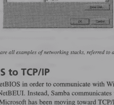

### FIGURE 11.1

IPX/SPX、NetBEUI 和 TCP/IP 都是网络协议栈的例子，在 Windows 中被称为网络协议。

## 将 NetBIOS 桥接到 TCP/IP

Samba 必须理解 NetBIOS 才能与 Windows 客户端通信。然而，Samba 不理解 NetBEUI。相反，Samba 使用通过 TCP/IP 传输的 NetBIOS 进行通信。由于微软多年来一直在转向 TCP/IP，因此在大多数情况下这种方法是合理的。但它也带来了一些后果：

- 你的 Windows 客户端必须安装 TCP/IP 网络。
- 有时，客户端计算机上存在 NetBEUI 会干扰 NetBIOS over TCP/IP 的运行。如果你从客户端计算机连接时遇到问题，特别是其他客户端可以正常工作时，请尝试从问题计算机上移除 NetBEUI。
- 由于 TCP/IP 路由器不处理 NetBEUI，因此在将小型网络连接到 Internet 时，NetBEUI 可能更安全。因此在使用 NetBIOS over TCP/IP 时，你可能需要更加谨慎。

最后一点值得再多说几句。如果你有一个小型本地网络想要连接到 Internet，Windows 风格的网络可能成为安全问题。根据你的组织或 ISP 将你的网络连接到更广网络的方式，如果你通过 TCP/IP 启用 Windows 文件共享，网络外部的计算机可能能够看到你的机器。最佳解决方案是使用防火墙或 IP 伪装网关来将你的网络连接到 Internet。如果你使用 NetBEUI，这个问题也会减少，因为 NetBEUI 无法通过 TCP/IP 路由器。如果您担心这些问题，您应该咨询您组织的网络人员或您的 ISP，以确定您的计算机如何连接到 Internet。

## SMB 协议

在 Windows 网络协议的顶层，控制着一切的是 `Server Message Block`（SMB）协议，该协议已被重新命名为 `Common Internet File System`（CIFS）。事实上，Samba 的名称就源于 SMB 的缩写。图 11.2 显示了 SMB、NetBIOS、NetBEUI、IPX 和 TCP/IP 之间的关系。

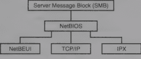

**图 11.2**

`Samba` 仅支持通过 TCP/IP 的 SMB，尽管 Windows 也支持通过 NetBEUI 和 IPX 的 SMB。

NetBIOS 提供基本功能——事实上，NetBIOS 中的 B 代表 basic。SMB 提供更高级别的工具。这类似于控制硬盘的驱动程序或 BIOS 与磁盘文件系统之间的关系。SMB 就像 UNIX 的 Network Filesystem（NFS）一样，是用于网络的文件系统。然而，与硬盘的 BIOS 不同，在 Windows 文件共享的情况下，NetBIOS 之下还有另一层协议——即 Samba 的情况为 TCP/IP。

## 何时使用 Samba

NetBIOS 和 SMB/CIFS 是为 DOS 的网络以及后来的 Windows 和 OS/2 而设计的。这些协议为 DOS、Windows 和 OS/2 程序期望文件系统提供的特定功能提供支持。其他网络协议，如 NFS，则支持不同的功能集。因此，当客户端操作系统为 DOS、Windows 或 OS/2 时，使用 SMB/CIFS 是最佳选择。

请注意，使用 Samba 在 Linux 上意味着 Samba 必须将 SMB 支持的文件系统功能转换为 Linux 可以处理的形式。基本功能，如文件读写，并不是问题；诸如隐藏属性等功能，Linux 不支持，具体取决于 Samba 的配置，可能会导致困难。在大多数情况下，Samba 已经克服了这些困难，因此 Samba 服务器可以相当无缝地集成到现有的 Windows 网络中。事实上，如果您小心地正确配置系统，您可以用运行 Samba 的 Linux 计算机替换 Windows 服务器，而您的用户可能根本察觉不到区别！

由于 SMB 不提供 UNIX 计算机期望的权限或所有权信息，而 NFS 提供了这些信息，因此通常最好不要使用 Samba 在 Linux 或 UNIX 计算机之间进行文件共享。您可能在某些有限的情况下这样做，例如当您只需要提供对用户数据文件的访问，而不是程序文件，或者如果用户需要快速访问远程文件，这些文件通常不需要从 Linux 访问，但需要从 Windows 访问。作为一般规则，我建议仅在您有令人信服的理由这样做时才使用 Samba 与 Linux 或 UNIX 客户端进行文件共享，例如希望限制服务器支持的文件共享协议数量。

同样，Macintosh 希望其文件系统支持某些独特功能，例如存在独立的资源和数据分支。Samba 不支持此功能，Macintosh 的 SMB/CIFS 软件，例如 Thursby 的 DAVE，必须模拟它。DAVE 也是收费的，而 Linux 的 Netatalk AppleTalk 服务器包是免费的，因此不使用 Samba 与 Macintosh 有经济激励。另一方面，Samba 比 Netatalk 更完善，因此您可能会发现 Samba 和 DAVE 的组合在某些情况下更好。

## 设置 Samba 选项

在使用 Samba 提供文件服务之前，您必须配置该软件。随着您使用 Samba，您会发现它提供极其广泛的配置选项，使您能够比使用 Windows 服务器更精细地控制 Linux 服务器的行为。您需要花时间学习这些选项的作用。

> Tip
>
> 当您创建 `/etc/smb.conf` Samba 配置文件时，您可能希望使用 `testparm` 实用程序。此程序检查文件是否包含任何明显的错误。尝试在 `/etc/smb.conf` 上运行它，然后在另一个不相关的文件上运行，例如 `/etc/fstab`。`testparm` 会为后者显示许多错误，但不应为前者显示。程序在进行测试后还会转储 `/etc/smb.conf` 文件服务的摘要，此摘要可能相当长。

## 文本编辑与 GUI 配置

你可以通过在喜欢的文本编辑器中编辑 `/etc/smb.conf` 文件来配置 Samba，也可以使用 `linuxconf` 实用程序（假设你使用的是 Red Hat 或 Mandrake Linux 发行版）。如果你使用 `linuxconf`，你需要在 Config、Networking、`Samba file server` 标题下选择选项。图 11.3 显示了该列表中的 Defaults 选项卡，它允许你配置通用设置。Default setup for user’s home 选项允许你配置主目录共享的设置，而 Disk shares 选项则允许你选择或创建一个除主目录共享之外的共享。

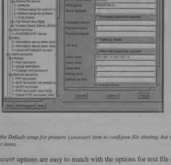

### FIGURE 11.3

你不需要使用 Default setup for printers `linuxconf` 项目来配置文件共享，但你确实需要使用其他 `Samba file server` 项目。

由于 `linuxconf` 选项很容易与文本文件配置的选项对应，本节重点介绍直接编辑 `/etc/smb.conf` 配置文件。如果你更喜欢使用 `linuxconf`，只需为每个操作查找相应命名的条目即可。我建议你最初使用 `linuxconf`（或其他管理工具）来配置 Samba，因为使用 `linuxconf` 可以降低你生成损坏的 `/etc/smb.conf` 文件的可能性。

## SWATting Samba


你可以通过一个基于 Web 的实用程序 Samba Web Administration Tool（SWAT）来管理 Samba。该工具在基于 Web 的模式下与 linuxconf 的操作方式类似，但你可以通过端口 901 访问它——例如，要在计算机 `n400.erplab.pangaea.edu` 上访问 SWAT，你需要在浏览器的地址栏中输入 `http://n400.erplab.pangaea.edu:901`。要激活 SWAT，你必须执行三件事：

- 如果尚未存在，向 `/etc/services` 添加一行内容为

  `swat 901/tcp`

- 如果尚未存在，向 `/etc/inetd.conf` 添加一行内容为

  `swat stream tcp nowait.400 root /usr/sbin/swat swat`

如果你没有使用 Red Hat Linux 及其默认的 Samba 安装，你可能需要为你的系统调整 `swat` 程序的路径。

- 通过使用 `ps` 找到其进程 ID 号并输入 `kill -SIGHUP pid` 来重启 `inetd` 守护进程，其中 `pid` 是进程 ID 号。

SWAT 用户界面在原则上与 linuxconf 的 Web 模式类似，尽管细节有所不同。使用 SWAT 时，你会以明文形式发送 root 密码，因此最好仅在你完全控制的本地网络上使用它，并且仅在没有直接连接到整个互联网的服务器上使用。SWAT 在原则上与为 Web 访问配置的 linuxconf 一样安全或不安全，但由于 SWAT 仅控制 Samba，我建议如果你只想通过 Web 配置 Samba，则使用它而不是 linuxconf。如果你已经运行 linuxconf，SWAT 就是多余的。

## /etc/smb.conf 文件结构

`/etc/smb.conf` 文件按节组织，每个节都由方括号中的名称标识，例如 `[global]`。许多选项适用于多个节，但有些选项仅在特定节中才有意义。节包括

- `[global]`—该节控制 Samba 配置的最广泛方面，例如计算机的 NetBIOS 名称、哪些主机可以连接等。
- `[homes]`—如果你希望用户能够访问其主目录，你可以在此处创建一个节来定义此类访问。当 Samba 对用户进行身份验证时，该用户可以访问其自己的主目录，但不能访问其他人的主目录，前提是你已将 Linux 的权限设置为禁止此类访问。使用 `[homes]` 节可以节省大量时间，因为你不需要为每个用户的主目录分别定义——一个配置适用于所有用户。
- `[sharename]`—除 `[global]`、`[printers]` 或 `[homes]` 之外的任何名称都代表特定共享的名称。你可能想要定义一个存放共享程序文件的目录，或你的网络用户可以在其中放置需要相互交换的文件的目录。

`[global]` 节通常最大，因为它包含许多重要全局参数的配置选项。但是，如果默认值可接受，则该节可能相当小。

在每个节中，你通过指定选项名称、等号 `=` 和值来设置大多数选项。选项名称及其所包含的值都可能是多个词。在某些情况下，你可能希望在值中设置一些在配置 `/etc/smb.conf` 文件时无法获知的信息，例如使用共享的人员的用户名。出于这个原因，Samba 在 `/etc/smb.conf` 文件中支持许多变量，如表 11.1 所述。变量都以百分号 `%` 为前缀。

### TABLE 11.1 smb.conf Variables

| Variable | Description |
|---|---|
| `%a` | 远程机器的架构。可能是 Samba、WfWg、WinNT 或 Win95。Windows 98 显示为 Win95，Windows 2000 显示为 WinNT。 |
| `%d` | 当前服务器进程的进程 ID。 |
| `%g` | 用户名 `%u` 的主组。 |
| `%G` | 用户名 `%u` 的主组。 |
| `%h` | Samba 运行所在主机的 Internet 名称。 |
| `%H` | 用户名 `%u` 的主目录。 |
| `%I` | 客户端机器的 IP 地址。 |
| `%L` | 服务器的 NetBIOS 名称。 |
| `%m` | 客户端的 NetBIOS 名称。 |
| `%M` | 客户端的 TCP/IP 名称。 |

## 表 11.1 继续

| Variable | Description |
|---|---|
| `%N` | 你的 NIS 主目录服务器的名称，如 auto.map 文件中指定的那样。如果 Samba 未编译 automount 支持，则与 `%L` 相同。 |
| `%p` | 服务主目录的路径，从 auto.map 文件中获取。 |
| `%P` | 当前服务的根目录。 |
| `%R` | 在连接设置阶段的协议协商期间选择的协议。可能是 CORE、COREPLUS、LANMAN1、LANMAN2 或 NT1。 |
| `%S` | 当前服务的名称。 |
| `%T` | 当前日期和时间。 |
| `%u` | 当前服务的用户名。 |
| `%U` | 客户端请求的用户名。这可能与 `%u` 不相同。 |
| `%V` | Samba 版本号。 |

## 设置全局参数

全局参数控制 Samba 整体的行为——它如何向网络宣告自身、对哪些计算机做出响应等等。正确配置系统的全局参数至关重要，否则你可能甚至无法在 Windows 网络邻居中看到它。

### 标识设置

NetBIOS 即使在 NetBIOS 运行在 TCP/IP 之上时，也不会使用 TCP/IP 机器名来标识计算机。相反，NetBIOS 使用自己的机器名和工作组名。一般来说，你可能希望将服务器设置为使用你的 TCP/IP 机器名作为 NetBIOS 机器名，只是为了让生活不那么复杂。你的工作组名可能与计算机的任何其他网络名称完全无关。但是，如果你在大型组织中设置内部网，你可能有奢侈地将工作组名设置为与你的完全限定域名（FQDN）的一部分相匹配。例如，如果域 `erplab.pangaea.edu` 中的计算机网络构成一个单一的 NetBIOS 工作组，你可以将工作组名设置为 `ERPLAB`。

#### Note

NetBIOS 工作组通常必须驻留在单个以太网网络上，从而限制了工作组的物理范围。你可以使用桥接来扩展此范围。不过，使用 NetBIOS over TCP/IP，你可以通过指定 IP 地址连接到远程工作组。例如，我曾使用 PPP 拨号连接 ISP 来连接到位于 ISP 网络以外的数英里外的 Samba 服务器。

要设置机器名，你使用 `netbios name` 选项，要设置工作组名，你使用 `workgroup` 选项。惯例是以大写形式指定这些值。你还可以设置 `server string` 选项，它可以提供对系统的更具描述性的标识。`netbios name` 选项默认为你的计算机的主机名，而 workgroup 名称的默认值取决于编译选项。因此，在许多情况下你可以省略 `netbios name` 规范，但由于你的工作组名在本地有所不同，你应该确保设置它。

以下是三个选项全部使用的示例：

```
netbios name = SPEAKER
workgroup = RINGWORLD
server string = Workgroup server computer running Samba %v
```

请注意，`server string` 规范包含一个变量（`%v`）来宣布 Samba 版本号。实际上，你可能不想透露此信息，因为如果你运行的版本存在安全漏洞，宣传版本号可能是不明智的。

### 身份验证选项

你可以使用 `security` 选项配置 Samba 使用四种不同的身份验证方法之一：

- `share`—Samba 要求对每个共享资源进行单独身份验证。在 Windows 中，仅需密码即可访问此类型，但 Linux 中 Samba 也需要用户名。某些客户端会发送用户名，Samba 会尝试使用该用户名。在此尝试失败的情况下，你可以指定一组用于检查密码的用户，如 `users = larry, moe, curly`。一般来说，共享级安全性在 Linux 中很笨拙，因此除非你有令人信服的理由使用它，否则我建议不要使用它。
- `user`—Samba 要求客户端同时发送用户名和密码。并且如果获批准，用户可以在 Linux 权限设定的限制范围内访问服务器上的所有共享。

## Samba：与 DOS、Windows 和 OS/2 共享文件

1. 输入此命令为每个用户创建一个 `/etc/smbpasswd` 文件，但密码无效：


```
cat /etc/smbpasswd ; mkpasswd.sh > /etc/smbpasswd
```

## 2. 编辑生成的 `/etc/smbpasswd` 文件以删除不会使用 Samba 服务的帐户
此类帐户包括 Linux 内部使用的各种帐户，例如 `ftp` 和 `gopher`。

## 3. 对于每个用户，执行 `smbpasswd` 命令来更改密码
（请注意，`smbpasswd` 既是命令的名称，也是 Samba 密码文件的名称。）例如，输入 `smbpasswd larry` 会提示为用户 `larry` 输入新密码。

如果您有大量用户并且不想让他们来输入密码或自行分配密码，您可以使用明文密码并迁移到加密密码。不要执行步骤 3，将 Samba 配置为使用明文密码，并在 `/etc/smb.conf` 文件中添加选项 `update encrypted = yes`。随着用户登录并使用 Samba 共享，Samba 将自行运行 `smbpasswd`，使用已验证的明文密码来设置加密密码值。过一段时间后，您可以将 `/etc/smb.conf` 改为使用 `encrypt passwords = yes` 和 `update encrypted = no`。需要注意的是，此过程假定客户端可以处理加密和明文密码。Windows 的最新版本坚持只使用加密密码，这可能使此过程更加困难。

要在 Red Hat 6.0 中更改 Windows 密码，您可以找到 `Winver_PlainPassword.reg` 文件，其中 `Winver` 是您的 Windows 版本。如果您使用的是其他 Linux 发行版，您可能在其他目录中找到这些文件。将适当的文件复制到您的 Windows 计算机并双击它。Windows 应该将更改合并到注册表中，从而启用明文密码。

另一个与密码相关的问题是 SMB/CIFS 服务器通常使用不区分大小写或全大写的密码，但 Linux 使用区分大小写的密码。为了解决这个问题，Samba 将密码转换为小写（因为大多数用户主要是小写密码）。如果找不到匹配项，Samba 可以将单个字母转换为大写，尝试找到匹配项。Samba 会尝试所有可能的字母大小写排列组合，直到 `password level` 选项指定的大写字母数量。增加此级别可能会减慢登录速度，但在用户具有大写或混合大小写密码时可能有必要。对用户名也有类似的评论，并且有一个 `username level` 选项，其工作原理与 `password level` 相同。

# 限制 Samba 访问

如果您的 Linux 服务器可以从 Internet 访问，甚至可以从组织中不应访问您的 Samba 共享的计算机访问，您可能希望按机器限制访问。您可以使用 `hosts allow` 和 `hosts deny` 选项来实现。这两个选项的语法非常相似，但 `hosts allow` 列出允许访问的机器，而 `hosts deny` 列出不应访问的计算机。通常，当您只想向少数几台计算机提供 Samba 服务时使用 `hosts allow`，而当您想排除已知的“捣乱者”或属于一些不太受信任的计算机的机器，例如公共工作站时使用 `hosts deny`。

您可以通过以下方式指定 `hosts allow` 和 `hosts deny` 的机器：

- 作为 Internet 机器名——这通常意味着 FQDN，例如 `n400.erpLab.pangaea.edu`。如果您的系统与目标在同一网络上，您可能只能给出机器名，例如 `n400`。
- 作为 IP 地址——以点分四段表示法的完整 IP 地址，例如 `192.168.1.5`。
- 作为部分 IP 地址——如果您输入少于 4 个字节的 IP 地址并留下一个句点，Samba 会将其解释为指定网络中的所有地址。例如，`192.168.1.` 指的是 `192.168.1.0` 网络中的所有计算机（最多 254 台）。
- 作为 IP 地址/子网掩码对——您可以指定 IP 地址和子网掩码来指定一系列计算机。例如，`192.168.1.32/255.255.255.224` 指的是从 `192.168.1.32` 到 `192.168.1.63` 的主机。
- 使用 `except`——您可以通过在其名称前加上关键字 `except` 来从规则中排除一台机器或子网。例如，`192.168.1. except 192.168.1.23` 允许或拒绝 `192.168.1.x` 网络中的所有计算机，除了 `192.168.1.23`。

您可以通过列出用空格分隔的单独地址或范围来混合使用这些方法。例如，这里是一个示例 `hosts allow` 行：

```
hosts allow = teela 192.168.1. 192.168.3.2
```

如果主机太多，超过一行长度，您可以在一行的末尾放置反斜杠 `\` 以在另一行继续列表。此技术也适用于其他 `/etc/smb.conf` 选项。

### Tip

您可以在单个共享中使用 `hosts allow` 和 `hosts deny` 选项，也可以在 `/etc/smb.conf` 的 `[global]` 部分中使用它们。

一般来说，我建议使用 `hosts allow` 来通过 IP 地址明确列出授权的主机，至少对于连接到互联网的计算机而言。这种做法使得未经授权的人员入侵你的系统变得更加困难。

为了提高安全性，Samba 通常将自身绑定到单个接口上。然而，如果你的计算机用作网关、防火墙或 IP 伪装计算机，则可能需要指定其要使用的 NIC。你可以通过 `interfaces` 选项来实现：

```
interfaces = 192.168.1.1/255.255.255.0
```


你在 `interfaces` 行上指定要绑定到的接口上的主机计算机的 IP 地址和网络掩码。上面的示例将 Samba 设置为在绑定到 `192.168.1.1` 的 NIC 上为 `192.168.1.0` 网络提供服务。如果你希望 Samba 为两个或更多 NIC 的网络提供服务，则需要全部列出，以空格分隔。

## Speed Enhancement Options

Samba 通常具有良好的速度，但在某些情况下你可能需要调整其设置，或“取消调整”某些被错误配置的设置。不幸的是，什么效果好因网络而异，因为性能调优因素会与网络硬件类型等问题相互作用。以下是一些具体建议：

- General network performance—如果你的网络负载过重，Samba 的性能就不佳。你可能想通过输入 `/sbin/ifconfig` 来检查冲突。如果冲突数量与传输的包数（TX）和接收的包数（RX）相比很高，那么你可能需要考虑安装桥接设备或用交换机替换集线器（参见第 4 章“内部网和互联网”，以及第 1 章“网络硬件”）。
- Oplocks—机会锁，或 oplocks，是控制多用户访问文件的一种方式。`fake oplocks` 选项可以加快对只读介质（如 CD-ROM）的访问，但除此之外是有风险的。`oplocks` 选项（与 `fake oplocks` 选项不同）如果设置为 `yes`，可以大幅加快对所有文件的访问，因此你应确保它未被设置为 `no`。
- Strict sync—`strict sync` 参数默认为 `no`，通常应保持此设置，因为它通过不执行 Linux `sync()` 操作来提高性能，而许多 Windows 程序在客户端请求时比应有的更频繁地执行此操作。默认的 `no` 设置会增加在 Linux 本身崩溃时丢失数据的风险。

除这些项目外，你还可以使用 `socket options` 来影响 Samba 与 TCP/IP 栈的接口，从而影响系统性能。不过，这些选项的确切效果因网络而异，因此我无法提供任何具体建议。如果你想进行实验，可以在 `/etc/smb.conf` 文件中创建一个 `socket options` 行并添加或删除以下选项：

- `SO_KEEPALIVE`
- `SO_REUSEADDR`
- `SO_BROADCAST`
- `TCP_NODELAY`
- `IPTOS_LOWDELAY`
- `IPTOS_THROUGHPUT`
- `SO_SNDBUF=integer`
- `SO_RCVBUF=integer`
- `SO_SNDLOWAT=integer`
- `SO_RCVLOWAT=integer`

## Configuring a Share

在为整个 Samba 服务器设置配置选项后，是时候处理你想要配置的共享了。你可以在要修改的共享名称的节中执行此操作，或在 `[homes]` 节中为所有用户的主目录创建共享。如果存在 `[homes]` 节，它会创建一个可以通过名称 `homes` 或用户名访问的共享。默认情况下，该共享打开到用户的主目录，你不应为此共享指定其他目录。

## Share Availability Options

有几个选项会影响共享的可用性——即其在客户端浏览器中的可见性或用户访问共享的能力：

- `comment` — 你在共享上输入的注释在从 Windows 以详细信息模式浏览共享时会出现，如图 11.4 所示。
- `available` — 此选项默认为 `yes`。如果设置为 `no`，Samba 不允许任何人连接到共享。你可能会使用此选项在对目录进行维护时使共享暂时不可用。
- `guest ok` or `public` — 这些选项是同义词，默认为 `no`。如果设置为 `yes`，它们允许任何人即使没有密码也能连接到相关共享。使用这些选项时务必格外谨慎！

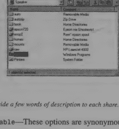

## FIGURE 11.4

你使用 `comment` 选项为每个共享提供几词的描述。

- `browsable` or `browseable`—这些选项同义，指共享在浏览器中的可见性，例如 Windows 网络邻居。你通常需要将此选项设为 `yes`，这是默认值。

#### NOTE

> SMB/CIFS 的浏览器与 Web 浏览器不同，尽管 Windows 98 中的更改使两者在该操作系统中行为非常相似。

- `path`—你使用 `path` 选项指定要共享的目录。在 `[homes]` 部分的情况下，你不指定路径；Samba 知道对此部分使用用户的 home 目录。

- `writable` or `writeable`—这些选项同义，指对共享的写权限。默认值是 `no`。设置共享为 `writable = yes` 并在其上安装程序文件后，你可能会将此类共享设为 `writable = no` 以防止用户意外删除程序文件。`read only` 选项是 `writable` 的反义词。在许多情况下，你可以通过使用 Linux 权限实现类似结果。

- `write list`—即使 `writable` 选项设为 `no`，你也可以指定一组具有对共享写访问权限的用户。你可能能够通过使用 Linux 权限实现类似结果。

## Ownership and Permissions Options

默认情况下，远程用户创建的文件归该用户所有，文件权限为 `-rwxr--r--`（八进制表示为 `0744`），目录为 `drwxr-xr-x`（八进制 `0755`）。不过你可以更改这些默认值：

- `force user`—你可以为给定共享中创建的文件指定一个用户名。例如，假设你通常使用 `larry` 登录名。你可以使用 `force user` 将共享中创建的文件的用户名设为 `moe`，即使你以 `larry` 访问共享。此功能对于由多个用户访问的共享特别有帮助——你可以创建一个特殊用户来拥有共享文件，并使用 `force user` 让所有用户使用该特殊用户的权限访问共享文件。你可能*不*应该在 home 目录上使用 `force user` 选项，因为你可能希望 home 目录中的所有权反映文件的真实所有者。
- `force group`—此选项的工作方式与 `force user` 选项非常相似，只是你指定组名，而不是用户名。
- `create mask` and `create mode`—这些选项同义。它们以八进制字符串的形式设置文件的拥有权限。默认设置 `0744` 给文件所有者执行权限，当你从 Linux 本身访问文件时这有点奇怪。因此我喜欢将 `create mask` 改为 `0644`。你可以设置更严格的模式，例如 `0660` 或 `0640`，以将文件的读权限限制为所有者以及可能属于所有者组的其他人。
- `directory mask` and `directory mode`—这些选项同义。它们以与 `create mask` 设置文件所有权相同的方式设置目录的所有权。由于在 Linux 中目录通常在具有写权限时具有执行权限，因此默认值 `0755` 是合理的，但如果你愿意，可以通过指定 `0750` 或 `0700` 来进一步限制访问。

Table 11.2 显示了一些适用于各种情况的有用所有权和掩码组合。

## TABLE 11.2 Some Possible Ownership and Permissions for Samba Shares

| Force User | Create Mask | Directory Mask | Description |
|---|---|---|---|
| common¹ | 0666 | 0777 | 由许多用户共享的文件。 |
| — | 0444 | 0555 | 只读共享目录。此目录可以从 Linux 本身修改，但不能从 Windows 客户端修改。 |
| — | 0440 | 0550 | 用于组的只读共享目录。 |
| — | 0644 | 0755 | 低安全性环境中的 home 目录账户。 |
| — | 0640 | 0750 | 需要组协作但组间文件共享很少的环境中的 home 目录账户。 |
| — | 0600 | 0700 | 当没有任何其他用户应能够访问文件时的 home 目录账户。 |

¹User common 指为 Linux 记账目的而预留以拥有共享文件的某个用户名。

当然表 11.2 只是触及了可能性的一小部分。在一个有许多用户和组以复杂方式交互的网络中，你可能有多个不同的共享目录，对不同的用户组设置不同的权限。这些选项也与本章前面讨论的一些共享可用性选项相互作用。一般来说，实际访问权限由指定的最严格选项决定。幸运的是，大多数小型网络只需几个简单的选项就能做得相当不错。

## 文件名大小写和改名选项

Linux 是一个区分大小写的 OS（p. 230），而 Windows 是一个保留大小写的 OS（p. 230）。此外，Linux 支持比 Windows 更长的文件名，比 DOS 支持的文件名长得多。而且，DOS 是一个不区分大小写的 OS（p. 230），这又增加了更多的复杂性。

Samba 的默认行为是极力遵循客户端 OS 对文件名大小写和长度的期望。在某些情况下，特别是处理 DOS 客户端时，Samba 必须改名文件，或以某种方式缩短名称，以便 Samba 仍能将磁盘上的文件名与客户端使用的文件名匹配。如果你使用过 Windows 95 或更高版本，你可能熟悉在 FAT/VFAT 文件系统上执行的名称改名，因为 VFAT 包含内置的名称改名功能。这在 Windows 命令提示符窗口中的目录列表中有所体现，像这样：

```


```
A:\>dir

Volume in drive A is FLOPPY

Directory of A:\

FILE1 TXT        99 10-05-99  2:19p FILE1.TXT

LONGFI~1.TXT     99 10-05-99  2:21p LongFilename.txt

               5 file(s)           198 bytes
```

名为 `LongFilename.txt` 的文件还带有改名后的文件名 `LONGFI~1.TXT`，DOS 和不理解长文件名的旧版 Windows 程序使用它。Samba 支持类似的功能，即使在不包含显式名称改名支持的文件系统上也是如此。

### NOTE

> 在 Windows 中，VFAT 和 NTFS 文件系统提供对名称改名的直接支持。即使使用 VFAT 或 NTFS，Samba 的名称改名也是自行生成的。因此，你在 Samba 共享中看到的改名名称与直接访问同一 FAT 或 NTFS 磁盘或从 Windows 服务器访问时看到的名称不同。如果你让服务器在 Linux 和 Windows 之间双启动，DOS 客户端因此会看到非 8.3 兼容名称的不同文件名。

影响名称改名和大小写敏感性的 Samba 选项包括以下内容：

- `mangled names`—此选项的默认值为 yes。如果将此选项设为 no，Samba 不执行名称改名；它只是截断文件名，这可能导致两个文件具有相同名称。发生这种情况时，你只能访问其中一个文件。
- `mangle case`—转换文件的大小写，通常向客户端提供全大写名称。默认值为 no。
- `case sensitive`—如果此选项设为 yes，Samba 以区分大小写的方式处理文件名。默认值为 no，这要求 Samba 做更多工作来匹配文件名。
- `default case`—此选项指定来自不区分大小写客户端的新文件的默认大小写。默认值为 lower。
- `preserve case`—如果此选项设为 yes（默认值），它会保留来自保留大小写 OS 的大小写，例如 Windows 和 OS/2。如果设为 no，文件名将被转换为默认大小写。

## Samba 守护进程

像大多数网络服务一样，Samba 通过运行守护进程（p. 62）来操作。Samba 包包含两个守护进程：

- `smbd`—SMB 守护进程提供了你想到 Windows 网络时所想到的绝大部分服务，包括至关重要的文件交换服务。
- `nmbd`—名称浏览器守护进程负责在 NetBIOS 网络上宣布你的 Linux 服务器的存在。如果它未正确配置，你将无法从 Windows 访问 Linux 计算机的共享。

运行 Samba 守护进程有两种方式：独立运行和从 inetd 运行。每种方式都有其优缺点。

## 独立运行 Samba

如果你输入 `ps ax | grep mbd -`，你会得到一份包含名称中带有字符串 mbd 的正在运行服务的报告。这包括两个 Samba 守护进程，通常不会有其他内容。

以下是我的系统中的一些示例输出：

```
8243 ?  S  0:00 smbd -D
8254 ?  S  0:00 nmbd -D
```

> 如果你看到多个 `smbd` 实例也不必担心。如果有多个客户端连接到 Samba 共享，这种情况是正常的。

由于输出中同时出现了 smb 和 nmb，很明显两个守护进程都在独立运行。不过，你是如何达到这种状态的呢？

许多 Linux 发行版，包括 Red Hat Linux 6.0，都在脚本 `/etc/rc.d/init.d/smb` 中启动 Samba 守护进程，该脚本接受参数 start、stop、restart 和 status。因此，如果 Samba 尚未运行，你可以输入 `/etc/rc.d/init.d/smb start` 来启动它。初始化脚本会在系统启动时运行 smb 脚本，所以在你安装 Samba 并重新启动后，它应该处于运行状态。

> 如果你安装了 Samba 并重新启动但它未运行，请检查 `/etc/rc.d/init.d` 和 `/etc/rc.d/rc5.d` 中是否存在名为 smb 的链接，指向 `/etc/rc.d/init.d/smb`。如果没有此类链接，请通过输入 `ln -s /etc/rc.d/init.d/smb /etc/rc.d/rc3.d` 和 `ln -s /etc/rc.d/init.d/smb /etc/rc.d/rc5.d` 来创建它们

在某些 Linux 发行版上，你可能需要通过编辑其他初始化脚本，例如 `/etc/rc.d/rc.local` 来启动 Samba。你可以在任何方便的启动脚本中添加类似以下的行：

```
/usr/sbin/smbd -D
/usr/sbin/nmbd -D
```


如果你想手动启动 Samba，也可以直接在命令行中输入这些行。以这种方式独立运行 Samba 的优点是它可以快速响应传入请求。在我的经验中，这种方法也比从 inetd 运行 Samba 更可靠一些。然而，独立运行 Samba 的缺点是即使 Samba 没有为任何客户端提供服务，也会消耗内存。

## 从 inetd 运行 Samba

如第 3 章“网络服务”所述，`inetd` 是一个超级服务器，监控大量端口上的网络活动。当它检测到已配置处理的活动时，`inetd` 会启动适当的守护进程来为该端口提供服务。这样，`inetd` 可以减少使用大量服务器的系统上的内存占用，以及在一定程度上减少 CPU 负载。它还可以提供一些系统安全优势，如第 24 章“维护安全系统”中所述。

你可以通过 `inetd` 运行 Samba，如果你的计算机没有处理太多 Samba 请求，你可能会提高整体系统性能，但以启动 Samba 会话响应时间略有增加为代价。

假设你运行的是 Red Hat Linux（或任何以 Red Hat 方式启动 Samba 的发行版），请按照以下步骤配置 Samba 从 `inetd` 运行：

1. 在你的 `/etc/inetd.conf` 文件中添加以下行：

   ```
   netbios-ssn stream tcp nowait root /usr/sbin/smbd smbd
   netbios-ns dgram udp wait root /usr/sbin/nmbd nmbd
   ```

2. 要停止当前 Samba 服务（如果正在运行），请输入：

   `/etc/rc.d/init.d/smb stop`

   你应该会看到两行报告 Samba 的 SMB 和 NMB 服务已成功关闭。

> **CAUTION**
> 停止 Samba 会断开当前访问 Samba 共享的任何用户。你应该在停止 Samba 之前通知所有用户你即将关闭文件和打印机服务。

3. 通过输入以下命令查找 `inetd` 程序的进程 ID：

   `ps ax | grep inetd -`

4. 使用你在步骤 3 中找到的进程 ID，通过输入以下命令重新启动 `inetd`：

   `kill -SIGHUP pid`

   其中 `pid` 是进程 ID。

5. 将 `/etc/rc.d/rc.init/smb` 文件移动到其他位置，以防止它在重新启动时运行并作为始终运行的服务启动 Samba。

如果你使用的是 Red Hat 6.0 以外的发行版，你可能需要对这些说明进行一些修改，例如更改 Samba 二进制文件的路径或更改用于移除现有 Samba 启动代码的方法。

## 工作组、域和浏览

Windows 网络围绕工作组和域这两个相似的概念进行组织。从实际角度来看，你可能通过使用 Windows 网络邻居工具浏览网络时熟悉这些概念，如图 11.5 所示。你可能不太清楚工作组和域到底是什么，或者它们之间有何不同。

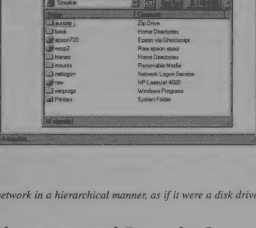

**FIGURE 11.5** Windows 允许你以分层方式浏览网络，就像浏览磁盘驱动器一样。

### 什么是工作组和域？

工作组和域在实践中是非常相似的网络结构。它们都是使用 NetBIOS 和 SMB 共享资源的一组计算机。两者都为单个计算机提供机器名，并为工作组或域提供名称。即使是小型网络也可以包含多个工作组或域，尽管图 11.5 中描绘的网络只有一个。它们主要的区别在于如何处理身份验证。域更集中；域中的一台计算机充当域控制器，即在域上对用户进行身份验证的计算机。相比之下，在工作组中，每台机器都负责对自己的用户进行身份验证，并将该身份验证信息传递给工作组中的其他机器。

工作组与域之间的这种差异有几个重要的影响：

- 每个 Windows 95 或 98 工作组计算机都在 `C:\WINDOWS` 目录中以 `.pwl` 扩展名的文件里为其用户维护一组密码。这些密码加密很差，如果未经授权的个人获取到它们，就会成为潜在的安全漏洞。在域中，没有必要使用这些分散的密码文件。（不过 Windows 95 和 98 仍然会存储它们，除非你按下面所述禁用此功能。）
- 由于密码存储在工作组中的多台计算机上，任何更改用户密码的尝试都需要更改所有计算机上的密码。这在最好情况下也很麻烦。在域中，由于中央计算机存储所有密码，更改用户密码就简单多了。
- 域登录允许域控制器在个人登录网络时将登录脚本传回客户端计算机。在拥有多台大致相同的 Windows 计算机和中央文件服务器的环境中，此功能允许服务器为每个人定制客户端，无论使用的是哪台客户端。

总体而言，对于小型网络，工作组通常是可以的，对于每个用户使用一台计算机的稍大一些的网络也往往没问题。随着客户端数量的增加，使用域系统的管理优势也会增加。

如果你想要消除 `.pwl` 文件带来的安全优势，你需要禁用密码缓存。你可以通过 Windows 注册表编辑器来完成此操作。

> **CAUTION**
> 编辑 Windows 注册表时务必极其小心！该文件是关键配置细节的数据库，如果你更改了不应该更改的内容，你的系统可能会变得不稳定甚至无法使用。

要关闭密码缓存，请按以下步骤操作：

1. 通过打开 Windows 命令提示符并输入 `REGEDIT` 启动注册表编辑器。Windows 启动该程序，如图 11.6 所示。

   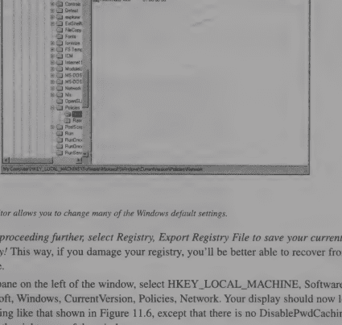

   **FIGURE 11.6** 注册表编辑器允许你更改许多 Windows 默认设置。

2. 在继续之前，选择 Registry，`Export Registry File` 以保存当前注册表。这样，如果你损坏了注册表，你将能更好地从损坏中恢复。
3. 在窗口左侧窗格中，选择 `HKEY_LOCAL_MACHINE`、`Software`、`Microsoft`、`Windows`、`CurrentVersion`、`Policies`、`Network`。你的显示应现在看起来与图 11.6 所示类似，只是窗口右侧窗格中没有 `DisablePwdCaching` 项。
4. 选择 Edit，New，`DWORD Value`。窗口右侧会出现一个新项。
5. 在新项仍被选中且可编辑时，输入名称 `DisablePwdCaching`，然后按 Enter 键。
6. 双击新的 `DisablePwdCaching` 项。注册表编辑器会显示一个对话框供你编辑值。输入 1 并单击 OK。你的显示应现在看起来像图 11.6 中的那样。
7. 退出注册表编辑器。
8. 在命令提示符下输入 `DEL C:\WINDOWS\*.PWL` 以删除现有的 `.pwl` 文件。

你还需要更改 Windows 以使用域登录，你可以从控制面板中的 Network 工具进行此操作。单击 Configuration 选项卡中的 Client for Microsoft Network，然后单击 Properties。选择 Client for Microsoft Networks Properties 中的 Log on to Windows NT domain（图 11.7），输入域的名称，然后单击 OK。完成后，Windows 可能需要访问其安装 CD-ROM，并且你需要重新启动。完成此操作后，检查 Windows 是否在 `C:\WINDOWS` 目录中创建了更多 `.pwl` 文件。

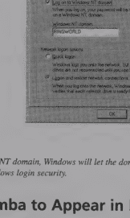

**FIGURE 11.7** 如果你选中 Log on to Windows NT domain，Windows 将让域控制器处理其用户身份验证，这可以大大提高 Windows 登录安全性。

## Configuring Samba to Appear in Network Neighborhood

如果你的 Linux 服务器要驻留在工作组中或由另一台计算机控制的域中，你需要做很少的工作即可使服务器正常工作。我已在本书本章的早期部分讨论了大部分必要的选项。如果你在一个已有域控制器的网络上，则应使用 `/etc/smb.conf` 中的 `domain controller` 选项来向 Samba 标识该计算机。

如果你已配置了 Linux 计算机但无法从 Windows 计算机访问它，请参阅表 11.3，其中提供了一些可能有助于你修复问题的提示。

**表 11.3 Samba 网络访问故障排除**

| 症状 | 可能原因 |
| --- | --- |
| Linux 计算机在网络邻居中不显示。 | `/etc/smb.conf` 中的 `workgroup` 选项设置不正确。 <br> 客户端计算机配置为使用 NetBIOS over NetBEUI，而不是 over TCP/IP。 <br> 如果你设置了 `hosts allow` 或 `hosts deny` 选项，也许它不正确。作为测试，尝试删除这些选项。 |
| Linux 计算机在网络邻居中显示，但你无法在浏览器中打开该计算机——出现错误消息。 | Samba 未配置为适当的密码类型（明文或加密）。 <br> 你在客户端或设置账户时输入了错误的密码。 <br> 没有用于你尝试使用的用户名的账户。请注意，如果你使用加密密码，你需要在 `/etc/smbpasswd` 中有一个条目，而不仅仅是一个普通的 Linux 账户。 |
| Linux 计算机在网络邻居中显示，但在 Linux 计算机上没有共享显示。 | 你尚未创建适当的共享。 <br> 你将 `browsable` 或 `browseable` 选项设置为 `off`。为确保万无一失，将其中一个选项添加到每个共享并将其设置为 `on`。 |
| Linux 计算机和共享在网络邻居中显示，但你无法访问共享。 | 你将 `security` 选项设置为 `share`。你需要为每个共享输入单独的密码。检查前面关于从网络邻居访问计算机时出现问题的提示。 <br> 你以某种方式限制了对共享的访问。Samba 支持许多选项，其中许多在本章中未讨论，用于阻止人们访问某些共享。 |

## 成为域控制器

如果你想将你的 Linux 计算机配置为域控制器，可以通过以下步骤进行：

1. 确保在 `/etc/smb.conf` 文件的 `[global]` 部分设置了以下选项：


# Samba 配置与 Windows 访问

`os level = 64`

`domain master = yes`

`local master = yes`

`preferred master = yes`

`domain logons = yes`

## 2. 为网络登录创建一个特殊共享

```ini
[netlogon]

path = /home/netlogon

writable = no

public = no
```

你可以为 `netlogon` 共享的路径选择任何你喜欢的目录；`/home/netlogon` 只是其中一种可能性。不过你确实需要创建此目录。

## 3. 创建登录脚本

你可以为客户端创建一个登录脚本并将其放在 `netlogon` 目录中。例如，这里有一个名为 `logon.bat` 的脚本，它将共享挂载到固定位置：

```
net use m: \\speaker\homes
```

> **注意**
>
> 因为此脚本用于 Windows 客户端，所以你需要使用 Windows 行尾约定。所提供的脚本只有一行，因此没有问题。如果脚本有多行，则可能希望使用 DOS 或 Windows 文本编辑器创建它，或在 Linux 上使用 `unix2dos` 等实用程序适当转换行尾字符。

## 4. 应用登录脚本

如果你在步骤 3 中创建了脚本，你可能希望使用它，因此将以下行添加到 `/etc/smb.conf` 的 `[global]` 部分：

```
logon script = logon.bat
```

你可以为每个用户创建自定义脚本。如果你这样做，你需要将 `%U` 变量用作脚本文件名的部分，如 `logon-%U.bat`。

完成这些更改后，你需要重新启动 Samba 服务器。如果你保持 Red Hat Linux 配置为原样，可以通过输入以下命令来完成：

```
/etc/rc.d/init.d/smb restart
```

# 从 Windows 访问共享

有几种方法可以从 Windows 访问 Samba 共享，其中一些方法比其他方法更明显。以下各节描述了一些最常见的方法。

## 从 Windows 浏览网络

浏览网络是访问 Samba 共享最明显的方法之一。双击桌面上的网络邻居图标，你将得到一个网络浏览器，如图 11.5 所示。你可以双击此浏览器中的一台机器以查看其共享，然后双击共享以访问其包含的文件和目录，就像它是本地硬盘一样。

> **注意**
>
> 使用 Windows 98，你可能只需单击一次即可在目录和文件之间导航。

以这种方式访问共享可能很笨拙。如果你经常使用某个特定共享，可以直接为其创建快捷方式：

1. 打开显示你想要定期访问的共享的文件夹图标的窗口。
2. 右键单击此共享。你会得到一个弹出式上下文菜单。
3. 选择创建快捷方式。Windows 会显示一个对话框，说明它无法在该位置创建快捷方式，但可以将其放在桌面上。
4. 单击是，在桌面上创建快捷方式。

此后，当你打开桌面上的快捷方式时，Windows 会打开共享，而无需你通过网络邻居浏览器中的几层。

## 在 Windows 中挂载 Samba 共享

浏览网络可能很方便，但有时你需要为共享分配一个驱动器号。例如，如果你需要通过在 Windows 下运行的 DOS 程序访问共享，甚至对于某些 Windows 程序也是如此。有两种方法可以将驱动器号分配给共享。

第一种方法是打开命令提示符后发出 `net use` 命令。例如，键入 `net use m: \\speaker\rodsmith` 会将共享 `\\speaker\rodsmith` 映射到驱动器字母 `M:`。

分配驱动器字母的第二种方法是按照以下步骤操作：

1. 在任意打开的文件浏览器窗口中，确保工具栏可见，如果不可见，请选择 `View`，`Toolbar` 以显示它。
2. 在工具栏中单击 `Map Network Drive` 图标。Windows 会响应并显示图 11.8 所示的 `Map Network Drive` 对话框。

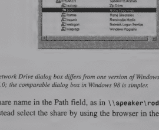

图 11.8
Windows 的 `Map Network Drive` 对话框因 Windows 版本而异。这里显示的是 Windows NT 4.0 中的对话框；Windows 98 中的相应对话框则更简单。

3. 在 `Path` 字段中输入共享名称，如 `\\speaker\rodsmith`。在 Windows NT 4.0 中，你也可以使用对话框下部的浏览器来选择共享。
4. 选择要分配给该共享的驱动器字母。
5. 单击 `OK`。Windows 会在你指定的字母下挂载该共享。

## 从 Windows 程序访问 Samba 共享

如果你正在使用 Windows 程序并意识到需要访问一个共享目录，通常可以在不将共享作为驱动器字母挂载的情况下进行访问。Windows 程序中的典型文件对话框允许你从桌面中选择 `Network Neighborhood` 作为可用选项之一，如图 11.9 所示。你可以从那里向下浏览到你的 Linux 服务器并打开或保存文件。或者，你也可以经常在对话框的文件名字段中输入文件的完整路径，如 `\\speaker\rodsmith\a-file.txt`。

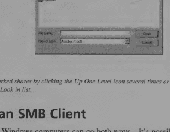

图 11.9
你可以通过多次单击 `Up One Level` 图标或在 `Look in` 列表中定位 `Network Neighborhood` 来访问网络共享。

# Linux 作为 SMB 客户端

与 Windows 计算机的文件共享可以双向进行——可以从 Linux 访问 Windows 共享。事实上，有两种主要方法可以做到这一点：你可以使用一种快速简便的界面，或者将 Windows 共享像本地驱动器一样挂载。你可以使用这两种方法来访问实际 Windows 计算机或运行 Samba 的 Linux 或 UNIX 计算机上的 Windows 导出。由于 Samba 非常出色地模拟了 Windows 网络，因此在 Linux 客户端侧没有操作上的差异。

## 使用 smbclient

`smbclient` 程序为共享的 Windows 资源提供类似 FTP 的界面。一般来说，你可以通过键入其名称，后跟你打算使用的资源来开始使用 `smbclient`，如以下示例所示：

```
smbclient //nessus/shared
```

> **NOTE**
>
> 在 Linux 中，你使用斜杠 `/` 字符而不是 Windows 中使用的反斜杠 `\`。虽然你可以在 Linux 中使用反斜杠字符，但需要使用两倍的数量——机器名称前使用四个，反斜杠在机器名称和资源之间使用两个。

程序随后会提示你输入密码，如果你输入的密码服务器接受，你将被提示符迎接。你可以输入多个类似 FTP 的命令，包括以下内容：

- `ls` 或 `dir`—显示目录列表。
- `cd`—更改服务器上的新目录。
- `lcd`—更改本地机器上的新目录。
- `get` 和 `mget`—分别从服务器传输单个或多个文件。
- `put` 和 `mput`—分别向服务器传输单个或多个文件。
- `?` 或 `help`—显示可用命令。
- `quit`—退出 `smbclient`。

还有许多其他 `smbclient` 命令，以及用于更改其行为的命令行选项。你可以查阅 `smbclient` 手册页以获取更多详细信息。

## 在 Linux 中挂载 Windows 卷

虽然 `smbclient` 对于偶尔的传输可能很方便，但它远不如实际挂载共享那样灵活。因此，很幸运 Linux 在内核中实现了对 SMB/CIFS 的支持，并且拥有允许你像挂载本地硬盘或 NFS 导出一样挂载 SMB 共享的实用程序。

### 将支持编译到内核中

如果你想挂载 Windows 或 Samba 共享，必须采取的第一步是确保内核中有适当的支持。在 `Network File Systems` 选项下，你应确保已选择 `SMB` 文件系统支持，作为模块或编译到内核文件中。如果你只计划挂载 Windows 95 共享，你还应选择 `SMB Win95 bug work-around` 选项。如果计划连接 Windows 98、Windows NT 或混合机器，则不应选择此最后选项。

### 使用 smbmount 命令

在最简单的形式下，你可以按如下方式使用 `smbmount`：

```
smbmount //nessus/shared -c /mnt/nessus
```

> **Note**
>
> Samba 2.0.3 与 2.0.5a 之间的 `smbmount` 语法发生了变化。如果您使用的是 2.0.3，您应该输入
>
> ```
> smbmount //nessus/shared-c 'mount /mnt/nessus'
> ```


来挂载远程 Samba 共享。此外，Red Hat 在 2.0.5a 版本中将 Samba 客户端程序移到了一个单独的 RPM 文件中，因此如果您能够设置 Samba 服务器，但无法访问客户端程序，请检查 `samba-client` 软件包是否已安装。如果没有，请安装它（您可以在随本书附带的 CD-ROM 上的更新目录中找到指向它的链接）。

输入此命令后，`smbmount` 会要求输入密码。（您也可以在命令行上紧跟在共享名称之后输入密码，但这样所有路过并看到的人都会可见。）如果您输入了有效的密码，您将获得对远程共享的访问权限。

如果您使用的是 pre-2.0.5a 版本的 `smbmount`，您可以在单引号内提供额外的参数，以修改挂载共享中文件的权限和所有权：

- `-u` — 指定共享中所有文件要使用的用户 ID。
- `-g` — 指定共享中所有文件要使用的组 ID。
- `-f` — 指定以八进制形式分配给共享上文件的权限。这些权限不能超过服务器提供的权限——如果服务器上文件被标记为只读，您就不能通过此选项覆盖它。但是，您可以在共享挂载后使用 Linux `chmod` 命令更改权限。
- `-d` — 指定以八进制形式分配给共享上目录的权限。

遗憾的是，这些选项在 2.0.5a 版本的 `smbmount` 中不起作用。这个更新版本将文件所有权赋予挂载共享的人，并对所有文件和目录使用 755 的权限。

在 Red Hat 6.0 系统上安装后，`smbmount` 要求您必须是 root 才能操作。如果您想让普通 Linux 用户能够挂载远程共享，您可以这样做；只需输入以下命令：

```
chmod a+s /usr/bin/smbmnt
chmod a+s /usr/bin/smbumount
```


请注意，在第一行中，文件名是 `smbmnt`，而不是 `smbmount`——前者是后者的辅助应用程序。 这些命令在应用程序上设置了 `suid` 位，这意味着即使普通用户运行它们，它们也会以超级用户的权限运行。

您的用户需要拥有他们想要挂载共享的任何目录的所有权。 这通常不是问题，因为用户可以在其主目录中创建目录并在该位置挂载共享。

与其他挂载的文件系统一样，使用完毕后必须卸载 SMB 共享。 您使用 `smbumount` 命令来执行此操作，如 `smbumount /mnt/nessus`。

## Exporting smbmounted Shares to Other Machines

可以向另一台计算机导出您已 `smbmounted` 的共享。 通常您不希望使用 Samba 来重新导出共享，因为两台计算机之间的直接连接会产生更好的性能。 然而，您可能需要使用 NFS 或 Netatalk 来执行此操作。 例如，假设您有一台 Windows 98 计算机上的文件，您希望在 Macintosh 上访问它。 假设您没有诸如 DAVE 之类的软件来允许 Macintosh 参与 Windows 网络，但您确实为通过 Netatalk 导出而配置了 Samba 和 Netatalk。 然后 Macintosh 将能够访问这些文件。 然而，这种安排有一些注意事项：

- 性能可能很差。 这是因为您要进行两倍的传输，这会在容易发生冲突的网络上产生冲突，并给 Linux 服务器带来额外负担。 如果您发现自己经常需要此类解决方案，您应该认真考虑为 Linux 计算机添加磁盘空间（如有必要），并将跨平台文件存储在上面。
- 文件名怪癖可能会在这种连接上成倍增加。 在通过 Linux 的 Macintosh/Windows 连接的情况下，您会遇到 Samba 和 Netatalk 的文件名怪癖。 除非您传输的文件具有敏感或奇特的文件名，否则这不太可能成为一个大问题。
- 您会得到更多文件系统杂乱。 许多操作系统会创建专属于自己的文件，或者 Linux 服务器会这样做以帮助服务过程。 Netatalk 服务器尤其如此，它需要创建特殊目录来保存 Macintosh 资源分支。 如果您通过 Linux 将文件从 Macintosh 传输到 Windows 计算机，您可能会在 Windows 机器上之后找到一个名为 `.AppleDouble` 的目录。 如果文件是普通数据文件，例如 Microsoft Word 文档，您可以安全地删除 `.AppleDouble` 目录。 在少数情况下，例如字体文件，`.AppleDouble` 目录的内容可能比主目录中的内容更重要。

总体而言，重新导出共享是一种有时方便的技巧，但您不应过分依赖它。 相反，最好使用 Linux 计算机作为跨平台文件的服务器。 您可以使用 NFS、Samba 和 Netatalk 导出同一目录，让网络上的每台计算机都可以通过其本地文件共享机制访问相同的文件。

# 摘要

Samba 是一个多功能的程序，用于为 DOS、Windows 和 OS/2 计算机提供服务，或访问此类机器提供的服务。你通过其配置文件 `/etc/smb.conf` 控制 Samba，该文件包含整体配置部分和你导出的每个共享的配置部分。由于 Samba 的灵活性，配置文件对新手来说可能很棘手，因此我建议你使用 `linuxconf` 或 `SWAT` 来创建初始的 Samba 配置。

Samba 本身是一对守护进程，你可以独立运行它们，也可以由 `inetd` 超级服务器控制。独立运行守护进程通常能获得更好的性能，但 Samba 使用相对较少的服务器可能更适合使用基于 `inetd` 的配置。

你可以通过与访问 Windows 服务器上的共享相同的方式访问 Samba 共享，本章提供了这些访问方法的总结。你也可以反过来使用 `smbclient` 和 `smbmount` 命令从 Linux 访问 Windows 共享。你甚至可以将 Windows 共享重新导出给其他客户端，使 Linux 计算机成为不兼容主机之间的一种桥梁。

## Netatalk：与 Macintosh 共享文件

### 第 12 章

# 本章内容

- AppleTalk：Macintosh 的基础网络 292
- 将 AppleTalk 支持编译到内核中 295
- `atalkd` 守护进程 296
- `afpd` 守护进程 299
- 从 Macintosh 选择 Linux 导出 304
- 共享可移动和网络媒体 310
- 安全考虑 312
- 在 Linux 中挂载 Macintosh 卷 312
- 摘要 313

正如 Samba 是 Linux 为 Windows 计算机提供服务的手段，Netatalk 就是 Linux 进入 Macintosh 世界的解释器。Netatalk 起源于密歇根大学，但该机构的官方支持已经结束。幸运的是，Adrian Sun 接手了这项工作，因此较新的版本通常被称为 Netatalk+Asun。整本书中我都将 Netatalk 作为一个总称，但一般来说，我在书中描述的是 Adrian Sun 扩展和改进的服务器版本。

Red Hat Linux 6.0 不将 Netatalk 作为标准软件包提供，但随书附带的 CD-ROM 在 `sams-extras/netatalk` 目录中包含了它。在继续之前，你应该使用 `rpm` 命令或其图形前端，如 `gnorpm`，来安装 Netatalk RPM 文件。

# 警告

> Netatalk 是一个棘手的软件包。许多人报告说某个版本的软件有问题，但另一个版本却没有问题。我在运行 Red Hat Linux 6.0 和 Mandrake Linux 6.0 的自己的系统上使用本 CD-ROM 上的 RPM，因此如果使用其中一种发行版，我不期望你会遇到包含的 RPM 的问题。不过，如果你尝试下载更新的 RPM，请注意你可能会遇到问题。此外，不同的 RPM 可能会将配置文件放在不同的位置，或者可能需要你以与此处描述不同方式启动 Netatalk。

由于 Netatalk 不是 Red Hat Linux 发行版的标准组件，因此没有为其提供 `linuxconf` 配置模块。因此，我只描述了如何通过文本编辑器编辑其配置文件来配置 Netatalk。

## AppleTalk：Macintosh 的基础网络

在互联网流行之前，Macintosh 使用一种专有的网络技术，称为 AppleTalk。最初，该术语同时适用于网络协议和网络硬件，但这令人困惑，因此 Apple 规定 AppleTalk 指软件，而 LocalTalk 则成为硬件的新名称。了解 Macintosh 网络的历史对于理解 Netatalk 以及它如何让 Linux 融入 Macintosh 网络是有用的。

## Apple 网络硬件和软件

自 Mac Plus 以来，所有 Macintosh 都内置了某种网络支持。在过去，Macintosh 用户经常只使用网络硬件将一台或多台 Macintosh 连接到 Apple 在 1980 年代推出的昂贵 LaserWriter 打印机，但更复杂的使用早已成为可能。

### AppleTalk

Macintosh 的传统基础网络软件被称为 AppleTalk。你可以将 AppleTalk 视为大致相当于 TCP/IP 或 DOS/Windows NetBEUI 协议栈，并在顶部加入文件和打印机共享协议。大多数 Macintosh 用户不喜欢考虑其网络下层的具体协议，但了解 AppleTalk 的一些子协议对于配置 Netatalk 是有帮助的。这些协议根据实现它们的 Netatalk 组件进行分组：

- Linux 内核——内核实现了 Datagram Delivery Protocol（DDP），这是 AppleTalk 最基础的协议。
- `atalkd`——Netatalk 组件 `atalkd` 实现了 Routing Table Maintenance Protocol（RTMP）、Name Binding Protocol（NBP）、Zone Information Protocol（ZIP）和 AppleTalk Echo Protocol（AEP）。这些协议以及 `atalkd` 执行的功能大致类似于 Linux 的 `routed` 和 `ifconfig` 工具——它们控制物理接口并确定如何传递网络流量。
- `afpd`——Netatalk 的 `afpd` 实现了 AppleTalk Filing Protocol（AFP），提供文件共享服务。AFP 大致相当于 UNIX 和 Linux 文件共享的 NFS，或 DOS、Windows 和 OS/2 文件共享的 SMB/CIFS。本章主要讨论配置 `afpd` 以及底层的 `atalkd` 系统。
- `papd`——Netatalk 的 `papd` 实现了 Printer Access Protocol（PAP）用于打印机共享。该协议在第 17 章“Netatalk：与 Macintosh 共享打印机”中有更详细的讨论

原始的 AppleTalk 设计让 Macintosh 运行良好多年，但最终开始显现其老化，特别是在网络硬件速度不断提高的情况下。因此，Apple 使用 Open Transport 重新设计了 Macintosh 的网络技术，这是一套工具，允许 Macintosh 更轻松地与更多网络类型集成。Open Transport 的一个结果是能够通过 TCP/IP 传输 AppleTalk。Adrian Sun 对 Netatalk 软件包最重要的改进之一就是在 Netatalk 中实现了通过 TCP/IP 的 AppleTalk；在之前的版本中，Netatalk 仅限于“原始”Netatalk，其速度远低于通过 TCP/IP 的 AppleTalk。

## LocalTalk 和 PhoneNET

原始的 LocalTalk 网络硬件使用总线拓扑（p. 81），意味着 Macintosh 计算机以单线方式相互连接。计算机硬件本身类似于高速串行端口，而电缆价格相当昂贵。LocalTalk 的速度限制在 2Mbps 以下——在其推出时算快，但与 10Mbps 的同轴以太网相比较慢，与当今 100Mbps 的 100BaseT 速度相比则慢得令人难以忍受。另一个限制是电缆长度：其最大长度为 1,000 英尺，这使其介于 10Base2 和 10Base5 以太网电缆的限制之间（见表 1.1，p. 10）。

为了既延长 LocalTalk 的电缆长度限制又降低电缆成本，Farallon 公司推出了名为 PhoneNET 的产品，该产品通过普通电话线传输 LocalTalk 信号。PhoneNET 的最大运行长度为 3,000 英尺，但并未提高 LocalTalk 的速度。由于 PhoneNET 使用计算机外部的适配器而不是内部硬件，因此只要计算机支持 LocalTalk，就可以使用 PhoneNET。

尽管相当罕见，但用于 PC 的 LocalTalk 板确实存在。如果你希望你的 Linux 服务器处理旧 LocalTalk 网络上的流量，可以尝试找到 Apple/Farallon LocalTalk 板或 COPS LocalTalk 板。这两种产品都在 Linux 2.2 系列内核中得到支持。本书未描述其配置和使用方法，但除基本配置外，本章所述的相同原则也应适用于使用此类产品的网络。

## Ethernet

由于以太网的速度优势巨大，为 10Mbps——现在为 100Mbps——Apple 最终开始生产带有以太网端口的 Macintosh。事实上，像 iMac 这样的近期机型已不再支持 LocalTalk，仅支持以太网，并且这些最新计算机支持 100BaseT 以太网。

幸运的是，以太网对所承载的数据类型并不挑剔，因此 Apple 能够将 AppleTalk 适配到以太网。由此产生的以太网承载 AppleTalk 的用法有时被称为 EtherTalk。你可以拥有一个仅承载 AppleTalk 流量的以太网网络，也可以拥有一个混合 AppleTalk 与 TCP/IP 的网络。鉴于 Open Transport 的速度优势，最好使用 Open Transport 将 AppleTalk 封装在 TCP/IP 内部！

## AppleTalk 与 TCP/IP 之间的差异

与 NetBIOS/NetBEUI 一样，AppleTalk 旨在用于小型计算机网络。对于办公室局域网中几十台计算机，它非常有效，但在此之外扩展性不佳。这部分是由于与 NetBIOS 类似，AppleTalk 的命名方案本质上是两层的：每台计算机都有自己的名称，并且计算机可以被分组到称为区域的集合中，这类似于 Windows 网络中的工作组或域（p. 277）。不过，没有办法将 AppleTalk 区域分组到更大的集合中。

相比之下，TCP/IP 旨在用于具有更多组织层级的更大网络。事实上，这也是 TCP/IP 而非 AppleTalk 或 NetBIOS 成为互联网基础的原因之一。

AppleTalk 使用 ID 号来标识单个计算机，但 AppleTalk 包含使网络上的计算机相互协商以自动确定其 ID 号的程序。因此，在 AppleTalk 网络中，你无需直接处理 IP 地址或其等价物——至少在 Open Transport 及其 AppleTalk over TCP/IP 进入方程之前如此。

## 同一以太网上的 TCP/IP 和 AppleTalk

尽管 AppleTalk 和 TCP/IP 是完全独立的协议，但它们可以在同一根以太网电缆上共存而不会冲突。这是因为以太网本身具有数据封装协议，如第 2 章“理解 TCP/IP”所述。就网络硬件和驱动程序的最低层级而言，任何给定的以太网数据包都只是以太网数据包。然而，随着驱动程序检查以太网数据包，它们很快就会发现数据应发送到哪个网络栈——TCP/IP 或 DDP，因此这两个协议在计算机网络层次结构的非常低的层级上就被分开了。

如本章前面所述，AppleTalk 也可以通过 TCP/IP 传输，在这种情况下，大部分以太网流量由 TCP/IP 数据报组成。在这种情况下，协议也共存——只有 TCP/IP 栈在将数据传递给 AppleTalk 栈的适当部分之前处理大部分数据。

## 将 AppleTalk 支持编译到你的内核中

在 Linux 上准备 AppleTalk 网络时，你必须采取的第一个步骤之一是将对 AppleTalk 的 DDP 的支持编译到你的内核中。你可以通过从网络选项配置区域中选择 AppleTalk DDP 来完成此操作，然后重新编译你的内核并重新启动，如第 6 章“为网络编译内核”所述。

重新启动新内核后，你可以通过输入以下命令来检查 AppleTalk 支持是否实际存在：
```


`dmesg | grep Apple -`

```
如果 Linux 成功加载了 DDP 支持，你会看到类似以下的响应：
```

```
NET4: AppleTalk 0.18 for Linux NET4.0
```

如果你没有看到此类消息，请尝试重新检查你的内核编译和加载步骤。例如，我发现自己经常忘记在编译新内核后运行 `lilo`，这会导致旧内核仍然存在。

## The atalkd Daemon

`atalkd` 守护进程提供了 AppleTalk 网络的大部分基础功能，因此当内核运行并支持 DDP 时，配置和运行它就是首要任务。

## atalkd Configuration

要配置 `atalkd`，你需要编辑 `/etc/atalk/atalkd.conf` 文件。配置 `atalkd` 很不寻常，因为在许多情况下，`atalkd.conf` 文件可以完全为空，系统仍然可以工作！除了以井号 (`#`) 开头的注释行外，`atalkd.conf` 按每个接口一行的方式包含配置信息。每行上的信息可能包括以下内容：

- Ethernet device—这通常是 `eth0`，不过如果你有多个以太网板，设备可能是 `eth1` 或更高。如果你在行上指定任何选项，以太网设备必须是该行的第一个选项。如果 `atalkd.conf` 为空，`atalkd` 会探测所有可用接口以寻找 AppleTalk 计算机。
- `-seed`—如果存在此选项，你必须指定所有附加信息。通常你不需要使用 `-seed` 选项，因为它仅在你希望 Linux 计算机充当两个 AppleTalk 网络之间的网桥并为其中一个提供配置规则时才使用。
- `-phase number`—这本质上是 Netatalk 所遵循的 EtherTalk 的修订号。默认值为 2，但如果你愿意也可以设置 Phase 1。
- `-net netrange`—你可以指定一个数字范围，在该范围内你的计算机将尝试获取网络地址。你将 `netrange` 指定为用连字符分隔的一对数字，如 `4000-4100`。合法值范围为 1 到 65279。高于此值的数值用于自动配置。
- `-addr address`—你可以使用此参数请求特定地址。`address` 是一个用句点 (`.`) 分隔的两部分数字。第一部分是网络号（合法值范围为 1 到 65279），第二部分是节点号（1 到 255）。有效地址的示例包括 `1.1`、`60321.200` 和 `5.254`。

### NOTE

在 Phase 2 EtherTalk 中，网络和节点值在单个网络上的以太网地址都可以变化。例如，你可以拥有一个网络，其中计算机使用 `60321.200`、`3243.78` 和 `231.231` 等地址，并且这三台计算机都可以相互通信。如果你的 Macintosh 仍使用 Phase 1 EtherTalk 或 LocalTalk，你可能需要给 Linux 服务器分配与 Macintosh 使用的相同网络号。

- `zone zonename`—许多小型 AppleTalk 网络是无区域的，并且 Netatalk 会尝试即使在有区域的网络上也自动确定其区域。你可以通过此选项强制 Netatalk 的行为。

除非你指定 `-seed`，否则所有其他项目都被视为请求或建议，而不是要求。例如，如果你指定地址 `60321.200`，但网络上另一台计算机已使用该地址，则你的机器会获得另一个地址。

作为一般规则，我建议在 `atalkd.conf` 中设置一行，只包含你希望运行 Netatalk 的接口名称，如下所示

```
eth0
```

在极少数情况下，你可能需要指定附加信息。在更罕见的情况下，你应该完全省略 `eth0` 行。确切何时需要添加信息或完全删除该行似乎是那些将一直到时间尽头都无法解开的谜团之一，因此如果你遇到问题，你只能进行实验。

### TIP

我见过一些 Netatalk 服务器停止响应的报告，并且无法使其再次工作，尽管 Linux 服务器上没有配置更改。解决方法是关闭 Macintosh 网络上的所有计算机，包括 Linux 计算机，然后重新启动它们，首先启动种子机器（如果有专用种子机器）。

## Starting atalkd Services

本节描述手动启动 `atalkd` 并检查每个步骤的过程。这种程度的控制除了解决故障外不需要，所以你可能想跳到本章后面的“ The afpd Daemon”。如果你遇到问题或只是想了解 Netatalk 的工作原理，请继续阅读。

要测试基本的 `atalkd` 功能，你可以输入 `/usr/sbin/atalkd`。经过短暂延迟后，你会得到命令提示符。你可以通过输入以下命令检查守护进程是否正在运行

```
ps ax | grep atalkd -
```

### NOTE

`atalkd` 启动可能需要接近一分钟，在某些硬件上可能更长。不要在守护进程完成其工作之前不耐烦地将其杀掉。

## 文件共享

## 第三部分

如果看到除了 `grep` 之外的进程，则说明 `atalk` 正在运行。你可以通过输入以下命令进一步检查功能

```
cat /proc/net/atalk_iface
```

该命令显示 `atalkd` 已附加到的设备信息。例如，在我的系统上，该命令报告如下：

```
eth0                 F500:DA  0000-FFFF  0
lo                   0000:00  0000-0000  0
```

这意味着 `atalkd` 使用地址 `F500:DA` 为 `eth0` 提供服务（网络地址 62720，节点地址 218，以十六进制表示），并监听 0 到 `FFFE`（65534）之间的网络。守护进程也已附加到 `lo`，即回环接口。

对 `atalkd` 基本功能进行最终测试的方法是使用 `aecho` 命令，它是 AppleTalk 的 TCP/IP ping 等价物——它向指定主机发送 AppleTalk Echo 请求，等待回复，并打印一些基本统计信息。你可以指定目标计算机的 AppleTalk 名称或其地址（网络和节点，用句点分隔，如 `41201.173`）。以下是我在网络上执行命令 `aecho teela` 的结果：

```
14 bytes from 41201.173: aep_seq=0, time=0. ms
14 bytes from 41201.173: aep_seq=1, time=0. ms
14 bytes from 41201.173: aep_seq=2, time=0. ms
14 bytes from 41201.173: aep_seq=3, time=0. ms
---41201.173 AEP Statistics---
4 packets sent, 4 packets received, 0% packet loss
round-trip (ms)  min/avg/max = 0/0/0
```


我在发送四个数据包后通过按 `Ctrl+C` 终止了此测试。

> **注意**
> 
> 你可以使用真正的 Macintosh 或另一台启用了 Netatalk 的计算机作为 `aecho` 命令的目标。不过，在配置过程的这个阶段，你不能对自己的计算机使用 `aecho`。

此时，我建议终止 `atalkd`，因为在下一节中你将学习如何通过单个命令同时启动它、`afpd` 和 `papd`。

## afpd 守护进程

让 `atalkd` 运行是好的，但单独使用它本质上是无用的。要配置 Netatalk 执行任何实际工作，你还必须配置并启动 `afpd`。

## 配置 afpd

你通过四个文件配置 `afpd`，所有文件均位于 `/etc/atalk` 目录中：

- `config`—设置整体配置选项。
- `afpd.conf`—控制与身份验证和数据传输最相关的选项。这些选项中的大多数可以在 `config` 文件中设置。
- `AppleVolumes.default`—指定你想要导出的目录。
- `AppleVolumes.system`—指定用于原生 Linux 文件的 Macintosh 创建者和类型代码。

## 创建 config 文件

`/etc/atalk/config` 文件包含在本图书 CD-ROM 上的特定 RPM 发行版中，并被 Netatalk 启动脚本使用。Netatalk 的另一个发行版可能不使用此文件。它包含提供 AppleTalk 服务的重要配置参数。你通过给出选项名称、等号和值来在此文件中设置选项。你可以在此文件中设置的重要选项包括以下内容：

- `AFPD_MAX_CLIENTS`—此选项是服务器允许的最大客户端计算机数量。默认值为 5。
- `ATALK_NAME`—此选项是你在 AppleTalk 网络上的计算机名称。默认设置尝试基于你的 Internet 机器名称，并通常有效。在某些情况下你可能需要指定其他名称。
- `AFPD_NOCLR`—你将此参数设置为 `-c` 以禁用明文登录。本书 CD-ROM 包含的 Netatalk 版本不支持加密登录，因此你应将此行注释掉。如果你想启用加密登录，你需要获取 Netatalk 的源代码和一个 DES 库，然后自行编译程序的自定义版本。
- `AFPD_NOGUEST`—你将此参数设置为 `-g` 以禁用访客（无密码）登录。默认设置允许访客登录。
- `AFPD_GUEST`—此选项指定访客用户的名称。默认值为 `nobody`，这会给访客用户非常严格的权限。
- `PAPD_RUN`—此选项指定启动脚本是否运行 `papd` 以提供打印机服务，取值为 `yes` 或 `no`。
- `AFPD_RUN`—这是一个用于 `afpd` 文件共享服务的另一个 `yes/no` 选项。
- `ATALK_BGRO`—如果将此选项设为 `yes`（通常的值），启动脚本会将守护进程在后台运行。

默认配置文件通过井号（`#`）注释掉的方式禁用了其中许多选项。您可以通过取消注释相关行来启用该选项。

## 创建 afpd.conf 文件

您在 `afpd.conf` 文件中指定要传递给 `afpd` 的选项。在大多数情况下，一个完全空白的 `afpd.conf` 文件就足够了，因为配置文件包含了最有趣的 `afpd` 选项。不过，您可能想要覆盖以下几个选项：

- `-f defaultvolumes`—您使用此选项从 `defaultvolumes` 获取要导出的目录列表，而不是从 `AppleVolumes.default` 获取。
- `-s systemvolumes`—您使用此选项从 `systemvolumes` 获取 Macintosh 创建者和类型代码，而不是从 `AppleVolumes.system` 获取。

您也可以阅读 `afpd` 手册页以获取有关 `afpd` 选项的更多信息。

## 创建 AppleVolumes.default 文件

`AppleVolumes.default` 文件包含您想要导出的目录列表，每行一个目录。通常的格式是指定目录名和一个 Macintosh 卷名，例如

```
/usr/local/macprogs "Shared Programs"
```

此行会使 `/usr/local/macprogs` 目录的内容在 Macintosh 上作为名为 `Shared Programs` 的共享卷出现。默认的 `AppleVolumes.default` 文件只包含一个单行（且为单个字符！）条目：`~`。此条目将用户的主目录以用户名导出。例如，如果您以 `stevej` 登录，您会看到一个名为 `stevej` 的卷可用。

您可以指定附加参数来更改 Netatalk 对导出目录的各个方面的处理方式。每个参数都以参数名开头，后跟等号（`=`），然后是您想要赋予它的值。这些附加参数如下：

`macname`。另一方面，`xlatelower` 选项会导致 Macintosh 看到 `MIXED-NAME`，但创建文件 `MacName`（然后它会将其视为 `MACNAME`）。如果这些是目录而不是文件，`xlatelower` 会导致 Macintosh 看到 `mixedname`。这种 `xlate` 行为是一个错误，可能会在 Netatalk 的未来版本中得到修复。

- `options`—您可以指定 `prodos`，使系统与 Apple II 计算机兼容；`noadouble`，会导致服务器仅在绝对必要时创建 `.AppleDouble` 目录；或 `crlf`，会在文本文件中自动在 Macintosh 和 UNIX/Linux 行尾字符之间进行转换。您可以通过用逗号分隔且不加空格的方式指定多个选项。

### CAUTION

`crlf` 选项听起来可能很诱人，但它可能会导致某些程序出现问题，包括某些版本的 Microsoft Word。

- `access`—此参数将对卷的访问限制为指定的用户和组。您通过 Linux 用户名列出用户，通过在其组名前加上 at 符号（`@`）列出组。您可以通过逗号且不加空格分隔多个用户。
- `password`—此参数为卷指定单独的密码。

## 编辑 AppleVolumes.system 文件

Macintosh 在其文件系统中包含某些其他计算机中不存在的信息。其中最重要的两个是文件的四字符创建者和类型代码。对于数据文件，创建者代码标识创建该文件的应用程序。例如，`MSWD` 标识 Microsoft Word 文档。应用程序的创建者代码为 `APPL`。文档类型有助于应用程序识别文件类型，对于应用程序而言，它是应用程序应用于其数据文件的创建者代码。文档类型代码通常是应用程序独有的，但有时许多应用程序使用相同的类型代码。例如，JPEG 文件的类型代码为 `JPEG`。正是因为这些代码，Macintosh 才能在您双击文档图标时打开适当的应用程序。

当您使用 Macintosh 将文件存储在 Linux 服务器上时，Netatalk 会存储文件创建者和类型代码。但是，如果您在 Linux 或其他操作系统中创建文件并使用 Samba 或 NFS 等文件共享协议，则文件没有任何创建者或类型代码。因此，Netatalk 必须伪造这些代码。它通过根据文件的扩展名——文件名中最后一个句点之后的部分——分配创建者和类型代码来实现这一点。这就是 `AppleVolumes.system` 文件发挥作用的地方，因为它包含了这些映射的完整列表。

#### NOTE

个人用户可以创建自己的自定义 Netatalk 配置文件，该文件同时充当 `AppleVolumes.system` 和 `AppleVolumes.default`。文件必须出现在用户的主目录中；其名称必须为 `.AppleVolumes` 或 `AppleVolumes`；并且必须包含 `AppleVolumes.default` 和 `AppleVolumes.system` 的内容。创建自定义 `AppleVolumes` 文件最简单的方法是复制默认的或已编辑的系统范围的 `AppleVolumes.system` 文件，然后在其开头添加你想要导出的共享，格式与 `AppleVolumes.default` 中使用的一样。如果你省略了想要导出的共享，Netatalk 不会恢复到标准的 `AppleVolumes.default` 导出，因此你在登录时将没有任何可用的导出。

本书 CD-ROM 上包含的 Netatalk 版本包含相当多的映射，但你可能想要扩展或修改它。此文件的每一行指定一种文件类型，其格式如下：

```
.ext TYPE CRTR Type_Description Creator_Description
```


每一行上的每个项目都有特定的含义，如下所示：

- `.ext`—Linux 中的文件名扩展名，例如 Microsoft Word 文件的 `.doc` 或纯文本文件的 `.txt`。

#### NOTE

尽管 Linux 本身在文件名处理上是区分大小写的，但 `AppleVolumes.system` 中列出的扩展名不区分大小写，因此你只需一个条目即可涵盖这些扩展名的大小写版本。

- `TYPE`—四字符文件类型代码。
- `CRTR`—四字符文件创建者代码。

#### NOTE

尽管 `.ext` 字段不区分大小写，但 `TYPE` 和 `CRTR` 字段是区分大小写的。

- `Type_Description`—文件类型的简要描述，例如“Word 6 文档”或“文本文件”。
- `Creator_Description`—文件的创建者名称，例如“Microsoft Word”或“SimpleText”。

最后两个字段是可选的，事实上会被 Netatalk 忽略；它们仅为你的了解而存在。

> ### CAUTION
>
> 少数 `TYPE` 代码实际上少于四个字符——更准确地说，它们末尾包含空格。所有四个字符——包括任何空格——的此类代码都需要用双引号括起来，否则将无法正常工作。不幸的是，默认的 `AppleVolumes` 系统文件包含多个没有必要引号的两个和三个字符代码。你可能想要浏览该文件并纠正此问题，特别是如果你使用这些类型的文件。受影响的文件包括 Adobe Acrobat Reader（PDF）、DL 动画、FLI 动画、Windows 图标、LHA 归档、MLV MPEG、Packrat 归档、VOC 声音、Microsoft Excel、zip 归档和 zoo 归档文件。一般来说，这个问题在很大程度上是外观上的，因为它只是导致文件在被程序使用之前以通用文档图标显示；但某些程序可能拒绝加载文件，如果它不带有适当的 `TYPE` 代码。

> ### TIP
>
> 你可以更改文件的创建者以便在外部程序中轻松访问。例如，假设你想使用 Macintosh 上的 StuffIt Deluxe 打开使用 Windows 上的 PKZip 或 Linux 上的 Info-Zip 创建的 zip 文件。你只需将现有条目更改为：
>
> ```text
> .zip ZIP ZIP
> ```
>
> 改为
>
> ```text
> .zip ZIP SITD
> ```


当你重新启动 Netatalk 时，你现有的 `.zip` 文件将具有 StuffIt 图标，并在双击时启动 StuffIt。几个 Macintosh 程序可以找到现有文件的类型和创建者代码，如果你不确定使用什么。我使用 Norton Utilities 来完成此任务。

当 Macintosh 创建文件时，它还会显式存储文件类型和创建者代码，并且 Netatalk 会保留这些。因此，对于你在 Macintosh 上创建的文件，你无需担心这些映射。如果你在一台 Linux 上创建文件，在 Macintosh 上打开它，进行更改，然后保存文件，很可能 Macintosh 程序会保存文件类型和创建者代码，从而覆盖 `AppleVolumes.system` 中指定的内容。

## 启动 AppleTalk 文件协议

现在你已经创建了适当的配置文件，是时候启动你的 Netatalk 服务器了。如果你使用了本书 CD-ROM 上的 RPM 文件，你可以通过输入 `/etc/rc.d/init.d/atalk start` 轻松启动 Netatalk。（如果 Netatalk 已在运行，你应使用 `restart` 而不是 `start`。）由于 `atalkd` 本身启动需要一分钟左右，你的服务器不会立即出现在你的 Macintosh 的 Choosers 上。`atalk` 启动脚本分叉执行 `atalkd`，因此除非从 Macintosh 客户端计算机进行测试，否则你不知道启动何时完成。

如果你在几分钟后仍无法访问 Netatalk 服务器，请尝试检查 `/var/log/messages`。此文件的最后几行应包含与 `atalkd`、`afpd` 和 `papd` 启动相关的消息，并且可能包含有助于你追踪问题原因的错误消息。

当你重新启动计算机时，Netatalk 服务应自动启动。同样，不过，在系统启动后可能需要一分钟左右的时间，导出才能供网络上的 Macintosh 使用。你可以使用 Linux 上的 `aecho` 来测试基本的 AppleTalk 连接性，如本章前面所述。

如果你使用的是使用与 Red Hat 不同的启动脚本的发行版，例如 Slackware，你可能必须手动编辑你的启动脚本以启动 Netatalk。你可以向任何方便的启动脚本添加行，例如以下内容：

- `/usr/sbin/atalkd`
- `/usr/sbin/papd`
- `/usr/sbin/afpd -n servername`

你可能想要添加额外的 `afpd` 参数，如 `afpd` 手册页和本章前面关于配置文件（第 299 页）的部分所述。由于 `atalkd` 启动可能需要很长时间，你可能还想将这些行放在单独的脚本文件中，并在主启动文件中分叉该文件（在主启动文件中在脚本名称后使用 `&`）。

## 从 Macintosh 选择 Linux 导出

现在你已在 Linux 上运行了 Netatalk 服务器，是时候从 Macintosh 测试配置了。你会发现，一旦配置完成，Linux 服务器可以很好地集成到你的 Macintosh 网络中。

## 使用 Macintosh 的 Chooser

MacOS 使用 Chooser 来挂载由网络计算机导出的卷，而你也使用 Chooser 来挂载你的 Linux 文件——至少在 8.6 版之前的 MacOS 中如此。

> **注意**
>
> 即将推出的 MacOS X 可能会废除 Chooser，因此在 MacOS X 中你可能需要使用其他方式来选择你的 Linux 导出。

要从 Macintosh 挂载 Linux 共享，请按照以下步骤操作：

1. 选择 Apple，Chooser 打开 Chooser，如图 12.1 所示。

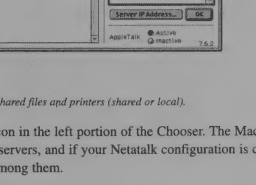

**图 12.1** 你使用 Chooser 来访问共享文件和打印机（共享或本地）。

2. 点击 Chooser 左侧的 AppleShare 图标。Macintosh 会检查网络中的 AppleTalk 服务器，如果你的 Netatalk 配置正确，你会看到你的 Linux 计算机在其中。

> **注意**
>
> 这些说明假定你已在 Macintosh 中启用了 AppleTalk 支持。检查 Chooser 右下角附近的 AppleTalk 单选按钮。它应设置为 Active。如果设置为 Inactive，请更改该设置。

3. 从计算机列表中选择你的 Linux 服务器并点击 OK。MacOS 会响应并显示连接对话框，如图 12.2 所示。如果你已启用访客登录，你可以选择使用访客账户，但你将无法访问你的主目录。如果你想要访问你的用户账户文件，请选择 Registered User 并输入你的 Linux 用户名和密码，然后点击 Connect。

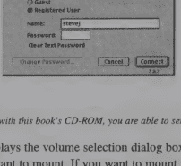

**图 12.2** 随本书 CD-ROM 提供的 Netatalk 版本，你只能发送明文密码。

4. Macintosh 现在会显示卷选择对话框，如图 12.3 所示。选择你想要挂载的卷。如果你希望每次 Macintosh 启动时都挂载此卷，请勾选列表右侧的框。你可以让系统仅保存你的用户名或用户名和密码。选择好所需选项后，点击 OK，Macintosh 就会挂载该卷。

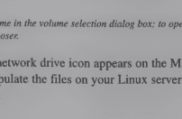

**图 12.3** 在卷选择对话框中，你一次只能选择一个卷；要打开多个卷，你需要从 Chooser 中第二次选择该服务器。

挂载卷后，网络驱动器图标会出现在 Macintosh 桌面上。你可以双击该图标来操作你的 Linux 服务器上的文件，就像它们是本地于 Macintosh 一样，但有一些注意事项。

偶尔，Netatalk 的 AppleTalk 部分可能会出现问题。在这种情况下，你在 Chooser 中看不到你的 Linux 服务器，但你仍可能通过点击 Server IP Address 按钮来访问它。Macintosh 然后会显示一个对话框要求输入 IP 地址，你必须提供该地址。（请注意，这是一个数字 IP 地址，而不是 TCP/IP 机器名。）登录过程然后可以正常进行。Linux 服务器未出现在 Chooser 中的问题有时可以通过重新启动 Netatalk 来解决，有时需要配合关闭并重新启动网络上的所有 Macintosh。

## 访问 Linux 文件

在很大程度上，你的网络化 Linux 文件系统应该像你期望的任何其他 Macintosh 驱动器那样工作。不过有一些注意事项和一些错误，特别是与跨操作系统交互相关：

- 如前所述，Linux 使用 `/etc/atalk/AppleVolumes.system` 文件的内容来确定哪些文件映射到哪些应用程序和文件类型。如果 `AppleVolumes.system` 文件配置错误或你缺少关键应用程序，你可能难以访问某些文件。
- Linux 支持比 Macintosh 更长的文件名——Macintosh 限制为 31 个字符，而 Linux 可处理多达 255 个字符。如果文件的名称超过 31 个字符，Netatalk 会忽略它，因此你无法在 Macintosh 上访问该文件。
- Linux 是一个区分大小写的 OS（p. xxx），而 MacOS 通常是保留大小写的（p. 230）。除非你使用 `AppleVolumes.default` 中的 `casefold` 选项调整 Netatalk 的大小写处理功能，否则 Netatalk 会强制 Macintosh 以区分大小写的方式运行。
- 对 Netatalk 卷上文件的 Macintosh 别名可能在会话之间无法工作。同样，许多程序的最近访问文件列表在会话之间可能无法工作。
- 对单个文件的多用户访问可能很棘手。如果多个用户需要对一个文件进行只读访问，通常没有问题；然而，如果两个用户尝试对同一文件获得写访问权限，结果可能是不可预测的。当 Macintosh 用户（使用 Netatalk）和 Windows 用户（使用 Samba）尝试访问同一文件时尤其如此，因为 Netatalk 和 Samba 不会协调它们的文件锁定程序。
- 一些 Macintosh 程序在大型卷上创建大文件时会出现问题——Macintosh 声称没有足够的可用磁盘空间，尽管实际上有。确切的限制各不相同，但该问题通常不会出现在小于数百兆字节的文件上。因此这对于普通的文字处理文档来说不是问题，但在创建可刻录光盘（CD-R）映像文件或备份时就会出现。

解决此问题的变通方法是，在 Linux 中创建一个大空文件，并使用 Linux `htools` 软件包将其格式化为 HFS 卷。然后你可以使用 Apple 免费的 DiskCopy 实用程序在 MacOS 中挂载此映像文件，并在此导出内的卷中传输大型文件。尽管笨拙，但如果磁盘空间足够，此变通方法有效。

当你使用 Netatalk 访问卷时，你使用的是挂载卷时输入的用户名和密码所对应的用户的权限。作为系统管理员，你可以利用这一事实，通过创建适当的 Linux 用户和组账户来限制对文件和目录的访问。例如，如果你为个人创建账户并将他们放入两个组中，你可以通过从组的 home 目录中移除 world 读取和执行权限，来阻止一个组中的成员对另一个组的读写访问。

## 理解 Macintosh 分叉

MacOS 与 Linux 和大多数其他操作系统不同，它将文件分为两个部分，称为分叉——数据分叉和资源分叉。数据分叉包含大多数文档的大部分数据，例如 ASCII 文本、电子表格数据和 GIF 图像。资源分叉包含专门的 Macintosh 信息，例如图标、程序代码和字体定义。因为 Linux 不理解分叉，所以 Netatalk 必须处理此细节。服务器通过创建一个名为 `.AppleDouble` 的特殊子目录来实现这一壮举，`afpd` 将资源分叉放在其中。`.AppleDouble` 目录中的文件与主目录中的文件具有相同的名称，但这些文件包含资源分叉信息而不是数据分叉信息。（这些 `.AppleDouble` 文件实际上包含更多信息，包括文件创建者和类型 ID。）因为 Linux 通常会隐藏以句点开头的文件，所以当你使用 `ls` 或文件浏览器查看文件时，你看不到 `.AppleDouble` 目录。

除了 `.AppleDouble` 之外，Netatalk 还会创建一个名为 `.AppleDesktop` 的目录。此文件包含 MacOS 用于在窗口中定位图标的信息。`.AppleDesktop` 目录仅存在于导出的目录树的根目录中，而 Netatalk 会在从 Macintosh 访问的每个目录中创建一个 `.AppleDouble` 子目录。

如果你严格将目录用于与 Macintosh 共享文件，这些对你来说可能没什么区别。你可能需要意识到这些事实，并在需要从 Linux 或其他操作系统（例如通过 Samba 共享）访问文件时采取某些预防措施：

- 你不应该删除 `.AppleDouble` 目录或其中的任何文件。例外情况是，如果你在 Linux 中删除文件，你可以（并且应该为减少浪费的磁盘空间）删除其在 `.AppleDouble` 中的对应文件。如果你从 Macintosh 删除文件，Netatalk 会自动删除该文件的 `.AppleDouble` 对应文件。另一个例外是，如果目录中的所有文件都是通过 `AppleVolumes.system` 文件已知类型且不包含任何重要资源分叉数据的文件。此类文件包括大多数生产力应用程序数据文件、纯文本文件和跨平台图形文件。

- 如果你在 Linux 中移动或复制 Macintosh 文件，你也应该移动或复制该文件的 `.AppleDouble` 对应文件。同样，如果文件没有重要资源分叉数据且其扩展名出现在 `AppleVolumes.system` 中，则不适用此规则。

- 一些 Macintosh 文件，例如程序和字体文件，其数据分叉中没有数据，但它们具有大量的资源分叉。这意味着在 Linux 中，这些文件看起来是空的（0 长度）——直到你检查 `.AppleDouble` 目录中文件的孪生文件。不要犯这样的错误，认为主目录中的文件是多余的；它们对于访问资源分叉数据是必要的。

- 当你备份 Linux 服务器时，你必须确保也备份 `.AppleDouble` 文件。大多数备份软件默认会执行此操作。

- 如果你想归档一个文件目录，例如发送给其他人，你可以从 Macintosh 轻松地做到这一点。但是，如果你尝试从 Linux 执行此操作，你可能会得到不需要的 `.AppleDouble` 目录。许多归档程序包含排除某些文件的选项，你可以使用此选项来阻止 `.AppleDouble` 目录。

- 从 Linux 或共享同一文件的其他操作系统修改主（数据分叉）文件通常不是问题，只要你使用适当的工具进行修改即可。例如，你可以使用 Macintosh 版 Microsoft Word 98 创建文档，并使用 Windows 版 Microsoft Word 97 或 2000 修改它，Macintosh 上的 Word 98 可以毫无问题地读取修改后的文件。如果使用 Linux 版 WordPerfect 8 读取和修改文件，情况也一样，通常的文件导入/导出过滤器不完美的警告也适用。

如果你想从 Netatalk 服务的目录中存储的数据刻录 CD-ROM，你可能需要明确排除 `.AppleDouble` 目录。或者，如果你想能够在 Macintosh 上读取 CD-ROM，同时包含长文件名和资源分叉数据，你可以使用 Linux `mkhybrid` 软件包（你可以在 `http://www.ps.uci.ac.uk/~jcpearso/mkhybrid.html` 找到它，以及随本书附带的 CD-ROM 中的 `sams-extras/backup` 目录）来创建同时具有 ISO-9660 和 Macintosh HFS 文件系统的 CD-ROM。该程序还支持 ISO-9660 和 Joliet 的 Rock Ridge 扩展，因此你可以创建具有极其广泛操作系统支持的单个 CD-ROM。（本书的附带 CD-ROM 就是使用 `mkhybrid` 制作的。）你需要向 `mkhybrid` 发出 `-netatalk` 参数，以便使其识别 `.AppleDouble` 目录的内容。

## 卸载 Netatalk 卷

你卸载 Netatalk 卷的方式与在 MacOS 中卸载任何其他卷相同：将其图标拖到废纸篓。随后 Macintosh 会告知 Netatalk 不再需要该卷，连接随即关闭。如果你从某个服务器卸载了所有卷，再次尝试挂载卷时可能需要重新输入用户名和密码。否则，Macintosh 会记住你的用户名和密码，这样重新挂载卷就会稍微容易一些。

偶尔，Macintosh 程序会打开一个文件，却没有正常关闭对该文件的操作系统句柄。这会导致在 Linux 中难以卸载该磁盘。如果你访问的是硬盘上的文件，这种情况通常不成问题；但如果共享的是可移动介质，就可能会带来麻烦。在这种情况下，解决办法要么关闭那个不必要地保持文件打开的程序，要么在 MacOS 中卸载共享。有时后者可能是唯一的选择。有时候你只需等待一两分钟，程序会延迟解除对文件的锁定，从而允许你从 Linux 卸载该磁盘。

## 共享可移动和联网介质

你可以导出可移动介质，以及 Linux 从其他服务器挂载的介质。图 12.4 显示了一台 Macintosh 从 Linux Netatalk 服务器挂载了多个文件系统：

- 使用 Samba 的 `smbmount` 工具挂载的 Windows NT C: 驱动器
- Linux 读取的 Joliet CD-ROM 光盘
- 一个标准 Linux 主目录 `rodsmith`
- Linux 读取的 Macintosh HFS Zip 磁盘

无论文件系统的来源如何，就 Netatalk 和 MacOS 而言，基本原则都是相同的。第 9 章“文件共享的基本原则”讨论了共享可移动介质的不同方法。

关于共享 Macintosh HFS 介质（包括 Macintosh CD-ROM、Zip 磁盘和软盘），还需要补充几点：

- 你应该使用 `conv=netatalk` 和 `afp d` 选项。前者让 Linux 的 HFS 驱动程序像 Netatalk 那样显示资源分叉，后者则优化这种显示，以便 Macintosh 更好地对介质进行读写访问。
- 标准 PC 硬件无法读取 400KB 和 800KB 软盘的低层格式，因此你无法在 Linux 中挂载这些介质。不过，PC 硬件和 Linux 对 1.44MB 的 Macintosh 软盘没有问题。

**图 12.4** Netatalk 导出的文件系统几乎无法看出它们的来源。

- Macintosh 传统上使用自己的方式在 FAT 软盘上支持长文件名。这些方法不兼容 VFAT，因此也不兼容 Linux 对长文件名的处理方式。因此，尝试与 Macintosh 共享此类软盘会丢失 Macintosh 创建的长文件名。幸运的是，较新版本的 MacOS 像 DOS 一样使用 VFAT，所以这个问题只会在与相对较旧的 Macintosh 系统交换 FAT 软盘时出现。
- Linux 对 HFS 的支持仍被视为实验性的，可能并非 100% 可靠。因此，我建议你不要将带有不可替代数据的大型 Macintosh 可移动介质以读写方式挂载。不过，向空白介质或小磁盘写入少量文件时，你不太可能遇到问题。

## 警告

截至撰写本文时，高于 2.2.8 的 Linux 内核与通过 Netatalk 导出 HFS 介质配合不佳。该问题表现为 Macintosh 挂起。如果你正在使用更新的内核并遇到此问题，请尝试使用最新的可用内核（可能已修复该问题，也可能没有），或者使用 2.2.8 内核。


如果你共享的文件系统不是 HFS 或 Linux 原生的 `ext2`，你可能会遇到该文件系统的特殊性问题。例如，如果使用 Linux 的 `msdos` 文件系统，你无法创建超过 DOS 8.3 限制长度的文件名。虽然这听起来并不严重，但其后果可能比你想象的更严重——因为 `.AppleDouble` 目录的名称长度超过了 8.3 限制，Netatalk 无法在 `msdos` 软盘上创建该目录，因此文件复制无法工作。（你会看到一条神秘消息，提示“出现了类型为 -50 的错误”。）不那么严重的是，如果你使用 Linux 的 `vfat` 文件系统，Macintosh 在使用 Linux `ext2fs` 分区时新获得的文件名区分大小写能力会丢失。

## 安全注意事项

尽管 Netatalk 支持加密密码，但大多数二进制文件中并不存在这种支持，因为它是通过某些国家（包括美国）限制出口的加密技术实现的。因此，如果你想使用加密密码，要么寻找一个已经链接了这些库的二进制文件（很可能来自非美国网站），要么自己编译一个 Netatalk 副本。幸运的是，你可能只需要在本地网络中使用 Netatalk，所以大多数站点并不真正需要加密密码。

Netatalk 使用标准的 Linux 密码数据库，因此你的 Macintosh 用户需要带有密码的常规 Linux 账户。如果你的 Macintosh 用户不需要正常登录 Linux 计算机，你可以删除他们的登录权限，如第 24 章“维护安全系统”所述。

## 在 Linux 中挂载 Macintosh 卷

理论上，可以在 Linux 中挂载从 Macintosh 服务器导出的卷。为此，你需要使用 Apple 文件协议文件系统（`afpfs`）。这是一个标准 Linux 内核中未包含的内核模块，因此你必须单独编译并作为内核模块使用。

注意，我在上一段以“理论上”开头。这是因为 `afpfs` 从来都不是很先进，而且在撰写本文时并不可靠。事实上，`afpfs` 的现任维护者 David Foster 在他的网页 (`http://www.panix.com/~dfoster/afpfs/`) 上表示，他认为 `afpfs` 目前尚不可用。此外，开发工作已经停滞，所以除非情况发生变化，否则 `afpfs` 可能会在一段时间内仍然无法使用。

尽管如此，如果你对这个支持感兴趣，应该查看上一段提到的 `afpfs` 网页。你也可以查看 `http://thehamptons.com/anders/netatalk/` 上的 Netatalk HOWTO 网页，以防有人接替 `afpfs` 的开发工作。

如果你足够大胆去尝试使用 `afpfs`，甚至更好——继续它的开发，那么尽情下载并试用吧。我在这里不提供任何操作说明，因为我不推荐在生产计算环境中使用它，也不会推荐给那些没有足够资格仅凭目前稀少的文档就完成设置的人。

## 摘要

Netatalk 包为 Macintosh 网络所做的事情，正如 Samba 为 Windows 网络所做的那样。不过 Netatalk 并没有像 Samba 那样完善——Netatalk 有更多怪癖、更少的便利功能，并且目前缺乏与 Linux 服务器相匹配的 Linux 客户端，例如。尽管如此，Netatalk 仍能完成工作，并且是许多内联网上的有用工具。

要使用 Netatalk，你必须使用 AppleTalk DDP 支持编译 Linux 内核，该支持提供了类似于 TCP/IP 栈下层协议的底层协议。完成之后，你可以配置并运行 Netatalk 守护进程 `atalkd` 和 `afpd`。

在运行中，维护 Netatalk 服务器并使其能与 Linux 程序或 Samba 提供的 Windows 文件顺畅互操作的主要挑战在于管理 Macintosh 资源分支，Netatalk 将其存储在名为 `.AppleDouble` 的子目录中。你必须小心不要扰乱这些目录的内容，除非你确信其中包含的文件对整体数据文件并非至关重要。

## 使用 Linux 备份客户端机器

### 第 13 章

# 本章内容

- 备份服务器 317
- 服务器发起的备份 326
- 客户端发起的备份 333
- 恢复文件 336
- 备份陷阱 343
- 有效的备份计划和策略 345
- 摘要 346

现在是晚上 11:00，你正在赶一份明天早上 9:00 到期的报告。你几乎完成了，突然出了问题：电源短暂中断，然后恢复，导致所有电脑重启。系统重新启动后，它们警告你下次要正确关机，然后开始检查文件系统。你当时使用的客户端机器报告了存放文字处理程序的目录中有多个错误。检查完成后，你还是尝试运行该程序，但不行；文字处理程序启动时崩溃。更糟的是，你知道这些目录存放着自定义设置、模板和词典文件，如今都至少可疑。即使重新安装软件，你也会丢失那些自定义设置。你能怎么办？

如果你一直在使用 Linux 文件服务器，并且遵循本章的建议，你可以取出备份介质，恢复受影响的目录树，并在备份设备速度允许的范围内尽快恢复工作。Linux 的文件共享功能使其成为备份服务器的绝佳选择——一台可以备份大量联网计算机的计算机。维护重要数据的备份可以帮助减少因硬件或软件故障导致的停机时间，并在不可替代的数据从硬盘消失时帮助你从灾难中恢复。你真的愿意将公司的财务数据，或过去一年收集的科学观测数据托付给单一硬盘吗？如果不愿意，就备份吧！很可能阅读本书的任何人都有备份需求，因为花费时间、精力和费用搭建网络意味着这些网络上的计算机有重要的用途，因而存储着重要数据。

当然，你首先需要备份硬件。第 22 章“设计一台作为 Linux 服务器的计算机”包含了有关各种备份硬件技术的相关信息。可录 CD（CD-R）驱动器是存档存储多达 650MB 数据的良好选择，或用于备份缓慢变化的系统配置，只要它们能容纳在该空间内。一般来说，我更倾向于使用磁带驱动器进行常规（每日或每周）备份。如果你的网络拥有不止少数几台计算机，你应该考虑高端数字音频磁带（DAT）或数字线性磁带（DLT）驱动器。这些驱动器可能价格昂贵，但按每台计算机计算，成本可能相当合理。

本章重点介绍开源和免费备份解决方案，因为它们随 Linux 提供或在其他操作系统（OS）中可自由获取。还有几种商业备份解决方案可供选择，例如 Enhanced Software Technology's（EST's）Backup and Restore Utility（BRU；`http://www.estinc.com`）和 Knox Software's ARKEIA（`http://www.arkeia.com`）。其中一些同时支持 Linux 和各种客户端 OS，而另一些则依赖 Linux 和远程系统的固有文件共享机制。有些完全在客户端 OS 上运行，并依赖 Linux 的文件共享或其他网络功能。

本章假设您已在网络上配置了文件共享。根据您选择的备份解决方案，您需要共享客户端系统的驱动器或为服务器的驱动器提供写入权限。如果您尚未阅读，请阅读网络上计算机的文件共享相关章节。

## 备份服务器

本章是关于备份网络的，但网络的核心是服务器。实际上，“服务器”可能是不正确的用词，因为一个网络可能有多台服务器。事实上，备份服务器和文件服务器可能是两台完全不同的机器，在这种情况下，就备份而言，文件服务器是备份服务器的客户端。

无论安排和标签如何，您都必须不要忘记备份控制备份硬件的计算机。备份机器的硬件与网络上任何其他硬件一样容易发生故障，因此必须受到保护。出于这个原因，并且因为备份客户端通常与备份服务器类似，我首先介绍服务器备份到磁带和 CD-R 的信息。

## 备份到磁带

在 Linux 中配置好系统后，备份到磁带相当容易。困难之处在于需要定期备份以及灾难恢复程序。数据恢复将在本章后面“恢复文件”部分介绍。

### 硬件准备

要将 Linux 系统备份到磁带，您必须拥有合适的磁带驱动器，并且内核中有相应的支持。以下为此支持的示例：

- SCSI 磁带——您需要选择 SCSI 支持和 SCSI 磁带支持选项，要么编译到内核中，要么作为模块。这些选项都出现在内核配置菜单的 SCSI 支持部分下。
- EIDE 磁带——在块设备内核配置菜单下，您必须同时选择增强型 IDE/MFM/RLL 磁盘/CD-ROM/磁带/软盘支持和包含 IDE/ATAPI 磁带支持。
- 软盘式磁带（`ftape`）——您需要在 Ftape，即软盘磁带设备驱动程序内核配置菜单下选择选项。在许多情况下，启用 Ftape（QIC-80/Travan）支持和 Ztape，VFS 接口并将其他选项保持其默认值就足够了，但在某些情况下您可能需要调整其他值。有关 `ftape` 的更多信息，请参阅 `http://www.math1.rwth-aachen.de/~heine/ftape/`。
- 并行端口磁带——一些并行端口磁带驱动器由 `ftape` 支持，而其他则由并行端口 AT 附件数据包接口（ATAPI）驱动程序支持，您可以从块设备内核配置菜单激活。选择并行端口 IDE 设备支持和并行端口 ATAPI 磁带。并行端口通用 ATAPI 设备部分中还有一些不常见的设备支持，您可能需要其中之一。在所有情况下，您还需要来自通用设置配置菜单的并行端口支持项。

> **注意**
>
> 基本的磁带驱动器功能相当标准化，因此要使用本章描述的工具，您不需要为所拥有的特定型号的磁带驱动器提供专用驱动程序，只需为磁带驱动器的通用类型提供即可。一些商业软件包提供特殊选项来使用特定驱动器的不寻常功能，因此在购买硬件或软件之前，您可能需要检查对这些功能的支持。

通常，我建议为大型工作站和服务器（包括网络备份服务器）使用 SCSI 磁带备份硬件。SCSI 磁带驱动器往往是最可靠的。EIDE 设备在某些情况下是可以接受的，特别是在小型和低性能网络中。软盘和并行端口硬件往往速度慢且不可靠——这两种特性对于网络备份服务器来说是致命的。

在编译了带磁带支持的内核后，您需要重新启动，然后使用适当的设备文件。对于 SCSI 磁带，最可能使用的设备是 `/dev/st0` 和 `/dev/nst0`。对于 EIDE 磁带设备，包括通过并行端口连接的设备，您通常使用 `/dev/ht0` 或 `/dev/nht0`。对于 `ftape` 设备，您使用文件名中包含 `ft` 的多个设备文件中的任何一个，例如 `/dev/nft0` 或 `/dev/zqft0`。有关这些设备的作用的详细信息，请参阅 `http://www.math1.rwth-aachen.de/~heine/ftape/`。对于所有接口，以 `n` 开头的设备名称，例如 `/dev/nst0`，在操作完成后不会倒带磁带。此功能让您可以在一盘磁带上放置多个备份，如果有空间的话。不以 `n` 开头的设备在每次操作后会自动倒带磁带，在您想在一盘磁带上执行单个备份时很方便。

> **提示**
>
> 您可能想要从 `/dev/tape` 创建一个指向系统上使用的磁带设备的链接。如果您管理多台 Linux 计算机，每台计算机都有不同类型的磁带驱动器，这样做会特别方便；您可以创建一个访问 `/dev/tape` 的备份脚本集，并在所有计算机上使用相同的脚本。

### 执行备份

由于磁带是顺序访问设备，你必须读取所有位于所需数据之前的数据，因此无法在磁带上创建文件系统并像使用硬盘一样使用它。相反，你必须使用专门设计用于将数据归档到磁带上的软件。其中一个程序就是 `tar`——事实上，`tar` 代表 tape archive（磁带归档）。`tar` 程序相当复杂，并且有许多选项。你可以使用 `tar` 在磁盘文件或原始设备（如磁带）上创建归档。使用 `tar` 的一般形式为 `tar [options] filenames`。一些最常用的选项包括以下内容：

- `-t` 或 `--list`——列出归档的内容。
- `-c` 或 `--create`——创建新的归档。
- `-x` 或 `--extract`——从归档中提取文件。
- `-d` 或 `--diff`——比较磁盘上的文件与归档中的文件。
- `-f` 或 `--file`——指定要使用的文件或设备。在某些系统上，这默认为 `/dev/tape`，它可以是链接到你的磁带设备的链接。
- `-v` 或 `--verbose`——显示正在处理的文件列表。
- `-M` 或 `--multi-volume`——创建跨越一个以上磁带的归档。
- `-L` 或 `--tape-length`——在写入指定数量的千字节后更换磁带。
- `-p` 或 `--same-permissions`——保留所有文件的权限信息。
- `-l` 或 `--one-file-system`——表示不处理从另一个分区挂载的文件。
- `-z` 或 `--gzip`——使用 `gzip` 压缩归档。

> **警告**
>
> `tar` 最大的弱点之一是 `gzip` 压缩可能导致归档上的所有数据丢失。如果在恢复归档时出现读取错误，`gzip` 将无法读取错误点之后的数据。这对于备份程序来说是一个极其不理想的特性。如果你的磁带驱动器具有内置压缩功能，你应该使用它而不是 `tar` 的 `-z` 选项。

使用 `tar` 时，当选项以单字符形式给出时，可以省略第一个破折号。例如，这里有一个 `tar` 命令，将 Linux 安装的 `/` 和 `/home` 分区备份到 SCSI 磁带驱动器：

```
tar -c -f /dev/nst0 /
tar -c -f /dev/nst0 /home
```


`tar cvlpf /dev/st0 / /home`

#### Tip

你应该在备份根（`/`）文件系统时始终使用 `-1` 选项。如果你不使用此选项，你还会备份 `/proc`，这会浪费磁带上的大量空间，因为 `/proc` 是一个虚拟文件系统，包含一些非常大的伪文件。更糟的是，在恢复时，你可能会在写入 `/proc` 中的伪文件时导致问题，从而导致系统设置发生变化。

#### Note

一些基于软盘的磁带设备要求在使用前格式化磁带。其他设备，包括大多数基于 SCSI 和 EIDE 的驱动器，则没有此要求，因为磁带已预先格式化出售。`ftape` 文档描述了如何格式化磁带。

尽管 `tar` 能够备份一台计算机甚至整个网络，但它也有局限性，例如使用该程序创建压缩备份所涉及的危险。因此，许多人更喜欢使用 `cpio` 和 `afio` 等程序，或商业软件包如 `BRU`。我在本书的其余部分用 `tar` 讲解备份原则，是因为 `tar` 普遍可用，并且它是本章后面描述的 `smbtar` 程序的基础。基本原则对于其他程序也是相同的，因此如果你更喜欢使用其他程序，你应该能够在很少或没有问题地将这里的信息适配到你选择的软件上。

除了独立的软件包外，还有各种程序充当 `tar` 或其他磁带备份程序的 GUI 前端。例如图 13.1 显示了 `KDat` 程序，它随流行的 KDE GUI 环境一起提供。`KDat` 作为 `tar` 的前端，允许你创建和操作备份集。

#### Note

尽管 GUI 备份软件可能很方便，并且通常比命令行实用程序更不令人望而生畏，但它有两个主要缺点。首先，在完全系统恢复的情况下，你通常必须学习如何使用 GUI 软件的命令行等效项，而在灾难恢复情况下这样做比在系统完全正常运行时更具压力和困难。其次，对于网络备份，你可能应该自动化备份过程。尽管一些 GUI 工具在 GUI 环境中提供调度程序，但自动化备份的最佳方法之一是创建 `cron` 作业以从脚本运行备份，如本章后面“创建 cron 作业以定期备份”一节所述。脚本化备份需要命令行工具而不是 GUI 工具。


## FIGURE 13.1
`KDAT` 以 `tar` 为核心，但也会在磁带上放置自己的信息以索引磁带的内容。

## Controlling the Tape Device

如果您只想在磁带上创建备份，`tar` 或其他简单的备份软件包，结合自动倒带的磁带设备，可能就足够了。然而，很可能您需要对磁带设备进行更精细的控制。例如，您可能希望每周进行一次完整的系统备份，每天对新文件或更改过的文件进行增量备份。完整备份可能消耗整盘磁带，而增量备份则不会，因此为了省钱，您可能希望将所有增量备份放在同一盘磁带上。但是，要做到这一点，您必须跳过第一天的增量备份，而这正是 `tar` 本身无法完成的操作。

要实现这一目标，您需要使用磁带控制实用程序 `mt`。`mt` 的基本语法是

```
mt [-f device] operation [count] [arguments]
```

`device` 是磁带设备，`operation` 是要执行的操作，`count` 是要执行操作的次数，`arguments` 是操作所接受的任何参数。具体操作包括以下内容：

- `fsf`—向前跳过 `count` 个文件。
- `bsf`—向后跳过 `count` 个文件。
- `asf`—将磁带定位到文件编号 `count` 的开头。
- `eod` or `eof`—将磁带定位到现有数据的末尾。
- `retension`—重新张紧磁带。此选项对于提高磁带可靠性很有用，尤其是在磁带很久未使用时。
- `erase`—擦除磁带。
- `status`—显示有关磁带驱动器的信息。
- `load`—将磁带装入驱动器。此命令并非适用于所有驱动器。
- `offline`—使磁带驱动器脱机并倒带磁带。
- `compression`—为大多数具有硬件压缩功能的磁带驱动器设置压缩选项。使用值 `1` 启用压缩，或使用 `0` 禁用它。许多支持硬件压缩的驱动器都有跳线来设置默认值。`compression` 选项会覆盖跳线设置。一些驱动器，特别是 Exabyte 设备，使用特定的 `setdensity` 设置而不是 `compression` 来启用数据压缩。请查阅驱动器的文档或进行网络搜索以确定您需要的设置。

除了这些操作之外，`mt` 还支持许多其他操作，其中一些是这些操作的变体，会以略有不同的方式定位磁带。在您开发自己的备份脚本时，您可能希望尝试 `mt` 命令，特别是为了确定为任何给定操作提供什么 `count` 值以获得所需的结果。

#### NOTE

> 对 `tar` 和大多数其他磁带实用程序来说，一个文件是一个完整的归档文件，而不是磁盘上的一个文件。例如，如果您使用 `tar` 将 `/home` 目录备份到磁带上，那么就 `mt` 而言，整个备份就是一个文件。

让我们看看使用这些命令的一个例子。假设您想要备份两个目录，`/home/francine` 和 `/home/gertrude`。您希望将它们保存在同一盘磁带上但在单独的 `tar` 文件中。您可以通过发出以下命令来实现：

```
mt -f /dev/nst0 load

tar cvf /dev/nst0 /home/francine

tar cvf /dev/nst0 /home/gertrude

mt -f /dev/nst0 offline
```

假设第二天，Gertrude 来找您说她不小心从自己的主目录中删除了文件 `bug-list.txt`。您可以通过发出以下命令来恢复该文件：

```
cd /

mt -f /dev/nst0 load

mt -f /dev/nst0 fsf 1

tar xvf /dev/nst0 home/gertrude/bug-list.txt

mt -f /dev/nst0 offline
```


`fsf` 命令跳过了 `/home/francine` 备份文件，使 `tar` 能够访问 `/home/gertrude` 备份。您可以使用类似的 `mt` 命令在自动备份脚本中跳过之前的备份。

#### Note

> 磁带恢复将在本章后面“Restoring files”部分更详细地讨论，因此请不要太关注前述示例中 `tar` 命令的细节。

## Backing Up to CD-R or CD-RW

CD-R 和 CD-RW（CD 可重写）备份与磁带备份的工作方式完全不同，因为所使用的工具完全不同。您不能像直接写入磁带驱动器那样直接写入 CD-R 驱动器；相反，您必须使用 CD-R 程序来完成工作。Linux 上最常见的 CD-R 程序是 `cdrecord`，尽管在某些情况下较旧的 `cdrwite` 仍然有用。各种 GUI 前端，如 `X-CD-Roast`（如图 13.2 所示，http://www.fh-muenchen.de/home/ze/r2/services/projects/xcdroast/e_overview.html）可以帮助您创建 CD-ROM，但与磁带备份一样，在执行计划备份操作时它们会变得笨拙。这对于 CD-R GUI 尤其如此，因为这些程序不是为备份而设计的，而是用于刻录 CD 的其他用途。

#### Note

> CD-R 是一次性写入技术，而 CD-RW 是可重写技术。两者都使用相同的 Linux 软件来创建 CD。本章中我将 CD-R 这一术语用于这两种技术，以求简洁。

由于 CD-R 技术需要持续且稳定的数据流，Linux CD-R 软件传统上要求您首先创建一个包含要刻录到光盘数据的单个映像文件。然后 `cdrecord` 程序可以从该单个文件写入数据，而无需在同时向 CD 写入数据的同时构建 CD 文件系统。正在进行开发以创建无需创建中间映像文件的软件的努力，但我在此描述的内容使用的是带中间映像文件的旧式方法。


## FIGURE 13.2

`X-CD-Roast` 让你可以选择一个目录进行备份，然后创建映像文件并从映像文件刻录 CD。

你可以使用 `tar` 来创建映像文件。当你需要恢复文件时，你发出与从磁带恢复时相同的命令，只是指定 CD-ROM 或 CD-R 驱动器的设备文件而不是磁带设备文件，并且 `mt` 命令将无法工作。这样的 CD 在 Windows 或大多数非 Linux/非 UNIX 操作系统中是无法读取的。或者，你可以使用 `mkisofs` 或 `mkhybrid` 程序来创建标准的 ISO-9660 映像文件，该文件可以正常挂载和读取。这提供了对归档中所有文件更方便的随机访问，但你可能会丢失重要信息。创建 ISO-9660 映像时一个特别重要的问题是，即使使用 Rock Ridge 扩展，该映像上的所有文件都是只读的，这在恢复后可能会导致严重问题。

`mkisofs` 软件包随 Red Hat Linux 提供，但你需要到别处寻找其他软件。`mkhybrid` 可以在 http://www.ps.ucl.ac.uk/~jcpearso/mkhybrid.html 找到，并且除了 `mkisofs` 提供的 ISO-9660、Rock Ridge 和 Joliet 支持外，还提供了创建 Macintosh HFS CD-ROM 的能力。`cdrecord` 软件包可从 http://www.fokus.gmd.de/research/cc/glone/employees/joerg.schilling/private/cdrecord.html 获取。两者也都收录在本書附带的 CD-ROM 中，位于 `sams-extras/backup` 目录下。

#### Tip

如果你使用 Linux 计算机为 Macintosh 提供文件服务，你可以使用 `mkhybrid`，结合其 `-hfs` 和 `--netatalk` 选项，来创建一张 CD-ROM，当在 Macintosh 上读取时，会显示 CD-ROM 的内容，就像它们在 Linux 服务器上通过 Netatalk 显示的那样。这可以成为从服务器分发 Macintosh 文件的非常方便的方式。你也可以使用 Apple 的 Disk Copy 实用程序来实现同样的目标，但使用 Disk Copy 创建的 CD-ROM 只包含 HFS 结构，因此无法在不理解 HFS 的计算机上读取。如果你使用 `mkhybrid`，CD-ROM 还将包含 ISO-9660 数据结构，因此你可以在 PC 或其他系统上访问文件。 （Disk Copy 在本章后面“备份到磁盘”一节中讨论。）

作为示例，以下是如何使用 `mkisofs` 和 `cdrecord` 将 `/home` 目录树备份到 CD-R 的方法：

```
mkisofs -R -J -o outfile.iso /home/

cdrecord -pad dev=6,0 outfile.iso
```

你可以通过将 `mkisofs` 输出直接通过管道传输到 `cdrecord` 来消除中间文件 `outfile.iso`：

```
mkisofs -R -J /home/ | cdrecord -pad dev=6,0 -
```


这种方法的问题在于，由于 `CD` 刻录对时序非常敏感，并且 `CD` 映像创建和刻录同时进行，因此映像创建过程更有可能失败。你通常更安全地创建中间文件，但如果你磁盘空间不足或系统速度很快，你可以尝试管道解决方案。

`mkisofs` 命令指定同时使用 Rock Ridge (`-R`) 和 Joliet (`-J`) 扩展，因此你可以在 Linux、其他 UNIX 变种和 Windows 中读取 `CD` 上的长文件名。Rock Ridge 开关的大写形式告诉 `mkisofs` 尽可能保留文件所有权和权限。在创建用于分发的 `CD-ROM` 时，你可能希望使用小写形式 (`-r`)，它将所有权更改为 `root`，权限更改为 `-r--r--r--`（在适当时添加执行位）。这使 `CD` 可供所有用户读取。对于备份来说，保留原始所有权和权限通常更可取。

要使用 `cdrecord`，你必须在内核配置的 SCSI 支持部分中选择 SCSI generic 支持。如果你使用的是 EIDE/ATAPI `CD-R` 驱动器，你应该在块设备区域中指定 SCSI 仿真支持；这允许你将 EIDE/ATAPI `CD-R` 驱动器作为 SCSI 设备访问。`cdrecord` 的 `dev=6,0` 选项指定设备 ID——本例中为设备 6，逻辑单元 LUN 0（大多数 SCSI `CD-R` 驱动器使用 LUN 0）。

刻录完 `CD-ROM` 后，你应该能够挂载它并访问文件。`CD-ROM` 创建完成后，就无需保留 `outfile.iso` 映像文件了。如果你更喜欢使用 `tar`，可以用合适的 `tar` 命令替换此示例中的 `mkisofs` 命令。

#### Note

> 由于 `CD-R` 介质比磁带更可靠，使用 `gzip` 压缩 `tar` 归档在 `CD-R` 上比在磁带上更安全。不过，压缩和读取错误仍有可能导致归档无法读取。

`mkisofs` 和 `cdrecord` 都支持许多你可能需要使用的选项。请查阅其手册页以获取更多详细信息。

总体而言，我认为 `CD-R` 介质对于整个系统的常规备份来说限制过大。然而，对于硬盘较小的客户端的备份，它们还是很有用的。大多数计算机都配备了 `CD-ROM` 驱动器，这意味着你可以本地恢复此类备份中的数据，而无需涉及服务器。在紧急情况下，这可以带来极大的好处，因为你只需要一张紧急 Linux 启动软盘即可恢复客户端。有关此类恢复的操作将在本章后面“Restoring Files”部分中介绍。

## Server-Initiated Backups

说服用户备份他们的数据可能是一项令人沮丧的工作。许多人健忘或认为备份程序很繁琐。人类还普遍有一种倾向，认为坏事不会发生在自己身上，只会发生在别人身上，这导致了风险感的降低。作为网络管理员，你不能屈服于这种态度，因为当网络上的计算机出现问题时，你的用户会来找你寻求解决方案。

出于这些原因，服务器发起的备份通常是个好主意。你的用户只需在指定时间，例如周一晚上，让他们的计算机保持开机状态，你就可以配置 Linux 服务器来备份远程文件系统。这种备份方法在 NFS 和 SMB/CIFS 网络中效果很好，但由于 Linux 对挂载 Macintosh 文件共享的支持非常薄弱，因此你无法将此技术用于 Macintosh。

#### NOTE

> 尽管我一直提到 Linux 作为“备份服务器”运行，但当 Linux 发起备份时，从技术上讲它才是客户端计算机。对远程系统而言，Linux 只是一个恰好想要读取大量文件的客户端系统。

## Using tar to Back Up Mounted Filesystems

正如 `tar` 是备份单台计算机的有效手段，它也可以备份整个网络，或仅备份网络上的关键文件。事实上，使用 `tar` 备份网络计算机并没有太多可说的，尽管如果远程机器是 DOS、Windows 或 OS/2 计算机，你可能想了解一下 Samba 包中包含的 `tar` 的变体版本，如下一节所述。

## Regular tar

执行服务器发起备份的一个明显且有效的策略是挂载远程文件系统，然后使用 `tar` 或其他实用程序备份文件。例如，你可以这样做：

```
mount gingko:/ /mnt/gingko

cd /mnt/gingko

tar cvpf /dev/st0 ./

cd -

umount /mnt/gingko
```

此序列备份名为 `gingko` 的 UNIX 或 Linux 计算机上的根文件系统。如果 `gingko` 的 NFS 守护进程导出了挂载的文件系统，此序列将备份 `gingko` 的所有文件系统。当然，要使此过程正常工作，`gingko` 必须配置为向备份服务器导出文件系统。你可以通过使用 `smbmount` 而不是 `mount` 来执行类似的 Windows 文件系统备份。

## CAUTION

> 不要尝试通过 `smbmount` 或 `smbtar` 备份 Linux 或 UNIX 系统。否则会导致重要的 Linux/UNIX 文件系统属性丢失，例如所有权和权限。不过，你可以安全地以这种方式备份共享的 FAT 分区，如果系统在 Linux 和 Windows 之间双启动，这会很方便：你可以在两个操作系统下以相同的名称导出同一分区，而备份服务器无需关心备份时使用的是哪个操作系统。

如果你更喜欢使用 `cpio`、`afio` 或其他工具，你可以这样做，就像使用 `tar` 一样，只是根据替代工具的语法做必要的更改。

## Samba 的 smbtar

`smbtar` 程序是一个将 Samba 客户端的某些底层部分与 `tar` 结合起来的实用程序。它允许你在 Linux 中无需显式挂载 SMB/CIFS 共享即可备份该共享。此命令的格式为

```
smbtar options files
```

可用的选项包括以下内容：

- `-s server`—你想要备份的计算机的名称。此参数是必需的。
- `-u user`—用于登录远程系统的用户名。如果省略，`smbtar` 将使用启动程序的用户名。
- `-p password`—访问远程系统的密码。
- `-x service`—你想要备份的共享的名称。默认值为 `backup`。
- `-X`—`smbtar` 用于排除命令行上列出的任何文件的选项。没有此参数，列出的文件是应包含在备份中的文件。
- `-d directory`—更改到指定目录并备份该目录而不是共享根目录的选项。此参数是可选的。
- `-t tape`—用于备份的本地系统上的磁带设备或文件名。
- `-i`—执行增量备份的选项——仅备份其归档位已被设置的文件。
- `-a`—在备份文件时重置文件归档位的选项。

#### Tip

> 你可能希望在完整备份时使用 `-a` 选项，但在增量备份时省略它。这样，在完全系统故障的情况下，你最多只需执行两次恢复：一次用于完整备份，一次用于最近的增量备份。如果你对增量备份使用 `-a` 选项，你必须恢复自上次完整备份以来执行的所有增量备份。

- `-r`—恢复文件而不是备份文件的选项。
- `-v`—详细模式的选项，在备份文件时显示文件名。

作为示例，下面是一个备份 Windows 计算机的命令行：

```
smbtar -s spruce -u claus -p merry -x cdrive -v -t /dev/nst0
```


此命令使用 `claus` 在该计算机上的账户，以密码 `merry` 备份名为 `spruce` 的计算机。所有文件都转到 `/dev/nst0`。此命令未指定要备份的任何文件。在这种情况下，`smbtar` 会备份指定目录中的所有文件，或者在未给出 `-d` 参数时备份根目录，如前例所示。

如果你想备份多台计算机，并且磁带驱动器上有足够的存储空间，你可以按顺序发出多个 `smbtar` 命令，将所有计算机的文件放在同一盘磁带上——只要确保使用非倒带磁带设备！在恢复时，你可以使用 `mt` 跳过中间的备份以到达特定机器的文件。

使用 `smbtar` 产生的磁带或文件在各方面都是一个普通的 `tar` 文件。那么，与挂载共享并使用普通 `tar` 相比，使用 `smbtar` 有什么好处呢？主要是方便；无需显式挂载然后卸载远程目录。还有一个安全优势——因为远程文件系统未被挂载，未经授权访问该共享的用户在备份过程中无法通过挂载点访问它。当然，你可以在挂载点目录中设置适当的权限以限制未经授权的访问，但使用 `smbtar` 可确保疏忽不会导致问题。最后，`smbtar` 允许你访问远程文件系统的归档位，在执行增量备份时这很方便——无需通过备份服务器上的文件列表跟踪更改文件，目标文件系统本身维护此信息。

## 创建 cron 作业以定期备份

如果你有超过两三台计算机需要备份，甚至可能就这么少，你可能想要创建一个自动备份计划。你可以配置 Linux 在一周中的某一天晚上执行完整备份，例如，并在其他每晚执行增量备份。备份计划将在本章后面“有效的备份计划和策略”部分介绍，但现在你应该知道，你可以使用 Linux 的 `cron` 设施安排自动备份。Linux 拥有一个名为 `cron` 的守护进程，可用于在定期安排的时间运行程序。Linux 发行版通常配置为在固定间隔运行 `cron` 作业——通常每小时、每天、每周和每月，尽管并非所有这些都实际执行任何操作。这些标准运行发生在凌晨，通常在凌晨 1:00 到 3:00 左右，因此不会打扰用户。它们执行诸如从 `/tmp` 目录删除旧文件以及在 `/var/log` 中轮换日志文件等任务，以便它们不会增长到庞大无比。在 Red Hat Linux 中，`cron` 作业脚本出现在 `/etc/cron.interval` 目录中，其中 `interval` 是时间段（每小时、每天等）。你可以轻松地将备份脚本添加到此计划中。例如，要在每周星期日凌晨备份整个网络，你可以将执行此任务的脚本添加到 `/etc/cron.weekly` 目录。

## 警告

在安装任何要由 `cron` 执行的脚本或命令之前，你应确信这些脚本或命令确实会执行你所期望的操作。对于脚本，请手动运行它，并检查它如何处理错误。例如，如果一台远程机器已关机，脚本会怎么做？它会通过电子邮件等方式通知你出错了吗？还是仅仅备份一个空目录，而不提示任何问题？最重要的是，你肯定不希望一个脚本在你不在场、无法快速解决问题的时候运行，导致服务器磁盘被占满，或 CPU 使用率飙升到爆表。

当然，你的需求可能比每周备份一次更具体。在这种情况下，你需要创建自定义的 `cron` 任务。你可以通过输入以下命令来完成：

```
crontab -u root -e
```

这个示例的具体内容假设你以 `root` 身份运行 `crontab`，并且希望创建以 `root` 身份运行的 `cron` 任务（你也可以用同样的方式创建个人的非 `root` `cron` 任务）。`crontab` 的 `-e` 参数会打开一个编辑器，你可以在其中创建 `crontab` 文件（注意 `crontab` 这个词的双重含义——它既可以指文件，也可以指命令）。如果你愿意，也可以在你喜欢的任何编辑器中创建 `crontab` 文件，然后使用 `crontab` 命令将其安装到系统中。

`crontab` 文件中的行要么是环境变量设置，要么是 `cron` 命令。

环境变量设置的形式如下：

```
VARIABLE = value
```

你可能会想用这种方式设置一些常见变量，例如：

```
SHELL=/bin/bash
PATH=/sbin:/bin:/usr/sbin:/usr/bin
```

`cron` 命令的形式如下：

```
minute hour day-of-month month day-of-week command
```

前五个字段指定时间，行的其余部分是要运行的命令。对于复杂的命令，你最好创建一个 `shell` 脚本，并指定该脚本的完整路径。各个时间字段的取值范围如下：

- `minute`——值为 0–59。
- `hour`——值为 0–23。
- `day-of-month`——值为 0–31。
- `month`——值为 0–12，或月份名称的前三个字母。
- `day-of-week`——值为 0–7（0 和 7 都对应星期日），或星期名称的前三个字母。

在所有情况下，你都可以通过以下几种方式指定多个值：

- 星号（`*`）表示所有可能的值。
- 逗号分隔的值（如 `0,10,20,30,40,50`）表示每个指定值都匹配。例如，如果在小时字段中使用此形式，`cron` 任务将每 10 分钟运行一次。
- 用连字符（`-`）分隔的值表示整个范围的值都匹配。例如，小时字段中的 `9–17` 表示任务在上午 9:00 到下午 5:00 之间运行。
- 斜杠（`/`）表示步长值——即跳过某些成员的区间。例如，分钟字段中的 `*/10` 是每十分钟执行一次的另一种写法，而小时字段中的 `9–17/2` 则表示在上午 9:00 到下午 5:00 之间每隔一小时执行一次任务。

下面是一个 `crontab` 文件的示例：

```
SHELL=/bin/bash
MAILTO=rodsmith
#
# run at 2:15am on the first of every month
15 2 1 * * /root/backup-scripts/monthly-backup
# run at 3:15am on Tuesday mornings (set up MONDAY NIGHT!)
15 3 * * 2 /root/backup-scripts/weekly-backup
# run at 3:15am on mornings following weekdays EXCEPT for Tuesdays
15 3 * * 1,3,4,5 /root/backup-scripts/incremental-backup
```

上述 `crontab` 文件的一个潜在缺陷是，根据每月第一天落在哪一天，每月备份可能会在同时安排了每周或每日备份的日子运行。如果每月备份使用不同的介质（例如，将文件从区域办公室通过互联网传输到总公司），或者只是将文件从一个目录复制到另一个目录，那么这就不会成为问题。

为了使上述 `crontab` 文件有用，必须能够访问各种备份脚本。下面是一个备份脚本示例，它也包含在本书附带的 CD-ROM 中，路径为 `sams-extras/backup/backup`（CD-ROM 上的文件中还有一些额外的注释）：

```
#!/bin/bash
#
# A *VERY* simple example backup script using smbtar.
total="written"
```


```
# 执行 smbtar 操作并将输出转储到 /tmp/bu.log：
smbtar -s machine -u user -p password -x share -t /dev/nst0 -v &> /tmp/bu.log
# 在 /tmp/bu.log 中搜索摘要字符串并将其邮件发送给 root：
grep $total /tmp/bu.log | mail -s "Backup Report" root
# 删除临时文件。此操作已被注释掉。
# rm /tmp/bu.log
# 卸载磁带设备
mt -f /dev/nst0 offline
```

此脚本将名为 `machine` 的计算机上的名为 `share` 的 SMB/CIFS 共享备份到 `/dev/nst0` 设备。它临时将所有已备份文件列表存储到 `/tmp/bu.log`，并使用 `grep` 在该文件中搜索报告写入磁带的字节数的摘要行。脚本会将该行通过电子邮件发送到 `root` 账户（你应该将其配置为转发邮件到你的普通用户账户）。这样，当你下次登录时，就会收到有关备份活动的报告。如果备份的字节数看起来异常，你可以检查备份磁带本身，或者如果不取消注释脚本中删除它的那一行，则可以检查备份日志文件。

#### Tip

> 你可能希望将日志文件保留到备份的预期寿命期间——可能放在 `/tmp` 之外的目录下，并使用比 `bu.log` 更具描述性的文件名。保留日志文件可以让你轻松定位文件名，因此如果用户来找你要求恢复特定文件，即使用户记不清确切文件名，你也可以轻松做到。你只需在文件列表中搜索可能的文件，然后请用户确认文件名即可。（在这种情况下，最好检查所选文件名是否已存在——如果用户记错了文件名而覆盖了更新的文件，那就不好了！）

此备份脚本仅作为最小示例。尽管你可以在仅替换计算机上的特定信息、密码等后直接使用它，但它功能有限。修改脚本以处理 NFS 共享、多个计算机以及更复杂的错误报告应该是很容易的。不过，要做任何超出琐碎的修改，你需要了解一些 `Bash` shell 脚本的知识。教授 shell 脚本超出了本书的范围，但你可以在 Sams Teach Yourself Shell Programming in 24 Hours 中了解更多信息。你也可以使用任何其他语言的脚本，例如 Perl。Sams Teach Yourself Perl in 24 Hours 如果你想学习 Perl 脚本编写，则是一个有用的参考。

## Security Considerations

服务器发起备份的一个主要问题，特别是如果这些备份使用 Samba，则你必须在磁盘上的某个位置以明文形式存储密码。密码可能位于备份脚本中、由备份脚本读取的文件中，甚至位于 `crontab` 文件中。无论如何，你应确保此文件的权限尽可能严格——可能为 `0600` 且归 `root` 所有，或如果文件是脚本则为 `0700`。你甚至可能想要创建一个 `cron` 作业来检查权限，并在其更改时通过电子邮件通知你（最好是远程计算机）。由于以这种方式发起备份的备份服务器存储了你的所有密码，因此你应特别注意其自身的安全性。不要让这台计算机同时承担网关或防火墙的职责。如果条件允许，专门使用一台计算机作为备份服务器，以便你可以禁用该计算机上的所有服务。这样的计算机的速度很可能受限于磁带驱动器或 NIC，因此你可能能够“回收”一台旧计算机作为专用的备份服务器。

## CAUTION

如果你修改了随本书附带的 CD-ROM 上的备份 shell 脚本，请务必更改其权限。CD-ROM 主控过程会扩展文件的权限，超出你在包含密码的任何文件上想要的权限。

#### Tip

你可以为备份 SMB/CIFS 共享创建单独的只读账户。Windows 允许你为共享的只读和读写访问指定单独的密码。备份脚本只需要读访问权限，因此如果使用不同的密码，你至少可以最大程度地降低入侵者利用备份脚本中的密码对 Windows 系统造成损害的风险。

## Client-Initiated Backups

尽管在许多情况下集中发起的备份很方便，但它们也有缺点。其中主要一点是你可能会丢失某些文件系统属性，例如 Windows 文件的隐藏和系统位。`smbtar` 无法备份 OS/2 扩展属性，并且如前所述，目前 Linux 发起的 Macintosh 备份在实践中是不可能的。因此，你可能希望由客户端计算机发起备份。在这种方案中，备份服务器充当共享磁带驱动器，而各个工作站的用户必须插入磁带并启动备份。在大型网络中，这可能会产生调度困难，但对于只有几台计算机的网络来说，通常还是可以管理的。

## 备份到磁盘

一种可能的备份流程是利用 Linux 的文件共享功能，让客户端自行备份到共享的 Linux 磁盘上。该磁盘本身可以是可移动介质驱动器，例如 Zip 或 JAZ 驱动器，在这种情况下，必须有人插入卡盒，并在备份完成后将其取出。这种备份方法可能成本较高，因为可移动卡盒介质按兆字节计算通常很贵。Zip 之类的低端介质容量也较低，因此，除了执行有限的文件备份或对特别受限的客户端进行备份之外，它们无法胜任其他任务。

如果目标共享本身不是可移动介质，你可以从 Linux 将其备份到磁带。这种两阶段备份流程在需要恢复时可能会变得繁琐，但总比完全没有备份要好。在许多情况下同样重要的是，你必须在 Linux 服务器上有足够的磁盘空间来容纳客户端系统的所有文件，至少是临时容纳。

你可以将其中一些流程自动化。例如，如果你在客户端上使用的备份软件允许客户端在特定时间将备份调度到远程共享，你可以利用客户端的调度功能在例如午夜进行备份。然后，你可以像本章前面描述的那样，使用 Linux `cron` 作业在凌晨 2:00 将目标目录备份到磁带，并删除刚刚备份完的目录树。不过，此类操作中时间安排至关重要，因此请确保客户端在 Linux `cron` 作业开始执行之前完成其备份。

要让这种客户端发起的备份流程正常工作，你需要在客户端计算机上安装合适的软件。诸如 NovaStor（http://www.novastor.com）的 NovaBack 或 Veritas（http://www.veritas.com）的 BackupExec 之类的软件应当适用于 Windows 客户端。对于 UNIX 或 Linux，标准的 `tar` 工具应该就足够了。对于 Macintosh 客户端，Dantz（http://www.dantz.com）的 Retrospect 软件包可以工作，尽管它们实际上使用 FTP 而非 AppleTalk/Netatalk 进行通信，因此你必须将 Linux 计算机配置为 FTP 服务器。另外，你可以使用 Apple 免费的 Disk Copy 工具，它可以从硬盘上的文件创建 HFS 磁盘映像。Disk Copy 随 MacOS 附带，但默认并未安装。对于 MacOS 8.0 或更高版本，请查看安装 CD-ROM 上的 `Utilities` 文件夹；对于更早版本的 MacOS，请查看 `Disk Images` 文件夹。

使用 Disk Copy 时可能遇到的一个问题是，该程序有时会错误地报告 Netatalk 卷上没有足够的磁盘空间，而实际上空间是足够的。这个问题在比 MacOS 8.6 附带的版本更新的 Disk Copy 版本中可能已修复。你可以按照以下步骤绕过此问题：

1. 在 Linux 服务器上，创建一个足够大的空文件来容纳磁盘映像。你可以使用 Linux 的 `dd` 命令来完成，例如 `dd if=/dev/zero of=image.img bs=1024 count=1048576`，这会创建一个 1GB（1,048,576 千字节）的映像。
2. 使用 Linux 的 `hfsutils` 软件包，特别是 `hformat` 工具，在你刚刚创建的映像文件中创建 Macintosh 文件系统，例如 `hformat image.img`。
3. 在 Macintosh 上，打开 `image.img` 文件所在的目录。如果你已在 Macintosh 上安装了 Disk Copy，并且你的 Linux `/etc/atalk/AppleVolumes.system` 文件配置正确，那么 `image.img` 文件会显示 Disk Copy 图标。你可以双击它来挂载该映像文件。（挂载映像文件可能需要一些时间，请耐心等待。）

#### 注意

默认的 `AppleVolumes.system` 文件将 `.img` 扩展名映射到图形环境管理器（GEM）位图文件（一种罕见的图像文件格式）。你可以将文件类型和创建者代码分别更改为 `ding` 和 `ddsk`，以便让 Macintosh 将 `.img` 文件识别为 Disk Copy 磁盘映像。或者，你也可以使用其他扩展名，例如 `.dsk`。你需要重启 Netatalk 服务器，以使其识别配置文件中的任何更改。

4. 当你创建要备份的磁盘的映像文件时，请指定你刚刚挂载的空映像文件，如图 13.3 所示。


### 图 13.3

在 Macintosh 的桌面目录中，你可以双击磁盘映像卷（本图中突出显示），像进入硬盘一样进入该卷，然后输入文件名以保存备份映像。

这样你就在一个磁盘映像内部创建了一个磁盘映像。如果你想将 Macintosh 创建的磁盘映像移动到磁带、CD-R 或其他介质，可以通过使用 Linux 的 loopback 驱动程序和 HFS 支持挂载 Linux 创建的磁盘映像来实现，如下所示


`mount -t hfs -o loop image.img /mnt/image`

然后你就可以访问`/mnt/image`目录中的 Macintosh 创建的映像，以便将其发送到最终目标介质。

## 安全注意事项

与由备份服务器发起的备份一样，由客户端计算机发起的备份也存在安全问题。然而，在备份到磁盘共享时，这些问题与正常文件共享安全所涉及的问题并无不同，如前几章所述。如果你在一个远程系统上编写脚本来发起备份，则应考虑脚本将如何挂载共享。如果脚本需要知道共享的密码，那就是一个潜在的安全问题。让客户端计算机保持运行状态并有用户登录以免除密码需求也是如此。

## 恢复文件

备份并不困难。恢复文件到一个完好的客户端也不困难。然而，恢复文件到一个完全故障的系统则可能困难得多，或者至少很繁琐。本章无法涵盖每一种选项或情况，因此我提供一些概括性的建议和信息，应该能帮助你启动一个可工作的系统。

## 部分恢复

部分恢复是对你已备份的文件的子集进行恢复。本节涵盖的部分恢复涉及将文件恢复到一个正在工作的客户端。你可能想对一个无法工作的客户端进行部分恢复——例如，如果 Windows 98 的 `C:\WINDOWS` 目录受损。要做到这一点，请参阅本章后面“完整恢复和灾难恢复”部分。

## 服务器发起的备份

如果你已通过使用 Linux 机器作为文件共享客户端的功能来抓取远程机器的文件进行备份数据，则必须反转你为备份数据所采取的步骤。例如，假设你使用 `smbtar` 备份了一个远程系统，命令如下：

```
smbtar -s winbox -x cdrive -u billg -p mypassw -t /dev/nst0
```

现在，假设你有原因需要恢复一个文件或目录，比如 `C:\DOCS\BigFile.doc`。你可以使用以下命令来恢复它：

```
smbtar -s winbox -x cdrive -u billg -p mypassw -t /dev/nst0 -r DOCS/BigFile.doc
```

正如你所见，此命令与原始备份命令相同，只是它包含了 `-r` 开关和要恢复的文件名。关于此命令，有一些重要点需要注意：

- 你必须使用读写账户或密码来恢复文件，即使你使用的是只读账户或密码来备份共享。如果客户端未设置为通过 `SMB/CIFS` 进行写访问，你可能需要暂时修改其设置。
- Linux 是区分大小写的，因此你必须正确指定文件名大小写，此命令才能生效。请注意 Linux 和 Windows 对短文件名的大小写处理不同。因此，如果客户端系统双启动并且你不确定备份时使用的是哪个操作系统，你可能需要检查磁带归档本身或尝试两种可能性（以示例为例为 `DOCS` 和 `docs`）。在这种情况下保留备份文件的日志会非常有用。
- 尽管 Windows 使用反斜杠 (`\`) 来分隔目录，而 `smbtar` 也以同样方式显示，但文件实际上在磁带上以正斜杠 (`/`) 目录分隔符出现。你应该使用正斜杠来分隔目录名。
- 在列出要恢复的文件名时，你不指定前导斜杠。
- `smbtar` 对包含空格的文件名指定处理得不好，因此如果你需要按名称恢复带空格的文件，你可能需要使用 `smbmount` 和普通的 `tar`。（空格只是在指定文件时才有问题，因此，如果你有一个目录名中没有空格但内部文件名有空格，你可以毫无问题地恢复整个目录。）

你也可以以这种方式恢复多个文件——只需一个接一个地列出文件名。如果你想恢复整个目录，输入目录名，`smbtar` 就会恢复全部内容。

由于 `smbtar` 以普通的 `tar` 格式将文件存储在磁带上，你可以使用 `tar` 来恢复 `smbtar` 创建的归档。例如，这里是恢复文件 `C:\DOCS\BigFile.doc` 的另一种方法：

```
smbmount //winbox/cdrive mypassw /mnt/winbox -U billg

Password: mypassw

cd /mnt/winbox

tar xvf /dev/nst0 ./DOCS/BigFile.doc

cd -

smbumount /mnt/winbox
```


## 注意

`smbmount` 会提示你输入密码，且密码不会回显。由于这种提示方式，你无法在打算从 `cron` 作业运行的脚本中使用此流程。

关于此流程，有几点说明：

- 前面的示例假定你使用的是 Samba 2.0.5a 版的 `smbmount` 工具。如果你使用的是更早版本的 `smbmount`，语法是不同的。有关更多详情，请参阅“在 Linux 中挂载 Windows 卷”（第 286 页）。
- `smbtar` 会在每个文件名前面加上当前目录占位符（`./`）。你可以在通过 `smbtar` 恢复文件时省略它，但在通过 `tar` 恢复文件时不能省略。因此，此示例中的第三行将要恢复的文件名指定为 `./DOCS/BigFile.doc` 而不是 `DOCS/BigFile.doc`。
- 如果你使用 `smbmount` 和 `tar` 备份了远程文件系统，在恢复时可能需要给出相对于备份时挂载点的待恢复文件的完整路径。不过，你可能必须从根目录开始恢复，并且省略开头的斜杠。例如，如果你最初使用 `/mnt/winbox` 作为要备份内容的指定，则应 `cd` 到 `/` 并使用 `/mnt/winbox/DOCS/BigFile.doc` 来恢复文件。其原理是 `tar` 除非在备份时使用 `-P` 参数另行指定，否则会去掉文件名的前导 `/`，因此如果你在备份时使用了它，就必须从根目录开始恢复并省略 `/`，否则你的文件名指定将与归档中的任何条目都不匹配。
- 如果你使用 `smbtar` 创建了归档，或者你使用 `cd` 移动到远程文件系统然后使用 `./` 作为目录指定来备份它，那么你必须位于已挂载的远程文件系统中才能以这种方式恢复文件。
- 你可以指定包含空格的文件名，但应将此类文件名放在引号中。例如，如果 `BigFile.doc` 曾是 `Big File.doc`，你应将完整文件名指定为 `"./DOCS/Big File.doc"`，包括引号。

你可以完全以相同的方式恢复远程 UNIX 或 Linux 文件，只是你使用带有 NFS 文件系统指定符的 `mount` 命令而不是 `smbmount` 来挂载远程文件系统。你还必须确保备份服务器计算机对已挂载的 UNIX 或 Linux 文件系统具有写访问权限。事实上，如果你使用本章后面描述的用于恢复的紧急 Linux 启动系统，你可以使用 NFS 来恢复你最初使用 `smbtar` 或使用 `smbmount` 的 `tar` 备份的文件。

## 客户端发起的备份

与服务器发起的备份一样，在执行客户端发起的恢复时，你必须颠倒备份数据时所采取的步骤。这可能涉及以下操作：

- 从磁带备份中恢复文件，然后使用备份实用程序或普通文件共享将其复制到客户端系统。
- 挂载可移动磁盘并使用客户端备份软件或文件共享从磁盘中恢复文件。

当然，具体细节因实现而异。

提示
如果你使用 image-within-an-image 流程通过 Disk Copy 备份了 Macintosh，你可以直接从 Linux 共享中恢复该映像。无需创建新的磁盘映像并将备份映像置于新磁盘映像中。当然，如果你已经有这样的映像，你也可以将备份文件恢复到空映像中。

## CD-R 备份

如果你使用 `tar` 在 CD-R 光盘上创建备份，应遵循与从磁带恢复相同的流程。如果你使用 `mkisofs` 或 `mkhybrid` 创建了 ISO-9660、Joliet 或 HFS CD-ROM，则可以使用仅客户端系统来恢复文件——只需将 CD-R 插入客户端系统的 CD-ROM 驱动器并从 CD-R 光盘读取文件。如果你使用 Apple 的 Disk Copy 实用程序并将生成的映像文件刻录到 CD-R 上，也可以这样做。当然，你可以通过在 Linux 计算机上挂载 CD-R 并共享它来恢复文件，但除非客户端系统没有 CD-ROM 驱动器，否则共享已挂载的 CD-R 是更复杂的做法。

## 完整恢复和灾难恢复

部分恢复相对容易，但如果客户端系统无法启动，你将面临更困难的任务。对于 Windows 系统尤其如此，因为软盘启动并不能让你完全访问 Windows 长文件名或（对于 Windows NT 和 2000）NT 文件系统（NTFS）

无论你采用何种灾难恢复方法，都应在灾难发生前尝试测试你的解决方案。你可以通过使用所选解决方案恢复有限数量的文件，或尝试将整个安装恢复到备用硬盘或空磁盘分区来做到这一点。执行完整恢复的优点是你可以检查系统是否能够启动。

最近版本的 MacOS 附带可启动光盘；你可以在计算机启动时插入光盘并按住 C 键，即可从光盘启动。这些光盘包含 AppleTalk 支持，因此你可以使用它从备份服务器恢复文件，前提是你已从使用的任何次要存储位置恢复了文件。

如果你有一台 Iomega Zip 驱动器，你可以使用 Iomega 提供的 Norton Zip Rescue 软件（http://www.iomega.com）和 Symantec 的 Norton Utilities（http://www.symantec.com）捆绑的软件来启动 Windows 95 或 98 系统。你使用此实用程序在 Zip 磁盘上创建启动软盘和最小的 Windows 安装。然后你可以使用 Zip Rescue 磁盘集启动计算机并在要恢复的驱动器上启用文件共享。然后你可以从 Linux 执行恢复，如果备份是由服务器发起的。如果备份是由 Windows 发起的，你需要在 Zip 磁盘上有一份备份软件的副本。不幸的是，目前还没有适用于 Windows NT 的 Norton Zip Rescue 版本，而且该实用程序与 Iomega 的 Zip 驱动器紧密绑定，因此你不能将其与 LS-120 或其他可移动媒体驱动器一起使用。

## Linux 灾难恢复软盘

你可以使用对网卡、SCSI 适配器（如有）、Samba 或 NFS 以及将系统接入网络所需的其他最小工具提供支持的自定义 Linux 启动软盘集。然后你可以使用此启动软盘恢复系统，如果备份是由 Linux 备份服务器发起的。此过程无论客户端是 Linux 还是 Windows 都有效，不过如果你使用的是 Windows NT，Linux 对 NTFS 的初步支持意味着你可能无法将 NTFS 系统恢复到完全可用的状态。

不幸的是，为此操作创建必要的启动软盘是一项具有挑战性的任务，因为你需要仔细选择客户端计算机所需的网络软件、驱动程序和文件系统支持。如果你选择尝试这种方法，你可能可以使用 Red Hat Linux `bootnet.img` 网络安装软盘映像作为起点。`bootnet.img` 文件是一个软盘映像，其中包含其自身的一个映像文件 `initrd.img`。尽管它没有 `.gz` 扩展名，但 `initrd.img` 实际上是经过 gzip 压缩的，因此你应该将其复制到硬盘，重命名为 `initrd.img.gz`，并使用 `gunzip` 解压缩。然后你可以使用 Linux 回环驱动程序将其挂载（例如 `mount -o loop initrd.img /mnt/floppy`）并修改其内容。在添加你需要的实用程序并删除不需要的实用程序后，使用 `gzip` 再次压缩 `initrd.img` 文件，重命名并复制回软盘。

如果你愿意，你甚至可以在 Zip 磁盘或其他可移动媒体上创建功能更强大的 Linux 系统，包括 X、GUI 文本编辑器等。你必须将 Linux 安装到可移动媒体上，注意只选择你需要的软件包。然后你可以使用 DOS、`LOADLIN.EXE` 和 Linux 内核创建启动软盘。与 Windows 的 Norton Zip Rescue 实用程序不同，你可以使用 LS-120 磁盘、磁光磁盘或其他可移动媒体设备创建此类紧急 Linux 磁盘。尽管创建这种紧急磁盘设置需要一些时间和规划，但比创建紧急启动软盘更容易。

### 提示

如果你有一个包含多个客户端系统的网络，投资一台可移动媒体驱动器作为紧急恢复系统，无论是使用 Norton Zip Rescue 还是自定义 Linux 安装，都是物有所值的。最好选择通过并行端口接口以获得最大灵活性，或通过 SCSI 端口如果你的许多系统都有 SCSI 适配器。如果你在局域网上使用静态 IP 地址，你可以为紧急恢复系统分配一个地址。如果你的硬件各不相同，你可能需要创建多个紧急磁盘，特别是如果你使用 Norton Zip Rescue。

## Linux 双启动

你可以考虑在每台客户端计算机上放置一个小型 Linux 分区。这样，你可以启动到 Linux 以进行完整恢复，前提是问题出在客户端的文件系统上，而不是完全损坏的硬盘。如果硬盘损坏，你可以先恢复或重新安装 Linux，然后使用它来恢复主要客户端系统操作系统。

## 磁盘分区映像备份

存在多个程序可以制作硬盘分区的“磁盘映像”备份。其中一个程序是 PowerQuest 的 Drive Image（http://www.powerquest.com）。在恢复时，这些映像几乎精确地恢复了你的文件系统，就像之前一样，甚至包括文件碎片和可能的文件系统损坏。当然，这最后两个方面是不希望的，但基本概念在灾难恢复情况下非常有帮助。你需要运行映像创建程序，备份生成的文件，并准备好稍后恢复它。

如果你可以通过双启动设置或紧急启动磁盘在客户端操作系统上启动 Linux，你可以使用 Linux `dd` 实用程序非常轻松地创建磁盘映像备份。例如，假设你想创建分区 `/dev/hda2` 的映像。你可以输入


`dd if=/dev/hda2 of=disk.img`


文件 `disk.img` 现在包含 `/dev/hda2` 内容的逐字节副本，无论 Linux 是否理解该文件系统。你可以通过反转此过程来恢复分区。你也可以将映像文件刻录到 CD-ROM 或复制到磁带。

这方面。如果使用 `dd`，就不要指望在需要更换硬盘时能够恢复分区；新驱动器的几何结构可能不同，导致分区大小略有差异。

## 恢复后清理

当你恢复 DOS、Windows 或 OS/2 系统时，通常必须运行一个特殊程序来确保新恢复的分区可以启动。该程序在 DOS 和 Windows 中称为 `SYS.EXE`，应存在于操作系统的紧急软盘上。对于 OS/2，该程序称为 `SYSINSTX.EXE`，存在于 OS/2 安装光盘上。对于 DOS 或 Windows，输入 `SYS C:` 以重新配置系统使其可启动。OS/2 的 `SYSINSTX` 功能类似，只是 OS/2 可以从 `C:` 以外的驱动器启动。如果你使用的是恢复的最小引导程序安装方法，你可能需要删除临时引导程序安装，以确保你使恢复的系统成为可启动的系统。

如果你正在恢复 Linux 系统，你需要重新安装 Linux Loader（`LILO`）以恢复启动。最简单的方法是拥有一个 DOS 启动软盘、`LOADLIN.EXE` 以及用于启动系统的 Linux 内核副本。系统启动后，输入 `lilo`，系统应该恢复正常。另一个可能的复杂情况是，如果你在恢复过程中更改了分区布局，你可能需要编辑 `/etc/fstab` 以反映这些更改。事实上，在这样做之前你的系统可能无法启动。因此，在从紧急 Linux 启动盘关机之前，你应该确保将 `/etc/fstab` 与实际分区布局进行核对。

与大多数基于 Intel 的操作系统相比，Macintosh 的恢复非常简单；你只需将恢复的文件拖到空白硬盘上，系统通常就能正确启动。可能需要从“启动磁盘”控制面板设置启动磁盘，因此在重新启动之前最好检查一下。

## 备份陷阱

大多数操作系统都包含其他操作系统不具备的某种文件系统信息。如果你没有在规划备份策略时考虑到这一点，在恢复后丢失这些信息时，你可能会陷入困境。

## 丢失的文件系统属性

如前所述，DOS、Windows 和 OS/2 都支持 Linux 不理解的几个文件系统属性，例如隐藏、系统和归档位。在大多数情况下，这些属性并不关键，因此丢失它们不会导致系统无法启动或程序无法工作。不过，你可能会突然看到一些在恢复前未曾看到的文件。少数启动文件需要设置其系统位，但 DOS/Windows 的 `SYS.EXE` 实用程序或 OS/2 的 `SYSINSTX.EXE` 程序会在紧急恢复中重新安装那些文件覆盖已恢复的文件。

如果你使用的是客户端发起的备份，则丢失文件系统属性不是问题，这也是该备份方法的优点之一。因此，本章中提到的 Macintosh 备份方法不会出现此问题，尽管 Macintosh 也支持类似的文件系统属性。

## Windows 注册表

Windows 将许多系统设置存储在一个名为注册表的文件中。该注册表文件在 Windows 运行期间始终处于打开状态，因此可能无法正确备份。你可以通过备份 Windows 注册表文件来为此潜在问题做好准备：

1. 启动 Windows 命令提示符。
2. 输入 `REGEDIT.EXE` 启动注册表编辑器程序。
3. 选择 Registry, Export Registry File 将注册表导出为文本文件，如图 13.4 所示。


**FIGURE 13.4**

将注册表导出为文本文件可确保在恢复后仍可使用。

如果你在恢复后启动 Windows 客户端机器并发现其行为异常，请尝试启动注册表编辑器并选择 Registry, Import Registry File 以恢复你在备份前导出的注册表文件。

如果你愿意，可以使用任何数量的免费和共享 Windows 实用程序来备份注册表。许多这些实用程序还会执行其他任务或可以维护多个注册表副本。

## OS/2 扩展属性

OS/2 严重依赖其扩展属性（EAs）。这些是与文件关联的特殊数据片段，类似于 Macintosh 的资源分支，但没有那么复杂。如果没有 EA，OS/2 将无法启动，许多 OS/2 程序会表现异常或完全无法运行。因此，备份你的 EA 至关重要。最好的方法是使用 OS/2 备份程序来启动备份。第二好的方法是使用一个名为 `EABACKUP` 的实用程序，它可从 OS/2 FTP 站点获取，例如 `ftp://hobbes.nmsu.edu` 和 `ftp://ftp.cdrom.com`，文件名为 `EABK203.ZIP`，通常位于 utilities、disk utilities 或 backup 目录中。`EABACKUP` 将 OS/2 EA 存储在一个文件中，该文件可通过 `smbfs` 或其他网络实用程序进行备份。然后在恢复后运行相应的恢复实用程序以恢复 EA。 （你必须使用紧急软盘启动 OS/2 才能运行 EA 恢复实用程序。）

## Macintosh 资源分支

由于本文讨论的 Macintosh 备份策略都是由 Macintosh 发起的，使用这些方法时你不太可能遇到资源分支问题。然而，如果你发现 `afpfs` 的工作又开始了并决定尝试用它来进行 Linux 发起的备份，请在使用 `afpfs` 作为备份链的一环之前，仔细注意对资源分支的处理。如果决定尝试使用例如 Macintosh FTP 服务器或 DAVE SMB/CIFS 软件让 Linux 访问 Macintosh 文件以进行备份，类似的评论也适用。因为 Macintosh 依赖资源分支甚至比 OS/2 依赖 EA 更严重，丢失的资源分支会使你的备份除了某些类型数据文件的部分恢复外毫无用处。

## 有效的备份计划和策略

你采用的备份计划类型很大程度上取决于网络规模、备份硬件容量、你的需求以及对数据丢失的容忍度。在某些情况下，你可能希望每晚对整个网络进行完整备份。有时，你可以将完整备份作为每月一次的发生，或将客户端系统的完整备份分散到不同的天数。以下是一些你可以考虑的备份计划思路：

- 每周一次完整备份，每日增量备份——这是一种传统的备份计划，确保如果发生灾难，你不会丢失太多数据。然而，在大型网络中，你可能无法将完整备份装入一盘磁带上。
- 每周一次服务器备份，轮换每日客户端完整备份——如果你有例如八个客户端，你可以在周一至周四每天备份其中两个，并在周五备份服务器。如果你磁带上有足够的空闲空间，你可能还能挤入每日增量备份。
- 归档客户端备份，服务器磁带备份——如果你的客户端机器存储的数据相对较少，你可以很少备份它们（每月一次或更不频繁）到 CD-R，并使用磁带对服务器进行每周或每日备份。此策略仅在客户端系统变化不大时有效；如果用户在上面存储数据，客户端应更频繁地备份。
- 混合归档/磁带备份——如果你将客户端操作系统安装在小型分区上并将应用程序和数据文件放在单独的分区上，你可以不频繁地将操作系统本身备份到 CD-R，并每天或每周将数据和应用程序备份到磁带。
- 其他策略——可能的备份策略数量相当大。其中一种前面策略的变体或组合可能非常适合你的特定需求。

在评估潜在的备份策略时，你应问自己会被计划本身、不同程度的恢复以及数据丢失所困扰的程度。你需要在决定使用何种策略时平衡这些因素。例如，如果你的数据对业务至关重要，即使短时间也不能没有，你应使用保证每日备份数据的备份策略（也许甚至更频繁），即使它在日常使用中不方便。如果你的客户端系统包含的应用程序或自定义设置很少，你可能能够非常不频繁地备份它们，特别是如果被迫使用笨拙的客户端发起备份程序。

另外请记住，你可以为服务器和客户端采用不同的计划，甚至为不同的客户端采用不同的计划。例如，一个很少使用的公共计算机且没有重要文件可能值得比用于开发贵公司“主营”应用程序的装满的客户端系统更少的备份频率。

无论你选择什么计划，你都应考虑将部分备份存储在异地。这可在盗窃、火灾或其他可能抹去你的计算机和任何备份的事故发生时保护你。根据你的需求，每周带一盘磁带回家（或如果你的网络在家则带到工作）可能就足够了。那些看过太多《X档案》集数的人可能想偶尔将一盘磁带寄到远方城市的安全 deposit box。

### 总结

备份你的网络是一项重要任务，不应被忽视。Linux 的文件共享机制允许你通过使用 Linux 计算机挂载远程共享并将其内容复制到磁带或其他备份介质，很容易备份 NFS 和 SMB/CIFS 共享。你也可以执行客户端发起的备份，事实上，这是在使用 Linux 备份 Macintosh 时最实用的方法。

从备份中恢复几个文件是一项相当简单的任务，但恢复整个系统（例如由于硬盘崩溃）则并非如此。在恢复整个系统时，你必须准备好某种形式的紧急启动磁盘，以及适当的软件，以便让远程系统以足够的方式接入网络，从而逆向执行备份过程。或者，你也可以通过使用备份到 CD-R 或其他可移动介质上的文件来在不使用网络的情况下进行恢复。

## PART IV：打印机共享

### IN THIS PART

- 14 准备共享打印机 351
- 15 与其他 UNIX 系统共享打印机 379
- 16 Samba：与 DOS、Windows 和 OS/2 共享打印机 389
- 17 Netatalk：与 Macintosh 共享打印机 407

## CHAPTER 14：准备共享打印机

### IN THIS CHAPTER

- 理解 Linux 打印机队列
  352
- 使用 Ghostscript 357
- 使用 Ghostscript 与直接打印的对比
  362
- 在 Linux 中配置打印机 366
- 管理打印机队列 375
- 打印机共享安全注意事项
  377
- 总结 378

“无纸化办公”是 1970 年代和 1980 年代初的愿景，当时个人电脑开始进入办公室。据说，我们可以以电子方式交换文档，而无需使用纸张。然而，到 1980 年代末，这一愿景开始变得模糊并逐渐消失，因为很明显，计算机使得产生更多纸质输出变得容易。某些工作确实因为计算机而使用更少的纸张——例如，我不需要打印这本书的手稿。许多其他计算机化工作则会产生相同或更多的纸张，尤其是因为打印机使得丢弃整页并进行单次修改变得如此容易。

因此，随着纸质输出持续的重要性，对各种规模办公室中打印硬件的高效使用已成为优先事项。有些打印机价格相当便宜，但其他打印机则不然。即使是中档办公激光打印机也可能花费 1,000 美元左右——超过许多计算机的成本。因此，打印机共享的流行和重要性日益增加——使一台计算机上连接的打印机可供网络上的其他计算机使用。公司无需在十几个办公室各放置一台 1,000 美元的激光打印机，而可以将一台打印机放置在中央位置，从而节省 11,000 美元的初始费用。

正如 Linux 可以作为跨平台文件共享的优秀整合器一样，它也可以整合跨平台的打印机访问。事实上，PostScript 打印的 UNIX 传统，加上 Ghostscript PostScript 解释器在 Linux 上的通用可用性，使得 Linux 成为在客户端操作系统（OS）之间共享甚至廉价打印机的理想平台。你甚至可以将低端 PC 喷墨打印机与最适合 PostScript 打印机的 Macintosh 共享，从而节省设备成本。

在你能做很多事情来配置系统进行打印机共享之前，你需要先配置本地打印。当你的 Linux 机器能够打印本地文件时，你就可以配置打印机共享。如果在该阶段遇到问题，你就知道要调试网络方面的问题，而不是 Linux 打印机队列本身。

## 理解 Linux 打印机队列

大多数比 DOS 更先进的操作系统都使用打印机队列的概念。Linux 的打印机队列既类似于也不同于其他操作系统中的打印机队列。最重要的是，Linux 的队列允许你将过滤器附加到队列中。这些过滤器处理你发送到打印机的文件，以便将数据转换为打印机期望的更合适的格式。过滤器可以简单也可以复杂，理解它们能做什么对于配置和调试 Linux 打印非常重要。

### 打印机队列：打印文件的等待区

要在 Linux 上打印，你需要使用一个特殊程序将要打印的文件传输到一个称为队列的等待区。在大多数 Linux 系统上，执行此任务的程序被称为 `lpr`，事实上，你会在各种程序的打印对话框中看到对 `lpr` 的引用，例如图 14.1 所示的 `xv` 对话框。


**Figure 14.1**

图形用户界面（GUI）打印对话框有时会给出有关你可能想要使用的选项的提示，比如本对话框中的 `-Pname` 提示。

#### Note

Linux 的打印模型基于文件运行，尽管你可能不会这样想，特别是如果你处理的是临时信息。程序要么创建一个要打印的临时文件并将其传递给 `lpr`，要么通过标准输出传递一个伪文件——数据通常会发送到终端，但可以像文件一样重定向到程序中。此过程对用户来说大多是透明的，但你应该意识到对文件的强调，以便更好地理解打印机队列是什么。

`lpr` 在本章后面会更详细地讨论（p. 376），但现在我只指出一个选项：`-P`。你在 `-P` 后面立即输入打印机名称（两者之间没有空格）以打印到该名称的打印机。例如，输入


`lpr -Pepson presidents.txt`


即可将文件 `presidents.txt` 打印到 `epson` 打印机队列。传统上，默认打印机队列称为 `lp`，但并非所有系统都如此。

从这段讨论中你可能猜到，Linux 支持多个打印机队列，因此你可以将多台打印机连接到一台计算机。这些打印机可以直接连接到 Linux 计算机，也可以是其他计算机共享的网络打印机，或独立存在于网络上的打印机。不管是哪种情况，你在 Linux 中以相同的方式使用它们，并且可以导出其中任何一种，这在某些情况下会很有帮助，如本章后面所述。

`lpr` 程序本身相当简单；它只是将你提供的文件复制到等待区，很可能在 `/var/spool/lpd` 目录树中的某个位置。默认情况下，Linux 为每台打印机配置该目录树中的一个子目录。`lpr` 将文件复制到此目录树后，其工作就完成了。

然后 `lpd` 程序接管。`lpd` 是一个守护进程，它监视 `/etc/printcap` 文件中指定的队列目录。通常 `lpd` 监视 `lpr` 存储待打印文件的子目录。当 `lpd` 在打印机队列目录中检测到文件时，守护进程会将文件通过 `/etc/printcap` 中指定的过滤器传递，并将结果发送到打印机端口，打印机端口也在 `/etc/printcap` 中指定。因此，Linux 中的文件就被打印出来了。

## Queues and Filters

打印过滤器允许 Linux 在文件打印前对其进行修改。如果没有过滤器，`lpr` 会将文件放入队列，然后 `lpd` 会将其未经修改发送到打印机。如果你的应用程序生成的数据格式适合你的打印机，这就足够了，但在现代 Linux 系统中，应用程序经常生成打印机无法理解格式的数据，因此需要过滤器。过滤器可以在数据发送到打印机之前对其进行修改，从而产生你期望的打印输出，而不是一页又一页的乱码。

如果你使用 Linux 系统作为 Windows 客户端的打印服务器，那么生成 `lpr` 交付到队列的文件的应用程序是 `Samba`，在此之前是 Windows 打印机驱动程序。在这种情况下，应用程序确实可以生成打印机能够原生理解的数据文件，因此不需要过滤器。有时，你可能希望在 Windows 中使用 PostScript 驱动程序，并将结果通过标准的 Linux 打印机队列发送。这两种选项将在本章后面更详细地讨论。

## Using Several Queues for One Printer

Linux 允许你为单台打印机配置多个队列。这种功能在多种不同情况下很有用：

- 你可以临时将一台打印机的输出重定向到另一台打印机。例如，假设你的办公室通常有两台打印机，分别称为 `printer1` 和 `printer2`，方便不同员工使用。现在假设 `printer1` 坏了。你当然可以暂时从 Linux 打印服务器中删除 `printer1` 的定义；但你也可以重新定义 `printer1`，使其将输出发送到 `printer2`，并在实际硬件上贴一张纸条写着 printer1，告诉用户从 `printer2` 获取输出。
- 你可以为单台打印机设置两个或多个不同的过滤器。例如，一个过滤器可以正常打印文件，另一个可以处理输出，将两页打印在一张纸上，缩小尺寸并横向打印，以节省纸张和墨粉或墨水。或者，一个队列可以不使用过滤器直接传递打印作业，另一个可以让作业通过 `Ghostscript` 处理，将文件解释为 PostScript。后一种可能性使其能够同时作为 PostScript 打印机和它实际的类型——PCL 激光打印机、佳能喷墨打印机或任何其他类型——发挥双重作用。

- 即使使用相同的基本过滤器，你也可以为打印机配置不同的选项。例如，你可以将一个队列设置为快速但低分辨率打印，而将另一个队列设置为慢速但高分辨率打印。

- 你可以为打印机配置不同的打印文档大小限制、不同分辨率等，并让某些队列可供部分用户使用，而其他队列供另一些用户使用。例如，你可以限制学生只能打印短文档，并允许教师打印较长的文档。

总体而言，为单个物理打印机定义多个队列的能力带来了极大的灵活性，尤其是与 `Samba` 和 `Netatalk` 中的访问控制机制结合使用时。

## 打印机转义码与 PDL

所有打印机都接受文本或特殊代码形式的输入，这些代码告诉打印机构要显示什么。在最简单的情况下，计算机将原始 ASCII 发送给打印机，打印机随后精确打印计算机发送的字符。在过去，打印机所做的几乎只是这种直接向纸张的传输。然而，随着硬件的发展，打印机被期望做更多的事情。例如，打印机硬件可以生成斜体文本，或者以压缩或扩展字体打印。为了支持这些功能以及随后出现的更复杂的功能，打印机制造商开发了转义码序列，以提示打印机激活某些特殊功能。这些序列由转义字符（在 ASCII 中不产生可显示字符）组成，后面跟着一些额外的字符来指示要激活的功能。其中一种最流行的此类转义码“语言”是由 Epson 为其点阵打印机开发的，并被其他制造商广泛模仿。它的衍生版本至今仍在 Epson 喷墨打印机中使用。另一种流行的语言过去是、现在也是 Hewlett-Packard 的打印机控制语言（PCL），Hewlett-Packard 将其用于 LaserJet 打印机。PCL 经历了多个版本的发展，每个新版本都带来了更多功能。

除最原始的打印机语言外，所有打印机语言都具备处理位图的能力——位图是表示页面哪些部分应为黑色（或其他颜色）、哪些部分应为白色的数据。如果计算机将位图发送给打印机，打印机就不必关注字体、字体属性、线条或其他高级形式。这一特性对 Linux 和 `Ghostscript` 极为有用，本章稍后将对此进行描述。

20 世纪 80 年代最复杂的打印机语言之一是 PostScript，它作为生成高质量文本和图形的优秀工具而闻名。与点阵打印机的转义码语言不同，PostScript 是一种完整的编程语言，但它侧重于描述页面上文本的布局。因此，它被称为页面描述语言（PDL）。PostScript 打印机实际上是一台计算机，需要 CPU 和内存来解释 PostScript 程序并生成输出。只理解 PostScript 的打印机不知道如何处理原始 ASCII 文件，因为该打印机期望输入的是 PostScript 程序。如今，大多数 PostScript 打印机都是双模式——它们既理解 PostScript，也理解其他语言（如 Hewlett-Packard 的 PCL），因此这些打印机可以处理原始 ASCII。

Hewlett-Packard 的 PCL 改进模糊了转义码语言与 PDL 之间的界限。最新版本的 PCL 在整体能力和复杂性方面可与 PostScript 相媲美。非 UNIX 操作系统中打印机驱动技术的变化也帮助这些操作系统的用户模糊了这条界限，因为打印机驱动程序将用户与打印机的语言隔离开来。

## PostScript 在 UNIX 和 Linux 中的传统

在 Windows、OS/2 和 MacOS 的世界中，打印机硬件和软件沿着三条轨道演进：

- 应用程序——程序被编写为按照操作系统的打印应用程序编程接口（API）生成输出，API 是一组帮助程序打印的操作系统接口。打印 API 允许程序告诉操作系统在哪里放置文本或图形、这些元素的外观应该是什么，等等。打印 API 还允许操作系统告诉应用程序打印机的功能，例如边距限制、能否彩色打印等等。
- 驱动程序——可以说，打印机驱动程序在 API 的另一端与操作系统对接。它们告诉操作系统打印机可以做什么，并处理从 API 调用到打印机可处理数据的转换。打印机制造商通常为其打印机提供驱动程序，尽管驱动程序也经常随操作系统提供。如果操作系统缺少某台打印机的驱动程序，那么该打印机在该操作系统中就无法使用，除非有足够相似的型号提供驱动程序。
- 打印机——打印机本身接收计算机的输出，并将其转换成纸张上的文字或图像。随着打印机技术在过去几年中的发展，影响已经沿着链条向上传导，主要影响驱动程序，但也影响应用程序。

在 UNIX 中，这个链条中的驱动层在很大程度上是缺失的。相反，应用程序编写时就假设它们会在 PostScript 打印机上打印。这极大地简化了 UNIX 打印队列的设计，但也造成了一定的不灵活性，尤其是在希望使用低成本非 PostScript 打印机的低端系统上。

这种限制通过打印过滤器概念得到解决，结合 `Ghostscript`，一款可以将 PostScript 输入转换为各种低成本打印机可理解输出的程序。因此，Linux 打印过滤器与 `Ghostscript` 的组合取代了打印机链中的打印机驱动程序，而 PostScript 则充当 API。与 Windows、OS/2 或 MacOS 风格的打印机驱动程序解决方案相比，这种解决方案有一些细微的后果：

- 链条仅单向传输数据。在打印机驱动程序配置中，驱动程序可以向操作系统告知打印机的功能，API 然后可以将此信息提供给应用程序。在 Linux 中，这是不可能的，因此应用程序必须对打印机的功能做出假设。因此，在打印服务环境中，选择与打印机功能相匹配的客户端系统打印机驱动程序非常重要。
- 应用程序可以生成 PostScript，`Ghostscript` 或真正的 PostScript 打印机可能或多或少能够解释。这与 Windows 中应用程序可能实现不当的打印 API 调用并没有什么不同。Linux 方法的后果不同，因为你可能能够调整 Linux 打印过滤器来修复由特殊 PostScript 输出引起的问题。
- 从某种意义上说，Linux 打印涉及两个驱动程序——一个在应用程序中（用于生成 PostScript），一个在 `Ghostscript` 中（用于生成打印机特定的代码）。这一事实在少数允许你选择打印机驱动程序的应用程序中最为重要，例如 `WordPerfect 8 for Linux`。在网络环境中，一个驱动程序存在于客户端计算机上，如果涉及 `Ghostscript`，则另一个在 `Ghostscript` 中。

必须记住，Linux 可以，并且经常会，大量处理发送到其打印机的數據。如果你在某台客户端系统上打印有问题而在另一台上没有问题，可能只是 Linux 上的打印过滤器可以处理你在正常客户端上使用的驱动程序版本，但不能处理你在问题客户端上使用的驱动程序。问题客户端的驱动程序更新可能会修复问题，Linux 打印机队列的更改也可能修复问题。

## 使用 Ghostscript

由于 `Ghostscript` 作为产生非 PostScript 打印机接收的输出的驱动程序，因此了解有关 `Ghostscript` 的一些信息很重要。大多数 Linux 发行版，包括 Red Hat，都将 `Ghostscript` 安装为标准组件，甚至为许多打印机配置打印机队列以使用 `Ghostscript` 并使用适当的參數。了解 `Ghostscript` 的作用以及其所在位置仍然很有用，以便在需要时可以更新或重新配置它。

## 使用 Ghostscript 将 PostScript 转换为其他打印机格式

回想一下，PostScript 打印机实际上是一台计算机，具有自己的 CPU 和内存。其他打印机也是如此，但 PostScript 比大多数其他打印机语言需要更多的内存和 CPU 功率。PostScript 打印机运行一个专门的 OS，只做一件事：解释 PostScript 程序。原则上，没有理由不能将 PostScript 解释器放在主机计算机上，从而减少打印机的内存和 CPU 需求。这正是 `Ghostscript` 所做的。`Ghostscript` 是一个在 Linux 下运行的 PostScript 解释器，或大多数其他 OS。打印机中的 PostScript 解释器将 PostScript 转换为显示在纸上的位图。`Ghostscript` 也做同样的事情，但必须为特定型号的打印机创建可接受的位图——位图必须使用目标打印机的语言进行编码，无论是 Epson 的 `ESC/P2`、HP 的 `PCL` 还是更奇特的语言。

要了解 `Ghostscript` 能做什么，你可以在不将输出定向到打印机的情况下使用它。尝试在 Linux 提示符下输入以下内容：


```
gs -sDEVICE=jpeg -dNOPAUSE -dBATCH -r72 -sOutputFile=escher.jpg \
/usr/share/ghostscript/5.10/examples/escher.ps
```


此命令从名为 `escher.ps` 的示例 PostScript 文件生成一个名为 `escher.jpg` 的 JPEG 图像文件。（如果你没有使用 Red Hat Linux 6.0 或如果你升级了 Ghostscript 安装，你可能需要更改命令中 PostScript 文件的路径。）当你在使用 `xv` 或 `GIMP` 等图形程序查看 `escher.jpg` 时，你看到的内容应该类似于图 14.2，除了如果你有彩色显示器，你会看到彩色图像。当然，Ghostscript 可以处理生成文本以及图形的 PostScript 文件，`/usr/share/ghostscript/5.10/examples` 目录中的其他示例文件也演示了这种功能。

如果你想了解各种 Ghostscript 选项的作用，尝试输入 `gs --help` 以查看帮助屏幕。此命令在查找你的软件包中包含的 Ghostscript 驱动程序时也非常有用——Ghostscript 在 `available devices` 文本之后列出可用驱动程序的长长列表。

幸运的是，你不需要了解太多 Ghostscript 命令行选项的知识来配置系统以使用 Ghostscript 驱动打印机。大多数发行版都包含配置程序来帮助你设置打印机，如本章后面“在 Linux 中配置打印机”一节所述。你可能需要微调配置，以获得你想要的确切打印机分辨率或使用备用驱动程序进行打印。


## 图 14.2

PostScript 除了文本外，还能够生成复杂的图形。

## 获取和安装最新的 Ghostscript

Ghostscript 的官方网站是 http://www.cs.wisc.edu/~ghost，从那里你可以获得最新的 Ghostscript 源代码和二进制文件。按照标有 `Obtaining Aladdin Ghostscript` 的链接即可获取该程序的最新版本。在大多数情况下，你不需要这样做；随 Red Hat Linux 6.0 发行的 Ghostscript 版本已经相当够用，尽管它不是最新的。

## Ghostscript 版本

Aladdin 是生产 Ghostscript 的公司。它发布的 Ghostscript 版本在大多数用途下是免费的，但不能重新分发到任何售卖的产品中。如需此特权，Aladdin 会收取费用。这一限制阻止了 Red Hat 分发 Aladdin Ghostscript，因为 Red Hat 以及其他公司会出售 Linux CD-ROM。在某个版本发布一段时间后，Aladdin 会将许可证条款更改为 GNU 通用公共许可证（GPL），这样该程序就可以包含在 Linux 发行版中。该版本的程序被称为 GNU Ghostscript。它与数月前的 Aladdin Ghostscript 完全相同。在 Red Hat Linux 6.0 发布时，最新的 GNU Ghostscript 是 5.10 版，而最新的 Aladdin Ghostscript 是 5.50 版。

尽管 Red Hat 或其他公司如果不向 Aladdin 支付许可费就不能在 CD-ROM 上包含 Aladdin Ghostscript，但通过 Web 或 FTP 站点分发 Aladdin Ghostscript 是合法的。你可以从官方 Ghostscript 网站或 Red Hat 的 FTP 站点 `ftp://contrib.redhat.com` 获取 RPM 包。

Ghostscript 驱动程序已直接编译到程序中。因此，要添加对新硬件的支持，必须重新编译程序。不幸的是，默认的驱动程序集并不包含所有可用的驱动程序，因此对于某些硬件，你可能需要找到合适的二进制发行版或自行编译版本。网站 http://www.users.dircon.co.uk/~typhoon/html/ghostscript.html 提供了一个 Ghostscript 二进制发行版，其包含的驱动程序比大多数其他 Ghostscript 二进制发行版更多。

## Ghostscript 文件和配置

你在 Windows 或 Macintosh 驱动程序中设置的许多选项，例如打印机的分辨率，都需要在 Ghostscript 命令行上设置。在 Linux 系统中，你通常会创建单独的打印队列来获得这些选项的不同值。例如，我为我的 Epson Stylus Color 400 喷墨打印机在不同分辨率下设置了四个队列。

#### 注意

如果你配置队列直接将数据传递给打印机，而不是通过 Ghostscript，你就可以使用客户端计算机的驱动程序来设置分辨率或其他选项，就像打印机本地连接到客户端计算机一样。

你可能想要修改的 Ghostscript 配置文件是 Fontmap 文件。在 Red Hat 6.0 安装中，该文件位于 `/usr/share/ghostscript/5.10`，但如果你升级 Linux 版本，Fontmap 文件的路径可能会发生变化。Fontmap 文件中的每一行是以下三种之一：

- 注释——注释以百分号（`%`）开头，Ghostscript 会忽略它们。
- 字体定义——字体定义以斜杠（`/`）开头的字体名称开头，然后在括号中指定字体文件名，以分号（`;`）结尾。例如，这里有一行用于定义字体的内容：
  `/NimbusRomNo9L-Regu (n0210031.pfb) ;`

> 注意
> Ghostscript 会搜索字体路径以查找字体定义中的字体文件。默认情况下，此路径包含 `/usr/share/ghostscript/fonts` 目录，这里存放着正常的 Ghostscript 字体。如果你想添加不在字体路径上的字体，我建议你使用完整路径名或在 Ghostscript 字体目录中创建指向实际文件的链接。

- 字体别名——字体别名与字体定义类似，只是它们指向现有的字体定义而不是字体文件。其结果是，同一个字体可以通过两个名称访问：原始名称和别名。以下是字体别名的示例：
  `/Times-Roman      /NimbusRomNo9L-Regu ;`

PostScript 文件可以指定一种字体，如果该字体名称出现在 Fontmap 文件中，Ghostscript 就会使用该字体打印。这模拟了 PostScript 打印机的行为，后者通常在 ROM 中内置了几种字体。不过，Ghostscript 允许你仅通过编辑 Fontmap 文件即可轻松地向系统可用的字体中添加字体。

> 提示
> 当使用 Linux 为非 PostScript 打印机提供服务时，你可以将其作为 PostScript 型号提供服务。不过你的客户端操作系统需要驱动程序。如果你选择了包含 Ghostscript 默认 Fontmap 文件中没有的几种字体的打印机驱动程序，每当你选择未包含的字体时就会得到 Courier。你可以通过查找 PostScript 文件中的字体名称，然后在 Fontmap 中添加相应的条目来添加这些字体。检查字体数据库，例如 http://www.ssifonts.com 上的数据库，以找到与你想要使用的字体兼容的字体。

Ghostscript 可以处理 Adobe Type 1 字体，无论是 `.pfa` 还是 `.pfb` 格式。后者在字体 CD-ROM 上更为常见。Type 1 字体还附带扩展名为 `.pfm`、`.afm` 或其他的文件。就 Ghostscript 而言，你可以忽略这些文件，但在客户端操作系统或 Linux 应用中你可能需要它们。Ghostscript 也可以使用 TrueType 字体（扩展名为 `.ttf`），尽管如果使用这些文件，某些字符可能会打印得奇怪。Ghostscript 需要 PC（DOS、Windows、OS/2 或 UNIX）格式的字体。Macintosh 的字体采用特殊的 Macintosh 格式，Ghostscript 无法直接使用。即使你在 Macintosh 上运行 Linux 也是如此。不过有转换程序可用，例如免费软件 `ttutils` 包的一部分的 `unpost` 实用程序（包含在本书附带的 CD-ROM 的 `sams_extras/printing` 目录中）以及共享软件 `TransType`（http://www.fontlab.com/trt_main.htm）。如果你使用 Linux 计算机为 Macintosh 提供服务，你可以先将它们转换为 PC 格式，然后在 Linux 上的 Ghostscript 上安装任何你喜欢的 Macintosh 字体。或者，你可以配置客户端操作系统在 PostScript 文件中下载字体，Ghostscript 就可以逐文件处理它们。后者在大多数情况下可能是更简单的解决方案，但它会增加 PostScript 文件的大小，如果你使用的是期望字体安装在打印机中的驱动程序，修改 Ghostscript 以满足该期望可能是更好的解决方案。

## 警告

与字体相关的美国版权法很特殊：字体本身——即字母的形状——不能被版权保护，但描述这些形状的 TrueType 或 Type 1 字体文件被视为计算机程序，因此可以被版权保护。在将商业字体安装到你的 Linux 字体服务器上或在网络上广泛分发之前，你应向字体铸造厂（销售字体的公司）查询涵盖字体的使用条款。关于知识产权和字体的法律在不同国家之间差异很大，因此如果你不在美国，可能需要进一步研究你所在国家在这方面的法律。

## 使用 Ghostscript 与直接打印的对比

Linux 打印服务器可以以原始形式使打印机可供联网计算机使用，以便你的客户端使用打印机制造商的驱动程序，也可以作为 Ghostscript 驱动的打印机，以便你的客户端使用 PostScript 驱动。每种方法都有优点和缺点。尤其是在处理 Windows 客户端时，你可能希望以两种方式同时提供同一台打印机，以给用户更广泛的选择。

## 使用 Ghostscript 的优点

当你将打印机配置为使用包含 Ghostscript 过滤器的队列时，你在客户端系统上使用 PostScript 驱动程序。通常，你使用随客户端操作系统提供的 PostScript 驱动程序。在客户端操作系统中安装驱动程序时，你可能需要选择特定的打印机型号，但当然你看不到你正在使用的型号在列表中，因为就操作系统而言，该型号不是 PostScript 打印机。

#### 提示

> 我发现使用 Apple LaserWriter 打印机的驱动程序在使用单色打印机时与 Ghostscript 配合效果良好。使用彩色打印机时，QMS magicolor 打印机的驱动程序通常效果良好。你可能希望研究你使用的驱动程序的打印机功能与实际打印机之间的关系。特别注意分辨率。如果你使用客户端操作系统驱动程序用于分辨率明显低于你的打印机（或其 Ghostscript 驱动程序）所能产生的分辨率的打印机，你可能会发现并非在所有情况下都能获得打印机分辨率的最大益处。

使用客户端操作系统 PostScript 驱动程序和 Linux 上的 Ghostscript 的优点包括以下几点：

- 减少网络流量——当你打印文本时，尤其是打印到低端喷墨打印机时，PostScript 倾向于产生更小的文件，因此网络流量更少。尽管这种优势并非普遍存在；对于向某些打印机打印图形，可能差异不大，甚至使用 PostScript 驱动程序时流量更多。
- 跨打印机输出统一——尤其如果你对多台打印机使用相同的 PostScript 驱动程序，你的格式在更换打印机时不会改变。有时在客户端操作系统中更改打印机驱动程序也会更改文档的字体、字间距等。当然，你的文档在不同打印机上打印时可能仍然看起来不同——例如，你不可能从 300dpi 激光打印机获得 600dpi 或彩色打印，而且即使是不同的彩色打印机也可能以不同方式渲染颜色。
- 简化客户端驱动程序维护——如果你的网络包含多台打印机，使用 Ghostscript 将它们全部从客户端的角度转变为 PostScript 打印机可以简化客户端驱动程序维护。无需处理多个不同打印机的驱动程序，你只需安装和维护一个驱动程序，并将其连接到多个客户端操作系统队列。即使你为多个不同型号的 PostScript 打印机选择 PostScript 驱动程序，客户端操作系统也可能仅安装一个驱动程序，以及每个特定型号的配置文件。

- 打印速度更快——由于网络负载降低，你可能能够更快地打印到 Ghostscript 驱动的打印机上，尤其是在拥堵或网络缓慢的情况下。在某些情况下，Ghostscript 产生的输出速度甚至比主机系统的驱动程序更快。
- Linux 设置更简便——由于 UNIX 传统上使用 PostScript 打印机，大多数 Linux 发行版都假定你希望配置 Ghostscript，并提供工具来帮助设置 Ghostscript 打印机队列。在许多情况下，以这种方式配置打印机比创建原始队列更容易。
- Macintosh 配置更简便——通常将 Macintosh 配置为使用 PostScript 打印机，比使用 Linux 服务的非 PostScript 打印机要容易得多。
- PostScript 文档打印——你偶尔可能需要打印从他人、网站或其他地方获得的 PostScript 文档。配置远程 Ghostscript 驱动的打印机可以让客户端操作系统轻松完成此操作；你通常只需将文件拖放到打印机图标上即可。你可能还希望具备 PostScript 功能，以便了解文档在服务局打印后会是什么样子。

## 直接打印的优势

当你配置一个原始队列以允许客户端系统使用打印机制造商的驱动程序进行打印时，Linux 不会处理数据，只是将其从一个端口移动到另一个端口（在 Linux 硬盘上短暂停留）。这种方法也有其自身的优势：

- 降低服务器 CPU 和内存负载——解释 PostScript 文件可能需要中等到大量的内存和 CPU 能力。如果你的服务器在这方面相对较弱，如果它还有其他任务，或者如果你为多台打印机提供服务，你可能更愿意避免给服务器施加这些负载。
- 更容易访问打印机功能——你通常无法从客户端系统设置 Ghostscript 选项，例如分辨率、纸张尺寸、纸盘等。解决方案是提供多个打印机队列，但这可能很笨拙，特别是如果你的打印机有多个你可能想要控制的选项。假设你有 4 种分辨率和 3 个纸盘——要提供对这些的完全访问就需要 12 个打印机队列。使用客户端操作系统的驱动程序来设置这些功能可能要简单得多，特别是如果你的用户已经熟悉客户端操作系统驱动程序控件。
- 打印速度更快——是的，这对两种类型的打印来说都是（或至少可以是）一个优势。客户端操作系统驱动程序有时可以产生比原生 Linux 驱动程序更快的速度。此外，在某些系统和某些打印机上，并行端口在打印位图时可能会成为瓶颈，而 Ghostscript 就是这样做的。例如，在打印文本到 PCL 激光打印机时，速度超过每分钟六页，使用原始队列和客户端 PCL 驱动程序可能更快。你需要尝试这两种方法来确定在你的硬件上哪种更快。
- 打印质量更高——在某些打印机上，特别是对于低端彩色喷墨打印机打印图形时，使用客户端操作系统的打印机原生驱动程序，你更有可能获得更好的打印质量。对于激光打印机来说，这不太可能成立。
- 能够打印——一些低端打印机专为 Windows 设计，并且不受 Ghostscript 支持。其中一些，但不是全部，可以通过原始 Linux 打印队列和原生客户端操作系统驱动程序工作。我不建议购买此类打印机，但如果你已经有一台，你可能能够让 Linux 将其提供给其他系统。

## PostScript 打印机

如果你使用的是固件中包含 PostScript 解释器的打印机，你实际上将其作为原始打印机提供，并在客户端操作系统上使用打印机自己的驱动程序。根据你如何配置打印机，Linux 仍可能通过过滤器传递数据，但如果一切配置正确，过滤器不会做任何事情。

Tip
偶尔 Linux 打印过滤器会混淆并尝试将 PostScript 转换为原始文本。你可以尝试客户端操作系统的另一个驱动程序，重新配置客户端操作系统驱动程序，或在 Linux 服务器上配置原始队列。Control-D 字符是此类反复出现问题的领域之一。许多 Windows PostScript 打印机驱动程序会发送 Control-D 字符，但这种做法可能会使 Linux 过滤器混淆。如果你的驱动程序中存在此功能，请尝试禁用它。

大多数现代 PostScript 打印机都包含处理 PostScript 和 Hewlett-Packard 的 PCL 的能力。你可以在客户端操作系统上安装两种驱动程序并都通过原始 Linux 打印过滤器传递，这样就可以以最方便或对你的需求产生最佳效果的方式进行打印。

偶尔，特别是对于较旧的 PostScript 打印机，打印机可能会在特定文档上出现问题。这通常是由于打印机内存不足以处理复杂的图像。偶尔是由于有缺陷的 PostScript 解释器。你有时可以通过使用 Ghostscript PostScript 驱动程序（`psmono` 和 `psgray`）来解决这些问题。这些驱动程序将 PostScript 转换为 PostScript。听起来很奇怪，但它可能非常有用，因为输出的 PostScript 是一个位图，与发送到其他打印机的相同，但位图被适当的 PostScript 代码包裹。内存不足以运行复杂 PostScript 程序的 PostScript 打印机应该能够处理简单的位图，因此为此目的设置一个专用队列可能很有帮助。我不建议除非你对特定 PostScript 打印机有问题，否则不要费心这样做。

Adobe 是 PostScript 语言的发明者，最初将 PostScript 授权给 Apple 和 Hewlett-Packard 等打印机厂商使用。如今许多 PostScript 打印机（包括来自 Hewlett-Packard 等知名厂商的型号）都使用 PostScript 克隆实现。这些解释器并非由 Adobe 编写。事实上，一些打印机厂商从 Aladdin 获得了他们的 PostScript 克隆解释器的授权——这些解释器内部运行的是 Ghostscript！总体而言，如今的 PostScript 克隆实现相当不错，而且由于克隆编写者的收费低于 Adobe，克隆降低了能够解释 PostScript 的打印机的成本。许多克隆解释器与 Adobe 的 PostScript 存在一些细微的不兼容，但 Adobe 授权的特定版本解释器也存在缺陷。如果你需要最高程度的 PostScript 兼容性，不妨在购买打印机前进行测试，并检查厂商处理问题的政策。一些较旧的 PostScript 克隆实现不如当今的版本。如果你有一台使用克隆实现的旧打印机，并且遇到问题，可以尝试对问题文档使用 Ghostscript 的 PostScript 输出。

## 警告

从 Linux 的角度看，一个更严重的问题是打印机带有“软件 PostScript”。这种委婉说法指的是运行在计算机上的 PostScript 解释器——正是 Ghostscript 这样的程序。然而，这些 PostScript 解释器并不在 Linux 下运行，因此除非你确定打印机本身带有 PostScript 解释器，否则不要为所谓 PostScript 打印机支付更高的价格。在某些情况下，你可以使用 Ghostscript 代替厂商提供的解释器，但你不应指望厂商的计算机端解释器能发挥什么作用。

## 在 Linux 中配置打印机

打印机配置在不同 Linux 发行版之间差异很大。本节介绍如何使用 `printtool` 实用程序在 Red Hat Linux 6.0 中配置打印机。大多数发行版都包含类似的图形界面配置工具。在 Red Hat 和许多其他发行版中，你可以在系统安装期间配置打印机。其过程与这里描述的大致相同。

如果你需要微调配置，或者你的发行版没有图形界面的打印机配置工具，我也会介绍一些与打印机配置相关的文件，以便你手动调整配置。

## 使用 printtool 设置打印机

要启动 Red Hat 的 `printtool` 实用程序，请在 `xterm` 提示符下输入 `printtool`。Red Hat 会显示 `printtool` 主窗口，如图 14.3 所示。


### 图 14.3

Red Hat 的 `printtool` 实用程序允许你选择打印机，并通过对话框中的选项进行配置。

如果尚未配置任何打印机，队列列表会是空的。图 14.3 显示了一台已经配置好的打印机。你可以通过选中该配置并单击 Edit 来编辑它，也可以通过单击 Add 创建新的队列。如果编辑现有配置，可以跳过一些初始步骤，但其余过程类似。

单击 Add 后，`printtool` 会显示 Add a Printer Entry 对话框，如图 14.4 所示。你可以在这里选择要配置的打印机类型。如果 Linux 计算机充当打印服务器，你很可能已将一台或多台打印机连接到服务器的并行口或串行口，因此应选择 Local Printer。不过，如果打印机可通过另一台计算机访问，则可以选择所使用的网络连接类型。如果你想把 Linux 用作另一台计算机所共享打印机的 Ghostscript 解释器，或者用作 Macintosh 使用连接在 Windows 计算机上的打印机的网关（反之亦然），就可以使用这样的选项。


### 图 14.4

对于通过串行口、并行口连接的打印机，或者当 Linux 的 USB 支持成熟后通过 USB 端口连接的打印机，应选择 Local Printer。

#### 注意

某些打印机直接连接到以太网，并且你可以购买小型适配器，让你无需使用计算机作为服务器即可将并行端口打印机连接到以太网。如果你使用的是此类打印机，则将其作为远程打印机访问。请查阅打印机（或适配器）的文档以确定应选择 Ipd、SMB 还是 NetWare 队列类型。如果打印机或适配器使用 AppleTalk，“从 Linux 打印到 Mac 打印机”，第 xxx 页，提供了设置适当的 Linux 队列的说明。

如果你选择本地打印机，Linux 会尝试定位并行端口硬件以告知你有哪些并行端口可用。据我经验，Red Hat 经常在此方面出错，会遗漏确实存在的端口，因此如果对话框将所有并行端口都列为“未检测到”，也不必惊慌。然后你会看到编辑本地打印机条目对话框，如图 14.5 所示。这里是你输入有关打印机名称、打印机连接到哪个端口等基本信息的地方。


## 图 14.5

如果你设置的是网络打印机而不是本地打印机，则在编辑本地打印机条目对话框的网络等效项中会有略有不同的选项。

你在名称字段中输入的名称是 Linux 打印机队列名。你实际上可以输入多个名称，用竖线（`|`）分隔，以便在本地以多个名称使用队列。这些名称无需与打印机在 Samba、Netatalk 或远程 UNIX 系统下可用的名称相似。同样，Spool 目录条目对用户甚至本地 Linux 用户来说都隐藏得很好。尽管如此，最好将 spool 目录命名为主要打印机名称。打印机设备是打印机的设备文件——`/dev/lp0` 为第一个打印机端口，`/dev/ttyS0` 为第一个串行端口，等等。如果你取消选择抑制页眉，Linux 会打印一个页眉，标识排队打印作业的用户，这对于识别打印作业的所有者很方便。（Netatalk 将所有打印作业排队到单个用户名下，因此此选项在 Macintosh 网络上不是很有用。）

最后，你通过单击输入过滤器字段旁边的选择按钮来设置打印机型号和打印选项，例如分辨率。你会得到如图 14.6 所示的配置过滤器对话框。对于非 PostScript 打印机，此对话框可让你设置打印机的 Ghostscript 选项。


## 图 14.6

配置过滤器对话框是打印机配置实用程序的核心；它可让你选择打印机、其分辨率以及各种其他选项。

#### 提示

如果你想为使用客户端操作系统本机打印机驱动程序进行打印创建原始队列，请不要选择输入过滤器。当你将输入过滤器字段留空时，Red Hat 不会设置输入过滤器，因此 `lpd` 会将打印数据原样传递给打印机。

你可以在配置过滤器对话框中设置的选项包括以下内容：

- 打印机类型—如果在此列表中看到你的打印机型号，请选择它。如果没有，请选择一个相近的。今日大多数激光打印机都仿真某种类型的 Hewlett-Packard LaserJet，因此请选择打印机声称仿真的 LaserJet 型号。对于喷墨打印机，请选择最接近你使用的型号。如果你有任何型号的 PostScript 打印机，请选择 PostScript 打印机。如果你确定永远不需要从 Linux 打印原始文本，或者你的 PostScript 打印机可以处理原始文本，你也可以将编辑本地打印机条目对话框的输入过滤器字段留空，而不是选择 PostScript 打印机。
- 驱动程序描述—你实际上不会在此字段中设置或选择任何内容。相反，它提供有关你所选择的打印机类型项目的附加信息。
- 分辨率—许多打印机提供分辨率选择。请选择你想要使用的分辨率。
- 纸张尺寸—选择你在此打印机中通常使用的纸张尺寸。
- 颜色深度/单打印模式—此字段中的选项因打印机而异。它们通常与纸张类型、打印机特定选项或影响打印颜色外观的抖动选项有关。对于某些打印机，你在此处设置分辨率，而不是在分辨率字段中设置。
- 发送作业后的 EOF 以弹出页面？—对于某些打印机，你必须选择此选项，否则在打印文本页面时页面不会被打印或从打印机中弹出。
- 修复锯齿状文本？—某些打印机在从 Linux 打印 ASCII 文本时会出现锯齿状文本，如图 14.7 所示。你可以选中此选项来纠正该问题。

输入以下内容：


`/usr/bin/yes`

即可看到一串 y 出现

## 图 14.7

锯齿状文本是由于打印机期望 DOS 风格的行尾字符且不理解 UNIX/Linux 风格的行尾字符所致。

- 快速文本打印—如果你使用非 PostScript 打印机选中此选项，Linux 会将文本文件未经过滤发送到打印机。如果你取消选中此选项，Linux 会先将文本转换为 PostScript，这通常会导致打印速度变慢。
- 每输出页的页数—你可以使用此选项将每个输入页的大小减小以使多个输入页装入每张物理纸张。
- 边距—此选项调整多个所选输出页之间的边距。
- 额外 GS 选项—你在此处输入的任何文本都会作为额外选项传递给 Ghostscript。这对于启用 `printtool` 未提供的功能可能很有用。

## 测试你的打印机设置

当你设置了所有想要的选项后，单击配置过滤器对话框中的确定，然后在编辑本地打印机条目对话框中单击确定。你现在应该在主 `printtool` 窗口中看到一个新条目。你可以按如下方式测试配置：

- 1. 选择 `lpd`，重新启动 `lpd` 以确保 `lpd` 意识到新的打印机配置。
- 2. 选择你想要测试的打印机。

3. 如果打印机是本地连接到你正在配置的 Linux 服务器，请选择 Tests，Print ASCII directly to port。你应该能看到打印机输出一页。如果没有，你可能需要选择不同的端口或重新编译内核以添加打印机支持，如第 6 章“Compiling a Kernel for Networking”所述。（此阶段得到的文本可能出现阶梯状，如图 14.7 所示，但如果出现也不必担心，因为此测试不应用校正该效果的过滤器。）

4. 重新选择打印机，如有必要，然后选择 Tests，Print ASCII test page。应打印出文本测试页。如果出现问题，请重新检查打印机配置。此时的一个常见问题是阶梯状文本，如图 14.7 所示，可通过 Configure Filter 对话框中的适当选项修复。

5. 重新选择打印机，如有必要，然后选择 Tests，Print Postscript test page。你应该能看到 PostScript 测试页打印出来，如图 14.8 所示。如果打印机是彩色型号，输出应包含颜色样本。同样，如果有问题，你应返回 Configure Filter 对话框并尝试新的选项来解决问题。

有可能在此时你仍得不到令人满意的结果，特别是如果你使用的是 Ghostscript 支持不佳的打印机。Red Hat `printtool` 实用程序并不了解所有可用的 Ghostscript 驱动程序，特别是 Ghostscript 最新版本中的驱动程序，或来自包含额外或实验性驱动程序的非标准二进制文件中的驱动程序。如果你发现自己处于这种情况，你可能需要手动编辑打印机文件。完成后，你可以重新启动 `printtool` 再次运行测试。

## 手动调整配置

手动编辑打印机配置时，你很可能需要编辑其中两个文件之一：`/etc/printcap` 和 `/var/spool/lpd/queuename/postscript.cfg`，其中 `queuename` 是你在 `printtool` 中定义的打印机队列名称。这两个文件中的第一个在 Linux 发行版中通用，而第二个则独特于 Red Hat 及类似发行版。如果你使用的是截然不同的发行版，你可能需要在其他地方查找以配置打印机过滤器，而 `postscript.cfg` 文件控制的就是它。请查阅发行版的文档以获取更多详细信息。

## Printer printcap 条目

下面是一个示例 `/etc/printcap` 条目：

```
lp:|hp4000:\n:sd=/var/spool/lpd/lp:\n::mx#0:\n:sh:\n:lp=/dev/lp1:\n:if=/var/spool/lpd/lp/filter:
```


## 这是 Red Hat Printtool
PostScript 测试页


此标志有一个红帽，因此如果你的打印机配置为彩色，它应该是红色的！

以下是一些其他颜色；在黑白打印机上它们会显示为灰色...


围绕此页的框与纸张两侧的间距为 0.5 英寸和 1 英寸。

0.5 英寸底部边距不显示并不罕见。许多打印机无法打印到纸张底部那么近。

此条目定义了一个打印机，它有两个名称——`lp` 和 `hp4000`——如条目第一行所定义。条目以冒号分隔，大多数行的末尾都有反斜杠（`\ `）。（反斜杠实际上表示行继续——每个 `/etc/printcap` 条目在技术上是一行。）选项使用等号（`=`）或井号（`#`）为参数赋予值。可用的选项包括以下内容：

- `sd=`—这是 spool 目录——`lpr` 在此处放置文件，`lpd` 在此处查找文件。
- `mx#`—这是最大文件大小。此处为 0 表示无限制。在某些环境中，你可能希望设置限制，以防止个人打印荒谬地大的文件而滥用。要注意的是，即使是一些非常大的文件也可能只产生相对较少的输出页，特别是对于原始打印机队列而言。这对于彩色位图图形尤其如此，即使在适中的分辨率下，每页也很容易超过 1MB。
- `sf`—如果存在此选项，则会在打印作业之间抑制换页。你可能希望为原始队列设置它，如果否则会在打印作业之间得到一张空白纸。然而，如果在不需要时设置它，你可能会发现某些作业的最后一页没有打印。
- `sh`—如果存在此选项，则会抑制作业头的打印。若要获取分隔不同打印作业的纸张，请从 `/etc/printcap` 中删除此选项。
- `lp=`—你用此选项设置打印机设备的名称。
- `if=`—此选项设置输入过滤器，它控制队列处理输入文件的方式。特别是，此过滤器尝试确定你正在打印的文件类型，并适当地处理它。在 Red Hat 系统上，默认过滤器检测 PostScript 文件（以及其他文件类型）并在打印到非 PostScript 打印机时将其通过 Ghostscript 发送。如果你省略此行或将其留空，队列将成为原始队列，适用于使用特定型号打印机客户端驱动程序的情况。

这些选项中的大多数对应于你在 `printtool` 中设置的选项。`printtool` 所做的很大一部分是将 `/etc/printcap` 条目翻译成更易于理解的问题，收集你对这些问题的回答，并将其转换回适当的 `/etc/printcap` 格式。此外，`/etc/printcap` 条目还有几种其他可能的选项。你可以输入 `man printcap` 以了解更多关于它们的信息。

## Ghostscript 控制：postscript.cfg 文件

额外的 `printtool` 选项最终会进入 `/var/spool/lpd/queuename/postscript.cfg` 文件，其中包含传递给 PostScript 的选项。此文件设置了多个环境变量，过滤器在启动 Ghostscript 时使用它们。其中最重要的变量如下：

- `GSDEVICE`—这是 Ghostscript 设备的名称，例如用于 HP LaserJet 4、5 和 6 系列打印机的 `lj4`。如果你使用的是 `printtool` 不理解的特殊或更新的 Ghostscript 二进制文件及其驱动程序，你可能需要手动调整这一行。例如，我发现我的 Epson Stylus Color 400 使用旧的 `stcolor` 驱动程序比使用新的 `uniprint` 驱动程序效果更好，因此我为该打印机修改了 `GSDEVICE` 行。
- `RESOLUTION`—这是你希望打印机打印的分辨率。你在此处输入的内容会通过 Ghostscript 的 `-r` 参数传递给 Ghostscript。你可以输入单个数字，例如 300 或 720，也可以输入两个数字的值，例如 300x300 或 720x360。前一种选项会在水平和垂直方向上以相同分辨率打印。后一种选项在指定一个方向的分辨率高于另一个方向时很有用。`uniprint` 驱动程序忽略 `RESOLUTION` 设置，而是使用特定打印机型号的 `.upp` 文件来设置分辨率。
- `COLOR`—此字段用于指定带有 `uniprint` 驱动程序额外参数的 `.upp` 文件。该驱动程序旨在成为喷墨打印机的通用打印驱动程序，并使用单独的文件——`.upp` 文件——为不同型号设置命令和选项。这与 Ghostscript 通常的做法形成对比，通常的做法是将所有打印机选项合并到驱动程序中或作为命令行参数。
- `EXTRA_GS_OPTIONS`—你在此处设置任何非标准的 Ghostscript 选项，放在引号之间。这与“配置过滤器”对话框中同名字段相同。对于使用 `stcolor` 驱动程序的我的 Epson Stylus Color 400，我必须使用 `-dSoftweave` 参数才能以高于 360dpi 的分辨率打印，并且可以添加 `stcolor.ps` 参数来提高彩色打印的质量。

必须认识到 `postscript.cfg` 文件是 Red Hat 及 Red Hat 衍生发行版（如 Mandrake 和 LinuxPPC）的特征。其他发行版可能使用完全不同的方式来控制 Ghostscript。如果你使用的是此类发行版，请检查 `/etc/printcap` 文件中的 `if` 字段，以了解配置文件的存放位置。在 Red Hat 的情况下，`if` 指向过滤器文件，该文件是一个脚本，调用使用 `postscript.cfg` 中选项的其他程序。

如果你使用的是不带 GUI 配置工具的发行版，你可以按照本章前面所述设置 `/etc/printcap` 文件。如果你想将非 PostScript 打印机作为 PostScript 型号使用，我建议你使用打印机“智能过滤器”包，例如 Magic Filter。你的发行版可能自带此类过滤器，因此请查阅其文档。当你根据其文档配置智能过滤器时，你可以在 `/etc/printcap` 中创建适当的 `if` 行以使用它，并且队列会检测智能过滤器支持的任何文件类型。Red Hat Linux 的打印系统使用自己的智能过滤器，因此除非你对默认的 Red Hat 过滤器不满意，否则这些额外步骤对于 Red Hat 来说是不必要的。

## 管理打印机队列

你的 Linux 发行版提供了帮助你控制打印的工具。这些工具以可在 `xterm` 或文本模式登录下输入的多个命令的形式出现。其中一些允许你以普通用户身份执行操作；其他则可能需要 root 权限。大多数这些命令至少需要 `-P` 参数来指定你想要操作的打印机队列。当你使用 `-P` 时，输入打印机队列的名称且中间没有空格；例如，`lpq -Pcanon` 查询名为 `canon` 的打印机队列。没有 `-P` 参数时，这些命令在默认打印机队列上运行，通常称为 `lp`。

你需要在 Linux 计算机上拥有登录账户才能使用这些选项；除非使用 `telnet`、`ssh` 或类似的远程登录工具，否则你无法以这种方式远程控制打印作业。`Samba` 提供了一些使用标准 Windows 打印机控制方法远程控制打印机的方式，因此如果你正确配置了 `Samba`，你可以从客户端计算机执行类似操作。

### 使用 lpq 查看打印作业

你使用 `lpq` 命令来确定打印机队列中存在哪些打印作业以及该队列是否正在打印。以下是显示打印机队列中多个文件的示例输出：

```
Rank Owner Job Files Total Size

active rodsmith 152 /tmp/.pp_0000012278_58 10832657 bytes

1st rodsmith 153 /tmp/.pp_0000012335_59 23967 bytes

2nd rodsmith 154 /tmp/.pp_0000012365_60 22107 bytes
```

此输出显示队列中有三个打印作业，均由用户 `rodsmith` 启动。不同的程序以不同的方式将文件放入打印队列，因此 Files 列中列出的名称对于不同程序的打印作业可能采用不同的形式。第一个作业在 Rank 列中标记为 `active`，作业 ID 为 152。当发出 `lpq` 命令时，该作业正在发送到打印机，因此其状态为活动。第二个和第三个作业的等级分别为 1st 和 2nd，ID 分别为 153 和 154，正在队列中等待。活动作业的大小约为 1MB，后两个作业各小于 24KB。

当你进行额外的打印作业管理时，你需要知道 Job 列中列出的作业 ID。作业大小在确定哪个作业是哪个方面可能有帮助也可能没有帮助。如果你从同一程序向同一打印机打印两个作业，页数较多的文档可能更大，但如果文档使用不同的功能，例如一个是图形另一个是文本，则可能并非如此。

## 使用 lprm 删除打印任务

如果要停止打印任务，无论是在开始打印之前还是打印过程中，都可以使用 `lprm` 命令。例如，你可以输入

```
lprm -Plexmark 154
```


来删除刚才讨论的 `lpq` 命令所标识的第二个打印任务，假设队列名称为 `lexmark`。你必须是该任务的所有者或 `root` 才能对打印任务使用 `lprm`。

#### 提示

> 如果你对某个打印任务发出 `lprm` 命令，打印可能会在页面中间停止。对于喷墨打印机和点阵打印机，你可能需要弹出打印到一半的页面，并且可能还需要重置打印机才能使其正常工作。对于激光打印机，你不需要弹出页面，但可能需要进行重置。许多打印机的前面板上都有按钮或命令可以完成此操作。

## 使用 `lpr` 打印文件

`lpr` 命令可以从 `xterm` 或文本模式登录中打印文件。例如，要将名为 `file.ps` 的 PostScript 文件打印到队列 `lexmark` 上的 PostScript 或由 Ghostscript 驱动的打印机，你需要输入

```
lpr -Plexmark file.ps
```

Red Hat Linux 的标准智能过滤器可以处理多种格式，除了 PostScript 和 ASCII 文本之外，还包括 GIF 图像、JPEG 图像、TeX 文档和惠普的 PCL 打印机语言。其他智能过滤器包支持各种文件类型组合。对于网络打印机，只有 PCL、PostScript 和 ASCII 功能可能有用。实际上，过滤器的检测算法并不总是能正确工作，因此你可能会发现为 PostScript 或 PCL 打印机创建一个原始队列是有帮助的。

## 使用 `lpc` 管理打印系统

`lpc` 命令是 Linux 中功能强大的打印机控制命令，但你需要是 `root` 才能使用其许多功能。此外，`lpc` 通常位于 `/usr/sbin` 目录中，你的 shell 可能不会自动搜索该目录，因此你可能需要输入完整路径名才能使用它（即输入 `/usr/sbin/lpc` 而不是仅仅输入 `lpc`）。不过，为了简洁起见，在下面的讨论中我不给出完整路径。

你使用 `lpc` 命令来启用或禁用队列，或者重新排列打印任务的顺序。

你可能会主要使用它的最后一项功能。假设你想重新排列前面示例中队列中任务的顺序，使任务 154 在任务 153 之前打印。为此，你需要输入

```
lpc topq lexmark 154 153
```


`topq`参数告诉`lpc`，你想将指定的打印任务按照你指定的顺序放到队列顶部。但是，`lpc`命令不会中断当前任务的打印，因此当前任务仍会保留在原来的位置（如有必要，你可以使用`lprm`将其终止）。

你还可以使用`lpc`通过`down`或`up`参数来完全禁用或启用队列，例如`lpc down lexmark`或`lpc up lexmark`。其他变体具有细微不同的效果。你可以在`xterm`提示符下输入`man lpc`来阅读关于`lpc`的 Linux 文档。你也可以输入`man`命令来查找有关其他打印队列管理命令的更多信息。

## 打印机共享的安全注意事项

与大多数网络功能一样，你应该意识到运行远程可访问打印队列的安全影响。这些注意事项的细节因共享方法的不同而有很大差异，但总体而言，你可能需要考虑以下几点：

- 使用 UNIX 风格的`lpd`共享进行导出时，使用与网络文件系统（NFS）文件共享类似的“受信任主机”方法。因此，你应该注意哪些主机可以访问你的打印机。
- 通过 Samba 共享打印机可以在基于密码要求的每用户基础上进行精细控制。
- 通过 Netatalk 共享打印机涉及的安全性很少。不过，它使用 AppleTalk 而不是 TCP/IP，因此相对不容易受到来自互联网的攻击。
- 与其他网络服务一样，服务器中的错误总是有可能使你的系统对攻击者开放，因此你不应该不必要地提供服务。如果你的服务器对整个互联网可见，这一点尤其重要。
- 假设服务器错误不会导致更大的问题，那么在没有足够安全措施的情况下开放打印机共享可能会允许其他人打印文件。恶意个人可能会在深夜让打印机输出一叠完全黑色的页面。由于墨水和碳粉比纸张贵得多，这种高密度打印输出的成本可能远高于纸张本身约 5 美元的成本。因此，如果办公室的工作习惯允许，夜间关闭打印机是一个明智的预防措施。
- 因为 Linux 会将打印任务 spool 到磁盘上，所以一个存在漏洞的打印机共享也可能导致磁盘空间耗尽。`/etc/printcap`中存在`mx#`条目的原因之一就是如此。经验丰富的管理员经常对磁盘进行分区也是出于同样的原因——如果`/var`（打印 spool 存储的位置）与`/home`上的用户文件、`/`上的系统文件以及`/usr`和`/opt`中的程序文件隔离，那么`/var`中有意或无意的磁盘空间溢出也不会对整个系统造成致命影响。
- 不要忘记物理安全。如果要打印敏感信息，请确保不要将其打印到公开可访问的打印机上。此外，许多激光打印机会无限期地存储最近的打印任务，因此您可能需要查阅打印机文档，了解在打印敏感信息后如何擦除此缓冲区。

由于打印涉及服务器接收信息，而不是从服务器交付信息，因此与文件共享服务相比，打印服务不太可能成为系统黑客入侵的来源。除了可能提供此类访问的漏洞外，打印服务几乎无法提供系统入侵的杠杆。

关于打印机和安全性的一个额外要点：如果您怀疑系统的安全性已被能够擦除日志文件的入侵者破坏，您可以重新配置系统以打印所有此类日志，而不是将它们存储在日志文件中。这样可能会产生相当多的输出页面，但远程入侵者很难擦除半个地球之外的一份打印文档！您可以使用`swatch`实用程序，在“使用`swatch`监控日志文件”第 553 页中描述，来执行此类任务。

## Summary

Linux 是一款出色的打印服务器，尤其是在混合操作系统环境中。您可以配置一台 Linux 服务器作为多个打印机的中转站，供 UNIX/Linux、DOS/Windows/OS/2 和 Macintosh 客户端访问。您可以使用打印机原生打印机语言，如 PCL 或 ESC/P2，或使用 PostScript 并通过 Ghostscript 翻译（如果打印机是 PostScript 型号，则无需翻译）来提供打印机服务。为了获得最大灵活性，您可以双向导出打印机，但这可能会让用户感到困惑，特别是如果您有许多打印机可用。

## Sharing Printers with Other UNIXes

### CHAPTER 15

### IN THIS CHAPTER

- Using `lpd` to Share Printers  380
- Printing to a Remote UNIX Printer from Linux  384
- Summary  387

在 UNIX 或 Linux 计算机之间共享打印机非常简单。一方面是因为 UNIX/Linux 打印机制是考虑到网络而构建的，因此几乎无需配置。另一方面是因为两个系统都期望以相同的方式处理打印，因此与共享 Windows 或 Macintosh 客户端相比，无需设置特殊队列或配置额外文件。

其他操作系统有时也可以使用 UNIX 风格的打印机共享机制。无论您选择 UNIX 风格还是客户端风格的打印机制，很可能都不会有问题，但您可以问自己一些问题来帮助确定使用哪一种：

- 客户端是否已配置为 UNIX 风格打印？如果没有，设置客户端风格的打印机共享可能更容易。
- 您是否使用 Samba 或 Netatalk 为客户端提供文件服务？如果是，使用 Samba 或 Netatalk 配置打印机共享不会涉及太多额外工作。如果您尚未使用 Samba 或 Netatalk，使用 UNIX 风格的打印机共享可以让您避免安装这些软件包。
- 您是否与其它 UNIX 或 Linux 计算机共享打印机？如果不是，您可以禁用 Linux 的打印机共享机制以提高安全性。
- 您是否希望按打印机提供访问权限？如果是，Samba 和 Netatalk 提供了更好的控制，决定共享哪些打印机。UNIX 风格的共享则通过用户和组提供访问控制。

## Using `lpd` to Share Printers

在本章之前，我主要将`lpd`描述为仅为其运行的计算机提供服务。但事实并非如此。实际上，`lpd`是一个功能完善的网络守护进程，监听 515 端口以接收打印请求。当`lpd`从网络接收到打印作业时，它会将其放入相应打印机的队列中，与本地打印作业一起处理。不过，您需要设置一些选项来配置`lpd`以这种方式工作，并且您应该了解`lpd`用于控制远程访问的方法。

## Configuring Linux to Accept Remote Print Jobs

默认情况下，Red Hat Linux 配置为不接受任何远程打印作业，尽管`lpd`处于活动状态以处理本地打印作业。这种配置当然是有道理的——Red Hat 的设计者无法知道您希望为哪些计算机提供打印服务，因此默认配置的唯一选择是没有服务、随机选择支持的客户端，或将整个互联网上的所有计算机作为支持客户端。如果您没有使用 Red Hat Linux，那么您的系统可能已经配置为打印机共享，特别是如果您的系统安装程序在安装时询问了相关信息。

你可以通过编辑两个文件之一来配置 Linux 接受远程打印任务：`/etc/hosts.lpd` 或 `/etc/hosts.equiv`。然而，这两种选项的安全影响截然不同，所以我建议你仔细研究它们。

## 编辑 `/etc/hosts.lpd`

你可以将想要授予打印访问权限的单个计算机的名称或 IP 地址添加到`/etc/hosts.lpd`文件中。只需按如下方式逐行列出名称或地址：

```
polk
tyler.threeroomco.com
192.168.2.19
```


此示例为三台计算机授予打印访问权限：主机当前网络上的 `polk`、`tyler.threeroomco.com` 以及 `192.168.2.19`。正如你所见，你可以仅按主机名、完全限定域名（FQDN）或 IP 地址列出名称。FQDN 和 IP 地址是最安全的形式。

> **注意：** 你可以使用仅包含 `+` 的行来表示所有计算机都可以向你的打印机打印。我不建议这样做，不过。即使你的计算机目前未直接连接到互联网，如果你以后更改该配置，很容易忘记更改 `/etc/hosts.lpd` 中的条目，从而使你的系统对任何想浪费你的纸张、墨水和碳粉的恶作剧者开放。

默认情况下，将客户端机器的名称或 IP 地址放在 `/etc/hosts.lpd` 中会给予客户端计算机对服务器上所有打印机的完全访问权限。此方法不会授予对任何其他系统资源的访问权限。例如，`/etc/hosts.lpd` 不会授予对第 10 章“ NFS：与其它 UNIX 系统共享文件”第 241 页所述的 NFS 导出访问权限。为此，你必须编辑 `/etc/exports` 文件。

## 编辑 `/etc/hosts.equiv`

`/etc/hosts.equiv` 文件的工作方式与 `/etc/hosts.lpd` 文件非常相似——你将信任的客户端计算机列在文件中，这些机器能够不受限制地向你的系统打印。

问题在于 `/etc/hosts.equiv` 做的远不止给予这些客户端机器访问本地打印机队列的权限。它还以其他方式给予这些机器的用户访问你的机器的权限，例如通过 `rlogin` 程序，该程序允许用户无需提供密码即可从受信任主机登录到远程计算机。

例如，假设你的计算机 `fillmore` 的 `/etc/hosts.equiv` 文件列出了 `polk` 和 `tyler`。那么，任何在 `fillmore` 以及 `polk` 或 `tyler` 上都有账户的用户都可以无需提供密码即可访问 `fillmore`。这在某些情况下可能很方便，但也可能是一个巨大的安全漏洞。如果 `polk` 的安全性薄弱，例如，入侵者就可以轻松获得对 `fillmore` 的访问权限。

> **警告：** 与 `/etc/hosts.lpd` 一样，`/etc/hosts.equiv` 中仅包含字符 `+` 的行会使任何主机都成为受信任主机。这是天文数字级别的安全漏洞。我建议你检查你的系统，以确保它未以这种方式配置。

总体而言，我建议除非你完全了解安全影响并且愿意承担风险，否则不要使用 `/etc/hosts.equiv` 文件。仅提供打印机访问权限时，`/etc/hosts.lpd` 已足够。

> **提示：** 为了降低与 `/etc/hosts.equiv` 相关的风险，你可以通过在 `/etc/inetd.conf` 中注释掉其行来禁用使用它的服务——主要是 `rlogin` 和 `rsh`。我建议除了删除 `/etc/hosts.equiv` 之外还要这样做。

## 控制对你的打印机的访问

假设你想将对打印机的访问限制为某些用户或用户组，无论是本地还是远程系统。Linux 的打印机队列系统通过 `/etc/printcap` 文件中的选项提供此功能。具体来说，有两个感兴趣的选项：

- `rs`—此选项是二进制的（要么存在要么不存在），控制当远程用户在本地系统上没有账户时，远程用户是否可以打印到本地队列。当 `rs` 选项不存在时，任何用户都可以打印，只要主机系统在 `/etc/hosts.lpd` 或 `/etc/hosts.equiv` 中获得批准。因此，计算机 `polk` 上的用户 `sally` 即使在 `fillmore` 上没有对应的账户也可以在 `fillmore` 上的队列上打印。但是，如果你在 `fillmore` 上的 `/etc/printcap` 中添加 `rs` 选项，`sally` 将无法打印到 `fillmore` 的任何队列。然而，用户 `joe` 在两个系统上都有账户，即使在 `fillmore` 上设置了 `rs` 也可以打印。

### Note

Linux 的打印机队列软件的多个版本对 `rs` 特性的实现存在缺陷。例如在 Red Hat 5.2 中，软件将所有队列都当作已启用 `rs` 选项处理，无论 `/etc/printcap` 中是否指定。在 Red Hat 6.0 中，只要设置了 `rs`，`lpd` 就会锁定所有远程用户——即使这些用户在服务器计算机上拥有有效账户。在撰写本文时，Red Hat 尚未对此问题发布官方修复，尽管它已在 Red Hat 正在随 Red Hat 6.1 测试版分发的 `lpr` 包中得到修复。该修复版本包含在本書附带的 CD-ROM 的 `sams-extras/printing` 目录中。如果您需要 `rs` 功能，应安装此更新的 `lpr` 包。

- `rg=`—此选项指定受限组打印机。例如，如果您指定 `rg=faculty`，则该打印机将仅对 `faculty` 组可访问。您可以使用此功能限制任意用户组的访问。为此，创建一个用于打印机访问的特殊组，将您希望拥有访问权限的所有用户添加到该组，并在 `/etc/printcap` 文件中添加适当的 `rg=` 选项。

必须认识到这些特性是按打印机为基础应用的。您可以为一台打印机提供不受限制的访问，但限制同一系统上另一台打印机的访问。`rg=` 选项也适用于服务器计算机上的本地用户。

作为这两种访问控制方法的示例，请考虑以下示例 `/etc/printcap` 条目：

```
bigcolor:\n    :sd=/var/spool/lpd/lp:\n    :mx#0:\n    :sh:\n    :rs:\n    :rg=layout:\n    :lp=/dev/lp0:\n    :if=/var/spool/lpd/lp/filter:
```

此条目将对打印机 `bigcolor` 的访问限制为拥有本地系统账户且属于 `layout` 组的用户。

#### Tip

`rs` 选项仅适用于使用原生 Linux/UNIX 打印机共享机制限制打印，但 `rg=` 选项也可以与 Samba 一起使用。您可以像这里所述一样限制打印机访问，只要您的 Samba 用户使用自己的密码登录，您就可以以这种方式限制打印机访问。

## Printing to a Remote UNIX Printer from Linux

由于原生 UNIX/Linux 风格的打印涉及 UNIX 或 Linux 客户端，因此了解此类打印机配置的客户端非常重要。在很大程度上，此配置的工作方式与第 14 章“Preparing to Share a Printer”，第 351 页所述类似。不过也有一些独特细节。

## Using printtool to Configure Printing

启动 `printtool` 并单击 Add 以添加打印机队列后，`printtool` 会询问您要添加什么类型的打印机。选择 Remote Unix (lpd) Queue，然后不是显示 Edit Local Printer Entry 对话框，`printtool` 会显示 Edit Remote Unix (lpd) Queue Entry 对话框，如图 15.1 所示。


### FIGURE 15.1

创建用于远程 UNIX 或 Linux 打印机的本地队列时，必须指定远程主机和打印机队列。

Edit Remote Unix (lpd) Queue Entry 对话框的工作方式与第 14 章所述的 Edit Local Printer Entry 对话框非常相似。唯一的区别是，您必须输入远程计算机的名称和该计算机上目标打印机的队列名称，而不是打印机设备文件的名称。其他字段，包括打印机名称、spool 目录、文件大小限制和输入过滤器，与本地打印机的工作方式完全相同。

#### NOTE

打印机队列在一个计算机上的名称可能与另一台计算机上的名称不同。例如，打印服务器 `fillmore` 上的打印机队列 `bigcolor` 可能从远程计算机 `polk` 以 `epson1520` 访问。然而，为了所有相关人员的 sanity，最好尝试协调打印机队列名称。如果名称冲突不可避免（例如，因为多个打印服务器上存在名称冲突的现有队列），请尝试使用服务器和队列名称的组合作为客户端计算机队列名称，如 `fillmore_bigcolor` 或 `fm_bigcolor`，以标识 `fillmore` 上的 `bigcolor` 打印机。或者，您也可以以类似的方式使用打印机的位置，如 `fl2_bigcolor` 表示 2 楼的 `bigcolor` 打印机。

## Configuring `/etc/printcap` Manually

远程打印机队列的 `/etc/printcap` 条目与本地队列的条目非常相似。与基于 `printtool` 的配置一样，您只需更改打印机设备指定的方式。不是在 `/etc/printcap` 中使用 `lp=` 选项，您需要指定 `rm=` 和 `rp=` 参数，分别指定远程系统的名称和远程系统上的打印机队列名称。例如，以下是远程打印机队列的示例 `/etc/printcap` 条目：

```
bigcolor:\
:sd=/var/spool/lpd/lp:\
:mx#0:\
:sh:\
:rm=fillmore.threeroomco.com\
:rp=bigcolor:\
```


``` 
:if=/var/spool/lpd/lp/filter:
```

此队列将输入到本地`bigcolor`队列定向到`fillmore.threeroomco.com`打印服务器上同名队列。

当然，您可以指定所需的任何访问限制，删除`sh`参数以打印作业分隔页，等等。这些限制适用于在本地计算机上生成的作业或由您的系统从第三台计算机接收的作业，但不适用于直接从其他来源发送到打印服务器的作业。最终，配置该系统以按所需方式打印作业是打印服务器管理员的职责。如果您管理多台计算机，则可能希望分散打印队列处理。

例如，假设计算机`polk`仅由某学院平面艺术系的教师使用，该系所有成员均被授权使用由`fillmore`提供服务的高速彩色打印机。进一步假设计算机`tyler`由学生使用，其中一些学生应有权使用彩色打印机，而另一些则不应。绝大多数使用`tyler`或`polk`的个人在`fillmore`上都没有账户。在这种情况下，对`polk`上导出的彩色打印机队列不设置访问限制是有意义的，但在`tyler`上创建一个彩色打印机组并限制对`tyler`上的共享打印机的访问。你可以在`fillmore`的`/etc/hosts.lpd`文件中同时列出`polk`和`tyler`，并在`fillmore`的`/etc/printcap`文件中不对打印机设置任何限制。只要`polk`和`tyler`都不导出其打印机，你就会以合理的方式限制了对打印机的访问。图 15.2 说明了这种情况。


**图 15.2**

你可以从服务器或从服务器的客户端控制谁有权访问打印机。

## 链接打印机队列

你可以导出引用远程打印机的打印机队列。在某些情况下这可能很方便，但会导致访问控制问题。例如，假设你控制计算机`polk`和`tyler`，但`fillmore`不在你的控制之下。如果`fillmore`配置为打印服务器并将`polk`列为授权客户端，但未列出`tyler`，你可以通过将`tyler`包含在`polk`的`/etc/hosts.lpd`文件中，实际上将`tyler`添加到`fillmore`的列表中。图 15.3 演示了这种情况。


**图 15.3**

如果计算机配置为允许此类操作，则打印作业可以从一台计算机跳到另一台计算机，形成一条链。

当然，直接将`tyler`列入`fillmore`的`/etc/hosts.lpd`文件可能更方便。但这并不总是可能的。例如，你可能无法控制`fillmore`，或者`tyler`和`fillmore`可能彼此不可直接访问（例如`polk`可能充当 IP 伪装网关）。你也可以以这种方式在不兼容的网络之间链接计算机。例如，如果`tyler`是使用 AppleTalk 进行打印的 Macintosh，`polk`可以使用`Netatalk`将 AppleTalk 打印作业转换为网络化的`lpd`打印作业。

### 注意

请注意导出可能导致长打印链的打印作业，特别是当你提供服务的系统不在你的控制之下时。不仅此类设置因网络流量增加而效率低下，而且还可能导致未经授权的打印机访问。例如，如果你控制`polk`但不控制`tyler`，但向`tyler`授予打印访问权限，那么`tyler`的管理员可能会错误配置该系统以提供对`tyler`打印机队列的通用访问。这很容易克服`polk`和`fillmore`上的打印机访问控制。

# 摘要

使用 UNIX/Linux 风格的打印机共享导出 Linux 打印机队列是相当简单的，前提是打印机配置正常工作。基本上，你只需将客户端系统的名称添加到`/etc/hosts.lpd`文件中即可。你可能还想通过限制只有在服务器上拥有账户的用户访问，或通过使用组进一步限制访问来微调你的访问控制。

配置客户端系统同样重要，也同样简单，如果你知道如何配置本地打印机队列。你只需在`/etc/printcap`文件中使用两个备选选项即可设置远程打印机队列而不是本地打印机队列。

# 第16章 Samba：与 DOS、Windows 和 OS/2 共享打印机

## 本章内容

- 设置 Samba 打印机选项 390
- 打印权限 394
- 为打印配置 Windows 398
- 从 Linux 打印到远程 SMB/CIFS 打印机 403
- 摘要 406

使用运行 Samba 的 Linux 计算机可以成为在 DOS、Windows 或 OS/2 计算机网络上共享打印机的绝佳方式。如第 14 章“准备共享打印机”所述，您可以“原始”共享打印机，使用您所使用的特定型号的 Windows 驱动程序，或使用 Ghostscript 使打印机对 Windows 看起来像一台 PostScript 打印机。当然，如果打印机内置了 PostScript，这两种选项在实践中会产生非常相似的结果。

打印机共享要求您已安装并运行 Samba。基本 Samba 配置在第 11 章“Samba：与 DOS、Windows 和 OS/2 共享文件”中有所介绍，特别是在标题为“设置 Samba 选项”的部分。本章帮助您配置 Linux/Samba 打印服务器。

## 设置 Samba 打印机选项

与 Samba 文件共享一样，您可以使用 GUI 实用程序配置 Samba 打印机共享，也可以通过直接编辑`/etc/smb.conf`文件进行配置。不幸的是，随 Red Hat Linux 6.0 提供的`linuxconf`版本对`/etc/smb.conf`中打印机共享信息的格式要求相当严格，并且`linuxconf`的 Samba 打印机配置部分不能与许多配置一起使用。因此，您可能需要使用 Samba Web 管理工具（`SWAT`；参见第 262 页的侧边栏）作为 Samba 的 GUI 配置工具。图 16.1 显示了`SWAT`显示 Samba 打印机共享配置。


由于 GUI 打印机配置选项与文本模式`/etc/smb.conf`文件中的选项非常相似，我主要关注后者。如果您使用 GUI 配置工具，只需在该工具中定位适当命名的选项即可根据本章提供的信息进行调整。

### 共享部分或全部打印机

关于打印机共享的最重要决定之一是您是否要共享部分或全部打印机。Samba 可以从`/etc/printcap`文件中提取信息来共享所有打印机，就像`lpd`对 UNIX 风格的打印机共享所做的那样。或者，您可以为要共享的每台打印机创建单独的共享定义。

要为所有打印机创建默认共享，请创建一个名为`[printers]`的共享。Samba 读取`/etc/printcap`文件并在找到的每台打印机的第一个名称下创建一个共享，使用`[printers]`共享设置的选项。

> NOTE
>
> 使用`linuxconf`或`SWAT`等 GUI 工具创建共享时，应省略共享名称中的方括号（{ }）。

> NOTE
>
> 如果您使用`SWAT`管理包含`[printers]`共享的 Samba 配置，`SWAT`会显示从该共享包含的所有打印机的名称。`SWAT`用星号（`*`）标记这些自动加载的打印机。您无法从配置中删除它们，但可以编辑它们。编辑时，`SWAT`会为修改后的配置创建一个单独的共享，并且该修改后的配置会覆盖该打印机`[printers]`共享的配置。

例如，以下是默认打印机共享的示例配置：

``` 
[printers]

    path = /var/spool/samba

    print ok = Yes
```

各种选项的含义将在后面描述。或者，假设服务器在`/etc/printcap`中定义了三台打印机，但您只想共享其中两台。您可以创建如下条目：

``` 
[canon]

path = /var/spool/samba

print ok = Yes
```

``` 
[lexmark]

path = /var/spool/samba

print ok = Yes
```

总体而言，这两个条目会导致共享`canon`和`lexmark`打印机。您也可以使用个性化列表为不同打印机设置不同的选项。例如，您可以使用`hosts allow`选项（p. 268）指定哪些主机可以共享特定打印机。

### 设置打印机名称

如果您选择使用`[printers]`共享定义，Samba 会使用打印机的第一个`/etc/printcap`名称作为该打印机的 Samba 共享名称。否则，Samba 通常使用您放在方括号中的名称来搜索匹配的`/etc/printcap`条目并作为共享名称。如果您希望 Samba 导出在与 Linux 队列名称不同的名称下可用，您可以使用`printer`选项来实现，如下所示：

``` 
[lexmark]

path = /var/spool/samba

printer = lp0

print ok = Yes
```


此共享定义使 Linux `lp0` 打印机在名称 `lexmark` 下可用。

## 使打印机可浏览

如果您希望打印机出现在 Windows 网络邻居中，如图 16.2 所示，您必须确保共享是可浏览的（p. 270），就像文件共享一样。有两种方法可以完成此任务：

- 在 `/etc/smb.conf` 文件的 `[global]` 部分放置 `load printers = yes` 选项。实际上，`yes` 是此参数的默认值，因此如果您希望所有打印机都出现，则不必指定它。
- 在各个共享条目中放置 `browsable = yes` 选项。与 `load printers` 一样，默认值是 `yes`，因此在大多数情况下您不应需要调整此参数。


**图 16.2**

可浏览的打印机显示在网络邻居中，因此在设置驱动程序或配置打印机时可以轻松找到它们。

实际上，`load printers` 并没有多大用处，因为 `browsable` 值具有优先权，并且默认情况下为 `yes`。

即使你将打印机设置为不可浏览，也仍可以从客户端系统向其打印；客户端只需知道共享的名称即可。你可以利用此功能将不常用的打印机变体从杂乱的打印机列表中隐藏起来——但如果打印机很少使用，隐藏它可能是不明智的，因为用户可能难以找到该共享。

> **注意**
>
> 在客户端系统上为打印机配置队列后，就几乎不需要浏览打印机共享了，因为客户端系统的队列包含共享名称，用户与本地队列交互即可。

## 其他打印机选项

设置打印机名称并使共享可浏览只是共享打印机的任务的一部分。还有许多其他选项，包括以下内容：

- `print ok` 或 `printable`——这些同义词选项将共享标识为打印机共享，而不是文件共享。打印机共享必须设置其中一个参数。默认值是 `no`，因此 Samba 将没有此选项的共享视为文件共享。
- `path`——与文件共享一样，Samba 需要与共享关联的位置。事实上，从客户端的角度来看，打印机共享与文件共享类似，只是客户端几乎专门使用打印机共享来保存打印机驱动程序的输出。Red Hat 6.0 的标准 Samba 安装为此功能创建了名为 `/var/spool/samba` 的适当目录。你可以毫无问题地为多个打印机共享使用相同的路径。

> **警告**
>
> Samba 以通过 Samba 身份验证方法连接的人员的用户名存储打印文件。如果你担心他人能够读取或删除你的打印作业，你应确保在客户端计算机上使用自己的用户名，并且不要在其他人登录计算机后让你使用它时打印敏感材料。此外，`/var/spool/samba` 目录已设置粘滞位。这意味着只有文件所有者才能删除文件。 通常，删除文件的权限由文件所在目录的所有权和权限决定。 如果你更改打印机共享的默认 Samba 路径，应小心地使用 `chmod a+t` 在目标目录上设置粘滞位。

- `postscript`——某些 Windows PostScript 驱动程序会在 PostScript 文件前加上 Control-D 字符，这通常会使 Linux 打印过滤器感到困惑，导致打印出 PostScript 代码，而不是 PostScript 代码所描述的文本或图形。结果可能是打印出页页的 PostScript 而不是一两页的信件。然而，如果你将 `postscript` 参数设置为 `true`，Samba 会在文件前加上 PostScript 注释 (`%!`)，从而纠正此问题。此参数的默认值是 `false`。

Samba 支持更多打印机相关选项。你应查阅 `smb.conf` 手册页或 Sams Teach Yourself Samba in 24 Hours 以获取更多详细信息。

## 打印权限

你应该考虑一下要向哪些用户提供打印机访问权限。虽然打印机共享似乎不如 root 密码那样对系统安全至关重要，但 Samba 中的错误或打印机访问与某些其他程序中的错误结合起来，可能会使黑客访问你的系统。即使不考虑对系统的访问问题，如果任何人都可以向你的计算机打印，任何人都可以浪费你的纸张和墨水或墨粉，只需排队大量打印作业即可。

## 使用密码控制打印机访问

抵御打印机入侵者的第一道防线是 Samba 对密码的使用。第 11 章提供了 Samba 如何处理密码的详细信息。回顾一下，`/etc/smb.conf` 中的 `security` 参数允许你指定 Samba 以四种安全模式之一运行：`share`、`user`、`server` 或 `domain`。在 `share` 模式下，用户无需提供用户名即可访问共享。相反，Samba 检查共享的 `/etc/smb.conf` 条目中的 `user` 参数以确定哪些用户有权使用每个共享，并尝试将客户端提供的密码与每个用户依次匹配。Samba 要求每个共享使用新的密码。在 `user` 模式下，Samba 会为每台客户端计算机请求用户名和密码，但不需要为每个共享提供单独的密码。`server` 和 `domain` 模式的工作方式与 `user` 模式类似，只是 `user` 模式中 Linux 服务器对用户名和密码进行身份验证，而在 `server` 和 `domain` 模式中，Linux 服务器将该任务交给另一台计算机。

通常，`user`、`server` 和 `domain` 模式最符合 Linux 安全模型。如果你不需要按打印机、按用户限制访问，你可以为需要访问服务器资源的用户提供 Linux 服务器上的账户即可。如果你不希望用户能够登录或使用文件共享，你可以通过各种方式禁用这些访问方法，例如指定无效的 shell 或将用户的主目录所有权赋予 root 并将其权限设置为 `000`。

> **警告**
>
> 如果你不了解更改登录 shell 和账户目录权限的影响，就不应进行这些操作。以某种方式但不是其他方式限制用户对系统的访问可能是一项棘手的任务。 本主题的基础知识在“禁用不必要的密码”，第 573 页中有介绍。 根据系统的整体配置和 Samba 的特定配置，通过对用户账户进行创造性操作，你可能无法或不能完全获得想要的结果。

在某些情况下，你可能想要使用共享级安全性。如果需要为某些共享向某些人提供访问权限，而为其他共享向其他人提供访问权限，则这种方式最方便。例如，考虑 `security = share` 环境中的以下打印机共享：

```
[canon]
    path = /var/spool/samba
    user = larry, moe, curly
    print ok = Yes
```


```ini
[hpdj]
path = /var/spool/samba
user = lucille, ricky
print ok = Yes

[lexmark]
path = /var/spool/samba
user = larry, lucille
print ok = Yes
```

在此配置中，只有 `larry`、`moe` 和 `curly` 可以使用打印机 `canon`，而只有 `lucille` 和 `ricky` 可以使用打印机 `hpdj`。`lexmark` 打印机则可由可以访问另外两台打印机中的每一台的两个用户访问，即 `larry` 和 `lucille`。正如你所见，共享级安全性在控制对特定打印机的访问能力方面极其灵活。另一方面，它也相当难以维护，因为随着网络上的用户发生变化，你必须频繁地在多个共享中添加和删除用户。这种访问方式还会减慢身份验证速度，特别是当共享的用户很多时，因为 Linux 在此方案中通过将提供的密码逐一与共享的授权用户进行比对来验证用户。

另一种应用共享级安全性的方式是为每个共享或一组共享创建特殊的 Linux 账户，然后将该账户的密码分发给需要访问相关共享的每个人。当然，这意味着单个密码将被广泛知晓，因此你必须格外谨慎地控制该账户在除其预期共享之外的其他方面的可访问性。（例如，黑客如果获知了密码和账户名，可能会通过 `telnet` 登录并尝试进一步捣乱。）更改密码也可能成为噩梦，因为你随后需要通知数个人密码已更改。

## 使用 Linux /etc/printcap 组控制

第 15 章“与其它 UNIX 系统共享打印机”描述了一种基于 Linux 组 membership 的打印机访问控制方法。具体来说，你可以在打印机 `/etc/printcap` 条目中添加一行，类似于以下内容：

`:rg=layout:\`

有效地限制对打印机的访问。事实上，你可以用这种方式为前面示例中的 `canon`、`hpdj` 和 `lexmark` 打印机实现完全相同的控制，这些打印机由 `larry`、`moe`、`curly`、`lucille` 和 `ricky` 使用。

## 使用 hosts allow 和 hosts deny 参数

你可以在单个共享的定义中使用 `hosts allow` 和 `hosts deny` 参数，按客户端控制对打印机的访问。例如，假设你的 Linux 计算机托管三台共享的打印机。打印机 `hp4000` 应可供你内部网上的所有计算机访问，而 `epson1520` 仅应可供艺术部门访问，`okidata` 仅应可供前台工作人员访问。如果艺术部门的计算机全部具有 `192.168.5.x` 范围的地址，而前台工作人员的计算机全部位于 `192.168.7.x` 范围内，那么你可以这样做：

```ini
[hp4000]
    path = /var/spool/samba
    print ok = Yes

[epson1520]
    path = /var/spool/samba
    hosts allow = 192.168.5.
    print ok = Yes

[okidata]
    path = /var/spool/samba
    hosts allow = 192.168.7.
    print ok = Yes
```

#### NOTE

> 此配置假定 `192.168.5.x` 范围内的所有计算机都属于艺术部门，并且 `192.168.7.x` 范围内的所有计算机都在前台。如果不是这样，你可以使用更复杂的 `hosts allow` 语句，例如添加 `EXCEPT` 子句以排除特定主机，如 `hosts allow = 192.168.7. EXCEPT gingko`

有关如何在 `hosts allow` 和 `hosts deny` 中指定计算机的详细信息，请参见第 11 章。

## 为打印配置 Windows

当然，要发挥作用，你的 Linux 打印服务器必须有客户端。这些客户端通常是 Windows 计算机，但也可以是 DOS、OS/2，甚至是本身运行 Samba 的 UNIX 或 Linux 计算机。（本章后面的“从 Linux 打印到远程 SMB/CIFS 打印机”部分提供了如何配置 Linux 以打印到 Windows 或 Samba 服务器的概述。）

## 安装合适的驱动程序

打印到 Samba 服务器最棘手的问题之一是确定要安装什么驱动程序。每个安装都是独特的，无论是硬件还是网络用户的需求，因此不可能给出始终适用的绝对指导。在某些情况下，你可能需要尝试几种配置才能找到满意的配置。

## 打印机队列配置

如第 14 章所述，你可以以多种方式配置 Linux 打印机队列：

- PostScript 打印机——如果你有一台打印机本身支持 PostScript，你可能希望使用 PostScript 打印机的标准过滤器来配置 Linux 打印机队列。然而，如果打印机同时支持 PostScript 和其他协议，你可能希望设置一个原始队列，将其输入直接馈送到打印机而不进行处理。这种原始队列解决方案允许你在客户端操作系统之间在两个驱动程序之间无缝切换。

- 通过 Ghostscript 的非 PostScript 打印机——你可以配置一台非 PostScript 打印机，例如使用 Hewlett-Packard 的 PCL 或 Epson 的 ESC/P2 的打印机，使其在客户端操作系统看来表现得像 PostScript 打印机一样。

- 通过原始队列的非 PostScript 打印机——如果你设置了一个不以任何方式处理其输入的队列，你可以使用客户端操作系统的原生驱动程序来打印该打印机，由操作系统或打印机制造商提供。

当你打印到原始队列时，无论使用 PostScript 还是非 PostScript 打印机，最好使用针对你所使用特定打印机型号的客户端操作系统驱动程序。这种做法可以让你最好地访问打印机的特定功能，例如内置字体、分辨率选项、纸张进纸器等。在许多情况下，对于通过普通 Linux 打印机队列馈送的 PostScript 打印机也是如此；但在某些情况下，Linux 的过滤器会误解模式更改代码或 Control-D 字符，并将 PostScript 代码转换为 ASCII 文本，从而产生无法使用的打印输出。这种情况下有三种可能的解决方案：

- 选择一个与你实际使用的打印机不同的 PostScript 打印机客户端驱动程序。

- 在 `/etc/smb.conf` 中为相关共享设置 `postscript = true` 选项。

- 在 Linux 服务器上设置一个原始队列并使用它来代替你之前使用的过滤队列。

并非所有这些选项在所有情况下都适用。例如，最后一种方法仅在你使用 PostScript 打印机或为你使用的特定打印机切换到客户端操作系统的原生驱动程序时才有效。

## 选择驱动程序

当你通过在 Linux 过滤器中使用 Ghostscript，利用客户端操作系统 PostScript 驱动程序向非 PostScript 打印机打印时，你会面临一个困境：在客户端操作系统上应选择哪种特定型号的 PostScript 驱动程序？由于你实际使用的打印机不是 PostScript 型号，你在可用的 PostScript 打印机列表中找不到它。相反，你必须选择另一种型号的 PostScript 打印机，或选择一个通用的 PostScript 选项，如果有的话。然而，你应选择与实际打印机功能尽可能匹配的 PostScript 打印机，特别是分辨率、可用的纸张尺寸和颜色支持方面。当然，你也可以为 Linux 服务器选择一个支持这些功能的 Ghostscript 驱动程序。

总体而言，我发现 Apple LaserWriter 驱动程序在使用 Ghostscript 驱动的黑白打印机时往往能产生良好的结果。较旧型号的驱动程序，例如 LaserWriter II 系列，与 300dpi 喷墨打印机和较旧的激光打印机配合良好。新型号的驱动程序，例如 LaserWriter 630，与 600dpi 打印机配合良好。

对于彩色打印机，我的建议是首先尝试 QMS magicolor 的驱动程序。这是一款 600dpi 彩色打印机，其驱动程序通常能与通过 Linux 下的 Ghostscript 驱动的彩色喷墨打印机配合得相当好。

如果你有具有特殊功能，例如超大纸张处理能力的打印机，你可能需要进一步寻找合适的驱动程序。许多此类高端打印机都有 PostScript 选项，因此你可以尝试制造商的网站，看看是否有为配备此类选项的打印机提供的驱动程序。

#### NOTE

> 尽管为某些打印机销售的计算机托管 PostScript 解释器在 Linux 下没有用处，但制造商为使用基于主机的解释器的打印机提供的 PostScript 驱动程序可能有用。从概念上讲，Ghostscript 取代了基于主机的解释器，并且从客户端使用打印机与从同一客户端使用同一打印机非常相似，只是打印机连接到运行制造商解释器的 Windows 计算机。

大多数客户端操作系统都附带一系列 PostScript 驱动程序，因此你不应为在 Ghostscript 队列中使用而找不到驱动程序。对于 PostScript 打印机，你也可以向打印机制造商咨询。你也可以为某些操作系统找到其他 PostScript 驱动程序，但使用前应检查许可条款。例如，Adobe 提供 PostScript 驱动程序，但它们仅许可用于使用正版 Adobe PostScript 的打印机，因此你不应将这些驱动程序与 Ghostscript 驱动的打印机或使用 PostScript 克隆解释器的打印机一起使用。

## 将驱动程序指向 Linux 服务器

你应按照随驱动程序或操作系统提供的说明在客户端计算机上安装驱动程序。在某个时候，操作系统会要求你定位打印机。例如，图 16.3 显示了 Windows NT 4.0 连接到打印机对话框，提示输入远程打印机的名称。根据操作系统和驱动程序的不同，你可能能够通过指向和点击的方式找到打印机，也可能需要输入 NetBIOS 风格的标识。在图 16.3 中，例如，打印机被标识为 `\\SPEAKER\escp2`，因为它是服务器 `SPEAKER` 上的 `escp2` 打印机。


## FIGURE 16.3

此处显示的 Windows NT 4.0 连接到打印机对话框让你可以图形化地选择打印机，尽管并非所有操作系统都提供此便利。

## TIP

某些网络会出现服务器未出现在浏览列表中的问题，但它们仍然可用。你通常可以通过手动输入其名称来访问此类计算机上的打印机，即使你无法通过浏览找到它们。

完成客户端打印机队列的配置后，应进行测试打印。许多客户端操作系统都会提示你执行此操作。不过要做好准备——如果配置有误，打印机可能会开始吐出印满乱码的纸张。你可能需要在 Linux 中取消打印作业（使用 `lprm` 命令，如第14章所述）。你可能还需要在打印机本身上取消作业（大多数打印机都有前面板控制装置，请查阅你的手册）。

**提示**

从打印机中取出所有纸张，只留下一张，这样即使出现问题，也不会浪费大量纸张。你可能仍然需要取消打印作业，但至少不会在解决问题时看着纸张以最快速度从打印机中出来！

## 打印文件

配置好队列后，就可以像打印到本地队列一样向它打印。例如，图16.4显示了一个 Windows NT 4.0 打印对话框，配置为将作业打印到连接到名为 `speaker` 的服务器的 Epson Stylus Color 400 打印机。你可以选择其他打印队列、调整打印机属性，并在开始打印作业前调整其他打印选项，就像打印机是本地打印机一样。你可以查阅操作系统或打印机驱动程序的文档，了解可供你使用的更多选项。


**图16.4**

打印对话框因操作系统而异，甚至因打印机驱动程序而异。

**注意**

如果你使用 PostScript 驱动程序打印到 Ghostscript 驱动的打印机，客户端操作系统中的某些选项可能无效，或者会导致意外情况发生。这是因为 PostScript 驱动程序可能期望硬件具有某些不存在的功能，例如进纸器或彩色打印能力。在某些情况下，硬件可能存在，但你仍然可能无法访问它。例如，Ghostscript 不了解打印机的进纸器选项，因此即使 PostScript 驱动程序允许你控制进纸器，你也可能无法使用这些选项。在许多情况下，你可以配置多个 Linux 打印机队列来重新获得这些“丢失”的功能，如第14章所述。

如果你经常从 Windows 下运行的 DOS 程序进行打印，你可能希望将共享打印机分配给本地打印机端口，以允许 DOS 程序打印。在 Windows 95 或 98 中，你可以通过右键单击打印机图标，然后从弹出的菜单中选择“属性”来执行此操作。选择“详细信息”选项卡，然后单击“捕获打印机端口”，这会打开“捕获打印机端口”对话框（见图16.5）。在“设备”字段中选择要用于打印机的端口，并在“路径”字段中输入端口的网络路径。（你可能需要手动输入此路径。如果你从要连接的打印机开始操作，可以从打印机的“属性”对话框中复制信息。）如果你希望此连接在重新启动计算机时仍然存在，请选中“登录时重新连接”。


**图16.5**

“属性”对话框因打印机而异，但通常都有一个“详细信息”选项卡，其中的选项允许你将 DOS 可访问的端口链接到网络打印机。

完成端口捕获配置后，就可以从 DOS 程序打印到捕获的端口。不过，DOS 输出不会由 Windows 驱动程序处理。如果你以这种方式捕获了由 PostScript 或 Ghostscript 驱动的 Linux 共享，DOS 程序应输出 PostScript 以获得最佳效果，尽管某些队列可能也能处理原始 ASCII。如果你捕获的是原始队列，则需要在 DOS 程序中为所使用的打印机安装驱动程序。

## 从 Linux 打印到远程 SMB/CIFS 打印机

在某些情况下，你可能希望从 Linux 打印到 Windows 计算机或其他支持 SMB/CIFS 的系统上的远程打印机。为什么要这样做？以下是一些可能的原因：

- 你在对等网络上使用 Linux 计算机，而该网络上的 Windows 系统有一台你想使用的打印机。
- 你在客户端/服务器网络上使用 Linux 客户端，并且有 Windows 打印服务器。
- 你在客户端/服务器网络上使用 Linux 客户端，并且有 Linux 打印服务器，该服务器已配置为通过 Samba 共享打印机。打印服务器的管理员不想在该系统上配置 UNIX 风格的打印机共享。
- 你的 Linux 计算机充当 Macintosh 网络和 Windows 网络之间的转换器。你希望 Macintosh 计算机能够打印到 Windows 打印机，因此你设置了一个打印到 Windows 打印机的 Linux 打印机队列，并将该队列导出给 Macintosh 计算机。（这种情况与第15章中的图15.3类似。）

## 使用 printtool 配置打印队列

Red Hat Linux 直接支持 SMB/CIFS 打印配置。在 `printtool` 实用程序中，如果你在“添加打印机条目”对话框中选择了“SMB/Windows 95/NT 打印机”，Linux 将允许你使用图16.6所示的“编辑 SMB/Windows 95/NT 打印机条目”对话框来配置 SMB/CIFS 打印机。

除了本地打印机所需的信息之外，要使用 SMB/CIFS 队列，还必须填写以下字段：

- 打印服务器的主机名——服务器的 NetBIOS 名称。
- 服务器的 IP 号——你可以输入服务器的 IP 地址，以代替 NetBIOS 名称，或作为其补充。通常你不需要输入此信息。
- 打印机名称——服务器上打印机的名称。如果你要打印到另一个 Samba 系统，这是 Samba 共享的名称，可能与服务器 `/etc/printcap` 文件中的名称不同。

## FIGURE 16.6

配置 SMB/CIFS 打印机需要输入的信息比配置其他类型的本地或网络打印机更多。


- User—所有 Samba 打印任务都通过一个用户名进行。您必须在此输入该用户名。这是服务器上的用户名，而不是本地机器；您在此输入的用户名不必与本地系统的用户对应。
- Password—您必须输入服务器上授权打印的用户的密码。

## CAUTION

正如 `printtool` 实用程序所警告的那样，当您通过 SMB/CIFS 队列打印时，Linux 会以未加密的形式将远程系统的用户名和密码存储在本地硬盘上。该文件名为 `.config`，位于 `/var/spool/lpd/printername` 目录中。不幸的是，该文件的权限为 `-rw-r--r--`，这意味着系统上的任何人都可以读取该文件。如果您限制权限，则只有 root 能够打印。因此，这对打印服务器来说是一个潜在的重大安全问题。您可以通过在服务器上创建一个专用仅打印账户来降低问题的严重性。如果服务器使用共享级安全性，那么用户名无关紧要，密码仅用于访问打印机共享，前提是服务器为所有服务配置了不同的密码。

- Workgroup—服务器所在的域或工作组的名称。

当您完成打印机队列的定义后，您可以像使用任何 Linux 打印机队列一样打印到它。您可以使用 `lp` 命令打印文档，如 `lp fly.ps`；或者您可以使用所用应用程序中的打印命令进行打印。打印机队列是 Samba 队列没有任何提示，它只是与您可能在系统上定义的任何其他本地或远程打印机队列一起存在（假设应用程序列出可用队列；并非所有应用程序都这样做）。

## Configuring a Queue Manually

如果您没有使用 Red Hat Linux，您应该查阅发行版的文档以获取配置 Samba 打印机队列的信息。如果您的文档缺少此信息，请按照以下步骤操作：

1. 以您通常的方式创建一个打印机。
2. 将 `/etc/printcap` 中的 `lp=` 条目更改为指向 `/dev/null`。
3. 在打印机 spool 目录（`/var/spool/lpd/printername`）中创建一个名为 `.config` 的文件，并在该文件中输入以下行：
   ```
   server=servername
   service=printername
   password=password
   ```
   您当然应该用适当的字符串替换 `servername`、`printername` 和 `password`。

#### Note

> 标准 `smbprint` 脚本文件将服务器的名称作为用户名传递。如果服务器设置为共享级安全性，这无关紧要，但如果服务器设置为用户级安全性，则服务器必须有一个以其自身命名的账户，并且密码在 `.config` 文件中指定。或者，您也可以修改 Linux 客户端上的 `smbprint` 脚本。

4. 将 `/etc/printcap` 中的 `if=` 行更改为指向 `smbprint` 脚本。该脚本可能位于 `/usr/bin`、`/usr/local/bin` 或其他位置，具体取决于您的发行版。
5. 更改 `/etc/printcap` 中的 `af=` 行，或在必要时添加该行以创建会计文件。这可以是 spool 目录中的一个文件。它的名称无关紧要，只要它不覆盖现有文件即可。例如 `af=/var/spool/lpd/printername/afile` 应该就足够了。
6. 重新启动打印机队列。

新的队列现在应该可以工作，但有一个主要警告：步骤 4 替换了您的过滤器文件，如果您已配置打印机队列使用智能过滤器将 PostScript 处理成打印机可理解的内容，那么您现在就失去了这种能力。因此，您可能希望创建一个新脚本，该脚本既调用旧的打印过滤器又调用 `smbprint`。然后您可以将此新脚本作为队列的新过滤器文件输入。如果服务器是具有自己的 Ghostscript 队列的 Linux 计算机，那么当然您可以将 PostScript 打印到远程系统，远程系统将执行 Ghostscript 处理。PostScript 处理也发生在远程

如果打印机是 PostScript 型号，当然，无论它托管在 Linux 还是 Windows 系统上。

> NOTE
> 
> 你可能会发现将打印服务器配置为接受 UNIX 风格的打印作业更容易。Linux 当然可以做到这一点，Windows NT 也可以。

## Summary

在你配置了 Linux 打印机队列并为文件共享设置了 Samba 之后，与 DOS、Windows 和 OS/2 机器共享打印机，只需在 `/etc/smb.conf` 文件中为打印机添加一个条目即可。该条目与文件共享条目非常相似，这是有原因的：Samba 打印机共享的工作方式与文件共享非常相似。客户端计算机打开一个共享并向其写入文件，Samba 随后将该共享定向到标准的 Linux 打印机队列。

在此场景中最大的复杂性来自于需要选择合适的打印机驱动程序集，既在 Linux 中（如果打印到非 PostScript 打印机，则用于 Ghostscript），也在客户端操作系统中（以匹配 Ghostscript 以及通过 Ghostscript 的打印机功能）。因此，在某些情况下，使用原生客户端操作系统驱动程序和原始队列进行打印可能更简单易配置。

也可以反向进行此过程，从 Linux 打印到 Windows 打印机。然而，你应该意识到这样做的安全影响，因为此配置要求服务器的密码以未加密的形式存储在客户端硬盘上，可供所有用户读取。

## Netatalk: Sharing Printers with Macintoshes

### CHAPTER
17

### IN THIS CHAPTER

- An Overview of Macintosh-Style Printer Sharing 408
- Setting Up Remote Access 411
- Configuring MacOS for Printing 415
- Printing from Linux to Macintosh Printers 419
- Summary 422

Linux 的打印机共享功能如果没有对 Macintosh 的支持就不算完整，而 Linux 在这方面也不令人失望。然而，Red Hat 6.0 并未随附必要的软件 Netatalk，因此它包含在本書附带的 CD-ROM 的 `sams-extras/netatalk` 目录中。Netatalk 结合 Linux 内核中对 Apple Datagram Delivery Protocol (DDP; p. 293) 的支持，使 Linux 能够参与 Apple 原生的网络“对话”。

本章不讨论 Netatalk 的基本配置。关于这一点，你应该阅读第 12 章“Netatalk: Sharing Files with Macintoshes”，尤其是标题为“Compiling AppleTalk Support into Your Kernel”和“The atalkd Daemon”的部分。在你启动了基本的 Netatalk 服务后，你可以阅读本章学习如何使你的打印机可供 Macintosh 使用。

Linux 可以成为 Macintosh 的出色打印服务器，部分原因在于 Macintosh 与网络 PostScript 打印机配合良好，但与大多数廉价喷墨打印机配合不佳，而使用 Linux 你可以将 PostScript 转换为喷墨打印机可理解的格式。你可以通过在 Linux 中配置 Ghostscript 程序自动作为打印过滤器的一部分来做到这一点。因此，你可以设置一台 Linux 计算机为一组 Macintosh 工作组提供两到三台廉价彩色喷墨打印机。即使包括 Linux 服务器的成本（它可以做的不止是提供打印机），你也可能比购买更昂贵的网络 PostScript 彩色打印机节省资金。Macintosh 也能自行共享其非 PostScript 彩色打印机，但这会占用服务器计算机，意味着你必须将计算机专用于服务器（在这种情况下，Linux 计算机和 PC 硬件更便宜），或者服务器计算机的用户在任何人想要打印作业时必须忍受性能下降。

### An Overview of Macintosh-Style Printer Sharing

一些最早的 Macintosh 使用 AppleTalk over LocalTalk 网络打印到最早的 LaserWriter（随后是其他 PostScript 打印机）。事实上，共享昂贵的 LaserWriter 打印机是大多数早期 AppleTalk 网络的主要功能。

由于早期的 Apple 激光打印机是 PostScript 型号，Apple 的网络打印模型高度以 PostScript 为中心。如今 PostScript 打印机种类繁多，因此 Apple 的 PostScript 驱动程序使用一个描述 PostScript 打印机功能的文件。这种方法允许单个 Macintosh 打印机驱动程序处理功能各异的各种打印机。

了解协议和打印机描述两者将有助于你处理 Macintosh 打印并配置 Netatalk 以服务 Macintosh，因此相关信息在此呈现。

## Macintosh 打印协议

Macintosh 使用打印机访问协议（PAP；第 293 页）进行打印，因此处理 Macintosh 打印请求的 Netatalk 组件称为 `papd`。PAP 在 DDP 及其他 Macintosh 网络协议之上运行，并且不通过 TCP/IP 工作。这与 UNIX 风格的 `lpd` 打印或 Samba 的 SMB/CIFS 实现不同，后两者都通过 TCP/IP 工作（尽管 Windows 计算机可以通过 NetBEUI 实现 SMB/CIFS，而 NetBEUI 与 TCP/IP 分开）。Netatalk——更准确地说，Adrian Sun 更新的 Netatalk 版本——可以通过 TCP/IP 在 AppleTalk 上共享文件，但不能以这种方式共享打印机。Netatalk 只能通过 DDP 共享打印机。虽然这听起来像是一个缺点，但并非 universally 如此。使用 DDP 作为 Macintosh 打印机共享的底层协议的主要优点之一是 DDP 不能作为一个整体通过互联网传输——至少不是在没有额外协议对其进行封装的情况下。这意味着 Netatalk 打印机共享不会受到外部来源的黑客攻击。另一方面，Netatalk 打印机共享不需要用户名或密码，因此在本地控制对打印机的访问是困难的。此外，如果你打印非常大的文件，像 UNIX 风格的 `lpd` 打印这样的基于 TCP/IP 的协议可能比 PAP 共享更快。

#### Note

诸如 `lpr` 和 `DAVE` 之类的程序允许 Macintosh 使用非 Macintosh 打印机协议进行打印，例如 `lpd` 和 SMB/CIFS。

## 理解 PPD 文件

根据你与谁交谈，PPD 代表 PostScript 打印机描述或打印机页面描述。过去，PPD 文件被称为打印机描述文件（PDFs），但当 Adobe 发布其便携式文档格式（PDF；也称为 Acrobat）文件时，使用 PDF 指代打印机描述文件变得过于混乱。

无论全称如何，PPD 文件都包含有关打印机确切功能的信息，例如其分辨率、是否为彩色打印机以及包含哪些字体。这些信息使 Macintosh 打印机驱动程序能够为打印机提供合理的选项，并生成不应过度负担打印机的输出——例如，在只能处理 8.5"×11" 纸张的打印机上不要使用 11"×17" 页面描述。

你必须在 Macintosh 和 Linux Netatalk 服务器上都指定一个 PPD 文件。最好在连接的两端使用相同的文件。我遇到过 PPD 文件不匹配导致打印失败的情况。同样，在两台计算机上选择错误的 PPD 文件也可能导致打印失败。

那么，你可以在哪里找到正确的 PPD 文件呢？一个答案是向你的打印机制造商查询。如果打印机是 PostScript 型号，或具有 PostScript 选项——即使是用于基于主机的 PostScript 解释器——制造商应该有该打印机的 PPD 文件。另一个选择是检查 `http://www.adobe.com/prodindex/printerdrivers/macppd.html` 上的 PPD 文件。

#### NOTE

这是 Adobe 网站上 Macintosh PPD 的 URL。这是因为 Macintosh PPD 文件包含创建者和类型信息以及 Macintosh 使用文件所需的资源分支数据。Netatalk  however 可以使用 PPD 的数据分支部分。因此最好在 Macintosh 上获取 PPD 文件并使用 Macintosh 实用程序提取它们。然后你可以使用 Netatalk 将文件复制到 Linux 并将其移动到 Netatalk 配置的方便位置，如本章后面“准备 PPD 文件”中所述。

Adobe 的 Windows PostScript 驱动程序也使用 PPD 文件，因此你通常可以找到 Windows PPD 文件。我建议在整个过程中使用 Macintosh PPD 文件以保持一致性，但你可能会发现在使用 Linux 时使用 Windows 文件，在 Macintosh 上使用 Macintosh 文件在某些情况下效果很好。

不过应该使用哪个 PPD 文件呢？如果你使用的是 PostScript 打印机，尝试为你的型号找到 PPD 文件。如果你使用的是由 Ghostscript 驱动的非 PostScript 打印机，我建议你尝试一些简单的。Apple LaserWriter PPD 通常与 Ghostscript 配合良好，而且还有一个额外的优点，即随 MacOS 一起提供，因此你不必四处寻找。我曾使用适用于 Hewlett Packard DeskJet 1200C 和 QMS magicolor 2 的 PPD 文件与彩色喷墨打印机配合使用，效果相当不错。

#### NOTE

一些 PPD 文件有一种奇怪的效果，即打印出来的页面是倒置的。（页面完全可读；只是先打印底部而不是通常的先打印顶部。）如果你在信笺纸上打印，这种特殊情况可能很重要。倒置打印如果你的意图是使用 Macintosh “打印”到磁盘文件并从 PostScript 文件生成 Adobe Acrobat PDF 文件，也可能是一个严重问题。如果倒置打印是一个问题，你可能需要尝试多个 PPD 文件，直到找到一个能产生可接受结果的文件。

## 设置远程访问

配置 Netatalk 以导出 Linux 打印机涉及编辑单个文件，但你可能需要找到其他文件来使 Netatalk 本身正常工作，并可能调试问题。如果一切顺利，你可能很快就能从联网的 Macintosh 打印机打印。如果不顺利，你可能会发现自己深入研究 PPD 文件和 Ghostscript 的奥秘。

> Tip
> 
> 在开始配置 Netatalk 进行打印之前，请确保你能从 Linux 打印 PostScript 文件。如果你使用的是 Red Hat 或 Mandrake Linux 系统，可以使用 `printtool` 来测试打印队列打印 PostScript 文件的能力，如第 14 章“准备共享打印机”中所述。如果你使用的是其他 Linux 发行版，请尝试使用 `lpr` 命令打印 PostScript 测试文件，例如 Ghostscript 示例目录中的文件（在 Red Hat 6.0 系统上为 `/usr/share/ghostscript/5.10/examples/`）。如果无法从 Linux 计算机本身打印 PostScript，那么从 Macintosh 打印的可能性也不大。

## 准备 PPD 文件

如本章前面所述，在你能够从 Macintosh 打印之前，必须找到 PPD 文件。由于你很可能有一台连接到与 Linux 机器相同网络的 Macintosh，因此你应该能够毫无问题地从你找到的任何来源在 Macintosh 上提取 PPD 文件。然后你可以将文件传输到 Linux 计算机。最终，你希望 PPD 文件位于一个方便的目录中。我喜欢使用 `/etc/atalk/ppds`，但如果你愿意也可以选择其他位置。不过现在不要复制该文件，因为你可能首先需要转换文件的换行符。

如果在不调整换行符的情况下复制 PPD 文件，你的打印机可能无法正常工作。幸运的是，一对简单的实用程序可以帮助进行此转换：`unix2mac` 和 `mac2unix`。你可以从随本书附带的 CD-ROM 上的 `sans-extras/unix2mac` 目录安装它们。你可以将这些文件复制到硬盘路径上的位置，例如 `/usr/local/bin`。如果你愿意，也可以从源代码重新编译这些实用程序，源代码位于书籍 CD-ROM 上的 `sans-extras/unix2mac/source` 目录中。

你可以通过键入其名称、输入文件名和输出文件名来调用任一实用程序。例如，你可能会使用以下命令：


```
mac2unix "/home/dsmk/SuperPrint 1000 PS" "/etc/atalk/ppds/superprint.ppd"
```

这会将 Macintosh 风格的 SuperPrint 1000 PS PPD 文件转换为 Netatalk 可用的文件，并命名为 `superprint.ppd`。此命令还将转换后的文件放置在 PPD 文件的目标目录中。如果你需要在 Macintosh 上读取 Linux 风格的文本文件，可以使用 `unix2mac` 来反转此过程。

如果在 `AppleVolumes.default` 配置文件中为共享指定 `options=crif` 参数，Netatalk 会在你使用 Netatalk 将文件从 Macintosh 复制到 Linux 时，自动对它能识别为文本文件的文件执行此转换。不幸的是，Netatalk 并非将所有 PPD 文件识别为文本文件，因此此功能并不总是有效。

如果你不知道文本文件使用哪种换行符格式，请尝试在 Linux 中使用 `less` 查看它。如果文件以合理的行格式正确显示，则它具有 Linux 风格的换行符。如果相反，你得到一个文件中散布着 `^M` 字符的文件，而在这些位置你通常期望换行符，如图 17.1 所示，则该文件为 Macintosh 格式，需要转换。


### FIGURE 17.1

Linux 处理 Macintosh 风格的文本文件效果不佳。

#### NOTE

DOS、Windows 和 OS/2 使用第三种换行符代码。幸运的是，Netatalk 可以处理这种换行符样式，并且在使用 `less` 时看起来像 Linux 风格的代码，因此你无需担心 DOS 风格的换行符编码。

## 配置 papd.conf 文件

Netatalk 通过 `papd.conf` 文件控制其打印选项，该文件在随本书 CD-ROM 提供的软件包中默认位于 `/etc/atalk` 目录。你可以使用你喜欢的文本编辑器编辑此文件。由于 Netatalk 不是标准 Red Hat 安装的一部分，因此没有 `linuxconf` 模块来控制它；你必须通过文本文件来配置 Netatalk 和 `papd`。

`papd.conf` 文件的格式与 `/etc/printcap` 相似，尽管 `papd.conf` 不提供与 `/etc/printcap` 相同的选项，也不提供直接访问打印机端口硬件。相反，它提供了一种将 `/etc/printcap` 中指定的 Linux 打印机队列链接到 Macintosh 可以访问的打印机共享名称的方法。其选项包括以下内容：

- `pr=` 与 Macintosh 打印机名称关联的 Linux 打印机队列。
- `op=` 在服务器上用于打印作业的用户名。
- `pd=` 与打印机关联的 PPD 文件的文件名。

例如，以下是某台打印机的 `papd.conf` 条目：

```
Epson:\
:pr=epson720:\
:op=mac:\
:pd=/etc/atalk/ppds/epson800.ppd
```

此文件设置了一个 Netatalk 打印机导出，Macintosh 将其显示为 `Epson`。此导出使用 Linux `epson720` 打印机队列，以用户名 `mac` 打印所有文件，并使用名为 `/etc/atalk/ppds/epson800.ppd` 的 PPD 文件。

很可能你需要指定一个能够处理 PostScript 的打印机队列，因为很少有非 PostScript 打印机具有能够通过 AppleTalk 打印的 Macintosh 驱动程序。当然，如果你有这样的打印机，可以尝试通过 Netatalk 导出“原始”队列。尝试此类配置时，请指定一个完全空白的 PPD 文件。

#### Tip

> 你可以导出指向远程 UNIX 风格或 Windows 打印机的队列，从而为网络上的 Macintosh 提供访问 UNIX 或 Windows 打印机的权限。

前面的示例将 Netatalk 打印机用户设置为 `mac`。这可以是使用计算机的个人的账户，也可以是专门用于 Netatalk 打印的账户。在后一种情况下，你可能希望通过禁用登录来限制对该账户的访问 `password`（你可以通过在 `/etc/passwd` 的密码字段中指定一个星号 [*] 来实现此操作，或者如果你使用的是 shadow 密码，则在 `/etc/shadow` 中）。事实上，你可以使用一个已有的非登录账户，例如 `nobody`。

由于 Netatalk 对打印不需要身份验证，并且它对所有打印任务只使用一个用户名，因此通过 Netatalk 对打印任务进行核算实际上是不可能的。你也不能将打印机访问权限限制在某些组或个人。在混合操作系统（OS）网络中，你可以让 Macintosh 客户端访问与 Windows 或 UNIX/Linux 客户端不同的打印机集合。

在你配置好打印机后，你可以输入 `/etc/rc.d/init.d/atalk restart` 来重启 Netatalk，强制其重新读取配置文件。

### CAUTION

> 如果你已经在共享文件，请确保在重启 Netatalk 之前没有人正在使用 Netatalk 卷。重启过程会断开所有已连接的 Netatalk 用户的连接，因此如果有人正在共享文件上工作，他们可能会对你感到恼火，因为你断开了他们的连接并导致他们丢失工作！

你可能想在重启 Netatalk 后检查 `/var/log/messages` 的最后几行，以便查看其启动信息。你应该会看到类似以下内容，表明 `papd` 已配置打印机以供共享：

```
Aug 21 19:58:42 speaker papd[27276]: register epson360:LaserWriter@*
Aug 21 19:58:48 speaker papd[27276]: register epson:LaserWriter@*
Aug 21 19:58:54 speaker papd[27276]: register epson720:LaserWriter@*
Aug 21 19:59:00 speaker papd[27276]: register hp4000:LaserWriter@*
Aug 21 19:59:00 speaker papd[27301]: child 27301 for "epson" from 41201.173
Aug 21 19:59:01 speaker papd[27301]: lp_print queued
Aug 21 19:59:01 speaker papd[27276]: child 27301 done
```


如果 `papd` 出现错误信息，或者你没有看到你认为已创建的打印机名称，你应该回去重新检查你的配置。没有错误信息并不一定表示没有问题。例如，如果你指定的队列名称不存在，`papd` 在此时也不会报告错误。

### Note

Netatalk 服务启动可能需要一段时间。因此，在检查 `/var/log/messages` 文件或尝试配置 Macintosh 打印机以使用共享的 Netatalk 打印机之前，你应该等待一分钟左右。

## Configuring MacOS for Printing

在你通过 Netatalk 配置 Linux 机器共享打印机后，是时候去 Macintosh 上尝试打印了。对 Macintosh 来说，Netatalk 共享的打印机看起来就像任何其他网络打印机一样，所以如果你已经熟悉在 MacOS 中设置打印机，就不应该有任何问题。如果确实遇到问题，可能是你的 Netatalk 配置不正确，因此你可能需要回顾一下设置。

## Installing a Driver and PPD File

设置打印机的第一步是复制 PPD 文件。获取打印机制造商、Adobe 网站或其他位置提供的 PPD 文件，然后将其拖到 Macintosh 启动盘上的 `System Folder:Extensions:Printer Descriptions` 文件夹中。Macintosh 在后续过程中会在此处查找 PPD 文件。

### CAUTION

务必使用 Macintosh PPD 文件。Macintosh 不识别 intended for PCs 的 PPD 文件。如果你通过其他系统传输 PPD 文件，你可能需要处理 MacBinary、BinHex 或其他编码格式。Stuffit 等实用程序在解码此类格式时可能有所帮助。

所有 PostScript 和 Ghostscript 驱动的打印机在 MacOS 中都使用相同的驱动程序——LaserWriter 8 驱动程序。 （特别旧版本的 MacOS 可能使用 LaserWriter 驱动程序的旧版本。）该驱动程序默认已安装，因此除非你已将其移除或禁用，否则它应该可用。

### Note

这些说明描述的是在 MacOS 8.6 中设置打印机，因此你可能需要为较旧或较新的版本进行调整。特别是，MacOS X 将使用截然不同的设计，事实上它基于 UNIX。很可能配置打印机的细节与此处所示不同。

你按如下方式配置驱动程序：

1. 选择 Apple，Chooser 以调出 Chooser，如图 17.2 所示。

    

    **FIGURE 17.2**

    Apple's Chooser lets you mount networked hard disks or configure printers.

2. 点击 LaserWriter 8 图标。你应该会看到在 Linux 计算机的 `papd.conf` 文件中定义的打印机名称，以及 AppleTalk 网络上由其他计算机共享或独立存在的打印机。图 17.2 显示了已配置的多个打印机。这些现有打印机在其名称旁边有打印机或 spool 图标。图 17.2 还显示了一个新的打印机，名为 `nessus`。

3. 点击你想要定义的打印机名称，然后点击 `Create`。如果你在 Linux `papd.conf` 文件中列出了一个 PPD 文件，并且该文件也在 Macintosh 上可用，配置应该会自动进行。你会看到一系列对话框，告知 MacOS 在检索打印机信息和设置打印机方面的进展，然后你会被返回到 Chooser。此时，你应该在桌面上看到新打印机的打印机图标，并且 Chooser 应该在打印机名称旁边显示一个图标。

### Note

> 如果 Chooser 找不到与 Netatalk 提供的打印机名称相匹配的适当 PPD 文件，Macintosh 将要求你手动定位 PPD 文件。如果找不到适当的 PPD 文件，请取消操作并在再次继续之前尝试确定出了什么问题。

安装打印机后，你可以使用 Chooser 更改其配置。选择要修改的打印机并单击 Setup（图 17.2 中标记为 Create 的按钮在打印机创建后会更改为 Setup）。MacOS 会显示一个对话框，允许你选择新的 PPD 文件或再次进行自动设置例程。

## Printing Files

你将文件打印到 Netatalk 共享打印机的方式与打印到任何其他 Macintosh 打印机相同。在大多数应用程序中，打印命令是 File, Print，或 `Command+P`。此命令会产生类似于图 17.3 所示的对话框。


### FIGURE 17.3

Macintosh 的打印对话框对于 Netatalk 打印机的工作方式与对于其他 PostScript 打印机相同。

如果你的 Macintosh 上配置了多台打印机，你可能需要从对话框左上角的 Printer 按钮中选择适当的打印机。你还可以设置份数、页码范围和其他选项。其中一些因打印机而异。

我建议你打印一份测试文档，例如一页文本，以确保打印在你的系统上正常工作。如果遇到问题，这里有一些关于克服一些常见困难的提示：

- 首先检查你的 Linux 打印机配置！如果你在彩色打印时遇到问题，请尝试从 Linux 彩色打印，以确保 Ghostscript 配置正确。如果字体看起来方块状，请从 Linux 打印一个 PostScript 文本文件，以确保 Ghostscript 中的分辨率设置正确。如果问题出在 Linux 的打印机配置中，就没有必要调试 Macintosh 端的连接。
- 如果你从 Ghostscript 驱动的打印机获得的打印输出列出了诸如 `invalid font` 或 `nostringval` 之类的错误，则可能是 Linux 端的 PPD 文件有问题。检查以确保它使用 Linux 风格的行尾字符，并且它与你在 Macintosh 上使用的 PPD 文件相匹配。你可能还想尝试另一个 Linux PPD 文件。
- 如果你的打印机工作正常并产生看起来准确但质量较差的输出，你可能需要选择一个新的 PPD 文件。
- 如果你的打印输出在打印小边距的文本时切掉了边缘，你可能需要尝试新的 PPD 文件。PPD 文件包含有关打印机边距的信息，如果此信息设置不正确，Macintosh 可能会尝试打印到打印机无法处理的区域。这种类型的问题在喷墨打印机的底部边距中特别常见。或者，你可以跟踪打印机所需的边距，并在应用程序中不设置会导致在页面的不可打印区域打印的边距。
- 如果你无法使用横向方向打印，你可能需要更改 Ghostscript 设置。具体来说，你可能需要包含 `-dFIXEDMEDIA` 选项。你可以在打印机 `postscript.cfg` 文件的 `EXTRA_GS_OPTIONS` 字段中设置此选项，如第 14 章所述。不幸的是，此解决方案并非适用于所有打印机驱动程序。例如，它不适用于 `stcolor` 驱动程序，但适用于 `uniprint`。

除了打印对话框中可用的选项外，你还可以在打印前通过选择 File, Page Setup 来设置打印选项。此选项会产生图 17.4 所示的页面设置对话框，在其中你可以设置各种选项。如果你还不熟悉 Macintosh PostScript 打印功能，你可能想探索可用的选项并查看它们如何与从 Linux 共享的打印机交互。


### FIGURE 17.4

你可以在打印前选择 File, Page Setup 来设置此对话框中可用的选项。

## Printing from Linux to Macintosh Printers

Netatalk 软件包包含三个用于从 Linux 计算机向 Macintosh 打印机打印的有用实用程序。这些实用程序及其功能如下：

- `pap`—此实用程序将打印作业发送到 Macintosh 打印机。由于 Macintosh 打印机通常是 PostScript 打印机，因此输入应为 PostScript。此程序类似于用于向 Linux 或 UNIX 打印机打印的 `lpr`。
- `psf`—此程序是一个过滤器， intended 用于在 Linux `/etc/printcap` 文件的 `if=` 行中使用，以准备要发送到 Macintosh 打印机的数据。
- `papstatus`—此程序读取 Macintosh 打印机的状态。它类似于 `lpq` 命令。

除了打印到由 Macintosh 共享的打印机，或直接连接到你的以太网网络并使用 Macintosh 的 PAP 通信选项的打印机外，你还可以使用这些工具打印到使用 Netatalk 从另一台 Linux 或 UNIX 计算机共享的打印机。如果你在以 Macintosh 为主导的网络上，并且使用 Linux netatalk 打印机服务器，如果你无法或不想以原生 UNIX 风格打印配置该打印机，此功能会很方便。

## Using pap Directly

使用 `pap` 的一般语法为


`pap [-c] -p printer_file`

`pap` 命令的参数包括：

- `c`—Causes `pap` to lie to the printer, claiming that the Linux box has been waiting for service forever, hence moving your job to the front of the queue. (`-c` stands for cut, as in cut into line.) Don’t abuse this option, or your co-workers might become annoyed!
- `-p printer`—Tells `pap` to which printer you want to print.
- `file`—You conclude the command with the name of the file you want to print.

As an example, here’s a command to print the file `testfile.ps` on the printer `lw630`:

```
pap -p lw630 testfile.ps
```

You can also use `pap` in place of `lpr` in many applications. For instance, Figure 17.5 demonstrates using `pap` to print a graphic directly from `xv`. Some applications assume that you’ll be using `lpr`, but most let you change the print command in some way. Using `pap` directly can therefore be quite convenient, especially if you need to print to Macintosh printers only occasionally and from programs that make it easy to use `pap` rather than `lpr`. If you administer a Linux computer on a network that contains a frequently changing stable of Macintosh printers, using `pap` can reduce your administrative duties, too, since you won’t need to adjust your `/etc/printcap` file to make the ever-changing Macintosh printers available to your Linux users.


FIGURE 17.5
Many Linux programs let you select the spooling command at print time, which makes using `pap` particularly easy.

## Queuing Jobs by Using psf

The `psf` program behaves differently depending on the filename with which it’s called. This feature can be useful if there are several links to the program, which there are in the `/usr/lib/atalk/filters` directory. The link you’re most likely to need is `lfpap`, which lets the `psf` program function as a filter for a Linux `/etc/printcap` queue definition. An example of such a definition is

```
hp4000:\
:sd=/var/spool/lpd/hp4000:\
:mx#0:\
:sh:\
:lp=/dev/null:\
:if=/usr/lib/atalk/filters/ifpap:
```

In order to use this definition, you also need to create a file in the `/var/spool/lpd/hp4000` directory called `.paprc`. This file contains only a single line with the name of the PAP printer to which you want to print, such as `hp4000`.

After you’ve created an `/etc/printcap` entry and `.paprc` file, you can print to the AppleTalk printer as if it were an ordinary Linux/UNIX printer. Because you’re using `psf` as a filter, though, you are restricted to the types of files that `psf` recognizes—mainly PostScript and raw ASCII. Some alternate links to `psf` might be useful in expanding this range, in conjunction with filter entries in `/etc/printcap`. For instance, you can insert these lines before the `if=` line to filter TeX DVI and troff files, respectively:

```
:tf=/usr/lib/filters/tfpap:\
:df=/usr/lib/filters/dfpap:\
```


如果要让过滤器反转文件的页面顺序，可以调用名称中带有 `rev` 的过滤器，如 `ifpaprev` 而不是 `ifpap`。如果你的打印机输出作业为面向上，这会很有用，因为最终结果是正向顺序的打印件——打印的最后一页是作业的第一页，并且它位于输出堆栈的顶部。

如果使用 `psf` 设置了打印队列，可以使用 UNIX 风格的打印机共享或 Samba 再次导出该队列。这对于使 Macintosh 打印机可供没有 Netatalk 或类似 Macintosh 打印机共享软件的 Windows 或 UNIX/Linux 客户端访问非常有用。

## Checking Printers by Using papstatus

`papstatus` 实用程序提供有关打印机队列状态的少量信息。如果你在 Netatalk 队列上尝试此命令，例如，你可能会收到消息 `queue name is ready and printing`。如果打印机在 AppleTalk 网络上不存在，你会收到消息 `NBP lookup failed`。因此，你可以使用此实用程序来检查打印机的服务器（或在直接连接到网络的打印机情况下是打印机本身）是否正常运行。与 `pap` 命令一样，你使用 `-p` 参数指定打印机的名称，如 `papstatus -p hp4000`。

# 摘要

Netatalk 提供了一种将 Linux 打印机队列与 Macintosh 或其他使用 AppleTalk 风格打印的操作系统共享的方法。你必须为每个要共享的队列明确创建一个导出，并且必须在服务器和客户端上都为每个共享配置合适的 PPD 文件。由于 Linux 能够将 PostScript 打印到非 PostScript 打印机，因此将 Linux 打印服务器用于 Macintosh 网络可以是一种非常经济高效的方式，与 Macintosh 共享廉价的非 PostScript 打印机。类似地，你可以共享 Linux 打印机队列，这些队列本身打印到非 Macintosh 网络上的打印机，例如 Windows 共享打印机。

Netatalk 还附带了一些实用程序，允许你从 Linux 打印到 Macintosh 打印机。你可以使用 `pap` 作为 Linux `lpr` 命令的替代品，也可以创建常规的 Linux 打印机队列并使用 `psf` 作为队列的过滤器。无论哪种方式，你的 Linux 计算机都可以访问网络上的 Macintosh 打印机。使用常规 Linux 队列时，你可以导出这些打印机，通过 Samba 提供给 Windows 计算机，或通过 `lpd` 风格的共享提供给其他 Linux 或 UNIX 机器。

## 远程访问

### 第五部分

### 本部分内容
- 18 使用 ssh 或 telnet 远程登录 425
- 19 使用 VNC 或 X 服务器远程运行 X Window 程序 443

## 使用 ssh 或 telnet 远程登录

### 第18章

# 本章内容
- 为什么要远程访问程序？ 426
- 终端会话 428
- ssh 和 telnet 的优点 434
- Telnet 和 SSH 的安全考虑 438
- 小结 442

多年来，UNIX 一直是一种多任务、多用户操作系统（OS）。在 20 世纪 70 年代和 80 年代，大学使用大型 UNIX 主机（通常不如今天的台式机强大）为数十甚至数百名学生和教师提供同时计算资源。公司也以大致相同的方式使用 UNIX 主机，允许多名员工同时在单台计算机上工作。当然，这数十上百名用户并不是挤在一个房间里盯着同一台计算机屏幕；UNIX 的这一多用户特性是通过终端实现的——终端是一种廉价的硬件，由键盘、计算机显示器以及很少的其他部件组成。终端本身是哑设备，意味着它们不参与计算机所擅长的计算任务。每台 UNIX 主机都可以容纳数百甚至数千台终端，这些终端可以分布在整栋建筑或校园内。

多年来，随着互联网的发展和个人计算机的出现，人们可以使用称为终端仿真器的程序，将个人电脑用作 UNIX 计算机的终端。同样，也可以从任何联网计算机访问 UNIX 计算机，方法是使用称为 `telnet` 的程序或其他实现 `telnet` 协议的程序。

安全方面的担忧催生了 `telnet` 模型的变体。这些变体对数据（包括密码）进行加密，使其在被截获时不易被解读。一种流行的加密系统称为 SSH。在其最基本的形式中，`ssh` 客户端程序的功能与 `telnet` 非常相似，但 `ssh` 在除最小和最安全的内联网以外的任何网络中使用都更安全。

由于 Linux 仿效 UNIX，Linux 可以使用 `telnet`、`ssh` 和其他工具接受远程登录。这种能力有时非常方便——但它也使你的 Linux 计算机面临某些风险，因为破解者可以使用同样的工具未经授权进入你的系统。

## 为什么要远程访问程序？

如果你以前从未使用过大型机，你可能不知道为什么你想远程访问计算机。简而言之，答案很简单：为了使用你的计算机！除了图形工具或某些游戏等程序之外，你可以从远程系统访问任何非 X 程序，只需使用文本模式终端程序即可。你可以远程使用的工具包括文本编辑器、编程语言、电子邮件程序，甚至文本模式 Web 浏览器。只要在你的本地系统上安装适当的软件，你甚至可以远程运行 X 程序（如第 19 章“使用 VNC 或 X 服务器远程运行 X Window 程序”所述）。

## 从内网访问计算机

如果你正在阅读本书，你很可能有一个为家庭或办公室服务的内网。在这种情况下，你可能会发现从内网上的其他系统访问你的 Linux 计算机非常方便。例如，你可以以多种方式使用这种类型的访问：

- 近距离访问——如果你的 Linux 服务器位于一个房间，而你却在另一个房间，并且可以访问网络上的另一台计算机，你就可以使用本地的计算机来在 Linux 计算机上工作。这种工作几乎可以是你通常会用 Linux 计算机做的任何事情，但你无需离开当前位置即可完成。

- 多用户访问——两个人或更多人可以从同一房间或不同房间使用同一台计算机。如果你的站点在 Linux 服务器上使用 `pine` 阅读邮件，多个用户就可以以这种方式同时阅读邮件——而其他人则编译程序、对数据执行统计测试并编写文档。实际上，你的 Linux 计算机就像过去的 UNIX 主机一样。

- 从特定计算机访问——有时希望从另一台机器访问你的 Linux 计算机。例如，假设你正在使用 Mac 或 Windows 文字处理器编写文档，并且需要包含几行可以从 Linux 访问的文档或程序输出。你可以打开一个终端仿真器，登录到 Linux 计算机，显示文本，然后使用客户端操作系统的剪切和粘贴功能将所需数据复制到文字处理器文档中。你也可以使用此功能来避免打开 Linux 机器的计算机显示器，或在 Linux 计算机的硬件在这方面不足时使用更好的键盘或显示器。

当然，每个网络都不同，你可能有独特的需求。如果你曾经想过：“我希望能从这台 Windows 机器上做 x”，其中 x 是你通常用 Linux 完成的某项任务，那么远程登录可能正是你需要的。

## 从远程站点访问计算机

在许多情况下，从远程站点访问非常有吸引力，例如以下情况：

- 从家访问工作——假设你在家时正期待工作中收到一封重要邮件。远程访问作为邮件服务器的 Linux 计算机可以让你在家中阅读邮件。同样，如果你忘记了一个本打算第二天在家工作的、放在 Linux 服务器上的重要文件，而你却被困等待电缆安装工到来时，远程访问也会非常方便。

- 从工作访问家庭——如果你有一个小型家庭内网和一个始终在线的互联网连接，你就可以从工作访问你的家庭系统。我总是忘记在不同位置之间传输文件，因此这种访问对我来说非常有用。

- 出差时访问——如果你参加会议或访问另一座城市的同事，就不必与你通常的计算资源隔绝。你可以使用远程访问来检查邮件、向同事演示软件或数据，或以其他方式从城内或全球各地使用你的系统。

- 为同事提供访问——你有时可能希望让远方的同事访问你的计算机，例如帮助协作工作。为这些人创建账户并允许他们远程使用你的系统可以极大地促进你的协作。

## 警告

> 远程访问的主要缺点之一是，你可能会倾向于把工作带到你去的任何地方。度假不再是度假，如果你花时间蜷缩在海滩上的笔记本电脑前，通过蜂窝调制解调器连接到全国 ISP，登录办公室的计算机工作。最好为远程服务的使用设定限制并坚持执行。

## 终端会话

当你远程使用 Linux 计算机时，你使用的是老式的硬件终端或某种终端程序。因此我将这种活动的单次会话称为终端会话。你在终端会话中操作的许多细节因所使用的软件而异（假设你使用计算机作为远程访问设备，而不是哑终端）。许多其他方面无论你选择何种访问方式都相同。

## 使用终端程序

终端程序在用户界面的复杂程度和支持的功能方面差异很大。最简单的一端是诸如 Linux 和 UNIX `telnet` 命令之类的程序，它们在现有的 `xterm` 窗口中打开到远程计算机的连接，或接管文本模式登录屏幕。建立连接后，你通常不会与本地 `telnet` 程序交互，尽管你可以通过键入 `Ctrl+]` 来操作。图 18.1 显示了从一台 Linux 计算机到另一台的 `telnet` 会话，以及内置的 `telnet` 帮助，描述了按下 `Ctrl+]` 后可用的命令。


## FIGURE 18.1

在 Linux `xterm` 窗口中运行的 `telnet` 会话使用主机窗口的字体和颜色选择。

在 Linux 中，你可以使用 `ssh` 程序以与使用 `telnet` 类似的方式访问远程计算机，但 `ssh` 更安全，因为它对数据进行加密——包括你的密码。`ssh` 在本章后面“Using ssh for Security”部分有更详细的描述。

除 Linux 之外的操作系统也包含 `telnet` 程序，尽管它们有时比基本的 Linux `telnet` 更复杂。图 18.2 显示了 Windows 98 的 `telnet` 程序，它包含一个菜单栏，可用于访问剪切和粘贴文本、选择字体等命令。Windows `telnet` 程序不支持 `Ctrl+]` 用于命令；相反，你使用其菜单栏命令和对话框通过对话框设置选项，其中两个对话框出现在图 18.2 中。


## FIGURE 18.2

Windows `telnet` 程序使用菜单和对话框进行配置。

除了随操作系统提供的标准程序外，还有许多第三方程序可用于提供远程访问。其中许多程序源自文本模式拨号终端程序，在点对点协议（PPP）连接变得常见之前，这些程序用于连接公告板系统和大型机。它们已适应时代，加入了使用 Telnet、安全外壳（SSH）或其他协议的能力，而不仅仅是调制解调器，或除调制解调器之外。 这些程序通常比操作系统的标准 `telnet` 程序提供更多功能，例如日志功能，能够处理各种文本控制代码（也称为终端仿真）等。图 18.3 显示了其中一个程序 Zap-O-Comm（ZOC），通过 Telnet 协议连接到 Linux 系统。


## FIGURE 18.3

ZOC 和其他第三方终端程序相比操作系统的基本 `telnet` 程序提供了扩展功能。

表 18.1 列出了适用于多个操作系统的一些常见终端程序。你可以通过在适当的档案站点上搜索找到这些程序，例如 `http://www.cnet.com` 或 `ftp://ftp.cdrom.com`。每个程序都支持其自己的独特功能集，因此如果你正在寻找满足特定要求的程序，可能需要尝试多个程序。

## TABLE 18.1 Common Telnet-Capable Terminal Programs

| Operating System | Available Programs |
|---|---|
| UNIX/Linux | `telnet` |
| Microsoft Windows 3.x | Trumpet Telnet, Wintel, Ewan |
| Microsoft Windows 9x/NT | `telnet`, ZOC, NetTerm, Zmod, WinTel32, Yawtelnet, mTelnet, Teraterm Pro |
| OS/2 | `telnet`, ZOC, mTelnet |
| Macintosh | NCSA Telnet (largely obsolete), Nifty Telnet, Comet, Better Telnet |

## Logging In Remotely

根据你用于远程登录的客户端软件和协议，你可能在某个时候被要求进行身份验证——也就是说，你会收到用户名和密码的提示。例如，图 18.2 和图 18.3 显示了使用 Telnet 协议时典型的 Linux 登录提示。如果你使用文本模式登录到你的 Linux 计算机，这些提示应该很熟悉，因为它们与 Linux 用于控制台访问的提示相同。

一些远程登录程序，例如 `rlogin` 程序，不需要用户名或密码；相反，它们依赖于受信任主机的概念。在此模型中，服务器操作系统维护一个它信任能够充分进行身份验证的客户端列表。如果客户端请求资源，例如打印机访问或远程登录，服务器仅根据客户端的名称就授予该请求。服务器在文件 `/etc/hosts.equiv` 中维护受信任客户端的列表。Linux 服务器上的个人也可以在文件 `~/.rhosts` 中维护自己的受信任主机列表用于 `rlogin` 目的。

总体而言，允许受信任主机访问在当今是冒险的举动。一方面是因为对受信任远程系统的安全漏洞随后可以转化为对服务器的安全漏洞，而黑客只需付出很少的额外努力。另一方面风险在于黑客通常可以重新配置他们的系统，使其看起来像另一台机器，从而在不知道个人密码的情况下获得访问权限。如果你不需要受信任主机访问，我建议你删除 `/etc/hosts.equiv` 文件，并在 `/etc/inetd.conf` 中注释掉 `login` 和 `shell` 行。

#### NOTE

UNIX 风格的远程打印也在基于信任的主机模型上运行，但你可以使用单独的文件 `/etc/hosts.lpd` 来提供受信任的打印客户端列表。由于你可以以这种方式单独对打印客户端进行身份验证，因此你将风险降到最低；在出现漏洞或某些额外错误配置之前，黑客无法利用打印机访问权限做更多事情，只能浪费你的打印耗材。

某些访问方法要求你在客户端程序中输入身份验证。例如，图 18.4 显示了 ZOC 启动 SSH 连接的方法。你在本地输入用户名和密码，ZOC 处理 SSH 连接并以加密形式发送这些信息。


## FIGURE 18.4

根据设备选择，ZOC 会启用或禁用其他字段以允许或禁止输入诸如用户名和密码等信息。

#### NOTE

大多数要求输入密码的程序要么不回显密码，要么用星号或圆点替换密码字符，以防止路人窥探密码。

当你从 Linux 使用 `ssh` 时，程序不需要用户名，因为 `ssh` 会从你的本地登录名获取该信息；但在大多数配置中，程序仍需要密码或密码短语。你可以配置 `ssh` 使用多种身份验证方法，每种方法都提供略有不同的密码选项。

作为安全预防措施，Red Hat Linux 6.0 默认配置为禁止通过 Telnet 进行 root 登录。此配置使黑客的工作更困难。例如，假设黑客以某种方式获得了你的计算机的 root 密码。要使用 `telnet` 入侵，黑客仍需要普通用户的密码，因为 `telnetd` 拒绝 root 的连接请求。其他连接方法并非如此；例如，默认情况下 `sshd` 允许 root 登录。因此，如果你想远程执行 root 操作，则需要以普通用户身份登录并运行 `su` 以获得 root 权限。

#### Tip

如果你使用 SSH 进行远程登录，我强烈建议你禁止通过 SSH 进行 root 登录。你可以通过编辑 `/etc/ssh/sshd_config` 文件来实现。向该文件添加一行 `DenyUsers root`。可能需要确保 `DenyUsers` 尚未被使用。如果已在使用中，你可以将 `root` 添加到已拒绝的用户列表中。

## Capabilities of a Terminal Session

通常，你可以在终端会话中做任何在 `xterm` 或文本模式本地登录中可以做的事情。不过也有一些例外：

- Sound—你可以在远程使用音频软件；然而，声音会在直接连接到 Linux 计算机的扬声器上播放。这可能会让本地用户感到困惑或烦恼，因此如果你会经常远程使用计算机，可能需要考虑是否真的需要登录音。
- Video—大多数非 X Linux 程序使用纯文本。少数程序，如某些游戏和图形查看器，使用计算机的 VGA 硬件显示图像。你无法远程使用此类程序——更准确地说，你可以启动它们，但看不到任何有用的输出。
- Hardware access—如果有人在计算机本地插入了软盘、CD-ROM、Zip 磁盘或类似设备，你可以远程访问该设备。然而，除非你拥有意念移动能力，否则无法远程插入磁盘或磁带。如果你需要定期访问各种此类设备，一台自动转换器可能就能解决问题。自动转换器是常规设备的变体，允许你使用一个硬件访问多个 CD、磁带或其他介质。或者，你也可以使用大容量硬盘存储相关介质的镜像文件，并使用 Linux 的回环设备挂载它们。
- X Window System—你无法仅通过终端程序访问基于 X 的程序。然而，你可以在本地运行 X 服务器以访问在远程 Linux 系统上运行的 X 程序。该主题在第 19 章中介绍。

你在使用远程程序时也可能会遇到问题和限制，具体取决于你使用的特定程序。例如，许多 Linux 程序可以使用颜色来改善显示。即使是低级的 `ls` 程序也可以使用此功能以一种颜色显示程序文件，以另一种颜色显示目录，以第三种颜色显示普通文本文件。如果你的终端程序不支持显示颜色，你就看不到这些颜色。同样，一些程序使用或多或少复杂的手段来控制光标定位和其他文本格式化任务，而某些服务器端应用程序程序和客户端终端程序的组合在一起工作效果并不理想。

Linux 使用一个特殊的环境变量来告知程序当前使用的是什么终端类型。通常，Linux 在登录时查询终端程序以确定如何设置此环境变量。偶尔在远程登录时你可能需要自己设置它。要了解你现在使用的是什么，请输入 `env | grep TERM` 在 `xterm`、文本模式登录或网络登录中。你应该会看到类似 `TERM=vt220` 或 `TERM=ANSI` 的响应。Linux 使用 `/etc/termcap` 文件中的条目来确定每种终端类型支持哪些功能以及如何激活它们。由于不同的终端程序可能以不同的保真度实现这些功能，你可能会发现一种终端程序在设置为一种终端仿真时效果最佳，而另一种程序在另一种仿真下效果最佳，即使两者都声称支持这两种仿真。你必须通过实验找到最适合你的方案。

## Advantages of ssh and telnet

如前所述，Linux 提供了多种远程登录方式。本章最详细讨论的两种是 SSH 和 Telnet。如前所述，`rlogin` 程序及其相关协议在某些情况下很方便，但它们安全性很差，因此我建议除非在与整个互联网隔离的小型网络上，否则不要使用它们。

## Using telnet for Convenience

`Telnet` 协议非常流行且方便。由于大多数现代操作系统都附带 `telnet` 实现，因此你几乎可以从任何连接到互联网的计算机使用它登录到任何运行 Telnet 守护进程以接受连接的计算机。这种无处不在是 `telnet` 最大的优势。

这一行会导致 `inetd`（p. xxx）启动 `/usr/sbin/tcpd`，而后者在 `inetd` 检测到尝试访问端口 23 时会调用 `in.telnetd`，该端口分配给 Telnet 协议。如果该行在行首用井号（`#`）注释掉，Linux 就不会响应 Telnet 请求。Red Hat Linux 6.0 默认启用 Telnet 守护进程，因此除非你已更改 `/etc/inetd.conf`，否则只有在你想禁用传入 Telnet 连接时才需要更改此文件。

要从远程系统启动 Telnet 连接，你应查阅终端程序的文档。对于 Linux，你输入 `telnet`，后跟要连接的系统名称，如下所示：

```


`telnet gingko.biloba.com`

你可以使用数字 IP 地址而不是机器名。你也可以添加端口地址，如果服务器使用非标准端口侦听 Telnet 连接。以下是一个示例：

```
telnet gingko.biloba.com 7203
```

此命令尝试连接到侦听端口 `7203` 而非标准端口 `23` 的 Telnet 服务器。

## CAUTION

> 你可能会认为通过将系统配置为在非标准端口接受 Telnet 连接就能提高安全性。在某种程度上这可能是真的，但黑客经常使用端口扫描软件尝试连接每一个可能的端口，因此使用非标准端口只能抵御最随意的入侵尝试。更好的安全选项是使用 SSH 进行登录，如以下章节所述。

## Using ssh for Security

Telnet 的主要缺点是它是一种不安全的协议。使用 Telnet 时，你传输的所有数据——包括用户名和密码——都是明文（p. 72），意味着数据很容易被它们经过的任何系统以及与其连接的任何计算机访问，至少是本地和远程网络。如果你仅在本地使用 `telnet`，你的密码和其他交易仅易受本地窃听，但如果你在整个互联网上使用它，你就会让许多人获得你的密码。

## Understanding SSH Basics

SSH 协议旨在解决这一问题。如果你使用 SSH 而不是 Telnet，在两台计算机之间传输的所有数据都会被加密，因此大多数黑客无法读取它。（国家安全组织有手段破解个人可用的某些加密算法，但即使对于 NSA 或 CIA 来说，这一过程也需要一段时间。）最重要的是，SSH 会加密用户名和密码，因此登录时不会泄露这些关键信息。这是如何实现的？一台计算机向另一台提供编码数据所需的信息，但此编码密钥不足以在编码后解码数据。要解码数据，需要私钥，而该密钥从未传输。

如何使用 SSH？首先，你必须获取它。不幸的是，`ssh` 包未包含在 Red Hat 6.0 中，原因有二：

- 美国法律禁止在没有适当许可的情况下出口“军火”。奇怪的是，许多加密算法，包括 SSH 使用的算法，被美国政府视为军火。因此，Red Hat 不能将其放在 CD-ROM 上。同样，在法国和俄罗斯等一些国家，未经许可非法拥有加密技术。
- SSH 使用的一些算法——即国际数据加密算法（IDEA）和 RSA（以其发明者 Rivest、Shamir 和 Adleman 命名）——被美国和其他一些国家的某些公司声称拥有专利。因此，在美国你只能合法地使用经这些专利所有者批准的加密库的 SSH。并非所有 SSH 库都获得批准。这些专利将在 2000 年到期，因此这个问题很快就会消失。

目前有两种常见的 SSH 版本，版本 1.x 和 2.x。不幸的是，两者不兼容，但你可以配置 2.x SSH 服务器将 1.x SSH 连接请求传递给 1.x 服务器。版本 1.x 是更常见的类型，尤其是在美国。

## 使用 SSH—Linux 端

要获取 Linux `ssh` 程序，你需要找到合适的发行站点。由于美国军火出口法，大多数此类站点都位于美国境外。你可以在 `http://rufus.w3.org/linux/RPM/` 搜索 `ssh` 软件的 RPM。你至少需要一个基本的 `ssh` 包。要使用远程 SSH 程序登录到你的 Linux 计算机，你可能还需要一个 `ssh-server` 包。要在本地使用 `ssh` 登录到远程启用 SSH 的服务器，你可能需要一个 `ssh-clients` 包。（我在这里说“可能”，因为不同的 `ssh` RPM 可以以不同的方式构建以包含不同的功能。）一般来说，专为美国境内使用而设计的软件包名称以 `us` 结尾，而专为国际使用而设计的软件包名称以 `i` 结尾。

在你安装了 `ssh` 和 `ssh-server` 之后，你可以通过输入 `/etc/rc.d/init.d/sshd start` 来启动 `sshd` 服务器。重启计算机时服务器也会自动激活。或者，你可以将 `/etc/rc.d/init.d/sshd` 脚本移动到另一个目录，并通过在 `/etc/inetd.conf` 中创建适当的条目来通过 `inetd` 启动 `sshd`，例如以下内容：

```
ssh stream tcp nowait root /usr/sbin/sshd -i
```

#### NOTE

> `-i` 参数告诉 `sshd` 它是从 `inetd` 运行的。`sshd` 守护进程通常期望持续运行，在较慢的机器上这可能是实际上的必要，因为 `sshd` 在启动时需要执行一些计算密集型操作，如果从 `inetd` 运行 `sshd`，这可能会减慢 SSH 登录尝试的速度。

要通过 `ssh` 连接到远程计算机，输入 `ssh remotename`，其中 `remotename` 是远程计算机的名称或 IP 地址。第一次连接到主机时，你可能会被告知主机密钥不在已知主机列表中。回复说你确实想要继续连接。`ssh` 程序会要求你输入密码，但不会要求用户名，它会从你的本地登录名获取。（如果你想以另一个用户远程连接，使用 `-l` 参数指定远程登录名。）连接后，你可以像使用 `telnet` 登录一样使用 `ssh` 登录，但计算机会透明地加密所有传输的数据，因此很难被窃听者解码。此外，从 `ssh` 登录中启动的进程通常也会被加密。例如，如果你启动 X 程序，如第 19 章所述，与该程序相关的数据传输会被加密。事实上，SSH 可用于传输文件、执行备份以及加密其他网络协议。输入 `man ssh` 或查看以下网址获取更多信息：

- `http://www.dreamwyr.com/ssh/ssh-faq.html`
- `http://www.ssh.fi/`

## 从非 Linux 操作系统使用 SSH

要从非 Linux 计算机使用 SSH 连接到 Linux 计算机，你需要在客户端操作系统上使用支持 SSH 的终端程序。这种支持变得越来越普遍。以下是一些可用软件的提示：

- MindTerm—这是一个基于 Java 的 SSH 客户端，只要有足够的 Java 支持，就应该能在任何平台上运行。有关更多信息，请参阅 `http://www.mindbright.se/mindterm`。
- ZOC—这款共享软件 Windows 和 OS/2 终端程序具有 SSH 支持，但形式为“非批准”库，因此在相关软件专利到期之前，在美国使用此软件可能不合法。因此 SSH 库是程序的单独下载。（你可以在没有此库的情况下进入图 18.4 所示的手动连接对话框，但不能再进一步。）有关更多信息，请参阅 `http://www.emtec.com/zoc/`。
- Teraterm Pro—这款免费 Windows 终端程序（`http://hp.vector.co.jp/authors/VA002416/teraterm.html`）可与 SSH 模块（`http://www.zip.com.au/~roca/ttssh.html`）一起使用以提供 SSH 登录。你必须启动 SSH 模块而不是 Teraterm Pro 本身才能获得 SSH 功能。
- F-Secure SSH—这款商业程序为 Windows、Macintosh 和 Linux 提供 SSH 功能。有关更多信息，请参阅 `http://www.datafellows.com/products/cryptography/fsshtt.htm`。

使用 SSH 的细节因程序而异，因此请查阅你的文档以获取更多信息。其中一些程序同时支持 SSH 和 Telnet 协议（有时还支持其他协议），因此你应该检查以确保你的程序设置为使用 SSH。如果有疑问，请考虑你使用的登录方法。它看起来是否与使用 Telnet 时一样？如果是，那很可能就是 Telnet。一些程序可以被编程为在使用 Telnet 时自动登录到远程计算机，因此缺乏传统的 `login:` 提示并不一定证明你正在使用 SSH。

## Telnet 和 SSH 安全注意事项

无论你使用 Telnet 还是 SSH 协议，远程访问计算机时都存在某些安全注意事项。更不用说，其中一些也是你在计算机终端前就坐时需要考虑的问题。至少，你应该意识到这些问题。你可能希望通过教育用户或使用软件来强制执行更安全行为，从而采取措施减轻这些问题所代表的严重性。

## 无人看管的终端

人们常常觉得在需要跑个小差时，比如去取打印件或抓点零食，注销登录很不方便。然而，只要终端无人看管几秒钟，就有可能有人坐下来做些不友好的事情。对于普通用户账户来说，不速之客可能不太可能对整个系统造成直接破坏，但这并不意味着不会造成损害。例如，这样的人可能会发送煽动性邮件，甚至发送给大量外部站点。你可能需要提醒你的用户，这些邮件上会有他们的名字。类似的恶作剧曾导致系统资源被消耗数天，并因愤怒的回复潮而有效地永久封锁发件人的电子邮件地址。

不过，假设你是系统管理员，无人看管终端带来的最大危险并非来自你的用户——而是来自你自己！当你执行管理任务时，你绝对不应该，哪怕只有两秒钟，也把电脑无人看管。只要获得 `root` 权限，一个恶意且有知识的过路人就能在几秒钟内轻易造成严重破坏。怀疑吗？考虑一下这个命令：

```
rm -Rf /
```


这个命令会抹掉 Linux 系统上的所有文件，且不会提示。我刚给自己计时；我输入这个命令只用了两秒钟。（我当然是在 Macintosh 文字处理器里做的——我可不敢拿这个命令冒险！）

一个想要更隐蔽结果的入侵者需要稍长一点时间来设置各种在日后入侵系统的手段，但也长不了多少。例如，创建一个 `set user ID`（`SUID`；常用于在普通用户运行程序时仍赋予其 `root` 权限）的 `shell` 提示符版本并放在某个偏僻目录中，以及（如果必要）创建一个用于访问该 `shell` 的账户，对于一个有准备的黑客来说可能只需要 15 或 20 秒。

所以，每天至少对自己重复 50 次：

> 我不会让我的 `root` 登录无人看管。

## 旁观者窥视密码

虽然没有无人看管的终端问题那么严重，但登录过程本身也存在一些风险。具体来说，过路人可能通过观察某人输入密码来破解密码。这在受害者打字速度慢的情况下尤其如此，特别是如果受害者记不住密码因此把它写下来。这种做法有时被称为“肩窥”，有几条防线可以抵御：

- 教育——让你的用户意识到风险。理想情况下，你不应该试图对写下密码之类的行为制定严格限制，至少在不解释其原因之前不要这样做。用户如果理解某种做法为何有风险，才更有可能采取预防措施。
- 充分的密码选择——好的密码难以猜测。如果用户输入的密码在某种程度上很奇怪，肩窥成功的可能性就小得多。例如，如果某人的密码是 `doggie`，一个肩窥者即使漏掉几个字母也可能猜出密码。然而，把 `doggie` 改成 `do369q!E`，就变得更安全了，这既是因为中间插入了数字，也因为字母字符大小写混合。更好的是 `do3GM0pB`，因为这个密码混合了两个不相关的词，同时插入了数字并混合了字母大小写。（当然，这些示例很可能会进入黑客的数据库，所以不要使用这些具体密码。）使用单个单词或其轻微变体作为密码也是不良做法，因为这类密码很容易被密码破解程序猜出，如第 24 章所述。另一方面，你也不应让密码过于古怪，否则它们会难以记住。尤其是如果你强加密码给用户，他们很可能会写下过于复杂的密码，这可能是一个严重的 安全问题。
- 更改密码——肩窥者可能第一次得不到密码。但如果第二天他/她还有机会，入侵的几率就会上升。然而，如果准受害者的密码在这段时间内已更改，肩窥者又处于劣势。因此，频繁更改密码是一个重要的威慑措施。当你设置用户账户时，你可以配置它们在定期间隔要求更改密码。图 18.5 显示了 `linuxconf` 中相关的屏幕；将 `Must change after # days` 字段设置为一些合理的值，例如 30，表示强制每月更改一次（默认值提供了一个实际上无限的账户持续时间）。
- 物理安全——如果每台电脑都在上锁的房间里，并且个人只在独自在房间时登录，肩窥者就没有任何机会，除非也许用对面大楼的望远镜。锁房安排并不总是实用，但你可能能够采取较不激进的步骤达到同样的效果。例如，在有许多终端的房间里，如大学校园和企业“隔间农场”常见的情况，你可以在电脑之间放置隔板，这样一个人的键盘从另一个人的椅子上看不到。一台面向玻璃墙的电脑，使得走廊里的人可以通过玻璃窥视键盘观看，这并不是最安全的安排。对玻璃进行磨砂处理可以改善这种情况的安全性。


## FIGURE 18.5

创建账户时，您可以设置账户生命周期和密码更改要求的许多方面，也可以在以后更改这些详细信息。

与无人值守的计算机一样，在输入 `root` 密码时应格外谨慎。肩上窥视者一旦窃取了该密码就等于中了大奖，而不幸受害的系统现在已完全不安全。当然，如果系统设置为禁止通过 `Telnet` 或 `SSH` 进行 `root` 登录，那么潜在攻击者仍需要目标系统上的普通用户账户——但如果他/她处于能够从键盘上窃取密码的位置，那么攻击者很可能不会遇到问题。

## Password Sniffing

使用 `SSH` 而不是 `Telnet` 远程登录的主要原因之一是为了避免攻击者从网络硬件中嗅探密码的可能性，无论是本地还是中间机器。肩上窥视者必须在场，因此至少有可能被发现，而数据包嗅探器则可能完全隐形，特别是如果嗅探器位于您与目标主机之间的网络上。对此可能性的主要防御措施是使用安全的登录方法，例如 `SSH`。另一个额外的预防措施是限制 `root` 账户的使用，仅限于控制台使用（直接连接到 Linux 计算机的键盘和显示器）。当您使用 `telnet`、`rlogin` 或其他不安全方法登录时，应特别警惕使用 `su` 来获得 `root` 访问权限。

电子密码嗅探的一种变体是伪造的登录提示。这种技巧在采用哑终端的环境中尤其常见。其思路是潜在攻击者让一个程序运行，该程序模拟终端上通常看到的登录提示。实际上，该程序存储用户名和密码，伪造登录失败，然后退出，将用户返回到真正的登录界面。毫无防备的用户认为自己输入了错误的密码并再次尝试。更复杂的变体可以在已被部分或完全入侵的计算机上运行，通过替换实际的登录程序。对此做法的一种防御措施是建议用户如果在登录时 ever 误输入密码就更改密码。用户还应在不同系统上使用不同的密码，因为黑客经常使用从一个系统窃取的密码来尝试进入另一个系统。

## Summary

Linux 计算机能够从远程位置使用是其最强大的优势之一。`Telnet` 和 `SSH` 等协议在让用户从隔壁房间或世界各地访问单个 Linux 计算机方面非常有用。然而，远程访问也是不受欢迎访客的潜在入口点，因此您应意识到在 Linux 计算机上运行 `sshd` 或尤其是 `telnetd` 的安全影响。使用 `SSH` 而不是 `Telnet` 进行远程登录并遵循合理的密码程序，可以在很大程度上防止您的系统落入错误的人手中。

## Using VNC or an X Server to Run X Window Programs Remotely

## CHAPTER 19

## 19

### IN THIS CHAPTER

- Uses for Remote X Access 444
- Using an X Server 445
- Using VNC 454
- Accessing Windows or MacOS from Linux by Using VNC 458
- X Security Considerations 460
- Summary 461

第 18 章“Using ssh or telnet to Log On Remotely”描述了如何使用基于文本的登录工具远程访问您的 Linux 计算机。这种能力在许多情况下可能非常有用，但通常还不够。如果您需要访问图形用户界面（GUI）程序，例如 `GIMP`、`WordPerfect` 或 `xfig`，您需要远程访问 X Window System。幸运的是，X 是为这种情况设计的——X 是一个网络化的 GUI 环境。虽然这种设计有其缺点（例如降低 X 的速度），但它大大提高了 Linux 的灵活性。

本章介绍两种远程 GUI 访问方法。一种是在您本地的机器上使用 X 服务器。这种方法将显示信息的计算负担放在您使用的机器上。事实上，您运行程序的计算机甚至不必本身运行 X。这就是传统的基于 X 的远程访问方法。第二种方法是使用名为 Virtual Network Computing（`VNC`）的程序。使用 `VNC`，托管您运行的程序的系统有一个特殊的 X 服务器，可远程显示信息。相对简单的客户端程序在您所在的系统上运行。每种方法都有其优缺点，您将在本章中了解。

## Uses for Remote X Access

远程 X 访问在许多方面与远程基于文本的访问有用，但有一些变化和补充。以下是一些示例：

- Access from a distance—无论您在隔壁房间还是隔壁州，您可能只需在另一位置使用一台计算机上的程序。
- Multiuser access—两个人或更多人可以在一台 Linux 计算机上运行基于 X 的程序。
- Access from a specific computer—您可能希望使用特定计算机运行软件，即使它与 Linux 计算机在同一房间。例如，您可能有一台 Macintosh 或 Windows 机器，配有 21 英寸的大显示器，而 Linux 计算机上则是那台闪烁的五年前 15 英寸显示器。基于 X 的程序通常在更大的显示器上效果最佳——更准确地说，是在高分辨率的显示器上。我通常建议 X 工作至少 1024×768 分辨率。
- Access for colleagues—与基于文本的登录一样，您可以通过 X 将远程位置的同事访问您的计算机。
- The headless workstation—您可以通过 X 和一台有显示器的计算机上的 X 服务器运行没有自己显示器的 Linux 计算机。这可以成为减少拥挤办公室杂乱的好方法。

你可能有其他原因要使用 X 的网络功能。X 设计的灵活性允许你以对你而言很重要但对他人（例如 X 的设计者）难以预测的方式使用远程访问。

## 使用 X 服务器

在 X 的术语中，服务器负责为客户端显示信息，而客户端则是一种应用程序。当你不在控制台前时，这会导致一些可能令人困惑的术语，因为服务器是你所在的位置的系统，而客户端是你想要访问资源的计算机。这种术语与大多数人期望的完全相反，因为服务器通常是拥有你想要使用的资源的远程机器。然而，要理解这种术语，你应该从应用程序的角度来看待它。当你在 Macintosh 上使用文字处理器并希望将文件保存到远程系统时，文字处理器必须访问该远程系统的资源。当你在网络环境中使用基于 X 的 Linux 文字处理器时，文字处理器必须仅仅为了显示你的文档而请求远程资源——从程序的角度来看，你注视的显示器确实是一个服务器。在使用独立的 Linux 系统时也是如此，只是 X 运行在与应用程序相同的系统上。在这种情况下，你仍然运行一个 X 服务器程序，但它恰好运行在与应用程序相同的计算机上。

## X 服务器软件示例

有许多程序可用于在各种操作系统上处理 X 显示。以下是一些示例：

- `XFree86`—`XFree86` 随所有主要 Linux 发行版一起提供，能够处理来自远程系统的应用程序的显示。因此，你可以使用一台 Linux 计算机作为另一台 Linux 计算机的远程 X 显示。`XFree86` 也可在各种非 Linux 平台上使用，包括许多 UNIX 变种和 OS/2。你可以从 XFree86 网站 http://www.xfree86.org 了解更多信息。
- `Metro-X`—这是一款面向 Linux 和各种 UNIX 变种的商业 X 服务器。它取代了 `XFree86` 的服务器组件。在某些情况下 `Metro-X` 可能比 `XFree86` 运行更快或支持 `XFree86` 不支持的硬件。在其他情况下 `XFree86` 是更优的产品。如需更多信息，请查看 http://www.metrolink.com。
- `Accelerated-X`—`Accelerated-X` 是另一款面向 Linux、FreeBSD 和 Solaris 的商业 X 服务器。关于 `Accelerated-X` 的评论与 `Metro-X` 类似。你可以在 http://www.xig.com 找到更多信息。

#### 提示

通常，出于各种原因，商业 Linux X 服务器对新硬件的支持优于 `XFree86`。对于旧硬件，使用商业服务器的理由通常较少。虽然这三种系统各有优势，但你可能仍想查看它们的网站，只是看看你缺少了什么——以及没有缺少什么。

- X 服务器 for UNIX—大多数商业 UNIX 系统自带自己的 X 服务器。此类系统不应难以远程运行 Linux 程序。
- `MI/X`—这是一款面向 Windows 和 MacOS 的经济型 X 服务器。你可以获得该程序的 15 天试用版，以查看是否符合你的需求。如需更多信息，请访问 http://www.microimages.com/mix 查看 Windows 版本，或访问 http://www.microimages.com/freestuf/mix/macindex.htm 查看 Macintosh 版本。
- `X-Win32`—这是一款面向 Windows 系统的另一款商业 X 服务器。演示版（每次会话限时两小时）包含在本书随附的 CD-ROM 中，位于 `-extras/X` 目录下，或你也可以从 http://www.starnet.com 获取演示版。
- `Exceed`—面向 Windows 的 X 服务器的又一种方案是 `Exceed`。你可以从 http://www.hummingbird.com/products/nc/exceed/index.html 了解更多信息，并在该处订购演示 CD。
- `eXodus`—这是一款面向 Macintosh 的商业 X 服务器。你可以从 http://www.wpine.com 获取更多信息或下载演示版。

这些产品的操作细节各不相同，尽管面向 UNIX 和 Linux 的 X 服务器彼此的操作方式往往非常相似。在 Windows 和 MacOS 上，程序可以使用三种操作方式之一（大多数程序允许你从其中至少两种中选择）：

- Rootless with native GUI—X 服务器可以使用原生 GUI 作为其窗口管理器。这使得 X 程序看起来与主机操作系统的程序非常相似，至少乍一看如此。图 19.1 演示了这种方法，正如 `X-Win32` 所展示的那样。


## 图 19.1

`xeyes`、`xterm` 和 `xclock` 是通过 `X-Win32` 运行的 Linux 程序，而“我的电脑”窗口则是 Windows 98 的原生窗口。

- Rootless 自定义窗口管理器——X 服务器可以将 X 程序放置在主机操作系统的屏幕上，使用类 UNIX 的窗口管理器（类似 `mwm` 或 `fvwm` 的较为常见）。这样 Linux 程序看起来很独特，但它们仍能与原生操作系统的程序无缝集成。图 19.2 演示了 `eXodus` 使用此方法。
- Rooted——X 服务器可以创建自己的窗口，然后将 X 程序专门放置在该窗口中。该独立窗口可以包含桌面背景、X 图标等。不过，为了获得可用的空间，你可能需要将 X 服务器的窗口调得很大，以至于遮挡了正在使用的原生程序。这种主题的一个变体是让 X 服务器接管整个显示，消除原生程序（通常一个特殊键击会切换 X 与原生操作系统显示）。在 OS/2 下运行的 `XFree86` 采用了这种方法。图 19.3 演示了 `MI/X` 以 rooted 方式运行。


## 图 19.2

使用自定义窗口管理器时，X 程序（`xeyes`、`xterms` 和 `xclock`）看起来相当独特，与原生 Macintosh 窗口（名为 Orange 的 Finder 窗口）相比差异明显。


## 图 19.3

`MIX` 窗口内部包含在 `MIX` 的窗口管理器中运行的 Linux 程序，而 Windows 程序则完全独立。

由于大多数商业 X 服务器都提供某种形式的演示版本，你可以尝试其中几个，看看哪个程序最适合你的需求。本章其余部分的示例均使用 `X-Win32`。

## X 终端

如果你拥有 PC 的唯一原因是将其用作 Linux 计算机的 X 服务器，你可能想考虑购买 X 终端。X 终端通常是一种不含硬盘且 RAM 和 CPU 能力非常有限的计算机。它专门用作 X 服务器，因此可以将其视为 X 的哑终端。X 终端通常配备大显示器，这意味着它们往往价格昂贵。不过它们很安静，除了显示器尺寸外，体积也很紧凑。如果你有一台过时的 PC，可以通过在上面安装 Linux 并将其配置为另一台机器的 X 服务器，有效地将其转变为 X 终端。这可以成为延长旧 PC 使用寿命的好方法。

配置 X 终端已超出本书的范围。如果你想在 Linux 上使用它，我建议你阅读随大多数 Linux 发行版附带的 NCD X Terminal Mini-HOWTO。本章其余部分的一些信息也适用于 X 终端，因此你也可以从本章中获取一些信息。X 终端通常使用下一节中稍后描述的 X 显示管理器（`XDM`）登录方法。

## 登录

使用 X 服务器主要有两种方式：通过文本登录启动或通过 X 显示管理器（`XDM`）登录。每种方法各有优缺点。

## 文本登录

文本登录通常是开始使用 X 服务器最简单的方法。其思路是，你通过 `telnet` 或类似程序登录到 Linux 计算机，并从该 `telnet` 会话中启动基于 X 的程序。以下是使用此方法的大致步骤：

- 1. 使用 `telnet`、`ssh` 或其他文本模式远程访问程序登录到 Linux 计算机。
- 2. 将 `DISPLAY` 环境变量设置为指向你想要运行 X 服务器的计算机。如果你使用 `bash` shell，可以使用类似 `export DISPLAY=local.machine.name:0.0` 的命令

你在此命令在远程机器上发出（即通过你的 `telnet` 登录）。`local.machine.name` 是你当前坐着的机器的名称或 IP 地址。`DISPLAY` 变量中的 `0.0` 部分告诉 Linux 计算机在服务器上使用哪个显示器。如果你使用的是 Macintosh 或 Windows 计算机，`0.0` 或 `0` 几乎总是正确的。如果你使用的是运行多个虚拟 X 会话的另一台 Linux 计算机，你可能需要使用更高的值，例如 `0.1` 或 `1`。

## TIP

如果你使用 `ssh` 从另一台 Linux 计算机登录到一台 Linux 计算机，则无需显式设置 `DISPLAY` 环境变量。`ssh` 程序会为你有效完成此操作。如果你使用 Macintosh 或 Windows SSH 启用程序登录到你的 Linux 计算机，则可能仍需要设置 `DISPLAY` 环境变量，因为这些平台上的并非所有 SSH 客户端都会转发 X 协议。你可以查找名为转发 X 协议或类似的配置选项以启用此功能，如果存在的话。

3. 如果你使用 Linux 系统作为服务器，你必须告诉它为远程系统提供服务。有多种方法可以做到这一点。其中一种方法是使用 `xhost` 命令，如


`xhost +remote.machine.name`


你必须在你坐着的机器上发出此命令。此命令相当不安全，因为它允许远程计算机上的任何用户连接到你的 X 会话。你可以通过创建文件 `/etc/X0.hosts` 并在该文件中放置远程机器名称来实现类似效果。你必须在想要使用的 X 服务器显示所在的机器上创建此文件。

### NOTE

通常，你无需为 Macintosh 或 Windows X 服务器发出 `xhost` 命令，因为这些程序默认接受来自任何计算机的连接。不过，你可以查阅服务器的文档以了解详情。

4. 你现在应该能够通过使用本地显示并在主机 Linux 计算机上运行来启动程序。你通过在终端程序中输入程序名称来启动程序，就好像该终端程序是 `xterm` 窗口一样。

如果你经常从特定计算机登录，你可能希望在你的 `.bashrc`（或其他 shell 脚本初始化）文件中设置一个别名，以针对你经常使用的机器适当设置 `DISPLAY` 环境变量。如果你这样做，你只需输入一个单词而不是设置 `DISPLAY` 变量的整个命令。你可以为 `xhost` 命令创建类似的别名。创建 `/etc/X0.hosts` 文件也可能很方便，但可能会带来更大的安全风险，因为此文件有效地打开了本地计算机上运行的所有 X 会话，即使你未连接到远程 Linux 或 UNIX 系统。总体而言，基于 XDM 的登录更安全，并且在配置后，这种登录也可能更方便。

## XDM Login

XDM 登录允许你使用 X 服务器，就好像它就是控制台一样。使用 XDM 登录时，无需设置 `DISPLAY` 环境变量或使用 `xhosts`。要使用 XDM 登录，请按照以下步骤操作：

- 1. 如果你使用的是 Red Hat 6.0，你首先需要启用 XDM。默认情况下，Red Hat 6.0 使用名为 GNOME Display Manager（GDM）的替代程序，但 GDM 与许多 Macintosh 和 Windows X 服务器配合不佳，因此你应该以 XDM 取代 GDM。你可以通过进入 `/etc/X11` 目录并更改 `prefdm` 链接到的文件来实现。为完成此任务，输入 `rm prefdm; ln -s /usr/X11R6/bin/xdm prefdm`
- 2. 你的系统必须以运行级别 5 运行。如果你启动系统时收到 XDM 或 GDM 登录提示，则已是这种情况。如果你收到控制台上的文本模式 `login:` 提示，你的系统可能设置为运行级别 3。你可以通过编辑 `/etc/inittab` 文件永久将运行级别设置为 5。此文件中的一行早期内容为 `id:3:initdefault:`，如果系统配置为运行级别 3。将 3 改为 5 以正确设置运行级别。如果你需要更改运行级别或如果你必须重新配置系统以使用 XDM 而不是 GDM，你应该使用 `init` 命令手动更改运行级别，如 `init 5` 将运行级别设置为 5。（如果你必须将 GDM 更改为 XDM 并且之前处于运行级别 3，你应首先发出 `init 3` 命令。）
- 3. 配置你打算使用 X Display Manager Control Protocol（XDMCP）的系统上的 X 服务器。具体如何操作因服务器而异。使用 X-Win32 时，你从 X-Win32 实用程序程序中选择 Sessions，New Session 并创建会话。务必指定 XDMCP 作为连接方法，如图 19.4 所示。根据你的 X 服务器和你选择的配置，后续发起连接时选择 XDMCP 选项可能会为你提供提供 XDM 登录的计算机列表，或直接将你带到你选择的计算机的登录屏幕。


## FIGURE 19.4

要使用 XDM 登录，你必须配置你的 X 服务器以从 Linux 计算机请求登录。

4. 启动你的 X 服务器（如果它尚未运行）并请求与 Linux 计算机的 XDMCP 登录。在 X-Win32 中，你可以通过右键单击 Windows 工具栏中的 X-Win32 选项卡并从弹出菜单中选择 Sessions, sessionname 来实现，其中 `sessionname` 是你为 XDMCP 配置指定的名称。你可能会看到一个主机列表，在这种情况下，你应该从该列表中选择你的 Linux 机器。选择主机后，你会看到一个 Linux XDM 登录窗口，如图 19.5 所示。


## FIGURE 19.5

Linux XDM 登录窗口让你无需打开终端程序即可登录到你的 Linux 账户。

理想情况下，此时你的常规 X 程序，例如从 `.xinitrc` 启动的任何 `xterm` 或其他实用程序，会启动。由于许多 Windows 和 Macintosh X 服务器使用自己的窗口管理器，你可能会发现你的程序无法正确启动。一种解决方法是切换到根显示；在 X-Win32 中这称为单窗口，你可以在 X-Win32 实用程序窗口的 Options, Window Settings 菜单中设置此项。另一种方法是编辑你的 `.xinitrc` 文件，确保不调用任何窗口管理器，并且某个程序，例如 `xterm`，能够在不退出的情况下启动；当你退出该程序时，你将被注销。然而，第二种解决方案可能会对基于控制台的登录造成严重破坏。

## Starting X Programs

你可以通过在 `xterm` 提示符下或在终端程序中输入程序名称来启动 X 程序，前提是 `DISPLAY` 环境变量在终端程序的登录 shell 中设置正确。你也可以使用 Linux GUI 环境，例如 GNOME 或 dt，来启动程序。

### TIP

许多 GUI 环境，特别是那些包含状态栏的环境，在根窗口中工作效果最佳。许多 X 服务器无法显示这些无窗口元素，除非它们有根窗口可供使用。

## Performance Considerations

通过 X 服务器运行 X 程序涉及一定的性能折衷——毕竟，GUI 信息必须通过你的网络电缆传输，而这比信息在同一台计算机上的一个程序到另一个程序之间传输要慢得多。

X 服务器在本地维护大量信息。例如，X 服务器维护自己的字体集，因此 Linux 计算机不必逐像素发送文本显示，而是可以告诉 X 服务器以特定字体显示特定文本字符串。这一事实使得在处理大多数文本应用程序，例如文字处理器或在 `xterm` 窗口内运行的任何内容时，性能相当不错。

### TIP

你可以在 Linux 计算机上运行一个 X 字体服务器，并将其添加到本地服务器的字体路径中。然后你可以将任何你喜欢的字体添加到中央字体服务器，并在网络上的所有 X 服务器上使用它们。Red Hat Linux 附带一个名为 `xfs` 的字体服务器，但它配置成远程系统无法访问其字体。你可以通过从 `/etc/rc.d/rc.local` 或其他方便的启动脚本启动 `xfs` 来添加另一个 `xfs` 实例，也许从默认集合以外的目录提供字体。有关详细信息，请查阅 `xfs` 手册页。

另一方面，图形密集型应用程序，例如图像编辑器和动画程序，可能会运行得非常缓慢，在某些网络上甚至可能无法接受。这种性能不佳的原因是整个图像数据必须通过网络传输。在某些情况下，你可以通过减少 X 服务器使用的颜色数量来提高性能，从而减少网络负载。同样，减少显示图像的大小也可能有所帮助。

#### Tip

产生动态显示的程序和文件会消耗网络带宽。例如，许多网页都有以规律模式变化的动画图形。虽然这些文件只需从托管网站传输到包含网页浏览器的计算机一次，但通过网络 X 服务器查看此类页面时，动画会产生持续的本地网络活动。为了改善这种情况，你可能能够在网页浏览器中禁用动画或所有图形，或在其他使用动画的程序中关闭动画选项。

如果你对远程 X 服务有大量需求，但发现你的网络不够快，你可能需要考虑升级你的网络硬件。例如，如果你使用的是 10BaseT 网络连接，升级到 100BaseT 可能会大幅改善网络 X 性能。 （有关网络速度问题的讨论，请参阅第 1 章“Networking Hardware”。）

## Using VNC

实际上，VNC 与传统的远程 X 服务器配置非常相似，但 VNC 的工作方式却大不相同。与在你附近的机器上运行 X 服务器不同，VNC 是一个在主机计算机上运行的 X 服务器。在你使用的机器上，你运行一个相对简单的 VNC 客户端程序。VNC X 服务器将要显示的屏幕的位图图像发送到 VNC 客户端。由于位图传输，VNC 通常比传统的远程 X 服务器配置消耗更多的网络带宽，尽管这并不总是如此，这取决于所使用的应用程序。

VNC 相对于传统 X 设置有两个主要优势：

- VNC 可用于远程控制 Windows 计算机。你甚至可以通过使用 VNC 从 Linux 运行 Windows 计算机。当然，你可以在单个网络上，甚至在单个计算机上混合使用 VNC 和传统的网络 X 服务器，以满足你的特定需求，

• VNC 是开源软件。大多数 Windows 和 Macintosh X 服务器都是商业软件，需要付费——如果你想为网络上的大多数计算机配备服务器，往往需要支付相当可观的费用。你可以从 `http://www.uk.research.att.com/vnc/index.html` 根据 GNU 通用公共许可证（GPL）的条款获得 VNC。该软件也包含在本书随附的光盘中，位于 `sams-extras/X` 目录下。

VNC 与传统的远程 X 服务器在许多方面也存在差异，这些差异具有更微妙的影响。例如，你可以在一台计算机上使用 VNC 客户端，退出该会话，然后稍后使用另一台计算机重新接管同一个会话。每个 VNC 会话只能服务一个用户。从某种意义上说，这对其他 X 访问方法也是如此，但对于这些方法，Linux 会为每个连接请求自动启动一个新会话。而对于 VNC，如果你想运行多个会话，必须显式启动新的 VNC 会话。VNC 会话也与启动它们的个人绑定，因此当你登录时，你不需要用户名，只需要一个会话号码和密码即可。

## 在 Linux 上启动 VNC 服务器

要启动 VNC 服务器，你应按以下步骤操作：

- 1. 解压软件——VNC 以 `.tgz` 文件分发，你可以使用以下命令解压

```
tar xvf /mnt/cdrom/sams-extras/X/vnc-3.3.3_x86_linux_2.0.tgz
```

（这假定你已将 CD 挂载在 `/mnt/cdrom`。）该命令会在当前目录下创建一个名为 `vnc_x86_linux_2.0` 的子目录，VNC 就位于其中。
- 2. 使用 `cd` 进入 VNC 目录，并将可执行文件 `vncviewer`、`vncserver`、`vncpasswd` 和 `Xvnc` 复制到你的路径上的某个目录，例如 `/usr/local/bin`。
- 3. 输入 `vncserver` 以在你的系统上启动 VNC 服务器。你应以稍后将使用 VNC 客户端登录到系统的用户身份输入此命令。在多用户环境中，你应注意服务器返回的 X 桌面标识符，例如 `gingko.biloba.com:1`。你尤其需要后面的数字，以便稍后能够登录到正确的会话。

#### NOTE

> 第一次运行 VNC 服务器时，它会要求你提供某些信息，尤其是密码。你可以使用 `vncpasswd` 程序稍后更改密码。密码以加密形式存储在 `~/.vnc` 目录中。

`vncserver` 程序实际上是一个 Perl 脚本。你可以编辑此脚本以更改 VNC 会话的特性，例如虚拟屏幕尺寸和颜色深度。查看 VNC 文档了解详情。

VNC 包含一个允许从任何启用 Java 的 Web 浏览器访问的选项。此功能在某些情况下可能有用，但此处未涵盖。如果你想使用它，请阅读 VNC 文档，其中描述了如何安装激活服务器中此功能所需的额外文件。

## 在 Windows 或 Macintosh 上使用 VNC 客户端

当你在 Linux 计算机上运行了 VNC 服务器后，你可以按以下步骤在 Windows 或 MacOS 上启动 VNC 客户端：

- 1. 使用原生实用程序解压相应操作系统的文件。（随附本书的光盘包含 Windows 和 Macintosh 的 VNC 文件。）在两种情况下，你都应找到一个包含名为 `viewer` 的文件夹以及 `winvnc`（用于 Windows）或 `server`（用于 Macintosh）的文件夹。
- 2. 按你操作系统的常规方式运行 `viewer`，然后会出现一个对话框，要求输入服务器计算机的名称和显示号，如图 19.6 所示。


### FIGURE 19.6

默认情况下，VNC 查看器的 New VNC Connection 窗口包含的信息比此处显示的少，但你可以单击 Show Options 以展开窗口并查看窗口下部中的选项。

- 3. 输入主机名和显示号（VNC 服务器在启动时提供），VNC 会提示你输入密码。
- 4. 输入密码，然后你会得到一个 VNC 屏幕，如图 19.7 所示。

## 图 19.7

VNC 窗口的工作方式与基于根的 X 服务器窗口非常相似。

你可以在 VNC 中像在常规 X 服务器中一样使用大多数基于 X 的程序。因为 VNC 发送的是整幅图像，所以它往往比使用常规 X 服务器慢，但它能很好地完成大多数工作。可能需要适应的一种怪异之处是鼠标光标的移动。VNC 显示两个鼠标光标。一个是小点，表示鼠标的实际位置。另一个是常规鼠标指针，会跟踪该点。当你快速移动鼠标或网络拥塞时，常规鼠标指针可能会落后于该点。当你从 MacOS 使用 VNC 时，你必须处理鼠标按钮的限制因素，因为 Macintosh 通常只有一个按钮，但 X 程序通常需要三个。目前，你可以通过使用 Command+n 来切换发送哪个按钮，其中 n 是 1 到 3 之间的数字键。按 Command+1 使鼠标单击发送按钮 1 信号，按 Command+2 使单击发送按钮 2 信号，按 Command+3 设置鼠标按钮发送按钮 3 信号。

在我看来，VNC 有一些怪癖和奇特之处，这些是更好的常规 X 服务器所没有的。例如，从 VNC 运行的 Nedit 文本编辑器不接受键盘输入。尽管如此，VNC 还是很有用，其错误可能会在不久的将来得到修复，因此如果你遇到问题，请在 `http://www.uk.research.att.com/vnc/index.html` 检查是否有更新的版本。


## 通过 VNC 从 Linux 访问 Windows 或 MacOS

你可以用与通常模式相反的方式使用 VNC，从 Linux 访问 Windows 或 Macintosh 计算机。这与远程访问 Linux 有用的原因大致相同。要这样做，请按照以下步骤操作：

- 1. 如果你使用的是 Windows，请运行在你之前解压 VNC 文件时创建的 `winvnc` 子目录中的 `Setup.exe` 程序。按照说明在你的系统上安装 VNC。
- 2. 如果你使用的是 MacOS，请将 `vncPatches` 文件从 `Server:->Extensions` 目录拖动，并将 `VNC Controls` 文件从 `Server:->Control Panels` 目录拖动到你的 System Folder 目录，然后重新启动计算机。
- 3. 找到 Windows 或 Macintosh 的 VNC 服务器程序。在 Macintosh 上，该程序应位于你之前解压的归档中的名为 `server` 的子目录中。 （如果你愿意，可以将程序移至其他位置。）在 Windows 上，该程序应位于你指定要安装 VNC 的位置。运行此程序。
- 4. VNC 服务器应该启动并保持隐藏。你可以从操作系统的各自任务列表中加载程序并检查选项。你应该在第一次运行 VNC 时 definitely 检查选项并启用密码。没有密码，VNC 不接受连接。
- 5. 从 Linux，输入
  `vncviewer remotename:0`
  如有必要，更改数字，并输入你的计算机名称作为 `remote-name`。程序会要求输入密码。
- 6. 输入密码后，屏幕上会出现一个 VNC 窗口，如图 19.8 所示。你可以像坐在其控制台前一样控制 Windows 或 Macintosh 系统。

你可能想要注意运行 Linux VNC 服务器来控制远程 Macintosh 或 Windows 计算机的一些特性：

- 速度不如使用 Linux VNC 服务器和 Windows 或 Macintosh VNC 客户端时好。这是因为 X 的架构使得 VNC 很容易为 X 提供数据，而 Windows 和 MacOS 并不是设计成允许 VNC 等程序以这种方式抓取其整个屏幕。
- 使用 Macintosh 服务器时，你必须在 Linux 客户端上单击最右边的鼠标按钮才能进行鼠标单击。

## 图 19.8

乍一看这看起来像一个 Macintosh 屏幕，但请注意顶部 Linux icewm 窗口管理器边框和底部完整的 icewm 工具栏，其中包含 Linux 按钮。

- 键盘映射可能不完美。特别是，存在 Macintosh Command 键的问题，该键在 Linux 键盘上无法映射到任何有用的功能。
- 因为 Windows 和 MacOS （至少到版本 9 为止）从根本上是单用户系统，所以两个人不能同时使用系统——至少不能以任何有用的方式使用。控制台用户看到的内容与远程用户看到的内容完全相同。当一个用户键入某些内容或移动鼠标时，该操作也会反映在另一个用户的屏幕上。这一问题有效地将系统的使用限制为一次一个位置。Linux VNC 服务器没有此缺陷，尽管服务器的每次特定运行都代表一个单一实例。对于两个用户要在 Linux 中使用 VNC 登录，每个用户都需要运行自己的 VNC 服务器实例。

当你完成使用 VNC，无论是服务器还是客户端，都应退出程序。在 Linux VNC 服务器的情况下，你可能需要使用 `ps ax | grep vnc` 找到它，然后对 VNC 进程的 PID 号发出 `kill` 命令。 （请注意，该进程在名称下列出为 `Xvnc`，而不是 `vncsserver`，因为后者只是一个调用前者的脚本。）


## 警告

很容易忘记 VNC 服务器正在运行。如果你希望程序始终运行，这不是问题；但如果你只想运行一段时间 VNC 然后关闭，就应该小心在不使用时关闭服务器。与所有服务器一样，VNC 可能会被不怀好意的人用来进入你的系统。

## X 安全注意事项

与文本模式登录一样，基于 X 的登录也存在安全问题，包括第 18 章中讨论的相同问题。此外，你还应注意以下事项：

- XDM 和 VNC 服务器都会向外部世界展示自身，因此是黑客潜在的入口。如果不需要这些服务，最好将它们禁用。你可以通过将计算机设置为运行级别 3 而不是运行级别 5 来禁用 XDM，当然你也可以通过不使用服务器来禁用 VNC。另一方面，如果你不需要基于文本的登录，可以使用 XDM 代替 `telnetd`。XDM 通常使用加密密码，因此比基于 Telnet 的登录更安全。
- 随意使用 `xhost` 可能会很危险，因为 `xhost` 本质上是一种基于受信任主机的安全形式。如第 18 章所述，黑客可以利用这种信任来获取进入计算机的优势。如果你使用 `xhost`，可以通过在主机名前加上连字符 `-` 来从批准列表中移除主机，例如 `xhost -gingko.bi.loba.com`。在使用完基于 X 的程序后，你可以使用此功能来提高安全性。
- 当你使用 `ssh` 启动 UNIX 到 UNIX 的连接，然后在该连接内启动基于 X 的程序时，X 数据会获得 SSH 加密的好处。这使得 `ssh` 成为在处理敏感数据时启动远程 X 会话的好方法，包括使用 `su` 在远程系统上获取 root 权限。你可以在从某些 Macintosh 和 Windows SSH 客户端发起 SSH 连接时获得同样的好处，但并非所有客户端都支持。

总体而言，远程提供对 X 的访问不必带来安全风险的极大增加，具体取决于实现方式。最佳方法当然是使用 `ssh` 建立连接，因为 `ssh` 会加密传输的所有数据。即使使用 SSH 从 Windows 或 Macintosh 系统建立连接，而使用的 SSH 客户端不转发 X 数据，也有所帮助，因为初始密码是加密的。允许 XDM 登录会在系统上提供一项额外服务，但密码交换至少是加密的，这有助于安全性。

# 摘要

Linux 的远程访问功能在任何多用户环境中都是巨大的福音。有了远程系统上的 X 服务器，一台 Linux 计算机可以托管多个用户，每个用户都运行诸如 WordPerfect 或 GIMP 之类的 GUI 程序。根据应用程序的组合，这种使用模式可能需要的总系统资源比在独立计算机上运行相同程序的单独副本要少，这可以转化为成本节约。无需十几台中端计算机，一台功能齐全的 Linux 服务器和十几台低端计算机即可使用。

用于远程 X 访问的软件种类繁多。你可以使用多种商业 X 服务器用于 Windows 或 Macintosh，或用于 Linux 或各种 UNIX 操作系统的商业或开源 X 服务器。如果在每台计算机上运行 X 服务器并不吸引人，你可以使用中央 Linux 计算机上的 VNC 服务器，以及大部分计算机上的 VNC 查看器。在紧急情况下，你甚至可以使用 VNC 远程访问 Windows 或 Macintosh 计算机，尽管在其他人正在其控制台使用该计算机时无法使用。

## 将你的内联网连接到互联网

## PART
VI

### IN THIS PART

- 20 一个 IP 地址，多台计算机：IP 伪装 465
- 21 配置防火墙 489

## 一个 IP 地址，多台计算机：IP 伪装

### CHAPTER
20

### IN THIS CHAPTER

- IP 伪装与 NAT 467
- IP 伪装所需的内核选项 470
- 配置 IP 伪装 472
- IP 伪装的用途与滥用 481
- 摘要 488

互联网正在耗尽 IP 地址。乍一听这可能很奇怪。毕竟，一个 IP 地址是一个四字节（32 位）数字，意味着有超过四十亿个可能的 IP 地址。事实上，这个数字比这个还要小，因为某些地址是保留的或不合法的，不能供个人计算机使用。将网络划分为子网进一步减少了可用计算机的数量。IP 地址的分配也很低效，因为 ISP 和其他组织在注册地址时往往会申请比当时需要的更多的 IP 地址，以便在需要时立即可以使用地址。正因为这些因素，可用 IP 地址的数量正在迅速减少。

你可能个人感受不到这种挤压，但也许你感受到了。这个问题在许多组织中以更小的规模表现出来。你可能在一家公司工作，该公司为你的部门分配了少量 IP 地址，但你突然发现需要添加的联网计算机比你拥有的 IP 地址还要多。如果你发现自己处于这种情况，Linux 执行 IP 伪装的能力可以带来极大的好处。此功能允许一台 Linux 计算机连接两个网络，使得一个网络不知道另一个网络的存在。通常，较大的网络认为来自较小网络的所有请求都源自执行伪装的 Linux 计算机。这一事实允许你将大量计算机隐藏在 Linux 机器之后，从而节省 IP 地址。

IP 伪装对于通过 PPP、电缆调制解调器或 DSL 线路连接到互联网的家庭和小型办公网络特别有帮助。这些服务的提供商通常将你限制为单个 IP 地址。（这对于仅支持单个 IP 地址的 PPP 链路以及面向家庭用户的许多有线和低端 DSL 提供商尤其如此。）

## CAUTION

你的 ISP 可能反对你使用 IP 伪装将多台计算机连接到互联网，也可能不反对。一些 ISP 制定了政策，允许他们在确定你使用 IP 伪装时终止你的服务或向你收取更高的费用。你在从事这种做法之前绝对应该与你的 ISP 核实。如果你在一个较大的企业内网中使用 IP 伪装来扩展你部门的 IP 地址池，你遇到此类问题的可能性较小，但你可能仍想与管理你组织网络的人员核实以确保。

IP 伪装还有一个额外的好处：它提供了防火墙的许多特性，保护内部网络中的计算机免受外部入侵者侵害。当然，这种保护仅与 IP 伪装计算机的安全性一样好；如果其安全性遭到破坏，并且你对内部安全措施松懈，入侵者将可以自由控制你的内部网络。

## IP Masquerading Versus NAT

如果你查看非 Linux 网络新闻组，你可能会经常看到一种称为网络地址转换（NAT）的技术的提及。NAT 和 IP 伪装是相似的技术。IP 伪装在 Linux 世界中更常见，而 NAT 在 Windows 中更常见。因此我在本章中描述 IP 伪装。如果你更喜欢使用 NAT，你可以在 Linux 中实现。我建议你查看网页 `http://linas.org/linux/load.html` 以获取有关 Linux NAT 的更多信息。

## The Basic Goal: Linking Networks

图 20.1 显示了 IP 伪装或 NAT 配置的核心。一台计算机充当两个网络之间的路由器：一个内部私有网络和一个更大的网络（图 20.1 中称为互联网，因为较大的网络通常是互联网）。较大的网络并不完全按原样看到较小的网络。相反，路由器在数据包穿越网络时对其进行某种转换，从而改变外部对私有网络的看法。图 20.1 描述了一个 NAT 配置，其中就外部世界而言，其中两台内部计算机接收到与路由器本身相同的地址，而另外两台计算机各自接收到与其内部身份无关的唯一地址。在 IP 伪装设置中，所有计算机都将显示在同一个外部 IP 地址下。

## Characteristics of IP Masquerading

IP 伪装是两种技术中更简单的一种。当你配置 IP 伪装时，来自内部网并针对互联网的所有请求都将看起来像是来自 IP 伪装计算机。对外部世界来说，看起来只有一个计算机，而不是许多台。如果内部网络产生大量互联网流量，它可能看起来像一台非常繁忙的单台计算机，但仍然只有一台。这种方法带来的后果包括

- IP 伪装可作为私有网络的有效防火墙。如果外部人员无法定位内部计算机，外部人员就无法入侵内部计算机。（当然，伪装计算机必须安全，这本身就是一个复杂的话题。）
- 在内部网络上驻留的计算机上为外部世界运行服务器是困难的。如果外部客户端看不到你的服务器机器，那台服务器就相当于不存在。有方法可以绕过这一限制，但在本书中我没有详细描述它们。
- 你可以在内部网络内部完全运行服务器。例如，如果你在私有伪装网络内部的一台计算机上运行 Samba 服务器，那么该私有网络上的其他计算机将能够访问 Samba 共享。然而，外部世界对 Samba 服务器一无所知。
- 通常，内部网络的计算机使用保留的私有 IP 地址范围内的 IP 地址，例如 `10.x.x.x`。这样可以确保这些地址不会意外地与整个互联网上的地址冲突。IP 伪装计算机必须有两个 IP 地址，一个用于私有网络，一个用于整个互联网。
- IP 伪装软件必须了解内部网络用于访问互联网的协议。举例来说，要转发来自内部 FTP 客户端的 FTP 访问，伪装软件必须理解一些关于 FTP 的知识。Linux IP 伪装确实理解许多常见协议，包括 FTP、HTTP（用于网页访问）、SMTP（用于发件）和 POP（用于收件）。还有许多其他协议存在或正在开发中，包括对未知协议的支持，只要这些协议不会在数据流中意外的地点嵌入 IP 地址。不过，有时你可能会遇到在 IP 伪装网络内部无法工作的应用程序。


这些特性使得 IP 伪装成为许多小型办公室的绝佳选择。如果你想为你的网络提供内部服务、拥有有限数量的公共 IP 地址，并且想在为网页浏览和其他常见活动提供外部访问的同时保护内部网络免受整个互联网的侵害，那么设置一个专用的 IP 伪装网关正是你所需要的。

## NAT 的特性

NAT 比 IP 伪装更灵活，事实上许多 NAT 工具可以配置为执行与 IP 伪装基本相同的任务。除了 IP 伪装的功能外，使用 NAT 你可以

- 配置系统使内部网络上的一台或多台计算机可以从互联网上看到。你可以使用它们的真实 IP 地址或另一个地址来显示这些计算机。例如，内部网络上 `10.0.0.2` 的计算机可以对外部世界显示为 `151.198.0.9`（如图 20.1 所示），尽管 IP 伪装网关是 `151.198.0.1`。当你的内部网络频繁重组而你想将其隐藏于外部世界时，这一特性会很有用。
- 将来自外部源发往单个 IP 地址的请求分发给多台计算机。例如，假设你有一个非常繁忙的网站并且想用两台计算机来为该网站提供服务。你可以用 NAT 来实现这一点，通过配置这两台机器具有相同的网页并告诉 NAT 将对该网站的请求拆分到这两台内部机器。在图 20.1 中，`10.0.0.1` 和 `10.0.0.4` 上的计算机可以这样使用。
- 为一台内部计算机分配多个外部 IP 地址。例如，一台计算机可以通过这种方式在两个名称下工作。（在某些情况下，为单台计算机使用别名的 DNS 条目或在单台计算机上使用多个 NIC 可以实现相同的效果。）

NAT 在许多情况下非常有用，但仅凭 IP 伪装本身也能完成大量工作。特别是，如果内部网络包含用于内部服务的服务器和用于互联网访问的客户端计算机，IP 伪装通常就足够了。当你想在内部网络上为整个互联网运行服务器时，NAT 最好应用。

提示

如果你想运行一两台互联网服务器但使用 IP 伪装，NAT 的一种替代方案是在互联网服务器上放置两个 NIC。一个 NIC 为这些机器提供互联网访问；另一个提供你的私有网络访问。与 NAT 相比，这种安排的优点是减轻了 IP 伪装服务器的负载。然而，这也意味着你不能使用 IP 伪装机器作为互联网服务器的防火墙。

## IP 伪装所需的内核选项

IP 伪装同时使用内核和非内核功能。你必须使用一组选项编译你的内核，以便获得 IP 伪装所需的底层网络支持。此外，你必须使用 `ipchains` 实用程序来告诉系统如何执行伪装。我首先描述 IP 伪装所需的内核选项。

## 内核版本要求

IP 伪装可以使用 2.0.x 或 2.2.x 系列的内核执行。然而，细节在不同内核版本之间存在很大差异，包括内核选项和支持实用程序的更改。本书中我描述了 2.2.x 选项，因为 Red Hat 6.0 随附此内核。

## 所需的内核模块

要使用 IP 伪装，你的内核必须包含几个选项的支持，所有这些都在内核配置的 Networking 选项区域中。

注意

一些 IP 伪装协议被视为实验性的，因此你可能需要在内核配置的 Code maturity level options 部分中为 Prompt for development and/or incomplete code/drivers 选择 Y 才能看到这些协议。

默认的 Red Hat Linux 6.0 内核已启用这些选项，但如果你想重新编译内核，则应确保选择以下选项：

- Network firewalls—此选项允许 Linux 内核基于低层信息过滤数据包。你需要此功能，因此对此选项选择 Y。
- IP: firewalling—此选项提供对 IP 伪装、防火墙和其他功能至关重要的内核服务。对此选项选择 Y。
- IP: always defragment—此选项会导致 Linux 主机在转发之前重新组装分片数据包。如果没有此功能，IP 伪装可能不可靠，因此选择 Y。
- IP: masquerading—此选项构建内核级的 IP 伪装功能，该功能依赖于前三个选项。在此处选择 Y。
- Protocol-specific modules—当你选择 IP: masquerading 时，你将能够选择特定于某些协议的多个模块，包括 IP: ICMP masquerading 以及对主 IP 伪装支持不理解的转发协议的一些实验性支持。你可能希望对 IP: ICMP masquerading 选择 Y，以便让 ping 和其他基于 ICMP 的程序正常工作。如果你使用某个网络程序似乎与标准伪装不兼容，你可以尝试其他选项，看看是否能有所帮助。
- IP: optimize as router not host—如果你的系统主要用作 IP 伪装路由器，而非服务器或客户端，你可能希望选择 Y 以略微提高性能。如果系统也将作为服务器或客户端系统运行，你可能应对此选项选择 N。
- IP: aliasing support—如果选择 Y，Linux 支持在单个 NIC 上使用两个 IP 地址。这样可以让你使用单个 NIC 执行 IP 伪装。你将私有网络置于与更广网络相同的物理线路上，但使用更广网络不会尝试使用的地址。这种方法在硬件受限时可能有用，但效率不如传统的双 NIC 方法，且安全性可能也较低。重新启动时，你可以使用别名来连接单个设备上的各个网络；例如，`eth0` 和 `eth0:1` 用于连接到同一块以太网卡的两个网络。

当然，你的内核还需要支持你使用的网络接口设备、对 TCP/IP 的通用支持等等。你可以使用 IP 伪装在网络技术之间进行伪装。例如，如果你有一个本地以太网网络并希望通过拨号 PPP 链路对该网络进行伪装，你可以这样做，但你需要在内核中同时拥有以太网和 PPP 支持。如果你的本地网络是令牌环网络并希望通过以太网进行伪装，则同样如此，此时你需要在内核中同时包含令牌环和以太网。有关网络内核选项的更多信息，请参阅第 6 章“为网络编译内核”。

## Configuring IP Masquerading

一旦你重新编译内核以包含 IP 伪装支持并重新启动，你就可以配置系统使用此功能。让 IP 伪装正常工作最棘手的部分之一是正确配置多个网络接口。特别是如果你使用两种相同类型的接口（如两块以太网卡），让两者共存有时会带来不寻常的挑战。激活 IP 伪装的第二个组成部分是使用 `ipchains` 实用程序设置内核将遵循的伪装规则。这部分工作相对简单。

## Configuring Multiple Network Interfaces

在阅读本节之前，你应熟悉配置网络接口的基础知识。如果你尚未配置系统以使用至少一个网络，请阅读第 7 章“设置以太网选项”。如果你打算将 IP 伪装与 PPP 拨号连接一起使用，还应阅读第 8 章“使用 PPP 进行拨号连接”。

## Configuring Two NICs

配置两个或多个网络接口的最简单方法通常是使用 Red Hat 的 `linuxconf` 或随发行版提供的配置工具。图 20.2 显示了 `linuxconf` NIC 配置屏幕（Config, Networking, Client tasks, Basic host information）。请注意，此配置屏幕包含多个网络接口的选项卡。图 20.2 显示的是 Adapter 1 的选项卡，但在多 NIC 配置中，你可以单击 2 选项卡为第二个接口设置相同选项，3 选项卡为第三个 NIC，依此类推。


FIGURE 20.2
你可以使用 `linuxconf` 独立配置每个 NIC。

在单台系统上配置两个或多个 NIC 使用时，你应注意以下几点：

- 你的计算机可以拥有两个或多个名称，每个网络对应一个（每个名称也可以有多个别名）。
- 假设你将一个私有内联网连接到整个互联网，其中一个机器名应为计算机有效的互联网名称。另一个可以，也应该是一个为不存在的顶级域编造的名字。例如图 20.2 显示了一个名为 `speaker.ringworld.smithrod` 的机器名。这种命名做法，以及为私有内联网上的机器在同一虚构域中命名，将防止意外的名称冲突，因为没有人会选择与你为系统之一使用的相同的名称。即使出现这种重复，每个网络仍将对另一个不可见，因为这些名称不会通过互联网的 DNS 系统传播。因此，创建虚构的顶级域与使用保留的私有 IP 地址的作用基本相同。
- 你必须为每个接口指定不同的 Net 设备。在双以太网适配器系统上，这些设备将是 `eth0` 和 `eth1`。
- 理论上，你可以为 NIC 混合使用 Manual、Dhcp 和 Bootp 配置。实际上，你可能需要在一个接口或另一个接口上使用特定的配置方法。

#### Tip

你可以将 Adapter 1 或 Adapter 2 配置为连接到整个互联网的适配器。如果在一种分配下配置有问题，尝试交换它们。同样，你可以将任一以太网设备分配给任一 Adapter 号码标签。记住在必要时交换以太网电缆，以将正确的 Linux 选项绑定到给定的物理网络电缆！有时特定的以太网板与一种配置或特定物理网络配合不佳，因此调整分配有时可以解决问题的。

当使用 Config、Networking、Client tasks、Routing and gateways、Defaults `linuxconf` 页面上的 Default gateway 选项定义默认路由时，如图 20.3 所示，你应输入 ISP 或网络管理员提供的网关 IP 地址。Linux 通常可以确定该网关连接到哪个接口。对于 IP 伪装正常工作，你还希望确保 Enable routing 选项已启用。

## FIGURE 20.3

指定由你的 ISP 或你组织的网络部门提供的网关。


如果你想或需要使用 `/etc/rc.d/rc.local` 等配置文件中的行来配置网络，你需要为每个 NIC 创建一组配置命令。你按第 7 章所述配置每个 NIC。记住只能设置一条默认路由，它应位于连接到整个互联网的 NIC 上，通向 ISP 或网络管理员提供的路由器或网关地址。

使用多个 NIC 最棘手的部分之一是让 Linux 识别多于一个。存在几种可能的配置，并且根据你使用的硬件，你可能需要尝试多种配置才能找到最适合你的配置。配置包括

- 两个使用相同驱动程序的 NIC，驱动程序编译到内核中——这种配置有时可以自动良好工作，但有时只有在你在 LILO 配置中包含适当的内核选项以告诉内核查找两个 NIC 时才有效。具体来说，你可以添加类似 `append = "ether=0,0,eth1"` 的行来告诉 Linux 查找第二块以太网卡。

#### NOTE

> 2.2.x 系列 Linux 内核应该能够自动检测两块 PCI 以太网板。如果你有两块 ISA 板，你可能需要使用 `append` 来告诉内核探测第二块板。

- 两个使用相同驱动程序的 NIC，驱动程序编译为模块——如果你使用 PCI 卡，通常可以通过在 `/etc/conf.modules` 中提供适当的行来获得可接受的结果，以告诉系统你使用两个 NIC。具体来说，你需要为每个 NIC 一行 `alias`，如 `alias eth0 tulip`，它告诉系统为 `eth0` 使用 `tulip.o` 驱动模块。第二行几乎相同 `alias eth1 tulip` 告诉系统定位第二块板。对于 ISA 板，你可能还需要包含类似 `options ne io=0x280,0x300` 的行来告诉模块使用哪些系统资源。（在此示例中，Linux 将在 I/O 地址 `0x280` 和 `0x300` 处查找使用 `ne.o` 驱动程序的板。）
- 两个使用不同驱动程序的 NIC，驱动程序编译到内核中——与单驱动程序解决方案一样，此选项通常无需干预即可工作，但使用 ISA 硬件时，Linux 可能只检测到一块板。在这种情况下，你可能需要在 LILO 配置中包含内核选项以强制 Linux 检测第二个 NIC。前面提到的 `append` 行在此情况下应该有效。
- 两个使用不同驱动程序的 NIC，驱动程序编译为模块——这种配置与单驱动程序/模块配置类似，只是 `/etc/conf.modules` 中的每一行都引用不同的驱动程序。

在某些情况下，你无法控制哪个 NIC 被标记为 `eth0`，哪个被标记为 `eth1`。特别是当驱动程序在内核中时，或当你使用两块使用相同驱动程序的板时，内核首先找到的板将成为 `eth0`。因此，你可能需要调整配置以匹配 Linux 为你的硬件指定的标签。

如果你在让 Linux 识别你的多 NIC 设置时遇到问题，你可能想查看网站 `http://cesdis.gsfc.nasa.gov/linux/misc/multicard.html`，它提供了有关此主题的额外说明，包括有关在多 NIC 配置中有时需要特殊处理的卡的信息。

## Configuring One NIC and PPP

在某些方面，将网络配置为使用 PPP 作为互联网连接方法比使用两个 NIC 更简单，因为无需在一台系统上使两个相似的 NIC 工作。你应按以下步骤配置系统：

- 1. 配置你的内联网。按照第 7 章中的说明完成此任务。但是，不要为网络设置默认路由；该方面的配置必须在 PPP 端完成。
- 2. 配置 PPP 网络，如第 8 章所述。如果你希望能够仅通过启动一个互联网客户端程序即可从内联网发起网络连接，你必须设置拨号按需功能。

3. 单独测试内网连接，单独测试 PPP 连接，以及在同时激活时测试两个连接。你需要确保没有任何一种网络配置会干扰另一种。

4. 使用 `ipchains` 实用程序设置 IP 伪装，如下所述。一旦完成，内网上的任何机器在 Linux 计算机上 PPP 连接激活时都应可以访问 Internet。

## 附加配置步骤

根据系统的配置方式，你可能需要执行几个额外的步骤。在许多情况下，这些步骤并非必要。但是，如果你在设置 IP 伪装时遇到问题，则应查看本节并尝试这些选项：

- 加载模块——如果你已将内核配置为自动加载模块，则无需担心此步骤。如果没有，则可能需要为每个与伪装相关的内核模块发出 `modprobe` 命令：`ip_masq_ftp`、`ip_masq_raudio`、`ip_masq_irc`，以及你在 `/lib/modules/version/ipv4` 目录下找到的其他模块，其中 `version` 为内核版本号。如果你需要发出这些命令，你可能希望在 `/etc/rc.d/rc.local` 或其他启动脚本中添加一个条目，使此步骤自动化。
- 启用 IP 转发——必须启用 IP 转发。在 Red Hat 6.0 中，这可以通过在 Config、Networking、Client tasks、Routing and gateways、Defaults `linuxconf` 屏幕（图 20.3）中勾选 Enable routing 复选框来实现。如果你没有运行 Red Hat 或你更喜欢手动启用和禁用 IP 伪装，可以通过输入以下命令来执行此步骤：

```


```
echo "1" > /proc/sys/net/ipv4/ip_forward
```

此命令启用 IP 转发。使用 "0" 而不是 "1" 则禁用 IP 转发。

## `ipchains` 实用程序

无论你使用何种类型的连接来链接到 Internet，你都使用 `ipchains` 实用程序来告诉 Linux 如何伪装在网络之间传输的数据包。`ipchains` 实用程序允许你为接受、拒绝、转发和修改 IP 数据包创建非常复杂的一组规则。基本 IP 伪装设置，如我在此所述，仅使用了该工具功能的很小一部分。你可以阅读 `ipchains` 手册页和 HOWTO 以获取有关此实用程序的更多信息。第 21 章“配置防火墙”以比本章所述更复杂的方式使用 `ipchains`。

### NOTE

如果你使用的是带有 pre-2.2 内核的系统，则需要使用 `iptables` 实用程序而不是 `ipchains`。你使用 `iptables` 的细节与我在此所述的不同，但在概念上这两个工具做的是同一件事。

以下是使用 `ipchains` 在使用 192.168.1.x 范围地址的内部网络上启动 IP 伪装的示例：

```
ipchains -P forward DENY
ipchains -A forward -j MASQ -s 192.168.1.0/24 -d 0.0.0.0/0
```

如果你很心急，可以尝试在命令行上输入这些命令（如果需要，对内部网络地址进行适当更改）。如果发现然后可以从内部网络访问 Internet，可以将这些命令输入到适当的启动文件中，例如 `/etc/rc.d/rc.local`，以便在下次重新启动计算机时运行它们。

### NOTE

请确保在启动网络接口的任何命令之后输入 `ipchains` 命令。如果你使用 Red Hat 系统并使用 `linuxconf` 配置了网络，则 `/etc/rc.d/rc.local` 中的任何位置都可以使用。

两个 `ipchains` 命令中的第一个将默认策略设置为拒绝转发。由于下一行设置了伪装转发，因此拒绝转发可能是多余的，但它可以帮助防止内部网络上配置错误的系统造成问题。

两个 `ipchains` 命令中的第二个设置了转发。必须认识到 `ipchains` 允许你为转发 IP 数据包设置复杂的一组（或链）规则。每次调用 `ipchains` 都会修改或显示转发规则或相关数据。前面命令中使用的一些选项，或你可能在自定义设置时发现有用的选项，包括

- `-A chain`——将规则追加到规则链。系统维护四种类型的链：IP 输入链、IP 输出链、IP 转发链和用户定义的链。IP 伪装修改 IP 转发链，因此前面的示例中为 `-A forward`，以将规则添加到转发链。
- `-j target`—跳转到新规则（目标）。你可以指定用户自定义规则作为目标，或若干预定义规则之一。对于 IP 伪装，你应使用内置规则 `MASQ`，因此在前面的示例中使用 `-j MASQ`。`MASQ` 规则完成了 IP 伪装中的大部分实际工作。该规则会替换传出数据包中源计算机的 IP 地址，将传出请求分配给特定的端口号，并跟踪该端口号，以便内核能够对从远程服务器收到的回复执行逆向处理。
- `-s [!] address[/mask] [!] [port:[port]]`—指定源地址，即要进行伪装或以其他方式处理的机器的地址。记法 192.168.1.0/24 表示与 192.168.1.0 地址的前 24 位匹配的任何地址都将匹配该规则。你可以通过使用 10.0.0.0/8 作为源地址来伪装整个 10.0.0.0 网络。你也可以以点分四段形式给出掩码，例如 192.168.1.0/255.255.255.0 等同于 192.168.1.0/24。你还可以包含源端口号列表，以便以不同方式转发来自不同源端口的请求。在地址或端口前加上感叹号 (!) 可反转该项的含义，这样你就可以伪装除某一台机器或一组机器之外的所有内容，或禁止从某些端口进行伪装。
- `-d [!] address[/mask] [!] [port:[port]]`—指定要进行伪装或以其他方式处理的数据包的目的地址。其语法与 `-s` 参数大体相同。在示例中，0.0.0.0/0 匹配所有 IP 地址，这通常是你想要的。你可以通过使用感叹号 (!) 来反转地址或端口参数的含义，从而阻止指定的远程地址或服务。
- `-D chain rulenum`—从指定的链中删除指定的规则号。规则号实际上可以是数字（如 1 或 4）或如前所述的源和目标规范。
- `-R chain rulenum`—替换指定链中的指定规则。`rulenum` 为数字，从 1 开始代表链中的第一条规则。
- `-F chain`—刷新（删除）指定链中的所有规则。

使用这些选项，你应该能够在以前面示例为基础的情况下微调你的伪装设置。在大多数情况下，你无需做太多工作，只需简单更改源地址和掩码即可。如果需要做更多操作，例如伪装两个内部网络或阻止某些地址，你可能需要尝试不同的设置，直到获得所需的结果。

## 配置内部网络计算机

要发挥作用，你必须能够适当地配置你的内网计算机。一般来说，这种配置仅需对你用于未连接且完全私有的网络的配置进行少量更改：

- 可以使用你喜欢的任何 IP 地址运行一个完全隔离的私有网络。但是，如果在启用 IP 伪装的情况下这样做，你将无法访问与你选择的 IP 号码相同地址范围内的站点。因此，你应确保使用内部 IP 地址，并采用表 4.2（第 95 页）中概述的私有网络批准地址范围。
- 你应将 IP 伪装 Linux 计算机列为网关或路由器。图 20.3 显示了在 Red Hat 客户端上设置此选项的 Red Hat `linuxconf` 窗口，而图 20.4 显示了在 Windows 98 中配置网关的 TCP/IP 属性对话框。其他操作系统也有类似选项。


### FIGURE 20.4

输入 IP 伪装计算机的地址并单击 Add 以将其设为网关。

- 你必须配置内部网络系统以指向一个或多个合适的域名服务（DNS）计算机，如图 20.5 中 MacOS TCP/IP 控制面板所示。如果你在私有网络上未运行 DNS，你可以指向外部 DNS 机器，IP 伪装将同时伪装 DNS 请求以及随后的网络连接。如果你的私有网络包含运行 DNS 服务器的机器，你可以指定该服务器作为外部服务器的补充或替代。


### FIGURE 20.5

Mac 的 TCP/IP 对话框让你可以在一个对话框中输入计算机的 IP 地址、路由器的地址以及 DNS 计算机。

### NOTE

> 一个隔离的私有网络通常可以通过在所有计算机上使用 `/etc/hosts` 文件（或其等效文件），甚至直接使用原始 IP 地址来运行。这对于任何严肃的互联网访问来说都是不切实际的，因此你需要告诉内部网的所有计算机有关外部 DNS 机器的信息，或者在本地运行一个 DNS 服务器。

总之，你配置内部网络上的计算机，就好像它们直接连接到互联网一样，只是使用经批准的私有 IP 地址列表中的地址。你告诉私有网络计算机 IP 伪装机器是网关/路由器，然后就完成了。

## Testing IP Masquerading

在你将 Linux 计算机配置为执行 IP 伪装之后，你应该能够对其进行测试。如果 IP 伪装机器使用像 PPP 这样的需要初始化的连接，请先进行初始化。然后，在私有网络上的机器上启动 FTP 客户端、Web 浏览器、Telnet 客户端或某些其他网络程序，并尝试访问外部站点。以下是如果遇到问题时的一些提示：

- 使用 Telnet、FTP 或 HTTP（Web 浏览器）客户端——`ping` 命令是否能工作取决于你的内核配置选项（你必须启用 ICMP 伪装以提供 `ping` 支持）。更奇特的协议可能有效也可能无效。最好从简单的事情开始。
- 使用原始 IP 地址而不是机器名进行测试——如果 DNS 地址指定不正确，输入例如 www.linux.org 将无法工作，但 198.182.196.56 会。你可以在一台正常工作的机器上使用 `nslookup` 或类似实用程序来查找一些 IP 地址。最终，当然，使用机器名应该可以工作，但作为调试工具，使用 IP 地址会非常有帮助。
- 检查 `/var/log/messages` 中的错误消息——在伪装机器上，你可能会在 `/var/log/messages` 中找到错误消息，或者可能在其他日志文件中找到。
- 检查 IP 伪装计算机本身的连通性——如果 IP 伪装计算机的互联网连接有问题，这个问题将存在于整个私有网络中。同样适用于 IP 伪装机器与内部网其余部分之间的连接。
- 检查你的 IP chains 的状态。——输入 `/sbin/ipchains -L` 来检查伪装链是否正确设置。你应该会看到类似这样的输出：

```
Chain input (policy ACCEPT):
Chain forward (policy DENY):
```


```
    target  prot opt   source           destination       ports

    MASQ    all  .....  192.168.1.0/24   anywhere          n/a

Chain output (policy ACCEPT):
```


转发链显示默认策略为拒绝转发，但有一个覆盖链转发源自 `192.168.1.0` 网络且目标为互联网上任何其他站点的所有协议。

如果使用 `FTP` 或 `Telnet` 等协议进行基本测试有效，你可以尝试你可能想要使用的其他应用程序。如果某个特定协议无法工作，请返回到你的内核配置并尝试将更多协议添加到 IP 伪装选项中。如果仍然无法工作，请尝试在 `http://www.deja.com` 上进行网络搜索，看看是否有人知道你想要使用的协议的补丁或变通方法。

## Uses and Abuses of IP Masquerading

IP 伪装是一个非常有用的工具，特别是对于使用拨号 PPP、电缆调制解调器或 DSL 连接到互联网的小型和家庭办公室。IP 伪装确实有其局限性，既有技术上的也有合同上的。在你开始大量使用它之前，你应该了解 IP 伪装的能力和局限性。

## IP Masquerading Capabilities and Limits

在许多情况下，你可以配置 IP 伪装，使内部网上的用户甚至不会意识到伪装的存在。当 IP 伪装支持客户端协议时，这种支持往往对源机器的客户端程序和连接到外部网络上的服务器。不过，不受支持的应用程序通常根本无法工作，而且除非或直到为 Linux 的 IP 伪装编写了特殊的“helper”模块，否则它们不会工作。

## 支持的客户端操作系统

Linux 的 IP 伪装支持对所运行的操作系统（OS）相当不挑剔。已有报告显示，Linux 成功伪装过的计算机从常见的 Windows 和 MacOS 机器，到相当奇特的 OS，如 AmigaDOS、BeOS 和 OS/2，以及众多 UNIX 或类 UNIX 系统，如 Solaris、AIX，当然还有 Linux。简而言之，只要私有网络中的机器使用 TCP/IP，就可以被伪装。

#### 注意

> IP 伪装作用于 TCP/IP 数据。Linux 的 IP 伪装不会伪装或以其他方式转发 Novell 的 IPX、Apple 的 AppleTalk 或其他非 TCP/IP 协议，除非这些协议被封装在 TCP/IP 中。

## 支持的应用程序

协议越常见、越简单，就越有可能得到 IP 伪装的支持。以下是受支持的协议和应用程序的部分列表：

- `FTP`——文件传输协议，由支持该协议的任何应用程序实现。
- `HTTP`——超文本传输协议，供 Web 浏览器使用。
- `Telnet`——终端程序用于远程登录。
- `SMTP`——简单邮件传输协议，用于外发和接收电子邮件。（在私有网络内，它仅用于内部通信和外发邮件；内部客户端无法接受来自外部的 SMTP 连接。）
- `POP`——邮局协议，用于从外部服务器接收电子邮件。
- `Archie`——用于搜索文件。
- `NNTP`——网络新闻传输协议，被所有平台上的新闻阅读器使用。
- `ping`——ping 程序通过 ICMP 数据包工作，并且只有在内核编译了 ICMP 的 IP 伪装支持时才有效。
- `IRC`——互联网中继聊天是一种常见的实时“聊天”协议。
- `Gopher`——另一种文件搜索/检索协议。
- `Real Audio`——Real Networks 的音频（和视频）传输协议，在内核中包含相应支持时可以工作。
- 杂项 A/V 协议——支持各种音频/视频传输程序。
- 各种游戏——诸如 Battle.net、Diablo、Quake 和 StarCraft 等游戏可通过 IP 伪装运行。其中许多需要在内核中编译通用的 `ipportfw` IP 伪装支持。
- `PC-Anywhere`——该程序允许远程控制 Windows 系统。客户端程序可以工作，但你无法在私有网络内运行服务器以供外部访问。

## 不支持的应用程序

受支持的协议列表相当庞大。相比之下，不受支持的协议列表相对较小，尽管服务器端在伪装网络内部无法很好地工作。不受支持的工具包括：

- 服务器——由于 IP 伪装只暴露 IP 伪装计算机自身的端口（见图 20.6），在私有网络内运行服务器很困难。不过，你可以在 IP 伪装计算机本身上运行服务器。更复杂的配置允许通过将访问转发到特定端口，在 IP 伪装网络内为外部世界运行服务器。（一种方法是编写额外的 `ipchains` 规则。另一种是使用 `xinetd` 程序的重定向功能，这一点在第 24 章（第 559 页）中简要介绍过。）当然，如果你只希望私有网络上的计算机能够访问内部服务器，你可以在网络内运行服务器。这个功能对于向外部世界隐藏文件服务器或打印服务器非常有用。

图 20.6
服务请求到达 IP 伪装计算机，但如果没有特殊配置，该请求不会被传递到私有网络中的机器。

- `H.323`——该协议只能发送外发数据，不能接收传入数据。使用该协议的程序示例包括 Intel Internet Phone beta 2 和 Microsoft Netmeeting。
- Intel Streaming Media Viewer Beta 1——无法连接到服务器。
- Netscape CoolTalk——无法建立连接。
- `X`——由于 X 服务器运行在本地机器上，你无法从 IP 伪装网络中的机器在远程系统上运行 X 程序。因为你无法 `telnet` 进入这样的网络，所以也无法从外部运行位于网络内部的程序。你可以通过从本地网络中的一台计算机使用 `SSH` 连接到外部系统来绕过第一个限制，前提是 SSH 客户端转发 X 连接。这样做时，X 传输会通过现有的 SSH 链路，而不是为此目的新建的链路。
- `WebPhone`——它对 IP 地址所做的假设在 IP 伪装下不成立。

在某些情况下，这些程序之所以失败，是因为它们将 IP 地址信息嵌入到 TCP/IP 数据流中。除非有特定的 helper 模块，否则 IP 伪装并不知道这些信息，因此会原封不动地传递过去。在传输的另一端，软件会得到相互冲突的 IP 地址信息，从而导致后续传输失败。类似地，某些协议可能以 IP 伪装工具意想不到的方式打开或关闭端口，从而导致数据传输失败。

#### 注意

> 由于 IP 伪装仍在持续开发中，当你读到本书时，其中一些应用程序可能已经可以工作了。你应该访问 `http://ipmasq.cjb.net/` 获取最新的官方开发信息。你也可以在 `http://www.deja.com` 或新闻组 `comp.os.linux.networking` 上找到有用的信息。

## IP 伪装与按需拨号

你可以将 IP 伪装与第 8 章所述的按需拨号结合使用。其结果是，你的内网机器与整个互联网之间几乎无缝的连接。与真正的始终在线连接相比，你可能会遇到一些奇怪之处：

- 延迟连接——当你发起与远程站点的连接时，Linux 计算机拨号并建立连接期间会出现延迟。这可能导致客户端程序报告超时错误。请重试（可能需要三次或更多次，具体取决于客户端使用的超时值）来建立连接。当然，如果 PPP 链路已经建立，你就不会看到这种延迟。
- 连接失败——如果 ISP 的线路繁忙或出现故障，你的连接尝试将会失败。如果客户端系统与 IP 伪装计算机不在同一房间，或者调制解调器的音量被调低，你可能不会意识到发生了什么，因为你听不到调制解调器的忙音。
- 连接中断——按需拨号会在闲置一段时间后自动断开连接。这段时间因连接类型而异，你可能需要调整相关数值（如第 8 章所述）以最好地满足需求。对于某些协议，如果按需拨号关闭了 PPP 链路，你可能需要退出客户端程序并重新启动。
- 速度——通过调制解调器建立的 PPP 链路通常比通过 T1、电缆调制解调器、DSL 链路或其他技术的常驻连接慢得多。

总体而言，将按需拨号与 IP 伪装相结合，对于网络规模很小、互联网访问需求适中的场景，可以提供低成本的访问方案。对于较大的网络或访问需求更高的网络，应考虑其他访问方法，例如使用 IP 伪装，或为所有（或至少若干）计算机分配多个 IP 地址进行直接连接。

## 带宽限制

IP 伪装将整个内网的所有数据都通过一台计算机进行汇聚。如果你的网络产生大量流量（无论是传入还是传出），你可能会开始看到这种设计的性能局限。如果你的外部连接是 PPP 拨号链路之类的低端连接，情况尤其如此。即使 DSL 或 T1 线路，如果内网规模足够大或网络流量足够大，也可能无法胜任。

例如，假设你的内网由六台计算机加上 IP 伪装机器组成。如果计算机 `polk` 尝试通过 56kbps 的 PPP 拨号下载最新的 Red Hat Linux，`polk` 将在数小时内占用大部分可用带宽——事实上可能超过一天。`polk` 的用户最初可能会看到大约 50KB/s 的传输速度，这大约是普通 V.90 调制解调器链路所能达到的最高速度。现在，假设在 Red Hat 下载仍在进行时，`tyler` 的用户尝试下载最新的 Debian Linux 发行版。调制解调器的总带宽不会改变，因此 `polk` 和 `tyler` 将平分该带宽，各自只能获得 25KB/s。与此同时，其他四个用户会发现他们的网页浏览和其他网络访问异常缓慢。

IP 伪装并不会神奇地产生更多带宽；它只是一种共享提供给单台计算机的带宽的方式。在规划网络连接时，你绝对应该考虑这一点。

#### 注意

上述观点同样适用于将任何计算机用作防火墙、路由器或任何类型的网桥。通常，带宽受配置中最慢的网络链路限制，无论是 56kbps 的 PPP 链路、640kbps 的 DSL 链路、10Mbps 的以太网链路还是其他链路。这有限的带宽必须在所有使用它的计算机之间分配。如果你的硬件速度特别快，瓶颈可能会变成超额订阅的 ISP，甚至互联网骨干网。在繁忙日子的高峰时段，即使是 56kbps 的拨号线路也会出现这种情况，你可能在此时浏览网页时已经体验过。

## 做一个好网民

IP 伪装的局限性不仅体现在技术层面，也体现在社会层面。特别是，许多 ISP 反对使用 IP 伪装。这是因为典型的 ISP 期望用户消耗一定量的带宽，而对于拨号技术，还期望一定的在线时间。例如，当你向 ISP 订阅 640kbps 的 DSL 服务时，ISP 期望你不会每周 7 天、每天 24 小时都使用完整的 640kbps 带宽。相反，ISP 期望你只会短暂突发地使用 640kbps，并且平均只使用其中的一小部分。十个、二十个或一百个用户加在一起，可能会在高峰时段长时间消耗 640kbps 的带宽。如果你使用的带宽超过 ISP 的预期，就会推高 ISP 的成本。因此，许多 ISP 对服务的使用施加了各种限制。

## 常驻连接与按需连接

某些连接技术（如 DSL 和电缆调制解调器）是常驻技术，意味着只要硬件始终通电，你就始终连接到互联网。然而，你在任何特定时刻可能并未使用带宽。

提供常驻服务的 ISP 期望每天 24 小时提供基本连接，但并不期望你在该期间持续传输数据。其他技术（如 PPP）通常以按需方式使用，即根据传输需求建立和断开物理连接。提供按需服务的 ISP 的订阅者数量可能超过其连接硬件所能支持的数量，因为很可能并非所有使用该服务的用户都会同时使用。即使已连接，订阅者也可能不会使用其 100% 的带宽。

在常驻环境中，ISP 倾向于销售没有时间使用限制的服务，但有时会禁止运行某些服务器，或按传输的兆字节数计量服务。按需 ISP 通常按时间限制访问，因为连接端口（如调制解调器）的数量是服务的重要限制因素。按需 ISP 也经常禁止某些活动，尽管这更多是为了防止不良行为（如垃圾邮件），而不是为了控制成本。

一些常见的 ISP 服务限制包括：

- 总在线时长——拨号 ISP 通常将在线时长限制为每月若干小时。如果超出该限制，ISP 会按小时收费，或者可能只是将月费固定提高一定金额。
- 总数据传输量——有些 ISP 会测量你的数据传输量，如果超过某个数值，就会提高费率。
- 禁止服务器——ISP 有时会禁止在你的系统上运行服务器。其想法是，服务器（尤其是 Web 和 FTP 服务器）通常会产生大量流量，从而增加 ISP 的成本。服务器还可能带来安全风险。例如，配置错误的电子邮件服务器可能被垃圾邮件发送者用于转发邮件，在这种情况下，ISP 可能至少需要处理一部分因你配置错误而带来的后果。
- 禁止 IP 伪装——由于 NAT 在 Windows 中是更常见的术语，ISP 通常指定 NAT 而非 IP 伪装，但原理是相同的：ISP 基于单个用户的假设来计算在线时间。如果你通过 IP 伪装连接公司计算机，这种操作会产生更多流量，并提高 ISP 的成本。

到目前为止，我只介绍了 ISP 方面的看法。你可能有不同的看法，而且你的看法可能相当合理——例如，你可能只是一个人，为了方便在家里使用 IP 伪装，而不是为了传输更多数据。尽管如此，你应该意识到 ISP 的服务条款（TOS）所施加的限制。在大多数情况下，你可以找到不反对你使用 IP 伪装的 ISP。在某些情况下，你可能需要为此特权支付更多费用。不过，你通常能得到与所付费用相称的更多服务。例如，许多 DSL ISP 提供两种级别的服务：一种面向个人家庭用户，另一种面向企业。企业服务费用更高，但提供更快的访问速度、关于速度或可靠性的保证、域名托管，或者其他服务，如果你是一家希望所有计算机都能高速访问的企业，你可能会觉得这些服务很有吸引力。

> **警告**
>
> 如果你决定违反 ISP 的服务条款，那么当你的服务被意外断开，或你发现自己被划入更高资费类别时，不要感到惊讶。对 ISP 来说，探测你计算机上运行的服务器是轻而易举的事。IP 伪装更难被 ISP 检测到，但 IP 伪装确实会留下某些蛛丝马迹，例如来自端口号非常大的端口的大量请求。

良好的网络行为的另一个方面是配置你的 IP 伪装计算机，使其保持安全。安全主要对你有利，但也对他人有利。如果你剥夺了一个潜在破解者攻击他人的平台，你不仅保护了自己的系统，也帮助了那些人。在本书中，我提到了各种服务的安全影响。在除了最小型网络之外的任何网络上，你都需要专门用一台计算机作为 IP 伪装机器，并禁用该机器上的大部分或所有服务。然后，你可以在你的私有网络内运行你的服务器，这样它相对安全，不易受到攻击。你可以从第24章“维护安全系统”或 Sams 出版的《Maximum Linux Security》一书中了解更多关于安全的内容。

> **警告**
>
> 不要仅仅因为你运行了一台 IP 伪装计算机，就认为你的内部网络是安全的。如果破解者获得了 IP 伪装计算机的访问权限，那么同一个破解者就可以继续攻击你网络的其他部分。你应该特别关注 IP 伪装机器上的安全，但同时也要采取措施保护你的内部机器。如果安全漏洞的来源在内部，比如来自一位心怀不满的员工，那么防火墙或 IP 伪装安全措施也帮不了你。

## 小结

IP 伪装是 Linux 所能执行的最有用的网络技巧之一。IP 伪装在很大程度上是一个内核级操作，因此需要正确设置若干内核选项。你可以使用 `ipchains` 工具来控制此功能，通过它建立一条规则链，内核根据这些规则决定如何处理给定的数据包。

IP 伪装与 NAT 密切相关，而 NAT 是一种更为灵活的过程。防火墙是另一个相关主题。事实上，IP 伪装是防火墙的一种特殊形式，正如下一章所讨论的，你可以使用许多与配置 IP 伪装相同的工具来配置防火墙。

## 配置防火墙

第21章

# 本章内容

- 了解防火墙 490
- 设置数据包过滤器 499
- 设置代理服务器 504
- 防火墙维护与保养 510
- 总结 512

如今最常见的计算机网络流行语之一就是防火墙。小型公司甚至个人都会在各种新闻组发帖，寻求购买防火墙或将计算机配置为防火墙的建议。员工抱怨公司的防火墙干扰了他们使用互联网。公司寻求具有定制防火墙配置经验的网络管理员。

理想情况下，防火墙对系统的合法用户来说是不可察觉的，同时又能阻止潜在黑客的访问。不幸的是，这个理想很难实现。就像计算机安全的许多方面一样，很容易将防火墙配置为对用户透明但安全性不高，或者安全但对用户来说是很大的麻烦。实施安全性和易用性是困难的。本章的目标并不是介绍你需要了解的有关防火墙的一切；整本书都写过防火墙，我只能在本章中介绍一些基础知识。读完本章后，你应该足够了解如何确定想要的防火墙类型、配置防火墙涉及的一般步骤，以及在哪里找到详细信息。

如果你还没有这样做，你可能想先阅读第2章“理解TCP/IP”和第3章“网络服务”。防火墙技术通常与TCP/IP协议栈的不同层、端口等交互，因此在学习和配置防火墙时，了解这些概念非常重要。

## 了解防火墙

防火墙安装之路的第一步是了解防火墙是什么，它能做什么，以及何时使用防火墙可能对你有用。本节涵盖这些问题。

### 什么是防火墙？

最一般地说，防火墙是一种控制数据在两个网络之间流动的网络设备。这听起来可能与路由器（p. 87）相似，但普通路由器是一个相当被动的设备；它只是不加批判地将数据包从一个网络传递到另一个网络。相比之下，防火墙在一定程度上检查数据包并决定如何处理它们。

在本章中，我讨论两种不同类型的防火墙：数据包过滤器和代理服务器。这些术语并非通用使用；例如，有些人分别称它们为 chokes 和 gates。其他人可能认为数据包过滤器是一个独立的类别，与防火墙分开。如果你进一步阅读有关防火墙的内容，你应该意识到这些术语上的差异。

### 做出低级决策：数据包过滤器

数据包过滤防火墙可以相当不显眼。这种过滤器基于对它被要求中继的数据包进行相当浅层的分析来决定传递什么数据。例如，数据包过滤器可以检查源地址和目标地址、端口号以及涉及的协议类型（如 Telnet 或 HTTP）。当你配置数据包过滤器时，你设置一系列规则，定义允许什么类型的流量以及如何处理不允许的流量（忽略它、向源主机发送拒绝消息、记录拒绝等）。

事实上，数据包过滤器与几种其他网络技术密切相关。这些技术之间的界限有些模糊：

- 路由器—常规路由器在不怎么注意的情况下将 IP 数据包从一个网络传递到另一个网络。然而，许多路由器可以配置为执行数据包过滤，因此如果你有一个专用路由器，你可能想调查它是否可以这样配置。如果可以，你可能会在配置 Linux 防火墙时节省一些精力。
- IP 伪装—与数据包过滤器一样，IP 伪装检查数据包并根据所见做出转发决策。然而，IP 伪装还会重写数据包的头部，使其看起来像是来自 IP 伪装计算机。IP 伪装是一种不对称技术，因为它允许一个网络“隐藏”在单台计算机后面，但外部世界通常不会对私有网络隐藏。
- NAT—与 IP 伪装一样，网络地址转换（NAT）允许路由器改变内部网络的外观。NAT 比 IP 伪装更灵活，因为它可以选择性地隐藏计算机而不是全部隐藏。

在实践中，你可能希望组合其中几种功能。例如，你可以配置系统使用 IP 伪装并应用防火墙规则以保护网络免受外部探测。

要为数据包过滤配置 Linux，你需要将各种功能编译到内核中，如下所述，并使用 `ipchains` 实用程序设置接受、拒绝和转发数据包的规则。实际上，这个过程与配置 IP 伪装非常相似，尽管你可能为数据包过滤和 IP 伪装使用完全不同的规则集。

#### Note

Linux 可以作为 TCP/IP 数据包的包过滤器。其他以太网协议，例如 AppleTalk，对 Linux 的包过滤器来说是不可见的。Netatalk 可以配置为 AppleTalk 路由器，但它缺乏包过滤功能。如果你想要针对非 TCP/IP 协议的防火墙，你应该考虑专用防火墙产品，其中一些产品确实处理这些协议。

## Making High-Level Decisions: Proxies

代理服务器，或简称代理，比包过滤器执行更高级别的分析。图 21.1 说明了代理服务器的工作。内部计算机不是直接连接到外部计算机，而是连接到代理服务器，后者再将数据转发出去。这乍一看可能与路由器或包过滤器所做的事情相似，但它要复杂得多，因为代理服务器对数据解包的程度更大，并在 TCP/IP 栈的应用层处理数据，如图 21.2 所示。

### FIGURE 21.1

代理服务器程序接受来自一个网络的连接，分析数据，如果批准，则向目标系统发出新的请求，并将响应转发回源计算机。

### FIGURE 21.2

代理服务器将数据分析到应用层协议，而包过滤器仅将 TCP/IP 数据包解包到 Internet 或传输层。

许多代理服务器防火墙需要使用了解特定代理服务器程序的专用客户端或服务器程序。有时可能无法建立接近直接的连接。例如，与其在防火墙上本身运行代理服务器程序，防火墙可能是一台禁止在其网络之间路由的计算机，但允许从每一侧进行至少有限的访问。因此，希望进行 FTP 传输的用户将登录到防火墙，从外部执行传输，然后将数据移动到受保护网络上的目标系统。

需要强调的一点是，代理服务器禁止内部网络与外部世界之间的直接连接。相反，对于每个需要处理的协议，代理服务器运行一个特殊程序，该程序同时充当客户端和服务器，或要求用户执行两步传输。内部与外部之间的这种“中断”在图 21.2 中有所体现，即代理服务器的流量路径由两条链路组成，而包过滤器的流量路径则由一条线表示，尽管该线部分由防火墙的 TCP/IP 栈处理。

### CAUTION

通常，给单个用户在防火墙计算机上提供账户是一个坏主意，因为这些账户可以成为外部黑客攻击的入口。最好使用代理感知的客户端软件并运行真正的代理服务器。如果你必须对传输使用两步过程，你可能希望为每种类型的传输创建某种共享账户。例如，你可以创建一个名为 `ftpaccess` 的账户，并使用 FTP 客户端作为 shell。用户然后将无法在此账户中发出普通的 shell 命令。内部用户可以通过第二次 FTP 传输或某种文件共享访问来检索文件——但这样的防火墙应配置为仅响应内部网络，否则它们会成为防火墙的潜在漏洞。

当你的网络仅需要有限的外部访问时，代理服务器效果最佳。例如，如果你的用户使用互联网仅用于电子邮件或 Usenet 新闻，他们可能不会注意到代理服务器。这些协议可以直接从防火墙提供，或相对简单地从防火墙转发到内部服务器。这种“存储和转发”服务不需要私有网络与外部世界之间的直接连接；运行在防火墙上的服务器完成该任务。如果你大量使用更具交互性的互联网协议，如 X 服务器、Telnet 或 FTP，你可能会发现代理服务器带来的问题多于其安全改进所能证明的。

代理服务器通常不需要特殊的内核选项即可运行。然而，它们确实需要对可用服务进行仔细配置。如果你在防火墙上运行大量服务器，如 Telnet、Samba 或 FTP 并使其可供外部世界访问，那么运行代理服务器防火墙就毫无意义。你可能需要使某些服务仅对内部网络可用。如果是这样，你可以使用 `TCP wrappers` 或 `xinetd` 来限制对这些服务的访问，如第 24 章“维护安全系统”所述。另一个重要点是，你必须在代理服务器防火墙上禁用从一个网络到另一个网络的数据包路由。如果代理自动在网络之间转发数据，它作为防火墙就不会非常有效。

## Standalone Firewalls

配置防火墙可能是一项困难的工作，很容易将防火墙配置错误，从而无法为内部网络提供足够的保护。因此，有多种各种描述的防火墙产品可供选择。其中一些是你在合适的计算机上运行的软件包。其他则是你插入计算机和互联网连接之间的独立设备。价格差异很大。其中一些选择包括

- ISPs—一些 ISP 在其场所或提供的设备中（例如有线或 DSL 调制解调器）包含防火墙。如果 ISP 的防火墙位于 ISP 网络与互联网之间，你可以获得来自基于互联网的攻击的保护，但无法获得来自同一 ISP 其他客户的保护。
- 路由器硬件—Cisco 和 Ascend 等公司销售的许多路由器都包含某种形式的防火墙功能。请向你的路由器制造商咨询详情。
- Linux Router Project—这是一个专门的 Linux 发行版，旨在将 PC 变成专用路由器。它包括 IP 伪装和数据包过滤的支持。目前，它可以装在一张软盘上。你可以在 `http://www.linuxrouter.org` 找到更多信息。
- FirePlug EDGE—这是 Linux Router Project 的一个分支，更专门针对防火墙的需求而定制。阅读更多信息请访问 `http://edge.fireplug.net`。
- GNAT Box—Global Technology Associates（GTA）的 GTA Network Address Translation（GNAT）Box 是一种防火墙软件和操作系统，你将其安装在标准 PC 上以将其变成专用防火墙。你可以在 `http://www.gnat-box.com` 找到更多信息。
- WatchGuard Firebox—这是一款硬件产品，内部运行 Linux 以提供防火墙功能。WatchGuard 正在积极支持 Linux 防火墙工具的开发。阅读更多信息请访问 `http://www.watchguard.com`。
- Technologic Interceptor—这是一款用作防火墙的硬件设备。有关更多信息请查看 `http://www.tlogic.com`。
- Galea Avertis—这是一款另一款独立硬件防火墙。更多信息可在 `http://www.galea.com/` 获得。
- SonicWALL—该系列硬件防火墙中有多个型号。你可以在 `http://www.sonicwall.com` 阅读更多关于它们的信息。

这些或许多其他防火墙产品中哪一个适合你取决于你的具体需求。你应该问自己几个问题，包括

- 你的预算是多少？一些可用的防火墙产品相当便宜，其他则不然。如果你有闲置的硬件积灰，软件解决方案可能会降低你的成本，特别是如果你使用 Linux 来执行此功能（但前提是劳动成本不会抵消软件节省）。
- 你需要多强的防火墙？最好的防火墙是“空气间隙”—两个网络之间没有连接。这可能不切实际，但你可能希望将其用于保护特别敏感的数据。下一步是经过良好实现的代理服务器并辅以数据包过滤器。对于某些情况，仅数据包过滤器可能就足够了。
- 需要多少个防火墙？如果你的网络很小，一个可能就足够了。然而，你可能想要多个防火墙来保护组织网络的不同部分。

你必须做出的最重要决定之一是使用“现成”的防火墙产品还是自定义配置 Linux（或其他）系统作为防火墙。打包产品当然更容易配置，如果你不熟悉防火墙，它可能会提供更优的保护。自定义配置将帮助你获得精确所需的保护，但会花费更多时间，特别是如果你必须首先学习防火墙配置的细节。

## CAUTION

> 我无法在本章中提供防火墙原理和 Linux 防火墙工具的简要概述。如果您想了解更多，您可以从随 Red Hat 和其他 Linux 发行版提供的 Linux 防火墙和代理服务器 HOWTO 开始。从那里，您可以阅读 Sams 出版的《Maximum Linux Security》或 Robert Ziegler 所著的 New Riders 出版的《Linux Firewalls》等书籍中的防火墙章节。

## Using Multiple Firewalls in One Network

许多网络可以从存在两种或多种类型的两个或多个防火墙中受益，如图 21.3 所示。在此配置中，数据包过滤器基于数据包分析阻止最离谱的连接尝试。进入网络的任何流量随后直接传递到代理服务器，代理服务器可以充当邮件中继、新闻服务器等。传出流量通过代理服务器，然后通过数据包过滤器。请注意，进出流量都可以在任一防火墙处被阻止。

## Single- and Multi-Homed Firewalls

在图 21.3 中，数据包过滤器和代理服务器都是多宿主的，这意味着它们拥有两个网络接口并执行防火墙功能以桥接这两个接口。在所有其他条件相同的情况下，多宿主防火墙比单宿主防火墙更安全。例如，在图 21.3 所示的网络中，如果黑客入侵了数据包过滤器，内部网络的大部分仍然只能通过代理服务器访问。如果代理服务器配置正确，这将为黑客带来新的挑战。

也可以将数据包过滤器连接到主内部网络，并使用其过滤规则将所有流量定向到代理服务器。在这种情况下，如果黑客入侵数据包过滤器并获得 root 访问权限，就没有任何东西可以阻止直接攻击内部计算机，完全绕过代理服务器。

**图 21.3** 每个防火墙都阻止特定类型的入侵尝试。

> **注意：** 你可以配置一台 Linux 计算机同时充当数据包过滤器和代理服务器。这种“一石二鸟”的做法可能适用于小型网络，但你应该意识到，这种方法也会使防火墙本身的安全被突破变得更加严重，因为入侵者无需克服第二个防火墙的安全性。

你可以以链式的方式添加防火墙，每个防火墙提供额外的保护。例如，你可以在图 21.3 所示的链中，在代理服务器和内部网络之间，或在该网络和第二个内部网络之间插入第二个数据包过滤器。这种多层方法可以在向内移动时提供越来越多的安全级别。你可以将包含不敏感数据的机器，例如 Web 服务器，置于无防火墙之后，或仅置于初始数据包过滤器之后。要从那里到达工资计算机可能需要穿越多个防火墙，每个防火墙配置各不相同。有些此类配置据说在互联网附近包含非军事区（DMZ）。DMZ 是一个受保护较轻的区域，用于方便访问互联网，而位于额外防火墙后面的区域可能对大多数互联网访问不太有用，尽管它们可以完全访问内部网络服务。DMZ 对于运行高可见性服务器特别有用。

> **提示：** 在多层布局中，每个防火墙都必须配置为唯一。 如果黑客能够攻破一个防火墙，另一个配置相似的防火墙可能几乎没有挑战性。

多个防火墙的另一个用途是分割大型内部网络。例如，你可能希望将研究和开发实验室中的敏感计算机与会计计算机或由临时工操作的

## 何时应使用防火墙？

防火墙是有用的安全工具，但它们并不是万灵药。配置不当的防火墙实际上可能弊大于利，因为它会让你产生虚假的安全感。 如果你因为认为网络受防火墙保护而忽视内部网络的安全，这一点尤其正确。 另一方面，防火墙可以提供真正的保护和便利。例如：

- 你可以阻止端口扫描和来自你内部网外部的内部服务使用尝试。
- 你可以拒绝访问已知的“麻烦制造者”站点。
- 防火墙可以减缓攻击者的速度。如果攻击者花费一个月时间突破你的防火墙安全，那么你的数据就多了一个月的安全期。更妙的是，所涉及的努力可能会阻止入侵者尝试。
- 如果你将防火墙配置为记录可疑活动，你可能能够在入侵尝试成功之前检测到它。从一台计算机监控此类活动所花费的时间远少于从整个网络监控。 （请参阅“使用 swatch 监控日志文件”，第 553 页，了解系统日志监控的一种方法。）

总体而言，防火墙可以成为站点安全策略的有用组成部分。但它只是其中一个组成部分；你还必须注意你内部网中计算机的安全。你可能会选择对内部网上的大多数机器实施比防火墙更宽松的安全性，但你不应该完全忽视这些机器的安全性。

## 设置数据包过滤器

数据包过滤器对合法用户来说相当不显眼，并且可以提供大量的安全性，特别是如果你的外部世界连接需求仅限于少数几个协议。你可以像配置 IP 伪装一样配置数据包过滤器，事实上，可以配置系统同时执行 IP 伪装和数据包过滤。 （在这种情况下，数据包过滤更可能用于保护 IP 伪装路由器本身，而不是内部网络，因为 IP 伪装本质上会阻止来自外部世界的连接尝试。）

> **注意：** 使用 `ipchains` 配置数据包过滤器防火墙的一种替代方法是使用 `xinetd`，我在第 24 章中描述了它。`xinetd` 实用程序取代了 `inetd`，可以配置为忽略来自一个 NIC 的服务请求，同时授予来自另一个 NIC 的请求。因此，`xinetd` 比 `inetd` 更灵活，但比 `ipchains` 更不灵活。`xinetd` 的优势在于，与使用 `ipchains` 配置数据包过滤器防火墙相比，它要容易得多。

### 数据包过滤所需的内核选项

配置数据包过滤器的第一步是设置内核以支持必要的选项。在很大程度上，这些选项与 IP 伪装所需的选项相同，并且设置在内核的网络选项配置区域中：

- 网络防火墙—此选项对于数据包过滤是必需的。
- IP：高级路由器—对于基本防火墙，你可以将其选项保留为 N，但如果你想深入研究路由的深奥之处，你可能希望将其设置为 Y，然后将后续选项设置为最适合你的安装。
- IP：防火墙—同样，这是数据包过滤所需的选项。
- IP：防火墙数据包 netlink 设备—此功能允许你使用自己的自定义软件监控传入数据包。对于基本防火墙来说，这不是必需的，但对于更高级的防火墙来说可能非常有用。
- IP：透明代理支持—此功能允许你以相对对内部网机器透明的方式将计算机配置为代理服务器。它不是数据包过滤所必需的，但如果你想尝试更高级的代理服务器配置，你可能希望启用它。

+   - IP：作为路由器而非主机进行优化—如果该系统主要用作数据包过滤路由器，而非自身作为服务器或客户端使用，您可能希望选择 Y 以略微提高性能。

您还需要为您的特定网络和硬件选择其他选项。例如，您需要网络卡的常规 TCP/IP 选项和驱动程序。有关更多信息，请参阅第 6 章“为网络编译内核”。

> NOTE
> 我假设您使用的是 2.2.x 系列内核。如果您使用的是更旧或更新的内核，您需要的选项可能与我在此处描述的有所不同。

## 使用 ipchains

Linux 使用一组规则，称为链，来确定进入计算机的数据包的命运。当数据包进入链时，链中的规则决定数据包会发生什么。Linux 依次将每个规则应用于每个数据包，每个规则都可能导致某些类型的数据包被丢弃、修改或接受。

## 链的类型

默认情况下，Linux 计算机上有三条链：

- 输入链—该链处理进入计算机的数据包。如果您配置输入链拒绝来自特定地址的数据包，您的计算机将对该地址“视而不见”，这意味着您的计算机无法从该地址受到攻击，至少不能直接攻击，并且如果远程站点对其地址诚实的话。如果传入数据包的目标是本地计算机，它将通过本地 TCP/IP 堆栈通过此链。
- 转发链—如果数据包的目标是某个网络上的计算机，但源自另一个网络，则它可以通过当前计算机进行路由（或转发）。转发链处理此类请求。IP 伪装在此发生。您也可以在转发链中实现许多防火墙规则，尽管输入和输出链也可以用于此目的。
- 输出链—当数据包离开计算机时，必须遍历输出链。与输入链一样，输出链可以接受或拒绝数据包。您可以在输出链上实现规则以拒绝访问外部计算机上的某些类型服务。例如，您可以阻止对特定网站的请求。

您还可以为特殊目的创建用户定义的链。默认情况下，三条标准链为空，这意味着它们要么拒绝要么接受通过它们的全部数据包，具体取决于默认配置（通常是接受所有数据包）。向链中添加规则可以更改对特定数据包类型的接受为拒绝或拒绝为接受。

您使用 `ipchains` 实用程序操作链的规则。第 20 章（第 476 页）介绍了操作链的最重要选项。`ipchains` 手册页包含更多详细信息。

## 一个简单示例

下面是一个设置简单代理过滤防火墙的脚本示例。此示例脚本包含在本图书随附的 CD 上，位于 `sams-extras/firewall/firewall`。

```


#!/bin/sh

# Setup Internal LAN variables here

`IntIF`="eth0"      # internal network interface

`IntHostIP`="192.168.1.1"   # internal host IP

`IntNETIP`="192.168.1.0/24" # internal LAN IP

# Setup External Internet variables here

`ExtIF`="eth1"      # external network interface

`ExtHostIP`="10.0.0.1"   # external host IP

`ExtNETIP`="10.0.0.0/8"  # external Network IP

`IPCHAINS`="/sbin/ipchains"

```
echo -n "*** Flushing all firewall rules and starting clean..."
$IPCHAINS -F input
$IPCHAINS -F output
$IPCHAINS -F forward
echo "done!"

echo -n "*** Setting the default policy to ACCEPT for input, output, and forward..."
$IPCHAINS -P input ACCEPT
$IPCHAINS -P output ACCEPT
$IPCHAINS -P forward ACCEPT
echo "done!"

echo -n "*** Setting up protection against IP spoofing..."
$IPCHAINS -A input -i $ExtIF -d ! $ExtHostIP -j DENY
$IPCHAINS -A input -i $ExtIF -s $IntNETIP -j DENY
$IPCHAINS -A input -i $IntIF -s ! $IntNETIP -j DENY
echo "done!"
```

```
echo -n "*** Reject connections to ad.doubleclick.net..."
$IPCHAINS -A output -p tcp -d 209.67.38.0/24 80 -j REJECT
$IPCHAINS -A output -p tcp -d 199.95.208.0/24 80 -j REJECT
echo "done!"
```

```
echo -n "*** Deny incoming telnet connections..."
$IPCHAINS -A input -i $ExtIF -p tcp -s 0/0 -d $ExtHostIP 23 -j DENY
```

```
echo -n "*** allow local connections only, for X Font Server on port 7100..."
$IPCHAINS -A input -i $ExtIF -p tcp -s $ExtHostIP -d $ExtHostIP 7100 -j ACCEPT
$IPCHAINS -A input -i $ExtIF -p udp -s $ExtHostIP -d $ExtHostIP 7100 -j ACCEPT
$IPCHAINS -A input -i $ExtIF -p tcp -s 0/0 -d $ExtHostIP 7100 -j DENY
$IPCHAINS -A input -i $ExtIF -p udp -s 0/0 -d $ExtHostIP 7100 -j DENY
```

## CAUTION

请确保设置防火墙选项的任何脚本的权限设置适当。具体来说，只有 root 应该对脚本具有写访问权限。最好只有 root 可以读取或执行脚本——换句话说，将其权限设置为 `0700`。CD 制作过程将权限设置得比这更宽松，因此如果您使用 CD 上的防火墙脚本作为基础，请务必更改权限。

以下是每个部分完成的工作简要概述：

- 变量—脚本的前几行设置内部使用的变量。这些包括两个以太网接口的 IP 地址、以太网接口名称以及 `ipchains` 实用程序的位置。

> NOTE
> 此脚本中使用的 IP 地址是私有网络地址。实际上，外部网络地址很可能是一个公共 Internet 地址，内部地址很可能只有在您也启用 IP 伪装时才是私有的（这可以在配置其余防火墙的同一脚本中完成）。

- 刷新—脚本刷新任何现有规则并将默认策略设置为 `ACCEPT`，这使得这是一个相当宽松的防火墙脚本。

### 提示

你可以将默认策略设置为 `ACCEPT`，然后显式拒绝不需要的连接；也可以将默认策略设置为 `DENY`，然后显式允许你希望的连接。后者通常更安全，但配置起来更棘手，因为你必须了解每个所需服务的含义。你可以分别对 `input`、`output` 和 `forward` 链设置默认值。例如，你可以将 `input` 的默认设置为 `DENY`，而将 `output` 的默认设置为 `ACCEPT`。

- 防欺骗保护——脚本会阻止来自外部网络、目标为内部网络但声称来自内部网络的流量，反之亦然。当一个数据包声称来自它要去往的网络时，这就表明该地址已被伪造，或者在很可能是一次入侵尝试中被更改。
- 出站阻止——脚本会阻止向两个 IP 网络在端口 `80`（用于网页浏览）上的出站流量。这些地址由 `ad.doubleclick.net` 使用，用于为网页提供广告。阻止此类流量可以加快某些广告繁多的网页的浏览速度。（另一方面，在某些情况下，这种阻止也可能导致网页访问挂起，因为浏览器在等待永远不会到来的图像。）你可以使用类似的阻止来防止访问 X 级网站、软件盗版网站等。使用此类阻止来屏蔽 X 级或盗版网站的一个缺点是，这类网站数量庞大且不断变化，这会带来大量的管理工作。

## 注释

阻止输出链的连接请求会导致没有返回数据，从而减少网络带宽。你也可以在输入链上阻止返回数据，而不是或除了输出请求之外，但仅使用输入阻止不会减少到或来自你的防火墙的流量。

- 服务控制——脚本会阻止来自外部网络的 `telnet` 服务。它还阻止来自外部网络访问 X 字体服务器的尝试，同时明确允许主机计算机本身进行此类访问。

在大多数实际的包过滤脚本中，你应该包含比本示例脚本中展示的更多服务控制。此类配置可能会变得相当复杂。如果你需要对防火墙进行精细控制，你应该计划投入大量时间来设置和测试你的配置。

除了 `DENY` 之外，你还可以将系统配置为 `REJECT` 数据包。区别在于 `DENY` 会让数据包无声无息地消失，而 `REJECT` 会向源机器发送通知，告知数据包已被拒绝。后者是当 Linux 计算机上未运行某个服务时的通常行为。

### 提示

你可以使用 Linux 或 UNIX 的 `telnet` 程序来测试是否已成功阻止某个服务或端口。例如，假设你试图阻止外部站点访问本地 SSH 服务器，但不阻止内部站点访问。登录到一台外部计算机并使用 `telnet` 尝试访问防火墙的端口 `22`，该端口用于 SSH 访问，如下所示

```
telnet gingko.biola.com 22
```


如果收到连接被拒绝的错误消息或没有回复，则说明你已成功拒绝或拒绝访问，分别对应。若收到已连接的消息，无论是否有进一步提示，都意味着你已连接到该端口，需要重新检查你的配置。

在测试防火墙时，你可能希望在你的常规网络和一个由一到两台计算机组成的小型测试网络之间设置一台测试机器作为防火墙。这样你就可以在不影响主网络功能的情况下测试防火墙及其规则。当你对结果满意后，将防火墙脚本安装到主防火墙计算机上（首先根据需要更改 IP 地址）。不过，你应该在主网络使用不繁忙时进行操作，以防出现问题。

## 设置代理服务器

Linux 有多种不同的代理服务器可供使用。本节概述了其中之一 SOCKS5（Sockets version 5）的使用方法。另一种流行的 Linux 代理服务器是来自 Trusted Information Systems（TIS）的 Firewall Toolkit（FWTK）。你可以在 http://www.tis.com 上了解更多关于 TIS 和 FWTK 的信息。

## 安装和配置 SOCKS

你可以通过网站 http://www.socks.nec.com/ 获取 SOCKS 软件。该软件仅以源代码形式提供，因此你需要编译并安装它。

## 编译 SOCKS

1. 切换到适合构建软件的目录，例如`/usr/src`。
2. 使用类似`tar xvfz ~/socks5-v1.0r10.tar.gz`的命令解压原始源代码压缩包。
3. 进入新创建的 SOCKS 源代码目录：`cd socks5-v1.0r10/`
4. 输入`./configure`。这将运行一个自动配置脚本，为你的系统设置合适的编译变量。
5. 输入`make`，为你的系统编译 SOCKS5 软件包。如果编译器报告任何错误，你需要在继续之前修正这些错误。
    > **注意**：编译器错误和警告是两回事。如果看到编译器警告，不必担心，因为警告是次要的。不过，错误会阻止程序正常编译。
6. 输入`make install`，将 SOCKS5 客户端和服务器程序安装到你的系统上。如果你愿意，可以通过输入`make clean`或删除源代码目录来进行清理。

## 配置 SOCKS 服务器

你可以通过创建一个名为`/etc/socks5.conf`的文件来配置 SOCKS 服务器。这个文件包含告诉服务器如何处理访问请求的规则。该文件包含六个部分的各行：

- 禁止主机（Ban host）——你可以通过包含一行形如`ban source-host source-port`的内容来禁止来自特定主机或主机组的连接，例如`ban blue.beard.com 80`或`ban 10.323. [100,1000]`。（后者禁止来自 10.323.0.0 网络的所有计算机使用 100 到 1000 端口。）
- 身份验证（Authentication）——你可以通过包含一行形如`auth source-host source-port auth-method`的内容来配置 SOCKS 要求传输经过身份验证，例如`auth gingko.biloba.com 80 u`。auth-method 通常是`n`（无身份验证）、`u`（用户名/密码对）、`k`（Kerberos）或`·`（任何方法）之一。
- 接口（Interfaces）—— SOCKS 允许你通过使用一行形如`interface hostpattern portpattern iface`的内容将某些网络接口链接到某些地址，其中`hostpattern`是要绑定的 IP 地址模式，`portpattern`是一个端口或端口范围，`iface`是接口。例如，`interface 192.168.1. - eth0`将`eth0`绑定到 192.168.1.0 网络。使用接口行可以防止 IP 欺骗。
- 变量和标志（Variables and flags）——你可以通过创建一行形如`set variable value`的内容来设置环境变量。
- 代理（Proxies）——在某些情况下，你可能希望配置两个独立的网络，通过两端的 SOCKS 代理相互接受连接。你可以通过在`socks5.conf`文件中包含一行形如`proxy-type dest-host dest-port proxy-list`的内容来实现。`proxy-type`是协议类型（`socks5`、`socks4`或`noproxy`），`dest-host`和`dest-port`分别是目标地址和端口号，`proxy-list`是以逗号分隔的服务器守护进程列表。
- 访问控制（Access control）——你可以通过使用一行形如`permit|deny auth command src-host dest-host src-port dest-port [user-list]`的内容来允许或拒绝服务。`auth`是一种身份验证方法，如前所述。`command`是允许的命令的逗号分隔列表。主机和端口是主机和端口标识符，`user-list`是可选用户列表。

下面是`socks5.conf`示例文件：

```
interface 192.168.1. - eth0

interface - - eth1

permit - - - - -
```

这些接口行各自设置相应的接口——`eth0`链接到 192.168.1.0 网络，而`eth1`适用于所有地址。`permit`行相当宽松，允许任何用户进行任何连接。这一点加上没有禁止行或身份验证行，导致了一个非常宽松的代理服务器配置。

SOCKS 配置中一个非常重要的方面是禁用常规路由操作。毕竟，如果流量可以不经过 SOCKS 就直接通过路由器，那么运行 SOCKS 防火墙还有什么意义呢？有几种方法可以禁用路由：

- 除了代理服务器防火墙之外，再配置一个数据包过滤防火墙。如果数据包过滤器配置得足够严格，它可以几乎不放过任何流量，使 SOCKS 或其他某种应用层程序成为从内网到互联网的唯一路径。这种方法的优点是，如果某些服务是必要的且 SOCKS 处理得不好，你可以开放少数服务。例如，你可能希望让一个自定义服务器通过防火墙到达某些地址，而不是其他地址。

- 执行命令：

    ```
    echo "0" > /proc/sys/net/ipv4/ip_forward
    ```

    这将在内核中禁用转发。

- 在`linuxconf`配置、网络、客户端任务、路由和网关、默认值屏幕中取消选中启用路由检查按钮，如图 21.4 所示。这与前面的命令具有相同的效果。


**图 21.4**

当你禁用路由时，Linux 会拒绝将数据包从一个网络传递到另一个网络。

## 配置 SOCKS 客户端

在客户端，你还必须创建一个名为`/etc/libsocks5.conf`的配置文件。该文件包含如下形式的行：

```
proxy cmd dest-host dest-port [userlist [proxylist]]
```

这些项目的含义与`/etc/socks5.conf`文件中对应项目的含义类似。例如，以下行允许任何用户连接到代理服务器 gingko.biloba.com：

```
socks5 - - - gingko.biloba.com
```


你可以创建更复杂的配置，将不同协议通过不同的代理服务器传递，仅为某些用户提供服务等等。创建配置文件后，你就可以使用支持 SOCKS 的客户端程序。如果你想使用某个没有现成 "socksified" 版本的 Linux 程序，你可以重新编译该程序以使用 SOCKS。操作方法随 SOCKS 包一起提供。

## 从 Windows 使用 SOCKS

SOCKS 网站包含一个名为 `SocksCap` 的 Windows 下载程序，可让大多数 Windows TCP/IP 应用程序通过 SOCKS 代理服务器工作。下载该包并按照其说明进行安装。

一些 Windows 及其他平台的程序无需任何额外的系统补丁即可内置对 SOCKS 代理的支持。例如，Netscape Navigator 就是如此。你可以从 Netscape 主菜单中选择 编辑、首选项 来打开如图 21.5 所示的首选项对话框。在此对话框中，选择 高级、代理 并点击 手动代理配置 以启用代理支持。然后你可以点击 查看 来使用如图 21.6 所示的 查看手动代理配置 对话框配置 SOCKS 代理支持。


**图 21.5**

代理支持已内置于最近版本的 Netscape。


**图 21.6**

在 SOCKS 主机 字段中输入 SOCKS 代理服务器的地址。

不幸的是，Netscape 的 SOCKS 支持与 SOCKS5 配合效果不佳，尽管它可以与 SOCKS4 配合使用。

## 启用和禁用服务

配置好 SOCKS 服务器后，你可以通过输入 `socks5` 启动它（你可能需要包含二进制文件的路径，默认情况下为 `/usr/local/bin`）。你可以通过对其发出 `kill` 命令来停止该服务。

在你让 SOCKS 服务器按你希望的方式运行后，你可以在 `/etc/rc.d/rc.local` 中创建一条合适的行，以便在系统重新启动时启动服务器。

## 使用支持 SOCKS 的应用程序

创建合适的 `/etc/libsocks5.conf` 文件后，使用支持 SOCKS 的 Linux 应用程序应该是透明的。你只需使用支持 SOCKS 的二进制文件，而不是常规的二进制文件。你可以通过以下几种方式实现此任务：

- 用支持 SOCKS 的版本替换常规二进制文件。这不建议，因为如果你需要常规版本，它将不可用。
- 同时安装两个版本，并确保支持 SOCKS 的二进制文件位于系统 `PATH` 环境变量中常规二进制文件之前的目录中。这样 Linux 将首先找到支持 SOCKS 的二进制文件并使用它，除非用户指定常规二进制文件的完整路径。这种方法通常很方便，但如果用户更改其 `PATH` 环境变量，或 GUI 环境直接调用原始文件，则可能会失效。
- 在新名称下安装支持 SOCKS 的二进制文件，例如 `s5ftp` 而不是 `ftp`。然后你的用户可以显式调用新版本。
- 重命名原始二进制文件并为支持 SOCKS 的版本赋予原始名称。例如，你可以将 `ftp` 重命名为 `ftp-direct` 并将支持 SOCKS 的 `ftp` 程序放在 `PATH` 中。在 Red Hat 系统上，这种方法的主要缺点是原始二进制文件来自 RPM，因此当你升级软件包时，升级会安装新的 `ftp`，可能覆盖支持 SOCKS 的 `ftp` 或由于 `PATH` 放置而使升级后的常规程序优先。

如果你使用的是 Windows、MacOS 或其他操作系统的支持 SOCKS 的程序，你应遵循该程序或你用来为应用程序启用 SOCKS 感知的包的说明。

## 防火墙维护

设置防火墙后，工作并未结束。你应定期执行某些类型的维护。如果不这样做，你可能会在防火墙被攻破后才错过攻击进行中的警告迹象，或者因忽视必要的升级而使系统容易受到攻击。

### 监控安全日志

大多数防火墙工具都提供某种记录重要信息的方法。Linux 防火墙工具通常将失败的访问尝试记录到 `/var/log/messages` 文件中。例如，这里有两个防火墙消息：

```
Sep 2 15:43:22 speaker kernel: Packet log: input REJECT eth1 PROTO=17

=> 192.168.34.98:53 10.17.34.12:137 L=28 S=0x0 I=3955 F=0x0000 T=40

Sep 2 15:45:13 speaker Socks5[14509]: Auth Failed: (192.168.34.98:1029)
```


其中第一条条目反映了数据包过滤器的作用——计算机 `192.168.34.98` 试图访问主机计算机（`10.17.34.12`）上的端口 `137`，但数据包过滤器拒绝了此尝试。端口 `137` 是 NetBIOS 名称服务，在 Linux 中由 `nmbd` 处理。换句话说，有人试图浏览计算机上的可用 Samba 服务，但数据包过滤器阻止了此尝试。

当然，检查通过，`swatch` 会监控你的日志文件，并在检测到可疑情况时采取行动，例如向管理员账户发送电子邮件。我在第 23 章（第 553 页）讨论了 `swatch`。

当然，`/var/log/messages` 提供的远不止入侵证据。它记录了使用 `su` 获取 root 权限、通过 `ssh` 或 `telnet` 成功登录以及其他你可能感兴趣的活动。你可以让 `swatch` 或其他监控实用程序同样筛选这些日志以及防火墙工具生成的消息。

你应该意识到，黑客经常设法抹去成功入侵的证据。例如，如果黑客获得了你系统上的 root 访问权限，黑客就不会有任何困难修改你的 `/var/log/messages` 文件以消除入侵证据。因此，尽管日志文件可以显示入侵尝试的证据，甚至某些入侵的证据，但缺乏此类证据并不意味着你的系统未被入侵。

## 删除不必要的工具

黑客确实会入侵防火墙。为了在这种情况下减缓黑客的速度，你应该尽可能让防火墙成为一个不受欢迎的地方。你的防火墙不应包含任何会帮助黑客进一步侵入你系统的工具，例如

- 编译器和脚本语言
- 复杂的编辑器
- 你在防火墙上不需要的网络访问工具

当然，如果你让环境过于简陋，你自己管理系统也会很困难。理想情况下，你不需要对防火墙做太多事情——只需检查其日志并定期进行软件更新以跟上安全改进即可。

## 跟上安全发展

黑客经常利用系统软件中新发现的漏洞来进入目标系统。有时这些漏洞不会造成明显问题，或在被利用时不会产生日志消息。你抵御通过有漏洞的服务器入侵的主要防御手段是及时了解防火墙和安全发展动态。Red Hat 在 `http://www.redhat.com/corp/support/errata/` 维护着其分发程序的勘误表列表。该网站包含安全相关的更新。第 24 章进一步讨论了这一主题。

#### Note

随书附带的 Red Hat CD 包含了 CD 创建日期为止的所有更新 RPM。尽管如此，由于压制 CD 并随书分发需要时间，到你阅读本文时可能已有安全更新可用，即使你是第一个购买本书的人。

## Summary

防火墙可以成为你网络安全策略的有用组成部分。防火墙主要有两种基本类型：包过滤器和代理服务器。包过滤器通过检查 TCP/IP 数据包的来源、目的地和类型来确定其是否通过或被阻止，并基于此信息进行操作。代理过滤器对 TCP/IP 流量进行更全面的处理，一直解包到 TCP/IP 栈的应用层。在代理服务器确认传输合法后，服务器会重新打包数据并发送出去。正因如此，代理服务器提供更复杂的保护，但代价是 CPU 时间增加，在许多情况下用户便利性降低。

详细介绍如何配置防火墙超出了本书的范围；然而，本章确实提供了基础知识和指向额外信息的指针。我强烈敦促你如果想从零开始配置自己的防火墙，请在此主题上阅读更多内容。幸运的是，有几种硬件和软件防火墙包可供使用，其中许多大大简化了配置防火墙的过程。当然，就像把车送到修理工那里而不是自己修理一样，使用“现成”的防火墙等打包解决方案意味着你受制于他人的技能。本章至少应能让你具备理解防火墙厂商声明所需的知识，并决定你需要多少保护。

# 最后考虑

## 第七部分

## 本部分内容

- 22 将计算机设计为 Linux 服务器 515
- 23 系统管理 535
- 24 维护系统安全 559

# 将计算机设计为 Linux 服务器

## 第 22 章

## 本章内容

- CPU 要求 516
- 内存要求 520
- 磁盘要求 523
- 网络接口卡建议 526
- 其他硬件提示与建议 528
- 小结 533

如果你打算组装或购买一台新电脑用作 Linux 服务器，那么了解 Linux 的硬件要求以及服务器的一般需求就很重要。由于计算机行业变化太快，无法推荐特定品牌和型号的预组装电脑作为 Linux 服务器；相反，你必须了解 Linux 对每个单独组件有什么要求，然后确保你购买的电脑满足这些要求。

你可以把这件事交给别人来做，从而节省一些时间。有些公司出售预装 Linux 的电脑，这些系统几乎可以肯定能与 Linux 良好配合。如果你想找一家组装 Linux 电脑的公司，可以查看 `http://www.linux.org` 上提供的链接。不过，即使你购买了这类机器，你仍然应该阅读本章，以确定对于 Linux 内网服务器的特定需求而言，哪些硬件最重要。

如果你有一台现有电脑，想把它改造成服务器，类似的考虑也同样适用。你可能需要更换或升级一个或多个组件，才能获得你需要的系统，本章将帮助你确定需要做些什么。

## CPU 要求

中央处理器（CPU）是任何计算机的计算核心。它负责比较数值、进行数学运算，并执行你所运行的所有软件中的指令。市面上有多种 CPU 类型可供选择，这些类型会对计算机的其他设计产生深远影响，甚至包括你所运行的 Linux 版本。

### CPU 架构

在最基本的层面上，CPU 采用几种不同架构之一。CPU 的架构决定了它能识别哪些类型的程序指令。使用不同架构的 CPU 需要不同的软件二进制文件（尽管相同的源代码通常可以被编译成这些不同的二进制文件）。幸运的是，Linux 可以在多种 CPU 架构上运行。一般来说，每种架构都专属于某个特定的 CPU 品牌。例如，只有摩托罗拉或其授权商销售 680x0 和 PowerPC CPU。

英特尔设计了最早 IBM PC 所使用的 CPU——8088。由于 PC 及其后继机型的普及，英特尔的架构（有多种称呼，如 x86、i386、Intel 等）也变得流行起来；事实上，Linux 最初就是为英特尔 CPU 开发的。英特尔的流行催生了来自 AMD、Cyrix、IBM、NexGen 和 IDT 等公司的克隆 CPU。这些 CPU 重新实现了 x86 架构的核心功能，并且可以与真正的英特尔 CPU 一样使用相同版本的 Linux。

**注意：** IDT 的 x86 克隆 CPU 名为 WinChip。尽管名字如此，这款 CPU 运行 Linux 相当不错。

随本书附带的 Linux 版本是为 x86 架构编译的，大多数 Linux 电脑使用 x86 或其克隆处理器。不过，Linux 已被移植到其他架构上运行，包括 680x0（用于早期 Macintosh、Atari ST、Amiga 和一些 UNIX 工作站）、PowerPC（用于后期 Macintosh、部分 IBM 系统及其他一些系统）、DEC Alpha（用于部分 DEC 工作站及其克隆机型）、SPARC（用于 SPARC 工作站）等等。你可以在这任何一种架构上使用 Linux，但可能需要花更多功夫才能找到合适的 Linux 发行版，而且你为硬件付出的费用很可能会高于同等 x86 电脑。

在低端方面，已有一些实验性的 Linux 移植版本针对过时且功能有限的 CPU，例如 3COM PalmPilot 掌上电脑所使用的 CPU。在大多数情况下，这类机器不适合用作服务器，不过你仍可能希望在其中使用本书描述的一些操作（例如传输文件）。

本书的大部分内容适用于任何 CPU 架构，不过由于不同架构需要不同的发行版，某些细节可能不适用于特定系统。然而，本章其余部分将重点讨论可用于 x86 系统的硬件。在某些情况下，你可以在其他架构上使用相同的硬件；在大多数情况下，即使硬件细节不同，相同的基本原则也适用于其他架构。

### Linux 最低要求

每种 CPU 架构都包含该系列中的多种 CPU 型号，而 Linux 有时对同一系列内部有最低要求。例如，在英特尔平台上，Linux 要求 80386 或更高版本的 CPU；操作系统（OS）无法在 80286 或更早的 CPU 上运行，除非是类似于 PalmPilot 移植版的实验性、有限移植版本。如今你找不到在售的、CPU 老旧到无法运行 Linux 的全新 x86 PC，但你可能会在自家壁橱里或庭院旧货出售中看到这样的古董。

英特尔 x86 系列最初使用数字名称来标识每个主要修订版本，例如从 80286 到 80386 再到 80486。这导致人们使用缩写 80x86 和 x86 来指代整个系列，并且通常省略 80 部分来指代特定 CPU 型号，如 386。然而，英特尔的竞争对手也使用了相同的数字，英特尔发现它无法将这些 CPU 数字注册为商标，因此在 80486 之后，英特尔改用了一个 CPU 名称：Pentium。最初的 Pentium 随后又衍生出 Pentium Pro、Pentium II、Pentium III、Celeron 等等。其中一些相对于前代产品有实质性改进，而另一些则更旨在填补市场中的特定细分市场。同样，AMD、Cyrix 和 IDT 也推出了 CPU 来与各种 Pentium 级别及更高级别的 CPU 竞争，这些 CPU 通常有诸如 Athlon 或 M-II 之类的名称。Linux 自 386 以来就支持所有这些芯片；你可以使用英特尔 CPU 或来自 AMD、Cyrix 或 IDT 的竞争芯片，而无需担心 Linux 不兼容。

Linux 依赖于数学协处理器（也称为浮点单元，即 FPU）的存在来执行某些功能。一些 CPU，例如 386 系列、486SX 以及早期的 NexGen Nx586 Pentium 仿制品缺乏此 FPU。如果你想在这种老旧 CPU 上运行 Linux，可以将内核编译为模拟 FPU 功能。

> **注意**
>
> NexGen 被 AMD 收购，其 Nx586 的许多特性被整合到 AMD K6 及后续 CPU 中。然而 K6 确实包含 FPU。

## CPU/主板兼容性

每个 CPU 架构对主板硬件都有自己的要求。因此，如果你打算使用例如 Alpha CPU，就必须购买匹配的 Alpha 主板。你不能使用 Pentium 主板搭配 Alpha CPU。

事实上，在许多架构中，CPU 和主板必须更加紧密地匹配。在 x86 系列中，每个主要 CPU 修订版（例如从 386 到 486）都采用了将 CPU 与主板连接的新方法。因此，你不能在 80486 主板中使用 80386 CPU。自 Pentium 以来的大多数英特尔仿制 CPU（AMD K5、K6、K6-2、K6-III；Cyrix 6x86、6x86MX 和 M-II；以及 IDT WinChip）使用与 Pentium 相同的 Socket 7 CPU/主板接口（如图 22.1 所示），因此同一块主板可能可用于旧的 Pentium、新款 Pentium，或来自 AMD 或 Cyrix 系列的更新 CPU。然而，这些系列中的新 CPU 通常具有独特的电压或其他接口电子要求，因此可能无法与旧主板正确配合。如果你自己组装系统，请务必向主板和 CPU 制造商确认你想要使用的型号是否彼此兼容。

英特尔的 Pentium Pro CPU 使用与 Pentium 不同的插座设计，而 Pentium II、Celeron 和 Pentium III CPU 使用一种新型插槽，称为 Slot 1。英特尔还引入了称为 Socket 370 的东西，作为将这些 CPU 的变体与主板连接的替代方法。AMD 的 Athlon（原名 K7）CPU 使用其自己的接口，称为 Slot A，其外观与英特尔的 Slot 1 非常相似，但与英特尔产品在电气上不兼容。


## 图 22.1

CPU 通过使用插座或插槽与主板连接，例如此处所示的 Socket 7 接口。

Evergreen Technologies 等几家公司销售旨在将旧系统性能提升至其原始能力之外的 CPU。这些通常包括给定插座系列中最强大的 CPU，以及电压调节器或其他硬件，使其与旧主板兼容。有时这些 CPU 的广告宣传仿佛它们属于更高级别，例如声称 486 升级可提供 Pentium 级性能。这些升级并不能创造奇迹，但如果你预算紧张且手头有旧机器，它们可以帮助延长机器的使用寿命。

## 速度建议

令人惊讶的是，炽热的 CPU 并不是 Linux 服务器的要求。对于小型网络，任何 Pentium 级别或更好的 CPU 可能都足以提供大多数文件和打印机服务。甚至 486 也可能可以接受，尽管 486 主板通常缺乏外围组件互连（PCI）总线，因此可能无法接受最新的网络或硬盘接口硬件，而这在服务器中都很重要。

此规则的一个例外是，如果计算机驱动高分辨率或彩色非 PostScript 打印机，就像它们是 PostScript 设备一样。例如，如果你将廉价的彩色喷墨打印机连接到 Linux 机器并在网络上作为 PostScript 型号提供，Linux 需要使用 Ghostscript 来解释来自客户端的 PostScript。这是一个 CPU 密集型任务，如果你使用 CPU 不足的系统，打印性能会受到影响。一般来说，奔腾处理器仍然足以以这种方式处理一台彩色打印机。如果你将多台打印机连接到一台 Linux 打印服务器，你可能需要考虑使用更高端的奔腾级别系统来完成此任务。如果你可以通过使用该型号打印机的原生驱动程序在客户端进行打印，这可以降低服务器的 CPU 需求，但代价是网络流量增加。

如果你打算将 Linux 系统用于文件和打印服务以外的用途，你可能需要考虑使用更强大的 CPU。例如，如果你将有几个人同时登录到计算机，运行科学或工程模拟或其他 CPU 密集型程序，你可能需要投资最快的 CPU，甚至是多 CPU 主板。如果你预计系统偶尔会被一两个人用于文字处理等任务，中端到高端奔腾处理器应该足够。

## 内存需求

没有内存，计算机就毫无用处。事实上，计算机为不同任务使用不止一种类型的内存。本节讨论的是与主板和 CPU 最直接相关的内存类型。其他系统组件，如显卡和硬盘，通常也有自己的内存，我将在有关这些组件的章节中讨论它们。与 CPU 速度一样，服务器对内存的需求通常不如工作站高，尽管也有例外。

### RAM 类型

内存可以通过多种方式分类，而且在一年这么短的时间内每种类型的内存都会有很大变化。这会导致困惑，因为你两年前学到的关于内存类型的知识可能今天不再适用。

我在此讨论的一般类型内存是随机存取存储器（RAM），可以从中读取和写入。RAM 有许多品种，其速度和其他特性各不相同。

### 内存类别

主板通常有三类左右的内存。一般来说，内存类别越慢，其数量就越充足，价格也越便宜。系统使用更快的内存类型来缓存，或将数据和指令更靠近 CPU 以便处理，这些数据和指令很可能很快会被再次使用。这样，CPU 大多数时间可以使用快速的内存存储，只有在必要时才使用最慢的内存类型。典型系统上会找到的内存类型如下：

- CPU 缓存—CPU 缓存是最快且最小的内存类型。它是 CPU 本身的一部分，因此除非更换 CPU，否则无法更换或升级。它有时被称为一级，或 L1，缓存，其大小通常以几十千字节来衡量。
- L2 缓存—CPU 缓存是 L1 缓存时，主板通常还托管另一种缓存，即二级，或 L2，缓存。这种缓存比 CPU 缓存慢但更充足，通常以数百千字节到几兆字节的容量来衡量。L2 缓存通常焊接在主板上，尽管有些主板具有可升级的 L2 缓存。自奔腾 Pro 以来英特尔 CPU 和 AMD Athlon 将 L2 缓存放置在 CPU 模块上，尽管它不是 CPU 芯片本身的一部分。这使得 L2 缓存可以在主板上运行得更快，从而提高整体系统性能。
- 主内存—主内存是你可能最熟悉的内存类型。如果你在一台 Linux 提示符下输入 `free`，你会得到一份报告，说明你有多少主内存以及使用了多少。主内存通常以几十兆字节或数百兆字节来衡量，尽管一些高端系统可能有一 GB 或更多。

与所有计算机相关的事情一样，这些数字在未来几年内肯定会发生变化。此外，一些系统可能在此堆栈中还有另一层缓存，或可能缺少一层。

### 内存子类

除了这些 RAM 的大类之外，每种类型还有几个子类型。例如，主内存有动态 RAM（DRAM）、扩展数据输出 DRAM（EDO DRAM）、同步 DRAM（SDRAM）和其他格式。这些术语指的是芯片的电气特性。RAM 也有各种物理形式，例如 30 针单列直插内存模块（SIMMs）、72 针 SIMMs 和双列直插内存模块（DIMMs），如图 22.2 所示。当你自己组装新系统或升级现有系统时，了解主板可以接受哪种类型的内存非常重要。例如，如果你有一块需要 SDRAM DIMM 的主板，你需要获取该类型的内存。如果你有现有的 30 针 DRAM SIMM，你将无法在新主板中使用它们。类似的评论也适用于主板上的缓存内存（如果可升级）。由于 CPU 缓存是 CPU 的一部分，因此你无需担心将其与其他组件匹配。


## 图 22.2

30针 SIMM（上）曾在 486 主板上很常见，但现在已基本淘汰；168针 DIMM（下）在最近的 Pentium、Pentium II、Pentium III 以及兼容机系统中很常见。

#### 注意

截至出版时，PC-100 DIMM 是新系统中最常见的类型。这些是普通的 DIMM，满足特定的时序要求，以便可在总线频率为 100MHz 的主板上使用（因此得名 PC-100）。PC-100 DIMM 也比图 22.2 所示的 DIMM 更短。其他内存类型可能会在一年或两年内使 PC-100 DIMM 过时。

由于这些组件需要匹配，我建议尽可能从同一厂商购买 RAM、主板和 CPU。确保厂商了解你打算将这些组件一起使用，并且厂商认可你所选择的组合。

### Linux 服务器的内存需求

如果你仅将 Linux 系统用作打印和文件服务器，其内存需求相对较低，因为其日常工作主要是将数据在网络适配器与硬盘或打印机端口之间移动——这些任务并不很耗内存。另一方面，如果你的系统拥有大量 RAM，Linux 会将大部分 RAM 用作磁盘访问的缓存。如果你的用户经常访问相同的文件，这可以大大加快磁盘访问速度，但如果你的用户花费时间访问大量不同的文件，则无济于事。如果你没有使用 `X` 进行图形用户界面（GUI）控制台使用的需求，服务器可能只需 16MB 主内存即可运行。随着你将计算机用作工作站和服务器、服务器负载特别高，或磁盘访问模式从拥有大缓存中受益，这一数值会上升。与 CPU 需求一样，如果你打算使用 Ghostscript 将非 PostScript 打印机模拟为 PostScript 打印机，你可能也需要更多 RAM。在这种情况下，Linux 服务器充当 PostScript 解释器，而 PostScript 打印机在拥有数兆字节内存时工作最佳，因此你需要为每台服务的打印机提供相当的内存量。

作为一般规则，你最好在任何 Linux 服务器中至少配备 64MB，以求安全。如果你拥有少于此量的内存，如果将系统设置为启动时不运行 `X`，或者至少不使用内存密集型的 GUI 环境如 KDE 或 GNOME 登录，会获得更好的服务器性能。这些工具本身就很容易消耗 30MB 或更多的 RAM。由于服务器在日常运行中不需要这些程序运行，你不妨将该内存用于其他任务。

## 磁盘需求

服务器在某些方面的硬件需求相当适中，但硬盘需求并非其中之一。即使在只有少数几台计算机的小型工作组中，服务器的磁盘也会承受大量操作，你应该准备为 Linux 服务器配备你能负担得起的最好的硬盘。

一个技巧是使用多于一个物理硬盘。假设有两位用户正在访问服务器上的不同文件。如果文件位于同一磁盘上，磁盘磁头会在两个文件之间来回跳动，降低两者的性能。然而，如果两个文件位于不同磁盘上，磁头移动会更少，整体性能也会受益。当然，将磁盘空间安排得使两个驱动器使用均衡，涉及的猜测与任何事情一样多。如果你可以将用户文件分为两组，你可以考虑为此目的创建两个分区，各自位于不同的物理磁盘上。或者，你可以将系统文件和打印机队列（在 `/var` 目录树中）放在一个物理磁盘上，将用户文件放在另一个磁盘上。

Linux 对硬盘品牌并不挑剔，因此选择具有你想要功能的型号，而不必担心它是否与 Linux 兼容。兼容性问题在于 SCSI 主适配器（你将在后面的部分中了解更多，见下文）。EIDE（增强型集成设备电子）控制器很少会带来问题，但要使用高级功能如直接内存访问（DMA；用于减少磁盘访问的 CPU 开销），你需要内核对你的特定 EIDE 控制器的支持。Linux 包含了对最流行控制器的此类 EIDE 支持，这些控制器通常集成在主板上。

### SCSI 与 EIDE 之争

大多数今天销售的 x86 PC 都配备了 EIDE 硬盘。这些设备直接连接到现代主板，主板可在每根电缆上支持多达两个 EIDE 设备。EIDE 驱动器价格低廉，且容量对于大多数桌面用途已绰绰有余，因此很受欢迎。

**注意：** 术语 IDE（集成设备电子）、EIDE（增强型 IDE）、ATA（AT 附件）和 ATAPI（AT 附件数据包接口）描述的是相似的硬件和电子协议。IDE 是应用于该家族最早设备的术语，有时仍用于较新的产品。ATAPI 通常指插入与硬盘相同的 IDE 控制器上的非磁盘设备，例如 CD-ROM 和磁带驱动器。EIDE 通常指硬盘。你有时也会遇到诸如 ATA/33 或 ATA/66 之类的术语，它们指的是 IDE 派生总线特定版本的速率，或 ATA-2 或 ATA-3，它们指的是 ATA 标准的修订版。

另一方面，UNIX 服务器通常配备 SCSI（小型计算机系统接口）硬盘。这些驱动器通常比同容量 EIDE 驱动器更昂贵且更快。SCSI 接口也比 EIDE 具有优势，最显著的是每根电缆可连接多达 7 个设备（某些 SCSI 变体为 15 个），并且在同时访问多个设备时具有更好的处理能力。例如，如果你有两个硬盘，并且同时从两个驱动器读取大文件，SCSI 对此请求的应对能力优于 EIDE；SCSI 总线支持多个设备同时传输，而 EIDE 不支持。这些特性使 SCSI 成为服务器的首选总线类型，服务器通常拥有多个硬盘，为办公室中多人同时访问提供服务。

然而 SCSI 也有实际成本，因为 SCSI 主机适配器本身通常要花费 100 美元或更多，而 SCSI 硬盘通常比同容量 EIDE 驱动器贵得多。SCSI 驱动器通常（但并非总是）比其 EIDE 对应产品更快，因此部分价格换来的是即使在访问单个设备时也更快的磁盘速度。

SCSI 和 EIDE 都有多种总线速率。今天销售的大多数 SCSI 驱动器至少支持 UltraSCSI 速率（20MBps），许多支持 UltraWide SCSI（40MBps）或更高。EIDE 系列也使用“ultra”一词，其术语 UltraDMA 指的是 33MBps 的传输速率。截至本文撰写时，已有部分 EIDE 接口声称达到 66MBps 速率。当然，对于任一总线，你都需要匹配的控制器和硬盘；只升级其中一个不会获得额外速度。事实上，单个驱动器不太可能充分利用总线的速度。

**警告：** 许多硬盘制造商显著宣传其产品的总线速率。该速率几乎总是远高于驱动器实际速度。硬盘设计的物理限制决定了驱动器从盘片读取数据的速度，这种所谓的媒体或内部传输速率决定了驱动器单独时的速度。在 SCSI 驱动器的情况下，通过在同一系统中组合多个驱动器，你通常可以达到接近 SCSI 总线本身的传输速率。对于 EIDE 来说则更困难，因为你需要将每个驱动器放在自己的电缆上才能从多个驱动器获得速度提升，而大多数主板仅支持两根 EIDE 电缆。你在决定两块驱动器之间选择时，应仔细注意制造商的速度声明，并确保你使用的是内部传输速率的数值。

Linux 支持各种 SCSI 主机适配器。来自 Mylex（前 BusLogic）的型号以及基于多种制造商的 Symbios 53c8xx 系列芯片组的板卡深受 Linux 社区喜爱，Adaptec 的许多产品也是如此。当然，随着新型号上市，Linux 支持的确切列表也在变化。如果你已安装 Linux，可以检查内核配置选项以查看支持哪些板卡；或者你可以查看 Red Hat（`http://www.redhat.com`）等发行版的网站以了解他们的建议。

**注意：** 由于 SCSI 主机适配器（以及大多数其他硬件组件）的支持是 Linux 内核的功能，并且内核在给定架构的所有 Linux 发行版中是相同的，因此支持的硬件对所有发行版都相同。不同发行版可能会列出不同的硬件，不过是因为它们测试了不同的硬件，因为它们使用不同的兼容性标准，或因为它们在默认内核编译中包含不同的驱动程序。

### 磁盘空间需求

一个最小的 Linux 安装可能只需 100MB 就能运行，但这样的系统作为服务器而言远远不够。对于服务器，Linux 本身占用约 300MB 到 1GB 的空间，具体取决于安装时选择的选项以及你额外安装的软件包。除此之外，你的磁盘空间需求取决于具体的应用场景。如果你使用 Linux 服务器来存储电影制作中复杂的高分辨率图形成像结果，那么你的磁盘空间需求可能大得惊人；但如果只是为一个只有六个人、用文字处理器写备忘录和其他纯文本文档的办公室服务，你可能总共只需要两到三 GB 的空间。

## 网络接口卡推荐

并非每台 Linux 计算机都必须配备网卡，但对于网络而言，网络接口卡（NIC；见图 22.3）至关重要。如果你选择的网卡不适合你的用途，那么其他所有硬件选择都将白费，因为 Linux 将无法通过网络快速发送数据。


图 22.3
一个典型的 10/100 Mbps 网卡带有 RJ-45 连接器和从计算机外部可见的活动指示灯。网卡的以太网地址通常打印在网卡的标签上。

### 网卡速度与类型

本书重点介绍以太网。然而，还有其他类型的网络。如果你需要使用其中某一种网络，就需要购买相应的网卡并确定如何配置它。幸运的是，Linux 支持多种网络类型，本书中的大部分信息也适用于非以太网。

假设你想使用以太网，那么需要确定购买何种类型和速度的网络硬件。如果你正在组建一个新网络，我建议使用 100Mbps 硬件，也称为 100BaseT。这种硬件使用类似于普通电话线的电缆进行连接（见图 22.4），能够以最高 100Mbps（104,857,600bps）的速度传输数据。100BaseT 硬件很常见，价格也相对合理，而且 Linux 对其支持良好。不过，如果你要连接到现有网络，可能需要购买带有相应连接器的网卡。第 1 章“网络硬件”讨论了其他形式的以太网。关于计算机之间使用的电缆的信息，包括集线器（第 20 页）和交换机（第 20 页）的使用，也请参阅第 1 章。


图 22.4
10BaseT 和 100BaseT 电缆末端的 RJ-45 连接器完全相同，并且类似于电话线连接器，只是以太网电缆连接器更宽一些。

### 网卡芯片组

一般来说，Linux 通常根据网卡上的网络芯片组（第 18 页）为大多数设备提供驱动程序，而不是根据网卡的具体品牌和型号。例如，在 Linux 内核中找不到用于 D-Link DFE-530TX 网卡的驱动程序，但可以找到该网卡所使用的 VIA Rhine 芯片组的驱动程序。这个规则的一个例外情况是，某家公司是某个芯片组的独家或近乎独家用户，例如英特尔的许多网卡就是如此。因此，你应该设法弄清楚网卡使用哪种芯片组，以确定它与 Linux 的兼容性。不幸的是，这有时很难做到，因为网卡制造商常常不愿强调他们的网卡与竞争对手的产品使用相同的核心电路。有时网卡制造商甚至会移除识别芯片组的标记，并用自己公司的标记取而代之。

Linux 几乎支持当今市场上所有的网卡，因此很难选到一块不好的网卡，至少从 Linux 驱动程序支持的角度来看是这样。在 PCI 网卡中，特别受欢迎且支持良好的产品包括英特尔的 EtherExpress 系列、3COM 的 EtherLink XL（使用 `3c905b` 芯片组），以及使用 DEC（现为英特尔）的 Tulip（`21x4x`）芯片组或 PNIC、Macronix 等公司生产的该芯片组克隆版本的一系列产品。目前商店里大多数廉价的 10/100 Mbps 网卡都基于 Tulip 克隆芯片组。

#### 注意

> Red Hat 6.0 附带的 Linux 内核包含 Tulip 芯片组的驱动程序，但该驱动程序不能与所有 Tulip 克隆芯片组配合使用。因此，如果你购买了这样的网卡，可能需要使用更新后的 Tulip 驱动程序重新编译内核。这些驱动程序可从 `http://cesdis.gsfc.nasa.gov/linux/drivers/tulip-devel.html` 获取。

## 其他硬件提示与建议

虽然 CPU、硬盘和网卡等组件是组装计算机时显而易见的关注点，但它们并不是唯一的组件。其他组件虽然可能不那么关键，但也值得一提，并在接下来的部分中进行介绍。

### 显卡

Linux 服务器可以没有自己的显示器运行，但安装 Linux 时你需要一台显示器，而且主板可能要求必须安装显卡才能运行。如果你想以这种“无头服务器”配置运行 Linux 系统，可以购买最便宜的显卡。即使是过时的行业标准体系结构（ISA）显卡在这种情况下也能工作。

但是，如果你想将 Linux 系统与自己的显示器和 `X` 一起使用，就需要一块受 Linux 支持的显卡——更准确地说，是受 `XFree86` 支持的显卡。由于显卡市场变化太快，很难在书中给出具体建议。不过，一般来说，`XFree86` 驱动程序的发布总会滞后实际显卡硬件一两代，因此如果你购买了最新、最强大的显卡，你可能会发现在 Linux 下它除了文本模式外毫无用处。Matrox 和 ATI 的显卡通常对 Linux 支持良好，使用 S3 芯片组的产品也是如此。你可以通过 `XFree86` 网站 `http://www.xfree86.org` 了解当前 `XFree86` 驱动程序支持的更多信息。此外，SuSE（`http://www.suse.com`）开发了许多尖端的 `XFree86` 驱动程序，因此你可能会在那里找到针对相对较新的视频板的实验性驱动程序。如果你拥有一块非常新且不受支持的视频板，那么 Xi Graphics（`http://www.xig.com`）的 Accelerated X 服务器可能会支持你的视频板；但购买这款软件可能比更换一块视频卡还要贵。

视频板与许多计算机组件一样，拥有自己的内存。该内存用于保存屏幕内容，有时还用于辅助 3D 渲染或其他功能。当增加显示器的分辨率和颜色深度时，视频板上所需的内存也会增加。你可以通过以下公式计算在任意给定分辨率下运行视频板所需的内存量：

`M = x × y × d / 8,388,608`

在这个公式中，`M` 是以兆字节为单位的内存，`x` 和 `y` 分别是 x 和 y 方向的分辨率，`d` 是颜色深度（例如，`16` 表示 16 位颜色，能够显示 65,536 种颜色）。目前市场上的大多数视频卡都拥有足够的显存，可以轻松处理 `1024×768` 甚至 `1600×1200` 的 16 位色显示，而且在 24 位或 32 位色下也常常如此。请记住，随着屏幕分辨率尤其是颜色深度的增加，显示速度会下降。

### 声卡

一般来说，服务器不需要声卡。如果你仍然想要一块，那么你应该知道 Linux 中声卡驱动程序的三大主要来源：

- Linux 内核——内核包含一组适用于多种声卡的驱动程序。其中许多是较老的 ISA 设计，但也有一些是较新的 PCI 卡。
- OSS 驱动程序——4Front Technologies（`http://www.4front.com/`）为 Linux 提供商业版 Open Sound System（OSS）驱动程序。这些驱动程序与 Linux 内核中的驱动程序相关，但需要付费才能使用。
- ALSA 驱动程序——高级 Linux 声音架构（ALSA；`http://alsa.jcu.cz/`）项目正在为 Linux 开发一种新的声音模型，并提供一组可用的驱动程序。

Linux 声卡驱动程序开发和声卡市场都在快速变化，因此很难给出明确的建议。不过，基于各种 Crystal Semiconductor 芯片组的 ISA 板卡在上述三套驱动程序下都得到了良好支持，而基于 S3 SonicVibes 芯片组的 PCI 板卡也很受欢迎。

### 附加打印机端口

如果你打算将一台 Linux 机器设置为打印服务器，可能会希望用一台计算机来服务多台打印机。由于大多数打印机带有并行端口，而大多数主板只有一个并行端口，你可能需要为计算机添加一个或多个并行端口。用于此目的的 ISA 板卡很常见，可能包含一个或两个端口。只要正确配置板卡，Linux 使用这些端口应该没有问题。你的第一个并行端口是 `/dev/lp0`，第二个是 `/dev/lp1`，第三个是 `/dev/lp2`。

在标准的 Intel 架构机器上，使用超过三个并行端口比较困难。因此，你可能需要考虑使用串行端口来连接更多打印机，要么使用接受串行输入的打印机，要么使用并行转串行适配器。不过，通过串行端口打印通常比通过并行端口慢。

通用串行总线（USB）是连接打印机的另一种方法。Linux 内核从 2.2.8 版本开始加入 USB 支持，但那时仍然相当粗糙。你可以在 `http://peloncho.fis.ucm.es/~inakiy/usbdb-www/` 找到有关 Linux USB 支持状态的更多信息。USB 正在成为打印机（尤其是喷墨打印机）的常见接口，理论上你可以将几十台 USB 打印机连接到一台计算机上，因此当这项技术成熟时，它可能对 Linux 用户非常有用。

最后，如果没有其他选择，你可以购买专用的以太网打印服务器，或者对于某些打印机，在打印机中安装以太网板卡。这些设备可以让一台或多台打印机直接在你的网络上使用。在许多情况下，使用这样的服务器就不再需要将 Linux 用作打印服务器。但是，如果你想在 Linux 中使用 Ghostscript 将 PostScript 转换为打印机的原生格式，你仍然需要配置打印队列，并以通常方式提供打印服务。这种配置会增加网络流量，因为文件会先传到你的 Linux 打印服务器，然后再传到打印机本身。

### 备份硬件

墨菲定律保证你网络中至少有一台计算机会发生灾难性崩溃，并连同其操作系统甚至用户数据一起损坏。这就是为什么你应该考虑将 Linux 机器用作备份服务器，使用磁带机之类的介质进行备份。然而，要做到这一点，你需要合适的备份硬件，如下节所述。

### 磁带

磁带是最流行的备份介质之一。磁带驱动器有四种主要的接口类型：SCSI、EIDE/ATAPI、软盘和并行端口。对于严肃的服务器用途，我推荐使用 SCSI 磁带机。这些驱动器往往是最可靠的，而且它们可用于一些最大容量。ATAPI 设备在非常小的网络中可能可以接受，但请记住 EIDE/ATAPI 设备的数量限制——每系统最多四个。软盘和并口接口的磁带备份单元往往挑剔且不可靠，因此我建议避免使用它们。

在每种类型的磁带备份单元中都有几种不同的磁带格式可用。最受欢迎的两种是 Travan 和数字音频磁带（DAT）。总体而言，Travan 驱动器价格便宜但磁带价格昂贵，而 DAT 驱动器成本高但磁带价格便宜。两种格式的容量范围从大约一千兆字节到几十千兆字节不等。如果您备份多台机器或保留大量磁带库，成本会趋于平衡或更倾向于 DAT；如果您只备份一两台系统并且每台系统只有一两盘磁带，Travan 更便宜。除了这些格式外，还有其他格式，通常针对大型系统，例如数字线性磁带（DLT）和高级智能磁带（AIT）。一些磁带系统（甚至包括一些 Travan 设备）可作为自动换带机提供，可自动更换磁带以实现无人值守的大量数据备份。如果您的网络有三台或四台以上计算机，您应认真考虑使用高端 DAT 系统、DLT 驱动器或换带机。预计此类系统的价格超过 1,000 美元。

### CD-R、CD-RW 和 DVD-RAM

可刻录光盘（CD-R）和可重写光盘（CD-RW）已成为各种数据存储用途的流行选择。这些介质的容量为 650MB，并且具有出色的归档质量（即介质使用寿命长）。这些特性使这些介质成为科学数据、财务记录等长期数据归档存储的绝佳选择。您可以将 CD-R 或 CD-RW 驱动器安装在 Linux 服务器上，并用它来归档您网络中任何或所有计算机的数据。与其他存储介质一样，我更倾向于 SCSI 设备，尽管 Linux CD-R 工具也支持许多 EIDE/ATAPI 设备。请查阅 Linux CD-R HOWTO（随大多数 Linux 发行版提供）以了解如何使用这些设备。

DVD-RAM 设备已可用，其功能与 CD-R 或 CD-RW 驱动器类似，但使用 DVD 技术实现大幅更高的容量。然而，这些驱动器目前价格相当昂贵，而且目前尚无 Linux 工具可使用它们。当然，这两种情况都可能发生变化，因此您可能希望在 `http://www.deja.com` 上搜索 linux 和 dvd-ram 以查找有关该技术的最新信息。

尽管它们非常适合重要记录的归档存储，但 CD-R 和 CD-RW 光盘 650MB 的容量限制了它们在常规系统备份中的实用性。如果您的网络高度集中，Linux 服务器分发大部分程序和数据，您的每个工作站的内容可能都适合在一张 CD-R 上，这对它们来说可能是一种有用的恢复策略；但您可能需要更高容量的设备来备份服务器。

### 可移动磁盘

可移动驱动器，例如 Iomega Zip 和 JAZ 驱动器或安装在可移动托架中的传统硬盘，有时可作为备份介质使用。与 CD-R 光盘一样，您可以使用此类介质备份重要数据文件并在站点之间传输。

然而，可移动介质驱动器的容量通常远低于固定磁盘，因此它们不适合备份整个网络，除非可能是备份磁盘容量有限的工作站，如 CD-R 所述那样。如果您的网络规模很小，您可以考虑使用少量可移动固定磁盘来备份网络或其服务器。此解决方案的优点是备份数量少时速度快且成本低，但随着待备份数据量的增加，成本迅速上升的缺点也很明显。使用可移动固定磁盘维护一套轮换的、例如一个月的备份，成本会变得相当昂贵。

### 在 Linux 服务器设计中节省和花费金钱的地方

在设计 Linux 服务器时，您不应做出与构建桌面工作站相同的决策。服务器需要快速访问所有文件，而不需要花哨的多媒体功能，例如。如果您预算有限，那么您应该考虑在以下项目上削减开支：

- CPU——服务器对原始计算能力的需求有限，因此投资最新的 Pentium III CPU 没有意义。
- RAM——服务器不太可能运行大量内存密集型程序，因此您可以节省内存。今天的大多数计算机至少配备 32MB RAM，这对于不需要自行运行 X 或用户程序的小型服务器来说已经足够。如果您只能在更好的 CPU 或更多 RAM 中选择其一来花钱，那么请把钱花在 RAM 上，因为服务器基于 RAM 的磁盘缓存可能会提高系统性能。
- 视频——服务器的显卡使用不多，因此不要在这方面花费太多。
- CD-ROM——除非您打算用机器来提供 CD 服务，否则您不会经常使用 CD-ROM 驱动器。同样，除非您打算提供 DVD-ROM，否则您可能不需要在服务器中使用 DVD-ROM 驱动器。
- 声音卡——您可能根本不需要声音卡。

你应该通过不在前述列表中的组件上投入太多来节省开支，并将节省下来的资金投入到真正重要的功能上：

- SCSI—SCSI 主机适配器让你可以连接多个存储组件，并比使用 EIDE/ATAPI 更高效地使用它们。
- 多块 SCSI 硬盘—与其说是一块 20GB 的硬盘，不如购买两块 10GB 的硬盘。这可以提高整体性能，特别是如果你启用了 Linux 内置的独立磁盘冗余阵列（RAID）支持。购买你能负担得起的最快的硬盘。如果你需要大量的磁盘空间，购买多块小型硬盘实际上可能比购买一块大硬盘更省钱。
- 备份硬件—不要让你的网络失去保护！总体而言，SCSI 磁带机可能是最好也最简单的备份解决方案，尽管它不是唯一的选择。你可能希望使用组合策略，例如对工作站使用 CD-R，对服务器使用磁带。
- 一个好的 NIC—虽然不贵，但一个好的 NIC 对良好的网络性能至关重要。选择当前网络支持的最快的 NIC，甚至更快如果使用的是 10BaseT。

## Summary

组装一台 Linux 计算机需要的调研比组装一台运行 Windows 的 PC 更多，这主要是因为你不能保证许多组件都有 Linux 驱动程序。新手和有经验的 Linux 用户也经常对 Linux 与特定 CPU 的兼容性或 Linux 在 RAM 或磁盘空间方面的要求有疑问。

幸运的是，Linux 与各种硬件兼容，因此即使你随机选择一台现成的计算机，你可能也不需要更换太多就能让它在 Linux 下运行。作为一般规则，你可能应该避免使用最新设备，特别是在视频硬件方面。将资金投入到快速的硬盘存储和足够的网络硬件上，你会最满意。

# System Administration

## CHAPTER 23

## IN THIS CHAPTER

- Installing and Removing RPM Packages 536
- Compiling Programs from Source 547
- Checking Your Log Files 551
- Summary 558

本书关于 Linux 系统管理。它专注于一套专门的系统管理任务——那些与将计算机作为小型网络服务器运行相关的任务。到目前为止，我在书中涵盖的特定网络任务中没有包含的某些重要的系统管理任务除外。然而，我在本章中涵盖了这些任务。

我在本书的其他地方也涵盖了一些系统管理任务。例如：

- 第 5 章“Basic Linux Configuration”涵盖了安装和用户账户的处理。
- 第 6 章“Compiling a Kernel for Networking”涵盖了内核编译这一重要主题。
- 第 13 章“Using Linux to Back Up Client Machines”包括有关备份服务器本身以及客户端计算机的信息。
- 第 14 章“Preparing to Share a Printer”涵盖打印机配置。
- 第 24 章“Maintaining a Secure System”涵盖系统安全问题。

你也可以查阅 Sams 出版的 Pitts & Ball 的 Red Hat Linux 6 Unleashed 等书籍，以获取有关运行 Linux 系统的更多信息。

## Installing and Removing RPM Packages

在 Linux 社区中，软件程序通常被称为包。一个包不仅包括程序，还包括文档、配置文件、支持程序等等。为了便于分发，包通常以单个文件形式出现。

Linux 包有三种常见的分发格式：

- Tarballs—Tarball 是一组文件绑定在 `tar` 归档中并用 `gzip` 压缩。Tarball 通常具有 `.tgz` 或 `.tar.gz` 扩展名。它们可以包含二进制文件（已编译的程序）或你必须自行编译的源代码。我将在本章后面描述编译程序的过程。
- Debian packages—Debian 发行版使用自己的包格式。这些包的文件名通常以 `.deb` 结尾。Debian 包文件比 tarball 更复杂，因为 Debian 的格式包含有关包内容的信息，包括依赖信息，说明任何给定包依赖于哪些其他包。例如，包 `earth.deb` 可以记录它依赖于 `sun.deb`。这样，如果你尝试在没有 `sun.deb` 的情况下安装 `earth.deb`，系统可以告诉你必须先找到并安装 `sun.deb`。
- RPM packages—Red Hat 引入了 Red Hat 包管理器（RPM）格式，以完成与 Debian 包格式基本相同的任务。RPM 与 Debian 的格式一样，支持依赖关系和其他包信息。概念上，这两种格式非常相似，尽管它们不兼容。

大多数主流 Linux 发行版使用 RPM 格式作为其文件格式。当然，Debian 使用 Debian 格式。Slackware 使用 tarball。还有一些发行版，如 Stampede，使用各种其他格式。你可以在任何系统上安装外来发行版的包管理器。例如，你可以在 Slackware 系统上安装 RPM 工具，或在 Red Hat 系统上安装 Debian 工具。不过，最好每台电脑只使用一种包格式，以避免冲突。

> NOTE
>
> 由于 RPM 被广泛使用，我对它的评论适用于使用 RPM 的非 Red Hat 发行版，如 Mandrake 和 SuSE，以及 Red Hat 本身。

### 理解 RPM 数据库

RPM 工具在目录 `/var/lib/rpm` 中维护一个已安装软件包的数据库。该目录中的文件具有 `.rpm` 扩展名，但它们不是 RPM 软件包文件；而是维护已安装软件包信息的数据库，例如

- 名称—你已安装的软件包的名称，例如 `glibc` 和 `samba`。
- 版本—每个已安装软件包关联的版本号，例如 `glibc` 的 `2.1.1-6`。版本号包括软件版本（`2.1.1`）和构建号（`6`）。构建号指的是编译时对软件包进行的微小更改。修订后的构建可能会添加或删除支持文件，更改文件安装的位置，或应用官方软件发布中不包含的补丁。
- 已安装软件包依赖关系—大多数软件包为了正常运行依赖一个或多个其他软件包。例如，大多数程序都链接到标准 C 库，而这些库包含在 `glibc` 软件包中。因此，大多数软件包都依赖于 `glibc`。有时软件包依赖于另一个软件包的特定版本；例如，软件包可能依赖于 `glibc 2.1` 或更高版本。RPM 系统也允许反向搜索依赖关系。例如，如果你尝试删除 `glibc`，系统会以许多其他软件包都依赖于 `glibc` 为由拒绝操作。
- 描述—每个软件包都有与其关联的各种描述信息，包括创建 RPM 文件的系统、版权和分发条款，以及软件包功能的英文描述。
- 包含的文件—RPM 维护着与每个软件包关联的文件列表。RPM 可以利用此信息在更新或删除软件包时删除旧文件。你也可以搜索数据库以查找特定文件属于哪个软件包。

你不会直接访问 RPM 数据库文件；相反，你使用 `rpm` 程序，或使用 `gnorpm` 等 GUI 前端来完成工作。我稍后会介绍这些工具。

### 源代码、二进制和 Noarch RPM

RPM 文件有三种基本形式：源代码、二进制和 noarch：

- Source—源代码 RPM 通常在其文件名中包含字符串 `src`，如 `icewm-0.9.33-1.src.rpm`。源代码 RPM 包含可用于在你的系统上编译程序的源代码。通常你不需要使用源代码 RPM，但在某些情况下它们很方便，例如当你想重新编译程序以更好地利用某些新系统工具时，或当你想为运行在不同架构的计算机上的 Linux 编译同一程序时，例如 Intel 和 PowerPC 计算机。
- Binary—二进制 RPM 包含预编译的程序代码。对于 Intel 架构机器，二进制 RPM 文件名通常包含字符串 `i386`，或可能包含更高的 x86 值，如 `i686`，如果程序是为利用更复杂的 CPU 功能而编译的。二进制 RPM 也存在于非 Intel 架构，如 PowerPC，在这种情况下它们在文件名中具有不同的 CPU 代码，如 `ppc`。你不能使用与你使用的架构不同的二进制 RPM。不过，如果你只能找到源代码 RPM 和一个你未使用的架构的二进制文件，你通常可以重新编译源代码 RPM。
- Noarch—Noarch 代表 no architecture。Noarch RPM 包含不依赖于架构的信息。例如，Linux 文档的 RPM 就是 noarch，包含仅解释型程序（如 Perl 脚本）的 RPM 也是如此。

通常，安装二进制和 noarch RPM 最为简单。如果只能找到源代码 RPM，你也可以用它创建合适的二进制 RPM 并安装该 RPM。如果找不到任何形式的合适 RPM，也可以从原始源代码创建 RPM，但这超出了本书的范围。通常，直接从源代码 tarball 安装程序比从源代码 tarball 创建 RPM 更容易，但你可能想创建 RPM，以便尽可能多地在 RPM 数据库文件中维护有关系统的信息。这样，你可以很容易地检查已安装文件的有效性，并且可以确保你的程序不会覆盖其他程序的文件，也不会被未来的安装覆盖。如果你从 RPM 安装程序，未来卸载程序也更容易。

### TIP

如果你在不常见的架构上运行 Linux，例如 PowerPC，你可能难以找到合适的二进制 RPM。大多数提供 Intel 二进制 RPM 的站点也提供源 RPM，因此你应该能够下载源 RPM，创建合适的二进制 RPM，从新的二进制 RPM 安装，并将其归档到 CD-R、Zip 磁盘、软盘或其他介质上。

### Locating Worthy Program Files

当你需要安装新程序时，第一步是找到它。RPM 文件有几个可能的来源：

- 你的安装 CD—大多数 Linux 发行版包含大量未在标准安装中安装的程序。你想要的程序可能已经在你的 CD 上。
- 其他发行版的安装 CD—有时除你正在运行的发行版之外的发行版包含你想要的软件包。如果你使用的是基于 RPM 的发行版并且手头有另一个发行版的 CD，请检查该 CD 是否有该程序。
- 发行版的归档—你的发行版维护者可能有一个 RPM 归档，其中可能不包含在你的 CD 上。有时从 Internet 站点获得的 RPM 比 CD 上的更新，而且一些站点也有额外的程序。例如，Red Hat 在其 FTP 站点 `ftp://contrib.redhat.com` 上维护了一个由第三方贡献的 RPM 归档。
- 程序作者的 Web 站点—许多程序作者要么自己提供 RPM 文件，要么提供指向由他人维护的 RPM 文件的链接。因此，值得检查程序的官方网站，看看是否有可用的 RPM。
- 独立的 Internet 归档—许多 FTP 和 Web 站点托管各种程序的 RPM。其中一个用于定位 RPM 文件的最佳站点位于 `http://rufus.w3.org/linux/RPM/`。

通常，我建议使用为你正在运行的发行版设计的 RPM。这种做法将避免库或其他特殊性之间的冲突可能出现的问题。然而，在大多数情况下，你可以使用为一个发行版创建的 RPM 文件在另一个发行版上使用。例如，我自己的 Red Hat 系统安装了几个来自 SuSE 和 Mandrake 的 RPM，而这些程序运行良好。

### Using the rpm Program

提供最精细控制的 RPM 管理方法是 `rpm` 命令行程序。我在本节中介绍了该程序使用的一些基本信息，但我无法涵盖该程序的全部功能。如需了解更多信息，请查阅 `rpm` 手册页，或 Sams 出版的 Ed Bailey 的 Maximum RPM。

### Installing Binary RPMs

如果你有一个二进制 RPM 文件，你可以通过输入以下命令安装它


`rpm -i filename.rpm`

或

```
rpm -U filename.rpm
```

使用 `-i` 会导致标准安装，而 `-U` 会导致升级。如果系统上尚不存在较早的版本，`-U` 会导致标准安装。因此，我通常在所有情况下都使用 `-U`。如果你想维护已安装软件的详细书面日志，你可能希望优先使用 `-i`，因为这样做会使 `rpm` 在你尝试安装的软件包已存在时提醒你，而这可能是一次升级而不是全新安装。

你可能还想添加 `-vh` 选项，如

```
rpm -Uvh filename.rpm
```

这些参数会导致在屏幕上显示哈希标记以指示安装的进度。如果你想安装多个 RPM，你可以在一行中全部指定它们。

例如，这是安装两个软件包时发生的情况：

```
[root@speaker RPMS]# rpm -Uvh zgv-3.6-8.i386.rpm zsh-3.0.5-10.i386.rpm

zgv

######################################################################

zsh

######################################################################
```

如果你要安装的软件包需要你系统上没有的组件，你将收到类似 `failed dependencies` 的错误消息，以及所需软件包或文件的列表。在这种情况下，你有三个选择：

- 覆盖依赖编码—你可能以非 RPM 形式安装了所需的软件包，或以与抱怨的 RPM 预期不同的名称安装的 RPM。如果是这样，你可以通过添加 `--nodeps` 标志来告诉 `rpm` 忽略依赖项，如

```
rpm -Uvh filename.rpm --nodeps
```

此操作会导致系统忽略依赖项并安装软件包。但是，如果你对支持文件是否存在的判断错误，程序将无法正确运行。

- 重新配置所需文件—`RPM` 允许依赖关系以单个文件或整个 RPM 包的形式指定。如果依赖关系以单个文件形式给出，只要在另一个文件中存在适当的支持，你就可以重新配置系统以提供该依赖关系。例如，一个 RPM 可能在与你的系统上安装位置不同的位置查找库。在这种情况下，从预期位置创建指向文件真实位置的符号链接应该能让 RPM 正常安装。
- 安装所需的包—你可以安装所需的 RPM 包来满足依赖关系。你可以按顺序安装这些包，也可以同时安装（在同一条 `rpm` 命令中同时指定）。如果是后者，RPM 文件的列出顺序无关紧要。

安装 RPM 文件时另一个常见问题是文件冲突。如果要安装的 RPM 包含会覆盖另一个 RPM 所拥有的文件，系统将拒绝安装该 RPM。你必须逐个案例确定是否要覆盖现有文件。如果你决定安装新的 RPM，可以通过指定 `--force` 参数来执行，如下所示

```
rpm -Uvh filename.rpm --force
```

#### Tip

在强制覆盖现有文件进行安装之前，你可能希望通过重命名或将现有文件复制到另一个目录来备份它们。这样，如果你决定卸载新包，就能轻松恢复原始文件。同样，如果你希望在继续使用新 RPM 的同时恢复原始文件，也可以将新 RPM 的文件替换为旧文件。

## CAUTION

升级前始终明智地备份与程序相关的配置文件。`RPM` 系统包含自动执行此操作的机制，但前提是 RPM 的维护者正确指定了配置文件。我在升级 RPM 时曾遇到配置文件被替换为不适合我系统的“更新”文件的情况。

## Creating a Binary RPM from a Source RPM

如果你有源 RPM，可以通过两步流程安装可用的程序：

- 1. 从源 RPM 创建二进制 RPM。
- 2. 按前面所述安装二进制 RPM。

要执行第一步，输入：

```
rpm --rebuild sourcefile.rpm
```

`rpm` 程序随后执行以下操作：

- 1. 从 `sourcefile.rpm` 中提取源代码，将 tarball 放在 `/usr/src/redhat/SOURCES` 中，并将未压缩的源代码放在 `/usr/src/redhat/BUILD` 的子目录中。
- 2. 编译源代码。
- 3. 在 `/usr/src/redhat/RPMS/arch` 目录中创建二进制 RPM 文件（其中 `arch` 为架构，例如 `i386`）。
- 4. 删除中间文件，仅保留原始 `sourcefile.rpm` 和新的二进制 RPM 文件。

在大多数情况下，这些步骤都会在无需直接干预的情况下完成。进程完成后，你可以直接安装新的二进制 RPM 文件，也可以将其复制到另一个目录后从那里安装，甚至可以将 RPM 文件复制到另一台计算机上并在那里安装。

#### Note

根据程序的大小和计算机的速度，从源 RPM 创建二进制 RPM 可能需要从几秒钟到几分钟甚至数小时不等。在编译过程中，你会看到一系列编译命令，但没有进度指示器本身，因此除非你对在计算机上编译包有一定经验，否则只能通过估算源包的大小来猜测过程需要多长时间。

偶尔创建二进制 RPM 会失败。失败的常见原因有两个：

- 缺失文件—如果程序依赖于某个包，例如 `Motif` 或 `LessTif` 库，而该包未安装，编译将失败。编译信息可能提供一些关于可能缺失内容的线索，但不会像“安装 LessTif 包以编译此程序”那样明显。尝试在编译输出末尾搜索有希望的错误信息，或查阅文档以了解软件所需的库和实用程序。
- 系统不兼容—如果你尝试为较新系统编译较旧的源 RPM，或为不常见的架构编译任何源 RPM，都可能遇到不兼容问题。例如，较旧的程序可能无法使用你的较新 C 编译器正确编译。你很可能需要修改源代码才能使编译成功。这是一个超出本书范围的话题，但如果你熟悉 C（或包使用的任何语言），可以尝试编辑 `/usr/src/redhat/BUILD/packagename` 目录中的文件。然后你需要手动构建并安装包（如下所述），或创建一个新的源 RPM 文件，这同样超出本书范围。

总体而言，如果你能从源 RPM 创建二进制 RPM，就能安装并使用它。但偶尔，二进制 RPM 会出现奇怪的错误或根本无法运行。在这种情况下，你需要像调试其他程序一样调试它。

## Uninstalling RPMs

如果你决定不再需要某个程序，可以通过使用 `rpm` 的 `-e` 参数轻松卸载它，如下所示

```
rpm -e packagename
```

请注意，你不需要指定包的完整文件名，只需指定包的主名称即可。例如，我在安装示例中使用的包 `zsh`，其文件名为 `zsh-3.0.5-10.i386.rpm`。要安装它，你需要输入完整文件名，但要卸载它，你只需输入

```
rpm -e zsh
```

如果你不确定包的名称，可以尝试使用 RPM 的查询功能，该功能通过 `-q` 参数启动。例如，你可以输入

```
rpm -q zsh
```

如果 `zsh` 包已安装，RPM 会返回进一步的详细信息——即包名称及其完整版本号。如果包未安装，RPM 会这样说明。因此，你可以尝试几种变体名称，直到找到正确的名称。

你也可以将 `-q` 与 `-f` 结合使用来定位拥有特定文件所在的软件包。例如，假设你想卸载拥有文件 `/usr/sbin/nmbd` 的软件包。你可能会输入以下内容，并看到如下响应：

```
[root@speakerr root]# rpm -qf /usr/sbin/nmbd

samba-2.0.5a-1
```

如果你确定要删除 Samba，那么你可以通过输入以下命令来执行：

```
rpm -e samba
```


## 使用 `gnorpm` 程序

从命令行使用 `rpm` 绝对是管理系统中 RPM 文件最灵活的方式。你可能想要使用 GUI 界面，不过，无论是因为你更习惯于此，还是因为你想要浏览可用的软件包——无论是已安装在系统上的，还是在 CD 上或硬盘上的某个目录中。在这种情况下，你可以使用 `gnorpm` 程序。

### NOTE

在 6.0 版本之前，Red Hat Linux 使用 `glint` 程序而不是 `gnorpm`，并且某些发行版可能仍在使用 `glint`，或其他 RPM 的 GUI 前端。如果你输入 `gnorpm` 而没有得到该程序，请尝试改用 `glint`，或查阅你发行版的文档。如果你使用 `glint`，操作细节有所不同，但许多基本原则是相同的。

当你启动 `gnorpm` 时，你会看到图 23.1 所示的 Gnome RPM 窗口。此窗口包含两个窗格。左侧窗格显示已安装软件包类别的层次分类，右侧窗格显示所选类别中已安装的软件包。

### NOTE

已安装软件包的层次组织并不对应于 Linux 目录结构中文件的组织。`gnorpm` 层次结构仅用于帮助你定位软件包。事实上，由于每个 RPM 维护者必须自行对自己的 RPM 进行分类，因此分类方案往往令人困惑且不一致，所以你可能需要在多个位置查找特定的软件包。


### FIGURE 23.1

大多数 RPM 文件显示为通用图标，但有些，如本图中的 xisp，则使用自定义图标。

你可以使用 `gnorpm` 实用程序执行多个操作，包括

- 卸载软件包——要删除软件包，请定位并选择它，然后单击按钮栏中的 `Uninstall` 按钮。系统会要求你通过图 23.2 所示的 `Continue Removal` 对话框确认卸载。如果你单击 `Yes`，系统将删除该软件包。你也可以一次卸载多个软件包，只需在单击 `Uninstall` 之前全部选中它们。


### FIGURE 23.2

如果你选择多个文件进行删除，你将同时批准删除所有文件，尽管在 `Continue Removal` 对话框中你只能高亮其中一个。

- 安装软件包——要安装软件包，请单击按钮栏中的 `Install` 按钮。程序将显示图 23.3 所示的 `Install` 对话框。你可以在此对话框中单击 `Add` 按钮，使用文件选择对话框选择要添加的 RPM 文件。当你选择完要安装的所有文件后，单击文件选择器中的 `Close`，然后在 `Install` 对话框中单击 `Install`。你会看到图 23.4 所示的 `Installing` 进度指示对话框，显示安装的进度。


### FIGURE 23.3

你可以在安装前通过单击 `Query` 来查找有关软件包的信息。


### FIGURE 23.4

安装进度指示器在安装许多或大型软件包时很有用；对于小型软件包，它几乎在你注意到之前就消失了。

- 查询软件包——你可以通过选择软件包并单击 `Query` 来查找有关软件包的信息。此操作会生成图 23.5 所示的 `Package Info` 对话框。此对话框包含有关软件包的各种信息，包括其大小、构建和安装日期、描述以及包含的文件列表。


### FIGURE 23.5

如果你在单击 `Query` 之前选择了多个软件包，你可以通过在 `Package Info` 对话框中单击其标签页在它们之间进行选择。

- Verify——你可以通过选择文件并点击 `Verify` 来检查软件包的文件自安装以来是否未被更改。这会产生图 23.6 所示的 `Verifying Packages` 对话框。某些问题，例如新的修改时间，可能并不严重。其他问题，如文件大小变化，可能表明损坏，甚至可能是系统上存在黑客的迹象，尽管并非总是如此。文件大小、MD5 校验和等的更改对于配置文件来说是相当正常的，例如。


### FIGURE 23.6

如果你选择多个软件包，你将为所有软件包获得一个单一的 `Verifying Packages` 对话框。

- Other operations——你可以用 `gnorpm` 做更多的事情，包括定位符合某些标准的已安装软件包以及从 Red Hat 的网站查找软件包。总的来说，`gnorpm` 并没有提供 `rpm` 的所有功能，但对于常见的维护任务来说非常有用。

## Compiling Programs from Source

如果你要安装的程序仅作为源代码 tarball 提供，或者你有不使用 RPM 的原因，你可以使用常规的 UNIX 风格工具，如 `make` 以及程序作者可能提供的任何安装脚本，以“手动”方式编译和安装程序。这样安装程序时，你将放弃 RPM 提供的功能，包括轻松卸载、对文件冲突的保护等。因此，我更倾向于尽可能使用 RPM（如果你使用 Debian，则使用 Debian 软件包），而不是源代码 tarball。

## Obtaining and Unpacking Source Code

与 RPM 文件一样，你有几种定位源代码 tarball 的选项，包括

- The program's Web site——如果程序的作者维护一个网站，源代码应该可以在该网站上获得，除非它是商业程序，在这种情况下源代码可能根本不可用。
- Tarball-based distributions——像 Slackware 这样的发行版可能会附带或提供以 tarball 格式的源代码。
- Linux archive sites——像 `ftp://sunsite.unc.edu` 和 `ftp://tsx-11.mit.edu` 这样的 FTP 站点包含大量 Linux 和 UNIX 源代码。

即使你想要使用的 UNIX 程序的文档没有提到 Linux 兼容性，该程序很可能也能与 Linux 配合使用。你可能需要对其源代码或安装例程进行一些更改。此类更改超出了本书的范围，并且将非常特定于你正在编译的程序。

一旦你获得了 tarball，你可以使用 `tar` 命令将其解压缩，如下所示

```
tar xvfz progfile.tar.gz
```


其中 `progfile.tar.gz` 是 tarball 的名称。大多数 tarball 会创建一个子目录，源文件将驻留在其中，但少数会将文件转储到当前目录。因此，在提取之前，你可能希望使用 `tar tvzf` 而不是 `tar xvfz` 来检查归档的内容。此命令将显示归档的内容，而不会实际提取它。

#### Tip

> 你可以作为 root 在系统源代码目录（如 `/usr/src`）中提取 tarball，作为普通用户在你的正常主目录中提取，或在 `/usr/src` 或你有写入权限的另一个系统目录中提取。我通常更喜欢作为普通用户编译程序，然后作为 root 安装。这种做法减少了我必须以 root 身份花费的时间，因此减少了我以 root 权限犯下灾难性错误的风险。

## Configuring Programs

源代码 tarball 中的文件之一可能称为 `README`、`INSTALL` 或其他暗示配置、编译和安装说明的名称。阅读此文件。它可以比我更好地告诉你确切需要做什么来编译和安装程序。总的来说，常用的预编译配置方法有四种：

None—特别简单的程序可能根本不需要预编译配置。少数甚至没有 `Makefile`；你必须直接使用编译器编译这些程序，或将它们作为脚本运行。

Manual—较旧的程序以及来自经验不足或不够友好的作者的程序通常需要手动配置。你可能需要深入查看一个文件（通常是 `Makefile`）并手工更改编译默认值。当你遇到此类程序时，了解一些关于 UNIX 编程的知识会很有帮助，但如果你运气好，即使没有广泛的编程知识也能应付。

`configure` script—许多较新的程序都附带一个脚本，通常称为 `configure`，它会检查你的系统并根据脚本发现的内容构建合适的 `Makefile`。对于这类程序，你只需输入 `./configure`，然后等待一段时间，脚本就会为在你的系统上编译程序而进行配置。

`make config`—一些程序在 `Makefile` 中集成了与 `configure` 脚本提供的功能类似的功能。`Makefile` 本身就是由 `make` 程序运行的一种脚本。通常，`Makefile` 告诉系统如何编译你的程序，但程序员可以在其中加入有关如何配置编译过程的指令。Linux 内核实际上使用这种方法——当你输入 `make config`、`make menuconfig` 或 `make xconfig` 时，系统会使用这种机制提示你输入想要包含的特性信息，并检查系统以获取额外信息。

在某些情况下，你可能需要进行额外的更改以激活特定的程序功能或自定义程序。例如，你可能想要更改程序的默认配色方案，或修复你发现的一个错误。其中一些更改很简单，即使是非程序员，只要花点时间查看源代码，也可能能够确定如何进行。其他更改则需要我无法在一章中假装传授的编程技能。你可以查阅 Sams Publishing 出版的 Warren Gay 的《Sams Teach Yourself Linux Programming in 24 Hours》以获取基本的 Linux 编程信息，或查阅适合你的程序所使用语言或工具包的书籍，以获取有关如何修改程序以满足特定需求的更多信息。

## 编译源代码

对于大多数程序，你只需输入 `make` 即可编译源代码。然后你会看到一系列命令自动执行以完成工作。此过程可能需要几秒钟到几分钟，甚至对于大型程序或慢速计算机而言可能需要数小时。

在某些情况下，你需要发出多个 `make` 命令，或使用不同的命令以不同方式编译程序。例如，正如我在第 6 章“为网络编译内核”中所讨论的，你可以用多种方式编译 Linux 内核本身（`make zImage`、`make bzImage` 等）。内核还要求你使用 `make modules` 命令单独编译内核模块。程序的文档应说明你需要输入的确 exact 命令来完成工作。

在某些情况下，编译不会成功。你需要检查编译器错误以确定出了什么问题。你可能缺少某个重要的库文件，或者程序可能需要与你所拥有的不同版本的编译器。除了查看随程序提供的文档外，很难为这种情况提供具体的建议。如果你不确定是否已安装特定的支持包，请使用 `rpm -q` 检查你的系统，并在发行版的安装 CD 上查找指定名称的包。如果 CD 上有与程序作者给出的名称相关的包，但你的系统上没有，请安装它。另外，请注意许多库都同时提供运行时包和开发包。要编译需要该包的程序，你可能需要开发包。

有时程序编译失败是因为已安装库与预期库之间存在版本不匹配。如果你的库更新了，请尝试找到程序的更新版本。如果你的库比程序要求的旧，你可以更新库或尝试找到程序的旧版本。更新库有时会给依赖该库的其他程序带来问题，因此请谨慎操作。幸运的是，你通常可以安装同一库的多个版本并让它们在系统上共存。

## 安装软件

大多数源代码发行版都包含一个用于安装已编译程序的 `make` 命令。该命令通常称为 `install`，因此你输入 `make install` 来安装软件。在某些情况下，会有一个单独的安装脚本供你运行，而不是 `make` 命令。对于一些特别小的程序，你可能需要手动将可执行文件复制到适当的位置。例如，你可能会输入 `cp foo /usr/local/bin` 将程序文件 `foo` 安装到 `/usr/local/bin` 目录。

传统上，你将自己编译的软件安装到 `/usr/local` 目录树中。一些安装程序会将软件放置在其他位置。这种做法有时会引起问题，因为新软件可能会覆盖属于 RPM 包的现有软件。将本地编译的软件安装到 `/usr/local` 以外的其他位置也会使你在想要卸载软件时更难追踪这些文件。你可能能够更改 `Makefile` 或安装脚本以更改安装路径，如果你对此感到担忧的话。

安装软件后，你应该能够通过输入程序名称来运行它。如果你想为 GNOME 或 KDE 等 X 桌面环境创建图标或菜单项，请查阅该环境的文档。

## 检查日志文件

Linux 与大多数 UNIX 系统一样，会保留一组描述重要系统活动的日志文件。作为系统管理员，你面临的一项重要任务就是监控这些日志文件。事实上，这可能是一项极其枯燥的任务，因为大多数日志条目都是例行且无信息的。例如，你通常并不关心 `ferd` 在周一上午 9:38 登录到系统。如果你知道 `ferd` 正在尼泊尔度假且没有网络接入，那么这次登录就应该引起警惕，因为它可能是潜在的安全违规。日志文件在安装新程序时也能提供有用的诊断信息——尤其是新的守护进程，它们通常记录信息而不是直接与你交互。因此，你应该了解日志文件以及可以帮助你跟踪它们而不至于无聊到死的工具。

## syslogd 设施

Red Hat Linux 使用一个名为 `syslogd` 的守护进程来处理系统日志。原则上，它的工作方式如下：当一个程序想要记录一条消息时，它会将该消息发送给系统日志守护进程，后者再将消息写入文件或传递给另一个系统。这种设计允许即使是用户程序也能将消息记录到系统文件中，而调用用户通常无法写入这些文件，因为 `syslogd` 通常以 root 权限运行。

你可以通过编辑 `/etc/syslog.conf` 文件来配置 `syslog`。默认配置将大多数消息放在 `/var/log/messages` 中，但你可以更改此位置。系统记录器还处理一些不进入 `/var/log/messages` 而进入其他文件的信息类型。你应该阅读 `syslog.conf` 手册页以了解有关此文件格式的更多信息。

#### NOTE

> 许多商业 UNIX 系统将消息放在 `/var/log/syslog` 而不是 `/var/log/messages` 中，但这些文件的作用基本相同。

许多程序（尤其是守护进程）都有打开或关闭系统日志的选项，或记录更多或更少的信息。如果你在遇到问题时，这个特性会非常方便，因为你可以运行守护进程并使用其所需的任何选项来记录调试信息。然后你可以检查 `/var/log/messages` 中的最后几行，以发现问题发生时出了什么问题。例如，你可能会发现守护进程在配置文件中的某个特定选项上卡住了，或者它收到了一些不符合其预期的输入。

除了使用 `syslogd` 或代替使用 `syslogd`，一些守护进程会创建自己的日志文件。例如 Samba 就是这样做的。此类日志文件通常包含在 `/var/log/messages` 文件中找不到的信息，因此在查找信息时，你可能需要检查与你正在调查的服务相关的特定日志文件。

## /var/log 目录

大多数 Linux 发行版默认将最重要的日志文件存储在 `/var/log` 目录中。为了防止日志文件增长到威胁硬盘空间的程度，发行版包含 `cron` 作业，每周一次，在周日早晨运行以轮转日志文件。在 Red Hat Linux 中，每个原始日志文件保留五个：四个上周的文件和一个当前文件。 （其他发行版可能保留相同或不同数量的日志文件。）例如，你会在 `/var/log` 中找到当前文件 `messages` 以及前几周的文件 `messages.1`、`messages.2`、`messages.3` 和 `messages.4`。每周，`cron` 作业会删除 `messages.4` 并将每个前一周的日志提升一个编号。新的 `messages` 文件从空开始，但会迅速开始积累新消息。

#### NOTE

尽管日志文件每周轮转一次，但完成此任务的 `cron` 作业实际上每天运行。它只是指定了每周轮转，因此在七天中有六天什么也不做。你可以通过编辑文件 `/etc/logrotate.conf` 并将 `weekly`（文件顶部附近）更改为 `daily`、`monthly` 或 `size bytes` 来更改此行为，以分别设置每日、每月或基于大小的轮转计划。有关更多详细信息，请参阅 `logrotate` 手册页。

### TIP

大多数服务器每天 24 小时、每周 7 天运行，因此这个每周 `cron` 作业可以可靠地执行。如果由于某种原因你通常在周末关闭服务器，那么你可能需要重新考虑该策略或重新安排 `cron` 作业。如果你在夜间偶尔让计算机保持开机状态，将日志轮转改为每日而不是每周可能是一个不错的选择。否则，你可以创建一个 `cron` 作业，让 `logrotate` 在系统运行时偶尔运行，或者在方便时手动运行 `logrotate`。

## 使用 swatch 监控日志文件

Red Hat Linux 附带一个名为 `swatch` 的实用程序，用于监控系统文件。它可能未安装在您的系统上，因此请检查安装光盘。`swatch` 是一个 Perl 脚本，可一次性或连续地监控您的系统文件。当 `swatch` 在日志文件中找到您指定的模式时，它可以执行您指定的多种操作之一，例如发送电子邮件或发出蜂鸣声。

## 基本 swatch 选项和配置

您可以通过命令行或脚本运行 `swatch`，方法是键入 `swatch` 后跟若干参数中的任意一个，包括

- `-c config_file`—指定配置文件名。该文件默认为 `~/.swatchrc`，对于系统范围的监控实用程序来说可能不太有用，至少不太实用。
- `-r time`—重启时间，以 `hh:mm[am|pm]` 指定绝对时间，或以 `+hh:mm` 指定启动 `swatch` 后指定小时和分钟的时间。

### CAUTION

重启时，`swatch` 会重新读取其配置文件，但不会关闭其正在监控的文件。这意味着，如果设置为监控轮转的系统日志文件，`swatch` 将继续监控旧的且现在已静态的文件。解决此限制需要编辑日志轮转配置文件，正如我稍后所述。

- `-f filename`—对指定文件名进行一次扫描。
- `-t filename`—连续监控 `filename`。`swatch` 使用名为 `tail` 的程序来监控文件，因此有 `-t` 开关。

作为示例，以下是一行命令使 `swatch` 使用 `/etc/swatch.conf` 作为配置文件对 `/var/log/messages` 进行一次扫描：


```
swatch -c /etc/swatch.conf -f /var/log/messages
```

配置文件本身由四个字段组成，这些字段必须用制表符分隔，用空格分隔将无法正常工作。这些字段是

- Pattern—Perl 正则表达式模式或模式。每个模式都以斜杠 `/` 括起来，多个模式可以用逗号分隔。Perl 模式与 `egrep` manpage 中描述的 `egrep` 模式类似。
- Action—当找到指定模式时要执行的操作。操作示例包括 `bell` 在控制台上发出音调，`exec=command` 执行指定命令，以及 `mail=address` 将匹配的行发送邮件到指定地址。与模式一样，您可以通过用逗号分隔来指定多个操作。`swatch` manpage 中列出了其他操作。
- Time interval—一个间隔，以 `[[HH:]MM:]SS` 指定，在此间隔内，如果出现多个仅时间戳不同的相同消息，`swatch` 只会生成一条消息。由于许多消息包含不会相同的细节，例如进程 ID 号，因此此选项的用途有限。它是配置文件的可选组件。
- Timestamp location—行中时间戳的位置，以 `start:length` 指定。对于 `/var/log/messages` 中的大多数条目，`0:16` 将作为时间戳位置。`swatch` 仅将时间戳位置用作不包含在确定两条消息是否相同时的信息块，因此您可能能够扩展“时间戳”的大小以包含不关心的变化字段，例如登录尝试的进程 ID 号。

作为示例，以下是一个 `swatch` 配置文件，用于监视数据包过滤消息、失败的登录尝试以及与 `root` 相关的任何消息：

```
/Packet log|root/      mail=root
/authentication failure/  mail=root  02:00  0:16
```

`authentication failure` 行包含一个时间规范，以便在两分钟内发生的相同失败消息只会生成一封电子邮件。此配置文件使 `swatch` 将匹配的消息行发送邮件给 `root`。为了获得最佳安全性，您可能希望将这些通知发送到另一系统上的帐户（如果可能）。这样做将使黑客能够闯入并擦除所有入侵证据，包括 `root` 的电子邮件，然后在您有机会阅读问题之前就更不可能了。

## 为实用日志监控配置 `swatch`

您可能希望将 `swatch` 配置为定期检查日志文件或连续监控它们。实际上，连续监控可能是更理想的做法，因为它使黑客能够渗透您的系统然后擦除证据的可能性降低。要以这种方式配置 `swatch` 或定期扫描，您应执行以下操作：

1. 创建 `swatch` 配置文件。我以 `/etc/swatch.conf` 为例，但您可以将其放在其他位置。

2. 启动 `swatch`。命令：

   ```
   /usr/bin/swatch -c /etc/swatch.conf -t /var/log/messages &
   ```

   可实现此操作。

3. 在系统启动文件中创建一个条目，例如 `/etc/rc.d/rc.local`，以便在系统启动时启动 `swatch`。你应使用步骤 #2 中指定的相同命令。

4. 为了使 `swatch` 即使在日志轮转后也能继续监控正确的日志文件，你必须编辑一个 `syslog` 配置文件。在 Red Hat 6.0 系统上，该文件是 `/etc/logrotate.d/syslog`。该文件顶部有一个处理 `/var/log/messages` 文件的定义。你需要在该部分添加两行以重启 `swatch`。例如，你可以将该部分修改为如下内容：

   ```
   /var/log/messages {

       postrotate

           /usr/bin/killall -HUP syslogd

           /usr/bin/killall tail

           /usr/bin/swatch -c /etc/swatch.conf -t /var/log/messages

       endscript

   }
   ```

#### Note

> `swatch` 的文档建议重启 `swatch` 应该能达到预期效果，但在使用 Red Hat 6.0 随附的 `swatch` 和 `tail` 版本时，重启 `swatch` 并不会重置 `tail` 正在读取的文件。杀死 `tail` 也会杀死 `swatch`，因此你可以先杀死 `tail` 然后重启 `swatch` 作为变通方法。如果你使用其他发行版并且以这种方式重启 `swatch` 会导致问题，你可以尝试在前面的示例中使用命令 `/usr/bin/killall -HUP swatch`，而不是 `killall tail` 和 `swatch` 命令。

5. 通过输入以下命令重启 `syslog` 守护进程：

   ```
   /etc/rc.d/init.d/syslog restart
   ```

   这会使守护进程重新读取其配置文件。

如果你想监控的日志文件不止 `/var/log/messages`，你需要对每个要监控的文件执行类似的步骤。你所监控的日志文件的 `syslog` 配置文件可能与 `/var/log/messages` 的不同：`/etc/logrotate.d` 中还有其他 `syslog` 配置文件。

#### Tip

你可能想要创建一个启动 `swatch` 的脚本。然后你可以在系统启动文件、`/etc/logrotate.d/syslog` 文件中调用此脚本，并在你想手动重启 `swatch` 时调用它。如果你需要更改 `swatch` 启动流程，你只需编辑一个文件而不是两个（或更多）。如果 `swatch` 需要监控两个或多个日志文件，这种做法会特别有帮助。

## CAUTION

如果你尝试使用 `swatch`，你可能需要杀死 `swatch` 并重新启动它。如果你这样做，你可能会杀死 `swatch` 但留下 `tail` 程序在运行。当你再次启动 `swatch` 时，它会从两个 `tail` 实例接受输入，从而产生重复报告。如果你再次这样做，你将得到每个新日志文件条目的三份报告，依此类推。你在杀死 `swatch` 本身时应确保杀死 `swatch` 使用的任何 `tail` 进程。

## Managing `swatch`'s Reports

`swatch` 的一个问题是它为监控文件中每一行生成一份报告。如果你将 `swatch` 设置为发送电子邮件，并且如果你的系统生成了 `swatch` 会处理的十条消息，你将收到十封单独的电子邮件。如果你的系统遭到黑客的猛烈攻击，你将花费所有时间筛选 `swatch` 的报告，而不是防御黑客！解决此问题的一种方法是让 `swatch` 将其报告附加到某个隐蔽位置的文件中，并让 `cron` 作业定期检查该文件，并在必要时将邮件发送给你，然后删除临时文件。以下是完成此任务的一种可能配置：

1. 创建一个 `swatch` 配置文件，将 `swatch` 的报告附加到一个文件。例如，这里是我前面介绍的示例 `swatch` 配置文件的一个变体：

   ```
   /Packet log|root/ exec="/bin/echo $0 >> /tmp/.swatch"
   /authentication failure/ exec="/bin/echo $0 >> /tmp/.swatch" 02:00 0:16
   ```

   此文件使 `swatch` 将其报告附加到文件 `/tmp/.swatch`，该文件是一个点文件（其文件名以句点开头），因此在对系统进行随意扫描时并不明显。为了增加安全性，你可以将文件放在仅 `root` 可读的子目录中，或使用更不明显且更随意的名称，例如 `.s1118`。

2. 创建一个 `cron` 作业来检查 `swatch` 临时文件的内容。如果文件存在，则发送电子邮件或执行其他操作，然后删除临时文件。以下是执行此任务的脚本：

   ```
   #!/bin/sh

   if [ -f /tmp/.swatch ]
   then
   mail -s "Swatch alert!" < /tmp/.swatch root
   rm /tmp/.swatch
   fi
   ```


如果将此脚本放在`/etc/cron.hourly`中，系统会自动每小时执行一次。

3. 按前面所述启动`swatch`，通过创建启动脚本条目、为`tail`创建日志轮转处理程序，并手动启动`swatch`。

你的系统现在将监控日志文件，并在`swatch`被编程识别的任何事件发生后一小时内向你发出警报。你可以以各种方式混合`swatch`的操作。例如：

- 你可以运行两个或多个`swatch`实例，每个实例监控不同的日志文件，并且全部记录到同一个临时文件。你将收到一份针对所有`swatch`实例监控的操作的单一报告。
- 在`swatch`配置文件中，你可以为不同条件指定不同的操作。例如，你可能希望对任何尝试访问 root 账户失败的情况立即发送邮件，而将其他消息记录下来以便稍后报告。你可以通过为配置文件中的每一行指定不同的操作来实现。
- 你可以维护多个`swatch`临时文件，以便在不同的间隔获得报告。例如，你可以维护一个用于每小时报告的文件，另一个用于每日报告，等等。

让`swatch`维护一个临时文件然后批量发送报告给你的一个缺点是，你可能需要一段时间才能发现问题。当然，如果你没有持续登录，情况也是如此。另一个缺点是，黑客有可能获得对你系统的访问权限，发现你的`swatch`日志，并在它们发送给你之前删除这些日志。最终，你必须权衡这些缺点与系统一旦出现重复的`swatch`监控问题时，你会被大量小邮件或其他消息淹没的可能性。

另一种可能性是让`swatch`将其输出发送到打印机。如果你有一台闲置的打印机和一个可以连接它的空闲端口，打印机可以成为一个很好的记录设备。事实上，一台接受原始 ASCII 的点阵打印机（无需通过 Ghostscript 处理）非常适合此用途。这样就不需要临时存储文件，也没有远程黑客擦除入侵证据的风险，前提是`swatch`检测并记录了该证据。

最后，如果你运行一个包含多台 Linux 或 UNIX 计算机的网络，你可以配置它们将日志文件传递到一台中央计算机。你可以通过编辑计算机的`/etc/syslog.conf`文件并将`@machinename`指定为你想要集中维护的日志文件的位置之一来实现。你必须然后配置该目标机器以接受远程日志，通过使用`-r`选项启动`syslogd`。你需要编辑`/etc/rc.d/init.d/syslog`文件以添加此选项，然后通过键入以下命令重新启动记录器：

```
/etc/rc.d/init.d/syslog restart
```


当你使用 `-t` 参数重新启动 `swatch` 时，它会检查被监控文件的最后几行并向你发送一份关于其中内容的报告。因此，你可以预期会出现一些重复条目，特别是如果你配置 `swatch` 就相对常规的事情向你发送报告，如果你的系统正受到攻击，或者如果你经常重新启动 `swatch`。如果你使用 `swatch` 定期扫描整个日志文件，当然，每次在不执行轮转的情况下扫描时你都会得到重复条目。

## Summary

安装程序和监控系统日志是本书其他地方未涵盖的两个非常重要的系统管理主题。在 Red Hat 或其他基于 RPM 的 Linux 系统上安装软件的最简单方法，绝对是安装二进制 RPM，它们包含预先构建的二进制代码，通常针对 Red Hat 或类似 Linux 系统的最佳运行进行了定制。源 RPM 通常也相当容易安装，尽管这种方法更耗时，并且如果遇到问题可能需要更多的专业知识。任何 Linux 系统上也可以安装 tarball 中的原始源代码。在从源代码安装程序时，你需要阅读说明以了解程序员打算如何安装软件。如果你遇到问题，你需要具备足够的编程知识来自行追踪问题，或向具有此类知识的人寻求帮助。源代码安装确实提供了一些好处，因为你可以以二进制文件无法实现的方式自定义程序。

Linux 会生成大量系统日志消息，很容易忽略这些日志文件。然而，特别是如果你的系统在互联网上，你不应该这样做，因为日志文件可能表明黑客攻击或其他系统的重要问题。幸运的是，`swatch` 程序可以通过筛选日志文件、定位重要消息并丢弃其余内容来提供帮助。`swatch` 然后可以通过电子邮件（最好是在另一台计算机上）、打印机或其他方式将重要消息发送给你。设置日志文件监控系统可以在很大程度上帮助你的系统平稳运行。

## 第24章 维护安全系统

### 本章内容

- 安全的重要性 560
- 密码 565
- 控制网络访问 574
- 网络上的安全信息 583
- 小结 584

在本书中，我已经谈到了网络服务的安全影响，并就如何在不承担不必要风险的情况下提供服务给出了建议。除了要对特定服务加以关注外，你还可以采取一些措施来保护整个系统。本章将讨论其中一些更通用的安全问题。

维护一个你可以信任的系统并非易事。骇客们不断发现特定产品中的新安全问题，因此你必须定期更新软件以跟上节奏。即使安全领域是静态的，你也必须应对大量潜在的安全威胁，从使用弱密码的用户到利用隐蔽程序缺陷的骇客。为了帮助你了解本章未能涵盖的更多Linux安全问题，我推荐Sams出版的《Maximum Linux Security》，它涵盖了常见的安全威胁以及相应的补救方法。

### 黑客与骇客

报纸上经常出现诸如“黑客攻入大型公司主机”或“国家安全受到黑客威胁”之类的标题。这些标题暗示黑客是罪犯；确实，所描述的行为通常具有犯罪性质。

然而，我在本书中避免使用“黑客”一词，因为它的含义充其量是模糊的。特别是，虽然大众媒体和大多数人用该词指代计算机罪犯和网络空间的不良分子，但该词也指那些拥有编程技能并热爱计算机编程的人。按照这第二种含义（实际上先于第一种含义出现），黑客不会从事侵入计算机或破坏数据之类的破坏性行为。事实上，许多编写Linux及其所有支持程序的人都认为自己是黑客。许多这样的“老派”黑客激烈抨击后来该词被曲解为指犯罪行为（或至少是反社会行为）。

还有一个词可以毫不含糊地描述那些侵入计算机并（有时）破坏数据或扰乱操作的人：`cracker`（骇客）。正是因为这个原因，我在本书中一直使用`cracker`（骇客）一词来指代这类行为——它的含义是清楚的，只要上下文不会让人把这个英文词理解为一种松脆可食用的薄饼。

### 安全的重要性

你对安全的关注程度取决于多个因素，包括：

- 你的预算——恰当地保护系统需要花钱，无论是软件乃至硬件成本，还是工资或咨询费用。
- 你可用的时间——如果你自己（不计报酬地或仅仅作为工作的一部分）来做这件事，你必须考虑保护网络安全所需的时间。
- 你计算机上数据的重要性——如果一台计算机包含非关键数据，你可能愿意投入比保护存放关键任务信息的机器更少的资源来保护它。
- 从数据丢失中恢复的难度——如果你有充足的备份，你可以通过恢复旧系统，然后封堵入侵者进入时利用的所有漏洞，从安全事故中恢复过来。
- 安全事故的后果——很多人忽略了这种后果。显然，你可能会在恢复过程中损失时间和精力，但还有其他潜在后果。例如，如果一个骇客侵入你的系统，然后用它攻击其他系统、发送垃圾邮件，或以其他方式扰乱互联网，你可能会受到大量关注，而且不是好的那种。
- 你对风险的认知——这些威胁到底有多严重？它们是真实存在的。通过DSL和电缆调制解调器线路连接到互联网的个人用户，通常会报告每天一次或多次针对其系统的入侵尝试。知名度高的网站可能会受到更多关注。（大多数企业不愿在公开场合讨论这类事情，但如果普通人的家庭系统每天都被攻击，你可以肯定企业网站也是如此。）

即使你没有直接连接到互联网，你也绝对应该至少思考一下安全问题。你可能认为安全威胁来自外部，但有时它们也来自内部。

### 内部安全：防范本地窥探者

如果你阅读本书是为了在家里搭建一个小型网络，并且你独自居住，那么内部安全或多或少就等同于保护你的家免受入室盗窃。在组织环境中，计算机的物理安全也可能非常重要，尤其是当计算机位于公共场所（例如大学计算机实验室）时。

### 直接攻击

如果潜在的窃贼能够物理接触计算机，你的数据就不太安全，尽管你可以采取措施拖慢窃贼，例如：

- 门锁——在门上安装锁，并确保房间始终上锁，是防范盗窃的常识性措施。同样，窗户报警器和其他物理访问控制也是值得的投资，尤其是当你拥有高度敏感的数据或大量贵重计算机集中在一个地点时。

- 计算机锁具——你可以将计算机用链条锁在桌子上，或者更好的是锁在墙上。有些机箱设计时就考虑了这种锁链方式，但对于许多机箱，你可能需要购买一个专用套件，其中包含一个固定在机箱上的吊环，并通过该吊环穿过链条。你还可以购买带钥匙槽的特殊螺丝，这种螺丝没有专用工具很难拧开，以防止窃贼打开计算机并取出硬盘，包括其上的所有数据。

- 可移动介质锁具——如果你想防止信息从计算机中导出，你可以锁定或物理移除软盘和 Zip 驱动器等可移动介质设备。许多电脑商店都有帮助完成此任务的设备。入侵者还可以使用 Linux 启动软盘，或在某些情况下使用 CD 或可移动介质磁盘来关闭并重新启动 Linux 计算机。一旦使用入侵者的启动介质启动，即使只有 root 拥有且可读的数据也完全暴露。同样，介质锁可以帮助防止此类滥用，对敏感文件进行数据加密也同样有效。

- BIOS 密码——大多数现代 BIOS 都支持启动计算机时需要输入的密码。没有此密码，入侵者即使使用自己的介质也无法启动计算机。然而，通过重置大多数主板上的跳线可以绕过这一措施，而且如果入侵者取出计算机的硬盘并在另一系统中使用，BIOS 密码当然也无济于事。因此，如果你期望 BIOS 密码发挥作用，锁定机箱的物理安全就很重要。

当然，每一项措施都可能在某种程度上使计算机更难使用。例如，BIOS 密码可能导致你在停电后需要亲自来重新启动系统，而如果没有 BIOS 密码，系统可能会自动启动。

## 对本地网络的攻击

通常，你运行服务器为本地网络上的计算机提供服务。你可能不希望网络外部的人访问服务器，因此你可能会采取措施将服务器与外部隔离。例如，你可能会安装一台或多台单独的防火墙计算机，如第 21 章“配置防火墙”所述。如果攻击源来自组织内部，防火墙则无济于事。你应该了解两类基本内部网络攻击：

- 数据包嗅探——通常，网卡会忽略未发往自己的数据包，因此操作系统无需检查通过以太网传输的所有流量。然而，可以重新配置网卡，使其将接收到的所有数据包都传递到 TCP/IP 协议栈。因此，有物理访问你网络的人可以安装数据包嗅探程序来接收这些数据包并监控你内部网络的流量。黑客通常使用此类数据包嗅探器的目的是记录用户在网络上传输的明文密码。因此，最好使用不发送明文密码的协议。理想情况下，你的协议不会以未加密的方式发送任何数据，尽管很少有协议能达到这一理想，SSH 就是其中之一。我已在本书的相关章节中讨论了这些问题，例如第 11 章“ Samba：与 DOS、Windows 和 OS/2 共享文件”，以及第 18 章“使用 ssh 或 telnet 远程登录”。

- 服务滥用——内部黑客可以像外部黑客滥用整个互联网提供的服务一样滥用你内部网络提供的服务。例如，假设发现了针对 Samba 软件包的新漏洞，该漏洞允许拥有有效密码的攻击者获得 root 访问权限。外部黑客可能无法利用此漏洞，因为黑客没有有效密码或 Samba 服务器位于防火墙之后。另一方面，拥有 Samba 服务器账户的内部黑客可以利用该漏洞入侵你的系统。

设想你的同事、员工或学生可能想入侵你的服务器，这并不令人愉快，但这种情况确实会发生。意图通常并非恶意；个人可能只是想“四处看看”，或认为自己需要比你提供的更自由的资源访问权限。即便如此，也可能造成损害，无论是通过入侵者的无能，还是因为你浪费时间调查此事。因此，你需要教育用户了解你采取的安全措施背后的动机。理想情况下，用户应参与导致安全措施制定的决策过程。与其将系统锁定以防外部人员入侵，却发现自己的用户密谋入侵，不如放宽对共享资源的控制以使其更容易访问。

## 外部安全：防范黑客

当你想到计算机安全时，你可能首先想到外部攻击。在大多数情况下，“内部工作”更容易执行，但除非你在计算机罪犯的监狱中运营一个内联网，否则潜在的外部攻击者的数量和技能很可能超过内部访问的相对便利性。

在防范外部攻击时，你可以采取几个重要步骤，包括

- 了解网络——如果你不了解网络如何运作，你就不会知道哪些区域容易受到攻击，需要哪些服务等等。没有这些知识，你就无法设计有效的

- 使用安全协议——与其使用像 Telnet 这样以明文发送密码和其他数据的协议，不如使用加密数据的协议，例如 SSH。此步骤可以降低在合法用户连接到你的计算机时，或使用内部计算机连接到外部世界时，外部人员嗅探到密码的可能性。
- 关闭不需要的服务——如果某项服务不需要，就将其关闭。例如，Red Hat Linux 默认启用了 FTP、Telnet 以及大量其他服务。你可以通过在 `/etc/inetd.conf` 中注释掉其行来禁用这些服务。我将在本章后面描述有选择地提供这些服务的方法。你可能会想知道为什么这一步是必要的——毕竟，如果攻击者没有密码，服务能造成什么危害呢？未使用的服务造成危害有两种方式。第一种是攻击者可能通过数据包嗅探等方式获得或猜测到密码。第二种是，你运行以提供该服务的守护进程本身可能存在漏洞，允许入侵者在没有密码的情况下进入。
- 运行防火墙——你可以通过运行防火墙计算机来阻止内部需要的服务被外部世界访问，如第 21 章“配置防火墙”中所述。当然，防火墙本身可能配置起来很棘手，但它可以帮助保护内部计算机免受外部攻击。正如我在第 21 章中所讨论的，防火墙并不是安全的保证；它只是实现该目标的工具之一。
- 运行最新软件——由于黑客不断开发新的利用手段，你也必须定期检查更新以阻止这些利用。Red Hat 在 `http://www.redhat.com/corp/support/errata/` 维护着更新包列表。其他发行版也维护类似的列表。其中许多勘误与非安全相关错误有关，但其他一些则修复了安全问题。你应该定期检查安全相关修复。 你还应继续阅读和学习安全问题，以便更好地理解这些问题，从而更好地配置你的系统以抵御攻击，即使使用现有软件也是如此。
- 测试你的系统——你可以运行各种程序，例如 Nessus（`http://www.nessus.org`）和 Crack（`http://www.users.dircon.co.uk/~crypto/`）来检查你的系统是否存在潜在的安全问题。如何使用这些程序以及如何解读结果的细节超出了本书的范围，尽管《Maximum Linux Security》确实包含了一些相关信息。一些互联网网站，例如 `http://www.dsireports.com`，提供扫描服务，可以执行某些类型的安全测试，但不能执行其他类型。 （例如，Crack 测试你的密码文件是否存在漏洞，而外部服务无法做到这一点，除非你交出密码文件，这是一种非常不明智的做法，也是信誉良好的安全扫描站点不会建议的做法。）
- 监控日志文件——Linux 的系统日志文件提供了有关正常和异常系统事件的丰富信息。你应该定期监控它们。第 23 章“系统管理”包含有关如何相对轻松地做到这一点的信息。

## Passwords

系统安全最重要的方面之一完全掌握在你的用户手中：密码。在使用 SSH 等安全传输协议时，你可以剥夺黑客通过数据包嗅探获取密码的能力，但如果黑客可以通过其他方式获得密码，你的系统仍然容易受到攻击。

一些用户可能认为他们的密码对黑客毫无价值，因为他们的账户不包含任何敏感信息。并非如此！通过访问普通用户账户，黑客可能能够克服你系统上的安全措施以访问他人数据，或攻击其他计算机，无论是在你的网络上还是在其他地方。个人还经常在多台计算机上使用相同的密码，在这种情况下，一次入侵可能很快就会转化为对其他机器的入侵。

## Tips for Creating Good Passwords

Linux 将密码存储在 `/etc/passwd` 或 `/etc/shadow` 文件中，具体取决于你的系统是否启用了 shadow 密码。 （稍后会详细介绍 shadow 密码。）黑客经常尝试访问 Linux 或 UNIX 系统的密码文件，因为他们可以尝试破解密码——即找到至少一个密码以进入系统。

通常，Linux 以加密形式存储密码。当你登录时，Linux 会加密你输入的密码并将其与加密后的密码进行比较。如果两个加密密码匹配，你就会被允许进入；如果不匹配，原密码也不可能匹配，因此你会被踢出系统或被要求重试。加密过程是不可逆的，因此理论上，密码文件对黑客没有任何好处。问题在于大多数人选择的密码相对容易猜测。为了说明这一事实，让我们考虑一个 8 个字符的密码。假设一个人将密码限制为大小写字母和数字，那么每个字符有 62 种可能的选择，共 8 个字符，即 2×10^14 种可能的密码。即使假设一台每秒可检查 1,000,000 个密码的计算机，通过暴力破解找到正确的密码也可能需要长达近七年。 然而，假设一个人使用常用词作为密码。如果你将十种语言的词典文件合并并添加基于反转和其他小修改的重复项，总共大约有 5,000,000 个词。我们假设的每秒 1,000,000 个密码的计算机只需五秒钟就能找到这样的密码！ （当然，普通黑客可用的计算机无法接近这些速度，但当前计算机仍可能在数小时内破解此类密码。）

因此，如果黑客获得了 Linux 计算机上即使是加密后的密码，并且该系统上即使只有一个用户使用了弱密码，黑客很快就会获得对该 Linux 计算机本身的访问权限，尽管（希望如此）最初仅具有普通用户权限。黑客就是黑客，我们假设的这位不受欢迎的访客几乎肯定会尝试获取 root 权限，并且很可能通过利用有漏洞的软件或系统安全中的其他漏洞而成功。

### CAUTION

> 在所有这些操作中，root 密码并没有得到特殊保护。因此，极其重要的是你选择最好的 root 密码。如果你密码文件以某种方式被黑客获取，并通过破解程序运行，从而找到了 root 密码，你就让黑客的生活变得容易多了。

那么什么构成一个好的密码？理想情况下，密码应是大小写字母、数字、标点符号，甚至控制字符（尽管并非所有字符都是合法的）的随机组合。实际上，记住此类密码的认知负担过大，特别是对于在不同计算机上拥有多个账户的用户而言。一种折中方案是取一个容易记住的基础并以各种方式对其进行破坏。以下是一些可作为基础的想法：

- 两个短词并排放置：`bunpen`
- 两个短词混合在一起：`bpuenn`
- 截断两个较长的词；例如，如果你以 camera 和 door 开始，你可能会使用 `merado` 作为基础。
- 使用只有你自己明白的缩写。例如，`yiwtd`，表示 yesterday I went to the dentist。

在你有了基础之后，应用以下几种操作：

- 添加随机数字，最好在各个单词内部，如果你的基础是多词混合：`b3umpe9n`
- 添加随机标点，最好在各个单词内部：`b&unp!en`
- 随机将字母转换为大写（或小写，如果你一开始使用的是大写）：`bUnpEN`
- 反转字母的顺序：`nep nub`

### CAUTION

重要的是你应用其中几种扭曲。单独的反转扭曲尤其无效，不应单独使用。

在这些做法中，添加数字或标点可能是最重要的。事实上，许多 Linux 和 UNIX passwd 程序会抱怨或直接拒绝接受不包含至少一个或两个数字或符号的密码。

#### NOTE

你可能在想，为什么我用如此短的词作为密码的基础。原因是许多密码实现将密码长度限制为八个字符。如果密码要包含两个非字母字符（一个很好的经验法则），那就只剩下六个字母。

有某些做法你应该避免，即使作为进一步修改的基础：

- 使用姓名——无论是你的名字、配偶的名字、宠物的名字、你家乡的名字、你最喜欢的电视角色的名字，还是任何其他名字，你都应避免使用。名称通常会出现在黑客数据库中，而专门针对你的黑客可能会比随机单词更深入地挖掘对你个人重要的姓名变体。
- 使用个人号码——应避免的号码包括生日、社会安全号码、电话号码、街道地址、车牌号码或任何形式的身份证号码。此评论既适用于直接适用于你的号码，也适用于适用于家庭成员或朋友的号码。
- 使用计算机信息——不要 even 考虑使用你的计算机的主机名或你的账户名。（后一种做法如此常见，以至于它有自己的名字：a Joe。）同样，不要使用其他个人的用户名或另一台计算机的名称，或在查看计算机时显而易见的信息，如制造商名称或键盘上的常规键串，如 qwerty。
- 使用书籍中的密码示例——不要使用此处或任何其他书籍、杂志文章或在线新闻组帖子中提供的示例作为密码。黑客很可能会尽快将此类示例添加到他们的数据库中。建议优秀密码的在线帖子甚至可能来自黑客！

将密码存储在除灰质之外的任何地方——不要写下你的密码，不要交给他人，不要通过电子邮件发送（即使发给自己），不要存储在磁盘上，也不要以任何方式记录下来，除了储存在你自己的大脑中。在某些情况下，这可能不切实际，甚至不可能。例如，如第16章“ Samba：与 DOS、Windows 和 OS/2 共享打印机”中所讨论的，当你配置 Linux 使用从 Windows 计算机共享的打印机时，你必须将用于访问该打印机的密码存储在本地硬盘上。同样，如果你使用按需拨号来启动 PPP 连接，就必须将 ISP 的登录密码存储在你的系统上。当你使用此类便利功能时，你应仔细权衡其安全影响，并且应配置系统，使你在磁盘上存储的密码不会在任何其他环境中使用。例如，你的 PPP 登录密码不应与你用于访问任何其他计算机的密码相同。

这里还有一点值得提及：你甚至不应将密码交给声称有权要求的人，尤其是通过电子方式。在我撰写本文时，一种旧骗局再次爆发：电子邮件似乎来自个人的 ISP，要求个人发送其密码以进行必要的系统维护。当有人上当受骗时，伪造电子邮件的黑客就能获得对系统的访问权限。此次骗局的最新爆发利用被破解的账户向无数其他账户发送色情垃圾邮件。如果你是普通用户，你应该意识到你的系统管理员不需要你的密码。使用 root 账户，管理员可以对你的文件做任何你能做的事，甚至可以不使用密码使用 `su` 命令以你的身份使用你的账户。因此，任何通过电子邮件发来、看似来自你系统管理员的密码请求很可能已被伪造，或者可能表明系统的 root 账户本身已被破解。如果你是管理员或管理人员，你应该意识到没有理由以任何形式保存用户的密码，除了系统的密码文件，或可能为了必要的远程访问而保存在其他系统上，如前所述。保留用户密码列表实际上可能构成一个安全漏洞，因为对该列表的未经授权访问会使入侵者不受限制地访问系统。你也应确保你的用户意识到这一点，以免他们落入冒充你以获取密码的黑客手中。

## 定期更改密码

用户应偶尔更改密码。如果黑客通过某种方式获得密码——那密码对黑客来说就没什么用处，如果在黑客能够使用它之前就已更改。即使在黑客使用密码之后更改密码，更改密码也会将黑客锁定在外，除非黑客进一步破坏了系统安全。密码应该多久更改一次？这取决于站点的安全需求。在许多情况下，每月更改密码就足够了，但其他情况可能需要更频繁或更不频繁的更改。请记住，当你为此类更改制定政策时，人们可能会觉得不方便定期想出并记住新密码。如果你强制更改过于频繁，你的用户可能只会想出两三个密码并在其中轮换，这会降低密码更改政策的有效性。

## 理解影子密码

最初，UNIX 系统和大多数 Linux 系统以加密形式将密码与用户名和各种其他类型的账户信息一起存储在 `/etc/passwd` 文件中。因为其中一些非密码信息必须对非 root 程序可访问，所以 `/etc/passwd` 文件是世界可读的。其理由是加密会阻止该文件对潜在黑客有用；然而，正如我刚才所描述的，随着自 1960 年代 UNIX 开发以来计算机速度的不断提高，这已被证明并非如此。 因此，今天的许多 UNIX 系统，包括 Red Hat 6.0，都使用影子密码。在此过程中，`/etc/passwd` 文件仍然是世界可读的，但它不包含任何密码。相反，密码进入另一个文件，通常称为 `/etc/shadow`，该文件仅 root 可读。通常，影子密码包包含一个用于验证用户的单一程序，并且该程序（在 Linux 中为可插拔认证模块，即 PAM）被赋予 root 权限，因此可以读取影子密码文件。

对大多数用户而言，使用影子密码是透明的；登录和其他与密码相关的操作与往常一样进行。这种做法意味着没有任何非 root 用户可以读取其他用户的加密密码。因此，你的用户群体中潜在的黑客，或通过某种方式获得普通用户访问权限的黑客，就无法将 `/etc/passwd` 文件的内容通过密码破解程序来获得对其他账户的访问权限，可能包括 root 账户！

#### Note

> 影子密码技术与 Samba 为加密访问 Samba 共享而维护的单独密码文件无关。 这个 Samba 密码文件（`/etc/smbpasswd`）与影子密码文件有一个共同点：它也仅 root 可读。你应同等谨慎地保护 Samba 和常规 Linux 密码文件。理想情况下，你的用户应为这两个系统使用不同的密码，这样一个密码被攻破也不会自动导致另一个被攻破。

## 强制执行良好的密码实践

默认情况下，Red Hat Linux 6.0 包含一些规则来强制执行良好的密码实践。具体来说，Red Hat 会对密码进行字典查找，如果密码或其某些明显组成部分与字典中的任何单词匹配，则拒绝该密码。例如，Red Hat 的 `passwd` 会拒绝 `password` 这个密码（顺便说一句，这是一个众所周知的常见且糟糕的密码选择）。这是一个不错的开始，但远远没有涵盖良好密码选择的全部要点。

#### 注意

> 如果你以 root 身份运行 `passwd`，你甚至可以强制使用最差的密码选择；`passwd` 会警告 root 密码较差，但如果 root 第二次输入相同的较差密码，它也会接受。

## 强制定期更改密码

强制良好密码使用的一种方法是为新账户创建随机字符串作为初始密码。为每个用户使用不同的随机字符串，并配置系统要求在首次登录时更改密码。（我稍后会介绍强制更改密码。）类似地，如果用户忘记密码并来找你设置新密码，你可以设置一个随机字符串并要求立即更改。或者，你可以让用户直接输入密码——你以 root 身份运行 `passwd`，然后用户输入密码。（不过，你应该检查以确保用户不会忽略“糟糕密码”警告。）这里的关键是避免为多个用户提供相同的密码，或提供曾写在纸上且可能被他人发现的密码。如果未要求用户更改密码，他们往往会保持初始密码不变，如果每个用户的初始密码相同，或该密码被写在任何地方，就可能导致问题。

你可以在创建或修改账户时设置适当的选项，从而控制用户何时或是否必须更改密码。图 24.1 显示了用于设置这些选项的 `linuxconf` 窗口（可以通过选择 Config、Users accounts、Normal、User accounts，然后选择现有用户或添加新用户并点击 Params 选项卡来进入此窗口）。你可以通过这种方式调整单个用户的设置。你还可以通过选择 Config、Policies、Password & account policies 来设置创建新用户时使用的默认设置，该选项提供类似的选项。（你也可以在此窗口中更改 `passwd` 命令所需的最小密码长度和最小非字母字符数。）你可以按密码有效的天数设置密码过期时间。你还可以为账户设置到期日期，到期后该账户将被禁用。你既可以将此设置为强制更改密码后的天数（默认值 -1 禁用此功能），也可以设置为绝对日期。


### 图 24.1

你可以通过在 Must change after # days 字段中设置较低的值来强制密码更改；默认值 99,999 会导致密码在将近 274 年后才需要更改。

如果你更愿意在命令行下操作，可以使用 `chage` 命令设置密码过期时间。此命令的语法如下：

```


```
chage [-m mindays] [-M maxdays] [-d lastday] [-I inactive] [-E expiredate] \
[-W warndays] user
```


这些参数的用途如下：

- `-m mindays`——两次密码更改之间的最短天数。值为 0 时允许每天多次更改；值为 1 时每天只能更改一次；值为 2 时每两天只能更改一次，依此类推。
- `-M maxdays`——设置密码有效的最大天数。
- `-d lastday`——密码上次更改距 1970 年 1 月 1 日的天数。系统使用此值确定密码何时必须更改。如果你想修改此值，也可以使用 `MM/DD/YYYY` 格式。

#### 提示

如果你想在用户获得新账户或新密码后不久就强制其更改密码，可以适当设置 `-M` 和 `-d` 的值；例如，`-M` 设为 30，`-d` 设为当前日期之前 29 天。如果你不想强制定期更改密码，可以给自己留个提示，在接下来的一个月内返回更改 `-M` 值。

- `-I inactive`——密码过期后、系统锁定账户之前的天数。一旦账户被锁定，用户必须联系系统管理员才能重新激活账户。
- `-E expiredate`——账户自动锁定的日期，格式为 `MM/DD/YYYY`，或表示为自 1970 年 1 月 1 日以来的天数。此功能在设置临时账户时非常有用，例如为需要账户上课的学生提供账户——你可以将到期日期设为学期结束。
- `-W warn days`——在密码到期前多少天，用户会收到即将需要更改密码的警告消息。
- `user`——你要修改的账户的用户名。

`chage` 命令只能由 root 使用，但使用 `-l` 参数时除外，`-l` 参数提供密码和账户何时到期的信息。

## 发现糟糕密码

你可能希望进行的另一项与密码相关的任务是使用密码破解程序，例如 `Crack` (http://www.users.dircon.co.uk/~crypto/)。此操作应能发现系统中的许多弱密码，以便你联系违规用户并让他们更改密码。

### 警告

运行 `Crack` 时要小心，尤其是在你不拥有的系统上。如果你的上级发现你在运行 `Crack`，他们可能会将你的行为误解为恶意行为！因此，在运行 `Crack` 或其他密码破解器之前，你应该获得适当个人或组织的许可。你可能还想将你即将要做的事告知用户。在告知时，应包括什么样的密码才算好密码的信息，并鼓励用户在你计划开始密码破解工作之日之前更改糟糕的密码。最后，你应当注意密码文件的安全性。

而且，尤其是 `Crack` 生成的报告。在默认的 Red Hat 安装中，你必须从现有的 `passwd` 和 `shadow` 文件重新生成一个标准的 `passwd` 文件（这个重新生成的文件不应替换现有的 `passwd` 文件）。将这个重新生成的文件放在权限受限的目录中（例如 0700）并设置所有者（root），并为文件本身设置类似的权限。在完成密码破解活动后删除它。更好的是，将所有这些文件存储在没有网络连接的单独计算机上。

## 禁用不必要的密码

在仅用于远程文件访问的 Linux 计算机上，你可以为不需要此类访问的用户禁用常规登录账户。你可以通过以下几种方式实现：

- **禁用账户登录**—在 `/etc/shadow`（如果你的发行版不使用 shadow 密码，则为 `/etc/passwd`）中，将密码字符串更改为星号（`*`）。密码字符串是每个文件的第二个字段，在正常账户中，它由十三个看起来像乱码的字母和数字组成。通过指定单个星号作为密码，你禁止任何形式的登录。这种方法可能适用于仅通过 Samba 使用加密密码或通过 NFS 进行远程文件访问的账户，但不适用于其他用途。Samba 使用明文密码和 Netatalk 都要求用户拥有常规的 Linux 账户，包括密码。
- **提供有限资源**—如果将用户的默认账户设置为只读目录，并确保用户没有写入权限，你可以限制该账户对用户的实用性。不幸的是，此操作也可能限制用户用于其他目的（如文件共享）的访问的实用性。
- **更改登录 shell**—你可以在 `linuxconf` 中创建或编辑账户时从 shell 弹出列表中更改登录 shell，如图 24.2 所示。或者，你也可以使用 `usermod -s shell username` 来完成此任务。在任何情况下，shell 必须列在文件 `/etc/shells` 中。你可以将 shell 设置为提供受限甚至无系统访问的程序。例如，如果用户只能使用 FTP，你可以使用 `/usr/bin/ftp` 作为 shell。这种方法还允许用户使用 Netatalk 等服务，这些服务不是登录服务，但确实需要常规密码。


**图 24.2** 如果你希望用户具有受限或无常规登录访问权限，请设置一个不寻常的 shell。

**提示**

如果你希望允许用户更改其密码以访问 Netatalk 或 Samba 服务，可以将 `/usr/bin/passwd` 或 `/usr/bin/smbpasswd` 设置为 shell。当用户通过 telnet 或 SSH 登录时，他们会立即被提示更改密码，并且无法做其他任何事情。

**警告**

shell 的不当选择可能是一个重大的安全问题。如果 shell 程序存在漏洞，聪明的破解者可能会找到某种方法来规避意图并实际在你的计算机上获得更高的权限。脚本尤其可疑，因为它们可能会让破解者访问脚本语言。

## 控制网络访问

在许多情况下，与计算机不必要的网络访问相关的安全问题是最令人担忧的。默认情况下，Red Hat Linux 附带许多你可能不需要或不想要的正在运行的服务，例如 FTP 和 Telnet。即使你确实对这些服务有某些有限的需求，你可能也不想让它们对所有人开放。这在防火墙计算机或路由器上尤其如此，在那里你可能希望例如允许从内部网络进行 Telnet 或 SSH 连接，但不允许从外部世界进行连接。幸运的是，Linux 提供了多种选择性限制服务访问的方法。

### 删除不必要的服务

控制网络访问的第一个任务是从系统中删除你根本不需要的服务器。例如，如果你不通过 SMB/CIFS 为 DOS、Windows 或 OS/2 计算机提供服务，并且如果你不需要使用这些协议访问远程文件系统或打印机，你可以完全卸载 Samba 包。完全删除程序还有一个额外的好处，即入侵者无法利用该程序攻击你或攻击其他系统。

**提示**

你可能希望使用 `gnorpm`（在第 23 章“系统管理”中描述）或类似工具筛选已安装的软件包，以查找你未使用的服务器和客户端。这将有助于你的系统安全，并且可能获得额外的磁盘空间，你可以将这些空间用于你确实想要提供的程序或用户文件。

在某些情况下，可能无法完全删除软件包。例如，假设你的用户需要使用 telnet 客户端程序，但你不希望通过 telnet 协议向系统提供远程访问。在 Red Hat 6.0 中，telnet 客户端和 `in.telnetd` 服务器都包含在同一个软件包中。在这种情况下，你应该找到用于启动服务器的方法并禁用它。常用的守护进程启动方法有三种：

- **`/etc/inetd.conf` 中的条目**—`/etc/inetd.conf` 文件控制由 `inetd` 启动的多个守护进程。（有关 `inetd` 的更多信息，请参阅第 3 章“网络服务”。本章后面我将讨论 `inetd` 的替代方案。）你可以通过在相关行的开头放置一个井号（`#`）来注释掉 `/etc/inetd.conf` 条目。
- **`/etc/rc.d/init.d` 中的启动文件**—Red Hat Linux 将控制许多网络服务的启动、关闭、重启以及其他控制的脚本放在 `/etc/rc.d/init.d` 目录中。然后它在 `/etc/rc.d` 下的其他子目录中放置指向这些脚本的链接，以便控制 Linux 启动到文本模式登录、基于 X 的登录或其他方式时提供的精确服务。如果你想禁用某个服务，通常可以将 `/etc/rc.d/init.d` 中的脚本移动到其他位置（我使用 `/etc/rc.d/disabled`）。然后启动过程将无法加载启动 script，并且服务将无法运行。如果你愿意，仍然可以手动启动它，只需输入脚本的名称，如果需要，还可以加上 `start` 或其他参数来指示启动。不过，如果你升级该服务，可能需要再次禁用它，因为升级过程可能会在 `/etc/rc.d/init.d` 中放置新的初始化脚本。
- 直接启动—你可能需要从 `/etc/rc.d/rc.local` 或其他启动文件中删除某个服务的条目。大多数从 RPM 安装的服务器不会以这种方式向启动文件添加行，但你可能为少数服务器这样做过，特别是那些你自己编译的服务器。你可以通过在它们前面加上井号（`#`）来注释掉此类启动行。

#### Note

> 不同发行版有时使用不同的服务启动协议。例如，Slackware 就将大部分网络启动命令放在 `/etc/rc.d/rc.inet1` 和 `/etc/rc.d/rc.inet2` 文件中。请查阅你发行版的文档或有关你发行版的良好书籍以获取详细信息。

筛选配置文件并不容易，你可能仍会遗漏一些服务。因此，你可能想使用端口扫描器，例如 `Nessus`（http://www.nessus.org），来检查哪些端口是开放的。也有基于 Internet 的服务可以完成这项工作，例如 http://www.dslreports.com 上提供的服务。端口扫描器在检查包过滤防火墙或其他措施的有效性时也可能很有用。

## Using TCP Wrappers

Red Hat Linux 默认采用的一种基本安全措施被称为 TCP Wrappers。这是一种筛选传入连接请求的工具。TCP Wrappers 守护进程 `tcpd` 位于 `inetd` 和所请求服务的守护进程之间，如图 24.3 所示。当 `inetd` 收到服务请求时，`inetd` 会相当随意地将该请求传递给关联的服务器——`inetd` 主要不是安全工具，而是为了减轻系统负载。相比之下，TCP Wrappers 充当过滤器，就像个人秘书可以过滤电话一样。（我自己的个人幻想是拥有这样一位秘书，她可以保护我免受电话推销员的骚扰，同时快速且不引人注意地转接我朋友、家人和 Sams 编辑的电话。TCP Wrappers 可以为 Linux 守护进程做到这一点，但遗憾的是不能用于语音电话。）


### Figure 24.3

TCP Wrappers 是否用于某个特定的守护进程，取决于守护进程的配置和 `inetd.conf` 的配置。（默认情况下，Red Hat 6.0 实际上会将 `finger` 请求通过 TCP Wrappers 发送，但如果你愿意，也可以按此处所示重新配置它。）

TCP Wrappers 包默认安装在 Red Hat Linux 6.0 上，但默认配置允许任何人连接到系统。你可以通过在 `/etc/hosts.allow` 或 `/etc/hosts.deny` 文件中创建适当的条目来指示 `tcpd` 执行过滤。如果你使用前者，你将阻止除文件中指定的主机之外的所有主机的访问，而如果你使用后者文件，你将创建一个要拒绝访问的站点的“黑名单”。这两个文件的格式相同；只是它们的含义相反。如果一个客户端同时出现在 `hosts.allow` 和 `hosts.deny` 的某个服务中，则 `hosts.allow` 优先，客户端将被授予访问权限。

这两个文件中条目的基本形式如下：


`daemon-list` : `client-list`

这些组件构成如下：

- `daemon-list`—守护进程列表。这些名称在 `/etc/inetd.conf` 中作为 `tcpd` 的参数出现。你也可以对服务使用通配符，例如 `ALL`（任何服务）。
- `client-list`—客户端计算机列表。计算机名称可以指定为名称（例如 `tyler` 或 `fillmore.threeroomco.com`）或 IP 地址（例如 `192.168.43.32`）。在这两种情况下，你可以通过分别使用前导或尾随的句点来指定整个网络（例如 `.threeroomco.com` 或 `192.168.43.`）。TCP Wrappers 还接受许多通配符，例如 `ALL`（任何主机）和 `LOCAL`（名称中不包含点的主机）。你可以通过使用 `EXCEPT` 关键字从规则中排除一个主机，例如 `192.168.43. EXCEPT 192.168.43.29`。

你应该查阅 `hosts.allow` 或 `hosts.deny` 手册页（它们实际上是同一个）以了解这些文件的格式的进一步细节，包括检测 IP 欺骗和请求服务的个人用户名的更高级选项。

认识到 TCP Wrappers 仅对在 `inetd.conf` 中指定由 `tcpd` 处理的服务过滤连接是很重要的。并非所有服务都符合此条件，至少默认情况下不是。例如，默认的 Samba 配置就不经过这些服务。如果你尝试将服务配置为由 `tcpd` 和 `inetd` 运行，不要对出现问题感到惊讶；并非所有守护进程都与 TCP Wrappers 配合良好。例如，Netatalk `papd` 打印服务器不使用 TCP/IP，因此无法由 TCP Wrappers 提供服务。即使是使用 TCP/IP（甚至 TCP 协议）的服务器，也可能由于各种原因无法很好地从 `inetd` 或 `tcpd` 运行。

你还应注意，TCP Wrappers 不会使服务对外部端口扫描不可见；它只会拒绝对该服务（如果已配置）的访问。一个决心的黑客可能能够推断出你向哪些计算机提供服务的访问权限，以一种规避 TCP Wrappers 的方式进行 IP 欺骗，并开始攻击。当然，这些额外的步骤使你的系统更难被攻破，这可能会阻止业余黑客。为了对服务进行更严格的控制，你可能想研究 `xinetd` 和数据包过滤。

## 用 xinetd 替换 inetd

在本书中，尤其是在第 3 章“网络服务”中，我将 `inetd` 称为启动网络服务的一种方式。该程序充当“超级服务器”，承担监控端口连接请求并仅在需要时启动处理监控端口的服务器守护进程的任务。`inetd` 的主要目标是减少系统内存负载。然而，将 `inetd` 与 TCP Wrappers 结合使用可以提供安全优势，因为它允许你更好地控制对计算机服务的访问。

然而，`inetd` 和 TCP Wrappers 的组合仍然会使端口的使用对许多端口扫描可见，你可能希望阻止这种情况。你可以这样做，并获得一些额外好处，通过用 `xinetd`（http://synack.net/xinetd）替换 `inetd` 和 TCP Wrappers 的组合。

## 获取和安装 xinetd

`xinetd` 程序不是标准 Red Hat Linux 6.0 发行版的一部分，但在随本书附带的 CD 上，`sams-extras/security` 目录中可以找到它。要使用 `xinetd`，请按以下步骤操作：

- 1. 安装 `xinetd` 包。
- 2. 将 `inetd.conf` 文件转换为 `xinetd` 可用的文件。你可以用 `inetd2xinetd` 程序来做。至少，你需要将原始 `inetd.conf` 文件导入并将输出导入到方便的位置，如下所示
```
inetd2xinetd < /etc/inetd.conf > /etc/xinetd.conf -daemon_dir /usr/sbin
```
`-daemon_dir` 参数指定守护进程程序所在目录的位置，因为 `xinetd` 不使用搜索路径（它需要所有要启动的守护进程的完整路径名）。
- 3. 对 `xinetd.conf` 进行你喜欢的任何配置更改。（我稍后会描述文件格式。）
- 4. 卸载 `inetd`，或至少将其启动脚本从 `/etc/rc.d/init.d` 中移除。
- 5. 杀死 `inetd` 进程。
- 6. 通过输入以下命令启动 `xinetd`
```
 /etc/rc.d/init.d/xinetd start
```

## xinetd 配置

`/etc/xinetd.conf` 文件的格式与 `/etc/inetd.conf` 截然不同。以单个 `/etc/inetd.conf` 条目为例：

```
telnet stream tcp nowait root /usr/sbin/tcpd in.telnetd
```

此行通过 `tcpd` 处理 `telnet` 服务。当 `telnet` 服务端口收到连接时，`inetd` 启动 `/usr/sbin/tcpd` 并向其传递参数 `in.telnetd`。然后 TCP Wrappers（`tcpd`）负责启动 `in.telnetd`。现在，让我们看看 `/etc/xinetd.conf` 中的等效条目：

```
service telnet
{
    socket_type = stream
    protocol    = tcp
    wait        = no
    user        = root
    server      = /usr/sbin/in.telnetd
}
```

在很大程度上，`xinetd` 配置信息与 `inetd.conf` 中的相同，但标记得更明确。如果阅读每行最后一个条目，你会看到它对应（有时有些细微变化）于 `inetd.conf` 中的等效字段。唯一例外是 `tcpd` 不再参与其中。相反，`xinetd` 接管了 `inetd` 和 `tcpd` 的任务并自行启动 `in.telnetd`。

`xinetd.conf` 文件格式支持默认配置，你可以这样指定：

```
defaults
{
    instances     = 50
    log_type      = FILE /var/log/servicelog
    log_on_success = HOST PID
    log_on_failure = HOST RECORD
```

```
bind          = 192.168.1.1
only_from     = 192.168.1.1 192.168.1.2 192.168.1.3
disabled      = tftp
}
```


此条目演示了可在默认配置或单个服务的条目中使用的多个额外参数。这些参数包括

`instances`—`xinetd` 为给定服务启动的守护进程总数。这对于限制允许连接到热门或性能较弱的计算机的连接数非常有用。它也可以用来防止恶意个人通过向系统发起数千次连接来占用你的资源。

`per_source`—此参数与 `instances` 类似，但限制按每个源地址应用。例如，如果你指定 `per_source` 为 5，则该服务将接受来自计算机 `tyler.threeroomco.com` 的最多五个连接，再接受来自 `fillmore.threeroomco.com` 的五个连接，以此类推，直到 `instances` 设定的限制。

`disabled`—在默认条目中使用时，此参数会禁用服务，即使它在文件后面被列出。此参数使临时禁用服务变得容易，而无需注释掉服务的条目。

`log_type`—记录连接信息的位置。前面的示例将信息记录到文件 `/var/log/service.log`；然而，如果你使用 `SYSLOG` 而不是 `FILE /var/services`，你将把信息记录到通常的系统日志位置（默认为 `/var/log/messages`）。你还可以控制日志优先级和其他因素；有关更多详细信息，请参阅 `xinetd.conf` 手册页。

`log_on_success` 和 `log_on_failure`—分别确定 `xinetd` 在服务器退出并报告成功会话或失败时记录哪些信息。可能性包括 `HOST`（远程主机的地址）、`USER`（发起请求的用户的用户 ID，如有）、`EXIT`（服务器的退出状态）以及 `DURATION`（连接的持续时间）。

`bind`—对于多宿主计算机而言，这是 `xinetd` 最有用的功能之一，因为它允许你指示系统仅响应链接到特定接口的请求。例如，如果你想接受来自内部网络的 `telnet` 连接，但不接受来自外部的连接，你可以包含行 `bind = a.b.c.d`（其中 `a.b.c.d` 是你在内部网络上的服务器地址）。然后该服务将对从外部访问系统的任何潜在入侵者不可见。`interface` 词是 `bind` 的同义词。

`only_from`—要将对服务的访问限制为特定主机，请在此处指定它们。你可以指定单个主机（如示例中所示）、网络（如 `192.168.0.0` 或 `192.168.4.23/16`）、`/etc/networks` 中列出的网络名称或计算机名称。此参数取代了 `hosts.allow` 文件的内容。

`no access`—以与 `only_from` 参数相同的方式指定计算机和网络，但这些主机被拒绝访问。此参数提供了与 `hosts.deny` 文件类似的功能。

`banner`—给出当连接被拒绝时要传输给潜在客户端的文件名。

`port`—服务的端口号。与 `inetd` 不同，`xinetd` 不要求服务名称列在 `/etc/services` 中。不过，使用未列出的服务时，必须指定其端口号。

`server_args`—传递给服务器的参数。

`access_times`—指定接受连接的时间，如 `08:00-18:00` 表示每天允许上午 8:00 至下午 6:00 的连接。

`redirect`—将服务请求从主机计算机重定向到另一台主机。当访问指定的端口时，访问请求会被转发到指定的远程系统和端口。语法为 `redirect = address port`。你可以使用 IP 地址或主机名作为地址，但主机名仅在 `xinetd` 启动时解析一次。此功能在你想从 IP 伪装网络内部运行服务器时非常有用。一些客户端，如 `SSH`，可能检测到重定向并抱怨或甚至关闭连接。

许多这些参数除了使用 `=` 设置值外，还支持使用 `+=` 和 `-=`。此功能主要在你想覆盖默认值时有用。例如，你可以通过使用 `log_on_failure += USER`（或默认日志记录中未包含的其他信息）来增加对特定服务访问失败时记录的信息。

如果你决定使用 `xinetd`，我建议你先从 `inetd.conf` 文件的翻译开始。然后你可以添加行来限制访问、更改日志操作等等。如果需要添加新服务，你可以复制现有条目并根据需要修改它。

你应该使用 `xinetd` 还是 `inetd/TCP Wrappers` 组合？每种方法都有其优缺点。`xinetd` 的优点包括

- 支持对 UDP 协议进行选择性阻止和控制，除 TCP 数据包外。
- 基于时间的连接阻止。
- 更好地隐藏从外部运行在内部网络上的服务。
- 在总连接限制和每个客户端连接限制方面提供最小的拒绝服务保护。
- 简单的服务转发。

`inetd/TCP Wrappers` 的优点包括

- Red Hat Linux 的默认配置使用此组合，因此设置起来更容易，并且更容易获得帮助。
- 更有可能与某些服务器配合工作。例如，`nmbd`（Samba 名称浏览器守护进程）无法从 `xinetd` 运行，但可以从 `inetd` 运行。
- 支持按用户名以及按不匹配的 IP 地址和声明的主机名进行阻止。
- 允许对被阻止的地址设置例外（`xinetd` 也允许这样做，但方式要粗糙得多）。

#### Tip

可以同时运行 `xinetd` 和 `inetd`。例如，你可以通过 `inetd` 运行 `nmbd`，而通过 `xinetd` 运行 `smbd`（Samba 服务器守护进程）。根据你的需求，你可能还想考虑使用 `ipchains` 来控制对持续运行的服务器的访问，而不仅仅是在超级服务器认为必要时才控制。

总体而言，`xinetd` 可能对多宿主主机最感兴趣——即拥有两块网卡的主机。这样你就可以在一块网卡上提供服务，同时在另一块网卡上拒绝服务。此功能带来了一些类似防火墙的特性，尽管 `xinetd` 本身并不构成真正的防火墙软件包。尽管如此，它仍然是一个非常有用的网络安全工具。

## Using ipchains to Control Access

控制访问的另一种方法是 `ipchains`。这是第 21 章“配置防火墙”中描述的用于设置数据包过滤防火墙的实用程序。由于我在第 21 章中描述了 `ipchains`，这里我不会详细介绍。我只是想指出，该实用程序可用于以非常精细的方式限制对特定服务的访问。`ipchains` 的一些优点如下：

- 其日志操作在某些方面优于 `xinetd`。例如，`xinetd` 不会记录尝试从未绑定该服务的接口访问服务的尝试。但是，如果你使用 `ipchains` 阻止该接口上的服务，`ipchains` 就可以记录此类尝试。
- 你可以使用 `ipchains` 阻止 ICMP 数据包，这是 TCP Wrappers 和 `xinetd` 都无法完成的任务。 （不过，即使是 `ipchains` 也无法阻止 AppleTalk 的 DDP 等非 TCP/IP 协议。）
- 与 `xinetd` 不同，`ipchains` 既可以阻止传出数据包，也可以阻止传入数据包。
- 由于 `ipchains` 基于在内核级别控制数据包，因此可用于阻止任何服务器通常会处理的数据，而不仅仅是超级服务器处理的数据——你无需担心 `xinetd` 与 `nmbd` 之间那样的不兼容问题。

当然，与 `xinetd` 或 TCP Wrappers 相比，`ipchains` 也并非没有缺点。这些限制包括

- `ipchains` 规则需要更多地关注低级细节，因此设置起来有点棘手，特别是如果你想要进行广泛的过滤。
- 内核必须为所有数据包搜索 `ipchains` 规则。此过程可能会减慢网络访问速度，特别是如果你有许多复杂的规则。
- 使用 `ipchains` 时，你无法反向查询源计算机以获取信息，例如尝试访问的用户——至少，如果不涉及额外的脚本和实用程序的话。

在实践中，你可能希望同时使用两种甚至全部三种访问控制方法。每种方法单独使用都可以提高系统安全性，而利用各自的独特优势则可以提供很大的灵活性，并增加安全性。

## Security Information on the Web

遵循本章以及本书其余部分的安全建议，可以帮助你运行一个难以被攻破的系统。阅读一两本关于系统安全性的书籍并实施其中的建议会更有帮助。不过书籍也有其局限性。其中主要的一点是它们是静态的。例如，这些页面不会神奇地改变以告知你最新发现的安全相关漏洞。要获取最新信息，你必须另寻他处。

获取最新安全信息的最佳来源就是互联网本身。以下是一些建议，了解更多信息的地方，特别是查找安全问题公告：

- 你的发行版的网站——正如我之前提到的，Red Hat 在 `http://www.redhat.com/corp/support/errata/` 维护一份勘误列表，其他发行版也维护类似的网页。我建议每周或每两周检查一次是否有新的勘误，如果你的站点包含特别敏感的材料，可能需要更频繁地检查。
- 计算机应急响应小组协调中心（CERT/CC）——该组织致力于公众教育和对互联网安全问题的响应。他们维护的网站为 `http://www.cert.org`。
- 美国能源部计算机事件咨询能力（CIAC）——CIAC 数据库主要面向能源部使用，但其中许多资源可供公众使用。CIAC 网站位于 `http://ciac.llnl.gov/`。
- 产品网站—你可以检查主要软件包（如 Samba）的网站，以获取与安全相关的更新。如果该软件包不是你 Linux 发行版的标准安装的一部分，例如 `xinetd`，那么定期检查此类网站就显得尤为重要。
- `comp.security` 新闻组层级—有几个 Usenet 新闻组名称以 `comp.security` 开头。这些组可以成为计算机安全问题的重要信息来源。
- 邮件列表—有大量与安全相关的邮件列表，大多关注相当具体的主题。如果你有兴趣找到与特定主题相关的邮件列表，可以尝试从适当的网站开始，并浏览邮件列表信息。你也可以尝试在适当的新闻组发布查询信息。CERT 和 CIAC 都维护邮件列表。要订阅前者，请向 `cert-advisory-request@cert.org` 发送消息，主题行为 subscribe。要订阅 CIAC 邮件列表，请向 `majordomo@tholia.llnl.gov` 发送消息，消息正文为 subscribe ciac-bulletin。

此外，还有大量与安全相关的网站，包括关注特定产品和协议安全的网站。任何网络搜索引擎都应该能找到你感兴趣的特定主题的网站。

## Summary

防止系统被未经授权的人员使用或滥用是一项困难的任务，而且无法做到 100% 安全。即使你对计算机安全有非凡的了解，你也可能成为你信任的程序中的一个漏洞的受害者，例如 `inetd`、`xinetd`、`sendmail` 或其他服务器，甚至可能是客户端程序。因此，你应该监控网站和其他在线资源以获取安全更新信息。

你应该关闭在特定接口上或除需要它们的站点之外的站点不需要的服务。例如，如果你的 FTP 服务器仅在线是为了让特定机构的同事与你交换数据，你可以使用 TCP Wrappers、`xinetd` 或 `ipchains` 将该服务器屏蔽给除同事之外的所有人。

你也应该注意密码，即使你认为这些密码只能在你的内部网络上使用。密码是你对抗黑客的第一道防线，有时也是最后一道防线。由于 Linux 服务器很可能有许多用户，因此它也可能有许多密码，这一事实意味着你的用户需要理解密码安全的重要性，比他们需要理解 `inetd` 或类似的行政细节更为重要。

最后，所有可想而知的网络安全措施如果你的计算机被盗、被毁，甚至只是被黑客在一段时间内物理访问，都对你无济于事。你应该采取措施防止未经授权的人员接近计算机，并且你还应定期进行备份并将其中一些备份存储在异地。

## INDEX

# (pound signs)
`afp` config files, 300
`/etc/inetd.conf` files, 65
`NFS` map files, 250
`%` (percent signs),
`/etc/smb.conf` file variables (Samba), 263-264
`&` (ampersands), forking
`afp` parameters, 304
`/etc/exports` file, NFS, 244
`*` (asterisks),
`/etc/exports` file (NFS), 244
`\` (backslash characters)
directory name separation (DOS, Windows and OS/2), 218
`/etc/smb.conf` configuration (Samba), 268
versus slashes (`/`), 285
`: ` (colons) (MacOS), 218
`= ` (equal signs),
`/etc/smb.conf` file (Samba), 263
`AppleVolumes` (Netatalk), 300
`?` (question marks),
`/etc/exports` file (NFS), 244
`/ ` (slash characters)
versus backslashes (`\`), 285
directory name separation, 218
`100base-T`,
hubs/switches, 10, 20-25
`10base-2`, 10
`10base-5`, 10
`10base-T`, 10
hubs/switches, 20-24
`3COM`
`3c59x`, chipset, 19
`EtherLink XL`, 528
`4Front Technologies`
Web site, 529
`8.3-style` filenames, conversion, 231
absolute links, 221-222. See also links
access. See also security
`/etc/exports` file options, NFS, 245
`NFS` permissions
remote and local users, 248-249
root, superusers, 251
user map files, 250-251
printers
`/etc/hosts.equiv`, 381-382
`/etc/hosts.lpd`, 381
controlling, 382-383
Samba, 395-397
remote
applications, 426-428
configuring (Macintosh), 411-415
intranets, 427
login, 431-438
security, 438-442
sites, 427-428
terminal sessions, 428-434
Remote X, 444
Samba options, 268-269
troubleshooting (Samba), 281
VNC, 454-459
Macintosh, 456-457
MacOS, 458-459
starting, 455-456
Windows, 456-459
X server, 445-454
applications, 445-447
login, 449-453
performance (applications), 453-454
security, 460
starting applications, 453
terminals, 449
Account Information dialog box, 201
accounts
PPP, 186-187
text-mode tools, 134-135
user
configuring, 131-137
linuxconf, 132-134
activating interfaces, 169-170
adapters (SCSI), 525
Add a Printer Entry dialog box, 403
adding
features, 141
parallel ports, 530
Address Resolution Protocol. See ARP
addresses
Ethernet, 17
fixed
activating interfaces, 169-170
configuring, 166-179
DNS servers, 173-179
`/etc/hosts` file, 168-169
```
