# 网络服务器配置与管理项目化教程


- 融合目前最流行的 Windows 和 Linux 网络服务平台于一体
- 真正以实际项目引领、工作任务驱动的组织型教学内容
- 书中所有项目均可在普通的网络训练条件下顺利完成

赠送电子课件及其他立体化资源


https://archive.org/details/isbn_9787302566311_q8a6

# 内容介绍

本书将一个典型的中小企业网络信息服务项目精选并优化为 6 个学习项目。其中，项目一让读者掌握企业网络信息服务项目的概况、需求分析、项目规划以及网络平台的部署；项目二则是为所有项目而划分的 7 个项目，涵盖 DHCP、DNS、Web、FTP、Email、Windows、Linux 服务器的配置与管理，项目还包含了在 ASA Server Web 环境中的应用、初级网络服务的运行与安全设置。每个网络服务项目从准备知识到实践开始，在 Windows Server 2012 和 Linux 两个平台下部署，并实现服务的运行与维护，由浅入深，层层递进，有利于教学中理论与实际教学的结合。

本书提供了 3 个实用附录，其中附录 A 包含 Linux 系统管理基础知识和基础操作（部分包含在一个项目中）。通过附录 A 让学生能够入门网络服务的配置实施，同时也为具有基础的读者提供了编写所需的常用命令；附录 B 补充了本书的重点及难点的配置详解，为读者阅读学习提供帮助；附录 C 提供了一个网络脚本示例，以培养读者学习编写网络脚本的能力，并为本项目教学提供便利。

本书特点可以是：紧跟当前前行的网络服务技术引领，以工作任务驱动的方式进行教学；真正在实际项目中引导，本书中的项目均可在各种网络条件下顺利完成。本书对于高职职业类学生培养网络信息服务配置一套核心业务技能和胜任能力，可以作为专科、中职教材，同时非常适合作为读者的自学习的教材。

- I. 王一……
- II. 王一……
- III. 王一……
- IV. Linux 操作系统—网络服务器—高等职业教育教材
- V. TP316.8

编辑者：章仪文 刘秀秀
校编：刘泽响
校对：刘莉坤
校审：王明明
责任制：宋林

# 前言

在如今的信息化浪潮中，基于已构建的企业网络硬件配置各种网络服务，为企业提供丰富、实用、完整的信息服务为整个企业信息化奠定基础性，也是计算机网络技术、计算机信息管理等专业高技能人才所必须的重要能力之一。

根据职业教育的特点和专业的规定和标准，作者将长期实践积累教学与建设经验，注重训练，追求创新的总体思想，摒弃传统以科学体系为主的内容组织架构，采用“项目引导、项目驱动”的教学模式，并将目前主流的 Windows 和 Linux 两种操作系统平台下的服务器配置服务结合在一起，编写了便于熟悉、弃旧、浅易懂的教材。

本教程将小型企业网络服务项目精选为 8 个学习项目。其中，项目一主要是让读者理解网络服务项目的工程、需求分析、项目计划及实施；项目二实际上是整个项目具体划分的 7 个项目，包括 DHCP、DNS、Web、FTP、Email、Windows、Linux 服务器的配置与管理，项目包含了在 SSL Web 环境中的应用、网络服务的运行与设置。作为能力培养和素质培养的目标，每个项目从知识储备与方案设计开始，让读者在 Windows Server 2012 和 Linux 两种平台下完成网络服务的基本配置，然后实现服务的运行与维护。在各项工作的驱动下，由浅入深、层层递进。读者只要跟着教材并提供足够的操作，就可以在普通条件下完成网络服务的配置与管理，做到预期的效果。

本教程在网络服务的配置与管理中，Windows 平台以 Windows Server 2012 R2 为基础，Linux 平台以 CentOS 6.5 为基础。对于许多读者对 Windows 平台操作较为熟悉，而 Linux 操作较为薄弱，为了适应读者的学习习惯，附录 A 包含了 Linux 系统管理知识和基础部分，在项目一中使读者能够进入网络服务的实施，助于理解；附录 B 则涵盖了书中复杂的配置详解，为读者进一步学习提供帮助。

课程建议学时 60 学时。建议采用分组式的“教、学、做”融为一体模式，每个项目由 4~6 人组成，通过项目实施成果进行自我评估、课后评价。本课程是一部为计算机专业网络服务管理与核心技能量身定制的课程，同时也适用于计算机专业学生，并且非常适合对 Windows 和 Linux 服务器有一定基础的同学自学。本课程还配套教学教程等，可以大大减轻教师负担。

本书的特点可以概括为：

- 融合目前流行的 Windows 和 Linux 网络服务平台于一体。
- 以项目引领、以任务驱动的方式组织教学。
- 所有项目均可以在充足的网络条件下完成。

本书由职业技术学院王宝军、王永平编著。在网络服务的规划与实施过程中，得到了丰富的教学经验，对于内容的构思提出了宝贵建议；作者还参考了许多优秀教材、资料，并获得了许多反馈。在此，向各位老师大力的支持表示诚挚的感谢。同时，感谢清华大学出版社的悉心指导，使本书得以出版。

编者水平有限，错误之处在所难免，恳请读者不吝指正。

编者


三、使用 Windows 客户端测试
二、设计企业网络 DHCP 方案
二、使用 Linux 客户端测试
二、配置并访问
习题

### 任务三 Linux 下 E-mail 服务器

二、使用第二种软件搭建 Email 服务器
三、内网用户测试 VPN 连接

## 项目一 网络服务项目规划与平台部署

## 能力目标

- 能根据企业需求合理规划和设计企业网络信息服务总体方案
- 能正确安装和部署 Windows 和 Linux 两种网络信息服务平台
- 具备 Linux 界面基本操作、引导配置与系统管理的能力

## 要点要素

- 企业网络信息服务的基本概念与作用
- 规划和设计企业网络信息服务总体方案的基本内容
- Windows 和 Linux 两种网络信息服务平台的特点

## 任务一 企业信息服务项目规划

### 一、企业网络化需求分析

随着 WWW 的日益增长和浏览器的广泛使用，计算机技术人员开始考虑将检索可靠的 Intranet（内域网）技术，特别是 WWW 服务与企业内部的局域网络结合起来，一种特殊的网络技术——Intranet 出现了。

Intranet 指企业内部，由于在企业的局域网内部使用了 Internet 技术而得名，指的是通过 TCP/IP 协议为用户提供信息的任何个人、公司或企业的内部网络。例如，公司安装的 Web 服务器可以在员工内部发布公司业务信息、销售部门及其他文档，公司员工使用浏览器可以访问其内部发布的信息。

因此，Intranet 对内部提供了一个灵活、实时、高速、可靠、廉价的信息交流与共享以及企业管理的环境，同时对外可以展示企业形象、宣传和发布产品信息、保持与客户的亲密关系，实现管理企业的电子化、科学化和自动化，提高了工作效率。

1997 年年初，正当 Intranet 热潮到来时，Extranet 成为了最爆炸的概念之一。Extranet 源于 Extra 和 Network，Extranet 是一种最简单、安全、有效的扩展 Intranet 的解决方案。企业外部可看作是企业网络的一部分，它使用防火墙隔离企业的保密信息，使得企业的贸易伙伴能够获取之前仅供内部员工使用的信息，而 Extranet 关注的主题是如何组织企业内部的信息以及信息的交流与共享。

在企业内部网络中，服务器是为客户提供服务的专用计算机，其规划将直接影响提供者给整个网络信息服务的性能以及项目建设的收益。

网络服务器除了要考虑硬件类型、IP 地址、网络拓扑等问题，还要选择运行的操作系统平台。主流的服务器操作系统主要有 Windows、UNIX、Linux 和 NetWare 等，而对于中小企业网络来说，目前使用的多的是 Windows 和 Linux 操作系统。

### 2. 项目背景与需求分析

总部位于杭州的新源公司是一家主营高品质汽车的公司，设有研发、开发部、财务部、销售部等部门，并计划在上海设立分公司。近年来随着公司业务的快速发展，公司规模不断扩大，员工数量从早期的 20 人增加到现在的 30 多人，公司的工作站数量已有 150 台，分公司的工作站现有 50 多台，部分员工均使用笔记本电脑。预计在未来 3~5 年后，这个数字会有大幅度的增加。

目前，新源总部已建立局域网络，各个区域通过千兆光接入 Internet。分公司在建设初期部署了普通的宽带接入。公司希望通过信息化建设的实施，将分散的 IT 结构整合成为一个完善的企业级网络，员工可以通过整合后的网络进行内部互通，也可以追溯公司内部所有的信息资源。同时，公司网络还需要远程访问，使得上海的分公司员工通过 VPN 访问总部的所有服务器。

当然，这需要我们在确保安全的前提下，同时还要便于管理，满足不断扩充的需求，采取如下措施：

- 使用新的 x86 架构服务器，操作系统为 Windows Server 2012 R2 和 Linux。
- 统一规划服务器 IP 地址，客户端能够动态地获取 IP 地址。
- 架构多个 Web 网站，实现企业的共享、交流与内部平台。
- 能够方便、安全实现企业文件资源管理与共享。
- 为每个员工配置邮箱，员工之间可以互通邮件。
- 支持企业网络的远程访问，实现总部与分公司协同办公。
- 充分考虑企业信息特别是电子商务的安全，防范病毒和非法入侵。

### 2.1 项目目标与设计

#### 1. 网络结构规划

根据企业信息化建设的需求分析，设计的新源公司网络信息服务项目的网络拓扑如图 1-1 所示，这是一个典型企业的网络信息服务项目拓扑结构。

其中，DMZ 是 Demilitarized Zone（又称军事化隔离区域）。DMZ 是一个位于外网和内网之间的特殊区域，一般用于放置开放的服务器、VPN 服务器、CA 服务器等。事实上，DMZ 就是一个服务器区域，但是我们需要 DMZ 这个独立的网络，而不是把这些服务器直接放在内网中呢？从技术可能性的来说，对于外网发布的服务器放置在内网中也是可以的，但这样做并非最佳选择，因为内网中其他的计算机，这些计算机和外网发布的服务器在安全上可能会产生冲突。例如，有些服务器并不允许外部用户访问；财务人员使用的计算机要求会有更严格的安全防护。

如果对外发布的服务器与这些计算机一起放在内网中，对其访问控制权限的分配非常不均衡，一旦对外发布的服务器出现安全问题，就可能危及内网中其他计算机的安全。因此，比较安全的解决方法是将对外发布的服务器放在一个隔离的网络中，管理员可以针对隔离网络进行有利于内网的安全配置，这样做显然更有有利于提高企业网络的安全性。

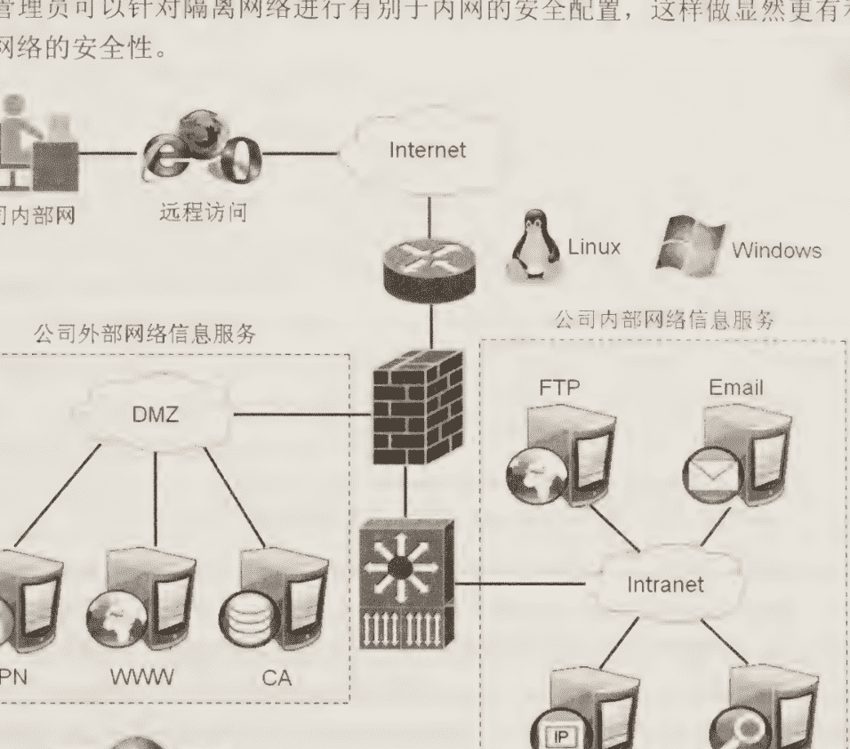

图 1-1 新源网络信息服务项目的网络拓扑结构

为了方便在有限的网络实训条件下模拟项目分公司和角色扮演等方法实施“一体化”课程，使得学生能够学会各种网络服务的配置与管理。作为学习项目，本书将上述网络服务项目的网络拓扑简化如下：

- (1) 不设 DMZ 区域，仍然将 Web 服务器、VPN 服务器、CA 服务器与其他服务器放在同一个网络（即企业内部网络）。
- (2) 配置企业级防火墙和路由器，总部可能通过普通网卡（光猫）接入 Internet。
- (3) 安装 DHCP 服务器、DNS 服务器、Web 服务器、mail 服务器和 CA 服务器。从本项目开始将这几个网络服务器作为一个项目，分别实施其配置与管理。使用 Windows Server 2012 和 Linux 两种服务器的用途及 IP 地址如表 1-1 所示。

表 1-1 新源网络服务器用途及 IP 规划

| 服务器 | 用途 | IP 地址 | 域名 |
| :--- | :--- | :--- | :--- |
| DHCP | 为局域网的工作站分配 IP 地址、网关等 | 192.168.1.1 | |
| DNS | 解析域名 | 192.168.1.1 | dns.xinyuan.com |
| Web | 对外发布新闻、公告、产品信息等 | 192.168.1.2 | www.xinyuan.com |
| FTP | 提供文件传输服务 | 192.168.1.4 | ftp.xinyuan.com |
| E-mail | 提供公司之间交换邮箱的服务 | 192.168.1.3 | mail.xinyuan.com |
| VPN | 提供跨区域网络，实现总部与分公司互通 | 192.168.1.2 | |

## 任务二 部署 Windows Server 2012 R2

### 一、Windows Server 2012 简介

云计算是当前最热门的技术之一，它利用本地或远程服务器（集群）分布式计算机为用户提供计算、存储以及硬件等服务。Windows Server 2012 R2 是微软在 Windows Server 2012 版本基础上升级推出的一种支持云环境的新一代操作系统，它基于 Windows 8.1 界面，提供了企业级解决方案，相比 Windows Server 2008 新增了许多功能，适用于服务器虚拟化、存储、服务器管理、Web 和应用程序、访问与信息保护、数据库结构等。

Windows Server 2012 有标准版和数据中心两个版本，每个在安装时会有两种选择：带有 GUI 图形界面的服务器和服务器内核（Core）。标准版适用于服务器虚拟化要求不高的，数据中心版适用于服务器虚拟化要求高的；带有 GUI 的服务器对熟悉图形操作的用户较为合适，服务器管理方便。

Windows Server 2012 R2 在标准版和数据中心版增加了基础版和精简版两个版本。这些版本的功能、适用场景以及授权许可的价格有所不同。

- (1) 标准版。这是一款企业级服务器操作系统。该版本的服务器功能丰富，几乎可以满足一组服务器的需求，既可用于多种用途，也可用于专机专用。对安全和性能有特殊需求的，还可以减少一些核心功能。
- (2) 数据中心版。这是“重型”虚拟化服务器版本，具有无限虚拟化实例权限，适用于高密度虚拟化环境。
- (3) 基础版。这版本虽然包含了大部分的核心功能，但这些功能会遇到某种限制。例如，Active Directory 服务器角色需要数字证书授权，最大用户数为 15，服务器连接数为 60，路由和域控制器连接数为 10。它支持一个 CPU 封装，若不能作为虚拟机，也不能作为访客虚拟机使用。
- (4) 精简版。这适用于为小型服务器组提供一种有效解决业务的版本，适用于用户少于 25 个、服务器数不超过 50 个的部署。

Windows Server 2012 不提供 32 位或 x86 版本，只提供 64 位版本。因此，在各个服务器配置实施之前，首先要考虑硬件是否支持 64 位。大部分 32 位应用程序可以在 Windows Server 2012 上运行，但不能迁移到另一个物理服务器。与之前的 Windows Server 2008 相比，Windows Server 2012 带来了许多新特性，比如架构的变化、活动目录的变化、虚拟化等。

- (1) 服务器的管理。Windows Server 2012 功能有许多变化，主要包括：①提供了 GUI 兼容性，使得管理员可以轻松切换版本；②在“服务器管理器”窗口中新增了“任务中心”功能，当服务器出现问题时，界面上显示橙色的警示，管理员通过“开始”按钮快速访问。
- (2) 域的管理。活动目录（Active Directory）是构建架构的关键组件，通过活动目录数据库（Directory Database）实现了域内用户的验证。Windows Server 2012 具有以下功能：①可以通过域控制器来提高速度；②可以通过 PowerShell 进行自动化管理；③引入了回收池（Recycle Bin）功能。
- (3) 虚拟化。Windows Server 2012 提供了虚拟机功能，允许在同一台服务器上运行不同的操作系统。

真实使用的服务器，最好不要直接安装系统。

### 2. 新安装 Windows Server 2012 R2

读者对于安装 Windows 操作系统一定不会感到困难，更何况 Windows Server 2012 R2 的安装。之前的操作系统版本本次可能为单机版。此处仅以光盘引导启动操作系统为例，简单说明几个大致的安装步骤，更具体的安装细节将不再提及。

将 Windows Server 2012 R2 的安装光盘插入驱动器并重启启动计算机后，就会直接进入 Windows Server 2012 R2 的安装界面。在选择安装语言为“中文(简体)”、输入产品序列号、选择安装的操作系统版本为 Windows Server 2012 Standard (带有 GUI 的服务器)、接受许可条款、选择“自定义安装”以及配置分区等步骤之后，安装程序就会进入如图 1-2 所示的“正在安装 Windows”界面。

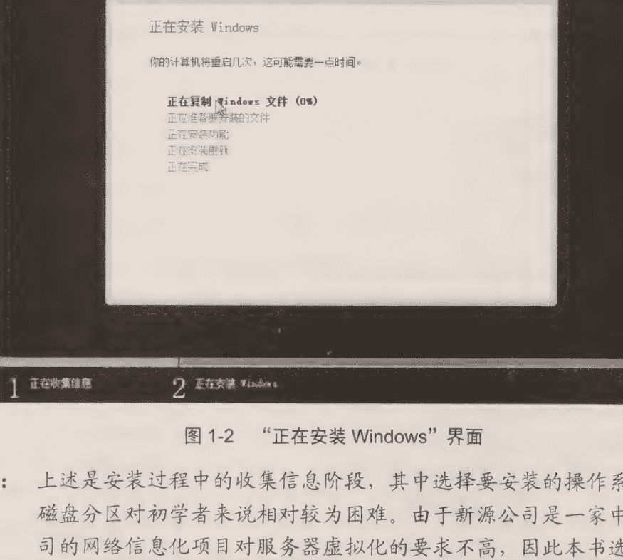

图 1-2 “正在安装 Windows”界面

> 注意：这是安装过程中的各种信息收集，其中选择要安装的操作系统版本和配置磁盘分区对于初学者来说可能较为困难。由于新源公司是一家中小型企业，公网络信息化对服务器的要求并不高，因此本书选择要安装的操作系统版本为“Windows Server 2012 R2 Standard(带有 GUI 的服务器)”，即为有图形界面的标准版本，对于大多数习惯于 Windows 图形操作的用户来说这也比较容易。配置磁盘分区时是需要注意的，对于安装操作划分区域大约需要 60 GB 或更大的可用磁盘分区。

“正在安装 Windows”这一过程将持续较长时间，速度取决于系统配置等因素，通常需要几十分钟。在安装完成后会自动重启计算机，进入登录界面。由于在安装前的步骤中没有设置管理员 (Administrator) 的密码，所以第一次登录时会要求设置管理员密码。成功设置管理员后即可再次登录，显示 Windows Server 2012 R2 的桌面，同时会自动打开“服务器管理器”，图 1-3 所示。

## 项目一 - 网络项目规划与平台部署

图 1-4 “桌面图标设置”对话框


随着 Windows Server 2012 R2 的启动，系统会自动打开一个“服务器管理器”窗口，整合了用于管理绝大多数的功能。该窗口的左侧栏列出了 4 个功能选项，例如“视图”、“本地服务器”和“文件和存储”，这些选项在右侧窗口带有彩色的图标，可以监控角色、服务器和运行状况。

- (1) 视图：通过带有彩色图标的缩略图，可以展开图任意子标题，查看对应的详细信息。例如，服务器管理器检测到 DNS 事件出现错误后，就会自动创建日志并显示为红色，另外视图有助于用户识别和定义服务器关键功能的访问。

- (2) 本地服务器：该设置窗口显示了服务器的相关信息。在 Windows Server 2008 的“初始配置”中，可以配置计算机、时间等设置。在“服务器属性”下还有其他列表，以及用于性能分析的各种工具。

- (3) 所有服务器：该设置窗口中包含的功能可以让多个服务器在控制台上操作，使管理员能够快速管理多个服务器。与“本地服务器”选项类似，该设置窗口同样包含详细信息以及用于性能分析的各种工具。

- (4) 文件和存储：该设置窗口中包含服务器和卷部分。其中服务器部分主要显示当前管理的服务器；卷部分为磁盘和存储，可以查看所有的物理磁盘和虚拟磁盘，还可以查看文件系统的结构。

“服务器管理器”窗口右上角的工具包含了“管理”、“视图”和“帮助”共三个下拉菜单。其中，“管理”菜单包含了添加、删除功能以及相关的服务器、创建组等操作，“工具”菜单中的每个命令可以通过“开始”菜单或“控制面板”打开图标，且两者具有相同的功能，“视图”菜单可以调整整个面板显示大小，“帮助”菜单可以显示帮助。每次启动 Windows Server 2012 R2 都会自动打开“服务器管理器”窗口，Windows Server 2008 也是如此。对于管理员来说确实有方便之处，也会使得服务器启动有所延迟。Windows Server 2008 的“服务器管理器”窗口中有一个“显示控制台”复选框，勾选它就可以取消此窗口的自动启动，但在 Windows Server 2012 R2 的“服务器管理器”窗口中没有这个选项。用户若要关闭自动启动功能，可以选择“管理” -> “服务器属性”对话框，勾选“自动启动服务器管理器”后，如图 1-5 所示，再单击“确定”按钮即可。此后若要重新打开“服务器管理器”窗口，可以选择“开始” -> “服务器管理器”命令；或者在右界面上的“此电脑”点击，在展开的快捷菜单中选择“管理”命令，或者打开“控制面板”窗口后依次选择“系统和安全” -> “管理工具” -> “服务器管理器”选项。


图 1-5 “服务器管理器”窗口中关闭服务器的启动功能

## 4. 安装 Windows Server 2012 R2

目前，有很多企业或机构的服务器运行的是 Windows Server 2008 至 2012 版本的操作系统，并且部署了 DNS、Web、FTP、E-Mail 等各种网络服务器。如果希望在原有的网上部署 Windows Server 2012 R2 而无需重新构建服务器，或者将应用程序迁移到新的硬件，则可以采用升级安装。表 1-3 列出了 Windows Server 2012 R2 支持从现有操作系统升级的版本对应关系。

### 表 1-3 Windows Server 2012 支持从现有操作系统升级的操作系统版本

| 现有操作系统版本 | 升级后的操作系统版本 |
|---|---|
| Windows Server 2008 Standard or Enterprise | Windows Server 2012 R2 Standard or Datacenter |
| Windows Web Server 2008 | Windows Server 2012 R2 |
| Windows Server 2008 Datacenter | Windows Server 2012 R2 |
| Windows Server 2008 R Standard or Enterprise | Windows Server 2012 R2 Standard or Datacenter |
| Windows Web Server 2008 R2 | Windows Server 2012 R2 |
| Windows Server 2002 Datacenter | Windows Server 2012 R2 |

> 注意：在升级安装 Windows Server 2012 R2 时，不能从现有的 x86 版本升级到 x64 版本，反之亦然；也不能从现有的 Windows Server 2003 直接升级，必须先升级到 Windows Server 2008，然后升级到 Windows Server 2012 R2。

## 项目 - 网络服务项目规划与平台部署

服务器池就是当前物理计算机，而不是虚拟机或虚拟硬盘，以保持已选中的“从服务器池选择服务器”单选按钮，此时在“服务器池”列表中就会看到当前物理计算机的名称(XY-WB)(192.168.1.2)以及运行的操作系统，如图 1-17所示。

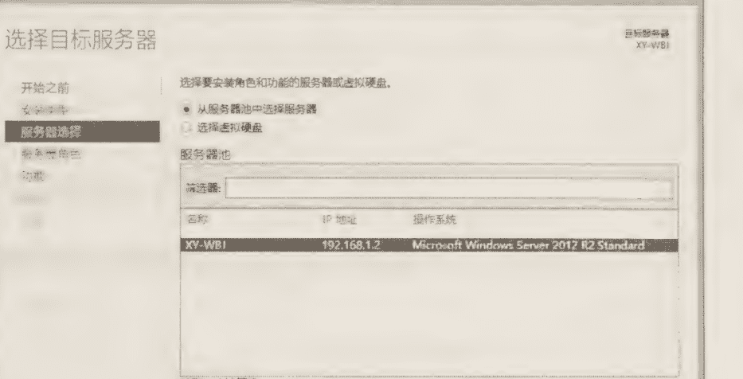

图 1-17“添加角色和功能向导”对话框“选择目标服务器”界面

步骤 5 点击“下一步”按钮，向引导“选择服务器角色”界面。在“角色”列表中显示了 Windows Server 2012 R2 可供选择的多个角色。这里只需勾选“Web 服务器(IIS)”复选框，如图 1-18所示。

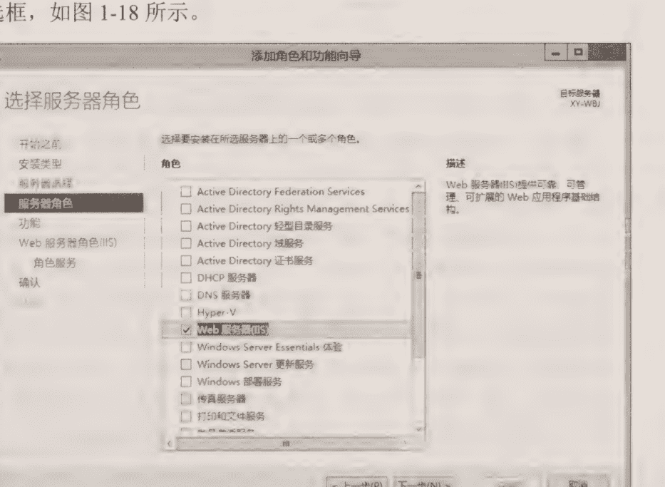

图 1-18“添加角色和功能向导”对话框“选择服务器角色”界面

## 网络服务器部署与管理生命周期(Windows Server 2012+Linux)

注意：根据项目需要，新增公司内 IP 地址为 192.168.1.2 的这台机器不仅充当 Web 服务器角色，还要添加 VPN 服务器和 CA 服务器这两个角色。但这里仅作为实例介绍了 Windows Server 2012 R2 的“服务器管理”角色的方法，可以只选择了“Web 服务器(IIS)”复选框，另外两个服务器角色（对应“网络拓扑和访问服务”和“Active Directory 证书服务”两个角色）的添加将在之后的项目项目中予以实施。

步骤 6 点击“下一步”按钮，向引导至“Web 服务器(IIS)”界面，显示 Web 服务器(IIS)简单注意事项等信息。直接点击“下一步”按钮，将引导至“选择角色”界面以进一步选择包含角色的选项。这些选项分为“Web 服务器”、“FTP 服务器”和“管理工具”共 3 步，选择后，可以根据需要选择角色颜色，如图1-19所示。

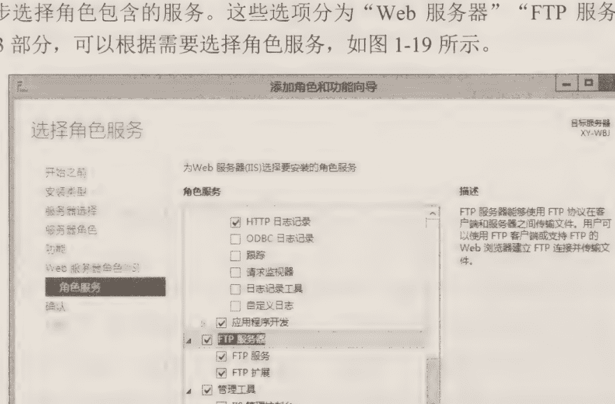

图 1-19“角色和功能向导”中选择“Web 服务器”界面

注意：在“Web 服务器(IIS)”角色中包含的 3 种角色服务器中，“Web 服务器”角色下的“应用程序开发”功能模块包含的选项全部勾选，后续项目设置的 Web站点能够支持 HTML、ASP.NET 等 Web 技术进行扩展；“管理工具”本身提供了一个 IIS 控制台，用于管理对网站站点和 FTP 站点以及应用数据池进行配置部署。虽然新增公司 FTP 站点架设在另一一台 IP 地址为 192.168.1.3 的物理服务器上，但这里说明 FTP 服务器的安装，将“FTP 服务器”角色及其包含的“FTP 服务”和“FTP 扩展”选项也勾选，在项目中无需独立勾选其安装过程。

步骤 7 点击“下一步”按钮，向引导“确认安装所需内容”界面，显示了之前选择的角色与功能，此时原本为灰色且不可用的“安装”按钮变为可用。如果核对后发现错误，可以点击“上一步”按钮回到此步骤重新选择；如果确认无则点击“安装”按钮，向导就会进入“安装设置”界面，几分钟后即可完成安装并进入“安装结果”界面，显示已成功的角色与服务，此时只需单击“关闭”按钮即可。

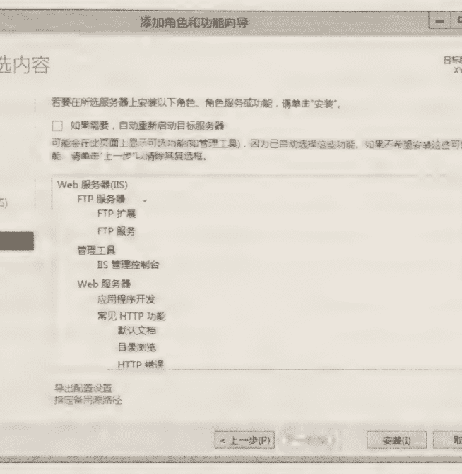

| 选择所需内容 | 如果还没有安装以下角色、功能或组件，请单击“添加”。 |
| :--- | :--- |
| 安装角色 | 如果需要，可以单击在屏幕上方的“添加角色和功能”工具，自行选择需要安装的选项，然后单击“下一步”继续。 |
| 安装功能 | |
| 服务角色和功能 | Web 服务器 |
| | FTP 服务器 |
| | FTP 服务 |
| | FTP |
| | 管理工具 |
| | BS 脚本工具 |
| | Web 管理工具 |
| | 可扩展 HTTP 功能 |
| | 配置工具 |
| | 自定义 |
| | HTTP 连接 |

图 1-20 “添加角色和功能向导”对话框的“确认安装所需内容”界面

> 注意：成功添加 Web 服务器(IIS)角色后，在 Windows Server 2012 R2 的“管理工具”窗口中就会出现一个名称为“Internet Services(IIS)管理器”的图标，在“服务器管理器”窗口的“工具”菜单中也会增加一个相同的名称，用以打开 IIS8 的控制面板。需要注意的是，从用户的权限来说，Windows Server 2012 R2 的“开始”菜单较之前的 Windows Server 2008/2003 在“开始”菜单中包含几乎所有的选项，包括“程序和功能”、“事件查看器”、“系统”、“设备管理器”、“网络连接”、“磁盘管理”、“计算机管理器”、“命令提示”、“任务管理器”、“控制面板”、“搜索”、“运行”、“关机或重启”等，许多操作变得更加快捷，比之前在配置 TCP/IP 参数连接后，直接右击“开始”按钮，弹出的快捷菜单选择“网络连接”命令来打开“网络连接”窗口则方便多了。

## 项目 - 网络服务项目规划与平台部署

### 1. Linux 的起源与发展

20 世纪 70 年代末，诞生于实验室环境的 UNIX 操作系统的源代码。那个时期我们享受着科学探索、创新活动带来的激情。互联网的基础 TCP/IP 就产生于那个时代。

1979 年，AT&T 宣布了 UNIX 的商业化。随之出现了第二代机制，建立了一个基于微内核的版本，这种做法使得软件的发展；另一方面封闭模式阻碍了软件的进步，为人类发展带来了巨大的代价。

1984 年，理·斯曼（Richard Stallman）为了保护开源程序不再受到限制，创建了自由软件基金（Free Software Foundation），规定了一项许可证，称为 GPL。

1991 年，芬兰的学生林纳·托瓦尔兹（Linus Torvalds）发布了一个内核，名为 Linux。他的希望是让一个在 x86 架构上能够运行的 操作系统完全是一个简单的事情，但意料的是开源的出现，让广大开发者陷入了喜爱，增加了一个功能丰富的操作系统。在此 Stallman 和 Torvalds 等人的努力下，理念引发文化的变革。

1994 年 3 月，Linux内核发布，这也是第一个用 GPL 许可证发布的商业版。

1995 年，红帽（Red Hat）公司以 Linux 为核心，创建了多个开源发行版在市场上是成功的。Bob Young 说：“我们不需要专有技术，卖的是方便用户支持和服务”。

1996 年，美国国家标准实验室由 Linux 版本获得了 POSIX 标准认证，由 Eric Raymond 为一批源代码运动，Linux内核并非全球性的，但市场是竞争的领域，因此办起了“复兴”的大旗。IBM 和 Intel 作为全球性重要 产品，进一步推进了基于源代码模式的 Linux 兴起。可以说，Linux 是诞生于实验室、成长为成为网络的操作系统，没有 Linux 不是一个人，而是由全世界程序员协助实现的。

### 2. Linux 的特点

目前 Linux 已成为主流操作系统之一。Linux 操作系统之所以在短期内就发现了漏洞和不完善，是因为它具有良好的特性。Linux 可以支持多用户、多任务环境，具有良好的实用性和广泛的访问。Linux 操作系统在服务器、嵌入式系统等方面取得了长足的发展，在系统稳定性和移植性方面也有表现，并在个人操作系统方面有着广阔的应用范围。这主要归于它的特性。Linux 广泛应用于 x86、Sun Digital、Alpha、MIPS、PowerPC 等平台。

相对于 Windows 和其他操作系统，Linux操作系统之所以极其简单、功能强大、性能稳定且具有可靠性和安全性，其主要特点可以归纳为以下方面：

(1) 开放性。遵循 POSIX(OS) 国际标准。发布的软件和硬件能够兼容，方便部署。

(2) 多用户。资源可以不同用户访问，每个用户对自己的设备、资源具有特定的权限互不影响。

(3) 多任务。任务是指计算机同时执行多个程序，并且每个程序运行独立的。Linux 系统调度器提供了一个平台，CPU 处理速度非常快，从一个正在运行程序到另一个程序只有短时间，使得用户感觉不到延迟，宏观上看有很多程序并行运行。

(4) 良好的界面。Linux 为用户提供了两种界面，其中 Shell 界面是字符界面，用户可以将命令组合在一起；图形界面具有可视化、交互性，用户可以使用鼠标、窗口、滚动条等设施进行方便的操作。

(5) 设备独立性（或设备无关性）。Linux操作系统把所有的外部设备都当成文件来看，只要安装了外部设备的驱动，任何用户都可以像文件一样操作。

(6) 完善的内核。Linux的配置和网络功能优于其他操作系统，具有灵活性。强大的功能主要体现在三个方面：

(1) 支持 Internet。Linux为用户提供了强大的支持，用户可以用轻松实现网络浏览。

(2) 文件传输。用户可以通过 Linux 命令完成内部交互。

(3) 远程登录。Linux允许用户登录内核和程序的执行，系统管理员和用户能够有效地管理多个系统。

(7) 安全系统。Linux内核采取了权限控制、保护内核、审计跟踪等多种安全技术，为环境中的用户提供了保障。

(8) 移植性。移植性是指内核从一个平台迁移到另一个平台后仍然按照自己的方式运行。Linux的内核可以移植到不同的平台，如 x86、SPARC 和 Alpha 等处理器，不同内核之间可以通过准确的通信，无需增加特殊接口，可以运行在电脑、手机或游戏机上。Linux 2.4 内核已经完全支持 Intel 64 位架构，并支持多处理器架构，使其性能大大提高。

### 3. Linux 的内核

Linux的内核并非全球性的，而是由全世界程序员协助实现的。在 3.0 版本之前，time-based 编号方式使用了 A.B.C：

- (1) 用于 1.0 的版本号。

- (2) 用于 2.6 的版本号，其中 A 代表主版本，B 代表小版本，C 为偶数表示稳定，若为奇数表示测试版本。

- (3) 用于 2.2 的版本，D 代表了一些 Bug 的修复。

- (4) 从 2011 年 7 月发布的版本以后，time-based 编号采用了“A.B.C”的格式，前两个数字 A B 在 2.6 发布后多年不变。

## 服务器配置与运维管理教程(Windows Server 2012+Linux)

如此，Red Hat 公司也遵循这个协议，将软件通过二进制制和源代码化两种方式进行发布。这样，就是遵循 GPL 协议，任何人都可以在原有 RHEL 的源代码基础上再开发发布。其中，CentOS(Community Enterprise Repository)就是对 RHEL 的源代码重新编译一次，形成一个可使用的二进制版本，或者是由 RHEL 克隆的一个 Linux发行版。这种策略是合法的，但 Red Hat 在新的发行版里对这种发行状态的态度是：“我们其实并不反对这种发行，正面付费的客户，他们重视并不是系统本身，而是我们所提供的商业服务。”因此，CentOS 得到了 RHEL 的所有权利以获得更好的更新。CentOS 并不提供商业支持，当然不能负责任何责任。其实，RHEL 的克隆不是唯一的。

由于 Linux 发行版非常多，很多人会为了使用 Linux发行版而如此犹豫，这里有几点建议，供读者参考：

- (1) Linux 服务器系统的选择。如果你不需要 RHEL 的升级服务，而且有足够的 Linux 经验，RHEL 的商业技术支持对你来说也不重要，那么你可以使用 CentOS 服务器。CentOS 只需要通过简单的配置就能提供非常稳定的服务器。现在有许多企业已经应用了 CentOS，建议企业签署使用 CentOS MANIFEST，但是对于业务型的企业来说，还是建议使用 RHEL 购买相应的服务，这样可以节省 IT 管理费用，并可以获得特殊的服务。因此，使用 CentOS 是 RHEL 决定的你是否拥有足够的技术力的关键。当然，如果你需要一个可靠的、非常稳定的服务器，那么建议你使用 FreeBSD；如果你只需要一个特定的服务器，而且还想熟悉一套 Linux 的各个方面的知识，并想自己定制许多内容，那么推荐你使用 Gentoo。

- (2) Linux 系统的选择。如果你只需要一个服务器，而且不想使用虚拟机发行版，也不想花钱购买商业软件，也不想对设置任何事情，在 Linux 玩家非常多的时候，自己变得更高效，那么可以根据自己的喜好在 Ubuntu、Kubuntu 和 Xubuntu 中选择一个，这三者之间的区别仅仅是程序的不同。如果你想在本地化的 Linux 系统里让自己的电脑更高效，你也不在 Linux 安装方面花费精力时间，那么你可以使用 Gentoo。然而，如果你是初学者 Linux 服务器，希望通过简单配置就能提供非常稳定的服务器，也可以使用 CentOS。

除上述建议外，实际上你还应该考虑 Linux 的内核版本，最新的 Linux 发行版已经更新到 3.x 甚至 4.x 内核版本。另外，一个典型的 Linux 发行版还包括许多程序和工具，如命令行 Shell、图形界面的 X 服务器和相应的桌面环境（如 KDE、GNOME 等），并包含许多办公套件、编辑器、文本编辑器、科学工具等桌面应用程序，所以在实际选用时还需要考虑你所需要的系统和应用环境多种因素。

## 二、安装 Linux


Linux 一般已经提供了硬件、CD-ROM 和硬盘驱动器等多种安装方式。其中，将 U 制作成 Linux 安装盘，然后设置计算机从 U 启动来安装 Linux，是目前较为方便、快速的一种安装方式。因此，在安装之前首先准备好 Linux 安装盘，然后根据需要确定将 Linux 安装到物理机上的位置，并收集有关信息。

## 1 将 Linux 安装到计算机的方式

根据用户的需求，通常可以选择以下 3 种方式将 Linux 安装系统到计算机。

- (1) 安装 Linux 虚拟机。对于 Linux 初学者来说，如果你的计算机上已经安装了 Windows 系统，安装 Linux 只是为了学习，不想从现有分区中划分出专门的空间来供 Linux 使用，而且你的计算机配置（主要是运行速度和内存容量）很高，可以用 Linux 安装为虚拟机。这种方式安装 Linux 的过程比较快，也无须对现有系统的影响极其其微，但在 Windows 系统中先创建好虚拟机（如 VMware、Virtual PC 等），然后添加创建一个新的虚拟机。

- (2) 安装 Linux 和 Windows 双系统。如果你的计算机上已安装了 Windows，而硬盘的剩余足够，也不用做比较复杂的硬盘分区。如果不想删除正在使用的 Windows 系统，则可以与 Linux 安装在同一个分区共用。如果采用这种方式，通常的做法是先将硬盘最后一个逻辑分区的数据进行备份；然后通过“计算机”—“管理”—“磁盘管理”，扩展，将已备份的逻辑分区删除；然后将该硬盘分区中划分的逻辑分区从空分区中扩展出来，之后还需要使用分区工具（PQMagic）调整该逻辑分区的范围，成为未划分的区域，这样才能重启并安装 Linux 时划分为 Linux 的分区使用。

- (3) 安装 Linux 单系统。不管你的计算机上是否已经安装过操作系统，你只想把计算机安装为 Linux 单系统来（通常在服务器上只需安装单系统），那就简单了，你只需要从计算机安装 Linux 系统后，在安装的过程中对整个硬盘划分 Linux 分区即可。至于分区区域如何划分，稍后会介绍。

## 2 收集和准备 Linux 系统信息

在 Linux 安装过程中，需要尝试探测程序，若无法准确确认硬件设备，则必须输入相应的信息。

- (1) 硬件的大小和数量。
- (2) 内存的大小，内存的大小直接影响系统的性能。
- (3) 光驱的型号和接口类型。目前上的光驱主要是 SCSI 和 SATA 两种。
- (4) 鼠标的类型（PS2、USB 或 COM）。品牌、型号。
- (5) 显卡的型号，最好能够知道自己显示卡的芯片型号和显存的大小。
- (6) 显示器的型号、规格。如果不确定则应该准备好启动程序。
- (7) 所使用的网卡是否支持。
- (8) 网络配置，包括 IP 地址、子网掩码、默认网关和 DNS。

## 3 从 Linux 安装系统

在完成上述工作之后，将计算机设置为引导盘，然后计算机就可以开始 Linux 安装。由于大多数 Linux 发行版采用了图形化向导，安装过程变得简单，但对于详细教程来说，我们将以 CentOS 6.5 为例，介绍 Linux 安装中的关键步骤和涉及概念。

## 服务器配置与运维管理教程（Windows Server 2012+Linux）

如此，Red Hat 公司也遵循这个协议，将软件通过二进制制和源代码化两种方式进行发布。这样，就是遵循 GPL 协议，任何人都可以在原有 RHEL 的源代码基础上再开发发布。其中，CentOS（Community Enterprise Repository）就是对 RHEL 的源代码重新编译一次，形成一个可使用的二进制版本，或者是由 RHEL 克隆的一个 Linux 发行版。这种策略是合法的，但 Red Hat 在新的发行版里这种发行状态的态度是：“我们其实并不反对这种发行，正面付费的客户，他们重视并不是系统本身，而是我们所提供的商业服务。”因此，CentOS 得到了 RHEL 的所有权利以获得更好的更新。CentOS 并不提供商业支持，当然不能负责任何责任。其实，RHEL 的克隆不是唯一的。

由于 Linux 发行版非常多，很多人会为了使用 Linux 发行版而如此犹豫，这里有几点建议，供读者参考：

- (1) Linux 服务器系统的选择。如果你不需要 RHEL 的升级服务，而且有足够的 Linux 经验，RHEL 的商业技术支持对你来说也不重要，那么你可以使用 CentOS 服务器。CentOS 只需要通过简单的配置就能提供非常稳定的服务器。现在有许多企业已经应用了 CentOS，建议企业签署使用 CentOS MANIFEST，但是对于业务型的企业来说，还是建议使用 RHEL 购买相应的服务，这样可以节省 IT 管理费用，并可以获得特殊的服务。因此，使用 CentOS 是 RHEL 决定的你是否拥有足够的技术力的关键。当然，如果你需要一个可靠的、非常稳定的服务器，那么建议你使用 FreeBSD；如果你只需要一个特定的服务器，而且还想熟悉一套 Linux 的各个方面的知识，并想自己定制许多内容，那么推荐你使用 Gentoo。

- (2) Linux 系统的选择。如果你只需要一个服务器，而且不想使用虚拟机发行版，也不想花钱购买商业软件，也不想对设置任何事情，在 Linux 玩家非常多的时候，自己变得更高效，那么可以根据自己的喜好在 Ubuntu、Kubuntu 和 Xubuntu 中选择一个，这三者之间的区别仅仅是程序的不同。如果你想在本地化的 Linux 系统里让自己的电脑更高效，你也不在 Linux 安装方面花费精力时间，那么你可以使用 Gentoo。然而，如果你是初学者 Linux 服务器，希望通过简单配置就能提供非常稳定的服务器，也可以使用 CentOS。

除上述建议外，实际上你还应该考虑 Linux 的内核版本，最新的 Linux 发行版已经更新到 3.x 甚至 4.x 内核版本。另外，一个典型的 Linux 发行版还包括许多程序和工具，如命令行 Shell、图形界面的 X 服务器和相应的桌面环境（如 KDE、GNOME 等），并包含许多办公套件、编辑器、文本编辑器、科学工具等桌面应用程序，所以在实际选用时还需要考虑你所需要的系统和应用环境多种因素。

## 二、安装 Linux

Linux 一般已经提供了硬件、CD-ROM 和硬盘驱动器等多种安装方式。其中，将 U 制作成 Linux 安装盘，然后设置计算机从 U 启动来安装 Linux，是目前较为方便、快速的一种安装方式。因此，在安装之前首先准备好 Linux 安装盘，然后根据需要确定将 Linux 安装到物理机上的位置，并收集信息。

### 1 将 Linux 安装到计算机的方式

根据用户的需求，通常可以选择以下 3 种方式将 Linux 安装系统到计算机。

- (1) 安装 Linux 虚拟机。对于 Linux 初学者来说，如果你的计算机上已经安装了 Windows 系统，安装 Linux 只是为了学习，不想从现有分区中划分出专门的空间来供 Linux 使用，而且你的计算机配置（主要是运行速度和内存容量）很高，可以用 Linux 安装为虚拟机。这种方式安装 Linux 的过程比较快，也无须对现有系统的影响极其其微，但在 Windows 系统中先创建好虚拟机（如 VMware、Virtual PC 等），然后添加创建一个新的虚拟机。

- (2) 安装 Linux 和 Windows 双系统。如果你的计算机上已安装了 Windows，而硬盘的剩余足够，也不用做比较复杂的硬盘分区。如果不想删除正在使用的 Windows 系统，则可以与 Linux 安装在同一个分区共用。如果采用这种方式，通常的做法是先将硬盘最后一个逻辑分区的数据进行备份；然后通过“计算机”—“管理”—“磁盘管理”，扩展，将已备份的逻辑分区删除；然后将该硬盘分区中划分的逻辑分区从空分区中扩展出来，之后还需要使用分区工具（PQMagic）调整该逻辑分区的范围，成为未划分的区域，这样才能重启并安装 Linux 时划分为 Linux 的分区使用。

- (3) 安装 Linux 单系统。不管你的计算机上是否已经安装过操作系统，你只想把计算机安装为 Linux 单系统来（通常在服务器上只需安装单系统），那就简单了，你只需要从计算机安装 Linux 系统后，在安装的过程中对整个硬盘划分 Linux 分区即可。至于分区区域如何划分，稍后会介绍。

### 2 收集和准备 Linux 系统信息

在 Linux 安装过程中，需要尝试探测程序，若无法准确确认硬件设备，则必须输入相应的信息。

- (1) 硬件的大小和数量。
- (2) 内存的大小，内存的大小直接影响系统的性能。
- (3) 光驱的型号和接口类型。目前上的光驱主要是 SCSI 和 SATA 两种。
- (4) 鼠标的类型（PS2、USB 或 COM）。品牌、型号。
- (5) 显卡的型号，最好能够知道自己显示卡的芯片型号和显存的大小。
- (6) 显示器的型号、规格。如果不确定则应该准备好启动程序。
- (7) 所使用的网卡是否支持。
- (8) 网络配置，包括 IP 地址、子网掩码、默认网关和 DNS。

### 3 从 Linux 安装系统

在完成上述工作之后，将计算机设置为引导盘，然后计算机就可以开始 Linux 安装。由于大多数 Linux 发行版采用了图形化向导，安装过程变得简单，但对于详细教程来说，我们将以 CentOS 6.5 为例，介绍 Linux 安装中的关键步骤和涉及概念。

## 网络配置与管理教程（Windows Server 2012+Linux）

在 RHEL/CentOS 安装过程中会有不同的布局，无论采用哪种方式将 CentOS 6.5 安装到计算机，都会出现五个界面（此处为逻辑说明）：

- (1) Install or upgrade existing system // 安装或升级系统
- (2) Install system with basic driver // 安装基础驱动
- (3) Rescue system // 进入修复模式
- (4) Boot from local drive // 从硬盘启动
- (5) Memory test // 内存检测

通常只需要选择第一个菜单，就可以进入图形化的向导。在确认是否安装（一般不需要点击按钮），选择语言、计算机名称（如 localhost）、设置区域和用户（如 root）后，向导进入安装布局，对分区进行设置。

### 4 根据实际需求布局

安装向导界面所示。一般来说，如果直接将计算机安装单系统或者虚拟机上安装，可以选择“使用所有空间”；如果已经安装了 Windows 并且硬盘上有空间，可以选择“使用剩余空间”；如果想在原有系统上安装新的系统，可以选择“替换现有系统”。CentOS 会按照默认分区进行默认情况下，CentOS 在磁盘空间分为两个部分：一个是标记为“/”的根分区，这是 Linux 文件系统的位置（类似于 Windows 系统使用的 C），文件类型为 ext4；另一个是挂载为 swap 的交换分区，用于实现虚拟内存的存储，文件类型为 swap。

**注意：** 从普通用户来说，Linux 文件系统与 Windows 有很大差别。严格来说，Linux 系统中没有“根”的概念，整个存储系统只有一个根（/），而所有分区都是独立的（挂载点）。交换区（swap）是一个较为的概念，许多现代操作系统通过硬件实现的“虚拟内存”原理，swap 空间的设计对于 Linux 服务器，特别是 Web 服务器来说至关重要，也是让 Linux 系统中的交换空间提供一个简单的接口。虚拟内存的本质上打破了物理内存的限制，使得操作比内存更大的空间。swap 空间的作用是：当系统内存中的空间用尽的时候，就需要释放当前使用的程序，这些被释放的可能长时间没有操作的数据会被临时存到 swap 空间，当系统内存需要时再从 swap 空间中。

并不是所有内存中交换的数据都会放入 swap 空间，有一部分数据直接连接到文件系统。例如，当程序打开一个文件，写入时，每个程序至少写一个文件，数据本身是缓存，通常会缓存这些写入操作，就需要将数据刷到 swap 空间中，可以直接写入文件里。如果是读取文件，数据从内存直接读取而无需输出。因为可能从文件系统读取：但是，那些 malloc 和 new 产生的数据遵循规则，它们需要 swap 空间，因为它们在文件系统中没有相应的“备份”文件，所以被称为“匿名（anonymous）内存”。这些数据还包括缓存中的和变量等，可以说 swap 空间是“匿名”数据的交换空间。

**注意：** 在 Windows 系统中，你可以在任何硬盘上指定大小的交换空间作为虚拟内存；在 Linux 系统中通过虚拟内存交换空间来指定一个特殊的区域，即 swap 分区，这在 Linux 安装时需要增大，通常根据需要设置为物理内存容量的 1~2 倍。

对于 Linux 有经验的用户，往往选择“创建自定义布局”选项，进入分区的界面创建自己的分区方案。默认创建的根分区（/）和交换分区（swap）外，还会创建一个 boot 分用于存放 Linux 所需的文件，其挂载点为 /boot，文件类型为 ext4，磁盘空间设置为 200MB 就足够。用户还可以创建一些用户分区，其大小、挂载点根据需要来设置。

### 5 选择安装类型及软件

安装向导界面所示。首先，对安装系统的 8 种类型进行选择（默认为）：

- (1) Desktop: 桌面系统，包括常用的桌面。
- (2) Minimal Desktop: 最小桌面系统。
- (3) Minimal: 系统，不包含可选软件包。
- (4) Basic Server: 基础系统的支持。
- (5) Database Server: 基础系统，加上数据库客户端，不包含桌面。
- (6) Web Server: 基础系统，加上 Web Server 和数据库客户端，不包含桌面。
- (7) Virtual Host: 基础系统的虚拟化平台。
- (8) Software Development Workstation: 包含较多的基础系统、桌面环境、开发工具等。

然后选中“自定义”后点击“下一步”按钮，用户根据需要进一步定制要安装的软件。

## 三、Linux 的引导过程及其原理

### 1 安装于 Linux 的引导系统

一台 x86 计算机连接电源后，BIOS（Basic Input Output System），系统首先进行自检（Power On Self Test, POST），然后包含日期、时间、引导顺序。BIOS 查找引导设备，找到主引导记录（MBR）中的引导程序。此时，BIOS 调的是主引导代码读入内存，然后执行 GRUB 代码，引导过程：BIOS→GRUB→Kernel。

分，此可以引导并压缩内核的其他部分，初始化内核和设备启动程序；在内核执行 `/sbin/init` 程序后，生成系统的第一个进程，即 init 程序，按照引导文件 `/etc/initab` 执行的脚本进行系统初始化时，要设置内核和模块设置等。

(3) `/etc/rc.d/sysinit` 及 `/etc/rc.d` 根据 `/etc/initab` 指出的缺运行级别（如 init=3）运行 init 程序后，将运行 `/etc/rc.d/sysinit`，执行交换函数、检查并加载文件系统、内核模块等基于系统的初始化命令。此时，系统启动进入运行模式 3 之后，以后所有以“S”开头的文件将被依次执行；系统关闭，离开运行模式 3 之后，所有以“K”开头的文件将被依次执行。

注意：`/etc/rc.d/init` 决定了进入 0~6 个运行级别所需的执行脚本，每个运行级别所需执行的链接文件是以符号开头的，分别存放在 `/etc/rc.d/rc0`~`/etc/rc.d/rc6` 目录下。这些链接文件均指向 `/etc/rc.d/init` 运行级别下的操作参数。有关引导配置文件 `/etc/initab` 和运行级系统（系统状态）的概念可能留待后予以详细介绍。

(4) `/etc/rc.d/local` 及 `/etc/rc.d/serial` 程序。等待 `/etc/rc.d/serial` 程序执行之后，将会运行以下两个脚本：

- `rc.local` 脚本，在运行级别 2 和 5 之后运行一次，用户可以使用需要在引导时运行一次的程序加到该文件中。
- `rc.serial` 脚本，在运行级别 1 和 3 之后运行一次，初始化串口端口。

(5) 用户登录。在虚拟终端登录后执行 `/etc/getty`，等待用户登录。Linux 启动结束。引导成功后系统将接控制用户，用户可以使用以下 3 方法查看引导信息：

- 使用 Shift+PgUp 组合快捷键查看
- 使用任何命令 `dmesg` 消息来查看
- 查询 `/var/log/messages` 文件内容。

## 2 Linux 引导过程中的自定义

从 Linux 的引导过程中，用户可以对配置或预设的内容有以下 3 个方面：

(1) 设置引导 GRUB 的菜单。包括引导的菜单选项（通常是操作系统的菜单）、名称、以及引导的操作选项和内核扩展。

(2) 设置默认运行级别（系统状态）。在内核初始化后开始执行 `/sbin/init` 程序，它根据 `/etc/initab` 指定的级别来进行初始化，可以通过设置启动时的默认运行级别。

(3) 设置系统启动自动运行的程序。在用户登录之前还会执行 `/etc/rc.d/rc.local` 脚本，如果用户需要某些系统启动自动运行的程序，则可以添加到该文件中。

以下要介绍引导两个方面的配置方法，即设置引导 GRUB 的菜单和系统默认运行级别（系统状态）的方法。在此之前，我们将先了解 GRUB 及其设备命名方法。

## 3 引导 GRUB 及其命名命令

GRUB 是一个 LILO 更新、功能更强大的引导程序，也称重启管理器，专门用于处理 Linux 与其他操作系统共存的问题。GRUB 可以引导的操作系统有 Linux、Windows、Solaris、FreeBSD 和 NetBSD，其优势在于能够支持大内核、开机界面和兼容性选择，并且在分区位置改变时不重新配置，使用非常方便。新的 Linux 发行版大多使用 GRUB 作为引导的程序。

GRUB 有三种引导方法：直接引导操作系统内核、通过加载进行引导和通过网络引导 Linux。对于 GRUB 能够引导 Linux、FreeBSD 和 GMUX 但对于 GRUB 不能直接操作操作系统，则需要第二种方法加载完成。

使用 GRUB 时，建议命名格式为（设备号.分区号），其中：


(1) 设备的开头用小写字母表示类别，如`hd`表示 IDE 硬盘，`sd`表示 SCSI 硬盘，`fd`表示磁盘，IDE 和 SCSI 与软硬盘的命名方式相同；紧跟在其后再用一个数字依照 BIOS 顺序对类设备的编号（从0开始），如`hd0`表示第一块 IDE 硬盘，`sd1`表示第二块 SCSI 硬盘。

(2) 分区号表示起始分区，从0开始编号。例如：`(hd0,0)`第一块 IDE 硬盘的第一个分区；`(sd1,2)`第二块 SCSI 硬盘的第三个分区。

> 注意：在 Linux 内部内核名中，每个设备都被映射到一个系统设备名，这些设备也以设备名命名，存在于`/dev`目录下。存储硬件的设备名与 GRUB 中的命名方式有如下不同：命名格式不使用逗号，也不用逗号隔开，而是直接将设备和分区号在一起；紧跟在设备列表后面的数字表示类设备的编号；分区号从0开始，是从1开始，一个物理硬盘最多为四个主分区或扩展分区，用编号1~4表示，或5以后的编号表示逻辑分区（或是扩展分区内划分的逻辑分区），例如：设备文件`/dev/hd1`表示第一个 IDE 硬盘；设备文件`/dev/sd7`表示第二个 SCSI 硬盘的第三个逻辑分区。

## 4 设置 GRUB 引导菜单

从 Linux 的引导过程可知，如果 GRUB 安装在 MBR 中，计算机启动后就可以直接进入 GRUB 的引导菜单。如果要安装的是 Linux 和 Windows 双系统，则 GRUB 就会显示两个菜单项供用户选择操作操作系统。当屏幕上出现 GRUB 的菜单时，如果用户在延迟的时间内没有按接键盘，就会默认选择操作操作系统。

这里安装了 Windows 7 和 CentOS 6.5 的双系统，通过修改 GRUB 的配置文件修改菜单项名称、默认操作系统和延迟时间。使用 vi/vim 编辑器打开`/boot/grub/grub.cfg`。

```bash
[root@localhost]# vi /boot/grub/grub.cfg
# grub.cfg generated by anaconda
# Note that you do not have to rerun grub after changes to this file
# NOTICE: You have a /boot partition. This means that
# all kernel and initrd are located in /boot/
# root (hd0,0)
```

```bash
# kernel vmlinuz-version root=/dev/mapper/VolGroup-root boot=/sda
initrd/initrd-[generic]-img default=0
timeout=5 ## 设置超时时间为 5s
splash=(hd0,0)/grub/splash.gz ## 开机文件路径和名称
hiddenmenu ## 隐藏 GRUB菜单
title CentOS 6.5 (2.6.32-244.el.x86) ## 菜单上显示的选项
root (hd0,6) ## 第一个硬盘7个分区
kernel vmlinuz-2.6.32-244.el.x86 root=UUID=... KEYBOARDTYPE=pc lang=UTF-8 rd.quiet
initrd/initramfs
title Windows 7 第一个硬盘1个分区
root (hd0,0) 安装一个分区并交给它
```

两个字符定义了 GRUB菜单中的项名称，按照先后顺序为0和1。如果在安装 Linux 时没有修改默认操作系统，菜单项通常是 Other。为了让菜单更直观、清晰，这里可以用`default=0`和`timeout=5`。

> 注意：首次使用 Linux 并尝试运行后，可能不会显示 GRUB菜单，因为“hiddenmenu”选项认为是有效的。另外，老的 Red Hat、CentOS 等版本使用的是 grub-1.x 版本，而 CentOS7 及以后（包括新版本的 RHEL）使用的是 grub-2.x 版本，虽然 grub-1提供了更多功能，但配置文件位于`/boot/grub`。

## 5 设置运行级别

Linux 把系统关闭、重启、多用户模式、字符界面、图形界面等处于不同的状态，或者被赋予了不同的运行级别（runlevel），这是 Linux 系统的设计的一个概念。初始化程序使用的 Red Hat 包括 CentOS 的运行级别为0-6，每运行级别及其含义如表1所示。

表 1 运行级别及其含义

| 运行级别 | 含义 |
| :--- | :--- |
| 0 | halt，完全关闭系统 |
| 1 | 单用户模式，设置为最小配置，只允许超级用户访问 |
| 2 | 多用户模式，不支持 FTP、连接网络 |
| 3 | 完全多用户模式，允许网络 |
| 4 | 未使用 |
| 5 | 图形模式，启动图形界面 |
| 6 | reboot，重启系统 |

从 Linux 系统的引导过程中可以看出，程序根据`/etc/init`文件中的运行级别初始化系统。也就是说，Linux 启动后字符界面还是图形界面是由`/etc/init`文件指定的。以下是 CentOS6.5 使用编辑器打开的`/etc/init`。

```bash
[root@localhost ~]# vim /etc/init
# init is only used for the default runlevel
# ADDING OTHER CONFIGURATION HERE WILL HAVE NO EFFECT ON YOUR SYSTEM.
# System initialization is started by /etc/rc
# Individual runlevels are started by /etc/rc.conf
# Ctrl-Alt-Delete is handled by /etc/control-alt-delete.conf
# Terminal getty is handled by /etc/tty.conf and /etc/serial.conf
# with configuration in /etc/sysconfig/init.
# For information on how to write event handlers, or how
# upstart works, see init(5), init(8), and initctl(1).
# Default runlevel. The runlevels used are:
# 0 - halt (Do not set default to this)
# 1 - Single user mode
# 2 - Multiuser, without NFS (The same as 3, if you not have networking)
# 3 - Full multiuser mode
# 4 - unused
# 5 - X1
# 6 - reboot (Do not set default to this)
id:3:initdefault]#
```

`/etc/init`文件的配置通常包括4个字段：`runlevel:action:command`，每个字段之间用冒号间隔，其功能说明如下：使用单个或两个字符序列作为行为的标识，在该文件中具有唯一性，并且某些标识必须使用特定的标识才能正常工作。

- (1) id: 配置标识。
- (2) runlevels: 运行级别。指定该运行记录针对哪个运行级别（或系统状态）。
- (3) action：动作：即在某一运行级别下执行命令动作的方式，方式有`initdefault`, `respawn`, `wait`, `once`, `boot`, `bootsw`, `systemd`, `systempower`, `powerkokit`, `kbootreq`等。
- (4) command: 给相应配置行安排确定动作执行的命令。

## 项目 - 网络服务项目规划与计划表

命令的各个部分之间必须由一个或多个字符用 Tab 隔开。其中，选项字母从一个字母后跟着一个字母，使命令具有特殊的功能。有时候命令需要多个字母，可以用一个字符(-)后多个字母连起来。例如，命令`ls -a`直接输入`ls -la`，它们都是可以的。

在 Linux 中使用命令可以帮助你实现 Shell 的许多功能，如果用户能很好地掌握这些功能并用技巧地使用它们，就可以极大地提高命令的效率和速度。下面列若干常用的命令输入技巧(前两种较为常用)。

(1) 轻击快捷键查找已执行过的命令。当需要重复执行执行过的命令，或者对其进行少量修改后再执行，这样就可以通过向下键来查找此前执行的命令，或输入命令字母后按 Ctrl+R 组合键“快速查找找到此前执行的命令（重复 Ctrl+R 组合键在配置好的快捷列表中查找命令）。

(2) 命令和文件的命名。用户平时不需要记住命令或文件名的，或名字较长，每个字母全名的输入非常麻烦，又容易出错，这种情况下使用命令和文件全名的查找功能，可以极大地提高命令输入的效率和速度。这时在输入命令名或命令中查询某个目录或文件名时，只需输入前几个字母后 Tab 键，系统就会自动配齐你查找的命令开头，或者在指定的路径下搜索输入字母开头的文件名，或匹配到任意自动补全，或者匹配到多个显示列表让用户选择一个。通过这个来说，这个功能就能一目了然。

```
root@localhost ~ # cd /home
root@localhost ~ # cd /usr/src
root@localhost ~ # cd /usr/src/kernel
root@localhost ~ # cd /usr/src/kernels/<Tab>
root@localhost kernels> # cd
```

> // 自动创建 cd /usr/
> 扩展成 cd /usr/src/
> 扩展 cd /usr/src/kernel/
> 执行后改变了当前目录

```
root@localhost ~ # mkdir
mkdikt mkdhirir mkdosfiles mkdumndir
mkdir
root@localhost ~ # rpm -ivh thisisaample
root@localhost ~ # rpm -ivh thisisaample=5.6.7-1686.rpm
root@localhost ~ 
```

> // 此时会列出所有 mkd 的命令
> 从再列表中选择一个输入完成
> 自动配齐到此时可见的 RPM 软件

(3) 常用的命令行快捷键。主要有：光标移动到命令开头 Ctrl+A、光标移动到命令结尾 Ctrl+E、删除光标所在字符 Ctrl+U、删除光标位置到行尾的所有字符 Ctrl+K、粘贴被删除的命令 Ctrl+Y 等。

(4) 使用命令别名。如果需要频繁使用相同的某些命令，可以为整个命令创建一个别名，之后就可以用别名输入该命令了。例如：

```
alias ls='ls -l'
alias cp='cp -i'
alias ls='ls -d --color=auto'
```

> // 此后会自动使用 ls -l 替代
> 专门用于列出列表中已定义的命令别名

```
alias ls='ls --color=auto'
alias la='ls -l'
alias mc='mv /usr/libexec/mc-wrapper.sh'
alias rm='rm -i'
[root@localhost]#
```

> 此处是刚用 alias 命令定义的命令别名

## 3. X Windows 简介

X Windows 形成了开放式桌面环境的基础，它提供了一个通用的工具，包括图像、色彩、多线条和表格。X Windows 是在1984 年由美国理工学院（MIT）计算机科学研究所开始开发的，当时 Bob Scheifer 正在开发服务器系统，同一时间 DEC 公司 Jim Getty 正在美国理工学院开发 Athena 计划的一部分。两个计划都需要一个相同的东西，就是一套在 UNIX 机器上运行的系统，它们是他们共同。斯坦福（Stanford）的人得到了叫做 W 的视觉性系统，由于是 X Windows 系统为基础开始开发的，所以发展到今天和现在有明显差异，他们把这个系统叫做 X Windows。严格来说，X Windows 并不是一个软件，而是一个系统，它定义了一个系统所必须具备的任何系统只要满足与 X 协议的，便可称为 X。

X Windows 是 Linux 的 GUI，虽然可以方便和简单化网络管理的工作，但大部分系统管理员和管理员更喜欢在命令行下工作。GUI 是由图标、菜单、对话框、信息和其他其他可可视的组件组成。CentOS 是 Linux 的图形界面主要有 KDE 和 GNOME，这些强大的图形化可以让用户方便访问应用程序和系统资源。

## 4. KDE 和 GNOME

KDE 是在1996 年 1 月发起的，由 TrollTech 公司发布的 Qt 库，是 Linux 构建一个完整桌面系统的内核。Qt 本作为一个 C++ 的平台开发工具非常优秀，但是它不是免费软件，允许使用 Qt 编写免费版本给其他使用，如果不是免费版本，那么可以购买内核。

1997 年，为了解决 KDE 所遭遇的 Qt 和 单一内核冲突的依赖，由墨西哥的 Miguel de Ica 的 250 个程序员启动了 GNOME，经过了 14 个月的共同努力完成了项目开发。在 GNOME 中我们开发了 Red Hat Linux 的图形用户界面，拥有大量的应用程序，包括文字处理、表格和图形图像。

KDE 和 GNOME 的桌面环境扩展几乎是一样的，并且都可以用户编辑文件上网。为了竞争优势，对于 Windows 用户来说，使用 KDE 和 GNOME 并不困难。因此，这里只介绍 KDE 和 GNOME 的启动，以及字体切换。

(1) 字体界面启动如下：

```
root@localhost ~]# kdm
root@localhost ~]# startx
```

注意：Red Hat Linux（包括 CentOS）默认操作系统是 GNOME，如果使用图形界面，可以使用修改`/etc/profile`。

(2) 设置默认桌面环境可以修改`/etc/desktop`。若文件不存在，则创建并写入以下内容：

```
root@localhost #] vim /etc/desktop
DESKTOP="GNOME"
DISPLAY=""
```

> 以上两行的将 GNOME 改为 KDE，保存退出

(3) 控制台切换。Linux 是真正的多用户操作系统，提供了终端访问，允许用户在不同终端上。从某个终端切换到另一个终端，可以使用 Alt+F1~6；切换到图形终端，需要从图形终端切换到某个终端，可以使用 Ctrl+F1~6。

## 五、部署 服务器

要把 Linux 服务器部署还需要如 TCP/IP 参数、网络连接、软件包安装等。Linux 的网络功能强大且灵活，Linux 系统在 TCP/IP 网络中作为服务器还是客户端，首先要正确配置网络名、IP 地址、子网码、默认网关、DNS 服务器。

1. 设置主机名

运行 Linux 系统为了让网络中的主机域名访问，一般使用名称“主机名”。在安装 Linux 时未设置主机名，默认名为 localhost.local。当然，如果 Linux 只是个人使用或客户端，其主机名可以使用简单的`hostname`命令查看和设置主机名，使其立即生效，但重启无效。

```
root@localhost / # hostname
// 查看主机名
root@localhost /] hostname wbj
// 临时设置
root@localhost /] vim /etc/network
// 表示永久设置
WORKING=yes
```

## 网络服务器配置与管理(Windows Server 2012+Linux)

```
HOSTNAME=localhost.local
# 将 localhost.local 改为 wbj.xinyuan.com 后退出
[root]# reboot
CentOS release 6.5 (Final)
Kernel 2.6.32-431.el6.x86_64
wbj login:
Password:
Last login: Sat Aug 18 10:03:30 on tty1
[root@wbj ~]#
[root@wbj ~]# hostname
wbj.xinyuan.com
[root@wbj ~]#
```

> 设置主机名
> 重启系统并显示登录信息
> 修改已生效
> 查看主机名

注意：在 CentOS 7 中新增了一个`hostname`命令。该命令不仅可以显示当前主机名，可以使用`hostname set-hostname wbj.xinyuan.com`。该命令可以直接将主机名永久设置为`wbj.xinyuan.com`。

2. 设置网络接口(网卡)参数

只要在安装 Linux 系统时自动识别了网络接口(NIC，网卡名），并准确安装了网卡驱动，在`/etc/sysconfig/network-scripts`目录下就可以看到名为`cfg-ethN`的配置文件。其中，`ethN`为设备名，如果计算机只安装了一个网卡，则设备名通常为`eth0`。网络接口`eth0`配置文件`cfg-eth0`的默认内容如下：

```
[root@wbj]# cd /etc/sysconfig/network-scripts
ls
ifcfg-eth0
ifcfg-lo0
DEVICE=eth0
HWADDR=00:26:24:DB:6B:5C
TYPE=Ethernet
UUID=6623d32-f9e2-47b0-9cbf-1554aa68931
ONBOOT=no
NM_CONTROL=yes
BOOTPROTO=dhcp
[root@wbj]# ls network-scripts/
```

> cfg-eth0 为网络接口 eth0 的配置文件，ifcfg-lo 为内部回环接口的配置文件
> 查看 eth0 配置文件
> 此配置文件的名称
> 网卡的物理地址（MAC 地址）
> 网卡的类型
> 系统的唯一标识符
> 系统启动时激活
> 是否使用 NetworkManager 服务连接


> 激活后使用参数

可以看到，`ONBOOT`设置为`no`随着系统的启动而激活；`BOOTPROTO`设置为`dhcp`，网络接口时还需要配置`static`静态分配（即固定）IP地址、子网掩码、默认网关、DNS服务器等。

## 网络服务规划与实施方案

以规划为例，具体修改方法如下：

```
[root@wbj network-scripts]# vi ifcfg-eth0 # 编辑eth0 配置文件
DEVICE=eth0
ADDR=00:26:2D:FD:6B:5C
TYPE=Ethernet
UUID=6623d32-f9e2-47b0-9cbf-1554aa68931
ONBOOT=yes
NM_CONTROL=no
BOOTPROTO=static
IPADDR=192.168.1.1
NETMASK=255.255.255.0
BROADCAST=192.168.1.255
NETWORK=192.168.1.0
GATEWAY=192.168.1.1
[root@wbj network-scripts]#
```

> 设置启动

> 设置IP

> 设置子网码

> 设置广播

> 设置DNS服务器

> 设置地址

> 注意：在Linux系统中，MAC地址由字节组成，MAC地址字节，设置。

## 项目 网络服务规划与平台部署

`eth0` Link enc:Ethernet Hwaddr 00:26:2D:FD:6B:5C

BROADCAST MULTICAST MTU:1500 Metric:1

RX packets:102 errors:0 dropped:0 overrun frame:0

TX packets:21 errors:0 dropped:0 overrun carrier:0

collisions:0 txqueuelen:1000

RX bytes:6722 (6.5 KiB) TX bytes:1622 (1.5 KiB)

Interrupt:20 Memory:f2400000-f2420000

```
[root@wb]# # if eth0
Determining if ip address 192.168.1.2 is already in use for device eth0...
[root@wb]# # service network status 查看网络服务状态
```

Configured devices:

eth0

Currently active devices:

eth0 virbr0

```
[root@wb]#
```

> 注意：虽然前大部分数据数值一直直在使用`ifconfig`命令来执行检查、配置网卡信息等任务，但许多工具已经多年不再维护和推荐使用，并且有最新Linux发行版已经除了`ifconfig`的一些旧的网络命令，取而代之的是功能更强大的`ip`命令，只需使用`ip`命令就可以完成显示或操纵Linux的路由、网络设备、策略路由和等网络管理任务。下面给出一般的格式和常见用法，以供读者进一步学习。

通用格式：`ip [选项] 命令 (ip|help)`

- `-s` 打印详细信息(如计数RX/TX错误)，可以使用

- `-f` 指定索引(inet/ipv6/bridge/ip/pkt/link)，`link`不涉及任何协议

- `-r` 使用系统的名称解析功能打印出DNS名称，或不是主机地址

`address` 设备的协议(IP/IPv6)地址

`link` 网络设备

`address` 多播地址

`route` 路由表

`rule` 路由规则

通用命令：在指定对象上执行的操作，包括`add/delete/show/list`

使用示例：

```
# ip link show 显示网络接口信息
# ip link set eth0 up 开启网卡
# ip link set eth0 down 关闭网卡
# ip link set eth0 promisc 开启网卡的混合模式
# ip link set eth0 promisc 关闭网卡的混合模式
# ip link set eth0 txqueuelen 1000 设置网卡队列长度
# ip link mtu 设置最大传输单元
# ip addr show 显示网卡 IP 信息
# ip addr add 192.168.0.1/24 dev eth0 设置网卡的 IP 地址
# ip addr del 192.168.0.1/24 dev eth0 删除网卡的 IP 地址
```

## 网络服务器配置与管理项目教程 (Windows Server 2012+Linux)

```
# ip route
# ip route add 192.168.4.0/24 via 192.168.0.254 dev eth0
# //192.168.4.0/24 数据网关的192.168.0.254 数据交给eth0接口
# ip route add default via 192.168.0.254 dev eth0 //默认路由
# ip route del 192.168.4.0/24
# ip route del
```

## 4. 配置DNS和hosts解析

在TCP/IP协议的网络中，主机是通过IP地址来进行连接的，或者用户在访问网络中的某个主机就需要指定主机的IP地址，数据传输的数据包括源主机和目的机的地址地址也是IP地址。IP地址使用“点十进制”来表示进制，但人们总是习惯使用数字和易于记忆的字母，字符串来说是非常困难的。主机是，我们给每个主机起一个包含字母且便于记忆的名称，用户当访问某个主机时只需输入其名称，然后通过解析、快速地将主机名转换为IP地址,这样就是主机的“名称-IP”转换过程。

在ARPANET时代，由于网络规模较小，整个网络只有几百台主机，这时在本地主机上使用了一个主机名的文本文件，就可以在网络中记录主机与IP地址的关系，就像我们现在可以在自己的手机里建立了一通通讯。这样用户要访问网络中的主机进行通信（访问某个主机时），就可以在本地主机上输入主机的名称，通过系统的`hosts`文件将其转换为IP地址来实现，就像我们在人们通过手机通讯录找到对方后再拨打电话一样。

但是，早期`hosts`文件的存在数量并不多。例如，一个网络中主机与IP地址的关系发生变化，所有主机的`hosts`文件都需要同步修改，由管理员在自己的`hosts`文件中手动增加、删除和修改主机记录非常困难，而且随着网络互联规模的扩大，管理员维护大量的`hosts`文件几乎是不做到的，而在本地主机上修改主机记录并转换为IP地址的效率也低到此了。

“名称-IP”转换过程。我们设计了另一种域名系统（Domain Name System, DNS），并使用数据库系统来存储主机和客户端服务器（C/S）模式程序来实现真实主机（即域名）与IP地址的转换。人们把存储DNS数据并运行DNS程序或解析程序的计算机的服务器或客户端，为用户提供IP地址的服务。

随着客户端的普及，现在通用的DNS解析方法，可能只需要在要上网时配置少一个DNS服务器（地址是可以自动获取的）。但是在一个没有接入网络的小型局域网中，或者暂时不使用DNS服务器的情况下，要用域名解析，仍然可以使用`hosts`文件。

“名称-IP”转换过程。我们设计了另一种域名系统（Domain Name System, DNS），并使用数据库系统来存储主机和客户端服务器（C/S）模式来实现真实主机（即域名）与IP地址的转换。人们把存储DNS数据并运行DNS程序或解析程序的计算机的服务器或客户端，为用户提供IP地址的服务。随着客户端的普及，现在通用的DNS解析方法，可能只需要在要上网时配置少一个DNS服务器（地址是可以自动获取的）。但是在一个没有接入网络的小型局域网中，或者暂时不使用DNS服务器的情况下，要用域名解析，仍然可以使用`hosts`文件。在TCP/IP协议的网络中，主机是通过IP地址来进行连接的，或者用户在访问网络中的某个主机就需要指定主机的IP地址，数据传输的数据包括源主机和目的机的地址地址也是IP地址。IP地址使用“点十进制”来表示进制，但人们总是习惯使用数字和易于记忆的字母，字符串来说是非常困难的。主机是，我们给每个主机起一个包含字母且便于记忆的名称，用户当访问某个主机时只需输入其名称，然后通过解析、快速地将主机名转换为IP地址,这样就是主机的“名称-IP”转换过程。

在ARPANET时代，由于网络规模较小，整个网络只有几百台主机，这时在本地主机上使用了一个主机名的文本文件，就可以在网络中记录主机与IP地址的关系，就像我们现在可以在自己的手机里建立了一通通讯。这样用户要访问网络中的主机进行通信（访问某个主机时），就可以在本地主机上输入主机的名称，通过系统的`hosts`文件将其转换为IP地址来实现，就像我们在人们通过手机通讯录找到对方后再拨打电话一样。

但是，早期`hosts`文件的存在数量并不多。例如，一个网络中主机与IP地址的关系发生变化，所有主机的`hosts`文件都需要同步修改，由管理员在自己的`hosts`文件中手动增加、删除和修改主机记录非常困难，而且随着网络互联规模的扩大，管理员维护大量的`hosts`文件几乎是不做到的，而在本地主机上修改主机记录并转换为IP地址的效率也低到此了。

“名称-IP”转换过程。我们设计了另一种域名系统（Domain Name System, DNS），并使用数据库系统来存储主机和客户端服务器（C/S）模式来实现真实主机（即域名）与IP地址的转换。人们把存储DNS数据并运行DNS程序或解析程序的计算机的服务器或客户端，为用户提供IP地址的服务。随着客户端的普及，现在通用的DNS解析方法，可能只需要在要上网时配置少一个DNS服务器（地址是可以自动获取的）。但是在一个没有接入网络的小型局域网中，或者暂时不使用DNS服务器的情况下，要用域名解析，仍然可以使用`hosts`文件。

“名称-IP”转换过程。我们设计了另一种域名系统（Domain Name System, DNS），并使用数据库系统来存储主机和客户端服务器（C/S）模式来实现真实主机（即域名）与IP地址的转换。人们把存储DNS数据并运行DNS程序或解析程序的计算机的服务器或客户端，为用户提供IP地址的服务。随着客户端的普及，现在通用的DNS解析方法，可能只需要在要上网时配置少一个DNS服务器（地址是可以自动获取的）。但是在一个没有接入网络的小型局域网中，或者暂时不使用DNS服务器的情况下，要用域名解析，仍然可以使用`hosts`文件。在TCP/IP协议的网络中，主机是通过IP地址来进行连接的，或者用户在访问网络中的某个主机就需要指定主机的IP地址，数据传输的数据包括源主机和目的机的地址地址也是IP地址。IP地址使用“点十进制”来表示进制，但人们总是习惯使用数字和易于记忆的字母，字符串来说是非常困难的。主机是，我们给每个主机起一个包含字母且便于记忆的名称，用户当访问某个主机时只需输入其名称，然后通过解析、快速地将主机名转换为IP地址,这样就是主机的“名称-IP”转换过程。

在ARPANET时代，由于网络规模较小，整个网络只有几百台主机，这时在本地主机上使用了一个主机名的文本文件，就可以在网络中记录主机与IP地址的关系，就像我们现在可以在自己的手机里建立了一通通讯。这样用户要访问网络中的主机进行通信（访问某个主机时），就可以在本地主机上输入主机的名称，通过系统的`hosts`文件将其转换为IP地址来实现，就像我们在人们通过手机通讯录找到对方后再拨打电话一样。

但是，早期`hosts`文件的存在数量并不多。例如，一个网络中主机与IP地址的关系发生变化，所有主机的`hosts`文件都需要同步修改，由管理员在自己的`hosts`文件中手动增加、删除和修改主机记录非常困难，而且随着网络互联规模的扩大，管理员维护大量的`hosts`文件几乎是不做到的，而在本地主机上修改主机记录并转换为IP地址的效率也低到此了。

“名称-IP”转换过程。我们设计了另一种域名系统（Domain Name System, DNS），并使用数据库系统来存储主机和客户端服务器（C/S）模式来实现真实主机（即域名）与IP地址的转换。人们把存储DNS数据并运行DNS程序或解析程序的计算机的服务器或客户端，为用户提供IP地址的服务。随着客户端的普及，现在通用的DNS解析方法，可能只需要在要上网时配置少一个DNS服务器（地址是可以自动获取的）。但是在一个没有接入网络的小型局域网中，或者暂时不使用DNS服务器的情况下，要用域名解析，仍然可以使用`hosts`文件。

1) 在`/etc/resolv.conf`。该文件的很简单，就是用`nameserver`指定DNS服务器。可以使用多个`nameserver`语句，在解析时按照顺序查找，以第一个`nameserver`指定的地址为主。

2) 在`/etc/hosts`。该文件包含了IP地址和主机名的映射，每行内容分为三部分：IP地址、主机名或域名（可以有多个）。

在Linux下，必须在网络接口配置文件（`ifcfg-eth0`）中指定DNS服务器，所以打开`resolv.conf`文件就会有两个`nameserver`语句。但是在`etc/resolv.conf`文件中配置服务器，在解析时按照顺序查找，以第一个`nameserver`指定的地址为主。

## 项目一 - 网络服务规划与部署

```
[root@wb]# # vim /etc/resolv.conf
# DNS 服务器地址
# Generated by NetworkManager
# No nameservers found; putting DNS servers into yours
# ifcfg files in /sysconfig/network-scripts like:
DNS1=xxx.xxx
DNS2=xxx.xxx
DOMAIN=foo.com
search foo.com
nameserver 10.0.0.5
nameserver 172.16.0.25
```

**注意：**虽然前大部分数据数值一直直在使用`ifconfig`命令来执行检查、配置网卡信息等任务，但许多工具已经多年不再维护和推荐使用，并且有最新Linux发行版已经除了`ifconfig`的一些旧的网络命令，取而代之的是功能更强大的`ip`命令，只需使用`ip`命令就可以完成显示或操纵Linux的路由、网络设备、策略路由和等网络管理任务。下面给出一般的格式和常见用法，以供读者进一步学习。

通用格式：`ip [选项] 命令 (ip|help)`

- `-s` 打印详细信息(如计数RX/TX错误)，可以使用

- `-f` 指定索引(inet/ipv6/bridge/ip/pkt/link)，`link`不涉及任何协议

- `-r` 使用系统的名称解析功能打印出DNS名称，或不是主机地址

`address` 设备的协议(IP/IPv6)地址

`link` 网络设备

`address` 多播地址

`route` 路由表

`rule` 路由规则

通用命令：在指定对象上执行的操作，包括`add/delete/show/list`

使用示例：

```
# ip link show 显示网络接口信息
# ip link set eth0 up 开启网卡
# ip link set eth0 down 关闭网卡
# ip link set eth0 promisc 开启网卡的混合模式
# ip link set eth0 promisc 关闭网卡的混合模式
# ip link set eth0 txqueuelen 1000 设置网卡队列长度
# ip link mtu 设置最大传输单元
# ip addr show 显示网卡 IP 信息
# ip addr add 192.168.0.1/24 dev eth0 设置网卡的 IP 地址
# ip addr del 192.168.0.1/24 dev eth0 删除网卡的 IP 地址
```

```
# ip route
# ip route add 192.168.4.0/24 via 192.168.0.254 dev eth0
# //192.168.4.0/24 数据网关的192.168.0.254 数据交给eth0接口
# ip route add default via 192.168.0.254 dev eth0 //默认路由
# ip route del 192.168.4.0/24
# ip route del
```

```
[root@wb]# # if eth0
Determining if ip address 192.168.1.2 is already in use for device eth0...
[root@wb]# # service network status 查看网络服务状态
```

Configured devices:

eth0

Currently active devices:

eth0 virbr0

```
[root@wb]#
```

> 注意：虽然前大部分数据数值一直直在使用`ifconfig`命令来执行检查、配置网卡信息等任务，但许多工具已经多年不再维护和推荐使用，并且有最新Linux发行版已经除了`ifconfig`的一些旧的网络命令，取而代之的是功能更强大的`ip`命令，只需使用`ip`命令就可以完成显示或操纵Linux的路由、网络设备、策略路由和等网络管理任务。下面给出一般的格式和常见用法，以供读者进一步学习。

通用格式：`ip [选项] 命令 (ip|help)`

- `-s` 打印详细信息(如计数RX/TX错误)，可以使用

- `-f` 指定索引(inet/ipv6/bridge/ip/pkt/link)，`link`不涉及任何协议

- `-r` 使用系统的名称解析功能打印出DNS名称，或不是主机地址

`address` 设备的协议(IP/IPv6)地址

`link` 网络设备

`address` 多播地址

`route` 路由表

`rule` 路由规则

通用命令：在指定对象上执行的操作，包括`add/delete/show/list`

使用示例：


# ip link show 显示网络接口信息

# ip link set eth0 up 开启网卡

# ip link set eth0 down 关闭网卡

# ip link set eth0 promisc 开启网卡的混合模式

# ip link set eth0 promisc 关闭网卡的混合模式

# ip link set eth0 txqueuelen 1000 设置网卡队列长度

# ip link mtu 设置最大传输单元

# ip addr show 显示网卡 IP 信息

# ip addr add 192.168.0.1/24 dev eth0 设置网卡的 IP 地址

# ip addr del 192.168.0.1/24 dev eth0 删除网卡的 IP 地址

```
[root@wb]# # if eth0
Determining if ip address 192.168.1.2 is already in use for device eth0...
[root@wb]# # service network status 查看网络服务状态
```

Configured devices:

eth0

Currently active devices:

eth0 virbr0

```
[root@wb]#
```

> 注意：虽然前大部分数据数值配置直直在使用 `ifconfig` 命令来执行检查、配置网卡信息等任务，但许多工具已经多年不再维护和推荐使用，并且有最新 Linux 发行版已经除了 `ifconfig` 的一些旧的网络命令，取而代之的是功能更强大的 `ip` 命令，只需使用 `ip` 命令就可以完成显示或操纵 Linux 的路由、网络设备、策略路由和等网络管理任务。下面给出一般的格式和常见用法，以供读者进一步学习。

通用格式：`ip [选项] 命令 (ip|help)`

- `-s` 打印详细信息(如计数 RX/TX 错误)，可以使用
- `-f` 指定索引(inet/ipv6/bridge/ip/pkt/link)，link 不涉及任何协议
- `-r` 使用系统的名称解析功能打印出 DNS 名称，或不是主机地址

`address` 设备的协议(IP/IPv6)地址

`link` 网络设备

`address` 多播地址

`route` 路由表

`rule` 路由规则

通用命令：在指定对象上执行的操作，包括 `add/delete/show/list`

使用示例：

```
# ip link show 显示网络接口信息
# ip link set eth0 up 开启网卡
# ip link set eth0 down 关闭网卡
# ip link set eth0 promisc 开启网卡的混合模式
# ip link set eth0 promisc 关闭网卡的混合模式
# ip link set eth0 txqueuelen 1000 设置网卡队列长度
# ip link mtu 设置最大传输单元
# ip addr show 显示网卡 IP 信息
# ip addr add 192.168.0.1/24 dev eth0 设置网卡的 IP 地址
# ip addr del 192.168.0.1/24 dev eth0 删除网卡的 IP 地址
```

## 4. 配置DNS和hosts解析

在TCP/IP协议的网络中，主机是通过IP地址来进行连接的，或者用户在访问网络中的某个主机就需要指定主机的IP地址，数据传输的数据包括源主机和目的机的地址地址也是IP地址。IP地址使用“点十进制”来表示进制，但人们总是习惯使用数字和易于记忆的字母，字符串来说是非常困难的。主机是，我们给每个主机起一个包含字母且便于记忆的名称，用户当访问某个主机时只需输入其名称，然后通过解析、快速地将主机名转换为IP地址,这样就是主机的“名称-IP”转换过程。

在ARPANET时代，由于网络规模较小，整个网络只有几百台主机，这时在本地主机上使用了一个主机名的文本文件，就可以在网络中记录主机与IP地址的关系，就像我们现在可以在自己的手机里建立了一通通讯。这样用户要访问网络中的主机进行通信（访问某个主机时），就可以在本地主机上输入主机的名称，通过系统的`hosts`文件将其转换为IP地址来实现，就像我们在人们通过手机通讯录找到对方后再拨打电话一样。

但是，早期`hosts`文件的存在数量并不多。例如，一个网络中主机与IP地址的关系发生变化，所有主机的`hosts`文件都需要同步修改，由管理员在自己的`hosts`文件中手动增加、删除和修改主机记录非常困难，而且随着网络互联规模的扩大，管理员维护大量的`hosts`文件几乎是不做到的，而在本地主机上修改主机记录并转换为IP地址的效率也低到此了。

“名称-IP”转换过程。我们设计了另一种域名系统（Domain Name System, DNS），并使用数据库系统来存储主机和客户端服务器（C/S）模式来实现真实主机（即域名）与IP地址的转换。人们把存储DNS数据并运行DNS程序或解析程序的计算机的服务器或客户端，为用户提供IP地址的服务。

随着客户端的普及，现在通用的DNS解析方法，可能只需要在要上网时配置少一个DNS服务器（地址是可以自动获取的）。但是在一个没有接入网络的小型局域网中，或者暂时不使用DNS服务器的情况下，要用域名解析，仍然可以使用`hosts`文件。

“名称-IP”转换过程。我们设计了另一种域名系统（Domain Name System, DNS），并使用数据库系统来存储主机和客户端服务器（C/S）模式来实现真实主机（即域名）与IP地址的转换。人们把存储DNS数据并运行DNS程序或解析程序的计算机的服务器或客户端，为用户提供IP地址的服务。随着客户端的普及，现在通用的DNS解析方法，可能只需要在要上网时配置少一个DNS服务器（地址是可以自动获取的）。但是在一个没有接入网络的小型局域网中，或者暂时不使用DNS服务器的情况下，要用域名解析，仍然可以使用`hosts`文件。在TCP/IP协议的网络中，主机是通过IP地址来进行连接的，或者用户在访问网络中的某个主机就需要指定主机的IP地址，数据传输的数据包括源主机和目的机的地址地址也是IP地址。IP地址使用“点十进制”来表示进制，但人们总是习惯使用数字和易于记忆的字母，字符串来说是非常困难的。主机是，我们给每个主机起一个包含字母且便于记忆的名称，用户当访问某个主机时只需输入其名称，然后通过解析、快速地将主机名转换为IP地址,这样就是主机的“名称-IP”转换过程。

在ARPANET时代，由于网络规模较小，整个网络只有几百台主机，这时在本地主机上使用了一个主机名的文本文件，就可以在网络中记录主机与IP地址的关系，就像我们现在可以在自己的手机里建立了一通通讯。这样用户要访问网络中的主机进行通信（访问某个主机时），就可以在本地主机上输入主机的名称，通过系统的`hosts`文件将其转换为IP地址来实现，就像我们在人们通过手机通讯录找到对方后再拨打电话一样。

但是，早期`hosts`文件的存在数量并不多。例如，一个网络中主机与IP地址的关系发生变化，所有主机的`hosts`文件都需要同步修改，由管理员在自己的`hosts`文件中手动增加、删除和修改主机记录非常困难，而且随着网络互联规模的扩大，管理员维护大量的`hosts`文件几乎是不做到的，而在本地主机上修改主机记录并转换为IP地址的效率也低到此了。

“名称-IP”转换过程。我们设计了另一种域名系统（Domain Name System, DNS），并使用数据库系统来存储主机和客户端服务器（C/S）模式来实现真实主机（即域名）与IP地址的转换。人们把存储DNS数据并运行DNS程序或解析程序的计算机的服务器或客户端，为用户提供IP地址的服务。随着客户端的普及，现在通用的DNS解析方法，可能只需要在要上网时配置少一个DNS服务器（地址是可以自动获取的）。但是在一个没有接入网络的小型局域网中，或者暂时不使用DNS服务器的情况下，要用域名解析，仍然可以使用`hosts`文件。

“名称-IP”转换过程。我们设计了另一种域名系统（Domain Name System, DNS），并使用数据库系统来存储主机和客户端服务器（C/S）模式来实现真实主机（即域名）与IP地址的转换。人们把存储DNS数据并运行DNS程序或解析程序的计算机的服务器或客户端，为用户提供IP地址的服务。随着客户端的普及，现在通用的DNS解析方法，可能只需要在要上网时配置少一个DNS服务器（地址是可以自动获取的）。但是在一个没有接入网络的小型局域网中，或者暂时不使用DNS服务器的情况下，要用域名解析，仍然可以使用`hosts`文件。在TCP/IP协议的网络中，主机是通过IP地址来进行连接的，或者用户在访问网络中的某个主机就需要指定主机的IP地址，数据传输的数据包括源主机和目的机的地址地址也是IP地址。IP地址使用“点十进制”来表示进制，但人们总是习惯使用数字和易于记忆的字母，字符串来说是非常困难的。主机是，我们给每个主机起一个包含字母且便于记忆的名称，用户当访问某个主机时只需输入其名称，然后通过解析、快速地将主机名转换为IP地址,这样就是主机的“名称-IP”转换过程。

在ARPANET时代，由于网络规模较小，整个网络只有几百台主机，这时在本地主机上使用了一个主机名的文本文件，就可以在网络中记录主机与IP地址的关系，就像我们现在可以在自己的手机里建立了一通通讯。这样用户要访问网络中的主机进行通信（访问某个主机时），就可以在本地主机上输入主机的名称，通过系统的`hosts`文件将其转换为IP地址来实现，就像我们在人们通过手机通讯录找到对方后再拨打电话一样。

但是，早期`hosts`文件的存在数量并不多。例如，一个网络中主机与IP地址的关系发生变化，所有主机的`hosts`文件都需要同步修改，由管理员在自己的`hosts`文件中手动增加、删除和修改主机记录非常困难，而且随着网络互联规模的扩大，管理员维护大量的`hosts`文件几乎是不做到的，而在本地主机上修改主机记录并转换为IP地址的效率也低到此了。

“名称-IP”转换过程。我们设计了另一种域名系统（Domain Name System, DNS），并使用数据库系统来存储主机和客户端服务器（C/S）模式来实现真实主机（即域名）与IP地址的转换。人们把存储DNS数据并运行DNS程序或解析程序的计算机的服务器或客户端，为用户提供IP地址的服务。随着客户端的普及，现在通用的DNS解析方法，可能只需要在要上网时配置少一个DNS服务器（地址是可以自动获取的）。但是在一个没有接入网络的小型局域网中，或者暂时不使用DNS服务器的情况下，要用域名解析，仍然可以使用`hosts`文件。

1) 在`/etc/resolv.conf`。该文件的很简单，就是用`nameserver`指定DNS服务器。可以使用多个`nameserver`语句，在解析时按照顺序查找，以第一个`nameserver`指定的地址为主。

2) 在`/etc/hosts`。该文件包含了IP地址和主机名的映射，每行内容分为三部分：IP地址、主机名或域名（可以有多个）。

在Linux下，必须在网络接口配置文件（`ifcfg-eth0`）中指定DNS服务器，所以打开`resolv.conf`文件就会有两个`nameserver`语句。但是在`etc/resolv.conf`文件中配置服务器，在解析时按照顺序查找，以第一个`nameserver`指定的地址为主。

## 项目一 - 网络服务规划与部署

```
[root@wb]# # vim /etc/resolv.conf
# DNS 服务器地址
# Generated by NetworkManager
# No nameservers found; putting DNS servers into yours
# ifcfg files in /sysconfig/network-scripts like:
DNS1=xxx.xxx
DNS2=xxx.xxx
DOMAIN=foo.com
search foo.com
nameserver 10.0.0.5
nameserver 172.16.0.25
```

**注意：**虽然前大部分数据数值一直直在使用 `ifconfig` 命令来执行检查、配置网卡信息等任务，但许多工具已经多年不再维护和推荐使用，并且有最新 Linux 发行版已经除了 `ifconfig` 的一些旧的网络命令，取而代之的是功能更强大的 `ip` 命令，只需使用 `ip` 命令就可以完成显示或操纵 Linux 的路由、网络设备、策略路由和等网络管理任务。下面给出一般的格式和常见用法，以供读者进一步学习。

通用格式：`ip [选项] 命令 (ip|help)`

- `-s` 打印详细信息(如计数 RX/TX 错误)，可以使用
- `-f` 指定索引(inet/ipv6/bridge/ip/pkt/link)，link 不涉及任何协议
- `-r` 使用系统的名称解析功能打印出 DNS 名称，或不是主机地址

`address` 设备的协议(IP/IPv6)地址

`link` 网络设备

`address` 多播地址

`route` 路由表

`rule` 路由规则

通用命令：在指定对象上执行的操作，包括 `add/delete/show/list`

使用示例：

```
# ip link show 显示网络接口信息
# ip link set eth0 up 开启网卡
# ip link set eth0 down 关闭网卡
# ip link set eth0 promisc 开启网卡的混合模式
# ip link set eth0 promisc 关闭网卡的混合模式
# ip link set eth0 txqueuelen 1000 设置网卡队列长度
# ip link mtu 设置最大传输单元
# ip addr show 显示网卡 IP 信息
# ip addr add 192.168.0.1/24 dev eth0 设置网卡的 IP 地址
# ip addr del 192.168.0.1/24 dev eth0 删除网卡的 IP 地址
```

```
# ip route
# ip route add 192.168.4.0/24 via 192.168.0.254 dev eth0
# //192.168.4.0/24 数据网关的192.168.0.254 数据交给eth0接口
# ip route add default via 192.168.0.254 dev eth0 //默认路由
# ip route del 192.168.4.0/24
# ip route del
```

```
[root@wb]# # if eth0
Determining if ip address 192.168.1.2 is already in use for device eth0...
[root@wb]# # service network status 查看网络服务状态
```

Configured devices:

eth0

Currently active devices:

eth0 virbr0

```
[root@wb]#
```

> 注意：虽然前大部分数据数值配置一直直在使用 `ifconfig` 命令来执行检查、配置网卡信息等任务，但许多工具已经多年不再维护和推荐使用，并且有最新 Linux 发行版已经除了 `ifconfig` 的一些旧的网络命令，取而代之的是功能更强大的 `ip` 命令，只需使用 `ip` 命令就可以完成显示或操纵 Linux 的路由、网络设备、策略路由和等网络管理任务。下面给出一般的格式和常见用法，以供读者进一步学习。

通用格式：`ip [选项] 命令 (ip|help)`

- `-s` 打印详细信息(如计数 RX/TX 错误)，可以使用
- `-f` 指定索引(inet/ipv6/bridge/ip/pkt/link)，link 不涉及任何协议
- `-r` 使用系统的名称解析功能打印出 DNS 名称，或不是主机地址

`address` 设备的协议(IP/IPv6)地址

`link` 网络设备

`address` 多播地址

`route` 路由表

`rule` 路由规则

通用命令：在指定对象上执行的操作，包括 `add/delete/show/list`

使用示例：

```
# ip link show 显示网络接口信息
# ip link set eth0 up 开启网卡
# ip link set eth0 down 关闭网卡
# ip link set eth0 promisc 开启网卡的混合模式
# ip link set eth0 promisc 关闭网卡的混合模式
# ip link set eth0 txqueuelen 1000 设置网卡队列长度
# ip link mtu 设置最大传输单元
# ip addr show 显示网卡 IP 信息
# ip addr add 192.168.0.1/24 dev eth0 设置网卡的 IP 地址
# ip addr del 192.168.0.1/24 dev eth0 删除网卡的 IP 地址
```

## 4. 配置DNS和hosts解析

在TCP/IP协议的网络中，主机是通过IP地址来进行连接的，或者用户在访问网络中的某个主机就需要指定主机的IP地址，数据传输的数据包括源主机和目的机的地址地址也是IP地址。IP地址使用“点十进制”来表示进制，但人们总是习惯使用数字和易于记忆的字母，字符串来说是非常困难的。主机是，我们给每个主机起一个包含字母且便于记忆的名称，用户当访问某个主机时只需输入其名称，然后通过解析、快速地将主机名转换为IP地址,这样就是主机的“名称-IP”转换过程。

在ARPANET时代，由于网络规模较小，整个网络只有几百台主机，这时在本地主机上使用了一个主机名的文本文件，就可以在网络中记录主机与IP地址的关系，就像我们现在可以在自己的手机里建立了一通通讯。这样用户要访问网络中的主机进行通信（访问某个主机时），就可以在本地主机上输入主机的名称，通过系统的`hosts`文件将其转换为IP地址来实现，就像我们在人们通过手机通讯录找到对方后再拨打电话一样。

但是，早期`hosts`文件的存在数量并不多。例如，一个网络中主机与IP地址的关系发生变化，所有主机的`hosts`文件都需要同步修改，由管理员在自己的`hosts`文件中手动增加、删除和修改主机记录非常困难，而且随着网络互联规模的扩大，管理员维护大量的`hosts`文件几乎是不做到的，而在本地主机上修改主机记录并转换为IP地址的效率也低到此了。


# “名称-IP”转换过程

我们设计了另一种域名系统（Domain Name System, DNS），并使用数据库系统来存储主机和客户端服务器（C/S）模式来实现真实主机（即域名）与IP地址的转换。人们把存储DNS数据并运行DNS程序或解析程序的计算机的服务器或客户端，为用户提供IP地址的服务。

随着客户端的普及，现在通用的DNS解析方法，可能只需要在要上网时配置少一个DNS服务器（地址是可以自动获取的）。但是在一个没有接入网络的小型局域网中，或者暂时不使用DNS服务器的情况下，要用域名解析，仍然可以使用`hosts`文件。

在TCP/IP协议的网络中，主机是通过IP地址来进行连接的，或者用户在访问网络中的某个主机就需要指定主机的IP地址，数据传输的数据包括源主机和目的机的地址地址也是IP地址。IP地址使用“点十进制”来表示进制，但人们总是习惯使用数字和易于记忆的字母，字符串来说是非常困难的。主机是，我们给每个主机起一个包含字母且便于记忆的名称，用户当访问某个主机时只需输入其名称，然后通过解析、快速地将主机名转换为IP地址，这样就是主机的“名称-IP”转换过程。

在ARPANET时代，由于网络规模较小，整个网络只有几百台主机，这时在本地主机上使用了一个主机名的文本文件，就可以在网络中记录主机与IP地址的关系，就像我们现在可以在自己的手机里建立了一通通讯。这样用户要访问网络中的主机进行通信（访问某个主机时），就可以在本地主机上输入主机的名称，通过系统的`hosts`文件将其转换为IP地址来实现，就像我们在人们通过手机通讯录找到对方后再拨打电话一样。

但是，早期`hosts`文件的存在数量并不多。例如，一个网络中主机与IP地址的关系发生变化，所有主机的`hosts`文件都需要同步修改，由管理员在自己的`hosts`文件中手动增加、删除和修改主机记录非常困难，而且随着网络互联规模的扩大，管理员维护大量的`hosts`文件几乎是不做到的，而在本地主机上修改主机记录并转换为IP地址的效率也低到此了。

# 项目一 - 网络服务规划与部署

## 1. 配置文件

1) 在`/etc/resolv.conf`。该文件的很简单，就是用`nameserver`指定DNS服务器。可以使用多个`nameserver`语句，在解析时按照顺序查找，以第一个`nameserver`指定的地址为主。

2) 在`/etc/hosts`。该文件包含了IP地址和主机名的映射，每行内容分为三部分：IP地址、主机名或域名（可以有多个）。

在Linux下，必须在网络接口配置文件（`ifcfg-eth0`）中指定DNS服务器，所以打开`resolv.conf`文件就会有两个`nameserver`语句。但是在`etc/resolv.conf`文件中配置服务器，在解析时按照顺序查找，以第一个`nameserver`指定的地址为主。

```
[root@wb]# # vim /etc/resolv.conf
# DNS 服务器地址
# Generated by NetworkManager
# No nameservers found; putting DNS servers into yours
# ifcfg files in /sysconfig/network-scripts like:
DNS1=xxx.xxx
DNS2=xxx.xxx
DOMAIN=foo.com
search foo.com
nameserver 10.0.0.5
nameserver 172.16.0.25
```

**注意：**虽然前大部分数据数值一直直在使用`ifconfig`命令来执行检查、配置网卡信息等任务，但许多工具已经多年不再维护和推荐使用，并且有最新Linux发行版已经除了`ifconfig`的一些旧的网络命令，取而代之的是功能更强大的`ip`命令，只需使用`ip`命令就可以完成显示或操纵Linux的路由、网络设备、策略路由和等网络管理任务。下面给出一般的格式和常见用法，以供读者进一步学习。

通用格式：`ip [选项] 命令 (ip|help)`

- `-s` 打印详细信息(如计数 RX/TX 错误)，可以使用
- `-f` 指定索引(`inet/ipv6/bridge/ip/pkt/link`)，`link`不涉及任何协议
- `-r` 使用系统的名称解析功能打印出DNS名称，或不是主机地址

`address` 设备的协议(IP/IPv6)地址

`link` 网络设备

`address` 多播地址

`route` 路由表

`rule` 路由规则

通用命令：在指定对象上执行的操作，包括 `add/delete/show/list`

使用示例：

```
# ip link show 显示网络接口信息
# ip link set eth0 up 开启网卡
# ip link set eth0 down 关闭网卡
# ip link set eth0 promisc 开启网卡的混合模式
# ip link set eth0 promisc 关闭网卡的混合模式
# ip link set eth0 txqueuelen 1000 设置网卡队列长度
# ip link mtu 设置最大传输单元
# ip addr show 显示网卡 IP 信息
# ip addr add 192.168.0.1/24 dev eth0 设置网卡的 IP 地址
# ip addr del 192.168.0.1/24 dev eth0 删除网卡的 IP 地址
```

```
# ip route
# ip route add 192.168.4.0/24 via 192.168.0.254 dev eth0
# //192.168.4.0/24 数据网关的192.168.0.254 数据交给eth0接口
# ip route add default via 192.168.0.254 dev eth0 //默认路由
# ip route del 192.168.4.0/24
# ip route del
```

```
[root@wb]# # if eth0
Determining if ip address 192.168.1.2 is already in use for device eth0...
[root@wb]# # service network status 查看网络服务状态
```

Configured devices:

eth0

Currently active devices:

eth0 virbr0

```
[root@wb]#
```

## 2. 网络服务器配置与管理(Windows Server 2012+)

| 表 1-6 与环境相关的配置 | 用途 |
| :--- | :--- |
| `/etc/sysconfig/network` | 设置主机名 |
| `/etc/sysconfig/network-scripts/ifcfg-ethV` | 配置N网络接口的各项参数 |
| `/etc/resolv.conf` | 配置DNS服务器 |
| `/etc/hosts` | 包含本机解析的IP地址和主机名的映射 |
| `/etc/host.conf` | 设置本机解析和DNS名称的优先序 |
| `/etc/services` | 设置可用的网络服务及其结束端口 |
| `/etc/protocols` | 设置主机的协议以及各个协议 |

> 注意：在计算机本地配置环境后，还要确保与网络上的计算机正常才能访问对方的资源，不仅如此，管理员通过测试网络连接与本机IP地址、域名地址的连通性，还有助于分析、判断和排除网络故障。

## 3. 使用 ping 命令测试网络连通性

`ping`命令用于测试网络连接状态的ICMP(Internet Control Message Protocol)程序。`ping`是TCP/IP中面向连接，用于向节点发送“错误报告”信息。`ping`发MP ECHO REQUEST数据包到主机，并显示响应情况，这样就可以根据输出的信息来确定目标主机是否访问。

`ping`命令每秒发送1个数据包的速率，不断地向目标主机发送ICMP数据，并为收到的一行输出。`ping`命令的格式如下：

```
ping 主机名或 IP 地址
```

Linux和Windows系统都有`ping`命令，两者之间有一个细小的差别，就是Windows执行中用`ping`命令只发送1个数据包，而Linux中的`ping`命令会不断停止发送ICMP数据包，需要按`Ctrl+C`结束终止。在Linux中执行`ping`命令，使用最多的选项就是`-c <n>`，即为指定`ping`命令发送的数据包个数。

使用`ping`命令测试网络连通性，省略了许多显示内容以节省篇幅。

```
[root@web ~1]# ping -c 4 127.0.0.1
PING 127.0.0.1 (56) bytes of data:
64 bytes from 127.0.0.1: icmp_seq=1 ttl=64 time=0.073 ms
64 bytes from 127.0.0.1: icmp_seq=2 ttl=64 time=0.027 ms
64 bytes from 127.0.0.1: icmp_seq=3 ttl=64 time=0.028 ms
64 bytes from 127.0.0.1: icmp_seq=4 ttl=64 time=0.027 ms
--- 127.0.0.1 statistics ---
4 packets transmitted, 4 received, 0% packet loss, time 3006ms
rtt min/avg/max/mdev = 0.027/0.038/071 ms
```

## 4. 项目一 - 网络服务规划与平台部署

```
[root@ #] # mkdir /mnt/udisk
[root@ #] # mount /dev/sdb1 /mnt/udisk
[root@ #] # cd /mnt/packages
# 以下5个命令用于安装 DNS 服务器所需的5 RPM 软件包，安装过程中的显示信息
[root@ Packages#] # rpm -ivh bind-9.8.2-0.17.rcl.el64.6.1686.rpm
[root@ Packages#] # rpm -ivh bind-chroot-9.8.2-0.17.rcl.el64.6.1686.rpm
[root@ Packages#] # rpm -ivh bind-dnatd-bind-chroot-ldap-2.3-5.el64.6.1686.rpm
[root@ Packages#] # rpm -ivh bind-libs-9.8.2-0.17.rcl.el64.6.1686.rpm
[root@ Packages#] # rpm -ivh bind-utils-9.8.2-0.17.rcl.el64.6.1686.rpm
[root@ Packages#] # cd /
# 回到根目录
[root@ #] # umount /mnt/udisk
[root@ #] #
```

**注意：** 上述或查询到的软件包名称中的版本号与读者所使用的Linux版本有关，可能并不相同。版本信息中的`el6`表示用于CentOS系统的，可以安装RHEL系统的`rhel6`。由于要安装的是32位的CentOS 6.5系统，所以此手册及任何RPM包都是`i686`或`i386`（`i686`是`i86`的一个），如果要安装的Linux系统是64位的CentOS或RHEL系统，则这些RPM软件包信息应该是`x86_64`。

## 5. 网络服务的自启动配置

在配置网络接口参数时，使用服务命令来启动(`start`)、关闭(`stop`)、重启(`restart` or `reload`)网络服务(`network`)以及网络服务状态(`status`)。但服务命令能用于临时启动、关闭和重启，若要将其设置为Linux服务的自启动或自关闭，可以使用以下三种方法进行设置。

- (1) 使用`chkconfig`命令设置。在启动命令中使用`chkconfig`可以查看服务在各个运行级别下是否自启动，也可以永久设置服务在指定的某个或多个运行级别下自启动或关闭。命令示例及格式所示：

```
格式一：chkconfig [--list] [服务名] // 查看是否自启动
格式二：chkconfig [--level n] [服务名] [onoff] // 设置自启动或关闭
// 为指定的运行级别，指定多个运行级别数字可以用空格分开。以服务名为例，使用方法如下
chkconfig --list named
// 显示服务在各个运行级别下是否自启动
```

```
0:off 1:off 2:off 3:on 4:off 5:on 6:off
// 将 named 服务设置为3号和5号运行级别下自启动
chkconfig --list named
0:off 1:off 2:off 3:on 4:off 5:on 6:off
```

- (2) 使用文本用户界面设置。在执行`setup`命令打开的文本用户界面（见图1-25）中选择System services菜单选项，或者执行`nysconfig`命令，都可以在图1-26所示的界面。将光标移动至要设置的服务名称(`named`)后按`Tab`键，就会在此服务前面的括号内出现`[*]`，然后按`Tab`键将光标移动至OK按钮，再按`Enter`退出，则`named`服务就被设置为Linux系统的启动自动启动了。如果不想让`named`服务自动启动，则只需在该服务项上再点击一次删除括号号内的符号即可。

Services

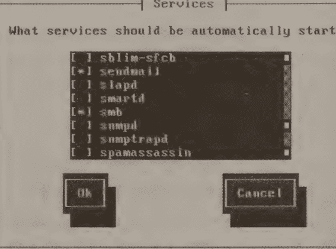

图 1-26 设置是否自动启动的 Services 菜单界面

- (3) 在GNOME图形界面中设置。选择“系统”→“管理”→“服务”菜单，打开“服务配置”窗口，即可选择某个服务，使用“启用”或“禁用”按钮将其设置为自动启动或否；还可以单击“定制”按钮打开“运行实例分级”对话框，将选中的服务设置为指定级别后自动启动，见图1-27。


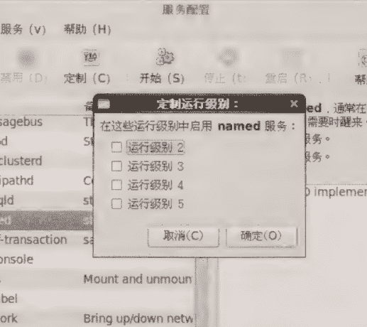

图 1-27 在 GNOME 的“服务配置”窗口中设置服务自动启动

> 注意：在指定的服务设为自动启动后，要等 Linux 系统重启后才会生效。在关机后重启需要自动启动该服务，还需要使用命令临时启动该服务。

在每台网络服务器上安装 Linux 系统和所需的网络服务软件，并按照新的源代码网络环境，确保网络连接的情况下，就可以实施项目二到八项的网络服务器配置。

## 小 结

Intranet 提供企业内部网络，是 Internet 技术在企业内部的应用。换句话说，任何使用 TCP/IP 为用户提供信息的私人、企业内部的网络可称为 Intranet。本书是以企业网络服务项目为案例，在局域网的基础上较为完善的、符合客户需求的网络，这也是企业化的一个重要部分。要完成一个企业网络服务，首先要了解 DHCP 的背景，然后根据需求分析网络结构、IP 地址等进行合理的规划和设计。这些都是项目的核心内容，项目一到项目按照总体规划进行详细实施。对于 DHCP 服务器的配置，读者需要熟悉 DHCP 的基础知识，包括安装、设置、网络配置、测试以及操作。

### 习题

- 1. 什么是 DHCP 服务器？
- 2. 在企业内部部署它有什么好处？
- 3. 网络架构中有几种类型？
- 4. 在 Windows Server 2012 中，通过“服务器管理器”可以哪些功能？
- 5. 如何添加 DHCP 服务？
- 6. DHCP 服务有哪些特点？
- 7. 安装 Linux 时必须创建哪些区域？
- 8. DHCP 自动启动的方法有哪些？

## 项目二 DHCP 服务器配置与管理

目标：

- 能根据需求合理规划 DHCP 服务方案
- 在 Windows 和 Linux 两种平台下正确安装配置 DHCP 服务器
- 能够测试 DHCP 服务
- 具备维护 DHCP 服务器客户端的能力

知识点：

- DHCP 服务的概念与作用
- DHCP 服务的工作机制
- DHCP 中继代理原理

### 任务一 设计

#### 一、DHCP 及其工作机制

1. DHCP 的概念与作用

DHCP（动态主机配置协议）是一种简化 IP 地址管理的 TCP/IP 标准协议。它可以实现自动分配 IP 地址并进行相关的环境配置，如 DNS、Gateway 等。对于一定规模的局域网，通常使用 DHCP 服务器处理 IP 地址的集中式管理。在企业网络环境中部署 DHCP 服务器有以下考虑：

- 减轻管理人员维护 IP 地址的负担
- 避免因人为设置 IP 地址产生错误
- 避免将 IP 地址分配给多个计算机造成冲突的问题

2. DHCP 服务的工作机制

DHCP 服务使用客户端/服务器（Client/Server, C/S）工作模式。网络管理员通过架设 DHCP 服务器以维护 TCP/IP 配置信息。服务器数据库中包含以下信息：

- (1) 网络上所有客户端的配置参数。
- (2) 分配给客户端的有效 IP 地址以及用于引导的保留地址。
- (3) 服务器提供的租赁时间。

#### DHCP 工作过程

通过安装和配置 DHCP 服务器，让 DHCP 客户端每次启动并加入网络时，DHCP 服务器以地址租约的形式将地址池中分配 IP 地址以及相关的网络参数提供客户端，而客户端使用获取到的参数来配置网络。

在以下情况下，客户端将申请一个特殊的 IP 地址：

- (1) 客户端第一次使用 DHCP 服务器
- (2) 地址由于某些原因（如租约到期或断开连接）已被服务器收回
- (3) 客户端要求使用一个新的 IP 地址

DHCP 使用互联网地址分配机构（IANA）定义的 UDP（Bootstrap Protocol），其中服务器使用 67 端口，客户端使用 68 端口。DHCP 的工作过程分为发现、提供、选择、确认四个阶段，如图 2-1 所示：

| 客户端 | DHCP 服务器 |
| :--- | :--- |
| (1) 发现 | 客户端第一次登录网络时不知道自己属于哪个网络，因此向网络广播一个发现消息（DHCPDISCOVER），包含客户端 MAC 地址等信息，源地址为 0.0.0.0。 |
| (2) 提供 | 服务器收到发现消息，从自己的地址池中选择一个分配给客户端，通过网络发送一个提供消息（DHCPOFFER），包含客户端 MAC 地址、服务器提供的 IP 地址、子掩码以及租期。 |
| (3) 选择 | 客户端在网络上收到多个 DHCP 服务器的响应，只会选择其中一个，并发送一个请求消息（DHCPREQUEST）。 |
| (4) 确认 | 服务器接收到客户端 REQUEST 请求后，广播一个确认消息（DHCPACK），接受客户端的选择并将合适的 IP 地址交给客户端。如果有冲突，客户端会发送一个表示拒绝的消息（DHCPDECLINE）给服务器并重发 DISCOVER 请求；如果没有冲突，客户端使用租约中的 IP 地址完成初始化，与网络中的其他主机通信。 |

#### 二、设计企业网络服务方案

1. 分析需求

随着业务的逐渐扩展，公司内部的计算机数量从 90 年代初的几十台到现在的数百台，从单机应用模式变为联网模式。网络运行过程中内部 IP 地址经常发生冲突、分配费时高等问题。为此，公司决定重新规划和管理内部 IP 地址，实现高效的企业信息化管理。为了减少管理员维护 IP 地址的负担，避免手动设置 IP 地址及子网掩码冲突的问题，公司内部所有工作站均采用动态的方式获取地址，就需要安装 DHCP 服务器提供 IP 地址分配。

2. 设计网络拓扑结构

根据项目的总体规划，设计公司 DHCP 服务的拓扑结构如图 2-2 所示。


图 2-2 公司 DHCP 服务的拓扑结构

DHCP 服务为网络自动分配 IP 地址，并配置 DNS、网关等。根据项目需求，公司内部 IP 地址规划方案如下：

- 1) 网关
- 2) DNS
- 3) Web、Email、CA、VPN
- 4) 经理

内部 IP 地址规划表所示：

| IP 地址 | 用途 | 说明 |
| :--- | :--- | :--- |
| 192.168.1.1 | DNS 服务器 | 固定地址 |
| 192.168.1.2 | Web, VPN, CA | 固定地址 |
| 192.168.1.3 | Email 服务器 | 固定地址 |
| 192.168.1.4 | FTP 服务器 | 固定地址 |
| 192.168.1.5~94 | 保留 | 随着发展增加 |
| 192.168.1.100~109 | 可分配 | 客户端主机动态获取 IP 地址 |
| 192.168.1.110~120 | 保留 | 为管理员等留作其他用途 |
| 192.168.1.121~220 | 可分配 | 客户端主机动态获取 IP 地址 |
| 192.168.1.188 | 经理保留 | 公司经理的计算机自动获取该地址 |
| 192.168.1.221~253 | 保留 | 为 VPN 访问的客户预留 |
| 192.168.1.254 | 网关 | 固定地址 |

#### 任务 2 Windows DHCP 服务配置

# 一、设置 DHCP 服务器的网络参数

在安装 DHCP 服务之前，首先要按照项目的 IP 地址规划，为当要求的服务器设置网络参数。在 Windows Server 2012 R2 中，设置网络参数的具体步骤可参考项目一，这里只给出结束的“Internet 协议版本 4 (TCP/IPv4) 属性”对话框。根据项目的规划，应 DHCP 服务器的“IP 地址”设置为 192.168.1.1，“子网掩码”、“网关设置为 192.168.1.254，“首 DNS 服务器”地址可选为 192.168.1.1。最后点击“确定”按钮即可。

## Internet IP 版本-4 (TCP/IPv4) 属性

### 高级

这里自动获取 IP 地址。设置为手动，或者从 DNS 域服务器自动获取的 IP 地址。

- 自定义 IP 地址(O)
  - 使用下面的 IP 地址(A)
    - IP 地址: 192.168.1.1
    - 子网掩码: 255.255.255.0
    - 默认网关: 192.168.1.254
- 自定义 DNS 服务器(O)
  - 使用下面的 DNS 服务器(A)
    - 主 DNS 服务器: 192.168.1.1
    - 备用 DNS 服务器:

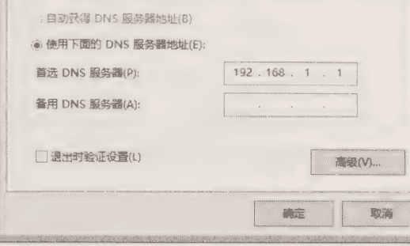

图 2-3 DHCP 服务器的参数设置

## 2. 安装 DHCP 服务器

在 Windows Server 2012 R2 中安装 DHCP 服务器，就是在这台服务器上添加“DHCP 服务器”角色。通过“服务器管理器”打开“添加角色和功能”对话框，为服务添加角色角色的详细操作步骤可参阅向导项目，这里只给出引导的“选择服务器角色”界面，只需在“角色”列表中勾选“DHCP 服务器”复选框即可，如图 2-4 所示。

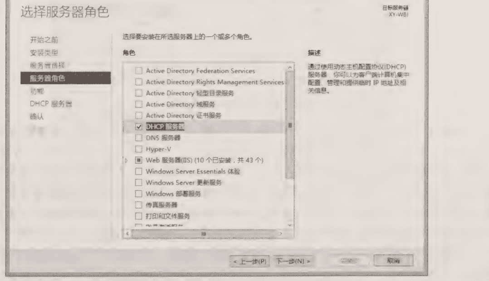

图 2-4 在“添加角色和功能向导”中勾选“DHCP 服务器”复选框

## 网络服务器配置与管理教程

单击“下一步”按钮，向引导进入“DHCP 服务器”界面，显示 DHCP 服务器配置注意事项；再次单击“下一步”按钮，向引导进入“确认安装所选内容”界面，显示此时选择的“DHCP 服务器”角色与功能，在确认无误后点击“安装”按钮，引导进入“安装”界面，等待完成后点击“完成”即可。

> 注意：项目目标是在 IP 地址为 192.168.1.1 的服务器上添加“Web 服务器(IIS)”角色的完整操作，本项目目标是在 IP 地址为 192.168.1.1 的服务器上添加“DHCP 服务器”角色，因此，在“添加角色和功能向导”的“选择目标服务器”步骤，从“服务器池”中选择并连接后，在“服务器池”列表中列出的应为物理计算机的 IP 地址 192.168.1.1。

成功安装 DHCP 服务器后，在“工具”窗口中增加一个“DHCP”图标，在“服务器管理器”窗口的“工具”菜单中也会增加“DHCP”菜单。接下来就可以利用该图标或菜单执行“DHCP”控制，进行 DHCP 服务器的配置了。

## 3. 配置 DHCP 服务器

根据源公司内部 IP 地址规划，按照以下步骤完成 DHCP 服务器的配置。

**步骤 1** 添加“开始”→“工具”菜单，打开“工具”窗口，双击 DHCP 图标或者选择“开始”→“服务器管理器”命令，打开“服务器管理器”窗口，执行“工具”→“DHCP”菜单。点击 DHCP 控制后，在左侧展开 DHCP 的服务器名称 xy-IPv4。


图 2-5 配置

**步骤 2** 添加一个作用域。右击 IPv4，在弹出的快捷菜单中选择“新建作用域”命令，在打开的“新建作用域”对话框中直接单击“下一步”按钮，引导进入“作用域名称”界面，要求输入作用域名称和描述信息。其中，作用域名称是必须输入的，通常与该服务器用途相关的名称，如公司名；描述信息可选，通常是针对该服务器更详细的说明性文字。这里，在“名称”文本框输入 XY-DHCP，在“描述”文本框输入“源公司 DHCP 服务器(IP 地址为 192.168.1.1)”。

**步骤 3** 设置 IP 地址范围。单击“下一步”按钮，引导进入“IP 地址范围”界面，输入可以分配给客户端的 IP 地址范围和结束范围。按照本项目的 IP 地址规划，“在起始 IP 地址”文本框中输入 192.168.1.100，在“结束 IP 地址”文本框中输入 192.168.1.220。

## 项目二 DHCP 服务配置与管理

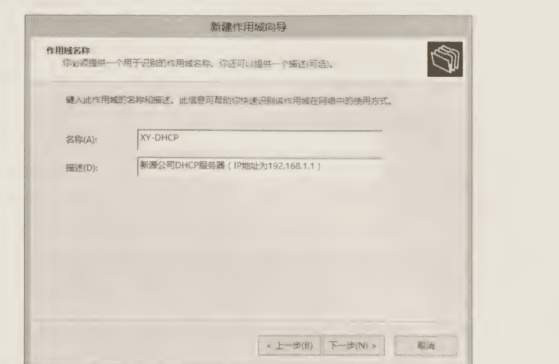


**步骤 4** 添加排除地址。单击“下一步”按钮，引导进入“排除和延迟”界面，要求需要排除的地址和延迟时间（单位为秒）。按照项目的 IP 地址规划，在可连接客户的 IP 地址范围中，192.168.1.110-120 为网络管理员预留其他用途。在此，在“起始 IP 地址”文本框中输入“192.168.1.110”，在“结束 IP 地址”文本框中输入“192.168.1.120”，并单击“添加”按钮，此范围将显示在“排除地址”列表中。DHCP 服务器提供的延迟，通常情况下是不延迟，所以“延迟”框保持默认的 0，如图 2-8 所示。

## 网络服务器配置与教程(Windows Server 2012+Linux)

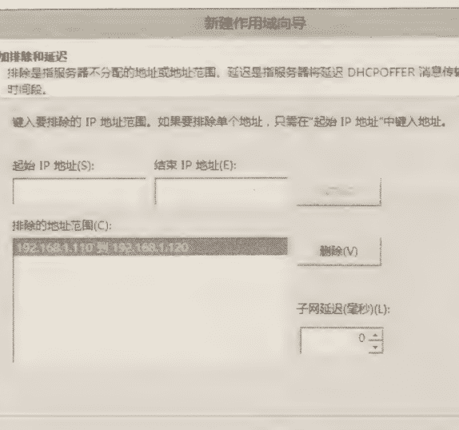

在此选择不分配的 IP 地址范围，将这些地址从 DHCP 池中排除。输入要排除的 IP 地址范围，若排除单个地址，只需在“排除地址”中输入

| 起始 IP 地址(S) | 结束 IP 地址(E) | 子网冲突检测(N) |
| :--- | :--- | :--- |
| 192.168.1.110 | 192.168.1.120 | 0 |

图 2-8“新增作用域”对话框的“排除和延迟”界面

> 注意：排除地址是指 DHCP 服务器可分配的 IP 地址范围内，不分配给客户端的单个地址或多个地址，如果要排除一个地址，只需在“排除地址”文本框中输入该地址，点击“添加”。

**步骤 5 设置客户端 IP 地址租用期限** 点击“下一步”按钮，进入“租用期限”界面，为客户端 IP 地址设置有效期。根据“限制为”下面的框中对租用天数、小时和分钟进行设置。系统默认为8 天0 小0 分，由于本项目没有特殊要求，以默认设置即可。


### 租用期限

租用期限设置客户端未使用时的有效期。租用期设置为客户端与 DHCP 服务器之间的时间。对于主机（台式机、移动终端等），设置较短租用期；例如，对于固定 IP 地址的台式电脑，设置较长的租用期限。

| 限制为：天(D) | 小时(H) | 分钟(M) |
| :--- | :--- | :--- |
| 8 | 0 | 0 |

图 2-9“新增作用域”对话框的“租用期限”界面

> 注意：通过设置租用期，可以控制可用网络的时间，在 IP 地址有限的情况下提高 IP 地址利用率。一般来说，租用期设置为客户端与 DHCP 服务器之间的时间。对于主机、客户端（台式机、移动终端等），设置较短租用期更为合适；对于台式机网络则设置较大的租用期。

**步骤 6 配置 DHCP 选项**，单击“下一步”按钮，进入“配置 DHCP 选项”界面，要求用户确认是否配置。实际上，客户端从 DHCP 服务器的作用域中获取 IP 地址，还需要网关、DNS 服务器、WINS 服务器等网络参数，DHCP 选项就是在作用域中配置这些参数。因此，在这里勾选“配置这些选项”，如图 2-10 所示。


**步骤 7 新建路由器**，单击“下一步”按钮，进入“路由器（默认网关）”界面，添加客户端主机使用的路由器（默认网关）IP 地址。根据本项目的 IP 地址规划，在这里“IP 地址”文本框中输入“192.168.1.254”，并单击“添加”按钮，如图 2-11 所示。

**步骤 8 配置域名和 DNS 服务器**。单击“下一步”按钮，进入“域名和 DNS 服务器”界面。根据本项目的总体规划，新源公司的 DNS 服务器与 DHCP 服务器设置在一个物理服务器上，可以在“IP 地址”文本框中输入“192.168.1.1”，并单击“添加”按钮，如图 2-12 所示。现在也可以直接输入

> 注意：如果企业内部已经设置了 DNS 服务器，但知道名称不知道 IP 地址，可以将名称输入在“服务器名称”文本框中，单击“解析”就会自动解析为 DNS 服务器的 IP 地址。在此处也可以在“服务器名称”文本框中输入“xy-bj”，将其自动解析为 IP 地址 192.168.1.1。由于新源公司的 DNS 服务器尚未配置（将在后续项目中实施），所以“父域”中域可以常规输入为 xinyuan.com，可以暂时不连接。

图 2-10“新增作用域向导”对话框的“配置 DHCP 选项”界面

## 网络服务器配置与项目教程(Windows Server 2012+Linux)

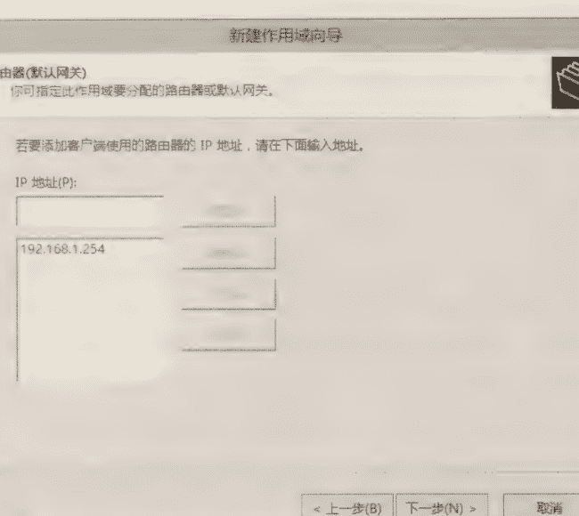

图 2-11“新增作用域向导”对话框的“路由器（默认网关)”界面

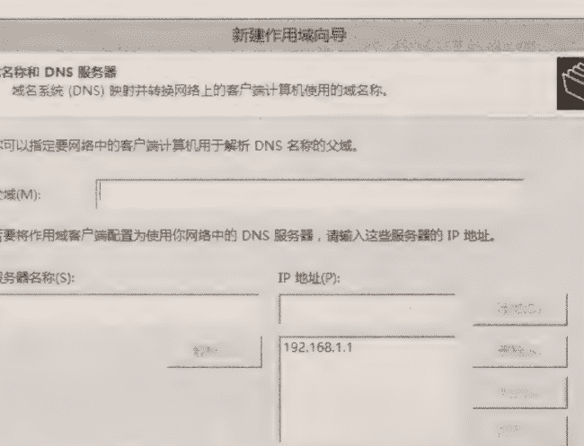

图 2-12“新增作用域向导”对话框的“域名后缀和 DNS 服务器”界面

**步骤 9 设置 WINS 服务器**。单击“下一步”按钮，进入“WINS 服务器”界面。根据项目的总体规划，新公司没有配置 WINS 服务器，因此此步骤无需操作，直接返回，如图 2-13 所示。

> 注意：WINS (Internet Name Service) 是微软开发的，兼容早期的 Windows 版本。WINS 为 NetBIOS 名称提供、注册、更新和转换服务，允许 NetBIOS 名称到 IP 地址的数据库在 LAN 中实现，避免了网络广播造成的负担，对于大型企业而言重要。

| 服务器名称(S) | IP 地址(P) | WINS 服务器(N) |
| :--- | :--- | :--- |
| | | 0 |

图 2-13“新增作用域向导”对话框的“WINS 服务器”界面

**步骤 10 激活作用域**。单击“下一步”按钮，进入“激活作用域”界面，这里可以选择“是，激活作用域”，如图 2-14 所示。

| 是否激活作用域? |
| :--- |
| ○ 是，现在激活作用域(Y) |
| ○ 否，稍后激活作用域(D) |

图 2-14“新增作用域向导”对话框的“激活作用域”界面


**步骤 11 完成配置**。单击“下一步”按钮，进入“完成”界面，只需单击“完成”按钮，DHCP 服务器配置。

> 注意：至此已完成了 DHCP 服务器的基本配置，此时在 DHCP 控制台中就可以看到新的作用域。按照项目的 IP 地址规划，还需要为一个 IP 地址 `192.168.1.18`，将计算机网卡（即 MAC 地址）与此 IP 地址绑定，通过以下步骤完成设置。

## 网络服务器配置与管理教程(Windows Server 2012+Linux)

**步骤 12** 在 DHCP 控制台中，展开左侧窗口 `xy-bj→IPv4→“作用域 [192.168.1.0 XY-DHCP]`，右击选项，在弹出的快捷菜单中选择“新建作用域”命令，如图 2-15 所示。

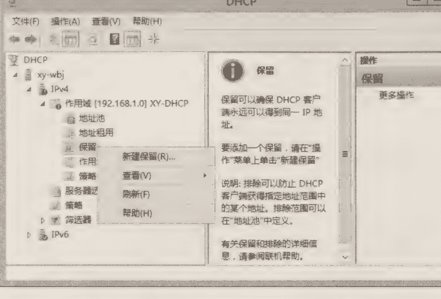

图 2-15 在 DHCP 控制台中新建作用域

**步骤 13 新建作用域**。在弹出的“新建作用域”对话框中，按照项目的规划，在“名称”文本框中输入“BOSS_IP”；在“IP 地址”文本框中输入“192.168.1.18”；在“MAC 地址”文本框中输入“A0-D1-48-F5-C2-A1”，由经理计算机 MAC 地址；在“描述”文本框中输入“为经理的 IP 地址（也可不输入）”，在“支持的类型”组中选择“两者”单选按钮，如图 2-16 所示，然后点击“添加”按钮，再次点击“关闭”按钮。

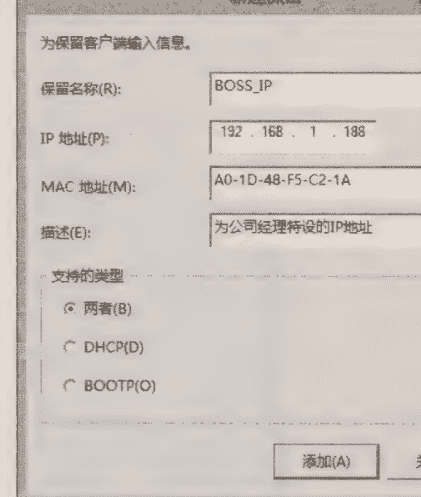

图 2-16“新建作用域”对话框

此处配置完毕。DHCP 服务器处于活动状态，接下来我们将配置客户端并测试 DHCP 服务。

## 二、使用 Windows 客户端测试 DHCP 服务

无论是运行 Windows 还是 Linux 的客户端，只需将其网络参数设置为“自动获得 IP 地址”并重启连接，然后查看客户端从 DHCP 服务器获得了 IP 地址及其他网络参数，即可判断 DHCP 服务是否正常。

下面以 Windows 7 客户端为例，介绍在客户端上测试 DHCP 服务的方法，Linux 客户端的配置与测试可以参考任务三。

## 1. 配置 Windows 客户端

**步骤 1** 右侧桌面的“网络”图标，在弹出的快捷菜单中选择“属性”命令；或者右侧屏幕左侧的网络连接图标，在弹出的快捷菜单中选择“网络和共享”，或者选择控制面板—“网络和共享”。这些方法都可以打开“网络和共享”窗口。

**步骤 2** 点击“网络和共享”左侧的“更改适配器设置”，打开“网络连接”窗口。右击“本地连接”图标，在弹出的快捷菜单中选择“属性”，打开“本地连接属性”，如图 2-17 所示。

**步骤 3** 在“此连接使用下列项目”框中勾选“Internet 协议版本-4 (TCP/IPv4)”，点击“属性”按钮，或者直接双击“Internet 协议版本-4 (TCP/IPv4)”属性，同时勾选“自动获得 IP 地址”和“自动获得 DNS 服务器”。

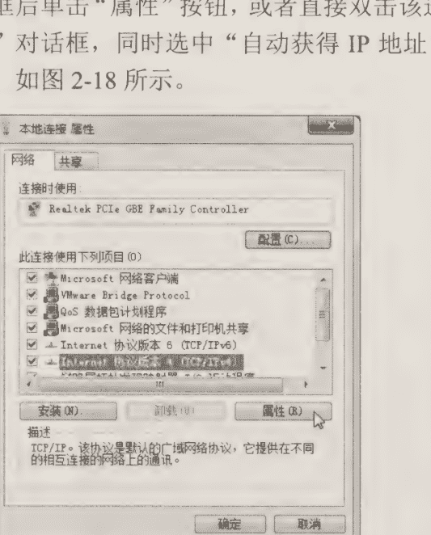

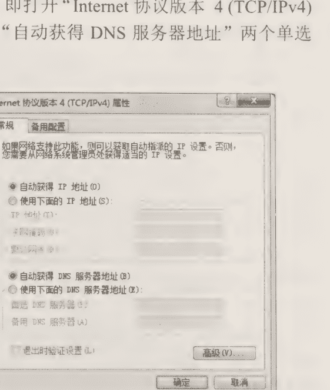

图 2-17“本地连接属性”窗口

## 2. 测试 DHCP

将主机的 TCP/IP 地址设置为“自动获得 IP 地址”和“自动获得 DNS 服务器”后，右击“网络连接”窗口中的“本地连接”图标，在弹出的快捷菜单中选择“禁用”，再次右击“本地连接”图标，在弹出的快捷菜单中选择“启用”。重新连接后，如果此时网络正常运行且有 DHCP 服务器，客户端就会从 DHCP 服务器自动获得 IP 地址及其他网络参数。在客户端上看到对应的 TCP/IP 参数的方法。

## 项目二 DHCP 服务器配置与管理

(3) `ipconfig/release` 和 `ipconfig/renew`: 这是两个附加操作，只能在 DHCP 服务器租用 IP 地址的计算机上执行。`ipconfig/release` 命令让所有接口的租用 IP 地址重新交付 DHCP 服务器（或释放 IP 地址），`ipconfig/renew` 命令令你本地计算机重新连接 DHCP 服务器，并使用一个 IP 地址。注意，在大多数情况下，网卡会被重新赋予与以前赋予相同的 IP 地址。

(4) `ipconfig/flushdns`: 清除本地 DNS 缓存内容。

(5) `ipconfig/displaydns`: 显示本地 DNS 内容。

(6) `ipconfig/registerdns`: DNS 客户端向服务器进行注册。

(7) `ipconfig/showclass`: 显示网络适配器的 DHCP 类详细信息。

(8) `ipconfig/setclass`: 设置网络适配器的 DHCP 类详细信息。

图 2-21 使用 `ipconfig` 命令查看网络参数和命令帮助

## 一、架设 DHCP 服务器

### 1. 设置 DHCP 服务器的网络参数

根据新公司内部网络的 IP 地址规划，DHCP 服务器和 DNS 服务器架设在 IP 地址为 `192.168.1.1` 的物理服务器上，网关地址为 `192.168.1.254`，具体设置如下：

```bash
# vim /etc/sysconfig/network-scripts/ifconfig-eth0 // 编辑 eth0 文件
```

```bash
DEVICE=eth0
HWADDR=00:26:2D:FD:6:5C
TYPE=Ethernet
UUID=e66b23de-f9e2-47b0-9cbbf-5154aa46931
ONBOOT=yes
NM_CONTROLLED=no
BOOT_PROTO=static
IPADDR=192.168.1.1
NETMASK=255.255.255.0
BROADCAST=192.168.1.255
NETWORK=192.168.1.0
GATEWAY=192.168.1.254
DNS1=192.168.1.1
# 保存并退出
# service network restart
# 重启网络服务
Shutting down interface eth0 [ OK ]
Shutting down loopback interface [ OK ]
Bringing up loopback interface: [ OK ]
Bringing up interface eth0: Determining if ip address 192.168.1.1 is already in
use for device eth0... [ OK ]
```

注意：这里的主 DNS 服务器 IP 地址暂设置为 `192.168.1.1`，待后续配置了 DNS 服务器后缀域名解析才生效。本项目起，在叙述操作命令时均将忽略提示符前面的方号部分（包括主机名和当前目录），仅保留一个 `#`。

### 2. 建立 DHCP 服务器配置文件 `/dhcp.conf`

```bash
# vim /etc/dhcp/dhcp.conf

# DHCP Server Configuration file. (参考示例文件)
# see /usr/share/doc/dhcp*/dhcp.conf.sample
# see 'man 5 dhcp.conf'
```

可以看到，默认的 `/etc/dhcp/dhcp.conf` 文件仅包含 5 行注释，没有任何配置内容。但注释中告诉用户 DHCP 服务器配置文件可以参考 `/usr/share/doc/dhcp*/dhcp.conf.sample` 文件，即提供了一个配置文件的样本，其中星号（`*`）是版本号，读者可以看到 `/usr/share/doc` 目录下以 `dhcp` 开头的目录名称，然后使用命令将该文件复制为 `/etc/dhcp/dhcp.conf` 的配置，再对文件内容进行修改。

```bash
# mv /etc/dhcp/dhcp.conf // 备份原始文件
```

**注意：** 在指定的 Red Hat/Fedora 版本中，DHCP 服务配置 `dhcp.conf` 是在 `/etc/dhcp` 目录下，而不是 `/etc` 目录下，该文件默认可能不存在。可以通过 `/usr/share/dhcp/dhcp.conf.sample` 的模板文件复制为 `/etc/dhcp/dhcp.conf`，其中的星号（`*`）为版本号，当然可以直接连接配置。无论怎样想要配置文件，必须先完整安装 DHCP 服务器所需的软件包（在 CentOS 6.5 中是用 `dhcp` 开头的目录，这里检查软件包是否已安装）。

### 3. 修改 DHCP 服务配置文件

如果没有进行上述模板文件的复制，则可以直接在默认配置文件中输入如下：

```bash
# vi /etc/dhcp/dhcp.conf
# DHCP Server Configuration file.
ignore-client-updates; // 忽略客户端更新
default-lease-time 3600; // DHCP为客户设置租期（秒）
max-lease-time 86400; // DHCP为客户设置长期租期
option routers 192.168.1.1; // DHCP为客户网关
option subnet-mask 255.255.255.0; // DHCP为客户子网掩
option domain-name "xinyuan.com"; // DHCP为客户域
option domain-servers 192.168.1.1; // DHCP为客户 DNS
option time-offset -18000; // 设置时间的偏移
subnet 192.168.1.0 255.255.255.0 { // 设置子网声明
  range 192.168.1.110 192.168.1.220; // 允许 DHCP分配范围
  host me { // 主机声明
    option host-name "xinyuan.com"; // 指定主机名为
    hardware 12:34:56:78:AB; // 指定 MAC 地址
    fixed-address 192.168.1.188; // 指定固定 IP
  }
```

上述配置中重要的是两个部分：

(1) 子网声明：`192.168.1.0` 包含多个范围，其中每一个范围设置一个 IP 地址。

(2) `host` 声明：指定特定的 IP 地址。这里设置的是公司内部 IP 地址规划，可以让主机时会自动获取 `192.168.1.188` 这个地址。

### 4. 启动 DHCP 服务

修改 DHCP 服务器配置文件并检查无误后，需要启动 `dhcpd` 服务才能生效。

```bash
# service dhcpd start
Starting dhcpd: [ OK ]
```

## 二、使用客户端测试 DHCP

无论是 Windows 客户端还是 Linux，只要将网络接口设置为“自动获取地址”，在重启接口或重启计算机后，即可查看是否获取 IP 地址以及其他参数。这里介绍如何配置 Linux 客户端来测试 DHCP 服务。

### 1. 配置 Linux 客户端

修改网络接口配置文件 `/etc/sysconfig/network-scripts/ifcfg-eth0`，将其 `BOOTPROTO` 设置为固定 IP 地址、子网掩码、默认网关、广播地址操作如下：

```bash
# vim /etc/sysconfig/network-scripts/ifcfg-eth0
# Intel Corporation Ethernet Controller (Copper)
TYPE=Ethernet
DEVICE=eth0
HWADDR=00:26:2D:FD:6:5C
ONBOOT=yes
# BOOTPROTO=dhcp // 自动获取地址
# IPADDR=192.168.1.188
NETMASK=255.255.255.0
GATEWAY=192.168.1.1
# BROADCAST=192.168.1.255 // 保存并退出
```

然后，重新导入 `ifcfg-eth0` 配置文件，或者在网络接口关闭后重新激活它。

```bash
# service network restart
Shutting down interface eth0 [ OK ]
Shutting down loopback interface [ OK ]
Bringing up loopback interface: [ OK ]
Bringing up interface eth0: [ OK ]
# ifdown eth0
# ifup eth0
```

### 2. 测试 DHCP 服务

查看是否从 DHCP 服务器地址池获取到 IP 地址，具体操作如下：

```bash
ifconfig eth0
eth0 encap:Ethernet HWaddr 00:26:2D:FD:6:5C
inet 192.168.1.10 Bcast:192.168.1.255 Mask:255.255.255.0
inet6 fe80::20c:2ff:fe13/64 scope:global dynamic:MULTICAST MTU:1500 metric:1
RX packets:413 bytes:47701 errors:0 dropped:0 overruns:0 frame:0
TX packets:572 bytes:64842 errors:0 dropped:0 overruns:0 collisions:0 queue:1000
Base encoder:0 uptime:0:00
```

看到客户端获取 IP 地址 `192.168.1.10` 以及子网掩码等参数，表明 DHCP 服务器配置成功并正常运行。

## 任务四 DHCP 运维与深入配置

### 一、DHCP 数据库的维护

#### 1. 使用客户端

选择“开始”菜单中的“管理工具”，打开“DHCP”窗口，双击 DHCP 图标；然后右点击左侧服务器名称，在弹出的快捷菜单中选择“备份”命令，将 DHCP 服务器备份到某个目录后，单击“确定”完成备份。当 DHCP 服务器数据库出现问题时，可以使用“还原”将备份恢复为数据库。在 DHCP 控制台中，右点击左侧服务器名称，在弹出的快捷菜单中选择“还原”命令，选择之前的文件，单击“确定”。此时提示需要停止 DHCP 服务，系统会自动执行恢复操作。为 DHCP 服务生效，重启 DHCP 控制台，右点击左侧服务器名称，在弹出的快捷菜单中选择“启动”命令。

#### 2. 使用 MS-DOS 命令

步骤 1：右点击“开始”、选择“运行”命令，在“运行”对话框中输入“cmd”并按 Enter，打开 `C:\Windows\System32\cmd.exe` 窗口。

步骤 2：在提示符后输入对应的命令停止 DHCP 服务。

```cmd
net stop dhcpserver
```

步骤 3：运行下面的命令删除 DHCP 数据库。

```cmd
del %systemroot%\system32\dhcp.mdb
```

步骤 4：将备份的 DHCP 复制到文件夹，命令如下：

```cmd
copy %systemroot%\system32\backup\dhcp.mdb %systemroot%\system32\dhcp.mdb
```

步骤 5：运行下面的命令重启 DHCP 服务。

```cmd
net start dhcpserver
```

### 二、DHCP 中继及其原理

在网络中可能会存在多个网络。DHCP 客户端通过广播消息发现 DHCP 服务器。如果 DHCP 客户端和服务器不在同一个子网，路由器可以通过 DHCP 中继（DHCP Relay）功能，将请求请求跨越子网传输。

步骤 3 配置访问接口。右键点击“中继代理”，在弹出的快捷菜单中选择“新建接口”，点击“确定”，打开“中继的接口”对话框。在“接口”列表中，可以选择访问另一个子网中 DHCP 服务器的接口，通常该连接就是另一个子网的网关。然后点击“确定”，在打开的“DHCP 中继属性”对话框中勾选“中继 DHCP 数据”选项，以启用中继功能，最后点击“确定”。

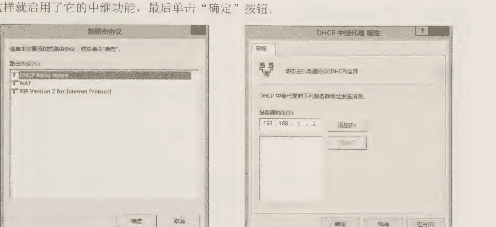

图 2-24 “新路由协议”对话框

图 2-25 “DHCP 中继代理”对话框

完成以上配置后，子网中的 DHCP 客户端就可以通过 DHCP 中继程序访问子网中的 DHCP 服务器。

## 4. 配置 Linux 下的 DHCP 中继

本案例使用 3 台安装了 Linux 系统的计算机。其中两台为 Linux 服务器：一台用作 DHCP 服务器，另一台用作 `dhcprelay` 中继服务器；第三台用于测试客户端。

假设 DHCP 中继代理服务器安装了 3 块网卡 `eth0`、`eth1`、`eth2`，分别用于连接 3 个网段 `192.168.5.0/24`、`192.168.6.0/24` 和 `192.168.7.0/24`。这 3 块网卡的接口 IP 地址分别为 `192.168.5.1`、`eth1:192.168.6.1`、`eth2:192.168.7.1`。

DHCP 服务器的网卡为 `eth0`，其 IP 配置为 `192.168.5.2`。DHCP 服务器的配置无需重复说明，这里主要介绍 DHCP 中继代理服务器的配置步骤。

步骤 1 配置 DHCP 中继代理。在 `/etc/sysconfig/dhcprelay` 文件中加入以下代码：

```bash
# vim /etc/sysconfig/dhcprelay
# 找到两个配置项并修改为
INTERFACES="eth1 eth2"
DHCPSERVERS="192.168.5.2"
# 保存并退出
```

步骤 2 开启 IPv4 功能。在 `/etc/sysctl.conf` 文件中添加以下内容：

```bash
# vim /etc/sysctl.conf
# 找到两个配置项并修改为
net.ipv4.conf.all.bootp_relay = 1
net.ipv4.ip_forward = 1
# 保存并退出
```

或者执行以下命令：


```bash
# echo 1 > /proc/sys/net/ipv4/conf/all/bootp_relay
# echo 1 > /proc/sys/net/ipv4_ip_forward
```

步骤 3 使用命令启用路由，并启动 `dhcrelay` 服务。

```bash
# dhcrelay -i eth1 -i eth2 192.168.2.5                    # 开启路由
# 以以下命令均可临时启动 dhcrelay 服务
# /etc/init.d/dhcrelay
# service dhcrelay start                                     [ OK ]
Starting dhcrelay:                                            
```

```bash
# 以以下命令可永久生效级别启动 dhcrelay 服务
# chconfig --level 2345 dhcrelay on
# 也可以使用 systemctl 命令进入单条菜单界面启动 dhcrelay 服务
```

步骤 4 使用命令重启 `dhcpd` 服务。

```bash
# service dhcpd restart                                # 重启 dhcpd 服务
Stopping dhcpd:                                               [ OK ]
Starting dhcpd:                                              [ OK ]
```

步骤 5 配置 DHCP 客户端进行测试，其方法参见业务任务。

如果 Windows 2 上的客户端从 Windows 1 上的 DHCP 服务器获得 IP 地址租约，则实现了 DHCP 中继代理。

## 三、DHCP 疑难解答

问题 1：如果 DHCP 服务器和客户端不在同一个网络内，客户端如何使用服务器地址？

答：由于 DHCP 信息以广播方式播发，而路由器会将广播信息传递到不同网络，所以解决办法如下：

- (1) 在每个网段内都安装 DHCP 服务器。
- (2) 使用所选择的 IP 路由必须符合 RFC 1542 的 TCP/IP 标准规范，以便 DHCP 信息封装到其他网络。

问题 2：如果数据库损坏后，系统管理员应如何修复数据库？

答：有两种方法。

- (1) 自动恢复：如果 DHCP 服务器检测到数据库已损坏，它会自动将 `%systemroot%\system32\dhcp backup` 文件包含的内容还原。
- (2) 手动恢复：在 DHCP 控制台中，关闭 DHCP 服务器，在弹出的快捷菜单中选择“还原”命令。

问题 3：当 DHCP 服务器使用一段时间后，会导致数据库内信息分布混乱，降低数据效率。如何提高数据效率？

解答：有两种方法。

- (1) 在线重置：服务器自动执行，效率高。
- (2) 物理重置：手动执行，效率高。命令如下：

```cmd
C:\systemroot\system32\dhcp
net stop dhcpserver
C:\systemroot\system32\dhcp
net start dhcpserver
```

DHCP 是一个简单的 TCP/IP 标准，利用它可以给网络动态分配 IP 地址。在具有一定规模的网络或流动较多的环境中，DHCP 服务可以降低管理员对 IP 地址的负担，同时避免 IP 地址冲突的问题。

DHCP 客户端从 DHCP 服务器获取 IP 地址的过程概括为发现、提供、选择和确认四个阶段。在配置 DHCP 服务器之前，首先要对网络使用的 IP 地址进行规划，确定范围，确保服务器正常运行。无论是在 Windows Server 2012 还是 Linux 下，设置可用的 IP 地址范围是 DHCP 服务器配置最重要的步骤。客户端查看配置的命令不同：前者使用 `ipconfig`，后者使用 `ifconfig`。

## 网络服务器配置与管理 (Windows Server 2012 + Linux)

## 习题

### 一、简答

1. 什么是 DHCP？部署 DHCP 服务有哪些好处？
2. 简述 DHCP 的工作过程。
3. 在 Windows Server 2012 系统中，部署 DHCP 服务器需要哪些角色？配置 DHCP 服务器的过程中，范围指的是什么？
4. 在 Linux 系统中，DHCP 服务器配置文件是哪个？
5. 什么是 DHCP 代理？什么情况下 DHCP 数据库损坏时，系统管理员可以修复？

### 二、训练题

内网使用 `192.168.1.0/24` 网段，两台服务器连接 Internet 的网关为 `192.168.1.254`，自动分配的 IP 地址均为 `192.168.1.188`。

- (1) 请合理规划 IP 地址，设计 DHCP 服务。
- (2) 分别在 Windows Server 2012 和 Linux 下完成 DHCP 服务器配置。
- (3) 配置多个客户端进行测试。
- (4) 按要求用中文文档格式编写 DHCP 服务实施报告。

## 项目三 DNS服务器配置与域点的解析

全球只有13个域名服务器，以英文字母 A-M 组成，根域名名为“字母.root-servers.net”。在这13个域名服务器中，1个为主服务器，其余12个为根服务器，其中9个在美国，2个在欧洲（英国和瑞典），有1个在亚洲。根服务器由互联网络与名称分配机构 ICANN(The Internet Corporation for Assigned Names and Numbers)管理。

在 Windows Server 2012/2008 中，没有记录这些域名服务器 IP 地址的列表文件为 `C:\Windows\System32\dns.cache`。在早期的 Linux 版本中，该列表为 `/var/named.root`。在新的 Fedora 和 CentOS 系统中，该列表为 `/var/named.cache`。

**步骤5** 根服务器收到本地 LDNS 的域名解析请求，返回 LDNS 一个查询的顶级域名服务器(gTLD)服务器，例如，`org`、`cn`。本例中返回的域名的服务器地址。

**步骤6** 由 LDNS 向返回的 gTLD 服务器发送解析请求。

**步骤7** 接收到的 gTLD 服务器查找并返回此地址的 NameServer(域名服务器)。DNS 通常是注册的域名服务器。例如，在某个域名提供商那里申请了域名，该域名解析权威就由该域名提供的服务器来完成。在本例中，gTLD 服务器查找返回 `accom` 域名服务器的 IP 地址。

**步骤8** 由 LDNS 向返回的 Name Server 发送解析请求。

**步骤9** 接收到的 Name Server 查询存储的域名和 IP 的映射关系，正常情况下根据域名都能得到目标 IP 记录，并返回一个 TTL 值给 LDNS。本例中，Name Server 查找了 `www.com` 的 IP 地址及 TTL 值。

**步骤10** 接收到 Name Server 的解析结果后，缓存这个域名和 IP 地址的对应关系，同时将这个查询结果返回给客户。客户端也会缓存这个域名和 IP 地址的对应关系，避免提交相同的查询。域名解析时间等待 TTL 值。

## 二、企业级DNS规划

### 1. 分析项目需求

随着公司网络规模的扩展，公司内部的各类服务器(如 Web 服务器、FTP 服务器、E-mail 服务器等)随着业务量的增加而日益增长。无论是公司的日常的员工，还是管理员进行日常维护时，记住每个服务器的 IP 地址都很困难，使用 IP 地址访问极不方便。因此，公司员工希望能够为每个服务器设置好、有标识性的名称，实现服务器名称化，以便于信息化管理和提高工作效率。

为此，公司准备通过部署企业级域名服务器系统，来实现易理解的域名与 IP 地址之间的“翻译”与转换，方便各个部门间的协作办公，保证公司部门之间的数据顺畅、便捷的传输。

### 2. 设计网络拓扑结构

根据项目的整体规划，设计新 DNS 服务器的网络拓扑结构如图 3-3。

网络服务器配置与项目化教程(Windows Server 2012+Linux)

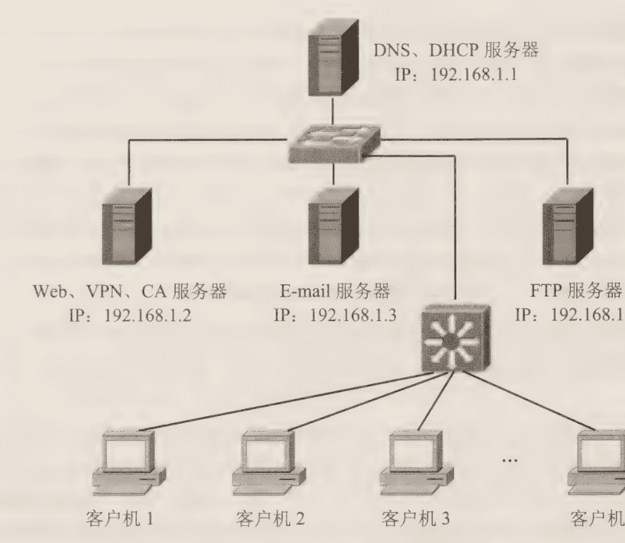

- DNS, DHCP 服务器：IP: `192.168.1.1`
- Web, VPN, CA 服务器：IP: `192.168.1.2`
- E-mail 服务器：IP: `192.168.1.3`
- FTP 服务器：IP: `192.168.1.4`

图 3-3 新源公司 DNS 服务项目的网络拓扑结构

### 3. 规划域名与 IP 地址方案

根据项目需求，新源公司内部服务器域名与 IP 地址规划如表 3-1 所示。

| 表 3-1 新源公司内部服务器域名与 IP 地址规划 |
| :--- | :--- | :--- |
| 服务器 | 域名 | IP 地址 |
| DNS, DHCP 服务器 | `dns.xinyuan.com` | `192.168.1.1` |
| Web, VPN, CA 认证服务器 | `www.xinyuan.com` | `192.168.1.2` |
| E-mail 服务器 | `mail.xinyuan.com` | `192.168.1.3` |
| FTP 服务器 | `ftp.xinyuan.com` | `192.168.1.4` |

## 任务二 Windows 下 DNS 服务配置

### 一、安装 DNS 服务器

在运行 Windows Server 2012 R2 的服务器上成功部署 DNS 服务，服务器本身必须有一个静态（固定）IP 地址，这样才能让客户机定位 DNS 服务器。如果希望该 DNS 服务器能够解析 Internet 上的域名，还应确保它正常连接到 Internet。根据新源公司网络服务器的总体规划，DNS 服务器与 DHCP 服务器架设在同一台 IP 地址为 `192.168.1.1` 的物理服务器上，所以 IP 地址或网络参数无需重新设置。

DNS 服务器配置与管理

In Windows Server 2012 R2 安装 DNS 服务器，是在该服务器上添加“DNS 服务器”角色。通过“服务器管理器”窗口打开“添加角色和功能向导”，为服务器添加角色的详细操作可参考项目，这里仅给出向导的“选择服务器角色”界面，只需在“角色”列表中勾选“DNS 服务器”复选框，如图 3-4 所示。

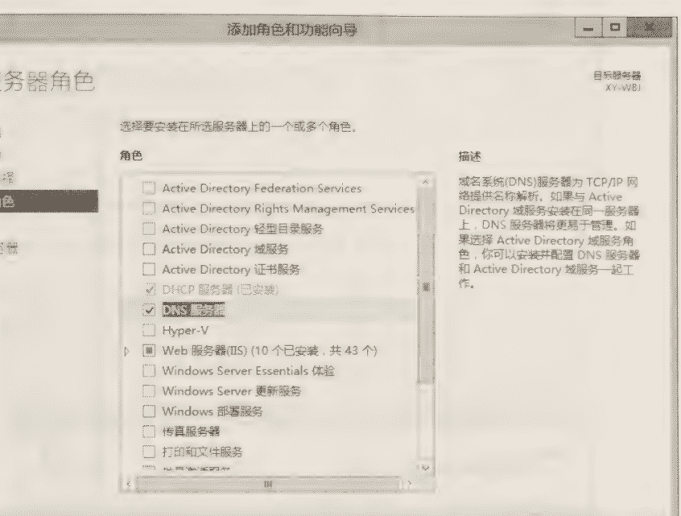

图 3-4 在“添加角色和功能向导”中选择“DNS 服务器”角色。点击“下一步”按钮，向导进入“DNS 服务器”界面，显示 DNS 服务器及注意事项：再次点击“下一步”按钮，向导进入“确认安装”界面，显示此前选择的“DNS 服务器”角色和功能，在确认无误后点击“安装”按钮，向导进入“安装进度”界面，等待完成后关闭。成功安装 DNS 服务器后，在“管理工具”窗口中增加 DNS 服务器就可以利用该命令打开“DNS 管理”窗口进行配置。

### 二、DNS 服务器配置

实现域名解析的具体配置之前，需要名为 `xinyuan.com` 的正向区域以及对应的反向解析。配置正向解析通过域名查询对应的 IP 地址；反向解析通过 IP 地址对应的域名。

### 三、新建正向区域

选择“开始”→“管理工具”命令，打开“管理工具”窗口，或者选择“开始”→“服务器管理器”命令，打开“服务器管理器”窗口，在左侧窗找到服务器 XY-WB，右击“正向查找区域”文件夹，在弹出的窗口中选择“新建区域”命令。

网络服务器配置与项目实施(Windows Server 2012+Linux)

图 3-5 在“DNS管理器”窗口中新建区域。

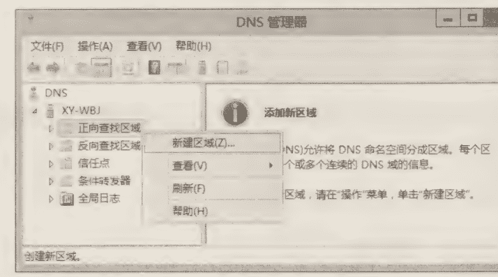

步骤2 设置区域类型。打开“新建区域”向导，首次显示的是“欢迎使用区域”界面，此时直接点击“下一步”按钮，向导进入“区域类型”界面，这里选用“主要区域”单选框，见 3-6 所示。


图 3-6 “新建区域”向导中“区域类型”界面。

步骤3 输入区域名称。点击“下一步”按钮，向导进入“区域名称”界面。按照项目的设计，这里输入“`xinyuan.com`”，如图 3-7 所示。

步骤4 设置区域文件。点击“下一步”按钮，向导进入“区域文件”界面。这里只选中“创建新文件”，文件名为单选框，同时保持下方框中给出的正向区域文件名 `xinyuan.com.dns`，如图 3-8 所示。

注意：无论是这里的正向区域还是创建的反向区域，用于解析域的资源数据库（简称区域文件）都存放在 `C:\Windows\System32\dns` 中，其中没有特殊需要更改的，默认设置即可。如果使用现有区域文件，比如在此之前已有区域的备份并区域，应该将备份文件复制到服务器指定的文件夹，然后在后续步骤中选择“使用现有文件”按钮，并在框中指定资源文件名。


图 3-7 “新建区域”向导的“区域名称”界面。

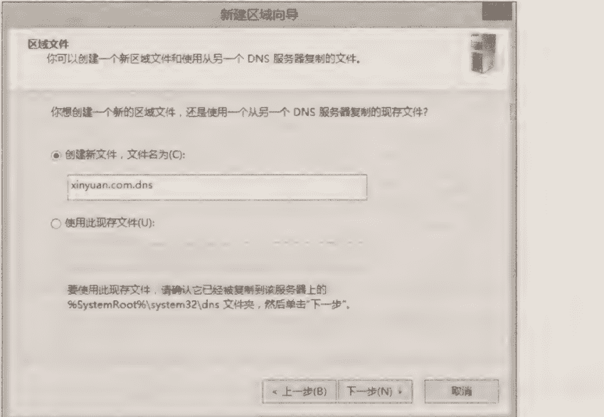

图 3-8 “新建区域”向导的“区域文件”界面。

步骤5 设置动态更新。点击“下一步”按钮，向引导“动态更新”界面。在这里选中“不允许动态更新”单选框，如图 3-9 所示。

注意：DNS 区域更新可以使用 DNS 客户端在每次发生更改时用 DNS 服务器注册更新。但因为可以接受非信任服务器的更新，这样做可能会带来安全风险。

步骤6 完成新建区域。点击“下一步”按钮，向导将显示每一步所做选择的摘要信息。如果检查后发现有错误，可以通过“上一步”按钮返回修改；如果认为无误，单击“完成”按钮即可。创建完成后，在“DNS管理器”窗口的“正向查找区域”文件夹内即可看到正向区域，如图 3-1 所示。

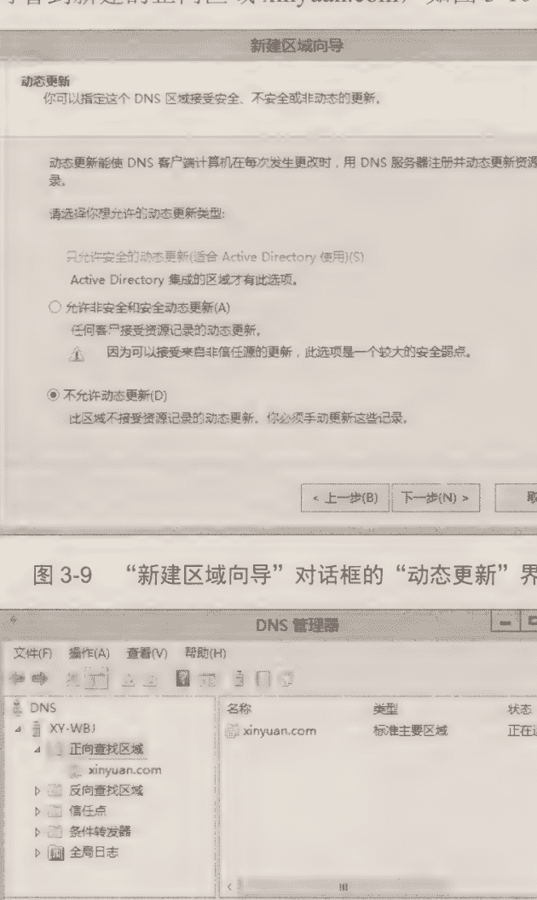

图 3-9 “新建区域”对话框的“动态更新”界面。

### 2. 新反向查找区域

新建反向查找区域与新建正向查找的过程类似，这里仅列出其中的关键步骤：

步骤1 在“DNS管理器”窗口中，选择服务器 XY-WB 下的“反向查找区域”文件，在右侧的菜单中选择“新建区域”命令。打开“新建区域”对话框后直接点击“下一步”按钮，在“区域类型”界面中选择“主要区域”单选框。

步骤2 点击“下一步”按钮，引导到“反向查找名称”字段。首先选择 IPv4 地址还是 IPv6 地址进行反向查找，这里选择 IPv4 反向区域，然后点击“下一步”按钮，进入如图 3-1 所示的“反向查找名称”界面。在框中输入 `192.168.1`，即 `xinyuan.com` 对应的 IP 地址；保持反向查找名称中自动生成的 `192.168.1.in-addr.arpa`。

步骤3 点击“下一步”按钮，导向“区域文件”界面。默认勾选“创建新文件”，文件名为默认的反向查找名称 `192.168.1.in-addr.arpa`（该文件）。此处点击“下一步”按钮，向引导“动态更新”界面。


图 3-7 “新建区域”向导的“区域名称”界面。


图 3-8 “新建区域”向导的“区域文件”界面。

此处点击“下一步”按钮，向引导“动态更新”界面。在这里选中“不允许动态更新”单选框，如图 3-9 所示。

此处点击“下一步”按钮，向引导“动态更新”界面。在这里选中“不允许动态更新”单选框，如图 3-9 所示。

`192.168.1.in-addr.arpa` `192.168.1.in-addr.arpa` `191.1..1` 3-1 的反向查找区域。


图 3-6 “新建区域”向导中“区域类型”界面。

`192.168.1.in-addr.arpa` `192.168.1.in-addr.arpa` `191.1..1` 3-1 的反向查找区域。

### 3. 实现域名

实现域名解析的具体配置之前，需要名为 `xinyuan.com` 的正向区域以及对应的反向解析。配置正向解析通过域名查询对应的 IP 地址；反向解析通过 IP 地址对应的域名。

`192.168.1.in-addr.arpa` `192.168.1.in-addr.arpa` `191.1..1` 3-1 的反向查找区域。

# 项目 DNS 服务器配置与管理

图 3-20 所示的测试 DNS 域名正向和反向解析的成功。

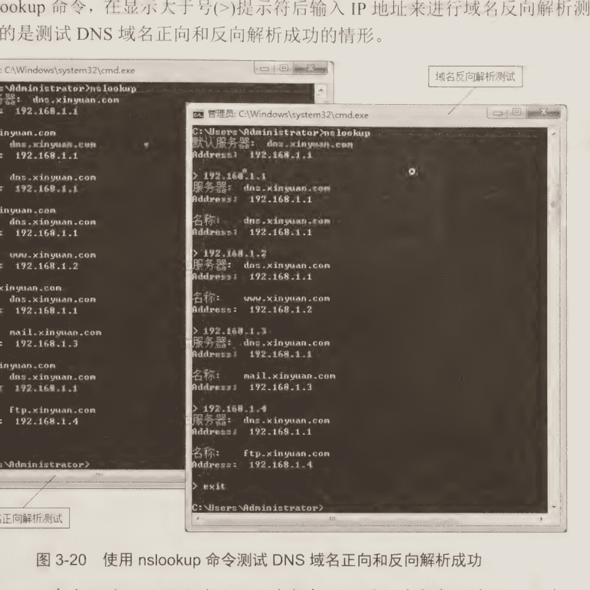

图 3-20 使用 `nslookup` 命令测试 DNS 域名的正向解析，若正向解析失败，则会显示 4

> **注意：** `ping` 命令仅用于测试域名，如果解析失败会显示“Request timed out”。如果 `nslookup` 命令测试域名正向或反向解析失败，则会提示找不到服务器、未发现域名或对应 IP 地址等信息。这种情况下需要仔细检查客户端与服务器之间的网络是否连通，以及 DNS 服务器的每一步配置是否正确，是否已经启动了服务。

# 三 Linux 下的 DNS 服务器配置

在 Linux 系统中，DNS 服务器所需的软件包名称以 `bind` 开头，而服务名称为 `named`。如何查询和安装可以参考项目一，这里将不再提及。由于配置 DNS 服务器相对比较复杂，所以这里简要介绍相关的配置方法及其文件，然后再针对新服务器的需求进行配置。

# 一 DNS 服务器配置文件及其结构


DNS 服务器的配置主要包括区域声明和资源记录两部分。在早期的 Red Hat 和 Fedora 等版本中，用户需要解析的正向和反向是在 DNS 主配置文件`/etc/named.conf`中直接加上，对应的两个资源记录文件（也称域名数据库文件）存在`/var/named`目录下。但在 Fedora 8 以及 RHEL/CentOS 版本中已配置服务器文件`named.conf`的内容保持简单简洁，把域名部分独立出来，存放在了`/etc/named.rfc1912`文件中，而在配置文件的末尾使用`include`将该文件包含。不仅如此，当用户成功启动DNS 服务时，系统会自动将DNS 服务器部署到`var/named`环境，即把`chroot`视为 DNS 服务器的“目标”，将主配置文件和区域资源文件复制到`var/named/chroot/etc`目录下，将所有区域的正向和反向资源文件复制到`var/named/chroot/var/named`目录下；当正常关闭系统级的权限限制后，DNS 服务器的安全漏洞不会导致整个系统被破坏。

# 1. 默认的 DNS 服务器配置

```
// /etc/named.conf
// named.conf
// See /usr/share/bind/sample/ for example named configuration files.
options {
    listen-on 53 { 127.0.0.1 }; // 全局配置选项
    listen-on-v6 53 { ::1 };
    directory "/var/named"
    dump-file "/var/named/data/cache_dump.db"
    statistics-file "/var/named/data/named_stats.txt"
    allow-query { localhost };
    recursion yes;
    dnssec-enable yes;
    dnssec-validation yes;
    dnssec-lookaside auto;
    /* Path to ISC DLV key */
    bindkeys-file "/etc/named.iscdld.key"
    managed-keys-directory "/var/named/dynamic"
}
logging {
    channel default debug {
        file "data/named.run"
        severity dynamic;
    };
}
zone "." IN {
    type hint;
    file "named.ca"
}
include "/etc/named.rfc1912.zones"; // 定义根域名声明
include "/etc/named.root.key";
```

可以看到，在默认配置文件`named.conf`中，除了定义了所有默认配置项的`options`和日志记录规范的`logging`两节外，还有一个节说明了根的类型对应的资源记录文件，在最后使用默认时只需要修改`/etc/named.rfc1912.zones`文件，这样对于新增的区域时只需要修改`named.rfc1912.zones`文件，避免了对主配置文件`named.conf`的频繁修改。在文件开头的注释中，说明在`/usr/share/doc/sample`目录下提供了一个 DNS 服务器配置的模板，供读者参考。

**注意：** 在 Linux 的各种配置脚本中，虽然注释的方法种类多样，但也有一些习惯性的用法。一般来说，说明性文字通常连用`#`开头，在注释的文字中多的地方也有时用`#...#`的形式；而那些不需要的配置语句通常是在行首加`#`注释，以后需要配置时只要直接去掉`#`即可。因此，读者在修改配置文件时要养成良好的操作习惯。

# 2. 默认用于区域声明的`/etc/named.rfc1912.zones`

默认用于区域声明的`/etc/named.rfc1912.zones`内容如下

```
# vim /etc/named.rfc1912.zones
zone "localhost.localdomain" IN {
	type master;
	file "named.localhost";
	allow-update { none };
}
zone "localhost" IN {
	type master;
	file "named.localhost";
	allow-update { none };
}
zone "0.0.0.0.0.0.0.0.0.0.0.0.0.ip6.arpa" IN {
	type master;
	file "named.loopback";
	allow-update { none };
}
zone "0.0.0.127.in-addr.arpa" IN {
	type master;
	file "named.loopback";
	allow-update { none };
}
zone "in-addr.arpa." IN {
};
// 默认解析主机的正向声明
// 默认主机别名的正向声明
// IPv6 回环地址反向声明
// IPv4 回环地址反向声明
type master;
file = "named.empty";
allow-update = none;
```

可以看到，在默认区域的区域域名`named.rfc1912.zones`中，包含了本地主机`localhost`以及别名`localhost`的正向解析，区域为主 (master)，对应的资源文件为`loopback`；还包含了 IPv4 和 IPv6 反向区域，其资源文件通常指定文件名，无须指定路径，因为 DNS 主配置文件`named.conf`的全局配置使用了`directory`指定了默认文件存在`var/named`。注意：在任何正向或反向区域声明中，用`file`语句指定记录通常需要文件名，无须指定路径，因为 DNS 主配置文件`named.conf`的。

# 3. DNS 服务器配置文件及区域声明的语法

DNS 服务器配置文件`named.conf`中的配置语句、通用的配置和区域声明如表 3-2 所示。

表 3-2 named.conf中的配置语句

| 配置语句 | 功能 |
| --- | --- |
| acl | 定义 IP 地址访问列表 |
| controls | 定义控制通道 |
| include | 将其他文件在该配置中 |
| key | 定义授权的安全密钥 |
| logging | 定义日志规范 |
| options | 定义全局配置 |
| server | 定义远程服务器 |
| trusted-key | 为服务器加密密钥 |
| zone | 定义一个区域 |

表 3-3 全局配置

| 子句 | 功能 |
| --- | --- |
| recursion yes | 是否使用递归 服务器，默认yes |
| transfer-format one-answer;many-answer | 是否在一条消息中响应，默认为one-answer |
| directory | 定义服务器的工作目录，默认为var/named |
| forwarders | 定义转发器 |

表 3-4 区域域名句

| 子句 | |
| --- | --- |
| type hint | 指定一个区域为主 DNS; hint 指定一个区域启动缓存的 DNS; slave 指定一个区域为辅助 DNS |
| file filename | 指定一个区域的信息文件名 |

# 4. 默认的本地主机正向和反向解析文件

在配置文件`named.conf`或区域文件`named.rfc1912.zones`中定义一个区域后，接下来将该区域建立正向解析和反向解析的资源文件（同名数据库文件）。这两个文件位于`/var/named`目录下，其文件名与区域声明相同。由于`named.rfc1912.zones`文件中已经声明了本地主机正向和反向解析，IPv4 回环地址的反向声明，在`/var/named`目录下有了本地主机正向和反向解析文件，分别是`named.localhost`和`named.loopback`。这两个文件的默认内容如下：

```
# cat /var/named/named.localhost
$TTL ID
IN SOA @ rname (
    0 ; serial // 该区域信息文件的版本
    1D ; refresh // 检查 SOA 记录前的秒数
    1H ; retry // 重试对主 DNS 请求等待的秒数
    1W ; expire // 失败丢失信息等待的秒数
    3H ) ; minimum // 高速缓存生存的秒数
```

```
# cat /var/named/named.loopback
$TTL ID
IN SOA @ rname.invalid. (
    0 ; serial
    1D ; refresh
    1H ; retry
    1W ; expire
    3H ) ; minimum
NS @
A 127.0.0.1
AAAA ::1
PTR localhost.
```

# 5. 正和反向解析资源记录的语法

正和反向解析资源记录由若干资源记录和记录字段组成。通用的资源记录及其功能如表 3-5 所示。

表 3-5 资源记录及其功能

| 记录类型 | 功能 |
| --- | --- |
| A | 将主机为主机。这个记录保存着十进制形式的 IP 地址。任何的主机只能有一个 A 记录，因为这个 A 记录被认为是授权的。这个主机的任何附加地址或主机映射必须使用 CNAME 类型给出 |
| CNAME | 指定一个主机的别名，规范的名称在该主机的 A 记录中指定的 |
| HINFO | 描述主机的操作系统 |
| MX | 建立交换服务器，MX 记录用于邮件传输将邮件推送到另一个系统 |
| NS | 标记一个域名服务器，NS 记录包括该域名名称。还需要指定该服务器地址 |
| PTR | 将地址为主机。主机名必须是主机 |
| SOA | 告诉服务器它所属者的资源记录受控制的(SOA)表示授权控制。其数据字段用起来 |

表 3-6 SOA 记录中的数据字段

| 数据字段 | 功能 |
| --- | --- |
| contact | 该记录的管理员地址。用“@”符号表示特殊的，例如：admin@jian.com |
| serial | 该区域记录的版本，是一个计数，每次改变区域文件都应该计数加1 |
| refresh | 辅助域名服务器尝试主服务器记录之前等待的秒 |
| retry | 辅助域名服务器在主服务器不可用时，请求等待的秒 |
| expire | 辅助域名服务器与主服务器取得联系时，丢弃信息等待的秒 |
| minimum | 如果资源记录没有设置 ttl 则以该值为准 |

DNS 资源记录如下：`[domain] [ttl] [class] type data`

其中，每个字段之间用空格或 Tab 隔开，这些字段的功能如表 3-7 所示。

表 3-7 资源记录中字段

| 字段 | 功能 |
| --- | --- |
| domain | 域名名称 |
| ttl | 生存时间 |
| class | 类（通常为 IN 表示互联网） |
| type | 记录类型 |
| data | 记录数据 |

# 二、DNS 服务器

为了满足公司内部网络的需求，按照事先设计的方案，现在实施 DNS 服务器的配置。

### 1. 定义区域声明

为了保持 DNS 服务器配置文件`named.conf`的内容简单简洁，用户需要解析的区域通常添加在`etc/named.rfc1912.zones`文件中。这里需要添加两个区域声明，即新域名“xinyuan.com”的正向区域和“168.192”的反向区域。

```
# /etc/named.rfc1912.zones
// 默认的文件已给出，只需在文件末尾添加两个 zone 声明

zone xinyuan.com IN {
	type master;
	file "xinyuan.zone"; // 指定正向记录文件名
	allow-update (none);
}

zone 192.168.in-addr.arpa IN {
	type master;
	file "xinyuan.com"; // 指定反向记录文件名
	allow-update (none);
}
```

### 2. 建立正向和反向解析的资源文件

由于`/var/named`默认已有本地主机的正向解析文件`named.localhost`和本地地址反向解析文件`named.loopback`，为了方便起见，读者先把`named.localhost`文件更名为新域名的正向解析文件`xinyuan.zone`，把`named.loopback`文件更名为反向解析文件`xinyuan.com`，然后再对它们进行修改。当然，也可以直接连接这两个文件，输入以下内容：

```
# vim /var/named/zone.xinyuan.zone
// 编辑正向解析资源文件，修改或输入以下内容
TTL 1D
@ IN SOA dns.xinyuan.com. admin.xinyuan.com. (
      0 ; serial
      1D ; refresh
      1H ; retry
      1W ; expire
      3H ; minimum
  )
  IN NS dns.xinyuan.com.
  IN MX 5 mail.xinyuan.com.
dns dns IN A 192.168.1.1
www IN A 192.168.1.2
mail IN A 192.168.1.2
ftp IN A 192.168.1.4
wbj IN CNAME www.xinyuan.com.
```

```
# vim /var/named/xinyuan.com
// 编辑反向解析资源文件，修改或输入以下内容
TTL 1D
@ IN SOA .xinyuan.com. (
      0 ; serial
      1D ; refresh
      1H ; retry
      1W ; expire
      3H ; minimum
  )
IN NS dns.xinyuan.com.
1 PTR dns.xinyuan.com.
2 PTR www.xinyuan.com.
2 PTR mail.xinyuan.com.
4 PTR ftp.xinyuan.com.
```

## 项目三 DNS 服务器配置与管理

3 IN PTR mail.xinyuan.com.

4 IN PTR ftp.xinyuan.com

注意：上述用于解析资源记录文件，MX 记录用于建立邮件交换器，是在项目六设置邮件服务器时需要用到的，这里也可以暂时不添加额外配置。正向和反向解析的资源记录文件的名称只与反向声明时文件文件名相同，没有命名的规定。但是，为了增强可读性，习惯上用“区域.zone”作为正向资源记录文件，而用“zone.区域”作为反向解析资源记录文件。

### 3. 修改 DNS 服务器的配置选项

前面看到，在 DNS 服务器配置文件`named.conf`的`options`一节，默认在 IPv4 回环地址`127.0.0.1`和 IPv6 回环地址`::1`打开了 DNS 默认的 53 端口，并允许`127.0.0.1`客户端（本机）发起查询。如果希望面向本地地址开放 53 端口，并允许网络中有主机查询，则将`dns`节中的以下三个配置进行修改如下：

```
# vim /etc/named.conf
// 默认的内部内容已经给出，需要找到中的 3 个配置项修改如下
options {
    listen-on port 53 { any };
    listen-on v6 port 53 { any };
    ...
    allow-query { any };
} // 修改后，保存并退出
```

### 4. 修改资源记录文件的权限和所属

步骤 1 将`xinyuan.com`区域的正向和反向解析资源记录文件分别执行加权权限（即 x 权限），或者直接将其权限设置为所有权限（777），操作命令如下：

```
# chmod 777 /var/named/xinyuan.com.zone own# chmod 777 /var/named/zone.xinyuan.com
```

步骤 2 将`xinyuan.com`区域的正向和反向解析资源记录文件所属组更改为`named`（该用户在安装 named 服务时已由内核创建），或者将这两个文件的所有者更改为用户（该用户在安装 named 服务时也已由内核创建），操作命令如下：

```
# chgrp /var/named/xinyuan.com.zone // 修改所属组
# chgrp /var/named/zone.xinyuan.com
# chown named /var/named/xinyuan.com.zone // 修改所有者
```

```
# chown named /var/named/zone.xinyuan.com
```

### 5. 启动或重新启动 named 服务

使用`rndc`命令启动或重新启动 named 服务。

```
# rndc reload
server reload successful
```

也可以使用`service`命令启动或重新启动 named 服务。

```
# service named restart // 重启 named 服务
Stopping named: [ OK ]
Starting named: [ OK ]
```

注意：直接对配置文件修改后，要使设置生效，最好执行`rndc`命令。

### 6. 关闭 iptables 防墙和 SELinux


默认情况下，`iptables` 防火墙处于开启状态，并且会阻挡 DNS 端口的访问，从而导致 DNS 域名解析失败。关于 `iptables` 的配置将在本项目予以介绍，这里暂时只对 `iptables` 服务进行简单的关闭，操作方法如下：

```bash
# service iptables stop
// 临时关闭iptables的命令
# chconfig --level 35 iptables off
```

`SELinux`（Security-Enhanced Linux）是由美国国家安全局（NSA）在 Linux 社区的帮助下开发的一种强制访问控制（MAC）体系，是 Linux 历史上最杰出的安全子系统。在控制系统的限制下，只能访问自己的用户所需要的资源。`SELinux` 有 3 种工作模式（状态模式）可选：`disabled`、`missive` 和 `enforcing`，默认为 `enforcing` 模式。简单来说，`missive` 模式是不挂载（即关闭）`SELinux` 策略；后两种模式都是 `SELinux` 策略生效，但其控制策略对用户的操作的处理方式不同，在 `missive` 模式下，如果用户的操作被拦截，用户仍然继续操作，只是把用户的内容记录下来；而在 `enforcing` 模式下只要不符合策略，就会阻止用户继续操作。关于 `SELinux` 的具体实现本书将不再详述，只需对其进行简单的处理，操作方法如下：

```bash
// 查看 SELinux当前模式
# setforcing 0
```

```bash
// 可以使用此命令
# setforcing disabled // 临时关闭 SELinux (无效)
```

如果永久关闭 `SELinux` 策略，可以修改其配置文件 `/etc/selinux/config`：

```vim
vim /etc/selinux/config
// ...文件内容，找到以下配置
SELINUX=enforcing
SELINUX=disabled
// 将该内容修改为如下
// 修改完毕，保存并退出
```

## 三、使用 Linux 客户端 DNS 服务

无论是在 Linux 客户端本地还是在客户端上，不是运行 Windows 的客户端，需要通过域名服务器解析域名，只需要在网络的参数配置中，将 DNS 服务器地址设置为公司 DNS 服务器的 IP 地址即可。这里用一台 Linux 客户端来进行 DNS 服务的测试，Windows 客户端的配置与测试参考。

### 1. 配置 Linux 客户端

如果是 CentOS 客户端，DNS 服务器可以直接在网络接口 `ifcfg-eth0` 中使用语句指定，重启服务器就会自动出现在 `/etc/resolv.conf` 中；如果是 Red Hat、Fedora 客户端，DNS 服务器必须在 `/etc/resolv.conf` 文件中使用语句指定。这两种方法如下：

```bash
vim /etc/sysconfig/network-scripts/ifcfg-eth0
DEVICE=eth0
TYPE=Ethernet
ONBOOT=yes
IPADDR=192.168.1.70
NETMASK=255.255.255.0
GATEWAY=192.168.1.1
DNS1=192.168.1.1
# 修改后保存并退出
service network restart
Shutting down interface0: [ OK ]
Shutting down loopback interface: [ OK ]
Bringing up loopback interface: [ OK ]
Bringing up interface0: Determining ip for device eth0... [ OK ]
```

对于 Red Hat、Fedora 客户端：

```
/etc/resolv.conf
nameserver 192.168.1.1
```

### 2. 测试 DNS 服务

以下是在 Linux 客户端使用 `nslookup` 命令测试服务的示例，包括域名的正解析以及 DNS 服务器的 NS、MX、CNAME 记录：

```
nslookup dns.xinyuan.com
Server: 192.168.1.1
Address: 192.168.1.1#53
Name: dns.xinyuan.com
Address: 192.168.1.1

nslookup www.xinyuan.com
Server: 192.168.1.1
Address: 192.168.1.1#53
Name: www.xinyuan.com
Address: 192.168.1.2

nslookup mail.xinyuan.com
Server: 192.168.1.1
Address: 192.168.1.1#53
Name: mail.xinyuan.com
Address: 192.168.1.3

nslookup ftp.xinyuan.com
Server: 192.168.1.1
Address: 192.168.1.1#53
Name: ftp.xinyuan.com
Address: 192.168.1.4

nslookup 192.168.1.1
Server: 192.168.1.1
Address: 192.168.1.1#53
```

反向解析测试：

```
192.168.1.in-addr.arpa name dns.xinyuan.com
192.168.1.in-addr.arpa name www.xinyuan.com
192.168.1.in-addr.arpa name mail.xinyuan.com
192.168.1.in-addr.arpa name ftp.xinyuan.com
```

```
set type=ns
// 测试名称服务器 NS 资源记录
> xinyuan.com
Server: 192.168.1.1
Address: 192.168.1.1#53
xinyuan.com nameserver = dns.xinyuan.com

set type=mx
// 测试邮件交换器 MX 资源记录
> xinyuan.com
Server: 192.168.1.1
Address: 192.168.1.1#53
xinyuan.com mail exchanger = 5 mail.xinyuan.com

set type=soa
// 测试起始授权机构 SOA 资源记录
> xinyuan.com
Server: 192.168.1.1
Address: 192.168.1.1#53
xinyuan.com
origin = dns.xinyuan.com
mail addr = admin.xinyuan.com
serial = 0
refresh = 86400
retry = 3600
expire = 604800
minimum = 10800

set type=cname
// 测试 CNAME 资源记录
> xinyuan.com
Server: 192.168.1.1
Address: 192.168.1.1#53
xinyuan.com canonical name = www.xinyuan.com
```

注意：执行上述命令后显示的结果表示测试成功。如果域名解析或反向解析失败，除了检查客户端与服务器之间的连接是否连通外，还需要检查相关配置位置是否正确、资源记录文件的权限是否正确、`iptables` 防火墙和 `SELinux` 是否关闭。

### 二、CPCP 服务实现自动更新

由于 DNS 服务器的主机记录是手动添加的，当此类主机 IP 地址变化时通常需要管理员手动修改。在 Windows Server 2012 中，可以利用动态更新方式在 DNS 服务器实现自动更新，这样可以大大减少管理员的工作。

步骤1：选择“开始”→“管理工具”命令，打开管理工具窗口，双击 DNS 控制器。展开 DNS 服务器→IPv4 区域，右击作用域 `[192.168.1.0-DHCP]` 文件夹，在弹出的快捷菜单中选择“属性”，打开作用域 `[192.168.1.0-DHCP]` 属性对话框，如图 3-21 所示。该选项中有 3 个选框，其中“根据设置启用动态更新”和“在域删除时丢弃记录”两个选框是默认勾选的；最后一个是“不允许更新的客户端（例如，运行 NT 4.0 的客户端）PTR 记录”未勾选，这里需要将其勾选，并点击“确定”。

步骤2：选择“开始”→“管理工具”命令，打开管理工具窗口，双击 DNS 控制器。展开 DNS 服务器→IPv4 区域，右击作用域 `[192.168.1.0-DHCP]` 文件夹，在弹出的快捷菜单中选择“属性”，打开作用域 `[192.168.1.0-DHCP]` 属性对话框，如图 3-21 所示。该选项中有 3 个选框，其中“根据设置启用动态更新”和“在域删除时丢弃记录”两个选框是默认勾选的；最后一个是“不允许更新的客户端（例如，运行 NT 4.0 的客户端）PTR 记录”未勾选，这里需要将其勾选，并点击“确定”。

步骤3：与上一步相似，右击“反向查找区域”下的 `192.168.192.in-addr.arpa` 文件，在弹出的快捷菜单中选择“属性”，打开“192.168.192.in-addr.arpa 属性”对话框，如图 3-22 所示。通过此配置 DNS 服务器的过程中，通过“新建区域向导”创建区域的最后一步，选择了“允许动态更新”，因此在该对话框的“常规”选项卡中，“动态更新”列表显示为“无”，这里需要将其点击并选择“安全”选项，最后单击“确定”。

## 三、DNS 常见解答

- 问题1：域名可以随意索取吗？

解答：不可以。需要注册后才可以使用，一个域名需要每年支付一次的费用，当然也有免费的。

- 问题2：DNS 服务器已经配置为企业内部的计算机域名解析服务了，现在在 Internet 上的计算机是否可以使用域名访问企业内部的服务器了？

解答：还不行。如果要做这一点，首先要由域名地址转换设备把 `www.test.net` 的内部网站地址转为域名地址（`202.96.134.1`），而域名地址通常都需要购买。

# 项目三 DNS 服务器配置与管理

- 1. `hosts` 文件的作用是什么？在 Windows Server 2012 R2 和 CentOS 6.5 系统中，文件存放在哪个地方？

- 2. 目前有多少个域名服务器？这些服务器分布在哪些国家或地区？在 Windows Server 2012 R2 和 CentOS 6.5 系统中，这些服务器的地址分别存放在哪个文件中？在新建正向解析区域时，如果区域名为 `xy.com`，默认的域名文件名是什么？存储在哪里？

- 3. 在 Windows Server 2012 R2 中，DNS 服务器配置必须包含什么内容？DNS 默认名称是什么？默认的文件名是什么？存储在哪里？

- 4. 在 CentOS 6.5 系统中，DNS 默认名称是什么？DNS 服务器配置文件和正向查询数据库文件分别存放在哪个地方？

- 5. 在 Linux 平台下配置 DNS 服务器时，正向解析源文件的 A 记录、NS 记录、MX 记录和 CNAME 记录的作用分别是什么？

- 6. 在 Linux 系统中，`host.conf` 和 `resolv.conf` 文件的作用是什么？

- 7. 用于测试域名解析是否成功的方法有哪些？如果域名解析失败，您认为您应该从哪些方面进行检查？

## 二、实训练

盛达电子是一家生产和经营电子产品的中小型公司，现有两台服务器。其中一台服务器的 IP 地址为 `192.168.1.1`，用于配置 DNS 服务器以及公司供外部访问的 Web 站点（域名为 `www.sddz.com`）；另一台服务器的 IP 地址为 `192.168.1.2`，用于配置内部员工访问的 Web 站点（域名为 `www.sddz.com`）和 FTP 站点（域名为 `ftp.sddz.com`）。

- (1) 按上述要求，分别在 Windows Server 2012 R2 和 Linux 平台上完成 DNS 服务器的配置，实现公司 3 个主机名的解析。

- (2) 配置客户端，并使用 `nslookup` 命令进行正向和反向解析测试。

- (3) 按照附录 C 中化的样例格式，编写 DNS 服务器项目实施报告。

# 项目四 Web 服务器配置与管理

## 能力目标

- 根据企业信息化建设需求和项目总体规划合理设计 Web 服务方案

- 在 Windows 和 Linux 两种平台正确安装和配置 Web 服务器

- 在同一服务器上使用 IP 地址、TCP 端口和主机名部署多个站点

- 具备服务器的基本管理维护能力

## 知识要点

- 服务器的基本概念与工作机制

- 基于 IP 地址、TCP 端口、主机名、虚拟目录的网站

- Apache 配置文件 `httpd.conf` 的常用语句

## 任务一 知识准备：Web 服务器及其工作机制

### 1. Web 服务器概述

Web 服务器又称为万维网（World Wide Web, WWW），是在网络中实现信息发布、查询、数据处理等多种应用的基础。Web 服务器的应用涵盖广泛，从个人到各种网站、企业和政府网站，管理员需要根据对象的灵活性、方向、点击率以及安全性、易用性等因素考虑其配置。万维网技术（Hypertext Transfer Protocol, HTTP）已成为标准的使得世界各地的科学家通过 Internet 方便共享成果，具有很好的活性和多样性，用户的网络在世界的任何地方都能用浏览器快速方便浏览，因此 Web 服务器通过文本的方式将分布在网络上的不同计算机上的图像、声音等多种媒体有机结合在一起，让用户通过浏览器来实现。超文本是一种描述某种内容为主的简单标记，超文本标记语言（Hypertext Markup Language, HTML）被称为 Web 页或网页，是标准的 ASCII 文本文件，其中包含标记和链接，这些标签可以扩展到所有其他平台。通用资源定位符（Uniform Resource Locator, URL）使得网络中的各种资源在范围内都有唯一的标识。所谓资源，可以是 Internet 上任何可访问的资源，包括文件、文本、图像、声音以及电子邮件地址等。URL 不仅表示资源的位置，还要描述访问资源时使用的方式或协议。其格式为：`//主机名/路径#锚`。1993 年，第一个图形化的浏览器 Mosaic 被发布。1995 年由 Netscape 公司开发的 Navigator 浏览器是 Windows 系统内置的，其使用非常普遍。此外，火狐（Firefox）、谷歌（Chrome）、世界之旅（Edge）等都是广泛使用的浏览器。

### 2. 服务器的工作原理

用浏览器/服务器（B/S）模式工作，浏览器与服务器之间的通信遵循 HTTP 协议。其中，浏览器就是计算机上的程序；服务器则是提供网页的发布、在网络上的千台计算机，这些计算机运行服务器程序，也被称为服务器。

图 4-1 服务器的工作

浏览器向服务器发送请求，而服务器返回具有数据处理、查询与更新、生成网页文件等，这些操作是用 CGI、ASP 等实现的，并向浏览器传输相应的 Web 文（网页）。某些浏览器能够解释各种脚本或插件以及 Java、ActiveX 等语言，并在屏幕上显示图像、动画等。

浏览器是用户查询、查找、检索 Web 服务器上各种信息的工具，不同的浏览器功能优有别，但都有一些基本功能。

(1) 查询功能：浏览器需要读入 HTML 文档或其他类型的超文本（如 ASP、Java），解释内容中描述的链接、声音、表格以及进一步的链接信息，能利用 HTTP 连接并检查 Web 服务器的数据和信息。

(2) 文件同步功能：可以实时下载的文档，在查阅文档时随时保存、打印或后查阅，在下载过程中可以随时停止。

(3) 编辑 Web 页：通过编辑器查、编辑 Web 页的源文件。

(4) 提供其他服务，如 FTP、Telnet、Email 等服务的客户端软件。

# 网络服务器配置与项目教程 (Windows Server 2012+Linux)

### 3. Web 服务器配置

不同的 Web 服务器应对 CPU 能力、内存、硬盘容量、网络速度有着不同的要求，用户在制定 Web 服务器配置时，首先考虑 CPU 容量和高速磁盘 I/O；其次需要考虑 CPU 配置对当前带宽的影响、网络资源应对应用、磁盘 I/O 和随机读写性能的峰值对实际应用的影响。

Web 服务器硬件推荐配置 4-1

| 应用情况 | 仅内网网页 | 动态网页 | 局域网 200 次访问 | 局域网 500 次访问 | 局域网 1000 次访问 |

| :--- | :--- | :--- | :--- | :--- | :--- |

| CPU 数量 | 1 | 2 | 1 | 2 | 4 |

| 内存容量(MB) | 128~256 | 256~1024 | 256~512 | 512~1024 | 1024~2048 |

| 硬盘容量 | ≥40GB | ≥100GB | ≥50GB | ≥100GB | ≥500GB |

| 网络带宽 | 100MB/s | 100MB/s(2) | 100MB/s | 100MB/s(4) | 1000MB/s |

## 2. 设计 Web 服务方案

### 1. 分析需求

电子商务使企业获得大量信息。为了建立一个全新的企业形象，优化企业与客户互动，完善新闻发布、服务等功能，使公司与合作伙伴、供应商以及普通业务之间的关系，最终达到企业管理和运营。规模不大，点击率也不高，目前在项目中拟购买一台物理服务器来部署 Web 服务器，要求在这台服务器上至少设立 4 个不同类型的站点：

(1) 主站（外网站），在外网访问的站点，主要用于产品展示、新闻发布、论坛等。

(2) 员工考核站点。

(3) 培训和考试的专用站点。

(4) 内部访问站点，除外网站的功能外，还包括内部资料、内部公告等。

### 2. 设计拓扑结构

根据项目的总体规划，设计 Web 服务的拓扑结构如图 4-2 所示。

图 4-2 公司 Web 服务拓扑结构

### 3. 规划 Web 站点

根据项目需求分析，让读者学会如何在同一服务器上采用不同方法来部署 Web 站点，对公司架的 4 个 Web 站点的规划如图-2 所示。

| 站点名称 | 站点域名 | IP 地址 | 端口 | 站点主目录 | 实施方案 |

| :--- | :--- | :--- | :--- | :--- | :--- |


| 外网站 | `www.xinyuan.com` | `192.168.1.2` | `80` | `site1` | 默认站点 |

| 绩效测试站点 | `yjkh.xinyuan.com` | `192.168.1.5` | `80` | `site2` | 不同 IP 地址 |

| 培训测试站点 | `study.xinyuan.com` | `192.168.1.2` | `8888` | `site3` | 不同端口号 |

| 公司内站点 | `www2.xinyuan.com` | `192.168.1.2` | `80` | `site4` | 不同主机名 |

## 任务二 Windows 下的 Web 服务配置

### 一、IIS 安装

#### 1. IIS 简介

互联网信息服务（Internet Information Services, IIS）是基于微软管理（Microsoft Management Console, MMC）的管理程序，用于集中配置和管理 Web、FTP 等站点以及应用程序池。利用 Windows Server 2008/2012 系统集成的 IIS，无需任何第三方软件即可架设和管理基于主题的 Web 站点与 Internet 或 Intranet 上的共享信息。

IIS 在 Windows Server 2003/2008 中的版本是 IIS 6.0/7.0，而在 Windows Server 2012 中更新为 IIS 8.0 版本。IIS 7.0 是一个集成了 IIS.ASPNET 通信开发平台（Windows Communication Foundation, WCF）的 Web 平台，新增了实现 IIS 和 Web 站点的配置、管理功能的命令行工具，引入了新的存储和故障诊断功能。在 IIS 7.0 的基础上，IIS 8.0 集成了 SSL 证书支持、Application 初始化以及动态 IP 地址限制和 FTP 尝试限制等功能，更新了 CPU 额外功能和基于事务的用户界面，可以具有动态交互功能、当前的 ASP 4.5 网页，支持任何与 .NET 兼容的语言的 Web 应用程序。

#### 2. IIS 的安装与检查

在安装 Windows Server 2012 时，系统默认不会安装 IIS，本项目在 Windows Server 2012 服务器上已经安装了 IIS。为了验证 Web 服务器角色是否安装成功，可以在本地打开 IE 浏览器，在地址栏输入 `http://localhost` 或 `http://192.168.1.2` 并按 Enter 键，如果出现如图 4-3 所示的欢迎页面，说明 Web 服务器安装成功；否则说明安装失败，需要重新检查设置或重新安装。

注意：由于项目实施时已经配置了域名 `www.xinyuan.com` 到 IP `192.168.1.2`，可以看到如图 4-3 所示的欢迎页面。

## 网络服务器配置与项目教程 Server 2012+Linux

页码为标题的首页。此时不需要在站点后面指定要访问的主页文件名，这是因为每个 Web 站点都被指定了一个默认访问的主页名称，简称默认文档。但如果要在访问站点以外的任何网页，就必须在站点后接指定网页名称。

步骤 1 在 IIS 控制台中，在“连接”列表中选择 Default Web 站点，在站点网格双击“默认文档”就会打开默认文档的功能视图，如图 4-9 所示。

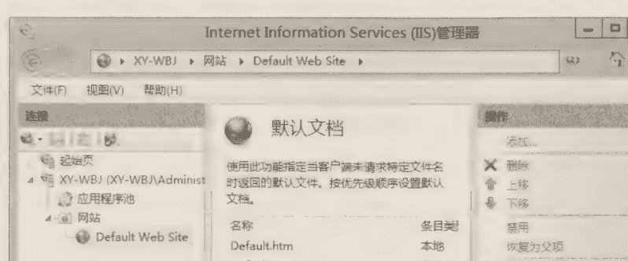

步骤 2 可以看到自己已经配置了 6 种类的默认文档。当客户通过浏览器访问站点时，Web 服务器会在站点目录中按字母从小到大的顺序进行搜索所列的默认文档，一旦找到文件的名称，就将其返回给浏览器的默认主页名称。这里新源的 HTML 扩展 `index.html` 设置为默认文档，在“默认文档”列表中选择 `index.html`，然后点击右键点击“操作”列表中的“上移”将其移动到最上面。

> 注意：设计与制作公司的 Web 主页不是本书的讨论范围，下面的步骤只是为了创建一个简单的静态主页。如果需要使用自定义的 6 种类型的其他网页作为默认主页，如 ASP.NET 扩展的文件名为 `index.aspx` 的主页，就需要通过找到“操作”列表中的“添加”链接，将该文件名添加到默认文档列表，再将其移动到最上一行。

步骤 3 使用“记事本”或编辑器，编写一个用于测试的简单的 HTML 站点首页，并将文件保存为 `E:\index.html`。下方给出一个主页的代码示例。

> 注意：使用“记事本”编辑文本内容，在保存文件时，默认是保存为 `.txt` 后扩展名的纯文本文件，此时必须在“另存为”对话框中将“保存类型”选定为“所有文件”，并在“文件名”下拉列表框输入文件名 `index.html`。

```html
<HTML>
<HEAD><TITLE>新源首页</TITLE></HEAD>
<BODY lang="zh-CN" DIR="LTR">
```

## 项目 Web 服务器配置与管理

<ALIGN-CENTER STYLE="margin-bottom: 0cm"><FONT SIZE=6 STYLE="font-size:32pt">新源公司</FONT></p>

<ALIGN-CENTER STYLE="margin-bottom: 0cm"></p>

<ALIGN-CENTER STYLE="margin-bottom: 0cm"><FONT SIZE=5 STYLE="font-size:20pt">第一个网站：可供网络访问的默认主站点</FONT></p>

```html
</BODY>
</HTML>
```

### 2. 测试网站

至此，一个基本的 Web 站点配置已经完成。客户只需要将网络参数中的“首选 DNS 服务器”地址设置为 `192.168.1.1`，打开浏览器并在地址栏输入 `http://www.xinyuan.com`，就可以浏览新源公司第一个 Web 站点了，如图 4-10 所示。


第一个网站：可供网络访问的默认主站点

4-10 客户端测试浏览第一个 Web 站点

## 三、在一台服务器上架设多个 Web 站点

### 1. 架设多个 Web 站点的方法及准备工作

作为中小型企业，新源公司现在准备了一个用于 Web 角色的服务器，但又需要建立多个不同的 Web 站点，只是每个站点的访问量并不大。这种情况下，使用 IIS 的虚拟技术，就可以在一台服务器上架设多个 Web 站点，并且每个站点都拥有自己的 IP 地址和域名。当用户访问时，看起来就像是在多个不同的服务器上一样。

利用虚拟网站技术在一台服务器上架设多个 Web 站点的搭建方式，可以节省有关设备投资，而且更具优势。处理站点与 Web 服务器的默认标准站点架设和管理方式基本相同。

- 1) 便于配置。当一台服务器上配置有多个站点时，可以按需求为每一个虚拟站点配置性能和带宽。

- 2) 分级管理。不同的虚拟机可以指定不同的人员管理。

- 3) 性能和带宽调节。

为确保用户的请求能够达到准确的站点，就需要为 Web 服务器上架设的每个站点配置一个标识的标识。从架设第一个 Web 站点的过程中可以看出，标识站点有 4 个标识：主机名（别名最左侧的名称，如 `www`），IP 地址、端口号和虚拟目录（用一个虚拟来映射目录结构）。因此，要确保四个标识中至少有一个不同，以便区分不同的站点，就可以有了在同一台服务器上架设多个站点的 4 种方法，如 4-3 所示。

#### 4-3 以不同的落点符构建多个 Web 站点的方法及说明

| 多点节点方法 | 说明 |

| --- | --- |

| IP 地址 | 主要用于在本地服务器上主控安全套接层(SSL)的 Internet 服务 |

| 非标准 TCP 端口 | 用于网络发布和测试，不推荐用于多 Web 节点架构 |

| 主机头名称 | 常用于多站点部署，推荐使用 |

| 虚拟域名 | Web 共享，可以以不同的落点符来构建其不同的站点内容 |

根据配置 Web 站点的规划，在利用上述方法构建其其余 3 个站点之前，读者应当完成以下两项工作：

- (1) 为其余 3 个站点配置相应的 DNS 解析。将 `www.xinyuan.com` 和 `study.xinyuan.com` 解析到 IP `192.168.1.2`，将 `www.xinyuan.com` 解析到 IP `192.168.1.5`。

- (2) 为其余 3 个站点分别创建目录 `E:\site2`、`E:\site3` 和 `E:\site4`，并在每个目录下创建一个 `index.html`，但内容有所区别，以便客户端中使用浏览器区分不同的站点。

### 2. 使用 IP 地址创建第二个 Web 站点

通过服务器上连接多个 IP 站点，为不同的站点设置 IP 地址。根据方案，主站点绑定的 IP 地址为 `192.168.1.2`，使用网卡绑定到另一个 IP 地址 `192.168.1.5` 来架设名为 `www.xinyuan.com` 的站点。步骤如下：

**步骤 1 为服务器设置 IP 地址**。打开“IPv4 属性”窗口，点击“高级...”打开“TCP/IP 设置”。在“IP 设置”选项卡中点击“添加”，弹出的“TCP/IP 设置”对话框中输入 IP 地址 `192.168.1.5`，域名 `www.xinyuan.com`，点击“添加”，见图 4-11。

**步骤 2 创建第二个 Web 站点**。在 IIS 管理中选择左侧的“网站”文件夹，在弹出的窗口中选择“添加网站”，点击“确定”打开“添加网站”对话框。在“网站名称”文本框中输入“网站”，在“物理路径”文本框中输入 `E:\site2`，点击“...”选择目录；在“IP 地址”列表中选择 `192.168.1.5`；在“端口”文本框中输入默认的 `80`；在“主机名”文本框中输入 `www.xinyuan.com`；勾选“启动网站”，如图 4-12 所示。

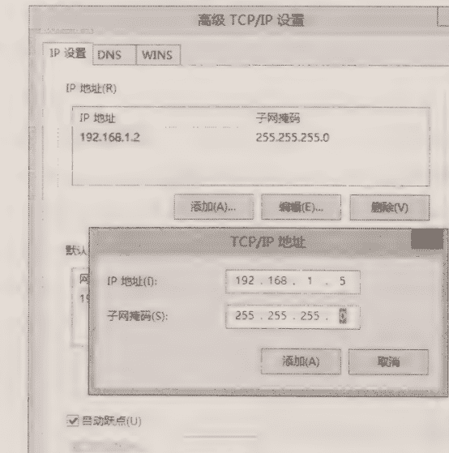

图 4-12 启动网站

最后点击“确定”按钮。


图 4-12 使用 IP 地址添加第二个 站点

**步骤 3 测试第二个站点**。在客户端浏览器的地址栏输入 `http://www.xinyuan.com`，就可以访问 Web 站点，如图 4-13 所示。


图 4-13 客户端测试第二个 站点

使用 IP 地址架构区分多个 Web 站点的缺点表 4-4。

表 4-4 使用 IP 地址架构区分多个站点

| 优点 | 缺点 |

| --- | --- |

| (1) 多个 web 站点更加独立、互影响。 | (1) 需要占用多个静态 IP 地址资源。 |

| (2) 可以在同一服务器上标识多个安全的 HTTPS 站点。 | (2) 要为一个 IP 地址标识的网站，Web 服务器需要消耗较多的内存资源 |

由于在同一服务器上为多个站点指派大量的、每个站点具有唯一性的 IP 地址会降低 Web 服务器的性能，这种方法主要用于标识主机层(SSL)或传输安全(TLS)的服务器上的多个站点。


### 3. 使用 TCP 协议连接第三个 Web站点

TCP/IP 传输层（TCP 和 UDP）依据端口（Port）来划分区域，请求时使用 TCP 协议与服务器连接。因此，TCP 端口是浏览器与 Web 服务器之间的信息通道。

任何网络服务都必须在服务器端指定一个端口，客户端在访问时必须指定该端口以建立通信连接，端口可以是 16bit，即可以是 0-65535 的数字。此时，0-1023 为已知端口（Well-Known Ports），保留端口或非特权端口，0 不使用（无效端口）；1024-65535 为动态端口（Dynamic Ports），也称为动态端口或非特权端口。所有人在浏览 Web 站点时通常不需要指定端口，是因为 Internet 服务规定了一项标准的端口，如 HTTP 服务为 80，FTP 服务为 21，DNS 服务为 53，SMTP 服务为 25。

由此可见，端口号用来区分站点。即使两个站点拥有相同的 IP 地址和主机名，只需要指定不同的端口号将它们区分开。根据方案，测试站点使用特定的 TCP 端口号 `8888`。另外两个站点（外网访问站点和内网访问站点）都限定同一个 IP 地址 `192.168.1.2`，名为 `www.xinyuan.com`。

**步骤 1 添加第三个站点**。在 IIS 控制台的“连接”列表中，右击“网站”，在弹出的快捷菜单中选择“添加网站”命令，打开“添加网站”对话框。在“网站名称”文本框中输入“网站”，在“物理路径”文本框中输入 `E:\site3`，点击“...”选择目录；在“IP 地址”列表中选择 `192.168.1.2`，在“端口”文本框中输入 `8888`；在“主机名”文本框中输入 `www.xinyuan.com`，勾选“启动网站”，如图 4-14 所示。最后点击“确定”按钮。


图 4-14 使用端口法添加第三个站点

### 4. 第四个站点

根据方案，主站点绑定的 IP 地址为 `192.168.1.2`，使用网卡绑定到另一个 IP 地址 `192.168.1.5` 来架设名为 `www.xinyuan.com` 的站点。步骤如下：

**步骤 1 为服务器设置 IP 地址**。打开“IPv4 属性”窗口，点击“高级...”打开“TCP/IP 设置”。在“IP 设置”选项卡中点击“添加”，弹出的“TCP/IP 设置”对话框中输入 IP 地址 `192.168.1.5`，域名 `www.xinyuan.com`，点击“添加”，见图 4-11。

**步骤 2 创建第四个站点**。在 IIS 管理中选择左侧的“网站”文件夹，在弹出的窗口中选择“添加网站”，点击“确定”打开“添加网站”对话框。在“网站名称”文本框中输入“网站”，在“物理路径”文本框中输入 `E:\site4`，点击“...”选择目录；在“IP 地址”列表中选择 `192.168.1.5`；在“端口”文本框中输入默认的 `80`；在“主机名”文本框中输入 `www.xinyuan.com`；勾选“启动网站”，如图 4-12 所示。


图 4-12 启动网站

最后点击“确定”按钮。


图 4-12 使用 IP 地址添加第四个 站点

**步骤 3 测试第四个站点**。在客户端浏览器的地址栏输入 `http://www.xinyuan.com`，就可以访问 Web 站点，如图 4-13 所示。


图 4-13 客户端测试第四个 站点

> 注意：主机名只能使用大写或小写的字母(A-Z)、数字、点(.)和字符(-)，其他字符均非法。

### 5. 使用虚拟架构部署多个 Web 站点

新源在 Web 服务器上架设 4 个站点的，通过使用 IP 地址、TCP 端口和主机名方法已经实现。在实际中还有第四种虚拟架构，也可以在同一台服务器上部署多个 Web 站点。

虚拟架构是指某一个虚拟站点的目录。这里所引用的虚拟站点，可以是前面 3 方法创建的任何一个站点，或者是虚拟架构所依托的站点。虚拟架构是在其站点中保存相同的资源和数据，用户可以用此访问询问的虚拟站点。

使用主机服务器名架构和区分多个 Web 站点的主要优点

| 优点 | 缺点 |

| --- | --- |

| (1) 多个 web 站点更加独立、互影响。 | (1) 需要占用多个静态 IP 地址资源。 |

| (2) 可以在同一服务器上标识多个安全的 HTTPS 站点。 | (2) 要为一个 IP 地址标识的网站，Web 服务器需要消耗较多的内存资源 |

## 2. 设计 Linux 环境下的实施方案

正是因为 Apache 有着众多优秀的特性，使得许多企业在 Linux 环境下使用系统自带的 Apache 来搭建 Web 服务器。根据本次的需求分析和规划设计，新增公司决定为 Apache 搭建 4 个 Web 站点。这里将参考表 4-2 的站点目录进行重新规划，使其在 Linux 环境下实施 Web 站点规划与实施方案，如表 4-7 所示。

表 4-7 新源 Web 站点的规划与实施方案

| 站点名称 | 站点域名 | IP 地址 | 端口 | 站点目录 | 实施方案 |

| --- | --- | --- | --- | --- | --- |

| 外网站点 | `www.xinyuan.com` | `192.168.1.2` | `80` | `/var/www/html` | 默认站点 |

| 绩效站点 | `yjhk.xinyuan.com` | `192.168.1.5` | `80` | `/var/site2` | 不同 IP 地址 |

| 培训站点 | `study.xinyuan.com` | `192.168.1.2` | `8888` | `/var/site3` | 不同端口 |

| 公司内站点 | `www2.xinyuan.com` | `192.168.1.2` | `80` | `/var/site4` | 不同主机头 |

## 3. Apache 软件的安装

Apache 在 IP 地址为 `192.168.1.2` 的运行 Linux 系统的服务器上，其软件包均通过 http 安装，服务名称为 `httpd`。如果是在 CentOS 6.5 上完全安装 Apache，可以通过下面的命令查询到 3 个软件包。

```bash
# rpm -qa | grep httpd
httpd-2.2.15-29.el6.1686
httpd-tools-2.2.15-29.el6.1686
httpd-manual-2.2.15-29.el6.noarch
```


如果没有查询到 Apache 的这些软件或未完全安装，读者可以参考项目一中的方法进行安装，这里不再重复说明。需要的是接下来在 Linux 环境下为 Apache 搭建 4 个 Web 站点时，每个站点的目录文件`index.html`、文档的 HTML 脚本代码不再将给客户端，客户端使用浏览器访问站点时也不将显示默认的页面，读者可以参考前面 Linux 平台配置时已经给出的 HTML 页面以及对应的浏览器页面。

## 2. 二架服务器的第一个站点

### 使用 Apache 的默认配置

Apache 的默认配置文件位于`/etc/httpd/httpd.conf`，它包含了针对 Web 服务器的全局性配置以及为 Web 站点的全部配置信息。在此，通过修改`httpd.conf`文件中的配置，就可以对 Web 服务器以及搭建的 Web 站点实现高效、精准和安全的配置。

`httpd.conf`文件中的配置非常多，其含义和作用的详细解释可以参考附录 B。对于初学者来说，应该先掌握几个基本最最重要的配置，包括：设置 Web 服务器的根目录、监听端口、运行服务器的用户和根目录路径、Web 站点的主页文档。

```bash
# vim /etc/httpd/conf/httpd.conf
ServerRoot "/etc/httpd"
Listen 80
User apache
Group apache
ServerAdmin root@localhost
DocumentRoot "/var/www/html"
DirectoryIndex index.html index.html.var
```

- // 以以下几个参数的默认配置

- // 默认的服务器目录

- // 默认监听的端口

- // 运行服务器的用户名

- // 运行服务器的组

- // 默认的文档路径

- // Web网站的主页文件名列表

其中，`DocumentRoot`用于设置默认的文档路径，即指 Web 网站的根目录；`DirectoryIndex`用于指定主页的文件列表。按照`httpd.conf`的默认配置，当客户通过浏览器访问 IP 地址或域名访问 Web 网站时，服务器就会自动到`/var/www/html`目录下查找`DirectoryIndex`列表中的第一个文件（即`index.html`）是否成功。若找到则找到主页返回给客户的浏览器；若未找到则会继续查找列表中的第二个主页......直到找到为止。`DirectoryIndex`给出的主页列表中的任意文件均未找到，则 Web 服务器将返回一个错误信息给客户的浏览器。

事实上，使用 Apache 配置文件`httpd.conf`的默认配置，无需对其进行任何修改即可满足一个基础 Web 网站的架构。

## 2. 创建第一个Web站点并进行测试

新源公司使用 Apache 的默认配置来一个可供外网访问的 Web 站点，只需为创建站点创建一个第一个主页并启动`httpd`服务。

- 步骤1 创建主页文件。在`/var/www/html`目录下创建新源公司第一个主页的文档索引`index.html`，请读者使用`vi/vim`编辑器完成创建（参考示例中的二）。

- 步骤2 启动`httpd`服务。使用的命令后即可启动`httpd`服务。

```bash
# service httpd start
# 启动httpd 服务
Starting httpd:
```

- 步骤3 测试第一个站点。在客户浏览器的地址栏输入`http://www.ianyuan.com/192.168.1.2`即可访问到第一个站点的主页。

> 注意：在没有对 Apache 主配置文件`httpd.conf`进行任何修改的情况下，尝试启动`httpd`服务应该出现成功的 OK 提示，由于此时可能不会出现在配置上的错误，否则笔者在实训计算机上出现`httpd`服务启动失败，打开`httpd`日志`/var/log/httpd/error_log`看到“Certificate not verified: Certificate not verified”表示证书已过期或请求早于实际日期。很多这种情况，读者不妨使用`date`命令在重启系统将日期为实际日期，或许就能成功。

## 三、在一台服务器上架多个站点

新源公司在架了第一个站点之后，还要同一服务器上架 3 个 Web 站点，可以通过虚拟主机来实现。

### 1. 使用虚拟主机架多个站点

- 1. (`ServerAdmin`)—指定管理员的邮箱

- 2. (`DocumentRoot`)—指定虚拟主机根目录

- 3. (`ServerName`)—指定虚拟主机名称和端口

- 4. (`ErrorLog`)—指定虚拟主机错误日志

- 5. (`CustomLog`)—指定虚拟主机访问日志

当然，新源公司希望剩余 3 个 Web 站点都能域名访问，在实施站点之前还需要配置 DNS。在实施过程中，其他 Web 站点的内容要在服务器上适配。例如，`DirectoryIndex`设置文件名，因此使用 IP 地址或域名访问也将变为。

### 2. 使用 IP 地址架第二个站点

IP 地址要在 Web 服务器上的网络接口绑定多个地址。根据项目设计，可以将外网站点的 IP 地址为`192.168.1.2`，而业绩站点绑定到另一个 IP 地址`192.168.1.5`来架。该站点的域名为`yjhk.xinyuan.com`，目录为`/var/site2`，配置路径为。

步骤1 使用以下命令为网接口绑定（一个或多个）IP 地址：

```bash
ifconfig eth0 192.168.1.5
```

> 注意：使用`ifconfig`只是临时配置，此配置信息在重启后将会失效。如果网络接口需要持久性配置，可以使用下方的方法创建并编辑接口。

```bash
cd /etc/sysconfig/network-scripts
cp ifcfg-eth0 ifcfg-eth0.bak
# 网络接口eth0复制为配置文件
vim ifcfg-eth0
# 打开eth0配置文件进行修改
# 概述如下
DEVICE=eth0
IPADDRESS=192.168.1.5
# 修改完毕，保存并退出
ifconfig eth0 up
service network restart
```

步骤2 配置 DNS，在正向解析文件中添加一行主机记录（A 记录），设置域名指向 IP 地址`192.168.1.5`，并重启网络服务。

步骤3 在`/var/www`目录下创建一个目录`site2`，然后在`site2`目录下创建一个名为`index.html`的首页文档。

步骤4 修改配置文件`httpd.conf`。在文件末尾添加以下内容，然后保存文件，重启启动服务。

```bash
vim /etc/httpd/conf/httpd.conf
# 编辑httpd.conf文件，添加以下内容
<VirtualHost 192.168.1.5:80>
  DocumentRoot /var/www/site2
</VirtualHost>
# 添加完毕，保存并退出
service http restart
```

步骤5 打开客户端浏览器，在地址栏输入`http://yjhk.xinyuan.com`，即可访问步骤3创建的第二个网站。

### 3. 使用TCP端口创建第三个网站

根据项目的设计方案，新源公司培训站点就是特殊的 TCP 端口（`8888`）区分不同区域的站点。该站点与另外两个站点都设置为`192.168.1.2`的 IP 地址，网站名为`study.xinyuan.com`。主目录为`/var/www/site3`，配置步骤如下：

步骤1 配置 DNS 服务器，在正向解析文件中添加一行主机记录（A 记录），设置域名指向 IP 地址`192.168.1.2`，并重启网络服务。

步骤2 在`/var/www`目录下创建一个目录`site3`，然后在`site3`目录下创建一个名为`index.html`的首页文档。

步骤3 修改配置文件`httpd.conf`。在文件末尾添加以下内容，然后保存文件，重启启动服务。

```bash
vim /etc/httpd/conf/httpd.conf
# 编辑httpd.conf文件，添加以下内容
Listen 8888
<VirtualHost 192.168.1.2:8888>
ServerName *
</VirtualHost>
# 添加完毕，保存并退出
service http restart
```

步骤4 打开客户端浏览器，在地址栏输入`study.xinyuan.com:8888`，即可访问创建的第三个站点。

> 注意：访问非标准端口的 Web 站点，地址栏输入的主机名或 IP 地址后必须指定端口。

### 4. 使用主机名法实现第四个站点

主机名法（即基于域名的）是企业网络中实现一台服务器上部署多个站点的良好解决方案，因为它不需要过多的 IP 地址和端口，部署简单，且无需额外的硬件、软件。根据本项目的设计，新增内网站点使用同一个主机名来区分不同站点，该站点与另外两个站点（外网访问站点和测试站点）绑定了同一个 IP 地址`192.168.1.2`，并且复用了 80 端口。站点名为`/var/www/site4`，配置如下：

步骤1 配置 DNS 服务器，在正向解析文件中添加一行主机记录（A 记录），设置域名指向 IP 地址`192.168.1.2`，并重启网络服务。

步骤2 在`/var/www`目录下创建一个目录`site4`，然后在`site4`目录下创建一个`index.html`。

步骤3 修改配置文件`httpd.conf`。在文件末尾添加以下内容，然后保存文件，重启启动服务。

```bash
vim /etc/httpd/conf/httpd.conf
# 编辑httpd.conf文件，添加以下内容
<VirtualHost 192.168.1.2:80>
  DocumentRoot /var/www/site4
</VirtualHost>
# 添加完毕，保存并退出
service http restart
```

步骤4 打开客户端浏览器，在地址栏输入`www2.xinyuan.com`，即可访问第四个站点。

> 注意：在没有对 Apache 主配置文件`httpd.conf`进行任何修改的情况下，尝试启动`httpd`服务应该出现成功的 OK 提示，由于此时可能不会出现在配置上的错误，否则笔者在实训计算机上出现`httpd`服务启动失败，打开`httpd`日志`/var/log/httpd/error_log`看到“Certificate not verified: Certificate not verified”表示证书已过期或请求早于实际日期。很多这种情况，读者不妨使用`date`命令在重启系统将日期为实际日期，或许就能成功。

## 任务四 服务器运维及访问

### 一、Web站点的深入配置

通过任务二的实施，已经完成了四个站点的配置，包括 IP 地址、端口、目录和默认文档，但实际运营的站点还需要支持文件类型、支持动态网页。为了满足客户对其站点的需求，就此为新公司站点设置访问限制、配置 IP 地址、配置 MIME 类型以及设置目录。

#### 1. 设置站点的访问限制

Web 服务为多个用户提供服务，当连接服务器的用户过多，服务器可能会难以承受。为了保证服务器安全有效，有时需要对服务器上的站点进行限制，可以限制带宽和连接数量。例如以公司第一个站点（域名为`www.xinyuan.com`）的默认主站点：

步骤1 在 IIS 控制台左侧的“限制”列表中，选择“网站”文件夹下的 Default Website，点击右侧“操作”列表中的“限制”链接，双击“编辑网站站点限制”对话框，如图 4-20 所示。可以看到，IIS 提供了限制通用访问（字节）和“限制连接数”两种限制的方法。

步骤2 勾选“限制并发（字节）”复选框，在下方的文框中输入允许的最大并发值。在控制 Web 服务器时开放的网络并发，可能会降低服务器的响应速度。当用户对服务器的请求过多时，如果通过连接设置了超时值，请求可能会被延迟。

步骤3 勾选“限制连接”复选框，在下方的文框中输入该连接的同时连接数。当连接数达到指定值后，以后的连接都会返回一个错误信息，将连接断开。限制连接可以有效阻止大量用户造成服务器过载的恶意攻击。在“连接超时”文框中输入时间，可以在用户达到该值时，显示连接超时为 120 秒。

## 网络服务器配置与管理教程（Windows Server 2012+Linux）

显示的界面（图 1-8），逐级选择“Web 服务器(IIS)”、“Web 服务器”、“安全性”和“IP 和限制”复选框，单击“上一步”“点击安装”按钮即可完成“IP 和限制”服务组件的安装。

在 IIS8 后在中间左侧的“连接”列表中选择“网站”文件夹的某个站点，就会在中间的焦点区域增加一个“IP4 地址和限制”图标。

在本项目任务二和任务三中新搭建的 4 个网站站点，实际上只有公司外网络客户是没有 IP 限制的，其他 3 个站点仅限于公司在内部网络上访问。

下面以新源的网站站点（域名为`www.xyiny.com`的“XY-NWZZ”站点）为例，对该站点的设置 IP 地址限制的方法。

在 IIS8 后中间左侧的“连接”列表中，选择“网站”文件夹的 XY-NWZZ 站点，在中间的该站点焦点区域中双击“IP 地址和限制”图标，如图 4-22 所示。

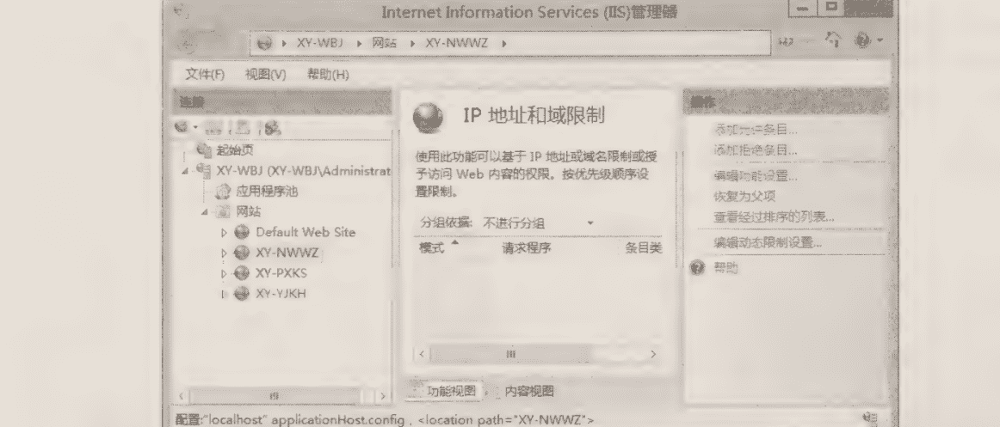

(1) 设置允许的客户访问。有些站点由于其使用范围需要拒绝所有该网站的访问，这就就需要将站点设置为“拒绝所有该网站”，然后添加允许访问的 IP 地址限制，新源的 XY-NWZZ 站点就属于这种情况，操作步骤如下：

步骤 1 设置为拒绝访问的 IP 地址。在 XY-NWZZ 站点的“IP 地址和限制”界面上，右键点击“操作”列表中的“编辑配置功能”链接，打开“编辑 IP 地址和限制设置”对话框。在“未指定的客户端的访问”下，通过下拉列表选择“拒绝”，如图 4-23 所示。这样设置后，所有未指定的 IP 地址的客户将无法访问该网站，如果访问时可能会出现“403.6”的错误信息。

步骤 2 设置允许的 IP 地址。在 XY-NWZZ 站点的“IP 地址和限制”界面上，右键点击“操作”列表中的“允许限制列表”链接，打开“允许限制列表”对话框。如果只想允许一个 IP 地址的客户访问站点，则勾选“IP 地址”单按钮，并输入允许的 IP 地址即可。但 XY-NWZZ 站点的访问需求是允许一个 IP 地址段的多个客户访问（实际情况往往比此更多），此时应勾选“IP 地址范围”单选按钮，并在下方的两个文本框中分别输入 IP 地址段`192.168.1.1/24`网段内有 IP 地址的客户访问，如图 4-24 所示。

## 项目四 服务器配置与管理

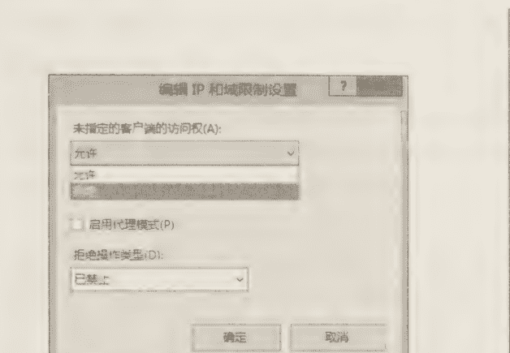

图 4-23“IP 和域限制设置”对话框


图 4-24“添加允许限制规则”对话框

> 注意：此处的 IP 地址是起始站点允许访问的客户端机 IP 地址的最低值。如果 IIS 将 IP 地址最低值与“掩码前缀”文本中输入的值进行运算后，即可确定访问的客户端机 IP 地址范围的上、下界。因此，此设置表示允许 IP 地址在`192.168.1.1~192.168.1.254`范围内的客户端访问站点。再次，如果设置的 IP 地址为`192.168.1.100`，输入的掩码为`255.255.255.0`，则表示所设置的站点仅允许 IP 地址在`192.168.1.100~192.168.1.126`范围内的客户端访问。

经过上述配置后，XY-NWZZ 站点就允许在公司网络中进行访问了。读者可以通过 PYKS 和 XY-YJKH 站点的访问限制进行相同的设置。下面介绍一种允许访问客户端的 IP 地址拒绝访问的方法，但并不是针对特定的客户端。在本项目中的站点的设置：

(2) 设置拒绝的客户端。这些站点可能对一个特定的 IP 地址允许访问，只是某些特定的 IP 地址或者某个 IP 地址段的客户端访问。在这种情况下，就需要将访问站点设置为允许所有 IP 地址，然后拒绝访问的 IP 地址。与允许访问的客户端类似，只需在“编辑 IP 和域限制设置”对话框（图 4-23）的“未指定的客户端的访问”选项列表中选择“允许”选项；最后在设置站点的“IP 地址和域限制”功能视图（图 4-22）中单击“添加拒绝规则”链接，打开图 4-25 所示的“添加拒绝限制规则”对话框进行设置。


图 4-25“添加拒绝限制规则”对话框

> 注意：作为客户端员工应该是允许访问公司内部站点的，但由于员工可能在外面或者家里工作，也希望通过 VPN 访问公司内部的站点，使员工通过 VPN 连接这些内部站点。有关 VPN 服务器配置将在本书第七章中实施。

### 3. 配置 MIME 类型

配置多功能 MIME 类型（Multipurpose Internet Mail Extension），其实就是 MIME 服务器将数据发送给应用程序或将其发送给客户端浏览器。如果存在特定格式的附加 MIME 类型就会告诉应用程序根据 MIME 类型来处理数据。默认情况下，IIS 的 Web 节点不支持`.html`等网页文件，还支持其他文件类型如`.jpg`。如果某些文件类型不是 MIME 类型，则在网页中运行程序或下载该文件时，就会出现“404.3”错误信息。此时，需要在 Web 节点添加相同的 MIME 类型。在 IIS8 控制台左侧的“连接”列表中，选择“Web”文件夹下的 Default Web 站点，在中间网格站点视图中双击“MIME 类型”图标，就会列出当前系统中集成的 MIME 类型，如图 4-26 所示。

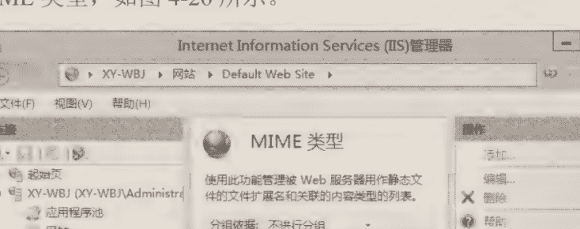

图 26 Default Web Site站点的“MIME 类型”配置

如果添加新的 MIME 类型，比如`.iso`文件，可以在右侧的“操作”列表中单击“添加”按钮，打开“添加 MIME 类型”对话框。在“文件扩展名”框中输入`.iso`，在“MIME 类型”框中输入`application/octet-stream`，如图 27 所示。最后单击“确定”按钮。添加 MIME 类型后，用户就可以访问站点中对应的文件。

图27 “添加 MIME 类型”对话框

如果要删除已有的 MIME 类型，单击编辑链接。


> 注意：通过带星号（`*`）的 MIME 类型，可以将 Web 站点配置为所有类型。若要修改已经有的 MIME 类型，可以双击相同扩展后通过编辑进行配置。

事实上，MIME 类型有两种：所有站点的 MIME 类型和某些站点的 MIME 类型。由于上述流程是在 Default Web 站点访问时“MIME 类型”图标进行配置，所以添加的类型只是局部类型。如果需要重新配置，应该在 IIS8 设置左侧面板的“连接”列表中选择服务器并在图中显示“MIME 类型”图标，然后进行编辑和删除，这样添加或管理的 MIME 类型就是全局类型。显然，全局类型继承了上级和子目录之间的属性。另外，如果要对站点进行重新配置，可以在 IIS8 设置左侧面板的“列表”中选择站点，然后在右侧的“操作”列表中选择重启 IIS 服务。

### 4. 设置网站目录的 NTFS 权限

当一个站点部署并在客户端访问时，如果出现“找不到网页”，首先应该检查 Web 服务器是否启动、站点配置是否正确、客户端访问是否正确、Web 服务器之间的连接是否正常。也会出现特殊情况，例如 Web 服务器本地测试时正常，但在客户端访问时失败，且客户端只显示错误信息：

(1) 提示 HTTP 500 内部错误无法网页

(2) 弹出一个登录窗口，要求输入用户名和密码

(3) 静态网页出错，而访问动态网页出错

这些症状在 Web 服务器运行时正常，而网页配置也没有问题，并且配置了用户权限。那么导致这些错误的原因是什么？一般是页面错误，可能是由于该站点的目录没有 NTFS 分区或者没有足够的权限。如果使用另一个 IIS 版本，通常部署在 NTFS 分区中，由于 NTFS 分区中的文件或文件夹默认权限是管理员全控制，而访问用户使用的是 IIS 站点连接。虽然网络用户启动后，它不会自动扩展到 NTFS 文件或权限。因此，当用户访问 Web 站点时，如果该站点的主页目录没有放在 `%SystemDrive%\inetpub\wwwroot` 目录，可能是 IIS 用户无法访问。

接下来将创建一个站点（域名名为 `xinyuan.com`），以 Default Web Site 为例，介绍如何设置站点目录的 NTFS 权限。

步骤 1 在服务器上打开“这台电脑”，右键点击“属性”，打开“站点属性”对话框，切换到“安全”选项，可以看到默认组权限，如图 48 所示。

> 注意：IIS7/8 设置站点目录的功能在 IIS 管理器中，在左侧“网站”列表中找到 Default 站点，点击右侧的“编辑”链接，可以打开站点属性，切换到“安全”选项进行设置。

步骤 2 点击“编辑”按钮，打开“站点权限”对话框，如图 29 所示。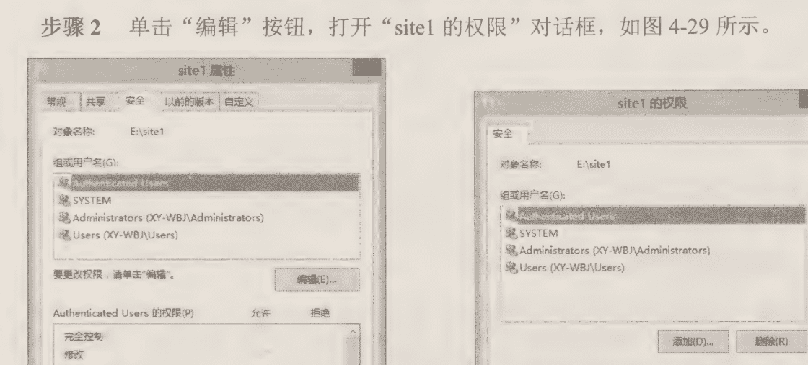

图 28 “站点属性”安全选项

图 29 “站点权限”对话框

步骤 3 点击“添加”按钮，打开“选择用户或组”。直接在“输入对象名称（示例）”文本框中输入 `IIS_IUSRS`，如图 30 所示。如果不知道，可以点击“查找”按钮，然后在搜索列表中选择 `IIS_IUSRS`，单击“确定”按钮。回到“选择用户或组”对话框后，选择的对象就会出现在“输入对象名称（示例）”文本框中。

步骤 4 点击“确定”按钮，关闭“选择用户或组”对话框。此时在“站点权限”列表中可以看到新添加的 Internet 账户（`IIS_IUSRS`），最后单击“确定”按钮。

> 注意：在“站点权限”对话框中添加了 Internet 账户后，根据站点的实际需要，还可以从“Internet 账户权限”列表对其做进一步设置。例如，有些与 Web 服务器交互的动态网站，应该分配给它“写”权限，某些情况下还需要“修改”权限

图 30 “选择用户或组”对话框

设置好 Internet 账户访问站点目录的权限，其他客户就能顺利浏览站点。

## 二、安全配置与管理

在实际运营的 Web 服务器上，管理员需要对一些关键信息进行保护，防止用户能够访问。Apache 对此提出了两种解决方法：基于主机的授权和基于用户的认证。对于每个用户个性化的站点，还需要对多个站点进行组织管理，这些需求可以通过 Apache 配置文件 `httpd.conf` 的精细配置来实现，使得站点更加高效稳定。

### 1. 配置主机

通过本次事务，已经使用服务器主机名为 `www2.xinyuan.com` 的新站点，其主目录为 `/var/www/site4/index.html`。将此内部站点设置为一个虚拟目录 `secret`，并对该域名站点实施主机授权，主要是为了说明主机的作用以及验证主机的效果。主机的授权是通过修改 `httpd.conf` 文件来实现，操作步骤如下：

- 步骤 1 首先在 `/var/www/site4` 目录下创建一个 `secret` 目录，然后在 `secret` 目录中创建 `httpd.conf` 文档，输入“我是基于主机授权的合法用户”。

- 步骤 2 修改配置文件 `httpd.conf`。添加以下内容后重启 http 服务。

```
# vim /etc/httpd/conf/httpd.conf
<directory "/var/www/site4/">
    Allow from 192.168.1.22
    Deny from 192.168.1.0/255.255.255.0
    Order deny,allow
</Directory>
```

```
// 允许 IP 为 192.168.1.22 的主机访问
// 拒绝子网络中其他主机访问
```

```
# 加载完毕，保存并退出
# service http restart
# 重启 httpd 服务
```

## 网络服务器配置与项目教程(Windows Server 2012+Linux)

```
# //修改后保存并退出
# service http restart
# 重启 http 服务
```

注意：`AllowOverride Auth` 的作用允许访问控制列表 `.htaccess` 中使用认证和授权指令。`.htaccess` 文件中常用的配置命令如表 4-9 所示，所有的认证配置指令同样可以出现在主配置文件 `httpd.conf` 的 `Directory` 容器中。

### 表 4-9 `.htaccess` 文件中常用的配置命令

| 配置项 | 作用 |
|---|---|
| `AuthName` | 指定认证区域，该名称在访问时弹出的“提示”对话框中向用户显示的 |
| `AuthType` | 指定认证类型 |
| `AuthUserFile` | 指定一个包含用户名和密码的本文 |
| `AuthGroup` | 指定包含用户组清单和这些成员清单的本文文件 |
| `Require` | 指定哪些组或用户被允许授权，例如<br>`Require user bj me`: 只有用户 `bj` 和 `me` 可以访问<br>`Require group bj`: 只有组 `bj` 中的成员可以访问<br>`Require valid-user`: 在 `AuthUserFile` 指定文件中的任何用户都可以访问 |

步骤 2 按一种方法的步骤 2 创建 3 个 Apache 用户：`bj`、`friend` 和 `me`。然后，在 `/var/www/site4/secret/` 目录下创建 `htaccess` 文件，输入以下内容并保存。

```bash
# vim /var/www/site4/secret/.htaccess
// 编辑.htaccess 文件，输入以下内容
AuthName "www"
AuthType basic
Require user bj me
AuthUserFile=/etc/httpd/passwd // 输入完毕，保存并退出
```

步骤 3 按一种方法的步骤 3 修改 `/var/www/site4/secret/index.html` 主页面。在客户端浏览器的地址栏输入 `http://2.xinyuan.com`，并输入用户名 `bj` 或 `me` 或其密码，相同，可以访问该虚拟目录起点的页面。但是如果输入用户名 `friend` 和密码，则无法访问该站点。这是因为使用了控制文件 `.htaccess` 来认证和授权，而 `friend` 用户未在 Freedom 目录中使用 `.htaccess` 文件中授权访问。

## 3. 为每个用户配置 Web 站点

为在 Web 服务器上拥有自己账号的用户配置 Web 站点，就可以使用这些用户能够都属于自己的站点起点。在这里在新源公司第一个可外访问网站的 Web 站点基础上，以 `bj` 用户为例，介绍该用户配置单独的 Web 站点的步骤。

步骤 1 打开配置文件 `/etc/httpd/httpd.conf` 找到如下内容。

```bash
# vim /etc/httpd/httpd.conf
// 找到如下内容
...
<IfModule user_dir.c>
UserDir disable
#UserDir public_html
</IfModule>
...
```

将上述内容修改为

```apache
<IfModule mod_userdir.c>
  UserDir disable root
  UserDir public_html
</IfModule>
#
```

其中，`UserDir disable root` 将禁止用户使用自己的个人站点，这一设置主要是为了安全考虑；`UserDir public_html` 是对每个用户 Web 站点目录的设置。

步骤 2 在配置文件 `/etc/http/httpd.conf` 中找到如下节配置内容，删去每行的号，即可配置生效。然后保存文件并重启 http 服务。

```bash
# /etc/http/httpd.conf
...// 找到下一节内容，节用于设置每个用户 Web 站点目录的访问权限
<Directory /home/*/public_html>
  AllowOverride None
  Options MultiViews Indexes SymLinksIfOwnerIncludesNoExec
  <Limit GET POST OPTIONS>
    Order allow, deny
    Allow from all
  </Limit>
  <LimitExcept GET POST OPTIONS>
    Order deny, allow
    Deny from all
  </LimitExcept>
</Directory>
... // 删除该节每个节配置前面的#使其生效，修改后保存并退出
// 重启 http 服务
service http restart
```

步骤 3 为每个用户的 Web 站点目录访问控制。以 `wbj` 用户例，命令如下：

```bash
su wbj                // 临时改为 wbj 用户身份
cd -                   // 回到 wbj 用户的主目录
mdir public_html     // 在 wbj 目录下创建public_html 目录
cd ..                  // 回到 wbj 目录的上级目录，即 home 目录
chmod 711 wbj         // 修改 home 目录的权限为 711
exit                  // 返回 root 用户身份
```

步骤 4 创建属于用户 `wbj` 的首页文档 `/home/wbj/public_html/index.html`。

步骤 5 访问 web 用户的首页，即在浏览器的地址栏输入 `http://192.168.1.2/-wbj/` 或者 `http://www.xiany.com/-wbj/`，此时即可访问步骤 4 创建的站点首页了。

注意：读者一定不要修改 web 用户目录的权限（如 `chmod 711 wbj` 命令），若不执行该命令，将会出现 Forbidden 的错误提示信息。另外，Apache 配置文件修改后，必须重启 http 服务才能使修改生效。

## 4. 组织和管理 Web 站点

随着 Web 服务器的不断运行，存放 web 文档的站点目录下往往会积累越来越多的内容，这会导致 Web 服务器的正常运行和维护带来一些问题。例如，在主目录空间不足的情况下如何添加新的站点目录、在主页移动位置之后如何使用户能够访问等我们将解决这些问题的方法。

(1) 创建符号链接。在 Apache 的配置中已经包含了以下符号链接的配置：

```apache
<Directory />
    Options FollowSymLinks
    AllowOverride None
</Directory>
<Directory "/var/www/html">
    Options FollowSymLinks
    AllowOverride None
    Order allow,deny
    Allow from all
</Directory>
```

其中，`FollowSymLinks` 是符号链接配置。因此我们需要在文档目录下使用下面的命令创建符号链接。

```bash
# cd /var/www/html
# ln -s /mnt/wbj Symlink // 创建符号链接
```

此后，在客户端浏览器的地址栏输入 `http://192.168.1.2/Symlinks` 就会在浏览器中显示 `wbj` 目录的文件。

(2) 别名。别名也是将文档目录以外的内容加入站点的方法。在 Apache 的默认配置中，main 两个目录设置为别名。使用 `Directory` 对目录限制可以参阅文档。当访问某个站点时就会记住这个目录，如果站点发生了变化，那么用户在使用 URL 请求就会出现“页面没有找到”的错误。为了让用户继续 URL 请求，就需要配置重定向。例如，静态目录使用一个目录来存放的内容，就把 `spring` 移动到旧目录中。首先，使用下面的命令在 `var/www/html` 创建两个目录：`years` 和 `years.old`；

```bash
# cd /var/www/html // 进入默认目录
# mkdir years years.old // 创建years 和 years.old两个目录
# mkdir years/spring // 在years 子目录创建 spring
# mv index.html years/spring/ // 编辑首页
```

在浏览器地址栏输入 `192.168.1.2/years/spring` 可以看到首页。但是如果 `spring` 被移动到了 `years.old`，应该修改 `httpd.conf` 文件，在文件中添加此配置：

```
Redirect 301 /years/spring http://192.168.1.2/years.old/spring // 重定向
```

重启 HTTP 服务器后，在浏览器地址栏输入 `192.168.1.2/years/spring`，同样显示刚才创建的首页，且地址栏变为 `/years.old/spring`。

## 二、搭建动态网站

在项目的实施中，使用 Windows Server 2012 和 Linux 两种平台架构的 Web 站点包含了一个静态主页 `index.html`，默认情况下只支持静态页。一般采用动态技术运行交互式网站就需要介绍 Windows 和 Linux 两种平台下动态网站，即搭建 ASP 环境和 LAMP 环境。

### 1. 搭建 ASP 环境

动态页面（Active Pages）是 Microsoft 提供的动态技术，可以创建和运行交互式网站或者使用 IIS 服务器运行首页。首先要安装 ASP 组件，才能运行 ASP 环境。

(1) 检查 ASP 组件。点击“开始”，“找到服务器管理器”，在“服务器管理器”中左侧选择“站点”，在右侧的详细列表中，点击“角色和功能”，查看已安装的角色和功能。如果“应用程序开发”下的 ASP 组件未安装，可以单击“角色和功能”按钮，点击“添加和功能”打开对话框。通过“下一步”直到“选择服务器”界面，连续选“Web 服务器(IIS)”→“Web 服务器”→“应用程序开发”→“ASP”，点击“下一步”完成 ASP 安装。

(2) 搭建 ASP 环境。在 IIS 安装后左侧的“连接”列表中，展开“网站”文件夹并选择支持 ASP 动态网页的站点，如 Default Site。然后在中间窗口的站点功能中双击 ASP 图标，如图所示，即可设置 ASP 的编译、服务和属性。此时，需要将“启用”属性设置为 True。

注意：在 64 位的 Windows Server 2012 中内置 IIS 8 应用程序池。如果需要在 IIS 8 中启用 32 位程序，可以在 IIS 8 控制左侧的“连接”列表中选择“应用程序池”，对右侧的“操作”列表中单击“设置应用程序池”，将“启用 32 位程序”设置为 true。

## 2. 搭建应用环境

在 Linux 环境下，采用 Apache+MySQL+PHP 的开发平台已成为架设 Web 网站的“黄金组合”，以 Linux、Apache 和 PHP 合在一起，这种组合合称为 LAMP。也就是基于 Linux 操作系统，用通用的 Apache 作为 Web 服务器，并带有数据库管理工具的关系数据库 MySQL。完成后后台运行脚本语言则是 PHP 或 Perl、Python 作为 Web 程序的语言。这种“黄金组合”方案是免费和开源的方式对于全世界的用户都具有很强的吸引力，无论企业还是个人开发者，都无需再购买“专业”的商业软件。特别是在互联网方面，不需要维护发布后许可证就可以开发和应用基于 LAMP 的项目。这种架构具有系统效率高、灵活、可扩展、稳定和安全等优点，运行于 Windows、Linux、Mac OS 等多种环境。

### (1) 安装 MySQL。以下以 MySQL-5.0.27 例介绍安装步骤。

- 步骤 1 从 `https://www.mysql.com/downloads/index.html` 获取最新版的 MySQL 源码包 `mysql-5.0.27.tar.gz`，将其解放在 `/var/www/` 目录下。

- 步骤 2 添加用户和组。mysql 服务需要用 mysql 的用户来执行，命令如下：

```bash
# groupadd mysql
# useradd -g mysql mysql # 创建 mysql 用户添加到组
```

- 步骤 3 将得到的 mysql 压缩文件解压缩，命令如下：


```bash
cd /wbj // 进入/wbj 目录
tar -xzvf mysql-5.0.27.tar.gz // 解压 mysql 软件包
```

- 步骤 4 进入当前目录下解压`mysql-5.0.27`目录后即可安装，命令如下：

```bash
cd mysql-5.0.27 // 进入解压 mysql-5.0.27 目录
./configure --prefix=/usr/local/mysql // 安装的目标目录/usr/local/mysql
make // 编译
make install // 安装
```

- 步骤 5 创建授权表，命令如下：

```bash
cp support-files/my.cnf /etc/
```

- 步骤 6 修改权限，命令如下：

```bash
chown -R mysql:mysql /usr/local/mysql
```

- 步骤 7 启动 MySQL，命令如下：

```bash
# mysqld_safe &
```

## 项目四 Web 服务器配置与管理

PHP 的相关信息。保存主页文件后，在浏览器的地址栏输入`http://xinyuan.com`，即可在浏览器中看到 PHP 的相关信息，表明 Apache 和 PHP 基本配置完成。

步骤 3 为了 PHP 能够使用 MySQL 数据库，还需要对 PHP 配置`php.ini`进行修改，如下：

```ini
# vim /etc/php.ini // 编辑 php.ini
register_globals = off // 将 Off 改为 On，否则读不到 post 的数据
...
extension=mysql.so
extension=mysqli.so // 在文件末尾添加以下行（注：此处OCR可能有误）
```

步骤 4 启动 MySQL，命令如下：

```bash
# service mysqld start // 启动 MySQL 服务
```

如果`mysqld`启动失败，可能还需要打开`/etc/hosts`文件，按如下修改：

```bash
# vim /etc/hosts // 编辑 hosts 文件
# Do not remove the following line, or various programs
# that require network functionality will fail.
::::1 localhost.localdomain localhost //其中的:1为127.0.0.1
```

步骤 5 测试 MySQL。把 PHP 主页文件`/var/www/html/index.php`修改为以下内容：

```php
<?php
$link=mysql_connect('localhost','root'); // 修改index.php 主页文件为以下内容
if ($link) { echo "yes"; }
else echo "no";
mysql_close();
```

保存主页文件后，在浏览器的地址栏输入`http://xinyuan.com`，即可在浏览器中看到，表明 MySQL 安装配置完成。

(4) 管理 MySQL。由于 MySQL 标准发行版没有提供图形界面的管理工具，使用起来不太方便了。为了解决这个问题，就出现了 MySQL 的图形化工具`phpMyAdmin`。实际上`phpMyAdmin`也是用 PHP 编写的 B/S 结构的软件，安装`phpMyAdmin`只需要将软件包解压到允许运行 PHP 的目录即可。

从`sourceforge.org/projects/phpmyadmin`下载`phpMyAdmin`版本，将软件包解压并移动到 Web 站点的目录`/var/www/html`，并重命名为`phpadmin`，然后在浏览器的地址栏输入`http://127.0.0.1/phpadmin/index.php`，点击打开即可显示安装成功。

另外，可以使用`Webmin`工具对 MySQL 数据库进行图形化管理。`Webmin`也是采用 Web 模式，客户端使用 Web 浏览器可以直接访问`Webmin`服务器。`Webmin`管理还可以对整个系统进行管理，其中分为 Webmin、System、Network、Hardware、Cluster、Others 共 6 个模块，所有的功能模块都被划分到这些列表页中。具体步骤如下：

步骤 1 从`http://downloads.sourceforge.org/webadmin/`下载新的`Webmin`，将其包装放在 Linux 环境下适当的安装，使用`rpm`命令进行安装。

- `rpm -ihv webmin-1.3401-1.x86.rpm`

步骤 2 安装完成后，在浏览器的地址栏输入`https://127.0.0.1:10000`，如果能显示页面，则表示安装成功。

(5) 安装 PHP 开发工具 Zend 并解决中文乱码问题。Zend 是专业开发人员在 PHP 整个开发周期中唯一的集成开发环境(IDE)，它包含了 PHP 所有必要的开发组件。Zend 通过一套套桶、调试、测试、优化和数据库工具来加速开发周期，并处理复杂的应用程序。下载 Zend 软件后，可以按照下方进行安装。

```bash
tar -xzvf ZendStudio-5.0.5_tar.gz
```

解压后得到`ZendStudio-5.0.5_bin`，直接运行即可安装。

```bash
./ZendStudio
```

创建软链接到`ZendStudio`。

```bash
ln -s /usr/local/zend/ZendStudio-5.0.5/bin/zde /usr/bin/zde
```

这样，在字符环境下运行`zDE`命令可以启动`ZendStudio`。由于 Linux 上的`ZendStudio`中文支持还不够，打开后还会显示乱码，需要安装`simsin.ttf`字体。可以看到 Windows 系统的`C:\Fonts`中找到`simsin.ttf`，把字体文件复制到 Linux 系统中即可，命令如下。

```bash
mkdir /usr/local/zend/ZendStudio-5.0.5/jre/lib/fonts/fallback
cp -snf /usr/local/zend/ZendStudio-5.0.5/jre/lib/fonts/fallback/simsin.ttf
```

复制完成后重启`ZendStudio`，就可以显示中文了。

(6) LAMP 安全防护设置。主要包括几个功能

- 1) 取消需要的服务。Linux 是一个巨大的操作系统，在默认情况下运行很多服务，但不仅占用了系统资源，而且很容易引起安全隐患。例如，部分服务是`xinetd`管理的，我们只需要去除掉它们，通过编辑`/etc/xinetd.conf`文件，在需要的服务前面加上`#`注释；或者使用`ntsysv`命令在用户文本界面来取消服务。例如，停止`smtp`、其他服务，如`gopher`, `rsh`, `rlogin`, `tac`, `talkd`, `finger`等都可取消的。

- 2) 隐藏数据库的信息。打开 PHP 配置，加入`ServerSignature`和`ServerTokens`配置。`ServerSignature`出现在 Apache 404 页面和目录列表的底部。参考 Apache 部分显示：`ServerTokens`用来限制会在 HTTP 响应的头部填充什么，设置为`Prod`后，响应头部设置为`Server-Apache`

- 3) 以安全模式运行 PHP。打开 PHP 配置文件`php.ini`，找到`SafeMode`属性，把`SafeMode`设置为`Off`。这样可以使用`exec()`来禁用它。如果需要这些功能，则找到`safemode_dir`配置，在后面加入路径，如`/usr/local/php`，最后重启 Apache

- 4) 关闭 PHP 的错误显示。打开 PHP 配置文件`php.ini`，使用`display_errors=On`配置为`Off`。将错误日志到文件中，将`error_log=Off`配置为`On`，并将`error_log=filename`字段改为`/var/log/php`，这样日志就会记录到文件中。此外还可以做更多安全增强：如配置防火墙只开放必要的端口、使用远程连接、使用 PHP 的加密技术、以及 Apache 使用模块（如`mod_status`）、安装 Antivirus

## 小结

Web 服务又称为 Web（WWW）服务器，它与客户端之间遵循传输协议（HTTP），并采用标识（URL）标记网络上的各种资源，用户通过网络方便地浏览和共享资源。因此，配置 Web 服务器是必要的。一台 Web 服务器可以设置多个站点，这就需要每个站点有唯一的标识。例如，在同一 Web 服务器上设置多个站点的方法：主机名、IP 地址、TCP 端口和目录。注意的是，当客户使用浏览器访问非80 端口的站点时，在地址栏中带有端口号；访问虚拟站点时，在地址栏中带有域名。在 Windows Server 2012 下，配置 Web 服务器必须安装“Web 服务器（IIS）”角色。互联网信息服务（IIS）管理控制台（MMC），用于配置应用程序或 Web站点、FTP 站点。Windows Server 2012 使用 IIS 8.0 版本功能强大、快速、可用，能够应对高负载、大数据。如果创建一个具有用户访问的 Web站点，Apache 无疑是最佳选择。修改配置文件`/etc/httpd/httpd.conf`，该文件包含了 Web 服务器设置站点的所有信息。无论是 Windows 还是 Linux，设置一个 Web站点的主要工作就是为其配置 IP 地址和端口、目录和默认文档。完成企业需求的 Web站点后，还可以通过设置站点的访问限制、IP 地址限制、MIME 类型、基于用户认证等，提高站点的访问效率和安全性，动态环境。

## 服务器配置项目(Windows Server 2012+Linux)

## 习题

### 一、简答题

1. 解释下列词：WWW; HTTP, URL。

2. 简述 Web 服务器的工作原理。

3. 在同一台 Web 服务器上设置多个网站可以采用哪种方法？

4. 在 Windows Server 2012 中，配置 Web 服务器必须安装什么角色？

5. 什么是 IIS?Windows Server 2012 中使用的版本是什么？

6. 在 Linux 下使用 Apache 的服务器有哪些优势？主配置文件是什么？

7. 简述`httpd.conf`文件中`ServerRoot`、`Listen`、`DocumentRoot`、`Directory`配置的作用。

8. 在“Internet Information Services(IIS)管理器”窗口中，设置网站的访问限制和 IP 地址限制有什么意义？

### 二、训练任务

天顺公司要求在一台 Web 服务器上采用不同端口、IP 地址设置 3 个不同用途的网站，网站的规划见表 4-10。

#### 表 4-10 天顺公司 Web 网站规划

| 站点名称 | 站点域名 | IP 地址 | 端口 | 站点目录 | 实施方案 |

| :--- | :--- | :--- | :--- | :--- | :--- |

| 公司外网访问站点 | www.tsfs.com | 192.168.0.2 | 80 | Site1 | 默认站点 |

| 内部网站站点 | www.tsfs.com | 192.168.0.2 | 8080 | Site2 | 不同端口 |

| 培训考核站点 | pkxh.tsfs.com | 192.168.1.5 | 80 | Site3 | 不同 IP 地址 |

(1) 按上述需求，分别在 Windows Server 2012 和 Linux 两种平台下完成 3 个 Web站点的主目录的配置。

> 提示：在 Linux 平台下使用`site1`、`site2`、`site3`都在`/var/www/`；另外，为了可以使用域名访问，需自行配置上述域名的 DNS 解析。

(2) 配置客户端，使用浏览器测试站点是否能够访问。

(3) 按照标准化的格式，编写 Web 服务实施报告。

## 项目五 FTP 服务配置与管理

### 目标

- 根据企业需求和项目规划

- 在 Windows 和 Linux 两种平台下正确安装和配置 FTP 服务器

- 客户端使用命令行或图形界面连接 FTP站点并上传、下载文件

- 具备 FTP 服务器的管理和维护能力

### 知识点

- FTP 的基本概念和工作原理

- 基于 IP 地址的虚拟主机基本概念

- Linux 系统中配置文件`ftpd.conf`中的常用配置项

- 主动模式(PORT)和被动模式(PASV)

### 任务一 知识预备与方案

#### FTP原理及应用

##### 1. FTP 概念

基于不同的操作系统，可能有多种 FTP 应用程序，但是这些都遵循一种协议，这样用户就可以把文件发送给别人，或者从其他环境中获得文件，连接的方式以及操作系统无关。

##### 2. FTP 工作原理

FTP 是 TCP/IP 的一种具体应用，它工作在 OSI 参考模型的第七层，TCP/IP 模型的第四层，应用层。使用 TCP 传输，不支持 UDP 传输，数据传输面向连接的的可能的。客户端有字符界面和图形界面两种。

# 网络服务器配置与管理体系流程(Windows Server 2012+Linux)

当服务器提供 FTP 服务时，作为一种安全措施，大多数情况下指定某些目录向公众开放权限，不允许上传文件，并且系统中的其他用户处于隐藏状态。即使有些匿名 FTP 服务器允许用户上传文件，通常也只能传到某个用户上传的目录中，管理员后会检查这些文件，并将其移动到另一个公共目录供其他用户下载，尽量避免无用上传文件（带有病毒的文件），以保护 FTP 服务器和用户的安全。

## 二、设计企业 FTP 服务

### 1. 分析客户需求

新源公司规模虽然属于中小型企业，公司各小组的区域分布比较分散。为了方便各地、各地的员工以及业务客户能够共享某些产品信息、技术资料和文件沟通，公司总部近期需要设立一个 FTP 站点，并对该站点提出了以下要求：

- (1) 公司员工及 Internet 的任何账号可从站点下载允许公众共享的文件资料。

- (2) 仅允许公司内部拥有合法账号的员工上传文件到自己独立的文件夹，以便随时读取，并且这些员工之间还可以分享和交流他人经验、知识和技术文档。

- (3) 有良好的安全保障措施，避免用户使用上传的文件，访问站点外的系统架构及其他信息等因素影响服务器系统的安全。

企业建设一定满足需求的 FTP 站点并与 Web 站点一样，对树立企业形象、增进企业内部员工与客户之间的交流、优化企业内部管理等都具有十分重要的意义。其实上述需求也是多类对 FTP 站点的典型需求。虽然 Web 站点可以提供文件下载服务，但 FTP 站点的文件传输效率更高，并且可以对各类用户的访问设置更加严格的权限。

### 2. 网络拓扑结构

按照新源公司网络信息服务的总体规划，公司内部部署的 FTP 服务项目的网络拓扑结构如图 5-3 所示。

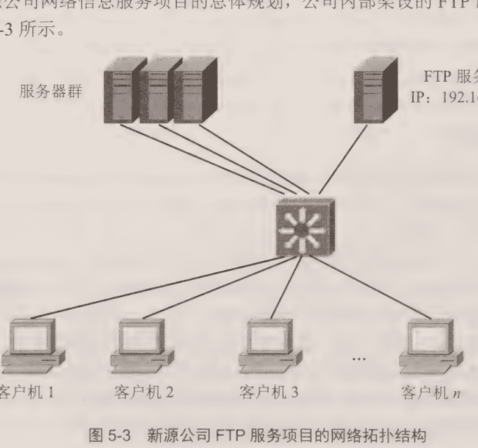

图 5-3 新源公司 FTP 服务的网络拓扑结构

### 3. FTP 站点方案

根据新源公司网络信息服务项目的总体规划，对于 Windows 和 Linux 两个平台下架 FTP 站点分别进行规划与设计，如表 5-1 所示。

表 5-1 新源 FTP 站点的规划与设计

| 站点名称 | 站点域名 | IP 地址 | 端口 | 备注 |

| --- | :--- | :--- | :--- | :--- |

| 新源公司 FTP 站点 | ftp.xinyuan.com | 192.168.1.4 | 22(默认) | Windows 平台 E:\ftroot /var/ftp |

同时，通过对服务器 FTP 站点进行详细参数配置，设计站点的方案如下：

- (1) 匿名访问。任何人都可以使用用户名登录 FTP 站点，但只能从公共目录(`public`或`pub`)中下载文件，不允许上传文件，也不允许访问已注册用户的目录。

- (2) 登录访问。为公司某些员工建立 FTP 站点，但采用“隔离用户”模式。这种模式就是，员工通过用户名和密码登录 FTP 站点后，仅对自己的目录具有写入和删除权限，而对站点目录及其包含的公共目录和其他用户的目录都只有读取权限。

## 二 Windows FTP 服务器配置

新源公司有大量的资料需要为业务客户以及互联网上的普通用户下载，公司内部员工经常需要通过 FTP 站点存放或交换技术文档，这就要求 FTP 服务器具有足够的存储容量，能够承受高频次的访问。为此，新源公司单独部署了一台业务服务器来设立 FTP 站点，在服务器上安装 Windows Server 2012 R2 操作系统之后，必须对这台服务器网络的的角色进行部署。

## 一、部署服务器的网络与连接

### 1. 配置 TCP/IP 网络参数

在项目组设 FTP 服务器时，要设置对应 IP 地址为 192.168.1.4 的静态和反向解析记录。在 Windows Server 2012 R2 配置 TCP/IP 网络参数的详细操作可参阅项目一，这里不显示和图示。根据项目总体规划和方案设计，在点击“启用 IPv4 协议 (TCP/IP) 属性”对话框后，在对应的文本框中输入 IP 地址 192.168.1.4、子网掩码 255.255.255.0、默认网关 192.168.1.254、首选 DNS 服务器地址 192.168.1.1，并点击“确定”按钮关闭对话框即可。

### 2. 安装 FTP 服务器


在 Windows Server 2012 R2 中，“FTP 服务器”是“Web 服务器(IIS)”角色的一个角色。因此，在新源公司 IP 地址为 `192.168.1.4` 的计算机上安装 FTP 服务器，其实就是添加“Web 服务器(IIS)”角色。由于在部署 Windows Server 2012 R2 服务器时，作为添加角色的实例，已在 IP 地址为 `192.168.1.2` 的计算机上添加了“Web 服务器(IIS)”角色，并给出了操作方法和详细步骤，所以这里不再重复。其重点是：“添加角色和功能引导”进行“选择角色功能”步骤，必须选择“FTP 服务器”及其包含的“FTP 服务”和“FTP 扩展”角色，并且同样选择“管理工具”及其包含的“IIS 管理台”角色，如图 5-4 所示。

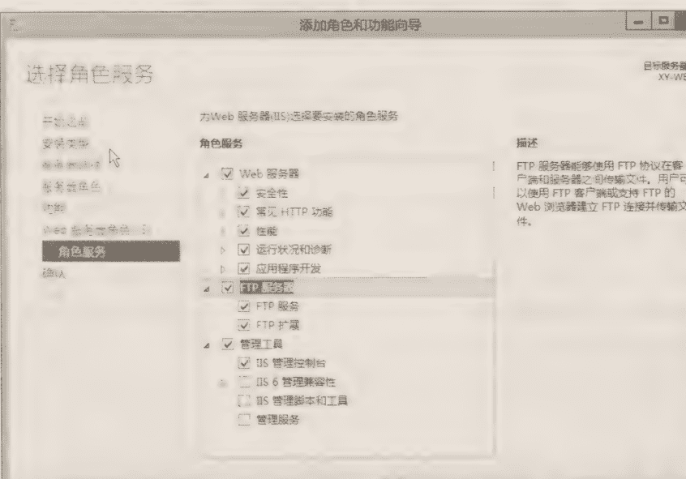

图 5-4 安装 FTP 服务器到 Web 服务器(IIS)角色中的功能

### 3. 检查已安装的角色

安装 FTP 服务器后，打开“服务器管理器”，在左侧列表中选择 IIS，在右侧列表中点击“角色和功能”区域，其中列出了已安装的 IIS 角色和功能，就可以看到“FTP 服务器”角色，如图 5-5 所示。


图 5-5 “Web 服务器(IIS)”角色的角色和功能

注意：在 Windows Server 2012 中，FTP 站点与 Web 站点都是通过“Internet Services 管理”（以下简称 IIS 管理）进行统一配置和管理的。这与之前 Windows Server 2008 使用不同的是，IIS 安装 FTP 服务器之后创建了一个 `Default Site`，作为独立的“网站”，然而 IIS 安装后没有默认 FTP 站点，要手动添加完成。

## 二、策划 FTP 站点

站点根据本项目设计，新源公司 FTP 站点的目录为 `E:\ftroot`，所以在添加 FTP 站点之前自己创建 `E:\ftroot`。

### 1. 添加 FTP 站点

- 步骤1 打开 IIS 管理，在左侧的“连接”列表右击“网站”，在弹出的菜单中选择“添加 FTP 站点”，或者选择“网站”后点击右侧“操作”列表中的“添加 FTP 站点”，如图 5-6 所示。

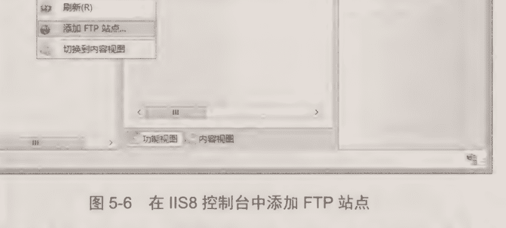

图 5-6 IIS 台中添加 FTP 站点

- 步骤2 打开“添加 FTP 站点”对话框，进入“站点信息”界面。在 FTP 站点名称文本框中输入“新源公司 FTP 站点”，在“内容目录”的“物理路径”文本框中输入 `E:\ftroot`，如图 5-7 所示。注意：FTP 站点名称用于标识“网站”下的站点，与用户访问显示无关，一旦创建就不可更改。内容目录的物理路径是 FTP 站点的位置，必须在此之前创建目录，否则会提示“路径不存在或不是一个目录”错误，也可以点击“物理路径”右侧的按钮选择存在的目录。

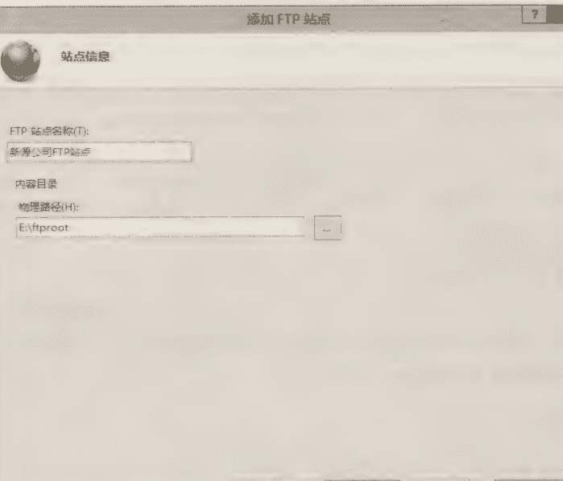

图 5-7 “添加 FTP 站点”的“站点信息”界面

- 步骤3 点击“下一步”按钮，进入“绑定和 SSL 设置”界面。在“IP 地址”列表中选择这台服务器的 IP 地址 `192.168.1.4`，“端口”文本框保持默认的端口 `21` 不变，并勾选“自动启动 FTP 站点”复选框。由于新源公司对 FTP 站点的设立并没有提出基于 SSL 的安全 FTP 服务（FTPS）的需求，所以 SSL 选项组中选择“无 SSL”单选框，如图 5-8 所示。

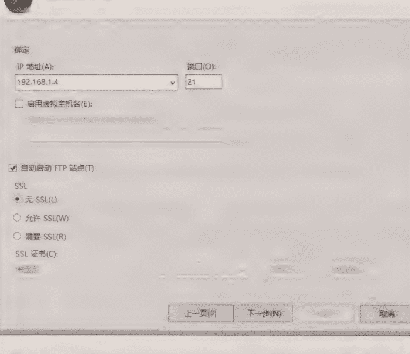

图 5-8 “添加 FTP 站点”的“绑定和 SSL 设置”界面

## 三、FTP 服务器配置与管理

注意：点击“IP 地址”下拉列表，弹出的列表中包含该服务器的所有 IP 地址选项以及一个“全部未分配”选项。如果勾选了“全部未分配”，且服务器配置有多个 IP 地址，则无论哪个 IP 地址都可以访问。SSL（Secure Sockets Layer，安全连接）和 TLS（Transport Layer Security，传输安全）为网络通信提供加密和数据完整性的安全协议，主要提供的服务包括：①认证用户和服务器，确保数据发送到正确的客户端和服务器；②加密数据，防止数据被截获；③维护数据的完整性，确保数据在传输过程中不被“中间人”恶意篡改。HTTPS FTP 是基于 SSL/TLS 的 HTTP。

- 步骤4 点击“下一步”按钮，进入“身份验证和授权信息”界面。根据新源公司 FTP 站点的设计方案，若允许访问 FTP 站点，对根目录只有读取权限。因此，在“身份验证”选项中勾选“匿名”和“基本”两个复选框；在“授权”选项中勾选“允许访问”并在列表中选择“所有用户”，在“权限”选项中只勾选“读取”，如图 5-5 所示。


图 5-5 “添加 FTP 站点”的“身份验证和授权”界面

注意：这里的“匿名”和“基本”是 FTP 的两种身份验证方式。匿名访问无需密码，基本验证是指使用用户名和密码进行验证。“授权”和“权限”选项都是针对目录权限的设置。虽然新源 FTP 站点允许用户上传文件，仅限用户写入自己的目录，对站点目录只有读取权限。因此在权限选项中不要勾选“写入”，否则包括用户名在内的所有用户都将上传文件到站点目录创建或删除。

- 步骤5 点击“完成”按钮完成。在 IIS 管理左侧的“连接”列表中点击“网站”，就能看到新创建的 FTP 站点，如图 5-6 所示。

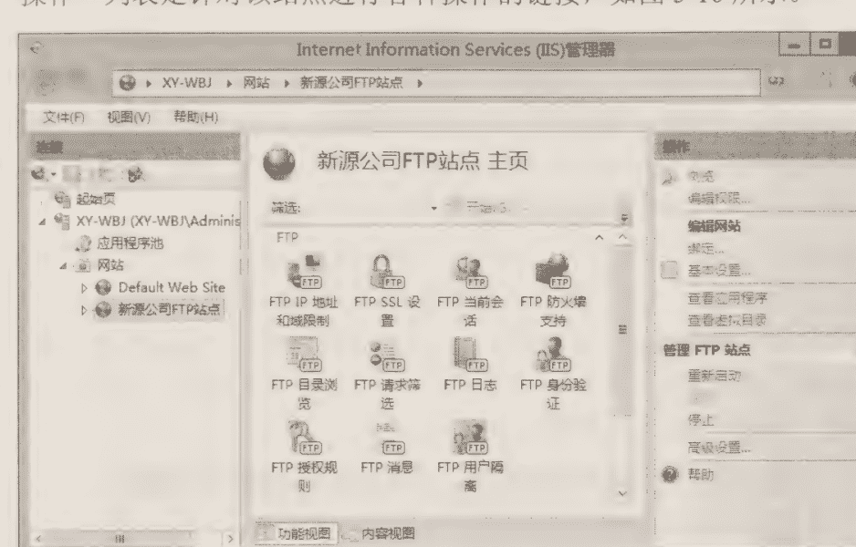

图 5-6 “网站”列表

## 2. 创建用户

为了实现隔离用户模式，需要为每个员工创建独立的本地用户。

- 步骤1 在“计算机管理”中右击“用户”文件夹，选择“新建用户”。在“用户名”文本框中输入用户名（如 `user01`），设置密码，并勾选“用户下次须更改密码”。点击“完成”。

- 步骤2 在“计算机管理”中，右击刚才创建的用户，选择“属性”。在“常规”选项卡中，勾选“启用此账户的磁盘登录”。点击“应用”并“确定”。


图 5-7 用户属性

- 步骤3 在“计算机管理”中，右击刚才创建的用户，选择“属性”。在“常规”选项卡中，勾选“启用此账户的磁盘登录”。点击“应用”并“确定”。

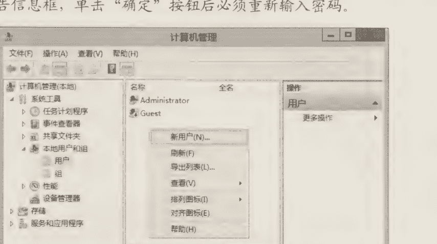

图 5-8 用户属性

- 步骤4 在“计算机管理”中，右击刚才创建的用户，选择“属性”。在“常规”选项卡中，勾选“启用此账户的磁盘登录”。点击“应用”并“确定”。

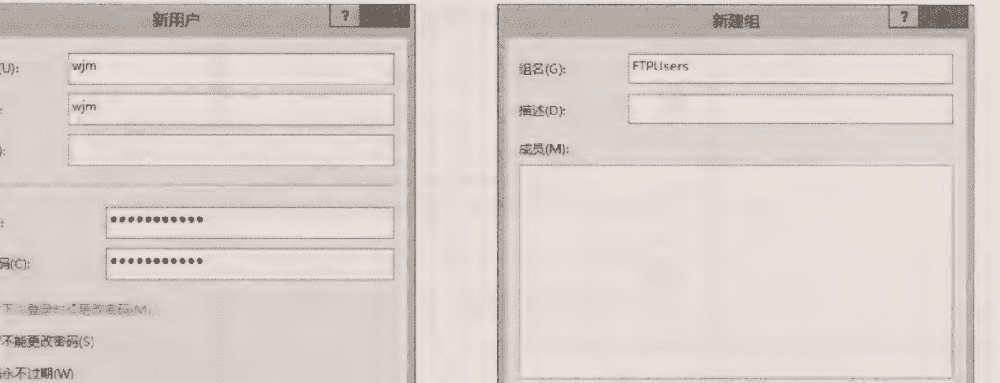

图 5-9 用户属性

## 步骤 6

重复步骤 2~5 步骤，为用户 `wjm` 的用户目录设置 FTP 授权权限。

**注意：** 在之前的 Windows Server 2008/2003 中利用 IIS/7 建立的 FTP 站点，因为不能在 Windows Server 2012 中使用控制台来统一 FTP 站点权限，则必须通过 NTFS 文件系统（即在文件管理器中）为 FTP 站点根目录及每个用户目录划分访问权限，所以这项工作很复杂。特别是 FTPUsers 组对站点目录设置 `ftproot` 权限，要求其只有读取和拒绝写入的权限，且不能让 `ftproot` 目录包含的所有 FTP 用户默认继承它的拒绝写入权限，因此必须确保 `ftproot` 属性具有安全性设置，将 FTPUsers 组加入为允许的用户组，并将其“写入”权限设置为“拒绝”；再通过安全属性中的“高级”按钮，打开图 5-19 所示的“`ftproot` 的高级设置”对话框，编辑“拒绝 FTPUsers 组写入”权限应用于“此文件、文件夹和文件”。


图 5-19 Windows Server 2008 的“`ftproot` 的高级安全”对话框

## 4. 设置用户名不隔离的用户模式

在 IIS8 控制台左侧的“连接”列表中选择“新建 FTP 站点”选项，则在中间窗口会显示“新建 FTP 站点主页”的功能视图（见图 5-10）。双击其中的“FTP 用户隔离”图标，打开如图 5-20 所示的“FTP 用户隔离”功能视图。可见在 Windows Server 2012 R2 使用 IIS 8.0 后，FTP 用户隔离为“不隔离用户”和“隔离用户”两种模式。这是一种允许 FTP 用户向他们访问自己的用户目录的方法，但如果用用户名和密码登录 FTP 站点时，根据默认访问目录（即启动用户会话的目录）不同，不隔离将用户隔离为“FTP 根目录”或“用户名目录”模式。

- (1) 不隔离用户模式。
  - ① “FTP 根目录”的不隔离用户模式（默认）。用户登录 FTP 站点时与登录的默认访问站点的目录，如新建 FTP 服务器的 `E:\ftproot` 目录。

- (2) “用户名目录”的不隔离用户模式。FTP 站点登录时默认访问目录属于自己的用户目录，如用用户名登录后默认就会直接进入 `E:\ftproot` 目录。

## 网络服务器配置与管理教程（Windows Server 2012+Linux）

Information Services (IIS) 管理器

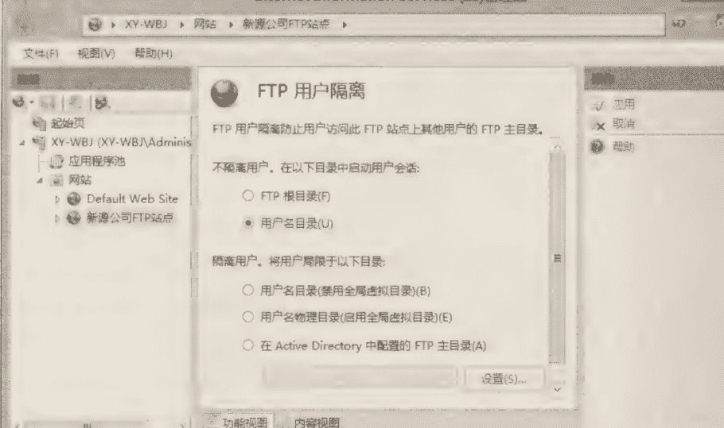

图 5-20 新源 FTP 站点的“FTP 用户隔离”功能视图

- (2) 隔离用户模式。隔离用户是为了防止访问 FTP 站点的其他用户名目录，但这种模式要求 FTP 站点的目录必须建立在 NTFS 分区。隔离用户模式又称为“用户名目录（启用全局域隔离）”和“在 Active Directory 中配置的 FTP 用户主”模式。根据这三种隔离用户模式的网络架构和 FTP 站点目录结构的要求，实际上可以归纳为两种类型：

  - ① “用户名目录（启用全局域隔离）”和“用户名目录（启用全局域隔离）”隔离用户模式。这种模式主要适用于域架构的查询，要求在 FTP 站点目录下创建一个名为 `LocalUser` 的目录，并在 `LocalUser` 下建立多个用户名以及公共目录 `Public`。当用户登录 FTP 站点时，默认会被识别并锁定在用户名目录下，无法看到 `Public` 以及其他的用户名目录；或者在登录时，默认访问并锁定在 `LocalUser` 下，也可以看到配置的内容。两种隔离用户模式的区别在于：如果为 FTP 站点目录建立了全局域隔离，为用户创建了用户目录，则禁用全局域隔离，可以使用用户自己的目录进行；然后是启用全局域隔离，用户即可访问全局域隔离，但不能访问用户隔离目录。

  - ② “在 Active Directory 中配置的 FTP 用户主”模式的隔离用户模式。这种模式适用于网络架构，要求在 FTP 站点目录下创建一个用户域（服务器节点 NetBio 的域名），并在其下建立多个用户名以及公共目录 `Public`，但这里的 FTP 用户必须是 AD（Active Directory，登录的目录）。

按照本地的设计和设计方案，新建 FTP 站点并未违反“FTP 用户目录”是“用户名目录”的要求，其实都能注册用户登录 FTP 站点允许读取其他用户目录的访问。但通常对于 FTP 站点用户较多的情况是，要不要以用户名登录并从公共目录 `Public` 下载文件，要不要通过 FTP 用户登录并在自己的用户名目录中存取文件。为了方便用户登录后直接访问用户名目录，那么在新建 FTP 站点的“FTP 用户隔离”功能视图中选了不隔离用户模式的“用户名目录”单选隔离。

## 项目 FTP 服务配置与管理

在此，满足源公司基本要求的 FTP 站点已架设，接下来将使用 Windows 客户端测试连接 FTP 站点以及下载和上传功能的实况情况。

## 三、使用 Windows 客户端测试 FTP 服务

客户端访问 FTP 站点主要有以下 3 种方式：

- 1) 在字符命令界面上使用命令访问。
- 2) 在图形界面下使用浏览器或资源管理器访问。
- 3) 采用第三方 FTP 客户端软件（如 FlashXP、CuteFTP、FileFTP 等）访问。

下面详细介绍了在 Windows 7 客户端使用前两种方法登录并访问 FTP 站点的具体操作。为了测试功能，我们将使用 Windows 7 账户和密码（`chf`）登录 FTP 站点的下载和上传功能来检查是否符合设计要求，假设在 FTP 站点上创建了三个文件：`E:\ftproot\public.txt`、`E:\ftproot\chf.txt` 和 `E:\ftproot\ym.txt`。

### 1. 使用命令访问 FTP 站点

步骤 1 在 Windows 7 客户端上选择“开始”→“程序”→“附件”→“命令提示符”，或者在“开始”菜单的“程序”中输入 `cmd` 并按 Enter 键，打开一个命令提示符。

步骤 2 在命令提示符中输入“`E:`”按 Enter 键，此时当前目录切换到 `E:` 目录，然后输入“`ftp 192.168.1.10`”按 Enter 键连接 FTP 服务器。如果连接失败，则会出现“`connect:超时`”错误信息；如果连接成功，就会提示信息“`username=192.168.1.10=>`”，要求输入用户名，在此先选择客户端，输入“`anonymous`”并按 Enter 键，随后会提示信息“`password：`”，要求输入密码，也可以输入任何字符而直接按 Enter 键即可，匿名登录 FTP 站点，操作如图 5-1 所示。


图 5-1 使用命令登录 FTP 站点

注意：客户端登录 FTP 站点之前要特别留意当前目录，因为在后续的测试中，除非使用 `lcd` 命令改变当前目录。

## 项目五 FTP 服务器配置与管理


# vim /etc/vsftpd/vsftpd.conf

以下列出的有效的且未注释的配置，忽略了说明性注释。示例配置文件为`/etc/vsftpd/vsftpd.conf`。

```
anonymous_enable=YES # 允许匿名用户登录（默认无密码）
local_enable=YES # 允许本地登录
write_enable=YES # 启用写的 FTP 命令（上传总览）
local_umask=022 # 设置本地用户新增文件的掩码（权限）
anon_upload_enable=YES # 允许匿名用户上传文件，默认为 NO
anon_mkdir_enable=YES # 允许匿名用户创建目录，默认为 NO
dirmessage_enable=YES
```

欢迎请求功能，由用户命令初次访问 FTP 服务器上会在此时刻显示欢迎消息，默认情况下下载欢迎消息通过该目录下的包含文件`message`。

```
xferlog_enable=YES # 用来记录 FTP 服务器上传和下载的文件，默认为/var/log/xferlog
```

可以通过以下选项来控制：

```
connect_from_port_20=YES # 开启数据端口 20 的传输连接
chown_uploads=YES # 允许更改文件的所有者，与后一项配合
chown_user=whoever # 设置想更改的文件所有者，需要输入一个系统用户名，whoever 表示任何人
xferlog_file=/var/xferlog # 指定日志文件位置
xferlog_std_format=YES # 使用标准的 xferlog 格式记录日志
id_session_timeout=60 # 设置数据传输超时时间（单位:s)
data_connection_timeout=120 # 设置数据连接超时时间（单位:s)
nopriv_user=vsftpd # 运行 vsftpd 的非特权系统用户，默认推荐使用
async_abor_enable=YES # 允许用户的“async ABORT”命令，一般建议不启用
ascii_upload_enable=YES # 设置为 ASCII 上传模式，默认为 NO
ascii_download_enable=YES # 设置为 ASCII 下载模式，默认为 NO
ftpd_banner=Welcome to FTP server.
```

如果需要设置欢迎消息，可以在欢迎目录下创建一个`message`文件，并写入了欢迎消息，则在进入此时刻会显示定义的欢迎消息。

```
denymin_enable=YES # 当匿名用户名登录需要密码时，若启用某些邮件地址作为密码的匿名登录
```

必须与下列选项配合，需要指定一个不允许使用密码的电子邮件地址的邮箱：

```
banned_email_file=/etc/vsftpd/banned_emails # 当此项设置为 YES 时，此项指定一个不允许使用匿名登录密码的电子邮件地址的文件
chroot_local_user=YES # 设置是否允许所有用户被限制在 FTP 目录中，默认未注释表示 NO
chroot_list_enable=YES # 设置是否允许限制在 FTP 目录下的用户名，默认被注释表示 NO
chroot_list_file=/etc/vsftpd/chroot_list
```

## 网络服务器配置与管理教程 (Windows Server 2012+Linux)

```
# 指定是否限制在 FTP 目录下的用户列表(默认为/etc/vsftpd/chroot_list),
# 至此文件中的条目如果是名单则为除名名单，取决于 chroot_local_user 的值
ls_recurse=YES
# 是否允许使用 ls -R 命令，默认为 NO，以防止 I/O 浪费大型服务器资源
listen=YES # standalone 模式下通过 IPv4 监听
listen_ipv6=YES # 是否启用 standalone 模式并通过 IPv6 监听，默认即 NO
pam_service=vsftpd # 设置 PAM 外挂插件提供的应用服务的配置文件，/etc/pam/vsftpd
userlist_enable=YES # 激活 vsftpd 检查 userlist 指定的用户是否可以
tcp_wrappers=YES # 开启 tcp_wrappers 访问控制列表
```

有必要进一步说明的是，多数情况下管理员是希望限制用户只能在 FTP 站点上的其他目录进行操作，不允许用户从锚点之外访问 FTP 服务器，这就用到`chroot_local_user`、`chroot_list`和`chroot_list`文件三个选项。其中，`chroot_local_user`仅可以选择全局性的设置，当为 YES 时会将所有用户锁定在锚点上；而为 NO 时会使用所有用户都不被锁定在锚点上。如果希望使用用户被锁定某些用户的用户被锁定在锚点之外，该如何进行控制呢？这就就需要`chroot_local_user`的全局设置基础上，将`chroot_list`选项设置为 YES 即限制用户名单，就把那些“局外的”的用户加入`chroot_list`指定的文件来实现这种微调。通过这种“外”机器可以归纳为以下两种情况：

- 1) `chroot_local_user=YES`，指定文件中的列出的就是未被锁定在锚点之外的某些用户，或者说该用户是允许访问锚点的用户“白名单”

- 2) `chroot_local_user=NO`，指定`chroot_list`文件中的列出的就是就是要被锁定在锚点之外的某些用户，或者说该用户是允许访问锚点之外的用户“黑名单”。

另外，`pam_service`未用于 PAM 认证服务 vsftpd。是为了安全考虑，不希望 vsftpd 使用本地系统的用户认证程序，而是使用自己本地的用户密码数据库来认证用户。通过修改 PAM 的配置文件`/etc/pam/vsftpd`来指定 vsftpd 的认证方法，是本地系统的用户数据库(`pam_auth`)，独立的用户数据库(`pam_ldap`)，是网络上的数据库(`pam_ldap`)。设置这些选项都保存在`/lib/security`目录下。注意：默认配置文件 vsftpd.conf 仅列出了 FTP 服务器所需的常用配置，还有一个就是用于用户访问控制、服务器性能、用户连接和数据传输等选项在实际中使用的。再列举几个 vsftpd.conf 文件中列出的配置及其作用：

```
guest_enable=YES # 匿名登录
guest_username=ftp # 指定 guest 身份的用户名
local_root=/var/ftp # 指定用户默认根目录
anon_root=/var/ftp # 指定匿名用户默认根目录
pasv_enable=YES # 设置 FTP 服务器模式为 passive
port_enable=YES # 设置 FTP 服务器模式为 port
 设置以上两个选项
localtime=YES # 设置是否使用本地时间，若设置为 NO 则使用 UTC 时间，建议设置为 YES
idle_timeout=300 # 设置连接超时时间，客户端在300 秒没有操作将自动断开
max_clients=0 # 设置 FTP 服务器允许的最大客户，值为 0 表示限制
max_per_ip=0 # 设置对于同一 IP 地址允许的最大客户，值为 0 表示限制
local_max_rate=0 # 设置本地的最大速率，单位为 B/s，值为 0 表示限制
anon_max_rate=0 # 设置匿名用户的最大速率，单位为 B/s，值为 0 表示限制
```

## 2. vsftpd 的辅助配置

在`vsftpd.users`和`userlist`两个配置文件中，利用这两个文件可以控制允许或禁止访问 FTP 服务器：

(1) 禁止访问的列表`etc/users`。通常出于安全考虑，管理员不希望某些拥有权限的用户（如 root）登录 FTP 服务器，以免用户上传或下载危险的文件从操作系统造成破坏。这种情况下可以将访问 FTP 服务器的用户添加到该文件中。注意：用户不受 vsftpd.conf 中任何选项的影响，或者说`users`就是一份限制访问服务器的“黑名单”。

(2) 用户列表`etc/vsftpd/userlist`。虽然文件中存储的也是一个用户列表，但是它是否有效以及列表中列出的用户是不允许访问的，或者说用户列表就是“白名单”。这些与 vsftpd.conf 中的`userlist_enable`和`userlist_deny`两个选项的设置密切相关。其中，`userlist_enable`选项默认设置为 YES，而`userlist_deny`默认没有（值为 0），设置为 YES 则需要该选项。

为了清晰地理解`userlist`与`userlist_deny`之间的关系，以及这两个选项不同设置产生的效果，我们将通过一个实例来说：假设 FTP 服务器建立了 tom 和 jim 两个用户，并将 tom 添加到`userlist`，而 jim 不在`userlist`文件中。最后，把`userlist_enable`和`userlist_deny`项设置为不同的，测试了 4 种结果，如图 5-3 所示：

5-3 userlist_enable and userlist_deny 不同设置下的用户登录

| userlist_enable and userlist_deny 设置 | tom and jim 用户登录 |
| :--- | :--- |
| userlist_enable=YES, userlist_deny=YES | tom: 拒绝登录, jim: 允许登录 |
| userlist_enable=YES, userlist_deny=NO | tom: 允许登录, jim: 拒绝登录 |
| userlist_enable=NO, userlist_deny=YES | tom: 允许登录, jim: 拒绝登录 |
| userlist_enable=NO, userlist_deny=NO | tom: 允许登录, jim: 允许登录 |

在用户登录 FTP 服务器测试时，正如`userlist`文件开头的注释所述，在拒绝的情况下不会提示输入密码，如果在图形界面使用登录窗口，甚至就不会出现登录窗口或直接连接。综合测试结果，针对`userlist`文件与`userlist_enable`, `userlist_deny`两个配置项的关系得出 4 点结论：

- 1) (`userlist_enable and userlist_deny`两个选项组合起来)，可以针对 3 类不同用户的整合设置，例如：删除在 users 以外的本地用户、出现在`userlist`文件中的用户和没有列在`userlist`文件中的用户。

- 2) 当`userlist_enable=YES`时，`userlist_deny`设置项有效，`userlist`文件才会生效；当`userlist_enable=NO`时，`userlist_deny`设置为 YES 或 NO，`userlist`文件是无效。

- 3) 当`userlist_enable=YES`且`userlist_deny=YES`时，`userlist`文件中列出的用户都将被拒绝，而在不在列表中的则是“黑名单”。

- 4) 当`userlist_enable=YES`且`userlist_deny=NO`时，只有`userlist`文件列出的用户会被登录，而不是不在列表中的用户，此时`userlist`就是一份“白名单”。

注意：vsftpd 辅助文件的存放位置和文件名针对 CentOS、新版本的 Fedora、RHEL、Red Hat Linux 中都是`/etc/vsftpd/`目录下，两个文件名为 vsftpd.conf 和 userlist。

## 3. 启动 vsftpd 服务

事实上，`vsftpd.conf`的默认配置已经设置了一个基础功能的 FTP 站点。只需要启动 vsftpd 服务，客户端就可以匿名登录并访问站点。

```
# vsftpd start 启动 vsftpd 服务
Starting vsftpd: [ OK ]
# vsftpd status # 查看 vsftpd 服务状态
vsftpd (pid 2550) is running ... # 显示此信息 vsftpd 正在运行
```

## 项目五 FTP 服务器配置与管理

```bash
226 Directory OK.
ftp> get bb.txt
// 下载当前目录 pub 中的 bb.txt 文件
local: remote: bb.txt

227 Entering PASV mode.(192,168,1,42,257)
// 进入模式，前4个数字为服务器的IP 地址，后两位数字表示服务器开启
// 并以 PORT 命令告知客户的非特权端口为55097 (或 215*256+57)，此后服务器
// 客户端会监听客户主连接到服务器的数据连接。

150 Opening BINARY mode connection for bb.txt (12 bytes).
// 完成文件传输至客户本地
222 Transfer complete.

11 bytes received in 8.8e-05 seconds (55 KB/s)
ftp> cd ../upload
// 进入到上传文件的 upload 目录
250 Directory successfully changed.

ftp> put aa.txt
// 将本地文件 aa.txt 上传
local: remote: aa.txt
227 Entering PASV mode (192,168,1,42,258)

550 Permission denied.
// 显示访问被拒，即传输失败
// 退出连接，断开 FTP 服务器
ftp> quit
221 Goodbye.
```

```bash
[root@localhostwebj]# ls -l bb.txt
// 列出已下载下的 bb.txt 文件
-rw-r--r-- 1 root root Mar 16 23:46 bb.txt
[root@localhostwebj]#
```

从上述操作可以看到，客户使用用户名登录 FTP 站点后，可以下载文件而不能上传文件。这是因为在 FTP 服务器配置中，匿名用户对站点目录及其子目录没有写入权限，这符合新源 FTP 站点的架设需求和设计方案。

## 二、配置 FTP 用户并访问站点

新源 FTP 站点要求为某些集成 FTP 用户，使用合法的用户名和密码登录 FTP 站点后，该用户对自己的主目录具有写入和删除权限，即可允许上传文件。下面以建立 chif 和 wjm 两个 FTP 用户用例，介绍上述所需的步骤。

### 1. 创建 FTP 用户并访问控制

在 vsftpd 的默认配置中，FTP 用户首先要是 Linux 服务器的本地用户，然后使用 users 和 root 两个辅助目录，通过配置配置文件 vsftpd.conf 中的`userlist`和`userlist_deny`两个选项的组合来实现用户对 FTP 站点的访问控制。

步骤 1：创建 FTP 站点的本地用户 chif 和 wjm，将他们的密码设置为“123456”。以下给出创建 chif 用户及其密码的操作命令，创建 wjm 用户由读者自行完成。

```bash
# useradd -d /var/ftp/chif chif // 创建 FTP 用户并指定用户主目录
# passwd chif // 为用户设置密码
```

Changing password for user chif.

NEW password:

Retype new password:

password: all authentication tokens updated successfully.

# //该提示表示密码设置成功

```bash
cd /var/ftp
# //进入 FTP 站点目录
drwx---- 4 chf chf 4096 Mar 17 23:05 chf
drwxr-xr-x 2 root 4096 Oct 27 16:05 pub
drwxr-xr-x 2 root 4096 Mar 16 13:10 upload
```

注意：在创建用户的`useradd`命令中，如果不使用 -d 选项，默认与用户名同名的目录在 /home 下创建该用户的主目录。虽然 FTP 站点对用户主目录的位置没有任何限制，但是为了进行细致的权限分配以及全局管理，将把 FTP 用户的主目录统一设在站点目录 /var/ftp 下。从站点目录下的文件列表可以看出，新建用户的主目录都拥有所有权限，而对相同组及其他用户都没有任何权限，这还需要创建用户组并对用户主目录的权限进行限制。

步骤 2：根据本次的设计方案，虽然用户名和 FTP 用户一样使用 FTP 站点权限及共享公共目录下的文件，但用户还需要对自己的主目录具有读写和权限，并且能够访问其他 FTP 用户的主目录，而匿名用户是绝对不允许访问 FTP 用户主目录的。由于两者的权限相同，你必须首先创建一个组，并将 FTP 用户加入到共享目录中，然后设置用户主目录的属性和权限，命令如下：

```bash
# group xygrp // 创建用户，组名为 xygrp
# usermod -G xygrp chf // 将 chf 加入小组 xygrp
# usermod -G xygrp wjm // 将 wjm 加入小组 xygrp
# chown -R chf:xygrp chftp // 修改 chftp 目录的所有者
# chown -R wjm:xygrp wjm // 修改 wjm 目录的所有者
# chmod 750 chftp // 将目录的权限设置为750
# chmod 750 wjm // 将主目录的权限设置为750
# ls -l // 列出 FTP 站点目录下的文件
```


```text
drwx---- 4 chf xygrp 4096 Mar 17 23:05 chf
drwxr-xr-x 2 root 4096 Oct 27 16:05 pub
drwxr-xr-x 2 root 4096 Mar 16 13:10 upload
drwx------ 4 wjm xygrp 4096 Mar 17 23:16 wjm
```

注意：将 FTP 用户主目录权限设置为 750，对用户自己拥有权限，对相同组（`xygrp` 组成员）具有读写权限，对其他用户没有任何权限。这样设置后，匿名用户对 FTP 用户的主目录就不会有权限。

**步骤 3：修改配置文件 `/etc/vsftpd/vsftpd.conf`，设置 FTP 用户访问控制：**

```bash
vim /etc/vsftpd/vsftpd.conf
```

在配置文件中找到以下配置进行修改：

```bash
# root_local_user=YES // 该行被注释
userlist_enable=YES // 该行保持默认值
userlist_deny=NO // 该行生效，默认值为NO
userlist_file=/etc/vsftpd/userlist
local_root=/var/ftp // 该行失效，必须添加
```

注意：① `root_local_user=YES` 是注释的，默认值为 `NO`，`root` 可以访问根目录之外目录，这样会对服务器造成漏洞，通常是不允许的，应当将此项注释。如果只允许某些用户访问根目录，还需要使用 `userlist`。② 匿名用户的默认目录是 `/var/ftp`，而 FTP 服务器的默认目录是用户主目录。FTP 用户登录后能够进入目录，所以添加 `local_root=/var/ftp`。

**步骤 4：允许特定 FTP 目录访问。** 在 `vsftpd` 配置文件中设置 `userlist_enable=YES` 且 `userlist_deny=NO`，`userlist` 文件中的访问列表是“白名单”，这意味着必须把用户名添加到 `userlist` 中才能成为 FTP 站点的合法用户。为了验证上述访问控制，可以将 `chf` 和匿名用户加入 `userlist` 中，命令如下：

```bash
# /etc/vsftpd/userlist
```

`userlist` 文件的设置是为了访问 FTP 站点的“白名单”，所以必须将用户名加入其中，否则匿名用户无法登录 FTP 站点。

**步骤 5：重启 `vsftpd` 服务，操作命令如下：**

```bash
service vsftpd restart
Shutting down vsftpd:
[ OK ]
Starting vsftpd for you:
[ OK ]
```

### 2. 使用 Linux 客户端命令行访问 FTP 站点

创建了 `chf` 和 `wjm` 两个 FTP 用户之后，让他们登录 FTP 站点进行文件下载和上传的测试。首先在 FTP 服务器的用户目录（`/var/ftp/ch`）创建 `ch.txt`，在 `wjm` 用户主目录（`/var/ftp/wjm`）创建 `wjm.txt`，在客户端本地（`wbj`）目录下创建一个 `wbj.txt`，按照以下步骤操作：

```bash
[root@localhost ~]# cd wbj
# 客户端进入/wbj 目录
[root@localhost wbj]#
# 以下使用匿名用户登录 FTP 站点----------------------
[root@localhost wbj]# ftp ftp.xinyuan.com # 连接 FTP 服务器
Connected to ftp.xinyuan.com.
220 (vsFTP 2.2.2)
530 Please login with USER and PASS.
Name (ftp.xinyuan.com:root): ftp # 输入匿名用户 ftp
331 Please specify the password.
# 要求输入密码
Password: # 显示登录成功
230 Login successful.
Remote system type is UNIX // 显示远程系统类型为 UNIX
Using binary mode to transfer files. // 显示二进制模式传输文件
ftp> # 登录成功后显示 FTP 命令提示符
ftp> pwd // 显示 FTP 客户端在远程主机上的当前目录
257 "/" # 以匿名用户的默认主目录作为文件目录
ftp> dir
227 Entering Passive Mode (192,168,1,74,228)
// 列出匿名访问的目录下文件
```

```text
drwxr-xr-x 4 505 507 4096 Mar 17 23:05 chf
drwxr-xr-x 2 root 4096 Oct 27 16:05 pub
drwxr-xr-x 2 root 4096 Mar 16 13:10 upload
drwx------ 4 wjm xygrp 4096 Mar 17 23:16 wjm
```

```bash
ftp> cd pub // 进入 pub 目录
250 Directory successfully changed.
ftp> dir // 列出 pub 下的文件
```

```text
-rw-r---- 1 0 0 11 Mar 16 13:28 bb.txt
```

```bash
ftp> get bb.txt // 下载当前目录中的 bb.txt
```

```text
227 Entering Passive Mode (192,168,1,42,55)
150 Opening binary mode connection for bb.txt (12 bytes).
222 Transfer complete. // 文件下载完成
11 bytes received in 8.8e-05 seconds (55 KB/s)
ftp> cd chf // 进入 chf 用户的主目录
550 Failed to change directory.
ftp> cd wjm // 进入 wjm 用户的主目录
550 Failed to change directory.
ftp> quit // 退出连接，断开 FTP 服务器
221 Goodbye.
```

```text
r--r--r-- 1 505 15 Mar 17 23:32 wbj.txt
226 Directory entry OK.
// 创建 chf 用户进入的主目录下载文件，也将用户本地的文件上传
// FTP 列表文件，chf.txt是在服务器上创建的，用户 ID 和所属 ID 均为 0
// wbj.txt 由 chf 用户自己上传而建立，使用用户 ID 和所属 ID 均为 505
```

```bash
ftp quit
221. Goodbye.
[localhost wbj] $ ls -l
// 退出登录，断开 FTP 服务器
// 在客户端本地当前目录下的文件
r--r--r---- 1 root root 11 Mar 14:38 bb.txt
r--r--r---- 1 root root 15 Mar 14:43 chf.txt
r--r--r---- 1 root root 15 Oct 28 19:55 wbj.txt
r--r--r---- 1 root root 30 Mar 14:41 wjm.txt
// 从客户端本地的列表中可以看到上述操作后下载的 3 个文件
[localhost wbj]#
---------------------- 以下使用 wjm 用户登录 FTP 站点----------------------
[localhost wbj]# login ftp ftp.xinyuan.com // 连接 FTP 服务器
Connected to ftp.xinyuan.com.
220 (vsftpd 2.2)
530 Please login with USER and PASSWORD.
Name (ftp.xinyuan.com:root): wjm // 输入用户名 wjm
530 Permission denied.
Login failed. // 登录失败
ftp quit
221. Goodbye.
```

从上述测试结果可以看出，此 FTP 站点已实现新源的服务器架设以及本项目的设计方案，用户也已经包含了员工 FTP 注册用户的访问请求，读者只需要使用 `wjm` 以及为建立的其他员工 FTP 用户添加到 `user_list` 文件中即可。

> 注意：为了彻底理解 `vsftpd.conf` 文件中 `user_list` 和 `userlist_deny` 两个选项的 list 文件的含义，读者不要尝试将 `userlist_deny` 也设置为 `YES`，否则会发现客户端用户 `chf` 和 `wjm` 登录 FTP 站点的情况与上述测试结果相反，拒绝用户 `chf` 而允许 `wjm` 登录，因为此时的 `user_list` 变成了一份允许 FTP 站点用户的“黑名单”。

## 3. 使用 Windows 客户端密码访问 FTP 站点

使用 Windows 客户端密码访问 FTP 站点的任务已经在文中给出了详细的步骤和介绍，这里不再赘述，文件下载和传输的测试自行进行。

> 注意：无论使用浏览器还是在地址栏输入 `http://ftp.xinyuan.com` 或 `192.168.1.18` 并回车后，可能会出现“无法显示此页面”的错误信息，此时若用用户名和密码登录却无法访问 FTP 站点。这是因为 `vsftpd` 提供了 `ftp` 和 `anonymous` 两个用户名，在 Linux 客户端测试时是用 `ftp` 作为用户名登录的，在 Windows 访问时会自动以用户名 `anonymous` 登录的，它应该将用户名添加到 `user_list` 文件中。

图 5-29 显示的就是在资源管理器中使用 `chf` 用户登录 FTP 站点，并双击了该用户目录“chf”文件夹后显示的窗口。

**图 5-29 以 FTP 用户登录并打开用户主目录的访问窗口**

**注意：** 从资源管理器右上的地址栏和命令测试中都可以看出，Linux 环境下架设的新源公司 FTP 站点相当于 Windows Server 2012 R2 使用的 IIS8 选择了“FTP 根目录”不隔离用户模式，所以用户登录时默认访问的站点主目录，与任务二架设的“用户名目录”不隔离用户模式的站点主目录有不同。在实际中有有很多 FTP 站点要求用户登录访问后被固定在某个用户目录下，不允许用户访问其他用户的主目录，而是采用隔离用户模式的 FTP 站点。其要把站点配置成这种模式并不难，只需要在 `vsftpd.conf` 文件中选择 `local_root=/var` 并重新配置即可。

## 任务四 FTP 服务器运维及深入配置

前已经在 Windows Server 2012 R2 和 Linux 两种平台上架设了满足新源公司基础要求的 FTP 站点，并通过了测试。但在实际中，不同的企业对 FTP 站点实现的功能、性能和安全性方面可能会有不同的需要。将基于 Linux 环境下架设的 FTP 站点按照隔离用户模式进行重构，并配置诸如：实施两种隔离用户模式在访问特性的区域；对于 Linux 环境下架设的 FTP 站点配置隔离用户名，并在同一服务器上架设两个虚拟 FTP 站点，以扩展后续的 FTP 服务器运维及深入配置。

## 一、FTP 站点的配置

任务二是根据新源公司对 FTP 站点提出的访问需求，选用了一种“用户名目录”的不隔离用户模式。为了让用户能够清晰地理解隔离用户模式与非隔离用户模式的 FTP 站点在用户访问时的特殊特性，同时又能深刻地理解在工作组网络结构中的两种隔离用户模式在虚拟客户端访问时的差异，首先将新源公司 FTP 站点重构为隔离用户模式。

### 1. 重构 FTP 站点为隔离用户模式

因为隔离用户模式是为了防止用户访问 FTP 其他用户的目录，所以无论一种访问用户模式的 FTP 站点，访问时的默认目录都是用户名目录，并且所有的访问操作都被锁定在用户目录之下。

其中，可用工作组结构框架中的隔离用户模式有“用户名目录（全局虚拟目录）”和“用户名物理目录（全局虚拟目录）”。这两种隔离用户模式不仅要求 FTP 站点的根目录必须在 NTFS 分区上，还需要在站点目录下创建一个名为 `LocalUser` 的目录，并且所有的用户目录及公共目录 `Public` 都建立在 `LocalUser` 下。为了方便 FTP 站点，可以在任务中新建 FTP 站点基础上，对站点的目录结构、隔离用户模式进行调试，操作如下：

**步骤 1 创建 FTP 站点的目录。** 打开“此电脑”窗口，进入 FTP 站点，此时可以看到公共目录以及用户名目录 `chf` 和 `wjm`。新建一个 `LocalUser`。

**步骤 2 将 FTP 站点设置为“用户名目录（全局虚拟目录）”隔离模式。** 此时，在 IIS 控制列表中选择“新建 FTP 站点”选项，此时即可看到创建后的站点。在“FTP 站点主页”功能中勾选“用户隔离”，点击“用户目录”节点，选择“用户名目录（全局虚拟目录）”。点击确定，在右侧的“操作”列表中点击“应用”。

**图 5-30 创建并隔离用户模式后的 FTP 站点**

**步骤 3 测试“用户名目录（全局虚拟目录）”隔离模式的连接与访问。** 在客户端创建一个名为 `test` 的文件，然后分别以用户名 `chf` 登录 FTP 站点，并使用 `dir`、`put` 命令进行访问，如图所示。执行结果可以看到匿名用户登录 FTP 站点时的默认目录为公共目录且能够成功访问，所有的操作都被锚定在各自目录之下，无法回溯到上目录。

### 2. 创建虚拟目录

其实无论哪种类型的 FTP 站点，整个物理结构都基于根目录，而根目录所在的服务器容量有限，创建虚拟目录就可以极大扩展服务器的功能。虚拟目录可以是本地或网络上服务器中的任何一个。将虚拟目录映射到 FTP 站点目录或者某个子目录（公共目录或用户名），并为虚拟目录起别名。IIS 将虚拟目录映射到 FTP 站点对应目录下的子目录，并以虚拟目录的名称作为该目录的名称。

**注意：** 如果把目录映射到 FTP 根目录，这个虚拟名为全局根目录；如果把目录映射到 FTP 站点某个用户目录（`Public`），对于 Internet 的用户来说，在访问 FTP 站点时感觉不到虚拟目录的存在，访问虚拟目录如同访问 FTP 目录一样。创建虚拟目录就是将 FTP 站点空间分布到多台服务器上，通过 IIS 通道远程连接并检索用户的文件；当用户访问虚拟目录时只需要指定虚拟目录的名称，并不知道虚拟目录的位置和名称，有利于增强安全性。

假设在 `D` 目录下创建了 4 个虚拟目录：`Virxy`、`Virjm`、`Virwm` 和 `Virub`。作为全局根目录（名为 `Virxy`）映射到 FTP 站点的根目录；另外 3 个虚拟目录 `Virjm`、`Virwm` 和 `Virub` 作为用户目录（名为 `Vchf`、`Vjm` 和 `Vpub`）分别映射到 FTP 站点 `chf` 和 `Public` 目录。创建这些虚拟目录的具体方法如下：

**步骤 1 为 FTP 站点添加虚拟目录。** 在 IIS8 “连接”列表中展开“网站”文件夹，右键点击“新源 FTP 站点”选项，在弹出的快捷菜单中选择“添加虚拟目录”命令，打开“虚拟目录”对话框，为虚拟目录命名并在“别名”框中输入虚拟目录的名称 `Vxy`；或者通过右侧的按钮选择此虚拟目录，如图 5-32 所示，点击“确定”按钮。

> 注意：**这里如果虚拟目录是在本地服务器中，可以直接访问路径。如果需要访问的虚拟目录是在网络上的另一台服务器上，则需指定服务器目录和虚拟目录共享名称（此时虚拟目录必须具有共享权限）。

**步骤 2 为用户目录 `chf` 添加虚拟目录（名为 `Vchf`）。** 在 IIS8 “连接”列表中展开“新源 FTP 站点”->`LocalUser` 用户文件夹，在弹出的快捷菜单中选择“添加虚拟目录”命令，打开“虚拟目录”对话框。在“别名”文本框中输入虚拟目录的名称“Vchf”；在“虚拟路径”文本框中输入 `D:\Virchf`，或者通过右侧的按钮选择此目录，如图所示，单独点击“确定”按钮。

```cmd
C:\Windows\system32>E:>ftp.xinyuan.com
Login to ftp.xinyuan.com.
220 Microsoft Service
User (ftp.xinyuan.com:root): anonymous
331 identity logged in as password.
330 User logged in.
> dir
200 PORT command successful.
226 Data already open; Transfer starting.
public.txt
Transfer: 16 字节，用时 00秒
226 Transfer complete.
> quit
221. Goodbye.
>ftp ftp.xinyuan.com
220 Microsoft Service
User (ftp.xinyuan.com:root): chf
331 Password required
330 User logged in.
> put test.txt
200 PORT command successful.
226 Data already open; Transfer starting.
abs.txt
Transfer: 145 字节，用时 06秒
226 Transfer complete.
>cd ../
550 The system could not find the specified file.
>quit
221 Goodbye.
```


**图 5-31 匿名用户登录 FTP 站点并进行访问**

# 项目 FTP 服务配置与管理

> 注意：从配置访问和命令测试结果可以看出，登录“用户名目录（备用用户目录）”隔离用户模式的 FTP 站点时，用户名和注册用户目录且锁定的目录为用户名目录，这与第一种“用户名目录（备用用户目录）”隔离用户模式的 FTP 站点相同。此时用户名和注册用户都可以访问站点的全部目录，但无法访问自己目录下的用户名目录。

## 二、Linux FTP 站点的深度解析

针对这些企业可能提出的允许员工使用用户名上传文件、在同一台服务器上架设置多个 FTP 站点等需求，我们将针对新源的 FTP 站点进行深度解析。

### 1. 配置 FTP 站点允许用户名上传文件

新源的 FTP 站点对于用户名只需要能够下载文件而不允许上传文件，这也是 `vsftpd` 的默认配置。如果使用匿名用户也能上传文件，可以按照以下步骤进行配置：

#### 步骤 1 备份配置文件 `/etc/vsftpd/vsftpd.conf`

```bash
# /etc/vsftpd/ // 进入vsftpd 配置所在目录
# cp vsftpd.conf vsftpd.conf.bak // 备份配置文件
```

#### 步骤 2 编辑配置文件 `vsftpd.conf`，进行以下修改：

```bash
# vim vsftpd.conf // 编辑配置文件
# 默认内容，找到这里有2个被注释的配置，去掉行首的#符号使用它
anonym_upload_enable=YES // 允许匿名用户上传文件
anonym_mkdir_write_enable=YES // 开启匿名用户写入和创建目录权限
# 在文件最后添加以下配置（vsftpd.conf中该配置不存在)
anonym_world_read_only=NO // 打开匿名用户的浏览权限
# 修改后保存并退出
```

#### 步骤 3 使用以下命令重启 `vsftpd` 服务。

```bash
# service vsftpd restart // 重启vsftpd 服务
Shutting down vsftpd: [ ]
Starting vsftpd service: [ ]
```

#### 步骤 4 在客户端本地的`~/www`目录下先创建一个空文件`wbj.txt`，然后进行以下操作连接 FTP 服务器，并测试匿名用户的上传功能。

```bash
[root@localhost ~] # cd /wbj
[root@localhost wbj] # ftp ftp.xinyuan.com // 连接 FTP 服务器
Connected to ftp.xinyuan.com.
220 (vsFTPD 2.2.2)
530 Please login with USER and PASS.
Name (ftp.xinyuan.com:root): ftp // 输入匿名用户 ftp
```

# 网络服务器配置与管理教程(Windows Server 2012+Linux)

```
331 Please specify the password.
Password: // 无密码直接按 Enter
230 login successful.
Remote system type is UNIX.
Using binary mode to transfer files.
```

```bash
ftp> pwd // 显示客户端主机在远程主机上的当前目录
257 "/" // 进入站点目录作为匿名用户的目录
进入上传的目录
ftp> cd upload // 上传客户端文件 wbj.txt
250 Directory successfully changed.
ftp> put wbj.txt // remote: wbj.txt
```

```
227 Entering Passive Mode (192,168,1,4,72,5)
150 Ok to send data.
226 Transfer complete. // 文件传输完成
15 bytes sent in 0.33 seconds (0.045 Kbytes/s) // 列出已的文件
```

```bash
ftp> ls
227 Entering Passive Mode (192,168,1,225,143)
150 Here comes the directory listing.
-rw-r--r-- 1 14 50 15 Oct 30 03:36 wbj.txt
```

```
226 Directory send OK. // 退出登录，直接连接 FTP 服务器
ftp> quit
221 Goodbye.
```

> 注意：在 Linux系统中配置各种网络服务时，经常需要修改配置文件，作为管理员应当养成良好的操作习惯，再次修改配置文件之前：一在修改配置文件之前先备份文件，以便修改配置错误后能够恢复文件内容；二是修改配置文件时，如果想要取消某个配置，应在配置行首加`#`注释，而不要直接删除，这样在下次需要恢复配置时只需取消注释即可。

### 2. 在一台服务器上架设多个 FTP 站点

与同一服务器上架设多个 Web 站点类似，一台服务器上架设多个 FTP 站点的方法是使用 IP 地址、端口和主机名。在架设了新公司 FTP 站点基础上，这里介绍了如何使用 IP 地址配置多个 FTP 站点的操作方法。

- 步骤1 为 FTP 服务器网络连接 `eth0` 接口设置一个 IP 地址，操作命令如下：

```bash
# ifconfig eth0:1 192.168.1.44 netmask 255.255.255.0
# 为网络接口 eth0 设置别名接口，并设置的 IP 地址
# ifconfig eth0:1 // 查看eth0:1 的网络参数
eth0:1 Link encap:Ethernet Haddr 00:26:2D:FB:6C:5
inet addr:192.168.1.44 Bcast:192.168.1.255 Mask:255.255.255.0
UP BROADCAST MULTICAST MTU:1500 Metric:1
Interrupt:20 Memory:f240000-f24000
```

# 项目 FTP 服务器配置与管理

注意：使用 `ifconfig` 命令临时为物理接口 `eth0` 配置了接口以及 IP 地址，系统重启后失效。如果接口 `eth0` 的配置永久生效，应该在 `/etc/network/scripts` 目录下创建接口 `ifcfg-eth0`，通常是将物理接口 `eth0` 的配置文件复制为 `ifcfg-eth0`，再次修改项为`eth0`，IP 地址赋值为`192.168.1.44`，然后重启。

步骤2 创建 FTP 服务目录（假设为 `/vftp`），在主机上创建目录，同时修改权限，操作命令如下：

```bash
mkdir -p /vftp/vftp // -p 选项可以创建多级目录，为用户目录
chmod -R 755 /vftp // 为用户目录读取写权限
-R 选项可以对目录的所有和子目录执行相同的权限（递归）
```

步骤3 创建 FTP 站点的用户名并创建本地用户 `vftp`，命令如下：

```bash
adduser -d /vftp/vftp -m vftp // -d 选项指定用户目录，而 -m 选项自动创建目录
```

步骤4 备份默认配置文件 `vsftpd.conf` 然后修改 `vsftpd.conf`，加入 IP 地址`192.168.1.44` 绑定的配置，命令如下：

```bash
cd /etc/vsftpd // 此后的命令执行etc/vsftpd 当前目录
cp vsftpd.conf vsftpd.bak // 备份默认配置文件
vim vsftpd.conf // 修改内容，添加以下配置（为了方便添加 listen=YES 之后）
listen=YES
listen_address=192.168.1.44 // 添加该配置
修改后保存并退出
```

步骤5 备份默认配置 `vsftpd.bak` 复制为虚拟服务的 `vftpd.conf`，并在 `vftpd.conf` 文件添加两个配置，操作如下：

```bash
cp vsftpd.conf.bak vsftpd.conf // 生成默认配置文件
vim /etc/vsftpd/vftpd.conf // 修改内容，添加以下配置（为了方便添加 listen=YES 之后）
listen=YES
listen_address=192.168.1.44 // 添加该配置
将虚拟服务器绑定到 IP 地址192.168.1.44 的网络接口 eth0:1
ftp_username=vftp // 匿名映射为本地用户 vftp
修改后保存并退出
```

步骤6 重启 `vsftpd` 服务，操作如下：

```bash
service vsftpd restart
Shutting down vsftpd: [ OK ]
Starting vsftpd for vftp: [ OK ]
Starting vsftpd for vsftpd: [ OK ]
# 此时可见 vsftpd 启动成功，增加了 FTP 服务 vftp 启动的信息
```

步骤7 在客户端使用用户名登录到原来的 FTP 服务器和新建的 FTP 服务器进行测试。由于登录过程以及登录后认证操作，文件下载和上传的测试读者自行完成，并且过程不再给出详细注释。

```bash
[@localhost wb] ftp ftp.xinyuan.com // 连接原来的 FTP 服务器
Connected to ftp.xinyuan.com.
220 (vsFTPD 2.2.2)
530 Please login with USER AND PASS.
Name (ftp.xinyuan.com:root): ftp // 输入匿名用户
331 Please specify the password.
Password: // 输入密码直接按 Enter
230 login successful.
Remote system type is UNIX.
Using binary mode to transfer files.
ftp> pwd // 查看匿名用户目录
257 "/"
ftp> ls
227 Entering Passive Mode (192,168,1,43,235) // 列出目录下的文件
150 Here comes the directory listing.
drwx-xr-x 2 0 4096 Oct 27 16:05 pub
drwxrw-x 2 0 4096 Oct 30 03:36 upload
226 Directory ok.
// 可此处列出的是原来的服务器主目录/var/ftp 下的文件目录
ftp> bye // 退出 FTP 也可用命令
221 Goodbye.
[@localhost wb] ftp 192.168.1.44 // 连接虚拟 FTP 服务器
Connected to 192.168.1.44.
220 (vsFTPD 2.2.2)
530 Please login with USER AND PASS.
Name (192.168.1.44:root): vftp // 输入虚拟服务器的匿名用户
331 Please specify the password.
Password: // 输入密码直接按 Enter
230 login successful.
Remote system type is UNIX.
Using binary mode to transfer files.
```

## 项目 FTP 配置与管理

```bash
ftp> pwd
257 "/"
ftp> ls
227 Entering Passive Mode (192,168,1,225,143)
150 Here comes the directory listing.
drwxr-xr-x 2 0 4096 Oct 27 16:05 pub
drwxrw-x 2 0 4096 Oct 30 03:36 upload
226 Directory OK.
// 查看用户主目录
// 此处可见的是原来的目录/var/ftp
ftp> bye // 退出 FTP 也可用命令
221 Goodbye.
```

> 注意：在 Linux系统中配置各种网络服务时，经常需要修改配置文件，作为管理员应当养成良好的操作习惯，再次修改配置文件之前：一在修改配置文件之前先备份文件，以便修改配置错误后能够恢复文件内容；二是修改配置文件时，如果想要取消某个配置，应在配置行首加`#`注释，而不要直接删除，这样在下次需要恢复配置时只需取消注释即可。

## 小结

文件传输协议...

## 习题

### 一、基础题

- 1. 什么是 FTP？其主要功能是什么？
- 2. 客户端访问服务器需要两个端口？它们的用途是什么？
- 3. 文件下载和上传分别是什么意思？它们的工作有什么区别？
- 4. 端口`PORT`和`PASV`两种模式？
- 5. 客户端访问服务器主要需要哪种？
- 7. 在一台服务器上可以部署多少个 FTP 站点？
- 8. 在Windows Server 2012使用的IIS8中，部署FTP站点需要哪些角色？
- 9. 在Windows Server 2012使用的IIS8中，FTP站点隔离用户为哪种？FTP站点访问用户不再会有什么问题？
- 10. 利用`vsftpd`部署的FTP站点中，客户端的用户名有几个？默认是以用户名登录的？
- 11. Linux下`vsftpd`部署FTP站点涉及的配置文件有哪些？怎样配置让用户列表作为一个FTP点的“白名单”？
- 12. 使用`vsftpd`部署FTP站点时，假设设置已经包括`xt`的一个匿名用户，怎样配置才能`xt`用户跳出FTP目录之外的内容，而其他所有用户都限定在FTP目录下？

### 二、训练题

需要在IP地址为`192.168.1.2`的服务器上配置一个FTP站点，其名为`ftp.sdzz.com`，默认端口。要求匿名用户(`anonymous`)访问，但只能下载文件，不能上传文件；公司员工使用自己的用户名和密码登录FTP站点时，在用户自己的目录下允许下载和上传文件，但在站点节点和其他用户的目录下只能下载上传而不能上传文件。

(1) 按上述需求，分别在Windows Server 2012和Linux两种平台完成FTP站点的配置。为客户机使用域名访问FTP，需要适时配置相应的DNS服务。

(2) 配置客户端机，并使用浏览器和FTP命令两种方法访问FTP站点。

(3) 附录C中简化的格式，编写FTP服务实施报告。

## 项目六 E-mail 服务器配置与管理

邮件地址`wbj092163.com`，其用户名或邮箱号码为`wbj092163.com`是公司 E-mail 服务器的域名。

企业邮箱是指企业员工之间相互收发邮件的邮箱，一般由网络管理员在 E-mail 服务器上为每个员工开设，可以根据不同的需求设定邮箱的空间大小，也可以随时关闭、删除这些邮箱。企业邮箱通常以企业的域名为后缀，这样就能体现企业的品牌和形象，又便于有信赖的客户记忆，方便企业邮箱管理人员对邮箱进行统一、安全、高效的管理。

## 2. E-mail 的使用方法

- (1) 网页邮件 Web Mail。除了使用 E-mail 以外的方式，可以将 E-mail 的收发分为两种方式。Web Mail 是使用用户浏览器，以 Web 页方式来收发电子邮件。这种方法使用起来比较麻烦，但对于用户每次收发邮件都需要打开客户端邮件软件，然后输入自己的用户名和密码，进入自己的邮箱进行邮件操作。
- (2) 基于客户端的 E-mail。基于客户端的 E-mail 是通过客户端软件来收发电子邮件。这种方式使用起来比较方便，只需安装、配置好 E-mail 客户端后就可以接收和阅读邮件。使用时只需要打开客户端软件，在窗口中进行方便操作即可收发邮件。目前常用的客户端软件有 Outlook、Foxmail 等。

这两种方式的主要区别在于：用用户 Web Mail 来编写、发送、接收和阅读邮件等所有操作，需要打开网页并使用自己的邮箱账号登录后才能进行；而是基于客户端的 E-mail 则是需要安装在本地计算机上的客户端软件来收发邮件，此时并与 E-mail 服务器建立连接，只有在需要写好的邮件或接收到新的邮件时，客户端软件才会自动连接在使用时设定的 E-mail 服务器。

使用客户端软件还有一个方便之处在于：允许用户同时管理多个电子邮箱。当用户用任何方式来发送 E-mail 服务端的邮件时，方便查看不同的邮件场景、习惯和喜好；另一方面还可以决定 E-mail 服务端及其对应的服务端程序，目前 Internet 上大多免费或付费的 E-mail 都提供 Web Mail 和基于客户端的 E-mail 两种方法。

## 3. E-mail 的收发与传输过程

通常，个人的个人邮箱无法直接连接 E-mail 服务器，而是通过获得的电子邮件系统中的 E-mail 服务器负责接收邮件。一旦用户的邮件到达，E-mail 服务器就会将邮件移动到用户的邮箱中，并通知用户有新邮件。此，E-mail 服务器在整个邮件系统中起着“路由”的作用。

E-mail的收发与传输过程如图6-1所示。

| 发送 | | 接收 | |
| :--- | :--- | :--- | :--- |
| | SMTP | SMTP | POP |
| | 邮件服务器 | 邮件服务器 | 接收邮件 |
| | 6-1 E-mail 的收发与传输过程 | | |

(1) 无需使用 Web Mail 是客户端软件，当用户输入邮件（包括收件人和发件人）处理邮件内容并开始发送，计算机机会将邮件发送到用户所属的邮件服务器上。

(2) 邮件服务器根据邮件中的收件人地址以及在网上传输的情况，寻找最不容易出错的路径，将邮件发送到下一个邮件服务器，并此类一级级路由前往。

(3) 邮件服务器接收到用户发送的邮件后，邮件服务器将其保存到收件人的电子邮箱中，等待收件人在方便的时候读取。

(4) 用户在接收邮件时，使用 `POP3` 或 `IMAP` 协议，通过一台计算机与邮件服务器连接，从邮件邮箱中读取自己的邮件。


> 注意：每个用户的电子邮件都在其所属的邮件服务器上占用一定容量的磁盘空间，每个邮件邮箱的存储空间都是有限的，所以用户应该定期查阅、阅读、删除邮箱中的空间，以使得空间能够接收新的邮件。

## 4. E-mail 系统的组成

从 E-mail 的发送与传输过程，一个完整的电子邮件系统包括用户代理、邮件传输代理、邮件分代理以及邮件传输使用的 4 个组件。

- (1) 用户代理 (Mail User Agent, MUA)。`MUA`是用户与电子邮件之间的接口，是用户客户端运行的程序，负责邮件的读取、编写、发送和接收。
- (2) 邮件传输代理 (Mail Transfer Agent, MTA)。`MTA`负责邮件的转发，如 Windows Server 2012 系统自带的 SMTP 协议、多数 Linux 操作系统自带的 `Sendmail` 和 `Postfix`是著名的邮件传输代理，其默认监听端口为25。
- (3) 邮件分代理 (Mail Delivery Agent, MDA)。`MDA`负责将邮件投到用户邮箱，如 Windows Server 2003 中使用的 POP3 协议实现，RHEL、CentOS 系统自带的 `Dovecot` 协议实现，其默认监听端口为 110。

> 注意：`MTA`和`MDA`是邮件服务器端，也是电子邮件系统的核心部分，在向收件人发送邮件的传输过程中，可能会出现延迟、丢失或失败。由于`MTA`是邮件服务器最重要的功能，所以人们习惯把邮件传输代理软件设置为邮件服务器，如 `Sendmail`邮件服务器。

## 5. E-mail 服务常用的协议

E-mail 服务最重要的是我们熟悉的两个协议是 SMTP 和 POP3 协议。

- (1) 简单邮件传输协议 (Simple Mail Transfer Protocol, SMTP)。该协议是一个由源地到目的地址邮件的规则，用以控制客户端来请求 SMTP。一种情况：将邮件从客户端传输到服务器，即 `MUA`与`MTA`之间完成的；将邮件从某个服务器传输到另一个服务器，即 `MTA`与`MTA`之间完成的。所谓 SMTP 服务器，就是遵循 SMTP 协议的邮件服务器，默认端口端口25，用于发送或传输，最终将邮件投到特定服务器。
- (2) 邮局协议版 (Post Office Protocol v3, POP3)。该协议规定了让计算机连接邮件服务器，允许用户从服务器下载到本地，同时删除服务器上的邮件，工作在 `MUA`和`MDA`之间完成。所谓 POP3 服务器，就是使用 POP3 协议的邮件服务器，默认端口为10，客户端连接接收。

## 二、企业-mail 服务方案

### 1. 分析需求

新公司的内部员工之间经常使用电子邮件进行交流，为此需要设定一个安全、可靠的邮件系统，并为每个员工建立邮箱。由于公司规模不大，目前难以投入资金，倾向于使用操作系统自带或第三方软件来搭建邮件服务器。

### 2. 网络拓扑结构

根据项目的总体规划，设计新公司E-mail服务的网络拓扑如图6-2。

### 3. 确定E-mail实施

根据项目的总体规划，确定新公司E-mail服务的实施方案如图6-1。

表 6-1 E-mail 服务方案

| 服务器名称 | 服务器域名 | IP 地址 | 端口 |
| :--- | :--- | :--- | :--- |
| E-mail 服务器 | mail.xinyuan.com | 192.168.1.3 | SMTP:25 POP:10 |

从项目的需求可知，新公司不能通过专业的软件来搭建系统，因为此方案必须投入资金，对于小规模的企业来说难以接受的。由于对成本、性能以及因素考虑，本项目将采用服务器自带或第三方软件来实现。在Linux下使用 `Sendmail`和`Dovecot`就可以构建传输代理（`MTA`）和邮件分发代理（`MDA`）系统，而且其稳定性和安全性几乎达到商业标准。但在Windows下，由 Windows Server 2008以服务器组件保留了SMTP服务，除了POP服务，就只能利用系统自带组件具备发送邮件接收邮件的功能，通过三种方式选择：

1. 安装对应的Windows版本，系统同时自带 SMTP 和 POP3 服务器。
2. 使用 Windows Server 2012 R2 系统自带的组件搭建 SMTP 服务器，再配置一个 POP3 服务。
3. 不使用 Windows Server自带组件。

目前还有部分企业运行 Windows Server 2008操作系统，所以业务仍采用第一种方案搭建E-mail 服务器。此任务作为学习练习，介绍了在 Windows Server 2012 R2 系统中搭建 SMTP 服务器的方法，同时利用第三方软件搭建 E-mail 服务器。

## 任务二 Windows下的 E-mail 服务器配置

本文仅使用 Windows Server 2003 的 SMTP 和 POP3 服务，为新公司搭建完整的 E-mail 服务器并配置邮件客户端进行接收邮件。对于不再使用此版本的读者，可以跳过本教程直接进入任务二的配置。

### 一搭建E-mail 服务器

#### 1. 安装 SMTP 和 POP3 服务组件

步骤1 选择“开始”→“设置”→“控制面板”→“添加或删除程序”命令，打开“添加或删除程序”对话框，单击“添加/删除 Windows 组件”选项，打开“Windows 功能向导”对话框。勾选“组件”列表中的“电子邮件服务”选框，如图 6-3所示。

步骤2 点击“详细信息”按钮，打开“电子邮件服务”对话框。在“电子邮件服务”子组件列表中“POP3”和“POP3 Web Management”两个复选框，默认勾选“POP3”以便使用远程Web方式来管理服务器，将“POP3 Web Management”框选中，如图6-4所示。

步骤3 点击“确定”按钮，返回到“Windows 组件向导”对话框。勾选“详细信息”列表中的“应用程序服务器”复框，单击“详细信息”按钮，打开“应用程序服务器”对话框。勾选“Internet服务(IIS)”复框，如图6-5所示。

步骤4 点击“详细信息”按钮，打开“Internet服务(IIS)”对话框。在“Internet服务(IIS)”子组件列表中“SMTP服务器”框，如图6-6所示。如果对邮件服务器进行Web管理，必须勾选“服务器”框，然后通过“详细信息”按钮将“远程管理”组件选中。

步骤5 点击“确定”按钮，返回到“Windows 组件向导”对话框，然后点击“下一步”按钮，系统开始配置POP3和SMTP服务。

#### 2. 在DNS服务中新建交换器(MX)

已配置了域名`mail.xinyuan.com`指向IP地址`192.168.1.3`的解析记录（A记录），只需在DNS服务中新建交换器（MX）即可。

### 配置邮件服务器

按照要求填写其他参数，如邮件服务器地址等，显示一般选项：

| 参数 | 值 | 备注 |
| :--- | :--- | :--- |
| 邮件服务器(IIS) | | |
| 发送邮件服务器(SMTP) | | |
| 接收邮件服务器(IMAP) | | |

应用邮件服务器(SMTP)的参数：

| 参数 | 值 | 备注 |
| :--- | :--- | :--- |
| SMTP服务 | 10 秒 | |
| 身份验证 | | |
| 管理连接服务(BITS)流量限制 | | |
| 最大连接数 | 1 | |
| 最小连接数 | 0 | |
| 默认邮件名称 | | |

扩展选项(Extension Options)的参数：

| 参数 | 值 | 备注 |
| :--- | :--- | :--- |
| 超时时间 | 2.0 | |
| 可用域名数量 | 5.0 | |

## 项目六 E-mail 服务器配置与管理

设置范围为 1~199999999，若不选“连续连接”则复数标识则不生效；超时是指在设定时间内，如果一连接始终处于活动状态，则 SMTP 服务器将关闭连接，默认为10，若用户的网络是低速网络，可设置一个更长时间。根据本项目的方案和公司服务器的网络，这里将邮件服务器的 IP 地址选定为 `192.168.1.3`，限制连接数为 10，超时为 10 分钟，如图 6-13 所示。


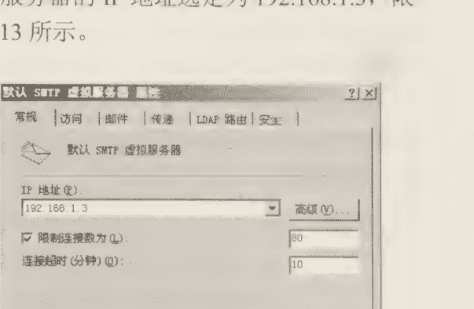

注意：通过“IP地址”下拉列表右侧的“高级”按钮，可以打开“高级”对话框继续为此 SMTP 服务器配置多个标识(IP地址和 TCP 端口)”。如果不选择“启用日志记录”复选框，则“活动日志”下拉列表将失效；如果选择使用 Microsoft 日志文件格式、NCSA 日志格式或 W3C 扩展，点击“启用日志记录（默认）”后选择“日志属性”对话框，在“日志属性”对话框的“常规”和“高级”选项卡（见图 6-14 和图 6-15），可对日志计划、日志文件目录以及扩展选项（日志记录中的数据）进行设置。

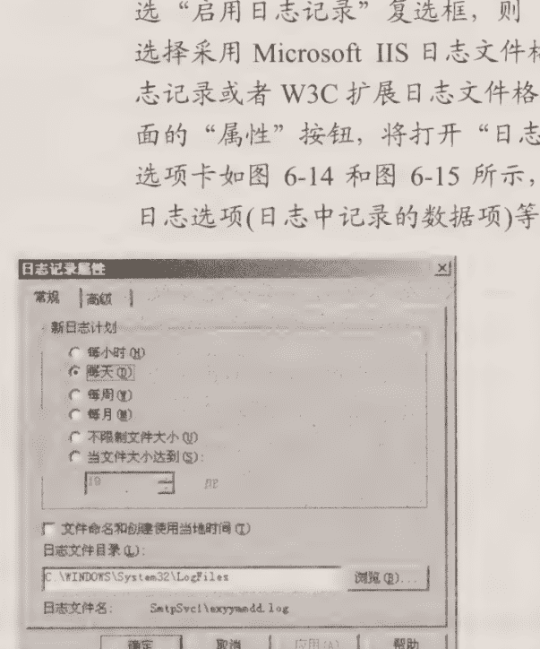


# 网络服务器部署与管理项目教程(Windows Server 2012+)

步骤 3 使用“服务器属性”对话框中的“访问”选项卡，并点击其中的“中继”按钮，将打开“中继”对话框，如图 6-16 所示。

这里需要限制 SMTP 服务器通过中继功能，如果不需要限制某些计算机通过此服务器进行中继，则可以在“以下以外的例外列表”中单选择，而不是通过“添加”按钮添加任何链接，并保持不变“允许所有通过身份验证的计算机进行中继，并忽略上方复选框的默认选项。

> 注意：除了中继的设置外，通过“访问”选项卡还可以控制连接、安全通信及连接控制设置。本项目暂时只需要限制中继，并通过 SMTP 服务器的中继功能，因为它是其他 SMTP 服务器和接收邮件(POP3)服务器的桥梁。


结束设置后点击“确定”按钮关闭对话框，完成了 SMTP 服务器的部署，一个功能的邮件客户端已经设置完毕。使用“SMTP 服务器属性”对话框的其他选项卡，可以对 SMTP 服务器进行更新、更详细的设置。

## 2、配置邮件客户端并收发邮件

对于熟悉邮件操作的专业人员来说，在字符界面使用 `telnet` 或 `ssh` 命令连接邮件服务器并进行邮件的操作，是一种 E-mail 服务器成功的快捷方法；对于图形界面的用户来说，通过配置邮件客户端并收发邮件来测试可能是最直观的方法，也是我们现在常用图形化软件管理自己邮箱账户的方法。对于图形界面的邮件客户端有很多了，比如 Windows 自带的 `Outlook` 和 `Foxmail`。Linux 系统自带的 `Evolution` 等。

> 注意：`Outlook` 在 Windows 以及之后的 `Outlook` 本质上是 Windows 自带且默认安装的邮件客户端，在 Windows Vista 之后加入了 `Mail`，在 Windows 7 之后又加入了 `Windows Live Mail`，它的配置与 `Outlook` 相似。`Foxmail` 是一款免费的、精致且性能优异的国产邮件客户端，深深受用户的青睐，它可以同时管理用户的多个邮箱帐户，也可以为多个邮箱帐户设置访问账号。

### 1. 在本地创建邮箱

在架设的 E-mail 服务器上已经为 `chf` 和 `wjm` 两个用户创建了邮箱，他们的邮箱地址分别为 `chf@xinyuan.com` 和 `wjm@xinyuan.com`。实际测试时，应用两台客户端分别安装 `Mail` 软件，并各自创建自己的邮箱帐户。但是为了章节篇幅，通过在同一台机 `Foxmail` 配置两个邮箱账户来进行收发邮件。客户端安装 `Foxmail` 软件的工作读者可以自行完成，默认安装后在桌面上建立一个“Foxmail”图标。

步骤 1 第一次通过双击桌面上的“Foxmail”图标启动 `Foxmail` 时，按照图 6-17的“向导”对话，要求用户新建一个新的邮箱账户。在“邮箱地址”文本框中输入 `chf@xinyuan.com`。

在“密码”文本框中输入在创建账户时所设置的密码。后面的“邮箱名”和“邮箱中使用的名称”文本框会自动填充默认的邮箱地址和用户名，一般无需修改。


> 注意：`Foxmail` 可以同时处理多个邮箱账户，这里的“邮箱账户”就是唯一的名称，创建后将显示在 `Foxmail` 主界面左侧的邮箱列表：“邮箱中使用的名称”是指使用该邮箱账户发送邮件时显示在“发件人”栏中的名称，你可以输入的别名。此外，在创建邮箱时获取该邮箱或通过该邮箱发送时，都会触发对登录请求密码。

步骤 2 点击“下一步”，新建邮箱账户“向导”进入“指定邮件服务”界面，见图 6-18 所示。由于我们使用的 SMTP 服务和接收邮件都配置在服务器上，要在“POP 服务器”和“SMTP 服务器”文本框中输入 `mail.xinyuan.com`，也可以输入 IP 地址 `192.168.1.3`；POP 服务器”就是电子邮件地址，将默认的用户名无需更改。

步骤 3 点击“下一步”，新建邮箱账户“向导”进入“建立账户”界面，提示用户点击“完成”按钮即可创建，如图 6-19 所示。

> 注意：默认情况下，`Foxmail` 在接收邮件并保存到本地后删除，这是为了及时出空间。如果用户希望在服务器内仍然（备份）自己的邮件，使用以后通过浏览器或其他软件（包括其他机器上）登录 E-mail 服务器查看，就需要勾选“邮件在服务器上备份，接收后从服务器删除”。


步骤 4 点击“完成”按钮，点击 `chf` 的邮箱账户即可创建完毕，新建的邮箱账户将显示在左侧“邮箱”列表中。此后可以通过“邮箱”-新建账户”菜单打开向导，继续创建邮箱账户。读者可以按上述步骤为用户 `wmj` 创建邮箱账户，图 6-20 所示已完成 `chf` 和 `wmj` 两个邮箱后的 `Foxmail` 主账户。

步骤 5 在创建邮箱账户后，还可以设置账户的个人信息、邮件服务器发送邮件、接收邮件以及尺寸等属性。右击 `Foxmail`帐户中需要设置属性的账户 `chf@xinyuan.com`，在快捷中选择“属性”属性，即可打开 `Foxmail` 的“设置设置”框，其中的““设置””界面  --11所示。


| 收箱(F) | 发件(S) | 邮件(M) | 工具(T) | 帮助(H) |
| :--- | :--- | :--- | :--- | :--- |
| 收箱 | 发件人 | 日期 | 大小 | |
| 邮件(M) | 发送邮件(S) | | | |
| 拟信邮件 | | | | |
| 垃圾箱 | | | | |
| 发箱 | | | | |
| chf@xinyuan.com | | | | |
| 邮件 | | | | |
| 草稿箱 | | | | |
| 已群邮件 | | | | |
| 邮件箱 | | | | |

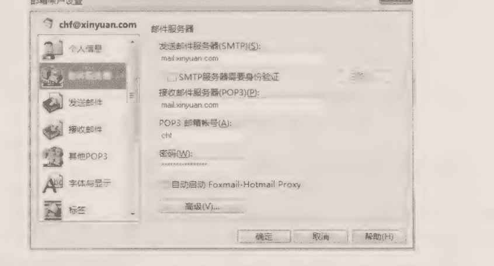

> 注意：邮箱账户的基本信息已经在创建过程中完成了设置，没有必要对账户的属性进行修改。需要的是 Windows Server 2003 中配置的 SMTP 虚拟邮件服务器需要用户验证的，实际用户邮箱所属的邮件系统很多时候是如此，这样可以防止用户在使用邮件系统对外发送邮件时产生垃圾邮件。`Foxmail` 在新建邮箱账户时设置的邮件服务器属性中，“SMTP 服务器需要验证”复选框未被勾选，所以这里应该勾选此复选框。在某个邮箱账户设置中有一个“记住访问密码”选项，利用它可以为指定的邮箱帐户设置密码，此后在启动 `Foxmail` 并选择该账户时，必须通过密码验证才能查看邮件，使客户本地邮箱账户的私密性得到有效保证，这也是 `Foxmail` 非常有用之一。

### 2. 使用 Foxmail 邮件测试的收发

假设用 `chf` 邮箱发送测试邮件，首先在 `chf` 的邮箱账户上编写这封邮件，然后在 `wjm` 中选择账户接收邮件，按照步骤如下：

**步骤 1** 在 `Foxmail` 的左侧栏选择邮箱账户 `chf@xinyuan.com`，然后选择“邮件”-新建邮件，或者直接点击工具栏上的“编写”按钮，打开“邮件”窗口，如图 6-22 所示。由于在创建邮箱账户时“邮箱名称”设置为了 `chf`，此时编写邮件日期出现在正文底部。这里只需在“收件人”文中输入邮件地址 `wjm@xinyuan.com`，并在“主题”和邮件正文中输入想要发送的主题，还需要单击“附件”添加附件。


**步骤 2** 在“邮件”窗口中选择“邮件”-立即发送，或者直接点击工具栏上的“发送”按钮，邮件就会立即发送并返回 `Foxmail` 主窗口。此时在左侧栏选择邮箱账户 `chf@xinyuan.com` 下的“已发送邮件”文件夹，即可看到已发送的邮件，如图 6-23 所示。


> 注意：编写邮件时，`Foxmail` 邮件功能非常强大。在步骤 3 接收邮件，在 `Foxmail` 的左侧栏选择邮箱账户 `chf@xinyuan.com`，然后选择“邮件”-新建邮件，或者直接点击工具栏上的“编写”按钮，打开“邮件”窗口，如图 6-24 所示。此时双击邮件即可查看信息。


# 网络服务器配置与管理教程(Windows Server 2012-Linux)

```
Retype new UNIX password: //再次输入密码
passwd: all authentication tokens updated successfully.
```


# 项目六 E-mail 服务器配置与管理

## 一、配置 E-mail 服务器

### 步骤 1：设置用户密码

```bash
# //提示密码设置成功
# //用户密码也可以使用下面的命令设置
# echo 123456 | passwd --stdin chf //命令执行后会提示密码设置成功
```

### 步骤 2：创建邮箱目录

为用户 `chf` 和 `wjm` 创建邮箱目录。用户的邮箱目录默认是在用户主目录（如 `/home/chf`）下的 `mail/.imap/INBOX`。以下是为用户 `chf` 创建邮箱目录的操作命令，另一个用户的邮箱目录由读者自行创建。

```bash
# mkdir -p /home/chf/mail/.imap/INBOX
# 使用-p 选项自动创建邮箱目录，如果一级目录不存在就会创建它，注意要加-哦
# 也可以使用相同的方法创建 chf 用户的邮箱目录
# su - chf //切换到当前 chf 用户身份
$ mkdir -p mail/.imap/INBOX //此时当前目录在 chf 用户主目录下
$ exit //退出当前 chf 用户身份返回 root 身份
```

> 注意：在 CentOS、RHEL 平台安装 Sentinel E-mail 服务器时，这非常常见。如果不为用户创建邮箱目录，使用 `telnet` 连接服务器的 110 端口时，在输入用户名和正确的密码后会显示“Connection closed by foreign host.”如果在输入用户名时使用接收方端口号全称（即邮箱地址，如 `chf@xyuman.com`），又会提示“ERR Authentication failed.”如果无法登录，这是困扰了许多学者的问题。在较新的 Red Hat、Fedora 中配置 E-mail 服务器时就不会出现这个问题，即可忽略它。另外，如果用户数量很多，这种情况可以通过以下方法为每个用户创建邮箱目录：修改 `/etc/chf/.bash_profile` 文件，每次创建新用户时它会自动创建邮箱目录。

```bash
# vim /etc/chf/.bash_profile
# //内容略，在文件中添加以下行
if [ ! -d ~/imap/INBOX ]; then
mkdir -p ~/imap/INBOX
fi // 输入保存并退出
```

### 步骤 3：设置邮箱别名

为用户邮箱号设置别名。`Sendmail` 通过修改别名文件 `/etc/aliases` 来为每个邮箱号指定一个别名。别名是一个虚拟的名称，虽然可以使用任意命名，但在系统中不能冲突。这里将别名命名为用户名同名的名字，操作命令见下文。

```bash
# vim /etc/aliases
# //已有内容，在文件最后输入 chf 和 wjm 两个用户名与别名
# root: marc # Person shokui get root's marc
```

```bash
chf: chf
wjm: wjm           //输入完毕，保存并退出
```

// 也可以使用以下命令直接连接 `chf` 和 `wjm` 两个用户名并添加到 `aliases` 文件末尾

```bash
# echo "chf" >>/etc/aliases
# echo "wjm" wjm >>/etc/aliases
```

### 步骤 4：生成数据库文件

`Sendmail` 并不直接读取 `/etc/aliases` 文档，而是使用该文件的 DBM 数据格式文件 `/etc/aliases.db`。因此，还需要通过 `newaliases` 命令，根据该文件内容动态生成 `/etc/aliases.db` 数据库格式文件，命令如下：

```bash
# newaliases
```

## 二、配置邮件转发功能

`Sendmail` 的默认配置会给邮件带来麻烦，是因为它只接受来自于 E-mail 服务器自身的邮件。为了解决这个问题，需要通过下列步骤的配置，以使 `Sendmail` 具备邮件转发功能，即能够为其他网络以及我们的主机转发邮件。

### 步骤 1：修改主配置文件

修改 `Sendmail` 主配置文件 `/etc/sendmail.cf`，删除 `DaemonPortOptions` 配置选项的行的注释符并使其生效，并将 `Addr=127.0.0.1` 的 IP 地址改为 `0.0.0.0`，允许来自 Internet 或其他任何网络传输的邮件。

```bash
# vim /etc/sendmail.cf
```

```bash
... // 找到以下内容(Centos 6.5 原的默认配置文件中的第261行)
# DaemonPortOptions="Port=smtp,Addr=127.0.0.1,Name=MTA
// 删除该行的注释符，并修改其中的IP 地址为0.0.0.0，即：DaemonPortOptions="Port=smtp,Addr=0.0.0.0,Name=MTA
```

```bash
// 修改后保存退出
```

> 注意：E-mail 服务器仅供企业内部之间发送邮件，无需从其他网络接入，“DaemonPortOptions”配置后 `Addr=127.0.0.1` 的 IP 地址可以改为 E-mail 服务器 IP 地址 `192.168.1`，则使用 `Sendmail` 主配置文件邮件法非常复杂，多配置不需要去该文件，而是修改一个相对理解的配置文件 `etc/sendmail.mc`，使用 `m4` 处理依据 `sendmail` 文件生成 `sendmail.cf`。

```bash
# vim /etc/mail/sendmail.mc
... // 找到以下内容
Centmailmailmail.mc
DAEMON_OPTIONS("Port=smtp,Addr=127.0.0.1,Name=MTA")
// 删除该行的注释符，并修改中的IP 地址为0.0.0.0如下
DAEMON_OPTIONS("Port=smtp,Addr=0.0.0.0,Name=MTA")
// 修改后保存退出，执行以下命令
```

```bash
# m4 /etc/mail/sendmail.mc > /etc/mail/sendmail.cf
```

# 根据配置文件 `sendmail.mc` 生成 `Sendmail` 主配置文件 `sendmail.cf`

### 步骤 2：设置域和网络

如果要把 `Sendmail` 用于其他域或网络，需要重新配置数据库 `/etc/mail/access`。该数据库文件可以根据一个配置文件 `access` 自动生成。因此，应该首先在 `access` 文件中定义允许的 E-mail 服务器、IP 地址访问访问，然后执行 `makemap` 命令将其转换为数据库，具体操作如下：

```bash
# vim /etc/mail/access
```

```bash
// 在文件的最后添加两行，设置域和网络
# by default allow relaying from localhost

Connect:localhost RELAY
Connect:127.0.0.1 RELAY
Connect:xinyuan.com RELAY
Connect:192.168.1.1 RELAY
// RELAY 表示所有的邮件传输，如果为 REJECT 则拒绝所有的邮件传输
// 添加到文件并退出，执行以下命令：
```

```bash
# makemap -r hash /etc/mail/access /etc/mail/access.db
```

// 生成后生成 `access.db` 数据库

### 步骤 3：修改接收邮件的主列表

修改 `Sendmail` 接收邮件的主列表 `/etc/mail/local-hosts`。这个文件非常重要，其内容需要指定邮件信息，也就是说 `Sendmail` 将所有允许的区域或主机包含在该文件中。使用格式如 `user@xinyuan.com` 的邮箱地址，只需添加到 `local-hosts` 文件即可：

```bash
# vim /etc/mail/local-hosts
```

```bash
# local-hosts include all aliases for your machine.

// 该文件只有一行，在此处添加 E-mail 服务器区域

xinyuan.com

// 添加到文件并退出
```

> 注意：如果主机 `mail.xinyuan.com` 添加到 `local-hosts` 文件中，还可以使用如 `user@mail.xinyuan.com` 的邮箱地址。事实上，进一步也可修改 `Sendmail` 主配置文件 `sendmail.cf` 或配置文件 `/sendmail.mc` 来实现。在 `sendmail.cf` 文件中，关键字后定义 E-mail 服务器区域（如多个空格分隔），默认为“localhost”，将其修改为“localhost xinyuan.com”；在配置文件 `sendmail.mc` 中设置“LOCAL_DOMAIN”选项，下面通过修改 `sendmail.mc` 文件来指定 E-mail 服务器域名。

```bash
# vim /etc/mail/sendmail.mc
```

```bash
// 找到以下一行内容（CentOS 6.5 的默认配置文件第 155 行）
LOCAL DOMAIN('localdomain')
// 如有行注释 "dnl" 将其删掉，并修改如下
LOCAL DOMAIN('xinyuan.com')
// 修改后保存退出
# m4 /etc/mail/sendmail.mc > /etc/mail/sendmail.cf
// 执行该命令生成 Sendmail 主配置文件
```

## 三、配置 POP3 服务

在 Fedora、CentOS 等新的 Linux 系统中，用于接收邮件的 POP3 服务使用了 `dovecot` 服务，它负责监控 110 端口，将邮件投递到用户邮箱。主配置文件 `/etc/dovecot/dovecot.conf` 目录下包含有关邮箱、日志、用户认证方式等多个配置文件，且在 `dovecot.conf` 的最后还包含 `include` 语句将这些独立的配置文件全部包含了主配置文件中。

为实现基本的邮件系统功能，对 `dovecot` 需要进行以下步骤的配置。

### 步骤 1：修改邮件服务配置文件

修改邮件服务配置文件 `/etc/dovecot/dovecot.conf`，操作如下：

```bash
# vim /etc/dovecot/dovecot.conf
```

```bash
// 移动到下一行(CentOS 6.5 的默认配置文件第 20 行)
protocols = imap pop3
// 删去此行的注释并按照要求配置，或者在原处直接添加
protocols = imap pop3
// 其他配置，注意开启
include conf.d/*
// 修改后保存退出
```

### 步骤 2：修改认证配置文件

修改 `/etc/dovecot/conf.d/10-auth.conf`，该文件负责 `dovecot` 使用认证方法。由于基本的邮件系统并没有使用 `sasl` 认证，而是使用明文认证，必须对 `10-auth.conf` 文件进行修改：

```bash
# vim /etc/dovecot/conf.d/10-auth.conf
```

```bash
// 找到此一行
disable_plaintext_auth = yes
// 删去此行的注释并将该项改为 no。也可以在此处直接添加
disable_plaintext_auth = no
// 修改后保存退出
```

> 注意：在 `10-auth.conf` 文件中 `disable_plaintext_auth` 的值设置为 `no` 非常重要，因为之前配置 E-mail 服务器时，`dovecot` 默认使用 `sasl` 认证而不是明文认证。因此，如果不执行上述修改，用 `telnet` 连接 110 端口接收邮件时，若输入用户名将会显示“Plaintext authentication denied on non-secure (SSL/TLS connections)”（在安全/TLS 连接上禁用明文认证）。

### 步骤 3：修改 SSL 配置文件

修改 `/etc/dovecot/conf.d/10-ssl.conf`，该文件负责 `dovecot` 的 SSL 配置。这里禁用 SSL 认证，其原因与上一步使用 `sasl` 认证类似。

```bash
# vim /etc/dovecot/conf.d/10-ssl.conf
...
// 找到以下一行
ssl = yes
// 去掉该行的注释，并将其改为 no，可在此处直接添加
ssl = no
// 修改后保存退出
```

### 步骤 4：修改邮箱位置配置文件

修改 `/etc/dovecot/conf.d/10-mail.conf`，该文件决定邮箱的位置。由 `10-mail.conf` 决定位置。

```bash
# vim /etc/dovecot/conf.d/10-mail.conf
...
// 找到以下一行
mail_location = maildir:~/mail:imap
// 去掉该行的注释并按照要求配置，或者在原处直接添加
mail_location = maildir:~/mail:imap
// 修改后保存退出
```

## 四、使用 Linux 客户端测试 E-mail 服务

在运行 Linux 的服务器上运行 Linux 的客户端，都可以用图形界面的邮件客户端软件（如 Windows 中的命令行的 Foxmail 或 Linux 自带的 Evolution），或者在字符界面下使用 `Telnet` 或 `SSH` 命令连接 E-mail 服务器并收发邮件。这里只是介绍 Linux 客户端上使用远程登录命令请求邮件的方法，这些命令同样适用于 Windows 服务器的命令提示符。使用图形界面的客户端软件测试 E-mail 服务，读者可以参考自己的方法进行此类测试。

### 1. 远程登录 Telnet 和 SSH 协议

`Telnet` 和 `SSH` 是用于远程服务器的基于 TCP/IP 的协议，利用它们可以远程登录并管理服务器。在选择 `Telnet` 客户端时，网络通信和连接的缩写，是 UNIX 平台上为人知的网络协议；`SSH` 是 Secure Shell（安全外壳的缩写），它是互联网访问网络设备和服务器的主协议。`Telnet` 和 `SSH` 的区别在于：`Telnet` 使用明文传输数据（包括密码），没有加密策略和加密方法，是一种不安全的协议，`Telnet` 使用端口为 23；而 `SSH` 使用加密传输数据并进行压缩，还使用客户端对访问的服务器进行用户身份认证，以提高安全性，默认端口为 22。

正因为 `SSH` 比古老的 `Telnet` 更安全，所以推出不久后占据了主流，尤其是通过公共网络访问设备和服务器时，不再使用 `Telnet`。但是它以其方便和便利的特性为人们熟悉和熟悉，并且所有操作系统都支持，许多管理员经常使用 `Telnet` 在测试中使用局域网内的服务器。此外，首先使用 `Telnet` 登录 E-mail 服务器进行收发邮件的测试，然后需要介绍 `SSH` 登录 E-mail 服务器的操作方法。

### 2. 使用 Telnet 发送邮件

在 Windows 或 Linux 客户端的命令提示下，使用 `Telnet` 命令登录 E-mail 服务器并收发邮件的方法基本相同。通过这里一个 IP 地址为 `192.168.1.99` 的 Linux 客户端使用 `Telnet` 命令来进行邮件的编写和发送，在测试前配置的邮件服务器是否符合预期的功能，并完成测试的操作进行调整。其中，`Telnet` 登录 E-mail 服务器后按照下线的划分对于用户输入的 `Telnet` 命令。

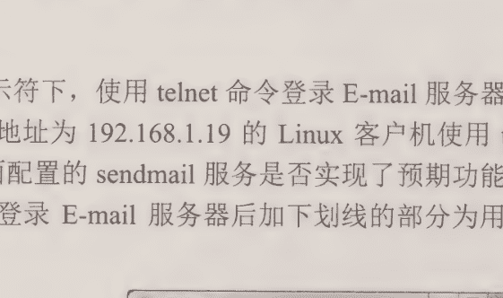

图 6-25“Windows 功能”窗口

然后右点击上面的“计算机”图标，在弹出的快捷菜单中选择“管理”命令，在打开的“计算机管理”窗口中选择“服务”选项，找到 `Telnet` 服务并启动它，这样就可以使用 `telnet` 命令了。

```bash
# telnet.xinyuan.com      // E-mail 服务器的 smtp 端口 25
Trying 192.168.1.3... 
Connected to mail.xinyuan.com (192.168.1.3).
Escape character is '*'
220 mail.xinyuan.com SMTP Sendmail 8.14.1/8.14.1; Fri, 16 Nov 2018 20:58:53 +0800
// 显示已连接到 E-mail 服务器 25 后，此处可以输入 telnet 命令如下
mail:chf@xinyuan.com // mail:命令后收件人地址
250 2.1.0 chf@xinyuan.com... Sender ok
rcpt to:wjm@xinyuan.com // rcpt:命令后收件人地址
250 2.1.5 wjm@xinyuan.com... Recipient ok
data // data后写邮件内容
354 Enter, input with ". on a line by itself
// 提示输入邮件内容，输入时按 Enter 换成新行输入点(.) 表示结束
subject: test message // subject:输入邮件主题
This is a test message from chf to wjm.
// 输入完毕在新行输入“.” 表示结束
250 2.0.0 W4FTBK010420 Accepted message for delivery
quit // 退出 telnet
221 2.0.0 mail.xinyuan.com closing connection
Connection closed by foreign host.
```

下面介绍在 IP 地址为 `192.168.1.199` 的 Linux 客户端上使用 `telnet` 命令登录用户 `wjm` 的邮箱接收来自用户 `chf` 的邮件，在测试前配置的 `dovecot` 服务器实现了预期功能，并给出的操作过程及注释。

### 3. 使用 telnet 接收邮件

```bash
# telnet.xinyuan.com 110 // E-mail 服务器的 pop3 端口 110
Trying 192.168.1.3...
```

# 网络服务器配置与管理教程(Windows Server 2012+Linux)

```bash
Connected to mail.xinyuan.com (192.168.1.3).

Escape character is '^'.

+OK Dovecot recov.
```


以上显示表示已成功连接 E-mail 服务器 `110` 端口，此后可输入 `telnet` 命令如下：

```
user wjm
+OK
pass 123456
+OK Logged in //登录需要邮箱的用户名 wjm //输入用户wjm的密码
```

```
list
+OK 1 messages:
1 501 //列出邮箱收到的邮件
```

```
retr
+OK 501 octets //查看第1封邮件的详细
```

```
Return-Path: <chf@xinyuan.com>
Received: from [localhost [192.168.1.3]] (localdomain; 8.14.1) with SMTP id WA4FTBK010420 for wjm@xinyuan.com, Fri, 16 Nov 2018 21:03:17 +0800
Date: Fri, 16 Nov 2018 20:58:53
From: chf@xinyuan.com
Message-Id: <20181161303.wa4FTBK010420@localhost>
X-Authentication-Warning: localhost.localdomain
use HELO protocol
subject: test message
This is a test message from chf to wjm.
```

`quit` //退出 `telnet`

`+OK Logging out.`

`Connection closed by host.`

在使用 `telnet` 命令接收邮件时，`list` 列出指定邮箱收到的全部邮件，它以邮件编号（`n`）和邮件大小（字节）的形式显示。当用户的邮箱中收到多封邮件时，可以使用邮件命令后的数字查看第 `n` 封邮件。接收邮件时，`telnet` 命令常用的有两个：

- `list` 命令。`list` 不需要参数，执行后服务器响应回复，显示单行的提示加上 `+OK` 就是两个数字，第一个是邮件编号，第二个是邮件大小，例如 `+OK 5 237`，表示共 `5` 封邮件，大小为 `237` 字节。
- `delete` 命令。`delete` 后面跟一个数字用于指定编号 `n` 的邮件。注意：`delete` 命令为编号 `n` 设置标记，只有执行 `quit` 命令将标记的邮件从邮箱中删除。在退出 `telnet` 之前，可以使用 `delete` 命令清除所有标记的邮件。


### 4. 使用 SSH 登录 E-mail 服务器

格式一：`ssh -u 用户@远程服务器`

格式二：`ssh -u 用户@E-mail 服务器`，会提示用户登录账号

```
[root@localhost #] cd /root
ssh wbj@xinyuan.com
The authenticity of host 'xinyuan.com (192.168.1.3)' can't be established.
RSA key fingerprint is 5d:4a:ce:e2:bb:26:53:e9:d4:ac:6f7a
Are sure you want to continue connecting (yes/no)?
```

客户端用 `SSH` 登录服务器可能会看到这些信息，意思是确认主机的真实性，通过读取公钥来确认服务器是可靠的。除非使用 `RSA` 算法 `1024` 位后很不容易，这里使用 `MD5` 计算结果作为 `128` 位的公钥索引进行对比。若看到此提示，注意：客户端以后使用该公钥索引，除非在远程服务器自己的网站上发布，使用用户进行标识。这里直接输入 `yes` 确认这个公钥索引，否则在下次登录时将不再出现。

```
wbj@xinyuan.com's password:
Last login: Fri Nov 16 21:13:49 2018 from 192.168.1.18
```

//输入密码（无显示）

//显示第一次登录的时间和客户端 IP 地址

//显示该用户已登录服务器

```
[wbj@localhost ~]$ pwd
```

// 在服务器中使用用户目录

```
[wbj@localhost ~]$ ls
mail wbj.txt
```

// 查看邮件的邮件

```
[wbj@localhost ~]$ mail
Heirloom Mail Version 12.4 7/29/08. Type ? for help.
```

// "/var/spool/mail/wbj": 3 messages 1 new read

```
* 1 chf@xinyuan.com Fri Nov 16 21:06 15594/test message
> U 2 chf@xinyuan.com Sat Nov 17 22:23 15595/test message
> N 3 chf@xinyuan.com Sat Nov 17 22:35 15559/test message
```

// 显示用户 `wbj` 有 `3` 件邮件，`1` 封新邮件（标记 `N`），`1` 封未读邮件（标记 `U`）

// 为未读邮件提示，将帮助信息


`? mail commands`

| 命令 | 描述 |
| :--- | :--- |
| `type <message list>` | type messages |
| `next` | goto and type next message |
| `from <message list>` | give head lines of messages |
| `headers` | print active message headers |
| `delete <message list>` | delete messages |
| `undelete <message list>` | delete messages |
| `save <message list> folder` | append messages to folder and mark as saved |
| `copy <message list> folder` | append messages to folder without marking them |
| `write <message list> file` | append messages to file, save |
| `reserve <message list>` | keep incoming messages in mailbox if saved |
| `Reply <message list>` | reply to message senders |
| `reply <message list>` | reply to message senders and all recipients |
| `mail` | specific recipients |
| `folder` | change to another folder |
| `quit` | apply changes to folder |
| `exit` | discard changes to folder |
| `shell cd <directory>` | chdir to directory or home if none |
| `list` | names of all available commands |
| `<list>` | consists of integers |

## （1）访问控制

单击“身份验证”按钮，打开图 6-29 所示的“身份验证”对话框。

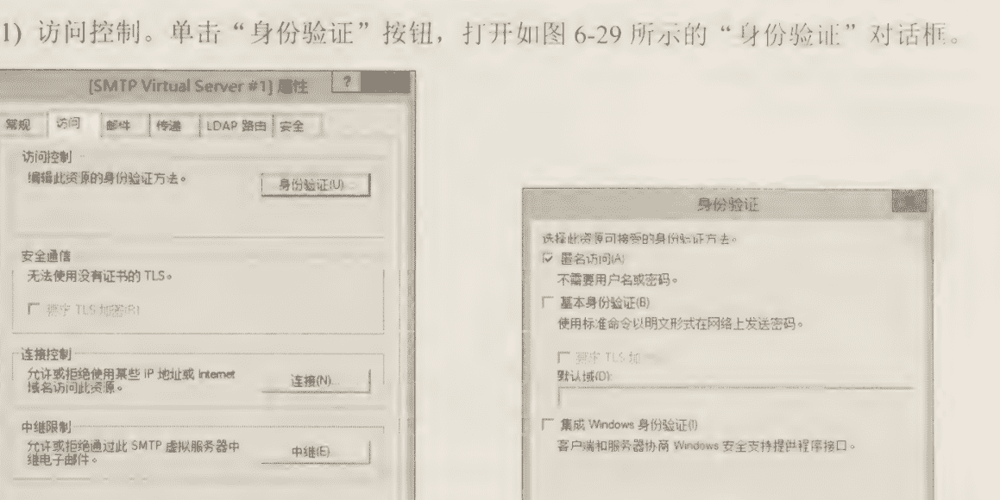

图 6-68 “SMTP Virtual Server 1 属性”选项卡 图 6-29 “身份验证”对话框

- ①“域名访问”复选框。用于选择允许哪些客户端访问 E-mail 服务器，若勾选该复选框则允许其多个范围，否则禁用此 SMTP 服务器的身份验证。
- ②“基本身份验证”复选框。勾选此复选框，允许用户邮箱和密码以明文形式在网络上传输。这需要在“登录”属性中指定域名，用于对邮件中进行基本身份验证的确认。
- ③“集成 TLS 加密”复选框。勾选此复选框，启用 Microsoft .NET Server 产品的安全标准加密。这台虚拟机使用加密技术对用户进行身份验证，并且要求用户通过网络传输加密的密码，企业为用户提供安全登录成为可能，但要求客户端软件必须支持此身份验证。

> 注意：在“身份验证”对话框中，默认认为“所有访问”。通常只有在 SMTP 服务器是专用服务器时，即该 SMTP 服务器用于企业内部邮件组件之间的邮件传输或与内部其他 SMTP 服务器通信，而不与外部的服务器进行通信的情况下，才选择另外两个选项。

### ② 安全连接

对于未安装服务器服务，此选项将不可用。安装服务器服务后，勾选“要求 TLS 加密”复选框，启用 SMTP 服务器的安全连接。

### ③ 连接

单击“连接”按钮，打开图 6-30 所示的“连接”对话框。默认认为“所有排除”选择，表示允许所有 IP 地址的客户端访问 SMTP 服务器，但也可以选择或拒绝特定 IP 地址的访问权限。若需要拒绝或更大范围的 IP 地址进行访问，可以通过指定一个 IP 地址，使用子掩码或主机名来达到目的。如果只允许指定的计算机连接到 SMTP 服务器，则可以选择“仅以下列表”选择框，然后点击“添加”按钮，打开“计算机”对话框，可以使用此 SMTP 服务器的属性、计算机 IP 地址、使用子掩码或主机名指定的计算机或指定范围中的计算机。

如，若允许 IP 地址为 `192.168.1.1~192.168.1.30` 的一组计算机连接 SMTP 服务器，则默认可以选择“一组计算机”单选按钮，然后在“子网址”文本框中输入 `192.168.1.0`，在“子网掩码”文本框中输入 `255.255.255.0`，单击“确定”按钮，如图 6-31 所示。


### (4) 中间限制

SMTP 服务器被用于将邮件中转到其他 SMTP 服务器或 POP3 服务器。如果 SMTP 服务器被误认为垃圾邮件的发送者，管理员可以对其要求的某些限制或限制措施。点击“中间”按钮，打开如图 6-32 所示的“中间限制”对话框。

默认中的“仅列表”单选按钮，此时如果“计算机”列表为空，则显示 SMTP 服务器不具备中间功能，即邮件发送到服务器后将无法将其中转到任何其他 SMTP 服务器。通过“仅以下列表”单选按钮，应该通过点击“添加”按钮，打开与图 6-31 相同的“计算机”对话框，选中“一台计算机”单选按钮，将此 SMTP 服务器自身的 IP 地址添加到可选的计算机列表；或者选中“一组计算机”或“域”列表，将一组计算机或某个域中的计算机加入用以使得 SMTP 服务器进行中转的计算机。显然，最简单的办法是点击“以下列表外”单选按钮，而不是通过任何操作（比如保持“计算机”列表为空），但这样可以让 SMTP 服务器更容易被受控，成为垃圾邮件的发送者，从而降低 SMTP 服务器的安全性。


> 注意：SMTP 服务器是连接其他 SMTP 服务器或 POP3 服务器的，即使是作为基本功能的邮件服务器，至少也应将其自身的 IP 地址添加到可选的计算机列表中，这样才能通过 SMTP 服务器的邮件中转到 POP3 服务器，防止将邮件投递到垃圾邮箱。

## 3. 设置 SMTP 服务器的“邮件”选项

`SMTP Virtual Server 1 属性`对话框的“邮件”选项卡可以如图 6-33 所示，可以对邮件大小、会话次数、每个连接的邮件和每个收件人进行限制。

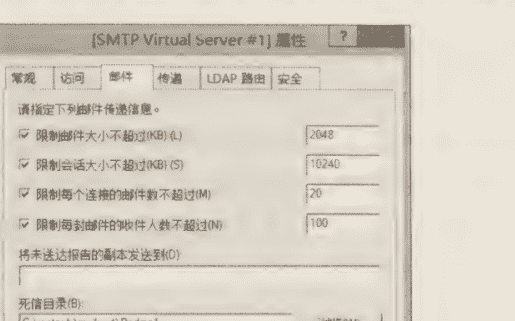

图 6-63 “`SMTP 服务器属性`”对话框的“邮件”选项

- (1) 限制邮件大小(KB)。用于设置 SMTP 服务器接收的最大邮件（以 KB 为单位）。如果客户端发送的邮件超过此限制，它将收到消息。SMTP 服务器支持 EHLO，在连接到服务器时自动检测邮件大小，并且不会尝试超过限制的邮件。SMTP 服务器简单地向发件人发送一条 NDR，默认值为 20，最小值为 1。
- (2) 限制会话大小(KB)。用于设置整个连接允许接收的数据量（以 KB 为单位）。设置时必须谨慎，因为邮件传输可能会反复错误。限制会话大小默认值为 40，管理员可以将此值大于等于“限制会话大小”，不需要限制则取消勾选。
- (3) 限制邮件的数量。勾选框可以设置每次连接 SMTP 服务器发送的最大数，默认值为 20。用此设置可以通过连接向远程发送邮件，从而提高性能。每次连接在定义的范围内，系统将打开新连接直到邮件完毕。
- (4) 限制收件人数量。勾选框可以设置每个邮件的最大收件人数，默认值为 100，是 RFC2821 中指定的要求。如果需要禁用此功能，可以取消勾选。某些客户在收到邮件后发现超过了收件人数量，SMTP 服务器就不会返回 NDR，系统会立即打开一个新连接并将剩余邮件。
- (5) 未发送报告的副本发送。“将送达副本发送到”设置地址。如果不启用此功能，则“将送达副本发送到”留空白。如果无法发送，则 SMTP 服务器将其返回发件人并附上 NDR。SMTP 服务器发送副本到特定邮箱，如果达到最大限制，则 SMTP 服务器会将副本存储在死信列表中。默认的死信列表为 `C:\inetpub\mailroot\Badmail`。管理员可以根据需要重新设置死信列表的位置。对于死信列表中的邮件不能返回，所以管理员需要检查死信列表并处理这些邮件，否则文件的空间会满，会对 SMTP 服务器性能带来负影响。

## 4. 设置 SMTP 服务器的“传递”

`SMTP Virtual Server#1 属性`设置“传递”选项如图 6-34 所示，可以对出站的相关参数、出站安全、出站连接以及高级传递等进行设置。

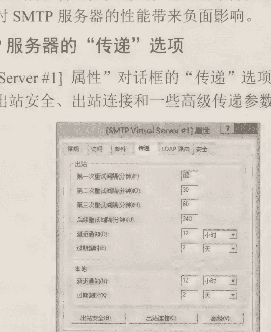

图 6-34 “`SMTP Virtual Server#1 属性`”对话框“传递”选项

### (1) 出站设置

“出站”设置组包含以下项：

- ① 第一次重试间隔（分钟）。显示 SMTP 服务器在重试邮件传递之前必须等待的时间，有效范围是 1~999 分钟，默认为 15 分。
- ② 第二次重试间隔（分钟）。显示 SMTP 服务器在第二次邮件传递之前必须等待的时间，有效范围是 1~999 分钟，默认为 30 分。
- ③ 第三次重试间隔（分钟）。显示 SMTP 服务器在第三次邮件传递之前必须等待的时间，有效范围是 1~999 分钟，默认为 60 分。
- ④ 后续重试间隔（分钟）。显示 SMTP 服务器在发出传递状态通知之前必须等待的时间，有效范围是 1~999 分钟，默认为 240 分。
- ⑤ 延迟通知。若允许本地和远程传输具有网络连接时，可以设置一个延迟时间，在该时间段后会发送传递通知。对于“出站”和“本地”传递，最小值为 1 分，默认值为 12 小时，最大值为 9999。可以在“延迟通知”中设置数值，在其后面的下拉列表中选择传递单位为分钟、秒或天。
- ⑥ 过期处理。如果已经达到最大次数且延迟时间已过，邮件将无法传递，在“过期超时”中设置一个时间值及相应的时间单位（分钟、小时或天）。对于“出站”和“本地”传递，最小为 1 分，默认值为 2 天，最大为 99 天。

### (2) 本地设置

“本地”选项组包含“超时”和“过期超时”参数，与“出站”设置组中的“延迟”和“过期”参数相同。

### (3) 出站安全设置

点击“出站安全”按钮，弹出图 6-35 所示的“出站安全”对话框，可配置 SMTP 服务器访问其他服务器的安全规则。默认是“匿名访问”单选按钮，如果需要 SMTP 服务器访问其他服务器，通常选择默认。当然也可以选择“基本身份验证”或“集成身份验证”，其与“出站”设置相似，只是针对 SMTP 服务器之间的传输规则。

### (4) 出站连接设置

点击“出站连接”按钮，打开图 6-36 所示的“出站连接”对话框，用于配置 SMTP 服务器传输的以下参数：

- ① 限制连接数。如果要让 SMTP 服务器同时连接到远程最大值，应该选择“限制连接数”复选框，并在文本框输入最大连接数。该选框默认为勾选，限制连接数为 100，最小数为 1。如果不限制连接，则取消该选框。
- ② 超时（分钟）。在指定时间内没有活动状态，则 SMTP 服务器将关闭连接。对于传入连接，默认时间是 10 分。
- ③ 限制每个连接数。用于设置限制到单个传输的连接数。
- ④ 端口。SMTP 服务器使用的端口，默认是 25。
- ⑤ 高级。点击“高级”按钮可以设置更多传递参数。

## 2. 使用 Winmail 搭建 E-mail 服务器

Winmail 可以直接从官网从 `http://www.winmail.com/download` 下载最新的软件安装，它非常简单，请读者自行完成。如果不注册则使用试用，但试用版本只能使用 30 天，仅支持 20 个邮箱、5 个域名，并且有其他功能的限制。

在 Windows Server 2012 系统中安装 Winmail 后，在“开始”—“应用”菜单中就会增加包含多个单项的 Winmail 配置程序。其中，“Winmail 服务器程序”单项用于启动，“Winmail 配置工具”单项用于打开 Winmail 的管理界面，即“`Winmail Server -- 管理工具`”窗口，可以对系统的功能和性能、用户和组等进行详细配置。

以下以建立 `chf` 和 `jwm` 两个邮箱为例，简单介绍如何使用 Winmail 搭建基本服务器功能的配置部署，并执行后续的测试。对于多个邮箱、过滤、病毒防护等更多功能和性能的设置，可以查看相关资料进行实施。

### 步骤 1 启动 Winmail 并快速设置服务器

双击通过“开始”—“应用”—“Winmail 服务器程序”启动程序，由于没有任何配置服务器的域名和邮箱，将会自动打开“快速设置向导”对话框，要求新建创建一个包含域名的邮箱地址。在“新建的邮箱地址”框中输入邮箱“`chf@xiany.com`”。在“密码”文本和“确认密码”文本中两次输入邮箱的密码。此时，Winmail 会开始初始化邮箱系统的设置，设置完成后在“设置结果”中显示“新建域名 `xiany` 成功”和“新增邮箱 `chf@xiany.com` 成功”的信息，如图 6-41 所示。


图 6-41 首次启动 Winmail 时打开的“快速设置向导”对话框

> 注意：如果企业邮箱系统允许用户自行通过 Web 方式申请电子邮箱，在“快速设置向导”对话框中应勾选“允许通过 Webmail 注册新用户”复选框。在完成快速设置后，就可以正常启动 Winmail 邮件服务器了，此时在 Windows 桌面的右托盘上就会显示一个“图标”，可以看出 Winmail 服务器程序的运行状态及特点。

通过点击右上图标的快捷菜单还可以进行配置、邮件系统管理、停止邮件系统和退出邮件等操作。此后，可以使用 `Winmail Mail Server -- 管理工具`窗口对邮件的功能和参数以及用户等进行配置。

### 步骤 2 打开 Winmail 管理工具，进入用户管理界面

选择“开始”—“应用”—“Magic Winmail 管理工具”命令，打开 `Winmail Mail Server -- 管理工具`窗口，在左侧框中选择“用户和组”—“用户管理”选项，此时在“用户管理”列表中就会列出已创建的邮箱和系统内置的 `postmaster` 两个邮箱，如图 6-42 所示。

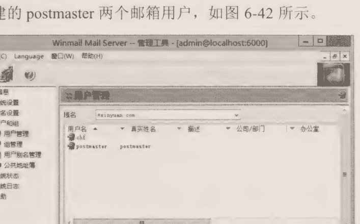

图 6-42 “`Winmail Mail Server -- 管理工具`”窗口的“用户管理”界面

> 注意：该窗口提供了 Winmail 邮件服务器系统信息、系统设置、域名设置、用户和系统状态以及系统日志等所有信息的集中式管理平台。其中，系统设置选项用于配置操作系统；SMTP、邮件过滤器、邮件网关、计划任务、SSL/TLS 证书、防病毒等；域名设置选项用于创建普通账号，允许通过 Winmail 注册邮箱，设置邮箱容量和权限；用户和组选项用于创建、删除、修改用户邮箱账户，设置邮箱大小、最大的允许字节数以及用户信息是否公开等，还可以将邮箱设置为只读，使用通过邮件账户和邮件服务器的设置；系统设置选项可以查看系统所有邮箱的状态信息。由于在这里构建了基础功能的邮件服务器，除了需要创建邮箱用户外，其他选项均保持默认配置即可，可不再进行赘述。

### 步骤 3 创建邮箱用户

为了给 Winmail 邮件服务器接收邮件的测试，还需要创建一个邮箱用户账户。在“用户管理”列表下方的“新建”按钮，打开“基本设置”对话框。在“用户名”文本框中输入“`wjm`”，在“密码”框中输入邮箱密码，“认证类型”和“账号类型”等保持默认设置即可，如图 6-43 所示。最后点击“完成”，即可在“用户管理”列表中看到新建的邮箱。

通过以上三个步骤的设置，一个具有基础功能的邮件服务器骨架就完成了，接下来就可以通过用户使用自己的邮箱账户接收邮件了。

### 基本设置

| 用户名 | `wjm` |
| --- | --- |
| 真实姓名 | |
| 认证类型 | 内部域认证 |
| 密码 | `wjm123456` |
| 密码加密方式 | `md5` |
| 密码存储问题 | |
| 邮件状态 | 正确 |
| 发送日期 | |

图 6-43 创建 Winmail 邮箱的“基本设置”对话框

## 3. 使用 Web Mail 方式测试 Winmail 邮件服务器

本项目二和任务三是使用邮件客户端软件和命令方式进行收发邮件来测试 E-mail 服务器的，这里用 `chf` 向 `wmail` 发送邮件，介绍了在 Windows 7 客户端上使用另一种 Web Mail 方式收发邮件。

### 步骤 1 登录邮箱

打开 IE 浏览器，在地址栏输入 `http://mail.xiany.com:8080` 按回车就会打开 Winmail 的登录页面，如图 6-44 所示。只需在“用户名”文本框中输入“`chf`”，在“密码”文本框中输入该密码，并单击“登录”按钮，即可登录 Winmail 邮箱。


图 6-44 使用 IE 浏览器登录邮箱

### 步骤 2 发送邮件

选择左角的“邮件”选项，在“收件人”文本框输入邮件地址“`wjm@xiany.com`”，在“主题”和邮件正文框输入想要发送的主题和内容，如有点击“附件”添加附件，如图 6-45 所示。完成邮件后单击“发送”按钮，该邮件就会发送到 `wjm` 的邮箱中。


图 6-45 在邮箱页面编写邮件

### 步骤 3 接收邮件

按照步骤 1 使用 IE 浏览器打开 Webmail 登录页面，在“用户名”和“密码”文本框输入“`wjm`”及对应密码，并单击“登录”即可登录邮箱。在左侧选择“收件箱”→“邮件”，即可查看来自 `chf` 的邮件详情，如图 6-46 所示。


图 6-46 邮箱后收到的邮件

## 三、配置 Sendmail 服务

通过对 Sendmail 的深入配置，可以满足各种 E-mail 服务器的需求。这是一种带认证功能的 Sendmail 配置方法并进行测试。

### 1. SMTP 认证功能

如果使用 Sendmail 的默认配置，为用户发送邮件提供了机会。任何人想要发送邮件，就可以利用带有认证中继（Open Relay）功能的邮件服务器来发送。身份认证的邮件传输也会给服务器处理邮件时带来困难。虽然 Sendmail 8.9 以前有一种限制功能，但它只能限制 IP 地址、邮件地址或域名。由于邮件服务器成为了垃圾，管理员可以将服务器设置为允许中继模式，这样就允许外部的用户发送邮件；如果服务器设置为中继模式，则发送功能容易被滥用。由于长期带来的矛盾，以往解决这个问题必须购买一些邮件服务器，在使用邮件前进行认证。Sendmail 8.1 以上的版本开始支持 SMTP 认证功能。它可以配置 `Cyrus-SASL` 认证程序，在邮件软件的基础上，SASL（Authentication and Security Layer）实现使用了 PLAIN 和 MD5 等认证方法。当用户认证后，SMTP 同样定义的认证策略对访问进行控制。因此，这里首先使用 SMTP 认证功能。在使用 Sendmail 配置了 SASL 认证功能，那么任何连接该服务器的邮件都使用用户名和密码进行认证，这样客户端可以帮助用户接收邮件，同时也保证了服务器的稳定，并且不需要额外的费用。由于配置了服务器上添加认证功能。

> 注意：由于采用 `Cyrus-SASL` 认证程序来实现 Sendmail 的功能，可能需要先确认 Linux 服务器已经安装了 `Cyrus-SASL` 组件；然后修改配置文件以确定认证方式；最后重启 `sendmail` 服务。

### 2. 检查或安装 Cyrus-SASL 软件

以下命令是 CentOS 6.5 查询相关文件是否安装。如果没有查询到这些软件包，可以参考示例。

```


`rpm -qa | grep cyrus-sasl`

```
cyrus-sasl-devel-2.1.23-13.el6_3
cyrus-sasl-2.1.23-13.el6_3
cyrus-sasl-md5-2.1.23-13.el6_3
cyrus-sasl-lib-2.1.23-13.el6_3
cyrus-sasl-plain-2.1.23-13.el6_3
cyrus-sasl-gssapi-2.1.23-13.el6_3
```

#### 3. Recipient 的认证功能

步骤 1 查看`/usr/lib/sasl/sendmail.conf`文件。该文件默认有一个`pwcheck_method`配置选项，且指定 Sendmail 用的认证方法为`saslauth`，因此无需修改。

```
# /etc/sasl/sendmail.conf // 注意文件名首字母要大写
pwcheck_method:saslauth
```

步骤 2 修改 Sendmail 配置文件`sendmail.mc`中的内容，并重新使用处理程序`m4`来生成主配置文件`sendmail.cf`。

```
# /etc/mail/sendmail.mc
// 以下与认证相关的两行（CentOS 6.5 原默认的配置方法为第 52 和 53 行）
// 修改后的设置将生效，即修改如下
TRUST AUTH_MECH('EXTERNAL DIGEST-MD5 CRAM-MD5 LOGIN PLAIN') dnl
define('CONNECT_MECHANISMS', 'EXTERNAL GSSAPI DIGEST-MD5 CRAM-MD5 LOGIN PLAIN') dnl
```

```bash
# m4 /etc/mail/sendmail.mc > /etc/mail/sendmail.cf
// 生成主配置文件 sendmail.cf
```


## 网络服务器配置与项目流程（Windows Server 2012+）

服务以及设置邮件邮箱，首先必须在 DNS 服务器配置的正向资源记录中添加一条邮件交换（MX）记录，其目的是标识 SMTP 邮件服务器，通知邮件传递将邮件发送到另一个系统；这个系统知道将邮件发送到它的目的地。要在客户端上测试时可以通过邮件服务器收发邮件，最方便的方法是使用 Foxmail 邮件客户端程序；对于支持 Web Mail 功能的邮件服务器（如 Gmail），也可以使用浏览器登录邮箱进行收发邮件；作为系统管理员，还将学会使用访问工具 Telnet 和 SSH 来进行调试，尤其是在邮件服务器工作异常时通过命令进行测试更容易找出问题。

### 一、准备

- 1. 用户使用电子邮件的方式有哪几种？它们都有什么优缺点？
- 2. 一个邮件系统主要由哪些部分组成？简述各自有什么作用？
- 3. E-mail 常用的协议有几个？简述其功能及使用的默认格式。
- 4. 从发送者发送邮件到接收件接收邮件的过程是什么？
- 5. 仅用 Windows Server 2012 自带的组件搭建一台可以的邮件服务器？搭建完整功能的邮件服务器有哪些解决方案？
- 6. Linux 下常用的免费邮件服务器有哪些？简述各自的优缺点。
- 7. 在配置邮件服务器时，我们通常是需要修改服务器的正向资源源文件中添加一条邮件交换（MX）记录；如何使用 `nlookup` 命令来测试 MX 记录配置是否成功？
- 8. 基于 Sendmail 的邮件服务器搭建中，我们通常是需要修改 `sendmail.mc` 文件来重新配置；如何将其转换为主配置文件 `sendmail.cf`？如何创建邮件用户及其邮箱目录？
- 9. 在客户端手机上使用 `telnet` 命令发送和接收邮件的主要步骤和命令。

### 二、训练

观看影片是为了让员工之间使用公司内部邮箱进行联络和文档传递，决定使用 Linux 服务器搭建自己的邮件服务器，其 IP 地址为 `192.168.1.5`，要求为每个员工配置如 `username@mysyp.com` 的邮箱，让员工使用 Foxmail 管理自己的邮箱账户。

- (1) 配置符合公司需求的邮件服务器（邮箱地址）时只使用 `telnet` 和 `wget` 命令。
- (2) 在客户端安装有 Foxmail 软件的 Windows 7 客户端上，分别配置 `wjm@mysyp.com` 和 `chf@mysyp.com` 邮箱账户，进行相互发送和接收邮件的测试。
- (3) 在两个客户端手机上分别登录自己的邮件账户，用 `telnet` 命令相互发送和接收邮件。
- (4) 按照 C 语言中的格式，编写 E-mail 服务报告实施报告。

## 项目七 VPN 服务器配置与管理

## 能力目标

- 能根据企业网络信息化建设需求和项目总体规划合理设计 VPN 服务方案
- 能在 Windows 和 Linux 两种平台下正确安装和配置 VPN 服务器
- 能配置 Windows 客户端并进行 VPN 连接与访问的测试
- 初步具备 VPN 服务器及其访问中常见问题的诊断与排查能力

### 知识要点

- VPN 服务的基本概念与实现机制
- 常用的 VPN 隧道协议和认证方式
- Linux 下部署 VPN 服务器所需的软件包及有关企业内部文件的解决方案

## 任务一 知识获得与方案设计

### 一、VPN 及其实现机制

#### 1. VPN 的定义

实际中的企业往往在不同地域开有多个分支机构，企业总部部配置有多台应用服务器，部署了完善的企业内部网络，而各分支机构也建立了自己的局域网。企业需要实现总部各分公司之间企业内部的协同办公，分公司的员工能够访问集成在企业总部部的文件服务器、Web 站点、邮件系统等信息服务，实现企业部门的信息交互。

虽然移动用户或远程通过拨号访问企业内部专用网络的实现方法有很多，但传统的拨号方式并不适合公共网络，效率较高，且在企业内部网络中计费进行数据传输时，不能保证企业私有数据的传输安全。近年来，VPN 作为一种虚拟网络技术已经得到了广泛的应用，企业通过 VPN 系统，利用公共网络与分公司之间的异地互通，为解决远程瓶颈提供了最合理的解决方案。

VPN（Virtual Private Network，虚拟专用网络）是一种利用公共网络构建私人专用网络的技术，是安全的、稳定的。它涵盖了跨越共享网络或公共网络的扩展、封装和身份认证连接专用网络的范围，从而避免了各种安全问题的干扰。之所以为虚拟网络，主要是因为 VPN 的两个节点之间的连接没有传输专用网络所需要的端到端的物理链路，而是在各种网络服务商所提供的网络平台上，如 Internet、ATM（异步传输协议）、Frame，是 Relay（中继）上的逻辑网络，数据在链路中传输。因此，VPN 借助公共网络，可以使得原本只能局限于很小范围内的企业内部网络扩展到世界上的一个一个角落。

#### 2. VPN 的典型架构与实现机制

一种典型的企业 VPN 项目网络拓扑结构如图 7-1 所示。

| 总部服务器群 | 防火/VPN | 防火/VPN | 分部服务器群 |
| :--- | :--- | :--- | :--- |
| | 192.168.1.1 | 202.101.240.37 | 192.168.2.1 |
| | | 220.130.240.21 | |

图 7-1 企业 VPN 项目的网络拓扑结构

#### 3. VPN 隧道

VPN 是采用隧道技术实现通信的。隧道，就是将数据经过局域网与公网时，封装在一种数据包中；当数据到达公网后，由该设备解封装，取出数据在局域网中传输。因此，VPN 借助公共网络，可以使得原本只能局限于很小范围内的企业内部网络扩展到世界上的一个角落。目前 VPN 使用的主要协议有两种 PPTP 和 L2TP，以及第三层协议 IPSec。

(1) PPTP（Point-to-Point Tunneling Protocol），点对点隧道协议。PPTP 在 RFC2637 中定义，它是点对点的扩展，将数据封装成 PPP 包可以在 IP 网络传输。客户端与服务器之间交换控制文和数据包，其中控制文负责隧道的建立、维护和保护，从客户端发送，端口为 `1723`。连接后，等到建立隧道再次通过 PPTP 传输真实的数据包；包括 GRE（通用路由封装）在 IP 中，服务器接收到包后，经过解密和重封装的数据包将其转换为内部网络。PPTP 采用 RSA 作为算法，保护了通信的安全。除了 IP 外，也可以加密，这种方法使得不同的 IP 网络互通。

(2) L2TP（Layer 2 Tunneling Protocol），第二层隧道协议。L2TP 在 RFC2661 定义，由 Cisco、华为、Microsoft 等公司联合制定，成为了第二层隧道的标准，得到了许多厂商的支持。L2TP 支持 PPP 封装，在任何端点之间传输的数据包都是 UDP 包，监听端口为 `1701`；在双端建立一条隧道，L2TP 可以提供隧道认证，二者的合称为 IPSec（Internet Security）为其加密服务。

(3) IPSec（Internet Security Protocol，安全协议）。IPSec 是由标准定义的安全通信的一系列函数，提供了私有通道的安全保障。IPsec 是构建 VPN 时最常用的加密协议，会有广泛的应用。IPsec 的基本思想是通过加密算法来实现安全准则，引入后，IPsec 规范中包含了 IPv6 支持。主要内容有：安全关策略；传输模式；AH（Authentication Header，认证头）；ESP（Encapsulating Security Payload，封装载荷）；IKE（密钥交换协议）。

#### 4. VPN 的身份方法

PPTP 和 L2TP 是通过 PPP 对数据进行封装，以便到达目的地，VPN 建立后仍然是 PPP。从这个角度来说，可以使用另一种更灵活的认证方法：

(1) PAP（Password Authentication Protocol），认证协议。PAP 由 RFC2865 定义，建立链路时认证，一旦建立链路后就不再认证。PAP 采用简单的交互模式，发送方发送用户名和密码，根据配置判断密码是否正确，则允许连接。由于密码在传输过程中很容易被窃者截取，对安全造成危害，且适用于安全较低的网络。

(2) CHAP（Challenge Handshake Authentication Protocol），挑战认证协议。CHAP 由 RFC1994 定义，在建立链路中并在建立链路后还会认证。CHAP 的认证过程为三次握手：发送方发送一个随机数（Challenge），接收方用 MD5 算法出一个 Hash 值，将其与密码作为响应（Response）返回；发送方收到响应后，在本地用户查找对应的密码，同样根据随机数用 MD5 算法算出 Hash 值，若匹配，则向对方发送一个确认（Acknowledge）消息表示通过，否则发送一个不支持（Not Acknowledge）消息，认证结束。可见，虽然双方都需要密码，但密码在网络传输中可能发生，并且通过其随机数可以防止重放攻击。

(3) MS-CHAP（Microsoft Challenge Handshake Authentication Protocol）。这是微软的 CHAP，初期的版本 RFC2432 定义。MS-CHAPv2 在 Windows 2000 引入，并在 Windows 95/98 时提供了支持，而 Windows Vista 后去掉了。与标准 CHAP 相似，MS-CHAP 的特点有 3 个方面：

(1) EAP（Extensible Authentication Protocol）。可扩展认证协议。EAP 实际上是一系列认证方式的集合，其设计理念是满足所有链路层的认证需求，提供不同的认证方式，分别支持 PPP、AAA 以及无线网络域的认证。EAP 是 IEEE 802.1x 的核心，它并不在建立阶段规定认证方法，而是到了认证阶段允许指定的认证服务器执行真正的认证工作，这就实现了 EAP 的扩展性和活性。

### 二、设计企业 VPN 服务方案

#### 1. 分析需求

新源公司是一家小型贸易企业，目前尚未正式成立分公司，有两名员工驻留在办事处。公司内部网络结构非常简单，所有员工都是通过 Modem 方式接入 Internet。但公司还需要在家里或其他地方访问内网，包括内网服务器的共享资源，还能通过公司网邮件服务器接收邮件。为此，新源公司要求在不增加硬件的前提下，在已有的服务器上架设 VPN 服务，让员工随时随地通过 VPN 访问内网。

#### 2. 设计网络拓扑

根据需求，新源公司决定采用单网卡实现 VPN 安全访问的简单架构，为此设计的 VPN 项目拓扑结构如图 7-2 所示。

图 7-2 新源公司 VPN 服务的网络拓扑结构

> 注意：本项目采用单网卡 VPN 结构也便于读者在简单的网络环境中模拟

#### 3. 定制 VPN 实现方案

按照设计，新源 VPN 服务器与 Web 服务器在同一服务器上，服务器上仅有一双网卡。配置在远程连接运行 VPN 服务器后，客户端需要各自一个虚拟 IP 地址，项目将虚拟 IP 地址的范围设置为公司内网同一 VLAN 的 `192.168.1.221~192.168.1.253`，实际上可以指定任何地方。在项目规划时，这些 IP 地址在部署时将为此用途而保留。而不是许多书籍和网络上介绍都是双击型 VPN 架构（图 7-1）的实现，具有相应训练条件的读者也可以参考配置。

### 任务二 Windows 下客户端实现 VPN

在 Windows 2012 R2 上，DirectAccess 和 VPN 是“远程访问”服务器角色的一个角色服务，通过虚拟网络（VPN）或拨号连接为远程用户提供对专用网络资源的访问。因此，如果在 IP 地址为 `192.168.1.2` 的服务器上架设 VPN 服务，首先就要添加“DirectAccess 和 VPN”这一角色服务。

步骤 1 打开“服务器管理器”，在左窗口中选择“仪表表”选项，在右侧窗格中选择“添加角色和功能”选项；或者直接选择“管理”→“添加角色和功能”命令，打开“添加角色和功能”窗口。向导引入“选择服务器角色”界面后，勾选“远程访问”复选框，如图 7-3 所示。

步骤 2：点击“下一步”按钮进入“选择功能”界面，勾选“RAS 连接器管理工具（CMAK）”复选框，如图 7-4 所示。

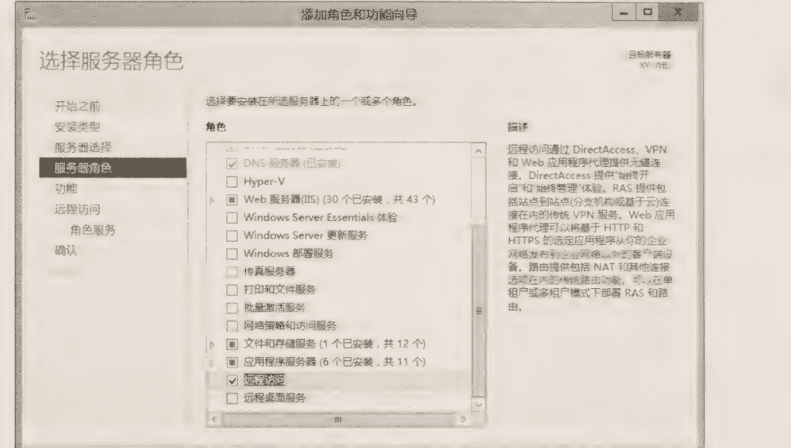
图 7-3 “添加角色和功能向导”窗口的“选择服务器”界面

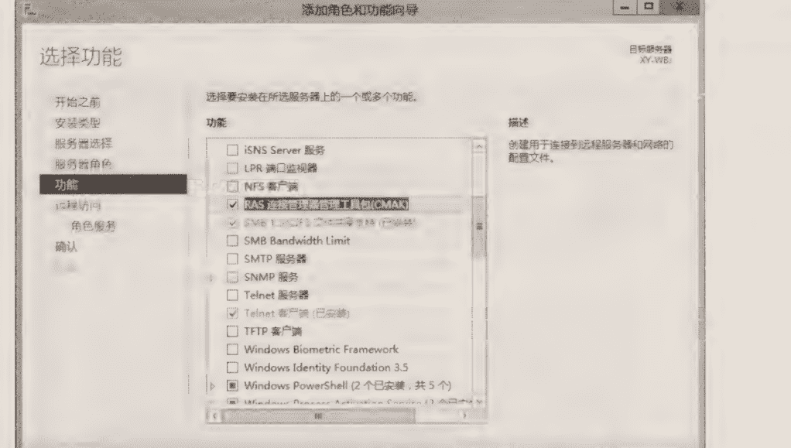
图 7-4 “添加角色和功能向导”窗口的“选择功能”界面

步骤 3：点击“下一步”按钮进入“远程访问”界面，介绍 DirectAccess、VPN 和 Web 程序的功能。继续点击“下一步”按钮进入“选择角色服务”界面，勾选“DirectAccess and VPN (RAS)”和“路由”两个复选框，如图 7-5 所示。

步骤 4：点击“下一步”按钮，再次点击“安装”按钮开始安装。当显示显示“安装进度”界面时，单击“结束”按钮即可。


图 7-5 “添加角色和功能向导”窗口的“选择角色服务”界面

成功安装“远程访问”角色后，在 Windows Server 2012 R2 的“管理工具”中会出现一个名为“路由和远程访问”的图标；在“服务器管理器”窗口的“工具”菜单中也会出现同名项。接下来可以使用该图标或运行命令打开图 7-6 所示的“路由和远程访问”控制台进行服务器配置。


图 7-6 “路由和远程访问”控制台

> **注意：**在“路由和远程访问”控制台中，左侧“服务器状态”列表项中有一个名为“XY-WJB（本地）”的服务器图标，表示系统已将此计算机添加为路由和远程访问服务器。但是，该图标名称上有一个红色标记，表示服务器尚未启用或处于停止状态。

## 网络服务器配置与管理教程（Windows Server 2012+Linux）

## 二、配置 VPN 服务器

在本地计算机上添加路由和远程访问服务后，VPN 服务器还需进行以下 3 项配置：

- (1) 配置 VPN 访问，并启用路由和远程访问服务。
- (2) 设置通信双方在建立 VPN 隧道时自动获取的虚拟 IP 地址。
- (3) 创建具有访问权限的 VPN 用户。

> **注意：** 管理员也可以不使用系统帐户识别的路由和远程访问服务，而是通过右键“服务器状态”选项，在弹出的快捷菜单中选择“添加服务器”命令，打开图 7-7 所示的“添加服务器”对话框，将此计算机加入路由和远程访问服务。实际上，在 Windows Server 2003 系统中，安装“路由和远程访问”组件后，默认不会将此计算机设为服务器，需要管理员通过上述操作手动完成。


### 1 配置并启用路由和远程访问服务

**步骤 1**：在“路由和远程访问”窗口中，点击 XY-WBJ（本地）服务器图标，在弹出的快捷菜单中选择“配置并启用路由和远程访问”命令，打开“路由和远程访问服务器安装向导”对话框。在向导首次出现的“欢迎”界面直接点击“下一步”，进入“配置”界面后，选择“自定义配置”，如图 7-8 所示。


注意：由于此处配置的是采用专用网卡实现 VPN，在此步骤中必须选择“自定义配置”单选框，否则后续步骤无法进行。

步骤 2：单击“下一步”按钮进入“自定义配置”界面，在“选择在此服务器上开启的服务”选项组中勾选“VPN 访问”复选框，如图 7-9 所示。


图 7-9 在向导的“自定义配置”界面中勾选“VPN 访问”复选框

步骤 3：单击“下一步”按钮进入“正在完成路由和远程访问服务器安装向导”界面，在“选择摘要”列表中显示已选择“VPN 访问”选项，如图 7-10 所示。


图 7-10 在完成路由和远程访问安装

步骤 4：检查无误后点击“完成”按钮，弹出“路由和远程访问”对话框，告知路由和远程访问服务已可用，并询问是否启动服务，如图 7-11 所示。


图 7-11 提示可以启动路由和远程访问服务

步骤 5：点击“启动”按钮跳转到“路由和远程访问”窗口。此时可以看到左侧“XY-WJB（本地）”服务器图标上有一个绿色标记，表示服务器已启用。展开其“属性”窗口如图 7-12 所示。


图 7-12 启动后的“路由和远程访问”窗口

客户端连接 VPN 服务器时，路由和远程访问服务器将为双方分配 IP 地址。如果不对 IP 地址进行设置，双方将自动获取网段 `192.168.1.0~192.168.1.253` 的地址。

### 2 设置虚拟 IP 地址

> **注意：**虚拟 IP 地址与 VPN 服务器处于同一网段。根据经验，内网中存在多个 IP 地址，这种情况下虚拟 IP 可以设置为内网中任何网段，只要网段之间连通即可。

步骤 1：在“路由和远程访问”窗口中，点击 XY-WJB（本地）服务器图标，在弹出的快捷菜单中选择“属性”，切换到 IPv4 选项卡。在“IP 地址分配”选项中，默认是“动态主机（DHCP）”，此处应选择“静态地址”单选框，如图 7-13 所示。

步骤 2：点击“添加”按钮打开“IP 地址”对话框，在“起始 IP 地址”文本框输入 `192.168.1.2`，在“结束 IP 地址”文本框输入 `192.168.1.253`。此时“地址数量”文本框自动显示为 `252`，如图 7-14 所示。


图 7-13 IPv4 选项


图 7-14 “新建 IP 地址范围”对话框

步骤 3：单击“确定”按钮，返回“XY-WJB（本地）属性”对话框的 IPv4 选项卡，在“静态地址”列表中看到刚才创建的范围。点击“应用”，再单击“确定”关闭对话框。

### 3 创建访问权限的用户

客户端登录 VPN 服务器必须在服务器上创建一个或多个访问权限的用户，操作如下：

步骤 1：右击“开始”按钮，在弹出的快捷菜单中选择“管理”，依次点击“工具”→“本地用户和组”→“用户”文件夹，在用户列表空白处右击，在快捷菜单中选择“新建用户”，如图 7-15 所示。


图 7-15 在“管理”窗口中新建用户

步骤 2：打开“新建用户”对话框，在“用户名”文本框输入 `svpn`，在“密码”文本框输入对应密码。取消勾选“用户登录时更改密码”，勾选“密码有效期”，如图 7-16 所示。

步骤 3：点击“创建”按钮完成 `svpn` 的创建。如果还需要新建其他用户，可在对话框中继续。由于本项目仅新建了一个测试用户，点击“关闭”即可。

步骤 4：在“管理”窗口中找到新创建的 `svpn` 用户，右击用户名选择“属性”，打开“svpn 属性”，切换到“拨入”选项卡。在“网络访问策略”中选择“通过 NPS 策略”单选框，并勾选“允许访问”，如图 7-17 所示。


图 7-17 设置允许访问

> **注意：**该步骤是为了赋予新建用户 VPN 访问权限，此处必须勾选“允许访问”，否则用户无法登录。最后点击“应用”并“确定”完成设置。现在可以在客户端上使用 `svpn` 连接了。

### 三、内网测试

验证 VPN 服务器配置的正确性，在连接之前或无法实现远程连接的情况下，先用同一网段内的客户端进行测试。以 IP 地址为 `192.168.1.20` 的客户端为例：


图 7-19 “连接到区域”选项

步骤 3：单击“下一步”按钮进入“连接到区域”窗口。首先选择连接方式，在“我的 Internet 连接（VPN）”和“直接拨号”中选择前者，如图 7-20 所示。


图 7-20 选择“我的 Internet 连接（VPN）”

步骤 4：选择连接方式后直接进入“输入连接的 Internet 地址”界面。在“Internet 地址”文本框输入 VPN 服务器 IP `192.168.1.2`；目标名称文本框默认名为“VPN 连接”，此处可以使用 `test`，如图 7-21 所示。如果允许其他有权限的用户使用，可勾选“允许他人使用此连接”；如果只是创建连接而不立即连接，则勾选“现在不连接；以便以后连接”。


图 7-21 输入连接的 VPN 地址和目标名称

步骤 5：点击“下一步”按钮进入“输入您的用户名和密码”界面。在“用户名”文本框输入 `svpn`（配置服务器时创建的权限用户），在“密码”文本框输入对应密码，如图 7-22 所示。


图 7-22 输入 VPN 服务器的用户名和密码

步骤 6：至此，VPN 连接完成。由于步骤 4 时未勾选“现在不连接”，所以系统会自动开始连接。

## 网络服务器配置与管理教程（Windows Server 2012+Linux）

关于连接状态参数，读者可以使用 `Ping 192.168.1.21` 和 `192.168.1.2` 来测试是否可以 Ping VPN 服务器的 IP 地址和实际内网 IP 地址，进一步测试客户是否成功连接 VPN 服务器。图 7-31 所示的是通过 Ping IP 地址 `192.168.1.2` 的显示结果，实际 IP 地址为 `192.168.0.10` 的远程客户端通过 VPN 通路连接，就能将 VPN 通路设在公司内部的 VPN 服务器，并且它们在同一个网络内。


图 7-31 在远程客户端看到连接的网络参数


图 7-32 远程客户端 Ping 公司内部的 VPN 服务器

> 注意：客户使用任何私有 IP 地址都至关重要。这里只是说明测试结果，按本文网络拓扑方案，假设其私有 IP 地址为 `192.168.0.10`。

在客户远程连接 VPN 服务器后，Ping 公司内部任何一台计算机的 IP 地址都是能够 Ping 的。由此说明，客户与公司内部的计算机就绪处于同一个局域网。

## 项目七 VPN 服务器配置与管理

可以直接访问“网邻居”互访彼此的资源，双方都有相同的的工作名称且都安装了 NetBIOS，也可以直接访问设在公司内部的 Web、FTP 站点或者通过公司内部的 E-mail 服务器收发邮件。可以尝试将该项目设在公司内网地址，然后（`http://www.xinyuan.com`）使用 IP 地址路由的方法仅允许内网地址访问，通过 VPN 连接后实现远程访问该站点。

注意：在 Windows Server 2008 及以前的版本中，安装 VPN 服务器是添加“网络连接和访问服务”角色中的“路由和访问服务”角色（包括路由和访问服务）。从 Windows Server 2008 R2 开始，提供了一项被称为 Direct Access 的技术，使得公司局域外只需连接到 Internet 的用户无需登录即可自动建立双向的可用通道，轻松地管理公司内部网络的资源，管理员也可以管理这些对于域外部的计算机。在 Windows Server 2008 R2 中构建 Direct Access 仍较为复杂，对于 Microsoft Server 2012 R2 中的 Direct Access 进行了较多的改进，也增加了一些功能，让管理员能够配置 Direct Access 环境。

## 任务 Linux 的 VPN 服务器配置

根据配置面的方案，本任务就是在 IP 地址为 `192.168.1.2` 的 Linux 服务器上架设 PPTP VPN 服务器，并使用客户端连接 VPN 进行访问测试。

### 一、检查并安装需要的软件

在 Linux 系统中，基于 PPTP 的 VPN 服务器名称是 `pptpd`。`ppptd` 是 PPTP 最重要的程序，也是 PPTP 的守护进程，用于管理 PPTP 隧道连接的 VPN 连接。当 `pptpd` 接收到用户的 VPN 接入后，会自动启动 `pppd` 程序进行认证过程，然后建立 VPN 连接。在此，在架设的 VPN 服务器上需要安装 `pptpd` 软件包，还要安装 `ppp` 以及相关的功能包，然后进行一些相关配置并启动 `pptpd` 服务。

在架设为 PPTP 的 VPN 服务器上，通常需要安装 4 个软件包：

- (1) `ppp` 软件：`ppp-2.4.3-5.el6_68.rpm`
- (2) `pptpd` 软件：`ppptd-1.4.0-3.el6_68.rpm`
- (3) DKMS 动态模块支持：`dkms-2.0.175-1.noarch.rpm`
- (4) MPPE 加密协议的内核补丁：`kernel_pptp_mpe-1.0.2-noarch.rpm`

其中，DKMS（Dynamic Kernel Module Support，动态模块支持）是 Ishikawa 等人在 1996 年提出一种与 LKM 相似的动态内核技术，它以文件的形式存储并运行在系统运行过程中动态加载和卸载，这使得用户在不编译内核的情况下就可以安装一些内核的模块；MPPE（Point-to-Point Encryption，微软对点点加密）协议由 Microsoft 设计，它规定了在数据链路路上实现机密性的机制，通过 PPP 隧道连接使用 PPP 分组的加密以及 VPN 封装，实现数据链路的机密性。这两个软件包也是搭建 VPN 服务器非常关键的功能软件包，若不安装无法使用 VPN 的加密连接。

基于 CentOS 在内的多数 Linux 发版自带 VPN 软件包，另外 3 个软件包一般没有自带的。因此，VPN 软件可以从 Linux 服务器上下载，当然也可以与其他 3 个软件包一样从网络上获取最新版进行安装或更新。这些软件包可以去 PPTP 的官方网站 `http://poptop.sourceforge.net` 或者从 `https://fd.fedoraproject.org` 网站下载。

> 注意：软件包名称中的版本可能是较前的，应与读者所使用的版本相反。特别是“Linux”和“i686”的问题在项目检查和安装服务器软件时已有了说明，对于 32 位的 CentOS 或 RHEL 系统，常规“rhel6”及“i686” RPM 包是可以用的，但如果是 64 位的请下载“x86_64”包。在获得的软件后，可以先查询是否安装了 VPN 软件包，对对是否安装了 MPPE 进行兼容性检查，命令如下：

```bash


# 使用以下命令查询安装了 `ppp`

```
rpm -qa | grep ppp
```

`ppp-2.4.3-5.el6_68.rpm` # 该软件包安装

```
modprobe mpe && echo 'ok!'
```

`ok!` # 显示支持，否则不支持

# 使用以下命令检查内核安装了 MPPE

```
strings /usr/sbin/pppd | grep mpparam
```

`mpparam 0-2.4.3-5.el6_68` # 数字表示支持，0表示不支持

```
cat /dev/ppp
```

`No such device`

```
cat /dev/tun
```

`cat /dev/tun: File descriptor in bad state` # 此行表示

上述检查结果就可以安装 VPN 服务器软件包。方法非常简单，读者可以参考附录中有关 Linux 的安装，此处不再赘述。`DKMS` 软件包必须在 `MPPE` 内核模块之前安装。

## 二、配置 PPTP 的 VPN 服务器

`PPTP` 的 VPN 服务器配置并不复杂，其中关键的是以下项：

- (1) 设置 VPN 连接时自动触发的 IP 地址。
- (2) 创建具有访问权限的客户端连接到 VPN 服务器。

### 1. 配置 VPN 服务器配置文件

`PPTP` 的 VPN 服务器配置文件可以指定 `PPP` 选项，以及 VPN 服务器和客户端指定的 IP 地址。默认的 `/etc/pppd.conf` 文件（去掉注释后）包含配置及详细解释，其中的每个配置以特定关键字开头，后面跟着参数，用空格分隔。读取配置时，`pppd` 将忽略以 `#` 开头的标题。

```bash
# vim /etc/pppd.conf # 编辑 VPN 服务器配置文件，去掉注释后的默认配置如下

/usr/sbin/pppd # 指定 pptpd 进程路径

option /etc/ppp/options # 指定 PPP 选项配置的路径，该文件的内容作为 pptpd 启动时的命令行参数

debug # 调试功能（将所有 debug 信息写入日志文件 /var/log/messages）

iparam # 默认情况下客户端 IP 地址是通过 ip-up 脚本，如果该选项传递

timeout 0 # 指定 pptpd 控制超时，单位为秒

proxyauth # 打开到客户端的广播中，将 eth1 接收到的广播转发给客户端

logfile /var/log/messages # 记录客户端连接历史

delegate # 默认情况下该项不包含，此由 pptpd 管理 IP 地址；若存在该项，pppd 默认执行 IP 地址分配，除非客户端指定的 radius 或 chap-server 方式进行分配

connections 100 # 限制接受客户端的数量

# 以下为指定 VPN 隧道中 VPN 服务器和客户端的 IP 地址范围，两个示例

# 指定 IP 地址可以使用多个分隔，也可以使用 IP 地址范围

localip 192.168.0.1 # 在隧道中为 VPN 服务器配置一个 IP 地址

remoteppip 192.168.0.234-192.168.0.253 # 在隧道中自动分配 VPN 客户端的 IP 地址

# 或者按下述示例

localip 192.168.0.238-192.168.0.253

remoteppip 192.168.1.234-192.168.1.253
```

修改 VPN 服务器配置文件主要是设置 `localip` 和 `remoteppip` 这两个选项，`localip` 用于指定 VPN 连接分配服务器的虚拟 IP 地址；`remoteppip` 用于远程 VPN 客户端可获取的 IP 地址范围，设置一个虚拟 IP 池。默认配置文件提供了两种示例，按照公司 VPN 项目设计方案，这里采用第一种方法，将 `localip` 为固定的 IP 地址 `192.168.1.221`，`remoteppip` 配置地址为 `192.168.1.222`。

修改 `/etc/pppd.conf` 文件内容（忽略除去掉 `#` 注释涉及的配置）如下：


### 2. 修改 PPP 选项

`pppd` 在接收到 VPN 接入请求后，自动触发 `PPP` 服务完成认证，然后建立 VPN 连接。要确保 `pptpd` 服务正常，还需要在 `PPP` 选项中进行适当配置。`PPP` 选项指定的 `/etc/ppp/options` 是由 VPN 服务器主配置文件指定的。在 `PPP` 选项文件中，可以设置身份认证方式、加密方法，以及 DNS 服务器 IP 地址。默认的 `/etc/ppp/options` 文件（移除注释后）详细解释如下：

```bash
# vim /etc/ppp/options # 移除注释后的默认配置

/usr/sbin/pppd # 用于身份验证

name pptpd # 必须与 /etc/ppp/chap-secrets 条目中的第二个字段匹配

auth # 从用户名中删除前缀

refuse-pap # 拒绝 pap 验证

refuse-chap # 拒绝 chap 验证

refuse-mschap # 拒绝 mchap 验证

require-mschap-v2 # 采用 mchap-v2 身份认证

require-mppe-128 # 使用 128 位 MPPE 加密（注意 MPPE 需要在认证过程中使用 mchap-v2）

# mppe-40

mppe-128 # 使用 40 位或 128 位 MPPE 加密，注意二者只能其一

stateless

ms-dns 10.0.0.2 # 如果 pppd 当 Windows 客户端，允许 pppd 向客户端提供两个 DNS 地址，第一个指定主 DNS 地址；第二个（如果有）为备用地址

ms-wins 10.0.0.3

ms-wins 10.0.0.4 # 如果 pppd 当 Windows 客户端，允许 pppd 向客户端提供两个 Windows 名称服务地址，第一个指定主 WINS 地址；第二个（如果有）指定备用 WINS 地址

proxyarp # 启用 ARP 代理，如果客户端的 IP 地址与一个网络中就需要启用 ARP
```

### 3. 修改 chap-secrets 文件

由于在 `PPP` 选项中 `auth` 项指定使用默认的 `/etc/ppp/chap-secrets` 文件进行身份验证，修改 `/etc/ppp/chap-secrets` 文件如下：

```bash
# vim /etc/ppp/chap-secrets # 移除注释后的默认配置

# client      server          IP addresses

csvn       ppptd           "123456"
```

## 项目七 VPN 服务器配置与管理

上述命令能用于临时 IP 转发功能，重启服务器就会失效。若要使 IP 转发永久生效（即重启系统后自动开启），则可以修改 `sysctl` 的配置文件 `/etc/sysctl.conf`，将其中 `net.ipv4.ip_forward` 参数的默认值改为 1，并使其生效，具体操作如下：

```
# /etc/sysctl.conf

# ...其他内容，仅将此处参数的值改为 1，

net.ipv4.ip_forward = 1

# 修改后保存并退出

# sysctl -p

# 配置的内核参数生效

net.ipv4.conf.default.rp_filter = 1

net.ipv4.conf.default.accept_source_route = 0

kernel.sysrq_fd = 0

kernel.core_uses_pid = 1

net.ipv4.tcp_syncookies = 1

net.bridge.bridge-nf-call-ip6tables = 0

net.bridge.bridge-nf-call-iptables = 0

net.bridge.bridge-nf-call-arptables = 0

kernel.msgrnb = 65536

kernel.msgmax = 65536

kernel.shmax = 4294967296

kernel.shmall = 268435456
```

> 注意：在修改 `/etc/sysctl.conf` 文件后，对 Red Hat 系列 Linux 未生效，也可以重启服务器使用 `restart` 命令使其生效，而在 Debian/Ubuntu Linux 中必须执行 `/init.d/procs restart` 命令使其生效。

## 5. 设置防火墙规则并配置 PPTP 端口

实际上 VPN 服务器的配置到这里已经完成，但由于没有设置 Linux 防火墙 `iptables` 相关规则，则 VPN 客户端将不能通过虚拟 IP 地址访问内部网络。一般来说，VPN 服务器和 NAT（网络转换）服务器设置在同一台服务器上，执行以下命令：需要添加 `iptables` 的 NAT 规则，此时需要配置 `PPTP` 默认监听的 `1723` 端口。

```
# service iptables start

# iptables -F t filter

# iptables -F t nat

# iptables -P INPUT ACCEPT

# iptables -P OUTPUT ACCEPT

# iptables -P FORWARD ACCEPT

# iptables -t nat - PREROUTING ACCEPT

# iptables -t nat - POSTROUTING ACCEPT

# iptables -t nat - OUTPUT ACCEPT

# iptables -A INPUT -s 192.168.1.0/24 -j ACCEPT //注释①
```

## 网络服务器配置与管理项目教程 (Server 2012+Linux)

```
# iptables -A INPUT -p tcp --dport 1723 -j ACCEPT // ②

# iptables -A INPUT -p grep -j ACCEPT // 注③

# iptables -t nat -A POSTROUTING -o pppo -s 192.168.1.0/24 -j MASQUERADE // 保存防火墙 iptables 规则

# service iptables save
```

关于防火墙 `iptables` 的配置方法及命令含义可查阅项目教程中的第八项。对本文涉及的相关命令予以说明。注释为“注①”的命令表示 `192.168.1.0/24` 网络地址的主机范围，在 VPN 服务器上配置文件 `/etc/pppd.conf` 中指定 VPN 隧道适用的 IP 地址就是在该段中的任意 IP 地址；将注释为“注②”的命令表示开启 `1723` 端口的监听，此为 `PPTP` 服务默认使用的端口；注释为“注③”的命令表示开启 `GRE`（通用路由封装）通道。此用于启动、重启 `iptables` 服务或保存防火墙 `iptables` 规则的命令，也可以使用 `/etc/init.d/iptables start restart` 启动命令。

> 注意：保存防火墙规则其实是将此处先执行 `iptables` 命令所设定的某些规则保存到配置文件 `/etc/sysconfig/iptables` 中，使得在系统重启后无需再次执行这些命令，直接启动 `iptables` 服务即可。这些规则（命令名称为 `iptables` 后面的参数）输入到文件中，但由于我们只是为了在 VPN 临时建立这些规则，并不希望永久保存它们，又不想每次重启系统或 `iptables` 服务后反复执行这些命令的，在这样的情况下可以采用另一种方法，就是把这些规则 `iptables` 命令（`/bin/sh` 脚本）组合到一个文件中，名为 `vpn.sh` 的脚本中，然后将该文件添加到执行权限列表或将其设置为 `777` 权限，这样每次重启机器或启动 `iptables` 服务后都会执行一次主 `vpn.sh` 脚本（注意，若没有将这些规则写入配置文件，那么 `iptables` 服务启动后这些规则就会失效了），可以参考下文。

```
# vim vpn.sh // 编辑脚本 vpn.sh，输入内容后保存退出

# chmod +x vpn.sh // 将 vpn.sh 文件为用户添加执行权限

# service iptables save // 启动 iptables 服务

# ./vpn.sh // 执行 vpn.sh 脚本
```

## 6. 启动 pptpd 服务

完成全部配置后，就可以使用以下命令启动 `pptpd` 服务，或者重新加载 `pptpd` 服务，并检查 `pppd` 进程是否监听了哪些端口（是否包含 `1723` 端口号）。

```
# service pptpd start // 启动 pptpd 服务，或者使用命令

Starting pptpd:

[ OK ]

# service pptpd reload // 重新加载 pptpd 服务

Warning: pptpd restart does not terminate connections, so no connections may be assigned to the same IP address and cause unexpected errors.

# netstat -an | grep pptpd // 查看监听的端口
```

## 项目七 VPN 服务器配置与管理

```
tcp 0.0.0.0:1723 LISTEN

unix 0.0.0.0 DGRAM
```

也可以使用下面的命令，使得在重新引导时自动启动：

```
# config pppd --list

pppd 1:off 2:on 3:on 4:on 5:on 6:off
```

在此处，Linux平台基于 `PPTP` 的服务已搭建。由于服务器 IP 地址、设置虚拟 IP 地址等，所以 Windows 客户端测试将失败。

> 注意：绝大多数 Linux 版本并没有内置 `PPTP` 支持，如果要在 Linux 客户端使用 VPN，除了安装 `PPTP` 软件外，感兴趣的读者可以阅资料进行配置和测试。

## 常见问题

已经完成了 VPN 服务器配置，实际 VPN 连接中由于网络环境等因素的影响，往往遇到各种问题。对于初学者来说，遇到这些问题可能会棘手。这里针对 VPN 连接中经常出现的问题，旨在提高读者分析和解决问题的能力。

### 一、解决连接后访问 Internet

在 VPN 架构中，最让人困扰的问题是：客户端可以通过 VPN 连接网络，反而无法访问 Internet。事实上，不仅在 VPN 服务器上测试也会出现这个问题。此时应该首先查看路由表来分析这个问题的原因。在客户端上打开提示符，执行 `route` 命令显示如下：

```
route print
```

#### IPv4 路由表

| 目标网络 | 网关 | 接口 | 跃点 |
| :--- | :--- | :--- | :--- |
| 0.0.0.0 | 0.0.0 | 192.168.1.222 | 1 |
| 0.0.0.0 | 0.0.0 | 192.168.0.254 | 2 |
| 127.0.0.0 | 255.0.0.0 | 127.0.0.1 | ... |

列出的活动路由(Active Routes)，每条路由有5列数据，分别为目标网络(Network Destination)、网络掩码(Mask)、网关(Gateway)、接口(Interface)和跃点(Metric)。可以看到，此时路由表中有两条到达网络 `0.0.0.0` 的路由，其中一条来自本地网络的 `192.168.0.254`，跃数为2；另一个是建立 VPN 连接的网关，即客户端获取虚拟 IP 地址 `192.168.1.222`，跃数为1。根据路由规则，如果在路由表中相同目标网络的路由，则优先选择高级路由，且跃数越小的优先级越高。因此所有本地网段访问切换到了 VPN 网关，而不是本地网，会导致无法访问互联网的问题。

### 解决方法

找到了问题，通常可以使用以下两种方法解决连接后不能访问的问题：

- (1) 使用 `route` 命令可以打印(print)当前系统缓存中的活动路由，还可以使用添加(add)路由以及更改(change)和删除(delete)路由。Windows 或 Linux 系统可以使用这些方法：

步骤1 删除 VPN 后增加的虚拟 IP 路由的操作：

```
route delete 0.0.0.0 0.0.0.0 192.168.1.222
```

步骤2 添加指向 VPN 服务器的网络路由。在项目中 VPN 服务器 IP 是 `192.168.1.1`，所以要将默认路由 `192.168.1.0` 的路由指向客户端访问 VPN 时获取的 IP 地址 `192.168.1.222`。

- (2) 修改 VPN 连接属性。修改 VPN 连接属性的操作如下：

```
route add 192.168.1.0 255.255.255.0 192.168.1.222
```


> **注意：** 为了解决 VPN 连接后不能访问的问题，修改路由只是临时解决方案，因为路由是在客户端缓存中自动生成的，当客户重新连接 VPN 后路由会自动删除。如果需要永久生效，可以采用上述第二方法。桌面右上角点击“网络”图标，弹出的快捷菜单中选择“属性”，或者在桌面任务栏右侧右键点击“网络连接”图标，弹出的快捷菜单中选择“网络和共享中心”或者点击“控制面板”，打开“网络和共享中心”窗口（见图-1）后，单击“网络连接”右侧的“属性”。

## 二、排查与解决 VPN 连接常见问题

完成 VPN 服务器配置后，实际使用客户端连接 VPN 时可能会遇到各种错误，系统会以不同的代码反馈给用户。本书涵盖数百种错误代码，但仅列举常见的错误并给出解决方法。通过这些典型错误的排查方法，希望读者能够解决遇到的各种错误。

### 1. 800错误及其排查与解决

800错误是指不能建立 VPN 连接，或者 VPN 服务器无法找到，或者连接设置有问题。这是客户端连接 VPN 时经常出现的一种错误提示，其原因非常复杂——VPN 服务器或客户端设置的问题。从 VPN 服务器方面来看，很有可能是防火墙设置的问题，如果没有开启 VPN 服务器内网或隧道地址 NAT转换，或者没有打开 UDP 的监听端口（端口1723），甚至根本没有启动 `pptpd` 服务。如果是连接测试，应该对 VPN 服务器实施每一个步骤的配置；但可能在连接一个日常 VPN 服务器时提示 800错误，应该多检查客户端是否存在异常。

- (1) 检查连接的 VPN 服务器是否有正确的通道。包括两个方面：一是客户端的网络是否通畅；二是如果在 VPN 连接中设置“远程地址”是目的主机 IP 地址，应该检查 IP 地址是否正确。

- (2) 如果 VPN 连接中设置“远程地址”为主机的地址，很可能是用户使用的服务器无法解析或客户端繁忙引起的临时故障，特别是连接到国外的一些服务器时容易出现这种情况。你可以运行 `cmd` 命令检查命令行提示符，执行 `ipconfig /flushdns` 刷新 DNS 缓存；检查客户端的 DNS 服务器，将 DNS 分配为 `8.8.8.8` 和 `8.8.4.4`（免费的 DNS），或者修改为 `223.5.5.5` 和 `223.5.6.6`（阿里 DNS），然后尝试 VPN 连接。

> **注意：** 与大多数 Linux 版本并没有内置 PPTP 支持，如果要在 Linux 客户端使用 VPN，除了安装 PPTP 软件外，感兴趣的读者可以查阅资料进行配置和测试。

# 网络服务器配置与管理教程(Windows Server 2012+)

检查 VPN 提供商是否设置了流量限制，如果流量用完会提示 699 错误。

## 4. 代码 721、720、711 等错误及其排查与解决

721 错误是远程 PPP 等机响应；720 错误是指未指定 PPP 控制协议；711 错误是 Rasman 初始化失败。对于这种情况主要从以下几个方面入手：

- (1) 检查客户端是否启动了 VPN 连接所需的服务，包括 Telephony（电话）、Remote Access Connection（远程访问连接）、Remote Access Manager（远程访问管理器）、Procedure Call (RPC) Locator 和 Network Connections（网络连接）等。在 Windows 系统中，对于任何服务，启动或设置此类类型的方法都是相同的，所以这里以 Telephony 为例说明。点击右面的“计算机”图标，在弹出的快捷菜单中选择“管理”命令，打开“计算机管理”窗口，在左侧选择“和服务程序”->“服务”选项，此时会显示本地计算机的所有服务。找到需要设置的 Telephony 服务，可以看到其状态为空（未启动），启动类型为“自动”。右击该服务，在弹出的快捷菜单中选择“启动”即可立即启动该服务，如图 7-3 所示：


图 7-3 在“管理”窗口的“服务”列表中启动选择的服务

但只是临时启动，如果要让此服务随引导而自动启动，就需要修改它的启动类型。可以根据需要选择项目、或右键点击快捷菜单中的“属性”命令，打开服务的属性对话框，在“启动类型”下拉列表中选择“自动”启动，如图 7-35 所示，最后点击“确定”按钮即可。

- (2) 检查客户端上网络使用的路由器安全设置，是防止防火和 VPN 问题两个方面。使用浏览器访问路由器的界面（通常在路由器的外壳上查看到默认地址，大多数路由器的地址为 `http://192.168.1.1` 或 `http://192.168.0.1`）图 7-38 显示的是一款 TP-LINK。

## 项目七 VPN 服务配置与管理

在管理界面，在窗口左侧选择“安全功能”→“安全设置”，然后在右侧的“状态检测防火墙(SPI)”区域将“SPI 防墙”设置为“启用”，在“虚拟专用网络(VPN)”区域将“PPTP 穿透”→“L2TP 穿透”和“IPSec 穿透”均设置为“启用”。设置完成后单击“确定”按钮，并在窗口左侧选择“系统项”→“重启”来重启路由器，再进行VPN 的连接测试。


图 7-7 在“VPN 的属性（本地计算机）”对话框中设置“启动类型”

- 状态
- 登录
- 456 安全策略
- 注册表参数
- 无线连接
- DPI 增强服务
- 转换函数
- 默认网
- 高级安全选项
- 路由表项
- 证书
- 上载
- L2TP 隧道
- IPSec 策略


图 7-8 在路由器管理界面中设置安全功能

- (3) 如果客户手机使用的是早期的 Windows XP 系统，并且安装了 SP2，可能会出现 721 错误可能是 WAN 微型端口配置的问题，可以运行 `regedit` 命令来打开“注册表编辑器”窗口，进入 `HKEY_LOCAL_MACHINE\System\CurrentControlSet\Control\Class\4D36E972-E321-11CF-BFC1-08000210318\<000>` 主键，这是 VPN 微型端口(PPTP) 驱动程序的网络适配器。查看 `<000>` 主键中是否包含一个 `ValidateAddress` 值，如果已存在，其值可能为 1 表示将其更改为关闭即可；如果不可以，则新建键值，数据类型为 DWORD，值为 0。然后重新计算系统，再运行 VPN 连接即可。

- (4) 在发起 PPTP 的 VPN 连接请求时禁止 IPSec，但某些版本的系统中已经启用了 IPSec 功能，则可以在“注册表编辑器”找到 `HKEY_LOCAL_MACHINE SYSTEM\CurrentControlServices\RasMan\Parameters` 主键下的 `ProhibitIPSec` 键值为 `dword:0`。当然，如果需要基于 L2TP/IPSec 的 VPN 连接，则对 `ProhibitIPSec` 键的值应为 `dword:0` 表示 RAS 的 L2TP/IPSec 功能。

**注意：** 从客户来说，VPN 服务相关情况和部署安全方案的检查其实是常规性的两项检查，并不只是针对 721、720、711 错误，如前面提到的 619、800 等多个 VPN 连接上的错误都可以作为排查因素之一。最后对两处 VPN 注册表的修改不一定是解决某种 VPN 错误的方法，VPN 错误的产生异常常见，但上述两种错误涉及的检查和解决方法，作为排查问题的依据，基本涵盖了大多数常见的错误。

## 小结

虚拟专用网络（VPN）是一种利用公共网络构建私有网络的方法，通过身份认证以及数据的封装和加密技术，实现了在公网上安全传输数据的目的，就像建立了一条跨越网络的安全通道，使得业务限于企业网络扩展到任何角落。目前 VPN 使用协议有了两层，即 PPTP 和 L2TP 以及第三层 IPSec。为了建立总部和分支机构之间的协同，通常在企业内部上设置 VPN。当客户通过 Internet 连接 VPN 服务器时，从地址池中分配一个 IP 地址给自身的，与企业内部服务器处于同一个网络段中。任务是：

- (1) 完成上述 Windows Server 2012 下的 VPN 配置（具有本地权限的用户连接）。
- (2) 在 Windows 7 客户端上创建一个连接并连接到公司内网 VPN 服务器。
- (3) 在客户端上使用 `ipconfig` 查看 IP 地址，并使用 `Ping` 验证连接是否成功。
- (4) 按照附件 C 中的格式编写 VPN 服务实施报告。

## VPN 服务器与管理

获取 IP 地址，也可以通过 Windows 系统中使用 `ipconfig` 命令查看 VPN 实际连接时可能会出现各种错误，作为管理员应该懂常见的错误据此分析和排查故障。

### 一、答题

1. 什么是 VPN？概述 VPN通道建立。
2. 利用 VPN 技术实现总部和分支之间的优势？
3. 常用的 VPN 协议和身份认证方式有几种？
4. 当分支机构客户端与总部 VPN 服务器连接后，能够访问企业网络中的资源？
5. 在 Windows Server 2012 下部署 VPN 服务器需要配置什么角色和步骤？
6. 在配置 VPN 服务器的过程中，为什么需要设置 IP 地址？IP 地址是可以不同的？
7. 在 Linux 下部署 PPTP 协议 VPN 服务器需要安装哪些软件包？怎样检查它的兼容性？
8. 当连接 VPN 服务器后，如何通过命令检查连接是否成功？
9. 当客户端连接到 VPN 服务器后，连接正常但打不开互联网上的网站，你认为的原因是什么？怎样可以解决？

### 二、训练

公司目前并没有分支可以使用 VPN 方式连接到内网。为此，需要在公司内网 Web 上部署 VPN，IP 地址为 `192.168.1.1`，并且在公司网络规划中，已经将 `192.168.1.253` 留给 IP 地址。

- (1) 完成上述 Windows Server 2012 下的 VPN 配置（具有本地权限的用户连接，用于测试）。
- (2) 在 Windows 7 客户端上创建一个连接并连接到公司内网 VPN 服务器。
- (3) 在客户端上使用 `ipconfig` 查看 IP 地址，并使用 `Ping` 命令验证连接是否成功。
- (4) 按照附件 C 中的格式，编写 VPN 服务实施报告。

# 项目八 CA及安全服务配置

## 能力目标

- 根据企业网络需求和规划设计 CA 及安全服务方案
- 在 Windows 和 Linux 平台下正确安装、配置和管理 CA 服务器
- 在 Windows 和 Linux 平台下设立基于 SSL/TLS的安全 Web站点
- 初步具备 Windows 服务器安全设置和 Linux 防墙 `iptables` 能力

### 知识要点

- HTTP 的安全问题以及基于 SSL/TLS 的加密与认证机制
- CA、数字证书、PKI 等基本概念
- 服务器安全涵盖的主要内容、防火墙及 `iptables` 的工作原理

## 任务一 识别威胁与方案设计

### 一、基于 HTTP 安全问题

项目四为同一台服务器设立了 4 个不同的普通 Web站点。这里之所以说“普通”，是指这些站点与人们日常访问的许多网站一样都是一个纯文本的 HTTP。正如其名称所示，纯文本协议不对传输中的数据进行任何形式的加密和认证，在此安全方面存在三个重大风险：

(1) 明文传输（不加密），内容可能被窃听。在 TCP/IP 上，任何服务器与客户端通信时经过的每一个设备、路由器等环节数据都可能被恶意破解，完全由抓包（Packet Capture）或嗅探器（Sniffer）等工具来实现。

(2) 未认证身份，身份可能有伪造。HTTP 中的请求和响应对对方进行身份确认，服务器接收到请求后都会返回一个响应，很容易被欺骗。这种攻击就是“中间人攻击（Man-in-the-middle attack）”。

(3) 证明完整性，内容可能被更改。在请求或输出直到对方接收的时间内，如果遇到了“中间人”攻击，请求或响应的内容被修改了，会导致严重的安全问题，例如 DOS（Denial of Service，拒绝服务）。

## 使用 HTTPS

为了解决明文传输容易窃听、没有身份认证、数据过程中被篡改等安全问题，人们希望在 HTTP 的基础上增加加密处理和身份认证，这就是产生一种新的 HTTPS，即 HTTPS（Secure Socket）。HTTPS 并不是一种新协议，而是把 HTTP 传输部分用 SSL（Secure Socket）或 TLS（Transport Layer Security）协议取代它。SSL 技术最早由网络领先者提出，由于浏览器直接支持该版本的 SSL 1.0 和 2.0，由 IETF（Internet Engineering Task Group，工程任务组）主导开发了成为主流的 TLS 3.0、TLS 1.1 和 TLS 1.2。由于 TLS 用 SSL 原型开发的，同时也意味着它是一个协议。其实 HTTPS 的背后是 SSL 传输层，应用层 HTTP 直接和 TCP 通信，通过 SSL 实现 HTTP 和 SSL 通信。这一通信过程中，SSL 提供了认证、加密处理。

# 网络服务器配置与运维教程 (Windows Server 2012)

接口系统由三个部分组成。PKI 技术是信息技术的核心，也是现在电子商务、电子支付、金融业务以及企业网络安全等系统的关键基础技术。

**注意：** PKI 不是一个协议，也不是一个软件，它是一个标准，或者可以看作是一种理论。基于这一理论或标准而发展的所有提供加密和数字签名的系统都是 PKI 系统。由此可见，CA 是 PKI 的一部分，而 SSL 是 PKI 的具体应用。也就是说，PKI 仅仅应用于本项目所讨论的基于 SSL 的安全 Web 服务（即 HTTPS 服务），基于 SET 的交易系统、基于 S/MIME 的电子邮件系统以及 VPN 的安全认证等都是 PKI 应用的典型用例。

## 二、 设计 CA 以及安全 Web 服务方案

### 1. 分析项目需求

由于新源公司对外的 Web 站点具有电子商务功能，为确保公司客户与服务器之间可靠交互以及 Web 的安全，将该站点配置为 HTTPS 站点，在不增加额外成本的前提下利用 PKI 技术，依靠证书身份验证和数据加密。

### 2. 设计网络拓扑结构

根据总体规划，设计新源公司 CA 以及安全 Web 服务网络拓扑结构如图 8-3 所示。


图 8-3 新源公司 CA 以及安全 Web 服务项目的网络拓扑结构

### 3. 规划项目实施方案

由于新源公司数字证书主要应用于部署基于 SSL 校验的 Web 站点，在不增加额外费用的前提下解决客户与公司的电子商务安全问题，所以采用不需要购买的自签名证书。同时也兼顾到实施条件的限制，确保 CA 证书服务器与 Web、VPN 服务器设在 IP 地址为 `192.168.1.2` 的同一物理服务器上。

高职专一体化教材 计算机网络系列
292

# 任务 Windows CA 及安全 Web 服务配置

按照本项目的设计方案，将项目四部署的新源公司外网 Web 站点(`http://www.xinyuan.com`) 配置为基于 SSL 访问的 HTTPS 站点，并采用自签名证书实现身份验证和数据加密，以便首先需要搭建 CA 证书服务器，然后对 Web 服务颁发证书。

## 一、安装证书服务器角色

想要使用 SSL 安全机制的功能，首先要在运行 Windows Server 2012 R2 的服务器上安装“Active Directory 证书服务角色”。

**步骤 1** 打开“服务器管理器”窗口，选择“仪表板”选项后，在右侧窗格中选择“添加角色和功能”，选择“添加角色和功能向导”对话框。在通过“开始菜单”->“选择服务器类型”步骤后，引导至“选择服务器角色”界面，此时勾选“Active Directory 证书服务”复选框，如图 8-4 所示。


图 8-4 选择“Active Directory 证书服务”服务器角色

**步骤 2** 点击“下一步”按钮，引导至 Active Directory 证书服务 (AD CS) 及其注意事项。再次点击“下一步”按钮，引导至“选择角色”界面，在“角色”列表中有 6 个角色的复选框，至少要勾选“证书颁发机构”和“证书颁发机构 Web 注册”两个复选框（默认已勾选了前者），由于要安装“证书颁发机构 Web 注册”角色两个功能，当只勾选该角色的复选框时，系统会自动弹出一个向需要添加所需功能的对话框，此时就需要勾选“包括工具（如果需要）”。

# 网络服务器配置与项目实训(Windows Server 2012+Linux)

复选框，并单击“添加功能”按钮，如图 8-5 所示。


图 8-5 选择“Active Directory 证书服务”角色所需的角色服务或功能

**步骤 3** 单击“下一步”按钮，引导至“确认已安装内容”界面，列出了此前选择的角色、角色服务或功能。在确认无误后单击“安装”按钮，进入“安装进度”界面，安装过程约持续几分钟。等待安装完成后会显示结果摘要，列出成功在该台计算机(XY-WEB)上安装的角色、角色服务或功能，如图 8-6 所示。


图 8-6 安装完成后在“安装进度”界面显示结果

高职专一体化教材 计算机系列
294

**注意：** 至此，虽然已经成功安装“Active Directory 服务”以及所需的服务和功能，但仍须对其进行配置。此时点击“关闭”按钮会关闭“添加角色和功能”向导，且也不会中断配置。在返回的“服务器管理器”中，点击服务器左侧的“通知”图标会出现一个黄色的警告标记框；点击该图标会显示出一个提示信息，选择“功能增强”选项可再次启动安装结果界面，也可以选择“部署后配置”选项直接进入“AD 配置”，这里不需要此处的安装结果界面，而是按逐步配置。

**步骤 4** 在“安装进度”界面的安装结果表中，选择配置服务器的 Active Directory 证书，点击“AD 配置”向导的“凭源”界面。这里只需要“凭源”中保持默认的 XY-WEB 即可，如图 8-7 所示。


**步骤 5** 点击“下一步”按钮，进入“AD 配置”窗口的“角色服务”界面，选择要配置的角色服务。这里把前面安装的“证书颁发机构”和“证书颁发机构 Web 注册”两个角色的复选框均勾选，如图 8-8 所示。


图 8-8 “AD 配置”窗口的“角色服务”界面

# 网络服务器配置与管理教程(Windows Server 2012+Linux)

**步骤 6** 点击“下一步”按钮，进入 AD 配置窗口的“设置类型”界面，虽然提供了“企业 CA”和“独立 CA”两种类型的复选框，但前者是不可选（置灰），所以只能选择后者，如图 8-9。


图 8-9 “AD 配置”窗口的“设置类型”界面

**步骤 7** 点击“下一步”按钮，进入 AD 配置窗口的“CA 类型”界面，要求 Active Directory 证书(AD CS) 在网络中作为“根 CA”还是“从属 CA”类型，以此创建基础结构(PKI)层级结构。其中，根 CA 位于 PKI 层级结构的顶部，是网络第一个证书；从属 CA 则建立 PKI 层级结构，位于其上方的 CA 接收证书。认证体系只包含一个 CA 的简单结构，在此列表中选择“根 CA”复选框，如图 8-10。


图 8-10 “AD 配置”窗口的“CA 类型”界面

> **注意：** Windows Server 2012 R2 的 PKI 采用分层 CA 模型，认证体系可以相互信任的多层 CA 构成，最简单的情况是认证体系只包含一个 CA。证书颁发首先为企业 CA 和独立 CA 两种配置类型。

# 项目 CA 及 Web 服务配置

安装 AD 证书时用于颁发证书；其中企业 CA 需要活动目录（Active Directory）的支持，由于证书的信息存在活动目录中的，需要使用网络服务管理和维护证书；而独立 CA 无须 AD 支持。由于架构中未使用活动目录，没有安装 AD 服务，所以计算机不会成为成员，且只在网络服务器上登录。正如所示，上述步骤6 在设置 CA 时（图 8-9）可能只有“独立 CA”复选按钮，或“企业 CA”选项。这两种证书类型别有“根 CA”和“从属”两种证书类型，就是成了表 8-1 所示的证书类。

表 8-1 证书颁发机制

| 类型 | 说明 |
| :--- | :--- |
| 企业 CA | 企业 CA 是认证系统中高级别的证书颁发机构。企业 CA 只对域中的用户和计算机颁发，因为它是在活动目录请求时创建，并确定其证书是否有访问权限。但现在，企业 CA 只颁发证书，再由下级 CA 颁发用户和计算机。因此，企业 CA 需要支持：(1) 活动目录，证书策略存储在活动目录中；(2) DNS 名称解析。在 Windows 中活动目录和 DNS 集成：(3) DNS、活动目录和 CA 服务器的管理权限 |
| 从属 CA | 从属 CA 在组织中为其他用户创建证书颁发机构，它也需要活动目录的支持。在组织中最信任的 CA，必须由上级 CA 来确定自己的身份，即从上线 CA 获取其证书 |
| 独立 CA | 独立 CA 是认证系统中高级别的证书颁发机构。独立 CA 是可以在网络隔离可能的，因此不需要活动目录。因此独立 CA 可位于安全的区域，这在创建 CA 时非常需要。独立 CA 可用于组织实体证书颁发，但证书类型类似于 CA，它只向其下一级 CA 颁发证书。从属 CA 可以直接向外部实体证书颁发，它必须从另一个 CA 获取其证书。独立 CA 区域的边界节点也不可能使用它，但它需要以下支持：(1) 上级 CA，如果是组织外的第三方证书认证机构；(2) 独立 CA 不需要加入活动目录，由于它对本地操作的管理员权限 |

**步骤 8** 单击“下一步”按钮，进入 AD 配置窗口的“私钥”页面，指定证书类型。此类证书将生成并颁发给客户端。在此之前网络中没有安装过 CA，也没有自己的私钥。所以这里将默认选择“创建私钥”复选按钮，如图 8-11。

**步骤 9** 单击“下一步”按钮，进入 AD 配置窗口的“CA 加密”界面，指定加密选项，包括选择加密程序、私钥的加密长度以及 CA 颁发证书签名的算法。将选择的加密程序作为“RSA Key Provider”，私钥加密长度为 2048，CA 颁发证书签名的算法为 SHA-1。如图 8-12。


图 8-11 “AD 配置”窗口的“私钥”界面


图 8-12 “AD 配置”窗口的“CA 加密”界面

**步骤 10** 单击“下一步”按钮，进入 AD 配置窗口的“凭源”界面，指定凭源。这里只需要“凭源”中保持默认的 XY-WEB 即可，如图 8-13 所示。


图 8-13 “AD 配置”窗口的“凭源”界面

**步骤 11** 点击“下一步”按钮，进入 AD 配置窗口的“有效期”界面，设置证书有效期。默认是 5 年，管理员可以此处输入 5 年，如图 8-14 所示。


图 8-14 “AD 配置”窗口的“有效期”界面

**步骤 12** 点击“下一步”按钮，进入 AD 配置窗口的“CA 数据库”界面，配置证书数据库的位置（路径）。证书数据库用于记录所有证书、已颁发的证书或已过期的证书。对数据库的所有添加、删除、修改操作都会记录在证书日志文件中，使得管理员可以监控证书活动。证书数据库及日志文件默认存放在 `C:\Windows\System32\CertLog` 目录下，一般来说不再更改，系统才会根据证书类型进行分类和调用，如图 8-15所示。


图 8-15 “AD 配置”窗口的“CA 数据库”界面

**步骤 13** 点击“下一步”按钮，进入 AD 配置窗口的“确认”界面，显示了前几个步骤为颁发证书所做的配置信息。若确认无误则点击“配置”按钮，即刻开始“Active Directory证书服务”角色的配置，最后进入“结果”界面，显示证书颁发机构和“证书颁发机构 Web 注册”角色配置成功，如图 8-16所示。


图 8-16 “AD 配置”窗口的“结果”界面

**步骤 14** 点击“关闭”按钮，会返回步骤 3 显示安装结果的“安装进度”界面（见图8-6），再次点击“关闭”按钮即可。成功安装“Active Directory证书服务”角色及所需的证书服务后...

**注意：** 加密密钥的长度决定了证书的加密强度。一般来说，密钥越长，安全性越高，但过长的密钥也会降低服务器性能。

**步骤 5** 点击“下一步”按钮，进入“文件”菜单，指定请求的证书文件的名称和保存位置。此处将证书文件指定为 `C:\CA\certreq.txt`，如图 8-21 所示。


图 8-21 “请求证书”对话框的“文件名”界面

**注意：** 证书请求文件是扩展名为 `.txt` 的文档，便于在后续步骤中复制证书内容。公共存储目录 `C:\CA` 必须提前创建；之后生成的所有文件都将存储在此目录中。

**步骤 6** 最后，点击“完成”按钮，完成 Web 服务器证书文件的生成。

## 向证书服务器提交证书请求

**步骤 1** 使用记事本打开之前创建的证书请求文件 `C:\CA\certreq.txt`。选择所有内容，包括第一行 `-----BEGIN NEW CERTIFICATE REQUEST-----` 和最后一行 `-----END NEW CERTIFICATE REQUEST----`。然后，右键点击文本区域，从弹出菜单中选择“复制”，将文本复制到剪贴板，如图 8-22 所示。


图 8-22 将证书请求文件内容复制到剪贴板

# Web 服务器配置与项目生命周期 (Windows 2012+Linux)

**注意：** 向服务器请求证书实际上涉及使用 Microsoft 证书服务提交生成的证书请求文件内容。第一步将请求内容复制到剪贴板是为了在步骤 4 中粘贴。

**步骤 2** 在 IE 浏览器中，在地址栏输入 `http://192.168.1.2/certsrv/default.asp`。CA 服务器 IP 地址 `192.168.1.2` 也可以替换为本地地址 `127.0.0.1` 或 `localhost`；`/default.asp` 可以忽略。只要 IIS 能够检索证书且证书服务器安装正确，就会打开“Microsoft Active Directory 服务 -- YY-CA”的欢迎页面，如图 8-23 所示。


通过 Web 浏览器、电子邮件客户端或其他程序请求。通过使用证书，您可以运行客户端使用的证书名称和签名地址，并确认请求的证书类型满足其他安全要求。

您可以使用此链接下载证书、证书链或证书吊销列表 (CRL)，或查看待处理证书的状态。

有关 Active Directory 服务的详细信息，请点击 Active Directory 服务帮助文档。

- 选择项目：
- 请求证书
- 查看证书状态
- 下载证书

图 8-23 “Microsoft Active Directory 服务 -- YY-CA”欢迎页面

**注意：** 如果在 IE 浏览器中访问 `http://192.168.1.2/certsrv/default.asp` 时弹出信息对话框，通知您 IE 增强安全配置将阻止来自 `http://192.168.1.2` 的内容，您可以点击“添加”按钮将该 URL 添加到受信任区域，然后正常访问该站点。

**步骤 3** 点击“请求证书”链接，打开“请求证书”窗口。然后点击“高级证书请求”链接，打开“高级证书请求”窗口，如图 8-24 所示。


图 8-24 从“请求证书”链接到“高级证书请求”窗口

**步骤 4** 在“高级证书请求”窗口中，点击“使用 base64 编码的 CMC 或 PKCS#10 文件提交证书请求，或使用 base64 编码的 PKCS#7 文件提交证书请求”链接，打开“提交证书请求或续订”窗口。右键点击“Base-4 编码的证书请求 (CMC 或 PKCS#10 或 PKCS#7)”文本，从弹出菜单中选择“粘贴”（或按 `Ctrl+V`），将步骤 1 中复制的内容粘贴到侧边栏的证书窗口中。点击该证书文件，如图 8-25 所示。


图 8-25 “提交证书请求或续订”窗口

**步骤 5** 点击“提交”按钮，显示“证书挂起”页面。您可以看到提交信息，告知用户一旦证书服务器收到请求，必须等待管理员颁发所请求的证书，如图 8-26 所示。至此，通过 IE 浏览器向证书服务器提交的过程已完成。


图 8-26 “证书挂起”窗口

## 3. 从证书 Web 服务器颁发证书

完成证书请求后，使用以下步骤提取新请求的证书。

**步骤 1** 打开“管理工具”窗口后，双击“证书颁发机构”图标，打开“证书颁发机构（本地）”控制台。点击左侧树中的“挂起的请求”文件夹。您可以在右侧窗格中看到提交的证书请求（“请求 ID：2”），如图 8-27 所示。


图 8-27 “证书颁发机构（本地）”控制台中的“挂起的请求”文件夹

**步骤 2** 双击“请求 ID”为 2 的证书请求，从弹出菜单中选择“所有任务”->“颁发”以颁发证书。此时，证书从“挂起的请求”列表中消失，并出现在“颁发的证书”文件夹中，如图 8-28 所示。


图 8-28 “证书颁发机构（本地）”控制台中的“颁发的证书”文件夹

**步骤 3** 双击右侧窗格中“请求 ID”为 2 的已颁发证书。打开“证书”对话框，显示“常规”和“详细信息”选项卡，如图 8-29 和 8-30 所示（显示证书路径 YY-CA -> www.xinyuan.com 和状态）。


图 8-29 “证书”对话框的“常规”选项卡

图 8-30 “证书”对话框的“详细信息”选项卡

**步骤 4** 在“证书”对话框的“详细信息”选项卡中，点击“复制到文件”以打开“证书导出”向导。点击“下一步”到达“格式”界面，选择“Base64 编码的 X.509 (.CER)”，如图 8-31 所示。


图 8-31 “证书导出”向导中的格式

**步骤 5** 点击“下一步”进入“要导出的文件”界面，指定导出证书的位置和文件名。此处将导出保存为 `C:\xinyuan.cer`。最后，点击“完成”关闭“证书”对话框和“证书颁发机构”控制台。

**注意：** 指定导出文件名时，只需使用 `.cer` 扩展名。上述步骤也允许通过以下方法导出已颁发的证书：打开 IE 浏览器，访问 `http://192.168.1.2/certsrv/default.asp`（参见 8-23），点击“查看挂起的请求”->“颁发的证书”，在“颁发的证书”对话框中选择“Base64 编码”，然后点击“下载证书”将证书从证书服务器保存为指定文件。窗口打开后，您可以手动执行操作。

## 三、为 Web 站点配置 SSL

获得 CA 服务器颁发的证书后，将此文件安装在 Web 服务器上，使其拥有证书和私钥。如果用户需要通过 HTTPS 访问指定的 Web 站点，则必须将 Web 服务器上的证书传递给浏览器，这涉及 IIS 配置。因此，配置 SSL Web 站点需要两项任务：

(1) 在 Web 服务器上安装
(2) 将证书绑定到启用 SSL 的站点

### 1. 在 Web 服务器上安装证书

**步骤 1** 按照在 Web 服务器上生成证书的步骤 1 和 2。首先，打开 IIS 管理器。最后，选择名为“YY-CA”的服务器，并双击“YY-CA”主页中的“服务器证书”图标。IIS 控制台显示“连接”，然后完成“完成证书请求”。

**步骤 2** 点击右侧“操作”窗格中的“完成证书请求”。在“要包含的文件”框中输入证书路径和文件名（例如 `C:\xinyuan.cer`），或使用文本框右侧的按钮选择证书文件。在“友好名称”框中输入一个易记的名称，例如 `YY-Web-CA`。在“将证书存储在以下位置”列表中，仅选择“个人”选项，如图 8-32 所示。


图 8-32 在“完成证书请求”对话框中指定证书

**步骤 3** 点击“确定”。安装的证书在 IIS 管理器左侧的“服务器证书”功能中可见，如图 8-33 所示。


图 8-33 安装服务器证书后的 IIS 控制台

### 2. 将证书绑定到启用 SSL 的站点

**步骤 1** 在 IIS 管理器中，展开左侧“连接”列表下的“站点”文件夹。右键点击“默认网站”（新建的站点），从弹出菜单中选择“绑定...”；或者，右键点击此站点“操作”窗格中的“绑定”链接，打开“绑定”对话框，如图 8-34 所示。


图 8-34 “绑定”对话框

**步骤 2** 点击“添加...”按钮打开“绑定”对话框。从“类型”下拉列表中选择 `https`。从“IP 地址”下拉列表中选择 `192.168.1.2`（Web 服务器 IP 地址）。在“端口”框中保留默认值 `443`（HTTPS 的标准端口）。从“SSL”下拉列表中选择 `Web-CA`（已安装的证书）；其右侧的“查看”按钮用于查看证书，如图 8-35 所示。


图 8-35 证书信息

**步骤 3** 点击“确定”关闭“绑定”对话框。新添加的 HTTPS 绑定在“绑定”对话框中可见，如图 8-36 所示；然后点击“确定”。


图 8-36 绑定列表

**步骤 4** 在 IIS 管理器中，选择“站点”文件夹下的“默认网站”。在中间的“默认网站”视图中，点击“SSL”图标以打开“SSL”。勾选“要求 SSL”，并为“客户端证书”选项保留“忽略”，如图 8-37 所示。


图 8-37 默认网站设置为 SSL

**注意：** 在“客户端证书”选项中，“忽略”是最低级别，不要求客户端在访问前提供证书。

**步骤 5** 点击右侧“操作”面板中的“应用”以保存并启用设置。配置 SSL 的 Web 站点现已完成。

## 四、测试启用 SSL 的外部站点

使用 Windows 7 作为客户端，使用 IE 浏览器访问启用 SSL 的站点。由于新配置的 SSL HTTPS 站点不使用受信任 CA 颁发的证书，而是使用内部构建的 CA，因此在首次访问时可能会弹出“此连接不是私密连接”的警报。这意味着用户必须安装从 Web 服务器收到的证书并信任它才能正常访问。

首次访问 HTTPS 站点的结果

**步骤 1** 在客户端打开 IE 浏览器，在地址栏输入 `https://www.xinyuan.com` 而不是 `http`，然后按 `Enter`。出现“此连接不是私密连接”警报页面。点击“高级”或“继续访问此站点（推荐）”以展开详细信息，如图 8-38 所示。

**步骤 2** 点击“继续访问此站点（推荐）”以访问公司站点，如图 8-39 所示。地址栏现在显示红色线条，右侧出现红色锁图标/证书错误标记。


图 8-38 首次访问 HTTPS 站点安全警报页面


图 8-39 HTTPS 站点提示证书错误

## 项目八：CA 和安全 Web 服务配置

**步骤 3** 点击地址栏右侧的红色“X”证书错误标记，弹出“证书不受信任”信息。点击信息下方的“查看证书”链接，打开“证书”对话框。“常规”选项卡显示基本证书信息，包括颁发者和有效期，如图 8-40 所示。


图 8-40 证书信息

**注意：** 在“证书”对话框的“详细信息”选项卡中，提取版本、序列号、签名算法等信息。在“路径”选项卡中，颁发者（新证书名称 YY-CA）显示名称 `https://www.xinyuan.com`。“常规”选项卡显示“无法验证此证书”。由于公司使用了自签名 CA 证书，必须将其作为受信任的根证书颁发机构存储在客户端上。

### 2. 为客户端安装证书

**步骤 1** 在“证书”对话框的“常规”选项卡中点击“安装证书...”进入导入证书向导。点击“下一步”到达“证书存储”界面，询问将证书保存在哪个位置。Windows 自动选择“将所有证书放入以下存储”，如图 8-42 所示。


图 8-42 “导入证书向导”“证书存储”界面

**步骤 2** 点击“证书存储”文本框旁边的“浏览...”按钮，打开“选择存储”对话框。选择“受信任的根证书颁发机构”文件夹，如图 8-43 所示。如果需要显示存储区域在磁盘上的物理路径，请勾选“显示位置”，然后点击“确定”返回导入证书向导。


图 8-43 “选择存储”对话框

**步骤 3** 点击“下一步”进入“完成导入”界面，显示描述信息。现在，点击“完成”将弹出“安全”对话框，警告用户正在安装代表 YY-CA 的证书颁发机构证书，安装未确认的证书可能存在风险，如图 8-44 所示。由于安装证书是正确的，点击“确定”，将出现“导入成功”对话框，如图 8-45 所示。最后，点击“确定”关闭所有先前的对话框。


图 8-44 安全警告

图 8-45 导入成功

### 3. 为客户端安装证书后访问站点

在客户端安装证书后，使用 IE 浏览器访问站点。现在客户端信任 CA，站点可以正常访问。

# 网络服务器配置与管理教程(Windows Server 2012+)

下载 CA 证书或证书快捷键，将此证书下载到客户端本机；然后再次点击右上角的“导入”按钮，将其导入浏览器的信任区域。

**步骤 3** 关闭原来打开着的 IE 浏览器窗口，重新打开 IE 浏览器，在地址栏输入 `https://www.xinyuan.com` 并按 `Enter` 键，此时将不再出现 8-38 所示的安全警报信息，而是直接打开新源公司从 SSL 的安全 Web 站点首页了，如图 8-48 所示。


**注意：** 请读者对比正常浏览的页面与此前出现“证书错误”（见 8-39）时地址栏上有何不同。将证书安装到新源公司网站后，Default Web Site 添加了某一项提示（见 8-36），原有的 HTTP 证书生效仍然有效，由于该站点设置了“要求 SSL”访问，所以此时使用 HTTP 访问将无法打开该站点。

## 五、数字证书

数字证书是系统管理员的一项重要工作，主要包括证书颁发机构（CA）的备份与还原、证书的吊销以及用户的证书导入与导出，确保证书的安全。

### 1. CA 的备份与还原

可以使用 CA 自带的工具来进行 CA 数据的备份与还原。一般来说，对 CA 的备份频率取决于所签发的证书数量，颁发的证书越多，则备份次数就应该越多。

**步骤 1** 打开“管理工具”窗口，点击“证书颁发机构”图标即可打开“证书颁发机构（本机）”控制台。在左侧树结构中找到新源公司的证书颁发机构 XY-CA，在弹出的快捷菜单中选择“所有任务”→“备份 CA”命令，如图 8-49 所示。


**步骤 2** 打开“证书颁发机构向导”的欢迎界面后直接点击“下一步”按钮，进入“备份的项目”界面，在选择备份的项目列表项中，根据需要勾选“私钥和CA证书”和“证书数据库和证书数据库日志”两个复选框；在对应的文本框中输入 CA 备份文件的存放路径（如 `C:\CABAK`），如图 8-50 所示。


图 8-50 “证书颁发机构向导”的“备份的项目”界面

**步骤 3** 点击“下一步”按钮，进入“选择密码”界面，输入 CA 所需的密码（也可以不设置密码），如图 8-51 所示。


图 8-51 “证书颁发机构向导”的“选择密码”界面

**步骤 4** 点击“下一步”按钮，再次点击“完成”按钮，即可完成 CA 的备份。

在对新源公司证书颁发机构 XY-CA 进行备份后，需要同一时间可以使用 CA 自带的工具对其进行还原。在“证书颁发机构本机”控制台中右键点击 CA 名称 XY-CA，在弹出的快捷菜单中选择“所有任务”→“还原 CA”命令，此时将出一个对话框，提示用户在还原 CA 操作之前需要先停止 Active Directory 证书服务。点击“确定”按钮，即可打开“证书颁发机构还原向导”对话框。此后的步骤与备份 CA 的步骤基本相同，在选择还原的源、CA 备份文件的位置后，选择 CA 备份文件路径，并提供备份 CA 时设置的密码之后，即可完成证书的还原。

# 网络服务器配置与运维教程(解决 Server 2+Linux)

**注意：** 不要在工作时段或运维期间频繁地执行 CA 操作。因为在完成所有 CA 操作后，需要重置 Active Directory 证书服务。

### 2. 吊销证书

吊销证书的操作如：右击“证书颁发机构(本地)”控制台，在左侧窗格中找到已颁发的证书。右键选择要吊销的证书，在弹出的快捷菜单中选择“所有任务”→“吊销证书”命令，打开“吊销证书”对话框，在“理由”下拉列表中选择一个吊销证书的原因，并指定吊销的日期和时间，如图 8-52 所示。最后点击“确定”按钮，被吊销的证书就会出现在“吊销证书”文件夹下。


如果用户只是离开公司，那么在用户回到公司后，还可以通过其恢复被吊销的证书，方法是：选择“吊销证书”文件夹，右击选择解除吊销的证书，在弹出的快捷菜单中选择“所有任务”→“解除吊销”命令。

**注意：** 不是所有被吊销的证书都可以解除吊销。只有在吊销证书列表中选择的“为证书证明”的证书才可以解除吊销。

证书在服务器端存储，网络中的客户端将得到相应的通知。因此，由 CA 将证书吊销列表发布出来，每次更改发布后，计算机下载 CRL 即可哪些证书被吊销。发布 CRL 通常有两种方式：

- (1) 自动更新。CA 每7天发布一次。右击“证书颁发机构(本地)”控制台中“吊销证书”文件夹，打开“属性”对话框，在“CRL发布”选项中更新。
- (2) 手动更新。右击“证书颁发机构(本地)”控制台中“吊销证书”文件夹，在弹出的快捷菜单中选择“所有任务”→“发布”命令。同样网络中的计算机可以使用自动或手动的方式通过浏览器下载 CRL。

### 3. 更新证书

由于 CA 的证书本身以及从颁发的证书绝对超过 CA 本身的有效期，如果 CA 本身过期，那么颁发的证书就会过期。因此，应在用户的证书过期之前更新 CA 的证书。更新证书时，可以在“证书颁发机构(本机)”控制台中右击 CA 名称，在弹出的快捷菜单中选择“所有任务”→“更新证书”命令，并点击“更新证书”对话框。

| 证书设置 | 说明 |
| :--- | :--- |
| 勾选了重新生成的(CA)和私钥外，还可以生成新的密码。 | |
| 证书在指定的有效期后将自动过期。 | |
| 证书即将过期。 | |
| 有一个或多个证书不允许新的 CA 一起使用。 | |
| 当前证书已过期或吊销(CRL)，你需要检查到的。 | |
| 重要证书的有效期超过124 天，可能会过期。 | CA 安全 Web 服务 |


### 4. 用户证书导入导入与导出

当需要重新安装或更换系统时，应当将其申请的证书导出并备份，然后将备份的证书重新导入到新的系统中。可以使用浏览器完成用户证书的导入与导出，其方法如下：

打开 IE 浏览器，选择“选项”→“Internet”，打开“Internet”选项并点击“证书”按钮，打开证书对话框并切换到“个人”选项卡；从中列表中选择证书后，点击“导出”按钮即可导出。需要导入时，点击“导入”按钮，选择证书即可。

### 5. 使用 Windows 控制台管理证书

在 Windows Server R2 下可以利用“证书颁发机构(本地)”控制台对证书进行管理，还可以在统一的“控制台”窗口中添加“证书”管理单元，实现对 CA 和用户证书更全面的管理。

**步骤 1** 使用运行或命令提示符输入 `mmc` 命令并回车，打开“控制台”→“文件”→“添加/删除管理单元”→“添加/删除管理单元”对话框，如图 8-54 所示。

**步骤 2** 在“可选的管理单元”列表中选择“证书”单选框并点击“添加”，在“控制台管理单元”列表中可以看到“控制台根节点”文件夹下新增的“证书”管理单元。

**步骤 3** 点击“确定”按钮，在“控制台”窗口的“控制台根节点”文件夹下就有“证书”单元，如图 8-55 所示。用该管理单元对 CA 和证书进行管理这里不再详细阐述，读者完全可以自学使用。

## 网络服务器配置与管理教程(Windows Server 2012+Linux)

使用管理单元：在管理单元左侧双击想要使用的管理单元，右键点击“管理单元”可以添加或删除它。


图 8-54 “添加或删除管理单元”对话框

## Linux CA 及安全 Web 服务配置

类似于 Windows 平台的配置，要将 Linux 平台下的网站部署为 SSL 的安全 Web 站点（支持 HTTPS 访问），依靠证书来实现身份验证和数据加密，同样需要完成：搭建 CA 服务器、为 Web 服务器颁发证书、将 Web 站点设置为要求 SSL 访问。其中，前两项工作需要 OpenSSL 软件实现，一项需要在 Web 服务器上安装并配置 `ssl` 模块，使 SSL 与 HTTP 配合交互。

## 一、OpenSSL 及软件模块

### 1. OpenSSL 简介

OpenSSL 是一个基于 SSL 协议的开源产品。它采用 C 语言编写，具有跨系统的特性，支持 Linux、Unix、Windows、Mac 等多种平台。OpenSSL 最早的版本于1995 年发布，1998 年由 OpenSSL 项目维护和开发。目前，OpenSSL 得到了广泛的应用，许多加密部分都使用了 SSL 库（如 Apache 安全模块）。虽然 OpenSSL 使用 SSL 作为其组成部分，但其功能远超 SSL 本身，包含了三个部分：密码库、SSL协议和应用程序。

- (1) 密码库：这是 OpenSSL 的基础，实现了主流的加密算法和哈希，主要包括密钥加密、对称加密、散列函数、X509证书、PKCS12、PKCS7 等。
- (2) SSL协议库：是在密码库的基础上实现的，封装了 SSL 和 TLS 版本，可以完全建立服务器和客户端。
- (3) 应用程序：这里是 OpenSSL 中活跃的部分，基于密码库和 SSL 库，提供了许多加密应用。

### 2. 检查并安装 OpenSSL 软件和模块

根据本项目的设计，CA 证书和 Web 服务器在同一台 IP 地址为 `192.168.1.2` 的服务器上。

### 2. 配置 CA 服务器

**步骤 1** 首先编辑 `/etc/ssl/openssl.cnf` 配置文件，找到 `CA_default` 节：

```ini
[ CA_default ]
```


# 配置 Web 服务器

- 使用 **SSL** 进行加密连接。
- 请参考 [nginx 文档](https://nginx.org) 获取更多详情。

```bash
# 检查配置文件
nginx -t
```

如果配置有效，使用 `systemctl reload` 重启服务。

# 网络服务器配置与管理实战教程（Windows Server 2012 + Linux）

```bash
# cd /etc/httpd.conf
# 拷贝 ssl.conf 的配置
# cp ssl.conf ssl.conf.bak
# vim ssl.conf # 编辑配置文件 ssl.conf
# ...(其他内容), 找到两个配置位置
SSLCificateFile=/etc/pki/tls/certs/localhost.crt
# 指定 Web 服务器的证书及存放位置(Centos 6 中原始配置文件为第 105 行)
SSLCificateKeyFile # 指定 Web 服务器的私钥及其存放位置(Centos 6 中原始配置文件为第 112 行)
```

在此之前确认 CA 证书为 Web 服务器生成的证书，以及在 Web 服务器上自己的证书文件名及其存放位置，将上述两个配置进行修改即可。

```bash
SSLCificateFile=/etc/httpd/certs/http.crt
SSLCificateKeyFile=/etc/httpd/certs/http.key
```

步骤 2：在 SSL 配置文件 `ssl.conf` 中找到以下被注释的修改证书的配置，将指定存放 CA 本身证书的文件名及其路径。

```
SSLCificateChainFile=/etc/pki/tls/certs/server-chain.crt
# 修改证书，指定存放 CA 本身证书的文件(Centos 6 中原始配置文件为第 121 行)
```

删除该行的前面的 `#` 号，并在此之前用 CA 证书服务器生成的 X509 标准证书文件 `cacert.pem`。

```
SSLCificateChainFile=/etc/pki/CA/cacert.pem
```

步骤 3：完成上述修改后，保存 `ssl.conf` 文件并退出 vi/vim 编辑器，回到命令行提示符后重启 `httpd` 服务。操作命令如下：

```bash
# service http restart
Stopping httpd: [ OK ]
Starting httpd: [ OK ]
```


> **注意：** 此 Linux 基于 SSL 的安全网站配置已完成。接下来访问客户端使用 HTTPS 访问源外网站的测试（包括安装证书）工作，读者完全可以参照任务的测试过程自行完成，唯一的只是 CA 证书服务器的证书名称（例如服务器名称）为 `wbj`，而第二个服务器使用的是 `CA-XY`。可能还会遇到一个问题，如果此时使用 `http://www.xinyuan.com` 同样能够访问到网站的首页，这是因为我们为源外 Web 网站配置为要求 HTTPS 访问时，并没有在 Apache 配置文件 `httpd.conf` 中完全删掉 HTTP 端口号的监听。如果要让网站只通过 SSL 默认的 443 端口访问（HTTPS 访问），而不允许使用 HTTP 访问，则需要修改 `httpd.conf` 文件，将其中的 `192.168.1.100` 和 `80` 两个配置项加上 `#` 号注释，并禁用 80 端口，然后重启 `httpd`。

# 服务器运维与安全设置

在完成新源公司信息化建设后，各企业的网络应用已经逐渐展开，网络服务的运维与安全成为信息化系统管理的优先事务。虽然本项目基于了 SSL 的安全 Web 服务配置，前端每个单独的网络服务配置与管理项目对运维与安全问题也有涉及，从网络服务的整体运维与安全来说仅仅只是冰山一角，本书可能将这些内容全部汇集。本任务将从管理员的视角，对服务器备份与恢复、操作系统和密码策略的设置，并介绍了 Linux 防火墙 `iptables` 的原理及应用，使用户对服务器的运维与安全有了初步的认识，此能添砖瓦之功。

在重装 Windows Server 2012 或 IIS 7 之后，就需要服务器系统或 IIS 的网站进行重新配置，这是非常麻烦的事务。为此，系统提供了一个功能强大的、专门为备份和恢复服务器的 Windows Server Backup 工具。作为服务器备份的一部分，必须首先选择“添加备份和功能”进行备份，添加备份和完整的操作步骤参考项目一项，即在引导到“选择选项”的步骤时勾选 Server Backup 恢复即可。完成后在“管理工具”窗口中增加一个名为 Server Backup 的标识，在“服务器配置”的“选项”菜单中也会增加一个同名客户端。

## 1. 服务器系统的备份

Windows Server Backup 提供了计划和一次性备份方式。当管理员为服务器系统创建一个定期备份的计划后，Windows Server Backup 根据备份的时间、要备份的项目进行自动执行备份。备份计划通常适用于系统信息变化频繁的服务器，如 Web 服务器。

(1) 计划备份。这是一种无须人工干值的自动备份方式。当管理员为服务器系统创建一个定期备份的计划后，Windows Server Backup 根据备份的时间、要备份的项目进行自动执行备份。备份计划通常适用于系统信息变化频繁的服务器，如 DHCP、DNS 服务器。

(2) 一次性备份。这是一种不需要人工干预的备份方式。当管理员为服务器系统项目立即创建备份后，Windows Server Backup 将立即进行备份。一次性备份通常适用于系统信息变化频繁的服务器。

下面来说一次性备份的方法，介绍服务器系统实施备份的操作步骤。

步骤 1：在“服务器配置”菜单，选择“选项” -> Windows Server Backup 命令，打开“wbadmin - [Windows Server Backup(本地)]”窗口。在左侧区域中选择“备份”选项，在选择区域将显示服务器备份的一个“计划”列表，列出了服务器在不同日期和时间自动进行备份的记录；在右侧的“操作”列表中列出了可供管理员进行备份或恢复的操作快捷。

步骤 2：在右侧的“操作”菜单中选择“一次性备份”链接，就会打开“一次性备份向”对话框。在“备份选项”界面，有“计划备份选项”和“其他选项”方式供选择。在此服务器上还没有创建备份计划，这次要备份的项目、备份的存放等等参考备份计划，所以“计划备份选项”不可选，这里勾选“其他选项”按钮，如图 8-57 所示。

图 8-56：wbadmin - [Windows Server Backup(本地)] 窗口

图 8-57：一次性备份向导的“备份选项”界面

> **注意：** 只有当服务器创建了备份计划，“计划备份选项”按钮才会有效。若没有创建备份计划，一次性备份向导可以使用相同的设置；如果已有备份计划，应该选择“其他选项”按钮。选择“整个服务器”按钮，则是备份服务器上的数据、应用程序和系统状态，通常需要单独物理磁盘或网络共享来存储，“定义”按钮备份指定的文件（如 IIS 网站）。

步骤 4：击“下一步”按钮，引导“选择备份项”界面，要求选择服务器哪些内容。单击“添加项”按钮，弹出“选择项”对话框，这里勾选“系统状态”和“本地硬盘(C)”，如图 8-58 所示。单击“确定”按钮，此时被选中的项就会显示在“要备份项”列表中。

步骤 5：击“下一步”按钮，引导“指定目标”界面，选择将备份存储到本地硬盘或是远程备份。这里勾选“本地硬盘”按钮，如图 8-60 所示。

步骤 6：击“下一步”按钮，引导“选择备份目标”界面。由于之前要备份的项包含本地硬盘(C)，则备份的目标必须是本地硬盘，这里选择“本地硬盘(F)”作为备份的位置，如图 8-61 所示。

步骤 7：点击“下一步”，引导“确认”按钮，前面列出了这次备份的设置信息。检查确认无误，则点击“备份”按钮，就会开始备份进入“备份进度”界面。备份完成后，点击“关闭”按钮。

> **注意：** 备份过程耗时与所选选项的数据、备份的大小和服务器性能有关，按照所选选项可能需要小时。由于备份存储的目标是“本地硬盘(F)”，所以备份时会在 `F:\WindowsImageBackup\XY-WB` 下创建一个“备份日期”文件夹（如 `Backup2020-04-20`），映像文件。

## 2. 服务器状态的恢复

虽然是把服务器上的整个分区(C:)及系统状态备份到了本地硬盘(F:)，但也可以恢复分区区域的文件或文件夹。这里假设删除了本地硬盘(C:)的文件，其恢复操作如下。

步骤 1：恢复服务器时，首先打开 Windows Server Backup 工具管理器窗口，然后在右侧窗格的“操作”列表中单击“恢复”链接，打开“恢复向导”对话框进入“开始”界面，选择用于恢复的备份位置。因为备份时存放在服务器本地，在此列表中勾选“此服务器(XY-WB)”单选框，如图 8-62 所示。

图 8-62：恢复向导对话框的“开始”界面

步骤 2：点击“下一步”按钮，进入“选择备份日期”界面。此时显示一个日期，其中粗体表示有用的备份，通常选择最新日期和时间的备份进行恢复（如2020年4月20日的备份），如图8-63 所示。

图 8-63：恢复向导对话框的“选择备份日期”界面

步骤 3：点击“下一步”按钮，进入“选择恢复类型”界面，可以从“文件和文件夹”、“Hyper-V”、“卷”、“应用程序”和“系统状态”等选项中选择内容。我们需要恢复本地硬盘(C)，所以选择“文件和文件夹”复框。

步骤 4：点击“下一步”按钮，进入“选择恢复日期”界面。在左侧“可用项目”列表中选择“本地硬盘(C)”后面的文件夹，该文件夹就会在右侧“恢复项目”列表中，如图8-64 所示。

图 8-64：恢复向导对话框的“选择恢复类型”界面

步骤 5：击“下一步”按钮，进入“选择恢复类型”。在“恢复目标”中选择“原始位置”复框；如果发现某些文件已存在，选择“使用旧版本”复框，如图8-66 所示。

步骤 6：击“下一步”按钮，进入“确认”界面，列出的每个步骤来源和恢复信息。检查确认无误后，点击“恢复”按钮，向导开始恢复进入“恢复进度”界面。恢复完成后，点击“关闭”按钮。此时打开电脑并选择“本地硬盘(C)”，就能看到文件夹已经恢复了。

**注意：** 上述备份与恢复操作中，备份时选择的是系统状态、本地硬盘(C)三个项目。如果只需要系统状态，则在恢复步骤 3 中选择“系统状态”（见图 8-64）。如果步骤 3 选择的恢复类型是“文件和文件夹”，则步骤 4 在“指定项目”中选择树形列表（见图 8-65）中选择“服务器(XY-WBJ)”的“本地硬盘(C)”，其实就是整个系统(C)上的所有文件和文件夹。实际并非所有文件都可以从备份恢复，特别是程序目录(`C:\Program Files`)、用户目录(`C:\Users`)、系统目录(`C:\Windows`)等包含的项目，且这种恢复的方式的速度可能需要小时。我们可以利用此类备份类似于硬盘的方式将整个 Windows Server 2012 系统(C)，还可以另一种方法：

# 网络服务器配置与项目运维教程 (Windows Server 2012+ Linux)

一方面，密码被误锁的次数会增加；另一方面，用户因忘记密码往往会将密码记录在本地，从而导致密码泄露的可能性增大，反而不利于系统的安全性。

## 3. 系统组策略配置

在 Windows Server 2012 R2 中，诸如 Guest 和 Administrator 等内置账号不能被禁用，但可以被重命名。许多后门代码往往通过使用内置管理员账号来获取服务器的权限。

(1) 修改 Administrator 账号。Administrator 账号不能被禁用，黑客可以反复破解该账号以进入计算机系统。因此，用户最好重新命名 Administrator 账号并修改其描述信息，以使系统具有更高的安全性。修改管理员账号的方法是：在“本地安全策略”窗口中，展开左侧的“本地策略”→“安全选项”文件夹（如图 8-68 所示），双击右侧的“账户：重命名管理员账号”策略，在弹出的对话框中重命名管理员账号名称（改为 `xywb`）。尽量把管理员账号伪装成通用账号，且不要使用 `Admin`、`root` 等名称。


图 8-68 “本地安全策略”窗口的安全选项设置

(2) 修改系统管理员属性。更新系统管理员的描述信息，避免与其默认描述相同导致账户容易被识别。修改系统管理员属性的方法是：通过打开“管理工具”窗口，进入“计算机管理”，展开左侧的“系统工具”→“本地用户和组”→“用户”文件夹，在右侧会列出所有的本地用户。选中 `xywb` 账号，在弹出的对话框中选择“重命名”命令（如图 8-69 所示）。然后在打开的“xywb”属性对话框中，可以将该账户标识为“计算机管理（本地）”的管理员账号修改为用户满意的名称。

(3) 创建隐藏账号。将系统管理员改为另一个名字，并创建一个名为 Administrator 的普通账号，将其权限限制为最低（即什么都不干的状态），并为其设置一个长且复杂的密码。这样可以避免外部攻击，借此消耗入侵者的大量时间，使其难以渗透。创建隐藏账号的方法是：在“计算机管理”窗口的左侧选择“用户”文件夹，在右侧选择“新建用户”命令，在“新建用户”对话框中输入设置信息，将用户名设置为 Administrator，描述设置为“管理计算机（域）的内置账户”。最后，打开该用户属性对话框，将其权限设置为受限制账号。


(4) 禁用 Guest 账号。Windows Server 2012 R 中的 Guest 账号默认是被禁用的。但如果它被激活，可以强制将其禁用，操作方法是：在“计算机管理”左侧窗口选择“用户”文件夹，在中间右键点击 Guest 账号。在弹出的快捷菜单中选择“属性”命令，打开“属性”对话框，勾选“账户已禁用”并点击“确定”按钮。

图 8-69 在“计算机管理”窗口中修改管理员属性

## 4. 访问系统默认共享

Windows Server 2012 镜像后就会产生许多共享文件夹，包括硬盘分区 (C、D、E、...)。系统根目录名为 `ip$`，这为系统安全管理留下了隐患。在“计算机管理”窗口的左侧选择“系统工具”→“共享文件夹”→“共享文件夹”，在中间就会出现系统中的默认共享，其名称以 `$` 符号结尾，如 `C$`、`D$`、`ADMIN$` 等。选择某个字体，在弹出的快捷菜单中选择“停止共享”命令（如图 8-70 所示），此时会弹出一个警告框，点击“是”按钮即可取消该文件夹的共享。


图 8-70 “计算机管理”窗口中的“共享”选项

**注意：** 上方方法可以临时删除某些共享，在服务器重启后又会自动创建这些默认共享。为了彻底移除这些，必须通过注册表进行相关的设置。

通过注册表设置彻底移除共享的方法如下：在命令提示符中运行 `regedit`，打开“注册编辑器”窗口。在左侧树中找到 `HKEY_LOCAL_MACHINE\CurrentControlSet\LanmanServerParameters`，在右侧列表中找到 `AutoShare` 项，类型为 DWORD，数据值为 0（如图 7-1 所示）。

注册表编辑器

| 名称 | 类型 | 数据值 |
| :--- | :--- | :--- |
| LanmanServer | REG_DWORD | 0x00000000 |
| Aliases | | |
| AdjustedNullS... | REG_DWORD | |
| AutotunedParameters | REG_DWORD | 0x00000015 |
| autodisconnect | REG_DWORD | 0x00000015 |
| DefaultSecurity | REG_BINARY | |
| enforced_restrict... | REG_DWORD | 0x00000000 |
| enforced_restrict... | REG_DWORD | 0x00000000 |
| Shareholders | REG_BINARY | 54 38 66 25 28 43 |
| Linework | REG_DWORD | 0x00000000 |
| LanmanWorkstation | REG_DWORD | 0x00000000 |
| NullSessionTypes | REG_DWORD | 0x00000001 |
| restrictives... | REG_DWORD | 0x00000001 |
| Service | REG_SZ | %SystemRoot%\system32\svchost.exe |
| ... | REG_DWORD | 0x00000000 |
| Size | REG_DWORD | 0x00000000 |
| srvcomment | REG_SZ | Server |
| AutoShare | REG_SZ | |

图 7-1 注册表删除共享方法 `HKEY_LOCAL_MACHINE\CurrentControlSet\LanmanServerParameters`

通过上述设置，重启后系统将不再自动创建这些 `C$`、`D$`、`ADMIN$` 等默认共享。通过访问“共享名”并提供信任的用户名和密码来进行数据交换，这既方便了管理，也提高了系统的安全性。可以通过注册表在 `HKEY_LOCAL_MACHINE\CurrentControlSet\LanmanServerParameters` 中将 `AutoShare` 密钥设置为 0 即可。

## 三、Linux 防墙 iptables 配置

配置防火墙是 Linux 服务器最重要的安全之一。首先介绍防火墙的技术原理、命令，之后在服务器上添加 `iptables` 并配置相应的策略来提升安全性。

### 1. 防火墙及其作用

防火墙位于内部网络与外部网络之间，用于限制、隔离网络某些工作。它按照预定的规则允许或禁止数据传输。也就是说，如果没有防火墙，互联网上的用户也可以访问内网资源。防火墙通过硬件和软件技术在内网之间建立安全关，保护内部网络免受入侵。防火墙主要的作用有三个方面：

- **数据过滤**：根据数据特征（包括流入和流出）决定允许或阻止符合规定的包，实现防攻击、禁止内部访问和限制速率等功能。
- **数据转换**：防火墙通常设在服务器与客户端之间，客户端发送请求与服务器响应的数据经过防火墙转换，具备 NAT 功能，使得局域网主机 IP 地址能够映射到外部。
- **检测、拦截和日志**：如果检测到客户端的消息，防火墙会立即拦截进入；必要时防火墙可以将此记录为日志。

### 2. 过滤型 iptables

防火墙按照工作方式不同，分为包过滤型、应用级和代理级三种基本类型。在 Linux 内核中的 `iptables` 就是一种包过滤型防火墙。其核心思想是检查每一个数据包头部（包括 IP 源、目的、目的端口以及所属类型 TCP/UDP 或 ICMP）和传输方向，然后按照规则处理数据，例如丢弃（DROP）、允许（ACCEPT）或拒绝（REJECT）。包过滤型防火墙也可以对特定的流量进行过滤，可以使用以下策略：

1) 拒绝某主机或网络的所有连接。
2) 允许某主机或网络的所有连接。
3) 拒绝本地主机或其他网络的目标端口。
4) 允许本地主机或其他网络的目标端口连接。

随着 Linux 内核的不断更新，防火墙已经有了三个阶段：Linux 内核使用的 `ipfilter`、Linux 内核使用的 `iptables` 以及采用更强大的 `netfilter`。大多数防火墙都自带插件，该防火墙系统可以实现包过滤、封装和网络转换等功能。虽然 `netfilter/iptables` 被视为单一实体，但实际上它是多个部分组成的。`netfilter` 是内核的一部分，由表组成，每个表由多个链组成，每条链又可以包含一条或一组规则。

### 3. iptables 的基础工作

`iptables` 组件位于用户空间，提供了方便定义数据过滤、控制等工具。`iptables` 并不是真正的防火墙，而是内核内部的一个命令，安全框架才是真正的防火墙。上述可知 `iptables` 是按照规则工作的，规则就是管理员定义的，这也是初学者最难懂之处。以 Web 服务器为例，当客户端发送请求到达内核后，目标点是 Web 服务；当服务器响应请求时，发出的报文目标点则是客户端。这一请求与响应的过程并不复杂，如图 (a) 所示。


(a) 未启用 iptables 前的请求
(b) 启用 iptables 后的请求与响应

现在在 Web 服务器上加上 `iptables` 防火墙，就会在报文进入和流出处分别设置。内核空间中的 `netfilter` 起到“防火”作用，包含了 5 条链，它们之间的关系如图 8-73 所示。


图 8-73 iptables 内核空间设置的5 条链及其关系

可见，当服务器用了 `iptables` 防墙后，根据报文不同的目的，报文经过的链可能不相同。如果报文需要转发，报文就不会经过 INPUT 链访问用户空间，而是直接在内核空间通过 FORWARD 链和 POSTROUTING 链出去。起来，实际报文的流向有三种常见场景：

- 1) 发送到本地进程：PREROUTING→INPUT。
- 2) 由本机转发的报文：PREROUTING→FORWARD→POSTROUTING。
- 3) 从本机向外出的报文（通常为响应报文）：OUTPUT→POSTROUTING。

### 4. 链及其关系

之前说的 INPUT、OUTPUT 等这些被称为“关”，为什么在 `iptables` 中要将它们称为“链”呢？这个问题可以这样理解：防火墙的关键在于报文经过这些链时，都必须匹配链上预设的规则，然后执行对应的动作。但是，一个关可能不止一条规则而是有很多规则，如果把这些规则串到一条链来看，就称为“链”。具有形状的则称为规则，如图 8-74 所示。通过某个“链”的报文都要将此链上所有的规则进行匹配，如果有符合条件的规则，则执行该规则对应的动作。

| PREROUTING | INPUT | OUTPUT | FORWARD |
| :--- | :--- | :--- | :--- |
| 规则 1 | 规则 1 | 规则 1 | 规则 1 |
| 规则 2 | 规则 2 | 规则 2 | 规则 2 |
| 规则 3 | 规则 3 | 规则 3 | 规则 3 |
| 规则 4 | 规则 4 | 规则 4 | 规则 4 |
| 规则 5 | | 规则 5 | 规则 5 |

图 8-74 多个规则形成的链

# 网络服务器配置与管理教程(Windows Server 2012+Linux)

则可能存在 `nat` 中，或者说 `nat` 的规则也可以用于 INPUT 链，这一点在图中已经经过特别注解。另外，对于 `iptables` 设置的 5 条链，为了用户方便，可以在某个链内创建自定义链，通常是针对特定应用程序设置的规则生效在自定义链中。但是，用户定义的链是不能直接连接的，只能被 `iptables` 已有的某些链的链作为动作才能使用，或者自定义它需要“挂接”在某些 `iptables` 链上使用 `iptables` 命令。

## 5. iptables 命令与服务管理

在理解了 `iptables` 的安全框架和实现原理之后，最终还是要回到“规则”这个问题上。网络管理员根据实际的“防火”需要来配置 `iptables` 防墙，其实就是用用户空间提供的 `iptables` 命令来执行配置和管理、链中的一条规则。

在 `iptables` 命令中，完整的规则是由表、命令选项、链、匹配条件和目标动作五个组成元素，其语法格式如下:

```


`iptables [-表] 命令选项 [链] [-匹配条件] [-j] 目标动作`

> 注意：表名和链名用于指定 `iptables` 所操作的表和链。如果不指定表，默认则为 `filter`；如果不指定链，默认则为指定表的所有链。其中，链名和目标动作的名称必须使用大写。对于目标动作、命令选项和匹配条件的种类和使用方法较为复杂，此处不作详细说明，读者请参见附录 B。

如何控制 `iptables` 服务的方法和命令：

```bash
# rpm -qa iptables

iptables-devel-1.4.7-11.el6.i686

iptables-1.4.7-11.el6.i686

iptables-ipv6-1.4.7-11.el6.i686
```

(2) 启动、停止、重启 `iptables` 服务，操作命令如下：

```bash
# service iptables start      # 启动 iptables 服务

# service iptables stop       # 停止 iptables 服务

# service iptables restart     # 重启 iptables 服务

# service iptables status      # 查看 iptables 服务运行状态

# 若 iptables 服务已运行，则会显示每个表、链中所有存在的规则
```

> 注意：更准确、严格来说，`iptables` 不称之为真正意义上的“服务”，而应该是内核提供的功能，由于它运行后并没有一个守护进程。由于对于 `iptables` 与其其他服务一样，可以使用服务命令来启动、停止和重启等操作，所以许多人们就习惯地将其称为服务了。

(3) 设置开机自动启动 `iptables` 服务，操作命令如下：

```bash
# chconfig iptables on

# chconfig --list iptables

iptables 0:off 1:off 2:on 3:on 4:on 5:on 6:off

# 可在运行级别 2, 3, 4, 5 将其自动启动 iptables 服务

# // iptables 服务为自动启动

# 查看 iptables 服务是否自动启动
```

(4) 保存和恢复 `iptables` 规则。对配置了 `iptables` 规则之后，应该使用 `iptables-save` 命令将 `iptables` 规则保存到一个特定的文件中，以便在 `iptables` 故障或其他其他需要的时候，能够使用 `iptables-restore` 命令恢复这些规则快速恢复，操作命令如下：

```bash
# iptables-save > /etc/iptables_save

# 将此前配置的 iptables 规则保存到指定的/etc/iptables_save 文件

# iptables-restore < /etc/iptables_save

# 将存在/etc/iptables_save 文件中的 iptables 规则进行恢复(生效)
```

(5) 系统启动时使用的 `iptables` 规则。使用特定的 `iptables save` 命令可以将已配置的 `iptables` 规则默认保存到 `/etc/sysconfig/iptables` 防墙配置中，当 Linux 系统重启启动时会自动使用文件提供的规则进行恢复，操作命令如下：

```bash
# service iptables save

# // 保存 iptables 规则到配置

iptables: Saving firewall rules to /etc/sysconfig/iptables: OK
```

> 注意：执行 `iptables` 命令所设置的防火墙规则关机后失效，系统重启后就不会恢复此来说，除非要建立一个规则在开机时自动生效的，则应该使用 `iptables-save` 命令将其保存到用户指定的文件，特别是需要部署多个规则时，可以保存到多个不同的文件中。虽然这些保存 `iptables` 规则的规则不会遵循 Linux 系统的自动生效规则，但使用 `iptables-restore` 启动就可以让恢复并生效，如果需要希望恢复的规则加入到 Linux 系统启动后自动生效，在 `/etc/rc.local` 脚本中，或者将保存 `iptables` 规则的文件重命名为 `/etc/sysconfig/iptables` 防墙配置，这些方法都能便捷地将保存的 `iptables` 规则从自动启动生效的 `iptables` 规则，读者要学会灵活运用。

## 6. 企业网络防火墙部署策略

通过前期项目的实施，已经在新源内部网络中部署了 DNS、Web、FTP、E-mail 服务器。现在要求所有内网计算机访问 Internet，但但有若干节点需要对外发布，而 FTP 和 E-mail 服务器为内部员工，网络管理员可以通过外网进行远程管理。为了企业网络的安全性，需要添加 `iptables` 防火墙，并配置相应的策略。

添加了 `iptables` 防墙的新的网络结构如图 8-76 所示。

| 服务名称 | 协议名称 | 端口号 |
| :--- | :--- | :--- |
| Web 服务器 | TCP | 80 |
| SSH 服务 | TCP | 22 |
| DNS 服务器 | TCP/UDP | 53 |
| FTP 服务器 | TCP | 21 |
| E-mail 服务器 | TCP | 110 |
| HTTPS 服务 | TCP | 143 |

## 2. Linux 系统目录

Linux 安装完成后，在根目录下已经建立了许多默认的系统目录。这些目录按照不同的用途存放特定的文件，通用的系统目录如下：

## 3. 文件的分类与权限

在 Linux 中，一个文件包含索引节点（`inode`）和数据两部分。索引节点包含了文件名、权限、大小、存放位置、建立时间等信息。文件名最长可以为 255 个字符，可以包含空字符（`NULL`）和非 ASCII 字符。

> 在 Linux 系统中，文件名以及名字的英文字母都是区分大小写的，且文件名中可以包含多个点，这与 Windows 系统通过扩展名来表示文件类型这种概念不同。在 Linux 系统中，文件名后加上后缀是用户的习惯用法。在对文件或目录进行操作（复制、粘贴、移动、删除等）时，如果需要使用指定文件名，可以使用带有特殊字符的 `*` 和星号（`?`）通配符。Linux 系统中增加了问号通配符，例如用 `[字符列表]` 来表示这里可以是列表中的任意一个；如果字符列表用双引号 `!` 表示，则表示该列表之外的任意字符。

在 Linux 中，文件分为普通文件、目录文件和设备文件 3 类：

- (1) **普通文件**：属于非结构性组件，把文件作为有序的字符序列传递给应用程序，由应用程序负责加载和解释，分为 2 种类型：文本文件、数据文件。
- (2) **目录文件**：是一种特殊的文件，它构成了文件系统的分层结构。每个目录中都有两个特殊的隐藏目录，即当前目录本身（`.`）和父目录（`..`）。
- (3) **设备文件**：Linux 将所有设备都视为特殊的设备，实现了设备驱动无关。设备文件存在于 `/dev` 下，用字符形式和设备块两类表示，用于各个设备程序。例如，IDE 硬件的设备名为 `hda1`，其中 `hda` 表示接口连接的硬件，字母 `a` 表示第一个分区（相应有 `b`、`c`、`d`），数字 `1` 表示第一个分区，以此类推；用 `sda` 表示第一个 SCSI 或 USB 设备的第一个分区。

文件的访问权限是针对用户的。在 Linux 中，描述文件的访问权限分为文件所有者、组用户和其他用户 3 类，每一类权限又规定了读 (`r`)、写 (`w`) 和执行 (`x`) 这 3 种权限。执行权限对于目录来说，是指打开目录并在目录中查找详细信息的权限。使用 `ls -l` 长格式（详细格式）列出目录内容，说明文件或目录的详细描述和含义，如图-2。

```bash
[root@lcxr-xr wbj] ls -l / 列出当前目录下的目录文件

drwxr-xr-x 2 root root 4096 Jun 20 22:30 doc cakey.pem

-rw-r--r-- 1 root root 891 Jul 21 22:30
```

| 文件类型与权限 | 文件个数 | 文件主 | 属性 | 长度 | 最后日期和时间 | 文件或目录名 |
| :--- | :--- | :--- | :--- | :--- | :--- | :--- |
| | | | | 可读 可执行 | 无对应权限 | |
| | | | | 文件类型 | 文件主 同组用户 其他用户 | |

图-2 文件与目录详细信息的列表格表

其中，第 2 列列出的文件个数，若为目录，则表示目录所在包含的文件夹或目录的个数；若为文件，则文件个数就是 1。另外，如果用 `ls` 命令以简单格式只列出文件或目录名称，则会用颜色显示不同类型：白色为普通文件，蓝色为目录，绿色为可执行文件，红色为压缩文件，浅蓝色为链接，黄色为设备文件等。

## 4. 文件系统的挂载与卸载

启动 Linux 系统，只有创建了 Linux 分区才会自动被挂载到指定的目录，机器上的其他磁盘分区、外部连接的光盘和 U 盘等存储设备不会自动挂载。当用户使用这些存储设备上的文件时，必须对它们进行手工挂载。

(1) 挂载命令一般的格式与用法。挂载文件系统 `mount` 的一般格式如下：

```bash
mount [ 设备名 ] [ 挂载点]
```

其中，设备名称指 `/dev` 下的设备文件名；挂载点用于指定文件到系统的目录名。可用的选项有两个：

- `-t <文件系统类型>`：指定的文件系统类型，常用的 `ext3`、`fat16`、`vfat`、`ntfs`、`iso9660`、`nfs` 等，或自动检测文件类型（如挂载 FAT16 设备时系统可选择该选项）。
- `-o <选项>`：指定挂载文件系统时的选项，常用的 `ro`（只读挂载）、`rw`（读写方式挂载）、`user`（允许普通用户挂载）、`nouser`（不允许普通用户挂载）、`codepage`（代码页，中文为936）、`charset`（字符集，中文为9cb或gb231）。

> 注意：挂载点是一个空目录。系统管理员习惯会在 `/mnt` 下创建一个新的目录作为挂载点。

(2) 挂载光驱和 U 盘的命令：

```bash
mount -t iso9660 /dev/cdrom /mnt/cdrom # 挂载光驱

mount -t vfat /dev/sdb1 /mnt/udisk     # 挂载U盘
```

(3) 卸载光驱和 U 盘的命令：

```bash
umount /mnt/cdrom # 卸载光驱

umount /mnt/udisk # 卸载U盘
```

(4) 设置自动挂载。在 `/etc/fstab` 中添加一行，格式如下：

```text
<filesystem> <mount_point> <type> <options> dump dump>
```

示例：

```text
/dev/cdrom /mnt/cdrom iso9660 auto,codepage=936,charset=gb231 0 0
```

## 二、使用 vim 编辑器

`vi` 是 Linux 和 UNIX 终端常用的全屏编辑器，`vim` (Vi Improved) 是 `vi` 的增强版。与 DOS 编辑器的单字符模式不同，`vi` 采用模式切换的方法完成各种编辑，熟悉后会发现非常强大便捷。

### 1. vi 的启动与模式切换

```bash
[root@local ~] vim abc.txt # 启动编辑器当前目录下的 abc.txt
```

`vi` 编辑有 3 种工作模式：**命令模式**、**插入模式**和**末行模式**。

### 2. 常用的文本编辑操作

进入 `vi` 后，按 `i` 键切换到**插入模式**进行修改（屏幕左侧显示 `-- INSERT --`）；按 `Esc` 键回到**命令模式**（屏幕左侧显示 `-- --`）。

在插入模式下可以使用方向键移动光标，使用 `Home` 或 `End` 键到行首或行尾，使用 `PageUp`/`PageDown` 翻页。

#### (1) 光标移动（命令模式下）

除了基础按键，还可以使用某些命令：

- `0`：移动到行首
- `H`：移动到行首
- `M`：移动到屏幕中间的行
- `L`：移动到屏幕末尾的行

#### (2) 选择要操作的一块

将光标移动到起始位置，按 `V` 键进入**可视模式**，此时选中的内容会反黑显示。

#### (3) 复制、删除与剪贴（命令模式下）

- `d`：删除文本
- `y`：复制文本
- `p`：粘贴文本
- `u`：恢复删除（撤销）

> **注意：** 这里的“删除”相当于 Windows 系统中的“剪切”，删除会将选定的内容移动到暂存区，将光标移动到起始位置即可粘贴。

#### (4) 针对行的命令

- `dd`：删除一行
- `d2`：删除连续二行
- `yy`：复制一行
- `ny`：复制连续 n 行

### 3. 末行模式下的命令

在命令模式下，按 `:`、`/` 或 `?` 均进入末行模式。

(1) 文件操作

| 输入命令 | 功能说明 |
| :--- | :--- |
| `q` | 退出，不保存修改 |
| `q!` | 强制退出，不保存修改 |
| `wq` | 保存文件并退出 |
| `wq!` | 强制保存并退出 |
| `e` | 跳到下一个单词末尾 |

(2) 查找文本：使用 `/` 向后查找，使用 `?` 向上查找。

## 附录 A Linux系统基础

```bash
package cce is not installed

[root@localhost #] cd /wbj

[root@localhost #] ls

cce-0.51-1.1386.rpm lost-Found ltris-1 ltris-1.0.19.tar.gz soft

[root@wbj #] rpm -ivh cce-0.51-1.1386.rpm // 安装软件包
```

// 未安装 cce 软件包

```bash
Preparing...
#################### [100%]
lcce [100%]

[root@localhost #] rpm -qa | grep cce // 查询 cce 软件包

cce-0.51-1386.rpm // 已安装的该软件包

[root@wbj #] rpm -V cce // 检验 cce 软件包

[root@localhost #] // 未显示已安装

[root@wbj #] rpm -e cce // 卸载 cce 软件包

[root@wbj #]
```

> 注意：管理员在安装软件时是希望看到安装进度(hash 符号 #)和一些附加信息，使用 `rpm` 命令时这些选项几乎是固定配置；上述对于查询命令的这些选项(如 `-qa`)是一种习惯用法，这些选项通常必须配置。

## 3 使用 yum 进行在线安装和管理 RPM 软件包

虽然在现在环境下简化了 Linux 中软件的安装与管理，它只能用于安装已经下载到本地的 RPM，而且 RPM 包是一个很大的缺点就是软件的依赖性(关系性)太大了，安装一个软件就要安装该软件的很多其他软件包，而用户可能先不理解和这些软件包的依赖关系，这给原本便捷的下载和安装带来了新的麻烦。

`yum`(Yellow Update Modifier)能够自动处理 RPM 软件包的依赖关系，它是一个 Fedora、Red Hat 以及 SUSE 中使用 RPM 的前端软件包管理器，可以从指定的服务器软件仓库中查找和下载的软件包与之对应的依赖关系，并自动完成安装。其中，`yum` 仓库(Repository)也称为 `yum`，可以由用户指定的本地软件包池，也可以通过服务器(HTTP 或 FTP 链接)让 `yum` 下载到哪里。Linux 发行的开发者 Thomas 发的研究，由长春大学的 Loki 团队开发了。

要让 `yum` 能够查找、下载软件安装，关键是要配置适当的 `yum`，或者说构建 `yum` 服务器。`yum` 配置文件存放在 `/etc/yum.repo` 中，文件名以 `.repo` 结尾。情况下，CentOS 已经有很多 `yum` 仓库配置，我们打开 `CentOS-Base.repo` 软件包可以看到 `Baseurl` 指向 CentOS 官方源地址。如果用户需要创建和使用自己的 `yum`，可以将这些默认的配置文件迁移到其他目录(如 `/opt`)或者直接在 `/etc/yum.repo` 下将该文件重命名(即加后缀 `.bak`)，当然，也可以先备份这些配置文件，然后用 `vi` 编辑 `CentOS-Base.repo`，将中的 `baseurl` 修改为需要的 `yum` 源的路径，如设置为国内的阿里云源 `http://mirrors.aliyun.com/repo/Repos.repo`。

> 注意：无论是在 `etc/yum.repo` 下创建的 `yum` 还是修改原有的默认 `yum`，都要对配置文件进行备份。事实上凡是修改配置文件，都要做好备份的准备。

## 网络服务器配置与管理教程 (Windows Server 2012+Linux)

下面建立本地 `yum` 源和外部 `yum` 源两个用例，说明 `yum` 的配置方法。

1) 建立本地 `yum` 源。在服务器无法的情况下，可以直接在 CentOS 安装光盘上存放所有 RPM 软件包的 `Packages` 目录，或者将其中某些软件包复制到本地某个目录作为 `yum` 源使用。这里假设已将光盘上的 RPM 软件包复制到 `centos6` 目录下，则建立本地 `yum` 源的方法如下：

```bash
[root@localhost]# #

[root@localhost]# # mv /etc/yum.repos.d/* /opt # 备份默认 yum 源

[root@localhost]# # vi /etc/yum.repos.d/local.repo # 创建本地源

// 输入以下内容

[CentOS]

// 资源标识，整个文中一种

name=CentOS

baseurl=file:///centos6/ // 本地资源的路径

enabled=1 // 开启仓库，若为 0 则关闭仓库
```


`gpgcheck=1` // 进行 GPG 检查，1 表示安全，0 表示不安全

// 若要检查，设置 `gpgkey`，使用 `file` 协议导入，其路径为系统自带的公存档位置

`gpgkey=file:///etc/pki/rpm-gpg/RPM-GPG-KEY-CentOS-6` // 保存退出

```
[root@localhost]# #
```

2) 建立外部 `yum` 源。以 `http://mirrors.163.com/` 上的软件源用例，建立外部 `yum` 源的方法如下：

```bash
[root@localhost]# # vi /etc/yum.repos.d/163.repo # 创建 163.repo

// 输入以下内容

[BASE]

name=centos6

baseurl=http://mirrors.163.com/centos/$releaseos/$base

enabled=1

gpgcheck=1

gpgkey=http://mirrors.163.com/centos/RPM-GPG-KEY-CentOS-6 // 保存退出

[root@localhost]# yum clean all // 清除缓存，通常在新建 yum 源后使用

[root@localhost]# #
```


接下来就可以使用`yum`安装和管理软件包了。`yum`提供了查找、安装、更新、删除软件包的一组处理，并且命令非常好记。以下是常用的`yum`命令格式：

- (1) `yum check-update`: 列出所有更新。
- (2) `yum update`: 安装软件包。
- (3) `yum install package_name`: 安装指定的软件包。
- (4) `yum update package_name`: 更新指定的软件包。
- (5) `yum list package_name`: 列出软件包清单。
- (6) `yum remove package_name`: 删除指定的软件包。
- (7) `yum search package_name`: 查找软件包。
- (8) `yum list`: 列出所有安装的。
- (9) `yum list extras`: 列出`yum`内部。
- (10) `yum info package_name`: 列出软件包的信息。
- (11) `yum views package_name`: 列出哪些信息。
- (12) `yum clean`: 清除缓存(`/var/cache/`)

> 注意：有些软件在安装过程中可能会提示信息，要求用户输入`y`或`no`。为了方便安装，`yum`命令在安装时还可以使用`-y`选项，默认选择`yes`，无需交互。最后强调的是，RedHat（包括 CentOS, RHEL）软件包工具是`dpkg`，用于安装和管理（后缀为`deb`）；另一类系统（包括 Debian, Ubuntu）软件包工具是`tar`。

## 四、Linux常用命令

这里只用表格表示Linux常用的命令，以及这些命令常见的选项，如表A-2所示，以便读者深入学习Linux命令。读者可以参考其他的Linux基础等，也可以使用`man 命令`查看指定命令的方法。

表 A-2 常用命令及基本方法

| 命令 | 功能 | 命令格式与常用选项 | 范例说明 |
| :--- | :--- | :--- | :--- |
| `mkdir` | 创建目录 | `mkdir [选项]` | `mkdir -p` 如果路径中某些目录不存在则创建多个目录 |
| `rmdir` | 只能删除空目录 | | `rmdir` 当目录为空时删除 |
| `cd` | 改变工作目录 | `cd [目标]` | 目标：可以使用绝对路径或相对路径，`./`表示当前，`..`表示父目录，其他命令中用法相同。`cd ..` 进入父目录；`cd ~` 改变到用户目录；`cd ~/` 进入用户目录下 |
| `pwd` | 显示当前工作目录 | | `pwd` 显示当前绝对路径 |

## 网络服务器配置与管理教程 (Windows Server 2012+Linux)

| 命令名 | 功能 | 命令格式与常用选项 | 范例说明 |
| :--- | :--- | :--- | :--- |
| `ls` | 显示目录列表 | `ls [目录或文件名]`<br>`-a` 指定目录下所有子目录和文件，包含隐藏文件<br>`-l` 长格式显示目录的详细信息 | `ls -l` 长格式显示文件目录；`ls -al` 列格式显示列表；`ls /etc/*` 列字母开头的文件 |
| `cp` | 复制文件或目录 | `cp [源文件或目录] [目标文件或目录]`<br>`-i` 与源文件名相同，覆盖目标文件之前给出提示要求确认`y/n`<br>`-r` 若源和目标为目录，则递归该目录下的所有子目录和文件 | `cp -i a.txt b.txt c.txt` 复制多个文件到目录；`cp -r /soft/` 将软目录复制到模型 |
| `mv` | 移动文件或目录 | `mv [源文件或目录] [目标文件或目录]`<br>选项用`cp`命令代替 | `mv dd.txt abc.txt` 用此方法移动到当前文件 |
| `rm` | 删除文件或非空目录 | `rm [目录或文件名]`<br>`-f` 强制删除文件目录而不提示<br>`-i` 交互式，删除前确认`y/n`<br>`-r` 递归删除指定目录及其包含的所有文件和目录 | `rm -rf /*` 强制删除目录且不显示；`rm -i a*` 交互删除当前目录以包含的所有文件 |
| `cat` | 显示指定文件内容 | `cat [文件列表]`<br>`-` 连接多个用空格或换行符隔开 | `cat a.txt b.txt < abc.txt` 显示指定的两个文件内容 |
| `cat` | 连接多个文件内容重定向到文件 | `cat [文件列表] > 文件名` | `cat a.txt b.txt > abc.txt` 显示两个文件内容连接在一起 |
| `cat` | 输入多个文件内容重定向到文件 | `cat [文件列表] > 文件名` | `cat a.txt b.txt > abc.txt` 执行命令后在行首继续 |
| `touch` | 修改时间或创建文件 | `touch [文件名]`<br>`-a` 将文件的修改时间为当前时间<br>`-d` 更改为指定的时间而非当前时间<br>`-t` 格式使用月年日分 | `touch -20140130175950` 创建文件 |

## Linux环境基础

| 命令名 | 功能 | 命令格式与常用选项 | 样例说明 |
| :--- | :--- | :--- | :--- |
| `more` | 分页显示文件内容 | `more [选项]` | `more` 命令与`cat`相似，文件内容长可以分页显示，通常用于管道符后箭头直至结束 |
| `less` | 分页显示文件内容 | `less [选项]` | `less` 类似`more`，但更好的交互界面，如同全屏翻页界面可用彩色或`Q`键退出 |
| `find` | 查找文件 | `find [开始路径] [查找条件]` | `find` 查找匹配项执行 |
| `locate` | 查找文件 | `locate [路径]` | `locate` 从数据库查找，因此比`find`快 |
| `grep` | 查找指定字符串的行 | `grep [选项] 字符串` | `grep` 输出包含指定字符串的行 |
| `sort` | 将文件内容按顺序输出 | `sort [选项] [文件名]` | `sort` 排序后再次输出 |

## 附录 Linux 系统管理基础

| 命令 | 功能 | 命令格式与常用选项 | 范例说明 |
| --- | --- | --- | --- |
| `ln` | 建立链接或目标文件或目录 | `ln [选项] 源文件或目标文件`<br>`-s` 建立符号(Symbolic Link)链接：链接有硬链接和软链接，硬链接是一个文件可以有多个链接，链接和软链接可以指向同一个文件，且不能指向目录；软链接：其内容是指向一个特殊的链接，它可以跨越不同的文件系统 | `ln /home/abc.txt /abc.ln`<br>`ln -f /home/abc.txt /abc.ln` // 目标存在则强制覆盖<br>`ln -s /home/abc.txt /abc.ln` // 当前目录下建立符号链接`abc.txt`的符号链接文件 |
| `useradd` | 创建用户或加入用户 | `useradd [用户名]`<br>`-d <登录目录>` 指定登录的起始日期<br>`-e <过期>` 指定过期期限<br>`-g <组名>` 指定用户加入的组；注：如果指定了登录目录，则会自动在登录后使用该用户名的目录作为用户主目录；UID 和 GID 根据配置的用户和组的计数自动生成（≥500）；账户号信息被保存在`/etc/passwd`文件中 | `useradd` // 创建用户<br>`useradd /home/user`<br>`useradd -d /dir wbj` // 创建用户并指定目录<br>`useradd -g wbj grpl` // 指定用户`wbj`所属组<br>`useradd -g grpl wbj` |
| `userdel` | 删除用户 | `userdel [用户名]`<br>`-r` 删除用户，将用户目录及其包含的内容一并删除；不带参数仅删除`/etc/passwd`中的记录 | `userdel -l` |
| `usermod` | 修改账号属性 | `usermod <用户名>`<br>`-p <新密码>` 其他选项使用`usermod`命令 // 修改密码 | |
| `passwd` | 设置密码 | `passwd [密码]` 注：创建用户后立即使用密码为用户创建密码。只有超级用户才可以使用指定符合格式的密码，普通用户只能使用带参数的命令修改密码，两次输入后确认，该密码会被加密存在`/etc/shadow`文件中 | `New password:`<br>`Retype new password:` // 输入密码时不显示<br>`passwd` // 注意：当前登录时不要用用户名的命令去修改密码 |
| `groupadd` | 创建用户组 | `groupadd [组名]`<br>`-g <组 ID>` 指定新组 ID。无此选项则系统从 501 开始编号，500 之前保留默认组。创建各服务的默认组。注：新建组后可以使用`useradd`或`usermod`命令向该组添加用户；新建组信息被自动保存在`/etc/group`文件中 | `groupadd mygroup`<br>`useradd -g mygroup wbj` // 已有用户`wbj`，则将其加入`mygroup`；若用户`wbj`不存在，则新建用户并加入组 |

## 网络服务器配置与管理教程(Windows Server 2012+Linux)

| 命令名 | 功能 | 命令格式与常用选项 | 范例说明 |
| --- | --- | --- | --- |
| `groupdel` | 删除用户组 | `groupdel 用户组` | `groupdel mygroup` |
| `groupmod` | 修改用户属性 | `groupmod [选项]`<br>`-g <组 ID>`<br>`-n <组名>` | 修改指定的 ID 修改指定的组名：`groupmod -n n mygroup` |
| `who` | 查看登录系统用户 | `who [登录]` 只显示登录系统的账号和总数 | `who root tty1 July 9 22:44` |
| `id` | 显示用户及其所属组 | `id [用户]`<br>`-a` 显示用户、标识及所属组 | `id`<br>`root` |
| `whoami` | 显示当前终端的用户 | `whoami [--help]` 在线帮助<br>`--version` 版本信息 | `whoami` // 注：此处两个选项在其他命令中可以使用 |
| `last` | 显示登录过的系统 | `last [用户名][终端]`<br>`-a` 在未登录系统的主机名或 IP 将其转换成主机名 | `last`<br>`tty2`<br>`last -a wbj` |
| `login` | 用户登录 | `login` | `login` |
| `logout` | 用户注销 | `logout` | `logout` // 退出用户名默认更改为`root`身份 |
| `su` | 修改用户身份 | `su [用户名]`<br>`-c` 执行指定指令立即恢复原有身份<br>`-m` 变更身份保留环境变量 | `$`<br>`exit` // 退出当前 |
| `chmod` | 修改文件或目录的访问权限 | `chmod [uigo\|a][+-\|=] 文件或目录名称`<br>`chmod [mode] 文件或目录`符号；四位数字对应设置法；`[uigo\|a]`指定权限类，四位字母代表分类、组、用户，所有用户；`[+-\|=]`分别添加、取消或重写`(r\|w\|x)`的、写入或执行权限；数字则忽略设定法。在表示文件或目录权限的9个字符位内，相应权限为1，无限为0，即为3位二进制转换而的3位进制值 | `ls -l -rwxr-xr- 1 root ...abc.txt`<br>`chmod a+x wbj/abc.txt`<br>`ls -l root ...abc.txt -rw-rw-x 1 root ...abc.txt`<br>`chmod 754 wbj/abc.txt`<br>`ls -l ...abc.txt`<br>`chmod 777 wbj/abc.txt`<br>`ls -l -rwxr-xr- 1 root ...abc.` |

## 附录 Linux 系统基础

| 命令名 | 功能 | 命令格式与常用选项 | 范例说明 |
| --- | --- | --- | --- |
| `chown` | 改变文件或目录的所有者 | `chown [选项] 用户或目录`<br>`-R` 适用于所有目录，将该目录及其包含的所有者。注：除非`root`用户，普通用户只能更改自身的文件 | `ls -l -rwxrwx 1 root ...abc.txt`<br>`chown wbj /abc.txt`<br>`ls -l -rwxrwx 1 wbj ...abc.txt` |
| `ps` | 显示系统中的进程 | `ps [选项]`<br>`-a` 显示所有启动的进程<br>`-u` 显示详细进程，包括用户名或 ID<br>`-x` 显示没有控制的进程，同时显示进程的路径和名称 | `ps`<br>`ps -au` |
| `pstree` | 以树状显示进程 | `pstree [选项]`<br>`-a` 显示进程的完整树<br>`-h` 特别正在执行的<br>`-l` 采用列表树状结构<br>`-n` 指定 PID 以排序<br>`-u` 显示用户名 | `pstree`<br>`pstree -a`<br>`pstree -l wbj` |
| `top` | 实时显示进程的状态、占用情况 | `top [选项]`<br>`-u` 指定用户名<br>`-p` 指定进程<br>`-n` 刷新间隔。注：`top`是一个监控方面综合分析工具，默认刷新时间为5s；按`q`退出 | `top`<br>`top -d 10`<br>`top -u wbj` |
| `kill` | 向进程发送信号或终止 | `kill [选项]`<br>`-9` 强制终止，发送 KILL 信号<br>`-15` 终止进程，发送 TERM 信号<br>`-7` 将终止，发送 CHLD 信号<br>`-1` 激活进程，发送 STOP 信号<br>`-l` 列出全部进程名称<br>`-5` 指定的信号。注：`kill`可以通过`ps`命令查找，默认发送的是 TERM 信号，立即终止 | `kill -l`<br>列出全部进程名称<br>`kill -15` // 终止进程<br>`kill -9` // 强制终止 |
| `df` | 检查磁盘情况 | `df [选项][设备]`<br>`-a` 显示文件系统的使用情况<br>`-k` 以 KB 为单位<br>`-m` 显示以 MB 为单位<br>`-t` 指定文件类型的使用情况 | `df`<br>`df -a`<br>`df -am` |

## 网络服务器配置与运维教程 (Windows Server 2012+Linux)

| 命令名 | 功能 | 参数与常用选项 | 范例说明 |
| --- | --- | --- | --- |
| `du` | 统计目录或文件占用空间 | `du [目录或文件名]`<br>`-a` 统计指定目录中所有文件和子目录<br>`-m` 以字节为单位（或 KB 为单位）<br>`-s` 列出该目录总字节数（每KB） | 指定目录或文件名，则对当前目录进行统计：`du`<br>`du -a /home` |
| `fdisk` | 查看磁盘分区或显示分区情况 | `fdisk [设备名]`<br>`-l` 指定显示分区表，如未指定设备则列出所有分区 | `fdisk /dev/sda`<br>`fdisk -l` |
| `free` | 查看系统内存使用 | `free [选项]`<br>`-k` 以字节为单位显示<br>`-m` 以字节为单位 | 默认或加`-b`以字节为单位：`free` |
| `procinfo` | 显示系统状态 | `procinfo [选项]`<br>`-a` 显示所有信息 | `procinfo` |
| `uname` | 显示版本信息 | `uname [选项]`<br>`-a` 显示更新的 Linux 版本 | `uname -a` |
| `clear` | 清除缓存 | `date [-u] [-d <字符串>] [+时间格式]`<br>`date [-s <字符串>] [MMDDhhmmCCYY]`<br>`-d <字符串>` 显示字符串指定的日期和时间，字符串使用双引号 | `date`<br>`Mon Nov 8 14:12:36 CST 2013`<br>`date +r`<br>`02:12:47 PM` |
| `date` | 显示或设置系统时间 | `date [-s <字符串>]` 根据字符串设置日期和时间，时间格式（略）。注：只有超级用户才有权限设置系统时间，普通用户无权限 | `date 04272359 2014723` 将系统时间设置为2014年7月23日5时30分<br>`date -s "5 minutes"` // 将系统时间设置为5分钟后 |
| `cal` | 显示日历 | `cal [选项] [月份]`<br>`-s` 显示月份中的某天是一周的第一天（如1月1日开始）<br>`-y` 显示当年的日历 | `cal`<br>`cal -y` 默认为当前日历<br>`cal 2013`<br>`cal 2014` 只指定日期 |
| `man` | 显示命令帮助 | `man 命令名` | `man cp` |
| `help` | 显示命令的帮助 | `help [命令名]`<br>`help match 'string'`<br>`help -s` 输出命令的短帮助，包括命令格式、topics | `help`<br>`help -s` |
| `type` | 查看命令类型 | `type 命令名` | `type pwd is a shell builtin`<br>`type cat is an external command` |

## 附录 Linux 系统基础

| 命令 | 功能 | 命令格式与常用选项 | 范例说明 |
| --- | --- | --- | --- |
| `enable` | 禁用或启用 | `enable [选项] [单元名]`<br>`-a` 显示所有启用命令<br>`-w` 禁用或启用指定的命令 | `enable -a`<br>`cat is not a shell builtin` |
| `runlevel` | 查看运行级别 | `runlevel` | `runlevel 3` |
| `shutdown` | 关机或重启 | `shutdown [time] [message]`<br>`-h` 关机<br>`-r` 重启<br>`-c` 取消已计划的关机<br>`-f` 强制执行<br>`-now` 立即执行 | `shutdown -now`<br>`shutdown +10 "System needs a rest."` |
| `reboot` | 重启系统 | `reboot` | `reboot` |
| `init` | 初始化级别 | `init [runlevel]` | 0 关机；1 单用户模式；2 多用户模式；3 完全用户模式；4 网络模式；5 图形模式；6 重启系统：`init 3` |
| `startx` | 进入图形界面 | `startx` | `startx` |
| `exit` | 退出当前 shell | `exit` | `exit` |
| `logout` | 退出当前用户 | `logout` | `logout` |
| `user` | 查看当前用户信息 | `user` | `user` |
| `id` | 查看当前用户及其所属组 | `id` | `id`<br>`id wbj` |
| `chown` | 改变文件或目录的所有者 | `chown [选项] 用户或目录`<br>`-R` 适用于所有目录，将该目录及其包含的所有者。注：除非`root`用户，普通用户只能更改自身的文件 | `ls -l -rwxrwx 1 root ...abc.txt`<br>`chown wbj /abc.txt`<br>`ls -l -rwxrwx 1 wbj ...abc.txt` |
| `ps` | 显示系统中的进程 | `ps [选项]`<br>`-a` 显示所有启动的进程<br>`-u` 显示详细进程，包括用户名或 ID<br>`-x` 显示没有控制的进程，同时显示进程的路径和名称 | `ps`<br>`ps -au` |
| `pstree` | 以树状显示进程 | `pstree [选项]`<br>`-a` 显示进程的完整树<br>`-h` 特别正在执行的<br>`-l` 采用列表树状结构<br>`-n` 指定 PID 以排序<br>`-u` 显示用户名 | `pstree`<br>`pstree -a`<br>`pstree -l wbj` |
| `top` | 实时显示进程的状态、占用情况 | `top [选项]`<br>`-u` 指定用户名<br>`-p` 指定进程<br>`-n` 刷新间隔。注：`top`是一个监控方面综合分析工具，默认刷新时间为5s；按`q`退出 | `top`<br>`top -d 10`<br>`top -u wbj` |
| `kill` | 向进程发送信号或终止 | `kill [选项]`<br>`-9` 强制终止，发送 KILL 信号<br>`-15` 终止进程，发送 TERM 信号<br>`-7` 将终止，发送 CHLD 信号<br>`-1` 激活进程，发送 STOP 信号<br>`-l` 列出全部进程名称<br>`-5` 指定的信号。注：`kill`可以通过`ps`命令查找，默认发送的是 TERM 信号，立即终止 | `kill -l`<br>列出全部进程名称<br>`kill -15` // 终止进程<br>`kill -9` // 强制终止 |
| `df` | 检查磁盘情况 | `df [选项][设备]`<br>`-a` 显示文件系统的使用情况<br>`-k` 以 KB 为单位<br>`-m` 显示以 MB 为单位<br>`-t` 指定文件类型的使用情况 | `df`<br>`df -a`<br>`df -am` |
| `yum` | 软件包管理器 | `yum [命令] [软件包]` | `yum` 自动软件包管理工具：`install` 安装；`remove` 卸载；`update` 更新；`list` 列出软件包 | `yum install cce`<br>`yum remove cce`<br>`yum update cce` |
| `rpm` | 软件包管理工具 | `rpm [选项] [软件包]` | `-i` 安装；`-d` 卸载；`-U` 更新；`-q` 查询；`-V` 校验 | `rpm -ivh cce-5.1.i86.rpm`<br>`rpm -q cce`<br>`rpm -V cce` |

# 网络服务器配置与管理教程(Windows Server 2012+Linux)

| 命令名 | 功能 | 命令格式与常用选项 | 样例及说明 |
| --- | --- | --- | --- |
| `nslookup` | 测试 DNS 服务域名解析是否成功 | `nslookup`<br>`nslookup 主名或 IP 地址`；执行不带参数的命令会显示大于 (`>`) 的命令提示，再输入要请求的域名或 IP 地址，要则执行`exit`命令 | `nslookup`<br>`> www.jtvvit.com`<br>`Server: 210.33.156.5`<br>`Address: 210.33.156.5#53`<br>`Name: www.jtvvit.com`<br>`Address: 601.19.9.25`<br>// 以上显示正确解析成功 |
| `mtr` | 综合网络连接性判断工具 | `[选项] 主名或 IP 地址`<br>`-r` 以报告显示式<br>`-n` 不对 IP 地址发送数据包，默认为 10 个<br>`-c` 持续发送数据包的大小<br>`-a` 设置指定数据的大小/用于多 IP 情况 | `mtr -r jtxx.jtvvit.com` |
| `netstat` | 查看 Linux 系统的网络状态信息 | `netstat [选项]`<br>`-a` 显示所有连接线中的 Socket<br>`-i` 显示界面信息表<br>`-c` 持续列出网络状态<br>`-n` 直接使用 IP 而通过域名服务器<br>`-p` 显示正在使用的 Socket 的程序名称<br>`-s` 显示网络工作统计表<br>`-t` 显示 TCP 传输的连线状况<br>`-u` 显示 UDP 传输的连线状况 | // 列出所有的端口，包括监听的和未监听的<br>// `netstat -inl \| grep 443`<br>// 查看 443 端口是否被占用<br>// `netstat -a`<br>// `netstat -ap \| grep 'server'`<br>// 查找程序运行的端口<br>// `netstat -ap \| grep '1024'`<br>// 查找端口的程序名称<br>// `netstat -nlt` |

# 附录 B 部分 Linux 配置与命令详解

在本书的 Linux 部署以及七个网络服务项目中，大多数简单的配置文件和命令已经做过详细的介绍。但有些内容丰富且较为复杂的配置文件和命令，限于篇幅，没有在项目中开展详细和深入的训练。本附录作为这些内容的补充，以供读者参考和学习，包括 GRUB 配置与命令详解、Apache 配置文件 `httpd` 解析、宏命令 `sendmail.mc` 和 `iptables` 规则及语法四个部分。

## 一、GRUB 配置与命令详解

在项目部署时已经介绍了 GRUB 的基本概念、设备命名和默认认知，并对引导的操作系统和延迟进行了简单的介绍。这一步详细介绍 GRUB 配置文件 `grub.conf` 中的各种配置说明、控制台可以使用以及可用命令。

### 1. GRUB 的用户界面

- (1) 命令模式。在进入命令模式后，GRUB 会给出一个命令符`grub>`，此时可以输入命令，按 Enter 键执行。此模式下可执行的命令集是 `menu.lst` 中可执行命令的集合，类似于 Bash Shell 的命令功能。
- (2) 菜单模式。当存在 `/boot/grub/menu.lst` 文件时，启动后会自动进入该模式。菜单模式下只需要用箭头来选择要引导的操作系统或者执行某个命令，GRUB 定义在 `menu.lst` 文件中，也可以通过 C 进入命令模式，并可以按 Esc 键从命令模式返回菜单模式。菜单模式下按 Enter 键将回车。
- (3) 菜单编辑模式。菜单编辑模式用于对某个项进行编辑，其界面和菜单模式的界面十分相同，显示的是对应某个项的命令列表。如果在菜单编辑模式下按 Esc 键，将取消当前对该项的编辑，并返回菜单模式。在编辑模式下选中一个项，则对其进行修改，修改后按 Enter 键，GRUB 将向用户确认。

### 2. 文件名称及 GRUB 的内核系统

在 GRUB 中输入包含文件的命令时，文件名必须直接在设备和分区上指定。绝对文件的格式为：`(root)/path/file`

大多数时候可以通过分区上的目录路径加上文件名来指定文件。另外，也可以指定不在文件系统中出现的 GRUB，即在一个分区中的第一个区块的链式引导程序。为了指定这些文件，需要提供一个列表，由它逐块告诉 GRUB 分区中的位置。当一个文件是由若干不同的块组合在一起时，需要一个特殊的方式来写这些文件。每个文件的位置是由该块的偏移量以及从起始点开始的块数来描述，这些片段按本文一个列表的顺序组织在一起。

例如，列表：`0+50, 100, 250+1`，它告诉 GRUB 使用一个文件，这个文件开始从分区的第0块，使用了第0块到第49块，99块到第124块，以及第199块。

当用 GRUB 载入 Windows 这样链式载入的操作系统时，知道如何链式载入列表是相同的。如果从第0块开始，那么可以省略偏移量。例如，当链式载入在第1块硬盘的第一个分区时，可以命名为：`(h0,0)`。

下面给出一个带有列表名称的 `chainloader`。它是设置在正确的设备和分区，在 GRUB 命令中指定：`chainloader=GRUB` 的文件系统是用于特定分区的，与 Linux 文件系统没有关系。在 Red Hat Linux 中，GRUB 载入包含自己的内核。

### 3. GRUB 配置文件 `grub.cfg` 配置项

- `default=n`，用于指定默认的操作项，`n` 表示启动第 `n` 个。
- `timeout=n`，用于指定的等待时间（秒），表示 GRUB 启动后在 `n` 秒内有机会自动启动指定的操作系统。
- `splashimage`，用于指定启动程序的路径。
- `title`，用于在 GRUB 菜单上显示的选项，通常是操作系统的名称和描述。
- `root(hd,0)`，用于指定对应的位置，以及传递给内核的参数，此处 `label`（标签）表示哪个分区。
- `kernel`，用于指定对应的操作系统路径和文件名，以及传递给内核的参数，此处是第 1 块硬盘。
- `initrd`，用于加载内核映像，初始化内核。
- `root(hd,0)`，与 `root` 相似，用于指定对应的位置，此处是第 1 块硬盘，`config=root` 的意思是让 Linux 知道自己的根分区。
- `chainloader=1`，显示一个分区的区域，然后把引导交给它。GRUB 使用链式加载（`chainloader`）创建另一个引导器的链，这种技术被称为链式加载，用于任何版本的 DOS 或 Windows。

### 4. GRUB 控制

以下是用 GRUB 启动硬盘上的过程，说明 GRUB 控制的方法。

步骤1 在 Linux 命令提示符(`#`)下执行`grub`，即可进入 GRUB 控制台，在提示符`grub`后执行 GRUB 的命令。


`root@localhost ~]# grub`

步骤2 指定哪个硬盘分区为 GRUB 分区，在这个分区的`boot/grub`目录下`stage1`和`stage2`两个文件，执行以下命令：

```
grub>root(hd,0)
```

步骤3 指定 GRUB 安装到 MBR 还是安装到 Linux 分区，执行以下命令：

```
grub>setup (hd0)        # 安装到 MBR，如指定分区 (hd0,4)
```

步骤4 退出控制台。命令如下：

```
grub>quit
```

步骤5 重启系统，即可进入 GRUB 菜单界面，通过菜单不同的操作系统。注意：GRUB 控制台与 Shell 一样具有自动补全功能。在 Red Hat, Fedora 和 CentOS 6 等版本的 Linux 系统中，GRUB 使用 GRUB-1.x 版本，而 CentOS 7 以及（RHEL）采用了 GRUB-2.x 版本，它增强了许多功能，配置改为`/boot/grub2/cfg`。读者可以查看相关材料学习。

## 5. GRUB可用命令详解

表 B-1 列出了 GRUB可用命令及其说明。其中序号1~4是仅用于菜单（不包括菜单内部）；序号5是在菜单（包括菜单内部）和命令模式下都用的命令；序号6以后用于命令模式下或菜单内部的命令。

| 序号 | 命令 | 说明 |
|---|---|---|
| 1 | `default num` | 设置默认启动项为`num`（即第一项），重启时启动 |
| 2 | `fallback num` | 如果默认启动项失败，启动此`num`后备 |
| 3 | `password passwd` | 关闭命令模式和编辑模式，要求输入密码，如果密码准确 |
| 4 | `new-config-file` | 使用`new-config-file`作为默认文件名并继续引导 |
| 5 | `timeout sec` | 设置超时，将在秒后自动启动默认项 |
| 6 | `title name` | 开始一个新的启动，并以`title`的字符串作为显示的名称 |
| | `boot` | 初始化网络 |
| 7 | `device file` | 把 BIOS 中的驱动器`drive`映射到一个文件。可以用命令创建一个磁盘镜像或者当 GRUB 不能正确判断驱动器时 |
| 8 | `dhcp` | 使用 DHCP 初始化网络。实际上就是`boot`的别名 |

# 网络服务器配置与管理教程(Windows Server 2012+)

| 序号 | 命令 | 说明 |
| --- | --- | --- |
| 9 | `color normal [highlight]` | 改变颜色，用于指定菜单中当前选项的颜色。如果不指定`highlight`，将使用默认颜色作为高亮。颜色如下：`black`, `blue`, `cyan`, `magenta`, `brown`, `light-gray`, `dark-blue`, `light-green`, `light-red`, `light-yellow` |
| 10 | `rarp` | 用于初始化设备映射，将`key`映射到`key`。注意该指令不是生效，需要使用两次命令，例如： |
| 11 | `setkey_from_key` | `grub> setkey control caps` |
| 12 | `unhide partition` | 用于消除分区表中的“隐藏” |
| 13 | `blocklist file` | 只在命令行模式下，参数显示完成后该指令显示文件内容，读取到操作系统的内核分区，例如：`grub> /etc/fstab` |
| 14 | `boot` | 仅在命令行模式下，参数显示完成后该指令显示文件内容 |
| 15 | `cat file` | 把文件载入`chainloader`，通过索引的方法找到目标文件，这条指令可以使用块的方式从某个分区开始的第一个区域。如果指定了`-f`参数，则输出文件是否有合法性 |
| 16 | `chainloader['--force'] file` | 比较两个文件的大小，如果两个文件的大小完全一致，则输出的大小，将此文件作为工作文件替代`menu.lst` |
| 17 | `embed stage1-2 device` | 如果是一个嵌入式设备，将`stage1-2`写入 MBR；如果是一个 FS 区域，将`stage1-2`写入该分区的第一个区域。如果写入成功，则输出 |
| 18 | `configfile` | 显示系统中已有的文件在所有的目录中找到的文件，参数必须指向绝对路径 |
| 19 | `find filename` | 启动系统测试模式。通过模块后，当有该请求时，输出到底程序读取请求的参数和所有可读数据。输出格式为：首先。可以使用`install`或`testcmd`关闭系统测试 |
| 20 | `display` | 显示系统中已有的分区布局 |
| 23 | `geometry drive [cylinder] head sector [total_sector]` | 输出驱动器的信息 |
| 24 | `help [pattern ... ]` | 在线命令帮助，列出符合指定的命令列表 |
| 25 | `imsprobe` | 探测内核镜像，启动时 |
| 26 | `initrdfile` | 为内存中的`ramdisk`初始化内核，否则挂载无效 |
| 27 | `install stage1_file [dev_file]` | |
| 28 | `ioprobe` | 列出驱动程序使用的/O接口 |
| 29 | `kernel file` | 挂载内核文件 |
| 30 | `makeactive` | 当前的分割作为活动驱动。这条命令只能是 PC 上的主分区 |
| 31 | `map_to_drive` | 映射驱动器从`drive`到`drive`。这条命令在挂载某些操作系统时可能是的。使用例如：`grub-map (hd0)` `grub-map (hd1)` |

# 网络服务器配置与管理实践教程(Windows Server 2012+Linux)

| 序号 | 命令 | 说明 |
|---|---|---|
| 40 | `testload file` | 用来测试文件系统代码，以不同方式读取文件内容，并将得到的结果进行比较。若正确，输出的`i-X, filepos=Y`中 X 和 Y 值相等，说明配置没有错误。通常将配置正确后，即可重新挂载数据内核 |
| 41 | `uppermem bytes` | 强制 GRUB 认为内存中存有千字节字节，GRUB 自动检测到的内存将变得无效。这条指令很少使用，可能只在一些旧的计算机上有必要，通常 GRUB 能够正确地找到系统的内存数量 |

## 二、Apache配置文件详解

Apache 的配置文件`/etc/httpd/conf/httpd.conf`包含了许多默认配置项，下面说明该文件中各种配置项的含义和作用。对于初学者来说，首先要掌握几个最重要的配置，如服务器根目录、监听端口、运行服务器的用户和用户组、文档根路径、目录访问权限、Web 服务器默认文档等。

### ServerTokens OS

`ServerTokens`用于服务器响应主机信息时，显示 Apache 的版本和操作系统的名称。

### ServerRoot "/etc/httpd"

`ServerRoot`用于指定`http`进程的运行目录，`http`启动后会自动将进程变为这个目录。此时，如果配置文件中的文件或目录是相对路径，那么真实路径就位于`ServerRoot`定义的路径之下。

### ScoreBoardFile /var/run/httpd.scoreboard

`httpd`使用 ScoreBoard 来维护进程的内部数据，因此不需要改变这个参数，防止在同一台计算机上运行多个 Web 服务器，导致每个 Web 服务器都需要独立的配置文件`httpd.conf`，并使用不同的 ScoreBoard。

```
#ResourceConfig /conf/srm.conf
#AccessConf /access.conf
```

这两个选项用于指定`srm.conf`和`access.conf`配置文件的旧版本 Apache 兼容。如果没有配置的需要，可以将对应的配置文件指定为`/dev/null`，表示不存在其他配置文件，而使用`httpd.conf`一个文件来保存的所有配置。

### PidFile /var/run/httpd.pid

`PidFile`指定的文件的记录将守护进程的进程。由于`httpd`能自动恢复自身，此系统中有多个`httpd`进程，但只有一个`httpd`进程是初始启动的进程，它作为其他`httpd`子进程，对这个进程发送信号，将影响所有的`httpd`进程。

### Timeout 300

## 附录 部分 Linux 配置详解

`Timeout`定义客户端和服务器连接的超时时间（单位为秒），超过这个时间后服务器将断开客户端的连接。

### KeepAlive On

在 HTTP 1.0 中，一次连接只能请求一次 HTTP 传输，`KeepAlive`选项为了支持 HTTP 1.1 版本的一次连接、多次传输功能，即保持连接功能，这样就可以在一次连接中发送多个 HTTP 请求。虽然有较新的浏览器才支持这个功能，但建议使用保持连接。

### MaxKeepRequests 100

在使用保持连接功能时，可以设置客户端的最大请求次数。将其设置为 0 则支持在一次连接内无限次的请求传输。事实上没有客户端在一次连接中请求太多的页面，通常达不到这个上限就结束了。

### KeepAliveTimeout 15

在使用保持连接功能时，设置一次连接中的多次请求之间的时间间隔，如果服务器已经完成了一次请求，但一直没有收到客户端的下一次请求，在间隔超过了这个数值后，服务器就会断开连接。

```
<IfModule preface.c>
StartServer 8
MinSpareServers 5
MaxSpareServers 20
MaxClients 150
ThreadsPerChild 50
MaxRequestsPerChild 1000
</Module>
```

使用服务器 MPM 运行模式；`MinSpareServers`表示 Apache 在运行时根据负载自动调整空闲进程的次数，若存在 5 个以下的空闲进程，创建一个新的子进程为客户提供服务；`MaxSpareServers`表示存在于 20 个空闲进程，则删除一个子进程以备用；`MaxClients`限制了一次连接数的最大值；`ThreadsPerChild`用于设置服务器进程的次数，它为服务器的响应速度前提，数值越大越慢；`MaxRequestsPerChild`限制每个进程在请求处理中结束前处理之前的请求，设置为 1000。

Web 服务器提供方式，通常是一个连接为一次请求。这样做的目的是每次请求都需要建立、退出连接的操作系统，额外的处理过程会消耗大量内存的处理能力。因此，最好的办法是一个进程可以多次连接请求，这样就避免了退出连接的开销。Apache 采用了这样的方式，在一次连接结束后，子进程并不退出，而是留在内存中等待下一次请求，这样就大大增强了系统的稳定性。在处理过程中，子进程会不断申请和释放内存，次数多了就会造成一些内存碎片，从而影响系统的稳定性和有效运行。因此，在一个副本中从原始进程重新生成一个干净的副本，就可以让这个进程退出，这样就能提高系统的稳定性。每个进程处理请求次数限制由`MaxRequestPerChild`定义，默认值为 30。对于具有高稳定特性的 FreeBSD 系统来说是保守的设置，可以设置到 1000 次更高。如果设置为 0，则表示支持每个进程进行无限次的服务处理。

```
<IfModule>
  </IfModule>
```

以上代码设置使用 worker MPM 运行方式（默认使用 pref MPM）。

```
<IfModule perchild.c>
  </IfModule>
```

以上代码设置使用 perchild MPM 运行方式。

```
#Listen 3000
#Listen 12345:80
#BindAddress *
```

`Listen`用于设置服务器的监听端口，即指定服务器除了标准的 80 端口之外，监控其他端口。由于 FreeBSD 可以拥有多个 IP 地址，也可以指定服务器某个 IP 地址。如果没有配置这一项，则服务器响应所有地址。使用`BindAddress`选项限制一个 IP 地址，但是`Listen`选项仍然让服务器响应任意地址。这种复杂的用法用于虚拟主机。此后可以使用`VirtualHost`定义不同的虚拟主机。`ServerName`定义了服务器正式名称，例如一个服务器名称(DNS 定义了 A 记录)为`.example.org`，那么 Apache 解析名为`.example.org`会导致客户端在发送邮件时，服务器报告客户是这个正式名称。这可能会引起困惑，并不会造成问题，但是考虑到一台服务器需要迁移到另一个服务器时，只需更改 DNS 中的别名设置就能完成迁移，若不想让客户在书签中使用服务器的地址，就需要使用`ServerName`来重新指定服务器的正式名称。使用配置文件的方法都需要重启 Apache，这样做并不理想。

### DocumentRoot /var/www/html

设置对应的根目录，客户端请求就会映射到网页。当然要注意，符号链接虽然置于根目录，但实际上它可以位于任意目录。如果使用`AllowOverride None`，Apache 不需要查看某个目录，除非使用`httpd.conf`或`access.conf`中具体的目录去搜索。

```
<Directory />
    // Web 服务器目录的访问权限
    Options FollowSymLinks //允许符号链接跟随，不允许访问不在当前目录下的文件
    AllowOverride None     // 禁止读取.htaccess 配置内容
</Directory>
```

Apache 可以对目录进行访问控制，可以通过两种方法来实现：(1)在配置文件`httpd.conf`或`access.conf`语句中针对每个目录设置。(2)在每个目录下设置访问控制，通常使用`htaccess`。虽然两种方法都能控制浏览器的访问控制，但由于使用配置文件的方法都需要重启 Apache，在实践中第一种方法优于配置整洁，而最后一种方法对于目录控制更加方便。这种做法就是用来定义目录访问控制。`AllowOverride`可以逐级继承，由于对目录的设置将影响它的子目录。

```
<IfModule prefork.c>
LoadModule cgi_modules modules/cgi.so
</IfModule>
```

以上代码表示当前中使用`prefork`加载模块。

```
<IfModule worker.c>
  LoadModule cgid_module modules/cgid.so
</IfModule>
```

以上代码表示未使用`worker`模块。

### User apache

`User`用于设置运行 Apache 的用户，默认用户名为`apache`。

### Group apache

`Group`用于设置 Apache 的用户组，默认用户名为`apache`。

### ExtendedStatus On

Apache 可以通过特殊的请求报告的状态，设置`ExtendedStatus`为 On，可以让服务器更全面的信息。

### ServerAdmin root@localhost

`ServerAdmin`设置管理员的邮箱地址，这将在服务出现错误的情况下发送给浏览器，以便让用户和管理员联系，报告错误。习惯上使用`webmaster`作为服务器管理员，通过邮件别名机制，将发送到`webmaster`的邮件。

### CanonicalName Off

若关闭此项(Off)，当服务器连接自身时，为主主机，如`www.example.com:80`。

### ServerName

默认情况下不指定`ServerName`，服务器将通过自动解析获取标识。如果服务器名称有问题，常见的反向解析不正确，或者没有名称，可以在这里指定 IP 地址。`ServerName`设置错误，服务器将无法启动。一个 Web 服务器可以有多个名称，客户端可以使用这些名称或 IP 地址来访问。在没有服务器的情况下，服务器总是以正式名称访问。`ServerName`定义了服务器正式名称，例如一个服务器名称(DNS 定义了 A 记录)为`.example.org`，那么 Apache 解析名为`.example.org`会导致客户端在发送邮件时，服务器报告客户是这个正式名称。这可能会引起困惑，并不会造成问题，但是考虑到一台服务器需要迁移到另一个服务器时，只需更改 DNS 中的别名设置就能完成迁移，若不想让客户在书签中使用服务器的地址，就需要使用`ServerName`来重新指定服务器的正式名称。

### Include conf.d/*.conf

`Include`将`etc/httpd/conf.d`下的所有以`conf`结尾的配置文件进来。

```
LoadModule access_modules modules/access.so
LoadModule auth_modules modules/auth.so
LoadModule proxy_http_modules modules/proxy_http.so
LoadModule proxy_connect_modules modules/proxy_connect.so
LoadModule 动态加载模块。
```

```
<Directory />
    // Web 服务器目录的访问权限
    Options FollowSymLinks //允许符号链接跟随，不允许访问不在当前目录下的文件
    AllowOverride None     // 禁止读取.htaccess 配置内容
</Directory>

<Directory /var/www/html>
    Options FollowSymLinks
    AllowOverride None
    Order allow,deny // 先执行allow规则，后执行deny规则
    Allow all // 使用allow规则，允许所有连接
</Directory>
```

```
<LocationMatch "/">
Options -Indexes
ErrorDocument 403 /error/noindex.html
</LocationMatch>
```


<IfModule mod_dir.c>
UserDir disable
</IfModule>

```
DirectoryIndex index.html
```

# 附录 B 部分 Linux 配置与命令行

```apache
<IfModule mod_mime_magic.c>
MIMEMagicFile config/magic
</IfModule>
```

以上选项是 `mod_mime_magic` 模块被加载时 MIME 信息配置的存放位置。除了通过连接的后续判断的 MIME 类型，Apache 还可以进一步通过文件的某些特征来判断文件的真实 MIME 类型。这个功能是通过 `mod_mime_magic` 实现的，它需要一个记录各种 MIME 类型特征的文件以便进行判断。上面的设置是一个条件语句，如果载入这个模块，就必须指定相应的标志文件 `magic` 的位置。

`HostnameLookups` 通用服务器只可以获取到客户的 IP 地址，如果想要获得客户的主机来进行日志记录并提供给 CGI 程序时，就将其设置为 `On`，可以开启 DNS 查找功能。但是这将服务器对每次请求都进行 DNS 查询，增加了系统开销，使得响应变慢，因此建议设置为 `Off`。关闭此选项之后，服务器就不会获取客户的主机名，只能记录客户的 IP 地址了。

```apache
ErrorLog /var/log/http-error.log
LogLevel warn
LogFormat "%h %l %u %t %r" %s %b "%{Referer}i" "%{User-Agent}i" combined
LogFormat "%h %l %u %t "%r" %s %b" common
LogFormat "%{Referer}i -> %u" referrer
LogFormat "%{User-Agent}i" agent
#CustomLog /var/log/http-access.log common
#CustomLog /var/log/http-referrer.log referrer
#CustomLog /var/log/http-agent.log agent
CustomLog /var/log/http-access.log combined
```

以上选项定义了系统的日志，对于服务器错误记录，由 `ErrorLog`、`LogLevel` 来定义不同的日志文件及其内容。对于系统的日志，默认使用 `CustomLog` 参数定义访问日志的位置；默认使用 `combined` 将指定的相同的访问日志记录放在一个文件中。也可以在 `CustomLog` 中指定特定的记录类型，将不同种类的访问记录在不同的日志记录文件中；用 `common` 表示普通的对页面请求的访问记录；`referrer` 表示每个页面的日志记录，由此可以看到一个包含多个字段：`agent` 访问客户的日志类型。显然可以将现在的 `combined` 设置进行注释，并使用 `common`、`referrer` 和 `agent` 作为 `CustomLog` 的参数，为不同种类的日志分别指定记录文件。`LogFormat` 定义相同类型日志的记录格式，这里使用以 `%` 开头的定义来记录不同的内容。这些参数的文件使用相对路径，那么就是相对于 `ServerRoot` 的路径。

`ServerSignature On`

# 网络服务器配置与管理教程(Windows Server 2012+Linux)

当客户端请求的目录并不存在时，服务器将生成错误提示文档。默认情况下，由于 `ServerSignature` 设置为 `On`，错误文档的最后一行将包含服务器的名称、Apache 的版本等信息。有的管理员倾向于不对外显示这些信息，就将该选项设置为 `OFF`，或者设置为 `E-mail`，在错误文档的最后一行显示 `ServerAdmin` 的 Email 地址。

```apache
Alias /icons/ /var/www/icons/ // 设置目录的别名
<Directory /var/www/icons/>
// 设置目录的访问权限
AllowOverride None
Order allow,deny
Allow from all
</Directory>
```

`Alias` 用于将 URL 与文件系统中的真实位置直接映射。一般的文档在 `DocumentRoot` 中进行查询，然后 `Alias` 定义的路径直接映射到对应的目录。因此，`Alias` 可以映射某些特定文件的路径，保证了各种常用图标 `icons` 路径。这使得除了使用符号链接外，文档目录内的任何目录可以通过 `Alias` 映射提供给浏览器访问。定义映射的路径之后，可以使用 `Directory` 语句来设置访问限制。

```apache
Alias /manual/ /var/www/manual/
// Apache 使用手册的访问别名
<Directory /var/www/manual/>
// 设置目录的访问权限
AllowOverride None
Order allow,deny
Allow from all
</Directory>
```

与前面的配置类似，这里是 Apache 使用手册文件 (`/var/www/manual/`) 的访问别名，以及目录的访问权限。

```apache
<IfModule mod_dav_fs.c>
DAVLockDB /var/lib/dav/lockdb
</IfModule>
```

以上选项指定 DAV 加载数据库组件的存放位置。

```apache
ScriptAlias /cgi-bin/ "/var/www/cgi-bin/" // 设置 CGI 目录的访问别名
<IfModule mod_cgi.cgid>
ScriptHandler run/httpd.cgid
</IfModule>
<Directory /var/www/cgi-bin/>
// 设置 CGI 目录的访问权限
AllowOverride None
Options None
Order allow,deny
Allow from all
</Directory>
```

`ScriptAlias` 也是用于 URL 路径的映射，与 `Alias` 相同的是，`ScriptAlias` 用于 CGI程序的路径。这个路径下的文件都是 CGI 程序，通过它们来获得结果，而不是由服务器直接返回其内容。默认情况下，CGI 程序使用 `cgi-bin` 目录作为虚拟路径。

Red Hat Linux 不使用 worker MPM 方式，而是加载 `mod_cgi.so`

```apache
# Redirect old-URL new-URL
```

`Redirect` 用于重定向 URL。当浏览器访问服务器上的某个可能不存在的资源时，服务器就会返回给客户端的 URL，告诉浏览器从这个旧 URL 获取资源。这主要用于原来在服务器上的文档改变位置后，希望继续使用旧 URL 访问，保持与 URL 匹配。

# IndexOptions FancyIndexing
- AddIconByEncoding (CMP,/icons/compressed.gif) x-compress
- AddIconByType (TXT,/text.gif) /*
- AddIconByType (IMG,/icons/image.gif) image/*

# 附录 B Linux 配置与命名详解

```
#Allow from .your_domain.com
#ProxyVia On
#CacheRoot "/usr/local/www/proxy"
#CacheSize 5
#CacheInterval 24
#CacheMaxExpire 24
#CacheLastModifiedFactor 0.1
#CacheDefaultExpire 1
#NoCache a.domain.com another_domain.com joes_garage_sale.com
```

Apache 本身具有代理的功能，需要加载 `mod_proxy` 模块。这可以使用 `IfModule` 代码进行判断。如果存在 `mod_proxy` 模块，就将 `ProxyRequests` 设置为 `On`，以打开代理支持。此后的 `Directory` 用于设置 Proxy 的访问权限，以及对 Cache 的各个选项进行设置。

```
#VirtualHost 12.34.56.78
#VirtualHost 12.34.56.78
#ServerAdmin webmaster@host.some_domain.com
#DocumentRoot /www/docs/host.some_domain.com
#ServerName host.some_domain.com
#ErrorLog logs/host.some_domain.com-error_log
#CustomLog logs/host.some_domain.com-access_log
```

默认配置文件中未被注释的这些内容提供了用于命名虚拟主机的一个副本。其中的 `VirtualHost` 用来指定虚拟主机的 IP 地址，这个地址将对应不同的 DNS 名称，如果 Apache 使用了不同的选项配置多个端口，那么就可以在这里通过端口来进一步区分不同的域名或不同连接。此后，可以使用 `VirtualHost` 语句以 `VirtualHost` 指定的 IP 地址作为参数，对每个域名定义对应的虚拟主机。

虚拟主机是在一台服务器上为多个提供 Web 服务，并且每个域名都完全独立，包括自己独立的目录结构和设置，以便使用每个域名访问到的内容完全独立。

两种设置虚拟主机的方法：
- 基于 HTTP 1.1 的方式需要准备一个 IP 地址，再配置 DNS 服务器，每个 IP 地址分配一个域名，最后配置 Apache，使服务器针对同一个域名返回不同的 Web 内容。由于需要使用额外的 IP 地址，且每个提供服务的域名都必须使用自己的 IP 地址，通过这种方式可以避免很多问题，也会影响网络性能。
- HTTP 1.1 标准定义了虚拟主机和服务器通信，服务器能够跟踪请求中的哪个虚拟主机名称，因此可以利用此特性，使用更轻松的方式来设置虚拟主机。这种方式不需要额外的 IP 地址，但需要版本客户端的支持，已经成为建立虚拟主机的标准方法。

需要基于 IP 地址的虚拟主机，多个域名是必不可少的，因为每个域名名可以指向多个 CNAME，例如：

```
freeBSD IN 192.168.1.64
host1 INAME freeBSD
host2 INAME freeBSD
```

如果 `vhost1` 和 `vhost2` 设置虚拟主机，可以利用默认配置文件的虚拟主机设置副本——网络服务器配置与项目实教程(Windows Server 2012+Linux)中的大部分选项重定义了几乎所有针对服务器的设置。

```
NameVirtualHost 192.168.1.64
DocumentRoot /usr/local/www/data
ServerName freebsd.example.org
DocumentRoot /vhost1
ServerName vhost1.example.org
DocumentRoot /vhost2
ServerName vhost2.example.org
```

需要注意的是，虚拟机的地址一定要和定义的一致，如果 Apache 只设置了一个 IP 地址，或者并非基于 IP 地址的多个虚拟主机，`NameVirtualHost` 以及后续的虚拟机定义的 IP 地址可以用“*”代替，从而表示任意一个 IP 地址。这样即使更改了 Web 服务器的 IP 地址，也不需要修改此配置，更适用于 Web 服务器是从 ISP 动态获取 IP 地址的情况。

对于服务器采用 IP 地址的另一种解决方法是，`NameVirtualHost` 和虚拟机定义的 IP 地址直接使用域名名，例如 `VirtualHost www.xxx.com`。这样服务器就需要将域名映射为虚拟机才能访问虚拟机，就不用使用 localhost。计算机名等这样的地址访问了虚拟机。

```
# VirtualHost example:
# Almost any directive may give you a VirtualHost container.
# The first VirtualHost section is for requests without a known
# server name:
<VirtualHost 192.168.0.1>
  // 第一个虚拟机的 IP 地址
  ServerAdmin 111@xxx.com // 第一个虚拟机的管理员 E-Mail
  DocumentRoot H:/web001 // 第一个虚拟机的文档目录
  ServerName www.xxx.com // 第一个虚拟机的域名
  ErrorLog logs/www.xxx.org-error.log // 第一个虚拟机的错误日志
  CustomLog logs/www.xxx.org-access.log // 第一个虚拟机的访问数据
</VirtualHost>
<VirtualHost 192.168.0.2>
  // 第二个虚拟机的 IP 地址
  ServerAdmin 111@xxx.com // 第二个虚拟机的管理员 E-Mail
  DocumentRoot H:/web002 // 第二个虚拟机的文档目录
  ServerName www.xxx.org // 第二个虚拟机的域名
  ErrorLog logs/www.xxx.org-error.log // 第二个虚拟机的错误日志
  CustomLog logs/www.xxx.org-access.log // 第二个虚拟机的访问数据
</VirtualHost>
```

以上是一个虚拟机定义的实例。在此类中可以增加虚拟机。

## 三、宏配置文件 sendmail.mc 解释

邮件服务器配置过程中，SMTP 服务的配置相对于 POP3 服务复杂得多。`sendmail` 服务的功能和性能，取决于它的核心配置 `/etc/mail/sendmail.cf`。由于配置文件 `sendmail.cf` 中包含了大量的宏，内容十分复杂，所以用户直接编辑配置文件来修改会有风险。于是 `sendmail` 提供了一个非常简单、易于修改的两个软件包：配置文件 `sendmail.cf` 和处理程序 `m4`。只要安装了这两个软件包，就可以通过 `sendmail.mc` 来配置 `sendmail`，用 `m4` 程序生成 `sendmail.cf`，其命令如下：

```
# m4 /etc/mail/sendmail.cf
```

以下是配置文件 `sendmail.mc` 的默认内容，每一个配置进行了注释：注意：在 `sendmail.mc` 文件中，以 `#` 开头的都是说明性的注释。

```
# If you make changes to
# /etc/mail/sendmail.cf you need to regenerate
# by confirming that sendmail-cf package is installed
# and then performing:
include(`/usr/share/sendmail-cf/m4`) // 将 sendmail-cf 文件包含进来
VERSION(set 'linux') // 指定导出文件对应的版本，可以任意值
OSTYPE('linux') // 定义操作系统类型为Linux，以获得 sendmail所在位置
# # Do not advertise sendmail version
define('confSMTP_LOGIN_MSG', '$') // 指定 SMTP 登录，不宣告 sendmail 版本
# # default logging level is 9, you might want to set it higher
define('confLOG_LEVEL', '9') // 设置日志记录，默认日志级别为9
# # Uncomment and edit the following line if your outgoing mail needs to
# sent out through an external server:
```


## 网络服务器配置与项目教程（Windows Server 2012 + Linux）

`define('SMART_HOST', 'smtp.your.provider')` // 指定邮件服务器，如需通过外部发送邮件则取消注释并指定服务器
`define('CONF_USER_ID', '8:12')` // 指定邮件用户（UID:8）和 Mail 组（GID:12）的守护进程
`define('CONFAUTOREBUILD')` // 如果需要，sendmail 将重建邮件数据库
`define('CONF_TOCONNECT', '1m')` // 将 sendmail 等连接的最长时间设置为分钟
`define('CONTRYMAX_LIST', 'True')` // 如果为 True，获取指定的主机，直接将邮件发送自己的 MX
`define('CONFPROBE_INTERFACE', 'True')` // 如果为 True，sendmail 守护进程将新的网络接口视为有效
`define('PROMAIL_MAIL_PATH', '/usr/bin/procmail')` // 设置收件邮件路径（默认为 procmail）的路径
`define('ALIAS_FILE', '/etc/aliases')` // 设置收件邮件别名数据库
`define('STATUS_FILE', '/var/log/mail/statistics')` // 设置收件邮件的状态路径
`define('UUOC_MAILER_MAX', '2000000')` // UUOC 队列接收的最大信息（以字节计），默认为 2M
`def('CONFUSER_DB', '/etc/userdb.db')` // 设置用户数据库文件的（该数据库中替换用户的默认邮件服务器）
`ndef('CONFPRIVACY_FLAGS', 'authwarns,novrfy,noexpn,restrictgrun')` // 限制邮件命令的标识
`ndef('CONFPRIVACY_FLAGS', 'authwarns,novrfy,restrictgrun')` // 强制使用某些邮件配置，限制邮件命令的标识。如 `authwarns` 表明使用 `X-Authentication-Header` 标记，并记录在日志文件中

```
# The following allows relaying if the user authenticates, and disallows
define('CONAUTH_OPTIONS', 'A') // 设置 SMTP 验证，授权通过后，将 AUTH 参数添加到邮件封中
```

```
# 使用明文登录 PLAIN // 使用明文登录 PLAIN is the preferred authentication method used by Mozilla Evolution, though other MUAs use LOGIN. Other mechanisms should be used if the connection is not secure.
TRUST_AUTH_MECH('EXTERNAL_DIGEST-MD5 LOGIN PLAIN') // 允许 sendmail 使用明文以外的验证机制，忽略 access 中的设置
```

```
# Rudimentary information on creating certificates for sendmail TLS:
# cd /pki/tls/certs; make sendmail.pem
# Complete usage: make -C /pki/tls/certs
define('CAFCERT_PATH', '/pki/tls/certs')
define('CAFCERT', '/pki/tls/certs/ca-bundle.crt')
define('CONSERVER_CERT', '/pki/tls/certs/sendmail.pem')
define('CONSERVER_KEY', '/pki/tls/certs/sendmail.key') // 以上行用于启用证书（创建 sendmail TLS 证书基础信息）
```

```
# This allows sendmail to use a keyfile that is shared with LDAP, which requires the file to be readable by group
define('CONF_SENDMAIL', 'upgradablekeyfile') // 如果密钥文件需要被 sendmail 之外的应用程序读取，那么可以支持
```

`define('CONF_TOQUEUEWAIT', '4h')` // 邮件队列延期多小时向发送者通知消息，默认 4 小时
`define('CONF_TOQUEUEUR', '5d')` // 默认多长时间失败后返回一个未传输的消息，默认 5 天
`define('CONF_QUEUE_LA', '12d')` // 设置排队接收邮件的系统负载平均值
`define('CONF_REFUSE_LA', '18d')` // 设置拒绝接收邮件的系统负载平均值
`define('CONF_ID_TIMEOUT', '0')` // 设置接收邮件响应的超时值（默认为 0，永不超时）

```
// FEATURE 用于一些特殊的 sendmail 特性
FEATURE('no_default_msha', '覆盖的默认设置') // 允许设置
FEATURE('smsh', '/usr/bin/smsh') // 邮件队列发送器 smsh 的存储路径，它作为 sendmail 用来执行的简单 shell

FEATURE('mailertable', '-h /etc/mail/mailertable.db') // 设置邮件发送器 mailertable 的类型及存放路径

FEATURE('virtable', '-h /etc/mail/virtable.db') // 指定邮件队列数据库 virtable 的类型及存放路径，sendmail 读取该数据库
```

// 虚拟域名映射为真实地址，虚拟域名数据库由 `virtable` 表生成此类形式类似于 `aliases`，即“虚拟域名 真实地址”，中间用 Tab 键分开

```
FEATURE(redirect) // 支持 REDIRECT 虚域，允许拒绝已移动用户的邮件并提供其新地址
FEATURE(always_add domain) // 在获得所有发送的邮件本地地址后添加邮件地域名
FEATURE(use_cw_file) // 使用 /etc/sendmail.cw 或类 etc/mail/local-host-names 文件定义的本地主机名
FEATURE(use_ct) // 使用 /etc/sendmail.ct 文件定义的标识符，可以使用另一个用户发送邮件后将收到警告消息
```

```
# The following limits the number of processes sendmail can fork to accept incoming messages or process its message queues to 20). sendmail refuses to accept connections once it has reached its out of child processes.
define('confMAX_DAEMON_CHILDREN', '20') // 限制域名可以划分接收消息或其消息队列限制为 20，sendmail 在达到其子进程配额后拒绝接受连接
```

## 附录 Linux 部分配置与命令详解

```
# 定义通过 LMTP 传输 Cyrus-IMAP 服务器
dnl define('CYRUSV2_MAILER_ARGS', '/var/lib/imap/lmtp')dnl
```

```
# 激活 cyrus2 邮件服务器，指定 lmtp 服务器的路径

# dnl # 以下配置会导致 sendmail 仅监听 IPv4 回环地址 
dnl # 127.0.0.1 而不在任何其他网络设备上监听。移除回环地址限制。

# dnl # 限制限制，以接收来自互联网或局域网的邮件。

# dnl DAEMON_OPTIONS('Port=smtp,Addr=127.0.0.1,Name=MTA')
dnl // 设置 sendmail 作为 MTA 运行时端口及 IP，默认只允许接收本地主机创建
# 的邮件，可将 127.0.0.1 改为此邮件服务器的 IP 地址；如果允许接收来自 Internet
dnl // 或其他网络接口（如局域网）的邮件，默认需要注释此行或将 IP 地址改为 0.0.0.0

# dnl # 以下配置会导致 sendmail 额外监听 587 端口
dnl # 供经过认证的 MUAs（邮件客户端）使用。由于 25 端口被阻塞或重定向，
dnl # 无法到达首选 sendmail 守护程序的移动用户

# dnl # 这是一个很有用的用途。
dnl DAEMON_OPTIONS('Port=Submission, Name=MSA, M=E')dnl
dnl // 当 25 端口被阻塞或重定向而无法到达首选邮件守护程序时，指定 sendmail

# dnl // 从 MUAs 外部连接到 587 监听器
dnl # 以下配置会导致 sendmail 额外监听 465 端口，
dnl # 在连接时立即进入 TLS 模式。使用 Outlook Express 的漫游客户端可以
dnl # 使用 25 或 587 端口后接 STARTTLS，但无法在
dnl # 除 25 以外的端口上执行 STARTTLS。Mozilla 只能使用 STARTTLS
dnl # 不支持废弃的 smtps；Evolution 在启用 SSL 时使用 smtps；1.1.1 版本支持 STARTTLS。

# dnl // 要使此项生效，你必须配置 OpenSSL 证书。
dnl DAEMON_OPTIONS('Port=smtps, Name=TLSM, M=s')dnl
dnl // 设置 sendmail 附加监听 465 端口，为此配置配置 OpenSSL 认证

# dnl # 以下配置会导致 sendmail 额外监听 IPv6 回环设备。
dnl # 移除回环地址限制列表以访问网络。
dnl DAEMON_OPTIONS('port=smtp, Addr::1, Name=MTA-v6, Family=inet6')dnl
dnl // 设置 sendmail 附加监听 IPv6 回环地址

# dnl // 在 sendmail 中同时启用 ipv6 和 ipv4：
dnl DAEMON_OPTIONS('Name=MTA-v4, Family=inet, Name=MTA-v6, Family=inet6')
```

## 网络服务器配置与管理教程（Windows Server 2012 + Linux）

```
// 在重新配置 sendmail 时启用 IPv4 和 IPv6

dnl #

dnl # 如果你想防止受垃圾邮件影响，我们强烈建议不要接受不可解析的域名。

dnl # 但对于那些没有 24x7 DNS 的笔记本电脑和用户，需要此功能。

dnl #

dnl FEATURE(`accept_unresolvable_domains`)dnl

dnl // 接收未解析域名的文件，能够接收域名未解析的主机发送的邮件。如有需要

dnl // 使用邮件服务器的客户端（如计算机），请启用该选项；关闭该选项以防止垃圾邮件

dnl #

dnl FEATURE(`relay_based_on_mx_`)dnl

dnl #

dnl # 同时将发送到 "localhost.localdomain" 的邮件视为本地邮件。

dnl #

dnl LOCAL_DOMAIN(`localhost.localdomain`)dnl

dnl // 使用域名 localhost.localdomain 作为本地计算机接收，通常可以更改为服务器域名

dnl #

dnl # 以下示例将来自此主机及任何额外指定的

dnl # 域的邮件伪装为从 mydomain.com 发送

dnl #

dnl MASQUERADE_AS(`mydomain.com`)dnl

dnl // 来自该主机的邮件和任何其他域的邮件伪装为从 mydomain.com 发送

dnl #

dnl # 伪装不仅是表头，还包括信封内容

dnl #

dnl FEATURE(`masquerade_envelope`)dnl // 伪装不仅是标题，还有信封

dnl #

dnl # 伪装不仅是 @mydomainalias.com，还包括 @*.mydomainalias.com

dnl #

dnl FEATURE(`masquerade_entire_domain`)dnl

dnl // 伪装不仅是 @mydomainalias.com，还包括 @*.mydomainalias.com

dnl #

dnl MASQUERADE_DOMAIN(`localhost`)dnl

dnl MASQUERADE_DOMAIN(`localhost.localdomain`)dnl

dnl MASQUERADE_DOMAIN(`mydomainalias.com`)dnl

dnl MASQUERADE_DOMAIN(`mydomain.lan`)dnl

dnl #

dnl MAILER(smtp)dnl // 说明 smtp 为投递代理

dnl MAILER(procmail)dnl // 说明 procmail 为投递代理

dnl MAILER(cyrusv2)dnl // 说明 cyrusv2 为投递代理
```

邮件服务器配置配置文件 `sendmail.mc` 的内容非常复杂，但对于一个基础功能的邮件服务器来说，其中需要修改最重要的两行是文本第 116 行和第 155 行。另外，有使用处理用户数据库的配置是第 79 行。然后再次单独列出 3 个配置，并进行详细

## 第 B 部分 Linux 配置与命令详解

（说明此处的行号是针对 CentOS 6.5 版本中原始配置邮件的）。

（1）文本第 116 行。通常将其中的 `127.0.0.1` 改为此服务器 IP 地址或 `0.0.0.0`。

```
DAEMON_OPTIONS="smtp,addr=127.0.0.1,Name=MTA"
```

允许来自服务器自身的邮件。通常将 `127.0.0.1` 改为此服务器 IP 地址，允许从其他邮件服务器的邮件：放大直通，邮件来自 Internet 或其他网络接口，通常将 `127.0.0.1` 改为 `0.0.0.0`，或者用通配符

（2）文本第 155 行。通常将 `localhost.localdomain` 改为服务器域名。

```
DOMAIN="localhost.localdomain"
```

设置邮件服务器域，默认为 `localhost`，通常将其修改为服务器域名。

（3）文本第 79 行。用于配置虚拟数据库，使用 Apache 命令。

```
FEATURE('virtualaddress', 'hash -o /etc/mail/virtualaddressdb')
```

使用读取数据库文件内容如下：虚构地址映射到实际地址，虚构数据库文件由 `/etc/mail/virtualaddressdb` 生成，此形式类似于 `aliases`，“虚拟地址”，以键分开。

表 B-4 将虚构地址映射为真实地址

| 虚构地址 | 示例 | 说明 |
| :--- | :--- | :--- |
| `someone@xiny.com` | `localuser` | 发送给本地用户的邮件 |
| `@xiny.com` | `test@testdomain.com` | 所有 `xxx` 的邮件会被送到 |
| `@xiny.com` | `%1@testdomain.com` | `user1@testdomain.com` | 邮件被送到 |

## 网络服务器配置与项目教程（Windows Server 2012 + Linux）

过，然后禁止危险的数据包通过防火墙；另一种命令禁止所有的数据包通过，然后根据需要允许的数据包通过防火墙。

```bash
# iptables -P INPUT ACCEPT
# iptables -P OUTPUT ACCEPT
# iptables -P FORWARD ACCEPT
# 允许所有的包

# iptables -P INPUT DROP
# iptables -P OUTPUT DROP
# iptables -P FORWARD DROP
# 禁止所有的包
```


## 3. 匹配条件

匹配条件在一条 `iptables` 策略中通常是必须的，用于指定如何匹配数据包，除非设置了规则的默认匹配。匹配条件分为基础匹配条件和扩展匹配条件两类。

(1) 基础匹配条件。这是在设置和管理规则时可以直接使用，并且适用于所有的一类匹配条件，主要用于数据包中的协议、以及目的的 IP 地址以及数据流入和流出的网络接口等，在实际的 `iptables` 防火墙部署中最为常用。

(2) 扩展匹配条件。这就需要一些扩展模块来来实现基础的匹配条件，或者在使用扩展匹配条件之前需要指定特定的扩展条件。除了匹配目的端口（`source-port`）、目的端口（`destination-port`），`iptables` ICMP 类型（`icmp-type`）、`iptables` TCP 标记（`tcp-flags`）这几个比较常用的匹配条件之外，扩展匹配条件还包括 `limit`、`owner`、`statistic`、`time`、`ttl`、`multport`、`state`、`mark`、`comment` 和 `quote` 等。

例如，匹配的端口主要是指定要匹配的协议（TCP 或 UDP）作为前提的，在使用`--source-port`（可用`--sport`）选项匹配源端口，或者使用`--destination-port`（可用`--dport`）选项匹配目的端口的之前，必须使用`-m`参数来对应的 `tcp` 或 `udp` 匹配，但在实际的设置和规则时，通常在匹配目的端口之前使用`--p tcp` 或 `--udp` 匹配，而扩展模块名称往往与其标识相同，所以已经忽略了指定扩展模块的`-m`选项，`iptables` 默认调用与`-p`指定的名称同名的模块。

与基础匹配条件相比，扩展匹配条件更加复杂和丰富，有些并不完美。因此，首先给出 `iptables` 规则的功能及其使用示例，包括基础匹配条件以及常用的 4 个扩展匹配条件，表 B-7 所示。其他的扩展匹配条件将在简单的功能描述后，读者在学习 `iptables` 规则之后可以查阅有关资料来深入学习。

### 表 B-7 iptables 规则的功能描述及使用示例

| 匹配条件 | 功能描述及使用示例 |
| :--- | :--- |
| `-p protocol` | 描述：匹配指定的协议。协议可以用名称表示，如 `tcp`、`udp`、`icmp` 等，也可以用对应的整数表示，如 `tcp` 为 1，`udp` 为 17，`icmp` 为 6；若无此条件则默认规则，只显示 `tcp`、`udp`、`icmp` 这 3 种标识，而不是`etc/protocol` 文件中包含的所有协议；协议前一个前缀“-”表示反（回包），除排除该协议的所有包<br>`iptables -A INPUT -p tcp ACCEPT`<br>`iptables -A OUTPUT -p icmp --icmp-type reject -j *` |
| `-s address[mask]` | 描述：匹配源地址。地址通常有 4 种表示形式：①单个地址如`192.168.1.148`，也可以写为`192.168.1/32`或`192.168.1/255.255.255`；②网络地址如`192.168.1.0`，或`192.168.1.0/24`或`192.168.1.0/255.255.252.0`；③地址锁非前缀，“如`192.168.1.0`”表示该网段以外的所有地址；④不表示地址外的地址，可以写为`0.0.0.0`<br>示例：`iptables -INPUT -s 192.168.0.5 -j ACCEPT`<br>`iptables -INPUT -s 192.168.0.0/24 -j ACCEPT` |
| `-sport port[port]` | 描述：匹配端口。端口的格式与`-s`中的源地址格式相同。匹配端口通常带有`-p`选项 `tcp` 或 `udp` 来指定。若不匹配端口，则默认匹配端口为所有端口。端口也可以使用`etc/services`文件中标记的服务名称代替，这将使得系统的扩展性，还可以指定特定的目标端口，如在端口前加“+”表示只指定该端口以外的所有端口，可以同时指定多个连续的连接<br>示例：`iptables -INPUT -p tcp --dport 80 -j ACCEPT`<br>`iptables -OUTPUT -p tcp --dport 127.0.0.1-127.0.0.1 -j ACCEPT` |
| `-dport port[port]` | 描述：匹配端口。该匹配条件和端口的说明与源端口相同。 |
| `-i interface` | 描述：匹配数据接收的包接口名称仅适用于 `INPUT`、`FORWARD AND PREROUTING`，如 `eth0`、`pp0` 等接口名称末尾的数字也可以用`-`通配符，表示匹配从所有以太接口流入的数据包<br>示例：`iptables -INPUT -ieth0 -j ACCEPT`<br>`iptables -FORWARD -ieth0+ -j ACCEPT`<br>`iptables -FORWARD -ieth0* -j ACCEPT` |
| `-f` | 描述：指定地址的第二个和第三个是 IP 分段<br>示例：`iptables -A INPUT -s 192.168.0.0/24 -f 192.168.1.0 -j ACCEPT` |
| `-c bytes` | 描述：管理可以初始化的计数器（`INSERT`, `APPEND AND REPLACE`） |
| `--icmp-type [type][name]` | 描述：匹配 ICMP 类型。与 TCP 和 UDP 不同，ICMP 根据其类型进行匹配。类型可以使用值或相应的名称，是在 RFC792 中定义的；类型前加“!”表示排除该类型<br>示例：`iptables -A INPUT -p icmp --icmp-type echo-request -j ACCEPT`<br>`iptables -A OUTPUT -p icmp --icmp-type echo-reply -j ACCEPT` |

| 参数 | 功能描述及使用示例 |
| :--- | :--- |
| 1) (`limit`) | 限制。使用 `limit` 可以对指定规则限制流量；还可以某些规则在一段时间内的次数（即匹配包数量），这样限制能够防止攻击的方式。 |
| 2) (`owner`) | 匹配产生包的所有者，包括用户名、用户 ID、组名以及连接（Socket）。该匹配可以用于 `OUTPUT` 和 `POSTROUTING` 的数据包中所有者。 |
| 3) (`tos`) | 匹配包的 TOS（Type Of Service 字段）。TOS 是 IP 头部中的一个字段，包含 8 位（其中优先位已被标记），TOS 字段（必须为 0）。 |
| 4) (`statistic`) | 匹配一些特定条件的包，规则模式（`random` 或 `nth`）为包设置概率（0~1），`random` 模式下，每 `n` 包匹配（`nth` 模式下），设置计数器（0≤n-1），为 `nth` 模式中。 |
| 5) (`time`) | 匹配包收到的时间/日期范围，例如 `timestamp` 等。 |
| 6) (`ttl`) | 匹配 IP 头部中的 TTL（Time To Live）。TTL 是一个位字段，每经过一个路由器，其值就会 1。当 TTL 字段的值为 0 时，数据包视为不可达并被丢弃，允许 ICMP 报文通知源节点。 |
| 7) (`multport`) | 匹配源端口或目的端口，最多可以指定 15 个端口。该匹配条件允许使用`-tcp`或`udp`时，可以使用 `port` 方式指定一个目的端口。注意：一条 `iptables` 规则未使用标准匹配和多端口，可能会导致以下失效：<br>`iptables INPUT -p tcp --dport 53 -m multiport --dport 21,23 -j ACCEPT` |
| 8) (`state`) | 匹配包的连接状态（当前可以使用 `INVALID`、`ESTABLISHED`、`NEW` 和 `RELATED` 等 4 种）。状态扩展将内核中的连接标记，因为它从连接跟踪中获取包的状态。每个连接都有默认计计，连接时该连接记录删除，，否则。 |
| 9) (`mark`) | 匹配包中设置的 `mark` 值。`mark` 只能内核修改，它不是包的一部分，而是在跨越计算机的内核中分配的相关链的一个字段，可能用来更改数据包的传输路径或过滤。 |
| 10) (`mac`) | 匹配 MAC 地址（物理地址）。MAC 地址是一个 48 位二进制数，采用每个字符转换成 16 进制并用冒号间隔的形式，如 `00:26:2D:FD:6B:5C`。 |
| (11) `comment` | 允许添加注释到任何规则。需要使用`-m`选项加载扩展模块，再用`--comment` 添加注释，注释内容加双引号。 |
| (12) `quota` | 为每个数据包递减一个字节计数器实现网络配额。需要使用`-m`选项加载 `quota` 扩展模块，再用`--quota` 指定字节为单位的配额数量。 |

## 附录 B 部分 Linux 详解

## 附录 C 项目文档

### 一、项目规划书

| 项目组成员 | |
| :--- | :--- |
| 项目背景 | |
| 需求分析 | |
| 1. 项目拓扑结构设计 | |
| 方案设计 | |

### 2. 网络服务器配置方案

| 服务器名称 | IP 地址 | 域名 | 实施平台 |
| :--- | :--- | :--- | :--- |
| DHCP 服务器 | | | |
| DNS 服务器 | | | |
| Web 服务器 | | | |
| FTP 服务器 | | | |
| E-mail 服务器 | | | |
| VPN 服务器 | | | |
| CA 服务器 | | | |
| 姓名 | 项目职责 | | |
| 成员 A | 项目经理 | | |
| 成员 B | 安全评估 | | |
| 成员 C | 信息顾问 | | |
| 成员 D | 系统管理员 | | |
| 成员 E | 系统管理员 | | |
| 成员 F | 项目经理 | | |

### 二、项目报告

| 项目组成员 | |
| :--- | :--- |
| 项目名称 | | |
| 需求分析 | | |
| 方案设计 | | |
| 实施方法 | | |
| 小结 | | |
| 项目人（签字） | | |
| 项目组员 | | |
| 遇到的问题 | | |
| 三、个人总结 | | |

### 参考文献

1) 王子军，服务器配置与管理(Windows 2008+Linux)[M]. 北京:清华大学，2015.
2) Mark Minasi，Windows Server Configuration Guide[M].
